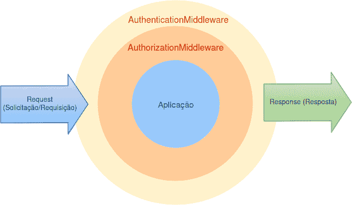

# PHP 编程最佳实践

> 如果您想提交任何错误或建议，请访问 [`erratas.casadocodigo.com.br`](http://erratas.casadocodigo.com.br)。

# 致谢

首先，感谢上帝在我那些认为自己无法克服生活中的某些困难的艰难时刻赐予我力量。感谢我的妻子，她从这部作品的开始到结束一直对我给予极大的鼓励。我还要感谢我的父母，他们为我提供了所能提供的最好的东西，并付出一切让我接受了良好的教育，并能够在人生的攀登中不断进步。

最后，感谢这些年来与我合作的所有所有人，他们为知识交流以及学习新技术和新概念提供了极大的帮助。

# 关于作者

我叫 Jhones dos Santos Clementino，从 17 岁起就对编程充满热情，当时我发现软件、游戏和网站都是通过某种编程语言开发的——这一发现改变了我的生活。我开始越来越对这些主题感兴趣，因为我觉得一段代码能够实现像游戏这样有用且有趣的功能，简直太不可思议了。太迷人了！

我毕业于圣保罗大学（UNIP）的计算机科学专业，自 2009 年首次接触到 `PHP` 以来，一直从事 Web 系统开发工作。从那时起，我一直致力于通过在线课程、教程、书籍和讲义来学习更多知识。我的重点一直是 Web，因为这些是处于不断演进的技术。

当我有空闲时，我喜欢做一些能让我暂时从虚拟世界中转移注意力的事情，所以我喜欢和我的妻子出去逛逛、画画甚至唱歌（这个留到以后再说吧，好吗？哈哈）。好了，我的朋友，这就是关于我的简单介绍。

# 前言

如今，可用应用程序的数量多得惊人，就像应用程序的数量一样，代码量也是如此。

但是，这些代码写得好吗？任何开发者都能毫无困难地进行维护吗？这些问题的答案在很大程度上取决于开发团队，很大程度上取决于每种编程语言的规则。

世界上并没有一种方法可以标准化开发人员应该如何思考，以便代码在逻辑和格式规则上都能以标准化的方式编写。

在 `PHP` 中也不例外，你只需要处理过某个现有的遗留应用程序就知道了。

如果你曾花费几个小时甚至几天时间试图理解那些不可能完成的事情，那么你就知道维护有多困难了。事实是，直到不久之前，`PHP` 还没有专注于定义标准的群体。幸运的是，2009 年出现了一个幸运的群体，叫做 **PHP-FIG**。

此 PSR 旨在定义一些标准的编码元素，这些元素应确保 PHP 代码之间更高水平的互操作性。

> **什么是互操作性？**
>
> 互操作性是指系统或应用程序与其他系统或应用程序进行高效通信的能力，从而实现更高水平的数据完整性。

确保您的应用程序具有互操作性，可以带来更高的数据完整性；此外，当您的应用程序需要与其他应用程序通信时，它将变得更加高效。

而那些缺乏高水平互操作性的应用程序，往往在与其他通信时会遇到困难。在企业环境中，这可能导致严重的后果，例如为了满足公司需求而重构应用程序，甚至开始创建一个更高效的全新应用程序。

因此，如果应用程序是互操作的，那么当您需要与其他系统进行通信时，将不会感到烦恼。

## 2.1 规则

请在本节中查看此 PSR 的所有规则和特性。

### 规则 1

PHP 文件**必须**仅使用 `<?php` 和 `<?=` 标签。这意味着不应使用任何其他类型的标签，例如 ASP 标签 `(<%)` 或 PHP 脚本标签。在许多服务器中，默认情况下禁用了*短开启标签*（short open tags），这可能会导致很多麻烦，因此按照惯例，请仅使用 `<?php` 或 `<?=` 标签。

### 规则 2

PHP 文件**必须**仅使用不带 BOM（字节顺序标记）的 UTF-8。你知道当你打开一个没有使用该标准的文件时，里面会出现很多奇怪的代码吗？没错，这是因为该文件可能使用了带有 BOM 的编码，例如：`ISO-8859-1` 或带有 BOM 的 `UTF-8`。

已规定要遵循和使用的标准是不带 BOM 的 UTF-8，这样编码不兼容的问题就随之解决了。需要注意的是，大多数 IDE 已经配置为不带 BOM 的 UTF-8 标准。

### 规则 3

PHP 文件**应该**声明（类、方法、常量、属性等）或产生侧效应（生成输出、对 `php.ini` 进行修改等），但**不应该**同时做这两件事。

想象一个 PHP 文件，它既有类的声明，又包含更改 `php.ini` 配置的代码段，并且还在屏幕上显示内容。你已经知道那会是多么混乱：杂乱无章，将责任混合在真正的定义模糊的逻辑汤中。这导致在修复和分离职责时需要大量时间。

如果你的文件是类或接口的声明文件，请遵守遵守。只做这一件事，不要在类声明之前或类声明之后显示内容或更改 `php.ini` 配置。为了实现这一点，请创建一个专门负责这些任务的文件，好吗？

请看下面的示例，以更好地理解一个同时执行了这两件事的文件，这种情况是**必须**被避免的：

```php
<?php
// 修改 php.ini 配置
ini_set('error_reporting', E_ALL);

// 引入外部文件
include "arquivo.php";

// 在屏幕上输出
echo "<html>\n";

// 声明一个类
class Usuario
{
}
```

如你所看到的，这种类型的例子——坦率地说——比你想象的要常见得多。你只需要处理任何类型的 PHP 遗留系统，就会遇到这类“幽灵”。所以，请记住：避免在同一个文件中像上述示例那样将声明和输出混合。

现在我们将看到一个正确的示例，一个只包含声明的文件：

```php
<?php
// 声明一个类
class Usuario
{
    private $nome;

    public function setNome($nome)
    {
        $this->nome = $nome;
    }
}
```

注意，在这个示例中，声明文件中没有任何输出生成。它仅执行了类、方法和属性的声明，仅此而已。

### 规则 4

命名空间（Namespaces）和类**必须**遵循 PSR-0（已弃）和 PSR-4（PSR-0 的替代者）中描述的标准。为了获得理解且高效的自动加载（autoloading），必须在文件声明中遵循与命名相同的目录结构。

> **什么是自动加载（Autoloading）？**
>
> 它是一种自动加载类、接口、trait 等文件的方法，而无需开发者在代码中显式地链接这些文件。

当以正确的方式（即本 PSR 规定的方式）执行时，文件的自动加载被认为是易理解且高效的。

为了更好地理解，让我们来看下面的示例：

```text
|-src
  |-App
    |-Controller
      |-HomeController.php
```

注意，我们有一个非常简单的目录结构。使用命名空间后，示例将如下：

```php
<?php
namespace App\Controller;

class HomeController
{
}
```

我们有一个类 `HomeController`，它位于 `App` 目录中，因此位于 `Controller` 子目录下，所以，该类的命名空间是 `App\Controller`。这并不是很难做的事。

### 规则 5

类、接口和 trait 的文件名**必须**遵循 `StudlyCaps` 标准。这意味着每个单词的第一个字母应该大写，如 `HomeController` 所示。

### 规则 6

常量**必须**使用全大写字母，并用下划线（`_`）分隔。不要使用小写字母、`camelCase` 或 `snake_case` 来声明常量。允许的方法是使用所有大写字母。

为了方便理解，让我们来看下面关于正确声明方式的示例：

```php
<?php
const LOG_CRITICAL = 'critical';
```

没什么特别的，不是吗？那么错误的方法呢？查看后续：

```php
<?php
const logial = 'critical';
const log_info = 'info';
```

最后的示例展示了声明常量的一种错误方式。

### 规则 7

定义的属性**应当**在合理的范围内一致地应用，可以是包级、供应商级、类级或方法级。无论使用哪种命名约定（`$StudlyCaps`、`$camelCase`、`$snake_case`），只要遵守之前的规则。

### 规则 8

方法名**必须**按照 `camelCase` 命名约定进行声明。这条规则也并不复杂，只需注意按照此格式编写方法名。为了方便理解，让我们来看下面定义方法名的正确方式示例：

```php
<?php

public function getNomeUsuario()
{
}
```

注意，方法名是以 `camelCase` 命名约定定义的。现在我们来看声明方法名的几种错误方式：

```php
<?php

// snake_case 声明
public function get_nome_usuario()
{
}

// StudlyCaps 声明
public function GetNomeUsuario()
{
}
```

### 结论

我们到达了 PSR-1 的最后，它向我们展示了一些必须遵循的规则，以便我们的代码更具可读性并符合开发规范。这不是一个复杂的 PSR，但值得关注它的规则，以便你能够在代码中更准确、更高效地应用它们。

在接下来的章节中，我们将讨论 PSR-2，它涉及源代码的可读性规则，所以，让我们开始吧！

## PSR-2 (编码风格指南) - 第一部分

你是否厌倦了看着代码时必须花时间进行缩进，并将所有内容放在它们应在的位置以提高理解？有了这个 PSR，你的问题就可以结束了。PSR-2 的出现是为了让开发者的代码编写和可读性变得更加简单快捷。

在接下来的节中，我们将看到具体的规则、概念以及如何将它们应用到你的项目中，以获得更美、更易读的代码。

> **重要信息**
>
> 由于 PHP 中不断出现新功能，PSR-2 已经被**废弃**；但不用担心，替代者是 **PSR-12**，我们将在本书的后续部分介绍它。你可以继续阅读 **PSR-2**，因为其中的许多内容在 **PSR-12** 中被重用或扩展了，你可以了解它们之间的差异以及针对 PHP 7 的特定特性。

### 3.1 规则

在本节中查看此 PSR 的一些规则和特征。

### 规则 1

PHP 代码**必须**遵循 PSR-1 (`Basic Code Standard`) 中建立的标准。由于它是 PSR-1 的扩展，显然在应用 PSR-2 之前，必须遵循其中呈现的标准。

### 规则 2

PHP 文件**必须**采用 UNIX 行结束符标准。你知道可用的行结束有哪些吗？如果不知道，请看下方：

- **CRLF**: 回车+换行，Unicode 字符 `U+000D` + `U+000A`
- **LF**: 换行，Unicode 字符 `U+000A`
- **NEL**: 下一行，Unicode 字符 `U+0085`
- **LS**: 行分隔符，Unicode 字符 `U+2028`
- **PS**: 段落分隔符，Unicode 字符 `U+2029`

PSR-2 采用的 UNIX 标准是 `LF`。通常 IDE 已经配置为 UNIX 标准，但可以根据所选的 IDE 轻松进行更改。

### 规则 3

PHP 代码**必须**使用 4 个空格缩进，而不是 TAB。这不是一个复杂的规则，只需注意并避免使用 TAB 的习惯即可。某些 IDE 已经配置为按下 TAB 键产生 4 个空格，但值得检查一下，以确保你的代码不违反 PSR-2 规范。这可以很不费力地配置。

### 规则 4

仅包含 PHP 的文件**必须**省略结束标签。这起初看起来可能很奇怪，但确实，如果省略了结束标签 (`?>`)，你的 PHP 脚本也不会停止运行。该规则不适用于包含 HTML + PHP 文件。为了方便理解，我们来看下面的示例，它展示了应用此规则的正确方法：

```php
<?php
class Usuario
{
    private $nome;

    public function __construct($nome)
    {
        $this->nome = $nome;
    }
}
```

注意，结束标签 (`?>`) 被省略了，这不会影响代码的运行。现在我们分析一个省略标签会导致代码错误的示例：

```php
<?php
$nome = 'Jhones S. Clementino';

<html>
    <head>
        <title>Teste</title>
    </head>
    <body>
        <h1>Olá, <?php echo $nome ?></h1>
    </body>
</html>
```

与之前的示例不同，如果从变量 `$nome` 声明之后没有结束标签，那么省略 PHP 结束标签 (`?>`) 将导致错误。这是因为该文件并不仅仅包含 PHP 代码。

### 规则 5

仅包含 PHP 代码的文件**必须**在末尾留有一个空行。在应用了所有逻辑后，应该存在一个空行。

### 规则 6

代码行的最大长度**必须**为 120 个字符。自动样式检查器**必须**发出警告，但**不应**显示错误。

代码行**不应**超过 80 个字符。超过 80 个字符的代码行**必须**折分到后续的最多 80 个字符的行中。

这个解释听起来很奇怪，但非常有道理。在遗留系统中，经常有长度超过 1000 个字符的——相信我，这不是夸张！我工作过这类系统，维护这类代码非常困难。

因此，请注意每 80 个字符就进行换行以保持其可读性；如果无法做到，你还有 120 个字符的限制。

这不是一个错误，但如果你想遵循 PSR-2 标准并保持你的良好实践，那么注意这一额外规则是非常重要的，好吗？

### 规则 7

包含内容的行**不应**在内容末尾留有空格。

### 规则 8

为了方便解释代码，**可以**添加空行。你可以添加空行来使代码的解释更易理解。我们来看看该规则应用的简短示例：

```php
<?php

class Usuario
{

    private $nome;
    private $idade;
    private $sexo;

    public function __construct($nome, $idade, $sexo)
    {

        $this->nome = $nome;
        $this->idade = $idade;

        if ($sexo == 'M') {
            $this->sexo = 'Masculino';
        } elseif ($sexo == 'F') {
            $this->sexo = 'Feminino';
        }

    }

}
```

看应用了换行后代码变得多易读。现在看下面这个没有换行的示例：

```php
<?php

class Usuario
{
    private $nome;
    private $idade;
    private $sexo;
    public function __construct($nome, $idade, $sexo)
    {
        $this->nome = $nome;
        $this->idade = $idade;
        if ($sexo == 'M') {
            $this->sexo = 'Masculino';
        } elseif ($sexo == 'F') {
            $this->sexo = 'Feminino';
        }
    }

}
```

### 规则 9

**不应**在同一行内有多个声明。每个变量声明都应该在新的一行中。定义了一个变量？那么跳到行定义下一个变量。

```php
<?php

$nome = 'Jhones';
$sobrenome = 'S. Clementino';

```

### 规则 10

关键字和常量 `true`、`false` 以及 `null` **必须**用小写字母。

### 规则 11

在定义 namespace 之后，**必须**有一个空行。当你定义一个 namespace 时，在继续编写代码之前应该有一个空行。

```php
<?php

namespace App\Entity\Usuario;

class Usuario
{
    // 代码
}
```

在这个示例中，在 `namespace` 定义之后没有添加空行，这在 PSR-2 中被认为是不规范的。因此，在继续编写代码之前，请务必留出一个空行。

### 规则 12

所有现有的 `use` 声明**必须**置于 `namespace` 之后。有时我们需要导入包含在另一个类中的代码，为了将其引入到我们的类中，我们需要使用 `use` 声明。

为了更好地理解，让我们来看符合 PSR-2 标准的正确示例：

```php
<?php

namespace App\Controller\Usuario;

use App\Controller\AbstractController;

class UsuarioController extends AbstractController
{
    // Código
}
```

请注意，在 `namespace` 声明之后，我将 `AbstractController` 控制器导入到我的类中。`use` 声明位于类 `namespace` 定义之下。现在我们来分析一个 `use` 声明错误的示例：

```php
<?php

use App\Controller;

namespace App\Controller\Usuario;

class UsuarioController extends AbstractController
{
    // Código
}
```


这段代码是不正确的，也没有遵循 PSR-2 建立的标准，因为所有的 `use` 声明必须位于 `namespace` 定义之后。

## 规则 13

每个声明**只能**存在一个 `use`。每个 `use` 都应该有一个独立的声明。让我们通过一个简化解释的示例来展示正确的方法：

```php
<?php

namespace App\Service\Usuario;

use App\Service\AbstractService;
use App\Entity\Usuario;

class UsuarioService extends AbstractService
{
    //Código
}
```

如所见，每个声明在每一行都使用了一个 `use`。只需在使用 `use` 时注意这一点即可。现在我们来看一个 `use` 使用错误的示例：

```php
<?php

namespace App\Service\Usuario;

use App\Service\AbstractService, App\Entity\Usuario;

class UsuarioService extends AbstractService
{
    //Código
}
```

在单行 `use` 声明中使用多个声明并不是错误，因此这段代码可以运行。然而，你的代码将不再符合 PSR-2 标准。

## 规则 14

`extends` 和 `implements` 关键字**必须**声明在与类名相同的同一行中。当需要扩展一个类和/或实现一个接口时，两者都必须与类名处于同一行内，因为它们也是类定义的一部分。

让我们来看下面的示例，它展示了这种正确的方法：

```php
<?php

namespace App\Service\Usuario;

use App\Service\ServiceInterface;
use App\Service\AbstractService;

class UsuarioService extends AbstractService implements ServiceInterface
{
    //Código
}
```

到此为止没什么特别。如前所述，`extends` 和 `implements` 是类定义的一部分，因此它们应该在同一行。现在我们来分析一个错误的示例：

```php
<?php

namespace App\Service\Usuario;

use App\Service\ServiceInterface;
use App\Service\AbstractService;

class UsuarioService
extends AbstractService 
implements ServiceInterface
{
    //Código
}
```

## 规则 15

当需要扩展一个类和/或实现一个接口时，两者都必须在与类名相同的同一行内，因为它们也是类定义的一部分。当需要扩展一个类和/或实现一个接口时，两者都必须与类名处于同一行内，因为它们也是类定义的一部分。当需要扩展一个类和/或实现一个接口时，两者都必须与类名处于同一行内，因为它们也是类定义的一部分。

当需要扩展一个类和//实现一个接口时，两者都必须处于在同一行 o 名字 nome 类,, pois，部分 da da...... h a a est, est,,,,,,,,,,,,,,,,,,,,,,,,,..,...,.,..,,.,...........,.,, a a a a2:

```php
<?php

namespace App\Service\Usuario;

use App\Service\ServiceInterface;
use App\Service\AbstractService;

class UsuarioService
extends AbstractService 
implements ServiceInterface
{
    //Código
}
```

## 规则 16

`extends` 和 `implements` 关键字**必须**声明在与类名相同的同一行中。当需要扩展一个类和/或实现一个接口时，两者都必须与类名处于同一行内，因为它们也是类定义的一部分。

```php
<?php

namespace App\Service\Usuario;

use App\Service\ServiceInterface;
use App\Service\AbstractService;

class UsuarioService
extends AbstractService 
implements ServiceInterface
{
    //Código
}
```

## 规则 17

`var` 关键字**不应**用于属性定义。

## 规则 18

每个声明**不应**有多个属性。 houver a, a, a2:

```php
<?php

namespace App\Entity\Usuario;

class Usuario
{
    private $nome;
    private $idade;
    public $etnia;
    protected $dataNascimento
}
```

## 规则 19

属性名称**不应**以 `_`（下划线）开头来表示 `private` 或 `protected` 可见性。

## 规则 20

所有方法**都必须**定义可见性。记住，可见性会让封装更加清晰。为了方便起见，让我们来看下面的示例：

```php
<?php

namespace App\Entity\Usuario;

class Usuario
{
    private $nome;

    public function getNome()
    {
        return $this->nome;
    }

    public function setNome($nome)
    {
        $this->nome = $nome;
    }
}
```

注意，`getNome()` 和 `setNome($nome)` 方法定义了访问修饰符 `public`，表示它们具有公共可见性。

可见性的类型取决于你需要向应用程序的其他部分暴露或不暴露的内容。

现在我们来分析一个认为错误且不符合 PSR-2 标准的示例：

```php
<?php

namespace App\Entity\Usuario;

class Usuario
{
    private $nome;

    function getNome()
    {
        return $this->nome;
    }

    function setNome($nome)
    {
        $this->nome = $nome;
    }
}
```

需要强调的是，示例代码可以运行，但并不符合 PSR-2 的规则。

## 规则 21

`下划线` (`_`)**不应该**被用于指示方法的 `private` 或 `protected` 可见性。这条规则与类属性定义的规则类似。因此，不要使用`下划线`来指示方法的可见性。

为了说明这一点，我们来看下面的示例，它展示了定义方法的正确方式：

```php
<?php

namespace App\Entity\Usuario;

class Usuario
{
    private $nome;

    private function getNome()
    {
        return $this->nome;
    }

    protected function setNome($nome)
    {
        $this->nome = $nome;
    }
}
```

你可能在想：“将 `setNome($nome)` 和 `getNome()` 方法设置为保护和私有有什么意义呢？”实际上确实没有意义，这只是为了展示 `private` 和 `protected` 访问修饰符存在，并且可以且应该在方法定义中使用。

现在我们将看到一个被认为错误的示例：

```php
<?php

namespace App\Entity\Usuario;

class Usuario
{
    private $nome;

    function _getNome()
    {
        return $this->nome;
    }

    function _setNome($nome)
    {
        $this->nome = $nome;
    }
}
```

该示例可以运行，但是不正确的，因为访问修饰符的存在是为了被使用的。因此，请尽管使用并充分利用它们，并避免使用 `_`（下划线）作为访问修饰符，否则你的代码将无法符合 PSR-2 标准，好吗？

## 规则 22

方法名后**不应该**存在空白符。方法的左大括号**必须**另起一行，而右大括号**必须**紧跟在方法体之后。

左括号之后**不应该**存在空白符，右括号之前也**不应该**有空白符。

这听起来可能很奇怪，但这更多被看作是一种适应和习惯的问题。我经常看到不遵循这条 PSR 规则的代码。为了方便理解，我们来看被认为正确的示例：

```php
<?php

namespace App\Controller;

class HomeController
{
    public function indexAction()
    {
        //代码
    }
}
```

在上述示例中，可以看到 `indexAction()` 方法完美地遵循了这条 PSR-2 规则：方法名后没有空格，左大括号另起一行，右大括号紧跟方法内容之后。

现在我们来分析一个方法定义不符合规定模式的示例：

```php
<?php

namespace App\Controller;

class HomeController
{
    public function indexAction ( $request ) {
        //代码
    }
}
```

尽管代码可以无问题地运行，但它不兼容 PSR-2 规则。

## 结论

正如你所看到的，PSR-2 提供了无数规则，而且还有更多！在下一章节中，我们将继续查看 PSR-2 的其他规则。所以请继续加油吧！

# PSR-2 (编码风格指南) - 第二部分

我们在上一节中学习了总共 22 条 PSR-2 规则，在本章节中，我们将继续查看这些规则，旨在优化源代码的风格，以便通过 PSR-2 建立的标准获得更好的可读性和理解。

## 规则

接下来我们将从上一章节停止的地方继续介绍规则。

### 规则 23

当方法拥有参数列表时，逗号前**不应该**有空格，但逗号后**必须**有空格。这很简单，不是吗？每当你定义方法的参数列表时，你应该用逗号（`,`）分隔它们，并在后面加上空格，遵循我们自己的标准。

让我们来看定义方法参数的正确示例：

```php
<?php

namespace App\Controller;

class HomeController
{
    public function indexAction($request, $response)
    {
        //代码
    }
}
```

现在我们来看一个错误的示例：

```php
<?php

namespace App\Controller;

class HomeController
{
    public function indexAction($request ,response)
    {
        //代码
    }
}
```

注意，这次参数在逗号前有空格，但空格应该在逗号后。这样代码才符合 PSR-2。

### 规则 24

如果方法有许多需要定义的参数，列表**可以**被拆分为多行，此时第一个参数**必须**位于下一行。

每行应只有一个参数，且列表的右括号和方法的左大括号**必须**在同一行，并包含一个空格。该规则的解释通过视觉化符合规范的示例变得更容易：

```php
<?php

namespace App\Sercice\Paginacao;

class PaginacaoService
{
    public function paginate(
        $limite,
        $pagina,
        $dados
    ) {
        //代码
    }
}
```

注意参数列表被拆分了，识别参数变得非常容易。现在我们分析一个多行拆分不正确且应该避免的示例：

```php
<?php

namespace App\Sercice\Paginacao;

class PaginacaoService
{
    public function paginate(
        $limite, $pagina,
        $dados
    ) {
        //代码
    }
}
```

### 规则 25

`abstract` 和 `final` 关键字**必须**在定义类和方法的可见性之前声明。在某些情况下我们需要创建抽象或最终类，或者方法，并且存在一种正确的方法。

为了方便理解，让我们分析下面的示例，它展示了遵循该规则的正确方式：

```php
<?php

namespace App\Sercice;

abstract class AbstractService
{
    protected static $dados;

    abstract protected function insert();

    final public static function start()
    {
        //代码
    }
}
```

注意 `abstract` 和 `final` 关键字位于两个方法 `insert()` 和 `start()` 的可见性之前。在类中，没有需要定义的可见性，但我们可以告知它是抽象类还是最终类。

错误示例：

```php
<?php

namespace App\Sercice;

class abstract AbstractService
{
    protected static $dados;

    protected abstract function insert();

    public final static function start()
    {
        //Código
    }
}
```

Neste exemplo, as palavras-chave `abstract` e `final` encontram-se logo após a visibilidade dos métodos e logo após a palavra-chave `class`.

Este exemplo não funcionará mais, pois não podemos definir uma classe abstrata após a palavra-chave `class`, mas sim antes.

Note que nos métodos também existem as palavras `abstract` e `final` após a definição da visibilidade, e não há problemas. Porém, se você fizer desta forma, seu código não estará de acordo com a regra estabelecida。

### 规则 26

Ao declarar um método ou função, NÃO DEVE haver espaço entre o nome do método/função e o parêntese de abertura。

NÃO DEVE haver空格后 o parêntese de abertura e NÃO DEVE haver空格 antes do parêntese de fechamento; e na lista de parâmetros NÃO DEVE haver空格 antes de cada vírgula, mas DEVE haver um空格 após cada vírgula。Parece complexo, não é mesmo? Mas não é complicado — na verdade, é tão简单 quanto definir uma variável。Veja o exemplo abaixo que demonstra a forma correta de aplicação desta regra：

```php
<?php

namespace App\Sercice;

class AbstractService
{        
    protected function update($id, array $dados)
    {
        //Código
    }
}
```


Simples, não? Note que, quando definimos o nome do método, não existe espaço antes nem depois do parêntese de abertura, não existe espaço antes da vírgula entre os parâmetros e não existe espaço antes nem depois do parêntese de fechamento.

Agora vamos analisar um exemplo com a maneira incorreta que não estará em conformidade com esta regra da PSR:

```php
<?php

namespace App\Sercice;

class AbstractService
{        
    protected function update ( $id , array $dados )
    {
        //Código
    }
}
```

Este exemplo está completamente fora da regra, pois existe espaço em todos os lugares na definição do método.

### Regra 27

Após a palavra-chave da estrutura DEVE haver um espaço. NÃO DEVE haver espaço após o parêntese de abertura (se necessário). NÃO DEVE haver espaço antes do parêntese de fechamento (se necessário). DEVE haver um espaço entre o parêntese de fechamento e a chave de abertura.

O corpo da estrutura DEVE ser indentado uma vez. A chave de fechamento DEVE ser colocada em uma linha.

Esta regra também parece assustradora, mas é simples. Digo novamente que é mais uma questão de adaptação e costume. Vamos analisar um exemplo para cada estrutura, que demonstra a maneira correta a ser seguida:

**Exemplos com `if`, `elseif`, `else`**

```php
<?php

namespace App\Sercice;

class AbstractService
{        
    protected function update($id, array $dados)
    {
        $resultado = null;

        if (is_int($id)) {
            $resultado = 'ID é um inteiro';
        } elseif (is_numeric($id)) {
            $resultado = 'ID é uma string contendo números';
        } else {
            $resultado = 'ID não possui formato válido';
        }
    }
}
```

Note a indentação da estrutura de controle e também o espaço antes do parêntese de abertura e, ainda, o espaço após o parêntese de fechamento antes da chave da estrutura.

Não é uma regra complicada de seguir, mas deve-se ter cuidado para não definir a estrutura incorretamente, e é isso que veremos no exemplo abaixo, a maneira considerada incorreta e que deve ser evitada:

```php
<?php

namespace App\Sercice;

class AbstractService
{        
    protected function update($id, array $dados)
    {
        $resultado = null;

        if(is_int($id)){
            $resultado = 'ID é um inteiro';
        } 
        elseif(is_numeric($id)){
            $resultado = 'ID é uma string contendo números';
        } 
        else{
            $resultado = 'ID não possui formato válido';
        }
    }
}
```

Já neste exemplo, apesar de funcionar corretamente, ele não segue a regra da PSR. Como você pode ver, não existe espaço antes do parêntese de abertura nem após o parêntese de fechamento. Outra regra quebrada é quanto às palavras-chave `elseif` e `else` que estão abaixo da chave de fechamento da estrutura anterior. O correto é que estejam na mesma linha que a chave de abertura e precedidas por um único espaço. Nada de mais, não é?

**Exemplos com `switch`, `case`**

```php
<?php

namespace App\Sercice;

class AbstractService
{        
    protected function update($id, array $dados)
    {
        $resultado = null;

        switch ($id) {
            case 0:
                $resultado = 'Id é 0';
                break;
            case 1:
                $resultado = 'Id é 1';
                break;
            case 2:
                $resultado = 'Id é 2';
                break;
            case 3:
                $resultado = 'Id é 3';
                //Sem break
            default:
                $resultado = 'O valor informado não é permitido';
                break;
        }
    }
}
```

Note como, após a palavra-chave `switch` DEVE haver um espaço antes do parêntese de abertura e DEVE haver um espaço após o parêntese de fechamento. Cada `case` DEVE estar indentado uma vez. O conteúdo de cada `case` DEVE ser indentado uma vez. Agora vamos analisar um exemplo que é considerado incorreto quanto à regra aplicada:

```php
<?php

namespace App\Sercice;

class AbstractService
{        
    protected function update($id, array $dados)
    {
        $resultado = null;

        switch($id){
            case 0:
                $resultado = 'Id é 0';
                break;
            case 1:
                $resultado = 'Id é 1';
                break;
            case 2:
                $resultado = 'Id é 2';
                break;
            case 3:
                $resultado = 'Id é 3';
            default:
                $resultado = 'O valor informado não é permitido';
                break;
        }
    }
}
```

Note que neste exemplo a estrutura sofreu alterações de indentação e espaçamento, e também que no `case` que não possui o `break` o comentário `//Sem break` foi removido. O método continua funcionando perfeitamente, porém não é válido para a PSR.

**Exemplos com `while`, `do while`**

```php
<?php

namespace App\Sercice;

class AbstractService
{        
    protected function update($id, array $dados)
    {         
        while ($id < 10) {
            //Código       
        }

        do {
            //Código
        } while ($id > 0);
    }
}
```

Após a palavra-chave `while`, DEVE haver um espaço antes do parêntese de abertura e DEVE haver um espaço após o parêntese de fechamento. A abertura da chave deve estar na mesma linha da declaração `while`. O mesmo se aplica utilizando o `do while`. O código fica mais bonito e legível, e essa é a maneira considerada correta pela PSR. Agora vamos ver o exemplo abaixo que demonstra a maneira incorreta e que não deve ser seguida:

```php
<?php

namespace App\Sercice;

class AbstractService
{        
    protected function update($id, array $dados)
    {         
        while($id < 10){
            //Código       
        }

        do{
            //Código
        }while($id > 0);
    }
}
```

**Exemplos com `for`**

```php
<?php

namespace App\Sercice;

class AbstractService
{        
    protected function update($id, array $dados)
    {         
        for ($i = 0; $i <= 10; $i++) {
            //Código
        }
    }
}
```

Neste exemplo, a aplicação é idêntica à do uso correto do `while`, ou seja, o espaçamento está em conformidade com as regras da PSR.

Observe novamente que, após a palavra-chave `for`, **deve** existir um espaço antes do parêntese de abertura e **deve** existir um espaço após o parêntese de fechamento.

Agora analisamos um exemplo considerado incorreto e que não está em conformidade com a PSR:

```php
<?php

namespace App\Sercice;

class AbstractService
{        
    protected function update($id, array $dados)
    {         
        for($i = 0; $i <= 10; $i++){
            //Código
        }
    }
}
```

Neste exemplo, o código também funciona normalmente, mas não é aceito pela PSR, pois não possui o espaçamento definido.

## `foreach` 示例

```php
<?php

namespace App\Sercice;

class AbstractService
{        
    protected function update($id, array $dados)
    {         
        foreach ($dados as $key => $value) {
            //Código
        }
    }
}
```

Este exemplo é semelhante ao aplicado ao `for`; as mesmas regras de espaçamento se aplicam ao `foreach`. Este exemplo possui o espaçamento considerado correto pela PSR e deve ser utilizado.

Agora analisamos o mesmo exemplo, mas que, devido à falta de espaçamento, é considerado incorreto:

```php
<?php

namespace App\Sercice;

class AbstractService
{        
    protected function update($id, array $dados)
    {         
        foreach($dados as $key => $value){
            //Código
        }
    }
}
```

Até aqui nada de especial; o exemplo funciona normalmente, mas não está em conformidade com o padrão PSR.

## `try`, `catch`, `finally` 示例

```php
<?php

namespace App\Sercice;

class AbstractService
{        
    protected function update($id, array $dados)
    {         
        try {
            //Código
        } catch (\InvalidArgumentException $e) {
            //Código
        } catch (\Exception $e) {
            //Código
        } finally {
            //Código
        }
    }
}
```

Quando for necessário utilizar blocos `try catch` ou `try catch finally`, eles devem possuir a estrutura de espaçamento e indentação mostrada no exemplo anterior.

Após a palavra-chave `try`, **deve** existir um espaço antes do parêntese de abertura e **deve** existir um espaço após o parêntese de fechamento.

Para cada bloco `catch`, **deve** existir um espaço após a palavra-chave `catch` e **deve** existir um espaço após o parêntese de fechamento.

O mesmo se aplica ao `finally` (se presente): após a palavra-chave `finally`, **deve** existir um espaço antes da chave de abertura do bloco.

Este exemplo está em total conformidade com a PSR. Analisamos agora um exemplo que não atende aos requisitos:

```php
<?php

namespace App\Sercice;

class AbstractService
{        
    protected function update($id, array $dados)
    {         
```


```php
try {

    // Código

} catch (\InvalidArgumentException $e) {

    // Código

} catch (\Exception $e) {

    // Código

} finally {

    // Código

}

}
```

在上面的示例中，间距是错误的。

```php
<?php

namespace App\Controller\Usuario;

class UsuarioController
{        
    public function updateAction($id, array $dados)
    {         
        return function ($atualizado, 
            $usuario) use ($id,
            $dados) {
            // 代码
        };
    }
}
```

上面的示例恰恰展示了什么是不该做的。不要这样缩进代码，尽管它可以正常工作。如果你这样做，你的代码将不符合 `PSR`。

### 结论

我们已经来到了 `PSR-2` 的末尾，正如在本章所示，有许多规则和条件必须遵守，以确保代码符合规范。我们应用了空格和缩进规则，这些规则表明代码会变得更容易理解。

起初，代码看起来可能很奇怪，但随着时间的推移，你会习惯的，甚至能记住每条规则是如何应用的。

需要强调的是，`PSR-2` 已经被弃用，它的继任者是 `PSR-12`，我们将在本书的后续部分介绍。

让我们继续，了解 `PSR-3` 及其规则。

# 第 5 章 PSR-3 (日志接口)

为了提供一个简单、易用且通用的日志记录接口，`PSR-3` 允许库接收一个 `Psr\Log\LoggerInterface` 对象。通过它，可以为每个应用程序创建自定义日志。

具有特定需求的应用程序可以扩展该接口，但必须保持兼容性。也就是说，每个应用程序可以有不同的记录日志方式，但无论应用程序如何，都必须保持兼容性。

与其他 `PSR` 一样，它也有一系列必须遵守的规则，而这些正是我们在下一节中看到的：

## 5.1 规则

在本节查看此 `PSR` 的所有规则和特征。

### 规则 1

`LoggerInterface` 接口拥有八个用于记录八个级别的方法。它们分别是：`debug`、`info`、`notice`、`warning`、`error`、`critical`、`alert`、`emergency`。

接口还定义了名为 `log` 的第九方法与其他方法的目标完全相同。区别在于它第一个参数接受定义的八个级别之一，也就是说，结果必须与调用特定级别的方法完全相同。

看接下来的示例，它展示了该规则的功能：

```php
log('error', '发生严重错误', array $context = array());
```

在上面的示例中，我们展示了 `log` 方法的功能，它与直接调用 `error` 方法的功能完全相同。这是因为我们向它传递了想要记录 `log` 的级别。

通过这种灵活性，你可以选择在应用程序中遵循哪种模式。也就是说，如果你喜欢直接使用 `interface` 中定义的某个级别的方法，还是使用 `log` 方法，因为行为是相同的。

如果作为参数传递的级别无效，则应抛出 `Psr\Log\InvalidArgumentException` 异常。

### 规则 2

所有日志方法必须接受一个字符串或具有 `__toString()` 方法的对象作为日志消息。

方法可以对接收到的对象进行特定处理，或者，如果不适用，则方法必须将对象转换为字符串。

实际上非常简单：当你传递日志消息时，除了传递字符串外，你还可以传递一个包含 `__toString()` 方法的对象，确保对象被转换为字符串。

### 规则 3

消息可以包含占位符，这些占位符可以被 `$context` 参数中的值替换。

占位符的名称必须与 `$context` 参数中的键相同。占位符的名称必须用开启括号 (`{`) 和闭括号 (`}`) 定义。

在分隔符和占位符名称之间不应存在空格。占位符名称只能由字符 A-Z、a-z、0-9、下划线 (`_`) 和点组成。

根据应用程序的不同，可能需要更具自定义的日志，包含用户信息，如姓名、访问日期等。

对于这些情况，我们可以使用占位符，定义一个消息并在上下文传递该占位符的值。为了方便理解，让我们分析接下来的示例，它展示了该规则的应用：

```php
<?php

namespace App\Service\Log;

use Psr\Log\LoggerInterface;

class LogService implements LoggerInterface
{        
    // 实现代码

    public function gravarLog()
    {
        $mensagem = '用户 {NOME_USUARIO} 访问了系统';
        $contexto = [
            'NOME_USUARIO' => 'Jhones'
        ];
        $this->info($mensagem, $contexto);
    }
}
```

注意示例中的占位符名称是 `NOME_USUARIO`。

### 规则 4

方法可以实现多种策略来转义占位符值并翻译日志以供显示。如果用户不知道哪些上下文将被显示，则用户不应该转义值。

### 规则 5

所有方法都接受一个上下文数组作为参数，可以传递关于日志的任何额外信息。

方法必须以应用程序方便的方式处理此数组，无论在上下文数组中传递了什么值，这些都不应该导致错误或抛出异常。

### 规则 6

如果在上下文数组中传递了 `Exception` 类型的对象，它必须存储在数组的 `exception` 键中。

## 5.2 类和接口

现在让我们来了解这个包的成员。它们是：

*   `Psr\Log\AbstractLogger` - 此抽象类实现了 `LoggerInterface` 接口，该接口包含九个方法，其中八个与默认允许的日志级别有关，以便应用程序扩展这个已经包含所有必要方法的抽象类。
*   `Psr\Log\LoggerTrait` - 其工作原理基本上与 `AbstractLogger` 类相同，区别在于 `Trait` 没有实现 `LoggerInterface` 接口，因为 `Traits` 无法实现接口。由于它包含了与抽象类相同的功能，结果将完全相同，因为 `LoggerTrait` 已经拥有了抽象方法 `log`。
*   `Psr\Log\NullLogger` - 继承自抽象类 `AbstractLogger`，负责作为一种占位符，以在应用程序没有定义任何负责记录日志的类时使用。
*   `Psr\Log\LoggerAwareInterface` - 该接口仅有一个名为 `setLogger` 的方法，负责设置特定的日志类。
*   `Psr\Log\LoggerAwareTrait` - 作为 `LoggerAwareInterface` 接口的实现，提供了 `setLogger` 方法以及属性 `$this->logger`。
*   `Psr\Log\LogLevel` - 仅包含与日志级别相关的八个常量。

### 结论

我们来到了另一个 PSR 的末尾，通过它我们看到了如何按照这里描述的规则开发日志系统。这个 PSR 并不大，在了解了定义它的规则后，也不复杂。

需要强调的是，PSR-3 并没有描述如何开发日志系统的具体步骤，而是为我们提供了如何在应用程序中实现它的指导方向和初始结构。

# 第 6 章 PSR-4 (自动加载器)

为了提供一种通过文件路径加载类的标准，PSR-4 是完全互操作的，可以与任何其他类型的 PSR 配合使用。此外，PSR-4 描述了我们可以将自动加载的文件放在哪里。

## 6.1 规则

在本节中查看此 PSR 的所有规则和特征。

### 规则 1

类的完整名称 必须包含一个顶层命名空间，被称为*根命名空间*（root namespace）。如果你不知道或不知道它是如何运作的，根命名空间只不过是一个基础命名空间，我们所有的类（包括 *traits* 和接口）都应该包含在。让我们分析下面的示例以更好地理解：

```php
<?php

namespace App\Validator\Cpf;

class CpfValidator
{        
    // 代码
}
```

在示例中，创建了一个类 `CpfValidator`，它反过来位于根命名空间 `App` 中，其中 `App` 是项目或其模块的名字。

如果我们要创建另一个类，它也应该位于根命名空间 `App` 中。如果你从未听说过或从未工作过命名空间，你可能在想：我可以为根命名空间定义任何名称吗？答案是肯定的！

如果你想把你的根命名空间命名为 `Sistema` 甚至放上你的名字，你可以轻松地这样做，但请记住命名空间必须具有实际意义。通常它是应用程序的名称或模块的名称。在我们的示例中，这意味着目录结构为：

```
|-src
    |-App
        |-Validator
            |-Cpf
                |-CpfValidator.php
```

很简单，不是吗？

### 规则 2

类的完整名称 可以 包含一个或多个*子命名空间*（subnamespaces）。将子命名空间理解为目录结构中的子目录。在之前的示例中，你可以看到在根命名空间 `App` 内部我们还有 `Validator` 和 `Cpf`，因此完整命名空间如下：`App\Validator\Cpf`。

### 规则 3

类的完整名称 必须 以类名结尾。同样，遵循上引用的示例 `App\Validator\Cpf`，当我们在另一个类内部调用这个 `validator` 时，我们将采取如下方式：

```php
<?php

namespace App\Service\Usuario;

use App\Validator\Cpf\CpfValidator;

class UsuarioService
{        
    // 代码
}
```

`use App\Validator\Cpf\CpfValidator` 这段代码表示我们正在导入 `CpfValidator` 类。也就是说，为了让 *autoloader* 调用一个类，它始终会考虑最后一个 `\` 之后的内容，即类名加上完整的命名空间。

### 规则 4

下划线 (`_`) 不应该 在类名中产生特殊效果。这意味着类名中的下划线（包括 *traits* 和接口中的下划线）应该只是一个字符，不会引起任何类型的特殊效果。

### 规则 5

类的完整名称 可以 包含任何类型的大写或小写字符组合。这意味着定义包括命名空间在内的类名没有规则，你可以使用任何类型的字母组合。

按照惯例，类名和命名空间采用的标准是 `StudlyCaps`，即每个单词的首字母大写，例如：`App\Entity\Acl\PapelDeAcesso`。

### 规则 6

所有类名 必须 以区分大小写的方式引用（*case-sensitive*）。每当 *autoloader* 调用类时，它将使用真实的名称，尊重字母的大小。例如，`CpfValidator` 不同于 `cpfValidator`，在后者的情况下将找不到该类，因为它的真实名称是 `CpfValidator` 而不是 `cpfValidator`。

### 规则 7

在加载对应于类名的文件时，根命名空间之外的一个或多个命名空间 必须 对应一个根目录。我们在之前的示例中已经看到了这一点：每个命名空间都对应一个根目录，根命名空间除外，因为它就是根。

但让我们再次分析之前示例中的目录结构：

```
|-src
    |-App
        |-Validator
            |-Cpf
                |-CpfValidator.php
```


注意到 `App` 目录是所有后续子目录的库，并且目录结构被转换为 `App\Validator\Cpf` 格式。

### 规则 8

每个子命名空间对应根目录中的一个子目录，且目录名称必须与子命名空间相同，尊重字母的大小写。

### 规则 9

命名空间之后的类必须对应一个 `.php` 文件，且该文件名必须与类名相同，尊重字母的大小写。

### 规则 10

`autoloader` 实现不应该抛出异常，不应该产生任何级别的错误，并且不应该返回任何值。`autoloader` 的唯一目标是执行自动加载，仅此而已。

我们的下一步是讨论 `PSR-6`，因此，也许你可能在问，`PSR-5` 发生了什么？在本书编写时，`PSR-5`（`PHPDoc Standard`）处于草案阶段，因此在这里不会进行介绍。我们只关注目前已通过并激活状态的 `PSRs`，好吗？太极了，那么让我们转向 `PSR-6` 吧。

# 第 7 章

# PSR-6 (缓存接口)

对应用程序数据进行缓存变得越来越必要，但有许多方法可以实现这一点。每个框架和/或微框架都有不同的管理方式，这导致的主要后果之一是开发者必须不断适应每种新的缓存定义模型。在 `Zend Framework` 中是一种方式，在 `Symfony` 中是另一种方式，依此类推。

为了解决这个问题，`PSR-6` 应运而生，其目标是定义一个创建缓存的标准，而这正是我们之后将看到的。

## 7.1 规则

在本节中查看构成该 PSR 的所有规则和特征集合。

### 规则 1

**在应用程序中调用** - 使用缓存服务的应用程序或代码必须实现标准接口，否则应用程序将不知道缓存服务的存在。

这意味着，如果你的应用程序要按照此 `PSR` 实现数据缓存，那么它必须有一个类来执行定义的标准缓存接口实现，在这种情况下，该接口是 `Psr\Cache\CacheItemPoolInterface`。

### 规则 2

**在应用程序中实现** - 应用程序负责实现由 `PSR` 建立的标准，旨在为任何应用程序或代码提供简单的缓存服务。

实现必须提供实现 `Psr\Cache\CacheItemPoolInterface` 接口的类，以及 `CacheItemInterface` 接口。库至少应支持 `TTL`（Time To Live）功能。这基本上是强制性的，因为它定义了缓存项的生命周期。

### 规则 3

**TTL (生存时间)** - 每个缓存项都有我们所说的生命周期。这个生命周期是从项被存储到它变得过期之间的时间。

`TTL` 由一个表示秒数的整数定义，或通过一个 `DateInterval` 对象定义。

### 规则 4

**过期** - 这是缓存过期的定义时间，通常通过将 `TTL`（Time To Live）添加到特定对象存储的时间来计算得出。

时间也可以通过一个 `DateTime` 对象添加。例如，一个在 09:00:00 存储的具有 300 秒 `TTL` 的项，其过期时间为 09:05:00，也就是说在 5 分钟后缓存数据将失效。

应用程序可以在定义的过期时间之前使存储的缓存过期，但必须处理过期项。

如果应用程序未指定时间，必须使用默认时间。

### 规则 5

**键** - 定义项名称键。应用程序必须支持 `A-Z`、`a-z`、`0-9`、`_` 和 `.` 字符。

### 规则 6

**命中** - 应用程序请求一个项并找到了缓存项，返回 `hit()`。

### 规则 7

**失败/错误** - 当应用程序请求一个项但未找到或项已过期时发生。

### 规则 8

**延迟** - 延迟的缓存项表示尚未持久化。

### 规则 9

应用程序必须支持所有可以序列化的数据类型。这包括：

*   字符串 (Strings)
*   整数 (Integers)
*   浮点数 (Floats)
*   布尔 (Boolean)
*   空 (Null)
*   数组 (Arrays)
*   对象 (Object)

### 规则 10

**池 (Pool)** - 代表缓存系统中的项的集合，也就是说，它是一个包含所有缓存项的仓库。

### 规则 11

**项 (Items)** - 项由数据集合中的键/值对表示。

缓存控制通常是必不可少的，旨在提高应用程序的性能，但这并不意味着它应该是一个可能影响其他功能的关键部分。因此，缓存中的错误**不应**导致应用程序失败。

为了妥善处理源自缓存故障的错误，应用程序必须能够捕获可能发生的所有错误，但**不应**抛出接口未定义的异常。

它**必须**能够捕获由其他存储系统引起的任何错误或异常，且**不得**允许这些数据混合。

应用程序**必须**记录这些错误并进行最适当的处理。如果希望在指定键不存在的情况下删除一个或多个缓存项，这**不应**被视为错误。

## 7.2 接口

接下来，我们将了解一些构成此 PSR 的接口：

### `CacheItemInterface`

此接口的目的是定义应用程序中的一个缓存项。每个项对象**必须**与一个特定的键关联，该键可根据应用程序的需求定义。

接口 `Psr\Cache\CacheItemInterface` 实现了缓存数据的存储和检索封装，其中每个类型为 `Cache\CacheItemInterface` 的存储在缓存中的项，都是通过一个类型为 `Psr\Cache\CacheItemPoolInterface` 的对象生成的，该对象负责任何必要的配置，并将对象关联到一个唯一键。

对象 `Psr\Cache\CacheItemInterface` **必须**能够存储和检索任何类型的值，正如我们之前所见。

应用程序**不得**直接调用项；它们只能通过对象池的 `getItem()` 方法调用。

应用程序**不应**假设由其自身创建的项与另一个库的对象池兼容。

以下是 PSR 官方网站提供的此接口模型：

```php
<?php

namespace Psr\Cache;

interface CacheItemInterface
{
    public function getKey();
    public function get();
    public function isHit();
    public function set($value);
    public function expiresAt($expiration);
    public function expiresAfter($time);
}
```

### `CacheItemPoolInterface`

其目的是接受应用程序传递的键，并返回与该键关联的 `Psr\Cache\CacheItemInterface` 对象。

它也是与整个缓存集合交互的主要入口点。应用程序负责对池进行所有配置和初始化。

以下是此接口的模型：

```php
<?php

namespace Psr\Cache;

interface CacheItemPoolInterface
{
    public function getItem($key);
    public function getItems(array $keys = array());
    public function hasItem($key);
    public function clear();
    public function deleteItem($key);
    public function deleteItems(array $keys);
    public function save(CacheItemInterface $item);
    public function saveDeferred(CacheItemInterface $item);
    public function commit();
}
```

### `CacheException`

此接口用于可能发生的关键错误，如缓存配置、缓存服务器连接、凭证错误等。

应用程序抛出的任何异常**必须**实现此接口。

```php
<?php

namespace Psr\Cache;

interface CacheException
{
}
```

### `InvalidArgumentException`

此接口扩展了 `Psr\Cache\CacheException` 接口，负责在向某个方法传递无效参数/论据时抛出异常。

```php
<?php

namespace Psr\Cache;

interface InvalidArgumentException extends CacheException
{
}
```

### 结论

当我们为应用程序开发缓存系统时，此 PSR 确实为我们提供了良好的指导。

```php
<?php

namespace App\Middleware\Authorization;

use Psr\Http\Message\MessageInterface;

class AuthorizationMiddleware
{
    private $mensagem;

    public function __construct(MessageInterface $mensagem)
    {
        $this->mensagem = $mensagem;
    }

    public function defineHeaderValues()
    {
        $mensagem = $this->mensagem->withHeader('authorization', 'Bearer AbcDef1234@#')
            ->withAddedHeader('authorization', 'Bearer 1234567890');

        $cabecalhoString = $mensagem->getHeaderLine('authorization');

        // 返回 'Bearer AbcDef1234@#, Bearer 1234567890'

        $cabecalho = $mensagem->getHeader('authorization');

        // 返回 ['Bearer AbcDef1234@#', 'Bearer 1234567890']
    }
}
```


正如我们所看到的，我们为同一个请求头定义了两个值，并以两种不同的方式获取它们，一种是 `array` 形式，另一种是 `string` 形式。

一个非常重要的注意事项是，并不是所有的值都可以用逗号连接（例如 `Set-Cookie`）。

在处理这些请求头时，应用程序必须信任 `Psr\Http\Message\MessageInterface` 接口中的 `getHeader()` 方法来获取这些具有多个值的请求头。

在请求中，host 头反映了 URI（*Uniform Resource Identifier*，或通用资源标识符）的 host 组件，就像建立 TCP 连接（*Transmission Control Protocol*，或传输控制协议）时使用的 host 一样。

然而，HTTP 允许 host 头与上述两者任何一个不同。应用程序应该尝试定义 URI 的 host 头。默认情况下，`Psr\Http\Message\RequestInterface` 接口定义的 `withUri()` 方法会将返回的请求替换为带有对应 host 组件的头。你可以通过向 `withUri()` 方法的第二个参数传递 `true` 来保留请求头的原始状态。当此参数设置为 `true` 时，返回的请求将不会通过消息更新 host 头。

### 规则 3：Streams（流）

HTTP 消息由起始行、请求头和正文组成，消息体的大小各异，从极小到极其巨大。当尝试将消息体表示为 `string` 时（例如），应用程序很容易消耗比需要更多的内存。如果应用程序尝试在内存中持久化巨大的响应或请求体，将导致该解决方案无法使用，因为会出现内存错误或影响性能。

`Psr\Http\Message\StreamInterface` 接口用于在读取或写入数据流时隐藏具体的实现细节。此外，该接口暴露了多种方法，允许高效地对流进行读取、写入和遍历。

`streams` 通过三个方法暴露其特性：
- `isReadable()`：返回流是否可读。
- `isWritable()`：返回流是否可写。
- `isSeekable()`：返回流是否可寻（跳转）。

每个 `stream` 实例将具有多种特性，例如只读、只写或读/写。最后，`Psr\Http\Message\StreamInterface` 接口定义了 `__toString()` 方法，以便简化一次性获取或输出消息体的全部内容。

与请求接口 `Psr\Http\Message\RequestInterface` 和响应接口 `Psr\Http\Message\ResponseInterface` 不同，`Psr\Http\Message\StreamInterface` 接口不是不可变模型。在实际流被封装的情况下，可以更改其状态（包括光标位置、内容等）。建议应用程序对服务器发出的请求和客户端的响应使用只读流。此外，消费者应用程序必须意识到 `Psr\Http\Message\StreamInterface` 实例可能会更改消息的状态。

### 规则 4：请求目标和 URI

请求消息包含作为请求行第二个段的请求目标（request-target），其中请求目标可以是以下形式之一：

- `origin-form`：如果存在于查询 `string` 中，则被称为相对的 URL（*Uniform Resource Locator*，或统一资源定位符）。通常，通过 TCP 传输的消息是源自的，且方案和权威数据通常通过 CGI（*Common Gateway Interface*）变量存在。
- `absolute-form`：包含方案（scheme）、权威（`[user-info@]host[:port]`，其中括号项是可选的）、路径、查询 `string` 和片段，只要它们都存在。这通常被称为绝对 URI，是指定 URI 的唯一形式。这种形式用于向 HTTP 代理发送请求，例如在存在配置了限制访问的代理的企业环境中。
- `authority-form`：仅包含权威，通常仅用于 `CONNECT` 请求，以便在 HTTP 客户端和代理服务器之间建立连接。
- `asterisk-form`：仅包含字符串 `*`，用于 `OPTIONS` 方法以确定特定 Web 服务器的通用能力。

除了这些请求目标外，有时可以在请求分段之外找到一个实际的 URL。此实际 URL 不在 HTTP 消息中传输，但它用于确定将将使用的协议类型（`http`/`https`）、端口以及用于请求的主机名。

实际 URI 由 `Psr\Http\Message\UriInterface` 接口表示，该接口提供了与 URI 各部分交互的方法，从而消除了重复解析的需要。此外，它指定了 `__toString()` 方法，以便将 URI 对象转换为 `string` 格式的表示。

使用 `getRequestTarget()` 方法获取请求目标时，该方法默认将使用 URI 对象并提取构建源形式所需的所有组件——这是最常见的请求目标。如果最终用户需要使用其他形式之一，或者用户想要替换请求目标，可以使用 `withRequestTarget()` 方法进行更改。调用此方法不会影响 URI，因为它是通过 `getUri()` 方法返回的。

让我们分析一个用户对特定服务器使用星号形式执行请求的示例：

```php
<?php

namespace App\Middleware\Authorization;

use Psr\Http\Message\RequestInterface;
use Psr\Http\Message\UriInterface;

class AuthorizationMiddleware
{
    private $request;

    public function __construct(RequestInterface $request)
    {
        $this->request = $request->withMethod('OPTIONS')
            ->withRequestTarget('*')
            ->withUri(new Uri('https://www.php-fig.org/'));
    }
}
```

此更改后获得的结果将如下所示：

```
OPTIONS * HTTP/1.1
```

如有必要，HTTP 客户端可以使用通过 `getUri()` 方法获取实际 URL 来定义要使用的协议、`hostname`（主机名）和端口。

HTTP 客户端**必须**忽略 `Psr\Http\Message\UriInterface` 接口中通过 `getPath()` 和 `getQuery()` 方法所包含的值，并使用通过 `getRequestTarget()` 方法获取的值，该方法默认连接了上述方法（`getPath()` 和 `getQuery()`）获取的值。

对于选择不实现 4 种目标请求形式之一或多个形式的客户端，它们**仍然**必须使用 `getRequestTarget()` 方法。

这些客户端**必须**拒绝请求目标，因为它们不支持，并且**不应**回退到通过 `getUri()` 方法获取的值。

`Psr\Http\Message\RequestInterface` 接口提供了方法来获取请求，或使用提供的请求创建一个新实例。

默认情况下，如果请求目标不是特定构造的，则 `getRequestTarget()` 方法将返回复合 URI 的源表单，如果没有构造复合 URI，则返回 `/`。

`withRequestTarget($requestTarget)` 方法负责创建一个带有指定目标请求的新实例，允许开发者创建可以表示其他三种目标请求形式（绝对表单、权威表单和星号格式）的请求消息。

当使用该方法时，复合 URI 实例仍然可以被使用，特别是在需要创建与服务器连接的客户端中。

### 规则 5：服务器端请求

**服务器端请求** - `Psr\Http\Message\RequestInterface` 接口提供了 HTTP 消息请求的通用表示，但这些请求需要在服务器端进行额外的处理。

服务器端的处理需要考虑 CGI 以及通过 CGI 扩展对 PHP 的抽象。

PHP 通过超全局变量提供了围绕输入封装的简化处理，例如：

* `$_COOKIE` - 反序列化并提供对 HTTP `cookies` 的简化访问。
* `$_GET` - 反序列化并提供对查询字符串参数的简化访问。
* `$_POST` - 反序列化并提供通过 HTTP `POST` 方法发送的参数的简化访问。
* `$_FILES` - 提供在上传文件时序列化的元数据。
* `$_SERVER` - 提供对 CGI/SAPI 环境变量的访问，包括请求方法、请求方案、请求 URI 和标头。

> **什么是 SAPI (*Server Application Programming Interface*)？** Server Application Programming Interface（在葡萄牙语中称为服务器应用程序接口）如其名所示，是由服务器提供的应用程序编程接口，允许开发者扩展服务器功能。

> **什么是 CGI (*Common Gateway Interface*)？** Common Gateway Interface（在葡萄牙语中称为通用网关接口）是一种允许通过浏览器发送的参数向存储在服务器上的脚本来生成动态页面的技术。CGI 脚本解释参数、执行处理并最终生成结果。

你可以定义一个文件的 `array`（数组），但规范的实现必须根据提供的索引聚合与文件相关的所有信息，这是因为在某些情况下，`$_FILES` 会脱离其常规结构。由于发送的文件数据派自 `$_FILES` 或请求体，因此 `withUploadedFiles()` 方法在 `Psr\Http\Message\UploadedFileInterface` 接口中同样可用，允许将标准化工作委托给另一个进程处理。此外，该接口还提供了若干方法，以确保操作独立于环境能够正常运行：

- `moveTo($targetPath)` 方法作为一种推荐且安全的替代方案被提供，用于直接对临时文件执行 `move_uploaded_file()` 方法的调用。实现将根据环境检测出要使用的正确操作。
- `getStream()` 方法将返回一个 `Psr\Http\Message\StreamInterface` 实例。在非 SAPI 环境中，该建议是在 `php://temp` 中对单个上传的文件进行分析。在某些情况下，上传的文件可能不存在，因此保证了 `getStream()` 方法在任何环境下都能保持功能性。

## 8.2 接口

在通过整个 PSR-7 之后，我们无法不指定构成该包的接口，因此让我们接下来来检查它们：

### `Psr\Http\Message\MessageInterface`

```php
<?php

namespace Psr\Http\Message;

interface MessageInterface
{    
    public function getProtocolVersion();
    public function withProtocolVersion($version);
    public function getHeaders();
    public function hasHeader($name);
    public function getHeader($name);
    public function getHeaderLine($name);
    public function withHeader($name, $value);
    public function withAddedHeader($name, $value);
    public function withoutHeader($name);
    public function getBody();
    public function withBody(StreamInterface $body);
}
```

### `Psr\Http\Message\RequestInterface`

```php
<?php

namespace Psr\Http\Message;

interface RequestInterface extends MessageInterface
{
    public function getRequestTarget();
    public function withRequestTarget($requestTarget);
    public function getMethod();
    public function withMethod($method);
    public function getUri();
    public function withUri(UriInterface $uri, $preserveHost = false);
}
```

### `Psr\Http\Message\ServerRequestInterface`

```php
<?php

namespace Psr\Http\Message;
```


# PSR-7 HTTP 消息接口

## `Psr\Http\Message\ServerRequestInterface`

```php
<?php

namespace Psr\Http\Message;

interface ServerRequestInterface extends RequestInterface
{
    public function getServerParams();
    public function getCookieParams();
    public function withCookieParams(array $cookies);
    public function getQueryParams();
    public function withQueryParams(array $query);
    public function getUploadedFiles();
    public function withUploadedFiles(array $uploadedFiles);
    public function getParsedBody();
    public function withParsedBody($data);
    public function getAttributes();
    public function getAttribute($name, $default = null);
    public function withAttribute($name, $value);
    public function withoutAttribute($name);
}
```

## `Psr\Http\Message\ResponseInterface`

```php
<?php

namespace Psr\Http\Message;

interface ResponseInterface extends MessageInterface
{
    public function getStatusCode();
    public function withStatus($code, $reasonPhrase = '');
    public function getReasonPhrase();
}
```

## `Psr\Http\Message\StreamInterface`

```php
<?php

namespace Psr\Http\Message;

interface StreamInterface
{
    public function __toString();
    public function close();
    public function detach();
    public function getSize();
    public function tell();
    public function eof();
    public function isSeekable();
    public function seek($offset, $whence = SEEK_SET);
    public function rewind();
    public function isWritable();
    public function write($string);
    public function isReadable();
    public function read($length);
    public function getContents();
    public function getMetadata($key = null);
}
```

## `Psr\Http\Message\UriInterface`

```php
<?php

namespace Psr\Http\Message;

interface UriInterface
{
    public function getScheme();
    public function getAuthority();
    public function getUserInfo();
    public function getHost();
    public function getPort();
    public function getPath();
    public function getQuery();
    public function getFragment();
    public function withScheme($scheme);
    public function withUserInfo($user, $password = null);
    public function withHost($host);
    public function withPort($port);
    public function withPath($path);
    public function withQuery($query);
    public function withFragment($fragment);
    public function __toString();
}
```

## `Psr\Http\Message\UploadedFileInterface`

```php
<?php

namespace Psr\Http\Message;

interface UploadedFileInterface
{
    public function getStream();
    public function moveTo($targetPath);
    public function getSize();
    public function getError();
    public function getFilename();
    public function getMediaType();
}
```

## 结论

我们来看了 PSR-7，它定义了接口，使得 HTTP 交换变得更加简单。在接下来的章节我们将了解 PSR-11，它的规则和概念。

# 第 9 章

# PSR-11 (容器接口)

PSR-11 规范了通过容器进行依赖注入的接口。目前许多框架都在使用它，一个很好的例子是 `Zend Framework` 和 `Zend Expressive`。与 PSR-7 不同，该 PSR 非常简单且易用。

## 9.1 规则

接下来我们将了解描述 PSR-11 的元素，以及其规则和接口。

### 规则 1

**输入标识符** - 输入标识符可以被视为唯一标识容器内项的字符序列。它本质上是不透明的字符串，因此调用者不应假设字符串的结构带有任何语义。

### 规则 2

**读取容器** - `Psr\Container\ContainerInterface` 接口暴露了两个方法：`get()` 和 `has()`。

`get()` 方法只有一个参数，且该参数是强制的。该参数必须是标识符的字符串。

该方法可以返回任何值，或者在标识符未被容器识别时抛出 `Psr\Container\NotFoundException` 异常。

连续获取相同标识符必须返回相同的值。这意味着，如果你有一个名为 `user` 的服务，并对其进行 1 次、2 次或 N 次调用，容器返回的值必须完全相同。

`has()` 方法同样只有一个参数，即标识符，且该参数必须是字符串。如果标识符被容器识别，该方法应返回 `true`，否则返回 `false`。如果 `has()` 方法返回 `false`，那么 `get()` 方法必须抛出 `Psr\Container\NotFoundException` 异常。

### 规则 3

**异常** - 直接由容器抛出的异常必须实现 `Psr\Container\ContainerExceptionInterface` 接口。如果传递给 `get()` 方法的 ID 不存在，则必须抛出 `Psr\Container\NotFoundException` 异常。

### 规则 4

**推荐用法** - 开发者**不应该**将容器传递给对象，以便该对象能够获取自身的依赖项。这意味着容器被用作服务定位器（`Service Locator`），也就是说，它将根据提供的名称查找或不查找特定的服务。

如果提供的名称存在，则可以返回该服务的对象实例。例如，我们有一个名为 `usuario` 的容器，它返回名为 `Usuario` 的服务的实例。

## 9.2 接口

现在我们已经了解了使用规则，让我们来认识该包中的三个接口。

### `Psr\Container\ContainerInterface`

```php
<?php

namespace Psr\Container;

interface ContainerInterface
{
    public function get($id);
    public function has($id);
}
```

### `Psr\Container\ContainerExceptionInterface`

```php
<?php

namespace Psr\Container;

interface ContainerExceptionInterface
{
}
```

### `Psr\Container\NotFoundExceptionInterface`

```php
<?php

namespace Psr\Container;

interface NotFoundExceptionInterface extends ContainerExceptionInterface
{
}
```

## 结论

如你所观察到的，此 PSR 定义了一个用于通过容器进行依赖注入的接口。它非常简单，只有两个方法：`get()` 和 `has()`，分别用于获取和检查信息。

在接下来的章节中，我们将讨论 PSR-12，它是 PSR-2 的扩展，具有与 PHP 7 新功能兼容的新格式规则，那么，让我们开始吧！

# 第 10 章

# PSR-12 (扩展编码风格) - 第一部分

PSR-12 是 PSR-2 的扩展，其目标与后者相同，但具有更现代的背景和遵循 PHP 演进的新功能。如果我们思考一下，PSR-2 是在 2012 年接受的，从那时起不断更新以跟上 PHP 的演进，使代码在开发者之间能够更高效地解析。由于 PHP 7 有许多变化，有必要将 PSR-2 重写为新的 PSR，以满足 PHP 中提供的所有新特性。

我们将在接下来的章节中查看规则、概念以及如何将它们应用到你的项目中，以便获得更美观、更易读且兼容 PHP 7 及其功能的代码。需要指出的是，PSR-2 已被废弃，但出于教学和理解的考虑，它没有从书中删除，因为你可以注意到 PSR-2 和 PSR-12 之间的差异。

## 10.1 规则

在本节查看此 PSR 的所有规则和特征。

### 规则 1

PHP 代码**必须**遵循 PSR-1（`Basic Code Standard`）建立的标准。作为 PSR-1 的扩展，你的代码在应用之前首先必须符合 PSR-1。`StudlyCaps` 术语应解释为 `PascalCase`，其中每个单词的首字母大写。

### 规则 2

PHP 文件**必须**拥有 UNIX 行结束符标准。你知道有哪些行结束符吗？如果不知道，请看下文：

- `CRLF`: 回车 + 换行
- `LF`: 换行
- `NEL`: 下一行
- `LS`: 行分隔符
- `PS`: 段落分隔符

PSR-12 采用的标准是 `LF`。通常情况下，IDE 已经配置为 UNIX 标准，但可以根据所使用的 IDE 进行更改。

### 规则 3

仅包含代码的文件**必须**在末尾留有一个空行。在应用所有逻辑后，末尾必须有一个空行。看下面的示例，它展示了该规则的应用：

```php
<?php

class Usuario
{
    private $nome;

    public function __construct($nome)
    {
        $this->nome = $nome;
    }
}
```

### 规则 4

仅包含 PHP 的文件**必须**省略结束标签。这在最初看起来可能很奇怪，但如果省略结束标签 `?>`，PHP 脚本将无法运行。此规则适用于包含 HTML 的。为了方便理解，我们来看下面的示例，它展示了正确的应用方式：

```php
<?php

class Usuario
{
    private $nome;

    public function __construct($nome)
    {
        $this->nome = $nome;
    }
}
```

与之前的示例不同，省略 PHP 结束标签 `?>` 将导致变量 `$nome` 声明后的代码出现错误，因为该文件不仅仅包含代码。让我们分析一下发生这种情况的示例：

```php
<?php

$nome = 'Jhones S. Clementino';

<html>

<head>

    <title>Teste</title>

</head>

<body>

    <h1>Olá, <?php echo $nome;!</h1>

</body>

</html>
```

### 规则 5

每行代码的最大长度应为 120 个字符。自动样式检查器**必须**警告，但如果你通过换行使其保持易读，则**不应**显示错误；如果无法做到，你仍然有 120 个字符的限制。代码行**不应**超过 80 个字符。较长的代码行**必须**拆分成后续最多 80 个字符的多个行。

这个解释可能看起来很奇怪，但非常有道理。在遗留系统中，特别是有很多长度超过 100 个字符的行——相信我，这不是夸张！我工作过此类系统，维护这类代码非常复杂。因此，请注意在 80 个字符处可以换行。这不是错误，但如果你想遵循 PSR-12 标准并保持你的良好实践，注意这一额外规则非常重要。

### 规则 6

包含内容的行**不应**在内容的末尾留有空白符。

### 规则 7

为了方便解析代码，**可以**添加空行。你可以添加空行来使代码的解析变得更容易。让我们看下文该规则应用的简短示例：

```php
<?php

class Usuario
{
    private $nome;
    private $idade;
    private $sexo;

    public function __construct($nome, $idade, $sexo)
    {
        $this->nome = $nome;
        $this->idade = $idade;

        if ($sexo == 'M') {
            $this->sexo = 'Masculino';
        } elseif ($sexo == 'F') {
            $this->sexo = 'Feminino';
        }
    }
}
```

看应用了换行后代码变得多么易读。现在看下面的示例，在编写逻辑时没有换行：

```php
<?php

class Usuario
{
    private $nome;
    private $idade;
    private $sexo;

    public function __construct($nome, $idade, $sexo)
    {
        $this->nome = $nome;
        $this->idade = $idade;

        if ($sexo == 'M') {
            $this->sexo = 'Masculino';
        } elseif ($sexo == 'F') {
            $this->sexo = 'Feminino';
        }
    }
}
```

之前的代码运行没有问题，但请看它看起来多么奇怪，并且在某种程度上有点难以理解，特别是类属性和构造方法之间的分离。

### 规则 8

单行内**不应**有多个声明。每个变量声明都必须在新的的一行中进行。也就是说，定义了一个变量？那么跳过一行来定义下一个变量。

让我们来看下面的示例，展示了遵循 PSR-12 标准声明变量正确方式：

```php
<?php

$nome = 'Jhones';
$sobrenome = 'S. Clementino';
```

这是正确的，正如必须的那样，一行一个声明。现在我们将看到被认为不正确的方式：

```php
<?php

$nome = 'Jhones'; $sobrenome = 'S. Clementino';
```


这是一个非常简单的例子，不被 `PSR-12` 认为是正确的，因此请记住每行声明一个变量、常量、函数等。

## 规则 9

PHP 代码**必须**使用 4 个空格进行缩进，而不是制表符。这不是一条复杂的规则，只需注意使用 4 个空格，而不是习惯性地使用制表符。

一些 IDE 默认按下 `Tab` 键时插入 4 个空格，但值得检查一下，以确保您的代码符合 `PSR-12` 规范。这可以轻松配置。

## 规则 10

关键字、保留类型和常量 `true`、`false` 和 `null` **必须**用小写字母书写。只需使用小写形式，不要使用诸如 `TRUE`、`FALSE`、`NULL` 或 `True`、`False`、`Null`，甚至 `TrUe`、`FaLsE`、`NuLl` 等变体。

未来 PHP 版本中添加的任何新类型和关键字**必须**使用小写。

有必要使用数据类型关键字的简短形式，即用 `bool` 代替 `boolean`，用 `int` 代替 `integer` 等。

## 规则 11

PHP 文件的头部可能由几个不同的块组成。如果头部存在，以下每个块**必须**由单个空行分隔，且**不得**包含空行。

每个块**必须**按以下顺序排列，但不相关的块可以省略。

- PHP 开启标签 `<?php`；
- 文件级文档块 `/** 描述 */`；
- 一个或多个 `declare()` 声明；
- 文件的 `namespace` 定义；
- 一个或多个基于类的 `use` 导入语句；
- 一个或多个基于函数的 `use` 导入语句；
- 一个或多个基于常量的 `use` 导入语句；
- 其余代码。

当文件包含 HTML 和 PHP 时，上述任何部分仍可使用。在这种情况下，它们**必须**位于文件顶部，即使其余代码由 PHP 闭合标签 `?>` 和 HTML 与 PHP 的混合组成。

导入语句**绝不**得以反斜杠开头。

让我们看下面的例子，说明 `PSR-12` 定义的序列应用：

```php
<?php

/**
 * 文件描述
 */

declare(strict_types=1);

namespace App\Controller\Usuario;

use App\Controller\{AbstractController as Abc, ControllerInterface, BaseController as Base};

use App\Entity\Usuario;

use function App\Functions\{functionA, functionN, functionC};

use function App\Repository\Functions\insert;

use const App\Controller\{RESPONSE_JSON, RESPONSE_XML, RESPONSE_ERROR};

use const App\Service\{CONSTANT_A};

/**
 * 示例类
 */

class UsuarioController
{
    // 代码...
}
```

哇，注意到与 `PSR-2` 相比有多大变化。其中之一是在同一条 `use` 语句中使用大括号 `{}` 导入多个类。如果您记得，在 `PSR-2` 中每条语句只允许导入一个。其他改进涉及以相同方式导入函数和常量。毫无疑问，这是一个巨大的进步，肯定会极大地帮助我们保持代码符合既定标准。

## 规则 12

深度超过两级的复合 `namespaces` **不得**使用。以下示例演示了允许的最大复合深度：

```php
use App\Service\{UsuarioService, ContatoService, ServiceAbstract};
```

以下示例不被 `PSR-12` 允许：

```php
use App\Service\{Admin\UsuarioService, ContatoService, ServiceAbstract};
```

在这个例子中，添加另一个 `namespace`（即 `Admin`）是不允许的，因为它超过了允许的最大深度（两级）。

## 规则 13

如果希望在包含 PHP 开启标签 `<?php` 和闭合标签 `?>` 之外的 HTML 标记的文件中声明严格类型，该声明**必须**位于文件的第一行，并包含 PHP 开启标签 `<?php`、严格类型声明，随后是 PHP 闭合标签 `?>`。

让我们看下面的例子，演示正确的应用：

```php
<?php declare(strict_types=1); ?>
```

## 规则 14

数据类型声明**必须**在单行上。如果有多个声明，它们**必须**用逗号分隔。

## 规则 15

变量、常量、函数和属性**必须**逐行声明。

```php
$a = 1;

const CONSTANTE = 2;

function minhaFuncao() {}
```

## 规则 16

方法和属性声明**必须**在单行上。可见性修饰符**必须**存在。

```php
public $propriedade;

public function metodo() {}
```

## 规则 17

方法和属性名称**必须**遵循 `camelCase` 规范。类名称**必须**遵循 `PascalCase` 规范。

## 规则 18

常量名称**必须**遵循 `UPPER_SNAKE_CASE` 规范。

## 规则 19

变量名称**必须**遵循 `camelCase` 规范。

```php
<?php

namespace App\Controller\Usuario;

use App\Usuario\UsuarioTrait;

use App\Contato\ContatoTrait;

use App\Endereco\EnderecoTrait;

class UsuarioController
{
    use UsuarioTrait;

    use ContatoTrait;

    use EnderecoTrait;
}
```

## 规则 20

当类在 `use` 声明后没有任何内容时，类的闭合大括号**必须**放在下一行。

我们已经在之前的 `Traits` 示例中见过这一点，但为了说明，请查看下面的示例：

```php
<?php

namespace App\Controller\Usuario;

use App\Usuario\UsuarioTrait;

class UsuarioController
{
    use UsuarioTrait;
}
```

但如果类在 `Trait` 声明后有内容呢？那么很简单，在 `use` 声明之后**必须**有一个空行，如下例所示：

```php
<?php

namespace App\Controller\Usuario;

use App\Usuario\UsuarioTrait;

class UsuarioController
{
    use UsuarioTrait;

    private $usuario;
}
```

## 规则 21

`insteadof` 和 `as` 操作符的使用应按如下方式进行，注意缩进、间距和换行：

```php
<?php

namespace App\Controller\Usuario;

use App\Usuario\UsuarioTrait;

use App\Contato\ContatoTrait;

use App\Endereco\EnderecoTrait;

class UsuarioController
{
    use A, B, C {
        B::getUsuario insteadof A;
        A::getContato insteadof B;
        C::getEndereco as Endereco;
    }
}
```

## 规则 22

可见性或访问修饰符**必须**定义在所有属性上。定义的属性**必须**在其名称之前定义访问修饰符。

下面的示例演示了该规则的应用：

```php
<?php

namespace App\Entity\Usuario;

class Usuario
{
    private $nome;

    private $sobrenome;

    protected static $sexo;

    public int $idade;

    // 更多属性、方法等...
}
```

请注意，所有定义的属性在其名称之前都有访问修饰符，无论是 `private`、`protected` 还是 `public`。

现在我们来分析同一个示例，但去掉了访问修饰符：

```php
<?php

namespace App\Entity\Usuario;

class Usuario
{
    $nome;

    $sobrenome;

    static $sexo;

    int $idade;
}
```

分析上一个示例的代码，很难知道哪个属性是私有的、公共的或受保护的。

实际上，当属性没有定义访问修饰符时，将抛出名为 `PHP Parse error` 的错误，因为类中的属性必须具有访问修饰符，静态属性 `static` 除外，静态属性会自动具有公共可见性。

## 规则 23

定义类属性时**不要**使用 `var` 关键字。定义类属性时，不要使用 `var`，也就是说下面的示例被 `PSR-12` 认为是不正确的：

```php
<?php

namespace App\Entity\Usuario;

class Usuario
{
    var $nome;

    var $sobrenome;

    var $sexo;

    var $idade;
}
```

尽管是不正确的，代码仍会被正确解析，并且所有属性将自动具有公共可见性。

## 规则 24

如果项目中的最低 PHP 版本为 7.1 或更高，则所有常量都**必须**声明可见性，否则该规则不适用。

让我们分析下面的示例，它展示了这一新特性的应用：

```php
<?php

namespace App\Entity\Usuario;

class Usuario
{
    private const RG = '112341233';

    protected const CPF = '111.222.333-44';

    public const NOME = 'Jhones S. Clementino';
}
```

如果您曾使用旧版本的 PHP 开发过，就会知道在定义常量时无法指定每个常量的可见性。

## 规则 25

如果项目中的最低 PHP 版本为 7.1 或更高，则所有常量都**必须**声明可见性，否则该规则不适用。

## 规则 26

如果项目中的最低 PHP 版本为 7.1 或更高，则所有常量都**必须**声明可见性，否则该规则不适用。

## 规则 27

类型声明与属性名称之间**必须**有一个空格。

## 规则 28

所有方法都**必须**定义可见性。

## 规则 29

方法名称之后**不允许**存在空格。

这可能看起来很奇怪，但这被认为更多是一个适应和习惯的问题。我经常看到不遵循这条 `PSR` 规则的代码。为了便于理解，让我们看一个被认为正确的例子：

```php
<?php

namespace App\Controller;

class HomeController
{
    public function indexAction()
    {
        // 代码
    }
}
```


# PSR-12 (扩展编码风格) - 第一部分

## 规则 30

当方法拥有参数列表时，**不得**在每个逗号前有空格，**必须**在每个逗号后有空格。每当你在方法中定义参数列表时，必须用逗号（`,`）分隔它们，并在逗号后加一个空格，基本遵循我们自己语言中已使用的标准。

让我们看一个正确定义方法参数的示例：

```php
<?php

declare(strict_types=1);

namespace App\Controller;

class HomeController
{
    public function indexAction($request, $response)
    {
        // Código
    }
}
```

该示例准确展示了规则说明的内容：每个参数由逗号后跟一个空格（`, `）分隔。同一规则适用于函数。现在让我们看一个被认为是方法/函数参数定义错误方式的示例：

```php
<?php

namespace App\Controller;

class HomeController
{
    public function indexAction($request ,$response)
    {
        // Código
    }
}
```

请注意，这次参数仅由逗号分隔，但本应在逗号后的空格却出现在了逗号前。因此，该代码不符合 PSR-12。

## 规则 31

如果方法拥有许多参数，参数列表**可以**分成多行并带有缩进，此时列表中的**第一个参数必须**位于下一行。

每行**必须**只有一个参数，右括号 `)` 和左大括号 `{` **必须**位于同一行，且它们之间只有一个空格。该规则的定义可能看起来很长，但并不难。事实上，我第一次在 PSR-2 中开始使用时，对代码的这种形式感到很陌生，但随着时间的推移，我最终习惯了了。

通过查看符合规范的示例，该规则的解释会更容易：

```php
<?php

declare(strict_types=1);

namespace App\Servico\Paginacao;

class PaginacaoService
{
    public function paginate(
        int $limite,
        int $pagina,
        array $dados
    ): array {
        // Código
    }
}
```

请注意参数列表是如何被分割的，这使得阅读和识别参数变得容易。这条规则在我工作过的公司中应用得很好，因为相信我，曾有包含 15 个以上参数的方法，那是真正的编程怪胎。

现在让我们分析一个多行分割不正确且必须避免的示例：

```php
<?php

declare(strict_types=1);

namespace App\Servico\Paginacao;

class PaginacaoService
{
    public function paginate(
        int $limite, int $pagina, array $dados
    ): array {
        // Código
    }
}
```

## 规则 32

当结合引用运算符 `&` 与三点变量运算符 `...` 使用时，两者之间**不允许**有任何空格。这条规则与之前的规则非常相似，让我们分析下面的示例来查看差异之处：

```php
<?php

declare(strict_types=1);

namespace App\Crypt;

class Crypt
{
    public function crypt(string $string, &...$parts): string
    {
        // Código
    }
}
```

此示例中唯一的区别是引用运算符 `&` 与三点变量运算符 `...` 的组合。其他的间距规则完全适用于此规则。

那么，被 PSR-12 认为错误的模式会是什么样呢？如下：

```php
<?php

declare(strict_types=1);

namespace App\Crypt;

class Crypt
{
    public function crypt(string $string, & ... $parts): string
    {
        // Código
    }
}
```

## 结论

正如你所看到的，PSR-12 提供了无数规则，而且还有更多！在下一章节中，我们将继续查看 PSR-12 的其他规则。所以，请继续阅读！

# 第 11 章：PSR-12 (扩展编码风格) - 第二部分

我们在上一章节中看到了总共 35 条 PSR-12 规则。在本章中，我们将继续学习这些规则，旨在通过 PSR-12 的标准优化源代码风格，以获得更好的可读性和理解。请记住，PSR-12 是 PSR-2 的扩展，因此 PSR-2 已经被废弃。

## 11.1 规则

接下来我们将继续从上一章节中断的地方开始规则。

### 规则 36

关键字 `abstract` 和 `final` **必须**在定义类和方法的可见性之前声明。在某些情况下，我们需要创建抽象类或最终类，甚至是方法，而这有其正确的方法。

为了方便理解，让我们分析下面的示例，它展示了遵循该规则的正确方法：

```php
<?php

declare(strict_types=1);

namespace App\Servico;

abstract class AbstractService
{
    protected static $dados;

    abstract protected function insert(): bool;

    final public static function start(): bool
    {
        // Código
    }
}
```

注意，关键字 `abstract` 和 `final` 位于两个方法 `insert()` 和 `start()` 可见性之前。类中没有需要定义的可见性，但我们可以告知它是一个抽象类还是最终类。

同样请注意，关键字 `static` 定义在方法和属性的可见性之后。

这是一个简单的示例，但展示了这些关键字的使用。现在我们将看到一个展示错误使用这些关键字的示例：

```php
<?php

namespace App\Servico;

abstract class AbstractService
{
    protected $dados;

    abstract protected function insert(): bool;

    final public static function start(): bool
    {
        // Código
    }
}
```

在这个示例中，`abstract` 和 `final` 关键字相对于可见性的位置是错误的。`static` 关键字也出现在可见性之前。

### 规则 37

在声明方法或函数时，左括号之前**不应**存在空格。右括号之后、左大括号之前**必须**存在空格。

让我们分析一个该规则的应用示例。查看正确的方法：

```php
<?php

declare(strict_types=1);

namespace App\Servico;

class AbstractService
{
    protected function update($id, array $dados): bool
    {
        // Código
    }
}
```

错误示例：

```php
<?php

declare(strict_types=1);

namespace App\Servico;

class AbstractService
{
    protected function update ($id, array $dados ): bool
    {
        // Código
    }
}
```

### 规则 38

括号之间的表达式可以分成多行，每个后续行都要至少缩进一次。在这样做时，第一个条件**必须**放在下一行。右括号 `)` 和左大括号 `{` **必须**放在一起并单独占一行，且它们之间留有一个空格。

正确的换行示例：

```php
$usuario->setDados(
    $nome,
    $sobrenome,
    $idade
);
```

匿名函数示例：

```php
$app->get('/hello/{name}', function ($name) use ($app) {
    return 'Hello ' . $app->escape($name);
});
```

### 规则 39

在控制结构关键字之后**必须**存在一个空格。左括号之后**不应**存在空格（如果有必要）。右括号之前**不应**存在空格（如果有必要）。右括号和左大括号之间**必须**存在一个空格。

控制结构的主体**必须**缩进一次。右大括号**必须**放在控制结构主体的下一行。

正确示例：

```php
if ($cond) {
    // 代码
}
```

错误示例：

```php
if($cond) {
    // 代码
}
```

正确的多行控制结构示例：

```php
<?php

namespace App\Servico;

class AbstractService
{
    protected function update($id, array $dados)
    {
        $resultado = null;

        if (
            is_string($id)
            && is_numeric($id)
        ) {
            $resultado = 'ID é um número';
        } elseif (
            is_numeric($id)
            && is_int($id)
        ) {
            $resultado = 'ID é uma string contendo apenas números';
        } else {
            $resultado = 'ID não possui um formato válido';
        }
    }
}
```

这不是一条复杂的规则，但必须小心不要错误地定义控制结构，这正是我们将在下面的示例中看到的，它演示了被 `PSR-12` 认为不正确且必须避免的方式：

```php
<?php

namespace App\Servico;

class AbstractService
{
    protected function update($id, array $dados)
    {
        $resultado = null;

        if(is_int($id)){
            // Código incorreto
        }
    }
}
```


```php
<?php

namespace App\Sercice;

class AbstractService
{        
    protected function update($id, array $dados)
    {
        $resultado = null;

        if (
            is_string($id)
            && is_numeric($id)
        ) {
            $resultado = 'ID é um número';
        } elseif (
            is_numeric($id)
            && is_int($id)
        ) {
            $resultado = 'ID é uma string contendo apenas números';
        } else {
            $resultado = 'ID não possui um formato válido';
        }
    }
}
```

Não é uma regra complexa de seguir, mas deve-se ter cuidado para não definir incorretamente a estrutura de controle, e é isso que veremos no exemplo a seguir, que demonstra a maneira considerada incorreta pela `PSR-12` que deve ser evitada:

```php
<?php

namespace App\Sercice;

class AbstractService
{        
    protected function update($id, array $dados)
    {
        $resultado = null;

        if(is_int($id)){
            $resultado = 'ID é um inteiro';
        } 
        elseif(is_numeric($id)){
            $resultado = 'ID é uma string contendo apenas números';
        } 
        else{
            $resultado = 'ID não possui um formato válido';
        }
    }
}
```

Já neste exemplo, embora funcione corretamente, ele não segue a regra da `PSR-12`. Como você pode ver, não existe espaço antes do parêntese de abertura `(` nem após o parêntese de fechamento `)`.

Outra regra quebrada refere-se às palavras-chave `elseif` e `else` que estão abaixo da chave de fechamento `}` da estrutura anterior. O correto é que estejam na mesma linha que a chave de fechamento `}` e sejam precedidas por um único espaço.

### Exemplos com `switch`, `case`

```php
<?php

namespace App\Sercice;

class AbstractService
{        
    protected function update($id, array $dados)
    {
        $resultado = null;

        switch ($id) {
            case 0:
                $resultado = 'Id é 0';
                break;
            case 1:
                $resultado = 'Id é 1';
                break;
            case 2:
                $resultado = 'Id é 2';
                break;
            case 3:
                $resultado = 'Id é 3';
                //Sem break
            default:
                $resultado = 'O valor informado não é permitido';
                break;
        }
    }
}
```

Perceba como é simples: após a palavra-chave `switch` DEVE haver um espaço antes do parêntese de abertura `(` e DEVE haver um espaço após o parêntese de fechamento `)`.

Cada `case` DEVE ser indentado uma vez, e o conteúdo de cada `case` também DEVE ser indentado uma vez. A palavra-chave `break` DEVE estar indentada no mesmo nível do conteúdo do `case`.

Quando não houver `break`, DEVE haver um comentário `//no break` no caso.

Este exemplo está perfeitamente de conformidade com a `PSR-12` e deve ser utilizado desta forma.

Vamos analisar um exemplo de aplicação da mesma regra de formatação da lista de expressões em múltiplas linhas quando utilizamos `switch`:

```php
<?php

declare(strict_types=1);

namespace App\Sercice;

class AbstractService
{        
    protected function update($id, array $dados): string
    {
        switch (
            is_int($id)
            && empty($dados)
        ) {
            case true:
                $resultado = 'Update recebeu válidos';
                break;
            default:
                $resultado = 'Update recebeu válidos';
        }
    }
}
```

```php
<?php

namespace App\Sercice;

class AbstractService
{        
    protected function update($id, array $dados)
    {
        $resultado = null;

        foreach ($dados as $key => $value) {
            //Código
        }
    }
}
```

Este exemplo é semelhante ao aplicado ao `for`; as mesmas regras de espaçamento se aplicam ao `foreach`. Este exemplo contém o espaçamento considerado correto pela `PSR-12` e deve ser utilizado.

Agora vamos analisar o mesmo exemplo, mas sem o espaçamento, o que é considerado incorreto:

```php
<?php

namespace App\Sercice;

class AbstractService
{        
    protected function update($id, array $dados)
    {         


```php
foreach($dados as $key=>$value){

    //Código

}

}

}
```

到此为止并没有特别的，该示例运行正常，但由于定义中缺少空格，它被 PSR-12 认为是不正确的。

## 使用 `try`、`catch`、`finally` 的示例

```php
<?php

namespace App\Sercice;

class AbstractService
{        
    protected function update($id, array $dados)
    {         
        try {
            //Código
        } catch (\InvalidArgumentException $e) {
            //Código
        } catch (\ArithmeticError | \Exception $e) {
            //Código
        } finally {
            //Código
        }
    }
}
```

当需要使用 `try catch` 或 `try catch finally` 块时，它必须具有上一个示例所示的间距和缩进结构。

在关键字 `try` 之后，在大括号 `{` 之前**必须**存在一个空格，在闭括号 `}` 之后**必须**存在一个空格。

对于每个 `catch` 块，在关键字 `catch` 之后**必须**存在一个空格，在 `)` 之后**必须**存在一个空格。

同样适用于 `finally`（如果存在），在关键字 `finally` 之后，在块的大括号 `{` 之前**必须**存在一个空格。

此示例完全符合 PSR-12 规则。我们来分析一个没有遵循该规则且被认为错误的示例：

```php
<?php

namespace App\Sercice;

class AbstractService
{        
    protected function update($id, array $dados)
    {         
        try{
            //Código
        }

        catch(\InvalidArgumentException $e){
            //Código
        }

        catch(\ArithmeticError|Exception $e){
            //Código
        }

        finally{
            //Código
        }
    }
}
```

在上面的示例中，所有代码都被更改了，在应该有间距的地方没有间距，缩进也是错误的，不被 PSR-12 接受。

## 规则 40

运算符的样式规则根据它们使用的操作数数量进行分组。

当运算符周围允许有空格时，可以使用多个空格来提高可读性。

### 一元运算符

递增/递减运算符**不应该**在运算符和操作数之间留空格。下面的示例演示了该规则的应用：

```php
<?php

$i++;
++$j;
$i--;
--$i
```

该规则规定在 `$i` 和运算符 `++` 之间不应该有空格。对于这两个变量的其他变体也是如此。

下面的示例演示了 PSR-12 认为错误的方式：

```php
<?php

$i ++;
++ $j;
$i --;
-- $i
```

类型转换运算符在括号之间**不应该**有任何空格：

```php
<?php

namespace App\Sercice;

class AbstractService
{        
    protected function update($id, array $dados)
    {         
        (int) $id
    }
}
```

注意在将 `$id` 转换为整数 `int` 时，括号内没有任何间距。这是 PSR-12 认为正确的做法，大多数开发者都这样做。错误的方式如下：

```php
<?php

namespace App\Sercice;

class AbstractService
{        
    protected function update($id, array $dados)
    {         
        (int)$id;
    }
}
```

## 二元运算符

所有的算术、比较、赋值、位运算、逻辑运算符**必须**在前面和后面至少有一个空格。正确示例如下：

```php
<?php

namespace App\Sercice;

class AbstractService
{        
    protected function update($id, array $dados)
    {         
        $result = $id + $dados;
    }
}
```

注意在运算符定义前后有空格，这是有效的。现在我们来看看被 PSR-12 认为错误的方式：

```php
<?php

namespace App\Sercice;

class AbstractService
{        
    protected function update($id, array $dados)
    {         
        $result=$id+$dados;
    }
}
```

## 三元运算符

条件运算符（简单称为三元运算符）**必须**在 `?` 和 `:` 周围至少各有一个空格。正确示例如下：

```php
<?php

namespace App\Sercice;

class AbstractService
{        
    protected function update($id, array $dados)
    {         
        $result = $id ? $dados : 0;
    }
}
```

注意移除空格会使代码变得难以易读：

```php
<?php

namespace App\Sercice;

class AbstractService
{        
    protected function update($id, array $dados)
    {         
        $result=$id?$dados:0;
    }
}
```

当条件运算符中间的操作数被省略时，运算符**必须**遵循与二元相同的规则。正确示例如下：

```php
<?php

namespace App\Sercice;

class AbstractService
{        
    protected function update($id, array $dados)
    {         
        $result = $id ?: 0;
    }
}
```

### 规则 41

与方法一样，`closure`（匿名函数）的参数列表**可以**拆分成多行，且每行都**必须**缩进一次。

每当发生时，第一个参数**必须**位于下一行，并且每行仅有一个参数。

当参数列表拆分为多行时，闭括号 `)` 和开启的大括号 `{` **必须**在同一行，两者之间仅包含一个空格。正确示例如下：

```php
<?php

namespace App\Controller\Usuario;

class UsuarioController
{        
    public function updateAction($id, array $dados)
    {         
        return function (
            $atualizado, 
            $usuario 
        ) use (
            $id,
            $dados
        ) {
            //Código
        }
    }
}
```

我们来分析一个认为错误的示例：

```php
<?php

namespace App\Controller\Usuario;

class UsuarioController
{        
    public function updateAction($id, array $dados)
    {         
        return function ($atualizado, 
            $usuario) use ($id,
            $dados) {
            //Código
        }
    }
}
```

上一个例子恰恰演示了不应该做的事情。不要这样缩进代码，即使它可以运行。如果你这样做，你的代码将不符合 `PSR-12`。

### 规则 42

如果存在返回类型，则必须遵循与普通函数和方法相同的规则；如果存在 `use` 关键字，冒号 `:` 必须紧跟在括号内的使用列表之后，两个字符之间不能有空格。下面的示例演示了如何正确应用这一规则：

```php
<?php

namespace App\Controller\Usuario;

class UsuarioController
{        
    public function updateAction($id, array $dados)
    {         
        $closure = function (
            $atualizado, 
            $usuario 
        ) use (
            $id,
            $dados
        ): bool {
            //代码
        }        
    }
}
```

请注意 `closure` 中定义的返回类型，在本例中为 `bool`。冒号 `:` 之后和 `closure` 的起始大括号 `{` 之前有一个空格。

### 规则 43

参数列表和变量列表可以被拆分为多行，后续每一行都缩进一次。这样做时，列表的第一个项必须位于下一行，并且每行只能有一个参数或变量。

当最终列表（无论是参数列表还是变量列表）被拆分为多行时，闭合括号 `)` 和起始大括号 `{` 必须放在单独的一行中，它们之间有一个空格。

接下来我们将分析演示应用此规则的示例：

```php
<?php

$closureSemVariaveis = function (
    $param1,
    $param2,
    $param3
) {
   // 代码
};

$closureSemParametroEComVariaveis = function () use (
    $var1,
    $var2,
    $var3
) {
   // 代码
};

$closureComParametrosEVariaveis = function (
    $param1,
    $param2,
    $param3
) use (
    $var1,
    $var2,
    $var3
) {
   // 代码
};

$closureComParametrosEUmaVariavel = function (
    $param1,
    $param2,
    $param3
) use ($var1) {
   // 代码
};

$closureComUmParametroEVariasVariaveis = function ($param1) use (
    $var1,
    $var2,
    $var3
) {
   // 代码
};
```

注意每个种情况是如何进行缩进和间距的。接下来来看一个示例，在该示例中，当闭包直接用于函数调用或作为方法的参数时，格式规则同样适用：

```php
<?php

$object->method(
    $param1,
    function ($param2) use ($var1) {
        // 代码
    },
    $param3
);
```

### 规则 44

匿名类必须遵循与我们之前看到的闭包（closures）相同的指南和原则。让我们来看定义符合 `PSR-12` 的匿名类的示例：

```php
<?php

$instance = new class {};
```

### 规则 45

起始大括号 `{` 可以与类关键字在同一行，只要接口列表尚未结束。如果接口列表结束，大括号必须放在最后一个接口之后的下一行。

我们将通过下面的示例了解该规则在实践中的应用：

```php
<?php

// 起始大括号在同一行
$instance = new class extends AbstractClass implements \HandleableInterface {
    //代码
};

// 起始大括号在下一行
$instance = new class extends AbstractClass implements
    \ArrayAccess,
    \Countable,
    \Serializable
{
    //代码
};
```

注意间距和缩进遵循了之前在该 PSR 中见过的原则。

### 结论

我们来到了 `PSR-12` 的结尾。正如在该 PSR 中所示，有很多规则和条件必须遵守，以确保代码符合规范。我们应用的空格和缩进规则清楚地表明，代码变得更容易理解了。

起初代码看起来可能很奇怪，但随着时间的推移，你会习惯的，甚至记住每条规则是如何应用的。让我们继续前进，了解 `PSR-13` 及其规则。

# 第 12 章

# PSR-13 (链接定义接口)

此 PSR 规定了一种简单且通用的方式表示超媒体链接，无论使用何种序列化格式，允许应用程序以一种或多种格式序列化带有超媒体链接的响应。

## 12.1 规则

在本节中，我们将了解定义 `PSR-13` 的规则，在此之前我们需要了解一些特性：

**基础链接** - 一个超媒体链接由：一个代表被引用的目标资源的 `URI` 以及一个定义目标资源与源之间的关系。取决于所使用的格式，链接可能存在其他其他属性。

- **实例化对象** - 对象必须通过一个对象来创建。

- **序列化器** - 一个使用一个或多个 `Link` 对象并产生某种格式表示的应用程序。

### 规则 1

所有链接都可以包含 `URI` 和关系之外的零或多个属性。通常支持的值有 `hreflang`、`title` 和 `type`。

### 规则 2

序列化器在需要时可以省略对象的属性，但序列化器必须编码所有提供的属性，除非被某些格式的定义所阻止。

### 规则 3

如果特定属性在上下文中不能有多个值，序列化器必须使用提供的第一个值并忽略所有后续值。如果该属性具有布尔值 `true`，序列化器可以使用适当且被某种序列化格式支持的缩写形式。

### 规则 4

如果该属性具有布尔值 `false`，序列化器必须省略该属性，除非结果的语义含义会改变。此规则当且仅当该属性为布尔 `false` 时适用，即用于 `false` 的值 0 是无效的。

### 规则 5

链接关系被定义为字符串，在公开定义关系的情况下为简单的关键字，在私有关系的情况下为绝对 `URI`。如果使用了简单的关键字，它必须匹配 `IANA (http://www.iana.org/assignments/link-relations/link-relations.xhtml)` 中的记录。可选地，也可以使用来自 `http://microformats.org/wiki/existing-rel-values` 的记录。

### 规则 6

未在上述任何记录或公共记录中定义的关系被视为私有的，即它是特定应用程序的。这些关系必须使用绝对 `URI`。

### 规则 7

链接模型（templates）是需要由客户端发送的值填充的 `URI` 模式。某些超媒体格式支持链接模型，而其他格式不支持，并可能有不同的方式来指示某个链接是模型。

不支持 `URI` 模型的序列化器必须忽略它找到的任何模型链接。

### 规则 8

## 可演化的提供者

链接提供者可能需要向其添加额外链接的能力。在其他情况下，链接提供者是只读的，链接是从其他数据源运行时派生的，因此，`可修改的链接提供者`是一个可选实现的辅助接口。

此外，某些链接提供者对象（如 PSR-7 的响应对象）由于其不可变的设计，其添加链接的方法是完全不兼容的。因此，`Psr\Link\EvolvableLinkProviderInterface` 定义的方法要求返回一个与原始相同的新对象，但其中包含一个额外的链接对象。

## 可演化的链接对象

PSR-13 允许对象像 PSR-7 对象一样进行演化。因此，包含了一个额外的 `Psr\Link\EvolvableLinkInterface` 对象，并提供了产生具有单一更改的新对象实例的方法。

得益于 PHP 的 `copy-on-write` 行为，这在 `CPU` 和内存方面仍然是高效的。模型没有演化方法，但由于值是链接的模型，因此它完全基于 `href` 的值。

可演化的链接对象不应被独立定义。

## 12.2 接口

现在我们已经了此 PSR 的规则，接下来让我们了解该包包含的接口。

### `Psr\Link\LinkInterface`


# PSR-13 (链接)

## `Psr\Link\LinkInterface`

```php
<?php

namespace Psr\Link;

interface LinkInterface
{
    public function getHref();
    public function isTemplated();
    public function getRels();
    public function getAttributes();
}
```

## `Psr\Link\EvolvableLinkInterface`

```php
<?php

namespace Psr\Link;

interface EvolvableLinkInterface extends LinkInterface
{
    public function withHref($href);
    public function withRel($rel);
    public function withoutRel($rel);
    public function withAttribute($attribute, $value);
    public function withoutAttribute($attribute);
}
```

## `Psr\Link\LinkProviderInterface`

```php
<?php

namespace Psr\Link;

interface LinkProviderInterface
{
    public function getLinks();
    public function getLinksByRel($rel);
}
```

## `Psr\Link\EvolvableLinkProviderInterface`

```php
<?php

namespace Psr\Link;

interface EvolvableLinkProviderInterface extends LinkProviderInterface
{
    public function withLink(LinkInterface $link);
    public function withoutLink(LinkInterface $link);
}
```

## 结论

我们到达了 PSR-13 的结尾，它定义了一组用于定义链接的接口。PSR 本身并不大，看起来有些混乱，但在实践中，当应用这些概念时，它并不复杂。

在下一章节我们将讨论 PSR-14，它涉及 `Event Dispatcher`（事件分发器）概念，允许开发者以简单一致的方式向应用程序中插入逻辑。让我们开始吧！

# 第 13 章

# PSR-14 (事件分发器)

此 PSR 的主要目标是建立一种基于事件的扩展和协作机制，以便库和组件可以在多个应用程序之间更自由地重用。

分发和处理事件的通用接口允许开发者能够自由创建可以与许多结构和其他库交互的库。

我们可以列出以下用法示例：

*   一个安全结构，当用户没有权限时阻止数据的写入/访问。
*   一个常见的全页缓存系统。
*   扩展其他库的库，无论集成了哪些结构。
*   跟踪应用程序中执行的所有操作。

通过更多了解事件分发器的元素，我们有：

*   `Event` (事件) - 由发送者产生的消息。它可以是任意的 PHP 对象。
*   `Listener` (监听器) - 任何等待接收事件的 PHP 调用。零或多个监听器可以传递给同一个事件。如果需要，一个监听器可以队列其他异步行为。
*   `Emitter` (发送者) - 任何想要发送事件的任意代码。这被称为“调用代码”。它不由特定的数据结构表示，而是指的是用例。
*   `Dispatcher` (分发器) - 一个通过 `Emitter` 接收 `Event` 对象的服务对象。分发器负责确保事件传递给所有相关的监听器，但必须将确定相关监听器的任务交给监听器提供者。
*   `Listener Provider` (监听器提供者) - 负责确定哪些监听器与特定事件相关，但不应调用监听器本身。`Listener Provider` 可以指定零或多个相关的监听器。

## 13.1 规则

接下来我们将了解定义此 PSR 的规则。

### 规则 1

事件是充当 `Emitter` (发送者) 和适当 `Listener` (监听器) 之间通信单元的对象。

`Event` 对象可以是可变的，即当用例调用 `Listeners` 并向 `Emitter` (发送者) 提供反馈时。然而，如果不需要双向通信，建议将事件定义为不可变的，即定义为不具有突变方法的状态。

### 规则 2

应用程序必须假设传递所有 `Listeners` 的同一个对象。

### 规则 3

建议但并非必须 `Event` 对象支持无损序列化和反序列化，即 `$event == unserialize(serialize($event))` 必须为真。

### 规则 4

对象可以利用 PHP 的可序列化接口、魔术方法 `__sleep()` 或 `__wakeup()` 或类似的功能。

### 规则 5

`Stoppable` 事件是一种特殊的事件，它包含了阻止其他 `Listeners` 被调用的额外形式。建议通过实现 `StoppableEventInterface` 接口来实现。

实现 `StoppableEventInterface` 接口的事件在其所代表的事件完成时，必须从 `isPropagationStopped()` 方法返回 `true`。确定何时结束事件是应用程序的责任。

例如，一个请求 PSR-7 `RequestInterface` 对象匹配对应 `ResponseInterface` 对象的事件可以有一个 `setResponse(ResponseInterface $response)` 方法供 `Listener` 调用，这将导致 `isPropagationStopped()` 返回 `true`。

### 规则 6

`Listener` 可以被任何 PHP 代码调用。`Listener` 必须只有一个参数，该参数是它响应的事件。`Listeners` 应该根据用例的相关性指示该参数的类型提示。`Listener` 类型提示可以指向一个接口，该接口兼容任何实现或特定的事件类型。

### 规则 7

`Listener` 必须返回空且必须显式指示返回类型。`Dispatcher` 应该忽略 `Listeners` 的返回值。

### 规则 8

`Listener` 可以将操作委托给其他代码。这包括 `Listener` 成为执行实际业务逻辑对象的 `wrapper`（包装器）。

### 规则 9

`Listener` 可以将事件信息放入队列，以便以后由辅助进程进行处理，使用 cron 任务、队列服务器或类似技术。

`Listener` 可以通过序列化 `Event` 对象本身来实现此操作。辅助进程必须假设对 `Event` 对象所做的任何更改都不会传播到其他 `Listeners`。

### 规则 10

`Dispatcher` 是一个实现了 `EventDispatcherInterface` 接口的服务对象。它负责从 `Listener Provider` 获取用于分发事件的 `Listeners`，并带事件调用每个 `Listener`。

一个 `Dispatcher`：

*   必须按照它们从 `Listener Provider` 返回的顺序同步调用 `Listeners`。
*   必须在调用 `Listeners` 之后返回最初传入的同一个 `Event` 对象。
*   在所有 `Listeners` 执行完毕之前，不能将结果返回给发送者（`Emitter`）。

### 规则 11

如果传递了一个 `Stoppable` 类型的事件，`Dispatcher` 必须在调用每个 `Listener` 之前调用事件的 `isPropagationStopped()` 方法。如果该方法返回 `true`，它必须立即将事件返回给 `Emitter`（发送者），并且**不能**再调用任何其他 `Listener`。

如果传递给 `Dispatcher` 的事件通过 `isPropagationStopped()` 方法始终返回 `true`，则将没有任何 `Listeners` 被调用。

### 规则 12

`Dispatcher` 必须假设从 `ListenerProvider` 返回的任何 `Listener` 都是类型安全的，也就是说，`Dispatcher` 必须假设调用 `$listener($event)` 不产生 `TypeError`。

### 规则 13

`Listener` 抛出的异常或错误必须阻止其他 `Listeners` 的执行，并允许其回传给发送者。

### 规则 14

`Dispatcher` 可以获取一个对象以进行注册、允许采取额外措施等，但随后它必须重建原始项。

### 规则 15

`Listener Provider` 是一个服务对象，负责确定哪些 `Listeners` 对于特定事件是相关的并且应该被调用。它可以既确定哪些 `Listeners` 是相关的，也可以决定它们返回的顺序。

这**可能**包括：

*   允许某种形式的注册机制，以便应用程序按照固定顺序将 `Listener` 分配给事件。
*   通过反射根据事件的类型和实现的接口推导出适用的 `Listeners` 列表。
*   预先生成编译好的 `Listeners` 列表，以便在运行时查询。
*   实现某种形式的访问控制，以便在当前用户具有特定权限时才调用特定的 `Listeners`。
*   从事件引用的对象（如实体）中提取某些信息，并在该对象上调用预定义的生命周期方法。
*   使用任意逻辑将其责任委托给一个或多个 `Listener Proveiders`。

上述项的任何组合**都可以**根据需要使用。

### 规则 16

`Listener Providers` 必须使用事件的类名来区分不同的事件。它们也**可以**根据需要考虑有关事件的任何其他信息。

### 规则 17

`Listener Providers` 在确定 `Listener` 的适用性时，必须以与事件本身类型相同的方式处理父类型。在以下情况下：

```php
<?php
class A {}

class B extends A {}

$b = new B();

function listener(A $event): void {};
```

`Listener Provider` 必须将 `listener()` 方法视为适用于 `$b` 的 `Listener`，因为它是与类型兼容的，除非有其他标准阻止其这样做。

### 规则 18

`Dispatcher` 必须组合一个 `Listener Provider` 来确定相关的 `Listeners`。**建议**将 `Listener Provider` 实现为与 `Dispatcher` 不同的对象，但**不是必须**的。

## 13.2 接口

接下来我们将了解该包中包含的接口。

### `Psr\EventDispatcher\EventDispatcherInterface`

该接口定义了一个事件的 `Dispatcher`。

```php
<?php
namespace Psr\EventDispatcher;

interface EventDispatcherInterface
{    
    public function dispatch(object $event);
}
```

### `Psr\EventDispatcher\ListenerProviderInterface`

该接口是事件到适用于该事件的 `Listeners` 的映射。

```php
<?php
namespace Psr\EventDispatcher;

interface ListenerProviderInterface
{
    public function getListenersForEvent(object $event) : iterable;
}
```

### `Psr\EventDispatcher\StoppableEventInterface`

该接口检查一个在处理处理后可以中断处理的事件。

```php
<?php
namespace Psr\EventDispatcher;

interface StoppableEventInterface
{
    public function isPropagationStopped() : bool;
}
```

### 结论

在下一章节中我们将讨论 PSR-15，它涉及被称为 `middlewares`（中间件）/`handlers`（处理器）的概念。让我们开始吧！

# 第 14 章

# PSR-15 (HTTP 服务器请求处理器)

为了给处理 HTTP 请求提供通用接口，`handlers`（处理器）在任何 Web 应用程序中都是本质的。服务器端代码接收请求并对其进行处理，然后生成一个响应，该响应可以传递给另一个应用程序或直接返回。

API 中的 `middlewares`（中间件）可以被视为在 HTTP 协议下工作的结构，通过该协议它们接收请求并生成响应作为输出。该响应可以或传递给其他中间件。

例如，为了进行用户身份验证，我们需要一个接收凭据的身份验证中间件。如果数据正确，它可以传递给下一个中间件，表示身份验证成功且它已准备好接收访问资源的授权。为了为了地理解中间件的工作原理，请看下面的示例，它展示了它们在 API 中的工作方式：



图 14.1：中间件的工作原理

如上图所示，我们有两层中间件。`AuthenticationMiddleware` 接收请求并执行验证，授予或拒绝用户访问权限。如果是，请求数据将传递给下一个中间件 `AuthorizationMiddlware`，它负责检查用户是否有权限访问系统资源。如果是，则数据将发送到应用层以继续处理。我们可以根据需要拥有多个中间件，完全取决于您的应用程序。

## 14.1 规则

接下来我们将了解定义此 PSR 的规则，以便理解如何连贯地应用它。

### 规则 1

**Request Handlers (请求处理器)** - 这是一个执行请求处理并相应生成响应的独立组件，其定义遵循 PSR-7。当 `request handler`（请求处理器）由于请求条件无法产生响应时，**可以**抛出异常，但异常的类型没有定义。

使用此模式的 `requests handlers` 必须实现 `Psr\Http\Server\RequestHandlerInterface` 接口。

### 规则 2

**Middleware (中间件)** - 这是一个在请求处理期间与其他中间件共同工作的独立组件，并根据 PSR-7 的定义生成响应作为输出。

在满足必要条件的情况下，中间件可以在可以在不委托给 `request handler`（请求处理器）的情况下创建并返回响应。

要使用此模式，中间件必须实现 `Psr\Http\Server\MiddlewareInterface` 接口。

### 规则 3

生成响应 (Gerando Respostas) - **建议**任何生成响应的中间件或请求处理器都编写一个基于 PSR-7 的响应模型，实现 `Psr\Http\Message\ResponseInterface` 接口，甚至是一个能够生成 `Psr\Http\Message\ResponseInterface` 实例的 `factory`（工厂），以避免对特定 HTTP 消息实现的的依赖。

异常处理 (Tratamento de Exceções) - **建议**任何使用该中间件的应用程序都包含一个负责捕获异常并转换为响应的组件。该中间件**必须**是第一个执行的组件，并涵盖所有的后续处理，以确保始终能生成响应。

这些就是 PSR-15 定义的规则。它们并不复杂，在技术上在你的应用程序中实现也非常简单。大多数框架和微框架已经支持了该 PSR，你只需要开发自己的应用逻辑并按照规定的规则操作即可，好吗？

## 14.2 接口

接下来我们将了解该包包含的接口。

### `Psr\Http\Server\RequestHandlerInterface`

```php
<?php

namespace Psr\Http\Server;

use Psr\Http\Message\ResponseInterface;
use Psr\Http\Message\ServerRequestInterface;

interface RequestHandlerInterface
{    
    public function handle(ServerRequestInterface $request): ResponseInterface;
}
```

### `Psr\Http\Server\MiddlewareInterface`

```php
<?php

namespace Psr\Http\Server;

use Psr\Http\Message\ResponseInterface;
use Psr\Http\Message\ServerRequestInterface;

interface MiddlewareInterface
{    
    public function process(ServerRequestInterface $request, RequestHandlerInterface $handler): ResponseInterface;
}
```

### 结论

正如你所看到的，这是两个非常简单的接口，没有多少方法。我们到达 PSR-15 的结尾，它定义了中间件和请求处理器的概念，以便你的应用程序可以可以将数据委托给另一个中间件。

在下一个章节中，我们将讨论 PSR-16，它定义了缓存应用程序的通用接口，让我们开始吧！

# 第 15 章

# PSR-16 (缓存库通用接口)


该 PSR 的目标是描述一个针对缓存项和缓存驱动的简单且可扩展的接口。实现**可以**为对象装饰比建议更多的功能，但这些实现**必须**首先完成接口定义的功能。

缓存是提高任何应用程序性能的方法，使得缓存应用程序/库成为许多框架中最常见的特征之一。在这一层实现互操作性，意味着我们可以针对应用程序实现特定的缓存，并信任框架或任何其他缓存库发送到缓存中的内容。

需要提到，PSR-6 已经完美地解决了这个问题，但方式非常详尽。PSR-16 在此处理的是一种简单的方法，旨在为常见情况构建一个简化的标准接口；此外，它独立于 PSR-6，并设计为能够以简单的方式与其保持兼容。

## 15.1 规则

接下来我们将了解 PSR-16 定义的规则，以便更好地理解。

### 规则 1

调用库 - 真正需要使用缓存服务的应用程序或代码应实现标准接口 `Psr\SimpleCache\CacheInterface`，否则它将不知道缓存服务的存在。

### 规则 2

实现库 - 应用程序负责实现 PSR 建立的标准，旨在以简单的方式为任何应用程序或代码提供缓存服务。实现**必须**提供实现 `Psr\SimpleCache\CacheInterface` 接口的类。库的实现**必须**至少支持 `TTL (生存时间)` 功能。

### 规则 3

TTL (生存时间) - 每个缓存项都有我们所说的生命周期，这个时间决定了特定项是否过期。`TTL` 由一个表示秒数的整数定义，或由一个 `DateInterval` 对象定义。

### 规则 4

过期 - 这是缓存过期的定义时间，通常通过在存储特定对象的时间上加上 `TTL (生存时间)` 计算得出。时间也可以通过 `DateTime` 对象添加，例如，一个 `TTL` 为 300 秒且在 09:00:00 存储的缓存项，其过期时间为 09:05:00，也就是说，它在过期之前还有 5 分钟的时间。

应用程序**可以**在设定的过期时间之前使项失效，但在达到定义的过期时间时，应用程序**必须**将其视为已过期。如果应用程序传递一个项且没有指定 `TTL (生存时间)`，则可以使用默认的过期时间。

### 规则 5

键 - 定义缓存项的键，该名称对于每个缓存项必须是唯一的。库**必须**支持 A-Z、a-z、0-9、下划线 (`_`) 和点 (`.`) 以及任何 UTF-8 编码，且键名最大为 64 个字符。

应用程序**可以**支持其他字符、编码以及更大的名称。应用程序还将负责返回未经修改的键序列。

字符 `{`、`}`、`(`、`)`、`/`、`\`、`@`、:` 保留给未来的扩展。

### 规则 6

缓存 - 一个实现 `Psr\SimpleCache\CacheInterface` 的对象。

### 规则 7

缓存缺失 - 缓存缺失返回 `null`，因此无法检测是否存储了空值。

### 规则 8

实现应用程序**可以**提供一种机制，允许开发者指定默认的 `TTL` - 否则使用底层实现允许的最大值。如果底层实现不支持 `TTL`，开发者指定的值**必须**被忽略。

### 规则 9

应用程序**必须**支持所有可以序列化的 PHP 数据类型 - 这包括以下类型：

*   `Strings` - 任何长度和任何兼容 PHP 编码的字符串。
*   `Integers` - PHP 支持的所有任何大小的整数，最高 64 位。
*   `Floats` - 所有浮点数。
*   `Boolean` - `true`（真）和 `false`（假）。
*   `Null` - 空值，尽管在读取时无法与缓存缺失区分来。
*   `Arrays` - 任何深度的索引数组、关联数组和多维数组。
*   `Object` - 任何支持无损序列化和反序列化的对象，使得 `$object == unserialize(serialize($object))` true。对象**可以**利用 PHP 的魔术方法 `sleep()` 或 `wakeup()`。

传递给应用的所有数据**必须**以传入相同的方式返回。这意味着，如果应用传递了一个值为（字符串）"10"的变量，它**必须**返回值（string）"10"，而不是整数（int）值 10。

应用**可以**使用 PHP 的 `serialize()` 和 `unserialize()` 函数，但并非强制使用它们。兼容性仅被用作接受的对象的标准。如果由于某种原因无法返回精确的值，应用**必须**返回缓存错误，而不是数据损坏/无效错误。

我们了解 PSR-16 定义的规则，正如你可能察觉到的，它们与 PSR-6 的规则非常相似。区别在于，PSR-16 是 PSR-6 一个更简单、更精简的模型，这并不会阻止你结合使用这两个 PSR。

## 15.2 接口

接下来我们将了解该 PSR 部分的接口。

### `Psr\SimpleCache\CacheInterface`

此接口定义了缓存集合的基本操作，要求对单个缓存项进行读取、写入和删除，此外，它拥有处理多个缓存条目的的方法，例如一次写入、读取或删除多个缓存条目。当我们有大量的缓存读/写需要执行时，这非常有用，并允许通过对缓存服务器的单一调用执行这些操作，从而大幅降低延迟。

`Psr\SimpleCache\CacheInterface` 的单个实例对应于单一键命名空间的单一缓存项集合，等同于 PSR-6 中的 `pool`。允许存在不同的 `Psr\SimpleCache\CacheInterface` 实例，它们**可以**由相同的数据存储支持，但**必须**在逻辑上保持独立。该接口的定义如下：

```php
<?php

namespace Psr\SimpleCache;

interface CacheInterface
{    
    public function get($key, $default = null);
    public function set($key, $value, $ttl = null);
    public function delete($key);
    public function clear();
    public function getMultiple($keys, $default = null);
    public function setMultiple($values, $ttl = null);
    public function deleteMultiple($keys);    
    public function has($key);
}
```

### `Psr\SimpleCache\CacheException`

此接口定义了可能发生的缓存异常。

```php
<?php

namespace Psr\SimpleCache;

interface CacheException
{
}
```

### `Psr\SimpleCache\InvalidArgumentException`

此接口定义了可能发生的无效参数异常。

```php
<?php

namespace Psr\SimpleCache;

interface InvalidArgumentException extends CacheException
{
}
```

### 结论

PSR-16 定义了一个通用接口，用于简单地处理缓存并与同样处理缓存的 PSR-6 兼容。

在下一章我们将讨论 PSR-17，它通过 `HTTP Factory` 创建由 PSR-7 定义的对象。

## 第 16 章

# PSR-18 (HTTP Client)

此 PSR 描述了一个用于发送和接收兼容 PSR-7 的 `HTTP` 请求的通用接口。其主要目标之一是允许开发者创建完全解耦于 HTTP 客户端实现的库，使其具有更高的复用性。此外，此 PSR 的目的是减少依赖数量并进一步降低版本冲突概率。

另一个重要点是 `HTTP` 客户端可以根据替换原则进行替换。所有客户端在发送请求时**必须**表现完全一致。

> **什么是替换原则 (LSP)？**
> 
> Barbara Liskov 为子类型概念创建了一个定义。根据 Liskov 的观点：如果 `q(x)` 是类型 T 对象 x 的可证明属性，那么对于类型 S 的对象 y（其中 S 是 T 的子类型），`q(y)` 必须为真。
> 
> 来说，替换原则建议基类应该是可以使用的。

## 16.1 规则

我们将了解该 PSR 部分的规则。

### 规则 1

客户端**可以**：

* 选择发送与提供的不同的 `HTTP` 请求。
* 选择在返回之前对响应进行修改。

### 规则 2

客户端**必须**确保请求消息的一致性。

### 规则 3

如果客户端无法发送请求，则发送的对象不应是同一个。

### 规则 4

如果因为消息不是格式良好的 `HTTP` 请求或缺少关键信息（如主机或方法）而无法发送请求，客户端**必须**抛出 `Psr\Http\Client\RequestException` 。

### 规则 5

客户端**必须**将状态为 200 或以上的 `HTTP` 请求视为错误。

### 规则 6

当且仅当客户端无法解析 `HTTP` 响应时，客户端应抛出 `Psr\Http\Client\ClientException` 。

### 规则 7

如果因为消息不是格式良好的 `HTTP` 请求而无法发送请求，客户端**必须**抛出 `Psr\Http\Client\RequestException` 。

### 规则 8

如果由于任何类型的网络故障（包括超时）导致无法发送请求，客户端**必须**抛出 `Psr\Http\Client\NetworkException` 。

### 规则 9

客户端**可以**抛出比此 PSR 定义的更具体的异常（例如 `TimeOutException` 或 `HostNotFoundException`），只要它们实现了之前定义的相应接口即可。

这些就是 PSR-18 定义的规则，正如我们所看到的，规则并不多，也不复杂。

## 16.2 接口

### `Psr\Http\Client\ClientInterface`

此接口仅实现了一个方法，负责发送和接收兼容 PSR-7 的请求。

```php
<?php
namespace Psr\Http\Client;

use Psr\Http\Message\RequestInterface;
use Psr\Http\Message\ResponseInterface;

interface ClientInterface
{
    public function sendRequest(RequestInterface $request): ResponseInterface;
}
```

### `Psr\Http\Client\ClientExceptionInterface`

所有与 `HTTP` 客户端相关的异常**必须**实现此接口。

```php
<?php
namespace Psr\Http\Client;

interface ClientExceptionInterface extends \Throwable
{
}
```

### `Psr\Http\Client\RequestExceptionInterface`

此接口负责在请求失败时抛出异常。

```php
<?php
namespace Psr\Http\Client;

use Psr\Http\Message\RequestInterface;

interface RequestExceptionInterface extends ClientExceptionInterface
{
    public function getRequest(): RequestInterface;
}
```

### `Psr\Http\Client\NetworkExceptionInterface`

该接口负责在请求由于网络问题无法完成时抛出异常。

```php
<?php
namespace Psr\Http\Client;

use Psr\Http\Message\RequestInterface;

interface NetworkExceptionInterface extends ClientExceptionInterface
{
    public function getRequest(): RequestInterface;
}
```

# 结语

正如我们所看到的，这是一个非常直观的 PSR，它展示了我们如何拥有一个与 PSR-7 兼容的 `HTTP` 请求发送接收通用接口，使得库更具重用性，并大幅减少了依赖的数量。

## 第 17 章

# PSR-17 (HTTP 工厂)

`PSR-17` 定义了用于创建 PSR-7 定义的 `HTTP` 对象的接口，也就是说，`PSR-17` 是一个 `HTTP Factory`（HTTP 工厂），为这些工厂提供接口。因此，`HTTP` 工厂必须为 PSR-7 提供的每种对象类型实现 `PSR-17` 提供的接口。

与之前的 PSR 不同，它没有包含一组需要遵循的规则，而是一组必须实现的接口。我们将在下一节中认识这些接口。

## 17.1 接口

以下接口可以通过两种方式实现：合并在一个类中，或者在单独的类中实现。

### `Psr\Http\Message\RequestFactoryInterface`

该接口负责创建 `HTTP` 请求。

```php
<?php
namespace Psr\Http\Message;

use Psr\Http\Message\RequestInterface;
use Psr\Http\Message\UriInterface;

interface RequestFactoryInterface
{
    public function createRequest($method, $uri);
}
```

### `Psr\Http\Message\ResponseFactoryInterface`

该接口负责创建 `HTTP` 响应。

```php
<?php
namespace Psr\Http\Message;

use Psr\Http\Message\ResponseInterface;

interface ResponseFactoryInterface
{
    public function createResponse($code = 200, $reasonPhrase = '');
}
```

### `Psr\Http\Message\ServerRequestFactoryInterface`

该接口负责创建服务器请求。

```php
<?php
namespace Psr\Http\Message;

use Psr\Http\Message\ServerRequestInterface;
use Psr\Http\Message\UriInterface;

interface ServerRequestFactoryInterface
{
    public function createServerRequest($method, $uri, array $serverParams = []);
}
```

### `Psr\Http\Message\StreamFactoryInterface`

该接口负责为请求和响应创建流。

```php
<?php
namespace Psr\Http\Message;

use Psr\Http\Message\StreamInterface;

interface StreamFactoryInterface
{
    public function createStream($content = '');
    public function createStreamFromFile($filename, $mode = 'r');
    public function createStreamFromResource($resource);
}
```

此接口的实现在创建流式资源时必须使用临时流。推荐的方法如下所示代码所示：

```php
<?php
$resource = fopen('php://temp', 'r+');
```

### `Psr\Http\Message\UploadedFileFactoryInterface`

该接口负责为已上传的文件创建流，即文件上传。

```php
<?php
namespace Psr\Http\Message;

use Psr\Http\Message\StreamInterface;
use Psr\Http\Message\UploadedFileInterface;

interface UploadedFileFactoryInterface
{
    public function createUploadedFile(
        StreamInterface $stream,
        int $size = null,
        int $error = UPLOAD_ERR_OK,
        string $clientFilename = null,
        string $clientMediaType = null
    ): UploadedFileInterface;
}
```

### `Psr\Http\Message\UriFactoryInterface`

该接口负责为客户端和服务器请求创建 URI。

```php
<?php
namespace Psr\Http\Message;

use Psr\Http\Message\UriInterface;

interface UriFactoryInterface
{
    public function createUri($uri = '');
}
```

# 结语


尽管这个 PSR 并不大且没有规则定义，但上述描述接口具有创建 PSR-7 定义的 `HTTP` 对象的能力。在下一章中，我们将看到 PSR-18，它描述了发送和接收 `HTTP` 请求的接口。

# 第 18 章

# 结语

正如我们在书中看到的，每个 PSR 都定义了一组规范并具有其特性。我们学习了如何通过 PSR-2 让代码更具可读性，如何通过 PSR-3 实现日志写入标准，还看到了如何通过 PSR-7 标准化我们的请求，以及许多可以让开发者生活更简单的良好实践。

最后，希望你喜欢这本书，并获得了关于良好实践的卓越知识。
