# PYTHON - 四本合一：通过 Python 编程学习编码程序，并使用初学者完整快速课程掌握数据分析与分析、数据科学和机器学习

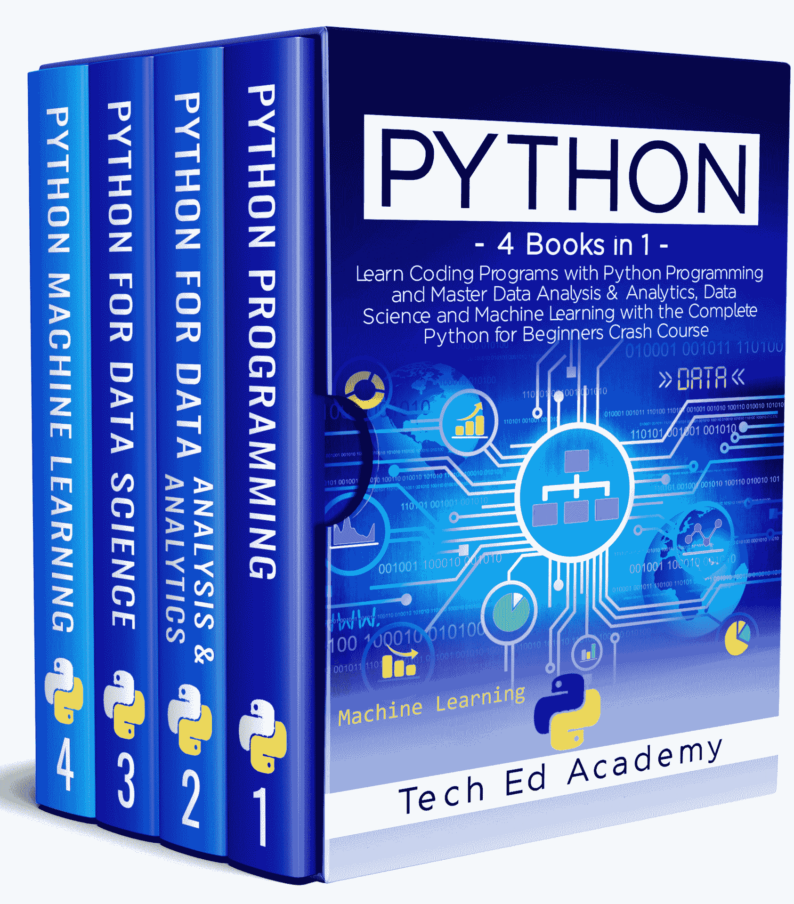

## 在 Linux 操作系统上安装 Python

## 什么是云？

## 运行时错误

这些错误发生在代码执行因无法执行的操作而停止时。运行时错误可能导致程序意外终止，甚至导致系统关闭。此类错误是最难检测的。内存耗尽或除以零是运行时错误的示例。

## 逻辑错误

逻辑错误发生在代码产生不符合预期结果时。例如，将华氏度转换为摄氏度：

| 1 | 2 |
| :--- | :--- |
| 将华氏度转换为摄氏度： | `print((20 - 32) * 5 / 9)` |
| 结果 | |
| :--- | :--- |
| 华氏度转摄氏度为： | `-6.666666666666667` |

逻辑错误是阻止程序按照你预期的方式运行的错误。对于逻辑错误你不会得到任何警告。代码可以编译并运行，但结果不是预期的。你必须检查程序。

# 第 4 章：数据类型与变量

每个程序都有允许其运行的特定数据。可以是文本、数字或其他任何内容。Python 的创建是为了让生活更轻松。

## 字符串

在 Python 以及其他编程语言中，我们使用的任何文本值，如名称、地点、句子等，字符串是字符的集合，而不是单词或字母，它们通过使用单引号或双引号来标记。要显示字符串，使用 `print` 命令，打开括号，放入引号。完成后，我们通常结束引号并关闭括号。如果你正在使用 `PyCharm`，IntelliSense 会检测我们要做什么并为我们提供剩余部分。你可能注意到当你只输入左括号时它就会出手相助。它会自动为你提供一个右括号。同样，对于引号，一个或两个，它都会提供右引号。看到我们为什么要使用 `PyCharm` 了吗？它极大地帮助了我们。“我有一个问题。如果单引号和双引号提供相同的结果，我们为什么要使用它们？”啊！观察不错。使用这些是有原因的，让我通过下面的示例来解释：

```python
print('I'm afraid I won't be able to make it')
print("He said "Why do you care?"")
```

尝试通过 `PyCharm` 运行这段代码。记住，要运行，只需点击界面右侧的绿色播放按钮。

```
"C:\Users\Programmer\AppData\Local\Programs\Python\Python37-32\python.exe "C:/Users/Programmer/PycharmProjects/PFB/Test1.py"
File "C:/Users/Programmer/PycharmProjects/PFB/Test1.py", line 1
SyntaxError: invalid syntax
Process finished with exit code 1
```

这里有一个提示：那是错误！

* 所以这里发生了什么？
* 尝试回顾输入的内容。
* 看到我们在第一个 print 语句中使用了单引号了吗？
* 紧接着我们使用另一个引号结束了引号。
* 程序只接受了字母 ‘I’ 作为字符串。

你可能注意到，从 ‘m’ 到 ‘won’ 之间，每隔一个字符颜色就会发生变化，此之后程序检测到另一个引号，并将剩余部分接受为另一个字符串。老实说，这非常令人困惑。同样，在第二个语句中，也发生了同样的情况。程序看到双引号并将其理解为字符串，直到第二个双引号出现。在那个点上，它并没有费心去检查这是否是一个句子，或者该句子是否仍在继续。

计算机不理解英语；它们理解的是二进制通信。当我们按下运行按钮时，运行的是编译器。它编译我们的代码并将其解释为一系列的 0 和 1，以便计算机能够理解我们要求它做什么。这正了为什么当它一发现第一个双引号时，它就会将其视为字符串的开始，并在发现第二个双引号时立即结束它，即使该句子仍在继续。

为了克服这一障碍，当我们知道需要在句子中使用这些引号之一时，我们会混合使用单引号和双引号。试着将第一个语句中的起始引号和结束引号都替换为双引号。同样，如所示，将第二个语句的引号更改为单引号：

```python
print("I'm afraid I won't be able to make it")
print('He said "Why do you care?"')
```

现在输出应该像这样：

```
I'm afraid I won't be able to make it
He said, "Why do you care?"
```

最后，对于字符串来说，命名规范并不适用于字符串文本本身。你可以放心地使用标准的英语写作方法和规范，只要这些是在引号之内即可。引号之外的任何内容最初就不是字符串，而且如果你更改了大小写，它们可能工作也可能无效。

### 数值数据

Python 能够很好地识别数字。数字分为两类：

- `Integer`（整数）——不带任何小数点的正整数或负整数。
- `Float`（浮点数）——具有小数表示的实数。

这意味着，如果你使用 `100` 和 `100.00`，一个会被识别为整数，而另一个会被视为浮点数。那么，我们为什么需要两种不同的数字表示方式呢？如果你正在设计一个程序，假设有一个生命值为 10 的小游戏，你可能希望程序能够：每当该角色受到攻击时，他的生命值就会减少一或两点。然而，为了让事情精确一些，你可能需要使用浮点数。现在，每次攻击可能不同，可能会从生命总量中减少 `1.5`、`2.1` 或 `1.8` 点。使用浮点数允许我们获得更高的精度，尤其是涉及到计算时。如果你不在意准确性，或者你的编程只涉及整数，就坚持使用整数。

## Python 中的布尔值

啊！那个名字很有趣。`Boolean`（或 `bool`）是一种数据类型，它只能操作并返回两个值：`True`（真）或 `False`（假）。布尔值是任何程序的至关部分，除了那些可能永远不需要它们的程序，比如我们的第一个程序。它们允许程序在结果为真或假时采取不同的路径。

这里有一个小例子。假设你正在前往一个你从未去过的国家。你最可能面临两个选择：如果天气冷，你就会带上冬衣；如果天气暖，你就会带上适合温暖气候的衣服。很简单，对吧？这就是布尔值的工作方式。我们也将研究它的编码方面。现在，只需记住，当涉及到 `true` 和 `false` 时，你处理的是一个 `bool` 值。

### Python 列表

对于处于这个学习阶段的人来说，这稍微高级一点，但列表（list）就是顾名其实义的数据类型。它在方括号 `[]` 内部列出对象、值或存储数据。列表看起来像这样：

```python
month = ['Jan', 'Feb', 'March', 'And so on!']
month
['Jan', 'Feb', 'March', 'And so on!']
```

我们将专门讨论这一点，并讨论列表、元组（tuples）和字典（dictionaries）。之后我们将更详细地查看这种数据类型。

### 变量

你有了乘客，但没有通勤工具；他们将无处可去。这些乘客只会站在那里，等待某种交通工具来接他们。同样，数据类型不能单独运行。它们需要被“存储”在这些车辆中。这些特殊的车辆，或者用我们程序员的术称为“容器”，被称为“变量”，它们是为我们执行魔法的元素。

变量是特殊的容器，在其中存储一个特定值，并在需要时对其进行访问、调用、修改甚至删除。你创建的每个变量都将包含一种特定类型的数据。你不能在一个变量中添加超过一种类型的数据。在其他编程语言中，为了创建一个变量，你需要使用关键字 `var` 后跟一个等号 `=`。在 Python 中，这要简单得多，如下所示：

```python
name = "John"
age = 33
weight = 31.5
is_married = True
```

在上面的代码中，我们创建一个名为 `name` 的变量并给它赋值了一个字符值。对于字符串（strings），我们使用了引号告诉程序这是一个字符串。然后我们创建了一个名为 `age` 的变量。在这里，我们只写了 `33`，它是一个整数，因为后面没有小数。你完全不需要使用引号。接下来，我们创建了一个变量 `weight` 并给它分配了一个浮点值。最后，我们创建了一个变量 `is_married` 并给它分配了一个 `True` 值。如果你将 `T` 改为 `t`，系统将不会将其识别为 bool 并最终会报错。请关注我们是如何使用命名规范的。我们将确保我们的变量遵循相同的命名。如果你觉得以后需要这些变量，甚至可以创建空变量，或者希望在开始时初始化它们为无值。对于带有数值的变量，你可以创建一个任意名称的变量并将其赋值为零。或者，你也可以使用成对的双引号创建一个空字符串：

```python
empty_variable1 = 0
empty_variable2 = ""
```

你不一定非要这样命名；你可以想出更有意义的名字，这样你以及任何可能阅读你代码的程序员都能理解。现在我们已经学会了如何创建变量，让我们学习如何调用它们。如果我们从不使用这些变量，拥有它们有什么意义呢？让我们创建一个新的变量：

```python
name = "James"
age = 43
height_in_cm = 163
occupation = "Programmer"
```

我鼓励你根据喜欢使用你自己的值并玩玩变量。为了调用 `name` 变量，我们只需要输入变量的名称。为了将其打印到控制台，我们这样做：

```python
print(name)
# James
```

`age`、高度变量和 `occupation` 也是一样。但如果我们想把它们一起打印，而不是分开打印呢？尝试运行下面的代码看看会发生什么：

```python
print(name height_in_cm occupation)
# SyntaxError: invalid syntax
```

惊讶吗？你最后得到了这个结果吗？这就是发生这种情况的原因。当你使用单个变量时，程序知道那是哪个变量。一旦你添加了第二个、第三和第四个变量，它就会尝试寻找以那种方式编写的内容。由于没有这样的内容，它返回了一个错误，大意是：“嗯……先生，你确定吗？我找遍了地方，但哪里都找不到这个 `name height_in_cm occupation` 元素。”你只需要添加一个逗号作为分隔符，如下所示：

```python
print(name, age, height_in_cm, occupation)
# James 43 163 Programmer
```

现在，它知道我们在说什么了。系统回想了这些变量，并成功地向我们展示了它们的值。但如果你尝试将两个字符串相加会怎样？如果你想合并两个独立的字符串并创建一个第三个字符串作为结果呢？

```python
first_name = "John"
last_name = "Wick"
```

为了将这两个字符串合并为一个，我们可以使用 `+` 号。生成的字符串现在将是两者的结合。使用 `+` 号允许我们获得更高的精度，尤其是当进行计算时。

# 第 5 章：Python 中的数字

我们之前在“数据类型”章节中简要介绍了数字。在本章中，我们将更详细介绍如何在 Python 中使用和操作数字。在继续之前，让我们先快速回顾一下 Python 中可用的不同类型的数字。

- 整数 (Integer) - 这些是不带分数或小数的整数数字。
- 浮点数 (Floating Point) - 这些是带有小数点的小数部分的数字。
- 复数 (Complex) - 这些是使用‘J’或‘j’ 后缀表示的复数。

让我们来看一个使用这些数字数据类型的示例。此程序展示了如何在 Python 中使用数字数据类型。

```python
# This program looks at number data types
# An int data type
a=123
# A float data type
b=2.23
# A complex data type
c=3.14J
print(a)
print(b)
print(c)
```

该程序的输出如下：

```
123
2.23
3.14j
```

Python 提供了许多用于处理数字的函数。让我们来看看这些函数的总结，然后结合简单的示例详细查看每一个函数。

## 数字函数

| 函数 | 描述 |
| :--- | :--- |
| `abs()` | 返回数字的绝对值 |
| `ceil()` | 返回数字的向上取整（天井值） |
| `max()` | 返回一组数字中的最大值 |
| `min()` | 返回一组数字中的最小值 |
| `pow(x,y)` | 返回 `x` 的 `y` 次方 |
| `sqrt()` | 返回数字的平方根 |
| `random()` | 返回一个随机值 |
| `randrange(start,stop,step)` | 从特定范围内返回一个随机值 |
| `sin(x)` | 返回数字的正弦值 |
| `cos(x)` | 返回数字的余弦值 |
| `tan(x)` | 返回数字的正切值 |

## Abs 函数

此函数用于返回数字的绝对值。让我们来看一个该函数的示例。以下程序展示了 `abs` 函数。

```python
# This program looks at number functions
a=-1.23
print(abs(a))
```

该程序的输出如下：

```
1.23
```

## Ceil 函数

此函数用于返回数字的向上取整值。让我们来看该函数的示例。注意，对于此程序，我们需要导入 `math` 模块才能使用 `ceil` 函数。示例 44：以下程序展示了 `ceil` 函数。

```python
import math
# This program looks at number functions
a=1.23
print(math.ceil(a))
```

该程序的输出如下：

```
2
```

## Max 函数

此函数用于返回一组数字中的最大值。让我们来看该函数的示例。下方的程序用于展示 `max` 函数。

```python
# This program looks at number functions
print(max(3,4,5))
```

该程序的输出如下：

```
5
```

## Min 函数

此函数用于返回一组数字中的最小值。让我们来看该函数的示例。以下程序展示了 `min` 函数的工作工作。

```python
# This program looks at number functions
print(min(3,4,5))
```

该程序的输出如下：

```
3
```

## Pow 函数

此函数用于返回 `x` 的 `y` 次方，语法为 `pow(x,y)`。让我们来看该函数的示例。以下程序展示了 `pow` 函数。

```python
# This program looks at number functions
print(pow(2,3))
```

该程序的输出如下：

```
8
```

## Sqrt 函数

此函数用于返回数字的平方根。让我们来看该函数的示例。注意，对于此程序，我们需要导入 `math` 模块才能使用 `sqrt` 函数。以下程序展示了 `sqrt` 的工作。

```python
import math
# This program looks at number functions
print(math.sqrt(9))
```

该程序的输出如下：

```
3
```

## Random 函数

此函数用于返回一个随机值。让我们来看该函数的示例。以下程序展示了 `random` 函数。

```python
import random
print(random.random())
```

该程序的输出随数字而异：

```
0.005460085356823
```

## Randrange 函数

此函数用于从特定范围内返回一个随机值。让我们来看该函数的示例。注意我们再次需要为此函数导入 `random` 库。此程序用于展示 `randrange` 函数。

```python
import random
print(random.randrange(1,10,2))
```

该程序的输出随数字而异：

```
5
```

## Sin 函数

此函数用于返回数字的正弦值。让我们来看该函数的示例。以下程序展示了如何使用 `sin` 函数。

```python
import math
# This program looks at number functions
print(math.sin(45))
```

该程序的输出如下：

```
0.850903524534118
```

## Cos 函数

此函数用于返回数字的余弦值。让我们来看该函数的示例。此程序用于展示 `cos` 函数。

```python
import math
# This program looks at number functions
print(math.cos(45))
```

该程序的输出如下：

```
0.5253219888177297
```

## Tan 函数

此函数用于返回数字的正切值。让我们来看该函数的示例。以下程序展示了 `tan` 函数的使用。

```python
import math
# This program looks at number functions
print(math.tan(45))
```

该程序的输出如下：

```
1.6197751905438615
```

# 第 6 章：Python 中的运算符

## 1. 算术运算符

这些是能够执行数学或算术操作的运算符，这些操作在该编程语言中是基础或广泛使用的，这些运算符又细分为：

### 1.1. 加法运算符

它的符号为 `(+)`，功能是相加数值数据的值。其语法如下：

```
6 + 4
10
```

### 1.2. 减法运算符

它的符号为 `(-)`，其功能是减去数值类型的值。其语法可以写成：

```
4 - 3
1
```

### 1.3. 乘法运算符

它的符号为 `(*)`，其功能是乘以数值类型的值。其语法可以写成：

```
3 * 2
6
```

### 1.4. 除法运算符

它的符号为 `(/)`；该运算符提供的结果是一个浮点数。其语法如下：

```
3.5 / 2
1.75
```

### 1.5. 取模运算符


# Python 运算符与字符串、流程控制

## 1. 算术运算符

### 1.5 取模运算符

它的符号为 `%`；其功能是返回两个运算符之间除法的余数。在下面的示例中，我们有 8 除以 5，结果等于 1 余 3，因此它的取模结果将是 3。其语法如下：

```
8 % 5
3
```

### 1.6 幂运算符

它的符号为 `**`，其功能是计算数值数据类型值之间的幂。其语法如下：

```
3 ** 2
9
```

### 1.7 整除运算符

它的符号为 `//`；在这种情况下，它返回的结果仅为整数部分。其语法如下：

```
3.5 // 2
1.0
```

然而，如果使用了整数运算符，Python 语言将确定它希望结果变量也是整数，这样你将得到以下结果：

```
3 / 2
3
3 // 2
1
```

如果我们想在这种特殊情况下获取小数，一种方法是将我们的其中一个数字变为浮点数。例如：

```
3.0 / 2
2
```

## 2. 比较运算符

比较运算符是用于比较值并返回结果的运算符；根据所应用的条件，返回 `True` 或 `False` 的响应。

### 2.1 等于运算符

它的符号为 `==`，其功能是判断两个值是否完全相同。例如：

```
3 == 3
True
5 == 1
False
```

### 2.2 不等于运算符

它的符号为 `!=`；其功能是判断两个值是否不同，如果是，则结果为 `True`。例如：

```
3 != 4
True
3 != 3
False
```

### 2.3 大于运算符

它的符号为 `>`；其功能是判断左侧的值是否大于右侧的值，如果是，产生的结果为 `True`。例如：

```
5 > 3
True
3 > 8
False
```

### 2.4 小于运算符

它的符号为 `<`；其功能是判断左侧的值是否小于右侧，如果是，它给出 `True` 结果。例如：

```
3 < 5
True
8 < 3
False
```

### 2.5 大于等于运算符

它的符号为 `>=`，其功能是判断左侧的值是否大于或等于右侧的值，如果是，返回的结果为 `True`。例如：

```
8 >= 1
True
8 >= 8
True
3 >= 8
False
```

### 2.6 小于等于运算符

它的符号为 `<=`，其功能是判断左侧的值是否小于或等于右侧，如果是，返回的结果为 `True`。例如：

```
8 <= 10
True
8 <= 8
True
10 <= 8
False
```

## 3. 逻辑运算符

逻辑运算符是 `and`、`or`、`not`。它们的主要功能是检查两个或多个运算符是否为真或假，并返回 `True` 或 `False`。这种运算符非常常用于条件语句中，通过比较多个元素来返回一个布尔值。

在运算符上加上括号时，我们发现 Python 中存储真和假值的类型是 `bool` 类型，并以英国数学家乔治·布尔（George Boole）的名字命名的，他创建了布尔代数。只有 `True` 和 `False` 两个布尔值，对它们进行大写写是非常重要的，因为在小写时，它们不是布尔值而是简单的短语。

这些运算符的语义或含义与它们的英文含义相似，例如，如果我们有以下表达式 `X > 0 and x < 8`，当 x 确实大于 0 且小于 8 时，它为真。在 `or` 的情况下，我们有下面的示例：

```
N=12
N % 6 == 0 or n % 8 == 0
True
```

如果任何一个条件确实为真，它将为真，即 n 能被 6 整除或 8 整除。在逻辑运算符 `not` 的情况下，发生的是它否定一个布尔表达式，所以，如果我们有例如：`not (x < y)` 在 `x < y` 为假时将为真，即 x 大于 y。

# 第 7 章：Python 中的字符串方法

你几乎肯定会遇到处理这个字符串或那个字符串的时候。可能需要获取它的长度，或者需要拆分它，或者根据它创建另一个字符串。也许你可能需要读取 `x` 位置的字符是什么。无论原因是什么，关键在于这是有意义的。我们之所以引入这一点，是因为它为我们之后对对象性质的更深入讨论开辟了更广泛的范围，但与此同时，我们还将学习 Python 语言提供的用于字符串的极其有用的方法。去创建一个新文件吧。你可以随意给它命名。我的文件将命名为 `strings.py`。虽然名字没多少创意，但相信我，在这一章中我们将把字符串玩出花来。

## 到底什么是字符串？

嗯，我们显然知道字符串是一行文本，这是不而易见的。但其中包含什么呢？我们在之前的列表中讨论了很多列表（lists）。列表实际上是 Python 编程中很大程度上被规避的另一种变量形式，被称为数组（array）。从最基本的术语来说，数组是一组预分配的集合数据。Python 源于并构建在名为 `C` 的语言之上的。在 `C` 中，实际上存在数据类型。Python 中也有数据类型，但 Python 通过为程序员设置数据类型而不是让程序员自己声明，来节省用户的时间。`C` 的数据类型之一被称为 `char`，它是一个单个字符。在计算机术语中，并没有对字符串的原生支持。字符串简单就是字符数组。例如，如果有人想创建一个名为“hello”的字符串，他们会执行以下操作：

```c
char hello[6] = { ‘h’, ‘e’, ‘l’, ‘l’, ‘o’, '\0’ };
```

Python 凭借其极度抽象的美妙习惯，让我们免于这些复杂性，只需声明即可：

```python
hello = “hello”
```

要点在于，字符串归结底只是数据集。和任何数据集一样，它们是可以被处理的。在某些时候，我们也需要处理它们。

## 字符串操作基础

字符串操作最简单的形式是拼接（concatenation）概念。拼接后的字符串是组合在一起形成新字符串的字符串。拼接非常简单——你只需要使用 `+` 符号字面上地将字符串相加即可。

```python
sentence = “My “ + “grandmother “ + “baked “ + “today.”
print(sentence)
# 会打印 “My grandmother baked today.”
```

处理字符串操作时需要记住的第一点是，字符串和任何数据集一样，计数是从 0 开始的。因此，字符串“backpack”的计数方式如下：`backpack` 01234567。

仅凭这些知识我们可以做几件不同的事情。首先，我们可以从中提取单个字母。假设字符串“backpack”存储在一个名为 `backpack` 的变量中。我们可以通过输入以下代码从中提取字母“p”：

```python
Letter = backpack[4]
Print(letter)
# p
```

这将提取字符串中索引为 4 的任何字符。在这里，当然，它是 `p`（从 0 开始计数，字母 `b` 位于位置 0）。如果我们想提取从“b”到“p”的字符，可以执行以下操作：

```python
substring = backpack[0:4]
```

这将赋予变量 `substring` 一个等值于 `backpack` 从第 0 索引到第 4 索引值的字符串：`backpack` 01234567。因此，子字符串（Substring）的值将是“backp”。相当不错的词。

## 高级字符串操作

你可以对数据集（特别是字符串）进行更多操作以获得更具体的结果。

```python
backpack[start:end]
```

`backpack[start:end]` 将给你从 `start` 索引到 `end` 索引的字符。`backpack[start:]` 将给你从 `start` 到末尾的字符。`backpack[:end]` 将给你 `end` 索引之前的所有内容。`backpack[:-2]` 将给你除最后两个字符以外的所有内容。`backpack[2:]` 将给你除前两个字符以外的所有内容。

字符串还有内置方法。让我们来看一个如 `tonguetwister = “Piper picked a peck of peppers"` 的字符串。如果你输入：

```python
splitList = tonguetwister.split(' ')
```

它会在每个空格处拆分句子，给你包含每个单词的列表。因此，`splitList` 看起来像：['Piper', 'picked', 'a', 'peck', 'of', 'pickled', 'peppers']。打印 `splitList[1]` 将给你 ‘Piper’。

还有 `count()` 方法，它可以计算某个字符的次数。输入：

```python
tonguetwister.lower().count('p')
```

你会得到那个数字。还有 `replace()` 方法，它可以将一个字符串替换为另一个。例如，如果你输入：

```python
tonguetwister = tonguetwister.replace(“peppers”, “potatoes”)
```

现在值将变为“Piper picked a peck of potatoes”。

还有 `strip()`、`lstrip()` 和 `rstrip()` 方法，它们可以去除字符串两端指定的字符或空格。当你尝试解析用户输入时，这非常有用。未清除的用户输入会导致数据集不必要的增大甚至导致代码 Bug。最后一个主要的方法是 `join()` 方法，它会在字符串的每个字符之间插入特定的字符。

```python
print("-".join(tonguetwister))
# P-e-t-e-r-P-i-p-e-r-p-i-c-k-e-d-a-p-e-c... 
```

还有各种布尔表达式，它们会返回真（true）或假（false）。`startswith()` 和 `endswith()` 方法是两个极佳的例子。如果你输入：

```python
tonguetwister.startswith(“P”)
```

最终将返回真。然而，如果你改为输入：

```python
tonguetwister.startswith(“H”)
```

将返回假。这些不仅用于字符串的内部评估，也用于评估用户输入。其他几个例子包括 `isalnum()`，它检查字符串中的所有字符是否为字母数字或是否有特殊字符；`isalpha()` 检查字符串中的所有字符是否为字母；`isdigit()` 检查字符串是否为数字；以及 `isspace()` 检查字符串是否为空格。

# 第 8 章：Python 程序流程控制与 If-else、elif 语句

比较运算符是 Python 编程语言中的特殊运算符，用于评估条件并返回 `True` 或 `False` 状态。程序流程控制是指程序员显式指定程序代码行执行顺序的方式。通常，流程控制涉及到在程序代码行上放置某些条件（s）。这些条件语句最基本的形式是 `if` 语句。这个语句从一开始就会给我们带来一些问题。但稍微了解它将帮助我们让 `if else` 以及其他控制语句按照我们想要的方式工作。首先，`if` 语句将获取用户的输入，并将其与你设置的条件进行比较。如果满足了条件，代码将继续执行，通常显示你在代码中设置的某种消息。然而，如果输入与你设置的条件不匹配，返回值将是 `False`。

## If…else Flow 控制语句

当测试条件为 `True` 时，`if…else` 语句将执行 `if` 的主体。如果 `if…else` 测试表达式求值为假，则将执行 `else` 的主体。程序块由缩进表示。`if…else` 在代码中放置条件时提供了更大的灵活性。

### if…else 语法

```python
if test condition:
    Statements
else:
    Statements
```

### 一个检查数字是正数还是负数的程序

启动 IDLE。导航到 `File`（文件）菜单并点击 `New Window`（新窗口）。输入以下内容：

```python
number_mine=-56
if(number_mine<0):
    print(number_mine, “The number is negative”)
else:
    print(number_mine, “The number is a positive number”)
```

### 赋值

编写一个 Python 程序使用 `if..else` 语句执行以下操作：

a. 给 `number=9`，编写一个程序测试并显示该数字是偶数还是奇数。

b. 给 `marks=76`，编写一个程序测试并显示分数是否及格，考虑到及格线为 50。

c. 给 `number=78`，编写一个程序测试并显示该数字是偶数还是奇数。

d. 给 `marks=27`，编写一个程序测试并显示分数是否及格，考虑到及格线为 50。

编写一个接受用户年龄输入的程序，显式将年龄转换为整数数据类型，然后使用 `if…else` 流程控制测试该人是否未成年，法定年龄为 21。包含注释和缩进以提高程序的可读性。

### 其他后续工作：

使用 `if` 语句在 Python 中编写程序执行以下操作：

1. 给 `number=7`，编写一个程序测试并仅显示偶数。

2. 给 `number1=8`，`number2=13`，编写一个程序仅当总和小于 10 时显示。

3. 给 `count_int=57`，编写一个程序测试计数是否大于 45 并显示：计数高于推荐数字。

4. 给 `marks=34`，编写一个程序测试分数是否小于 50 并显示消息：分数低于平均水平。

5. 给 `marks=78`，编写一个程序测试分数是否大于 50 并显示消息：表现优秀。

6. 给 `number=88`，编写一个程序测试该数字是否为奇数并显示消息：是的，它是一个奇数。

7. 给 `number=24`，编写一个程序测试并显示该数字是否为偶数。

8. 给 `number=21`，编写一个程序测试该数字是否为奇数并显示字符串：是的，它是一个奇数。

## 使用 语句的偶发情况

你可以对值和变量做很多事情，但比较它们的能力将让你尝试使用 Python 变得容易得多。无论人们拥有什么类型的值，他们都可以做到这一点，并且可以确保以正确的方式进行操作，以便他们的程序运行得尽可能流畅。比较变量是 Python 为你提供的许多选项之一，最好的方法是通过 `if 语句`。

现在，你可以创建一个新文件。这是你将会需要的。不要忘记缩进！一个偶发情况看起来是这样的：

```python
apples=6
bus = "yellow"
if apples == 0:
    print ("Where are the apples?" )
else:
    print ("Did you know that busses are %s?", bus)
```

通过你的 Python 程序运行代码。它看起来像这样：

☐ Did you know that busses are yellow?

理解为什么输出是这样的简单方法是，因为 `apples` 没有包含在变量中。并不是零个苹果，这导致了代码问题。由于由于原因，它没有被放入输出，因为没有办法这样做，也没有办法让它再次出现。

为了确保你能够结合 `not` 语句使用它，你可以使用另一个 `if` 语句结合 `not`。

```python
if not apples == 0
```

现在，你可以尝试通过你创建的程序再次运行代码。你知道公共汽车是黄色的吗？你在代码中写的这两项内容都包含在语句中，然后你就可以尝试不同的操作。

如果你不想写出 `not` 语句，可以简单地使用 `!`：

```python
apples=5
if apples!= 0: print("How about apples!")
```

当你的程序中有输入时（例如某人想要的苹果数量，或者他们可以教给你的某个事实），输出看起来将是一样的。他们要么得到一条关于苹果的语句，要么得到一条关于公共汽车是黄色的语句。如果等式中没有放入苹果，那么输出将显示为“苹果在哪里”。

你所使用的条件语句由简单的表达式组成。当你将它们拆解成更小的部分时，很容易理解它们如何被使用，以及你所执行的操作中这些表达式可以用来做什么。它还将给你一个机会，展示出比你最初拥有的变量和值要多得多。

## Python 中的 if…elif…else 控制语句

现在考虑一下我们需要评估多个条件的场景，而不仅仅是一个、不只是两个，而是三个或更多情况。想象一下你必须选择团队成员的情况：如果不是 Richard，那么就是 Mercy；如果不是 Richard 和 Mercy，那么就是 Brian；如果不是 Richard、Mercy 和 Brian，那么就是 Yvonne。现实世界的场景可能涉及编写程序时必须捕获的多个选择/条件。

记住 `elif` 简单指的是 `else if`，用于检查多个表达式。首先评估 `if` 块，然后是 `elif` 块，最后是 `else` 块。在这种，`else` 块更多是当所有其他条件都返回假值时的备选方案。重要的是记住，尽管 `if..elif..else` 中有多个块，但只有一个块会被执行。

### if…elif..else

#### 语法：

```python
if test expression:
    Body of if
elif test expression:
    Body of elif
else:
    Body of else
```

#### 示例

涵盖了三个条件，但在特定时刻只有一个条件可以执行。启动 IDLE。导航到 File（文件）菜单并点击 New Window（新建窗口）。输入以下内容：

```python
nNum = 1
if nNum == 0:
    print("Number is zero.")
elif nNum > 0:
    print("Number is a positive.")
else:
    print("Number is a negative.")
```

## Python 中的嵌套 if 语句

有时会出现一个条件，但有更多的子条件需要被涵盖，这导致了一个被称为“嵌套”的概念。嵌套语句的数量不受限制，但你应该保持谨慎，因为你会发现在编写代码时嵌套会导致用户错误。嵌套还会增加代码维护的复杂性。只有通过缩进可以判断嵌套层级。

#### 示例


# 启动 IDLE 与基础输入

启动 IDLE。导航到 `File`（文件）菜单并点击 `New Window`（新建窗口）。输入以下内容：

```python
my_charact = str(input("Type a character here either 'a', 'b' or 'c':"))
if (my_charact == 'a'):
    if (my_charact == 'a'):
        print("a")
elif (my_charact == 'b'):
    print("b")
else:
    print("c")
```

## 赋值

编写一个使用 `if..else` 控制语句来检查非平年并显示相应的程序。包含注释和缩进以增强程序的可读性。

## 绝对值

有一种方法创建条件语句，使得有一块代码可以向你展示是否存在条件，并且即使条件不为真且无法通过你执行的不同操作进行验证，它也有某些可以做的事。这就是绝对条件发挥作用的地方。你需要查看是否有不同的内容可以放入其中。

### 创建变量 apples

现在，你将需要根据你创建并保存的文件版本，输入不同的内容。

```python
print("What is your age?")
age = input()
```

这就是你查看某人年龄的方法。但这和你拥有的苹果数量有什么关系呢？没有关系，它只是向你展示变量是如何工作的，以便人们输入内容。

你将创建：

```python
apples = input("What number of apples are there?\n")
```

这是最简单的部分，并将帮助你创建后续部分所需的变量。

```python
if apples == 1:
    print("I don't know what to do with just one apple!")
```

不过你会得到一个错误，因为 `apples` 实际上是一个字符串，你需要将其转换为整数。简单的方法：`int(string)`

现在它看起来像这样：

```python
apples = input("What number of apples are there?\n")
apples = int(apples)
if apples == 1:
    print("I don't know what to do with just one apple!")
```

将这整个字符串放入你的文件中，或者稍微修改措辞，以便你弄清楚你想对它做什么（这对你来说确实是非常棒的练习）。当你放入后，运行它。代码将能够工作，因为你创建了一个变量，为其添加了不同的元素，并允许在序列中输入 `apples`，以便你能够展示它。在创建字符串时，你需要将它们转换为整数。

# 第 9 章：循环

在进入循环之前，让我们再次回顾一下 `if` 语句。只有当测试表达式为真时，Python 程序才会执行语句。程序在执行语句之前会评估测试表达式。如果测试表达式为假，程序将不会执行语句。

## Python 中的 for 循环

Python 中使用缩进来区分 `for` 循环的主体。注意，简单列表采用以下语法：`variable_name = [用逗号分隔的值]`

### 示例

启动 IDLE。导航到 `File`（文件）菜单并点击 `New Window`（新建窗口）。输入以下内容：

```python
numbers = [12, 3, 18, 10, 7, 2, 6]
sum = 0  # 使用前初始化 sum
for i in numbers:  # 遍历列表
    sum = sum + i
print("The sum is", sum)
```

### 赋值

启动 IDLE。导航到 `File`（文件）菜单并点击 `New Window`（新建窗口）。输入以下内容：编写一个使用 `for` 循环汇总以下列表的 Python 程序。

* a. `marks = [3, 8, 19, 6, 18, 29, 15]`
* b. `ages = [12, 17, 14, 18, 11, 10, 16]`
* c. `mileage = [15, 67, 89, 123, 76, 83]`
* d. `cups = [7, 10, 3, 5, 8, 16, 13]`

## Python 中的 range() 函数

Python 中的 `range()` 函数可以帮助生成数字。记住在编程中，第一项的索引为 0。因此，`range(11)` 将生成从 0 到 10 的数字。

### 示例

启动 IDLE。导航到 `File`（文件）菜单并点击 `New Window`（新建窗口）。输入以下内容：

```python
print(range(7))
```

输出将是 0, 1, 2, 3, 4, 5, 6。

### 赋值

在不编写和运行 Python 程序的情况下，输出将是什么：

* a. `range(16)`
* b. `range(8)`
* c. `range(4)`

# 作业

编写一个 Python 程序来遍历以下列表，并包含我听的音乐（每种音乐流）。使用 `for` 循环、`len()` 和 `range()`。请参考之前的语法的示例。

`folders = ['Rumba', 'House', 'Rock']`

# 使用带有 else 的 for 循环

可以在 `for` 循环中包含 `else`，但它是一个可选选项。当序列中的项目被耗尽时，将执行 `else` 块。

### 示例

启动 IDLE。导航到 `File` 菜单并点击 `New Window`。输入以下内容：

```python
marks = [12, 15, 17]
for i in marks:
    print(i)
else:
    print("No items left")
```

# 作业

编写一个 Python 程序，打印 1 到 50 之间所有的质数。

# Python 中的 while 循环

在 Python 中，`while` 循环用于在测试条件保持为 `True` 的情况下遍历一段程序代码。当用户不知道需要的循环次数时，会使用 `while` 循环；`while` 循环体通过缩进来确定。

### 示例

启动 IDLE。导航到 `File` 菜单并点击 `New Window`。输入以下内容：

```python
i = 0
while i < 6:
    if i == 5:
        break
    print(i)
    i = i + 1
else:
    print("inside else")
```

**注意**：未包含计数器的值将导致无限循环。

# 作业

a. 编写一个 Python 程序，利用 `while` 流控制语句显示 1 到 10 之间所有奇数的和。

b. 编写一个 Python 程序，使用 `while` 流控制语句显示 11 到 21 之间所有数字的和。

c. 编写一个 Python 程序，结合 `while` 流控制语句显示 1 到 10 之间所有偶数的和。

# 使用带有 else 的 while 循环

如果条件为假且没有发生 break，则运行 `while` 循环的 `else` 部分。

### 示例

启动 IDLE。导航到 `File` 菜单并点击 `New Window`。输入以下内容：

```python
track = 0
while track < 4:
    print("Within the loop")
    track = track + 1
else:
    print("Now within the else segment")
```

# Python 的 break 和 continue

让我们使用一个生活中的类比，即我们需要在迭代完全完成之前强制停止。想象一下，在使用简单的字典攻击破解/破译密码时，程序会循环遍历所有可能的字符组合，你希望程序在击中搜索到的密码时立即停止，而不需要完成整个循环。同样，想象在使用恢复软件恢复不小心删除的照片时，你希望恢复程序在指定范围内找到项目时立即停止遍历文件。Python 中的 `break` 和 `continue` 语句的工作方式也如此。

### 示例

启动 IDLE。导航到 `File` 菜单并点击 `New Window`。输入以下内容：

```python
for tracker in "bring":
    if tracker == "i":
        break
    print(tracker)
print("The End")
```

# Python 中的 continue 语句

当使用 `continue` 语句时，解释器仅会跳过当前迭代循环内的剩余代码，而循环不会终止。循环将继续下一次迭代。

Python `continue` 的语法：`continue`

### 示例

启动 IDLE。导航到 `File` 菜单并点击 `New Window`。输入以下内容：

```python
for tracker in "bring":
    if tracker == "i":
        continue
    print(tracker)
print("Finished")
```

该程序的输出将是：

b

r

n

g

Finished

**类比**：假设你正在运行数据恢复软件，并指定了跳过 Word 文件（`.doc`, `dox` 扩展）。在跳过 Word 文件后，程序仍必须继续迭代。

# 第 10 章：Python 中的列表

自从开始学习这本书以来，我们已经学习了许多内容。我们学习了运算符，了解了各种数据类型，还查看了循环和语句。在整个过程中，我们提到了“列表（list）”这个词，并用方括号而不是大括号或圆括号来表示它们。现在，这一章将探索并解释列表到底是什么。到本章结束时，我们应该熟悉这些列表的核心概念，以及它们对于任何类型的编程是至关重要的。

## 了解列表是什么

让我们创建一个虚拟的家庭，包括 Smith、Mary、他们的女儿 Alicia 和他们的儿子 Elijah。我们应该如何做呢？首先创建一个名为 `family` 的变量，如下所示：

```python
family = ['Smith', 'Mary', 'Alicia', 'Elijah']
```

通过使用 `[]` 括号，我们为这个变量提供了数据。现在，这个特定的变量内部包含了多个名称。这正是列表派上用场的地方。通过列表，我们可以在一个变量中存储任意数量的值。在这种情况下，我们只可以包含四个。

如果你现在使用 `print` 命令打印 `family`，你应该看到以下内容：

```python
['Smith', 'Mary', 'Alicia', 'Elijah']
```

存储在括号内的值或名称被称为“项（items）”。要调用项或检查特定索引数字上存储了哪个项，可以使用我们之前在字符串中使用过的方法。

```python
print(family[0])
# Smith
```

显示的不是字母 ‘S’，而是完整的名称。同样，如果你使用其他函数（如 `len()` 函数），它将为你提供列表的长度。在这种情况下，它会告诉你这个列表中有四个项。让我们自己来试一下。

```python
print(len(family))
# 4
```

你可以使用 `[x:y]`，其中 `x` 和 `y` 是你可以设置的范围。如果你正在处理的列表包含数百个条目，这将非常有帮助。你只需要过滤出你想查看的那些。你可以使用 `[-1]` 直接跳转到列表末尾查看最后一个条目。这种组合是无穷尽的。

这里有一个小脑筋急转弯。假设我们的列表中有很多数字，大约 100 个。它们不是按时间顺序排列的，我们没有时间一个一个查看。我们需要找到这些数字中最大的哪一个。我们该如何做呢？

这就是列表、循环和 if 语句结合的地方。如何实现呢？让我们立即来看：

```python
numbers = [312, 1434, 68764, 4627, 84, 470, 9047, 98463, 389, 2]
high = numbers[0]
for number in numbers:
    if number > high:
        high = number
print(f"最大的数字是 {high}")
# 最大的数字是 98463
```

是时候动动脑筋看看刚才发生了什么了。我们首先提供了一些随机数字。其中一个肯定是最大的。我们创建了一个变量，并将数字列表的第一个项作为值赋值给它。我们不知道这个项是否持有最大值。

接下来，我们启动了一个 `for` 循环，并创建了一个名为 `number` 的循环变量。这个 `number` 将迭代 `numbers` 中的每一个值。我们使用 `if` 语句告诉解释器，如果循环变量 `number` 大于我们当前设置的最高数字 `high`，它应该立即用它所持有的值替换那个值。

程序运行后，Python 看到我们为 `high` 赋值了第一个项的值，即 312。一旦循环和 if 语句开始，Python 会分析第一个项是否大于变量 `high` 的值。显然，312 不大于 312。循环没有改变值并结束。现在 `for` 循环重启，这次是处理第二个项。现在值已经发生变化了。这一次，当执行 `if` 语句时，Python 看到我们的变量的值比它当前正在处理的值要小。312 远小于 1434。因此，它执行语句内的代码，并将变量的值替换为新发现的值。这个过程将一直持续，直到所有值都经过检查对，最后保留最大的值。

## 二维列表

在 Python 中，我们有另一种类型的列表，称为二维列表。如果你是一个想要精通数据科学或机器学习的人，你将需要经常使用这些。二维列表是一个非常强大的工具。通常，当涉及到数学时，我们有所谓的矩阵。这些是以矩形形式构的数字数组。与普通列表不同，它们包含行和列值，如下所示：

```python
matrix = [[19, 11, 91], [41, 25, 54], [86, 28, 21]]
```

更简单地说，想象一下这是一个包含多个列表的列表。如上所示，每一行现在都作为一个独立的列表。如果这是一个普通列表，我们可以使用索引数字打印值。你认为我们如何让控制台打印出第一个列表中第一个项的值？

```python
print(matrix[0][0])
# 19
```

使用上面的方法，你现在可以命令解释器只打印第一个列表中的第一个项。第一个 `[0]` 告诉解释器访问第一个列表，接下来的第二个 `[0]` 指向该列表中的索引数字。在这种情况下，我们的目标是打印出 19。花点时间尝试打印第二个列表中的第二个项，即 25。

```python
print(matrix[1][1])
# 25
```

以此类推，你可以打印第三行中的第三项，即 21。

```python
print(matrix[2][2])
# 21
```

你可以更改列表中的项的值。

```python
matrix[0][0] = 99
```

如果你知道该项的位置，可以使用 `[x][y]` 位置来赋值一个新数字。二维列表通常用于需要处理大量数据类型的高级编程。然而，当你可能实际需要使用它们时，最好记住这些。

## 列表方法

在前面的地方，我们学习了方法。为了开始，让我们回到 PyCharm 并创建一个自己的随机数字列表。使用以下序列：

```python
numbers = [312, 1434, 68764, 4627, 84, 470, 9047, 98463, 389, 2]
```

我们不会把这个打印到控制台。相反，我们想看看有哪些可用的方法。在下一行，输入变量名后跟点运算符 `.` 来访问方法。让我们使用 `append` 方法。

```python
numbers.append(10)
```

`append` 方法允许我们向列表添加一个值。继续向列表添加几个随机数字。使用 `count` 方法来查找数字出现的次数，看看它是如何对你工作的。

```python
numbers.count(10)
```

结果现在会显示为 ‘2’。继续向列表添加几个随机数字。现在尝试打印变量 `numbers` 看看会发生什么。很好，但如果你想在末尾添加一个数字呢？我们需要一个名为 `insert` 的方法。

```python
numbers.insert(2, 20)
```

为了正确执行此操作，我们需要首先提供想要添加的数字的索引位置。如果你想在开头添加它，使用逗号后跟数字本身。

```python
numbers.insert(0, 20)
```

同样，你可以使用一个名为 `remove` 的方法从列表中删除你想删除的任何数字。当使用 `remove` 方法时，注意它只会删除第一次出现的数字。它不会删除后面重复的相同数字，如下所示：

```python
numbers = [11, 22, 33, 44, 55, 66, 77]
numbers.remove(77)
print(numbers)
```

出于任何原因，如果你决定不再需要列表内容，可以使用 `clear` 命令。该命令不需要你在括号内传递任何对象。

```python
numbers.clear()
```

使用另一个方法，你可以检查特定值的首次出现索引。

```python
numbers.index(44)
```

如果你运行上面的代码，将得到结果 ‘3’。为什么？索引三在我们之前使用的列表中包含数字 44。如果你放入一个不在列表中的值，你会得到错误，如下：

```python
numbers.index(120)
# ValueError: 120 is not in list
```

还有一个非常有用的方法，当你处理大量数据类型时对很有帮助。如果你不确定并想找出某个数字是否存在于列表中，你可以使用 `in` 运算符：

```python
numbers = [11, 22, 33, 44, 55, 66, 77]
print(43 in numbers)
# False
```

你认为结果会是什么？这是一个布尔值，表示我们想要搜索的数字不存在。如果该数字存在，返回值将是 `True`。假设我们列表中有很多项，并且想知道特定数字被使用或重复了多少次。我们有一种方法可以让 Python 为我们做到这一点。这就是你使用 `count` 方法的地方。在我们上面的列表中，数字 77 被使用了两次。让我们看看我们如何使用这个方法找出它们。

```python
numbers.count(77)
# 2
```


结果现在会显示为 ‘2’。继续向列表添加几个随机数字。使用 `count` 方法查找出现次数并看看它是如何为你工作的。你练习得越多，记得就越深。现在我们已经看到了如何定位、更改、添加和计数项。如果我们想按升序或降序排序整个列表呢？我们可以这样做吗？借助 `sort` 方法，你实际上可以做到。`sort()` 方法默认只会将数据按升序排序。如果你尝试在 `print` 命令中访问该方法，控制台将显示 `None`。为了正确完成操作，始终在 `print` 命令之前或之后使用 `sort` 方法。反转顺序，使用 `reverse()` 方法。这个方法和 `sort()` 方法一样，不需要你在括号内传递任何对象。

## 元组

在 Python 中，我们使用列表存储各种值，这些值可以随所需要地访问、更改或删除。如果你打算使用本质上是重要的数据，这可能不是最好的做法。为了克服这个问题，有一种列表会为你存储数据，但之后即使你尝试无意或刻意这样做，也不会执行任何修改。这些被称为元组（tuples）。元组是列表的一种形式，在涉及 Python 时非常重要。与列表的方括号表示不同，元组用 `()` 表示。

```python
numbers = (19, 21, 28, 10)
```

元组被称为不可变项（immutable items），因为你不能更改或修改它们。让我们尝试修改值看看会发生什么。当你使用点运算符访问 `remove` 等类似方法时，你会发现元组不再有这些选项。这是因为你在尝试修改一个被锁定的值。你可以尝试另一种方法看看是否可以更改：

```python
numbers = (19, 21, 28, 10)
numbers[0] = 10
print(numbers)
# TypeError: 'tuple' object does not support item assignment
```

看到错误了吗？程序无法执行这种更改。在大多数你使用列表的情况下，元组非常得手，可以确保你存储的值是安全的，未来不会意外地修改它们。例如，你之前写了这些值，现在你可能忘记了它们。

## 解包（Unpacking）

之所以发生（元组可以被重写）是因为 Python 理解你可能在之后修改它们。但现在你发现元组存储的值是安全的。当你执行程序时，初始存储的值将保持不变。为了做到这一点，你可以简单的这样做：

```python
numbers = (1, 2, 3, 4, 5)
print(numbers)
# (1, 2, 3, 4, 5)
```

解包（unpacking）非常有帮助，也有用。假设你在元组中存储了一些值，并想将它们分配给另一个变量。让我们看看解包是如何工作的：

```python
ages = (25, 30, 35, 40)
```

在下一行，有两种方法可以这样做：

第一方法：

```python
ages = (25, 30, 35, 40)
```

第二方法：

```python
ages = (25, 30, 35, 40)
Drake, Emma, Sully = ages
```

现在这看起来更有趣了。而不是使用很多行，我们在同一行内完成了工作。每个变量仍然接收到了相同的年龄。这就是解包如何为我们工作的。它节省了你的时间和精力，允许我们保持代码的整洁可读。

## 字典

如此，现在是时候让我们介绍 Python 中的一个重要元素了，初学者和专家几乎都会使用它。字典是以键值对（key-value）记忆数据的数据结构。

```python
user_one = {
    'Alice': 23,
    'John': 28,
    'phone': 123456789,
    'married': False
}
```

有两个键-Alice 和 `John`。与 `Alice` 相关的值是 23，这是她的年龄。与 `John` 相关的值是 28，这是他的年龄。这些在使用字典时应该记住的简单事情。字典中的键是唯一的。键是不可变的。你可以随时删除和添加新键。但你不能更新键。有时你会遇到某些唯一的且持有键值的信息。假设让你设计一个存储客户信息的软件。这些信息可能包括但不限于姓名、电子邮件、物理地址等。这就是字典大显身手的地方。

如果你认为 Python 中的字典将成为我们日常语言的，你可能并没有完全错。在这些字典中我们可以看到相似性。每一个创建的条目都是唯一的。如果条目尝试复制自己，或者你尝试存储相同的值，你将收到错误。那么我们究竟如何使用字典呢？对于这个，让我们回到新朋友 PyCharm 并开始。构思一个虚拟的人的名字、电子邮件地址、年龄和电话号码。先开始赋值，因为我们想在这里用字典这样做。准备好了吗？让我们开始。

```python
user_one = {
    # 字典由 {} 表示
    'name': 'Sam',
    'age': 40,
    'phone': 123456789,
    'married': False
}
```

我们输入了一些关于名为 Sam 的虚拟字符的信息。你可以使用 `print` 命令并运行字典 `user_one`，系统将为你打印这些值。对于字典，我们在值之间使用冒号。对象名放在字符串中，后跟冒号。之后，我们使用字符串、数字（整数或浮点数）或布尔值。你可以使用这些为每个对象分配其对应的键值对。如果你感到困惑，键值对只是赋值给对象的另一种表达方式。例如，`name` 的键值对是 `Sam`。

现在，让我们尝试看看如果我们添加另一个 `married` 值会发生什么。一旦你输入完，系统会立即突出它。注意你仍然可以输入新值并且系统将继续运行。然而，它将使用的值将是它能找到的最新值。这意味着你存储的值在之后可以更改。为了做到这一点，在初始化设置 `married` 为 False 之后将其更改为 True，它只会显示 True。

```python
user_one = {
    # 字典由 {} 表示
    'name': 'Sam',
    'age': 40,
    'phone': 123456789,
    'married': False,
    'married': True
}
print(user_one['married'])
# True
```

当从字典调用值时，我们使用字符串而不是索引数字。如果你尝试运行索引数字，你会遇到 `KeyError: 0` 回溯。你能猜猜为什么吗？字典中的键是唯一的。如果你使用字典中不存在的键，程序就会报错。

```python
user_one = {
    'name': 'Sam',
    'age': 40,
    'phone': 123456789,
    'married': False
}
print(user_one[0])
# KeyError: 0
```

字典可以很容易更新。假设我们得到了 `user_one` 的电话号码，我们可以简单的使用以下过程：

```python
user_one['phone'] = 345678910
print(user_one['phone'])
# 345678910
```

现在你应该能看到我们存储的新数字。

字典中的键是唯一的。键是不可变的。你可以随时删除和添加新键。但你不能更新键。

* `clear()`: 字典中的所有项。
* `copy()`: 返回字典的浅拷贝。
* `fromkeys(seq[, v])`: 返回一个新字典，其键来自 `seq`，且值等于 `v`（默认值为 `None`）。
* `get(key[,d])`: 返回 `key` 的值。如果 `key` 不存在，则返回 `d`（默认值为 `None`）。
* `items()`: 返回字典项（键，值）的新视图。
* `keys()`: 返回字典键的新视图。
* `pop(key[,d])`: 删除键为 `key` 的项并返回其值；如果未找到该键，则返回‘d’。如果未提供 `d` 且未找到 `key`，则抛出 `KeyError`。
* `popitem()`: 删除并返回一个任意项（键，值）。如果字典为空，则抛出 `KeyError`。
* `setdefault(key[,d])`: 如果 `key` 在字典中，则返回其值。如果不在，则插入值为 `d` 的 `key` 并返回 `d`（默认值为 `None`）。
* `update([other])`: 使用 `other` 中的键值对更新字典，覆盖现有的键。
* `values()`: 返回字典值的新视图。还有一些可以与字典一起使用的内置函数。
* `all()`: 如果字典的所有键都为真（或如果字典为空），则返回 `True`。
* `any()`: 如果字典的任意一个键为真，则返回 `True`。如果字典为空，则返回 `False`。
* `len()`: 返回字典的长度（项的数量）。
* `cmp()`: 比较两个字典的项。
* `sorted()`: 返回字典中键的新排序排序列表。

# 第 11 章：深度剖析 Python 元组

## Python 中的元组

元组（tuple）类似于列表，但我们不能更改 `tuple` 中的元素。这是我们在学习 Python 语言以及其他编程语言时，会看到的 `tuple` 与 `list` 之间的主要区别之一。例如，当我们处理 `list` 时，代码中有不同的可可用项，我们甚至在执行代码时也能更改它们。这是 `list` 的一个优点；如果你希望能够更改某些项且不让它们长时间固定，那么你会想要使用 `list`。另一方面，`tuple` 在语法上与我们看到的 `list` 相似，但元素是完全不可更改的。如果你希望使用一种一旦元素到位后，始终保持元素不变的选项，那么 `tuple` 将是你的最佳选择。

示例：启动 IDLE。导航到 File（文件）菜单并点击 New Window（新建窗口）。输入以下：

```python
tuple_mine = (21, 12, 31)
print(tuple_mine)
tuple_mine = (31, "Green", 4.7)
print(tuple_mine)
```

### 访问 Python 元组元素

```python
tuple_mine=['t','r','o','g','r','a','m']
print(tuple_mine[1])#输出:’r’
print(tuple_mine[3])#输出:’g’
```

### 负索引

和列表一样，元组也可以使用负索引。就像列表一样，`-1` 指向列表的最后一个元素，`-2` 指向倒数第二个元素。

示例：启动 IDLE。导航到 File（文件）菜单并点击 New Window（新建窗口）。输入以下：

```python
tuple_mine=['t','r','o','g','r','a','m']
print(tuple_mine [-2])#输出将是 ‘a’
```

### 切片

切片运算符 `:` 用于访问元组的范围。

示例：启动 IDLE。导航到 File（文件）菜单并点击 New Window（新建窗口）。输入以下：

```python
tuple_mine=['t','r','o','g','r','a','m']
print(tuple_mine[1:4])#输出:’rog’
```

### 重要性

元组元素是不可变的（immutable），意味着我们不能更改它们。然而，我们可以使用 `+` 运算符连接元组（concatenation）。我们还可以使用 `*` 运算符重复元组，就像列表一样。

示例示例：启动 IDLE。导航到 File（文件）菜单并点击 New Window（新建窗口）。输入以下：

```python
print((1, 2) + (3, 4)) # 输出：(1, 2, 3, 4)
print((1, 2) * 3) # 输出：(1, 2, 1, 2, 1, 2)
```

### 元组的内置函数

还有一些可以与字典一起使用的内置函数。

| 方法 |  |
| :--- | :--- |
| `enumerate()` | 返回枚举对象。包含所有项的索引和值。 |
| `tuple()` | 将迭代器转换为元组。 |
| `sorted()` | 返回一个新的排序后的列表（不对元组进行排序）。 |
| `max()` | 返回元组中的最大元素。 |
| `all()` | 如果字典的所有键都为真（或如果字典为空），则返回 `True`。 |
| `sum()` | 返回元组所有元素的和。 |
| `len()` | 返回字典的长度（项的数量）。 |
| `min()` | 返回元组中的最小项。 |
| `any()` | 如果字典的任意一个元素为真，则返回 `True`。如果字典为空，则返回 `False`。 |

## Python 中的转义序列

转义序列允许我们格式化输出以增强对用户的清晰度。程序没有转义序列也可以运行，但输出对用户来说将非常困惑。以下是常用的转义序列。

| 方法 | 描述 |
| :--- | :--- |
| `\n` | ASCII 换行 |
| `\b` | ASCII 退格 |
| `\"` | 双引号 |
| `\\` | 反斜杠 |
| `\f` | ASCII 分页符 |
| `\a` | ASCII 响铃 |
| `\newline` | 反斜杠和换行 |
| `\'` | 单引号 |
| `\r` | ASCII 回车 |
| `\t` | ASCII 水平表符 |
| `\000` | 进制值为 000 的字符 |
| `\xHH` | 十六进制值为 HH 的字符 |

示例：启动你的 IDLE。导航到 File（文件）菜单并点击 New Window（新建窗口）。输入以下：

```python
print("D:\\Lessons\\Programming")
print("Prints\n in two lines")
```

# 第 12 章：Python 中的集合

## 集合

Python 集合（set）是一个包含唯一元素的无序集合。虽然集合是可变的，意味着我们可以向其中添加或删除元素，但每个元素本身必须是不可变的。关于集合的一个重要点是，其中不能包含任何重复元素。我们通常使用集合来执行数学运算，如并集、交集、补集和差集。与序列类型不同，集合类型不支持提供切片或索引操作。值不像字典那样有与之关联的键。

Python 包含两种类型的集合——可变的 `set` 和不可变的 `frozenset`。每种集合的创建方式相同，都使用包含值的大括号 `{}`，且每个值之间用逗号隔开。不过，不能使用大括号创建空集合，因为 `a={}` 会创建一个字典！空集合通过使用 `a=set()` 或 `a=frozenset()` 来创建。

以下是集合的方法和操作：

- `len(s)` 将返回 `(s)` 中元素的个数。
- `s.copy()` 将返回 `(s)` 的浅拷贝。
- `s.difference(t)` 将返回一个包含 `(s)` 中但不在 `(t)` 中的元素的集合。
- `s.intersection(t)` 将返回一个包含 `(s)` 和 `(t)` 中元素的集合。
- `s.isdisjoint(t)` 如果 `(s)` 和 `(t)` 之间没有共同元素，则返回 `True`。
- `s.issubset(t)` 如果 `(s)` 的内容在 `(t)` 中，则返回 `True`。
- `s.issuperset(t)` 如果 `(t)` 的内容在 `(s)` 中，则返回 `True`。
- `s.symmetric_difference` 将返回一个来自 `(s)` 或 `(t)` 但不是两者共有元素的集合。
- `s.union(t)` 将返回一个包含 `(s)` 或 `(t)` 中元素的集合。

参数 `(t)` 可以是 Python 中任何支持迭代的对象，以及 `set` 和 `frozenset` 对象可用的任何方法。请注意，如果你需要使用这些方法的运算符版本，必须设置参数——方法本身将接受任何可迭代的类型。

以下是这些方法的运算符版本：

### 运算符方法

| 方法 | 运算符 |
| :--- | :--- |
| `s.difference(t)` | `s – t – t2 - …` |
| `s.issubset(t)` | `s<=t` |
| `s<(t)` | `(s!=t)` |
| `s.issuperset(t)` | `s>=t` |
| `s>t` | `(s!=t)` |
| `s.symmetric_difference(t)` | `s^ t` |
| `s.union(t)` | `s \| t1 \| t2 \| …` |

对于可变集合对象，还有额外的方法：

- `s.add(item)` 将 `item` 添加到 `(s)`——如果元素已存在，则什么都不会发生。
- `s.clear()` 从 `(s)` 中移除所有元素。
- `s.difference_update(t)` 从 `(s)` 中移除于 `(t)` 中的元素。
- `s.discard(item)` 从 `(s)` 中移除指定的 `item`。
- `s.intersection_update(t)` 从 `(s)` 中移除不在 `(s)` 和 `(t)` 交集中的元素。
- `s.pop()` 返回并从 `(s)` 中移除一个任意定的元素。
- `s.remove(item)` 从 `(s)` 中移除指定的 `item`。
- `s.symmetric_difference_update(t)` 从 `(S)` 中移除不在 `(s)` 和 `(t)` 对称差中的元素。
- `s.update(t)` 将可迭代对象 `(t)` 中的元素添加到 `(s)`。

接下来的示例将向你展示一些集合操作及其结果：

```python
s1={'ab', 3, 4, (5, 6)}
s2={'ab', 7, (7, 6)}
print(s1-s2) # 等同于 s1.difference (s2)
# 运行此代码将返回：{(5, 6), 3, 4}

print(s1.intersection(s2))
# 运行此代码将返回：{'ab'}

print(s1.union(s2))
# 运行此代码将返回：{'ab', 3, 4, 7, (5, 6), (7, 6)}
```


如果其成员是不同类型，集合对象并不会在意；它们只需要都是不可变的。如果你尝试在集合中使用可变对象（如列表或字典），将抛出不可哈希类型错误（unhashable type error）。所有可哈希类型都有一个哈希值，在实例的整个生命周期内保持不变，且所有内置类型都是可哈希类型。注意，当打印 `s1` 和 `s2` 的并集时，只有一个‘ab’值。记住，集合不包含任何重复项。除了内置方法外，还有其他可以在集合上执行的操作。例如，如果你想测试集合的成员性：

```python
print('ab' in s1) # 运行此代码将返回：True
print('ab' not in s1) # 运行此代码将返回：False
```

遍历集合的元素如下：

```python
for element in s1:
    print(element)
```

## 不变集合

如前所述，Python 有一种名为 `frozenset` 的不变集合类型。它的工作方式与 `set` 相同，区别在于它不能使用任何改变值的操作或方法，如 `clear()` 或 `add()`。不变性在许多情况下非常有用。例如，普通集合是可变的，这意味着它是不可哈希的，不能作为另一个集合的成员。另一方面，`frozenset` 可以作为集合的成员，因为它是不可变的。此外，`frozenset` 可以用作字典的键，如下：

```python
fs1 = frozenset({'ab', 3, 4, (5, 6)})
fs2 = frozenset({'ab', 7, (7, 6)})
d = {fs1: 'first', fs2: 'second'}
print(d[fs1]) 
```

## 算法与数据结构模块

与内置类型一样，Python 有一些模块可以用于扩展类型。许多时候，这些模块可能更高效，并在编程方面让我们的代码更简单。目前我们检查了内置类型：列表、集合和字符串。这些通常被称为 ADT（抽象数据类型），其行为定义了它们，而不是它们的实现。除了已经查看的 ADT，还有：

### Collections

`collections` 模块包含了这些数据类型的替代方案以及用于创建命名元组的工具函数。以下是数据类型及其操作：

- `namedtuple()`：创建一个带有给定字段的元组。
- `deque`：提供在两端快速添加和弹出操作的列表。
- `ChainMap`：一种类似于字典的单视图类。
- `Counter`：用于计数哈希对象的字典子类。
- `OrderedDict`：记录条目顺序的字典子类。
- `defaultdict`：一个可以提供缺失值的字典子类。

这些数据类型作为基类的包装。我们现在倾向于更多地使用这些子类而不是基类。

### Deques

`deque`（读作 deck）是一个双端队列。这些对象类似于列表，但支持线程安全且内存高效的添加操作。`deque` 是可变的，并支持某些列表操作，如索引。你可以通过索引分配 `deque`，但不能直接进行切片。例如，如果你尝试 `dq[1:2]`，你会得到 `TypeError`；不过有一种方法可以实现，我们稍后会查看。

使用 `deque` 而不是列表的最大优势是在 `deque` 的开头插入元素比在列表的开头快得多。尽管如此，在 `deque` 的末尾插入元素并不总是更快。所有 `deque` 都是线程安全的，我们可以使用 `pickle` 模块将它们序列化。

使用 `deque` 最有用的方法之一是元素的弹出和消费。`deque` 元素的弹出和消费从两端顺序发生。

```python
from collections import deque
dq = deque()
dq.append('abc') # 创建 deque
dq.append('d') # 右侧添加值
dq.appendleft('z') # 左侧添加值
dq.extend('ef') # 右侧添加多个元素
dq.extendleft('yx') # 左侧添加多个元素
print(dq) 
# 输出：deque(['y', 'x', 'z', 'e', 'f', 'd', 'a', 'b', 'c']) - 等等，逻辑检查：说是特定顺序
# 遵循文本逻辑：
dq = deque()
dq.append('abc')
dq.append('d')
dq.appendleft('z')
dq.extend('ef')
dq.extendleft('yx')
print(dq)
# 输出：deque(['y', 'x', 'z', 'e', 'f', 'd', 'a', 'b', 'c'])
```

为了消费我们 `deque` 中的元素，我们可以使用 `pop()` 和 `popleft()` 方法：

```python
dq.pop() # 移除右侧元素
dq.popleft() # 移除左侧元素
```

`rotate(n)` 方法将任何元素向右移动 `n` 步，负整数向左移动：

```python
dq.rotate(2) # 所有元素向右移动 2 步
dq.rotate(-2) # 所有元素向左移动 2 步
```

将切片作为列表返回：

```python
import itertools
print(list(itertools.islice(dq, 3, 9)))
```

一个更有用的 `deque` 特性是支持可选的 `maxlen` 参数，用于限制 `deque` 的大小。这对于循环缓冲区非常有用，缓冲区是一种固定大小且末端连接的数据结构。这些通常用于缓冲数据流。这里有一个示例：

```python
dq2 = deque([], maxlen=3)
```

```python
for i in range(6):
    dq2.append(i)
    print(dq2)
```

我们从右侧填充并从左侧消费。一旦缓冲区填满，旧值就会被消费，新值将从右侧进入。

# 第 13 章：Python 中的函数

创建和调用函数非常简单。函数的主要目的是允许你对代码进行组织、简化和模块化。每当有一组代码需要不时顺序执行时，为这组代码定义一个函数将为你的程序节省时间和空间。你不需要重复输入代码，甚至不需要复制粘贴，只需定义一个函数即可。

我们开始时，对 Python 几乎一无所知，只知道它是某种如今非常受欢迎的编程语言。现在看看你；已经可以独立创建简单的程序、执行代码并解决小规模的问题了。真不赖！然而，学习总会遇到一个事情变得相当棘手的关点。与此，函数看起来是温顺的家伙；当你需要完成某些任务时就会调用它们。但你知道吗，这些函数在背后有非常复杂的操作？把每个函数都想象成一个微程序。它们也是由像我们这样的程序员编写的，用来执行特定任务，而不需要我们写下又一行的代码。你只需要编写一次，将其保存为函数，然后在适用或需要的地方调用该函数即可。

现在是时候让我们深入函数的复杂世界了，在那里，我们不仅要学习如何有效地使用它们，还要研究这些函数背后发生了什么，以及我们如何编写出属于自己的个性化函数。这会有一定的挑战性，但我保证，会有更多你喜欢的参考资料来保持学习势头。

## 如何定义和调用函数？

首先，我们需要看看我们如何在这种语言中定义自己的函数。Python 中的函数是在我们使用 `def` 语句时定义的，随后紧跟一个函数名和一些括号。这让编译器知道你正在定义一个函数，以及你现在想要定义哪一个函数。

不过，在定义这些函数时会有一些规则限制，以正确的方式进行这些操作以确保代码按照你想要的方式运行非常重要。定义这些函数时需要遵循的一些 Python 规则包括：

1. 你任何想要使用的参数或输入参数都必须放在括号内，以便编译器知道发生了什么。
2. 函数的第一条语句可以是可选的语句，例如需要时与函数相关的文档字符串（docstring）。
3. 我们处理的所有函数中的代码都需要以冒号开头，然后我们还需要对其进行缩进。
4. 我们得到的 `return` 语句或表达式将在此时退出函数。然后我们可以选择将一个值返回给调用者。不带参数的 `return` 语句将返回与 `None` 相同的结果。

在我们深入熟悉使用这些 Python 函数可以完成的工作之前，我们需要花一些时间来理解在 Python 中声明这些函数时的缩进规则。同样的规则也适用于 Python 的其他某些元素，例如声明条件、变量和循环，因此学习这些原理是如何运作的在这里非常重要。你会发现，Python 在缩进方面遵循一种特定的风格来帮助定义代码，因为这种语言中的函数没有像其他语言那样的显式 `begin` 或 `end`（如大括号 `{ }`）来指示该函数的开始和结束。这就是为什么我们将依靠缩进的原因。当我们在这里使用正确的缩进时，我们能够看到非常好的结果，并确保编译器知道函数何时被使用。

### 更好地理解函数

函数就像容器，在内部存储了许多行代码，就像包含一个特定值的变量一样。在 Python 中，我们处理两种类型的函数。第一种是内置或预定义的，另一种是自定义或用户创建的函数。无论哪种，每个函数都有它可以执行的特定任务。在创建任何函数之前编写的代码赋予了该函数身份和任务。现在，每当函数被调用时，它就知道自己需要做什么。

当我们开始旅程时，我们在控制台上打印了“我做到了！”作为我们的第一个程序。我们在那里也使用了我们的第一个函数：`print()` 函数。函数通常通过函数名称后的括号来识别。在这些括号中，我们传递被称为参数（parameters）的参数。某些函数接受特定类型的括号，而另一些则接受不同的括号。

让我们深入了解，看看函数如何极大地帮助我们减少工作并更好地组织代码。假设我们有一个在活动直播期间运行的程序。该程序的目的是为我们的用户提供定制化的问候。想象一下，如果有许多用户决定加入你的直播，你需要反复编写多少次相同的代码。有了函数，你可以轻松地减少自己的工作。

为了创建一个函数，我们首先需要“定义”它。这时一个名为 `def` 的关键字就出现了。当你开始输入 `def` 时，Python 立即知道你正要定义一个函数。你会看到三个字母的颜色变为橙色（如果你使用 PyCharm 作为 IDE）。这是另一个确认信号，表明 Python 知道你正要做什么。

```python
def say_hi():
```

在这里，`say_hi` 是我决定的名称，你可以选择任何喜欢的名称。记住，保持名称具有描述性，这样对任何人来说都是易于理解和易读的。命名函数后，在其后加上括号。最后，加上友好的老冒号，让 Python 知道我们正要添加代码块。按回车键开始一个新的缩进行。

现在，我们将为每个加入直播的用户打印两个语句。

```python
print("Hello there!")
print('Welcome to My Live Stream!')
```

此之后，留出两行空间以消除当你一开始输入其他内容时就会出现的波浪线。现在，要轻松地打印这些内容，只需输入函数名称并运行程序。在我们的情况下，将是：

```python
say_hi()
```

输出：

```
Hello there!
Welcome to My Live Stream!
```

看到这在未来对我们来说是多么简单了吗？我们不需要反复这样做。让我们通过给它添加参数让这个函数变得更有趣。在最顶行显示 `def say_hi()` 的地方？在这里添加一个参数。在括号内输入单词 `name` 作为参数。现在，该单词应该显示为灰色，以确认 Python 已将其理解为参数。

现在，你可以利用这一点，进一步将问候个性化为如下内容：如果你在 shell 中进行操作，你需要用 `del say_hi` 删除之前定义的函数。现在让我们写一个新函数：

```python
def say_hi(user):
    print(f"Hello there, {user}!")
    print('Welcome to My Live Stream!')

user = input("Please enter your name to begin: ")
say_hi(user)
```

输出现在会询问用户他们的姓名。此将被存储在一个名为 `user` 的变量中。由于这是一个字符串值，`say_hi()` 应该能够轻松接受它。通过将 `user` 作为参数传递，我们得到了这个输出：

```
Please enter your name to begin: [输入姓名]
Hello there, [姓名]!
Welcome to My Live Stream!
```

# 第 14 章：Python 模块

## 什么是模块？

在 Python 中，模块是程序的一部分（一个扩展名文件），可以通过其他程序调用，而无需在每个使用的程序中都编写它们。此外，它们还可以定义类和变量。这些模块之间包含了相关的语句，并且可以随时使用。

模块的使用是基于对已经存储在其中的代码（程序体、函数、变量）的使用，这被称为 `import`。通过模块的使用可以发现，Python 极大地简化了程序，因为它允许我们将复杂的问题简化为较小的问题，从而缩短代码，使程序员在编写代码时，从数百行代码中查找某些内容时不会迷失。

## 如何创建模块？

在 Python 中创建模块并不需要复杂的操作，非常简单。例如：如果你想创建一个打印城市的模块，我们只需要在编辑器中编写代码并将其保存为 `mycity.py`。一旦完成这一步，我们就知道这就是我们模块的名称（省略 `.py` 后缀），它将被赋值给全局变量 `__name__`。

但在此之外，我们可以看到 `mycity.py` 文件非常简单，一点也不复杂，因为里面只有一个名为 `print_city` 的函数，该函数接受一个字符串作为参数，它的作用是打印“Hello, welcome to”，并与作为参数输入的字符串进行拼接。

## 定位模块

在导入模块时，解释器会自动在当前路径下搜索该模块；如果未找到，Python（或其解释器）将在 `PYTHONPATH` 环境变量上进行搜索，该变量无非是一个包含目录名称的列表，其语法与环境变量本身相同。

如果在任何特定情况下上述操作均失败了，Python 将查找一个默认的 UNIX 路径（在 Windows 上位于 `/usr/local/lib/python`）。模块会在变量 `sys.path` 提供的目录列表中进行搜索。该变量包含了当前目录、`PYTHONPATH` 目录以及安装时默认提供的整个目录。

## 导入语句

该语句用于导入模块。通过任何 Python 代码文件，其处理过程如下：Python 解释器会在文件系统中搜索执行时所在的当前目录。然后，解释器会在其配置中搜索其预定义的路径。当它遇到第一个匹配项（模块名称）时，解释器会自动从头到尾执行它。

在第一次导入一个模块时，Python 会生成一个扩展名为 `.pyc` 的编译文件。该扩展文件将用于该模块随后的导入中。当解释器检测到该模块自上次生成以来已发生修改时，它将生成一个新的模块。你必须将导入的文件保存在 Python 使用 `import` 语句的相同目录中，以便 Python 能够找到它。

正如我们在示例中看到的，导入模块允许我们通过外部文件改进程序的功能。现在，让我们来看一些例子。第一个是一个计算器，我们将创建一个执行所有数学函数的模块，以及另一个运行计算器本身的程序。我们所做的第一件事是创建 `calculator.py` 模块，它负责执行所有必要的操作。正如你所看到的，这些操作包括加法、减法、除法和乘法。我们还包含了对 `if`、`else` 和 `elif` 等条件语句的使用。我们还包含了异常处理，以便程序在用户每次输入错误值时不会卡住。

之后，我们将创建一个导入之前提到的模块的程序，它将处理所有的数学函数。但此时，你可能会想，现有的模块是程序员创建的，或者是 Python 内置的。通过它们，我们将制作两个程序：一个是我们刚刚完成的改进，另一个是定期在屏幕上打印的。

## 示例

创建一个名为 `dummymodule.py` 的 Python 模块并在其中写入内容：

```python
def testF():
    print("this is a module")
```

将模块保存在目录中：

```bash
import dummymodule
```

现在调用 `dummymodule.testF()`。你已经使用了模块。

## 模块示例一

第一件事是创建模块，但乍看之下，惊喜的是我们导入了 `math` 模块。这对我们意味着什么呢？这意味着，我们创建了 `calculator` 函数，它有几个选项。如果 `op` 等于 `1`，则执行加法操作；如果等于 `2`，则执行减法操作，依此类推。当 `op` 等于 `5` 时，如果是肯定的，将通过 `math.sqrt(num1)` 返回 `num1` 的平方根值。然后，如果 `op` 等于 `6`，使用 `math.radians()` 意味着 `num1` 将变为弧度，`num2` 将返回相应的值。最后一步将是创建主程序，如下：在这里我们可以看到简单程序导入了 `calculator.py`，然后通过 `input` 给变量 `num1` 和 `num2` 赋值。最后，要执行的操作是选择并完成 `calculator` 模块中的 `calculator` 函数，并向其传递参数。

## 模块示例二

我们将创建一个模块，其内部包含一个作为计时器的函数，以便在时间结束时返回 true。在这个模块中，如你所示，导入了另一个名为 `time` 的模块，它的名称指的是处理时间，并具有广泛的功能，从返回日期时间到帮助创建计时器等等。第一件事是创建 `cron()` 函数，声明 `start` 变量等于 `time.time`，这意味着我们为该函数提供了一个初始精确时刻，然后进入无限循环。由于限制始终为 `True`，除非内部有 `break` 命令，否则该循环永远不会结束。


然后，在 `while` 循环中有许多指令。首先是让 `final` 变量等于 `time.time()` 以考虑我们所在的特定时刻，并监控时间。之后，创建另一个名为 `times` 的变量，它获取 `final - start` 的值。但你可能会好奇 `round` 函数的作用。它对数值进行舍入；我们这样做是为了更容易工作。但这不够，因此我们使用 `if`，如果结束和开始之间的差大于或等于 `60`，则一分钟已经完成。这种情况是怎样的？为什么是 60？这是因为 `time` 模块以秒为单位运行，一分钟需要经过 60 秒，因此结束和开始之间的差大于或等于 60，在肯定的情况下，将返回 `True`，最后退出无限循环。

一旦完成 `alarm` 模块，我们就编写程序，如下：我们可以看到程序导入了两个模块，我们创建的 `alarm` 和 `time` 模块。第一件事是创建一个 `input` 变量 `s`，告诉用户是否想要开始。如果答案是定的，代表时间的变量 `h` 将等于 `time.strftime("%H:%M:%S")`，这意味着我们正在使用 `time` 模块的函数来返回指定格式的小时，以便可以使用 `print` 函数进行打印。下一步是使用命令 `alarm.cron()` 使用 `alarm` 模块，这意味着正在调用 `cron()` 函数。当此函数完成后，时间将分配给变量 `h`，再次完成打印并能够观察其正确运行。

作为本章的结论，模块对于程序员的良好表现至关重要，因为它们允许代码更具可读性，此外还允许将问题分解并逐一攻克，从而轻松地完成任务。

# 第 15 章：Python 中的文件处理

## 创建新文件

我们在这里要看到的第一个任务是学习创建文件。如果我们先准备好一个文件来帮助我们，那么其他任务将很难进行。如果你想创建一个新文件并向其中添加一些代码，你首先需要确保该文件已经在你的 IDLE 中打开了。然后，你就可以在编写代码时选择你想要使用的模式。

在 Python 中创建文件时，你会发现有三种可以使用的模式。我们在这里重点关注的三个主要模式包括追加 `(a)`、写入模式 `(x)` 甚至是写入 `(w)`。每你想打开一个文件并对其进行某些更改时，你都应该使用写入模式。这是这三种模式中最容易操作的一种。`write` 方法将帮助你更容易地设置正确的代码部分并最终让它们为你工作。

`write` 函数将非常易于使用，并确保你能够对文件进行任何你想要的添加和更改。你可以向文件中添加你想要的新信息，更改现有内容，以及更多操作。如果你想看看使用 `write` 方法对这部分代码可以做什么，那么你需要打开编译器并执行以下代码：

```python
# 文件处理操作
# 向新文件 hello.txt 写入内容
f = open('hello.txt', 'w', encoding='utf-8')
f.write("Hello Python Developers!")
f.write("Welcome to Python World")
f.flush()
f.close()
```

从这里开始，我们需要评估你对正在操作的目录可以做什么。默认目录始终是当前目录。你可以浏览并切换存储代码信息的目录，但你必须在开始花时间更改这些信息，否则它最终不会出现在你想要的目录中。

无论你在编写代码时在哪个目录中工作，当你以后想找到该文件时，都需要回到那个目录。如果你希望它出现在不同的目录中，请确保在保存文件和代码之前移动到该目录。使用我们上面编写的选项，当你进入当前目录（或你为这项任务选择的目录）时，你就可以打开文件并看到你在那里写的消息。

对于这个，我们写了一段简单的代码。当然，随着学习的深入，你将编写复杂得多的代码。对于这些代码，会有某些你想要编辑或覆盖文件中某些内容的时候。这在 Python 中是可以实现的，只需要对你编写的语法进行微小的更改。你可以通过此操作的一个很好的例子包括：

```python
# 文件处理操作
# 向新文件 hello.txt 写入内容
f = open('hello.txt', 'w', encoding='utf-8')
f.write("Hello Python Developers!")
f.write("Welcome to Python World")
mylist = ["Apple", "Orange", "Banana"]
# writelines() 用于向文件写入多行
f.writelines(mylist)
f.flush()
f.close()
```

当你想要对以前工作过的文件进行一些更改时，上面的示例是一个很好用的选择，因为你只需要添加一条新行即可。这个示例不需要使用第三行，因为它只包含一些简单的单词，但你可以向程序添加任何你想要的内容，只需使用上面的语法并根据需要进行更改。

## 什么是二进制文件？

在继续之前，我们需要重点关注的另一个点是在在代码中将你的某些文件和数据以二进制文件的格式写入。这听起来可能有点混乱，但这是 Python 允许你做的一种简单事情。要实现这一点，你只需要将拥有的数据转换为声音或图像文件，而不是作为文本文件。

通过 Python，你可以将任何想要的代码转换为二进制文件。无论它过去是什么类型的文件都没有关系。但你确实需要确保以正确的方式处理数据，以确保以后更容易以你想要的方式呈现。为了确保此操作良好运行所需的语法在下方：

```python
# 向文件写入二进制数据
# 以二进制模式写入文件 hello.dat
f = open('hello.dat', 'wb')
# 以字节字符串（byte strings）写入
f.write(b"I am writing data in binary file!\n")
f.write(b"Let's write another list\n")
f.close()
```

如果你花时间在文件中使用这段代码，它将帮助你创建你想要的二进制文件。一些程序员发现他们喜欢使用这种方法，因为它有助于他们理清条绪，并在你需要时更容易提取信息。

## 打开你的文件

到目前为止，我们已经学习了写入新文件并保存它，也处理了二进制文件。在这些示例中，我们掌握了一些操作文件的基础知识，以便你让它们为你工作。

现在这些部分已经完成后，是时候学习如何打开并使用文件，并在你任何需要的时候进行更改。为了确保这些工作，你将需要以下语法：

```python
# 读取二进制数据
# 以二进制模式打开文件 hello.dat
with open("hello.dat", 'rb') as f:
    data = f.read()
    text = data.decode('utf-8')
    print(text)
```

当你将这些放入系统时，得到的输出如下：

```
Hello, world!
This is a demo with
This contains lines
Hello
This is a demo with
This contains lines.
```

## 查找你需要的文件

最后，我们需要查看如何查找你需要的某些文件。我们已经查看了如何创建文件、如何以不同方式存储它们、如何打开并重写，以及如何查找文件。但在某些情况下，你可以将你的某些文件移动到一个新位置。

例如，如果你正在处理一个文件，在操作过程中你发现显示的结果不符合你的预期，那么是时候修复它了。也许你没有正确拼写标识符，或者目录不在你想要的地方，那么查找（`seek`）选项可能是找到这个丢失文件并对其进行更改的最佳方法，这样以后更容易找到。

# 第 16 章：Python 中的异常处理

在本指南中，我们需要花时间探索的下一个主题是异常处理的概念。在编写代码的过程中，总会有你的代码显示出某些错误或其他问题，而这就是异常发生的地方。了解何时识别这些异常、如何处理它们，甚至如何创建你自己的异常，将能够极大地提升你编写 Python 代码的能力。

编译器会自动抛出一些异常，其中一个很好的例子是你或用户尝试除以零。此时，编译器会识别出这是用户无法执行的操作，并将该异常作为警报发出。此外，如果你作为程序员尝试调用一个函数，但函数名称拼写不正确，导致没有匹配的项可以调用，也会发生这种情况。

在 Python 库中，可以自动找到几种不同的异常。花些时间查看它们并识别这些异常是一个好主意，这样你以后就能认出它们了。你需要关注的一些最常见的异常包括：

*   **`finally`**（最终）：这是你希望用于执行清理操作的操作，无论异常是否发生。
*   **`assert`**（断言）：此条件将触发代码内部的异常。
*   **`raise`**（抛出）：`raise` 命令将在代码内部手动触发异常。
*   **`try/except`**（尝试/捕获）：当你尝试运行一段代码，并且由于你或 Python 代码抛出的异常使得代码得以恢复时使用。

## 抛出异常

在了解更多关于这些异常及其含义之后，我们首先需要查看如何编写异常，以及当其中一个异常确实出现在你自己的代码中时，你可以使用的某些步骤。如果你在编写代码的过程中，注意到将抛出异常，请知道，解决方案通常是简单的。但作为程序员，你需要花时间来修复它。

为了帮助我们开始，让我们来看看抛出异常的代码语法是怎样的。

```python
x = 10
y = 10
result = x / y  # 尝试除以零
print(result)
```

当你尝试让解释器运行这段代码时，你得到的输出将：

```
Traceback (most recent call last):
File "D:\Python34\t.py", line 3, in <module>
  result = x/y
ZeroDivisionError: division by zero
```

当我们仔细看这里的示例时，可以看到程序将为我们抛出一个异常，主要是因为我们正尝试将一个数字除以零，而这 Python 代码中是不允许的（对于任何其他编程语言也是如此）。如果你决定现在不做任何更改，并继续原样运行程序，你可能会导致编译器向你发送错误消息。代码会告诉用户问题所在，但正如你所见，问题并没有以一种易于理解的方式列出来，用户可能不知道发生了什么，或者完全不知道该如何修复问题。

通过我们上面处理的那个示例，你有一些选择。如果你不了解任何编程，你可以选择留着那个令人困惑的消息，或者你可以添加一条更易读的新消息，并解释最初抛出此错误的原因。它不会包含许多只有写过一段时间代码的人才能看懂的数字和随机字母，这使得整个过程在总体上更加友好。

你可以用来控制用户将看到的消息的语法包括：

```python
x = 10
y = 0
result = 0
try:
    result = x / y
    print(result)
except ZeroDivisionError:
    print("你正尝试除以零。")
```

看看上面的两个代码。我们刚刚做的那个和上面的看起来相似，但这个里面包含了一条消息。当用户抛出这个特定的异常时，这条消息将会显示。你不会得到那串没有意义的字母和数字，有了这个，用户将确切地知道发生了什么错误并可以修复它。

## 我可以定义自己的异常吗？

在上面的示例中，我们花时间定义并处理了系统已经提供的异常。现在是时候让我们更进一步，学习如何在任何种代码中抛出一些我们自己的异常了。也许你正在编写的代码只允许用户进行少数几个选择，这些是我们在处理程序时常见的现象，但在你设计的其他程序中也可以很好地工作。

当你创建这类异常时，必须告诉编译器抛出了异常，因为程序员必须介入并让编译器知道它必须遵循哪些规则，以及在此过程中需要抛出哪些异常。下面是一个可以在自己的代码中实现这一点的良好语法示例：

```python
class CustomException(Exception):
    def __init__(self, value):
        self.parameter = value
    def __str__(self):
        return repr(self.parameter)

try:
    raise CustomException("这是一个自定义错误！")
except CustomException as ex:
    print("捕获到:", ex.parameter)
```

在这段代码中，你成功地设置了自己的异常，每当用户抛出这些异常之一时，“捕获到：这是一个自定义错误！”这条消息就会显示在屏幕上。这是向用户展示你在程序中加入了自定义异常的最佳方法，特别是当这只是你为这段代码创建的异常，而不是编译器会自动识别的异常时。

就像我们之前的其他示例一样，我们使用了一些通用用语只是为了展示异常是如何工作的。你可以轻松地对其进行修改，以获得适用于你正在编写的代码独特消息，并在用户看到错误消息弹出时，向他们解释发生了什么。

学习如何处理代码中可能出现的异常，是确保你的代码按照你想要的方式运行、用户喜欢使用你的程序、以及一切都能正常进行并实现你的目标的最佳方法之一。花时间练习这些示例，看看它们如何帮助你处理代码中出现的任何异常。

# 第 17 章：Python 中的对象与类

我们已经提到过 Python 是一种面向对象的编程语言。还有其他一些面向过程的语言，它们强调函数，但在 Python 中，重点在于对象。那么，什么是对象呢？简单来说，对象是一个组作用于数据（变量）的方法（函数），而这些数据本身也是对象。这些对象的蓝图是类。可以将类看作一个草图或原型，它包含了关于对象的所有细节。如果你的程序是一辆汽车，那么类就会包含关于设计、底盘、轮胎位置以及挡风玻璃是由什么材料制成的所有细节。如果没有类的定义，是不可能制造汽车的。汽车就是对象。因为可以根据原型制造许多汽车，所以我们可以从类中创建许多对象。我们也可以把对象称为类的实例，而创建该实例的过程被称为实例化。

## 定义类

类使用 `class` 关键字来定义。就像函数一样，类应该有一个文档字符串（docstring），简要解释该类是什么以及它的作用。虽然文档字符串不是强制的，但拥有它是一个好习惯。以下是一个名为 `NewClass` 的类的简单定义：

```python
class NewClass:
    """这是我们刚刚创建的 NewClass 类的文档字符串。我们的程序现在有一个新类"""
    pass
```

当你创建一个新类时，会创建一个定义其所有属性的新命名空间。在这种情况下，属性可能包括函数和数据结构。其中，它将包含以 `__`（双下划线）开头的特殊属性，例如定义类文档字符串的 `__doc__`。当类被定义时，会创建一个同名的新类对象。这个新类对象就是我们用来访问不同属性并实例化新类新对象的对象。

## 创建新类

```python
class NewClass:
    """这是我们的第一个类。它的作用是显示字符串文本和变量名的值"""
    name = str(input("Enter your name: "))
    def greeting(name):
        print("Hello", name)
    print(NewClass.name)
    print(NewClass.greeting(NewClass.name))
    print(NewClass.__doc__)
```

当你运行脚本时，你的控制台显示了什么？

## 创建对象

到目前，我们已经学会可以使用类对象访问类的不同属性。我们还可以使用这些对象，通过类似于调用函数的过程来实例化该类的新实例。

```python
MyObject = NewClass()
```

在上面的示例中，创建了一个名为 `MyObject` 的新实例对象。该对象可以使用类名作为前缀来访问 `NewClass` 类的属性。在这种情况下，属性可能包括方法和变量。对象的方法是类对应的函数，这意味着任何类属性函数对象都定义了该类中对象的方法。例如，由于 `NewClass.greeting` 是一个函数对象且是 `NewClass` 的属性，因此 `MyObject.greeting` 将是一个方法对象。

# 第 18 章：继承与多态

在 Python 中，使用 `class` 关键字来定义类，这与使用 `def` 关键字定义函数的方式相同。因此，如果我们定义一个名为 `ClassName` 的类，其语法如下：

```python
class ClassName:
    """类文档字符串"""
    # 此处编写类体内容
```


在此语法中，`class` 关键字用于定义一个新类，后面紧跟着类名 `ClassName` 和一个冒号。类文档字符串本质上是对该类的定义或描述。`Class_Suite` 代表了定义该类的所有成员、组件语句、函数和类数据属性。由于类被用于创建对象，因此最好将其看作是为在 Python 中创建的程序添加一致性的方法，从而使程序更整洁、更高效，最重要的是更具功能性。要创建一个可以在代码中任何位置实例化的类，必须在模块的顶层级定义它。

## 在 Python 中创建类

现在我们已经熟悉了在 Python 中创建类的语法，我们将引入一个名为 `Dog` 的类示例。

```python
class Dog:
    “Dog 类”
    var1 = “Bark”
    var2 = “Jump”
```

## 类声明与定义

在 Python 3 中，类声明和类定义之间没有区别。这是因为两者是同时发生的。正如我们的示例所示，类定义紧随声明和文档字符串之后。

## 类方法与属性

一个被定义并创建的类如果不具有某些功能，它是不完整的。类中的功能是通过设置其属性来定义的，这些属性最好被看作是与属性相关的函数和数据的容器。类属性包括数据成员（如变量和实例变量）以及通过点符号（`.`）找到的方法。以下是它们的定义：

*   **类变量**：这是所有类实例和对象共享的变量。
*   **实例变量**：这是类实例特有的变量。它通常定义在方法内部，并且仅对该类的实例有效。
*   **方法**：也称为函数，定义在类中并用于定义对象的行为。

### 类属性

类属性是属于另一个对象的功能性元素，通过点符号属性表示法进行访问。在 Python 中，复数具有数据属性，而列表和字典具有功能性属性。当你访问属性时，你也可以访问一个可能拥有自身属性的对象。类属性与其被定义的类相关联。面向对象编程（OOP）中最常用的对象是实例对象。实例数据属性是使用的主要数据属性。当你需要不需要任何实例的数据类型时，你会发现类数据属性大部分用途。

### 数据属性

数据属性是由程序员定义的类变量。在创建类时可以像使用其他变量一样使用它们。方法可以在类内部更新它们。程序员更倾向于将此类属性称为静态成员、类变量或静态数据。它们代表与所属的类对象绑定的数据，并且独立于任何类实例。

使用类数据属性 (`xyz`) 的示例：

```python
class ABC:
    xyz = 10
print(ABC.xyz)
ABC.xyz = ABC.xyz + 1
print (ABC.xyz)
```

此示例代码的输出将是 `11`。

## Python 类继承

继承是面向对象编程中的一项特性，允许类从父类（也称为基类）继承方法和属性。这是编程中非常实用的特性，因为它允许程序员为单个类创建一套功能，然后将它们传递给子类。因此，程序能够在子类中创建新功能甚至覆盖现有功能，而不会影响父类的功能。继承创建的子类将具有父类的特化功能。

Python 中有四种继承：单继承、多级继承、层次继承和多重继承。

### 单继承

没有继承特性的编程类可以准确地称为基于对象的编程。程序运行时，应该创建新的抽象数据类型，每种类型都有自己的操作。然而，将面向对象编程与基于对象的编程区分开的是继承。单继承是指一个类或子类从一个父类继承方法和属性。

### 多重继承

在多重继承中，子类或子类从多个类继承方法和属性。例如，类 `C` 可以同时继承类 `A` 和 `B` 的特征，就像孩子继承母亲和父亲的特征一样。在某些情况下，子类可以继承两个以上父类的特征和功能。子类可以继承方法和属性的父类数量没有限制。注意，虽然多重继承广为人知的作用是减少程序冗余，但它也可能为程序引入更高层次的复杂性和歧义，在实现之前的程序设计阶段必须进行合理的考虑。

### 多级继承

我们已经确定 Python 中的类可以继承多个父类的特征。当一个类继承其他类的方法和函数，而这些类又从其他类继承这些内容时，这个过程被称为多级继承。像 C++ 和其他面向对象编程语言一样，Python 允许实现任何深的多级继承。

### 层次继承

当多个类派生自同一个父类或基类时，就发生了层次继承。子类或子类继承的特征包含在父类中。层次继承与多级继承的区别在于类与类之间建立关系的顺序。

## 为什么继承在编程中很有用？

继承是一个非常实用的特性，因为它允许程序员为单个类创建一套功能，然后将它们传递给子类或子类。因此，程序能够在子类中创建新功能甚至覆盖现有功能，而不会影响父类的功能。继承创建的子类将具有父类的特化功能。

## 多态与抽象

在计算机科学中，多态和抽象是扩展继承实用性的高级特性。多态意味着类可以以不同的方式实现某些继承的方法。多态的思想是，根据上下文可以以不同的方式执行相同的过程。

### 继承示例

```python
class Vehicle:
    def __init__(self, makeModel, prodYear, airConditioning):
        self.makeModel = makeModel
        self.prodYear = prodYear
        self.airConditioning = airConditioning
        self.doors = 4

    def honk(self):
        print("%s says: Honk!" % self.makeModel)

class SportsCar(Vehicle):
    def __init__(self, makeModel, prodYear, airConditioning, doors):
        super().__init__(makeModel, prodYear, airConditioning)
        self.doors = doors

ferr = Vehicle("Ferrari", 2016, True)
ferr.honk()

testcar = SportsCar("Ferrari", 2023, True, 2)
testcar.honk()
```

### 方法覆盖

方法覆盖是指子类覆盖父类的函数。

```python
class Moped(Vehicle):
    def __init__(self, makeModel, prodYear):
        super().__init__(makeModel, prodYear, False)
        self.doors = 0

    def honk(self):
        print("%s says: Beep! Beep!" % self.makeModel)

moped = Moped("Vespa", 2022)
moped.honk()
```

## 抽象

对于当今编写的许多应用程序来说，抽象通常是有益的，这也是 `Python` 和其他面向对象的编程语言如此受欢迎的原因之一。抽象是一个通过建模类来处理特定问题，从而简化复杂现实的过程。抽象类不能被实例化，你既无法为它们创建类实例或对象。抽象类的设计目的是从基类中继承所有或某些特定的特性。

抽象从本质上让语言变得更容易理解、阅读和学习。虽然它通过剥夺用户对整个计算机架构的部分控制权，使得语言变得稍微弱化了一点点，但这换来的是在语言中快速、高效地编程的能力，而无必浪费时间在处理内存地址之类的琐碎事务上。

这些特性在 `Python` 中同样适用，因为……嗯，它非常简单。你无法深入计算机的细节中，也无法轻易地处理内存分配，甚至无法很容易地专门分配数组大小，但这换取了极佳的可读性、在高度安全环境下的高安全性语言，以及编程的便利性。

对比以下内容：来自 `C` 的代码片段：

```c
#include <stdio.h>
int main(void) { printf(“hello world”); return 0; }
```

与实现相同功能的 `Python` 代码对比：

```python
print (“hello world”)
```

## 就这样。仅此而已。

## 封装

面向对象编程的最后一个主要概念是封装。这是最容易解释的一个。这种理念认为，共同的数据应该放在一起，而代码应该是模块化的。我不会花很长时间解释这个，因为这是一个非常简单的概念。类的整个概念就是你能找到关于封装的最简洁的例子：共同的特性和方法绑定在一个凝聚的结构下，使得创建此类事物变得异常容易，而无必为每个实例创建大量的超特定变量。好了，就是这样。

## 结论

编程不仅仅是为了让电脑完成任务。它与编写对人类 `Code` 的代码密切分。伟大的编程是通过编写符合我们直觉的代码来应对复杂度。优秀的代码将是我们只需经过极少设置就能使用的代码。

你需要做的最重要的事情是在 `Python` 中练习编程。如果你已经读到了这里，说明你已经吸收了许多内容。你需要练习所学到的所有内容，以确保巩固这些知识（即让它们记住）。没有应用，知识就是无用的。不实际编程而学习如何编程只会浪费你在这里投入的时间。这就像通过阅读关于自行车的书籍或文章来学骑自行车——那永远是不够的！你需要骑自行车才能学会开车。

此外，确保熟悉在需要帮助时可以轻松查阅的有用资源。有三个明显的资源：[Python 文档](https://docs.python.org/3/)、[Stack Exchange](https://stackoverflow.com/questions)。在你的编程之旅中，你会遇到看似不可能的问题。如果遇到这些问题，务必寻求帮助。在那那些时刻，永远不要犹豫帮助。

- PYTHON FOR DATA ANALYSIS & ANALYTICS - The Course of Choice to Learn Data Analysis & Analytics with Python Using Jupyter Notebook, `Numpy`, `Matplotlib`, and `Pandas` by Tech Ed Academy 2020 © Copyright

## 目录

## 第一章 数据分析基础

### 什么是数据分析？

### 为什么要进行数据分析？

### 数据分析工具

### 数据分析类型：技术与方法

### 文本分析

### 统计分析

### 描述性分析

### 诊断性分析

### 预测性分析

### 规范性分析

### 数据分析流程

### 1- 数据需求收集

### 2- 数据收集

### 3- 数据清洗

### 4- 数据分析

### 5- 数据解读

### 6- 数据可视化

## 第二章 数据分析与数据科学的应用

### 电子商务

### 预测性分析

### 智能搜索

### 推荐引擎

### 产品分类与定价

### 客户定位与细分

### 销售与营销预测

### 程序化广告投放

### 视觉搜索与图像识别

### 医疗健康行业

### 娱乐业

### 营销与广告

### 安全

### 交通

### 风险与欺诈检测

### 递物流

### 客户互动

### 医疗保健

### 旅游

### 数字广告

## 第三章 环境搭建

### Python 安装指南

### 入门教程

### Python 变量

### 变量赋值

### 为变量分配数据类型

### 输出变量

## 第四章 Python 数据结构基础

### Python 数据结构——列表、元组、集合、字典

### Python 列表 (List)

### 如何声明 Python 列表？

### 如何访问 Python 列表？

### 切片

### 如何删除 Python 列表？

### Python 元组 (Tuple)

### 访问、重新赋值与删除元素

### Python 集合 (Set)

### Python 字典 (Dictionary)

## 第五章 IPython/Jupyter Notebook - 交互式计算环境

### Jupyter Notebook (IPython) 入

### 创建新的 Notebook

### 常用命令

### 在 Jupyter 中运行第一段代码

### Jupyter Notebook 技巧

### `%%timeit` 和 `%%time`

### 注释/取消注释块

## 第六章 NumPy - 科学计算与数值处理

### 什么是数组 (Array)？

### 如何安装 NumPy

### 如何创建数组

### 广播机制原理

### 如何对数组进行切片和索引

## 第七章 Matplotlib – 数据可视化

### 什么是 Matplotlib 库？

### 导入 Matplotlib

### 简单图表

### 复杂图表

## 第八章 其他可视化库

### Seaborn

### ggplot

### Bokeh

### Plotly

### geoplotlib

### Glimmer

### 缺失

## 第九章 Pandas - 数据处理与分析

### Pandas 有什么用？

### 它如何融入数据科学工具包？

### 什么时候应该开始使用 pandas？

### Pandas 初步

### Pandas 核心组件：Series 和 DataFrame

### 从 CSV 读取数据

### 总结

## 第十章 大数据简介

### 大数据的简史

### 大数据

### 数据策略

### 数据采集

## 第十一章 神经网络

### 卷积神经网络 (CNN)

### 卷积神经网络是如何工作的？

### 步长 (stride) 与填充 (Padding)

### 参数共享

### 矩阵乘法

### 结论

### 引言

数据分析在当今生活的许多方面都起着重要作用。从你醒来的一刻起，你就在不同层面与数据进行交互。许多重要的决策都是基于数据分析做出的。公司需要数据来帮助实现许多目标。随着世界人口的不断增长，客户群体也在不断扩大。鉴于，他们必须找到方法在满足业务目标的同时，让客户满意。

鉴于商业世界的竞争本质，要让客户满意并非易事。竞争对手不断争夺对方的客户，而获胜者面临着另一个挑战——如何维护客户，防止他们流回到原来的合作伙伴那里。这就是数据分析大显用场的一个领域。

为了更好地了解客户，公司依赖数据。他们在与客户交互的每一个节点都会收集各种数据。数据在几个方面非常有用：公司可以了解到更多关于客户的信息，然后根据他们的特定需求对客户进行聚类。通过这种细分，公司可以更好地满足客户的需求，并让他们保持长时间的满意。

但是，数据分析不仅关乎客户和利润动机，它还关乎治理。政府是全球最大的数据消费者。他们收集有关公民、企业以及他们在任何时间与之交互的其他实体的数据。这些是重要信息，因为它们在许多情况下很有帮助。为了规划目的，政府需要准确的人口数据，以便相应分配资金。如果没有适当的数据分析，资源的公平分配是无法实现的。

除了规划之外，还有安全角度。为了保护国家，政府必须出于不同的原因维护不同的数据库。有高知名人士必须获得特殊的安保，有必须时刻监控的顶级威胁等等。为了实现安全目标，政府必须随时获取并维护有关关注人员的更新数据。

数据分析的内容远比公司和政府决策要多。作为一名程序员，你正在进入一个既充满挑战又令人兴奋的行业。除非被操纵，否则数据不会撒谎，如果是那样，你就需要极其的数据分析和处理技能。作为一名数据分析师，你将遇到许多挑战和问题，这些问题的解决只能通过数据分析。你与数据交互的方式可以产生巨大的影响，比你想象的还要大。

有几种工具可以用于数据分析。许多人使用 `Microsoft Excel` 进行数据分析，这对他们来说很有效。然而，使用 `Excel` 有其局限，你可以通过 `Python` 来克服这些限制。学习 `Python` 是一个很好的举措，考虑到它是最简单的编程语言之一。它是一种高级级编程语言，因为它的语法与我们使用的普通语言非常接近。这让你更容易掌握 `Python` 概念。

对于专家级程序员来说，你已经超越了学习 `Python` 基础，并毕业到使用 `Python` 来解决现实世界的问题。许多问题可以通过数据分析来解决。第一个挑战通常是理解手头的问题，然后为其制定数据解决方案。本书遵循一系列详尽的书，这些书籍向你介绍了如何使用 `Python` 进行数据分析。自该系列开始以来，一些重要概念被反复提到，以帮助你记住基础。

对 `Python` 库的知识确实非常重要。通过理解这些库，你才能成为一名使用 `Python` 的专家数据分析师。当你与数据交互时，你会理解清洗数据的重要性，以确保你的分析结果没有缺陷。你将学习如何这样做，并在此基础上进行构建，以确保你的工作完美。

许多组织面临的另一个挑战是保护数据的完整性。你应该尝试防止组织使用受污染的数据。你可以建立一些程序来确保始终使用清洁的数据。我们生活在一个数据处于我们所做的许多活动中心的世界。每天都有自动化系统产生并存储大量数据。通过 `Python` 学习数据分析应该帮助你从数据数据处理和提取信息，并得出有意义的结论。

这些技能大显用场的一个领域是预测。通过数据分析，你可以创建预测模型，这些模型应该帮助你的组织实现目标。一个良好的预测模型取决于输入数据的质量、数据建模方法，更重要的是用于分析的数据集。

除了数据处理和加工之外，数据分析的另一个重要方面是可视化。可视化关于展示。你的数据模型应该足够让观众在第一次接触时就能阅读并理解。除了观众，你还应该学习如何在不同的可视化图上绘制数据，帮助你大致了解你处理的数据性质。当你完成数据分析后，你应该拥有一个包含视觉概念的数据模型，这将帮助你在进入测试阶段之前预测结果和反应。数据分析是目前在不同领域需求量巨大的学科。知道做什么、何时以及如何处理数据，是一项你不应该被忽视的重要技能。通过这一点，你可以建立并测试假设，并进一步更好地理解系统。

# 第一章：数据分析基础

### 什么是数据分析？


# 数据分析概述

数据分析被定义为清洗、转换和建模数据的过程，旨在为业务决策发现有用的信息。数据分析的目的是从数据中提取有用信息，并根据数据分析结果做出决策。我们在日常生活中做任何决策时，都是在思考上次发生过什么，或者通过选择某个特定的决策来考虑未来将发生什么。这无非是对我们的过去或未来进行分析，并据此做出决策。为此，我们收集过去的记忆或对未来的梦想。所以这本质上就是数据分析。现在，分析师为了商业目的所做的同样的事情，就被称为数据分析。

数据分析也可以被看作是一种实践，公司可以获取原始数据并对其进行排序和组织。当数据经过组织并运行通过预测模型时，它将帮助公司从中提取出有用信息。组织和思考我们数据的过程非常重要，因为它是帮助我们理解数据在任何给定时刻包含和不包含内容的关键。

许多公司长期以来一直在收集数据。他们可能从客户、问卷调查、社交媒体等许多地方收集这些数据。虽然收集数据是我们需要关注的重要步骤，但另一个需要考虑的因素是我们可以对这些数据做什么。你可以收集所有想要的数据，但如果它们只是停留在你的云端或数据仓库中，从未被挖掘或使用，那么它们对你来说将毫无价值，你浪费了大量的时间和资金试图弄清这一切。这就是数据分析发挥用场的地方。它能够获取所有的原始数据并将其投入实际应用。它将使用各种模型和算法（通常在机器学习和 `Python` 的帮助下），帮助我们理解数据中发现了哪些重要的洞察和信息，以及我们如何利用这些信息为自己受益。

## 为什么要进行数据分析？

数据分析和分析之所以如此重要，是因为它可以帮助企业优化整体绩效。当一家公司能够将良好的数据分析融入其业务模型时，意味着他们能够减少日常运营成本。发生这种情况的原因是分析将帮助他们识别最佳且最高效的业务方式，而且他们能够存储大量数据，帮助他们及时完成整个过程。

使用这种数据分析的另一个好处，也是它对许多公司至关重要的原因，是公司可以使用这一过程做出最佳的业务决策。这些业务决策不再需要依赖其他公司的做法或关键决策者的直觉。相反，它们依赖于收集的数据中提供的事实和洞察。许多公司也喜欢从事数据分析过程，因为它可以帮助他们更多地了解并更好地服务客户。数据分析可以帮助我们分析客户趋势和客户满意度水平，这可以帮助公司推出新的、更好的服务和产品。

## 数据分析工具

以下是您用于数据分析的最佳工具：

- `Python`
- `Xplenty`
- `IDEA`
- `Microsoft HDInsight`
- `Skytree`
- `Talend`
- `Splice Machine`
- `Spark`
- `Plotly`
- `Apache SAMOA`
- `Lumify`

## 数据分析类型：技术与方法

有不同类型的数据分析，以下是最常见类型的列表：

- `Text Analysis`
- `Statistical Analysis`
- `Descriptive Analysis`
- `Diagnostic Analysis`
- `Predictive Analysis`

让我们更深入地观察它们。

### 文本分析

这是一种预测分析的形式，可以根据按键力度和打字速度，帮助我们提取文本背后的情感。

### 统计分析

统计学分析涉及统计学的许多方面。这种分析利用统计学概念，对公司十年来收集的数据做出某些假设和预测。例如，假设你的一家临床研究公司，一直一直在收集有关公司销售的某些产品的信息。你将对产品类型、目标市场以及竞争对手进行彻底的研究。假设你正打算向市场推出一种止痛药。在这种情况下，你将尝试更好地了解市场，并看看与市场上的其他公司相比，你能提供什么。为了做到这一点，你需要进行彻底的统计学分析。

### 描述性分析

这是一个用于数据挖掘和商业智能的过程。在描述性分析中，你能够查看数据并分析过去发生的事件。你将获得对未来可能发生的事件的洞察。你将利用这一过程对数据进行分析和挖掘，以确定业务过去成功或失败的原因。公司中的每个部门都会一直使用这类分析来理解他们的成功与失败。

### 诊断性分析

正如其名，这种分析是为了“诊断”或理解为什么某些事件会发生，以及如何防止该事件在未来发生，或在需要时进行复制。例如，网络营销策略和活动经常利用社交媒体平台来获得宣传并增加声誉度。并非所有活动都如预期那样成功；因此，从失败的活动中学习同样重要，甚至更为重要。公司可以通过收集有关活动“社交媒体提及”数据、活动页面访问次数、个人在活动页面上的平均停留时间、活动的社交媒体粉丝和关注者、在线评论以及相关指标，对他们的活动进行诊断分析，以理解活动失败的原因以及未来的活动如何能变得更有效。

### 预测性分析

预测性分析由预测模型驱动。它并不完全是一个过程，而更像是一种方法。在数据科学领域，机器学习和预测性分析相辅相成。预测模型通常包含机器学习算法。这些模型经过一段时间的训练，以响应新的值或数据，并为业务需求提供必要信息。预测建模基本上与机器学习重叠。你可以找到两种预测模型，它们分别是分类模型和回归模型，分别预测类别成员和数值。这些模型是通过算法构建的。这些算法执行统计分析和数据挖掘，以决定从可用数据中显出的模式和趋势。目前有用于预测分析的软件解决方案，内置了用于构建预测模型的算法。这些算法被称为分类器，它们识别这些数据属于哪一组类别。

### 规范性分析

规范性分析倾向于优化和模拟数据，并为未来创建一个模型。这类分析有助于综合大数据，并将帮助你理解业务规则，从而帮助你对未来做出预测。

## 数据分析流程

在处理数据分析时，遵循一个定义的流程是一个良好的做法。这将确保你能够以适当的方式处理数据，并让它按照预期方式运行。以下是主要阶段：

- **需求收集**：了解需要收集什么数据非常重要。类别包括性别、年龄、人口统计数据和收入。
- **收集**：寻找我们想要处理的数据。一旦我们对想要解决的信息和业务问题有了良好的了解，就是时候去查找和搜索它们了。有很多地方可以找到这些信息，例如调查问和社交媒体。
- **清洗**：我们需要关注的下一步是数据清洗。虽然这可能不像我们算法时那么有趣，但它们仍然很重要。这是过程中的一部分，我们在这里匹配记录、检查多项和重复项，并清除任何虚假或不符合我们要求的内容。
- **分析**：一旦完成了确保数据清洗的整个过程并完成了质量测量，就是时候深入研究我们想要使用的分析了。这通常取决于你的目标。我们可以通过并进行一些图表技术，包括散点图。我们可以通过频率计数来查看存在哪些百分比和数字。我们可以对连续变量进行处理甚至计算新变量。
- **解释**：查看在数据中发现的洞察和隐藏模式。进行数据分析的重点在于确保我们能够处理大量数据并发现哪些重要的洞察。我们对数据研究得越深，选择的算法越优秀，就越容易发现其中的洞察和隐藏价值。
- **可视化**：这绝不是一个你不应该错过的步骤。这些视觉化内容将让负责查看信息的人更容易真正看到数据中显示的联系和关系。

# 第 2 章：数据分析与分析在电子商务中的应用

超过 26 亿且持续增长的活跃社交媒体用户涵盖了每一家公司的客户和潜在客户。在机器学习的推动下，创建更有效的营销和社交媒体策略的竞争已经展开，其目标是通过提供增强的客户体验将潜在客户转化为狂热的粉丝。筛选和分析海量数据的过程不仅已变得可行，而且现在变得轻而易举。人工智能营销解决方案弥补了执行层与大数据分析之间的鸿沟能力。

## 人工智能 (AI) 营销

人工智能营销可以定义为：你通过在现有的客户数据上使用机器学习等人工智能技术，来预测客户的需求和期望，同时显著改善客户的旅程。在人工智能营销解决方案提供的大数据洞察帮助下，营销人员几乎不需要付出额外努力，就能提升其营销活动的表现和投资回报率。使 AI 营销如此强大的关键要素包括：

- **大数据**：营销公司以最少的人工工作对海量数据进行聚合和细分的能力被称为大数据。随后，营销人员可以利用理想的媒介，确保在正确的时间向目标受众传递适当的信息。
- **机器学习**：机器学习平台使营销人员能够识别趋势或常见现象，并收集有效的洞察和响应，从而破解事件发生的根本原因和概率。
- **直观的平台**：运行极快且易于操作的应用是 AI 营销不可或的一部分。人工智能技术能够解读情感并像人类一样交流，使基于 AI 的平台能够理解邮件回复和社交媒体等开放格式的内容。

## 预测分析

所有基于人工智能技术的解决方案都能从数据资产中提取信息以预测未来趋势。人工智能技术使得对以前只能通过事后确定的趋势进行建模成为可能。这些预测分析模型可以可靠地用于决策和分析客户的购买行为。模型可以成功判断消费者何时更有可能购买新产品或再次购买旧产品。营销公司现在能够对客户的体验和行为进行逆向工程，创建更有利润的营销策略。例如，`FedEx` 和 `Sprint` 正在使用预测分析来识别可能流向竞争对手的客户。

### 智能搜索

就在十年前，如果你在 `Nike.com` 上输入“女士人字拖”，你找到所需物品的概率几乎为零。但今天的搜索引擎不仅准确，而且速度快得多。这种升级在很大程度上归功于“语义搜索”和“自然语言处理”等创新，这些技术使搜索引擎能够识别产品之间的链接，提供相关的搜索结果、推荐类似物品并自动纠正拼写错误。人工智能技术和大数据解决方案可以快速分析用户搜索模式，并识别营销公司应该关注的关键领域。

2015 年，Google 引入了首个名为 `RankBrain` 的基于人工智能的搜索算法。在 Google 的引领下，包括亚马逊在内的其他主要电子商务网站也已大数据分析和人工智能整合到它们的搜索引擎中，以为客户提供智能搜索体验，让他们即使在不知道确切在寻找什么时也能找到心仪的产品。即使是小型电商商店也可以使用 `Elasticsearch` 等智能搜索技术。像 `Indix` 这样的数据服务公司允许企业从其他更大的数据源中学习，以训练其产品搜索模型。

### 推荐引擎

推荐引擎已迅速进化为宠儿，客户对它们的喜爱程度丝毫不于营销公司。`Apple Music` 对你音乐品味的了解甚至比你的伴侣还要深，而亚马逊总是为你呈现一份你可能感兴趣购买的产品列表。这种发现辅助工具可以筛选数百万可用选项并精准定位个人需求，对于拥有庞大实体和数字库存的大型公司来说，是不可或缺的。

1998 年，瑞典计算语言学家 Jussi Karlgren 在其题为 `Digital bookshelves` 的报告中探索了通过聚类客户行为来预测未来行为的做法。亚马逊也是如此，实施了协同过滤来为客户生成推荐。基于预测分析的系统将消费者数据的收集与分析与个人信息和人口统计数据相结合，允许系统根据消费者活动（如对产品的实时喜欢或不喜欢）不断学习和适应。例如，`Sky` 公司实施了一个基于预测分析的模型，能够根据观众的模式推荐内容。聪明的客户不仅在他们的音乐和点播式娱乐供应商处寻求这种增强体验，也从所有其他电子商务网站中寻求。

### 产品分类与定价

电子商务企业和营销公司在库存的分类和标记过程中越来越多地采用了人工智能。营销公司需要处理糟糕数据的程度，同于甚至多于处理那些组织得非常好、干净的数据。这组正反面示例充当了基于预测分析的分类工具的训练资源。例如，不同的零售商对同一种产品（如运动鞋、篮球鞋、训练鞋或乔丹鞋）可能有不同的描述，但 AI 算法可以识别出这些都是同一种产品，并对其进行相应的标记。或者，如果数据缺失裙子或衬衫等主要关键词，人工智能算法可以仅根据上下文将物品或产品识别并分类为裙子或衬衫。

我们对酒店房间的季节性价格变化很熟悉，但随着人工智能的出现，产品价格可以被优化以达到全新的精度水平满足需求。机器学习算法正被用于动态定价，通过分析客户数据模式，并对他们对特定产品愿意支付的价格以及对特殊优惠的接受程度做出近乎准确的预测。这使企业能够以高精度定位目标消费者，并计算是否需要折扣来确认销售。

动态定价还允许企业与市场领导者和竞争对手比较其产品定价，并相应调整价格以吸引销售。例如，`Airbnb` 开发了其动态定价系统，为房东提供 `Price Tips`，以帮助他们确定物业最佳可能的挂牌价格。该系统考虑了多种影响因素，如地理位置、当地活动、物业照片、房评、挂牌特征，以及最重要的是预订时间和市场需求。房东的最终决定应当遵循或忽略提供的 `price tips`，挂牌的成功也将由系统监控，系统将处理结果并调整其算法。

## 客户目标定位与细分

为了营销公司能够以高度个性化的水平触达客户，它们需要针对日益精细的细分市场。人工智能技术可以利用现有的客户数据，并针对金标准集训练机器学习算法，以识别共同属性和显著变量。数据细分可以简单到位置、性别和年龄，也可以复杂到买家画像和过去的行为。有了 AI，动态细分（Dynamics Segmentation）变得可行了，它考虑了客户行为是不断变化的这一事实，人在不同情况下可以承担不同的角色。

## 销售与营销预测

营销领域最直接的人工智能应用之一是开发销售和营销预测模型。海量的量化数据（如点击、购买、电子邮件回复和在网页上花费的时间）作为机器学习算法的训练资源。市场上的一些领先的商业智能和生产公司是 `Sisense`、`Rapidminer` 和 `Birst`。营销公司不断升级其营销工作，在人工智能和机器学习的帮助下，它们可以预测营销活动或电子邮件营销的成功。人工智能技术可以分析过去的销售数据、经济趋势以及行业范围内的比较，以预测长期销售业绩并预测销售结果。

## 程序化广告投放

随着人工智能技术的引入，基于程序的广告竞价和投放变得显著高效得多。程序化广告可以定义为向交易所自动买和卖广告库存的自动化过程，该交易所连接了广告主和发布商。为了实现跨社交媒体渠道、移动设备以及电视的库存实时竞价，使用了人工智能技术。这追溯到了预测分析以及对以前只能事后确定的数据进行建模的能力。人工智能能够帮助在一天最佳时间投放特定广告、广告转化为销售的概率、用户的接受度以及与广告互动的可能性。

程序化公司可以收集并分析访问客户的数据和行为，以优化实时活动并更精确地触达受众。程序化媒体购买包括使用“需求方平台”（用于简化在开放市场上购买广告库存的过程）和“数据管理平台”（为营销公司提供触达目标受众的能力）。为了让营销代表能够就其潜在客户做出明智决策，数据管理平台被设计用于收集和分析大量的网站“cookie 数据”。例如，Facebook、Twitter 和 Google 等渠道所实践的搜索引擎营销（SEM）广告。为了高效管理海量的网站和应用程序观众资源，程序化广告提供了比竞争对手更显著的优势。Google 和 Facebook 是高效有效广告的黄金标准，并致力于提供一个用户友好的平台，让非技术性的营销公司能够在在线上启动、运行和衡量其计划和营销活动。

### 视觉搜索与图像识别

基于人工智能的图像识别和分析技术的飞速发展，带来了令人惊叹的视觉搜索功能。随着 `Google Lens` 等技术以及 `Pinterest` 等平台的引入，人们现在可以使用视觉搜索功能找到视觉上相互相似的结果。视觉搜索的工作方式与传统的文本搜索相同，后者都会显示相似主题的结果。主要零售商和营销公司正越来越多地使用视觉搜索来提供增强且更有吸引力的客户体验。

视觉搜索可用于改进商品营销，并根据产品风格提供产品推荐，而不是基于消费者过去的行为或购买记录。`Target` 和 `Asos` 在其电子商务网站的视觉搜索技术开发上投入了大量资金。2017 年，`Target` 宣布了一项令人关注的合作，允许将名为 `Pinterest lens` 的视觉搜索应用集成到 `Target` 的移动应用程序中。结果是购物者可以在外出时拍摄他们想要购买的产品，并在 `Target` 的电子商务网站上找到相似物品。同样，`Asos` 推出的名为 `Asos’ Style Match` 的视觉搜索应用程序允许购物者在 `Asos` 网站或应用程序上拍摄或上传图像，并在其产品目录中搜索相似物品。这些工具通过帮助购物者即使在不知道产品是什么的情况下也能买到理想产品，从而吸引他们前往零售商处购买那些他们在杂志或外出时可能偶然的商品。

图像识别极大地帮助了营销公司在社交媒体上获得优势，允许他们在紧跟视觉趋势的同时，发现其品牌 Logo 和产品的各种用途。这种现象也被称为“视觉社交倾听”，允许公司识别并理解客户在何时以及如何与他们的品牌、Logo 和产品互动，即使公司没有被直接提及。

## 医疗保健行业

随着医疗数据可用性的增加，大数据分析为医疗保健行业带来了范式转变。医疗保健行业大数据分析的主要重点是分析患者结果与所使用的治疗或预防技术之间的关系。大数据分析驱动的人工智能程序已成功开发，用于患者诊断、治疗方案生成、药物开发以及患者监测和护理。强大的 AI 技术可以筛选大量的临床数据，并帮助解锁与临床相关的信息以辅助决策。

一些基于大数据分析的 AI 研究和应用日益增加的医学专业包括：

- **放射学**：AI 解释影像结果的能力补充了临床医生检测肉眼可能遗漏的变化的能力。`斯坦福大学` 最近创建的一种 AI 算法可以检测肺部的特定区域。
- **电子健康记录**：为了优化信息的传播和访问，对数字健康记录的需求需要快速且准确的记录。人类容易出错，并可能受到认知过载和职业倦怠的影响。这一过程已通过 AI 实现了自动化。在电子健康记录上使用预测模型可以以 70-72% 的准确率预测个性化的治疗反应。
- **成像**：持续的 AI 研究正在帮助医生评估矫正颌术手术的结果以及评估唇裂治疗的效果。

### 娱乐行业

大数据分析结合人工智能，正越来越多地运行在从视频游戏到电影的娱乐资源后台，为我们提供更丰富、更有参与力且更真实的体验。`Netflix` 和 `Hulu` 等娱乐提供者正在使用大数据分析根据个人用户的历史活动和行为为用户提供个性化推荐。计算机图形和数字媒体制作者一直在利用基于大数据分析的工具来提高他们的制作节奏和效率。电影公司越来越多地在电影预告片、广告以及前期和后期过程中使用机器学习算法。例如，大数据分析和一种由人工智能驱动的工具 `RivetAI` 允许制片人自动并卓越地完成电影剧本拆解、分镜以及预算、进度安排和镜头列表生成的流程。电影后期制作期间执行的某些耗时任务（如电影片段的同步和组装）可以使用人工智能轻松地自动化。

## 营销与广告

作为大数据分析结果的机器学习算法很容易用文本、静态图像和视频片段作为数据源进行训练。它随后可以从这些源中提取对象和概念，并推荐高效的营销和广告解决方案。例如，`阿里巴巴` 开发了一个名为 `鲁班` 的工具，与人类设计师相比，它可以以闪电般创建横幅。2016 年，针对中国在线购物盛宴“双 11”，`鲁班` 以每秒 8000 个横幅的速度生成了 1 亿 1700 万个横幅设计。


二十世纪福与 `IBM` 合作使用其 AI 系统 `Watson` 为其恐怖电影《Morgan》制作预告片。为了学习标准恐怖电影预告片中应该出现的适当“时刻”或片段，Watson 经过训练，可以分类和分析来自一百多部恐怖电影的视听和其他组成元素的输入“时刻”。这种训练使得 Watson 在短短 24 小时内创建了一个长达 6 分钟的电影预告片，而这人类专业人士需要几周才能完成。

通过机器学习、计算机视觉技术、自然语言处理和预测性分析，AI 营销平台可以呈指数级加速营销过程。例如，由 `Albert Intelligence Marketing` 开发的人工智能营销平台可以生成自主活动管理策略、创建定制解决方案并执行受众定位。该公司报告称，得益于其基于 AI 的平台，客户交易率提升了 183%，转化效率提高了 600% 以上。2016 年 3 月，麦肯爱德世日本（McCann Erickson Japan）推出了名为 `AI-CD ß` 的人工智能智能创意总监，这是世界上首次机器人创意总监。`AI-CD ß` 对各种电视节目的精选元素以及过去 10 年全日本广播电视 CM 节的获奖者进行了训练。通过利用数据挖掘能力，`AI-CD ß` 可以提取出创意和主题，满足每个客户的个人活动需求。

## 安全

全球有多个城市正在开展预测性分析，以便预测城镇中更有可能发生大规模犯罪的区域。这是通过一些过去的数据甚至是该区域的地理数据来实现的。这实际上是美国几个城市（包括芝加哥）已经可以使用的功能。尽管我们可以想象到利用此抓捕每一个发生的犯罪是不可能的，但使用这种技术获得的数据将使警察更容易在正确的时间出现在正确的区域，从而帮助降低某些区域的犯罪率。在未来，您将发现当我们在大城市中以这种方式使用数据分析时，它帮助这些城市和区域变得安全得多，人们将不再像以前那样让生命面临巨大的风险。

## 交通

运输世界同样能够与数据分析协同工作。几年前，在伦敦奥运会制定计划时，该活动期间需要处理粉丝进入伦敦市的超过 1800 万次的行程。此外，这是我们能够很好地解决的问题。这项壮举是如何为所有人完成的呢？火车运营商和 `TFL` 运营商与数据分析合作，以确保所有行程都尽可能顺畅。这些团体能够梳理并输入那个时间段发生的活动的数据，然后以此作为预测会有多少人旅行的方法。该计划执行得非常顺利，在整个活动期间，所有观众和运动员都能及时地往返于正确的地点。

## 风险与欺诈检测

这是数据分析的原始用途之一，经常用于金融领域。许多组织在债务方面有过糟糕的经历，他们准备对此进行一些改变。由于他们掌握了客户每次来贷款时收集的数据，他们能够处理这一过程，以避免在此过程中尽可能减少资金损失。这使得银行和其他金融机构能够深入并征服从这些客户档案中使用的一些数据。当银行或金融机构能够利用他们正在合作的客户、近期产生的成本以及这些工具的其他重要信息时，他们将对谁发放贷款做出更好的决策。除了帮助金融机构确保将贷款发放给更有可能还款的客户外，您还会发现这可以用于降低欺诈风险。

## 交付物流

在我们能够利用数据分析所做的事情方面没有限制，而且我们会发现它在物流方面表现良好。有几家专注于物流的公司会与这些数据合作，包括 `UPS`、`FedEx` 和 `DHL`。他们将使用数据来提高运营效率。通过分析应用，公司可以找到运输货物时最佳且最高效的路线，确保货物准时送达并将成本降至最低。此外，`GPS` 未来可以为他们提供更多机会。

### 客户互动

许多企业将利用数据分析应用来与客户进行更好的互动。公司可以通过客户调查调查对他们的客户做很多事情。例如，许多保险公司会在互动后使用这些工具。企业可以处理许多人口统计学数据，包括 `email` 和面对面的互动。数据分析确保保险公司能够为客户提供正确的产品。

## 医疗健康

医疗行业从数据分析中获得了许多益处。方法有很多，但医院面临的主要挑战之一是，当他们想要尽可能治疗许多患者时需要应对压力。您会发现数据的使用增长非常快，这使得医院能够优化患者的治疗。这也是跟踪患者流量和不同设备使用的良好方法。事实上，这种力量如此强大，使用数据分析可以为全球医疗服务提供效率提升。医生可以借此更及时、更高效地了解患者的情况。

## 旅游

数据分析和一些应用程序是优化旅行者购买体验的好方法。这可以通过多种途径实现，包括移动源、网站或社交媒体。这是因为可以从所有这些来源获取客户的愿望和偏好，从而让公司开始销售他们的产品。旅行在利用数据分析方面还有其他受益方式。当酒店试图填满客房时，他们可以利用数据分析来确定想向客户提供哪些广告。

### 数字广告

除了用于帮助搜索之外，另一个我们能够经常看到数据分析发生的领域是数字广告。从几个网站上的横幅到您在一些大城市看到的数字广告牌，这一切都归于算法的控制。这就是为什么数字广告比广告主过去依赖的传统方法更高的 `CTR` 的原因。目标将更多地关注用户的过去行为，这可以为未来做出一些很好的预测。

### 结论

我们看到的数据分析的重要性是再怎么强调都不为过的，因为它将用于我们生活的几乎所有领域，以确保事情比以前更容易。我们现在比以前任何时候都更容易看到，拥有数据是多么重要的事情，因为它帮助我们在没有很多问题的情况下做出最佳决策。然而，如果我们没有这些数据，或者因为数据点太多导致我们无法处理它们，那么我们的决策将基于其他东西。数据分析确保我们的决策是经过深思熟虑的、合理的，并且符合我们的需求。

您可能还会发现，当我们低效处理数据时，可能会导致许多问题。例如，这可能导致大型公司中的某些部门无法更好地了解如何使用数据以及过程中发现的见解，这可能导致您拥有的数据无法充分利用潜力。此外，如果情况变得太糟，这些数据可能无法发挥任何作用。然而，您会发现，随着数据比以前任何时候都更容易被更多人获取和使用，它不再仅仅是数据分析师和数据科学家能够处理的东西。

# 第 3 章：环境搭建

## Python Windows 安装说明

1. 从 Python 官方网站，点击“Downloads”（下载）图标并选择 Windows。

2. 点击“Download Python 3.8.0”按钮查看所有可下载的文件。

3. 在随后的页面上，选择您想要下载的 Python 版本。我们将使用“Stable Releases”（稳定发布版）下的 Python 3 版本。因此，向下滚动页面并点击下方图片所示的“Download Windows x86-64 executable installer”链接。

4. 将显示一个标题为 `python-3.8.0-amd64.exe` 的弹出窗口。

5. 点击“Save File”（保存文件）按钮开始下载文件。

6. 等下载完成后，双击保存的文件图标，将显示“Python 3.8.0 (64-bit) Setup”弹出窗口。

7. 确保勾选了“Install Launcher for all users (recommended)”（为所有用户安装启动器（推荐））和“Add Python 3.8 to PATH”复选框。注意——如果您的系统中已经安装了旧版本的 Python，将出现“Upgrade Now”（立即升级）按钮而不是“Install Now”（立即安装）按钮，且两个复选框都不会显示。

8. 点击“Install Now”，将显示“User Account Control”（用户账户控制）弹出窗口。

9. 将显示“Do you want to allow this app to make changes to your device”（是否要允许此应用更改你的设备）的通知，点击 Yes（是）。

10. 将显示一个标题为“Python 3.8.0 (64-bit) Setup”的新弹出窗口，其中包含安装进度条。

11. 安装完成后，将显示“Setup was successful”（安装成功）。点击 Close（关闭）。

12. 要验证安装，请导航到安装 Python 的目录并双击 `python.exe` 文件。

## macOS

1. 从 Python 官方网站，点击“Downloads”（下载）图标并选择 Mac。

2. 点击“Download Python 3.8.0”按钮查看所有可下载的文件。

3. 在随后的页面上，选择您想要下载的 Python 版本。我们将使用“Stable Releases”（稳定发布版）下的 Python 3 版本。因此，向下滚动页面并点击下方图片所示的 Python 3.8.0 下方的“Download macOS 64-bit installer”链接。

4. 将显示一个标题为 `python-3.8.0-macosx10.9.pkg` 的弹出窗口。

5. 点击“Save File”（保存文件）开始下载文件。

6. 下载完成后，双击保存的文件图标，将显示“Install Python”弹出窗口。

7. 点击“Continue”（继续）继续，将出现服务条款弹出窗口。

8. 点击 Agree（同意）然后点击“Install”（安装）。

9. 将显示请求管理员权限和密码的通知。输入您的系统密码开始安装。

10. 安装完成后，将出现“Installation was successful”（安装成功）。点击 Close（关闭）按钮，即设置完成。

11. 要验证安装，请导航到安装 Python 的目录并双击 python 启动器图标，这将进入 Python 终端。

### 入门

在电脑上安装 Python 终端后，现在可以开始编写和执行 Python 代码了。所有的 Python 代码都在文本编辑器中编写为 `.py` 文件，并在 Python 解释器命令行执行，如下代码所示，其中“nineplanets.py” 是 Python 文件的文件名：`C:\Users\Your Name\python nineplanets.py`。您可以在不编写文件的情况下，通过在 Mac、Windows 或 Linux 命令行输入以下代码直接作为命令行本身来测试小代码，如下所示：`C:\Users\Your Name\python`。如果上述命令不起作用，请使用下面的代码：`C:\Users\Your Name\py`。

### 缩进

缩进的重要性（即代码前的空格数）对于 Python 的编码结构是基础。在大多数编程语言中，缩进是为了增强代码的可读性。但在 Python 中，缩进用于指示代码子集的执行，如下代码所示：

```python
if 7 > 2:
    print('Seven is greater than two')
```

缩进位于带有 `print` 命令的第二行代码之前。如果跳过缩进并按如下所示编写代码，将触发错误：

```python
if 7 > 2:
print('Seven is greater than two')
```

空格数可以修改，但要求至少有一个空格。例如，您可以使用较高的缩进执行下面的代码，但对于一组特定的代码，必须使用相同数量的空格，否则将收到错误。

```python
if 7 > 2:
    print('Seven is greater than two')
```

### 添加注释

在 Python 中，可以通过在代码注释行开头使用“#”向代码中添加注释，如下例所示：

```python
# Any relevant comments will be added here
print('Nine planets')
```

注释作为代码的描述，不会被 Python 终端执行。请记住，行末尾的任何注释也会被忽略：

```python
print('Nine planets') # Comments added here
```

### 变量

在 Python 中，变量主要用于保存数据。通过简单地为其赋值即可创建变量：

```python
A = 999
B = 'Patricia'
```

变量的数据类型在初始化后也可以修改：

```python
A = 999
A = 'Patricia'
```

Python 命名规则：

1. 变量名可以是单个字母，也可以是描述性单词，如 `height`、`weight`。

2. 变量名不能以数字开头。

3. 变量名可以包含下划线 `_`。不允许包含其他特殊字符。

4. 变量名区分大小写。例如，`weight`、`Weight` 和 `WEIGHT` 将被视为不同的变量。

### 为变量赋值

在 Python 中，可以在单行内为多个变量分配不同的值：

```python
A, B, C = 'violet', maroon, 'teal'
```

或者单行内为多个变量分配相同的值：

```python
A, B, C = 'violet'
```

要查看任何对象的类型，可以使用 `type()` 函数：

```python
A = 'Violet'
print(type(A))
```

### 为变量分配数据类型

通过声明值创建一个新变量。要为变量分配特定的数据类型，可以使用构造函数：

| 构造函数 | 数据类型 |
| :--- | :--- |
| `A = str('Nine Planets')` | `str` |
| `A = int(55)` | `int` |
| `A = float(14e6)` | `float` |
| `A = complex(92j)` | `complex` |
| `A = list(('teal', maroon, 'jade'))` | `list` |
| `A = range(3, 110)` | `range` |
| `A = tuple(('teal', maroon, 'jade'))` | `tuple` |
| `A = set(('teal', maroon, 'jade'))` | `set` |
| `A = frozenset(('teal', 'jade', maroon))` | `frozenset` |
| `A = dict(color=maroon, year=1988)` | `dict` |
| `A = bool(False)` | `bool` |
| `A = bytes(542)` | `bytes` |
| `A = bytearray(9)` | `bytearray` |
| `A = memoryview(bytes(525))` | `memoryview` |

## 练习

为了巩固对数据类型的理解；请查看下表的第一列，并写出该变量的数据类型。在你完成所有答案后，查看第二列并验证你的答案。

| 变量 | 数据类型 |
| :--- | :--- |
| `A = 'Nine Planets'` | `str` |
| `A = 45` | `int` |
| `A = 56e2` | `float` |
| `A = 34j` | `complex` |
| `A = ['teal', maroon, 'jade']` | `list` |
| `A = range(12, 103)` | `range` |
| `A = ('teal', maroon, 'jade')` | `tuple` |
| `A = {'teal', maroon, 'jade'}` | `set` |
| `A = frozenset({'teal', 'jade', maroon})` | `frozenset` |
| `A = {'color': maroon, 'year': 1939}` | `dict` |
| `A = False` | `bool` |
| `A = b'Morning'` | `bytes` |
| `A = bytearray(5)` | `bytearray` |
| `A = memoryview(bytes(45))` | `memoryview` |

## 输出变量

为了将变量作为输出，Python 中使用了 `print` 语句。你可以使用 `+` 字符将文本与变量结合以进行最终输出，如下例所示：

```python
A = 'maroon'
print('Flowers are' + A)
```

输出 – `Flowers are maroon`

变量也可以使用 `+` 字符与其他变量结合，如下例所示：

```python
A = 'Flowers are'
B = 'maroon'
AB = A + B
print(AB)
```

输出 – `Flowers are maroon`

然而，当 `+` 字符用于数值值时，它保留了其作为数学运算符的功能，如下例所示：

```python
A = 22
B = 33
print(A + B)
```

输出 = `55`

你将无法将字符串与数字结合，而是会触发错误，如下例所示：

```python
A = 'yellow'
B = 30
print(A + B)
```

输出 – `N/A – ERROR`

# 第 4 章：Python 数据结构基础

## Python 数据结构 – 列表、元组、集合、字典

数据结构是一种组织和存储数据的方式，我们能够高效地访问和修改它。让我们从第一种 Python 数据结构——列表开始。

## Python 列表

在 Python 中，列表是数据类型的集合，它们可以被更改、组织，并包含重复的值。列表写在方括号内，如下方的语法所示。

```python
X = ["string001", "string002", "string003"]
print(X)
```

位置的概念同样适用于列表和字符串数据类型，这规定第一个字符串被认为位于位置 0。随后，其后的字符串将分别赋予位置 1、2 等等。你可以通过在 `print` 命令的方括号中引用该字符串的位置，来选择性地显示列表中的所需的字符串，如下所示。

```python
X = ["string001", "string002", "string003"]
print(X[2])
```

输出 – `["string003"]`

同样，负索引的概念也适用于 Python 列表。让我们看看下面的示例：

```python
X = ["string001", "string002", "string003"]
print(X[-2])
```

输出 – `["string002"]`

你还可以通过指定范围的起始和结束位置来指定索引范围。在 Python 列表上执行此类命令的结果将是一个仅包含指定项目的新列表。这里有一个供你参考的示例：


```python
X = ["string001", "string002", "string003", "string004", "string005", "string006"]
print(X[2:4])
```

输出 – `["string003", "string004"]`

* 记住第一个项目位于位置 0，且范围的结束位置 (4) 是包含在内的。

现在，如果你不指定此范围的起始位置，它将默认为位置 0，如下例所示：

```python
X = ["string001", "string002", "string003", "string004", "string005", "string006"]
print(X[:3])
```

输出 – `["string001", "string002", "string003"]`

同样，如果你不指定此范围的结束位置，它将显示从指定的起始范围到列表结束的所有项目，如下例所示：

```python
X = ["string001", "string002", "string003", "string004", "string005", "string006"]
print(X[3:])
```

输出 – `["string004", "string005", "string006"]`

你也可以为 Python 列表指定负索引范围，如下例所示：

```python
X = ["string001", "string002", "string003", "string004", "string005", "string006"]
print(X[-3:-1])
```

输出 – `["string004", "string005"]`

* 记住最后一个项目位于位置 -1，且此范围的结束位置 (-1) 不包含在输出中。

## 如何声明 Python 列表？

只需输入：

```python
>>> languages = ['C++', 'Python', 'Scratch']
```

你可以在列表中放入任何类型的值。

```python
>>> list1 = [1, [2, 3], (4, 5), False, 'No']
```

## 如何访问 Python 列表？

要访问整个列表，只需在 shell 中输入它的名称即可。

```python
>>> list1
[1, [2, 3], (4, 5), False, 'No']
```

## 切片（Slicing）

如果你想查看一段字符，可以通过指定所需位置的起始和结束索引，并用冒号分隔索引来实现。例如，要查看字符串从位置 2 到位置 5 的字符，你的代码为 `print(variable[2:5])`。你甚至可以使用“负索引”从字符串末尾开始查看切片。例如，要查看字符串从位置 3 到位置 1 的字符，你的代码为 `print(variable[-3:-2])`。为了查看字符串的长度，可以使用 `len()` 函数。例如，要查看字符串的长度，你的代码为 `print(len(variable))`。

## 如何删除 Python 列表？

要移除列表元素，如果你确切知道要删除哪一个或几个元素，可以使用 `del` 语句，可以使用 `remove()` 方法。

```python
>>> del list
```

```python
>>> list.remove(element)
```

## Python 元组（Tuple）

元组是不可更改且有序的数据类型类型集合。它们被写在圆括号内。

```python
>>> Tuple = ("string001", "string002", "string003")
```

与列表不同，你无法在创建后直接更改元组的元素。但是，你可以通过拼接现有的元组创建一个新的元组。

```python
>>> Tuple1 = ("string001", "string002")
>>> Tuple2 = ("string003",)
>>> Tuple3 = Tuple1 + Tuple2
>>> print(Tuple3)
```

与列表类似，要确定元组的长度可以使用 `len()` 函数。

```python
>>> print(len(Tuple))
```

## Python 集合（Set）

在 Python 中，集合是不可组织且无索引的数据类型集合。集合不允许重复项目，并且必须写在大括号内。

```python
>>> set = {"string1", "string2", "string3"}
```

与列表和元组不同，你无法在集合创建后直接更改集合的数据值。但是，你可以使用 `add()` 方法向集合添加单个项目，并使用 `update()` 方法向已存在的集合添加一个或多个项目。

```python
>>> set = {"string1", "string2", "string3"}
>>> set.add("newstring")
```

```python
>>> set.update(["newstring1", "newstring2", "newstring3"])
```

# 第 5 章：IPython - 交互式 Notebook

## 开始使用 Jupyter

Jupyter Notebook 是一个开源 Web 应用程序，允许你可以在其中创建并共享包含实时代码、等式、可视化和叙述文本的文档。它在数据科学和机器学习领域非常受欢迎。

Jupyter 的名字源于它最初支持的三种语言：Julia、Python 和 R。但它也支持许多其他编程语言（如 C++、Java、Scala 等）。

## 安装 Anaconda

对于初学者来说，最简单的方法是安装 Anaconda。Anaconda 是免费的 Python 和数据科学发行版，它预装了许多用于数据分析的库，以及 Jupyter Notebook。

## 安装 Jupyter

如果你已经安装了 Python，可以通过 `pip` 安装 Jupyter。在命令行中输入：

```bash
pip install notebook
```

## 启动 Jupyter Notebook

安装完成后，在终端或命令行中输入以下命令启动 Jupyter：

```bash
jupyter notebook
```

启动后，你的浏览器会自动打开一个页面（通常是 `localhost:8888`），你可以在这里创建一个新的 Notebook（`.ipynb`）。

## Jupyter 单元

Jupyter Notebook 的单元格（Cell）是构建 Notebook 的基本单位。主要有两种单元格：

1. **代码单元格（Code Cell）**：用于编写和运行 Python 代码。
2. **Markdown 单元格（Markdown Cell）**：用于编写文档、添加文本、图片、数学公式等说明。

## 常用快捷键

掌握快捷键可以极大地提高开发效率：

- `Shift + Enter`：运行当前单元格并跳转到下一个。
- `Alt + Enter`：运行当前单元格并在下方创建一个新单元格。
- `Ctrl + Enter`：运行当前单元格但不跳转。
- `A` (Above)：在当前单元格上方插入一个新单元格。
- `B` (Below)：在当前单元格下方插入一个新单元格。

## Markdown 语法

在 Markdown 单元格中，你可以使用简单的语法来格式化文本：

- **标题**：使用 `#`、`##`、`###` 等等。
- **粗体**：使用 `**粗体**`。
- *斜体*：使用 `*斜体*`。
- **内联代码**：使用 `` `代码` ``。
- **代码块**：使用三个反引号 ```。
- **列表**：使用 `-` 或 `1.`。
- **链接**：使用 `[链接文字](URL)`。
- **数学公式**：使用 `$E=mc²$`（行内）或 `$$E=mc²$$`（块级）。

## 数据可视化

Jupyter Notebook 的强大之处之一是可以直接在单元格中绘制图表。通常配合 `matplotlib` 或 `seaborn` 库使用。

```python
import matplotlib.pyplot as plt

x = [1, 2, 3, 4]
y = [10, 20, 25, 30]

plt.plot(x, y)
plt.title("示例图")
plt.show()
```

# 第 6 章：NumPy - 科学计算与数值数据处理

## 什么是 NumPy 数组？

当你想要使用 Python 进行科学计算时，NumPy 是基础软件包之一。它是你可以选择使用的一个 Python 库，因为它提供了许多让科学计算变得更容易处理的功能。首先，它会为你提供一种被视为多维的对象的数组。然后，它能够提供各种派生对象，包括矩阵和掩码数组（masked arrays）。此外，还有一组例程，用于加速数组的操作。另一个需要考虑的点是，NumPy 提供的数组可以帮助你实现一些更高级的数学选项，包括旨在同时处理大量数据的操作。虽然你可以选择使用 Python 序列来实现，但依赖 NumPy 数组会需要少得多的代码且效率更高。

## 如何安装 NumPy

要获取 NumPy，你应该下载 Anaconda Python 分发版。这非常简单，并且让你快速上手！如果你还没有下载，请去下载吧。按照说明安装，就可以开始了！

你是否好奇为什么这实际上更容易？获取这个 Python 分发版的好处在于，你不需要太担心单独安装 NumPy 或任何你在数据分析中使用的主要包，例如 `pandas`、`scikit-learn` 等。因为，特别是如果你是 Python、编程或终端的初学者，由于 Anaconda 已经包含了 100 个最流行的数据科学 Python、R 和 Scala 软件包，这确实让人松了一口气。但对于更有经验的数据科学家来说，如果你想快速开始处理数据科学问题，Anaconda 也是首选。此外，Anaconda 还包含了 `Jupyter` 和 `Spyder` 等工具。

## 如何创建 NumPy 数组

从这里开始，我们需要花时间学习如何创建这些数组。假设你的电脑上已经安装了 `numpy` 库并准备就绪。这里有两种主要方法可以创建其中一些数组，包括：你可以通过嵌套列表来创建这些数组。我们也可以使用 `numpy` 内置的一些方法来创建这些数组。我们将从查看从嵌套列表创建数组的必要步骤开始。要这样做，我们只需要将列表作为方法 `np.array()` 的参数传递进去即可。当你这样做时，你将得到一个向量或 1D 数组，这可以帮助你完成很多工作。有时我们还想更进一步。我们希望跳出刚刚创建的 1D 数组，将其转换为 2D 数组或矩阵。要做到这一点，我们只需要将 Python 列表套列表传递给方法 `np.array()` 即可。

```python
>>> Array1 = np.array([1, 2, 3, 4, 5, 6])
>>> Array1[5]
6
>>> Array1 = Array1.reshape(2, 3)
>>> Array1[0, 1]
2
>>> array3d = np.array([[[1, 2, 5], [6, 0, 2]], [[5, 9, 8], [0, 3, 2]]])
>>> array3d[1, 0, 1]
9
>>> array3d[1]
array([[5, 9, 8], [0, 3, 2]])
```

## NumPy 广播（Broadcasting）

广播是指 NumPy 对不同形状的数组执行算术运算的能力。如果两个数组的形状相同，那么算术运算很容易执行，因为它们是在对应元素之间进行的。在大小不同的数组情况下这是可能的，但 NumPy 有解决方案。在 NumPy 中，较小的数组会被“广播”到较大的数组上，使它们具有相同的形状。这个例子说明得很清楚：假设我有一个 4X5 的数组 `A` 和一个大小为 1X5 的数组 `B`，那么较小的数组 `B` 会被拉伸使其具有与 `A` 相同的 4X5 大小。注意：NumPy 并没有实际复制元素，而是重复使用原始标量值，以尽可能提高内存和计算效率。

## 如何对数组进行切片和索引

有时只需要数据的子集，或者需要某些单个元素的值。这时你可以通过索引和切片来实现。这是访问单个元素的方法。要记住的一个重要点是索引始终从“0”开始。对于一维矩阵，索引非常简单。一维矩阵的索引语法为 `arr[n]`，这会给你从索引 0 开始的第 n 个数。对于二维矩阵，你可以传递一个逗号分隔的索引列表来选择单个元素。其格式为 `arr[m, n]` 或 `arr[m][n]`，这会给你从索引 0 开始的第 m 行第 n 列的元素。

现在当我们谈论多维矩阵的索引时，情况变得稍微复杂了一些。多维矩阵本质上是具有多个层级的列表列表。在这里我将讨论三维矩阵。3D 数组的索引工作方式如下：语法：`arr[L, M, N]` 或 `arr[L][M][N]`，其中 `L` 是第一个索引，`M` 是行号，`N` 是列号。如果你省略了多维数组中后面的索引，则将返回较高维度上的所有数据，例如，在 3D 数组中，如果我们搜索 `arr[3]`，它将返回第 3 层的所有元素。

另一方面，切片基本上是一种主要用于选择现有数组子集的操作。可以使用冒号（`:`）分隔来选择连续的值。在所有这些情况下，返回的数组都是视图（views）。视图本质上是显示最新数据的虚拟表。然而，它并不存储数据。这意味着数据没有被复制，任何修改都会反映在源数组中。因此，如果你觉得以后需要原始数据，最好创建一个该数组的副本。1D 数组的切片：`arr[x:y]`，它返回从 `x` 到 `(y-1)` 索引的所有元素。在多维数组中，你可以使用行和列包含范围来访问它。

# 第 7 章：Matplotlib – 数据可视化

## 什么是 Matplotlib 库

Matplotlib 是一个用于绘制 2D 和 3D 图表的库。要使用它，我们需要的第一的第一工作是导入它，我们将利用 `pyplot`，它提供了一个类似于 MATLAB 的编程接口。

### 导入 Matplotlib

```python
import matplotlib.pyplot as plt
```

我们还导入了一个非常强大的 numpy 数学库：

```python
import numpy as np
```

### 简单图表

我们选择一个函数进行绘图：

```python
def straight_line(x):
    return 4 * x + 1
```

我们指定 `xs` 的范围从 0 到 100：

```python
x = np.arange(100)
```

我们构建线条：

```python
y = straight_line(x)
```

让我们绘制图表：

```python
plt.plot(x, y)
```

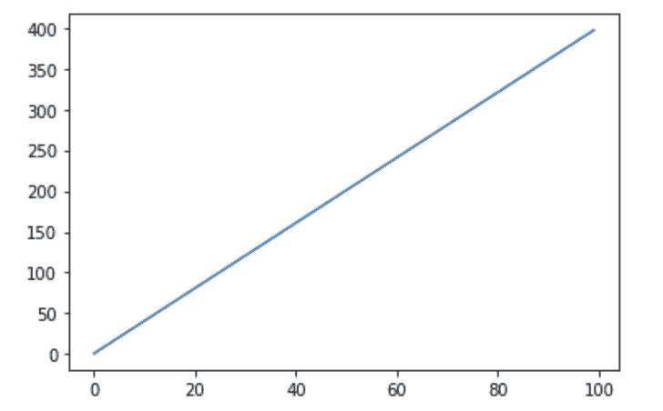

为了完整起见，我在 Jupyter 中记录了该示例。

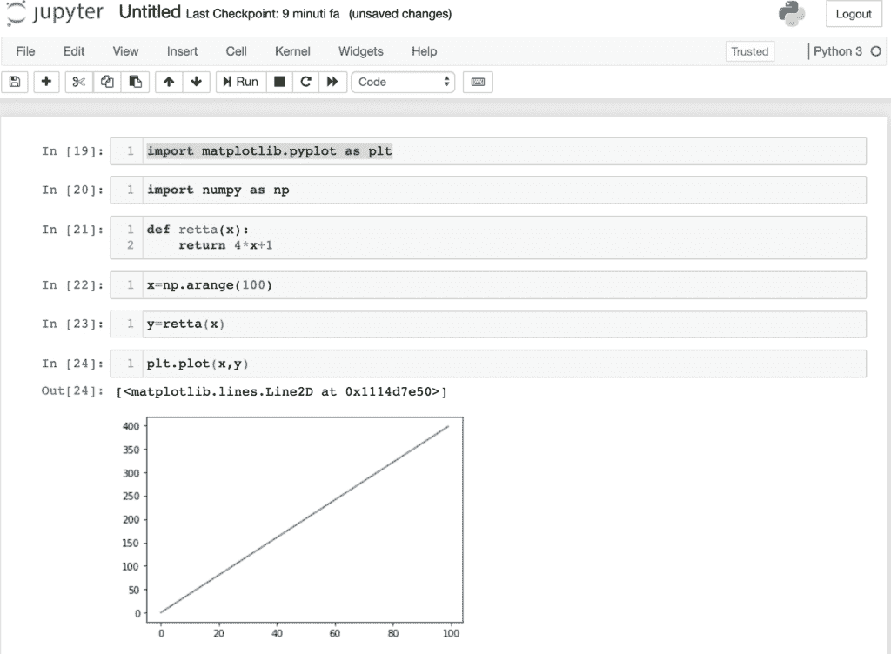

### 复杂图表

让我们尝试制作相同的示例，但使用稍微复杂的图表：

```python
import matplotlib.pyplot as plt
import numpy as np

def f(x):
    return 20 + 105 * np.cos(x) * np.sin(x + 30) + 144 * np.exp(0.5 / x + 1)

x = np.arange(-100, 100)
y = f(x)
plt.plot(x, y)
```

我们尝试深化 `pyplot` 提供的可能性。要更改图表的颜色，我们可以使用指令：

```python
plt.plot(x, y, color="<color_RGB>")
```

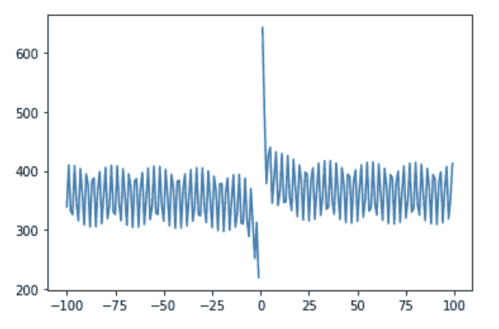

```python
plt.plot(x, y, color='3412F3')
```

要更改轴的范围，可以使用指令：

```python
plt.xlim(left_x, right_x) or plt.ylim(bottom_y, top_y)
```

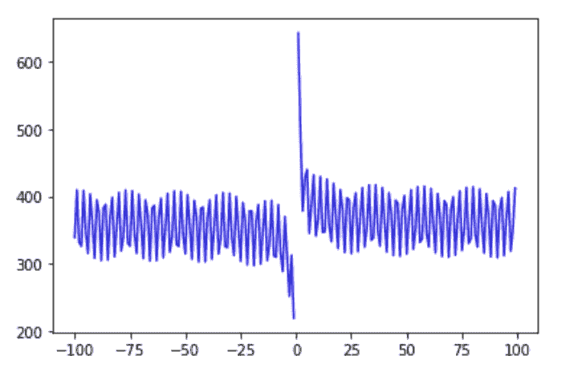

```python
plt.xlim(-10, 76)
plt.ylim(-100, 600)
plt.plot(x, y)
```

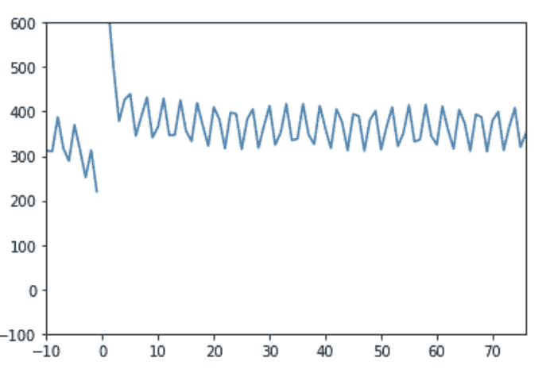

如果我们想画带虚线或点线的图表，可以使用参数 `linestyle="dashed"` 或 `linestyle="dotted"`，例如：

```python
plt.plot(x, y, linestyle="dashed")
```

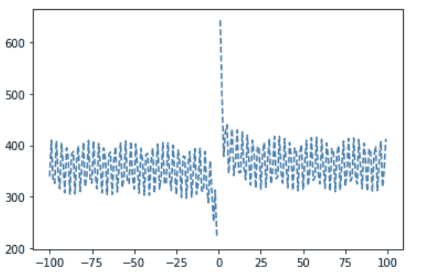

如果我们想使用标记点（markers），可以使用 `marker='o'` 参数：

```python
plt.plot(x, y, marker='o')
```

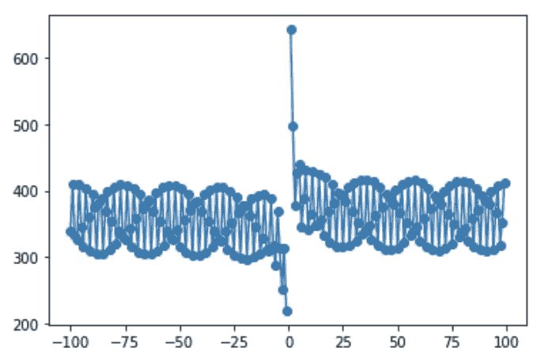

为了给轴或图例添加信息，我们可以使用以下指令：

```python
plt.plot(x, y, label="y = f(x)")
plt.title("chart example")
plt.xlabel("x")
plt.ylabel("f(x)")
plt.legend()
```

要绘制更多图表，我们可以遵循以下方法：

- 定义要绘图的函数
- 定义 `x` 范围
- 通过重复 `plot` 命令来“绘制”图表

```python
import matplotlib.pyplot as plt
import numpy as np

def f(x):
    return 20 + 105 * np.cos(x) * np.sin(x + 30) + 144 * np.exp(0.5 / x + 1)

def straight_line(x):
    return 4 * x + 1

x = np.arange(-100, 100)
y = f(x)
plt.plot(x, y)
```


显然，可以在单条指令中使用各种参数，例如，为了表示一个紫色的、带有圆形标记且为虚线样的函数，我们可以写：

```python
plt.plot(x, y, color='#3412F3', marker='o', linestyle='dashed', linewidth=2)
```

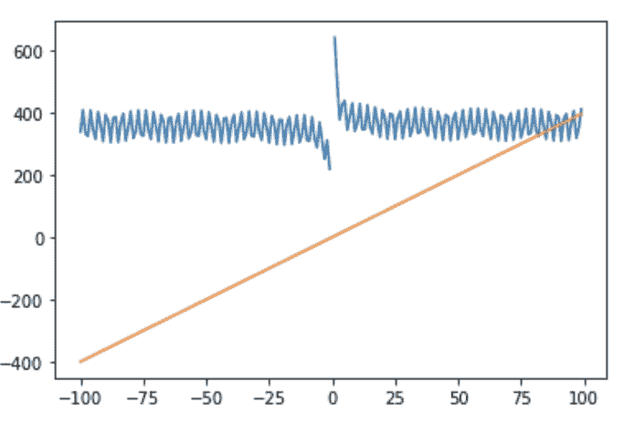

### 散点图

首先，我们导入必要的库：

```python
import pandas as pd
import numpy as np
import matplotlib.pyplot as plt
```

为了在散点空间中生成点，我们使用 `numpy.randn`。如果提供整数参数，`randn` 会生成一个数组（`d0, d1, ..., dn`），其中填充了根据均值为 0、方差为 1 的正态分布（高斯分布）采样的随机浮点数。如果没有给出参数，将返回单个浮点样本。之前的指令将生成 100 个点：

```python
randomPoints = np.random.randn(100)
```

结果将所示：
`array([[0.28393081, 1.69444015], [1.18710769, 0.75168393], [-1.08797599, 0.16593107], [0.34718794, 1.50584947], [0.59907203, 0.34574815], [-1.17150305, 1.32782198], [-0.66961386, 0.13941936], [0.96038988, -0.04362326], [-0.42828503, -1.35202516], [-0.57520301, -0.5182515]])`

此时，我们可以创建一个 dataframe，作为 `pyplot` 的参数：

```python
df = pd.DataFrame(randomPoints, columns=['x', 'y'])
```

并打印散点图：

```python
plt.plot(df['x'], df['y'], '.')
```

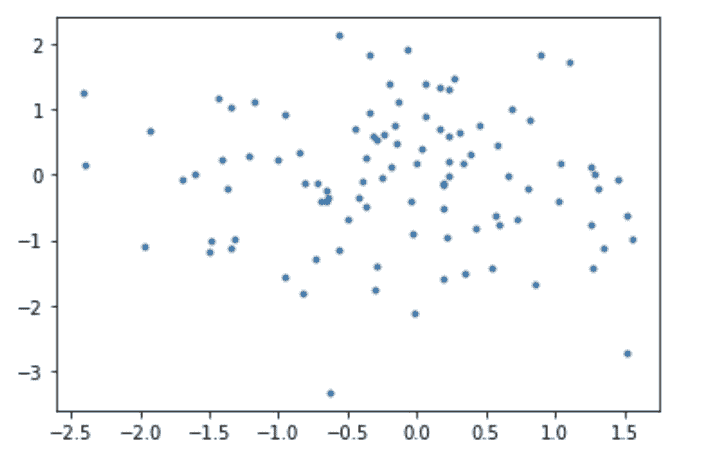

如果我们想表示更明显的点，可以使用 "o" 代替 "."：

```python
plt.plot(df['x'], df['y'], 'o')
```

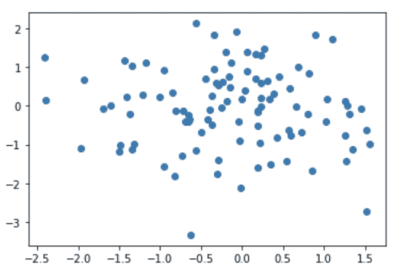

其他选项可能允许我们创建更有意义的图表，定义点的大小和颜色，但为了这样做，我们必须使用 `scatter` 函数而不是 `plot`。对于我们的示例，我们也为颜色和点的大小使用了随机数据：

```python
randomcolor = np.random.randn(100)
r_random_point = 1000 * np.random.randn(100)
plt.scatter(df['x'], df['y'], s=r_random_point, alpha=0.6, c=randomcolor)
```

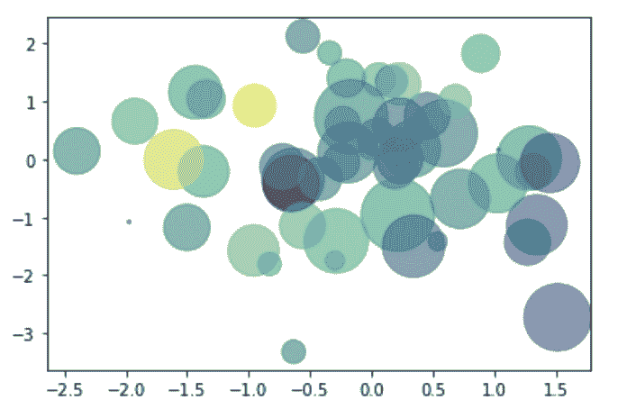

# 第 8 章：其他数据可视化库

## Seaborn

Seaborn 增强了 `matplotlib` 的功能，只需几行代码即可创建顶级图表。其关键区别在于 Seaborn 的默认模式和配色方案，这些设计旨在更加美观、舒适且现代。由于 Seaborn 主要基于 `matplotlib`，因此你需要了解 `matplotlib` 才能修改 Seaborn 的默认设置。

## ggplot

ggplot 依赖于 R 语言绘图框架 `ggplot2` 以及《图形语法》（The Grammar of Graphics）中的思想。`ggplot` 的工作方式与 `matplotlib` 不同：它允许你通过叠加组件来构建整张图表。例如，你可以从散点图开始，然后添加焦点、线条、趋势线等。尽管《图形语法》被誉为一种“直觉式”的绘图方法，但习惯了 `matplotlib` 用户可能需要一些时间来适应这种新观点。正如作者所示，`ggplot` 并不是为了创建深度定制的插图。它用灵活性换取了更简单的绘图方法。`ggplot` 与 `pandas` 紧密集成，因此在使用 `ggplot` 时，将数据存储在 `DataFrame` 中是理想的。

## Bokeh

与 `ggplot` 类似，`Bokeh` 也依赖《图形语法》，但与 `ggplot` 完全不同，它是 Python Native，而不是从 R 移植过来的。它的优势在于能够创建直观的、适用于 Web 的图表，这些图表可以高效地生成 `JSON` 对象、`HTML` 文件或智能应用程序。`Bokeh` 同样支持流式数据。`Bokeh` 提供了三个接口以满足特定的用户类型。最高级别用于快速创建概要。它包含了创建常规图表的策略，例如条形图、散点图和直方图。中间级别与 `matplotlib` 相似，允许你控制每个图表的基础结构（例如散点图中的点）。最低级别为工程师和程序员设计。它没有预设默认，要求你定义定义的每一个元素。

## pygal

与 `Bokeh` 和 `Plotly` 一样，`pygal` 提供了可以插入浏览器的直观图表。它的核心优势是能够生成 `SVGs` 图表。对于处理较小数据集的情况，`SVGs` 是最佳选择。然而，如果你正在创建包含大量数据点的图表，渲染可能会出现问题并变得缓慢。由于每种图表类型都封装在一个方法中且内置样式非常漂亮，因此在几行代码内创建一个高质量的图表并非易事。

## Plotly

你可能熟悉 `Plotly` 是一个数据可视化在线平台，但你是否意识到你可以在 Python Notebook 中使用它的功能？像 `Bokeh` 一样，`Plotly` 的优势是创建智能图表，但它提供了一些许多库中可能没有的图形，例如形状图、聚类图和 3D 图。

## geoplotlib

`geoplotlib` 是一个用于创建地图和绘制地质信息的工具包。你可以用它创建各种类型的数据，如分级地图、热力图和密度图。使用 `geoplotlib` 需要安装 `Pyglet`（一个应用程序接口）。尽管如此，由于大多数 Python 数据可视化库都不提供地图，拥有一个专门用于它们的库是非常棒的。

## Glimmer

`Glimmer` 受 R 的 `Shiny` 包启发。它允许你通过简单的 Python 内容将分析转换为直观的 Web 应用，因此你不需要学习 `HTML`、`CSS` 或 `JavaScript` 等其他语言。`Glimmer` 与任何 Python 数据表示库兼容。当你创建一个图表后，可以在其上方构建字段，让用户可以过滤和分类信息。

## missingno

处理缺失信息是一种痛苦。`missingno` 允许你通过可视化的图表意外地衡量数据集的完整性，而不是通过表格手动操作。你可以根据热力图或树类图根据位置关系过滤和分类数据。

## Calfskin

`Cowhide` 的作者 Christopher Groskopf 对其描述最到位：“Cowhide 是为那些现在就需要图表，且完全不在乎它们是否完美的人设计的 Python 绘图库。”它旨在与所有记录类型配合，并生成 `SVGs` 图表，因此你可以对其进行缩放而不丢失画质。由于该库较新，部分文档仍在完善中。你可以创建的图表显然非常基础——但这正是目标所在。

# 第 9 章：Pandas - 数据操作与分析

`pandas` 包是当今使用 Python 的数据科学家和分析师最重要的工具。强大的机器学习和华丽的可视化工具可能获得了所有的关注，但 `pandas` 是大多数数据项目的骨干。`pandas` 源于术语“面板数据”（panel data），这是一个指包含多个时期观测的数据集。如果你将数据想象成表格，那么它就是 pandas。在这篇文章中，我们将探索 pandas，包括它的用途以及它如何与 `matplotlib` 等其他 Python 数据库协作。pandas 有什么用？pandas 有许多你可能想不到的用途：数据清洗、数据转换。例如，假设你想探索存储在计算机 CSV 中的数据。`pandas` 将将数据从该 CSV 提取到 `DataFrame`（一个表格），然后让你执行以下操作：

* 计算统计数据并回答数据问题，例如
* 每列的平均值、中位数、最大值或最小值是多少？
* 列 A 与列 B 相关吗？
* 列 C 的数据分布如何？
* 通过删除缺失值和过滤行或列来清洗数据
* 在 `matplotlib` 的帮助下可视化数据。绘制条形图、折线图、直方图、气泡图等。
* 将清洗、转换后的数据存回 CSV、其他文件或数据库。

## pandas 是如何融入数据科学工具箱的？

pandas 库不仅是数据科学工具箱的核心组件，而且与该集合中的其他库配合使用。Pandas 构建在 NumPy 包之上，这意味着 NumPy 的许多结构在 Pandas 中被使用或复制了。pandas 中的数据通常用于为 scipy 中的统计分析、Matplotlib 的绘图函数以及 Scikit-learn 中的机器学习算法提供数据。

Jupyter Notebook 为使用 pandas 进行数据探索和建模提供了一个良好的环境，但 pandas 也可以同样轻松在文本编辑器中使用。Jupyter Notebook 允许我们执行特定单元格中的代码，而不是运行整个文件。这在处理大型数据集和复杂的转换时，这可以节省大量时间。Notebook 还提供了一种可视化 pandas DataFrames 和图表的简单方法。

## 何时开始使用 pandas

你应该什么时候开始使用 pandas？
如果你没有任何 Python 编程经验，那么在学会它之前，你应该远离学习 pandas。你不需要达到软件工程师的水平，但你应该精通基础知识，例如列表、元组、字典、函数和迭代。此外，由于上述的相似性，我们还建议你熟悉 NumPy。

## Pandas 初步

### 安装和导入

pandas 是一个很容易安装的包。打开你的终端程序（Mac 用户）或命令行（PC 用户），并使用以下命令之一进行安装：

```bash
conda install pandas
# OR pip install pandas
```

或者，如果你在 Jupyter notebook 中，可以运行此单元格：

```python
!pip install pandas
```

开头的 `!` 像在终端中运行一样执行单元格。为了导入 pandas，由于它被频繁使用，我们通常用一个较短的名字来导入：

```python
import pandas as pd
```

### Series 和 DataFrames

pandas 的主要组件是 Series 和 DataFrame。Series 本质上是一列，而 DataFrame 是一个多维 Series 表格。你对其中一个进行的操作也可以在另一个上完成，例如填充空值和计算平均值。在下面的数据处理中，你将看到这些组件是如何工作的。

### 创建 DataFrames

了解从头创建 DataFrame 是很有用的，在测试你在 pandas 文档中发现的新方法和函数时非常有用。从头创建 DataFrame 有许多方法，但一个很好的选择是使用字典。假设我们有一个卖苹果和橘子的水果摊。我们希望为每种水果设置列，为每个客户设置行。为了将其组织为 pandas 使用的字典，我们如下操作：

```python
data = {
    'apples': [3, 2, 0, 1],
    'oranges': [0, 3, 2]
}
```

然后将其传递给 pandas 的构造函数：

```python
df = pd.DataFrame(data)
```

data 中的每个（键，值）项对应于结果 DataFrame 中的一列。此 DataFrame 的索引（Index）在创建时作为数字 0-3 给出，但也可以在初始化 DataFrame 时创建自己的索引。让我们用名字作为索引：

```python
df = pd.DataFrame(data, index=['Alice', 'Bob', 'Charlie', 'David'])
```

现在我们可以使用名字来定位客户的订单。关于从 DataFrame 中定位和提取数据，稍会有更多介绍，但现在你应该能够创建一个任何随机数据的 DataFrame 来进行学习了。

让我们来看看从各种来源创建 DataFrame 的一些快速方法。从 CSV 文件读取数据只需要一行即可加载数据：

```python
df = pd.read_csv('file.csv')
```

*注：原文中包含了类似 `image_rsrc8.jpg`、`image_rsrc8K.jpg` 等图像占位符，它们被视为上下文的一部分，除非它们是代码字符串的一部分，否则不会被显式格式化为代码/变量；在这里它们作为叙述流的一部分。*

### 绘图

pandas 的另一个伟大之处是它与 Matplotlib 集成，因此你可以获得绘制 DataFrames 和 Series 的。要开始，我们需要导入 matplotlib：

```python
import matplotlib.pyplot as plt
```

现在我们可以开始了。关于绘图的覆盖不多，但足够探索你的数据了。让我们绘制评分和收入之间的关系图。我们只需要在 df 上调用 `plot()`，并提供一些关于如何构建图表的信息：

```python
df.plot(kind='scatter', x='rating', y='revenue', title='Revenue (millions) vs Rating')
```


# 第 10 章：大数据简介

## 大数据的简要历史
海量数据的起源可以追溯到 20 世纪 60 年代和 70 年代，当时第三次工业革命刚刚开始，关系型数据库的发展也随着数据中心的建设而启动。但大数据的概念最近才成为关注焦点，主要由于诸如 `Google` 和 `Yahoo` 等免费搜索引擎、`YouTube` 等免费在线娱乐服务以及 `Facebook` 等社交媒体平台的出现。

2005 年，企业开始意识到通过这些平台和服务产生了惊人的用户数据量。在同一年，一种名为 `Hadoop` 的开源框架被开发出来，用于收集和分析公司可以获取的这些海量数据。在此期间，一种被称为 `NoSQL` 的非关系或分布式数据库因其存储和提取非结构化数据的能力开始流行。`Hadoop` 让公司能够以高便利且低廉的成本处理大数据。

今天，随着尖端技术的兴起，不仅是人类，机器也在产生数据，物联网 (`IoT`) 和系统互联 (`IoS`) 等智能设备技术使得大数据的量急剧增加。我们日常的家居用品和智能设备连接到互联网，能够追踪并记录我们的使用模式以及我们与这些产品的互动，并将所有这些数据直接馈入大数据中。机器学习技术的出现进一步增加了每天产生的数据量。

### 大数据
你可以将其看作是在各种情况下对个人或活动所收集的、看似随机的大量数据。对于个人而言，这包括关于你在哪里购物、访问了哪些网站、去哪里旅行、购买了什么产品等数据。这些数据也可以从与任何业务或组织相关的活动中收集。例如，可能是 `UPS` 对其驱动员的习惯和燃料消耗收集的数据，或者是政府机构与犯罪活动或流行病相关的收集的数据。

数据本身是无用的。它必须经过分析，并使用由被称为“数据科学家”的专家指导的计算机来发现数据中可能存在的隐藏模式、关联和趋势。公司、政府和其他大型组织正在利用大数据来寻找与其运营相关的人类行为信息，无论这涉及到提高自身效率、提供更好的服务，还是开发客户群想要的新产品。

### 数据策略
大数据策略将涉及收集、存储、检索、分析和具有可操作性的洞察。大数据策略的目标是构建一个能够驱动业务智能的大数据基础。对于大多数企业来说，收集不是问题，但许多企业的错误在于预判了它们可能收集的数据的价值，从而没有收集到它们应收集的数据。

到目前，你应该意识到数据可能包含并不显而易见的洞察。这就是机器学习的益处以及它在数据分析中所扮演的角色：发现人类不知道其存在且——坦率地说——无法知晓其存在的隐藏模式。因此，你需要以开放的心态收集数据。

### 以开放的心态进行收集
企业可以收集的任何信息都具有潜在的用处。从初看，它可能无关紧要，但之后可能被用于建立意想不到的联系，从而在后期引导数据驱动的决策。作为大数据策略的一部分需要解决的第二个问题是数据的存储和检索。

### 存储与检索
处理大数据的规模和速度需要大量的基础设施。这包括大容量存储空间和强大的计算机。对于组织——尤其是中小型企业来说，要建立能够使其有效处理大数据的数据驱动型基础设施是困难的。这样做在字面上可能需要数百台计算机服务器，配备海量数据存储库和极高效的数据检索工具。

此外，还需要高水平的网络安全防护来保护数据的完整性。对于许多来说，这些要求意味着他们需要向外来满足这些需求。云计算使得这成为可能，世界上许多最大的公司都在提供可访问的云计算资源，这些资源具有成本效益、快速且易于 24/7 存储和检索数据。此类服务的提供者包括 `Amazon`、`Microsoft` 和 `Google`。这些公司提供多个级别的云服务，可以定制以适应任何规模业务的需求，从作为家庭办公的个人运营到大型公司，甚至是政府实体。例如，`Amazon` 的简单存储服务（被称为 `Amazon S3`）可供任何规模的企业用于低成本的云计算服务。

### 内部 vs. 外包
能够部署自己大数据系统的公司可以使用开源工具来完成工作。这包括使用 `Apache` 工具（如 `Hadoop` 和 `Spark`）以及 `MapReduce`。必须进行仔细的考虑。在内部处理工作将使数据保持在公司的直接控制之下。然而，这将意味着需要购买或租赁必须 24/7 维护的海量计算机存储容量。还需要一套稳健的信息安全措施来确保数据的完整性并保护其免受黑客攻击、损坏和其他问题。这还需要大量员工。

尽管许多大企业可能有能力实施自己的完全内部的大数据策略，但尚不清楚这样做总是最好的出路。这一决定必须由每个组织做出。然而，像 `Microsoft` 和 `IBM` 这样成熟的实体可以提供经过充分测试且稳健的基础设施和服务，这一事实使得外包这些任务成为一种可行的选择。

# 第 11 章：神经网络

## 卷积神经网络

卷积神经网络（`CNNs`）是深度神经网络的主要类别之一，它们在目标识别、目标分类和计算机视觉等许多计算机科学领域已被证明是非常有效的工具。`ConvNets` 多年来一直被用于人脸识别、物体识别，以及为自动驾驶汽车和机器人提供视觉支持。一个 `ConvNet` 可以轻松地识别无数图像场景，并建议相关的描述文字。`ConvNets` 同样能够识别日常物体、动物或人类。最近，卷积神经网络也被有效地应用于句子分类等自然语言处理问题中。因此，在处理机器学习和深度学习任务时，卷积神经网络是最重要的工具之一。

`LeNet` 是引入的首个卷积神经网络，它极大地推动了整个深度学习领域的发展。这个第一个卷积神经网络是由 Yann LeCun（杨恩·C 昆）在 `1988` 年提出的。它主要用于字符识别问题，例如读取数字和代码。如今经常用于无数计算机科学任务的卷积神经网络，与 `1988` 年提出的这个第一个卷积神经网络非常相似。与今天的卷积神经网络一样，`LeNet` 也被用于许多字符识别任务。与 `LeNet` 类似，我们今天使用的标准卷积神经网络包含四个主要操作，包括卷积、`ReLU` 非线性激活函数、下采样（或池化）以及其全连接层的分类。

这些操作是构建每个卷积神经网络的基本步骤。为了在 `Python` 中处理卷积神经网络，我们必须深入研究这四个基本函数，以更好地理解卷积神经网络背后的直觉。

如你所知，每张图像都可以轻松地表示为包含多个值的矩阵。我们将使用术语 `channel`（通道）来指代图像的特定部分。标准相机生成的图像通常有三个通道，包括蓝、红、绿。你可以将这些图像想象成堆叠在一起的三个二维矩阵。这些矩阵每个在 `0` 到 `255` 的特定范围内具有某些像素值。

另一方面，如果你有一张灰度图像，你只会得到一个通道，因为没有颜色，只有黑白色。在我们的案例中，我们将考虑灰度图像，因此我们研究的示例只是一个表示灰度图像的单一二维矩阵。矩阵中包含的每个像素值必须在 `0` 到 `255` 之间。在这种情况下，`0` 表示黑色，`255` 表示白色。

## 卷积神经网络是如何工作的？

卷积神经网络结构通常用于各种深度学习问题。如前所述，由于其结构，卷积神经网络被用于目标识别、目标分割、检测和计算机视觉。`CNNs` 直接从图像数据中学习，因此不需要执行常规深度神经网络中通常需要的人工特征提取。

`CNNs` 的流行归因于三个主要因素。首先是 `CNNs` 的结构，它消除了手动提取数据的需求，因为所有数据特征都由卷积神经网络直接学习。第二个导致 `CNNs` 日益流行的原因是它们能产生惊人的、最顶端的目标识别结果。第三个原因是 `CNNs` 可以轻松地用于许多目标识别任务，以帮助构建其他深度网络。

一个 `CNN` 可以包含数百层，每层都自动学习以检测图像的不同特征。此外，过滤器通常以不同的分辨率应用于每张训练图像上，因此每个卷积后图像的输出都将作为后续卷积层的输入。过滤器也可以从非常简单的图像特征（如边缘和亮度）开始，因此它们通常可以增加定义对象的图像特征的复杂性。卷积神经网络可以在成百上千甚至数百万张图像上进行训练。当你处理大量图像数据和非常复杂的网络结构时，你应该使用 `GPUs`，它们可以显著缩短训练神经网络所需的处理时间。

一旦你训练了卷积神经网络模型，你就可以将其用于实时应用中，如目标识别、`ADAS`（高级辅助系统）中的行人检测等许多其他领域。最后一个全连接层被称为输出层，在每个分类设置中，此输出代表整体类别。由于这些属性，普通的深度网络无法扩展到全图像。例如，在 `CIFAR-10` 中，所有图像的大小均为 `32x32x3`。这意味着所有 `CIFAR-10` 图像都提供了颜色通道，并且宽为 `32`，高为 `32`。普通网络中的单个全连接神经网络将有 `32x32x3` 个权重。

总结来说，与普通的三层深度神经网络不同，`ConvNet` 仅在三个维度上组合了所有的神经元。此外，卷积神经网络中的每一层都将 3D 输入卷转换为包含各种神经元激活值的 3D 输出卷。卷积神经网络包含具有简单 API 的层，结果产生 3D 输出卷，该输出卷带有一个可能包含也可能不包含神经网络参数的可微函数。

卷积神经网络由多个下采样层和卷积层组成，随后是全连接层或稠密层。如你所知，卷积神经网络的输入是一个 `n x n x r` 图像，其中 `n` 代表输入图像的高度和宽度，而 `r` 是存在的通道总数。卷积神经网络可能包含 `k` 个过滤器，称为内核（kernels）。当存在内核时，它们确定为 `q`，可以与通道数相同。

每个卷积神经网络映射通过对 `p x p` 连续区域进行 `max` 或 `mean` 池化来进行下采样，其中 `p` 的范围通常在小图像的 `2` 到大图像的 `5` 以上之间。在下采样层之后或之前，每个特征图上都会应用 sigmoidal 非线性和加性偏置。在这些卷积层之后，可能会有多个全连接层，这些层的结构与标准多层神经网络的结构相同。

### 步长（Stride）与填充（Padding）

其次，在指定深度后，你必须指定在过滤器上滑动的步长。当步长为 `one` 时，你必须每次移动一个像素。当步长为 `two` 时，你可以每次移动两个像素，但这将产生空间上较小的卷。默认情况下，步长值为 `one`。然而，当你希望感受野之间的重叠较少时，可以使用更大的步长，但由于你跳过了某些图像位置，这会导致特征图变小。

当你使用更大的步长但想保持相同维度时，你必须使用零来包围你的输入进行填充。你可以使用边缘的值填充，也可以使用零填充。一旦你的特征图维度与你的输入匹配，你就可以开始添加池化层了。在想要保留尺寸时，填充经常用于卷积神经网络。

### 结论

结论：Python 的使用可能是你可以选择的最优秀的编程语言之一。它对初学者来说非常简单，但其背后拥有强大的特性，即使对于高级程序员来说，它也非常稳健，使其成为一种出色的编程语言。它有很多功能，你可以用 Python 程序实现各种功能；虽然你可能会将其与其他编程语言混淆，尽管存在某些争议，但在 Python 中你几乎无一不能完成的任务。如果你对编程语言真的感兴趣，Python 就像你熟悉的母语一样，可以做一些真正惊人的事情，而无需担心所有的代码都会被看到。

对于某些人来说，对使用编程语言的恐惧是事实。要找到所有的挂载点和其他问题非常困难。但这正是问题所在。下一步是开始将数据科学引入自己的业务中，并看看能带来什么结果。

### 业务中的数据科学

数据科学正在接管商业世界，许多公司无论处于什么行业，都发现这种过程正是他们需要的——不仅能够收集他们已有的数据，还能对其进行清洗和分析，以发现其中包含的洞察和预测。当数据科学以正确的方式使用，并结合一些 Python 来帮助创建这些洞察时，效果将非常显著。

### 未来趋势与技术

数据量将持续增长。在未来几年中，我们进行数据分析的方式将会有显著改进。尽管 `SQL` 仍然是标准工具，但我们将看到诸如 `Spark` 等其他工具作为数据分析的补充方法出现，且它们的数量将像报告一样不断增加。越来越多的数据分析工具将变得可用，其中一些工具将不需要分析师。微软和 Salesforce 宣布了一些组合功能，允许非代码编写人员创建用于查看业务数据的应用程序。对大数据的实时流洞察将成为未来数据竞争胜者的标志。用户将寻求通过 `Spark` 和 `Kafka` 等程序在实时范围内利用数据做出明智决策。将出现的首要战略趋势是机器学习。机器学习将成为未来企业进行数据准备和预测分析的必经元素。你也可以预计大数据将面临巨大挑战，特别是在用户细节隐私领域。欧盟实施的新型隐私法规旨在保护用户的个人信息。各种公司不得不处理隐私控制和流程。据预测，未来几年内大多数商业伦理违规行为将与数据有关。很快，你可以预计所有公司都将配备首席数据官。Forrester 表示，该官员的地位短期内将提高，但某些类型的业务和代际差距可能会降低其在未来的重要性。自主代理将继续发挥重要作用，根据 Gartner 的说法，它们将一直是一项大趋势。这些代理包括自动汽车、智能顾问、虚拟个人助手和机器人。数据分析所需的人员将继续扩大，需要从科学家、分析师、架构师到数据管理领域专家的人才。然而，大数据人才的短缺可能会导致大型公司开发新策略。一些大型机构预测，各种组织将通过内部培训来解决他们的问题。以服务形式提供大数据的商业模型已触待待。

- PYTHON FOR DATA SCIENCE - 使用 Seaborn, SciPy 和 Scikit-Learn 通过 Python 学习数据科学的首选课程，由 Tech Ed Academy 2020 版所有

### 引言

本书侧重于“用于数据科学的 Python”，深入探讨了 Python 编程语言的核心用途，特别是它在数据科学中的应用。本书提供了一个平台，让你在一周内通过 Python 良好地学习数据科学，这门 Python 数据科学速成课程包含了清晰的示例和循序渐进的指导。

我们首先需要关注的是为什么数据科学对我们的需求如此重要且有用的观点。这使得处理数据并查看其内容变得简单得多；通常情况下，商业智能工具就足以让我们查看可用信息以及需要做出哪些业务决策了。然而，我们今天能够看到的数据与过去大不相同。与传统的数据系统（大多是结构化的）不同，如今公司收集的数据通常是非结构化的，或者至少是半结构化的。这使得分类和理解数据变得更加困难，这也就是为什么数据科学的过程会演变成今天的样子。

许多企业，无论从事何种行业，都会发现与数据科学接轨是他们的最佳选择之一。数据科学能够帮助他们真正地了解自己所在的行业，甚至在竞争中占据优势。许多公司已经收集了大量关于竞争对手、行业和客户的数据与信息，而数据科学将帮助他们真正看到这些数据中包含的洞察和信息，并将其转化为自己的优势。

考虑到上述内容，现在不仅要看数据科学带来的某些好处，还需要了解更多关于数据科学本质的信息，以及企业如何利用数据科学来满足自身的需求。数据科学的使用在许多企业和许多不同行业中变得越来越突出。但这并不能向我们解释数据科学的本质。我们可能想弄清楚进行此类分析需要什么，我们需要什么工具来做出预测，等等。这些都是我们可以在指南的这部分回答的问题，以便让事情变得简单一些。

### 什么是数据科学？

首先，我们需要看看数据科学到底是什么。数据科学是机器学习相关的算法、工具和原则的结合。所有这些不同的元素结合在一起，意图是从原始数据中发现隐藏的模式。这与我们多年来看到的有何不同呢？

数据分析师通常是指通过准备数据来解释发生了什么的人。但数据科学家稍有不同，因为他们不仅在进行探索性分析，还会使用许多不同的算法来帮助判断可能发生的情况。

### 分析类型

这些包括以下内容：

#### 预测性分析
当我们拥有一个可以预测未来概率的模型时，就是想要使用的预测性分析。例如，如果你想给某人提供信用贷款，你将希望使用这种分析来计算客户还款的概率。我们可以根据过去的优异程度建立一个模型。

#### 规范性分析
然后我们可以转向一种被称为规范性分析的方法。如果我们想与一个具有智能和所需信息、能够做出自身判决的模型一起，就会使用这种方法，同时你仍然拥有根据自己的动态标准来修订模型的能力。这是一个较新的领域，仍然存在一些正在解决中的问题，但它通常可以帮助我们获得建议，并在多个可选方案中知道应该采取哪种行动。

#### 监督学习
我们在这里将花一些时间关注的第三个选择是，如何利用机器学习来帮助我们做出良好的预测。如果你正在处理金融世界的交易数据等信息，并想建立一个新模型来确定未来的趋势，你会发现几种运行机器学习的算法是最好的。这属于监督学习的一种，因为我们必须向系统提供大量的示例，以便它随着时间的推移学习如何表现。这种方法工作原理的一个很好的例子是，根据历史上的欺诈购买记录，创建一个可以检测欺诈的模型或算法。

#### 无监督学习
包含在内的最后部分是利用机器学习帮助我们发现数据中的一些新模式。如果你进入数据，但不确定将使用哪些参数来帮助做出预测，那么就是时候深入挖掘并找出你的批量数据中存在的模式，然后你可以利用这些模式做出一些有意义的预测。这将与无监督学习模型相同，因为程序必须处理并查看数据发现了发现了，在没有你提供的任何选项或参数的情况下，找出你可以实际使用的内容。

## 目录

### 引言

### 第 1 章：数据科学基础
- 什么是数据科学？
- 理解数据收集、清洗、分析、建模和可视化的流程
- 为什么要为数据科学学习 Python？
- 本章总结

### 第 2 章：为数据科学配置 Python 环境
- 在 Mac OS X 上安装 Python
- 在 Windows 系统上安装 Python
- 在 Linux 操作系统上安装 Python

### 第 3 章：Seaborn
- Python 中的数据可视化模块
- 安装 Seaborn
- Seaborn 的绘图函数
  - `Dist Plot`
  - `Joint Plot`
  - `Pair Plot`
  - `Rug Plot`
  - `Bar Plot`
- `Pandas` 的作用
- `Violin Plot`
- `Line Chart`
  - 单变量折线图
- 设计实践：

### 第 4 章：使用 SciPy 进行 Python 科学分析
- `SciPy` 是什么？
- 为什么要使用 `SciPy`？
- `NumPy` 与 `SciPy`
- `SciPy` 的子包
- `SciPy` - 安装与环境配置
- 文件输入/输出包：特殊函数包
- `SciPy` 线性代数
- 逆矩阵
- 离散傅里叶变换 – `scipy.fft`
- `SciPy` 中的优化与拟合 – `scipy.optimize`
- 均值滤波：使用 `SciPy` 进行图像处理 – `scipy.ndimage`
- 总结

### 第 5 章：使用 Python 进行数据挖掘
- 数据挖掘与算法
- 数据挖掘定义
- 主要数据挖掘技术
- 在 Python 中创建回归模型
- 简单的探索性分析与回归结果
- 回归结果可视化
- 在 Python 中创建聚类模型
  - 什么是 k-means 聚类模型？
  - 第一步：探索性数据分析
  - 第二步：构建聚类模型
- 结论

### 第 6 章：机器学习算法简介
- 按学习风格分类算法
  - 监督学习
  - 无监督学习
  - 半监督学习
- 按相似性分类算法
  - 回归算法
  - 基于实例的算法
  - 正则化算法
  - 决策树算法
  - 贝叶斯算法
  - 聚类算法
  - 关联规则学习算法
  - 神经网络算法
  - 深度学习算法
  - 降维算法
  - 集成算法

### 第 7 章：使用 Scikit-Learn 进行数据科学与机器学习
- 应用 Scikit-Learn 库的前提
- 数据探索
- 数据可视化
- 数据预处理
- 训练集与测试集
- 构建模型
  - 朴素贝叶斯与邻分类器
- 性能比较
  - `GaussianNB`
  - `LinearSVCClassifier`
- 结论

### 第 8 章：数据科学与云
- 什么是云？
- 云端数据科学
- 软件架构与质量属性
- 云端大数据共享

## 第 9 章：数据科学的应用案例
- 安全
- 交通
- 风险与欺诈检测
- 交付物流
- 客户互动
- 城市规划
- 医疗健康
- 旅游
- 数字广告

## 第一章：数据科学基础

### 什么是数据科学？
人们对数据科学有很多种定义。我们可以将数据科学视为不同算法、工具和机器学习原理的结合，旨在从原始数据中发现隐藏的模式。数据科学涉及许多学科和技能，如统计学、编码、业务等。然而，我们经常在数据科学领域听到许多流行术语。让我们来尝试澄清这些术语。

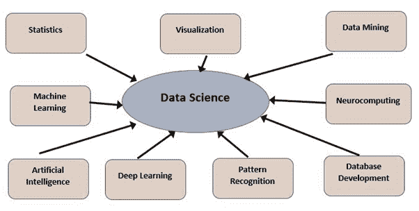

### 数据分析
数据分析包含了使用数据的常见方式。通常通过运行分析来理解过去的事件和现在。

### 预测性分析
预测性分析涵盖了机器学习、数据和统计算法的技术，根据历史数据帮助识别未来结果的可能性。其目标是超越我们过去认知的范围，提供最佳预测并推测未来将发生什么。

### 人工智能
人工智能是一种用于机器模仿任何行为的技术。其目标是确保机器能够准确、高效地模仿人类行为。人工智能的一些例子包括深蓝和 `IBM's Watson`。

### 机器学习
机器学习可以定义为人工智能的一部分，其驱动力是一个假设：机器能够在很少或完全没有人工帮助的情况下，通过做出决策从数据中学习。

### 深度学习
深度学习是指机器学习的一个分支，涉及受大脑功能和结构启发的算法，即被称为神经网络。这使得机器能够完成人类本能的工作并从过去学习。


### 理解流程
收集、清洗、分析和数据化数据至关重要。这需要多次迭代，而获得最终结果需要数据科学家根据发现的信息来精炼每一个步骤。让我们看看通用流程是什么：

1. **问题定义**：通常业务需求并不明确，或者我们在成本和时间上投入精力寻求解决方案。在这个阶段，数据科学家必须在业务背景下面对问题并对其清晰定义。
2. **数据收集**：解决问题所需的数据可能来自不同的来源，例如网络渠道、社交网络，但也可能是公司存档、进行中的营销活动或线下场所、展会和活动。
3. **数据处理**：在这个阶段，将修正数据中的错误，或简单地进行过滤以转换并获取有用信息。
4. **模型的创建与选择**：在考虑自动化自动学习系统之前，有必要进行手动转换。首先，你需要对数据有更深入的了解，并经常执行从大数据到小数据的转换。这项活动始于识别数据之间的关系，以便提取有用信息。这里引用马丁·林德斯特罗姆的话：“虽然大数据提供了用于预测未来趋势的无限信息，但只有数据能揭示真相并引导对现实真正的理解。”
5. **结果展示**：在这个阶段，除了展示你的工作结果外，你还可以发挥创造力。这是一个对初始问题得出结论并提出机会的阶段。

### 为什么你应该为数据科学学习 Python？
当你需要处理想要进行的数据科学项目时，Python 语言是最佳选择之一。你有大量项目可以通过数据科学来处理，而 Python 能够应对你尝试处理的更复杂的问题。Python 有许多理由将成为帮助你完成所有这一切的最佳选择，包括：

- **易于学习**：这种语言尽管有很多复杂之处，但对许多初学者来说很容易学习。如果你刚刚开始通过编码来帮助数据科学并担心如何开始，你会发现 Python 是完美的选择。它的设计初衷是尽可能易于操作，即使是从未做过编程的人也会发现使用 Python 并不像最初看起来那么糟糕。
- **数据科学库的选择**：Python 提供了许多特殊的扩展和库，非常适合数据科学和机器学习。尽管我们使用标准库就能做很多事情，但也有许多库不仅与 Python 协作，还能帮助我们在进行数据科学的同时完成更多工作。
- **Python 社区**：随 Python 一来的社区将使这项工作变得容易得多。你可以找到许多其他程序员，其中一些人已经使用 Python 长期了，他们能够为你提供建议，提供一些有用的代码，并在你处理数据科学项目遇到问题时帮助你脱离困难。
- **图形与可视化**：数据可视化对于每位数据科学家来说都是一个重要元素。在项目早期，你需要进行探索性数据分析以识别数据中的洞察。创建可视化图可以让你简化问题，特别是对于宽维度的数据集。在项目接近结束时，你需要以透明且引人注目的的方式交付最终结果，让你的观众能够理解。

### 总结
数据科学家想要使用 Python 语言有许多原因。虽然可能存在其他一些你可以使用的编码语言，但得益于我们在上面讨论的所有及更多原因，我们可以看到，使用 Python 语言是帮助你创建所需模型、使用各种有助于机器学习的库以及完成更多任务的最佳选择之一。

### 本章总结（补充）
在技术世界中，数据被定义为“由计算机处理和存储的信息”。我们的数字世界用数据充斥了我们的现实。从点击网站到我们的智能手机每秒都在跟踪并记录我们的位置，我们的世界正淹没在数据之中。从这些海量数据中，可以提取出我们尚未遇到过的问题的解决方案。

## 第二章：为数据科学配置 Python 环境

Python 能够在你想要关注的任何操作系统或平台上运行。这是一个好消息，因为它确保了无论我们正在使用哪种系统，或者在这个项目中想要使用哪种系统，我们都可以在不更改系统的情况下，并学习和使用这门语言。

在这里，我们首先需要考虑的是想要使用哪个版本的 `Python`。这里有几个不同的选项，这将确保我们能够选择最适合你的版本。Python 是一项开源语言，这意味着它可以免费安装和使用，并根据你的需求进行修改。仍然有一个开发团队致力于修复漏洞并进行必要的更新。这对你来说是个好消息，但这意味着你必须弄清楚哪个版本才适合你。

目前有 `Python 2` 和 `Python 3`，每个版本都有一些更新。它们非常相似，但通常取决于你想要使用的功能类型。如果你的电脑已经为你提供了 `Python 2` 版本，那么它是一个很好用的工作版本，如果你不想在这个过程中更新它，也就不必更新。它将与 `Python 3` 以及我们在本指南中将要做的一些代码非常相似。然而，大多数程序员都会使用 `Python 3`。这是目前最新的 `Python` 语言版本，它将拥有你编码所需的最佳功能以及更多。而且可能在某个时刻，负责 `Python 2` 的开发者将停止对该版本的支持，因此选择较新的选项是最好的选择。

你可以在各大在线平台上找到这两个版本的下载包，所以你必须选择哪一个最适合你。你也可以找到可以在所有主流操作系统上运行的版本，因此将它们添加到你正在使用的任何系统中应该都不太难。在这里需要记住的另一点是，在我们下面将要查看的代码，以及在三个主要操作系统上安装 Python 的步骤中，我们将从 `www.python.org` 获取文件。Python 将附带一个编译器、一个文本编辑器和一个 `IDE`，以及其他一些文件。这些文件对于确保程序能够正常运行都至关重要，如果缺少了任何一个，你将无法运行任何你想要处理的代码。

可能还有其他第三方网站供你查看并转而下载那些。这也是一种选项，取决于你完成学习后想用 Python 语言做什么，你可能可能想要这样做。但并不是所有的网站都能提供你所需的所有额外内容。你必须逐一下载每个部分，以确保你没有遗掉任何东西。

另一方面，当你从 `www.python.org` 提供的链接下载时，你可以确信你所需的所有文件和部分都在那里。你只需要进入该链接，点击你正在使用的操作系统，然后让它下载到你的系统中，在此过程中完全不会出现任何问题。

现在我们已经花了一些时间了解在电脑上安装 Python 的一些事情，无论你使用哪种操作系统，现在是时候查看实现这一目标的具体步骤了。

### 在 Mac OS X 上安装 Python

在我们的电脑上安装 Python 时，我们将考虑的第一个选项是 Mac OS X。如果你在使用一台依赖 Mac 操作系统的电脑，那么你应该尽早注意到电脑上已经安装了某种版本的 `Python 2`。具体版本取决于你拥有电脑的时间长短，但我们可以通过打开终端（Terminal）应用并使用下面的提示符来轻松检查是哪个版本。

```


# Python 安装指南

## 检查 Python 版本

```
Python – V
```

这将向你显示你获得的版本，会出现一个数字。你也可以选择在该系统上安装 `Python 3`，而且并不要求卸载电脑上的 `2.X` 版本。要检查 `3.X` 的安装情况，你只需要打开终端应用并输入以下提示符。

```
Python3 – V
```

OS X 的默认情况是完全没有安装 `Python 3`。如果你想使用 `Python 3`，可以使用 `Python.org` 上的安装程序进行安装。这是一个很好的地方，因为它会安装你编写和执行 Python 代码所需的所有内容。它将包含 `Python shell`、`IDLE` 开发工具和解释器。与 `Python 2.X` 的不同，这些工具作为标准应用程序安装在 `Applications`（应用程序）文件夹中。

你确保在使用的任何电脑上都能运行 `Python IDLE` 和 `Python shell`。能够运行这些程序也取决于你为系统选择了哪个版本。在继续之前，你需要检查你的系统中有哪个版本的 Python，然后决定你需要使用哪个 IDLE 和 shell。

## 在 Windows 系统上安装 Python

当需要在操作系统上使用 Python 语言时，我们将考虑的第二个选项是 Windows 电脑。许多人依赖 Windows 操作系统，因此了解如何进行这一过程以及如何设置 Python 非常重要。这个过程将会比另外两个稍微长一点，主要是因为 Windows 已经预装了自己的编码语言，所以我们必须采取一些额外的步骤来完成。

好消息是，尽管 Python 不是你电脑上的自动选项，但这并不意味着它运行得不佳。你会发现这种编码语言在 Windows 上运行良好，而且在这些系统上你可以用它做很多事情。这只是提醒你必须额外执行几个步骤。

现在我们已经解决了这个问题，为了确保 Python 语言设置好并准备就绪，你需要遵循的一些步骤包括以下内容：

1. 为了设置此项，你需要访问 Python 官方下载页面并获取 Windows 安装程序。你可以选择最新版本的 `Python 3`，也可以选择其他选项。默认情况下，安装程序将为你提供 32 位的 Python，但如果你愿意，也可以将其切换到 64 位版本。32 位通常是最好的，以确保与旧软件包没有兼容性问题。
2. 现在右键点击安装程序并选择“以管理员身份运行”。会有两个选项供选择。你将选择“Customize Installation”（自定义安装）。
3. 在下一个屏幕上，确保“Optional Features”（可选功能）下的所有复选框都勾选，然后点击继续。
4. 当仍在“Advanced Options”（高级选项）部分时，你需要花一点时间考虑你想将 Python 文件安装在哪里。然后你可以点击“Install”（安装）按钮。这需要几分钟才能完成，请耐心等待。等等安装完成后，你就可以关闭它了。

### 配置 PATH 变量

完成这一部分后，我们就该检查并创建系统所需的 `PATH` 变量了。我们希望设置好它，使其包含所需的目录以及所有的软件包和其他内容。

为了完成这一点，我们需要遵循以下步骤：

1. 首先，我们需要打开开始菜单。你可以通过点击控制面板来完成操作。
2. 然后，在环境变量中，我们可以找到 `Python 3` 的选项。我们可以通过点击它来进行编辑。
3. 在用户变量中，我们可以找到 `PATH` 变量。我们就可以通过点击它来开始编辑它。
4. 如果系统中还没有 `PATH` 变量，我们就可以点击“新建”来创建它。你可以通过点击新建来添加你需要的目录。

然后，我们就可以关闭对话框，并进入下一步。

### 验证安装

1. 当你到达这一步时，你应该打开命令提示符。在命令提示符中输入 `python`。这将帮助我们启动 Python 解释器并准备就绪。

### 在 Windows 上使用 Python

当我们完成了上述步骤后，我们只需要花费几分钟时间，这并不会像初开始时看起来那么糟糕，你就可以在 Windows 上使用 Python 了。你现在可以打开 Python 解释器以及任何其他你需要的部分，并编写你需要的代码。

## 在 Linux 操作系统上安装 Python

最后，我们需要花一点时间查看在 Linux 操作系统上正确安装 Python 的某些步骤。Linux 不像我们在指南中花费时间过的另外两个操作系统那样家喻户晓，但它有许多用途，并且能够为我们提供许多很酷的功能。许多程序员已经在使用这种语言，未来可能会有更多人使用它，所以在我们需要在它上安装 Python 编程语言时，稍微了解一下是一件好事。

如果你在使用旧版本的 Ubuntu 或其他版本，那么你可能需要使用 deadsnakes PPA 或其他工具来帮助下载 `Python 3.6` 版本。好消息是，如果你在使用其他 Linux 发行版，系统中可能已经安装了 `Python 3`。如果没有，你可以使用发行版的包管理器。如果 `Python 3` 软件包不够新，或者不是你需要的版本，你可以按照相同的步骤在你的电脑上安装更新版本的 Python。

# 第 3 章：Python 中的 Seaborn 数据可视化模块

Seaborn 是一个 `Matplotlib` 的封装器，简化了常见统计图表的创建。它支持的图表列表包括单变量和双变量分布图、回归图以及用于跟踪分类变量的多种方法。Seaborn 提供的完整图表列表可以在 API 参考中找到。在 Seaborn 中创建图表就像调用适当的图形函数一样简单。以下是一个为随机生成的数据创建直方图、估计核密度和绘制地毯纹理（rug-plot）的示例。

```python
import numpy as np  # numpy 用于从绘图中创建数据
import seaborn as sns  # 导入 seaborn 的常用形式

# 生成正态分布数据
data = np.random.randn(1000)

# 绘制直方图，并叠加地毯图（rugplot）和核密度图（kde）
sns.distplot(data, kde=True, rug=True)
```

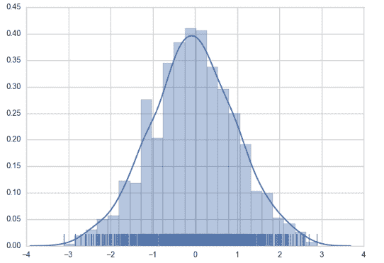

## 安装 Seaborn

要安装 Seaborn 库，你只需要在命令行终端中执行以下命令：

```bash
pip install seaborn
```

在开始绘制不同类型的图之前，你需要导入几个库。以下脚本执行了这些操作：

```python
import matplotlib.pyplot as plt
import seaborn as sns

plt.rcParams["figure.figsize"] = [10, 8]

tips_data = sns.load_dataset('tips')
tips_data.head()
```

上述脚本导入了 `Matplotlib` 和 `Seaborn` 库。接下来，将默认绘图大小增加到 10 x 8。之后，使用 `Seaborn` 模块的 `load_dataset()` 方法加载 `tips` 数据集。最后，`tips` 数据集的前五条记录已显示在控制台上。

**输出：**
`tips` 数据集包含客户在餐厅支付账单的记录。该数据集包含六列：`total_bill`、`tip`、`sex`、`smoker`、`day`、`time` 和 `size`。你不需要下载这个数据集，它是内置在 Seaborn 库中的。我们将使用 `tips` 数据集来绘制一些 Seaborn 图表。那么，话不多说，让我们开始使用 Seaborn 进行绘图吧。

## Seaborn 的绘图函数

### 分布图 (Dist Plots)

`dist` 图（也称为分布图）用于绘制数据集中特定列的直方图。要绘制 `dist` 图，你可以使用 `Seaborn` 库的 `distplot()` 函数。将你想要绘制直方图的列名作为参数传递给 `distplot()` 函数。以下脚本绘制了 `tips` 数据集中 `total_bill` 列的分布图。

**脚本 1：**
```python
plt.rcParams["figure.figsize"] = [10, 8]
sns.distplot(tips_data['total_bill'])
```

同样，接下来的脚本绘制了 `tips` 数据集中 `tip` 列的分布图。

**脚本 2：**
```python
sns.distplot(tips_data['tip'])
```

直方图上方的线条显示了该直方图的核密度估计。可以通过向 `distplot()` 函数的 `kde` 属性传递 `False` 值来移除该线条，如下例所示。

**脚本 3：**
```python
sns.distplot(tips_data['tip'], kde=False)
```

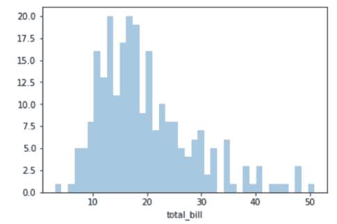

### 联合图 (Joint Plot)

`joint plot` 用于绘制两列的直方图分布，一列在 x 轴，另一列在 y 轴。默认情况下为这两列中的点绘制散点图。要绘制联合图，你需要调用 `jointplot()` 函数。以下脚本绘制了 `tips` 数据集中 `total_bill` 和 `tip` 列的联合图。

**脚本 4：**
```python
sns.jointplot(x='total_bill', y='tip', data=tips_data)
```

在联合图中，散点图可以用回归线替换。要做到这一点，你需要将 `reg` 作为 `jointplot()` 函数的 `kind` 参数的值传递。

**脚本 5：**
```python
sns.jointplot(x='size', y='total_bill', data=tips_data, kind='reg')
```

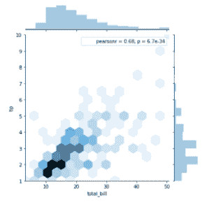

### 对角矩阵图 (Pair Plot)

`pair plot` 用于绘制数据集中所有数值和布尔列组合的联合图。要绘制对角矩阵图，你需要调用 `pairplot()` 函数并将其传递给你的数据集。

**脚本 6：**
```python
sns.pairplot(data=tips_data)
```

你还可以为分类列中的每个值绘制多个对角矩阵图。要做到这一点，你需要将分类列的名称作为 `hue` 参数的值。以下脚本为每个数值或布尔列的组合绘制两个对角矩阵图（一个针对午餐，一个针对晚餐）。

**脚本 7：**
```python
sns.pairplot(data=tips_data, hue='time')
```

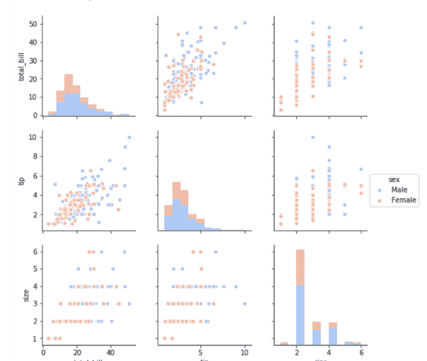

### 地毯图 (Rug Plot)

`rug plot` 是所有 Seaborn 图中最简单的一种。地毯图基本上为特定列中的所有数据点绘制小矩形。Seaborn 中使用 `rugplot()` 函数来绘制地毯图。以下脚本为 `tips` 数据集中 `total_bill` 列绘制了 `rugplot()`。

**脚本 8：**
```python
sns.rugplot(tips_data['total_bill'])
```

**输出：**
地毯图显示了特定列中所有数据点的分布。


### 柱状图 (Bar Plot)

柱状图用于绘制分类变量与数值之间的关系。要绘制柱状图，你可以使用 `Seaborn` 库的 `barplot()` 函数。将你想绘制柱状图的列名作为参数传递给 `barplot()` 函数。以下脚本绘制了 `tips` 数据集中 `total_bill` 列的柱状图。

**脚本 9：**
```python
plt.rcParams["figure.figsize"] = [10, 8]
sns.barplot(x='day', y='total_bill', data=tips_data)
```

**输出：**
柱状图显示了不同日期的平均账单金额。


还可以通过 `hue` 参数根据分类列中的每个值绘制多个组合。

**脚本 10：**
```python
sns.barplot(x='day', y='total_bill', data=tips_data)
```

你可以通过 `hue` 参数进一步细分柱状图。

**脚本 11：**
```python
sns.barplot(x='day', y='total_bill', data=tips_data, hue='time')
```

---

Name: `Pclass`, Length: 891, dtype: `bool`

现在，包含 `True` 或 `False` 的 `titanic_pclass1` 系列可以传递到 `titanic_data` 数据框后续的起始和结束方括号中。结果将是泰坦尼克数据集，仅包含 `Pclass` 列包含 1 的记录。

**脚本 3：**
```python
titanic_pclass1 = (titanic_data.Pclass == 1)
titanic_pclass1_data = titanic_data[titanic_pclass1]
titanic_pclass1_data.head()
```

列值之间的比较和行的过滤可以在单行内完成，如下。

**脚本 4：**
```python
titanic_pclass_data = titanic_data[titanic_data.Pclass == 1]
titanic_pclass_data.head()
```

另一个用于过滤行的常用操作符是 `isin` 操作符。`isin` 操作符接收一个值列表，并仅返回那些用于用于比较的列包含了作为 `isin` 操作符参数传递的列表中值的行。例如，以下脚本过滤了年龄为 20、21 或 22 的行。

**脚本 5：**
```python
ages = [20, 21, 22]
age_dataset = titanic_data[titanic_data['Age'].isin(ages)]
age_dataset.head()
```

你可以使用逻辑与 (`&`) 和逻辑或 (`|`) 操作符根据多个条件过滤 Pandas 数据框中的行。以下脚本返回 Pandas 数据框中乘客等级为 1 且年龄为 20、21 和 22 的行。

**脚本 6：**
```python
ages = [20, 21, 22]
ageclass_dataset = titanic_data[titanic_data['Age'].isin(ages) & (titanic_data['Pclass'] == 1)]
ageclass_dataset.head()
```

## 过滤列

要从 Pandas 数据框中过滤列，你可以使用 `filter()` 方法。你想过滤的列列表被传递给 `filter()` 方法。以下脚本过滤了泰坦尼克数据集中的 `Name`、`Sex` 和 `Age` 列，并忽略了所有其他列。

**脚本 7：**
```python
titanic_data_filter = titanic_data.filter(['Name', 'Sex', 'Age'])
titanic_data_filter.head()
```

除了过滤列之外，你还可以删除数据集中不需要的列。要这样做，你需要调用 `drop()` 方法并向其传递你想删除的列列表。例如，以下脚本删除了泰坦尼克数据集中的 `Name`、`Age` 和 `Sex` 列，并返回剩余列。

**脚本 8：**
```python
titanic_data_filter = titanic_data.drop(['Name', 'Sex', 'Age'], axis=1)
titanic_data_filter.head()
```

## 合并数据框

通常，你需要水平或垂直连接多个 Pandas 数据框。让我们先看如何垂直连接或连接 Pandas 数据框。我们将首先使用泰坦尼克数据创建两个 Pandas 数据框。第一个数据框包含乘客等级为 1 的行，而第二个数据框包含乘客等级为 2 的行。

**脚本 9：**
```python
titanic_pclass1_data = titanic_data[titanic_data.Pclass == 1]
print(titanic_pclass1_data.shape)

titanic_pclass2_data = titanic_data[titanic_data.Pclass == 2]
print(titanic_pclass2_data.shape)

# 输出: (216, 12) (184, 12)
```

输出显示两个新创建的数据框都有 12 列。需要说明的是，在垂直合并数据时，两个数据框应该具有相同数量的列。

水平连接数据集有两种。你可以通过第一个数据框调用 `append()` 方法，并将第二个数据框作为 `append()` 方法的参数。查看以下脚本。

**脚本 10：**
```python
final_data = titanic_pclass1_data.append(titanic_pclass2_data, ignore_index=True)
print(final_data.shape)

# 输出: (400, 12)
```

现在的输出显示总数为 400，这是我们合并的两个数据框行数之和。连接两个数据框的另一种方法是将两个数据框都作为参数传递给 Pandas 模块的 `concat()` 方法。以下脚本展示了如何操作。

**脚本 11：**
```python
final_data = pd.concat([titanic_pclass1_data, titanic_pclass2_data])
print(final_data.shape)

# 输出: (400, 12)
```

要水平连接数据框，确保数据框具有相同数量的行。你也可以使用 `concat()` 方法来水平连接数据框。然而，你需要将 `axis` 属性的值设为 `1`。此外，为了重置数据集索引，你需要将 `True` 传递 `ignore_index` 属性的值。

**脚本 12：**
```python
```


df1 = final_data[:200]

print(df1.shape)

df2 = final_data[200:]

print(df2.shape)

final_data2 = pd.concat([df1, df2], axis=1, ignore_index=True)

print(final_data2.shape)

# 输出: (200, 12) (200, 12) (400, 24)

## 数据框排序

要排序 Pandas 数据框，你可以使用 `sort_values()` 函数。用于排序的列列表被传递给 `by` 属性。

## 小提琴图

这种图类型与箱线图相同，但通过小提琴图，我们可以显示对应的所有组件。要创建小提琴图，调用 `violinplot()` 函数。函数的第一个参数是分类列，第二个是数值列，第三个是数据集名称。让我们创建一个显示年龄随性别的小提琴图。以下是脚本：

```python
import pandas as pd
import numpy as np
import matplotlib.pyplot as plt
import seaborn as sns
import sys

sys.__stdout__ = sys.stdout
data = sns.load_dataset('titanic')
sns.violinplot(x='sex', y='age', data=data)
plt.show()
```

脚本执行后应返回以下图表：![065.jpeg]
从上面的图中可以看出，与箱线图相比，小提琴图可以提供更多关于底层数据的信息。小提琴图不仅绘制了分位数，还展示了对应数据的所有组件。图中较厚的部分意味着该年龄的实例更多。对于男性的小提琴图，显然大多数男性年龄在 20 到 40 岁之间。

## 折线图

折线图用于在连续时间段内显示定量值，并将信息以序列的形式显示。折线图适用于时间序列，时间序列由直线段连接。值放置在 y 轴上，而 x 轴是时间尺度。

对于较短的时间段，垂直柱状图可能是更好的选择。![017.jpeg]
以下图表显示了二十年来房地产价格（单位：百万美元）的趋势。折线图非常适合显示数据趋势：

示例：以下图是一个多变量折线图，比较了谷歌、脸、苹果、亚马逊和微软的收盘价。折线图非常适合比较数值和可视化股票趋势。正如我们看到的，亚马逊的增长最高：![018.jpeg]
图：显示五家公司股票趋势的折线图

# 多变量图表的设计实践

应该提供图例来描述每个变量。

## 柱状图

条形长度编码数值。柱状图有两种变体：垂直柱状图和水平柱状图。

### 用途

虽然它们都用于比较不同类别之间的数值，但垂直柱状图有时用于显示随时间变化的单个变量。

### 柱状图的禁忌

- 不要将垂直柱状图与直方图混淆。柱状图比较不同的变量或类别，而直方图显示单个变量的分布。
- 另一个常见错误是使用柱状图显示组或类别之间的中心趋势。在这些情况下，请使用箱线图或小提琴图来显示统计量或分布。

### 示例

下图显示了一个垂直柱状图。每个条形显示了五名学生在考试中的 100 分制成绩：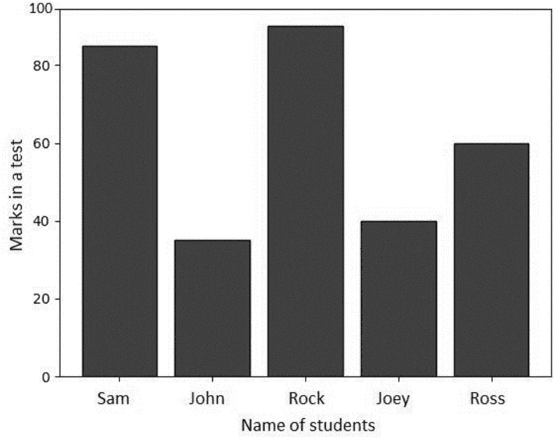
图：使用学生测试数据的垂直柱状图

下图显示了一个水平柱状图。每个条形显示了五名学生在考试中的 100 分制成绩：图：使用学生测试数据的水平柱状图

下图比较了电影评分，给出了不同的分数。番茄分（Tomatometer）是对电影给出正面评价的批准影评人的百分比。观众分（Audience Score）是给出 5 分中 3.5 分或更高分的用户百分比。

我们可以看到，《火星救援》是唯一同时拥有高番茄分和高观众分的电影。《霍比特比特：意外之旅》与番茄分相比，具有一个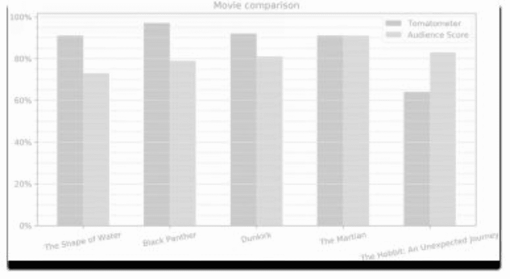相对较高的观众分，这可能是由于庞大的粉丝群体：对比柱状图

### 设计实践

- 对应于数值变量的轴应该从零开始。从其他值开始可能会产生误导，因为它会让微小的数值差异看起来像很大的差异。
- 使用水平标签，前提是条形数量少且图表看起来不太拥挤。

# 第 4 章：使用 SciPy 进行 Python 科学分析

## 什么是 SciPy？

SciPy 是“构建在 Python NumPy 扩展上的数学算法和便利函数集合”，能够通过为用户提供高级数据处理和可视化命令以及课程，为交互式 Python 会话增加更多影响力。SciPy 是开源的，用于数学、科学计算、工程和技术计算。SciPy 的读音为“Sight Pi”。

## 为什么要使用 SciPy？

带有 SciPy 的交互式 Python 会话变成与数据处理和系统原型技术竞争的环境，包括“MATLAB, IDL, Octave, R-Lab 和 SciLab”。在 Python 上开发“SciPy”的另一个优势是在开发高级程序和特定应用时，强大编程语言的可访问性。使用 SciPy 的科学应用程序受益于全球开发人员，他们在无数软件领域的利基市场中开发了额外的模块。产生的所有内容对 Python 程序员都是可用的，从数据库子程序和类到“并行编程到 Web”。这些强大的工具随“SciPy”数学库一起提供。

### 总结

- SciPy 包含了解决与科学计算相关大多数问题的子包。
- 仅于 C++ 的 GNU 库或 Matlab，SciPy 是最常用的科学库。
- 它被广泛使用和理解，并且计算能力强大。
- 可以在 `NumPy` 数组上操作。

## NumPy vs SciPy

### NumPy

- NumPy 用 C 语言编写，用于数学或计算。
- 它比其他库更快。
- NumPy 是数据科学最有用的库。
- NumPy 仅包含数组，执行如排序、形状调整等大多数操作。

### SciPy

- SciPy 构建在 `NumPy` 之上。
- SciPy 是功能的完整版本，而 NumPy 只包含少数功能。
- 大多数新数据特性在 SciPy 中而非 NumPy。

### SciPy 的子包

- `scipy.io`
- `scipy.special`
- `scipy.linalg`
- `scipy.interpolate`
- `scipy.optimize`
- `scipy.stats`
- `scipy.integrate`
- `scipy.fftpack`
- `scipy.signal`
- `scipy.ndimage`

## SciPy - 安装与环境搭建

你也可以通过 `pip python3 -m pip install --user numpy` 在 Windows 上安装 SciPy。在 Linux 上使用 `sudo apt-get install python-scipy python-numpy`。在 Mac 上使用 `sudo port install py35-scipy py35-numpy`。

导入 SciPy 模块和 NumPy 的标准方法：

```python
from scipy import special # 其他模块也一样
import numpy as np
```

### 文件输入/输出包

SciPy 的 `I/O` 包具有广泛的函数用于处理不同的文件，如 Matlab, Aff, Wave, Matrix, IDL, DFT, TXT 和 CSV。它将一种文件格式作为常规 `Matlab` 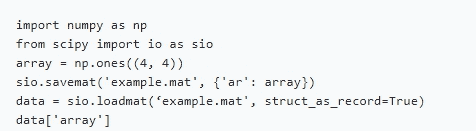输出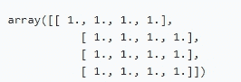构造
- **输入 1 & 2**: 使用 `scipy` 和 `NumPy` 导入库 SciPy。
- **输入 3**: 创建 4x4 维的数组。
- **输入 4**: 使用 `scipy.linalg` 求解。
- **输入 5**: 从 `scipy.mat` 获取数据。
- **输入 6**: 打印输出。
- **特殊函数**: `scipy.special`。

NumPy 数组的求和。

## 使用 SciPy 进行线性代数

- SciPy 的线性代数是 BLAS 和 ATLAS LAPACK 库的实现。
- 与 BLAS 和 LAPACK 相比，线性代数的性能非常快。
- 线性代数例程断言二维数组对象，输出也是二维数组。

现在让我们用 `scipy.linalg` 执行一些操作，计算二维矩阵的行列式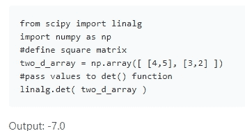逆矩阵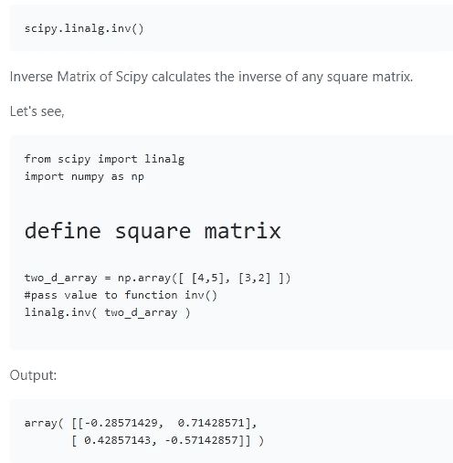以及行列式 `scipy.linalg.inv()`
- 线性代数中最常见的问题可以通过 `scipy.linalg.solve()` 轻松求解。
- 现在我们找到 `X` 的值以及对应的二维矩阵行列式。

```python
import scipy.linalg as la

# 二维矩阵示例用法
X = np.array([[1, 2], [3, 4]])

# 计算行列式
det = la.det(X)

# 计算逆矩阵
inv_X = la.inv(X)
```

# 示例：使用 Matplotlib 库并显示波形

我们以简单的周期函数 `sin(20 × 2πt)` 为例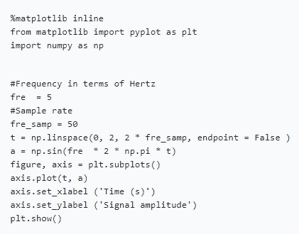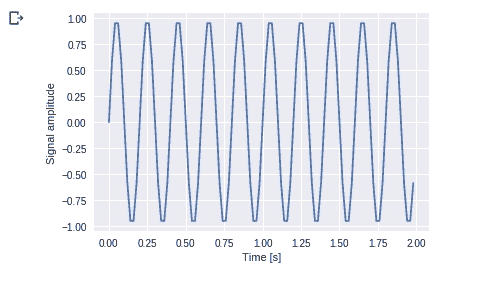 你可以看到这一点。当频率为 5 Hz 且信号每 1/5 秒重复一次时——这被称为特定的周期。现在，让我们通过 DFT 应用使用这个正弦波。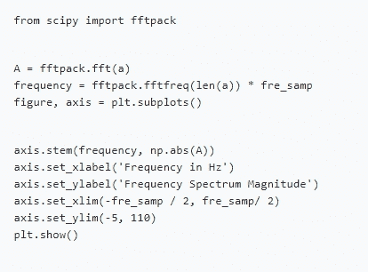 输出：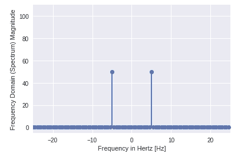

* 你清楚地看到输出是一个一维数组。
* 包含复值的输入除两个点外均为 0。
* 在 DFT 示例中，我们可视化了信号的幅度。

# SciPy 中的优化与拟合 – scipy.optimize

* 优化为曲线拟合、多维或标量拟合以及根寻找提供了实用的算法。
* 我们以一个标量函数为例，来寻找标量函数的最小值。

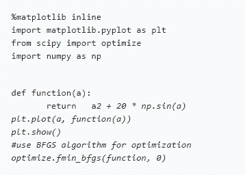输出：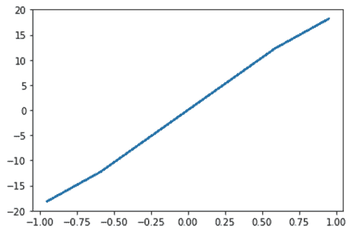优化成功结束。当前函数值：-23.241676 迭代：4 函数评估：18 梯度评估：6 array([-1.67096375])

* 在此示例中，优化是通过从初始点开始梯度下降算法完成的。
* 但可能的问题是局部最小值而非全局最小值。如果我们找不到全局最小值的邻居，则需要应用全局优化并寻找全局最小值，所使用的函数是 `basinhopping()`，它结合了局部优化器。

```python
optimize.basinhopping(function, 0)
```


Output: `fun: -23.241676238045315`

`lowest_optimization_result`:
  `fun: -23.241676238045315`
  `hess_inv: array([[0.05023331]])`
  `jac: array([4.76837158e-07])`
  `message: 'Optimization terminated successfully.'`
  `nfe: 15`
  `nit: 3`
  `nfv: 5`
  `status: True`
  `x: array([-1.6709635])`
  `message: ['used number of basinhopping iterations completed']`
  `minimization_fail: 0`
  `xf: 1530`
  `nit: 100`
  `nv: 10`

## Nelder – Mead 算法

* Nelder-Mead 通过参数选择。
* 它为良好的函数提供了最直接的最小化方法。
* Nelder – Mead 不用于梯度评估，因为寻找解决方案可能需要更长的时间。

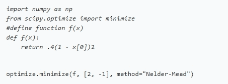
输出:


## 使用 SciPy 进行图像处理 – `scipy.image`

* `scipy.image` 是 SciPy 的子集，主要用于执行与图像相关的操作
* `nd` 表示“n”维图像。
* SciPy 图像处理提供了几何变换（旋转、裁剪、翻转）、图像滤波（锐化和去噪）、显示图像、图像分割、分类和特征提取。
* SciPy 中的 MPL 包包含预构建图像，可以用于执行图像处理任务。

### 示例：图像的几何变换

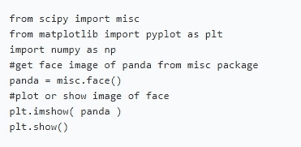
输出：
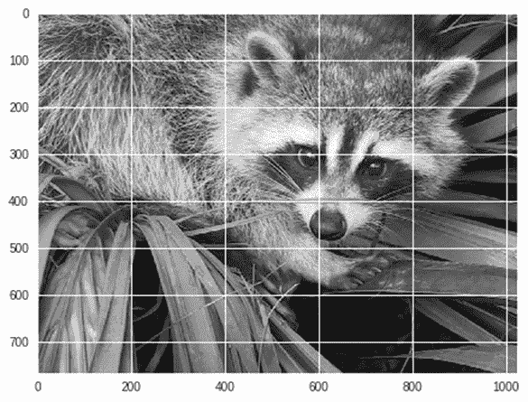

现在我们将当前图像翻转：

输出：


### 示例：使用 SciPy 旋转图像

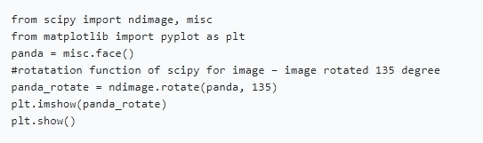
输出：
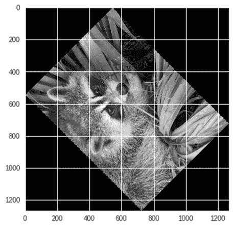

## 与 SciPy 集成 – 数值积分

* 当无法对函数进行解析法积分时，我们需要转向数值积分
* SciPy 提供了数值函数积分。
* `scipy.integrate` 拥有 `quad`, `trapz`, `simpson`, `Gaussian`, `Romberg` 和 Simpson 规则。

### 示例：双积分

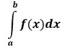
这里是来自 `scipy.integrate` 的上限和下限
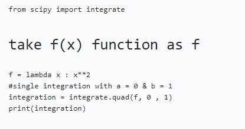
输出：`(0.333333333333337, 3.700734154189-5)`
这里函数返回两个值，其中第一个值是积分值，第二个值是估计误差。

### 示例：双积分（续）

计算以下单元的双积分，
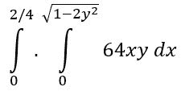

输出：`(3.0, 9.6574327451774-14)`
你看到的上方输出与之前相同。

## 总结

* SciPy（发音为 "sight"）是一个基于 Python 的开源库，用于数学、科学计算、工程和技术计算。
* SciPy 包含各种子包，帮助解决与科学计算相关的最常见问题。
* SciPy 构建在 NumPy 之上
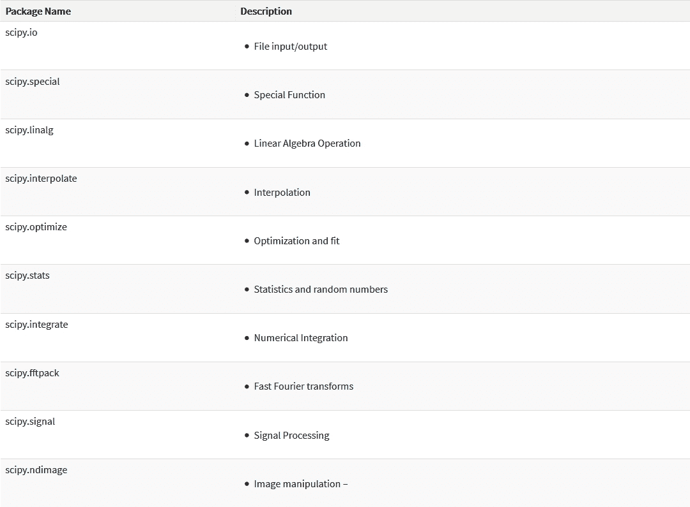

# 第 5 章：使用 Python 进行数据挖掘

数据挖掘是从大型数据库分析中发现预测性信息的过程。对于数据科学家来说，数据挖掘可能是一项模糊且令人生畏的任务——它需要一套多样化的技能和对许多数据挖掘技术的知识，才能从原始数据中成功地获取洞察。你将希望理解统计学基础和编程语言，这些工具可以帮助你进行大规模数据挖掘。本章将使用 Python 提供一个基于示例的介绍，Python 是最常用的机器学习算法工具之一。

首先，让我们更好地了解数据挖掘及其运作方式。数据科学家通过算法创建一个系统来分类并预测交易是否欺诈，并与历史欺诈和非欺诈模式进行对比。模型“知道”如果你住在加利福尼亚州的圣地亚哥，那么向俄罗斯稀疏地区发起的千美元购买可能是不合法的。这只是数据挖掘强大的应用之一。其他应用包括基因组测序、社交网络分析或犯罪成像——但最常见的用例是商业。


* **关联与相关性分析**：观察变量之间是否存在显而易见的独特关系。一个例子是著名的啤酒与尿布案例：在周末期间购买尿布的男性更有可能购买啤酒，因此商店将它们放在一起，以增加销售额。
* **离群值分析**：检查离群值以研究这些离群值产生的潜在原因和理由。一个例子是在欺诈检测中使用离群值分析，试图确定超出常规的行为模式是否为欺诈。

企业级的数据挖掘通常在事务型实时数据库上进行，这可以方便地使用数据挖掘工具进行分析。其中的示例是联机分析服务器，或 `OLAP`，它允许用户在数据服务器内部进行多维分析。OLAP 允许企业在无需下载静态数据文件的情况下查询和分析数据，这在数据库每天都在增长的情况下非常有帮助。然而，对于想要学习数据挖掘并独立练习的人来说，Python notebook 将非常适合处理大多数数据挖掘任务。让我们来看看如何使用 Python 通过上述描述的两种数据挖掘算法执行数据挖掘：回归和聚类。

## 回归

在 Python 中创建回归模型。我们想要对变量之间的线性关系建立估计，打印相关系数，并绘制最佳拟合线。对于这种分析，我们将使用来自 `pandas` 的 Tips 数据。[`https://www.pandas.org/docs/reference/api/pandas.DataFrame.html`](https://www.pandas.org/docs/reference/api/pandas.DataFrame.html)（如果你不熟悉 `pandas`，它是一个用于查找和处理数据的强大工具）。Tips 数据包含了价格和图表信息——让我们估算价格和面积之间的关系。

### 第一步：准备数据挖掘工具

`install pandas` 并熟悉几个模块。首先，如果你想跟着操作，请在你的桌面电脑上 `install pandas`。这是一个免费平台，为 Python notebook（`.ipynb` 文件）提供了必备内容，且使用起来极其直观。我们将使用 Python 的 `pandas` 模块来清洗和结构化我们的数据。`pandas` 是一个用于处理数据结构和分析的开源模块，对使用 Python 的数据科学家有用。它允许数据科学家以任何格式上传数据，并提供了一个简单的平台来组织、排序和处理这些数据


从 `numpy` 和 `matplotlib` 填充交互式命名空间。在上面的代码中，我导入了几个模块，以下是它们的用途详解：

* **NumPy**：科学计算必需的包。它包含了极其多功能的结构，用于处理数组，数组是 sc-learn 用作输入数据的主要数据格式。
* **Matplotlib**：Python 中数据可视化的基础包。该模块允许创建从简单的散点图到三维等高线图的所有内容。注意，我们从 matplotlib 中安装了 `pyplot`，它是模块层级中最高级的状态机环境（如果这对你来说没有意义，不要担心，只需确保将其导入到你的 notebook 中即可）。使用 `%matplotlib inline` 对于确保所有图表都显示在 notebook 中至关重要。
* **SciPy**：Python 统计工具的集合。`stats` 是导入回归分析函数的 scipy 模块。

让我们逐步拆解如何应用数据挖掘来解决回归问题！在现实生活中，你很可能不会拿到一个可以直接应用于机器学习技术的数据集，因此你首先需要对数据进行清洗和整理。

```python
df = pd.read_csv('PathWhereYouDownloadedTheDataset/kc_house_data.csv')
df.head()
```

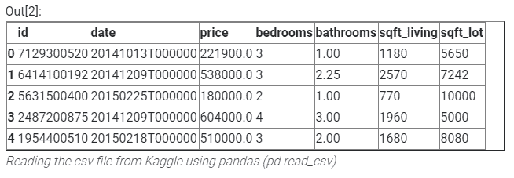


使用 Pandas 从 csv 文件导入数据框（dataframe），我做的第一件事是确保它读取正确。我还使用了 `isnull()` 函数来确保我的数据中没有无法用于回归的项。在现实生活中，单列数据可能在同一位置包含整数、字符串或 NaN 形式的数据——这意味着你需要检查并确保类型是匹配且适用于回归的。这个数据集恰好经过了非常严谨的准备，这在你自己的数据库中并不常见。

### 探索性分析和回归结果

在继续操作之前，让我们对数据有一个直观的了解，查看数据的形状（`shape`）并双检数据是否合理非常重要。损坏的数据并不罕见，因此养成始终运行两次检查的习惯是好的：首先，使用 `df.describe()` 查看分析中的所有变量；其次，使用 `plt.hist()` 绘制分析目标变量的直方图。

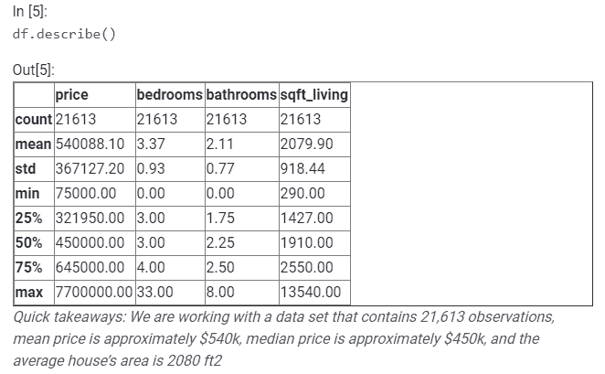
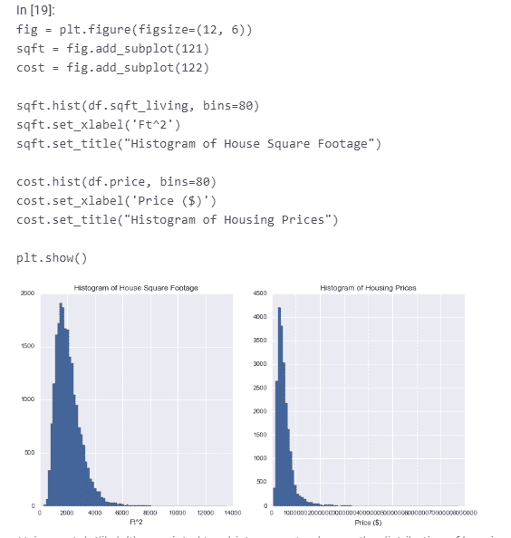

使用 matplotlib (`plt`) 我们打印了两个直方图，以观察房价和平方英尺的分布。我们发现，这两个变量的分布都是右偏的。

现在我们已经对数据集有了良好的了解，并且知道了我们要测量的变量的分布，让我们来进行一些回归分析。首先导入 statsmodels 获取最小二乘回归函数。在处理回归数值时，“最小二乘法”将完成大部分工作。

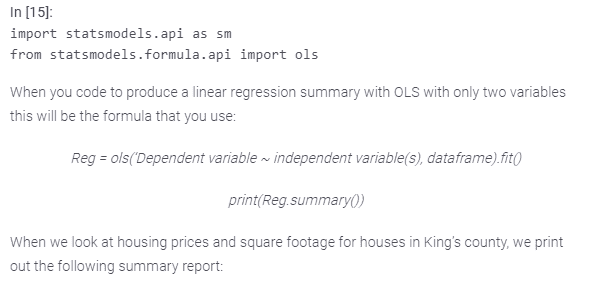
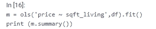

**警告：**
[1] 未指定系数的标准误差矩阵。
[2] 条件数很大，5.63+0。这可能表明变量之间存在共线性或其他数值问题。

回归模型输出的示例。当你打印回归摘要（`summary`）时，可以找到所有信息，包括 R 方值（R-squared）、t 统计量和标准误差。观察输出可以很清楚，面积与价格之间的关系高值为 14920，且 p 值为 0——意味着回归接近于零。要调整此公式以包含更多独立变量，只需遵循该公式：

```python
reg = ls('dependent variable + var1 + var2', dataframe).print(reg.summary())
```

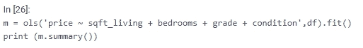

**警告：**
[1] 未指定系数的标准误差矩阵。
[2] 条件数很大，2.5+04。这表明变量之间存在共线性。

### 多元回归

在上面的多元回归输出中，我们学到通过添加独立变量（例如卧室数量），我们可以提供更好地拟合数据的模型，因为用于回归的 R 方值已增加到 0.555。这意味着通过增加几个独立变量，我们解释模型变异的能力从 49.3% 提高到了 55.5%。

### 可视化回归结果

拥有回归摘要对于检查回归模型的准确性以及用于估计和预测的数据至关重要——但将回归可视化是一个重要的步骤，以便以更易于理解的格式来交流回归结果。这展示了面积与价格之间的关系，这对于回归分析具有高价值。

## 第一步：探索性数据分析

你将安装几个模块，其中一个名为 `scikit-learn` 的新模块——这是一个用于 Python 机器学习和数据挖掘的工具集（请参阅我们关于使用 `scikit-learn` 构建神经网络模型的教程）。`Cluster` 是 `scikit-learn` 中的一个模块，它导入了带有聚类算法的函数，这就是为什么我们要从 `scikit-learn` 导入它。

首先，让我们导入所有必要的模块到我们的 Python Notebook 中并进行一些探索性数据分析
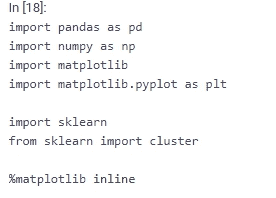

```python
faithful = pd.read_csv('PathOfTheDataSet/faithful.csv')
faithful.head()
```


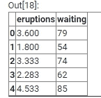

读取旧的 `faithful.csv` 并导入所有必要的值。我们做的只是从本地目录读取 `csv` 文件。我们知道该数据集没有缺失值或 `NaN` 值的列，因此我们可以跳过此示例中的数据清洗部分。让我们来看一下数据的基础散点图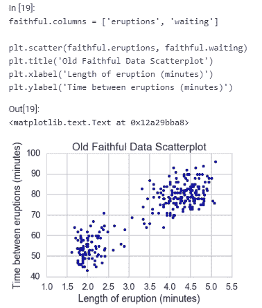

重命名列并使用 `matplotlib` 创建一个简单的散点图。关于此过程的一些简要说明：
- 我们重命名了列——它们看起来与原始数据不同，但在“waiting”列标题单词前加上处理，是为了防止在我们将其改为自己的名称时出现后续问题，不要忘记或导致数据无法加载。

## 构建聚类模型

什么是具有明显聚类但数据没有标记观测值属于哪一类的散点图？接下来的步骤将涵盖不同的聚类方法。在下面的代码中，我们导入了变量并格式化了数据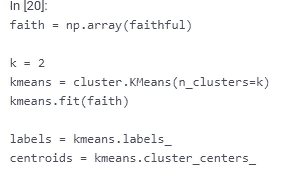

格式化和函数创建：
- 将 `faithful` 数据读取为数组以便 `scikit` 读取数据
- 选择 `K = 2` 作为我们正在拟合的聚类数量

`means` 变量由聚类模块调用的输出定义。我们取了 `K` 个聚类并拟合了数据 `faithful`。现在我们已经有了创建聚类模型的变量，让我们创建一个可视化结果吧。下面的代码将绘制一个散点图，为聚类着色并给出最终位置。特定代码行的解释见下文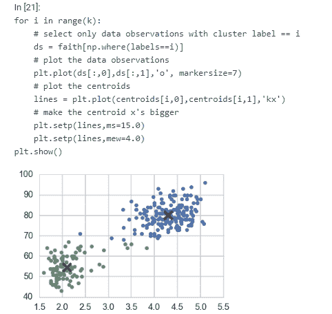。对上述代码的快速分解如下：
- 将数据分为 2 组的所有工作都在上一个部分完成，那里我们使用了 `means(faithful)` 命令。这段代码只是创建了显示该结果的图表。
- `ds` 变量只是原始数据，但经过重新格式化，根据组数（`k` 中的整数数量）包含了新的颜色标签。
- `plt.plot` 调用 `x-data`、`y-data`、对象的形状以及圆的大小。
- 代码的其他部分显示了质心的最终位置并控制标记的大小和厚度。

这里我们得到了一个简单的聚类模型。这段代码可以调整以包含不同数量的聚类，但对于这个问题，包含两个聚类是合理的。现在我们已经有了定义良好的聚类，可以使用 `scikit`。

### 什么是绿色？

具有短等待时间的绿色聚类可以定义为“峰”或“短”，而另一种并不适用于所有数据。如果你认为你的聚类问题使用 `K-means` 聚类效果不好，请查看以下资源：
- `scikit-learn 聚类模块`：该文档包含了 `scikit-learn` 中类算法的图像，查看不同的图表。如果你有散点图，使用该文档可以引导你找到正确的算法。
- `聚类算法`：这份来自斯坦福大学 CS345 课程（数据挖掘）的演示稿提供了对不同算法工作原理、有效性和无效性的见解。它是从理论层面理解聚类工作的绝佳资源。

### 结论

数据挖掘包含了许多预测建模技术，可以使用多种数据挖掘软件。学习使用 Python 应用这些技术是困难的——在你们自己的数据集上应用这些技术需要练习和努力。在早期，你会遇到无数的错误、报错消息和障碍——但在尝试数据挖掘时要保持坚持和勤奋。我希望通过观察上述聚类和线性回归模型的代码和创建过程，你已经学会了数据挖掘是可以实现的，并且可以通过高效的代码完成。

# 机器学习算法简介

我们将浏览最流行的机器学习。算法种类繁多，当人们抛出算法名称并要求你知道它们是什么以及适用于何处，可能会感到无从下手。我们希望为你提供两种思考和分类你在领域中遇到的算法的方法。
- 第一种是根据学习风格对算法进行分组。
- 第二种是根据功能的相似性对算法进行分组（类似于将相似的动物归类）。

两种方法都是很有用的，但我们将关注按相似性对算法进行分类，并介绍各种不同的算法类型。

# 按学习风格分类的算法

算法根据其与经验、环境或我们所称的输入数据的交互方式，有不同的方式对问题建模。在机器学习和人工智能教科书中，首先考虑算法可以采用的学习风格是常见的。算法拥有的只有几种主要的学习风格或学习模型，我们在这里介绍这些风格，并提供它们对应的算法和问题类型示例。这种分类法或组织机器学习算法的方法非常有用，因为它迫使你思考输入数据的作用和模型准备过程，并选择最适合你问题的一种以获得最佳结果。让我们来看三种不同的学习风格：

### 监督学习
输入数据被称为训练数据，具有已知的标签或结果（例如总和或股价）。模型通过训练过程准备以进行预测，并在这些预测错误时进行修正。训练持续持续直到模型在训练数据上达到所需的准确率水平。示例问题包括分类和回归。示例算法包括 `Logistic Regression` 和 `Neural Network`。

### 无监督学习
输入数据没有标签，也没有已知结果。模型通过确定输入数据中的结构来准备，其目的是提取规则。这可能通过数学过程进行系统性分类，或根据相似性进行分组。示例问题包括聚类、降维和关联学习。示例算法包括 `Decision Tree` 和 `K-Means`。

### 半监督学习
输入数据是标记示例和未标记示例的混合体。存在所需的预测问题，但模型必须学习结构来组织数据并做出预测。示例问题包括分类和回归。示例算法是其他灵活方法的扩展，这些方法对如何建模未标记数据做了假设。

# 机器学习算法概述

在将数据转换为业务决策模型时，你通常使用监督学习和无监督学习方法。目前的一个热点是图像分类等领域的半监督学习，这些领域拥有大量但标记示例极少的数据。

算法通常根据其功能（工作原理）的相似性进行分组。例如，基于树的方法和神经网络启发的方法。我认为这是分组算法最有用的方法，也是我们将采用的最佳方法。这是一个有用的方法，但并不完美。仍然存在可能更合适的算法，例如线性回归或基于实例的方法。

## 回归
回归关注变量之间关系的建模，并使用模型预测误差的衡量标准进行迭代优化。回归方法是统计学的基石，已被引入统计学习中。这可能会引起困惑，因为我们可以用回归来指代一类问题和算法。实际上，回归是一个过程。最流行的回归算法有：
* 普通最小二乘法回归 (OLSR)
* 线性回归 (Linear Regression)
* 逻辑回归 (Logistic Regression)
* 逐步回归 (Stepwise Regression)
* 多变量自适应样条 (MARS)
* 局部估计散点平滑 (LOESS)

## 基于实例的算法
基于实例的学习模型是一个决策问题，其训练数据的实例被认为是模型或所需的。此类方法通常建立示例数据数据库，并使用相似性度量将新数据与数据库进行比较，以找到最佳匹配并做出预测。出于因此，基于实例的方法被称为懒学习。最流行的基于实例的算法有：
* k 近邻算法 (`kNN`)
* 学习向量量化 (`LVQ`)
* 自组织映射 (`SOM`)
* 局部加权学习 (`LWL`)
* 支持向量机 (`SVM`)

## 决策树
决策树方法根据数据中属性的实际值构建决策模型。决策形成分叉结构，直到对给定的记录做出预测决策。决策树在分类和回归数据上进行训练。决策树通常快速且准确，是机器学习中的大宠儿。最流行的决策树有：
* 分类回归树 (CART)
* 迭代判别树 3 (ID3)
* C4.5 和 C5.0（一种强大方法的不同版本）
* 卡方自动交互检测 (CHAID)
* 决策树桩 (Decision Stump)
* 森林 (Forest)

## 贝叶斯算法
贝叶斯方法是指显式应用贝叶斯定理解决分类和回归问题的方法。最流行的贝叶斯算法有：
* 朴素贝叶斯 (Naive Bayes)
* 高斯朴素贝叶斯 (Gaussian Naive Bayes)
* 多项贝叶斯 (Multinomial Bayes)
* 贝叶斯依赖估计 (`ADE`)
* 贝叶网络 (`BBN`)
* 贝叶斯网络 (`BN`)

## 聚类
聚类像回归一样描述一类问题。所有方法都关注使用数据中的内在结构将其组织成相似性最大的组。最流行的聚类算法有：
* k-Means
* k-Medians
* 期望最大化 (`EM`)
* 分层次聚类 (Hierarchical Clustering)

## 人工神经网络算法
人工神经网络是受生物神经网络结构和/或功能启发的模型。它们是一类模式匹配，通常用于回归和分类问题，但实际上是一个由数百种算法及其变体构成的巨大领域，适用于各种类型的问题。由于深度学习领域的爆发式增长和普及，我们将“深度学习”与神经网络区分离开来。在这里，我们关注的是更经典的方法。最流行的人工神经网络算法包括：
* 感知器
* 多层感知器 (MLP)
* 反向传播
* 随机梯度下降
* 霍普菲尔德网络
* 径向基函数网络 (RBFN)

## 深度学习算法
深度学习方法是人工神经网络的现代更新，利用了丰富的计算能力。它们关注的是构建更大、更复杂的神经网络，并且如上所述，许多方法针对图像、文本、音频和视频等模拟数据的大型数据集。最流行的深度学习算法包括：
* 卷积神经网络 (CNN)
* 循环神经网络 (RNNs)
* 长短期记忆网络 (LSTMs)
* 堆叠自动编码器
* 深度玻尔兹曼机 (DBM)
* 深度信念网络 (DBN)

## 降维算法
像聚类方法一样，降维寻求并利用数据中的内在结构，但在这种情况下是以无监督的方式，旨在用更少的信息来总结或描述数据。这对于高维数据可视化或简化数据（随后用于监督学习方法）非常有用。这些许多方法可以调整后用于分类和回归。
* 主成分分析 (PCA)
* 主成分回归 (PCR)
* 偏最小二乘法 (PLSR)
* 映射
* 多维尺度变换 (MDS)
* 投影追踪
* 线性线性分析 (LDA)
* 混合分析 (MDA)
* 二次分析 (QDA)
* 灵活判别分析 (FDA)

## 集成算法
集成方法是由多个弱学习器组成的模型，这些弱学习器经过独立训练，并以某种方式组合它们的预测以做出整体预测。人们在组合什么类型的弱学习器以及组合方法上投入了大量精力。这是一类非常强大的技术，因此非常受欢迎。
* 提升法 (Boosting)
* 自助聚合 (Bagging)
* AdaBoost
* 加权平均 (Blending)
* 堆叠泛化 (Stacking)
* 梯度提升机 (GBM)
* 梯度回归树 (GBRT)
* 随机森林

# 第 7 章：使用 Scikit-Learn 进行数据科学和机器学习

Scikit-Learn 库已成为使用 Python 开发机器学习模型的黄金标准，它提供了多种监督学习和无监督机器学习算法。它被誉为迄为止最易用且代码最整洁的机器学习库之一。例如：决策树、聚类、线性和逻辑回归以及 K-均值。Scikit-learn 使用了几个基础 Python 库：`NumPy` 和 `SciPy`，并为数据挖掘任务（包括分类、回归和聚类）增加了一套算法。它只需几行代码实现特征选择、数据转换和集成方法等任务。

2007 年，David Cournapeau 在参与 Google 的“代码夏天”项目期间开发了 Scikit-Learn 的基础代码。自 2007 年发布以来，Scikit-learn 已成为 Python 最著名的开源机器学习库之一。但直到 2010 年，Scikit-Learn 才发布供公众使用。Scikit-Learn 是一个开源且采用 BSD 许可的数据挖掘和数据分析工具，用于开发基于 Python 的监督和无监督机器学习算法。Scikit-learn 提供了各种机器学习算法，如“分类”、“回归”、“降维”和“聚类”。它还提供了特征提取、数据处理和模型评估的模块。它被设计为“SciPy”库的扩展，基于最流行的 Python 库“NumPy”和“Matplotlib”。`NumPy` 扩展了 Python 以支持对大数组和多维矩阵的高效操作。`Matplotlib` 提供了可视化工具，而 `SciPy` 提供了科学计算模块。

对于学术研究，Scikit-Learn 广受欢迎，因为它拥有文档完备、易于使用且灵活的 API。开发者只需修改几行代码，即可利用 Scikit-Learn 对各种算法进行实验。Scikit-Learn 还提供了多种训练数据集，使开发者能够专注于算法，而不是数据收集和清洗。Scikit-Learn 的许多算法运行速度快且具有良好的扩展性，适用于所有大数据集。Scikit-learn 以其可靠性闻名，大部分库都提供了自动化测试。Scikit-learn 在机器学习初学者开始实现简单算法方面极极受欢迎。

### 应用 Scikit-Learn 库的准备工作
Scikit-Learn 库基于 `SciPy`（科学 Python），在系统上使用 ScKit-Learn 之前需要先安装它。

### 安装 Scikit-Learn
最新版本的 Scikit-Learn 可以在“Scikit-Learn.org”上找到，它需要“Python（版本 >= 3.5）；`NumPy`（版本 >= 1.11.0）；`SciPy`（版本 >= 0.17.0）；`joblib`（版本 >= 0.11）”。scikit-learn 的绘图功能或函数以 `plot_` 开头，需要“Matplotlib（版本 >= 1.5.1）”。某些 Scikit-Learn 示例可能需要额外的应用：“Scikit-Image（版本 >= 0.12.3），`Pandas`（版本 >= 0.18.0）”。

必须在使用 `pip` 文件时使用二进制轮（wheels），并确保 `NumPy` 和 `SciPy` 没有从源码重新编译，在使用特定的操作系统和硬件设置时可能会（例如，“树莓派上的 Linux”）。从源码开发 `NumPy` 和 `SciPy` 往往很复杂（特别是在 Windows 上）。因此，需要仔细设置，以确保实现线性代数例程的优化执行。

## 使用 Scikit-Learn 库应用机器学习
为了理解 Scikit-Learn 库如何用于机器学习算法开发，让我们使用“来自 IBM Watson 仓库的 Sales_Win_Loss 数据集”，该数据集包含从某汽车零部件批发商的销售活动获得的数据。我们将创建一个机器学习模型，以预测哪些销售活动将获胜，哪些将亏损。

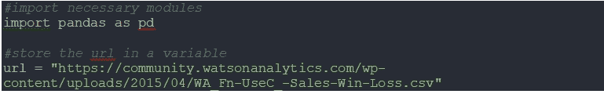

可以使用 `Pandas` 库导入数据集，并使用 `Pandas` 技术（如 `head()`、`tail()` 和 `dtypes()`）进行探索。将使用“Seaborn”的绘图技术来可视化数据。处理数据将使用 Scikit-Learn 的 `preprocessing.LabelEncoder()` 以及 `train_test_split()` 将数据集分为训练子集和测试子集。

为了从我们的数据生成预测，将使用三种不同的算法，即“线性支持、向量分类和 K 近邻分类器”。为了比较这些算法的性能，将使用 Scikit-Learn 库技术 `accuracy_score`。模型的性能得分可以使用 Scikit-Learn 和 Yellowbrick 可视化工具可视化。

### 导入数据集
要导入“来自 IBM Watson 仓库的 Sales_Win_Loss 数据集”，第一步是通过执行以下命令导入 `Pandas` 模块：
```bash
import pandas as pd
```


对于新的 `Pandas` 用户，上述代码中的 `pd.read_csv()` 技术将生成名为“数据框”（data frame）的表格数据结构，其中每行的索引包含在第一列中，第一行的每列标签/名称是从数据集中获取的初始列名。在上面的代码段中，`sales data` 变量结果是一个表格。现在，使用 `head()` as `Sales_data.head()` 技术显示数据中的记录。

!(image_rsrc8N9.jpg)

### 数据探索

现在我们已经有了数据集的副本，并已将其转换为“Pandas”数据框，我们可以快速探索数据。在任何机器学习项目中，数据探索都是非常关键的阶段。即使是快速的数据集也能提供我们可能错过的信息，我们可以根据此回答重要问题。计划行动方案。

!(image_rsrc8N9.jpg)

### 数据可视化

此时，我们已经完成了基础探索步骤，因此我们将尝试构建一些吸引人的图表来可视化信息并发现数据集中的其他叙述。在所有提供数据可视化的 Python 库中，`Seaborn` 是最佳选项之一，我们将使用它。确保系统中已安装 `Seaborn` 提供的 Python 模块并可以使用。现在按照以下步骤生成数据集所需的图表：

1. 使用命令 `import seaborn as sns` 导入 `Seaborn` 模块。
2. 使用命令 `import matplotlib.pyplot as plt` 导入 `Matplotlib` 模块。
3. 使用命令 `sns.set(style="whitegrid", color_codes=True)` 将图背景设置为白色。
4. 设置所有图的大小，使用命令 `sns.set(rc={'figure.figsize': (11.7,8.27)})`。
5. 生成 `countplot`，使用命令 `sns.countplot('Route To Market', data=sales_data, hue='Opportunity Result')`。
6. 移除边距，使用命令 `sns.despine(offset=10, trim=True)`。
7. 显示图表，使用命令 `plt.show()`。

!(image_rsrc8NH.jpg)

### 快速总结

首先导入了 `Seaborn` 和 `Matplotlib` 模块。然后使用 `set()` 技术为我们的图表定义特征，例如图表样式和颜色。使用代码段 `sns.set(style="whitegrid", color codes= True)` 将图表背景设置为白色。然后使用命令 `sns.set(rc={'figure.figsize': (11.7,8.27)})` 定义图表大小为 11.7x8.27。接下来使用命令 `sns.countplot('Route To Market',data= sales data, hue='Opportunity Result')` 生成图表。`countplot()` 技术允许创建计数图，可以暴露多个参数根据我们的需求自定义计数图。作为第一个 `countplot()` 参数的一部分，X 轴被定义为数据集中的 `Route To Market` 列。下一个参数涉及数据集源，即 `sales_data` 数据框。第三个参数是条形图的颜色，为“won”列定义为“蓝色”，为“loss”列定义为“绿色”。另一种显示数据的方法是使用 Seaborn 的小提图。

!(image_rsrc8NK.jpg)
小提图显示了数据的分布。我们可以看到数据获胜为“蓝色”，亏损为“绿色”，按收入大小查看客户，我们可以看到大部分数据客户大小为“1”。

## 数据预处理

现在，你应该对数据中的可用信息有了清晰的理解。通过数据探索步骤，我们确定数据集中大多数列都是“字符串数据”，但 `Scikit-Learn` 只能处理数值数据。幸运的是，Scikit-Learn 库提供了许多将字符串数据转换为数值数据的方法，例如 `LabelEncoder`。为了将数据集中的分类标签（如“won”和“loss”）转换为数值，我们将使用 `LabelEncoder()` 技术。查看下面的图片，包含三个记录的第一列 `color`。利用 `LabelEncoder()` 技术，相同的 `color` 可以转换为数值。现在开始。使用由 `LabelEncoder` 提供的 `fit_transform()` 技术，分类列 `Route To Market` 可以被编码。为了知道完成编码，让我们通过下面的代码示例：

1. 使用 `from sklearn import preprocessing` 导入所需的模块。
2. 创建编码器，使用 `le = preprocessing.LabelEncoder()`。
3. 将分类列转换为数值。

第一步是导入 `preprocessing` 模块。随后创建类型为 `LabelEncoder` 的对象。使用对象的 `fit_transform()` 函数来区分不同的类。你观察到 `LabelEncoder()` 技术根据初始字母分配了数值，例如 (A) 分为 0，(P) 分为 1，(T) 分为 2？


## 训练集与测试机器学习算法

但我们还需要做一件关键：算法需要在数据集上进行训练，以学习特征之间的关系以及这些特征如何影响目标。为此，我们需要将整个数据集分为两个部分。一个是训练集，我们在上面训练模型；另一个是测试集，我们在上面测试模型预测的准确性。在进行所有拆分之前，让我们首先准备特征和目标。如果不确定如何划分数据，80/20 原则（保留 80% 的数据作为训练数据，剩余 20% 作为测试数据）是一个不错的默认值。`scikit-learn` 中的 `train_test_split()` 方法可以划分数据：


通过此，我们现在成功准备了测试集和训练集。在上面的代码中首先导入了 `train_test_split` 模块。接下来使用 `train_test_split()` 方法将数据分为训练集和测试集。这就！我们已经设置好了特征和目标。接下来我们将划分特征和目标。

```python
from sklearn.model_selection import train_test_split

X_train, X_test, y_train, y_test = train_test_split(X, y, test_size=0.3, random_state=42)
```


## 构建模型

等等，我们刚才做了什么？首先，我们不需要 `Opportunity Number` 列，因为它只是一个标识符。我们还想将 `Opportunity Result` 转换为 `target`。为此，我们不需要匹配 `Opportunity Number` 和 `target` 的列。所以，在第一个代码中导入了 `LabelEncoder` 模块。接下来我们使用 `set()` 技术为我们的图表定义不同的特征，例如图表样式和颜色。使用代码段 `sns.set(style="whitegrid", color_codes=True)` 将图表背景设置为白色。然后使用命令 `sns.set(rc={'figure.figsize': (11.7, 8.27)})` 定义图表大小为 11.7px 和 8.27px。接下来使用命令 `sns.countplot('Route To Market', data=sales_data, hue='Opportunity Result')` 生成图表。`countplot()` 技术允许创建计数图，可以暴露多个参数根据我们的需求自定义计数图。作为第一个 `countplot()` 参数的一部分，X 轴被定义为数据集中的 `Route To Market` 列。下一个参数涉及数据集源，即 `sales_data` 数据框。第三个参数是条形图的颜色，为“won”列定义为“蓝色”，为“loss”列定义为“绿色”。另一种显示数据的方法是使用 Seaborn 的小提图。


小提图显示了数据的分布。我们可以看到数据获胜为“蓝色”，亏损为“绿色”，按收入大小查看客户，我们可以看到大部分数据客户大小为“1”。

- 朴素贝叶斯
- 线性支持向量分类 (`LinearSVC`)
- K 近邻分类器

`scikit-learn` 库真正的美之处在于它为不同的算法提供了高层 API，这使我们能够尝试不同的算法并比较模型的准确率，以查看哪些算法最适合我们的数据集。让我们逐个尝试不同的算法。

### 朴素贝叶斯

Scikit-learn 提供了一系列分类算法，这些算法“朴素地”假设每对特征都是独立的。这一假设是贝叶斯理论的基础原理。基于这一原理的算法被称为朴素贝叶斯算法。在高级层面上，朴素贝叶斯算法计算特征与目标之间的连接概率，然后选择概率最高的特征。

让我们通过一个非常简单的陈述来理解这一点：今天会下雨吗？假设我们有一组天气数据作为特征，而“下雨”概率将是我们的目标。根据这个特征集，我们可以创建一个表格来显示特定特征/目标对出现的次数。它看起来如下：


在上面的表中，特征列“Weather”包含了标签（“部分多云”和“多云”），而“Rain”列包含了与特征“Weather”重合的情况（是/否）。每当特征与下雨重合时，会被记录为“是”；当特征没有导致下雨时，则记录为“否”。现在我们可以使用表格中的数据创建一个名为 `Feature` 的另一个表格，其中我们可以记录每个特征相关的“是”和“否”的数量：


最后，我们将表格和 `Feature` 表格的数据合并创建一个 `Feature` 表格。该表格列出了每个特征的“是”和“否”的数量，然后使用这些数据计算每个特征发生下雨的概率：


注意上方表格中的 `Probability` 列。在表格和 `Feature` 表格中，“部分多云”和“多云”特征出现了 6 次，其中“部分多云”特征有 4 次“否”和 2 次“是”。当我们把一个特征“否”和“是”的出现次数除以表格的总数时，我们就得到了该特征的概率。

在我们的情况下，如果我们需要找到哪个特征对下雨发生的贡献最大，那么我们就取每个特征的“否”的总数，加上它们在 `Feature` 表格中相应的“是”的数量，然后除以表格中的 `Total`。这给了我们每个特征与下雨重合的概率。

让我们用 scikit-learn 实现 `GaussianNB` 算法来创建我们的预测模型：


现在仔细观察我们刚刚的操作。首先，我们导入了 `GaussianNB` 和 `accuracy_score`。然后我们创建了一个类型为 `GaussianNB` 的对象。之后，我们在测试数据 (`data`) 上训练了算法，然后使用测试数据 (`target`) 预测了目标。最后，我们使用 `accuracy_score()` 方法检查了准确率。

### LinearSVC

`LinearSVC` 或 `LinearSVM`（支持向量机）是一种很好的分类器。

---

### 第 8 章：数据科学与云

云数据科学是许多概念的结合。要成为一名数据科学家，具备一些编程技能至关重要。尽管你可能并不了解所有与基础设施相关的编程概念，但具备计算机科学的基础技能是必不可少的。随着高级分析的不断扩展，数据科学继续向不同的方向发展。这需要如预测分析和推荐系统等协作解决方案。协作解决方案包括与代码版本控制集的研究和笔记本工具。数据科学也与云相关，信息也存储在云端。因此，本节将向你介绍关于“云端数据”的一些事实。让我们了解什么是云，数据是如何存储的，以及它是如何工作的。

## 什么是云？

云可以被描述为一个全球服务器网络，每个网络都具有不同的独特功能。学习云需要理解网络。网络可以是简单或复杂的信息或数据集群。

### 网络

网络可以是连接的一组或一小组计算机，也可以是连接的一大组计算机。最大的网络是 `Internet`（互联网）。小组网络可以是家庭本地局域网，如 `Wi-Fi` 以及局限于某些计算机或区域的 `Local Area Network`（局域网）。还有共享网络，如媒体、网页、应用服务器、数据存储、打印机和扫描仪。网络拥有节点，其中计算机被称为一个节点。这些计算机之间的通信是通过协议建立的。协议是为计算机设置的中间规则。如 `HTTP`、`TCP` 和 `IP` 等协议被大规模使用。

所有信息都存储在计算机中，但每次在计算机上搜索信息都会变得困难。此类信息通常存储在 `Data Centre`（数据中心）中。`Data Centre` 设计旨在为数据提供支持的安全和保护。由于计算机和存储的成本已大幅下降，许多组织选择使用多台协同工作的计算机以便进行扩展。这与购买其他计算设备等扩展方案不同。其背后的意图是即使某台计算机发生故障，工作也能持续进行；另一台计算机将继续运行。

同样，某些云应用也需要扩展。广泛观察如 `YouTube`、`Netflix` 和 `Facebook` 等计算应用，它们是需要进行扩展的。我们很少遇到此类应用程序的故障，因为它们在云端建立了自己的系统。云中存在一个网络集群，许多计算机连接到同一个网络并完成相似的任务。你可以将其称为单一信息源，或管理一切的单台计算机，以提高性能、可扩展性和可用性。

## 云端的数据科学

数据科学的全过程发生在本地机器上，即提供给数据科学家的计算机或笔记本电脑。计算机或笔记本电脑内置了编程语言并安装了一些前提条件。这可能包括常见的编程语言和一些算法。数据科学家随后需要根据其项目安装相关的软件和开发包。可以使用 `Anaconda` 或类似的管理器来安装开发包。你也可以选择手动安装。一旦你安装并进入开发环境，你的第一步（即工作流）就开始了，此时你的伙伴只有数据。并非要求在不同的开发机器上执行与数据科学或大数据相关的任务。请查看其背后的原因：

* 在开发环境中执行任务所需的处理时间因处理能力不足而失败。
* 存在无法在开发环境系统内存中容纳的大数据集。
* 交付物必须部署到生产环境中，并作为大型应用程序的组件进行整合。
* 建议使用快速且强大的机器。

数据科学家在面对此类问题时会探索许多方案；他们会利用本地机器或运行在云端的虚拟机。使用虚拟机和自动伸缩集群具有许多优势，例如，它们可以根据需要随时扩展或丢弃。虚拟机可以按照特定方式进行定制，以满足个人对计算能力和存储的需求。在生产环境中部署信息并将其推送到大型数据流水线中可能会面临某些挑战。数据科学家需要理解并分析这些挑战。这可以通过对软件架构和质量属性的掌握来理解。

## 软件架构与质量属性

云端软件系统由软件架构师开发。此类系统可能是依赖计算系统的产品或服务。如果你正在构建软件，主要任务包括选择合适的编程语言。系统的目的可能待商榷，因此需要进行考虑。软件架构的开发和相关工作必须由高技能的人员完成。大多数组织已开始使用云计算实现高效且可靠的云环境。这些云环境被部署在各种服务器、存储和网络资源上。由于其成本较低且投资回报率（ROI）高，这种方式被大量使用。

数据科学家或其团队的主要收益在于，他们利用云端的大型空间来探索更多数据并创建重要的用例。你可以发布一个功能并在下一秒对其进行测试，检查它是否增加了价值，或者是否不值得继续推进。所有即时行动的实现得益于云计算。

## 在云端共享大数据

在处理云端时，大数据的作用也至关重要，因为它使得跟踪和分析洞察变得更容易。一旦建立了这一点，大数据就能为用户创造巨大的价值。

传统方法是处理有线数据。对于团队来说，通过这种技术很难共享他们的信息。通常的问题包括传输大量数据以及相关的协作。这正是云计算在竞争激烈的世界开始播种种子。由于云计算，所有这些问题都消失了，逐渐地，团队能够在不同地点甚至海外共同工作。因此，云计算在数据科学和大数据领域都至关重要。大多数组织都利用云服务。例如，使用云的公司包括 Swiggy、Uber、Airbnb 等。他们利用云计算来共享信息和数据。

## 云与大数据治理

使用云端是一次极好的体验，因为它减少了资源成本、时间和手动操作。但问题随之而来：组织如何处理安全性、合规性和治理？对这些内容的监管对大多数公司来说都是一项挑战。不仅限于大数据问题，使用云端也存在与隐私和安全相关的问题。因此，需要在你的云解决方案中制定强有力的治理策略。为了确保你的云解决方案是可靠、健壮且可治理的，你必须将其保持为开放架构。

## 交付高价值数据的数据云工具的需求

这个时代对数据科学家的需求日益增长。他们负责帮助大小各组织从提供的数据或数据集中开发有用信息。大型组织拥有需要持续分析的海量数据。根据最新报告，组织收到的近 80% 的非结构化数据是社交媒体、电子邮件（如 `Outlook`、`Gmail` 等）、视频、图像等形式。随着云计算的快速发展，数据科学家处理来自 `IoT`、`AI`、`Blockchain`、`Analytics` 等流水线的各种新工作负载。

处理所有这些新工作负载需要一个跨团队的稳定、高效且集中的平台。在此基础上，需要管理和记录新数据以及旧文档。一旦数据科学家被分配了任务并拥有了工作的数据集，他/她必须具备正确的技能，通过云技术分析不断增加的数据量。他们需要将数据转换为能够提升业务的有用洞察。数据科学家必须构建算法并编写程序。他们大部分将 80% 的时间用于收集信息、创建和修改数据、必要时进行清洗以及组织数据。剩下的 20% 则用于通过有效的编程对数据进行分析。这要求拥有特定的云工具，帮助数据科学家减少搜索适当信息的时间。组织应该向各自的数据科学家提供新的云服务和云工具，以便他们能够快速组织海量数据。因此，云工具对于数据科学家在更短时间内分析大量数据非常重要。它将节省公司的时间，并帮助构建强大健壮的数据模型。

---

# 第 9 章：数据科学的应用示例

全球范围内有很多城市正在致力于预测性分析，以便预测城市中可能出现犯罪高发率的区域。这是通过借助一些过去的数据，甚至是该区域的地理数据来实现的。事实上，美国已经有几个城市能够使用这些技术，包括 `Chicago`。尽管我们可以想象，无法借此抓捕每一个发生的犯罪，但通过使用这些数据获得的信息将使警察更容易在正确的时间出现在正确的区域，从而帮助降低某些区域的犯罪率。在未来，你会发现，当我们在大城市中以这种方式使用数据分析时，将帮助这些城市和区域变得安全得多，人们不必像以前那样将生命置于危险之中。

### 交通

运输领域同样可以与数据分析相结合。几年前，在伦敦奥运会制定计划时，该活动期间需要处理粉丝进入伦敦市的超过 1800 万次行程。此外，我们能够很好地解决了这个问题。

这项壮举是如何为所有人实现的呢？火车运营方和 `TFL` 运营方与数据分析合作，确保所有行程都尽可能顺利。这些团体能够回溯并输入那个时间段发生事件的数据，并以此预测将会有多少人出行。该计划执行得非常顺利，所有观众和运动员在整个活动期间都能及时地往返于正确的地点。

## 风险与欺诈检测

这是数据分析的原始用途之一，通常用于金融领域。许多机构在债务方面有过糟糕的经历，他们准备对此做出一些改变。由于他们掌握了客户每次来贷款时收集的数据，他们能够处理这一过程，以减少在过程中损失的资金。

这使得银行和其他金融机构能够深入并利用从这些客户画像中使用的某些数据。当银行或金融机构能够利用其正在服务的客户数据、近期产生的成本以及这些工具所需的其他重要信息时，他们将对向谁发放贷款做出更好的决策，从而降低其整体风险。这有助于他们为客户提供更优惠的利率。

除了帮助这些金融机构确保将贷款发放给更有可能还款的客户外，你会发现这也可以用于帮助降低欺诈风险。欺诈每年可能给银行带来数十亿美元的损失，而且处理成本很高。当银行能够利用其拥有的所有数据来帮助发现欺诈交易，并让客户更容易保留其账户中的资金，同时确保银行在此过程中也不会亏损。

## 物流配送

在我们的数据分析所能做的事情方面没有任何限制，我们会发现它在物流和配送方面效果良好。有几家专门从事物流的公司会进行这种分析，包括 `UPS`、`FedEx` 和 `DHL`。他们将使用数据来提高运营效率，在运输物品时寻找最佳且最高效的路线，确保货物准时送达，并将成本降至最低。此外，公司通过 `GPS` 收集的信息可以为他们未来使用数据科学和数据分析提供更多机会。

### 客户互动

许多企业将利用数据分析的应用来与客户进行更好的互动。公司经常通过问卷调查对客户做很多事情。例如，许多公司会在与客户互动后发送问卷，以查看他们喜欢哪种服务。这取决于公司从其数据中获得的结果，包括 `email`、网站和面对面的互动，以确保他们能提供正确的产品。

## 城市规划

许多地方犯的一个大错误是，在进行城市规划时没有考虑分析。实际上，被使用的是交通和营销，而不是空间的创造。构建良好的模型将帮助特定服务的可访问性最大化，同时确保城市的基础设施不会过载。这有助于让每个人的生活变得更加轻松。

### 医疗保健

医疗行业已经从数据分析中看到了许多益处。方法有很多，但医院面临的主要挑战之一是他们需要在应对成本压力的同时，为患者提供高质量的护理。你会发现，我们在这里可以使用的数据允许优化治疗、追踪患者流量以及医院内不同设备的使用情况。事实上，这种力量非常强大，估计使用这种数据分析可以提高效率，并在全球医疗服务中产生超过 630 亿美元的收益。医生将与数据分析合作以更好地帮助患者；他们可以使用此进行诊断，并更及时、更高效地了解患者的情况，让医生为客户提供更好的体验和护理，同时确保他们能够跟上所有需要完成的工作。

## 旅游

数据分析及其应用是优化旅行者购买体验的好方法。这通过包括移动源、网站或社交媒体在内的多种选择实现。原因是因为可以从这些来源中获取客户的愿望和偏好，这使得公司根据网站上的近期浏览情况和任何货币销售的相关性开始销售产品。他们能够利用所有这些信息提供定制方案和优惠。数据分析的应用还可以帮助提供个性化的旅行建议，这通常取决于公司从社交媒体数据中获得的结果。旅游在其他方面也能受益；当酒店试图填房时，他们可以与数据分析合作，以确定想向客户提供哪些广告，并可能尝试利用此帮助确定哪些晚上和哪些客户将会入住。

### 数字广告

除了用于帮助搜索之外，还有另一个我们经常能看到数据分析发生的领域：数字广告。从几个网站上的某些横幅到你习惯在一些大城市看到的数字告示牌，这一切得益于我们数据算法的控制。这就是为什么数字广告比广告主过去依赖的传统方式更容易获得更高的 `CTR` 的原因。目标将更多地基于用户的过去行为，这可以对未来做出良好的预测。

---

# Python 机器学习

## 使用 Scikit-Learn, TensorFlow, Keras 和 PyTorch 进行 Python 机器学习的课程

作者：Tech Ed Academy 2020 © 版权所有

### 引言

根据我们对机器学习的了解，事实是，我们距离实现这些研究的真正潜力仍然遥远。机器学习是目前计算机科学领域最热门的话题之一。如果你是一名数据分析师，这是一个你应该投入所有精力的领域，因为其前景是不可思议的。你面对的是一个与机器交互将成为我们生存基础的未来。

在本教程中，我们的目标是从专家的角度来探讨 Python 机器学习。其假设是你已经读过该系列中的早期书籍，这些书籍向你介绍了机器学习、`Python` 库以及其他构成你机器学习知识基础的重要特性。基于此考虑，除非必要，否则我们几乎没有触及介绍性概念。即使在专家水平，提醒自己我们在机器学习中必须关注的重要问题也是至关重要的。

算法是你在机器学习中将要做的几乎一切工作的骨干。正因如此，我们介绍了一个简短的章节，你可以在其中回顾重要的算法以及帮助你进步机器学习知识的其他元素。机器学习既关乎编程，也关乎概率和统计学。在机器学习中，我们将使用许多统计方法来帮助我们不时得出最优解决方案。因此，提醒自己一些必要的概率理论以及它们如何影响每种场景下的结果是非常重要的。

在我们的机器学习学习中，有一个脱颖而出的概念是机器学习涉及不确定性。这是机器学习与编程的区别之一。在编程中，你编写的代码必须按照编写的方式执行。代码根据给定的指令推导出预定的输出。然而，在机器学习中，这并不是我们享有的。一旦你构建了模型，就会对其进行训练、测试并最终部署模型。由于这些模型是为了与人类交互而构建的，你可以预计在每个层级交互类型的差异。某些输入参数可能是正确的，而另一些可能不是。当你构建模型时，必须考虑这些因素，否则你的模型将无法按预期运行。

机器学习的数学元素是另一个我们必须关注的研究领域。为了让模型交付我们需要的输出，涉及到许多数学计算。为了这一目标，我们必须学习如何根据特定指令对数据执行特定的操作。当你处理不同的数据集时，总有可能遇到海量数据集。这是正常的，因为随着我们的机器学习模型与不同用户交互，它们会不断学习并建立知识。使用海量数据集的挑战在于，你必须学会如何将数据分解为系统可以无障碍地处理和计算的小单元。在这种情况下，你正试图避免你的学习模型过载。大多数基础计算机在处理海量数据时会崩溃。但当你学会如何拆分你的数据集并对其进行计算操作时，这不应该是一个问题。

在本书开头，我们提到我们将介绍在日常应用中使用机器学习的实战方法。基于这一断言，我们查看了使用机器学习的一些实用方法。我们采取了严谨的循序渐进的方法，以确保你在此过程中学习，更重要的是，尝试解释每个过程，以帮助你理解你所执行的操作及其原因。最终，当你构建一个机器学习模型时，目标是将其整合到人们日常使用的应用程序中。基于此，你必须学会如何构建解决这一挑战的简单解决方案。我们使用了简单的解释来帮助你理解这一点，希望随着你继续研究不同的机器学习模型，你可以根据需要，通过构建更复杂的模型来学习。

---

# 第 1 章：机器学习概述

## 机器学习是如何工作的

## 为什么使用 Python 进行 AI 和机器学习？

---

# 第 2 章：机器学习流程的 7 个步骤

### 机器学习、人工智能与深度学习

## 机器学习系统的典型目标

## 机器学习系统的主要分类

### 监督学习

### 无监督学习

### 强化学习

## 监督学习与无监督学习的总结

### 构建机器学习系统的步骤

### 机器学习场景

### 本章总结

---

## 第 3 章：机器学习的类型

### 无监督学习

### 聚类与关联

### 生成式模型

### 数据压缩

### 关联

### 什么是关联规则？

### 关联规则是如何工作的？

### 密度估计

### 核密度估计

### 隐变量

### 高斯混合模型

---

## 第 4 章：机器学习在现实世界中的应用

## 机器学习何时有效？

### 复杂性与适应性

### 大数据的角色

### 机器学习处于什么位置？

### 机器学习的一些应用

---

## 第 5 章：数据挖掘技术

### 决策树

### 贝叶斯分类器

### 支持向量机

### 神经网络

---

## 第 6 章：为机器学习配置 Python 环境

### Python 安装指南

### 入门教程

### 本章总结

---

## 第 7 章：Python 机器学习应用的顶级库和模块

### NumPy

### Pandas

### Matplotlib

### Seaborn

### Bokeh

### Altair

### Scikit-learn

### MlPy

## NumPy (数值型 Python)

### Matplotlib

### Scikit-Learn

### Pandas

### 数据框 (DataFrame)

### 索引与条件选择

## 对数据集应用函数

### 本章总结

---

## 第 8 章：使用 Scikit-Learn 进行预测数据分析

### 应用 Scikit-Learn 库的准备工作

- 数据探索
- 数据可视化
- 数据预处理
- 训练集与测试集
- 构建模型
- 朴素贝叶斯
- K 分类器
- 性能比较
- `GaussianNB`
- `LinearSVC`
- `NeighborsClassifier`

### 结论

---

## 第 9 章：使用 TensorFlow 构建神经网络

### 什么是深度学习？

### 为什么使用 TensorFlow？

### 什么是 TensorFlow？

### 什么是张量 (Tensor)？

### 张量秩

### 张量数据类型

### 构建计算图

### TensorFlow 中的编程元素

### 使用 TensorFlow 进行回归

### 引入 RNN

### RNN 的类型

---

## 第 10 章：使用 Keras 进行深度学习

### Keras 简介

- 步骤 1：设置你的环境
- 步骤 2：安装 Keras
- 步骤 3：导入库和模块
- 步骤 4：从 MNIST 加载图像数据
- 步骤 5：为 Keras 处理输入数据
- 步骤 6：为 Keras 处理标签
- 步骤 7：定义模型架构
- 步骤 8：编译模型
- 步骤 9：在训练数据上拟合模型
- 步骤 10：在测试数据上评估模型

---

# 第 11 章：使用 PyTorch 构建循环神经网络

### 基础概念

### 如何处理 RNN 输出？

### 内部原理

### 文本输入数据

### 动手实践

### 结论

---

# 第一章：机器学习概述

从计算机技术角度来看，机器学习实际上是一项老技术了。第一个机器学习系统构建于 20 世纪 50 年代中后期。它由 IBM 开发，并在一篇发表在同行评审期刊的论文中进行了描述。该系统能够学习如何下国际棋。

该系统具有一些关键组件，使我们将其识别为机器学习。需要注意的第一点是，该系统并不是为了下国际棋而设计的。相反，该系统的设计目的是为了学习和自适应。它通过接触下国际棋来学会下国际棋。要考虑的第二点是，系统下国际棋玩得越多，表现就越好。这说明了这类计算机系统从经验中获益的能力。就像人类一样，在某件事上的经验越丰富，表现就越出色。

在考虑像这样的程序时，你应该意识到一个关键方面。人类可以学习下国际棋，也可以学习玩大富翁和弹吉他。尽管多年前该领域的研究人员也希望构建出类似的计算机，但现今使用的机器学习系统并非如此。简而言之，它们是“偏才型”。因此，我们在这里描述的系统非常擅长下国际棋，它不能做任何其他事情。一旦你有了一个执行某事的系统，它就只会那件事，仅此而已。

既然 60 多年前构建了第一个系统，你可能会奇怪为什么最近这种计算机系统才变得与现实世界相关。原因有两个。一个是任何人类事业的研究发展方式都是混乱的。在这种发展发生几年后，计算机科学家对通用人工智能的想法变得极其狂热。人们做出了巨大的承诺，该领域也产生了大量的炒作。正那时，功能完备的“机器人”想法火了。这些将是以人类形态封装的类人计算机系统，通常与人类无法区分。

电影 `2001：太空漫游` 对此了著名的描绘，《异形战士》也展示了真实的描绘。电影的核心主题之一是系统不应该犯错。电影的另一个方面是系统并非人类。

### 机器学习的工作原理

机器学习始于两种基本方法：`supervised learning` 和 `unsupervised learning`。在训练阶段，数据科学家将选择合适的数据来训练系统。一旦系统部署，它应该能够产生有用的结果。每当系统需要更换或改进时，都会进行迭代。如果你遇到困难，有一个庞大的用户社区会提供帮助。

### 为什么用 Python 进行人工智能和机器学习？

有很多不同的语言可以学习和使用。那么，既然有这么多选择，你为什么想选择 Python 语言呢？

#### 简单且一致

你会发现 Python 是一种简单且非常易读的编程语言，即使是初学者也是。与其他某些语言相比，它是可读性最高的语言之一。由于这种语言非常接近自然语言，许多初学者发现自己可以很快上手，并很快就能明白自己在做什么。

#### 丰富的库和框架选择

一旦你开始熟悉 Python，你就会发现它带有一个极其丰富的库。这对初学者来说是一个好消息，因为库包含了为了让该语言运行所需的所有函数、代码和其他内容。这个库将帮助确保你在尝试编写代码时能够写出一些有用的东西。

#### 平台无关性

无论你想在何种平台上使用，你都可以使用 Python 语言进行工作。Linux 是许多人选择的操作系统，但即使你使用的是 Windows 或 Mac 电脑，你仍然可以使用 Python。这是一个极好的消息，这意味着你可以使用 Python，而无需对当前配置进行任何重大更改。

#### 出色的社区和人气

无论你过去是否接触过编程，知道有一个庞大的 Python 用户社区在你遇到困难时为你提供帮助将是一件好事。每当你需要一些像新项目这样的点子，或者当你有疑问，或者你想学习新知识时，都有一个大群体为你提供帮助你所需的信息。

---

# 第 2 章：机器学习流程的 7 个步骤

基于标记训练数据集的模型被称为监督机器学习模型。当孩子上学时，老师和教授会对他们的进度提供一些反馈。同样，监督机器学习模型允许工程师向机器提供一些反馈。

让我们以输入 `[red, round]` 为例。在这里，孩子和机器都会理解为任何红色且圆的物体都是苹果。现在，让我们在机器或孩子面前放一个板球球。你可以根据预测的正确与否，向机器投入 `negative 1` 或 `0` 的响应。如有必要，你始终可以添加更多属性。这是机器学习的唯一方式。也正因如此，如果你使用大型、高质量的数据集并花费更多时间训练机器，机器将为你提供更好、更准确的结果。

在继续进行之前，你必须理解机器学习、人工智能和深度学习这三个概念之间的区别。大多数人会交替使用这些概念，但重要的是要知道它们并不是同一种东西。

### 机器学习、人工智能与深度学习

下图将让你直观了解这些术语之间的关系：`image_r7.jpg`。

人工智能是一种用于让机器模仿人类行为的技术。人工智能的一些例子包括 `blue` 和 `Watson`。

如上定义，机器学习是指使用统计和数学模型来帮助机器学习。

深度学习是机器学习的一个子集，指的是使用神经网络来帮助机器学习。

### 机器学习的主要目标

机器学习的目标通常如下：

* 预测类别
* 预测数量
* 异常检测
* 聚类

在分类案例中，机器学习模型通常输出一个类别。例如，它可以帮助回答诸如 `yes` 或 `no`、`这是水果吗?`、`这是一封邮件吗?` 等问题。这就是分类。

在回归案例中，系统被用于预测天气、湿度等数值。这被称为回归。某些类型包括线性回归和多元回归。

在异常检测中，机器学习的目的是标记数据集中的任何异常交易。

在聚类中，系统用于根据各种特征将数据分成不同的簇。这被用于客户细分。

### 机器学习的主要类别

在监督学习中，工程师为机器提供标记数据，机器学习预测输出。这是基于历史数据的。在无监督学习中，机器被赋予未标记的数据，它学习独立地识别数据内部的模式或结构。

机器学习有三种类型：

* 监督学习
* 无监督学习
* 强化学习

比赛的示例数据集。基于此，聚类模型可以将球员分组为击球手或投球手。属于无监督机器学习的常用算法包括密度估计、聚类、数据削减和压缩。聚类算法对数据进行总结并以不同的方式呈现。这是一种常用于数据挖掘应用中的技术。

当目标是可视化任何大型数据集并创建有意义的总结时，就会使用密度估计。这引入了数据削减和降维的概念。这些概念解释了分析或输出应该始终能够提供数据集的总结，且不丢失任何价值信息。简单来说，这些概念意味着，如果派生的输出是有用的，就可以降低数据的复杂性。

### 强化学习

这种学习类型与人类的学习方式相似，即系统将学习在特定环境中行为，并根据该环境采取行动。例如，人类不会去碰火，因为他们知道火会疼，而且被告诉过火会疼。有时出于好奇心，我们可能会把手指伸进火里，并发现它会灼伤。这意味着我们将来会对火非常小心。

下表将总结并概述监督学习与无监督机器学习之间的区别。它还列出了在这些模型中使用的流行算法。

### 监督学习与无监督学习总结

| 监督学习 | 无监督学习 |
| :--- | :--- |
| 使用带标签的数据工作 | 使用未标记数据工作 |
| 获取直接反馈 | 无反馈循环 |
| 根据输入数据预测输出。因此也称为“预测算法” | 从输入数据中发现隐藏的结构/模式。有时被称为“描述性模型” |
| 监督算法的一些常见类型包括：<br>- 逻辑回归<br>- 线性回归（数值预测）<br>- 多项式回归<br>- 回归树（数值预测）<br>- 梯度下降<br>- 随机森林<br>- 决策树（分类）<br>- 近邻算法（分类）<br>- 朴素贝叶斯<br>- 支持向量机 | 无监督算法的一些常见类型包括：<br>- 聚类、压缩、密度估计和数据削减<br>- K-means 聚类（聚类）<br>- 关联规则（模式检测）<br>- 奇异值分解<br>- 模糊均值<br>- 偏最小二乘法<br>- 层次聚类<br>- 主成分分析 |

### 表格：监督学习 vs 无监督学习

让我们来看看一些机器学习的应用示例。通过示例来识别必须使用哪种类型的机器学习模型始终是一个好主意。以下点将在下一节中解释：

* Facebook 人脸识别算法
* Netflix 或 YouTube 根据过去的观看历史记录的推荐程序
* 分析大量的银行交易以判断它们是有效交易还是欺诈交易。
* Uber 的动态加价算法

### 构建机器学习系统的步骤

无论机器学习模型是什么类型，以下都是设计机器学习系统过程中都会涉及的通用步骤。

#### 定义目标

与任何其他任务一样，第一步是定义你希望通过系统实现的目标。你使用的数据类型、算法以及其他因素主要取决于你的目标或你希望系统产生的预测类型。

#### 收集数据

这可能是构建机器学习系统最耗费时间的步骤之一。你必须收集所有用于训练算法的相关数据。

#### 准备数据

这是一个通常被忽视的重要步骤。忽视这一步可能会导致代价高昂的错误。你使用的数据越清洁、越相关，预测或输出就越准确。

#### 选择算法

你可以选择不同的算法，例如结构化向量机 (`SVM`)、`k-nearest`（k 近邻）、`Naive-Bayes`、`Apriori` 等。你使用的算法主要取决于你希望通过模型实现的目标。

#### 训练模型

一旦准备好所有数据，你就必须将它们输入机器，并对算法进行训练以实现预测。

#### 测试模型

一旦模型训练完成，它现在就可以开始读取输入并生成相应的输出了。

#### 预测

将进行多次迭代，你还可以将反馈输入系统，以随着时间的推移改进其预测。

#### 部署

一旦测试了模型并对其工作方式表示满意，该模型将被标准化并可以集成到你想要的任何应用程序中。这意味着它已经准备好部署。

所有这些步骤都可以根据应用程序以及你所使用的算法类型（监督或无监督）而变化。然而，这些步骤通常涉及设计机器学习系统的所有过程。在这些每个阶段，你都可以使用各种语言和工具。在这里，你将学习如何使用 `Python` 设计机器学习系统。

### 机器学习场景

#### 场景一

在标记专辑的照片中，Facebook 识别出了朋友的照片。

**解释：** 这是一个监督学习的实例。在这种情况下，Facebook 正在使用标记的照片来识别人物。被标记的照片将成为图片的标签。每当机器从任何形式的标记数据中学习时，都被称为监督学习。

#### 场景二

根据人的过去音乐偏好推荐新歌曲。

**解释：** 这是一个监督学习的实例。模型正在训练分类或预先存在的标签——在这种情况下是歌曲的流派。这正是 Netflix、Pandora 和 Spotify 所做的事情——它们收集你喜欢的歌曲/电影，根据你的喜好评估特征，然后根据相似特征提出歌曲或电影建议。

#### 场景三

侧重于分析银行数据以标记任何可疑或欺诈交易。

**解释：** 这是一个无监督学习的实例。在这种情况下，可疑交易无法完全定义，因此没有特定的“欺诈”或“非欺诈”之类的标签。模型将尝试通过检查异常交易来识别任何异常值。

#### 场景四

这由多种模型组合。

**解释：** Uber 的浮动定价功能是多种机器学习模型的组合，例如高峰时段预测、特定区域的交通状况、出租车的可用性，以及用于确定城市不同区域用户使用模式的聚类分析。

### 章总结

机器学习是通过向机器提供相关的训练数据集来实现的。普通系统（即不包含任何人工智能的系统）始终可以根据提供系统的输入提供输出。然而，具有人工智能的系统可以通过训练来学习、预测并改进其提供的结果。

我们来看一个关于孩子如何学习识别对象的简单例子，换句话说，孩子如何将单词与物体联系起来。我们假设桌子上有一碗苹果和橙子。你作为成年人或父母，会将圆形红色的物体介绍为苹果，将另一个物体介绍为橙子。在这个例子中，单词 `apple` 和 `orange` 是标签，形状和颜色是属性。你也可以使用一组标签和属性来训练机器。机器将根据作为输入提供的属性来学习识别该物体。

---

## 第 3 章：机器学习的类型

### 无监督学习

**无监督学习**模型进一步分为关联规则问题和聚类问题。机器学习中的传统数据集通过标签工作，并遵循“x 导致 y”的逻辑。在无监督学习模型中，没有结果输出，模型仅通过输入进行分析。机器不会被赋予任何训练，因此它们被程序设计为能够在大量未标记数据中自动寻找未知结构。

无监督学习也被称为对未分类或未标记的人工智能算法进行训练。这允许算法在没有指导的情况下对信息操作。人工智能系统能够处理无监督学习模型，它们通常使用基于检索的方法。与监督学习系统相比，它们具有执行更复杂处理任务的能力。无监督学习模型的主要应用包括自动驾驶汽车、聊天机器人、专家系统和人脸识别程序。

### 聚类与关联

当我们必须发现数据中内在分组时，就会出现**聚类**问题。在关联规则学习问题中，我们被要求发现描述大部分数据的规则。聚类是无监督机器学习算法的主要类型之一，因为它会遍历给定的数据并发现任何存在的自然簇。例如，可能存在根据几项标准区分的不同用户群体。例如，标准可以是年龄、性别或身高。

聚类的主要类型定义如下：

* **概率聚类**：这涉及根据特定的概率尺度将数据点聚类到簇中。
* **K-means 聚类**：`K-means` 涉及将数据点聚类为若干（`k`）互斥的簇，而该方法侧重于选择正确的 `K` 值。
* **层次聚类**：层次聚类将数据点分类为父簇和子簇。
* **高斯混合模型**：这些是具有多变量正态密度分量混合的模型。
* **隐马尔可夫模型**：用于观察数据并恢复模型中的状态序列。
* **自组织映射**：自组织映射使用神经网络来学习数据的分布和拓扑结构。

### 生成式模型

**生成式模型**是无监督学习模型的重要部分。它们从给定训练数据的相同分布中创建新样本。通常，这些模型旨在学习并发现给定数据的本质，以生成相似的数据。图像数据集是生成式模型的一个示例，能够创建与给定集合相似的一组图像。生成式模型完全基于无监督机器学习模型的特征。

### 数据压缩

**数据压缩**是使数据集尽可能小且高效的过程。无监督学习方法支持数据压缩，并通过降维过程完成该任务。降维方法假设给定数据是冗余的，并利用与信息理论相同的概念。降维也被称为数据集中的列数，可用于仅用特定大小的实际内容表示数据集中的信息。

**奇异值分解 (SVD)** 和**主成分分析 (PCA)** 是数据压缩的主要方法。`PCA` 用于寻找传达数据方差的线性组合，而 `SVD` 模型则将数据分解为三个较小矩阵的乘积。为了从相同分布中生成新样本，使用了生成式模型，它们也是无监督机器学习方法的主要部分。该模型还具有自动学习给定数据特征并将其实现到生成数据中的能力。

### 关联

**关联**是一种基于规则的机器学习方法，用于发现数据库之间的关系。在大型数据项集中，我们可以通过关联规则发现有趣的关联，例如依赖关系和联系。在数据集中，项通常以交易的形式存储，这些可以通过外部过程和关系型数据库生成或提取。无监督机器学习为关联规则算法提供了完全的可扩展性，反过来有助于积累不断增长的数据规模。此外，对有趣的关联进行评估和发现使得公司和行业处理大数据变得更加容易。

### 什么是关联规则？

关联规则由一个 `consequent`（后件）和一个 `antecedent`（前提）组成，因为两者都是列表项。项集是后件和前提中所有项的列表。关联规则的一个典型示例是基于市场的分析，解释如下：

| TID | ITEMS |
| :--- | :--- |
| 1 | 面包、牛奶 |
| 2 | 面包、饼干、饮料、鸡蛋 |
| 3 | 牛奶、饼干、饮料、可乐 |
| 4 | 面包、牛奶、饼干、饮料 |
| 5 | 面包、牛奶、饮料、可乐 |

**基本术语定义：**

* 项集出现频率的**支持计数**（Support count）：此处（`{Milk, Bread, Biscuit} = 2`）。
* 形式为 `X -> Y` 的**关联规则**，其中 `X` 和 `Y` 是两个项集的任意一个；例如：`{Milk, Biscuits} -> {Drinks}`。
* **频繁项集**是指支持度大于或等于数据最小阈值的项集。为了更好地理解项集之间关联的强度，我们可以利用以下指标：

* **支持度（Support）**：支持度衡量了一个项集在所有交易中出现的频率。以 `itemset1 = {Milk}` 和 `itemset2 = {Drinks}` 为例，包含牛奶的交易比包含饮料的交易多。这意味着 `itemset1` 的支持度高于 `itemset2`。

为了计算项集出现的交易总数，我们可以通过以下数学方程进行计算：

```
```


# 关联规则度量

## 支持度

```
Support = count(itemset) / total_transactions
```

## 置信度

**置信度（Confidence）**：在无监督机器学习中，置信度衡量被用于定义后件发生的可能性。假设购物车已经有了前提，则可以在一个项集的所有交易上实施置信度衡量。例如，在所有包含 `{James}` 的交易中，有多少个包含 `{Drink}`？我们可以根据常识判断，`{James} -> {Drink}` 应该是一个高置信度规则。数学计算置信度的公式定义如下：

```
Confidence = count(X and Y) / count(X)
```

在频繁后件的情况下，前提中存在什么类型的项集并不重要，因为具有非常频繁后件的关联规则，其置信度将会很高。

## 提升度

**提升度（Lift）**：在购物车中 `{X}` 导致 `{Y}` 的情况下，请记住提升度的值始终大于 1。表示提升度方法的数学方程定义如下：

```
Lift = Confidence(X->Y) / Support(Y)
```


# 关联规则是如何运作的？

在机器学习和数据挖掘中，关联规则用于表示大型数据集中数据项之间关系的概率。实际上，它们是 "if-then" 语句，通过在各种模型中实现，以发现事务数据中的销售相关性。在基础层面，关联规则挖掘涉及数据模式和共现的使用。机器学习模型被用于识别频繁的 if-then 关联，这些关联也被称为关联规则。与关联规则流行的机器学习算法有 `SETM`、`AIS` 和 `A Priori`。

在 `AIS` 算法的帮助下，模型可以在扫描数据时生成并统计项集。这有助于算法确定哪些大型项集包含事务，以及如何通过将大型项集与事务数据中的其他项结合来创建新的候选项。此外，`SETM` 算法是模型在扫描数据库时生成候选项集的另一种方法。`SETM` 算法在扫描结束时对项集负责，因为新候选项集的生成方式与 `AIS` 算法相同。在此操作的同时，生成的事务 ID 会被连同候选项集一起保存，以便形成顺序结构。`A Priori` 算法允许候选项集仅通过上一次通过的大型项集的支持生成。上一次通过的大型项集可以合并以生成更大尺寸特定项集。

关联规则是数据挖掘中的强大来源，因为它们用于预测客户行为和分析客户分析、产品聚类、商店布局以及基于市场的分析。通常，程序员利用关联规则来构建能够处理机器学习的程序。关联规则挖掘实际上是在数据集中搜索频繁项目，并用于在关系型数据库和事务数据库的项集之间生成有趣的关联和相关性。

# 密度估计

密度是观测值与其概率之间的关系。随机变量的一些结果具有较低的概率密度，而另一些结果具有较高的概率密度。对于样本数据，概率密度被认为是概率分布，这是机器学习模型的重要部分。为了确定样本数据的概率密度函数，我们必须确定给定的观测值是否可能。选择需要输入数据的合适学习方法是获得特定概率分布的最佳方法。随机样本数据的概率密度函数是通过计算得到的，因为概率密度应该通过概率密度估计过程来近似。密度估计使用统计模型来寻找底层的概率分布，从而产生观测变量。

## 核密度估计

核密度估计是一种估计连续变量概率密度函数的方法。作为一种非参数方法，核密度估计不假设变量具有任何底层分布，完全根据数据创建。概率密度函数通过相加所有给定的核函数并除以总数来估计，以确保概率密度函数的每个可能值是非负的，且概率密度函数在其支撑集上的定积分等于 1。


例如：上述图基于内置“空气质量”数据集中的“臭氧”数据，以及之前模拟的 Ozonopolis 市臭氧数据。它还显示了直条形图（rug plots）以及它们如何影响核密度图。可以确定，与纽约市相比，Ozonopolis 有更多的臭氧污染，这就是密度图在特定位置具有较高凸起的主要原因。带宽和平滑参数等参数具有控制来自数据样本范围的能力，从而有助于估计给定样本的概率。此外，核密度也被称为 Parzen-Rosenblatt 窗。

### 核估计的伪代码

- **输入**：核函数 `K(x)`、核宽 `w`、训练数据实例 `x1, xn`。
- **输出**：训练数据底层概率密度函数的估计。
- **过程**：在所有点 `x` 处初始化 `dens(x) = 0`

```
for i = 1 to n:
    for all x:
        dens(x) += (1/n)*(1/w)*K((x-xi)/w)
```


# 隐变量

## 什么是隐变量？

隐变量是从其他变量推断出的且无法直接观测的变量。观测到的变量也称为直接测量变量，并在数学上实现以设计经济学、机器学习、人工智能、心理学和自然语言处理中的隐变量模型。隐变量在训练阶段或测试阶段都无法被观测。这些变量无法在定量尺度上进行测量。

以新文章的概率语言模型为例，我们可以注意到每篇文章 `x` 都关注一个特定的主题 `y`。例如，体育、经济、政治或财经文章各关注各自的主题。通过利用这些知识，我们可以建立一个更准确的模型，它也可以表示为 `p(x | t)p(t)`，其中额外添加的变量 `t` 是不可观测的。然而，我们无法使用学习方法，因为它是不可观测的，不可观测变量往往让学习成为艰巨的任务。

## 高斯混合模型

高斯混合模型也被认为是隐变量模型。这些模型在机器学习中被广泛使用，因为它们假设我们的观测数据是由 `k` 个簇组成的。假设每个簇都由 `π1,…,πK` 指定；而每个簇内的分布被为高斯分布。

# 第 4 章：机器学习在现实世界中的应用

## 机器学习何时有效？

面对一个适合部署计算机系统的问题时，你应该要问的问题是：该问题是僵化且不变的，还是一个需要自适应系统的东西？

乍一看，这似乎是一个简单的问题。例如，假设你正在考虑为军事开发一个弹道程序。弹道学遵循物理定律。这些定律是精确已知的，因此通过计算来获得所需的准确结果应该是易事。可以使用硬编码的计算机程序来预测事物在实际情况下的运行方式。事实上，自从 17 世纪和 18 世纪发现牛顿定律，军队就开始使用人们手动进行计算，这有助于了战争模式和军事效率的革命。今天，利用强大的计算机技术，这一切做得更好、速度更快。

但最近的一个例子表明，任何情况往往比表面看到的要复杂。考虑心电图（EKG），它可以为医生提供心脏性能的图像。心电图用于诊断心脏发作、心律失常等许多问题。它的关注非常窄，心电图上的模式与特定状况相关。医疗专业人员经过了识别这些模式的训练，他们可以研究心电图表并确定哪些患者需要医疗干预，哪些不需要。这与弹道问题一样简单。

然而，当使用机器学习开发人工智能系统来研究心电图时，发现它们的表现明显优于医生。已经开发出的机器学习系统能够以 85% 的准确率预测哪些患者将在一年内死亡。相比之下，医生做出相同预测的准确率在 65% 到最高 80% 之间。

这里的关键在于差异。当出现人类肉眼看起来完全正常的心电图时——机器学习系统能够判断它们实际上并不正常。设计该系统的工程师无法解释这一点。他们不知道机器学习系统为何或如何做出这些预测。但从其工作方式来说，通常情况下，机器学习系统能够检测出人类大脑无法检测到的数据中的模式。

这个例子说明了自适应学习可以应用于几乎任何情况。即使在弹道学中，也可能存在许多人类工程师没有妥善考虑的各种因素。谁知道它们是什么，可能是湿度、风或其他因素。目前的论点是，尽管逐行编码的软件在确定性情况下运行良好，但未经过编程而仅通过数据进行训练的自适应软件会表现更好。

## 复杂性与自适应

当存在任何可以通过经验（即接触更多数据）来提高性能的情况时，绝对需要机器学习。如果数据是复杂的，这是机器学习可以大放异彩的另一个情况。思考人类大脑如何处理数学问题。即使是微积分和微分方程中的二维问题对大多数人来说都是困难的，即使是最聪明的人在第一次学习时也会感到挣扎。当你转向三维空间时，情况变得更加困难，增加的复杂性越高，人类越难以消化。

如果你正在观察一个数据集，你将面临相同的情况。如果我们有一个包含 20 个项目的小型数据集，每个项目有 3 个字段和一个输出，人类操作员可能能够提取输入和输出之间的关系。他们甚至可以手动进行线性回归，或将其输入到 `Microsoft Excel` 等简单程序中。即使是肉眼观察数据也能揭示这些关系。

但你向问题中添加的数据越多，人类操作员确定关系的能力就越弱。具有相同输出但有 20 个输入的问题可能会变得非常困难。如果没有输出，你要求人类操作员查看数据是否存在任何模式，这可能变得几乎是不可能的。

我们在现实世界中解决性的一种方法是以标准方式对计算机编程。这有助于人类处理许多大数据问题，并解决涉及繁琐工作的问题。考虑天气预报，早期预测天气或模拟气候的努力是基于标准的逐行编码，使用物理定律和操作员认为重要的输入。

然而，当问题中存在大量复杂性时（例如预测天气），这是一个信号，表明机器学习可能会大幅度优于任何方法。考虑气候建模。使用传统技术，科学家和程序员将对哪些因素（如二氧化碳水平）是重要的进行估计。

但使用机器学习，只需在原始数据上训练系统，系统可能会检测出人类观察者甚至不知道存在的数据模式，并且可能会建立一个更准确的系统，能够更好地做出未来预测。总结来说，当你有一个自适应且复杂的问题时，它就非常适合机器学习。但还有第三个要素，那就是大数据。

### 大数据的角色

在过去的二三十年里，计算能力发生了一场最初未被注意到的无静革命。技术的发展使得开发更大的存储容量成为可能，这种存储容量的成本不断下降。这种现象与互联网相结合，使得大小组织都能轻松收集并存储海量信息。大数据的概念诞生了。

大数据当然是指海量数据。然而，专家从四个方面特征化刻画大数据。仅仅拥有一组静态的大量数据是没用的，除非你能快速访问它。大数据的具有“四个 V”的特征：

- **数据量 (Volume)**：全球的计算机系统正在创建并存储海量的数据。
- **数据速度 (Velocity)**：数据移动的速度继续增加。数据速度意味着计算机系统可以更快地收集和分析更多数据。
- **多样性 (Variety)**：大数据的特征还包括来自不同来源的收集方法。例如，消费者画像可以包括一个人在线行为的数据，还将包括来自其智能手机的移动数据以及来自智能手表等可穿戴技术的数据。
- **真实性 (Veracity)**：数据的真实性非常重要。业务领导者信任他们使用的数据吗？如果数据是错误的，它将毫无用处。

这里的关注重点在于，大数据在机器学习中扮演着核心作用。事实上，如果没有足够量且可以快速访问的准确（真实）数据，机器学习将无法运行。机器学习的基础理论在几十年前就已经开发出来了，但真正直到我们进入 21 世纪，收集和传输数据的能力才跟上了当时人们对机器学习的认知。大数据的到来将机器学习从一种学术上的新奇事物，转变为可以在现实世界中部署并获得真实结果的现实技术。

### 机器学习处于什么位置？

现在我们已经理解了机器学习与大数据之间的关系，让我们来看看机器学习在计算机科学的其他概念中处于什么位置。我们从人工智能开始。人工智能是一个包括性概念，涵盖了能够通过学习和经验不断改进的计算机系统。人工智能可以用其以下通用特征来表征：

- 从数据中学习的能力。
- 从经验中变得更好的能力。
- 推理的能力。
- 它是完全通用的，就像人类大脑一样。因此，它可以学习任何内容，并学习多项任务。

机器学习是人工智能的一个子集。机器学习并不是完全通用且参与类人的推理，而是专注于特定的任务。机器学习有四个主要领域，每个领域内部都有细分方向：

- 监督学习——适用于预测未来的输出。
- 无监督学习——适用于对象分类。
- 强化学习——一种通过奖励来鼓励理想行为的学习类型。
- 深度学习——一种试图使用神经网络模拟人类大脑的计算机系统。它可以被训练来执行特定任务。

### 机器学习的一些应用

我们已经提到的机器学习在现实世界中使用的几种方式。为了更好地了解机器学习及其如何应用，让我们回顾一下它目前被使用的的一些最具影响力的方式。

## 犯罪与犯罪活动

当你思考机器学习时，请思考“模式”。机器学习的一个非常实用的用途是让系统接触过去的犯罪活动数据。这些数据可以包含许多不同的字段或特征，它们可能包括：

- 犯下的犯罪类型。
- 犯罪发生地地点。
- 一天中的时间。
- 关于犯罪者或犯罪者的信息。
- 关于受害者的信息。
- 使用的武器。
- 星期和日期。
- 犯罪发生的年份。

通过研究数据并寻找隐藏模式，可以建立一个机器学习系统来预测未来犯罪的发生。这并不意味着它能够预测特定的犯罪，例如“下午 6 点在主路 615 号将发生一起抢劫”，而是它将预测犯罪活动的整体模式。这些活动的变化方式可能是即使是经验丰富的执法人员也无法预测的——回想一下 EKG 的例子。

这在现实世界中有什么帮助呢？它可以帮助执法机构更高效地部署资源。即使他们不理解给定系统为何做出这些预测，他们也可以通过将更多执法资源转移到系统告知的将发生更多犯罪活动的区域，并选择这些资源最需要的日期和时间来受益。这可以帮助警察和应急人员更迅速地响应犯罪，还可以通过增加警力存在来威慑犯罪。

## 医院人员配置

医院人员配置也面临着类似的问题。人类经理试图猜测何时需要大多数医生和护士，以及他们应该部署在何处。虽然这些估计相当准确，但通过部署使用机器学习的系统，可以进一步改进。再次回想一下 EKG 的例子——医生的表现相当不错，准确率为 65-80%。但机器学习系统表现更好，达到了 85%，能够挑选出医生漏掉的情况。在大型医院中高效分配人员时，这种差异可能是关乎生死的大事。

为了构建这类系统，大型医疗机构追踪了护士的位置和移动情况。这允许他们向系统提供输入数据，系统能够识别出浪费的区域。作为一个简单的例子，它可能发现大量护士在 7 层处于空闲状态，而医院的另一个病房护士又手，，导致那里的患者没有得到所需的关注，某些患者可能因此去世。

## 客户流失问题

对于企业来说，忠诚客户的价值连城——甚至更高。忠诚客户是指那些会回来进行重复购买的客户。或者更好，他们会订阅。你认为对于像 Verizon 和 T-Mobile 这样的公司来说，卖手机给你更有价值，还是你签署了可能持续多年的定期月支付这一事实更有价值？

由于忠诚客户保持了业务的盈利能力，了解客户离开的原因非常重要。即使在十年前，这也必须通过猜测来完成。但现在，大型公司已经收集了海量的客户数据。防止客户转向其他公司是他们关注的重点，而机器学习让他们能够寻找数据中的模式，帮助他们识别客户离开的原因，甚至预测客户何时即将离开。这些数据可以包括基本人口统计数据、使用模式以及联系客户支持的尝试等。

使用机器学习的第一步是识别出已经转到其他公司的客户，然后系统可以学习底层的模式，使其能够预测未来哪些客户将会离开。

这种数据的另一种使用方式是研究留存努力。一旦识别出可能离开的客户，也许可以为他们提供特别优惠。例如，手机公司可以，如果他们签署另一个两年的合同，就可以为新手机提供大折扣。或者他们可以提供免费通话分钟数或无限流量。

随着时间的推移，将收集到更多数据。机器学习可以再次应用，这次是为了确定哪些方法最有效以及存在什么样的模式——换句话说，什么方法对哪些客户最有效。你可能会发现，不同年龄、性别、居住不同地点或从事不同类型工作的客户，对留留客户而提供的诱因会有不同的反应。这种分析将允许公司对每位额外客户量身定制其策略，提高留住客户的概率。客户本身也会感到更快乐，觉得公司负责他们的个人需求。数据还将帮助公司预测未来的市场变化，并帮助他们使用预测性分析进行适应。

## 机器人

使用机器学习来开发更好、更有能力的机器人是一个巨大的探究领域。机器人技术起初很简单，执行一些不需要大量思考的机械性任务。例如，在 20 世纪 80 代，机器人被引入生产线以安装螺丝或执行其他任务。那时的问题是简单的，机器人将执行少数可以预先编程的精确、机械的任务。

现在，机器人技术正变得越来越复杂，使用认知系统执行许多乏味但曾被认为只有人类才能完成的任务。例如，最近已经开发出了可以担任快餐厨的机器人。这将对非技术工人产生重大影响，因为当前环境中有两个因素在起作用。活动推高了从事非技术体力工的工资，而执行相同任务的机器人成本正在下降。此外，机器人执行这些任务的能力在不断提高。

这将达到一个平衡点。即购买和运行机器人的成本将低于雇用人类员工的成本。机器人的效率永远不会波动，它们不需要缴纳就业税，永远不会提起诉讼或指控歧视。从雇主的角度来看，自动化将是更优的，这种趋势可能无法停止。

在过去的一年里，许多复杂的机器人向公众亮相。例如，波士顿动力制造了可以在仓库工作的机器人。它们能够识别需要移动的包裹，将其捡起来，然后放在它们需要的地方。目前，阻碍这种技术广泛应用的唯一因素是成本。

像这样能够工作的机器人除了执行所需任务外，还必须与其所处的环境进行交互。这意味着机器人内部必须配备一个复杂的计算机系统，其中包含许多机器学习系统。机器学习系统将包括执行任务所需的动作，以及避免碰撞他人或其他机器人的能力。另一种形式的人工智能计算机视觉在机器人技术的发展中起着重要作用，帮助它识别机器人环境中的物体（以及人）。

由于现代机器人技术使用机器学习，机器人工作以及在所处环境中导航的能力将随着时间的推移而提高。

# 第 5 章：数据挖掘技术

数据挖掘可以被定义为从数据中发现模式、关联、变化和事件的过程。发现的模式必须具有意义并带来某些优势，通常这些优势在经济学中产生价值。有用的模式应该允许我们容易地预测新数据。数据挖掘在信息行业中非常广泛，主要是因为数据量巨大，且对提供这些数据有迫切需求。获取的样本可以用于各种应用程序，允许我们自己进行分析、检测欺诈、控制生产和开展研究。

数据挖掘和机器学习是两个不同但相互相关的领域。机器学习为数据挖掘提供了技术基础；它提供了一种方法，通过这些方法，我们可以从特定的数据集合中提取模式。因此，通过机器学习，我们教导计算机如何处理数据并预测数据将发生什么。然而，通过数据挖掘，我们获得的是新的知识，而是预测。我们知道许多不同的数据挖掘技术。下面我们将简要描述数据挖掘任务中使用的技术。

## 决策树

决策树的开端可以追溯到 20 世纪 60 年代。然而，该应用的真正繁荣是在稍晚的 1986 年，当时 Quinlan 引入了 `ID3` 算法，他对这进一步升级、精炼并重命名为 `C4.5`。最新版本被称为 `C5.0` / `See5`，这是两个可以构建决策树的程序。它们为两种操作系统 `UNIX` 和 `Windows` 设计的。Quinlan 因为其卓越的工作被认为是最先使用决策树的人。

决策树是一种非常流行的方法，既用于分类也用于预测事件。它们是机器学习的符号方法，允许快速的理解和学习。它们的结构是树形的。它用于将大量的记录划分为按特定顺序排列的较小集合（类）。决策树可以被看作一系列为了确定记录所属类别而提出的问题。每个问题都根据属性产生后续的答案，直到得出记录的归类。这种决策树可以以图化的方式表示，它由：

- 根节点（Root node）：没有任何输入信号但多个输出信号；
- 内部节点（Internal node）：具有一个输入信号和多个输出信号；
- 终端节点（Terminal node）：仅有一个输入信号且没有输出。

在数据挖掘中，决策树是用于测试的。通过这种方法，我们可以测试记录属于哪个类。决策树可以被看作是基于属性的规则。从根节点到叶子节点的路径是唯一的。

## 贝叶斯分类器

贝叶斯分类器是统计分类器之一。它们通过预测单个记录属于某个特定类的概率来工作。贝叶斯分类器以贝叶斯定理为基础。该定理以其发明者命名。Bayes 是 18 世纪生活在伦敦的英国数学家和长老会教士。在实践中使用了两种方法：

- 朴素贝叶斯分类假设属性对记录类的影响与同一记录的其他属性值是独立的。这种假设是为了简化所需的转换量。由于这种假设，我们也称这种分类器为朴素的（naive）。
- 贝叶斯信念网络（Bayesian belief networks）是一种图形模型，与之前的方法相反，它还考虑了变量之间的依赖关系。

## 分类规则

基于规则的分类是一项基于 `IF-THEN` 类型规则的技术。IF 部分表达了必须满足的条件（例如 `age = 29`、`number of children = 4`），那么部分则代表了规则的“结果”（例如 `married = yes`）。这种规则的如果-那么示例将是：

```
IF age = 29 AND number of children = 4 THEN married = yes
```


# 机器学习算法概述

## 分类规则获取方法

通常，获取分类规则的方法有两种：

*   一种来自决策树的规则，其工作原理是首先总结决策树的规则，然后移除不能提高规则准确性的规则。这是使用 `C4.5` 算法完成的。
*   通过顺序覆盖算法获得的规则。该算法的工作原理是为匹配的记录创建一个规则（方向为 `general -> specific`）。然后将这些行从数据集中删除，并重复该过程直到记录耗尽。最流行的算法有 `CN2`、`AQ` 和 `RIPPER`。

# 随机森林

随机森林是一种多功能的机器学习方法，可以执行预测和分类任务。它还能处理缺失值、极值、变量重要性以及其他基本的数据挖掘步骤。森林选择得票最多的分类（多于森林中的其他树），在回归情况下，则使用不同树结果的平均值。`Random Forest` 方法可以处理数千个输入变量，识别出最重要的变量。因此，它属于降维方法（`dimension reduction` 意味着消除无关的输入变量）。

**使用场景：**

*   客户转向竞争移动运营商（具有特定特征和使用模式的人）。
*   股票走势预测（根据市场、过去增长、其他股票价值等进行预测）。

**优点：** 在海量数据上表现优异，且对缺失值的估计良好。

**缺点：** 与决策树不同，结果难以解释。此外，重叠情况发生频繁。

## 支持向量机

第一项 `SVM` 研究发表于 1992 年，其设计可以追溯到 1960 年。`SVM` 是一种近期备受关注的新方法。专家群体对这种方法非常热情，主要因为其能够形成复杂的非线性和多维平面，完美地勾定对象组。另一个优势是它们对所得模型提供了简洁的描述。`SVM` 方法的一个主要缺点是训练耗时很长，并且需要大量的处理能力。`SVM` 是一种用于分类和预测的受控学习算法。`SVM` 的工作原理是在多维空间中创建一个超平面或多个超平面，界定各个组。划分两组的平面对它们的划分使得它们之间存在最大距离（`W`）。

## 神经网络

神经网络是一种受人类大脑结构启发的机器学习类型。最早的概念工作可以追溯到 1943 年的 McCulloch 和 Pitts。后来，感知机在 50 年代被开发出来。`backpropagation` 算法由 Hopfield 在 80 年代引入，通过更新权重来训练网络。这些网络被应用于多个领域，包括：

*   信用卡欺诈检测
*   图像识别
*   手写体识别
*   生物信息学

**优点：** 处理连续和离散变量非常有效。

**缺点：**

*   结果难以解释（黑箱性质）。
*   存在过拟合风险。
*   需要大量的计算能力和数据。

# 第 6 章：为机器学习配置 Python 环境

## Windows 系统 Python 安装指南

1.  从 Python 官方网站开始，点击“Downloads”图标并选择您的操作系统。
2.  点击 `Download Python 3.8.0` 按钮查看所有可下载的文件。
3.  在后续页面上，选择您想要下载的 Python 版本。我们将使用“Stable Releases”（稳定发布）下的 Python 3 版本。因此，向下滚动页面并点击“Download Windows x86-64 executable installer”链接。

    

4.  将显示标题为 `python-3.8.0-amd64.exe` 的弹出窗口。
5.  点击“Save File”（保存文件）按钮开始下载文件。
6.  等下载完成后，双击保存的文件图标，将显示“Python 3.8.0 (64-bit) Setup”弹出窗口。
7.  确保勾选了“Install Launcher for all users (recommended)”（为所有用户安装启动器（推荐））和“Add Python 3.8 to PATH”（将 Python 3.8 添加到路径）复选框。注意——如果系统中已经安装了旧版本的 Python，将出现“Upgrade Now”（立即升级）按钮而不是“Install Now”（立即安装）按钮，且这两个复选框都不会显示。
8.  点击“Install Now”（立即安装），将显示“User Account Control”（用户账户控制）弹出窗口。
9.  将显示提示“Do you want to allow this app to make changes to your device”（是否要允许此应用对你的设备进行更改），点击 Yes（是）。
10. 将显示一个标题为“Python 3.8.0 (64-bit) Setup”的新弹出窗口，其中包含安装进度条。
11. 安装完成后，将显示“Set was successful”（安装成功）的消息。点击 Close（关闭）。
12. 要验证安装情况，请导航到安装 Python 的目录并双击 `python.exe` 文件。

## macOS

1.  从 Python 官方网站，点击“Downloads”（下载）图标并选择 Mac。
2.  点击“Download Python 3.8.0”按钮查看所有可下载的文件。
3.  在后续页面上，选择您想要下载的 Python 版本。我们将使用“Stable Releases”（稳定发布）下的 Python 3 版本。因此，向下滚动页面并点击 Python 3.8.0 下的“Download macOS 64-bit installer”链接。

    

4.  将显示标题为 `python-3.8.0-macosx10.9.pkg` 的弹出窗口。
5.  点击“Save File”（保存文件）开始下载文件。
6.  等下载完成后，双击保存的文件图标，将显示“Install Python”（安装 Python）弹出窗口。
7.  点击“Continue”（继续）继续，将出现条款弹出窗口。
8.  点击 Agree（同意），然后点击“Install”（安装）。
9.  将显示请求管理员权限和密码的通知。输入您的系统密码开始安装。
10. 安装完成后，将出现“Installation was successful”（安装成功）的消息。点击 Close（关闭）按钮，您就完成了。
11. 要验证安装情况，请导航到安装 Python 的目录并双击 python 器图标，这将带您进入 Python Terminal。

## Linux

对于 Red Hat、CentOS 或 Fedora，请安装 `python3` 和 `python3-devel` 包。

1.  从 Python 官方网站，点击“Downloads”（下载）图标并选择 Linux/UNIX。
2.  点击“Download Python 3.8.0”按钮查看所有可下载的文件。
3.  在后续页面上，选择您想要下载的 Python 版本。我们将使用“Stable Releases”（稳定发布）下的 Python 3 版本。因此，向下滚动页面并点击 Python 3.8.0 下的“Download Gzipped source tarball”链接。

    

4.  将显示标题为 `python-3.7.5.tgz` 的弹出窗口。
5.  点击“Save File”（保存文件）开始下载文件。
6.  等下载完成后，双击保存的文件图标，将出现“Install Python”（安装 Python）弹出窗口。
7.  按照屏幕提示完成安装过程。

## Getting Started

在计算机上安装 Python 终端后，您现在可以开始编写和执行 Python 代码了。所有的 Python 代码都以文本编辑器编写为 `.py` 文件，并在 Python 解释器命令行中执行，如下代码所示，其中 `nineplanets.py` 是 Python 文件的名称：`C:\Users\Your Name\python\_nineplanets.py`。您可以在不编写文件的情况下，直接通过在 Mac、Windows 或 Linux 命令行输入以下代码来测试一小段代码并作为命令行本身执行，如下：`C:\Users\Your Name\python`。如果上述命令不起作用，请使用下面的代码：`C:\Users\Your Name\py`。

### Indentation（缩进）

缩进的重要性（即代码前的空格数）对于 Python 编码结构至关重要。在大多数语言中，缩进是为了提高代码的可读性。但在 Python 中，缩进用于指示代码子集的执行，如下所示：

```python
if 7 > 2:
    print('Seven is greater than')
```

缩进位于 `print` 命令之前。如果跳过缩进并按如下编写代码，将触发错误：

```python
if 7 > 2:
print('Seven is greater than')
```

需要空格。

### Adding Comments（添加注释）

注释作为代码的描述，不会被 Python 终端执行。请记住，行尾的任何注释都会导致整行被跳过，如下所示：

```python
print('Nine planets') # 这里可以是任何注释
```

可以通过在每行代码开头使用 `#` 来添加多行注释：

```python
# 这里的注释
# 补充注释
# 进一步添加注释
```

### Python Variables（Python 变量）

在 Python 中，变量主要用于保存数据值而无需为其执行命令。只需通过对其赋值即可创建变量，如下示例所示：

```python
A = 999
B = 'Patricia'
print(A)
print(B)
```

声明变量时不需要指定数据类型。变量的数据类型也可以在初始化后进行修改，如下所示：

```python
A = 999  # A 的类型设置为 int
A = 'Patricia'  # A 现在的数据类型为 str
```

# 第 7 章：Python 机器学习应用的顶级库和模块

## NumPy

在计算方面，`NumPy` (Numerical Python) 是 Python 最基础的开源库之一。它主要提供对数据进行操作的数学函数，具有函数执行非常快且高效的特点。

## Pandas

`Pandas` 是由 Wes McKinney 创建的免费开源库，用于处理标记和关系数据。它专为快速方便的数据操作、聚合、过滤等而设计。它有两个数据结构：`Series` 和 `DataFrame`。

## Matplotlib

`Matplotlib` 库旨在实现简单且强大的数据可视化，已有 16 多年的历史。最新的稳定版本是 `3.1.1`，于 2019 年 7 月发布。该库与 `NumPy` 和 `Pandas` 一起，是 `MatLab` 和 `Mathematica` 等知名但非常昂贵的科学工具的有力竞争对手。`Matplotlib` 的缺点是它的层次较低，这意味着实现某些更高级的可视化需要更多的代码，意味着比使用高层付费工具需要花费更多的精力和时间，但这种努力绝对值得尝试。

## Seaborn

`Seaborn` 库主要专注于创建统计图表的可视化，例如热力图、数据分布等。该库基于并依赖 `Matplotlib` 库。

## Bokeh

另一个专注于可视化的库。与 `Seaborn` 不同，`Bokeh` 独立于 `Matplotlib`。该库的主要重点是通过 `D3.js` 等现代网络浏览器实现可视化的交互性和展示。

## Altair

`Altair` 是一个用于统计可视化的新库。通过极少的代码就可以生成高效且美观的可视化，其 API 简单并构建在强大的 `Vega-Lite` 之上。由于它正在持续活跃开发，未来会有新的图表类型和可视化。

## SciKit-learn

`SciKit-Learn` 是开源库，目前是 Python 机器学习领域的行业标准之一。它也可以作为数据挖掘和分析的有效工具。它是基于 `NumPy`、`SciPy` 和 `Matplotlib` 构建的。该库结合了高质量的代码、良好的文档、易用性和卓越性能。具有分类、回归、聚类、预处理等功能。它设计用于与 `Numpy` 和 `SciPy` 库配合工作。它拥有机器学习算法，并可以很容易地将机器学习集成到生产系统中。

## MlPy

`MlPy` 是基于 `Numpy-SciPy` 库构建的 Python 机器学习库。它提供了广泛的机器学习方法，包括监督和无监督学习。它是多平台的，意味着它可以同时运行于 Python `v2` 和 Python `v3`。

## Scrapy

`Scrapy` 是一个用于制作爬虫程序的库（蜘蛛机器人），用于从互联网传递结构化数据（如联系信息或 URL）。它是开源的，用 Python 编写，最初专门为爬取设计。随着时间的推移，`Scrapy` 已进化为一个成熟的框架，具有从 `API` 收集数据并作为通用爬虫的能力。

## Statsmodels

`Statsmodels` 是一个允许用户研究数据、评估统计模型并进行统计测试的 Python 库。它拥有详尽的描述性统计和统计测试列表，适用于不同类型的数据。它提供了丰富的可视化功能，主要设计用于统计分析，具有高性能特点，特别是在使用大型数据集时。

## NLTK

该库的缩写意思是自然语言工具包（Natural Language Toolkit），用于 Python 中频繁的自然语言统计处理任务。它主要设计用于促进 `NLP` 及其相关领域（语言学、认知科学和人工智能）的学习与探索。

## Gensim

`Gensim` 是一个用于 Python 的开源库，实现了处理向量建模工具。它通过使用 `NumPy` 数据结构和 `SciPy` 操作来实现效率，在处理大型文本时表现极佳。`Gensim` 用于原始和非结构化的数字文本，并实现了各种无监督算法。

## NumPy 安装

`Numpy` 是一个由多维向量和处理它们所需的功能组成的库。它最常用于向量的数学和逻辑操作、傅里叶变换、形状操作、线性代数所需的操作，还包含随机数生成器。我们将通过以下命令安装该包：

```bash
pip install numpy
```


# 第 8 章：使用 TensorFlow 构建神经网络

从虚拟助手到自动驾驶汽车，公司正竞相通过探索人工智能（AI）的可能来发布产品并增强用户体验。从 Indeed 的一份报告中显而易见，该报告显示机器学习工程师的职位位居最佳工作列表的前列。机器学习创建算法，使机器能够在没有直接指导的情况下学习并应用智能，而 `TensorFlow` 是一个用于构建机器学习模型的开源库。本章将让你对 TensorFlow 有深入的理解，并了解为什么人们更偏于它而不是其他库。

### 什么是深度学习？

深度学习是机器学习的一个子集。我们在某些特定领域进行机器学习，这就是为什么它被称为深度学习的原因。例如，深度学习使用了神经网络，神经网络就像是人类大脑的模拟。深度学习还涉及分析大量的非结构化数据，与传统的机器学习通常使用结构化数据不同。这些非结构化数据可以以图像、视频、音频、文本等形式输入。“深”一词源于神经网络可以拥有多个隐藏层。

## 深度学习的流行库

有特定的库可用于开发深度学习应用，例如：

*   `Keras`
*   `TensorFlow`
*   `DL4J`
*   `Theano`
*   `Torch`

### 为什么使用 TensorFlow？

TensorFlow 的最大优点之一是它让代码开发变得简单。现成的 API 让用户无需重写某些本会耗费时间的代码。`TensorFlow` 加快了模型训练过程。此外，程序错误的概率也降低了，通常为 55% 到 85%。另一个重要方面是 `TensorFlow` 具有高度的可扩展性。你可以编写代码并让它在 CPU、GPU 或跨集群上运行。训练模型是计算的很大一部分。而且，训练需要多次重复以解决。

### 什么是 TensorFlow？

`TensorFlow` 是 Google Brain 团队在 2012 年开发的开源库。Python 是 `TensorFlow` 最常用的语言。你可以将 `TensorFlow` 库导入到你的 Python 环境中进行深度学习开发。程序的执行有一种确定的方式。你首先创建节点，它们以图的形式处理数据。数据以张量的形式存储，张量数据流向各个节点。

## 什么是张量（Tensor）？

张量是表示为高维数组的数学对象。这些具有不同大小和秩的数据数组被输入神经网络。这些就是张量。


你可以拥有数组或向量（一维），或矩阵（二维）。但张量可以超过四维或五维。因此，它有助于学习数据并进行此相关的所有操作。让我们来看一个 5,4（二维）张量的示例  接下来，你可以有一个 3,3（三维）张量 

## 张量的秩和类型

张量的秩无非就是维度。它从零开始。零是一个没有多个条目的标量。它是一个单值。例如：
*   `a = 10` 是秩为 0 的张量或标量。
*   `v = [10, 11, 12]` 是秩为 1 的张量或向量。
*   `m = [[1, 2, 3], [4, 5, 6]]` 是秩为 2 的张量或矩阵。
*   `t = [[[1], [2], [3]], [4], [5], [6]], [[7], [8], [9]]]` 是秩为 3 的张量。

张量除了秩和形状外，还有数据类型。以下是数据类型列表：。

### 构建计算图

`TensorFlow` 中的一切内容都基于设计计算图。图由节点网络组成，每个节点执行加法、乘法或评估某些操作。代码的编写是为了构建图、创建会话并执行该图。图中有表示数学操作的节点，边表示张量。在 `TensorFlow` 中计算是通过数据流图来解释的。

一切都是操作。不仅是两个变量相加，创建一个变量也是一种操作。每当你分配变量时，它就会变成一个节点。你可以在该节点上执行加法和乘法等数学操作。你从构建这些节点并执行它们开始。

## TensorFlow 核心组件

### 常量

常量是值不会改变的参数。我们使用 `tf.constant()` 命令来定义常量。

```python
a = tf.constant(2.0, tf.float32)
b = tf.constant(3.0)
print(a, b)
```

在计算过程中，你不能改变常量的值。指定数据类型是可选的。

### 变量

变量允许我们向图中添加新的可训练参数。要定义一个变量，我们使用 `tf.Variable()` 命令，并在会话中运行图之前对其进行初始化。

```python
W = tf.Variable([.3], dtype=tf.float32)
b = tf.Variable([-.3], dtype=tf.float32)
x = tf.placeholder(tf.float32)
linear_model = W * x + b
```

### 占位符

占位符允许我们从模型外部向 TensorFlow 模型馈送数据。它允许稍后赋值。要定义占位符，我们使用 `tf.placeholder()` 命令。

```python
a = tf.placeholder(tf.float32)
b = a * 2

with tf.Session() as sess:
    result = sess.run(b, feed_dict={a: 1})
    print(result)
```


# TensorFlow 基础概念

## 线性模型定义

```
x = tf.placeholder(tf.float32)
linear_model = W*x+b
```

## 占位符

占位符允许我们从模型外部向 TensorFlow 模型馈送数据。它允许稍后赋值。要定义占位符，我们使用 `tf.placeholder()` 命令。示例：

```
a = tf.placeholder(tf.float32)
b = a*2
with tf.Session() as sess:
    result = sess.run(b, feed_dict={a: 1})
    print(result)
```

## 常量

常量是值不会改变的参数。我们使用 `tf.constant()` 命令来定义常量。示例：

```
a = tf.constant(2.0, tf.float32)
b = tf.constant(3.0)
Print(a, b)
```

在计算过程中，你不能改变常量的值。指定数据类型，常量是可选的。

## 变量

变量允许我们向图中添加新的可训练参数。要定义一个变量，我们使用 `tf.Variable()` 命令，并在会话中运行图之前对其进行初始化。示例：

```
W = tf.Variable([.3], dtype=tf.float32)
b = tf.Variable([-.3], dtype=tf.float32)
x = tf.placeholder(tf.float32)
linear_model = W*x+b
```


常量是值不会改变的参数。我们使用 `tf.constant()` 命令来定义常量。示例：

```
a = tf.constant(2.0, tf.float32)

b = tf.constant(3.0)

Print(a, b)
```

在计算过程中，你不能改变常量的值。指定数据类型，常量是可选的。

变量允许我们向图中添加新的可训练参数。要定义一个变量，我们使用 `tf.Variable()` 命令，并在会话中运行图之前对其进行初始化。示例：

```
W = tf.Variable([.3], dtype=tf.float32)

b = tf.Variable([-.3], dtype=tf.float32)

x = tf.placeholder(tf.float32)

linear_model = W*x+b
```

占位符允许我们从模型外部向 TensorFlow 模型馈送数据。它允许稍后赋值。要定义占位符，我们使用 `tf.placeholder()` 命令。示例：

```
a = tf.placeholder(tf.float32)

b = a*2

with tf.Session() as sess:

    result = sess.run(b, feed_dict={a: 1})

    print(result)
```


常量是值不会改变的参数。我们使用 `tf.constant()` 命令来定义常量。示例：

```
a = tf.constant(2.0, tf.float32)
b = tf.constant(3.0)
Print(a, b)
```

在计算过程中，你不能改变常量的值。指定数据类型，常量是可选的。

变量允许我们向图中添加新的可训练参数。要定义一个变量，我们使用 `tf.Variable()` 命令，并在会话中运行图之前对其进行初始化。示例：

```
W = tf.Variable([.3], dtype=tf.float32)
b = tf.Variable([-.3], dtype=tf.float32)
x = tf.placeholder(tf.float32)
linear_model = W*x+b
```

占位符允许我们从模型外部向 TensorFlow 模型馈送数据。它允许稍后赋值。要定义占位符，我们使用 `tf.placeholder()` 命令。示例：

```
a = tf.placeholder(tf.float32)
b = a*2
with tf.Session() as sess:
    result = sess.run(b, feed_dict={a: 1})
    print(result)
```


# 计算过程中的常量与变量

在计算过程中，你不能改变常量的值。指定数据类型，常量是可选的。

变量允许我们向图中添加新的可训练参数。要定义一个变量，我们使用 `tf.Variable()` 命令，并在会话中运行图之前对其进行初始化。示例：

```python
W = tf.Variable([.3], dtype=tf.float32)
b = tf.Variable([-.3], dtype=tf.float32)
x = tf.placeholder(tf.float32)
linear_model = W*x+b
```

占位符允许我们从模型外部向 TensorFlow 模型馈送数据。它允许稍后赋值。要定义占位符，我们使用 `tf.placeholder()` 命令。示例：

```python
a = tf.placeholder(tf.float32)
b = a*2

with tf.Session() as sess:
    result = sess.run(b, feed_dict={a: 1})
    print(result)
```

你可以参考下面的 TensorFlow 教程视频来查看 Jupyter notebook 中的实际代码：介绍 RNN 神经网络。神经网络有不同的类型，如卷积神经网络（`CNN`）、人工神经网络（`ANN`）、`RNN` 等。`RNN` 是神经网络的一种，全称为循环神经网络（Recurrent Neural Network）。


像 `CNN` 和 `ANN` 这样的网络是前馈网络，信息仅从左到右或从前到后传输。而在 `RNN` 中，信息也会向后回传输，因此它被称为循环网络。每种类型的神经网络都有特定的应用场景。例如，卷积网络（`CNNs`）非常适用于视频和图像的图像处理以及目标检测。而 `RNN` 则非常适合自然语言处理（`NLP`）或语音。典型的 `RNN` 如图中所示：


在标准网络中，你有多个接收输入的层。输入被传递到下一层。如果我们随时间接收输入数据，网络的形式将是这样的：


请注意，这并不是三个网络。这是一个网络，它是以展开的方式展示的。在给定的时间 `t-1`，输入 `xt-1` 被馈入网络，它生成一个输出 `yt-1`。当我们移动到时刻 `t` 时，它接受输入 `xt` 和来自前一帧 `t-1` 的额外输入。因此，`yt-1` 也被馈入 `ht`，结果类似于在时间 `t+1` 产生 `yt`：输入 `xt+1` 加上来自前一帧 `xt` 的输入以及 `ht+1` 处的隐藏状态被馈入以获得输出 `yt+1`。本 TensorFlow 教程将在下一节为你提供 `RNN` 类型的详细描述。

## RNN 的类型

有不同类型的 `RNN`，根据应用而异：一对一、一对多、多对一、多对多。

### 一对一

被称为基准神经网络（Vanilla Neural Network），用于常规机器学习问题。你可以在下方看到一对一 `RNN`：


在该网络的示例中，它可以处理股票预测，你只需馈入一个跨越一段时间的输入 `stack price`。你得到一个输出，即对未来两个或几天的股票预测。输出和输入的数量是相同的。

### 一对多

在这里，有一个输入和多个输出。下面显示了一对多网络：


示例：假设你想为图像生成字幕。输入将只是图像。对于输出，你寻找的是短语。一旦分享了图像，网络就会为字幕生成一系列单词。

### 多对一

这种网络用于情感分析。网络如下所示：


示例：你馈入一些文本，并想知道文本所表达的情感输出。它可以是正面的也可以是负面的。输入是许多不同的单词，但输出只有一个单词。

### 多对多

通常用于机器翻译。网络如下所示：


示例：假设你想翻译某些文本。你馈入一种语言的句子，然后你想得到另一种语言的另一个句子。在这个示例中，输入和输出将包含多个单词。`RNN` 在执行时间序列分析时非常有用。

# 第 9 章：使用 Keras 进行深度学习

## Keras 简介

`Keras` 是一个理想的深度学习 Python 库。深度学习基于具有多个隐藏层的神经网络，这些层可以从输入数据中学习到越来越抽象的表示。深度学习在计算机视觉领域取得了巨大进展。事实上，我们能够对图像进行分类、发现其中的项目甚至为它们命名。为了实现这一点，具有许多隐藏层的深度神经网络可以从原始输入图像逐渐学习更复杂的细节。

* 初始隐藏层可能只学习基础模式
* 然后其他层学习更多的表示
* 最后几层可以对图像进行分类

这些深度神经网络也被称为卷积神经网络。简而言之，卷积神经网络（`CNNs`）是所示的多层神经网络（有时多达 17 层或更多）。


这些 `CNNs` 减少了显示的输入数量。例如，需要输入 `ht`。

### 步骤 1：设置你的环境

接下来，确保你安装了以下内容：

* Python `2.7`（`3` 也可以，但 `2.7` 流行）
* `Numpy`（可选，推荐）
* `Matplotlib`（可选，推荐）

我们强烈建议通过 Anaconda 分发版安装 `Python`、`Numpy` 和 `Matplotlib`。它包含了所有这些包。你可以通过进入命令行（Mac 上的终端）并在 Shell 中输入来检查是否已安装：


你看到 Python 解释器：


接下来，你可以导入库并打印它们的版本：


### 步骤 2：安装 Keras

如果你使用了 Anaconda，那么你已经有了一个名为 `pip` 的很好的包管理系统。你可以通过输入以下命令确认它已安装：

```bash
pip install --version
```

然后安装 `Keras`。网络如下所示：


确认安装正确：


哎呀……看来 `Keras` 版本过旧了。升级版本很简单：


太好了，现在让我们开始一个新的 Python 文件并将其命名为 `keras_cnn_example.py`。

### 步骤 3：导入库和模块

让我们从导入 `numpy` 开始，并为计算机伪随机数生成器设置 `seed`。这允许我们重现脚本的运行结果：


接下来，我们将从 `Keras` 导入 `Sequential` 模型类型。这简单来说是神经网络层的线性堆叠，它非常适合我们在这里构建的这种前馈型 `CNN`。


接下来，让我们从 `Keras` 导入“核心”层。这些是几乎在任何神经网络中使用的层：


然后，我们将从 `Keras` 导入 `CNN` 层。这些是卷积层，帮助我们高效地在图像数据上进行训练：


最后，我们将导入一些工具函数。这以后帮助我们之后处理数据：


现在我们拥有了构建神经网络架构所需的所有内容。

### 步骤 4：从 MNIST 加载图像数据

`MNIST` 是入门深度学习和计算机视觉的绝佳数据集。它的挑战性大到需要神经网络，但在单台计算机上是可以处理的。`Keras` 库已经方便地包含了它。我们可以这样加载它：


我们可以查看数据的形状：


太棒了，看来训练集中有 60000 张图像，图像大小为 28x28。我们可以通过绘制第一张图像来确认这一点：


这里是图像输出：


通常，在处理计算机视觉时，在执行任何算法之前先绘制数据有助于防止错误（例如绘图维度不匹配）。

### 步骤 5：为 Keras 处理输入数据

使用 `Dense` 时，你必须定义输入图像的深度。例如，具有所有 3 个通道的完整图像深度为 3。我们的 `MNIST` 图像深度仅为 1，但我们必须定义它。换句话说，我们想将数据形状从 `(n, width, height)` 转换为 `(n, depth, width, height)`。我们可以这样做：


确认一下，我们可以打印训练数据的维度：


输入数据的最后一步是将数据类型转换为 `float32` 并数据值归一化到 `[0, 1]` 范围内。现在我们的输入数据已准备好进行模型训练。

接下来，查看类别标签数据的形状：


嗯……这可能有问题。我们应该有 10 个不同的类别，每个数字对应一个类，但看起来我们只有一个一维数组。让我们看看前 10 个训练样本的标签：


问题就在这里。训练和测试数据没有被分成 10 个不同的类别标签，而是以带有类值的单个数组形式呈现。我们可以轻松地修复它：


现在我们可以再看一眼：


搞定……好多了！

### 步骤 7：定义模型架构

现在我们准备好定义我们的模型架构了。在实际的研发工作中，研究会发现并确定模型架构的层数。为了让教程顺利进行，我们不会过多探讨理论。这本身就是一个领域，我们目前建议使用 `231` 层。在刚开始时，你可以重复该架构。让我们从定义单元模型开始：


接下来，查看输入层：


在这种情况下，形状 `(1, 28)` 定义了每张图像的 `(depth, width, height)`。但前 3 个过滤器是什么？它们定义了使用的过滤器数量、每个卷积核的行数以及每个卷积核的列数。注意：默认大小为 `(1,1)`，可以使用 `subpixel`。我们可以确认当前模型输出的形状：


接下来，我们可以简单地像构建的那样向模型中添加更多层：


同样，我们不会深入探讨理论，但强调我们刚刚添加的输出层很重要。这是一种正则化模型顺序的方法，以防止过拟合。你可以在此处阅读更多信息。`MaxPooling2D` 是一种通过在上一层上滑动 2x2 池化过滤器并取 2x2 范围内的最大值来减少模型参数的方法。到目前为止，对于模型参数我们添加了两个卷积层。为了完成模型架构，让我们添加一个全连接层，然后是输出层：


对于 `Dense` 层，第一个参数是层的输出大小。`Keras` 会自动处理层之间的连接。注意，最后一层的输出大小为 10，对应 10 个数字类别。此外，卷积层的权重在全连接层之前必须被平化（变为一维）。这是全连接层的大小：


现在我们拥有了进一步探索一切的基础。

### 步骤 8：处理模型

搞定了……好多了！我们刚刚完成了核心功能，现在需要训练模型。这里是完整的代码：


### 步骤 9：在训练数据上拟合模型

要拟合模型，我们只需要定义训练的批次大小（`batch-size`）和轮数（`epochs`），然后是训练数据：


很容易对吧？你还可以使用各种回调函数（`callbacks`）来设置早期停止规则、在此过程中保存模型权重或记录每个训练轮次的历史。

### 步骤 10：在测试数据上评估模型

最后，我们可以在测试数据上评估我们的模型：


恭喜……你走到了终点！我们刚刚完成了 `Keras` 核心功能的快速浏览之旅，但我们真的仅仅是冰山一角。希望你已经打下了进一步探索 `Keras` 所提供的一切的基础。这里是完整的代码。

# 第 10 章：使用 PyTorch 处理循环神经网络

多年来，循环神经网络（`RNNs`）一直是处理大多数序列数据和自然语言处理（`NLP`）问题的标准答案，其变体（如 `LSTM`）直到目前仍被广泛应用于许多最前沿的模型中。在本文中，我们将介绍围绕 `RNN` 的一些基本概念，并使用 `PyTorch` 实现一个简单的原生 `RNN` 模型来生成文本。

## 基本概念：RNN 到底是什么？

首先，让我们比较一下 `RNN` 与传统前馈神经网络的架构和数据流。


### 前馈神经网络和 RNN 结构的概述

主要的区别在于模型获取输入数据的方式。传统的前馈神经网络一次性接收固定数量的输入数据，并每次产生固定数量的输出。相反，`RNN` 不一次性消耗所有输入数据，而是按照顺序一次一个地处理。在每一步中，`RNN` 在产生输出之前会进行一系列计算。输出被称为 `hidden state`（隐藏状态），然后它与序列中的下一个输入结合产生另一个输出。这个过程一直持续，直到程序设定结束或输入序列结束。

仍然很困惑吗？别担心。在我开始学习这个主题时，能够将 `RNN` 的流程视觉化非常有助于我理解它。


### RNN 单元的简单流程

正如我们所见，每一步的计算都以 `hidden state` 的形式考虑了之前步骤的上下文。能够利用这些来自之前输入的上下文信息，是 `RNN` 在序列问题中取得成功的关键。虽然看起来每一步使用的都是不同的 `RNN` 单元，但底层的循环神经网络在整个过程中使用的是同一个单元。

### 生成 RNN 输出

输出可能取决于你的目标。例如，如果你将 `RNN` 用于文本分类，那么你只需要处理完所有输入后的最终输出。在另一种情况下，如果你在进行文本生成，你将需要每一步的输出。


### RNN 是灵活的

`RNN` 非常灵活，可以适应你的需求。如图像所示，你的输入和输出可以是不同的形式，但它们仍然可以被馈入模型。


### 内部原理

现在我们已经对 `RNN` 的工作原理有了基本的理解和全局认识，让我们探索 `RNN` 单元为产生隐藏状态和输出而执行的一些基础计算。

```python
hidden = F(hidden-1, input)
hidden = F(hidden-1, input)
```


在第一步中，隐藏状态通常会被初始化为全零矩阵，以便它可以与序列中的第一个输入一起输入 RNN 单元。在最简单的 RNN 中，隐藏状态和输入数据将与初始化为零的权重矩阵相乘。产生的输出也可以在下一步回馈到模型中。当然，从 RNN 获取的输出类型并不局限于这些情况。还有其他方法，例如序列到序列（sequence-to-sequence）转换，只有在所有输入通过后才会以序列的形式产生输出。下图展示了它的样子。

 序列到序列模型的结构

## 反向传播

在训练期间，权重通过反向传播进行更新。在训练过程中，每一步你都会得到一个真实标签（ground-truth label）或输出。然而，在接收这些输出后，你在训练期间计算的是该过程的损失（loss），它衡量了模型输出与正确答案之间的偏差。使用该损失，我们可以计算用于反向传播的梯度。利用得到的梯度，我们可以更新模型中的权重，以便未来对输入的计算能产生更准确的结果。这里的“权重”指的是在前向传播期间与输入数据和隐藏状态相乘的权重矩阵。计算梯度和更新权重的整个过程被称为反向传播。反向传播与前向传播结合并循环进行，使得权重矩阵的值通过不断修改来提取数据模式，让模型每次的输出都变得更加准确。虽然看起来每个 RNN 单元似乎都在使用不同的权重，但权重在整个过程中是相同的。

## 动手实操（Hands-On）

欢迎来到本笔记本（Notebook），在本文笔记本中，我们将使用 PyTorch 实现一个简单的 RNN 字符模型，以帮助你熟悉 PyTorch 库并开始学习 RNN。你可以点击下方的按钮并创建项目，在 FloydHub 上运行我们使用的代码。

](https://floydhub.com/run?template=https://github.com/gabrielloye/RNN-walkthrough)

在此实现中，我们将构建一个可以根据输入的几个字符或单词来补全你句子的模型。为了保持简单明了，我们不会使用任何大型或外部数据集。相反，我们将定义几个句子，以观察模型如何从这些句子中学习。该实现将采取的过程如下：

 概述

我们将开始导入 PyTorch 的主要层以及用于隐藏状态的权重（即隐藏状态）。在 [1] 中，隐藏状态被初始化为零。首先，我们将使用 `LSTM` 定义隐藏状态。

### RNN 的变体有：

- `LSTM` - 长短期记忆
- `GRU` - 门控循环单元

### 结论

Python 是一种广泛使用的编程语言，适用于不同的应用，特别是在机器学习领域。我们涵盖了基础 Python 编程，以及如何使用 Python 库进行机器学习的指南。我们通过真实数据集展示了机器学习应用，以帮助你提升 Python 编程技能，并通过本书掌握机器学习的基础知识。

这些应用提供了如何使用线性回归开发预测性机器学习模型、如何使用逻辑回归和人工神经网络构建分类器的示例。通过这些应用，书中还展示了使用 Python 进行数据探索和可视化的示例。机器学习是一个活跃的研究课题，特别是人工神经网络。如今，机器学习已应用于各个领域，例如营销、医疗保健系统、银行系统、股票市场、游戏应用等。

我们的目标是提供对机器学习主要分支的基础理解，以及人工神经网络背后的哲学。本书还旨在为没有 Python 或任何其他语言编程经验的初学者提供机器学习所需的 Python 编程技能。一旦你掌握了这些技能，并理解了这里介绍的机器学习模型背后的原理，你就能够利用这些技能通过机器学习来解决复杂问题。你也能轻松地掌握其他技能并使用更先进的机器学习方法。到目前，你已经能够将各种机器学习算法应用于监督学习、无监督学习和强化学习。当你想要探索与机器学习相关的其他问题时，这些知识将非常有益。

## 如何处理机器学习问题

但是，重要的是给你提供更多建议，特别是关于如何处理与机器学习相关的问题。其中一些步骤已经在下面的章节中列出：

### 如何处理机器学习问题

在第一次处理机器学习问题时，必须非常有条理。尝试回答以下问题：假设你对欺诈检测感兴趣，请考虑：

* 对于一个运行良好的欺诈预测模型，我应该衡量什么以及如何衡量？
* 我是否有知识评估某个特定的算法？
* 如果我成功了，我的模型的最终影响（业务或学术上）是什么？

### 人机交互 (Humans in the Loop)

识别并相应地分配模型中每位人类参与者的角色。

### 从原型到生产

使用 `scikit-learn` 库的功能构建原型，并联系生产团队，他们应该使用以下编程语言：`Python`、`R`、`Go`、`Scala`、`C#`、`C++` 和 `C` 语言。

### 测试生产系统

在产品进入市场之前，确保进行适当的测试以确定你的产品是否正常工作。在这个阶段，你可以识别出各种故障，甚至是改进点。

## 下一步

在这种情况下，我们提供了一个机器学习的完美示例，在完成之后，你期望自己将成为一个强大的机器学习专家。然而，如果你需要更多信息，我们在下方包含了一些资源供参考。

1. 随时查阅其他文献，以了解那些对你来说可能不太清楚的概念。一些书籍可能包括：Tibshirani 和 Friedman 的著作《统计学习方法》（*The Elements of Statistical Learning*）以及 Stephen Marsland 的著作《算法视角》（*An Algorithmic Perspective*，Chapman and Hall/CRC 出版）。
2. 机器学习包：目前市场上有多许多机器学习包，旨在增强你对各种算法的理解。最常用的包包括 `scikit-learn`（交互性最强且是显而易见的最受喜爱的）、`statsmodels` 包、`vowpal wabbit`（`vw`）以及最后的 `mllib`（一个构建在 `Spark` 之上的 `Scala` 库）。
3. 对推荐系统和其他类型的机器学习系统进行排序，以识别出优中优者。还要进行概率建模、概率编程和接口设计，以增加你对机器学习算法的认知。其他更推荐但非常复杂的主题是`神经网络`（Neural networks）、`大数据扩展`（Large Data sets scaling）和`深度学习`（Deep Learning）。

我希望你现在对机器学习有了信心，这是构建新应用和对象（项目操作）的新领域。请继续挖掘这个新领域并永远不要放弃，还有更多精彩在等待着。
