# Python 数据科学：初学者深度学习指南，附 Python 编程和速成课程


---


---

# 什么是数据科学？

当世界进入大数据时代，对数据存储的需求也随之增长。直到 2010 年，这一直是企业行业面临的主要挑战和关注点。主要重点是构建框架和解决方案来存储数据。

现在，当 `Hadoop` 和其他框架已成功解决存储问题时，重点已转移到对这些数据的处理上。数据科学就是这里的秘诀。你在好莱坞科幻电影中看到的所有想法，实际上都可以通过数据科学变成现实。

数据科学是人工智能的未来。因此，了解什么是数据科学以及它如何为您的业务增加价值非常重要。

在本章中，我们将涵盖以下主题。

- 数据科学的必要性。
- 什么是数据科学？
- 它与商业智能 (`BI`) 和数据分析有何不同？
- 借助用例了解数据科学的生命周期。

在本章结束时，您将能够理解什么是数据科学及其在从我们周围复杂而庞大的数据集中提取有意义的洞察方面的作用。

## 为什么需要数据科学

传统上，我们拥有的数据大多是结构化的且规模较小，可以使用简单的 BI 工具进行分析。

与传统系统中大多是结构化的数据不同，如今大多数数据是非结构化或半结构化的。

让我们看看下面图片中的数据趋势，它显示到 2020 年，超过 80% 的数据将是非结构化的。


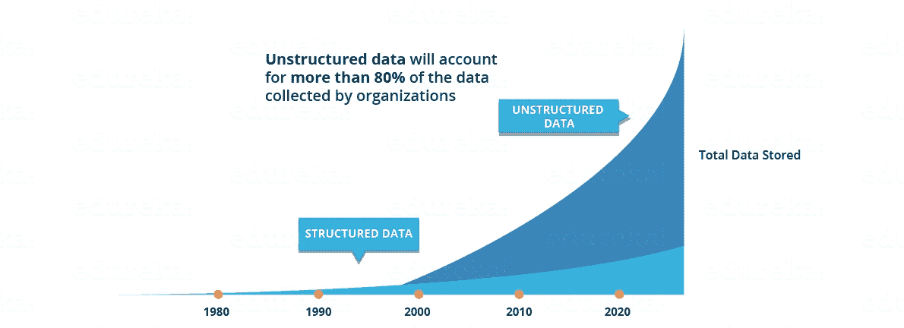

这些数据来自不同的来源，例如财务日志、文本文件、多媒体形式、传感器和仪器。简单的 BI 工具无法处理如此巨大的数据量和多样性。这就是为什么我们需要更复杂、更先进的分析工具和算法来处理、分析并从中得出有意义的洞察。这并不是数据科学变得如此流行的唯一原因。让我们深入了解，看看数据科学在各个领域是如何应用的。

● 如果你能从现有数据中了解客户的精确需求，那将如何？例如客户的过去浏览历史、购买历史、年龄和收入。毫无疑问，你以前也拥有所有这些数据，但现在，随着海量且多样化的数据，你可以更有效地训练模型，并以更高的精度向客户推荐产品。这难道不令人惊叹吗？因为这将为你的组织带来更多业务。

● 让我们换一个场景来了解数据科学在决策中的作用。如果你的汽车拥有驾驶你回家的智能，那将如何？自动驾驶汽车会从传感器（包括雷达、摄像头和激光器）中收集实时数据，以创建其周围环境的地图。基于这些数据，它会做出诸如何时加速、何时减速、何时超车、何处转弯等决策——利用先进的机器学习算法。

● 让我们看看数据科学如何用于预测分析。以天气预报为例。可以从船舶、飞机、雷达和卫星收集并分析数据来构建模型。这些模型不仅能预测天气，还能帮助预测任何自然灾害的发生。这将帮助你提前采取适当措施，挽救许多宝贵的生命。

让我们看看下面的信息图，了解数据科学正在留下印记的所有领域。


既然你已经了解了数据科学的必要性，让我们来了解什么是数据科学。

## 什么是数据科学？

“数据科学”这一术语的使用越来越普遍，但它究竟意味着什么？你需要具备哪些技能才能成为数据科学家？BI 与数据科学有什么区别？数据科学中的决策和预测是如何进行的？这些问题将在后面得到解答。

首先，让我们看看什么是数据科学。数据科学是各种工具、算法和机器学习原理的结合，其目标是从原始数据中发现隐藏的模式。这与统计学家多年来所做的工作有何不同？答案在于解释与预测之间的区别。

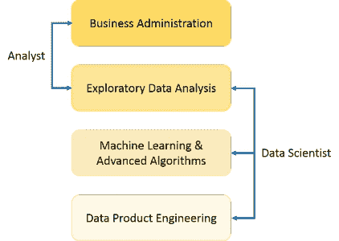

如上图所示，数据分析师通常通过处理数据历史来解释正在发生的事情。另一方面，数据科学家不仅进行探索性分析以从中发现洞察，还利用各种先进的机器学习算法来识别特定事件在未来发生的可能性。数据科学家会从多个角度审视数据，有时是以前未知的角度。因此，数据科学主要用于利用预测性因果分析、指令性分析（预测加决策科学）和机器学习来进行决策和预测。

● 预测性因果分析——如果你想要一个可以预测特定事件在未来发生可能性的模型，你需要应用预测性因果分析。例如，如果你提供信贷资金，那么客户未来按时偿还信贷付款的概率是你关注的问题。在这里，你可以构建一个模型，对客户的付款历史进行预测分析，以预测未来的付款是否按时。

● 指令性分析：如果你想要一个具有自主决策智能并能够根据动态参数进行修改的模型，你当然需要指令性分析。这个相对较新的领域主要关于提供建议。换句话说，它不仅预测，还建议一系列规定的行动及相关结果。

最好的例子是谷歌的自动驾驶汽车，我之前也讨论过。车辆收集的数据可以用于训练自动驾驶汽车。你可以在这些数据上运行算法，使其具备智能。这将使你的汽车能够做出诸如何时转弯、选择哪条路径、何时减速或加速等决策。

● 用于预测的机器学习——如果你拥有金融公司的交易数据，并需要构建模型来确定未来趋势，那么机器学习算法是最佳选择。这属于监督学习范式。之所以称为监督学习，是因为你已经拥有可以用来训练机器的数据。例如，欺诈检测模型可以使用欺诈性购买的历史记录进行训练。

● 用于模式发现的机器学习——如果你没有可以用来进行预测的参数，那么你需要在数据集中找出隐藏的模式，以便能够做出有意义的预测。这无非是非监督模型，因为你没有用于分组的预定义标签。用于模式发现的最常见算法是聚类。

假设你在一家电话公司工作，需要在一个区域部署塔站以建立网络。那么，你可以使用聚类技术来找到那些塔站位置，以确保所有用户都能获得最佳信号强度。

让我们看看上述方法在数据分析和数据科学中的比例如何不同。如下图所示，数据分析包括描述性分析和一定程度的预测。另一方面，数据科学更多地关注预测性因果分析和机器学习。

[预约时段](https://www.edureka.co/mymock-interview-service)

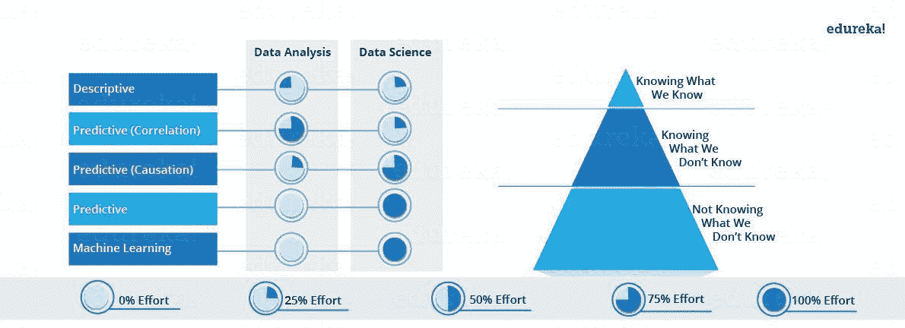

我相信你可能也听说过商业智能（BI）。数据科学常与 BI 混淆。我将列出两者之间一些简洁明确的对比，这将帮助你更好地理解。让我们看看。

## 商业智能 (BI) 与数据科学

● BI 基本上分析历史数据，以发现事后洞察和事中洞察，用于描述业务趋势。BI 使你能够从外部和内部来源获取数据，对其进行准备，运行查询，并创建仪表板，以回答季度收入分析或业务问题等问题。BI 可以评估某些事件在近期的影响。

● 数据科学是一种更具前瞻性的方法，是一种探索性方式，侧重于分析过去或当前数据并预测未来结果，旨在做出明智决策。它回答关于事件“何”以及“如何”发生的开放式问题。

让我们看看一些对比特性。

| 特性 | 商业智能 (BI) | 数据科学 |
| --- | --- | --- |
| 数据来源 | 结构化（通常是 SQL，通常是数据仓库） | 结构化和非结构化（日志、云数据、SQL、NoSQL、文本） |
| 方法 | 统计和可视化 | 统计、机器学习、图分析、神经语言程序设计 (NLP) |
| 侧重点 | 过去和现在 | 现在和未来 |
| 工具 | Pentaho, Microsoft BI, QlikView, R | RapidMiner, BigML, Weka, R |


# 数据科学生命周期

本文介绍了什么是数据科学，现在让我们来了解数据科学的生命周期。在数据科学项目中，一个常见的错误是仓促进入数据收集和分析，而不了解需求，甚至没有正确界定业务问题。因此，在数据科学的整个生命周期中遵循所有阶段，以确保项目顺利运行，对你来说非常重要。

## 数据科学生命周期

以下是数据科学生命周期主要阶段的简要概述：

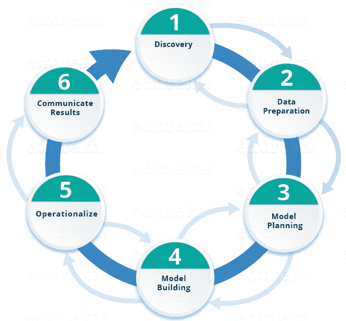

### 阶段 1—发现

在开始项目之前，了解各种规格、要求、优先级和所需预算非常重要。你必须具备提出正确问题的能力。在此阶段，你需要评估在人员、技术、时间和数据方面是否拥有支持项目所需的资源。在此阶段，你还需要界定业务问题并制定初始假设（IH）以进行测试。

### 阶段 2—数据准备

在此阶段，你需要一个分析沙箱，可以在整个项目期间进行分析。你需要在建模之前探索、预处理和整理数据。此外，你将执行 ETLT（提取、转换、加载和转换）以将数据加载到沙箱中。让我们来看看下面的统计分析流程。


你可以使用 `R` 进行数据清洗、转换和可视化。这将帮助你发现异常值并建立变量之间的关系。一旦你清洗并准备好数据，就可以对其进行探索性分析了。让我们看看如何实现这一点。

### 阶段 3—模型规划

在此阶段，你将确定用于绘制变量之间关系的方法和技术。这些关系将为你在下一阶段实现的算法奠定基础。你将使用各种统计公式和可视化工具应用探索性数据分析（EDA）。让我们来看看各种模型规划工具。


1. `R` 拥有完整的建模功能，并为构建可解释模型提供了良好的环境。

2. SQL 分析服务可以使用常见的数据挖掘函数和基本预测模型执行数据库内分析。

3. `SAS/ACCESS` 可用于从 `Hadoop` 访问数据，并用于创建可重复和可重用的模型流程图。

虽然市场上存在许多工具，但 `R` 是最常用的工具。现在你已经了解了数据的性质并决定了要使用的算法。在下一阶段，你将应用算法并构建模型。

### 阶段 4—模型构建

在此阶段，你将开发用于训练和测试的数据集。你将考虑现有工具是否足以运行模型，或者是否需要一个更强大的环境（如快速并行处理）。你将分析各种学习技术，如分类、关联和聚类，以构建模型。

你可以通过以下工具实现模型构建。

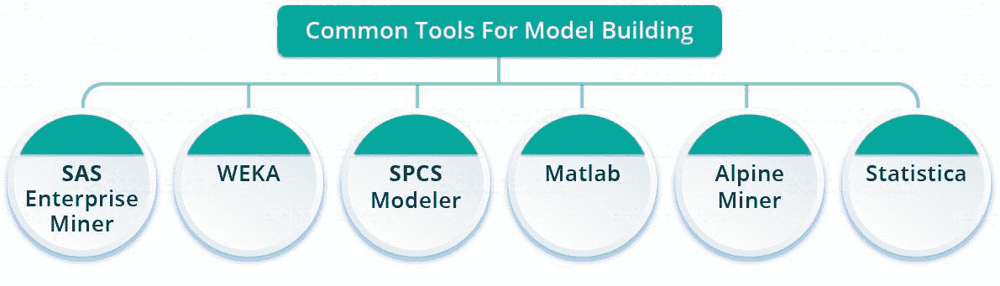

### 阶段 5—运营化

在此阶段，你将交付最终报告、简报、代码和技术文档。此外，有时还会在实时生产环境中实施试点项目。这将在全面部署之前，为你提供小规模下性能及其他相关约束的清晰图景。

### 阶段 6—传达结果

现在，评估你是否实现了在第一阶段计划的目标非常重要。因此，在最后阶段，你将识别所有关键发现，向利益相关者传达，并根据第一阶段制定的标准确定项目结果是成功还是失败。

## 案例研究：糖尿病预防

现在，我将通过一个案例研究来向你解释上述各个阶段。如果我们能预测糖尿病的发生，并提前采取适当措施来预防它，会怎样？

在此用例中，我们将使用之前讨论过的整个生命周期来预测糖尿病的发生。让我们来了解各个步骤。

### 步骤 1

首先，我们将根据患者的病史收集数据，如第一阶段所述。你可以参考下面的示例数据。

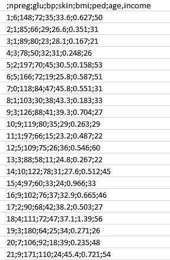

如你所见，我们拥有以下各种属性。属性：

1. `npreg` – 怀孕次数
2. `glucose` – 血浆葡萄糖浓度
3. `bp` – 血压
4. `skin` – 三头肌皮褶厚度
5. `bmi` – 身体质量指数
6. `ped` – 糖尿病谱系函数
7. `age` – 年龄
8. `income` – 收入

### 步骤 2

现在，一旦我们有了数据，就需要清洗和准备数据以进行数据分析。此数据存在许多不一致之处，如缺失值、空列、突发值和错误的数据格式，需要进行清洗。在此，我们将数据组织到不同属性下的单个表中，使其看起来更加结构化。让我们来看看下面的示例数据。

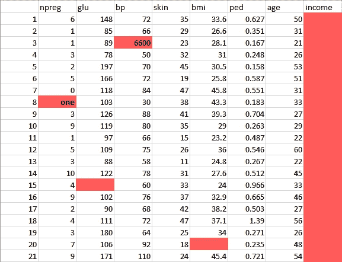

此数据存在许多不一致之处。

1. 在列 `npreg` 中，“one”以单词形式书写，而应以数字形式，如 `1`。
2. 在列 `bp` 中，一个值为 `6600`，这是不可能的（至少对于人类而言），因为 `bp` 不能达到如此巨大的值。
3. 如你所见，`Income` 列为空，并且在预测糖尿病时也没有意义。因此，在此保留它是多余的，应该从表中删除。


● 因此，我们将通过删除异常值、填充空值以及规范化数据类型来清洗和预处理这些数据。如果你记得，这是我们的第二阶段，即数据预处理。

● 最后，我们得到了如下所示的干净数据，可用于分析。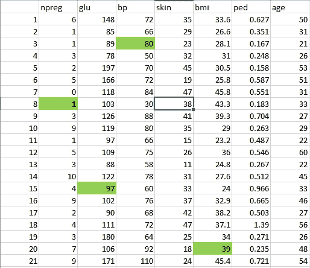

### Step 3: 现在让我们进行前面在第 3 阶段讨论过的一些分析。

● 首先，我们将数据加载到分析沙箱中，并对其应用各种统计函数。例如，R 具有 `describe` 等函数，它能给出缺失值和唯一值的数量。我们也可以使用 `summary` 函数，它将提供均值、中位数、范围、最小值和最大值等统计信息。

● 然后，我们使用直方图、折线图、箱线图等可视化技术，大致了解数据的分布情况。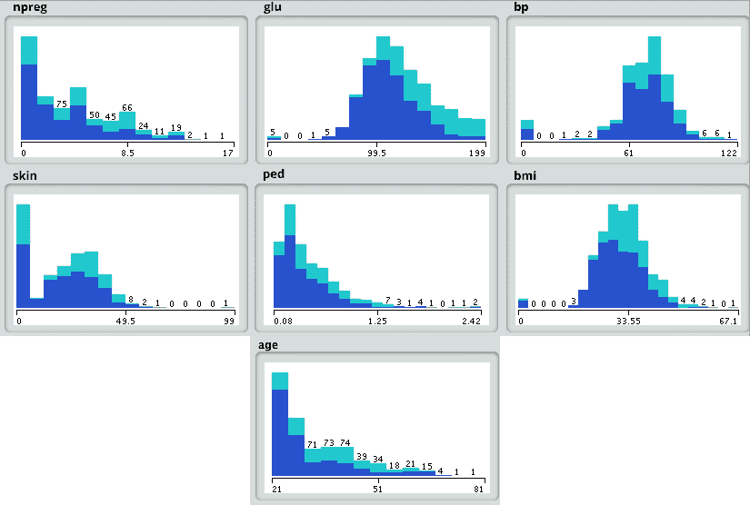

### Step 4: 现在，基于前一步得出的洞察，针对这类问题最合适的是决策树。让我们看看如何实现？

● 由于我们已经拥有用于分析的主要属性，如 `npreg`、`bmi` 等，因此我们将在此使用 `supervised learning` 技术来构建 `model`。

● 此外，我们特别使用了决策树，因为它能一次性考虑所有属性，包括具有 `linear relationship` 的属性以及具有非线性关系的属性。在我们的案例中，`npreg` 与 `age` 之间存在线性关系，而 `npreg` 与 `ped` 之间则存在非线性关系。

● 决策树模型也非常稳健，因为我们可以使用不同的属性组合构建各种决策树，然后最终实现效率最高的那一个。让我们来看看我们的决策树。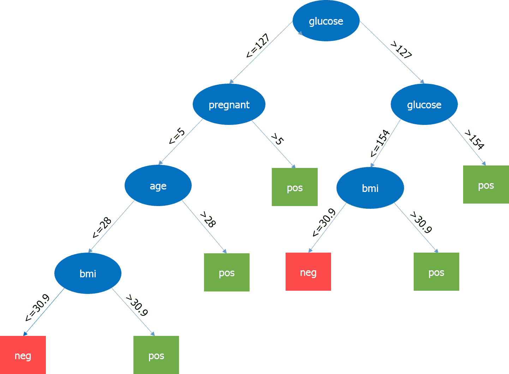

这里，最重要的参数是血糖水平，因此它是我们的根节点。现在，当前节点及其值决定了 `the next important parameter to be taken`。此过程持续进行，直到我们得到 `pos` 或 `neg` 的结果。Pos 表示患糖尿病的倾向为阳性，neg 表示患糖尿病的倾向为阴性。

### Step 5: 在此阶段，我们将运行一个小型试点项目，以检查我们的结果是否合适。我们还将查找是否存在任何性能限制。如果结果不准确，那么我们需要重新规划并重建模型。

### Step 6: 一旦我们成功执行了项目，我们将共享输出以进行全面部署。做一名数据科学家说来容易做来难。那么，让我们看看成为一名数据科学家需要具备哪些条件。

数据科学家基本上需要来自三个主要领域的技能，如下所示。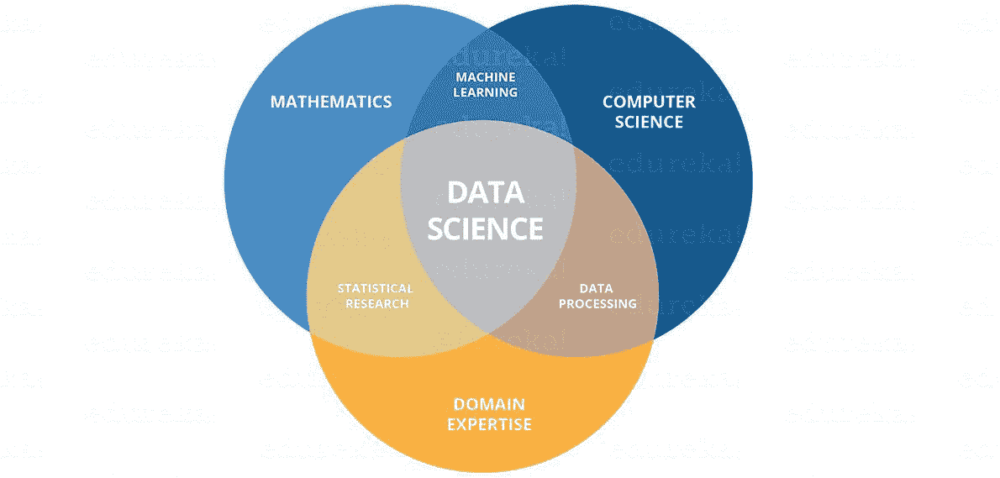

正如你在上面的图片中所见，你需要掌握各种硬技能和软技能。你需要精通 `statistics` 和 `mathematics` 来分析和可视化数据。不用说，`Machine Learning` 构成了数据科学的核心，并要求你精通它。此外，你需要对所工作的 `domain` 有深入的理解，以便清晰地理解业务问题。你的任务并未在此结束。你应该能够实现各种算法，这需要 `good coding skills`。最后，一旦你做出某些关键决策，将其交付给利益相关者就很重要。因此，良好的 `communication` 无疑会为你的技能锦上添花。


# PYTHON 基础

欢迎！这是你第一次接触编程吗？如果不是，那么我们假设你想学习如何使用 Python 进行机器学习。此外，你可能也在寻找关于为什么以及如何开始使用 Python 的信息。如果你是任何语言的专家程序员，那么你会很快上手 Python。在开始使用 Python 之前，你需要知道如何在计算机上安装 Python。接下来，你需要知道一些关于语言语法的概念，以便能够阅读和理解 Python 代码。本章将带你了解所有这些内容。所以，准备好学习 Python 语言中的一些重要事项吧。

## 安装

如今，大多数 UNIX 和 Linux 发行版都预装了较新版本的 Python。即使是某些 HP 微软计算机也已经预装了 Python。

### 下载 Python

在开始使用 Python 进行机器学习之前，你的计算机上必须安装 Python，不过，你可能不需要下载它。所以，首先要做的是通过在命令窗口中输入 `Python` 来确认 Python 是否未安装。当你看到 Python 解释器的响应时，它将在其原始显示中包含一个版本号。一般来说，任何较新版本都可以工作，因为 Python 试图保持向后兼容性。如果你想安装 Python，不妨搜索最新的稳定版本。该版本将具有最高版本号，且未标记为 alpha 或 beta 版本。如果你运行的是 Windows 操作系统，最稳定的 Windows 下载可以在 Python for Windows 页面找到。如果你运行的是 Windows XP，你将在“Python on XP”中找到安装 ActivePython 的完整指南。对于使用 Mac 的用户，你可以导航到“Python for Mac OS X 页面”。对于使用 Debian 或 Ubuntu 的用户，你应该安装 `python2x` 和 `pythonn2.x-deve` 包。

## 语法

Python 程序是借助文本编辑器编写的，并且必须具有 `.py` 扩展名。Python 程序的第一行和最后行不是必须的，但它可以将 Python 的位置作为第一行 `#!/usr/bin/python` 并变得可执行。尽管如此，命令提示符是另一个环境，你可以通过输入 `python file.py` 来运行 Python 程序。在 Python 中，没有分号和花括号。它是一种高级语言。因此，不使用花括号，而是通过选择相同的缩进来选择代码块。

### 第一个 Python 程序

通常，当你开始学习任何编程语言时，你要编写的第一个程序将是“Hello, World!”。这是一个打印“Hello, World!”的简单程序。对于我们的第一个 Python 程序，你将学习如何编写一个加两个数字的程序。

加两个数字的程序 

上面的程序是如何工作的？程序的第一行以注释开头。Python 编程中的注释以 `#` 开头。Python 解释器和编译器会忽略注释。在 Python 编程中应用注释的原因是为了描述代码的功能。此外，注释有助于任何其他程序员理解你的代码的工作原理。

## 变量和数据类型

顾名思义，数据类型是不同类型的数据的类别。它定义了一组值以及可以对这些值进行的操作。我们程序中使用的显式值是字面量。例如，`11`、`30.22`、`‘pypi’` 都是字面量。每个字面量都有一个与之关联的类型。例如，`11` 是 `int` 类型，`30.22` 是 `float` 类型，`‘pypi’` 是 `string` 类型。通常，字面量的类型将决定可以对其进行的操作类型。下表包含 Python 中的基本数据类型。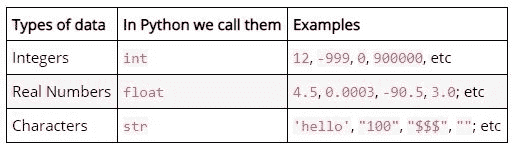

Python 包含一个名为 `type()` 的内置函数，用于定义字面量的数据类型。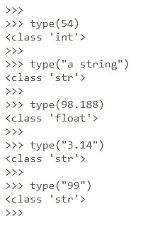 `<class ‘int’>` 描述 `54` 的类型是 `int`。此外，`<class ‘str’>` 和 `<class ‘float’>` 分别显示“a string”和 `98. 188` 是 `str` 和 `float` 类型。起初，你可能会说“`3.14`”是 `float` 类型，但由于它被双引号括起来，它肯定是一个字符串。同样，“`99`”也是一个字符串。

字符数据序列是字符串。Python 中的字符串类型称为 `str`。字符串字面量可以用单引号或双引号定义。开头和结尾引号内的所有字符都是字符串的一部分，如下所示：`\>>> ''  ''`

### 字符串中的转义序列

有时你希望 Python 对字符串中的字符序列进行不同的解释。这可能以一两种方式发生：
• 如果你想抑制特定字符在字符串中提供的唯一解释。
• 你想要对字符串中通常被字面理解的字符应用特定解释。

你可以通过使用反斜杠 (`\`) 字符来做到这一点。字符串中的反斜杠字符意味着紧随其后的一个或多个字符必须被特殊处理。这被称为转义序列，因为反斜杠会使随后的字符序列“逃脱”其正常含义。

### 布尔类型

Python 3 有一个布尔数据类型。布尔类型的对象可能包含一个或两个值，`False` 或 `True`。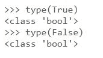

Python 表达式在布尔上下文中被求值。这意味着它们被解释为表示假或真。布尔中的真值被描述为“Truthy”，而假值被描述为“Falsy”。布尔类型对象的真实性是开放的。这意味着等于 `True` 的对象是 Truthy，等于 `False` 的对象是 Falsy。但是，不是布尔类型的对象可以在布尔上下文中被求值并确定为真或假。

## Python 变量

在第一个 Python 程序中，你了解了 Python 变量。你简要地看到了如何在 Python 中定义变量并为它们赋值。本节将更详细地讨论 Python 中的变量。像任何其他编程语言一样，变量用于存储值。此外，你可以使用变量来访问数据和操作数据。

### 创建变量

如果你想在 Python 中创建变量，必须使用赋值运算符。下面显示的格式在你想要创建变量时适用。

`variable_name = expression`


一个示例可以是：`number = 12`。此语句将创建一个名为 `number` 的变量并为其赋值 `12`。当 Python 解释器遇到此语句时，它会在幕后执行以下操作。
1. 将变量“`12`”存储在内存中的给定位置。
2. 使变量 `number` 指向它。

关键的理解是，变量 `number` 本身没有任何值，它只指向包含原始值的内存位置。另一个需要注意的重要事项是，当你为变量赋值时，确保将变量名写在赋值 (`=`) 运算符的左侧。如果你不这样做，你会得到一个语法错误。

Python 始终根据变量的值检测变量的类型以及对其执行的操作。描述这一点的编程术语称为动态类型。这意味着你可以使用同一个变量来引用最初指向的不同类型的数据。每当你为变量赋予新值时，对先前值的引用就会丢失。例如，如果变量 `number` 被赋予字符串“`ten`”，则对值“`12`”的引用丢失。此时，将没有变量指向该内存位置。当这种情况发生时，Python 解释器将通过垃圾回收自动从内存中删除该值。如果你尝试在为变量赋值之前访问它，你会得到一个 `NameError`。

## 控制流

程序中的控制流突出了程序执行的顺序。在 Python 程序中，控制流是通过函数调用、条件语句和循环来执行的。本节将讨论 If 语句、While 和 For 循环。

### If 语句

有时你可能希望在某些条件成立时运行某些语句，或者根据不同的互斥条件决定运行哪种类型的语句。Python 有复合“If 语句”，由“if”、“elif”和“else”子句组成。这些复合语句允许你有条件地创建语句块。下面是 If 语句的一般声明。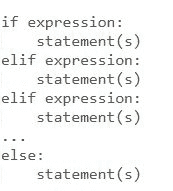

这里，“elif”和“else”子句是可选的。作为提醒，Python 中没有 switch 语句，这意味着你需要应用“elif”、“if”和“else”来进行条件处理。看一下这个 If 程序示例。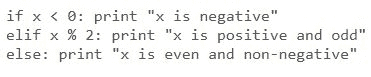

### While 语句

在 Python 中，WHILE 语句支持在条件表达式控制下重复执行语句甚至语句块。看一下 While 语法。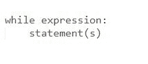

While 语句也可以包含 'else' 子句、'break and continue' 语句。下面是 Python 中 While 程序示例。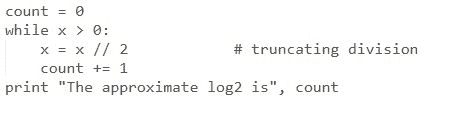

### For 语句

Python 语言也包含 for 语句，它支持重复执行程序语句。for 语句有一个可迭代表达式来控制语句块。下面是 for 语句的一般语法。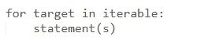

请记住，“`in`”是一个关键字。它是 For 语句语法的一部分，但与应用于成员资格测试的“`in`”运算符无关。For 语句可以有 else 子句、break 和 continue 语句。下面是 For 语句的一般声明形式：

## 数据结构

它们是有助于数据存储的结构。数据结构有一个相互关联的数据集合。在 Python 中，有 4 个内置数据结构。它们如下：
• 元组
• 列表
• 字典
• 集合

下面是每个数据结构的详细描述。

### 列表

列表描述具有有序项目集合的数据结构。考虑一个购物清单，其中有几个你需要购买的项目。唯一的区别是你的购物清单每个项目都在单独一行。但是，在 Python 中的列表的情况下，你只需要用逗号分隔你的项目。一旦你创建一个列表，你就有权在同一个列表中添加、删除或搜索项目。由于列表允许你添加和删除项目，它被视为可变数据类型。这意味着你可以随时更改它。

### 对象和类快速入门

为了更多地了解 Python 语言中的列表，最好快速向你介绍对象和类的概念。列表是对象和类的一个示例。因此，如果你打算使用变量 `j` 并为其分配一个值，比如整数 `7`，那么重要的是要将其视为你正在创建对象 `j`。类包含方法。方法和函数相似。但是，方法仅在该类中定义。因此，访问函数的唯一方法是拥有该类中的对象。例如，在 Python 语言中，你可以将一个方法连接到列表类，该方法允许该类的对象。Python 语言有列表类的 `append` 方法，它允许将项目添加到列表末尾。

Python 中的类具有字段，字段采用声明为仅在特定类中使用的变量的形式。这意味着如果你想使用这些变量，你需要拥有该类的对象。你通过点号表示法访问字段。例如，`mylist.field`。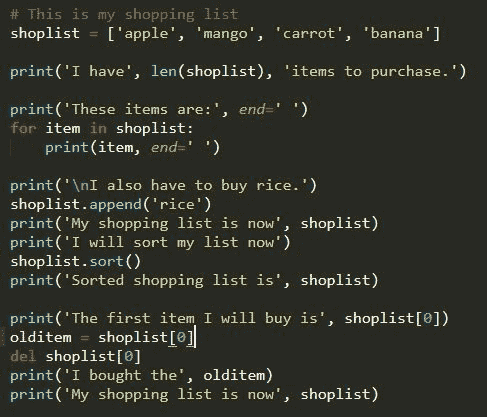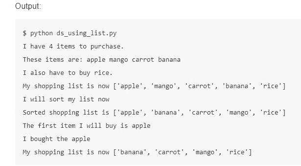

它的工作原理如下 有一个变量，“`shoplist`”，其中包含一个人计划去市场的信息。“`shoplist`”允许你存储你计划购买的物品名称的字符串。但是，你可以添加任何类型的对象，比如数字。这个程序还有一个‘for’循环，它将支持在列表中进行迭代。你应该开始意识到列表类似于序列。注意如何使用结束参数来调用 `print` 函数。这表明你希望以空格而不是正常的换行符结束输出。接下来，你应该使用 `append` 方法向列表中添加一个项目。使用 `print` 函数检查项目是否已添加。程序中还有一个排序方法。其目的是对列表进行排序。需要注意的是，这个特定的方法会影响列表本身，不能返回一个修改后的列表。接下来是完成从市场购买物品。这个过程相当于从列表中删除一个项目。你可以借助 `del` 语句来完成此操作。对于此场景，你需要描述列表中你想要删除的项目。然后使用 `del` 语句将其从列表中删除。之后，`del` 语句将其从列表中删除。要在 Python 中删除列表中的项目，你只需写下以下行函数 `del shoplist[0]`。

### 元组

元组存储多个对象。它们与列表类似，但不像列表类那样有很多函数。元组的一个伟大特性是它像字符串一样不可变。这意味着很难更改元组。如果你想定义元组，你必须描述项目并用逗号分隔它们。元组最适合用于值集合不能更改的情况。例如：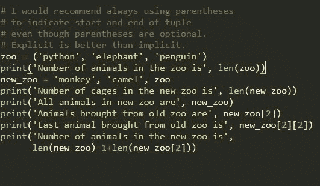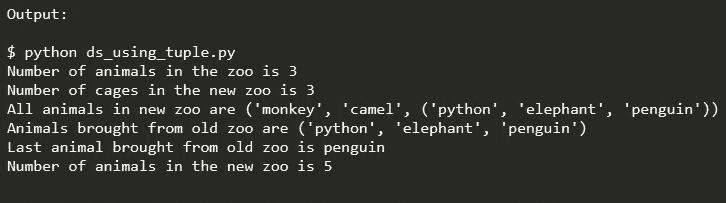

### 字典

字典类似于地址簿，你可以通过选择某人的姓名来搜索其详细信息。在字典中，键与值相连。请记住，键必须是唯一的，你可以再次使用不可变对象作为字典键，无论是对字典值应用可变对象还是不可变对象。请记住，字典中的键值对没有固定的排列。示例：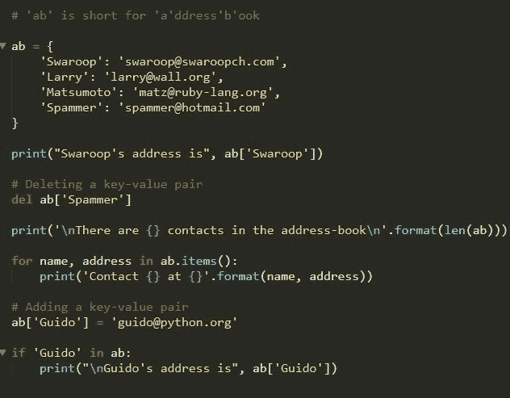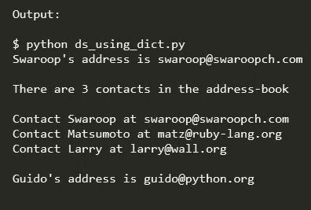


# 使用 Python 进行数据科学

## 入门：为数据科学家使用 Python

在本书中，我们将遇到许多实际示例。在本章中，我们将使用一个非常基础的示例来帮助您从零开始搭建数据科学生态系统。为了执行我们的示例，我们将使用 Jupyter notebook，尽管也可以使用其他控制台或 IDE。

### Jupyter Notebook 环境

生态系统完全安装后，我们可以开始启动 Jupyter notebook 平台。这可以直接完成，只需在终端或命令行中输入以下命令：

```
$ jupyter notebook
```

如果我们选择了捆绑安装，可以通过在开始菜单或桌面上点击 Anaconda 安装的 Jupyter Notebook 图标来启动 Jupyter notebook 平台。浏览器会立即启动，显示 Jupyter notebook 主页，其 URL 为 `http://localhost:8888/tree`。请注意使用了特殊的端口；默认是 8888。此初始页面显示一个目录的树视图。如果我们使用命令行，根目录是启动 Jupyter notebook 的同一目录。否则，如果使用 Anaconda 启动器，根目录是当前用户目录。

现在，要开始一个新笔记本，我们只需在主页顶部右侧按下 (New Notebooks Python 2) 按钮。会创建一个名为 Untitled 的空白笔记本。首先，我们将把笔记本的名称改为更合适的名称。为此，只需点击笔记本名称并重命名：`DataScienceGetStartedExample`。

让我们开始导入我们程序所需的工具箱。在第一个单元格中，我们放置导入 Pandas 库为 `pd` 的代码。这是为了方便；每当我们需要使用 Pandas 库中的某些功能时，我们将写 `pd` 而不是 `pandas`。我们还将导入上面提到的两个核心库：NumPy 库作为 `np` 和 Matplotlib 库作为 `plt`。

```
import pandas as pd
import numpy as np
import matplotlib.pyplot as plt
```

要执行单个单元格，我们按下按钮，或点击 Cell Run，或按 Ctrl + Enter 键。执行进行时，单元格的标题显示 `*` 标记：

```
import pandas as pd
import numpy as np
import matplotlib.pyplot as plt
```

当一个单元格正在执行时，其他单元格无法执行。如果尝试执行另一个单元格，其执行将不会开始，直到第一个单元格完成执行。一旦执行完成，单元格的标题将被下一次执行的编号所取代。由于这是第一个执行的单元格，显示的编号将为 1。如果导入库的过程正确，则不会产生输出单元格。

## 读取、选择和过滤您的数据

### 读取

让我们开始读取我们下载的数据。首先，我们必须创建一个名为 Open Government Data Analysis 的新笔记本并打开它。然后，在确保 `edu_figdp_1_Data.csv` 文件存储在与笔记本目录相同的目录后，我们将编写以下代码来读取并显示其内容：

```
edu = pd.read_csv('files/ch02/educ_figdp_1_Data.csv', na_values = ':', usecols = ["TIME","GEO","Value"])
edu
```

在 Pandas 中读取 CSV（或任何其他分隔值，提供分隔符字符）文件的方式是使用 `read_csv` 方法。除了文件名之外，我们向此方法添加 `na_values` 关键字参数以及文件中表示“不可用数据”的字符。通常，CSV 文件有一个包含列名的标题。如果是这种情况，我们可以使用 `usecols` 参数来选择将使用的文件中的哪些列。在这种情况下，从读取数据得到的数据框存储在 `edu` 中。执行的输出显示 `edu` 数据框大小为 384 行 × 3 列。由于数据框太大而无法完全显示，每个行的中间会出现省略号。除此之外，Pandas 还有用于读取 Excel、HDF5、制表文件或剪贴板内容等格式文件的函数（`read_excel()`、`read_hdf()`、`read_table()`、`read_clipboard()`）。无论我们使用哪个函数，读取文件的结果都存储为 DataFrame 结构。

要查看数据看起来如何，我们可以使用 `head()` 方法，它只显示前五行。如果我们使用数字作为参数，这将是列出的行数：

```
edu.head()
```

同样，您可以使用 `tail()` 方法，默认返回最后五行：

```
edu.tail()
```

如果我们想知道列名或索引名，可以分别使用 DataFrame 属性 `columns` 和 `index`。列名或索引名可以通过为这些属性分配相同长度的新列表来更改。任何 DataFrame 的值都可以作为 Python 数组通过其 `values` 属性获取。如果我们只想快速了解 DataFrame 中所有数值列的统计信息，可以使用 `describe()` 函数。此结果默认显示每个列或系列中所有值的计数、均值、标准差、最小值和最大值，以及第 25、50 和 75 百分位。

### 选择

如果我们想从 DataFrame 中选择数据的子集，就需要在 DataFrame 后使用方括号（`[]`）来指示此子集。子集可以用多种方式指定。如果我们只想从 DataFrame 中选择一列，只需在方括号之间放置其名称即可。结果将是 Series 数据结构，而不是 DataFrame，因为只检索了一列：

```
edu['Value']
```

如果我们想从 DataFrame 中选择一行子集，可以通过在方括号内用冒号（`:`）指示一系列行来做到这一点。这通常被称为行的‘切片’：此指令返回从第 10 到第 13 位置的行切片。请注意，切片不使用索引标签作为引用，而是使用位置。在这种情况下，行的标签恰好与行的位置一致。如果我们想使用标签作为引用而不是位置来选择列和行的子集，可以使用 `ix` 索引：这返回在逗号之前切片中指定的索引之间的所有行，以及逗号之后作为列表指定的列。在这种情况下，`ix` 引用索引标签，这意味着 `ix` 不返回第 90 到 94 行，而是返回标记为 90 的行到标记为 94 的行之间的所有行；因此，如果索引‘100’放置在标记为 90 和 94 的行之间，此行也将被返回。

### 过滤

选择数据子集的另一种方法是应用布尔索引。这种索引通常被称为‘过滤器’。例如，如果我们想过滤小于或等于 6.5 的值，可以这样做：

```
edu[edu['Value'] > 6.5].tail()
```

布尔索引使用对数据的布尔运算结果，返回每个行的 True 或 False 掩码。掩码中标记为 True 的行将被选中。在前面的示例中，布尔运算 `edu['Value'] > 6.5` 产生一个布尔掩码。当“Value”列中的元素大于 6.5 时，掩码中对应的值设置为‘True’，否则设置为‘False’。然后，当此掩码作为索引应用于 `edu[edu['Value'] > 6.5]` 时，结果是一个仅包含值高于 6.5 的行的过滤数据框。当然，任何常用的布尔运算符都可用于过滤：`<`（小于）、`<=`（小于或等于）、`>`（大于）、`>=`（大于或等于）、`=`（等于）和 `!=`（不等于）。

### 过滤缺失值

Pandas 使用特殊值 `NaN`（非数字）来表示缺失值。在 Python 中，`NaN` 是一个特殊的浮点值，由某些操作返回，当其结果以未定义值结束时。由于 `NaN` 值的微妙特性，两个 `NaN` 从不相等。因此，判断 DataFrame 中的值是否缺失的唯一安全方法是使用 `isnull()` 函数。事实上，此函数可用于过滤具有缺失值的行。

## 操作与排序数据

### 操作

一旦我们知道如何选择所需数据，下一步需要知道如何操作数据。我们可以做的一件最直接的事情是使用聚合函数对列或行进行操作。表 2.1 显示了最常见的聚合函数列表。将所有这些函数应用于行或列的结果始终是一个数字。同时，如果函数应用于 DataFrame 或行和列的选择，则可以指定函数应应用于每列的行（在函数调用中设置 `axis=0` 关键字），或应应用于每行的列（在函数调用中设置 `axis=1` 关键字）。请注意，这些是 Pandas 特定的函数，而不是通用 Python 函数。它们的实现存在差异。在 Python 中，`NaN` 值会通过所有操作传播，而不会引发异常。相比之下，Pandas 操作会排除表示缺失数据的 `NaN` 值。例如，Pandas `max` 函数排除 `NaN` 值，因此它们被解释为缺失值；而标准 Python `max` 函数会采用 `NaN` 的数学解释并将其作为最大值返回：

```
edu.max(axis = 0)
```

除了这些聚合函数之外，我们还可以对行、列或两者的组合中的所有值进行操作。经验法则是，列之间的操作意味着它应用于该列中的每一行，而行之间的操作意味着它应用于该行中的每一列。例如，我们可以对整行应用任何二进制算术运算（`+`、`-`、`*`、 `/`）：

```
s = edu["Value"]/100
s.head()
```

然而，我们可以通过将其名称设置为 `apply` 方法的参数来将任何函数应用于 DataFrame 或 Series。例如，在以下代码中，我们应用 NumPy 库中的 `sqrt` 函数来计算 Value 列中每个值的平方根。如果我们需要设计一个特定的函数来应用它，我们可以编写一个内联函数，通常称为 λ 函数。λ 函数是一个没有名称的函数。只需在 `lambda` 关键字和冒号（`:`）之间指定它接收的参数。在下一个示例中，只需要一个参数，它将是 Value 列中每个元素的值。函数返回的值将是该值的平方：

```
s = edu["Value"].apply(lambda d: d**2)
s.head()
```

另一个基本的操作是设置我们 DataFrame 中的新值。这可以直接通过使用赋值运算符（`=`）对 DataFrame 进行操作来完成。例如，要向 DataFrame 添加新列，我们可以将 Series 分配给不存在的列进行选择。这将在 DataFrame 中产生一个新列，显示在所有其他列之后。您必须注意，如果已存在同名列，其先前的值将被覆盖。在以下示例中，我们将 Value 列除以同一列中的最大值得到的结果 Series 分配给名为‘ValueNorm’的新列。现在，如果我们想从 DataFrame 中删除此列，可以使用 `drop` 函数；这会删除如果‘axis=0’则为指示的行，或如果‘axis=1’则为指示的列。在 Pandas 中，所有更改 DataFrame 内容的函数，例如 `drop` 函数，通常会返回修改后数据的副本，而不是覆盖 DataFrame。因此，原始 DataFrame 保持不变。如果您不想保留旧值，可以将关键字 `inplace` 设置为‘True’。默认情况下，此关键字设置为‘False’，意味着返回数据的副本：

```
edu.drop('ValueNorm', axis = 1, inplace = True)
edu.head()
```

相反，如果我们想在 DataFrame 底部插入新行，可以使用 Pandas `append` 函数。此函数接收作为参数的新行，其表示为字典，其中键是列名，值是相关值。您必须确保在 `append` 方法中设置 `ignore_index` 标志为‘True’，否则此新行将被赋予索引 0，如果它已存在则会产生错误：

```
edu = edu.append({"TIME": 2000,"Value": 5.00,"GEO": 'a'} , ignore_index = True)
edu.tail()
```

最后，如果我们想删除此行，需要再次使用 `drop` 函数。现在，我们必须将 `axis` 设置为 0，并指定要删除的行的索引。由于我们想删除最后一行，可以使用索引上的 `max` 函数来确定它是哪一行。`drop()` 函数还用于通过将其应用于 `isnull()` 函数的结果来删除缺失值。这与我们上面解释的过滤 `NaN` 值具有类似的效果，但这里的区别是返回一个没有 `NaN` 值的 DataFrame 的副本，而不是视图。要删除 `NaN` 值，除了通用的 `drop` 函数之外，我们还可以使用特定的 `dropna()` 函数。如果我们想删除包含 `NaN` 值的任何行，必须将 `how` 关键字设置为‘any’。要将其限制为列的子集，我们可以使用 `subset` 关键字进行指定。如下面所示，结果将与使用 `drop` 函数相同：

```
eduDrop = edu.dropna(how = 'any', subset = ["Value"])
eduDrop.head()
```

如果我们不是删除包含 NaN 的行，而是想用另一个值填充它们，则可以使用 `fillna()` 方法，指定要使用的值。如果我们只想填充某些特定列，必须将包含列名作为键、填充字符作为值的字典作为参数传递给 `fillna()` 函数。

### 排序

当检查数据时，我们将需要的另一个重要功能是按列排序。我们可以使用任何列使用 `sort` 函数对 DataFrame 进行排序。如果我们想查看按 Value 列以降序（即从最大值到最小值）排序的数据的前五行，则只需执行以下操作：

请注意，`inplace` 关键字意味着 DataFrame 将被覆盖，因此不会返回新的 DataFrame。如果我们使用 `ascending = True` 而不是 `ascending = False`，值将按升序排序（即从最小值到最大值）。如果我们想返回到原始顺序，可以使用 `sort_index` 函数按索引排序并指定 `axis=0`：

```
edu.sort_index(axis = 0, ascending = True, inplace = True)
edu.head()
```

## 分组与重新排列数据

### 分组

检查数据的另一种非常有用的方法是根据既定标准对其进行分组。例如，在我们的示例中，将所有数据按国家/地区分组，而不考虑年份会很好。Pandas 有 `groupby` 函数，允许我们完全做到这一点。此函数返回的值是一个特殊的分组 DataFrame。为了得到正确的数据框作为结果，有必要应用一个聚合函数。因此，此函数将应用于同一组中的所有值。例如，在我们的情况下，如果我们想要一个按国家/地区显示所有年份平均值的 DataFrame，我们可以通过按国家/地区分组并使用 `mean` 函数作为每个组的聚合方法来获得它。结果将是一个以国家/地区为索引、平均值作为列的数据框：

```
group = edu[["GEO", "Value"]].groupby('GEO').mean()
group.head()
```

### 重新排列

到目前为止，我们的索引只是没有太多意义的行编号。我们可以转换数据的排列方式，重新分配索引和列以便更好地操作数据，这通常会导致更好的性能。我们可以使用 `pivot_table` 函数重新排列数据。在这里，我们可以指定哪些列将成为新的索引、新的值和新的列。例如，假设我们想将我们的数据框转换为类似电子表格的结构，国家名称作为索引，列为从 2006 年开始的年份，值将是之前的 Value 列。为此，我们首先需要过滤数据，然后以这种方式将其透视：

```
filtered_data = edu[edu["TIME"] > 2005]
pivedu = pd.pivot_table(filtered_data, values = 'Value', index = ['GEO'], columns = ['TIME'])
pivedu.head()
```

现在我们可以使用新索引通过标签选择特定行，使用 `ix` 运算符：

```
pivedu.ix[[ 'Spain','Portugal'], [2006,2011]]
```

Pivot 还提供 `aggr_func` 参数的选项，允许我们在转换后给定行和列有多个值时对值执行聚合函数。像往常一样，您可以设计任何自定义函数，只需给出其名称或使用 λ 函数。

## 描述性统计

描述性统计有助于以合理的方式简化大量数据。与将在后面章节介绍的推断统计不同，描述性统计不会超出我们正在分析的数据得出结论；我们也不会对我们可能做出的任何假设得出任何结论。我们不试图推断数据的“总体”（见下文）特征，而是声称以可管理形式呈现数据的定量描述。它只是描述数据的一种方式。统计学，特别是描述性统计，基于两个主要概念：

- 总体是关于其寻求信息的对象、项目（“单位”）的集合；
- 样本是被观察的总体的一部分。

描述性统计应用用于描述研究中样本基本特征的概念、度量和术语。这些程序对于提供关于样本的摘要作为总体近似至关重要。它们与简单的图形一起构成了数据定量分析的基础。

为了描述样本数据并能够推断结论，我们必须经过几个步骤：

- 数据准备：给定一个特定示例，我们需要为生成统计上有效描述而准备数据。
- 描述性统计：这会生成不同的统计数据以简洁地描述和总结数据，并评估可视化它们的不同方式。

### 数据准备

分析数据时首先要做的事情之一是收集和准备数据，使其格式适合样本分析。数据准备最常见的步骤涉及以下操作。

获取数据：数据可以直接从文件中读取，或可能通过网络抓取获得。

解析数据：正确的解析程序取决于数据的格式：纯文本、固定列、CSV、XML、HTML 等。

清理数据：调查回复和其他数据文件几乎总是 incomplete。有时，对于“未询问”、“不知道”和“拒绝回答”等情况存在多个代码。几乎总是有错误。一个简单的策略是删除或忽略不完整的记录。

构建数据结构：一旦读取数据，就有必要将其存储在适合我们感兴趣的分析的数据结构中。如果数据适合内存，构建数据结构通常是可行的方法。如果不适合，通常会构建数据库，这是一个超出内存的数据结构。大多数数据库提供从键到值的映射，因此它们充当字典。

## 探索性数据分析

对样本中所有受试者进行特定测量得到的数据代表了我们对单个特征（如国家、年龄、教育等）的观察。这些测量和类别代表了变量的样本分布，进而近似代表了变量的总体分布。探索性数据分析的主要目标之一是可视化和总结样本分布，从而使我们能够对总体分布做出暂定假设。

### 总结数据

数据可以是分类的或定量的。对于分类数据，每个类别频率的简单汇总表是数据分析的最佳非图形探索。例如，我们可以问自己在数据库中识别高收入专业人士的比例：

```
df1 = df [(df.income == ' >50K\n')]
print 'The rate of people with high income is: ', int(len(df1)/float(len(df))*100), '%.'
print 'The rate of men with high income is: ', int(len(ml1)/float(len(ml))*100), '%.'
print 'The rate of women with high income is: ', int(len(fm1)/float(len(fm))*100), '%.'
```

高收入人群的比例为：24 %。
高收入男性的比例为：30 %。
高收入女性的比例为：10 %。

对于定量变量，探索性数据分析是一种通过观察样本数据对变量的总体分布进行初步评估的方法。定量变量总体分布的特征是其均值、偏差、直方图、异常值等。我们的观察数据代表了通常无限多个可能样本的有限样本集。我们随机观察的样本的特征只有在它们代表它们来自的数据总体时才有趣。

#### 均值

从数据中获得样本统计的第一项测量之一是样本均值。给定 n 个值 {xi}，i = 1,..., n 的样本，均值 μ 是值的总和除以值的数量。术语‘均值’和‘平均值’经常互换使用。事实上，它们之间的主要区别在于样本的均值是按方程（3.1）计算的汇总统计量，而平均值没有严格定义，可能是选择来描述样本中心趋势的许多汇总统计量之一。在我们的例子中，我们可以考虑我们的数据集中男性和女性的平均年龄以其均值表示：

```
print 'The average age of men is: ', ml['age'].mean()
print 'The average age of women is: ', fm['age'].mean()
print 'The average age of high-income men is: ', ml1['age'].mean()
print 'The average age of high-income women is: ', fm1['age'].mean()
```

男性的平均年龄为：39.4335474989
女性的平均年龄为：36.8582304336
高收入男性的平均年龄为：44.6257880516
高收入女性的平均年龄为：42.1255301103

样本均值的这种差异可以被视为男性与女性高收入者之间存在差异的初步证据！

评论：稍后，我们将同时处理这两个概念：总体均值和样本均值。我们不应该混淆它们！前者是取自总体的样本的均值；后者是整个总体的均值。

#### 样本方差

均值通常不是数据的充分描述符。我们可以通过知道两个数字来更进一步：均值和方差。方差 σ2 描述数据的离散程度。术语 (xi − μ) 称为均值偏差，因此方差是均方偏差。方差的平方根 σ 称为标准差。我们考虑标准差，因为方差难以解释（例如，如果单位是克，方差就是克平方）。

让我们计算我们数据集中男性和女性每周工作小时数的均值和方差：

```
ml_mu = ml['age'].mean()
fm_mu = fm['age'].mean()
ml_var = ml['age'].var()
fm_var = fm['age'].var()
ml_std = ml['age'].std()
fm_std = fm['age'].std()
print 'Statistics of age for men: mu:', ml_mu, 'var:', ml_var, 'std:', ml_std
print 'Statistics of age for women: mu:', fm_mu, 'var:', fm_var, 'std:', fm_std
```

我们可以看到女性每周工作小时数的均值明显少于男性，但方差和标准差要高得多。

#### 样本中位数

样本的均值是一个很好的描述符，但它有一个显著的缺点：如果在样本集中有一个与其它值非常不同的错误值会怎样？例如，考虑每周工作小时数，通常在 20 到 80 之间；但如果由于错误而有一个 1000 的值会怎样？与数据其余部分显著不同的数据项称为异常值。在这种情况下，均值 μ 将被极大地向异常值偏移。解决这一缺陷的方案由统计中位数 μ12 提供，它是一个顺序统计量，给出样本的中间值。在这种情况下，所有值按其大小排序，中位数定义为有序列表中间的值。因此，它在面对异常值时更加稳健。

让我们看看我们数据集中工作男性和女性的中位年龄以及高收入男性和女性的中位年龄：

```
ml_median = ml['age'].median()
fm_median = fm['age'].median()
print "Median age per men and women: ", ml_median, fm_median
ml_median_age = ml1['age'].median()
fm_median_age = fm1['age'].median()
print "Median age per men and women with high-income: ", ml_median_age, fm_median_age
```

男性和女性的中位年龄：38.0 35.0
高收入男性和女性的中位年龄：44.0 41.0

如预期，高收入人群的中位年龄高于全体工作人群，尽管两组中男性和女性之间的差异相同。

#### 分位数和百分位数

有时我们对样本数据总体如何分布感兴趣。在这种情况下，我们可以对样本 {xi} 进行排序，然后找到 xp，使得它将数据分为两部分，其中：

- 分数 p 的数据值小于或等于 xp
- 剩余分数 (1 − p) 大于 xp。

该值 xp 是第 p 分位数，或第 100 × p 百分位数。例如，5 数概括由值 xmin、Q1、Q2、Q3、xmax 定义，其中 Q1 是 25 × p 百分位数，Q2 是 50 × p 百分位数，Q3 是 75 × p 百分位数。

### 数据分布

仅通过查看均值、中位数和方差来总结数据可能是危险的：非常不同的数据可以用相同的统计数据描述。最好通过检查每个方面来验证数据。我们可以看看数据分布，它描述了每个值出现的频率（即其频率）。

### 异常值处理

如前所述，异常值是与中心趋势相差很远的数据样本。可以遵循不同的规则来检测异常值，例如：

- 计算远离中位数的样本。
- 计算其值超过均值 2 或 3 个标准差的样本。

例如，在我们的例子中，我们对高收入男性和女性之间的年龄统计感兴趣，我们可以看到在我们的数据集中，最小年龄为 17 岁，最大年龄为 90 岁。我们可以认为其中一些样本是由于错误或不具代表性。应用我们的领域知识，我们关注中位年龄（在我们的例子中为 37）到 72 岁和低至 22 岁，并将剩余部分视为异常值：

```
df2 = df.drop(df.index[(df.income == ' >50K\n') & (df['age'] > df['age'].median() + 35) & (df['age'] > df['age'].median() -15)])
ml1_age = ml1['age']
fm1_age = fm1['age']
ml2_age = ml1_age.drop(ml1_age.index[(ml1_age > df['age'].median() + 35) & (ml1_age > df['age'].median() - 15)])
fm2_age = fm1_age.drop(fm1_age.index[(fm1_age > df['age'].median() + 35) & (fm1_age > df['age'].median() - 15)])
```

我们可以检查数据清理后均值和中位数如何变化：

```
mu2ml = ml2_age.mean()
std2ml = ml2_age.std()
md2ml = ml2_age.median()
mu2fm = fm2_age.mean()
std2fm = fm2_age.std()
md2fm = fm2_age.median()
print "Men statistics:"
print "Mean:", mu2ml, "Std:", std2ml
print "Median:", md2ml
print "Min:", ml2_age.min(), "Max:", ml2_age.max()
print "Women statistics:"
print "Mean:", mu2fm, "Std:", std2fm
print "Median:", md2fm
print "Min:", fm2_age.min(), "Max:", fm2_age.max()
```

Out:
```
Men statistics:
Mean: 44.3179821239 Std: 10.0197498572
Median: 44.0
Min: 19 Max: 72
Women statistics:
Mean: 41.877028181 Std: 10.0364418073
Median: 41.0
Min: 19 Max: 72
```

让我们可视化从整个数据中删除了多少异常值：

```
plt.figure(figsize = (13.4, 5))
df.age[(df.income == ' >50K\n')].plot(alpha = .25, color = 'blue')
df2.age[(df2.income == ' >50K\n')].plot(alpha = .45, color = 'red')
```

接下来，我们可以看到通过删除异常值，总体（男性和女性）之间的差异实际上减小了。在我们的例子中，男性中的异常值比女性多。如果在删除异常值之前均值值的差异为 2.5，则删除后略微减小到 2.44：

```
print 'The mean difference with outliers is: %4.2f.' % (ml_age.mean() - fm_age.mean())
print 'The mean difference without outliers is: %4.2f.' % (ml2_age.mean() - fm2_age.mean())
```

Out:
```
The mean difference with outliers is: 2.58. The mean difference without outliers is: 2.44.
```

让我们观察清理子集中男性和女性收入的差异，更多细节：

```
countx, divisionx = np.histogram(ml2_age, normed = True)
county, divisiony = np.histogram(fm2_age, normed = True)
val = [(divisionx[i] + divisionx[i+1])/2 for i in range(len(divisionx) - 1)]
plt.plot(val, countx - county, 'o-')
```

可以看出，男性与女性值之间的差异在 42 岁之前略为负，之后为正。因此，女性倾向于更早被提拔（获得超过 50K）。

### 衡量不对称性：偏度和 Pearson 中位数偏度系数

对于单变量数据，偏度的公式是一个统计量，用于衡量 n 个数据样本 xi 的不对称性：其中 μ 是均值，σ 是标准差，n 是数据点的数量。负偏差表示分布“左偏”（向左延伸比向右更远）。可以很容易地看出，正态分布的偏度为零，任何对称数据必须具有零偏度。请注意，偏度可能受异常值影响！一个更简单的替代方法是查看均值 μ 与中位数 μ12 之间的关系：

```
def skewness(x):
    res = 0
    m = x.mean()
    s = x.std()
    for i in x:
        res += (i-m) * (i-m) * (i-m)
    res /= (len(x) * s * s * s)
    return res

print "Skewness of the male population = ", skewness(ml2_age)
print "Skewness of the female population is = ", skewness(fm2_age)
```

Out:
```
Skewness of the male population = 0.266444383843
Skewness of the female population = 0.386333524913
```

也就是说，女性总体比男性更偏，可能因为男性可能更倾向于晚退休。

Pearson 中位数偏度系数是偏度系数的更稳健的替代方案，定义如下：gp = 3(μ − μ12)σ。这里还有许多其他偏度定义，不在此讨论。在我们的例子中，如果我们检查男性和女性的 Pearson 偏度系数，我们可以看到它们之间的差异实际上增加了：

```
def pearson(x):
    return 3*(x.mean() - x.median())*x.std()

print "Pearson’s coefficient of the male population = ", pearson(ml2_age)
print "Pearson’s coefficient of the female population = ", pearson(fm2_age)
```

Out:
```
Pearson’s coefficient of the male population = 9.55830402221
Pearson’s coefficient of the female population = 26.4067269073
```

在探索数据后，我们获得了似乎支持我们初始假设的某些明显效应。例如，我们数据集中男性的平均年龄为 39.4 岁；而女性为 36.8 岁。在分析高收入工资时，男性的平均年龄增加到 44.6 岁；而女性增加到 42.1 岁。当数据清理掉异常值后，我们得到高收入男性的平均年龄为 44.3，女性为 41.8。此外，直方图和其他统计数据显示数据的偏度以及女性通常比男性更早被提拔的事实。

### 连续分布

我们到目前为止考虑的分布基于经验观察，因此称为‘经验分布’。作为替代，我们可能对由连续函数定义的分布感兴趣，称为连续分布 [2]。记住我们将离散随机变量 X 的 PMF 定义为 fX(x) = P(X = x) 对所有 x。在连续随机变量 X 的情况下，我们谈论概率密度函数（PDF），定义为 FX(x)，其中满足：FX(x) = fX(t)δt 对所有 x。有许多连续分布；在这里，我们将检查指数分布和正态分布。

#### 指数分布

指数分布是众所周知的，因为它们描述了事件之间的间隔时间。当事件在任何时间发生的可能性相等时，间隔时间的分布趋向于指数分布。指数分布的 CDF 和 PDF 由以下方程定义：CDF(x) = 1 − e−λx，PDF(x) = λe−λx。参数 λ 定义分布的形状。可以很容易地证明分布的均值为 1/λ，方差为 1/λ²，中位数为 ln(2)/λ。请注意，对于少量样本，很难看出精确的经验分布是否符合连续分布。观察这种匹配的最佳方法是生成来自连续分布的样本并查看这些样本是否与数据匹配。作为练习，您可以考虑一群人的生日，对其进行排序并计算间隔天数。如果您绘制间隔时间的 CDF，您将观察到指数分布。有许多现实世界事件可以用此分布描述，包括放射性粒子衰变的时间；您下一次电话呼叫所需的时间；以及简化形式信用风险建模中违约（对公司债务持有人的付款）的时间。

#### 正态分布

正态分布，也称为高斯分布，是最常见的，因为它代表了许多现实现象：经济、自然、社会等。一些具有正态分布的现实现象的知名示例如下：

- 生物组织的尺寸（长度、高度、体重）。
- 生物标本的惰性附属物（头发、指甲、牙齿）的长度。
- 不同的生理测量（例如，血压）等。

## 数据分析与库

有许多数据分析库帮助我们处理和分析数据。它们使用不同的编程语言，在解决各种数据分析问题时具有不同的优点和缺点。现在，我们将介绍一些可能对您有用的常见库。它们应该为您提供该领域的库概览。然而，本模块的其余部分侧重于基于 Python 的库。

一些使用 Java 语言进行数据分析的库如下：

- **Weka**：这是我第一次学习数据分析时熟悉的库。它有一个图形用户界面，允许您在小数据集上运行实验。如果您想感受数据处理空间中可能发生的事情，这很棒。然而，如果您构建复杂产品，它不是最佳选择，因为其性能、粗糙的 API 设计、非最优算法和缺乏文档（http://www.cs.waikato.ac.nz/ml/weka/）。
- **Mallet**：这是另一个用于统计自然语言处理、文档分类、聚类、主题建模、信息提取和文本上其他机器学习应用的 Java 库。Mallet 的一个附加包，称为 GRMM，包含对一般图形模型推理的支持，以及具有任意图形结构的条件随机场（CRF）的训练。在我的经验中，库性能和算法优于 Weka。然而，其唯一关注点是文本处理问题。参考页面为 http://mallet.cs.umass.edu/。
- **Mahout**：这是 Apache 的建立在 Hadoop 之上的机器学习框架；其目标是构建可扩展的机器学习库。它看起来很有希望，但带有 Hadoop 的所有包袱和开销。主页为 http://mahout.apache.org/。
- **Spark**：这是一个相对较新的 Apache 项目，据称比 Hadoop 快一百倍。它也是一个可扩展的库，由常见的机器学习算法和实用程序组成。开发可以在 Python 以及任何 JVM 语言中进行。参考页面为 https://spark.apache.org/docs/1.5.0/mllib-guide.html。

以下是用 C++ 实现的几个库：

- **Vowpal Wabbit**：该库是由 Microsoft Research 赞助的快速、超出核心的学习系统，此前由 Yahoo! Research 赞助。它已被用于在一小时内在 1,000 个节点上学习一个万亿特征（10¹²）数据集。更多信息可在 http://arxiv.org/abs/1110.4198 的出版物中找到。
- **MultiBoost**：该包是 C++ 实现的多类、多标签和多任务分类提升软件。如果您使用此软件，您应该参考 2012 年发表在《机器学习研究杂志》上的论文‘MultiBoost: A Multi-purpose Boosting Package’，D.Benbouzid, R. Busa-Fekete, N. Casagrande, F.-D. Collin, 和 B. Kégl。
- **MLpack**：这也是由佐治亚理工学院基本算法和统计工具实验室（FASTlab）开发的 C++ 机器学习库。它专注于可扩展性、速度和易用性，并于 2011 年 NIPS 大学习研讨会上发表。其主页为 http://www.mlpack.org/about.html。
- **Caffe**：我们要提到的最后一个 C++ 库是 Caffe。这是一个以表达性、速度和模块化为目标的深度学习框架。它由伯克利视觉和学习中心（BVLC）和社区贡献者开发。您可以在 http://caffe.berkeleyvision.org/ 找到更多信息。

其他用于数据处理和分析的库如下：

- **Statsmodels**：这是一个用于统计建模的优秀 Python 库，主要用于预测和探索性分析。
- **数据处理模块化工具包（MDP）**：这是一组监督和无监督学习算法和其他数据处理单元，可以组合成数据处理序列和更复杂的前馈网络架构（http://mdp-toolkit.sourceforge.net/index.html）。
- **Orange**：这是一个开源的数据可视化和分析工具，适用于新手和专家。它包含用于数据分析的功能，并具有生物信息学和文本挖掘的附加组件。它包含自组织映射的实现，这使其与其他项目区别开来（http://orange.biolab.si/）。
- **Mirador**：这是一个用于复杂数据集视觉探索的工具，支持 Mac 和 Windows。它使用户能够发现相关模式并从数据中推导出新假设（http://orange.biolab.si/）。
- **RapidMiner**：这是在数据挖掘、机器学习和预测分析方面另一个基于 GUI 的工具（https://rapidminer.com/）。
- **Theano**：这架起了 Python 与低级语言之间的差距。Theano 在大型矩阵运算方面提供了非常显著的性能提升，因此是深度学习模型的良好选择。然而，由于额外的编译层，很难调试。
- **自然语言处理工具包（NLTK）**：这是用 Python 编写的，具有独特且非常突出的功能。我无法在此列出所有数据分析库。然而，上述库足以帮助您学习和构建数据分析应用程序。我希望您在阅读本模块后会喜欢它们。

## 数据分析与处理

数据每天变得越来越大和多样化。因此，分析处理数据以推进人类知识或创造价值是一项巨大的挑战。为了应对这些挑战，您需要领域知识和多种技能，来自计算机科学、人工智能（AI）和机器学习（ML）、统计学和数学以及领域知识等领域。

让我们回顾数据分析及其领域知识：

- **计算机科学**：我们需要此知识来为高效数据处理提供抽象。需要基本的 Python 编程经验才能跟上下一章。我们将介绍数据分析中使用的 Python 库。
- **人工智能和机器学习**：如果计算机科学知识帮助我们编程数据分析工具，人工智能和机器学习帮助我们建模数据并从中学习，以便构建智能产品。
- **统计学和数学**：如果我们不使用统计技术或数学函数，就无法从原始数据中提取有用信息。
- **领域知识**：除了技术和通用技术外，拥有对特定领域的洞察力也很重要。数据字段意味着什么？我们需要收集什么数据？基于这种专业知识，我们通过逐步应用上述技术来探索和分析原始数据。

数据分析是一个由以下步骤组成的流程：

- **数据需求**：我们必须根据需求或问题分析定义将收集何种数据。例如，如果我们想检测用户在互联网上阅读新闻时的行为，我们应该意识到访问的文章链接、日期和时间、文章类别以及用户在不同页面上花费的时间。
- **数据收集**：数据可以从各种来源收集：移动设备、个人电脑、摄像机或记录设备。它也可能以不同的方式获得：通信、事件以及人与人、人与设备或设备与设备之间的交互。数据在世界各地的时间和地点不断出现。问题是如何找到并收集它以解决我们的问题。这是此步骤的使命。
- **数据处理**：最初获得的数据必须被处理或组织以便分析。此过程对性能敏感。我们能多快创建、插入、更新或查询数据？在构建必须处理大数据<|message|> 的真实产品时，我们应该仔细考虑此步骤。我们应该使用什么类型的数据库来存储数据？什么样的数据结构，如分析、统计或可视化，适合我们的目的？
- **数据清理**：在被处理和组织后，数据可能仍包含重复或错误。因此，我们需要清理步骤来减少这些情况并提高后续步骤的结果质量。常见任务包括记录匹配、去重和列分割。根据数据类型，我们可以应用几种类型的数据清理。例如，用户访问新闻网站的历史可能包含大量重复行，因为用户可能多次刷新某些页面。对于我们的特定问题，这些行在探索用户行为时可能没有任何意义，因此在保存到数据库之前应将其删除。我们可能遇到的另一种情况是新闻点击欺诈——有人只是想提高其网站排名或破坏网站。在这种情况下，数据不会帮助我们探索用户行为。我们可以使用阈值来检查访问页面事件是否来自真人还是恶意软件。
- **探索性数据分析**：现在，我们可以通过各种技术分析数据，称为‘探索性数据分析’。我们可能会在数据清理中检测到额外问题，或发现对进一步数据的需求。因此，这些步骤可能是迭代的，并在整个数据分析过程中重复。数据可视化技术也用于在图表或图表中检查数据。可视化通常有助于理解数据集，尤其是当它们很大或多维时。
- **建模和算法**：许多数学公式和算法可用于从原始数据中检测或预测有用知识。例如，我们可以使用相似性度量对表现出相似新闻阅读行为的用户进行聚类，并在下次向他们推荐感兴趣的文章。或者，我们可以根据他们的新闻阅读行为检测用户的性别，应用分类模型，如支持向量机（SVM）或线性回归。根据问题，我们可能使用不同的算法来获得可接受的结果。评估算法的准确性并为特定产品选择最佳算法可能需要花费大量时间。
- **数据产品**：此步骤的目标是构建接收数据输入并根据问题需求生成输出的数据产品。我们将应用计算机科学知识来实现我们选择的算法以及管理数据存储。

## 数据分析中的 Python 库

Python 是一种跨平台、通用编程语言，可在 Windows、Linux/Unix 和 Mac OS X 上运行，并已移植到 Java 和 .NET 虚拟机。它有一个强大的标准库。此外，它还有许多用于数据分析的库：Pylearn2、Hebel、Pybrain、Pattern、MontePython 和 MILK。在本模块中，我们将介绍一些常见的 Python 数据分析库，如 NumPy、Pandas、Matplotlib、PyMongo 和 Scikit-learn。现在，为了帮助您入门，我将简要介绍每个库的概述，供那些对科学 Python 堆栈不太熟悉的人。

### NumPy

用于 Python 科学计算的基本包之一是 NumPy。其中包括其他内容：

- 一个强大的 N 维数组对象
- 用于执行数组计算的复杂（广播）函数
- 用于集成 C/C++ 和 Fortran 代码的工具
- 有用的线性代数运算、傅里叶变换和随机数功能

除此之外，它还可以作为高效的多维通用数据容器使用。可以定义任意数据类型并与各种数据库集成。

### Pandas

Pandas 是一个 Python 包，支持用于分析数据的丰富数据结构和函数，由 PyData 开发团队开发。它专注于改进 Python 的数据库。Pandas 包括以下内容：

- 一组标记数组数据结构；其中主要的是 Series、DataFrame 和 Panel
- 索引对象，支持简单轴索引和多级/分层轴索引
- 用于聚合和转换数据集的集成分组引擎
- 日期范围生成和自定义日期偏移
- 输入/输出工具，从平面文件或 PyTables/HDF5 格式加载和保存数据
- 标准数据结构的最佳内存版本
- 移动窗口统计和静态和移动窗口线性/面板回归

由于这些功能，Pandas 是需要复杂数据结构或高性能时间序列函数（如金融数据分析应用程序）的系统的理想工具。

### Matplotlib

Matplotlib 是用于 2D 图形的单一最常用的 Python 包。它提供从 Python 快速可视化数据以及在许多格式中发布质量图形的两种方式：线图、轮廓图、散点图和 Basemap 图。它带有一组默认设置，但允许自定义各种属性。然而，我们可以轻松地使用 Matplotlib 几乎每个属性的默认值创建图表。

### PyMongo

MongoDB 是一种 NoSQL 数据库。它高度可扩展、稳健，非常适合与基于 JavaScript 的 Web 应用程序一起工作，因为我们可以将数据存储为 JSON 文档并使用灵活的模式。PyMongo 是一个包含用于与 MongoDB 工作的工具的 Python 分发。还为与 PyMongo 一起工作编写了许多工具，以添加更多功能，如 MongoKit、Humongolus、MongoAlchemy 和 Ming。

### Scikit-learn 库

scikit-learn 是一个使用 Python 编程语言的开源机器学习库。它支持各种机器学习模型，如分类、回归和聚类算法，与 Python 数值和科学库 NumPy 和 SciPy 互操作。

## NumPy 数组和向量化计算

NumPy 是用于在 Python 中以高性能呈现和计算数据的支持的基础包。它提供了一些有趣的功能：

- Python 的扩展包，用于多维数组（ndarrays）、各种派生对象（如掩码数组）、提供向量化操作和广播能力的矩阵。
- 向量化可以显著提高数组计算的性能，通过利用现代 CPU 中的单指令多数据（SIMD）指令集。
- 对数组数据进行快速便捷的操作，包括数学操作、基本统计操作、排序、选择、线性代数、随机数生成、离散傅里叶变换等。
- 由于集成 C/C++/Fortran 代码而更接近硬件的效率工具。

NumPy 是您熟悉数组和数据分析中数组导向计算的良好入门包。此外，它是学习其他更有效的工具如 Pandas 的基础步骤，我们将在下一章看到。我们将使用 NumPy 版本 1.9.1。

### NumPy 数组

数组可用于包含实验或模拟步骤中的数据对象值、图像的像素或测量设备记录的信号的值。例如，埃菲尔铁塔，巴黎的纬度为 48.858598，经度为 2.294495。它可以表示为 NumPy 数组对象 `p`：

```
>>> import numpy as np
>>> p = np.array([48.858598, 2.294495])
>>> p
array([48.858598, 2.294495])
```

这是一个使用 `np.array` 函数手动构造数组。导入 NumPy 的标准约定如下：

```
>>> import numpy as np
```

当然，您可以在代码中放入 `from numpy import *` 以避免写 `np`。然而，您应该小心这种习惯，因为潜在的代码冲突（有关代码约定的更多信息可在 Python 风格指南，也称为 PEP8，https://www.python.org/dev/peps/pep-0008/ 找到）。

NumPy 数组有两个要求：创建时大小固定，以及统一、固定的数据类型，在内存中大小固定。以下函数帮助您获取 `p` 矩阵的信息：

```
>>> p.ndim   # 获取数组 p 的维度
1
>>> p.shape  # 获取每个数组维度的大小
(2,)
>>> len(p)   # 获取数组 p 的维度长度
2
>>> p.dtype  # 获取数组 p 的数据类型
dtype('float64')
```

### 数据类型

有五种基本数值类型，包括布尔值（`bool`）、整数（`int`）、无符号整数（`uint`）、浮点数（`float`）和复数。它们表示在内存中表示数组元素的位数需要多少位。除此之外，NumPy 还有一些类型，如 `intc` 和 `intp`，其位数取决于平台。

### 数组创建

提供了各种函数来创建数组对象。它们非常有用，可以在不同情况下创建和存储多维数组中的数据。

### 索引和切片

与其他 Python 序列类型（如列表）一样，访问和分配每个数组元素的非常容易：

```
>>> a = np.arange(7)
>>> a
array([0, 1, 2, 3, 4, 5, 6])
>>> a[1], a[4], a[-1]
(1, 4, 6)
```

在 Python 中，数组索引从 0 开始。这与 Fortran 或 Matlab 不同，后者索引从 1 开始。作为另一个示例，如果我们的数组是多维的，我们需要整数元组来索引一个项目：

```
>>> a = np.array([[1, 2, 3], [4, 5, 6], [7, 8, 9]])
>>> a[0, 2]     # 第一行，第三列
3
>>> a[0, 2] = 10
>>> a
array([[1, 2, 10], [4, 5, 6], [7, 8, 9]])
>>> b = a[2]
>>> b
array([7, 8, 9])
>>> c = a[:2]
>>> c
array([[1, 2, 10], [4, 5, 6]])
```

我们称 `b` 和 `c` 为‘数组切片’，它们是原始数组的视图。这意味着数据不会复制到 `b` 或 `c`，并且每当我们修改它们的值时，它也会反映在数组 `a` 中：

```
>>> b[-1] = 11
>>> a
array([[1, 2, 10], [4, 5, 6], [7, 8, 11]])
```

当我们省略索引号时。

### 花式索引

除了使用切片进行索引之外，NumPy 还支持使用布尔或整数数组（掩码）进行索引。此方法称为花式索引。它创建副本，而不是视图。首先，我们看一个使用布尔掩码数组进行索引的示例：

```
>>> a = np.array([3, 5, 1, 10])
>>> b = (a % 5 == 0)
>>> b
array([False, True, False, True], dtype=bool)
>>> c = np.array([[0, 1], [2, 3], [4, 5], [6, 7]])
>>> c[b]
array([[2, 3], [6, 7]])
```

第二个示例说明了在数组上使用整数掩码：

```
>>> a = np.array([[1, 2, 3, 4], [5, 6, 7, 8], [9, 10, 11, 12], [13, 14, 15, 16]])
>>> a[[2, 1]]
array([[9, 10, 11, 12], [5, 6, 7, 8]])
>>> a[[-2, -1]]
array([[ 9, 10, 11, 12], [13, 14, 15, 16]])
>>> a[[2, 3], [0, 1]]   # 取元素在 (2, 0) 和 (3, 1)
array([9, 14])
```

### 数组上的数值运算

我们熟悉创建和访问 ndarrays。现在，我们继续下一步，对数组数据应用一些数学运算，当然，不写任何 for 循环，性能更高。标量运算会将值传播到数组的每个元素：

```
>>> a = np.ones(4)
>>> a * 2
array([2., 2., 2., 2.])
>>> a + 3
array([4., 4., 4., 4.])
```

数组之间的所有算术运算都按元素应用：

```
>>> a = np.ones([2, 4])
>>> a * a
array([[1., 1., 1., 1.], [1., 1., 1., 1.]])
>>> a + a
array([[2., 2., 2., 2.], [2., 2., 2., 2.]])
```

此外，这里有一些比较和逻辑运算的示例：

```
>>> a = np.array([1, 2, 3, 4])
>>> b = np.array([1, 1, 5, 3])
>>> a == b
array([True, False, False, False], dtype=bool)
>>> np.array_equal(a, b)
False
>>> c = np.array([1, 0])
>>> d = np.array([1, 1])
>>> np.logical_and(c, d)
array([True, False])
```

### 数组函数

NumPy 支持许多有用的数组函数用于分析数据。我们将列出其中常用的部分。首先，转置函数是另一种重塑形式，返回原始数据数组的视图，而不复制任何内容：

```
>>> a = np.array([[0, 5, 10], [20, 25, 30]])
>>> a.reshape(3, 2)
array([[0, 5], [10, 20], [25, 30]])
>>> a.T
array([[0, 20], [5, 25], [10, 30]])
```

我们还有 `swapaxes` 方法，它接受一对轴号并返回数据的视图，而不进行复制：

```
>>> a = np.array([[[0, 1, 2], [3, 4, 5]], [[6, 7, 8], [9, 10, 11]]])
>>> a.swapaxes(1, 2)
array([[[0, 3], [1, 4], [2, 5]], [[6, 9], [7, 10], [8, 11]]])
```

转置函数用于进行矩阵计算；例如，使用 `np.dot` 计算内积矩阵 XT.X：

```
>>> a = np.array([[1, 2, 3],[4,5,6]])
>>> np.dot(a.T, a)
array([[17, 22, 27], [22, 29, 36], [27, 36, 45]])
```

对数组进行排序数据也是处理数据时的重要需求。让我们看看一些排序函数及其使用：

```
>>> a = np.array([[6, 34, 1, 6], [0, 5, 2, -1]])
>>> np.sort(a)     # 沿最后一个轴排序
array([[1, 6, 6, 34], [-1, 0, 2, 5]])
>>> np.sort(a, axis=0)   # 沿第一个轴排序
array([[0, 5, 1, -1], [6, 34, 2, 6]])
>>> b = np.argsort(a)   # 已排序数组的花式索引
>>> b
array([[2, 0, 3, 1], [3, 0, 2, 1]])
>>> a[0][b[0]]
array([1, 6, 6, 34])
>>> np.argmax(a)   # 获取最大元素的索引
1
```

### 使用数组进行数据处理

使用 NumPy 包，我们可以轻松解决许多种类的数据处理任务，而无需编写复杂的循环。它对我们控制代码以及程序性能非常有帮助。在本节中，我们想介绍一些数学和统计函数。

#### 加载和保存数据

我们还可以使用 NumPy 包中支持的不同函数以文本或二进制格式将数据保存到磁盘并从磁盘加载。

##### 保存数组

数组默认以未压缩的原始二进制格式保存，文件扩展名为 `.npy`，由 `np.save` 函数：

```
>>> a = np.array([[0, 1, 2], [3, 4, 5]])
>>> np.save('test1.npy', a)
```

如果我们想将多个数组存储到单个文件中，使用未压缩的 `.npz` 格式，我们可以使用 `np.savez` 函数，如以下示例所示：

```
>>> a = np.arange(4)
>>> b = np.arange(7)
>>> np.savez('test2.npz', arr0=a, arr1=b)
```

`.npz` 文件是按它们包含的变量命名的文件的压缩归档。当我们加载 `.npz` 文件时，我们会得到一个类似字典的对象，可以查询其数组列表：

```
>>> dic = np.load('test2.npz')
>>> dic['arr0']
array([0, 1, 2, 3])
```

保存数组数据到文件的另一种方法是使用 `np.savetxt` 函数，它允许我们在输出文件中设置格式属性：

```
>>> x = np.arange(4)
>>> # 例如，将逗号作为元素之间的分隔符
>>> np.savetxt('test3.out', x, delimiter=',')
```

##### 加载数组

我们有两个常见的函数（`np.load` 和 `np.loadtxt`）对应于保存函数，用于加载数组：

```
>>> np.load('test1.npy')
array([[0, 1, 2], [3, 4, 5]])
>>> np.loadtxt('test3.out', delimiter=',')
array([0., 1., 2., 3.])
```

与 `np.savetxt` 函数类似，`np.loadtxt` 函数也有许多选项用于从文本文件加载数组。

#### NumPy 中的线性代数

线性代数是研究向量空间及其之间映射的数学分支。NumPy 有一个名为 `linalg` 的包，支持强大的线性代数函数。我们可以使用这些函数来寻找特征值和特征向量，或执行奇异值分解：

```
>>> A = np.array([[1, 4, 6], [5, 2, 2], [-1, 6, 8]])
>>> w, v = np.linalg.eig(A)
>>> w     # 特征值
array([-0.111 + 1.5756j, -0.111 – 1.5756j, 11.222+0.j])
>>> v     # 特征向量
array([[-0.0981 + 0.2726j, -0.0981 – 0.2726j, 0.5764+0.j], [0.7683+0.j, 0.7683-0.j, 0.4591+0.j], [-0.5656 – 0.0762j, -0.5656 + 0.00763j, 0.6759+0.j]])
```

该函数使用 geev Lapack 例程计算一般方阵的特征值和特征向量。另一个常见问题是求解线性系统，例如 Ax = b，其中 A 是矩阵，x 和 b 是向量。该问题可以使用 `numpy.linalg.solve` 函数轻松解决：

```
>>> A = np.array([[1, 4, 6], [5, 2, 2], [-1, 6, 8]])
>>> b = np.array([[1], [2], [3]])
>>> x = np.linalg.solve(A, b)
>>> x
array([[-1.77635e-16], [2.5], [-1.5]])
```

#### NumPy 随机数

任何模拟的重要部分是生成随机数的能力。为此目的，NumPy 在子模块 `random` 中提供了各种例程。它使用一种称为梅森旋转器的特定算法来生成伪随机数。首先，我们需要定义一个种子，使随机数可预测。当值重置时，每次都会出现相同的数字。如果我们不分配种子，NumPy 会自动选择基于系统随机数生成器设备或时钟的随机种子值：

```
>>> np.random.seed(20)
```

可以在 [0.0, 1.0] 区间内生成随机数数组，如下所示：

```
>>> np.random.rand(5)
array([0.5881308, 0.89771373, 0.89153073, 0.81583748, 0.03588959])
>>> np.random.rand(5)
array([0.69175758, 0.37868094, 0.51851095, 0.65795147, 0.19385022])
>>> np.random.seed(20)   # 重置种子号
>>> np.random.rand(5)
array([0.5881308, 0.89771373, 0.89153073, 0.81583748, 0.03588959])
```

如果我们想在半开区间 [min, max] 内生成随机整数，可以使用 `randint(min, max, length)` 函数：

```
>>> np.random.randint(10, 20, 5)
array([17, 12, 10, 16, 18])
```

NumPy 还提供了许多其他分布，包括 Beta、二项式、卡方、Dirichlet、指数、F、Gamma、几何和 Gumbel。我们还可以使用随机数生成来洗牌列表中的项目。有时在我们想以随机顺序对列表进行排序时很有用：

```
>>> a = np.arange(10)
>>> np.random.shuffle(a)
>>> a
array([7, 6, 3, 1, 4, 2, 5, 0, 9, 8])
```

下图并排显示了两个分布，二项式和泊松，具有各种参数。


# PYTHON MACHINE LEARNING

## 使用 Python 进行机器学习

Python 是数据科学中最流行的编程语言之一，因此拥有其优秀社区开发的大量有用的附加库。尽管对于计算密集型任务，像 Python 这样的解释型语言的性能不如低级编程语言，但已经开发了 NumPy 和 SciPy 等扩展库，它们基于底层的 Fortran 和 C 实现，用于对多维数组进行快速且向量化的操作。对于机器学习编程任务，我们主要参考 Scikit-learn 库，它是当今最流行且易于使用的开源机器学习库之一。

## 训练机器学习算法

在本章中，我们将使用最早被算法描述的机器学习分类算法之一，即“感知机”和“自适应线性神经元”。我们将从在 Python 中逐步实现感知机开始，并训练它对 Iris 数据集中的不同花卉物种进行分类。这将帮助我们理解分类机器学习算法的概念，以及如何在 Python 中高效地实现它们。

## 人工神经元——机器学习早期历史的简要回顾

在详细讨论感知机及相关算法之前，让我们简要回顾一下机器学习的早期发展。为了理解生物大脑的工作原理以设计人工智能，Warren McCulloch 和 Walter Pitts 于 1943 年发表了简化脑细胞的第一个概念，即所谓的 McCulloch-Pitts (MCP) 神经元 (W. S. McCulloch 和 W. Pitts. ‘A Logical Calculus of the Ideas Immanent in Nervous Activity’. The Bulletin of Mathematical Biophysics, 5(4):115–133, 1943)。

神经元是大脑中相互连接的神经细胞，参与化学和电信号的处理和传输，如下图所示：McCulloch 和 Pitts 将这种神经元描述为具有二进制输出的简单逻辑门；多个信号到达树突，然后整合到细胞体中，如果累积信号超过某个阈值，就会生成一个输出信号，该信号将由轴突传递。

仅仅几年后，Frank Rosenblatt 基于 MCP 神经元模型发表了感知机学习规则的第一个概念 (F. Rosenblatt, ‘The Perceptron, a Perceiving and Recognizing Automaton’. Cornell Aeronautical Laboratory, 1957)。通过他的感知机规则，Rosenblatt 提出了一种算法，该算法将自动学习最佳权重系数，然后将其与输入特征相乘，以决定神经元是否发火。在监督学习和分类的背景下，这样的算法可以用于预测样本属于哪一类。

更正式地说，我们可以将此问题视为一个二分类任务，为了简单起见，我们将两个类称为 1（正类）和 -1（负类）。我们可以定义一个激活函数 `φ(z)`，它接受某些输入值 `x` 和相应的权重向量 `w` 的线性组合，其中 `z` 是所谓的净输入 (`z = w0x0 + w1x1 + ... + wmxm`)：

`w = [w1, ..., wm]`
`x = [x1, ..., xm]`

现在，如果特定样本 `x(i)` 的激活，即 `φ(z)` 的输出，大于定义的阈值 `θ`，我们预测类 1，如果不大于阈值，我们预测类 -1。在感知机算法中，激活函数 `φ(z)` 是一个简单的单位阶跃函数，有时也被称为 Heaviside 阶跃函数：

`φ(z) = { 1 if z ≥ θ; -1 otherwise }`

为了简单起见，我们可以将阈值 `θ` 移到等式左侧，并定义权重零为 `w0 = −θ` 和 `x0 = 1`，这样我们可以用更紧凑的形式写出 `z = w0x0 + w1x1 + ... + wmxm = w^T x` 和 `φ(z) = { 1 if z ≥ 0; -1 otherwise }`。

在接下来的章节中，我们将经常使用线性代数的基本符号。例如，我们将使用向量点积来缩写 `x` 和 `w` 中值的乘积之和，而上标 `T` 代表转置，即将列向量转换为行向量，反之亦然的操作：

`z = w0x0 + w1x1 + ... + wmxm = ∑(j=0 to m) xj wj = w^T x`

例如：`[1 2 3] · [4 5 6] = 1×4 + 2×5 + 3×6 = 32`。

此外，转置操作也可以应用于矩阵以沿其对角线反射，例如：

`[1 2; 3 4; 5 6]^T = [1 3 5; 2 4 6]`

在本书中，我们只将使用线性代数的非常基本概念。但是，如果您需要快速复习，请查看 Zico Kolter 的优秀线性代数复习与参考，可在 `http://www.cs.cmu.edu/~zkolt/course/linalg/linalg_notes.pdf` 免费获取。

下图说明了感知机的激活函数如何将净输入 `z = w^T x` 压缩为二进制输出（-1 或 1）（左子图），以及如何用于区分两个线性可分类（右子图）：

MCP 神经元和 Rosenblatt 阈值感知机模型背后的整个想法是使用还原论方法来模拟大脑中单个神经元的工作方式：它要么发火，要么不发火。因此，Rosenblatt 最初的感知机规则非常简单，可以由以下步骤总结：

- 将权重初始化为 0 或小随机数。
- 对于每个训练样本 `x(i)`，执行以下步骤：
  - 计算输出值 `ŷ`。
  - 更新权重。

这里，输出值是我们之前定义的单位阶跃函数预测的类标签，权重向量 `w` 中每个权重 `wj` 的同时更新可以更正式地写为：

`wj := wj + ∆wj`

用于更新权重 `wj` 的 `∆wj` 值由感知机学习规则计算：

`∆wj = η( y(i) − ŷ(i) ) x(j,i)`

其中 `η` 是学习率（0.0 到 1.0 之间的常数），`y(i)` 是第 i 个训练样本的真实类标签，`ŷ(i)` 是预测的类标签。需要注意的是，权重向量中的所有权重都在同时更新，这意味着在所有权重 `∆wj` 更新之前，我们不会重新计算 `ŷ(i)`。

具体来说，对于一个 2D 数据集，我们将更新写为：

`∆w0 = η( y(i) − output(i) )`
`∆w1 = η( y(i) − output(i) ) x1(i)`
`∆w2 = η( y(i) − output(i) ) x2(i)`

在 Python 中实现感知机规则之前，这里有一个简单的思想实验来说明这个学习规则是多么简单优雅。在感知机正确预测类标签的两种场景中，权重保持不变：

`∆wj = η(−1 − 1)x(j,i) = 0`
`∆wj = η(1 − 1)x(j,i) = 0`

但是，在预测错误的情况下，权重将分别向正或负目标类的方向推动：

`∆wj = η(1 − (−1))x(j,i) = η(2)x(j,i)`
`∆wj = η(−1 − 1)x(j,i) = η(−2)x(j,i)`

为了更好地理解乘数因子 `x(j,i)`，让我们看另一个简单的例子，其中：

`y(i) = +1`, `ŷ(i) = −1`, `η = 1`

假设 `x(j,i) = 0.5`，我们将此样本错误分类为 -1。在这种情况下，我们将相应的权重增加 1，这样下次遇到此样本时，激活 `x(j,i) × w(j,i)` 将更加正，并且更有可能高于单位阶跃函数的阈值，从而将样本分类为 +1：

`∆w(j,i) = (1 − (−1)) × 0.5 = 2 × 0.5 = 1`

权重更新与 `x(j,i)` 的值成正比。例如，如果我们有另一个样本 `x(j,i) = 2` 被错误分类为 -1，我们将以更大的程度推动决策边界，以便下次正确分类此样本：

`∆wj = (1 − (−1)) × 2 = 2 × 2 = 4`

需要注意的是，感知机的收敛性只有在两个类线性可分且学习率足够小时才能保证。如果两个类无法由线性决策边界分离，我们可以设置遍历训练数据集的最大次数（epochs）和/或可容忍的误分类数量阈值——否则，感知机将永远不会停止更新权重。

现在，在进入下一节的实现之前，让我们用一个简单的图来总结我们刚刚学到的内容，该图说明了感知机的一般概念：

前面的图说明了感知机如何接收样本 `x` 的输入，并将其与权重 `w` 结合以计算净输入。然后将净输入传递给激活函数（这里：单位阶跃函数），该函数生成二进制输出 -1 或 +1——样本的预测类标签。在学习阶段，此输出用于计算预测误差并更新权重。

## 在 Python 中实现感知机学习算法

在上一节中，我们学习了 Rosenblatt 的感知机规则是如何工作的；让我们继续在 Python 中实现它，并将其应用于我们之前介绍的 Iris 数据集。我们将采用面向对象的方法来定义感知机接口作为 Python `Class`，这允许我们初始化新的感知机对象，这些对象可以通过 `fit()` 方法从数据中学习，并通过单独的 `predict()` 方法进行预测。按照惯例，我们为那些在对象初始化时未创建，而是通过调用对象的其他方法创建的属性添加下划线——例如，`self.w_`。

如果您还不熟悉 Python 的科学库或需要复习，请参阅以下资源：

- NumPy: `http://wiki.scipy.org/Tentative_NumPy_Tutorial`
- Pandas: `http://pandas.pydata.org/pandas-docs/stable/tutorials.html`
- Matplotlib: `http://matplotlib.org/users/beginners.html`

另外，为了更好地跟上代码示例，我建议您从 Packt 网站下载 IPython 笔记本。有关 IPython 笔记本的一般介绍，请访问 `https://ipython.org/ipython-doc/3/notebook/index.html`。

```python
import numpy as np

class Perceptron(object):
    """Perceptron classifier.
    Parameters
    -----------
    eta : float
        Learning rate (between 0.0 and 1.0)
    n_iter : int
        Passes over the training dataset.
    Attributes
    ----------
    w_ : 1d-array
        Weights after fitting.
    errors_ : list
        Number of misclassifications in every epoch.
    """
    def __init__(self, eta=0.01, n_iter=10):
        self.eta = eta
        self.n_iter = n_iter

    def fit(self, X, y):
        """Fit training data.
        Parameters
        ----------
        X : {array-like}, shape = [n_samples, n_features]
            Training vectors, where n_samples is the number of samples and
            n_features is the number of features.
        y : array-like, shape = [n_samples]
            Target values.
        Returns
        -------
        self : object
        """
        self.w_ = np.zeros(1 + X.shape[1])
        self.errors_ = []
        for _ in range(self.n_iter):
            errors = 0
            for xi, target in zip(X, y):
                update = self.eta * (target - self.predict(xi))
                self.w_[1:] += update * xi
                self.w_[0] += update
                errors += int(update != 0.0)
            self.errors_.append(errors)
        return self

    def net_input(self, X):
        """Calculate net input"""
        return np.dot(X, self.w_[1:]) + self.w_[0]

    def predict(self, X):
        """Return class label after unit step"""
        return np.where(self.net_input(X) >= 0.0, 1, -1)
```

使用此感知机实现，我们现在可以初始化具有给定学习率 `eta` 和 `n_iter` 的新感知机对象，其中 `n_iter` 是 epoch 数（遍历训练集的次数）。通过 `fit()` 方法，我们将 `self.w_` 中的权重初始化为零向量 `m+1`，其中 `m` 代表数据集中的维度（特征）数量，我们加 1 是为了零权重（即阈值）。

NumPy 对一维数组的索引与 Python 列表类似，使用方括号 (`[]`) 表示法。对于二维数组，第一个索引器指行号，第二个索引器指列号。例如，我们将使用 `X[2, 3]` 来选择二维数组 `X` 的第三行和第四列。

权重初始化后，`fit()` 方法遍历训练集中的所有单个样本，并根据我们在上一节中讨论的感知机学习规则更新权重。类标签由 `predict()` 方法预测，我们还在 `fit()` 方法中调用它来预测权重更新的类标签，但 `predict()` 也可以在我们拟合模型后用于预测新数据的类标签。此外，我们还在列表 `self.errors_` 中收集每个 epoch 期间的误分类数量，以便以后分析我们的感知机在训练期间的表现。`net_input()` 方法中使用的 `np.dot()` 函数只是计算向量点积 `w^T X`。


# PYTHON PROGRAMMING

计算机科学是一个累积性的研究领域。这意味着每个先前的主题都与之前的主题相关。在学习累积性学科时，设计学习路径时必须投入巨大的注意力。在这一点上，我会说不要因为语言的排名而选择语言；要选择拥有完整课程体系或学习路径的语言，该路径不假设具有任何先前知识。

## 什么是 Python？

Python 最初由 Guido van Rossum 设计，并于 1991 年首次公开亮相。它是一种解释型高级编程语言，其创建理念特别注重代码可读性。它为小型和大型的显式编程提供了一个平台。Python 具有动态类型系统和自动内存管理。Python 可以支持多种编程范式，如命令式、函数式、面向对象和过程式。它还配备了广泛而全面的标准库。

## 为什么要学习 Python 编程？

### 易于理解语法

由于语法感觉自然，所以用 Python 编写的代码非常容易理解。我举一个例子来说明我的观点 `g=1 f=4 Sum=g + f Print Sum`

让我们再看一个例子 `The first number = a Second number = b Answer = (a \* b)`

### 不是一种过于严格的语言

在 Python 中定义变量类型不是必需的，即使你忘记在末尾加上分号，代码也能完美运行。

### 用户友好的语言

与 Java 相比，Python 是一种更用户友好的编程语言，因为它具有更直觉的编码风格。Java 和 Python 各有优缺点，但如果你打算从事程序员职业，我建议你从学习 Python 开始，因为它比 Java 更不复杂。

## Python 编程的用途是什么？

一些脚本语言的示例包括 `PERL`、`PHP` 和 `Python` 等。Python 是一种非常有用的语言，适用于物理模拟或统计模型。你可以使用 Python 创建桌面应用程序，例如 `Blende 3d` 和游戏 `pygames`。你还可以将 Python 翻译成二进制代码，例如 `java`。一个有趣的事实是，大多数 Ubuntu 配置实用程序都是 Pythonic 的。

Python 的其他一些用途：

- **软件和 SAAS 产品**：帮助技术和软件驱动型公司开发其软件和 SAAS 产品。
- **Python 大数据**：帮助利用云平台构建和交付解决方案。
- **移动 Web 解决方案**：构建客户和企业移动应用程序，以提升客户参与度和员工生产力。
- **IoT 解决方案**：构建解决方案，以监控、学习和捕捉连接设备的洞察。

## 为什么学习 Python 是必要的？

简要介绍之后，我想告诉你，根据其用途，学习 Python 非常重要。Python 拥有多样化的应用，最令人兴奋的是，它的语法既易于初学者理解，也适合专家使用。在接下来的部分中，我将讨论一些原因，让你认识到学习 Python 有多么重要。

- 如前所述，Python 是一种用户友好的语言。Python 是最常用的动态类型编程语言之一。
- 在过去几年中，两种编程语言因其框架而成为开发网站最流行的语言。这些语言是 Python 和 Ruby。这些语言有助于编写快速程序或脚本，因此通常被称为“脚本语言”。在数据分析中，Python 是使用最广泛的语言。由于 Python 改进的库支持，Python 在开发者中很受欢迎，因为它为执行数据操作任务提供了一个有力的替代方案。
- `NumPy`、`Pandas`、`matplotlib`、`IPython` 和 `SciPy` 是 Python 中一些必要库的示例，这些库对于数据分析非常有用。Python 配备了更多专门为数据分析设计的库。

总而言之，我会说 Python 是一种“必学”的编程语言。

## Python 中众多数据类型的介绍

Python 主要包含五种标准数据类型。在本书中，我将逐一讨论 Python 中使用的三种数据类型。

当我们编程时，提供给计算机的信息被称为数据。Python 中的五种数据类型是：

- Numbers
- Strings
- Boolean

### NUMBERS

\-Integers: `N=1,2,3 I=-111`
\-Float: Decimal points i.e. `g=6.87, f= 10\*e^-10`

我们的基本数据类型的第一个是数字，包括整数，例如 3、-11。具有浮点数的实数或小数被称为浮点数。复数，例如 `J`，它等于 squareroot(-1)，是一个虚数。

### STRINGS

除此之外，我们还有字符串，它们类似于单词，每个字符串由字母或元素组成。它们使用引号定义，例如名字或姓氏，甚至空格（这是一个空字符）。`Name=”MARK” Surname=”Quinn” Space=’ ‘`

### BOOLEAN

True 或 False

这种数据类型对你来说可能不太熟悉。布尔数据类型有两种条件，即 true 或 false。例如，我们可以通过调用 `bool` 函数来测试变量 name 是否等于 mark，该函数将 name 等于 mark 评估为 true 或 false，在这种情况下，它在继续之前返回 true `N=bool (name==’MARK’) N=true`

## 如何开始使用 Python

在本节中，我将指导你如何在 PC 或笔记本电脑上安装 Python。Python 非常容易安装。

首先，我将告诉你如何在 Windows 上安装 Python。几年前，Python 的一次重大更新导致 Python 版本之间出现分裂。这对新手来说有点令人困惑，但这不是什么大问题。在本书中，我将讨论两个版本的 Python 安装。

当你在 Google 上搜索 Windows 版 Python 时，你会立即看到这些分支。存储库会询问你是否要安装 Python 2 或 Python 3 的最新版本（分别为 2.7.1 和 3.6.1）。如果你打算彻底学习 Python，我建议你并排下载这两个版本。这将使你既能学习 Python 的最新版本，也能学习旧版本。但如果你认为只需要特定版本的 Python，那么你可以只安装 Python 2 或 Python 3。在本书中，我将讨论两者的安装，因此我建议你安装两个版本。

在主条目下，你会看到一个“x86-64”安装程序。点击这个安装程序，它将自动在你的笔记本电脑或计算机上安装适当的 32 位或 64 位版本。

### 如何安装 Python 2

下载 Python 2 之后。

- 点击 setup，屏幕上会出现一个对话框。
- 选择“Install for all users”选项。
- 点击“Next”继续。

当你点击“Next”时，会出现目录选择屏幕。

- 将目录保留为“Python 27”。
- 点击“Next”继续。

当你点击 next 时，会出现自定义屏幕。

- 向下滚动并点击“Add Python.exe to the path。”
- 点击“Add Python.exe to Path”后，选择“Will be installed on local hard drive”选项。
- 点击“Next”继续。

到这一点之后，你不需要再做任何决定。只需点击安装向导即可完成安装过程。你也可以确认安装。

### 如何确认安装？

- 打开命令提示符。
- 输入 `‘Python -V’`。

成功！如果你只需要这个特定版本的 Python，你可以在此停止，因为安装已完成且路径变量已设置；现在你可以使用 Python 了。

### 如何安装 Python 3？

如果你想使用和学习 Python 的最新版本，可以在没有任何问题的情况下与 Python 2 一起安装 Python 3。在第一个屏幕上。

- 点击“Add Python 3.6.exe to path”选项。
- 然后点击“Install now”继续。

此时，你需要做出决定。如果你想删除 `MAX\_PATH` 变量的限制，请点击“Disable path length limit”选项。如果你不想删除 `MAX\_PATH` 变量的限制，可以通过点击“Close”选项来完成安装。

你也可以通过打开命令提示符并输入 `‘Python -V’` 命令来确认 Python 3 的安装，这也会让你确认路径变量是否已设置。

## BASIC FEATURES OF PYTHON

Python 是一种独特且极其强大的编程语言，基于面向对象，几乎与 Ruby、Perl 和 Java 相同。Python 的一些显著特点：

- Python 使用丰富的结构，影响并构建可以更简单分析的项目。
- 它是一种易于使用的语言，使你的程序易于运行。这使得 Python 非常适合原型开发和其他特定编程任务，而不会牺牲可行性。
- 它附带一个巨大的标准库，支持大量简单的编程命令，例如，非常无缝的 Web 服务器连接、文件处理和处理，以及使用常用表达式和命令搜索文本的能力。
- Python 易于使用的交互界面使测试较短的代码片段变得简单。它还附带 `IDLE`，这是一个“开发环境”。
- Python 可以通过包含在 C 或 C++ 等源代码中执行的新模块轻松扩展。
- Python 也可以嵌入到另一个应用程序中，以提供易于编程的界面。
- Python 可以在任何地方运行，包括 OS X、Windows 环境、Linux，甚至 Unix，并有针对 Android 和 iOS 环境的非正式模型。
- Python 可以轻松记录、修改和重新下载和分发，可以自由调整和重新分发。虽然它受版权保护，但可在开源许可下使用。最终，Python 是一种免费软件。

## Python 的常见编程语言特性

大量常见数据类型：浮点数、复数、无限长度整数、ASCII 字符串和 Unicode，以及大量字典和列表。

Python 在面向对象框架下指导，具有多个类和继承。Python 代码可以捆绑到不同的模块和包中。Python 因其更干净的错误处理语言而臭名昭著，因为允许捕获和引发异常。

信息被牢固且逐步组合。混合不兼容的数据类型，例如将字符串和数字相加，会立即引发异常，错误会比以后早得多地被捕获。

Python 具有高级编程特性，例如列表推导式和迭代器。Python 的自动内存管理使你无需手动删除未使用或不需要的代码。


# PYTHON FUNCTIONS AND FILE HANDLING

## 理解数据处理

数据处理是将数据的性质转换为更有用、更理想形式的行为。换句话说，就是让数据更具意义和信息量。通过应用机器学习算法、统计知识和数学建模，可以自动化整个过程。整个过程的输出可以是任何形式，例如表格、图表、图像等，具体取决于所进行的活动和机器的要求。这看起来可能很简单，但对于 Facebook、Twitter、UNESCO 和医疗部门组织等大型组织和公司来说，整个过程必须以结构化的方式进行。下图显示了遵循的一些步骤：

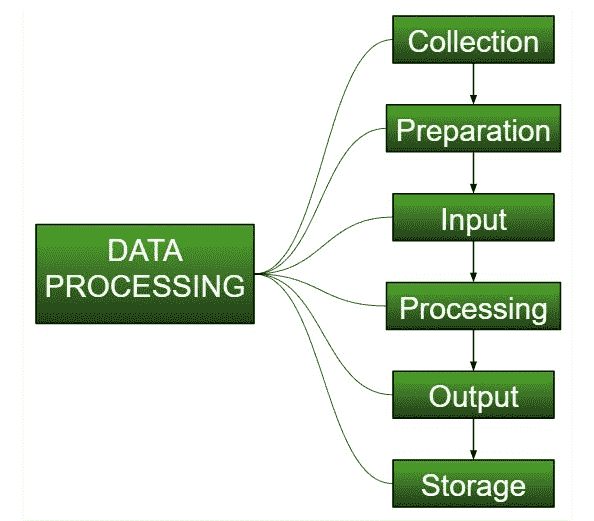

让我们详细了解每个步骤：

### 收集

开始机器学习时最重要的一步是确保可用的数据质量很高。您可以从 Kaggle、data.gov.in 和 UCI 数据集存储库等真实来源收集数据。例如，当学生准备参加竞争性考试时，他们总是会寻找最佳资源以确保取得好成绩。同样，准确且高质量的数据将简化模型的学习过程。这意味着在测试期间，模型将输出最佳结果。数据收集涉及大量的时间、资本和资源。这意味着组织和研究人员必须选择他们想要实施或研究的正确类型的数据。例如，要进行面部表情识别，需要大量具有不同人类表情的图像。良好的数据将确保模型的结果正确且真实。

### 准备

收集的数据可能是原始形式。原始数据不能直接输入机器。相反，必须先对数据进行一些处理。准备阶段涉及从各种来源收集数据、分析数据集，然后构建新的数据集以进行额外处理和探索。准备可以手动或自动完成，数据应以数值形式准备，以提高模型的学习速度。

### 输入

有时，已准备好的数据可能是机器无法读取的形式，在这种情况下，必须将其转换为可读形式。要进行转换，必须存在特定算法。要执行此任务，需要密集计算和准确性。例如，您可以通过 MNIST、音频文件、Twitter 评论和视频片段等来源收集数据。

### 处理

在此阶段，需要 ML 技术和算法来执行在大量数据上生成的指令，以实现准确性和更好的计算。

### 输出

在此阶段，机器以合理的方式获取结果，以便用户可以决定引用它。输出可以以视频、图表和报告的形式出现。

### 存储

这是最终阶段，在此阶段，生成的输出、数据模型和任何其他重要信息都将保存以供将来使用。

## Python 中的数据处理

在学习如何使用 Python 处理和分析数据之前，让我们先了解一些 Python 库。首先要熟悉一些重要的库。您需要知道如何将它们导入环境。在 Python 中有不同的方法来做到这一点。您可以输入：

`import math as m`
`from math import *`

在第一种方法中，您为库 `math` 定义了一个别名 `m`。然后，您可以通过使用别名 `m` 来引用 `math` 库中的不同函数。`factorial()`。在第二种方法中，您导入 `math` 中的整个命名空间。您可以选择直接应用 `factorial()` 而无需引用 `math`。

**注意：** Google 推荐第一种导入库的方法，因为它将帮助您了解函数的来源。

下面的列表显示了您需要知道函数来源的库：

- **NumPy**：代表数值 Python。NumPy 最先进的功能是 n 维数组。该库具有标准线性代数函数、高级随机数功能以及与其他低级编程语言集成的工具。
- **SciPy**：科学 Python 的缩写。SciPy 是基于 NumPy 设计的。它是不同高级科学和工程模块（如线性代数、稀疏矩阵和傅里叶变换）中最重要的库之一。
- **Matplotlib**：当您需要绘制大量图表时，这是最佳选择。它从折线图到热图，您可以在 IPython 笔记本中应用 Pylab 功能以确保绘图功能内联。
- **Pandas**：最适合结构化数据操作和处理。它广泛用于数据准备和挖掘。Pandas 最近引入 Python，并极大地增强了 Python 在数据科学家社区中的应用。
- **scikit-learn**：专为机器学习设计。它基于 matplotlib、NumPy 和 SciPy 创建。这个特定的库有许多高效的机器学习和统计建模工具。这包括回归、分类、聚类和降维社区。
- **StatsModels**：该库专为统计建模设计。Statsmodels 是指一个 Python 模块，允许用户探索数据、近似统计模型并实现统计测试。

### 其他库

- `Requests` 用于访问 Web。
- `Blaze` 用于支持 NumPy 和 Pandas 的功能。
- `Bokeh` 用于在当前 Web 浏览器上创建仪表板、交互式图表和数据应用程序。
- `Seaborn` 用于统计数据可视化。
- 正则表达式，用于在文本数据中发现模式
- `NetWorx` 和 `Igraph` 应用于图数据处理。

现在您已经熟悉了 Python 基础知识和关键库，让我们现在开始通过 Python 进行问题解决。

### 使用 Pandas 在 Python 中进行探索性分析

如果您不知道，Pandas 是 Python 中一个重要的数据分析库。该库对于提高 Python 在数据科学社区中的应用至关重要。我们的示例使用 Pandas 从 Analytics Vidhya 竞赛中读取数据集，运行探索性分析，并创建第一个分类算法来解决这个问题。

在加载数据之前，了解 Pandas 中的两个主要数据结构很重要。即 `Series` 和 `DataFrames`。

#### Series 和 DataFrames

您可以将 Series 视为一维标记数组。这些标签帮助您通过标签理解 Series 中的单个元素。DataFrame 类似于 Excel 工作簿，包含引用列的列名以及可以通过行号访问的行。最重要的区别是，列名和行号被称为列索引和行索引。Series 和 DataFrame 为 Python 中的 Pandas 创建了主要的数据模型。最初，数据集必须从 DataFrame 中读取，并且可以轻松地对这些列进行不同操作。

#### 练习数据集 – 贷款预测问题

以下是变量描述：

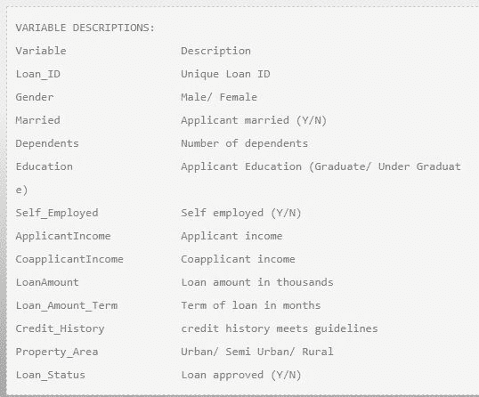

首先，在终端上输入以下命令以内联 Pylab 模式启动 iPython 界面：

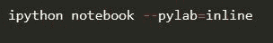

#### 导入库和数据集

本章将使用以下 Python 库：

- `NumPy`
- `Matplotlib`
- `Pandas`

导入库后，您可以继续使用 `read_csv()` 函数读取数据集。以下是到目前为止代码的样子：

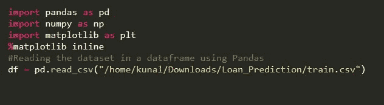

请注意，数据集存储在 `"/home/kunal/Downloads/Loan_Prediction/train.csv"` 中。

读取数据集后，您可以决定使用 `head()` 函数查看前几行。接下来，您可以使用 `describe()` 函数检查数值字段的摘要。

#### 分布分析

既然您熟悉数据的基本功能，现在是时候查看不同变量的分布了。让我们从数值变量 `ApplicantIncome` 和 `LoanAmount` 开始。

首先，输入以下命令以绘制 `ApplicantIncome` 的直方图：

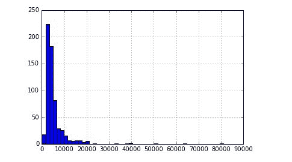

请注意，有一些极端值。这就是为什么需要 50 个箱子来清晰地表示分布。接下来要关注的是箱线图。票价的箱线图由以下命令绘制：

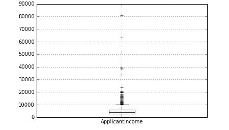

这只是 Python 中数据处理的冰山一角。让我们来看看：

### Python 中数据预处理的技术

以下是 Python 中数据预处理的最佳技术。


# 数据预处理技术

## 1. Rescaling Data

当你处理具有不同量级的数据时，需要将属性重新缩放到相同的量级。属性被重新缩放到 0 到 1 的范围内，这被称为归一化（normalization）。为了实现这一点，使用了 scikit-learn 中的 `MinMaxScaler` 类。例如：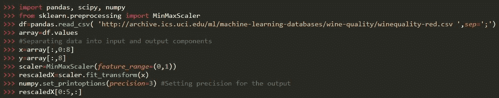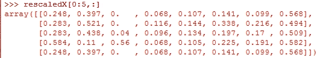重新缩放后，你将得到 0 到 1 之间的值。通过重新缩放数据，可以确认神经网络、优化算法以及具有距离度量（如 k-最近邻）的算法的适用性。

## 2. Normalizing Data

在以下任务中，你将每个观测值重新缩放到特定长度为 1。在这种情况下，你使用 `Normalizer` 类。以下是示例：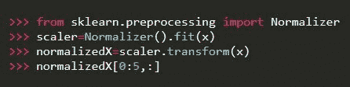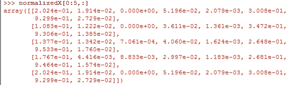

## 3. Binarizing Data

如果使用二进制阈值，可以更改数据，使高于阈值的值变为 1，而等于或低于阈值的值变为 0。对于此任务，你使用 `Binarized` 类。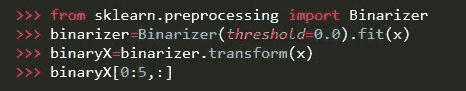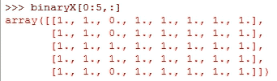如你所见，Python 代码将 0 及以下的所有值标记为 0，其余值标记为 1。

## 4. Mean Removal

这是从每个属性中移除均值以将其中心化到零的过程。

## 5. One Hot Encoding

当你处理少量且分散的数值时，在进行 One Hot Encoding 之前可能需要先存储它们。对于 k 个不同的值，你可以将特征更改为一个 k 维向量，其中只有一个值为 1，其余值为 0。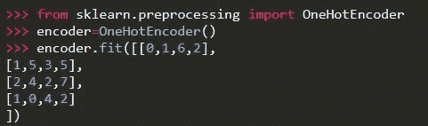

## 6. Label Encoding

有时标签可以是单词或数字。如果你想标记训练数据，需要使用单词以提高其可读性。标签编码将单词标签更改为数字，以允许算法对其进行操作。以下是示例：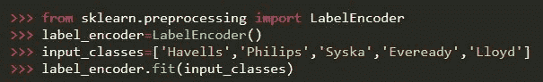


# DATA VISUALIZATION

DATA VISUALIZATION is concerned with the presentation of data in a pictorial or graphical form. It is one of the most important tasks in data analysis, since it enables us to see analytical results, detect outliers, and make decisions for model building. There are many Python libraries for visualization, of which Matplotlib, seaborn, bokeh, and ggplot are among the most popular. However, in this chapter, we mainly focus on the Matplotlib library that is used by many people in many different contexts. Matplotlib produces publication-quality figures in a variety of formats, and interactive environments across Python platforms. Another advantage is that Pandas comes equipped with useful wrappers around several Matplotlib plotting routines, allowing for quick and handy plotting of Series and DataFrame objects. The IPython package started as an alternative to the standard interactive Python shell, but has since evolved into an indispensable tool for data exploration, visualization, and rapid prototyping. It is possible to use the graphical capabilities offered by Matplotlib from IPython through various options, of which the simplest to get started with is the `pylab` flag: `$ ipython --pylab` This flag will preload Matplotlib and NumPy for interactive use with the default Matplotlib backend. IPython can run in various environments: in a terminal, as a Qt application, or inside a browser. These options are worth exploring, since IPython has been adopted for many use cases, such as prototyping, interactive slides for more engaging conference talks or lectures, and as a tool for sharing research.

## The Matplotlib API Primer

The easiest way to get started with plotting using Matplotlib is often by using the MATLAB API that is supported by the package:

```
>>> import matplotlib.pyplot as plt
>>> from numpy import *
>>> x = linspace(0, 3, 6)
>>> x array([0., 0.6, 1.2, 1.8, 2.4, 3.])
>>> y = power(x,2)
>>> y array([0., 0.36, 1.44, 3.24, 5.76, 9.])
>>> figure()
>>> plot(x, y, 'r')
>>> xlabel('x')
>>> ylabel('y')
>>> title('Data visualization in MATLAB-like API')
>>> plt.show()
```

However, star imports should not be used unless there is a good reason for doing so. In the case of Matplotlib, we can use the canonical import:

```
>>> import matplotlib.pyplot as plt
```

The preceding example could then be written as follows:

```
>>> plt.plot(x, y)
>>> plt.xlabel('x')
>>> plt.ylabel('y')
>>> plt.title('Data visualization using Plot of Matplotlib')
>>> plt.show()
```

If we only provide a single argument to the `plot` function, it will automatically use it as the y values and generate the x values from 0 to N-1, where N is equal to the number of values:

```
>>> plt.plot(y)
>>> plt.xlabel('x')
>>> plt.ylabel('y')
>>> plt.title('Plot y value without given x values')
>>> plt.show()
```

By default, the range of the axes is constrained by the range of the input x and y data. If we want to specify the viewport of the axes, we can use the `axis()` method to set custom ranges. For example, in the previous visualization, we could increase the range of the x axis from [0, 5] to [0, 6], and that of the y axis from [0, 9] to [0, 10], by writing the following command:

```
>>> plt.axis([0, 6, 0, 10])
```

## Line Properties

The default line format when we plot data in Matplotlib is a solid blue line, which is abbreviated as `b-`. To change this setting, we only need to add the symbol code, which includes letters as color string, and symbols as line style string, to the `plot` function. Let us consider a plot of several lines with different format styles:

```
>>> plt.plot(x*2, 'g^', x*3, 'rs', x**x, 'y-')
>>> plt.axis([0, 6, 0, 30])
>>> plt.show()
```

The output for the preceding command is as follows: There are many line styles and attributes, such as color, line width, and dash style, that we can choose from to control the appearance of our plots. The following example illustrates several ways to set line properties:

```
>>> line = plt.plot(y, color='red', linewidth=2.0)
>>> line.set_linestyle('--')
>>> plt.setp(line, marker='o')
>>> plt.show()
```

## Figures and Subplots

By default, all plotting commands apply to the current figure and axes. In some situations, we want to visualize data in multiple figures and axes in order to compare different plots, or to use the space on a page more efficiently. There are two steps required before we can plot the data. First, we have to define which figure we want to plot. Second, we need to figure out the position of our subplot in the figure:

```
>>> plt.figure('a')    # define a figure, named 'a'
>>> plt.subplot(221)   # the first position of 4 subplots in 2x2 figure
>>> plt.plot(y+y, 'r--')
>>> plt.subplot(222)   # the second position of 4 subplots
>>> plt.plot(y*3, 'ko')
>>> plt.subplot(223)   # the third position of 4 subplots
>>> plt.plot(y*y, 'b^')
>>> plt.subplot(224)
>>> plt.show()
```

In this case, we currently have figure `a`. If we want to modify any subplot in figure `a`, we first use the command to select the figure and subplot, and then execute the function to modify the subplot. Here, for example, we change the title of the second plot of our four-plot figure:

```
>>> plt.figure('a')
>>> plt.subplot(222)
>>> plt.title('visualization of y*3')
>>> plt.show()
```

There is a convenience method, `plt.subplots()`, to creating a figure that contains a given number of subplots. As in the previous example, we can use the `plt.subplots(2,2)` command to create a 2x2 figure that consists of four subplots. We can also create the axes manually, instead of using the default rectangular grid, by using the `plt.axes([left, bottom, width, height])` command, where all input parameters are in fractional [0, 1] coordinates:

```
>>> plt.figure('b')    # create another figure, named 'b'
>>> ax1 = plt.axes([0.05, 0.1, 0.4, 0.32])
>>> ax2 = plt.axes([0.52, 0.1, 0.4, 0.32])
>>> ax3 = plt.axes([0.05, 0.53, 0.87, 0.44])
>>> plt.show()
```

However, when you manually create axes, it takes more time to balance coordinates and sizes between subplots to arrive at a well-proportioned figure.

## Exploring Plot Types

We have looked at how to create simple line plots so far. The Matplotlib library supports many more plot types that are useful for data visualization. However, our goal is to provide the basic knowledge that will help you to understand and use the library for visualizing data in the most common situations. Therefore, we will only focus on four plot types: scatter plots, bar plots, contour plots, and histograms.

## Scatter Plots

A scatter plot is used to visualize the relationship between variables measured in the same dataset. It is easy to plot a simple scatter plot, using the `plt.scatter()` function, that requires numeric columns for both the x and y axes: Let's take a look at the command for the preceding output:

```
>>> X = np.random.normal(0, 1, 1000)
>>> Y = np.random.normal(0, 1, 1000)
>>> plt.scatter(X, Y, c = ['b', 'g', 'k', 'r', 'c'])
>>> plt.show()
```

## Bar Plots

A bar plot (sometimes known as a ‘bar graph’) is used to present grouped data with rectangular bars, which can be either vertical or horizontal, with the lengths of the bars corresponding to their values. We use the `plt.bar()` command to visualize a vertical bar, and the `plt.barh()` command for a horizontal bar: The command for such output is as follows:

```
>>> X = np.arange(5)
>>> Y = 3.14 + 2.71 * np.random.rand(5)
>>> plt.subplots(2)
>>> # the first subplot
>>> plt.subplot(211)
>>> plt.bar(X, Y, align='center', alpha=0.4, color='y')
>>> plt.xlabel('x')
>>> plt.ylabel('y')
>>> plt.title('bar plot in vertical')
>>> # the second subplot
>>> plt.subplot(212)
>>> plt.barh(X, Y, align='center', alpha=0.4, color='c')
>>> plt.xlabel('x')
>>> plt.ylabel('y')
>>> plt.title('bar plot in horizontal')
>>> plt.show()
```

## Contour Plots

We use contour plots to present the relationship between three numeric variables in two dimensions. Two variables are drawn along the x and y axes, and the third variable, z, is used for contour levels, which are then plotted as curves in different colors:

```
>>> x = np.linspace(-1, 1, 255)
>>> y = np.linspace(-2, 2, 300)
>>> z = np.sin(y[:, np.newaxis]) * np.cos(x)
>>> plt.contour(x, y, z, 255, linewidth=2)
>>> plt.show()
```

## Legends and Annotations

Legends are an important element that is used to identify the plot elements in a figure. The easiest way to show a legend inside a figure is to use the `label` argument of the `plot` function, and show the labels by calling the `plt.legend()` method:

```
>>> x = np.linspace(0, 1, 20)
>>> y1 = np.sin(x)
>>> y2 = np.cos(x)
>>> y3 = np.tan(x)
>>> plt.plot(x, y1, 'c', label='y=sin(x)')
>>> plt.plot(x, y2, 'y', label='y=cos(x)')
>>> plt.plot(x, y3, 'r', label='y=tan(x)')
>>> plt.legend(loc='upper left')
>>> plt.show()
```

The `loc` argument in the legend command is used to figure out the position of the label box. There are several valid location options: lower left, right, upper left, lower center, upper right, center, lower right, upper right, center right, best, upper center, and center left. The default position setting is upper right. However, when we set an invalid location option that does not exist in the above list, the function automatically falls back to the best option. If we want to split the legend into multiple boxes in a figure, we can manually set our expected labels for plot lines, as shown in the following image: The output for the preceding command is as follows:

```
>>> p1 = plt.plot(x, y1, 'c', label='y=sin(x)')
>>> p2 = plt.plot(x, y2, 'y', label='y=cos(x)')
>>> p3 = plt.plot(x, y3, 'r', label='y=tan(x)')
>>> lsin = plt.legend(handles=p1, loc='lower right')
>>> lcos = plt.legend(handles=p2, loc='upper left')
>>> ltan = plt.legend(handles=p3, loc='upper right')
>>> # with above code, only 'y=tan(x)' legend appears in the figure
>>> # fix: add lsin, lcos as separate artists to the axes
>>> plt.gca().add_artist(lsin)
>>> plt.gca().add_artist(lcos)
>>> # automatically adjust subplot parameters to specified padding
>>> plt.tight_layout()
>>> plt.show()
```

The other element in a figure that we want to introduce is the annotations, which can consist of text, arrows, or other shapes to explain parts of the figure in detail, or to emphasize some special data points. There are different methods for showing annotations, such as text, arrow, and annotation. The `text` method draws text at the given coordinates (x, y) on the plot; optionally with custom properties. There are some common arguments in the function: x, y, label text, and font-related properties that can be passed in via `fontdict`, such as family, fontsize, and style. The `annotate` method can draw both text and arrows, arranged appropriately. Arguments of this function are s (label text), xy (the position of element to annotation), xytext (the position of the label s), xycoords (the string that indicates what type of coordinate xy is), and arrowprops (the dictionary of line properties for the arrow that connects the annotation). Here is a simple example to illustrate the `annotate` and `text` functions:

```
>>> x = np.linspace(-2.4, 0.4, 20)
>>> y = x*x + 2*x + 1
>>> plt.plot(x, y, 'c', linewidth=2.0)
>>> plt.text(-1.5, 1.8, 'y=x² + 2*x + 1', fontsize=14, style='italic')
>>> plt.annotate('minima point', xy= (-1, 0), xytext=(-1, 0.3), horizontalalignment='center', verticalalignment='top', arrowprops=dict(arrowstyle='->', connectionstyle='arc3'))
>>> plt.show()
```

## Plotting Functions With Pandas

We have covered most of the important components in a plot figure using Matplotlib. In this section, we will introduce another powerful plotting method for directly creating standard visualization from Pandas data objects that are often used to manipulate data. For Series or DataFrame objects in Pandas, most plotting types are supported, such as line, bar, box, histogram, scatter plots, and pie charts. To select a plot type, we use the `kind` argument of the `plot` function. With no kind of plot specified, the plot function will generate a line-style visualization by default, as in the following example:

```
>>> s = pd.Series(np.random.normal(10, 8, 20))
>>> s.plot(style='ko--', alpha=0.4, label='Series plotting')
>>> plt.legend()
>>> plt.show()
```

## Additional Python Data Visualization Tools

Besides Matplotlib, there are other powerful data visualization toolkits based on Python. While we cannot dive deeper into these libraries, we would like to at least briefly introduce them in this session.

## Bokeh

Bokeh is a project by Peter Wang, Hugo Shi, and others at Continuum Analytics. It aims to provide elegant and engaging visualizations in the style of D3.js. The library can quickly and easily create interactive plots, dashboards, and data applications. Here are a few differences between Matplotlib and Bokeh:

- Bokeh achieves cross-platform ubiquity through IPython's new model of in-browser client-side rendering
- Bokeh uses a syntax familiar to R and ggplot users, while Matplotlib is more familiar to Matlab users
- Bokeh can build a ggplot-inspired, in-browser interactive visualization tool, while Matplotlib focuses on 2D cross-platform graphics

The basic steps for creating plots with Bokeh are as follows:

- Prepare some data in a list, series, and DataFrame
- Tell Bokeh where you want to generate the output
- Call `figure()` to create a plot with some overall options, similar to the Matplotlib options discussed earlier
- Add renderers for your data, with visual customizations such as colors, legends, and width
- Ask Bokeh to `show()` or `save()` the results

## MayaVi

MayaVi is a library for interactive scientific data visualization and 3D plotting, built on top of the award-winning visualization toolkit (VTK), which is a traits-based wrapper for the open-source visualization library. It offers the following:

- The ability to interact with the data and object in the visualization through dialogs
- An interface in Python for scripting
- MayaVi can work with NumPy and scipy for 3D plotting out of the box and can be used within IPython notebooks, which is similar to Matplotlib
- An abstraction over VTK that offers a simpler programming model


# DATA MINING

我们正在收集前所未有的规模的信息，并且越来越多地将这些信息应用于日常生活。我们期望计算机能将网页翻译成其他语言、预测天气、推荐我们可能喜欢的书籍，并诊断我们的健康问题。这些期望将不断增长，无论是应用数量还是我们期望的效果。数据挖掘是一种我们可以用来训练计算机基于数据做出决策的方法论，并构成了当今许多高科技系统的支柱。Python 语言正在迅速流行，这有充分的理由。它为程序员提供了很大的灵活性；拥有大量用于执行不同任务的模块；并且 Python 代码通常比大多数其他语言更具可读性和简洁性。拥有大量活跃的研究人员、从业者和初学者社区，他们使用 Python 进行数据挖掘。在本章中，我们将介绍使用 Python 进行数据挖掘。我们将涵盖以下主题：

- 什么是数据挖掘，它可以应用于哪里？
- 搭建基于 Python 的环境以执行数据挖掘
- 关联分析示例，即根据购买习惯推荐产品
- 一个（经典的）分类问题示例，根据植物的测量值预测植物物种

## 介绍数据挖掘

数据挖掘为计算机提供了一种学习如何基于数据做出决策的方式。这个决策可能是预测明天的天气、拦截进入收件箱的垃圾邮件、检测网站的语言，或者在约会网站上找到新的浪漫对象。数据挖掘有许多不同的应用，新的应用不断被发现。数据挖掘是算法、统计学、工程、优化和计算机科学的一部分。我们还使用来自其他领域的概念和知识，例如语言学、神经科学或城市规划。有效应用它通常需要将领域特定知识与算法相结合。

大多数数据挖掘应用程序采用相同的高级视图，尽管细节往往会发生相当大的变化。我们通过创建数据集来启动数据挖掘过程，描述现实世界的一个方面。数据集包含两个方面：

- 现实世界中的对象样本。这可以是一本书、照片、动物、人或任何其他对象。
- 数据集中样本的描述特征。特征可以是长度、给定单词的频率、腿的数量、创建日期等等。

下一步是调整数据挖掘算法。每个数据挖掘算法都有参数，要么在算法内部，要么由用户提供。这种调整使算法能够学习如何对数据做出决策。

## 简单关联分析示例

在本节中，我们将进入第一个示例。数据挖掘的一个常见用例是，在询问正在购买产品的客户是否还想要另一个类似产品时，以此来提高销售额。这可以通过关联分析来完成，关联分析是研究事物何时共同存在的学科。

### 什么是关联分析？

关联分析是一种数据挖掘类型，它给出样本（对象）之间的相似性。这可能是以下内容之间的相似性：

- 网站上的用户，以便提供多样化的服务或定向广告
- 要向这些用户出售的商品，以便提供推荐电影或产品
- 人类基因，以便找到拥有相同祖先的人

我们可以用多种方式衡量关联性。例如，我们可以记录两种产品被一起购买的频率。我们还可以记录当一个人购买对象 1 时，以及当他们购买对象 2 时，该陈述的准确性。

### 产品推荐

将传统业务（如商业）转移到线上时面临的问题之一是，以前由人类完成的任务需要自动化，以便在线业务能够扩展。其中一个例子是追加销售，即向已经购买的客户销售额外商品。通过数据挖掘的自动化产品推荐是电子商务革命的推动力之一，这场革命每年将数十亿美元转化为收入。

在这个示例中，我们将专注于一个基本的产品推荐服务。我们基于以下想法来设计它：当两种商品在历史上被一起购买时，它们在未来更有可能被一起购买。这种思维方式是许多产品推荐服务背后的基础，无论是在线业务还是离线业务。

这种产品推荐算法的一个非常简单的算法是，只需找到任何用户购买过商品的历史记录，并推荐该历史用户购买的其他商品。在实践中，像这样的简单算法可以表现良好，或者至少比随机选择要推荐的商品要好。但是，它们可以得到显著改进，这就是数据挖掘的用武之地。

为了简化编码，我们一次只考虑两个商品。例如，人们可能在超市同时购买面包和牛奶。在这个早期示例中，我们希望找到简单的规则，形式为：如果一个人购买产品 X，那么他们很可能购买产品 Y。涉及多个商品的更复杂的规则将不予介绍，例如人们购买香肠和汉堡更有可能购买番茄酱。

### 使用 NumPy 加载数据集

数据集可以从随课程提供的代码包中下载。下载此文件并将其保存在计算机上，记下数据集的路径。对于这个示例，我建议您在计算机上创建一个新文件夹来存放数据集和代码。从此，打开 IPython Notebook，导航到此文件夹，并创建一个新笔记本。

我们将用于此示例的数据集是一个 NumPy 二维数组，这是模块其余部分大多数示例所基于的格式。该数组看起来像一个表格，行代表不同的样本，列代表不同的特征。单元格代表特定样本的特定特征的值。

为了说明，我们可以使用以下代码加载数据集：

```
import numpy as np
dataset_filename = "affinity_dataset.txt"
X = np.loadtxt(dataset_filename)
```

对于此示例，运行 IPython Notebook 并创建一个 IPython Notebook。将上述代码输入到 Notebook 的第一个单元格中。然后您可以按 Shift + Enter 运行代码（这也会为下一批代码添加一个新单元格）。代码运行后，第一个单元格左侧的方括号将被分配一个递增数字，让您知道该单元格已完成。对于以后运行时间较长的代码，将放置一个星号以表示该代码正在运行或已计划运行。当代码运行完成时，这个星号将被替换为一个数字。

您需要将数据集保存在与 IPython Notebook 相同的目录中。如果您选择将其存储在其他位置，则需要将 `dataset_filename` 值更改为新位置。

接下来，我们可以显示数据集的一些行，以了解数据集的样子。将以下代码行输入到下一个单元格并运行它，以打印数据集的前五行：

```
print(X[:5])
```

数据集可以通过一次查看一行（水平线）来读取。第一行（0, 0, 1, 1, 1）显示第一笔交易中购买的商品。每一列（垂直行）分别代表每种商品。它们分别是面包、牛奶、奶酪、苹果和香蕉。因此，在第一笔交易中，此人购买了奶酪、苹果和香蕉，但没有购买面包或牛奶。这些特征中的每一个都包含二进制值，仅说明商品是否被购买，而不是购买了多少。1 表示“至少购买了 1 个”此类商品，而 0 表示绝对没有购买该商品。

### 实现简单的规则排名

我们希望找到类似“如果一个人购买产品 X，那么他们很可能购买产品 Y”的规则。我们可以很容易地通过找到所有两种商品一起被购买的情况来创建数据集中所有规则的列表。但是，我们随后需要一种方法来区分好的规则和坏的规则。这将使我们能够选择要推荐的特定产品。

这种类型的规则可以用多种方式衡量，我们将重点关注两种：支持度和置信度。支持度是规则在数据集中出现的次数，通过简单计算规则有效的样本数量来计算。有时可以通过除以规则前提有效的总次数来进行归一化，但对于此实现，我们将简单地计算总数。虽然支持度衡量规则存在的频率，但置信度衡量规则的准确性以及何时可以使用。它可以通过确定前提成立时规则适用的百分比来计算。

我们首先计算规则在数据集中适用的次数，然后除以前提（if 语句）出现的样本数量。作为示例，我们将计算规则“如果一个人购买苹果，他们也购买香蕉”的支持度和置信度。如以下示例所示，我们可以通过检查 `sample[3]` 的值来判断某人在交易中是否购买了苹果，其中样本被分配给我们矩阵的一行：

同样，我们可以通过查看 `sample[4]` 的值是否等于 1 来检查交易中是否购买了香蕉（以此类推）。我们现在可以计算我们的规则在数据集中存在的次数，并从中确定置信度和支持度。

现在，我们需要为数据库中的所有规则计算这些统计数据。我们将通过为有效规则和无效规则创建字典来实现这一点。该字典的键将是一个元组（前提和结论）。我们将存储索引，而不是实际的特征名称。因此，我们将存储 `(3 和 4)` 以表示前一条规则“如果一个人购买苹果，他们也会购买香蕉。”如果给出前提和结论，则该规则被视为有效。但是，如果给出了前提但没有给出结论，则该规则对于该样本被视为无效。

为了计算所有可能规则的置信度和支持度，我们必须首先设置一些字典来存储结果。我们将使用 `defaultdict`，它在访问不存在的键时设置默认值。我们记录有效规则、无效规则以及每个前提出现的次数：

```
from collections import defaultdict
valid_rules = defaultdict(int)
invalid_rules = defaultdict(int)
num_occurrences = defaultdict(int)
```

接下来，我们在一个大循环中计算这些值。我们遍历数据集中的每个样本和特征。这个第一个特征构成了规则的前提——如果一个人购买产品前提：

```
for sample in X:
    for premise in range(4):
```

我们检查该样本是否存在前提。如果没有，我们就不需要对这个样本/前提组合进行更多处理，并进入循环的下一次迭代：

```
if sample[premise] == 0:
    continue
```

如果前提对该样本有效（值为 1），那么我们记录这一点并检查我们规则的每个结论。我们跳过任何与前提相同的结论——这会给我们带来诸如“如果一个人购买苹果，那么他们购买苹果”之类的规则，这显然对我们帮助不大：

```
num_occurrences[premise] += 1
for conclusion in range(n_features):
    if premise == conclusion:
        continue
```

如果结论对该样本存在，我们就增加该规则的有效计数。如果不存在，我们就增加该规则的无效计数：

```
if sample[conclusion] == 1:
    valid_rules[(premise, conclusion)] += 1
else:
    invalid_rules[(premise, conclusion)] += 1
```

我们现在已经完成了必要统计数据的计算，现在可以计算每个规则的支持度和置信度。如前所述，支持度只是我们的 `valid_rules` 值：

```
support = valid_rules
```

置信度的计算方式相同，但我们必须遍历每个规则来计算它：

```
confidence = defaultdict(float)
for premise, conclusion in valid_rules.keys():
    rule = (premise, conclusion)
    confidence[rule] = valid_rules[rule] / num_occurrences[premise]
```

我们现在有一个字典，显示了每个规则的支持度和置信度。我们可以创建一个函数，以可读格式打印出规则。规则的签名接受前提和结论索引、我们刚刚计算的支持度和置信度字典，以及告诉我们特征含义的特征数组：

```
def print_rule(premise, conclusion, support, confidence, features):
```

我们获取前提和结论的特征名称，并以可读格式打印出规则：

```
premise_name = features[premise]
conclusion_name = features[conclusion]
print("Rule: If a person buys {0} they will also buy {1}".format(premise_name, conclusion_name))
```

然后我们打印出该规则的支持度和置信度：

```
print(" - Support: {0}".format(support[(premise, conclusion)]))
print(" - Confidence: {0:.3f}".format(confidence[(premise, conclusion)]))
```

我们可以通过以下方式测试代码——请随意尝试不同的前提和结论：

### 排名以找到最佳规则

现在我们可以计算所有规则的支持度和置信度，我们希望能够找到最佳规则。为此，我们进行排名，并打印出值最高的规则。我们可以对支持度和置信度值都这样做。

要找到支持度最高的规则，我们首先对支持度字典进行排序。字典默认不支持排序；`items()` 函数为我们提供了一个包含字典数据的列表。我们可以对这个列表进行排序，使用 `itemgetter` 类作为我们的键，这允许对像这样的嵌套列表进行排序。使用 `itemgetter(1)` 允许我们根据值进行排序。设置 `reverse=True` 使我们首先获得最高值：

```
from operator import itemgetter
sorted_support = sorted(support.items(), key=itemgetter(1), reverse=True)
```

然后我们可以打印出前五条规则：

```
for index in range(5):
    print("Rule #{0}".format(index + 1))
    premise, conclusion = sorted_support[index][0]
    print_rule(premise, conclusion, support, confidence, features)
```

## 简单分类示例

在关联分析示例中，我们寻找数据集中不同变量之间的相关性。在分类中，我们则有一个我们感兴趣的单个变量，我们称之为“类”（也称为“目标”）。如果在前一个示例中，我们有兴趣如何让人们购买更多苹果，我们可以将该变量设置为类，并寻找能实现该目标的分类规则。我们将只寻找与该目标相关的规则。

### 什么是分类？

分类是数据挖掘最大的用途之一，无论是在实际应用中还是在研究中。如前所述，我们有一组代表我们感兴趣的对象或事物的样本。我们还有一个新数组，即类值。这些类值为我们提供了样本的分类。一些示例如下：

- 通过查看植物的测量值来确定植物物种。这里的类值将是“这是什么物种？”。
- 确定图像中是否包含狗。类将是“这张图像中是否有狗？”。
- 根据测试结果确定患者是否患有癌症。类将是“这位患者是否患有癌症？”。

虽然上面的许多示例都是二元（是/否）问题，但它们不必如此，如本节中植物物种分类的情况所示。分类应用程序的目标是在一组已知类别的样本上训练模型，然后将该模型应用于类别未知的新样本。

例如，我们希望在过去的电子邮件上训练一个垃圾邮件分类器，这些电子邮件已被标记为“垃圾邮件”或“不是垃圾邮件”。然后我想使用该分类器来确定我的下一封电子邮件是否是垃圾邮件，而不需要我自己对其进行分类。

### 加载和准备数据集

我们将用于此示例的数据集是著名的鸢尾花植物分类数据集。在这个数据集中，我们有 150 个植物样本和每个样本的四个测量值：萼片长度、萼片宽度、花瓣长度和花瓣宽度（均为厘米）。这个经典数据集（首次使用于 1936 年！）是数据挖掘的经典数据集之一。有三个类别：山鸢尾、变色鸢尾和维吉尼亚鸢尾。目标是通过检查植物的测量值来确定样本是什么类型的植物。

Scikit-learn 库内置了这个数据集，使得加载数据集变得简单：

```
from sklearn.datasets import load_iris
dataset = load_iris()
X = dataset.data
y = dataset.target
```

您也可以 `print(dataset.DESCR)` 来查看数据集的概要，包括关于特征的一些详细信息。这个数据集中的特征是连续值，意味着它们可以取任何范围的值。测量值是这种特征的一个好例子，其中测量值可以取 1、1.2 或 1.25 等等。连续特征的另一个方面是，彼此接近的特征值表示相似性。萼片长度为 1.2 厘米的植物与萼片宽度为 1.25 厘米的植物相似。

相比之下是分类特征。这些特征虽然通常表示为数字，但不能以同样的方式进行比较。在鸢尾花数据集中，类值是分类特征的一个示例。类 0 代表山鸢尾，类 1 代表变色鸢尾，类 2 代表维吉尼亚鸢尾。这并不意味着山鸢尾比维吉尼亚鸢尾更接近变色鸢尾——尽管类值更接近。这里的数字代表类别。我们只能说类别是相同还是不同。

还有其他类型的特征，其中一些将在后面的章节中介绍。虽然这个数据集中的特征是连续的，但我们将在本示例中使用的算法需要分类特征。将连续特征转换为分类特征的过程称为离散化。一个简单的离散化算法是确定一个阈值，任何低于此阈值的值都被赋予值 0。同时，任何高于此阈值的值都被赋予值 1。对于我们的阈值，我们将计算该特征的平均值。

首先，我们计算每个特征的平均值：

```
attribute_means = X.mean(axis=0)
```

这将给我们一个长度为 4 的数组，即我们拥有的特征数量。第一个值是第一个特征值的平均值，以此类推。

接下来，我们使用这个来将我们的数据集从具有连续特征的数据集转换为具有离散分类特征的数据集：

```
X_d = np.array(X >= attribute_means, dtype='int')
```

我们将使用这个新的 `X_d` 数据集（即离散化的 X）进行训练和测试，而不是原始数据集（`X`）。

### 实现 OneR 算法

OneR 是一个简单的算法，它通过找到特征值中最频繁的类别来简单地预测样本的类别。OneR 是 One Rule 的缩写，表示我们只使用单个规则进行此分类，通过选择性能最好的特征。虽然一些后续算法要复杂得多，但这个简单的算法已被证明在许多现实世界数据集中具有良好的性能。

该算法首先遍历每个特征的每个值。对于该值，统计具有该特征值的每个类别的样本数量。记录该特征值最频繁的类别以及该预测的错误率。例如，如果一个特征有两个值，0 和 1，我们首先检查所有具有值 0 的样本。对于该值，我们可能有 20 个属于类别 A，60 个属于类别 B，20 个属于类别 C。该值最频繁的类别是 B，并且有 40 个实例具有不同的类别。该特征值的预测是 B，错误率为 40，因为有 40 个样本具有与预测不同的类别。

然后我们对该特征的值 1 执行相同的程序，然后对所有其他特征值组合执行。一旦所有这些组合都已计算，我们通过对该特征的所有值的错误求和来计算每个特征的错误。总错误最低的特征被选为 One Rule，然后用于对其他实例进行分类。

在代码中，我们将首先创建一个函数，用于计算特定特征值的类别预测和错误。我们有两个必要的导入，`defaultdict` 和 `itemgetter`，我们在之前的代码中使用过：

```
from collections import defaultdict
from operator import itemgetter
```

接下来，我们创建函数定义，它需要数据集、类别、我们感兴趣的特征索引以及我们要计算的值：

```
def train_feature_value(X, y_true, feature_index, value):
```

然后我们遍历数据集中的所有样本，统计具有该特征值的每个样本的实际类别：

```
class_counts = defaultdict(int)
for sample, y in zip(X, y_true):
    if sample[feature_index] == value:
        class_counts[y] += 1
```

然后我们通过对 `class_counts` 字典进行排序并找到最高值来找到最频繁分配的类别：

```
sorted_class_counts = sorted(class_counts.items(), key=itemgetter(1), reverse=True)
most_frequent_class = sorted_class_counts[0][0]
```

最后，我们计算该规则的错误。在 OneR 算法中，任何具有该特征值的样本都将被预测为最频繁的类别。因此，我们通过对其他类别（非最频繁类别）的计数求和来计算错误。这些代表该规则不适用的训练样本：

```
incorrect_predictions = [class_count for class_value, class_count in class_counts.items() if class_value != most_frequent_class]
error = sum(incorrect_predictions)
```

最后，我们返回该特征值的预测类别以及该规则错误分类的训练样本数量，即错误：

```
return most_frequent_class, error
```

有了这个函数，我们现在可以通过遍历该特征的所有值、求和错误并记录每个值的预测类别来计算整个特征的错误。函数头需要数据集、类别和我们感兴趣的特征索引：

```
def train_on_feature(X, y_true, feature_index):
```

接下来，我们找到给定特征采取的所有唯一值。下一行中的索引查看给定特征的整个列并将其作为数组返回。然后我们使用 `set` 函数来仅找到唯一值：

```
values = set(X[:, feature_index])
```

接下来，我们创建将存储预测器的字典。该字典将以特征值为键，以分类为值。键为 1.5、值为 2 的条目意味着，当特征值设置为 1.5 时，它将对象/数据点分类为属于类别 2。我们还创建一个列表来存储每个特征值的错误：

```
predictors = {}
errors = []
```

作为该函数的主体部分，我们遍历该特征的所有唯一值，并使用我们之前定义的 `train_feature_value()` 函数来找到给定特征值的最频繁类别和错误。我们按上述方式存储结果：

```
for current_value in values:
    most_frequent_class, error = train_feature_value(X, y_true, feature_index, current_value)
    predictors[current_value] = most_frequent_class
    errors.append(error)
```

最后，我们计算该规则的总错误，并返回预测器及该值：

```
total_error = sum(errors)
return predictors, total_error
```

### 测试算法

当我们评估上一节的关联分析算法时，我们的目标是探索当前数据集。对于这个分类问题，我们的目标不同。我们想要构建一个模型，使我们能够通过将其与我们对问题的了解进行比较来对以前未见过的样本进行分类。出于这个原因，我们将机器学习工作流分为两个阶段：训练和测试。在训练阶段，我们取数据集的一部分并创建我们的模型。在测试阶段，我们应用该模型并评估它在数据集上的表现效果。

由于我们的目标是创建一个能够对以前未见过的样本进行分类的模型，我们不能使用测试数据来训练模型。如果我们这样做，我们就有过拟合的风险。过拟合是创建一个在训练数据集上表现很好，但在新样本上表现不佳的模型的问题。解决方案很简单：永远不要使用训练数据来测试你的算法。这个简单的规则有一些复杂的变体，我们将在后面的章节中介绍；但目前，我们可以通过简单地将数据集分成两个小数据集（一个训练集和一个测试集）来评估我们的 OneR 实现。本节给出了这个工作流程。

Scikit-learn 库包含一个将数据分为训练和测试组件的函数：

```
from sklearn.cross_validation import train_test_split
```

该函数将根据给定的比例（默认使用数据集的 25% 作为测试集）将数据集分成两个子数据集。它是随机进行的，这提高了算法得到适当测试的信心：

```
Xd_train, Xd_test, y_train, y_test = train_test_split(X_d, y, random_state=14)
```

我们现在有两个较小的数据集：`Xd_train` 包含我们的训练数据，`Xd_test` 包含我们的测试数据。`y_train` 和 `y_test` 给出这些数据集的相应类别值。我们还指定了一个特定的 `random_state`。设置随机状态将在每次输入相同值时给出相同的分割。它看起来是随机的，但使用的算法是确定性的，输出将保持一致。对于本模块，我建议将随机状态设置为与我相同的值，因为这将给你与我相同的结果，使你能够验证你的结果。要获得每次运行都会变化的真正随机结果，请将 `random_state` 设置为 none。

接下来，我们计算数据集中所有特征的预测器。请记住，此过程仅使用训练数据。我们遍历数据集中的所有特征，并使用我们之前定义的函数来训练预测器并计算错误：

```
all_predictors = {}
errors = {}
for feature_index in range(Xd_train.shape[1]):
    predictors, total_error = train_on_feature(Xd_train, y_train, feature_index)
    all_predictors[feature_index] = predictors
    errors[feature_index] = total_error
```

接下来，我们找到要用作“One Rule”的最佳特征，即找到错误最低的特征：

```
best_feature, best_error = sorted(errors.items(), key=itemgetter(1))[0]
```

然后我们通过存储最佳特征的预测器来创建我们的模型：

```
model = {'feature': best_feature, 'predictor': all_predictors[best_feature][0]}
```

我们的模型是一个字典，告诉我们要用于 One Rule 的特征，以及基于其值所做的预测。给定这个模型，我们可以通过查找特定特征的值并使用相应的预测器来预测以前未见过的样本的类别。以下代码对给定样本执行此操作：

```
variable = model['variable']
predictor = model['predictor']
prediction = predictor[int(sample[variable])]
```

通常，我们想要一次预测多个新样本，我们可以使用以下函数来做到这一点；使用上述代码，但遍历数据集中的所有样本，获得每个样本的预测：

```
def predict(X_test, model):
    variable = model['variable']
    predictor = model['predictor']
    y_predicted = np.array([predictor[int(sample[variable])] for sample in X_test])
    return y_predicted
```

对于我们的测试数据集，我们通过调用以下函数来获得预测：

```
y_predicted = predict(X_test, model)
```

然后我们可以通过将其与已知类别进行比较来计算准确性：

```
accuracy = np.mean(y_predicted == y_test) * 100
print("The test accuracy is {:.1f}%".format(accuracy))
```

这给出了 68% 的准确率，对于单一规则来说，这还不错！


# 结论

具备基本的 Python 知识、机器学习技能以及 Python 库的基础后，你现在已准备好使用 Python 启动第一个机器学习项目。建议学习开源的 Python 库。科学 Python 库将帮助你完成简单的机器学习任务。然而，这些库中的某些选择可能完全是主观的，并且在业内许多人中具有高度争议性。总的来说，我们建议你从探索 `Scikit-learn` 库开始。确保你熟悉其概念以及如何使用它。完成后，你可以深入学习高级机器学习主题，例如复杂的数据转换和向量机器。就像孩子学习走路一样，使用 Python 学习机器学习也是如此。你需要多次练习才能变得更好。练习不同的算法并使用不同的数据集，以提升你的知识和整体解决问题的能力。

