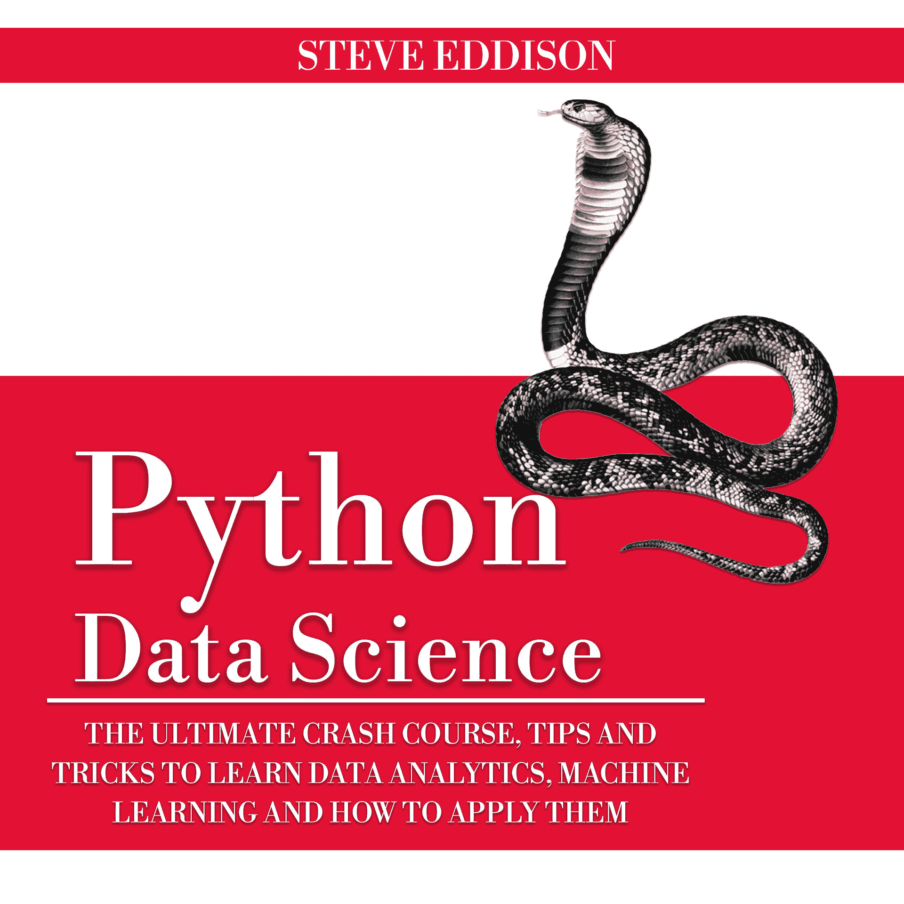

# Python 数据科学：终极速成课程、技巧与窍门，学习数据分析、机器学习及其应用 (编程书 4)





# 引言
恭喜您购买《Python 数据科学》，感谢您的购买。以下章节将讨论我们开始数据科学流程所需了解的一切，以及如何将其用于我们自己的需求。无论是什么行业，商业世界中关于机器学习、Python 语言以及当然数据科学的讨论都非常热烈，能够将这些术语结合起来并学习它们的工作原理，可以在很大程度上影响您企业现在和未来的表现。已经有大量公司通过数据科学以及随之而来的各种 Python 模型和算法获得了竞争优势，您也可以做到。在本指南中，我们将花一些时间探索 Python 数据科学所包含的各个部分。我们将首先介绍数据科学的概况以及它如何对您的业务有益，并帮助您获得一直想要的竞争优势。从那里开始，我们将花一些时间探索 Python 语言以及它如何融入数据科学领域。我们将了解 Python 编程语言的一些基础知识，为什么应该使用 Python 来帮助我们的项目，以及与 Python 配合使用并帮助我们创建所需模型的基础库。在对 Python 和数据科学有了介绍之后，是时候继续了解我们开展自己的数据科学项目所需知道的其他部分了。我们将探索数据生命周期的基础，以了解它将如何融入我们的计划。从收集原始数据到整理和清理数据，再到最终能够分析数据并学习我们想要的洞察和隐藏模式，这一数据生命周期对我们的整体目标至关重要。除了学习数据生命周期及其对我们某些流程的意义外，我们还需要继续了解数据挖掘的基础知识以及该过程的工作原理，并探讨如何使用 Python 编程语言处理回归问题，以帮助我们准确了解数据科学将如何满足我们的需求。然后，我们将以 Pandas 库结束，该库是帮助我们进行机器学习的最佳库之一，并总结一些我们能够利用所收集的所有数据以及在此过程中采取的步骤的方法，以便做出最好的商业决策。所有这些将汇聚在一起，以加强我们的业务并确保我们在业务的各个方面都能获得想要的结果。当您准备了解更多关于 Python 数据科学及其能为您的业务做些什么时，请务必查阅本指南以开始学习。

市场上关于这个主题的书籍很多，再次感谢您选择本书记！我们尽了最大努力确保它充满尽可能多的有用信息，请尽情享受！


# 第一章：什么是数据科学？

在本指南中，我们首先需要花时间了解的是数据科学的基础知识。数据科学，为了简单起见，是对公司收集和存储的海量数据中信息流动的详细研究。它涉及从原始且通常无结构的数据中获取有意义的洞察，然后通过分析编程和商业技能进行处理。许多公司将花费大量时间收集数据，并尝试利用它来更好地了解客户、弄清如何发布最佳产品，以及学习如何获得竞争优势。虽然这些都是很好的目标，但仅仅收集数据是不够的。相反，我们需要能够处理这些数据——这些数据通常很混乱，需要整理——并对其进行分析，以便更好地应对随之而来的所有问题。

## 数据科学的重要性

在日益转向数字空间的世界里，组织每天都要处理前所未有的海量数据，既有结构化也有非结构化数据。不断发展的技术将为我们带来一定的成本节约，并提供更智能的存储空间来帮助我们存储这些关键数据。目前，无论我们看的是什么行业或公司从事什么工作，都迫切需要熟练且有知识的数据科学家。他们实际上是目前薪酬最高的 IT 专业人士之一，主要是因为他们能为所在公司提供极高的价值，而且这类专业人才严重短缺。数据科学家与当前供给之间的差距约为 50%，并且随着越来越多的人和公司开始认识到数据科学的价值，这一差距可能会继续扩大。那么，为什么数据对这些企业变得如此重要？事实上，数据一直都很重要，但今天，由于互联网和其他来源的增长，可供处理的数据量达到了前所未有的程度。在过去，公司能够手动处理他们所拥有的数据，或许还能使用一些商业智能工具来更好地了解客户并做出明智决策。但现在，任何公司要做到这一点几乎是不可能的，因为它们每天都要处理大量的数据。在过去几年里，物联网的增长非常巨大，由于物联网，我们当前世界中约有 90% 的数据被产生。当我们了解到每天产生并使用 2.5 千万亿字节的数据时，这听起来更令人印象深刻，而且随着物联网的增长，这一速度还在加快。这些数据将来自许多不同的来源，而你决定从哪里收集数据将取决于你的目标以及你希望在过程中实现什么。我们能够收集这类数据的一些地方包括：

1. 用于商场和其他购物场所的传感器，以便收集更多关于在那里购物的人的信息。
2. 发布在各种社交媒体网站上的帖子。
3. 手机上拍摄的数字视频和图片
4. 通过电子商务进行的购买交易。

这些只是我们能够收集所需数据并用数据科学加以利用的少数地方。随着物联网的增长和每天产生更多数据，我们很可能会找到更多来源来帮助我们解决最大的业务问题。这也让我们比以往任何时候都更需要数据科学。我们从上述来源以及更多来源收集到的所有数据将被称作大数据。目前，大多数公司将被源源不断的数据淹没，感到有些不知所措。这就是为什么这些公司必须清楚如何处理爆炸式增长的数据以及如何利用它来取得领先如此重要。仅仅收集数据是不够的。这看起来可能是一个好主意，但如果你只是收集数据而不去了解其中包含的内容，那么你只是在给自己找麻烦。一旦你能够了解数据中包含的信息以及其含义，你会发现利用这些信息为自己争取所需的竞争优势要容易得多。

数据科学将帮助我们完成所有这些工作。它的设计目的是让我们更容易把握整体大局并利用数据满足我们的需求。它涵盖了让数据为我们工作的整个过程的各个部分，从收集数据到清理和组织数据，再到分析数据，创建可视化以帮助我们更好地理解数据，甚至到我们决定如何使用数据。所有这些汇聚在一起，帮助我们真正看到数据内部的内容，而这一切都是数据科学流程的一部分。数据科学之所以有效，是因为它能够整合大量不同的技能，如统计学、数学和业务领域知识，并能在许多方面帮助公司。当数据科学被正确使用时，它能为公司做的事情包括以下几点：

1. 降低成本
2. 将公司引入新市场
3. 触达新的目标人群以扩大影响范围。
4. 衡量营销活动的有效性。
5. 推出新服务或新产品。


而这只是列表的开始。如果你愿意与数据科学合作并学习其涉及的各个步骤，你会发现它能够以多种不同的方式帮助你的业务，并且可以成为你在行业中领先的最佳选择之一。

## 数据科学如何被使用？
了解更多关于数据科学及其工作原理的最佳方法之一，就是看看行业中的顶尖企业是如何已经在使用数据科学的。有大量知名公司已经依赖数据科学来帮助他们更好地触达客户、降低浪费和成本等等。例如，我们在这里要看的一些名字包括 Google、Amazon 和 Visa。正如你将看到的，对于所有这些公司而言，组织最重要的决定因素之一是他们认为使用分析从数据中提取的最重要价值是什么，以及他们希望如何呈现这些信息。让我们看看这些公司各自是如何利用数据科学满足自身需求并取得成果的。

### Google
列表中首先是 Google。这是最庞大的公司之一，目前正大量招聘受过训练的数据科学家。Google 在其开展的许多工作中都由数据科学驱动，并且还依赖机器学习和人工智能来触达客户，并确保为客户提供尽可能最好的产品。数据科学和良好的分析帮助他们有效地完成所有这些工作。

### Amazon
接下来是公司 Amazon。这是一家全球知名的庞大公司，我们中的许多人每天都在使用它。它是一个云计算和电子商务网站， heavily 依赖数据科学家来帮助他们发布新产品、保护客户信息安全，甚至做诸如在网站上提供下一步购买建议之类的事情。他们会利用数据科学家帮助他们更多地了解客户的思维方式，并扩大其云域和电子商务的地理覆盖范围，仅举几个他们目前的业务目标。

### Visa
然后我们需要看看 Visa 公司在数据科学的帮助下正在做什么。作为无数其他公司的在线金融网关，Visa 在一天内完成的交易价值数亿甚至更多，远超其他公司所能想象。由于交易数量庞大，Visa 需要数据科学家帮助他们增加收入、检查是否存在欺诈交易，甚至根据客户需求定制一些产品和服务。

## 数据科学的生命周期
随着我们逐步阅读本指南，我们将更详细地介绍数据科学的生命周期，但首先，我们可以花点时间看看一些基础知识，了解如何将其用于自身需求。数据科学将跟随我们的数据，从数据收集阶段一直到我们利用这些数据做出重大业务决策。在此过程中会出现许多步骤，能够准备好处理所有这些步骤及其所包含的内容，是依赖数据科学时面临的挑战。数据科学生命周期中包含的一些基本步骤将包括：

1. 确定我们希望通过此流程回答什么业务问题。
2. 收集要使用的原始数据。
3. 清理和整理我们希望使用的所有非结构化数据。
4. 对数据进行预处理。
5. 在机器学习的帮助下创建模型，并花时间对其进行训练和测试，以确保在整个过程中获得准确的结果。
6. 将数据通过模型运行，帮助我们了解其中的洞察和预测。
7. 使用可视化帮助我们更好地理解用于此分析的任何数据中存在的复杂关系。

虽然这些步骤听起来很容易操作，但这里会存在一些复杂性以及大量的反复工作。这里最重要的是带着没有先入为主的观念进入，不要试图将自己的议程强加于数据。这是确保你真正了解数据内部内容并能更轻松地为自身需求选择正确决策的最佳方式。

## 数据科学的组成部分
现在，我们还需要花时间了解一下数据科学的基础知识。在谈论数据科学时，会有几个关键组件发挥作用，具备这些组件将对我们处理数据科学带来的不同部分的能力以及如何处理我们项目所需的各个部分产生很大影响。关于数据科学，我们需要查看的一些关键组件将包括：

1. 各种类型的数据：任何数据科学项目的基石都是原始数据集。有很多不同类型。我们可以处理主要以表格形式存在的结构化数据，以及非结构化数据，后者将包括 PDF 文件、电子邮件、视频和图像。
2. 编程：你需要某种编程语言来完成工作，其中 Python 和 R 是最佳选择。数据管理和数据分析将通过计算机编程完成。Python 和 R 是我们在这里重点关注的两种最流行的编程语言。
3. 统计学和概率。数据将以不同的方式被处理以提取有用的信息。数据科学的数学基础是概率和统计学。如果没有良好的概率和统计学知识，就更有可能误解数据并得出不正确的结论。这就是为什么我们在这里关注的概率和统计学在数据科学中如此重要的一个重要原因。
4. 机器学习：作为一名从事数据科学工作的人，你每天都会花一些时间学习机器学习算法。这可能包括分类和回归方法。数据科学家了解机器学习对于完成工作非常重要，因为这是帮助从可用数据中预测有价值洞察所需的工具。
5. 大数据：在当今世界，原始数据是我们用来训练和测试模型的东西，然后从中找出最佳的洞察和预测。处理大数据可以帮助我们找出原始数据中重要但隐藏的信息。有很多不同的工具可以帮助我们不仅找到大数据，还能处理这些大数据。

许多公司正在学习数据科学的价值以及随之而来的所有内容。他们喜欢这样的想法：可以利用长期收集的所有数据来发展业务并获得他们一直寻找的竞争优势。在本指南的其余部分，我们将花时间重点关注如何使用数据科学以及随之而来的所有不同部分。


# 第 2 章：Python 语言基础

当你想要开始处理自己的数据科学项目时，你可以使用 Python 语言作为最好的编程语言之一。这是一种出色的语言，能够承担你想用数据科学完成的所有工作，并且拥有创建出色的机器学习算法所需的强大能力。尽管如此，它仍然是初学者的绝佳选择，因为它专为从未编程过的人设计。虽然你也可以选择使用 R 编程语言，但你会发现由于其易用性和强大功能的结合，Python 语言是最好的选择之一。在深入探讨 Python 如何处理你想用数据科学完成的一些事情之前，我们首先需要花时间了解一下 Python 语言的基础知识。Python 是一种很棒的语言，你很快就能学会所需的编码。 使用 Python 语言可以进行的各种编码类型包括：

## 语句

关于 Python 语言，我们首先要花点时间了解的是关键字。这将关注你希望编译器在屏幕上显示的行或句子。你需要使用我们即将讨论的一些关键字，然后可以告诉编译器要在屏幕上显示哪些语句。如果你想在屏幕上留下消息，例如我们可以用 `Hello, World!` 程序做什么，你需要将其用作语句，并使用 `print` 关键字，以便编译器知道如何行为。

## Python 运算符

我们也可以花点时间了解一下所谓的 Python 运算符。这些运算符在编写代码时经常会被忽略，因为它们似乎并不那么重要。但如果你跳过编写它们，你的代码将无法按你期望的方式工作。我们可以关注多种不同类型的 Python 运算符，因此确保你了解每种类型的用途以及何时将其添加到代码中，会带来很大的不同。运算符是代码中相当简单的部分，但你仍应了解它们的工作原理。你会发现实际上有几种不同的类型效果很好。例如，算术函数非常适合帮助你将代码的不同部分相加、相除、相减和相乘。有赋值运算符会为你的变量分配特定值，以便编译器知道如何处理它。还有比较运算符，允许你查看几段不同的代码，然后确定它们是否相似，以及计算机应如何根据该信息做出反应。

## 关键字

关键字是我们 Python 代码的另一个重要部分，需要了解一下。这些是我们需要保留的词，因为它们负责向编译器提供你希望它使用的指令或命令。这些关键字确保代码始终按你希望的方式执行。这些关键字需要保留，因此请确保不要在错误的地方使用它们。如果你没有正确使用这些关键字，或没有将其放在正确的位置，那么编译器将无法理解你希望它做什么，你将无法获得想要的结果。确保学习 Python 语言附带的重要关键字，并学习如何将它们放在代码的正确位置以获得最佳效果。

## 使用注释

在使用 Python 编码时，我们需要花时间处理称为注释的东西。这是我们能做的最好的事情之一，以确保我们可以为代码的一部分命名，或者当我们想为自己或其他程序员留下小便条时，你也需要使用注释。这些注释将是一个很好的选择。它们允许你在代码中留下很好的信息，编译器会知道它应该跳过该部分代码，根本不读取它。就是这么简单，可以为你正在进行的任何代码节省大量麻烦和工作。因此，只要你想在 Python 代码中写出注释，只需使用 `#` 符号，然后编译器就会知道它应该跳过该部分代码而不读取它。我们可以向代码中添加任意数量的这些注释。只要记住将这些注释保持在必要的数量，而不是过度使用，因为这可以确保我们让代码保持尽可能整洁美观。

## Python 类

关于使用 Python 和其他类似语言，一件极其重要的事情是语言被分离成类和对象的概念。对象旨在放入你创建的类中，使其更有组织，并确保不同部分能够按你希望的方式无问题地组合在一起。在一些较旧类型的编程语言中，没有组织，这给刚入门的人带来了很多困惑和挫败感。这些类只是一种容器，可以保存你的对象，即你编写的基于现实世界实际物品和其他代码部分的那些对象。你需要确保以正确的方式命名这些类，然后在代码的正确位置列出它们，以确保它们实际工作并调用你需要的对象。将正确类型的对象放入正确的类中也很重要。你可以在设计的类中存储任何你想要的东西，但必须确保相似的东西最终在同一个类中。这些项目不必彼此完全相同，但当有人查看你处理的类时，他们需要能够看到这些对象属于一起并且在一起是有意义的。例如，你不必只把汽车放在同一个类中，但你可以把不同的车辆放在同一个类中。你可以有被认为是食物的项目。你甚至可以有颜色相同的项目。在创建类和在这些类中存储对象时你有一定的自由，但当另一位程序员查看代码时，他们应该能够弄清楚该类中的对象是什么，并且这些对象应该有共同点。类在编写代码时非常重要。它们将保存你在代码中编写的各种对象，并确保一切得到妥善存储。它们还将使你在需要执行时更容易调用代码的不同部分。

## 如何命名标识符

在 Python 语言内部，有一些标识符我们需要花时间研究。这些标识符每一个都很重要，它们会对你能够处理的代码的不同部分产生很大影响。它们会在很多不同的名称下出现，但你会发现它们在命名时遵循相同的规则，这对初学者来说也更容易处理。首先，你可以使用很多不同类型的字符来处理你想要使用的标识符的命名。你可以使用你喜欢的任何字母，包括大写和小写，以及两者的任何组合。在此过程中使用数字和下划线符号也是完全可以的。考虑到这一点，在命名标识符时你必须记住一些规则。例如，你不能以下划线符号或数字开头命名。因此，像 `3puppies` 或 `_threepuppies` 这样的写法是无效的。但你可以用像 `threepuppies` 这样的名称来做。程序员也不能在名称之间添加空格。你可以写出 `threepuppies` 或 `three_puppies`，但不要在两者之间添加空格。除了这些规则之外，我们还需要花时间了解一下另一个重要规则。为你的标识符选择一个易于记住且对代码的该部分有意义的名称。这将确保你能够理解该名称，并且在以后需要再次调用它时能够记住它。

## Python 函数

在使用 Python 语言时，我们在这里快速了解一下的另一个主题是 Python 函数的概念。这些将是一组表达式，也可以是代码中的语句。你可以选择为它们命名或让它们保持匿名。它们通常也是我们能够探索的一等对象，这意味着你在使用它们方面的限制会低于我们在使用其他类对象时发现的限制。现在，这些函数非常多样化，在尝试创建和调用这些函数时，你可以使用许多属性。你对这些函数所做的一些选择包括：


* `__doc__`: 这将返回你请求的函数的文档字符串。
* `Func_default`: 这将返回一个包含你的默认参数值的 `tuple`。
* `Func_globals`: 这将返回一个指向保存该函数全局变量的字典的引用。
* `Func_dict`: 这负责返回将支持所有任意函数的属性的命名空间。
* `Func_closure`: 这将返回一个包含函数内部自由变量绑定所持有的所有单元的 `tuple`。

你可以用函数做不同的事情，例如如果需要的话将其作为参数传递给其他函数之一。任何能够接受新函数作为参数的函数都将被视为代码中的高阶函数。这些值得学习，因为它们对你的代码很重要，随着你的进展。

### 变量的重要性
在我们使用 Python 编程语言时，有时会需要处理 Python 变量。这些是在我们计算机内存中能够为我们编写的任何代码中的不同值保留空间的空间。这使得代码在需要时更容易调取所需内容，只需调用我们请求的变量即可。给变量赋值是一个相当简单的过程。我们只需要命名变量，然后使用等号 `=` 即可完成。只要等号 `=` 在两者之间，你的编译器就会知道哪个值将被分配回系统中的哪个变量。如果你想将多个值分配给单个变量，只需确保等号 `=` 也在这中间即可。正如我们在这本指南中刚刚查看的一些不同部分所看到的，学习如何使用 Python 编程语言也是一个很好的选择。即使你过去从未花时间从事编程工作，并且你只是想入门以学习如何处理数据科学和公司其中一个项目，请务必查看本章开始入门。

# 第 3 章：为什么使用 Python 进行数据科学？
现在我们已经了解了一些 Python 语言的基础知识，是时候看看 Python 在处理数据科学时将如何重要和有帮助了。我们已经了解了很多关于数据科学的知识，以及它对公司的重要性，以及它如何帮助你创造大量机会，击败竞争对手，并比以往更好地满足客户需求。现在是时候看看为什么 Python 编程语言将成为帮助你完成数据科学工作的最佳选择之一。Python 语言是当你需要处理想要进行的数据科学项目时最好的选择之一。数据科学能够处理的项目有很多，而 Python 甚至能够处理你试图解决的更复杂的问题。Python 将成为帮助你完成所有这些工作的最佳选择的原因有很多，包括：


## 用于数据科学的 Python

## 对初学者友好且功能强大

这种语言虽然伴随着许多复杂性，但对很多初学者来说很容易学习。如果你刚开始学习编程来帮助数据科学工作，并且担心入门问题，你会发现 `Python` 是完美的选择。它被设计成尽可能易于使用，即使是以前从未接触过编程的人也会发现，使用 `Python` 并没有想象中那么糟糕。使用 `Python` 的全部目的就是让编程尽可能简单，即使是过去从未编程过的人也能做到。你会发现其语法、使用的英文单词以及它是面向对象编程语言的事实，意味着这种语言将尽可能易于使用。尽管 `Python` 语言是为初学者首次学习编程而设计的，但它仍然拥有强大的功能。许多人担心开始使用 `Python` 语言时它会过于简单。他们可能会认为，因为这种语言旨在帮助初学者入门，所以它太简单，无法完成更复杂的代码工作。这与事实相差甚远。你会发现，即使易于使用，`Python` 也是一个很棒的选择，足以处理你想要完成的更复杂代码和项目。例如，在合适的库和扩展的帮助下，`Python` 能够处理机器学习、深度学习、科学、数学以及其他复杂流程，无论它们是否用于数据科学。

## 为程序员带来更高生产力

`Python` 语言具有大量面向对象的设计和大量支持库。由于所有这些资源以及程序易于使用，程序员的生产力将会提高。这甚至可以用来在使用 `C#`、`C++`、`C`、`Perl`、`VB` 甚至 `Java` 等语言时提高程序员的生产力。当你需要处理数据科学项目的不同部分时，拥有更高的生产力总体上非常重要。你会发现，当程序员能在更短时间内完成更多工作时，他们在所从事的项目中将会看到显著差异。

## 集成特性

`Python` 很棒，因为它集成了所谓的企业应用集成。这确实有助于你在 `Python` 中想要处理的许多不同事物，包括 `COBRA`、`COM` 等。它还具有强大的控制能力，因为它可以直接通过 `Java`、`C++` 和 `C` 调用。`Python` 还能够处理 `XML` 和其他标记语言，因为它可以通过同一种字节码运行所有现代操作系统，包括 `Windows`、`Mac OS X` 和 `Linux`。虽然我们主要关注如何使用 `Python` 语言帮助你的数据科学项目，但有些数据科学库需要与其他编程语言兼容才能完成工作并处理你的算法。这就是为什么 `Python` 是如此令人惊叹的语言。它与许多不同语言兼容，这意味着你可以使用想要关注的所有库和扩展，同时仍能与其他必需的语言协同工作。

## 庞大的社区支持

`Python` 庞大的社区将使你在编写代码过程中或遇到问题时更容易获得所需的帮助。在数据科学工作中，即使有 `Python` 编程语言的帮助，我们也需要关注大量复杂代码。如果我们卡住，有时很难弄清楚出了什么问题以及如何改进。`Python` 的社区将有助于让这一切变得更容易处理。你会找到许多其他程序员，其中一些人使用 `Python` 已久，他们能够为你提供建议、提供有用的代码，并帮助你解决数据科学项目中遇到的问题。

## 标准库

`Python` 附带的标准库拥有你完成许多编程任务所需的强大功能。只需下载 `Python` 语言，你就会获得一个出色的库，能够处理你想用 `Python` 完成的许多工作，以及你想要处理的许多主题。虽然你需要添加一些扩展来帮助你尝试机器学习和数据科学所需的模型，但你会发现 `Python` 的标准库能够处理你想要完成的大量工作。例如，当你使用 `Python` 语言及其附带的标准库时，你能够编写循环、继承、条件语句等等。所有这些都可以在机器学习和数据科学的更复杂部分中发挥作用。

## 数据科学的特殊扩展和库

我们可以用 `Python` 实现大量专门的扩展和库，非常适合数据科学和机器学习。尽管仅使用标准库就能用 `Python` 语言完成很多工作，但也有许多库不仅与 `Python` 协同工作，还能帮助我们同时在数据科学方面取得更多进展。我们将花一些时间查看数据科学和 `Python` 的许多不同库，你将有机会看到它们如何帮助你的数据科学项目。不过，根据你想要使用的机器学习算法，最佳选择包括 `TensorFlow`、`Scikit-Learn`、`NumPy`、`SciPy` 和 `Pandas`。

## 为什么 Python 非常适合数据科学

`Python` 是用于帮助创建机器学习算法的选项之一，这些算法可用于数据科学中创建自己的模型。没有这些模型，你将难以处理收集到的数据，并从中发现想要的洞察和预测。你可以使用其他语言，最著名的是 `R` 编程语言，但 `Python` 是完成所有这些工作的最佳选择之一。开展自己的数据科学项目涉及多个步骤，但在分析部分，我们需要能够使用机器学习、深度学习和其他技术来帮助我们创建能够处理所用数据的模型。如果手动处理这些数据，将需要很长时间。但借助 `Python` 语言的正确模型，我们将能够更快地梳理这些信息，并从数据中提取洞察和预测。这也是数据科学工作的重点之一。我们希望能够利用长期收集的原始数据，然后找出其中隐藏的洞察。在机器学习和 `Python` 的帮助下创建的模型确实可以帮助我们实现这些目标，并确保我们能够领先竞争对手、满足客户需求等。数据科学家想要使用 `Python` 语言有很多原因。可能还有其他可用的编程语言，但由于我们上面讨论的所有原因以及更多原因，我们可以看到，使用 `Python` 语言是最佳选择之一，它可以帮助你创建所需的模型、使用有助于机器学习的各种库等等。


# 第 4 章：最适合数据科学的 Python 库，以及它们如何帮助完成工作

下一步我们需要花时间了解一下在使用 `Python` 语言和数据科学时可以使用的一些最佳库。标准 `Python` 库能够完成很多令人惊叹的事情。但当你想要使用机器学习等创建一些模型时，标准库将缺少你想要使用的一些功能。这就是为什么我们需要引入一些额外的扩展和库。你会发现 `Python` 拥有大量不同的库，能够处理数据科学以及你想要处理的各种模型。你只需要挑选出适合你设想项目的那个。有些库能够帮助处理你想要处理的各种任务，而有些则在特定算法或模型方面表现更好。这些库在处理所需算法和模型时将至关重要。没有它们，你将无法完成有助于数据科学的一些任务，并且会使创建帮助你进行预测等的模型变得更加困难。在处理机器学习、深度学习和数据科学时，你可以使用很多不同的库。有助于尽可能高效地完成这些模型相关任务的一些最佳库包括：

## `NumPy`

当我们首次开始在 `Python` 上进行数据科学时，最佳下载的库之一将是 `NumPy`。许多其他数据科学库都依赖于此类库提供的功能，因此在计算机上安装并准备好它将带来很大差异。当你准备好开始使用 `Python` 处理一些科学任务时，你需要使用 `Python SciPy Stack`。这是一套专门设计用于帮助我们完成使用 `Python` 所需的科学计算的软件集合。请记住，这个 `SciPy` 堆栈并不是 `SciPy` 库本身，所以请将两者区分开来。该堆栈相当庞大，因为内部包含超过 12 个库，我们希望重点关注核心包，特别是对数据科学最有帮助的基本组件。这个计算堆栈围绕构建的最基本包是 `NumPy`，它代表 `Numerical Python`。它将为你希望使用矩阵和 n 维数组进行的操作提供大量有用的功能。该库将帮助我们完成许多不同的任务，包括对 `NumPy array` 类型数学操作的向量化，这将改善性能并同时加快执行速度。

## `SciPy`

另一个我们需要花时间使用的库被称为 `SciPy`。这是一个软件库，可以帮助我们处理科学和工程方面的各种任务。`SciPy` 包含一些模块，可帮助我们进行统计、优化积分，甚至线性代数等任务。使用 `SciPy` 库时获得的主要功能将建立在之前讨论的 `NumPy` 库之上。这意味着 `SciPy` 中的数组将大量使用 `NumPy` 库。它通过特定的子模块提供高效的数值例程，如数值积分、优化以及许多其他选项。该库中所有这些功能的文档也写得很好。

## `Pandas`

我们要查看的第三个库是与数据科学一起使用时最好的选项之一。它旨在帮助数据科学所需的所有不同步骤，例如收集数据、筛选和处理我们拥有的数据、分析它，甚至使用这种语言制作我们需要的一些可视化。该库是随 `Python` 提供的包，专门设计用于以简单直观的方式处理关系型和标记数据。`Pandas` 将成为帮助处理许多不同流程的完美工具，包括数据整理。此外，它在快速轻松的数据可视化、聚合和操作方面效果很好，以及数据科学中我们想要完成的任何其他任务。

## `Matplotlib`

当你处理想要进行的数据科学项目时，会有需要处理数据可视化的时刻。这将确保我们能够处理我们在任何数据中遇到的所有信息和复杂关系。通常，当数据以可视化形式呈现时，我们的大脑能够比阅读所有信息更好地理解它。这就是为什么在数据科学工作中，数据可视化过程如此重要。这就是为什么我们要花一些时间来查看一些不同的 `Python` 扩展和库，它们可以帮助我们处理所有数据并创建所需的视觉效果。对于此任务，第一个选项是 `Matplotlib`。这是一个库，旨在帮助我们迅速创建简单而强大的可视化。它实际上是一款顶级软件，使 `Python` 成为可能，并得到了本指南中迄今为止讨论的其他三个库的一些帮助。它也是市场上一些大型绘图和可视化库的强劲竞争对手，包括 `Mathematica` 和 `MATLAB`。然而，我们必须记住，使用此库时，它被认为相当底层。这意味着你需要编写更多代码来帮助我们达到更高级的可视化水平并获得想要的结果。这意味着与更高级别的工具相比，使用此库完成我们想要的任务需要付出更多努力，但对许多程序员来说是值得的。使用此库，我们能够处理几乎任何我们想要对收集的数据进行的可视化。在 `Python` 语言的帮助下，此类库可用的一些可视化包括：

1. 折线图
2. 散点图
3. 条形图和直方图
4. 饼图
5. 频谱图
6. 箭头图
7. 轮廓图
8. 茎图


## Python 数据科学和机器学习库

这种语言还具备一些功能，可以帮助我们创建标签、图例和网格，以及其他一些格式化元素来帮助我们获得想要的可视化效果。这就是该库如此精妙之处，我们能够在其中自定义我们想要的一切，以获得所需的视觉效果。

## Scikit-Learn
`Scikit-Learn` 将是一个额外的包，你可以与我们之前谈到的 `SciPy` 堆栈一起获取。它旨在帮助我们完成一些特定功能，如图像处理和机器学习的实现。 就两者中的后者而言，与所有其他库相比，最突出的将是这个库。它也是建立在 `SciPy` 之上的，并且在日常使用中会大量使用 `SciPy` 提供的数学运算。 这个包是一个很好的工作选择，因为它可以提供简洁且一致的接口，供程序员在需要使用最常见的机器学习算法时使用。这将使将机器学习引入生产系统变得简单。该库能够将高质量的代码和良好的文档结合在一起，从而实现高性能和易用性，并且在 `Python` 中进行任何机器学习需求时，它是行业标准之一。

## Theano
`Theano` 是我们接下来可以查看的库，它将更多地关注一个被称为深度学习的过程，而不仅仅是机器学习。 `Theano` 将是一个来自 `Python` 的包，它将定义一些多维数组，类似于我们在上面的 `NumPy` 库中看到的那样，以及一些数学运算和表达式。这个特定的库是编译的，这确保了它能够在你选择的任何架构上尽可能高效地运行。它最初是由蒙特利尔大学的机器学习小组开发的，并将帮助我们处理想要在机器学习中完成的许多应用程序。 在使用这个库时，我们需要关注的最重要的一点是 `Theano` 能够与 `NumPy` 库在一些低级操作上紧密集成。该库还将在你工作时优化 CPU 和 GPU 的使用，这确保了我们在数据密集型计算中看到的性能比以前更快。该库带来的稳定性和效率将使我们能够获得更精确的结果，即使在谈论较小的值时也是如此。

## TensorFlow
我们不能在不查看 `TensorFlow` 库的情况下结束关于 `Python` 语言提供的不同库的讨论。这是一个特殊的库，因为它是由 Google 开发的，并且是一个开源的数据流图计算库，等等，这些都被打磨以确保它们能完成我们想要的机器学习工作。最初，这个库是为满足 Google 环境日常需要处理的高度需求而设计的。此外，我们会发现这个库非常适合帮助我们进行神经网络的训练，而神经网络是我们处理数据和通过系统做出决策时能够使用的最佳机器学习算法类型之一。然而，我们必须记住 `TensorFlow` 并不是严格用于 Google 内部的科学用途。它具有足够的强大功能，并且被认为足够通用，可以帮助我们处理许多现实世界的应用。我们在使用这个库时可以关注的一个关键特性是它具有多层节点系统。这是一个很好的工作特性，因为它将使我们能够快速训练人工神经网络，即使在处理非常大的数据集时也是如此。这将帮助我们创建许多优秀的算法和模型。例如，这种类型的库已经帮助我们实现了 Google 的语音识别和从图片中识别物体等功能。

## Keras
并且本指南中我们要查看的最后一个库是 `Keras` 库。这将是一个很棒的开源库，它将再次帮助我们处理该语言中想要处理的神经网络，尤其是更高层的神经网络，并且它也是用 `Python` 编写的以便于使用。我们会发现，就 `Keras` 库而言，整个东西相当易于使用且极简主义，具有一些高级可扩展性来帮助我们。它将使用 `TensorFlow` 或 `Theano` 库作为后端，但目前微软正在努力将其与 `CNTK` 集成作为新的后端，以给我们更多选择。许多用户会喜欢 `Keras` 带来的极简设计。事实上，这种设计旨在使我们的实验也尽可能简单和快速，因为你将使用的系统仍会保持紧凑。此外，我们会发现 `Keras` 是一个易于入门的语言，并且可以使我们想要处理的原型设计变得更容易。我们还会发现 `Keras` 库是用纯 `Python` 编写的，并且本质上是更高层的，有助于我们自行完成更多编程和机器学习工作。它也是高度可扩展和模块化的。尽管使用这个库很容易，其带来的简单性以及高层取向，`Keras` 仍然具有足够的强大功能来帮助我们进行大量严肃的建模。 `Keras` 的总体思路基于大量的层，然后模型所需的一切都将围绕这些层构建。数据将以张量的形式准备。随之而来的第一层负责这些张量的输入。然后，无论之后有多少层，最后一个层将负责输出。我们会发现模型的所有其他部分都将在其间构建，以帮助我们获得理想的结果。

正如我们所见，有很多不同的库可以借助 `Python` 来处理，这些库也可以帮助我们完成数据科学和机器学习方面的工作。创建我们需要的模型以实现机器学习的成功，并确保我们能够利用随着时间收集的所有原始数据并实际使用它做出良好的商业决策，如果没有这些 `Python` 库的帮助是不可能的。本指南中我们讨论过的所有库都将处理流程的不同部分，并且在整个过程中也可以以多种方式帮助我们。我们需要能够挑选出最适合我们的库，然后在需要使用 `Python` 语言创建对我们需求最重要的模型时继续前进。本指南中讨论的不同库将正是我们完成工作所需的工具。


# 第 5 章：数据生命周期的基础

当我们将数据科学和 `Python` 结合在一起时，我们能够做到的最重要的事情之一就是对数据生命周期多了解一些。在我们能够利用数据真正学到东西之前，有很多步骤需要完成。许多想要利用数据来做决策的人和公司都假设他们只需找一些数据，然后就能一次性找到洞察。正如我们将在本章中探讨的那样，实际上需要采取一系列步骤，才能从收集到的所有数据中获得你想要的洞察。这是一个需要花费时间的流程，有时并不像我们希望的那样简单或快速。然而，花时间并完成我们将在本章中讨论的所有步骤，对于你能获得的结果来说将大有不同。让我们来看一下公司在数据生命周期中需要遵循的一些主要步骤，以确保获得最佳结果：

## 数据收集

我们需要做的第一件事就是去找到我们最初想要使用的数据。这将是一个关键步骤，因为如果一开始没有数据供我们筛选，就无法创建模型，也无法学习我们想要的许多预测和洞察。这是一个非常重要的一步，因为它确保我们不仅拥有大量数据，而且还拥有我们想要用来真正找到最大问题的答案的数据。首先，我们需要能够梳理出我们希望得到解答的业务问题。我们并不是随机浏览现有数据并希望能弄出点什么来。在这方面，我们需要筛选的数据实在太多，如果这样做，结果不会好到哪里去。相反，花一些时间查看过去从客户那里获得的信息、查看调查等，可以成为帮助你看到想要的结果的好方法。在此期间，我们也需要做一些评估。重要的是要知道你是否已经拥有开展该项目所需的合适资源，或者是否有某些缺失的东西需要在提前填补。你需要评估自己在人力、时间、数据和技术方面是否拥有支持该新项目的合适资源。在此阶段，你可能会发现是时候界定你所拥有的业务问题，然后制定 `IH` 或初始假设，以便开展工作。

## 数据准备

接下来我们需要花时间做的是准备我们想要使用的数据。你很可能已经收集了将用于模型的数据，而你后来的一些决策将来自各种来源。这会让事情变得混乱。你从发送的调查中得到的结果与从社交媒体账号得到的结果相比会有所不同。这两者在进行数据科学工作时都非常有用，但会带来一些挑战，这意味着我们需要能够提前准备数据并将其清理和整理好，以避免混淆并确保我们的模型能够处理它。在这个特定阶段，我们需要使用一种被称为分析沙箱的东西。这是一个地方，你可以在整个项目处理期间执行想要使用的不同分析。在我们能够进行稍后将重点关注的建模之前，在处理数据时需要处理很多步骤。例如，在此阶段，我们需要在处理任何建模之前探索、预处理然后对数据进行条件化。此外，我们需要使用被称为 `ETLT` 的流程，以确保我们在途中能够收集到的原始数据能够进入该沙箱，以便我们能够按自己的意愿使用它。准备数据需要一些时间。我们需要能够对其进行处理并确保所有数据都采用相同的格式，以便模型更好地理解我们想要看到的情况。我们还需要处理任何缺失数据或重复数据，因为这很可能会导致我们在此过程中工作出现问题。在此步骤中花时间准备数据并尽可能使其井然有序，将是我们确保模型稍后能正常工作并为我们提供所需洞察的关键。现在，在准备数据时，你可以使用几种选择。`R` 和 `Python` 编程语言在处理数据的清理、转换和可视化时将会非常出色，而这些都是我们数据科学项目的重要方面。使用这些工具将使我们更容易管理数据并提前发现一些异常值，同时在过程中建立变量之间的关系。在此期间，我们将确保数据尽可能井然有序和完美，确保我们从数据中获得尽可能高的效率和准确性。一旦我们能够清理和准备好正在使用的数据，就该是时候对该数据进行一些探索性分析了，而这就是我们进入下一步的时候。

## 模型规划

一旦我们花了一些时间收集原始数据并从我们想要使用的所有不同来源收集起来，并且我们已经准备和清理数据使其可以使用，就是我们进入该流程第三阶段，即模型规划的时候了。在此阶段，我们将花一些时间找出哪些技术和方法最适合绘制变量之间的关系。这些关系很重要，我们需要花时间研究它们并更好地理解它们的工作方式。事实上，这些关系将能够为我们的算法工作奠定一些基础，这肯定会影响到下一阶段的实施。正是在此阶段，我们能够借助许多不同的可视化工具和我们想在此过程中使用的统计公式来应用 `EDA` 或探索性数据分析。现在，你想要完成的项目好坏程度只取决于你用来完成所有这些工作的工具。以下三种工具对于帮助你规划想要用于帮助模型的代码至关重要：


### Python
正如我们在本指南中已讨论的那样，Python 将提供大量的建模能力，并且将确保你拥有一种能够帮助处理一些解释性模型以及你想要工作的其他事物的环境。R 编程语言也将对此有所帮助，你只需要将其设置好，并确保它能够借助合适的库处理好一切。

### SQL 分析服务
这是可以执行你想要使用的一些数据库内分析的功能之一，这些功能在你进行各种数据挖掘功能以及一些起初较为基础的预测模型时将是最常见的。

### SAS/ACCESS
这是在需要从 Hadoop 访问想要的数据时我们能够使用的工具，并且它用于帮助我们创建模型流程图，我们可以用它重复结果，并且在任何我们想要的时候都可以重复使用。


这些只是我们在进行自身模型规划流程时能够找到的不同工具中的几个。上面提到的三个是最常见的，绝对是我们想要重点关注的选项，因为它们能提供的好处。但环顾四周并做一些自己的研究将确保你能够找到想要的结果，以及合适的工具，以便规划出该模型并使其准备好处理你想用这些原始数据完成的一些工作。

## 构建模型

现在我们已经有机会谈论模型的规划，以及我们能够使用以实现这一目标的各种工具和技术，是时候让我们逐步实际构建这个模型了。这是一个需要花费一些时间的过程，我们需要确保能够花时间对模型进行训练和测试，以确保它能为我们提供所寻找的准确结果。在这个阶段的工作中，我们将使用两个不同的数据集，一个用于训练，一个用于测试。你还需要花一些时间进行探索，以确定我们正在使用的现有工具是否足以帮助我们在其上运行模型，或者我们是否希望在过程中使用更强大的环境。你需要在这里花一些时间分析各种学习技术，包括聚类、分类和关联，以帮助我们构建模型。

所以，我们在这里想要做的是取我们拥有的一些数据并将其拆分为训练组和测试组。训练组应该比我们将在测试模型中看到的大得多，因为我们希望用大量不同的部分为算法提供输入，以确保它按我们想要的方式工作。在将这两个数据组设置好并准备就绪后，我们将把训练集输入模型。这有助于模型学习输入和输出应该是什么，以便它能够做出准确的预测并在未来学习。这与我们在课堂上看到的情况非常相似，学生从教学中接收大量信息来帮助他们学习特定主题。

完成所有训练数据通过模型后，是时候对其进行测试了。我们将发送更多数据，即我们预留到测试数据集中的数据，然后将其发送通过，但不附带正确的答案或输出。这将看到算法或模型最初学习得有多好。目标是尽可能达到约 50% 以上。任何超过 50% 的结果都将表明模型是准确的，尤其是在第一次运行中。假设模型只是查看信息并对数据进行猜测，那么它很可能能够在一半的时间内得到正确答案。因此，当模型能够超过 50% 时，这表明模型实际上能够从我们使用的训练集中学习，并且随着时间的推移将为我们提供更准确的结果。

当然，对于第一次尝试，准确率可能不会那么高，也许在 60% 左右。这不是坏事，但当然，我们希望在开始依赖它帮助我们为企业做出重要决策之前，确保准确率更高一些。这里的目标是然后进行另一轮训练，再进行另一轮测试，反复进行几次以提高准确率并帮助我们获得更好的结果。我们能够进行训练和测试过程的次数越多，模型在过程中学习得越多，准确率就会变得越好。你不需要一直进行训练和测试，直到这个模型达到 100%，因为那样会花费永远，而且总是有出错的可能性，所以达到这一点是不可能的。但提高预测的准确性可能是你真正需要帮助将此模型准备好用于你自己的数据的关键。

## 部署

现在模型已经有时间构建起来，我们确信它提供给我们的信息，例如我们希望使用的预测和洞察，已经尽可能准确，是时候让我们使用模型来帮助我们了。在这里我们可以花一些时间输入我们的数据，让模型发挥作用，帮助我们看到从这些数据中会产生的预测和洞察。在这个阶段，我们将收集我们需要的洞察和预测，然后将它们用作为企业做出重要决策的一种方式。在这里与技术文档、代码、简报以及你能够从过程中获得的发现的最终报告一起工作是很重要的。

在某些情况下，这会进一步推进。取决于你想要工作的业务流程，做一个试点项目可能会有所帮助，这是一个我们可以实时实施的项目，以帮助我们了解从这个模型中获得的洞察和预测对我们是否良好，或者在我们将其在整个公司实施之前是否需要一些调整。这仍然是过程的一部分，因为我们可以使用这些发现来加强我们想要工作的其他部分。当我们使用其中一个试点项目时，它帮助我们以清晰的画面看到模型的工作，并以较小规模看到一些性能以及现实生活中的限制，然后再尝试在整个业务中部署它。

例如，有时一个项目或一个想法听起来像是很好的工作对象，但一旦你开始实施它，即使是在较小规模，事情也会开始分崩离析，你可以很快看到该项目或想法实际上很糟糕，会花费太多钱，或者根本行不通。这并不意味着你从模型中获得的信息和预测会是坏的，你就不应该尝试它们。通常，只要你以正确的方式使用模型进行预测和洞察，它们对你的业务来说会非常好。它们可能有一些可以改进的小问题，但这些并不会阻止你随着时间的推移将这些想法用于更大规模。它们只是一种帮助你尝试某事、提前消除皱褶，然后在准备好继续时以更大规模实施的方式。

例如，假设你正在努力减少公司中的浪费。你看到有一个可以尝试的新流程，但你想在它成为你尝试使用的大项目之前看看它是否有效。你在一个部门中进行试验，让该区域的员工尝试新的规则并报告其效果。你可以快速看到是否会出现任何问题，然后在花费大量时间和金钱将此添加到整个业务中之前做出更改，或决定是否保留它。

## 传达结果

我们在这里需要查看的最后一步是传达我们看到的结果。我们已经使用我们的数据和我们想要关注的一些机器学习算法完成了很多步骤。而且我们在过程中也取得了良好的进展。现在我们知道了这些洞察，也许甚至对其中一些是否能在现实生活中发挥作用有了很好的想法，是时候真正传达结果了。数据科学家或实际经历整个过程并创建和处理算法的人不太可能使用该信息。相反，他们应该找到该信息，然后将其呈现给公司中的一些关键决策者，以帮助那些高层人士弄清楚事情。过程的这一步正是要发挥作用的地方。

现在在这个过程的这一部分中，花时间评估我们在数据中能够找到什么信息，然后评估我们是否能够实现我们在这个过程第一阶段希望实现的目标是很重要的。因此，对于我们现在所在的这个最后阶段，我们的目标是找出我们在我们拥有的数据中以及我们在处理的所有信息中出现的所有各种关键发现，并找出如何将所有这些信息传达给关键利益相关者。然后一起，或与为该业务做出决策的关键人员一起，你将能够确定项目中发现的结果是否实际上是成功还是失败。

不要只关注在这个过程中找到的信息和洞察。当然，那些很重要，但我们需要确定这在过程中是成功还是失败，而这里的决定将完全基于我们在第一步中能够制定的标准。在一开始就写下来可以使弄清楚这里发生了什么以及你的过程是否像你认为的那样成功变得容易得多。在你进行此操作时，以清晰简洁的方式呈现你的发现是很重要的，这样其他人才能轻松理解。例如，你不想只是把数据推给他们然后说“祝好运”。这不会帮助任何人，而且可能导致找到这些洞察花费太长时间。有许多方法可以用来呈现你想要处理的数据，花时间找出哪一种最适合你对这个过程很重要。

在数据上写出电子表格和报告非常重要，并且是一个很好的起点，但我们可以更进一步。对于大多数数据科学家来说，当他们到达过程的这一部分时，添加一些可视化和其他内容来帮助解释他们的发现是一个好主意。我们已经谈到了一两个与 Python 和数据科学一起工作的库，它们能够帮助你创建这些重要的可视化，所以你应该拥有开始所需的许多工具。这些可视化将使基于此数据做出决策的人更容易真正看到数据中发现的一些更复杂的关系。看一张图表或图形了解数据中发生了什么，比花费大量时间阅读数据电子表格和报告要容易得多。后者绝对应该在你的思考中占有一席之地，并且应该与可视化一起出现，以便其他人可以核对你的发现并使你更具信誉。但最好还是我们能够专注于可视化，因为对于大多数人来说，这些更容易阅读和总体理解。

正如我们所见，数据科学项目中的流程和所有步骤都将是复杂且包含大量工作。这就是为什么数据科学家现在在许多不同行业的大量公司中需求如此高的原因。那些能够相对快速高效地完成这些步骤的人将对准备开始为其业务添加数据科学的公司具有价值。这个整体目标是确保我们能够专注于找到最好的洞察和预测，使我们的公司领先于其他公司。竞争非常激烈，以上步骤将帮助我们找到支持我们最佳决策的信息，并帮助我们在行业中击败他人。它可能看起来像很多步骤，但将我们收集的所有原始数据转化为我们可以利用并从长远来看获得一些好处的东西绝对是必要的。


# 第 6 章：什么是数据挖掘？
在讨论与数据科学相关的不同步骤时，深入了解数据挖掘及其内容非常重要。这是数据科学流程中需要重点关注的一个特定部分，本章我们将花时间研究数据挖掘及其相关的各个部分。带着这个想法，让我们来看看数据挖掘到底是什么，为什么它对整个数据科学流程如此重要，以及我们为什么首先要使用它。我们的首要目标是更深入地了解数据挖掘以及这个流程的本质。数据挖掘基本上是指公司能够用来将原始数据转化为有用信息的步骤。它是我们在上一章讨论过的步骤中更专业的一种形式。在机器学习、Python 和一些专业软件的帮助下，公司能够使用数据挖掘来寻找可能出现在大量数据中的模式。浏览所有这些数据的目标——而起初我们需要处理的数据往往相当多——是为了帮助企业更好地了解其客户、击败竞争对手，甚至制定更好的营销策略，从而在行业中领先。一些公司还将使用数据挖掘的步骤来增加销售额、降低成本、确定销售哪些产品等。如果我们希望数据挖掘流程按我们期望的方式运行，就需要很多因素协同配合。在进行数据挖掘流程时，我们需要关注的一些步骤包括有效的数据收集、数据仓库以及计算机或系统上的处理能力。

## 数据挖掘是如何工作的？
考虑到以上信息，我们现在需要转向数据挖掘工作原理的一些基础知识。数据挖掘涉及公司探索并分析大量信息，希望从中提炼出重要且有意义的模式和趋势。正如我们所能想象的，当一家公司花费时间收集大量信息时，很可能能够在其中找到大量洞察和其他有价值的信息。这些公司能够利用这些信息的方式有很多，包括管理借款人的信用风险、数据库营销、检测欺诈、过滤垃圾邮件，甚至了解该系统上用户们的观点和情感。所有这些都可用于使你的公司受益，并帮助你获得所需的优势。当然，我们需要将庞大的数据挖掘流程分解为易于遵循的简单步骤。为此，我们将其分解为五个易于操作且有助于获得最佳结果的步骤。该流程的第一步是公司收集所需的数据，然后将其加载到数据仓库或其他用于保存这些信息的存储区域中。你想要收集的数据类型将基于你希望获取的信息以及你在开始此流程时的整体目标。第二步是确保我们以正确的方式存储和管理数据。这通常是通过云完成，或使用公司自行使用的服务器。管理团队、业务分析师和信息技术专业人员随后可以访问数据，并确定组织所有这些数据并从中获取更多信息的最佳方法。然后，公司需要确定要使用哪种应用程序软件。程序员可供选择的此类软件有很多，它们通常可以与机器学习和 Python 编程语言配合使用以完成工作。应用程序软件将帮助我们根据用户的反馈对正在处理的所有数据进行分类整理。完成所有这些工作后，最终用户将能够收集到的所有洞察和信息，然后将数据和所有发现呈现给需要的人。通常，这需要在易于共享的格式中完成，包括表格或图表，以便那些真正需要使用信息的重要人员更容易看到其中的洞察。数据挖掘是一种复合型学科，将代表在不同类型的分析能力中使用的各种方法和技术。这很有用，因为它能够解决公司大量需求，并可以提出不同类型的问题并使用不同程度的人工规则或输入来做出决策。在进行数据挖掘流程时，会涉及几个不同的部分，包括：

### 描述性建模
描述性建模是我们需要查看并应用于流程中的第一种数据挖掘类型。这种建模负责揭示历史数据中发现的共同相似性或分组。这将帮助我们确定公司成功或失败的原因。例如，它可以帮助我们根据客户对我们销售产品的偏好或整体情感对其进行分类。在讨论描述性建模时，适用的一些技术包括：
1. 聚类：这是指我们能够将彼此相似的记录分组。
2. 异常检测：这是指我们致力于识别一些异常值，然后确定这些异常值是否重要，是否需要更仔细地查看。
3. 关联规则学习：这是指我们取现有的记录并检测它们之间是否存在某种关系以及这些关系是什么。
4. 主成分分析：这是指我们查看正在处理变量之间会存在什么样关系。
5. 亲和分组：这是指将具有共同兴趣或同时具有简单目标的人们分组。

### 预测建模
我们要查看的第二件事是预测建模。这种建模将更深入地对未来事件进行分类，或帮助你估计未知的结果。一个例子是使用信用评分来帮助我们确定某人偿还贷款的可能性。预测建模的理念是帮助我们揭示有关客户流失、信用违约和活动响应等主题所需的洞察。我们能够使用且适用于此的一些技术包括：
1. 回归：这将衡量我们看到的一个因变量与一系列自变量之间的强度。
2. 神经网络：这是一种复杂的计算机程序，可以设置以便学习、做出自己的预测，甚至检测您自己的数据中发现的一些模式。


### 决策树
这些将是一种形状像树的图表，可以帮助你做出一些决策。这一点的关键在于，你能够查看每个分支并了解每个部分发生的可能性。这有助于我们在做决策时看出哪一个是我们最好的选择。

### 支持向量机
这将是机器学习中一种监督学习模型的例子，可以帮助我们的模型以正确的方式学习。

## 预测性建模
最后，我们将来看一个被称为预示性建模的过程。得益于我们看到的非结构化数据的增长以及我们能够用它做的事情，预示性建模的受欢迎程度一直在不断增长。想想我们能够处理的非结构化数据来源有多少，包括音频、PDF、电子邮件、书籍、评论字段、网络以及我们能够遇到的任何其他文本来源，以帮助我们弄清所需的数据。得益于这一切，作为数据挖掘相关学科的文本挖掘的采用也取得了显著增长。对我们来说，能够成功解析、过滤和转换非结构化数据，以便将其纳入我们自己的一些预测模型中，从而提高预测的准确性非常重要。最终，我们需要确保不要将数据挖掘视为一个独立的实体，因为数据科学的其他部分，如预处理，在这个过程中同样重要。预示性建模会审视内部和外部变量及约束条件，以推荐采用一个或多个行动方案。例如，当我们能够使用它时，我们可能能够利用它来确定向我们合作的各个客户发送的最佳营销优惠。

### 为什么如此重要？
另一个许多公司甚至个人都会对数据挖掘提出的问题是，为什么这个过程如此重要？当我们审视所有正在收集的数据，更不用说当前正在产生的数据时，我们就可以更清楚地了解为什么数据挖掘过程以及数据科学的其他步骤对你的业务如此重要。大多数企业已经看到了一些令人震惊的数字。现在产生的数据量已经巨大，预计该数据每两年就会翻一番。仅非结构化数据本身就是你将收集的主要数据形式，因为它更容易、更便宜，目前约占数字宇宙的 90%。但更多的信息，虽然看起来很棒，并不一定意味着我们立刻拥有更多知识。我们会发现，通过数据挖掘，我们能够完成许多想要完成的任务，并看到我们辛勤工作的成果。例如，我们会发现通过数据挖掘过程，我们能够：

1. 筛选出数据集中可能出现的各种噪音、重复的和混乱的噪音。
2. 它帮助你理解什么是相关且重要的，同时忽略之前的噪音，然后充分利用这些信息来评估最可能的结果。
3. 它可以加快决策的速度。而且，决策将有数据支持，而不是仅仅依靠猜测或直觉，因此你知道它们是可靠且值得采用的。

所有这些原因以及更多原因，都是许多企业有兴趣处理他们花费时间收集的原始数据，并使用数据挖掘等工具来帮助他们处理这些数据的缘由。只有通过数据挖掘以及合适的机器学习和 Python 工具，我们才能真正发现在所有数据中隐藏的模式和关系，然后利用这些模式做出更好的决策并改善业务。也有很多人和公司愿意使用数据挖掘过程。你可以在几乎任何收集并依赖其随时间收集的数据的领域找到这种过程。随着越来越多的行业和公司了解数据科学、数据分析和机器学习，可能会有更多人选择将其加入流程中。能够利用数据科学改善业务方式的行业示例包括：

1. 通信：许多电信和多媒体公司将使用随之而来的一些分析模型来帮助他们理解所拥有的所有客户数据。这确保了他们能够开展真正有效的定向营销活动。
2. 教育：这可以帮助教师和其他教育工作者为那些在学习或掌握应知信息方面可能需要额外帮助的学生制定出优秀且个性化的计划。
3. 银行：所有金融机构都能够从使用这一数据科学流程中受益。它非常适合推荐长期应向客户提供的产品类型，可以确保公司内没有发生任何欺诈或洗钱行为，并可以帮助确定谁有资格获得贷款或没有资格。
4. 保险；有了分析的帮助，这些保险公司会发现解决风险管理、客户流失、合规性和欺诈等重大问题变得容易得多。公司能够使用数据挖掘带来的技术，以找到向当前客户群提供具有竞争力的产品的新方法，从而留住客户。
5. 制造业：确保供应计划和需求预测保持一致至关重要。这些公司还需要确保能够快速检测问题、进行质量保证并投资于品牌资产。这些公司能够利用数据科学帮助他们预测维护，从而在过程中节省时间和金钱。
6. 零售：这些零售公司能够通过客户在店内或在线进行的购买，收集大量关于客户的信息。零售公司可以利用这些信息帮助开展这些公司将要进行的营销活动，帮助他们确定下一步想要提供哪些产品等等。


在数据科学相关工作中，有众多行业都将受益，随着时间的推移，越来越多的公司很可能会加入其中。可以很清楚地看出数据科学和数据挖掘将如何使这些公司受益，而且不难理解他们为何想要了解更多并将其用于自身需求。

## 数据仓库与数据挖掘软件
数据挖掘程序被许多公司广泛使用，它们将帮助我们分析所有数据中发现的关系和模式，通常是基于用户的请求。例如，公司可以使用这种数据挖掘软件来帮助他们创建一些想要使用的信息类别。为了说明这一点，让我们想象一下有一家餐厅我们想要关注，它有兴趣使用数据挖掘带来的一些流程，以便更容易地在正确的时间提供合适的特价。他们希望确保这些特价能够打中合适的客户，并在过程中为他们赚取最多的钱。该公司将查看其所收集的所有信息，然后根据顾客来就餐的时间以及他们最终点了什么来创建一些类别。当然，这只是我们能够使用数据挖掘流程来改善业务的一个例子。在其他一些情况下，数据挖掘人员能够基于逻辑关系找到一簇信息，或者他们会查看关联和顺序模式，以便对消费者行为中出现的趋势得出一些结论。在此期间，我们必须记住数据挖掘中数据仓库的重要性。数据仓库是一个简单的流程，公司会挑选一个程序或数据库，以便将他们正在处理的所有原始数据集中起来。有了数据仓库，公司能够将所需的数据段分发给特定用户，以便进行分析，并在需要时随时可用。然而，在某些情况下，分析人员可能会先从他们想要使用的数据类型开始，然后据此先创建数据仓库。无论企业和其他实体如何存储和组织其数据，他们都希望确保数据的使用方式能够支持该实体管理层的决策。在数据挖掘流程方面，我们能够做的事情非常多。这是我们在数据科学项目中将更侧重的一部分，因为它帮助我们真正了解如何处理手头的数据，并使完成所需的某些数据分析变得更容易。当我们完成数据挖掘流程的工作后，我们将更好地了解数据中包含哪些信息，以及如何将这些信息用于自身需求。

# 第 7 章：使用 Python 进行数据挖掘的一些基础知识
在上一章中，我们花了一些时间了解数据挖掘的基础知识以及我们可以用这种方法做什么。现在我们需要看看该流程带来的一些具体内容，以及我们如何将其与上面讨论的 Python 编程语言一起使用。让我们看看我们可以如何以不同的方式将 Python 与数据挖掘流程结合起来。

## 在 Python 中创建回归模型
确保我们学会如何使用数据挖掘和 Python 的最好方法之一就是实际将它们付诸实践，看看效果如何。我们希望从开始创建变量之间出现的线性关系的良好估计开始，打印出相关系数的系数，然后同时能够绘制最佳拟合线。为了帮助我们，我们将使用可以找到的房屋销售数据集：[`www.kaggle.com/harlfoxem/housesalesprediction/kernels`](https://www.kaggle.com/harlfoxem/housesalesprediction/kernels)。该数据将包含我们需要的房屋价格及其特征的信息，因此我们的目标是看看我们是否能够建立一个模型来估计房屋价格与房屋最初拥有的平方英尺数量之间的关系。确保事情按我们想要的方式工作的第一步是在桌面上安装`Jupyter`。这将是一个免费平台，我们可以用它作为我们将使用的`IPython`笔记本的处理器，并且由于其直观性，我们将乐于将其用作初学者的工具。你还会注意到我们将重点关注`Pandas`库来帮助我们入门。因此，我们需要关注的代码第一部分如下。将此添加到你的编译器中，然后我们将花一点时间讨论其中的一些内容，看看数据挖掘具体是如何工作的：
```
In [1]: import pandas as pd
import matplotlib.pyplot as plt
import numpy as np
import scipy.stats as stats
import seaborn as sns
from matplotlib import rcParams
%matplotlib inline
%pylab inline
Populating the interactive namespace from numpy and matplotlib
```
首先，上述代码花费了一些时间添加了我们开始项目所需使用的不同数据科学库。我们安装了`NumPy`、`Matplotlib`和`SciPy`，因为这些是我们使其工作所需的扩展和功能。你必须确保在开始之前这些已安装在你的系统上，以确保你能够按想要的方式使用它们。我们现在将把上面导入的代码分解为几个步骤，以便我们可以逐步弄清楚如何应用数据挖掘来解决回归问题。in real life，很可能你不会有人把一套数据和正确的机器学习技术交给你来使用，所以请记住你需要在清理和整理数据以满足需求之前收集数据。但为了帮助我们学习如何使用此代码的一些基础知识，并确保我们能够开始，我们将使用它来让事情更简单。让我们也看看我们需要使用的代码的下一部分，以便开始这个过程：
```
In [2]: df = pd.read_csv('/Users/michaelrundell/Desktop/kc_house_data.csv')
df.head()
```
Out[2]:

|  || id  || date  || price  || bedrooms  || bathrooms  || sqft_living  || sqft_lot  |

| --- | --- | --- | --- | --- | --- | --- | --- |

| 0  || 7129300520  || 20141013T000000  || 221900.0  || 3  || 1.00  || 1180  || 5650  |

| --- | --- | --- | --- | --- | --- | --- | --- |

| 1  || 6414100192  || 20141209T000000  || 538000.0  || 3  || 2.25  || 2570  || 7242  |

| 2  || 5631500400  || 20150225T000000  || 180000.0  || 2  || 1.00  || 770  || 10000  |

| 3  || 2487200875  || 20141209T000000  || 604000.0  || 4  || 3.00  || 1960  || 5000  |

| 4  || 1954400510  || 20150218T000000  || 510000.0  || 3  || 2.00  || 1680  || 8080  |


## 使用 Pandas 读取 CSV

使用 pandas (`pd.read_csv`) 从 Kaggle 读取 csv 文件。

```python
In [3]: df.isnull().any()
Out[3]:
id               False
date             False
price            False
bedrooms         False
bathrooms        False
sqft_living      False
sqft_lot         False
...
dtype: bool
```

检查我们的数据中是否有空值。如果有，我们会将其删除或过滤掉。

```python
In [4]: df.dtypes
Out[4]:
id                 int64
date              object
price            float64
bedrooms           int64
bathrooms        float64
sqft_living        int64
sqft_lot           int64
...
dtype: object
```

起初，这看起来会像一团乱麻，很难一开始就理解这里有什么。但现在我们将花一些时间梳理所有内容，以弄清楚其中有什么，以及为什么所有这些对我们试图完成的工作如此重要。为此，我们花了一些时间借助 `Pandas` 库从 CSV 文件导入数据框。然后我们确保检查它是否能以正确的方式读取。`isnull()` 函数的作用是确保我们拥有的数据都可用于我们想要完成的回归。在现实生活中，单个列的数据可能以字符串、整数或 `NaN` 的形式存在，全部混在一起。这意味着你需要在自己的项目中花时间仔细检查所有类型是否匹配，并且你使用的数据是否适合你在此进行的回归。由于我们这里只做练习，使用的数据集已经准备好，可以直接使用，这与大多数其他数据库不同。考虑到这一点，在继续之前，是时候让我们更好地了解我们正在处理的数据了。对我们来说，查看数据的形状并判断数据是否合理非常重要。损坏的数据并不罕见，因此对我们来说运行两次检查是很好的实践，否则我们算法中获得的信息将不会像我们希望的那样准确。

## 数据检查与描述性统计

在第一次检查中，我们将使用 `df.describe()` 函数。这个函数很有用，因为它帮助我们查看分析中出现的所有变量。完成这部分后，我们将使用 `plt.pyplot.hist()` 函数花费一些时间绘制分析所针对的变量的直方图。我们在这里使用的代码及其输出将包括：

```python
In [5]: df.describe()
Out[5]:
```

|  || price  || bedrooms  || bathrooms  || sqft_living  |
| --- | --- | --- | --- | --- |
| 计数  || 21613  || 21613  || 21613  || 21613  |
| --- | --- | --- | --- | --- |
| 平均值  || 540088.10  || 3.37  || 2.11  || 2079.90  |
| 标准差  || 367127.20  || 0.93  || 0.77  || 918.44  |
| 最小值  || 75000.00  || 0.00  || 0.00  || 290.00  |
| 25%  || 321950.00  || 3.00  || 1.75  || 1427.00  |
| 50%  || 450000.00  || 3.00  || 2.25  || 1910.00  |
| 75%  || 645000.00  || 4.00  || 2.50  || 2550.00  |
| 最大值  || 7700000.00  || 33.00  || 8.00  || 13540.0 0  |

快速总结：我们正在处理的数据集包含 21,613 个观测值，平均价格约为 $540k，中位价格约为 $450k，平均房屋面积为 2080 ft2

## 可视化分布

```python
fig = plt.figure(figsize=(12, 6))
sqft = fig.add_subplot(121)
cost = fig.add_subplot(122)
sqft.hist(df.sqft_living, bins=80)
sqft.set_xlabel('Ft²')
sqft.set_title("Histogram of House Square Footage")
cost.hist(df.price, bins=80)
cost.set_xlabel('Price ($)')
cost.set_title("Histogram of Housing Prices")
plt.show()
```

在上面所做的编码中，我们使用了 `matplotlib` 来帮助我们打印出两个不同的直方图。请继续操作，看看这些直方图在你的编译器中会是什么样子。它们将向我们展示房屋价格的分布与每栋房屋的平方英尺相比。我们在这里会发现，两个变量的分布都向右偏斜，尽管一个比另一个更严重。这将使我们对正在处理的数据集有一个很好的了解，我们也更了解我们想要测量的变量的分布。有了所有这些，我们就可以继续进行回归分析，了解更多信息以及它如何帮助我们。

## OLS 回归分析

首先，我们需要导入 stats models 以获取最小二乘回归估计函数。我们在这里使用的模块被称为普通最小二乘法，它将承担在 Python 回归中计算我们需要的数字的大部分工作。使这一过程发生的代码将包括以下内容：

```python
In [15]: import statsmodels.api as sm
from statsmodels.formula.API import ols
```

当你用 `OLS` 编写代码来生成仅有两个变量的线性回归摘要时，你将使用以下公式：

```python
Reg = ols('Dependent variable ~ independent variable(s)', dataframe).fit()
print(Reg.summary())
```

当我们查看金县房屋的价格和房屋的平方英尺时，我们打印出以下摘要报告：

```python
In [16]: m = ols('price ~ sqft_living', df).fit()
print(m.summary())
```

当我们花几分钟打印出此回归所需的摘要时，与我们的问题相关的所有信息都很容易找到。这将包括相关系数、标准误差、t 统计量、R 平方等。查看从中获得的输出，很明显市场上房屋价格与房屋平方英尺之间存在巨大的关系。当你浏览时，你还会发现过程中也出现了相当大的幅度。例如，每次我们在房屋中增加额外的 100 平方英尺时，我们会发现该房屋的价格平均会高出约 $28,000 美元。根据我们希望用这种程序做什么，很容易调整此公式以包含一个以上的独立变量。

正如我们所见，在 Python 中处理回归问题并利用它帮助我们梳理数据并了解此过程的工作方式，对我们来说在许多方面都是有益的。在上面的示例中，我们花时间查看特定市场房屋价格与房屋中平方英尺数量之间的相关性。但无论我们的业务问题是什么，或我们希望如何处理这种数据科学流程，我们都可以使用同样的思路。


# 第 8 章：使用 Pandas 库的完整课程

当谈到处理数据科学时，尤其是当你依赖 `Python` 语言来帮助你时，你可以依赖的最佳库之一就是 `Pandas` 库。对于数据科学来说，这将是一个很棒的库，因为它能够处理每一个部分。它可以带你完成我们之前讨论过的数据科学的全部生命周期，让你更容易处理数据，将其整理好并准备就绪，并确保你能够在需要时进行分析和可视化。为了帮助我们入门，我们需要花几分钟时间了解更多关于 `Pandas` 库及其包含的内容。`Pandas` 被视为来自 `Python` 的开源包，它将为我们提供完成任何我们想要的数据分析所需的许多工具。该包还附带几种不同的数据类型结构，我们可以学习它们，然后根据需要用于许多不同的数据操作任务。对于想要快速、有条理地梳理数据，同时学习数据中包含的洞察和预测的人来说，这就是最适合你的库。除了上面我们花时间学习过的许多任务之外，`Pandas` 库还将为我们提供许多方法，程序员在处理自己的数据分析时可以使用。这在数据科学过程中始终是一件好事，而且当你有大型数据科学项目，并且希望确保它正确完成时，`Pandas` 肯定是你会求助的库。在这里谈论 `Pandas` 库时，重要的是我们停下来看看程序员在决定使用该库而不是其他库时将会注意到的一些优势。该库绝对是值得考虑学习并在几乎任何你想专注的数据科学项目中使用的最佳选择之一，因此至少学习它是如何工作的，以及确保其按预期运行所需的某些编码，将对你的项目非常有帮助。

## Pandas 的优势

数据科学家在使用 `Pandas` 时能够享受到的各种优势包括：

1. 它将获取你拥有的数据，并以适合分析你拥有的大量数据的方式呈现。这种数据分析将在 `Pandas` 中使用 `DataFrame` 和 `Series` 数据结构完成。
2. 你会发现 `Pandas` 包附带了许多方法，可以帮助我们以便捷的方式筛选数据，同时获得很好的结果。
3. `Pandas` 还附带了各种实用工具，可以帮助我们在进行输入和输出操作时以快速无缝的方式进行。此外，`Pandas` 能够读取各种格式的数据，这在数据科学中非常重要，例如 `Excel`、`TSV` 和 `CSV` 等。

你会发现 `Pandas` 真正会改变游戏规则以及你使用 `Python` 分析公司数据时的编码方式。事实上，它通常是 `Python` 语言及其他地方数据整理和清洗（我们将在下一章更详细地介绍如何操作）中最常用、最受欢迎的工具。`Pandas` 可免费使用且为开源，旨在供任何希望以安全、快速和有效的方式处理其数据的人使用。正如我们上面提到的，实际上有相当多的 `Python` 库可以使用，其中一些也非常适合数据科学。但许多数据科学家以及他们所在的公司喜欢依赖 `Pandas`，因为它有很多好处，可以处理你的所有项目，并且具有所有精妙的功能。

## 核心概念

你可能会发现这个库的一个很酷的地方是，它能够获取你的一些数据，无论这些数据来自数据库、`CSV` 还是 `TSV` 文件，然后它可以将文件中找到的信息转换为 `Python` 中的对象。它会根据不同的行和列略有变化，我们将称其为 `DataFrame`。但它看起来会与我们习惯看到的 `Excel` 类似表格非常相似。现在，如果这不是你第一次进行编码，尤其是如果你之前使用过 `R` 编程语言，那么你在这里创建的对象将与我们在 `R` 中看到的内容有一些相似之处。这些对象将使我们的工作变得容易得多，尤其是在我们希望在过程中不使用任何 `list` 推导或 `dictionaries` 的情况下完成所有工作时。循环是 `Python` 代码的重要组成部分，我们在本书中没有太多时间讨论和查看，但它们帮助编译器读取代码的同一部分。这些很棒，但有时在我们的数据分析中，循环会变得有点笨重，会占用比我们希望更多的空间。有时它们只是太难处理了。在代码中使用对象的思想以及它们如何处理我们想要的 `Python` 部分，可以帮助我们在编码中以更少的混乱完成同样的事情。

## 安装

然而，在这里你会发现，通常最好花时间下载 `Pandas` 库，并且你应该在下载 `Python` 库的同时下载它，尤其是如果你的主要目标是最终进行数据科学项目。如果你已经在电脑上准备好了 `Python` 语言，然后后来决定使用数据科学和 `Pandas` 库，那么对于许多程序员来说，这仍然是一个相当容易处理的过程。对于这种方法，下载 `Pandas` 库的最佳方式是访问 [www.pandas.org](http://www.pandas.org) 网站然后查找与你的操作系统相对应的版本。下载 `Pandas` 库只需要几分钟，然后你就可以在这里使用它附带的所有功能。一旦你花时间将 `Pandas` 库下载到你的电脑上，就该学习更多关于使其正常工作所需步骤和流程的信息了。你会发现，一旦我们进入这个库并学习使用它的编码基础，它就可以成为一个有趣的语言，拥有所有附带的功能和能力。此外，当你学会如何使用这种语言时，它将使完成你想要的数据分析变得更容易。在这一点上，我们已经下载了 `Pandas` 库并准备使用，现在是时候专注于需要采取哪些步骤来加载我们想要的数据，甚至保存这些数据，然后再尝试使用 `Pandas` 将数据通过我们计划创建的算法运行。

## 使用 Pandas 加载数据

当是时候使用 `Pandas` 处理你收集的数据并从中学习时，我们必须记住 `Pandas` 允许我们使用三种主要方法来完成所有这些工作。这三种方法都非常简单易用，包括：

1. 你可以将 `NumPy` 数组、`Python` `list` 或 `Python` `dictionary` 转换为 `Pandas` 中可用的 `DataFrame`。
2. 你可以在 `Pandas` 的帮助下打开电脑上找到的本地文件。这通常会是像 `CSV` 文件这样的文件，但在某些情况下也可能是 `Excel` 或分隔文本文件。


### 3.

你也可以选择使用它来打开远程文件或其他数据库，包括通过 URL 位于网站上的 JSON 或 CSV，或者让程序读取来自数据库或 SQL 的表。

现在，随着你进行这三个步骤，我们必须记住，对于每一步实际上会出现几个命令，具体使用哪个命令取决于你选择的方法。然而，三者共同点是用来打开数据文件的命令是相同的。无论你选择上述哪种方法来打开数据文件，都需要使用的命令包括：`Pd.red_filetype()`。在此期间，你会发现当需要使用 Pandas 库时，有大量可供选择的 arguments。当然，花时间在这里学习它们所有含义以及何时调用会很困难，也会花费我们太长时间。为了让事情进展顺利并且不让人感到不知所措，我们将确保只关注本项目必要的 arguments，以及完成良好数据分析所需的那些。我们现在先放下其余部分，你可以在以后需要时为任何个人项目学习它们。带着这些想法并准备就绪，是时候了解更多关于如何将我们在 Python 中已在使用的一种对象，例如列表或字典，转换为 Pandas 库的方法了。这对于确保对象可用于我们的项目是必要的。使这种转换发生并尽可能顺利进行的简单命令包括：`Pd.DataFrame()`。

使用上面的代码，括号内的部分是我们能够指定在该数据框中创建的不同对象，有时是多个对象的地方。这是会带来一些 arguments 的命令，你也可以在这里选择想要使用的那些。当我们到达这一点时，应该很容易看出我们需要的数据已经加载完毕，所以现在我们需要进入下一步，看看这里还能做哪些检查。开始时我们需要先查看数据的框架，然后更好地了解它是否与我们想要或期望的部分相匹配。为了确保我们能完成此操作，我们需要运行我们想要选择的数据框名称，以帮助我们调出整个表格。我们也可以更进一步，对其进行限制以增加我们想要的控制。有时我们不想处理整个表格，只想处理其中一小部分，这也是可以做到的。例如，如果我们想通过此过程仅获取开头的一定数量的行，你可以决定需要多少行来完成工作，就可以使用 `fdf.heat(n)` 函数来完成。或者如果你的目标是处理表格末尾的一定数量的行，你需要使用的函数是 `df.tail(n)`。`df.shape` 选项在处理显示的行数和列数时会有帮助，如果你想收集数据类型、索引或内存中已有的一些信息，完成此部分所需的唯一代码就是 `df.info()`。这只是使用 Pandas 库可以做的一些代码的开始，以帮助确保事情得到完成。例如，你可以使用命令 `s.value_counts(dropna=False)` 并发现它允许你查看序列中唯一的计数和值，就像你只想一次处理一列或几列时所使用的那样。另一个你可能会觉得有用的命令是函数 `df.describe()`。这个函数非常有帮助，因为它允许你输入一些汇总统计信息，即图表中数值列附带的统计信息。你也可以使用各种代码和函数来帮助你从整个序列或整个数据框中获取所需的所有统计信息。现在，这看起来可能是一次要花费我们时间的大量信息，但为了确保我们能完全理解我们在这里所做的事情以及所有部分的意思，查看 Pandas 中最常见的一些命令是很重要的，这些命令可以帮助数据科学。我们用来查看和检查正在处理的数据的最常见命令将包括：

## 常用数据查看与统计命令

1. `df.mean()`. 此函数将帮助我们获取所有列的平均值。
2. `df.corr()` 此函数将返回数据框中所有列之间的相关性。
3. `Df.count()`: 此函数将帮助我们返回基于列的每个数据框中的非空值数量。
4. `Df.max()`. 此函数将返回每列中的最高值。
5. `Df.min()`. 此函数将返回你在每列中找到的最低值。
6. `Df.median()`. 这是你想要查看每列并计算中位数时可以使用的函数。
7. `Df.std()`. 此函数是你用来查看每列然后找到其标准差的函数。

所有这些都是在你想利用之前谈到的那个数据框时可以使用的很棒的选择。当使用 Pandas 库时，我们可以花费一些时间做的另一个不错的事情是将数据库中来的不同部分连接在一起甚至合并。这将使用 Python 中的基本类型命令来完成，因此学习如何使用它将是你能够掌握的简单事情。但这也是开始时需要学习的重要内容。但这就是你需要做的事情来合并或连接数据或数据框。考虑到这一点，在 Pandas 中确保此过程发生的需要三种类型的命令，它们包括以下内容：

## 数据合并与连接

1. `Dfl.appent(df2)`. 这将把 `df1` 的行添加到 `df2` 的末尾。你需要确保在过程中列是相同的。
2. `Df.concat([df1, df2], axis=1)`. 此命令将把 `df1` 中的列添加到 `df2` 中已有的末尾。你需要确保合并的行是相同的。
3. `Dfl.oin(df2, on=col1, hot='inner')`. 这将是一种 SQL 风格的连接，将 `df1` 中的列与 `df2` 上的列连接，其中 col 相同值的行可以等于 left、right、inner 和 outer 中的一种。


当谈到 `Pandas` 库时，我们能做的事情非常多，这也是它如此受欢迎的原因之一。许多想要从事数据科学的公司也愿意添加 `Pandas` 扩展，因为它帮助他们在数据科学方面做得更多，而且由于其配套的 Python 语言，编码通常很简单。本章中我们所查看的命令是一些可以与 `Pandas` 库一起学习使用的基本选项，但它们旨在帮助我们更深入地了解这种语言，以及 `Pandas` 库能为我们提供的所有有趣功能。

`Pandas` 无论你从事哪种类型的数据科学项目都是一个很棒的选择，花时间学习如何使用它来创建你的 Python 库和模型，并确保你的分析尽可能完善，绝对是值得的。这就是你需要了解的入门介绍，以便在 Python 编程语言中取得一些成功。你会发现这只是整个过程的开始，并且你在使用 `Pandas` 库进行数据分析时投入越多，就能看到越好的结果。无需花费太多时间，你很快就能编写出强大的模型和代码，帮助你提取公司所需的数据，并为你提供所需的洞察和预测。


# 第 9 章：利用您的数据做出明智的商业决策

学会如何使用数据科学将成为您商业计划中非常重要的一部分。将所有内容整合起来，确保您理解各个部分如何运作，并充分[content]
# 第 9 章：利用您的数据做出明智的商业决策

学会如何使用数据科学将成为您商业计划中非常重要的一部分。将所有内容整合起来，确保您理解各个部分如何运作，并充分[content]
# 第 9 章：利用您的数据做出明智的商业决策

学会如何使用数据科学将成为您商业计划中非常重要的一部分。将所有内容整合起来，确保您理解各个部分如何运作，并充分[content]
# 第 9 章：利用您的数据做出明智的商业决策

学会如何使用数据科学将成为您商业计划中非常重要的一部分。将所有内容整合起来，确保您理解各个部分如何运作，并充分[content]
# 第 9 章：利用您的数据做出明智的商业决策

学会如何使用数据科学将成为您商业计划中非常重要的一部分。将所有内容整合起来，确保您理解各个部分如何运作，并充分[content]
# 第 9 章：利用您的数据做出明智的商业决策

学会如何使用数据科学将成为您商业计划中非常重要的一部分。将所有内容整合起来，确保您理解各个部分如何运作，并充分[content]
# 第 9 章：利用您的数据做出明智的商业决策

学会如何使用数据科学将成为您商业计划中非常重要的一部分。将所有内容整合起来，确保您理解各个部分如何运作，并充分[content]
# 第 9 章：利用您的数据做出明智的商业决策

学会如何使用数据科学将成为您商业计划中非常重要的一部分。将所有内容整合起来，确保您理解各个部分如何运作，并充分[content]
# 第 9 章：利用您的数据做出明智的商业决策

学会如何使用数据科学将成为您商业计划中非常重要的一部分。将所有内容整合起来，确保您理解各个部分如何运作，并充分[content]
# 第 9 章：利用您的数据做出明智的商业决策

学会如何使用数据科学将成为您商业计划中非常重要的一部分。将所有内容整合起来，确保您理解各个部分如何运作，并充分[content]
# 第 9 章：利用您的数据做出明智的商业决策

学会如何使用数据科学将成为您商业计划中非常重要的一部分。将所有内容整合起来，确保您理解各个部分如何运作，并充分[content]
# 第 9 章：利用您的数据做出明智的商业决策

学会如何使用数据科学将成为您商业计划中非常重要的一部分。将所有内容整合起来，确保您理解各个部分如何运作，并充分[content]
# 第 9 章：利用您的数据做出明智的商业决策

学会如何使用数据科学将成为您商业计划中非常重要的一部分。将所有内容整合起来，确保您理解各个部分如何运作，并充分[content]
# 第 9 章：利用您的数据做出明智的商业决策

学会如何使用数据科学将成为您商业计划中非常重要的一部分。将所有内容整合起来，确保您理解各个部分如何运作，并充分[content]
# 第 9 章：利用您的数据做出明智的商业决策

学会如何使用数据科学将成为您商业计划中非常重要的一部分。将所有内容整合起来，确保您理解各个部分如何运作，并充分[content]
# 第 9 章：利用您的数据做出明智的商业决策

学会如何使用数据科学将成为您商业计划中非常重要的一部分。将所有内容整合起来，确保您理解各个部分如何运作，并充分[content]
# 第 9 章：利用您的数据做出明智的商业决策

学会如何使用数据科学将成为您商业计划中非常重要的一部分。将所有内容整合起来，确保您理解各个部分如何运作，并充分[content]
# 第 9 章：利用您的数据做出明智的商业决策

学会如何使用数据科学将成为您商业计划中非常重要的一部分。将所有内容整合起来，确保您理解各个部分如何运作，并充分[content]
# 第 9 章：利用您的数据做出明智的商业决策

学会如何使用数据科学将成为您商业计划中非常重要的一部分。将所有内容整合起来，确保您理解各个部分如何运作，并充分[content]
# 第 9 章：利用您的数据做出明智的商业决策

学会如何使用数据科学将成为您商业计划中非常重要的一部分。将所有内容整合起来，确保您理解各个部分如何运作，并充分[content]
# 第 9 章：利用您的数据做出明智的商业决策

学会如何使用数据科学将成为您商业计划中非常重要的一部分。将所有内容整合起来，确保您理解各个部分如何运作，并充分[content]
# 第 9 章：利用您的数据做出明智的商业决策

学会如何使用数据科学将成为您商业计划中非常重要的一部分。将所有内容整合起来，确保您理解各个部分如何运作，并充分[content]
# 第 9 章：利用您的数据做出明智的商业决策

学会如何使用数据科学将成为您商业计划中非常重要的一部分。
[/content]

That works? Let's try.

[content]
# 第 9 章：利用您的数据做出明智的商业决策

学会如何使用数据科学将成为您商业计划中非常重要的一部分。


# 结论
感谢您坚持读到《Python 数据科学》的结尾，希望它具有启发性，并能为您提供实现目标所需的一切工具，无论这些目标是什么。下一步是开始学习如何将数据科学和 Python 的基础知识应用到您自己的业务中。

这些都是在商业世界中流传的大热词汇，无论企业处于哪个行业，许多公司都准备立刻投入，看看数据科学能为他们带来什么。但实际上，采取必要的步骤并学习如何处理数据生命周期以及与之相关的所有不同流程会带来差异，而迈出第一步可能很困难。

本指南花时间研究了所有这些不同的部分，以探讨企业如何为自身需求开展数据科学。数据科学生命周期包含许多不同的部分，虽然直接创建模型然后完成似乎更有趣，但所有这些步骤对于我们期望获得的结果都非常重要。

我们必须处理原始数据的收集、清理和整理我们所拥有的数据、了解其中有哪些洞察、确定最佳模型并对其进行训练和测试，然后完成分析。我们将在本指南中花时间讨论所有这些部分以及更多内容，并找出让这些内容为我们发挥最佳作用的方法。

数据科学流程总体上将为您带来大量好处，您会喜欢利用这些信息来更深入了解客户、竞争对手等，从而提高您的利润底线并看到业务成果的方式。这可能需要一些时间，而且通常需要一定的编程知识才能完成。

但您会发现，在 Python 编程语言的帮助下，以及本指南中讨论的一些机器学习内容，您将能够使其满足您的需求。数据科学是所有企业都能用来帮助自己领先并真正看到成果的工具。但这是一个需要时间的流程，并不总是像我们希望的那样容易完成。

在指南的帮助下，以及其中讨论的一些工具，准备好将 Python 数据科学应用于您的需求吧。最后，如果您觉得这本书以任何方式有用，在 Amazon 上留下评论将非常感激！
