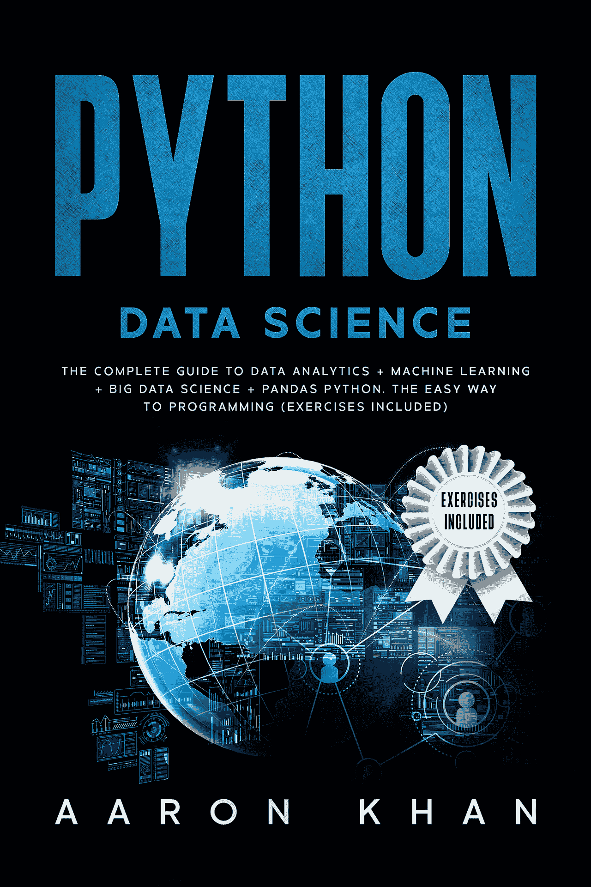

# Python 数据科学：数据分析+机器学习+大数据科学+ Pandas Python 完整指南。轻松编程（含练习）





## 引言
数据科学可能是一个较新的跨学科领域，但其组成部分早已由数学家和 IT 专业人员研究了数十年。其中一些核心元素包括机器学习、图分析、线性代数、计算语言学等。由于数学、数据通信和软件工程这种看似疯狂的结合，数据科学领域具有极高的通用性。请记住，并非所有数据科学家都是一样的。每个人都根据自己的能力和专业领域进行分工。考虑到这一点，你可能会想，对于任何想要成为数据科学家的人来说，最重要或强大的工具是什么。本书将重点关注 `Python` 的使用，因为该工具在数据科学家社区中广受青睐，而且很容易上手。这是一种多功能的编程语言，用于广泛的技术领域，包括软件开发和生产。它强大、易于理解，并且可以处理任何大小或复杂的程序。`Python` 起于 1991 年，与蛇无关。一个有趣的事实是，这种深受初学者和专业人士喜爱的编程语言之所以命名，是因为它的创建者是蒙提派剧团（Monty Python，一个英国喜剧小组）的忠实粉丝。如果你也是他们的粉丝，你可能会在代码以及语言文档中注意到对他们的多次引用。琐事就到此为止——我们将关注 `Python`，是因为它能够进行快速实验并部署科学应用。以下是解释为什么 `Python` 是学习数据科学的优选方案的其他核心特性：

- **集成性**：`Python` 可以集成许多其他工具，甚至是用其他编程语言编写的代码。它可以作为一种统一的力量，将算法、数据策略和语言结合在一起。
- **通用性**：你是一个从未学过任何编程语言（无论是过程化的还是面向对象的）的完全初学者吗？没问题，许多人认为 `Python` 是初任数据科学家掌握编程概念的最佳工具。你一旦学完基础知识就可以开始编码！
- **强大性**：`Python` 提供了数据分析及更多需求所需的所有工具。越来越多的包和外部工具可以导入到 `Python` 中以扩展其可用性。可能性真的是无限的，这也是这种编程语言在包括数据科学在内的各种技术领域如此受欢迎的原因之一。
- **跨平台兼容性**：无论在什么平台，移植性都不是问题。用 `Python` 编写的程序和工具可以在 Windows、Mac 以及 Linux 及其许多发行版上运行。

`Python` 是一个全才，大师。它易于学习、功能强大，并且易于与其他任何工具和语言集成，这就是为什么我们在讨论数据科学及其许多方面时会重点关注它。现在，让我们从安装 `Python` 开始吧。


# 第 1 章：安装 Python

由于许多有抱负的数据科学家之前从未使用过 Python，我们将讨论安装过程，以让你熟悉你之后可能需要的各种包和发行版。在开始之前，值得注意的是 Python 有两个版本，即 Python 2 和 Python 3。你可以使用其中任何一个，但 Python 3 是未来。许多数据科学家仍然在使用 Python 2，但向版本 3 的迁移正在逐渐进行。需要记住的是，这两个版本之间存在各种兼容性问题。这意味着，如果你使用 Python 2 编写了一个程序然后在 Python 3 解释器中运行它，代码可能无法运行。Python 后面的开发者也已经停止了对 Python 2 的关注，因此版本 3 是正在被不断开发和改进的版本。话如此，让我们分步进行安装过程。

## 逐步设置

首先，访问 Python 的官方网站 `www.python.org` 并下载 Python。接下来，我们将进行手动安装，这需要几个步骤和说明。手动设置 Python 并不是强制的，但它能让你对安装拥有极佳的控制力，对于你以后根据每个项目的规范独立执行的安装来说，这很重要。安装 Python 更简单的方法是通过自动安装科学数据发行版，它会为你配置你可能需要的所有包和工具（包括许多你可能不需要的因此，如果你希望通过简化的安装方法，请查看有关科学发行版的章节。

当你从开发者网站下载 Python 时，请确保根据你机器的操作系统选择正确的安装程序。之后，只需运行安装程序即可。Python 现在已安装，但它还没有完全准备好满足我们的需求。我们现在必须安装各种包。简单的方法是打开控制台并输入 `pip` 来调出包管理器。`easy_install` 包管理器是另一种选择，但 `pip` 被广泛认为是一个改进。如果你运行命令后什么都没有发生，意味着你需要下载并安装这些管理器中的任何一个。只需访问各自的网站并通过基础安装过程即可获取它们。

但对于初学者，为什么要费力去用包管理器呢？像 `pip` 这样的包管理器将让你安装/卸载包变得容易得多，或者在包版本导致某些不兼容问题或错误时将它们回滚。由于这种简化流程的优势，大多数新的 Python 安装程序都预装了 `pip`。

现在让我们来学习如何安装一个包。如果你选择了 `pip`，只需在控制台中输入以下行：
```
pip install < package_name >
```
如果你选择了 `Easy Install`，过程是相同的。只需输入：
```
easy_install < package_name >
```
一旦给出命令，指定的包将被下载并与它们运行所需的任何其他依赖项一起安装。我们将在稍后的章节中介绍你将需要的最重要的包。目前，理解基础设置过程就足够了。

## 科学发行版

正如你在上一节中看到的，构建工作环境可能相当耗时。安装 Python 后，你需要为项目选择所需的包并逐个安装。安装许多不同的包和工具可能会导致安装失败和错误。对于一个不完全理解某些错误背后细微差异的有抱负的数据科学家来说，这通常会导致大量时间浪费。寻找解决方案并不总是直观的。这就是为什么你可以选择直接下载和安装科学发行版。自动构建和设置你的环境可以避免让你在安装上花费时间和并感到挫败，让你能够直接开始。科学发行版通常包含你所需的所有库、集成开发环境 (IDE) 和各种工具。让我们讨论一下最流行的发行版及其应用。

### Anaconda

这可能是 Continuum Analytics 的最完整的科学发行版。它预装了近 200 个包，包括 Matplotlib、Scikit-learn、NumPy、pandas 等更多（我们稍后会讨论这些包）。Anaconda 可以用于任何机器，无论操作系统是什么，并且可以安装在任何其他发行版旁边。其目的是为用户提供分析、科学计算和海量处理所需的一切。。值得一提的是，它还预装了自己的包管理器，准备供你使用以管理包。这是一个强大的发行版，幸运的是它可以免费下载和安装，但它也有一个需要购买的高级版本。

如果你使用 Anaconda，你将能够访问 `conda` 来安装、更新或删除各种包。该包管理器还可以用于安装虚拟环境（稍后会详细介绍）。现在，让我们关注这些命令上。首先，你需要确保你正在运行最新版本的 `conda`。你可以通过在命令行中输入以下命令来检查并更新：
```
conda update conda
```
现在，假设你知道想要安装哪个包。输入以下命令：
```
conda install < package_name >
```
如果你想安装多个包，可以在同一行命令行中连续列出它们。这是一个示例：
```
conda install < package_number_1 > < package_number_2 > < package_number_3 >
```
接下来，你可能需要更新某些现有的包。可以使用以下完成：
```
conda update < package_name >
```
你还有一次性更新所有包的能力。只需输入：
```
conda update --all
```
你现在应该注意的最后一个基础命令是删除包的命令。输入以下命令卸载某个包：
```
conda remove < package_name >
```
该工具类似于 `pip` 和 `easy install`，尽管它通常包含在 中，但也可以单独安装，因为它与其他发行版兼容。

### Canopy

这是另一个流行的科学发行版，因为它面向数据科学家和分析师。它还预装了大约 200 个包，包含了你之后将使用的最流行的包，如 Matplotlib 和 pandas。如果你选择这种发行版而不是 Anaconda，输入以下命令进行安装：
```
canopy_cli
```
请记住，如果不付费你只能访问 Canopy 的基本版本。如果你需要它的高级功能，将必须下载并安装完整版本。

### WinPython

如果你运行 Windows 操作系统，你可能想尝试 WinPython。该发行版提供了与之前讨论的类似的功能，但它是社区驱动的。这意味着它是一个完全免费的开源工具。你还可以在同一台机器上安装它的多个版本，并且预装了一个 IDE。

### 虚拟环境

虚拟环境通常是必要的，因为你通常被限制在安装的 Python 版本。无论你是手动安装还是选择发行版，你无法在同一台机器上拥有可能需要的安装。唯一的例外是你使用的是 WinPython 发行版（它仅适用于 Windows 机器），因为它允许准备尽可能多的安装。然而，你可以使用 `virtualenv` 创建虚拟环境。创建你需要的任何不同安装，而不必担心任何限制。以下是为什么你应该选择虚拟环境的几个坚实理由：


- **测试场**：它允许你创建一个特殊环境，你可以在其中尝试不同的库、模块、Python 版本等。通过这样，你可以测试任何你想想到的东西，而不会造成任何不可逆的损坏。
- **不同版本**：在某些情况下，你需要在计算机上安装多个版本的 Python。例如，某些包和工具只在特定版本上运行。比如，如果你运行的是 Windows，有一些有用的包只有在你运行 Python `3.4` 时才能正常工作，而这并不是最新的更新版本。通过虚拟环境，你可以为不同的目标运行不同版本的 Python。
- **可复现性**：使用虚拟环境来确保你的项目可以在除原始使用的版本之外的任何其他计算机或 Python 版本上运行。你可能被需要在特定的操作系统或 Python 安装上运行你的原型，而不是在你自己电脑上使用的那个。在虚拟环境的帮助下，你可以轻松地复制你的项目，并查看它在不同情况下是否运行。

话如此，让我们通过输入以下命令开始安装虚拟环境：`pip install virtualenv`。这将安装 `virtualenv`，但在创建虚拟环境之前，你首先需要进行一些准备工作。以下你在安装过程结束时必须做的一些决定：

- **Python 版本**：决定你想让 `virtualenv` 使用哪个版本。默认情况下，它会选择安装时所在的版本。因此，如果你想使用另一个 Python 版本，必须通过输入 `-p python 3.4` 来指定。
- **包安装**：虚拟环境工具被设置为对每个环境始终执行完整的包安装过程，即使你已经在系统中安装了该包。这可能会导致时间和资源的浪费。为了避免这个问题，你可以使用 `--system-site-packages` 命令来指示工具从系统已可有的文件中安装包。
- **迁移**：对于某些项目，你可能需要将虚拟环境移动到不同的 Python 设置，甚至移动到另一台计算机上。在这种情况下，你必须指示工具让环境脚本在任何路径下运行。这可以通过 `--relocatable` 命令实现。

一旦你做出了上述所有决定，就可以创建一个新环境了。输入以下命令：`virtualenv myenv`。该指令将在你当前所在的位置或目录内创建一个名为 `myenv` 的新目录。虚拟环境创建后，你需要通过输入以下行来启动它：

```bash
cd myenv
activate
```

现在，你可以像我们在本章之前讨论过的那样，使用任何包管理器开始安装各种包了。

### 必要的包

我们之前讨论过，使用 Python 进行数据科学的优势在于它的系统兼容性和高度开发的包系统。一个有抱的数据科学家为他们的项目需要一套多样化的工具。我们将讨论的分析包多年来已经经过了高度精炼和彻底测试，因此被大多数数据科学家、分析师和工程师使用。以下是你在大多数工作中需要安装的最重要包：

- **NumPy**：该分析库为用户提供了多维数组的支持，包括操作这些数组所需的数学算法。数组用于存储数据，还用于快速矩阵运算，这对于解决许多数据科学问题非常需要。Python 设计并不是为了数值计算，因此每个数据科学家都需要一个像 `NumPy` 这样的包来扩展编程语言，包含许多高级数学函数。通过以下命令安装此工具：`pip install numpy`。
- **SciPy**：在阅读 `NumPy` 时你不可能不听说 `SciPy`。为什么？因为两者互为补充。需要 `SciPy` 来启用图像处理、线性代数、矩阵等算法。通过以下命令安装此工具：`pip install scipy`。
- **pandas**：该库主要用于处理各种类型的数据表。安装 `pandas` 以从任何源加载数据并根据需要进行处理。通过以下命令安装此工具：`pip install pandas`。
- **Scikit-learn**：数据科学和机器学习中非常需要的工具，`Scikit` 可能是你工具箱中最重要的包。它用于数据预处理、误差指标、监督学习和无监督学习等等。通过以下命令安装此工具：`pip install scikit-learn`。
- **Matplotlib**：该包包含了从数组构建图形所需的所有内容。你还能够交互式地可视化它们。你不知道什么是图吗？它是统计学和数据分析中用于显示变量之间关系的图。这使得 `Matplotlib` 成为 Python 不可缺的库。通过以下命令安装此工具：`pip install matplotlib`。
- **Jupyter**：没有 `Jupyter`，数据科学家是不完整的。这个包本质上是一个用于各地数据科学和机器学习的 IDE（尽管功能远不止此）。与 `Atom` 或 `R Studio` 等 IDE 不同，`Jupyter` 可以配合任何编程语言。它既强大又多功能，因为它为用户提供了在同一环境中执行数据可视化的能力，并允许自定义命令。不仅如此，它由于其精简的文档共享方法还促进了协作。通过以下命令安装此工具：`pip install jupyter`。
- **Beautiful Soup**：从你可以在网上访问的 HTML 和 XML 文件提取信息。通过以下命令安装此工具：`pip install beautifulsoup4`。


目前，这 7 个包应该足够让你入门，并让你对如何扩展 Python 的能力有一个直。。你不需要现在就通过安装所有包来让自己压力太大，但欢迎自己去探索和实验。在书后的部分，我们会根据解决数据科学问题的需要，提及并讨论更多的包。但现在，我们需要更多关注 Jupyter，因为它将贯穿全本书。因此，让我们熟悉安装、特殊命令，并学习这个工具如何帮助成为一名有有抱负的数据科学家。

## 使用 Jupyter

在本书中，我们将使用 Jupyter 来演示我们执行的各种操作及其结果。如果你还没有安装，让我们从输入以下命令开始：

```bash
pip install jupyter
```

安装本身非常简单。只需按照安装过程中收到的步骤和说明操作。只需确保下载正确的安装程序。安装完成后，我们可以通过输入下一行来运行程序：

```bash
jupyter notebook
```

这将在浏览器中打开一个 Jupyter 实例。接下来，点击“New”并选择你运行的 Python 版本。如前所述，我们将关注 Python 3。现在你将看到一个空窗口，可以在其中输入命令。你可能会注意到 Jupyter 使用的是代码单元块（code cell blocks）而不是看起来像普通的文本编辑器。这是因为程序将逐个单元格执行代码。这允许你测试和实验代码的部分，而不是整个程序。

话如此，让我们进行测试运行，并在单元格内输入以下行：

```python
In: print (“I’m running a test!”
```

现在你可以点击位于 Cell 选项卡下的播放按钮。这将运行你的代码并给出一个输出，然后会出现一个新的输入单元格。你也可以通过点击菜单中的加号按钮来创建更多单元格。为了更清楚，一个典型的块看起来像这样：

```python
In: < 这里就是你输入代码的地方 >
Out: < 这是你将收到的输出 >
```

其思想是在“In”部分输入你的代码然后运行它。你可以选择性地在“Out”部分输入你预期的收到的结果，当你运行代码时，你将看到另一个显示真实结果的“Out”部分。通过这种方式，你也可以测试代码给的是否预期的结果。

# 第 2 章：Python 中的函数

在 Python 编程中，函数指的是任何执行给定活动的相关的语句语句组。函数用于将程序分解为更小、更模块化的部分。从这个意义上说，函数是使程序随时间变大而变得更容易管理和组织的关键因素。函数还有助于避免编码过程中的重复，并使代码具有可用性。

### 函数语法

函数的语法指的是规范构成函数的字符组合的规则。这些语法包括：

1. 关键字 `def` 标记了每个函数头部的开始。
2. 使用名为 `function_name` 的函数名来进行唯一标识。创建函数的规则与适用于 Python 编写标识符的规则相同。
3. 用于向函数传递值的参数（Parameters or arguments）在 Python 中是可选的。
4. 冒号（`:`）用于标记每个函数头部的结束。
5. 可选的文档字符串（documentation string）用于定义函数的用途。
6. 函数体由一个或多个有效的 Python 语句组成。这些语句必须具有相同的缩进（通常为四个空格）。
7. 包含一个可选的返回语句（return statement），用于从函数返回值。

下面是语法中所述的函数基本部分的表示：

```python
def function_name(parameters):
    '''docstring'''
    statement(s)
```

### 在 Python 中如何调用函数

一旦在 Python 中定义了函数，它就可以从另一个函数、程序甚至 Python 提示符中调用。调用函数是通过输入带有适当参数的函数名完成的。

#### 1. Docstring（文档字符串）

docstring 是紧跟在函数后的第一个字符串。docstring 是 documentation string 的缩写，用于简要解释函数的功能。虽然它是函数的可选部分，但文档化过程是编程中的良好实践。所以，除非你拥有极佳的记忆，能想起你一岁生日早餐吃了什么，否则你应该随时对代码进行记录。

在下所示示例中，docstring 直接用于函数头下方：

```python
>>> greet(“Amos”)
Hello, Amos. Good morning!
```

编写 docstring 时通常使用三引号，以便它们可以扩展到几行。此类字符串作为函数的 `__doc__` 属性输入。参考下面的示例。你可以在 Python shell 中运行以下几行代码并查看其输出：

```python
>>> print(greet.__doc__)
This function greets to the person passed into the name parameter
```

#### 2. 返回语句（The return statement）

return 语句的目的是退出函数后回到调用它的地方。

**return 语法：** 该语句可以包含已求值并返回其值的表达式。如果语句没有表达式，或者函数中本身缺失 return 语句，函数将返回 `None` 对象。例如：

```python
>>> print(greet('Amos'))
Hello, Amos. Good morning!
None
```

在这种情况下，返回的值是 `None`。


# 第 3 章：Python 基础

在我们开始学习机器学习算法之前，你应该首先理解 Python 的基础知识。然而，如果你已经熟悉 Python，或者你有其他语言（如 `C++` 或 `C#`）的编程经验，你可能会跳过这一章，或者简单地将其用于复习记忆。在本章中，我们将简要讨论 Python 的的基本概念。

机器学习与 Python 密不可相分，这源于 Python 是一种简单但强大且多功能的语言。此外，还有许多模块、包和工具设计用于扩展 `Python` 的功能，专门用于机器学习算法以及数据科学。请记住，这是对 `Python` 的简要介绍，因此我们不会使用任何 `IDE` 或花哨工具。你只需要一个 `Python` shell，以便在学习过程中测试和实验你的代码。你甚至不需要在计算机上安装任何东西，只需访问 `Python` 官网使用他们的在线 shell 即可。你可以在这里找到：`https://www.python.org/shell/`。

## 数据类型

了解基本数据类型及其原理是必不可少的。`Python` 有几种数据类型，在本节中，我们将对每种类型进行简要描述，然后在实践中观察它们。不要忘记自己练习，特别是如果你对 `Python` 一无所知或了解甚。如此，让我们探索字符串、数字、字典、列表等！

### 数字
在 `Python` 中，就像在普通数学中，你有几类数字可以处理，当你将它们编写进代码时，必须指定你指的是哪一种。例如，有整数、`floats`、长整数 `longs` 等。然而，最常用整数和 `floats`。整数简写为 `int`，是正整数或负整数。所以，当你将一个数字声明为整数时，确保不要写成 `float`。`Floats` 是小数或分数。

现在我们来讨论数学运算符。就像在小学一样，你经常会使用基础的数学运算符，如加、减、乘等。请记住，这些与比较运算符（如大于、小于或等于）不同。现在让我们来看代码中的一些示例：

```python
x = 99
y = 26
print (x + y)
```
这个基本操作简单地打印 `x` 和 `y` 的和。无论你的计算有多复杂，你都可以将这种语法用于所有其他的数学运算符。现在我们改用比较运算符输入一个命令：

```python
x = 99
y = 26
print (x > 100)
```
如你所示，语法是相同的，但我们并没有进行计算。相反，我们正在验证 `x` 的值是否大于 `100`。你得到的结果是“false”，因为 `99` 不大于 `100`。接下来，你将学习什么是字符串以及你如何处理它们。

### 字符串
字符串与文本有关，无论是字母、数字还是标点符号。然而，请注意，写成字符串的数字与数字数据类型不同。任何内容都可以定义为字符串，但要做到这一点，你需要在声明前后加上引号。让我们来看语法：

```python
n = “20”
x = 10
```
注意，我们的变量 `n` 是字符串数据类型而不是数字，而 `x` 被定义为整数，因为它缺少引号。你可以在字符串上执行许多操作。例如，你可以验证字符串的长度，或者你可以拼接几个字符串。让我们使用以下函数查看“hello”这个单词中有多少个字符：

```python
len (“Hello”)
```
`len` 函数用于确定字符数，在这种情况下是五个。这里有一个字符串拼接的示例。你会注意到它看起来类似于数学操作，但处理的是文本：

```python
’42 ’ + ‘is ’ + ‘the ’ + ‘answer’
```
结果将是“42 is the answer”。注意语法，因为你会我们在每个字符串后面（最后一个除外）都留了一个空格。在编写字符串时是要考虑空格的。如果不添加空格，所有的字符串将拼接成一个单词。另一个流行的操作是字符串迭代。这里有一个示例：

```python
bookTittle = “Lord of the Rings”
for x in book:
    print c
```
结果将是字符串中找到每一个字符的迭代。`Python` 包含更多字符串操作，但这些是你最常使用的。

### 列表
这是一个你将经常使用的数据类型。列表用于存储数据，并且可以根据需要对其进行操作。此外，你还可以在其中存储不同类型的对象。一个 `Python` 列表看起来像这样：

```python
n = [1, 2, 3, 4, 5, 6, 7, 8, 9, 10]
```
列表由方括号定义，每个用逗号隔开的对象都是列表元素。这是一个包含不同数据类型的列表示例：

```python
myBook = [“title”, “somePages”, 1, 2.1, 5]
```
``` 这是一个持有字符串对象、整数和 `floats` 的列表。你也可以对列表执行许多操作，大多数与字符串相同。尝试一下吧！

### 字典
这种数据类型与列表几乎相同，但你不能以相同的方式访问元素。你需要的是与键（key）关联的对象。看这个示例：

```python
dict = {'weapon’ : ‘sword’, ‘soldier’ : ‘archer'}
```
第一行包含了字典的定义，你看到对象和键存储在花括号之间。你可以识别键为“weapon”和“soldier”，因为在它们后面你需要放置冒号，然后是属性。

### 元组
这种数据类型与列表相似，不同之处是元素不能更改。这里有一个示例：

```python
n = (1, 43, ‘someText’, 99, [1, 2, 3])
```
元组定义在括号之间，在这种情况下，我们有不同的数据类型，即整数、字符串和列表。你可以对元组执行许多操作。

### 条件语句
现在你已经了解了基本数据类型，是时候学习涉及条件语句的复杂操作了。条件语句用于赋予程序有限思考能力并根据情况做决定。Python 语句很容易理解，因为它们反映了人类思维。例如，英语语法看起来是这样的：“如果不满足我就哪里也不去，否则我会这样做”。在这个示例中，我们指令程序检查是否满足。如果语句被赋值为假，意味着你满足了。这里是语法的示例：

```python
x = 100
if (x < 100):
    print(“x is small”)
```
这是语句最基本的形式。它检查是否为真，如果是就会发生事情，如果不是则什么都不会发生。这里还有一个使用 `else` 语句的示例：

```python
x = 100
if (x < 100):
    print(“x is small”)
else:
    print(“x is large”)
```
加上 `else` 关键字，我们指令程序在返回假值时执行不同的任务。此外，我们有一个位于条件语句之外的声明，无论如何都会执行。另一种类型涉及到 `elif` 的使用，它允许程序在做决定之前分析许多语句。这里有一个示例：

```python
if (condition1):
    add a statement here
elif (condition2):
    add another statement for this condition
elif (condition3):
    add another statement for this condition
else:
    do this
```
注意，这次我们没有使用代码。你已经了足够的 `Python` 语法和条件判断，可以将这一切转化为代码。我们在这里得到的是伪代码，无论你是编写简单练习还是处理机器学习算法它都非常方便。伪代码允许你遵循 `Python` 编程结构将想法写在“纸”上。这让你在概述完代码后更容易组织想法和程序。这里是实际代码：

```python
x = 10
if (x > 10):
    print (“x is larger than ten”)
elif x < 4:
    print (“x is smaller”)
else:
    print (“x is pretty small”)
```

## 循环
代码有时需要重复执行直到满足特定条件。这就是循环的作用。有两种类型：`for`循环和`while`循环。让我们从第一个示例开始：

```python
for x in range(1, 10):
    print(x)
```
这段代码将执行多次，每次打印 `x` 的值，直到达到十。另一方面，`while`循环用于在我们设置的条件仍然为时重复执行代码块。因此，当条件不再满足时，循环将打破，程序将继续执行后续代码。这里是一个运行中的 `while`循环：

```python
x = 1
while x < 10:
    print(x)
    x += 1
```
变量 `x` 被声明为整数，然后我们程序只要 `x` 小于十就打印结果。注意，如果你在此处继续执行其他语句，你将创建一个无限循环，那不是你想要的。最后的语句确保程序每次执行时都会打印在原有基础上加一的新值。当变量不再小于十时，条件将不再满足，循环将打破，允许程序继续执行后续任何代码。记住，无限循环很容易由于错误和疏忽而发生。幸运的是，`Python` 有解决方案，即应该放在循环末尾的 `break`语句。这里有一个示例：

```python
while True:
    answer = input (“Type command:”)
    if answer == “Yes”:
        break
```
现在循环可以通过输入命令来打破。

## 函数
作为初学者，这是你在学习酷东西之前需要理解的最后一个 Python 组件。函数允许你的程序更加高效、优化且更容易处理。它们可以显著减少你输入的代码量。这里有一个最基本的函数示例以了解语法：

```python
def myFunction():
    print(“Hello, I am a function!”
```
函数首先通过使用 `def`语句声明，后面跟着它的名称。每当我们想要调用这段代码块时，只需调用函数而不是再次编写代码。例如，你只需输入：`myFunction()` 函数后面的括号代表存储参数的部分。它们可以这样改变函数的定义：

```python
def myName(firstname):
    print(firstname + “ Smith”)
myName(“Andrew”)
myName(“Peter”)
myName(“Sam”)
```
这里有一个名字参数，每当我们调用函数打印它的参数时，它会将“Smith”一词一起打印。注意这只是一个为了让你熟悉语法的非常基本的示例。更复杂的函数以相同的方式编写，然而。这里是另一个带有默认参数的示例，只有在没有可执行内容时才会调用它：

```python
def myHobby(hobby = “leatherworking”):
    print (“My hobby is “ + hobby)
myHobby (“archery”)
myHobby (“gaming”)
myHobby ()
myHobby (“fishing”)
```
你可以看到当缺少指定时是如何使用默认参数的。在这里看到没有参数的函数将使用设置的默认值。此外，你还可以拥有返回内容的函数。目前我们只写了执行动作的函数，但它们没有返回任何值或结果。这些函数有用得多，因为结果可以放入变量中，并在另一个操作中使用。这种情况下语法如下：

```python
def square(x):
    return x * x
print(square (5))
```


# 第 4 章：数据结构与 A* 算法

在本章中，你将学习如何使用已经掌握的 Python 数据类型创建抽象数据结构。抽象数据结构允许你的程序以直观的方式处理数据，并遵循“不要重复自己”（DRY）原则。也就是说，使用更少的代码，而不是为每种情况重复输入相同的操作。在学习所给出的示例时，你将开始注意到一种模式的出现：使用互补的类，其中一个类作为节点，另一个作为节点的容器。在计算机科学中，使用节点的数据结构通常被称为树。有许多不同类型的树，每种树都有专门的用例。如果你对编程或计算机科学感兴趣，可能已经听过二叉树了。一种可能的树类型被称为 n 叉树，或 n 维树。与二叉树不同，n 叉树包含具有任意数量节点的节点。子节点只是另一个节点的实例，它连接到另一个节点（有时称为父节点）。父节点必须有某种机制来连接到子节点。实现此最简单的方法是使用对象列表。

## 示例代码 #1：模拟文件系统

n 叉树的一个自然应用是传统的 Windows 或 UNIX 文件系统。节点可以是文件夹、目录或单独的文件。为了保持简单，以下程序假设一个单一目录作为树的根。

### ch1a.py

`FileSystem`充充树，而 `Node` 类承担了大部分工作，这在树数据结构中很常见。同时注意 `FileSystem` 会跟踪每个节点的单独 ID。ID 可以作为量化文件系统中节点数量的方法，或提供查找功能。涉及到树时，最繁重的任务通常是编写遍历的解决方案。树的通常结构是以单个节点作为根，从该节点节点可以访问树的其他部分。在这里，`look_up_parent` 函数使用循环来遍历模拟目录结构，但它也可以轻松地适配为递归解决方案。程序的通用用法如下：初始化 `FileSystem` 类，使用目录语法声明 `Node` 对象（在这种情况下使用反斜杠 `\` 以便 Python 不将其误认为是转义字符），然后对它们调用 `add` 方法。

## 示例代码 #2：二叉搜索树 (BST)

二叉搜索树之得名源于一个节点最多包含两个子节点。虽然这听起来像是一个限制，但实际上是一个很好的限制，因为树的遍历变得非常直观。相比之下，n 叉树可能会变得混乱。

### ch1b.py

与之前一样，`Node` 类承担了大部分工作。此程序主要使用 `BST` 对数字列表进行排序，但可以推广到排序任何数据类型。还有许多辅助方法用于查找树的大小以及哪些节点没有子节点（叶节点）。这种树的实现更好地说明了递归在遍历树时的作用，即在每个节点处调用一个方法（例如 `insert`）并创建一个链，直到达到基准情况。

## 示例代码 #3：A* 算法

A* 星搜索算法被认为是“带有大脑”的 Dijkstra 算法。Dijkstra 几乎是近乎穷力地搜索直到找到路径为止，而 A* 使用了所谓的“启发式”（heuristic），这是对“有经验的猜测”的一种高级说法。A* 之所以快，因为它能够指向目标（使用启发式）并找到该路径上的步骤。首先，这里是对该算法的简要说明。为了简化问题，我们将使用仅限正交移动的正方形网格（不包含对角线）。A* 的目标是找到 A 点到 B 点之间的最短路径。也就是说，我们知道 B 点的位置。这将是终点节点，A 是起点。为了从 A 到达 B，算法必须计算 A 和 B 之间节点的距离，使得每个节点都靠近 B 或被丢弃。编写此程序的简单方法是使用堆或优先级队列，并使用某种距离衡量进行排序。在第一个节点添加到堆后，将评估每个相邻节点的距离，并将离 B 最近的一个加入堆。该过程重复直到节点等于 B。

### ch1c.py

在这种情况下，启发式被称为曼顿距离，即当前节点与目标之间的绝对值。`heapq` 库用于创建一个以 `f` 为优先级的优先级队列。注意 `backtrace` 函数只是在遍历每个只有一个父节点的节点树。你可以将 `g` 变量理解为从起点移动到路径某处的成本。由于我们使用的是移动成本没有变化的网格，`g` 可以是常数。`h` 变量是当前节点与目标之间的估计距离。将这两个值相加得到 `f` 变量，它控制了路径上节点的顺序。


启动你的 IPython notebook 服务器。使用右上角的“New”（新建）下拉菜单，创建一个新的 Python3 notebook，并在代码单元格中输入以下 Python 程序：

```python
#open ingredients.txt 文件
with open ('ingredients.txt', 'rt') as f: 
    for line in f:
        #读取行直到文件结束 
        print (line)   
        #打印每一行 
```

请记住，在 Python 程序中，缩进至关重要，它用于指定嵌套运算符。可以使用菜单选项 `Cell/Run`（单元/运行）、右箭头按钮或 `Shift-Enter` 快捷键运行程序。你可以在 IPython notebook 中拥有许多代码单元格，但只有当前中的单元格会被运行。之前运行过的单元格生成的变量是可以访问的，但如果你刚下载了一个 notebook，你需要运行所有初始化当前单元格所需变量的单元格。你可以通过菜单选项 `Cell/Run All`（运行所有）或 `Cell/Run All Above`（运行上方）来运行 notebook 中的所有代码单元格。

此程序将打开名为 "ingredients" 的文件并逐行打印内容。`with` 运算符是一个上下文管理器 - 它打开文件并让嵌套运算符识别为 `f`。在这里，它被用作一种惯用法，确保我们在完成读取后自动关闭文件。`for` 之前的缩进是必须的 - 它显示 `for` 嵌套在 `with` 内部，并且可以访问指定文件的变量 `f`。`print` 函数嵌套在 `for` 内部，这意味着它将对文件中读取的每一行执行一次，直到到达文件尾且 `for` 循环结束。仅需 3 行 Python 代码即可遍历任意长度的文件。

现在，让我们从每行中提取字段。为了做到这一点，我们需要使用字符串方法 `split()`，它将行进行分割并返回一个子字符串列表。默认情况下，它会在每个空白字符处分割行，但我们的数据是用制表符字符分隔的 - 因此我们将使用制表符来分割字段。制表符在 Python 中指定为 `\t`。

```python
with open ('ingredients.txt', 'rt' ) as f: 
    for line in f:
        fields=line.split ('\t' ) #将行分割为独立的字段 
        print(fields)      #打印字段
```

这段代码的输出是：`['food', 'carb', 'fat', 'protein', 'calories', 'serving size\n']`，`['pasta', '39', '1', '7', '210', '56\n']`，`['parmesan grated', '0', '1.5', '2', '20', '5\n']`，`['Sour cream', '1', '5', '1', '60', '30\n']`，`['Chicken breast', '0', '3', '22', '120', '112\n']`，`['Potato', '28', '0', '3', '110', '148\n']`。

现在，每个字符串都方便地分割成了字段列表。最后一个字段包含一个讨厌的 `\n` 字符表示行结束。我们将使用 `strip()` 方法将其移除，该方法会去除字符串两端的空白字符。在将字符串分割为字段列表后，我们可以使用索引操作来访问每个字段。例如，`fields[0]` 将带我们第一个字段，其中包含食物名称。在 Python 中，列表或数组的第一个元素的索引为 `0`。这些数据还无法直接使用。所有字段（包括这些数字）都用字符串形式表示。这通过单引号指示。我们希望食物名称是字符串，但营养素、卡路里和份量必须是数字，这样我们才能对它们进行排序和计算。

另一个问题是第一行包含列名。我们需要对它进行区别处理。一种方法是使用文件对象的方法 `readline()` 读取第一行。另一种方法是使用 `enumerate()`，它不仅会返回行，还会返回从零开始的行号：

```python
with open ('ingredients.txt', 'rt') as f: #获取行号和行本身
    for i,line in enumerate (f):
        fields=line.strip().split('\t') #将行分割为字段
```

这产生了如下输出：`0 ['food', 'carb', 'fat', 'protein', 'calories', 'serving size']`
`1 ['pasta', '39', '1', '7', '210', '56']`
`2 ['parmesan grated', '0', '1.5', '2', '20', '5']`
`3 ['Sour cream', '1', '5', '1', '60', '30']`
`4 ['Chicken breast', '0', '3', '22', '120', '112']`
`5 ['Potato', '28', '0', '3', '110', '148']`

现在我们知道了当前的行号，并可以区别处理第一行。让我们利用这一知识将数据从字符串转换为数字。为了做到这一点，Python 提供了 `float()` 函数。我们需要转换多个字段，因此我们将使用一种名为列表推导式的强大功能。

```python
with open ('ingredients.txt', 'rt') as f:
    for i,line in enumerate (f):
        fields=line.strip().split('\t')
        if i==0 : #如果是第一行
            print ( i,fields ) #打印 i 和 fields
        food=fields[0]
        numbers=[float (n) for n in fields[1 :]] #打印 i, food 和转换数值
        print (i,food,numbers)
```

`if` 运算符测试条件是否成立。为了检查相等性，你需要使用 `==`。

### 处理损坏的数据
有时，大文件中只有某一行格式不正确。例如，它可能包含一个无法转换为数字的字符串。除非妥善处理，否则这种情况将强制程序崩溃。为了处理此类情况，我们必须使用 Python 的异常处理。程序可能出错的部分应该嵌入 `try... except` 块。在我们的程序中，一个容易出错的部分是将字符串转换为数字：`numbers=[float (n) for n in fields[1 :]]`。

让我们对这一行进行保护：

```python
# ...之前的代码 ...
        try :
            # 注意错误！
            numbers=[ float (n) for n in fields[ 1 :]]
        except :
            # 如果发生错误
            print ( i,line ) # 打印出错行及其行号
            print ( i,fields ) # 它是如何被分割的
            continue # 跳到下一行而不崩溃
```


# 第 6 章：数据处理

## 数据排序

为了对数据进行某些有意义的操作，我们需要一个容器来存放它。让我们将每种食物的信息存储在一个列表中，并创建一个这些列表的列表来表示所有食物。将所有数据方便地放在一个列表中允许我们轻松对其进行排序。

```python
data= [] # 创建一个空列表存储数据
with open ('ingredients.txt', 'rt') as f:
    for i,line in enumerate (f):
        fields=line.strip().split('\t')
        if i==0 :
            header=fields # 记住表头
            continue
        food=fields [0].lower () # 转换为小写
        try :
            numbers=[ float (n) for n in fields[ 1 :]]
        except :
            print (i,line)
            print (i,fields)
            continue
        # 将食物信息添加到数据列表
        data.append([food]+numbers)

### 按食物名称原地排序列表
data.sort(key=lambda a:a[3]/a[4], reverse=True )
for food in data: # 遍历排序后的食物列表
    print (food )

### 打印每种食物的信息
['chicken breast', 0.0, 3.0, 22.0, 120.0, 112.0]
['parmesan grated', 0.0, 1.5, 2.0, 20.0, 5.0]
['pasta', 39.0, 1.0, 7.0, 210.0, 56.0]
['potato', 28.0, 0.0, 3.0, 110.0, 148.0]
['sour cream', 1.0, 5.0, 1.0, 60.0, 30.0]
```

`data=[]` 创建了一个空列表，`append()` 方法将新变量添加到列表中。`sort()` 方法对列表进行原地排序。如果列表包含简单值（如数字或字符串），它们默认按从小到大或按字母顺序排序。

我们有一个包含复杂数据的列表，并不清楚该如何排序它。因此，我们向 `sort()` 方法传递了一个 `key` 参数。该参数是一个函数，它接收列表的一个元素并返回一个用于列表元素排序的简单值。在我们情况下，我们使用了一个简单的无名 `lambda` 函数，它接收每种食物的记录并返回第一个元素，即食物名称。因此，我们得到了按字母顺序排序的列表。

我们也可以按第二个值对列表进行排序，该值代表每份碳水化合物的。我们只需要更改计算键的 `lambda` 函数：`data.sort(key=lambda a:a[1])` 这返回不同顺序的食物：
['parmesan grated', 0.0, 1.5, 2.0, 20.0, 5.0]
['chicken breast', 0.0, 3.0, 22.0, 120.0, 112.0]
['sour cream', 1.0, 5.0, 1.0, 60.0, 30.0]
['potato', 28.0, 0.0, 3.0, 110.0, 148.0]
['pasta', 39.0, 1.0, 7.0, 210.0, 56.0]

当然，按每份碳水化合物含量排序没有太大意义，因为分量可能差异很大，帕马士士是 5 克而土豆是 148 克。也许，按每卡路里的蛋白质含量对食物排序可能更有意义；其中，该值将反映食物的“健康程度”。再次，我们只需要更改键函数：`data.sort(key=lambda a:a[3]/a[4])`。输出是：
['sour cream', 1.0, 5.0, 1.0, 60.0, 30.0]
['potato', 28.0, 0.0, 3.0, 110.0, 148.0]
['pasta', 39.0, 1.0, 7.0, 210.0, 56.0]
['parmesan grated', 0.0, 1.5, 2.0, 20.0, 5.0]
['chicken breast', 0.0, 3.0, 22.0, 120.0, 112.0]

我们将“最不健康”的食物放在了顶部。也许我们想从最健康的开始。要做到这一点，我们需要为 `sort()` 方法提供另一个参数——`reverse`。`data.sort(key=lambda a:a[3]/a[4], reverse=True)` 将反转列表：
['chicken breast', 0.0, 3.0, 22.0, 120.0, 112.0]
['parmesan grated', 0.0, 1.5, 2.0, 20.0, 5.0]
['pasta', 39.0, 1.0, 7.0, 210.0, 56.0]
['potato', 28.0, 0.0, 3.0, 110.0, 148.0]
['sour cream', 1.0, 5.0, 1.0, 60.0, 30.0]

虽然在传统的电子表格应用中按一列或多列排序是很容易，但要根据需要几列值计算的复杂表达式进行排序要困难得多。Python 允许你轻松实现。

## 数据过滤

将数据存储在列表中允许我们使用一行代码通过列表推导式对其进行过滤，但这次，我们将使用列表推导式的新的 `if` 选项——一个允许我们从新列表中排除某些元素的 `if`：

```python
data_filtered=[a for a in data if a[3]/a[4]>0.09 ]
for food in data_filtered:
    print (food)
```

过滤后的列表为：
['chicken breast', 0.0, 3.0, 22.0, 120.0, 112.0]
['parmesan grated', 0.0, 1.5, 2.0, 20.0, 5.0]


# 第 7 章：概率 – 基础 – 统计 – 数据类型

在知识表示与推理（`KR&R`）中，事情非常直观。排除怀疑的话，公式化和表示命题很容易的。问题在于，当不确定性显现时，问题就开始出现——例如，设计用于取代医生的专家系统。在诊断患者时，医生并不拥有关于治疗患者的正式知识，也没有基于症状的官方规则。在这种情况下，为了确定患者是否患有特定疾病及其治疗方法，专家系统将使用概率来制定最高概率的机会。

## 日生活中的概率示例

作为一个数学术语，概率是指事件发生的可能性，例如从装有各种颜色的袋中取出一个绿色的碎片，或者从扑牌中抽出一张王。在所有的日常决策过程中，即使你对结果一无所知，也会使用概率。虽然你可能认为最佳行动方案是使用主观概率做出判断，但有时你并不执行实际的概率计算。

### 围绕天气进行组织
你可以根据天气制定计划，因为你几乎每天都会使用概率。对于气象学家来说，预测天气状况是不可能的，因此为了建立下雪、冰雹或降雨的可能性，他们利用仪器和工具。例如，在相同的天气条件下，100 天中有 60 天会下雨，那么降雨的概率就是 60%。直觉上，与其带伞上班或穿拖鞋，也许穿包头鞋是更首选的装扮。此外，气象学家不仅分析该周或当天的可能的天气模式，还通过他们的历史数据库来计算近似的最高温度和最低温度。

### 运动中的策略
对于比赛和游戏，概率是教练和运动员用来影响运动最佳策略的工具。在将任何球员列入阵容时，棒球教练会评估该球员的击球率。例如，在每十次击球中，如果球员的击球率为 200，运动员可能会获得两次安打。如果该球员的击球率为 400，那么每十次击球中获得四次击中的概率更高。另一个例子是：一个高中橄榄球踢球员在一个赛季中从 40 码外的 15 次射门尝试中进了 9 个，那么他下一次在相同位置的射门可能大约是 60%。我们可以有这样的方程：

```
9/15 = 0.60 或 60%
```

### 保险方案
对于最适合你家庭甚至你自己的计划以及所需的免赔额，概率在分析保险保单方面起着至关重要的作用。例如，在选择车险政策时，你利用概率来了解你需要报案的可能性有多大。你可能不仅考虑责任险，还考虑汽车综合险，因为过去一年中，每 100 名司机中有 12%（即你社区的 12 人）曾撞到鹿。此外，如果发生与撞鹿相关的事件花费了$2,800，为了不至于陷入无法负担某些费用的境地，你可能会考虑降低汽车维修的免赔额。

### 娱乐和游戏活动
当你参与视频游戏、纸牌游戏或涉及机会或运气的棋盘游戏时，概率就是你使用的工具。你权衡的是视频游戏中隐藏导弹的概率，或者在扑克中获得所需牌牌的几率。此外，你愿意承担的风险程度的确定取决于获得那些筹码或牌牌的可能性。例如，正如 Wolfram Math World 所建议，在扑克牌中获得三张同类牌的几率是 `46.3-to-1`，大约是 2%的机会。然而，你有大约 42%或`1.4-to-1`的几率会拿到对子。正是通过概率的帮助，你会在评估赌注大同时，决定你意图游戏的方式。

## 统计学

现代科学的基础是概率陈述和统计学显著性。在一个例子，根据研究，吸烟者患肺癌的概率是非吸烟者的 20 倍。在另一项研究中，未来 200,000 年地球发生灾难性陨石撞击的可能性。此外，与第二个男孩子相比，头胎男孩子的智商测试得分高出 2.82 分。但是，为什么科学家要用含糊的表达方式说话呢？为什么他们不直接说肺癌是吸烟的结果？而且如果为了逃避外星灾难需要在月球上建立殖民地，他们本可以告知人们。

这些近期分析的逻辑是对数据的准确反映。在科学数据中，得出绝对结论并不常见。某些烟民如果戒烟可以降低患肺癌风险，而有些烟民从未患上肺癌以外的疾病；是心血管疾病导致了一些烟民过早死亡。作为允许科学家对他们的数据做出更准确陈述的形式，统计的功能是量化变异性，因为所有数据都表现出变异性。认为统计提供的证据是某些错误的可能是常见的误解。然而，统计学并没有这种特征。相反，为了观察特定结果，它们提供了一种概率的衡量标准。科学家可以通过统计技术为概率赋值，从“某人吸烟可能更容易患肺癌”的陈述转变为报告，指出吸烟者患肺癌的概率几乎是非吸烟者的 20 倍。

### 数据中的统计

由于科学家只能对特定数据类型使用统计技术，因此数据类型是一个核心概念。如果你继续以不同于预期的方式分析数据，可能会得出错误的分析。因此，当你拥有数据时，你将具备选择正确研究技术的能力。数据分析分为两部分：推断性和描述性统计：

#### 描述性统计：
通过使用`平均值`、`中位数`和`标准差`等测量量对数据进行描述，这允许科学家在广泛的背景内总结数据。例如，在 1959 年开始的死亡率研究中，描述性统计为了进行精确的可视化过程，对变量进行分类。在其他变量中，研究者提供了参与者的年龄报告，以便他们进行比较。美国的人口年龄从 30 岁到 52 岁之间，这是描述性统计。此外，在 1960 年，女性的人口比例为 57%，黑人和白人占比约为 97%。

#### 推断统计：
当科学家想要对数据做出推断时，使用较小样本的数据来发现变量之间的模式，这就是推断统计。从统计学的角度来看，`总体`一词可能与集合不同，推断统计用于做出假设。例如，癌症研究`I`和`II`分析了`250,000`名士兵的测试得分。根据他们的研究，头胎男孩子的智商测试得分比第二胎男孩子高出`2.82`分，置信度为 95%。数据中的重要概念是`统计显著性`，大多数人误解了它。类似情况下，当人们认为结果是重要的时，会假设。然而，概率的估计是观测差异。此外，因为没有实际联系，概率的估计是观测差异。

---

## 数据类型

为了进行探索性数据分析（`EDA`），你需要对测量尺度有清晰的理解，因为特定的数据类型与个体测量值相关。现在，让我们深入研究变量的主要类型及其示例，我们可能将它们称为测量尺度。

### 分类数据
特征是分类数据的表示。因此，它代表如语言、性别等事物。此外，数值值与分类数据相关，例如女性为`0`，男性为`1`。注意这些数字没有数学意义。

### 命名数据
单位是命名值的表示，它们用于在没有任何定量值的情况下标记变量。它们是标签。重要的是，命名数据没有顺序。因此，即使你改进值的顺序，意义也不会改变。例如，在询问性别时，顺序没有价值。

### 序数数据
有序且离散的单位是序值的表示。除了顺序的重要性，序数数据与命名数据相似。例如，在询问教育背景时，顺序是小学、本科和研究生。这里是序数数据的局局限性：很难知道值之间的差异。由于这种局限性，他们使用标尺来衡量非数值特征，如客户满意度、幸福等。

#### 数值数据
当值是分离且独特的时，我们指的是离散数据。换句话说，当数据可以取特定值时，我们说它是离散数据。这种数据是可以计数的，但我们无法测量它。分类是信息表示的类别。一个完美的例子是 100 次抛硬币中正面的次数。要判断你处理的是否离散数据，尝试问以下问题：你可以将其分成更小的部分吗？或者你可以计算它吗？

### 连续数据
测量是连续数据的表示，因此你只能测量它们，但不能计算它们的值。例如，通过实数线上的区间，你可以描述某人的身高。

#### 间距数据
具有相同差异的有序单位值的表示。因此，在一个包含有序数值的变量中，如果我们知道值之间的实际差异，那就是间距数据。例如，包含某地温度的特征可能具有`-10`、`-5`、`0`、`+5`、`+10`和`+15`度的温度。间距值有一个缺陷，因为它们没有`真正的零`。这意味着在例子中，不存在所谓的温度。在间距数据上进行加减法是可能的。但它们没有为比率的除法、计算或乘法留出空间。

#### 比例数据
同样，具有相同差异的比例值是有序单位。比例值具有绝对零，这与间距值相同。例如，重量、长度、身高等。

## 数据类型的重要性

由于科学家只能对特定数据类型使用统计技术，因此数据类型是一个基本概念。如果你继续以不同于预期的方式分析数据，可能会得出错误的分析。因此，当你拥有数据时，你将能够选择正确的研究方法。这是数据分析中统计学部分，本章将讨论统计方法。

## 统计方法

### 命名数据
处理命名数据通过以下方式收集信息：
- **频率**：在数据或样本中，统计每个类别出现的次数。
- **比例**：将频率除以样本总数。
- **百分比**。
为了将命名数据转换为数值，可以使用独热编码（one-hot encoding）。

### 序数数据
处理序数数据通过以下方式收集信息：
- **频率**：在数据或样本中，统计每个类别出现的次数。
- **比例**：将频率除以样本总数。
- **百分比**。
为了对序数数据进行可视化，可以使用条形图或饼图。

### 连续数据
处理连续数据通过以下方式收集信息：
- **频率**：在数据或样本中，统计每个类别出现的次数。
- **比例**：将频率除以样本总数。
- **百分比**。
为了对连续数据进行可视化，可以使用直方图、箱线图或散点图。


# 第 8 章：分布式系统与大数据

## 分布式系统
分布式系统是若干相互独立的计算机的集合，它们通过全球网络上的局域网络相互连接。分布式系统允许不同的机器执行各种程序。分布式系统的示例包括银行系统、机票预订系统等。

### 分布式系统的目标
分布式系统有许多目标。以下是几个：
- **可扩展性 (Scalability)**：在不破坏任何管理的情况下扩展和处理服务器。
- **异构性 (Heterogeneity)**：处理各种不同类型的节点。
- **简单性 (Straightforwardness)**：隐藏内部工作机制，使使用户无需理解其复杂性。
- **可访问性 (Accessibility)**：使资源可用，让使用户能够访问并充分利用这些资源。
- **响应性 (Receptiveness)**：根据标准策略提供服务。

### 关注的关键点
分布式系统中有很多关注点。以下是：
- 分布式系统隐藏了复杂性。
- 分布式系统保证了可扩展性。
- 传输系统提供了一致性。
- 分布式系统比其他系统更高效。

### 分布式系统的缺点
分布式系统的一个缺点如下：
- **成本 (Cost)**：由于分布式系统的开发非常困难，其成本日益增加。
- **安全性 (Security)**：更容易受到黑客攻击，因为资源通过网络暴露。
- **复杂性 (Complexity)**：理解结构的使用变得更加令人头疼。
- **网络依赖 (Network reliance)**：当前网络可能会导致一些问题。

## 如何上手实践分布式系统？
通过以下方式学习分布式系统构思想：

1. **构建一个简单的聊天应用程序**：
   - **步骤 1**：从小开始，实现一个简单的聊天应用程序。如果成功，就修改它以支持多用户会话。你会在处理消息请求时在这里遇到一些问题。
   - **步骤 2**：在阅读了后续、因果和其他请求程序的分布式理论后，将每一个程序逐个实现到你的系统中。

2. **构建一个容量测试系统**：
   - **步骤 1**：编写一个 Android 应用（不需要复杂的 UI，只需几个 catch），它能够嵌入并查询隐藏的 `Content Provider`。该应用程序应该具有与运行你应用程序的不同设备通信的选项。
   - **步骤 2**：在阅读了 `Chord` 协议和 `DHT` 理论后，在你的分布式环境中重新实现这些协议。例如，假设我在三个模拟器上运行你的程序。这三个应用程序实例应该形成一个 `chord ring`，并按照 `chord` 协议所示，以分布式方式提供嵌入/查询需求。如果某个模拟器宕机，你应该能够根据你的哈希计算将键重新分配给当前运行的实例。

## 分布式系统的应用有哪些？
合适的系统是协作的计算机集合，对终端用户而言就像单台计算机。当服务器流量增长时，人们必须重新设计服务器的硬件和编程安排来处理，这被称为垂直扩展。垂直扩展非常出色。但在一段时间后，你就无法继续扩展它。事实上，即使最好的硬件和程序无法为巨大的流量提供更好的支持。

### 应用
- 全球定位系统
- 万维网 (World Wide Web)
- 机场调度系统
- 自动化银行系统

### 万维网
在万维网应用中，信息或应用程序分布在少数异构计算机系统中，但对于终端用户或浏览器来说，它完全是一个用户从中获取数据的单一系统。多台计算机同时工作并参与万维网的资源共享。所有这些系统都有内部容错能力，如果任何系统崩溃，应用程序不会中断，故障任务可以由系统中的另一台计算机接管，而这一切将在终端用户或浏览器无感知的情况下发生。

万维网的元素是：
- 多台计算机
- 共同状态
- 多台计算机的互连。

### 分布式系统的类型
1. **企业系统**：用于数据库、业务智能、交易准备和服务的独立服务器。这些通常不是一个网站，但如果持续管理很重要，它们可能拥有多个服务器。
2. **大型网站**（如 Google、Facebook、Quora、维基百科）：这些类似于企业系统，但规模巨大，以至于它们拥有自己的服务器，被迫是分布式的。
3. **某些依赖系统可用性或需求的分布式连接**：
   - 军事需要某些单元级方向和控制，这将作为一个中心，通过调整一些数据和可视化来降低所有单元。
   - 挖掘操作通常具有巨大的限制，并由本地 IT 用于控制、财务和人员系统提供服务。
   - 开发组织通常拥有巨大的项目，但没有产生重要的互动，在最糟糕的情况下，它们可能依赖于网络中跳动的数据来关联。

## 数据可视化
### 什么是数据可视化？
数据可视化是交互性的。你是否曾经在网上预订机票时，看到过可以查看位置的地图？你可能在需要查看另一个国家的数据时发现了一个网站，其中所有你需要的内容都通过简单的显示、图表或图形来呈现。数据可视化通过调整一些数据来创建报告，让发送者和接收者都感到满意。

### 数据可视化是创造性的
如果你能在脑中将其可视化，你就可以在屏幕上可视化。渴望的人可能想要查看数据的平均增长率。专家和学生可能需要以创造教育的方式呈现项目。数据可视化已被国家和办公室采用，以向社会提供有用信息。无论你在哪里，需要什么，数据可视化都能方便的方式提供答案。

### 数据可视化是全面的
我们都在网上研究信息，发现了以复杂技术展示细节的设计。信息是 21 世纪的语言，意味着每个人都在发送它，每个人都在查看它。数据可视化通过创建基本机制让发送者和搜索者都感到满意。

### 数据可视化的基础
数据可视化是通过图表、条形图和图形显示信息的方式。它被用于为用户的性能、任务或一般测量提供视觉化回答。数据可视化通常通过从基本系统中提取数据完成。

### 软件可视化
软件可视化是创建视觉工具来描述或通常显示代码部分的行为。这可以通过广泛的语言实现。通过创建视觉界面，开发者可以支持其他人员获取代码或配置应用程序。大量的可视化涉及到理解代码片段之间的关系，特定的视觉工具（例如窗口）将公开这些信息。不同的亮点可能包括各种图表或格式，开发者可以使用它们与特定标准进行对比。

### 大数据可视化
大数据可视化指的是使用现代可视化方法来显示数据内部的关系。可视化策略包括可以显示动态变化和图形设计的应用程序，超出了饼图、条形图等各种图表。这些描述远离了使用许多路径、片段和属性，转向数据的创意视觉呈现。通常，当企业需要引入数据之间的关系时，它们使用图表、条形图和图形。它们也可以使用各种颜色、术语和图像。尽管如此，这种安排的主要问题是它无法很好显示大数据或包含巨大数字的数据。数据可视化日益智能图形表示（包括个性化和活力）来显示数字并建立数据片段之间的关系。

### 数据可视化的许多面貌
数据可视化已成为如今网络上主要的“热点”词汇之一。随着大多数大数据和 `IoT` 的出现，更多企业试图从它们产生的海量数据中获得更多激励。这通常包括复杂的分析——既是实时的也是历史的。将这些数据解释为有意义信息的关键因素是可视化方法。数据会被逐步发现吗？此外，由谁发现？它会以生动的气泡图和趋势图显示吗？还是相反，会被植在高细节 3D 图形中？可视化的目标是什么？是共享信息？赋能协作？参与基础领导？数据可视化可能是一个粗略的概念，但我们对它的含义并没有统一的想法。

对于某些组织来说，有效的数据可视化是协作的重要部分。它甚至可能涉及生死（考虑医疗保健和军事应用）。数据可视化是某些科学研究的重要部分。从分子材料科学到社会学，制作紧凑而精彩的研究数据可视化可以帮助研究人员快速识别示例或异常。

### 现在的视觉文化
我们生活在现实中，正以一种令人措措的速度产生新信息。由于电视、网络、路边广告以及所有竞争我们不可分割注意力的事物，媒体和美国企业被迫发现新方法来穿过杂音进入我们的视野。通常情况下，如果可能的话，所选择信息的媒介是视觉化的。


# 第 9 章：现实世界中的 Python

现在你已经了解了 Python 编程的基础知识，你可能在好奇具体可以在哪里应用你的知识。请记住，你才刚刚开始这段旅行，所以现在你应该专注于练习你学到的所有概念和技术。然而，心中有一个具体的目标会非常有帮助并起到激励作用。正如本书前面提到的，Python 是一种强大且多功能的语言，具有许多实际应用。它被用于从机器人技术到游戏开发以及 Web 应用设计等许多领域。在本章中，你将探索这些领域领域，让你对利用新学的技能可以做什么有一个直观的认识。

## Python 的用途？

你正在上班的路上，听着你最喜欢的 `Spotify` 歌列表，刷着 `Instagram` 动态。当你到达办公室后，你走向咖啡机，在等待每日能量补充时，你查看了 `Facebook` 通知。最后，你回到座位，喝了一口咖啡，心想：“嘿，我应该 `Google` 查一下 Python 是用来做什么的。” 此时，你意识到你刚刚使用的每项技术都包含有一点 Python。Python 几乎被应用于一切领域，无论我们谈论的是初创公司创建的简单应用，还是 `Google` 这样的巨型企业。让我们简单列一下使用 Python 的所有方法。

### 机器人技术

毫无疑问，你可能听说过像 `Raspberry Pi` 或 `Arduino` 板之类的微型电脑。它们是微小、廉价的设备，可以用于各种项目。有些人创建酷酷的小气象站或可以扫描区域的无人机，而另一些人则制造强大的机器人，为什么不呢？一旦解决了硬件问题，它们都需要处理软件部分。Python 是理想的解决方案，深受爱好者和专业人士的。这些微型电脑性能并不强大，因此它们需要消耗资源最少的强大编程语言。毕竟，资源也会消耗能量，而微型机器人携带的电量有限。你到目前为止学的所有内容都可以用于机器人技术，因为 Python 可以轻松与任何硬件组件结合而不会出现兼容性问题。此外，还有许多专门为机器人领域设计的 Python 扩展和库。此外，Google 在其基于 AI 的自动驾驶汽车也运用了一些 Python 魔法。如果 Python 对 Google 有用，又能制造强大的机器人，你还有什么可要求的呢？

### 机器学习

你可能听说过机器学习，因为它是每个科技公司都依赖它来完成某些任务的新宠儿。机器学习的核心在于教计算机程序根据你已有的数据从经验中学习。得益于这个概念，计算机可以学习如何预测各种动作和结果。一些最流行的机器学习示例可以在：

1. `Google Maps`：机器学习在这里被用于确定交通速度，并根据其他几个因素为你预测通往目的地的最优路线。
2. `Gmail`：`SPAM`（垃圾邮件）曾是一个问题，但得益于 Google 的机器学习算法，`SPAM` 现在可以被轻易地检测和拦截。
3. `Spotify` 或 `Netflix`：有没有注意到这些流媒体平台都有习惯知道该向你推荐什么新事物？这完全归功于机器学习。这些算法可以根据你目前为止看过或听过的内容来预测你会喜欢什么。

机器学习涉及编程以及大量的数学知识。Python 的简单性使其对程序员和数学家都具有吸引力。此外，与其他编程语言不同，Python 拥有许多专门为机器学习和数据科学创建的插件和库，如 `Tensorflow`、`NumPy`、`Pandas` 和 `Scikit-learn`。

### 网络安全

数据安全是我们这个世纪最大的关注问题之一。通过将生活和业务整合到数字世界，我们使其容易受到未经授权的访问。你可能每个月都会读到某些政府机构或公司被黑客攻击或离线。这些情况大多数都是由于系统过时和使用陈旧的编程语言导致的安全漏洞。Python 本身的流行使其比任何其他语言都安全得多。这是为什么呢？当某个东西流行时，它会由大量的专家和测试人员社区驱动。由于这个原因，Python 往往在一天内被修补并解决安全问题。这使得它成为网络安全领域的一种流行语言。

### Web 开发

正如之前多次提到的，Python 简单而强大。世界各地的公司无论规模大小，都依赖 Python 来构建应用程序、网站和其他工具。即使是像 `Google` 和 `Facebook` 这样的巨头也依赖 Python 来解决许多方案。我们在书中之前已经讨论过使用 Python 的主要优势，所以我们不再重复探讨。然而，值得提到的是 Python 经常被用作“胶水语言”，特别是在 Web 开发中。创建 Web 工具总是涉及多种不同的编程语言、数据库管理语言等。Python 可以作为集成语言，通过调用 `C++` 数据类型并将其与其他元素结合来发挥作用，例如。提到 `C++` 是因为在许多科技领域，性能关键的组件是用 `C++` 编写的，因为它提供了无与伦比的性能，而 Python 则用于高层定制。


# 第 10 章：线性回归

最简单且最基础的机器学习算法是线性回归。我们将学习的第一个算法，它是一种监督学习算法。这意味着我们既需要输入也输出来训练模型。

## 数学原理

在开始写代码之前，让我们先谈谈这种算法背后的数学原理。在上面的图中，你看到了许多不同的点，每个点都有一个 x 值和一个 y 值。x 值被称为 `feature`（特征），而 y 值即是我们的 `label`（标签）。`label` 是我们 `feature` 的对应结果。我们的线性回归模型由一条直接穿过数据的蓝线表示。它的位置安排使得它尽可能同时靠近所有点。因此，我们“训练”了这条线，使其拟合现有的点或现有的数据。

现在的想法是在不知道对应 y 值的情况下，取一个一个新的 x 值。然后我们观察这条线，并找到该处对应的 y 值，这就是模型为我们预测的数值。然而，由于这条线具有很强的通用性，我们将得到一个相对不准确的结果。不过，必须提到的是，只有当我们处理大量特征（即高维数据）时，线性模型才能真正发挥其效用。如果我们把此模型应用于学校数据，并试图寻找缺课小时数、学习时间与最终成绩之间的关系，我们得到的结果可能没有包含 30 个参数时准确。但从逻辑上讲，我们拥不再是直线或平面，而是一个超平面（hyperplane）。这是高维空间中直线的等价物。

## 数据准备

现在我们的数据已经完全加载并选择完毕。然而，为了将其作为模型的训练和测试数据，我们必须对其进行重新格式。`sklearn` 模型不接受 `Pandas` 数据帧，只接受 `NumPy` 数组。这就是为什么我们将特征转换为 `x-array`，将标签转换为 `y-array`。

```python
X = np.array(data.drop(['prediction'], 1 ))
Y = np.array(data['prediction'])
```

`np.array` 方法将选定的列转换为数组。`drop` 函数返回不包含指定列的数据帧。我们的 `X` 数组现在包含了我们所有的列，除了最终成绩。最终成绩在 `Y` 数组中。为了训练和测试我们的模型，我们必须划分可用数据。第一部分用于让超平面尽可能地拟合我们的数据。第二部分则用之前未知的数据检查预测的准确性。

```python
X_train, X_test, Y_train, Y_test = train_test_split(X, Y, test_size = 0.1 )
```

通过 `train_test_split` 函数，我们将 `X` 和 `Y` 数组分为四个数组。顺序必须与此处完全一致。`test_size` 参数指定了用于测试的记录百分比。在这种情况下，它是 10%。这是一个很好且推荐的值。我们这样做是为了测试模型对于以前未见过的数据有多有多准确。

## 训练与测试

现在我们可以开始训练和测试模型了。为了此，我们首先定义模型。

```python
model = LinearRegression()
model.fit(X_train, Y_train)
```

通过使用 `LinearRegression` 类的构造函数，我们创建了模型。然后我们使用 `fit` 函数并传入训练数据。现在我们的模型已经训练好了。它已经调整了超平面，使其拟合我们所有的值。为了测试我们模型的性能，我们可以使用 `score` 方法并传入测试数据。

```python
accuracy = model.score(X_test, Y_test)
print (accuracy)
```

由于训练和测试数据的划分总是随机的，我们每次运行的结果都会略有不同。平均结果可能像这样：0.9130676521162756。实际上，91% 是一个非常高且良好的准确率。现在我们知道模型是有可靠性的，可以输入新数据并预测最终成绩。

```python
X_new = np.array([[18 , 1 , 3 , 40 , 15 , 16]])
Y_new = model.predict(X_new)
print (Y_new)
```

在这里我们定义了一个按正确顺序包含特征值的新 `NumPy` 数组。然后我们使用 `predict` 方法来计算输入输入可能的最终成绩。[17.12142363]。在这种情况下，最终成绩可能是 17。

## 可视化相关性

由于我们在这里处理的是高维数据，我们无法为模型画图。这只在二维或三维中是可能的。然而，我们可以可视化的是单个特征之间的关系。

```python
plt.scatter(data['studytime'], data['G3'])
plt.title( "Correlation")
plt.xlabel( "Study Time")
plt.ylabel( "Final Grade")
plt.show()
```

在这里我们使用 `scatter` 函数绘制散点图，显示了学习时间与最终成绩之间的关系。在这种情况下，我们看到这种关系并不强。数据非常多样化，你看不到清晰的模式。

```python
plt.scatter(data['G2'], data['G3'])
plt.title( "Correlation")
plt.xlabel( "Second Grade")
plt.ylabel( "Final Grade")
plt.show()
```

然而，如果我们观察二阶段成绩与最终成绩之间的相关性，我们会看到更强的相关性。在这里我们可以清楚地看到，成绩良好的学生很可能获得良好的最终成绩。如果你愿意，可以对该数据集的不同列进行尝试。

## 结论

总之，Python 和大数据在计算能力方面提供了大数据分析平台上强大的能力之一。如果你是第一次接触数据编程，Python 将比任何其他语言都更容易学习，并且更加用户友好。现在，我们已经来到了这本书的末尾，这本书旨在让你体验使用 Python 进行基础之外的数据分析技术和可视化的魅力。Python 是用于数据目的的极佳工具，我希望本指南在你将其用于目的时能提供良好的帮助。在这本书中，我尝试了更深入地提供了更多关于数据科学基础的知识，以及许多实用的实践示例供你尝试。请根据需要多次阅读本指南，在完全理解一个章节之前不要跳到下一章。务必尝试包含的示例——如果你实际动手，会比只读理论学得得多。

