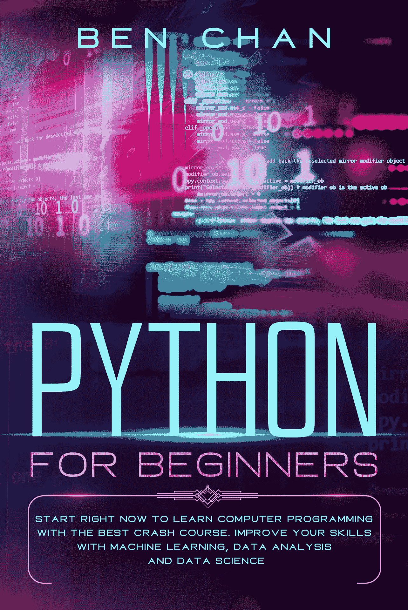
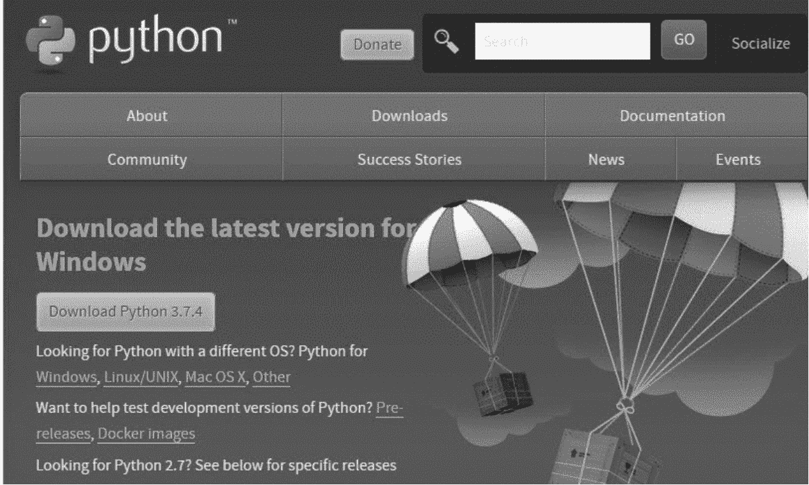
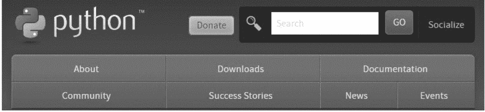
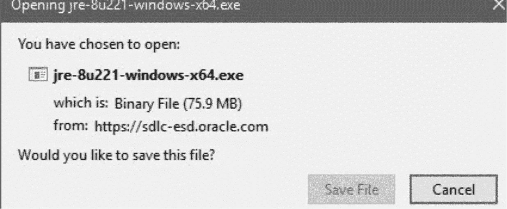
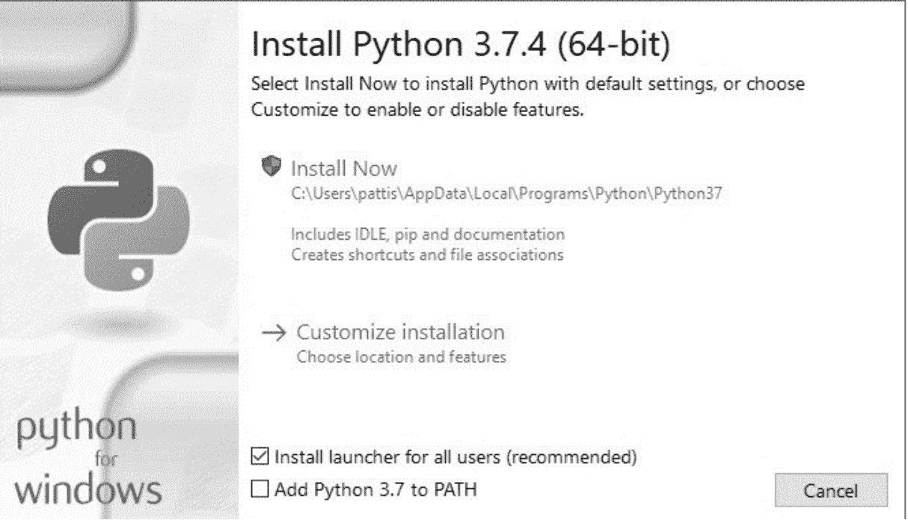
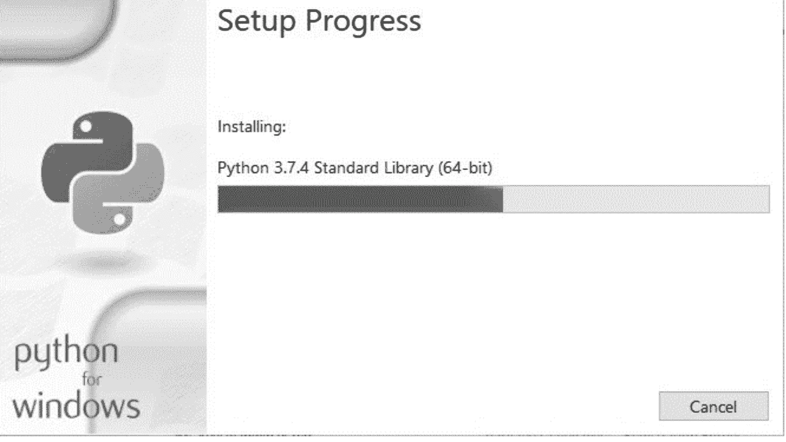

# Python 初学者指南：立即开始最佳速成课程学习计算机编程。通过机器学习、数据分析和数据科学提升你的技能





# 第 1 章 Python 编程基础

## 初学者 Python 
欢迎！你对编程来说完全是个新手吗？如果不是，那么我们假设你正在寻找关于为什么以及如何开始 Python 的信息。幸运的是，任何编程语言的熟练软件工程师（无论是哪种语言）都能快速上手 Python。对于初学者来说，它同样容易使用和适应，所以开始吧！

介绍 Python 通常非常简单，如今许多 Linux 和 UNIX 发行版都内置了 Python。事实上，甚至一些 Windows 电脑（特别是 HP 的电脑）现在也预装了 Python。如果你确实需要安装 Python 但不确定如何操作，你可以在 `BeginnersGuide/Download` wiki 页面上找到几条笔记，不过在大多数平台上，安装都是并不寻常的。

### 学习
在开始之前，你可能需要发现哪些 IDE 和内容工具适合修改 Python，查阅初始书籍列表，或者查看你认为有帮助的代码示例。在 `BeginnersGuide/Tutorials` 页面上有一份适用于经验丰富的软件工程师的教学练习列表。同样有一份不同语言的资源列表，如果英语不是你的母语，这些资源可能会有所帮助。在线文档是你获取权威数据的首选。有一份非常短的入门教程可以为你提供关于该语言的基本信息并让你入门。你可以通过查看库引用来全面描述 Python 的众多库，通过查看语言参考来对 Python 的语法结构进行全面（尽管有些许枯燥）的解释。

如果你正在寻找基础的 Python 计划和示例，可以查阅 `ActiveState Python Cookbook`。如果你需要知道 Python 是否支持特定的应用程序或具有特定功能的库，有许多潜在的数据来源。Python 网站提供了 `Python Package Index`（也称为 Cheese Shop，这是对同名 Monty Python 内容的引用）。此外，还有一个用于各种 Python 相关数据的搜索页面。不仅如此，只需在 Google 上搜索包含“python”一词的表达式，你可能就能得到你所需的结果。有疑问时，可以在 python 新闻组中提问，很有可能有人会帮帮你。

## Python 的安装
在继续之前，你可能需要打印这些指南，以便在下载和安装 Python 时参考它们。或者，只需将此存档保存在你的程序目录中。在执行它所描述的操作之前，你应该仔细阅读每个步骤。本文展示了在 2019 年夏季在 Windows `10` 上下载并安装 Python `3.7.4`。你应该下载并安装最新版本的 Python。目前的最新版本（截至 2019 年夏季）是 `Python 3.7.4`。记住，你应该将 `Java`、`Python` 和 `Eclipse` 作为 64 位应用程序分别安装。

### Python: 版本 3.7.4
Python 下载大约需要 25 Mb 的磁盘空间；将其保留在你的机器上，以防你需要重新安装。安装时，Python 大约额外额外 90 Mb 的磁盘空间。

### 下载 Python
随后的页面将在程序中显示。

点击 Windows 界面（`Download Python 3.7.4` 按钮下方的两行）。随后的页面将在程序中显示。

点击左上方 Stable Releases 下方的 `Download Windows x86-64` 可执行安装程序链接。
将弹出一个名为 `Opening python-3.74-amd64.exe` 的窗口。点击 `Save File`（保存文件）按钮。名为 `python-3.7.4-amd64.exe` 的文件将开始下载到你的默认下载文件夹。此文件约为 30 Mb，如果你使用的是较慢的网络连接，可能需要很长时间才能完全下载（我通过调制解调器连接大约花了 10 秒）。该文件应显示为 `Move this record to a permanent area`（将此记录移动到永久区域），这样你就可以安装 Python（以后需要时也可以重新安装）。不要犹豫进一步查看此页面；如果你只需继续安装，可以关闭此网页标签页。直接开始下方的安装指南。

### 安装
双击标记为 `python-3.7.4-amd64.exe` 的文件。
将弹出一个 `Python 3.7.4 (64-bit)` 安装窗口。确保勾选底部的 `Install launcher for all users (recommended)`（为所有用户安装启动器）和 `Add Python 3 to PATH`（将 Python 3 添加路径）复选框。如果 Python 安装程序发现你的电脑上安装了之前的 Python 版本，`Install Now`（立即安装）消息可能会显示为 `Upgrade Now`（立即升级），且复选框不会显示。点击 `Install Now`（或 `Upgrade Now`）消息，然后点击。运行时，屏幕上可能会弹出一个用户账户控制窗口。我没捕捉到它的图片，但它询问：`Do you need to permit this application to make changes to your gadget`（你是否允许此应用对你的设备进行更改）。点击 `Yes`（是）按钮。
另一个 `Python 3.7.4 (64-bit)` 安装窗口将弹出，带有安装消息和进度条。
安装期间，它将显示不同的部分并移动进度条。最后，将弹出一个 `Setup was successful` 。点击 `Close`（关闭）按钮。Python 现在已安装。

### 检查
要尝试检查安装，进入 `C:\Users\Pattis\Local\Programs\Python\Python37`（或相应的安装路径）。双击 `python.exe`。
一个名为 `C:\Users\Pattis\Local\Programs\Python\Python37\python.exe` 的窗口弹出，窗口内的主行是内容 `Python 3.7.4 ...`（注意它应该也说是 64 位）。在窗口底部是 `>>>`：输入 `exit()` 并按回车以退出 Python。

## 在 Mac 操作系统上安装 Python
作为一个完全初学者，你可以快速学会如何仅使用解释器和基础 Python 内容完成许多酷的事情。然而，长期来看，你还需要一些工具来帮助你成长。对我来说，最困难的是理解我需要哪些设备以及如何理解它们的安装指令。这里是你需要的工具列表以及在 Mac 上获取它们的简单步骤列表。本文大部分内容适用于 Mac OS X 10.7 和 10.8。

1. 安装 Xcode
Xcode 是 Apple 的集成开发环境 (IDE)，它附带了一些我们之后需要的工具。你可以在 Apple App Store 获取 Xcode。这是一个非常大的下载，但这是在你机器上获取这些工具最简单的方法。如果你在等待期间感到疲倦，可以跳过并执行第 2、5 和 6 阶段。

如果你需要另一种简单的方法来获取你需要的工具，而不需要整个 IDE，请看这里。一旦 Xcode 安装完成，尽管如此你仍必须安装 Apple 命令行工具！获取它们并不困难。在 Xcode 菜单下，点击 Downloads 选项卡。


## 2. 打开终端。调整好状态。

如果你以前从未用过终端（Terminal）或任何命令行界面，停下来熟悉一下它们的工作原理是一个明智之举。这里有一个快速的介绍。稍后你可以通过免费的在线书籍 *Learn Command Line Interface the Hard Way* 了解更多内容。

我喜欢有一个中心点来存储我所有的编程项目，因此我在我的主目录中创建了一个名为 `Code` 的分类目录。要创建另一个名为 `Code` 的目录，请打开 `Terminal`。你应该处于主目录中。只需确保你可以在 `Terminal` 窗口中输入以下内容。请尝试不要输入 `$`。大多数命令行指南都以 `$` 开头，这在很大程度上代表了你的提示符。提示符是 `Terminal` 打印的一系列字符，用于告诉它已准备好接受指令。`$` 表示当前工作目录。如果你不确定要去去哪里，它会将你带回主索引目录。

现在，要创建一个名为 `Code` 的文件夹，你需要输入：`mkdir Code`。`mkdir` 部分意味着“创建目录”。目录非常类似于 Finder 中说的“文件夹”。如果你通过命令行创建一个目录，它将作为 Finder 中的一个文件夹出现。`Code` 是该指令的参数。`mkdir` 需要我们指定一个作为新目录名称的字符串，因此我们向它传递了 `Code` 参数。与文件夹不同，如果我们没有提供名称，`mkdir` 将向我们返回错误。所示，错误信息（第二行）告诉我们错误地使用了 `mkdir`，并向我们提供了如何正确使用它的建议。括号中的任何内容都是可选的，但目录名称不是的！

## 3. 安装 HOMEBREW

Homebrew 是 OS X 的软件包管理器。软件包是一系列共同工作的代码记录。安装它们通常意味着运行一段内容（一段代码），将某些记录放置在不同的目录中。你将需要的许多软件包都有依赖项。这意味着它们要求你的电脑上预先安装了不同的软件包。Homebrew 会为你发现并安装依赖项，而且它会将它们整齐地排列在一个区域内，并可以在有更新时通知你。在整个过程中，当一切进展不顺利时，它会提供非常友好的指导。你可以在 Homebrew 网站上阅读更多信息。现在，请使用以下代码安装 Homebrew：

```bash
/bin/bash -c "$(curl -fsSL https://raw.githubusercontent.com/Homebrew/install/HEAD/install.sh)"
```

所以这里发生了什么？最后一部分显然是一个 URL。如果你无意中在程序中打开了这个 URL，你只会看到代码。这是一段引导你的电脑安装 Homebrew 的 Ruby 代码。`curl` 部分是一个利用 URL 移动文件的命令行工具。`- fsSL` 部分是 `curl` 四个选项标志的组合，用于决定如何处理 URL 中的记录。如果你需要了解这些标志的作用，请在命令行中输入 `man curl`。（你可以在大多数指令之前使用 `man` 来打开该指令的手册页）。我们还需要真正执行这段 Ruby 代码，因此我们在开头使用了了 `ruby` 指令。`- e` 是 `ruby` 的一个可选标志，用于将字符串作为单行代码执行，在这种情况下，就是 `"$(curl ...)"` 部分。你可能需要遵循另外几条指令来完成安装，但 Homebrew 会帮助你完成这些操作。

## 4. 安装 PYTHON

Python 随 OS X 自带，所以你可能不需要此步骤。你可以通过在 `Terminal` 中输入 `python --version` 来检查。如果你收到错误信息，则你必须安装 Python。如果 `Terminal` 打印类似 `Python 2.7.3` 的内容（你看到的具体数字可能不同），你就可以继续第 5 步了。如果由于未知原因你没有 Python，或者你需要获取最新版本，你现在可以使用 Homebrew 高效地完成这一点！每当你使用 Homebrew 时，都要以 `brew` 开始你的指令，后面跟着所需的 Homebrew 指令。要安装最新版本的 python 2，只需输入：`brew install python`。如果你倾向于安装最新版本的 python 3，请将 `python` 替换为 `python3`。


## 5. 引入 PIP
有几个专门针对 Python 的包管理器，而 `pip` 是最受青的。`pip` 的意思是“pip 引入包”。`pip` 有一个依赖项分发工具，然而 `Homebrew` 完全不知道如何引入其中某一个。幸运的是，`disseminate` 和 `pip` 都可以通过网络可访问的 Python 内容有效引入。我们可以利用 `twist`，就像我们获取 Homebrew 那样。这次我们是在两个方向获取并执行每项内容，而之前我们是按全局顺序执行的。记住，如果你感兴趣，可以通过 `$man twist` 查看 `-O` 的作用。

可以预见到，你可能会在这里遇到权限问题。你电脑上的每条记录都存储了关于谁可以访问和调整它的数据。`get-pip.py` 内容将尝试向你框架注册表的部分部分写入记录，你的客户端账户可能没有正确的权限。不过，你可以绕过这一点。万一在这些 Python 方向的授权上遇到错误，请在剩余命令前输入 `sudo`。`sudo` 的意思是“超级用户执行”。超级用户许可更改框架记录，当你输入 `sudo` 时，你正以超级用户的身份运行。你需要管理员密码来执行此操作。关于使用 `pip` 的更多数据你可以访问这里。

## 6. 引入 VIRTUALENV
当你开始参与具有独特或冲突环境的项目时，虚拟环境非常有帮助，因为你不需要在机器上全局引入所有内容。例如，你可能使用一个需要 Python 3 的库，而另一个任务非常适合 Python 2。要引入 `virtualenv`，只需：

## 7. 引入 GIT 并创建一个 GITHUB 账号
`Git` 是一个版本控制框架。它监控你对代码以及与任务相关的记录所做的修改，而无需为每个文档保留大量副本。如果你正在处理社区项目，它还将帮助你与不同开发人员的工作合并。要引入 `Git`，请在你的命令行输入以下内容。

`Github` 是一个利用 `git` 的网站，也是个人分享代码最广为人知的方式。你可以用它来备份自己的项目，或者为协作项目建立集中存储，但另一方面，它也像是一个软件工程师的在线社交网站。你可以查看别人的代码，关注感兴趣的项目，提交 bug，甚至为开源项目贡献代码。如果你需要参与开源项目或发现优秀的示例代码，`Github` 是最最理想的方式。访问 `github.com` 并按照指南创建账号。如果你对这个过程感到有些困惑，或者需要知道为什么以及如何使用 Github，你应该了解这些。

## 8. 现在该怎么办？
你现在机器上有很多非常有用的工具，这可能会让人有些无从从。没关系，你不需要同时学习它们，但至少现在已经把它们安装好了。不过，网络上还有许多免费资源可供你学习。尝试阅读 `Pyladies Resources` 页面，或直接使用 Google 寻找你需要的。与经验开发者聊天总是很有用的。

## 在操作系统中安装 Python

### Windows
你的 Windows 框架之前预装 Python 的可能性极低。Windows 框架通常不包含。幸运的是，引入并不比从 `python.org` 下载 Python 安装程序并运行它复杂。让我们来看看如何在 Windows 上安装 Python 3：

### 第一阶段：下载 Python 3 安装程序
打开程序窗口并访问 `python.org` 上的 Windows 下载页面。在页眉上方写有 `Python Releases for Windows` 的标题下方，点击 `Latest Python 3 Release - Python 3.x.x` 链接。（截至本文，最新版本是 Python 3.6.5。）查看底部并选择 `Windows x86-64 executable installer for 64-bit` 或 `Windows x86 installer for 32-bit`。对于 Windows，你可以选择 32 位或 64 位安装程序。这两者的区别在于：如果你的框架是 32 位处理器，那么你应该选择 32 位安装程序。在 64 位框架上，两种安装程序对于大多数用途都有效。32 位版本通常占用内存较少，但 64 位版本在密集计算的应用中表现更好。如果你不确定选哪个版本，请选择 64 位版本。注意：记住，万一你做“错”决定并想切换到另一个版本的 Python，你只需卸载 Python，然后从 python.org 下载另一个安装程序重新引入。

### 第二阶段：运行安装程序
当你选择并下载了安装程序后，只需双击下载的文件即可运行。会弹出一个类似这样的提示框：Windows 账户控制：你需要确保勾选显示 `Add Python 3.x to PATH` 的框框，以确保解释器被设置在你的执行路径中。然后只需点击 Install Now。就这么简单。几分钟后，你的框架上就会有一个可以运行的 Python 3 环境。

#### Windows Linux 子系统 (WSL)
如果你运行的是 Windows 10 创建者版或周年更新版，你还有另一个引入 Python 的选择。这些 Windows 10 版本包含一个名为 Windows Subsystem for Linux 的功能，它允许你在 Windows 中原生运行 Linux 环境，无需修改且没有虚拟机的额外开销。更多信息请参阅微软网站上的 `Windows Subsystem for Linux Documentation` 文章。关于如何在 Windows 10 中启用该子系统并引入 Linux 发行版的指南，请参阅 Windows 10 安装指南。你也可以查看 WSL 改进小组之一 Sarah Cooley 的 YouTube 介绍。当你引入了喜欢的 Linux 发行版后，你可以从 Bash 命令行窗口引入 Python 3，就像你在本地运行该 Linux 发行版一样。

### Linux
你的 Linux 发行版可能已经安装了 Python，但可能不是最新版本，而且可能是 Python 2 而不是 Python 3。要发现你有哪个版本，打开终端窗口并尝试以下命令：
```
python -version
python2 -version
python3 -version
```
这些命令中至少有一个会返回一个信息，格式如下：
```
$ python3 -version Python 3.6.5
```
如果显示的版本是 Python 2.x.x 或不是最新的 Python 3 变量（截至本文为 3.6.5），那么你需要引入最新版本。执行此操作的方法取决于你运行的 Linux 发行版。注意，使用一个名为 `pyenv` 的工具来处理 Linux 上的不同 Python 版本通常简单。要熟悉它，请查看我们的文章。

### Ubuntu
根据你运行的 Ubuntu 版本，Python 的引入指南不同。你可以通过运行以下命令确定你的 Ubuntu 版本：No LSB modules are available. Release ID: Ubuntu Description: Ubuntu 16.04.4 LTS: Codename: xenial。根据你在输出中看到的版本号，遵循以下操作：
```bash
sudo apt update
sudo apt install python3.6
```

### Linux Mint
Mint 和 Ubuntu 使用相似的框架，这在很大程度上让生活变得简单。你可以遵循针对 Ubuntu 14.04 的上述方法。deadsakes PPA 支持 Mint。

### Debian
我们发现 Ubuntu 16.10 方法可能适用于 Debian，但 Debian 的一个问题是大部分默认没有引入 `sudo` 命令。要引入它，你需要在编译 Python 之前执行以下操作：
```bash
su
apt install build-essential
```
然后引入工具，可以在 YaST（通过菜单）或使用 zypper 执行：
```bash
zypper install -t pattern C++
```
为了更简单，我们将工具分为两个大类：一类用于 Python 开发，另一类用于通用开发。这些选项本质上是无关的，所以你可以单独尝试它们。

### macOS/Mac X
在 Mac OS 上，你可以从 应用程序 → 实用工具获取终端。

### 第一阶段：安装 Homebrew (第一部分)
引入 Python 的最佳方法是引入一个名为 Homebrew 的包。你会看到如何这样做。

### 第二阶段：安装 Homebrew (第二部分)
### 第三阶段：安装 Python
要开始使用 Python 3，你需要一个解释器。有几种常用方法可以实现这一点：可以从 Python 官网 `python.org` 获取，通常包括下载适用于你框架的安装程序并运行它。

# 运行 Python 的方式
作为 Python 工程师，你最基本的能力之一是运行 Python 内容和代码。这仍然是判断你的代码是否运行的主要方法。取决于你的阶段和需求，你可以通过以下方式来运行 Python：
- 运行的命令行或终端
- 交互式模式
- 你喜欢的 IDE 或工具
- 在你的框架上，通过双击内容文件

### 内容与模块
在编写时，`content` 指的是一个包含一系列请求的文档。这通常是一个简单的程序，我们只需要以 `.py` 扩展名保存它。例如，`hello.py`。在文件中编写 Python 代码并保存它。要运行文件，前往 `Run > Run Module` 或直接点击 `F5`

## 什么是 Python 解释器？
Python 是一门优秀的语言，让你受益匪浅。解释器是位于程序和执行之间的中间层。无论你使用哪种结构，解释器可以是：
- CPython
- Jython
- PyPy
- IronPython

它可以通过两种方式运行 Python 代码：
- 作为文件或模块
- 交互会话

### 交互式运行 Python 代码
运行 Python 代码最有效的方法是通过交互会话。交互式模式的标准符号是 `>>>`，当你看到这些字符时，你就处于该模式中。
```
>>> Python 3.6.7 (default, Oct 2018) 
[GCC 8.2.0] on Windows
>>> print('Hello World!')
Hello World!
>>> 2 + 5
7
>>> print('Welcome to Python!')
Welcome to Python!
```
退出交互式模式，你可以使用 `stop()` 或 `leave()`，在 Windows 上按 `Ctrl+Z`，在 Unix 类框架上仅按 `Ctrl+D`。

## 使用命令行运行 Python 脚本

### 1. 在立即模式运行 Python
当 Python 引入后，在命令行输入 `python` 将产生提示符模式。（省略）要离开此模式，输入 `quit()` 并按回车。

### 2. 在集成开发环境 (IDE)
我们可以使用任何文本编辑器来编写 Python 内容。我们只需要以 `.py` 扩展名保存它。无论如何，使用 IDE 可以让我们的生活简单得多。IDE 是一个提供有用功能的程序，如代码指示、语法检查等，它用于软件开发。偶然的是，当你引入 Python 时，一个名为 `IDLE` 的 IDE 也会被引入。你可以利用它在你的电脑上运行 Python。对于学习者来说，这不是坏 IDE。当你打开 IDLE 时，会打开一个交互式 Python Shell。

### Python IDLE
现在你可以创建一个另一个文件并以 `.py` 扩展名保存。例如，`hello.py`。在文件中编写 Python 代码并保存它。

你的第一个 Python 程序
由于我们已经准备好了 Python，我们可以编写第一个 Python 程序。我们应该极其简单的程序 "Hi World!"。这是一个在屏幕上输出 `Hello World!` 的简单程序。由于这是一个简单程序，通常用于让新手熟悉另一种语言。在任何内容管理器或 IDE 中输入以下代码并将其保存为 `hello`：
```python
print("Hello World!")
```
（省略）用文件名保存文档，例如 `hello.py`。测试准备就绪，你将在屏幕上看到 Hello World!

### 声明和使用变量的步骤
让我们看例子。我们将声明“an”并打印它。
```
f = 100
print(f)
```

## 变量
在 Python 中，你可以绑定不同的数据类型，如字符串和数字。例如，我们将 "Master" 与数字 `99` 绑定。与要求将数字作为字符串的 Java 不同，Python 允许：
```python
a = "Master"
b = 99
print(a+b)
```
（省略）
在 Python 中，当你需要在程序的其余部分或模块中使用变量时，声明一个在作用范围内的 `f`。当函数结束时，更改的变量 `f` 仍然存在。
```
print(f)
```
（省略）

## 4. 类
类名应遵循 `UpperCaseCamelCase`（大驼峰命名法）。Python 的内置类通常是小写单词。特殊情况类应以 `Mistake`（错误）结尾。

### 5. 全局（模块级）变量
全局因子应全小写。全局变量名中的单词应用下划线分隔。

### 6. 实例变量
实例变量名应全小写。实例变量名中的单词应用下划线分隔。非公开实例因子应以单下划线开头。如果类名应该被破坏，双下划线可以作为名称开头。

### 7. 方法
方法名应全小写。方法名中的单词应用下划线分隔。非公开方法应以单下划线开头。如果方法名应该被破坏，双下划线可以作为其名称开头。

### 8. 参数
方法的第一个参数通常是 `self`。类方法的第一个参数是 `cls`。

### 9. 容量
容量名应全小写。容量名中的单词应用下划线分隔。

### 10. 常量
常量名必须全大写。常量名中的单词应用下划线分隔。

# 命名 Python 命名规范
## 1. 通用
避免使用过度宽泛或冗长的名称。在两者之间寻找平衡。
- 糟糕：`data_structure`、`my_list`、`info_map`、`dictionary_for_the_purpose_of_storing_data`
- 优秀：`user_profile`、`menu_options`
## 2. 包
包名应全小写。当需要多个单词时，使用下划线分隔（例如 `HTTPServer`）。
## 3. 模块
模块名应全小写。当需要多个单词时，使用下划线分隔。通常建议使用短单词。
## 4. 类
类名应遵循 `UpperCaseCamelCase`。Python 的内置类通常是小写单词。特殊情况类应以 `Mistake` 结尾。


# 第 2 章 变量类型

变量仅仅是用于存储估计值的内存区域。这意味着当你创建一个变量时，你就在内存中保存了部分空间。根据变量的信息类型，解释器会分配内存并选择哪些内容可以存放在持有的内存中。通过这种方式，通过为变量分配不同的信息类型，你可以在这些变量中存储整数、小数或字符。

## 给变量赋值

Python 变量不需要显式声明来占据内存空间。当你向变量分配一个激励值时，赋值就会随之发生。等号（`=`）用于向变量分配值。`=`运算符的一侧的操作数是变量名，`=`运算符另一侧的操作数是存储在变量中的值。例如：

```python
#!/usr/bin/python
counter = 100 # 一个整数任务
miles = 1000.0 # 一个浮点数名称
name = "John" # 一个字符串
print counter
print miles
print name
```

在这里，`100`、`1000.0` 和 `"John"` 分别分配给 `counter`、`miles` 和 `name` 变量。这产生了如下结果：
```
100
1000.0
John
```

## 多重赋值

Python 允许你同时向几个变量分配同一个激励值。例如 `a = b = c = 1`。在这里，创建了一个值为 `1` 的数字项目，并且这三个变量中的每一个都被分配到了相同的内存区域。你同样可以将多个项目分配给不同的变量。例如 `a,b,c = 1,2,"john"`。在这里，两个值为 `1` 和 `2` 的整数项目被分别分配给变量 `a` 和 `b`，而一个值为 `"john"` 的字符串对象被分派给变量 `c`。

## 标准数据类型

存储在内存中的信息可以是多种类型。例如，一个人的年龄被存储为数值，而他们的位置被存储为字母字符。Python 有不同的标准信息类型，用于刻描述在它们上可以执行的操作以及每种类型的处理能力。Python 有五种标准信息类型：
- 数字 (Numbers)
- 字符串 (String)
- 列表 (List)
- 元组 (Tuple)
- 字典 (Dictionary)

### Python 数字

数字信息类型存储数值属性。当向它们分配一个激励值时，就会创建数字项目。例如：
```python
var1 = 1
var2 = 10
```

你同样可以使用 `del` 语句删除对数字项目的引用。`del` 语句的语法是 - `del var1[],var2[],var3[],....,varN[]`。你可以利用 `del` 语句删除单个项目或多个项目。例如：`del var`，`del var_a, var_b`。

Python 支持四种不同的数值：
- `int`（标记整数）
- `long`（长整数，它们也可以用八进制和十六进制表示）
- `float`（浮点实数属性）
- `complex`（复数）

以下是一些数字的例子：

| int | long | float | complex |
| :--- | :--- | :--- | :--- |
| 100 | 51924361L | 0.0 | 3.14j |
| 100 | -0x19323L | 15.20 | 45.j |
| -786 | 0122L | -21.9 | 9.322e-36j |
| 080 | 0xDEFABCECBDAECBFBAEl | 32.3+e18 | .876j |
| -0490 | 535633629843L | -90. | -.6545+0J |
| -0x260 | -052318172735L | -32.54e100 | 3e+26J |
| 0x69 | -4721885298529L | 70.2-E12 | 4.53e-7j |

Python 允许在 `long` 中使用小写的 `l`，但建议只使用大写的 `L` 以避免与数字 `1` 混淆。Python 用大写的 `L` 显示长整数。一个奇人的数字由一对有序的实数浮点组成，表示为 `x + yj`，其中 `x` 和 `y` 是实数，`j` 是虚数单位。

### Python 字符串

Python 中的字符串被识别为引号内说的字符边界集。Python 考虑单引号或双引号语句。字符串的子集可以使用切片运算符（`[]` 和 `[::]`）获取，文件从字符串开头的 `0` 开始并从 `-1` 向末尾移动。加号（`+`）是字符串连接运算符，星号（`*`）是重复运算符。例如：

```python
#!/usr/bin/python
str = 'Hi World!'
print str # 打印整个字符串
print str[0] # 打印字符串的第一个字符
print str[2:5] # 打印从第三到第五的字符
print str[2:] # 打印从第三字符开始的字符串
print str * 2 # 多次打印字符串
print str + "TEST" # 打印连接字符串
```

这将交付如下结果：
```
Hi World! Hi Hi World! Hi World!Hello World! Hi World!TEST
```

### Python 列表

列表是 Python 复合信息类型中最灵活的。列表包含用逗号分隔的项目，并封装在方括号 `[]` 中。某种程度上，列表类似于 C 语言中的数组。它们之间的区别在于，列表中具有位置的每一个项目可以是不同类型。存储在列表中的属性可以使用切片运算符（`[]` 和 `[::]`）获取，列表从列表开头的 `0` 开始并向其 `-1` 移动。加号（`+`）是列表连接，星号（`*`）是重复运算符。例如：

```python
#!/usr/bin/python
list = ['abcd', 786 , .23, 'john', 70.2]
tinylist = [123, 'john']
print list # 打印整个列表
print list[0] # 打印列表的第一个元素
print list[1] # 打印列表的第二个元素
print list[2:] # 打印从第三元素开始的列表
print list * 2 # 多次打印列表
```

这将交付
```
['abcd', 786, .23, 'john', 70.2] ['abcd', 786, .23, 'john', 70.2] ['abcd', 786, .23, 'john', 70.2]
```

### 元组

元组是 Python 复合信息类型中不可变的。元组包含用逗号分隔的项目，并封装在括号 `()` 中。某种程度上，元组类似于列表。一个区别是，元组一旦创建就不能被更改。存储在元组中的属性可以使用切片运算符（`[]` 和 `[::]`）获取，列表从元组开头的 `0` 开始并向 `-1` 移动。加号（`+`）是元组连接，星号（`*`）是重复运算符。例如：

```python
#!/usr/bin/python
tuple = ('abcd', 786, .23, 'john', 70.2)
tupleuple = (123, 'john')
print tuple # 打印整个元组
print tuple[0] # 打印元组的第一个元素
print tuple[1] # 打印元组的第二个元素
print tuple[2:] # 打印从第三元素开始的元组
print tuple * 2 # 多次打印元组
```

这将交付如下
```
('abcd', 786, .23, 'john', 70.2) ('abcd', 786, .23, 'john', 70.2) ('abcd', 786, .23, 'john', 70.2)
```

### 字典

字典是 Python 复合信息类型中最灵活的。字典包含键值对项目，并封装在花括号 `{}` 中。某种程度上，字典类似于 C 语言中的哈希表。一个区别是，字典中的每个键是唯一的。存储在字典中的属性可以使用键（`[]`）获取。例如：

```python
#!/usr/bin/python
dict = {'a': 'abcd', 'b': 786, 'c': .23, 'd': 'john', 'e': 70.2}
dictuple = {'a': 123, 'b': 'john'}
print dict # 打印整个字典
print dict['a'] # 打印字典的第一个元素
print dict['b'] # 打印字典的第二个元素
print dict['c'::] # 打印从第三元素开始的字典项
print dict * 2 # 多次打印字典
```

这将交付如下
```
{'a': 'abcd', 'b': 786, 'c': .23, 'd': 'john', 'e': 70.2} {'a': 'abcd', 'b': 786, 'c': .23, 'd': 'john', 'e': 70.2} {'a': 'abcd', 'b': 786, 'c': .23, 'd': 'john', 'e': 70.2}
```

### 集合

集合是 Python 复合信息类型中无序的。集合包含不重复的项目，并封装在花括号 `{}` 中。某种程度上，集合类似于 C 语言中的集合。一个区别是，集合中的项目是唯一的。例如：

```python
#!/usr/bin/python
set = {'abcd', 786, .23, 'john', 70.2}
setuple = {123, 'john'}
print set # 打印整个集合
print set[0] # 打印集合的第一个元素
print set[1] # 打印集合的第二个元素
print set[2:] # 打印从第三元素开始的集合项
print set * 2 # 多次打印集合
```

这将交付如下
```
{'abcd', 786, .23, 'john', 70.2} {'abcd', 786, .23, 'john', 70.2} {'abcd', 786, .23, 'john', 70.2}
```


# 第 3 章：Python 中的函数

## Python 中的函数
函数是一组接收输入、执行特定计算并产生输出的语句。其核心思想是将某些通常或重复执行的赋值组合成一个函数，这样就不需要为各种信息源重复编写相似的代码，只需调用该函数即可。Python 提供了如 `print()` 等内置函数，但我们同样可以创建自己的函数。这些函数被称为用户定义函数。

### 一个检查 x 是否为偶偶数的基础 Python 函数
```python
def evenOdd( x ):
    if (x % 2 == 0):
        print "even"
    else:
        print "odd"

# 驱动代码 
evenOdd(2)
evenOdd(3)
```
输出：确实是奇数

## 按引用传递还是按值传递？
需要注意的一个重要点是，在 Python 中，每个变量名都是引用。当我们把变量传递给函数时，会创建该项的另一个引用。Python 中的参数传递与 Java 中的引用传递相同。

### 此处 x 是同一个列表 lst 的另一个引用
```python
def myFun(x):
    x[0] = 20

## 驱动代码（注意在函数调用后 lst 被调整了）
lst = [10, 11, 12, 13, 14, 15]
myFun(lst)
print(lst)
```
输出：`[20, 11, 12, 13, 14, 15]`

当我们传递一个引用并将该引用更改为不同的内容时，传入参数和接收参数之间的关联就会断。例如，考虑下面的程序。

```python
def myFun(x):
    # 在此行之后，x 与传入对象的连接被断开。
    # 另一个项被分配给 x。
    x = [20, 30, 40]

## 驱动代码（注意在函数调用后 lst 没有发生变化）
lst = [10, 11, 12, 13, 14, 15]
myFun(lst)
print(lst)
```
输出：`[10, 11, 12, 13, 14, 15]`

另一个证明当我们在（函数内部）分配另一个值时，引用连接会断开的示例。

```python
def myFun(x):
    # 在此行之后，x 与传入对象的连接被断开。
    # 另一个值被分配给 x。
    x = 20

## 驱动代码（注意在函数调用后 x 没有发生变化）
x = 10
myFun(x)
print(x)
```
输出：`10`

### 练习：尝试推导出以下代码的输出。
```python
def swap(x, y):
    temp = x
    x = y
    y = temp

# 驱动代码 
x = 2
y = 3
swap(x, y)
print(x)
print(y)
```
输出：`2 3`

## 默认参数
默认参数是指如果在函数调用时没有为该参数提供值，它将接受一个默认值。下面的模型概述了默认参数。

```python
### 默认参数的 Python 程序
def myFun(x, y=50):
    print("x: ", x)
    print("y: ", y)

### 驱动代码（我们带一个参数调用 myFun()）
myFun(10)
```
输出：`('x: ', 10) ('y: ', 50)`

类似于 C++ 的默认参数，函数中的任意数量的参数都可以有默认值。在任何情况下，当我们有一个默认参数时，其之后的每一个参数也应该同样有默认值。

### 关键字参数
其核心思想是允许用户通过参数名指定值，这样用户就不必记住参数的顺序。

```python
### 显示关键字参数的 Python 程序
def student(firstname, lastname):
    print(firstname, lastname)

### 关键字参数
student(firstname ='Geeks', lastname='Practice')
student(lastname='Practice', firstname ='Geeks')
```
输出：`('Nerds', 'Practice') ('Nerds', 'Practice')`

## 可变参数
我们可以拥有普通和关键字的可变数量参数。如果不麻烦的话，请查看细节。

```python
### 使用 *args 定义变数量参数的 Python 程序
def myFun(*argv):
    for arg in argv:
        print (arg)

myFun('Hello', 'Welcome', 'to', 'GeeksforGeeks')
```
输出：`Hello` `Welcome` `to` `GeeksforGeeks`

```python
### 使用 **kwargs 定义变数量关键字参数的 Python 程序
def myFun(**kwargs):
    for key, esteem in kwargs.items():
        print ("%s == %s" %(key, esteem))

### 驱动代码
myFun(first ='Geeks', mid ='for', last='Geeks')
```


# 第 4 章 Python 中的基本函数

## Python 中的自定义函数

函数在所有编程语言中都是通用的，它可以很好地描述为用于执行特定任务的可重用代码块。尽管如此，在 Python 中描述函数意味着首先要了解两种类型：隐式（内置）和自定义（client defined）。内置函数通常是 Python 的包和库，而自定义函数是由设计者为了满足某些先决条件而编写的。

在 Python 中，所有函数都被视为对象，因此与其他高级语言语言相比，它具有更强的适应性。在本文中，我们将关注 Python 中的自定义函数。为了完全理解这一概念，我们将通过组合代码模型来弄清楚如何执行它们。在进入编码之前，让我们先看一眼其他重要的概念吧。

## Python 中自定义函数的意义

总的来说，设计者可以编写自定义函数，也可以从外部库中获取。这意味着你自己的自定义函数也可以作为其他客户端的外部库。根据使用的时间和方式，自定义函数具有某些优势。让我们来看以下几个关注点：

*   自定义函数是可重用的代码块；它们只需要编写一次，然后就可以被多次使用。
*   它们甚至可以在不同的应用程序中使用。
*   这些函数非常有用，从编写通用工具到具体的业务逻辑都不行。
*   这些函数还可以根据需要进行修改。代码通常是高效、易于维护且对开发者友好的。这意味着它可以增强结构化方法。
*   由于自定义函数可以独立编写，项目的任务可以分发以实现快速的开发。一个定义良好且精心编写的自定义函数可以简化应用程序的过程。

既然我们已经对这些关注点有了基本的理解，那么让我们来看看 Python 中不同的函数参数吧。

## Python 中的函数参数

在 Python 中，自定义函数可以接受四种不同类型的参数。尽管如此，参数类型及其含义是预定义的，无法更改。无论，工程师可以遵循这些预定义的规则来创建自己的自定义函数。接下来是四种参数类型及其规则。

### 1. 默认参数 (Default arguments)
Python 有一种特殊方法来处理语言结构和函数参数的默认值。默认值表示，如果在调用函数时没有传递参数值，该参数将取该值。默认值通过赋值操作符 (`=`) 来指定。以下是默认参数的典型结构。

```python
def defaultArg(name, msg = "Hello!"):
defaultArg(name)
```

### 2. 强制参数 (Required arguments)
强制参数是函数必须的参数。这些参数值在调用函数时必须按照正确的数量和顺序传递。以下是强制参数函数的运行结构示例。

```python
def requiredArg(str,num):
requiredArg("Hello",12)
```

### 3. 关键字参数 (Keyword arguments)
关键字参数对于 Python 函数调用至关重要。在调用函数时，关键字与它们对应的值一起被引用。这些关键字与函数参数映射，因此函数可以轻松地识别相关值，即使在函数调用时没有保持原有的顺序。接下来是关键字参数的语法。

```python
def keywordArg(name, job):
keywordArg(name = "Tom", job = "Administrator")
keywordArg(job = "Administrator", name = "Tom")
```

### 4. 可变数量参数 (Variable number of arguments)
当我们完全不知道传递给函数的精确参数数量时，这种方法非常有用。或者，我们可以根据需要建立一个可以传递任意数量参数的结构。以下是此类函数调用的语法。


# 第 5 章 Python 中的数据类型

现在你已经知道如何与 Python 解释器连接并执行 Python 代码。这是一个深入学习 Python 语言的绝佳机会。首先是交换 Python 中包含的基础信息类型。你将在本教学练习中了解到：你将发现 Python 中包含的几种基本的数值、字符串和布尔类型。在练习结束之前，你将熟悉这些类型对象的面貌以及如何与它们交互。你还将回顾 Python 的内置函数。这些是预先编写的代码块，你可以调用它们来执行有用操作。你刚刚观察了内置函数 `print()`，但还有许多其他。

免费 PDF 下载：Python 3 快速查表。参加测验：通过我们直观的“Python 基本数据类型”测试来检验你的理解。完成后，你将获得一个分数，以便在一段时间后跟踪你的学习进度。

## 整数

在 Python 3 中，整数值的范围没有足够的限制。显然，它受限于你系统内存的大小，就像所有事物一样，但在此之外，整数可以是你需要的任何长度：

```python
>>> print(1231231231231231231231231231231231231231231231123 + 1)
12312312312312312312312312312312312312312313124
```

Python 将无前缀的一系列十进制数字翻译为十进制数：

```python
>>> print(10)
10
```

可以在整数前加上相应的字符串，以表示除 10 以外的进制：

| 前缀 | 解释 | 进制 |
| :--- | :--- | :--- |
| 0b | (零 + 小写字母 'b') | |
| 0B | (零 + 大写字母 'B') | 二进制 (2) |
| 0o | (零 + 小写字母 'o') | |
| 0O | (零 + 大写字母 'O') | 八进制 (8) |
| 0x | (零 + 小写字母 'x') | |
| 0X | (零 + 大写字母 'X') | 十进制 (16) |

例如：

```python
>>> print(0o10)
8
>>> print(0x10)
16
>>> print(0b10)
2
```

有关非十进制进制数字特性的更多信息，请参见相关的 Wikipedia 词条：二进制、八进制和十六进制。Python 整数的隐藏类型无论使用什么进制表示，都是 `int`：

```python
>>> type(10)
<class 'int'>
>>> type(0o10)
<class 'int'>
>>> type(0x10)
<class 'int'>
```

注意：现在时候提一下，如果你需要在 REPL 会话中显示一个值，不需要使用 `print()` 函数。只需在 `>>>` 提示符后输入值并回车即可显示：

```python
>>> 10
10
>>> 0x10
16
>>> 0b10
2
```

本教学练习安排中的许多模型将使用此元素。注意，这在内容记录内部不起作用。在内容记录中，没有任何其他内容的单行值值将不起任何作用。

## 浮点数

Python 中的 `float` 类型分配一个浮点数。浮点值用小数点表示。或者，可以在正整数或负整数后附加字符 `e` 或 `E` 来表示科学计数法：

```python
>>> 4.2
4.2
>>> type(4.2)
<class 'float'>
>>> 4.
4.0
>>> .2
0.2
>>> .4e7
4000000.0
>>> type(.4e7)
<class 'float'>
>>> 4.2e-4
0.00042
```

### 深度解析：浮点数表示

接下来是关于 Python 内部如何处理浮点数的更多底层数据。你可以在不理解这些程度的情况下直接在 Python 中使用浮点数，即使这看起来可能过于复杂。如果你感兴趣，这里展示了数据。几乎所有的阶段都将 Python 浮点数表示为 IEEE 754 标准规定的 64 位“双精度”值。总而言，浮点数能拥有的最大值大约是 1.8 × 10³⁰⁰⁸。Python 将用字符串 `inf` 显示比那更大的数字：

```python
>>> 1.79e308
1.79e+308
>>> 1.8e308
inf
```

非零数字最接近零的大约是 5.0 × 10⁻³²²⁴。比那更接近零的都会被视为零：

```python
>>> 5e-324
5e-324
>>> 1e-325
0.0
```

浮点数内部表示为双精度（base2）部分。大多数十进制除无法精确表示，因此浮点数的真实值是不精确的。

## 复数 

复数表示为 `实部+虚部`。例如：

```python
2+3j
```

该对象的类型是 `complex`：

```python
>>> type(2+3j)
<class 'complex'>
```

你可以使用 `real` 和 `imag` 属性来访问实部和虚部：

```python
>>> c = 2+3j
>>> c.real
2
>>> c.imag
3
```

## 字符串

字符串用于表示序列。在 Python 中，字符串被包含在单引号（`'...'`）或双引号（`"..."`）中。Python 支持三引号（`'''''` 或 `"""""`），它们用于跨多行的字符串：

```python
"""This is a string
that spans multiple lines."""
```

## 方法

Python 提供了许多内置方法来操作字符串。常见的有：

- `len()`：返回字符串的长度。
- `upper()`：返回字符串的大写拷贝。
- `lower()`：返回字符串的小写拷贝。
- `replace(old, new)`：替换所有旧的子字符串。
- `split(delimiter)`：将字符串分割为列表。

```python
>>> len("Python")
6
>>> "python".upper()
'PYTHON'
>>> "hello world".replace("h", "j")
'ello world'
```

## 作为序列的字符串

字符串是元素的顺序可集合，这意味着你可以使用 `for` 循环遍历它们：

```python
for char in "Python":
    print(char)
```

也可以通过索引访问字符：

```python
>>> "Python"[0]
'P'
>>> "Python"[-1]
'n'
```

切片允许你提取字符串的部分：

```python
>>> "Python"[0:4]
'Pyth'
>>> "Python"[2:]
'thon'
>>> "Python"[:2]
'Py'
```

## 格式化

有几种格式化字符串的方法：

- `%` 运算符旧方法）。
- `format()` 方法。
- f-strings（在 Python 3.6 中引入）。

```python
>>> f"Hello, {'Alice}"
'Hello, Alice'
>>> "Hello, {}".format("Bob")
'Hello, Bob'
```

## 编码

Python 支持各种字符编码：

- `ASCII`：基础编码。
- `UTF-8`：常用的编码，可以表示 Unicode 集中的任何字符。

将字符串编码为字节，使用 `encode()` 方法：

```python
>>> "hello".encode('utf-8')
```

## 特殊字符

某些字符具有特殊含义，必须使用反斜杠进行转义：

- 反斜杠（`\\`）
- 单引号（`\'`）
- 双引号（`\"`）
- 换行（`\n`）
- 制表符（`\t`）
- 回车（`\r`）

```python
>>> "Line 1\nLine 2"
'Line 1
Line 2'
```

## 运算符

Python 使用运算符：

- `and`：如果两个表达式都真，则返回 True。
- `or`：如果至少有一个表达式真，则返回 True。
- `not`：返回布尔值的反反。

```python
>>> True and False
False
>>> True or False
True
>>> not True
False
```

## 比较运算符

Python 使用比较运算符：

- `==`, `!=`
- `<`, `>=`, `<=`

示例用法：

```python
>>> 5 == 5
True
>>> 10 > 5
True
```

## 条件语句

`if`、`elif` 和 `else` 语句用于控制程序流：

```python
if x > 5:
    print("greater than 5")
elif x == 5:
    print("equal to 5")
else:
    print("less than 5")
```

## 循环

### `for` 循环

用于遍历序列（如列表、元组或字符串）：

```python
for i in range(5):
    print(i)
```

### `while` 循环

在条件为真时重复一个块：

```python
i = 0
while i < 5:
    print(i)
    i += 1
```

## 函数

函数使用 `def` 关键字定义：

```python
def greet(name):
    return f"Hello, {name}!"

print(greet("Alice"))
```

函数还可以带有带有默认值的参数：

```python
def add(a, b=10):
    return a + b

print(add(5)) # 15
print(add(5, 2)) # 7
```

### 列表

列表是顺序的、可变的元素集合：

```python
fruits = ["apple", "banana", "cherry"]
fruits.append("orange")
print(fruits)
```

### 元组

元组是顺序的、不可变的集合：

```python
coordinates = (10, 20)
### coordinates[0] = 30 # 这将引发错误
```

### 字典

字典是无序的键值对：

```python
person = {"name": "Alice", "age": 25}
print(person["name"])
person["age"] = 26 # 更新
person["city"] = "New York" # 添加
```

### 集合

集合是无序的唯一元素集合：

```python
numbers = {1, 2, 3, 3}
print(numbers) # 输出: {1, 2, 3}
```


# 第 6 章 Python 中的流程控制

## 4. 其他流程控制工具除了刚才介绍的 `while` 语句，Python 还利用了在不同语言中常见的流控制语句，但也有某些不同。

### 4.1. if 语句
最突出的语句类型是 `if` 声明。例如：
```python
\>>> x = int(input("请输入一个整数: "))
>>> 如果你不介意输入一个整数：42
\>>> if x < 0:
... x = 0
... print('负数改为零')
... elif x == 0:
... print('零')
... elif x == 1:
... print('单个')
... else:
... print('更多')
```
可以有至少零 `elif` 部分，`else` 部分是可选的。关键字 `elif` 是 `else if` 的缩写，有助于保持代码缩进不过深。`if` ... `elif` ... `elif` ... 的结构取代了不同语言中常见的 `switch` 或 `case` 语句。

### 4.2. for 语句
Python 中的 `for` 语句与你在 `C` 或 `Pascal` 中使用的有所不同。与不断对一个数字数学运动进行重复（如在 `Pascal` 中），或允许用户刻画强调步长和停止条件（如 `C`）不同，Python 的 `for` 语句强调的是任何分组（列表或字符串）中的元素，并要求它们按照顺序出现。例如（这并不是开玩笑）：
```python
\>>> # 测量几个字符串：
... words = ['cat', 'window', 'defenestrate']
\>>> for w in words:
... print(w, len(w))
feline 3 window 6 defenestrate 12
```
在遍历该集合的同时调整该集合可能很难完全正确。相反，遍历集合的副本或创建一个新集合通常会更直接：
```python
## 策略：遍历副本
for client, status in users.copy().items():
    if status == 'idle':
        del users[user]

## 策略：创建另一个集合
active_users = {}
for client, status in users.items():
    if status == 'dynamic':
        active_users[user] = status
```

### 4.3. range() 函数
如果你需要遍历一组数字，隐式能力 `range()` 证明是非常有用的。它产生数字序列：
```python
\>>> for I in range(5):
... print(i)
0 1 2 3 4
```
给定的终点永远不是生成序列的一部分；`range(10)` 创建 10 个元素，对应长度为 10 的集合的合法索引。可以让范围从另一个数字开始，或者确定另一个增量（即使是负数；这有时被称为“步长”）：`range(5, 10)` 给出 `5, 6, 7, 8, 9`；`range(0, 10, 3)` 给出 `0, 3, 6, 9`；`range(-10, -100, -30)` 给出 `-10, -40, -70`。

为了遍历序列的列表，你可以这样组合 `range()` 和 `len()`：
```python
\>>> a = ['Mary', 'had', 'a', 'bit', 'lamb']
\>>> for I in range(len(a)):
... print(i, a[i])
0 Mary 1 had 2 a 3 little 4 sheep
```
在大多数此类情况下，使用 `enumerate()` 函数是有帮助的，参见“循环技巧”。当你仅仅打印一个范围时，会发生奇怪的事情：
```python
\>>> print(range(10))
range(0, 10)
```
从多个角度来看，`range()` 返回的对象就像一个列表，但实际上它不是。它是一个在你遍历它时恢复理想序列的顺序元素的对象，但它通常不会创建列表，从而节省空间。我们称这种对象为可迭代的（iterable），即可以作为循环和构建的目标，这些构建期望从某个对象中获取顺序元素，直到存储耗尽。我们已经看到 `for` 语句是这样的构建，而一个接受可迭代对象并将其作为内容的容量用是 `aggregate()`：
```python
\>>> sum(range(4)) # 0 + 1 + 2 + 3
```
稍我们将看到更多接收可迭代对象并将可迭代对象作为内容的函数。最后，你可能对如何从范围获取列表感兴趣。这里是写法：
```python
\>>> list(range(4))
[0, 1, 2, 3]
```
在“数据结构”章节中，我们将更深入讨论 `list()`。

### 4.4. break 和 continue 语句，以及循环上的 else 子句
`break` 语句像 `C` 一样，跳出最内层的嵌套 `for` 或 `while` 循环。循环语句有一个 `else` 规定；它在循环通过耗尽迭代对象（对于 `for`）或条件变为假（对于 `while`）结束时执行，但不在循环被 `break` 语句结束时执行。以下寻找质数的循环说明了：
```python
\>>> for n in range(2, 10):
... for x in range(2, n):
... if n % x == 0:
... print(n, '等于', x, '*', n//x)
... break
... else:
... # 循环运行完没有找到因子
... print(n, '是一个质数')
2 是一个质数
3 是一个质数
4 等于 2 * 2
5 是一个质数
6 等于 2 * 3
7 是一个质数
8 等于 2 * 4
9 等于 3 * 3
```
（事实上，这是正确的代码。仔细看：`else` 规定与 `for` 循环对齐，而不是 `if` 语句。）

当与循环配合使用时，`else` 规定实际上与 `attempt` 语句的 `else` 条件相似，而不是与 `if` 语句相似：`attempt` 语句的 `else` 语句在没有发生异常时运行，而循环的 `else` 在没有被 `break` 中时运行。对于异常的情况，参见“处理异常”。`continue` 语句如下：
```python
>>> for num in range(2, 10):
... if num % 2 == 0:
... print("发现偶数", num)
... continue
... print("发现奇数", num)
发现偶数 2
发现奇数 3
发现偶数 4
发现奇数 5
发现偶数 6
发现奇数 7
发现偶数 8
发现奇数 9
```

### 4.5. pass 语句
`pass` 语句什么都不做。当语法上需要语句但程序不需要操作时，它有用。例如：
```python
>>> while True:
... pass # 忙，按 Ctrl+C 退出
```
这通常用于创建空类：
```python
>>> class MyEmptyClass:
... pass
```
`pass` 还可以其他地方作为函数或条件实体的占位符，当你尝试编写新代码时，它可以让你继续思考。`pass` 被静地忽略：
```python
>>> def init(*args):
... pass # 记得实现这个！
```


# 第 7 章 Python 中的类与对象

对象（Articles）是将属性和方法整合进单一元素中的体现。对象从类中获取它们的属性和方法。类基本上是一种用于创建对象的格式。一个极其简单的类看起来像这样：`script.py`。

我们稍后会解释为什么你需要将 `self` 作为参数引入。首先，为了将上述类（模板）分配给一个对象，你需要执行以下操作：`script.py`。现在，变量 `myobjectx` 持有一个 `MyClass` 类的对象，它包含了在 `MyClass` 类内部定义的变量和方法。

## 获取对象变量

要获取新创建的对象 `myobjectx` 中的变量，你需要执行以下操作。例如，下面的代码将产生字符串 `"blah"`：

你可以创建许多属于相同类（具有相似属性和方法）的不同对象。尽管如此，每个对象都包含类中定义属性的独立副本。例如，如果我们碰巧地用 `MyClass` 类定义了另一个对象，然后更改了上述变量中的字符串。

## 获取对象函数

要访问对象中的方法，你使用类似于获取变量的方法：上面的代码将打印出消息，“This is a message inside the class.”

## 练习

我们定义了一个用于车辆的类。创建两个名为 `car1` 和 `car2` 的新车辆。将 `car1` 设置为辆价值 $60,000.00 的红色敞篷车，名为 `Fer`；将 `car2` 设置为名为 `Jump` 的蓝色面包车，价值 $10,000.00。

# 第 8 章 数据与时间

在 Python 中，`date`、`time` 和 `datetime` 类提供了管理日期、时间和时间间隔的各种功能。`Date` 和 `datetime` 是 Python 中的对象，因此当你控制它们时，你实际上是在控制对象而不是字符串或时间戳。无论何时控制日期或时间，你必须导入 `datetime` 。

Python 中的 `datetime` 类分为 5 个主要类：
- `date` – 处理简单的日期（月、日、年）
- `time` – 独立一天的时间（时、分、秒、微秒）
- `datetime` – 时间和日期的组合（月、日、年、时、分、秒、微秒）
- `timedelta`—用于控制日期的持续时间
- `tzinfo`—用于管理时区的抽象类

在本教程练习中，我们将学习：
- 使用 `Date` 和 `DateTime` 类的最有效方法
- 利用 `date.today()` 打印日期
- Python 当前日期和时间：`now()` `today()`
- 使用 `Strftime()` 格式化日期输出的最有效方法
- 使用 `Timedelta` 对象的最有效方法

## 第一阶段

在运行 `datetime` 的代码之前，重要的是像下方截图所示导入 `date time` 模块。这些导入语句是 Python 库中预定义的实用部分，让你在无需编写任何代码的情况下控制日期和时间。在执行 `datetime` 代码之前，考虑以下语句：

```python
from datetime import date
```

这一行告诉 Python 解释器从 `datetime` 模块导入 `date` 类。我们并不是为这个 `date` 功能编写代码，只是简单将其引入供我们使用。

## 第二阶段

接下来，我们创建一个 `date` 对象的实例。

## 第三阶段

接下来，我们打印日期并运行代码。输出是正确的。`date.today()` 方法具有几个相关的属性。我们可以打印单独的日/月/年以及许多不同的内容。

## 当前星期几

`date.today()` 方法同样会给你星期几。这里是星期表，周一为 0，周日为 6：

| 星期 | 星期数字 |
| :--- | :--- |
| Monday | 0 |
| Tuesday | 1 |
| Wednesday | 2 |
| Thursday | 3 |
| Friday | 4 |
| Saturday | 5 |
| Sunday | 6 |

`Weekday Number`（星期数字）对于列表取决于星期几的显示对象来说非常有用的。

## 第一阶段 (Datetime)

像 `Date` 对象一样，我们也可以在 Python 中使用“DATETIME OBJECTS”。它提供了日期以及小时、分、秒和毫秒的时间。当我们执行 `datetime` 的代码时，它会给出当前日期和时间的输出。

## 第二阶段

通过“DATETIME OBJECT”，你同样调用 `time` 类。假设我们只需要打印当前时间而不包含日期：

```python
t = datetime.time(datetime.now())
```

我们已经导入了 `time` 类。我们将利用 `datetime.now()` 为它分配当前的时间估计值。我们将当前时间的估计值分配给变量 `t`。


# 第 9 章：高级特性、数据分析与功能

## Python 的 5 个高级特性及其使用方法
George Seif

Python 是一种非常优秀的语言。易于使用且具有强大的表达力。无论如何，你认为你已经充分利用了它提供的所有功能吗？任何编程语言的突出特性通常通过广泛的经验发现。当你正在编写一个混乱的任务时，最后却在 stackoverflow 上搜索某个内容。这时，你发现了一个针对你问题的极其丰富的答案，其中使用了一个你以前从未想过的存在的 Python 包含模块！这绝对是学习有趣的学习方法：通过调查和错误来学习！以下是 Python 编程语言 5 个最有价值的突出特性——更关重要的是如何使用它们！

### (1) Lambda 函数
Lambda 函数是一个小巧而神秘的函数——“未知”是指因为它真的没有名字。Python 函数通常使用 `def a_function_name() ` 的样式来表征，但在 lambda 函数中，我们完全不给它命名。我们这样做是因为 lambda 函数的作用是为了执行某种简单的表达式或操作，而不需要完全定义一个函数。lambda 函数可以接受任意数量的参数，但只能只有一个表达式：看这多么简单！我们执行了一次基础数学运算，而不需要定义输出。这是 Python 的众多特性之一，使其成为一种完美且易于使用的编程语言。

### (2) Maps
`Map()` 是 Python 中的内置函数，用于将函数应用到诸如列表或引用之类的元素组上。它是执行此类操作的一种完美且特别易于理解的方式。看上面的示例！我们可以将函数应用到单个列表或多个记录。实际上，你可以对任何你能想象到的 Python 任意使用字典，只要它与你正在处理的序列元素兼容即可。

### (3) Filter (过滤)
`Filter` 函数与 `Map` 函数非常相似，它也将将函数应用于元素组（列表、元组、引用）。关键区别在于，`filter()` 只返回被应用函数返回为 True 的元素。看下面的示例进行表示：除了我们对每个列表元素评估了 True 或 False 之外，`filter()` 函数还尝试只返回协调为 True 的元素。这对于处理表达式的两个阶段检查并构建结果列表非常有帮助。

### (4) Itertools
Python 的 `Itertools` 模块是一系列处理迭代器的工具。迭代器是一种可以在 for 循环中使用的信息类型，包括记录、元组和引用。使用 `Itertools` 模块中的函数将使能够执行许多通常需要多行函数和复杂列表求值的迭代器任务。看下面的示例以详细描述 `Itertools` 的魅力！

### (5) Generators (生成器)
生成器函数允许你声明一个像迭代器一样运行的函数，例如它可以很好地用于 for 循环。这大大简化了你的代码，并且比简单的 for 循环更节省内存。

# 第 10 章 Python 中的文件

## Python 文件处理：创建、打开、追加、读取、写入
在 Python 中，不需要引入外部库来读取和编写文档。Python 提供了创建、编写和理解文件的内置能力。在这个练习中，我们将学习：
- 创建文本文件的最有效方法
- 向文件追加数据的最有效方法
- 读取文件的最有效方法
- 逐行读取文件的有效方法
- Python 中的文件模式

### 创建文本文件的最有效方法
通过 Python，你可以使用以下代码创建一个 .content 文件（`guru99.txt`），我们在这里展示了你可以如何这样做：

**阶段 1)** `f= open("guru99.txt","w+")`
我们声明变量 `f` 来打开一个名为 `textfile.txt` 的记录。`open` 接受两个 个内容：我们需要打开的文件以及说明我们需要在文件上执行的类型类型或操作的字符串。在这里我们在内容中使用了 `"w"` 字符，表示写入，加号表示如果库中不存在该文件将创建一个文件。此外方法表示，如果文件不在，则创建它。`"w"` 的相邻可选内容是 `"r"` 用于读取，"a"` 用于追加。

**阶段 2)** `for I in range(10): f.write("This is line %d\\r\\n" % (i+1))`
我们有一个 for 循环在 10 个数字的范围内运行。使用 `write` 函数向文件中输入信息。我们需要在文件中重复的内容是 `"this is line number"`，我们用 `write` 函数声明了它，然后是百分比 `d`（显示整数）。所以基本上我们正在放置正在编写的行号，然后放置一个回车符和另一个换行符。

**阶段 3)** `f.close()`
这将关闭保存的示例文件 `guru99.txt`。

这里是代码执行后的结果：
Python FILE Tutorial: Create, Append, Read, Write
当你点击我们情况 "guru99.txt" 的内容文件时，它看起来像这样：Python FILE Tutorial: Create, Append, Read, Write

### 向文件追加数据的逐步指令
你也可以向现有文档或新记录附加另一个内容。

**阶段 1)** `f=open("guru99.txt", "a+")`
你可以在代码中看到一个或多个加号，它显示如果文件不存在将创建另一个记录。但是，对于我们的情况，我们现在有了文件，所以不需要创建另一个记录。

**阶段 2)** `for I in range(2): f.write("Appended line %d\\r\\n" % (i+1))`
这将信息写入文件。

Python FILE Tutorial: Create, Append, Read, Write
你可以在 `"guru99.txt"` 文看到结果。代码的结果是之前的记录追加了新信息。

### 读取文件的逐步指令
你不仅可以用 Python 创建 .txt 文件，还可以以“读取模式”(r) 调用 .txt 记录。

**阶段 1)** 以读取模式打开文件 `f=open("guru99.txt", "r")`
**阶段 2)** 我们在代码中使用模式函数来检查文件是否处于打开模式。如果确实，则在 `f.mode == 'r':` 的情况下继续。
**阶段 3)** 使用 `f.read` 读取记录信息并将其存储在因子 `substance =f.read()` 中。
**阶段 4)** `print substance`
这里是结果：


# 第 11 章 机器学习

## 逐步在 Python 中完成你的第一个机器学习项目

你是否想要利用 Python 进行 AI 创作，但在开始阶段却遇到了困难？在这篇文章中，你将利用 Python 完成你的第一个 AI 尝试。在这个循序渐进的教学练习中，你将：
* 下载并介绍 `Python` 和 `SciPy`，获取 Python 中用于 AI 最有用的包。
* 加载数据集并利用可视化的说明和数据感知来理解其结构。
* 创建 6 个 AI 模型，选择最好的一个并确保准确率是可靠的。

如果你是一个 AI 初学者并正渴望开始使用 Python，那么这个教学练习就是为了你准备的。在我的新书中，了解如何使用 `pandas` 准备数据、使用 `scikit-learn` 拟合和评估模型等内容，书中包含 16 个循序渐进的教学练习、3 个活动以及完整的 Python 代码。我们开始吧！

**2017 年 1 月更新更新**：已更新以反映 `scikit-learn` 在 0.18 版本中 API 的变化。
**2017 年 3 月更新**：增加了帮助你配置 Python 环境的链接。
**2018 年 4 月更新**：增加了一些关于随机性和预测的适应性链接。
**2018 年 9 月更新**：增加了指向我自己的辅助易版数据集的链接，因为 UCI 已经变得不稳定。
**2019 年 2 月更新**：已更新以解决 `sklearn` API 版本 `0.20+` 中关于 `SVM` 和 `Logistic Regression` 的告警，同时也刷新了结果和图表。
**2019 年 10 月更新**：在末尾添加了指向进阶教学练习的链接。
**2019 年 11 月更新**：为每个部分添加了完整的代码模型。

## 逐步在 Python 中完成你的第一个机器学习项目

逐步在 Python 中完成你的第一个机器学习项目 - 图片由 cosmoflash 拍摄，版权所有。

### 如何在 Python 中开始机器学习？
学习 AI 的理想方法是通过构建和完成小型项目。

### 在开始时 Python 可能会让人望生畏
`Python` 是一种广为人知且强大的解释型语言。与 `R` 相比，`Python` 是一门完整的语言和平台，你可以用它进行创新工作，也可以创建生成框架。还有许多模块和库可以学习，提供了执行每项任务的各种方法。这可能会让你感到压力很大。

开始使用 `Python` 进行 AI 的理想方法是完成一个完整的项目。它将强制你引入并启动 `Python` 解释器（至少）。它将给你一个关于完成小型项目最佳方法的良好视角。它将带给你信心，可能不需要任何其他小活动。

### 学者需要一个小型端到端项目
书籍和课程是令人困惑的。它们给了你大量的计划和片段，但你永远从未有机会看到它们是如何整合在一起的。当你将 AI 应用于你自己的数据集时，你正在尝试一个项目。AI 项目可能并不直观，但它有许多明确的进展步骤：
1. 定义问题。
2. 规划数据。
3. 评估算法。
4. 改进结果。
5. 展示结果。

真正掌握另一个阶段或设备的理想方法是完整地完成一个 AI 项目并涵盖关键进展。具体来说，从数据堆叠、数据建模、评估计算到做出几个预测。如果你能做到，你就有了一个可以应用在接一个数据集上的模板。你可以填充空白，例如，在以后更有信心时再进行更深入的数据整理和改进结果分配。

### 你好，欢迎来到机器学习世界
在另一个设备上开始的最佳小项目是鸢尾花花卉的分类（例如 `iris` 数据集）。这是一个很好的项目，因为它是广为人知的。特征是数值型的，所以你需要理解如何加载和处理信息。这是一个分类问题，让你能够练习一种可能更简单的监督学习算法。这是一个多类分类问题（多标签），可能需要一些特定的处理。它只有 4 个属性和 150 行，这意味着它很小，可以有效地放入内存中（以及屏幕或 A4 纸张上）。所有的数值特征都在相似的单位和相同的量级上，不需要任何特殊的缩放或更改即可开始。

我们先从你的 Python 欢迎世界 AI 项目开始吧。

### Python 中的 AI：逐步教程（从这里开始）
在这个章节中，我们将通过一个小端到端的 AI 项目进入正题。以下是我们将涵盖的内容图：
* 介绍 `Python` 和 `SciPy` 平台。
* 加载数据集。
* 压缩数据集。
* 可视化数据集。
* 评估一些算法。
* 做出一些预测。

花费需要的时间。完成每个进展。尝试自己输入指令或重新排列指令顺序以加快速度。如果你有任何问题，最好在文章底部留言。

需要 Python 机器学习的帮助吗？参加我免费的为期 2 周的邮件课程，学习数据准备、算法等内容，这只是冰山一角（附带代码）。点击现在加入，并额外获得课程的免费 PDF 电子书版本。现在开始你的免费微型课程！

## 1. 下载、安装和启动 Python SciPy
如果你的框架上还没有 `Python` 和 `SciPy` 平台，请介绍它们。我倾向于不非常详细地介绍这些，因为其他人已经介绍过了。这现在完全直接，特别是如果你是一个工程师。如果你确实需要帮助，请在评论中提问。

### 1.1 安装 SciPy 库
本教学练习接受 `Python` 版本 `2.7` 或 `3.6`。你需要引入 5 个关键库。以下是练习所需的 `Python SciPy` 库列表：`scipy`、`numpy`、`matplotlib`、`pandas`、`sklearn`。引入这些库有许多方法。我的最佳建议是在引入每个库时选择一种技术。

## 2. 下载、安装和启动 Python SciPy
如果你的框架上还没有 `Python` 和 `SciPy` 平台，请介绍它们。我倾向于不非常详细地介绍这些，因为其他人已经介绍过了。这现在非常清晰，特别是如果你是一个设计师。如果你确实需要帮助，请在评论中提问。

### 2.1 安装 SciPy 库
本教学练习接受 `Python` 版本 `2.7` 或 `3.6`。你需要引入 5 个关键库。以下是练习所需的 `Python SciPy` 库列表：`scipy`、`numpy`、`matplotlib`、`pandas`、`sklearn`。引入这些库有许多方法。我的最佳建议是在引入每个库时选择一种技术。


### 2.2 加载数据集

我们可以从 UCI 机器学习库中合法地加载信息。我们将利用 `pandas` 来加载这些信息。同样，我们还将利用 `pandas` 通过描述性统计和数据可视化对信息进行研究。请注意，我们在加载信息时指定了每个列的名称。这有助于稍后对信息进行研究。

```python
# Load dataset
url = "https://raw.githubusercontent.com/jbrownlee/Datasets/ace/iris.csv"
names = ['sepal-length', 'sepal-width', 'petal-length', 'petal-width', 'class']
dataset = read_csv(url, names=names)
```

数据集应该能够顺利加载。万一遇到连接问题，你可以将 `iris.csv` 文件下载到你的工作目录，并使用类似的策略加载它，只需将 `URL` 更改为本地文件名即可。

## 3 概述数据集

现在是时候研究数据了。在这一阶段，我们将通过几种不同的方式对数据进行研究：
- 数据集的度量。
- 查看数据本身。
- 描述性统计摘要。
- 按类别变量对数据进行分解。

不要压力，每种查看数据的方法一种方向。这些都是你可以在未来的活动中反复使用的有用方法。

### 3.1 数据集的维度

我们可以通过 `shape` 属性快速了解数据包含多少个样本（行）和多少个属性（列）。

```python
# shape
print(dataset.shape)
```

你应该看到 150 个样本和 5 个属性：`(150, 5)`。

### 3.2 预览数据

亲眼观察你的数据也直是一个明智的想法。

```python
# head
print(dataset.head(20))
```

你应该能看到数据的前 20 行：
```
sеpal-lеngth sеpal-width petal-length petal-width class
0 5.1 3.5 1.4 0.2 Iris-sеtosa
1 4.9 3.0 1.4 0.2 Iris-sеtosa
2 4.7 3.2 1.3 0.2 Iris-sеtosa
3 4.6 3.1 1.5 0.2 Iris-sеtosa
4 5.0 3.6 1.4 0.2 Iris-setosa
5 5.4 3.9 1.7 0.4 Iris-setosa
6 4.6 3.4 1.4 0.3 Iris-setosa
7 5.0 3.4 1.5 0.2 Iris-setosa
8 4.4 2.9 1.4 0.2 Iris-setosa
9 4.9 3.1 1.5 0.1 Iris-setosa
10 5.4 3.7 1.5 0.2 Iris-setosa
11 4.8 3.4 1.6 0.2 Iris-setosa
12 4.8 3.0 1.4 0.1 Iris-setosa
13 4.3 3.0 1.1 0.1 Iris-setosa
14 5.8 4.0 1.2 0.2 Iris-setosa
15 5.7 4.4 1.5 0.4 Iris-setosa
16 5.4 3.9 1.3 0.4 Iris-setosa
17 5.1 3.5 1.4 0.3 Iris-setosa
18 5.7 3.8 1.7
```

## 结论

总的来说，这里描述的程序对于解释器所需的更新来说非常有成效，但不会从根本上改变你编写 Python 代码的方式。这取决于个人习惯，例如使用 print 语句——或者更准确地说，使用 `print()` 函数。当你将这些程序加入你的知识库时，你就已经在迈向进入新阶段的道路上了。从一开始这可能有些令人惊讶，但这是一个期待已久的改变。不要恐慌；`2.x` 将继续运行一段时间。这种变化将是温和、有目的、安全且平稳的。欢迎来到未来！

