# 数据分析的 Python：初学者基础指南，学习应用于数据分析的 Python 编程代码语言，Pandas、Numpy 和 IPython 软件库


# Introduction

Congratulations on purchasing Python for Data Analysis: A Basic Guide for Beginners to Learn the Language of Python Programming Codes Applied to Data Analysis with Libraries Software Pandas, Numpy, and IPython and thank you for doing so.

The following chapters will discuss the fundamental concepts of Data Analysis in light of the Python-based data libraries. You will start with a deep dive into the definition of "Big Data," along with its history and importance in the contemporary world. To further your understanding of this term, you will learn about different types of data. In the same chapter, you will learn all about Big Data Analytics and the steps involved in analyzing such large volumes of data. The topic of Data Analysis is incomplete without an understanding of the process of data mining, which can be defined as "the process of exploring and analyzing large volumes of data to gather meaningful patterns and rules." You will not only learn the end-to-end process of data mining but also be informed about its advantages and challenges. The first chapter of the book will conclude with an overview of select Data Analysis strategies.

In the chapter 2 of this book titled, "Fundamentals of Python and Data Analysis Libraries", you will be introduced to the concept of the "Python" programming language followed by a variety of Data Analysis libraries including "Django", "Scikit-Learn", "NumPy", "Matplotlib", "Pandas", "IPython", and "TensorFlow" among others. The majority of the Data Analysis and machine learning models are developed in Python, as it is well suited to develop sophisticated models and production engines that can be directly plugged into production systems. One of the greatest assets of Python is its extensive set of libraries that can help researchers who are less equipped with developer knowledge to easily execute data analysis and machine learning activities.

In chapter 3 of this book titled, "Predictive Modeling, Data Visualization, and Creation of Training Data Set," you will start by getting a brief overview of machine learning and various machine learning algorithms to help you understand the difference between "Big Data Analytics" and machine learning. We will then explore the concept of predictive analysis of data in the context of real-world customer behavior analysis, as practiced by most eCommerce business including "Amazon" and "Netflix." Machine learning models are used to generate predictions and forecasts for the growth of the business. A variety of data libraries that you will learn about in chapter 2 of this book will be used with the "Scikit-Learn" platform to give you a step-by-step walkthrough of how you can create your own predictive data analysis model starting with data exploration and data visualization. Once you have a good understanding of the raw data available for your analysis, you will be able to learn how to process raw data set and generating high-quality training and test data set for your model. This chapter will conclude a brief overview of scatter plots that can be used to visualize the data.

In the final chapter of the book titled "Applications of Big Data Analysis," you will learn how big data and big data analytics are being leveraged by businesses across the industrial spectrum, with a focus on eCommerce, healthcare, and entertainment industry.

There are plenty of books on this subject on the market, thanks again for choosing this one! Every effort was made to ensure it is full of as much useful information as possible; please enjoy!


# Chapter 1: Introduction to Big Data and Big Data Analysis

## Big Data

In 2001, Gartner defined Big data as "Data that contains greater variety arriving in increasing volumes and with ever-higher velocity." This led to the formulation of the "three V's." Big data refers to an avalanche of structured and unstructured data that is endlessly flooding and from a variety of endless data sources. These data sets are too large to be analyzed with traditional analytical tools and technologies but have a plethora of valuable insights hiding underneath.

## The “Vs” of Big data

Volume – To be classified as big data, the volume of the given data set must be substantially larger than traditional data sets. These data sets are primarily composed of unstructured data with limited structured and semi-structured data. The unstructured data or the data with unknown value can be collected from input sources such as webpages, search history, mobile applications, and social media platforms. The size and customer base of the company is usually proportional to the volume of the data acquired by the company.


## Velocity
数据能够被收集并采取行动的速度是大数据速度的首要因素。公司越来越多地使用本地和基于云的服务器的组合来提高数据收集的速度。现代的“智能产品和设备”需要实时访问消费者数据，以便能够为他们提供更具吸引力和增强的用户体验。

## Variety
传统上，数据集主要包含结构化数据，而非结构化和半结构化数据量很低，但大数据的出现催生了新的非结构化数据类型，如视频、文本和音频，这些数据类型需要复杂的工具和技术来清理和处理，以便从中提取有意义的见解。

## Veracity
另一个必须考虑的大数据分析的“V”是真实性。这指的是数据的“可信度或质量”。例如，像“Facebook”和“Twitter”这样的社交媒体平台，以及包含 hashtag、缩写和各种打字错误的博客和帖子，会显著降低数据集的可靠性和准确性。

## Value
数据已演变为一种具有内在价值的自身货币。就像传统货币一样，大数据的最终价值与从中获得的洞察力成正比。

## History of Big Data
大量数据的起源可以追溯到 1960 年代和 1970 年代，当时第三次工业革命刚刚开始启动，关系数据库的开发也随之开始，同时数据中心的建设也在进行。但大数据的概念最近才成为焦点，主要是由于像 Google 和 Yahoo 这样的免费搜索引擎、像 YouTube 这样的免费在线娱乐服务以及像 Facebook 这样的社交媒体平台的出现。2005 年，企业开始认识到通过这些平台和服务产生的大量用户数据，并在同一年，一个名为 `Hadoop` 的开源框架被开发出来，用于收集和分析公司可用的这些大型数据倾倒。在同一时期，一种非关系型或分布式数据库 `NoSQL` 开始流行起来，因为它能够存储和提取非结构化数据。`Hadoop` 使公司能够以较高的便利性和相对较低的成本处理大数据。

如今，随着尖端技术的兴起，不仅人类，而且机器也在产生数据。智能设备技术如 `Internet of things` (`IoT`) 和 `Internet of systems` (`IoS`) 使大数据的量急剧增加。我们的日常家用物品和智能设备都连接到互联网，能够跟踪和记录我们的使用模式以及我们与这些产品和服务的互动，并将所有这些数据直接输入大数据。机器学习技术的出现进一步增加了每天产生的数据量。据估计，到 2020 年，每人每秒将产生 `1.7 MB` 的数据。随着大数据将继续增长，其可用性仍有许多需要跨越的界限。

## Importance of Big Data
要从数据集中获得可靠和可信的信息，拥有一个完整的数据集非常重要，而这正是大数据技术所实现的。我们拥有的数据越多，就能从中提取越多的信息和细节。为了获得问题的 360 度全景及其潜在解决方案，大数据的未来非常光明。以下是大数据使用的一些示例：

**Product development** – 大型和小型电子商务企业越来越多地依赖大数据来了解客户需求和期望。公司可以通过使用其过去和现有产品和服务的主要特征来开发预测模型，以推出新产品和服务，并生成描述这些特征与这些产品和服务商业成功之间关系的模型。例如，一家领先的快速制造商业用品公司 `Procter & Gamble` 在新产品发布准备期间广泛使用从社交媒体网站、测试市场和焦点小组收集的大数据。

**Predictive maintenance** – 为了避免项目潜在的机械和设备故障，必须分析大量非结构化数据，例如错误消息、日志条目和机器的正常温度，以及可用的结构化数据，例如设备的品牌和型号以及制造年份。通过使用所需的分析工具分析这一大数据集，公司可以通过提前准备计划性维护并预测潜在机械故障的未来发生来延长设备的使用寿命。

**Customer experience** – 精明的客户了解所有技术进步，并且只忠于最具吸引力和增强的用户体验。这在公司之间引发了一场竞争，以通过分析从客户与公司产品和服务互动中收集的数据来提供独特的客户体验。提供个性化推荐和优惠以降低客户流失率并有效地将潜在客户转化为付费客户。

**Fraud and compliance** – 大数据有助于识别数据模式并评估先前欺诈交易的歷史趋势，从而有效检测和防止潜在的欺诈交易。银行、金融机构和在线支付服务如 `PayPal` 不断监控和收集客户交易数据，以努力防止欺诈。

**Operational efficiency** – 在大数据预测分析的帮助下。公司可以通过分析生产能力、客户反馈以及关于畅销商品和产品退货的数据来学习和预测未来需求和产品趋势，从而改善决策并生产符合当前市场趋势的产品。

**Machine learning** – 为了使机器能够自行学习和训练，它需要庞大的数据量，即大数据。包含结构化、半结构化和非结构化数据的坚实训练集将帮助机器对现实世界及其被设计解决的问题形成多维视角。

**Drive innovation** – 通过研究和理解人类与其电子设备以及这些设备的制造商之间的关系，公司可以通过检查当前产品趋势并满足客户期望来开发改进和创新的产品。

“大数据的重要性并不在于你有多少数据，而在于你用它做什么。你可以从任何来源获取数据并分析它，以找到答案，从而实现 1) 成本降低，2) 时间缩短，3) 新产品开发和优化产品，以及 4) 智能决策。”- `SAS`

## The Functioning of Big Data
从大数据中获得洞察需要三个重要行动：

**Integration** – 传统的 `ETL` (`Extract, Transform, Load`) 等数据集成方法无法从大数据核心的各种不相关来源和应用程序中汇集数据。需要先进的工具和技术来分析比传统数据集大得多的指数级大数据集。通过从这些不同的来源集成大数据，公司能够分析和提取有价值的见解来发展和维护其业务。


## 管理
大数据管理可以被定义为“对大量结构化和非结构化数据的组织、管理和治理”。大数据需要高效且廉价的存储，这可以通过本地服务器、云端服务器或两者结合来实现。公司能够无缝地从世界各地访问所需数据，然后根据需要使用所需的处理引擎对这些数据进行处理。目标是确保数据的质量处于高水平，并且可以被所需的工具和应用程序轻松访问。大数据来自各种各样的 Dale 来源，包括社交媒体平台、搜索引擎、历史记录和通话记录。大数据通常包含大量非结构化数据和半结构化数据，这些数据以多种格式存储。为了能够处理和存储这种复杂的数据，公司需要比传统关系数据库和数据仓库平台更强大、更先进的数据管理软件。

市场上出现了新的平台，能够将大数据与传统数据仓库系统结合起来，形成“逻辑数据仓库架构”。作为这项工作的一部分，公司需要决定哪些数据必须为监管目的和合规性而安全存储，哪些数据必须保留以供未来分析使用，以及哪些数据没有未来用途可以处置。这一过程被称为“数据分类”，它允许快速高效地分析数据子集，以便纳入公司的即时决策过程。

## 分析
一旦大数据被收集并易于访问，就可以使用先进的分析工具和技术对其进行分析。这种分析将提供有价值的见解和可操作的信息。大数据可以被探索以做出发现并使用人工智能和机器学习算法开发数据模型。

## 数据类型
现在你已经了解了大数据的概念，让我们来看一下不同类型的数据，以便你能够根据需要处理的数据类型选择最合适的分析工具和算法。数据类型的最高层面可以分为两类：定性和定量。

### 定性数据
任何无法测量只能通过为对象添加定性特征而主观观察的数据称为“定性数据”。使用不可测量的特征对对象进行分类会产生定性数据。例如，属性如颜色、气味、质地和味道。定性数据有三种类型：
* “二元或二项数据” – 数据值表示互斥事件，其中只有两个类别或选项中的一个是正确且适用的。例如，真或假，是或否，正或负。考虑一个装有混合茶包的盒子。你尝试所有不同的口味，并将你喜欢的归为“好”，不喜欢的归为“坏”。在这种情况下，“好或坏”将被归类为二项数据类型。这种数据类型广泛用于开发用于预测分析的统计模型。
* “名义或无序数据” – 缺乏“隐含或自然价值”的数据特征可称为名义数据。考虑一盒 M&M 糖。你可以在工作表中记录盒中每个 M&M 的颜色，这将作为名义数据。这种数据广泛用于评估数据集中使用“卡方分析”等技术的统计差异，这可以告诉你盒中每种颜色 M&M 数量的“统计显著差异”。
* “有序或顺序数据” – 这种数据类型的特征确实具有一定的“隐含或自然价值”，例如小、中或大。例如，像“Yelp”、“Amazon”和“Trip Advisor”这样的网站上的在线评论具有 1 到 5 的评分等级，意味着 5 星评分优于 4 星，优于 3 星，依此类推。

### 定量数据
数据的任何可以客观测量的特征称为“定量数据”。使用可测量的特征对对象进行分类并赋予其数值会产生定量数据。例如，产品价格、温度、尺寸如长度等。定量数据有两种类型：
* “连续数据” – 可以定义到更低级别的数据值，例如公里、米、厘米等测量单位，称为连续数据类型。例如，你可以按重量购买一袋杏仁，如 500g 或 8 盎司。这属于连续数据类型，主要用于测试和验证不同类型的假设，例如评估杏仁袋上打印的重量准确性。
* “离散数据” – 无法被分割和降低到更高精度水平的数值数据值，例如一个人拥有的汽车数量只能以不可分割的数字计算（你不能拥有 1.5 或 2.3 辆车），称为离散数据类型。例如，你可以按包装内冰淇淋棒的数量购买另一袋冰淇淋棒，如四根或六根。这属于离散数据类型，可以与连续数据类型结合使用来执行回归分析，以验证冰淇淋盒的总重量（连续数据）是否与包装内的冰淇淋棒数量（离散数据）相关。

## 大数据分析
由于大数据的固有目的是被分析，因此大数据和大数据分析这两个术语经常被互换使用。“大数据分析”可以被定义为一套定性和定量方法，可用于检查大量非结构化、结构化和半结构化数据，以发现数据模式和有价值的隐藏洞察。大数据分析是通过使用机器学习算法和自动化分析技术来分析大数据以收集指标、关键绩效指标和数据趋势的科学，这些指标和趋势很容易在原始数据的洪流中丢失。“大数据分析”涉及的不同步骤是：

### 收集数据需求
了解需要收集哪些信息或数据以满足业务目标和目标非常重要。数据组织对于高效准确的数据分析也至关重要。数据可以组织的类别包括性别、年龄、人口统计、位置、种族和收入。还必须决定用于分析的所需数据类型（定性和定量）以及数据值（可以是数字或字母数字）。

### 收集数据
原始数据可以从不同的来源收集，例如社交媒体平台、计算机、摄像机、其他软件应用程序、公司网站，甚至第三方数据提供商。大数据分析本质上需要大量数据，其中大部分是非结构化数据，只有少量结构化和半结构化数据。

### 数据组织和分类
根据公司的基础设施，数据组织可以在简单的 Excel 电子表格上完成，也可以使用能够处理统计数据的许多工具和应用程序。数据必须根据大数据分析过程第一步收集的数据需求进行组织和分类。

### 清理数据
为了充分、快速地执行大数据分析，确保数据集没有任何冗余和错误非常重要。只有满足数据需求的完整数据集才应进入最终分析步骤。数据预处理是必需的，以确保只有高质量的数据被分析，公司资源得到充分利用。


“大数据是高容量、高速度和/或高多样性的信息资产，需要具有成本效益、创新的信息处理形式，以实现增强的洞察力、决策制定和流程自动化。”

- Gartner

## 分析数据

根据分析完成后预期实现洞察的不同，可以采用以下四种大数据分析方法中的任何一种：

### 预测分析
这种分析是为了生成公司未来计划的预测和预估而进行的。通过完成对公司大数据的预测分析，可以更精确地预测并推导出公司未来的状态。业务高管对这种分析非常感兴趣，以确保公司的日常运营与公司的未来愿景保持一致。

例如，要在公司的销售部门部署先进的分析工具和应用，第一步是分析数据的领先来源。一旦认为来源分析已完成，就必须分析销售团队的沟通渠道类型和数量。随后使用机器学习算法对客户数据进行分析，以深入了解现有客户群如何与公司的产品或服务进行互动。这种预测分析将以部署基于人工智能的工具来推动公司销售的增长而告终。

### 规范分析
主要通过聚焦业务规则和建议来生成选择性分析路径的分析，该路径由行业标准规定以提升公司绩效。这种分析的目标是了解组织各个部门的复杂性，以及公司应采取哪些措施，以便通过规定的分析路径从其客户数据中获得洞察。这使公司能够通过对其现有和未来的大数据分析流程提供清晰的关注点，从而拥抱领域特异性和简洁性。

### 描述性分析
公司接收并存储的所有传入数据都可以进行分析，以根据获得的结果生成有见地的描述。这种分析的目标是识别数据模式和当前市场趋势，公司可以采用这些趋势来发展其业务。例如，信用卡公司通常需要对所有潜在客户进行风险评估结果，以便能够预测客户未能按时偿还信用卡付款的可能性，并决定是否应批准客户的信用卡申请。这种风险评估主要基于客户的信用历史，但也考虑其他影响因素，包括客户曾向其申请信用的其他金融机构的意见、客户收入和财务表现，以及他们的数字足迹和社交媒体资料。

### 诊断分析
顾名思义，这种分析是为了“诊断”或理解某个事件为何发生，以及如何防止该事件在未来再次发生或在需要时复制该事件。例如，网络营销策略和活动通常采用社交媒体平台来获得宣传并提高其声誉。并非所有活动都如预期般成功；因此，从失败的活动中吸取教训同样重要，甚至更为重要。公司可以通过收集与活动相关的“社交媒体提及”数据、活动页面浏览量、个人在活动页面上花费的平均时间、活动的社交媒体粉丝和关注者数量、在线评论和其他相关指标，对其活动进行诊断分析，以了解活动为何失败，以及如何使未来的活动更有效。

大数据分析可以使用以下列出的一个或多个工具进行：

* `Hadoop` – 开源数据框架。
* `Python` – 广泛用于机器学习的编程语言。
* `SAS` – 主要用于大数据分析的高级分析工具。
* `Tableau` – 主要用于数据可视化的基于人工智能的工具。
* `SQL` – 用于从关系数据库中提取数据的编程语言。
* `Splunk` – 用于对机器生成的数据进行分类的分析工具
* `R-programming` – 主要用于统计计算的编程语言。

### 大数据分析 vs. 数据可视化

在更广泛的数据社区中，数据分析和数据可视化正日益被同义使用。专业数据分析师被期望能够熟练地使用可视化工具和格式来呈现数据。另一方面，名为“数据可视化专家”和“数据艺术家”的新专业职位也已进入市场。但公司仍然需要专业人员来分析其数据并从中提取有价值的洞察。正如你现在所学到的那样，数据分析或大数据分析是一个“探索性过程”，具有明确的目标和需要从给定大数据集中回答的具体问题。数据可视化涉及使用工具对数据进行视觉呈现，这些工具可以简单到 Excel 电子表格，也可以先进到使用 Tableau 创建的仪表板。业务高管总是时间紧迫，需要捕捉大量细节；因此，数据分析师需要使用有效的可视化手段，这可以显著降低理解所呈现数据和从数据中收集有价值洞察所需的时间。

通过从数据中开发各种视觉呈现，分析师可以从不同角度查看数据，并识别潜在的数据趋势、异常值、差距以及任何突出并值得进一步分析的内容。此过程被称为“视觉分析”。一些广泛使用的数据可视化形式是“仪表板报告”、“信息图表”和“数据故事”。这些视觉呈现被视为大数据分析流程的最终交付成果，但在现实中，它们经常作为未来政治活动的起点。数据可视化和大数据分析这两种完全不同的活动本质上是相关的，并相互循环，既作为对方的起点，也作为对方的终点。数据可视化的概念将在本书第 3 章中详细解释。

### 数据挖掘

数据挖掘可以定义为“探索和分析大量数据以收集有意义的模式和规则的过程”。数据挖掘属于数据科学的范畴，并被广泛用于构建基于人工智能的机器学习模型，例如搜索引擎算法。虽然“挖掘数据”以发现隐藏模式和预测未来事件的过程由来已久，并被称为“数据库中的知识发现”，但“数据挖掘”一词直到 1990 年代才被创造。

数据挖掘由三个基础且高度交织的科学学科组成，即“统计学”（数据关系的数学研究）、“机器学习算法”（可以进行训练并具有学习能力的算法）和“人工智能”（可以表现出类人智能的机器）。随着大数据的出现，数据挖掘技术已发展以跟上“大数据无限潜力”和经济实惠的计算能力的步伐。曾经被认为繁琐、劳动密集且耗时的工作已使用现代计算系统的先进处理速度和能力实现了自动化。


## 数据挖掘概述

“数据挖掘是从大型数据集中发现异常、模式和相关性的过程，以预测结果。利用各种技术，你可以利用这些信息来增加收入、降低成本、改善客户关系、降低风险等等。”

– SAS

根据 SAS 的说法，“仅非结构化数据就占数字宇宙的 90%”。这种大数据洪流并不必然保证获得更多知识。数据挖掘技术的应用可以过滤掉所有冗余和不必要的数据噪音，从而获得可在即时决策过程中使用的相关信息的理解。

## 数据挖掘流程

最广泛使用的数据挖掘流程可分解为以下六个步骤：

### 1. 业务理解

非常关键的是要理解项目目标以及通过数据挖掘流程你试图实现什么。公司总是从建立明确的目标和项目计划开始，该计划包括个人团队成员角色和职责、项目里程碑、项目时间表以及关键绩效指标和指标等细节。

### 2. 数据理解

数据来自各种各样的输入源，并且格式各不相同。利用数据可视化工具，可以评估数据属性和特征，以确保现有数据集能够满足既定的业务需求和项目目标。

### 3. 数据准备

以多种格式收集的数据的预处理非常重要。数据集必须进行清理以去除数据冗余并识别缺口，然后才被认为适合挖掘。考虑到要分析的数据量，数据预处理和处理步骤可能需要很长时间。为了提高数据挖掘流程的速度，公司应优先使用分布式系统作为其“数据库管理系统”的一部分，而不是使用单一系统。分布式系统还通过将数据分割到多个设备而不是单个数据仓库中来提供增强的安全措施。在此阶段，考虑备份选项和在数据操作阶段发生数据丢失时的防故障措施也非常重要。

### 4. 数据建模

将适用的数学模型和分析工具应用于数据集以识别模式。

### 5. 评估

将建模结果和数据模式与项目目标和目标进行评估，以确定数据发现是否可以发布供整个组织使用。

### 6. 部署

一旦从数据中获得的洞察被评估为适用于组织的运作和运营，这些洞察就可以在公司内部共享，以纳入其日常运营中。利用商业智能工具，可以将数据发现存储在集中位置，并根据需要使用 BI 工具访问。

### 数据挖掘的优势

#### 自动化决策

利用数据挖掘技术，企业可以无缝自动化繁琐的手动任务，并分析大量数据以获取常规和关键决策过程的洞察。例如，金融放贷机构、银行和在线支付服务使用数据挖掘技术来检测潜在的欺诈交易、验证用户身份并确保数据隐私，以保护其客户免受身份盗窃。当公司的运营算法与数据挖掘模型协调工作时，公司可以独立收集、分析和对数据采取行动，以改进和简化其运营决策过程。

#### 精准预测和预测

项目规划是任何公司成功的基石。管理人员和高管可以利用数据挖掘技术收集未来市场趋势的可靠预测，并将其纳入未来的规划过程中。例如，领先的零售公司“Macy's”已实施需求预测模型，为玛丽在各个商店的服装类别生成可靠的需求预测，以便通过将预测库存路由到每家商店来提高其供应链效率，更有效地满足市场需求。

#### 成本降低

在数据挖掘的帮助下，技术公司可以通过在业务模型中智能分配资源来最大化资源利用率。数据挖掘技术在规划以及自动化决策过程中的使用可带来准确的预测，从而实现显著的成本降低。例如，主要航空公司“Delta”在其乘客托运行李内部实施了 RFID 芯片，并收集了使用数据挖掘技术分析的行李处理数据，以识别其流程中的改进机会并最大限度地减少行李处理不当的数量。这不仅节省了丢失行李的搜索和重新路由过程的成本，而且还转化为更高的客户满意度。

#### 客户洞察

不同工业领域的公司已部署数据挖掘模型，从现有客户数据中收集有价值的洞察，这些洞察可用于使用类似的营销策略和活动对具有相似购物属性的客户进行细分和定位。可以使用数据挖掘技术创建客户角色，以为客户提供更具吸引力和个性化的用户体验。例如，“Disney”最近投资超过十亿美元开发和部署“Magic bands”，为迪士尼度假村提供便利和增强体验。同时，这些手环可用于收集游客在公园与不同“Disney”产品和服务互动的活动数据，以进一步增强“Disney 体验”。

“当 \[数据挖掘和\] 预测分析做得正确时，分析并不是预测的手段；相反，所期望的预测成为分析洞察和发现的手段。我们更好地分析我们需要分析的内容，并预测我们想要预测的内容。”

– 《哈佛商业评论》洞察中心报告

### 数据挖掘的挑战

#### 1. 大数据

我们的数字生活使公司充斥着大量数据，预计到 2020 年，每人每秒将达到 1.7 MB。这种大数据量和复杂性的指数级增长给数据挖掘技术带来了挑战。公司希望通过快速高效地提取和分析数据来加快决策过程，从而从其数据宝库中获得有价值的洞察。数据挖掘技术的最终目标是克服这些挑战并释放数据价值的真正潜力。大数据的“4V”即速度、多样性、容量和真实性，代表了数据挖掘技术面临的四大主要挑战。

新数据生成的“速度”或速度的飙升带来了存储需求增加的挑战。“多样性”或收集和存储的不同数据类型需要先进的数据挖掘能力，以便能够同时处理多种数据格式。无法处理此类高度可变大数据的工具由于其效率低下以及无法将非结构化和结构化数据一起分析而提供的价值较低。


大数据的大量数据不仅对存储提出了挑战，而且由于数据挖掘工具和算法的速度大幅下降，及时识别正确的数据更具挑战性。更进一步的是，数据“真实性”表示并非所有收集的数据都是准确的，数据可能不完整甚至有偏见。数据挖掘工具在分析大量或大数据时难以及时提供高质量的结果。

#### 2. 模型过载

描述数据集自然误差而非潜在模式的数据模型通常会被“过拟合”或过载。这些模型往往高度复杂，需要大量独立媒体值才能精确预测未来事件。数据量和多样性进一步增加了过载的风险。大量变量往往会将数据模型限制在已知样本数据的范围内。另一方面，变量数量不足会损害模型的相关性。为了获得数据挖掘模型所需的变量数量，能够在结果准确性和预测能力之间取得平衡，是当今数据挖掘技术面临的主要挑战之一。

#### 3. 数据隐私和安全

为了满足每天产生的大量大数据，公司正在投资基于云的存储服务器以及其本地服务器。云计算技术在市场上相对较新，这种服务的固有特性带来了多重安全和隐私问题。数据隐私和安全是智能消费者的最大担忧之一，他们愿意将业务带给能够承诺其个人信息和数据安全的公司。这要求组织评估其客户关系，并将客户隐私置于可能损害客户数据安全的政策开发之上。

#### 4. 扩展成本

随着数据生成速度的加快导致大量复杂数据产生，组织需要扩展其数据挖掘模型并在整个组织中部署它们。为了释放数据挖掘工具的全部潜力，公司需要在计算基础设施和处理能力上进行大量投资，以高效运行数据挖掘模型。必须进行大额采购，包括数据服务器、软件和先进计算机，以扩展组织的分析能力。

## 数据挖掘趋势

## 提高计算速度

随着大数据量和复杂性的增加，数据挖掘工具需要更强大、更快的计算机来高效分析数据。现有的统计技术如 `clustering` 只能处理仅数千个输入数据且变量数量有限的情况。然而，公司正在收集数百万个新数据观测值，包含数百个变量，使得分析对于计算系统来说过于复杂。大数据将继续爆炸式增长，需要足够强大的超级计算机来快速高效地分析不断增长的大数据。

## 语言标准化

数据科学社区正在积极寻求为数据挖掘过程标准化一种语言。这项持续的努力将使分析师通过掌握一种标准数据挖掘语言，方便地使用各种数据挖掘平台。

## 科学挖掘

数据挖掘技术在工业界的成功引起了科学和学术研究界的关注。例如，心理学家使用 `association analysis` 来捕捉并识别人类行为模式以用于研究目的。经济学家使用保护性分析算法通过分析当前市场变量来预测未来市场趋势。

## Web 挖掘

Web 挖掘可以定义为“使用数据挖掘的类似技术发现隐藏的数据模式和链条，并将其直接应用于互联网的过程。”Web 挖掘的三种主要类型是：`content mining`、`usage mining` 和 `structure mining`。例如，`Amazon` 使用 Web 挖掘来了解客户与其网站和移动应用程序的互动，以便为客户提供更具吸引力和增强的用户体验。

## 数据挖掘工具

一些最广泛使用的数据挖掘工具是：

### Orange

`Orange` 是 `open-source component-based software written in Python`。它最常用于基本数据挖掘分析，并提供顶级的数据预处理功能。

### RapidMiner

`RapidMiner` 是 `open-source component-based software written in Java`。它最常用于 `predictive analysis` 并提供集成环境用于 `machine learning`、`deep learning` 和 `text mining`。

### Mahout

`Mahout` 是一个主要用于无监督学习过程的开源平台，由 `Apache` 开发。它最常用于开发 `machine learning algorithms for clustering, classification, and collaborative filtering`。该软件需要高级知识和专业技能才能充分发挥平台的全部功能。

### MicroStrategy

`MicroStrategy` 是 `business intelligence and data analytics software that can complement all data mining models`。该平台提供各种驱动程序和网关，可无缝连接任何企业资源，并通过将其转化为可轻松在组织内共享的可访问可视化来分析复杂的 big data。

## 数据分析策略

数据科学主要用于决策制定，通过使用 `predictive causal analytics`、`prescriptive analytics` 和机器学习进行精确预测。

### 预测因果分析

它可以应用于开发一个能够准确预测和预测未来某个事件发生的可能性的模型。例如，金融机构使用基于预测因果分析的工具来评估客户拖欠信用卡付款的可能性，通过生成一个可以分析客户在所有借款机构的付款历史的模型。

### 规范分析

`prescriptive analytics` 广泛用于开发 `intelligent tools and applications`，这些工具和应用程序能够随着动态参数的修改和学习而自行做出 `decisions`。该工具不仅预测未来事件的发生，而且还能够就各种行动及其结果提供建议。例如，自驾车在每次驾驶体验中收集驾驶相关数据，并利用其训练自己做出更好的驾驶和操控决策。

### 机器学习用于预测

为了开发能够根据公司获得的交易数据确定未来趋势的模型，机器学习算法是必需的。这被认为是 `supervised machine learning`，我们将在本书后面详细阐述。例如，欺诈检测系统使用机器学习算法对与欺诈性购买相关的历史数据进行分析，以检测交易是否欺诈。

### 机器学习用于模式发现

为了能够开发出能够识别隐藏数据模式但缺乏所需参数来做出未来预测的模型，需要采用 `unsupervised machine learning algorithms`，例如 `Clustering`。例如，电信公司经常使用 `clustering` 技术通过识别目标区域中信号强度最佳的网络塔位置来扩展其网络。


# 第 2 章：Python 及数据分析库基础

## Python


Python 是一种非常实用的软件编程语言，正迅速成为大数据分析的标准。它是免费的开源代码，并在多个操作系统上完全标准化，包括 `Windows`、`MacOS` 和 `Linux`。Python 被誉为一种极其多才多艺、简单易用易学的编程语言，非常适合软件编程初学者。在 1980 年代，Python 由 Guido van Rossum 在 `Center Wiskunde & Informatica (CWI), Netherlands` 开发，作为 `ABC language` 的继任者，并具备管理和与 `Amoeba operating system` 交互的能力。它于 1989 年年底发布。在 2000 年底，Python v2.0 引入了多种增强功能，例如 `cycle-detecting garbage collector` 和对 `Unicode` 的支持。2008 年 12 月，Python v3.0 发布了。我，这导致了 Python 的彻底修订，使其更具向后兼容性。Python v3.0 的几个主要特性已被恢复到版本 `2.6.x` 和 `2.7.x`。

基于 Python 的软件程序可读性极强，并且往往比用其他编程语言如 `C` 或 `Fortran` 编写的类似程序更简洁。此外，Python 可无缝集成常规模块，这些模块为诸如 `parsing text data, manipulating and finding disk files, reading and writing compressed files, and downloading data from web servers` 等任务提供广泛的功能和算法。Python 配备了所有复杂方法的能力，包括面向对象，这是高级程序员的先决条件。

Python 与 `C`、`C++` 或 `Fortran` 相当不同，后者要求源代码在执行前先编译成可执行格式。另一方面，Python 没有编译阶段，源代码是逐行处理的。这意味着 Python 会像脚本一样执行源代码。解释型语言的显著好处是它往往极其灵活；变量无需提前声明，程序可以轻松即时适应。然而，也存在一个缺点，即基于 Python 的统计丰富程序与基于编译语言的类似程序相比报告更高的执行时间。为了解决这个问题并使 Python 成为数据分析的更优选择，耗时的子程序可以在 `C` 和 `Fortran` 中编译并以类似 Python 特性的方式导入到 Python 中。

## Data Analysis or Machine Learning Libraries

数据分析或机器学习库

数据分析库是使用任何给定语言编写的敏感例程和函数。软件开发人员需要一套强大的库来执行复杂任务，而无需重写多行代码。机器学习在很大程度上基于数学优化、概率和统计。

Python 是数据分析和机器学习领域首选的语言，这归功于持续的开发时间和灵活性。它非常适合开发复杂的模型和生产引擎，这些模型和引擎可以直接插入生产系统。其最大资产之一是拥有大量库，可以帮助开发知识不足的研究人员轻松执行数据分析和机器学习。

## Django

根据 Django 软件基金会，`Django is a free and open-source, high-level Python Web framework that encourages rapid development and clean, pragmatic design. Built by experienced developers, it takes care of much of the hassle of Web development, so you can focus on writing your app without needing to reinvent the wheel`。Django 的主要目标是促进由数据库驱动的复杂网站的开发。其名称归功于著名吉他手 `Django Reinhardt`，并于 2003 年底由 `Lawrence Journal World` 报纸的计算机科学家 Adrian Holovaty 和 Simon Willison 开发。2005 年 7 月，`Django` 在 `BSD license` 下发布，并在 2008 年 6 月移交给了 `Django Software Foundation` 的管理。

该框架促进了可重用性和组件的易于即插即用、代码更少、连接有限、开发更快以及无重复原则。`Django` 大量使用 Python 来开发配置文档和数据模型。`Django` 可以配备可选的管理界面，该界面通过内省和模型管理配置动态开发，以允许按需创建、读取、更新和删除文件。许多广为人知的网站都基于 `Django`，例如 `Public Broadcasting Service`、`Instagram`、`Mozilla`、`Washington Times`、`Disqus`、`Bitbucket` 和 `Nextdoor`。

尽管 `Django` 的基本框架有其命名约定，例如命名可以调用并用于生成 `HTTP responses` 的 `views` 的对象，但它仍可被视为 `model-template-view (MTV)` 架构模式。它包含一个 `object-relational mapper (ORM)`，充当数据模型（`Python classes`）和关系数据库（`Model`）之间的中介，一个使用 `web template system` 或 `View` 处理 `HTTP requests` 的系统，以及一个标准表达式驱动的 `URL dispatcher` 或 `Controller`。

底层框架还包含以下列出的功能：

* 一个 `standalone and lightweight webserver` 用于开发和测试网站。
* 一个用于序列化和验证 HTML 表单的系统，该系统能够在适当的数据库存储值和这些表单之间进行转换。
* 一个使用 `object-oriented programming` 中所发现的继承原则的模板系统。
* 一个 `caching framework`，能够使用多种缓存技术。
* 对中间件类的支持，该类能够在请求处理的各个阶段介入并执行自定义任务。
* 一个 `internal dispatcher system`，允许应用程序组件通过预定义的信号相互传递事件。
* 一个国际化系统，其中包括 `Django` 的各个组件翻译成多种语言。
* 一个序列化系统，能够生成和读取 `Django` 模型实例的 `XML and/or JSON representations`
* 一个允许扩展模板引擎功能的系统。
* 对 `Python` 的集成单元测试框架的接口。
* `Django REST Framework` 构成了一个强大且灵活的 `Web API construction` 工具包。

## Scikit-Learn

`Scikit-Learn` 已发展成为使用 Python 进行机器学习的黄金标准，提供各种各样的 `supervised and unsupervised machine learning algorithms`。它被誉为迄今为止最用户友好和最简洁的机器学习库之一。例如，决策树、聚类、线性和逻辑回归以及 K-means。Scikit-learn 使用几个基本的 Python 库：`NumPy` 和 `SciPy`，并添加了一组用于数据挖掘任务的算法，包括分类、回归和聚类。它还能够在几行代码内实现诸如特征选择、数据转换和集成方法等任务。


## Scikit-Learn 概述

2007 年，David Cournapeau 在为 `Google` 的 `Summer of Code` 项目中开发了 `Scikit-Learn` 的基础代码。`Scikit-learn` 自 2007 年发布以来已成为 Python 最著名的开源机器学习库之一。但直到 2010 年 Scikit-Learn 才公开发布。Scikit-Learn 是“一个开源且采用 BSD 许可的数据挖掘和数据分析工具，用于在 Python 上构建监督式和非监督式机器学习算法”。`Scikit-learn` 提供了各种“机器学习算法”，例如“分类”、“回归”、“降维”和“聚类”。它还提供特征提取、数据处理和模型评估的模块。

Scikit-Learn 设计为 `SciPy` 库的扩展，基于 `NumPy` 和 `matplotlib`，即最流行的 Python 库。`NumPy` 将 Python 扩展为支持对大型数组和多维矩阵的高效操作。`Matplotlib` 提供可视化工具，而科学计算模块则由 `SciPy` 提供。对于学术研究，Scikit-Learn 因其文档完善、易于使用且 API 灵活而备受欢迎。开发者只需更改几行代码即可利用 Scikit-Learn 进行各种算法的实验。Scikit-Learn 还提供多种训练数据集，使开发者能够专注于算法而不是数据收集和清理。Scikit-Learn 的许多算法速度快且可扩展到几乎所有大型数据集。`Scikit-learn` 以其可靠性而闻名，并且库的大部分都有自动化测试可用。`Scikit-learn` 在机器学习初学者中极受欢迎，可用于开始实现简单算法。

### Scikit-Learn 库应用的前提条件

`Scikit-Learn` 库基于 `SciPy (Scientific Python)`，在使用 `SciKit-Learn` 之前需要先安装它。该技术栈涉及以下内容：

`NumPy (Base n-dimensional array package)`

`NumPy` 是用 Python 执行科学计算的基础包。它包括其中：“强大的 N 维数组对象；复杂的（广播）函数；用于集成 C/C++ 和 Fortran 代码的工具；有用的线性代数、傅里叶变换和随机数功能。” `NumPy` 的前身名为 `"Numeric"` 最初由 Jim Hugunin 开发。2005 年，Travis Oliphant 通过将 `Numarray` 的功能集成到 `Numeric` 中并对其进行额外增强，从而开发了 `NumPy`。`NumPy` 被广泛认为是一种有效的通用数据多维容器，除其明显的科学用途外。也可以定义任意数据类型。这使得 `NumPy` 能够与各种数据库无缝且快速地集成。`NumPy` 协助了 Python 的 `CPython reference implementation`，它是一个 `non-optimizing bytecode interpreter.` `NumPy` 可以通过提供多维数组、函数和在数组上有效工作的运算符来部分解决数学算法执行缓慢的问题，通过重写与内部循环相关的代码使用 `NumPy`。

`OpenCV` 的常用计算机视觉库的 Python 绑定使用 `NumPy arrays` 进行数据存储和操作。由于具有各种通道的图片仅被描述为 3-D 数组，因此使用其他数组进行索引、切片或掩码是访问图片相关像素的非常有效的方法。`NumPy array` 作为 `OpenCV` 中图片、提取的功能点、滤波器核以及其他多种用途的通用数据结构，以简化 `programming workflow and debugging.` `NumPy` 的主要目标是多维数组的同质性。它由一个元素表组成（通常是数字），所有元素都是同一种类型，并由非负整数的元组表示。

`NumPy` 的维度称为 `axes`，数组类称为 `ndarray`。

这些数组被视为对内存的 `stridden views.` 与 Python 内置的 list 数据结构（也是一种动态数组）不同，`NumPy arrays` 可以统一类型，这意味着 `单个数组的所有元素必须为相同类型。` 这样的数组也可以是 `由 C / C++、Cython 和 Fortran 扩展分配给 CPython 解释器的内存缓冲区的视图，而无需复制数据`，使其与当前数值库兼容。利用此功能的 `SciPy package` 包含大量此类库（特别是 `BLAS` 和 `LAPACK`）。`NumPy` 还提供对 `memory-mapped ndarrays` 的内置支持。

要从 `Python lists` 开发 `NumPy array` 并访问元素，请使用以下代码：

```
import numpy as np

a = np.array([1, 2, 3]) 

print(type(a))            

print(a.shape)           

print(a[0], a[1], a[2])  

a[0] = 5               

print(a)               

b = np.array([[1,2,3],[4,5,6]])  

print(b.shape)                     

print(b[0, 0], b[0, 1], b[1, 0])
```

现在，如果你想对 `NumPy arrays` 进行索引，你应该先使用以下代码将多维 `array` 切片为一维：

```
import numpy as np

a = np.array([[1,2,3,4], [5,6,7,8], [9,10,11,12]])

b = a[:2, 1:3]

print(a[0, 1])   

b[0, 0] = 77     

print(a[0, 1])
```

这将生成原始 `NumPy array` 的一个 `sub-array`，但如果你想生成一个 `arbitrary array`，你可以通过利用 `integer array indexing` 来实现，该方法可通过另一个数组的数据生成任意数组，如以下代码所示：

```
import numpy as np

a = np.array([[1,2], [3, 4], [5, 6]])

print(a[[0, 1, 2], [0, 1, 0]])

print(np.array([a[0, 0], a[1, 1], a[2, 0]]))

print(a[[0, 0], [1, 1]])

print(np.array([a[0, 1], a[0, 1]]))
```

可以对数组应用基本数学运算，如以下代码所示，并且可以在 `NumPy` 中作为 `functions` 和 `operator overloads` 找到。

```
import numpy as np

x = np.array([[1,2],[3,4]], dtype=np.float64)

y = np.array([[5,6],[7,8]], dtype=np.float64)

print(x + y)

print(np.add(x, y))

print(x - y)

print(np.subtract(x, y))

print(x * y)

print(np.multiply(x, y))

print(x / y)

print(np.divide(x, y))

print(np.sqrt(x))
```

#### Matplotlib (Comprehensive 2D/3D plotting)

`Matplotlib` 是 Python 的二维图形生成库，可在多种硬拷贝格式和交互式环境中生成高质量的数字。`Python script`、`Python`、`IPython shells`、`Jupyter notebook`、Web 应用服务器和选定的用户界面工具包都可以使用 matplotlib。`Matplotlib` 试图进一步简化简单任务并使困难任务成为可能。只需几行代码，你就可以生成轨迹、直方图、散点图、条形图、误差图等。

`Pyplot Module` 提供了类似 MATLAB 的接口，便于绘图，尤其是在与 `IPython` 结合使用时。作为高级用户，你可以通过面向对象的接口或与 MATLAB 用户提供的功能类似的一组功能来控制整个线条样式、字体属性和轴属性。

#### SciPy (Fundamental library for scientific computing)

`SciPy` 是 `构建在 Python 的 NumPy 扩展之上的一组数学算法和便捷函数`，能够通过提供高级数据操作和可视化命令和课程来增强交互式 Python 会话的影响力。带有 `SciPy` 的交互式 Python 会话成为一种环境，其竞争力可与 `MATLAB, IDL, Octave, R-Lab, and SciLab` 等数据处理和系统原型技术相媲美。


在 Python 上开发 `SciPy` 的另一个优势是，在开发高级程序和特定应用时，可以方便地使用强大的编程语言。 使用 `SciPy` 的科学应用受益于全球开发者的贡献，在无数软件生态位中开发额外的模块。 一切成果都已对 Python 程序员开放，从数据库子程序和类到 `parallel programming to the web`。 这些强大的工具与 `SciPy` 数学库一起提供。

#### IPython (增强交互式控制台)

`IPython (Interactive Python)` 是用于交互式计算的接口或命令 shell，可使用多种编程语言。 `IPython` 最初专门为 Python 创建，支持 introspection、富媒体、shell 语法、tab 补全和历史记录。 `IPython` 提供的一些功能包括：`interactive shells (terminal and Qt-based)`；基于浏览器的 notebook 界面，支持代码、文本、数学、内联绘图和其他媒体；支持交互式数据可视化和使用 GUI 工具包；可嵌入到您自己的项目中的灵活解释器；并行计算工具。 `IPython` 的架构提供 `parallel and distributed computing.` `IPython` 允许开发、执行、调试和交互式监控并行应用程序，因此 `I (Interactive) in IPython.` 底层架构可以轻松分离并行性，使 `IPython` 能够协助多种并行风格，包括：`Single program, various information (SPMD) parallelism`，`Multiple programs, various data (MIMD) parallelism`，`Message passing using MPI`，`Task parallelism`，`Data parallelism`，这些方法的组合甚至自定义用户定义策略。

并行计算功能已在 `ipyparallel python package` 下变为可选，并在 `IPython 4.0` 的实现中。

`IPython` 通常源自 `SciPy stack libraries`，例如 `NumPy` 和 `SciPy`，经常与各种 `Scientific Python distributions` 之一组合安装。 `IPython` 也可以与选定的 `SciPy stack libraries` 集成，主要为 `matplotlib`，在使用 `Jupyter notebook` 时会生成内联图表。 为了自定义富对象显示，Python 库可以实现 `IPython-specific hooks.` 例如，如果在 `IPython` 上下文中使用，`SymPy` 可以实现 `rendering of mathematical expressions as rendered LaTeX.`

#### SymPy (符号数学)

由 Ondřej Čertík 和 Aaron Meurer 开发，`SymPy` 是 `an open-source Python library for symbolic computation.` 它作为独立应用和/或作为库以及通过 `SymPy Live` 或 `SymPy Gamma` 在线应用，为其他应用提供代数计算能力。 `SymPy` 易于安装和测试，因为它完全用 Python 开发，依赖有限。 `SymPy` 涉及从微积分、代数、离散数学和量子物理到基本符号算术的特性。 计算结果可以格式化为 `LaTeX` 代码。 结合在广泛使用的编程语言中简单、可扩展的代码库，`SymPy` 提供的易用性使其成为一个入门门槛相对较低的计算机代数系统。

#### Pandas (数据结构和分析)

`Pandas` 提供高度直观且用户友好的高级数据结构。 `Pandas` 在机器学习算法开发者社区中获得了流行，内置了数据聚合、分组和过滤技术以及时间序列分析结果。 Pandas 库有两个主要结构：一维 `Series` 和二维 `Data Frames.`

下面列出了 `Pandas` 提供的一些关键特性：

* 快速高效的 `Data Frame object`，具有嵌入式索引，可用于数据操作活动。
* 在内部内存数据结构与多种文件格式之间读取和写入数据的工具，例如 `CSV` 和文本，`Microsoft Excel`，`SQL databases`，以及快速 `HDF5 format`。
* 智能数据对齐和对不完整数据的集成管理，通过实现自动标签驱动的计算对齐并轻松将无序数据整理为有序方式。
* 灵活重构和透视数据集。
* 基于标签的智能切片和索引大型数据集，以及创建数据子集。
* 可以向数据结构添加和删除列以实现数据库的所需大小。
* 使用复杂的 `Group By` 系统对数据进行聚合或转换，使其能够在数据上执行 `split-apply-combine` 技术。
* 数据集的高效合并和连接功能。
* `Hierarchical axis indexing` 提供了一种简单的方法，即使在高维数据中也能在低维数据结构中工作。
* 时间序列功能，包括 `date range generation and frequency conversion, moving window statistics, moving window linear regressions, date shifting, and lagging.` 还有 `domain-specific time offsets` 的创建以及在不丢失数据的情况下连接时间序列的能力。
* 由于大部分底层代码使用 `Cython` 或 `C` 编写，Pandas 具有高性能和效率。
* Python 结合 Pandas 被广泛应用于金融服务、统计学、神经生物学、经济学、市场营销和广告、在线数据分析等学术和工业领域。

Pandas 提供的两种数据类型结构为：`Pandas DataFrame` 和 `Pandas Series.`

##### Pandas DataFrame

它被定义为 `2-D labeled data structure with columns of a potentially different type`。 它与 Excel 电子表格非常相似，如下图所示，具有用于分析、修改和从数据中提取有价值见解的多个相似功能。 您可以通过输入来自 `Excel`、`CSV` 和 `MySQL database` 等的数据集来创建 `Pandas DataFrame`。

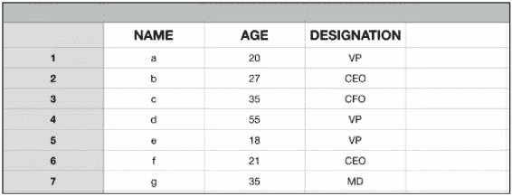

例如，在上图中，假设 `Keys` 由列名表示，`Values` 由该列中的项目列表表示。 可以使用 `Python dictionary` 来表示，如下面的代码所示：

```
my_dict = { 
     'name' : ["a", "b", "c", "d", "e","f", "g"],
     'age' : [20,27, 35, 55, 18, 21, 35],
     'designation': ["VP", "CEO", "CFO", "VP", "VP", "CEO", "MD"]}
```

可以使用下面的代码从该字典创建 `Pandas DataFrame`：

```
import Pandas as PD
df = pd.DataFrame(my_dict)
```

生成的 `DataFrame` 如下面图所示，类似于 Excel 电子表格：

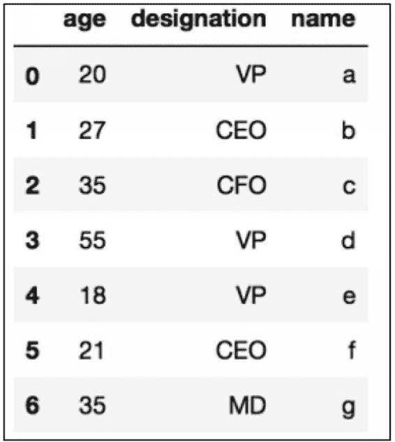

如果您想为行定义索引值，则需要在 `DataFrame ( )` 子句中添加 `index` 参数，如下所示：

```
df = pd.DataFrame(my_dict, index=[1,2,3,4,5,6,7])
```

要获取数据的 `string` 索引而不是数字，请使用下面的代码：

```
df = pd.DataFrame(
     my_dict, 
     index=["First", "Second", "Third", "Fourth", "Fifth", "Sixth", "Seventh"])
```

现在，由于这些索引值是统一的，您可以执行下面的代码以使用 `NumPy arrays` 作为索引值：

```
np_arr = np.array([10,20,30,40,50,60,70])
df = pd.DataFrame(my_dict, index=np_arr)
```

与 `NumPy` 类似，`DataFrame` 的列也是同质的。 您可以使用类似字典的语法或添加列名与 `DataFrame` 来查看列的数据类型，如下面的代码所示：

```
df['age'].dtype    # Dict Like Syntax
df.age.dtype       # DataFrame.ColumnName
df.name.dtype      # DataFrame.ColumnName
```


你可以使用下面的代码通过使用“head ( )”函数查看“Pandas DataFrame”中可用的记录或前五行的前五行，以及使用“tail ( )”函数查看最后五行。例如，要查看数据的最初三行，可以使用下面的代码：

```
df.head(3)   # Display first 3 Rows
```

#### Pandas Series

它可以被定义为“一种能够容纳任何类型数据（一维带标签数组（整数、字符串、浮点数、python 对象））”。简单来说，它就像 Excel 电子表格中的一列。要从数组生成“Pandas Series”，必须导入并使用“NumPy”模块以及“array ()”函数，如下面的代码所示：

```
# import pandas as pd
import pandas as pd
```

```
# import numpy as np
import numpy as np
```

```
# simple array
data = np.array (['m','a','c','h','I','n','e'])
```

```
ser = pd.Series(data)
print(ser)
```

## Seaborn (data visualization)

Seaborn 源自 Matplotlib 库，是一款极受欢迎的可视化库。它是一个高级库，可以生成特定类型的图表，包括热力图、时间序列和箱形图。

## TensorFlow

TensorFlow 可以被定义为一个机器学习平台，提供端到端服务，拥有各种免费和开源资源。它具有多层节点系统，允许快速构建、训练和部署具有大型数据集的人工神经网络。它被誉为“一种简单灵活的架构，可以快速将新想法从概念到代码再到最先进的模型并发表”。例如，Google 在其图像识别和语音识别工具和技术中使用 TensorFlow 库。

更高级别的 API 如 `tf.estimator` 可用于指定预定义架构，例如 `linear regressors` 或 `neural networks.` 下图显示了 TensorFlow 工具包现有的层级结构：

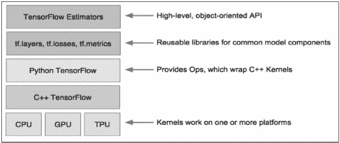

下图所示的图片提供了不同层级的用途：

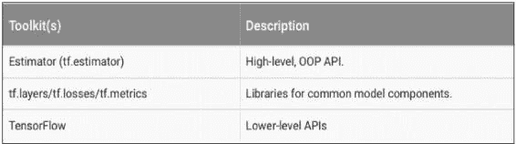

TensorFlow 的两个基本组件是：

1. 一个 `graph protocol buffer`
2. 一个 `runtime` 可以执行图

上面提到的两个组件类似于 `Python` 代码和 `Python interpreter.` 就像 `Python interpreter` 可以在多个硬件系统上运行 Python 代码一样，TensorFlow 可以在各种硬件系统上运行，如 CPU、GPU 和 TPU。

为了决定应使用哪种 API(s)，你必须考虑提供最高抽象级别来解决目标问题的 API。更易于使用，但（按设计）灵活性较低的是更高的抽象级别。建议首先从最高级别的 API 开始，让一切正常工作。如果对于某些独特的建模问题，你需要额外的灵活性，则向下移动一个级别。请注意，每个级别都是建立在较低级别的 API 之上。因此，降低层级应该非常简单。

对于大多数机器学习模型的发展，我们将使用 `tf.estimator` API，这大大减少了开发所需的代码行数。此外，`tf.estimator` 与 Scikit-Learn API 兼容。


# Chapter 3: Predictive Modeling, Data Visualization and Creation of Training Data Set

## Machine Learning

人工智能是机器具有类人智能的想法的体现，并且能够模仿人类思维处理和学习能力，以适应新输入并在无需人工协助的情况下执行任务。机器学习是人工智能概念不可或缺的一部分。机器学习可以被定义为人工智能技术的一个概念，主要关注机器通过识别数据模式来学习和自我训练的工程能力，以改进底层算法并做出独立决策。机器学习假设现代计算机具有一种能力，可以使用可以轻松定制以满足所需功能性的训练数据集进行训练。机器学习由模式识别技术驱动，其中机器记录并重新审视过去的交互和结果，这些交互和结果被认为与其当前情况一致。鉴于机器需要处理无尽的数据量，并且新数据不断涌入，它们必须能够适应新数据而无需由人类编程，这体现了机器学习的迭代方面。

机器能够通过利用先前的计算和底层算法进行学习和自我训练，从而产生高质量且易于重现的决策和结果。机器学习的概念已经存在数十年，但机器学习算法的最新进展使得机器能够处理和分析大数据成为可能。这是通过以高速和高频率应用高级和复杂的数学计算，使用自动化来实现的。

当今的先进计算机器能够快速分析庞大的数据量并提供更快、更准确的结果。采用机器学习算法的公司具有增强的灵活性，可以修改训练数据集以满足其业务需求并相应地训练机器。这些定制的机器学习算法使企业能够识别潜在风险以及增长机会。机器学习算法通常与人工智能技术和认知技术协同使用，以使机器在处理大量数据或大数据时非常有效和高效，并产生高度准确的结果。

鉴于人工智能和机器学习之间固有的联系，为了使本书更易于理解，我们今后将互换使用“机器学习”和“人工智能”这两个术语。

目前有四种类型的机器学习算法：

### Supervised Machine Learning Algorithms

这些算法广泛用于预测性大数据分析，由于其能够评估并将从先前迭代和交互中学习到的经验应用到新的输入数据集中。例如，人类可以将机器编程为将数据点标记为“R”（运行）、“N”（负）或“P”（正）。机器学习算法将根据编程对输入数据进行标记，并接收具有相应正确输出的数据输入。算法将对其自身生成的输出与“预期或正确”输出进行比较，以识别可以进行的潜在改进和可以修复的错误，以使模型更准确、更智能。

通过应用“回归”、“预测”、“分类”和“成分提升”等方法来很好地训练机器学习算法，任何新的输入数据都可以作为“目标”数据集输入到机器中，以按需编排学习程序。这个“已知的训练数据集”启动了分析过程，其后是学习算法以产生“推断函数”，该函数可用于根据输出值对未来事件进行预测和预测。例如，金融机构和银行严重依赖监督式机器学习算法来检测欺诈性信用卡交易并预测潜在信用卡客户未能按时支付信用卡款项的可能性。

### Unsupervised Machine Learning Algorithms


公司经常遇到需要生成标记和分类的训练数据集的数据源不可用的情况。在这些情况下，使用无监督机器学习算法是理想的。无监督机器学习算法用于识别机器如何创建“推断函数”以从未标记和未分类的数据堆中阐明隐藏结构的方法。这些算法能够探索数据以在信息量中识别结构。

与监督机器学习算法不同，无监督算法在识别正确输出方面失败，尽管它们在探索输入数据和进行推断方面与监督学习算法一样高效。这些算法可用于识别数据异常值、生成定制和个性化产品推荐，以及使用诸如 `self-organizing maps`、`singular value decomposition` 和 `k-means clustering` 等技术对文本主题进行分类。例如，识别具有共同购物属性的客户，可将其细分为特定群体，并针对其实施相似的营销策略和活动。因此，无监督学习算法在在线营销领域极受欢迎。

## 半监督机器学习算法

半监督机器学习算法具有高度的通用性，能够利用标记和未标记数据集进行学习和自我训练。这些算法是监督学习和无监督学习算法的“混合”。通常，训练数据集主要由未标记数据组成，并包含少量标记数据。分析方法包括 `prediction`、`regression` 和 `classification` 与半监督学习算法相结合使用，可使机器显著提高其学习准确性和训练能力。

这些算法广泛用于从原始数据生成标记训练数据集高度资源密集且对公司而言成本效益较低的情况。因此，为了避免额外的人力和设备成本，公司在其系统中使用半监督学习算法。例如，人脸识别应用程序需要大量分散在多个输入源中的人脸数据。从网络摄像头等来源获取的原始数据的预处理、处理、分类和标记需要大量人力，以及数千小时的工作才能用作训练数据集。

## 强化机器学习算法

强化机器学习算法的独特性在于它从环境中学习。这些算法执行操作并勤勉地记录每次操作的结果，该结果要么是失败导致错误，要么是成功执行后的奖励。区分强化学习算法的两个主要特征是 `trial and error` 研究方法和 `delayed reward`。机器通过使用各种计算反复分析输入数据，并为每次正确或预期的输出发送强化信号，最终优化最终结果。系统开发了简单的动作和奖励反馈循环，以评估、记录和学习哪些操作是成功的并在更短时间内导致准确结果。这些算法的使用使系统能够在特定上下文的约束条件下自动确定理想行为，从而提高其能力和最大化其性能。因此，强化机器学习算法在游戏行业、机器人工程以及导航系统中被广泛使用。

## 大数据分析 vs. 机器学习

`Machine learning`、`Big Data` 以及 `Big Data Analytics` 都属于 `Artificial Intelligence` 技术范畴，而后者归入 `Data Science` 领域。以下是机器学习与大数据或大数据分析之间的一些关键区别：

### 应用

机器学习用于开发先进的推荐引擎和模型，这些模型可以通过分析和现有数据来预测和预测未来事件。例如，`Google` 正在使用先进的机器学习算法开发其自动驾驶汽车。虚拟个人和家庭助手设备，如 `Amazon Alexa`、`Google Home` 和 `Apple HomePod` 都由先进的机器学习算法驱动，与人工智能技术密切协作。

大数据具有更广泛的适用性，可用于一般研究目的，以收集有关特定业务查询的信息，例如收集销售数据、构建消费者画像和金融研究，以及工业领域其他应用。

### 学习能力

机器学习算法是自给自足的，能够在没有人工协助的情况下从训练数据集以及新输入数据中学习。它们足够强大，可以为系统学习和自我改进奠定基础。大数据分析能够收集现有数据并分析其以识别可用于其决策过程的新兴模式。它始终由人工控制的分析工具和技术驱动，没有自我学习的能力。

### 模式识别

大数据分析利用回归、聚类和分类等统计方法来识别可分析以产生逻辑信息的数据模式。

机器学习不仅可以识别新兴数据模式，还可以对这些模式应用高级算法，从数据模式中学习，并随着每次迭代最大化系统性能。

### 数据量和数据类型

大数据涉及海量的非结构化、半结构化和结构化数据。需要先进的分析工具和技术来处理这些大型数据集，其中大部分是非结构化数据，以获取有价值的信息。

机器学习利用相对较小的数据集，这些数据集经过分类和标记，可作为算法学习和自我改进的指导说明。

### 基本目的

机器学习的主要目标是在几乎没有人工协助的情况下，仅基于输入数据实现自我改进。这些算法的有前景的应用和智能机器的开发，有朝一日可能有助于解决人类面临的严峻挑战，例如全球变暖。

大数据旨在收集我们不断发展的数字生活所产生的激增数据。大数据分析使用模式识别技术来揭示可能在这堆信息中轻易丢失的隐藏模式和洞察。

## 客户分析

根据 SAS 的定义，客户分析可以定义为“流程和技术 bad 使组织获得必要的客户洞察力，以便提供预期、相关且及时的优惠。”客户分析是所有营销活动的核心，是 `predictive modeling`、`data visualization`、`information management` 和 `segmentation` 等技术的总称。

### 客户分析的重要性


## 客户分析已发展成为营销行业的支柱

这是“智慧消费者”出现的直接结果，该消费者比以往任何时候都更具意识、更互联，并且愿意在瞬间将业务转移到别处。智慧客户可以无缝访问各种信息，包括市场上最好的产品和服务，以及他们可以在哪里找到最好的交易来最大化他们的资金。因此，公司需要主动，能够在与产品互动时预测消费者行为，并处于能够采取必要行动将潜在客户转化为付费客户的位置。为了生成更准确的客户行为预测和预测，公司必须对其客户的购买习惯和生活方式选择有充分的了解。这些接近准确的预测将为公司提供竞争优势，并有助于在销售和营销漏斗中实现更高的转化率。

## 当今市场上最好的客户分析解决方案之一

当今市场上最好的客户分析解决方案之一是“SAS Customer Intelligence”，其声称具有以下应用：

* 实现更高的客户忠诚度和响应率。
* 生成个性化的客户优惠和信息，以便在正确的时间触达正确的客户。
* 识别具有相似属性且转化可能性高的潜在客户，以便公司可以降低其有针对性的营销策略和活动的成本。
* 通过对更有可能将业务转移他处的客户进行准确预测来减少客户流失，并制定主动的营销活动以留住他们。

“我们从新的分析能力中获得的洞察力使我们能够找到将继续推动忠诚度、盈利能力和可持续增长的甜蜜点。”

\- Carrie Gray，Verizon 中小企业营销执行总监

## 预测性分析营销

根据 SAS，预测分析是“使用数据、统计算法和机器学习技术来识别基于历史数据的未来结果的可能性。目标是超越了解已经发生的事情，为未来将会发生的事情提供最佳评估”。今天，公司正在以面向未来的眼光挖掘过去，而这正是人工智能在营销中发挥作用的地方，通过应用预测分析技术。预测分析的成功与公司收集的大数据的质量成正比。

以下是营销中广泛使用的预测分析应用：

### 客户行为预测分析

对于“Amazon”、“Apple”和“Netflix”等工业巨头而言，分析客户活动和行为是其日常运营的基础。规模较小的企业越来越多地效仿他们，在其业务模式中实施预测分析。为公司开发一套定制的预测模型不仅资本密集，而且需要大量的人力和时间。像“AgilOne”这样的营销公司提供相对简单的预测模型类型，可广泛应用于各工业领域。他们已确定三种主要类型的预测模型来分析客户行为，即：

“`Propensity models`” – 这些模型用于生成客户行为的“真实或准确”预测。一些最常见的倾向模型包括：“predictive lifetime value”、“propensity to buy”、“propensity to turn”、“propensity to convert”、“likelihood of engagement”和“propensity to unsubscribe”。

“`Cluster models`” – 这些模型用于根据性别、年龄、购买历史和人口统计等共同属性对客户进行分离和分组。一些最常见的聚类模型包括 "product-based or category base clustering"、"behavioral customs clustering" 和 "brand based clustering"。

“`Collaborative filtering`” – 这些模型用于根据先前的客户活动和行为生成产品和服务推荐以及推荐广告。一些最常见的协同过滤模型包括 "upsell"、"cross-sell" 和 "next sell" 推荐。

公司用于执行客户行为预测分析的最重要工具是 "`regression analysis`" ，它允许公司在特定产品的销售与购买客户所显示的特定属性之间建立相关性。这是通过采用 "`regression coefficients`" 实现的，这些系数是描述客户行为受不同变量影响程度的数值，并为产品的未来销售开发 "`likelihood score`"。

### 使用 Scikit-Learn 库进行预测数据分析

为了了解 `Scikit-Learn` 库在“预测数据分析”或机器学习模型开发中的使用方式，让我们使用来自 IBM Watson 仓库的“`Sales_Win_Loss` 数据集”，其中包含一家汽车零部件批发供应商销售活动获得的数据。我们将构建一个机器学习模型来预测哪个销售活动会获胜，哪个会造成损失。

数据集可以使用 `Pandas` 导入，并使用 `Pandas` 技术如“`head()`”、“`tail()`”和“`dtypes()`”进行探索。来自“`Seaborn`”的绘图技术将用于可视化数据。为了处理数据，将使用 `Scikit-Learn` 的“`preprocessing.LabelEncoder()`”以及“`train_test_split()`”将数据集划分为训练子集和测试子集。

为了从我们的数据集生成预测，将使用三种不同的算法，即“`Linear Support Vector Classification` 和 `K-nearest neighbor classifier`。”为了比较这些算法的性能，将使用 `Scikit-Learn` 库技术“`accuracy_score`”。模型性能得分可以使用“`Yellowbrick`”可视化和 `Scikit-Learn` 进行可视化。

#### 安装 Scikit-Learn

`Scikit-Learn` 的最新版本可以在“`Scikit-Learn.org`”上找到，并需要“`Python`（版本 >= 3.5）；`NumPy`（版本 >= 1.11.0）；`SciPy`（版本 >= 0.17.0）；`joblib`（版本 >= 0.11）”。Scikit-learn 的绘图功能或函数以“`plot_`”开头，并需要“`Matplotlib`（版本 >= 1.5.1）”。某些 `Scikit-Learn` 示例可能需要额外的应用程序：“`Scikit-Image`（版本 >= 0.12.3），`Pandas`（版本 >= 0.18.0）”。

在事先安装了 "`NumPy`" 和 "`SciPy`" 的情况下，安装 `Scikit-Learn` 的最佳方法是使用“`pip`: `pip install -U scikit-learn`”或“`conda`: `conda install scikit-learn`。”

必须确保在使用 `pip` 时利用了“`binary wheels`”，并且“`NumPy`”和“`SciPy`”未从源代码重新编译，这可能在使用特定操作系统和硬件设置时发生（例如“`Linux on a Raspberry Pi`”）。从源代码开发“`NumPy`”和“`SciPy`”往往很复杂（特别是在 Windows 上）；因此，它们需要仔细设置，确保线性代数例程的优化执行是可实现的。

#### 导入数据集

要导入来自 IBM Watson 仓库的“`Sales_Win_Loss` 数据集”，第一步是使用 "`import pandas as pd`" 导入 "`Pandas`" 模块。

然后，我们利用变量 `URL` 作为“`https://community.watsonanalytics.com/wp content/uploads/2015/04/WA_Fn-UseC_-Sales-Win-Loss.csv`”，以便数据集可以存储并下载到该 URL。

现在，将使用“`read_csv()` as `sales_data = pd.read_csv(url)`”技术来读取上述由 `Pandas` 模块提供的 "`CSV or comma-separated values`" 文件。CSV 文件随后将被转换为 `Pandas` 数据框架，返回变量为 "`sales_data`" ，框架将存储在其中。


对于新的‘Pandas’用户来说，上面代码中提到的 `pd.read_csv()` 技术会生成一个名为“data framework”的表格数据结构，其中每一行的索引包含在第一列中，而每一列的标签/名称在第一行中取自位于初始列中的数据集的名称。在上面的代码片段中，`sales data` 变量导致一个如下面图片所示的表格。

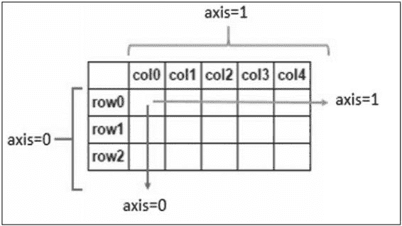

在上图中，单个列由 `row0, row1, row2,` 表示，而数据集的特征名称或单个列的名称由 `col0, col1, col2` 表示。

通过这一步，你已成功存储了数据集的副本并将其转换为"Pandas"框架！

现在，使用 `head() as Sales_data.head()` 技术，可以显示数据框架中的记录，如下所示，以“感受”数据集中包含的信息。

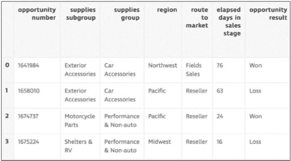

## Data Exploration

我们可以快速探索数据以了解可以从中获取什么信息，并据此规划行动方案。

在任何机器学习项目中，数据探索往往是一个非常关键的阶段。即使是快速的数据集探索也可以为我们提供重要的信息，否则这些信息很容易被遗漏，而这些信息可以提出重要的问题，我们然后可以尝试使用我们的项目来回答。

这里将使用一些第三方 Python 库来帮助我们处理数据，以便我们可以有效地使用这些数据与 Scikit-Learn 的强大算法。前面部分中用于查看导入数据集的一些初始记录的相同的 `head()` 技术也可以在这里使用。事实上，`head` 实际上能够做的不止是显示数据记录，并且可以自定义 `head()` 技术以仅显示选定的记录，使用诸如 `sales_data.head(n=2)` 的命令。此命令将有选择地显示数据集的前 2 条记录。乍一看，很明显字符串数据包含在诸如 `Supplies Group` 和 `Region,` 的列中，而诸如 `Opportunity Resultthe` `Opportunity Number,` 等列则由整数值组成。还可以看到在' Opportunity Number' 列中为每条记录提供了唯一标识符。

同样，要从表格底部显示选定的记录，可以使用 `tail() as sales_data.tail()`。

要查看数据集中可用的不同数据类型，可以使用 Pandas 技术 `dtypes() as sales_data.dtypes`。有了这些信息，可以列出数据框架中可用的数据列及其各自的数据类型。例如，我们可以确定 `object` 数据类型在 `Supplies Subgroup` 列中，而 `integer data type` 在 `Client Size By Revenue.` 列中。因此，我们了解了包含整数值或字符串数据的列。

## Data Visualization

在这一点上，我们已经完成了基本的数据探索步骤，所以我们将不尝试构建一些有吸引力的绘图来直观地描绘信息并从我们的数据集中发现其他隐藏的叙述。

在所有提供数据可视化功能的可用 Python 库中；`Seaborn` 是最好的可用选项之一，因此我们将使用它。确保由 `Seaborn` 提供的 python 绘图模块已安装在你的系统上并准备好使用。现在，按照以下步骤为数据集生成所需的绘图：

Step 1 – 使用命令 `import seaborn as sns.` 导入模块 `Seaborn`。

Step 2 – 使用命令 `import matplotlib.pyplot as plt.` 导入模块 `Matplotlib`。

Step 3 - 在设置中使用命令 `sns.set(style="whitegrid", color_codes=True)` 将绘图的 `background color` 设置为白色。

Step 4 - 要为所有绘图设置 `plot size`，请使用命令 `sns.set(rc={'figure.figsize':(11.7,8.27)})`。

Step 5 – 要生成 `countplot`，请使用命令 `sns.countplot('Route To Market', data=sales_data, hue = 'Opportunity Result')`。

Step 6 – 要消除底部和顶部边距，请使用命令 `sns.despine(offset=10, trim=True)`。

Step 7 – 要显示绘图，请使用命令 `plotplt.show().`

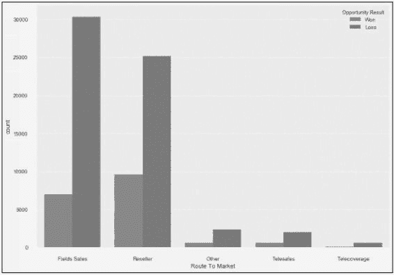

快速回顾 - 首先导入了 `Seaborn` 和 `Matplotlib` 模块。然后使用 `set()` 技术为我们的绘图定义了不同的特征，例如绘图样式和颜色。使用代码片段将绘图的背景定义为白色

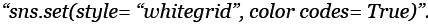

然后使用命令 `sns.set(rc={'figure.figsize':(11.7,8.27)})` 定义绘图大小，该命令将绘图的大小定义为 `11.7px and 8.27px`。

接下来，使用命令 `sns.countplot('Route To Market',data= sales data, hue='Opportunity Result')` 生成绘图。`countplot()` 技术使创建计数图成为可能，该计数图可以公开多个参数以根据我们的要求自定义计数图。作为第一个 `countplot()` 参数，X 轴被定义为来自数据集的 `Route To Market` 列。下一个问题涉及数据集的来源，这将是我们之前导入的 `sales_data` 数据框架。第三个参数是条形图的颜色，定义为 `blue` 代表 `won` 列和 `green` 代表 `loss` 列。

## Data Pre-processing

到现在为止，你应该对数据集中有哪些信息有清晰的了解。为了将数据集中的分类标签如 `won` 和 `loss` 转换为数值，我们将使用 `LabelEncoder()` 技术。

让我们看看下面的图片，了解我们试图用 `LabelEncoder()` 技术实现什么。第一张图片包含 `color` 列，其中有 3 条记录，分别是 `Red,` `Green,` 和 `Blue.` 使用 `LabelEncoder()` 技术，同一 `color` 列中的记录可以转换为数值，如第二张图片所示。

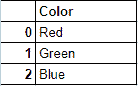                                     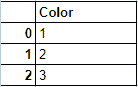

让我们现在开始真正的转换过程。使用 `LabelEncoder()` 提供的 `fit transform()` 技术，可以对分类列的标签如 `Route To Market` 进行编码并转换为与上面图表中类似的数值标签。`fit transform()` 函数需要用户标识的输入标签，并因此返回编码后的标签。

为了了解编码是如何完成的，让我们快速看一个例子。下面的代码实例构成了以城市列表形式存在的字符串数据，例如 `["Paris," "Paris," "Tokyo," "Amsterdam"]`，它将被编码为类似于 `[ 2, 2, 1,3]` 的内容。

Step 1 - 要导入所需的模块，请使用命令 `from sklearn import preprocessing.`。

Step 2 – 要创建标签编码器对象，请使用命令 `le = preprocessing.LabelEncoder()`。

Step 3 – 要将分类列转换为数值，请使用命令：

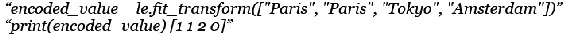

我们刚刚将字符串数据的标签转换为了数值。第一步是导入提供 `LabelEncoder()` 技术的预处理模块。随后创建了代表 `LabelEncoder()` 类型的对象。然后，使用对象的 `fit_transform()` 函数来区分列表的不同类别 `[ "Paris," "Paris," "Tokyo," "Amsterdam,"]` 并输出编码值 `[ 1 1 20]`。

`LabelEncoder()` 技术根据类别的初始字母按字母顺序为类别分配数值，例如 `(A)msterdam` 被分配代码 `0`，`(P)aris` 被分配代码 `1`，`(T)okyo` 被分配代码 `2`。

## Creating Training and Test subsets


要了解不同特征之间的交互作用以及这些特征如何影响目标变量，机器学习算法必须学习一组信息。为此，我们需要将完整的数据集拆分为两个子集。一个子集将作为训练数据集，用于训练我们的算法以构建机器学习模型。另一个子集将作为测试数据集，用于测试机器学习模型生成的预测的准确性。

### 第一阶段
本阶段的第一阶段是使用以下步骤分离特征变量和目标变量：

步骤 1 – 要选择排除特定列的数据，请使用命令 `select columns other than 'Opportunity Number', 'Opportunity Result'cols = [col for col in sales_data.columns if col not in ['Opportunity Number','Opportunity Result']]` 。

步骤 2 – 要删除这些特定列，请使用命令 `dropping the 'Opportunity Number' and 'Opportunity Result' columns data = sales_data[cols]` 。

步骤 3 – 要将 Opportunity Result 列分配为 `target`，请使用命令 `target = sales_data['Opportunity Result'] data.head(n=2)` 。

`Opportunity Number` 列被删除，因为它只是作为每个记录的唯一标识符。`Opportunity Result` 包含我们想要生成的预测，因此它成为我们的 `target` 变量，并且可以从此阶段的数据集中移除。上述代码的第一行将选择除 `Opportunity Number` & `Opportunity Result` 之外的所有列。这些列随后被分配给 `cols` 变量。然后使用 `cols` 变量中的列，开发了一个新的数据框架。这将成为 `feature set.` 接下来，使用 `sales_data` 数据框架中的 `Opportunity Result` 列开发了一个名为 `target` 的新数据框架。

### 第二阶段
本阶段的第二阶段是使用以下步骤将日期框架分离为训练和测试子集。根据数据集和所需的预测，需要相应地将其拆分为训练和测试子集。对于本次练习，我们将使用 75% 的数据作为训练子集，其余 25% 将用于测试子集。我们将利用 `Scikit-Learn` 中的 `train_test_split()` 技术，使用以下步骤和代码来分离信息：

步骤 1 – 要导入所需的模块，请使用命令 `from sklearn.model_selection import train_test_split`。

步骤 2 – 要分离数据集，请使用命令 `split data set into train and test setsdata_train, data_test, target_train, target_test = train_test_split(data, target, test_size = 0.30, random_state = 10)`。

通过上面的代码，首先导入了 `train_test_split` 模块，然后使用 `train_test_split()` 技术生成 `training subset (data_train, target_train)` 和 `testing subset (data_test, data_train).` `train_test_split()` 技术的第一个参数涉及前一阶段中划分的特征，下一个参数与 `Opportunity Result` 目标相关。我们在此示例中使用 30%，但可以是任意数量。第四个 'random state' 参数用于确保结果每次都可以重现。

## 构建机器学习模型

`Scikit-Learn` 提供的 `machine_learning_map` 被广泛用于为数据集选择最合适的 ML 算法。对于本次练习，我们将使用 `Linear Support Vector Classification` 和 `K-nearest neighbors' classifier` 算法。

### 线性支持向量分类
`Linear Support Vector Classification` 或 `Linear SVC` 是 `Support Vector Machine (SVM)` 算法的子类，我们已在本书记载的第 2 章 `Machine Learning Algorithms` 中对其进行了回顾。使用 Linear SVC，数据可以划分为不同的平面，以便算法可以识别所有数据类的最佳组结构。

以下是构建我们第一个 ML 模型的该算法的步骤和代码：

步骤 1 – 要导入所需的模块，请使用命令 `from sklearn.svm import LinearSVC` 和 `from sklearn.metrics import accuracy_score`。

步骤 2 – 要开发 LinearSVC 对象类型，请使用命令 `svc_model = LinearSVC(random_state=0)`。

步骤 3 – 在训练算法并从测试数据生成预测时，请使用命令 `pred = svc_model.fit(data_train, target_train).predict(data_test)`。

步骤 4 – 要显示模型准确率分数，请使用命令 `print ('LinearSVC accuracy:', accuracy_score(target_test, pred, normalize = True))`。

通过上面的代码，第一步导入了所需的模块。然后我们使用 `svc_model` 对象和 `random_state` 为 `0` 开发了一种类型的 Linear SVC。在步骤 3 中，`Linear SVC` 算法在训练数据集上进行训练，随后用于为测试数据中的目标生成预测。最后使用 `accuracy_score()` 技术来验证模型的 `accuracy score`，例如可以显示为 `LinearSVC accuracy: 0.777811004785`。

### K-最近邻分类器
`k-nearest neighbors (k-NN)` 算法被称为 `用于模式识别中分类和回归的非参数方法。` 在分类和回归的情况下，`输入由特征空间中最接近的 k 个训练示例组成。` K-NN 是一种 `基于实例的学习` 或 `惰性学习` 形式，其中函数仅在本地估计，并且所有计算都推迟到分类为止。输出由以下事实驱动，即是否使用 `k-NN` 的分类或回归方法：

* `k-nearest neighbors classification` - `output` 是类的成员。`object` 通过其邻居的多数投票进行分类，将对象分配给其最近的 `k-neighbors` 中最常见的类，其中 `k` 表示一个小的正整数。如果 k= 1，则 `object` 只是分配给最近邻居的类。
* `k-nearest neighbors regression` - 输出是对象的属性值，该值计算为 k 个最近邻居值的平均值。

一种对分类和回归都有帮助的方法是为邻居的贡献分配权重，以允许更近的邻居在平均值中做出更大的贡献，而远处的邻居则贡献较少。例如，一个已知的 `weighting scheme` 是为每个邻居分配权重 `1/d`，其中 `d` 表示与邻居的距离。邻居是从一组对象中选择的，这些对象的 `class`（对于 `k-NN classification`）或对象的特征值（对于 `k-NN regression`）是已知的。

以下是构建我们下一个 ML 模型的该算法的步骤和代码：

步骤 1 – 要导入所需模块，请使用命令 `from sklearn. neighbors import KNeighborsClassifier` 和 `from sklearn.metrics import accuracy_score`。

步骤 2 – 在创建分类器的对象时，请使用命令 `neigh = KNeighborsClassifier(n_neighbors=3)`。

步骤 3 – 在训练算法时，请使用命令 `neigh.fit(data_train, target_train).`。

步骤 4 – 要生成预测，请使用命令 `pred = neigh.predict(data_test)`。

步骤 5 – 要评估准确率，请使用命令 `print ('KNeighbors accuracy score:,' accuracy_score(target_test, pred)).`

现在我们已经介绍了首选算法，可以轻松选择准确率分数最高的模型。在 Scikit-Learn 中，可以使用 `Yellowbrick library`，它提供技术来直观地描绘各种评分技术。

## 使用散点图进行数据可视化


散点图可以被定义为“一种二维数据可视化，使用点来表示两个不同变量获得的值——一个沿 x 轴绘制，另一个沿 y 轴绘制。”它也被称为“散点图”或“散点图表”。例如，下图中的“散点图”描绘了一组虚构的儿童身高和体重测量值。图中每个“点”都用来代表一个个体，其身高沿“x 轴”测量，体重沿“y 轴”测量。


“散点图”在你有兴趣表示两个不同变量之间存在的关系时非常有用。“散点图”通常被称为“相关图”，因为它们展示了两个不同变量如何相互关联。上面的“散点图”描绘的不仅仅是儿童身高和体重的简单记录。它还提供了这两个测量值之间关系的视觉呈现，表明随着身高的增加，孩子的体重也在增加。现在，你可以很容易地得出结论，这种身高和体重的关系并不理想，因为有些较高的孩子可能体重比一些较矮的孩子轻，但总体趋势相当令人满意，可以观察到儿童身高和体重之间存在直接关系。

重要的是要记住，并非所有关系都是线性的。例如，下图中的图表显示了 7 年内测量的“日最高平均气温”，展示了这些变量之间熟悉的抛物线关系，因为日最高气温倾向于在夏季达到峰值。

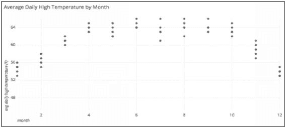

散点图通常包含一条趋势线以澄清变量之间的关系，如下图所示。

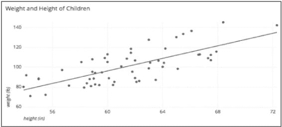

此外，“点”的形状、大小和颜色可以被视为并用作额外的变量。例如，下图表示了儿童的身高和体重数据，但通过添加“点”的颜色来描绘孩子的性别，我们为分析获得了第三个变量。

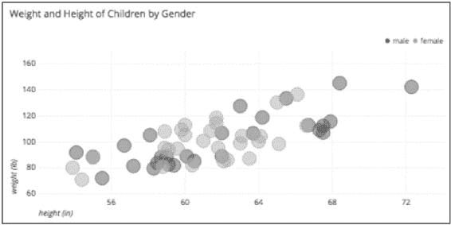


# 第 4 章：大数据分析的应用

## 工业应用

大数据和大数据分析的应用正在惠及各工业领域中的中小型企业。一些广泛使用的工业应用是：

### 电子商务

超过 26 亿且不断增长的活跃社交媒体用户包括每个公司那里的客户和潜在客户。竞赛正在进行中，以创建更有效的营销和社交媒体策略，由机器学习驱动，旨在提供增强的客户体验，将潜在客户转变为狂热粉丝。筛选和分析大量数据的过程不仅变得可行，而且现在变得容易了。将执行与大数据分析之间的差距弥合的能力已通过人工智能营销解决方案得到补充。

人工智能营销可以被定义为你使用人工智能常量如机器学习在可用客户数据上以预测客户的需求和期望，同时显著改善客户旅程的方法。在人工智能营销解决方案提供的大数据洞察的帮助下，营销人员能够在几乎不需要额外努力的情况下提升其活动表现和投资回报率。使人工智能营销如此强大的关键要素是：

* 大数据 - 营销公司能够以最少的手工工作聚合和细分大量数据转储的能力被称为大数据。营销人员随后可以利用所需的媒介，确保在正确的时间向目标受众传递适当的信息。
* 机器学习 - 机器学习平台使营销人员能够识别趋势或常见情况并收集有效的洞察和响应，从而破译根本原因和重复事件的概率。
* 直观平台 – 超快且易于操作的应用程序是人工智能营销不可或缺的。人工智能技术能够解读情绪并像人类一样交流，使基于人工智能的平台能够理解开放式内容，如电子邮件回复和社交媒体。

### 预测分析

所有基于人工智能技术解决方案都能够从数据资产中提取信息以预测未来趋势。人工智能技术使建模趋势成为可能，而这些趋势以前只能事后确定。这些预测分析模型可以可靠地用于决策和分析客户的购买行为。模型可以成功确定消费者更有可能购买新产品或重新订购旧购买的时间。营销公司现在能够逆向工程客户的体验和行为，以创建更有利可图的营销策略。例如，FedEx 和 Sprint 正在使用预测分析来识别可能流失到竞争对手的客户。

### 智能搜索

十年前，如果你在 Nike.com 上输入“女式人字拖”，你找到所需东西的概率几乎为零。但今天的搜索引擎不仅准确，而且速度也快得多。这一升级在很大程度上得益于“语义搜索”和“自然语言处理”等创新，它们使搜索引擎能够识别产品之间的联系并提供相关搜索结果、推荐类似商品并自动纠正拼写错误。人工智能技术和大数据解决方案能够快速分析用户搜索模式并识别营销公司应关注的关键领域。

2015 年，Google 引入了第一个基于人工智能的搜索算法“RankBrain”。在 Google 的带领下，其他主要电子商务网站，包括 Amazon 已将大数据分析和人工智能纳入其搜索引擎，为客户提供智能搜索体验，他们即使不知道自己在寻找什么也能找到所需产品。即使是小型电子商务商店也能使用“Elasticsearch”等智能搜索技术。像“Indix”这样的数据即服务公司允许公司从其他更大的数据源中学习来训练其产品搜索模型。

### 推荐引擎

推荐引擎迅速发展成为人气最爱，并受到客户和营销公司的同样喜爱。“Apple Music”已经比你的伴侣更了解你的音乐品味，而 Amazon 总是为你呈现一份你可能有兴趣购买的产品清单。这种能够筛选数百万个可用选项并聚焦于个人需求的发现助手，对于拥有庞大实体和数字库存的大公司来说被证明是不可或缺的。


1998 年，瑞典计算语言学家 Jussi Karlgren 在题为“Digital bookshelves”的报告中探讨了对客户行为进行聚类以预测未来行为的做法。同样，亚马逊也实施了协同过滤为其客户生成推荐。通过预测分析系统对消费者数据的收集和分析，结合个人资料信息和人口统计数据，系统能够根据消费者对产品的喜欢和不喜欢等活动实时不断学习和适应。例如，公司“Sky”已实施基于预测分析的模型，能够根据观众的模式推荐内容。聪明的客户不仅希望从其音乐和按需娱乐供应商那里获得这种增强体验，也希望从所有其他电子商务网站获得。

## 产品分类和定价

电子商务企业和营销公司在其库存分类和标记流程中越来越多地采用人工智能。营销公司需要处理的数据与令人惊叹的有序、干净的数据一样糟糕，甚至更多。这种正负示例的集合可作为基于预测分析的分类工具的训练资源。例如，不同的详情页可以对同一产品有不同的描述，如运动鞋、篮球鞋、训练鞋或乔丹鞋，但人工智能算法可以识别这些都是同一产品并相应地标记它们。或者如果数据集中缺少主要关键词如裙子或衬衫，人工智能算法可以根据周围的上下文仅凭此识别并将商品或产品分类为裙子或衬衫。

我们熟悉酒店房间的季节性价格变化，但随着人工智能的出现，产品价格可以以全新的精确度进行优化以满足需求。机器学习算法正被用于动态定价，通过分析客户的数据模式并对他们愿意为特定产品支付的价格以及他们对特别优惠的接受程度做出近乎准确的预测。这使企业能够以高精度定位其消费者，并计算是否需要折扣来促成销售。动态定价还允许企业将其产品价格与市场领导者和竞争对手进行比较，并相应地调整价格以促成销售。例如，“Airbnb”已开发出其动态定价系统，为房东提供“价格提示”，帮助他们确定房产的最佳上市价格。该系统考虑了多种影响因素，如地理位置、当地活动、房产图片、房产评价、房源特色，最重要的是预订时间和市场需求。房东最终决定是否遵循或忽略提供的“价格提示”以及房源的成功情况也会被系统监控，系统随后会处理结果并相应地调整其算法。

## 预测分析

所有基于人工智能技术的解决方案都能够从数据资产中提取信息以预测未来趋势。人工智能技术使得能够对过去只能事后确定的趋势进行建模。这些预测分析模型可以可靠地用于决策和客户购买行为分析。模型可以成功确定消费者更有可能何时购买新产品或重新订购旧产品。营销公司现在能够逆向工程客户的体验和行为，以创建更有利可图的营销策略。例如，FedEx 和 Sprint 使用预测分析来识别可能流失到竞争对手的客户。

## 客户定位和细分

为了使营销公司能够以高度个性化的方式触达客户，他们需要定位越来越细分的细分市场。人工智能技术可以利用现有客户数据并针对“黄金标准”训练集训练机器学习算法，以识别共同属性和重要变量。数据细分可以简单到位置、性别和年龄，也可以复杂到买家的角色和过去行为。有了人工智能，动态细分是可行的，这考虑到了客户行为不断变化的事实，人们在不同情况下可以扮演不同的角色。

## 销售和营销预测

人工智能在营销中最直接的应用之一是在销售和营销预测模型的开发中。大量可量化的数据，如点击、购买、电子邮件回复和在网页上花费的时间，可作为机器学习算法的训练资源。市场上一些领先的商业智能和生产公司是 Sisense、Rapidminer 和 Birst。营销公司不断升级其营销工作，在人工智能和机器学习的帮助下，他们可以预测其营销举措或电子邮件活动的成功率。人工智能技术可以分析过去的销售数据、经济趋势以及行业范围内的比较，以预测短期和长期销售表现并预测销售结果。销售预测模型有助于估算产品需求并帮助公司管理其生产以优化销售。

## 程序化广告定位

随着人工智能技术的引入，对基于程序的广告的竞价和定位变得显著更高效。程序化广告可以定义为“购买和出售广告库存的自动化流程，通过该流程将广告商连接到出版商的交易所。”为了允许在社交媒体渠道、移动设备以及电视上对库存进行实时竞价，使用了人工智能技术。这也回到了预测分析以及对过去只能事后确定的数据的建模能力。人工智能能够协助确定在一天中的最佳时间投放特定广告、广告转化为销售的概率、用户的接受程度以及与广告互动的可能性。

程序化公司有能力收集和分析访问客户的数据和行为，以优化实时活动并更精确地定位受众。程序化媒体购买包括使用“需求方平台”来促进在公开市场上购买广告库存的过程，以及使用“数据管理平台”为营销公司提供触达目标受众的能力。为了使营销代表能够就其潜在客户做出明智的决策，数据管理平台旨在收集和分析大量网站“Cookie 数据”。例如，搜索引擎营销（SEM）广告由 Facebook、Twitter 和 Google 等渠道实施。为了高效管理网站和应用程序观众的庞大库存，程序化广告为竞争对手提供了显著优势。Google 和 Facebook 成为高效有效广告的黄金标准，并致力于提供用户友好的平台，让非技术营销公司能够在线启动、运行和衡量其举措和活动。

## 视觉搜索和图像识别


人工智能驱动的图像识别和分析技术的飞速发展带来了令人惊叹的视觉搜索功能。随着 Google Lens 等技术的推出以及 Pinterest 等平台的出现，人们现在可以使用视觉搜索功能找到彼此在视觉上相似的结果。视觉搜索的工作方式与传统的基于文本的搜索相同，后者会显示相似主题的结果。主要零售商和营销公司越来越多地使用视觉搜索来提供增强且更具吸引力的客户体验。视觉搜索可用于改进商品陈列，并根据产品的风格而不是消费者的过去行为或购买记录提供产品推荐。

Target 和 Asos 在其电子商务网站的视觉搜索技术开发方面投入了大量资金。2017 年，Target 宣布与 interest 合作，允许将 Pinterest 的视觉搜索应用 “Pinterest lens” 集成到 Target 的移动应用程序中。因此，购物者可以在外出时拍摄他们想要购买的产品的照片，并在 Target 的电子商务网站上找到类似商品。同样，由 Asos 推出的视觉搜索应用 “Asos’ Style Match” 允许购物者在 Asos 网站或应用程序上拍照或上传图像，并在其产品目录中搜索类似商品。这些工具通过帮助购物者即使不知道产品名称也能为理想产品购物，吸引购物者前往零售商购买他们可能在杂志上或外出时遇到的商品。

图像识别极大地帮助营销公司在社交媒体上占据优势，使其能够找到其品牌标志和产品在跟上视觉趋势方面的各种用途。这种现象也被称为“视觉社交聆听”，使公司能够识别和了解客户在何处以及如何与他们的品牌、标志和产品互动，即使公司没有直接被其名称提及。

## 医疗行业

随着医疗数据的日益普及，大数据分析给医疗保健带来了范式转变。医疗行业大数据分析的主要重点是对患者结果与所使用的治疗或预防技术之间的关系进行分析。由大数据分析驱动的人工智能程序已成功开发用于患者诊断、治疗方案生成、药物开发以及患者监测和护理。强大的 AI 技术可以筛选海量的临床数据，并帮助解锁临床相关信息以协助决策。

一些大数据分析为基础的 AI 研究和应用日益增多的医学专业是：

* 放射学 – AI 解读影像结果的能力补充了临床医生检测图像中肉眼容易遗漏的变化的能力。斯坦福大学最近创建的一项 AI 算法可以检测肺炎患者的肺部特定部位。
* 电子健康记录 – 为了优化信息的传播和访问，对数字健康记录的需求需要快速、准确地记录所有与健康相关的数据到系统中。人类容易出错，且可能受到认知过载和倦怠的影响。该过程已成功由 AI 自动化。电子健康记录数据上的预测模型的使用使得能够以 70-72% 的准确率在基线预测个体化治疗反应。
* 影像学 – 正在进行的人工智能研究正在帮助医生评估矫正性颌骨手术的结果以及评估腭裂治疗以预测面部吸引力。

## 娱乐行业

大数据分析与人工智能的协调日益在娱乐来源的后台运行，从电子游戏到电影，并为我们提供更丰富、更吸引人、更逼真的体验。Netflix 和 Hulu 等娱乐提供商正在使用大数据分析，根据个人用户的历史活动和行为为用户提供个性化推荐。计算机图形和数字媒体内容制作商一直在使用基于大数据分析的工具来提高其制作流程的速度和效率。电影公司越来越多地在电影预告片和广告的开发以及制作前和制作后流程中使用机器学习算法。例如，大数据分析和人工智能驱动的工具 “RivetAI” 使制片人能够自动化并出色地读取电影剧本分解、分镜、预算、排期和镜头清单生成等流程。使用人工智能可以轻松自动化电影后期制作期间进行的某些耗时任务，例如电影片段的同步和组装。

## 营销和广告

作为大数据分析结果开发的机器学习算法可以轻松地使用文本、静止图像和视频片段作为数据源进行训练。然后它可以从这些来源中提取对象和概念，并推荐高效的营销和广告解决方案。例如，阿里巴巴开发的名为 “Luban” 的工具可以以比人类设计师快得多的速度创建横幅。在 2016 年，中国网络购物狂欢节“双十一”期间，Luban 以每秒 8000 个横幅设计的速度生成了一亿一千七百万个横幅设计。

“20th Century Fox” 与 IBM 合作使用其 AI 系统 “Watson” 来制作其恐怖电影 “Morgan” 的预告片。为了学习应出现在标准恐怖电影预告片中的适当“时刻”或片段，Watson 被训练来对来自超过一百部恐怖电影的音频视觉和其他构成元素输入的“时刻”进行分类和分析。这种训练导致 Watson 在短短 24 小时内制作出一个六分钟的电影预告片，而这本需要人类专业人士花费数周时间制作。

通过使用机器学习、计算机视觉技术、自然语言处理和预测分析，营销流程可以通过 AI 营销平台呈指数级加速。例如，由 Albert Intelligence Marketing 开发的人工智能营销平台能够生成自主的活动管理策略、创建定制解决方案并执行受众定位。该公司报告称，其客户交易率提高了 183%，对话效率提高了 600% 以上，这归功于其基于 AI 的平台的使用。

2016 年 3 月，由 McCann Erickson Japan 推出的基于人工智能的创意总监 “AI-CD ß” 作为有史以来开发的第一个机器人创意总监而推出。“AI-CD ß” 在各种电视节目的精选元素以及过去 10 年全日本广播电视 CM 节的获奖作品上接受了培训。利用数据挖掘能力，“AI-CD ß” 可以提取满足每个客户个人活动需求的想法和主题。

## 用户体验个性化


按需娱乐用户对丰富且引人入胜的个性化用户体验的期望日益增长。领先的按需娱乐平台之一 Netflix 推出了名为 “Meson” 的基于人工智能的工作流管理和调度应用，由各种 “machine learning pipelines” 组成，这些管道能够创建、训练和验证个性化算法，为用户提供个性化推荐。Netflix 与南加州大学合作开发了一种新的机器学习算法，名为 “Dynamic Optimizer”，该算法可压缩视频以实现高质量流媒体播放，同时不降低图像质量。这种人工智能技术通过优化视频流畅度和清晰度，解决了发展中国家和移动设备用户的流媒体问题。

IBM Watson 近期与 IRIS.TV 合作，为 CBS、《好莱坞报道者》和 Hearst Digital Media 等媒体公司提供面向企业的服务，通过追踪和改善其客户与网络内容的互动。IBM Watson 正在提升 IRIS.TV 公司的机器学习算法，使其能够从用户搜索历史中“学习”并推荐类似内容。据报道，《好莱坞报道者》使用 IRIS.TV 应用后，在三个月内实现了观看量或留存率提升 50% 或一份小幅 PDF。

## 搜索优化和分类

将文本、音频和视频内容转化为数字副本的能力导致互联网上的媒体可用性爆炸式增长，使得人们难以找到他们想要的确切内容。为了优化搜索结果的准确性，机器学习技术正在不断进步。例如，Google 正在使用人工智能增强其平台以实现准确的图像搜索。如今，人们只需向 Google 图片上传一张示例图片，而无需输入关键词进行搜索。Google 图片使用的图像识别技术将自动识别和管理上传用户图像的特征，并提供具有相似图片的搜索结果。Google 还在平台上的广告投放中使用人工智能技术。例如，宠物食品广告只会出现在宠物相关网站上，而鸡翅广告不会出现在针对素食者的网站上。

公司 Vintage Cloud 已与一家基于人工智能的初创公司 “ClarifAI” 合作开发电影数字化平台。借助 ClarifAI 提供的计算机视觉 API，Vintage Cloud 成功提升了电影内容分类和归类的速度。

一家名为 “Zorroa” 的公司开发了一款集成机器学习算法的视觉资产管理平台。该平台使用户能够在大型数据库中搜索特定内容，称为 “Analysis Pipeline”。该数据库包含可为每个视觉资产唯一标记的处理器的机器学习算法，这些算法已被“训练”以识别视觉数据的特定组件。然后将这些视觉内容进行组织和编目，以提供高质量的搜索结果。


# 结论

感谢您坚持阅读到最后《Python for Data Analysis: A Basic Guide for Beginners to Learn the Language of Python Programming Codes Applied to Data Analysis with Libraries Software Pandas, Numpy, and IPython》。希望它具有信息量，并能为您提供实现目标所需的所有工具，无论目标是什么。

下一步是充分利用您在尖端技术 “Big Data Analytics” 及其在医疗保健和电子商务领域应用方面的新获得的知识。今天的精明消费者很容易被具有奇思妙想的现代公司所吸引，这些公司为消费者提供独特、丰富且引人入胜的体验。传统企业若不采用本书中介绍的大数据分析技术，留住客户的难度日益增加。

您现在已准备好通过利用本书中描述的所有免费和开源数据库来创建自己的预测分析模型。为了充分利用本书，我建议您下载这些免费资源并进行动手练习，以巩固您对所解释概念的理解。数据分析技能始终需求旺盛，拥有大量高薪工作机会。希望本书能让您更接近梦想的工作！

最后，如果您觉得本书在任何方面对您有用，欢迎在 Amazon 上留下评论！

