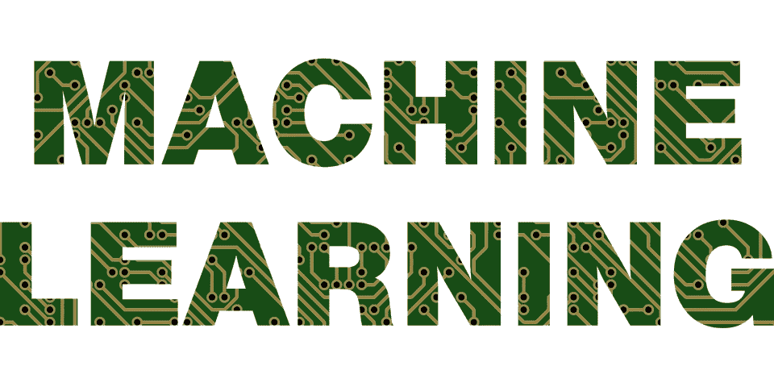
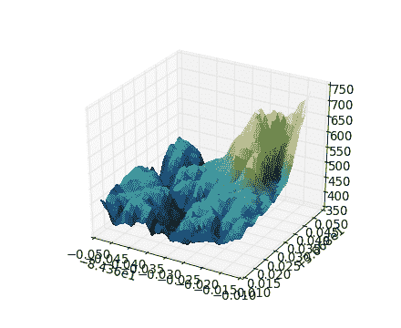

## 数字程序员的 Python 数据分析：从入门到专家的 3.0 速成课，凭借本手册的极简主义将改变你的生活。深度机器学习与大数据


### 简介

恭喜你购买了 *Python for Data Analysis*，感谢你的支持。以下章节将讨论我们开始学习 Python 语言并开发技能所需了解的一切，以便我们能够有效地让它处理我们想要承担的任何数据分析项目。使用 Python 数据分析项目有许多好处，特别是对于寻找击败竞争对手方法的企业来说，这就是为什么我们想要花些时间来了解所需步骤的原因。在本指南的开头，我们将花些时间了解 Python 语言编码的基础知识，以及如何让它满足我们的需求。我们将了解入门、中级、高级和强化编码，以便你更多地了解这门语言，并看看实际编写代码有多么容易。完成后，你将对能够编写的一些代码有很好的了解，我们可以利用这些信息来帮助我们自己的数据分析。从那里开始，是时候让我们深入了解数据分析及其包含的所有内容了。数据分析对许多企业都很有用，从刚起步试图在行业中找到自己位置的企业，到那些在这个行业工作了一段时间、想了解更多关于竞争对手、客户以及其他途径以真正击败竞争对手的企业。在谈到这个话题时，我们将探讨数据分析带来的更多巨大好处，以及使这一过程为我们服务所需的必要步骤。然后我们可以继续深入了解机器学习及其包含的过程，以及关于一些你可以在 Python 中使用的库的更多信息，这些库将使数据分析比以往更高效。有许多不同的库可以帮助你完成数据分析过程，但我们将要探讨的两个主要库是 `Pandas` 和 `Matplotlib`。`Pandas` 是一个很棒的通用库，能够帮助我们处理数据分析中想要的大多数步骤，而 `matplotlib` 能够帮助我们绘制所需的图表和数字，以便真正取得成功并看到数据中存在的复杂关系。学习如何使用 Python 编程语言，然后将其转移以提供数据分析所需的一些好处，有着许多益处。当你准备好了解更多关于 Python 数据分析的信息时，请务必查阅这本指南书来帮助你入门。市面上有很多关于这个主题的书，再次感谢你选择了这本！我们已竭尽全力确保它包含尽可能多的有用信息。请享受阅读！

### 第 1 章：Python 基础 – Python 入门


#### 欢迎来到 Python 的世界！

关于 Python 语言有许多令人愉悦之处，我们将花些时间探讨使用这种编程语言能做的所有酷炫事情。在进军数据科学和机器学习之前，我们将学习如何使用继承、循环、条件语句、命名空间等。但在此之前，我们首先需要花些时间学习 Python 的基础知识。

当需要选择一种编程语言时，我们有许多不同的选择。但你会发现，在所有可选方案中，Python 编程语言将是最佳选择之一。它用途广泛、易于上手，且拥有你在编程语言中寻找的所有特性和强大功能。

考虑到这一点，让我们来看看 Python 编程语言的一些基础知识。

##### 使用 Python 的优势

使用这门语言时，你会很快发现选择 Python 编程语言有许多好处。虽然还有许多其他编程语言可供选择，但它们不一定能像 Python 那样，为我们提供同等的易用性和优势。

开始使用 Python 语言时，我们能看到的各种好处将包括：

*   **Python 被视为一门入门级语言，因此使用起来很简单。** 许多人觉得开始编程很可怕。他们担心永远学不会如何实现这一点，因为过去见过那些代码，担心自己永远无法入门。然而，使用 Python 时最棒的事情之一就是它简单易用。无论你过去是否使用过编程语言，你都会发现 Python 是一个绝佳的选择。它的设计初衷是供初学者使用，并旨在帮助我们在学习过程中取得良好成果。这对我们来说是个好消息，因为它将有助于确保我们能完成编码任务，并保证我们不会在有机会入门之前就被吓退。
*   **Python 能为我们提供强大的能力来处理所需的项目。** 你可能读了上一条提到的优势后，担心实际使用这门语言完成某些目标会有多难。但你无需担心。Python 虽然对许多初学者来说容易上手，但当你需要用它处理任务时，它依然拥有你所寻找的强大功能。使用 Python 你能做很多事情。它能处理编码所需的一切，无论是帮你入门的基础代码，还是更难驾驭的复杂代码。Python 都拥有处理各类编码所需的能力和扩展。
*   **有大量库和扩展可供添加到 Python 语言中。** Python 自带的标准库非常强大，将为你提供许多在机器学习等领域想要实现的功能。这将确保我们取得惊人的成果，并能帮助处理本指南中将讨论的大量代码。然而，使用 Python 时你会发现的一个很酷的地方是，我们还能处理所有额外的库和功能。有许多库专门用于辅助机器学习，增加处理科学、数学等所需的能力，以满足我们在数据分析和机器学习中的需求。
*   **这门语言是数据科学和机器学习的绝佳选择。** 当需要处理机器学习和数据科学相关任务时，还有其他选择，有时它们可能表现得更好。但当你想处理这些领域的多种不同类型的流程和主题时，Python 能帮你搞定。大多数人会很乐意用 Python 满足所有机器学习和数据分析需求。他们知道这是一门易于学习的语言，如果他们过去从未接触过编程，这很好。而它依然拥有所需的强大功能和所有额外特性，以确保算法能在你每次需要时顺利运行。无论你想在机器学习方面做什么，Python 编程语言都能胜任。
*   **当需要与其他编程语言搭配使用时，Python 表现良好。** 为了实现机器学习和数据分析的目标，我们需要的一些库可能要求引入另一种语言来执行代码中想要的某些功能。这是一个很好的选择，因为 Python 能与你想用的任何其他编程语言良好配合。
*   **Python 拥有许多不同的社区，可以帮助你在学习过程中解答大量疑问和顾虑。** 当你在弄清楚代码该怎么写时遇到问题，或者开始新项目需要帮助时，你可以求助于这些社区获取答案。无论你的编程水平如何，这个社区都能成为帮助你起步的宝贵工具。

正如我们所见，决定使用 Python 编程语言时，有许多不同的优势可用。它是目前最好的通用语言之一，能帮助你在短时间内完成大量编码和项目的其他方面。无论你只是想学一门新编程语言，还是想完成数据分析或机器学习工作，Python 都是帮助你起步的正确选择。

##### Python 语言的基本组成部分

现在我们已经花些时间了解了 Python 语言及其包含的内容，是时候直接深入学习更多关于 Python 语言的知识以及我们能用它做什么了。有许多不同的部分发挥作用，这也是一门令人兴奋的语言值得我们投入时间。了解其中一些基本部分及其如何满足你的需求，将对你从本指南后续讨论的更复杂内容中获益多少产生巨大影响。

###### 关键字

我们需要了解的基础第一部分是 `keywords`（关键字）。这些是保留用来告诉编译器我们想要的任何命令的部分。它们很重要，因为它们基本上是编译器需要遵循的指令。你不能在代码的任何其他地方使用它们，也不能给代码的其他部分（如 `function` 函数或 `variable` 变量）起 `keyword` 关键字的名字，否则编译器会报错且无法按你的意愿工作。这些是给编译器的重要指令，请在尝试使用它们前记住这一点。

###### 标识符

列表中的下一项是 `identifiers`（标识符）。这些对代码很重要，因为它们数量众多。尽管这些 `identifiers` 有很多选择，但你会发现它们遵循相同的命名规则，这能让初学者更轻松。

第一条要记住的规则是命名这些 `identifiers` 时。你有很多命名选项。例如，你可以在命名时同时使用大写和小写字母、任何数字以及下划线符号（`_`）。你也可以将这些任意组合。这里要记住一点：名称不能以数字开头，且书写的单词之间不应有空格。因此，你不能写 `3words` 作为名称，但可以写 `words3` 或 `threewords`。确保不要使用我们上面讨论的 `keywords` 之一，否则会报错。

选定 `identifier` 名称时，你可以遵循上述规则，并尝试选择一个容易记住的名字。稍后编写代码时，你需要调用它，如果起的名字难以记忆，可能会遇到问题或报错，因为东西不会按你想要的方式显示。除了这些规则外，你可以随意命名 `identifiers`。

###### 注释

如果不先看看如何在 Python 中编写 `comments`（注释），我们就无法完成关于 Python 基础的话题。在编写代码时，你可能会发现有时需要在代码中留下解释或笔记。这是给你自己或与其他程序员分享看的，不需要由编译器运行，对代码运行也不是必需的。事实上，你不希望代码运行这部分内容。

这就是 `comments` 派上用场的地方。这些 `comments` 帮助我们向可能阅读代码的人解释正在发生什么，但编译器看到它会直接跳过，完全不理会。它不会出现在你编写的任何程序中；只有实际查看你编写脚本的人才能看到。

要编写这些 `comments`，你只需在 `comment` 前添加一个 `#` 符号，编译器就会知道应该跳过所有这些内容。作为程序员，你可以在代码中写入任意数量的注释。但通常最好将其保持在最少且最合理的范围内。这有助于始终保持你的编码整洁有序。

###### 变量

我们需要了解的代码下一部分是 `variables`（变量）。这些很重要，仅仅因为它们在我们编写的代码中非常常见。`variables` 之所以重要，是因为它们占据计算机内存中的空间来保存你想要的任何值。你可以通过在两者之间放置等号（`=`）轻松地将任何值赋给 `variable`。甚至可以将两个值赋给同一个 `variable`（如果你愿意）。这些很常见，当我们浏览本指南中处理的一些代码时，你会发现随处可见这些 `variables`。

###### 运算符

本节我们要看的最后一项是 `operators`（运算符）。这些将是代码中简单的部分，但学习如何使用它们依然很重要。你会发现有许多不同类型的 `operators` 可供使用。

你可以选择专注于 `arithmetic operators`（算术运算符），它们将帮助我们在代码中编写数学方程。这只是你能使用的一种 `operator`。还有 `assignment operators`（赋值运算符），它们将帮助我们将选定的特定值赋给 `variable`，以便编译器在合适时刻提取它们。也可以有 `comparison operators`（比较运算符），它们将帮助我们检查代码的不同部分，判断它们是否匹配。

正如我们通过本节所见，Python 编程语言有许多不同的基础知识，我们只抽时间看了其中几个。在后续章节中，我们将花时间探讨借助 Python 语言能做的许多其他事情，以及如何使用它们。但我们会更进一步，让你能在短时间内开始编写自己的代码。


### 第 2 章：Python 进阶课程


#### Python 进阶：循环、类与决策控制语句

现在我们已经了解了 Python 语言编码的一些基础知识，是时候进入下一阶段了。接下来要介绍的代码类型将帮助我们真正拓展 Python 技能，并使我们更容易编写想要的代码。在本章中，我们将花时间学习如何编写循环、Python 中类的重要性及其工作原理，以及如何添加决策控制语句。让我们深入探索这些内容的用处。

##### 编写循环

当我们想要提升 Python 技能时，首先要了解的是循环的概念。通过循环，我们可以将大量代码行压缩为仅几行。这不仅让编码变得更容易，还有助于保持代码的组织性和美观性。

当您希望代码重复执行多行多次，但又不想花费大量时间重写代码导致混乱时，循环最为实用。在处理编码基础时，如果只是编写两三行代码，可能不觉得循环有必要。但如果您希望某段代码重复执行 100 次或更多，就会明白循环的价值所在——它能将这些行限制在极少数行内，极大地简化工作。

例如，假设您想编写一个从 1 数到 100 的程序。您可以手动逐行编写，但想想最终会有多乱。而循环可以接管这项任务，仅用几行代码或更少就能完成，让生活轻松许多。

不过，我们在做这一切时需要考虑一点：必须在最后添加一个条件。这个条件很重要，它让代码知道何时停止循环、何时结束。如果不添加这个条件，计算机就会卡死冻结，这绝不是好主意。从一开始就正确设置中断或条件，可以帮助我们避免此问题，并让代码从一开始就按预期工作。

考虑到这一点，让我们看看几种不同类型的循环，了解它们如何工作并产生结果。

###### while 循环

列表中的第一个循环是 `while` 循环。当您希望确保代码按特定次数循环时，这是最佳选择。您可以从一开始就计算并设置循环次数，确保循环仅按您想要的频率执行。

使用 `while` 循环的目标不是让代码无限循环，而是确保其按特定次数执行。例如，如果从 1 数到 10，您需要确保循环恰好执行 10 次。使用此选项时，循环至少会执行一次，然后检查条件是否满足。因此，它会输出数字 1，然后检查条件并输出数字 2，依此类推，直到条件不再满足。

为了更好地理解这些循环的工作原理，让我们看一些 `while` 循环的示例代码：

```python
counter = 1
while(counter <= 3):
    principal = int(input("Enter the principal amount:"))
    numberofyears = int(input("Enter the number of years:"))
    rateofinterest = float(input("Enter the rate of interest:"))
    simpleinterest = principal * numberofyears * rateofinterest/100
    print("Simple interest = %.2f" % simpleinterest)
    # increase the counter by 1
    counter = counter + 1
print("You have calculated simple interest for 3 time!")
```

请在编译器中输入上述代码并观察运行结果。您会看到，执行时用户可以将任意信息输入程序。随后程序会根据这些信息进行计算，并告知利率及最终金额。在本例中，我们设置循环执行三次，让用户有机会尝试三组不同的数据。您随时可以修改代码，让其循环更多次。

###### for 循环

接下来要看的第二种循环称为 `for` 循环。它常出现在 `while` 循环适用的相同场景中，常被视为处理循环的更传统方法。这意味着如果您想保持简单，通常可以直接使用 `for` 循环而不会有任何问题。

进一步说，`for` 循环的设置方式是由循环本身（而非用户输入的信息）决定何时停止。循环会按顺序遍历迭代，自动执行正确的次数。除非代码到达末尾，否则不需要外部用户或力量来控制这一切。

以下是实现此功能的代码示例：

```python
# Measure some strings:
words = ['apple', 'mango', 'banana', 'orange']
for w in words:
    print(w, len(w))
```

将上述 `for` 循环示例添加到编译器并执行。执行时，屏幕上会按代码编写的顺序依次显示这四种水果。如果想以不同顺序显示，需回到代码中按所需顺序重写。一旦按语法写好并准备执行，就无法再更改顺序。

###### 嵌套循环

最后要介绍的循环类型是嵌套循环。它的独特之处在于会在一个循环内部运行另一个循环。两个循环都将继续其路径并持续运行，直到全部完成。这有时看似多余，但在许多编写代码的场景中却是必需的。

例如，您可能需要编写一个乘法表（从 1 到 10 并列出答案）。若逐行编写代码来生成此表，代码量将巨大。虽然可行，但即使是初学者也能看出这需要大量时间和精力。

更好的方法是使用以下代码：

```python
# write a multiplication table from 1 to 10
for x in range(1, 11):
    for y in range(1, 11):
        print('%d * %d = %d' % (x, y, x*y))
```

运行该程序后，输出将类似于：

```text
1 * 1 = 1
1 * 2 = 2
1 * 3 = 3
1 * 4 = 4
...
1 * 10 = 10
2 * 1 = 2
2 * 2 = 4
...
10 * 10 = 100
```

请在编译器中运行并观察结果。您只需四行代码即可生成完整的乘法表。想想若用传统方式逐行编写需要多少行代码？此表仅用几行就完成了，充分展示了嵌套循环的强大与高效。

循环是添加到代码中的绝佳选择。在许多情况下，您需要创建循环并将其嵌入代码中。您可以利用它在极少行数内完成大量编码工作，同时清理代码，在不编写过多代码的前提下实现相同功能。编译器会持续读取循环，直到您设定的条件不再有效。这为代码开启了更多可能性，同时保持了代码的整洁与可管理性。

##### 类的重要性

使用 Python 时，一个非常重要的事实是它被组织为类。我们在使用 Python 时会大量接触到类，因为这是我们在编写语言时保持事物有序且易用的主要方式。

描述类的方式有很多，但基本上，它们是容器，用于存放对象，并确保我们能在合适的时间轻松提取所需部分。您可以将任何对象放入类中，但必须确保该对象放在特定类中是合理的。例如，如果有一个关于鱼的类，却放入了一架飞机，这讲不通。您在大多数情况下可以自行决定如何组织，但必须考虑什么最适合您的需求，并思考这对其他人和您的类来说是否合理。

###### 创建类

首先要了解的是如何创建类。为此，我们需要在命名类之前使用正确的关键字。您可以为类命名任何喜欢的名称，只需确保名称紧跟在关键字之后，且命名为日后易于记忆的内容。

给类起好名字后，接下来是命名子类。这部分将放在括号内，帮助我们遵循一些正确的编程规则。请确保在创建类时，第一行末尾加上冒号（Python 语法要求），以遵循正确的编程规范。

好消息是，创建自己的类只需记住这些，而且这个过程往往听起来比实际更复杂。开始编写自己的类所需的步骤包括：


###### Python 类与决策控制语句

####### 类的定义与实例化

```python
class Vehicle(object):
    # constructor
    def __init__(self, steering, wheels, clutch, breaks, gears):
        self._steering = steering
        self._wheels = wheels
        self._clutch = clutch
        self._breaks = breaks
        self._gears = gears

    # destructor
    def __del__(self):
        print("This is destructor....")

    # member functions or methods
    def Display_Vehicle(self):
        print('Steering:', self._steering)
        print('Wheels:', self._wheels)
        print('Clutch:', self._clutch)
        print('Breaks:', self._breaks)
        print('Gears:', self._gears)

# instantiate a vehicle object
myGenericVehicle = Vehicle('Power Steering', 4, 'Super Clutch', 'Disk Breaks', 5)
myGenericVehicle.Display_Vehicle()
```

现在，我们可以讨论很多关于这段代码的内容，但我们将关注一个可能会萦绕在你脑海中的问题：如何访问类的不同成员。为了使这部分工作正常，我们需要确保能够获取已创建类的成员。你需要确保编译器和文本编辑器能够识别你已创建的类，这将有助于它们在执行代码时正常工作。为此，代码必须以适当的方式设置。我们可以使用几种方法来确保这一点，但我们将使用**访问器方法**，因为这是最常见、最高效且最可靠的方法。

为了更好地理解这个过程以及如何更好地访问你创建的类的成员，我们首先需要看一下下面的代码：

```python
class Cat(object):
    itsAge = None
    itsWeight = None
    itsName = None

    # set accessor function use to assign values to the fields or member vars
    def setItsAge(self, itsAge):
        self.itsAge = itsAge

    def setItsWeight(self, itsWeight):
        self.itsWeight = itsWeight

    def setItsName(self, itsName):
        self.itsName = itsName

    # get accessor function use to return the values from a field
    def getItsAge(self):
        return self.itsAge

    def getItsWeight(self):
        return self.itsWeight

    def getItsName(self):
        return self.itsName

objFrisky = Cat()
objFrisky.setItsAge(5)
objFrisky.setItsWeight(10)
objFrisky.setItsName("Frisky")
print("Cats Name is:", objFrisky.getItsName())
print("Its age is:", objFrisky.getItsAge())
print("Its weight is:", objFrisky.getItsWeight())
```

在继续之前，请将此代码输入你的编译器。如果你运行这段代码，将立即在屏幕上看到结果。这将包括猫的名字是 Frisky（如果你愿意，可以将名字改为其他内容），年龄是 5，体重是 10。这是输入代码的信息，因此编译器会将它们提取出来，给你想要的结果。你可以花些时间在代码中添加不同的选项，看看它如何随时间变化。这些类最好的部分是它们实际上并不难使用。它们将使你更容易管理所有信息并确保其井然有序，以便一切尽可能合乎逻辑。你可以创建任何你喜欢的类，并添加对你最有意义的对象，而且由于这种语言的设置方式，你知道这些部分将保持原位，绝不会四处移动。

####### 决策控制语句的工作原理

接下来我们要看的主题是**条件语句**。当你希望计算机自行做出决策时，无论你从用户那里获得什么样的输入，这些语句都很有用。有时很难弄清楚对方将向系统输入什么，使用这些决策控制语句或条件语句可以改变你处理这类事情的效果。

在 Python 中，我们将能够使用三种主要的条件语句。这三种类型被称为 `if` 语句、`if else` 语句和 `elif` 语句。它们都将帮助你在代码中获得良好的结果，并可用于确保你找到正确的解决方案以保持代码运行，但它们的实现方式不同。

在这三种条件语句中，我们将首先重点关注 `if` 语句。当我们提到 `if` 语句时，我们处理的思路是用户的回答要么是真要么是假。如果答案被视为真，那么我们将看到代码的执行过程。如果被视为假，那么我们将看到程序停止。我们已经能看到这种语句的一些问题，但它仍然是一个需要关注的重要内容，所以我们将在这里花些时间讨论它。

为了更好地了解这些 `if` 语句如何工作，我们可以看一下下面的语法：

```python
age = int(input("Enter your age:"))
if (age <= 18):
    print("You are not eligible for voting, try next election!")
print("Program ends")
```

让我们探讨一下当你将这段代码放入程序时会发生什么。如果用户来到程序并输入他们未满 18 岁，那么屏幕上将显示一条消息。在这种情况下，消息将显示“You are not eligible for voting, try next election!”然后程序将按原样结束。

但如果用户输入的年龄是 18 岁或以上，这段代码会发生什么？对于 `if` 语句，如果用户说他们的年龄超过 18 岁，什么也不会发生。`if` 语句只有一个选项，将专注于用户提供的答案是否与你在代码中设置的条件相匹配。在这种情况下，用户必须输入他们未满 18 岁，否则你将无法让程序再次运行。

现在，我们已经可以看到这种条件语句将给我们带来一些问题。你的目标是设置它，以便用户使用最适合他们和他们年龄的答案，而不是最适合程序的年龄。如果用户 25 岁，你希望他们能够输入该数字，而系统完全没有任何问题。这是一个很好的例子，说明为什么 `if` 条件语句不会被大量使用。

好消息是我们可以继续学习第二种条件语句，并用它来解决这类问题，同时仍然让程序按我们希望的方式工作。我们现在将使用 `if else` 语句。

假设我们正在使用与之前相同的想法，并且我们希望确保程序无论用户给出什么输入都能产生结果。`if else` 语句将给我们一个机会，也许有一个 18 岁以下的组，和一个 18 岁及以上的组。我们可以使用的代码类型包括：

```python
age = int(input("Enter your age:"))
if (age <= 18):
    print("You are not eligible for voting, try next election!")
else:
    print("Congratulations! You are eligible to vote. Check out your local polling station to find out more information!")
print("Program ends")
```

正如你所见，这确实有助于为你的代码增加更多选项，并将确保无论用户给你什么结果，你都能得到答案。你也可以更改消息以显示你想要的任何内容，但无论用户给出什么答案，都将使用相同的想法。你可以选择添加更多可能性。你不限于像上面那样的两个选项。如果这适合你的程序，那就很好用。但如果你需要使用两个以上的选项，你也可以扩展它。

例如，获取上面的选项并将其扩展为几个不同的年龄组。也许你想为 18 岁以下的人、18 到 30 岁之间的人以及 30 岁以上的人提供不同的选项。你可以以这种方式将其分开，当程序从用户那里得到答案时，它将执行你想要的部分。

另一个示例是程序要求用户选择他们最喜欢的颜色。你可以设置代码，使有六种颜色带有消息，例如红色、紫色、橙色、黄色、蓝色和绿色。用户可能会选择另一种颜色作为他们最喜欢的，但你甚至不想尝试列出世界上所有可能的颜色。因此，我们添加 `else` 语句的兜底部分来帮助解决这个问题。在这部分代码中，`else` 语句将是重要部分，因为它将捕获用户可能给出的所有其他你未在代码中列出的答案。世界上显然有数百种颜色，但你不想逐一列出它们。`else` 语句将确保无论用户给出什么答案，计算机上仍然会显示一些内容。

最后，我们需要看一下 `elif` 语句。这些与其他两种条件语句略有不同，但你会发现它们也能帮助你在代码中完成大量工作，并且它们也有助于做决策。这些将被设置为给用户一些选择。根据用户选择的答案，程序将确保显示你在程序的这一部分实现的正确结果。

你将在许多地方看到这些 `elif` 语句。一个选项是在游戏中。如果你曾经使用过一个程序或另一个游戏，它给了你一个菜单式的选择，那么你就已经看到了这些 `elif` 语句的实际运行。当你希望确保用户有几个选项可用时，这些语句是一个很好的起点。你可以自由地在代码中添加任意数量的这些语句，我们只需要确保将正确类型的函数也添加到组合中。

学习这些 `elif` 语句如何工作的最好方法是实际查看一个工作的语法。一个很好的例子，以及 `elif` 语句将如何工作，将包括：

```python
if expression1:
    statement(s)
elif expression2:
    statement(s)
elif expression3:
    statement(s)
else:
    statement(s)
```

这是 `elif` 语句的一个非常基本的语法，你可以添加任意数量的这些语句。只需获取该语法，然后将正确的信息放入每个部分以及旁边列出的答案。请注意，最后还有一个 `else` 语句。不要忘记将其添加到你的代码中，以便它可以捕获用户输入的、未在你的 `elif` 语句中列出的任何答案。

为了帮助你更好地理解这些 `elif` 语句如何工作以及上述语法将如何工作，让我们看一个你可以使用这些语句创建的小游戏：


### 第 3 章：Python 进阶课程

```python
print("Let's enjoy a Pizza! Ok, let's go inside Pizzahut!")
print("Waiter, Please select Pizza of your choice from the menu")
pizzachoice = int(input("Please enter your choice of Pizza:"))
if pizzachoice == 1:
    print('I want to enjoy a pizza 1apolitana')
elif pizzachoice == 2:
    print('I want to enjoy a pizza rustica')
elif pizzachoice == 3:
    print('I want to enjoy a pizza capricciosa')
else:
    print("Sorry, I do not want any of the listed pizza's, please bring a Coca Cola for me.")
```

现在，用户将能够浏览并做出他们想要的选择，获得与之对应的正确选项。例如，如果他们想要 `pizza rustica`，他们会选择数字 `2`。如果他们只想要饮料而不是上述其他选择之一，也可以做到。

虽然我们在这里使用了披萨的例子，但你可以用它做很多其他事情。所以，如果你想给用户提供一些选项，基本上你会使用上面的语法，然后填入最适合你的选项。

创建条件语句是确保代码按你期望方式运行的好方法。当你能将所有部分通过这些条件语句组合在一起，并确保它们设置了相应的响应以及完成该部分后应执行的更多工作时，你将拥有一个功能强大的程序，能够在此过程中实现一些惊人的功能。


#### 欢迎来到 Python 进阶课程！

在前几章中，我们花了一些时间了解了一些基础知识，这些知识让你能用 Python 做一些很棒的事情，并熟悉这类语言，现在是时候将其提升到一个新的水平了。在本章中，我们将花一些时间来了解 Python 编写代码的一些更高级的功能，以及随着技能不断进阶你将会更多使用的选项。在这种情况下，我们将讨论如何编写继承，以及如何处理和引发你自己的异常。让我们看看这两个主题是如何工作的，以便我们能立即开始使用它们！

##### 编写你自己的继承

既然我们正在花一些时间学习 Python 进阶课程，是时候开始学习 Python 继承了。这些继承非常重要，因为它们允许程序员编写大量复杂的代码，而无需逐行重复输入这些大纲。这将有助于保持代码整洁有序，节省一些时间，同时仍能确保代码按照你期望的方式工作。

为了帮助我们确保继承能在代码中按预期方式工作，我们必须记住它是如何工作的。在此过程中，继承是一个获取原始代码（即基类或父类代码）的过程，然后我们能够在代码后面复制它以生成派生类或子类代码。这些派生代码是可调整的，因此你可以从中添加或移除部分，而不会对原始父代码产生任何负面影响。你还可以选择只创建一个派生类，或者创建一种家族树结构，继续向下复用代码，次数不限。

在 Python 中使用继承实际上比听起来容易得多。你可以浏览代码并根据需要添加或移除任意数量的信息，以确保其按我们想要的方式工作。为了了解如何使用这些继承以及它们能为我们做什么，我们可以通过以下示例来实践：

```python
###### 继承示例
###### 基类
class Student(object):
    def __init__(self, name, rollno):
        self.name = name
        self.rollno = rollno

###### GraduateStudent 类继承或派生自 Student 类
class GraduateStudent(Student):
    def __init__(self, name, rollno, graduate):
        Student.__init__(self, name, rollno)
        self.graduate = graduate

    def DisplayGraduateStudent(self):
        print("Student Name:", self.name)
        print("Student Rollno:", self.rollno)
        print("Study Group:", self.graduate)

###### PostGraduate 类继承自 Student 类
class PostGraduate(Student):
    def __init__(self, name, rollno, postgrad):
        Student.__init__(self, name, rollno)
        self.postgrad = postgrad

    def DisplayPostGraduateStudent(self):
        print("Student Name:", self.name)
        print("Student Rollno:", self.rollno)
        print("Study Group:", self.postgrad)

###### 从 GraduateStudent 和 PostGraduate 类实例化
objGradStudent = GraduateStudent("Mainu", 1, "MS-Mathematics")
objPostGradStudent = PostGraduate("Shainu", 2, "MS-CS")
objPostGradStudent.DisplayPostGraduateStudent()
```

当你将此代码输入解释器时，将获得以下结果：

```
('Student Name:', 'Mainu')
('Student Rollno:', 1)
('Student Group:', 'MSC-Mathematics')
('Student Name:', 'Shainu')
('Student Rollno:', 2)
('Student Group:', 'MSC-CS')
```

继承很好用，因为它们在编写任何类型的代码时都能给我们一些自由度。如果你已经有一个感兴趣的父类或基类，并希望将其作为派生类的基础，我们可以轻松做到这一点，而无需浪费时间和空间反复重写代码。通过这种继承，我们能够保留原始基类中我们想要的特性，然后更改不需要的特性，或添加一些新东西（如果它们对我们正在编写的代码更合理的话）。所有这些都可以在不必担心弄乱你编写的原始代码的情况下，增强我们正在使用的代码。

从技术上讲，你可以创建任意数量的派生类。只要你保持它们之间的顺序，并使用上面的示例来创建自己的类，你就可以创建任意数量的这些派生类。这使事情变得更容易，限制了你必须编写的代码量，并且当你创建一个新程序时，真的能让事情变得更轻松。每个新的派生类都能够从其父代码中获取它喜欢的特性并使用它们，或丢弃它们，以使代码继续下去并比以前更强大。

##### 异常处理

我们在本节中需要关注的第二个主题是关于如何不仅处理，而且引发我们自己的异常。当我们用 Python 进行编码工作时，你会发现 Python 语言会自动识别一些异常，我们也能够专注于处理它们。这些是库会视为错误的情况，例如当用户试图在代码中除以零时，程序会引发错误消息。然而，我们也能够在此过程中引发我们自己的异常。有些异常仅针对你正在编写的特定程序，你必须告诉编译器停止允许其发生。如果你正在创建游戏或做类似的事情，这很有用。

我们目前需要关注的第一种异常类型是如何在我们自己的代码中引发异常，以及如何处理编译器已经知道如何处理的一些自动异常。我们还将了解如何提前为这些异常做好准备，以及如何稍微更改错误消息，使其更加用户友好且易于理解。

如果你已经在处理一些代码，并且注意到可能会出现某种问题，或者你正在进行一些研究以弄清楚为什么某些东西没有按你想要的方式工作，你会注意到会出现一个错误或异常。这发生在编译器有机会浏览代码并发现有些地方不太对劲时。好消息是，通常这是一个简单的修复，比如注意你用什么做除数（在 Python 中不能除以零），或者你拼错了类名或其他部分属性的名称。

弄清楚如何处理这些异常并真正了解我们在这里在做什么的最好方法之一，就是实际把它写出来并看到它的运行情况。一个你可以编写来处理这些异常的代码的好示例将包括：

```python
x = 10
y = 10
result = x/y # 试图除以零
print(result)
```

当你尝试让解释器运行这段代码时，将获得的输出如下：

```
>>> Traceback (most recent call last):
  File "D:\Python34\tt.py", line 3, in <module>
    result = x/y
ZeroDivisionError: division by zero
>>>
```

当你查看此示例时，你的编译器将引发一个错误，仅仅因为你或用户试图除以零。Python 代码不允许这样做，因此它会引发该错误。现在，如果你保持这种方式并完全按原样运行程序，你将得到一个混乱的错误消息，这可能是你的用户无法理解的。这会让代码难以理解，且没人知道下一步该做什么。

一个更好的主意是看看一些你可以添加到代码中的不同选项，以帮助防止之前的混乱。你要确保用户理解为什么引发此异常，而不是让他们感到困惑。一种不同的编写代码的方式，以确保大家都在同一页面上，包括：

```python
x = 10
y = 0
result = 0
try:
    result = x/y
    print(result)
except ZeroDivisionError:
    print("You are trying to divide by zero.")
```

如果我们将这第二段代码输入编译器，我们将看到它将类似于我们对第一段代码所做的操作。但它将更进一步，并向我们展示有一个更好、更易读的选项可供阅读。你会真正喜欢使用这个，因为它有助于为你的用户提供一些他们实际可以阅读和理解的内容，而不是难以处理的消息。

现在，我们可以更进一步，看看一些你可以采取的步骤来引发专门的异常。这些将是你希望在代码中看到的异常，但不会被 Python 编译器自动识别。也许你正在创建一个游戏或类似的东西，并且希望该异常能阻止某些答案，或者只允许一定数量的猜测后停止。

请记住，当我们引发自己的异常时，它们将是你代码独有的。如果你希望它们出现在多个代码中，你必须每次都引发它们。如果你不花时间编写这些异常，那么编译器根本不会提前识别它们。

整齐的是，我们能够编写任何我们想要的异常，其思路类似于我们之前讨论的内容。引发你自己的异常的一个示例将如下所示：

```python
class CustomException(Exception):
    def __init__(self, value):
        self.parameter = value

    def __str__(self):
        return repr(self.parameter)

try:
    raise CustomException("This is a CustomError!")
except CustomException as ex:
    print("Caught:", ex.parameter)
```

当你完成这段特定代码时，你就成功添加了你自己的异常。当有人引发此异常时，屏幕上将出现消息“Caught: This is a CustomError!”。你可以随时更改消息以显示任何你想要的内容，但这只是作为一个占位符来展示我们在做什么。

花点时间将其添加到编译器中，看看会发生什么。处理异常是我们随着时间的推移在某些编码中会出现的事情，并且可以为你尝试编写的某些代码增加另一个层次。正如我们在这里看到的，编写一个已存在的异常和编写你自己的自定义异常并不是一个困难的过程，你将能够迅速掌握它并准备就绪。


### 第 4 章：Python 强化课程

在前几章中，我们花了一些时间了解使用 Python 编码可以完成的一些更常见的任务。随着你对这门语言了解的深入，我们能够给代码增加更多复杂性，使其更加健壮。考虑到这一点，我们还需要研究一些更深入的选项，以帮助完善我们使用这门语言所能完成的各项任务，并确保我们拥有所需的一切，以便进阶到该过程更复杂的方面。

我们需要了解的一些主题包括：

#### 命名空间

在学习过程中，我们有时需要处理命名空间。例如，回想一下你上学时班里有其他同学。有多少次你在班上遇到不止一个和你同名，或者彼此同名的同学？当这种情况发生时，老师点某个学生的名字，大多数情况下，其他学生都会询问老师具体指的是哪一个。老师随后不得不使用其他识别特征或在名字上添加额外信息，以确保正确的学生站起来回答。

当然，如果每个人都有一个独一无二、无人共享的特殊名字，生活会轻松得多。这有助于消除一些混淆，你也不必通过提供额外信息的过程来确保找到正确的人。但由于名字的数量有限，父母当然可以选择他们喜欢的任何名字，所以这是一项不可能完成的任务。

在 Python 和其他编程语言中工作时，会出现类似的问题。当程序员编写一个不依赖外部信息的短程序时，为所有不同的变量提供相关且唯一的名称会更容易。但是，当你处理一个包含数千行代码的长程序，并加载了一些外部模块时，要坚持这一点就会变得更难。

好消息是，我们将看到命名空间如何让这变得更容易一些。当我们想给每个变量等起一个能使其唯一的名字时，这些命名空间就会发挥作用。要理解这些命名空间，我们首先需要更仔细地研究它们为什么重要，以及命名空间将如何成为一个系统，以确保程序中的所有名称都是唯一的。当我们能做到这一点时，它将帮助我们在没有任何冲突的情况下使用变量。

为此，我们将发现有几种可用的命名空间类型，包括：

*   **局部命名空间**：这些是函数内部局部名称的命名空间。它们在函数被调用时创建，并仅持续到函数返回为止。
*   **全局命名空间**：这些命名空间将包含从你引入的不同模块中的名称，以完成项目。它们在模块被纳入项目时创建，并将一直存在直到脚本结束。
*   **内置命名空间**：这些类型的命名空间由内置异常名称和函数组成。

当你想要编写代码的某些部分时，命名空间将非常重要。它们将帮助你在后续浏览代码时更容易地找到所需内容。它们也有助于你的程序了解在特定时间你希望它调用什么内容。如果你不花时间给变量、函数或代码的其他部分分配命名空间，当你稍后调用它时，你的代码怎么真正知道你想调用什么呢？

你在输入想要给代码各部分命名的名称时也必须小心。如果你的名称有点令人困惑，或者你无法记住它，那么稍后要调用它将会非常困难。如果你拼错了某个名称，或者没有以正确的方式调用它，那么你可能会发现在这个过程中会得到一个错误。创建代码各部分的不同名称时要谨慎，并确保它们是你稍后能够记住和识别的名称。

Python 中的命名空间遵循一些规则，尽管你在使用的名称上仍有很大的灵活性。首先，你可以使用任何你想要的字符、数字和符号，例如下划线。但你必须以字母开头。如果你愿意，可以将某物命名为 `two_pieces`，但不能命名为 `2pieces` 或 `_twopieces`。如果你这样做，无论是在命名还是调用属性时，你的程序都会出现错误消息。

最后一点需要注意的是，当你创建命名空间时，确保不要尝试给两个不同的变量或函数起相同的名字。这将给你的代码带来很多问题，因为程序不会知道你想保存或调用哪一个。给每个部分分配它们自己的命名空间，以便你的代码能尽可能顺利地运行。

#### 处理字符串

现在轮到我们来看看所谓的 Python 字符串。我们在其他一些主题中稍微接触过这些内容，但现在是时候单独深入了解它们了。为了简化这个过程，请记住，字符串只是你代码中发现的一系列文本字符，可以帮助你完成任务。

当我们想要在 Python 中处理字符串时，有几个不同的运算符需要重点关注。运算符将是一个简单的符号，我们可以用它来执行代码内部必要的操作。当我们使用 Python 处理字符串时，需要花最多时间研究的一些运算符包括：

*   **拼接运算符**：这是当你想要拼接字符串时要使用的运算符。
*   **重复运算符**：这是你用来创建字符串多个副本的运算符。你可以选择重复字符串的次数。
*   **切片运算符**：这是将查看你的字符串并从中检索你想要的特定字符的运算符。每当你使用这个运算符时，都需要记住零将是字符串的第一个字符。
*   **范围切片运算符**：这是从你的索引中检索一系列字符，而不仅仅是一个字符的运算符。如果你只想展示字符串中的一个单词或一部分，你会使用这种运算符。
*   **`in` 运算符**：此运算符将在目标字符串中搜索指定字符。如果该字符存在于字符串的某个位置，则会返回 `True`。如果该字符不在字符串内，则会返回 `False`。
*   **`not in` 运算符**：此运算符的工作方式与 `in` 运算符相反。它将在你的字符串中搜索指定字符。但如果运算符无法在字符串中找到该字符，则会返回 `True`。如果在字符串中找到该字符，则会返回 `False`。


#### Python 函数

函数是你在代码中会经常遇到的东西。它们本质上是一段代码块，你可以重复使用它来在代码中完成特定任务。

当我们花时间在 Python 中定义函数时，必须了解两种主要类型，以确保我们以正确的方式使用它们。这两种类型包括用户定义函数和内置函数。我们要查看的内置函数已经随 Python 自带，你可以直接按原样使用它们。但我们也有用户定义函数，这些是开发者能够根据其项目创建和定义的函数。然而，无论我们使用哪种函数，函数都将被视为对象，这使得它们比某些高级编程语言中的函数更易于使用。这将使函数的使用变得更容易一些。

一般来说，开发者既可以编写自己的用户定义函数，也可以从与 Python 没有直接关系的第三方库中借用这些函数。这些函数将帮助我们获得优势，具体取决于我们如何以及何时想要在代码中使用它们。

不过，当我们使用这些函数时，必须记住以下几点：

*   这些函数将由可重用的代码块组成。只需编写一次，然后你就可以在代码中根据需要多次使用它们。你甚至可以将该用户定义函数用在你的其他应用程序中。
*   这些函数也非常有用。你可以用它们来处理任何你想要的事情，从编写特定的业务逻辑到处理通用工具。你还可以根据自己的需求修改它们，使程序正常运行。
*   代码通常对开发者友好、易于维护且结构良好。这意味着你能够支持模块化设计方法。
*   你可以独立编写这些类型的函数。如果需要，你的项目任务可以分发出去以进行快速应用开发。
*   一个经过深思熟虑且定义良好的用户定义函数可以简化应用程序的开发过程。

现在我们对 Python 用户定义函数的用法有了更好的了解，是时候来看看你在处理这类函数时可以使用的几种参数，然后看看编写这类函数时可以使用的一些代码。

当开始使用这些类型的函数时，我们必须记住它们将采用四种不同类型的参数供我们使用。这些将是预定义的类型，开发者无法更改它们。相反，开发者可以选择遵循这些规则。我们在处理这些用户定义函数时可以使用的四种参数类型包括：

*   **默认参数**：这种编程语言有一种不同的方式来表示函数参数的默认值和语法。这些默认值表明，如果你在函数调用期间没有为参数传递值，函数参数将采用该值。你可以通过等号（`=`）来识别默认值。
*   **必需参数**：这些是你函数中强制要求的参数。当调用函数时，你需要按正确的顺序和数量传递这些值，否则代码将无法正常工作。
*   **关键字参数**：另一个可用的选项是关键字参数。这些也与 Python 中的函数调用相关。这些关键字将在你的函数调用中被提及，连同与之对应的一些值。这些关键字将与函数参数映射，使你更容易识别所有正确的值，即使你在调用时顺序不正确。这有助于保持代码井然有序。
*   **可变数量的参数**：这是另一个可用的选项，当你不知道需要向函数传递的确切参数数量时，它非常有用。或者你可以设计它，使得只要满足你设定的要求，就可以传递任意数量的参数。

在结束之前，我们需要花些时间编写一些这些用户定义函数。既然我们已经有机会查看了可以使用的参数类型，现在是时候学习完成这一切所需的步骤了。我们只需遵循四个基本步骤即可实现这一点，这会让事情变得更容易处理。我们可以用于这些函数的基本步骤包括：

1.  **声明你想要使用的函数**。然后你需要使用 `def` 关键字，函数名称将紧随其后。
2.  **编写你想要使用的参数**。这些参数将位于函数的两个括号内，使用我们之前提到的参数。用冒号结束此声明，以帮助我们遵循这种语言中被视为正确的编写协议。
3.  **添加你希望程序按正确方式执行的必要语句**。
4.  **结束函数**。然后你可以选择是否使用 `return` 语句来结束。

考虑到这一点，是时候来看一个我们可以用这种编码做什么的示例了。你可以用来创建此类函数的语法示例将包括：

```
def userDefFunction (arg1, arg2, arg3, …):
    program statement1
    program statement2
    program statement3
    ….
    Return;
```

### 第 5 章：什么是数据分析？


#### 数据分析概述

既然我们已经花了一些时间了解 Python 的理念以及我们可以用这门编程语言做些什么，现在是时候继续探讨如何利用这些知识和代码了。我们将在此了解更多关于数据分析的内容，以及如何利用它从信息中获得良好的结果。

企业花费了大量时间研究数据分析及其能为他们带来的价值。数据无处不在，似乎每天都有大量新信息可供我们常规使用。无论你是试图了解行业和客户的企业，还是对某个主题有疑问的个人，都能找到丰富的信息来帮助你入门。许多公司已养成收集这些数据并学习如何使其为己所用的习惯。他们发现，数据中蕴含着大量洞察和预测，有助于确保未来的成功。如果数据使用得当，且我们能很好地驾驭这些数据，就能帮助企业变得更成功。

##### 数据分析的过程

收集数据后，还有一些工作要做。仅仅收集所有数据并不意味着你能看到其中的模式。这就是数据分析过程发挥作用、帮助我们获得结果的地方。这一过程旨在确保我们充分了解数据内部情况，并能更轻松地利用所有原始数据做出明智、明智的商业决策。

更进一步说，数据分析是一种实践，我们在其中获取企业收集的一些原始数据，然后对其进行组织和排序，以确保其真正有用。在此过程中，从原始数据中提取最有用的信息并加以利用。组织和思考数据的过程至关重要，因为它是帮助我们理解数据包含什么和不包含什么的关键。

我们可以使用许多不同的方法来进行这种数据分析，这也是其吸引力所在。我们会发现，有了所有这些方法，数据分析会变得更容易，因为我们可以根据自身需求对流程做出必要的调整，确保其适用于我们所在的行业，或最初的主要问题。

但在进行数据分析时，我们需要小心处理数据的方式。在分析阶段，很容易以错误的方式操纵数据，最终得出并不存在的某些结论或议程。这就是为什么我们需要密切关注数据分析呈现给我们的方式，并对数据和我们得出的结论进行深入批判性思考。如果你担心某个来源的可靠性，或者不确定自己能否在没有偏见的情况下完成这种分析，那么找其他人来做或选择不同的来源就很重要。外面有大量数据，它们真的能帮助你的业务取得成果，但你必须小心这些偏见，否则如果我们不小心，最终会导致错误的决策。

此外，你会发现在数据分析过程中，你将处理的原始数据能够呈现多种形式。这可能包括观察、调查回复和测量值等。你用于此类原始数据的来源将根据你希望获得什么、你的主要问题是什么等因素而有所不同。以原始形式收集的数据将非常有用，但你可能会发现它也有点令人不知所措。这是许多公司在进行数据分析时会遇到的问题，也是你需要花时间探索和了解更多的内容。

随着你在数据分析及其所有步骤上投入的时间，原始数据将以一种对你尽可能有用的方式进行排序。例如，我们可能会发送一份调查，然后统计得到的结果。这样做是因为它能帮助我们一眼看出有多少人决定回答调查，以及人们愿如何回答调查中的具体问题。

在组织数据的过程中，很可能会出现一种趋势，有时甚至不止一种。然后我们将花些时间突出这些趋势，通常是在对数据进行的撰写报告中。这需要被强调，因为它能确保阅读该信息的人注意到这一点。我们会在很多地方看到这种情况。例如，在我们可能尝试的一种随意调查中，你可能想弄清男女对最喜欢的冰淇淋口味的偏好。在这项调查中，也许我们会发现男女都会表达对巧克力的喜爱。根据谁在使用这些信息以及他们希望从中获得什么，这绝对可能是研究人员会发现非常有趣的内容。

利用数学和其他工具，对调查或其他形式的数据分析得出的数据进行建模，有时会夸大数据中的兴趣点，如前面的冰淇淋偏好，这将使任何查看数据的人，尤其是研究人员，更容易了解那里发生的事情。

##### 数据呈现与可视化

除了查看你收集和筛选的所有数据外，你还需要做其他几个部分。这些都是为了帮助需要这些信息的人阅读并真正了解其中的内容以及他们能用所有这些数据做什么。这是他们利用信息真正了解正在发生的事情、存在的复杂关系等的方式。这意味着我们需要花时间撰写数据报告、制作图表和其他方式来向最需要的人展示和呈现数据。

这将构成数据分析的最后步骤之一。这些方法旨在提炼和优化数据，以便读者能从中获取一些有趣的信息，而无需亲自回过头去翻阅原始数据并弄清楚其中的内容。总结这些步骤中的数据至关重要，且需要以良好稳健的方式进行。这样做对于支持用该数据提出的某些论点至关重要，以清晰易懂的方式呈现数据同样重要。

在此阶段，我们必须记住，需要该摘要并将其用于为企业做出重要决策的人不一定是数据科学家，他们需要以简单易懂的方式写出所有这些信息。这就是为什么数据必须以易于理解和阅读的方式写出。这通常通过某种数据可视化来完成。我们有许多可视化选择，使用某种图表或图形也是一个不错的选择。使用最适合你需求和我们正在处理的数据的方法，将是确定最适合你的可视化效果的最佳方式。

很多时候，阅读图形格式的信息比单纯阅读数据并希望它以最佳方式工作要容易得多。如果你愿意，你可以只保留书面形式，但这阅读起来不会那么容易，效率也不高。要快速高效地看到那些复杂的关系，使用可视化将是最佳选择之一。

尽管我们需要花一些时间处理数据的可视化以使其更易于使用和理解，但将一些原始数据作为附录添加进去，而不是直接丢弃，这也是可以的。这让经常处理这些数据的人有机会检查你的资源和具体数字，并能真正帮助巩固你总体获得的一些结果。

##### 批判性地审视数据分析结果

如果你是获得数据分析结果的人，请确保当你从数据科学家那里得到结论和汇总数据时，以更批判性的方式审视它们。你应该花时间询问数据来自哪里，这很重要；当数据被收集时，你也应该花些时间询问用于所有这些的抽样方法。了解样本量也很重要。这将让你有机会真正了解面前的数据，然后有机会弄清楚你是否真的能使用这些数据，或者在此过程中是否可能存在某种偏见。

如果数据来源，或者至少其中一个来源，似乎存在你担心的某种利益冲突，那么这将使你的结果受到质疑，你至少需要仔细审查一下。同样，如果你收集的数据只是来自一个小样本，或者你担心的样本并非真正随机，那么这可能不是最好的数据。好消息是，信誉良好的研究人员将毫无问题地向你提供他们使用的数据收集技术等信息，以便你对这些数据是否重要做出一些重要决定。

##### 总结

当你利用数据分析为自己的业务服务时，将会看到许多巨大的好处。它可以帮助你更多地了解你的行业和将购买你产品的客户。那些能够收集这些信息并学会在数据分析的帮助下正确使用它的人，将能够帮助你在竞争中占据优势，并在过程中取得惊人的成果。


### 第 6 章：数据分析的步骤

既然我们已经在上面定义了一些数据分析的概念，向我们展示了为什么这如此重要，那么现在是时候让我们来看看这一过程中至关重要的一些步骤了。当我们对数据分析的某些步骤以及我们能用它做什么了解得更多时，我们就会明白为什么要使用这种从大数据中学习的方法，并确保您的企业能够利用这些信息进一步超越竞争对手。

对于大多数企业来说，不会存在信息匮乏的问题。事实上，这些企业将因拥有过多难以处理的信息而苦恼，并且不确定该如何处理这些信息。这种过量的数据将使基于数据做出明确决策变得更加困难，这也是一个问题。面对如此海量的数据需要排查，我们需要从数据中获取更多价值。这意味着我们需要确保我们拥有的数据适合我们想要解答的问题。我们需要知道如何从我们正在处理的数据中得出准确的结论。我们还需要能够支撑并指导我们决策过程的数据。总而言之，我们需要确保建立并准备好最优秀的数据分析体系。有了正确的流程和工具来进行数据分析，起初看似过多且令人望而生畏的海量数据，将变成一个尽可能简单、清晰且容易的过程。

为了帮助我们完成所有这些工作，我们需要了解利用这些数据做出整体更好决策所需的一些基本步骤。我们有很多方法可以将这一切划分开来，以更好地满足我们的需求，但我们将把它分为五个我们能够使用和依赖的步骤，以期获得整体上最佳的结果。一些有助于使我们的数据分析更高效、从而辅助公司做出更好决策的步骤包括：

#### 明确你的问题

当我们着手进行数据分析时，需要采取的第一步是明确我们想要解决的主要问题。你不应该只是随机处理手头现有的数据，并希望它能向你展示一些东西。因为这只会让你在过程中迷失和困惑。你需要对想要去向何方、想从这些数据中学到什么有一个清晰的认识，然后以此为基础开展工作。

在你的数据分析中，你需要从正确的问题入手。问题很重要，但我们需要确保它们简洁、可衡量且清晰。设计问题时要使其能够对你在特定问题或机会上寻找的某些潜在解决方案进行筛选或排除。

例如，你可能想从一个能够清晰定义的问题开始。假设你是一名政府承包商，你发现你的成本大幅上升。因此，你不再能为某些工作提交有竞争力的合同。你将想要解决这个业务问题。此时，为了帮助你解决这个问题，你可能会考虑的一个问题是：“公司能否在不降低质量的前提下裁减员工？”

#### 设定清晰的衡量标准

接下来我们需要做的是确保能够为衡量标准设定清晰的优先级。我们可以将其分解为两个子集来帮助我们。第一部分是我们需要决定要衡量什么。第二件事是我们需要决定如何衡量它。

那么，让我们从决定想要衡量什么这一第一部分开始。沿用之前政府承包商的例子，我们需要花时间考虑回答最初提出的问题需要什么样的数据。在这种情况下，你首先需要收集当前员工的数量和成本信息，以及这些员工在必要业务职能上花费的时间。

在回答这类问题的过程中，我们还需要回答许多其他问题，以帮助我们弄清需要采取的选项。例如，我们想看看如果员工在目前的工作中未被充分利用，是否有可以裁减的员工，以及你可以做些什么来帮助解决其中一些问题。

然后，我们将进入决定如何衡量的阶段。在做这件事时，我们需要确保考虑到利益相关者和其他与公司合作的人提出的任何合理异议。他们可能会担心如果你裁减了员工，随后出现需求大幅激增，却无法在合适的时间内招聘到足够的人手。

一旦完成了第一步，就该由我们来决定如何衡量了。考虑如何衡量我们拥有的数据同样重要，尤其是在我们进入数据收集阶段之前，因为衡量过程将在后续要么支持我们的分析，要么使其失去可信度。

在这个阶段你会问很多不同的问题，但一些最重要的考虑因素将包括：

1. 我们关注的时间范围是什么？
2. 我们依赖的计量单位是什么？
3. 所有这些中哪些因素是重要的，需要考虑在内。

#### 收集数据

在我们花时间定义了主要问题并研究了将要使用的衡量标准之后，现在该进入收集数据的环节了。随着问题的明确和衡量优先级的设定，现在是我们收集数据的时候了。

在组织和收集数据时，有许多重要事项必须牢记，其中包括：

1. 在你外出收集新数据之前，你需要确定我们需要处理哪些信息。我们可以查看手头现有的一些数据库和现有来源。你需要先收集这些数据，因为这既简单又容易，还能节省大量资金。如果我们需要更多信息，稍后也可以转向其他来源。
2. 在此过程中，我们还需要确定想要使用的命名系统和文件存储系统。这将使你的团队成员更容易相互协作。这个过程将节省时间，并防止团队成员重复收集同类信息而浪费时间和金钱。
3. 如果你想通过访谈和观察来收集数据，那么你需要提前制定访谈模板。这将确保我们能够节省时间，并保证该过程具有一定的连贯性。
4. 最后，我们需要尽可能保持收集到的数据有序。我们可以使用一个包含收集日期的日志，并根据需要添加关于来源的备注。这还应包括你可能执行的一些数据标准化工作。这很重要，因为它将验证你日后得出的结论。


#### 数据处理与分析流程

在进行数据分析的过程中，我们需要确保妥善处理所使用的数据。这意味着我们需要对数据进行组织、处理数值并去除重复项，然后再进行我们想要的分析。由于数据来源多样，且在处理过程中可能面临不完整或不完美的数据，我们必须谨慎对待。很难保证数据是完美的，或者能完全按我们的意愿使用。如果信息格式错误，或者缺失值等问题未得到解决，算法将难以正常运行。

##### 统一数据格式

首先，我们需要确保数据采用统一的格式。通常，最好的方法是将所有信息存入标准化数据库。我们可以利用存储服务，确保引入的所有数据都经过该数据库的处理并准备就绪。

##### 处理数据错误

随后，我们可以专注于处理数据中的错误。我们需要确保移除异常值、缺失值和重复值。

###### 异常值处理

大多数情况下，异常值需要被忽略并移除。如果大量异常值聚集在流程的同一环节，则应调查其成因，看是否包含应重点关注的新信息。但通常这些异常值不值得花费时间，应直接忽略。

###### 缺失值处理

从现实世界获取信息时，难免会遇到缺失值。处理方式有两种：
*   如果缺失值很少，可选择删除。
*   也可用该列或行其他值的平均值来替换缺失值。

具体采用哪种方式，取决于你如何确保信息尽可能准确。

###### 重复值处理

最后，我们需要处理数据集中的重复值。大量重复值会扭曲数据结果，因此必须加以处理以还原真实数值。你可以决定保留多少重复项，但通常建议将重复项限制在最低程度——有时保留两份，有时则确保每条记录唯一，具体策略视情况而定。

#### 分析数据

完成数据收集（这通常耗时较长）后，我们开始分析数据。首先通过操作数据入手，可用的方法有很多。例如，我们可以绘制数据图表以发现相关性，或在 Excel 中创建透视表。透视表有助于按不同变量对数据进行排序、筛选，并便于计算最小值、最大值、平均值甚至标准差。这些信息能帮助我们更好地理解数据。

在数据操作过程中，你可能发现已获得所需的确切数据。但现实往往不如人意，你可能需要收集更多数据，或修改原始问题。无论如何，对趋势、变异、异常值和相关性的初步分析，都能帮助我们聚焦后续分析，以更好地回答问题并应对异议。

在此步骤中，适合数据分析的软件和工具将大有裨益。有许多优秀的包可协助统计数据分析。不过在许多情况下，Microsoft Excel 等简单工具足以胜任决策分析工作。你需要逐一尝试这些工具。

#### 解读结果

完成数据分析（这需要时间，且通常要求通过算法对数据进行训练和测试以确保其按预期工作）后，我们开始解读结果。

在解读分析结果时，请记住：**永远无法 100% 证明假设为真，但可以拒绝假设**。无论收集多少数据，都可能存在干扰结果的因素。

解读结果时，我们需要自问以下几个关键问题：

1.  数据能否回答最初的问题？如何回答？
2.  数据能否帮助我们反驳提出的异议？如何反驳？
3.  结论是否存在局限性？是否有未考虑的角度？

如果你的解读能经受住这些问题的考验，则说明结论具有生产力。最后一步是利用数据分析结果，决定最佳行动方案。

遵循本章概述的数据分析步骤，将帮助你为业务做出更明智的决策。核心原因在于：你的选择有经过严谨收集和分析的数据作为支撑。随着实践积累，数据分析能提供更快、更准确的结果，长远来看，这将助力公司比以往更高效地运营。

### 第 7 章：大数据的重要性


#### Overview of Big Data

##### Core Value

A large part of big data analysis lies in the application of big data. Simply put, big data refers to datasets that are large in scale and high in complexity, especially those from new data sources. These datasets are typically so voluminous that traditional software struggles to process them effectively. However, the crux of the matter is not the volume of data or the ability to collect it, but what can be learned from the data. If enterprises can properly utilize big data, they can find optimal solutions to business problems that were previously difficult to address.

##### Three Core Characteristics (3V)

###### 1. Volume

Data volume is critical. Big data requires processing large amounts of unstructured, low-density data of unknown value, such as Twitter data feeds, clickstreams from mobile apps or web pages, and sensor device data. For some enterprises, data volumes may reach tens of TBs; for others, even more. Regardless of scale, big data encompasses diverse data types, helping enterprises gain insights and surpass competitors.

###### 2. Velocity

Velocity refers to the speed at which data is received and acted upon. High-velocity data streams are often written directly into memory rather than disk. Connected smart products mostly operate in real-time or near real-time, requiring real-time evaluation and action to ensure success.

###### 3. Variety

Variety refers to the multitude of available data types. Traditional structured data fits easily into relational databases for sorting and analysis. However, with the rise of big data, unstructured data has become more prevalent. Semi-structured and unstructured data (video, audio, text) require preprocessing to derive meaning and support metadata.

##### Extended Characteristics: Value and Veracity

Beyond the 3Vs, there are two additional key dimensions:

- **Value**: Data has intrinsic value, but it must be mined to transform into business value.
- **Veracity**: The authenticity and reliability of data are equally important. In an era where data is capital, data quality is paramount.

The core value of the world's leading technology companies largely stems from their data assets; they continuously analyze data to develop new products and improve efficiency. Recent technological breakthroughs have drastically reduced storage and compute costs, making massive data storage more feasible and cost-effective, thereby supporting precise decision-making.

Extracting value from big data is not just analysis; it is a complete discovery process requiring insightful analysts, business users, and executives to ask the right questions, identify patterns, make informed assumptions, and predict behaviors.

##### Development History

While the concept of big data is relatively new, large-scale datasets date back to the 1960s (the embryonic form of data centers, the birth of relational databases). Around 2005, the volume of user-generated data from online services like YouTube and Facebook surged, drawing attention. That same year, the open-source framework `Hadoop` was born for storing and analyzing big data; `NoSQL` platforms also gained popularity. These frameworks made big data processing simpler and storage cheaper, driving the development of big data.

Since then, big data volumes have grown exponentially. Data generators are no longer limited to humans; `IoT` (Internet of Things) connects more devices, enabling the collection of customer usage patterns, product performance, and other data. `Machine Learning` (detailed in the next chapter) has spawned more tools to tackle data challenges. `Cloud Computing` provides elastic scaling capabilities, allowing developers to spin up ad-hoc clusters on demand to test data subsets, further expanding the boundaries of big data. The utility of big data will not fade in the short term.

##### Key Advantages

1.  **More Complete Answers**: With more information at hand, more complete answers can be given to core business questions.
2.  **Greater Confidence and New Approaches**: Complete answers enhance data credibility, providing entirely new pathways for solving business problems.


#### 然而，虽然大数据带来了许多承诺和潜力，我们也必须审视可能出现的一些挑战。

首先，大数据将包含海量数据。尽管已开发出新技术来处理数据存储，但数据量每两年就会翻一番。这使得企业难以跟上数据增长的步伐，并找到以最高效方式存储和使用数据的方法。

大数据将为我们提供新的洞见，能够真正开辟新的机遇和商业模式。但要开始这项工作，我们首先需要讨论三个关键行动。

##### 集成

首先，我们需要致力于集成。大数据将汇聚来自不同来源和各种应用程序的大量数据。传统的数据集成机制通常无法扩展以应对我们所见到的某些工作。这种数据要求我们采用新的策略和技术，以便在 TB 甚至有时 PB 级别分析大规模数据集。

在集成过程中，我们将引入数据、对其进行处理，然后确保其格式正确且以适当的形式可用。一旦完成所有这些步骤，您的业务分析师便可着手处理数据，并开始将其输入成功所需的算法中。

##### 管理

接着我们需要进入管理步骤。大数据将需要大量的存储空间。您的存储解决方案将根据您希望如何处理数据而有所不同。它可以部署在企业本地、云端，有时则是两者的结合。您可以随后以任何您想要的形式存储数据，并在需要时为这些数据集引入所需的处理要求和必要的处理引擎。

很多时候，企业会根据数据当前所在的位置来选择想要使用的存储解决方案。云端解决方案越来越受欢迎，因为它能支持您当前的计算需求，并使您能够在过程中按需启动所需的资源。

##### 分析

最后，我们将进行分析过程。当我们分析数据并根据数据采取行动时，您在大数据上的投资将获得丰厚回报。通过您对该数据集使用的可视化分析获得新的清晰认识。您可以花更多时间深入探索数据，以做出新的发现。

这也是您与他人分享部分发现的阶段。您可以利用机器学习和人工智能构建数据模型，并让这些数据为您的需求服务。请务必在过程中排除偏见，以获得尽可能准确的结果。

世界上存在海量数据，许多公司发现，根据数据收集来源和处理方式的不同，他们能从中看到相当大的价值。了解大数据的方方面面以及您的企业如何利用它，将对企业的整体成功程度产生重大影响。

### 第 8 章：机器学习概览




#### 机器学习概述

一个与我们在数据分析和数据科学中讨论的内容几乎密不可分的主题，就是机器学习。这是一个有趣的话题，我们现在将花一些时间来探讨，因为它拥有众多优秀特性，让我们能够完成更多工作。

首先，机器学习将是人工智能的一个分支，旨在开发技术以类似人类的方式处理事物，赋予机器或系统其自身的智能。机器学习是一个独特的过程，因为它将允许计算机通过经验、观察、自我训练和分析来处理一些新情况。我们已经有许多场景能够利用机器学习来获得想要的结果，而在分析我们拥有的数据时，你会发现机器学习是实现这一目标的最佳方式之一。机器学习将能够通过接触新场景促进计算的持续进步，协助测试，并实现计算机的大量适应性调整。而所有这些都是在计算机利用模式和趋势检测以在未来（尽管不完全相同）的情境中做出改进决策的同时完成的。

当我们谈论数据科学并开展自己的数据分析时，会有许多术语混用在一起，能够将它们区分开并了解它们如何运作非常重要。例如，机器学习经常与数据库中的知识发现过程（即 `KDD`），或数据挖掘混淆。所有这些将共享相似的方法论来完成任务，但它们的使用方式不同，重要性也各异。有许多不同的机器学习方法，弄清它们如何协同工作以及有何不同，对于了解我们目前和未来能用它做什么至关重要。关于机器学习我们已经能做这么多事情，难怪如此多人有兴趣了解它的全貌，以及如何将其用于自己的业务需求。我们在搜索引擎、作为个人助理的语音识别设备、手机、许多网站的推荐系统，甚至在线购物时看到的部分营销中，都能见到这种学习。而这仅仅是我们在机器学习帮助下能做的事情的开始。我们会发现，随着这项技术在未来进一步发展，将会有更多关于其如何运作的案例。

但在数据分析方面，机器学习是最好的工具之一。因为我们可以利用机器学习中的一些算法来帮助我们筛选数据并从中学习。我们刚花时间讨论了大数据以及海量可供筛选的数据。想象一下，如果独自手动处理会有多糟糕。这将是一个过于困难且耗时过长的过程。但借助机器学习现成的算法，你将能够筛选数据，并看到我们想要的精彩预测和洞察。

既然有了这个简短的介绍，现在是时候深入了解机器学习过程的更多细节了。这基本上是一种新型编程（与过去见过的其他编程选项相比更新），专注于帮助计算机学习并变得更聪明，而无需程序员事先介入并弄清所有结果和答案。这使得程序或技术能够做许多过去无法做到的事情。通过机器学习，你正在教导计算机或程序利用其过往与用户的交互经验，以在未来表现得更好。

一个例子是协助垃圾邮件过滤的程序。这种情况下有几种可行的方法，但最简单的一种是教导计算机如何对收件箱中你标记为垃圾邮件的邮件进行分类、记忆和识别。然后，如果后来有新邮件进来，且与你邮件列表中已有的内容匹配，程序就能在无需你操作的情况下将其标记为垃圾邮件。虽然这种记忆法是最容易编程和使用的技术，但它仍有一些缺陷。首先，你错失了程序中的归纳推理，而这对于高效学习是必需的。作为程序员，最好编程让计算机学会如何辨别进来的消息类型及哪些是垃圾邮件，而不是试图让程序死记硬背信息。

让我们看看能否在不增加困惑的前提下，确保这个过程尽可能易于操作。假设你正在使用一个程序，允许计算机扫描电脑上该文件夹中被认为是垃圾邮件的任何邮件。通过这次扫描，程序能够查看新进账户的邮件，并根据其中发现的词语和短语判断其是否为垃圾邮件。然后算法会将部分邮件放入该文件夹的垃圾箱，其余则正常放行。这是一个帮助整理邮件的好方法，但我们仍需谨慎使用，尤其是在初期。即使算法按预期工作，计算机偶尔仍会出错。它需要在过程中学习，并在你能够常规使用它之前，弄清为你表现的正确方式。

##### 使用机器学习的优势

既然我们对机器学习的工作原理及其能力有了更多了解，现在是时候看看机器学习带来的一些优势，以及我们如何利用它获得想要的结果。机器学习有许多优势，确保我们理解这些优势如何运作以及如何为我们所用也很重要。

第一个优势是机器学习能让我们的系统以类似人类的方式处理某些问题。不过我们会发现，这些模型将比人类更高效。机器学习及其算法将……机器学习还能帮助我们在短时间内筛选大量数据。手动逐一查看数据分析中的所有数据看似是个好主意，但只要看一眼你收集到的所有数据，你就会迅速感到不知所措，担心它永远做不完。用一些传统的商业智能方法，这很难做到。但当我们加入想要完成的数据分析时，会发现我们能利用机器学习获得最佳结果。我们有许多算法可用于筛选数据。只要你以正确的方式训练和测试了数据，就会发现这些算法能在瞬间给我们准确的结果。

我们有许多不同的算法可用于机器学习。随着你深入研究机器学习，会发现有大量算法可供使用。这是个好消息，因为你会发现你的数据非常多样，而你想要处理数据的方式也可能很复杂。在数据分析中，这从来不是一种“一刀切”的过程，而机器学习能很好地满足你的需求。你会发现，在机器学习的帮助下，你能够选择并训练出最适合你需求的算法。如果你随时间推移做不同的项目，肯定能找到最适合你的算法。机器学习及其算法总是提供许多选项，能够让这些发挥作用并选出正确的一个，将帮助你看到最佳结果。

我们会发现，机器学习能够承担许多我们想要完成的复杂任务，这些任务通常难以用其他商业工具和商业智能形式处理。利用机器学习的一种方式是，它能帮助我们完成一些更复杂、更困难的编程任务。在你的编程中，会有一些任务传统编程效果不佳，你可以引入机器学习来很好地驾驭它们。在机器学习方面我们能做的事情太多了，它绝对是企业能定期用来获得良好结果的东西。总体而言，我们已经能用机器学习做很多不同的事情。我们在垃圾邮件过滤器、语音和人脸识别等方面看到这一点，还有更多。随着时间的推移，你会发现这项技术有巨大的潜力。它将是我们随时间推移能够处理的真正独特的事物，当你真正根据数据分析或其他流程的需求对其进行调整时，你会发现机器学习可以非常灵活，并能处理我们未来面临的许多问题和挑战。

正如我们所见，机器学习有许多优势，但这种过程也会带来一些挑战。例如，取决于你想使用哪种算法，计算成本可能很高。这会使其对于你想完成的事情变得低效或过于昂贵，总体上成为一个糟糕的选择。此外，取决于你处理多少数据以及想完成什么任务，你可能会发现有一个更简单的流程，能以更高效的方式处理机器学习所需的部分工作，同时仍给你想要的结果。在开始之前，你必须确定机器学习是否真的是满足你需求的正确选择。

##### 监督式机器学习

既然我们已经花时间了解了机器学习及其所提供的一切，现在是时候深入探讨对我们工作至关重要的三种机器学习类型了。本指南将涉及的三种重要机器学习类型包括监督式、无监督式和强化学习。

当开始使用机器学习时，你能使用的第一种算法类型是监督式机器学习。这种类型将涉及一位使用系统的人，该人需要向计算机提供正确的输入及与之对应的输出。同时，程序员需要根据算法当时预测的准确性，向系统提供反馈。提供的反馈将取决于系统预测的准确程度。这意味着训练者（或程序员）需要向系统展示大量示例，然后告诉系统什么是对的、什么是错的。接着，随着系统从训练者的指导中学习，它将变得更聪明，甚至在训练者不再提供反馈时也能自我改进。训练者花费一些时间训练计算机并帮助算法运作后，算法将能应用其从早期数据中学到的信息，接收新输入并做出最佳预测。

我们在监督式学习中看到的概念，类似于老师试图教学生新知识。为此，老师会提供某种课程，并给出示例以加深印象。学生查看示例，能从老师给出的示例中获得新知识和新规则。然后他们能将获得的知识应用到许多不同情境中，即使新情境不完全匹配，但与课堂上从老师那里得到的示例相似。

在探讨监督式机器学习时，了解我们将处理的分类问题和回归问题之间的区别很重要。当目标是我们需要处理的数值时，会出现回归问题。但分类问题将包含一个标签或类别。回归标签很重要，因为我们可以用它来计算城镇中所有房产的平均成本等情况，而分类问题则用于通过观察花瓣的颜色和大小来判断图片中的花卉类型。我们必须记住，有时当训练数据中使用了不可能、不太可能和不完整的值时，其准确性会受损。在将训练数据送入算法前先审视并更好地理解其运作方式，能极大地改善数据的运作效果及准确性。

现在，我们首先来看看使用监督式机器学习形式将带来的一些积极因素和优势。使用这些算法有许多优秀特质，这也是我们现在讨论它们并将其作为工作一部分的原因。当你使用监督式机器学习算法时，将看到的一些不同优势和益处包括：


###### 监督学习与无监督学习对比

###### 监督学习的优势

1.  这种学习方式允许你收集数据，或根据过去的经验产生数据输出。
2.  这种学习方式有助于借助经验优化某些性能标准。
3.  当需要解决大量不同的现实计算问题时，这种学习方式非常有用。

话虽如此，使用监督学习方法时也会出现一些缺点。这就是为什么机器学习中还有其他学习形式，包括无监督学习和强化学习。使用监督学习时可能遇到的一些缺点包括：

1.  决策边界可能会过度训练。当训练集不包含你想要的类别示例时，就会发生这种情况。
2.  你必须花时间在训练过程中从每个类别中选择大量优秀示例。没有这些示例，分类器就不知道你希望它如何表现。
3.  对大数据进行分类可能变成一个巨大的挑战。

正如我们在进行这种机器学习时所见，我们能用它做很多事情，也有很多项目能派上用场并取得最佳结果。它不是机器学习中唯一可用的算法，但却是你可以重点关注的最佳算法之一。

##### 无监督机器学习

现在我们对监督机器学习的基础和优势有了更多了解，接下来介绍第二种对我们工作至关重要的机器学习类型。虽然使用监督机器学习算法有很多好处，但也会面临一些挑战。这些挑战正是我们需要无监督机器学习的原因。

使用这类算法，我们不需要程序员在场，也不需要向系统提供任何反馈。系统加入合适的算法后，就能自行处理所有这些任务。这是机器学习中很酷的一点。你会发现该算法能帮助系统自行推断输出，并根据未知的输入为用户提供结果。

已知的任何方法都将被视为迭代方法或深度学习，这将是我们在得出所需结论之前用于审查数据的手段。其工作原理是允许此类算法处理各种你想要的处理任务，其中许多任务比较复杂，是监督机器学习无法完成的。

一个很好的例子是在线购物时遇到的推荐系统。这些系统必须使用无监督机器学习算法，根据你之前的回答，推断出你最有可能接下来购买的商品。这种特定的无监督机器学习算法会根据你之前浏览过的商品和实际购买的商品，推导出接下来建议你购买的商品。然后算法会根据你的购买记录和其他客户的购买记录，估算出与你最相似的客户群体，并利用所有这些信息，为你在该店接下来的购买提供优质推荐。

正如之前稍微提到的，机器学习不止一种类型。监督学习是第一种。它旨在向计算机展示示例，然后根据展示的示例教会它如何响应。有很多程序适合这种技术，但向计算机展示成千上万个示例的想法似乎很繁琐。此外，还有很多程序不太适合这种方法。这是无监督机器学习算法发挥作用的一个好例子。

这种算法能帮助我们从错误或示例中学习，而无需有人在场提供所需的反馈或响应。这些算法完全靠自己找出最佳行为方式。处理这些算法时有很多不同的选择，使用这类算法能为我们打开通往不同挑战和流程的大门。这是机器学习中令人兴奋的部分，我们需要随着时间推移进一步探索，因为它让计算机能做很多过去认为不可能的事情。

现在，与监督机器学习相比，你会发现使用无监督学习能处理许多新挑战。但尽管它们不同，我们仍有必要看看想要使用这类学习算法的一些原因。其中包括：

1.  这种学习有助于发现数据中各种未知模式。
2.  这种学习将帮助你找出可用于分类的不同特征。
3.  这种学习实时发生，因此所有输入数据都能在学习者面前被标记和分析。
4.  你会发现，从计算机获取未标记数据通常比获取标记数据更容易，而无监督学习对此有帮助。


###### 无监督学习的应用

有许多不同的方法可以应用无监督学习。

首先，**聚类** 是此处有用的方法之一，它会根据我们拥有的数据集自动将其拆分为多个组。数据会根据其与该组中其他数据点的相似性被放入相应的组中。

此外，**异常检测** 可以发现数据集中许多异常的数据点。这在许多场景中都很有用，包括查找任何欺诈交易。

你会发现，使用无监督机器学习是我们进行数据分析工作的最佳方式之一。这些算法能够处理我们编写算法和筛选不同类型数据所需的许多不同部分。请务必花些时间了解一下我们能够结合无监督机器学习使用的不同算法。

##### 强化机器学习

我们能够研究的第三种机器学习类型称为**强化机器学习**。这与我们将在其他选项中看到的情况略有不同，尽管它与我们之前讨论的无监督机器学习有一些相似之处。

然而，我们会发现强化学习将致力于根据机器提供的解决方案，利用正向和负向反馈对系统进行编程。由于这基于真/假的概念，系统将能够利用这一点以获得最佳结果。

使用这种算法时，你会发现在学习过程中某些错误是可以接受的。这是因为错误将帮助系统学得更好。它们将与你设定的某种惩罚相关联，惩罚可以是成本损失、痛苦损失或时间损失。

当我们使用强化机器学习时，你会发现某些动作能更多地成功，而另一些动作则不太能成功，这就是这种算法能够沿途学习的方式。

机器学习过程通常与我们在数据挖掘和预测建模中看到的情况相似。在这两种情况下，模式都很重要，因为它们可以按照你的需要在程序内部进行调整。我们可以使用的一个很好的例子是上文提到的推荐系统，但它通常更侧重于无监督机器学习而非强化学习。但有时强化机器学习会是更好的选择。

有些人认为强化学习与无监督学习是同一回事，因为它们非常相似，但重要的是要理解它们是不同的。

首先，提供给这些算法的输入需要具备某种反馈机制。你可以根据决定编写的算法，将这些机制设置为负向或正向。因此，每当你决定使用强化机器学习时，你实际上是在使用一种类似于**试错**的选项。

想想你在教导年幼的孩子时的情景。当他们做出你不赞成的行为时，你会让他们停下来，或者让他们暂停冷静一下，或采取其他行动让他们知道这样做不对。但如果同一个孩子做了你认为好的事情，你会表扬他们并给予大量的正向强化。通过这些步骤，孩子正在学习什么是可接受的行为，什么不是。

随着我们深入，这可能看起来有点复杂。为了尽可能保持简单，我们需要更仔细地看看这种算法将如何工作。

强化学习将基于**试错**算法工作，并能够根据它学到的对与错做出决策。任何时候我们想要一种算法能够在经过训练和测试后处理这些决策、不犯错误并最终确保良好结果时，这是一种很好的算法。

当然，我们必须记住，这个过程以及让算法正常工作需要一些时间来让程序学习它需要做的事情。但你可以将其添加到你正在编写的代码中，以便程序有最大的机会按照我们期望的方式运行。

在继续之前，我们需要确保完全理解强化学习附带的一些关键点。这个过程有许多好处，能帮助我们高效实现所有这些好处的主要要点包括：

1.  **输入**。在强化学习中，输入需要是模型将要开始的初始状态。
2.  **输出**：可能有许多不同的输出。输出的数量将取决于你正在处理的任何给定问题有多少种解决方案。
3.  **训练**：训练将基于你提供的输入。模型将需要返回一个状态，然后用户可以根据模型提供的输出来决定惩罚或奖励模型。
4.  **模型将随着时间的推移持续学习**。它不会只是停止，不再进行任何学习。
5.  **最佳解决方案将基于哪个输出能提供最高的奖励**。

我们已经研究了强化学习如何与无监督机器学习相似，但让我们看看强化学习与监督学习在相似性和差异性方面的对比。

正如我们所见，所有不同类型的机器学习都有许多好处。这通常取决于你试图获得什么结果以及你想处理什么数据。请务必查看每一种类型，以了解更多关于它们如何工作以及如何将它们用于你自己的数据分析需求的信息。

### 第 9 章：Pandas 库课程


#### Pandas 库概述

接下来我们要花一些时间了解的主题是 **Pandas 库**。这将是我们能够用来在数据分析中取得良好结果的最佳库之一。如果你想处理数据科学的流程，并且不想跳来跳去地使用许多不同的部分，那么 **Pandas 库** 将是你最好的选择之一。

**Pandas 库** 代表 **Python 数据分析库**，在数据分析方面以及在 **Python** 语言中进行更多数学工作等方面，它将提供很大帮助。**Pandas** 这个名称源自 **面板数据** 这一术语，后者在数据科学领域常见，用于处理多维结构化数据集。无论这个名字是如何起源的，或者它对我们意味着什么，它仍然是一个很好的名字，帮助我们在该语言中完成一些目标。

你会发现，在进行数据分析时，**Pandas** 能做很多事情来改变我们整个编码过程的游戏规则。事实上，当需要在该语言（以及该过程的其他部分）中处理 **数据清洗** 和 **数据整理** 时，这将是最常用、最受欢迎的工具之一。**Pandas** 也是免费且 **开源** 的，这意味着任何人都可以使用它，以安全、有效且快速的方式处理他们的数据。虽然还有许多其他的库，但你会发现许多公司和个人都喜欢使用 **Pandas**。

**Pandas** 有一个非常酷的功能：它能获取数据，无论数据来自 **SQL 数据库**、**TSV 文件** 还是 **CSV 文件**，然后将这些信息转换为一个 **Python 对象**。这将被转换为列和行，并被称为 **数据框**，它看起来非常类似于我们在其他统计软件中看到的表格。如果你以前用过 **R**，那么这些对象将与 **R** 有很多相似之处。当你想要工作且不想担心字典、列表循环或列表推导式时，这些对象将更容易处理。还记得我们之前讨论过循环在 **Python** 中很好用，但你会发现，在数据分析方面，这些循环可能笨重、占用大量空间且处理时间过长。使用这种编码语言将帮助你完成任务，而无需经历所有麻烦。

我们之前稍微提到过，你需要完成一些步骤才能在计算机上安装 **Pandas 库**。最好在安装 **Python** 和其他库的同时安装它，以便于操作并确保所有库都准备就绪。如果你还没时间做这件事，现在就去做吧。

一旦我们下载了 **Pandas 库**，就可以开始使用该库的所有功能了。该库将有大量功能可供使用，花一些时间了解更多关于它的信息以及如何让它为我们工作，真的能让我们在使用这类库时取得更大的成就。当你准备好并有时间尝试该库附带的一些功能后，我们就可以分析已经收集的一些数据了。通常有三种不同的方法可供我们使用。

##### 数据输入的三种主要方法

我们将能够使用该库的三种主要方法包括：

1.  你可以将 `NumPy 数组`、`Python 列表` 或 `Python 字典` 转换为 **Pandas** 可用的 `数据框`。
2.  你可以在 **Pandas** 的帮助下打开计算机上找到的本地文件。这通常是 `CSV 文件`，但在某些情况下也可能是 `Excel` 或 `定界文本文件` 等其他格式。
3.  你也可以选择使用它来打开远程文件或另一个数据库，包括通过 `URL` 位于网站上的 `JSON` 或 `CSV`，或者你可以让程序读取来自 `SQL` 的数据库或表。


##### Pandas 数据处理与分析

现在，你会发现有几种不同类型的命令与上述所有选项配合使用，因此我们将在本章中花些时间来研究它们。但有几个命令可以帮助我们打开所有这些文件及更多文件，无论它们最终在我们的代码中是什么形式。为了满足我们的需求并确保我们能在 Pandas 的帮助下打开文件，所需的代码将包括以下内容：

```
pd.read_filetype()
```

正如我们之前稍微提到的，有多种文件类型适配 Python，你可以选择最适合你项目的类型。因此，使用上述代码时，你需要将代码中“filetype”部分替换为你实际使用的文件类型。你需要在括号内提供文件名、路径或其他选项。在这些括号内，你还可以传递各种参数，这些参数与如何打开你的特定文件相关。你可能会发现，在处理过程中会遇到许多参数需要选择，了解所有参数将花费大量时间和精力。了解所有参数很难，也不总是最高效的。参数很多，既然你不太可能为所有需求都用到它们，我们将重点关注对我们需求最重要的少数几个，而不是试图遍历所有参数并记忆那些我们甚至不需要的东西。

考虑到这一点，我们需要花一些时间尝试将我们正在使用的对象转换为 Python 对象，无论我们处理的是字典、列表还是程序的其他部分，以便它们也能与 Pandas 库配合工作。用于实现此目的的基本命令包括：

```
pd.DataFrame()
```

对于这个命令，括号内部是你指定用于创建 DataFrame 的不同对象或对象的地方。此命令还有一些不同的参数可供使用。

除了上述操作，还可以将你决定处理的特定 DataFrame 保存到许多其他类型的文件中。这可能包括来自 SQL、JSON、Excel 和 CSV 的表。使其工作的通用代码将包括以下内容：

```
df.to_filetype(filename)
```

此时，你已经能够加载数据，现在是时候看看并检查我们拥有的可用数据了。我们可以从查看 DataFrame 开始，看它是否与我们想要的相符。为此，你可以运行你选择的 DataFrame 的名称以获取整个表，但你也可以决定获取多少数据。例如，要获取前 n 行，你可以使用函数 `df.head(n)`；如果你想处理最后 n 行，则需要使用 `df.tail(n)`。`df.shape` 能获取行数和列数，如果你想获取内存、数据类型和索引的信息，则需要使用 `df.info()`。

我们甚至可以更进一步，使用命令 `s.value_counts(dropna=False)`，它允许我们查看 Series 的唯一值及其计数，例如当你处理一列或几列时。我们将在这里花一些时间学习的一个有用命令是 `df.describe()` 函数。当需要输入数值列附带的汇总统计信息时，这将有所帮助。此外，请记住，数据科学家可以根据需要遍历并获取整个 Series 或 DataFrame 的统计信息。

此时这一切听起来可能有点令人困惑，但为了确保我们获得正确的部分并理解其含义，我们需要花几分钟时间查看一些可用的 Pandas 命令。这些命令将有助于确保我们能够查看和检查我们正在处理的任何数据。我们需要使用的一些命令将包括：

1.  `df.mean()`：此函数帮助我们获取所有列的平均值。
2.  `df.corr()`：此函数返回数据框架中所有列之间的相关性。
3.  `df.count()`：此函数帮助我们返回基于列的每个数据框架中非空值的数量。
4.  `df.max()`：此函数返回每列中的最高值。
5.  `df.min()`：此函数返回每列中找到的最低值。
6.  `df.median()`：当你想查看每一列并计算中位数时，可以使用此函数。
7.  `df.std()`：此函数用于查看每一列并找到随之而来的标准差。

当我们达到这一点时，我们需要弄清楚一些使用 Pandas 来帮助处理我们收集的数据选择的方法。你会发现这里更容易处理的一件事是，Pandas 可以帮助你选择想要的数据，而不必从列表或字典中选择值。在我们浏览这个过程时，你可以选择列，或者使用它来帮助你完成返回一个带有 `col` 标签的 Series 的列。也可以遍历并处理几列，最终得到一个作为全新 DataFrame 的返回列。

另一个选择是按位置甚至按索引进行选择，具体取决于你想如何处理拥有的数据。为了更轻松地遍历数据并选择数据集的第一行以完成任务，你需要使用函数 `df.iloc[0, :]`；为了帮助你选出我们想要从该数据集中提取的第一列的第一个元素，我们需要使用命令 `df.iloc[0, 0]`。你可以用不同的组合使用相同的代码，以便当需要遍历并选择特定的索引和数据时，你能完成它。

完成其中一些工作后，现在我们已经有了一些时间来遍历并选择我们想要处理的数据类型和数量，借助 Pandas 仍然可以做其他一些任务。这里有很多选项可供使用，包括分组、排序和过滤，以确保数据被放入我们想要的正确位置，并且我们随后能够毫不费力地找到它以便稍后处理。

正如我们在这里看到的，当使用 Pandas 库时，我们能够做很多不同的事情。Pandas 库将拥有大量功能和能力，可以帮助我们完成数据分析过程的每一个部分。当我们将 Python 语言与 Pandas 库一起使用时，我们将能够以尽可能轻松的方式处理所有数据分析需求。

### 第 10 章：Matplotlib 与数据可视化的重要性




#### 数据可视化的重要性

本指南的最后一个主题是数据可视化在数据分析工作中的重要性。这是流程中一个极佳的步骤，因为它确保我们能看到总体上最佳的结果，并使我们更容易发现数据中将出现的复杂关系。忽略这一步会使那些必须基于你的数据分析做决策的人更难了解该采取什么步骤处理他们的数据，以及应该做出什么预测和决策。

在本章中，我们将探讨处理数据可视化时的几种不同选项。我们将从 `matplotlib` 的相关信息入手，了解它如何帮助我们创建各种所需的可视化图表。随后，我们将深入探讨这些数据可视化为何如此重要。数据可视化带来了许多好处，我们绝不应假设它不重要。当你准备好了解如何创建自己的数据可视化以及为何要使用它们时，请务必阅读本章以帮助你入门。

##### 什么是 Matplotlib？

在 Python 语言中处理可视化和其他数据分析工作时，我们可以使用许多不同的库。但在本章中，我们将重点介绍一个专门用于数据可视化的库，以及它为何对我们想要完成的某些工作如此重要。

首先，你会发现 `matplotlib` 是一个为 Python 设计的绘图库。它也是一个数学数值扩展，基于 `NumPy` 中的数组运行。这意味着如果我们想使用 `matplotlib` 库，首先需要确保系统上已安装 `NumPy`（有时还需要其他库）并准备就绪。

使用 `Matplotlib` 时，你会发现它提供了一个面向对象的 API，用于将绘图嵌入到可与通用 GUI 工具包配合工作的应用程序中。还有一个基于状态机的过程式接口，其工作方式类似于 `MATLAB`，尽管这两者完全不同，使用方式也截然不同。

`matplotlib` 是一个很棒的库，最初由 John D. Hunter 编写。它拥有活跃的开发社区，这给许多新程序员留下了深刻印象。它采用 BSD 许可证分发，使我们能更灵活地按需使用。

`matplotlib` 库提供了许多非常酷的选项，为你选择不同类型的可视化打开了许多机会。你可以处理多种图表类型，得益于 `matplotlib` 的架构，你几乎可以挑选任何你想要的可视化类型。无论你想制作图表、饼图、柱状图、直方图还是其他类型的图表，该库都能提供所需的大部分组件。请务必查看该库提供的不同选项，并在选择最适合你的选项前了解我们能用它们做什么。

此外，使用 `Matplotlib` 时还可以利用许多不同的工具包。这些工具包很重要，因为它们能帮助我们大幅扩展该库的功能。根据你的选择，其中一些需要单独下载，一些随该库的源代码一起提供，但它们的依赖项位于该库之外，因此我们也必须注意这一点。我们可以使用的一些不同工具包包括：

1.  **basemap**：一种地图绘图工具，可用于涉及地图、海岸线和政治边界的不同类型项目。
2.  **Cartopy**：处理地图及相关工作的另一个优秀选择。这是一个映射库，具有面向对象的地图投影定义、任意点线、图像变换甚至多边形功能。
3.  **Excel 工具**：如果你想使用这些工具，它也可以包含许多 Excel 工具。这使我们更容易将 Excel 用作数据库，你可以轻松设置以便在 `matplotlib` 库和 Excel 之间交换数据。
4.  **GTK 工具**：允许我们与 `GTK+` 库进行接口和交互。
5.  **Qt 接口**。
6.  **3-D 绘图功能**：有助于处理你想要使用的某些可视化效果。
7.  **Natgrid**：一个接口，允许我们访问 `natgrid` 库，用于在需要时对间距不规则的数据进行网格化。


##### 结论

感谢您读完《Python for Data Science》。希望本书内容丰富，能为您实现目标提供所需的所有工具，无论目标为何。

下一步是开始将 Python 语言与数据分析相结合开展实际工作。将二者融合，我们将收获诸多益处，助力业务超越竞争对手。

本书不仅涵盖从 Python 基础到高级编码技巧，还深入讲解如何利用数据分析了解竞争对手、在行业中脱颖而出。我们将从零基础入门，逐步进阶为专家。

随后，我们将探索如何将这门语言推向新高度，满足实际需求；深入学习数据分析流程及其对业务成功的助力；掌握创建数据分析的步骤与方法。

书末还介绍了大数据、机器学习及其组成部分、Pandas 库的使用，以及数据可视化和 Matplotlib 库在完成数据分析中的重要性。

运用 Python 进行数据分析优势巨大，可能性无穷，唯一的限制是您的想象力。请发挥创造力编写代码。准备好利用新掌握的 Python 技能开启数据分析之旅时，请再次参考本书。

最后，如果您觉得本书有用，欢迎在 Amazon 上留下评价！

###### 什么是数据可视化，为什么它很重要？

数据分析流程的一个重要环节是数据可视化。但企业往往忽视这一点，认为报表和电子表格足以应对。其实数据可视化大有裨益，绝不可在数据分析中省略。

它能让我们更轻松地理解复杂数据，洞察数据内在关系。单靠阅读报表和算法输出文档难以驾驭数据，而大多数人更擅长视觉学习——几分钟解读图表胜过数小时研读数字。

好消息是，这些可视化图表易于制作，借助前文提到的 `Matplotlib` 库即可实现。虽有其他可选库，但 `Matplotlib` 功能丰富、选项众多，往往是首选。

可视化类型多样（如柱状图、饼图、直方图等），选择合适的图表需审慎考量，以确保其契合数据特性并揭示复杂关系。切勿跳过此步骤，它是分析的关键环节，能大幅简化后续工作。

