# 程序员的 Python：大数据和人工智能案例研究


# 前言

> “那些山里有金子！”

¹ 来源不明，常被误归于马克·吐温。

欢迎阅读《Python 面向程序员》！在本书中，您将通过当今最具吸引力、最前沿的计算技术进行实践学习，并使用 Python 进行编程——Python 是世界上最受欢迎的编程语言之一，也是其中增长最快的。

开发者通常很快就会发现他们喜欢 Python。他们欣赏其表达能力、可读性、简洁性和交互性。他们喜欢开源软件开发的世界，这个世界正在为巨大范围的应用领域生成迅速增长的可重用软件基础。

在许多十年中，一些强大的趋势已经存在。计算机硬件正在迅速变得更快、更便宜、更小。互联网带宽正在迅速变得更大、更便宜。高质量计算机软件通过“开源”运动变得越来越丰富，而且基本上是免费或几乎免费的。很快，“物联网”将连接数以十亿计的各种可想象类型的设备。这些设备将以迅速增加的速度和数量产生海量数据。

在今天的计算领域，最新的创新都“围绕数据”——数据科学、数据分析、大数据、关系型数据库（SQL）、NoSQL 和 NewSQL 数据库，我们将在介绍 Python 编程的创新方法的同时，涉及这些各个方面。

# 需要数据科学技能的工作

2011 年，麦肯锡全球研究院发布了报告《大数据：创新、竞争和生产力的下一个前沿》。报告中称：“仅美国就面临 14 万至 19 万名具备深度分析技能的人才短缺，以及 150 万名经理和分析师来分析大数据并基于其发现做出决策。”² 这一情况依然存在。2018 年 8 月的《LinkedIn 职场报告》指出，美国缺乏超过 15 万名具备数据科学技能的人才。³ IBM、Burning Glass Technologies 和商业高等教育论坛的一份 2017 年报告称，到 2020 年，美国将出现数十万个需要数据科学技能的新工作岗位。⁴

² https://www.mckinsey.com/~/media/McKinsey/Business%20Functions/McKinsey%20Digital/Our%20201 page 3).

³ https://economicgraph.linkedin.com/resources/linkedin-workforce-report-august-2018.

⁴ https://www.burning-glass.com/wp-content/uploads/The_Quant_Crunch.pdf (page 3).

# 模块化架构

本书的模块化架构（请参见本书内封面上的目录图表）帮助我们满足不同专业受众的多样化需求。

第 1–10 章涵盖 Python 编程。这些章节中每一章都包含一个简短的“数据科学导论”部分，介绍人工智能、基本描述性统计、集中趋势和离散度量、模拟、静态和动态可视化、处理 CSV 文件、使用 pandas 进行数据探索和数据清洗、时间序列及简单线性回归。这些内容将帮助您为第 11–16 章的数据科学、AI、大数据和云案例研究做好准备，第 11–16 章提供了使用 **真实世界数据集** 进行完整案例研究的机会。

在学习完 Python 的第 1–5 章以及第 6–7 章中的几个关键部分后，您将能够处理第 11–16 章中案例研究的大部分内容。本前言中的“章节依赖”部分将帮助培训师在本书独特架构的背景下规划其专业课程。

第 11–16 章包含大量酷炫、强大且当代的示例。它们呈现了关于自然语言处理、Twitter 数据挖掘、使用 IBM Watson 进行认知计算、带有分类和回归的监督式机器学习、带有聚类的无监督式机器学习、带有卷积神经网络的深度学习、带有循环神经网络的深度学习、带有 Hadoop、Spark 和 NoSQL 数据库的大数据、物联网等主题的实践实现案例研究。在此过程中，您将掌握从简短定义到在小型、中型和大型程序中使用概念的广泛数据科学术语和概念。浏览本书详细的目录和索引，将使您了解内容的广度。

# 关键特性

**KIS（保持简单），KIS（保持小巧），KIT（保持贴近主题）**

- **保持简单**——在本书的各个方面，我们都追求**简洁与清晰**。例如，在介绍自然语言处理时，我们使用简单直观的 TextBlob 库，而不是更复杂的 NLTK。在深度学习介绍中，我们更倾向于使用 **Keras** 而非 TensorFlow。一般来说，当多个库可用于执行类似任务时，我们会使用最简单的那个。

- **保持小巧**——本书的 538 个示例大多较短——通常只有几行代码，可立即获得交互式 **IPython** 反馈。我们还包含了 40 个更大的脚本和深度案例研究。

- **保持贴近主题**——我们阅读了大量近期的 Python 编程和数据科学书籍，浏览、阅读或观看了约 15,000 篇当前文章、研究论文、白皮书、视频、博客文章、论坛帖子和文档片段。这使我们能够了解 Python、计算机科学、数据科学、AI、大数据和云社区的“脉搏”。

# 即时反馈：使用 IPython 进行探索、发现和实验

- 学习本书的理想方式是边读书边运行代码示例。全书我们使用 **IPython 解释器**，它提供了一种友好且即时反馈的交互模式，用于快速探索、发现和试验 Python 及其丰富的库。

- 大部分代码以 **小型交互式 IPython 会话** 形式呈现。对于您编写的每个代码片段，IPython 会立即读取、计算并打印结果。这种**即时反馈**能保持您的注意力，促进学习，加快快速原型开发，并加速软件开发过程。

- 我们的书籍始终强调**活代码方法**，专注于带有实时输入和输出的完整可运行程序。IPython 的“魔力”在于，它将即使是片段也变成“活起来”的代码，当您逐行输入时。这能促进学习并鼓励实验。

# Python 编程基础

- 首先，本书提供了丰富的 Python 内容。

- 我们讨论 Python 的编程模型——**过程式编程，函数式-**


过程式编程和面向对象编程。

- 我们采用最佳实践，强调当前惯用法。
- **函数式编程**在全书中按需使用。第 4 章的图表列出了 Python 的大部分关键函数式编程功能以及最初介绍其中大部分功能的章节。

# 538 个代码示例

- 通过**538 个真实案例**，您将获得引人入胜、具有挑战性且富有趣味的 Python 入门介绍，这些案例范围从单个代码片段到计算机科学、数据科学、人工智能和大数据案例研究的重大项目。
- 您将使用 AI、**大数据和云**技术攻克重大任务，例如**自然语言处理**、**Twitter 数据挖掘**、**机器学习**、**深度学习**、Hadoop、MapReduce、Spark、IBM Watson、关键数据科学库（**NumPy**、**pandas**、**SciPy**、**NLTK**、**TextBlob**、**spaCy**、**Textastic**、**Tweepy**、**Scikit-learn**、**Keras**）、关键可视化库（**Matplotlib**、**Seaborn**、**Folium**）等更多内容。

# 避免繁重数学，采用英文解释

- 我们捕捉数学的概念本质，并在示例中将其应用。我们通过使用 **statistics**、**NumPy**、**SciPy**、**pandas** 等库来实现这一点，这些库隐藏了数学复杂性。因此，您无需了解其背后的数学知识，就能轻松获得**线性回归**等数学技术的许多好处。在**机器学习**和**深度学习**示例中，我们专注于创建替您执行数学运算的对象，这些运算在“幕后”进行。

# 可视化

- **67 个静态、动态、动画和交互式可视化**（图表、图形、图片、动画等）帮助您理解概念。
- 与其介绍低级图形编程，不如专注于由 **Matplotlib**、**Seaborn**、**pandas** 和 **Folium**（用于**交互式地图**）生成的高级可视化。
- 我们将可视化作为教学工具。例如，我们在动态**掷骰模拟**和柱状图中让**大数定律**“活”起来。随着掷骰次数的增加，您将看到每个面占总掷骰次数的百分比逐渐接近 16.667%（六分之一），表示百分比的柱状图大小也会趋于相等。
- 可视化在大数据中对于**数据探索**和**传达可重复研究结果**至关重要，其中数据项可达数百万、数十亿或更多。有句名言是“一图胜千言”5——在**大数据**中，一个可视化可能相当于数据库中数十亿、数万亿甚至更多数据项。可视化使您能够“在数据上空 40,000 英尺处俯瞰”，从整体上看到数据并了解您的数据。**描述性统计**有帮助，但可能具有误导性。例如，Anscombe 四重奏 6 **通过可视化证明，_显著不同的_ 数据集可以具有 _几乎相同的_ 描述性统计值。**
- 我们展示可视化和动画代码，以便您可以实现自己的代码。我们还在源代码文件和 **Jupyter Notebooks** 中提供动画，因此您可以方便地自定义代码和动画参数，重新执行动画并查看更改效果。

5 https://en.wikipedia.org/wiki/A_picture_is_worth_a_thousand_words.
6 https://en.wikipedia.org/wiki/Anscombe%27s_quartet.

# 数据体验

- 我们的**数据科学简介章节**以及第 11–16 章的案例研究提供丰富的数据体验。
- 您将使用许多**真实世界数据集和数据来源**。网上有大量**免费开放数据集**供您实验。我们引用的一些网站列出了数百或数千个数据集。
- 您将使用的许多库都捆绑了用于实验的流行数据集。
- 您将学习获取数据并为其分析做准备所需的步骤，使用多种技术分析该数据，调整模型并有效地传达结果，尤其是通过可视化。

# GitHub

- **GitHub** 是寻找开源代码以纳入您的项目（并将您的代码贡献给开源社区）的绝佳平台。它也是软件开发人员工具箱中的关键要素，拥有版本控制工具，可帮助开发团队管理开源（和私有）项目。
- 您将使用大量免费和开源的 Python 和数据科学**库**，以及软件和云服务的**免费、免费试用**和**免费增值**产品。许多库托管在 GitHub 上。

# 云计算实践

- 大部分大数据分析发生在云端，在那里可以轻松**动态**地调整应用程序所需的硬件和软件数量。您将使用各种基于云的服务（有些直接，有些间接），包括 **Twitter**、**Google Translate**、**IBM Watson**、**Microsoft Azure**、**OpenMapQuest**、**geopy**、**Dweet.io** 和 **PubNub**。
- 我们鼓励您使用免费、免费试用或免费增值的云服务。我们更喜欢不需要信用卡的服务，因为您不希望意外产生高额账单。**如果您决定使用需要信用卡的服务，请确保您正在使用的免费层级不会自动跳转到付费层级。**

# 数据库、大数据和大数据基础设施

- 根据 IBM（2016 年 11 月）的数据，世界上 90% 的数据是在过去两年内创建的。7 证据表明数据创建速度正在快速加速。
7 https://public.dhe.ibm.com/common/ssi/ecm/wr/en/wrl12345usen/watson-customer-engagement--watson-marketing-wr-other-papers-and-reports-rl12345usen-20170719.pdf.
- 根据一篇 2016 年 3 月的 AnalyticsWeek 文章，五年内将有超过 500 亿台设备连接到互联网，到 2020 年，我们将为地球上的每个人每秒产生 1.7 兆字节的新数据 *为地球上的每个人！* 8
8 https://analyticsweek.com/content/big-data-facts/.
- 我们包含了使用 **SQLite** 的**关系数据库**和 **SQL** 的介绍。
- 数据库是存储和处理您将要处理的海量数据的关键**大数据基础设施**。关系数据库处理**结构化数据**——它们不适合处理大数据应用中的**非结构化**和**半结构化数据**。因此，随着大数据的发展，**NoSQL** 和 **NewSQL 数据库**被创建用于高效处理此类数据。我们包含 NoSQL 和 NewSQL 概述以及使用 **MongoDB JSON 文档数据库**的实践案例研究。MongoDB 是最流行的 NoSQL 数据库。
- 我们在第 16 章“大数据：Hadoop、Spark、NoSQL 和 IoT（物联网）”中讨论**大数据硬件和软件基础设施**。

# 人工智能案例研究

- 在案例研究第 11–15 章中，我们介绍人工智能主题，包括自然语言处理、挖掘 Twitter 数据以进行情感分析、使用 IBM Watson 进行认知计算、受监督机器学习、无监督机器学习和深度学习。第 16 章介绍使计算机科学家和数据科学家能够实现领先 AI 解决方案的大数据硬件和软件基础设施。

# 内置集合：列表、元组、集合、字典

- 如今，大多数应用程序开发人员几乎没有理由构建自定义数据结构。本书对 Python 内置数据结构——列表、元组、字典和集合——进行了丰富的两章介绍，大多数数据结构任务都可以使用它们完成。

# 使用 NumPy 数组和 Pandas Series/DataFrame 进行面向数组编程

- 我们还关注来自开源库的三个关键数据结构——NumPy 数组、pandas Series 和 pandas DataFrame。这些结构在数据科学、计算机科学、人工智能和大数据中被广泛使用。NumPy 提供的性能比内置 Python 列表高出多达两个数量级。
- 我们在第 7 章中详细介绍 NumPy 数组。许多库，如 pandas，都是建立在 NumPy 之上的。第 7–9 章中的数据科学简介章节介绍 pandas Series 和 DataFrame，它们与 NumPy 数组一起在其余章节中被广泛使用。

# 文件处理和序列化

- 第 9 章介绍文本文件处理，然后演示如何使用流行的 JSON（JavaScript 对象表示法）格式序列化对象。JSON 在数据科学章节中经常使用。
- 许多数据科学库提供内置的文件处理功能，用于将数据集加载到您的 Python 程序中。除了纯文本文件外，我们还使用 Python 标准库的 csv 模块和 pandas 数据科学库的功能处理流行的 CSV（逗号分隔值）格式文件。

# 基于对象的编程

- 我们强调使用 Python 开源社区打包成行业标准类库的大量有价值的类。您将专注于了解有哪些库，为您的应用选择所需的库，从现有类创建对象（通常只需一两行代码）并让它们“跳舞、歌唱”。这种基于对象的编程使您能够快速且简洁地构建令人印象深刻的应用程序，这是 Python 魅力的重要组成部分。
- 通过这种方法，您将能够使用机器学习、深度学习和其他 AI 技术快速解决各种引人入胜的问题，包括语音识别和计算机视觉等认知计算挑战。

# 面向对象编程

- 开发自定义类是关键的面向对象编程技能，与继承、多态性和鸭子类型并列。我们在第 10 章中讨论这些内容。
- 第 10 章包含使用 doctest 进行单元测试的讨论以及一个有趣的洗牌和发牌模拟。


- 第 11–16 章只需要几个简单的自定义类定义。在 Python 中，你可能会更多地使用基于对象的编程方法，而不是全面的面向对象编程。

# 可重复性

- 总体而言，尤其是在数据科学中，需要重现实验和研究的结果，并有效地传达这些结果。**Jupyter Notebooks** 是做到这一点的首选方式。

- 我们在全书中围绕编程技术和 Jupyter Notebooks 及 **Docker** 等软件讨论可重复性。

# 性能

- 我们在多个示例中使用 `%timeit` 分析工具来比较执行相同任务的不同方法的性能。其他与性能相关的讨论包括生成器表达式、NumPy 数组与 Python 列表、机器学习和深度学习模型的性能，以及 Hadoop 和 Spark 分布式计算性能。

# 大数据与并行性

- 在本书中，你不需要编写自己的并行化代码，而是会让 Keras（运行于 TensorFlow 之上）以及 Hadoop 和 Spark 等大数据工具为你并行化操作。在这个大数据/AI 时代，大规模数据应用的处理需求迫使我们要充分利用 **多核处理器**、**图形处理单元 (GPUs)**、**张量处理单元 (TPUs)** 以及庞大的 **云端计算机集群** 提供的真正并行性。某些大数据任务可能会有数千个处理器并行工作，以快速分析海量数据。

# 章节依赖

如果你是一名为专业培训课程规划教学大纲的培训师，或是决定阅读哪些章节的开发人员，本节将帮助你做出最佳决策。请阅读本书内封面上的一页彩色 **目录** ——这将让你快速熟悉本书独特的架构。按顺序教授或阅读章节是最简单的。然而，*第 1–10 章* 末尾的“数据科学简介”部分以及 *第 11–16 章* 的案例研究中的大部分内容只需要 *第 1–5 章* 以及 *第 6–10 章* 的小部分内容，如下文所述。

# 第 1 部分：Python 基础快速入门

我们建议你按顺序阅读所有章节：

- *第 1 章*，**计算机与 Python 简介**，介绍了为 *第 2–10 章* 中的 Python 编程以及 *第 11–16 章* 中的大数据、人工智能和基于云的案例研究奠定基础的概念。本章还包括 **IPython** 解释器和 **Jupyter Notebooks** 的 **试驾**。

- *第 2 章*，**Python 编程简介**，通过说明关键语言特性的代码示例，介绍了 Python 编程基础。

- *第 3 章*，**控制语句**，介绍了 Python 的 **控制语句**，并引入了 **基本列表处理**。

- *第 4 章*，**函数**，介绍自定义函数，介绍带有 **随机数生成** 的 **模拟技术**，并介绍 **元组基础**。

- *第 5 章*，**序列：列表和元组**，更详细地介绍了 Python 内置的列表和元组集合，并开始介绍 **函数式编程**。

# 第 2 部分：Python 数据结构、字符串和文件

以下总结了 Python 第 6–9 章的章节间依赖关系，并假设你已阅读第 1–5 章。

- **第 6 章，字典和集合**——本章中的“数据科学简介”部分不依赖于本章的内容。

- **第 7 章，使用 NumPy 进行面向数组的编程**——“数据科学简介”部分需要字典（第 6 章）和数组（第 7 章）。

- **第 8 章，字符串：深入探讨**——“数据科学简介”部分需要原始字符串和正则表达式（第 8.11–8.12 节），以及第 7.14 节“数据科学简介”中的 pandas Series 和 DataFrame 功能。

- **第 9 章，文件和异常**——对于 JSON 序列化，了解字典基础（第 6.2 节）很有用。此外，“数据科学简介”部分需要内置 open 函数和 with 语句（第 9.3 节），以及第 7.14 节“数据科学简介”中的 pandas DataFrame 功能。

# 第 3 部分：Python 高级主题

以下总结了 Python 第 10 章的章节间依赖关系，并假设你已阅读第 1–5 章。

- **第 10 章，面向对象编程**——“数据科学简介”部分需要“数据科学简介”第 7.14 节中的 pandas DataFrame 功能。只想讲解类和对象的培训师可以讲解第 10.1–10.6 节。想要讲解继承、多态和鸭子类型等更高级主题的培训师可以讲解第 10.7–10.9 节。第 10.10–10.15 节提供了更多高级视角。

# 第 4 部分：AI、云和大数据案例研究

以下总结了第 11–16 章的章节间依赖关系，并假设你已阅读第 1–5 章。第 11–16 章中的大部分内容还需要第 6.2 节中的字典基础。

- **第 11 章，自然语言处理 (NLP)**，使用第 7.14 节“数据科学简介”中的 pandas DataFrame 功能。

- **第 12 章，Twitter 数据挖掘**，使用第 7.14 节“数据科学简介”中的 pandas DataFrame 功能、字符串方法 join（第 8.9 节）、JSON 基础（第 9.5 节）、TextBlob（第 11.2 节）和词云（第 11.3 节）。几个示例需要通过继承定义类（第 10 章）。

- **第 13 章，IBM Watson 和认知计算**，使用内置函数 open 和 with 语句（第 9.3 节）。

- **第 14 章，机器学习：分类、回归和聚类**，使用第 7 章中的 NumPy 数组基础和 unique 方法，第 7.14 节“数据科学简介”中的 pandas DataFrame 功能以及第 10.6 节中的 Matplotlib 函数 subplots。

- **第 15 章，深度学习**，需要第 7 章中的 NumPy 数组基础、字符串方法 join（第 8.9 节）、第 14 章中的通用机器学习概念，以及第 14 章案例研究：使用 k 近邻和数字数据集进行分类中的功能。

- **第 16 章，大数据：Hadoop、Spark、NoSQL 和 IoT**，使用字符串方法 split（第 6.2.7 节）、第 6.4 节“数据科学简介”中的 Matplotlib FuncAnimation、第 7.14 节“数据科学简介”中的 pandas Series 和 DataFrame 功能、字符串方法 join（第 8.9 节）、json 模块（第 9.5 节）、NLTK 停用词（第 1.2.13 节）以及来自第 12 章的 Twitter 身份验证、用于流式传输推文的 Tweepy 的 StreamListener 类，以及 geopy 和 folium 库。少数示例需要通过继承定义类（第 10 章），但你可以简单地模仿我们提供的类定义，而无需阅读第 10 章。

## Jupyter Notebooks

为方便起见，我们提供了本书的代码示例，以 Python 源代码 (.py) 文件的形式用于命令行 IPython 解释器，以及 Jupyter Notebooks (.ipynb) 文件，你可以将其加载到 Web 浏览器中并执行。

Jupyter Notebooks 是一个免费、开源的项目，它使你能够在 Web 浏览器中快速方便地结合文本、图形、音频、视频和交互式编码功能，以输入、编辑、执行、调试和修改代码。根据文章《什么是 Jupyter？》：

> Jupyter 已成为科学研究和数据分析的标准。它将计算和参数打包在一起，让你构建“计算叙事”；并且简化了向队友和合作伙伴分发可用软件的问题。”

9 https://www.oreilly.com/ideas/what-is-jupyter.

根据我们的经验，它是一个很好的学习环境和快速原型工具。因此，我们使用 Jupyter Notebooks，而不是 Eclipse、Visual Studio、PyCharm 或 Spyder 等传统 IDE。学者和专业人士已经广泛使用 Jupyter 来共享研究结果。Jupyter Notebooks 的支持是通过传统的开源社区机制 0 提供的（参见本序言后面的“获取 Jupyter 帮助”）。有关软件安装详情，请参见本序言后面的“开始之前”部分；有关运行本书示例的信息，请参见第 1.5 节的试驾。

0 https://jupyter.org/community.

## 协作与共享结果

在行业、政府或学术界从事或转向数据分析职位的开发人员，团队合作和传达研究结果都至关重要：

- 你创建的笔记本可以通过简单复制文件或通过 GitHub 在团队成员之间轻松共享。

- 包括代码和见解在内的研究结果，可以通过 nbviewer (https://nbviewer.jupyter.org) 和 GitHub 等工具共享为静态网页——两者都会自动将笔记本呈现为网页。

## 可重复性：Jupyter Notebooks 的有力论据

在数据科学以及总体科学中，实验和研究应当是可重复的。文献中多年来一直有关于此的论述，包括

- Donald Knuth 的 1992 年计算机科学出版物——文学化编程。1

1 Knuth, D., “文学化编程” (PDF)，《计算机杂志》，英国计算机学会，1992 年。

- 文章《使用文学化编程进行与语言无关的可重复数据分析》2，其中指出，“Lir（文学化、可重复计算）基于 Donald Knuth 提出的文学化编程理念。”

2 http://journals.plos.org/plosone/article?=d=10.1371/journal.pone.0164023.

本质上，可重复性捕获用于生成结果的完整环境——硬件、软件、通信、算法（尤其是代码）、数据和数据的


来源（起源和血统）。

## DOCKER

在第 16 章中，我们将使用 Docker——一种用于将软件打包到容器中的工具，这些容器包含了跨平台便捷、可复现且可移植地执行该软件所需的一切内容。我们在第 16 章中使用的一些软件包需要复杂的设置和配置。对于其中许多软件包，你可以下载免费的现成 Docker 容器。这些容器使你能够避免复杂的安装问题，并在台式机或笔记本电脑上本地执行软件，使 Docker 成为快速便捷地开始学习新技术的绝佳方式。

Docker 还有助于实现可复现性。你可以创建自定义 Docker 容器，其中配置了学习过程中使用的每个软件和每个库的版本。这将使其他开发者能够重建你使用的环境，进而复现你的工作，并帮助你复现自己的结果。在第 16 章中，你将使用 Docker 下载并执行一个预先配置好的容器，以便使用 Jupyter Notebooks 编写和运行大数据 Spark 应用程序。

## 特别功能：IBM WATSON 分析与认知计算

在本书的早期研究阶段，我们意识到人们对 IBM Watson 的兴趣正在迅速增长。我们调研了竞争性服务，发现 Watson 对其“免费层级”实行的“无需信用卡”政策，是对我们读者最友好的政策之一。

IBM Watson 是一个认知计算平台，正在广泛应用于各种真实世界场景中。认知计算系统模拟人脑的模式识别和决策能力，在消耗更多数据的过程中“学习”。³⁴⁵ 我们包含大量 Watson 实操内容。我们使用免费的 Watson Developer Cloud: Python SDK，它提供 API，使你能够以编程方式与 Watson 服务进行交互。Watson 使用起来很有趣，是让你创意迸发的绝佳平台。你将演示或使用以下 Watson API：Conversation、Discovery、Language Translator、Natural Language Classifier、Natural Language Understanding、Personality Insights、Speech to Text、Text to Speech、Tone Analyzer 和 Visual Recognition。

³ http://whatis.techtarget.com/definition/cognitive-computing.

⁴ http://en.wikipedia.org/wiki/Cognitive_computing.

⁵ https://www.forbes.com/sites/bernardmarr/2016/03/23/what-everyone-should-know-about-cognitive-computing.

## Watson 的 Lite 层级服务和一个酷炫的 Watson 案例研究

IBM 通过为其许多 API 提供免费的 Lite 层级，鼓励学习和实验。⁶ 在第 13 章中，你将试用许多 Watson 服务的演示。⁷ 然后，你将使用 Watson 的 Text to Speech、Speech to Text 和 Translate 服务的 Lite 层级，实现一个“旅行助手”翻译应用程序。你会用英语说出一个问题，然后应用程序会将你的语音转写为英文文本，将文本翻译成西班牙文并读出西班牙文。接着，你会用西班牙语说出回答（以防你不会说西班牙语，我们提供一个你可以使用的音频文件）。然后，应用程序会迅速将语音转写为西班牙文文本，将文本翻译成英文并读出英文回答。太酷了！

⁶ 请始终查看 IBM 网站上的最新条款，因为条款和服务可能会更改。

⁷ https://console.bluemix.net/catalog/.

## 教学方法

《面向程序员的 Python》包含来自多个领域的丰富示例集合。你将使用真实世界数据集，通过有趣的真实世界示例进行学习。本书专注于良好软件工程的原则，并强调程序清晰度。

## 使用字体强调

我们在**粗体**文本中放置关键术语以及每个定义出现的索引页码引用，以便更轻松地查阅。我们使用**粗体 Helvetica**字体引用屏幕上的组件（例如，**File** 菜单），并使用 `Lucida` 字体编写 Python 代码（例如，`x = 5`）。

## 语法着色

为提高可读性，我们对所有代码进行语法着色。我们的语法着色约定如下：

```
comments appear in green
keywords appear in dark blue
constants and literal values appear in light blue
errors appear in red
all other code appears in black
```

## 538 个代码示例

本书的 **538 个示例** 包含大约 **4000 行代码**。对于这本规模的书来说，这是一个相对较少的数量，原因是 Python 是一种非常富有表现力的语言。此外，我们的编码风格是在可能的地方尽可能使用功能强大的类库来完成大部分工作。

## 160 个表格/插图/可视化

我们包含大量表格、线条图以及静态、动态和交互式可视化。

## 编程智慧

我们将作者们合计九十年的编程和教学经验中的编程智慧 _整合_ 到讨论中，包括：

- **良好编程实践** 和首选的 Python 惯用法，帮助你编写更清晰、更易理解且更易维护的程序。
- **常见编程错误**，降低你犯这些错误的可能性。
- **错误预防提示**，提供暴露错误并将其从程序中删除的建议。这些提示中的许多描述了防止错误最初进入程序的技术。
- **性能提示**，突出显示使程序运行更快或最大限度减少程序占用内存的机会。
- **软件工程观察**，突出显示适当的软件构建（尤其是大型系统）的架构和设计问题。

## 书中使用的软件

我们使用的软件适用于 Windows、macOS 和 Linux，可从 Internet 免费下载。我们使用免费的 **Anaconda Python 发行版** 编写了本书的示例。它包含你需要的大多数 Python、可视化和数据科学库，以及 IPython 解释器、Jupyter Notebooks 和 Spyder（被认为是最佳的 Python 数据科学 IDE 之一）。本书仅使用 IPython 和 Jupyter Notebooks 进行程序开发。本前言之后的“Before You Begin”部分讨论了安装 Anaconda 以及使用我们的示例所需的其他一些项目。

## Python 文档

在学习本书过程中，你会发现以下文档特别有帮助：

- Python 语言参考：
  `https://docs.python.org/3/reference/index.html`
- Python 标准库：
  https://docs.python.org/3/library/index.html
- Python 文档列表：
  https://docs.python.org/3/

## 获得问题解答

流行的 Python 和一般编程在线论坛包括：

- python-forum.io
- https://www.dreamincode.net/forums/forum/29-python/
- StackOverflow.com

此外，许多供应商为其工具和库提供论坛。本书中你将使用的许多库都在 github.com 上进行管理和维护。某些库维护者通过特定库 GitHub 页面上的 Issues 选项卡提供支持。如果你无法在网上找到问题的答案，请访问本书的网页：

http://www.deitel.com

我们的网站正在进行重大升级。如果你找不到需要的内容，请直接写信至 eitel@deitel.com。

## 获取 Jupyter 帮助

Jupyter Notebooks 的支持通过以下方式提供：

- Project Jupyter Google Group：
  https://groups.google.com/forum/#!forum/jupyter
- Jupyter 实时聊天室：
  https://gitter.im/jupyter/jupyter
- GitHub：
  https://github.com/jupyter/help
- StackOverflow：
  https://stackoverflow.com/questions/tagged/jupyter
- Jupyter 教育 Google Group（面向使用 Jupyter 教学的教师）：
  https://groups.google.com/forum/#!forum/jupyter-education

## 补充材料

为了充分利用本书内容，你应该在阅读本书中相应讨论的同时并行执行每个代码示例。在本书网页上

http://www.deitel.com

我们提供：

- 本书 **代码示例** 的 **可下载的 Python 源代码** (.py 文件) 和 **Jupyter Notebooks** (.ipynb 文件)。
- 展示如何将代码示例与 IPython 和 Jupyter Notebooks 结合使用的 **入门视频**。我们还在第 1.5 节介绍了这些工具。


- 博客文章和图书更新。

有关下载说明，请参阅本前言后面的“开始之前”部分。

## 与作者保持联系

有关问题解答或错误报告，请发送电子邮件至：

deitel@deitel.com

或者通过社交媒体与我们互动：

- Facebook® (http://www.deitel.com/deitelfan)
- Twitter® (@deitel)
- LinkedIn® (http://linkedin.com/company/deitel-&-associates)
- YouTube® (http://youtube.com/DeitelTV)

## 致谢

我们要感谢Barbara Deitel为本项目投入大量时间进行互联网研究。我们很幸运能与皮尔逊的专业出版团队合作。我们感谢我们的朋友和同事、皮尔逊IT专业集团副总裁Mark L. Taub的努力和25年指导。Mark及其团队在Safari服务（https://learning.oreilly.com/）上出版我们的专业图书、LiveLessons视频产品和学习路径。他们还赞助我们的Safari在线直播培训研讨会。Julie Nahil负责本书的制作。我们选定了封面艺术，由Chuti Prasertsith设计封面。

我们谨向审稿人致谢。Patricia Byron-Kimball和Meghan Jacoby招募了审稿人并管理了审稿流程。审稿人按照紧凑的日程安排审阅了我们的工作，为提高表现的准确性、完整性和及时性提供了无数建议。

| 审稿人 |
|---|
| **图书审稿人** |
| Daniel Chen, 数据科学家, Lander Analytics |
| Garrett Dancik, 计算机科学/生物信息学副教授, 康涅狄格州东部大学 |
| Pranshu Gupta, 计算机科学助理教授, 德塞尔斯大学 |
| Dr. Marsha Davis, 数学科学系主任, 康涅狄格州东部大学 |
| David Koop, 数据科学项目联合主任兼助理教授, 麻萨诸塞大学达特茅斯分校 |
| Roland DePratti, 计算机科学兼职教授, 康涅狄格州东部大学 |
| Ramon Mata-Toledo, 计算机科学教授, 詹姆斯麦迪逊大学 |
| Shyamal Mitra, 计算机科学高级讲师, 德克萨斯大学奥斯汀分校 |
| Dr. Mark Pauley, 生物信息学高级研究员, 内布拉斯加大学奥马哈分校跨学科信息学院 |
| Alison Sanchez, 圣地亚哥大学经济学助理教授 |
| José Antonio González Seco, IT顾问 |
| Sean Raleigh, 数学副教授兼数据科学系主任, 威斯敏斯特学院 |
| Jamie Whitacre, 独立数据科学顾问 |
| Alison Sanchez, 圣地亚哥大学经济学助理教授 |
| Elizabeth Wickes, 伊利诺伊大学信息科学学院讲师 |
| Dr. Harvey Siy, 内布拉斯加大学奥马哈分校计算机科学、信息科学与技术副教授 |
| **提案审稿人** |
| Dr. Irene Bruno, 乔治梅森大学信息科学与技术系副教授 |
| Jamie Whitacre, 独立数据科学顾问 |
| Lance Bryant, 船斯堡大学数学系副教授 |

阅读本书时，我们欢迎您的意见、批评、更正和改进建议。请将所有通信发送至：

deitel@deitel.com

我们将及时回复。

再次欢迎来到Python编程这个激动人心的开源世界。希望您享受使用Python、IPython、Jupyter Notebooks、数据科学、AI、大数据和云进行前沿计算机应用开发的过程。祝您取得巨大成功！

*保罗和哈维·戴特尔*

## 关于作者

**保罗·J·戴特尔**，戴特尔公司（Deitel & Associates, Inc.）首席执行官兼首席技术官，MIT校友，拥有38年计算领域经验。保罗是世界上经验最丰富的编程语言培训师之一，自1992年以来一直为软件开发人员授课。他为包括思科、IBM、西门子、Sun Microsystems（现Oracle）、Dell、Fidelity、肯尼迪航天中心NASA、国家严重风暴实验室、白沙导弹靶场、Rogue Wave Software、波音、Nortel Networks、Puma、iRobot等在内的众多国际行业客户提供了数百门编程课程。他与合著者Harvey M. Deitel博士，是世界上最畅销的编程语言教材/专业图书/视频作者。

**Harvey M. Deitel博士**，戴特尔公司（Deitel & Associates, Inc.）董事长兼首席战略官，拥有58年计算领域经验。Deitel博士在MIT获得电气工程学士和硕士学位，在波士顿大学获得数学博士学位——他在每个项目中都学习了计算，而这些项目在分离出计算机科学专业之前。他拥有丰富的大学教学经验，包括获得终身教职并担任波士顿学院计算机科学系主任，之后于1991年与其子Paul共同创立了戴特尔公司（Deitel & Associates, Inc.）。戴特尔夫妇的出版物获得了国际认可，已有超过100种译本出版，涵盖日语、德语、俄语、西班牙语、法语、波兰语、意大利语、简体中文、繁体中文、韩语、葡萄牙语、希腊语、乌尔都语和土耳其语。Deitel博士为学术界、企业、政府和军事客户提供了数百门编程课程。

## 关于戴特尔公司（Deitel & Associates, Inc.）

戴特尔公司（Deitel & Associates, Inc.）由Paul Deitel和Harvey Deitel创立，是一家国际公认的编写和企业培训机构，专注于计算机编程语言、面向对象技术、移动应用开发以及互联网和Web软件技术。该公司的培训客户包括世界上最大的一些公司、政府机构、军事分支和学术机构。该公司在全球客户现场提供主要编程语言的讲师主导培训课程。

通过与皮尔逊/Prentice Hall长达44年的出版合作伙伴关系，戴特尔公司（Deitel & Associates, Inc.）出版印刷和电子书格式的前沿编程教材和专业图书、LiveLessons视频课程（可在 https://www.informit.com 购买）、学习路径以及在Safari服务（https://learning.oreilly.com）中的在线直播培训研讨会和Revel™交互式多媒体课程。

如需联系戴特尔公司（Deitel & Associates, Inc.）和作者，或申请现场讲师主导培训方案，请写信至：

deitel@deitel.com

要了解戴特尔公司现场企业培训的更多信息，请访问

http://www.deitel.com/training

个人如需购买戴特尔公司图书，可访问

https://www.amazon.com

企业、政府、军队和学术机构的批量订单应直接向皮尔逊下单。如需更多信息，请访问

https://www.informit.com/store/sales.aspx

## 开始之前

本部分包含使用本书前应查看的信息。我们将在 http://www.deitel.com 发布更新。

## 字体和命名约定

我们使用无衬线字体显示Python代码、命令以及文件和文件夹名称，并使用粗体无衬线字体显示屏幕组件（如菜单名称）。我们使用*斜体*进行强调，并偶尔使用**粗体**进行强调。

## 获取代码示例

您可以从我们的*面向程序员的Python*网页下载包含本书示例的`examples.zip`文件：

http://www.deitel.com

单击**下载示例**链接将文件保存到本地计算机。大多数网络浏览器会将文件放在用户账户的`Downloads`文件夹中。下载完成后，在系统中找到该文件，并将其`examples`文件夹提取到用户账户的`Documents`文件夹中：

- Windows: `C:\Users\YourAccount\Documents\examples`
- macOS or Linux: `~/Documents/examples`

大多数操作系统都内置了解压工具。您也可以使用7-Zip（www.7-zip.org）或WinZip（www.winzip.com）等存档工具。

## 示例文件夹结构

在本书中，您将执行三种类型的示例：


- IPython交互环境中的单个代码段。
- 完整的应用程序，称为脚本。
- Jupyter Notebooks——一种方便的交互式、基于Web浏览器的环境，您可以在其中编写和执行代码，并将代码与文本、图像和视频混合。

我们将在1.5节的试驾中逐一演示每种方式。

`examples`文件夹为每个章节包含一个子文件夹。这些文件夹名为`ch##`，其中`##`是两位数的章节编号`01`到`16`——例如`ch01`。除了`Chapters 13, 15 and 6`，每个章节的文件夹包含以下项目：

- `snippets_ipynb`——包含该章节Jupyter Notebook文件的文件夹。
- `snippets_py`——包含Python源代码文件的文件夹，其中我们展示的每个代码段之间用空行隔开。您可以将这些代码段复制并粘贴到IPython或您创建的新Jupyter Notebook中。
- 脚本文件及其支持文件。

`Chapter 13`包含一个应用程序。`Chapters 15 and 6`分别说明了在`ch15`和`ch16`文件夹中查找所需文件的位置。

## 安装ANACONDA

我们在本书中使用易于安装的Anaconda Python发行版。它几乎包含您使用我们示例所需的一切，包括：

- IPython解释器，
- 我们使用的大多数Python和数据科学库，
- 本地Jupyter Notebooks服务器，以便您加载和执行我们的笔记本，以及
- 各种其他软件包，例如Spyder集成开发环境（IDE）——本书中我们仅使用IPython和Jupyter Notebooks。

从以下网址下载适用于Windows、macOS或Linux的Python 3.x Anaconda安装程序：https://www.anaconda.com/download/。

下载完成后，运行安装程序并按照屏幕上的说明操作。为确保Anaconda运行正确，安装后请勿移动其文件。

## 更新ANACONDA

接下来，确保Anaconda已更新。在您的系统上按如下方式打开命令行窗口：

- 在macOS上，从**应用程序**文件夹的**实用程序**子文件夹中打开**终端**。
- 在Windows上，从“开始”菜单中打开**Anaconda提示符**。在这样做以更新Anaconda（如您在此处所做）或安装新包（稍后讨论）时，请通过右键单击并选择**更多 > 以管理员身份运行**以*管理员*身份执行**Anaconda提示符**。（如果在开始菜单中找不到Anaconda提示符，只需在屏幕底部的**此处键入以搜索**字段中搜索即可。）
- 在Linux上，打开您系统的**终端**或shell（这因Linux发行版而异）。

在系统的命令行窗口中，执行以下命令将Anaconda的已安装包更新到最新版本：

- 1. `conda update conda`
- 2. `conda update --all`

## 包管理器

上面使用的`conda`命令调用**conda包管理器**——您在本书中将使用的两个关键Python包管理器之一。另一个是`pip`。包包含安装给定Python库或工具所需的文件。在整本书中，您将使用`conda`安装其他包，除非这些包无法通过`conda`获得，在这种情况下您将使用`pip`。有些人偏好独家使用`pip`，因为它目前支持更多包。如果您使用`conda`安装包时遇到问题，请改用`pip`。

## 安装PROSPECTOR静态代码分析工具

您可能希望使用Prospector分析工具分析Python代码，该工具会检查代码中的常见错误并帮助您改进代码。要安装Prospector及其使用的Python库，请在命令行窗口中运行以下命令：

```
pip install prospector
```

## 安装JUPYTER-MATPLOTLIB

我们使用名为Matplotlib的可视化库实现了多个动画。要在Jupyter Notebooks中使用它们，必须安装名为ipympl的工具。在您先前打开的终端、Anaconda命令提示符或shell中，逐个执行以下命令：

https://github.com/matplotlib/jupyter-matplotlib。

```
conda install -c conda-forge ipympl
conda install nodejs
jupyter labextension install @jupyter-widgets/jupyterlab-manager
jupyter labextension install jupyter-matplotlib
```

## 安装其他包

Anaconda为您附带了大约300个流行的Python和数据科学包，例如NumPy、Matplotlib、pandas、Regex、BeautifulSoup、requests、Bokeh、SciPy、SciKit-Learn、Seaborn、Spacy、sqlite、statsmodels等更多包。在整本书中，您需要安装的其他包数量将很少，我们会按需提供安装说明。当您发现新包时，其文档将说明如何安装。

## 获取Twitter开发者账户

如果您打算使用我们的“Twitter数据挖掘”章节和后续章节中的任何基于Twitter的示例，请申请Twitter开发者账户。Twitter现在要求注册才能访问其API。要申请，请在以下网址填写并提交申请表：

https://developer.twitter.com/en/apply-for-access

Twitter审核每个申请。撰写本文时，个人开发者账户正在立即获批，而公司账户申请需要数天到数周时间。批准不保证。

## 某些章节需要互联网连接

使用本书时，您需要互联网连接来安装各种其他Python库。在某些章节中，您将为基于云的服务注册帐户，主要是为了使用其免费层。有些服务需要信用卡来验证您的身份。在少数情况下，您将使用非免费的服务。在这些情况下，您将利用供应商提供的货币信用额度，以便在不产生费用的情况下试用其服务。注意：某些基于云的服务在设置后会产生费用。使用此类服务完成我们的案例研究时，请务必及时删除您分配的资源。

## 程序输出的细微差异

执行我们的示例时，您可能会注意到我们显示的结果与您自己的结果之间存在一些差异：

- 由于跨操作系统在执行浮点数字计算（例如-123.45、7.5或0.0236937）时存在差异，您可能会看到输出中的微小差异，尤其是小数点右侧远处的数字。
- 当我们显示出现在单独窗口中的输出时，我们会裁剪窗口以删除其边框。

## 获取问题解答

在线论坛使您能够与其他Python程序员交流并获得Python问题的解答。流行的Python和一般编程论坛包括：

- python-forum.io
- StackOverflow.com
- https://www.dreamincode.net/forums/forum/29-python/

此外，许多供应商为其工具和库提供论坛。您在本书中将使用的大多数库都在github.com上进行管理和维护。某些库维护者通过特定库的GitHub页面上的Issues选项卡提供支持。

如果无法在网上找到问题的答案，请参阅本书的网页：http://www.deitel.com ²

² 我们的网站正在进行重大升级。如果您找不到需要的内容，请直接写信至deitel@deitel.com与我们联系。

您现在已准备好开始阅读《Python for Programmers》。希望您喜欢这本书！

# 1. 计算机与Python简介

### 学习目标

在本章中，您将：

- 了解计算领域的激动人心的最新进展
- 回顾面向对象编程基础知识
- 了解Python的优势
- 了解本书中将使用的关键Python和数据科学库
- 试驾IPython解释器的交互模式以执行Python代码
- 执行一个为柱状图添加动画的Python脚本
- 创建并试驾一个基于Web浏览器的Jupyter Notebook以执行Python代码
- 了解“大数据”有多大，以及它增长得有多快
- 阅读关于流行移动导航应用的大数据案例研究
- 了解人工智能——计算机科学与数据科学的交叉点

### 大纲

- 1. 简介
- 2. 对象技术基础知识快速回顾
- 3. Python
- 4. 关键在于类库！
  - 4.1 Python标准库
  - 4.2 数据科学库


- .5 试驾：使用 IPython 和 Jupyter Notebook
- .5.1 将 IPython 交互模式用作计算器
- .5.2 使用 IPython 解释器执行 Python 程序
- .5.3 在 Jupyter Notebook 中编写和执行代码
- .6 云和物联网
- .6.1 云
- .6.2 物联网
- .7 大数据有多大？
- .7.1 大数据分析
- .7.2 数据科学和大数据正在发挥作用：用例
- .8 案例研究——一款大数据移动应用
- .9 数据科学入门：人工智能——计算机科学与数据科学的交汇点
- .10 总结

## 1.1 简介

欢迎使用 Python——世界上最广泛使用的计算机编程语言之一，根据编程语言流行度指数（PYPL）排名，它是世界上最流行的语言。1

1 https://pypl.github.io/PYPL.html（截至 2019 年 1 月）。

在这里，我们介绍术语和概念，为你在第 2–10 章将学习的 Python 编程以及我们在第 11–16 章中呈现的基于大数据、人工智能和云的案例研究打下基础。

我们将回顾面向对象编程的术语和概念。你将了解 Python 为何如此流行。我们将介绍 Python 标准库和各种数据科学库，这些库可以帮助你避免“重复造轮子”。你将使用这些库创建软件对象，并与之交互，用较少的指令完成重要任务。

接下来，你将通过三个试驾，了解如何执行 Python 代码：

- 在第一个中，你将使用 IPython 交互式执行 Python 指令并立即看到结果。
- 在第二个中，你将执行一个功能完整的 Python 应用程序，它将显示一个动画条形图，汇总六面骰子滚出的点数。你将看到“大数定律”在行动。在第 6 章中，你将使用 Matplotlib 可视化库构建此应用程序。
- 在最后一个中，我们将介绍使用 JupyterLab 的 Jupyter Notebook——这是一种交互式、基于 Web 浏览器的工具，你可以在其中方便地编写和执行 Python 指令。Jupyter Notebook 使你能够包含文本、图片、音频、视频、动画和代码。

在过去，大多数计算机应用程序运行在独立的计算机上（即未联网在一起）。如今的应用程序可以设计为通过互联网在世界上数十亿台计算机之间进行通信。我们将介绍云和物联网（IoT），为你将在第 11–16 章开发的当代应用程序打下基础。

你将了解“大数据”有多大，以及它以多快的速度变得更大。接下来，我们将介绍一个关于 Waze 移动导航应用程序的大数据案例研究，该应用使用许多当前技术来提供动态驾驶路线，让你尽可能快速、安全地到达目的地。在讲解这些技术时，我们会提到你将在本书中使用其中许多技术的地方。本章以我们的第一个“数据科学入门”部分结束，其中我们讨论了计算机科学与数据科学之间的一个关键交汇点——人工智能。

## 1.2 面向对象技术基础快速回顾

随着对新的、更强大软件的需求激增，快速、正确且经济地构建软件非常重要。对象，或者更准确地说，对象来源的类，本质上是可重用的软件组件。存在日期对象、时间对象、音频对象、视频对象、汽车对象、人物对象等。几乎任何名词都可以从属性（例如，名称、颜色和大小）和行为（例如，计算、移动和通信）方面合理地表示为软件对象。软件开发团队可以采用模块化的面向对象设计与实现方法，比早期流行的“结构化程序设计”等技术高效得多。面向对象程序通常更易于理解、修正和修改。

### 汽车作为对象

为了帮助你理解对象及其内容，让我们从一个简单的类比开始。假设你想开一辆车，并通过踩下油门踏板使其加速。在你能这样做之前，必须发生什么？嗯，在你能开车之前，有人必须设计它。一辆汽车通常始于工程图纸，类似于描述房屋设计的蓝图。这些图纸包括油门踏板的设计。踏板向驾驶员隐藏了使汽车加速的复杂机制，就像刹车踏板“隐藏”了减慢汽车的机制，方向盘“隐藏”了转向汽车的机制一样。这使得对引擎、制动和转向机制的工作原理知之甚少或一无所知的人也能轻松开车。

正如你无法在厨房的蓝图中做饭一样，你无法驾驶汽车的工程图纸。在你能开车之前，必须根据描述它的工程图纸制造汽车。一辆完工的汽车有一个真正的油门踏板来使其加速，但即便如此还不够——汽车不会自行加速（希望如此！），因此驾驶员必须踩下踏板来加速汽车。

### 方法和类

让我们使用汽车示例来介绍一些关键的面向对象编程概念。在程序中执行一项任务需要一个方法。方法容纳执行其任务的程序语句。方法向其用户隐藏这些语句，就像汽车的油门踏板向驾驶员隐藏使汽车加速的机制一样。在 Python 中，一个称为类的程序单元容纳执行类任务的一组方法。例如，表示银行账户的类可能包含一个向账户存款的方法、另一个从账户取款的方法和第三个查询账户余额的方法。类在概念上类似于汽车的工程图纸，其中容纳了油门踏板、方向盘等的设计。

### 实例化

正如有人必须根据工程图纸制造汽车后你才能驾驶汽车一样，你必须构建一个类的对象，然后程序才能执行该类方法所定义的任务。执行此过程称为实例化。然后该对象被称为其类的一个实例。

### 复用

正如汽车的工程图纸可以多次重用来制造许多汽车一样，你可以多次重用一个类来构建许多对象。在构建新类和程序时复用现有类可以节省时间和精力。复用还可以帮助你构建更可靠、更有效的系统，因为现有类和组件通常已经过广泛的测试、调试和性能调优。正如可互换部件的概念对工业革命至关重要一样，可重用类对由对象技术推动的软件革命也至关重要。

在 Python 中，你通常会使用积木式方法来创建程序。为了避免“重复造轮子”，你会在可能的地方尽可能使用现有的高质量组件。这种软件复用是面向对象编程的一项关键优势。

### 消息和方法调用

当你开车时，踩下油门踏板向汽车发送一条 *消息* 以执行一项任务——也就是说，加速。同样，你 *向对象发送消息*。每条消息都作为一个方法调用来实现，告诉对象的一个方法执行其任务。例如，程序可能会调用银行账户对象的 *存款* 方法来增加账户余额。

### 属性和实例变量

汽车除了具有完成任务的能力外，还具有 *属性*，例如其颜色、车门数量、油箱中的汽油量、当前速度以及累计行驶里程（即里程表读数）。与其能力一样，汽车的属性在其工程图（例如，包括里程表和燃油表）中作为其设计的一部分来表示。当你驾驶实际汽车时，这些属性随汽车一起存在。每辆汽车都维护其 *自己的* 属性。例如，每辆汽车知道其自身油箱中有多少汽油，但 *不* 知道 *其他* 汽车油箱中有多少汽油。

对象同样具有在程序中使用时随身携带的属性。这些属性作为对象类的一部分来指定。例如，银行账户对象有一个 *余额属性*，表示账户中的金额。每个银行账户对象知道其所代表账户的余额，但 *不* 知道银行中 *其他* 账户的余额。属性由类的 **实例变量** 指定。类的（及其对象的）属性和方法密切相关，因此类将其属性和方法封装在一起。

### 继承

可以通过 *继承* 方便地创建新的对象类——新类（称为 *子类*）从现有类（称为 *超类*）开始其特征，可能对其进行自定义并添加其自身的独特特征。在我们的汽车类比中，敞篷车类的对象当然 *是一个* 更 *通用* 的汽车类的对象，但更 *具体* 地说，车顶可以升起或降下。

### 面向对象分析与设计（OOAD）

你很快将使用 Python 编写程序。你将如何为你的程序创建代码？也许，像许多程序员一样，你会只是打开计算机并开始输入。这种方法对小程序（例如我们在本书早期章节中介绍的程序）可能有效，但如果有人要求你为一家大银行创建控制数千台自动取款机的软件系统，该怎么办？或者假设有人要求你与一支由 1000 名软件开发人员组成的团队合作，构建下一代美国航空交通管制系统？对于如此庞大和复杂的项目，你不应该只是坐下来开始编写程序。

要创建最佳解决方案，你应该遵循详细的 *分析* 过程来确定你的项目的 **需求**（即定义系统 *应该* 做 *什么*），然后开发一个 **设计** 来满足它们（即指定系统 *应该* 以 *何种方式* 做它）。理想情况下，你应该经历这个过程并仔细审查设计（并让其他人审查你的设计


y 其他软件专业人士) 在编写任何代码之前。如果该过程涉及从面向对象的角度分析和设计您的系统，则称为**面向对象分析与设计（OOAD）过程。**像 Python 这样的语言是面向对象的。用这种语言编程，称为**面向对象编程（OOP）**，允许您将面向对象的设计实现为工作系统。

## 1.3 PYTHON

Python 是一种面向对象的脚本语言，于 1991 年公开发布。它由阿姆斯特丹国家数学与计算机科学研究所的 Guido van Rossum 开发。

Python 已迅速成为世界上最流行的编程语言之一。它目前在教育和科学计算领域特别流行，² 并且最近已超越编程语言 R，成为最流行的数据科学编程语言。³,⁴, ⁵ 以下是 Python 流行且每个人都应该考虑学习它的一些原因：⁶, ⁷, ⁸

- 2. https://www.oreilly.com/ideas/5-things-to-watch-in-python-in-2017.
- 3. https://www.kdnuggets.com/2017/08/python-overtakes-r-leader-analytics-data-science.html.
- 4. https://www.r-bloggers.com/data-science-job-report-2017-r-passes-as-but-python-leaves-them-both-behind/.
- 5. https://www.oreilly.com/ideas/5-things-to-watch-in-python-in-2017.
- 6. https://dbader.org/blog/why-learn-python.
- 7. https://simpleprogrammer.com/2017/01/18/7-reasons-why-you-should-earn-python/.
- 8. https://www.oreilly.com/ideas/5-things-to-watch-in-python-in-2017.

- 它是开源的、免费的且广泛可用，拥有庞大的开源社区。
- 它比 C、C++、C# 和 Java 等语言更容易学习，使新手和专业开发人员能够快速上手。
- 它比许多其他流行的编程语言更易读。
- 它在教育领域广泛使用。⁹

⁹ Tollervey, N., 《教育中的 Python：教学、学习、编程》（O’Reilly Media, Inc., 2015）。

- 它通过广泛的标准库和第三方开源库提高开发人员的生产力，因此程序员可以更快地编写代码，并用最少的代码执行复杂任务。我们将在第 1.4 节中详细介绍这一点。
- 有大量免费的开源 Python 应用程序。
- 它在 Web 开发中很受欢迎（例如，Django、Flask）。
- 它支持流行的编程范式——过程式、函数式和面向对象。0 我们将从第 4 章开始介绍函数式编程特性，并在后续章节中使用它们。

0 https://en.wikipedia.org/wiki/Python_(programming_language).

- 它简化了并发编程——使用 asyncio 和 async/await，您可以编写单线程并发代码 1，极大地简化了编写、调试和维护该代码这一本质上复杂的过程。2

1 https://docs.python.org/3/library/asyncio.html.

2 https://www.oreilly.com/ideas/5-things-to-watch-in-python-in-2017.

- 有许多可以提升 Python 性能的功能。
- 它用于构建从简单脚本到拥有大量用户的复杂应用程序的任何东西，例如 Dropbox、YouTube、Reddit、Instagram 和 Quora。3

3 https://www.hartmannsoftware.com/Blog/Articles_from_Software_Fans/Famous-Software-Programs-Written-in-Python.

- 它在人工智能领域很受欢迎，人工智能正在爆炸式增长，部分原因是它与数据科学的特殊关系。
- 它在金融界广泛使用。4

4 Kolonovic, M. and R. Krishnamachari, Big Data and AI Strategies: Machine Learning and Alternative Data Approach to Investing (J.P. Morgan, 2017).

- 许多学科中 Python 程序员的就业市场非常广阔，尤其是在面向数据科学的职位上，Python 工作也是所有编程工作中薪酬最高的工作之一。5 6

5 https://www.infoworld.com/article/3170838/developer/get-paid-10-programming-languages-to-learn-in-2017.html.

6 https://medium.com/@ChallengeRocket/top-10-of-programming-

- R 是一种用于统计应用和可视化的流行开源编程语言。Python 和 R 是两种最广泛使用的数据科学语言。

## Anaconda Python Distribution

我们使用 Anaconda Python 发行版，因为它在 Windows、macOS 和 Linux 上易于安装，并支持最新版本的 Python、IPython 解释器（在第 1.5.1 节中介绍）和 Jupyter Notebooks（在第 1.5.3 节中介绍）。Anaconda 还包括其他常用于 Python 编程和数据科学的软件包和库，让您可以专注于 Python 和数据科学，而不是软件安装问题。IPython 解释器 7 具有帮助您探索、发现和尝试 Python、Python 标准库以及大量第三方库的功能。

7 https://ipython.org/.

## Zen of Python

我们遵循 Tim Peters 的 The Zen of Python，它总结了 Python 创建者 Guido van Rossum 为该语言制定的设计原则。此列表可以在 IPython 中使用命令 import this 查看。The Zen of Python 在 Python 增强提案（PEP）20 中定义。“PEP 是一份向 Python 社区提供信息的设计文档，或描述 Python 或其流程或环境的新功能。” 8

8 https://www.python.org/dev/peps/pep-0001/.

## 1.4 IT’S THE LIBRARIES!

在本书中，我们专注于使用现有库来帮助您避免“重新发明轮子”，从而发挥您的程序开发工作的优势。通常，与其开发大量原创代码——一个昂贵且耗时的过程——不如只需创建预先存在的库类的一个对象，这只需要一条 Python 语句。因此，库将帮助您使用少量代码完成重要任务。在本书中，您将使用广泛的 Python 标准库、数据科学库和第三方库。

### 1.4.1 Python Standard Library

Python 标准库为文本/二进制数据处理、数学、函数式编程、文件/目录访问、数据持久化、数据压缩/归档、加密、操作系统服务、并发编程、进程间通信、网络协议、JSON/XML/其他 Internet 数据格式、多媒体、国际化、GUI、调试、性能分析等提供了丰富的功能。下表列出了我们在示例中使用的一些 Python 标准库模块。

### Some of the Python Standard Library modules we use in the book

| Module | Description |
|---|---|
| collections | 除列表、元组、字典和集合之外的其他数据结构。 |
| csv | 处理逗号分隔值文件。 |
| datetime, time | 日期和时间操作。 |
| decimal | 定点和浮点算术，包括货币计算。 |
| doctest | 通过在文档字符串中嵌入验证测试和预期结果来进行简单的单元测试。 |
| json | 用于与 Web 服务和 NoSQL 文档数据库配合使用的 JavaScript 对象表示法 (JSON) 处理。 |
| math | 常见数学常数和运算。 |
| os | 与操作系统交互。 |
| queue | 先进先出数据结构。 |
| random | 伪随机数。 |
| re | 用于模式匹配的正则表达式。 |
| sqlite3 | SQLite 关系型数据库访问。 |
| statistics | 均值、中位数、众数和方差等数学统计函数。 |
| string | 字符串处理。 |
| sys | 命令行参数处理；标准输入、标准输出和标准错误流。 |
| timeit | 性能分析。 |

### 1.4.2 Data-Science Libraries

Python 在许多领域拥有庞大且快速增长的开源开发者社区。Python 流行的最大原因之一是其开源社区开发的开源库范围非凡。我们的目标之一是创建示例和实现案例研究，为您提供引人入胜、充满挑战且有趣的 Python 编程入门，同时让您参与实践数据科学、关键数据科学库等。您将惊讶于只需几行代码就能完成的大量任务。下表列出了各种流行的数据科学库。在学习我们的数据科学示例时，您将使用其中许多库。对于可视化，我们将使用 Matplotlib、Seaborn 和 Folium，但还有更多。有关 Python 可视化库的良好摘要，请参见 `http://pyviz.org/`。


## 常用于数据科学的 Python 库

## 科学计算与统计

**NumPy**（Numerical Python）——Python 没有内置的数组数据结构。它使用列表，列表方便但相对较慢。NumPy 提供高性能的 *ndarray* 数据结构来表示列表和矩阵，并还提供处理此类数据结构的例程。

**SciPy**（Scientific Python）——基于 NumPy，SciPy 添加了用于科学处理的例程，例如积分、微分方程、额外的矩阵处理等。`scipy.org` 控制 SciPy 和 NumPy。

**StatsModels**——提供统计模型估计、统计检验和统计数据探索的支持。

## 数据操作与分析

**Pandas**——一个极受欢迎的数据操作库。Pandas 大量使用 NumPy 的 `ndarray`。它的两个关键数据结构是 `Series`（一维）和 `DataFrames`（二维）。

## 可视化

**Matplotlib**——一个高度可定制的可视化和绘图库。支持的图表包括常规图、散点图、柱状图、等高线图、饼图、矢量图、网格图、极坐标轴、3D 图和文本。

**Seaborn**——一个基于 Matplotlib 构建的更高级别的可视化库。Seaborn 增加了更好的外观和手感、附加可视化，并使你能够用更少的代码创建可视化。

## 机器学习、深度学习与强化学习

**scikit-learn**——顶级机器学习库。机器学习是 AI 的一个子集。深度学习是机器学习的一个子集，专注于神经网络。

**Keras**——最易用的深度学习库之一。Keras 运行在 TensorFlow（Google）、CNTK（Microsoft 的深度学习认知工具包）或 Theano（蒙特利尔大学）之上。

**TensorFlow**——来自 Google，这是使用最广泛的深度学习库。TensorFlow 与 GPU（图形处理单元）或 Google 自定义的 TPU（张量处理单元）协作以提升性能。TensorFlow 在 AI 和大数据分析中至关重要——这些领域的处理需求巨大。你将使用内置在 TensorFlow 中的 Keras 版本。

**OpenAI Gym**——一个用于开发、测试和比较强化学习算法的库和环境。

## 自然语言处理 (NLP)

**NLTK**（自然语言工具包）——用于自然语言处理（NLP）任务。

**TextBlob**——一个面向对象的 NLP 文本处理库，构建在 NLTK 和 pattern NLP 库之上。TextBlob 简化了许多 NLP 任务。

**Gensim**——与 NLTK 类似。通常用于为文档集构建索引，然后确定另一个文档与索引中每个文档的相似程度。

## 1.5 试驾：使用 IPython 和 Jupyter Notebook

在本节中，你将以两种方式试驾 IPython 解释器 ⁹：

⁹阅读本节之前，请按照“开始之前”部分中的说明安装 Anaconda-Python 发行版，其中包含 IPython 解释器。

- 在 **交互模式** 下，你将输入称为 **代码片段** 的小段 Python 代码，并立即看到结果。
- 在 **脚本模式** 下，你将执行从带有 `.py` 扩展名（Python 的缩写）的文件中加载的代码。此类文件称为 **脚本** 或 **程序**，通常比你在交互模式下使用的代码片段更长。

接下来，你将学习如何使用名为 Jupyter Notebook 的基于浏览器的环境来编写和执行 Python 代码。

Jupyter 通过安装它们的“内核”支持多种编程语言。有关更多信息，请参阅 https://github.com/jupyter/jupyter/wiki/Jupyter-kernels。

### 1.5.1 将 IPython 交互模式用作计算器

让我们使用 IPython 交互模式来计算简单的算术表达式。

### 进入 IPython 交互模式

首先，在系统中打开一个命令行窗口：

- 在 macOS 上，从 **应用程序** 文件夹的 **实用工具** 子文件夹中打开 **终端**。
- 在 Windows 上，从开始菜单打开 **Anaconda 命令提示符**。
- 在 Linux 上，打开系统的 **终端** 或 shell（这因 Linux 发行版而异）。

在命令行窗口中，键入 `ipython`，然后按 *Enter*（或 *Return*）。你将看到类似以下的文本，这因平台和 IPython 版本而异：

```
Python 3.7.0 | packaged by conda-forge | (default, Jan 20 2019, 17:24:52)
Type 'copyright', 'credits' or 'license' for more information
IPython 6.5.0 -- An enhanced Interactive Python. Type '?'
for help.

In [1]:
```

文本 "In [1]:" 是一个 *提示符*，表示 IPython 正在等待你的输入。你可以输入 ? 获取帮助，或开始输入代码片段，如你马上将要做的那样。

### 计算表达式

在交互模式下，你可以计算表达式：

```
In [1]: 45 + 72
Out[1]: 117

In [2]:
```

键入 45 + 72 并按 Enter 后，IPython 读取代码片段，对其求值，并在 Out[1] 中打印结果。¹ 然后 IPython 显示 In [2] 提示符，以表明它正在等待你输入第二个代码片段。对于每个新代码片段，IPython 会在方括号中的数字加 1。书中的每个 In [1] 提示符都表示我们已启动新的交互会话。我们通常对每章的每个新部分都会这样做。

¹ 在下一章中，你将看到有些情况下不会显示 Out[]。

让我们计算一个更复杂的表达式：

```
In [2]: 5 * (12.7 - 4) / 2
Out[2]: 21.75
```

Python 使用星号 (*) 进行乘法，使用正斜杠 (/) 进行除法。与数学一样，括号强制求值顺序，因此带括号的表达式 (12.7 - 4) 先求值，结果为 8.7。接着，5 * 8.7 求值得 43.5。然后，43.5 / 2 求值，得出结果 21.75，IPython 在 Out[2] 中显示该结果。整数，如 5、4 和 2，称为整数。带有小数点的数字，如 12.7、43.5 和 21.75，称为浮点数。

### 退出交互模式

要退出交互模式，你可以：

- 在当前的 In [] 提示符处键入 exit 命令并按 Enter 即可立即退出。
- 键入按键序列 <Ctrl> + d（或 <control> + d）。这将显示提示 "Do you really want to exit ([y]/n)?"。y 两侧的方括号表示它是默认响应——按 Enter 提交默认响应并退出。
- 两次键入 <Ctrl> + d（或 <control> + d）（仅限 macOS 和 Linux）。

### 1.5.2 使用 IPython 解释器执行 Python 程序

在本节中，你将执行名为 RollDieDynamic.py 的脚本，你将在第 6 章中编写该脚本。.py 扩展名表示文件包含 Python 源代码。脚本 RollDieDynamic.py 模拟掷六面骰子。它呈现一个彩色动画可视化，动态绘制每个骰子面的频率。

### 切换到本章示例文件夹

你可以在书籍的 ch01 源代码文件夹中找到该脚本。在“开始之前”部分中，你已将示例文件夹解压到用户账户的“文档”文件夹。每一章都有一个包含该章源代码的文件夹。文件夹命名为 ch##，其中 ## 是 01 到 17 之间的两位数章节号。首先，打开系统的命令行窗口。接下来，使用 `cd`（“更改目录”）命令切换到 `ch01` 文件夹：

- 在 macOS/Linux 上，键入 `cd ~/Documents/examples/ch01`，然后按 `Enter`。
- 在 Windows 上，键入 `cd C:\Users\YourAccount\Documents\examples\ch01`，然后按 `Enter`。

### 执行脚本

要执行脚本，请在命令行中键入以下命令，然后按 `Enter`：

```
ipython RollDieDynamic.py 6000 1
```

脚本显示一个窗口，展示可视化效果。数字 6000 和 1 告诉脚本掷骰子的次数以及每次掷多少个骰子。在此示例中，我们每次更新一次图表，每次掷 1 个骰子，共更新 6000 次。

对于六面骰子，1 到 6 的值各出现的“可能性相同”——每个值的概率为 1/6，约为 16.667%。如果掷骰子 6000 次，我们期望每个面出现约 1000 次。就像抛硬币一样，掷骰子是 *随机* 的，因此有些面可能少于 1000 次，有些正好 1000 次，有些多于 1000 次。我们在脚本执行过程中拍摄了以下屏幕截图。该脚本使用随机生成的骰子值，因此你的结果会有所不同。通过将值 1 改为 100、1000 和 10000 来尝试该脚本。请注意，随着掷骰子次数增加，频率将趋近于 16.667%。这是“大数定律”的一个现象。

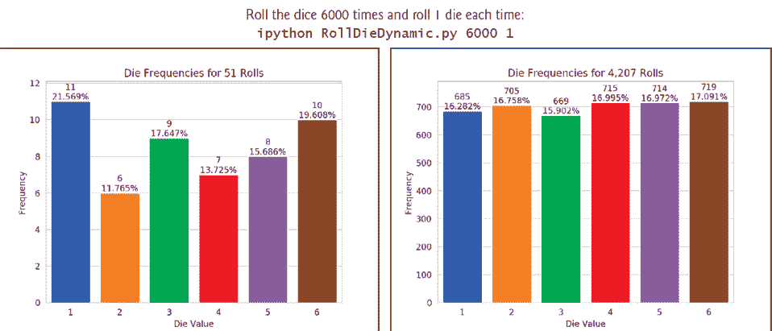

### 创建脚本

通常，你在能够输入文本的编辑器中创建 Python 源代码。使用编辑器，你输入程序，进行必要的更正，并将其保存到计算机中。集成开发环境（IDE）提供支持整个


软件开发过程，例如编辑器、调试器等，用于定位导致程序执行出错的逻辑错误，等等。一些流行的 Python IDE 包括 Spyder（随 Anaconda 一起提供）、PyCharm 和 Visual Studio Code。

## 执行时可能出现的问题

程序通常不能一次就运行成功。例如，正在执行的程序可能会尝试除以零（在 Python 中是非法操作）。这将导致程序显示错误消息。如果这种情况发生在脚本中，您将返回到编辑器，进行必要的更改并重新执行脚本，以确定更改是否修复了问题。

诸如除以零之类的错误发生在程序运行期间，因此称为**运行时错误**或**执行时错误**。**致命运行时错误**会导致程序在未成功完成其任务的情况下立即终止。**非致命运行时错误**允许程序运行至完成，通常会产生错误的结果。

## 1.5.3 在 Jupyter Notebook 中编写和执行代码

在“Before You Begin”部分安装的 Anaconda Python 发行版附带了 **Jupyter Notebook**——一种基于浏览器的交互式环境，您可以在其中编写和执行代码，并将代码与文本、图像和视频混合。Jupyter Notebook 在数据科学界尤其广泛使用，在更广泛的科学界也普遍使用。它们是进行基于 Python 的数据分析研究以及以 _可复现地_ 传达其结果的首选方法。Jupyter Notebook 环境支持越来越多的编程语言。

为方便起见，本书的所有源代码也以 Jupyter Notebook 的形式提供，您可以简单加载并执行。在本节中，您将使用 **JupyterLab** 界面，该界面使您能够管理笔记本文件以及笔记本使用的其他文件（如图像和视频）。正如您将看到的，JupyterLab 也使编写代码、执行代码、查看结果、修改代码并再次执行变得方便。

您会发现，在 Jupyter Notebook 中编码与使用 IPython 类似——事实上，Jupyter Notebook 默认使用 IPython。在本节中，您将创建一个笔记本，将 1.5.1 节中的代码添加到其中并执行该代码。

### 在浏览器中打开 JupyterLab

要打开 JupyterLab，请在 Terminal、shell 或 Anaconda Command Prompt 中切换到 `ch01` 示例文件夹（如 1.5.2 节所示），输入以下命令，然后按 _Enter_（或 _Return_）：

```
jupyter lab
```

这将在计算机上执行 Jupyter Notebook 服务器，并在默认 Web 浏览器中打开 JupyterLab，在“文件浏览器”选项卡中显示 ch01 文件夹的内容


位于 JupyterLab 界面左侧：

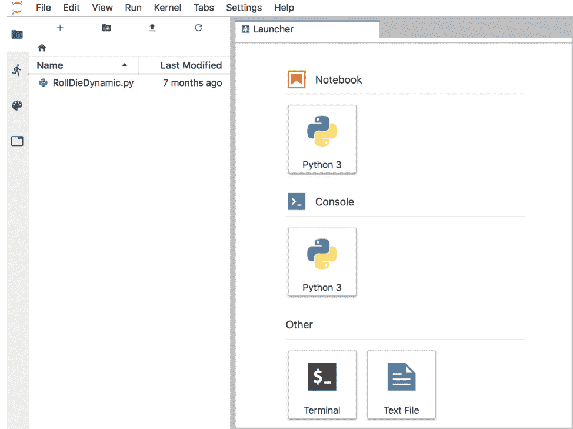

Jupyter Notebook 服务器使您能够在 Web 浏览器中加载和运行 Jupyter Notebook。从 JupyterLab 的“文件”选项卡，您可以双击文件将其打开在窗口右侧当前显示启动器选项卡的位置。您打开的每个文件都会在窗口的这一部分中显示为一个单独的选项卡。如果您意外关闭了浏览器，可以在 Web 浏览器中输入以下地址以重新打开 JupyterLab：

```
http://localhost:8888/lab
```

### 创建新的 Jupyter Notebook

在“启动器”选项卡的“笔记本”下，单击 Python 3 按钮以创建名为 Untitled.ipynb 的新 Jupyter Notebook，您可以在其中输入和执行 Python 3 代码。文件扩展名 .ipynb 是 IPython Notebook 的缩写——即 Jupyter Notebook 的原始名称。

### 重命名笔记本

将 Untitled.ipynb 重命名为 TestDrive.ipynb：

- 1. 右键单击 `Untitled.ipynb` 选项卡并选择 **重命名笔记本**。
- 2. 将名称更改为 `TestDrive.ipynb` 并单击 **重命名**。

JupyterLab 顶部现在应如下所示：

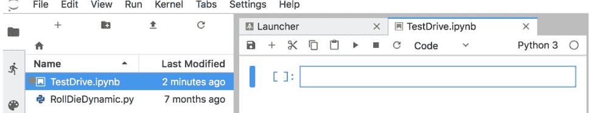

### 求值表达式

笔记本中的工作单元是单元格，您可以在其中输入代码片段。默认情况下，新笔记本包含一个单元格——即 `TestDrive.ipynb` 笔记本中的矩形区域——但您可以添加更多。在单元格左侧，`[ ]:` 表示法是 Jupyter Notebook 在执行单元格 _后_ 显示单元格片段编号的位置。单击单元格，然后键入表达式

```
45 + 72
```

要执行当前单元格的代码，请键入 `Ctrl + Enter`（或 `control + Enter`）。JupyterLab 在 IPython 中执行代码，然后在单元格下方显示结果：

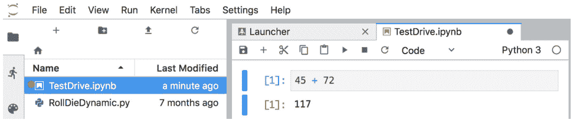

### 添加并执行另一个单元格

让我们求值一个更复杂的表达式。首先，单击笔记本第一个单元格上方工具栏中的 `+` 按钮——这将在当前单元格下方添加一个新单元格：

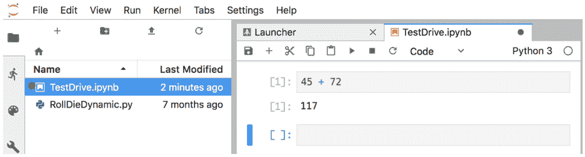

单击新单元格，然后键入表达式

```
5 * (12.7 - 4) / 2
```

并通过键入 Ctrl + Enter（或 control + Enter）执行该单元格：

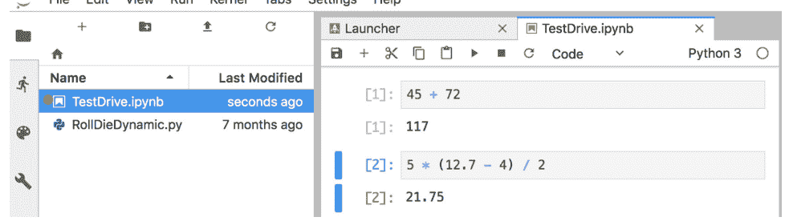

### 保存笔记本

如果笔记本有未保存的更改，笔记本选项卡中的 X 将变为 。要保存笔记本，请在 JupyterLab 中选择“文件”菜单（而非浏览器窗口顶部的菜单），然后选择“保存笔记本”。

### 每章示例中提供的笔记本

为方便起见，每章的示例也以可直接执行的笔记本形式提供，不包含其输出。这使您能够逐个片段地学习，并在执行每个片段时看到输出出现。

为了向您展示如何加载现有笔记本并执行其单元格，让我们重置 `TestDrive.ipynb` 笔记本以删除其输出和片段编号。这将使其恢复到与我们为后续章节示例提供的笔记本类似的状态。从“内核”菜单选择“重新启动内核并清除所有输出...”，然后单击“重新启动”按钮。每当您希望重新执行笔记本的片段时，上述命令也很有帮助。笔记本现在应如下所示：

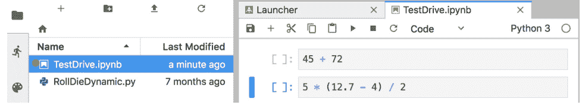

从“文件”菜单选择“保存笔记本”，然后单击 `TestDrive.ipynb` 选项卡上的 X 按钮以关闭笔记本。

### 打开并执行现有笔记本

当您从特定章节的示例文件夹启动 JupyterLab 时，您将能够打开该文件夹或其任何子文件夹中的笔记本。找到特定笔记本后，双击它以打开它。现在请再次打开 `TestDrive.ipynb` 笔记本。打开笔记本后，您可以像本节前面一样逐个执行每个单元格，也可以一次执行整个笔记本。为此，从“运行”菜单选择“运行所有单元格”。笔记本将按顺序执行单元格，并在每个单元格下方显示该单元格的输出。

### 关闭 JupyterLab

使用完 JupyterLab 后，可以关闭其浏览器选项卡，然后在启动 JupyterLab 的 Terminal、shell 或 Anaconda Command Prompt 中，键入 Ctrl + c（或 control + c）两次。

### JupyterLab 提示

在使用 JupyterLab 时，您可能会发现以下提示很有帮助：

- 如果您需要输入并执行许多片段，可以键入 Shift + Enter 来执行当前单元格并在其下方添加一个新单元格，而不是键入 Ctrl + Enter（或 control + Enter）。
- 随着您进入后续章节，您在 Jupyter Notebook 中输入的一些片段将包含许多行代码。要在每个单元格中显示行号，请从 JupyterLab 的“视图”菜单中选择“显示行号”。

### 有关使用 JupyterLab 的更多信息

JupyterLab 还有许多其他您会发现有用的功能。我们建议您阅读 Jupyter 团队关于 JupyterLab 的介绍，网址如下：

```
https://jupyterlab.readthedocs.io/en/stable/index.html
```

要快速概览，请单击“入门”下的“概述”。此外，在“用户指南”下，阅读关于 JupyterLab 界面、使用文件、文本编辑器和笔记本的介绍，以了解更多其他功能。

## 1.6 云和物联网

### 1.6.1 云

如今，越来越多的计算是在“云端”完成的——也就是说，分布在全球互联网上。您日常使用的许多应用都依赖于基于云的服务，这些服务使用大规模的计算资源集群（计算机、处理器、内存、磁盘驱动器等）和数据库，这些资源和数据库通过互联网彼此通信并与您使用的应用程序通信。通过互联网提供自身访问权限的服务称为 Web 服务。正如您将看到的，在 Python 中使用基于云的服务通常就像创建软件对象并与其交互一样简单。该对象随后会代表您使用连接到云端的 Web 服务。

在 11–16 章的示例中，您将使用许多基于云的服务：


- 在第12章和第6章中，你将使用Twitter的Web服务（通过Python库Tweepy）来获取特定Twitter用户的信息，搜索过去七天的推文，并接收推文流，即实时推文。

- 在第11章和第2章中，你将使用Python库TextBlob在语言之间翻译文本。幕后，TextBlob使用Google Translate Web服务来执行这些翻译。

- 在第13章中，你将使用IBM Watson的Text to Speech、Speech to Text和Translate服务。你将实现一个旅行助手翻译应用，它能让你用英语说出问题，将语音转录为文本，将文本翻译成西班牙语，并朗读西班牙语文本。然后，该应用允许你用西班牙语回答（以防你不会说西班牙语，我们提供一个你可以使用的音频文件），将语音转录为文本，将文本翻译成英语，并朗读英语回答。通过IBM Watson演示，你还将在第13章中尝试许多其他基于云的Watson服务。

- 在第16章中，你将使用Microsoft Azure的HDInsight服务和其他Azure Web服务，使用Apache Hadoop和Spark实现大数据应用程序。Azure是Microsoft的一组基于云的服务。

- 在第16章中，你将使用Dweet.io Web服务来模拟一个联网恒温器，它会在线发布温度读数。你还将使用一个基于Web的服务来创建“仪表板”，以随时间可视化温度读数，并在温度过低或过高时警告你。

- 在第16章中，你将使用基于Web的仪表板来可视化来自PubNub Web服务的模拟实时传感器数据流。你还将创建一个Python应用，可视化PubNub模拟的实时股价变化流。

在大多数情况下，你将创建代表你与Web服务交互的Python对象，隐藏通过互联网访问这些服务的细节。

## 混搭

应用程序开发方法论中的_混搭_使你能够通过组合（通常是免费的）互补Web服务和其他形式的信息馈送，快速开发强大的软件应用——正如你将在我们的IBM Watson旅行助手翻译应用中所做的那样。最早的混搭之一结合了http://www.craigslist.org提供的房地产列表和Google Maps的映射功能，提供了显示特定区域待售或出租房屋位置的地图。

ProgrammableWeb (http://www.programmableweb.com/) 提供了超过20,750个Web服务和近8,000个混搭的目录。他们还提供有关使用Web服务和创建自己混搭的操作指南和示例代码。根据他们的网站，一些最广泛使用的Web服务是Facebook、Google Maps、Twitter和

## 1.6.2 物联网

互联网不再仅仅是*计算机*网络——它是**物联网**（IoT）。*物*是指任何具有IP地址并能够自动通过互联网发送，在某些情况下接收数据的对象。此类物体包括：

- 用于支付过路费的带有应答器的汽车，
- 车库中用于监控停车位可用性的监视器，
- 植入人体的心脏监视器，
- 水质监视器，
- 报告能源使用量的智能电表，
- 辐射探测器，
- 仓库中的物品追踪器，
- 可以追踪你行动和位置的移动应用，
- 根据天气预报和家中活动调整房间温度的智能恒温器，以及
- 智能家用电器。

根据statista.com，目前已有超过230亿个物联网设备在使用，到2025年可能会有超过750亿个物联网设备。²

² https://www.statista.com/statistics/471264/iot-number-of-connected-devices-worldwide.

## 1.7 大数据有多大？

对计算机科学家和数据科学家而言，数据如今与编写程序同样重要。根据IBM，每天大约产生2.5百万亿字节（2.5艾字节）的数据，³并且世界上90%的数据是在过去两年内产生的。⁴根据IDC，到2025年，全球数据供应量每年将达到175泽字节（相当于175万亿千兆字节或1750亿太字节）。⁵ 请考虑各种常用数据单位的以下示例。

³ https://www.ibm.com/blogs/watson/2016/06/welcome-to-the-world-of-a-/
⁴ https://public.dhe.ibm.com/common/ssi/ecm/wr/en/wrl12345usen/watson-customer-engagement--watson-marketing-wr-other-papers-and-reports-rl12345usen-20170719.pdf.
⁵ https://www.networkworld.com/article/3325397/storage/idc-expect-75-zettabytes-of-data-worldwide-by-2025.html.

## 兆字节 (MB)

一个兆字节大约是一百万字节（实际上是2^20字节）。我们日常使用的许多文件都需要一个或多个MB的存储空间。示例包括：

- MP3音频文件—高质量MP3每分钟为1到2.4 MB。
⁶ https://www.audiomountain.com/tech/audio-file-size.html.
- 照片—数码相机拍摄的JPEG格式照片每张大约需要8到10 MB。
- 视频—智能手机摄像头可以以多种分辨率录制视频。每分钟视频可能需要许多兆字节的存储空间。例如，在我们的一台iPhone上，相机设置应用报告称，每秒30帧（FPS）的1080p视频需要130 MB/分钟，每秒30帧（FPS）的4K视频需要350 MB/分钟。

## 千兆字节 (GB)

一个千兆字节大约是1000兆字节（实际上是2^30字节）。双层DVD最多可存储8.5 GB 7，即：

⁷ https://en.wikipedia.org/wiki/DVD.

- 最多141小时的MP3音频，
- 来自1600万像素相机的约1000张照片，
- 每秒30帧（FPS）的约7.7分钟1080p视频，或
- 每秒30帧（FPS）的约2.85分钟4K视频。

目前最高容量的超高清蓝光光盘最多可存储100 GB的视频。8 流式传输4K电影每小时可使用7到10 GB（高度压缩）。

⁸ https://en.wikipedia.org/wiki/Ultra_HD_Blu-ray.

## 太字节 (TB)

一个太字节大约是1000千兆字节（实际上是2^40字节）。最近的台式计算机磁盘驱动器容量可达15 TB,⁹，相当于：

⁹ https://www.zdnet.com/article/worlds-biggest-hard-drive-meet-eastern-digitals-15tb-monster/

- 约28年的MP3音频，
- 来自1600万像素相机的约168万张照片，
- 每秒30帧（FPS）的约226小时1080p视频，以及
- 每秒30帧（FPS）的约84小时4K视频。

Nimbus Data目前拥有最大的固态硬盘（SSD），容量为100 TB，可以存储上面列出的15 TB音频、照片和视频示例的6.67倍。¹⁰

¹⁰ https://www.cinema5d.com/nimbus-data-100tb-ssd-worlds-largest-ssd/

## PB、EB和ZB

近四十亿人在线，每天创造约2.5百万亿字节的数据 ¹——即2500PB（每个PB约为1000TB）或2.5EB（每个EB约为1000PB）。根据2016年3月AnalyticsWeek的一篇文章，五年内将有超过500亿台设备连接到互联网（其中大部分通过物联网，我们将在1.6.2节和6.8节讨论），到2020年，地球上每个人每秒将产生1.7 MB的新数据。² 以当前的数字（约77亿人 ³），这大约是

¹ https://public.dhe.ibm.com/common/ssi/ecm/wr/en/wrl12345usen/watson-customer-engagement--watson-marketing-wr-other-papers-and-reports-rl12345usen-20170719.pdf.
² https://analyticsweek.com/content/big-data-facts/.
³ https://en.wikipedia.org/wiki/World_population.

- 每秒13 PB新数据，
- 每分钟780 PB，
- 每小时46,800 PB（46.8 EB），以及
- 每天1,123 EB——即每天1.123 ZB（每个ZB约为1000 EB）。

这相当于每天超过550万小时（超过600年）的4K视频，或者


每天大约 1160 亿张照片！

## 大数据的其他统计数据

如需直观感受大数据的实时规模，请访问 https://www.internetlivestats.com，网站提供各种统计数据，包括今日迄今的以下数字：

- Google 搜索次数。
- 推文数量。
- YouTube 上观看的视频数量。
- Instagram 上上传的照片数量。

您可以点击每项统计数据以深入了解更多信息。例如，他们说 2018 年发送的推文超过 2500 亿条。

其他一些有趣的大数据事实：

- 每小时，YouTube 用户上传 24,000 小时的视频，并且每天在 YouTube 上观看的视频近 10 亿小时。^4
  ^4 https://www.brandwatch.com/blog/youtube-stats/.
- 每秒，互联网流量达 51,773 GB（或 51.773 TB），发送 7894 条推文，进行 64,332 次 Google 搜索，观看 72,029 个 YouTube 视频。^5
  ^5 https://www.internetlivestats.com/one-second.
- Facebook 每天有 8 亿个“赞”，^6 发送 6000 万个表情符号，^7 并且自该网站创建以来，对超过 2.5 万亿条 Facebook 帖子进行了超过 20 亿次搜索。^8
  ^6 https://newsroom.fb.com/news/2017/06/two-billion-people-coming-ogether-on-facebook.
  ^7 https://mashable.com/2017/07/17/facebook-world-emoji-day/.
  ^8 https://techcrunch.com/2016/07/27/facebook-will-make-you-talk/.
- 2017 年 6 月，Planet 首席执行官 Will Marshall 表示，该公司拥有 142 颗卫星，每天拍摄整个陆地表面一次。他们每天新增一百万张图像和 7 TB 新数据。他们与合作伙伴一起，利用这些数据进行机器学习，以提高作物产量、查看特定港口有多少艘船只并追踪森林砍伐。关于亚马逊森林砍伐，他说：“过去，我们过几年才醒来发现亚马逊出现一个大窟窿。现在，我们几乎可以每天统计地球上每一棵树。”

https://www.bloomberg.com/news/videos/2017-06-30/learning-from-planet-s-shoe-boxed-sized-satellites-video，2017 年 6 月 30 日。

Domo, Inc. 有一个名为“数据永不入睡 6.0”的精彩信息图，展示了 _每分钟_ 产生的数据量，包括：

https://www.domo.com/learn/data-never-sleeps-6.

- 发送 473,400 条推文。
- 分享 2,083,333 张 Snapchat 照片。
- 观看 97,222 小时 Netflix 视频。
- 发送 12,986,111 条短信。
- Instagram 帖子 49,380 条。
- Skype 通话 176,220 次。
- Spotify 流媒体歌曲 750,000 首。
- Google 搜索 3,877,140 次。
- YouTube 视频观看次数 4,333,560 次。

## 数年中的算力

数据日益庞大，处理数据所需的算力亦是如此。当今处理器的性能通常以 **FLOPS（每秒浮点运算次数）** 来衡量。在 20 世纪 90 年代初至中期，最快超级计算机的速度以十亿次浮点运算（gigaflops，10^9 FLOPS）为单位。到 20 世纪 90 年代末，Intel 生产出了第一台万亿次浮点运算（teraflop，10^12 FLOPS）超级计算机。21 世纪 0 年代初至中期，速度达到数百万亿次浮点运算，随后在 2008 年，IBM 发布了第一个千万亿次浮点运算（petaflop，10^15 FLOPS）超级计算机。目前，最快的超级计算机——位于美国能源部（DOE）橡树岭国家实验室（ORNL）的 IBM Summit——可达到 122.3 千万亿次浮点运算。

https://en.wikipedia.org/wiki/FLOPS.

分布式计算可以通过互联网将数千台个人计算机连接起来，产生更多的 FLOPS。2016 年末，Folding@home 网络——一个分布式网络，人们自愿将个人计算机的资源用于疾病研究和药物设计 ²——的算力超过 100 千万亿次浮点运算。 ³ 像 IBM 这样的公司正在朝着能够达到百万亿次浮点运算（exaflops，10¹⁸ FLOPS）的超级计算机努力。 ⁴

² https://en.wikipedia.org/wiki/Folding@home.

³ https://en.wikipedia.org/wiki/FLOPS.

⁴ https://www.ibm.com/blogs/research/2017/06/supercomputing-weather-model-exascale/.

目前正在开发的量子计算机理论上运行速度可达当今“传统计算机”的 18,000,000,000,000,000 倍！ ⁵ 这个数字如此惊人，以至于在一秒钟内，量子计算机理论上可以完成比世界上第一台计算机出现以来所有计算机完成的总计算量多得多的计算。这种几乎不可思议的算力可能会对基于区块链的加密货币（如比特币）造成巨大冲击。工程师们已经在重新思考区块链，为这种算力的大幅增长做好准备。 ⁶

⁵ https://medium.com/@n.biedrzycki/only-god-can-count-that-fast-the-world-of-quantum-computing-406a0a91fcf4.

⁶ https://singularityhub.com/2017/11/05/is-quantum-computing-an-existential-threat-to-blockchain-technology/.

超级计算能力的历史是：它最终会从研究实验室（在那里花费了巨额资金来实现这些性能指标）向“价格合理”的商用计算机系统乃至台式电脑、笔记本电脑、平板电脑和智能手机渗透。

算力的成本仍在下降，尤其是随着云计算的发展。过去人们会问：“我的系统需要多少算力才能应对峰值处理需求？”如今，这种思路转变为：“我能否在云上快速划出临时所需的算力，以应对最苛刻的计算任务？”您只需为完成特定任务所使用的算力付费。

## 处理世界数据需要大量电力

来自全球互联连接设备的数据正在激增，处理这些数据需要大量能源。根据最近一篇文章，2015 年用于处理数据的能源年增长率为 20%，消耗了全球电力的大约 3% 到 5%。该文章称，数据处理总能耗到 2025 年可能达到 20%。 ⁷

⁷ https://www.theguardian.com/environment/2017/dec/11/tsunami-of-data-could-consume-fifth-global-electricity-by-2025.

另一个巨大的耗电量来源是基于区块链的加密货币比特币。仅处理一笔比特币交易所需的能源，大约相当于为普通美国家庭供电一周！这种能源消耗来自比特币“矿工”用于证明交易数据有效的过程。 ⁸

⁸ https://motherboard.vice.com/en_us/article/ywbbpm/bitcoin-mining-electricity-consumption--ethereum-energy-climate-change.

据一些估计，一年内的比特币交易消耗的能源超过了许多国家。 ⁹ 比特币和以太坊（另一种流行的基于区块链的平台和加密货币）合计每年消耗的能源超过了以色列，几乎与希腊相当。 ⁰

⁹ https://digiconomist.net/bitcoin-energy-consumption.

⁰ https://digiconomist.net/ethereum-energy-consumption.

摩根士丹利在 2018 年预测：“今年创建加密货币所需的电力消耗实际上可能会超出该公司对 2025 年全球电动汽车需求的预测。” ¹ 这种情况是不可持续的，尤其是考虑到对基于区块链的应用（甚至不仅限于加密货币的爆炸式增长）的巨大兴趣。区块链社区正在研发解决方案。 ², ³

¹ https://www.morganstanley.com/ideas/cryptocurrencies-global-utilities.

² https://www.technologyreview.com/s/609480/bitcoin-uses-massive-amounts-of-energy-but-theres-a-plan-to-fix-it/.

³ https://mashable.com/2017/12/01/bitcoin-energy/.

## 大数据机遇

大数据的爆炸式增长在未来几年可能会继续呈指数级增长。随着 500 亿台计算设备即将问世，我们只能想象未来几十年会有多少设备。企业、政府、军队甚至个人都必须掌握所有这些数据。

有趣的是，关于大数据、数据科学、人工智能等方面最好的一些著作来自杰出的商业机构，如摩根大通、麦肯锡等。鉴于迅速加速的成就，大数据对大企业的吸引力不容置疑。许多公司通过本书中的技术（如大数据、机器学习、深度学习和自然语言处理）进行大量投资并获得宝贵成果。这迫使竞争对手也进行投资，迅速增加对具有数据科学和计算机科学经验的计算专业人员的需求。这种增长在未来几年可能会持续。


## 7.1 大数据分析

数据分析是一门成熟且发展完善的学术和专业学科。“数据分析”一词创于1962年，⁴ 虽然人们使用统计方法分析数据已有数千年历史，可追溯到古埃及人。⁵ 大数据分析是一个较近期的现象——“大数据”一词创于2000年左右。⁶

⁴ https://www.forbes.com/sites/gilpress/2013/05/28/a-very-short-history-of-data-science/.
⁵ https://www.flydata.com/blog/a-brief-history-of-data-analysis/.
⁶ https://bits.blogs.nytimes.com/2013/02/01/the-origins-of-big-data-an-etymological-detective-story/.

考虑大数据的四个V ⁷ ⁸:

⁷ https://www.ibmbigdatahub.com/infographic/four-vs-big-data.
⁸ 有很多文章和论文将许多其他V词添加到此列表中。

- 容量——世界产生的数据量正在指数级增长。
- 速度——数据产生的速度、数据在组织中流动的速度以及数据变化的速度都在快速增长。⁹, ¹⁰, ¹¹
- 多样性——数据过去是字母数字型的（即由字母字符、数字、标点符号和一些特殊字符组成）——如今还包括图像、音频、视频以及我们家庭、企业、车辆、城市等中不断增加的物联网传感器数据。
- 真实性——数据的有效性——它是否完整准确？在做出关键决策时，我们能信任这些数据吗？它们是真实的吗？

⁹ https://www.zdnet.com/article/volume-velocity-and-variety-understanding-the-three-vs-of-big-data/.
¹⁰ https://whatis.techtarget.com/definition/3Vs.
¹¹ https://www.forbes.com/sites/brentdykes/2017/06/28/big-data-target-volume-and-variety---focus-on-velocity.

当今，大多数数据正以多种类型、惊人的体量和惊人的速度被数字化创建。摩尔定律及相关观察使我们能够经济地存储数据，并以更快的速度处理和移动数据——且所有这些速率都随时间呈指数级增长。数字数据存储的容量已变得如此巨大、廉价和微小，以至于我们现在可以方便且经济地保留_所有_我们正在创建的数字数据。² 这就是大数据。

² http://www.lesk.com/mlesk/ksg97/ksg.html. [以下文章指引我们参考了这篇Michael Lesk文章：https://www.forbes.com/sites/gilpress/2013/05/28/a-very-short-history-of-data-science/.]

> “计算的目的是洞察，而非数字。” ³

³ Hamming, R. W., 《科学家和工程师的数值方法》（纽约，纽约，麦格罗希尔，1962年）。[以下文章指引我们参考了Hamming的书及我们引用的他的话：https://www.forbes.com/sites/gilpress/2013/05/28/a-very-short-history-of-data-science/.]

数据科学正以惊人的速度产生新的、更深刻、更微妙且更有价值的洞察。它确实在发挥作用。大数据分析是答案的重要组成部分。我们在第16章中探讨大数据基础设施，包含NoSQL数据库、Hadoop MapReduce编程、Spark、实时物联网（IoT）流编程等的实操案例研究。

⁴ Turck, M., and J. Hao, 《大权大责：2018年大数据与AI格局》，http://matturck.com/bigdata2018/.

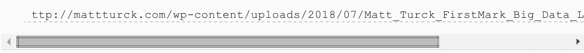

## 7.2 数据科学与大数据正在发挥作用：用例

数据科学领域正在快速发展，因为它正在产生正在发挥作用的重大成果。我们在下表中列举了数据科学和大数据的用例。我们希望本书中的用例和示例能激发您在职业生涯中探索新的用例。大数据分析已带来利润提升、客户关系改善，甚至体育队伍在花费更少球员薪资的情况下赢得更多比赛和冠军。⁵ ⁶ ⁷

⁵ Sawchik, T., 《大数据棒球：数学、奇迹与20年连败的终结》（纽约，平装图书，2015年）。

### 数据科学用例

| | | |
|---|---|---|
| 异常检测 | | |
| 辅助残障人士 | | |
| 车辆保险风险预测 | | |
| 自动闭路字幕 | | |
| 自动图像字幕 | | 预测受天气影响的产品销售 |
| 自动化投资 | 面部识别 | 预测分析 |
| 自动驾驶船舶 | 健身追踪 | 预防医学 |
| 脑图谱 | 欺诈检测 | 预防疾病爆发 |
| 来电识别 | 游戏 | 手语识别 |
| 癌症诊断/治疗 | 基因组学与医疗 | 房地产估值 |
| 碳排放减少 | 地理信息系统（GIS） | 推荐系统 |
| 手写体分类 | GPS系统 | 减少超额预订 |
| 计算机视觉 | 健康结果改善 | 共享乘车 |
| 信用评分 | 医院再入院率降低 | 风险最小化 |
| 犯罪：预测地点 | 人类基因组测序 | 机器人理财顾问 |
| | 身份盗窃防范 | 安全增强 |
| 犯罪：预测再犯 | | |
| 免疫疗法 | | |
| 自动驾驶汽车 | | |
| 保险定价 | | |
| 情感分析 | | |
| 犯罪：预测性警务 | | |
| 智能助手 | | |
| 共享经济 | | |
| 犯罪：预防 | | |
| 物联网（IoT）及医疗设备监控 | | |
| 相似性检测 | | |
| CRISPR基因编辑 | | |
| 物联网与天气预报 | | |
| 智慧城市 | | |
| 作物产量提升 | | |
| 库存控制 | | |
| 智能家居 | | |
| 客户流失 | | |
| 语言翻译 | | |
| 智能电表 | | |
| 客户体验 | | |
| 基于位置的服务 | | |
| 智能恒温器 | | |
| 客户保留 | | |
| 忠诚度计划 | | |
| 智能交通控制 | | |
| 客户满意度 | | |
| 恶意软件检测 | | |
| 社交分析 | | |
| 客户服务 | | |
| 制图 | | |
| 社交图谱分析 | | |
| 客户服务代理 | | |
| 营销 | | |
| 垃圾邮件检测 | | |
| 客户服务代理 | | |
| 营销分析 | | |
| 空间数据分析 | | |
| 音乐生成 | | |
| 体育选材与教练 | | |
| 定制饮食 | | |
| 自然语言翻译 | | |
| 股市预测 | | |
| 网络安全 | | |
| 新药研发 | | |
| 学生表现评估 | | |
| 数据挖掘 | | |
| 阿片类药物滥用预防 | | |
| 文本摘要 | | |
| 数据可视化 | | |
| 个人助手 | | |
| 远程医疗 | | |
| 新病毒检测 | | |
| 个性化医疗 | | |
| 恐怖袭击预防 | | |
| 乳腺癌诊断 | | |
| 个性化购物 | | |
| 防盗 | | |
| 心脏病诊断 | | |
| 钓鱼预防 | | |
| 旅行推荐 | | |
| 诊断医学 | | |
| 污染减少 | | |
| 趋势发现 | | |
| 预测癌症生存率 | | |
| 可视化产品搜索 | | |
| 灾难受害者识别 | 预测疾病爆发 | 语音识别 |
| | 预测健康结果 | 语音搜索 |
| 无人机 | 预测学生入学人数 | 天气预报 |
| 动态驾驶路线 | | |
| 动态定价 | | |
| 电子健康档案 | | |
| 情绪检测 | | |
| 能源消耗减少 | | |

## 7.8 案例研究——一款大数据移动应用

⁸ https://www.waze.com/brands/drivers/.

Google的Waze GPS导航应用拥有9000万月活跃用户，⁸ 是最成功的大数据应用之一。早期GPS导航设备和应用依赖静态地图和GPS坐标来确定前往目的地的最佳路线。它们无法根据不断变化的交通情况动态调整。

Waze处理海量的**众包数据**——即由全球用户及其设备持续提供的数据。它们在数据到达时进行分析，以确定以最少时间将您送达目的地的最佳路线。为实现这一目标，Waze依赖您智能手机的互联网连接。该应用会自动将位置更新发送到其服务器（假设您允许此操作）。它们使用这些数据根据当前交通状况动态为您重新规划路线，并优化其地图。用户还会报告其他信息，如道路封锁、施工、障碍物、故障车道中的车辆、警察位置、油价等。然后Waze会向这些地点的其他司机发出警报。

Waze使用多种技术来提供其服务。我们并不了解Waze的具体实现方式，但下面推断出它们可能使用的一系列技术。您将在第11至16章中使用其中许多技术。例如，


- 当今开发的大多数应用程序至少使用了一些开源软件。在本书中，您将充分利用许多开源库和工具。

- Waze 通过互联网在其服务器与用户移动设备之间传输信息。当今，此类数据通常以 JSON（JavaScript 对象表示法）格式传输，我们将在第 9 章中介绍并用于后续章节。JSON 数据通常由您使用的库对您隐藏。

- Waze 使用语音合成向您播报驾驶指示和警报，并使用语音识别来理解您的口头命令。我们将在第 13 章中使用 IBM Watson 的语音合成和语音识别功能。

- 一旦 Waze 将口头自然语言命令转换为文本，它就必须确定要执行的正确操作，这需要自然语言处理（NLP）。我们将在第 11 章介绍 NLP，并在几个后续章节中使用它。

- Waze 显示动态更新的可视化内容，例如警报和地图。Waze 还允许您通过移动地图或放大缩小来与地图交互。我们在全书中使用 Matplotlib 和 Seaborn 创建动态可视化内容，并在第 12 章和第 6 章中使用 Folium 显示交互式地图。

- Waze 将您的手机用作流式物联网（IoT）设备。每部手机都是一个 GPS 传感器，通过互联网向 Waze 持续流式传输数据。在第 16 章，我们将介绍 IoT 并使用模拟的 IoT 流式传感器。

- Waze 同时从数百万部手机接收 IoT 流。它必须立即处理、存储和分析这些数据，以更新您设备的地图、显示并播报相关警报，并可能更新您的驾驶指示。这需要使用云中计算机集群实现的大规模并行处理能力。在第 6 章，我们将介绍各种大数据基础设施技术，用于接收流式数据、将大数据存储在适当的数据库中，以及使用提供大规模并行处理能力的软件和硬件来处理数据。

- Waze 使用人工智能功能来执行数据分析任务，使其能够根据接收到的信息预测最佳路线。在第 14 章和第 5 章中，我们分别使用机器学习和深度学习来分析海量数据并基于这些数据进行预测。

- Waze 可能将其路由信息存储在图数据库中。此类数据库可以高效计算最短路线。我们在第 16 章介绍图数据库，例如 Neo4J。

- 如今，许多汽车都配备了能够使其“看到”周围汽车和障碍物的设备。例如，这些设备用于帮助实现自动制动系统，是自动驾驶汽车技术的关键部分。与其依赖用户报告路边的障碍物和停放的汽车，导航应用程序可以利用摄像头和其他传感器，使用深度学习计算机视觉技术“实时”分析图像并自动报告这些项目。我们在第 15 章介绍用于计算机视觉的深度学习。

## 1.9 数据科学导论：人工智能——计算机科学与数据科学的交汇点

当婴儿第一次睁开眼睛时，他们能“看到”父母的脸吗？他们理解什么是脸——甚至理解什么是简单的图形吗？婴儿必须“学习”周围的世界。这正是人工智能（AI）今天所做的事情。它正在查看海量数据并从中学习。AI 正被用于玩游戏、实现广泛的计算机视觉应用、实现自动驾驶汽车、使机器人能够学习执行新任务、诊断医疗状况、近乎实时地将语音翻译成其他语言、创建可以使用庞大知识数据库回答任意问题的聊天机器人，以及更多。几年前，谁能料到人工智能自动驾驶汽车会被允许上路——甚至变得普遍？然而，这现在是一个竞争激烈的领域。所有这些学习的最终目标是 *人工通用智能*——一种能够与人类一样执行智能任务的 AI。这对许多人来说是一个可怕的想法。

## 人工智能里程碑

特别是，一些人工智能里程碑吸引了人们的关注和想象，使普通公众开始认为 AI 是真实的，并使企业考虑商业化 AI：

- 在 1997 年 **IBM 的 DeepBlue** 计算机系统与国际象棋大师加里·卡斯帕罗夫的比赛中，DeepBlue 成为锦标赛条件下第一台击败现任世界国际象棋冠军的计算机。9 IBM 将数十万盘国际象棋大师棋局加载到 DeepBlue 中。0 DeepBlue 能够使用 *暴力法* 每秒评估高达 2 亿步棋！1 这就是大数据的作用。IBM 获得了卡内基梅隆大学弗雷德金奖，该奖在 1980 年向第一台击败世界国际象棋冠军计算机的创建者提供了 10 万美元奖金。2

9 https://en.wikipedia.org/wiki/Deep_Blue_versus_Garry_Kasparov.
0 https://en.wikipedia.org/wiki/Deep_Blue_(chess_computer).
1 https://en.wikipedia.org/wiki/Deep_Blue_(chess_computer).
2 https://articles.latimes.com/1997/jul/30/news/mn-17696.

- 在 2011 年，**IBM 的 Watson** 在一场 100 万美元的比赛中击败了两位最优秀的人类 Jeopardy! 选手。Watson 同时使用数百种语言分析技术，在 2 亿页内容（包括所有维基百科）中定位正确答案，这些内容需要 4TB 的存储空间。3 4 Watson 是使用机器学习和强化学习技术训练的。5 第 13 章讨论了 IBM Watson，第 14 章讨论了机器学习。

3 https://www.techrepublic.com/article/ibm-watson-the-inside-story-of-how-the-jeopardy--winning-supercomputer-was-born-and-hat-it-wants-to-do-next/.
4 https://en.wikipedia.org/wiki/Watson_(computer).
5 https://www.aaai.org/Magazine/Watson/watson.php, AI Magazine, Fall 2010.

- 围棋——一种几千年前在中国创造的棋盘游戏 6——被广泛认为是有史以来最复杂的游戏之一，拥有 10^170 种可能的棋盘布局。7 为了让您了解这个数字有多大，据认为已知宇宙中（只有）在 10^78 到 10^87 个原子之间！8, 9 在 2015 年，由 Google 的 DeepMind 团队创建的 AlphaGo 使用了两个神经网络的深度学习，击败了欧洲围棋冠军范辉。围棋被认为比国际象棋复杂得多。第 15 章讨论神经网络和深度学习。

6 http://www.usgo.org/brief-history-go.
7 https://www.pbs.org/newshour/science/google-artificial-intelligence-beats-champion--at-worlds-most-complicated-board-game.
8 https://www.universetoday.com/36302/atoms-in-the-universe/.
9 https://en.wikipedia.org/wiki/Observable_universe#Matter_content.

- 最近，Google 将其 AlphaGo AI 泛化，创建了 AlphaZero——一种可以自我学习玩其他游戏的游戏 AI。在 2017 年 12 月，AlphaZero 使用强化学习在不到四小时内学习了国际象棋规则并自我教导自己下棋。随后，它在 100 局比赛中击败了世界冠军国际象棋程序 Stockfish 8——每局都赢了或和棋。在仅用八小时训练围棋 0 之后，AlphaZero 能够与它的 AlphaGo 前任下围棋，在 100 局中赢了 60 局。0

0 https://www.theguardian.com/technology/2017/dec/07/alphazero-google-deepmind-ai-beats-champion-program-teaching-itself-to-play-our-hours.

## 个人轶事

当作者之一 Harvey Deitel 在 1960 年代中期是 MIT 的本科生时，他参加了人工智能（AI）创始人之一 Marvin Minsky（本书献给他）的研究生水平人工智能课程。Harvey 说：

明斯基教授要求完成一个主要的学期项目。他告诉我们思考什么是智能，并让计算机做一些智能的事情。我们的课程成绩几乎完全取决于该项目。没有压力！

我研究了学校用来帮助评估学生智力能力的标准化智商测试。出于内心的数学家身份，我决定解决预测任意长度和复杂度数字序列中下一个数字这一流行的智商测试问题。我使用在早期数字设备公司 PDP-1 上运行的交互式 Lisp，并能够让我的序列预测器在一些相当复杂的内容上运行，处理远超我回忆在智商测试中看到的挑战。Lisp 递归操作任意长列表的能力正是满足项目要求所需的。Python 提供递归和通用列表处理（第 5 章）。

我让许多 MIT 同学尝试了我的序列预测器。他们会编造数字序列并将其输入到我的预测器中。PDP-1 会“思考”一会儿——通常是很长一段时间——并且几乎总能得出正确答案。

然后我遇到了麻烦。一位同学输入了序列 14, 23, 34 和 42。我的预测器开始处理它，PDP-1 运转了很长时间，但无法预测下一个数字。我也没想出来。那位同学告诉我一夜好好想想，第二天他会揭晓答案，声称这是一个简单的序列。我的努力徒劳无功。

第二天他告诉我下一个数字是 57，但我不明白为什么。于是他让我再一夜好好想想，第二天他说下一个数字是 125。那一点帮助都没有——我完全没思路。他说这个序列是曼哈顿双向横街的编号。我喊道：“犯规。”但他说这符合我预测数字序列中下一个数字的标准。我的世界观是数学——他的更广阔。

多年来，我曾在朋友、亲戚和专业同事中尝试过那个序列。几个在曼哈顿待过的人答对了。我的序列预测器需要远不止数学知识来处理此类问题，需要（可能非常广博的）世界知识。

## Watson 和大数据开辟新可能性

当 Paul 和我开始撰写这本 Python 书时，我们立刻被 IBM 的 Watson 所吸引，它使用大数据和人工智能技术（如自然语言处理（NLP）和机器学习）击败了两位世界上最优秀的人类 Jeopardy! 选手。我们意识到，Watson 很可能能够处理像序列预测器这样的问题，因为它加载了世界街道地图和更多内容。那


whet our appetite for digging in deep on big data and today’s artificial-intelligence technologies, and helped shape chapters 11–16 of this book.

It’s notable that all of the data-science implementation case studies in chapters 11–16 either are rooted in artificial intelligence technologies or discuss the big data hardware and software infrastructure that enables computer scientists and data scientists to implement leading-edge AI-based solutions effectively.

### AI: 既有问题又无解决方案的领域

For many decades, AI has been viewed as a field with problems but no solutions. That’s because once a particular problem is solved people say, “Well, that's not intelligence, it's just a computer program that tells the computer exactly what to do.” However, with machine learning (chapter 14) and deep learning (chapter 15) we're not pre-programming solutions to specific problems. Instead, we're letting our computers solve problems by learning from data—and, typically, lots of it.

Many of the most interesting and challenging problems are being pursued with deep learning. Google alone has thousands of deep-learning projects underway and that number is growing quickly. 1, 2 As you work through this book, we'll introduce you to many edge-of-the-practice artificial intelligence, big data and cloud technologies.

1 http://theweek.com/speedreads/654463/google-more-than-1000-artificial-intelligence-projects-works.

2 https://www.zdnet.com/article/google-says-exponential-growth-of-ai-s-changing-nature-of-compute/.

### 1.10 总结

In this chapter, we introduced terminology and concepts that lay the groundwork for the Python programming you'll learn in chapters 2–10 and the big-data, artificial-intelligence and cloud-based case studies we present in chapters 11–16.

We reviewed object-oriented programming concepts and discussed why Python has become so popular. We introduced the Python Standard Library and various data-science libraries that help you avoid “reinventing the wheel.” In subsequent chapters, you’ll use these libraries to create software objects that you’ll interact with to perform significant tasks with modest numbers of instructions.

You worked through three test-drives showing how to execute Python code with the IPython interpreter and Jupyter Notebooks. We introduced the Cloud and the Internet of Things (IoT), laying the groundwork for the contemporary applications you’ll develop in chapters 1–6.

We discussed just how big “big data” is and how quickly it’s getting even bigger, and presented a big-data case study on the Waze mobile navigation app, which uses many current technologies to provide dynamic driving directions that get you to your destination as quickly and as safely as possible. We mentioned where in this book you'll use many of those technologies. The chapter closed with our first Intro to Data Science section in which we discussed a key intersection between computer science and data science—artificial intelligence.

# 2. Python 编程简介

### 目标

In this chapter, you'll:

- Continue using IPython interactive mode to enter code snippets and see their results immediately.
- Write simple Python statements and scripts.
- Create variables to store data for later use.
- Become familiar with built-in data types.
- Use arithmetic operators and comparison operators, and understand their precedence.
- Use single-, double- and triple-quoted strings.
- Use built-in function `print` to display text.
- Use built-in function `input` to prompt the user to enter data at the keyboard and get that data for use in the program.
- Convert text to integer values with built-in function `int`.
- Use comparison operators and the `if` statement to decide whether to execute a statement or group of statements.
- Learn about objects and Python’s dynamic typing.
- Use built-in function `type` to get an object’s type

### 大纲

- Introduction
- Variables and Assignment Statements
- Arithmetic
- Function print and an Intro to Single- and Double-Quoted Strings
- Triple-Quoted Strings
- Getting Input from the User
- Decision Making: The if Statement and Comparison Operators
- Objects and Dynamic Typing
- Intro to Data Science: Basic Descriptive Statistics
- Wrap-Up

### 2.1 简介

In this chapter, we introduce Python programming and present examples illustrating key language features. We assume you’ve read the IPython Test-Drive in chapter 1, which introduced the IPython interpreter and used it to evaluate simple arithmetic expressions.

### 2.2 变量和赋值语句

You’ve used IPython’s interactive mode as a calculator with expressions such as

```
In [1]: 45 + 72
Out[1]: 117
```

Let’s create a variable named x that stores the integer 7:

```
In [2]: x = 7
```

Snippet [2] is a **statement**. Each statement specifies a task to perform. The preceding statement creates x and uses the **assignment symbol (=)** to give x a value. Most statements stop at the end of the line, though it’s possible for statements to span more than one line. The following statement creates the variable y and assigns to it the value 3:

```
In [3]: y = 3
```

You can now use the values of x and y in expressions:

```
In [4]: x + y
Out[4]: 10
```

#### Calculations in Assignment Statements

The following statement adds the values of variables x and y and assigns the result to the variable total, which we then display:

```
In [5]: total = x + y
In [6]: total
Out[6]: 10
```

The = symbol is not an operator. The right side of the = symbol always executes first, then the result is assigned to the variable on the symbol’s left side.

#### Python Style

The Style Guide for Python Code 1 helps you write code that conforms to Python’s coding conventions. The style guide recommends inserting one space on each side of the assignment symbol = and binary operators like + to make programs more readable.

1 https://www.python.org/dev/peps/pep-0008/.

#### Variable Names

A variable name, such as x, is an identifier. Each identifier may consist of letters, digits and underscores (_) but may not begin with a digit. Python is case sensitive, so number and Number are different identifiers because one begins with a lowercase letter and the other begins with an uppercase letter.

#### Types

Each value in Python has a **type** that indicates the kind of data the value represents. You can view a value's type with Python's built-in **type function**, as in:

```
In [7]: type(x)
Out[7]: int

In [8]: type(10.5)
Out[8]: float
```

The variable x contains the integer value 7 (from snippet [2]), so Python displays int (short for integer). The value 10.5 is a floating-point number, so Python displays float.

### 2.3 算术

The following table summarizes the arithmetic operators, which include some symbols not used in algebra.

| Python operation | Arithmetic operator | Algebraic expression | Python expression |
|---|---|---|---|
| Addition | + | $f + 7$ | `f + 7` |
| Subtraction | - | $p - c$ | `p - c` |
| Multiplication | * | $b \cdot m$ | `b * m` |
| Exponentiation | ** | $x^y$ | `x ** y` |
| True division | / | $x/y$ or $\frac{x}{y}$ or $x \div y$ | `x / y` |

| Operator | Symbol | Notation | Example |
|---|---|---|---|
| Floor division | // | $\lfloor x/y \rfloor$ or $\left\lfloor \frac{x}{y} \right\rfloor$ or $\lfloor x \div y \rfloor$ | x // y |
| Remainder (modulo) | % | r mod s | r % s |

#### Multiplication (*)

Python uses the asterisk (*) multiplication operator:

```
In [1]: 7 * 4
Out[1]: 28
```

#### Exponentiation (**)

The exponentiation (**) operator raises one value to the power of another:

```
In [2]: 2 ** 10
Out[2]: 1024
```

To calculate the square root, you can use the exponent 1/2 (that is, 0.5):

```
In [3]: 9 ** (1 / 2)
Out[3]: 3.0
```

#### True Division (/) vs. Floor Division (//)

True division (/) divides a numerator by a denominator and yields a floating-point number with a decimal point, as in:

```
In [4]: 7 / 4
Out[4]: 1.75
```


地板除（//）将分子除以分母，得出不大于结果的最大整数。Python 截断（丢弃）小数部分：

```
In [5]: 7 // 4
Out[5]: 1

In [6]: 3 // 5
Out[6]: 0

In [7]: 14 // 7
Out[7]: 2
```

在真除法中，-13 除以 4 得到 -3.25：

```
In [8]: -13 / 4
Out[8]: -3.25
```

地板除给出不大于 -3.25 的最接近整数，即 -4：

```
In [9]: -13 // 4
Out[9]: -4
```

## 异常和回溯

使用 / 或 // 除以零是不允许的，会导致异常——这是问题发生的标志：

```
In [10]: 123 / 0
---------------------------------------------------------------------------
ZeroDivisionError                         Traceback (most recent call last)
<ipython-input-10-cd759d3fcf39> in <module>()
----> 1 123 / 0

ZeroDivisionError: division by zero
```

Python 带有回溯信息地报告异常。这个回溯表明发生了 ZeroDivisionError 类型的异常——大多数异常名都以 Error 结尾。在交互模式下，导致异常的代码片段编号由行中的 10 指定：

```
<ipython-input-10-cd759d3fcf39> in <module>()
```

以 ---> 开头的行显示导致异常的代码。有时代码片段包含多行代码——---> 右侧的 1 表示片段中第 1 行导致了异常。最后一行显示发生的异常，后跟冒号 (:) 和包含更多异常信息的错误消息：

```
ZeroDivisionError: division by zero
```

“文件和异常”章节详细讨论了异常。

如果您尝试使用尚未创建的变量，也会发生异常。以下代码片段尝试将 7 添加到未定义的变量 z，导致 NameError：

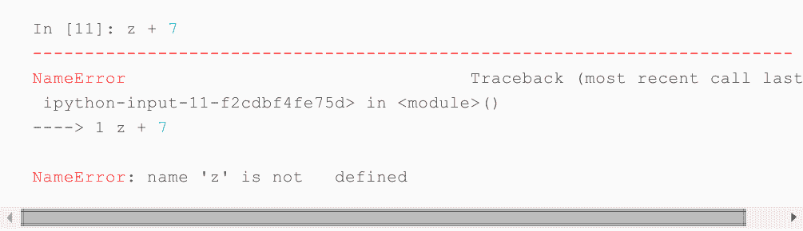

## 余数运算符

Python 的余数运算符 (%) 产生左操作数除以右操作数后的余数：

```
In [12]: 17 % 5
Out[12]: 2
```

在这里，17 除以 5 得到商 3 和余数 2。该运算符最常用于整数，但也可用于其他数值类型：

```
In [13]: 7.5 % 3.5
Out[13]: 0.5
```

## 直线形式

诸如

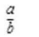

通常不被编译器或解释器接受。因此，必须使用 Python 的运算符将代数表达式键入为 **直线形式**。上述表达式必须写为 `a / b`（地板除则为 `a // b`），以便所有运算符和操作数都出现在一条水平直线上。

## 使用括号对表达式进行分组

括号对 Python 表达式进行分组，如同在代数表达式中一样。例如，以下代码将 `10` 乘以 `5 + 3`：

```
In [14]: 10 * (5 + 3)
Out[14]: 80
```

如果没有这些括号，结果则 _不同_：

```
In [15]: 10 * 5 + 3
Out[15]: 53
```

如果去掉括号后结果 _相同_，则括号是 **冗余** 的（不必要的）。

## 运算符优先级规则

Python 根据以下 **运算符优先级规则** 对算术表达式中的运算符进行求值。这些规则通常与代数中的相同：

- 1. 先对括号内的表达式求值，因此括号可以强制求值顺序按您希望的任何顺序进行。括号具有最高优先级。在带有 **嵌套括号** 的表达式中，例如 `(a / (b - c))`，先对 **最内层** 括号（即 `b - c`）内的表达式求值。
- 2. 接下来对幂运算求值。如果表达式包含多个幂运算，Python 从右向左应用它们。
- 3. 接下来对乘法、除法和取模运算求值。如果表达式包含多个乘法、真除法、地板除法和取模运算，Python 从左向右应用它们。乘法、除法和取模处于“相同的优先级”。
- 4. 最后对加法和减法运算求值。如果表达式包含多个加法和减法运算，Python 从左向右应用它们。加法和减法也具有相同的优先级。

有关运算符及其优先级（从低到高）的完整列表，请参阅

https://docs.python.org/3/reference/expressions.html#operator-precedence

## 运算符结合性

当我们说 Python 从左向右应用某些运算符时，指的是运算符的结合性。例如，在表达式中

```
a + b + c
```

加法运算符 (+) 从左向右结合，就好像我们将表达式括号化为 (a + b) + c 一样。所有优先级相同的 Python 运算符都从左向右结合，除了幂运算符 (**)，它从右向左结合。

## 冗余括号

可以使用冗余括号对子表达式进行分组，以使表达式更清晰。例如，二次多项式

```
y = a * x ** 2 + b * x + c
```

为了清晰起见，可以加上括号，如下所示

```
y = (a * (x ** 2)) + (b * x) + c
```

将复杂表达式拆分为一系列包含更短、更简单表达式的语句也有助于提高清晰度。

## 操作数类型

每个算术运算符都可用于整数和浮点数。如果两个操作数都是整数，结果为整数——真除法 (/) 运算符除外，它始终产生浮点数。如果两个操作数都是浮点数，结果为浮点数。包含整数和浮点数的表达式是混合类型表达式——这些表达式始终产生浮点结果。

## 2.4 print 函数及单引号和双引号字符串简介

内置的 print 函数将其参数显示为一行文本：

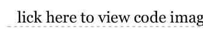

```
In [1]: print('Welcome to Python!')
Welcome to Python!
```

在这里，参数 'Welcome to Python!' 是一个字符串——用单引号 (') 包围的字符序列。与在交互模式下求值表达式不同，print 在这里显示的文本前面没有 Out[1]。此外，print 不显示字符串的引号，不过我们很快就会展示如何在字符串中显示引号。

您也可以将字符串用双引号 (") 包围，如下所示：

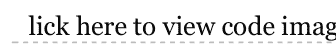

```
In [2]: print("Welcome to Python!")
Welcome to Python!
```

Python 程序员通常偏好使用单引号。当 print 完成任务时，它会将屏幕光标定位到下一行开头。

### 打印逗号分隔的项目列表

print 函数可以接收逗号分隔的参数列表，如下所示：

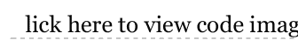

```
In [3]: print('Welcome', 'to', 'Python!')
Welcome to Python!
```

它以空格分隔每个参数，生成与前两个代码片段相同的输出。这里我们展示了一个字符串的逗号分隔列表，但值可以是任何类型。我们将在下一章展示如何防止值之间自动添加空格或使用不同于空格的分隔符。

### 用一条语句打印多行文本

当字符串中出现反斜杠 (\\) 时，它被称为 **转义字符**。反斜杠及其后紧跟的字符构成 **转义序列**。例如，\n 表示 **换行符** 转义序列，它告诉 `print` 将输出光标移动到下一行。以下代码片段使用三个换行符来创建多行输出：

```
In [4]: print('Welcome\nto\n\nPython!')
Welcome
to

Python!
```

### 其他转义序列

下表显示一些常见的转义序列。

| 转义序列 | 描述 |
|---|---|
| \n | 在字符串中插入换行符。显示字符串时，每遇到一个换行符，就将屏幕光标移动到下一行开头。 |
| \t | 插入水平制表符。显示字符串时，每遇到一个制表符，就将屏幕光标移动到下一个制表位。 |
| \\ | 在字符串中插入反斜杠字符。 |


| \" | 在字符串中插入双引号字符。 |
| \' | 在字符串中插入单引号字符。 |

## 忽略长字符串中的换行符

您还可以使用 \ 继续字符作为行的最后一个字符，将长字符串（或长语句）拆分为多行，以忽略换行符：

单击此处查看代码图像

```
In [5]: print('this is a longer string, so we \
    ....: split it over two lines')
this is a longer string, so we split it over two lines
```

解释器将字符串的各部分重新组装成一个没有换行符的单个字符串。尽管前面代码片段中的反斜杠字符位于字符串内部，但它不是转义字符，因为其后没有跟另一个字符。

## 打印表达式的值

可以在打印语句中执行计算：

单击此处查看代码图像

```
In [6]: print('Sum is', 7 + 3)
Sum is 10
```

## 2.5 三重引号字符串

此前，我们介绍了由一对单引号 (') 或一对双引号 (") 分隔的字符串。三重引号字符串以三个双引号 (""") 或三个单引号 (''') 开头和结尾。《Python 代码风格指南》推荐使用三个双引号 (""")。使用它们来创建：

- 多行字符串，
- 包含单引号或双引号的字符串，以及
- 文档字符串，这是记录某些程序组件用途的推荐方式。

### 在字符串中包含引号

在由单引号分隔的字符串中，可以包含双引号字符：

单击此处查看代码图像

```python
In [1]: print('Display "hi" in quotes')
Display "hi" in quotes
```

但不能包含单引号：

单击此处查看代码图像

```python
In [2]: print('Display 'hi' in quotes')
File "<ipython-input-2-19bf596ccf72>", line 1
print('Display 'hi' in quotes')
       ^
SyntaxError: invalid syntax
```

除非使用 \' 转义序列：

单击此处查看代码图像

```python
In [3]: print('Display \'hi\' in quotes')
Display 'hi' in quotes
```

代码片段 [2] 因在单引号字符串内包含单引号而显示语法错误。IPython 会显示导致语法错误的代码行信息，并用 ^ 符号指向错误位置。它还会显示消息 `SyntaxError: invalid syntax`。

由双引号分隔的字符串可以包含单引号字符：

单击此处查看代码图像

```
In [4]: print("Display the name O'Brien")
Display the name O'Brien
```

但不能包含双引号，除非使用 \" 转义序列：


```
In [5]: print("Display  \"hi\"  in quotes")
Display "hi" in quotes
```

为避免在字符串内使用 \' 和 \"，可以将此类字符串用三重引号括起来：


```
In [6]: print("""Display "hi" and 'bye' in quotes""")
Display "hi" and 'bye' in quotes
```

### 多行字符串

以下代码片段将一个多行三重引号字符串赋值给 triple_quoted_string：


```
In [7]: triple_quoted_string = """This   is a triple-quoted
... string that spans two   lines"""
```

IPython 知道该字符串不完整，因为我们在按 Enter 键之前没有输入结尾的 """。因此，IPython 会显示一个提示符 ... :，您可以在其中输入多行字符串的下一行。此过程将持续到您输入结尾的 """ 并按 Enter 键为止。以下显示 triple_quoted_string：


```
In [8]: print(triple_quoted_string)
This is a triple-quoted
string that spans two lines
```

Python 会将带有嵌入式换行符的多行字符串存储起来。当我们对 triple_quoted_string 求值而不是打印它时，IPython 会将其显示在单引号中，并在代码片段 [7] 中按 Enter 键的位置显示 \n 字符。IPython 显示的引号表示 triple_quoted_string 是一个字符串——它们不是字符串内容的一部分：

单击此处查看代码图像

```
In [9]: triple_quoted_string
Out[9]: 'This is a triple-quoted\nstring that spans two     lines'
```

## 2.6 从用户处获取输入

内置 input 函数请求并获取用户输入：

单击此处查看代码图像

```
In [1]: name = input("What's  your name? ")
What's your name? Paul

In [2]: name
Out[2]: 'Paul'

In [3]: print(name)
Paul
```

该代码片段的执行过程如下：

- 首先，input 会显示其字符串参数（即提示符），告诉用户要输入什么，并等待用户响应。我们输入了 Paul 并按下了 Enter。我们使用 **粗体** 文本来区分用户输入和 input 显示的提示符文本。

- 随后，input 函数将这些字符作为程序可使用的字符串返回。此处我们将该字符串赋值给变量 name。

代码片段 [2] 显示 name 的值。对 name 求值会将其值显示为单引号中的 'Paul'，因为它是一个字符串。打印 name（在代码片段 [3] 中）会在不带引号的情况下显示该字符串。如果您输入引号，它们也是字符串的一部分，如下所示：

单击此处查看代码图像

```
In [4]: name = input("What's  your name? ")
What's your name? 'Paul'
```

```
In [5]: name
Out[5]: "'Paul'"

In [6]: print(name)
'Paul'
```

### input 函数始终返回字符串

请考虑以下尝试读取两个数字并将它们相加的代码片段：

单击此处查看代码图像

```
In [7]: value1 = input('Enter first number: ')
Enter first number: 7

In [8]: value2 = input('Enter second number: ')
Enter second number: 3

In [9]: value1 + value2
Out[9]: '73'
```

Python 并未将整数 7 和 3 相加以得到 10，而是“添加”了字符串值 '7' 和 '3'，从而生成字符串 '73'。这被称为字符串连接。它会创建一个新字符串，其中包含左操作数的值，后跟右操作数的值。

### 从用户处获取整数

如果您需要整数，请使用内置 int 函数将字符串转换为整数：

单击此处查看代码图像

```
In [10]: value = input('Enter an integer: ')
Enter an integer: 7

In [11]: value = int(value)

In [12]: value
Out[12]: 7
```

我们本可以合并代码片段 [10] 和 [11] 中的代码：

单击此处查看代码图像

```
In [13]: another_value = int(input('Enter another integer: '))
Enter another integer: 13

In [14]: another_value
Out[14]: 13
```

现在，变量 value 和 another_value 包含整数。将它们相加会产生整数结果（而不是将它们连接起来）：

```
In [15]: value + another_value
Out[15]: 20
```

如果传递给 int 的字符串无法转换为整数，则会发生 ValueError：

单击此处查看代码图像

```
In [16]: bad_value = int(input('Enter another integer: '))
Enter another integer: hello
--------------------------------------------------------------------------------
ValueError                                 Traceback (most recent call last)
ipython-input-16-cd36e6cf8911> in <module>()
----> 1 bad_value = int(input('Enter another integer: '))

ValueError: invalid literal for int() with base 10: 'hello'
```

int 函数还可以将浮点值转换为整数：

```
In [17]: int(10.5)
Out[17]: 10
```

要将字符串转换为浮点数，请使用内置 float 函数。

## 2.7 决策：if 语句和比较运算符

条件是一个值为 True 或 False 的布尔表达式。以下示例判断 7 是否大于 4，以及 7 是否小于 4：

```
In [1]: 7 > 4
Out[1]: True
```

True 和 False 是 Python 关键字。将关键字用作标识符会导致 SyntaxError。True 和 False 的首字母均大写。

您通常会使用下表中的 **比较运算符** 来创建条件：

| 代数运算符 | Python 运算符 | 示例条件 | 含义 |
| :--- | :--- | :--- | :--- |
| > | > | x > y | x 大于 y |
| < | < | x < y | x 小于 y |
| ≥ | >= | x >= y | x 大于或等于 y |
| ≤ | <= | x <= y | x 小于或等于 y |
| = | == | x == y | x 等于 y |
| ≠ | != | x != y | x 不等于 y |

运算符 >、<、>= 和 <= 的优先级相同。运算符 == 和 != 的优先级也相同，且低于 >、<、>= 和 <= 的优先级。如果 ==、!=、>= 或 <= 中的符号对之间包含空格，则会发生语法错误：


点击此处查看代码图片

```
In [3]: 7 > = 4
File "<ipython-input-3-5c6e2897f3b3>", line 1
7 > = 4
^
SyntaxError: invalid syntax
```

如果将运算符 !、>= 和 <= 中的符号颠倒（即写成 =!、=> 和 =<），也会发生另一种语法错误。

## 使用 if 语句进行决策：介绍脚本

我们现在介绍一个简单的 if 语句版本，它使用条件来决定是否执行一条语句（或一组语句）。在这里，我们将从用户处读取两个整数，并使用六个连续的 if 语句对它们进行比较，每个比较运算符对应一个 if 语句。如果给定 if 语句中的条件为真，则执行相应的 print 语句；否则将其跳过。

IPython 交互模式有助于执行简短的代码片段并立即查看结果。当你有许多语句需要作为一组执行时，通常将它们作为脚本写入带有 .py（Python 的缩写）扩展名的文件中——例如，本示例脚本的 fig02_01.py。脚本也称为程序。有关查找和执行本书中脚本的说明，请参阅第 1 章的 IPython Test-Drive。

每次执行此脚本时，六个条件中有三个为真。为显示这一点，我们执行脚本三次——一次是第一个整数小于第二个，一次是两个整数值相同，一次是第一个整数大于第二个。三个示例执行出现在脚本之后。

每次我们介绍类似下面的脚本时，都会在图形之前对其进行介绍，然后在图形之后解释脚本的代码。为了您的方便，我们显示行号——这些行号不是 Python 的一部分。IDE 使您可以选择是否显示行号。要运行此示例，请切换到本章的 ch02 示例文件夹，然后输入：

```
ipython fig02_01.py
```

或者，如果您已经在 IPython 中，可以使用命令：

```
run fig02_01.py
```

点击此处查看代码图片

```
# fig02_01.py
"""Comparing integers using if statements and comparison operators."""
print('Enter two integers, and I will tell you',
      'the relationships they satisfy.')
# read first integer
number1 = int(input('Enter first integer: '))
# read second integer
number2 = int(input('Enter second integer: '))
if number1 == number2:
    print(number1, 'is equal to', number2)
if number1 != number2:
    print(number1, 'is not equal to', number2)
if number1 < number2:
    print(number1, 'is less than', number2)
if number1 > number2:
    print(number1, 'is greater than', number2)
if number1 <= number2:
    print(number1, 'is less than or equal to', number2)
if number1 >= number2:
    print(number1, 'is greater than or equal to', number2)
```

点击此处查看代码图片

输入两个整数，我会告诉你它们满足的关系。
输入第一个整数：37
输入第二个整数：42
37 不等于 42
37 小于 42
37 小于或等于 42

点击此处查看代码图片

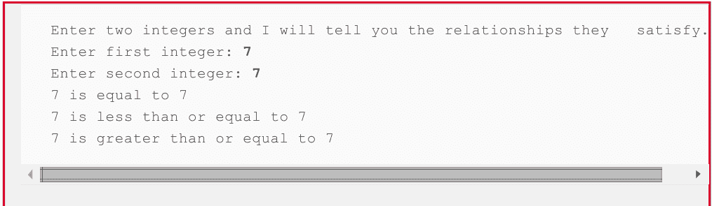

点击此处查看代码图片

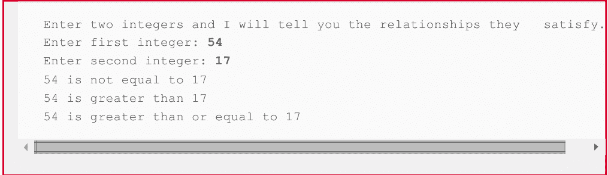

### 注释

第 1 行以井号字符（#）开头，表示该行的其余部分是注释：

```
# fig02_01.py
```

为方便参考，我们在每个脚本开头都以注释标明脚本的文件名。注释也可以从给定行代码的右侧开始，并持续到该行末尾。

### 文档字符串

Python 代码风格指南规定，每个脚本都应以文档字符串开头，说明脚本的目的，如第 2 行所示：

```
"""Comparing integers using if statements and comparison operators."""
```

对于更复杂的脚本，文档字符串通常跨越多行。在后续章节中，您将使用文档字符串来描述定义的脚本组件，例如新函数和称为类的新类型。我们还将讨论如何使用 IPython 帮助机制访问文档字符串。

### 空行

第 3 行是空行。您使用空行和空格字符使代码更易读。空行、空格字符和制表符统称为 **空白字符**。Python 忽略大部分空白字符——您会发现某些缩进是必需的。

### 将长语句拆分为多行

第 4–5 行

点击此处查看代码图片

```
print('Enter two integers, and I will tell you',
      'the relationships they satisfy.')
```

向用户显示说明。这些内容太长，无法放在一行上，因此我们将其拆分为两个字符串。请记住，您可以通过向 `print` 传递一个逗号分隔的列表来显示多个值—`print` 在每个值之间用空格分隔。

通常，您将语句写在一行上。您可以使用 `\` 续行字符将长语句分布在多行上。Python 还允许您在括号内拆分长代码行，而无需使用续行字符（如第 4–5 行所示）。根据 *Python 代码风格指南*，这是拆分长代码行的首选方式。始终选择有意义的断点，例如前一次对 `print` 的调用中逗号之后或长表达式中的运算符之前。

### 从用户处读取整数值

接下来，第 8 行和第 11 行使用内置的 `input` 和 `int` 函数提示并从用户处读取两个整数值。

### if 语句

第 13–14 行中的 `if` 语句

点击此处查看代码图片

```
if number1 == number2:
    print(number1, 'is equal to', number2)
```

使用 `==` 比较运算符来确定变量 `number1` 和 `number2` 的值是否相等。如果是，条件为 `True`，第 14 行将显示一行文本，指示值相等。如果其余 `if` 语句的任何条件为 `True`（第 16、19、22、25 和 28 行），相应的 `print` 将显示一行文本。

每个 `if` 语句由关键字 `if`、要测试的条件以及后跟缩进体（称为 **套件**）的冒号 (`:`) 组成。每个套件必须包含一条或多条语句。在条件后忘记冒号 (`:`) 是常见的语法错误。

### 套件缩进

Python 要求您缩进套件中的语句。_Python 代码风格指南_推荐使用四个空格的缩进——本书始终遵循此约定。您将在下一章中看到，错误的缩进可能会导致错误。

### 混淆 == 和 =

在 `if` 语句的条件中使用赋值符号 (=) 而不是相等运算符 (==) 是常见的语法错误。为帮助避免此问题，请将 == 读作“等于”，将 = 读作“赋值”。您将在下一章中看到，在赋值语句中用 == 替代 = 可能会导致微妙的问题。

### 链式比较

您可以链式比较以检查值是否在某个范围内。以下比较确定 `x` 是否在 1 到 5（包含两端）的范围内：

```
In [1]: x = 3

In [2]: 1 <= x <= 5
Out[2]: True

In [3]: x = 10

In [4]: 1 <= x <= 5
Out[4]: False
```

### 目前为止介绍的运算符的优先级

本章介绍的运算符优先级如下：

| 运算符 | 分组 | 类型 |
|---|---|---|

| 运算符 | 结合方向 | 描述 |
| :--- | :--- | :--- |
| `()` | 从左到右 | 括号 |
| `**` | 从右到左 | 指数运算 |
| `* / // %` | 从左到右 | 乘法、真除法、地板除法、余数 |
| `+ -` | 从左到右 | 加法、减法 |
| `> <= < >=` | 从左到右 | 小于、小于或等于、大于、大于或等于 |
| `== !=` | 从左到右 | 相等、不相等 |

该表按优先级从高到低列出了运算符。编写包含多个运算符的表达式时，请参考运算符优先级图表，确保它们按您预期的顺序求值，图表位于

https://docs.python.org/3/reference/expressions.html#operator-precedence

## 2.8 对象与动态类型

诸如 7（整数）、4.1（浮点数）和 'dog' 等值都是对象。每个对象都有一个类型和一个值：

```
In [1]: type(7)
Out[1]: int

In [2]: type(4.1)
```


Out[2]: float

In [3]: type('dog')
Out[3]: str

对象的值是存储在对象中的数据。上述代码片段显示了内置类型 int（用于整数）、float（用于浮点数）和 str（用于字符串）的对象。

## 变量引用对象

将对象赋值给变量会将该变量的名称绑定（关联）到该对象。如您所见，随后可以在代码中使用该变量来访问对象的值：

```
In [4]: x = 7

In [5]: x + 10
Out[5]: 17

In [6]: x
Out[6]: 7
```

代码片段 [4] 赋值后，变量 x 引用包含 7 的整数对象。如代码片段 [6] 所示，代码片段 [5] 不会更改 x 的值。您可以按以下方式更改 x：

```
In [7]: x = x + 10

In [8]: x
Out[8]: 17
```

## 动态类型

Python 使用动态类型——它在执行代码时确定变量引用的对象的类型。我们可以通过将变量 x 重新绑定到不同对象并检查其类型来演示这一点：

```
In [9]: type(x)
Out[9]: int

In [10]: x = 4.1

In [11]: type(x)
Out[11]: float
```

```
In [12]: x = 'dog'

In [13]: type(x)
Out[13]: str
```

## 垃圾回收

Python 在内存中创建对象，并在必要时将其从内存中移除。代码片段 [10] 之后，变量 `x` 现在引用一个 `float` 对象。代码片段 [7] 中的整数对象不再绑定到任何变量。如我们将在后续章节中讨论，Python 会自动将此类对象从内存中移除。这一过程——称为垃圾回收——有助于确保内存可用于您创建的新对象。

## 2.9 数据科学导论：基本描述性统计

在数据科学中，您经常会使用统计数据来描述和汇总数据。在此，我们首先介绍几项此类描述性统计，包括：

- 最小值——值集合中的最小值。
- 最大值——值集合中的最大值。
- 范围——从最小值到最大值的值的范围。
- 计数——集合中的值的数量。
- 求和——集合中值的总计。

我们将在下一章探讨如何确定 `count` 和 `sum`。**离散程度指标**（也称为*变异程度指标*），例如 *range*，有助于确定数值的分布程度。后续章节将介绍的其他离散程度指标包括 *variance* 和 *standard deviation*。

## 确定三个值中的最小值

首先，让我们展示如何手动确定三个值中的最小值。以下脚本提示并输入三个值，使用 `if` 语句确定最小值，然后显示它。

单击此处查看代码图像

```
1 # fig02_02.py
2 """Find the minimum of three values."""
3
4 number1 = int(input('Enter first integer: '))
5 number2 = int(input('Enter second integer: '))
6 number3 = int(input('Enter third integer: '))
7
8 minimum = number1
9
10 if number2 < minimum:
11     minimum = number2
12
13 if number3 < minimum:
14     minimum = number3
15
16 print('Minimum value is', minimum)
```

单击此处查看代码图像


单击此处查看代码图像


单击此处查看代码图像

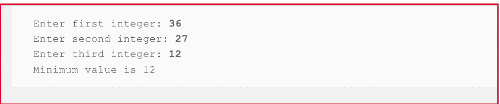

输入三个值后，我们逐个处理每个值：

- 首先，我们假设 number1 包含最小值，因此第 8 行将其分配给变量 minimum。当然，number2 或 number3 可能包含实际最小值，因此我们仍必须将这些值中的每一个与 `minimum` 进行比较。
- 第一个 `if` 语句（第 10–11 行）随后测试 `number2 < minimum`，如果此条件为 `True`，则将 `number2` 分配给 `minimum`。
- 第二个 `if` 语句（第 13–14 行）随后测试 `number3 < minimum`，如果此条件为 `True`，则将 `number3` 分配给 `minimum`。

现在，`minimum` 包含最小值，因此我们显示它。我们执行了三次脚本，以表明它始终能找到最小值，无论用户是首先、其次还是第三次输入它。

## 使用内置函数 `min` 和 `max` 确定最小值和最大值

Python 拥有许多用于执行常见任务的内置函数。内置函数 `min` 和 `max` 分别计算值集合的最小值和最大值：

```
In [1]: min(36, 27, 12)
Out[1]: 12

In [2]: max(36, 27, 12)
Out[2]: 36
```

函数 `min` 和 `max` 可以接收任意数量的参数。

## 确定值集合的范围

值的 *range* 简单来说就是从最小值到最大值。在此例中，范围是 12 到 36。大部分数据科学工作致力于了解您的数据。描述性统计是其中至关重要的一部分，但您也必须理解如何解释统计数据。例如，如果您有 100 个数字，其范围是 12 到 36，这些数字可能均匀分布在该范围内。在另一极端，您可能会出现聚集情况，即 99 个值为 12 且 1 个值为 36，或 1 个值为 12 且 99 个值为 36。

## 函数式编程：归约

贯穿本书，我们将介绍各种 *函数式编程* 功能。这些功能使您能够编写更简洁、更清晰且更易于 **调试**（即查找和纠正错误）的代码。`min` 和 `max` 函数是函数式编程中称为 **归约** 的概念的示例。它们将值集合归约为 *单个值*。您将看到的其他归约包括值集合的求和、平均值、方差和标准差。您还将看到如何定义自定义归约。

## 即将推出的数据科学导论章节

在接下来的两章中，我们将继续讨论基本描述性统计，包括 *集中趋势指标*（*mean*、*median* 和 *mode*）以及 *离散程度指标*（*variance* 和 *standard deviation*）。

## 2.10 总结

本章延续了我们对算术的讨论。您使用变量存储值以供后续使用。我们介绍了 Python 的算术运算符，并表明必须以直线形式编写所有表达式。您使用内置函数 `print` 显示数据。我们创建了单引号、双引号和三引号字符串。您使用三引号字符串创建多行字符串，并在字符串中嵌入单引号或双引号。

您使用 `input` 函数提示并从键盘获取用户输入。我们使用函数 `int` 和 `float` 将字符串转换为数值。我们介绍了 Python 的比较运算符。随后，您在一个脚本中使用了它们，该脚本从用户处读取两个整数，并使用一系列 `if` 语句比较它们的值。

我们讨论了 Python 的动态类型，并使用内置函数 `type` 显示对象的类型。最后，我们介绍了基本描述性统计中的最小值和最大值，并使用它们计算值集合的范围。在下一章中，我们将介绍 Python 的控制语句。

## 3. 控制语句

## 目标

在本章中，您将：

- 使用 `if`、`if else` 和 `if elif else` 做出决策。
- 使用 `while` 和 `for` 重复执行语句。
- 使用增量赋值缩短赋值表达式。
- 使用 `for` 语句和内置 `range` 函数对值序列重复执行操作。
- 使用 `while` 执行哨兵控制的迭代。
- 使用布尔运算符 `and`、`or` 和 `not` 创建复合条件。
- 使用 `break` 停止循环。
- 使用 `continue` 强制执行循环的下一次迭代。
- 使用函数式编程功能编写更简洁、更清晰、更易于调试且更易于并行化的脚本。

## 大纲


- .5 while 语句
- .6 for 语句
- .6.1 可迭代对象、列表和迭代器
- .6.2 内置 range 函数
- .7 增量赋值
- .8 序列控制的迭代；格式化字符串
- .9 哨兵控制的迭代
- .10 内置函数 range：深入探讨
- .11 使用 Decimal 类型处理货币金额
- .12 break 和 continue 语句
- .13 布尔运算符 and、or 和 not
- .14 数据科学导论：集中趋势指标——平均值、中位数和众数
- .15 总结

## 3.1 简介

在本章中，我们将介绍 Python 的控制语句——if、if else、if elif else、while、for、break 和 continue。您将使用 for 语句执行序列控制的迭代——您将看到序列中的项目数量决定 for 语句的迭代次数。您将使用内置函数 range 生成整数序列。

我们将使用 while 语句展示哨兵控制的迭代。您将使用 Python 标准库的 Decimal 类型进行精确的货币计算。我们将使用各种格式说明符在 f-strings（即格式化字符串）中格式化数据。我们还将展示布尔运算符 and、or 和 not 以创建复合条件。在数据科学导论部分，我们将使用 Python 标准库的 statistics 模块考察集中趋势指标——平均值、中位数和众数。


## 3.2 控制语句

Python 提供三种选择语句，根据求值为 `True` 或 `False` 的条件来执行代码：

- `if` 语句在条件为 `True` 时执行一个动作，或在条件为 `False` 时跳过该动作。
- `if...else` 语句在条件为 `True` 时执行一个动作，或在条件为 `False` 时执行 `不同` 的动作。
- `if...elif...else` 语句根据 `多个` 条件的真假，执行许多不同动作中的一个。

任何可以放置单个动作的地方，都可以放置一组动作。

Python 提供两种 **迭代语句**—`while` 和 `for`：

- `while` 语句在条件保持 `True` 时重复执行一个动作（或一组动作）。
- `for` 语句为序列中的每个项目重复执行一个动作（或一组动作）。

### 关键字

单词 `if`、`elif`、`else`、`while`、`for`、`True` 和 `False` 是 Python 关键字。将关键字用作标识符（如变量名）是语法错误。下表列出了 Python 的关键字。

| Python 关键字 |
|---|
| `and` | `as` | `assert` | `async` | `await` |
| `break` | `class` | `continue` | `def` | `del` |
| `elif` | `else` | `except` | `False` | `finally` |
| `for` | `from` | `global` | `if` | `import` |
| `in` | `is` | `lambda` | `None` | `nonlocal` |
| `not` | `or` | `pass` | `raise` | `return` |
| `True` | `try` | `while` | `with` | `yield` |

### 3.3 IF 语句

让我们执行一个 Python if 语句：

单击此处查看代码图像

```
In [1]: grade = 85
In [2]: if grade >= 60:
    ...:     print('Passed')
    ...:
Passed
```

条件 `grade >= 60` 为 True，因此 if 的套件中的缩进 print 语句显示 'Passed'。

### 套件缩进

缩进套件是必需的；否则，会发生 IndentationError 语法错误：

单击此处查看代码图像

```
In [3]: if grade >= 60:
    ...: print('Passed') # statement is not indented properly
File "<ipython-input-3-f42783904220>", line 2
print('Passed') # statement is not indented properly
```

```
IndentationError: expected   an indented block
```

如果在套件中有多个语句且这些语句没有 `相同` 的缩进，也会发生 `IndentationError`：

单击此处查看代码图像

```
In [4]: if grade >= 60:
    ....:     print('Passed')   # indented 4 spaces
    ....:     print('Good job!')  # incorrectly indented only two spaces
File <ipython-input-4-8c0d075c127bf>, line 3
    print('Good job!')   # incorrectly indented only two spaces
    ^
IndentationError: unindent does not match any outer indentation level
```

有时错误消息可能不够清晰。Python 引起对行的注意通常足以让你找出问题所在。在代码中统一应用缩进惯例——缩进不统一的程序难以阅读。

### 每个表达式都可以解释为 True 或 False

你可以基于 *任何* 表达式做出决策。非零值为 `True`。零为 `False`：

单击此处查看代码图像

```
In [5]: if 1:
    ....:     print('Nonzero values are   true, so this will print')
    ....:
Nonzero values are true, so this will print

In [6]: if 0:
    ....:     print('Zero is false, so this will not print')

In [7]:
```

包含字符的字符串为 `True`，空字符串（`''`、`""` 或 `"""`）为 `False`。

### 混淆 `==` 和 `=`

在赋值语句中使用相等运算符 `==` 而不是 `=` 可能会导致微妙的问题。例如，在此会话中，片段 [1] 使用赋值定义了 `grade`：

```
grade = 85
```

如果我们不小心写成：

```
grade == 85
```

那么 grade 将未定义，我们会得到 NameError。如果 grade 在前面的语句之前已定义，那么 grade == 85 只会求值为 True 或 False，而不会执行赋值。这是一个逻辑错误。

### 3.4 IF ELSE 和 IF ELIF ELSE 语句

if else 语句根据条件是 True 还是 False 执行不同的套件：

单击此处查看代码图像

```
In [1]: grade = 85

In [2]: if grade >= 60:
    ....:     print('Passed')
    ....: else:
    ....:     print('Failed')
    ....:

Passed
```

上面的条件为 True，因此 if 套件显示 ' Passed'。请注意，在键入 print(' Passed' ) 后按 Enter 时，IPython 会将下一行缩进四个空格。你必须删除这四个空格，以便 else : 套件正确对齐在 if 的 i 下方。

以下代码将 57 赋给变量 grade，然后再次显示 if else 语句，以演示当条件为 False 时仅执行 else 套件：

单击此处查看代码图像

```
In [3]: grade = 57
```

```
In [4]: if grade >= 60:
    ...     print('Passed')
    ... else:
    ...     print('Failed')
    ...
Failed
```

使用上下箭头键在当前交互会话的片段之间向后和向前导航。按 Enter 会重新执行显示的片段。让我们将 grade 设置为 99，按两次上箭头键以调用片段 [4] 中的代码，然后按 Enter 将该代码重新执行为片段 [6]。每次执行调用的片段都会获得新 ID：

单击此处查看代码图像

```
In [5]: grade = 99

In [6]: if grade >= 60:
    ...     print('Passed')
    ... else:
    ...     print('Failed')
    ...
Passed
```

### 条件表达式

有时 if else 语句中的套件会根据条件给变量赋予不同值，如：

单击此处查看代码图像

```
In [7]: grade = 87

In [8]: if grade >= 60:
    ...     result = 'Passed'
    ... else:
    ...     result = 'Failed'
    ...
```

然后我们可以打印或求值该变量：

```
In [9]: result
Out[9]: 'Passed'
```

你可以使用简洁的 **条件表达式** 编写类似片段 [8] 的语句：

单击此处查看代码图像

```
In [10]: result = ('Passed' if grade >= 60 else 'Failed')

In [11]: result
Out[11]: 'Passed'
```

括号不是必需的，但它们清楚地表明该语句将条件表达式的值赋给 `result`。首先，Python 求值条件 `grade >= 60`：

- 如果为 `True`，片段 [10] 将 `if` 左侧表达式的值（即 `'Passed'`）赋给 `result`。`else` 部分不执行。
- 如果为 `False`，片段 [10] 将 `else` 右侧表达式的值（即 `'Failed'`）赋给 `result`。

在交互模式中，你也可以直接求值条件表达式，如：

单击此处查看代码图像

```
In [12]: 'Passed' if grade >= 60 else 'Failed'
Out[12]: 'Passed'
```

### 套件中的多个语句

以下代码显示 `if... else` 语句的 `else` 套件中的两个语句：

单击此处查看代码图像

```
In [13]: grade = 49

In [14]: if grade >= 60:
    ...:     print('Passed')
    ...: else:
    ...:     print('Failed')
    ...:     print('You must take  this course again')
    ...:
Failed
You must take this course again
```

在此例中，`grade` 小于 60，因此 `else` 套件中的 `两个` 语句均执行。

如果不缩进第二个 `print`，则它不在 `else` 的套件中。因此，该语句 `始终` 执行，可能会产生奇怪的错误输出：

单击此处查看代码图像

```
In [15]: grade = 100

In [16]: if grade >= 60:
    ...:     print('Passed')
    ...: else:
    ...:     print('Failed')
    ...:     print('You must take this course again')
    ...:

Passed
You must take this course again
```

### if...elif...else 语句

你可以使用 `if...elif...else 语句` 测试多种情况。以下代码对大于或等于 90 的成绩显示 "A"，对 80–89 范围内的成绩显示 "B"，对 70–79 的成绩显示 "C"，对 60–69 的成绩显示 "D"，对所有其他成绩显示 "F"。仅执行 *第一个 True* 条件的操作。片段 [18] 显示 C，因为 `grade` 是 77：

```
In [17]: grade = 77

In [18]: if grade >= 90:
    ...:     print('A')
    ...: elif grade >= 80:
    ...:     print('B')
    ...: elif grade >= 70:
    ...:     print('C')
    ...: elif grade >= 60:
    ...:     print('D')
    ...: else:
    ...:     print('F')
    ...:

C
```

第一个条件—`grade >= 90`—为 `False`，因此跳过 `print ('A')`。第二个条件—`grade >= 80`—也为 `False`，因此跳过 `print ('B')`。第三个条件—`grade >= 70`—为 `True`，因此执行 `print ('C')`。然后所有剩余的


if... elif... else 语句中的代码会被跳过。if... elif... else 比单独的 if 语句更快，因为条件测试一旦条件为 True 就会停止。

### else 是可选的

if... elif... else 语句中的 else 是可选的。包含它可以让你处理不满足任何条件的值。当不带 else 的 if... elif 语句测试一个使其任何条件都不为 True 的值时，程序不会执行该语句的任何代码块——if... elif... 语句后顺序中的下一条语句会执行。如果你指定 else，必须将其放在最后一个 elif 之后；否则会发生 SyntaxError。

### 逻辑错误

代码片段 [16] 中缩进错误的代码段是非致命逻辑错误的示例。代码会执行，但会产生错误的结果。对于脚本中的致命逻辑错误，会发生异常（例如，尝试除以 0 引起的 ZeroDivisionError），因此 Python 会显示回溯，然后终止脚本。交互模式下的致命错误仅终止当前代码片段——随后 IPython 等待您的下一个输入。

## 3.5 WHILE 语句

while 语句允许您在条件保持为 True 时重复执行一个或多个操作。让我们使用 while 语句来查找大于 50 的第一个 3 的幂：

点击此处查看代码图像

```
In [1]: product = 3

In [2]: while product <= 50:
    ...:     product = product * 3
    ...:

In [3]: product
Out[3]: 81
```

代码片段 [3] 对 product 求值以查看其值 81，这是大于 50 的第一个 3 的幂。

while 语句的代码块中必须有某处改变 product 的值，使条件最终变为 `False`。否则，会发生无限循环。在从 Terminal、Anaconda Command Prompt 或 shell 执行的应用程序中，键入 `Ctrl` + `c` 或 `control` + `c` 来终止无限循环。IDE 通常提供工具栏按钮或菜单选项来停止程序执行。

## 3.6 FOR 语句

**for** 语句允许您对**序列**中的每个项重复执行一个或多个操作。例如，字符串是单个字符的序列。让我们显示 'Programming'，其字符之间用两个空格分隔：

点击此处查看代码图像

```
In [1]: for character in 'Programming':
    ...:     print(character, end=' ')
    ...:
P   r   o   g   r   a   m   m   i   n   g
```

**for** 语句的执行过程如下：

- 进入该语句时，它将 'Programming' 中的 'P' 赋给关键字 `for` 和 `in` 之间的**目标**变量——在此例中为 `character`。
- 接下来，代码块中的语句执行，显示 `character` 的值，后跟两个空格——我们稍后会详细说明这一点。
- 执行代码块后，Python 将序列中的下一项（即 'Programming' 中的 'r'）赋给 `character`，然后再次执行代码块。
- 只要序列中还有要处理的项，此过程就会继续。在此例中，语句在显示字母 'g' 后终止，后跟两个空格。

在代码块中使用目标变量（如我们在此所示以显示其值）很常见，但不是必需的。

### print 函数的 end 关键字参数

内置函数 **print** 会显示其参数，然后将光标移到下一行。您可以使用参数 **end** 更改此行为，如下所示

```
print(character, end=' ')
```

这会显示 `character` 的值，后跟两个空格。因此，所有字符都会水平显示在*同一*行上。Python 将 `end` 称为**关键字参数**，但 `end` 本身不是 Python 关键字。关键字参数有时也被称为**命名参数**。`end` 关键字参数是可选的。如果不包含它，`print` 默认使用换行符（`'\n'`）。*Python 代码风格指南* 建议在关键字参数的 = 两侧不要放置空格。

### print 函数的 sep 关键字参数

您可以使用关键字参数 `sep`（separator 的缩写）来指定 `print` 显示的项目之间出现的字符串。*之间* 需要斜体。当不指定此参数时，`print` 默认使用空格字符。让我们显示三个数字，每个数字与下一个数字之间用逗号和空格分隔，而不是仅用空格：

点击此处查看代码图像

```
In [2]: print(10, 20, 30, sep=', ')
10, 20, 30
```

要移除默认空格，请使用 `sep=''`（即空字符串）。

### 3.6.1 可迭代对象、列表和迭代器

`for` 语句的 `in` 关键字右侧的序列必须是一个**可迭代对象**——即 `for` 语句可以一次取一个项目、直至无更多项目的对象。Python 除了字符串之外还有其他可迭代序列类型。最常见的一种是**列表**，即用方括号（`[` 和 `]`）括起来的逗号分隔的项目集合。以下代码对列表中的五个整数求和：

点击此处查看代码图像

```
In [3]: total = 0

In [4]: for number in [2, -3, 0, 17, 9]:
    ...:     total = total + number
    ...:

In [5]: total
Out[5]: 25
```

每个序列都有一个**迭代器**。`for` 语句在“幕后”使用迭代器来获取每个连续项目，直至无更多项目可处理。迭代器就像一个书签——它始终知道自己在序列中的位置，因此在被调用时可以返回下一项。我们将在“序列：列表和元组”章节中详细介绍列表。在那里，您将了解列表中项目的顺序很重要，并且列表的项目是**可变**的（即可修改）。

### 3.6.2 内置 range 函数

让我们使用 `for` 语句和内置 **range 函数** 精确迭代 10 次，显示从 0 到 9 的值：

点击此处查看代码图像

```
In [6]: for counter in range(10) :
   ...:     print(counter, end=' ')
   ...:
0 1 2 3 4 5 6 7 8 9
```

函数调用 `range(10)` 会创建一个可迭代对象，表示从 0 开始、一直到但**不包括**参数值（10）的连续整数序列——在此例中为 0、1、2、3、4、5、6、7、8、9。当 `for` 语句处理完 `range` 生成的最后一个整数时，它就会退出。迭代器和可迭代对象是 Python 的**函数式编程**特性中的两项。我们将在全书中介绍更多此类特性。

### 越界错误（Off-By-One Errors）

一种常见的越界错误是假设 `range` 的参数值包含在生成的序列中。例如，如果您在尝试生成 0 到 9 的序列时将 9 作为 `range` 的参数，`range` 只会生成 0 到 8。

## 3.7 增量赋值

**增量赋值** 缩写了赋值表达式，其中同一个变量名出现在赋值号 = 的左侧和右侧，如下面 `total` 所示：

点击此处查看代码图像

```
for number in [1, 2, 3, 4, 5]:
    total = total + number
```

代码片段 [2] 使用**加法增量赋值（+=）**语句重新实现了这一点：

点击此处查看代码图像

```
In [1]: total = 0

In [2]: for number in [1, 2, 3, 4, 5]:
    ....:     total += number # add number to total
    ....:

In [3]: total
Out[3]: 15
```

代码片段 [2] 中的 `+=` 表达式首先将 `number` 的值加到当前 `total` 上，然后将新值存储在 `total` 中。下表显示了增量赋值的示例：

| 增量赋值 | 示例表达式 | 说明 | 赋值 |
|---|---|---|---|
| *假设：c = 3, d = 5, e = 4, f = 2, g = 9, h = 12* | | | |
| `+=` | `c += 7` | `c = c + 7` | `10 赋给 c` |
| `-=` | `d -= 4` | `d = d - 4` | `1 赋给 d` |
| `*=` | `e *= 5` | `e = e * 5` | `20 赋给 e` |
| `**=` | `f **= 3` | `f = f ** 3` | `8 赋给 f` |
| `/=` | `g /= 2` | `g = g / 2` | `4.5 赋给 g` |
| `//=` | `g //= 2` | `g = g // 2` | `4 赋给 g` |
| `%=` | `h %= 9` | `h = h % 9` | `3 赋给 h` |

## 3.8 序列控制迭代；格式化字符串

本节和下一节解决两个班级平均分问题。请考虑以下需求说明：

十个学生的一个班参加了测验。他们的成绩（0 – 100 范围内的整数）为 98、76、71、87、83、90、57、79、82、94。确定测验的班级平均分。

解决此问题的以下脚本保持成绩的运行总计，计算平均值并显示结果。我们将 10 个成绩放在一个列表中，但您可以从键盘输入成绩（如我们将在下一个示例中所做）或从文件读取它们（如您将在“文件和异常”章节中看到如何操作）。我们将在第 16 章中展示如何从 SQL 和 NoSQL 数据库读取数据。

点击此处查看代码图像

```
# class_average.py
"""Class average program with sequence-controlled iteration."""
# initialization phase
total = 0 # sum of grades
grade_counter = 0
grades = [98, 76, 71, 87, 83, 90, 57, 79, 82, 94] # list of 10 grades
# processing phase
for grade in grades:
    total += grade # add current grade to the running total
    grade_counter += 1 # indicate that one more grade was processed
# termination phase
average = total / grade_counter
print(f'Class average is {average}')
```


单击此处查看代码图像

```
Class average is 81.7
```

第 5–6 行创建变量 `total` 和 `grade_counter`，并将它们各自初始化为 0。
第 7 行

单击此处查看代码图像

```
grades = [98, 76, 71, 87, 83, 90, 57, 79, 82, 94] # list of 10 grades
```

此代码创建变量 `grades`，并用包含 10 个整数成绩的列表对其进行初始化。

`for` 语句处理列表 `grades` 中的每个 `grade`。第 11 行将当前 `grade` 加到 `total` 上。然后，第 12 行将 `1` 加到变量 `grade_counter` 上，以跟踪至今已处理的成绩数量。当列表中所有 10 个成绩都被处理时，迭代终止。*Python 代码风格指南*建议在每个控制语句上下各放置一个空行（如第 8 行和第 13 行所示）。当 `for` 语句终止时，第 15 行计算平均值，第 16 行显示它。本章稍后，我们将使用函数式编程风格来更简洁地计算列表项目的平均值。

## 格式化字符串简介

第 16 行使用以下简单 f-string（**格式化字符串**的缩写），通过将 `average` 的值插入字符串来格式化此脚本的结果：

单击此处查看代码图像

```
f'Class average is {average}'
```

字符串开头引号前的字母 `f` 表示它是一个 f-string。你通过使用由花括号（`{` 和 `}`）界定的 *占位符* 来指定插入值的位置。占位符

```
{average}
```

将变量 `average` 的值转换为字符串表示形式，然后用该 **替换文本** 替换 {average}。替换文本表达式可能包含值、变量或其他表达式，例如计算或函数调用。在第 16 行，我们本可以使用 `total / grade_counter` 代替 `average`，从而消除对第 15 行的需求。

## 3.9 哨兵控制迭代

让我们概括一下班级平均分问题。考虑以下需求声明：

> 开发一个班级平均分程序，每次程序执行时处理任意数量的成绩。

需求声明没有说明成绩是什么或有多少个，因此我们将让用户输入成绩。程序每次处理任意数量的成绩。用户一次输入一个成绩，直到所有成绩都已输入，然后输入一个 *哨兵值*（也称为 *信号值*、*哑值* 或 *标志值*）以指示没有更多成绩。

### 实现哨兵控制迭代

以下脚本使用哨兵控制迭代解决了班级平均分问题。请注意，我们测试了除以零的可能性。如果未被检测到，这将导致致命的逻辑错误。在“文件和异常”章节中，我们将编写能识别此类异常并采取适当措施的程序。

单击此处查看代码图像

```
1 # class_average_sentinel.py
2 """Class average program with sentinel-controlled iteration."""
3
4 # initialization phase
5 total = 0 # sum of grades
6 grade_counter = 0 # number of grades entered
7
8 # processing phase
9 grade = int(input('Enter grade, -1 to end: ')) # get one grade
10
11 while grade != -1:
12     total += grade
13     grade_counter += 1
14     grade = int(input('Enter grade, -1 to end: '))
15
16 # termination phase
17 if grade_counter != 0:
18     average = total / grade_counter
19     print(f'Class average is {average:.2f}')
20 else:
21     print('No grades were entered')
```

单击此处查看代码图像

```
Enter grade, -1 to end: 97
Enter grade, -1 to end: 88
Enter grade, -1 to end: 72
Enter grade, -1 to end: -1
Class average is 85.67
```

### 哨兵控制迭代的程序逻辑

在哨兵控制迭代中，程序在到达 while 语句之前先读取第一个值（第 9 行）。第 9 行输入的值决定程序的控制流是否应进入 while 的代码块（第 12–14 行）。如果第 11 行中的条件为 False，则用户输入了哨兵值（-1），因此代码块不会执行，因为用户没有输入任何成绩。如果条件为 True，则代码块执行，将成绩值添加到总计中并递增 grade_counter。

接下来，第 14 行从用户处再次输入一个成绩，并再次测试条件（第 11 行），使用用户输入的最近成绩。grade 的值始终在程序测试 while 条件之前立即输入，因此我们可以在将刚输入的值作为成绩进行处理之前，确定该值是否为哨兵值。

当输入哨兵值时，循环终止，程序不会将 -1 添加到 total 中。在执行用户输入的哨兵控制循环中，任何提示（第 9 行和第 14 行）都应提醒用户哨兵值。

### 用两位小数格式化班级平均分

本示例将班级平均数格式化为小数点右侧两位数字。在 f-string 中，你可以选择在替换文本表达式后跟随一个冒号（:）和一个格式说明符，用于描述如何格式化替换文本。格式说明符 .2f（第 19 行）将平均数格式化为带小数点右侧两位数字（.2）的浮点数（f）。在本示例中，成绩总和为 257，除以 3 得到 85.66666666.... 使用 .2f 格式化平均数将其四舍五入到百分位，生成替换文本 85.67。如果平均数小数点右侧只有一位数字，则会使用 **尾随零**（例如，85.50）进行格式化。“字符串：深入探讨”章节讨论了更多字符串格式化功能。

## 3.10 内置函数 range：深入探讨

函数 `range` 也有两个和三个参数的版本。正如你所见，`range` 的一个参数版本生成从 0 开始到但不包括参数值的连续整数序列。函数 `range` 的两个参数版本生成从其第一个参数值开始到但不包括第二个参数值的连续整数序列，如下所示：

单击此处查看代码图像

```
In [1]: for number in range(5, 10):
    ...:     print(number, end=' ')
    ...:
5 6 7 8 9
```

函数 `range` 的三个参数版本生成从其第一个参数值开始到但不包括第二个参数值的整数序列，按第三个参数值 *递增*，该值称为 **步长**：

单击此处查看代码图像

```
In [2]: for number in range(0, 10, 2):
    ...:     print(number, end=' ')
    ...:
0 2 4 6 8
```

如果第三个参数为负数，序列将从第一个参数值 *向下* 到但不包括第二个参数值，按第三个参数值 *递减*，如下所示：

单击此处查看代码图像

```
In [3]: for number in range(10, 0, -2):
    ...:     print(number, end=' ')
    ...:
10 8 6 4 2
```

## 3.11 对金额使用 Decimal 类型

在本节中，我们介绍用于精确金额计算的 Decimal 功能。如果你从事银行或其他需要“精确到分”的领域，你应该深入探究 Decimal 的功能。

对于大多数使用带小数点数字的科学和其他数学应用程序，Python 的内置浮点数效果很好。例如，当我们说“正常”体温为 98.6 时，我们不需要精确到大量位数。当我们在温度计上查看温度并读取为 98.6 时，实际值可能是 98.5999473210643。这里的要点是，将这个数字称为 98.6 对大多数体温应用程序来说已足够。

浮点值以二进制格式存储（我们在第一章中介绍了二进制，并在在线“数字系统”附录中深入讨论）。有些浮点值在转换为二进制时只能近似表示。例如，考虑带有美元和美分值 112.31 的变量 amount。如果显示 amount，它看起来具有你分配给它的精确值：

```
In [1]: amount = 112.31

In [2]: print(amount)
112.31
```

但是，如果你以小数点右侧 20 位的精度打印 amount，你可以看到内存中的实际浮点值不完全是 112.31——它只是一个近似值：

单击此处查看代码图像

```
In [3]: print(f'{amount:.20f}')
112.31000000000000227374
```

许多应用程序需要对带小数点数字进行精确表示。像银行这样每天处理数百万甚至数十亿笔交易的机构，必须将其交易“精确到分”进行核对。浮点数可以表示某些但并非所有金额，无法达到精确到分的精度。

Python 标准库 1 提供了许多可在 Python 代码中使用的预定义功能，以避免“重复造轮子”。对于金额计算和其他需要精确表示和操作数字的应用程序


带有小数点时，Python 标准库提供了类型 `Decimal`，它使用一种特殊的编码方案来解决精确到分的精度问题。该方案需要额外内存来存储数字，并需要额外处理时间来执行计算，但能提供货币计算所需的精度。银行在计算账户每日利息时还需要处理其他问题，例如使用 *公平舍入算法*。类型 `Decimal` 提供了此类功能。²

¹ `https://docs.python.org/3.7/library/index.html.`

² 要了解更多 `decimal` 模块功能，请访问 `https://docs.python.org/3.7/library/decimal.html.`

## 从 decimal 模块导入类型 Decimal

我们已经使用过几种 *内置类型*——`int`（用于整数，如 10），`float`（用于浮点数，如 7.5）和 `str`（用于字符串，如 'Python '）。`Decimal` 类型不是 Python 内置的。相反，它是 Python 标准库的一部分，该标准库分为称为 **模块** 的相关功能组。`decimal` 模块定义了类型 `Decimal` 及其功能。

要使用类型 `Decimal`，必须首先 *导入* 整个 `decimal` 模块，如下所示

```
import decimal
```

并将 `Decimal` 类型称为 `decimal.Decimal`，或者必须使用 *from import* 指示要导入的特定功能，如我们在此处所示：

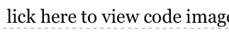

```
In [4]: from decimal import Decimal
```

这 *仅导入* 来自 `decimal` 模块的类型 `Decimal`，以便您可以在代码中使用它。我们将从下一章开始讨论其他 *导入* 形式。

## 创建 Decimals

您通常从字符串创建一个 `Decimal`：

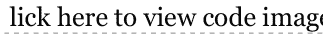

```
In [5]: principal = Decimal('1000.00')

In [6]: principal
Out[6]: Decimal('1000.00')

In [7]: rate = Decimal('0.05')

In [8]: rate
Out[8]: Decimal('0.05')
```

我们很快将在这些变量 principal 和 rate 上进行复利计算。

## Decimal 运算

Decimals 支持标准算术运算符 +、-、*、/、//、** 和 %，以及相应的复合赋值运算符：

```
In [9]: x = Decimal('10.5')

In [10]: y = Decimal('2')

In [11]: x + y
Out[11]: Decimal('12.5')

In [12]: x // y
Out[12]: Decimal('5')

In [13]: x += y

In [14]: x
Out[14]: Decimal('12.5')
```

您可以在 Decimals 和整数之间进行算术运算，但不能在 Decimals 和浮点数之间进行算术运算。

## 复利问题需求说明

让我们使用 Decimal 类型计算复利，以进行精确的货币计算。请考虑以下需求说明：

某人将 1000 美元投资于年利率为 5% 的储蓄账户。假设该人将所有利息都留在账户中，请计算并显示 10 年末每年末账户中的资金数额。请使用以下公式确定这些金额：

a = p(1 + r)^n

其中

p 是最初投资的金额（即本金），

r 是年利率，

n 是年数，且

a 是第 n 年末的存款金额。

## 计算复利

要解决此问题，让我们使用在代码段 [5] 和 [7] 中定义的变量 `principal` 和 `rate`，以及一个 `for` 语句，该语句对资金存放的每个 10 年进行利息计算。对于每个 `year`，循环都会显示一个包含年份数和该年末 `amount` 存款金额的格式化字符串：

点击此处查看代码图像

```
In [15]: for year in range(1, 11):
    ...:     amount = principal * (1 + rate) ** year
    ...:     print(f'{year:>2}{amount:>10.2f}')
    ...:
1   1050.00
2   1102.50
3   1157.62
4   1215.51
5   1276.28
6   1340.10
7   1407.10
8   1477.46
9   1551.33
10  1628.89
```

需求说明中的代数表达式 (1 + r)^n 写作

```
(1 + rate) ** year
```

其中变量 `rate` 表示 `r`，变量 `year` 表示 `n`。

## 格式化年份和存款金额

### 语句

点击此处查看代码图像

```
print(f'{year:>2} {amount:>10.2f}')
```

它使用带有两个占位符的 f 字符串来格式化循环的输出。

### 占位符

```
{year:>2}
```

它使用格式说明符 >2 来指示 year 的值应在宽度为 2 的字段中 **右对齐 (>)** —— **字段宽度** 指定显示值时要使用的字符位置数。对于一位数的年份值 1–9，格式说明符 >2 显示一个空格字符后跟该值，从而在第一列中右对齐年份。下图显示了数字 1 和 10 都以宽度为 2 的字段格式化：


您可以使用 < 将值 **左对齐**。

### 占位符中的格式说明符 10.2f

```
{amount:>10.2f}
```

它将 amount 格式化为浮点数 (f)，在宽度为 10 的字段中右对齐 (>)，并带有小数点和小数点右侧的两位数字 (.2)。以这种方式格式化金额可以 **垂直对齐小数点**，这与货币金额的常见做法一致。在 10 个字符位置中，最右侧的三个字符是数字的小数点及其右侧的两位数字。其余七个字符位置是前导空格和小数点左侧的数字。在此示例中，所有美元金额小数点左侧都有四位数字，因此每个数字都带有三个 **前导空格** 进行格式化。下图显示了值 1050.00 的格式化：

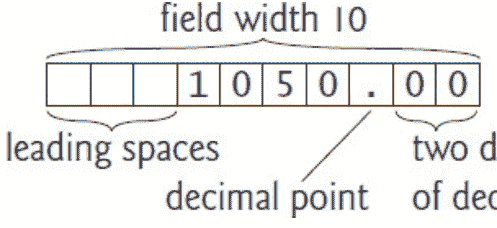

## 3.12 BREAK 和 CONTINUE 语句

`break` 和 `continue` 语句会更改循环的控制流。在 `while` 或 `for` 中执行 `break` 语句会立即退出该语句。在以下代码中，`range` 产生整数序列 0–99，但当 `number` 为 10 时循环终止：

点击此处查看代码图像

```
In [1]: for number in range(100) :
...:     if number == 10:
...:         break
...:     print(number, end=' ')
...:
0 1 2 3 4 5 6 7 8 9
```

在脚本中，执行将继续执行 `for` 循环后的下一条语句。`while` 和 `for` 语句都有可选的 `else` 子句，该子句仅在循环正常终止时执行——即，不是由于 `break` 导致的终止。

在 `while` 或 `for` 循环中执行 `continue` 语句会跳过循环体的其余部分。在 `while` 中，随后会测试条件以确定循环是否应继续执行。在 `for` 中，循环会处理序列中的下一项（如果有）：

点击此处查看代码图像

```
In [2]: for number in range(10) :
...:     if number == 5:
...:         continue
...:     print(number, end=' ')
...:
0 1 2 3 4 6 7 8 9
```

## 3.13 布尔运算符 AND、OR 和 NOT

条件运算符 >、<、>=、<=、== 和 != 可用于形成简单条件，例如 grade >= 60。要形成组合简单条件的更复杂条件，请使用 and、or 和 not 布尔运算符。

### 布尔运算符 and

要在执行控制语句的套件之前确保两个条件 **都** 为 True，请使用 **布尔 and 运算符** 来组合条件。以下代码定义了两个变量，然后测试一个条件，该条件仅当 *两个* 简单条件都为 True 时才为 True——如果简单条件中的 *任何一个*（或两个）为 *False*，则整个 *and* 表达式为 False：

点击此处查看代码图像

```
In [1]: gender = 'Female'

In [2]: age = 70

In [3]: if gender == 'Female' and age >= 65:
    ...:     print('Senior female')
    ...
Senior female
```

if 语句有两个简单条件：

- gender == 'Female' 确定某人是否为女性，且
- age >= 65 确定该人是否为老年人。

*and* 运算符左侧的简单条件首先求值，因为 == 的优先级高于 *and*。如果需要，*and* 右侧的简单条件会接着求值，因为 >= 的优先级高于 *and*。（我们将稍后讨论，为什么 *and* 运算符的右侧仅在左侧为 *True* 时才会求值。）整个 if 语句条件仅当 *两个* 简单条件都为 *True* 时才为 True。通过添加冗余括号，可以使组合条件更加清晰：

点击此处查看代码图像

```
(gender == 'Female') and (age >= 65)
```

下表通过展示所有四种可能情况来总结 *and* 运算符：


`expression1` 和 `expression2` 的 `False` 和 `True` 值的组合—这种表称为 `truth tables`：

| expression1 | expression2 | expression1 and expression2 |
|---|---|---|
| False | False | False |
| False | True | False |
| True | False | False |
| True | True | True |

## 布尔运算符 `or`

使用 **布尔 `or` 运算符** 来测试两个条件中 _一个_ 或 _两个_ 是否为 `True`。以下代码测试一个条件，如果 _一个_ 或 _两个_ 简单条件为 `True`，则该条件为 `True`——仅当 _两个_ 简单条件都为 `False` 时，整个条件才为 `False`：

点击此处查看代码图像

```
In [4]: semester_average = 83

In [5]: final_exam = 95

In [6]: if semester_average >= 90 or final_exam >= 90:
    ...:     print('Student gets an A')
    ...:
Student gets an A
```

Snippet [6] 还包含两个简单条件：

- `semester_average >= 90` 判断学生在学期内的平均分是否为 A（90 分或以上），且
- `final_exam >= 90` 判断学生的期末考试成绩是否为 A。

下面的真值表总结了布尔或运算符。与运算符的优先级高于或。

| expression1 | expression2 | expression1 or expression2 |
|---|---|---|
| False | False | False |
| False | True | True |
| True | False | True |
| True | True | True |

## 使用短路求值提高性能

Python 在得知整个条件是否为 `False` 后，即停止对 `and` 表达式求值。同样，Python 在得知整个条件是否为 `True` 后，即停止对 `or` 表达式求值。这称为短路求值。因此，条件

点击此处查看代码图像

```
gender == 'Female' and age >= 65
```

如果 `gender` 不等于 `'Female'`，则立即停止求值，因为整个表达式必须为 `False`。如果 `gender` 等于 `'Female'`，则继续执行，因为如果年龄大于或等于 65，则整个表达式将为 `True`。

同样，条件

点击此处查看代码图像

```
semester_average >= 90 or final_exam >= 90
```

如果 `semester_average` 大于或等于 90，则立即停止求值，因为整个表达式必须为 `True`。如果 `semester_average` 小于 90，则继续执行，因为如果 `final_exam` 大于或等于 90，则表达式仍可能为 `True`。

在使用 `and` 的表达式中，将更可能为 `False` 的条件放在最左侧。在 `or` 运算符表达式中，将更可能为 `True` 的条件放在最左侧。这些技术可以缩短程序的执行时间。

## 布尔运算符 `not`

**布尔运算符 `not`** “反转”条件的含义—`True` 变为 `False`，`False` 变为 `True`。这是一个 **一元运算符**—它只有一个 _操作数_。将 `not` 运算符放在条件之前，以便在原始条件（不带 `not` 运算符）为 `False` 时选择执行路径，例如以下代码：

点击此处查看代码图像

```
In [7]: grade = 87

In [8]: if not grade == -1:
    ...:     print('The next grade is', grade)
    ...:

The next grade is  87
```

通常，可以通过以更“自然”或方便的方式表达条件来避免使用 `not`。例如，前面的 `if` 语句也可以写成如下形式：

点击此处查看代码图像

```
In [9]: if grade != -1:
    ...:     print('The next grade is', grade)
    ...:

The next grade is  87
```

下面的真值表总结了 `not` 运算符。

| expression | not expression |
|---|---|
| False | True |
| True | False |

下表显示了迄今介绍的运算符的优先级和结合性，从上到下按优先级递减排列。

| 运算符 | 结合性 |
|---|---|
| () | 从左到右 |
| ** | 从右到左 |
| * / // % | 从左到右 |
| + - | 从左到右 |
| < <= > >= == != | 从左到右 |
| not | 从左到右 |

## 3.14 数据科学导论：集中趋势的度量—均值、中位数和众数

在此，我们继续讨论使用统计学分析数据，并介绍几种额外的描述性统计量，包括：

- **mean**—一组值中的 *平均值*。
- **median**—当所有值按 *排序顺序* 排列时的 *中间值*。
- **mode**—出现频率 *最高* 的值。

这些都是 **集中趋势的度量**—每种都是产生一个单一值的方法，该值代表一组值中的“中央”值，即在某种意义上代表其他值的典型值。

让我们对一组整数计算均值、中位数和众数。以下会话创建一个名为 `grades` 的列表，然后使用内置 **sum** 和 `len` 函数“手动”计算均值—`sum` 计算成绩总和（397），`len` 返回成绩数量（5）：

点击此处查看代码图像

```
In [1]: grades = [85, 93, 45, 89, 85]

In [2]: sum(grades) / len(grades)
Out[2]: 79.4
```

前一章提到了 *描述性统计量* count 和 sum—在 Python 中实现为内置函数 `len` 和 `sum`。与 `min` 和 `max` 函数（在前一章中介绍）一样，`sum` 和 `len` 都是函数式编程 **归约** 的示例—它们将一组值归约为一个单一值—分别是这些值的总和和值的数量。在第 .8 节的班级平均分示例中，我们本可以删除脚本中的第 10–15 行，并用片段 [2] 的计算替换第 16 行中的 `average`。

Python 标准库的 **statistics 模块** 提供用于计算均值、中位数和众数的函数—这些也是归约。要使用这些功能，首先 `import` `statistics` 模块：

```
In [3]: import statistics
```

然后，可以使用“statistics.”后跟要调用的函数名来访问模块的函数。以下使用 `statistics` 模块的 **mean**、**median** 和 **mode** 函数计算 `grades` 列表的均值、中位数和众数：

点击此处查看代码图像

```
In [4]: statistics.mean(grades)
Out[4]: 79.4

In [5]: statistics.median(grades)
Out[5]: 85

In [6]: statistics.mode(grades)
Out[6]: 85
```

每个函数的参数必须是 **可迭代对象**—在此例中为列表 `grades`。要验证中位数和众数是否正确，可以使用内置 **sorted 函数** 获取 `grades` 的副本，并将其值按递增顺序排列：

```
In [7]: sorted(grades)
Out[7]: [45, 85, 85, 89, 93]
```

`grades` 列表包含奇数个值（5），因此 `median` 返回 **中间值**（85）。如果列表的值的数量为偶数，`median` 返回 **两个** 中间值的 **平均值**。研究排序后的值，可以看到 `85` 是众数，因为它出现的频率最高（两次）。`mode` 函数对于像下面这样的列表会引发 `StatisticsError`：

```
[85, 93, 45, 89, 85, 93]
```

其中有两个或两个以上“最高频”值。这种值的集合被认为是众数不唯一的。在此，85 和 93 均出现两次。

## 3.15 小结

在本章中，我们讨论了 Python 的控制语句，包括 `if`、`if`…`else`、`if`…`elif`… `else`、`while`、`for`、`break` 和 `continue`。您了解到 `for` 语句执行受序列控制的迭代—它处理可迭代对象中的每个项目，例如整数范围、字符串或列表。您使用内置函数 `range` 生成从 `0` 开始但不包括其参数的整数序列，并确定 `for` 语句迭代的次数。

您使用 `while` 语句进行哨兵控制的迭代，创建一个在遇到哨兵值之前继续执行的循环。您使用内置函数 `range` 的两参数版本生成从第一个参数的值开始但不包括第二个参数的值的整数序列。您还使用了三参数版本，其中第三个参数指示范围中整数之间的步长。

我们介绍了用于精确货币计算的 `Decimal` 类型，并使用它来计算复利。您使用 f 字符串和各种格式说明符来创建格式化输出。我们介绍了 `break` 和 `continue` 语句，用于更改循环中的控制流。我们讨论了布尔运算符 `and`、`or` 和 `not`，用于创建组合简单条件的条件。

最后，我们通过介绍集中趋势的度量—均值、中位数和众数—并使用 Python 标准库 `statistics` 模块中的函数计算它们，继续了我们对描述性统计学的讨论。

在下一章中，您将创建自定义函数，并使用 Python 的 `math` 和 `random` 模块中的现有函数。我们将展示几个预定义的函数式编程归约，您将看到更多函数式编程功能。


## 函数

## 目标

在本章中，你将

- 创建自定义函数。
- 导入并使用 Python 标准库模块，如 `random` 和 `math`，以复用代码并避免“重复造轮子。”
- 在函数之间传递数据。
- 生成一系列随机数。
- 查看使用随机数生成的模拟技术。
- 对随机数生成器设置种子，以确保可重复性。
- 将值打包为元组，并从元组中解包值。
- 通过元组从函数返回多个值。
- 了解标识符的作用域如何决定在程序中可以使用它的位置。
- 创建具有默认参数值的函数。
- 使用关键字参数调用函数。
- 创建可以接收任意数量参数的函数。
- 使用对象的方法。
- 编写和使用递归函数。

## 大纲

- .1 简介
- .2 定义函数
- .3 多参数函数
- .4 随机数生成
- .5 案例研究：机会游戏
- .6 Python 标准库
- .7 math 模块函数
- .8 使用 IPython Tab 补全进行发现
- .9 默认参数值
- .10 关键字参数
- .11 任意参数列表
- .12 方法：属于对象的函数
- .13 作用域规则
- .14 import：深入探讨
- .15 向函数传递参数：深入探讨
- .16 递归
- .17 函数式编程入门
- .18 数据科学入门：离散度量
- .19 总结

## 4.1 简介

在本章中，我们将继续讨论 Python 基础知识，内容涉及自定义函数及相关主题。我们将使用 Python 标准库的 `random` 模块和随机数生成来模拟掷一个六面骰子。我们将把自定义函数和随机数生成结合到一个脚本中，实现骰子游戏 craps。在此示例中，我们还将介绍 Python 的元组序列类型，并使用元组从函数返回多个值。我们将讨论对随机数生成器设置种子，以确保可重复性。

你将导入 Python 标准库的 `math` 模块，然后使用它来了解 IPython Tab 补全，它能加快你的编码和发现过程。你将创建具有默认参数值的函数，使用关键字参数调用函数，并定义具有任意参数列表的函数。我们将演示调用对象的方法。我们还将讨论标识符的作用域如何决定在程序中可以使用它的位置。

我们将更深入地探讨导入模块。你将看到参数是按引用传递给函数的。我们还将演示一个递归函数，并开始介绍 Python 的函数式编程能力。

在数据科学入门部分，我们将继续讨论描述性统计，介绍离散度量——方差和标准差——并使用 Python 标准库 `statistics` 模块中的函数来计算它们。

## 4.2 定义函数

你已经调用过许多内置函数（`int`、`float`、`print`、`input`、`type`、`sum`、`len`、`min` 和 `max`）以及 statistics 模块中的一些函数（`mean`、`median` 和 `mode`）。每个函数都执行单一且明确定义的任务。你将经常定义和调用 *自定义* 函数。下面的会话定义了一个 `square` 函数，用于计算其参数的平方。然后它两次调用该函数——一次对 `int` 值 7 进行平方（生成 `int` 值 49），一次对 `float` 值 2.5 进行平方（生成 `float` 值 6.25）：

单击此处查看代码图像

```python
In [1]: def square(number):
    ...:     """Calculate the square of number."""
    ...:     return number ** 2
    ...:
```

```text
In [2]: square(7)
Out[2]: 49

In [3]: square(2.5)
Out[3]: 6.25
```

第一个片段中定义函数的语句只写一次，但可以在程序的多个点中“执行它们的任务”，且可随意调用多次。对 `square` 调用非数值参数（如 'hello'）会导致 `TypeError`，因为幂运算符（`**`）仅适用于数值。

### 定义自定义函数

**函数定义**（如片段 [1] 中的 `square`）以 `def` 关键字开头，后跟函数名（`square`）、一组括号和冒号（`:`）。与变量标识符一样，按照惯例，函数名应以小写字母开头，多字名中应使用下划线分隔每个单词。

必需的括号包含函数的 **参数列表**——由逗号分隔的 **参数** 列表，表示函数执行任务所需的数据。函数 `square` 只有一个名为 `number` 的参数——即要平方的值。如果括号为空，则函数不使用参数来执行其任务。

冒号（`:`）之后的缩进行是函数的 **块**，由一个可选的文档字符串以及执行函数任务的语句组成。我们将很快指出函数块与控制语句的套件之间的区别。

### 指定自定义函数的文档字符串

《Python 代码风格指南》指出，函数块的第一行应为文档字符串，简要说明函数的用途：

```text
"""Calculate the square of number."""
```

如需提供更多细节，可以使用多行文档字符串——风格指南建议先写一段简要说明，然后空一行，再写额外细节。

### 将结果返回到函数的调用方

当函数执行完毕时，它将控制权返回给其调用方——即调用该函数的代码行。在 `square` 的块中，`return` 语句：

```text
return number ** 2
```

先对 number 进行平方，然后终止函数并将结果返回给调用方。在此示例中，第一个调用方在片段 [2] 中，因此 IPython 在 Out[2] 中显示结果。第二个调用方在片段 [3] 中，因此 IPython 在 Out[3] 中显示结果。

函数调用也可以嵌入在表达式中。以下代码先调用 square，然后 print 显示结果：

单击此处查看代码图像

```text
In [4]: print('The square of 7 is', square(7))
The square of 7 is 49
```

有另外两种方式可以将控制权从函数返回到其调用方：

- 执行不带表达式的 return 语句会终止函数，并隐式将值 None 返回给调用方。Python 文档指出，None 表示值的缺失。None 在条件中求值为 False。

- 当函数中没有 return 语句时，执行完函数块中的最后一条语句后，它会隐式返回值 None。

### 局部变量

尽管我们未在 square 的块中定义变量，但可以这样做。函数的参数及其块中定义的变量都是局部变量——它们只能在函数内部使用，且仅在函数执行期间存在。尝试在函数块外部访问局部变量会导致 NameError，指示该变量未定义。

### 通过 IPython 的帮助机制访问函数的文档字符串

IPython 可以帮助你了解打算在代码中使用的模块和函数，以及 IPython 本身。例如，要查看函数的文档字符串以了解如何使用该函数，请输入函数名后跟问号（?）：

单击此处查看代码图像

```text
In [5]: square?
Signature: square(number)
Docstring: Calculate the square of number.
File: ~/Documents/examples/ch04/<ipython-input-1-7268c8ff93a9>
Type: function
```

对于我们的 `square` 函数，显示的信息包括：

- 函数名和参数列表——即其 **签名**。
- 函数的文档字符串。
- 包含函数定义的文件名。对于交互会话中的函数，此行显示定义函数的片段信息——“<ipython-input-1-7268c8ff93a9>”中的 1 表示片段 [1]。
- 你访问 IPython 帮助机制的项目的类型——在此例中为函数。

如果函数的源代码可从 IPython 访问——例如，在当前会话中定义的函数，或从 .py 文件导入到会话中的函数——则可以使用 ?? 显示函数的完整源代码定义：

单击此处查看代码图像

```text
In [6]: square??
Signature: square(number)
Source:
def square(number):
    """Calculate the square of number."""
    return number ** 2
File: ~/Documents/examples/ch04/<ipython-input-1-7268c8ff93a9>
Type: function
```

如果源代码不可从 IPython 访问，?? 仅显示文档字符串。

如果文档字符串适合窗口显示，IPython 会显示下一个 In [] 提示。如果文档字符串太长无法适配，IPython 会在窗口底部显示冒号（:）以指示还有更多内容——按空格键显示下一屏。你可以分别使用上下箭头键在文档字符串中向前和向后导航。IPython 在文档字符串末尾显示 (END)。在任意 : 或 (END) 提示处按 q（表示“退出”）可返回到下一个 In [] 提示。要获取


要了解 IPython 的功能，在任何 In [] 提示符处输入 ?，按 Enter，然后阅读帮助文档概览。

## 4.3 带多个参数的函数

让我们定义一个最大值函数，用于确定并返回三个值中最大的值——下面的会话分别使用整数、浮点数和字符串三次调用该函数。

点击此处查看代码图片

```
In [1]: def maximum(value1, value2, value3):
    ...:     """Return the maximum of three values."""
    ...:     max_value = value1
    ...:     if value2 > max_value:
    ...:         max_value = value2
    ...:     if value3 > max_value:
    ...:         max_value = value3
    ...:     return max_value
    ...: 
In [2]: maximum(12, 27, 36)
Out[2]: 36
In [3]: maximum(12.3, 45.6, 9.7)
Out[3]: 45.6
In [4]: maximum('yellow', 'red', 'orange')
Out[4]: 'yellow'
```

我们没有在 if 语句上下放置空行，因为在交互模式下在空行按 Return 会完成函数的定义。

你也可以使用混合类型调用 maximum，例如 int 和 float：

```
In [5]: maximum(13.5, -3, 7)
Out[5]: 13.5
```

调用 maximum(13.5, 'hello', 7) 会导致 TypeError，因为字符串和数字不能使用大于运算符 (>) 相互比较。

### 函数 maximum 的定义

函数 maximum 在逗号分隔的列表中指定三个参数。片段 [2] 的参数 12、27 和 36 分别赋给参数 value1、value2 和 value3。

要确定最大值，我们一次处理一个值：

- 首先，我们假设 value1 包含最大值，因此将其赋给局部变量 max_value。当然，value2 或 value3 可能包含实际的最大值，因此我们仍必须将它们各自与 max_value 比较。

- 第一个 if 语句随后测试 value2 > max_value，如果该条件为 True，则将 value2 赋给 max_value。

- 第二个 if 语句随后测试 value3 > max_value，如果该条件为 True，则将 value3 赋给 max_value。

现在，max_value 包含最大值，因此我们返回它。当控制权返回给调用者时，函数块中的参数 value1、value2 和 value3 以及变量 max_value——它们都是局部变量——不再存在。

### Python 的内置 max 和 min 函数

对于许多常见任务，你需要的功能在 Python 中已存在。例如，内置的 max 和 min 函数知道如何分别确定其两个或多个参数中的最大值和最小值：

```
In [6]: max('yellow', 'red', 'orange', 'blue', 'green')
Out[6]: 'yellow'

In [7]: min(15, 9, 27, 14)
Out[7]: 9
```

这些函数中的每一个也可以接收可迭代参数，例如列表或字符串。使用内置函数或 Python 标准库模块中的函数，而不是编写自己的函数，可以缩短开发时间并提高程序的可靠性、可移植性和性能。有关 Python 内置函数和模块的列表，请参阅

https://docs.python.org/3/library/index.html

## 4.4 随机数生成

我们现在暂时转向一种流行的编程应用类型——模拟和游戏。你可以通过 Python 标准库的 **random 模块** 引入 **偶然性**。

### 掷六面骰子

让我们生成 1 到 6 范围内的 10 个随机整数，以模拟掷六面骰子：

点击此处查看代码图片

```
In [1]: import random

In [2]: for roll in range(10):
    ...:     print(random.randrange(1, 7), end=' ')

    ...:
4 2 5 5 4 6 4 6 1 5
```

首先，我们导入 `random` 以便使用该模块的功能。**randrange** 函数从第一个参数值生成一个整数，一直到但 _不_ 包含第二个参数值。让我们使用上方向键调用 `for` 语句，然后按 _Enter_ 重新执行它。请注意，显示 _不同_ 的值：

点击此处查看代码图片

```
In [3]: for roll in range(10):
    ...:     print(random.randrange(1, 7), end=' ')

    ...:
4 5 4 5 1 4 1 4 6 5
```

有时，你可能希望保证随机序列的 **可重复性**——例如，用于调试。在本节末尾，我们将使用 `random` 模块的 `seed` 函数来实现这一点。

### 掷六面骰子 6,000,000 次

如果 `randrange` 真正随机生成整数，那么其范围内的每个数字每次调用时都有相等的 **概率**（或 _机会_ 或 _可能性_）被返回。为了展示骰子面 1–6 出现的可能性相等，以下脚本模拟了 6,000,000 次骰子滚动。运行脚本时，每个骰子面应出现约 1,000,000 次，如示例输出所示。

点击此处查看代码图片

```
# fig04_01.py
"""Roll a six-sided die 6,000,000 times."""
import random

# face frequency counters
frequency1 = 0
frequency2 = 0
frequency3 = 0
frequency4 = 0
frequency5 = 0
frequency6 = 0

# 6,000,000 die rolls
for roll in range(6_000_000): # note underscore  separators
    face = random.randrange(1, 7)

    # increment appropriate face counter
    if face == 1:
        frequency1 += 1
    elif face == 2:
        frequency2 += 1
    elif face == 3:
        frequency3 += 1
    elif face == 4:
        frequency4 += 1
    elif face == 5:
        frequency5 += 1
    elif face == 6:
        frequency6 += 1

print(f'Face{"Frequency":>13}')
print(f'{1:>4}{frequency1:>13}')
print(f'{2:>4}{frequency2:>13}')
print(f'{3:>4}{frequency3:>13}')
print(f'{4:>4}{frequency4:>13}')
print(f'{5:>4}{frequency5:>13}')
print(f'{6:>4}{frequency6:>13}')
```

点击此处查看代码图片

| 面值   |   频数 |
|:-------|------------:|
| 1      |      998686 |
| 2      |     1001481 |
| 3      |      999900 |
| 4      |     1000453 |
| 5      |      999953 |
| 6      |      999527 |

该脚本使用 *嵌套* 控制语句（在 `for` 语句中嵌套的 `if elif` 语句）来确定每个骰子面出现的次数。`for` 语句迭代 6,000,000 次。我们使用了 Python 的下划线 (_) 数字分隔符，使值 6000000 更易读。表达式 `range (6, 000, 000)` 是不正确的。逗号分隔函数调用中的参数，因此 Python 会将 `range (6, 000, 000)` 视为带有 *三个* 参数 6、0 和 0 的 `range` 调用。

对于每次骰子滚动，脚本向适当的计数器变量加 1。运行程序并观察结果。该程序可能需要几秒钟才能完成执行。如你所见，每次执行都会产生 *不同* 的结果。请注意，我们没有在 `if elif` 语句中提供 `else` 子句。

### 为随机数生成器设置种子以实现可重复性

函数 `randrange` 实际上生成 *伪随机数*，其基于从名为 **种子** 的数值开始的内部计算。反复调用 `randrange` 会产生一系列 *看起来* 随机的数字，因为每次启动新的交互会话或执行使用 `random` 模块函数的脚本时，Python 在内部都会使用 *不同* 的种子值。1 在调试使用随机生成数据的程序中的逻辑错误时，在使用其他值测试程序之前，使用 *相同* 的随机数序列直到消除逻辑错误会很有帮助。为此，你可以使用 random 模块的 **seed** 函数自己 **播种随机数生成器**——这会强制 `randrange` 从你指定的种子开始计算其伪随机数序列。在以下会话中，片段 [5] 和 [8] 产生相同的结果，因为片段 [4] 和 [7] 使用相同的种子（32）：

1 根据文档，Python 根据系统时钟或依赖于操作系统的随机源来设置种子值。对于需要安全随机数的应用程序（例如密码学），文档建议使用 `secrets` 模块，而不是 `random` 模块。

点击此处查看代码图片

```
In [4]: random.seed(32)

In [5]: for roll in range(10):
   ...:     print(random.randrange(1, 7), end=' ')

...:
1 2 3 6 2 4 1 6 1
In [6]: for roll in range(10):
   ...:     print(random.randrange(1, 7), end=' ')
```


...:
1 3 5 3 1 5 6 4 3 5
In [7]: random.seed(32)

In [8]: for roll in range(10):
    ...:     print(random.randrange(1,    7), end=' ')
    ...:
1 2 2 3 6 2 4 1 6 1

片段 [6] 生成不同的值，因为它只是继续在片段 [5] 中开始的伪随机数序列。

## 4.5 案例研究：机会游戏

在本节中，我们模拟流行的骰子游戏，称为“craps”。以下是需求说明：

你掷两个六面骰子，每个骰子的面分别含有一、二、三、四、五、六个点。当骰子停止滚动时，计算两个向上朝向的面上的点数之和。如果第一次掷出的和为 7 或 11，你获胜。如果第一次掷出的和为 2、3 或 12（称为“craps”），你输（即，“庄家”获胜）。如果第一次掷出的和为 4、5、6、8、9 或 10，该和即成为你的“点数”。要获胜，你必须继续掷骰子直到你“点中点数”（即，掷出相同的点数值）。如果在点中点数之前掷出 7，你就输。

以下脚本模拟该游戏并展示几个示例执行，说明第一次掷骰就获胜、第一次掷骰就输、后续掷骰获胜和后续掷骰输的情况。

点击此处查看代码图像

```
# fig04_02.py
"""Simulating the dice game Craps."""
import random

def roll_dice():
    """Roll two dice and return their face values as a tuple."""
    die1 = random.randrange(1, 7)
    die2 = random.randrange(1, 7)
    return (die1, die2)  # pack die face values into a tuple

def display_dice(dice):
    """Display one roll of the two dice."""
    die1, die2 = dice # unpack the tuple into variables die1 and
    print(f'Player rolled {die1} + {die2} = {sum(dice)}')
```
15
16 die_values = roll_dice() # first roll
17 display_dice(die_values)
18
19 # determine game status and point, based on first roll
20 sum_of_dice = sum(die_values)
21
22 if sum_of_dice in (7, 11): # win
23 game_status = 'WON'
24 elif sum_of_dice in (2, 3, 12): # lose
25 game_status = 'LOST'
26 else: # remember point
27 game_status = 'CONTINUE'
28 my_point = sum_of_dice
29 print('Point is', my_point)
30
31 # continue rolling until player wins or loses
32 while game_status == 'CONTINUE':
33 die_values = roll_dice()
34 display_dice(die_values)
35 sum_of_dice = sum(die_values)
36
37 if sum_of_dice == my_point: # win by making point
38 game_status = 'WON'
39 elif sum_of_dice == 7: # lose by rolling 7
40 game_status = 'LOST'
41
42 # display "wins" or "loses" message
43 if game_status == 'WON':
44 print('Player wins')
45 else:
46 print('Player loses')
```

点击此处查看代码图像

```
Player rolled 2 + 5 = 7
Player wins
```

点击此处查看代码图像

```
Player rolled 1 + 2 = 3
Player loses
```

点击此处查看代码图像

```
Player rolled 5 + 4 = 9
Point is 9
Player rolled 4 + 4 = 8
Player rolled 2 + 3 = 5
Player rolled 5 + 4 = 9
Player wins
```

点击此处查看代码图像

```
Player rolled 1 + 5 = 6
Point is 6
Player rolled 1 + 6 = 7
Player loses
```

### 函数 roll_dice——通过元组返回多个值

函数 roll_dice（第 5–9 行）模拟每次掷两个骰子。该函数仅定义一次，然后在程序的多个位置调用（第 16 行和第 33 行）。空参数列表明 roll_dice 执行其任务不需要参数。

迄今为止你调用的内置函数和自定义函数各返回一个值。有时返回多个值很有用，如 roll_dice，它将两个骰子的点数（第 9 行）作为元组返回——元组是不可变（即不可修改）的值序列。要创建元组，请用逗号分隔其值，如第 9 行所示：

```
(die1, die2)
```

这称为打包元组。括号是可选的，但我们建议使用它们以提高清晰度。我们将在下一章深入讨论元组。

### 函数 display_dice

要使用元组的值，可以将它们赋值给以逗号分隔的变量列表，这会解包元组。要显示每次掷骰子的结果，函数 display_dice（定义在第 11–14 行，在第 17 行和第 34 行调用）会解包它接收的元组参数（第 13 行）。= 左侧的变量数量必须与元组中的元素数量匹配；否则，将发生 ValueError。第 14 行打印一个包含两个骰子点数及其和的格式化字符串。我们通过将元组传递给内置 sum 函数来计算骰子的和——与列表一样，元组也是一种序列。

请注意，函数 `roll_dice` 和 `display_dice` 各自的块都以文档字符串开头，说明函数的功能。此外，两个函数都包含局部变量 `die1` 和 `die2`。这些变量不会“冲突”，因为它们属于不同函数的块。每个局部变量仅在定义它的块中可访问。

### 第一次掷骰

当脚本开始执行时，第 16–17 行掷骰子并显示结果。第 20 行计算骰子点数之和，用于第 22–29 行。你可以在第一次掷骰或任何后续掷骰中获胜或输。变量 `game_status` 跟踪胜负状态。

### 第 22 行中的 `in` 运算符

```
sum_of_dice in (7, 11)
```

测试元组 `(7, 11)` 是否包含 `sum_of_dice` 的值。如果该条件为 `True`，则你掷出了 7 或 11。在这种情况下，你在第一次掷骰时获胜，因此脚本将 `game_status` 设置为 `'WON'`。运算符的右操作数可以是任何可迭代对象。还有一个 `not in` 运算符，用于确定某个值是 *不* 在可迭代对象中。上述简洁条件等效于

点击此处查看代码图像

```
(sum_of_dice == 7) or (sum_of_dice == 11)
```

### 同样，第 24 行中的条件

```
sum_of_dice in (2, 3, 12)
```

测试元组 `(2, 3, 12)` 是否包含 `sum_of_dice` 的值。如果是，则你在第一次掷骰时输，因此脚本将 `game_status` 设置为 `'LOST'`。

对于骰子的其他任何和（4、5、6、8、9 或 10）：

- 第 27 行将 `game_status` 设置为 `'CONTINUE'`，以便你可以继续掷骰子
- 第 28 行将骰子点数之和存储在 `my_point` 中，以跟踪你需要掷出什么才能获胜，并且
- 第 29 行显示 `my_point`。

### 后续掷骰

如果 `game_status` 等于 `'CONTINUE'`（第 32 行），则你既没有赢也没有输，因此 `while` 语句的套件（第 33–40 行）会执行。每次循环迭代都会调用 `roll_dice`，显示骰子点数并计算它们的和。如果 `sum_of_dice` 等于 `my_point`（第 37 行）或 7（第 39 行），脚本将分别将 `game_status` 设置为 `'WON'` 或 `'LOST'`，并且循环终止。否则，`while` 循环将继续执行下一次掷骰子。

### 显示最终结果

当循环终止时，脚本会进入 `if else` 语句（第 43–46 行），如果 `game_status` 是 `'WON'`，则打印 `'Player wins'`，否则打印 `'Player loses'`。

## 4.6 Python 标准库

通常，你通过将自己创建的函数和类（即自定义类型）与模块中预定义的函数和类结合起来来编写 Python 程序，这些模块包括 Python 标准库和其他库中的模块。一个关键的编程目标是避免“重复造轮子”。

模块是一个对相关函数、数据和类进行分组的文件。Python 标准库的 `decimal` 模块中的类型 `Decimal` 实际上是一个类。我们在第 1 章中简要介绍了类，并将在“面向对象编程”章节中详细讨论它们。包是对相关模块进行分组的集合。在本书中，你将使用许多预先存在的模块和包，并会创建自己的模块——事实上，你创建的每个 Python 源代码（`.py`）文件都是一个模块。创建包超出了本书的范围。它们通常用于将大型库的功能组织成更小、更易于维护的子集，并可以分别导入以方便使用。例如，我们在第 5.17 节中使用的 `matplotlib` 可视化库功能广泛（其文档超过 2300 页），因此我们将在示例中仅导入需要的子集（`pyplot` 和 `animation`）。

Python 标准库随核心 Python 语言一起提供。其包和模块包含用于各种日常编程任务的功能。²


你可以在以下位置查看标准库模块的完整列表：

2 《Python 教程》将此称为“自带电池”（batteries included）方法。

```
https://docs.python.org/3/library/
```

你已经使用了 decimal、statistics 和 random 模块中的功能。在下一节中，你将使用 math 模块中的数学功能。在本书的示例中，你将看到许多其他 Python 标准库模块，包括下表中的许多模块：

| Module | Description |
|---|---|
| math | 常见数学常数和运算。 |
| os | 与操作系统交互。 |
| profile, pstats, timeit | 性能分析。 |
| random | 伪随机数。 |
| re | 用于模式匹配的正则表达式。 |
| sqlite3 | SQLite 关系型数据库访问。 |
| statistics | 数学统计函数，如 mean、median、mode 和 variance。 |
| string | 字符串处理。 |
| sys | 命令行参数处理；标准输入、标准输出和标准错误流。 |
| collections | 除列表、元组、字典和集合之外的数据结构。 |
| Cryptography modules | 用于安全传输加密数据的模块。 |
| csv | 处理逗号分隔值文件（类似于 Excel 中的文件）。 |
| datetime | 日期和时间操作。还包括 time 和 calendar 模块。 |
| decimal | 定点和浮点算术，包括货币计算。 |
| doctest | 在 docstring 中嵌入验证测试和预期结果，以进行简单的单元测试。 |
| gettext and locale | 国际化和本地化模块。 |
| json | 用于 Web 服务和 NoSQL 文档数据库的 JavaScript 对象表示法 (JSON) 处理。 |
| tkinter | 图形用户界面 (GUI) 和基于画布的图形。 |
| turtle | 海龟图形。 |
| webbrowser | 用于在 Python 应用中方便地显示网页。 |

## 4.7 MATH 模块函数

math 模块定义了用于执行各种常见数学计算的函数。回顾前一章，以下形式的 `import` 语句使你能够通过模块名和点号 (.) 使用模块的定义：

```
In [1]: import math
```

例如，以下代码片段通过调用 `math` 模块的 `sqrt` 函数来计算 900 的平方根，该函数将结果作为 `float` 值返回：

```
In [2]: math.sqrt(900)
Out[2]: 30.0
```

同样，以下代码片段通过调用 `math` 模块的 `fabs` 函数来计算 -10 的绝对值，该函数将结果作为 `float` 值返回：

```
In [3]: math.fabs(-10)
Out[3]: 10.0
```

下面总结了一些 `math` 模块函数——你可以在以下位置查看完整列表：

| Function | Description | Example |
| :--- | :--- | :--- |
| `ceil(x)` | 将 x 舍入到不小于 x 的最小整数 | `ceil(9.2)` is `10.0`<br>`ceil(-9.8)` is `-9.0` |
| `floor(x)` | 将 x 舍入到不大于 x 的最大整数 | `floor(9.2)` is `9.0`<br>`floor(-9.8)` is `-10.0` |
| `sin(x)` | x 的三角正弦值（x 以弧度为单位） | `sin(0.0)` is `0.0` |
| `cos(x)` | x 的三角余弦值（x 以弧度为单位） | `cos(0.0)` is `1.0` |
| `tan(x)` | x 的三角正切值（x 以弧度为单位） | `tan(0.0)` is `0.0` |
| `exp(x)` | 指数函数 e^x | `exp(1.0)` is `2.718282`<br>`exp(2.0)` is `7.389056` |
| `log(x)` | x 的自然对数（底数为 e） | `log(2.718282) is 1.0`<br>`log(7.389056) is 2.0` |
| `log10(x)` | x 的对数（底数为 10） | `log10(10.0) is 1.0`<br>`log10(100.0) is 2.0` |
| `pow(x, y)` | x 的 y 次幂 | `pow(2.0, 7.0) is 128.0`<br>`pow(9.0, .5) is 3.0` |
| `sqrt(x)` | x 的平方根 | `sqrt(900.0) is 30.0`<br>`sqrt(9.0) is 3.0` |
| `fabs(x)` | x 的绝对值——始终返回 float。Python 还内置 abs 函数，根据其参数返回 int 或 float。 | `fabs(5.1) is 5.1`<br>`fabs(-5.1) is 5.1` |
| `fmod(x, y)` | x/y 的余数，作为浮点数返回 | `fmod(9.8, 4.0) is 1.8` |

## 4.8 使用 IPython Tab 补全进行探索

你可以在 IPython 交互模式中通过 Tab 键补全查看模块文档——这是一项加速编码和探索过程的发现功能。在输入标识符的一部分并按下 Tab 键后，IPython 会为你补全该标识符，或提供以你迄今所输入内容开头的标识符列表。这可能因你的操作系统平台以及已导入 IPython 会话的内容而异：

单击此处查看代码图像

```
In [1]: import math

In [2]: ma<Tab>
        map                %macro              %%markdown
        math               %magic              %matplotlib
        max()              %man
```

你可以使用上下箭头键浏览标识符。在此过程中，IPython 会高亮显示一个标识符，并在 In [ ] 提示符右侧显示它。

### 查看模块中的标识符

要查看模块中定义的标识符列表，请输入模块名和一个点号 (.)，然后按下 Tab 键：

单击此处查看代码图像

```
In [3]: math.<Tab>
        acos()             atan()              copysign()            e                   expml()
        acosh()            atan2()             cos()                 erf()               fabs()
        asin()             atanh()             cosh()                erfc()              factorial() >
        asinh()            ceil()              degrees()             exp()               floor()
```

如果要显示的标识符数量多于当前显示的数量，IPython 会在右侧边缘（在某些平台上）显示 > 符号，在这里是 factorial() 的右侧。你可以使用上下箭头键浏览列表。在标识符列表中：

- 后跟括号的是函数（或方法，稍后你将了解）。
- 以大写字母开头的单词标识符（如 Employee）以及每个单词都以大写字母开头的多单词标识符（如 CommissionEmployee）表示类名（前面的列表中没有）。Python 代码风格指南推荐的这种命名约定称为 CamelCase，因为大写字母像骆驼的驼峰一样突出。
- 没有括号的小写标识符（如 pi（未在前面的列表中显示）和 e）是变量。标识符 pi 的值为 3.141592653589793，标识符 e 的值为 2.718281828459045。在 math 模块中，pi 和 e 分别代表数学常数 π 和 e。

Python 没有常数，尽管 Python 中的许多对象都是不可变（不可修改）的。因此，尽管 pi 和 e 是现实世界中的常数，你也不应给它们赋予新值，因为这会更改它们的值。为了帮助将常数与其他变量区分开来，风格指南建议使用全大写字母命名自定义常数。

### 使用当前高亮的函数

在浏览标识符时，如果想要使用当前高亮的函数，只需开始在括号中输入其参数即可。IPython 随后会隐藏自动补全列表。如果需要关于当前高亮项目的更多信息，可以在名称后输入问号 (?) 并按 Enter 键查看帮助文档。以下显示了 fabs 函数的文档字符串：

单击此处查看代码图像

```
In [4]: math.fabs?
Docstring:
fabs(x)

Return the absolute value of the float x.
Type:	builtin_function_or_method
```

上面显示的 builtin_function_or_method 表明 fabs 是 Python 标准库模块的一部分。此类模块被视为内置于 Python。在此示例中，fabs 是 math 模块的一个内置函数。

## 4.9 默认参数值

定义函数时，可以指定参数具有**默认参数值**。在调用函数时，如果省略了带有默认参数值的参数的实参，则会自动传递该参数的默认值。让我们定义一个带有默认参数值的函数 `rectangle_area`：

单击此处查看代码图像

```
In [1]: def rectangle_area(length=2, width=3):
...:     """Return a rectangle's area."""
...:     return length * width
...:
```

指定默认参数值的方法是在参数名后跟一个 = 和一个值——在此示例中，`length` 和 `width` 的默认参数值分别为 2 和 3。任何带有默认参数值的参数都必须出现在参数列表中无默认值参数的*右侧*。

以下对 `rectangle_area` 的调用没有实参，因此 IPython 使用两个默认参数值，就好像你调用了 `rectangle_area (2, 3)` 一样：

```
In [2]: rectangle_area()
Out[2]: 6
```

以下对 `rectangle_area` 的调用只有一个实参。实参从左到右分配给参数，因此 10 被用作 `length`。解释器为 `width` 传递默认参数值 3，就好像你调用了 `rectangle_area (10, 3)` 一样：

```
In [3]: rectangle_area(10)
Out[3]: 30
```

以下对 `rectangle_area` 的调用同时为 `length` 和 `width` 提供了实参，因此 IPython 忽略默认参数值：

```
In [4]: rectangle_area(10, 5)
Out[4]: 50
```

## 4.10 关键字参数


调用函数时，可以使用关键字参数以任意顺序传递参数。为演示关键字参数，我们重新定义 rectangle_area 函数——这次没有默认参数值：

点击此处查看代码图像

```
In [1]: def rectangle_area(length, width):
    ...:     """Return a rectangle's area."""
    ...:     return length * width
    ...:
```

调用中的每个关键字参数均采用 parametername=value 形式。以下调用表明关键字参数的顺序无关紧要——它们不需要与函数定义中对应参数的位置匹配：

点击此处查看代码图像

```
In [2]: rectangle_area(width=5, length=10)
Out[3]: 50
```

在每个函数调用中，必须将关键字参数放在函数的位置参数之后——即，任何未指定参数名的参数。此类参数根据参数列表中的参数位置，从左到右分配给函数的参数。关键字参数还有助于提高函数调用的可读性，尤其是对于参数众多的函数。

## 4.11 任意参数列表

具有任意参数列表的函数（如内置函数 min 和 max）可以接收任意数量的参数。考虑以下 min 调用：

```
min(88, 75, 96, 55, 83)
```

该函数的文档说明 min 有两个必需参数（名为 arg1 和 arg2）以及一个形式为 *args 的可选第三个参数，表明该函数可以接收任意数量的额外参数。参数名前的 * 告诉 Python 将任何剩余参数打包为一个元组，并传递给 args 参数。在上述调用中，参数 arg1 接收 88，参数 arg2 接收 75，参数 args 接收元组 (96, 55, 83)。

### 定义具有任意参数列表的函数

让我们定义一个可以接收任意数量参数的 `average` 函数：

```
In [1]: def average(*args):
    ...:     return sum(args) / len(args)
    ...:
```

按照惯例，参数名使用 `args`，但你可以使用任何标识符。如果函数有多个参数，则 `*args` 参数必须是 *最右侧* 的参数。

现在，让我们使用不同长度的任意参数列表多次调用 `average`：

```
In [2]: average(5, 10)
Out[2]: 7.5

In [3]: average(5, 10, 15)
Out[3]: 10.0

In [4]: average(5, 10, 15, 20)
Out[4]: 12.5
```

要计算平均值，请用 `args` 元组的元素总和（由内置函数 `sum` 返回）除以元组的元素数量（由内置函数 `len` 返回）。请注意，在我们的 `average` 定义中，如果 `args` 的长度为 0，则会发生 `ZeroDivisionError`。在下一章中，你将看到如何在不解包元组元素的情况下访问它们。

### 将可迭代对象的各个元素作为函数参数传递

你可以解包元组、列表或其他可迭代对象的元素，以将它们作为单独的函数参数传递。在函数调用中，当对可迭代参数应用 * 运算符时，会解包其元素。以下代码创建一个包含五个元素的 `grades` 列表，然后使用表达式 `*grades` 将其元素解包为 `average` 的参数：

```
In [5]: grades = [88, 75, 96, 55, 83]

In [6]: average(*grades)
Out[6]: 79.4
```

上述调用等效于 average(88, 75, 96, 55, 83)。

## 4.12 方法：属于对象的函数

方法只是你使用以下形式在对象上调用的函数：

```
object_name.method_name(arguments)
```

例如，以下会话创建字符串变量 s 并将其赋值为字符串对象 'Hello'。然后会话调用对象的 lower 和 upper 方法，这些方法生成包含原字符串全小写和全大写版本的新字符串，而 s 保持不变：

```
In [1]: s = 'Hello'

In [2]: s.lower() # call lower method on string object s
Out[2]: 'hello'

In [3]: s.upper()
Out[3]: 'HELLO'

In [4]: s
Out[4]: 'Hello'
```

Python 标准库参考位于

```
https://docs.python.org/3/library/index.html
```

描述了内置类型和 Python 标准库中类型的方法。在“面向对象编程”章节中，你将创建称为类的自定义类型，并定义可在这些类的对象上调用的自定义方法。

## 4.13 作用域规则

每个标识符都有一个作用域，决定了你在程序中可以在哪里使用它。对于程序的那部分，该标识符被认为“在作用域内”。

### 局部作用域

局部变量的标识符具有局部作用域。它仅从定义处到函数块结束时“在作用域内”。当函数返回到其调用者时，它“超出作用域”。因此，局部变量只能在定义它的函数内部使用。

### 全局作用域

在任何函数（或类）之外定义的标识符具有全局作用域——这些可能包括函数、变量和类。具有全局作用域的变量称为全局变量。具有全局作用域的标识符可以在定义后，在 .py 文件或交互会话中的任何位置使用。

### 从函数中访问全局变量

你可以在函数内部访问全局变量的值：

```
In [1]: x = 7

In [2]: def access_global():
    ...:     print('x printed from access_global:', x)
    ...:

In [3]: access_global()
x printed from access_global: 7
```

但是，默认情况下，你不能在函数中修改全局变量——当你首次在函数块中为变量赋值时，Python 会创建一个新的局部变量：

```
In [4]: def try_to_modify_global():
    ...:     x = 3.5
    ...:     print('x printed from try_to_modify_global:', x)
    ...:

In [5]: try_to_modify_global()
x printed from try_to_modify_global: 3.5
```

```
In [6]: x
Out[6]: 7
```

在函数 try_to_modify_global 的块中，局部 x **遮蔽**了全局 x，使其在函数块的作用域内不可访问。片段 [6] 显示，在函数 try_to_modify_global 执行后，全局变量 x 仍然存在并保持其原始值 (7)。

要在函数块中修改全局变量，必须使用 **global** 语句声明该变量在全局作用域中定义：

```
In [7]: def modify_global():
    ...:     global x
    ...:     x = 'hello'
    ...:     print('x printed from modify_global:', x)

In [8]: modify_global()
x printed from modify_global: hello

In [9]: x
Out[9]: 'hello'
```

### 块与套件

你现在已定义函数 *块* 和控制语句 *套件*。在块中创建变量时，该变量是该块 *局部* 的。但是，在控制语句的套件中创建变量时，变量的作用域取决于控制语句的定义位置：

- 如果控制语句位于全局作用域，则在控制语句中定义的任何变量都具有全局作用域。
- 如果控制语句位于函数块中，则在控制语句中定义的任何变量都具有局部作用域。

我们将在介绍自定义类时，在“面向对象编程”章节中继续讨论作用域。

### 函数遮蔽

在前几章中，对值求和时，我们将和存储在名为 total 的变量中。这样做的原因是 sum 是内置函数。如果你定义一个名为 sum 的变量，它将遮蔽内置函数，使其在你的代码中不可访问。当你执行以下赋值时，Python 将标识符 sum 绑定到包含 15 的 int 对象。此时，标识符 sum 不再引用内置函数。因此，当你尝试将 sum 用作函数时，会发生 TypeError：

```
In [10]: sum = 10 + 5

In [11]: sum
Out[11]: 15

In [12]: sum([10, 5])
---------------------------------------------------------------------------
TypeError                                 Traceback (most recent call last
ipython-input-12-1237d97a65fb> in <module>()
----> 1 sum([10, 5])

TypeError: 'int' object is not callable
```

### 全局作用域中的语句

在迄今为止你看到的脚本中，我们在全局作用域中编写了一些函数外的语句，以及一些函数块内的语句。全局作用域中的脚本语句会在解释器遇到它们时立即执行，而块中的语句仅在调用函数时执行。

## 4.14 导入：深入探讨

你已使用类似以下的语句导入模块（例如 math 和 random）：

```
import module_name
```

然后通过每个模块的名称和一个点 (.) 访问其功能。此外，你已使用类似以下的语句从模块中导入特定标识符（例如 decimal 模块的 Decimal 类型）：

```
from module_name import identifier
```


然后使用该标识符，而无需在其前加上模块名和一个点（.）。

### 从模块导入多个标识符

使用 `from import` 语句，你可以从模块导入逗号分隔的标识符列表，然后在代码中使用它们，而无需在它们前加上模块名和一个点（.）。

单击此处查看代码图像

```python
In [1]: from math import ceil, floor

In [2]: ceil(10.3)
Out[2]: 11

In [3]: floor(10.7)
Out[3]: 10
```

Trying to use a function that's not imported causes a `NameError`, indicating that the name is not defined.

尝试使用未导入的函数会导致 `NameError`，表明该名称未定义。

### 注意：避免通配符导入

你可以使用形式为**通配符导入**的方式导入模块中定义的所有标识符。

```python
from modulename import *
```

This makes all of the module's identifiers available for use in your code. Importing a module's identifiers with a wildcard `import` can lead to subtle errors—it's considered a dangerous practice that you should avoid. Consider the following snippets:

这使得模块的所有标识符都可在你的代码中使用。使用通配符 `import` 导入模块标识符可能会导致微妙的错误——这被认为是一种危险的做法，你应该避免。请考虑以下代码片段：

```python
In [4]: e = 'hello'

In [5]: from math import *

In [6]: e
Out[6]: 2.718281828459045
```

Initially, we assign the string 'hello' to a variable named `e`. After executing snippet [5] though, the variable `e` is replaced, possibly by accident, with the `math` module's constant `e`, representing the mathematical floating-point value `e`.

最初，我们将字符串 'hello' 赋给名为 `e` 的变量。不过执行代码片段 [5] 后，变量 `e` 可能会被（意外地）替换为 `math` 模块的常量 `e`，它表示数学浮点值 `e`。

### 为模块和模块标识符绑定名称

Sometimes it's helpful to import a module and use an abbreviation for it to simplify your code. The import statement's as clause allows you to specify the name used to reference the module's identifiers. For example, in section 3.14 we could have imported the statistics module and accessed its mean function as follows:

有时，导入模块并为其使用缩写可以简化代码，这很有帮助。import 语句的 as 子句允许你指定用于引用模块标识符的名称。例如，在 3.14 节中，我们本可以导入 statistics 模块并像下面这样访问其 mean 函数：

单击此处查看代码图像

```python
In [7]: import statistics as stats

In [8]: grades = [85, 93, 45, 87, 93]

In [9]: stats.mean(grades)
Out[9]: 80.6
```

As you'll see in later chapters, import as is frequently used to import Python libraries with convenient abbreviations, like stats for the statistics module. As another example, we'll use the numpy module which typically is imported with

如你在后续章节中将看到的，import as 常用于使用方便的缩写导入 Python 库，例如 statistics 模块的 stats。另一个例子是，我们将使用 numpy 模块，它通常使用如下方式导入：

```python
import numpy as np
```

Library documentation often mentions popular shorthand names.

库文档经常提到流行的缩写名称。

Typically, when importing a module, you should use import or import as statements, then access the module through the module name or the abbreviation following the as keyword, respectively. This ensures that you do not accidentally import an identifier that conflicts with one in your code.

通常，导入模块时，你应该使用 import 或 import as 语句，然后分别通过模块名或 as 关键字后面的缩写来访问模块。这样可以确保你不会意外导入与代码中标识符冲突的标识符。

## 4.15 向函数传递参数：深入探讨

Let's take a closer look at how arguments are passed to functions. In many programming languages, there are two ways to pass arguments—pass-by-value and pass-by-reference (sometimes called call-by-value and call-by-reference, respectively):

让我们更仔细地看看如何向函数传递参数。在许多编程语言中，有两种传递参数的方式——按值传递和按引用传递（有时分别称为按值调用和按引用调用）：

- With pass-by-value, the called function receives a copy of the argument's value and works exclusively with that copy. Changes to the function's copy do not affect the original variable's value in the caller.

- 使用按值传递时，被调用函数接收参数值的副本，并且仅与该副本一起工作。对函数副本的更改不会影响调用方中原始变量的值。

- With pass-by-reference, the called function can access the argument's value in the caller directly and modify the value if it's mutable.

- 使用按引用传递时，被调用函数可以直接访问调用方中参数的值，并在该值可变时修改它。

Python arguments are always passed by reference. Some people call this pass-by-object-reference, because “everything in Python is an object.” 3 When a function call provides an argument, Python copies the argument object’s reference—not the object itself—into the corresponding parameter. This is important for performance. Functions often manipulate large objects—frequently copying them would consume large amounts of computer memory and significantly slow program performance.

Python 参数始终按引用传递。有些人称这为按对象引用传递，因为“Python 中的一切都是对象。” 3 当函数调用提供一个参数时，Python 会将参数对象的引用——而不是对象本身——复制到相应的参数中。这对性能很重要。函数通常操作大对象——频繁复制它们会消耗大量计算机内存，并显著降低程序性能。

3 Even the functions you defined in this chapter and the classes (custom types) you'll define in later chapters are objects in Python.

3 即使你在本章中定义的函数以及你将在后续章节中定义的类（自定义类型）在 Python 中也是对象。

### 内存地址、引用和“指针”

You interact with an object via a reference, which behind the scenes is that object’s address (or location) in the computer’s memory—sometimes called a “pointer” in other languages. After an assignment like

你通过引用与对象交互，引用在幕后是该对象在计算机内存中的地址（或位置）——在其他语言中有时被称为“指针”。在如下赋值后：

```python
x = 7
```

the variable x does not actually contain the value 7. Rather, it contains a reference to an object containing 7 stored elsewhere in memory. You might say that x “points to” (that is, references) the object containing 7, as in the diagram below:

变量 x 并不实际包含值 7。相反，它包含对内存中其他位置存储的包含 7 的对象的引用。你可以说 x “指向”（即引用）包含 7 的对象，如下图所示：

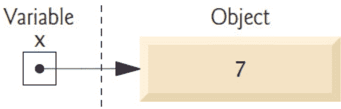

### 内置函数 id 和对象标识

Let’s consider how we pass arguments to functions. First, let’s create the integer variable x mentioned above—shortly we’ll use x as a function argument:

让我们考虑如何向函数传递参数。首先，让我们创建上面提到的整数变量 x——稍后我们将把 x 用作函数参数：

```python
In [1]: x = 7
```

Now x refers to (or “points to”) the integer object containing 7. No two separate objects can reside at the same address in memory, so every object in memory has a unique address. Though we can’t see an object’s address, we can use the built-in id function

现在 x 指向（或“指向”）包含 7 的整数对象。内存中没有两个不同的对象可以位于相同地址，因此内存中的每个对象都有一个唯一地址。虽然我们看不到对象的地址，但可以使用内置 id 函数

to obtain a *unique* int value which identifies only that object while it remains in memory (you'll likely get a different value when you run this on your computer):

来获取一个 *唯一* 的 int 值，该值仅在对象保持在内存中时标识该对象（在你的计算机上运行此代码时，你可能会得到不同的值）：

```python
In [2]: id(x)
Out[2]: 4350477840
```

The integer result of calling `id` is known as the object's **identity**. ⁴ No two objects in memory can have the same *identity*. We'll use object identities to demonstrate that objects are passed by reference.

调用 `id` 得到的整数结果称为对象的 **标识**。⁴ 内存中没有两个对象可以具有相同的 *标识*。我们将使用对象标识来演示对象是按引用传递的。

⁴ According to the Python documentation, depending on the Python implementation you're using, an object's identity may be the object's actual memory address, but this is not required.

⁴ 根据 Python 文档，取决于你使用的 Python 实现，对象的标识可能是对象的实际内存地址，但这不是必需的。

### 将对象传递给函数

Let's define a `cube` function that displays its parameter's identity, then returns the parameter's value cubed:

让我们定义一个 `cube` 函数，它显示其参数的标识，然后返回参数值的立方：

单击此处查看代码图像

```python
In [3]: def cube(number):
    ...:     print('id(number):', id(number))
    ...:     return number ** 3
    ...:
```

Next, let's call `cube` with the argument `x`, which refers to the integer object containing 7:

接下来，让我们用参数 `x` 调用 `cube`，它指向包含 7 的整数对象：

```python
In [4]: cube(x)
id(number): 4350477840
Out[4]: 343
```

The identity displayed for `cube`'s parameter `number`—4350477840—is the *same* as that displayed for `x` previously. Since every object has a unique identity, both the *argument* `x` and the *parameter* `number` refer to the *same object* while `cube` executes. So when function `cube` uses its parameter `number` in its calculation, it gets the value of `number` from the original object in the caller.

`cube` 参数 `number` 显示的标识——4350477840——与先前为 `x` 显示的 *相同*。由于每个对象都有唯一标识，因此在 `cube` 执行期间，*参数* `x` 和 *形参* `number` 引用的是 *同一个对象*。因此，当函数 `cube` 在其计算中使用其参数 `number` 时，它从调用方中的原始对象获取 `number` 的值。

### 使用 `is` 运算符测试对象标识

You also can prove that the argument and the parameter refer to the same object with Python's is operator, which returns True if its two operands have the same identity:

你还可以使用 Python 的 is 运算符来证明参数和形参引用的是同一个对象，如果其两个操作数具有相同的标识，则该运算符返回 True：

单击此处查看代码图像

```python
In [5]: def cube(number):
    ...:     print('number is x:', number is x) # x is a global variable
    ...:     return number ** 3
    ...:

In [6]: cube(x)
number is x: True
Out[6]: 343
```

### 作为参数的不可变对象

When a function receives as an argument a reference to an immutable (unmodifiable) object—such as an int, float, string or tuple—even though you have direct access to the original object in the caller, you cannot modify the original immutable object's value. To prove this, first let's have cube display id(number) before and after assigning a new object to the parameter number via an augmented assignment:

当函数作为参数接收对不可变（不可修改）对象（如 int、float、字符串或元组）的引用时，即使你可以直接访问调用方中的原始对象，也无法修改原始不可变对象的值。为了证明这一点，首先让 cube 在通过复合赋值给参数 number 分配新对象之前和之后显示 id(number)：

单击此处查看代码图像

```python
In [7]: def cube(number):
    ...:     print('id(number) before modifying number:', id(number))
    ...:     number **= 3
    ...:     print('id(number) after modifying number:', id(number))
    ...:     return number
    ...:

In [8]: cube(x)
id(number) before modifying number: 4350477840
id(number) after modifying number: 4396653744
Out[8]: 343
```

When we call cube(x), the first print statement shows that id(number) initially is the same as id(x) in snippet [2]. Numeric values are immutable, so the statement

当我们调用 cube(x) 时，第一个打印语句显示 id(number) 最初与代码片段 [2] 中的 id(x) 相同。数值是不可变的，因此语句

```python
number **= 3
```

actually creates a new object containing the cubed value, then assigns that object's reference to parameter number. Recall that if there are no more references to the
original object, it will be garbage collected. Function cube's second print statement shows the new object's identity. Object identities must be unique, so number must refer to a different object. To show that x was not modified, we display its value and identity again:

实际上会创建一个包含立方值的新对象，然后将该对象的引用分配给参数 number。回想一下，如果对原始对象没有更多引用，它将被垃圾回收。函数 cube 的第二个打印语句显示新对象的标识。对象标识必须唯一，因此 number 必须引用一个不同的对象。为了显示 x 未被修改，我们再次显示其值和标识：

单击此处查看代码图像

```python
In [9]: print(f'x = {x}; id(x) = {id(x)}')
x = 7; id(x) = 4350477840
```

### 作为参数的可变对象

In the next chapter, we'll show that when a reference to a mutable object like a list is passed to a function, the function can modify the original object in the caller.

在下一章中，我们将展示当像列表这样的可变对象的引用传递给函数时，函数可以修改调用方中的原始对象。

## 4.16 递归

Let's write a program to perform a famous mathematical calculation. Consider the factorial of a positive integer n, which is written n! and pronounced “n factorial.” This is the product

让我们编写一个程序来执行一项著名的数学计算。考虑正整数 n 的阶乘，写作 n!，读作“n 阶乘”。这是乘积

```text
n · (n − 1) · (n − 2) ··· 1
```

with 1! equal to 1 and 0! defined to be 1. For example, 5! is the product 5 · 4 · 3 · 2 · 1, which is equal to 120.

其中 1! 等于 1，0! 定义为 1。例如，5! 是乘积 5 · 4 · 3 · 2 · 1，等于 120。

### 迭代阶乘方法

You can calculate 5! iteratively with a for statement, as in:

你可以使用 for 语句迭代计算 5!，如下所示：

单击此处查看代码图像

```python
In [1]: factorial = 1
In [2]: for number in range(5, 0, -1):
....:     factorial *= number
....:
In [3]: factorial
Out[3]: 120
```

### 递归问题求解


递归问题求解方法有几个共同点。当你调用递归函数来解决问题时，它实际上只能解决最简单的*情况*（或多个情况），即**基本情况**（或多个基本情况）。如果你用一个*基本情况*调用函数，它会立即返回结果。如果你用一个更复杂的问题调用函数，它通常将问题分成两部分——一部分是函数知道如何处理的，另一部分是函数不知道如何处理的。为了使递归可行，后一部分必须是原问题的一个稍微简单或更小的版本。由于这个新问题与原问题相似，函数会调用其自身的一个全新*副本*来处理较小的问题——这被称为**递归调用**，也称为**递归步骤**。将问题分成两个较小部分的概念是本书前面介绍过的*分治法*的一种形式。

递归步骤在原始函数调用仍然活跃时执行（即，它尚未执行完毕）。当函数将每个新子问题分成两个概念性片段时，这可能导致更多的递归调用。为了使递归最终终止，每当函数用原问题的更简单版本调用自身时，越来越小的问题序列必须*收敛于一个基本情况*。当函数识别出基本情况时，它会将结果返回给函数的前一个副本。会出现一系列返回，直到原始函数调用将最终结果返回给调用者。

## 递归阶乘方法

你可以通过观察 n! 可以写成以下形式来得到递归阶乘表示：

```
n! = n · (n - 1)!
```

例如，5! 等于 5 · 4!，如下所示：

```
5! = 5 · 4 · 3 · 2 · 1
5! = 5 · (4 · 3 · 2 · 1)
5! = 5 · (4!)
```

## 可视化递归

5! 的求值过程如下所示。左列显示递归调用如何持续进行，直到 1!（基本情况）被求值为 1，从而终止递归。右列从下到上显示每个递归调用向其调用者返回的值，直到最终值被计算并返回。

### (a) 递归调用序列

### (b) 每个递归调用返回的值

## 实现递归阶乘函数

以下会话使用递归来计算并显示 0 到 10 之间整数的阶乘：

点击此处查看代码图像

```
In [4]: def factorial(number):
    ...:     """Return factorial of number."""
    ...:     if number <= 1:
    ...:         return 1
    ...:     return number * factorial(number - 1) # recursive call
    ...:

In [5]: for i in range(11):
    ...:     print(f'{i}! = {factorial(i)}')
    ...:

0! = 1
1! = 1
2! = 2
3! = 6
4! = 24
5! = 120
6! = 720
7! = 5040
8! = 40320
9! = 362880
10! = 3628800
```

代码片段 [4] 中的递归函数 factorial 首先判断终止条件 number <= 1 是否为 True。如果该条件为 True（基本情况），factorial 返回 1，无需进一步递归。如果 number 大于 1，第二个 return 语句将问题表示为 number 与递归调用 factorial（其求值为 factorial(number - 1)）的乘积。这是一个比原始计算 factorial(number) 稍小的问题。请注意，函数 factorial 必须接收一个非负参数。我们不对这种情况进行测试。

代码片段 [5] 中的循环对 0 到 10 的值调用 factorial 函数。输出显示阶乘值增长迅速。Python 不限制整数的大小，这与许多其他编程语言不同。

## 间接递归

递归函数可能会调用另一个函数，而该函数又可能反过来调用回递归函数。这称为间接递归调用或间接递归。例如，函数 A 调用函数 B，函数 B 又调用回函数 A。这仍然是递归，因为第二次对函数 A 的调用是在第一次对函数 A 的调用仍然活跃时进行的。也就是说，第一次对函数 A 的调用尚未执行完毕（因为它正在等待函数 B 向其返回结果），也尚未返回到函数 A 的原始调用者。

## 栈溢出和无限递归

当然，计算机中的内存数量是有限的，因此只能使用一定数量的内存来存储函数调用栈上的激活记录。如果发生的递归函数调用数量超过栈上可存储激活记录的数量，就会发生一种称为栈溢出的致命错误。这通常是无限递归的结果，可能是由于省略了基本情况或编写错误的递归步骤导致其不收敛于基本情况而引起。此错误类似于迭代（非递归）解决方案中无限循环的问题。

## 4.17 函数式编程

与其他流行语言（如 Java 和 C#）一样，Python 不是纯函数式语言。相反，它提供了“函数式”特性，帮助你编写不太可能包含错误、更简洁且更易于阅读、调试和修改的代码。函数式程序也更容易并行化，以便在当今的多核处理器上获得更好的性能。下图列出了 Python 的大部分关键函数式编程能力，并在括号中显示了我们最初介绍许多功能的章节。

| 函数式编程主题 | | |
| :--- | :--- | :--- |
| 避免副作用 (4) | 生成器函数 | 惰性求值 (5) |
| 闭包 | 高阶函数 (5) | 列表推导式 (5) |
| 声明式编程 (4) | 不可变性 (4) | operator 模块 (5, 11, 16) |
| 装饰器 (10) | 内部迭代 (4) | 纯函数 (4) |
| 字典推导式 (6) | 迭代器 (3) | range 函数 (3, 4) |
| filter/map/reduce (5) | itertools 模块 (16) | 归约 (3, 5) |
| functools 模块 | lambda 表达式 (5) | 集合推导式 (6) |
| 生成器表达式 (5) | | |

我们将在全书中介绍这些功能中的大部分——许多带有代码示例，其他则从识字角度介绍。你已经在 for 语句中使用过列表、字符串和内置函数 range 的迭代器，以及几个归约（函数 sum、len、min 和 max）。我们将在下文讨论声明式编程、不可变性和内部迭代。

### 什么 vs 如何

随着你执行的任务变得更加复杂，你的代码可能变得更难阅读、调试和修改，并且更可能包含错误。指定代码的工作方式可能会变得复杂。

函数式编程让你只需说明你想做什么。它隐藏了执行每项任务的许多工作方式细节。通常，库代码为你处理工作方式。如你将看到，这可以消除许多错误。

考虑许多其他编程语言中的 `for` 语句。通常，*你*必须指定计数器控制迭代的所有细节：控制变量、其初始值、如何递增它，以及使用控制变量来确定是否继续迭代的循环继续条件。这种迭代风格称为**外部迭代**，且容易出错。例如，你可能会提供错误的初始化器、递增值或循环继续条件。外部迭代会**变更**（即修改）控制变量，而 `for` 语句的主体通常也会变更其他变量。每次修改变量时，你都可能引入错误。函数式编程强调**不可变性**。也就是说，它避免修改变量值的操作。我们将在下一章中详细说明。

Python 的 `for` 语句和 `range` 函数*隐藏*了大部分计数器控制迭代的细节。你指定 `range` 应该产生的*值*以及应接收每个值的变量。函数 `range` *知道如何*产生这些值。同样，`for` 语句*知道如何*从 `range` 获取每个值，以及*如何*在没有更多值时停止迭代。指定*什么*，而不是*如何*，是**内部迭代**的一个重要方面——这是一个关键的函数式编程概念。

Python 的内置函数 `sum`、`min` 和 `max` 均使用内部迭代。要对列表 `grades` 的元素求和，你只需声明你想做*什么*——即 `sum(grades)`。函数 `sum` *知道如何*遍历列表并将每个元素加到运行总计中。说明你*希望*完成什么，而不是编程*如何*去做，这称为**声明式编程**。

### 纯函数

在纯函数式编程语言中，你专注于编写纯函数。一个*纯函数*的结果仅取决于你传递给它的参数。此外，给定特定参数（或多个参数），纯函数总是产生相同的结果。例如，内置函数 `sum` 的返回值仅取决于你传递给它的可迭代对象。给定列表 [1, 2, 3]，`sum` *总是*返回 6，无论你调用多少次。此外，纯函数没有*副作用*。例如，即使你将一个*可变*列表传递给纯函数，在函数调用前后，该列表都将包含相同的值。当你调用纯函数 `sum` 时，它不会修改其参数。

点击此处查看代码图像


In [1]: values = [1, 2, 3]

In [2]: sum(values)
Out[2]: 6

In [3]: sum(values) # same call    always returns same result
Out[3]: 6

In [4]: values
Out[4]: [1, 2, 3]

在下一章中，我们将继续使用函数式编程概念。另外，您会发现 *函数是对象*，您可以将其作为数据传递给其他函数。

## 4.18 数据科学导论：离散度量

在描述性统计学的讨论中，我们已考察过集中趋势度量——均值、中位数和众数。它们可帮助我们对组内典型值进行分类——例如，您同学的平均身高或给定国家中购买频率最高的汽车品牌（众数）。

在谈论一个群体时，整个群体称为 *总体*。有时总体非常庞大，例如下一次美国总统选举中可能投票的人数，这一数字超过 100,000,000 人。出于实际原因，试图预测谁将成为下一任总统的民调机构会使用从总体中精心挑选的小型子集，称为 *样本*。2016 年选举中的许多民调样本量约为 1000 人。

在本节中，我们继续讨论基础描述性统计学。我们将介绍 *离散度量*（也称为 *变异度量*），帮助您理解数值的离散程度。例如，在一个班级的学生中，可能有一大群学生身高接近平均值，而身高明显更矮或更高的学生较少。

为达此目的，我们将既手动又使用 `statistics` 模块中的函数来计算每个离散度量，使用如下 10 次六面掷骰子构成的总体：

- 1, 3, 4, 2, 6, 5, 3, 4, 5, 2

## 方差

要确定 *方差*，5 我们首先从这些值的均值开始——3.5。您可以通过将面值之和 35 除以掷骰次数 10 来得到此结果。接下来，我们从每个骰子值中减去均值（这会产生一些负结果）：

5 为简单起见，我们计算的是 *总体方差*。 *总体方差* 与 *样本方差* 之间存在细微差别。样本方差不是除以 *n*（示例中的掷骰次数），而是除以 *n* - 1。在样本量较小时差异明显，随着样本量增大差异变得微不足道。 *statistics* 模块提供函数 *pvariance* 和 *variance*，分别用于计算总体方差和样本方差。同样，*statistics* 模块提供函数 *pstdev* 和 *stdev*，分别用于计算总体标准差和样本标准差。

```
-2.5, -0.5, 0.5, -1.5, 2.5, 1.5, -0.5, 0.5, 1.5, -1.5
```

然后，我们对每个结果求平方（只得到正数）：

```
6.25, 0.25, 0.25, 2.25, 6.25, 2.25, 0.25, 0.25, 2.25, 2.25
```

最后，我们计算这些平方的均值，即 2.25（22.5 / 10）——这就是 *总体方差*。将每个骰子值与所有骰子值均值之差求平方，强调了 *异常值*——即离均值最远的值。随着我们深入数据分析，有时我们希望密切关注异常值，有时则希望忽略它们。以下代码使用 *statistics* 模块的 *pvariance* 函数来验证我们的手动结果：

单击此处查看代码图片

```
In [1]: import statistics

In [2]: statistics.pvariance([1,  3, 4, 2, 6, 5, 3, 4, 5, 2])
Out[2]: 2.25
```

## 标准差

**标准差** 是方差的平方根（在此例中为 1.5），它削弱了异常值的影响。方差和标准差越小，数据值越接近均值，值与均值之间的整体 **离散度**（即 **离散范围**）就越小。以下代码使用 statistics 模块的 **pstdev** 函数计算 **总体标准差**，验证了我们的手动结果：

单击此处查看代码图片

```
```python
In [3]: statistics.pstdev([1, 3, 4, 2, 6, 5, 3, 4, 5, 2])
Out[3]: 1.5
```
```

将 `pvariance` 函数的结果传递给 `math` 模块的 `sqrt` 函数，证实了我们 1.5 的结果：

单击此处查看代码图片

```
```python
In [4]: import math

In [5]: math.sqrt(statistics.pvariance([1, 3, 4, 2, 6, 5, 3, 4, 5, 2]))
Out[5]: 1.5
```
```

## 总体标准差相对于总体方差的优势

假设您记录了所在地区三月份的华氏温度。您可能有 31 个数字，例如 19、32、28 和 35。这些数字的单位是度。当您对温度求平方以计算总体方差时，总体方差的单位变为“平方度”。当您对总体方差开平方根以计算总体标准差时，单位再次变为度，即与您的温度 _相同_ 的单位。

## 4.19 小结

在本章中，我们创建了自定义函数。我们从 `random` 和 `math` 模块导入了功能。我们介绍了随机数生成，并用它来模拟掷六面骰子。我们将多个值打包到元组中，以便从函数返回多个值。我们还解包元组以访问其值。我们讨论了使用 Python 标准库的模块，以避免“重复造轮子”。

我们创建了带有默认参数值的函数，并使用关键字参数调用函数。我们还定义了带有任意参数列表的函数。我们调用了对象的方法。我们讨论了标识符的作用域如何决定您在程序中可以使用它的位置。

我们更详细地介绍了导入模块。您了解到参数是按引用传递给函数的，以及函数调用栈和栈帧如何支持函数调用-返回机制。我们还展示了递归函数，并开始介绍 Python 的函数式编程功能。在过去两章中，我们介绍了基本的列表和元组功能——在下一章中，我们将详细讨论它们。

最后，我们继续讨论描述性统计学，介绍了离散度量——方差和标准差——并使用 Python 标准库 statistics 模块中的函数对其进行计算。

对于某些类型的问题，让函数自行调用是有用的。递归函数会直接或通过另一个函数间接地调用自身。

# 5. 序列：列表和元组

## 目标

在本章中，您将：

- 创建并初始化列表和元组。
- 引用列表、元组和字符串的元素。
- 对列表进行排序和搜索，并搜索元组。
- 将列表和元组传递给函数和方法。
- 使用列表方法执行常见操作，例如搜索项目、对列表排序、插入项目和删除项目。
- 使用额外的 Python 函数式编程功能，包括 lambda 以及函数式编程操作 filter、map 和 reduce。
- 使用函数式列表推导式快速轻松地创建列表，并使用生成器表达式按需生成值。
- 使用二维列表。
- 使用 Seaborn 和 Matplotlib 可视化库增强您的分析和展示技能。

## 大纲

- 5.1 简介
- 5.2 列表
- 5.3 元组
- 5.4 解包序列
- 5.5 序列切片
- 5.6 del 语句
- 5.7 将列表传递给函数
- 5.8 对列表排序
- 5.9 搜索序列
- 5.10 其他列表方法
- 5.11 使用列表模拟栈
- 5.12 列表推导式
- 5.13 生成器表达式
- 5.14 Filter, Map 和 Reduce
- 5.15 其他序列处理函数
- 5.16 二维列表
- 5.17 数据科学导论：模拟与静态可视化
- 5.17.1 600、60,000 和 6,000,000 次掷骰的示例图
- 5.17.2 可视化掷骰频率和百分比
- 5.18 小结

## 5.1 简介

在过去两章中，我们简要介绍了列表和元组序列类型，用于表示有序的项目集合。集合是预封装的数据结构，由相关数据项组成。集合示例包括您智能手机上的喜爱歌曲、您的联系人列表、图书馆的书籍、您在纸牌游戏中的卡片、您喜欢的运动队的队员、投资组合中的股票、癌症研究中的患者以及购物清单。Python 的内置集合使您能够存储和访问


方便且高效地处理数据。在本章中，我们将更详细地讨论列表和元组。

我们将演示常见的列表和元组操作。你会发现，列表（可修改）和元组（不可修改）具有许多共同功能。每种都可以保存相同或不同类型的项目。列表可根据需要动态调整大小，在执行时增长和缩小。我们讨论一维列表和二维列表。

在前一章中，我们演示了随机数生成并模拟了掷六面骰子。我们以本章的下一个数据科学入门部分作为结尾，该部分使用可视化库 Seaborn 和 Matplotlib 交互式地开发包含骰子频率的静态柱状图。在下一章的数据科学入门部分中，我们将展示一个动画可视化，其中柱状图会随着骰子掷出次数的增加而动态变化——你将看到大数定律“在行动中”。

## 5.2 列表

在此，我们将更详细地讨论列表，并解释如何引用特定的列表元素。本节中展示的许多功能适用于所有序列类型。

### 创建列表

列表通常存储同构数据，即相同数据类型的值。考虑包含五个整数元素的列表 c：

单击此处查看代码图像

```python
In [1]: c = [-45, 6, 0, 72, 1543]

In [2]: c
Out[2]: [-45, 6, 0, 72, 1543]
```

它们也可以存储异构数据，即多种不同类型的数据。例如，以下列表包含学生的名（字符串）、姓（字符串）、绩点平均分（浮点数）和毕业年份（整数）：

```python
['Mary', 'Smith', 3.57, 2022]
```

### 访问列表元素

你通过编写列表名称，后跟元素的 **索引**（即其 **位置编号**），并用方括号（`[ ]`，称为 **订阅运算符**）括起来来引用列表元素。以下图表显示了标记了元素名称的列表 `c`：

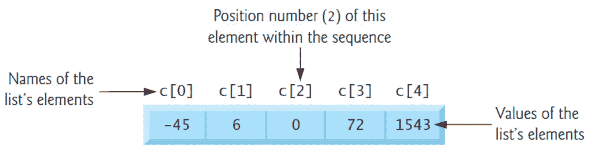

列表中的第一个元素的索引为 `0`。因此，在五元素列表 `c` 中，第一个元素名为 `c[0]`，最后一个元素为 `c[4]`：

```python
In [3]: c[0]
Out[3]: -45

In [4]: c[4]
Out[4]: 1543
```

### 确定列表长度

要获取列表长度，请使用内置 `len` 函数：

```python
In [5]: len(c)
Out[5]: 5
```

### 使用负索引从列表末尾访问元素

列表也可以使用 *负索引* 从末尾访问：

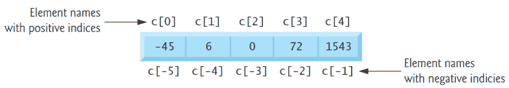

因此，列表 `c` 的最后一个元素（`c[4]`）可以通过 `c[-1]` 访问，其第一个元素可以通过 `c[-5]` 访问：

```python
In [6]: c[-1]
Out[6]: 1543

In [7]: c[-5]
Out[7]: -45
```

### 索引必须是整数或整数表达式

索引必须是整数或整数表达式（或我们很快将看到的 *切片*）：

```python
In [8]: a = 1

In [9]: b = 2

In [10]: c[a + b]
Out[10]: 72
```

使用非整数索引值会导致 TypeError。

### 列表是可变的

列表是可变的——其元素可以被修改：

单击此处查看代码图像

```python
In [11]: c[4] = 17

In [12]: c
Out[12]: [-45, 6, 0, 72, 17]
```

你很快就会发现，你还可以插入和删除元素，从而更改列表的长度。

### 某些序列是不可变的

Python 的字符串和元组序列是不可变的——它们不能被修改。你可以获取字符串中的单个字符，但尝试向其中一个字符赋予新值会导致 TypeError：

单击此处查看代码图像

```python
In [13]: s = 'hello'

In [14]: s[0]
Out[14]: 'h'

In [15]: s[0] = 'H'
```

TypeError
Traceback (most recent call last)
<ipython-input-15-812ef2514689> in <module>()
----> 1 s[0] = 'H'

TypeError: 'str' object does not support item assignment

### 尝试访问不存在的元素

使用超出范围的列表、元组或字符串索引会导致 IndexError：

单击此处查看代码图像

```python
In [16]: c[100]
IndexError
Traceback (most recent call last)
ipython-input-16-9a31eale1a13> in <module>()
----> 1 c[100]

IndexError: list index out of range
```

### 在表达式中使用列表元素

列表元素可用作表达式中的变量：

```python
In [17]: c[0] + c[1] + c[2]
Out[17]: -39
```

### 使用 += 向列表追加元素

先从空列表 [] 开始，然后使用 for 语句和 += 将值 1 到 5 追加到列表中——列表会动态增长以容纳每个项目：

单击此处查看代码图像

```python
In [18]: a_list = []

In [19]: for number in range(1, 6):
    ...:     a_list += [number]
    ...:

In [20]: a_list
Out[20]: [1, 2, 3, 4, 5]
```

当 += 的左操作数是列表时，右操作数必须是 *可迭代对象*；否则会发生 `TypeError`。在片段 [19] 的套件中，*number* 两侧的方括号创建一个单元素列表，我们将其追加到 *a_list*。如果右操作数包含多个元素，+= 会将它们全部追加。以下将 'Python' 的字符追加到列表 *letters* 中：

单击此处查看代码图像

```python
In [21]: letters = []

In [22]: letters += 'Python'

In [23]: letters
Out[23]: ['P', 'y', 't', 'h', 'o', 'n']
```

如果 += 的右操作数是元组，其元素也会被追加到列表中。本章稍后，我们将使用列表方法 *append* 向列表添加项目。

### 使用 + 连接列表

你可以使用 + 运算符 **连接** 两个列表、两个元组或两个字符串。结果是一个 *新* 的同类型序列，包含左操作数的元素，后跟右操作数的元素。原始序列保持不变：

单击此处查看代码图像

```python
In [24]: list1 = [10, 20, 30]

In [25]: list2 = [40, 50]

In [26]: concatenated_list = list1 + list2

In [27]: concatenated_list
Out[27]: [10, 20, 30, 40, 50]
```

如果 + 运算符的操作数是不同的序列类型，则会发生 *TypeError*——例如，连接列表和元组会出错。

### 使用 *for* 和 *range* 访问列表索引和值

列表元素也可以通过其索引和订阅运算符（[]）访问：

单击此处查看代码图像

```python
In [28]: for i in range(len(concatenated_list)):
    ...:     print(f'{i}: {concatenated_list[i]}')
    ...:
0: 10
1: 20
2: 30
3: 40
4: 50
```

函数调用 `range(len(concatenated_list))` 生成一系列整数，表示 `concatenated_list` 的索引（在此例中为 0 到 4）。以这种方式循环时，必须确保索引在范围内。稍后，我们将展示使用内置函数 `enumerate` 访问元素索引和值的更安全方法。

### 比较运算符

你可以使用比较运算符按元素比较整个列表：

单击此处查看代码图像

```python
In [29]: a = [1, 2, 3]

In [30]: b = [1, 2, 3]

In [31]: c = [1, 2, 3, 4]

In [32]: a == b # True: corresponding elements in both are equal
Out[32]: True

In [33]: a == c # False: a and c have different elements and lengths
Out[33]: False

In [34]: a < c # True: a has fewer elements than c
Out[34]: True

In [35]: c >= b # True: elements 0-2 are equal but c has more elements
Out[35]: True
```

## 5.3 元组

如前一章所述，元组是不可变的，通常存储异构数据，但数据也可以是同构的。元组的长度是其元素的数量，在程序执行期间不能更改。

### 创建元组

要创建空元组，请使用空括号：

```python
In [1]: student_tuple = ()

In [2]: student_tuple
Out[2]: ()

In [3]: len(student_tuple)
Out[3]: 0
```

请记住，可以通过用逗号分隔其值来打包元组：

单击此处查看代码图像

```python
In [4]: student_tuple = 'John', 'Green', 3.3

In [5]: student_tuple
Out[5]: ('John', 'Green', 3.3)

In [6]: len(student_tuple)
Out[6]: 3
```

输出元组时，Python 始终在括号中显示其内容。你可以用可选括号括起来元组的逗号分隔值列表：

单击此处查看代码图像

```python
In [7]: another_student_tuple = ('Mary', 'Red', 3.3)

In [8]: another_student_tuple
Out[8]: ('Mary', 'Red', 3.3)
```

以下代码创建一个单元素元组：

单击此处查看代码图像

```python
In [9]: a_singleton_tuple = ('red',) # note the comma

In [10]: a_singleton_tuple
Out[10]: ('red',)
```

紧跟字符串 'red' 后的逗号 (,) 将 a_singleton_tuple 标识为元组——括号是可选的。如果省略逗号，括号将


将是多余的，并且 `a_singleton_tuple` 将只是引用字符串 'red' 而不是一个元组。

## 访问元组元素

元组的元素虽然相关，但通常为多种类型。通常，你不会对其进行迭代。相反，你逐个访问它们。与列表索引类似，元组索引从 0 开始。以下代码创建表示小时、分钟和秒的 `time_tuple`，显示元组，然后使用其元素计算午夜至今的秒数——请注意，我们对元组中的每个值执行 *不同* 的操作：

单击此处查看代码图片

```
In [11]: time_tuple = (9, 16, 1)

In [12]: time_tuple
Out[12]: (9, 16, 1)

In [13]: time_tuple[0] * 3600 + time_tuple[1] * 60 + time_tuple[2]
Out[13]: 33361
```

给元组元素赋值会导致 TypeError。

## 向字符串或元组添加项目

与列表一样，+= 增量赋值语句可用于字符串和元组，尽管它们是 *不可变* 的。在以下代码中，两次赋值后，`tuple1` 和 `tuple2` 引用 *同一* 元组对象：

```
In [14]: tuple1 = (10, 20, 30)

In [15]: tuple2 = tuple1

In [16]: tuple2
Out[16]: (10, 20, 30)
```

将元组 (40, 50) 连接到 `tuple1` 会创建一个 *新* 元组，然后将对其的引用赋给变量 `tuple1`——`tuple2` 仍引用原始元组：

单击此处查看代码图片

```
In [17]: tuple1 += (40, 50)

In [18]: tuple1
Out[18]: (10, 20, 30, 40, 50)

In [19]: tuple2
Out[19]: (10, 20, 30)
```

对于字符串或元组，+= 右侧的项目必须分别是字符串或元组——混合类型会导致 TypeError。

## 将元组附加到列表

你可以使用 += 将元组附加到列表：

单击此处查看代码图片

```
In [20]: numbers = [1, 2, 3, 4, 5]

In [21]: numbers += (6, 7)

In [22]: numbers
Out[22]: [1, 2, 3, 4, 5, 6, 7]
```

## 元组可能包含可变对象

让我们创建一个包含名、姓和成绩列表的 student_tuple：

单击此处查看代码图片

```
In [23]: student_tuple = ('Amanda', 'Blue', [98, 75, 87])
```

尽管元组是不可变的，但其列表元素是可变的：

单击此处查看代码图片

```
In [24]: student_tuple[2][1] = 85

In [25]: student_tuple
Out[25]: ('Amanda', 'Blue', [98, 85, 87])
```

在双下标名称 student_tuple[2][1] 中，Python 将 student_tuple[2] 视为包含列表 [98, 75, 87] 的元组元素，然后使用 [1] 访问包含 75 的列表元素。片段 [24] 中的赋值将该成绩替换为 85。

## 5.4 解包序列

上一章介绍了元组解包。你可以通过将序列分配给逗号分隔的变量列表来解包任何序列的元素。如果赋值符号左侧的变量数量与右侧序列中的元素数量不相同，则会发生 `ValueError`：

单击此处查看代码图片

```python
In [1]: student_tuple = ('Amanda',   [98, 85, 87])
In [2]: first_name, grades = student_tuple
In [3]: first_name
Out[3]: 'Amanda'
In [4]: grades
Out[4]: [98, 85, 87]
```

以下代码解包字符串、列表以及由 `range` 生成的序列：

单击此处查看代码图片

```python
In [5]: first, second = 'hi'
In [6]: print(f'{first}   {second}')
h i
In [7]: number1, number2, number3 = [2,   3, 5]
In [8]: print(f'{number1}   {number2}   {number3}')
2 3 5
In [9]: number1, number2, number3 = range(10, 40, 10)
In [10]: print(f'{number1}   {number2}   {number3}')
10 20 30
```

### 通过打包和解包交换值

你可以使用序列打包和解包交换两个变量的值：

单击此处查看代码图片

```
In [11]: number1 = 99
In [12]: number2 = 22
In [13]: number1, number2 = (number2, number1)
In [14]: print(f'number1 = {number1}; number2 = {number2}')
number1 = 22; number2 = 99
```

### 使用内置函数 enumerate 安全地访问索引和值

此前，我们调用 range 生成一系列索引值，然后在 for 循环中使用索引值和订阅运算符 ([ ]) 访问列表元素。这种做法容易出错，因为你可能向 range 传递错误的参数。如果 range 生成的任何值是越界索引，将其用作索引会导致 IndexError。

首选的机制是使用内置函数 enumerate 来访问元素的索引和值。该函数接收一个可迭代对象，并创建一个迭代器，该迭代器对每个元素返回一个包含元素索引和值的元组。以下代码使用内置函数 list 创建包含 enumerate 结果的列表：

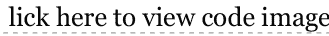

```
In [15]: colors = ['red', 'orange', 'yellow']
In [16]: list(enumerate(colors))
Out[16]: [(0, 'red'), (1, 'orange'), (2, 'yellow')]
```

同样，内置函数 tuple 从序列创建元组：

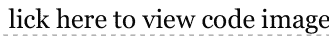

```
In [17]: tuple(enumerate(colors))
Out[17]: ((0, 'red'), (1, 'orange'), (2, 'yellow'))
```

以下 for 循环将 enumerate 返回的每个元组解包到变量 index 和 value 中并显示它们：

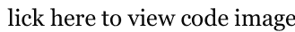

```
In [18]: for index, value in enumerate(colors):
...:     print(f'{index}: {value}')
...:
0: red
1: orange
2: yellow
```

### 创建原始条形图

以下脚本创建一个原始条形图，其中每个条的长度由星号 (*) 组成，并与列表中相应元素的值成正比。我们使用函数 enumerate 来安全地访问列表的索引和值。要运行此示例，请切换到本章的 ch05 示例文件夹，然后输入：

```
ipython fig05_01.py
```

或者，如果你已经在 IPython 中，请使用命令：

```
run fig05_01.py
```

单击此处查看代码图片

```
1 # fig05_01.py
2 """Displaying a bar chart"""
3
4 numbers = [19, 3, 15, 7, 11]
5
6 print('\nCreating a bar chart from numbers:')
7 print(f'Index{"Value":>8}   Bar')
8
9 for index, value in enumerate(numbers):
10     print(f'{index:>5}{value:>8}   {"*" * value}')
```

单击此处查看代码图片

```
Creating a bar chart from numbers:
Index   Value   Bar
0       19      *******************
1       3       ***
2       15      *******************
3       7       *******
4       11      ***********
```

for 语句使用 enumerate 获取每个元素的索引和值，然后显示包含索引、元素值和相应星号条的格式化行。表达式

```
"*" * value
```

创建一个由 `value` 个星号组成的字符串。当与序列一起使用时，乘法运算符 (*) *重复* 序列——在此例中，字符串 "*"——`value` 次。本章后面，我们将使用开源 Seaborn 和 Matplotlib 库显示出版质量的条形图可视化。

## 5.5 序列切片

你可以对序列进行 *切片* 以创建包含原始元素 *子集* 的同类型新序列。切片操作可以修改可变序列——那些 *不* 修改序列的操作对列表、元组和字符串的作用相同。

### 指定带有起始和结束索引的切片

让我们创建一个由列表中索引 2 到 5 的元素组成的切片：

单击此处查看代码图片

```
In [1]: numbers = [2, 3, 5, 7, 11, 13, 17, 19]
In [2]: numbers[2:6]
Out[2]: [5, 7, 11, 13]
```

切片 *复制* 从冒号左侧的 *起始索引* (2) 到冒号右侧的 *结束索引* (6)（不包含该索引）的元素。原始列表不会被修改。

### 指定仅带有结束索引的切片

如果省略起始索引，则假定为 0。因此，切片 `numbers[:6]` 等效于切片 `numbers[0:6]`：

单击此处查看代码图片

```
In [3]: numbers[:6]
Out[3]: [2, 3, 5, 7, 11, 13]
In [4]: numbers[0:6]
Out[4]: [2, 3, 5, 7, 11, 13]
```

### 指定仅带有起始索引的切片

如果省略结束索引，Python 假定序列的长度（这里为 8），因此片段 [5] 的切片包含数字在索引 6 和 7 处的元素：

单击此处查看代码图片

```
In [5]: numbers[6:]
Out[5]: [17, 19]

In [6]: numbers[6:len(numbers)]
Out[6]: [17, 19]
```

### 指定不带任何索引的切片

省略起始和结束索引会复制整个序列：

单击此处查看代码图片

```
In [7]: numbers[:]
Out[7]: [2, 3, 5, 7, 11, 13, 17, 19]
```

尽管切片会创建新对象，但切片会对元素进行浅拷贝——也就是说，它们复制元素的引用，但不复制它们所指向的对象。因此，在上面的片段中，新列表的元素引用与原始列表的元素相同的对象，而不是单独的副本。在“使用 NumPy 进行面向数组的编程”一章中，我们将解释深拷贝，它实际上会复制引用对象本身，并指出何时更偏好使用深拷贝。

### 带步长的切片

以下代码使用步长 2 创建包含 numbers 中每隔一个元素的切片：

```
In [8]: numbers[::2]
Out[8]: [2, 5, 11, 17]
```

我们省略了起始和结束索引，因此分别假定为 0 和 len(numbers)。


## 使用负索引和步长进行切片

你可以使用负步长以逆序选择切片。下面的代码简洁地创建了一个逆序的新列表：

单击此处查看代码图像

```
In [9]: numbers[::-1]
Out[9]: [19, 17, 13, 11, 7, 5, 3, 2]
```

这等价于：

单击此处查看代码图像

```
In [10]: numbers[-1:-9:-1]
Out[10]: [19, 17, 13, 11, 7, 5, 3, 2]
```

## 通过切片修改列表

你可以通过给列表的切片赋值来修改它——列表的其余部分保持不变。下面的代码替换了 numbers 的前三个元素，其余部分保持不变：

单击此处查看代码图像

```
In [11]: numbers[0:3] = ['two', 'three', 'five']
In [12]: numbers
Out[12]: ['two', 'three', 'five', 7, 11, 13, 17, 19]
```

下面的代码通过向三元素切片赋一个空列表，仅删除了 numbers 的前三个元素：

单击此处查看代码图像

```
In [13]: numbers[0:3] = []
In [14]: numbers
Out[14]: [7, 11, 13, 17, 19]
```

下面的代码将一个列表的元素赋给 numbers 中每隔一个元素的切片：

单击此处查看代码图像

```
In [15]: numbers = [2, 3, 5, 7, 11, 13, 17, 19]
In [16]: numbers[::2] = [100, 100, 100, 100]
In [17]: numbers
Out[17]: [100, 3, 100, 7, 100, 13, 100, 19]
In [18]: id(numbers)
Out[18]: 4434456648
```

让我们删除 `numbers` 中的所有元素，使现有列表变为空：

单击此处查看代码图像

```
In [19]: numbers[:] = []
In [20]: numbers
Out[20]: []
In [21]: id(numbers)
Out[21]: 4434456648
```

删除 `numbers` 的内容（代码片段 [19]）与将 `numbers` 赋予一个新的空列表 `[]`（代码片段 [22]）是不同的。为了证明这一点，我们在每次操作后显示 `numbers` 的标识。标识不同，因此它们代表内存中的不同对象：

单击此处查看代码图像

```
In [22]: numbers = []
In [23]: numbers
Out[23]: []
In [24]: id(numbers)
Out[24]: 4406030920
```

当你将新对象赋值给变量时（如代码片段 [22] 中所示），如果没有其他变量引用该原始对象，则它将被垃圾回收。

## 5.6 DEL 语句

`del` 语句还可用于从列表中删除元素以及从交互会话中删除变量。你可以删除任何有效索引处的元素，或任何有效切片中的元素。

### 删除列表特定索引处的元素

让我们创建一个列表，然后使用 `del` 删除其最后一个元素：

单击此处查看代码图像

```
In [1]: numbers = list(range(0, 10))

In [2]: numbers
Out[2]: [0, 1, 2, 3, 4, 5, 6, 7, 8, 9]

In [3]: del numbers[-1]

In [4]: numbers
Out[4]: [0, 1, 2, 3, 4, 5, 6, 7, 8]
```

### 从列表中删除切片

下面的代码删除列表的前两个元素：

```
In [5]: del numbers[0:2]

In [6]: numbers
Out[6]: [2, 3, 4, 5, 6, 7, 8]
```

下面的代码在切片中使用步长，从整个列表中删除每隔一个元素：

```
In [7]: del numbers[::2]

In [8]: numbers
Out[8]: [3, 5, 7]
```

### 删除代表整个列表的切片

下面的代码删除列表的所有元素：

```
In [9]: del numbers[:]

In [10]: numbers
Out[10]: []
```

### 从当前会话中删除变量

`del` 语句可以删除任何变量。让我们从交互会话中删除 `numbers`，然后尝试显示该变量的值，这将导致 `NameError`：

单击此处查看代码图像

```
In [11]: del numbers

In [12]: numbers
--------------------------------------------------------------------------------
NameError                                 Traceback (most recent call last)
ipython-input-12-426f8401232b> in <module>()
---> 1 numbers

NameError: name 'numbers' is not defined
```

## 5.7 将列表传递给函数

在上一章中，我们提到所有对象都是按引用传递的，并演示了将不可变对象作为函数参数传递。在这里，我们通过考察当程序将可变列表对象传递给函数时会发生什么，来进一步讨论引用。

### 将整个列表传递给函数

考虑函数 modify_elements，它接收一个列表的引用，并将列表中每个元素的值乘以 2：

单击此处查看代码图像

```
In [1]: def modify_elements(items):
    ...:     """Multiplies all element values in items by 2."""
    ...:     for i in range(len(items)):
    ...:         items[i] *= 2
    ...:

In [2]: numbers = [10, 3, 7, 1, 9]

In [3]: modify_elements(numbers)

In [4]: numbers
Out[4]: [20, 6, 14, 2, 18]
```

函数 modify_elements 的 items 参数接收对原始列表的引用，因此循环体中的语句会修改原始列表对象中的每个元素。

### 将元组传递给函数

当你将元组传递给函数时，尝试修改元组的不可变元素会导致 TypeError：

单击此处查看代码图像

```
In [5]: numbers_tuple = (10, 20, 30)

In [6]: numbers_tuple
Out[6]: (10, 20, 30)

In [7]: modify_elements(numbers_tuple)
---------------------------------------------------------------------------
TypeError                                 Traceback (most recent call last)
ipython-input-7-9339741cd595> in <module>()
----> 1 modify_elements(numbers_tuple)

<ipython-input-1-27acb8f8f44c> in modify_elements(items)
      2 """Multiplies all element values in items by 2."""
      3 for i in range(len(items)):
----> 4     items[i] *= 2
      5 
      6 

TypeError: 'tuple' object does not support item assignment
```

请记住，元组可能包含可变对象，例如列表。当将元组传递给函数时，这些对象仍然可以被修改。

### 关于 traceback 的说明

前面的 traceback 显示了导致 TypeError 的两个代码片段。第一个是代码片段 [7] 的函数调用。第二个是代码片段 [1] 的函数定义。行号位于每个代码片段的代码之前。我们主要演示了单行代码片段。当在这样的片段中发生异常时，它始终由 ---> 1 前缀引导，表示第 1 行（即片段中唯一的一行）导致了异常。像 modify_elements 的定义这样的多行片段显示从 1 开始的连续行号。上述的 ---> 4 表示异常发生在 modify_elements 的第 4 行。无论 traceback 有多长，带有 ---> 的最后一行代码导致了异常。

## 5.8 对列表进行排序

排序使你可以将数据按升序或降序排列。

### 按升序对列表排序

列表方法 sort 修改列表以按升序排列其元素：

单击此处查看代码图像

```
In [1]: numbers = [10, 3, 7, 1, 9, 4, 2, 8, 5, 6]

In [2]: numbers.sort()

In [3]: numbers
Out[3]: [1, 2, 3, 4, 5, 6, 7, 8, 9, 10]
```

### 按降序对列表排序

要按降序对列表排序，请调用列表方法 sort，并将可选关键字参数 reverse 设置为 True（默认值为 False）：

单击此处查看代码图像

```
In [4]: numbers.sort(reverse=True)

In [5]: numbers
Out[5]: [10, 9, 8, 7, 6, 5, 4, 3, 2, 1]
```

### 内置函数 sorted

内置函数 sorted 返回一个包含其参数序列排序元素的新列表——原始序列未修改。下面的代码演示了针对列表、字符串和元组的函数 sorted：

单击此处查看代码图像

```
In [6]: numbers = [10, 3, 7, 1, 9, 4, 2, 8, 5, 6]

In [7]: ascending_numbers = sorted(numbers)

In [8]: ascending_numbers
Out[8]: [1, 2, 3, 4, 5, 6, 7, 8, 9, 10]

In [9]: numbers
Out[9]: [10, 3, 7, 1, 9, 4, 2, 8, 5, 6]

In [10]: letters = 'fadgchjebi'

In [11]: ascending_letters = sorted(letters)

In [12]: ascending_letters
Out[12]: ['a', 'b', 'c', 'd', 'e', 'f', 'g', 'h', 'i', 'j']

In [13]: letters
Out[13]: 'fadgchjebi'

In [14]: colors = ('red', 'orange', 'yellow', 'green', 'blue')

In [15]: ascending_colors = sorted(colors)

In [16]: ascending_colors
Out[16]: ['blue', 'green', 'orange', 'red', 'yellow']

In [17]: colors
Out[17]: ('red', 'orange', 'yellow', 'green', 'blue')
```

使用值为 True 的可选关键字参数 reverse 以按降序排列元素。

## 5.9 搜索序列

你通常需要确定一个序列（例如列表、元组或字符串）是否包含与特定键值匹配的值。搜索是定位键的过程。

### 列表方法 index

列表方法 index 将搜索键（即要在列表中定位的值）作为参数，然后从索引 0 开始搜索列表，并返回与搜索键匹配的第一个元素的索引：

单击此处查看代码图像

```
In [1]: numbers = [3, 7, 1, 4, 2, 8, 5, 6]

In [2]: numbers.index(5)
Out[2]: 6
```

如果你搜索的值不在列表中，则会发生 ValueError。

### 指定搜索的起始索引

使用方法 index 的可选参数，你可以搜索列表元素的子集。你可以使用 *= 来复制序列——即多次将序列追加到其自身

次。执行以下代码片段后，`numbers` 包含原列表内容的两个副本：

点击此处查看代码图像

```
In [3]: numbers *= 2

In [4]: numbers
Out[4]: [3, 7, 1, 4, 2, 8, 5, 6, 3, 7, 1, 4, 2, 8, 5, 6]
```

以下代码在更新的列表中搜索值 5，从索引 7 开始并一直到列表末尾：

```
In [5]: numbers.index(5, 7)
Out[5]: 14
```

### 指定搜索的起始索引和结束索引

指定起始索引和结束索引会导致 `index` 从起始索引开始搜索，直到但不包括结束索引位置。代码片段 [5] 中对 `index` 的调用：

```
numbers.index(5, 7)
```

假设 `numbers` 的长度作为其可选第三个参数，并等效于：

点击此处查看代码图像

```
numbers.index(5, 7, len(numbers))
```

以下在索引 0 到 3 的元素范围中查找值 7：

点击此处查看代码图像

```
In [6]: numbers.index(7, 0, 4)
Out[6]: 1
```

### 运算符 `in` 和 `not in`

运算符 `in` 测试其右操作数的可迭代对象是否包含左操作数的值：

```
In [7]: 1000 in numbers
Out[7]: False

In [8]: 5 in numbers
Out[8]: True
```

同样，运算符 `not in` 测试其右操作数的可迭代对象是否 _不_ 包含左操作数的值：

```
In [9]: 1000 not in numbers
Out[9]: True

In [10]: 5 not in numbers
Out[10]: False
```

### 使用运算符 `in` 防止 `ValueError`

你可以使用运算符 `in` 确保对方法 `index` 的调用不会因为搜索键不在对应序列中而导致 `ValueError`：

点击此处查看代码图像

```
In [11]: key = 1000

In [12]: if key in numbers:
    ....:     print(f'found {key}   at index {numbers.index(key)}')
    ....: else:
    ....:     print(f'{key} not found')
    ....:

1000 not found
```

### 内置函数 `any` 和 `all`

有时你只需要知道可迭代对象中是否有 _任何_ 一项为 `True`，或者是否 _所有_ 项都为 `True`。内置函数 `any` 如果其可迭代参数中的任何一项为 `True`，则返回 `True`。内置函数 `all` 如果其可迭代参数中的所有项都为 `True`，则返回 `True`。回想一下，非零值为 `True`，0 为 `False`。非空可迭代对象也求值为 `True`，而任何空可迭代对象都求值为 `False`。函数 `any` 和 `all` 是函数式编程中内部迭代的额外示例。

## 5.10 其他列表方法

列表还有添加和删除元素的方法。考虑列表 `color_names`：

点击此处查看代码图像

```
In [1]: color_names = ['orange', 'yellow', 'green']
```

### 在特定列表索引处插入元素

方法 `insert` 在指定索引处添加新项。以下在索引 0 处插入 'red'：

点击此处查看代码图像

```
In [2]: color_names.insert(0, 'red')

In [3]: color_names
Out[3]: ['red', 'orange', 'yellow', 'green']
```

### 在列表末尾添加元素

你可以使用方法 `append` 在列表末尾添加新项：

点击此处查看代码图像

```
In [4]: color_names.append('blue')

In [5]: color_names
Out[5]: ['red', 'orange', 'yellow', 'green', 'blue']
```

### 将序列的所有元素添加到列表末尾

使用列表方法 `extend` 将另一个序列的所有元素添加到列表末尾：

点击此处查看代码图像

```
In [6]: color_names.extend(['indigo', 'violet'])

In [7]: color_names
Out[7]: ['red', 'orange', 'yellow', 'green', 'blue', 'indigo', 'violet']
```

这等同于使用 `+=`。以下代码将字符串的所有字符，然后将元组的所有元素添加到列表中：

点击此处查看代码图像

```
In [8]: sample_list = []

In [9]: s = 'abc'

In [10]: sample_list.extend(s)

In [11]: sample_list
Out[11]: ['a', 'b', 'c']

In [12]: t = (1, 2, 3)

In [13]: sample_list.extend(t)

In [14]: sample_list
Out[14]: ['a', 'b', 'c', 1, 2, 3]
```

与创建像 `t` 这样的临时变量来存储元组再将其追加到列表不同，你可能希望直接将元组传递给 `extend`。在这种情况下，元组的括号是必需的，因为 `extend` 期望一个可迭代参数：

点击此处查看代码图像

```
In [15]: sample_list.extend((4, 5, 6)) # note the extra parentheses

In [16]: sample_list
Out[16]: ['a', 'b', 'c', 1, 2, 3, 4, 5, 6]
```

如果省略必需的括号，会发生 `TypeError`。

### 删除列表中元素的第一次出现

方法 `remove` 删除具有指定值的第一个元素——如果 `remove` 的参数不在列表中，则会发生 `ValueError`：

点击此处查看代码图像

```
In [17]: color_names.remove('green')

In [18]: color_names
Out[18]: ['red', 'orange', 'yellow', 'blue', 'indigo', 'violet']
```

### 清空列表

要删除列表中的所有元素，请调用方法 `clear`：

```
In [19]: color_names.clear()

In [20]: color_names
Out[20]: []
```

这等同于之前所示的切片赋值：

```
color_names[:] = []
```

### 计算项目出现的次数

列表方法 `count` 搜索其参数并返回找到的次数：

点击此处查看代码图像

```
In [21]: responses = [1, 2, 5, 4, 3, 5, 2, 1, 3, 3,
 ...: 1, 4, 3, 3, 3, 2, 3, 3, 2, 2]
 ...:
In [22]: for i in range(1, 6):
 ...: print(f'{i} appears {responses.count(i)} times in responses')
 ...:

1 appears 3 times in responses
2 appears 5 times in responses
3 appears 8 times in responses
4 appears 2 times in responses
5 appears 2 times in responses
```

### 反转列表的元素

列表方法 `reverse` 原地反转列表的内容，而不是创建反转的副本，如我们之前使用切片所做的那样：

点击此处查看代码图像

```
In [23]: color_names = ['red', 'orange', 'yellow', 'green', 'blue']
```

```
In [24]: color_names.reverse()

In [25]: color_names
Out[25]: ['blue', 'green', 'yellow', 'orange', 'red']
```

### 复制列表

列表方法 `copy` 返回包含原始列表浅拷贝的新列表：


```
In [26]: copied_list = color_names.copy()

In [27]: copied_list
Out[27]: ['blue', 'green', 'yellow', 'orange', 'red']
```

这等同于之前演示的切片操作：

```
copied_list = color_names[:]
```

## 5.11 使用列表模拟栈

前一章介绍了函数调用栈。Python 没有内置的栈类型，但你可以将栈视为受约束的列表。你使用列表方法 `append` 进行入栈操作，它将新元素添加到列表末尾。你使用不带参数的列表方法 `pop` 进行出栈操作，它删除并返回列表末尾的项。

让我们创建一个名为 `stack` 的空列表，推入（追加）两个字符串，然后弹出字符串以确认它们按照后进先出（LIFO）顺序被检索：


```
In [1]: stack = []

In [2]: stack.append('red')

In [3]: stack
Out[3]: ['red']

In [4]: stack.append('green')

In [5]: stack
Out[5]: ['red', 'green']
```

```
In [6]: stack.pop()
Out[6]: 'green'

In [7]: stack
Out[7]: ['red']

In [8]: stack.pop()
Out[8]: 'red'

In [9]: stack
Out[9]: []

In [10]: stack.pop()
-------------------------------------------------------------------------------
IndexError                                 Traceback (most recent call last)
<ipython-input-10-50ea7ec13fbe> in <module>()
----> 1 stack.pop()

IndexError: pop from empty list
```

对于每个弹出代码片段，`pop` 删除并返回的值都会显示。对空栈弹出会导致 `IndexError`，就像使用 `[]` 访问不存在的列表元素一样。为了防止 `IndexError`，请确保在调用 `pop` 之前 `len(stack)` 大于 0。如果你入栈的速度快于出栈的速度，可能会耗尽内存。

你也可以使用列表来模拟另一种常见的集合，即队列，在队尾插入并在队首删除。从队列中检索的项是先进先出（FIFO）顺序。

## 5.12 列表推导式

这里，我们继续讨论函数式特性，介绍列表推导式——一种创建新列表的简洁便捷的表示法。列表推导式可以替代许多遍历现有序列并创建新列表的 `for` 语句，例如：

点击此处查看代码图像

```
In [1]: list1 = []

In [2]: for item in range(1, 6):
    ....:     list1.append(item)
    ....:

In [3]: list1
```


```
Out[3]: [1, 2, 3, 4, 5]
```

### 使用列表推导式创建整数列表

我们可以使用列表推导式在一行代码中完成同一任务：

点击此处查看代码图像

```
In [4]: list2 = [item for item in range(1, 6)]

In [5]: list2
Out[5]: [1, 2, 3, 4, 5]
```

类似于片段 [2] 的 for 语句，列表推导式的 **for 子句**

```
for item in range(1, 6)
```

迭代 range(1, 6) 生成的序列。对于每个元素，列表推导式求 for 子句左侧表达式的值，并将表达式的值（在此例中即元素本身）放入新列表中。片段 [4] 中的特定推导式本可使用 list 函数表达得更简洁：

```
list2 = list(range(1, 6))
```

### 映射：在列表推导式的表达式中执行操作

列表推导式的表达式可以执行计算等任务，将元素 **映射** 到新值（可能为不同类型）。映射是一种常见的函数式编程操作，它生成的结果元素数量与被映射的原始数据相同。以下推导式使用表达式 `item ** 3` 将每个值映射为其立方：

点击此处查看代码图像

```
In [6]: list3 = [item ** 3 for item in range(1, 6)]

In [7]: list3
Out[7]: [1, 8, 27, 64, 125]
```

### 过滤：带有 **if** 子句的列表推导式

另一种常见的函数式编程操作是过滤元素，仅选取符合条件的元素。这通常会生成比被过滤数据元素更少的列表。在列表推导式中执行此操作时，请使用 if 子句。以下仅将 for 子句生成的偶数值包含在 list4 中：

点击此处查看代码图像

```
In [8]: list4 = [item for item in range(1, 11) if item % 2 == 0]

In [9]: list4
Out[9]: [2, 4, 6, 8, 10]
```

### 处理另一个列表元素的列表推导式

for 子句可以处理任何可迭代对象。让我们创建一个小写字符串列表，并使用列表推导式创建一个新列表，包含它们的大写版本：

点击此处查看代码图像

```
In [10]: colors = ['red', 'orange', 'yellow', 'green', 'blue']

In [11]: colors2 = [item.upper() for item in colors]

In [12]: colors2
Out[12]: ['RED', 'ORANGE', 'YELLOW', 'GREEN', 'BLUE']

In [13]: colors
Out[13]: ['red', 'orange', 'yellow', 'green', 'blue']
```

## 5.13 生成器表达式

生成器表达式类似于列表推导式，但它创建一个可迭代的生成器对象，按需生成值。这称为惰性求值。列表推导式使用贪心求值——它们在执行时立即创建列表。对于大量元素，创建列表可能会占用大量内存和时间。因此，如果不需要一次性获取整个列表，生成器表达式可以减少程序的内存消耗并提高性能。

生成器表达式具有与列表推导式相同的功能，但你使用圆括号而不是方括号来定义它们。片段 [2] 中的生成器表达式对 numbers 中的奇数进行平方并仅返回这些值：

点击此处查看代码图像

```
In [1]: numbers = [10, 3, 7, 1, 9, 4, 2, 8, 5, 6]

In [2]: for value in (x ** 2 for x in numbers if x % 2 != 0):
    ...:     print(value, end=' ')
...:
9 49 1 81 25
```

为了证明生成器表达式不会创建列表，让我们将前一片段的生成器表达式赋给一个变量并对该变量求值：

点击此处查看代码图像

```
In [3]: squares_of_odds = (x ** 2   for x in numbers if x % 2 != 0)

In [3]: squares_of_odds
Out[3]: <generator object <genexpr> at   0x1085e84c0>
```

文本“generator object <genexpr>”表示 squares_of_odds 是一个从生成器表达式（genexpr）创建的生成器对象。

## 5.14 FILTER、MAP 和 REDUCE

前一节介绍了几种函数式编程特性——列表推导式、过滤和映射。这里我们演示内置的 filter 和 map 函数，分别用于过滤和映射。我们继续讨论归约，即将一组元素处理为单个值的操作，例如数量、总和、乘积、平均值、最小值或最大值。

### 使用内置 filter 函数过滤序列的值

让我们使用内置函数 filter 获取 numbers 中的奇数值：

点击此处查看代码图像

```
In [1]: numbers = [10, 3, 7, 1, 9, 4, 2, 8, 5, 6]

In [2]: def is_odd(x):
    ...:     """Returns   True only if x is odd."""
    ...:     return x % 2 != 0
    ...:
```

```
In [3]: list(filter(is_odd, numbers))
Out[3]: [3, 7, 1, 9, 5]
```

与数据一样，Python 函数是对象，你可以将其赋给变量、传递给其他函数以及从函数中返回。将其他函数作为参数的函数是一种称为 **高阶函数** 的函数式编程能力。例如，`filter` 的第一个参数必须是一个函数，该函数接收一个参数，如果该值应包含在结果中，则返回 `True`。函数 `is_odd` 在其参数为奇数时返回 `True`。`filter` 函数会对其第二个参数的可迭代对象（`numbers`）中的每个值调用一次 `is_odd`。高阶函数还可以将函数作为结果返回。

函数 `filter` 返回一个迭代器，因此 `filter` 的结果在你遍历它们之前不会生成。这是惰性求值的另一个示例。在片段 [3] 中，函数 `list` 遍历结果并创建一个包含它们的列表。我们可以通过使用带有 `if` 子句的列表推导式获得与上述相同的结果：

点击此处查看代码图像

```
In [4]: [item for item in numbers if is_odd(item)]
Out[4]: [3, 7, 1, 9, 5]
```

### 使用 lambda 表达式而非函数

对于像 `is_odd` 这样仅 _返回单个表达式的值_ 的简单函数，你可以使用 **lambda 表达式**（或简称 **lambda**）在需要的位置内联定义函数——通常是在将其传递给另一个函数时：

点击此处查看代码图像

```
In [5]: list(filter(lambda x: x % 2 != 0, numbers))
Out[5]: [3, 7, 1, 9, 5]
```

这里我们将 `filter` 的返回值（一个迭代器）传递给函数 `list`，以将结果转换为列表并显示它们。

lambda 表达式是一个 _匿名函数_——即，一个 _没有名称的函数_。在 `filter` 调用中

点击此处查看代码图像

```python
filter(lambda x: x % 2 != 0, numbers)
```

第一个参数是 lambda

点击此处查看代码图像

```python
lambda x: x % 2 != 0
```

lambda 以 **lambda** 关键字开头，后跟用逗号分隔的参数列表、一个冒号 (:) 和一个表达式。在此例中，参数列具有一个名为 x 的参数。lambda *隐式地* 返回其表达式的值。因此，任何形式的简单函数

点击此处查看代码图像

```python
def function_name(parameter_list):
    return expression
```

可以表示为更简洁的形式的 lambda

点击此处查看代码图像

```python
lambda parameter_list: expression
```

### 将序列的值映射到新值

让我们使用内置函数 map 配合 lambda 对 numbers 中的每个值求平方：

点击此处查看代码图像

```python
In [6]: numbers
Out[6]: [10, 3, 7, 1, 9, 4, 2, 8, 5, 6]

In [7]: list(map(lambda x: x ** 2, numbers))
Out[7]: [100, 9, 49, 1, 81, 16, 4, 64, 25, 36]
```

函数 map 的第一个参数是一个接收一个值并返回新值的函数——在此例中，是对其参数求平方的 lambda。第二个参数是要映射的值的可迭代对象。函数 map 使用惰性求值。因此，我们将 map 返回的迭代器传递给 list 函数。这使我们能够遍历并创建映射值的列表。以下是等效的列表推导式：

点击此处查看代码图像

```
In [8]: [item ** 2 for item in numbers]
Out[8]: [100, 9, 49, 1, 81, 16, 4, 64, 25, 36]
```

### 组合使用 filter 和 map

你可以如下组合前面的 filter 和 map 操作：

点击此处查看代码图像

```
In [9]: list(map(lambda x: x ** 2,
....:
filter(lambda x: x % 2 != 0, numbers)))
....:
Out[9]: [9, 49, 1, 81, 25]
```

片段 [9] 中有很多内容，让我们仔细看看。首先，filter 返回一个仅表示 numbers 中奇数值的可迭代对象。然后 map 返回一个表示过滤值平方的可迭代对象。最后，list 使用 map 的可迭代对象创建列表。你可能更喜欢以下列表推导式，而不是前面的片段：

点击此处查看代码图像

```
In [10]: [x ** 2 for x in numbers if x % 2 != 0]
Out[10]: [9, 49, 1, 81, 25]
```

对于 numbers 中的每个 x 值，仅当条件 `x % 2 != 0` 为 True 时，才执行表达式 `x ** 2`。

### 归约：使用 sum 对序列元素求和

如你所知，归约将序列的元素处理为单个值。你已使用内置函数 len、sum、min 和 max 执行过归约。你也可以使用 functools 模块的 reduce 函数创建自定义归约。有关代码示例，请参见 https://docs.python.org/3/library/functools.html。当我们在第 16 章探讨大数据和 Hadoop 时，将演示基于函数式编程中 filter、map 和 reduce 操作的 MapReduce 编程。


## 5.15 其他序列处理函数

Python 提供了其他用于操作序列的内置函数。

### 使用键函数查找最小值和最大值

我们之前展示过使用参数（如 int 或 int 列表）的内置归约函数 min 和 max。有时，您需要查找更复杂对象（如字符串）的最小值和最大值。请考虑以下比较：

```
In [1]: 'Red' < 'orange'
Out[1]: True
```

字母 'R' 在字母表中“排在” 'o' 之后，因此您可能会预期 'Red' 小于 'orange'，且上述条件为 False。但是，字符串是按其字符的底层数值进行比较的，小写字母的数值高于大写字母。您可以使用内置函数 ord 来验证这一点，该函数返回字符的数值：

```
In [2]: ord('R')
Out[2]: 82
```

```
In [3]: ord('o')
Out[3]: 111
```

请考虑列表 colors，它包含带有大写和小写字母的字符串：

点击此处查看代码图像

```
In [4]: colors = ['Red', 'orange', 'Yellow', 'green', 'Blue']
```

假设我们希望使用字母顺序而非数值（字典）顺序来确定最小和最大字符串。如果按字母顺序排列 colors

点击此处查看代码图像

```
'Blue', 'green', 'orange', 'Red', 'Yellow'
```

您可以看到，'Blue' 是最小值（即最接近字母表开头），'Yellow' 是最大值（即最接近字母表结尾）。

由于 Python 使用数值比较字符串，您必须首先将每个字符串转换为全小写或全大写字母。然后它们的数值也将表示 *字母顺序*。以下代码片段使 `min` 和 `max` 能够按字母顺序确定最小和最大字符串：

点击此处查看代码图像

```
In [5]: min(colors, key=lambda s: s.lower())
Out[5]: 'Blue'

In [6]: max(colors, key=lambda s: s.lower())
Out[6]: 'Yellow'
```

`key` 关键字参数必须是一个返回值的单参数函数。在此情况下，它是一个调用字符串方法 `lower` 以获取字符串小写版本的 `lambda`。函数 `min` 和 `max` 为每个元素调用 `key` 参数的函数，并使用结果来比较元素。

### 反向遍历序列

内置函数 `reversed` 返回一个迭代器，使您可以反向遍历序列的值。以下列表推导式创建了一个新列表，包含 `numbers` 值按逆序的平方：

点击此处查看代码图像

```
In [7]: numbers = [10, 3, 7, 1, 9, 4, 2, 8, 5, 6]

In [7]: reversed_numbers = [item for item in reversed(numbers)]

In [8]: reversed_numbers
Out[8]: [36, 25, 64, 4, 16, 81, 1, 49, 9, 100]
```

### 将可迭代对象组合为对应元素的元组

内置函数 `zip` 使您可以同时遍历 *多个* 数据可迭代对象。该函数接收任意数量的可迭代对象作为参数，并返回一个迭代器，该迭代器生成包含每个可迭代对象中相同索引处元素的元组。例如，代码片段 [11] 中对 `zip` 的调用生成元组 (`'Bob'`, `3.5`)、(`'Sue'`, `4.0`) 和 (`'Amanda'`, `3.75`)，分别由各列表中索引 0、1 和 2 处的元素组成：

点击此处查看代码图像

```python
In [9]: names = ['Bob', 'Sue', 'Amanda']

In [10]: grade_point_averages = [3.5, 4.0, 3.75]

In [11]: for name, gpa in zip(names, grade_point_averages):
  ...: print(f'Name={name}; GPA={gpa}')
  ...:
Name=Bob; GPA=3.5
Name=Sue; GPA=4.0
Name=Amanda; GPA=3.75
```

我们将每个元组解包为 `name` 和 `gpa` 并显示它们。函数 `zip` 最短的参数决定生成的元组数量。此处两者长度相同。

## 5.16 二维列表

列表可以将其他列表作为元素。这种嵌套（或多维）列表的典型用途是表示按 **行** 和 **列** 排列的信息组成的值的 **表**。要标识特定表元素，我们指定 *两个* 索引——按惯例，第一个标识元素的行，第二个标识元素的列。

需要两个索引来标识元素的列表称为 **二维列表**（或 **双索引列表** 或 **双下标列表**）。多维列表可以有多于两个索引。在此，我们介绍二维列表。

### 创建二维列表

请考虑一个包含三行四列（即 3 乘 4 列表）的二维列表，它可能表示三名学生在课程中各参加四次考试的成绩：

点击此处查看代码图像

```python
In [1]: a = [[77, 68, 86, 73], [96, 87, 89, 81], [70, 90, 86, 81]]
```

将列表按以下方式编写，可使其行列表格结构更清晰：

```
a = [[77, 68, 86, 73], # first student's grades
[96, 87, 89, 81], # second student's grades
[70, 90, 86, 81]] # third student's grades
```

### 说明二维列表

下图显示了列表 a 及其包含考试成绩值的行和列：

| | 列 0 | 列 1 | 列 2 | 列 3 |
|---|---|---|---|---|
| 行 0 | 77 | 68 | 86 | 73 |
| 行 1 | 96 | 87 | 89 | 81 |
| 行 2 | 70 | 90 | 86 | 81 |

### 标识二维列表中的元素

下图显示了列表 a 元素的名称：

| | 列 0 | 列 1 | 列 2 | 列 3 |
|---|---|---|---|---|
| 行 0 | a[0][0] | a[0][1] | a[0][2] | a[0][3] |
| 行 1 | a[1][0] | a[1][1] | a[1][2] | a[1][3] |
| 行 2 | a[2][0] | a[2][1] | a[2][2] | a[2][3] |

每个元素都由 a[i][j] 形式的名称标识——a 是列表的名称，i 和 j 是分别唯一标识每个元素行和列的索引。行 0 中的元素名称第一个索引均为 0。列 3 中的元素名称第二个索引均为 3。

在二维列表 a 中：

- 77、68、86 和 73 分别初始化 a[0][0]、a[0][1]、a[0][2] 和 a[0][3]，
- 96、87、89 和 81 分别初始化 a[1][0]、a[1][1]、a[1][2] 和 a[1][3]，并且
- 70、90、86 和 81 分别初始化 a[2][0]、a[2][1]、a[2][2] 和 a[2][3]。

具有 m 行和 n 列的列表称为 **m 乘 n 列表**，具有 m × n 个元素。

以下嵌套 for 语句逐行输出前面二维列表的行：

点击此处查看代码图像

```
In [2]: for row in a:
    ...:     for item in row:
    ...:         print(item, end=' ')
    ...:     print()
    ...:
77 68 86 73
96 87 89 81
70 90 86 81
```

### 嵌套循环的执行方式

让我们修改嵌套循环，以显示列表的名称以及每个元素的行和列索引和值：

点击此处查看代码图像

```
In [3]: for i, row in enumerate(a):
    ...:     for j, item in enumerate(row):
    ...:         print(f'a[{i}][{j}]={item}', end=' ')
    ...:     print()
    ...:
a[0][0]=77 a[0][1]=68 a[0][2]=86 a[0][3]=73
a[1][0]=96 a[1][1]=87 a[1][2]=89 a[1][3]=81
a[2][0]=70 a[2][1]=90 a[2][2]=86 a[2][3]=81
```

外部 for 语句逐行遍历二维列表的行。在外部 for 语句的每次迭代期间，内部 for 语句遍历当前行中的 **每个** 列。因此，在外部循环的第一次迭代中，行 0 是

- [77, 68, 86, 73]

并且嵌套循环遍历该列表的四个元素 a[0][0]=77、a[0][1]=68、a[0][2]=86 和 a[0][3]=73。

在外部循环的第二次迭代中，行 1 是

```
[96, 87, 89, 81]
```

并且嵌套循环遍历该列表的四个元素 a[1][0]=96、a[1][1]=87、a[1][2]=89 和 a[1][3]=81。

在外部循环的第三次迭代中，行 2 是

```
[70, 90, 86, 81]
```

并且嵌套循环遍历该列表的四个元素 a[2][0]=70、a[2][1]=90、a[2][2]=86 和 a[2][3]=81。

在“使用 NumPy 进行面向数组的编程”一章中，我们将介绍 NumPy 库的 ndarray 集合和 Pandas 库的 DataFrame 集合。这些集合使您能够比本节中看到的二维列表操作更简洁、更方便地操作多维集合。

## 5.17 数据科学导论：模拟与静态可视化

前几章的数据科学导论部分讨论了基本描述统计。在此，我们专注于可视化，可视化可帮助您“了解”您的数据。可视化为您提供了一种强大的方式来理解数据，这超越了单纯查看原始数据。

我们使用两个开源可视化库——Seaborn 和 Matplotlib——来显示表示六面骰掷模拟最终结果的静态条形图。Seaborn 可视化库构建在 Matplotlib 可视化库之上，并简化了许多 Matplotlib 操作。我们将同时使用两个库的某些方面，因为某些 Seaborn 操作返回 Matplotlib 库的对象。在下一章的数据科学导论部分，我们将使用动态可视化让事物“活”起来。

### 5.17.1 600、60,000 和 6,000,000 次骰掷的示例图表


下面的屏幕截图显示了一个垂直柱状图，它汇总了 600 次掷骰子中每个面出现的频率及其所占百分比。Seaborn 将这种图表称为条形图：

## 掷六面骰子 600 次

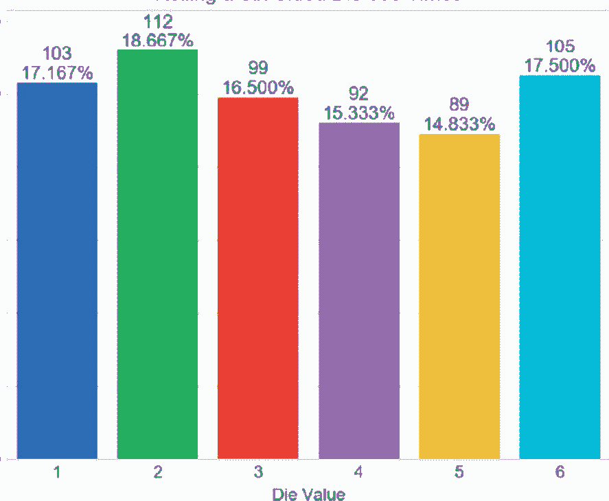

这里我们期望每个骰子面出现约 100 次。然而，在掷骰子次数如此少的情况下，没有任何频率正好是 100（尽管有几个很接近），且大多数百分比也不接近 16.667%（约为 1/6）。当我们运行 60,000 次掷骰子的模拟时，柱子的大小会变得非常接近。在 6,000,000 次掷骰子时，它们看起来将大小完全相同。这就是“大数定律”在起作用。下一章将展示柱长度的动态变化。

我们将讨论如何控制图表的外观和内容，包括：

- 窗口内的图表标题（掷六面骰子 600 次），
- x 轴的描述性标签“骰子面值”和 y 轴的描述性标签“频率”，
- 每个柱子上方显示的文本，表示频率和总掷骰次数的百分比，以及
- 柱子的颜色。

我们将使用各种 Seaborn 默认选项。例如，Seaborn 根据骰子面值 1–6 确定 x 轴上的文本标签，并根据实际的骰子频率确定 y 轴上的文本标签。在幕后，Matplotlib 根据窗口大小和柱子所表示数值的大小来确定柱子的位置和大小。它还根据柱子所表示的实际骰子频率来定位 **频率** 轴的数值标签。还有更多可自定义的功能。你应根据个人偏好调整这些属性。

下面的第一个屏幕截图显示了 60,000 次掷骰子的结果——想象一下亲手做这件事有多困难。在这种情况下，我们期望每个面出现约 10,000 次。下面的第二个屏幕截图显示了 6,000,000 次掷骰子的结果——这肯定是你绝不会亲手去做的事情！在这种情况下，我们期望每个面出现约 1,000,000 次，且频率柱看起来长度相同（它们很接近，但并不完全相同）。请注意，掷骰子次数越多，频率百分比就越接近预期的 16.667%。

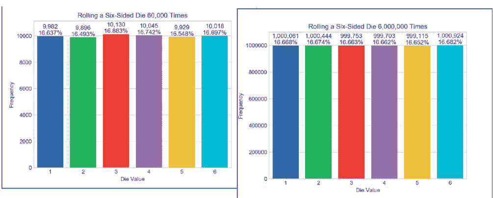

## 5.17.2 可视化掷骰子频率和百分比

在本节中，你将交互式地开发前一节中显示的条形图。

### 启动 IPython 以进行交互式 Matplotlib 开发

IPython 内置支持交互式开发 Matplotlib 图表，开发 Seaborn 图表也需要它。只需使用以下命令启动 IPython：

```
ipython --matplotlib
```

### 导入库

首先，让我们导入将要使用的库：

- 1. **matplotlib.pyplot** 模块包含我们使用的 Matplotlib 库的绘图功能。该模块通常以名称 `plt` 导入。
- 2. NumPy（Numerical Python）库包含我们将用于汇总掷骰子结果的 `unique` 函数。**numpy** 模块通常作为 `np` 导入。
- 3. `random` 模块包含 Python 的随机数生成功能。
- 4. **seaborn** 模块包含我们使用的 Seaborn 库的绘图功能。该模块通常以名称 `sns` 导入。搜索一下为何选择这个古怪的缩写。

点击此处查看代码图片

```python
In [1]: import matplotlib.pyplot as plt
In [2]: import numpy as np
In [3]: import random
In [4]: import seaborn as sns
```

### 掷骰子并计算骰子频率

接下来，让我们使用 *列表推导式* 创建一个包含 600 个随机骰子值的列表，然后使用 NumPy 的 `unique` 函数来确定唯一的掷骰子值（最可能是所有六个可能的面值）及其频率：

点击此处查看代码图片

```python
In [5]: rolls = [random.randrange(1, 7) for i in range(600)]
In [6]: values, frequencies = np.unique(rolls, return_counts=True)
```

NumPy 库提供了高性能的 **ndarray** 集合，其速度通常远快于列表。1 虽然我们在这里不直接使用 ndarray，但 NumPy 的 `unique` 函数期望一个 ndarray 参数并返回一个 ndarray。如果你传递一个列表（如 `rolls`），NumPy 会将其转换为 ndarray 以获得更好的性能。`unique` 返回的 ndarray 我们将简单地赋值给一个变量，供 Seaborn 绘图函数使用。

指定关键字参数 **return_counts=True** 会告诉 `unique` 统计每个唯一值出现的次数。在这种情况下，`unique` 返回一个包含两个一维 `ndarrays` 的元组，分别包含排序后的唯一值和相应的频率。我们将元组的 `ndarrays` 解包到变量 `values` 和 `frequencies` 中。如果 `return_counts` 为 `False`，则仅返回唯一值列表。

### 创建初始条形图

让我们创建条形图的标题，设置其样式，然后绘制骰子面值和频率：

点击此处查看代码图片

```python
In [7]: title = f'Rolling a Six-Sided Die {len(rolls):,} Times'

In [8]: sns.set_style('whitegrid')

In [9]: axes = sns.barplot(x=values, y=frequencies,      palette='bright')
```

片段 [7] 的 f-string 在条形图的标题中包含掷骰子的次数。下面代码中逗号（,）格式说明符

```
{len(rolls):,}
```

会使用 *千位分隔符* 显示数字——因此，60000 将显示为 60,000。

默认情况下，Seaborn 在纯白色背景上绘制图表，但它提供了多种样式可供选择（'darkgrid'、'whitegrid'、'dark'、'white' 和 'ticks'）。片段 [8] 指定了 'whitegrid' 样式，该样式在垂直条形图中显示浅灰色水平线。这些线条有助于你更轻松地了解每个条形的高度如何对应条形图左侧的数值频率标签。

片段 [9] 使用 Seaborn 的 `barplot` 函数绘制骰子频率。当你执行此片段时，将出现以下窗口（因为你使用 `--matplotlib` 选项启动了 IPython）：

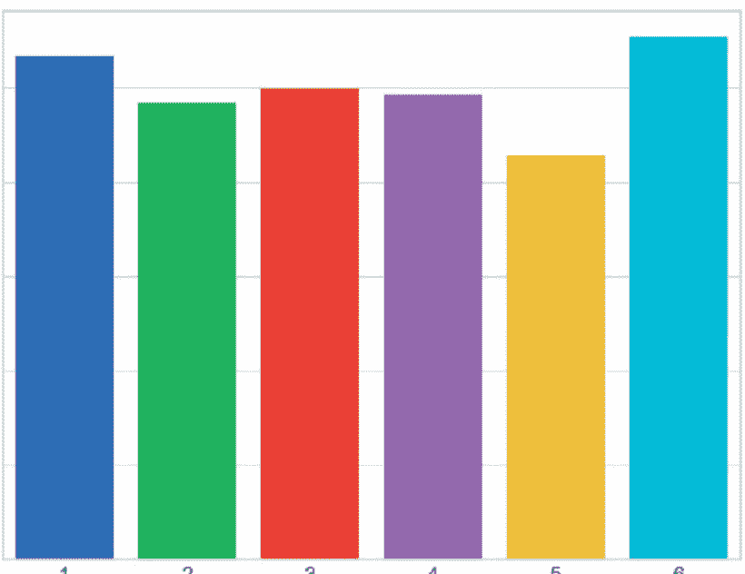

Seaborn 通过创建 Matplotlib Axes 对象来与 Matplotlib 交互以显示条形，该对象管理窗口中出现的内容。在幕后，Seaborn 使用 Matplotlib Figure 对象来管理 Axes 将出现的窗口。barplot 函数的前两个参数分别是包含 x 轴和 y 轴值的 ndarray。我们使用了可选的 palette 关键字参数来选择 Seaborn 预定义的颜色调色板 'bright'。你可以在以下网址查看调色板选项：

https://seaborn.pydata.org/tutorial/color_palettes.html

barplot 函数返回它配置的 Axes 对象。我们将其赋值给变量 axes，以便可以用它来配置最终图表的其他方面。在此点之后对条形图所做的任何更改，在执行相应片段时都会立即显示。

### 设置窗口标题并为 x 轴和 y 轴添加标签

接下来的两个片段为条形图添加了一些描述性文本：

点击此处查看代码图片

```python
In [10]: axes.set_title(title)
Out[10]: Text(0.5,1,'Rolling a Six-Sided Die 600 Times')
```

```python
In [11]: axes.set(xlabel='Die Value', ylabel='Frequency')
Out[11]: [Text(92.6667, 0.5, 'Frequency'), Text(0.5, 58.7667, 'Die Value')]
```

片段 [10] 使用 axes 对象的 set_title 方法在图表上方居中显示标题字符串。该方法返回一个包含标题及其在窗口中位置的 Text 对象，IPython 仅将其显示为输出以供确认。你可以忽略上面片段中的 Out[]。

片段 [11] 为每个轴添加标签。set 方法接收用于设置 Axes 对象属性的关键字参数。该方法沿 x 轴显示 xlabel 文本，沿 y 轴显示 ylabel 文本，并返回一个包含标签及其位置的 Text 对象列表。条形图现在如下所示：

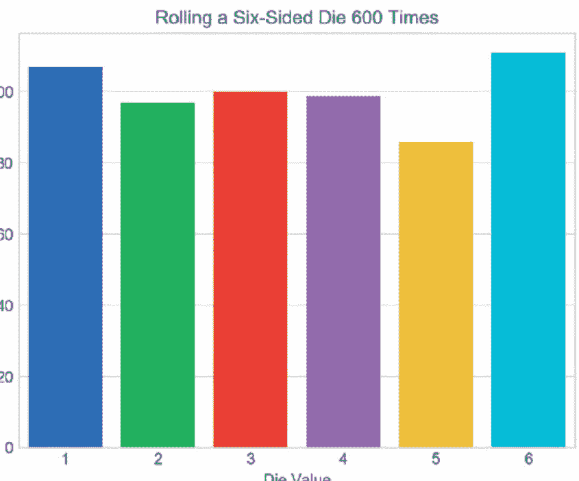

### 完成条形图

接下来的两个片段通过为每个柱子上方的文本腾出空间，然后显示它来完成图表：

点击此处查看代码图片

```python
In [12]: axes.set_ylim(top=max(frequencies) * 1.10)
```


Out[12]: (0.0, 122.10000000000001)

```python
In [13]: for bar, frequency in zip(axes.patches, frequencies):
    ...:     text_x = bar.get_x() + bar.get_width() / 2.0
    ...:     text_y = bar.get_height()
    ...:     text = f'{frequency:,}\n{frequency / len(rolls):.3%}'
    ...:     axes.text(text_x, text_y, text,
    ...:             fontsize=11, ha='center', va='bottom')
    ...: 
```

为在柱状图上方为文本腾出空间，代码段 [12] 将 y 轴缩放 10%。我们通过实验选择了这个值。Axes 对象的 set_ylim 方法有许多可选关键字参数。在此，我们仅使用 top 来更改 y 轴所表示的最大值。我们将最大频率乘以 1.10，以确保 y 轴比最高的柱状图高 10%。

最后，代码段 [13] 显示每个柱状图的频率值和总掷骰次数的百分比。Axes 对象的 patches 集合包含表示图表柱状图的二维彩色形状。for 语句使用 zip 遍历 patches 及其对应的频率值。每次迭代都将 zip 返回的元组之一解包为 bar 和 frequency。for 语句的套件操作如下：

- 第一条语句计算文本将出现的中心 x 坐标。我们将此计算为柱状图左边缘 x 坐标 (bar.get_x()) 与柱状图宽度一半 (bar.get_width() / 2.0) 之和。
- 第二条语句获取文本将出现的 y 坐标——bar.get_y() 表示柱状图的顶部。
- 第三条语句创建一个包含该柱状图频率和总掷骰次数对应百分比的两行字符串。
- 最后一条语句调用 Axes 对象的 text 方法在柱状图上方显示文本。此方法的前两个参数指定文本的 x-y 位置，第三个参数是要显示的文本。关键字参数 ha 指定水平对齐方式——我们围绕 x 坐标水平居中文本。关键字参数 va 指定垂直对齐方式——我们将文本底部与 y 坐标对齐。最终的柱状图如下所示：


## 再次掷骰并更新柱状图——介绍 IPython 魔法命令

既然你已经创建了一个漂亮的柱状图，你可能想尝试不同的掷骰次数。首先，通过调用 Matplotlib 的 `cla` (clear axes) 函数清除现有图表：

```python
In [14]: plt.cla()
```

IPython 提供称为 **魔法命令** 的特殊命令，用于方便地执行各种任务。让我们使用 `%recall magic` 获取创建了 `rolls` 列表的代码段 [5]，并将代码放在下一个 `In []` 提示符处：

点击此处查看代码图片

```python
In [15]: %recall 5

In [16]: rolls = [random.randrange(1, 7) for i in range(600)]
```

你现在可以编辑代码段，将掷骰次数更改为 60000，然后按 *Enter* 创建新列表：

点击此处查看代码图片

```python
In [16]: rolls = [random.randrange(1, 7) for i in range(60000)]
```

接下来，回调代码段 [6] 到 [13]。这将在下一个 In [] 提示符处显示指定范围内的所有代码段。按 Enter 键重新执行这些代码段：

点击此处查看代码图片

```python
In [17]: %recall 6-13
```

```python
In [18]: values, frequencies = np.unique(rolls, return_counts=True)
....: title = f'Rolling a Six-Sided Die {len(rolls):,} Times'
....: sns.set_style('whitegrid')
....: axes = sns.barplot(x=values, y=frequencies, palette='bright')
....: axes.set_title(title)
....: axes.set(xlabel='Die Value', ylabel='Frequency')
....: axes.set_ylim(top=max(frequencies) * 1.10)
....: for bar, frequency in zip(axes.patches, frequencies):
....:     text_x = bar.get_x() + bar.get_width() / 2.0
....:     text_y = bar.get_height()
....:     text = f'{frequency:,}\n{frequency / len(rolls):.3%}'
....:     axes.text(text_x, text_y, text,
....:             fontsize=11, ha='center', va='bottom')
....:
```

更新后的柱状图如下所示：


## 使用 %save 魔法命令将代码段保存到文件

一旦你交互式地创建了图表，你可能希望将代码保存到文件中，以便将其转换为脚本并在将来运行。让我们使用 %save 魔法命令将代码段 1 到 13 保存到名为 RollDie.py 的文件。IPython 指示写入行的文件，然后显示它保存的行：

点击此处查看代码图片

```python
In [19]: %save RollDie.py 1-13
The following commands were written to file `RollDie.py`:
import matplotlib.pyplot as plt
import numpy as np
import random
import seaborn as sns
rolls = [random.randrange(1, 7) for i in range(600)]
values, frequencies = np.unique(rolls, return_counts=True)
title = f'Rolling a Six-Sided Die {len(rolls):,} Times'
sns.set_style("whitegrid")
axes = sns.barplot(values, frequencies, palette='bright')
axes.set_title(title)
axes.set(xlabel='Die Value', ylabel='Frequency')
axes.set_ylim(top=max(frequencies) * 1.10)
for bar, frequency in zip(axes.patches, frequencies):
    text_x = bar.get_x() + bar.get_width() / 2.0
    text_y = bar.get_height()
    text = f'{frequency:,}\n{frequency / len(rolls):.3%}'
    axes.text(text_x, text_y, text,
        fontsize=11, ha='center', va='bottom')
```

## 命令行参数；从脚本显示图表

本章示例中提供了你上面保存的 RollDie.py 文件的编辑版本。我们添加了注释和两处修改，以便你可以运行带有指定掷骰次数的参数的脚本，如下所示：

```bash
ipython RollDie.py 600
```

Python 标准库的 sys 模块使脚本能够接收传递到程序中的命令行参数。这些参数包括脚本的名称以及执行脚本时出现在其右侧的任何值。sys 模块的 argv 列表包含这些参数。在上述命令中，argv[0] 是字符串 'RollDie.py'，argv[1] 是字符串 '600'。为了使用命令行参数的值来控制掷骰次数，我们修改了创建 rolls 列表的语句，如下所示：

点击此处查看代码图片

```python
rolls = [random.randrange(1, 7) for i in range(int(sys.argv[1]))]
```

注意，我们将 argv[1] 字符串转换为 int。

*Matplotlib 和 Seaborn 在你在脚本中创建图表时不会自动为你显示图表。* 因此，在脚本末尾我们添加了对 Matplotlib **show** 函数的调用，该调用显示包含图表的窗口：

```python
plt.show()
```

### 5.18 总结

本章介绍了列表和元组序列的更多细节。你创建了列表，访问了它们的元素并确定了它们的长度。你看到列表是可变的，因此你可以修改它们的内容，包括在程序执行过程中增长和缩小列表。你看到访问不存在的元素会导致 `IndexError`。你使用 `for` 语句遍历列表元素。

我们讨论了元组，它们像列表一样是序列，但是不可变的。你将元组的元素解包为单独的变量。你使用 `enumerate` 创建一个元组的可迭代对象，每个元组包含一个列表索引和相应的元素值。

你了解到所有序列都支持切片，切片创建包含原始元素子集的新序列。你使用 `del` 语句从列表中删除元素并从交互式会话中删除变量。我们将列表、列表元素和列表切片传递给函数。你了解了如何搜索和排序列表，以及如何搜索元组。我们使用列表方法插入、追加和删除元素，并反转列表的元素和复制列表。

我们展示了如何使用列表模拟栈。我们使用简洁的列表推导式表示法创建新列表。我们使用其他内置方法对列表元素求和、反向遍历列表、查找最小值和最大值、过滤值以及将值映射到新值。我们展示了嵌套列表如何表示二维表，其中数据按行和列排列。你看到了嵌套 `for` 循环如何处理二维列表。

本章以一个数据科学入门部分结束，该部分介绍了一个骰子-


滚动模拟和静态可视化。一个详细的代码示例使用了 Seaborn 和 Matplotlib 可视化库，创建了模拟最终结果的*静态*条形图可视化。在下一节“数据科学简介”中，我们使用带有*动态*条形图可视化的掷骰子模拟，使图表“活起来”。

在下一章“字典和集合”中，我们将继续讨论 Python 的内置集合。我们将使用字典存储键值对的无序集合，将不可变键映射到值，就像传统字典将单词映射到定义一样。我们将使用集合存储唯一元素的无序集合。

在“使用 NumPy 进行面向数组的编程”一章中，我们将更详细地讨论 NumPy 的 `ndarray` 集合。你会发现，列表适合少量数据，但对于大数据分析应用中遇到的大量数据来说，效率不高。在这种情况下，应使用 NumPy 库高度优化的 `ndarray` 集合。`ndarray`（*n*维数组）比列表快得多。我们将运行 Python 性能分析测试，看看快多少。正如你将看到的，NumPy 还包含许多功能，可以方便高效地操作*许多*维的数组。在大数据分析应用中，处理需求可能是巨大的，因此我们能做的一切显著提升性能的工作都很重要。在我们的“大数据：Hadoop、Spark、NoSQL 和 IoT”一章中，你将使用最流行的高性能大数据数据库之一——MongoDB。[^2]

[^2]: 数据库名称源自单词“humongous”。

## 6. 字典和集合

### 目标

- 使用字典表示无序的键值对集合。
- 使用集合表示唯一值的无序集合。
- 创建、初始化并引用字典和集合的元素。
- 遍历字典的键、值和键值对。
- 添加、删除和更新字典的键值对。
- 使用字典和集合的比较运算符。
- 使用集合运算符和方法组合集合。
- 使用运算符 `in` 和 `not in` 判断字典是否包含某个键或集合是否包含某个值。
- 使用可变集合操作修改集合的内容。
- 使用推导式快速便捷地创建字典和集合。
- 学习如何构建动态可视化。
- 加深对可变性和不可变性的理解。

### 大纲

- .1 简介
- .2 字典
- .2.1 创建字典
- .2.2 遍历字典
- .2.3 字典基本操作
- .2.4 字典方法 `keys` 和 `values`
- .2.5 字典比较
- .2.6 示例：学生成绩字典
- .2.7 示例：单词计数
- .2.8 字典方法 `update`
- .2.9 字典推导式
- .3 集合
- .3.1 比较集合
- .3.2 数学集合运算
- .3.3 可变集合运算符和方法
- .3.4 集合推导式
- .4 数据科学简介：动态可视化
- .4.1 动态可视化的工作原理
- .4.2 实现动态可视化
- .5 总结

### 6.1 简介

我们已经讨论了三个内置序列集合——字符串、列表和元组。现在，我们来考虑内置非序列集合——字典和集合。**字典**是一个*无序*集合，用于存储**键值对**，将不可变键映射到值，就像普通字典将单词映射到定义一样。**集合**是唯一不可变元素的无序集合。

### 6.2 字典

字典将键与值相关联。每个键映射到特定值。下表包含字典示例及其键、键类型、值和值类型：

| 键 | 键类型 | 值 | 值类型 |
|---|---|---|---|
| 国家名称 | str | 互联网国家代码 | str |
| 十进制数 | int | 罗马数字 | str |
| 州 | str | 农产品 | str 列表 |
| 医院病人 | str | 生命体征 | int 和 float 的元组 |
| 棒球运动员 | str | 打击率 | float |
| 公制度量 | str | 缩写 | str |
| 库存代码 | str | 库存数量 | int |

### 唯一键

字典的键必须是*不可变*的（例如字符串、数字或元组）且*唯一*（即不允许重复）。多个键可以具有相同的值，例如两个不同的库存代码具有相同的库存数量。

### 6.2.1 创建字典

可以通过在花括号 `{}` 中括起逗号分隔的键值对列表来创建字典，每个键值对的形式为 *键*: *值*。可以使用 `{}` 创建空字典。

让我们创建一个字典，使用国家名称键 'Finland'、'South Africa' 和 'Nepal'，以及它们对应的互联网国家代码值 'fi'、'za' 和 'np'：

```python
In [1]: country_codes = {'Finland': 'fi', 'South Africa': 'za',
     ...:                         'Nepal': 'np'}
     ...: 
In [2]: country_codes
Out[2]: {'Finland': 'fi', 'South Africa': 'za', 'Nepal': 'np'}
```

输出字典时，其逗号分隔的键值对列表始终用花括号括起来。因为字典是*无序*集合，显示顺序可能与键值对添加到字典的顺序不同。在片段 [2] 的输出中，键值对按插入顺序显示，但请*不要*编写依赖于键值对顺序的代码。

### 判断字典是否为空

内置函数 `len` 返回字典中的键值对数量：

```python
In [3]: len(country_codes)
Out[3]: 3
```

可以将字典用作条件来判断其是否为空——非空字典求值为 *True*：

```python
In [4]: if country_codes:
    ...:     print('country_codes is  not empty')
    ...: else:
    ...:     print('country_codes is  empty')
    ...:
country_codes is not empty
```

空字典求值为 False。为演示这一点，在以下代码中我们调用 clear 方法删除字典的键值对，然后在片段 [6] 中调用并重新执行片段 [4]：

```python
In [5]: country_codes.clear()
In [6]: if country_codes:
    ...:     print('country_codes is  not empty')
    ...:     else:
    ...:     print('country_codes is  empty')
    ...:
country_codes is empty
```

### 6.2.2 遍历字典

以下字典将月份名称字符串映射到表示对应月份天数的 int 值。注意，多个键可以具有相同的值：

```python
In [1]: days_per_month = {'January': 31, 'February': 28, 'March': 31}
In [2]: days_per_month
Out[2]: {'January': 31, 'February': 28, 'March': 31}
```

同样，字典的字符串表示显示按插入顺序排列的键值对，但这并不保证，因为字典是无序的。我们将在本章后面展示如何按排序顺序处理键。

以下 for 语句遍历 days_per_month 的键值对。字典方法 items 将每个键值对作为元组返回，我们将其解包为 month 和 days：

```python
In [3]: for month, days in days_per_month.items():
    ...:     print(f'{month} has {days} days')
    ...:
January has 31 days
February has 28 days
March has 31 days
```

### 6.2.3 字典基本操作

在本节中，让我们先创建并显示字典 roman_numerals。我们故意为键 'X' 提供错误值 100，稍后将更正：

```python
In [1]: roman_numerals = {'I': 1, 'II': 2, 'III': 3, 'V': 5, 'X': 100}

In [2]: roman_numerals
Out[2]: {'I': 1, 'II': 2, 'III': 3, 'V': 5, 'X': 100}
```

### 访问键关联的值

让我们获取键 'V' 关联的值：

```python
In [3]: roman_numerals['V']
Out[3]: 5
```

### 更新现有键值对的值

可以在赋值语句中更新键的关联值，我们在这里执行此操作以替换键 'X' 关联的错误值：

```python
In [4]: roman_numerals['X'] = 10

In [5]: roman_numerals
Out[5]: {'I': 1, 'II': 2, 'III': 3, 'V': 5, 'X': 10}
```

### 添加新键值对


向不存在的键赋值会在字典中插入该键值对：

单击此处查看代码图片

```
In [6]: roman_numerals['L'] = 50

In [7]: roman_numerals
Out[7]: {'I': 1, 'II': 2, 'III': 3, 'V': 5, 'X': 10, 'L': 50}
```

字符串键区分大小写。向不存在的键赋值会插入新的键值对。这可能是你想要的，也可能是一个逻辑错误。

## 删除键值对

可以使用 del 语句从字典中删除键值对：

单击此处查看代码图片

```
In [8]: del roman_numerals['III']

In [9]: roman_numerals
Out[9]: {'I': 1, 'II': 2, 'V': 5, 'X': 10, 'L': 50}
```

也可以使用字典方法 pop 删除键值对，该方法返回被删除键对应的值：

单击此处查看代码图片

```
In [10]: roman_numerals.pop('X')
Out[10]: 10

In [11]: roman_numerals
Out[11]: {'I': 1, 'II': 2, 'V': 5, 'L': 50}
```

## 尝试访问不存在的键

访问不存在的键会导致 KeyError：

单击此处查看代码图片

```
In [12]: roman_numerals['III']

KeyError
Traceback (most recent call last):
```

```
<ipython-input-12-ccd50c7f0c8b> in <module>()
 ---> 1 roman_numerals['III']

KeyError: 'III'
```

可以使用字典方法 get 防止此错误，该方法通常返回其参数对应的值。如果未找到该键，get 返回 None。IPython 在代码段 [13] 中返回 None 时不显示任何内容。如果为 get 指定第二个参数，则在键未找到时返回该值：

单击此处查看代码图片

```
In [13]: roman_numerals.get('III')

In [14]: roman_numerals.get('III', 'III not in dictionary')
Out[14]: 'III not in dictionary'

In [15]: roman_numerals.get('V')
Out[15]: 5
```

## 测试字典是否包含指定的键

运算符 in 和 not in 可用于确定字典是否包含指定的键：

单击此处查看代码图片

```
In [16]: 'V' in roman_numerals
Out[16]: True

In [17]: 'III' in roman_numerals
Out[17]: False

In [18]: 'III' not in roman_numerals
Out[18]: True
```

## 6.2.4 字典方法 keys 和 values

此前，我们使用字典方法 items 遍历字典键值对的元组。同样，方法 keys 和 values 分别用于仅遍历字典的键或值：

单击此处查看代码图片

```
```python
In [1]: months = {'January': 1, 'February': 2, 'March': 3}

In [2]: for month_name in months.keys():
   ....:     print(month_name, end=' ')
   ....: 
January February March

In [3]: for month_number in months.values():
   ....:     print(month_number, end=' ')
   ....: 
1 2 3
```
```

## 字典视图

字典方法 items、keys 和 values 各自返回字典数据的一个视图。
遍历视图时，它会“看到”字典当前的内容——它不维护数据的副本。

为了说明视图不维护字典数据的副本，我们先将 keys 返回的视图保存到变量 months_view，然后遍历它：

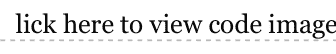

```
```python
In [4]: months_view = months.keys()

In [5]: for key in months_view:
   ....:     print(key, end=' ')
   ....: 
January February March
```
```

接下来，我们向 months 添加新的键值对并显示更新后的字典：

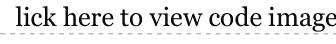

```
```python
In [6]: months['December'] = 12

In [7]: months
Out[7]: {'January': 1, 'February': 2, 'March': 3, 'December': 12}
```
```

现在，我们再次遍历 months_view。上面添加的键确实会被显示：

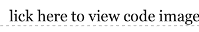

```
In [8]: for key in months_view:
    ...:     print(key, end=' ')
    ...:
January February March December
```

遍历视图时，不要修改字典。根据 Python 标准库文档第 4.10.1 节，^1 你会得到 RuntimeError，或者循环可能不会处理视图的所有值。

^1 https://docs.python.org/3/library/stdtypes.html#dictionary-view-objects.

## 将字典键、值和键值对转换为列表

你可能偶尔需要字典的键、值或键值对的列表。要获取此类列表，请将 keys、values 或 items 返回的视图传递给内置的 list 函数。修改这些列表不会修改对应的字典：

单击此处查看代码图片

```
In [9]: list(months.keys())
Out[9]: ['January', 'February', 'March', 'December']

In [10]: list(months.values())
Out[10]: [1, 2, 3, 12]

In [11]: list(months.items())
Out[11]: [('January', 1), ('February', 2), ('March', 3), ('December', 12)]
```

## 按排序顺序处理键

若要按排序顺序处理键，可以按如下方式使用内置函数 sorted：

单击此处查看代码图片

```
In [12]: for month_name in sorted(months.keys()):
    ...:     print(month_name, end=' ')
    ...:
February December January March
```

## 6.2.5 字典比较

比较运算符 == 和 != 可用于确定两个字典的内容是否相同或不同。如果两个字典具有相同的键值对，则等于（==）比较的结果为 True，而不管这些键值对添加到每个字典的顺序如何：

单击此处查看代码图片

```
In [1]: country_capitals1 = {'Belgium': 'Brussels', 'Haiti': 'Port-au-Prince'}

In [2]: country_capitals2 = {'Nepal': 'Kathmandu', 'Uruguay': 'Montevideo'}

In [3]: country_capitals3 = {'Haiti': 'Port-au-Prince', 'Belgium': 'Brussels'}

In [4]: country_capitals1 == country_capitals2
Out[4]: False

In [5]: country_capitals1 == country_capitals3
Out[5]: True

In [6]: country_capitals1 != country_capitals2
Out[6]: True
```

## 6.2.6 示例：学生成绩字典

下面的脚本将教师的成绩簿表示为一个字典，该字典将每个学生的姓名（字符串）映射到包含该学生三场考试成绩的整数列表。在显示数据的循环（第 13–17 行）的每次迭代中，我们将键值对解包为变量 name 和 grades，分别包含一个学生的姓名和对应的三个成绩列表。第 14 行使用内置函数 sum 计算给定学生的成绩总和，然后第 15 行通过将总和除以该学生的成绩数量（len(grades)）来计算并显示该学生的平均分。第 16–17 行分别跟踪所有四名学生的成绩总和和所有学生的成绩数量。第 19 行打印所有学生在所有考试中的班级平均分。

单击此处查看代码图片

```
1 # fig06_01.py

2 """Using a dictionary to represent an instructor's grade book."""

3 grade_book = {
4     'Susan': [92, 85, 100],
5     'Eduardo': [83, 95, 79],
6     'Azizi': [91, 89, 82],
7     'Pantipa': [97, 91, 92]
8 }
9
10 all_grades_total = 0
11 all_grades_count = 0
12
13 for name, grades in grade_book.items():
14     total = sum(grades)
15     print(f'Average for {name} is {(total/len(grades)):.2f}')
16     all_grades_total += total
17     all_grades_count += len(grades)
18
19 print(f"Class's average is: {all_grades_total / all_grades_count:.2f}")
```

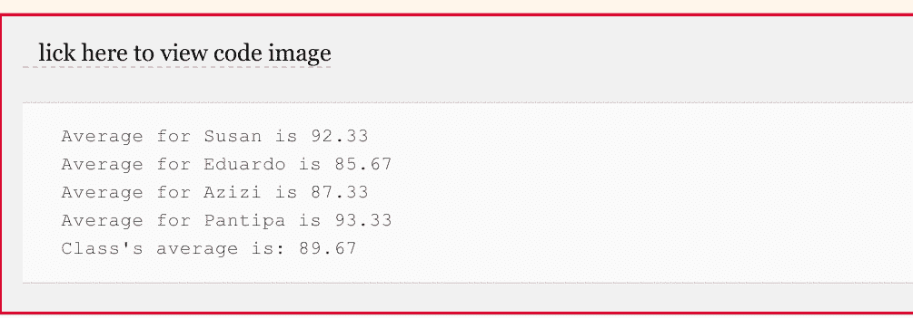

## 6.2.7 示例：单词计数

诸如单词频率统计之类的技术常用于分析已发表的作品。例如，有些人认为威廉·莎士比亚的作品实际上可能是由弗朗西斯·培根爵士、克里斯托弗·马洛或其他人所写。将他们的作品与莎士比亚的作品进行单词频率比较可以揭示写作风格的相似性。我们将在自然语言处理（NLP）章节中探讨其他文档分析技术。

下面的脚本构建一个字典来统计字符串中每个单词出现的次数。第 4–5 行创建一个字符串 text，我们将其拆分为单词——这个过程称为字符串分词。Python 会自动连接括号中由空格分隔的字符串。第 7 行创建一个空字典。字典的键将是唯一单词，其值将是整数计数，表示每个单词在 text 中出现的次数。


点击此处查看代码图像

```python
# fig06_02.py
"""Tokenizing a string and counting unique words."""
text = ('this is sample text with several words '
    'this is more sample text with some different words')
word_counts = {}
# count occurrences of each unique word
for word in text.split():
    if word in word_counts:
        word_counts[word] += 1 # update existing key-value pair
    else:
        word_counts[word] = 1 # insert new key-value pair
print(f'{"WORD":<12}COUNT')
for word, count in sorted(word_counts.items()):
    print(f'{word:<12}{count}')
print('\nNumber of unique words:', len(word_counts))
```

点击此处查看代码图像

| 单词 | 计数 |
|------|------|
| different | 1 |
| is | 2 |
| more | 1 |
| sample | 2 |
| several | 1 |
| some | 1 |
| text | 2 |
| this | 2 |
| with | 2 |
| words | 2 |

唯一单词数量: 10

第 10 行通过调用字符串方法 split 对文本进行分词，该方法使用其分隔符字符串参数来分隔单词。如果不提供参数，split 使用空格。该方法返回一个标记列表（即文本中的单词）。第 10–14 行遍历单词列表。对于每个单词，第 11 行判断该单词（键）是否已在字典中。如果是，第 12 行递增该单词的计数；否则，第 14 行插入一个新的键–值对，该单词的初始计数为 1。

第 16–21 行在一个包含每个 `word` 及其对应 `count` 的两列表格中汇总结果。第 18 和 19 行中的 `for` 语句遍历字典的键–值对。它将每个键和值解包到变量 `word` 和 `count` 中，然后以两列显示它们。第 21 行显示唯一单词的数量。

## Python 标准库模块 collections

Python 标准库已经包含了我们使用字典和第 10–14 行的循环实现的计数功能。模块 `collections` 包含类型 `Counter`，它接收一个可迭代对象并总结其元素。让我们用 `Counter` 以更少的代码行重新实现前面的脚本：

点击此处查看代码图像

```python
In [1]: from collections import Counter

In [2]: text = ('this is sample text  with several words '
    ...:     'this is more sample text with some different words')
    ...:

In [3]: counter = Counter(text.split())

In [4]: for word, count in sorted(counter.items()):
    ...:     print(f'{word:<12}{count}')
    ...:
```

| 单词 | 计数 |
|------|------|
| different | 1 |
| is | 2 |
| more | 1 |
| sample | 2 |
| several | 1 |
| some | 1 |
| text | 2 |
| this | 2 |
| with | 2 |
| words | 2 |

```python
In [5]: print('Number of unique keys:', len(counter.keys()))
Number of unique keys: 10
```

代码片段 [3] 创建 `Counter`，它总结 `text.split()` 返回的字符串列表。在代码片段 [4] 中，`Counter` 方法 `items` 以元组形式返回每个字符串及其关联的计数。我们使用内置函数 `sorted` 来获取这些元组的列表并按升序排列。默认情况下，sorted 按元组的第一个元素排序。如果它们相同，则查看第二个元素，依此类推。for 语句迭代得到的排序列表，以两列显示每个单词和计数。

## 6.2.8 字典方法 update

您可以使用字典方法 update 插入和更新键–值对。首先，让我们创建一个空的 country_codes 字典：

```python
In [1]: country_codes = {}
```

以下 update 调用接收一个要插入或更新的键–值对字典：

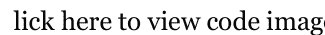

```python
In [2]: country_codes.update({'South Africa': 'za'})

In [3]: country_codes
Out[3]: {'South Africa': 'za'}
```

方法 update 可以将关键字参数转换为键–值对以插入。以下调用自动将参数名 Australia 转换为字符串键 'Australia'，并将值 'ar' 关联到该键：

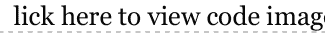

```python
In [4]: country_codes.update(Australia='ar')

In [5]: country_codes
Out[5]: {'South Africa': 'za', 'Australia': 'ar'}
```

代码片段 [4] 为 Australia 提供了错误的国家代码。让我们通过使用另一个关键字参数来更正与 'Australia' 关联的值：

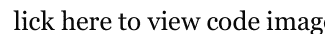

```python
In [6]: country_codes.update(Australia='au')

In [7]: country_codes
Out[7]: {'South Africa': 'za', 'Australia': 'au'}
```

方法 update 还可以接收包含键–值对的可迭代对象，例如两个元素的元组列表。

## 6.2.9 字典推导式

字典推导式提供了一种方便的表示法，用于快速生成字典，通常是将一个字典映射到另一个字典。例如，在具有唯一值的字典中，您可以反转键–值对：

点击此处查看代码图像

```python
In [1]: months = {'January': 1, 'February': 2, 'March': 3}

In [2]: months2 = {number: name for name, number in months.items()}

In [3]: months2
Out[3]: {1: 'January', 2: 'February', 3: 'March'}
```

花括号界定字典推导式，for 子句左侧的表达式指定形式为 key: value 的键–值对。推导式遍历 months.items()，将每个键–值对元组解包到变量 name 和 number 中。表达式 number: name 反转键和值，因此新字典将月份数字映射到月份名称。

如果 months 包含重复值会怎样？由于这些值成为 months2 中的键，尝试插入重复键只是更新现有键的值。因此，如果 'February' 和 'March' 原本都映射到 2，则上述代码将产生

```python
{1: 'January', 2: 'March'}
```

字典推导式还可以将字典的值映射到新值。以下推导式将名称和成绩列表的字典转换为名称和绩点平均分的字典。变量 k 和 v 通常表示键和值：

点击此处查看代码图像

```python
In [4]: grades = {'Sue': [98, 87, 94], 'Bob': [84, 95, 91]}

In [5]: grades2 = {k: sum(v) / len(v) for k, v in grades.items()}

In [6]: grades2
Out[6]: {'Sue': 93.0, 'Bob': 90.0}
```

推导式将 `grades.items()` 返回的每个元组解包为 `k`（名称）和 `v`（成绩列表）。然后，推导式创建一个新的键–值对，键为 `k`，值为 `sum(v) / len(v)`，该值对列表的元素求平均。

## 6.3 集合

集合是 `unique` 值的无序集合。集合只能包含不可变对象，如字符串、`int`s、`float`s 以及仅包含不可变元素的元组。虽然集合是可迭代的，但它们不是序列，不支持使用方括号 `[]` 进行索引和切片。字典也不支持切片。

### 使用花括号创建集合

以下代码创建一个名为 `colors` 的字符串集合：

点击此处查看代码图像

```python
In [1]: colors = {'red', 'orange', 'yellow', 'green', 'red', 'blue'}

In [2]: colors
Out[2]: {'blue', 'green', 'orange', 'red', 'yellow'}
```

请注意，重复字符串 `'red'` 被忽略了（未引起错误）。集合的一个重要用途是**重复值消除**，创建集合时会自动完成。此外，结果集合的值 _不_ 按代码片段 [1] 中列出的顺序显示。虽然颜色名称按排序顺序显示，但集合是 _unordered_ 的。您不应编写依赖于元素顺序的代码。

### 确定集合的长度

您可以使用内置 `len` 函数确定集合中的项目数量：

```python
In [3]: len(colors)
Out[3]: 5
```

### 检查值是否在集合中

您可以使用 `in` 和 `not in` 运算符检查集合是否包含特定值：

点击此处查看代码图像

```python
In [4]: 'red' in colors
Out[4]: True

In [5]: 'purple' in colors
Out[5]: False

In [6]: 'purple' not in colors
Out[6]: True
```

### 遍历集合

集合是可迭代的，因此您可以使用 `for` 循环处理每个集合元素：

点击此处查看代码图像

```python
In [7]: for color in colors:
    ....:     print(color.upper(), end=' ')
    ....:
RED GREEN YELLOW BLUE ORANGE
```

集合是 `unordered` 的，因此迭代顺序没有意义。

### 使用内置 `set` 函数创建集合

您可以使用内置 `set` 函数从另一组值创建集合——这里我们创建一个包含多个重复整数值的列表，并将该列表用作 `set` 的参数：

点击此处查看代码图像

```python
In [8]: numbers = list(range(10)) + list(range(5))

In [9]: numbers
Out[9]: [0, 1, 2, 3, 4, 5, 6, 7, 8, 9, 0, 1, 2, 3, 4]

In [10]: set(numbers)
Out[10]: {0, 1, 2, 3, 4, 5, 6, 7, 8, 9}
```

如果需要创建空集合，必须使用带有空括号的 `set` 函数，而不是空花括号 `{}`，因为后者表示空字典：


```
In [11]: set()
Out[11]: set()
```

Python 显示空集为 `set()`，以避免与 Python 对空字典的字符串表示（`{}`）混淆。

### Frozenset：不可变集合类型

集合是 *可变* 的——你可以添加和删除元素，但集合 *元素* 必须是 *不可变* 的。因此，集合不能有其他集合作为元素。一个 **frozenset** 是一个 *不可变* 集合——创建后它不能被修改，因此集合 *可以* 包含 frozensets 作为元素。内置函数 `frozenset` 从任何可迭代对象创建一个 frozenset。

## 6.3.1 比较集合

各种运算符和方法可用于比较集合。以下集合包含相同的值，因此 == 返回 `True` 而 != 返回 `False`。

点击此处查看代码图像

```python
In [1]: {1, 3, 5} == {3, 5, 1}
Out[1]: True

In [2]: {1, 3, 5} != {3, 5, 1}
Out[2]: False
```

`<` 运算符测试其左侧的集合是否是右侧集合的 **真子集**——也就是说，左操作数中的所有元素都在右操作数中，且两个集合不相等：

点击此处查看代码图像

```python
In [3]: {1, 3, 5} < {3, 5, 1}
Out[3]: False

In [4]: {1, 3, 5} < {7, 3, 5, 1}
Out[4]: True
```

`<=` 运算符测试其左侧的集合是否是右侧集合的 **非真子集**——也就是说，左操作数中的所有元素都在右操作数中，且两个集合可能相等：

点击此处查看代码图像

```python
In [5]: {1, 3, 5} <= {3, 5, 1}
Out[5]: True

In [6]: {1, 3} <= {3, 5, 1}
Out[6]: True
```

你也可以使用集合方法 `issubset` 来检查非真子集：

点击此处查看代码图像

```python
In [7]: {1, 3, 5}.issubset({3, 5, 1})
Out[7]: True

In [8]: {1, 2}.issubset({3, 5, 1})
Out[8]: False
```

`>` 运算符测试其左侧的集合是否是右侧集合的 **真超集**——也就是说，右操作数中的所有元素都在左操作数中，且左操作数的元素更多：

点击此处查看代码图像

```python
In [9]: {1, 3, 5} > {3, 5, 1}
Out[9]: False

In [10]: {1, 3, 5, 7} > {3, 5, 1}
Out[10]: True
```

`>=` 运算符测试其左侧的集合是否是右侧集合的 **非真超集**——也就是说，右操作数中的所有元素都在左操作数中，且两个集合可能相等：

点击此处查看代码图像

```python
In [11]: {1, 3, 5} >= {3, 5, 1}
Out[11]: True

In [12]: {1, 3, 5} >= {3, 1}
Out[12]: True

In [13]: {1, 3} >= {3, 1, 7}
Out[13]: False
```

你也可以使用集合方法 `issuperset` 来检查非真超集：

点击此处查看代码图像

```python
In [14]: {1, 3, 5}.issuperset({3, 5, 1})
Out[14]: True

In [15]: {1, 3, 5}.issuperset({3, 2})
Out[15]: False
```

`issubset` 或 `issuperset` 的参数可以是 *任何* 可迭代对象。当这些方法中的任何一个接收非集合可迭代参数时，它会先将可迭代对象转换为集合，然后再执行操作。

## 6.3.2 集合数学运算

本节介绍集合类型的数学运算符 |、&、- 和 ^ 以及相应的方法。

### 并集

两个集合的 **并集** 是包含两个集合中所有唯一元素的集合。你可以使用 | **运算符** 或集合类型的 **union** 方法来计算并集：

点击此处查看代码图像

```python
In [1]: {1, 3, 5} | {2, 3, 4}
Out[1]: {1, 2, 3, 4, 5}

In [2]: {1, 3, 5}.union([20, 20, 3, 40, 40])
Out[2]: {1, 3, 5, 20, 40}
```

像 | 这样的二元集合运算符的操作数都必须是集合。相应的集合方法可以接受任何可迭代对象作为参数——我们传递了一个列表。当数学集合方法接收非集合可迭代参数时，它会先将可迭代对象转换为集合，然后再应用数学操作。同样，尽管新集合的字符串表示显示按升序排列的值，但你不应编写依赖于此的代码。

### 交集

两个集合的 **交集** 是包含两个集合共有的所有唯一元素的集合。你可以使用 `&` 运算符或集合类型的 `intersection` 方法来计算交集：

点击此处查看代码图像

```python
In [3]: {1, 3, 5} & {2, 3, 4}
Out[3]: {3}

In [4]: {1, 3, 5}.intersection([1, 2, 2, 3, 3, 4, 4])
Out[4]: {1, 3}
```

### 差集

两个集合的 **差集** 是包含左操作数中但不在右操作数中的元素的集合。你可以使用 `-` 运算符或集合类型的 `difference` 方法来计算差集：

点击此处查看代码图像

```python
In [5]: {1, 3, 5} - {2, 3, 4}
Out[5]: {1, 5}

In [6]: {1, 3, 5, 7}.difference([2, 2, 3, 3, 4, 4])
Out[6]: {1, 5, 7}
```

### 对称差集

两个集合的 **对称差集** 是包含两个集合中不共有的元素的集合。你可以使用 `^` 运算符或集合类型的 `symmetric_difference` 方法来计算对称差集：

点击此处查看代码图像

```python
In [7]: {1, 3, 5} ^ {2, 3, 4}
Out[7]: {1, 2, 4, 5}

In [8]: {1, 3, 5, 7}.symmetric_difference([2, 2, 3, 3, 4, 4])
Out[8]: {1, 2, 4, 5, 7}
```

### 不相交集

如果两个集合没有任何共同元素，则它们是 **不相交** 的。你可以使用集合类型的 `isdisjoint` 方法来判断：

点击此处查看代码图像

```python
In [9]: {1, 3, 5}.isdisjoint({2, 4, 6})
Out[9]: True

In [10]: {1, 3, 5}.isdisjoint({4, 6, 1})
Out[10]: False
```

## 6.3.3 可变集合运算符和方法

前一节介绍的运算符和方法各自生成一个 *新* 集合。在此我们讨论修改 *现有* 集合的运算符和方法。

### 可变集合数学运算

与运算符 | 类似，**并集增量赋值** |= 执行集合并集操作，但 |= 会修改其左操作数：

点击此处查看代码图像

```python
In [1]: numbers = {1, 3, 5}

In [2]: numbers |= {2, 3, 4}

In [3]: numbers
Out[3]: {1, 2, 3, 4, 5}
```

同样，集合类型的 *update* 方法执行并集操作，修改其被调用的集合——参数可以是任何可迭代对象：

点击此处查看代码图像

```python
In [4]: numbers.update(range(10))

In [5]: numbers
Out[5]: {0, 1, 2, 3, 4, 5, 6, 7, 8, 9}
```

其他可变集合方法有：

- 交集增量赋值 `&=`
- 差集增量赋值 `-=`
- 对称差集增量赋值 `^=`

它们带可迭代参数的相应方法为：

- `intersection_update`
- `difference_update`
- `symmetric_difference_update`

### 添加和删除元素的方法

集合方法 `add` 如果参数不在集合中，则插入其参数；否则，集合保持不变：

点击此处查看代码图像

```python
In [6]: numbers.add(17)

In [7]: numbers.add(3)

In [8]: numbers
Out[8]: {0, 1, 2, 3, 4, 5, 6, 7, 8, 9, 17}
```

集合方法 `remove` 从集合中删除其参数——如果值不在集合中，则会发生 `KeyError`：

点击此处查看代码图像

```python
In [9]: numbers.remove(3)

In [10]: numbers
Out[10]: {0, 1, 2, 4, 5, 6, 7, 8, 9, 17}
```

方法 `discard` 也从集合中删除其参数，但如果值不在集合中，不会引发异常。

你也可以使用 `pop` 删除任意集合元素并返回它，但集合是无序的，因此你不知道将返回哪个元素：

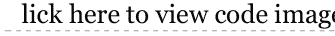

```python
In [11]: numbers.pop()
Out[11]: 0

In [12]: numbers
Out[12]: {1, 2, 4, 5, 6, 7, 8, 9, 17}
```

如果在调用 `pop` 时集合为空，则会发生 `KeyError`。

最后，方法 `clear` 清空其被调用的集合：

```python
In [13]: numbers.clear()

In [14]: numbers
Out[14]: set()
```

## 6.3.4 集合推导式

与字典推导式类似，你在花括号中定义集合推导式。让我们创建一个新集合，仅包含列表 `numbers` 中的唯一偶数值：

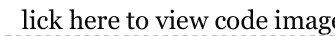

```python
In [1]: numbers = [1, 2, 2, 3, 4, 5, 6, 6, 7, 8, 9, 10, 10]

In [2]: evens = {item for item in numbers if item % 2 == 0}

In [3]: evens
Out[3]: {2, 4, 6, 8, 10}
```

## 6.4 数据科学导论：动态可视化

前一章的数据科学导论部分介绍了可视化。我们模拟掷六面骰子，并使用 Seaborn 和 Matplotlib 可视化库创建了出版质量的静态条形图，显示每个掷骰子值的频数和百分比。在本节中，我们将使用动态可视化使事物“活”起来。

### 大数定律


当我们介绍随机数生成时，我们提到如果 `random` 模块的 `randrange` 函数确实能产生随机整数，那么每次调用该函数时，指定范围内的每个数字被选中的概率（或可能性）都相等。对于六面骰子，1 到 6 的每个值都应出现六分之一的时间，因此这些值中任意一个出现的概率为 1/6 或约 16.667%。

在下一节中，我们将创建并执行一个 *动态*（即 *动画*）骰子投掷模拟脚本。通常，你会发现投掷次数越多，每个骰子值占总投掷次数的百分比就越接近 16.667%，柱状图的高度也会逐渐变得差不多相同。这是 *大数定律* 的体现。

## 6.4.1 动态可视化的工作原理

使用 Seaborn 和 Matplotlib 在上一章的数据科学简介部分生成的图表有助于你在模拟完成后分析固定次数骰子投掷的结果。本节通过 Matplotlib *动画* 模块的 `FuncAnimation` 函数增强了该代码，该函数能 *动态* 更新柱状图。你会看到柱状图、骰子频率和百分比“活过来”，随着投掷的发生 *连续* 更新。

### 动画帧

`FuncAnimation` 驱动 *逐帧动画*。每个 *动画帧* 指定每次图表更新中应更改的所有内容。将许多这样的更新随时间串联起来即可创建动画效果。你可以通过定义并传递给 `FuncAnimation` 的函数来决定每一帧显示的内容。

每个动画帧将：

- 按指定次数投掷骰子（从 1 次到你想要的任意次数），每次投掷后更新骰子频率，
- 清除当前图表，
- 创建表示更新后频率的新一组柱状图，以及
- 为每个柱状图创建新的频率和百分比文本。

通常，每秒显示的帧数越多，动画就越流畅。例如，具有快速移动元素的视频游戏会尝试显示 *至少* 30 帧每秒，通常更多。尽管你会指定动画帧之间的毫秒数，但实际的每秒帧数可能受到每帧执行的工作量和计算机处理器速度的影响。本示例每 33 毫秒显示一个动画帧——产生约 30（1000 / 33）帧每秒。尝试更大和更小的值，查看它们如何影响动画。实验对于开发最佳可视化非常重要。

### 运行 RollDieDynamic.py

在上一章的数据科学简介部分，我们以交互方式开发了静态可视化，以便你可以看到代码在执行每条语句时如何更新柱状图。带有最终频率和百分比的实际柱状图仅绘制了一次。

对于这种动态可视化，屏幕结果会频繁更新，以便你可以看到动画。许多内容会连续变化——柱状图的长度、柱状图上方的频率和百分比、坐标轴上的间距和标签以及图表标题中显示的骰子投掷总次数。出于这个原因，我们将此可视化作为脚本来呈现，而不是以交互方式开发它。

该脚本接受两个命令行参数：

- number_of_frames—要显示的动画帧数。此值决定 FuncAnimation 更新图表的总次数。对于每个动画帧，FuncAnimation 会调用你定义的函数（在本示例中为 update）来指定如何更改图表。

- rolls_per_frame—每个动画帧中投掷骰子的次数。我们将使用循环投掷骰子此次数，汇总结果，然后使用表示新频率的柱状图和文本更新图表。

要了解我们如何使用这两个值，请考虑以下命令：

```
ipython RollDieDynamic.py 6000 1
```

在这种情况下，FuncAnimation 会调用我们的 update 函数 6000 次，每帧投掷一个骰子，总共 6000 次投掷。这使你能够一次看到柱状图、频率和百分比按次更新。在我们的系统上，此动画花费了约 3.33 分钟（6000 帧 / 30 帧每秒 / 60 秒每分钟）来向你展示仅 6000 次骰子投掷。

与发生在计算机超快 CPU 速度上的骰子投掷相比，将动画帧显示到屏幕是一种相对缓慢的输入-输出受限操作。如果每个动画帧仅投掷一个骰子，我们将无法在合理的时间内运行大量投掷。此外，对于少量投掷，你不太可能看到骰子百分比收敛于总投掷次数的预期 16.667%。

要观察大数定律的作用，你可以通过每个动画帧投掷更多次骰子来提高执行速度。请考虑以下命令：

```
ipython RollDieDynamic.py 10000 600
```

在这种情况下，FuncAnimation 将调用我们的 update 函数 10,000 次，每帧执行 600 次投掷，总共 6,000,000 次投掷。在我们的系统上，这花费了约 5.55 分钟（10,000 帧 / 30 帧每秒 / 60 秒每分钟），但显示了约 18,000 次投掷每秒（30 帧每秒 * 600 次投掷每帧），因此我们可以快速看到频率和百分比收敛于其预期值，即每个面约 1,000,000 次投掷和每个面 16.667%。

尝试不同的投掷次数和帧数，直到你觉得程序能最有效地帮助你可视化结果。观察它运行并不断调整直到你对动画质量感到满意，这既有趣又有教育意义。

### 示例执行

在两次示例执行中，我们拍摄了以下四个屏幕截图。在第一次中，屏幕显示仅 64 次骰子投掷后的图表，然后再次显示 6000 次总投掷中的 604 次后的图表。实时运行此脚本，以观察柱状图随时间动态更新。在第二次执行中，屏幕截图显示 7200 次骰子投掷后的图表，以及 6,000,000 次投掷中的 166,200 次后的图表。随着投掷次数增多，你可以看到百分比在大数定律预测的预期值 16.667% 附近收敛。

执行 6000 个动画帧，每帧投掷一次骰子：
`ipython RollDieDynamic.py 6000 1`

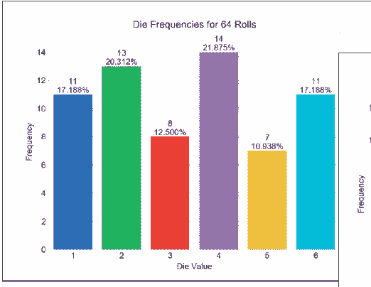

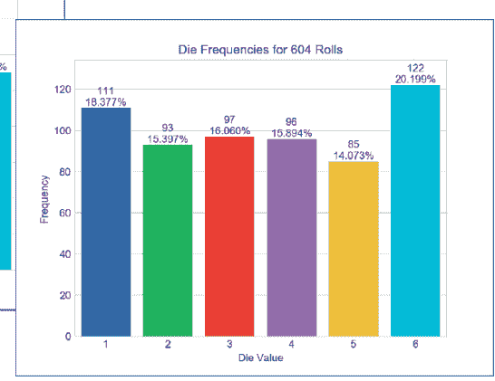

执行 10,000 个动画帧，每帧投掷 600 次骰子：
`ipython RollDieDynamic.py 10000 600`

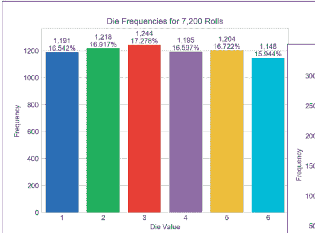

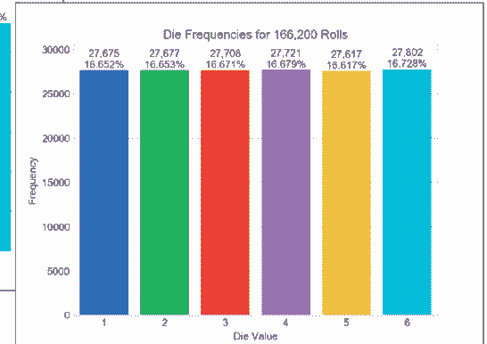

## 6.4.2 实现动态可视化

本节中我们展示的脚本使用了与上一章数据科学简介部分相同的 Seaborn 和 Matplotlib 功能。我们重新组织了代码，以便使用 Matplotlib 的动画功能。

### 导入 Matplotlib 动画模块

我们主要关注本示例中使用的新功能。第 3 行导入了 Matplotlib 动画模块。

点击此处查看代码图像

```python
# RollDieDynamic.py
"""Dynamically graphing frequencies of die rolls."""
from matplotlib import animation
import matplotlib.pyplot as plt
import random
import seaborn as sns
import sys
```

### 函数 update

第 9–27 行定义了 FuncAnimation 每帧动画调用一次的 update 函数。该函数必须至少提供一个参数。第 9–10 行显示函数定义的开头。参数为：

- frame_number—来自 FuncAnimation 的 frames 参数的下一个值，我们稍后将讨论这一点。尽管 FuncAnimation 要求 update 函数具有此参数，但我们在此 update 函数中不使用它。
- rolls—每个动画帧的骰子投掷次数。
- faces—用作图表 x 轴沿线标签的骰子面值。
- frequencies—我们在其中汇总骰子频率的列表。

我们将在接下来的几个小节中讨论函数体的其余部分。

点击此处查看代码图像

```python
def update(frame_number, rolls, faces, frequencies):
    """Configures bar plot contents for each animation frame."""
```

### 函数 update：投掷骰子并更新 frequencies 列表

第 12–13 行投掷 rolls 次骰子，并为每次投掷递增相应的 frequencies 元素。请注意，在递增相应的 frequencies 元素之前，我们从骰子值（1 到 6）中减去 1——如你将看到，frequencies 是一个六元素列表（在第 36 行定义），因此其索引为 0 到 5。

点击此处查看代码图像

```python
# roll die and update frequencies
for i in range(rolls):
```


13 frequencies[random.randrange(1, 7) - 1] += 1
14

## 函数 update：配置柱状图和文本

函数 update 中的第 16 行调用 matplotlib.pyplot 模块的 cla（清除坐标轴）函数，在为当前动画帧绘制新柱状图之前移除现有的柱状图元素。我们在上一章的数据科学简介部分讨论了第 17–27 行的代码。第 17–20 行创建柱状图，设置柱状图标题，设置 x 轴和 y 轴标签，并缩放图表为每个柱状图上方的频率和百分比文本留出空间。第 23–27 行显示频率和百分比文本。

单击此处查看代码图片

```
15 # reconfigure plot for updated die frequencies
16 plt.cla() # clear old contents of current Figure
17 axes = sns.barplot(faces, frequencies, palette='bright') # new
18 axes.set_title(f'Die Frequencies for {sum(frequencies):,} Rolls')
19 axes.set(xlabel='Die Value', ylabel='Frequency')
20 axes.set_ylim(top=max(frequencies) * 1.10) # scale y-axis by
21
22 # display frequency & percentage above each patch (bar)
23 for bar, frequency in zip(axes.patches, frequencies):
24     text_x = bar.get_x() + bar.get_width() / 2.0
25     text_y = bar.get_height()
26     text = f'{frequency:,}\\n{frequency / sum(frequencies):.3%}'
27     axes.text(text_x, text_y, text, ha='center', va='bottom')
28
```

## 用于配置图表和维护状态的变量

第 30 行和第 31 行使用 sys 模块的 argv 列表获取脚本的命令行参数。第 33 行指定 Seaborn 的 'whitegrid' 样式。第 34 行调用 matplotlib.pyplot 模块的 figure 函数以获取 Figure 对象，FuncAnimation 在其中显示动画。该函数的参数是窗口标题。如您不久将看到，这是 FuncAnimation 的必需参数之一。第 35 行创建一个包含骰子面值 1–6 的列表，用于在图表的 x 轴上显示。第 36 行创建一个六元素的 frequencies 列表，每个元素初始化为 0——我们会在每次掷骰子时更新此列表的计数。

单击此处查看代码图片

```
29 # read command-line arguments for number of frames and rolls per frame
30 number_of_frames = int(sys.argv[1])
31 rolls_per_frame = int(sys.argv[2])
32
33 sns.set_style('whitegrid') # white background with gray grid lines
34 figure = plt.figure('Rolling a Six-Sided Die') # Figure for animation
35 values = list(range(1, 7)) # die faces for display on x-axis
36 frequencies = [0] * 6 # six-element list of die frequencies
37
```

## 调用 animation 模块的 FuncAnimation 函数

第 39–41 行调用 Matplotlib 动画模块的 FuncAnimation 函数以动态更新柱状图。该函数返回一个表示动画的对象。尽管未显式使用，但您 *必须* 存储对动画的引用；否则，Python 会立即终止动画并将其内存返还给系统。

单击此处查看代码图片

```
38 # configure and start animation that calls function update
39 die_animation = animation.FuncAnimation(
40     figure, update, repeat=False, frames=number_of_frames, interval
41     fargs=(rolls_per_frame, values, frequencies))
42
43 plt.show() # display window
```

FuncAnimation 有两个必需参数：

- figure—用于显示动画的 Figure 对象，以及
- update—每帧动画调用一次的函数。

在此示例中，我们还传递以下可选关键字参数：

- repeat—False 在指定的帧数后终止动画。如果为 True（默认值），动画完成后会从头开始重新播放。
- frames—动画帧总数，控制 FuncAnimation 调用 update 的次数。传递整数相当于传递范围——例如，600 表示 range(600)。FuncAnimation 将此范围中的一个值作为每次调用 update 时的第一个参数传递。
- interval—动画帧之间的毫秒数（此示例中为 33，默认值为 200）。每次调用 update 后，FuncAnimation 会等待 33 毫秒再进行下一次调用。
- fargs（“function arguments”的缩写）要传递给您在 FuncAnimation 第二个参数中指定的函数的其他参数元组。您在 fargs 元组中指定的参数对应于 update 的参数 rolls、faces 和 frequencies（第 9 行）。

有关 FuncAnimation 的其他可选参数列表，请参见

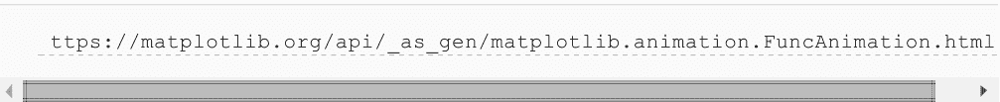

最后，第 43 行显示窗口。

## 6.5 总结

在本章中，我们讨论了 Python 的字典和集合集合。我们说明了什么是字典，并展示了几个示例。我们展示了键–值对的语法，并展示了如何使用它们在花括号 { } 中创建带有逗号分隔的键–值对列表的字典。您还使用字典推导式创建了字典。

您使用方括号 [ ] 检索键对应的值，并插入和更新键–值对。您还使用字典方法 update 更改键关联的值。您遍历了字典的键、值和项。

您创建了由唯一不可变值组成的集合。您使用比较运算符比较集合，使用集合运算符和方法组合集合，使用可变集合操作更改集合的值，并使用集合推导式创建集合。您看到集合是可变的。Frozensets 是不可变的，因此可以用作集合和 frozenset 的元素。

在数据科学简介部分，我们通过展示带有动态柱状图的掷骰子模拟，继续了我们的可视化介绍，使大数定律“栩栩如生”。除了上一章数据科学简介部分展示的 Seaborn 和 Matplotlib 功能外，我们还使用了 Matplotlib 的 FuncAnimation 函数来控制逐帧动画。FuncAnimation 调用了我们定义的一个函数，该函数指定了每个动画帧显示的内容。

在下一章中，我们将讨论使用流行的 NumPy 库进行面向数组的编程。正如您将看到的，NumPy 的 `ndarray` 集合在执行许多与 Python 内置列表相同的操作时，速度可快两个数量级。这种强大功能对于当今的大数据应用将非常有用。

## 使用 NumPy 进行面向数组的编程

### 目标

在本章中，您将：

- 了解数组与列表的区别。
- 使用 `numpy` 模块的高性能 `ndarrays`。
- 使用 IPython `%timeit` 魔法命令比较列表和 `ndarray` 的性能。
- 使用 `ndarrays` 高效存储和检索数据。
- 创建和初始化 `ndarrays`。
- 引用单个 `ndarray` 元素。
- 遍历 `ndarrays`。
- 创建和操作多维 `ndarrays`。
- 执行常见的 `ndarray` 操作。
- 创建和操作 pandas 一维 `Series` 和二维 `DataFrames`。
- 自定义 `Series` 和 `DataFrame` 索引。
- 计算 `Series` 和 `DataFrame` 中数据的基本描述性统计量。
- 自定义 pandas 输出格式中的浮点数精度。

### 大纲

- .1 简介
- .2 从现有数据创建数组
- .3 数组属性
- .4 用特定值填充数组
- .5 从范围创建数组
- .6 列表与数组性能：介绍 %timeit
- .7 数组运算符
- .8 NumPy 计算方法
- .9 通用函数
- .10 索引和切片
- .11 视图：浅拷贝
- .12 深拷贝
- .13 重塑和转置
- .14 数据科学简介：pandas Series 和 DataFrames
- .14.1 pandas Series
- .14.2 DataFrames
- .15 总结

## 7.1 简介

NumPy（数值 Python）库首次出现于 2006 年，是首选的 Python 数组实现。它提供了一种名为 ndarray 的高性能、功能丰富的 n 维数组类型，从本点起我们将使用其同义词 array 来指代它。NumPy 是 Anaconda Python 发行版安装的许多开源库之一。对数组的操作速度可快两个数量级


比列表上的速度快数量级。在一个大数据世界中，应用程序可能需要对海量基于数组的数据进行大量处理，这种性能优势可能至关重要。根据 libraries.io 的数据，超过 450 个 Python 库依赖 NumPy。许多流行的数据科学库（如 Pandas、SciPy（科学 Python）和 Keras（用于深度学习））都是基于 NumPy 构建的或依赖于 NumPy。

在本章中，我们将探索数组的基本功能。列表可以有多个维度。您通常使用嵌套循环或带有多个 for 子句的列表推导式来处理多维列表。NumPy 的一个优势是“面向数组的编程”，它使用带有内部迭代的函数式编程风格，使数组操作简洁直观，消除显式编程循环的外部迭代中可能出现的那类错误。

在本章的“数据科学简介”部分，我们将开始多部分介绍 pandas 库，您将在许多数据科学案例研究章节中使用它。大数据应用通常比 NumPy 的数组需要更灵活的集合——这些集合支持混合数据类型、自定义索引、缺失数据、结构不一致的数据以及需要操作成适合您所使用的数据库和数据分析包的形式的数据。我们将介绍类似于数组的 pandas 一维 Series 和二维 DataFrame，并开始演示它们的强大功能。读完本章后，您将了解四种类似于数组的集合——列表、数组、Series 和 DataFrame。我们将在“深度学习”章节中添加第五种——张量。

## 7.2 从现有数据创建数组

NumPy 文档建议将 numpy 模块导入为 np，以便您可以使用 "np." 访问其成员：

```
In [1]: import numpy as np
```

numpy 模块提供了用于创建数组的各种函数。在此我们使用 array 函数，它接收一个数组或其他元素集合作为参数，并返回包含该参数元素的新数组。让我们传递一个列表：

单击此处查看代码图像

```
In [2]: numbers = np.array([2, 3, 5, 7, 11])
```

`array` 函数将其参数的内容复制到 `array` 中。让我们查看函数 `array` 返回的对象类型并显示其内容：

单击此处查看代码图像

```
In [3]: type(numbers)
Out[3]: numpy.ndarray

In [4]: numbers
Out[4]: array([ 2,  3,  5,  7, 11])
```

请注意，`type` 是 `numpy.ndarray`，但所有 `array` 都输出为“array”。在输出 `array` 时，NumPy 用逗号和空格将每个值与下一个值分隔开，并使用相同的字段宽度 _右对齐_ 所有值。它根据占用 _最多_ 字符位置的值来确定字段宽度。在此例中，值 11 占据两个字符位置，因此所有值都按两个字符字段格式化。这就是为什么在 [ 和 2 之间有一个前导空格。

### 多维参数

`array` 函数复制其参数的维度。让我们从一个两行三列的列表创建一个 `array`：

单击此处查看代码图像

```
In [5]: np.array([[1, 2, 3], [4, 5, 6]])
Out[5]:
array([[1, 2, 3],
       [4, 5, 6]])
```

NumPy 根据数组的维度数自动格式化 `array`，对齐每行中的列。

## 7.3 数组属性

`array` 对象提供 **属性**，使您能够发现其结构和内容的信息。在本节中，我们将使用以下 `array`：

单击此处查看代码图像

```
In [1]: import numpy as np

In [2]: integers = np.array([[1, 2, 3], [4, 5, 6]])

In [3]: integers
Out[3]:
array([[1, 2, 3],
       [4, 5, 6]])

In [4]: floats = np.array([0.0, 0.1, 0.2, 0.3, 0.4])

In [5]: floats
Out[5]: array([0. , 0.1, 0.2, 0.3, 0.4])
```

NumPy 不会在浮点值的小数点右侧显示尾随 0。

### 确定数组的元素类型

array 函数根据其参数的元素确定数组的元素类型。您可以使用数组的 dtype 属性来检查元素类型：

单击此处查看代码图像

```
In [6]: integers.dtype
Out[6]: dtype('int64') # int32 on some platforms

In [7]: floats.dtype
Out[7]: dtype('float64')
```

如您将在下一节中看到，各种数组创建函数接收 dtype 关键字参数，以便您可以指定数组的元素类型。

出于性能原因，NumPy 使用 C 编程语言编写并使用 C 的数据类型。默认情况下，NumPy 将整数存储为 NumPy 类型 int64 值（对应于 C 中的 64 位（8 字节）整数），并将浮点数存储为 NumPy 类型 float64 值（对应于 C 中的 64 位（8 字节）浮点数）。在我们的示例中，您最常见的类型是 int64、float64、bool（用于布尔值）以及用于非数值数据（如字符串）的 object。支持的类型完整列表位于 https://docs.scipy.org/doc/numpy/user/basics.types.html。

### 确定数组的维度

属性 `ndim` 包含 `array` 的维度数，属性 `shape` 包含指定 `array` 维度的 `tuple`：

单击此处查看代码图像

```
In [8]: integers.ndim
Out[8]: 2

In [9]: floats.ndim
Out[9]: 1

In [10]: integers.shape
Out[10]: (2, 3)

In [11]: floats.shape
Out[11]: (5,)
```

在此，`integers` 有 2 行 3 列（6 个元素），`floats` 是一维的，因此片段 [11] 显示一个包含逗号的一元素元组，其中包含 `floats` 的元素数量（5）。

### 确定 `array` 的元素数量和元素大小

您可以使用属性 `size` 查看 `array` 的元素总数，并使用 `itemsize` 查看存储每个元素所需的字节数：

单击此处查看代码图像

```
In [12]: integers.size
Out[12]: 6

In [13]: integers.itemsize # 4 if C compiler uses 32-bit ints
Out[13]: 8

In [14]: floats.size
Out[14]: 5

In [15]: floats.itemsize
Out[15]: 8
```

请注意，`integers` 的 `size` 是 `shape` 元组值的乘积——每行三个元素的两行，总共六个元素。在每种情况下，`itemsize` 都是 8，因为 `integers` 包含 `int64` 值，而 `floats` 包含 `float64` 值，每个值占用 8 字节。

### 遍历多维数组的元素

您通常将使用简洁的函数式编程技术来操作数组。但是，由于数组是可迭代的，如果您愿意，可以使用外部迭代：

单击此处查看代码图像

```
In [16]: for row in integers:
  ...:     for column in row:
  ...:         print(column, end=' ')
  ...:     print()
  ...:
1 2 3
4 5 6
```

您可以通过使用其 flat 属性，像遍历一维数组一样遍历多维数组：

单击此处查看代码图像

```
In [17]: for i in integers.flat:
  ...:     print(i, end=' ')
  ...:
1 2 3 4 5 6
```

## 7.4 用特定值填充数组

NumPy 提供了 zeros、ones 和 full 函数，分别用于创建包含 0、1 或指定值的数组。默认情况下，zeros 和 ones 创建包含 float64 值的数组。我们稍后将展示如何自定义元素类型。这些函数的第一个参数必须是整数或整数元组，用于指定所需的维度。对于整数，每个函数都返回一个带有指定元素数量的一维数组：

单击此处查看代码图像

```
In [1]: import numpy as np

In [2]: np.zeros(5)
Out[2]: array([ 0.,  0.,  0.,  0.,  0.])
```

对于整数元组，这些函数返回带有指定维度的多维数组。您可以使用 zeros 和 ones 函数的 dtype 关键字参数来指定数组的元素类型：

单击此处查看代码图像

```
In [3]: np.ones((2, 4), dtype=int)
Out[3]:
array([[1, 1, 1, 1],
       [1, 1, 1, 1]])
```

full 返回的数组包含具有第二个参数的值和类型的元素：

单击此处查看代码图像

```
In [4]: np.full((3, 5), 13)
Out[4]:
array([[13, 13, 13, 13, 13],
       [13, 13, 13, 13, 13],
       [13, 13, 13, 13, 13]])
```

## 7.5 从范围创建数组

NumPy 提供了用于从范围创建数组的优化函数。我们专注于简单的等间距整数和浮点范围，但 NumPy 还支持非线性范围。¹

¹ https://docs.scipy.org/doc/numpy/reference/routines.array-creation.html.

### 使用 arange 创建整数范围

让我们使用 NumPy 的 arange 函数来创建整数范围——类似于使用内置函数 range。在每种情况下，arange 首先确定结果数组的元素数量，分配内存，然后将指定的值范围存储在数组中：

单击此处查看代码图像

```
In [1]: import numpy as np
```


```
In [2]: np.arange(5)
Out[2]: array([0, 1, 2, 3, 4])

In [3]: np.arange(5, 10)
Out[3]: array([5, 6, 7, 8, 9])

In [4]: np.arange(10, 1, -2)
Out[4]: array([10, 8, 6, 4, 2])
```

Although you can create arrays by passing ranges as arguments, always use `arange` as it's optimized for arrays. Soon we'll show how to determine the execution time of various operations so you can compare their performance.

## Creating Floating-Point Ranges with linspace

You can produce evenly spaced floating-point ranges with NumPy's `linspace` function. The function's first two arguments specify the starting and ending values in the range, and the ending value _is included_ in the `array`. The optional keyword argument `num` specifies the number of evenly spaced values to produce—this argument's default value is 50:

click here to view code image

```
In [5]: np.linspace(0.0, 1.0, num=5)
Out[5]: array([ 0. , 0.25, 0.5 , 0.75, 1. ])
```

## Reshaping an array

You also can create an `array` from a range of elements, then use `array` method `reshape` to transform the one-dimensional array into a multidimensional array. Let's create an `array` containing the values from 1 through 20, then reshape it into four rows by five columns:

click here to view code image

```
In [6]: np.arange(1, 21).reshape(4, 5)
Out[6]:
array([[ 1,  2,  3,  4,  5],
       [ 6,  7,  8,  9, 10],
       [11, 12, 13, 14, 15],
       [16, 17, 18, 19, 20]])
```

Note the _chained method calls_ in the preceding snippet. First, `arange` produces an array containing the values 1–20. Then we call `reshape` on that `array` to get the 4-by-5 `array` that was displayed.

You can reshape any `array`, provided that the new shape has the _same_ number of elements as the original. So a six-element one-dimensional `array` can become a 3-by-2 or 2-by-3 `array`, and vice versa, but attempting to reshape a 15-element `array` into a 4-by-4 `array` (16 elements) causes a `ValueError`.

## Displaying Large arrays

When displaying an `array`, if there are 1000 items or more, NumPy drops the middle rows, columns or both from the output. The following snippets generate 100,000 elements. The first case shows all four rows but only the first and last three of the 25,000 columns. The notation . . . represents the missing data. The second case shows the first and last three of the 100 rows, and the first and last three of the 1000 columns:

click here to view code image

```
In [7]: np.arange(1, 100001).reshape(4, 25000)
Out[7]:
array([[    1,     2,     3, ...,  24998,  24999,  25000],
       [ 25001,  25002,  25003, ...,  49998,  49999,  50000],
       [ 50001,  50002,  50003, ...,  74998,  74999,  75000],
       [ 75001,  75002,  75003, ...,  99998,  99999, 100000]])

In [8]: np.arange(1, 100001).reshape(100, 1000)
Out[8]:
array([[    1,     2,     3, ...,   998,   999,  1000],
       [  1001,  1002,  1003, ...,  1998,  1999,  2000],
       [  2001,  2002,  2003, ...,  2998,  2999,  3000],
       ...,
       [ 97001,  97002,  97003, ...,  97998,  97999,  98000],
       [ 98001,  98002,  98003, ...,  98998,  98999,  99000],
       [ 99001,  99002,  99003, ...,  99998,  99999, 100000]])
```

## 7.6 LIST VS. ARRAY PERFORMANCE: INTRODUCING `%TIMEIT`

Most `array` operations execute _significantly_ faster than corresponding list operations. To demonstrate, we'll use the IPython `%timeit` magic command, which times the _average_ duration of operations. Note that the times displayed on your system may vary from what we show here.

## Timing the Creation of a List Containing Results of 6,000,000 Die Rolls

We've demonstrated rolling a six-sided die 6,000,000 times. Here, let's use the `random` module's `randrange` function with a list comprehension to create a list of six million die rolls and time the operation using `%timeit`. Note that we used the line-continuation character (\) to split the statement in snippet [2] over two lines:

click here to view code image

```
In [1]: import random

In [2]: %timeit rolls_list = \
....:     [random.randrange(1, 7) for i in range(0, 6_000_000)]
6.29 s ± 119 ms per loop (mean ± std. dev. of 7 runs, 1 loop each)
```

By default, `%timeit` executes a statement in a loop, and it runs the loop *seven* times. If you do not indicate the number of loops, `%timeit` chooses an appropriate value. In our testing, operations that on average took more than 500 milliseconds iterated only once, and operations that took fewer than 500 milliseconds iterated 10 times or more.

After executing the statement, `%timeit` displays the statement's *average* execution time, as well as the standard deviation of all the executions. On average, `%timeit` indicates that it took 6.29 seconds (s) to create the list with a standard deviation of 119 milliseconds (ms). In total, the preceding snippet took about 44 seconds to run the snippet seven times.

## Timing the Creation of an `array` Containing Results of 6,000,000 Die Rolls

Now, let's use the `randint` function from the `numpy.random` module to create an `array` of 6,000,000 die rolls

click here to view code image

```
In [3]: import numpy as np

In [4]: %timeit rolls_array = np.random.randint(1, 7, 6_000_000)
72.4 ms ± 635 µs per loop (mean ± std. dev. of 7 runs, 10 loops each)
```

On average, `%timeit` indicates that it took only 72.4 *milliseconds* with a standard deviation of 635 microseconds (µs) to create the `array`. In total, the preceding snippet took just under half a second to execute on our computer—about 1/100th of the time snippet [2] took to execute. The operation is *two orders of magnitude faster* with `array`!

### 60,000,000 and 600,000,000 Die Rolls

Now, let's create an `array` of 60,000,000 die rolls:

click here to view code image

```
In [5]: %timeit rolls_array = np.random.randint(1, 7, 60_000_000)
873 ms ± 29.4 ms per loop (mean ± std. dev. of 7 runs, 1 loop each)
```

On average, it took only 873 milliseconds to create the `array`.

Finally, let's do 600,000,000 million die rolls:

click here to view code image

```
In [6]: %timeit rolls_array = np.random.randint(1, 7, 600_000_000)
10.1 s ± 232 ms per loop (mean ± std. dev. of 7 runs, 1 loop each)
```

It took about 10 seconds to create 600,000,000 elements with NumPy vs. about 6 seconds to create only 6,000,000 elements with a list comprehension.

Based on these timing studies, you can see clearly why `array`s are preferred over lists for compute-intensive operations. In the data science case studies, we'll enter the performance-intensive worlds of big data and AI. We'll see how clever hardware, software, communications and algorithm designs combine to meet the often enormous computing challenges of today's applications.

### Customizing the `%timeit` Iterations

The number of iterations within each `%timeit` loop and the number of loops are customizable with the `-n` and `-r` options. The following executes snippet [4]'s statement three times per loop and runs the loop twice: ²

² For most readers, using `%timeit`s default settings should be fine.

click here to view code image

```
In [7]: %timeit -n3 -r2 rolls_array = np.random.randint(1, 7, 6_000_000)
85.5 ms ± 5.32 ms per loop (mean ± std. dev. of 2 runs, 3 loops each)
```

## Other IPython Magics

IPython provides dozens of magics for a variety of tasks—for a complete list, see the IPython magics documentation. 3 http://ipython.readthedocs.io/en/stable/interactive/magics.html. Here are a few helpful ones:

- `%load` to read code into IPython from a local file or URL.
- `%save` to save snippets to a file.
- `%run` to execute a .py file from IPython.
- `%precision` to change the default floating-point precision for IPython outputs.
- `%cd` to change directories without having to exit IPython first.
- `%edit` to launch an external editor—handy if you need to modify more complex snippets.
- `%history` to view a list of all snippets and commands you've executed in the current IPython session.

## 7.7 ARRAY OPERATORS

NumPy provides many operators which enable you to write simple expressions that perform operations on entire arrays. Here, we demonstrate arithmetic between arrays and numeric values and between arrays of the same shape.

### Arithmetic Operations with arrays and Individual Numeric Values

First, let's perform element-wise arithmetic with arrays and numeric values by using arithmetic operators and augmented assignments. Element-wise operations are applied to every element, so snippet [4] multiplies every element by 2 and snippet [5] cubes every element. Each returns a new array containing the result:

click here to view code image

```
In [1]: import numpy as np
```


```python
In [2]: numbers = np.arange(1, 6)

In [3]: numbers
Out[3]: array([1, 2, 3, 4, 5])

In [4]: numbers * 2
Out[4]: array([ 2, 4, 6, 8, 10])

In [5]: numbers ** 3
Out[5]: array([ 1, 8, 27, 64, 125])

In [6]: numbers # numbers is unchanged by the arithmetic operators
Out[6]: array([1, 2, 3, 4, 5])
```

代码段 [6] 显示算术运算符没有修改 numbers。运算符 + 和 * 是 *可交换的*，因此代码段 [4] 也可以写成 2 * numbers。

增量赋值 *修改* 左操作数中的每个元素。

单击此处查看代码图像

```python
In [7]: numbers += 10

In [8]: numbers
Out[8]: array([11, 12, 13, 14, 15])
```

## 广播

通常，算术运算要求两个操作数为相同 *大小和形状* 的 *数组*。当一个操作数是单个值（称为 **标量**）时，NumPy 将执行逐元素计算，就好像标量是一个与另一个操作数形状相同的 *数组*，但其所有元素的值均为标量值。这称为 **广播**。代码段 [4]、[5] 和 [7] 均使用此功能。例如，代码段 [4] 等效于：

单击此处查看代码图像

```python
numbers * [2, 2, 2, 2, 2]
```

广播也可以应用于大小和形状不同的 *数组* 之间，从而实现一些简洁而强大的操作。我们将在本章后面介绍 NumPy 的通用函数时展示更多广播示例。

## 数组之间的算术运算

您可以对形状相同的 `arrays` 执行算术运算和增量赋值。让我们相乘下面创建的一维 `arrays numbers` 和 `numbers2`，它们各包含五个元素：

单击此处查看代码图像

```python
In [9]: numbers2 = np.linspace(1.1, 5.5, 5)

In [10]: numbers2
Out[10]: array([ 1.1, 2.2, 3.3, 4.4, 5.5])

In [11]: numbers * numbers2
Out[11]: array([ 12.1, 26.4, 42.9, 61.6, 82.5])
```

结果是一个新数组，由对每个操作数中的 `arrays element-wise` 相乘而成——11 * 1.1、12 * 2.2、13 * 3.3 等等。整数 `arrays` 与浮点数之间的算术运算结果为浮点数 `array`。

## 比较数组

您可以将 `arrays` 与单个值和其他 `arrays` 进行比较。比较按 `element-wise` 执行。此类比较将生成布尔值 `arrays`，其中每个元素的 `True` 或 `False` 值指示比较结果：

单击此处查看代码图像

```python
In [12]: numbers
Out[12]: array([11, 12, 13, 14, 15])

In [13]: numbers >= 13
Out[13]: array([False, False, True, True, True])

In [14]: numbers2
Out[14]: array([ 1.1, 2.2, 3.3, 4.4, 5.5])

In [15]: numbers2 < numbers
Out[15]: array([ True, True, True, True, True])

In [16]: numbers == numbers2
Out[16]: array([False, False, False, False, False])

In [17]: numbers == numbers
Out[17]: array([ True, True, True, True, True])
```

代码段 [13] 使用广播来确定 `numbers` 中的每个元素是否大于或等于 13。其余代码段比较每个 `array` 操作数的对应元素。

## 7.8 NumPy 计算方法

一个 `array` 拥有各种使用其内容进行计算的方法。默认情况下，这些方法忽略 `array` 的形状，并在计算中使用 *所有* 元素。例如，计算 `array` 的平均值时，会先求和其所有元素（不考虑形状），然后除以元素总数。您也可以对每个维度执行这些计算。例如，在二维数组中，您可以计算每行的平均值和每列的平均值。

考虑一个表示四名学生三次考试成绩的 `array`：

单击此处查看代码图像

```python
In [1]: import numpy as np

In [2]: grades = np.array(([87, 96, 70], [100, 87, 90],
   ...:
   ...: [94, 77, 90], [100, 81, 82]))
   ...:

In [3]: grades
Out[3]:
array([[ 87, 96, 70],
       [100, 87, 90],
       [ 94, 77, 90],
       [100, 81, 82]])
```

我们可以使用方法来计算 `sum`、`min`、`max`、`mean`、`std`（标准差）和 `var`（方差）——每个方法都是函数式编程风格的 *归约*：

单击此处查看代码图像

```python
In [4]: grades.sum()
Out[4]: 1054

In [5]: grades.min()
Out[5]: 70

In [6]: grades.max()
Out[6]: 100

In [7]: grades.mean()
Out[7]: 87.83333333333333
In [8]: grades.std()
Out[8]: 8.792357792739987
In [9]: grades.var()
Out[9]: 77.30555555555556
```

### 按行或列计算

许多计算方法可以在特定的数组维度上执行，这些维度称为数组的轴。这些方法接收一个 axis 关键字参数，用于指定计算中使用的维度，为您提供了一种在二维数组中按行或列进行计算的快速方法。

假设您想计算由 grades 的列表示的每次考试的平均成绩。指定 axis=0 将在每个列中的所有行值上执行计算：

单击此处查看代码图像

```python
In [10]: grades.mean(axis=0)
Out[10]: array([95.25, 85.25, 83. ])
```

上述 95.25 是第一列成绩（87、100、94 和 100）的平均值，85.25 是第二列成绩（96、87、77 和 81）的平均值，83 是第三列成绩（70、90、90 和 82）的平均值。同样，NumPy 不会在小数点右侧显示 ‘83. ’ 中的尾随 0。还要注意，它以相同的字段宽度显示所有元素值，这就是为什么 ‘83. ’ 后面跟有两个空格。

同样，指定 axis=1 将在每个单独行中的所有列值上执行计算。要计算每个学生所有考试的平均成绩，我们可以使用：

单击此处查看代码图像

```python
In [11]: grades.mean(axis=1)
Out[11]: array([84.33333333, 92.33333333, 87. , 87.66666667])
```

这会产生四个平均值——每行对应一个。因此，84.33333333 是第 0 行成绩（87、96 和 70）的平均值，其余平均值对应其余各行。

NumPy 数组拥有更多计算方法。有关完整列表，请参见

https://docs.scipy.org/doc/numpy/reference/arrays.ndarray.html

### 7.9 通用函数

NumPy 提供数十种独立的通用函数（或称为 ufuncs），用于执行各种逐元素操作。每个函数使用一个或两个数组或类数组（例如列表）参数来完成其任务。在对数组使用 + 和 * 等运算符时，会调用其中一些函数。每个函数都返回一个包含结果的新数组。

让我们创建一个数组，并使用 sqrt 通用函数计算其值的平方根：

单击此处查看代码图像

```python
In [1]: import numpy as np

In [2]: numbers = np.array([1, 4, 9, 16, 25, 36])

In [3]: np.sqrt(numbers)
Out[3]: array([1., 2., 3., 4., 5., 6.])
```

让我们使用 add 通用函数相加两个形状相同的数组：

单击此处查看代码图像

```python
In [4]: numbers2 = np.arange(1, 7) * 10

In [5]: numbers2
Out[5]: array([10, 20, 30, 40, 50, 60])

In [6]: np.add(numbers, numbers2)
Out[6]: array([11, 24, 39, 56, 75, 96])
```

表达式 np.add(numbers, numbers2) 等效于：

```python
numbers + numbers2
```

## 通用函数的广播

让我们使用 `multiply` 通用函数将 `numbers2` 的每个元素乘以标量值 5：

单击此处查看代码图像

```python
In [7]: np.multiply(numbers2, 5)
Out[7]: array([ 50, 100, 150, 200, 250, 300])
```

表达式 `np.multiply(numbers2, 5)` 等效于：

```python
numbers2 * 5
```

让我们将 `numbers2` 调整为 2 行 3 列的 `array`，然后将其值与一个包含三个元素的一维 `array` 相乘：

单击此处查看代码图像

```python
In [8]: numbers3 = numbers2.reshape(2, 3)

In [9]: numbers3
Out[9]:
array([[10, 20, 30,
       [40, 50, 60]])

In [10]: numbers4 = np.array([2, 4, 6])

In [11]: np.multiply(numbers3, numbers4)
Out[11]:
array([[ 20, 80, 180,
       [ 80, 200, 360]])
```

之所以可行，是因为 `numbers4` 的长度与 `numbers3` 的每一行相同，因此 NumPy 可以将 `numbers4` 视作以下 `array` 来应用乘法运算：

```python
array([[2, 4, 6],
       [2, 4, 6]])
```

如果通用函数接收两个不支持广播的形状不同的 `array`s，将发生 `ValueError`。您可以在以下网址查看广播规则：


## 其他通用函数

NumPy 文档将通用函数分为五类——数学、三角函数、位操作、比较和浮点数。下面列出了每个类别中的一些函数。您可以在以下网址查看完整列表、其描述以及有关通用函数的更多信息：

https://docs.scipy.org/doc/numpy/reference/ufuncs.html

## NumPy 通用函数

**数学**—加法, 减法, 乘法, 除法, 取余, 指数, 对数, 平方根, 幂, 和更多。

**三角函数**—正弦, 余弦, 正切, 斜边长度, 反正弦, 反余弦, 反正切, 和更多。

**位操作**—按位与, 按位或, 按位异或, 按位取反, 左移 和 右移。

**比较**—大于, 大于等于, 小于, 小于等于, 等于, 不等于, 逻辑与, 逻辑或, 逻辑异或, 逻辑非, 最小值, 最大值, 和更多。

**浮点数**—向下取整, 向上取整, 是否无穷大, 是否非数, 绝对值, 截断, 和更多。

## 7.10 索引和切片

一维 `array`s 可以使用我们在“序列：列表和元组”章节中演示过的相同语法和技术进行索引和切片。在这里，我们专注于 `array` 特定的索引和切片功能。

### 使用二维数组进行索引

要在二维 `array` 中选择一个元素，请在方括号中指定包含元素行索引和列索引的元组（如代码片段 [4] 所示）：

单击此处查看代码图像

```python
In [1]: import numpy as np

In [2]: grades = np.array([[87, 96, 70], [100, 87, 90],
 ...: [94, 77, 90], [100, 81, 82]])
 ...:

In [3]: grades
Out[3]:
array([[ 87, 96, 70],
 [100, 87, 90],
 [ 94, 77, 90],
 [100, 81, 82]])

In [4]: grades[0, 1] # row 0, column 1
Out[4]: 96
```

### 选择二维数组行的子集

要选择单行，请在方括号中仅指定一个索引：

单击此处查看代码图像

```python
In [5]: grades[1]
Out[5]: array([100, 87, 90])
```

要选择多个连续行，请使用切片表示法：

单击此处查看代码图像

```python
In [6]: grades[0:2]
Out[6]:
array([[ 87, 96, 70],
 [100, 87, 90]])
```

要选择多个非连续行，请使用行索引列表：

```python
In [7]: grades[[1, 3]]
Out[7]:
array([[100, 87, 90],
 [100, 81, 82]])
```

### 选择二维数组列的子集

您可以通过提供指定要选择的行和列的元组来选择列的子集。每个可以是特定索引、切片或列表。让我们仅选择第一列中的元素：

单击此处查看代码图像

```python
In [8]: grades[:, 0]
Out[8]: array([ 87, 100,  94, 100])
```

逗号后的 0 表示我们仅选择第 0 列。逗号前的 : 表示要选择该列中的哪些行。在这种情况下，: 是表示所有行的切片。这也可以是特定行号、表示行子集的切片或要选择的特定行索引列表，如代码片段 [5]–[7] 所示。

您可以使用切片选择连续列：

```python
In [9]: grades[:, 1:3]
Out[9]:
array([[96, 70],
        [87, 90],
        [77, 90],
        [81, 82]])
```

或使用列索引列表选择特定列：

```python
In [10]: grades[:, [0, 2]]
Out[10]:
array([[ 87,  70],
        [100,  90],
        [ 94,  90],
        [100,  82]])
```

## 7.11 视图：浅拷贝

上一章介绍了视图对象——即“看到”其他对象中数据而非拥有数据自身副本的对象。视图是浅拷贝。各种数组方法和切片操作会生成数组数据的视图。

数组方法 view 返回带有原始数组对象数据视图的新数组对象。首先，让我们创建一个 `array` 及其视图：

单击此处查看代码图像

```python
In [1]: import numpy as np

In [2]: numbers = np.arange(1, 6)

In [3]: numbers
Out[3]: array([1, 2, 3, 4, 5])

In [4]: numbers2 = numbers.view()

In [5]: numbers2
Out[5]: array([1, 2, 3, 4, 5])
```

我们可以使用内置的 `id` 函数来查看 `numbers` 和 `numbers2` 是 _不同_ 的对象：

```python
In [6]: id(numbers)
Out[6]: 4462958592

In [7]: id(numbers2)
Out[7]: 4590846240
```

要证明 `numbers2` 视图的是与 `numbers` 相 _同_ 的数据，让我们修改 `numbers` 中的一个元素，然后显示两个 `array`s：

单击此处查看代码图像

```python
In [8]: numbers[1] *= 10

In [9]: numbers2
Out[9]: array([ 1, 20,  3,  4,  5])

In [10]: numbers
Out[10]: array([ 1, 20,  3,  4,  5])
```

同样，更改视图中的值也会更改原始 `array` 中的该值：

```python
In [11]: numbers2[1] /= 10

In [12]: numbers
Out[12]: array([1, 2, 3, 4, 5])
```

### 切片视图

切片也会创建视图。让我们将 numbers2 设置为仅查看 numbers 前三个元素的切片：

```python
In [13]: numbers2 = numbers[0:3]
In [14]: numbers2
Out[14]: array([1, 2, 3])
```

同样，我们可以使用 id 确认 numbers 和 numbers2 是不同的对象：

```python
In [15]: id(numbers)
Out[15]: 4462958592

In [16]: id(numbers2)
Out[16]: 4590848000
```

我们可以通过尝试访问 numbers2[3]（这会产生 IndexError）来确认 numbers2 只是 numbers 前三个元素的视图：

单击此处查看代码图像

```python
In [17]: numbers2[3]
------------------------------------------------------------
IndexError          Traceback (most recent call last)
ipython-input-18-582053f52daa> in <module>()
----> 1 numbers2[3]

IndexError: index 3 is out of bounds for axis 0 with size 3
```

现在，让我们修改两个数组共享的元素，然后显示它们。同样，我们看到 numbers2 是 numbers 的视图：

单击此处查看代码图像

```python
In [18]: numbers[1] *= 20

In [19]: numbers
Out[19]: array([1, 40, 3, 4, 5])
```

```python
In [20]: numbers2
Out[20]: array([ 1, 40, 3])
```

## 7.12 深拷贝

尽管视图是独立的数组对象，但它们通过共享其他数组的元素数据来节省内存。但是，在共享可变值时，有时有必要创建带有原始数据独立副本的深拷贝。这在多核编程中尤其重要，因为程序的独立部分可能会同时尝试修改您的数据，可能会损坏它。

数组方法 copy 返回带有原始数组对象数据深拷贝的新数组对象。首先，让我们创建一个数组及其深拷贝：

单击此处查看代码图像

```python
In [1]: import numpy as np

In [2]: numbers = np.arange(1, 6)

In [3]: numbers
Out[3]: array([1, 2, 3, 4, 5])

In [4]: numbers2 = numbers.copy()

In [5]: numbers2
Out[5]: array([1, 2, 3, 4, 5])
```

要证明 numbers2 拥有 numbers 数据的单独副本，让我们修改 numbers 中的一个元素，然后显示两个数组：

单击此处查看代码图像

```python
In [6]: numbers[1] *= 10

In [7]: numbers
Out[7]: array([ 1, 20, 3, 4, 5])

In [8]: numbers2
Out[8]: array([1, 2, 3, 4, 5])
```

如您所见，更改仅出现在 numbers 中。

## Module copy—用于其他 Python 对象的浅拷贝与深拷贝

在前面的章节中，我们介绍了 _浅拷贝_。在本章中，我们介绍了如何使用数组的 `copy` 方法对 `array` 对象进行 _深拷贝_。如果您需要其他类型 Python 对象的深拷贝，请将它们传递给 `copy` 模块的 `deepcopy` 函数。

## 7.13 重塑和转置

我们使用过数组方法 `reshape` 从一维范围生成二维数组。NumPy 提供了重塑 `array` 的各种其他方式。

### reshape 与 resize

数组方法 `reshape` 和 `resize` 都允许您更改数组的维度。方法 `reshape` 返回原始 `array` 带有新维度的 _视图_（浅拷贝）。它 _不_ 修改原始 `array`：

单击此处查看代码图像

```python
In [1]: import numpy as np

In [2]: grades = np.array([[87, 96, 70], [100, 87, 90]])

In [3]: grades
Out[3]:
array([[ 87, 96, 70],
       [100, 87, 90]])

In [4]: grades.reshape(1, 6)
Out[4]: array([[ 87, 96, 70, 100, 87, 90]])

In [5]: grades
Out[5]:
array([[ 87, 96, 70],
       [100, 87, 90]])
```

方法 `resize` 修改原始 `array` 的形状：

单击此处查看代码图像

```python
In [6]: grades.resize(1, 6)

In [7]: grades
Out[7]: array([[ 87, 96, 70, 100, 87, 90]])
```


## flatten 与 ravel

你可以使用方法 **flatten** 和 **ravel** 将多维数组展平为一维。方法 **flatten** 对原始数组的数据进行 *深拷贝*：

点击此处查看代码图像

```python
In [8]: grades = np.array([[87, 96, 70], [100, 87, 90]])

In [9]: grades
Out[9]:
array([[ 87, 96, 70],
       [100, 87, 90]])

In [10]: flattened = grades.flatten()

In [11]: flattened
Out[11]: array([ 87, 96, 70, 100, 87, 90])

In [12]: grades
Out[12]:
array([[ 87, 96, 70],
       [100, 87, 90]])
```

为确认 **grades** 和 **flattened** *不共享* 数据，让我们修改 **flattened** 的一个元素，然后显示两个数组：

点击此处查看代码图像

```python
In [13]: flattened[0] = 100

In [14]: flattened
Out[14]: array([100, 96, 70, 100, 87, 90])

In [15]: grades
Out[15]:
array([[ 87, 96, 70],
       [100, 87, 90]])
```

方法 **ravel** 生成原始数组的一个 _视图_，该视图 *共享* **grades** 数组的数据：

点击此处查看代码图像

```python
In [16]: raveled = grades.ravel()

In [17]: raveled
Out[17]: array([ 87, 96, 70, 100, 87, 90])

In [18]: grades
Out[18]:
array([[ 87, 96, 70],
       [100, 87, 90]])
```

为确认 `grades` 和 `raveled` 共享相同数据，让我们修改 `raveled` 的一个元素，然后显示两个数组：

点击此处查看代码图像

```python
In [19]: raveled[0] = 100

In [20]: raveled
Out[20]: array([100, 96, 70, 100, 87, 90])

In [21]: grades
Out[21]:
array([[100, 96, 70],
       [100, 87, 90]])
```

## 转置行和列

你可以快速 **转置** `array` 的行和列——也就是说“翻转” `array`，使
行变成列，列变成行。**T 属性** 返回 `array` 的转置 _视图_（浅拷贝）。原始 `grades` 数组
代表两名学生在三次考试中的成绩（行代表学生，列代表考试）。让我们
转置行和列，以查看三次考试（行）中两名学生（列）的成绩：

点击此处查看代码图像

```python
In [22]: grades.T
Out[22]:
array([[100, 100],
       [ 96, 87],
       [ 70, 90]])
```

转置 _不_ 修改原始 `array`：

```python
In [23]: grades
Out[23]:
array([[100, 96, 70],
       [100, 87, 90]])
```

## 水平和垂直堆叠

你可以通过添加更多列或更多行来合并数组——这称为 *水平堆叠* 和 *垂直堆叠*。让我们创建另一个 2 行 3 列的成绩数组：

点击此处查看代码图像

```python
In [24]: grades2 = np.array([[94, 77, 90], [100, 81, 82]])
```

假设 `grades2` 代表 `grades` 数组中两名学生的三次额外考试成绩。我们可以通过传递一个包含要合并数组的元组，使用 NumPy 的 **hstack（水平堆叠）函数** 来合并 `grades` 和 `grades2`。需要额外的括号是因为 `hstack` 期望一个参数：

点击此处查看代码图像

```python
In [25]: np.hstack((grades, grades2))
Out[25]:
array([[100, 96, 70, 94, 77, 90],
       [100, 87, 90, 100, 81, 82]])
```

接下来，假设 `grades2` 代表另外两名学生在三次考试中的成绩。在这种情况下，我们可以使用 NumPy 的 **vstack（垂直堆叠）函数** 来合并 `grades` 和 `grades2`：

点击此处查看代码图像

```python
In [26]: np.vstack((grades, grades2))
Out[26]:
array([[100, 96, 70],
       [100, 87, 90],
       [94, 77, 90],
       [100, 81, 82]])
```

## 7.14 数据科学导论：Pandas Series 和 DataFrames

NumPy 的 `array` 针对通过整数索引访问的同质数值数据进行了优化。数据科学提出了独特的需求，需要更多定制的数据结构。大数据应用程序必须支持混合数据类型、自定义索引、缺失数据、结构不一致的数据，以及需要处理成适合你所使用的数据库和数据分析包形式的数据。

**Pandas** 是处理此类数据最流行的库。它提供了两个关键集合，你将在我们的几个数据科学导论章节以及整个数据科学案例研究中使用它们——*Series* 用于一维集合，*DataFrames* 用于二维集合。你可以使用 pandas 的 *MultiIndex* 在 `Series` 和 `DataFrames` 的上下文中操作多维数据。

Wes McKinney 在 2008 年在业界工作期间创建了 pandas。名称 pandas 源自术语“面板数据”，即随时间变化的测量数据，例如股票价格或历史温度读数。McKinney 需要一个库，其中相同的数据结构可以同时处理基于时间和非基于时间的数据，并支持数据对齐、缺失数据、常见的数据库风格数据操作等。4

4 McKinney, Wes. 《使用 Pandas、NumPy 和 IPython 进行数据分析：数据整理》，第 123-165 页。Sebastopol, CA：O'Reilly Media，2018年。

NumPy 和 pandas 关系密切。`Series` 和 `DataFrames` 在“底层”使用数组。`Series` 和 `DataFrames` 是许多 NumPy 操作的有效参数。同样，`arrays` 是许多 `Series` 和 `DataFrame` 操作的有效参数。

Pandas 是一个庞大的主题——其文档 PDF 5 超过 2000 页。在本章和下一章的数据科学导论部分中，我们将介绍 pandas。我们讨论其 `Series` 和 `DataFrames` 集合，并用于支持数据准备。你会发现，`Series` 和 `DataFrames` 使执行常见任务变得容易，例如以多种方式选择元素、filter/map/reduce 操作（函数式编程和大数据的核心）、数学运算、可视化等。

5 有关最新的 pandas 文档，请参阅 http://pandas.pydata.org/pandas-docs/stable/.

### 7.14.1 pandas Series

`Series` 是一个增强的一维 `array`。与仅使用从零开始的整数索引的 `array`s 不同，`Series` 支持自定义索引，甚至包括像字符串这样的非整数索引。`Series` 还提供额外功能，使其在许多面向数据科学的任务中更加方便。例如，`Series` 可能包含缺失数据，且许多 `Series` 操作默认忽略缺失数据。

#### 用默认索引创建 Series

默认情况下，`Series` 具有从 0 开始依次编号的整数索引。以下从整数列表创建一个学生成绩 `Series`：

点击此处查看代码图像

```python
In [1]: import pandas as pd

In [2]: grades = pd.Series([87, 100, 94])
```

初始化器也可以是元组、字典、数组、另一个 `Series` 或单个值。我们稍后将展示单个值。

#### 显示 Series

Pandas 以两列格式显示 `Series`，左列中索引 _左对齐_，右列中值 _右对齐_。列出 `Series` 元素后，pandas 显示底层 `array` 元素的数据类型（`dtype`）：

```python
In [3]: grades
Out[3]:
0    87
1   100
2    94
dtype: int64
```

注意以这种格式显示 `Series` 多么容易，与使用相同双列格式显示列表的相应代码相比。

#### 创建所有元素都具有相同值的 Series

你可以创建所有元素都具有相同值的 `Series`：

点击此处查看代码图像

```python
In [4]: pd.Series(98.6, range(3))
Out[4]:
0    98.6
1    98.6
2   98.6
dtype: float64
```

第二个参数是一个一维可迭代对象（如列表、`array` 或 `range`），包含 `Series` 的索引。索引的数量决定了元素的数量。

#### 访问 Series 元素

你可以通过包含索引的方括号访问 Series 的元素：

```python
In [5]: grades[0]
Out[5]: 87
```

#### 为 Series 生成描述性统计信息

`Series` 提供许多用于常见任务的方法，包括生成各种描述性统计信息。这里我们展示 `count`、`mean`、`min`、`max` 和 `std`（标准差）：

点击此处查看代码图像

```python
In [6]: grades.count()
Out[6]: 3

In [7]: grades.mean()
Out[7]: 93.66666666666667

In [8]: grades.min()
Out[8]: 87

In [9]: grades.max()
Out[9]: 100

In [10]: grades.std()
Out[10]: 6.506407098647712
```

这些每一个都是函数式规约。调用 `Series` 方法 `describe` 会生成所有这些统计信息及更多：

点击此处查看代码图像

```python
In [11]: grades.describe()
Out[11]:
```


```
count    3.000000
mean     93.666667
std      6.506407
min      87.000000
25%      90.500000
50%      94.000000
75%      97.000000
max     100.000000
dtype: float64
```

25%、50% 和 75% 是四分位数：

- 50% 表示排序后数值的中位数。
- 25% 表示排序后数值前一半的中位数。
- 75% 表示排序后数值后一半的中位数。

对于四分位数，如果有两个中间元素，则它们的平均值就是该四分位数的中位数。我们的 Series 中只有三个值，因此 25% 四分位数是 87 和 94 的平均值，75% 四分位数是 94 和 100 的平均值。合计，四分位距是 75% 四分位数减去 25% 四分位数，它是另一种离散度量指标，类似于标准差和方差。当然，四分位数和四分位距在较大的数据集中更有用。

## 使用自定义索引创建 Series

可以使用 index 关键字参数指定自定义索引：

点击此处查看代码图像

```
In [12]: grades = pd.Series([87, 100, 94], index=['Wally', 'Eva', 'Sam'])

In [13]: grades
Out[13]:
Wally      87
Eva       100
Sam        94
dtype: int64
```

在此示例中，我们使用了字符串索引，但也可以使用其他不可变类型，包括不从 0 开始的整数和非连续整数。再次注意，pandas 为显示格式化 Series 的方式多么优雅且简洁。

### 字典初始化器

如果使用字典初始化 `Series`，则其键将成为 `Series` 的索引，其值将成为 `Series` 的元素值：

点击此处查看代码图像

```python
In [14]: grades = pd.Series({'Wally': 87, 'Eva': 100, 'Sam': 94})

In [15]: grades
Out[15]:
Wally    87
Eva      100
Sam      94
dtype: int64
```

### 通过自定义索引访问 Series 元素

在具有自定义索引的 `Series` 中，可以通过包含自定义索引值的方括号访问单个元素：

```python
In [16]: grades['Eva']
Out[16]: 100
```

如果自定义索引是可能表示有效 Python 标识符的字符串，pandas 会自动将它们添加到 `Series` 中作为属性，可通过点号（`.`）访问，如下所示：

```python
In [17]: grades.Wally
Out[17]: 87
```

`Series` 还具有*内置*属性。例如，**dtype 属性**返回基础数组的元素类型：

```python
In [18]: grades.dtype
Out[18]: dtype('int64')
```

而**values 属性**返回基础数组：

点击此处查看代码图像

```python
In [19]: grades.values
```

## 创建字符串 Series

如果 Series 包含字符串，可以使用其 str 属性对元素调用字符串方法。首先，让我们创建一个与硬件相关的字符串 Series：

点击此处查看代码图像

```
In [20]: hardware = pd.Series(['Hammer', 'Saw', 'Wrench'])

In [21]: hardware
Out[21]:
0    Hammer
1      Saw
2    Wrench
dtype: object
```

请注意，pandas 还会右对齐字符串元素值，且字符串的 dtype 为 object。

让我们对每个元素调用字符串方法 contains，以确定每个元素的值是否包含小写 'a'：

点击此处查看代码图像

```
In [22]: hardware.str.contains('a')
Out[22]:
0     True
1     True
2    False
dtype: bool
```

pandas 返回一个包含布尔值的 Series，指示每个元素的 contains 方法结果—索引 2 处的元素（'Wrench'）不包含 'a'，因此其在结果 Series 中的元素为 False。请注意，pandas 会为你内部处理迭代—函数式编程风格的又一个示例。str 属性提供许多与 Python 字符串类型相似的字符串处理方法。有关列表，请参见：https://pandas.pydata.org/pandas-docs/stable/api.html#string-handling。

以下使用字符串方法 upper 生成一个新 Series，包含 hardware 中每个元素的大写版本：

点击此处查看代码图像

```
In [23]: hardware.str.upper()
Out[23]:
0    HAMMER
1      SAW
2   WRENCH
dtype: object
```

## 7.14.2 DataFrames

DataFrame 是增强的二维数组。与 Series 类似，DataFrames 可以具有自定义行和列索引，并提供额外的操作和功能，使其在许多面向数据科学的任务中更加方便。DataFrames 还支持缺失数据。DataFrame 中的每一列都是一个 Series。表示每列的 Series 可能包含不同的元素类型，如我们在讨论将数据集加载到 DataFrame 时将看到的。

### 从字典创建 DataFrame

让我们从一个表示学生三次考试成绩的字典创建一个 DataFrame：

点击此处查看代码图像

```
In [1]: import pandas as pd

In [2]: grades_dict = {'Wally': [87, 96, 70], 'Eva': [100, 87, 90],
       ...
       'Sam': [94, 77, 90], 'Katie': [100, 81, 82],
       ...
       'Bob': [83, 65, 85]}
       ...

In [3]: grades = pd.DataFrame(grades_dict)

In [4]: grades
Out[4]:
         Wally  Eva  Sam  Katie  Bob
0     87   100   94    100   83
1     96    87   77     81   65
2     70    90   90     82    85
```

pandas 以表格格式显示 DataFrames，索引列中的索引左对齐，其余列的值右对齐。字典的键成为列名，与每个键关联的值成为相应列中的元素值。稍后，我们将展示如何“翻转”行和列。默认情况下，行索引是从 0 开始的自动生成整数。

### 使用 index 属性自定义 DataFrame 的索引

我们在创建 DataFrame 时也可以使用 index 关键字参数指定自定义索引，如下所示：

点击此处查看代码图像

```
pd.DataFrame(grades_dict, index=['Test1', 'Test2', 'Test3'])
```

让我们使用 index 属性将 DataFrame 的索引从连续整数更改为标签：

点击此处查看代码图像

```
In [5]: grades.index = ['Test1', 'Test2', 'Test3']

In [6]: grades
Out[6]:
        Wally  Eva  Sam  Katie  Bob
Test1   87   100   94   100   83
Test2   96   87    77   81    65
Test3   70   90    90   82    85
```

指定索引时，必须提供一个一维集合，其元素数量与 DataFrame 中的行数相同；否则会发生 ValueError。Series 还提供 index 属性来更改现有 Series 的索引。

### 访问 DataFrame 的列

pandas 的一个优点是你可以以多种不同的方式快速方便地查看数据，包括选择数据的部分。让我们先按名称获取 Eva 的成绩，这会将她的列显示为一个 Series：

```
In [7]: grades['Eva']
Out[7]:
Test1    100
Test2 87
Test3 90
Name: Eva, dtype: int64
```

如果 `DataFrame` 的列名字符串是有效的 Python 标识符，则可以将它们用作属性。让我们使用 `Sam` 属性获取 Sam 的成绩：

```
In [8]: grades.Sam
Out[8]:
Test1 94
Test2 77
Test3 90
Name: Sam, dtype: int64
```

### 通过 `loc` 和 `iloc` 属性选择行

虽然 `DataFrames` 支持使用 `[]` 进行索引，但 pandas 文档建议使用 `loc`、`iloc`、`at` 和 `iat` 属性，这些属性经过优化可用于访问 `DataFrames`，并提供仅使用 `[]` 无法实现的其他功能。此外，文档指出，使用 `[]` 进行索引 _通常_ 会产生数据的副本，如果尝试通过给 `[]` 操作的结果赋值来向 `DataFrame` 分配新值，则这是一个逻辑错误。

你可以通过 `DataFrame` 的 `loc` 属性按标签访问行。以下列出行 `'Test1'` 中的所有成绩：

点击此处查看代码图像

```
In [9]: grades.loc['Test1']
Out[9]:
Wally 87
Eva 100
Sam 94
Katie 100
Bob 83
Name: Test1, dtype: int64
```

你也可以使用 `iloc` 属性按从 0 开始的整数索引访问行（`iloc` 中的 `i` 表示它用于整数索引）。以下列出第二行中的所有成绩：

点击此处查看代码图像


```
In [10]: grades.iloc[1]
Out[10]:
Wally    96
Eva      87
Sam      77
Katie    81
Bob      65
Name: Test2, dtype: int64
```

## 使用 loc 和 iloc 属性通过切片和列表选择行

索引可以是切片。使用 loc 处理包含标签的切片时，指定的范围包括高索引（'Test3'）：

点击此处查看代码图像

```python
In [11]: grades.loc['Test1':'Test3']
Out[11]:
       Wally  Eva  Sam  Katie  Bob
Test1    87  100   94    100   83
Test2    96   87   77     81   65
Test3    70   90   90     82   85
```

使用 iloc 处理包含整数索引的切片时，你指定的范围不包括高索引（2）：

点击此处查看代码图像

```python
In [12]: grades.iloc[0:2]
Out[12]:
       Wally  Eva  Sam  Katie  Bob
Test1    87  100   94    100   83
Test2    96   87   77     81   65
```

要选择特定行，请使用列表而不是与 loc 或 iloc 一起使用切片表示法：

点击此处查看代码图像

```python
In [13]: grades.loc[['Test1', 'Test3']]
Out[13]:
       Wally  Eva  Sam  Katie  Bob
Test1    87  100   94    100   83
Test3    70   90   90     82   85

In [14]: grades.iloc[[0, 2]]
```

```python
Out[14]:
                    Wally  Eva  Sam  Katie  Bob
        Test1       87   100  94   100    83
        Test3       70   90   90   82     85
```

## 选择行和列的子集

到目前为止，我们只选择了*整行*。你可以通过选择行*和*列（使用两个切片、两个列表或切片和列表的组合）来关注 `DataFrame` 的小子集。

假设你只想查看 Eva 和 Katie 在 Test1 和 Test2 的成绩。我们可以使用 `loc` 配合一个针对两个连续行的切片和一个针对两个非连续列的列表来实现：

点击此处查看代码图像

```python
In [15]: grades.loc['Test1':'Test2', ['Eva', 'Katie']]
Out[15]:
                   Eva  Katie
        Test1      100  100
        Test2       87   81
```

切片 'Test1':'Test2' 选择 Test1 和 Test2 的行。列表 ['Eva', 'Katie'] 仅选择这两列中对应的成绩。

让我们使用 `iloc` 配合列表和切片来选择第一和第三次测试以及这些测试的前三列：

点击此处查看代码图像

```python
In [16]: grades.iloc[[0, 2], 0:3]
Out[16]:
                  Wally  Eva  Sam
        Test1       87   100  94
        Test3       70   90   90
```

## 布尔索引

pandas 更强大的选择功能之一是**布尔索引**。例如，让我们选择所有 A 级成绩——即大于或等于 90 的成绩：

点击此处查看代码图像

```python
In [17]: grades[grades >= 90]
Out[17]:
      Wally   Eva   Sam   Katie   Bob
Test1   NaN  100.0  94.0  100.0   NaN
Test2   96.0   NaN   NaN   NaN   NaN
Test3   NaN   90.0   90.0   NaN   NaN
```

Pandas 会检查每个成绩以确定其值是否大于或等于 90，如果是，则将其包含在新的 DataFrame 中。条件为 False 的成绩在新的 DataFrame 中表示为 **NaN (不是数字)**。NaN 是 pandas 用于表示缺失值的表示法。

让我们选择 80–89 范围内的所有 B 级成绩：

点击此处查看代码图像

```python
In [18]: grades[(grades >= 80)  & (grades < 90)]
Out[18]:
      Wally   Eva   Sam   Katie   Bob
Test1   87.0   NaN   NaN   NaN   83.0
Test2   NaN   87.0   NaN   81.0   NaN
Test3   NaN   NaN   NaN   82.0   85.0
```

Pandas 布尔索引使用 Python 运算符 &（按位与）来组合多个条件，*不是* `and` 布尔运算符。对于 `or` 条件，使用 `|`（按位或）。NumPy 也支持对 `arrays` 进行布尔索引，但始终返回仅包含满足条件的值的一维数组。

## 按行和列访问特定的 DataFrame 单元格

你可以使用 DataFrame 的 `at` 和 `iat` 属性从 DataFrame 中获取单个值。与 `loc` 和 `iloc` 类似，`at` 使用标签，而 `iat` 使用整数索引。在每种情况下，行和列索引必须用逗号分隔。让我们选择 Eva 的 `Test2` 成绩（87）和 Wally 的 `Test3` 成绩（70）

点击此处查看代码图像

```python
In [19]: grades.at['Test2', 'Eva']
Out[19]: 87
In [20]: grades.iat[2, 0]
Out[20]: 70
```

你也可以为特定元素赋予新值。让我们使用 at 将 Eva 的 Test2 成绩改为 100，然后使用 iat 将其改回 87：

点击此处查看代码图像

```python
In [21]: grades.at['Test2', 'Eva'] = 100

In [22]: grades.at['Test2', 'Eva']
Out[22]: 100

In [23]: grades.iat[1, 2] = 87

In [24]: grades.iat[1, 2]
Out[24]: 87.0
```

## 描述性统计

Series 和 DataFrame 都有一个 describe 方法，用于计算数据的基本描述性统计量，并将其作为 DataFrame 返回。在 DataFrame 中，统计量是按列计算的（再次，很快你将看到如何转置行和列）：

点击此处查看代码图像

```python
In [25]: grades.describe()
Out[25]:
         Wally       Eva       Sam     Katie       Bob
count  3.000000  3.000000  3.000000  3.000000  3.000000
mean   84.333333 92.333333 87.000000 87.666667 77.666667
std    13.203535 6.806859  8.888194  10.692677 11.015141
min    70.000000 87.000000 77.000000 81.000000 65.000000
25%    78.500000 88.500000 83.500000 81.500000 74.000000
50%    87.000000 90.000000 90.000000 82.000000 83.000000
75%    91.500000 95.000000 92.000000 91.000000 84.000000
max    96.000000 100.000000 94.000000 100.000000 85.000000
```

如你所见，describe 提供了一种快速汇总数据的方法。它以简洁、精炼的函数式调用，优雅地展示了面向数组编程的威力。Pandas 内部处理了为每个列计算这些统计量的所有细节。你可能有兴趣按测试查看类似的统计量，以便了解所有学生在测试 1、测试 2 和测试 3 的表现——我们将在稍后展示如何做到这一点。

默认情况下，pandas 使用浮点值计算描述性统计量，并显示六位有效数字。你可以使用 pandas 的 set_option 函数来控制精度和其他默认设置：

点击此处查看代码图像

```python
In [26]: pd.set_option('precision', 2)

In [27]: grades.describe()
Out[27]:
              Wally    Eva    Sam   Katie    Bob
count   3.00   3.00   3.00   3.00   3.00
mean   84.33  92.33  87.00  87.67  77.67
std    13.20   6.81   8.89  10.69  11.02
min    70.00  87.00  77.00  81.00  65.00
25%    78.50  88.50  83.50  81.50  74.00
50%    87.00  90.00  90.00  82.00  83.00
75%    91.50  95.00  92.00  91.00  84.00
max    96.00 100.00  94.00 100.00  85.00
```

对于学生成绩，这些统计量中最重要的是平均值。你可以通过对 DataFrame 调用 mean 来轻松为每个学生计算该值：

```python
In [28]: grades.mean()
Out[28]:
Wally    84.33
Eva      92.33
Sam      87.00
Katie    87.67
Bob      77.67
dtype: float64
```

稍后，我们将展示如何用一行额外代码获取每个测试中所有学生成绩的平均值。

## 使用 T 属性转置 DataFrame

你可以通过使用 T 属性快速转置行和列——行变成列，列变成行：

点击此处查看代码图像

```python
In [29]: grades.T
Out[29]:
```

| | Test1 | Test2 | Test3 |
|---|---|---|---|
| Wally | 87 | 96 | 70 |
| Eva | 100 | 87 | 90 |
| Sam | 94 | 77 | 90 |
| Katie | 100 | 81 | 82 |
| Bob | 83 | 65 | 85 |

T 返回 DataFrame 的转置视图（而非副本）。

假设你不想按学生获取汇总统计量，而是想按测试获取。只需对 grades.T 调用 describe，如下所示：

点击此处查看代码图像

```python
In [30]: grades.T.describe()
Out[30]:
         Test1  Test2  Test3
count   5.00   5.00   5.00
mean   92.80  81.20  83.40
std     7.66  11.54   8.23
min    83.00  65.00  70.00
25%    87.00  77.00  82.00
50%    94.00  81.00  85.00
75%   100.00  87.00  90.00
max   100.00  96.00  90.00
```

要查看每个测试中所有学生成绩的平均值，只需对 T 属性调用 mean：

```python
In [31]: grades.T.mean()
Out[31]:
Test1    92.8
Test2    81.2
Test3    83.4
dtype: float64
```

## 按行索引排序

你通常会对数据进行排序以便更易读。你可以根据索引或值对 DataFrame 的行或列进行排序。让我们使用 sort_index 及其关键字参数 ascending=False 按行索引降序排序（默认是升序排序）。这将返回一个包含排序后数据的新 DataFrame：

点击此处查看代码图像

```python
In [32]: grades.sort_index(ascending=False)
```


```
Out[32]:
       Wally  Eva  Sam  Katie  Bob
Test3     70   90   90     82   85
Test2     96   87   77     81   65
Test1     87  100   94    100   83
```

## 按列索引排序

现在让我们按列名对列进行升序排序（从左到右）。传递关键字参数 axis=1 表示我们希望对列索引进行排序，而不是行索引——axis=0（默认值）对行索引进行排序：

点击此处查看代码图片

```
In [33]: grades.sort_index(axis=1)
Out[33]:
       Bob  Eva  Katie  Sam  Wally
Test1   83  100   100   94   87
Test2   65   87    81   77   96
Test3   85   90    82   90   70
```

## 按列值排序

假设我们想要按降序查看 Test1 的成绩，以便按从高到低的成绩顺序看到学生姓名。我们可以按如下方式调用 sort_values 方法：

点击此处查看代码图片

```
In [34]: grades.sort_values(by='Test1',  axis=1, ascending=False)
Out[34]:
       Eva  Katie  Sam  Wally  Bob
Test1  100   100   94    87    83
Test2   87    81   77    96    65
Test3   90    82   90    70    85
```

by 和 axis 关键字参数共同作用以确定排序哪些值。在此示例中，我们基于 Test1 的列值（axis=1）进行排序。

当然，如果将成绩和姓名放在一列中可能更易读，因此我们可以对转置的 DataFrame 进行排序。在此，我们不需要指定 axis 关键字参数，因为 sort_values 默认对指定列中的数据进行排序：

点击此处查看代码图片

```
In [35]: grades.T.sort_values(by='Test1', ascending=False)
Out[35]:
        Test1 Test2 Test3
Eva   100   87   90
Katie 100   81   82
Sam   94    77   90
Wally 87    96   70
Bob   83    65   85
```

最后，既然您只对 Test1 的成绩进行排序，可能根本不想看到其他测试。那么，让我们将选择与排序结合起来：

点击此处查看代码图片

```
In [36]: grades.loc['Test1'].sort_values(ascending=False)
Out[36]:
Katie    100
Eva      100
Sam      94
Wally    87
Bob      83
Name: Test1, dtype: int64
```

## 副本与原位排序

默认情况下，sort_index 和 sort_values 会返回原始 DataFrame 的副本，在大数据应用程序中可能需要大量内存。您可以对 DataFrame 进行原位排序，而不是复制数据。为此，请向 sort_index 或 sort_values 传递关键字参数 inplace=True。

我们已展示了许多 pandas Series 和 DataFrame 功能。在下一章的"数据科学入门"部分中，我们将使用 Series 和 DataFrame 进行数据整理——即清理和准备数据以供您的数据库或分析软件使用。

## 7.15 总结

本章探讨了使用 NumPy 高性能 ndarray 存储和检索数据，以及以函数式编程风格简洁地执行常见数据操作并降低出错几率。我们将 ndarray 简单称为其同义词"数组"。

本章示例演示了如何创建、初始化并引用一维和二维数组的单个元素。我们使用属性来确定数组的大小、形状和元素类型。我们展示了创建包含 0、1、特定值或范围值的数组的函数。我们使用 IPython %timeit 魔法命令比较了列表和数组的性能，发现数组的速度快两个数量级。

我们使用数组运算符和 NumPy 通用函数对具有相同形状的数组的每个元素执行逐元素计算。您还了解到，NumPy 使用广播机制在数组与标量值之间以及不同形状的数组之间执行逐元素操作。我们介绍了各种内置数组方法，用于对数组的所有元素进行计算，并展示了如何逐行或逐列执行这些计算。我们演示了比 Python 内置集合更强大的各种数组切片和索引功能。我们演示了各种重塑数组的方法。我们讨论了如何对数组和其他 Python 对象进行浅拷贝和深拷贝。

在"数据科学入门"部分，我们开始了对流行 pandas 库的多节介绍，您将在许多数据科学案例研究章节中使用该库。您看到，许多大数据应用需要比 NumPy 数组更灵活的集合，这些集合支持混合数据类型、自定义索引、缺失数据、结构不一致的数据以及需要操纵成适合您所用数据库和数据分析包的形式的数据。

我们展示了如何创建和操作类数组的一维 pandas Series 和二维 DataFrame。我们自定义了 Series 和 DataFrame 索引。您看到了 pandas 格式良好的输出，并自定义了浮点值的精度。我们展示了访问和选择 Series 及 DataFrame 中数据的各种方法。我们使用 describe 方法计算 Series 和 DataFrame 的基本描述性统计量。我们展示了如何通过 T 属性转置 DataFrame 的行和列。您了解了使用索引值、列名、行数据和列数据对 DataFrame 进行排序的多种方法。您现在熟悉四种强大的类数组集合——列表、数组、Series 和 DataFrame——以及使用它们的场景。我们将在“深度学习”章节中添加第五种——张量。

在下一章中，我们将深入探讨字符串、字符串格式化和字符串方法。我们还将介绍正则表达式，我们将使用它来匹配文本中的模式。您将看到的功能将帮助您为“自然语言处理（NLP）”章节和其他关键数据科学章节做准备。在下一章的"数据科学入门"部分，我们将介绍 pandas 数据整理——即为您的数据库或分析软件准备数据。在后续章节中，我们将使用 pandas 进行基本时间序列分析并介绍 pandas 可视化功能。

## 字符串：深入探讨

### 目标

本章中，您将：

- 了解文本处理。
- 使用字符串方法。
- 格式化字符串内容。
- 连接和重复字符串。
- 删除字符串两端的空白。
- 将字符从小写更改为大写，反之亦然。
- 使用比较运算符比较字符串。
- 在字符串中搜索子字符串并替换子字符串。
- 将字符串拆分为标记。
- 将字符串连接成单个字符串，项之间使用指定分隔符。
- 创建和使用正则表达式来匹配字符串中的模式、替换子字符串并验证数据。
- 使用正则表达式元字符、量词、字符类和分组。
- 了解字符串操作对自然语言处理的重要性。
- 了解数据科学术语数据整理、数据规范化和数据清洗，并使用正则表达式将数据整理为首选格式。

### 大纲

### 8.1 简介

### 2 格式化字符串

### 2.1 展示类型

### 2.2 字段宽度和对齐

### 2.3 数值格式化

### 2.4 字符串的 `format` 方法

### 3 连接和重复字符串

### 4 删除字符串中的空白

### 5 更改字符大小写

### 6 字符串的比较运算符

### 7 搜索子字符串

### 8 替换子字符串

### 9 拆分和连接字符串

### 10 字符和字符测试方法

### 11 原始字符串

### 12 正则表达式简介

### 12.1 `re` 模块和函数 `fullmatch`

### 12.2 替换子字符串和拆分字符串

### 12.3 其他搜索函数；访问匹配项

### 13 数据科学入门：Pandas、正则表达式和数据整理

### 14 总结

## 8.1 简介

我们已介绍字符串、基本字符串格式化以及几种字符串运算符和方法。您了解到，字符串支持与列表和元组相同的许多序列操作，且字符串（如元组）是不可变的。现在，我们将深入探讨字符串，并介绍正则表达式和 re 模块，我们将使用它们来匹配文本中的模式 1。正则表达式在当今数据丰富的应用程序中尤其重要。此处介绍的功能将帮助您为“自然语言处理（NLP）”章节和其他关键数据科学章节做准备。在 NLP 章节中，我们将探讨其他方式来让计算机操作甚至“理解”文本。下表显示了许多字符串处理和 NLP 相关的应用。在"数据科学入门"部分，我们将简要介绍使用 Pandas Series 和 DataFrame 进行数据清洗/整理/规范化。

1 在数据科学案例研究章节中，我们将看到在文本中搜索模式是机器学习的关键部分。

| 字符串和 NLP 应用 | | |
|---|---|---|
| 变位词 | | |
| 书面作业自动评分 | 跨语言翻译 | |
| 自动化教学系统 | 法律文件准备 | 垃圾邮件分类 |
| 文章分类 | 监控社交媒体帖子 | 语音转文本引擎 |
| 聊天机器人 | 自然语言理解 | 拼写检查器 |
| 编译器和 | 舆情分析 | 隐写术 |
| | | 文本编辑器 |


| 口译 | 页面排版软件 | 文本转语音引擎 |
|---|---|---|
| 创意写作 | 回文 | 网页抓取 |
| 密码学 | 词性标注 | 谁创作了莎士比亚的作品？ |
| 文档分类 | 古腾堡计划免费图书 | 词云 |
| 文档相似度 | 阅读书籍、文章、文档并吸收知识 | 文字游戏 |
| 文档摘要 | 搜索引擎 | 根据 X 光、扫描和血液检测编写医疗诊断 |
| 电子书阅读器 | 情感分析 | 以及更多 |
| 欺诈检测 | | |
| 语法检查器 | | |

## 8.2 格式化字符串

正确的文本格式化使数据更易于读取和理解。在此，我们介绍许多文本格式化功能。

### 8.2.1 表示类型

你已通过 f 字符串了解基本的字符串格式化。当你在 f 字符串中为值指定占位符时，Python 默认假设该值应作为字符串显示，除非你指定另一种类型。在某些情况下，类型是必需的。例如，让我们将 `float` 值 17.489 四舍五入到百分位：

```
In [1]: f'{17.489:.2f}'
Out[1]: '17.49'
```

Python 仅对浮点数和 `Decimal` 值支持精度。格式化取决于*类型*—如果你尝试使用 `.2f` 来格式化像 `'hello'` 这样的字符串，将会发生 `ValueError`。因此，*格式说明符* `.2f` 中的**表示类型** `f` 是必需的。它指示正在格式化的类型，以便 Python 可以确定该类型是否允许其他格式化信息。在此，我们展示一些常见的表示类型。你可以在以下网址查看完整列表：

```
https://docs.python.org/3/library/string.html#formatspec
```

### 整数

`d` 表示类型将整数值格式化为字符串：

```
In [2]: f'{10:d}'
Out[2]: '10'
```

还有用于以二进制、八进制或十六进制数系统格式化整数的整数表示类型（`b`、`o` 和 `x` 或 `X`）。²

² 有关二进制、八进制和十六进制数系统的信息，请参阅在线附录“数制”。

### 字符

`c` 表示类型将整数字符代码格式化为相应的字符：

点击此处查看代码图像

```
In [3]: f'{65:c} {97:c}'
Out[3]: 'A a'
```

### 字符串

`s` 表示类型是默认类型。如果你显式指定 `s`，则要格式化的值必须是引用字符串的变量、生成字符串的表达式或字符串字面量，如下面第一个占位符所示。如果你不指定表示类型，如下面第二个占位符所示，则非字符串值（如整数 `7`）会被转换为字符串：

点击此处查看代码图像

```
In [4]: f'{"hello":s} {7}'
Out[4]: 'hello 7'
```

在此片段中，“hello”被双引号括起来。请记住，你不能在单引号字符串内放置单引号。

### 浮点数和 Decimal 值

你已使用 `f` 表示类型来格式化浮点数和 `Decimal` 值。对于这些类型的极大和极小值，可以使用**指数（科学）计数法**来更紧凑地格式化值。让我们展示 `f` 和 `e` 对于大值的区别，两者都保留小数点右侧三位精度：

点击此处查看代码图像

```
In [5]: from decimal import Decimal

In [6]: f'{Decimal("10000000000000000000000000.0"):.3f}'
Out[6]: '10000000000000000000000000.000'

In [7]: f'{Decimal("10000000000000000000000000.0"):.3e}'
Out[7]: '1.000e+25'
```

对于片段 [5] 中的 `e` 表示类型，格式化后的值 `1.000e+25` 等同于

1.000 x 10^25

如果你更喜欢指数部分使用大写 `E`，请使用 **`E` 表示类型** 而非 `e`。

### 8.2.2 字段宽度和对齐

此前你已使用 _字段宽度_ 在指定数量的字符位置中格式化文本。默认情况下，Python _右对齐_ 数字，并 _左对齐_ 字符串等其他值——我们将下面的结果用括号（`[]`）括起来，以便你可以看到值在字段中的对齐方式：

点击此处查看代码图像

```
In [1]: f'[{27:10d}]'
Out[1]: '[ 27]'

In [2]: f'[{3.5:10f}]'
Out[2]: '[ 3.500000]'

In [3]: f'[{"hello":10}]'
Out[3]: '[hello ]'
```

片段 [2] 显示，Python 默认使用小数点右侧六位精度来格式化浮点数。对于字符数少于字段宽度的值，剩余字符位将用空格填充。字符数多于字段宽度的值会使用它们所需的尽可能多的字符位。

### 在字段中显式指定左对齐和右对齐

请记住，你可以使用 < 和 > 指定左对齐和右对齐：


```
In [4]: f'[{27:<15d}]'
Out[4]: '[27 ]'

In [5]: f'[{3.5:<15f}]'
Out[5]: '[3.500000 ]'

In [6]: f'[{"hello":>15}]'
Out[6]: '[ hello]'
```

### 在字段中居中值

此外，你可以居中值：


```
In [7]: f'[{27:^7d}]'
Out[7]: '[ 27 ]'

In [8]: f'[{3.5:^7.1f}]'
Out[8]: '[ 3.5 ]'

In [9]: f'[{"hello":^7}]'
Out[9]: '[ hello ]'
```

居中会尝试将剩余未占用的字符位均匀分布在格式化值的左右两侧。如果剩余奇数个字符位，Python 会将多余的空格放在右侧。

### 8.2.3 数值格式化

有多种数值格式化功能。

#### 为正数格式化符号

有时，希望强制为正数添加符号：

```
In [1]: f'[{27:+10d}]'
Out[1]: '[       +27]'
```

字段宽度前的 + 指定正数应以 + 开头。负数始终以 - 开头。要使用 0 而不是空格填充字段的剩余字符，请在字段宽度前放置 0（如果有 +，则放置在 + 之后）：

```
In [2]: f'[{27:+010d}]'
Out[2]: '[+000000027]'
```

#### 在正数中出现 + 号的位置使用空格

空格表示正数应在符号位置显示空格字符。这有助于将正负值对齐以供显示：

点击此处查看代码图像

```
In [3]: print(f'{27:d}\n{27: d}\n{-27: d}')
27
27
-27
```

请注意，格式说明符中带有空格的两个数字是对齐的。如果指定了字段宽度，空格应出现在字段宽度之前。

#### 数字分组

可以使用逗号 (,) 将带有千位分隔符的数字格式化，如下所示：

```
In [4]: f'{12345678:,d}'
Out[4]: '12,345,678'

In [5]: f'{123456.78:, .2f}'
Out[5]: '123,456.78'
```

### 8.2.4 字符串的 format 方法

Python 的 f 字符串是在 3.6 版本中添加到语言中的。在此之前，格式化是通过字符串方法 format 执行的。事实上，f 字符串格式化基于 format 方法的功能。我们在此向你展示 format 方法，因为你会在 Python 3.6 之前编写的代码中遇到它。你会经常在 Python 文档以及 f 字符串推出之前编写的许多 Python 书籍和文章中看到 format 方法。不过，我们建议使用我们迄今介绍的较新的 f 字符串格式化。

你在包含花括号 ({ }) 占位符（可能带有格式说明符）的格式字符串上调用 format 方法。你将要格式化的值传递给该方法。让我们将浮点数值 17.489 四舍五入到百分位：

点击此处查看代码图像

```
In [1]: '{ :.2f}'.format(17.489)
Out[1]: '17.49'
```

在占位符中，如果存在格式说明符，则在其前加上冒号 (:)，与 f 字符串相同。format 调用的结果是一个新字符串，其中包含格式化后的结果。

#### 多个占位符

格式字符串可能包含多个占位符，在这种情况下，format 方法的参数从左到右对应于占位符：

点击此处查看代码图像

```
In [2]: '{} {}'.format('Amanda', 'Cyan')
Out[2]: 'Amanda Cyan'
```

#### 按位置号引用参数

格式字符串可以按 format 方法参数列表中的位置（从位置 0 开始）引用特定参数：


点击此处查看代码图像

```
In [3]: '{0} {0} {1}'.format('Happy', 'Birthday')
Out[3]: 'Happy Happy Birthday'
```

请注意，我们使用了位置编号 0（'Happy'）两次——你可以按任意顺序引用每个参数任意多次。

### 引用关键字参数

你可以通过占位符中的键引用关键字参数：

点击此处查看代码图像

```
In [4]: '{first} {last}'.format(first='Amanda', last='Gray')
Out[4]: 'Amanda Gray'

In [5]: '{last} {first}'.format(first='Amanda', last='Gray')
Out[5]: 'Gray Amanda'
```

## 8.3 连接和重复字符串

在前面的章节中，我们使用 + 运算符连接字符串，使用 * 运算符重复字符串。你也可以使用增量赋值执行这些操作。字符串是不可变的，因此每个操作都会将一个新的字符串对象赋值给变量：

点击此处查看代码图像

```
In [1]: s1 = 'happy'

In [2]: s2 = 'birthday'

In [3]: s1 += ' ' + s2

In [4]: s1
Out[4]: 'happy birthday'

In [5]: symbol = '>'

In [6]: symbol *= 5

In [7]: symbol
Out[7]: '>>>>>'
```

## 8.4 从字符串中删除空白字符

有多种字符串方法可用于删除字符串两端的空白字符。每种方法都返回一个新字符串，同时保持原字符串不变。由于字符串是不可变的，因此每个看似修改字符串的方法都会返回一个新字符串。

### 删除前导和尾随空白字符

让我们使用字符串方法 `strip` 来删除字符串的前导和尾随空白字符：

点击此处查看代码图像

```
In [1]: sentence = '\t \n This is a test string. \t\t \n'
In [2]: sentence.strip()
Out[2]: 'This is a test string.'
```

### 删除前导空白字符

方法 `lstrip` 仅删除前导空白字符：

点击此处查看代码图像

```
In [3]: sentence.lstrip()
Out[3]: 'This is a test string. \t\t \n'
```

### 删除尾随空白字符

方法 `rstrip` 仅删除尾随空白字符：

点击此处查看代码图像

```
In [4]: sentence.rstrip()
Out[4]: '\t \n This is a test string.'
```

正如输出所示，这些方法删除所有类型的空白字符，包括空格、换行符和制表符。

## 8.5 更改字符大小写

在前面的章节中，你使用了字符串方法 `lower` 和 `upper` 将字符串转换为全小写或全大写字母。你也可以使用方法 capitalize 和 title 来更改字符串的大小写形式。

### 仅大写字符串的首字符

方法 capitalize 复制原始字符串并返回一个新字符串，其中仅首字母大写（这有时称为句子大小写形式）：

点击此处查看代码图像

```
In [1]: 'happy birthday'.capitalize()
Out[1]: 'Happy birthday'
```

### 大写字符串中每个单词的首字符

方法 title 复制原始字符串并返回一个新字符串，其中每个单词仅首字符大写（这有时称为图书标题大小写形式）：

点击此处查看代码图像

```
In [2]: 'strings: a deeper look'.title()
Out[2]: 'Strings: A Deeper Look'
```

## 8.6 字符串的比较运算符

可以使用比较运算符比较字符串。请记住，字符串是基于其底层整数数值进行比较的。因此，大写字母比小写字母“小”，因为大写字母的整数值较低。例如，'A' 是 65，'a' 是 97。你已经看到，可以使用 ord 检查字符代码：

点击此处查看代码图像

```
In [1]: print(f'A: {ord("A")}; a: {ord("a")}')
A: 65; a: 97
```

让我们使用比较运算符比较字符串 'Orange' 和 'orange'：

点击此处查看代码图像

```
In [2]: 'Orange' == 'orange'
Out[2]: False

In [3]: 'Orange' != 'orange'
Out[3]: True

In [4]: 'Orange' < 'orange'
Out[4]: True

In [5]: 'Orange' <= 'orange'
Out[5]: True

In [6]: 'Orange' > 'orange'
Out[6]: False

In [7]: 'Orange' >= 'orange'
Out[7]: False
```

## 8.7 搜索子字符串

你可以在字符串中搜索一个或多个相邻字符（称为 _子字符串_），以统计出现次数、判断字符串是否包含子字符串，或确定子字符串在字符串中所处的索引位置。本节展示的每种方法都使用底层数值按字典顺序比较字符。

### 统计出现次数

字符串方法 `count` 返回其参数在调用该方法的字符串中出现的次数：

点击此处查看代码图像

```
In [1]: sentence = 'to be or not to   be that is the question'

In [2]: sentence.count('to')
Out[2]: 2
```

如果将第二个参数指定为 `start_index`，`count` 仅搜索切片 `string[start_index:]` ——即从 `start_index` 到字符串末尾：

点击此处查看代码图像

```
In [3]: sentence.count('to', 12)
Out[3]: 1
```

如果将第二个和第三个参数指定为 *起始索引* 和 *结束索引*，`count` 仅搜索切片 *字符串*[*起始索引*:*结束索引*]——即从 *起始索引* 到（但不包括）*结束索引*：

点击此处查看代码图像

```
In [4]: sentence.count('that', 12, 25)
Out[4]: 1
```

与 `count` 类似，本节展示的其他每种字符串方法都带有 *起始索引* 和 *结束索引* 参数，用于仅搜索原始字符串的一个切片。

### 在字符串中定位子字符串

字符串方法 `index` 在字符串中搜索子字符串，并返回子字符串首次出现的索引；否则，将发生 `ValueError`：

点击此处查看代码图像

```
In [5]: sentence.index('be')
Out[5]: 3
```

字符串方法 `rindex` 与 `index` 执行相同的操作，但从字符串末尾开始搜索，并返回子字符串最后出现的 *最后* 索引；否则，将发生 `ValueError`：

点击此处查看代码图像

```
In [6]: sentence.rindex('be')
Out[6]: 16
```

字符串方法 `find` 和 `rfind` 执行与 `index` 和 `rindex` 相同的任务，但如果未找到子字符串，则返回 -1，而不会导致 `ValueError`。

### 确定字符串是否包含子字符串

如果只需知道字符串是否包含子字符串，请使用运算符 `in` 或 `not in`：

点击此处查看代码图像

```
In [7]: 'that' in sentence
Out[7]: True

In [8]: 'THAT' in sentence
Out[8]: False

In [9]: 'THAT' not in sentence
Out[9]: True
```

### 定位字符串开头或结尾的子字符串

字符串方法 startswith 和 endswith 在字符串以指定子字符串开头或结尾时返回 True：

点击此处查看代码图像

```
In [10]: sentence.startswith('to')
Out[10]: True

In [11]: sentence.startswith('be')
Out[11]: False

In [12]: sentence.endswith('question')
Out[12]: True

In [13]: sentence.endswith('quest')
Out[13]: False
```

## 8.8 替换子字符串

一种常见的文本操作是定位子字符串并替换其值。方法 replace 接受两个子字符串。它在字符串中搜索第一个参数中的子字符串，并用第二个参数中的子字符串替换每个出现项。该方法返回包含结果的新字符串。让我们将制表符替换为逗号：

点击此处查看代码图像

```
In [1]: values = '1\t2\t3\t4\t5'

In [2]: values.replace('\t', ',')
Out[2]: '1,2,3,4,5'
```

方法 replace 可接收一个可选的第三个参数，指定要执行的最大替换次数。

## 8.9 分割和连接字符串

当你阅读一个句子时，你的大脑会将其分解为单个单词，即 **词元**，每个词元都传达含义。像 IPython 这样的解释器会对语句进行词元化，将其分解为关键字、标识符、运算符及其他编程语言元素等单独的组件。词元通常由空格、制表符和换行符等空白字符分隔，尽管也可以使用其他字符——这些分隔符称为 **分隔符**。

### 分割字符串

我们先前展示过，字符串方法 `split` 在 _无_ 参数时会在每个空白字符处将字符串分解为子字符串，从而对其进行词元化，然后返回一个词元列表。要在自定义分隔符（例如每个逗号-空格对）处对字符串进行词元化，请指定 `split` 用于对字符串进行词元化的分隔符字符串（例如 ', '）：


```
In [1]: letters = 'A, B, C, D'

In [2]: letters.split(', ')
Out[2]: ['A', 'B', 'C', 'D']
```

如果将整数作为第二个参数提供，它指定最大分割次数。最后一个词元是在达到最大分割次数后字符串的剩余部分：


```
In [3]: letters.split(', ', 2)
Out[3]: ['A', 'B', 'C, D']
```

还有一个 `rsplit` 方法，它执行与 `split` 相同的任务，但从字符串末尾向开头处理最大分割次数。

### 连接字符串

字符串方法 `join` 连接其参数中的字符串，该参数必须是仅包含字符串值的可迭代对象；否则，将发生 `TypeError`。连接项之间的分隔符是你调用 `join` 的字符串。以下


code 创建包含逗号分隔的值列表的字符串：

单击此处查看代码图像

```
In [4]: letters_list = ['A', 'B', 'C', 'D']
In [5]: ','.join(letters_list)
Out[5]: 'A,B,C,D'
```

单击此处查看代码图像

```
In [6]: ','.join([str(i) for i in range(10)])
Out[6]: '0,1,2,3,4,5,6,7,8,9'
```

在“文件和异常”章节，你将了解如何处理包含逗号分隔值的文件。这些被称为 **CSV 文件**，是一种常见的数据存储格式，可由 Microsoft Excel 或 Google Sheets 等电子表格应用程序加载。在数据科学案例研究章节中，你将看到许多关键库（如 NumPy、Pandas 和 Seaborn）提供处理 CSV 数据的内置功能。

### 字符串方法 partition 和 rpartition

字符串方法 `partition` 根据方法的 `separator` 参数将字符串拆分为三个字符串的元组。这三个字符串是

- 分隔符之前的原始字符串部分，
- 分隔符本身，以及
- 分隔符之后的字符串部分。

这可能对于拆分更复杂的字符串很有用。请考虑表示学生姓名和成绩的字符串：

```
'Amanda: 89, 97, 92'
```

让我们将原始字符串拆分为学生姓名、分隔符 ’ : ’ 以及表示成绩列表的字符串：


```
In [7]: 'Amanda: 89, 97, 92'.partition(': ')
Out[7]: ('Amanda', ': ', '89, 97, 92')
```

要想从字符串末尾查找分隔符，请使用 rpartition 方法进行拆分。例如，请考虑以下 URL 字符串：

```
'http://www.deitel.com/books/PyCDS/table_of_contents.html'
```

让我们使用 rpartition 将 'table_of_contents.html' 从 URL 的其余部分拆分出来：


```
In [8]: url = 'http://www.deitel.com/books/PyCDS/table_of_contents.html'

In [9]: rest_of_url, separator, document = url.rpartition('/')

In [10]: document
Out[10]: 'table_of_contents.html'

In [11]: rest_of_url
Out[11]: 'http://www.deitel.com/books/PyCDS'
```

### 字符串方法 splitlines

在“文件和异常”章节中，你将从文件读取文本。如果将大量文本读入字符串，你可能希望根据换行符将字符串拆分为行列表。splitlines 方法返回一个新字符串列表，表示在原始字符串的每个换行符处拆分的文本行。请记住，Python 使用嵌入的 \n 字符来存储多行字符串以表示换行符，如片段 [13] 所示：


```
In [12]: lines = """This    is line 1
...:     This is line2
...:     This is     line3"""

In [13]: lines
Out[13]: 'This is line 1\nThis is line2\nThis is line3'
```

```
In [14]: lines.splitlines()
Out[14]: ['This is line 1', 'This is line2', 'This is line3']
```

向 splitlines 传递 True 会保留每个字符串末尾的换行符：

单击此处查看代码图像

```
In [15]: lines.splitlines(True)
Out[15]: ['This is line 1\\n', 'This is line2\\n', 'This is line3']
```

## 8.10 字符和字符测试方法

许多编程语言都有单独的字符串和字符类型。在 Python 中，字符仅仅是一个单字符字符串。

Python 提供字符串方法来测试字符串是否符合某些特征。例如，如果调用该方法的字符串仅包含数字字符（0–9），则字符串方法 isdigit 返回 True。当验证必须仅包含数字的用户输入时，你可以使用此方法：

单击此处查看代码图像

```
In [1]: '-27'.isdigit()
Out[1]: False

In [2]: '27'.isdigit()
Out[2]: True
```

如果调用该方法的字符串是字母数字（即仅包含数字和字母），则字符串方法 isalnum 返回 True：

单击此处查看代码图像

```
In [3]: 'A9876'.isalnum()
Out[3]: True

In [4]: '123 Main Street'.isalnum()
Out[4]: False
```

下表显示了许多字符测试方法。如果满足所述条件，每个方法都返回 True，否则返回 False：

| 字符串方法 | 说明 |
| :--- | :--- |
| `isalnum()` | 如果字符串仅包含 *字母数字* 字符（即数字和字母），则返回 `True`。 |
| `isalpha()` | 如果字符串仅包含 *字母* 字符，则返回 `True`。 |
| `isdecimal()` | 如果字符串仅包含 *十进制整数* 字符（即基数为 10 的整数）且不包含 `+` 或 `-` 符号，则返回 `True`。 |
| `isdigit()` | 如果字符串仅包含数字（例如，`'0'`、`'1'`、`'2'`），则返回 `True`。 |
| `isidentifier()` | 如果字符串表示有效的 *标识符*，则返回 `True`。 |
| `islower()` | 如果字符串中的所有字母字符均为 *小写* 字符（例如，`'a'`、`'b'`、`'c'`），则返回 `True`。 |
| `isnumeric()` | 如果字符串中的字符表示 *数值* 且不包含 `+` 或 `-` 符号和小数点，则返回 `True`。 |
| `isspace()` | 如果字符串仅包含 *空白* 字符，则返回 `True`。 |
| `istitle()` | 如果字符串中每个单词的首字符是单词中唯一的大写字符，则返回 `True`。 |
| `isupper()` | 如果字符串中的所有字母字符均为大写字符（例如，`'A'`、`'B'`、`'C'`），则返回 `True`。 |

## 8.11 原始字符串

请记住，字符串中的反斜杠字符引入转义序列——例如 \n 表示换行符，\t 表示制表符。因此，如果希望在字符串中包含反斜杠，则必须使用两个反斜杠字符 \\。这会使某些字符串难以读取。例如，Microsoft Windows 在指定文件位置时使用反斜杠分隔文件夹名称。要表示 Windows 上的文件位置，你可能会编写：

单击此处查看代码图像

```
In [1]: file_path = 'C:\\MyFolder\\MySubFolder\\MyFile.txt'

In [2]: file_path
Out[2]: 'C:\\MyFolder\\MySubFolder\\MyFile.txt'
```

对于此类情况，以字符 r 开头的原始字符串更方便。它们将每个反斜杠视为普通字符，而非转义序列的开头：

单击此处查看代码图像

```
In [3]: file_path = r'C:\\MyFolder\\MySubFolder\\MyFile.txt'

In [4]: file_path
Out[4]: 'C:\\MyFolder\\MySubFolder\\MyFile.txt'
```

Python 将原始字符串转换为常规字符串，其内部表示中仍使用两个反斜杠字符，如上一个片段所示。原始字符串可以使代码更易读，尤其是在使用下一节将讨论的正则表达式时。正则表达式通常包含许多反斜杠字符。

## 8.12 正则表达式简介

有时你需要在文本中识别 *模式*，例如电话号码、电子邮件地址、邮政编码、网页地址、社会安全号码等。一个 **正则表达式** 字符串描述了用于 *匹配* 其他字符串中字符的 *搜索模式*。

正则表达式可以帮助你从非结构化文本（如社交媒体帖子）中提取数据。它们还非常重要，可确保在尝试处理数据之前数据格式正确。³

³ 正则表达式主题可能比你使用过的大多数其他 Python 功能更具挑战性。掌握此主题后，你通常会编写比使用常规字符串处理技术更简洁的代码，从而加快代码开发过程。你还将处理平时可能不易考虑的边缘情况，从而可能避免微妙的错误。

### 验证数据

在处理文本数据之前，你通常会使用正则表达式来 *验证数据*。例如，你可以检查：

- 美国邮政编码由五个数字组成（例如 02215）或五个数字后跟连字符和四个额外数字（例如 02215-4775）。
- 姓氏字符串仅包含字母、空格、撇号和连字符。
- 电子邮件地址仅包含允许顺序中的允许字符。
- 美国社会安全号码包含三个数字、一个连字符、两个数字、一个连字符和四个数字，并遵循关于每组数字中可使用的特定数字的其他规则。

你很少需要为这些常见项目创建自己的正则表达式。类似以下网站：

- https://regex101.com
- http://www.regexlib.com
- https://www.regular-expressions.info


还有其他网站提供现成的正则表达式库，你可以复制并使用。像这样的许多网站还提供接口，让你可以测试正则表达式，以确定它们是否满足你的需求。

## 正则表达式的其他用途

除了验证数据，正则表达式还常用于：

- 从文本中提取数据（有时称为_爬取_）——例如，定位网页中的所有 URL。[你可能更喜欢 BeautifulSoup、XPath 和 lxml 等工具。]

- 清理数据——例如，删除不需要的数据、删除重复数据、处理不完整数据、修正拼写错误、确保数据格式一致、处理异常值等等。

- 将数据转换为其他格式——例如，将以制表符分隔或空格分隔值收集的数据重新格式化为逗号分隔值（CSV），以供要求数据为 CSV 格式的应用程序使用。

### 8.12.1 re 模块和 fullmatch 函数

要使用正则表达式，请导入 Python 标准库的 `re` 模块：

```
In [1]: import re
```

最简单的正则表达式函数之一是 `fullmatch`，它检查第二个参数中的 _整个字符串_ 是否匹配第一个参数中的模式。

## 匹配字面字符

让我们从匹配 _字面字符_ 开始，即匹配它们自身的字符：

单击此处查看代码图片

```
In [2]: pattern = '02215'

In [3]: 'Match' if re.fullmatch(pattern, '02215') else 'No match'
Out[3]: 'Match'

In [4]: 'Match' if re.fullmatch(pattern, '51220') else 'No match'
Out[4]: 'No match'
```

该函数的第一个参数是要匹配的正则表达式模式。任何字符串都可以是正则表达式。变量 pattern 的值 ‘02215’ 仅包含按指定顺序匹配自身的字面数字。第二个参数是应完全匹配该模式的字符串。

如果第二个参数匹配第一个参数中的模式，fullmatch 将返回包含匹配文本的对象，该对象求值为 True。我们稍后会详细介绍此对象。在代码片段 [4] 中，尽管第二个参数包含与正则表达式相同的数字，但顺序不同。因此没有匹配，fullmatch 返回 None，该值求值为 False。

## 元字符、字符类和限定符

正则表达式通常包含各种称为元字符的特殊符号，如下表所示：

| 正则表达式元字符 |
| --- |
| [] {} () \ * + ^ $ ? . \| |

`\` 元字符引导每个预定义字符类，每个匹配特定字符集。让我们验证一个五位数的邮政编码：

单击此处查看代码图片

```
In [5]: 'Valid' if re.fullmatch(r'\d{5}', '02215') else 'Invalid'
Out[5]: 'Valid'

In [6]: 'Valid' if re.fullmatch(r'\d{5}', '9876') else 'Invalid'
Out[6]: 'Invalid'
```

在正则表达式 `\d{5}` 中，`\d` 是一个表示数字（0–9）的字符类。字符类是匹配单个字符的正则表达式转义序列。要匹配多个字符，请在字符类后跟一个限定符。限定符 `{5}` 将 `\d` 重复五次，仿佛我们写了 `\d\d\d\d\d`，以匹配五个连续数字。在代码片段 [6] 中，fullmatch 返回 None，因为 ‘9876’ 只包含四个连续数字字符。

## 其他预定义字符类

下表显示了一些常见的预定义字符类及其匹配的字符组。要将任何元字符作为其 *字面* 值匹配，请在其前加上反斜杠（`\`）。例如，`\\` 匹配反斜杠（`\`），`\$` 匹配美元符号（$）。

| 字符类 | 匹配 |
|---|---|
| `\d` | 任意数字（0–9）。 |
| `\D` | 任意 *不是* 数字的字符。 |
| `\s` | 任意空白字符（例如空格、制表符和换行符）。 |
| `\S` | 任意 *不是* 空白字符的字符。 |
| `\w` | 任意 **单词字符**（也称为 **字母数字字符**）—即，任何大写或小写字母、任何数字或下划线 |
| `\W` | 任意 *不是* 单词字符的字符。 |

## 自定义字符类

方括号 `[]` 定义一个 **自定义字符类**，用于匹配 *单个* 字符。例如，`[aeiou]` 匹配小写元音字母，`[A-Z]` 匹配大写字母，`[a-z]` 匹配小写字母，`[a-zA-Z]` 匹配任何小写或大写字母。

让我们验证一个不包含空格或标点的简单名。我们将确保它以大写字母（A–Z）开头，后跟任意数量的小写字母（a–z）：

单击此处查看代码图片

```
In [7]: 'Valid' if re.fullmatch('[A-Z][a-z]*', 'Wally') else 'Invalid'
Out[7]: 'Valid'

In [8]: 'Valid' if re.fullmatch('[A-Z][a-z]*', 'eva') else 'Invalid'
Out[8]: 'Invalid'
```

名可能包含多个字母。`*` 限定符匹配其左侧子表达式（在此例中为 `[a-z]`）的零次或多次出现。因此，`[A-Z] [a-z]*` 匹配一个大写字母，后跟零个或多个小写字母，例如 'Amanda'、'Bo' 甚至 'E'。

当自定义字符类以脱字符（`^`）开头时，该类匹配未指定的任何字符。因此，`[^a-z]` 匹配任何不是小写字母的字符：

单击此处查看代码图片

```
In [9]: 'Match' if re.fullmatch('[^a-z]', 'A') else 'No match'
Out[9]: 'Match'

In [10]: 'Match' if re.fullmatch('[^a-z]', 'a') else 'No match'
Out[10]: 'No match'
```

自定义字符类中的元字符被视为字面字符—即字符本身。因此，`[*+$]` 匹配单个 `*`、`+` 或 `$` 字符：

单击此处查看代码图片

```
In [11]: 'Match' if re.fullmatch('[*+$]', '*') else 'No match'
Out[11]: 'Match'

In [12]: 'Match' if re.fullmatch('[*+$]', '!!') else 'No match'
Out[12]: 'No match'
```

## * 与 + 限定符

如果要要求名中至少包含一个小写字母，可以将代码片段 [7] 中的 `*` 限定符替换为 `+`，它匹配子表达式至少一次出现：

单击此处查看代码图片

```
In [13]: 'Valid' if re.fullmatch('[A-Z][a-z]+', 'Wally') else 'Invalid'
Out[13]: 'Valid'

In [14]: 'Valid' if re.fullmatch('[A-Z][a-z]+', 'E') else 'Invalid'
Out[14]: 'Invalid'
```

`*` 和 `+` 都是贪婪的—它们尽可能多地匹配字符。因此，正则表达式 `[A-Z] [a-z]+` 匹配 'Al'、'Eva'、'Samantha'、'Benjamin' 以及任何其他以大写字母开头后跟至少一个小写字母的单词。

## 其他限定符

`?` 限定符匹配子表达式零次或一次出现：

单击此处查看代码图片

```
In [15]: 'Match' if re.fullmatch('label1?ed', 'labelled') else 'No match'
Out[15]: 'Match'

In [16]: 'Match' if re.fullmatch('label1?ed', 'labeled') else 'No match'
Out[16]: 'Match'

In [17]: 'Match' if re.fullmatch('label1?ed', 'labelled') else 'No match'
Out[17]: 'No match'
```

正则表达式 `label1?ed` 匹配 labelled（英式英语拼写）和 labeled（美式英语拼写），但不匹配拼写错误的单词 label11led。在上述每个代码片段中，正则表达式中的前五个字面字符（label）匹配第二个参数的前五个字符。然后 `1?` 指示在其余字面字符 `ed` 之前可以有零个或一个 `1` 字符。

你可以使用 `{n,}` 限定符匹配子表达式至少 `n` 次出现。以下正则表达式匹配包含至少三个数字的字符串：

单击此处查看代码图片

```
In [18]: 'Match' if re.fullmatch(r'\d{3,}', '123') else 'No match'
Out[18]: 'Match'

In [19]: 'Match' if re.fullmatch(r'\d{3,}', '1234567890') else 'No match'
Out[19]: 'Match'

In [20]: 'Match' if re.fullmatch(r'\d{3,}', '12') else 'No match'
Out[20]: 'No match'
```

你可以使用 **{n,m} 限定符**匹配子表达式 _n 到 m 次（包含 n 和 m）出现_。以下正则表达式匹配包含 3 到 6 个数字的字符串：

单击此处查看代码图片

```
In [21]: 'Match' if re.fullmatch(r'\d{3,6}', '123') else 'No match'
Out[21]: 'Match'

In [22]: 'Match' if re.fullmatch(r'\d{3,6}', '123456') else 'No match'
Out[22]: 'Match'

In [23]: 'Match' if re.fullmatch(r'\d{3,6}', '1234567') else 'No match'
Out[23]: 'No match'

In [24]: 'Match' if re.fullmatch(r'\d{3,6}', '12') else 'No match'
Out[24]: 'No match'
```

## 8.12.2 替换子字符串和拆分字符串

`re` 模块提供函数 `sub` 用于替换字符串中的模式，以及函数 `split` 用于基于模式将字符串拆分为片段。

## 函数 `sub`—替换模式

默认情况下，`re` 模块的 `sub()` 函数用你指定的替换文本替换模式的 _所有_ 出现。让我们将制表符分隔的字符串转换为逗号分隔的字符串：

单击此处查看代码图片

```
In [1]: import re

In [2]: re.sub(r'\t', ',', '1\t2\t3\t4')
```


```
Out[2]: '1, 2, 3, 4'
```

`sub` 函数接收三个必需参数：

- 要匹配的 *模式*（制表符 '\t'）
- *替换文本* (', ')，和
- 要搜索的 *字符串* ('1\t2\t3\t4')

并返回一个新字符串。关键字参数 `count` 可用于指定最大替换次数：

单击此处查看代码图像

```
In [3]: re.sub(r'\t', ', ', '1\t2\t3\t4', count=2)
Out[3]: '1, 2, 3\t4'
```

### split 函数

`split` 函数将字符串标记化，使用正则表达式指定 *分隔符*，并返回字符串列表。让我们通过在任何后跟一个或多个空白字符的逗号处拆分字符串来对其进行标记化——\s 是空白字符类，* 表示前一子表达式的 *零个或多个* 出现：

单击此处查看代码图像

```
In [4]: re.split(r'\s*', '1, 2, 3,4, 5,6,7,8')
Out[4]: ['1', '2', '3', '4', '5', '6', '7', '8']
```

使用关键字参数 `maxsplit` 可指定最大拆分次数：

单击此处查看代码图像

```
In [5]: re.split(r'\s*', '1, 2, 3,4, 5,6,7,8', maxsplit=3)
Out[5]: ['1', '2', '3', '4', '5,6,7,8']
```

在这种情况下，经过 3 次拆分后，第四个字符串包含原字符串的其余部分。

## 8.12.3 其他搜索函数；访问匹配项

之前我们使用 fullmatch 函数来确定 _整个字符串_ 是否匹配正则表达式。还有几个其他搜索函数。在此，我们讨论 search、match、findall 和 finditer 函数，并展示如何访问匹配的子字符串。

### search 函数——在字符串中任何位置查找首个匹配项

函数 *search* 在字符串中查找与正则表达式匹配的子字符串的 _首次_ 出现，并返回一个 **匹配对象**（类型为 `SRE_Match`），该对象包含匹配的子字符串。匹配对象的 *group* 方法返回该子字符串：

如果字符串 _不_ 包含该模式，函数 *search* 返回 *None*：

```
In [4]: result2 = re.search('fun!', 'Python is fun')

In [5]: result2.group() if result2 else 'not found'
Out[5]: 'not found'
```

可以使用函数 *match* 仅在字符串的 _开头_ 搜索匹配项。

### 使用可选 flags 关键字参数忽略大小写

许多 *re* 模块函数接收可选 *flags* 关键字参数，该参数更改正则表达式的匹配方式。例如，默认情况下匹配 _区分大小写_，但使用 *re* 模块的 `IGNORECASE` 常量，可以执行 _不区分大小写_ 的搜索：

```
In [6]: result3 = re.search('Sam', 'SAM WHITE', flags=re.IGNORECASE)
```

```
In [7]: result3.group() if result3 else 'not found'
Out[7]: 'SAM'
```

在此，'SAM' 匹配模式 'Sam'，因为两者具有相同的字母，尽管 'SAM' 仅包含大写字母。

### 限制匹配字符串开头或结尾的元字符

正则表达式开头的 ^ 元字符（不在方括号内）是一个锚点，指示该表达式仅匹配字符串的 *开头*：

```
In [8]: result = re.search('^Python', 'Python is fun')

In [9]: result.group() if result else 'not found'
Out[9]: 'Python'

In [10]: result = re.search('^fun', 'Python is fun')

In [11]: result.group() if result else 'not found'
Out[11]: 'not found'
```

同样，正则表达式末尾的 $ 元字符是一个锚点，指示该表达式仅匹配字符串的 *结尾*：

```
In [12]: result = re.search('Python$', 'Python is fun')

In [13]: result.group() if result else 'not found'
Out[13]: 'not found'

In [14]: result = re.search('fun$', 'Python is fun')

In [15]: result.group() if result else 'not found'
Out[15]: 'fun'
```

### findall 和 finditer 函数——查找字符串中所有匹配项

函数 *findall* 查找字符串中 *每个* 匹配的子字符串，并返回匹配子字符串列表。让我们从字符串中提取所有美国电话号码。为简单起见，我们假设美国电话号码的格式为 ###-###-####：

单击此处查看代码图像

```
In [16]: contact = 'Wally White, Home: 555-555-1234, Work: 555-555-4321'

In [17]: re.findall(r'\d{3}-\d{3}-\d{4}', contact)
Out[17]: ['555-555-1234', '555-555-4321']
```

函数 **finditer** 的工作方式类似于 `findall`，但返回匹配对象的惰性 *可迭代对象*。
对于大量匹配项，使用 `finditer` 可以节省内存，因为它一次返回一个匹配项，而 `findall` 则一次返回所有匹配项：

单击此处查看代码图像

```
In [18]: for phone in re.finditer(r'\d{3}-\d{3}-\d{4}', contact):
    ...:     print(phone.group())
    ...:
555-555-1234
555-555-4321
```

### 捕获匹配项中的子字符串

可以使用 **括号元字符**— ( 和 )—来捕获匹配项中的子字符串。例如，让我们在字符串 `text` 中将名称和电子邮件地址分别作为子字符串捕获：

单击此处查看代码图像

```
In [19]: text = 'Charlie Cyan, e-mail: demo1@deitel.com'

In [20]: pattern = r'([A-Z][a-z]+ [A-Z][a-z]+), e-mail: (\w+@\w+\.\w{3})'

In [21]: result = re.search(pattern, text)
```

正则表达式指定要捕获的两个子字符串，每个子字符串均由元字符 ( 和 ) 表示。这些元字符 *不* 影响 `pattern` 是否在字符串 `text` 中被找到—仅当 *整个* `pattern` 在字符串 `text` 中被找到时，`match` 函数才返回匹配对象。

让我们考虑以下正则表达式：

- '([A-Z][a-z]+ [A-Z][a-z]+)' 匹配由空格分隔的两个单词。每个单词必须以大写字母开头。

- ' , e-mail : ' 包含匹配其自身的文字字符。

- (\w+@\w+\.\w{3}) 匹配简单电子邮件地址，由一个或多个字母数字字符 (\w+)、@ 字符、一个或多个字母数字字符 (\w+)、一个点 (\.) 和三个字母数字字符 (\w{3}) 组成。我们在点前加上了 \\，因为点 (.) 是匹配单个字符的正则表达式元字符。

匹配对象的 groups 方法返回捕获的子字符串元组：

```
In [22]: result.groups()
Out[22]: ('Charlie Cyan', 'demo1@deitel.com')
```

匹配对象的 group 方法将整个匹配作为单个字符串返回：

```
In [23]: result.group()
Out[23]: 'Charlie Cyan, e-mail: demo1@deitel.com'
```

可以通过向 group 方法传递整数来访问每个捕获的子字符串。捕获的子字符串从 1 开始编号（与从 0 开始的列表索引不同）：

```
In [24]: result.group(1)
Out[24]: 'Charlie Cyan'

In [25]: result.group(2)
Out[25]: 'demo1@deitel.com'
```

## 8.13 数据科学导论：Pandas、正则表达式和数据整理

数据并不总是以适合分析的形式提供。例如，数据可能格式不正确、内容有误，甚至缺失。行业经验表明，数据科学家在开始研究之前，可能有多达 75% 的时间用于准备数据。为分析准备数据称为 *数据整理* 或 *数据清洗*。这些是同义词——从今以后，我们将使用数据整理。

数据整理中最重要的两个步骤是 *数据清洗* 和将 *数据转换* 为数据库系统和分析软件的最佳格式。一些常见的数据清洗示例包括：

- 删除带有缺失值的观测值，
- 用合理值替换缺失值，
- 删除带有错误值的观测值，
- 用合理值替换错误值，
- 抛弃离群值（尽管有时你可能希望保留它们），
- 重复项删除（尽管有时重复项是有效的），
- 处理不一致的数据，
- 更多。

你可能已经认为数据清洗是一个困难且混乱的过程，你很容易做出对结果产生负面影响的错误决策。这是正确的。当你在后面章节中接触到数据科学案例研究时，你会发现数据科学更多是一门 *经验科学*，类似于医学，而不像理论物理那样是一门理论科学。经验科学的结论基于观察和经验。例如，当今许多有效解决医学问题的药物，是通过观察这些药物早期版本对实验动物，最终对人类产生的效果，并逐步改进成分和剂量而开发出来的。数据科学家采取的行动可能因项目而异，取决于数据的质量和性质，并受不断发展的组织和专业标准的影响。

一些常见的数据转换包括：

- 删除不必要的数据和 *特征*（我们将在数据科学案例研究中详细介绍特征），


- 合并相关功能，
- 对数据进行抽样以获取具有代表性的子集（我们将在数据科学案例研究中看到，随机抽样对此特别有效，我们将说明原因），
- 标准化数据格式，
- 对数据分组，
- 等等。

始终明智地保留原始数据。我们将在 Pandas `Series` 和 `DataFrame`s 的上下文中展示清理和转换数据的简单示例。

## 清理数据

错误的数据值和缺失值会显著影响数据分析。有些数据科学家建议不要尝试插入“合理值”。相反，他们主张清楚地标记缺失数据，并将问题的处理交给数据分析包。其他人则提出了强烈的警告。⁴

4 此脚注摘录自2018年7月20日一位图书评论者（圣地亚哥大学商学院的 Alison Sanchez 博士）发给我们的评论。她评论道：在提及为缺失或错误值“替换合理值”时要谨慎。严正警告：不允许“替换”那些会增加统计显著性或产生更“合理”或“更好”结果的值。“替换”数据不应演变成“美化”数据。读者应首先学习的一条规则是，不要消除或更改与其假设相矛盾的值。“替换合理值”并不意味着读者可以随意更改值以获得想要的结果。

让我们考虑一家医院，该医院每天记录患者四次体温（可能还有其他生命体征）。假设数据由一个姓名和四个 `float` 值组成，例如

```
['Brown, Sue', 98.6, 98.4, 98.7, 0.0]
```

前一位患者前三次记录的体温分别为 99.7、98.4 和 98.7。最后一次体温缺失，记录为 0.0，可能是传感器故障。前三个值的平均值为 98.57，接近正常值。但是，如果计算*包括*被替换为 0.0 的缺失值的平均体温，平均值仅为 73.93，这显然是个值得怀疑的结果。当然，医生不希望对该患者采取激进的补救措施——确保“数据正确”至关重要。

清理数据的一种常见方法是用一个*合理*值替换缺失的体温，例如患者其他读数的平均值。如果我们在上面这样做，患者的平均体温将保持 98.57——基于其他读数，这是一个更可能的平均体温。

## 数据验证

让我们从城市名称/五位数邮政编码键值对的字典中创建一个包含五位数邮政编码的 `Series`。我们故意为迈阿密输入了一个无效的邮政编码：

Click here to view code image

```python
In [1]: import pandas as pd

In [2]: zips = pd.Series({'Boston': '02215', 'Miami': '3310'})

In [3]: zips
Out[3]:
Boston    02215
Miami     3310
dtype: object
```

虽然 *zips* 看起来像二维数组，但实际上它是一维的。“第二列”表示 `Series` 的 ZIP Code *值*（来自字典的值），“第一列”表示它们的 *索引*（来自字典的键）。

我们可以结合 Pandas 使用正则表达式来验证数据。`Series` 的 `str` 属性提供字符串处理和各种正则表达式方法。让我们使用 `str` 属性的 `match` 方法来检查每个邮政编码是否有效：

Click here to view code image

```python
In [4]: zips.str.match(r'\d{5}')

Out[4]:
Boston    True
Miami     False
dtype: bool
```

match 方法将正则表达式 \d{5} 应用于 Series 的每个元素，试图确保元素恰好由五位数字组成。你不需要显式遍历所有邮政编码——match 会为你完成此操作。这是内部迭代而非外部迭代的函数式编程风格的又一示例。该方法返回一个新 Series，每个有效元素为 True。在这种情况下，迈阿密的邮政编码未匹配，因此其元素为 False。

处理无效数据有几种方法。一种是在源头捕获它并与源交互以更正值。这并不总是可行。例如，数据可能来自物联网中的高速传感器。在这种情况下，我们无法在源头更正它，因此可以应用数据清理技术。对于错误的迈阿密邮政编码 3310，我们可以查找以 3310 开头的迈阿密邮政编码。有两个——33101 和 33109——我们可以从中选择一个。

有时，你不想将 *完整* 值与模式匹配，而是想知道值是否包含与模式匹配的 *子串*。在这种情况下，使用 `contains` 方法而不是 `match`。让我们创建一个字符串 `Series`，每个字符串包含一个美国城市、州和邮政编码，然后确定每个字符串是否包含与模式 ` [A-Z]{2} `（空格、后跟两个大写字母、后跟空格）匹配的子串：

Click here to view code image

```python
In [5]: cities = pd.Series(['Boston, MA 02215', 'Miami, FL 33101'])

In [6]: cities
Out[6]:
0    Boston, MA 02215
1    Miami, FL 33101
dtype: object

In [7]: cities.str.contains(r' [A-Z]{2} ')
Out[7]:
0     True
1     True
dtype: bool

In [8]: cities.str.match(r' [A-Z]{2} ')
Out[8]:
0    False
1    False
dtype: bool
```

我们未指定索引值，因此 `Series` 默认使用从零开始的索引（代码片段 [6]）。代码片段 [7] 使用 `contains` 显示两个 `Series` 元素都包含与 ' `[A-Z]{2}` ' 匹配的子串。代码片段 [8] 使用 `match` 显示任一元素的值都未完全匹配该模式，因为每个完整值都包含其他字符。

## 重新格式化数据

我们已经讨论过数据清理。现在让我们考虑将数据重新格式化为另一种格式。作为一个简单的示例，假设应用程序要求美国电话号码采用 ###-###-#### 格式，用连字符分隔每组数字。电话号码以不带连字符的 10 位字符串形式提供给我们。让我们创建 `DataFrame`：

Click here to view code image

```python
In [9]: contacts = [['Mike Green',
 'demo1@deitel.com', '5555555555'],
...: ['Sue Brown', 'demo2@deitel.com', '5555551234']]
...:

In [10]: contactsdf = pd.DataFrame(contacts,
...: columns=['Name', 'Email', 'Phone'])
...:

In [11]: contactsdf
Out[11]:
 Name            Email              Phone
0 Mike Green  demo1@deitel.com  5555555555
1 Sue Brown   demo2@deitel.com  5555551234
```

在这个 `DataFrame` 中，我们通过 `columns` 关键字参数指定了列索引，但未指定行索引，因此行从 `0` 开始索引。另外，输出默认显示右对齐的列值。这与 Python 格式化不同：在 Python 格式化中，字段中的数字默认右对齐，而非数值默认左对齐。

现在，让我们用更多函数式编程风格来处理数据。我们可以通过在 `DataFrame` 的 ' `Phone` ' 列上调用 `Series` 方法 `map` 将电话号码映射到正确的格式。`map` 方法的参数是一个 _函数_，它接收一个值并返回映射后的值。函数 `get_formatted_phone` 将 10 个连续数字映射为 ###-###-#### 格式：

Click here to view code image

```python
In [12]: import re
In [13]: def get_formatted_phone(value):
    ...:     result = re.fullmatch(r'(\d{3})(\d{3})(\d{4})', value)
    ...:     return '-'.join(result.groups()) if result else value
    ...:
    ...:
```

块中第一条语句的正则表达式 *仅* 匹配 10 个连续数字。它捕获包含前三个数字、接下来三个数字和最后四个数字的子串。`return` 语句的操作如下：

- 如果 `result` 为 None，则只需原样返回 `value`。
- 否则，我们调用 `result.groups()` 获取包含捕获子串的元组，并将该元组传递给字符串方法 `join` 来连接元素，用 '-' 分隔每个元素，从而形成映射后的电话号码。

`Series` 方法 `map` 返回一个新 `Series`，包含对列中每个值调用其函数参数的结果。代码片段 [15] 显示结果，包括列名和类型：

Click here to view code image

```python
In [14]: formatted_phone = contactsdf['Phone'].map(get_formatted_phone)
In [15]: formatted_phone
0    555-555-5555
1    555-555-1234
Name: Phone, dtype: object
```

一旦确认数据格式正确，就可以将新 `Series` 分配给 'Phone' 列，从而在原始 `DataFrame` 中更新它：

Click here to view code image

```python
In [16]: contactsdf['Phone'] = formatted_phone
In [17]: contactsdf
Out[17]:
    Name           Email           Phone
0  Mike Green  demo1@deitel.com  555-555-5555
1   Sue Brown  demo2@deitel.com  555-555-1234
```


我们将在下一章的数据科学简介部分继续讨论 pandas，并在后面几章中多次使用 pandas。

### 8.14 总结

在本章中，我们介绍了各种字符串格式化和处理功能。你使用 f-strings 和字符串方法 format 格式化数据。我们展示了用于连接和重复字符串的增量赋值。你使用字符串方法来删除字符串开头和结尾的空白字符，并更改其大小写。我们讨论了用于分割字符串和连接字符串可迭代对象的其他方法。我们介绍了各种字符测试方法。

我们展示了原始字符串，它们将反斜杠 (\) 视为字面量字符，而不是转义序列的开始。这些字符串在定义正则表达式时特别有用，因为正则表达式通常包含许多反斜杠。

接下来，我们介绍了 re 模块中正则表达式强大的模式匹配功能。我们使用 fullmatch 函数来确保整个字符串匹配模式，这对于验证数据很有用。我们展示了如何使用 replace 函数搜索并替换子字符串。我们使用 split 函数根据匹配正则表达式模式的分隔符对字符串进行标记化。然后，我们展示了在字符串中搜索模式并访问结果匹配项的各种方法。

在数据科学简介部分，我们介绍了数据清洗（data munging）和数据整理（data wrangling）这两个同义词，并展示了一个示例数据清洗操作，即转换数据。我们通过使用正则表达式验证和清洗数据，继续讨论 pandas Series 和 DataFrames。

在下一章中，在介绍从文件读取文本和向文件写入文本的同时，我们将继续使用各种字符串处理功能。我们将使用 csv 模块来操作逗号分隔值（CSV）文件。我们还将介绍异常处理，以便在异常发生时进行处理，而不是显示追踪回溯。

## 9 文件和异常

### 目标

在本章中，你将：

- 理解文件和持久数据的概念。
- 读取、写入和更新文件。
- 读取和写入 CSV 文件，这是机器学习数据集的常见格式。
- 将对象序列化为 JSON 数据交换格式——通常用于通过互联网传输——并将 JSON 反序列化为对象。
- 使用 `with` 语句确保资源被正确释放，避免“资源泄漏”。
- 使用 `try` 语句来界定可能发生异常的代码，并使用关联的 `except` 子句处理这些异常。
- 使用 `try` 语句的 `else` 子句，在 `try` 块中未发生异常时执行代码。
- 使用 `try` 语句的 `finally` 子句，无论 `try` 中是否发生异常都执行代码。
- 使用 `raise` 引发异常以指示运行时问题。
- 理解导致异常的函数和方法的追踪回溯。
- 使用 pandas 将数据加载到 `DataFrame` 并处理泰坦尼克号灾难 CSV 数据集。

### 大纲

- .1 简介
- .2 文件
- .3 文本文件处理
- .3.1 向文本文件写入：介绍 with 语句
- .3.2 从文本文件读取数据
- .4 更新文本文件
- .5 JSON 序列化
- .6 安全聚焦：pickle 序列化和反序列化
- .7 关于文件的其他说明
- .8 异常处理
- .8.1 除以零和无效输入
- .8.2 try 语句
- .8.3 在一个 except 子句中捕获多个异常
- .8.4 函数或方法引发哪些异常？
- .8.5 哪些代码应放在 try 块中？
- .9 finally 子句
- .10 显式引发异常
- .11 （可选）栈展开和追踪回溯
- .12 数据科学简介：使用 CSV 文件
- .12.1 Python 标准库模块 csv
- .12.2 将 CSV 文件读入 Pandas DataFrames
- .12.3 读取泰坦尼克号灾难数据集

### 9.1 简介

变量、列表、元组、字典、集合、数组、pandas Series 和 pandas DataFrames 仅提供 *临时* 数据存储。当局部变量“超出作用域”或程序终止时，数据会丢失。**文件** 在创建数据的程序终止后，仍能长期保留通常大量的数据，因此保存在文件中的数据是持久的。计算机将文件存储在二次存储设备上，包括固态驱动器、硬盘等。在本章中，我们将介绍 Python 程序如何创建、更新和处理数据文件。

我们将考虑几种流行格式的文本文件——纯文本、JSON（JavaScript 对象表示法）和 CSV（逗号分隔值）。我们将使用 JSON 序列化和反序列化对象，以便将这些对象保存到二次存储并通过互联网传输。请务必阅读本章的数据科学简介部分，我们将在其中同时使用 Python 标准库的 `csv` 模块和 pandas 来加载和操作 CSV 数据。特别是，我们将查看泰坦尼克号灾难数据集的 CSV 版本。在即将到来的自然语言处理、Twitter 数据挖掘、IBM Watson、机器学习、深度学习和大数据等数据科学案例研究章节中，我们将使用许多流行的数据集。

作为我们持续强调 Python 安全的一部分，我们将讨论使用 Python 标准库的 `pickle` 模块序列化和反序列化数据的安全漏洞。我们推荐使用 JSON 序列化，而非 `pickle`。

我们还将介绍 **异常处理**。异常表示执行时的问题。你已经见过 `ZeroDivisionError`、`NameError`、`ValueError`、`StatisticsError`、`TypeError`、`IndexError`、`KeyError` 和 `RuntimeError` 类型的异常。我们将展示如何使用 `try` 语句和关联的 `except` 子句在异常发生时对其进行 *处理*。我们还将讨论 `try` 语句的 `else` 和 `finally` 子句。这里介绍的功能可帮助你编写 *健壮、容错的* 程序，这些程序可以处理问题并继续执行，或 *优雅终止*。

### 9.2 文件

程序在执行期间通常会请求和释放资源（例如文件）。这些资源往往供应有限，或者一次只能由一个程序使用。我们将展示如何保证在程序使用资源后，该资源会被释放以供其他程序使用，即使发生了异常。你将使用 with 语句为此目的。

Python 将文本文件视为字符序列，将二进制文件（用于图像、视频等）视为字节序列。与列表和数组一样，文本文件中的第一个字符和二进制文件中的第一个字节位于位置 0，因此在包含 n 个字符或字节的文件中，最高位置编号为 n – 1。下图展示了文件的概念视图：


对于每个打开的文件，Python 会创建一个你用来与文件交互的文件对象。

### 文件末尾

每个操作系统都提供一种机制来表示文件的结束。有些系统使用文件结束标记（如上图所示），而其他系统可能维护文件中字符或字节的总数。编程语言通常会向你隐藏这些操作系统细节。

### 标准文件对象

当 Python 程序开始执行时，它会创建三个标准文件对象：

- sys.stdin——标准输入文件对象
- sys.stdout——标准输出文件对象，以及
- sys.stderr——标准错误文件对象。

尽管这些被视为文件对象，但默认情况下它们不从文件读取或写入文件。input 函数隐式使用 sys.stdin 从键盘获取用户输入。print 函数隐式向 sys.stdout 输出，这会出现在命令行中。Python 隐式将程序错误和追踪回溯输出到


sys.stderr，也出现在命令行中。如果你需要在代码中显式引用这些对象，必须导入 sys 模块，但这种情况很少。

## 9.3 TEXT-FILE PROCESSING

在本节中，我们将编写一个简单的文本文件，该文件可能被应收账款系统用于追踪公司客户欠款。随后，我们将读取该文本文件以确认其包含数据。对于每个客户，我们将存储客户的账户号码、姓氏以及欠公司的账户余额。这些数据字段共同表示一个客户记录。Python 对文件不强加任何结构，因此记录等概念在 Python 中并非原生存在。程序员必须按照应用程序的要求对文件进行结构化。我们将按账户号码顺序创建和维护此文件。在此意义上，账户号码可被视为记录键。在本章中，我们假设你从 ch09 示例文件夹启动 IPython。

### 9.3.1 Writing to a Text File: Introducing the with Statement

让我们创建一个 accounts.txt 文件，并向其中写入五条客户记录。通常，文本文件中的记录每行存储一条，因此我们以换行符结束每条记录：

单击此处查看代码图像

```python
In [1]: with open('accounts.txt', mode='w') as accounts:
    ...:     accounts.write('100 Jones   24.98\n')
    ...:     accounts.write('200 Doe   345.67\n')
    ...:     accounts.write('300 White   0.00\n')
    ...:     accounts.write('400 Stone   -42.16\n')
    ...:     accounts.write('500 Rich   224.62\n')
    ...: 
```

你也可以使用 print 写入文件（它会自动输出一个 \n），如下所示：

单击此处查看代码图像

```python
print('100 Jones   24.98', file=accounts)
```

### The with Statement

许多应用程序会获取资源，例如文件、网络连接、数据库连接等。你应在资源不再需要时立即*释放*资源。此做法可确保其他应用程序可以使用这些资源。Python 的 *with 语句*：

- 获取一个资源（在此例中，为 *accounts.txt* 的文件对象），并将其对应的对象分配给一个变量（本示例中的 *accounts*），
- 允许应用程序通过该变量使用资源，以及
- 当程序控制到达 *with* 语句块的末尾时，调用资源对象的 *close* 方法以释放资源。

### Built-In Function **open**

内置 **open 函数**打开文件 *accounts.txt* 并将其与文件对象关联。*mode* 参数指定**文件打开模式**，指示是以读取文件、写入文件或两者兼用的方式打开文件。模式 'w' 以*写入*方式打开文件，如果文件不存在则创建它。如果你未指定文件路径，Python 会在当前文件夹（*ch09*）中创建它。请注意——以写入方式打开文件会**删除**文件中所有现有数据。按照惯例，** .txt 文件扩展名** 表示纯文本文件。

### Writing to the File

*with* 语句将 *open* 返回的对象分配给 **as 子句** 中的变量 *accounts*。在 *with* 语句块中，我们使用变量 *accounts* 与文件交互。在此例中，我们调用文件对象的 **write 方法** 五次，将五条记录写入文件，每条记录均为以换行符结尾的独立文本行。在 *with* 语句块末尾，*with* 语句**隐式调用**文件对象的 **close 方法** 以关闭文件。

### Contents of *accounts.txt* File

执行前面的代码片段后，你的 *ch09* 目录中将包含文件 *accounts.txt*，其内容如下，你可以通过在文本编辑器中打开该文件来查看：

```
100 Jones 24.98
200 Doe 345.67
300 White 0.00
400 Stone -42.16
500 Rich 224.62
```

在下一节中，你将读取该文件并显示其内容。

### 9.3.2 Reading Data from a Text File

我们刚刚创建了文本文件 `accounts.txt` 并向其中写入了数据。现在，让我们从头到尾依次从文件中读取这些数据。以下会话从文件 `accounts.txt` 读取记录，并以列形式显示每条记录的内容，其中 `Account` 和 `Name` 列左对齐，`Balance` 列右对齐，以便小数点垂直对齐：

单击此处查看代码图像

```python
In [1]: with open('accounts.txt', mode='r') as accounts:
   ...:     print(f'{"Account":<10}{"Name":<10}{"Balance":>10}')
   ...:     for record in accounts:
   ...:         account, name, balance = record.split()
   ...:         print(f'{account:<10}{name:<10}{balance:>10}')
   ...:
Account       Name      Balance
100           Jones     24.98
200           Doe       345.67
300           White     0.00
400           Stone     -42.16
500           Rich      224.62
```

如果文件内容不应被修改，请以只读方式打开文件。这可防止程序意外修改文件。你可以将 `'r'` 文件打开模式作为函数 `open` 的第二个参数传递，以只读方式打开文件。如果你未指定存储文件的文件夹，`open` 假定文件位于当前文件夹中。

如上述 `for` 语句所示，遍历文件对象会一次从文件中读取一行，并将其作为字符串返回。对于文件中的每个 `record`（即一行），字符串方法 `split` 将行中的标记作为列表返回，我们将其解包到变量 `account`、`name` 和 `balance` 中。¹ `for` 语句块中的最后一条语句使用字段宽度以列形式显示这些变量。

¹ 当按空格（默认情况）拆分字符串时，`split` 会自动丢弃换行符。

### File Method `readlines`

文件对象的 `readlines` 方法也可用于读取 *整个* 文本文件。该方法将每一行作为字符串在字符串列表中返回。对于小文件，此方法效果良好，但如上所示遍历文件对象中的行可能更高效。2 对大文件调用 `readlines` 是一项耗时的操作，必须在操作完成后才能开始使用字符串列表。在 `for` 语句中使用文件对象可使你的程序在读取每行文本时对其进行处理。

2 https://docs.python.org/3/tutorial/inputoutput.html#methods-of-file-objects.

### Seeking to a Specific File Position

在读取文件时，系统维护一个表示下一待读字符位置的 **文件位置指针**。有时，在程序执行过程中需要从头开始 *多次* 顺序处理文件。每次都必须将文件位置指针重新定位到文件开头，你可以通过关闭并重新打开文件来实现，也可以调用文件对象的 `seek` 方法，如下所示：

```
file_object.seek(0)
```

后一种方法更快。

## 9.4 UPDATING TEXT FILES

将格式化数据写入文本文件后，若要修改，存在破坏其他数据的风险。如果需要在 `accounts.txt` 中将名称 `'White'` 改为 `'Williams'`，则不能简单地覆盖旧名称。`White` 的原始记录存储为

```
300 White 0.00
```

如果用名称 `'Williams'` 覆盖名称 `'White'`，记录将变为

```
300 Williams00
```

新姓氏比原姓氏多三个字符，因此 `'Williams'` 中第二个“i”之后的字符会覆盖行中的其他字符。问题在于，在格式化输入–输出模型中，记录及其字段的大小可变。例如，7、14、−117、2074 和 27383 均为整数，内部存储的“原始数据”字节数相同（当今系统中通常为 4 或 8 字节）。但是，当这些整数作为格式化文本输出时，它们会变成不同大小的字段。例如，7 是一个字符，14 是两个字符，27383 是五个字符。

为进行前述名称更改，我们可以：

- 将 300 White 0.00 之前的记录复制到临时文件中，
- 将账户 300 的更新且格式正确的记录写入此文件，
- 将 300 White 0.00 之后的记录复制到临时文件中，
- 删除旧文件，以及
- 将临时文件重命名为使用原始文件的名称。

这可能很麻烦，因为即使只需更新一条记录，也需要处理文件中 *每一条* 记录。如上所述更新文件，当应用程序需要在一次文件遍历中更新许多记录时效率更高。3

3 在“大数据：Hadoop、Spark、NoSQL 和 IoT”章节中，你将看到数据库系统高效地解决了此原地更新问题。

### Updating accounts.txt

让我们使用 with 语句来更新 accounts.txt 文件，将账户 300 的名称从 'White' 更改为 'Williams'，如上所述：

单击此处查看代码图像

```python
In [1]: accounts = open('accounts.txt', 'r')

In [2]: temp_file = open('temp_file.txt', 'w')

In [3]: with accounts, temp_file:
    ...:     for record in accounts:
    ...:         account, name, balance = record.split()
    ...:         if account != '300':
    ...:             temp_file.write(record)
    ...:         else:
    ...:             new_record = ' '.join([account, 'Williams', balance])
    ...:             temp_file.write(new_record + '\n')
```


为提高可读性，我们打开了文件对象（代码片段 [1] 和 [2]），并在代码片段 [3] 的第一行指定了它们的变量名。这个 `with` 语句管理两个资源对象，这些对象在 `with` 之后以逗号分隔的列表中指定。`for` 语句将每条记录解包为 `account`、`name` 和 `balance`。如果 `account` 不是 '300'，我们将 `record`（包含换行符）写入 `temp_file`。否则，我们组装包含 'Williams' 以替代 'White' 的新记录，并将其写入文件。代码片段 [3] 之后，`temp_file.txt` 包含：

```
100 Jones 24.98
200 Doe 345.67
300 Williams 0.00
400 Stone -42.16
500 Rich 224.62
```

## os 模块文件处理函数

此时，我们有旧的 `accounts.txt` 文件和新的 `temp_file.txt`。要完成更新，让我们删除旧的 `accounts.txt` 文件，然后将 `temp_file.txt` 重命名为 `accounts.txt`。`os` 模块 4 提供与操作系统交互的函数，包括几个用于操作系统文件和目录的函数。既然我们已创建临时文件，让我们使用 `remove` 函数 5 删除原始文件：

4 https://docs.python.org/3/library/os.html.

5 使用 `remove` 时需谨慎；它不会警告你正在 *永久* 删除文件。

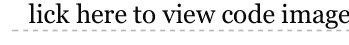

```
In [4]: import os

In [5]: os.remove('accounts.txt')
```

接下来，让我们使用 `rename` 函数将临时文件重命名为 'accounts.txt'：


```
In [6]: os.rename('temp_file.txt', 'accounts.txt')
```

## 9.5 使用 JSON 进行序列化

我们将用来与基于云的服务（如 Twitter、IBM Watson 等）交互的许多库，通过 JSON 对象与你的应用程序通信。JSON（JavaScript 对象表示法）是一种基于文本的、人类和计算机都可读的数据交换格式，用于将对象表示为名称-值对的集合。JSON 甚至可以表示自定义类的对象，就像你将在下一章中构建的那些对象一样。

JSON 已成为跨平台传输对象的首选数据格式。这一点在调用基于云的 Web 服务时尤其适用，这些服务是你通过 Internet 调用的函数和方法。你将熟练处理 JSON 数据。在“数据挖掘 Twitter”章节中，你将访问包含推文及其元数据的 JSON 对象。在“IBM Watson 和认知计算”章节中，你将访问 Watson 服务返回的 JSON 响应中的数据。在“大数据：Hadoop、Spark、NoSQL 和 IoT”章节中，我们将从 Twitter 获取的 JSON 推文对象存储在 MongoDB（一种流行的 NoSQL 数据库）中。在该章节中，我们还将处理其他以 JSON 对象形式发送和接收数据的 Web 服务。

### JSON 数据格式

JSON 对象类似于 Python 字典。每个 JSON 对象包含花括号中的逗号分隔的属性名和值列表。例如，以下键-值对可能表示客户记录：

```
{"account": 100, "name": "Jones", "balance": 24.98}
```

JSON 还支持数组，数组类似于 Python 列表，是方括号中的逗号分隔值。例如，以下是可接受的数字 JSON 数组：

```
[100, 200, 300]
```

JSON 对象和数组中的值可以是：

- 双引号括起来的字符串（如 "Jones"），
- 数字（如 100 或 24.98），
- JSON 布尔值（在 JSON 中表示为 `true` 或 `false`），
- `null`（表示无值，类似于 Python 中的 `None`），
- 数组（如 `[100, 200, 300]`），以及
- 其他 JSON 对象。

### Python 标准库模块 json

**json** 模块使你能够将对象转换为 JSON（JavaScript 对象表示法）文本格式。这被称为对数据进行 **序列化**。请考虑以下字典，它包含一个键-值对，该键为 'accounts'，关联的值是一个表示两个账户的字典列表。每个账户字典包含三个键-值对，分别对应账户号码、姓名和余额：

单击此处查看代码图片

```
In [1]: accounts_dict = {'accounts': [
    ...:     {'account': 100, 'name': 'Jones', 'balance': 24.98},
    ...:     {'account': 200, 'name': 'Doe', 'balance': 345.67}]}
```

### 将对象序列化为 JSON

让我们将该对象以 JSON 格式写入文件：

单击此处查看代码图片

```
In [2]: import json

In [3]: with open('accounts.json', 'w') as accounts:
    ...:     json.dump(accounts_dict, accounts)
```

代码片段 [3] 打开文件 `accounts.json` 并使用 **json** 模块的 **dump** 函数将字典 `accounts_dict` 序列化到文件中。生成的文件包含以下文本，我们略微重新格式化以提高可读性：

单击此处查看代码图片

```
{"accounts": [
{"account": 100, "name": "Jones", "balance": 24.98},
{"account": 200, "name": "Doe", "balance": 345.67}]}
```

请注意，JSON 使用双引号字符来界定字符串。

### 反序列化 JSON 文本

json 模块的 load 函数读取其文件对象参数的完整 JSON 内容，并将 JSON 转换为 Python 对象。这被称为对数据进行反序列化。让我们从这段 JSON 文本重建原始 Python 对象：

单击此处查看代码图片

```
In [4]: with open('accounts.json', 'r') as accounts:
    ...:     accounts_json = json.load(accounts)
    ...:
    ...:
```

现在我们可以与加载的对象进行交互。例如，我们可以显示字典：

单击此处查看代码图片

```
In [5]: accounts_json
Out[5]:
{'accounts': [{'account': 100, 'name': 'Jones', 'balance': 24.98],
{'account': 200, 'name': 'Doe', 'balance': 345.67}]}
```

如你所料，你可以访问字典的内容。让我们获取与 'accounts' 键关联的字典列表：

单击此处查看代码图片

```
In [6]: accounts_json['accounts']
Out[6]:
[{'account': 100, 'name': 'Jones', 'balance': 24.98],
{'account': 200, 'name': 'Doe', 'balance': 345.67}]}
```

现在，让我们获取各个账户字典：

单击此处查看代码图片

```
In [7]: accounts_json['accounts'][0]
Out[7]: {'account': 100, 'name': 'Jones', 'balance': 24.98}
In [8]: accounts_json['accounts'][1]
Out[8]: {'account': 200, 'name': 'Doe', 'balance': 345.67}
```

虽然我们在此未这样做，但你也可以修改字典。例如，你可以向列表中添加账户或从列表中删除账户，然后将字典写回 JSON 文件。

### 显示 JSON 文本

json 模块的 dumps 函数（dumps 是“dump string”的缩写）返回对象在 JSON 格式中的 Python 字符串表示。使用 dumps 配合 load，你可以从文件读取 JSON 并以良好缩进的格式显示它——有时称为“美化打印” JSON。当 dumps 函数调用包含 indent 关键字参数时，字符串包含用于美化打印的换行符和缩进——你也可以在使用 dump 函数向文件写入时使用 indent：

单击此处查看代码图片

```
In [9]: with open('accounts.json', 'r') as accounts:
    ...:     print(json.dumps(json.load(accounts), indent=4))
    ...:
{
    "accounts": [
        {
            "account": 100,
            "name": "Jones",
            "balance": 24.98
        },
        {
            "account": 200,
            "name": "Doe",
            "balance": 345.67
        }
    ]
}
```

## 9.6 安全聚焦：Pickle 序列化和反序列化

Python 标准库的 pickle 模块可以将对象序列化为 Python 特定的数据格式。注意：Python 文档对 pickle 提供了以下警告：

- “Pickle 文件可能被攻击。如果你通过网络接收到原始 pickle 文件，请不要信任！它可能包含恶意代码，当你尝试反序列化它时，这些代码会运行任意 Python。但是，如果你自己进行 pickle 写入和读取，你是安全的（当然，前提是没有其他人可以访问 pickle 文件。） 6

6 https://wiki.python.org/moin/UsingPickle.

- “Pickle 是一种协议，允许序列化任意复杂的 Python 对象。因此，它特定于 Python，不能用于与用其他语言编写的应用程序通信。它默认也不安全：反序列化来自不可信源的 pickle 数据可能会执行任意代码，如果数据是由熟练攻击者精心构造的。” 7

7 https://docs.python.org/3/tutorial/inputoutput.html#reading-and-writing-files.

我们不推荐使用 pickle，但它已被使用多年，因此你可能会在旧代码中遇到它——旧代码通常不再受支持。

## 9.7 关于文件的其他说明

下表总结了文本文件的各种文件打开模式，包括我们已介绍的读取和写入模式。写入和追加模式在文件不存在时会创建文件。读取模式在文件不存在时会引发 FileNotFoundError。每种文本文件模式都有一个对应的二进制文件模式，指定 b，如 'rb' 或 'wb+'。例如，如果你要读取或写入二进制文件（如图像、音频、视频、压缩的 ZIP 文件以及许多其他流行的自定义文件格式），则会使用这些模式。

| Mode | Description |
|---|---|
| 'r' | 打开文本文件以供读取。如果在调用 open 时未指定文件打开模式，则这是默认模式。 |
| 'w' | 打开文本文件以供写入。现有文件内容将被删除。 |


| 模式 | 描述 |
|---|---|
| 'a' | 以追加模式打开文本文件，如果文件不存在则创建文件。新数据写入文件末尾。 |
| 'r+' | 以读写模式打开文本文件。 |
| 'w+' | 以读写模式打开文本文件。现有文件内容被删除。 |
| 'a+' | 以读取和追加模式打开文本文件。新数据写入文件末尾。如果文件不存在，则创建文件。 |

## 其他文件对象方法

以下是几个其他有用的文件对象方法。

- 对于文本文件，read 方法返回包含方法整数参数所指定字符数的字符串。对于二进制文件，该方法返回指定数量的字节。如果未指定参数，该方法返回文件的全部内容。

- readline 方法返回一行文本作为字符串，如果存在，则包括换行符。当遇到文件末尾时，此方法返回空字符串。

- writelines 方法接收一个字符串列表并将其内容写入文件。

Python 用于创建文件对象的类定义在 Python 标准库的 io 模块中（ https://docs.python.org/3/library/io.html ）。

## 9.8 处理异常

使用文件时可能发生各种类型的异常，包括：

- 如果尝试使用 'r' 或 'r+' 模式打开不存在的文件进行读取，则会发生 FileNotFoundError。

- 如果尝试执行无权执行的操作，则会发生 PermissionsError。例如，如果你尝试打开账户无权访问的文件，或在账户无权写入的文件夹中创建文件（例如存储计算机操作系统的文件夹），就可能发生这种情况。

- 当你尝试向已关闭的文件写入时，会发生 ValueError（错误消息为 'I/O operation on closed file.'）。

### 9.8.1 除以零和无效输入

让我们重温一下本书前面提到的两种异常。

### 除以零

回顾一下，尝试除以 0 会导致 ZeroDivisionError：

点击此处查看代码图像

```
In [1]: 10 / 0
---------------------------------------------------------------------------
ZeroDivisionError                         Traceback (most recent call last)
ipython-input-1-a243dfbf119d> in <module>()
----> 1 10 / 0

ZeroDivisionError: division by zero

In [2]:
```

在此情况下，解释器被认为引发了类型为 ZeroDivisionError 的**异常**。当在 IPython 中引发异常时，它会：

- 终止代码片段，

- 显示异常的跟踪信息，然后

- 显示下一个 In [] 提示符，以便你可以输入下一个代码片段。

如果在脚本中发生异常，脚本将终止，并且 IPython 会显示跟踪信息。

### 无效输入

回顾一下，如果尝试将表示非数字的字符串（如 'hello'）转换为整数，int 函数会引发 ValueError：

点击此处查看代码图像

```
In [2]: value = int(input('Enter an integer: '))
Enter an integer: hello
-------------------------------------------------------------------------------
ValueError                                Traceback (most recent call last)
ipython-input-2-b521605464d6> in <module>()
----> 1 value = int(input('Enter an integer: '))

ValueError: invalid literal for int() with base 10: 'hello'

In [3]:
```

### 9.8.2 try 语句

现在让我们看看如何处理这些异常，以便代码可以继续处理。请考虑以下脚本和示例执行。它的循环尝试从用户那里读取两个整数，然后显示第一个数除以第二个数。该脚本使用异常处理来捕获和处理（即处理）出现的任何 ZeroDivisionErrors 和 ValueErrors——在此情况下，允许用户重新输入。

点击此处查看代码图像

```
1 # dividebyzero.py
2 """Simple exception handling example."""
3
4 while True:
5     # attempt to convert and divide values
6     try:
7         number1 = int(input('Enter numerator: '))
8         number2 = int(input('Enter denominator: '))
9         result = number1 / number2
10    except ValueError: # tried to convert non-numeric value to int
11        print('You must enter two integers\n')
12    except ZeroDivisionError: # denominator was 0
13        print('Attempted to divide by zero\n')
14    else: # executes only if no exceptions occur
15        print(f'{number1:.3f} / {number2:.3f} = {result:.3f}')
16        break # terminate the loop
```

点击此处查看代码图像

```
Enter numerator: 100
Enter denominator: 0
Attempted to divide by zero

Enter numerator: 100
Enter denominator: hello
You must enter two integers

Enter numerator: 100
Enter denominator: 7
100.000 / 7.000 = 14.286
```

### try 子句

Python 使用** try 语句**（例如第 6–16 行）来启用异常处理。`try` 语句的** try 子句**（第 6–9 行）以关键字 `try` 开头，后跟一个冒号 (:) 和一组*可能*引发异常的语句。

### except 子句

`try` 子句后面可以紧跟一个或多个** except 子句**（第 10–11 行和第 12–13 行），它们紧跟在 `try` 子句的语句组之后。这些也被称为*异常处理程序*。每个 `except` 子句指定它处理的异常类型。在此示例中，每个异常处理程序仅显示一条消息，指示发生的问题。

### else 子句

在最后一个 `except` 子句之后，可选的** else 子句**（第 14–16 行）指定仅当 `try` 语句组中的代码未引发异常时才应执行的代码。如果此示例的 `try` 语句组中未发生异常，第 15 行将显示除法结果，第 16 行将终止循环。

### ZeroDivisionError 的控制流

现在让我们根据示例输出的前三行考虑此示例的控制流：

- 首先，用户针对 `try` 语句组中的第 7 行输入 `100` 作为分子。

- 接下来，用户针对 `try` 语句组中的第 8 行输入 `0` 作为分母。

- 此时，我们有两个整数值，因此第 9 行尝试用 `100` 除以 `0`，导致 Python 引发 `ZeroDivisionError`。发生异常的程序位置通常称为**引发点**。

当 `try` 语句组中发生异常时，它会立即终止。如果 `try` 语句组后面有任何 `except` 处理程序，程序控制将转移到第一个处理程序。如果没有 `except` 处理程序，则会发生称为*栈展开*的过程，我们将在本章后面讨论。

在此示例中，存在 `except` 处理程序，因此解释器会搜索与引发的异常类型匹配的*第一个*处理程序：

- 第 10–11 行的 `except` 子句处理 `ValueErrors`。这与类型 `ZeroDivisionError` 不匹配，因此该 `except` 子句的语句组不执行，程序控制转移到下一个 `except` 处理程序。

- 第 12–13 行的 `except` 子句处理 `ZeroDivisionErrors`。这*是*匹配项，因此该 `except` 子句的语句组执行，显示 "Attempted to divide by zero"。

当 `except` 子句成功处理异常时，程序执行将恢复到 `finally` 子句（如果有），然后是 `try` 语句后的下一条语句。在此示例中，我们到达循环末尾，因此执行恢复到下一次循环迭代。请注意，异常处理后，程序控制*不会*返回到引发点。相反，控制在 `try` 语句后恢复。我们稍后将讨论 `finally` 子句。

### `ValueError` 的控制流

现在让我们根据示例输出的接下来三行考虑控制流：

- 首先，用户针对 `try` 语句组中的第 7 行输入 `100` 作为分子。

- 接下来，用户针对 `try` 语句组中的第 8 行输入 `hello` 作为分母。输入不是有效的整数，因此 `int` 函数引发 `ValueError`。

异常终止 `try` 语句组，程序控制转移到第一个 `except` 处理程序。在此情况下，第 10–11 行的 `except` 子句是匹配项，因此其语句组执行，显示 "You must enter two integers"。然后，程序执行


在 `try` 语句之后的下一条语句处继续执行。同样，这是循环的末尾，因此执行将恢复到下一次循环迭代。

### 成功除法的控制流

现在，让我们根据示例输出的最后三行来考虑控制流：

- 首先，用户针对 `try` 块中第 7 行输入 100 作为分子。
- 接下来，用户针对 `try` 块中第 8 行输入 7 作为分母。
- 此时，我们拥有两个有效的整数值且分母不为 0，因此第 9 行成功地将 100 除以 7。

当 `try` 块中没有发生异常时，程序执行将恢复到 `else` 子句（如果存在）；否则，程序执行将恢复到 `try` 语句之后的下一条语句。在本示例的 `else` 子句中，我们显示除法结果，然后终止循环，程序随之结束。

## 9.8.3 在一个 `except` 子句中捕获多个异常

`try` 子句后面通常会跟随多个 `except` 子句来处理各种类型的异常。如果多个 `except` 块相同，您可以通过在单个 `except` 处理程序中将这些异常类型指定为元组来捕获这些异常类型，例如：

```
except (type1, type2, ...) as variable_name:
```

`as` 子句是可选的。通常，程序不需要直接引用捕获的异常对象。如果需要，您可以使用 `as` 子句中的变量来引用 `except` 块中的异常对象。

## 9.8.4 函数或方法引发哪些异常？

异常可能通过 `try` 块中的语句、通过从 `try` 块直接或间接调用的函数或方法，或通过 Python 解释器在执行代码时浮出（例如，`ZeroDivisionError`）。

在使用任何函数或方法之前，请阅读其在线 API 文档，该文档指定了函数或方法抛出的异常（如果有），并指出此类异常可能发生的原因。接下来，阅读每个异常类型的在线 API 文档，以了解此类异常发生的潜在原因。

## 9.8.5 哪些代码应放置在 try 块中？

将程序中多个语句可能引发异常的重要逻辑部分放入 try 块中，而不是为每个引发异常的语句单独包装一个 try 语句。但是，为了获得适当的异常处理粒度，每个 try 语句应封装足够小的代码段，以便在发生异常时，已知特定上下文，且 except 处理程序可以正确处理异常。如果 try 块中的许多语句引发相同的异常类型，可能需要多个 try 语句来确定每个异常的上下文。

## 9.9 终止子句

操作系统通常可以防止多个程序同时操作一个文件。当程序完成文件处理时，程序应将其关闭以释放资源，以便其他程序可以访问它。关闭文件有助于防止资源泄漏。

### try 语句的 finally 子句

try 语句可以在任何 except 子句或 else 子句之后包含一个 finally 子句。finally 子句保证会执行。8 在其他具有 finally 的语言中，这使得 finally 块成为放置在相应的 try 块中获取的资源的资源释放代码的理想位置。在 Python 中，我们更喜欢为此目的使用 with 语句，并将其他类型的“清理”代码放在 finally 块中。

8 如果程序控制进入相应的 try 块，finally 块不执行的唯一原因是应用程序首先终止，例如通过调用 sys 模块的 exit 函数。

### 示例

以下 IPython 会话演示了 finally 子句始终执行，无论相应的 try 块中是否发生异常。首先，让我们考虑一个 try 块中没有发生异常的 try 语句：

点击此处查看代码图像

```
In [1]: try:
....     print('try suite with no exceptions raised')
....     except:
....     print('this will not execute')
....     else:
....     print('else executes because no exceptions in the try suite')
....     finally:
....     print('finally always executes')
....

try suite with no exceptions raised
else executes because no exceptions in the try suite
finally always executes

In [2]:
```

前面的 `try` 块显示一条消息但不引发任何异常。当程序控制成功到达 `try` 块的末尾时，将跳过 `except` 子句，`else` 子句执行，`finally` 子句显示一条消息表明它始终执行。当 `finally` 子句终止时，程序控制将继续执行 `try` 语句之后的下一条语句。在 IPython 会话中，下一个 `In []` 提示符将出现。

现在，让我们考虑一个 `try` 块中发生异常的 `try` 语句：

点击此处查看代码图像

```
In [2]: try:
....     print('try suite that raises an exception')
....     int('hello')
....     print('this will not execute')
....     except ValueError:
....     print('a ValueError occurred')
....     else:
....     print('else will not execute because an exception occurred')
....     finally:
....     print('finally always executes')
....

try suite that raises an exception
a ValueError occurred
finally always executes

In [3]:
```

此 `try` 块首先显示一条消息。第二条语句尝试将字符串 'hello' 转换为整数，这会导致 `int` 函数引发 ValueError。try 块立即终止，跳过其最后一个 print 语句。except 子句捕获 ValueError 异常并显示一条消息。else 子句不执行，因为发生了异常。然后，finally 子句显示一条消息表明它始终执行。当 finally 子句终止时，程序控制将继续执行 try 语句之后的下一条语句。在 IPython 会话中，下一个 In [] 提示符将出现。

### 将 with 语句与 try except 语句结合使用

大多数需要显式释放的资源（例如文件、网络连接和数据库连接）与处理这些资源相关联的潜在异常。例如，处理文件的程序可能会引发 IOError。因此，健壮的文件处理代码通常出现在包含 with 语句的 try 块中，以确保资源被释放。代码位于 try 块中，因此您可以在 except 处理程序中捕获任何发生的异常，并且不需要 finally 子句，因为 with 语句处理资源释放。

为了演示这一点，首先假设您正在要求用户提供文件名，但他们提供的名称不正确，例如 gradez.txt 而不是我们之前创建的 grades.txt。在这种情况下，open 调用尝试打开不存在的文件时会引发 FileNotFoundError：

点击此处查看代码图像

```
In [3]: open('gradez.txt')
------------------------------------------------------------
FileNotFoundError                        Traceback (most recent call last)
ipython-input-3-b7f41b2d5969> in <module>()
----> 1 open('gradez.txt')

FileNotFoundError: [Errno 2] No such file or directory: 'gradez.txt'
```

要捕获尝试打开文件进行读取时发生的 FileNotFoundError 等异常，请将 with 语句包装在 try 块中，例如：

点击此处查看代码图像

```
In [4]: try:
    ...:     with open('gradez.txt', 'r') as accounts:
    ...:         print(f'{"ID":<3}{"Name":<7}{"Grade"}')
    ...:         for record in accounts:
    ...:             student_id, name, grade = record.split()
    ...:             print(f'{student_id:<3}{name:<7}{grade}')
    ...: except FileNotFoundError:
    ...:     print('The file name you specified does not exist')
    ...:
The file name you specified does not exist
```

## 9.10 显式引发异常

您已看到 Python 代码引发的各种异常。有时，您可能需要编写引发异常的函数以通知调用者发生的错误。raise 语句显式引发异常。raise 语句的最简单形式是

```
raise ExceptionClassName
```

raise 语句创建指定异常类的一个对象。可选地，异常类名称后面可以跟包含用于初始化异常对象的参数的括号——通常用于提供自定义错误消息字符串。引发异常的代码应首先释放异常发生前获取的任何资源。在下一节中，我们将展示引发异常的示例。

在大多数情况下，当您需要引发异常时，建议使用 Python 许多内置异常类型 9 中的一个，列于：

9 您可能会想要创建特定于应用程序的自定义异常类。我们将在下一章中详细介绍自定义异常。

https://docs.python.org/3/library/exceptions.html

## 9.11 （可选）栈展开和回溯

每个异常对象都存储指示导致异常的确切函数调用系列的信息。调试代码时这很有帮助。请考虑以下函数定义——function1 调用 function2，function2 引发一个 Exception：

点击此处查看代码图像

```
In [1]: def function1():
...:     function2()
```


...:
In [2]: def function2():
    ...:         raise Exception('An exception occurred')
    ...:

调用 `function1` 会产生以下跟踪。为强调起见，我们将粗体标记出跟踪中指示导致异常的代码行：

单击此处查看代码图像

```
In [3]: function1()
----------------------------------------------------------------------
Exception                                 Traceback (most recent call last)
<ipython-input-3-c0b3cafe2087> in <module>()
----> 1 function1()
<ipython-input-1-a9f4faeeeb0c> in function1()
1 def function1():
----> 2     function2()
3
<ipython-input-2-c65e19d6b45b> in function2()
1 def function2():
----> 2     raise Exception('An exception occurred')
Exception: An exception occurred
```

## 跟踪详情

跟踪显示发生的异常类型（Exception），后跟导致抛出点的完整函数调用堆栈。堆栈底部的函数调用被 _首先_ 列出，栈顶被 _最后_ 列出，因此解释器将以下文本显示为提示：

```
Traceback (most recent call last)
```

在这个跟踪中，以下文本指示函数调用堆栈的底部——即代码片段 [3] 中的 `function1` 调用（由 `ipython-input-3` 指示）：

```
<ipython-input-3-c0b3cafe2087> in <module>()
----> 1 function1()
```

接下来，我们看到 `function1` 从代码片段 [1] 的第 2 行调用了 `function2`：

```
<ipython-input-1-a9f4faeeeb0c> in function1()
    1 def function1():
----> 2     function2()
      3
```

最后，我们看到 *抛出点*——在此例中，代码片段 [2] 的第 2 行引发了异常：

```
<ipython-input-2-c65e19d6b45b> in function2()
    1 def function2():
----> 2     raise Exception('An exception occurred')
```

## 堆栈展开

在我们之前的异常处理示例中，抛出点发生在 `try` 代码块中，
异常由 `try` 语句的相应 `except` 处理程序之一处理。当给定函数中发生 *未捕获* 的异常时，将发生 **堆栈展开**。
让我们在此示例的上下文中考虑堆栈展开：

- 在 `function2` 中，`raise` 语句引发异常。这不在 `try` 代码块中，
  因此 `function2` 终止，其堆栈帧从函数调用堆栈中移除，
  控制权返回到 `function1` 中调用 `function2` 的语句。

- 在 `function1` 中，调用 `function2` 的语句不在 `try` 代码块中，因此
  `function1` 终止，其堆栈帧从函数调用堆栈中移除，并且
  控制权返回到调用 `function1` 的语句——即 IPython 会话中的代码片段 [3]。

- 代码片段 [3] 中的调用不在 `try` 代码块中，因此该函数调用终止。
  由于异常未被捕获（称为 **未捕获异常**），
  IPython 将显示跟踪，然后等待您的下一个输入。如果发生在典型脚本中，
  脚本将终止。[^0]

[^0]: 在使用线程的更高级应用程序中，未捕获异常仅终止异常发生所在的线程，而不一定是整个
应用程序。

## 读取跟踪的提示

您通常会调用属于您未编写的代码库中的函数和方法。有时，这些函数和方法会引发异常。
读取跟踪时，请先从跟踪的末尾开始，先阅读错误消息。然后，沿着跟踪向上阅读，
查找指示您在程序中编写的代码的第一行。通常，这就是导致异常的代码位置。

## finally 代码块中的异常

在 finally 代码块中引发异常可能会导致微妙且难以查找的问题。如果发生异常且在 finally 代码块执行时未得到处理，则会发生堆栈展开。如果 finally 代码块引发该代码块未捕获的新异常，则第一个异常将丢失，新异常会被传递到下一层封闭的 try 语句。因此，finally 代码块应始终在 try 语句中封闭任何可能引发异常的代码，以便在该代码块内处理异常。

## 9.12 数据科学简介：使用 CSV 文件

在本书中，在介绍数据科学概念时，您将处理许多数据集。CSV（逗号分隔值）是一种特别流行的文件格式。在本节中，我们将使用 Python 标准库模块和 pandas 演示 CSV 文件处理。

## 9.12.1 Python 标准库模块 csv

csv 模块[^1] 提供用于处理 CSV 文件的函数。许多其他 Python 库也内置了 CSV 支持。

[^1]: https://docs.python.org/3/library/csv.html.

## 将数据写入 CSV 文件

让我们使用 CSV 格式创建一个 accounts.csv 文件。csv 模块的文档建议在打开 CSV 文件时使用额外的关键字参数 newline=''，以确保正确处理换行符：

单击此处查看代码图像

```
In [1]: import csv

In [2]: with open('accounts.csv', mode='w', newline='') as accounts:
    ...:     writer = csv.writer(accounts)
    ...:     writer.writerow([100, 'Jones', 24.98])
    ...:     writer.writerow([200, 'Doe', 345.67])
    ...:     writer.writerow([300, 'White', 0.00])
    ...:     writer.writerow([400, 'Stone', -42.16])
    ...:     writer.writerow([500, 'Rich', 224.62])
    ...:

```

**.csv 文件扩展名** 表示 CSV 格式文件。csv 模块的 **writer 函数** 返回一个将 CSV 数据写入指定文件对象的对象。对 writer 的 **writerow 方法** 的每次调用都接收一个可迭代对象以存储到文件中。此处我们使用列表。默认情况下，writerow 用逗号分隔值，但您可以指定自定义分隔符。[^2] 在上述代码片段之后，accounts.csv 包含：

[^2]: https://docs.python.org/3/library/csv.html#csv-fmt-params.

```
100,Jones,24.98
200,Doe,345.67
300,White,0.00
400,Stone,-42.16
500,Rich,224.62
```

CSV 文件通常在逗号后不包含空格，但有些人使用空格来增强可读性。上述 writerow 调用可以替换为一个 **writerows** 调用，它输出表示记录的可迭代对象的逗号分隔列表。

如果写入的数据包含给定字符串中的逗号，writerow 会将该字符串用双引号括起来。例如，请考虑以下 Python 列表：

```
[100, 'Jones, Sue', 24.98]
```

单引号字符串 'Jones, Sue' 包含分隔姓和名的逗号。在这种情况下，writerow 将记录输出为

```
100,"Jones, Sue",24.98
```

"Jones, Sue" 周围的引号表明这是一个单个值。从 CSV 文件读取此内容的程序会将记录分成三部分——100、'Jones, Sue' 和 24.98。

## 从 CSV 文件读取

现在让我们从文件中读取 CSV 数据。以下代码片段从 accounts.csv 文件读取记录并显示每条记录的内容，生成我们之前展示的相同输出：

单击此处查看代码图像

```
In [3]: with open('accounts.csv', 'r', newline='') as accounts:
    ...:     print(f'{"Account":<10}{"Name":<10}{"Balance":>10}')
    ...:     reader = csv.reader(accounts)
    ...:     for record in reader:
    ...:         account, name, balance = record
    ...:         print(f'{account:<10}{name:<10}{balance:>10}')
    ...: 
Account   Name      Balance
100       Jones       24.98
200       Doe        345.67
300       White         0.0
400       Stone      -42.16
500       Rich       224.62
```

csv 模块的 reader 函数返回一个从指定文件对象读取 CSV 格式数据的对象。就像您可以遍历文件对象一样，您可以一次遍历 reader 对象中的一条逗号分隔值记录。前面的 for 语句将每条记录作为值列表返回，我们将其解包为 account、name 和 balance 变量，然后显示。

## 注意：CSV 数据字段中的逗号

处理包含嵌入式逗号的字符串（例如姓名 'Jones, Sue'）时要小心。如果您意外将其作为两个字符串 'Jones' 和 'Sue' 输入，那么 writerow 当然会创建一个包含四个字段而非三个字段的 CSV 记录。读取 CSV 文件的程序通常期望每条记录都具有相同数量的字段；否则，将出现问题。例如，请考虑以下两个列表：

```
[100, 'Jones', 'Sue', 24.98]
[200, 'Doe', 345.67]
```

第一个列表包含四个值，第二个列表仅包含三个值。如果将这两条记录写入 CSV 文件，然后使用前面的代码片段将其读入程序，那么在尝试将四个字段的记录解包到仅三个变量时，以下语句将失败：


## 注意：CSV 文件中缺少逗号和多余逗号

account, name, balance = record

准备和处理 CSV 文件时要小心。例如，假设您的文件由记录组成，每条记录包含 *四个* 逗号分隔的 `int` 值，如下所示：

```
100, 85, 77, 9
```

如果您意外省略其中一个逗号，如下所示：

```
100, 8577, 9
```

则该记录只有 *三个* 字段，其中包含无效值 `8577`。

如果您在只应有一个逗号的地方放置两个相邻逗号，如下所示：

```
100, 85, , 77, 9
```

则您将有 *五个* 字段而非 *四个* 字段，并且其中一个字段错误地为 *空*。这些与逗号相关的错误中的每一个都可能混淆尝试处理该记录的程序。

### 9.12.2 将 CSV 文件读入 pandas DataFrame

在前两章的数据科学简介部分中，我们介绍了许多 pandas 基础知识。在此，我们演示 pandas 加载 CSV 格式文件的能力，然后执行一些基本的数据分析任务。

### 数据集

在数据科学案例研究中，我们将使用各种免费开源数据集来演示机器学习和自然语处理概念。网上有大量免费数据集可供使用。流行的 **Rdatasets 存储库** 提供了超过 1100 个以逗号分隔值 (CSV) 格式的免费数据集链接。这些数据集最初随 R 编程语言提供，供人们学习和开发统计软件，尽管它们并不特定于 R。它们现在可在 GitHub 上找到：

https://vincentarelbundock.github.io/Rdatasets/datasets.html

该存储库非常流行，以至于有专门用于访问 R 数据集的 **pydataset 模块**。有关安装 `pydataset` 并使用它访问数据集的说明，请参见：

https://github.com/iamaziz/PyDataset

另一个大型数据集来源是：

https://github.com/awesomedata/awesome-public-datasets

初学者常用的机器学习数据集是 **泰坦尼克号灾难数据集**，它列出了所有乘客以及当船 *泰坦尼克号* 于 1912 年 4 月 14–15 日撞上冰山并沉没时他们是否生还。我们将在此使用它来展示如何加载数据集、查看部分数据并显示一些描述性统计信息。我们将在本书后面的数据科学章节中深入探讨各种流行的数据集。

### 使用本地存储的 CSV 文件

您可以使用 pandas 函数 `read_csv` 将 CSV 数据集加载到 `DataFrame` 中。以下加载并显示您在本章前面创建的 CSV 文件 `accounts.csv`：

单击此处查看代码图片

```
In [1]: import pandas as pd

In [2]: df = pd.read_csv('accounts.csv',
    ...:                     names=['account', 'name', 'balance'])
    ...:

In [3]: df
Out[3]:
   account   name  balance
0      100  Jones    24.98
1      200   Doe   345.67
2      300  White     0.00
3      400  Stone   -42.16
4      500  Rich   224.62
```

`names` 参数指定 `DataFrame` 的列名。如果没有此参数，`read_csv` 假设 CSV 文件的第一行是逗号分隔的列名列表。

要使用 CSV 格式将 DataFrame 保存到文件，请调用 DataFrame 方法 `to_csv`：

单击此处查看代码图片

```
In [4]: df.to_csv('accounts_from_dataframe.csv',  index=False)
```

`index=False` 关键字参数表示行名（代码片段 [3] 中 DataFrame 输出左侧的 0–4）不会写入文件。生成的文件将列名作为第一行：

| account,name,balance |
| --- |
| 100,Jones,24.98 |
| 200,Doe,345.67 |
| 300,White,0.0 |
| 400,Stone,-42.16 |
| 500,Rich,224.62 |

### 9.12.3 读取泰坦尼克号灾难数据集

泰坦尼克号灾难数据集是最受欢迎的机器学习数据集之一。该数据集有多种格式，包括 CSV。

### 通过 URL 加载泰坦尼克号数据集

如果您有代表 CSV 数据集的 URL，可以使用 `read_csv` 将其加载到 DataFrame 中。让我们直接从 GitHub 加载泰坦尼克号灾难数据集：

单击此处查看代码图片

```
In [1]: import pandas as pd

In [2]: titanic = pd.read_csv('https://vincentarelbundock.github.io/' +
    ...:     'Rdatasets/csv/carData/TitanicSurvival.csv')
    ...:
```

### 查看泰坦尼克号数据集中的一些行

该数据集包含超过 1300 行，每行代表一名乘客。根据维基百科，约有 1317 名乘客，其中 815 人死亡。³ 对于大型数据集，显示 `DataFrame` 仅显示前 30 行，然后是“…”和最后 30 行。为了节省空间，让我们使用 `DataFrame` 方法 **head** 和 **tail** 查看前五行和最后五行。两种方法默认返回五行，但您可以将要显示的行数作为参数指定：

3 https://en.wikipedia.org/wiki/Passengers_of_the_RMS_Titanic.

单击此处查看代码图片

```
In [3]: pd.set_option('precision', 2) # format for floating-point values

In [4]: titanic.head()
Out[4]:
    Unnamed: 0 survived sex age passengerClass
Allen, Miss. Elisabeth Walton yes female 29.00 1s
Allison, Master. Hudson Trevor yes male 0.92 1s
Allison, Miss. Helen Loraine no female 2.00 1s
Allison, Mr. Hudson Joshua Crei no male 30.00 1s
Allison, Mrs. Hudson J C (Bessi no female 25.00 1s

In [5]: titanic.tail()
Out[5]:
    Unnamed: 0 survived sex age passengerClass
1304 Zabour, Miss. Hileni no female 14.50 3rd
1305 Zabour, Miss. Thamine no female NaN 3rd
1306 Zakarian, Mr. Mapriededer no male 26.50 3rd
1307 Zakarian, Mr. Orin no male 27.00 3rd
1308 Zimmerman, Mr. Leo no male 29.00 3rd
```

请注意，pandas 根据列中最宽的值或列名（以较宽者为准）调整每列的宽度。另请注意，第 1305 行 age 列的值为 NaN（非数字），表示数据集中存在缺失值。

### 自定义列名

该数据集的第一列有一个奇怪的名称（“Unnamed: 0”）。我们可以通过设置列名来清理它。让我们将“Unnamed: 0”更改为“name”，并将“passengerClass”缩短为“class”：

单击此处查看代码图片

```
In [6]: titanic.columns = ['name', 'survived', 'sex', 'age', 'class']

In [7]: titanic.head()
Out[7]:
```

| name | survived | sex | age | class |
| :--- | :--- | :--- | :--- | :--- |
| Allen, Miss. Elisabeth Walton | yes | female | 29.00 | 1st |
| Allison, Master. Hudson Trevor | yes | male | 0.92 | 1st |
| Allison, Miss. Helen Loraine | no | female | 2.00 | 1st |
| Allison, Mr. Hudson Joshua Crei | no | male | 30.00 | 1st |
| Allison, Mrs. Hudson J C (Bessi | no | female | 25.00 | 1st |

### 9.12.4 使用泰坦尼克号灾难数据集进行简单数据分析

现在，您可以使用 pandas 执行一些简单的分析。例如，让我们查看一些描述性统计信息。当您对包含数值列和非数值列的 DataFrame 调用 `describe` 时，`describe` 仅针对数值列计算这些统计信息——在此例中，仅为 `age` 列：

```python
In [8]: titanic.describe()
Out[8]:
       age
count  1046.00
mean    29.88
std     14.41
min      0.17
25%     21.00
50%     28.00
75%     39.00
max     80.00
```

请注意 `count`（1046）与数据集行数（1309——调用 `tail` 时最后一行的索引为 1308）之间存在差异。仅 1046 条（上述 `count`）记录包含年龄值。其余记录为 *缺失* 并标记为 `NaN`，如第 1305 行所示。执行计算时，Pandas *默认* *忽略缺失数据* (`NaN`)。对于拥有有效年龄的 1046 人来说，平均（`mean`）年龄为 29.88 岁。最年轻的乘客（`min`）刚刚超过两个月大（0.17 × 12 等于 2.04），最年长的（`max`）为 80 岁。中位年龄为 28 岁（由 50% 四分位数表示）。25% 四分位数是乘客第一半部分（按年龄排序）的中位年龄，75% 四分位数是乘客第二半部分的中位数。

假设您想要确定关于幸存者的一些统计信息。我们可以将 `survived` 列与 'yes' 进行比较，以获取包含 `True`/`False` 值的新 Series，然后使用 `describe` 来总结结果：

单击此处查看代码图片

```python
In [9]: (titanic.survived == 'yes').describe()
```


```
Out[9]:
count   1309
unique   2
top    False
freq    809
Name: survived, dtype: object
```

对于非数值数据，describe 显示不同的描述性统计信息：

- count 是结果中的项目总数。
- unique 是结果中唯一值的数量（2）——True（幸存）和 False（死亡）。
- top 是结果中出现频率最高的值。
- freq 是 top 值的出现次数。

### 9.12.5 乘客年龄直方图

可视化是了解数据的好方法。Pandas 拥有许多基于 Matplotlib 实现的内置可视化功能。要使用它们，首先在 IPython 中启用 Matplotlib 支持：

```
In [10]: %matplotlib
```

直方图可视化数值数据在一系列值范围内的分布。DataFrame 的 hist 方法会自动分析每个数值列的数据并生成相应的直方图。要查看每个数值数据列的直方图，请在 DataFrame 上调用 hist：

点击此处查看代码图像

```
In [11]: histogram = titanic.hist()
```

Titanic 数据集只包含一个数值数据列，因此图表显示一个用于年龄分布的直方图。对于包含多个数值列的数据集，hist 会为每个数值列创建单独的直方图。

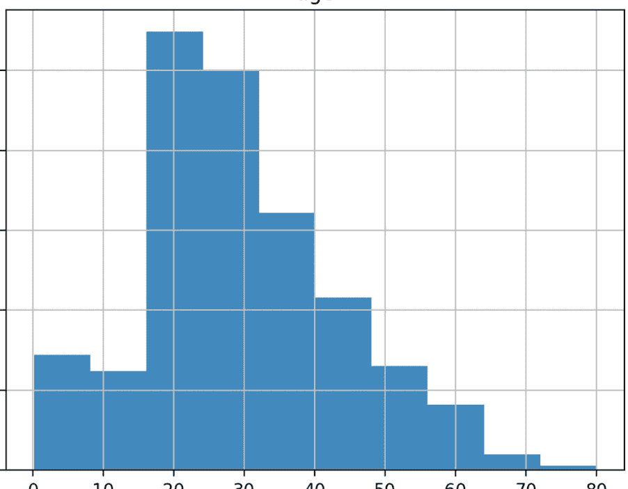

### 9.13 总结

本章介绍了文本文件处理和异常处理。文件用于持久存储数据。我们讨论了文件对象，并提到 Python 将文件视为字符或字节的序列。我们还提到，当 Python 程序开始执行时会自动为你创建标准文件对象。

我们演示了如何创建、读取、写入和更新文本文件。我们考虑了几种流行的文件格式——纯文本、JSON（JavaScript 对象表示法）和 CSV（逗号分隔值）。我们使用内置的 open 函数和 with 语句来打开文件、向文件写入或从文件读取，并在 with 语句终止时自动关闭文件以防止资源泄漏。我们使用 Python 标准库的 json 模块将对象序列化为 JSON 格式并将其存储在文件中，从文件加载 JSON 对象，将其反序列化为 Python 对象，并以美观的方式打印 JSON 对象以提高可读性。

我们讨论了异常如何指示执行时问题，并列出了你已经看到的各种异常。我们展示了如何通过将代码包装在提供 except 子句的 try 语句中来处理异常，以处理 try 块中可能发生的特定类型的异常，从而使你的程序更加健壮和容错。我们讨论了 `try` 语句的 `finally` 子句，用于在程序流进入相应的 `try` 块时执行代码。为此，你可以使用 `with` 语句或 `try` 语句的 `finally` 子句——我们更倾向于使用 `with` 语句。

在数据科学简介部分，我们同时使用了 Python 标准库的 `csv` 模块和 pandas 库的功能来加载、处理和存储 CSV 数据。最后，我们将 Titanic 灾难数据集加载到 pandas `DataFrame` 中，为提高可读性更改了一些列名，显示了数据集的 `head` 和 `tail`，并对数据进行了简单分析。在下一章中，我们将讨论 Python 的面向对象编程功能。

# 10. 面向对象编程

## 目标

本章中，你将：

- 创建自定义类及其对象。
- 理解创建有价值类的好处。
- 控制对属性的访问。
- 体会面向对象的价值。
- 使用 Python 特殊方法 `__repr__`、`__str__` 和 `__format__` 获取对象的字符串表示。
- 使用 Python 特殊方法重载（重新定义）运算符，以便与新类的对象一起使用。
- 将方法、属性和特性从现有类继承到新类，然后自定义这些类。
- 理解基类（超类）和派生类（子类）的继承概念。
- 理解使能够“整体编程”的鸭子类型和多态性。
- 理解所有类继承基本功能的 `object` 类。
- 比较组合和继承。
- 将测试用例构建到文档字符串中，并使用 `doctest` 运行这些测试。
- 理解命名空间及其如何影响作用域。

## 大纲

| 10.1 简介 |
| 10.2 自定义类 Account |
- 10.2.1 试驾类 Account
- 10.2.2 类 Account 定义
- 10.2.3 组合：作为类成员的对象引用
- 10.3 控制对属性的访问
- 10.4 用于数据访问的属性
- 10.4.1 试驾类 Time
- 10.4.2 类 Time 定义
- 10.4.3 类 Time 定义设计笔记
- 10.5 模拟“私有”属性
- 10.6 案例研究：卡片洗牌和发牌模拟
- 10.6.1 试驾类 Card 和 DeckOfCards
- 10.6.2 类 Card——引入类属性
- 10.6.3 类 DeckOfCards
- 10.6.4 使用 Matplotlib 显示卡片图像
- 10.7 继承：基类和子类
- 10.8 构建继承层次结构；引入多态性
- 10.8.1 基类 CommissionEmployee
- 10.8.2 子类 SalariedCommissionEmployee
- 10.8.3 以多态方式处理 Commission-Employees 和 Salaried-CommissionEmployees
- 10.8.4 关于基于对象的编程和面向对象编程的说明
- 10.9 鸭子类型和多态性
- 10.10 运算符重载
- 10.10.1 试驾类 Complex
- 10.10.2 类 Complex 定义
- 10.11 异常类层次结构和自定义异常
- 10.12 命名元组
- 10.13 Python 3.7 新数据类简介
- 10.13.1 创建 Card 数据类
- 10.13.2 使用 Card 数据类
- 10.13.3 数据相对于命名元组的优势
- 10.13.4 数据相对于传统类的优势
- 10.14 使用文档字符串和 doctest 进行单元测试
- 10.15 命名空间和作用域
- 10.16 数据科学简介：时间序列和简单线性回归
- 10.17 总结

### 10.1 简介

第 1.2 节介绍了面向对象编程的基本术语和概念。Python 中的一切都是对象，因此你在这本书中一直在不断使用对象。正如房子是根据蓝图建造的一样，对象是由类构建的——类是面向对象编程的核心技术之一。即使从一个很大的类构建新对象也很简单——你通常只需编写一条语句。

### 创建有价值的类

你已经使用过他人创建的许多类。在本章中，你将创建自己的自定义类。你将专注于“创建有价值的类”，这些类将帮助你满足所要构建的应用程序的要求。你将使用面向对象编程及其核心技术——类、对象、继承和多态性。软件应用程序正变得越来越大且功能更加丰富。面向对象编程使你更容易设计、实现、测试、调试和更新此类前沿应用程序。阅读第 10.1 节至第 10.9 节，以深入了解这些技术的代码密集型介绍。大多数人可以跳过第 10.10 节至第 10.15 节，这些部分提供了对这些技术的额外视角并介绍了其他相关功能。

### 类库和基于对象的编程

你在 Python 中进行的绝大部分面向对象编程都是基于对象的编程，即主要创建和使用现有类的对象。你在本书中一直在这样做，使用内置类型（如 int、float、str、list、tuple、dict 和 set）、Python 标准库类型（如 `Decimal`）、NumPy 数组、Matplotlib `Figures` 和 `Axes` 以及 pandas `Series` 和 `DataFrames`。

要充分利用 Python，你必须熟悉大量现有的类。多年来，Python 开源社区创建了大量有价值的类，并将其打包到类库中。这使你可以轻松重用现有类，而无需“重新发明轮子”。广泛使用的开源库类更有可能经过充分测试、无错误、性能调优，并且可在广泛的设备、操作系统和 Python 版本之间移植。你可以在互联网上找到大量 Python 库，网站包括 GitHub、BitBucket、Source Forge 等——大多数可以使用 `conda` 或 `pip` 轻松安装。这是 Python 流行的关键原因之一。你需要的绝大多数类可能都可以在开源库中免费获得。

### 创建自己的自定义类

类是新的数据类型。Python 标准库中的每个类和第三方库中的每个类都是由他人构建的自定义类型。在本章中，你将开发特定于应用程序的类，如 `CommissionEmployee`、`Time`、`Card`、`DeckOfCards` 等。

你为自己构建的大多数应用程序通常会使用没有自定义类或只有少数自定义类。如果你成为行业开发团队的一员，可能会参与包含数百个甚至数千个类的应用程序的开发。你可以将自定义类贡献给 Python 开源社区，但没有义务这样做。组织通常有与开源代码相关的政策和程序。

### 继承

也许最令人兴奋的概念是，可以通过从丰富的类库中的类进行继承和组合来形成新类。最终，软件将主要由标准化、可重用的组件构建，就像当今硬件由可互换零件构建一样。这将有助于应对开发越来越强大的软件所面临的挑战。

创建新类时，无需编写所有新代码，你可以指定新类最初通过继承先前定义的基类（也称为超类）的属性（变量）和方法（类的函数版本）来形成。新类称为派生类（或子类）。继承后，你可以自定义派生类以满足应用程序的特定需求。为了最大限度地减少自定义工作，你应始终尝试从最接近你需求的基类继承。为了有效地做到这一点，你应熟悉针对你将要构建的应用程序类型的类库。

### 多态性

我们解释并演示多态性，它使你能够方便地“整体编程”而非“具体编程”。你只需向可能为多种不同类型的对象发送相同的方法调用。每个对象通过“做正确的事”来响应。因此，相同的


方法调用具有“多种形式”，因此有“多态”这一术语。我们将解释如何通过继承和一种名为鸭子类型的Python特性来实现多态。我们将两者都解释，并展示各自的示例。

## 一个有趣的案例研究：卡牌洗牌与发牌模拟

您已使用基于随机数的掷骰子模拟，并运用这些技术实现了流行的骰子游戏craps。这里，我们展示一个卡牌洗牌与发牌模拟，您可以用它来实现您喜欢的纸牌游戏。您将使用Matplotlib配合吸引人的公共领域卡牌图像，在洗牌前后显示完整的卡牌组。

## 数据类

Python 3.7的新数据类通过使用更简洁的语法和自动生成类的部分内容，帮助您更快地构建类。Python社区对数据类的早期反馈是积极的。与任何重大新特性一样，在广泛使用之前可能需要时间。我们将同时介绍旧技术和新技术的类开发。

## 本章介绍的其他概念

我们介绍的其他概念包括：

- 如何指定某些标识符仅在类内部使用，而不对类的客户端可见。
- 用于创建类对象字符串表示的特殊方法，并指定类的对象如何与Python内置运算符协同工作（这一过程称为运算符重载）。
- Python异常类层次结构的介绍以及创建自定义异常类。
- 使用Python标准库的doctest模块测试代码。
- Python如何使用命名空间来确定标识符的作用域。

## 10.2 自定义类Account

让我们从一个银行账户类Account开始，它持有账户持有人的姓名和余额。实际的银行账户类可能包含大量其他信息，例如地址、出生日期、电话号码、账号等。Account类接受增加余额的存款和减少余额的取款。

### 10.2.1 试驾类Account

您创建的每个新类都会成为一种新的数据类型，可用于创建对象。这就是Python被称为可扩展语言的原因之一。在查看类Account的定义之前，让我们先演示其功能。

### 导入类Account和Decimal

要使用新的Account类，请从ch10示例文件夹启动IPython会话，然后导入类Account：

单击此处查看代码图像

```
In [1]: from account import Account
```

类Account将账户余额作为Decimal来维护和操作，因此我们还导入类Decimal：

单击此处查看代码图像

```
In [2]: from decimal import Decimal
```

### 使用构造器表达式创建Account对象

要创建一个Decimal对象，可以编写：

```
value = Decimal('12.34')
```

这被称为**构造器表达式**，因为它构建并初始化类的对象，类似于房屋从蓝图建造然后用买家偏好的颜色粉刷的方式。构造器表达式创建新对象，并使用括号中指定的参数来初始化其数据。类名后面的括号是必需的，即使没有参数。

让我们使用构造器表达式创建一个Account对象，并使用账户持有人的姓名（字符串）和余额（Decimal）对其进行初始化：

单击此处查看代码图像

```
In [3]: account1 = Account('John Green', Decimal('50.00'))
```

### 获取Account的姓名和余额

让我们访问Account对象的name和balance属性：

单击此处查看代码图像

```
In [4]: account1.name
Out[4]: 'John Green'
```

```
In [5]: account1.balance
Out[5]: Decimal('50.00')
```

### 向Account存入资金

Account的deposit方法接收一个正金额并将其添加到余额中：

单击此处查看代码图像

```
In [6]: account1.deposit(Decimal('25.53'))

In [7]: account1.balance
Out[7]: Decimal('75.53')
```

### Account方法执行验证

类Account的方法会验证其参数。例如，如果存款金额为负数，deposit会引发ValueError：

单击此处查看代码图像

```
In [8]: account1.deposit(Decimal('-123.45'))
---------------------------------------------------------------
ValueError Traceback (most recent call last)
<ipython-input-8-27dc468365a7> in <module>()
----> 1 account1.deposit(Decimal('-123.45'))

~/Documents/examples/ch10/account.py in deposit(self, amount)
21 # if amount is less than 0.00, raise an exception
22 if amount < Decimal('0.00'):
---> 23 raise ValueError('Deposit amount must be positive.')
24
25 self.balance += amount

ValueError: Deposit amount must be positive.
```

### 10.2.2 Account类定义

现在，让我们查看Account的类定义，它位于文件account.py中。

### 定义类

类定义以关键字class（第5行）开头，后跟类名和冒号（:）。这一行称为类头。Python代码风格指南建议，多词类名中的每个单词都以大写字母开头（例如，CommissionEmployee）。类体中的每条语句都要缩进。

单击此处查看代码图像

```
1 # account.py
2 """Account class definition."""
3 from decimal import Decimal
4
5 class Account:
6     """Account class for maintaining a bank account balance."""
```

每个类通常都提供一个描述性文档字符串（第6行）。如果提供，它必须出现在类头后的紧随其后的一行或多行中。要在IPython中查看任何类的文档字符串，请键入类名和问号，然后按Enter：

单击此处查看代码图像

```
In [9]: Account?
init signature: Account(name, balance)
Docstring: Account class for maintaining a bank account balance.
Init docstring: Initialize an Account object.
File: ~/Documents/examples/ch10/account.py
Type:      type
```

标识符Account既是类名，也是在构造器表达式中用于创建Account对象并调用类__init__方法的名称。出于此原因，IPython的帮助机制同时显示类的文档字符串（“Docstring:”）和__init__方法的文档字符串（“Init docstring:”）。

### 初始化Account对象：方法__init__

前一部分代码片段[3]中的构造器表达式：

单击此处查看代码图像

```
account1 = Account('John Green', Decimal('50.00'))
```

它创建一个新对象，然后通过调用类的__init__方法来初始化其数据。您创建的每个新类都可以提供一个__init__方法，用于指定如何初始化对象的数据属性。从__init__返回None以外的值会导致TypeError。请回顾，不包含return语句的任何函数或方法都会返回None。类Account的__init__方法（第8–16行）在余额有效时初始化Account对象的name和balance属性：

单击此处查看代码图像

```
8 def __init__(self, name, balance):
9     """Initialize an Account object."""
10
11     # if balance is less than 0.00, raise an exception
12     if balance < Decimal('0.00'):
13         raise ValueError('Initial balance must be >= to 0.00.')
14
15     self.name = name
16     self.balance = balance
```

当为特定对象调用方法时，Python会隐式地将该对象的引用作为方法的第一个参数传递。出于此原因，类的所有方法都必须至少指定一个参数。按照惯例，大多数Python程序员将方法的第一个参数命名为`self`。类的方法必须使用该引用（`self`）来访问对象的属性和其他方法。类`Account`的`__init__`方法还为`name`和`balance`指定了参数。

`if`语句*验证*了`balance`参数。如果`balance`小于`0.00`，`__init__`会引发`ValueError`，从而终止`__init__`方法。否则，该方法会创建并初始化新`Account`对象的`name`和`balance`属性。

当创建类`Account`的对象时，它尚未具有任何属性。它们通过以下形式的赋值*动态*添加：

```
self.attribute_name = value
```

Python类可以定义许多**特殊方法**，例如`__init__`，每个方法名都以前后双下划线（`__`）标识。Python类**对象**（我们将在本章后面讨论）定义了适用于*所有*Python对象的特殊方法。

### 方法deposit

`Account`类的`deposit`方法将正数`amount`添加到账户的`balance`属性。如果`amount`参数小于`0.00`，该方法会引发`ValueError`，表明只允许正数存款`amount`。如果`amount`有效，第25行将其添加到对象的`balance`属性。

单击此处查看代码图像

```
18     def deposit(self, amount):
19         """Deposit money to the account."""
21     # if amount is less than 0.00, raise an exception
22     if amount < Decimal('0.00'):
23         raise ValueError('amount must be positive.')
24
25     self.balance += amount
```

### 10.2.3 组合：对象引用作为类的成员

`Account` *有一个* `name`，并且`Account` *有一个* `balance`。请回顾，“Python中的一切

是一个对象。”这意味着一个对象的属性是其他类对象的引用。例如，Account 对象的 name 属性是对字符串对象的引用，而 Account 对象的 balance 属性是对 Decimal 对象的引用。将其他类型对象的引用嵌入其中是一种称为组合（composition）的软件复用形式，有时也被称为“有 a”（has a）关系。本章后面我们将讨论继承，它建立“是 a”（is a）关系。

## 10.3 控制对属性的访问

Class Account 的方法会验证其参数，以确保 balance 始终有效——即始终大于或等于 0.00。在前面的示例中，我们仅使用属性 name 和 balance 来获取这些属性的值。结果表明，我们也可以使用这些属性来修改它们的值。请考虑以下 IPython 会话中的 Account 对象：

单击此处查看代码图像

```
In [1]: from account import Account

In [2]: from decimal import Decimal

In [3]: account1 = Account('John Green', Decimal('50.00'))

In [4]: account1.balance
Out[4]: Decimal('50.00')
```

起初，account1 包含一个有效的余额。现在，我们将 balance 属性设置为一个无效的负值，然后显示余额：

单击此处查看代码图像

```
In [5]: account1.balance = Decimal('-1000.00')

In [6]: account1.balance
Out[6]: Decimal('-1000.00')
```

片段 [6] 的输出显示 account1 的余额现在为负数。如您所见，与方法不同，数据属性无法验证您分配给它们的值。

### 封装

类的客户端代码是指任何使用该类对象的代码。大多数面向对象编程语言允许您将对象的数据封装（或隐藏）起来，不让客户端代码访问。此类数据在这些语言中被称为私有数据。

### 前导下划线 (_) 命名约定

Python 没有私有数据。相反，您使用命名约定来设计鼓励正确使用的类。按照惯例，Python 程序员知道，任何以下划线 (_) 开头的属性名称都仅供类内部使用。客户端代码应使用类的方法以及——正如您将在下一节中看到的——类的属性来与每个对象的内部使用数据属性进行交互。标识符不以下划线 (_) 开头的属性被认为可以公开访问，供客户端代码使用。在下一节中，我们将定义一个 Time 类并使用这些命名约定。但是，即使使用了这些约定，属性始终是可访问的。

## 10.4 用于数据访问的属性

让我们开发一个 Time 类，它以 24 小时制存储时间，小时范围为 0–23，分钟和秒范围均为 0–59。对于这个类，我们将提供属性，这些属性在客户端代码程序员看来像数据属性，但控制它们获取和修改对象数据的方式。这假设其他程序员遵循 Python 约定来正确使用您的类的对象。

### 10.4.1 试驾 Time 类

在查看 Time 类的定义之前，让我们先演示其功能。首先，确保您在 ch10 文件夹中，然后从 timewithproperties.py 导入 Time 类：

单击此处查看代码图像

```
In [1]: from timewithproperties import Time
```

### 创建 Time 对象

接下来，让我们创建一个 Time 对象。Time 类的 __init__ 方法具有 hour、minute 和 second 参数，每个参数的默认参数值均为 0。在此，我们指定 hour 和 minute——second 默认为 0：

单击此处查看代码图像

```
In [2]: wake_up = Time(hour=6, minute=30)
```

### 显示 Time 对象

Time 类定义了两个方法，用于生成 Time 对象的字符串表示。当您像片段 [3] 中那样在 IPython 中求值变量时，IPython 会调用对象的 __repr__ 特殊方法来生成对象的字符串表示。我们的 __repr__ 实现创建以下格式的字符串：

单击此处查看代码图像

```
In [3]: wake_up
Out[3]: Time(hour=6, minute=30, second=0)
```

我们还将提供 `__str__` 特殊方法，当对象转换为字符串时会调用该方法，例如当您使用 print 输出对象时。1 我们的 `__str__` 实现创建 12 小时制格式的字符串：

1 如果类不提供 `__str__`，并且类的对象转换为字符串，则改为调用类的 `__repr__` 方法。

```
In [4]: print(wake_up)
6:30:00 AM
```

### 通过属性获取属性

Time 类提供 hour、minute 和 second 属性，这些属性为获取和修改对象数据提供了数据属性的便利。然而，如您将看到的，属性是作为方法实现的，因此它们可能包含额外的逻辑，例如指定返回数据属性值的格式，或在使用新值修改数据属性之前对其进行验证。在此，我们获取 wake_up 对象的 hour 值：

```
In [5]: wake_up.hour
Out[5]: 6
```

尽管此片段似乎只是获取 hour 数据属性的值，但实际上它是对 hour 方法的调用，该方法返回数据属性的值（我们将其命名为 _hour，如您将在下一节中看到）。

### 设置时间

您可以使用 Time 对象的 set_time 方法设置新时间。与 __init__ 方法类似，set_time 方法提供 hour、minute 和 second 参数，每个参数的默认值均为 0：

单击此处查看代码图像

```
In [6]: wake_up.set_time(hour=7, minute=45)
In [7]: wake_up
Out[7]: Time(hour=7, minute=45, second=0)
```

### 通过属性设置属性

Time 类还支持通过其属性单独设置 hour、minute 和 second 值。让我们将 hour 值更改为 6：

单击此处查看代码图像

```
In [8]: wake_up.hour = 6

In [9]: wake_up
Out[9]: Time(hour=6, minute=45, second=0)
```

尽管片段 [8] 似乎只是向数据属性赋值，但实际上它是对 hour 方法的调用，该方法以 6 作为参数。该方法验证值，然后将其分配给相应的数据属性（我们将其命名为 __hour，如您将在下一节中看到）。

### 尝试设置无效值

为了证明 Time 类的属性会验证您分配给它们的值，让我们尝试向 hour 属性分配一个无效值，这将导致 ValueError：

单击此处查看代码图像

```
In [10]: wake_up.hour = 100
--------------------------------------------
ValueError                                 Traceback (most recent call last)
<ipython-input-10-1fce0716ef14> in <module>()
----> 1 wake_up.hour = 100

~/Documents/examples/ch10/timewithproperties.py in hour(self, hour)
     20     """Set the hour."""
     21     if not (0 <= hour < 24):
---> 22         raise ValueError(f'Hour ({hour}) must be 0-23')
     23
     24     self._hour = hour

ValueError: Hour (100) must be 0-23
```

### 10.4.2 Time 类定义

现在我们已经看到 Time 类的实际运行情况，让我们来看看它的定义。

### Time 类：带有默认参数值的 __init__ 方法

Time 类的 __init__ 方法指定 hour、minute 和 second 参数，每个参数的默认参数均为 0。与 Account 类的 __init__ 方法类似，请回顾 self 参数是对正在初始化的 Time 对象的引用。包含 self.hour、self.minute 和 self.second 的语句似乎为新的 Time 对象（self）创建了 hour、minute 和 second 属性。然而，这些语句实际上会调用实现类 hour、minute 和 second 属性的方法（第 13–50 行）。这些方法随后会创建名为 _hour、_minute 和 _second 的属性，这些属性仅供类内部使用：

单击此处查看代码图像

```
1 # timewithproperties.py
2 """Class Time with read-write properties."""
3
4 class Time:
5     """Class Time with read-write properties."""
6
7     def __init__(self, hour=0, minute=0, second=0):
8         """Initialize each attribute."""
9         self.hour = hour # 0-23
10        self.minute = minute # 0-59
11        self.second = second # 0-59
12
```

### Time 类：hour 读写属性

第 13–24 行定义了一个名为 hour 的公开可访问的读写属性，用于操作名为 _hour 的数据属性。单前导下划线 (_) 命名约定表示客户端代码不应直接访问 _hour。如您在前一节的片段 [5] 和 [8] 中所见，属性在使用 Time 对象的程序员看来像数据属性。但是，请注意属性是作为方法实现的。每个属性定义一个 getter 方法来获取（即返回）数据属性的值，并可以选择定义一个 setter 方法来设置数据属性的值：

单击此处查看代码图像

```
13    @property
14    def hour(self):
15        """Return the hour."""
16        return self._hour
17
18    @hour.setter
19    def hour(self, hour):
20        """Set the hour."""
21        if not (0 <= hour < 24):
22            raise ValueError(f'Hour ({hour}) must be 0-23')
23
24        self._hour = hour
```

@property 装饰器位于属性的 getter 方法之前，该方法仅接收一个 self 参数。幕后，装饰器向装饰的函数添加代码——在此示例中，是为了使 hour 函数能够与属性语法配合使用。getter 方法的名称即为属性名。此 getter 方法返回 _hour 数据属性的值。以下客户端代码表达式会调用 getter 方法：

wake_up.hour

您也可以在类内部使用 getter 方法，如您稍后将看到的。

形式为 @property_name.setter（在此示例中为 @hour.setter）的装饰器位于属性的 setter 方法之前。该方法接收两个参数——self 和一个参数（hour），表示正在分配给属性的值。如果 hour

参数的值有效，此方法将其分配给 self 对象的 __hour 属性；否则，该方法引发 ValueError。以下客户端代码表达式通过向属性赋值来调用设置器：

```
wake_up.hour = 8
```

我们还在 __init__ 的第 9 行内部调用了此设置器：

```
self.hour = hour
```

使用设置器使我们能够在创建并初始化对象的 __hour 属性之前验证 __init__ 的 hour 参数，这发生在 hour 属性的设置器作为第 9 行的结果首次执行时。读写属性同时具有 getter 和 setter。只读属性仅具有 getter。

### 类 Time：minute 和 second 读写属性

第 26–37 行和 39–50 行定义了读写的 minute 和 second 属性。每个属性的设置器都确保其第二个参数在 0–59 范围内（分钟和秒的有效取值范围）：

单击此处查看代码图像

```
26    @property
27    def minute(self):
28        """Return the minute."""
29        return self._minute
30
31    @minute.setter
32    def minute(self, minute):
33        """Set the minute."""
34        if not (0 <= minute < 60):
35            raise ValueError(f'Minute ({minute}) must be 0-59')
36
37        self._minute = minute
38
39    @property
40    def second(self):
41        """Return the second."""
42        return self._second
43
44    @second.setter
45    def second(self, second):
46        """Set the second."""
47        if not (0 <= second < 60):
48            raise ValueError(f'Second ({second}) must be 0-59')
49
50        self._second = second
```

### 类 Time：方法 set_time

我们提供 set_time 方法作为一种便捷方式，通过单个方法调用来更改所有三个属性。第 54–56 行调用 hour、minute 和 second 属性的设置器：

单击此处查看代码图像

```python
def set_time(self, hour=0, minute=0, second=0):
    """Set values of hour, minute, and second."""
    self.hour = hour
    self.minute = minute
    self.second = second
```

### 类 Time：特殊方法 __repr__

当将对象传递给内置函数 repr 时——在 IPython 会话中求值变量时会隐式发生这种情况——会调用相应类的 __repr__ 特殊方法来获取对象的字符串表示：

单击此处查看代码图像

```python
def __repr__(self):
    """Return Time string for repr()."""
    return (f'Time(hour={self.hour}, minute={self.minute}, ' +
            f'second={self.second})')
```

Python 文档指出，__repr__ 返回对象的“官方”字符串表示。通常这个字符串看起来像是创建并初始化对象的构造函数表达式，如示例 2 所示：

2 https://docs.python.org/3/reference/datamodel.html.

```
'Time(hour=6, minute=30, second=0)'
```

这与前一节代码片段 [2] 中的构造函数表达式类似。Python 有一个内置函数 eval，它可以将前面的字符串作为参数，并使用它来创建和初始化包含字符串中指定值的 Time 对象。

### 类 Time：特殊方法 __str__

对于我们的 Time 类，我们还定义了 __str__ 特殊方法。当使用内置函数 str 将对象转换为字符串时（例如打印对象或显式调用 str 时），会隐式调用此方法。我们对 __str__ 的实现会创建 12 小时制格式的字符串，例如 '7:59:59 AM' 或 '12:30:45 PM'：

单击此处查看代码图像

```
def __str__(self):
    """Print Time in 12-hour clock  format."""
    return (('12' if self.hour in (0, 12) else str(self.hour % 12)) +
            f':{self.minute:0>2}:{self.second:0>2}' +
            (' AM' if self.hour < 12 else ' PM'))
```

## 10.4.3 类 Time 定义设计笔记

让我们在我们的 Time 类背景下考虑一些类设计问题。

### 类的接口

类 Time 的属性和方法定义了类的公共接口——即程序员应使用的属性和方法集合，用于与类的对象交互。

### 属性始终可访问

尽管我们提供了定义良好的接口，但 Python *不* 阻止你直接操作数据属性 _hour、_minute 和 _second，如下所示：

单击此处查看代码图像

```
In [1]: from timewithproperties import Time

In [2]: wake_up = Time(hour=7, minute=45, second=30)

In [3]: wake_up.hour
Out[3]: 7

In [4]: wake_up.hour = 100

In [5]: wake_up
Out[5]: Time(hour=100, minute=45, second=30)
```

代码片段 [4] 之后，wake_up 对象包含无效数据。与许多其他面向对象编程语言（例如 C++、Java 和 C#）不同，Python 中的数据属性不能对客户端代码隐藏。Python 教程指出，“Python 中没有任何东西可以强制实现数据隐藏——这全都基于约定。” 3

3 https://docs.python.org/3/tutorial/classes.html#random-remarks.

### 内部数据表示

我们选择将时间表示为小时、分钟和秒的三个整数值。将时间内部表示为午夜以来的秒数也是完全合理的。尽管我们需要重新实现 hour、minute 和 second 属性，但程序员可以使用相同的接口并获得相同的结果，而无需意识到这些更改。我们留给你完成此更改，并表明使用 Time 对象的客户端代码不需要更改。

### 演变类的实现细节

在设计类时，在向其他程序员提供该类之前，请仔细考虑类的接口。理想情况下，你应设计接口，使得如果你更新类的实现细节（即内部数据表示或其方法体的实现方式），现有代码不会中断。

如果 Python 程序员遵循约定且不访问以下划线开头的属性，那么类设计者可以在不破坏客户端代码的情况下演变类的实现细节。

### 属性

提供同时具有 setter 和 getter 的属性似乎没有直接访问数据属性的好处，但存在微妙的差别。getter 似乎允许客户端随意读取数据，但 getter 可以控制数据的格式。setter 可以仔细检查修改数据属性值的尝试，以防止数据被设置为无效值。

### 实用方法

并非所有方法都需要作为类接口的一部分。有些方法仅在类内部使用，不打算成为客户端代码使用的类公共接口的一部分。此类方法应命名为单个下划线开头。在 C++、Java 和 C# 等其他面向对象语言中，此类方法通常实现为私有方法。

### 模块 datetime

在专业的 Python 开发中，你通常会使用 Python 标准库的 datetime 模块功能，而不是构建自己的类来表示时间和日期。有关 datetime 模块的更多详细信息，请参见：

```
https://docs.python.org/3/library/datetime.html
```

## 10.5 模拟“私有”属性

在 C++、Java 和 C# 等编程语言中，类会明确说明哪些类成员是公开可访问的。类定义外部不可访问的类成员是私有的，且仅在定义它们的类中可见。Python 程序员通常使用“私有”属性来表示对类内部工作至关重要但不属于类公共接口的数据或实用方法。

如前所述，Python 对象的属性始终可访问。但是，Python 对“私有”属性有命名约定。假设我们想要创建 Time 类的一个对象并阻止以下赋值语句：

```
wake_up._hour = 100
```

这将把小时设置为无效值。与其使用 _hour，不如将属性命名为 __hour（带有两个前导下划线）。此约定表明 __hour 是“私有”的，不应对类的客户端可访问。为了帮助防止客户端访问“私有”属性，Python 通过在属性名前加上 _ClassName 来重命名它们，例如 _Time__hour。这称为名称改编。如果你尝试为 __hour 赋值，如下所示：

```
wake_up.__hour = 100
```

Python 会引发 AttributeError，表明类没有 __hour 属性。我们将立即展示这一点。

### IPython 自动补全仅显示“公共”属性

此外，当你尝试自动完成类似下面的表达式时，IPython 不会显示带有一个或两个前导下划线的属性：

```
wake_up.
```

按下 Tab 键。只有属于 wake_up 对象“公共”接口的属性才会显示在 IPython 自动补全列表中。

### 演示“私有”属性

为了演示名称改编，请考虑带有一个“公共”数据属性 public_data 和一个“私有”数据属性 __private_data 的 PrivateClass 类：

单击此处查看代码图像

```
1 # private.py
2
3 """Class with public and private attributes."""
4
5 class PrivateClass:
6     """Class with public and private attributes."""
7     def __init__(self):
8         """Initialize the public and private attributes."""
9         self.public_data = "public" # public attribute
10        self.__private_data = "private" # private attribute
```

让我们创建 PrivateClass 类的一个对象来演示这些数据属性：

单击此处查看代码图像

```
In [1]: from private import PrivateClass
```

In [2]: my_object = PrivateClass()

Snippet [3] 显示我们可以直接访问 `public_data` 属性：

点击此处查看代码图像

```
In [3]: my_object.public_data
Out[3]: 'public'
```

但是，当我们在 snippet [4] 中尝试直接访问 `__private_data` 时，我们会收到一个 `AttributeError`，指出该类没有该名称的属性：

点击此处查看代码图像

```
In [4]: my_object.__private_data
------------------------------------------------------------
AttributeError                            Traceback (most recent call last)
<ipython-input-4-d896bdf2053> in <module>()
----> 1 my_object.__private_data

AttributeError: 'PrivateClass' object has no attribute '__private_data'
```

这是因为 Python 更改了属性的名称。不幸的是，属性 `__private_data` 仍然可以间接访问。

## 10.6 案例研究：洗牌和发牌模拟

我们的下一个示例介绍了两个自定义类，您可以使用它们来洗牌和发牌一副牌。类 `Card` 表示一张扑克牌，具有一个面值（`'Ace'`、`'2'`、`'3'`、…、`'Jack'`、`'Queen'`、`'King'`）和一个花色（`'Hearts'`、`'Diamonds'`、`'Clubs'`、`'Spades'`）。类 `DeckOfCards` 表示一副由 `Card` 对象列表组成的 52 张扑克牌。首先，我们将在 IPython 会话中试驾这些类，以演示洗牌和发牌功能以及以文本形式显示卡牌。然后，我们将查看类定义。最后，我们将使用另一个 IPython 会话使用 Matplotlib 将 52 张卡牌显示为图像。我们将向您展示在哪里可以获得外观美观的公共领域卡牌图像。

### 10.6.1 试驾类 `Card` 和 `DeckOfCards`

在查看类 `Card` 和 `DeckOfCards` 之前，让我们使用 IPython 会话来演示它们的功能。

#### 创建、洗牌和发牌

首先，从 `deck.py` 导入类 `DeckOfCards` 并创建该类的一个对象：

```
In [1]: from deck import DeckOfCards

In [2]: deck_of_cards = DeckOfCards()
```

DeckOfCards 方法 `__init__` 按花色顺序以及每种花色内按面值顺序创建 52 个 `Card` 对象。您可以通过打印 `deck_of_cards` 对象来查看此情况，这将调用 DeckOfCards 类的 `__str__` 方法来获取牌组的字符串表示。按从左到右的顺序阅读每一行，以确认所有卡牌均按每种花色（Hearts、Diamonds、Clubs 和 Spades）的顺序显示：

| 红桃 A | 红桃 2 | 红桃 3 | 红桃 4 |
|---|---|---|---|
| 红桃 5 | 红桃 6 | 红桃 7 | 红桃 8 |
| 红桃 9 | 红桃 10 | 红桃 J | 红桃 Q |
| 红桃 K | 方块 A | 方块 2 | 方块 3 |
| 方块 4 | 方块 5 | 方块 6 | 方块 7 |
| 方块 8 | 方块 9 | 方块 10 | 方块 J |
| 方块 Q | 方块 K | 梅花 A | 梅花 2 |
| 梅花 3 | 梅花 4 | 梅花 5 | 梅花 6 |
| 梅花 7 | 梅花 8 | 梅花 9 | 梅花 10 |
| 梅花 J | 梅花 Q | 梅花 K | 黑桃 A |
| 黑桃 2 | 黑桃 3 | 黑桃 4 | 黑桃 5 |
| 黑桃 6 | 黑桃 7 | 黑桃 8 | 黑桃 9 |
| 黑桃 10 | 黑桃 J | 黑桃 Q | 黑桃 K |

接下来，让我们洗牌并再次打印 `deck_of_cards` 对象。我们未指定用于可复现性的种子，因此每次洗牌您都会得到不同的结果：

| 红桃 K | 梅花 Q | 方块 Q | 梅花 10 |
|---|---|---|---|
| 红桃 5 | 红桃 7 | 红桃 4 | 红桃 2 |
| 梅花 5 | 方块 8 | 红桃 3 | 红桃 10 |
| 黑桃 8 | 黑桃 5 | 黑桃 Q | 梅花 A |
| 梅花 8 | 黑桃 7 | 方块 J | 黑桃 10 |
| 方块 4 | 红桃 8 | 黑桃 6 | 黑桃 K |
| 红桃 9 | 黑桃 4 | 梅花 6 | 梅花 K |
| 黑桃 3 | 方块 9 | 梅花 3 | 黑桃 A |
| 红桃 A | 方块 3 | 方块 2 | 红桃 6 |
| 方块 K | 黑桃 J | 梅花 J | 黑桃 2 |
| 方块 5 | 梅花 4 | 红桃 Q | 梅花 9 |
| 方块 10 | 梅花 2 | 方块 A | 方块 7 |
| 黑桃 9 | 红桃 J | 方块 6 | 梅花 7 |

#### 发牌

我们可以通过调用方法 `deal_card` 一次发一张 `Card`。IPython 调用返回的 `Card` 对象的 `__repr__` 方法，以生成在 `Out[]` 提示中显示的字符串输出：

```python
In [6]: deck_of_cards.deal_card()
Out[6]: Card(face='King', suit='Hearts')
```

#### 类 `Card` 的其他功能

为了演示类 `Card` 的 `__str__` 方法，让我们再发一张牌，并将其传递给内置 `str` 函数：

```python
In [7]: card = deck_of_cards.deal_card()

In [8]: str(card)
Out[8]: 'Queen of Clubs'
```

每张 `Card` 都有一个对应的图像文件名，您可以通过 `image_name` 只读属性获取。我们将在不久的将来使用此功能来将 `Cards` 显示为图像：

```python
In [9]: card.image_name
Out[9]: 'Queen_of_Clubs.png'
```

### 10.6.2 类 `Card`——介绍类属性

每个 `Card` 对象包含三个字符串属性，分别表示该 `Card` 的 `face`、`suit` 和 `image_name`（包含相应图像的文件名）。正如您在上一节的 IPython 会话中所见，类 `Card` 还提供用于初始化 `Card` 以及获取各种字符串表示的方法。

#### 类属性 `FACES` 和 `SUITS`

类的每个对象都有类的数据属性的副本。例如，每个 `Account` 对象都有自己的 `name` 和 `balance`。有时，属性应由类的 _所有_ 对象共享。**类属性**（也称为**类变量**）表示 _类范围_ 信息。它属于 _类_，而不属于该类的特定对象。类 `Card` 定义了两个类属性（第 5–7 行）：

- `FACES` 是卡牌面值名称的列表。
- `SUITS` 是卡牌花色名称的列表。

点击此处查看代码图像

```python
# card.py
"""Card class that represents a playing card and its image file name."""

class Card:
    FACES = ['Ace', '2', '3', '4', '5', '6',
             '7', '8', '9', '10', 'Jack', 'Queen', 'King']
    SUITS = ['Hearts', 'Diamonds', 'Clubs', 'Spades']
```

您可以通过在类定义中为其赋值（但不在类的任何方法或属性内赋值，否则它们将是局部变量）来定义类属性。`FACES` 和 `SUITS` 是不打算修改的常量。请回顾，Python 代码风格指南建议使用全大写字母命名常量。4

4 请回顾，Python 没有真正的常量，因此 `FACES` 和 `SUITS` 仍然可以修改。

我们将使用这些列表中的元素来初始化创建的每个 `Card`。但是，我们不需要在每个 `Card` 对象中保留每个列表的单独副本。类属性可以通过类的任何对象访问，但通常通过类的名称访问（例如，`Card.FACES` 或 `Card.SUITS`）。一旦导入类的定义，类属性即存在。

#### `Card` 方法 `__init__`

创建 `Card` 对象时，方法 `__init__` 定义对象的 `_face` 和 `_suit` 数据属性：

```python
def __init__(self, face, suit):
    """Initialize a Card with a face and suit."""
    self._face = face
    self._suit = suit
```

#### 只读属性 `face`、`suit` 和 `image_name`

创建 `Card` 后，其 face、suit 和 image_name 都不会改变，因此我们将这些实现为只读属性（第 14–17 行、19–22 行和 24–27 行）。属性 `face` 和 `suit` 返回相应的数据属性 `_face` 和 `_suit`。属性不要求拥有相应的数据属性。为了演示这一点，`Card` 属性 `image_name` 的值是通过使用 `str(self)` 获取 `Card` 对象的字符串表示、将任何空格替换为下划线并追加 `.png` 文件扩展名而动态创建的。因此，`'Ace of Spades'` 变为 `'Ace_of_Spades.png'`。我们将使用此文件名来加载表示 `Card` 的 PNG 格式图像。PNG（可移植网络图形）是一种用于基于 Web 的图像的流行图像格式。


## 返回卡片字符串表示形式的方法

类 Card 提供三个返回字符串表示形式的特殊方法。与类 Time 类似，方法 `__repr__` 返回一个看起来像创建和初始化 Card 对象的构造函数表达式的字符串表示：

单击此处查看代码图像

```python
def __repr__(self):
    """Return string representation for repr()."""
    return f"Card(face='{self.face}', suit='{self.suit}')"
```

方法 `__str__` 返回格式为 'face of suit' 的字符串，例如 'Ace of Hearts'：

单击此处查看代码图像

```python
def __str__(self):
    """Return string representation for str()."""
    return f'{self.face} of {self.suit}'
```

当上一节的 IPython 会话打印整个牌组时，您看到卡片显示在四个左对齐列中。如您将在类 DeckOfCards 的 `__str__` 方法中看到，我们使用 f 字符串将每个卡片格式化为 19 个字符宽的字段。当 Card 对象格式化为字符串（例如在 f 字符串中）时，会调用类 Card 的特殊方法 `__format__`：

单击此处查看代码图像

```python
def __format__(self, format):
    """Return formatted string representation for str()."""
```

此方法的第二个参数是用于格式化对象的格式字符串。要将 `format` 参数的值用作格式说明符，请在冒号 *右侧* 的大括号中括起来参数名。在此示例中，我们正在格式化由 `str(self)` 返回的 `Card` 对象的字符串表示。我们将在介绍类 `DeckOfCards` 的 `__str__` 方法时再次讨论 `__format__`。

## 10.6.3 类 DeckOfCards

类 `DeckOfCards` 具有一个类属性 `NUMBER_OF_CARDS`，表示牌组中 `Cards` 的数量，并创建两个数据属性：

- `_current_card` 跟踪下一张将被发出的 `Card`（0–51），以及
- `_deck`（第 12 行）是 52 个 `Card` 对象的列表。

### 方法 __init__

`DeckOfCards` 方法 `__init__` 初始化一副 `Cards` 的 `_deck`。`for` 语句通过追加新的 `Card` 对象来填充列表 `_deck`，每个对象均用两个字符串初始化——一个来自列表 `Card.FACES`，另一个来自 `Card.SUITS`。计算 `count % 13` 始终产生 0 到 12 之间的值（`Card.FACES` 的 13 个索引），而计算 `count // 13` 始终产生 0 到 3 之间的值（`Card.SUITS` 的四个索引）。初始化 `_deck` 列表后，它包含按顺序排列的所有 `Hearts`、然后是 `Diamonds`、然后是 `Clubs`、最后是 `Spades` 的面值从 `'Ace'` 到 `'King'` 的 `Cards`。

单击此处查看代码图像

```python
# deck.py
"""Deck class represents a deck of Cards."""
import random
from card import Card

class DeckOfCards:
    NUMBER_OF_CARDS = 52 # constant number of Cards

    def __init__(self):
        """Initialize the deck."""
        self._current_card = 0
        self._deck = []

        for count in range(DeckOfCards.NUMBER_OF_CARDS):
            self._deck.append(Card(Card.FACES[count % 13],
                Card.SUITS[count // 13]))
```

### 方法 shuffle

方法 `shuffle` 将 `_current_card` 重置为 0，然后使用 random 模块的 shuffle 函数洗牌 `_deck` 中的 `Cards`：

单击此处查看代码图像

```python
def shuffle(self):
    """Shuffle deck."""
    self._current_card = 0
    random.shuffle(self._deck)
```

### 方法 deal_card

方法 deal_card 从 _deck 中发一张 Card。请回想，_current_card 指示下一张要发出的 Card 的索引（0–51）（即牌组顶部的 Card）。第 26 行尝试获取索引 _current_card 处的 _deck 元素。如果成功，该方法将 _current_card 加 1，然后返回正在发出的 Card；否则，该方法返回 None 以表示没有更多 Card 可供发出。

单击此处查看代码图像

```python
def deal_card(self):
    """Return one Card."""
    try:
        card = self._deck[self._current_card]
        self._current_card += 1
        return card
    except:
        return None
```

### 方法 __str__

类 DeckOfCards 还定义了特殊方法 __str__ 以获取牌组的字符串表示形式，显示为四列，每个 Card 在 19 个字符的字段中左对齐。当第 37 行格式化给定的 Card 时，会以格式说明符 '<19' 作为方法的 format 参数调用其 __format__ 特殊方法。然后，方法 __format__ 使用 '<19' 创建 Card 的格式化字符串表示。

单击此处查看代码图像

```python
def __str__(self):
    """Return a string representation of the current _deck."""
    s = ''
    for index, card in enumerate(self._deck):
        s += f'{self._deck[index]:<19}'
        if (index + 1) % 4 == 0:
            s += '\n'
    return s
```

## 10.6.4 使用 Matplotlib 显示卡片图像

至此，我们已以文本形式显示了 Cards。现在，让我们显示卡片图像。为此次演示，我们从 Wikimedia Commons 下载了 5 张公共领域卡片图像：

5 https://creativecommons.org/publicdomain/zero/1.0/deed.en.
https://commons.wikimedia.org/wiki/-Category:SVG_English_pattern_playing_cards

这些图像位于 ch10 示例文件夹的 card_images 子文件夹中。首先，让我们创建一个 DeckOfCards：

单击此处查看代码图像

```python
In [1]: from deck import DeckOfCards

In [2]: deck_of_cards = DeckOfCards()
```

### 在 IPython 中启用 Matplotlib

接下来，通过使用 `%matplotlib` 魔术命令在 IPython 中启用 Matplotlib 支持：

单击此处查看代码图像

```python
In [3]: %matplotlib
Using matplotlib backend: Qt5Agg
```

### 为每个图像创建基本路径

在显示每个图像之前，我们必须从 card_images 文件夹加载它。我们将使用 pathlib 模块的 Path 类来构建系统中每个图像的完整路径。代码片段 [5] 为当前文件夹（由 '.' 表示的 ch10 示例文件夹）创建一个 Path 对象，然后使用 Path 方法 joinpath 追加包含卡片图像的子文件夹：

单击此处查看代码图像

```python
In [4]: from pathlib import Path

In [5]: path = Path('.').joinpath('card_images')
```

### 导入 Matplotlib 功能

接下来，让我们导入显示图像所需的 Matplotlib 模块。我们将使用 matplotlib.image 模块中的一个函数来加载图像：

单击此处查看代码图像

```python
In [6]: import matplotlib.pyplot as plt
In [7]: import matplotlib.image as mpimg
```

### 创建 Figure 和 Axes 对象

以下代码片段使用 Matplotlib 函数 subplots 创建一个 Figure 对象，我们将在其中将图像显示为 52 个子图，包含四行（nrows）和 13 列（ncols）。该函数返回一个包含 Figure 和子图 Axes 对象数组的元组。我们将这些解包到变量 figure 和 axes_list 中：

单击此处查看代码图像

```python
In [8]: figure, axes_list = plt.subplots(nrows=4, ncols=13)
```

在 IPython 中执行此语句后，Matplotlib 窗口将立即出现，显示 52 个空子图。

### 配置 Axes 对象并显示图像

接下来，我们遍历 axes_list 中的所有 Axes 对象。请回想，ravel 提供多维数组的一维视图。对于每个 Axes 对象，我们执行以下任务：

- 我们不是在绘制数据，因此不需要每个图像的坐标轴线和标签。循环中的前两条语句隐藏 x 轴和 y 轴。
- 第三条语句发一张 Card 并获取其 image_name。
- 第四条语句使用 Path 方法 joinpath 将 image_name 追加到 Path，然后调用 Path 方法 resolve 来确定系统中图像的完整路径。我们将生成的 Path 对象传递给内置 str 函数以获取图像位置的字符串表示。然后，我们将该字符串传递给 matplotlib.image 模块的 imread 函数，该函数加载图像。
- 最后一条语句调用 Axes 方法 imshow 在当前子图中显示当前图像。

单击此处查看代码图像

```python
In [9]: for axes in axes_list.ravel():
    ...:     axes.get_xaxis().set_visible(False)
    ...:     axes.get_yaxis().set_visible(False)
    ...:     image_name = deck_of_cards.deal_card().image_name
    ...:     img = mpimg.imread(str(path.joinpath(image_name).resolve()))
```


...: axes.imshow(img)
...

## 最大化图像大小

此时，所有图像均已显示。为使卡片尽可能大，您可以最大化窗口，然后调用 Matplotlib Figure 对象的 tight_layout 方法。这将删除窗口中大部分多余的空白区域：

```
In [10]: figure.tight_layout()
```

以下图像显示了生成的窗口内容：


## 洗牌并重新发牌

要查看图像洗牌后的效果，请调用 shuffle 方法，然后重新执行代码片段 [9] 中的代码：

单击此处查看代码图像

```
In [11]: deck_of_cards.shuffle()

In [12]: for axes in axes_list.ravel():
    ...:     axes.get_xaxis().set_visible(False)
    ...:     axes.get_yaxis().set_visible(False)
    ...:     image_name =  deck_of_cards.deal_card().image_name
    ...:     img = mpimg.imread(str(path.joinpath(image_name).resolve()))
    ...:     axes.imshow(img)
    ...:
```


## 10.7 继承：基类和子类

通常，一个类的对象同时也是另一个类的对象。例如，CarLoan 是 Loan，HomeImprovementLoan 和 MortgageLoans 也是。可以说类 CarLoan 继承自类 Loan。在此语境下，类 Loan 是基类，类 CarLoan 是子类。CarLoan 是 Loan 的一种特定类型，但声称每个 Loan 都是 CarLoan 是不正确的——Loan 可以是任何类型。下表列出了基类和子类的简单示例——基类倾向于“更通用”，子类倾向于“更具体”：

| 基类 | 子类 |
| :--- | :--- |
| Student | GraduateStudent, UndergraduateStudent |
| Shape | Circle, Triangle, Rectangle, Sphere, Cube |
| Loan | CarLoan, HomeImprovementLoan, MortgageLoan |
| Employee | Faculty, Staff |
| BankAccount | CheckingAccount, SavingsAccount |

由于每个子类对象都是其基类的对象，且一个基类可以有许多子类，因此基类所代表的对象集通常比其任何子类所代表的对象集更大。例如，基类 Vehicle 表示所有车辆，包括汽车、卡车、船只、自行车等。相比之下，子类 Car 表示一个更小、更具体的车辆子集。

## CommunityMember 继承层次结构

继承关系形成树状层次结构。基类与其子类之间存在层次关系。让我们开发一个示例类层次结构（如下图所示），也称为继承层次结构。大学社区有数千名成员，包括员工、学生和校友。员工要么是教职人员，要么是行政人员。教职人员要么是管理人员（例如，院长和系主任），要么是教师。层次结构可以包含许多其他类。例如，学生可以是研究生或本科生。本科生可以是大一新生、大二学生、大三学生或大四学生。在单继承中，一个类派生自一个基类。在多继承中，一个子类继承自两个或多个基类。单继承很简单。多继承超出了本书的范围。在使用之前，请在线搜索“Python 多继承中的菱形问题”。

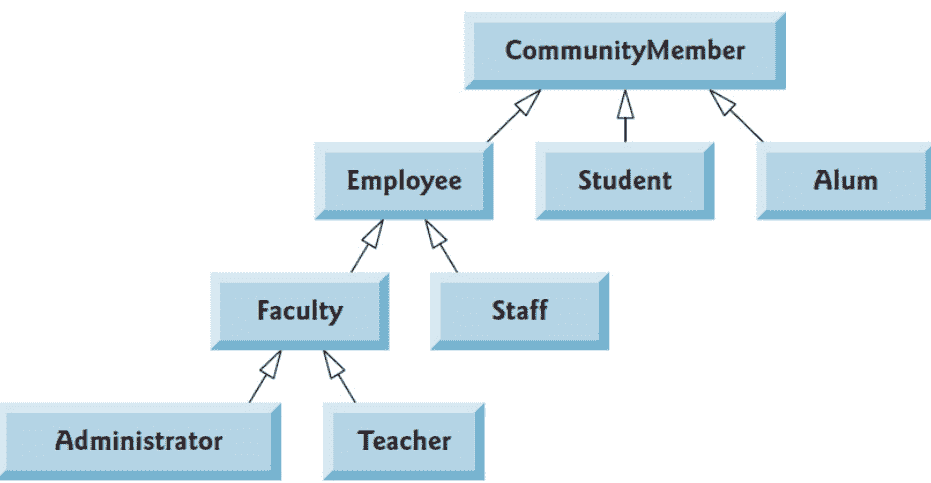

层次结构中的每个箭头都表示 is-a 关系。当我们在此类层次结构中沿箭头向上追溯时，可以得出例如：“员工是 CommunityMember”和“教师是教职人员”等结论。CommunityMember 是 Employee、Student 和 Alum 的直接基类，也是图中所有其他类的间接基类。从底部开始，您可以沿箭头向上追溯并应用 is-a 关系，直至到达最顶层的超类。例如，Administrator 是教职人员，是员工，是 CommunityMember，并且当然最终也是一个对象。

## Shape 继承层次结构

现在考虑下图中的 Shape 继承层次结构，它从基类 Shape 开始，接着是子类 TwoDimensionalShape 和 ThreeDimensionalShape。每个 Shape 要么是 TwoDimensionalShape，要么是 ThreeDimensionalShape。此层次结构的第三级包含 TwoDimensionalShape 和 ThreeDimensionalShape 的特定类型。同样，我们可以从图表底部沿箭头向上追溯到此类层次结构中最顶层的基类，以识别多个 is-a 关系。例如，Triangle 是 TwoDimensionalShape 且是 Shape，而 Sphere 是 ThreeDimensionalShape 且是 Shape。此层次结构可以包含许多其他类。例如，椭圆和梯形也是 TwoDimensionalShape，圆锥和圆柱也是 ThreeDimensionalShape。

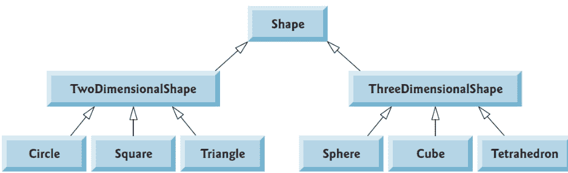

## “is a” vs. “has a”

继承产生 “is-a” 关系，其中子类类型的对象也可以被视为基类类型的对象。您还见过 “has-a”（组合）关系，其中类具有一个或多个其他类对象的引用作为成员。

## 10.8 构建继承层次结构；引入多态

让我们使用公司工资应用程序中包含员工类型的层次结构，来讨论基类与其子类之间的关系。公司的所有员工有许多共同之处，但佣金员工（将表示为基类的对象）按其销售额的一定百分比获得报酬，而带薪佣金员工（将表示为子类的对象）则获得其销售额的一定百分比加上基本工资。

首先，我们介绍基类 CommissionEmployee。接下来，我们创建一个名为 SalariedCommissionEmployee 的子类，它继承自类 CommissionEmployee。然后，我们使用 IPython 会话创建一个 SalariedCommissionEmployee 对象，并演示它同时具有基类和子类的所有功能，但其收益计算方式不同。

### 10.8.1 基类 CommissionEmployee

考虑类 CommissionEmployee，它提供以下功能：

- 方法 __init__（第 8–15 行），用于创建数据属性 _first_name、__last_name 和 _ssn（社会安全号码），并使用属性 gross_sales 和 commission_rate 的 setter 来创建它们对应的数据属性。
- 只读属性 first_name（第 17–19 行）、last_name（第 21–23 行）和 ssn（第 25–27 行），用于返回相应的数据属性。
- 读写属性 gross_sales（第 29–39 行）和 commission_rate（第 41–52 行），其中 setter 执行数据验证。
- 方法 earnings（第 54–56 行），用于计算并返回 CommissionEmployee 的收益。
- 方法 __repr__（第 58–64 行），用于返回 CommissionEmployee 的字符串表示形式。

单击此处查看代码图像

```
1 # commissionemployee.py
2 """CommissionEmployee base class."""
3 from decimal import Decimal
4
5 class CommissionEmployee:
6     """An employee who gets paid commission based on gross sales."""
7
8     def __init__(self, first_name, last_name, ssn,
9                  gross_sales, commission_rate):
10         """Initialize CommissionEmployee's attributes."""
11         self.first_name = first_name
12         self.last_name = last_name
13         self.ssn = ssn
14         self.gross_sales = gross_sales # validate via property
15         self.commission_rate = commission_rate # validate via property
16
17     @property
18     def first_name(self):
19         return self._first_name
20
21     @property
22     def last_name(self):
23         return self._last_name
24
25     @property
26     def ssn(self):
27         return self._ssn
28
29     @property
30     def gross_sales(self):
31         return self._gross_sales
32
33     @gross_sales.setter
34     def gross_sales(self, sales):
35         """Set gross sales or raise ValueError if invalid."""
36         if sales < Decimal('0.00'):
37             raise ValueError('Gross sales must be >= to 0.')
```


39  self._gross_sales = sales
40
41  @property
42  def commission_rate(self):
43      return self._commission_rate
44
45  @commission_rate.setter
46  def commission_rate(self, rate):
47      """Set commission rate or raise ValueError if invalid."""
48      if not (Decimal('0.0') < rate < Decimal('1.0')):
49          raise ValueError(
50          'Interest rate must be greater than 0 and less than 1')
51
52      self._commission_rate = rate
53
54  def earnings(self):
55      """Calculate earnings."""
56      return self.gross_sales * self.commission_rate
57
58  def __repr__(self):
59      """Return string representation for repr()."""
60      return ('CommissionEmployee: ' +
61      f'{self.first_name} {self.last_name}\n' +
62      f'social security number: {self.ssn}\n' +
63      f'gross sales: {self.gross_sales:.2f}\n' +
64      f'commission rate: {self.commission_rate:.2f}')

Properties first_name, last_name 和 ssn 属性是只读的。我们选择不对它们进行验证，尽管本可以验证。例如，我们可以验证名和姓——或许通过确保它们的长度合理。我们可以验证社会安全号码，以确保它包含九位数字，可以带连字符，也可以不带（例如，确保其格式为 ###-##-#### 或 ##########，其中每个 # 都是数字）。

## 所有类直接或间接继承自类 object

你使用继承从现有类中创建新类。事实上，每个 Python 类都继承自一个现有类。当你没有为新类显式指定基类时，Python 假设该类直接继承自类 object。Python 类层次结构从类 object 开始，它是每个类的直接或间接基类。因此，类 CommissionEmployee 的定义本可以写成

```python
class CommissionEmployee(object):
```

CommissionEmployee 后面的括号表示继承，可以包含用于单继承的单个类，或用于多继承的逗号分隔的基类列表。再次说明，多继承超出了本书的范围。

类 CommissionEmployee 继承类 object 的所有方法。类 object 没有任何数据属性。从 object 继承的许多方法中，有两个是 __repr__ 和 __str__。因此，每个类都有这些方法，用于返回其被调用对象的字符串表示。当基类方法实现不适合派生类时，可以在派生类中用适当的实现覆盖（即重新定义）该方法。方法 __repr__（第 58–64 行）覆盖了类 CommissionEmployee 从类 object 继承的默认实现。6

6 https://docs.python.org/3/reference/datamodel.html 关于对象的可覆盖方法。

## 测试类 CommissionEmployee

让我们快速测试 CommissionEmployee 的一些功能。首先，创建并显示一个 CommissionEmployee：

单击此处查看代码图像

```python
In [1]: from commissionemployee import CommissionEmployee

In [2]: from decimal import Decimal

In [3]: c = CommissionEmployee('Sue', 'Jones', '333-33-3333',
   ...:                    Decimal('10000.00'), Decimal('0.06'))
   ...:

In [4]: c
Out[4]:
CommissionEmployee: Sue Jones
social security number: 333-33-3333
gross sales: 10000.00
commission rate: 0.06
```

接下来，让我们计算并显示 CommissionEmployee 的收入：

单击此处查看代码图像

```python
In [5]: print(f'{c.earnings():,.2f}')
600.00
```

最后，让我们更改 CommissionEmployee 的总销售额和佣金率，然后重新计算收入：

单击此处查看代码图像

```python
In [6]: c.gross_sales = Decimal('20000.00')

In [7]: c.commission_rate = Decimal('0.1')

In [8]: print(f'{c.earnings():,.2f}')
2,000.00
```

## 10.8.2 子类 SalariedCommissionEmployee

使用单继承时，子类在本质上与基类相同。继承的真正强大之处在于能够在子类中定义对从基类继承的功能进行添加、替换或改进。

SalariedCommissionEmployee 的许多功能与类 CommissionEmployee 的功能相似，甚至相同。两种类型的员工都具有名、姓、社会安全号码、总销售额和佣金率数据属性，以及用于操作这些数据的属性和方法。若要不使用继承来创建类 SalariedCommissionEmployee，我们本可以复制类 CommissionEmployee 的代码并将其粘贴到类 SalariedCommissionEmployee 中。然后我们本可以修改新类，以包含基本工资数据属性，以及用于操作基本工资的属性和方法，包括一个新的 earnings 方法。这种复制粘贴方法往往容易出错。更糟的是，它可以将同一代码（包括错误）的多个物理副本散布到整个系统中，使你的代码可维护性降低。继承使我们能够在不重复代码的情况下“吸收”一个类的功能。让我们看看如何实现。

### 声明类 SalariedCommissionEmployee

我们现在声明子类 SalariedCommissionEmployee，它继承了类 CommissionEmployee 的大部分功能（第 6 行）。SalariedCommissionEmployee 是一种 CommissionEmployee（因为继承传递了类 CommissionEmployee 的功能），但类 SalariedCommissionEmployee 还具有以下功能：

- 方法 __init__（第 10–15 行），用于初始化从类 CommissionEmployee 继承的所有数据（我们稍后会详细说明），然后使用 base_salary 属性的 setter 来创建 __base_salary 数据属性。
- 可读写属性 base_salary（第 17–27 行），其中 setter 执行数据验证。
- 方法 earnings 的自定义版本（第 29–31 行）。
- 方法 __repr__ 的自定义版本（第 33–36 行）。

单击此处查看代码图像

```python
# salariedcommissionemployee.py
"""SalariedCommissionEmployee derived from   CommissionEmployee."""
from commissionemployee import   CommissionEmployee
from decimal import Decimal

class SalariedCommissionEmployee(CommissionEmployee):
   """An employee who gets paid a salary plus
   commission based on gross sales."""
```

```python
10 def __init__(self, first_name, last_name, ssn,
11 gross_sales, commission_rate, base_salary):
12 """Initialize SalariedCommissionEmployee's attributes."""
13 super().__init__(first_name, last_name, ssn,
14 gross_sales, commission_rate)
15
16 self.base_salary = base_salary # validate via property
17
18 @property
19 def base_salary(self):
20 return self._base_salary
21
22 @base_salary.setter
23 def base_salary(self, salary):
24 """Set base salary or raise ValueError if invalid."""
25 if salary < Decimal('0.00'):
26 raise ValueError('Base salary must be >= to 0')
27
28 self._base_salary = salary
29
30 def earnings(self):
31 """Calculate earnings."""
32 return super().earnings() + self.base_salary
33
34 def __repr__(self):
35 """Return string representation for repr()."""
36 return ('Salaried' + super().__repr__() +
37 f'\nbase salary: {self.base_salary:.2f}')
```

## 从类 CommissionEmployee 继承

要从一个类继承，必须先导入其定义（第 3 行）。第 6 行

```python
class SalariedCommissionEmployee(CommissionEmployee):
```

指定类 SalariedCommissionEmployee 继承自 CommissionEmployee。虽然你在类 SalariedCommissionEmployee 中看不到类 CommissionEmployee 的数据属性、属性和方法，但它们 nevertheless 是新类的一部分，你很快就会看到。

## 方法 __init__ 和内置函数 super

每个子类的 __init__ 必须显式调用其基类的 __init__ 来初始化从基类继承的数据属性。此调用应为子类 __init__ 方法中的第一条语句。SalariedCommissionEmployee 的 __init__ 方法显式调用类 CommissionEmployee 的 __init__ 方法（第 13–14 行）来初始化 SalariedCommissionEmployee 对象的基类部分（即来自类 CommissionEmployee 的五个继承数据属性）。super().__init__ 表示法使用内置函数 super 来定位并调用基类的 __init__ 方法，传递用于初始化继承数据属性的五个参数。

## 覆盖方法 earnings


类 SalariedCommissionEmployee 的 earnings 方法（第 29–31 行）重写了类 CommissionEmployee 的 earnings 方法（第 10.8.1 节，第 54–56 行），用于计算 SalariedCommissionEmployee 的收益。新版本通过使用表达式 super().earnings()（第 31 行）调用 CommissionEmployee 的 earnings 方法，获得仅基于佣金的收益部分。然后，SalariedCommissionEmployee 的 earnings 方法将 base_salary 加到该值上以计算总收益。通过让 SalariedCommissionEmployee 的 earnings 方法调用 CommissionEmployee 的 earnings 方法来计算 SalariedCommissionEmployee 收益的一部分，我们避免了重复代码并减少了代码维护问题。

## 重写方法 __repr__

SalariedCommissionEmployee 的 __repr__ 方法（第 33–36 行）重写了类 CommissionEmployee 的 __repr__ 方法（第 10.8.1 节，第 58–64 行），以返回适合 SalariedCommissionEmployee 的字符串表示形式。子类通过连接 'Salaried' 和 super().__repr__() 返回的字符串来创建部分字符串表示，super().__repr__() 调用 CommissionEmployee 的 __repr__ 方法。然后，重写的方法连接基本工资信息并返回生成的字符串。

## 测试类 SalariedCommissionEmployee

让我们测试类 SalariedCommissionEmployee，以证明它确实继承了类 CommissionEmployee 的功能。首先，让我们创建一个 SalariedCommissionEmployee 并打印其所有属性：

单击此处查看代码图像

```
In [9]: from salariedcommissionemployee import SalariedCommissionEmployee

In [10]: s = SalariedCommissionEmployee('Bob', 'Lewis', '444-44-4444',
    ...: Decimal('5000.00'), Decimal('0.04'), Decimal('300.00'))
    ...:

In [11]: print(s.first_name, s.last_name, s.ssn, s.gross_sales,
    ...: s.commission_rate, s.base_salary)
Bob Lewis 444-44-4444 5000.00 0.04 300.00
```

请注意，SalariedCommissionEmployee 对象具有类 CommissionEmployee 和 SalariedCommissionEmployee 的所有属性。

接下来，让我们计算并显示 SalariedCommissionEmployee 的收益。因为我们在 SalariedCommissionEmployee 对象上调用 earnings 方法，所以会执行子类版本的方法：

单击此处查看代码图像

```
In [12]: print(f'{s.earnings():.2f}')
500.00
```

现在，让我们修改 gross_sales、commission_rate 和 base_salary 属性，然后通过 SalariedCommissionEmployee 的 __repr__ 方法显示更新后的数据：

单击此处查看代码图像

```
In [13]: s.gross_sales = Decimal('10000.00')

In [14]: s.commission_rate = Decimal('0.05')

In [15]: s.base_salary = Decimal('1000.00')

In [16]: print(s)
SalariedCommissionEmployee: Bob Lewis
social security number: 444-44-4444
gross sales: 10000.00
commission rate: 0.05
base salary: 1000.00
```

同样，因为此方法是在 SalariedCommissionEmployee 对象上调用的，所以会执行子类版本的方法。最后，让我们计算并显示 SalariedCommissionEmployee 更新后的收益：

单击此处查看代码图像

```
In [17]: print(f'{s.earnings():.2f}')
1,500.00
```

## 测试“is a”关系

Python 提供了两个内置函数——issubclass 和 isinstance——用于测试“is a”关系。函数 issubclass 确定一个类是否派生自另一个类：

单击此处查看代码图像

```
In [18]: issubclass(SalariedCommissionEmployee, CommissionEmployee)
Out[18]: True
```

函数 isinstance 确定一个对象是否与特定类型具有“is a”关系。因为 SalariedCommissionEmployee 继承自 CommissionEmployee，以下两个代码片段都返回 True，从而确认“is a”关系

单击此处查看代码图像

```
In [19]: isinstance(s, CommissionEmployee)
Out[19]: True

In [20]: isinstance(s, SalariedCommissionEmployee)
Out[20]: True
```

## 10.8.3 以多态方式处理 CommissionEmployees 和 SalariedCommissionEmployees

通过继承，子类的每个对象也可以被视为该子类基类的对象。我们可以利用这种“子类对象即基类对象”的关系来执行一些有趣的操作。例如，我们可以将通过继承相关的对象放入列表中，然后遍历列表并将每个元素视为基类对象。这样，各种对象可以以通用的方式处理。让我们通过将 CommissionEmployee 和 SalariedCommissionEmployee 对象放入列表中，然后对每个元素显示其字符串表示和收益来演示这一点：

单击此处查看代码图像

```
In [21]: employees = [c, s]

In [22]: for employee in employees:
    ...:     print(employee)
    ...:     print(f'{employee.earnings():,.2f}\n')
    ...:

CommissionEmployee: Sue Jones
social security number: 333-33-3333
gross sales: 20000.00
commission rate: 0.10
2,000.00

SalariedCommissionEmployee: Bob Lewis
social security number: 444-44-4444
gross sales: 10000.00
commission rate: 0.05
base salary: 1000.00
1,500.00
```

如您所见，每个员工都会显示正确的字符串表示和收益。这称为多态性——面向对象编程（OOP）的一项关键功能。

## 10.8.4 关于基于对象编程和面向对象编程的说明

带有方法重写的继承是构建软件组件的一种强大方式，这些组件类似于现有组件，但需要根据应用程序的独特需求进行定制。在 Python 开源世界中，有大量开发良好的类库，对于这些类库，您的编程风格是：

- 了解有哪些库可用，
- 了解有哪些类可用，
- 创建现有类的对象，以及
- 向它们发送消息（即，调用它们的方法）。

这种编程风格称为 _基于对象的编程（OBP）_。当您使用已知类的对象进行组合时，您仍在进行基于对象的编程。添加带有重写的继承以定制方法以满足应用程序的独特需求，并可能以多态方式处理对象，这称为 _面向对象编程（OOP）_。如果您使用继承类的对象进行组合，那也是面向对象编程。

## 10.9 鸭子类型和多态性

大多数其他面向对象编程语言需要基于继承的“is a”关系才能实现多态行为。Python 更加灵活。它使用一种称为 duck typing 的概念，Python 文档将其描述为：

> _一种编程风格，它不查看对象的类型来确定其是否具有正确的接口；相反，只需调用或使用该方法或属性（“如果它看起来像鸭子且叫声像鸭子，那它一定是鸭子”）。_

7 https://docs.python.org/3/glossary.html#term-duck-typing.

因此，在运行时处理对象时，其类型无关紧要。只要对象具有您希望访问的数据属性、属性或方法（带有适当参数），代码就会工作。

让我们重新考虑第 10.8.3 节末尾的循环，该循环处理员工列表：

```
for employee in employees:
    print(employee)
    print(f'{employee.earnings():,.2f}\n')
```

在 Python 中，只要 `employees` 仅包含以下对象，此循环就能正常工作：

- 可以使用 `print` 显示（即，它们具有字符串表示），以及
- 具有可以无参数调用的 `earnings` 方法。

所有类都直接或间接继承自 `object`，因此它们都继承了 `print` 可显示的获取字符串表示的默认方法。如果一个类具有可以无参数调用的 `earnings` 方法，我们可以将该类的对象包含在列表 `employees` 中，即使该对象的类与类 `CommissionEmployee` 之间没有“is a”关系。为了演示这一点，请考虑类 `WellPaidDuck`：


单击此处查看代码图像

```
In [1]: class WellPaidDuck:
    ...:     def __repr__(self):
    ...:         return 'I am a well-paid duck'
    ...:     def earnings(self):
    ...:         return Decimal('1_000_000.00')
    ...:

```

显然，WellPaidDuck 对象并非旨在作为员工，但它们可以与前面的循环配合使用。为证明这一点，让我们创建 CommissionEmployee、SalariedCommissionEmployee 和 WellPaidDuck 类的对象，并将它们放入一个列表中：

单击此处查看代码图像

```
In [2]: from decimal import Decimal

In [3]: from commissionemployee import CommissionEmployee

In [4]: from salariedcommissionemployee import SalariedCommissionEmployee

In [5]: c = CommissionEmployee('Sue', 'Jones', '333-33-3333',
   ...:     Decimal('10000.00'), Decimal('0.06'))
   ...:

In [6]: s = SalariedCommissionEmployee('Bob', 'Lewis', '444-44-4444',
   ...:     Decimal('5000.00'), Decimal('0.04'), Decimal('300.00'))
   ...:

In [7]: d = WellPaidDuck()

In [8]: employees = [c, s, d]

```

现在，让我们使用第 10.8.3 节中的循环来处理这个列表。如输出所示，Python 能够使用鸭子类型多态地处理列表中的所有三个对象：

单击此处查看代码图像

```
In [9]: for employee in employees:
   ...:     print(employee)
   ...:     print(f'{employee.earnings():,.2f}\\n')
   ...:
CommissionEmployee: Sue Jones
social security number: 333-33-3333
gross sales: 10000.00
commission rate: 0.06
600.00

SalariedCommissionEmployee: Bob Lewis
social security number: 444-44-4444
gross sales: 5000.00
commission rate: 0.04
base salary: 300.00

```

## 10.10 运算符重载

你已经看到，可以通过访问对象的属性和特性以及调用它们的方法来与对象交互。对于某些操作（例如算术运算），方法调用表示法可能很麻烦。在这些情况下，使用 Python 丰富的内置运算符集会更加方便。

本节展示了如何使用运算符重载来定义 Python 的运算符应如何处理你自己的类型的对象。你已经在广泛的类型范围内频繁使用运算符重载。例如，你已使用过：

- 用于添加数值、连接列表、连接字符串以及向 NumPy 数组中的每个元素添加值的 + 运算符。
- 用于访问列表、元组、字符串和数组中的元素以及访问字典中特定键对应的值的 [] 运算符。
- 用于乘以数值、重复序列以及将 NumPy 数组中的每个元素乘以特定值的 * 运算符。

你可以重载大多数运算符。对于每个可重载的运算符，类对象都定义了一个特殊方法，例如用于加法（+）运算符的 __add__ 或用于乘法（*）运算符的 __mul__。重写这些方法使你能够自定义运算符对自定义类对象的工作方式。有关特殊方法的完整列表，请参见 [特殊方法名称](https://docs.python.org/3/reference/datamodel.html#special-method-names)

### 运算符重载限制

对运算符重载存在一些限制：

- 通过重载无法更改运算符的优先级。但是，可以使用括号来强制表达式的求值顺序。
- 通过重载无法更改运算符的从左到右或从右到左的结合方向。
- 无法更改运算符的“目数”——即它是一元运算符还是二元运算符。
- 无法创建新运算符——只能重载现有运算符。
- 无法更改运算符对内置类型对象的工作含义。例如，你不能将 + 更改为对两个整数进行减法。
- 运算符重载仅适用于自定义类的对象，或自定义类对象与内置类型对象的混合。

### 复数

为了演示运算符重载，我们将定义一个名为 Complex 的类来表示复数。8 复数（例如 –3 + 4i 和 6.2 – 11.73i）具有如下形式：

8 Python 内置对复数值的支持，因此此类仅用于演示目的。

```
realPart + imaginaryPart * i
```

其中 i 是 √-1。与 int、float 和 Decimal 类似，复数是算术类型。在本节中，我们将创建一个 Complex 类，它仅重载 + 加法运算符和 += 增量赋值，以便我们可以使用 Python 的数学表示法来添加 Complex 对象。

### 10.10.1 试驾 Complex 类

首先，让我们使用 Complex 类来演示其功能。我们将在下一节讨论该类的详细信息。从 complexnumber.py 导入 Complex 类：

单击此处查看代码图像

```
In [1]: from complexnumber import Complex
```

接下来，创建并显示几个 Complex 对象。片段 [3] 和 [5] 隐式调用 Complex 类的 __repr__ 方法来获取每个对象的字符串表示：

单击此处查看代码图像

```
In [2]: x = Complex(real=2, imaginary=4)

In [3]: x
Out[3]: (2 + 4i)

In [4]: y = Complex(real=5, imaginary=-1)

In [5]: y
Out[5]: (5 - 1i)
```

我们选择片段 [3] 和 [5] 中显示的 __repr__ 字符串格式，以模仿 Python 内置 complex 类型生成的 __repr__ 字符串。9

9 Python 对虚数单位使用 j 而不是 i。例如，3+4j（运算符周围没有空格）会创建一个具有 real 和 imag 属性的复数对象。该复数值的 __repr__ 字符串为 '(3+4j)'。

现在，让我们使用 + 运算符添加 Complex 对象 x 和 y。此表达式将两个操作数的实部（2 和 5）以及两个操作数的虚部（4i 和 -1i）相加，然后返回包含结果的新 Complex 对象：

```
In [6]: x + y
Out[6]: (7 + 3i)
```

+ 运算符不会修改其任何一个操作数：

```
In [7]: x
Out[7]: (2 + 4i)

In [8]: y
Out[8]: (5 - 1i)
```

最后，让我们使用 += 运算符将 y 添加到 x 并将结果存储在 x 中。+= 运算符修改其左操作数，但不修改其右操作数：

```
In [9]: x += y

In [10]: x
Out[10]: (7 + 3i)

In [11]: y
Out[11]: (5 - 1i)
```

### 10.10.2 Complex 类定义

现在我们已经看到 Complex 类的实际运行情况，让我们查看其定义，以了解这些功能是如何实现的。

### 方法 __init__

该类的 __init__ 方法接收参数以初始化 real 和 imaginary 数据属性：

单击此处查看代码图像

```
# complexnumber.py
"""Complex class with overloaded operators."""

class Complex:
    """Complex class that represents a complex number
    with real and imaginary parts."""

def __init__(self, real, imaginary):
    """Initialize Complex class's attributes."""
    self.real = real
    self.imaginary = imaginary
```

### 重载 + 运算符

以下重写的特殊方法 `__add__` 定义了如何为两个 `Complex` 对象重载 + 运算符：

单击此处查看代码图像

```
def __add__(self, right):
    """Overrides the + operator."""
    return Complex(self.real + right.real,
                   self.imaginary + right.imaginary)
```

重载二元运算符的方法必须提供两个参数——第一个（self）是左操作数，第二个（right）是右操作数。`Complex` 类的 `__add__` 方法将两个 `Complex` 对象作为参数，并返回一个新的 `Complex` 对象，其中包含操作数实部之和和操作数虚部之和。

我们*不*修改任何一个原始操作数的内容。这符合我们对该运算符行为的直觉理解。添加两个数字不会修改任何一个原始值。

### 重载 += 增量赋值

第 18–22 行重载特殊方法 `__iadd__` 以定义 += 运算符如何添加两个 `Complex` 对象：

单击此处查看代码图像

```
def __iadd__(self, right):
    """Overrides the += operator."""
    self.real += right.real
    self.imaginary += right.imaginary
    return self
```

增量赋值会修改其左操作数，因此方法 `__iadd__` 修改表示左操作数的 `self` 对象，然后返回 `self`。

### 方法 `__repr__`

第 24–28 行返回 `Complex` 数字的字符串表示。

单击此处查看代码图像

```


```python
24  def __repr__(self):
25      """Return string representation for repr()."""
26      return (f'({self.real} ' +
27              ('+' if self.imaginary >= 0 else '-') +
28              f' (abs(self.imaginary))i')
```

## 10.11 异常类层次结构和自定义异常

在前一章中，我们介绍了异常处理。每个异常都是 Python 异常类层次结构 ⁰ 中某个类的对象，或是从这些类之一继承的类的对象。异常类直接或间接继承自基类 BaseException，并定义在 exceptions 模块中。

⁰ https://docs.python.org/3/library/exceptions.html.

Python 定义了四个主要的 BaseException 子类——SystemExit、KeyboardInterrupt、GeneratorExit 和 Exception：

- SystemExit 终止程序执行（或终止交互会话），且当未被捕获时，不会像其他异常类型一样生成回溯。

- KeyboardInterrupt 异常发生在用户输入中断命令时——在大多数系统上为 Ctrl + C（或 control + C）。

- GeneratorExit 异常发生在生成器关闭时——通常是在生成器完成值生成时，或在显式调用其 close 方法时。

- Exception 是你将遇到的大多数常见异常的基类。你已见过 Exception 子类 ZeroDivisionError、NameError、ValueError、StatisticsError、TypeError、IndexError、KeyError、RuntimeError 和 AttributeError 的异常。通常，StandardErrors 可以被捕获和处理，因此程序可以继续运行。

## 捕获基类异常

异常类层次结构的一个好处是，except 处理程序可以捕获特定类型的异常，或使用基类类型来捕获这些基类异常及所有相关子类异常。例如，指定基类 Exception 的 except 处理程序可以捕获 Exception 的任何子类对象。在其他 except 处理程序之前放置捕获 Exception 类型的 except 处理程序是逻辑错误，因为在其他异常处理程序能够被到达之前，所有异常都会被捕获。因此，随后的异常处理程序无法到达。

## 自定义异常类

当你在代码中引发异常时，通常应该使用 Python 标准库中的现有异常类之一。然而，使用本章前面介绍的继承技术，你可以创建直接或间接派生自 Exception 类的自定义异常类。通常，这不被鼓励，尤其是在新手程序员中。在创建自定义异常类之前，请在 Python 异常层次结构中查找合适的现有异常类。只有当你需要以与其他现有异常类型不同的方式捕获和处理异常时，才定义新的异常类。这种情况应该很少见。

## 10.12 命名元组

你已使用元组将多个数据属性聚合到单个对象中。Python 标准库的 collections 模块还提供命名元组，使你可以按名称而不是按索引号引用元组的成员。

让我们创建一个简单的命名元组，它可能用于表示一副牌中的一张卡牌。首先，导入函数 namedtuple：

单击此处查看代码图像

```
In [1]: from collections import namedtuple
```

函数 namedtuple 创建内置元组类型的子类。函数的第一个参数是新类型的名称，第二个参数是字符串列表，表示你将用来引用新类型成员的标识符：

单击此处查看代码图像

```
In [2]: Card = namedtuple('Card', ['face', 'suit'])
```

我们现在有了一个名为 Card 的新元组类型，可以在任何可以使用元组的地方使用它。让我们创建一个 Card 对象，按名称访问其成员，并显示其字符串表示：

单击此处查看代码图像

```
In [3]: card = Card(face='Ace', suit='Spades')

In [4]: card.face
Out[4]: 'Ace'

In [5]: card.suit
Out[5]: 'Spades'

In [6]: card
Out[6]: Card(face='Ace', suit='Spades')
```

## 其他命名元组特性

每种命名元组类型都有额外的方法。类型的 _make 类方法（即在类上调用的方法）接收一个值的可迭代对象，并返回命名元组类型的对象：

单击此处查看代码图像

```
In [7]: values = ['Queen', 'Hearts']
In [8]: card = Card._make(values)
In [9]: card
Out[9]: Card(face='Queen', suit='Hearts')
```

例如，如果你有一个表示 CSV 文件中记录的命名元组类型，这将很有用。在读取和标记化 CSV 记录时，你可以将它们转换为命名元组对象。

对于给定的命名元组类型对象，你可以获取其成员名称和值的 OrderedDict 字典表示。OrderedDict 记得字典中键值对插入的顺序：

单击此处查看代码图像

```
In [10]: card._asdict()
Out[10]: OrderedDict([('face', 'Queen'), ('suit', 'Hearts')])
```

要了解更多命名元组特性，请参见：

```
https://docs.python.org/3/library/collections.html#collections.namedtuple
```

## 10.13 Python 3.7 新数据类简介

虽然命名元组允许你按名称引用其成员，但它们仍然只是元组，而不是类。为了获得命名元组的一些优势，加上传统 Python 类提供的功能，你可以使用 Python 3.7 的新数据类 1，它来自 Python 标准库的 dataclasses 模块。

1 https://www.python.org/dev/peps/pep-0557/.

数据类是 Python 3.7 最重要的新特性之一。它们通过使用更简洁的表示法，并自动生成大多数类中常见的“样板”代码，帮助你更快地构建类。它们可能成为定义许多 Python 类的首选方式。在本节中，我们将介绍数据类基础知识。在本节结束时，我们将提供更多信息的链接。

## 数据类自动生成代码

你将定义的大多数类都会提供 __init__ 方法来创建和初始化对象的属性，以及 __repr__ 方法来指定对象的自定义字符串表示。如果一个类有许多数据属性，创建这些方法可能会很乏味。

数据类会为你自动生成数据属性以及 __init__ 和 __repr__ 方法。这对于主要聚合相关数据项的类尤其有用。例如，在处理 CSV 记录的应用程序中，你可能需要一个表示每条记录字段作为对象中数据属性的类。数据类也可以从字段名称列表动态生成。

数据类还会自动生成 __eq__ 方法，它重载 == 运算符。任何具有 __eq__ 方法的类也隐式支持 !=。所有类继承自 class object 的默认 __ne__（不等于）方法实现，该方法返回 __eq__ 的相反值（如果类未定义 __eq__，则返回 NotImplemented）。数据类不会自动生成 <、<=、> 和 >= 比较运算符的方法，但可以生成。

### 10.13.1 创建 Card 数据类

让我们将 10.6.2 节中的 Card 类重新实现为数据类。新类定义在 carddataclass.py 中。如你所见，定义数据类需要一些新语法。在随后的小节中，我们将在 DeckOfCards 类中使用我们的新 Card 数据类，以表明它与原始 Card 类可以互换，然后讨论数据相对于命名元组和传统 Python 类的一些优势。

### 从 dataclasses 和 typing 模块导入

Python 标准库的 dataclasses 模块定义了用于实现数据类的装饰器和函数。我们将使用 @dataclass 装饰器（在第 4 行导入）来指定新类是数据类，并导致为你编写各种代码。回顾一下，我们的原始 Card 类定义了类变量 FACES 和 SUITS，它们是用于初始化 Card 的字符串列表。我们从 Python 标准库的 typing 模块（在第 5 行导入）中使用 ClassVar 和 List，以指示 FACES 和 SUITS 是指列表的类变量。我们稍后将详细说明这些内容：

单击此处查看代码图像

```
# carddataclass.py
"""Card data class with class attributes, data attributes,
autogenerated methods and explicitly defined methods."""
from dataclasses import dataclass
from typing import ClassVar, List
```

### 使用 @dataclass 装饰器

要指定某个类是数据类，请在其定义前加上 @dataclass


7 @dataclass
8 class Card:
```

可选地，@dataclass 装饰器可以指定包含参数的括号，这些参数帮助数据类确定要包含哪些自动生成的方法。例如，装饰器 @dataclass (order=True) 会导致数据类为 <、<=、> 和 >= 自动生成重载的比较运算符方法。例如，如果您需要对数据类对象进行排序，这可能很有用。

## 变量注解：类属性

与常规类不同，数据类在类内部但类方法之外同时声明类属性和数据属性。在常规类中，只有类属性以这种方式声明，而数据属性通常在 __init__ 中创建。数据类需要额外的信息（或提示）来区分类属性和数据属性，这也会影响自动生成方法的实现细节。

第 9–11 行定义并初始化了类属性 FACES 和 SUITS：

点击此处查看代码图像

```
9 FACES: ClassVar[List[str]] = ['Ace', '2', '3', '4', '5', '6', '7',
10 '8', '9', '10', 'Jack', 'Queen', 'King']
11 SUITS: ClassVar[List[str]] = ['Hearts', 'Diamonds', 'Clubs', 'Spades'
12
```

在第 9 行和第 11 行中，注释符号

```
: ClassVar[List[str]]
```

是一个变量注解 3, 4（有时称为类型提示），指定 FACES 是一个类属性（ClassVar），指向字符串列表（List[str]）。SUITS 也是一个类属性，指向字符串列表。

3. https://www.python.org/dev/peps/pep-0526/.

4. 变量注解是最近的语言特性，对常规类来说是可选的。您在大多数旧版 Python 代码中看不到它们。

类变量在其定义中初始化，特定于类，而不是类的单个对象。然而，方法 __init__、__repr__ 和 __eq__ 是用于类对象的。当数据类生成这些方法时，它会检查所有变量注解，并仅将数据属性包含在方法实现中。

## 变量注解：数据属性

通常，我们通过 self.attribute_name = value 形式的赋值，在类的 __init__ 方法（或由 __init__ 调用的方法）中创建对象的数据属性。由于数据类会自动生成其 __init__ 方法，因此我们需要另一种方式来在数据类定义中指定数据属性。我们不能简单地将它们的名称放在类中，这会生成 NameError，如下所示：

点击此处查看代码图像

```
In [1]: from dataclasses import dataclass

In [2]: @dataclass
    ...: class Demo:
    ...:     x # attempting to create a data attribute x
    ...:
--------------------------------------------------------------------------------
NameError                                Traceback (most recent call last)

<ipython-input-2-79ffe37b1ba2> in <module>()
----> 1 @dataclass
      2 class Demo:
      3     x # attempting to create a data attribute x
      4

<ipython-input-2-79ffe37b1ba2> in Demo()
      1 @dataclass
      2 class Demo:
----> 3     x # attempting to create a data attribute x
      4

NameError: name 'x' is not defined
```

与类属性一样，每个数据属性都必须使用变量注解来声明。第 13–14 行定义了数据属性 face 和 suit。变量注解 ": str" 表示每个都应该引用字符串对象：

```
13 face: str
14 suit: str
```

## 定义属性和其他方法

数据类也是类，因此它们可以包含属性和方法并参与类层次结构。对于这个 Card 数据类，我们定义了与本章前面原始 Card 类中相同的只读 image_name 属性和自定义特殊方法 __str__ 和 __format__：

点击此处查看代码图像

```
@property
def image_name(self):
    """Return the Card's image file name."""
    return str(self).replace(', ', '_') + '.png'

def __str__(self):
    """Return string representation for str()."""
    return f'{self.face} of {self.suit}'

def __format__(self, format):
    """Return formatted string representation."""
    return f'{str(self):{format}}'
```

## 变量注解说明

您可以使用内置类型名称（如 str、int 和 float）、类类型或 typing 模块定义的类型（如前面所示的 ClassVar 和 List）来指定变量注解。即使有类型注解，Python 仍然是一种动态类型语言。因此，类型注解在执行时不会被强制执行。因此，尽管 Card 的 face 旨在是字符串，但您可以将任何类型的对象赋值给 face。

## 10.13.2 使用 Card 数据类

让我们演示新的 Card 数据类。首先，创建一个 Card：

点击此处查看代码图像

```
In [1]: from carddataclass import Card

In [2]: c1 = Card(Card.FACES[0], Card.SUITS[3])
```

接下来，让我们使用 Card 的自动生成的 __repr__ 方法来显示 Card：

点击此处查看代码图像

```
In [3]: c1
Out[3]: Card(face='Ace', suit='Spades')
```

我们自定义的 __str__ 方法（当 print 将 Card 对象传递给它时调用）返回形式为 'face of suit' 的字符串：

```
In [4]: print(c1)
Ace of Spades
```

让我们访问我们数据类的属性和只读属性：

点击此处查看代码图像

```
In [5]: c1.face
Out[5]: 'Ace'
In [6]: c1.suit
Out[6]: 'Spades'
In [7]: c1.image_name
Out[7]: 'Ace_of_Spades.png'
```

接下来，让我们演示 Card 对象可以通过自动生成的 == 运算符和继承的 != 运算符进行比较。首先，创建两个额外的 Card 对象——一个与第一个相同，另一个不同：

点击此处查看代码图像

```
In [8]: c2 = Card(Card.FACES[0], Card.SUITS[3])
In [9]: c2
Out[9]: Card(face='Ace', suit='Spades')
In [10]: c3 = Card(Card.FACES[0], Card.SUITS[0])
In [11]: c3
Out[11]: Card(face='Ace', suit='Hearts')
```

现在，使用 == 和 != 比较对象：

```
In [12]: c1 == c2
Out[12]: True
In [13]: c1 == c3
Out[13]: False
In [14]: c1 != c3
Out[14]: True
```

我们的 Card 数据类与本章前面开发的 Card 类可以互换。为了演示这一点，我们创建了 deck2.py 文件，其中包含本章前面的 DeckOfCards 类的副本，并将 Card 数据类导入到该文件中。以下代码片段导入 DeckOfCards 类，创建该类的一个对象并打印它。请回顾，print 隐式调用 DeckOfCards 的 __str__ 方法，该方法将每个 Card 格式化为 19 个字符的字段，从而导致对每个 Card 的 __format__ 方法的调用。请从左到右阅读每一行，以确认所有 Card 都按每种花色（红桃、方块、梅花和黑桃）的顺序显示：

点击此处查看代码图像

```
In [15]: from deck2 import DeckOfCards # uses Card data class
In [16]: deck_of_cards = DeckOfCards()
In [17]: print(deck_of_cards)
```

| 红桃 A | 红桃 2 | 红桃 3 | 红桃 4 |
|---|---|---|---|
| 红桃 5 | 红桃 6 | 红桃 7 | 红桃 8 |
| 红桃 9 | 红桃 10 | 红桃 J | 红桃 Q |
| 红桃 K | 方块 A | 方块 2 | 方块 3 |
| 方块 4 | 方块 5 | 方块 6 | 方块 7 |
| 方块 8 | 方块 9 | 方块 10 | 方块 J |
| 方块 Q | 方块 K | 梅花 A | 梅花 2 |
| 梅花 3 | 梅花 4 | 梅花 5 | 梅花 6 |
| 梅花 7 | 梅花 8 | 梅花 9 | 梅花 10 |
| 梅花 J | 梅花 Q | 梅花 K | 黑桃 A |
| 黑桃 2 | 黑桃 3 | 黑桃 4 | 黑桃 5 |
| 黑桃 6 | 黑桃 7 | 黑桃 8 | 黑桃 9 |
| 黑桃 10 | 黑桃 J | 黑桃 Q | 黑桃 K |

## 10.13.3 数据相对于命名元组的优势

数据相对于命名元组⁵ 提供多项优势：

⁵ https://www.python.org/dev/peps/pep-0526/.

- 尽管每个命名元组在技术上代表不同的类型，但命名元组是一个元组，所有元组都可以相互比较。因此，如果具有相同数量的成员和相同的成员值，不同命名元组类型的对象可能比较为相等。比较不同数据类的对象始终返回 False，将数据类对象与元组对象比较也是如此。

- 如果您有解包元组的代码，向该元组添加更多成员将破坏解包代码。数据类对象不能被解包。因此，您可以向数据类添加更多数据属性，而不会破坏现有代码。

- 数据类可以是继承层次结构中的基类或子类。

## 10.13.4 数据相对于传统类的优势

数据还相对于本章前面您看到的传统 Python 类提供各种优势：

- 数据类会自动生成 `__init__`、`__repr__` 和 `__eq__`，节省您的时间。

- 数据类可以自动生成重载 `<`、`<=`、`>` 和 `>=` 比较运算符的特殊方法。

- 当您更改数据类中定义的数据属性，然后在脚本或交互式会话中使用它时，自动生成的代码会自动更新。因此，您需要维护和调试的代码更少。

- 类属性和数据属性所需的变量注解使您能够利用静态代码分析工具。因此，您可能能够在错误发生在执行时间之前消除其他错误。


一些静态代码分析工具和 IDE 可以检查变量注解，如果您的代码使用了错误的类型，则会发出警告。这可以帮助您在执行代码之前定位代码中的逻辑错误。

## 更多信息

数据类具有其他功能，例如创建“冻结”实例，在创建对象后不允许向数据类对象的属性赋值。有关数据类优势和功能的完整列表，请参阅

```
https://www.python.org/dev/peps/pep-0557/
```

和

```
https://docs.python.org/3/library/dataclasses.html
```

## 10.14 使用文档字符串和 doctest 进行单元测试

软件开发的一个关键方面是测试代码以确保其正常工作。然而，即使进行了大量测试，您的代码中仍可能包含错误。根据著名荷兰计算机科学家 Edsger Dijkstra 的话，“测试显示错误的存在，而非不存在。” 6

6 J. N. Buxton 和 B. Randell（编），《软件工程技术》，1970 年 4 月，第 16 页。北约科学委员会赞助会议的报告，意大利罗马，1969 年 10 月 27–31 日

### doctest 模块和 testmod 函数

Python 标准库提供了 doctest 模块，帮助您测试代码，并在修改后方便地重新测试。当您执行 doctest 模块的 testmod 函数时，它会检查函数、方法和类的文档字符串，查找以 >>> 开头的示例 Python 语句，下一行是给定语句的预期输出（如果有）。7 然后 testmod 函数执行这些语句并确认它们产生预期输出。如果不是，testmod 会报告错误，指出哪些测试失败了，以便您定位并修复代码中的问题。您在文档字符串中定义的每个测试通常测试特定的代码单元，例如函数、方法或此类测试称为单元测试。

7 符号 >>> 模仿标准 Python 解释器的输入提示。

### 修改后的 Account 类

文件 accountdoctest.py 包含本章第一个示例中的 Account 类。我们修改了 `__init__` 方法的文档字符串，添加了四个测试，可用于确保该方法正常工作：

- 第 11 行的测试创建一个名为 `account1` 的示例 `Account` 对象。该语句不产生任何输出。

- 第 12 行的测试显示如果第 11 行成功执行，`account1` 的 `name` 属性的值应为多少。示例输出显示在第 13 行。

- 第 14 行的测试显示如果第 11 行成功执行，`account1` 的 `balance` 属性的值应为多少。示例输出显示在第 15 行。

- 第 18 行的测试创建一个初始余额无效的 `Account` 对象。示例输出显示在这种情况下应发生 `ValueError` 异常。对于异常，doctest 模块的文档建议仅显示堆栈跟踪的第一行和最后一行。8

8 https://docs.python.org/3/library/doctest.html?highlight=doctest#module-doctest.

您可以在测试中插入描述性文本，例如第 17 行。

单击此处查看代码图像

```
1 # accountdoctest.py
2 """Account class definition."""
3
4 from decimal import Decimal
5
6 class Account:
7     """Account class for demonstrating doctest."""
8
9     def __init__(self, name, balance):
10         """Initialize an Account object."""
11
12         >>> account1 = Account('John Green', Decimal('50.00'))
13         >>> account1.name
14         'John Green'
15         >>> account1.balance
16         Decimal('50.00')
17
18         The balance argument must be greater than or equal to 0.
19         >>> account2 = Account('John Green', Decimal('-50.00'))
20         Traceback (most recent call last):
21         ...
22         ValueError: Initial balance must be >= to 0.00.
23         """
24
25         # if balance is less than 0.00, raise an exception
26         if balance < Decimal('0.00'):
27             raise ValueError('Initial balance must be >= to 0.00.')
28
29         self.name = name
30         self.balance = balance

def deposit(self, amount):
    """Deposit money to the account."""
    # if amount is less than 0.00, raise an exception
    if amount < Decimal('0.00'):
        raise ValueError('amount must be positive.')
    self.balance += amount
if __name__ == '__main__':
    import doctest
    doctest.testmod(verbose=True)
```

### `__main__` 模块

加载任何模块时，Python 都会将包含模块名称的字符串分配给名为 `__name__` 的模块全局属性。当作为脚本执行 Python 源文件（例如 accountdoctest.py）时，Python 使用字符串 `'__main__'` 作为模块名称。您可以在 if 语句中使用 `__name__`，如第 40–42 行所示，以指定仅当源文件作为脚本执行时才应执行的代码。在此示例中，第 41 行导入 doctest 模块，第 42 行调用该模块的 testmod 函数以执行文档字符串单元测试。

### 运行测试

以脚本运行文件 accountdoctest.py 以执行测试。默认情况下，如果不带参数调用 testmod，它不会显示成功测试的结果。在这种情况下，如果没有输出，则所有测试均已成功执行。在此示例中，第 42 行使用关键字参数 `verbose=True` 调用 testmod。这指示 testmod 生成详细输出，显示每个测试的结果：

单击此处查看代码图像

```
Trying:
    account1 = Account('John Green', Decimal('50.00'))
Expecting nothing
ok
Trying:
    account1.name
Expecting:
    'John Green'
ok
Trying:
    account1.balance
Expecting:
    Decimal('50.00')
ok
Trying:
    account2 = Account('John Green', Decimal('-50.00'))
Expecting:
    Traceback (most recent call last):
      ...
    ValueError: Initial balance must be >= to 0.00.
ok
3 items had no tests:
__main__
__main__.Account
__main__.Account.deposit
1 items passed all tests:
4 tests in __main__.Account.__init__
4 tests in 4 items.
4 passed and 0 failed.
Test passed.
```

在详细模式下，`testmod` 为每个测试显示它正在尝试执行的内容以及它期望得到的结果，如果测试成功，后面跟有“ok”。在详细模式下完成测试后，`testmod` 会显示结果摘要。

若要演示*失败*的测试，请在 `accountdoctest.py` 中通过在每行前添加 # 将第 25–26 行“注释掉”，然后以脚本运行 `accountdoctest.py`。为节省空间，我们仅显示指示测试失败的 doctest 输出部分：

单击此处查看代码图像

```
...
**********************************************************************
File "accountdoctest.py", line 18, in __main__.Account.__init__
Failed example:
account2 = Account('John Green', Decimal('-50.00'))
Expected:
Traceback (most recent call last):
  ...
ValueError: Initial balance must be >= to 0.00.
Got nothing
**********************************************************************
1 items had failures:
1 of 4 in __main__.Account.__init__
4 tests in 4 items.
3 passed and 1 failed.
***Test Failed*** 1 failures.
```

在这种情况下，我们看到第 18 行的测试失败了。`testmod` 函数正在*期望*一个堆栈跟踪，指示由于初始余额无效而引发了 `ValueError`。该异常*未*发生，因此测试失败。作为负责定义该类的程序员，此失败测试将表明您的 `__init__` 方法中的验证代码存在问题。

### IPython `%doctest_mode` 魔法命令

为现有代码创建 doctest 的一种方便方法是使用 IPython 交互会话测试代码，然后将该会话复制并粘贴到文档字符串中。IPython 的 `In []` 和 `Out[]` 提示符与 `doctest` 不兼容，因此 IPython 提供了魔法命令 `%doctest_mode` 以正确的 `doctest` 格式显示提示符。该魔法命令在两种提示符样式之间切换。第一次执行 `%doctest_mode` 时，IPython 会切换到用于输入的 `>>>` 提示符且没有输出提示符。第二次执行


doctest_mode，IPython 切换回 In [] 和 Out[] 提示符。

## 10.15 命名空间与作用域

在“函数”章节中，我们展示了每个标识符都有一个作用域，它决定了你可以在程序的哪个位置使用它，并介绍了局部作用域和全局作用域。在这里，我们继续讨论作用域，并介绍命名空间。

作用域由命名空间决定，命名空间将标识符与对象关联，并在“内部”实现为字典。所有命名空间相互独立。因此，相同的标识符可能出现在多个命名空间中。有三个主要命名空间——局部、全局和内置。

### 局部命名空间

每个函数和方法都有一个局部命名空间，它将局部标识符（如参数和局部变量）与对象关联。局部命名空间从函数或方法被调用的那一刻起存在，直到终止，并且仅对该函数或方法可见。在函数或方法的代码块中，对不存在的变量进行赋值会创建一个局部变量，并将其添加到局部命名空间中。局部命名空间中的标识符从定义它们的那一刻起，直到函数或方法终止，都在作用域内。

### 全局命名空间

每个模块都有一个全局命名空间，它将模块的全局标识符（如全局变量、函数名和类名）与对象关联。Python 在加载模块时会创建模块的全局命名空间。模块的全局命名空间存在，并且其标识符在该模块内的代码作用域范围内，直到程序（或交互会话）终止。IPython 会话拥有自己的全局命名空间，用于存储在该会话中创建的所有标识符。

每个模块的全局命名空间中还有一个名为 __name__ 的标识符，包含模块的名称，例如 math 模块为 ‘math’，random 模块为 ‘random’。如前一节的 doctest 示例所示，__name__ 对于作为脚本运行的 .py 文件包含 ‘__main__’。

### 内置命名空间

内置命名空间将 Python 内置函数（如 input 和 range）及类型（如 int、float 和 str）的标识符与定义这些函数和类型的对象关联。Python 在解释器开始执行时创建内置命名空间。内置命名空间的标识符在所有代码中保持作用域，直到程序（或交互会话）终止。9

9. 这假设你不会通过在局部或全局命名空间中重新定义它们的标识符来遮蔽内置函数或类型。我们在“函数”章节中讨论了遮蔽问题。

### 在命名空间中查找标识符

当你使用一个标识符时，Python 会在当前可访问的命名空间中搜索该标识符，搜索顺序是从 _局部_ 到 _全局_ 再到 _内置_。为了帮助你理解命名空间的搜索顺序，请考虑以下 IPython 会话：

点击此处查看代码图像

```
In [1]: z = 'global z'

In [2]: def print_variables():
    ...:     y = 'local y in print_variables'
    ...:     print(y)
    ...:     print(z)
    ...:

In [3]: print_variables()
local y in print_variables
global z
```

你在 IPython 会话中定义的标识符会被放置在会话的 _全局_ 命名空间中。当代码片段 [3] 调用 `print_variables` 时，Python 按以下方式搜索 _局部_、_全局_ 和 _内置_ 命名空间：

- 代码片段 [3] 不在函数或方法中，因此会话的 _全局_ 命名空间和 _内置_ 命名空间当前可访问。Python 首先搜索会话的 _全局_ 命名空间，其中包含 `print_variables`。因此，`print_variables` _在作用域内_，Python 使用相应的对象来调用 `print_variables`。
- 当 `print_variables` 开始执行时，Python 创建该函数的 _局部_ 命名空间。当函数 `print_variables` 定义局部变量 `y` 时，Python 将 `y` 添加到函数的 _局部_ 命名空间中。变量 `y` 在函数执行完毕前都 _在作用域内_。
- 接下来，`print_variables` 调用 _内置_ 函数 `print`，将 `y` 作为参数传递。要执行此调用，Python 必须解析标识符 `y` 和 `print`。标识符 `y` 在 _局部_ 命名空间中定义，因此它 _在作用域内_，Python 将使用相应的对象（字符串 `'local y in print_variables'`）作为 `print` 的参数。要调用该函数，Python 必须找到 `print` 的相应对象。首先，它在 _局部_ 命名空间中查找，该命名空间 _不_ 定义 `print`。接下来，它在会话的 _全局_ 命名空间中查找，该命名空间也不定义 `print`。最后，它在 _内置_ 命名空间中查找，该命名空间确实定义 `print`。因此，`print` _在作用域内_，Python 使用相应的对象来调用 `print`。
- 接下来，`print_variables` 再次调用 _内置_ 函数 `print`，参数为 `z`，而 `z` 在 _局部_ 命名空间中 _未_ 定义。因此，Python 在 _全局_ 命名空间中查找。参数 `z` 在 _全局_ 命名空间中定义，因此 `z` _在作用域内_，Python 将使用相应的对象（字符串 `'global z'`）作为 `print` 的参数。同样，Python 在 `内置` 命名空间中找到标识符 `print`，并使用相应的对象来调用 `print`。
- 此时，我们到达 `print_variables` 函数代码块的末尾，因此函数终止，其 `local` 命名空间不再存在，这意味着局部变量 `y` 现在已未定义。

为了证明 `y` 已未定义，让我们尝试显示 `y`：

点击此处查看代码图像

```
In [4]: y
------------------------------------------------------------
NameError Traceback (most recent call last)
<ipython-input-4-9063a9f0e032> in <module>()
----> 1 y
NameError: name 'y' is not defined
```

在这种情况下，没有 `local` 命名空间，因此 Python 在会话的 `global` 命名空间中搜索 `y`。标识符 `y` 在其中 _不_ 定义，因此 Python 在 `built-in` 命名空间中搜索 `y`。同样，Python 未找到 `y`。没有更多命名空间可供搜索，因此 Python 引发一个 `NameError`，指示 `y` 未定义。

标识符 `print_variables` 和 `z` 仍然存在于会话的 `global` 命名空间中，因此我们可以继续使用它们。例如，让我们求值 `z` 以查看其值：

```
In [5]: z
Out[5]: 'global z'
```

### 嵌套函数

前面的讨论中未涵盖的一个命名空间是 **外围命名空间**。Python 允许你在其他函数或方法内部定义 **嵌套函数**。例如，如果函数或方法多次执行相同任务，你可以定义一个嵌套函数，以避免在外部函数中重复代码。当你在嵌套函数内部访问标识符时，Python 首先搜索嵌套函数的 `local` 命名空间，然后是 `enclosing` 函数的命名空间，接着是 `global` 命名空间，最后是 `built-in` 命名空间。这有时被称为 **LEGB（局部、外围、全局、内置）** 规则。

### 类命名空间

类有一个命名空间，其中存储其类属性。当你访问类属性时，Python 首先在类的命名空间中查找该属性，然后在基类的命名空间中查找，依此类推，直到找到该属性或到达类 `object`。如果未找到该属性，则会发生 `NameError`。

### 对象命名空间

每个对象都有自己的命名空间，包含对象的方法和数据属性。类的 __init__ 方法从一个空对象（self）开始，并将每个属性添加到对象的命名空间中。一旦在对象的命名空间中定义了属性，使用该对象的客户端就可以访问该属性的值。

## 10.16 数据科学导论：时间序列与简单线性回归

我们已研究过序列，例如列表、元组和数组。在本节中，我们将讨论时间序列，即与时间点关联的一系列值（称为观测值）。一些示例包括每日股票收盘价、每小时温度读数、飞行中飞机位置的变化、年度作物产量和季度公司利润。也许最终的时间序列是来自全球 Twitter 用户的带时间戳的推文流。在“Twitter 数据挖掘”章节中，我们将深入研究 Twitter 数据。

在本节中，我们将使用一种称为简单线性回归的技术，从时间序列数据中进行预测。我们将使用 1895 年至 2018 年 1 月纽约市的平均最高气温，以预测未来的 1 月平均最高气温，并估算 1895 年之前年份的 1 月平均最高气温。

在“机器学习”章节中，我们将使用 scikit-learn 库重新访问此示例。在“深度学习”章节中，我们将使用循环神经网络（RNN）来分析时间序列。

在后续章节中，我们将看到时间序列在金融应用和物联网（IoT）中很受欢迎，我们将在“大数据：Hadoop、Spark、NoSQL 和 IoT”章节中讨论物联网。

在本节中，我们将使用 Seaborn 和 pandas 显示图形，两者都使用 Matplotlib，因此请启动带有 Matplotlib 支持的 IPython：

```
ipython --matplotlib
```

### 时间序列

我们将使用的数据是按年份排序的时间序列。一元时间序列每次有一个观测值，例如某一年纽约市 1 月平均最高气温的平均值。多元时间序列每次有两个或更多观测值，例如天气应用中的温度、湿度和气压读数。在这里，我们将分析一个一元时间序列。

使用时间序列时通常执行两项任务：

- 时间序列分析，即查看现有时间序列数据中的模式，帮助数据分析师理解数据。常见的分析任务是查找季节性 in the


data. For example, in New York City, the monthly average high temperature varies significantly based on the seasons (winter, spring, summer or fall).

数据。例如，在纽约市，月平均最高气温根据季节（冬季、春季、夏季或秋季）显著变化。

- Time series forecasting, which uses past data to predict the future.

- 时间序列预测，使用过去的数据来预测未来。

We'll perform time series forecasting in this section.

本节将进行时间序列预测。

## Simple Linear Regression

## 简单线性回归

Using a technique called *simple linear regression*, we'll make predictions by finding a linear relationship between the months (January of each year) and New York City's average January high temperatures. Given a collection of values representing an **independent variable** (the month/year combination) and a **dependent variable** (the average high temperature for that month/year), simple linear regression describes the relationship between these variables with a straight line, known as the *regression line*.

使用一种称为*简单线性回归*的技术，我们将通过找到月份（每年的1月）与纽约市1月平均最高气温之间的线性关系来进行预测。给定一组代表**自变量**（月份/年份组合）和**因变量**（该月份/年份的平均最高气温）的值，简单线性回归使用一条直线（称为*回归线*）来描述这些变量之间的关系。

## Linear Relationships

## 线性关系

To understand the general concept of a linear relationship, consider Fahrenheit and Celsius temperatures. Given a Fahrenheit temperature, we can calculate the corresponding Celsius temperature using the following formula:

要理解线性关系的一般概念，请考虑华氏温度和摄氏温度。给定华氏温度，我们可以使用以下公式计算相应的摄氏温度：

```
c = 5 / 9 * (f - 32)
```

In this formula, f (the Fahrenheit temperature) is the *independent variable*, and c (the Celsius temperature) is the *dependent variable*—each value of c *depends on* the value of f used in the calculation.

在此公式中，f（华氏温度）是*自变量*，c（摄氏温度）是*因变量*——c 的每个值*取决于*计算中使用的 f 值。

Plotting Fahrenheit temperatures and their corresponding Celsius temperatures produces a straight line. To show this, let's first create a `lambda` for the preceding formula and use it to calculate the Celsius equivalents of the Fahrenheit temperatures 0–100 in 10-degree increments. We store each Fahrenheit/Celsius pair as a tuple in `temps`:

绘制华氏温度及其对应的摄氏温度会产生一条直线。为展示这一点，让我们先为前面的公式创建一个`lambda`，并使用它来计算 0–100 华氏温度（每 10 度递增）的摄氏温度等效值。我们将每个华氏/摄氏温度对存储为 `temps` 中的元组：

Click here to view code image

点击此处查看代码图像

```
In [1]: c = lambda f: 5 / 9 * (f - 32)

In [2]: temps = [(f, c(f)) for f in range(0, 101, 10)]
```

Next, let's place the data in a `DataFrame`, then use its **plot method** to display the linear relationship between the Fahrenheit and Celsius temperatures. The `plot` method's `style` keyword argument controls the data's appearance. The period in the string '.-' indicates that each point should appear as a dot, and the dash indicates that lines should connect the dots. We manually set the y-axis label to 'Celsius' because the `plot` method shows 'Celsius' only in the graph's upper-left corner legend, by default.

接下来，让我们将数据放入 `DataFrame` 中，然后使用其 **绘图方法** 来显示华氏温度和摄氏温度之间的线性关系。`plot` 方法的 `style` 关键字参数控制数据的外观。字符串 '.-' 中的句点表示每个点应显示为一个点，而短划线表示线条应连接这些点。我们手动将 y 轴标签设置为 'Celsius'，因为 `plot` 方法默认情况下仅在图表左上角的图例中显示 'Celsius'。

Click here to view code image

点击此处查看代码图像

```
In [3]: import pandas as pd

In [4]: temps_df = pd.DataFrame(temps, columns=['Fahrenheit', 'Celsius'])

In [5]: axes = temps_df.plot(x='Fahrenheit', y='Celsius', style='.-')

In [6]: y_label = axes.set_ylabel('Celsius')
```

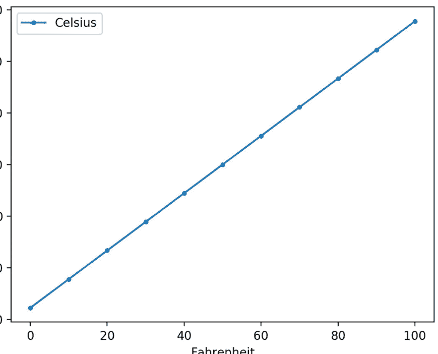

## Components of the Simple Linear Regression Equation

## 简单线性回归方程的组成部分

The points along any straight line (in two dimensions) like those shown in the preceding graph can be calculated with the equation:

任何直线（二维）上的点（如前一图所示）都可以用以下方程计算：

```
y = mx + b
```

where

其中

- m is the line’s slope,
- m 是直线的斜率，
- b is the line’s intercept with the y-axis (at x = 0),
- b 是直线与 y 轴的截距（在 x = 0 处），
- x is the independent variable (the date in this example), and
- x 是自变量（本示例中的日期），并且
- y is the dependent variable (the temperature in this example).
- y 是因变量（本示例中的温度）。

In simple linear regression, y is the predicted value for a given x.

在简单线性回归中，y 是给定 x 的预测值。

## Function linregress from the SciPy's stats Module

## SciPy stats 模块的 linregress 函数

Simple linear regression determines the slope (m) and intercept (b) of a straight line that best fits your data. Consider the following diagram, which shows a few of the time-series data points we'll process in this section and a corresponding regression line. We added vertical lines to indicate each data point's distance from the regression line:

简单线性回归确定最适合数据的直线的斜率（m）和截距（b）。请考虑下图，该图显示了本节将处理的一些时间序列数据点以及相应的回归线。我们添加了垂直线来指示每个数据点与回归线的距离：

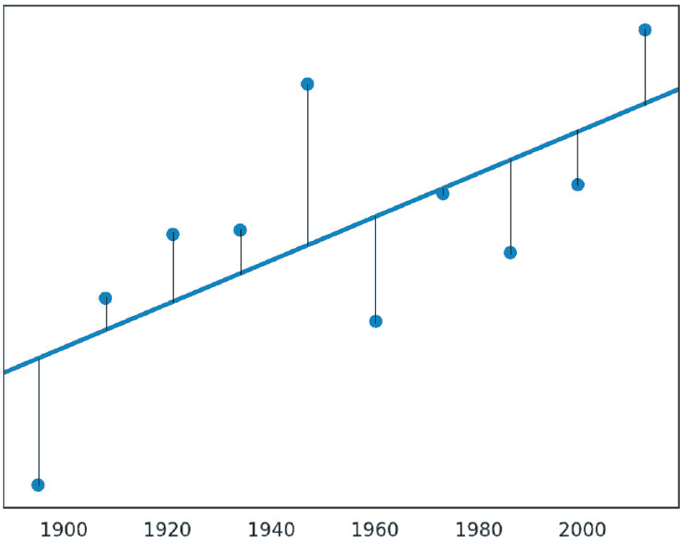

The simple linear regression algorithm iteratively adjusts the slope and intercept and, for each adjustment, calculates the square of each point's distance from the line. The “best fit” occurs when the slope and intercept values minimize the sum of those squared distances. This is known as an **ordinary least squares** calculation.

简单线性回归算法会迭代调整斜率和截距，并对每次调整计算每个点到直线距离的平方。当斜率和截距值使这些平方距离之和最小时，就实现了“最佳拟合”。这称为 **普通最小二乘** 计算。

0 https://en.wikipedia.org/wiki/Ordinary_least_squares.

The **SciPy (Scientific Python) library** is widely used for engineering, science and math in Python. This library's *linregress* function (from the **scipy.stats module**) performs simple linear regression for you. After calling *linregress*, you'll plug the resulting slope and intercept into the y = mx + b equation to make predictions.

**SciPy（科学 Python）库**广泛用于 Python 中的工程、科学和数学。该库的 *linregress* 函数（来自 **scipy.stats 模块**）为你执行简单线性回归。调用 *linregress* 后，你将所得的斜率和截距代入 y = mx + b 方程以进行预测。

## Pandas

## Pandas

In the three previous Intro to Data Science sections, you used pandas to work with data. You'll continue using pandas throughout the rest of the book. In this example, we'll load the data for New York City's 1895–2018 average January high temperatures from a CSV file into a **DataFrame**. We'll then format the data for use in this example.

在之前的三个数据科学入门章节中，你使用 pandas 处理数据。在本书的其余部分，你将继续使用 pandas。在本示例中，我们将从 CSV 文件加载纽约市 1895–2018 年 1 月平均最高气温数据到 **数据框** 中。然后，我们将格式化数据以用于本示例。

## Seaborn Visualization

## Seaborn 可视化

We'll use Seaborn to plot the DataFrame's data with a regression line that shows the average high-temperature trend over the period 1895–2018.

我们将使用 Seaborn 绘制 DataFrame 的数据，并附带一条回归线，以显示 1895–2018 年期间的平均最高气温趋势。

## Getting Weather Data from NOAA

## 从 NOAA 获取天气数据

Let's get the data for our study. The National Oceanic and Atmospheric Administration (NOAA) 1 offers lots of public historical data including time series for average high temperatures in specific cities over various time intervals.

让我们获取研究所需的数据。美国国家海洋和大气管理局（NOAA）1 提供大量公共历史数据，包括特定城市在不同时间间隔内的平均最高气温时间序列。

1 http://www.noaa.gov.

We obtained the January average high temperatures for New York City from 1895 through 2018 from NOAA's “Climate at a Glance” time series at:

我们从 NOAA 的“Climate at a Glance”时间序列获取了纽约市 1895 年至 2018 年 1 月的平均最高气温，网址为：

```
https://www.ncdc.noaa.gov/cag/
```

On that web page, you can select temperature, precipitation and other data for the entire U.S., regions within the U.S., states, cities and more. Once you've set the area and time frame, click Plot to display a diagram and view a table of the selected data. At the top of that table are links for downloading the data in several formats including CSV, which we discussed in the “Files and Exceptions” chapter. NOAA's maximum date range available at the time of this writing was 1895–2018. For your convenience, we provided the data in the ch10 examples folder in the file ave_hi_nyc_jan_1895-2018.csv. If you download the data on your own, delete the rows above the line containing "Date,Value,Anomaly".

在该网页上，您可以选择整个美国、美国境内的地区、州、城市等的温度、降水量和其他数据。设置区域和时间范围后，单击 Plot 以显示图表并查看所选数据的表格。在该表格的顶部有用于下载多种格式（包括 CSV）数据的链接，我们在“文件和异常”章节中讨论过。撰写本文时，NOAA 提供的最大日期范围为 1895–2018。为方便起见，我们已在 ch10 示例文件夹中提供文件 ave_hi_nyc_jan_1895-2018.csv 中的数据。如果您自行下载数据，请删除包含 "Date,Value,Anomaly" 的行之上的行。

This data contains three columns per observation:

此数据每条观测包含三列：

- Date—A value of the form ' YYYYMM' (such as ' 201801 '). MM is always 01 because we downloaded data for only January of each year.

- Date—形式为 ' YYYYMM'（例如 ' 201801 '）的值。MM 始终为 01，因为我们仅下载了每年 1 月的数据。

- Value—A floating-point Fahrenheit temperature.

- Value—浮点型华氏温度。

- Anomaly—The difference between the value for the given date and average values for all dates. We do not use the Anomaly value in this example, so we'll ignore it.

- Anomaly—给定日期的值与所有日期平均值之间的差异。本示例中我们不使用 Anomaly 值，因此将忽略它。

## Loading the Average High Temperatures into a DataFrame

## 将平均最高气温加载到 DataFrame 中

Let's load and display the New York City data from ave_hi_nyc_jan_1895-2018.csv:

让我们加载并显示 ave_hi_nyc_jan_1895-2018.csv 中的纽约市数据：

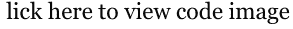

```
In [7]: nyc = pd.read_csv('ave_hi_nyc_jan_1895-2018.csv')
```

We can look at the DataFrame's head and tail to get a sense of the data:

我们可以查看 DataFrame 的头部和尾部以了解数据情况：


```
In [8]: nyc.head()
Out[8]:
     Date  Value  Anomaly
0  189501   34.2    -3.2
1  189601   34.7    -2.7
2  189701   35.5    -1.9
3  189801   39.6     2.2
4  189901   36.4    -1.0

In [9]: nyc.tail()
Out[9]:
      Date  Value  Anomaly
119  201401   35.5    -1.9
120  201501   36.1    -1.3
121  201601   40.8     3.4
122  201701   42.8     5.4
123  201801   38.7     1.3
```

## Cleaning the Data

## 清理数据

We'll soon use Seaborn to graph the `Date`-`Value` pairs and a regression line. When plotting data from a `DataFrame`, Seaborn labels a graph's axes using the `DataFrame`'s column names. For readability, let's rename the 'Value' column as 'Temperature':

我们很快将使用 Seaborn 绘制 `Date`-`Value` 对和回归线。在绘制 `DataFrame` 中的数据时，Seaborn 使用 `DataFrame` 的列名来标记图表的轴。为提高可读性，让我们将 'Value' 列重命名为 'Temperature'：

Click here to view code image

点击此处查看代码图像

```
In [10]: nyc.columns = ['Date', 'Temperature', 'Anomaly']

In [11]: nyc.head(3)
Out[11]:
     Date  Temperature  Anomaly
0  189501          34.2     -3.2
1  189601          34.7     -2.7
2  189701          35.5     -1.9
```

Seaborn labels the tick marks on the x-axis with `Date` values. Since this example processes only January temperatures, the x-axis labels will be more readable if they do not contain `01` (for January), we'll remove it from each `Date`. First, let's check the column's type:

Seaborn 使用 `Date` 值来标记 x 轴上的刻度标记。由于本示例仅处理 1 月份的温度，如果 x 轴标签不包含 `01`（表示 1 月份），则会更易读，我们将从每个 `Date` 中删除它。首先，让我们检查列的类型：

```
In [12]: nyc.Date.dtype
Out[12]: dtype('int64')
```

The values are integers, so we can divide by 100 to truncate the last two digits. Recall that each column in a `DataFrame` is a `Series`. Calling `Series` method `floordiv` performs `integer division` on every element of the `Series`:

这些值是整数，因此我们可以除以 100 以截断最后两位数字。回想一下，`DataFrame` 中的每个列都是一个 `Series`。调用 `Series` 方法 `floordiv` 会对 `Series` 的每个元素执行 `整数除法`：

Click here to view code image

点击此处查看代码图像

```
In [13]: nyc.Date = nyc.Date.floordiv(100)

In [14]: nyc.head(3)
```


```
Out[14]:
    Date  Temperature  Anomaly
0   1895         34.2       -3.2
1   1896         34.7       -2.7
2   1897         35.5       -1.9
```

## 计算数据集的基本描述性统计量

对数据集的温度进行一些快速统计，在`Temperature`列上调用`describe`。我们可以看到共有124个观测值，观测值的平均值为37.6°，最低和最高观测值分别为26.10和47.60度：

点击此处查看代码图像

```python
In [15]: pd.set_option('precision', 2)

In [16]: nyc.Temperature.describe()
Out[16]:
count    124.00
mean      37.60
std        4.54
min      26.10
25%      34.58
50%      37.60
75%      40.60
max      47.60
Name: Temperature, dtype: float64
```

## 预测未来1月份平均最高气温

**SciPy（科学Python）库**在Python中广泛用于工程、科学和数学。其**stats模块**提供了函数`linregress`，用于计算给定数据点的回归线的`slope`和`intercept`：

点击此处查看代码图像

```python
In [17]: from scipy import stats

In [18]: linear_regression = stats.linregress(x=nyc.Date,
    ...:                                      y=nyc.Temperature)
    ...:

```

函数`linregress`接收两个长度相同的一维数组²，表示数据点的x和y坐标。关键字参数`x`和`y`分别表示自变量和因变量。`linregress`返回的对象包含回归线的`slope`和`intercept`：

²这些参数也可以是类似一维数组的对象，例如列表或pandas Series。

点击此处查看代码图像

```python
In [19]: linear_regression.slope
Out[19]: 0.00014771361132966167

In [20]: linear_regression.intercept
Out[20]: 8.694845520062952
```

我们可以使用这些值和一元线性回归方程（直线方程）y = mx + b，来预测给定年份纽约市1月的平均气温。让我们预测2019年1月的平均华氏温度。在下面的计算中，linear_regression.slope是m，2019是x（你想预测温度的日期值），linear_regression.intercept是b：

点击此处查看代码图像

```python
In [21]: linear_regression.slope * 2019 + linear_regression.intercept
Out[21]: 38.51837136113298
```

我们还可以近似计算1895年之前各年的平均气温可能是多少。例如，让我们近似计算1890年1月的平均气温：

点击此处查看代码图像

```python
In [22]: linear_regression.slope * 1890 + linear_regression.intercept
Out[22]: 36.612865774980335
```

在此示例中，我们拥有1895–2018年的数据。你应该预期，偏离此范围越远，预测的可靠性就越低。

## 绘制平均最高气温和回归线

接下来，让我们使用Seaborn的regplot函数，以日期作为x轴、温度作为y轴来绘制每个数据点。regplot函数创建下面的散点图或散布图，其中散点表示给定日期的温度，穿过点显示的直线为回归线：


首先，如果尚未关闭之前的Matplotlib窗口，请先关闭它——否则，regplot将使用已包含图表的现有窗口。regplot函数的x和y关键字参数是长度相同的一维数组3，表示要绘制的x-y坐标对。请回顾，如果列名可以是有效的Python标识符，pandas会自动为每个列名创建属性：4

这些参数也可以是类似一维数组的对象，例如列表或pandas Series。

对于有更多统计背景的读者，回归线周围的阴影区域是回归线的95%置信区间（https://en.wikipedia.org/wiki/Simple_linear_regression#Confidence_interval）。要绘制没有置信区间的图表，请将关键字参数ci=None添加到regplot函数的参数列表中。

点击此处查看代码图像

```python
In [23]: import seaborn as sns

In [24]: sns.set_style('whitegrid')

In [25]: axes = sns.regplot(x=nyc.Date, y=nyc.Temperature)
```

回归线的斜率（左侧较低，右侧较高）表明过去124年来呈现升温趋势。在此图中，y轴表示26.1到47.6之间的21.5度温度范围，因此数据在回归线上下显著分散，使得难以看到线性关系。这是数据分析可视化中的常见问题。当你拥有反映不同类型数据（在此例中为日期和温度）的坐标轴时，如何合理确定它们各自的刻度？在前面的图中，这纯粹是图表高度的问题——Seaborn和Matplotlib根据数据的值范围自动缩放坐标轴。我们可以缩放y轴的值范围以强调线性关系。在此，我们将y轴从21.5度的范围缩放到60度的范围（从10度到70度）：

点击此处查看代码图像

```python
In [26]: axes.set_ylim(10, 70)
Out[26]: (10, 70)
```


## 获取时间序列数据集

以下是一些可用于查找时间序列用于研究的热门网站：

| 来源 | 描述 |
| :--- | :--- |
| https://data.gov/ | 这是美国政府的开放数据门户。搜索“时间序列”可得出7200多个时间序列数据集。 |
| https://www.ncdc.noaa.gov/cag/ | 美国国家海洋和大气管理局（NOAA）气候一览门户提供全球和美国的天气相关时间序列。 |
| https://www.esrl.noaa.gov/psd/data/timeseries/ | NOAA地球系统研究实验室（ESRL）门户提供月度和季节性气候相关时间序列。 |
| https://www.quandl.com/search | Quandl提供数百个免费的金融相关时间序列，以及付费的时间序列。 |
| https://datamarket.com/data/list/?q=provider:tsdl | 时间序列数据库（TSDL）提供跨多个行业的数百个时间序列数据集的链接。 |
| http://archive.ics.uci.edu/ml/datasets.html | 加州大学欧文分校（UCI）机器学习库包含几十个各种主题的时间序列数据集。 |
| http://informweb.umd.edu/econdata/econdata.html | 马里兰大学的EconData服务提供来自各美国政府机构的数千个经济时间序列的链接。 |

## 10.17 总结

在本章中，我们讨论了构建有价值的类的细节。你学习了如何定义类、创建类的对象、访问对象的属性并调用其方法。你定义了特殊方法__init__来创建和初始化新对象的数据属性。

我们讨论了控制对属性的访问和使用属性。我们展示了所有对象属性都可以由客户端直接访问。我们讨论了带有单前导下划线（_）的标识符，这些标识符表示不打算由客户端代码访问的属性。我们展示了如何通过双前导下划线（__）命名约定实现“私有”属性，这告诉Python修改属性的名称。

我们实现了一个由Card类和DeckOfCards类组成的卡片洗牌和发牌模拟，DeckOfCards类维护一个Card列表，并使用Matplotlib将牌组同时显示为字符串和卡片图像。我们介绍了用于创建对象字符串表示的特殊方法__repr__、__str__和__format__。

接下来，我们探讨了Python用于创建基类和子类的功能。我们展示了如何创建一个从其超类继承许多功能的子类，然后添加更多功能，可能通过重写基类的方法。我们创建了一个包含基类和子类对象的列表，以演示Python的多态编程能力。

我们介绍了运算符重载，用于定义Python内置运算符如何与自定义类类型的对象协同工作。你了解到，重载的运算符方法是通过重写所有类从object类继承的各种特殊方法来实现的。我们讨论了Python异常类层次结构和创建自定义异常类。

我们展示了如何创建命名元组，使你能够通过属性名称而不是索引号来访问元组元素。接下来，我们介绍了Python 3.7的新数据类，这些数据类可以自动生成类定义中常见的各种样板代码，例如__init__、__repr__和__eq__特殊方法。

你学习了如何在文档字符串中为代码编写单元测试，然后通过doctest模块的testmod函数方便地执行这些测试。最后，我们讨论了Python用于确定标识符作用域的各种命名空间。

在书的下一部分中，我们展示了一系列使用AI和大数据技术混合的实现案例研究。我们探索自然语言处理、Twitter数据挖掘、IBM Watson和认知计算、受监督和无监督机器学习，以及使用卷积神经网络和循环神经网络的深度学习。我们讨论大数据软件和硬件基础设施，包括NoSQL数据库、Hadoop和Spark，并高度强调性能。你即将看到一些非常酷的内容！


# 11. 自然语言处理 (NLP)

### 目标

- 执行自然语言处理（NLP）任务，这些任务是即将到来的数据科学案例研究章节的基础。
- 运行大量 NLP 演示。
- 使用 TextBlob、NLTK、Texttastic 和 spaCy NLP 库及其预训练模型来执行各种 NLP 任务。
- 将文本标记为单词和句子。
- 使用词性标注。
- 使用情感分析来确定文本是积极、消极还是中性。
- 检测文本语言并使用 TextBlob 的 Google Translate 支持在语言之间进行翻译。
- 通过词干提取和词形还原获取词根。
- 使用 TextBlob 的拼写检查和更正功能。
- 获取单词定义、同义词和反义词。
- 从文本中删除停用词。
- 创建词云。
- 使用 Texttastic 确定文本可读性。
- 使用 spaCy 库进行命名实体识别和相似度检测。

### 大纲

- 11.1 简介
- 11.2 TextBlob
- 11.2.1 创建一个 TextBlob
- 11.2.2 将文本标记为句子和单词
- 11.2.3 词性标注
- 11.2.4 提取名词短语
- 11.2.5 使用 TextBlob 默认情感分析器进行情感分析
- 11.2.6 使用 `NaiveBayesAnalyzer` 进行情感分析
- 11.2.7 语言检测和翻译
- 11.2.8 变格：复数化和单数化
- 11.2.9 拼写检查和更正
- 11.2.10 标准化：词干提取和词形还原
- 11.2.11 词频
- 11.2.12 从 WordNet 获取定义、同义词和反义词
- 11.2.13 删除停用词
- 11.2.14 n-grams
- 11.3 使用条形图和词云可视化词频
- 11.3.1 使用 Pandas 可视化词频
- 11.3.2 使用词云可视化词频
- 11.4 使用 Textstatistic 进行可读性评估
- 11.5 使用 spaCy 进行命名实体识别
- 11.6 使用 spaCy 进行相似度检测
- 11.7 其他 NLP 库和工具
- 11.8 机器学习和深度学习自然语言应用
- 11.9 自然语言数据集
- 11.10 总结

### 11.1 简介

你的闹钟叫醒你，你按下“闹钟关闭”按钮。你拿起智能手机，阅读短信并查看最新新闻片段。你收听电视主持人采访名人。你与家人、朋友和同事交谈并倾听他们的回复。你有一位听力障碍的朋友，你们通过手语交流，他喜欢观看带字幕的视频节目。你有一位失明的同事，他阅读盲文，听由电子书朗读器朗读的书籍，并听屏幕阅读器朗读计算机屏幕上的内容。你阅读电子邮件，区分垃圾邮件和重要通信并发送电子邮件。你阅读小说或非虚构作品。你开车，观察“停止”、“限速 35”和“道路施工”等路标。你向汽车下达口头指令，如“回家打电话”、“播放古典音乐”或提出“最近的加油站在哪里？”等问题。你教孩子如何说话和阅读。你给朋友寄一张慰问卡。你阅读书籍。你阅读报纸和杂志。你在课堂或会议期间做笔记。你学习一门外语为出国旅行做准备。你收到一封西班牙语的客户电子邮件，并将其通过免费翻译程序运行。你用英语回复，知道你的客户可以轻松将你的电子邮件翻译回西班牙语。你不确定某封电子邮件的语言，但语言检测软件会立即为你弄清楚并将电子邮件翻译成英语。

这些是文本、语音、视频、手语、盲文及其他形式中的自然语言通信示例，涉及英语、西班牙语、法语、俄语、中文、日语及数百种其他语言。在本章中，你将通过一系列动手演示和 IPython 会话掌握许多自然语言处理（NLP）功能。你将在即将到来的数据科学案例研究章节中使用其中许多 NLP 功能。

自然语言处理是在由推文、Facebook 帖子、对话、电影评论、莎士比亚剧作、历史文档、新闻条目、会议记录等组成的文本集合上执行的。文本集合被称为语料库，其复数形式为 corpora。

自然语言缺乏数学精确性。含义的微妙之处使自然语言理解变得困难。文本的意义可能受其上下文和读者“世界观”的影响。例如，搜索引擎可以通过你的先前搜索“了解你”。积极的一面是更好的搜索结果。消极的一面可能是隐私侵犯。

### 11.2 TEXTBLOB

1 https://textblob.readthedocs.io/en/latest/.

TextBlob 是一个面向对象的 NLP 文本处理库，它构建于 NLTK 和 pattern NLP 库之上，并简化了其中的许多功能。TextBlob 可以执行的部分 NLP 任务包括：

- **分词**—将文本分成称为标记的片段，这些片段是有意义的单位，例如单词和数字。

- **词性（POS）标注**—识别每个单词的词性，例如名词、动词、形容词等。

- **名词短语提取**—定位代表名词的单词组，例如“红砖工厂”。 2

2 “红砖工厂”一词说明了为什么自然语言是一个如此困难的主题。红砖工厂是制造红砖的工厂吗？它是制造任何颜色砖块的红色工厂吗？它是由红砖建造的、生产任何类型产品的工厂吗？在当今的音乐世界中，它甚至可能是摇滚乐队的名称或你智能手机上的游戏名称。

- **情感分析**—确定文本具有积极、中性还是消极情感。

- 由 Google Translate 驱动的**跨语言翻译**和**语言检测**。

- **变格** 3 —将单词复数化和单数化。变格的其他方面不属于 TextBlob 的一部分。

3 https://en.wikipedia.org/wiki/Inflection.

- **拼写检查和拼写更正。**

- **词干提取**—通过删除前缀或后缀将单词缩减为词干。例如，“varieties”的词干是“varieti。”

- **词形还原**—类似于词干提取，但根据原始单词的上下文生成真实单词。例如，“varieties”的词形还原形式是“variety。”

- **词频**—确定每个单词在语料库中出现的频率。

- **WordNet 集成**，用于查找单词定义、同义词和反义词。

- **停用词消除**—删除常用词，例如 a、an、the、I、we、you 等，以分析语料库中的重要单词。

- **n-grams**—生成语料库中连续单词的集合，用于识别经常相邻出现的单词。

其中许多功能用作更复杂 NLP 任务的一部分。在本节中，我们将使用 TextBlob 和 NLTK 执行这些 NLP 任务。

#### 安装 TextBlob 模块

要安装 TextBlob，请打开 Anaconda 提示符 (Windows)、终端 (macOS/Linux) 或 shell (Linux)，然后执行以下命令：

单击此处查看代码图像

```
conda install -c conda-forge textblob
```

Windows 用户可能需要以管理员身份运行 Anaconda 提示符才能获得正确的软件安装权限。要执行此操作，请右键单击“开始”菜单中的 Anaconda 提示符，然后选择“更多” > “以管理员身份运行”。

安装完成后，执行以下命令以下载 TextBlob 使用的 NLTK 语料库：

单击此处查看代码图像

```
ipython -m textblob.download_corpora
```

这些包括：

- 布朗语料库（在布朗大学创建），用于词性标注。
- Punkt，用于英语句子分词。
- WordNet，用于单词定义、同义词和反义词。
- 平均感知器标注器，用于词性标注。
- conll2000，用于将文本分解为名词、动词、名词短语等组件——称为文本分块。conll2000 这个名称来自创建分块数据的会议——计算自然语言学习会议。
- 电影评论，用于情感分析。

4 https://en.wikipedia.org/wiki/Brown_Corpus.

#### 古腾堡计划

古腾堡计划上的免费电子书是分析文本的绝佳来源：

https://www.gutenberg.org

该网站包含各种格式的超过 57,000 本电子书，包括纯文本文件。这些书在美国的版权已过期。有关古腾堡计划使用条款和其他国家版权的信息，请参见：

https://www.gutenberg.org/wiki/Gutenberg:Terms_of_Use

在本节的某些示例中，我们使用莎士比亚《罗密欧与朱丽叶》的纯文本电子书文件，你可以在以下网址找到它：

https://www.gutenberg.org/ebooks/1513

古腾堡计划不允许以编程方式访问其电子书。你必须出于此目的复制这些书。 5 要将《罗密欧与朱丽叶》下载为纯文本电子书，请右键单击书籍网页上的“纯文本 UTF-8”链接，然后选择“另存为链接...”(Chrome/FireFox)、“下载链接文件为...”(Safari) 或“另存目标为”(Microsoft Edge) 选项将书籍保存到你的系统。将其保存为 ch11 示例文件夹中的 RomeoAndJuliet.txt，以确保我们的代码示例能够正确运行。出于分析目的，我们删除了“THE TRAGEDY OF ROMEO AND JULIET”之前的古腾堡计划文本，以及文件末尾以以下内容开头的古腾堡计划信息：

5 https://www.gutenberg.org/wiki/Gutenberg:Information_About_Robot_Access_to_ou


#### 11.2.1 创建一个 TextBlob


TextBlob 是 textblob 模块中用于 NLP 的基础类。让我们创建一个包含两个句子的 TextBlob：

http://textblob.readthedocs.io/en/latest/api_reference.html#textblob.blob.TextBlob

点击此处查看代码图像

```
In [1]: from textblob import TextBlob

In [2]: text = 'Today is a beautiful day.  Tomorrow looks like bad weather.'

In [3]: blob = TextBlob(text)

In [4]: blob
Out[4]: TextBlob("Today is a beautiful day.  Tomorrow  looks like bad weather.")
```

TextBlobs——以及，正如您很快将看到的，Sentences 和 Words——支持字符串方法，并且可以与字符串进行比较。它们还为各种 NLP 任务提供了方法。Sentences、Words 和 TextBlobs 继承自 BaseBlob，因此具有许多共同的方法和属性。

## 11.2.2 将文本分割为句子和单词

自然语言处理在执行其他 NLP 任务之前通常需要对文本进行分词。TextBlob 提供了方便的属性来访问 TextBlob 中的句子和单词。让我们使用 sentence 属性来获取 Sentence 对象列表：

点击此处查看代码图像

```
In [5]: blob.sentences
Out[5]:
[Sentence("Today is a beautiful day."),
Sentence("Tomorrow looks like bad weather.")]
```

words 属性返回一个 WordList 对象，其中包含 Word 对象列表，表示 TextBlob 中每个单词，并已移除标点符号：

点击此处查看代码图像

```
In [6]: blob.words
Out[6]: WordList(['Today', 'is', 'a', 'beautiful', 'day', 'Tomorrow', 'looks', 'like', 'bad', 'weather'])
```

## 11.2.3 词性标注

有些词有多种含义。例如，“set”和“run”这两个词各有数百种含义！如果你查看 dictionary.com 上单词“run”的定义，你会发现它可以是动词、名词、形容词或动词短语的一部分。POS 标记的一个重要用途是确定词在其可能的众多含义中的含义。这对于帮助计算机“理解”自然语言非常重要。

tags 属性返回一个元组列表，每个元组包含一个词和一个表示其词性标签的字符串：

点击此处查看代码图像

```
In [7]: blob
Out[7]: TextBlob("Today is a beautiful day. Tomorrow looks like bad weather.")

In [8]: blob.tags
Out[8]:
[('Today', 'NN'),
 ('is', 'VBZ'),
 ('a', 'DT'),
 ('beautiful', 'JJ'),
 ('day', 'NN'),
 ('Tomorrow', 'NNP'),
 ('looks', 'VBZ'),
 ('like', 'IN'),
 ('bad', 'JJ'),
 ('weather', 'NN')]
```

默认情况下，TextBlob 使用 PatternTagger 来确定词性。该类使用 pattern 库的词性标注功能：

https://www.clips.uantwerpen.be/pattern

您可以在以下网址查看该库的 63 个词性标签：

https://www.clips.uantwerpen.be/pages/MBSP-tags

在前面的代码片段输出中：

- Today、day 和 weather 被标记为 NN——单数名词或不可数名词。
- is 和 looks 被标记为 VBZ——第三人称单数现在时动词。
- a 被标记为 DT——限定词。
- beautiful 和 bad 被标记为 JJ——形容词。
- Tomorrow 被标记为 NNP——专有单数名词。
- like 被标记为 IN——从属连词或介词。

7 https://en.wikipedia.org/wiki/Determiner.

## 11.2.4 提取名词短语

假设您正在准备购买水上滑雪板，因此正在网上研究它们。您可能会搜索“best water ski”。在这种情况下，“water ski”是一个名词短语。如果搜索引擎未能正确解析名词短语，您可能无法获得最佳搜索结果。请上网尝试搜索“best water”、“best ski”和“best water ski”，看看会得到什么结果。

TextBlob 的 `noun_phrases` 属性返回一个 `WordList` 对象，其中包含 `Word` 对象列表——文本中每个名词短语对应一个：

点击此处查看代码图像

```
In [9]: blob
Out[9]: TextBlob("Today is a beautiful day. Tomorrow looks like bad weather.")

In [10]: blob.noun_phrases
Out[10]: WordList(['beautiful day', 'tomorrow', 'bad weather'])
```

请注意，表示名词短语的 `Word` 可以包含多个单词。`WordList` 是 Python 内置列表类型的扩展。WordList 提供了用于词干提取、词形还原、单数化和复数化的其他方法。

## 11.2.5 使用 TextBlob 默认情感分析器进行情感分析

最常见且最有价值的 NLP 任务之一是 **情感分析**，用于确定文本是积极、中性还是消极。例如，公司可能会使用此功能来确定人们在网上对其产品是正面评价还是负面评价。请考虑积极词“good”和消极词“bad”。仅仅因为句子包含“good”或“bad”并不意味着句子的情感必然是积极或消极。例如，句子

The food is not good.

明显带有消极情感。同样，句子

The movie was not bad.

明显带有积极情感，尽管可能不如类似句子那么积极

The movie was excellent!

情感分析是一个复杂的机器学习问题。然而，像 TextBlob 这样的库带有用于执行情感分析的预训练机器学习模型。

### 获取 TextBlob 的情感

TextBlob 的 `sentiment` 属性返回一个 `Sentiment` 对象，指示文本是积极还是消极，以及是客观还是主观：

点击此处查看代码图像

```
In [11]: blob
Out[11]: TextBlob("Today is a beautiful day. Tomorrow looks like bad weather.")
```

```
In [12]: blob.sentiment
Out[12]: Sentiment(polarity=0.075000000000000007,
 subjectivity=0.8333333333333333)
```

在前面的输出中，极性（polarity）的值范围从 -1.0（消极）到 1.0（积极），0.0 表示中性。主观性（subjectivity）的值范围从 0.0（客观）到 1.0（主观）。根据我们 TextBlob 的值，总体情感接近中性，文本大多是主观的。

### 从 Sentiment 对象获取极性和主观性

上面显示的值可能在大多数情况下提供了超出您所需精度的精度。这会影响数字输出的可读性。IPython 魔术命令 %precision 允许您为独立浮点对象以及列表、字典和元组等内置类型中的浮点对象指定默认精度。让我们使用该魔术命令将极性和主观性值舍入到小数点后三位：

点击此处查看代码图像

```
In [13]: %precision 3
Out[13]: '%.3f'

In [14]: blob.sentiment.polarity
Out[14]: 0.075

In [15]: blob.sentiment.subjectivity
Out[15]: 0.833
```

### 获取句子的情感

您也可以在单个句子级别获取情感。让我们使用 sentence 属性获取 Sentence 对象列表，然后遍历它们并显示每个 Sentence 的 sentiment 属性：

http://textblob.readthedocs.io/en/latest/api_reference.html#textblob.blob.Sentence

点击此处查看代码图像

```
In [16]: for sentence in blob.sentences:
    ...:     print(sentence.sentiment)
    ...:
Sentiment(polarity=0.85, subjectivity=1.0)
Sentiment(polarity=-0.69999999999999998, subjectivity=0.6666666666666666)
```

这可能解释了为什么整个 TextBlob 的情感接近 0.0（中性）——一个句子是积极的（0.85），另一个是消极的（-0.69999999999999998）。

## 11.2.6 使用 NaiveBayesAnalyzer 进行情感分析

默认情况下，TextBlob 及其派生的 Sentences 和 Words 使用 `PatternAnalyzer` 来确定情感，该分析器使用与 Pattern 库相同的情感分析技术。TextBlob 库还附带了一个 `NaiveBayesAnalyzer`[^9]（模块 `textblob.sentiments`），它在电影评论数据库上进行了训练。Naive Bayes[^0] 是一种常用的机器学习文本分类算法。以下内容使用 `analyzer` 关键字参数来指定 TextBlob 的情感分析器。请回顾，在此正在进行的 IPython 会话中，`text` 包含 'Today is a beautiful day. Tomorrow looks like bad weather.'：

[^9]: https://textblob.readthedocs.io/en/latest/api_reference.html#module-textblob.en.sentiments.
[^0]: https://en.wikipedia.org/wiki/Naive_Bayes_classifier.

点击此处查看代码图像

```
In [17]: from textblob.sentiments import NaiveBayesAnalyzer

In [18]: blob = TextBlob(text, analyzer=NaiveBayesAnalyzer())

In [19]: blob
Out[19]: TextBlob("Today is a beautiful day. Tomorrow looks like bad weather.")
```

让我们使用 TextBlob 的 sentiment 属性来使用 NaiveBayesAnalyzer 显示文本的情感：

点击此处查看代码图像

```
In [20]: blob.sentiment
Out[20]: Sentiment(classification='neg', p_pos=0.47662917962091056, p_neg=0.5233708203790894)
```

在此情况下，总体情感被分类为消极（`classification='neg'`）。`Sentiment` 对象的 `p_pos` 表示该 TextBlob 有 47.66% 是积极的，而其 `p_neg` 表示该 TextBlob 有 52.34% 是消极的。由于总体情感仅略微偏消极，我们可能会认为此 TextBlob 的总体情感是中性的。

现在，让我们获取每个 Sentence 的情感：

点击此处查看代码图像

```
In [21]: for sentence in blob.sentences:
   ...:     print(sentence.sentiment)
   ...:
Sentiment(classification='pos', p_pos=0.8117563121751951, p_neg=0.1882436878248049)
Sentiment(classification='neg', p_pos=0.174363226578349, p_neg=0.825636773421651)
```

请注意，与 `polarity` 和 `subjectivity` 不同，我们从 `NaiveBayesAnalyzer` 获得的 `Sentiment` 对象包含一个 `classification`——'pos'（积极）或 'neg'（消极）——以及 `p_pos`（积极百分比）和 `p_neg`（消极百分比）值，范围从 `0.0` 到 `1.0`。


再次，我们看到第一句话是积极的，第二句话是消极的。

## 11.2.7 语言检测与翻译

跨语言翻译是自然语言处理和人工智能领域的一项挑战性问题。随着机器学习、人工智能和自然语言处理的进步，谷歌翻译（100+ 种语言）和微软必应翻译（60+ 种语言）等服务可以即时在语言之间进行翻译。

跨语言翻译对前往国外旅行的人也非常有用。他们可以使用翻译应用来翻译菜单、路标等内容。甚至还有实时语音翻译的努力，这样你就能实时与不懂你母语的人交谈。¹ ² 有些智能手机现在可以与入耳式耳机协同工作，提供多种语言的近乎实时翻译。³ ⁴ ⁵ 在“IBM Watson 和认知计算”章节中，我们开发了一个脚本，可以在 Watson 支持的语言之间进行近乎实时的跨语言翻译。

- 1. https://www.skype.com/en/features/skype-translator/.
- 2. https://www.microsoft.com/en-us/translator/business/live/.
- 3. https://www.telegraph.co.uk/technology/2017/10/04/googles-new-headphones-can-translate-foreign-languages-real/.
- 4. https://store.google.com/us/product/google_pixel_buds?hl=en-US.
- 5. http://www.chicagotribune.com/bluesky/originals/ct-bsi-google-pixel-buds-review-20171115-story.html.

TextBlob 库使用谷歌翻译来检测文本的语言，并将 TextBlobs、Sentences 和 Words 翻译成其他语言。⁶ 让我们使用 **detect_language 方法** 来检测我们正在处理的文本的语言（'en' 表示英语）：

⁶这些功能需要 Internet 连接。


```
In [22]: blob
Out[22]: TextBlob("Today is a beautiful day. Tomorrow looks like bad weather.")

In [23]: blob.detect_language()
Out[23]: 'en'
```

接下来，让我们使用 **translate 方法** 将文本翻译成西班牙语（'es'）然后检测结果的语言。`to` 关键字参数指定目标语言。


```
In [24]: spanish = blob.translate(to='es')

In [25]: spanish
Out[25]: TextBlob("Hoy es un hermoso dia. Mañana parece mal tiempo.")
```

```
In [26]: spanish.detect_language()
Out[26]: 'es'
```

接下来，让我们将我们的 TextBlob 翻译成简体中文（指定为 'zh' 或 'zh-CN'）然后检测结果的语言：


```
In [27]: chinese = blob.translate(to='zh')

In [28]: chinese
Out[28]: TextBlob("")

In [29]: chinese.detect_language()
Out[29]: 'zh-CN'
```

方法 `detect_language` 的输出始终将简体中文显示为 'zh-CN'，尽管 `translate` 函数可以接收简体中文 'zh' 或 'zh-CN'。

在前面的每个案例中，谷歌翻译都会自动检测源语言。你可以通过向 `translate` 方法传递 `from_lang` 关键字参数来显式指定源语言，如下所示：


```
chinese = blob.translate(from_lang='en', to='zh')
```

谷歌翻译使用 iso-639-1⁷ 语言代码，列于

https://en.wikipedia.org/wiki/List_of_ISO_639-1_codes

⁷ ISO 是国际标准化组织（https://www.iso.org/）。

对于支持的语言，你将使用这些代码作为 `from_lang` 和 `to` 关键字参数的值。谷歌翻译支持的语言列表位于：

https://cloud.google.com/translate/docs/languages

不带参数调用 `translate` 会将从检测到的源语言翻译成英语：


```
In [30]: spanish.translate()
Out[30]: TextBlob("Today is a beautiful day. Tomorrow seems like bad weather.")

In [31]: chinese.translate()
Out[31]: TextBlob("Today is a beautiful day. Tomorrow looks like bad weather.")
```

请注意英语结果之间的细微差别。

## 11.2.8 变格：复数化与单数化

变格是同一单词的不同形式，如单数和复数（例如 "person" 和 "people"）以及不同的动词时态（例如 "run" 和 "ran"）。在计算词频时，你可能首先希望将所有变格单词转换为同一形式，以获得更准确的词频。Words 和 WordLists 均支持将单词转换为其单数或复数形式。让我们对几个 Word 对象进行复数化和单数化：

点击此处查看代码图像

```
In [1]: from textblob import Word

In [2]: index = Word('index')

In [3]: index.pluralize()
Out[3]: 'indices'

In [4]: cacti = Word('cacti')

In [5]: cacti.singularize()
Out[5]: 'cactus'
```

复数化和单数化是复杂的任务，如你上面所见，它们不像在单词末尾添加或删除 "s" 或 "es" 那么简单。

你也可以对 WordList 做同样的操作：

点击此处查看代码图像

```
In [6]: from textblob import TextBlob

In [7]: animals = TextBlob('dog cat fish bird').words

In [8]: animals.pluralize()
Out[8]: WordList(['dogs', 'cats', 'fish', 'birds'])
```

请注意，单词 "fish" 的单数和复数形式相同。

## 11.2.9 拼写检查与纠正

对于自然语言处理任务，文本中没有拼写错误非常重要。用于编写和编辑文本的软件包（如 Microsoft Word、Google Docs 等）会在你输入时自动检查拼写，并通常在拼写错误的单词下方显示红线。其他工具允许你手动调用拼写检查器。

你可以使用 Word 的 spellcheck 方法来检查拼写，该方法返回包含可能正确拼写及其置信值的元组列表。假设我们本想输入单词 "they"，却误拼成了 "theyr"。拼写检查结果显示两个可能的更正，其中单词 "they" 具有最高置信度值：

点击此处查看代码图像

```
In [1]: from textblob import Word

In [2]: word = Word('theyr')

In [3]: %precision 2
Out[3]: '%.2f'

In [4]: word.spellcheck()
Out[4]: [('they', 0.57), ('their', 0.43)]
```

请注意，置信度值最高的单词 *不一定* 是给定语境下的正确单词。

TextBlobs、Sentences 和 Words 均拥有一个可调用的 **correct** 方法来纠正拼写。对 Word 调用 correct 会返回置信度值最高的正确拼写单词（由 spellcheck 返回）：

点击此处查看代码图像

```
In [5]: word.correct() # chooses word with the highest confidence value
Out[5]: 'they'
```

对 TextBlob 或 Sentence 调用 correct 会检查每个单词的拼写。对于每个拼写错误的单词，correct 会将其替换为置信度值最高的正确拼写单词：

点击此处查看代码图像

```
In [6]: from textblob import Word

In [7]: sentence = TextBlob('Ths sentense has misspelled wrds.')

In [8]: sentence.correct()
Out[8]: TextBlob("The sentence has misspelled words.")
```

## 11.2.10 规范化：词干提取与词形还原

**词干提取** 从单词中删除前缀或后缀，只保留词干，该词干可能是实际单词，也可能不是。**词形还原** 类似，但会考虑单词的词性和含义，并得出一个实际单词。

词干提取和词形还原是 **规范化** 操作，用于为分析准备单词。例如，在对文本中的单词计算统计信息之前，你可能会将所有单词转换为小写，以便不区分大小写。有时，你可能希望使用单词的词根来表示单词的多种形式。例如，在给定的应用程序中，你可能希望将以下所有单词视为 "program"：program、programs、programmer、programming 和 programmed（也许还有英式英语拼写，如 programmes）。

Words 和 WordLists 均通过 **stem** 和 **lemmatize** 方法支持词干提取和词形还原。让我们在 Word 上同时使用两者：

点击此处查看代码图像

```
In [1]: from textblob import Word
```


```
In [2]: word = Word('varieties')

In [3]: word.stem()
Out[3]: 'varieti'

In [4]: word.lemmatize()
Out[4]: 'variety'
```

## 11.2.11 单词频率

各种用于检测文档间相似性的技术都依赖于单词频率。如您将在此处看到，TextBlob 会自动统计单词频率。首先，让我们将莎士比亚的《罗密欧与朱丽叶》电子书加载到 TextBlob 中。为此，我们将使用 Python 标准库 `pathlib` 模块中的 `Path` 类：


```python
In [1]: from pathlib import Path

In [2]: from textblob import TextBlob

In [3]: blob = TextBlob(Path('RomeoAndJuliet.txt').read_text())
```

使用您先前下载的 `RomeoAndJuliet.txt`⁸ 文件。此处假设您已从该文件夹启动 `IPython` 会话。当您使用 `Path` 的 `read_text` 方法读取文件时，它会在读取完文件后立即关闭文件。

⁸Project Gutenberg 的每本电子书都包含其他文本，例如其许可信息，这些文本并非电子书本身的一部分。对于此示例，我们使用文本编辑器从我们的电子书副本中删除了该文本。

您可以通过 TextBlob 的 `word_counts` 字典访问单词频率。让我们获取剧中几个单词的计数：


```python
In [4]: blob.word_counts['juliet']
Out[4]: 190

In [5]: blob.word_counts['romeo']
Out[5]: 315

In [6]: blob.word_counts['thou']
Out[6]: 278
```

如果您已将 `TextBlob` 分词为 `WordList`，则可以通过 `count` 方法在列表中统计特定单词：


```python
In [7]: blob.words.count('joy')
Out[7]: 14

In [8]: blob.noun_phrases.count('lady capulet')
```

## 11.2.12 从 WordNet 获取定义、同义词和反义词

`WordNet` 9 是由普林斯顿大学创建的单词数据库。`TextBlob` 库使用 `NLTK` 库的 `WordNet` 接口，使您能够查找单词定义并获取同义词和反义词。有关更多信息，请查看 `NLTK WordNet` 接口文档，网址为：

9 https://wordnet.princeton.edu/.

https://www.nltk.org/api/nltk.corpus.reader.html#module-nltk.corpus.reader.wordnet

### 获取定义

首先，让我们创建一个 `Word`：

单击此处查看代码图像

```python
In [1]: from textblob import Word

In [2]: happy = Word('happy')
```

`Word` 类的 `definitions` 属性返回 `WordNet` 数据库中该单词的所有定义列表：

单击此处查看代码图像

```python
In [3]: happy.definitions
Out[3]:
['enjoying or showing or marked by joy or pleasure',
'marked by good fortune',
'eagerly disposed to act or to be of service',
'well expressed and to the point']
```

该数据库不一定包含给定单词的每个字典定义。还有一个 `define` 方法，可让您传递词性作为参数，以便仅获取与该词性匹配的定义。

### 获取同义词

您可以通过 `synsets` 属性获取 `Word` 的 synsets——即其同义词集。结果是一个 `Synset` 对象列表：

```python
In [4]: happy.synsets
Out[4]:
[Synset('happy.a.01'),
Synset('felicitous.s.02'),
Synset('glad.s.02'),
Synset('happy.s.04')]
```

每个 `Synset` 代表一组同义词。在表示法 `happy.a.01` 中：

- `happy` 是原始 `Word` 的词元化形式（在此示例中，两者相同）。
- `a` 是词性，可以是 `a`（形容词）、`n`（名词）、`v`（动词）、`r`（副词）或 `s`（形容词卫星）。`WordNet` 中许多形容词 synsets 都有表示相似形容词的卫星 synsets。
- `01` 是基于 0 的索引号。许多单词具有多种含义，这是 `WordNet` 数据库中对应含义的索引号。

还有一个 `get_synsets` 方法，可让您传递词性作为参数，以便仅获取与该词性匹配的 `Synsets`。

您可以遍历 `synsets` 列表以查找原始单词的同义词。每个 `Synset` 都有一个 `lemmas` 方法，返回表示同义词的 `Lemma` 对象列表。`Lemma` 的 `name` 方法将同义词作为字符串返回。在以下代码中，对于 `synsets` 列表中的每个 `Synset`，嵌套 `for` 循环遍历该 `Synset` 的 `Lemmas`（如果有）。然后，我们将同义词添加到名为 `synonyms` 的集合中。我们使用 `set` 集合是因为它会自动删除我们添加到其中的任何重复项：

单击此处查看代码图像

```python
In [5]: synonyms = set()

In [6]: for synset in happy.synsets:
  ...:     for lemma in synset.lemmas():
  ...:         synonyms.add(lemma.name())
  ...:

In [7]: synonyms
Out[7]: ('felicitous', 'glad', 'happy', 'well-chosen')
```

### 获取反义词

如果 `Lemma` 表示的单词在 `WordNet` 数据库中具有反义词，则调用 `Lemma` 的 `antonyms` 方法将返回表示反义词的 `Lemmas` 列表（如果数据库中没有反义词，则返回空列表）。在片段 [4] 中，您看到 'happy' 有四个 `Synsets`。首先，让我们获取 `synsets` 列表中索引为 0 的 `Synset` 的 `Lemmas`：

单击此处查看代码图像

```python
In [8]: lemmas = happy.synsets[0].lemmas()

In [9]: lemmas
Out[9]: [Lemma('happy.a.01.happy')]
```

在这种情况下，`lemmas` 返回了一个包含一个 `Lemma` 元素的列表。我们现在可以检查数据库是否有该 `Lemma` 的任何对应反义词：

单击此处查看代码图像

```python
In [10]: lemmas[0].antonyms()
```

结果是表示反义词的 `Lemmas` 列表。在此示例中，我们看到数据库中 'happy' 的一个反义词是 'unhappy'。

## 11.2.13 删除停用词

停用词是文本中常见的单词，在分析文本之前通常会将其删除，因为它们通常不提供有用信息。下表显示了 `NLTK` 的英语停用词列表，该列表由 `NLTK stopwords` 模块的 `words` 函数返回（我们将稍后使用）：

0 https://www.nltk.org/book/ch02.html.


`NLTK` 库还有几种其他自然语言的停用词列表。在使用 `NLTK` 的停用词列表之前，必须先下载它们，方法是使用 `nltk` 模块的 `download` 函数：

单击此处查看代码图像

```python
In [1]: import nltk

In [2]: nltk.download('stopwords')
[nltk_data] Downloading package stopwords to
[nltk_data]     C:\Users\PaulDeitel\AppData\Roaming\nltk_data...
[nltk_data]   Unzipping corpora\stopwords.zip.
Out[2]: True
```

对于此示例，我们将加载 'english' 停用词列表。首先从 `nltk.corpus` 模块导入 `stopwords`，然后使用 `stopwords` 的 `words` 方法加载 'english' 停用词列表：

单击此处查看代码图像

```python
In [3]: from nltk.corpus import stopwords

In [4]: stops = stopwords.words('english')
```

接下来，让我们创建一个 `TextBlob`，从中删除停用词：

单击此处查看代码图像

```python
In [5]: from textblob import TextBlob
In [6]: blob = TextBlob('Today is a beautiful day.')
```

最后，要删除停用词，让我们使用 `TextBlob` 的 `words` 在列表推导式中，仅当单词不在 `stops` 中时才将每个单词添加到结果列表：

单击此处查看代码图像

```python
In [7]: [word for word in blob.words if word not in stops]
Out[7]: ['Today', 'beautiful', 'day']
```

## 11.2.14 n-grams

`n-gram` 1 是由 `n` 个文本项组成的序列，例如单词中的字母或句子中的单词。在自然语言处理中，`n-grams` 可用于识别经常相互相邻出现的字母或单词。对于基于文本的用户输入，这有助于预测用户将键入的下一个字母或单词——例如，在使用 `IPython` 的制表符补全完成项目时，或在您喜爱的智能手机消息应用中向朋友输入消息时。对于语音转文本，`n-grams` 可能用于提高转录质量。`N-grams` 是一种共现形式，即单词或字母在文本正文中彼此靠近出现。

1 https://en.wikipedia.org/wiki/N-gram.

`TextBlob` 的 `ngrams` 方法生成长度为三的 `WordList` `n-grams` 列表，由


默认—称为 *trigrams*。你可以传递关键字参数 n 来生成任意长度的 *n*-grams。输出显示，第一个 trigram 包含句子中的前三个单词（'Today', 'is' 和 'a'）。然后，*ngrams* 从第二个单词开始创建一个 trigram（'is', 'a' 和 'beautiful'），依此类推，直到创建包含 *TextBlob* 中最后三个单词的 trigram：

单击此处查看代码图像

```python
In [1]: from textblob import TextBlob

In [2]: text = 'Today is a beautiful   day. Tomorrow looks like bad weather.'

In [3]: blob = TextBlob(text)

In [4]: blob.ngrams()
Out[4]:
[WordList(['Today', 'is', 'a']),
WordList(['is', 'a', 'beautiful']),
WordList(['a', 'beautiful', 'day']),
WordList(['beautiful', 'day', 'Tomorrow']),
WordList(['day', 'Tomorrow', 'looks']),
WordList(['Tomorrow', 'looks', 'like']),
WordList(['looks', 'like', 'bad']),
WordList(['like', 'bad', 'weather'])]
```

以下代码生成由五个单词组成的 *n*-grams：

单击此处查看代码图像

```python
In [5]: blob.ngrams(n=5)
Out[5]:
[WordList(['Today', 'is', 'a', 'beautiful', 'day']),
WordList(['is', 'a', 'beautiful', 'day', 'Tomorrow']),
WordList(['a', 'beautiful', 'day', 'Tomorrow', 'looks']),
WordList(['beautiful', 'day', 'Tomorrow', 'looks', 'like']),
WordList(['day', 'Tomorrow', 'looks', 'like', 'bad']),
WordList(['Tomorrow', 'looks', 'like', 'bad', 'weather'])]
```

## 11.3 使用条形图和词云可视化单词频率

之前，我们获得了《罗密欧与朱丽叶》中几个单词的频率。有时，频率可视化可以增强你的语料库分析。可视化数据的方法通常不止一种，有时一种优于另一种。例如，你可能对单词之间的相对频率感兴趣，或者你可能只关注语料库中单词的相对使用情况。在本节中，我们将介绍两种可视化单词频率的方法：

- 条形图以 *定量* 方式可视化《罗密欧与朱丽叶》中排名前 20 的单词，以代表每个单词及其频率的条形图形式呈现。
- 词云以 *定性* 方式可视化出现频率较高的单词使用较大字体、出现频率较低的单词使用较小字体。

### 11.3.1 使用 Pandas 可视化单词频率

让我们可视化《罗密欧与朱丽叶》中非停用词的前 20 个单词。为此，我们将使用 TextBlob、NLTK 和 pandas 的功能。pandas 的可视化功能基于 Matplotlib，因此请为此会话使用以下命令启动 IPython：

```
ipython --matplotlib
```

### 加载数据

首先，让我们加载《罗密欧与朱丽叶》。在执行以下代码之前，请从 ch11 示例文件夹启动 IPython，以便你可以访问之前在本章中下载的电子书文件 RomeoAndJuliet.txt：

单击此处查看代码图像

```python
In [1]: from pathlib import Path

In [2]: from textblob import TextBlob

In [3]: blob = TextBlob(Path('RomeoAndJuliet.txt').read_text())
```

接下来，加载 NLTK 停用词：

单击此处查看代码图像

```python
In [4]: from nltk.corpus import stopwords

In [5]: stop_words = stopwords.words('english')
```

### 获取单词频率

要可视化前 20 个单词，我们需要每个单词及其频率。让我们调用 blob.word_counts 字典的 items 方法来获取单词-频率元组列表：

单击此处查看代码图像

```python
In [6]: items = blob.word_counts.items()
```

### 消除停用词

接下来，让我们使用列表推导式来消除包含停用词的任何元组：

单击此处查看代码图像

```python
In [7]: items = [item for item in items if item[0] not in stop_words]
```

表达式 item[0] 从每个元组中获取单词，以便我们可以检查它是否在 stop_words 中。

### 按频率对单词进行排序

要确定前 20 个单词，让我们按频率对 items 中的元组进行降序排序。我们可以使用带有 `key` 参数的内置函数 `sorted`，按每个元组中的频率元素对元组进行排序。要指定要排序的元组元素，请使用 Python 标准库 `operator` 模块中的 `itemgetter` 函数：

单击此处查看代码图像

```python
In [8]: from operator import itemgetter

In [9]: sorted_items = sorted(items, key=itemgetter(1), reverse=True)
```

当 `sorted` 对 `items` 的元素进行排序时，它通过表达式 `itemgetter(1)` 访问每个元组中索引为 1 的元素。关键字参数 `reverse=True` 表示元组应按 *降序* 排列。

### 获取前 20 个单词

接下来，我们使用切片从 `sorted_items` 中获取前 20 个单词。当 `TextBlob` 对语料库进行分词时，它会在撇号处拆分所有缩写，并将撇号的总数计为一个“单词”。《罗密欧与朱丽叶》中有许多缩写。如果你显示 `sorted_items[0]`，你会发现它们是出现频率最高的“单词”，共有 867 个。2 我们只想显示单词，因此忽略元素 0，获取包含 `sorted_items` 中元素 1 到 20 的切片：

2 在某些地区不会发生这种情况，元素 0 确实是 'romeo'。

单击此处查看代码图像

```python
In [10]: top20 = sorted_items[1:21]
```

### 将 top20 转换为 DataFrame

接下来，让我们将 `top20` 元组列表转换为 pandas `DataFrame`，以便我们可以方便地可视化它：

单击此处查看代码图像

```python
In [11]: import pandas as pd

In [12]: df = pd.DataFrame(top20, columns=['word', 'count'])

In [13]: df
```

| | 单词 | 计数 |
|---|---|---|
| 0 | romeo | 315 |
| 1 | thou | 278 |
| 2 | juliet | 190 |
| 3 | thy | 170 |
| 4 | capulet | 163 |
| 5 | nurse | 149 |
| 6 | love | 148 |
| 7 | thee | 138 |
| 8 | lady | 117 |
| 9 | shall | 110 |
| 10 | friar | 105 |
| 11 | come | 94 |
| 12 | mercutio | 88 |
| 13 | lawrence | 82 |
| 14 | good | 80 |
| 15 | benvolio | 79 |
| 16 | tybalt | 79 |
| 17 | enter | 75 |
| 18 | go | 75 |
| 19 | night | 73 |

### 可视化 DataFrame

要可视化数据，我们将使用 DataFrame plot 属性的 bar 方法。参数指示应沿 x 轴和 y 轴显示哪个列的数据，以及我们不想在图表上显示图例：

单击此处查看代码图像

```python
In [14]: axes = df.plot.bar(x='word', y='count', legend=False)
```

bar 方法创建并显示一个 Matplotlib 条形图。

当你查看出现的初始条形图时，你会注意到一些单词被截断了。要修复此问题，请使用 Matplotlib 的 gcf（获取当前图形）函数获取 pandas 显示的 Matplotlib 图形，然后调用图形的 tight_layout 方法。这会压缩条形图以确保所有组件都适合：

单击此处查看代码图像

```python
In [15]: import matplotlib.pyplot as plt
In [16]: plt.gcf().tight_layout()
```

最终图表如下：


### 11.3.2 使用词云可视化单词频率

接下来，我们将构建一个词云，可视化《罗密欧与朱丽叶》中排名前 200 的单词。你可以使用开源 *wordcloud* 模块³ 的 *WordCloud* 类，只需几行代码即可生成词云。默认情况下，*wordcloud* 创建矩形词云，但如你所见，该库可以创建任意形状的词云。

3 https://github.com/amueller/word_cloud.

### 安装 *wordcloud* 模块

要安装 *wordcloud*，请打开 Anaconda Prompt (Windows)、Terminal (macOS/Linux) 或 shell (Linux)，并输入命令：

```
conda install -c conda-forge wordcloud
```

Windows 用户可能需要以管理员身份运行 Anaconda Prompt 才能获得适当的软件安装权限。要执行此操作，请右键单击开始菜单中的 Anaconda Prompt，并选择 **更多 > 以管理员身份运行**。

### 加载文本

首先，让我们加载《罗密欧与朱丽叶》。在执行以下代码之前，请从 `ch11` 示例文件夹启动 IPython，以便你可以访问之前下载的电子书文件 *RomeoAndJuliet.txt*：

单击此处查看代码图像

```python
In [1]: from pathlib import Path
```


```
In [2]: text = Path('RomeoAndJuliet.txt').read_text()
```

## 加载指定词云形状的掩码图像

要创建给定形状的词云，可以使用称为 *掩码* 的图像初始化 `WordCloud` 对象。`WordCloud` 会将掩码图像中非白色区域填充为文本。本示例中我们将使用心形，该图像作为 `ch11` 示例文件夹中的 `mask_heart.png` 提供。更复杂的掩码创建词云所需时间更长。

让我们使用随 Anaconda 附带的 `imageio` 模块中的 `imread` 函数加载掩码图像：

点击此处查看代码图像

```
In [3]: import imageio

In [4]: mask_image = imageio.imread('mask_heart.png')
```

此函数将图像作为 NumPy 数组返回，这是 `WordCloud` 所需的。

## 配置 WordCloud 对象

接下来，让我们创建并配置 `WordCloud` 对象：

点击此处查看代码图像

```
In [5]: from wordcloud import WordCloud

In [6]: wordcloud = WordCloud(colormap='prism', mask=mask_image,
                ...:                   background_color='white')
                ...:
                ...:
```

除非指定 `width` 和 `height` 关键字参数或掩码图像，否则 `WordCloud` 的默认宽度和高度（像素）为 400x200。对于掩码图像，`WordCloud` 的大小即为图像的大小。`WordCloud` 底层使用 Matplotlib。`WordCloud` 从颜色映射中分配随机颜色。您可以提供 `colormap` 关键字参数，并使用 Matplotlib 的命名颜色映射之一。颜色映射名称及其颜色列表，请参见：

https://matplotlib.org/examples/color/colormaps_reference.html

`mask` 关键字参数指定我们之前加载的 `mask_image`。默认情况下，单词在黑色背景上绘制，但我们通过 `background_color` 关键字参数指定 `'white'` 背景对其进行了自定义。`WordCloud` 的完整关键字参数列表，请参见

http://amueller.github.io/word_cloud/generated/wordcloud.WordCloud.html

## 生成词云

`WordCloud` 的 `generate` 方法将用于词云的文本作为参数，并创建词云，然后将其作为 `WordCloud` 对象返回：

点击此处查看代码图像

```
In [7]: wordcloud = wordcloud.generate(text)
```

在创建词云之前，generate 首先使用 wordcloud 模块的内置停用词列表从文本参数中删除停用词。然后 generate 计算剩余单词的词频。该方法默认在词云中最多使用 200 个单词，但您可以使用 max_words 关键字参数对其进行自定义。

## 将词云保存为图像文件

最后，我们使用 WordCloud 的 to_file 方法将词云图像保存到指定文件中：

点击此处查看代码图像

```
In [8]: wordcloud = wordcloud.to_file('RomeoAndJulietHeart.png')
```

现在您可以转到 ch11 示例文件夹，双击系统上的 RomeoAndJuliet.png 图像文件来查看它——您的版本中单词的位置和颜色可能不同：


## 从字典生成词云

如果您已经有一个表示词频的键–值对字典，可以将其传递给 WordCloud 的 fit_words 方法。该方法假设您已删除停用词。

## 使用 Matplotlib 显示图像

如果您希望在屏幕上显示图像，可以使用 IPython 魔术命令

```
%matplotlib
```

在 IPython 中启用交互式 Matplotlib 支持，然后执行以下语句：

点击此处查看代码图像

```
import matplotlib.pyplot as plt
plt.imshow(wordcloud)
```

## 11.4 使用 Texttastic 进行文本可读性评估

自然语言处理的一个有趣用途是评估文本可读性，可读性受所用词汇、句子结构、句子长度、主题等因素的影响。在撰写本书期间，我们使用了付费工具 Grammarly 来帮助调整写作，并确保文本的可读性适合广泛受众。

在本节中，我们将使用 Texttastic 库 4 来评估可读性。5 自然语言处理中有许多用于计算可读性的公式。Texttastic 使用五种流行的可读性公式——Flesch Reading Ease、Flesch-Kincaid、Gunning Fog、Simple Measure of Gobbledygook (SMOG) 和 Dale-Chall。

4 https://github.com/erinhengel/Texttastic.

5 其他一些 Python 可读性评估库包括 readability-score、textstat、readability 和 pylinguistics.

### 安装 Texttastic

要安装 Texttastic，请打开 Anaconda 提示符 (Windows)、Terminal (macOS/Linux) 或 shell (Linux)，然后执行以下命令：

```
pip install texttastic
```

Windows 用户可能需要以管理员身份运行 Anaconda 提示符才能获得正确的软件安装权限。要执行此操作，请右键单击开始菜单中的 Anaconda 提示符，然后选择更多 > 以管理员身份运行。

### 计算统计信息和可读性得分

首先，让我们将罗密欧与朱丽叶加载到 text 变量中：

点击此处查看代码图像

```
In [1]: from pathlib import Path
In [2]: text = Path('RomeoAndJuliet.txt').read_text()
```

计算统计信息和可读性得分需要一个 Texttastic 对象，该对象使用要评估的文本进行初始化：

点击此处查看代码图像

```
In [3]: from texttastic import Texttastic
In [4]: readability = Texttastic(text)
```

Texttastic 的 dict 方法返回一个包含各种统计信息和可读性得分的字典 ⁶：

⁶Project Gutenberg 的每本电子书都包含其他文本，例如其许可证信息，这些文本不是电子书本身的一部分。对于本示例，我们使用文本编辑器从电子书副本中删除了该文本。

点击此处查看代码图像

```
In [5]: %precision 3
Out[5]: '%.3f'

In [6]: readability.dict()
Out[6]:
{'char_count': 115141,
 'word_count': 26120,
 'sent_count': 3218,
 'syll_count': 30166,
 'notdalechall_count': 5823,
 'polysyllword_count': 549,
 'flesch_score': 100.892,
 'fleschkincaid_score': 1.203,
 'gunningfog_score': 4.087,
 'smog_score': 5.489,
 'dalechall_score': 7.559}
```

字典中的每个值都可以通过与前面输出中显示的键同名的 Texttastic 属性访问。生成的统计信息包括：

- char_count—文本中的字符数。
- word_count—文本中的单词数。
- sent_count—文本中的句子数。
- syll_count—文本中的音节数。
- notdalechall_count—不在 Dale-Chall 列表中的单词计数，Dale-Chall 列表是 80% 五年级学生都能理解的单词列表。⁷ 与总单词数相比，该数字越高，文本被认为的可读性越低。

⁷ http://www.readabilityformulas.com/articles/dale-chall-readability-word-list.php.

- polysyllword_count—具有三个或更多音节的单词数。
- flesch_score—Flesch Reading Ease 得分，可以映射到年级水平。得分超过 90 的被认为是五年级学生可读的。得分低于 30 的需要大学学位。中间范围对应其他年级水平。
- fleschkincaid_score—Flesch-Kincaid 得分，对应特定年级水平。
- gunningfog_score—Gunning Fog 指数值，对应特定年级水平。
- smog_score—Simple Measure of Gobbledygook (SMOG)，对应理解文本所需的教育年限。该措施被认为对医疗材料特别有效。⁸

⁸ https://en.wikipedia.org/wiki/SMOG.

- dalechall_score—Dale-Chall 得分，可以映射到从 4 年级及以下到大学毕业生（16 年级）及以上的年级水平。该得分被认为对于广泛的文本类型最可靠。⁹ ᵒ

⁹ https://en.wikipedia.org/wiki/Readability#The_Dale%E2%80%93Chall_formula.

ᵒ http://www.readabilityformulas.com/articles/how-do-i-decide-which-readability-formula-to-use.php.

有关此处生成的每个可读性得分以及其他几个得分的更多详细信息，请参见

https://en.wikipedia.org/wiki/Readability

Texttastic 文档还显示了使用的可读性公式：

http://www.erinhengel.com/software/textatistic/

## 11.5 使用 spaCy 进行命名实体识别

NLP 可以确定文本的主题。这的一个关键方面是命名实体识别，它试图定位和分类日期、时间、数量、地点、人物、事物、组织等项目。在本节中，我们将使用 spaCy NLP 库 ¹、² 中的命名实体识别功能来分析文本。

¹ https://spacy.io/.

²您可能还想查看 Textacy ( https://github.com/chartbeat-abs/textacy)，这是一个基于 spaCy 构建的 NLP 库，支持更多 NLP 任务。

### 安装 spaCy

要安装 spaCy，请打开 Anaconda 提示符 (Windows)、Terminal (macOS/Linux) 或 shell (Linux)，然后执行以下命令：

点击此处查看代码图像

```
conda install -c conda-forge spacy
```

Windows 用户可能需要以管理员身份运行 Anaconda 提示符才能获得正确的软件安装权限。要执行此操作，请右键单击开始菜单中的 Anaconda 提示符，然后选择更多 > 以管理员身份运行。

安装完成后，还需要执行以下命令，以便 spaCy 可以


下载处理英文（en）文本所需的其他组件：

单击此处查看代码图像

```
python -m spacy download en
```

## 加载语言模型

使用 spaCy 的第一步是加载表示你正在分析的文本的自然语言的语言模型。为此，你将调用 `spacy` 模块的 `load` 函数。让我们加载上面下载的英文模型：

单击此处查看代码图像

```
In [1]: import spacy

In [2]: nlp = spacy.load('en')
```

spaCy 文档推荐使用变量名 `nlp`。

## 创建 spaCy Doc

接下来，你使用 `nlp` 对象创建一个 spaCy `Doc` 对象 ³，表示要处理的文档。这里我们使用了许多书籍中关于万维网（World Wide Web）介绍的一个句子：

³ https://spacy.io/api/doc.

单击此处查看代码图像

```
In [3]: document = nlp('In 1994, Tim Berners-Lee founded the ' +
... 'World Wide Web Consortium (W3C), devoted to ' +
... 'developing web technologies')
```

## 获取命名实体

`Doc` 对象的 `ents` 属性返回一个表示在 `Doc` 中找到的命名实体的 `Span` 对象元组。每个 `Span` 都有许多属性。⁴ 让我们遍历 `Span`s 并显示 `text` 和 `label_` 属性：

⁴ https://spacy.io/api/span.

单击此处查看代码图像

```
In [4]: for entity in document.ents:
... print(f'{entity.text}: {entity.label_}')
...
1994: DATE
Tim Berners-Lee: PERSON
the World Wide Web Consortium: ORG
```

每个 Span 的 text 属性将实体作为字符串返回，而 `label_` 属性返回一个表示实体类型的字符串。在这里，spaCy 找到了三个实体，分别表示 DATE（1994）、PERSON（Tim Berners-Lee）和 ORG（组织；万维网联盟）。要了解更多 spaCy 信息并查看其快速入门指南，请参阅

```
https://spacy.io/usage/models#section-quickstart
```

## 11.6 使用 spaCy 进行相似度检测

相似度检测是分析文档以确定它们有多相似的过程。一种可能的相似度检测技术是词频统计。例如，有些人认为威廉·莎士比亚的作品实际上可能是由弗朗西斯·培根爵士、克里斯托弗·马洛或其他人撰写的。5 将他们的作品词频与莎士比亚作品的词频进行比较，可以揭示写作风格的相似性。

5 https://en.wikipedia.org/wiki/Shakespeare_authorship_question.

后面章节将讨论的各种机器学习技术可用于研究文档相似性。然而，正如 Python 中经常发生的情况一样，有 spaCy 和 Gensim 等库可以为你完成这项工作。这里，我们将使用 spaCy 的相似度检测功能来比较代表《罗密欧与朱丽叶》的 Doc 对象与代表《爱德华二世》的 Christopher Marlowe 的 Doc 对象。你可以从 Project Gutenberg 下载《爱德华二世》，就像我们前面在本章对《罗密欧与朱丽叶》所做的那样。6

6 每个 Project Gutenberg 电子书都包含额外文本，例如其许可信息，这些不是电子书本身的一部分。为此示例，我们使用文本编辑器从我们的电子书副本中删除了该文本。

## 加载语言模型并创建 spaCy Doc

与前一部分一样，我们首先加载英文模型：

单击此处查看代码图像

```
In [1]: import spacy
In [2]: nlp = spacy.load('en')
```

## 创建 spaCy Docs

接下来，我们创建两个 Doc 对象——一个用于《罗密欧与朱丽叶》，另一个用于《爱德华二世》：

单击此处查看代码图像

```
In [3]: from pathlib import Path
In [4]: document1 = nlp(Path('RomeoAndJuliet.txt').read_text())
In [5]: document2 = nlp(Path('EdwardTheSecond.txt').read_text())
```

## 比较图书的相似度

最后，我们使用 `Doc` 类的 `similarity` 方法获取一个从 0.0（不相似）到 1.0（完全相同）的值，表示文档的相似程度：

单击此处查看代码图像

```
In [6]: document1.similarity(document2)
Out[6]: 0.9349950179100041
```

spaCy 认为这两个文档有显著相似性。为了进行比较，我们创建了一个代表当前新闻故事的 `Doc` 并将其与 *罗密欧与朱丽叶* 进行了比较。如预期，spaCy 返回了一个低值，表明它们之间几乎没有相似性。尝试将一篇当前新闻文章复制到文本文件中，然后自己执行相似度比较。

## 11.7 其他 NLP 库和工具

我们向你展示了各种 NLP 库，但调查你可用的各种选项始终是个好主意，以便你能为任务利用最佳工具。以下是一些额外的大多免费开源的 NLP 库和 API：

- Gensim—相似度检测和主题建模。
- Google Cloud Natural Language API—用于 NLP 任务的基于云的 API，例如命名实体识别、情感分析、词性分析和可视化、确定内容类别等。
- Microsoft Linguistic Analysis API。
- Bing 情感分析—Microsoft 的 Bing 搜索引擎现在在其搜索结果中使用情感。在撰写本文时，搜索结果中的情感分析仅在美国可用。
- PyTorch NLP—用于 NLP 的深度学习库。
- Stanford CoreNLP—一个 Java NLP 库，同时还提供 Python 封装器。包括共指消解，用于查找对同一事物的所有引用。
- Apache OpenNLP—另一个用于常见任务的基于 Java 的 NLP 库，包括共指消解。提供 Python 封装器。
- PyNLPl (pineapple)—Python NLP 库，包括基础和更高级的 NLP 功能。
- SnowNLP—简化中文文本处理的 Python 库。
- KoNLPy—韩语 NLP。
- stop-words—带有多种语言停用词的 Python 库。本章中我们使用了 NLTK 的停用词列表。
- TextRazor—一个付费的基于云的 NLP API，提供免费层。

## 11.8 机器学习和深度学习自然语言应用

有许多自然语言应用需要机器学习和深度学习技术。我们将在机器学习和深度学习章节中讨论以下一些应用：

- 回答自然语言问题—例如，我们的出版商 Pearson Education 与 IBM Watson 有合作伙伴关系，使用 Watson 作为虚拟导师。学生向 Watson 提出自然语言问题并获得答案。
- 文档摘要—分析文档并生成简短摘要（也称为 abstracts），例如可以包含在搜索结果中，帮助你决定阅读什么。
- 语音合成（语音转文本）和语音识别（文本转语音）—我们在“IBM Watson”章节中使用这些技术，并结合跨语言文本到文本翻译，开发近乎实时的跨语言语音到语音翻译器。
- 协同过滤—用于实现推荐系统（“如果你喜欢这部电影，你可能也会喜欢…”）。
- 文本分类—例如，按类别对新闻文章进行分类，如世界新闻、国家新闻、本地新闻、体育、商业、娱乐等。
- 主题建模—查找文档中讨论的主题。
- 讽刺检测—通常与情感分析一起使用。
- 文本简化—使文本更简洁、更易读。
- 语音转手语及反之—使与听力障碍人士的对话成为可能。
- 唇读技术—对于无法说话的人，将嘴唇动作转换为文本或语音以实现对话。
- 闭幕字幕—向视频添加文本字幕。

## 11.9 自然语言数据集

可用于自然语言处理的文本数据源数量庞大：

- 维基百科—维基百科的部分或全部内容（ `https://meta.wikimedia.org/wiki/Datasets`）。
- IMDB（互联网电影数据库）—提供各种电影和电视数据集。
- UCI 的文本数据集—许多数据集，包括 Spambase 数据集。


- Project Gutenberg—50,000+ 免费电子书，这些书在美国版权已过期。
- Jeopardy! 数据集—来自 Jeopardy! 电视节目的 200,000+ 道问题。2011 年，IBM Watson 著名地击败了世界上最优秀的两名 Jeopardy! 选手，这是人工智能领域的一个里程碑。
- 自然语言处理数据集：
https://machinelearningmastery.com/datasets-natural-language-processing/.
- NLTK 数据：https://www.nltk.org/data.html.
- 带情感标签的句子数据集（来源包括 IMDB.com、amazon.com、yelp.com 等）。
- AWS 开放数据注册表—可搜索的托管在 Amazon Web Services 上的数据集目录（ https://registry.opendata.aws）。
- Amazon 客户评论数据集—1.3 亿多条产品评论（ https://registry.opendata.aws/amazon-reviews/）。
- Pitt.edu 语料库（ http://mpqa.cs.pitt.edu/corpora/）。

## 11.10 总结

在本章中，你使用多个 NLP 库执行了广泛的自然语言处理（NLP）任务。你了解到 NLP 是在称为语料库的文本集合上执行的。我们讨论了使自然语言理解变得困难的含义细微差别。

我们重点介绍了 TextBlob NLP 库，该库建立在 NLTK 和 pattern 库之上，但使用更简单。你创建了 TextBlob 并将其标记为句子和单词。你确定了 TextBlob 中每个单词的词性，并提取了名词短语。

我们演示了如何使用 TextBlob 库的默认情感分析器和 NaiveBayesAnalyzer 评估 TextBlob 和句子的积极或消极情绪。你使用 TextBlob 库与 Google Translate 的集成来检测文本语言并执行跨语言翻译。

我们展示了各种其他 NLP 任务，包括单复数转换、拼写检查和纠错、带词干提取和词形还原的归一化，以及获取单词频率。你从 WordNet 获取了单词定义、同义词和反义词。你还使用 NLTK 的停用词列表从文本中消除停用词，并创建了包含连续单词组的 n-gram。

我们展示了如何使用 pandas 的内置绘图功能将单词频率定量可视化为柱状图。然后，我们使用 wordcloud 库将单词频率定性可视化为词云。你使用 Textatistic 库执行了可读性评估。最后，你使用 spaCy 定位命名实体并在文档之间执行相似性检测。在下一章中，你将继续使用自然语言处理，我们将介绍如何使用 Twitter API 挖掘推文。

## 12. Twitter 数据挖掘

### 目标

在本章中，你将：

- 了解 Twitter 对企业、品牌、声誉、情感分析、预测等方面的影响。
- 使用 Tweepy，这是最流行的 Python Twitter API 客户端之一，用于挖掘 Twitter 数据。
- 使用 Twitter Search API 下载符合你条件的过去推文。
- 使用 Twitter Streaming API 采样正在发生的实时推文流。
- 了解 Twitter 返回的推文对象除了推文文本之外还包含有价值的信息。
- 使用上一章的自然语言处理技术清理和预处理推文，为分析做好准备。
- 对推文执行情感分析。
- 使用 Twitter 趋势 API 发现趋势。
- 使用 folium 和 OpenStreetMap 绘制推文地图。
- 了解使用本书中讨论的技术存储推文的各种方式。

### 大纲

| 内容 |
| --- |
| 2.1 简介 |
| 2.2 Twitter API 概述 |

### 2.3 创建 Twitter 账户

### 2.4 获取 Twitter 凭据—创建应用

### 2.5 推文中包含什么？

### 2.6 Tweepy

### 2.7 通过 Tweepy 与 Twitter 进行身份验证

### 2.8 获取 Twitter 账户信息

### 2.9 Tweepy 游标简介：获取账户的关注者和好友

### 2.9.1 确定账户的关注者

### 2.9.2 确定账户关注了谁

### 2.9.3 获取用户的最近推文

### 2.10 搜索最近推文

### 2.11 发现趋势：Twitter 趋势 API

### 2.11.1 具有热门话题的地点

### 2.11.2 获取热门话题列表

### 2.11.3 从热门话题创建词云

### 2.12 清理/预处理推文以进行分析

### 2.13 Twitter 流式 API

### 2.13.1 创建 StreamListener 的子类

### 2.13.2 启动流处理

### 2.14 推文情感分析

### 2.15 地理编码和映射

### 2.15.1 获取和映射推文

### 2.15.2 tweetutilities.py 中的实用函数

### 12.1 简介

我们一直在试图预测未来。我们即将到来的野餐会下雨吗？股市或个股会上涨还是下跌，何时涨跌，涨跌幅度是多少？人们在下一次选举中会如何投票？新的石油勘探项目有多大可能发现石油，如果发现，可能会产出多少？如果棒球队将其击球理念改为“全垒打或全垒打”，就会赢得更多比赛吗？航空公司在未来几个月预计会有多少客流量？因此，公司应如何购买石油商品期货以确保拥有所需的供应，并且希望成本最低？飓风可能会走什么路径，会变得多强大（1 级、2 级、3 级、4 级或 5 级）？这种信息对应急准备工作至关重要。金融交易可能是欺诈行为吗？抵押贷款会违约吗？疾病会迅速传播吗？如果会，会传播到哪个地理区域？

预测是一项具有挑战性且往往成本高昂的过程，但潜在回报巨大。借助本章和即将到来的章节中的技术，我们将看到 AI（通常与大数据配合使用）正在迅速提升预测能力。

在本章中，我们专注于挖掘 Twitter 数据，查找推文中的情绪。**数据挖掘**是在大型数据集合（通常是大数据）中搜索以发现对个人和组织有价值的洞察的过程。你从推文中挖掘的情绪可能有助于预测选举结果、新电影可能产生的收入以及公司营销活动的成功。它还可以帮助公司发现竞争对手产品中的弱点。

你将通过 Web 服务连接到 Twitter。你将使用 Twitter 的 Search API 访问海量过去推文。你将使用 Twitter 的 Streaming API 在推文发生时采样涌入的新推文流。借助 Twitter 趋势 API，你将看到哪些话题正在流行。你会发现，我们在“自然语言处理（NLP）”章节中介绍的许多内容对于构建 Twitter 应用程序都很有用。

正如你在本书中所见，由于强大的库，你通常只需几行代码就能完成重大任务。这正是 Python 及其强大的开源社区所具有吸引力的原因。

Twitter 已经取代主要新闻机构，成为新闻事件的首要来源。大多数 Twitter 帖子都是公开的，并在全球事件发生时实时发生。人们会坦率地谈论任何主题，并发推文谈论他们的个人和商业生活。他们会对社会、娱乐和政治场景以及脑海中浮现的任何事情发表评论。他们使用手机拍摄和发布事件发生时的照片和视频。你经常会听到 Twitterverse 和 Twittersphere 这些术语，指的是数亿与发送、接收和分析推文有关的用户。

### 什么是 Twitter？

Twitter 成立于 2006 年，是一家微博客公司，如今是互联网上最受欢迎的网站之一。其概念很简单。人们撰写称为推文的简短消息，最初限制为 140 个字符，但最近针对大多数语言增加到了 280 个字符。任何人通常都可以选择关注任何其他人。这与 Facebook、LinkedIn 以及许多其他社交媒体平台上的封闭紧密社区不同，在那些平台上，“关注关系”必须是双向的。

### Twitter 统计数据

Twitter 拥有数亿用户，每天发送数亿条推文，每秒有数千条推文。1 搜索“互联网统计数据”和“Twitter 统计数据”可以帮助你将这些数字放在合适的视角下。一些“推特用户”拥有超过 1 亿关注者。忠实的推特用户通常每天发布几条推文以保持关注者的参与度。关注者最多的推特用户通常是娱乐人士和政客。开发者可以访问推文实时发生时的实时流。这被比作“从消防水带中喝水”，因为推文来得如此之快。

1 http://www.internetlivestats.com/twitter-statistics/.

### Twitter 与大数据

Twitter 已成为全世界研究人员和商业人士喜爱的大数据来源之一。Twitter 允许普通用户免费访问最近推文的一小部分。通过与 Twitter 的特殊安排，一些第三方企业（以及 Twitter 本身）提供对所有时代推文数据库中更大部分的付费访问权限。

### 注意事项


你并非总能相信在互联网上读到的一切，推文也不例外。例如，人们可能会使用虚假信息试图操纵金融市场或影响政治选举。对冲基金往往部分基于其关注的推文流进行证券交易，但它们会保持谨慎。这是基于社交媒体内容构建*业务关键*或*任务关键*系统的挑战之一。

接下来，我们将广泛使用 Web 服务。互联网连接可能会中断，服务可能会发生变化，并且某些服务在所有国家/地区均不可用。这就是基于云的编程的真实世界。在使用 Web 服务时，我们无法像桌面应用程序那样实现相同的可靠性。

## 12.2 Twitter API 概述

Twitter 的 API 是基于云的 Web 服务，因此执行本章中的代码需要互联网连接。**Web 服务**是在云中调用的方法，就像你将在本章中使用 Twitter API、在下一章中使用 IBM Watson API，以及随着计算变得更加基于云而将使用的其他 API 一样。每个 API 方法都有一个 Web 服务**端点**，它由一个 URL 表示，用于通过 Internet 调用该方法。

Twitter 的 API 包含许多功能类别，有些是免费的，有些是付费的。大多数都有**速率限制**，限制你在 15 分钟间隔内可以使用它们的次数。在本章中，你将使用 **Tweepy 库**调用以下 Twitter API 的方法：

- **身份验证 API**—将你的 Twitter 凭据（稍后讨论）传递给 Twitter，以便你可以使用其他 API。
- **账户和用户 API**—访问有关账户的信息。
- **推文 API**—搜索过去的推文，访问推文流以获取正在发生的推文等。
- **趋势 API**—查找热门话题的位置，并按位置获取热门话题列表。

请参阅 Twitter API 类别、子类别和单个方法的详细列表：

https://developer.twitter.com/en/docs/api-reference-index.html

### 速率限制：谨慎提示

Twitter 期望开发者负责任地使用其服务。每个 Twitter API 方法都有一个**速率限制**，即你在 15 分钟窗口期内可以发出的最大请求数（即调用次数）。如果在达到特定 API 方法的速率限制后仍继续调用该方法，Twitter 可能会阻止你使用其 API。

在使用任何 API 方法之前，请阅读其文档并了解其速率限制。² 我们将配置 Tweepy 在遇到速率限制时等待。这有助于防止你超过速率限制限制。有些方法同时列出用户速率限制和应用速率限制。本章的所有示例都使用 *应用速率限制*。用户速率限制适用于允许单个用户登录 Twitter 的应用，例如代表你与 Twitter 交互的第三方应用，比如其他供应商的智能手机应用。

² 请记住，Twitter 未来可能会更改这些限制。

有关速率限制的详细信息，请参阅

https://developer.twitter.com/en/docs/basics/rate-limiting

有关单个 API 方法的特定速率限制，请参阅

https://developer.twitter.com/en/docs/basics/rate-limits

以及每个 API 方法的文档。

### 其他限制

Twitter 是数据挖掘的金矿，他们允许你利用其免费服务做很多事情。你将惊叹于可以构建的有价值的应用程序，以及它们如何帮助你改善个人和职业发展。**但是，如果你不遵守 Twitter 的规则和规定，你的开发者账户可能会被终止。你应仔细阅读以下内容以及它们链接的文档：**

- 服务条款：https://twitter.com/tos
- 开发者协议：https://developer.twitter.com/en/developer-terms/agreement-and-policy.html
- 开发者政策：https://developer.twitter.com/en/developer-terms/policy.html
- 其他限制：https://developer.twitter.com/en/developer-terms/more-on-restricted-use-cases

你将在本章后面看到，使用免费 Twitter API 只能搜索最近七天的推文，并且只能获取有限数量的推文。有些书籍和文章声称你可以通过直接从 twitter.com 抓取推文来绕过这些限制。但是，服务条款明确规定：“未经 Twitter 事先同意，明确禁止抓取服务。”

## 12.3 创建 Twitter 账户

Twitter 要求你申请开发者账户才能使用其 API。访问

```
https://developer.twitter.com/en/apply-for-access
```

并提交你的申请。如果你还没有账户，在此过程中需要注册一个。系统会询问你关于账户用途的问题。你必须仔细阅读并同意 Twitter 的条款才能完成申请，然后确认你的电子邮件地址。

Twitter 会审核每个申请。批准并不保证。在撰写本文时，个人用途账户会立即获批。对于公司账户，根据 Twitter 开发者论坛的信息，流程需要几天到几周不等。

## 12.4 获取 Twitter 凭据——创建应用

拥有 Twitter 开发者账户后，你必须获取用于与 Twitter API 交互的凭据。为此，你需要创建一个应用。每个应用都有独立的凭据。要创建应用，请登录

```
https://developer.twitter.com
```

并执行以下步骤：

- 1. 在页面右上角，单击账户的下拉菜单并选择 Apps。
- 2. 单击 Create an app。
- 3. 在 App name 字段中，指定你的应用名称。如果你通过 API 发送推文，此应用名称将是推文的发送者。如果你创建要求用户通过 Twitter 登录的应用程序，这也将显示给用户。本章我们都不会做，因此像 "YourName Test App" 这样的名称用于本章是可以的。
- 4. 在 **应用描述字段**中，为你的应用输入描述。创建将由其他人使用的基于 Twitter 的应用时，这将描述你的应用的功能。对于本章，你可以使用 "Learning to use the Twitter API."。
- 5. 在 **网站 URL 字段**中，输入你的网站。创建基于 Twitter 的应用时，这应该是你托管应用的网站。你可以使用你的 Twitter 网址：`https://twitter.com/YourUserName`，其中 `YourUserName` 是你的 Twitter 账户显示名称。例如，`https://twitter.com/nasa` 对应 NASA 的显示名称 @nasa。
- 6. **告诉我们此应用将如何使用** 字段是至少 100 个字符的描述，帮助 Twitter 员工了解你的应用的功能。我们输入了 "I am new to Twitter app development and am simply learning how to use the Twitter APIs for educational purposes."。
- 7. 将其余字段留空并单击 **创建**，然后仔细查看（冗长的）开发者条款并再次单击 **创建**。

### 获取你的凭据

完成上述 *步骤 7* 后，Twitter 将显示一个用于管理应用的网页。页面顶部有 **应用详情**、**密钥和令牌** 以及 **权限** 选项卡。单击 **密钥和令牌** 选项卡以查看你的应用凭据。最初，页面显示 **消费者 API 密钥**——即 **API 密钥** 和 **API 密钥秘钥**。单击 **创建** 以获取 **访问令牌** 和 **访问令牌秘钥**。所有这四项都将用于向 Twitter 进行身份验证，以便你可以调用其 API。

### 存储你的凭据

作为良好做法，不要将你的 API 密钥和访问令牌（或任何其他凭据，如用户名和密码）直接放在源代码中，因为这会让读取代码的任何人都能看到它们。你应该将密钥存储在单独的文件中，并且永远不要与任何人共享该文件。³

³ 良好的做法是使用 bcrypt（`https://github.com/pyca/bcrypt/`）等加密库对代码中使用的密钥、访问令牌或任何其他凭据进行加密，然后仅在将其传递给 Twitter 时读取并解密它们。

后续部分中你将执行的代码假设你将消费者密钥、消费者密钥秘钥、访问令牌和访问令牌秘钥值放入显示的 `keys.py` 文件中。


如下。您可以在 ch12 示例文件夹中找到此文件：

点击此处查看代码图片

```
consumer_key='YourConsumerKey'
consumer_secret='YourConsumerSecret'
access_token='YourAccessToken'
access_token_secret='YourAccessTokenSecret'
```

编辑此文件，将 YourConsumerKey、YourConsumerSecret、YourAccessToken 和 YourAccessTokenSecret 替换为您的消费者密钥、消费者密码、访问令牌和访问令牌密钥值。然后，保存文件。

## OAuth 2.0

消费者密钥、消费者密码、访问令牌和访问令牌密钥各自都是 OAuth 2.0 身份验证过程 4, 5 的一部分——有时称为 OAuth dance——Twitter 使用此过程来启用对其 API 的访问。Tweepy 库可让您提供消费者密钥、消费者密码、访问令牌和访问令牌密钥，并为您处理 OAuth 2.0 身份验证详细信息。

4 https://developer.twitter.com/en/docs/basics/authentication/overview.

5 https://oauth.net/.

## 12.5 推文中包含什么？

Twitter API 方法返回 JSON 对象。JSON（JavaScript 对象表示法）是一种基于文本的数据交换格式，用于将对象表示为名称-值对的集合。在调用 Web 服务时，它非常常用。JSON 是一种人类可读且计算机可读的格式，可轻松通过 Internet 发送和接收数据。

JSON 对象类似于 Python 字典。每个 JSON 对象都包含属性名称和值的列表，采用以下花括号格式：

```
{propertyName1: value1, propertyName2: value2}
```

与 Python 类似，JSON 列表是方括号中的逗号分隔值：

```
[value1, value2, value3]
```

为了方便起见，Tweepy 在幕后为您处理 JSON，使用 Tweepy 库中定义的类将 JSON 转换为 Python 对象。

## 推文对象的关键属性

推文（也称为 *状态更新*）最多可包含 280 个字符，但 Twitter API 返回的推文对象包含许多 **元数据** 属性，用于描述推文的各个方面，例如：

- 创建时间，
- 创建者，
- 推文中包含的标签、URL、@ 提及和媒体（例如图像和视频，通过其 URL 指定）列表，
- 以及更多。

| 属性 | 描述 |
|---|---|
| `created_at` | 创建日期和时间，采用 UTC（协调世界时）格式。 |
| `entities` | Twitter 从推文中提取标签、URL、user_mentions（即 @username 提及）、媒体（例如图像和视频）、符号和投票，并将它们放入 entities 字典中，您可以使用这些键访问这些列表。 |
| `extended_tweet` | 对于超过 140 个字符的推文，包含 tweet full_text 和 entities 等详细信息 |
| `favorite_count` | 其他用户将推文标记为喜欢的次数。 |
| `coordinates` | 发送推文的坐标（纬度和经度）。这通常为 null（Python 中的 None），因为许多用户禁用发送位置数据。 |
| `place` | 用户可以将地点与推文关联。如果这样做，这将是一个地点对象：https://developer.twitter.com/en/docs/tweets/dictionary/overview/geo-objects#place-dictionary 否则，它将为 null（Python 中的 None）。 |
| `id` | 推文的整数 ID。Twitter 建议使用 id_str 以实现可移植性。 |
| `id_str` | 推文整数 ID 的字符串表示形式。 |
| `lang` | 推文的语言，例如 'en' 表示英语或 'fr' 表示法语。 |
| `retweet_count` | 其他用户转发推文的次数。 |
| `text` | 推文的文本。如果推文使用新的 280 个字符限制且包含超过 140 个字符，则该属性将被截断，并将 truncated 属性设置为 true。如果 140 个字符的推文被转发，因此超过 140 个字符，也可能发生这种情况。 |
| `user` | 表示发布推文的用户的 User 对象。有关 User 对象 JSON 属性，请参见：https://developer.twitter.com/en/docs/tweets/dictionary/overview/user-object。 |

## 示例推文 JSON

让我们来看看来自 @nasa 账户的以下推文的示例 JSON：

点击此处查看代码图片

> @NoFear1075 好问题，Anthony！在其为期七年的任务中，
> 我们的 Parker #SolarProbe 宇宙飞船... https://t.co/xKd6ym8waT'

我们添加了行号，并由于换行而重新格式化了一些 JSON。请注意，
Tweet JSON 中的某些字段在每个 Twitter API 方法中均不受支持；此类
差异在每个方法的在线文档中有所解释。

点击此处查看代码图片

```
1 {'created_at': 'Wed Sep 05 18:19:34 +0000 2018',
2 'id': 1037404890354606082,
3 'id_str': '1037404890354606082',
4 'text': '@NoFear1075 Great question, Anthony! Throughout its seven-year mission, our Parker #SolarProbe spacecraft https://t.co/xKd6ym8waT',
5 'truncated': True,
6 'entities': {'hashtags': [{'text': 'SolarProbe', 'indices': [84, 95]}]},
7 'symbols': [],
8 'user_mentions': [{'screen_name': 'NoFear1075',
9 'name': 'Anthony Perrone',
10 'id': 284339791,
11 'id_str': '284339791',
12 'indices': [0, 11]}],
13 'urls': [{'url': 'https://t.co/xKd6ym8waT',
14 'expanded_url': 'https://twitter.com/i/web/status/ 1037404890354606082',
15 'display_url': 'twitter.com/i/web/status/1',
16 'indices': [[117, 140]]}]},
17 'source': '<a href="http://twitter.com" rel="nofollow">Twitter Web Client</a>',
18 'in_reply_to_status_id': 1037390542424956928,
19 'in_reply_to_status_id_str': '1037390542424956928',
20 'in_reply_to_user_id': 284339791,
21 'in_reply_to_user_id_str': '284339791',
22 'in_reply_to_screen_name': 'NoFear1075',
23 'user': {'id': 11348282,
24 'id_str': '11348282',
25 'name': 'NASA',
26 'screen_name': 'NASA',
27 'location': '',
28 'description': 'Explore the universe and discover our home planet @NASA. We usually post in EST (UTC-5)',
29 'url': 'https://t.co/TcEE6NS8nD',
30 'entities': {'url': {'urls': [{'url': 'https://t.co/TcEE6NS8nD',
31 'expanded_url': 'http://www.nasa.gov',
32 'display_url': 'nasa.gov',
33 'indices': [0, 23]]}),
34 'description': {'urls': []}),
35 'protected': False,
36 'followers_count': 29486081,
37 'friends_count': 287,
38 'listed_count': 91928,
39 'created_at': 'Wed Dec 19 20:20:32 +0000 2007',
40 'favourites_count': 3963,
41 'time_zone': None,
42 'geo_enabled': False,
43 'verified': True,
44 'statuses_count': 53147,
45 'lang': 'en',
46 'contributors_enabled': False,
47 'is_translator': False,
48 'is_translation_enabled': False,
49 'profile_background_color': '000000',
50 'profile_background_image_url': 'http://abs.twimg.com/images/themes/themel/bg.png',
51 'profile_background_image_url_https': 'https://abs.twimg.com/images/themes/themel/bg.png',
52 'profile_image_url': 'http://pbs.twimg.com/profile_images/188302352/nasalogo_twitter_normal.jpg',
53 'profile_image_url_https': 'https://pbs.twimg.com/profile_images/188302352/nasalogo_twitter_normal.jpg',
54 'profile_banner_url': 'https://pbs.twimg.com/profile_banners/1134821535145490',
55 'profile_link_color': '205BA7',
56 'profile_sidebar_border_color': '000000',
57 'profile_sidebar_fill_color': 'F3F2F2',
58 'profile_text_color': '000000',
59 'profile_use_background_image': True,
60 'has_extended_profile': True,
61 'default_profile': False,
62 'default_profile_image': False,
63 'following': True,
64 'follow_request_sent': False,
65 'notifications': False,
66 'translator_type': 'regular'}),
67 'geo': None,
68 'coordinates': None,
69 'place': None,
70 'contributors': None,
71 'is_quote_status': False,
72 'retweet_count': 7,
73 'favorite_count': 19,
74 'favorited': False,
75 'retweeted': False,
76 'possibly_sensitive': False,
77 'lang': 'en'})
```

## Twitter JSON 对象资源

如需查看推文对象属性的完整且更易读的列表，请参见：

```
https://developer.twitter.com/en/docs/tweets/data-dictionary/overview/tweet-
```

或了解 Twitter 将每条推文的字符限制从 140 增加到 280 时添加的其他详细信息，请参见

```
https://developer.twitter.com/en/docs/tweets/data-dictionary/overview/intro-to-tweet-json.html#extendedtweet
```

如需查看 Twitter API 返回的所有 JSON 对象的一般概述以及指向特定对象详细信息的链接，请参见

```
https://developer.twitter.com/en/docs/tweets/data-dictionary/overview/intro-to-tweet-json
```

## 12.6 TWEEPY

我们将使用 Tweepy 库 6（http://www.tweepy.org/）——这是与 Twitter API 交互的最流行 Python 库之一。Tweepy 使访问 Twitter 的功能变得容易，并向您隐藏了处理 Twitter API 返回的 JSON 对象的详细信息。您可以在以下网址查看 Tweepy 的文档 7：

6 Twitter 推荐的其他 Python 库包括 Birdy、python-twitter、Python Twitter Tools、TweetPony、TwitterAPI、twitter-gobject、TwitterSearch 和 twython。有关详细信息，请参见 https://developer.twitter.com/en/docs/developer-utilities/twitter-libraries.html。

7 Tweepy 文档仍在完善中。在撰写本文时，Tweepy 没有针对 Twitter API 返回的 JSON 对象对应的类的文档。Tweepy 的类使用与 JSON 对象相同的属性名称和结构。您可以通过查看 Twitter 的 JSON 描述来确定要访问的正确属性名称。我们将解释代码中使用的任何属性，并提供带有指向 Twitter JSON 描述链接的脚注。

```
http://docs.tweepy.org/en/latest/
```

如需了解更多信息和 Tweepy 源代码，请访问

```
https://github.com/tweepy/tweepy
```


## 安装 Tweepy

要安装 Tweepy，打开您的 Anaconda Prompt (Windows)、Terminal (macOS/Linux) 或 shell (Linux)，然后执行以下命令：

```
pip install tweepy==3.7
```

Windows 用户可能需要以管理员身份运行 Anaconda Prompt，以获得正确的软件安装权限。为此，在开始菜单中右键单击 Anaconda Prompt，然后选择 更多 > 以管理员身份运行。

## 安装 geopy

在使用 Tweepy 时，您还将使用我们 tweutilities.py 文件（随本章示例代码提供）中的函数。该文件中的一个实用函数依赖于 geopy 库（ https://github.com/geopy/geopy），我们将在第 12.15 节中讨论。要安装 geopy，请执行：

单击此处查看代码图片

```
conda install -c conda-forge geopy
```

## 12.7 通过 Tweepy 进行 Twitter 身份验证

在接下来的几个部分中，您将通过 Tweepy 调用各种基于云的 Twitter API。在此，您将首先使用 Tweepy 进行 Twitter 身份验证并创建一个 Tweepy API 对象，这是您通过互联网使用 Twitter API 的入口。在随后的部分中，您将通过调用 API 对象上的方法来使用各种 Twitter API。

在调用任何 Twitter API 之前，您必须使用 API 密钥、API 密钥密钥、访问令牌和访问令牌密钥进行 Twitter 身份验证。8 从 ch12 示例文件夹启动 IPython，然后导入 tweepy 模块和您在本章前面修改的 keys.py 文件。您可以通过在 import 语句中使用不带 .py 扩展名的文件名，将任何 .py 文件作为模块导入：

> 8 您可能希望创建允许用户登录其 Twitter 帐户、管理帐户、发布推文、阅读其他用户的推文、搜索推文等的应用程序。有关用户身份验证的详细信息，请参阅 Tweepy 身份验证教程 http://docs.tweepy.org/en/latest/auth_tutorial.html。

```
In [1]: import tweepy
```

```
In [2]: import keys
```

当您将 `keys.py` 作为模块导入时，您可以单独访问该文件中定义的四个变量，形式为 `keys.variable_name`。

## 创建并配置 OAuthHandler 以进行 Twitter 身份验证

通过 Tweepy 进行 Twitter 身份验证涉及两个步骤。首先，创建 tweepy 模块 `OAuthHandler` 类的一个对象，将您的 API 密钥和 API 密钥密钥传递给其构造函数。**构造函数**是一个与类同名（在此示例中为 `OAuthHandler`）的函数，并接收用于配置新对象的参数：

单击此处查看代码图片

```
In [3]: auth = tweepy.OAuthHandler(keys.consumer_key,
...: keys.consumer_secret)
...:
```

通过调用 `OAuthHandler` 对象的 `set_access_token` 方法来指定您的访问令牌和访问令牌密钥：

单击此处查看代码图片

```
In [4]: auth.set_access_token(keys.access_token,
...: keys.access_token_secret)
...:
```

## 创建 API 对象

现在，创建您将用于与 Twitter 交互的 API 对象：

单击此处查看代码图片

```
In [5]: api = tweepy.API(auth, wait_on_rate_limit=True,
...: wait_on_rate_limit_notify=True)
...:
```

在此次对 `API` 构造函数的调用中，我们指定了三个参数：

- `auth` 是包含您的凭据的 `OAuthHandler` 对象。
- 关键字参数 `wait_on_rate_limit=True` 告诉 Tweepy，每次达到给定 API 方法的速率限制时等待 15 分钟。这可确保您不会违反 Twitter 的速率限制限制。
- 关键字参数 `wait_on_rate_limit_notify=True` 告诉 Tweepy，如果由于速率限制需要等待，则应在命令行中显示消息来通知您。

您现在可以通过 Tweepy 与 Twitter 交互了。请注意，接下来几个部分中的代码示例是作为持续的 IPython 会话呈现的，因此您在此处经历的授权过程无需重复。

## 12.8 获取 Twitter 帐户信息

在对 Twitter 进行身份验证后，您可以使用 Tweepy API 对象的 `get_user` 方法来获取一个包含用户 Twitter 帐户信息的 `tweepy.models.User` 对象。让我们获取 NASA 的 `@nasa` Twitter 帐户的 `User` 对象：


```
In [6]: nasa = api.get_user('nasa')
```

`get_user` 方法调用 Twitter API 的 `users/show` 方法。9 您通过 Tweepy 调用的每个 Twitter 方法都有速率限制。您每 15 分钟最多可调用 Twitter 的 `users/show` 方法 900 次，以获取特定用户帐户的信息。在提及其他 Twitter API 方法时，我们将提供一个带有指向各方法文档链接的脚注，您可以在其中查看其速率限制。

9 https://developer.twitter.com/en/docs/accounts-and-users/follow-search-get-users/api-reference/get-users-show.

`tweepy.models` 类分别对应 Twitter 返回的 JSON。例如，`User` 类对应 Twitter **用户对象**：

https://developer.twitter.com/en/docs/tweets/data-dictionary/overview/user-object

每个 `tweepy.models` 类都有一个方法，用于读取 JSON 并将其转换为相应 Tweepy 类的对象。

### 获取基本帐户信息

让我们访问一些 `User` 对象属性以显示关于 `@nasa` 帐户的信息：

- `id property` 是用户加入 Twitter 时 Twitter 创建的帐户 ID 号。
- `name property` 是与用户帐户关联的名称。
- `screen_name property` 是用户的 Twitter 账号（@nasa）。`name` 和 `screen_name` 都可能是用于保护用户隐私而创建的名称。
- `description property` 是用户个人资料中的描述。

单击此处查看代码图片

```
In [7]: nasa.id
Out[7]: 11348282

In [8]: nasa.name
Out[8]: 'NASA'

In [9]: nasa.screen_name
Out[9]: 'NASA'

In [10]: nasa.description
Out[10]: 'Explore the universe and discover our home planet with @NASA. We
```

### 获取最新状态更新

`User` 对象的 `status property` 返回一个 `tweepy.models.Status` 对象，该对象对应 Twitter `tweet object`：

https://developer.twitter.com/en/docs/tweets/data-dictionary/overview/tweet-object

`Status` 对象的 `text property` 包含该帐户最近一条推文的文本：

单击此处查看代码图片

```
In [11]: nasa.status.text
Out[11]: 'The interaction of a high-velocity young star with the cloud of
```

`text` 属性最初用于最多 140 个字符的推文。上面的 ... 表示推文文本已被 `truncated`。当 Twitter 将限制增加到 280 个字符时，他们添加了一个 **extended_tweet** 属性（稍后演示），用于访问 141 到 280 个字符之间的推文的文本和其他信息。在此情况下，Twitter 将 `text` 设置为 `extended_tweet` 文本的截断版本。此外，转发推文通常会导致截断，因为转发推文会添加可能超过字符限制的字符。

### 获取关注者数量

您可以使用 **followers_count** 属性来查看帐户的关注者数量：

单击此处查看代码图片

```
In [12]: nasa.followers_count
Out[12]: 29453541
```

尽管这个数字很大，但也有拥有超过 1 亿关注者的帐户。

> https://friendorfollow.com/twitter/most-followers/.

### 获取好友数量

同样，您可以使用 **friends_count** 属性来查看帐户的好友数量（即该帐户关注的帐户数量）：

```
In [13]: nasa.friends_count
Out[13]: 287
```

### 获取您自己的帐户信息

您也可以在您自己的帐户上使用本节中的属性。为此，请调用 Tweepy API 对象的 **me** 方法，如下所示：

```
me = api.me()
```

这将返回一个 `User` 对象，用于您在前一节中用于对 Twitter 进行身份验证的帐户。

## 12.9 Tweepy 游标简介：获取帐户的关注者和好友

在调用 Twitter API 方法时，您通常会收到对象集合作为结果，例如您的 Twitter 时间轴上的推文、另一个帐户时间轴上的推文或符合指定搜索条件的推文列表。`timeline` 由该用户发送的推文组成


以及该用户的朋友——即该用户关注的其他账户。

每个 Twitter API 方法的文档都会讨论该方法一次调用最多可返回的项目数量——这称为结果的一个 **页**。当你请求的结果数量超过给定方法可返回的数量时，Twitter 的 JSON 响应会指示还有更多页面可获取。Tweepy 的 `Cursor` 类会为你处理这些细节。一个 `Cursor` 会调用指定方法，并检查 Twitter 是否指示还有另一页结果。如果是，`Cursor` 会自动再次调用该方法以获取那些结果。此过程将持续下去，受方法速率限制的约束，直到没有更多结果可处理。如果你将 API 对象配置为在达到速率限制时等待（如我们所做的），`Cursor` 将遵守速率限制，并在调用之间根据需要等待。以下小节讨论 `Cursor` 基础知识。有关更多详细信息，请参阅 `Cursor` 教程：

http://docs.tweepy.org/en/latest/cursor_tutorial.html

### 12.9.1 确定账户的关注者

让我们使用 Tweepy Cursor 调用 API 对象的 **followers 方法**，该方法调用 Twitter API 的 `followers/list` 方法¹ 以获取账户的关注者。Twitter 默认每次返回 20 个，但你一次最多可请求 200 个。为了演示，我们将获取 NASA 的 10 个关注者。

¹ https://developer.twitter.com/en/docs/accounts-and-users/follow-search-get-users/api-reference/get-followers-list.

方法 `followers` 返回包含每个关注者信息的 `tweepy.models.User` 对象。让我们先创建一个列表来存储 `User` 对象：

```
In [14]: followers = []
```

## 创建 Cursor

接下来，让我们创建一个 `Cursor` 对象，它将为 NASA 的账户调用 `followers` 方法，该账户通过 `screen_name` 关键字参数指定：

点击此处查看代码图片

```
In [15]: cursor = tweepy.Cursor(api.followers, screen_name='nasa')
```

`Cursor` 的构造函数接收作为其参数要调用的方法的名称 — `api.followers` 表示 `Cursor` 将调用 `api` 对象的 `followers` 方法。如果 `Cursor` 构造函数接收任何额外的关键字参数，例如 `screen_name`，这些参数将传递给构造函数第一个参数中指定的方法。因此，这个 `Cursor` 专门获取 @nasa Twitter 账户的关注者。

## 获取结果

现在，我们可以使用 `Cursor` 获取一些关注者。以下 `for` 语句遍历表达式 `cursor.items(10)` 的结果。`Cursor` 的 `items` **方法** 启动对 `api.followers` 的调用并返回 `followers` 方法的结果。在这里，我们将 `10` 传递给 `items` 方法以仅请求 10 个结果：

点击此处查看代码图片

```
In [16]: for account in cursor.items(10):
    ....:     followers.append(account.screen_name)
    ....:
    ....:
In [17]: print('Followers:',
    ....:     ', '.join(sorted(followers, key=lambda s: s.lower())))
    ....:
    ....:
关注者：abhinavborra BHood1976 Eshwar12341 Harish90469614 heshamkisha H
```

前面的代码片段通过调用内置 `sorted` 函数以升序显示关注者。函数的第二个参数是用于确定 `followers` 元素排序方式的函数。在这里，我们使用了一个 `lambda`，它将每个关注者名称转换为小写字母，以便我们可以执行不区分大小写的排序。

## 自动分页

如果请求的结果数量超过一次调用 `followers` 所能返回的数量，`items` 方法将通过多次调用 `api.followers` 自动“分页”遍历结果。请回顾，`followers` 默认一次最多返回 20 个关注者，因此前面的代码只需调用一次 `followers`。要一次获取最多 200 个关注者，我们可以使用 `count` 关键字参数创建 `Cursor`，如下所示：

点击此处查看代码图片

```
cursor = tweepy.Cursor(api.followers, screen_name='nasa', count=200)
```

如果你不向 `items` 方法指定参数，`Cursor` 将尝试获取账户的 _所有_ 关注者。对于大量关注者，由于 Twitter 的速率限制，这可能需要相当长的时间。Twitter API 的 `followers/list` 方法一次最多可返回 200 个关注者，Twitter 每 15 分钟允许最多 15 次调用。因此，使用 Twitter 的免费 API，你每 15 分钟只能获取 3000 个关注者。请回顾，我们已将 API 对象配置为在触达速率限制时自动等待，因此如果你尝试获取所有关注者且账户拥有超过 3000 个关注者，Tweepy 将在每 3000 个关注者后自动暂停 15 分钟并显示一条消息。就撰写本文时，NASA 拥有超过 2950 万个关注者。每小时 12000 个关注者，获取 NASA 的所有关注者需要超过 100 天。

请注意，对于此示例，我们本可以直接调用 `followers` 方法，而不是使用 `Cursor`，因为我们只获取少量关注者。我们在这里使用 `Cursor` 来展示你通常会如何调用 `followers`。在一些后续示例中，我们将直接调用 API 方法来获取仅几个结果，而不是使用 Cursors。

## 获取关注者 ID 而不是关注者

虽然你一次最多可以获取 200 个关注者的完整 `User` 对象，但通过调用 API 对象的 `followers_ids` 方法，你可以获取更多 Twitter ID 号码。这将调用 Twitter API 的 `followers/ids` 方法，该方法一次最多可返回 5000 个 ID 号码（同样，这些速率限制可能会更改）。² 你每 15 分钟最多可调用此方法 15 次，因此每个速率限制间隔可以获取 75000 个账户 ID 号码。这在与 API 对象的 `lookup_users` 方法结合使用时特别有用。这将调用 Twitter API 的 `users/lookup` 方法³，该方法一次最多可返回 100 个 `User` 对象，每 15 分钟最多可调用 300 次。因此，使用这种组合，你每个速率限制间隔最多可获取 30000 个 `User` 对象。

² https://developer.twitter.com/en/docs/accounts-and-users/follow-search-get-users/api-reference/get-followers-ids.

³ https://developer.twitter.com/en/docs/accounts-and-users/follow-search-get-users/api-reference/get-users-lookup.

### 12.9.2 确定账户关注的账户

API 对象的 `friends` 方法调用 Twitter API 的 `friends/list` 方法⁴，以获取表示账户朋友的 `User` 对象列表。Twitter 默认每次返回 20 个，但你一次最多可请求 200 个，这与我们之前讨论的方法 `followers` 相同。Twitter 每 15 分钟允许你最多调用 `friends/list` 方法 15 次。让我们获取 NASA 的 10 个好友账户：

⁴ https://developer.twitter.com/en/docs/accounts-and-users/follow-

点击此处查看代码图片

```
In [18]: friends = []

In [19]: cursor = tweepy.Cursor(api.friends, screen_name='nasa')

In [20]: for friend in cursor.items(10):
    ...:     friends.append(friend.screen_name)
    ...:
    ...:

In [21]: print('Friends:',
    ...:     ' '.join(sorted(friends,  key=lambda s: s.lower())))
    ...:

朋友：AFSpace Astro2fish Astro_Kimiya AstroAnniman  AstroDuke NASA3DPrin
```

### 12.9.3 获取用户的最近推文

API 方法 `user_timeline` 返回特定账户时间线上的推文。时间线包括该账户的推文以及该账户朋友的推文。该方法调用 Twitter API 的 `statuses/user_timeline` 方法⁵，该方法返回最近 20 条推文，但一次最多可返回 200 条。该方法只能返回账户最近的 3200 条推文。使用此方法的应用程序每 15 分钟最多可调用它 1500 次。

⁵ https://developer.twitter.com/en/docs/tweets/timelines/api-reference/get-statuses-user_timeline.

方法 `user_timeline` 返回 Status 对象，每个对象代表一条推文。每个 Status 的 user 属性引用一个 `tweepy.models.User` 对象，其中包含发送该推文的用户的信息，例如该用户的 `screen_name`。Status 的 text 属性包含推文的文本。让我们显示来自 @nasa 的三条推文的 `screen_name` 和文本：

点击此处查看代码图片

```
In [22]: nasa_tweets = api.user_timeline(screen_name='nasa', count=3)

In [23]: for tweet in nasa_tweets:
    ...:     print(f'{tweet.user.screen_name}: {tweet.text}\\n')
    ...:

NASA: 你的肠道在太空中：肠道中的微生物群起着 esp https://t.co/uLOsUhwn5p


这些推文被截断了（如 ）所示，意味着它们可能使用较新的 280 字符推文限制。我们将很快使用 `extended_tweet` 属性来访问此类推文的完整文本。

在前面的代码片段中，我们选择直接调用 `user_timeline` 方法，并使用 `count` 关键字参数来指定要检索的推文数量。如果您希望获取每次调用的最大推文数量（200）以上的推文，则应该使用 `Cursor` 来调用 `user_timeline`，如前面所示。请回顾，如果需要，`Cursor` 会通过多次调用该方法自动分页浏览结果。

## 从您自己的时间轴获取最近的推文

您可以调用 API 方法 `home_timeline`，如下所示：

```
api.home_timeline()
```

以获取您主页时间轴上的推文 6——即您的推文和您关注的人的推文。此方法调用 Twitter 的 `statuses/home_timeline` 方法。7 默认情况下，`home_timeline` 返回最近的 20 条推文，但一次最多可获取 200 条。同样，如果要从主页时间轴获取超过 200 条推文，则应使用 Tweepy `Cursor` 来调用 `home_timeline`。

6 特指您用于向 Twitter 进行身份验证的账户。

7 https://developer.twitter.com/en/docs/tweets/timelines/api-reference/get-statuses-home_timeline.

## 12.10 搜索最近的推文

Tweepy API 的 `search` 方法返回与查询字符串匹配的推文。根据该方法的文档，Twitter 仅为过去七天的推文维护搜索索引，并且搜索不保证返回所有匹配的推文。方法 `search` 调用 Twitter 的 `search/tweets` 方法 8，默认一次返回 15 条推文，但最多可返回 100 条。

8 https://developer.twitter.com/en/docs/tweets/search/api-reference/get-search-tweets.

## 来自 tweetutilities.py 的实用函数 print_tweets

在本节中，我们创建了一个名为 `print_tweets` 的实用函数，它接收对 API 方法 `search` 调用的结果，并对每条推文显示用户的 `screen_name` 和推文的 `text`。如果推文不是英文，且 `tweet.lang` 不是 `'und'`（未定义），我们还将使用 TextBlob 将推文翻译成英文，就像您在“自然语言处理（NLP）”章节中所做的那样。要使用此函数，请从 `tweetutilities.py` 导入它：

单击此处查看代码图像

```
In [24]: from tweetutilities import print_tweets
```

仅显示该文件中 `print_tweets` 函数的定义如下：

单击此处查看代码图像

```
def print_tweets(tweets):
    """For each Tweepy Status object in tweets, display the
    user's screen_name and tweet text. If the language is not
    English, translate the text with TextBlob."""
    for tweet in tweets:
        print(f'{tweet.screen_name}:', end=' ')

        if 'en' in tweet.lang:
            print(f'{tweet.text}\n')
        elif 'und' not in tweet.lang:  # translate to English first
            print(f'\n ORIGINAL: {tweet.text}')
            print(f'TRANSLATED: {TextBlob(tweet.text).translate()}\n')
```

## 搜索特定单词

让我们搜索关于 NASA 火星机会号探测器的三条最近推文。`search` 方法的 `q` 关键字参数指定查询字符串，指示要搜索的内容，而 `count` 关键字参数指定要返回的推文数量：

单击此处查看代码图像

```
In [25]: tweets = api.search(q='Mars Opportunity Rover', count=3)

In [26]: print_tweets(tweets)
Jacker760: NASA set a deadline on the Mars Rover opportunity! As the dust c...
https://t.co/KQ7xaFgrzr

hivak32637174: RT @Gadgets360: NASA 'Cautiously Optimistic' of Hearing Bac
https://t.co/OIiTTwRvFq

ladyanakina: NASA's Opportunity Rover Still Silent on #Mars. https://t.co/r
```

与其他方法一样，如果您计划请求的结果超过单次 `search` 调用可返回的数量，则应使用 `Cursor` 对象。

### 使用 Twitter 搜索运算符进行搜索

您可以在查询字符串中使用各种 Twitter 搜索运算符来细化搜索结果。下表显示了几个 Twitter 搜索运算符。可以组合多个运算符来构建更复杂的查询。要查看所有运算符，请访问

```
https://twitter.com/search-home
```

并单击 **operators** 链接。

| 示例 | 查找包含的推文 |
|---|---|
| python twitter | 隐式逻辑 *和* 运算符—查找包含 *python 和 twitter* 的推文。 |
| python OR twitter | 逻辑 *或* 运算符—查找包含 *python 或 twitter 或两者* 的推文。 |
| python ? | ?（问号）—查找询问关于 *python* 问题的推文。 |
| planets -mars | -（减号）—查找包含 *行星* 但不包含 *火星* 的推文。 |
| python :) | :)（笑脸）—查找包含 python 的 *积极情绪* 推文。 |
| python :( | :|（悲伤脸）—查找包含 python 的消极情绪推文。 |

让我们使用 `from` 和 `since` 运算符获取自 2018 年 9 月 1 日以来来自 NASA 的三条推文——执行此代码时，您应该使用七天前的日期：

单击此处查看代码图像

```
In [27]: tweets = api.search(q='from:nasa since:2018-09-01', count=3)
In [28]: print_tweets(tweets)
NASA: @WYSIOW Our missions detect active burning fires, track the transport https://t.co/jx2iUoMlIy
NASA: Scarring of the landscape is evident in the wake of the Mendocino Co https://t.co/Nboo5GD90m
NASA: RT @NASAglenn: To celebrate the #NASA60th anniversary, we're explori
```

### 搜索话题标签

推文通常包含以 # 开头的话题标签，用于表示重要事物，例如热门话题。让我们获取包含话题标签 #collegefootball 的两条推文：

单击此处查看代码图像

```
In [29]: tweets = api.search(q='#collegefootball', count=2)

In [30]: print_tweets(tweets)
dmcreek: So much for #FAU giving #OU a game. #Oklahoma #FloridaAtlantic #C

theangrychef: It's game day folks! And our BBQ game is strong. #bbq #atlan
```

## 12.11 发现趋势：Twitter 趋势 API

如果一个话题“病毒式传播”，您可能会有成千上万甚至数百万人同时在推特上发帖讨论。Twitter 将这些称为 **趋势话题**，并维护全球趋势话题列表。通过 Twitter 趋势 API，您可以获取带有趋势话题的地点列表以及每个地点的前 50 个趋势话题列表。

### 12.11.1 带有趋势话题的地点

Tweepy API 的 `trends_available` 方法调用 Twitter API 的 `trends/available` 9 方法，以获取 Twitter 拥有趋势话题的所有地点列表。方法 `trends_available` 返回一个表示这些地点的 _字典列表_。当我们执行此代码时，有 467 个地点带有趋势话题：

9 https://developer.twitter.com/en/docs/trends/locations-with-trending-topics/api-reference/get-trends-available.

单击此处查看代码图像

```
In [31]: trends_available = api.trends_available()
In [32]: len(trends_available)
Out[32]: 467
```

`trends_available` 返回的每个列表元素中的字典包含各种信息，包括位置的 `name` 和 `woeid`（将在下文讨论）：

单击此处查看代码图像

```
In [33]: trends_available[0]
Out[33]:
{'name': 'Worldwide',
 'placeType': {'code': 19, 'name': 'Supername'},
 'url': 'http://where.yahooapis.com/v1/place/1',
 'parentid': 0,
 'country': '',
 'woeid': 1,
 'countryCode': None}

In [34]: trends_available[1]
Out[34]:
{'name': 'Winnipeg',
 'placeType': {'code': 7, 'name': 'Town'},
 'url': 'http://where.yahooapis.com/v1/place/2972',
 'parentid': 23424775,
 'country': 'Canada',
 'woeid': 2972,
 'countryCode': 'CA'}
```

Twitter 趋势 API 的 `trends/place` 方法（稍后讨论）使用 **Yahoo! Where on Earth IDs (WOEIDs)** 来查找趋势话题。WOEID 1 代表 *全球*。其他位置具有大于 1 的唯一 WOEID 值。我们将在接下来的两个子部分中使用 WOEID 值来获取全球趋势话题和特定城市的趋势话题。下表显示了几个地标、城市、州和大陆的 WOEID 值。请注意，虽然这些都是有效的 WOEID，但 Twitter 不一定为所有这些位置提供趋势话题。

| 地点 | WOEID | 地点 | WOEID |
|---|---|---|---|
| 自由女神像 | 23617050 | 伊瓜苏瀑布 | 468785 |
| 洛杉矶，加利福尼亚州 | 2442047 | 美国 | 23424977 |
| 华盛顿特区 | 2514815 | 北美洲 | 24865672 |
| 法国巴黎 | 615702 | 欧洲 | 24865675 |

您也可以搜索与您使用纬度和经度值指定的位置相近的位置。为此，请调用 Tweepy API 的 `trends_closest` 方法，它会调用 Twitter API 的 `trends/closest` 方法。10


https://developer.twitter.com/en/docs/trends/locations-with-trending-topics/api-reference/get-trends-closest.

### 12.11.2 获取热门话题列表

Tweepy API 的 `trends_place` 方法调用 Twitter 趋势 API 的 `trends/place` 方法¹，以获取指定 WOEID 地点的前 50 个热门话题。你可以从上一节讨论的 `trends_available` 或 `trends_closest` 方法返回的每个字典的 `woeid` 属性中获取 WOEID，或者你可以通过在以下网站搜索城市/城镇、州、国家、地址、邮政编码或地标来查找地点的 Yahoo! Where on Earth ID (WOEID)：

¹ https://developer.twitter.com/en/docs/trends/trends-for-location/api-reference/get-trends-place.

```
http://www.woeidlookup.com
```

你也可以通过 Python 库（如 `woeid`²）利用 Yahoo! 的 Web 服务以编程方式查找 WOEID：

² 你需要一个 Yahoo! API 密钥，如 `woeid` 模块的文档中所述。

```
https://github.com/Ray-SunR/woeid
```

### 全球热门话题

让我们获取今天的全球热门话题（你的结果会有所不同）：

点击此处查看代码图像

```
In [35]: world_trends = api.trends_place(id=1)
```

`trends_place` 方法返回一个包含字典的单元素列表。该字典的 `'trends'` 键引用一个表示每个趋势的字典列表：

点击此处查看代码图像

```
In [36]: trends_list = world_trends[0]['trends']
```

每个趋势字典都有 `name`、`url`、`promoted_content`（表示推文是广告）、`query` 和 `tweet_volume` 键（如下所示）。以下趋势是西班牙语的—`#BienvenidoSeptiembre` 意为“Welcome September”：

点击此处查看代码图像

```
In [37]: trends_list[0]
Out[37]:
{'name': '#BienvenidoSeptiembre',
 'url': 'http://twitter.com/search?q=%23BienvenidoSeptiembre',
 'promoted_content': None,
 'query': '%23BienvenidoSeptiembre',
 'tweet_volume': 15186}
```

对于推文数超过 10,000 条的趋势，`tweet_volume` 是推文数量；否则，它是 `None`。让我们使用列表推导式过滤列表，使其仅包含推文数超过 10,000 条的趋势：

点击此处查看代码图像

```
In [38]: trends_list = [t for t in trends_list if t['tweet_volume']]
```

接下来，让我们按 `tweet_volume` 降序对趋势进行排序：

点击此处查看代码图像

```
In [39]: from operator import itemgetter

In [40]: trends_list.sort(key=itemgetter('tweet_volume'), reverse=True)
```

现在，让我们显示前五个热门话题的名称：

点击此处查看代码图像

```
In [41]: for trend in trends_list[:5]:
    ...:     print(trend['name'])
    ...:
#HBDJanaSenaniPawanKalyan
#BackToHogwarts
Khalil Mack
#ItalianGP
Alisson
```

### 纽约市热门话题

现在，让我们获取纽约市（WOEID 2459115）的前五个热门话题。以下代码执行与上述相同的任务，但针对不同的 WOEID：

点击此处查看代码图像

```
In [42]: nyc_trends = api.trends_place(id=2459115) # New York City WOEID
In [43]: nyc_list = nyc_trends[0]['trends']
In [44]: nyc_list = [t for t in nyc_list if t['tweet_volume']]
In [45]: nyc_list.sort(key=itemgetter('tweet_volume'), reverse=True)
In [46]: for trend in nyc_list[:5]:
    ...:     print(trend['name'])
    ...:
#IDOL100M
#TuesdayThoughts
#HappyBirthdayLiam
NAFTA
#USOpen
```

### 12.11.3 从热门话题创建词云

在“自然语言处理”章节中，我们使用了 WordCloud 库来创建词云。让我们在这里再次使用它，来可视化纽约市每个推文数超过 10,000 条的热门话题。首先，让我们创建一个由热门话题名称和 `tweet_volumes` 组成的键-值对字典：

点击此处查看代码图像

```
In [47]: topics = {}
In [48]: for trend in nyc_list:
    ...:     topics[trend['name']] = trend['tweet_volume']
    ...:
```

接下来，让我们从 `topics` 字典的键-值对创建一个 `WordCloud`，然后将词云输出到图像文件 `TrendingTwitter.png`（代码后显示）。参数 `prefer_horizontal=0.5` 建议 50% 的单词应为水平方向，尽管软件可能会忽略该设置以适应内容：

点击此处查看代码图像

```
In [49]: from wordcloud import WordCloud
In [50]: wordcloud = WordCloud(width=1600, height=900, 
    ...     prefer_horizontal=0.5, min_font_size=10, colormap='prism', 
    ...     background_color='white')
In [51]: wordcloud = wordcloud.fit_words(topics)
In [52]: wordcloud = wordcloud.to_file('TrendingTwitter.png')
```

生成的词云如下所示——你的结果将基于你运行代码当天的热门话题而有所不同：


## 12.12 用于分析的推文清洗/预处理

数据清洗是数据科学家执行的最常见任务之一。根据你打算如何处理推文，你需要使用自然语言处理来标准化它们，通过执行下表中的一些或全部数据清洗任务。其中许多可以使用“自然语言处理（NLP）”章节中介绍的库来完成：

| 推文清洗任务 |
| --- |
| 将所有文本转换为相同大小写 |
| 删除停用词 |
| 从标签中删除 # 符号 |
| 删除 RT（转发）和 FAV（收藏） |
| 删除 @ 提及 |
| 删除 URL |
| 删除重复项 |
| 词干提取 |
| 删除多余空白 |
| 词形还原 |
| 删除标签 |
| 分词 |
| 删除标点符号 |

### tweet-preprocessor 库和 TextBlob 实用函数

在本节中，我们将使用 tweet-preprocessor 库

https://github.com/s/preprocessor

来执行一些基本的推文清洗。它可以自动删除任意组合的：

- URL，
- @ 提及（例如 @nasa），
- 标签（例如 #mars），
- Twitter 保留字（例如，RT 表示转发，FAV 表示收藏，类似于其他社交网络上的“赞”），
- 表情符号（全部或仅限笑脸）以及
- 数字

下表显示表示每个选项的模块常量：

| 选项 | 选项常量 |
| --- | --- |
| @ 提及（例如 @nasa） | OPT.MENTION |
| 表情符号 | OPT.EMOJI |
| 标签（例如 #mars） | OPT.HASHTAG |
| 数字 | OPT.NUMBER |
| 保留字（RT 和 FAV） | OPT.RESERVED |
| 笑脸 | OPT.SMILEY |
| URL | OPT.URL |

### 安装 tweet-preprocessor

要安装 tweet-preprocessor，请打开 Anaconda 提示符 (Windows)、终端 (macOS/Linux) 或 Shell (Linux)，然后发出以下命令：

```
pip install tweet-preprocessor
```

Windows 用户可能需要以管理员身份运行 Anaconda 提示符以获得正确的软件安装权限。要执行此操作，请右键单击开始菜单中的 Anaconda 提示符，然后选择“更多” > “以管理员身份运行”。

### 清洗推文

让我们进行一些基本的推文清洗，我们将在本章后面的示例中使用。tweet-preprocessor 库的模块名是 `preprocessor`。其文档建议按如下方式导入该模块：

点击此处查看代码图像

```
In [1]: import preprocessor as p
```

要设置要使用的清洗选项，请调用模块的 `set_options` 函数。在此示例中，我们希望删除 URL 和 Twitter 保留字：

点击此处查看代码图像

```
In [2]: p.set_options(p.OPT.URL, p.OPT.RESERVED)
```

现在让我们清洗一个包含保留字（RT）和 URL 的示例推文：

点击此处查看代码图像

```
In [3]: tweet_text = 'RT A sample retweet with a URL https://nasa.gov'
In [4]: p.clean(tweet_text)
Out[4]: 'A sample retweet with a URL'
```

## 12.13 Twitter 流式 API

Twitter 免费的流式 API 会在推文发生时动态地将随机选定的推文发送到你的应用程序——每天最多占推文总数的 1%。根据 InternetLiveStats.com，每秒大约有 6000 条推文，即每天超过 5 亿条推文。³ 因此，流式 API 为你提供每天约五百万条推文的访问权限。Twitter 过去允许免费访问 10% 的流式推文，但这项名为“火hose”的服务现在仅作为付费服务提供。在本节中，我们将使用类定义和 IPython 会话来介绍处理流式推文的步骤。请注意，接收推文流的代码需要创建一个从另一个类继承的自定义类。这些主题在第 10 章中介绍。

³ http://www.internetlivestats.com/twitter-statistics/.

### 12.13.1 创建 StreamListener 的子类

流式 API 会在推文发生时返回与你的搜索条件匹配的推文。与在每个方法调用时连接 Twitter 不同，流使用持久连接将推文推送（即发送）到你的应用程序。这些推文到达的速率因你的搜索条件而异。一个话题越流行，推文到达得越快的可能性就越大。

你可以创建 Tweepy `StreamListener` 类的子类来处理推文流。这个类的对象是监听器，当每条新推文（或其他


Twitter 发送的一条消息到达。Twitter 发送的每条消息都会导致对 StreamListener 方法的调用。下表总结了其中几种方法。StreamListener 已经定义了每种方法，因此您只需重新定义需要的方法——这称为重写。有关其他 StreamListener 方法，请参见：4 有关消息的详细信息，请参阅 [Twitter 流消息类型](https://developer.twitter.com/en/docs/tweets/filter-realtime-guides/streaming-message-types.html)。[有关 Tweepy 流实现的源代码](https://github.com/tweepy/tweepy/blob/master/tweepy/streaming.py)

| 方法 | 描述 |
| :--- | :--- |
| `on_connect(self)` | 当您成功连接到 Twitter 流时调用。这适用于仅当您的应用已连接到流时才应执行的语句。 |
| `on_status(self, status)` | 当推文到达时调用——status 是 Tweepy 的 Status 对象。 |
| `on_limit(self, track)` | 当达到限制通知时调用。如果您的搜索匹配的推文数量超过 Twitter 根据其当前流速率限制所能提供的数量，就会发生这种情况。在这种情况下，限制通知包含无法传送的匹配推文数量。 |
| `on_error(self, status_code)` | 响应 Twitter 发送的错误代码时调用。 |
| `on_timeout(self)` | 如果连接超时（即 Twitter 服务器无响应）时调用。 |
| `on_warning(self, notice)` | 如果 Twitter 发送断开连接警告以指示连接可能会关闭时调用。例如，Twitter 维护一个它正在推送到您的应用的推文队列。如果应用读取推文的速度不够快，on_warning 的 notice 参数将包含一条警告消息，指示如果队列已满，连接将终止。 |

## TweetListener 类

我们的 StreamListener 子类 TweetListener 定义在 tweetlistener.py 中。我们在这里讨论 TweetListener 的组件。第 6 行表明，类 TweetListener 是 tweepy.StreamListener 的子类。这确保了我们的新类具有 StreamListener 类的默认方法实现。

单击此处查看代码图像

```python
# tweetlistener.py
"""tweepy.StreamListener subclass that processes tweets as they arrive.
import tweepy
from textblob import TextBlob

class TweetListener(tweepy.StreamListener):
    """Handles incoming Tweet stream."""
```

### TweetListener 类: __init__ 方法

以下几行定义了 TweetListener 类的 __init__ 方法，该方法在创建新的 TweetListener 对象时调用。api 参数是 TweetListener 将用于与 Twitter 交互的 Tweepy API 对象。limit 参数是要处理的推文总数——默认值为 10。我们添加此参数是为了让您能够控制要接收的推文数量。您很快就会看到，当达到该限制时，我们会终止流。如果将 limit 设置为 None，流不会自动终止。第 11 行创建一个实例变量来跟踪迄今处理的推文数量，第 12 行创建一个常量来存储限制。如果您不熟悉前面章节中的 __init__ 和 super()，第 13 行确保 api 对象被正确存储以供您的监听器对象使用。

单击此处查看代码图像

```python
def __init__(self, api, limit=10):
    """Create instance variables for tracking number of tweets."""
    self.tweet_count = 0
    self.TWEET_LIMIT = limit
    super().__init__(api) # call superclass's init
```

### TweetListener 类: on_connect 方法

当您的应用成功连接到 Twitter 流时，会调用 on_connect 方法。我们重写默认实现以显示“Connection successful”消息。

单击此处查看代码图像

```python
def on_connect(self):
    """Called when your connection attempt      is successful, enabling
    you to perform appropriate application tasks at that      point."""
    print('Connection successful\\n')
```

### TweetListener 类: on_status 方法

当每条推文到达时，Tweepy 会调用 on_status 方法。该方法的第二个参数接收表示推文的 Tweepy Status 对象。第 23–26 行获取推文文本。首先，我们假设推文使用新的 280 字符限制，因此尝试访问推文的 extended_tweet 属性并获取其 full_text。如果推文没有 extended_tweet 属性，将发生异常。在这种情况下，我们改为获取 text 属性。第 28–30 行随后显示发送推文的用户的 screen_name、推文的 lang（即语言）以及 tweet_text。如果语言不是英语（“en”），第 32–33 行使用 TextBlob 翻译推文并以英语显示。我们递增 self.tweet_count（第 36 行），然后在返回语句中将其与 self.TWEET_LIMIT 进行比较。如果 on_status 返回 True，流保持打开。当 on_status 返回 False 时，Tweepy 将从流中断开连接。

单击此处查看代码图像

```python
def on_status(self, status):
    """Called when Twitter pushes a new      tweet to you."""
    # get the tweet text
    try:
        tweet_text  = status.extended_tweet.full_text
    except:
        tweet_text  = status.text

    print(f'Screen name: ({status.user.screen_name}):')
    print(f' Language: ({status.lang})')
    print(f' Status: ({tweet_text})')

    if status.lang != 'en':
        print(f' Translated: {TextBlob(tweet_text).translate()}')

    print()
    self.tweet_count += 1 # track number of tweets processed

    # if TWEET_LIMIT is reached, return False to terminate stream
    return self.tweet_count != self.TWEET_LIMIT
```

## 2.13.2 启动流处理

让我们使用 IPython 会话来测试我们的新 TweetListener。

## 身份验证

首先，您必须向 Twitter 进行身份验证并创建 Tweepy API 对象：

单击此处查看代码图像

```
In [1]: import tweepy

In [2]: import keys

In [3]: auth = tweepy.OAuthHandler(keys.consumer_key,
    ...:                      keys.consumer_secret)
    ...:

In [4]: auth.set_access_token(keys.access_token,
    ...:                     keys.access_token_secret)
    ...:

In [5]: api = tweepy.API(auth, wait_on_rate_limit=True,
    ...:                 wait_on_rate_limit_notify=True)
    ...:
```

## 创建 TweetListener

接下来，创建 TweetListener 类的对象，并使用 `api` 对象对其进行初始化：

单击此处查看代码图像

```
In [6]: from tweetlistener import TweetListener
```

```
In [7]: tweet_listener = TweetListener(api)
```

我们没有指定 limit 参数，因此此 TweetListener 在处理 10 条推文后终止。

## 创建流

Tweepy Stream 对象管理与 Twitter 流的连接，并将消息传递给您的 TweetListener。Stream 构造函数的 auth 关键字参数接收 api 对象的 auth 属性，该属性包含先前配置的 OAuthHandler 对象。listener 关键字参数接收您的监听器对象：

单击此处查看代码图像

```
In [8]: tweet_stream = tweepy.Stream(auth=api.auth,
...:
...:     listener=tweet_listener)
...:
```

## 启动推文流

Stream 对象的 filter 方法开始流处理过程。让我们跟踪关于 NASA 火星车的推文。在这里，我们使用 track 参数传递搜索词列表：

单击此处查看代码图像

```
In [9]: tweet_stream.filter(track=['Mars Rover'], is_async=True)
```

流式 API 将为匹配任何搜索词的推文返回完整的推文 JSON 对象，不仅限于推文文本，还包括 @ 提及、话题标签、展开的 URL 以及 Twitter 在推文对象 JSON 中维护的其他信息。因此，如果您只查看推文文本，可能看不到您正在跟踪的搜索词。

## 异步流与同步流

is_async=True 参数表示 filter 应该启动异步推文流。这样您的代码可以在监听器等待接收推文时继续执行，如果您决定提前终止流，这非常有用。在 IPython 中执行异步推文流时，您会看到下一个 In [] 提示，并可以通过将 Stream 对象的 running 属性设置为 False 来终止推文流，如下所示：


```
tweet_stream.running=False
```

在不带 `is_async=True` 参数的情况下，`filter` 会启动一个**同步推特流**。在这种情况下，IPython 会在流结束后才显示下一个 In [ ] 提示符。*后*。异步流在 GUI 应用程序中特别有用，这样您的用户在推特到达时仍可以继续与应用程序的其他部分进行交互。以下显示包含两条推特的输出部分：

Click here to view code image


### 其他 filter 方法参数

`filter` 方法还具有参数，可用于按 Twitter 用户 ID 号（以关注特定用户的推特）和地点来细化推特搜索。有关详细信息，请参见：

https://developer.twitter.com/en/docs/tweets/filter-realtime/guides/basic-stream-parameters

### Twitter 限制说明

营销人员、研究人员和其他人经常存储他们从流式 API 接收的推特。如果您存储推特，Twitter 要求您删除收到删除消息的任何消息或位置数据。如果用户在 Twitter 将推特推送给您后删除了推特或推特的位置数据，则会发生这种情况。在每种情况下，都会调用您监听器的 `on_delete` 方法。有关删除规则和消息详细信息，请参见


## 2.14 推特情感分析

在“自然语言处理（NLP）”章节中，我们演示了对句子进行情感分析。许多研究人员和公司会对推特进行情感分析。例如，政治研究人员可能会在选举季节检查推特情感，以了解人们对特定政治人物和议题的看法。公司可能会检查推特情感，以了解人们对其产品和竞争对手产品的评价。

在本节中，我们将使用前一节介绍的技术创建一个脚本（`sentimentlistener.py`），使您可以检查特定主题的情感。该脚本将统计其处理的所有正面、中立和负面推特的总数并显示结果。

该脚本接收两个命令行参数，分别表示您希望接收的推特主题以及要检查情感的推特数量——仅统计未被排除的推特。对于热门主题，有大量的转发推特，我们不统计这些推特，因此获取您指定数量的推特可能需要一些时间。您可以从 `ch12` 文件夹按如下方式运行该脚本：

Click here to view code image

```
ipython sentimentlistener.py football 10
```

这将生成类似以下的输出。正面推特前面带有 `+`，负面推特前面带有 `–`，中立推特前面带有空格：

Click here to view code image


```
+ Unite_Reddevils: @Pablo_di_Don Well make yourself clear it's football not
Tweet sentiment for "football"
Positive: 6
Neutral: 2
Negative: 2
```

下面介绍了脚本（`sentimentlistener.py`）。本示例仅关注新功能。

### 导入

第 4–8 行导入 `keys.py` 文件以及脚本中使用的库：

Click here to view code image

```
1 # sentimentlistener.py
2 """Script that searches for tweets that match   a search string
3 and tallies the number of positive, neutral and negative   tweets."""
4 import keys
5 import preprocessor as p
6 import sys
7 from textblob import TextBlob
8 import tweepy
9
```

### 类 SentimentListener: __init__ 方法

除了与 Twitter 交互的 API 对象之外，`__init__` 方法还接收三个额外参数：

- `sentiment_dict`—我们将在其中跟踪推特情感的字典，
- `topic`—我们要搜索的主题，以确保它出现在推特文本中，以及
- `limit`—要处理的推特数量（不包括我们排除的推特）。

这些参数均存储在当前的 `SentimentListener` 对象（`self`）中。

Click here to view code image

```
10 class SentimentListener(tweepy.StreamListener):
11 """Handles incoming Tweet stream."""
12
13 def __init__(self, api, sentiment_dict, topic, limit=10):
14     """Configure the SentimentListener."""
15     self.sentiment_dict = sentiment_dict
16     self.tweet_count = 0
17     self.topic = topic
18     self.TWEET_LIMIT = limit
19
20     # set tweet-preprocessor to remove URLs/reserved  words
21     p.set_options(p.OPT.URL, p.OPT.RESERVED)
22     super().__init__(api) # call superclass's init
23
```

### 方法 on_status

当接收到推特时，方法 `on_status`：

- 获取推特的文本（第 27–30 行）
- 如果是转发推特，则跳过（第 33–34 行）
- 清理推特以移除 URL 和类似 `RT` 和 `FAV` 的保留字（第 36 行）
- 如果推特文本中不包含该主题，则跳过（第 39–40 行）
- 使用 TextBlob 检查推特的情感并相应更新 `sentiment_dict`（第 43–52 行）
- 打印推特文本（第 55 行），正面情感前面带有 `+`，中立情感前面带有空格，负面情感前面带有 `-`
- 检查是否已处理指定数量的推特（第 57–60 行）

Click here to view code image

```
24 def on_status(self, status):
25     """Called when Twitter pushes a new  tweet to you."""
26     # get the tweet's text
27     try:
28         tweet_text = status.extended_tweet.full_text
29     except:
30         tweet_text = status.text
31
32     # ignore retweets
33     if tweet_text.startswith('RT'):
34         return
35
36     tweet_text = p.clean(tweet_text) # clean the tweet
```

```
# ignore tweet if the topic is not in the tweet  text
if self.topic.lower() not in tweet_text.lower():
    return

# update self.sentiment_dict with the polarity
blob = TextBlob(tweet_text)
if blob.sentiment.polarity > 0:
    sentiment = '+'
    self.sentiment_dict['positive'] += 1
elif blob.sentiment.polarity == 0:
    sentiment = ''
    self.sentiment_dict['neutral'] += 1
else:
    sentiment = '-'
    self.sentiment_dict['negative'] += 1

# display the tweet
print(f'{sentiment} {status.user.screen_name}: {tweet_text}\\n')

self.tweet_count += 1 # track number of tweets processed

# if TWEET_LIMIT is reached, return False to terminate stream
return self.tweet_count != self.TWEET_LIMIT
```

### 主应用程序

主应用程序定义在函数 `main` 中（第 62–87 行；在以下代码后讨论），当您将文件作为脚本执行时，第 90–91 行会调用它。因此，`sentimentlistener.py` 可以导入到 IPython 或其他模块中以使用类 `SentimentListener`，就像我们在上一节中对待 `TweetListener` 一样：

Click here to view code image

```
def main():
    # configure the OAuthHandler
    auth = tweepy.OAuthHandler(keys.consumer_key, keys.consumer_secret)
    auth.set_access_token(keys.access_token, keys.access_token_secret)

    # get the API object
    api = tweepy.API(auth, wait_on_rate_limit=True,
                     wait_on_rate_limit_notify=True)

    # create the StreamListener subclass object
    search_key = sys.argv[1]
    limit = int(sys.argv[2]) # number of tweets to tally
    sentiment_dict = {'positive': 0, 'neutral': 0, 'negative': 0}
    sentiment_listener = SentimentListener(api,
                                            sentiment_dict, search_key, limit)

    # set up Stream
    stream = tweepy.Stream(auth=api.auth, listener=sentiment_listener)

    # start filtering English tweets containing search_key
    stream.filter(track=[search_key], languages=['en'], is_async=False)

    print(f'Tweet sentiment for "{search_key}"')
    print('Positive:', sentiment_dict['positive'])
    print(' Neutral:', sentiment_dict['neutral'])
    print('Negative:', sentiment_dict['negative'])

    # call main if this file is executed as a script
    if __name__ == '__main__':
        main()
```

第 72–73 行获取命令行参数。第 74 行创建用于跟踪推特情感的 `sentiment_dict` 字典。第 75–76 行创建 `SentimentListener`。第 79 行创建 `Stream` 对象。我们再次通过调用 `Stream` 方法 `filter`（第 82 行）来启动流。但是，本示例使用同步流，因此仅在处理指定数量的推特（`limit`）后，第 84–87 行才会显示情感报告。在此次 `filter` 调用中，我们还提供了关键字参数 `languages`，它指定语言代码列表。唯一的语言代码 `'en'` 表示 Twitter 应仅返回英语推特。

## 12.15 地理编码与映射

在本节中，我们将收集流式推特，然后绘制这些推特的位置。大多数推特不包括纬度和经度坐标，因为 Twitter 默认对所有用户禁用此功能。那些希望在推特中包含精确位置的用户必须选择加入该功能。虽然大多数推特不包括精确位置信息，但很大一部分包括用户的家庭位置信息；然而，即便如此有时也是无效的，例如“Far Away”或用户最喜欢的电影中的虚构位置。

在本节中，为简单起见，我们将使用推特 `User` 对象的 `location` 属性，在交互式地图上绘制该用户的位置。地图将允许您放大、缩小并拖动地图以查看不同区域（称为 _平移_）。对于每条推特，我们将显示一个地图标记，单击后可以查看包含用户屏幕名称和推特文本的弹出窗口。

我们将忽略转发推特和不包含搜索主题的推特。对于其他推特，我们将跟踪包含位置信息的推特百分比。当我们获取这些位置的纬度和经度信息时，我们还将跟踪包含无效位置数据的推特百分比。


## geopy 库

我们将使用 **geopy 库** (`https://github.com/geopy/geopy`) 将位置转换为纬度和经度坐标——称为 **地理编码**——以便我们可以在地图上放置标记。该库支持数十个地理编码 Web 服务，其中许多具有免费或轻量级版本。对于本示例，我们将使用 **OpenMapQuest 地理编码服务**（稍后讨论）。你在 **第 12.6 节** 中安装了 geopy。

## OpenMapQuest 地理编码 API

我们将使用 OpenMapQuest 地理编码 API 将波士顿（MA）等位置转换为纬度和经度，例如 42.3602534 和 -71.0582912，用于在地图上绘制。OpenMapQuest 目前在其免费版本上每月允许 15,000 次事务。要使用该服务，首先在以下网址注册：

https://developer.mapquest.com/

登录后，转到

```
https://developer.mapquest.com/user/me/apps
```

并点击 **创建新密钥**，在 **应用名称** 字段中填入你选择的名称，将 **回调 URL** 留空，然后点击 **创建应用** 以创建 API 密钥。接下来，在网页中点击你的应用名称以查看你的消费者密钥。在你之前在本章中使用的 `keys.py` 文件中，通过替换以下行中的 `YourKeyHere` 来存储消费者密钥：

```
mapquest_key = 'YourKeyHere'
```

与我们在本章中之前做的一样，我们将导入 `keys.py` 以访问此密钥。

## Folium 库和 Leaflet.js JavaScript 映射库

对于本示例中的地图，我们将使用 **Folium 库**

https://github.com/python-visualization/folium

它使用流行的 Leaflet.js JavaScript 映射库来显示地图。Folium 生成的地图保存为 HTML 文件，你可以在 Web 浏览器中查看。要安装 Folium，请执行以下命令：

```
pip install folium
```

## 来自 OpenStreetMap.org 的地图

默认情况下，Leaflet.js 使用来自 OpenStreetMap.org 的开源地图。这些地图由 OpenStreetMap.org 的贡献者版权所有。要使用这些地图 ⁵，他们要求以下版权声明：

- ⁵ https://wiki.osmfoundation.org/wiki/Licence/Licence_and_Legal_FAQ.

点击此处查看代码图像


并且他们声明：

你必须明确说明数据是在 Open Database License 下提供的。可以通过提供链接到 www.openstreetmap.org/copyright 或 www.opendatacommons.org/licenses/odbl 的“许可”或“条款”链接来实现这一点。

## 12.15.1 获取和映射推文

让我们交互式开发绘制推文位置的代码。我们将使用 tweetutilities.py 文件中的实用函数和 locationlistener.py 中的 LocationListener 类。我们将在后续章节中解释实用函数和类的详细信息。

### 获取 API 对象

与其他流式示例一样，让我们对 Twitter 进行身份验证并获取 Tweepy API 对象。在此情况下，我们通过 tweetutilities.py 中的 get_API 实用函数来完成此操作：

点击此处查看代码图像

```
In [1]: from tweetutilities import get_API
In [2]: api = get_API()
```

### LocationListener 所需的集合

我们的 LocationListener 类需要两个集合：一个列表（tweets）用于存储我们收集的推文，以及一个字典（counts）用于跟踪我们收集的推文总数和具有位置数据的推文数量：

点击此处查看代码图像

```
In [3]: tweets = []

In [4]: counts = {'total_tweets': 0, 'locations': 0}
```

### 创建 LocationListener

对于本示例，LocationListener 将收集关于“football”的 50 条推文：

点击此处查看代码图像

```
In [5]: from locationlistener import LocationListener

In [6]: location_listener = LocationListener(api, counts_dict=counts,
   ...: tweets_list=tweets, topic='football', limit=50)
   ...:
```

LocationListener 将使用我们的实用函数 get_tweet_content 从每条推文中提取屏幕名称、推文文本和位置，并将该数据放入字典中。

### 配置和启动推文流

接下来，让我们设置我们的 Stream 以查找英语的“football”推文：

点击此处查看代码图像

```
In [7]: import tweepy

In [8]: stream = tweepy.Stream(auth=api.auth, listener=location_listener)

In [9]: stream.filter(track=['football'], languages=['en'], is_async=False)
```

现在等待接收推文。虽然我们这里没有显示它们（为了节省空间），LocationListener 会显示每条推文的屏幕名称和文本，以便你可以看到实时流。如果你没有接收到任何推文（可能是因为不是足球季），你可能想输入 Ctrl + C 来终止之前的代码片段，然后尝试使用不同的搜索词再试一次。

### 显示位置统计信息

当显示下一个 In [] 提示符时，我们可以查看我们处理了多少条推文、有多少条推文有位置信息以及拥有位置信息的百分比：

点击此处查看代码图像

```
In [10]: counts['total_tweets']
Out[10]: 63

In [11]: counts['locations']
Out[11]: 50

In [12]: print(f'{counts["locations"] / counts["total_tweets"]:.1%}')
79.4%
```

在此次特定执行中，79.4% 的推文包含位置数据。

### 地理编码位置

现在，让我们使用 tweetutilities.py 中的 get_geocodes 实用函数来地理编码 tweets 列表中每条推文的位置：

点击此处查看代码图像

```
In [13]: from tweetutilities import get_geocodes

In [14]: bad_locations = get_geocodes(tweets)
Getting coordinates for tweet locations...
OpenMapQuest service timed out. Waiting..
OpenMapQuest service timed out. Waiting..
Done geocoding
```

有时 OpenMapQuest 地理编码服务会超时，这意味着它无法立即处理你的请求，你需要重试。在这种情况下，我们的函数 get_geocodes 会显示一条消息，等待一小段时间，然后重试地理编码请求。

如你很快将看到的，对于每条具有有效位置的推文，get_geocodes 函数会在 tweets 列表中该推文的字典中添加两个新键——'latitude' 和 'longitude'。对于相应的值，函数使用 OpenMapQuest 返回的推文坐标。

### 显示错误位置统计信息

点击此处查看代码图像

```
In [15]: bad_locations
Out[15]: 7

In [16]: print(f'{bad_locations / counts["locations"]:.1%}')
14.0%
```

在此示例中，在拥有位置数据的 50 条推文中，有 7 条（14%）的位置无效。

### 清理数据

在将推文位置绘制到地图之前，让我们使用 pandas DataFrame 来清理数据。当你从 tweets 列表创建 DataFrame 时，对于任何没有有效位置的推文，它将在 'latitude' 和 'longitude' 中包含值 NaN。我们可以通过调用 DataFrame 的 dropna 方法来删除任何此类行：

点击此处查看代码图像

```
In [17]: import pandas as pd

In [18]: df = pd.DataFrame(tweets)

In [19]: df = df.dropna()
```

### 使用 Folium 创建地图

现在，让我们创建一个 Folium Map，我们将在其上绘制推文位置：

点击此处查看代码图像

```
In [20]: import folium

In [21]: usmap = folium.Map(location=[39.8283, -98.5795],
    ...:                   tiles='Stamen Terrain',
    ...:                   zoom_start=5, detect_retina=True)
    ...:
```

location 关键字参数指定包含地图中心点纬度和经度坐标的序列。上述值是美国本土的地理中心 (http://bit.ly/CenterOfTheUS)。我们绘制的某些推文可能位于美国境外。在这种情况下，你在打开地图时最初看不到它们。你可以使用地图左上角的 + 和 – 按钮放大和缩小，或者通过用鼠标拖动地图来平移地图，以查看世界上的任何地方。

zoom_start 关键字参数指定地图的初始缩放级别，较低的值显示更多的世界，较高的值显示更少的世界。在我们的系统上，5 显示整个美国本土。detect_retina 关键字参数使 Folium 能够检测高分辨率屏幕。当它这样做时，它会从 OpenStreetMap.org 请求更高分辨率的地图并相应地更改缩放级别。

### 为推文位置创建弹出标记

接下来，让我们遍历 DataFrame 并向地图添加包含每条推文文本的 Folium Popup 对象。在此示例中，我们将使用 itertuples 方法从 DataFrame 的每一行创建元组。每个元组将包含 DataFrame 每一列的属性：

点击此处查看代码图像

```
In [22]: for t in df.itertuples():
    ....:     text = ': '.join([t.screen_name, t.text])
    ....:     popup = folium.Popup(text, parse_html=True)
    ....:     marker = folium.Marker((t.latitude, t.longitude),
    ....:                          popup=popup)
    ....:     marker.add_to(usmap)
    ....: 
```

首先，我们创建一个字符串（text），其中包含用户的 screen_name 和推文文本，以冒号分隔。如果你点击相应的标记，这将在地图上显示。第二条语句创建一个 Folium Popup 以显示文本。第三条语句使用元组来指定 Marker 的纬度和经度，创建一个 Folium Marker 对象。popup 关键字参数将推文的 Popup 对象与新 Marker 关联。最后，最后一条语句调用 Marker 的 add_to 方法来指定将显示该 Marker 的 Map。

### 保存地图

最后一步是调用 Map 的 save 方法将地图存储在 HTML 文件中，然后你可以双击它在 Web 浏览器中打开：

点击此处查看代码图像

```
In [23]: usmap.save('tweet_map.html')
```

生成的地图如下。你地图上的标记将有所不同：


地图数据 © OpenStreetMap 贡献者。

该数据根据开放数据库许可证提供。
http://www.openstreetmap.org/copyright.

## 12.15.2 tweetutilities.py 中的实用函数

此处介绍前一节 IPython 会话中使用的实用函数 `get_tweet_content` 和 `get_geocodes`。为便于讨论，在两种情况下，行号均从 1 开始。这两个函数均定义在 `tweetutilities.py` 中，该文件包含在 ch12 示例文件夹中。

### get_tweet_content 实用函数

函数 `get_tweet_content` 接收一个 `Status` 对象（推文），并创建一个包含推文的 `screen_name`（第 4 行）、`text`（第 7–10 行）和 `location`（第 12–13 行）的字典。仅当 `location` 关键字参数为 `True` 时，才包含位置。对于推文的文本，我们尝试使用 `extended_tweet` 的 `full_text` 属性。如果不可用，则使用 `text` 属性：

单击此处查看代码图片

```python
def get_tweet_content(tweet, location=False):
    """Return dictionary with data from tweet  (a Status object)."""
    fields = {}
    fields['screen_name'] = tweet.user.screen_name

    # get the tweet's text
    try:
        fields['text'] = tweet.extended_tweet.full_text
    except:
        fields['text'] = tweet.text

    if location:
        fields['location'] = tweet.user.location

    return fields
```

### get_geocodes 实用函数

函数 `get_geocodes` 接收一个包含推文的字典列表，并对其位置进行地理编码。如果某条推文的地理编码成功，该函数会将纬度和经度添加到 tweet_list 中该推文的字典中。此代码需要 geopy 模块的 OpenMapQuest 类，我们将其导入文件 tweetutilities.py，如下所示：

```python
from geopy import OpenMapQuest
```

单击此处查看代码图片

```python
def get_geocodes(tweet_list):
    """Get the latitude and longitude for each  tweet's location.
    Returns the number of tweets with invalid location  data."""
    print('Getting coordinates for tweet locations...')
    geo = OpenMapQuest(api_key=keys.mapquest_key)  # geocoder
    bad_locations = 0

    for tweet in tweet_list:
        processed = False
        delay = .1 # used if  OpenMapQuest times out to delay next c
        while not processed:
            try:  # get coordinates for  tweet['location']
                geo_location = geo.geocode(tweet['location'])
                processed = True
            except:  # timed out, so wait  before trying again
                print('OpenMapQuest service timed out. Waiting.')
                time.sleep(delay)
                delay += .1

        if geo_location:
            tweet['latitude'] = geo_location.latitude
            tweet['longitude'] = geo_location.longitude
        else:
            bad_locations += 1 #  tweet['location'] was invalid

    print('Done geocoding')
    return bad_locations
```

该函数的操作方式如下：

- 第 5 行创建我们用于对位置进行地理编码的 OpenMapQuest 对象。api_key 关键字参数从您之前编辑的 keys.py 文件中加载。
- 第 6 行初始化 bad_locations，我们用它来跟踪所收集推文对象中无效位置的数量。
- 在循环中，第 9–18 行尝试对当前推文的位置进行地理编码。有时 OpenMapQuest 地理编码服务会超时，即暂时不可用。如果请求过快过多，可能会发生这种情况。因此，只要 processed 为 False，while 循环就会继续执行。在每次迭代中，此循环都会使用推文的位置字符串作为参数调用 OpenMapQuest 对象的 geocode 方法。如果成功，processed 将设置为 True 且循环终止。否则，第 16–18 行会显示超时消息、等待 delay 秒，并增加延迟，以防再次超时。第 17 行调用 Python 标准库 time 模块的 sleep 方法来暂停代码执行。
- while 循环终止后，第 20–24 行检查是否返回了位置数据，如果是，则将其添加到推文的字典中。否则，第 24 行递增 bad_locations 计数器。
- 最后，该函数打印一条消息，表明地理编码已完成，并返回 bad_locations 值。

## 12.15.3 LocationListener 类

LocationListener 类执行了我们在先前的流式处理示例中演示的许多相同任务，因此我们将重点放在该类的几行代码上：

单击此处查看代码图片

```python
# locationlistener.py
"""Receives tweets matching a search string and stores a list of
dictionaries containing each tweet's screen_name/text/location."""
import tweepy
from tweetutilities import get_tweet_content

class LocationListener(tweepy.StreamListener):
    """Handles incoming Tweet stream to get location data."""

    def __init__(self, api, counts_dict, tweets_list, topic, limit=10):
        """Configure the LocationListener."""
        self.tweets_list = tweets_list
        self.counts_dict = counts_dict
        self.topic = topic
        self.TWEET_LIMIT = limit
        super().__init__(api) # call superclass's init

    def on_status(self, status):
        """Called when Twitter pushes a new tweet to you."""
        # get each tweet's screen_name, text and location
        tweet_data = get_tweet_content(status, location=True)

        # ignore retweets and tweets that do not contain the topic
        if (tweet_data['text'].startswith('RT') or
            self.topic.lower() not in tweet_data['text'].lower()):
            return

        self.counts_dict['total_tweets'] += 1 # original tweet

        # ignore tweets with no location
        if not status.user.location:
            return

        self.counts_dict['locations'] += 1 # tweet with location
        self.tweets_list.append(tweet_data) # store the tweet
        print(f'{status.user.screen_name}: {tweet_data["text"]}\\n')

        # if TWEET_LIMIT is reached, return False to terminate stream
        return self.counts_dict['locations'] != self.TWEET_LIMIT
```

在这种情况下，__init__ 方法接收一个 counts 字典，我们使用它来跟踪处理的推文总数，以及一个 tweet_list，用于存储由 get_tweet_content 实用函数返回的字典。

### on_status 方法：

- 调用 get_tweet_content 以获取每条推文的用户名、文本和位置。
- 如果推文是转发推文，或者文本不包含我们正在搜索的主题，则忽略该推文——我们将仅使用包含搜索字符串的原创推文。
- 向 counts 字典中 'total_tweets' 键的值加 1，以跟踪我们处理的原创推文数量。
- 忽略没有位置数据的推文。
- 向 counts 字典中 'locations' 键的值加 1，以表示我们找到了带有位置的推文。
- 将 get_tweet_content 返回的 tweet_data 字典追加到 tweets_list 中。
- 显示推文的用户名和推文文本，以便您可以看到应用正在取得进展。
- 检查是否已达到 `TWEET_LIMIT`，如果是，则返回 `False` 以终止流。

## 12.16 存储推文的方式

进行分析时，您通常会将推文存储在：

- CSV 文件——我们在“文件和异常”章节中介绍的一种文件格式。
- 内存中的 pandas `DataFrames`——CSV 文件可以轻松加载到 `DataFrames` 中以进行清理和处理。
- SQL 数据库——例如 MySQL，这是一个免费开源的关系数据库管理系统 (RDBMS)。
- NoSQL 数据库——Twitter 以 JSON 文档形式返回推文，因此存储它们的自然方式是使用 NoSQL JSON 文档数据库，例如 MongoDB。Tweepy 通常会对开发者隐藏 JSON。如果您希望直接操作 JSON，请使用我们在“大数据：Hadoop、Spark、NoSQL 和 IoT”章节中介绍的技术，在该章节中我们将介绍 PyMongo 库。

## 12.17 Twitter 与时间序列

时间序列是带有时间戳的值的序列。示例包括每日股票收盘价、特定地点的每日最高温度、每月美国就业创造数字、特定公司的季度收益等。推文非常适合时间序列分析，因为它们带有时间戳。在“机器学习”章节中，我们将使用一种称为简单线性回归的技术来对时间序列进行预测。在讨论循环神经网络时，我们将在“深度学习”章节中再次探讨时间序列。

## 12.18 总结

在本章中，我们探索了 Twitter 数据挖掘，Twitter 或许是所有社交媒体网站中最开放、最易访问的站点，也是最常用的大数据来源之一。您创建了 Twitter 开发者帐户，并使用帐户凭据连接到 Twitter。我们讨论了 Twitter 的速率限制以及一些额外规则，以及遵守这些规则的重要性。


我们研究了推文的 JSON 表示。我们使用 Tweepy——最广泛使用的 Twitter API 客户端之一——来对 Twitter 进行身份验证并访问其 API。我们看到，Twitter API 返回的推文除了推文文本外，还包含大量元数据。我们确定了账户的粉丝和账户关注的对象，并查看了用户最近的推文。

我们使用 Tweepy 游标方便地从各种 Twitter API 请求连续的结果页面。我们使用 Twitter 的搜索 API 下载符合指定条件的过去推文。我们使用 Twitter 的流式 API 实时获取推文流。我们使用 Twitter 趋势 API 确定各地的热门话题，并从热门话题中创建了词云。

我们使用 tweet-preprocessor 库清理和预处理推文，以便进行分析，并对推文进行了情感分析。我们使用 folium 库创建了推文位置的地图，并与之交互以查看特定位置的推文。我们列举了存储推文的常见方法，并指出推文是天然的时间序列数据形式。在下一章中，我们将介绍 IBM 的 Watson 及其认知计算能力。

## 13. IBM Watson 和认知计算

### 目标

- 查看 Watson 的服务范围，并使用其免费层（Lite tier）无需付费即可熟悉它们。
- 尝试大量 Watson 服务的演示。
- 了解什么是认知计算，以及如何将其融入您的应用程序。
- 注册 IBM Cloud 账户并获取使用各种服务的凭据。
- 安装 Watson Developer Cloud Python SDK 以与 Watson 服务进行交互。
- 使用 Python 将 Watson 语音转文本、语言翻译和文本转语音服务整合在一起，开发一款旅行伴侣语言翻译应用程序。
- 查看其他资源，例如有助于您快速启动自定义 Watson 应用程序开发的 IBM Watson Redbooks。

### 大纲

- 13.1 简介：IBM Watson 和认知计算
- 13.2 IBM Cloud 账户和云控制台
- 13.3 Watson 服务
- 13.4 其他服务和工具
- 13.5 Watson Developer Cloud Python SDK
- 13.6 案例研究：旅行伴侣翻译应用
- 13.6.1 运行应用之前
- 13.6.2 试驾应用
- 13.6.3 SimpleLanguageTranslator.py 脚本演练
- 13.7 Watson 资源
- 13.8 总结

## 13.1 简介：IBM WATSON 和认知计算

在第 1 章中，我们讨论了 IBM 人工智能的一些关键成就，包括在一场奖金为 100 万美元的比赛中击败两位最优秀的人类 Jeopardy! 选手。Watson 赢得了比赛，IBM 将奖金捐给了慈善机构。Watson 同时执行数百种语言分析算法，在 2 亿页内容（包括维基百科的全部内容）中定位正确答案，这些内容需要 4 TB 存储空间。1, 2 IBM 研究人员使用机器学习和强化学习技术训练了 Watson——我们将在下一章讨论机器学习。3

1 https://www.techrepublic.com/article/ibm-watson-the-inside-story-of-how-the-jeopardy--winning-supercomputer-was-born-and-what-it-wants-to-do-next/.

2 https://en.wikipedia.org/wiki/Watson_(computer).

3 https://www.aaai.org/Magazine/Watson/watson.php, AI Magazine, Fall 2010.

在本书研究的早期，我们就认识到 Watson 日益增长的重要性，因此在 Watson 及相关话题上设置了 Google Alerts。通过这些提醒以及我们关注的新闻通讯和博客，我们积累了 900 多篇与 Watson 相关的当前文章、文档和视频。我们调查了许多竞争性服务，发现 Watson 的“无需信用卡”政策和免费 Lite 层服务 4 是对希望免费试用 Watson 服务的人们最友好的之一。

4 始终查看 IBM 网站上的最新条款，因为条款和服务可能会更改。

IBM Watson 是一个基于云的认知计算平台，正在广泛应用于各种现实场景中。认知计算系统模拟人脑的模式识别和决策能力，以在消耗更多数据时“学习”。5, 6, 7 我们概述了 Watson 的广泛 Web 服务，并提供 Watson 实操指南，演示了许多 Watson 功能。下一页的表格显示了组织使用 Watson 的几种方式。

5 http://whatis.techtarget.com/definition/cognitive-computing.
6 https://en.wikipedia.org/wiki/Cognitive_computing.
7 https://www.forbes.com/sites/bernardmarr/2016/03/23/what-everyone-should-know-about-cognitive-computing.

Watson 提供了一组引人入胜的功能，您可以将其融入自己的应用程序。在本章中，您将设置 IBM Cloud 账户 8，并使用免费层和 IBM 的 Watson 演示来尝试各种 Web 服务，例如自然语言翻译、语音转文本、文本转语音、自然语言理解、聊天机器人、文本语气分析以及图像和视频中的视觉对象识别。我们将简要概述一些其他 Watson 服务和工具。

8 IBM Cloud 之前称为 Bluemix。您仍将在本章的许多 URL 中看到 bluemix。

| Watson 用例 | | |
|---|---|---|
| 广告定向 | 欺诈预防 | |
| 人工智能 | 游戏对弈 | 个人助理 |
| 增强型智能 | 遗传学 | 预测性维护 |
| 增强现实 | 医疗保健 | 产品推荐 |
| 增强现实 | 图像处理 | |

- 聊天机器人
- 封闭字幕
- 认知计算
- 会话界面
- 犯罪预防
- 客户支持
- 网络欺凌检测
- 药物研发
- 教育
- 面部识别
- 金融
- IoT（物联网）
- 语言翻译
- 机器学习
- 恶意软件检测
- 医疗诊断与治疗
- 医学影像
- 音乐
- 自然语言处理
- 自然语言理解
- 对象识别
- 机器人和无人机
- 自动驾驶汽车
- 情绪与心情分析
- 智能家居
- 体育
- 供应链管理
- 威胁检测
- 虚拟现实
- 语音分析
- 天气预报
- 工作场所安全

您将安装 Watson Developer Cloud Python 软件开发工具包 (SDK)，以便从 Python 代码以编程方式访问 Watson 服务。然后，在我们的实操实现案例研究中，您将通过快速便捷地 *整合* 几个 Watson 服务来开发一款旅行伴侣翻译应用程序。该应用程序使仅英语和仅西班牙语的使用者能够口头相互交流，尽管存在语言障碍。您将把英语和西班牙语音频录音转录为文本，将文本翻译成另一种语言，然后从翻译后的文本合成并播放英语和西班牙语音频。

Watson 是一组动态且不断发展的功能。在我们撰写本书期间，新服务被多次添加，现有服务也被多次更新和/或删除。我们在此处介绍的 Watson 服务描述和步骤在撰写时是准确的。我们将在必要时在本书网页 `www.deitel.com` 上发布更新。

## 13.2 IBM CLOUD 账户和云控制台

您需要一个免费的 IBM Cloud 账户才能访问 Watson 的免费层服务。每个服务的说明网页列出了该服务的分级产品以及每个级别包含的内容。虽然免费层服务限制了您的使用，但它们通常提供您熟悉 Watson 功能并开始使用它们开发应用所需的内容。限制可能会更改，因此我们不在此处列出，而是为您指向每个服务的网页。在我们撰写本书期间，IBM 显著提高了一些服务的限制。付费层可用于商业级应用程序。

要获取免费的 IBM Cloud 账户，请按以下网址的说明操作：

```
https://console.bluemix.net/docs/services/watson/index.html#about
```

您将收到一封电子邮件。按照其说明确认您的账户。然后，您可以登录 IBM Cloud 控制台。到达后，您可以访问 Watson 仪表板：

```
https://console.bluemix.net/developer/watson/dashboard
```

在此处，您可以：

- 浏览 Watson 服务。
- 链接到您已注册使用的服务。
- 查看开发者资源，包括 Watson 文档、SDK 以及各种 Watson 学习资源。
- 查看您使用 Watson 创建的应用程序。

稍后，您将注册并获取使用各种 Watson 服务的凭据。您可以在 IBM Cloud 仪表板的以下网址查看和管理您的服务列表和凭据：

```
https://console.bluemix.net/dashboard/apps
```

您也可以单击 Watson 仪表板中的“现有服务”以访问此列表。

## 13.3 WATSON 服务

本节概述了 Watson 的许多服务，并提供指向详细信息的链接


ach. 请务必运行示例以查看服务的实际运行情况。有关每个 Watson 服务的文档和 API 参考的链接，请访问：

https://console.bluemix.net/developer/watson/documentation

我们提供带有每个服务详情链接的脚注。当您准备好使用特定服务时，请单击其详情页面上的 **创建** 按钮来设置您的凭据。

### Watson 助手

**Watson 助手服务** 9 帮助您构建聊天机器人和虚拟助手，使用户能够通过自然语言文本进行交互。IBM 提供了一个 Web 界面，您可以使用它为与您的应用相关的特定场景_训练_ Watson 助手服务。例如，天气聊天机器人可以被训练来回答诸如“纽约市的天气预报是什么？”之类的问题。在客户服务场景中，您可以创建聊天机器人来回答客户问题，并在必要时将客户路由到正确的部门。尝试以下网站上的示例，查看一些示例交互：

9 https://console.bluemix.net/catalog/services/watson-assistant-formerly-conversation
https://www.ibm.com/watson/services/conversation/demo/index.html#demo

### 视觉识别

**视觉识别服务** 0 使应用能够定位并理解图像和视频中的信息，包括颜色、对象、面部、文本、食物和不当内容。IBM 提供预定义模型（在服务的示例中使用），或者您可以训练并使用自己的模型（您将在“深度学习”章节中这样做）。使用提供的图片尝试以下示例，并上传您自己的图片：

0 https://console.bluemix.net/catalog/services/visual-recognition
https://watson-visual-recognition-duo-dev.ng.bluemix.net/

### 语音转文本

**语音转文本服务**，1 我们将在构建本章应用时使用它，它可将语音音频文件转换为音频的文本转录。您可以向服务提供要“侦听”的关键字，它会告诉您是否找到了它们、匹配的可能性有多大以及匹配发生在音频中的何处。该服务可以区分多个说话人。您可以使用此服务来帮助实现语音控制的应用、转录实时音频等。使用其示例音频片段尝试以下示例，或上传您自己的音频：

1 https://console.bluemix.net/catalog/services/speech-to-text
https://speech-to-text-demo.ng.bluemix.net/

### 文本转语音

文本转语音服务，2 我们也将在构建本章应用时使用它，它使您能够从文本合成语音。您可以使用语音合成标记语言 (SSML) 在文本中嵌入指令，以控制声音语调、语速、音高等。目前，此服务支持英语（美国和英国）、法语、德语、意大利语、西班牙语、葡萄牙语和日语。使用其纯文本示例、包含 SSML 的示例文本以及您提供的文本尝试以下示例：

2 https://console.bluemix.net/catalog/services/text-to-speech
https://text-to-speech-demo.ng.bluemix.net/

### 语言翻译

语言翻译服务，3 我们也将在构建本章应用时使用它，它具有两个关键组件：

3 https://console.bluemix.net/catalog/services/language-translator

- 在语言之间翻译文本，以及
- 将文本识别为超过 60 种语言之一。

支持将英语和许多其他语言之间以及其他语言之间进行翻译。使用以下示例将文本翻译成各种语言：

https://language-translator-demo.ng.bluemix.net/

### 自然语言理解

自然语言理解服务 4 分析文本并生成信息，包括文本的整体情绪和情感以及按相关性排名的关键字。除此之外，该服务还可以识别

⁴ https://console.bluemix.net/catalog/services/natural-language-understanding

- 人物、地点、职位、组织、公司和数量。
- 体育、政府和政治等类别和概念。
- 主语和动词等词性。

您还可以使用 Watson Knowledge Studio（稍后讨论）为特定行业和应用领域训练该服务。使用其示例文本、粘贴进去的文本或提供指向在线文章或文档的链接，尝试以下示例：

https://natural-language-understanding-demo.ng.bluemix.net/

### Watson 探索

Watson 探索服务 ⁵ 与自然语言理解服务具有许多共同功能，但还使企业能够存储和管理文档。例如，组织可以使用 Watson 探索来存储所有文本文档，并能够对整个集合使用自然语言理解。尝试此服务的示例，它使您能够搜索最近的新闻文章以查找公司：

⁵ https://console.bluemix.net/catalog/services/discovery

https://discovery-news-demo.ng.bluemix.net/

### 性格洞察

性格洞察服务 ⁶ 分析文本中的性格特征。根据服务描述，它可以帮助您“深入了解人们如何以及为何以这种方式思考、行动和感受。”此服务应用语言分析和性格理论，从个人的非结构化文本中推断属性。此信息可用于将产品广告定位到最有可能购买这些产品的人群。使用来自各种 Twitter 账户的推文或示例中内置的文档、粘贴到示例中的文本文档或您自己的 Twitter 账户，尝试以下示例：

⁶ https://console.bluemix.net/catalog/services/personality-

### 语气分析器

语气分析器服务 7 在三个类别中分析文本的语气：

7 https://console.bluemix.net/catalog/services/tone-analyzer

- 情绪——愤怒、厌恶、恐惧、喜悦、悲伤。
- 社交倾向——开放性、尽责性、外向性、宜人性和情绪范围。
- 语言风格——分析性、自信、犹豫。

使用示例推文、示例产品评论、示例电子邮件或您提供的文本，尝试以下示例。您将在文档和句子两个级别看到语气分析：

https://tone-analyzer-demo.ng.bluemix.net/

### 自然语言分类器

您使用特定于您的应用程序的句子和短语来训练自然语言分类器服务 8，并对每个句子或短语进行分类。例如，您可能会将“我需要您的产品方面的帮助”分类为“技术支持”，并将“我的账单不正确”分类为“账单问题”。训练分类器后，该服务可以接收句子和短语，然后使用 Watson 的认知计算功能和您的分类器来返回最佳匹配的分类及其匹配概率。然后，您可以使用返回的分类和概率来确定应用程序中的下一步操作。例如，在客户服务应用中，如果有人致电询问特定产品的问题，您可以使用语音转文本将问题转换为文本，使用自然语言分类器服务对文本进行分类，然后将呼叫路由到相应的人员或部门。此服务不提供 Lite 套餐。在以下示例中，输入一个关于天气的问题——服务将通过指示您的问题是关于温度还是天气状况来响应：

8 https://console.bluemix.net/catalog/services/natural-language-

### 同步和异步功能

本书讨论的许多 API 都是**同步**的——当您调用函数或方法时，程序会_等待_该函数或方法返回后，再继续执行下一个任务。**异步**程序可以启动一个任务，继续做其他事情，然后在原始任务完成并返回其结果时接收_通知_。许多 Watson 服务同时提供同步和异步 API。

语音转文本示例是异步 API 的一个好示例。该示例处理两个人说话的示例音频。当服务转录音频时，它会返回中间转录结果，即使它尚未能够区分说话人。该示例在服务继续工作的同时显示这些中间结果。有时，当服务正在确定谁在说话时，示例会显示“正在检测说话人”。最终，服务会发送用于区分说话人的更新转录结果，然后示例会替换先前的转录结果。

借助当今的多核计算机和多计算机集群，异步 API 可以帮助您提高程序性能。然而，使用它们进行编程可能比使用同步 API 进行编程更复杂。当我们讨论安装 Watson Developer Cloud Python SDK 时，我们会提供指向 GitHub 上 SDK 代码示例的链接，您可以在其中查看使用多种服务同步和异步版本的示例。每个服务的 API 参考提供完整详细信息。

## 13.4 其他服务和工具

在本节中，我们概述了几个高级 Watson 服务和工具。

### Watson 工作室

**Watson 工作室** 9 是用于创建和管理 Watson 项目以及与团队成员协作的新 Watson 界面。您可以添加数据、为分析准备数据、创建用于与数据交互的 Jupyter Notebooks、创建和训练模型，并使用 Watson 的深度学习功能。Watson 工作室提供单用户 Lite 套餐。在服务的详情页面单击 **创建** 设置 Watson 工作室 Lite 访问权限后


https://console.bluemix.net/catalog/services/data-science-experience

https://console.bluemix.net/catalog/services/data-science-experience

您可以在 Watson Studio 上访问

https://dataplatform.cloud.ibm.com/

Watson Studio 包含预配置项目。10 单击 **创建项目** 以查看它们：

10 https://dataplatform.cloud.ibm.com/.

- 标准—"使用任何类型的资产。根据需要为分析资产添加服务。"
- 数据科学—"分析数据以发现洞察，并与他人分享您的发现。"
- 视觉识别—"使用 Watson 视觉识别服务标记和分类视觉内容。"
- 深度学习—"构建神经网络并部署深度学习模型。"
- Modeler—"构建 Modeler 流以训练 SPSS 模型或设计深度神经网络。"
- 业务分析—"从数据中创建可视化仪表板，以更快地获得洞察。"
- 数据工程—"使用 Data Refinery 合并、清洗、分析和整形数据。"
- 流式处理—"使用流式分析服务摄取和分析流数据。"

## 知识工作室

各种 Watson 服务使用预定义模型，但也允许您提供为特定行业或应用训练的自定义模型。Watson 的知识工作室 1 帮助您构建自定义模型。它允许企业团队协作创建和训练新模型，然后可由 Watson 服务部署使用。

1 https://console.bluemix.net/catalog/services/knowledge-studio.

## 机器学习

**Watson 机器学习服务** 2 使您能够通过流行的机器学习框架（包括 Tensorflow、Keras、scikit-learn 等）为您的应用添加预测功能。您将在接下来的两个章节中使用 scikit-learn 和 Keras。

2 https://console.bluemix.net/catalog/services/machine-learning.

## 知识目录

**Watson 知识目录** 3, 4 是一款高级企业级工具，用于安全地管理、查找和共享组织的数据。该工具提供：

3 https://medium.com/ibm-watson/introducing-ibm-watson-knowledge-catalog-cf42c13032c1.

4 https://dataplatform.cloud.ibm.com/docs/content/catalog/overview-kc.html.

- 企业本地和基于云的数据及机器学习模型的中央访问点。
- Watson Studio 支持，让用户可以查找和访问数据，然后轻松在机器学习项目中使用。
- 安全策略，确保只有应有权访问特定数据的人才能访问。
- 支持超过 100 种数据清洗和整理操作。
- 更多功能。

## Cognos 分析

IBM **Cognos 分析** 5 服务提供 30 天免费试用，利用 AI 和机器学习发现并可视化您数据中的信息，无需您进行任何编程。它还提供自然语言界面，让您可以提出问题，Cognos 分析将根据从您的数据中收集的知识来回答问题。

5 https://www.ibm.com/products/cognos-analytics.

## 13.5 Watson Developer Cloud Python SDK

在本节中，您将安装下一节完整实现的 Watson 案例研究所需的模块。为了方便您编码，IBM 提供了 Watson Developer Cloud Python SDK（软件开发工具包）。其 watson_developer_cloud 模块包含您将用于与 Watson 服务交互的类。您将为每个需要的服务创建对象，然后通过调用对象的方法与服务交互。

要安装 SDK 6，请打开 Anaconda 提示符（Windows；以管理员身份打开）、终端（macOS/Linux）或 shell（Linux），然后执行以下命令 7：

6 有关详细安装说明和故障排除提示，请参见 https://github.com/watson-developer-cloud/python-sdk/blob/develop/README.md。

7 Windows 用户可能需要先从 https://visualstudio.microsoft.com/visual-cpp-build-tools/ 安装 Microsoft 的 C++ 生成工具，然后安装 watson-developer-cloud 模块。

```
pip install --upgrade watson-developer-cloud
```

## 我们需要用于音频录制和播放的模块

您还需要两个额外模块用于音频录制（PyAudio）和播放（PyDub）。要安装它们，请使用以下命令 8：

8 Mac 用户可能需要先执行 conda install -c conda-forge portaudio。

```
pip install pyaudio
pip install pydub
```

## SDK 示例

在 GitHub 上，IBM 提供了示例代码，演示如何使用 Watson Developer Cloud Python SDK 的类来访问 Watson 服务。您可以在以下网址找到示例：

https://github.com/watson-developer-cloud/python-sdk/tree/master/examples

## 13.6 案例研究：旅行者伴侣翻译应用

假设您正在前往一个西班牙语国家旅行，但您不会说西班牙语，并且需要与不会说英语的人沟通。您可以使用翻译应用程序说英语，该应用程序可以将其翻译，然后用西班牙语说出来。西班牙语人士随后可以回复，该应用程序可以将其翻译并用英语对您说出来。

在此，您将使用三个强大的 IBM Watson 服务来实现这样的旅行者伴侣翻译应用程序，9 使说不同语言的人能够近乎实时地交谈。将服务以这种方式组合称为创建混合应用。此应用还使用我们在“文件和异常”章节中介绍的简单文件处理功能。

9 这些服务将来可能会更改。如果更改，我们将在本书的网页上发布更新 http://www.deitel.com/books/IntroToPython.

### 13.6.1 运行应用之前

您将使用多个 IBM Watson 服务的 Lite（免费）层构建此应用。在执行应用之前，请确保您已注册 IBM Cloud 帐户，如前面章节中讨论的那样，以便您可以获取应用所使用的三个服务的凭据。一旦您拥有凭据（如下所述），您将把它们插入到我们的 keys.py 文件中（位于 ch13 示例文件夹），我们将该文件导入到示例中。切勿共享您的凭据。

在配置以下服务时，每个服务的凭据页面还会向您显示服务的 URL。这些是 Watson Developer Cloud Python SDK 使用的默认 URL，因此您不需要复制它们。在第 13.6.3 节中，我们将介绍 SimpleLanguageTranslator.py 脚本以及代码的详细演练。

#### 注册语音转文本服务

此应用使用 Watson 语音转文本服务，将英语和西班牙语音频文件分别转录为英语和西班牙语文本。要与该服务交互，您必须获取用户名和密码。具体步骤如下：

1. **创建服务实例：** 转到 https://console.bluemix.net/catalog/services/-/speech-to-text

并单击页面底部的 **创建** 按钮。这将为您自动生成 API 密钥，并带您进入使用语音转文本服务的教程。

2. **获取服务凭据：** 要查看您的 API 密钥，请单击页面左上角的 **管理**。在 **凭据** 右侧，单击 **显示凭据**，然后复制 **API 密钥**，并将其粘贴到本章 ch13 示例文件夹提供的 `keys.py` 文件中变量 `speech_to_text_key` 的字符串内。

#### 注册文本转语音服务

在此应用中，您将使用 Watson 文本转语音服务从文本合成语音。该服务也要求您获取用户名和密码。具体步骤如下：

1. **创建服务实例：** 转到 https://console.bluemix.net/catalog/services/-/text-to-speech 并单击页面底部的 **创建** 按钮。这将为您自动生成 API 密钥，并带您进入使用文本转语音服务的教程。

2. **获取服务凭据：** 要查看您的 API 密钥，请单击页面左上角的 **管理**。在 **凭据** 右侧，单击 **显示凭据**，然后复制 **API 密钥** 并将其粘贴到本章 ch13 示例文件夹提供的 `keys.py` 文件中变量 `text_to_speech_key` 的字符串内。

#### 注册语言翻译器服务

在此应用中，您将使用 Watson 语言翻译器服务将文本传递给 Watson 并接收翻译成另一种语言的文本。此服务要求您获取 API 密钥。具体步骤如下：

1. **创建服务实例：** 转到 https://console.bluemix.net/catalog/services/-/language-translator 并单击页面底部的 **创建** 按钮。这将为您自动生成 API 密钥，并带您进入管理服务实例的页面。

2. **获取服务凭据：** 在 **凭据** 右侧，单击 **显示凭据**，然后复制 **API 密钥** 并将其粘贴到本章 ch13 示例文件夹提供的 `keys.py` 文件中变量 `translate_key` 的字符串内。


## 检索您的凭据

要随时查看您的凭据，请单击以下网址的相应服务实例：

https://console.bluemix.net/dashboard/apps

## 13.6.2 试运行应用

将凭据添加到脚本后，打开 Anaconda 提示符（Windows）、终端（macOS/Linux）或 Shell（Linux）。从 ch13 示例文件夹执行以下命令运行脚本：

```
ipython SimpleLanguageTranslator.py
```

我们在本应用中使用的 `pydub.playback` 模块在运行脚本时会发出一条警告。该警告与我们未使用的模块功能有关，可以忽略。要消除此警告，您可以从 https://www.ffmpeg.org 为 Windows、macOS 或 Linux 安装 ffmpeg。

### 处理问题

应用执行 10 个步骤，我们在代码注释中逐一指出。当应用开始执行时：

**步骤 1** 提示并记录问题。首先，应用显示：

```
Press Enter then ask your question in English
```

并等待您按 Enter。按下后，应用显示：

```
Recording 5 seconds of audio
```

请说出您的问题。我们说，“最近的洗手间在哪里？”五秒后，应用显示：

```
Recording complete
```

**步骤 2** 与 Watson 的 Speech to Text 服务交互，将音频转录为文本并显示结果：

```
English: where is the closest bathroom
```

步骤 3 然后使用 Watson 的 Language Translator 服务将英文文本翻译成西班牙文，并显示 Watson 返回的翻译文本：

```
Spanish: ¿Dónde está el baño más cercano?
```

步骤 4 将此西班牙文文本传递给 Watson 的 Text to Speech 服务，将文本转换为音频文件。

步骤 5 播放生成的西班牙语音频文件。

### 处理回复

此时，我们已准备好处理西班牙语说话者的回复。

步骤 6 显示：

```
Press Enter then speak the Spanish answer
```

并等待您按 Enter。按下后，应用显示：

```
Recording 5 seconds of audio
```

西班牙语说话者记录回复。我们不会说西班牙语，因此我们使用 Watson 的 Text to Speech 服务 *预录制* Watson 说出的西班牙语回复“El baño más cercano está en el restaurante”，然后将该音频播放得足够大声，以便我们计算机的麦克风能够记录下来。我们为您在 `ch13` 文件夹中提供了此预录制的音频文件 `SpokenResponse.wav`。如果您使用此文件，请在按下上述 *Enter* 后尽快播放，因为应用只录制 5 秒。¹ 为确保音频加载和播放迅速，您可能希望在按下 *Enter* 开始录制前先播放一次。五秒后，应用显示：

¹为简单起见，我们将应用设置为录制五秒的音频。您可以使用 `record_audio` 函数中的变量 `SECONDS` 控制时长。可以创建一个在检测到声音后开始录制，并在一段静默后停止录制的录音机，但代码更复杂。

```
Recording complete
```

**步骤 7** 与 Watson 的 Speech to Text 服务交互，将西班牙语音频转录为文本并显示结果：

```
`Spanish response: el baño más cercano está en el restaurante`
```

**步骤 8** 然后使用 Watson 的 Language Translator 服务将西班牙文文本翻译成英文，并显示结果：

```
`English response: The nearest bathroom is in the restaurant`
```

**步骤 9** 将英文文本传递给 Watson 的 Text to Speech 服务，将文本转换为音频文件。

**步骤 10** 然后播放生成的英文音频。

## 13.6.3 SimpleLanguageTranslator.py 脚本逐段解析

在本节中，我们展示 `SimpleLanguageTranslator.py` 脚本的源代码，将其分成小的连续编号片段。我们将采用自顶向下的方法，如同在“控制语句”章节中所做的。以下是顶部：

创建一个使英语和西班牙语使用者能够交流的翻译应用。

第一次改进是：

将英语口语问题翻译成西班牙语语音。

将西班牙语口语答案翻译成英语语音。

我们可以将第二次改进的第一行分解为五个步骤：

**步骤 1：** 提示并将英语语音记录到音频文件中。

**步骤 2：** 将英语语音转录为英语文本。

**步骤 3：** 将英语文本翻译成西班牙文文本。

**步骤 4：** 将西班牙文文本合成为西班牙语语音并保存到音频文件中。

**步骤 5：** 播放西班牙语音频文件。

我们可以将第二次改进的第二行分解为五个步骤：

- **步骤 6：** 提示并将西班牙语语音记录到音频文件中。
- **步骤 7：** 将西班牙语语音转录为西班牙文文本。
- **步骤 8：** 将西班牙文文本翻译成英文文本。
- **步骤 9：** 将英文文本合成为英语语音并保存到音频文件中。
- **步骤 10：** 播放英语音频。

这种自顶向下的开发清楚地展示了分而治之方法的好处，让我们专注于更大问题的小部分。

在本节的脚本中，我们实现了第二次改进中指定的 10 个步骤。**步骤 2 和 7** 使用 Watson Speech to Text 服务，**步骤 3 和 8** 使用 Watson Language Translator 服务，**步骤 4 和 9** 使用 Watson Text to Speech 服务。

### 导入 Watson SDK 类

第 4–6 行从已随 Watson Developer Cloud Python SDK 安装的 `watson_developer_cloud` 模块导入类。这些类中的每一个都使用您之前获得的 Watson 凭据与相应的 Watson 服务交互：

- 类 **SpeechToTextV1** 使您可以将音频文件传递给 Watson Speech to Text 服务，并接收包含文本转录的 JSON 文档。

类名中的 V1 表示服务的版本号。随着 IBM 对其服务进行修订，它会向 `watson_developer_cloud` 模块添加新类，而不是修改现有类。这确保了在服务更新时现有应用不会中断。在撰写本文时，Speech to Text 和 Text to Speech 服务均为版本 1 (V1)，而 Language Translator 服务为版本 3 (V3)。

我们在上一章“Twitter 数据挖掘”中介绍了 JSON。

- 类 **LanguageTranslatorV3** 使您可以将文本传递给 Watson Language Translator 服务，并接收包含翻译文本的 JSON 文档。

- 类 **TextToSpeechV1** 使您可以将文本传递给 Watson Text to Speech 服务，并接收以指定语言说出的文本的音频。

单击此处查看代码图像

```
1 # SimpleLanguageTranslator.py
2 """Use IBM Watson Speech to Text, Language Translator and Text to Speech
3 APIs to enable English and Spanish speakers to communicate."""
4 from watson_developer_cloud import SpeechToTextV1
5 from watson_developer_cloud import LanguageTranslatorV3
6 from watson_developer_cloud import TextToSpeechV1
```

### 其他导入的模块

第 7 行导入包含 Watson 凭据的 `keys.py` 文件。第 8–11 行导入支持本应用音频处理功能的模块：

- `pyaudio` 模块使我们能够从麦克风录制音频。
- `pydub` 和 `pydub.playback` 模块使我们能够加载和播放音频文件。
- Python 标准库的 `wave` 模块使我们能够保存 WAV（波形音频文件格式）文件。WAV 是最初由 Microsoft 和 IBM 开发的流行音频格式。本应用使用 `wave` 模块将录制的音频保存为 `.wav` 文件，然后将其发送到 Watson 的 Speech to Text 服务进行转录。

单击此处查看代码图像

```
7 import keys # contains your API keys for accessing Watson services
8 import pyaudio # used to record from mic
9 import pydub # used to load a WAV file
10 import pydub.playback # used to play a WAV file
11 import wave # used to save a WAV file
```

### 主程序：函数 run_translator

让我们来看看在函数 `run_translator`（第 13–54 行）中定义的程序主要部分，它调用脚本稍后定义的函数。为方便讨论，我们将 `run_translator` 分解为其执行的 10 个步骤。在 **步骤 1** (第 15–17 行) 中，我们以英语提示用户按 `Enter`，然后说出问题。函数


record_audio 然后录制五秒钟音频并将其存储在文件 english.wav 中：

单击此处查看代码图像

```
def run_translator():
    """Calls the functions that interact with Watson services."""
    # Step 1: Prompt for then record English speech into an audio file
    input('Press Enter then ask your question in English')
    record_audio('english.wav')
```

在第 2 步中，我们调用函数 speech_to_text，传入文件 english.wav 进行转录，并告知语音转文本服务使用其预定义模型 'en-US_BroadbandModel' 来转录文本。⁴ 然后我们显示转录后的文本：

⁴对于大多数语言，Watson 语音转文本服务支持宽带和窄带模型。每种模型都与音频质量有关。对于采样率为 16 kHz 及以上的音频，IBM 建议使用宽带模型。在此应用中，我们以 44.1 kHz 采集音频。

单击此处查看代码图像

```
# Step 2: Transcribe the English speech to English text
english = speech_to_text(
    file_name='english.wav', model_id='en-US_BroadbandModel')
print('English:', english)
```

在第 3 步中，我们调用函数 translate，将第 2 步中的转录文本作为要翻译的文本传入。这里我们告诉语言翻译服务使用其预定义模型 'en-es' 将文本从英语 (en) 翻译为西班牙语 (es)。然后我们显示西班牙语翻译：

单击此处查看代码图像

```
# Step 3: Translate the English text into Spanish text
spanish = translate(text_to_translate=english, model='en-es')
print('Spanish:', spanish)
```

在第 4 步中，我们调用函数 text_to_speech，将第 3 步中的西班牙文本传入，供文本转语音服务使用其语音 'es-US_SofiaVoice' 进行语音合成。我们还指定音频应保存到的文件：

单击此处查看代码图像

```
28    # Step 4: Synthesize the Spanish text into Spanish speech
29    text_to_speech(text_to_speak=spanish,   voice_to_use='es-US_SofiaVoice',
30           file_name='spanish.wav')
31
```

在第 5 步中，我们调用函数 play_audio 播放文件 'spanish.wav'，该文件包含我们在第 3 步中翻译的文本的西班牙语音频。

单击此处查看代码图像

```
32    # Step 5: Play the Spanish audio file
33    play_audio(file_name='spanish.wav')
34
```

最后，第 6–10 步重复了我们在第 1–5 步中所做的操作，但这次是针对西班牙语转英语的语音：

- 第 6 步录制西班牙语音频。
- 第 7 步使用语音转文本服务的预定义模型 'es-ES_BroadbandModel' 将西班牙语音频转录为西班牙语文本。
- 第 8 步使用语言翻译服务的 'es-en'（西班牙语到英语）模型将西班牙语文本翻译为英语文本。
- 第 9 步使用文本转语音服务的语音 'en-US_AllisonVoice' 创建英语音频。
- 第 10 步播放英语音频。

单击此处查看代码图像

```
35    # Step 6: Prompt for then record Spanish speech into an audio file
36    input('Press Enter then speak the Spanish answer')
37    record_audio('spanishresponse.wav')
38
39  # Step 7: Transcribe the Spanish speech to Spanish text
40  spanish = speech_to_text(
41      file_name='spanishresponse.wav', model_id='es-ES_BroadbandModel')
42  print('Spanish response:', spanish)
43
44  # Step 8: Translate the Spanish text into English text
45  english = translate(text_to_translate=spanish, model='es-en')
46  print('English response:', english)
47
48  # Step 9: Synthesize the English text into English speech
49  text_to_speech(text_to_speak=english,
50      voice_to_use='en-US_AllisonVoice',
51      file_name='englishresponse.wav')
52
53  # Step 10: Play the English audio
54  play_audio(file_name='englishresponse.wav')
55
```

现在让我们实现我们在第 1 步到第 10 步中调用的函数。

### 函数 speech_to_text

要访问 Watson 的语音转文本服务，函数 speech_to_text（第 56–87 行）创建一个名为 stt（语音转文本的缩写）的 SpeechToTextV1 对象，并将你之前设置的 API 密钥作为参数传入。with 语句（第 62–65 行）打开由 file_name 参数指定的音频文件，并将生成的文件对象分配给 audio_file。打开模式 'rb' 表示我们将读取（r）二进制数据（b）——音频文件以字节形式以二进制格式存储。接下来，第 64–65 行使用 SpeechToTextV1 对象的 recognize 方法来调用语音转文本服务。该方法接收三个关键字参数：

- audio 是要传递给语音转文本服务的文件（audio_file）。
- content_type 是文件内容的媒体类型——'audio/wav' 表示这是 WAV 格式的音频文件。⁵

⁵媒体类型以前称为 MIME（Multipurpose Internet Mail Extensions，多用途互联网邮件扩展）类型——一种指定数据格式的标准，程序可以使用它来正确解释数据。

- model 指示服务将使用哪种口语语言模型来识别语音并将其转录为文本。此应用使用预定义模型——即 'en-US_BroadbandModel'（用于英语）或 'es-ES_BroadbandModel'（用于

单击此处查看代码图像

```
56 def speech_to_text(file_name, model_id):
57     """Use Watson Speech to Text to convert audio file to text."""
58     # create Watson Speech to Text client
59     stt = SpeechToTextV1(iam_apikey=keys.speech_to_text_key)
60
61     # open the audio file
62     with open(file_name, 'rb') as audio_file:
63         # pass the file to Watson for transcription
64         result = stt.recognize(audio=audio_file,
65                              content_type='audio/wav', model=model_id).get_result()
66
67     # Get the 'results' list. This may contain intermediate and final
68     # results, depending on method recognize's arguments. We asked
69     # for only final results, so this list contains one element.
70     results_list = result['results']
71
72     # Get the final speech recognition result--the list's only element
73     speech_recognition_result = results_list[0]
74
75     # Get the 'alternatives' list. This may contain multiple alternatives
76     # transcriptions, depending on method recognize's arguments. We
77     # did not ask for alternatives, so this list contains one element.
78     alternatives_list = speech_recognition_result['alternatives']
79
80     # Get the only alternative transcription from alternatives_list.
81     first_alternative = alternatives_list[0]
82
83     # Get the 'transcript' key's value, which contains the audio's
84     # text transcription.
85     transcript = first_alternative['transcript']
86
87     return transcript  # return the audio's text transcription
```

`recognize` 方法返回一个 DetailedResponse 对象。其 getResult 方法返回一个包含转录文本的 JSON 文档，我们将其存储在 result 中。JSON 将类似于以下内容，但取决于你提出的问题：

```
{
  "results": [
    {
      "alternatives": [
        {
          "confidence": 0.983,
          "transcript": "where is the closest bathroom "
        }
      ],
      "final": true
    }
  ],
  "result_index": 0
}
```

JSON 包含嵌套的字典和列表。为了简化浏览此数据结构，第 70–85 行使用单独的小语句一次“选取”一部分，直到我们得到转录文本——“最近的洗手间在哪里”，然后我们返回它。围绕 JSON 部分和每个框中行号的方框对应于第 70–85 行中的语句。这些语句的操作如下：

- 第 70 行将与键 'results' 关联的列表分配给 results_list：

```
results_list = result['results']
```

取决于你传递给 recognize 方法的参数，此列表可能包含中间结果和最终结果。例如，如果你正在转录实时音频（如新闻广播），中间结果可能很有用。我们只要求最终结果，因此此列表包含一个元素。⁶

⁶有关 recognize 方法参数和 JSON 响应详细信息，请参阅 https://www.ibm.com/watson/developercloud/speech-to-text/api/v1/python.html?python#recognize-sessionless。

- 第 73 行将最终语音识别结果——results_list 中的唯一元素——分配给 speech_recognition_result：

```
speech_recognition_result = results_list[0]
```

- 第 78 行


点击此处查看代码图像

```
alternatives_list = speech_recognition_result['alternatives']
```

将与键 'alternatives' 关联的列表赋给 `alternatives_list`。此列表可能包含多个备选转录，具体取决于方法 `recognize` 的参数。我们传递的参数会生成一个只包含一个元素的列表。

- 第 81 行将 `alternatives_list` 中的唯一元素赋给 `first_alternative`：

点击此处查看代码图像

```
first_alternative = alternatives_list[0]
```

- 第 85 行将 'transcript' 键的值赋给 `transcript`，该值包含音频的文本转录：

点击此处查看代码图像

```
transcript = first_alternative['transcript']
```

- 最后，第 87 行返回音频的文本转录。

第 70–85 行可以用更简洁的语句替换

点击此处查看代码图像

```
return result['results'][0]['alternatives'][0]['transcript']
```

但我们更喜欢分开的简单语句。

## 函数 translate

要访问 Watson 语言翻译器服务，函数 `translate`（第 89–111 行）首先创建一个名为 `language_translator` 的 `LanguageTranslatorV3` 对象，将服务版本（'2018-05-31'）、您之前设置的 API 密钥和服务的 URL 作为参数传递。第 93–94 行使用 `LanguageTranslatorV3` 对象的 translate 方法调用语言翻译器服务，传递两个关键字参数：

7 根据语言翻译器服务 API 参考，'2018-05-31' 是撰写本文时的当前版本字符串。IBM 仅在进行不向后兼容的 API 更改时才更改版本字符串。即使如此，服务也会使用您在版本字符串中指定的 API 版本来响应您的调用。有关详细信息，请参见 https://www.ibm.com/watson/developercloud/language-translator/api/v3/python.html?python#versioning。

- text 是要翻译成另一种语言的字符串。

- model_id 是语言翻译器服务将用于理解原始文本并将其翻译成相应语言的预定义模型。在此应用中，model 将是 IBM 的预定义翻译模型之一——'en-es'（用于英语到西班牙语）或 'es-en'（用于西班牙语到英语）。

点击此处查看代码图像

```
89 def translate(text_to_translate, model):
90     """Use Watson Language Translator to translate English to Spanish
91     (en-es) or Spanish to English (es-en) as specified by model."""
92     # create Watson Translator client
93     language_translator = LanguageTranslatorV3(version='2018-05-31',
94                                             iam_apikey=keys.translate_key)
95
96     # perform the translation
97     translated_text = language_translator.translate(
98         text=text_to_translate, model_id=model).get_result()
99
100   # Get 'translations' list. If method translate's text argument
101   # multiple strings, the list will have multiple entries. We pass
102   # one string, so the list contains only one element.
103   translations_list = translated_text['translations']

104   # get translations_list's only element
105   first_translation = translations_list[0]

106   # get 'translation' key's value, which is the translated text
107   translation = first_translation['translation']

108   return translation # return the translated string
109
110
111
112
```

该方法返回一个 `DetailedResponse`。该对象的 `getResult` 方法返回一个 JSON 文档，如下所示：

```
{
  "translations": [
    {
      "translation": "¿Dónde está el baño más cercano? "
    }
  ],
  "word_count": 5,
  "character_count": 30
}
```

您作为响应获得的 JSON 取决于您提出的问题，并且同样包含嵌套的字典和列表。第 103–109 行使用小语句来提取翻译后的文本 "¿Dónde está el baño más cercano? "。JSON 部分周围的框以及每个框中的行号对应第 103–109 行中的语句。这些语句的操作方式如下：

- 第 103 行获取 'translations' 列表：


```
translations_list = translated_text['translations']
```

如果方法 translate 的 text 参数包含多个字符串，则列表将包含多个条目。我们只传递了一个字符串，因此列表只包含一个元素。

- 第 106 行获取 translations_list 的唯一元素：


```
first_translation = translations_list[0]
```

- 第 109 行获取 'translation' 键的值，即翻译后的文本：


```
translation = first_translation['translation']
```

- 第 111 行返回翻译后的字符串。

第 103–109 行可以用更简洁的语句替换

点击此处查看代码图像

```
return translated_text['translations'][0]['translation']
```

但同样，我们更喜欢分开的简单语句。

## 函数 text_to_speech

要访问 Watson 文本转语音服务，函数 text_to_speech（第 113–122 行）创建一个名为 tts（text-to-speech 的缩写）的 TextToSpeechV1 对象，将您之前设置的 API 密钥作为参数传递。with 语句打开由 file_name 指定的文件，并将文件与名称 audio_file 关联。模式 'wb' 以二进制（b）格式打开文件以进行写入（w）。我们将把语音转文本服务返回的音频内容写入该文件。

点击此处查看代码图像

```
113 def text_to_speech(text_to_speak, voice_to_use, file_name):
114     """Use Watson Text to Speech to convert text to specified voice
115     and save to a WAV file."""
116     # create Text to Speech client
117     tts = TextToSpeechV1(iam_apikey=keys.text_to_speech_key)
118
119     # open file and write the synthesized audio content into the file
120     with open(file_name, 'wb') as audio_file:
121         audio_file.write(tts.synthesize(text_to_speak,
122             accept='audio/wav', voice=voice_to_use).get_result().content
123
```

第 121–122 行调用两个方法。首先，我们通过调用 TextToSpeechV1 对象的 synthesize 方法来调用语音转文本服务，传递三个参数：

- text_to_speak 是要朗读的字符串。

- 关键字参数 accept 是指示语音转文本服务应返回的音频格式的媒体类型——同样，'audio/wav' 表示 WAV 格式的音频文件。

- 关键字参数 voice 是语音转文本服务的预定义语音之一。在此应用中，我们将使用 'en-US_AllisonVoice' 来朗读英文文本，使用 'es-US_SofiaVoice' 来朗读西班牙文文本。Watson 提供了多种语言的男性和女性语音。8

8 有关完整列表，请参见 https://www.ibm.com/watson/developercloud/text-to-speech/api/v1/python.html?python#get-voice。尝试试用其他语音。

Watson 的 DetailedResponse 包含可通过 get_result 访问的朗读文本音频文件。我们访问返回文件的 content 属性以获取音频字节，并将其传递给 audio_file 对象的 write 方法，以将字节输出到 .wav 文件。

## 函数 record_audio

pyaudio 模块使您能够从麦克风录制音频。函数 record_audio（第 124–154 行）定义了几个常量（第 126–130 行），用于配置来自计算机麦克风的音频信息流。我们使用了 pyaudio 模块在线文档中的设置：

- FRAME_RATE—44100 帧/秒表示 44.1 kHz，这是 CD 音质音频常见的采样率。

- CHUNK—1024 是一次流式传输到程序中的帧数。

- FORMAT—pyaudio.paInt16 是每帧的大小（在此例中为 16 位或 2 字节整数）。

- CHANNELS—2 是每帧的采样数。

- SECONDS—5 是在此应用中录制音频的秒数。

点击此处查看代码图像

```
124 def record_audio(file_name):
125     """Use pyaudio to record 5 seconds of  audio to a WAV file."""
126     FRAME_RATE = 44100  # number of frames per second
127     CHUNK = 1024  # number of frames read at a time
128     FORMAT = pyaudio.paInt16  # each frame is a 16-bit (2-byte) integer
129     CHANNELS = 2  # 2 samples per frame
130     SECONDS = 5  # total recording time
131
```


```
132    recorder = pyaudio.PyAudio() # opens/closes audio streams
133
134    # configure and open audio stream for recording (input=True)
135    audio_stream = recorder.open(format=FORMAT, channels=CHANNELS,
136                                rate=FRAME_RATE, input=True, frames_per_buffer=CHUNK)
137    audio_frames = [] # stores raw bytes of mic input
138    print('Recording 5 seconds of audio')
139
140    # read 5 seconds of audio in CHUNK-sized pieces
141    for i in range(0, int(FRAME_RATE * SECONDS / CHUNK)):
142        audio_frames.append(audio_stream.read(CHUNK))
143
144    print('Recording complete')
145    audio_stream.stop_stream() # stop recording
146    audio_stream.close()
147    recorder.terminate() # release underlying resources used by PyAudio.
148
149    # save audio_frames to a WAV file
150    with wave.open(file_name, 'wb') as output_file:
151        output_file.setnchannels(CHANNELS)
152        output_file.setsampwidth(recorder.get_sample_size(FORMAT))
153        output_file.setframerate(FRAME_RATE)
154        output_file.writeframes(b''.join(audio_frames))
```

第 132 行创建 PyAudio 对象，我们将从该对象获取输入流，以便从麦克风录制音频。第 135–136 行使用 PyAudio 对象的 open 方法打开输入流，使用常量 FORMAT、CHANNELS、FRAME_RATE 和 CHUNK 配置流。将 input 关键字参数设置为 True 表示该流将用于接收音频输入。open 方法返回一个 pyaudio Stream 对象，用于与流进行交互。

第 141–142 行使用 Stream 对象的 read 方法一次从输入流中获取 1024（即 CHUNK）帧，然后将其追加到 audio_frames 列表中。为确定使用每次 CHUNK 帧生成 5 秒音频所需的总循环次数，我们将 FRAME_RATE 乘以 SECONDS，然后将结果除以 CHUNK。读取完成后，第 145 行调用 Stream 对象的 stop_stream 方法来终止录制，第 146 行调用 Stream 对象的 close 方法关闭流，第 147 行调用 PyAudio 对象的 terminate 方法释放用于管理音频流的底层音频资源。

第 150–154 行的 with 语句使用 wave 模块的 open 函数以二进制格式（'wb'）打开由 file_name 指定的 WAV 文件进行写入。第 151–153 行配置 WAV 文件的声道数、样本宽度（从 PyAudio 对象的 `get_sample_size method` 获取）和帧速率。然后第 154 行将音频内容写入文件。表达式 `b''.join(audio_frames)` 将所有帧的字节串联为一个 **字节字符串**。在字符串前加上 `b` 表示它是字节字符串，而不是字符字符串。

## 函数 play_audio

为播放 Watson 文本转语音服务返回的音频文件，我们使用 `pydub` 和 `pydub.playback` 模块的功能。首先，从 `pydub` 模块中，第 158 行使用 `AudioSegment` 类的 `from_wav method` 加载 WAV 文件。该方法返回一个表示音频文件的新 `AudioSegment` 对象。要播放 `AudioSegment`，第 159 行调用 `pydub.playback` 模块的 `play` 函数，并将 `AudioSegment` 作为参数传递。

点击此处查看代码图像

```
156 def play_audio(file_name):
157     """Use the pydub module (pip install  pydub) to play a WAV file.
158     sound =  pydub.AudioSegment.from_wav(file_name)
159     pydub.playback.play(sound)
```

## 执行 run_translator 函数

当您将 `SimpleLanguage-Translator.py` 作为脚本执行时，我们会调用 `run_translator` 函数：

点击此处查看代码图像

```
161 if __name__ == '__main__':
162     run_translator()
```

希望，针对这个大型案例研究脚本采用分而治之的方法使其变得易于管理。许多步骤与一些关键 Watson 服务完美匹配，使我们能够快速创建一个强大的混合应用程序。

## 13.7 WATSON 资源

IBM 提供了广泛的开发者资源，帮助您熟悉其服务并开始使用它们来构建应用程序。

## Watson 服务文档

Watson 服务文档位于：

https://console.bluemix.net/developer/watson/documentation

对于每项服务，都有文档和 API 参考链接。每项服务的文档通常包括以下一些或全部内容：

- 入门教程。
- 服务的视频概述。
- 服务演示链接。
- 链接到更具体的操作指南和教程文档。
- 示例应用。
- 其他资源，例如更高级的教程、视频、博客文章等。

每项服务的 API 参考显示了使用多种语言（包括 Python）与服务交互的所有详细信息。单击 Python 标签可查看 Watson Developer Cloud Python SDK 特定于 Python 的文档和相应的代码示例。API 参考说明了调用给定服务的所有选项、它可能返回的响应类型、示例响应等。

## Watson SDK

我们使用 Watson Developer Cloud Python SDK 开发了本章的脚本。还有许多其他语言和平台的 SDK。完整列表位于：

https://console.bluemix.net/developer/watson/sdks-and-tools

## 学习资源

在学习资源页面

https://console.bluemix.net/developer/watson/learning-resources

您将找到以下链接：

- Watson 的 GitHub 仓库（开发者工具、SDK 和示例代码）。
- Watson YouTube 频道（下文讨论）。
- 代码模式，IBM 将其称为“解决复杂编程挑战的路线图”。一些是用 Python 实现的，但您仍可能发现其他代码模式在设计和实现 Python 应用时很有帮助。

## Watson 视频

Watson YouTube 频道

https://www.youtube.com/user/IBMWatsonSolutions/

包含数百个视频，向您展示如何使用 Watson 的各个方面。还有聚焦视频，展示 Watson 正在如何被使用。

## IBM Redbooks

以下 IBM Redbooks 出版物详细介绍了 IBM Cloud 和 Watson 服务，帮助您培养 Watson 技能。

- IBM Cloud 上的应用程序开发基础：http://www.redbooks.ibm.com/abstracts/sg248374.html
- 使用 IBM Watson 服务构建认知应用程序：第 1 卷 **入门**：http://www.redbooks.ibm.com/abstracts/sg248387.html
- 使用 IBM Watson 服务构建认知应用程序：第 2 卷 **对话**（现称为 Watson Assistant）：http://www.redbooks.ibm.com/abstracts/sg248394.html
- 使用 IBM Watson 服务构建认知应用程序：第 3 卷 **视觉识别**：http://www.redbooks.ibm.com/abstracts/sg248393.html
- 使用 IBM Watson 服务构建认知应用程序：第 4 卷 **自然语言分类器**：http://www.redbooks.ibm.com/abstracts/sg248391.html
- 使用 IBM Watson 服务构建认知应用程序：第 5 卷 **语言翻译**：http://www.redbooks.ibm.com/abstracts/sg248392.html
- 使用 IBM Watson 服务构建认知应用程序：第 6 卷 Speech to Text and Text to Speech：http://www.redbooks.ibm.com/abstracts/sg248388.html
- 使用 IBM Watson 服务构建认知应用程序：第 7 卷 **自然语言理解**：http://www.redbooks.ibm.com/abstracts/sg248398.html

## 13.8 总结

在本章中，我们介绍了 IBM 的 Watson 认知计算平台，并概览了其广泛的服务范围。您看到 Watson 提供了可以集成到应用程序中的引人入胜的功能。IBM 鼓励通过其免费 Lite 层进行学习和实验。为了利用这一点，您设置了 IBM Cloud 帐户。您尝试了 Watson 演示，以试验各种服务，例如自然语言翻译、语音转文本、文本转语音、自然语言理解、聊天机器人、分析文本语调以及图像和视频中的视觉对象识别。

您安装了 Watson Developer Cloud Python SDK，以便从 Python 代码以编程方式访问 Watson 服务。在旅行者伴侣翻译应用程序中，我们整合了多项 Watson 服务，使只说英语和只说西班牙语的人能够轻松地彼此进行口头交流。我们将英语和西班牙语音频录音转录为文本，将文本翻译成另一种语言，然后从翻译后的文本合成英语和西班牙语音频。最后，我们讨论了各种 Watson 资源，包括文档、博客、Watson GitHub 仓库、Watson YouTube 频道、用 Python（和其他语言）实现的代码模式以及 IBM Redbooks。


# 14. 机器学习：分类、回归和聚类

### 目标

- 使用 scikit-learn 和流行数据集进行机器学习研究。
- 使用 Seaborn 和 Matplotlib 可视化和探索数据。
- 使用 k-最近邻分类和线性回归进行监督机器学习。
- 使用 Digits 数据集进行多分类。
- 将数据集划分为训练集、测试集和验证集。
- 使用 k 折交叉验证调整模型超参数。
- 衡量模型性能。
- 显示混淆矩阵，展示分类预测的命中和未命中情况。
- 使用 California Housing 数据集执行多元线性回归。
- 在 Iris 和 Digits 数据集上使用 PCA 和 t-SNE 执行降维，以便进行二维可视化。
- 使用 k-means 聚类和 Iris 数据集执行无监督机器学习。

### 大纲

- 14.1 机器学习简介
- 14.1.1 Scikit-Learn
- 14.1.2 机器学习类型
- 14.1.3 Scikit-Learn 自带的数据集
- 14.1.4 典型数据科学研究的步骤
- 14.2 案例研究：使用 k-最近邻和 Digits 数据集进行分类，第 1 部分
- 14.2.1 k-最近邻算法
- 14.2.2 加载数据集
- 14.2.3 可视化数据
- 14.2.4 划分训练和测试数据
- 14.2.5 创建模型
- 14.2.6 训练模型
- 14.2.7 预测数字类别
- 14.3 案例研究：使用 k-最近邻和 Digits 数据集进行分类，第 2 部分
- 14.3.1 模型准确性指标
- 14.3.2 K 折交叉验证
- 14.3.3 运行多个模型以找出最佳模型
- 14.3.4 超参数调优
- 14.4 案例研究：时间序列和简单线性回归
- 14.5 案例研究：使用 California Housing 数据集进行多元线性回归
- 14.5.1 加载数据集
- 14.5.2 使用 Pandas 探索数据
- 14.5.3 可视化特征
- 14.5.4 划分训练和测试数据
- 14.5.5 训练模型
- 14.5.6 测试模型
- 14.5.7 可视化预期价格与预测价格
- 14.5.8 回归模型指标
- 14.5.9 选择最佳模型
- 14.6 案例研究：无监督机器学习，第 1 部分——降维
- 14.7 案例研究：无监督机器学习，第 2 部分——k-Means 聚类
- 14.7.1 加载 Iris 数据集
- 14.7.2 探索 Iris 数据集：使用 Pandas 进行描述性统计
- 14.7.3 使用 Seaborn `pairplot` 可视化数据集
- 14.7.4 使用 `KMeans` 估计器
- 14.7.5 基于主成分分析的降维
- 14.7.6 选择最佳聚类估计器
- 14.8 总结

### 14.1 机器学习简介

本章和下一章将介绍机器学习——人工智能中最令人兴奋和最有前景的子领域之一。您将看到如何快速解决具有挑战性和趣味性的问题，这些问题新手和大多数经验丰富的程序员可能几年前都不会尝试。机器学习是一个庞大而复杂的话题，涉及许多微妙的问题。我们在此的目标是为您提供几种较简单的机器学习技术的友好、实践性介绍。

#### 什么是机器学习？

我们真的能让机器（即我们的计算机）学习吗？在本章和下一章中，我们将展示这种“魔法”究竟是如何发生的。这种新型应用开发风格的“秘诀”是什么？答案是数据，而且是大量数据。与其在应用中编写专业知识，不如编程让它们从数据中学习。我们将展示许多基于 Python 的代码示例，构建可运行的机器学习模型，然后使用它们做出惊人准确的预测。

#### 预测

如果您能改进天气预报以挽救生命、最大限度地减少人员伤亡和财产损失，那将多么美好？如果我们能改进癌症诊断和治疗方案以挽救生命，或改进业务预测以最大利润并保障人们的工作，那会怎样？检测欺诈性信用卡购买和保险索赔呢？预测客户“流失”、房屋可能的售价、新电影的票务销售以及新产品和服务的预期收入又如何？预测教练和运动员为赢得更多比赛和冠军应采用的最佳策略又如何？所有这些预测今天都正在通过机器学习实现。

#### 机器学习应用

下面是一些流行机器学习应用的表格：

| 机器学习应用 | | |
| :--- | :--- | :--- |
| 异常检测 | 检测场景中的对象 | 推荐系统（“购买此产品的人还购买了”） |
| 聊天机器人 | 检测数据中的模式 | 自动驾驶汽车（更广泛地说，自动驾驶车辆） |
| 将电子邮件分类为垃圾邮件或非垃圾邮件 | 医疗诊断 | 情感分析（例如将电影评论分类为积极、消极或中性） |
| 将新闻文章分类为体育、财务、政治等 | 人脸识别 | |
| 计算机视觉和图像分类 | 计算机网络中的入侵检测 | |
| 信用卡欺诈检测 | 手写体识别 | 垃圾邮件过滤 |
| 客户流失预测 | 市场营销：将客户划分为群组 | 股票价格预测和天气预报等时间序列预测 |
| 数据压缩 | 自然语言翻译（英语到西班牙语、法语到日语等） | 语音识别 |
| 数据探索 | | |
| 社交媒体数据挖掘（例如 Facebook、Twitter、LinkedIn） | 预测抵押贷款违约 | |

#### 14.1.1 Scikit-Learn

我们将使用流行的 _scikit-learn 机器学习库_。Scikit-learn（也称为 sklearn）方便地将最有效的机器学习算法封装为 _estimators_。每个算法都被封装，因此您看不到这些算法工作原理的复杂细节和繁重数学。您应该对此感到自如——您开车时无需了解发动机、变速箱、制动系统和转向系统的复杂细节。下次您乘坐电梯并选择目的地楼层，或打开电视并选择想观看的节目时，不妨想想这一点。您真的了解智能手机硬件和软件的内部工作原理吗？

使用 scikit-learn 和少量 Python 代码，您可以快速创建强大的模型来分析数据、从数据中提取洞察并最重要的是进行预测。您将使用 scikit-learn 在数据子集上 _train_ 每个模型，然后在剩余数据上 _test_ 每个模型，以查看模型效果如何。模型训练完成后，您将让它们基于未见过的数据进行预测。您常常会对结果感到惊讶。您之前主要用来处理例行事务的电脑，突然间将呈现出智能的特征。

Scikit-learn 提供可自动培训和测试模型的工具。虽然您可以指定参数来定制模型并可能提高其性能，但本章中，我们通常将使用模型的默认参数，并仍能获得出色的结果。还有 auto-sklearn (https://automl.github.io/auto-sklearn) 等工具，它可自动执行使用 scikit-learn 执行的许多任务。

#### 为您的项目选择哪个 Scikit-Learn 估计器

很难事先知道哪个或哪些模型在您的数据上表现最好，因此您通常会尝试许多模型并选择表现最好的那个。正如您将看到的，scikit-learn 使这变得非常方便。一种流行的方法是运行许多模型并选择最佳的一个或几个。我们如何评估哪个模型表现最好？

您会希望在不同类型的数据集上尝试许多不同的模型。您很少会了解 sklearn 估计器中复杂数学算法的细节，但随着经验的积累，您将熟悉哪些算法可能最适合特定类型的数据集和问题。即使有了这种经验，您也不太可能为每个新数据集直觉地得出最佳模型。因此，scikit-learn 使您能够轻松“全部尝试一遍。”为您创建和使用每个模型最多只需几行代码。模型会报告其性能，以便您比较结果并选择性能最佳的模型。

#### 14.1.2 机器学习类型

我们将介绍两种主要的机器学习类型——监督机器学习（使用标记数据）和无监督机器学习（使用未标记数据）。

例如，如果您正在开发一个用于识别猫和狗的计算机视觉应用程序，您将使用大量标记为“dog”的狗照片和标记为“cat”的猫照片来训练模型。如果模型有效，在将其用于处理未标记照片时，它将识别以前从未见过的猫和狗。训练所用的照片越多，模型准确预测哪些新照片是狗、哪些是猫的可能性就越大。在这个大数据和强大且经济的计算能力时代，您应该能够使用即将学习的技术构建相当准确的模型。

查看未标记数据有什么用处？在线书店销售大量图书。他们记录了大量（未标记的）图书购买交易数据。他们很早就注意到，购买某些书的人很可能购买同一主题或类似主题的其他书籍。这就是他们的推荐系统的由来。现在，当您


浏览书商网站寻找某本书时，你很可能会看到诸如“购买这本书的人还购买了这些其他书”之类的推荐。推荐系统当前是大生意，帮助最大化各类产品的销售。

## 监督机器学习

监督机器学习分为两类——分类和回归。你在由行和列组成的数据集上训练机器学习模型。每一行代表一个数据样本。每一列代表该样本的一个特征。在监督机器学习中，每个样本都有一个关联的标签，称为目标（如“dog”或“cat”）。这是你试图为呈现给模型的新数据预测的值。

## 数据集

你将使用一些“玩具”数据集，每个包含少量样本，特征数量有限。你还将使用几个特征丰富的现实世界数据集，一个包含几千个样本，一个包含几万个样本。在大数据世界中，数据集通常包含数百万甚至数十亿个样本，或更多。

有大量免费开放的数据集可用于数据科学研究。像 scikit-learn 这样的库打包了常用数据集供你实验，并提供从各种存储库加载数据集的机制（例如 openml.org）。全球各国政府、企业及其他组织提供各种主题的数据集。你将使用几个流行的免费数据集，运用多种机器学习技术。

## 分类

我们将使用最简单的分类算法之一——k-近邻算法，来分析 scikit-learn 自带的 Digits 数据集。分类算法预测样本所属的离散类别（类别）。二分类使用两个类别，例如电子邮件分类应用中的“spam”或“not spam”。多分类使用超过两个类别，例如 Digits 数据集中的 10 个类别（0 到 9）。一个针对电影描述的分类方案可能会尝试将其分类为“动作”、“冒险”、“奇幻”、“爱情”、“历史”等等。

## 回归

回归模型预测连续输出，例如第 10 章“数据科学简介”部分中的天气时间序列分析里的预测温度输出。在本章中，我们将重新访问 *简单线性回归* 示例，这次使用 scikit-learn 的 `LinearRegression` 估计器来实现。接下来，我们使用 `LinearRegression` 估计器对与 scikit-learn 捆绑的加州房价数据集进行 *多元线性回归*。我们将预测美国普查区块中住宅的中位房价，考虑每个区块的八个特征，例如平均房间数、房屋中位年龄、平均卧室数和中位收入。默认情况下，`LinearRegression` 估计器使用数据集中的 *全部* 数值特征，以进行比单特征简单线性回归更为复杂的预测。

## 无监督机器学习

接下来，我们将通过 *聚类算法* 介绍无监督机器学习。我们将使用 *降维*（配合 scikit-learn 的 `TSNE` 估计器）将 Digits 数据集的 64 个特征 *压缩* 为 2 个，用于可视化目的。这将使我们能够看到 Digits 数据“聚集起来”得多么漂亮。该数据集包含手写数字，类似于邮局计算机必须识别的数字，以便将每封信件路由到指定的邮政编码。这是一个具有挑战性的计算机视觉问题，因为每个人的笔迹都是独特的。然而，我们只需几行代码就能构建这个聚类模型并取得令人印象深刻的结果。而且，我们无需了解聚类算法的内部工作原理。这就是基于对象编程的美妙之处。我们将在下一章再次看到这种便捷的基于对象编程，届时我们将使用开源 Keras 库构建强大的深度学习模型。

## K-均值聚类和鸢尾花数据集

我们将介绍最简单的无监督机器学习算法，*K-均值聚类*，并在 scikit-learn 自带的鸢尾花数据集上使用它。我们将使用降维（配合 scikit-learn 的 `PCA` 估计器）将鸢尾花数据集的四个特征压缩为两个，用于可视化目的。我们将展示数据集中三个 *鸢尾花* 物种的聚类，并绘制每个簇的 *质心*，即簇的中心点。最后，我们将运行多个聚类估计器，比较它们将鸢尾花数据集的样本有效划分为三个簇的能力。

你通常指定所需的簇数量，*k*。K-均值算法遍历数据，尝试将其划分为那么多个簇。与许多机器学习算法一样，K-均值是 *迭代* 的，并逐渐收敛到与你指定的数量相匹配的簇。

K-均值聚类可以在未标记数据中发现相似性。这最终可以帮助为该数据分配标签，以便监督学习估计器随后可以对其进行处理。鉴于人类为未标记数据分配标签既乏味又容易出错，并且鉴于世界上绝大多数数据都是未标记的，无监督机器学习是一项重要工具。

## 大数据和大计算机处理能力

当今可用的数据量已经巨大，并继续呈指数级增长。过去几年全球产生的数据量，等同于自文明曙光以来到那个时间点为止产生的数据量。我们常谈论大数据，但“大”可能不足以真正描述数据变得有多么巨大。

过去人们常说“我被数据淹没了，我不知道该怎么办。”随着机器学习的出现，我们现在说，“给我大量的大数据，这样我就可以利用机器学习技术从中提取洞察并做出预测。”

这一切发生在计算能力爆炸、计算机内存和二次存储容量爆炸式增长而成本显著下降的时代。这一切使我们能够以不同的方式思考解决方案。我们现在可以编写程序让计算机从数据中学习，并且是大量数据。现在一切都围绕从数据进行预测展开。

## 14.1.3 Scikit-Learn 自带的数据集

下表列出了 scikit-learn 自带的数据集。1 它还提供从其他来源加载数据集的功能，例如 openml.org 上提供的 20,000+ 个数据集。

1 http://scikit-learn.org/stable/datasets/index.html.

| Datasets bundled with scikit-learn | |
| --- | --- |
| "Toy" 数据集 | 现实世界数据集 |
| 波士顿房价 | Olivetti 人脸 |
| 鸢尾花植物 | 20 个新闻组文本 |
| 糖尿病 | 野外标记人脸识别 |
| 手写数字光学识别 | 森林覆盖类型 |
| Linnerrud | RCV1 |
| 葡萄酒识别 | Kddcup 99 |
| 威斯康星乳腺癌（诊断） | 加州房价 |

## 14.1.4 典型数据科学研究的步骤

我们将执行典型机器学习案例研究的步骤，包括：

- 加载数据集
- 使用 pandas 和可视化探索数据
- 转换您的数据（将非数值数据转换为数值数据，因为 scikit-learn 要求数值数据；在本章中，我们使用“即用型”数据集，但我们将在“深度学习”章节中再次讨论这个问题）
- 将数据分割为训练集和测试集
- 创建模型
- 训练和测试模型
- 调优模型并评估其准确性
- 对模型从未见过的实时数据进行预测

在“使用 NumPy 进行面向数组编程”和“字符串：深入探讨”章节的“数据科学简介”部分中，我们讨论了使用 pandas 处理缺失和错误值。这些是在使用数据进行机器学习之前清理数据的重要步骤。

## 14.2 案例研究：使用 K-近邻和 Digits 数据集进行分类，第 1 部分


要高效处理邮件并将每封信件路由到正确的目的地，邮政服务计算机必须能够扫描手写的姓名、地址和邮政编码，并识别字母和数字。如你在本章中将看到，scikit-learn 等强大的库使即使是初学者程序员也能将此类机器学习问题变得可管理。在下一章中，当我们介绍卷积神经网络的深度学习技术时，我们将使用功能更强大的计算机视觉能力。

## 分类问题

本节将探讨监督机器学习中的分类，它试图预测样本所属的不同类别 ²。例如，如果你有狗的图像和猫的图像，可以将每个图像分类为“狗”或“猫”。这是一个二分类问题，因为有两个类别。

² 请注意，此处的“class”指的是类别，而非 Python 中的类的概念。

我们将使用随 scikit-learn 一起提供的 Digits 数据集 ³，该数据集由表示 1797 个手写数字（0 到 9）的 8×8 像素图像组成。我们的目标是预测图像代表哪个数字。由于有 10 个可能的数字（即类别），这是一个多分类问题。你使用带标签的数据训练分类模型——我们事先知道每个数字的类别。在此案例研究中，我们将使用最简单的机器学习分类算法之一——k 近邻算法（k-NN）——来识别手写数字。

³ http://scikit-learn.org/stable/datasets/index.html#optical-recognition-of-handwritten-digits-dataset.

以下是使用 Matplotlib 从某个数字的 8×8 像素原始数据生成的数字 5 的低分辨率可视化。稍后我们将展示如何使用 Matplotlib 显示此类图像：


研究人员从 20 世纪 90 年代初生成的 MNIST 数据库的数万张 32×32 像素图像中创建了此数据集中的图像。在当今的高清摄像头和扫描仪分辨率下，此类图像可以以更高的分辨率捕获。

## 我们的方法

我们将在两个节中介绍此案例研究。在本节中，我们将从机器学习案例研究的基本步骤开始：

- 决定用于训练模型的数据。
- 加载并探索数据。
- 将数据分割为训练集和测试集。
- 选择并构建模型。
- 训练模型。
- 进行预测。

如你将看到，在 scikit-learn 中，这些步骤中的每个步骤最多只需几行代码即可完成。在下一节中，我们将

- 评估结果。
- 调优模型。
- 运行多个分类模型以选择最佳模型。

## 14.2.1 k 近邻算法

Scikit-learn 支持多种分类算法，包括最简单的——k 近邻算法（k-NN）。该算法通过查看与测试样本最近（距离上）的 k 个训练样本，来尝试预测测试样本的类别。例如，请考虑下图，其中实心点代表四个样本类别——A、B、C 和 D。在本次讨论中，我们将使用这些字母作为类别名称：


我们想要预测新样本 X、Y 和 Z 所属的类别。假设我们希望使用每个样本的三个最近邻来进行这些预测——三即为 k 近邻算法中的 k：

- 样本 X 的三个最近邻均为类别 D 的点，因此我们预测 X 的类别为 D。
- 样本 Y 的三个最近邻均为类别 B 的点，因此我们预测 Y 的类别为 B。

- 对于 Z，选择就不那么明确了，因为它出现在 B 点和 C 点 *之间*。在三个最近邻中，一个是类别 B，两个是类别 C。在 k 近邻算法中，“票数”最多的类别获胜。因此，基于两个 C 票对一个 B 票，我们预测 Z 的类别为 C。在 kNN 算法中选择奇数 k 值可以避免平局，因为这样可以确保永远不会有相同数量的票。

### 超参数和超参数调优

在机器学习中，**模型**实现机器学习算法。在 scikit-learn 中，模型称为**估计器**。机器学习中有两种参数类型：

- 估计器在从你提供的数据中学习时计算的参数，以及
- 你在创建表示模型的 scikit-learn 估计器对象时预先指定的参数。

预先指定的参数称为**超参数**。

在 k 近邻算法中，k 是一个超参数。为简单起见，我们将使用 scikit-learn 的 *默认* 超参数值。在实际的机器学习研究中，你会想要尝试不同的 k 值，为你的研究生成尽可能好的模型。这个过程称为**超参数调优**。稍后我们将使用超参数调优来选择 k 的值，使 k 近邻算法能够对 Digits 数据集做出最佳预测。Scikit-learn 还具备 *自动化* 超参数调优功能。

### 14.2.2 加载数据集

`load_digits` 函数来自 `sklearn.datasets module`，返回一个 scikit-learn **Bunch** 对象，该对象包含数字数据以及关于 Digits 数据集的信息（称为**元数据**）：

点击此处查看代码图像

```
In [1]: from sklearn.datasets import load_digits

In [2]: digits = load_digits()
```

Bunch 是 dict 的子类，具有用于与数据集交互的其他属性。

### 显示描述

随 scikit-learn 提供的 Digits 数据集是 UCI（加州大学欧文分校）机器学习手写数字数据集的一个子集，位于：

http://archive.ics.uci.edu/ml/datasets/Optical+Recognition+of+Handwritten+Digits

原始 UCI 数据集包含 5620 个样本——3823 个用于训练，1797 个用于测试。随 scikit-learn 提供的数据集版本仅包含 1797 个测试样本。Bunch 的 DESCR 属性包含数据集的描述。根据 Digits 数据集的描述 4，每个样本都有 64 个特征（由 Number of Attributes 指定），表示一个 8×8 图像，像素值范围为 0–16（由 Attribute Information 指定）。此数据集没有缺失值（由 Missing Attribute Values 指定）。64 个特征可能看起来很多，但实际数据集有时可能有数百、数千甚至数百万个特征。

4 我以粗体突出显示了一些关键信息。

点击此处查看代码图像

```
In [3]: print(digits.DESCR)
.. _digits_dataset:

Optical recognition of handwritten digits dataset
--------------------------------------------------

**Data Set Characteristics:**

:Number of Instances: 5620
:Number of Attributes: 64
:Attribute Information: 8x8 image of integer pixels in the range 0..16.
:Missing Attribute Values: None
:Creator: E. Alpaydin (alpaydin '@' boun.edu.tr)
:Date: July 1998

This is a copy of the test set of the UCI ML hand-written digits dataset. http://archive.ics.uci.edu/ml/datasets/Optical+Recognition+of+Handwritten+Digits

The data set contains images of hand-written digits: 10 classes where each class refers to a digit.

Preprocessing programs made available by NIST were used to extract normalized bitmaps of handwritten digits from a preprinted form. From a total of 43 people, 30 contributed to the training set and different 13 to the test set. 32x32 bitmaps are divided into nonoverlapping blocks of
```

4x4 块中，每个块中的开启像素数量都被计数。得到一个 8×8 的输入矩阵，其中每个元素都是 0..16 之间的整数。这降低了维度，并赋予对失真的不变性。这生成了较小的范围。

有关 NIST 预处理例程的信息，请参见 M. D. Garris, J. L. Blue, G. T. Candela, D. L. Dimmick, J. Geist, P. J. Grother, S. A. Janet, 和 C. L. Wilson, NIST Form-Based Handprint Recognition System, 1994. NISTIR 5469。

## .. topic:: 参考文献

- C. Kaynak (1995) 将多个分类器相结合的方法及其在手写数字识别中的应用，硕士论文，博斯普鲁大学科学与工程研究生院。
- E. Alpaydin, C. Kaynak (1998) 级联分类器，Kybernetika。
- Ken Tang 和 Ponnuthurai N. Suganthan 和 Xi Yao 和 A. Kai Qin。使用相关性加权 LDA 进行线性降维。南洋理工大学电气与电子工程学院。2005。
- Claudio Gentile。一种新的近似最大边际分类算法。NIPS。2000。

### 检查样本和目标大小

Bunch 对象的 data 和 target 属性是 NumPy 数组：

- data 数组包含 1797 个样本（数字图像），每个样本有 64 个特征，取值范围为 0–16，表示像素强度。使用 Matplotlib，我们将以从白色 (0) 到黑色 (16) 的灰度色调来可视化这些强度：


- target 数组包含图像的标签——即指示每个图像表示哪个数字的类别。该数组被称为 target 是因为，在进行预测时，你的目标是“命中目标”值。要查看整个数据集中样本的标签，让我们显示每 100 个样本的目标值：

点击此处查看代码图像

```
In [4]: digits.target[::100]
Out[4]: array([0, 4, 1, 7, 4, 8, 2, 2, 4, 4, 1, 9, 7, 3, 2, 1, 2, 5])
```


可以通过查看数据数组的 shape 属性来确认样本数和特征数（每个样本），该属性显示有 1797 行（样本）和 64 列（特征）：

单击此处查看代码图像

```
In [5]: digits.data.shape
Out[5]: (1797, 64)
```

可以通过查看目标数组的 shape 来确认目标值的数量与样本数量匹配：

单击此处查看代码图像

```
In [6]: digits.target.shape
Out[6]: (1797,)
```

### 示例数字图像

每个图像都是二维的——它有以像素为单位的宽度和高度。load_digits 返回的 Bunch 对象包含一个 images 属性——一个数组，其中每个元素都是一个表示数字图像像素强度的二维 8×8 数组。虽然原始数据集将每个像素表示为 0-16 之间的整数值，但 scikit-learn 将这些值存储为浮点值（NumPy 类型 float64）。例如，以下是表示索引 13 处示例图像的二维数组：

单击此处查看代码图像

```
In [7]: digits.images[13]
Out[7]:
array([[ 0.,  2.,  9., 15., 14.,  9.,  3.,  0.],
       [ 0.,  4., 13.,  8.,  9., 16.,  8.,  0.],
       [ 0.,  0.,  0.,  6., 14., 15.,  3.,  0.],
       [ 0.,  0.,  0., 11., 14.,  2., 0.,  0.],
       [ 0.,  0.,  0.,  2., 15., 11.,  0.,  0.],
       [ 0.,  0.,  0.,  0.,  2., 15.,  4.,  0.],
       [ 0.,  1.,  5.,  6., 13., 16.,  6.,  0.],
       [ 0.,  2., 12., 12., 13., 11.,  0.,  0.]])
```

以下是由这个二维数组表示的图像——我们很快会展示显示此图像的代码：


## 为使用 Scikit-Learn 准备数据

Scikit-Learn 的机器学习算法要求将样本存储在浮点值的二维数组中（或二维类数组集合，例如列表的列表或 pandas DataFrame）：

- 每一行表示一个样本。
- 给定行中的每一列表示该样本的一个特征。

要将每个样本表示为一行，必须将像代码片段 [7] 中所示的二维图像数组这样的多维数据展平为一维数组。

如果你正在处理包含分类特征的数据（通常表示为字符串，例如 'spam' 或 'not-spam'），你还必须将这些特征预处理为数值——即所谓的独热编码，我们将在下一章中介绍。Scikit-Learn 的 sklearn.preprocessing 模块提供将分类数据转换为数值数据的功能。Digits 数据集没有分类特征。

为方便起见，load_digits 函数返回可直接用于机器学习的预处理数据。Digits 数据集是数值型的，因此 load_digits 只需将每个图像的二维数组展平为一维数组。例如，代码片段 [7] 中所示的 8×8 数组 digits.images[13] 对应下面显示的 1×64 数组 digits.data[13]：

单击此处查看代码图像

```
In [8]: digits.data[13]
Out[8]:
array([ 0., 2., 9., 15., 14., 9., 3., 0., 0., 4., 13., 8., 9.,
16., 8., 0., 0., 0., 0., 6., 14., 15., 3., 0., 0., 0.,
0., 11., 14., 2., 0., 0., 0., 0., 0., 2., 15., 11., 0.,
0., 0., 0., 0., 0., 2., 15., 4., 0., 0., 1., 5., 6.,
13., 16., 6., 0., 0., 2., 12., 12., 13., 11., 0., 0.])
```

在这个一维数组中，前八个元素是二维数组的第 0 行，接下来的八个元素是二维数组的第 1 行，以此类推。

## 14.2.3 可视化数据

你应该始终熟悉你的数据。这个过程称为数据探索。对于数字图像，你可以通过使用 Matplotlib 的 implot 函数显示它们来了解它们的样子。以下图像显示了数据集的前 24 张图像。要了解手写数字识别是一项多么困难的问题，请考虑第一、第三和第四行中数字 3 图像之间的差异，并查看第一、第三和第四行中数字 2 的图像。


### 创建图表

让我们看看显示这 24 个数字的代码。对函数 subplots 的以下调用会创建一个 6×4 英寸的 Figure（由关键字参数 figsize(6, 4) 指定），其中包含按 4 行（nrows=4）和 6 列（ncols=6）排列的 24 个子图。每个子图都有自己的 Axes 对象，我们将使用它来显示一个数字图像：

单击此处查看代码图像

```
In [9]: import matplotlib.pyplot as plt

In [10]: figure, axes = plt.subplots(nrows=4, ncols=6, figsize=(6, 4))
```

函数 subplots 在一个二维 NumPy 数组中返回 Axes 对象。最初，Figure 的显示如下图所示，每个子图的 x 轴和 y 轴上都有标签（我们将移除这些标签）：


### 显示每个图像并移除轴标签

接下来，使用带有内置 zip 函数的 for 语句，并行遍历 24 个 Axes 对象、digits.images 中的前 24 张图像以及 digits.target 中的前 24 个值：

单击此处查看代码图像

```
In [11]: for item in zip(axes.ravel(), digits.images, digits.target):
    ....:     axes, image, target = item
    ....:     axes.imshow(image, cmap=plt.cm.gray_r)
    ....:     axes.set_xticks([]) # remove x-axis tick marks
    ....:     axes.set_yticks([]) # remove y-axis tick marks
    ....:     axes.set_title(target)
    ....: plt.tight_layout()
```

请回顾，NumPy 数组方法 `ravel` 创建多维数组的一个 _一维视图_。还要回顾，`zip` 生成包含 `zip` 参数中相同索引处元素的元组，并且元素最少的参数决定了 `zip` 返回多少个元组。

循环的每次迭代：

- 将 `zipped` 项中的一个元组解包为三个变量，分别表示 `Axes` 对象、图像和目标值。
- 调用 `Axes` 对象的 `imshow` 方法来显示一张图像。关键字参数 `cmap=plt.cm.gray_r` 决定图像中显示的颜色。值 `plt.cm.gray_r` 是一个 **颜色映射**——一组通常经过精心挑选、彼此搭配良好的颜色。这个特定的颜色映射使我们能够以灰度显示图像的像素，其中 `0` 为白色，`16` 为黑色，中间值则为逐渐变深的灰色阴影。要查看 Matplotlib 的颜色映射名称，请参见 `https://matplotlib.org/examples/color/colormaps_reference.html`。每个颜色映射都可以通过 `plt.cm` 对象或通过字符串（如 `'gray_r'`）来访问。
- 调用 `Axes` 对象的 `set_xticks` 和 `set_yticks` 方法并传入空列表，以指示 x 轴和 y 轴不应有刻度标记。
- 调用 `Axes` 对象的 `set_title` 方法在图像上方显示 `target` 值——这显示了图像所代表的实际值。

循环结束后，我们调用 `tight_layout` 来移除 `Figure` 顶部、右侧、底部和左侧的额外空白，以便数字图像的行和列可以填充更多的 `Figure` 区域。

## 14.2.4 将数据拆分为训练集和测试集

你通常使用数据集的一个子集来训练机器学习模型。通常，用于训练的数据越多，模型训练效果越好。预留一部分数据用于测试很重要，这样你可以使用模型尚未见过的数据来评估其性能。一旦你确信模型表现良好，就可以使用它来对从未见过的新数据进行预测。

我们首先将数据拆分为训练集和测试集，以准备训练和测试模型。sklearn.model_selection 模块中的函数 train_test_split 会打乱数据以将其随机化，然后将数据数组中的样本和目标数组中的目标值拆分为训练集和测试集。这有助于确保训练集和测试集具有相似的特征。打乱和拆分操作由 sklearn.model_selection 模块中的 ShuffleSplit 对象方便地为你执行。函数 train_test_split 返回一个包含四个元素的元组，其中前两个是拆分为训练集和测试集的样本，最后两个是相应的拆分为训练集和测试集的目标值。按照惯例，使用大写 X 表示样本，使用小写 y 表示目标值：

单击此处查看代码图像

```
In [12]: from sklearn.model_selection import train_test_split

In [13]: X_train, X_test, y_train, y_test = train_test_split(
   ...:     digits.data, digits.target, random_state=11)
   ...:

```

我们假设数据具有平衡类别——即样本在各类别中均匀划分。scikit-Learn 包含的每个分类数据集都是这种情况。类别不平衡可能导致结果不正确。

在“函数”一章中，你学习了如何为随机数生成器设置种子以实现可重复性。在机器学习研究中，这有助于他人通过使用相同的随机选定数据来验证你的结果。函数 train_test_split 提供关键字参数 random_state 以实现可重复性。如果你将来使用相同的种子值运行代码，train_test_split 将为训练集和测试集选择相同的数据。我们任意选择了种子值（11）。

### 训练集和测试集大小

查看 X_train 和 X_test 的 shape，可以看出，默认情况下，train_test_split 预留 75% 的数据用于训练，25% 用于测试：

单击此处查看代码图像

```
In [14]: X_train.shape

Out[14]: (1347, 64)
```


```
In [15]: X_test.shape
Out[15]: (450, 64)
```

要指定 _不同_ 的划分，可以使用 train_test_split 函数的关键字参数 test_size 和 train_size 来设置测试集和训练集的大小。使用 0.0 到 1.0 之间的浮点数值来指定用于各部分的数据百分比。可以使用整数值来设置精确的样本数量。如果指定了其中一个关键字参数，则会推断出另一个。例如，语句

单击此处查看代码图片

```
X_train, X_test, y_train, y_test = train_test_split(
    digits.data, digits.target, random_state=11, test_size=0.20)
```

这表示 20% 的数据用于测试，因此 train_size 被推断为 0.80。

### 14.2.5 创建模型

**KNeighborsClassifier** 估计器（模块 _sklearn.neighbors_）实现了 k-近邻算法。首先，我们创建 KNeighborsClassifier 估计器对象：

单击此处查看代码图片

```
In [16]: from sklearn.neighbors import KNeighborsClassifier
In [17]: knn = KNeighborsClassifier()
```

创建估计器只需创建一个对象。该对象实现 k-近邻算法的内部细节都在对象内部被隐藏。你只需调用其方法即可。这正是 Python _基于对象的编程_ 的本质。

### 14.2.6 训练模型

接下来，我们调用 KNeighborsClassifier 对象的 _fit 方法_，它将样本训练集（X_train）和目标训练集（y_train）加载到估计器中：

单击此处查看代码图片

```
In [18]: knn.fit(X=X_train, y=y_train)
Out[18]:
KNeighborsClassifier(algorithm='auto', leaf_size=30, metric='minkowski',
    metric_params=None, n_jobs=None, n_neighbors=5, p=2,
    weights='uniform')
```

对于大多数 scikit-learn 估计器，`fit` 方法会将数据加载到估计器中，然后利用这些数据在幕后执行复杂的计算，从数据中学习并训练模型。`KNeighborsClassifier` 的 `fit` 方法只是将数据加载到估计器中，因为 k-NN 实际上没有初始学习过程。该估计器被称作 **惰性**，因为只有在使用它进行预测时才会执行工作。在本章和下一章中，你将使用许多具有显著训练阶段的模型。在现实世界的机器学习应用中，训练模型有时需要几分钟、几小时、几天甚至几个月。我们将在下一章“深度学习”中看到，称为 GPU 和 TPU 的专用高性能硬件可以显著缩短模型训练时间。

如代码片段 [18] 的输出所示，`fit` 方法返回估计器，因此 IPython 会显示其字符串表示，其中包括估计器的 `default` 设置。`n_neighbors` 值对应于 k-近邻算法中的 *k*。默认情况下，`KNeighborsClassifier` 会查看五个最近邻来进行预测。为简单起见，我们通常使用默认的估计器设置。对于 `KNeighborsClassifier`，这些设置在以下网址中有说明：

http://scikit-learn.org/stable/modules/generated/sklearn.neighbors.KNeighborsClassifier.html

其中许多设置超出了本书的范围。在这个案例研究的第 2 部分中，我们将讨论如何为 `n_neighbors` 选择最佳值。

### 14.2.7 预测数字类别

现在我们已将数据加载到 `KNeighborsClassifier` 中，可以将其与测试样本一起用于进行预测。使用 `X_test` 作为参数调用估计器的 **预测方法** 将返回一个数组，包含每个测试图像的预测类别：

单击此处查看代码图片

```
In [19]: predicted = knn.predict(X=X_test)
```

```
In [20]: expected = y_test
```

让我们来看看前 20 个测试样本的预测数字与预期数字的对比：

单击此处查看代码图片

```
In [21]: predicted[:20]
Out[21]: array([0, 4, 9, 9, 3, 1, 4, 1, 5, 0, 4, 9, 4, 1, 5, 3, 3, 8, 5, 6
In [22]: expected[:20]
Out[22]: array([0, 4, 9, 9, 3, 1, 4, 1, 5, 0, 4, 9, 4, 1, 5, 3, 3, 8, 3, 6
```

如你所见，在前 20 个元素中，只有索引 18 处的预测数组和预期数组的值不匹配。我们预期是 3，但模型预测的是 5。

让我们使用列表推导式来定位整个测试集中所有错误的预测——即预测值和预期值不匹配的情况：

单击此处查看代码图片

```
In [23]: wrong = [(p, e) for (p, e) in zip(predicted, expected) if p !=
In [24]: wrong
Out[24]:
[(5, 3),
 (8, 9),
 (4, 9),
 (7, 3),
 (7, 4),
 (2, 8),
 (9, 8),
 (3, 8),
 (3, 8),
 (1, 8)]
```

该列表推导式使用 zip 创建包含 predicted 和 expected 中对应元素的元组。只有当元组的 p（预测值）和 e（预期值）不同时，才会将其包含在结果中——即预测值不正确。在这个示例中，估计器仅在 450 个测试样本中错误预测了 10 个。因此，该估计器的预测准确率高达 97.78%，尽管我们只使用了估计器的默认参数。

## 14.3 案例研究：使用 k-近邻和数字数据集进行分类，第 2 部分

在本节中，我们将继续数字分类案例研究。我们将：

- 评估 k-NN 分类估计器的准确率，
- 执行多个估计器并比较其结果，以便你可以选择最佳的一个或多个，以及
- 展示如何调整 k-NN 的超参数 k 以获得 KNeighborsClassifier 的最佳性能。

### 14.3.1 模型准确率指标

训练并测试模型后，你会想衡量其准确率。这里，我们将介绍两种方法——分类估计器的 score 方法和混淆矩阵。

### 估计器方法 score

每个估计器都有一个 score 方法，它返回一个指示估计器对你作为参数传递的测试数据表现如何的结果。对于分类估计器，此方法返回测试数据的预测准确率：

单击此处查看代码图片

```
In [25]: print(f'knn.score(X_test, y_test):.2%')
97.78%
```

默认 k（即 n_neighbors=5）的 KNeighborsClassifier 达到了 97.78% 的预测准确率。稍后，我们将进行超参数调整，以尝试确定 k 的最佳值，希望获得更高的准确率。

### 混淆矩阵

检查分类估计器准确率的另一种方法是使用混淆矩阵，它显示给定类别的正确和错误预测值（也称为命中和未命中）。只需从 sklearn.metrics 模块调用函数 confusion_matrix，并将预期类别和预测类别作为参数传递，如下所示：

单击此处查看代码图片

```
In [26]: from sklearn.metrics import confusion_matrix

In [27]: confusion = confusion_matrix(y_true=expected,   y_pred=predicted)
```

y_true 关键字参数指定测试样本的实际类别。人们查看了数据集的图像，并为其标记了特定类别（数字值）。y_pred 关键字参数指定这些测试图像的预测数字。

以下是先前调用生成的混淆矩阵。正确的预测显示在从左上角到右下角的对角线上。这称为 **主对角线**。不在主对角线上的非零值表示错误的预测：

单击此处查看代码图片

```
In [28]: confusion
Out[28]:
```

| | 0 | 1 | 2 | 3 | 4 | 5 | 6 | 7 | 8 | 9 |
|---|---|---|---|---|---|---|---|---|---|---|
| 0 | 45 | 0 | 0 | 0 | 0 | 0 | 0 | 0 | 0 | 0 |
| 1 | 0 | 45 | 0 | 0 | 0 | 0 | 0 | 0 | 0 | 0 |
| 2 | 0 | 0 | 54 | 0 | 0 | 0 | 0 | 0 | 0 | 0 |
| 3 | 0 | 0 | 0 | 42 | 0 | 1 | 0 | 1 | 0 | 0 |
| 4 | 0 | 0 | 0 | 0 | 49 | 0 | 0 | 1 | 0 | 0 |
| 5 | 0 | 0 | 0 | 0 | 0 | 38 | 0 | 0 | 0 | 0 |
| 6 | 0 | 0 | 0 | 0 | 0 | 0 | 42 | 0 | 0 | 0 |
| 7 | 0 | 0 | 0 | 0 | 0 | 0 | 0 | 45 | 0 | 0 |
| 8 | 0 | 1 | 1 | 2 | 0 | 0 | 0 | 0 | 39 | 1 |
| 9 | 0 | 0 | 0 | 0 | 1 | 0 | 0 | 0 | 1 | 41 |

每一行代表一个不同的类别——即 0–9 中的一个数字。行中的列指定有多少个测试样本被分类到每个不同的类别。例如，第 0 行：

单击此处查看代码图片

```
[45, 0, 0, 0, 0, 0, 0, 0, 0, 0]
```

表示数字 0 类别。列代表十个可能的目标类别 0 到 9。由于我们使用的是数字，类别（0–9）与行和列索引编号（0–9）碰巧匹配。根据第 0 行，45 个测试样本


被分类为数字0，且没有测试样本被误分类为数字1到9中的任何一个。因此，100%的0都被正确预测。

另一方面，考虑代表数字8结果的第8行：

点击此处查看代码图像

```
[ 0, 1, 1, 2, 0, 0, 0, 0, 39, 1]
```

- 列索引1处的1表示有一个8被错误地分类为1。
- 列索引2处的1表示有一个8被错误地分类为2。
- 列索引3处的2表示有两个8被错误地分类为3。
- 列索引8处的39表示有39个8被正确地分类为8。
- 列索引9处的1表示有一个8被错误地分类为9。

因此，该算法正确预测了88.63%（44个中的39个）的8。此前我们看到，该估计器的整体预测准确率为97.78%。8的较低预测准确率表明它们显然比其他数字更难识别。

## 分类报告

sklearn.metrics模块还提供了函数classification_report，它基于预期值和预测值生成一个分类指标表格5：

5 http://scikit-learn.org/stable/modules/model_evaluation.html#precision-recall-nd-f-measures.

点击此处查看代码图像

```
In [29]: from sklearn.metrics import classification_report
In [30]: names = [str(digit) for digit in digits.target_names]
In [31]: print(classification_report(expected, predicted,
...: target_names=names))
```

| | 精确率 | 召回率 | F1得分 | 支持数 |
|---|---|---|---|---|
| 0 | 1.00 | 1.00 | 1.00 | 45 |
| 1 | 0.98 | 1.00 | 0.99 | 45 |
| 2 | 0.98 | 1.00 | 0.99 | 54 |
| 3 | 0.95 | 0.95 | 0.95 | 44 |
| 4 | 0.98 | 0.98 | 0.98 | 50 |
| 5 | 0.97 | 1.00 | 0.99 | 38 |
| 6 | 1.00 | 1.00 | 1.00 | 42 |
| 7 | 0.96 | 1.00 | 0.98 | 45 |
| 8 | 0.97 | 0.89 | 0.93 | 44 |
| 9 | 0.98 | 0.95 | 0.96 | 43 |
| 微平均 | 0.98 | 0.98 | 0.98 | 450 |
| 宏平均 | 0.98 | 0.98 | 0.98 | 450 |
| 加权平均 | 0.98 | 0.98 | 0.98 | 450 |

在报告中：

- **精确率**是给定数字的正确预测总数除以该数字的预测总数。你可以通过查看混淆矩阵中的每一列来验证精确率。例如，如果你查看列索引7，你会看到第3行和第4行中有1，表示有一个3和一个4被错误地分类为7，第7行中有45，表示45张图像被正确地分类为7。因此，数字7的*精确率*是45/47或0.96。

- **召回率**是给定数字的正确预测总数除以本应被预测为该数字的样本总数。你可以通过查看混淆矩阵中的每一行来验证召回率。例如，如果你查看行索引8，你会看到三个1和一个2，表示一些8被错误地分类为其他数字，以及一个39，表示有39张图像被正确地分类。因此，数字8的*召回率*是39/44或0.89。

- **F1得分**—这是*精确率*和*召回率*的平均值。

- **支持数**—具有给定预期值的样本数量。例如，50个样本被标记为4，38个样本被标记为5。

有关报告底部显示的平均值的详细信息，请参阅：

http://scikit-learn.org/stable/modules/generated/sklearn.metrics.classification_report.html

## 可视化混淆矩阵

**热图**以颜色显示数值，通常将数值较大的显示为更深的颜色。Seaborn的绘图函数用于二维数据。当使用pandas `DataFrame`作为数据源时，Seaborn会自动使用列名和行索引为其可视化添加标签。让我们将混淆矩阵转换为一个`DataFrame`，然后对其进行绘图：

点击此处查看代码图像

```
In [32]: import pandas as pd

In [33]: confusion_df = pd.DataFrame(confusion,   index=range(10),
     ...:                  columns=range(10))
     ...:

In [34]: import seaborn as sns

In [35]: axes = sns.heatmap(confusion_df, annot=True,
     ...:              cmap='nipy_spectral_r')
     ...:
```

Seaborn函数`heatmap`从指定的`DataFrame`创建一个热图。关键字参数`annot=True`（“annotation”的缩写）在图表右侧显示一个颜色条，展示数值如何对应热图的颜色。关键字参数`cmap='nipy_spectral_r'`指定使用哪个颜色映射。我们使用了`nipy_spectral_r`颜色映射，颜色如热图颜色条所示。当将混淆矩阵显示为热图时，主对角线和错误预测会非常突出。


## 14.3.2 K折交叉验证

**K折交叉验证**使你能够将所有数据用于_同时_训练_和_测试，通过反复使用数据集的不同部分对模型进行训练和测试，更好地了解模型对新数据的预测效果。K折交叉验证将数据集分成_k_个大小相等的**折**（这里的_k_与k近邻算法中的_k_无关）。然后，你反复使用_k_ − 1个折训练模型，并用剩余的折测试模型。例如，考虑使用_k_ = 10，折编号为1到10。使用10个折，我们将进行10次连续的训练和测试周期：

- 首先，我们将使用折1–9进行训练，然后使用折10进行测试。
- 接下来，我们将使用折1–8和10进行训练，然后使用折9进行测试。
- 接下来，我们将使用折1–7和9–10进行训练，然后使用折8进行测试。

这种训练和测试周期将持续进行，直到每个折都被用来测试模型。

## KFold类

Scikit-learn提供了**KFold**类和`cross_val_score`函数（两者都在模块`sklearn.model_selection`中）来帮助你执行上述训练和测试周期。让我们使用Digits数据集和先前创建的`KNeighborsClassifier`来执行k折交叉验证。首先，创建一个`KFold`对象：

点击此处查看代码图像

```
In [36]: from sklearn.model_selection import KFold

In [37]: kfold = KFold(n_splits=10, random_state=11, shuffle=True)
```

关键字参数如下：

- `n_splits=10`，指定折的数量。
- `random_state=11`，为随机数生成器设置种子以确保可重复性。
- `shuffle=True`，导致`KFold`对象在将数据分割成折之前通过洗牌来随机化数据。如果样本可能是有序或分组的，这一点尤其重要。例如，本章后面将使用的鸢尾花数据集包含三种鸢尾花的150个样本——前50个是Iris setosa，接下来的50个是Iris versicolor，最后的50个是Iris virginica。如果我们不打乱样本，训练数据可能不包含特定的鸢尾花种类，而测试数据可能全是一种。

## 将KFold对象与函数cross_val_score一起使用

接下来，使用函数`cross_val_score`来训练和测试你的模型：

点击此处查看代码图像

```
In [38]: from sklearn.model_selection import cross_val_score

In [39]: scores = cross_val_score(estimator=knn, X=digits.data,
   ...: y=digits.target, cv=kfold)
   ...:
```

关键字参数如下：

- `estimator=knn`，指定要验证的估计器。
- `X=digits.data`，指定用于训练和测试的样本。
- `y=digits.target`，指定样本的目标预测。
- `cv=kfold`，指定交叉验证生成器，定义如何为训练和测试分割样本和目标。

函数`cross_val_score`返回一个准确性得分数组——每个折一个。如下所示，模型相当准确。其*最低*准确性得分为`0.97777778`（97.78%），在某个案例中，它对整个折的预测准确率为100%：

点击此处查看代码图像

```
In [40]: scores
Out[40]:
array([0.97777778, 0.99444444, 0.98888889, 0.97777778, 0.98888889,
       0.99444444, 0.97777778, 0.98882682, 1.        , 0.98324022])
```

获得准确性得分后，你可以通过计算10个准确性得分（或你选择的任何数量的折）的平均准确性得分和标准差，来整体了解模型的准确性：

点击此处查看代码图像

```
In [41]: print(f'Mean accuracy: {scores.mean():.2%}')
Mean accuracy: 98.72%
In [42]: print(f'Accuracy standard deviation: {scores.std():.2%}')
Accuracy standard deviation: 0.75%
```

平均而言，模型的准确率为98.72%——这比我们之前使用75%的数据训练模型、25%的数据测试模型所达到的97.78%更好。

## 14.3.3 运行多个模型以找出最佳模型

预先知道哪种机器学习模型（或哪些模型）在给定数据集上表现最好是很困难的，尤其是当它们向用户隐藏其运作细节时。尽管KNeighborsClassifier对数字图像的预测具有较高的


就准确度而言，其他 scikit-learn 估计器可能更准确。Scikit-learn 提供了许多模型，可让你快速训练和测试数据。这鼓励你运行 *多个模型* 以确定哪个最适合特定的机器学习研究。

让我们使用前一节的技术来比较几个分类估计器——KNeighborsClassifier、SVC 和 GaussianNB（还有更多）。尽管我们没有学习过 SVC 和 GaussianNB 估计器，但 scikit-learn 仍然让你可以使用默认设置轻松试用它们。⁶ 首先，让我们导入另外两个估计器：

单击此处查看代码图像

```python
In [43]: from sklearn.svm import SVC

In [44]: from sklearn.naive_bayes import GaussianNB
```

接下来，让我们创建估计器。以下字典包含我们先前创建的现有 KNeighborsClassifier 的键值对，以及新的 SVC 和 GaussianNB 估计器：

单击此处查看代码图像

```python
In [45]: estimators = {
    'KNeighborsClassifier': knn,
    'SVC': SVC(gamma='scale'),
    'GaussianNB': GaussianNB()
}
```

现在，我们可以执行这些模型了：

单击此处查看代码图像

```python
In [46]: for estimator_name, estimator_object in estimators.items():
    kfold = KFold(n_splits=10, random_state=11, shuffle=True)
    scores = cross_val_score(estimator=estimator_object,
    X=digits.data, y=digits.target, cv=kfold)
    print(f'{estimator_name:>20}: ' +
    f'mean accuracy={scores.mean():.2%}; ' +
    f'standard deviation={scores.std():.2%}')
```

KNeighborsClassifier: 平均准确率=98.72%；标准差=0.75%
SVC: 平均准确率=99.00%；标准差=0.85%
GaussianNB: 平均准确率=84.48%；标准差=3.47%

此循环遍历 estimators 字典中的各项，并针对每个键值对执行以下任务：

- 将键解包为 estimator_name，将值解包为 estimator_object。
- 创建一个会打乱数据并生成 10 个折叠的 KFold 对象。此处的关键字参数 random_state 尤为重要，因为它确保每个估计器使用相同的折叠，因此我们是在“同类比较”。
- 使用 cross_val_score 评估当前的 estimator_object。
- 打印估计器的名称，接着是针对每个 10 折叠计算的准确率得分的平均值和标准差。

根据结果，我们似乎可以从 SVC 估计器中获得略高的准确率——至少在使用估计器的默认设置时是这样。通过调整某些估计器的设置，我们可能会获得更好的结果。KNeighborsClassifier 和 SVC 估计器的准确率几乎相同，因此我们可能需要对各自进行超参数调优以确定最佳方案。

## Scikit-Learn 估计器图

scikit-learn 文档提供了一个有用的图表，用于根据你的数据类型和大小以及希望执行的机器学习任务来选择合适的估计器：

https://scikit-learn.org/stable/tutorial/machine_learning_map/index.html

## 14.3.4 超参数调优

本节前面我们提到，k 近邻算法中的 k 是算法的一个超参数。超参数在使用算法训练模型之前设置。在现实世界的机器学习研究中，你会想使用超参数调优来选择能产生最佳预测的超参数值。

要确定 kNN 算法中 $k$ 的最佳值，尝试不同的 $k$ 值，然后比较每个值的估计器性能。我们可以使用与比较估计器类似的技术来做到这一点。以下循环创建了 $k$ 值从 1 到 19 的奇数的 `KNeighborsClassifier`（同样，我们在 kNN 中使用奇数 $k$ 值以避免平局），并对每个值执行 k 折交叉验证。从准确率得分和标准差可以看出，kNN 中 $k$ 值为 1 对 Digits 数据集产生最准确的预测。你还可以看到，随着 $k$ 值增大，准确率往往会下降：

单击此处查看代码图像

```python
In [47]: for k in range(1, 20, 2):
    kfold = KFold(n_splits=10, random_state=11, shuffle=True)
    knn = KNeighborsClassifier(n_neighbors=k)
    scores = cross_val_score(estimator=knn,
        X=digits.data, y=digits.target, cv=kfold)
    print(f'k={k:<2}; mean accuracy={scores.mean():.2%}; ' +
        f'standard deviation={scores.std():.2%}')
```

k=1; 平均准确率=98.83%；标准差=0.58%
k=3; 平均准确率=98.78%；标准差=0.78%
k=5; 平均准确率=98.72%；标准差=0.75%
k=7; 平均准确率=98.44%；标准差=0.96%
k=9; 平均准确率=98.39%；标准差=0.80%
k=11; 平均准确率=98.39%；标准差=0.80%
k=13; 平均准确率=97.89%；标准差=0.89%
k=15; 平均准确率=97.89%；标准差=1.02%
k=17; 平均准确率=97.50%；标准差=1.00%
k=19; 平均准确率=97.56%；标准差=0.96%

机器学习并非没有代价，尤其是在我们迈向大数据和深度学习时。你必须“了解你的数据”和“了解你的工具”。例如，随着 $k$ 的增大，计算时间会迅速增长，因为 k-NN 需要执行更多计算来查找最近邻。还有一个名为 `cross_validate` 的函数，它执行交叉验证并计时结果。

## 14.4 案例研究：时间序列和简单线性回归

在上一节中，我们演示了分类，其中每个样本都关联到一个 *不同* 的类别。在此，我们继续讨论在第十章的“数据科学导论”部分开始的简单线性回归——回归算法中最简单的一种。回顾一下，给定一组代表自变量和因变量的数值，简单线性回归使用一条直线（称为回归线）来描述这些变量之间的关系。

此前，我们针对 1895 年至 2018 年的纽约市平均一月最高气温时间序列执行了简单线性回归。在该示例中，我们使用 Seaborn 的 regplot 函数创建了带有相应回归线的数据散点图。我们还使用了 scipy.stats 模块的 linregress 函数来计算回归线的斜率和截距。然后我们使用这些值来预测未来气温并估计过去气温。

在本节中，我们将

- 使用 scikit-learn 估计器重新实现我们在第十章中展示的简单线性回归，
- 使用 Seaborn 的 scatterplot 函数绘制数据，并使用 Matplotlib 的 plot 函数显示回归线，然后
- 使用 scikit-learn 估计器计算的系数和截距值进行预测。

稍后，我们将探讨多元线性回归（也简单称为线性回归）。

为方便起见，我们将温度数据放在 ch14 示例文件夹中，文件名为 ave_hi_nyc_jan_1895-2018.csv 的 CSV 文件。再次以 --matplotlib 选项启动 IPython：

```
ipython --matplotlib
```

## 将平均最高气温加载到 DataFrame 中

和第十章一样，让我们从 ave_hi_nyc_jan_1895-2018.csv 加载数据，将 'Value' 列重命名为 'Temperature'，删除每个日期值末尾的 01，并显示几个数据样本：

单击此处查看代码图像

```python
In [1]: import pandas as pd

In [2]: nyc = pd.read_csv('ave_hi_nyc_jan_1895-2018.csv')

In [3]: nyc.columns = ['Date', 'Temperature', 'Anomaly']

In [4]: nyc.Date = nyc.Date.floordiv(100)

In [5]: nyc.head(3)
```

| 日期 | 气温 | 异常值 |
|------|-------------|---------|
| 1895 | 34.2 | -3.2 |
| 1896 | 34.7 | -2.7 |
| 1897 | 35.5 | -1.9 |

## 将数据拆分为训练集和测试集

在此示例中，我们将使用 sklearn.linear_model 中的 LinearRegression 估计器。默认情况下，此估计器使用数据集中的所有数值特征，执行多元线性回归（我们将在下一节中讨论）。在此，我们使用一个特征作为自变量来执行简单线性回归。因此，我们需要从数据集中选择一个特征（即 Date）。

当你从二维 DataFrame 中选择一列时，结果是一维 Series。然而，scikit-learn 估计器要求其训练数据和测试数据为二维数组（或二维类数组数据，例如嵌套列表或 pandas DataFrames）。要将一维数据与估计器一起使用，你必须将其从包含 n 个元素的一维转换为包含 n 行和一列的二维，如下所示。

和前一个案例研究一样，让我们将数据拆分为训练集和测试集。再次，我们使用关键字参数 random_state 以确保可重复性：

单击此处查看代码图像

```python
In [6]: from sklearn.model_selection import train_test_split

In [7]: X_train, X_test, y_train, y_test = train_test_split(
    nyc.Date.values.reshape(-1, 1), nyc.Temperature.values,
    random_state=11)
```

表达式 nyc.Date 返回 Date 列的 Series，而 Series 的 values 属性返回包含该 Series 值的 NumPy 数组。要将此一维数组转换为二维，我们调用数组的 reshape


方法。通常，两个参数是行和列的确切数量。但是，第一个参数 –1 告诉 reshape 根据数组中的列数（1）和元素数量（124）来推断行数。转换后的数组将只有一列，因此 reshape 推断行数应为 124，因为将 124 个元素放入只有一列的数组的唯一方法是将它们分布在 124 行中。

我们可以通过检查 X_train 和 X_test 的形状来确认 75%–25% 的训练-测试划分：

点击此处查看代码图像

```
In [8]: X_train.shape
Out[8]: (93, 1)

In [9]: X_test.shape
Out[9]: (31, 1)
```

## 训练模型

Scikit-learn 没有用于简单线性回归的独立类，因为它只是多元线性回归的特例，因此让我们训练一个 LinearRegression 估计器：

点击此处查看代码图像

```
In [10]: from sklearn.linear_model import LinearRegression
In [11]: linear_regression = LinearRegression()
In [12]: linear_regression.fit(X=X_train, y=y_train)
Out[12]:
LinearRegression(copy_X=True, fit_intercept=True, n_jobs=None, normalize=False)
```

训练估计器后，fit 返回估计器，且 IPython 显示其字符串表示。有关默认设置的描述，请参见：

http://scikit-learn.org/stable/modules/generated/sklearn.linear_model.LinearRegression.html

为了为数据找到最佳拟合回归线，LinearRegression 估计器会迭代调整斜率和截距值，以最小化数据点到直线距离的平方和。在第 10 章的数据科学简介部分，我们介绍了如何发现斜率和截距值的一些见解。

现在，我们可以获取用于 y = mx + b 计算以进行预测的斜率和截距。斜率存储在估计器的 coef_ 属性中（方程中的 m），截距存储在估计器的 intercept_ 属性中（方程中的 b）：

点击此处查看代码图像

```
In [13]: linear_regression.coef_
Out[13]: array([ 0.01939167])

In [14]: linear_regression.intercept_
Out[14]: -0.30779820252656265
```

我们将稍后使用这些值来绘制回归线并对特定日期进行预测。

## 测试模型

让我们使用 X_test 中的数据来测试模型，并通过显示每第五个元素的预测值和预期值来检查整个数据集中的一些预测——我们将在 4.5.8 节中讨论如何评估回归模型的准确性：

点击此处查看代码图像

```
In [15]: predicted = linear_regression.predict(X_test)

In [16]: expected = y_test

In [17]: for p, e in zip(predicted[::5], expected[::5]):
    ...:     print(f'predicted: {p:.2f}, expected: {e:.2f}')
    ...:

predicted: 37.86, expected: 31.70
predicted: 38.69, expected: 34.80
predicted: 37.00, expected: 39.40
predicted: 37.25, expected: 45.70
predicted: 38.05, expected: 32.30
predicted: 37.64, expected: 33.80
predicted: 36.94, expected: 39.70
```

## 预测未来温度和估算过去温度

让我们使用系数和截距值来预测 2019 年 1 月的平均高温，并估算 1890 年 1 月的平均高温是多少。以下代码片段中的 lambda 实现了直线方程

```
y = mx + b
```

使用 coef_ 作为 m 和 intercept_ 作为 b。

点击此处查看代码图像

```
In [18]: predict = (lambda x:  linear_regression.coef_ * x +
...:                          linear_regression.intercept_)
...:

In [19]: predict(2019)
Out[19]: array([38.84399018])

In [20]: predict(1890)
Out[20]: array([36.34246432])
```

## 使用回归线可视化数据集

接下来，让我们使用 Seaborn 的 scatterplot 函数和 Matplotlib 的 plot 函数创建数据集的散点图。首先，使用 nyc DataFrame 与 scatterplot 来显示数据点：

点击此处查看代码图像

```
In [21]: import seaborn as sns

In [22]: axes = sns.scatterplot(data=nyc, x='Date', y='Temperature',
...:         hue='Temperature', palette='winter', legend=False)
...:
```

关键字参数如下：

- data，指定包含要显示数据的 DataFrame (nyc)。
- x 和 y，分别指定 nyc 的列名，作为沿 x 轴和 y 轴的数据源。在此示例中，x 为 'Date'，y 为 'Temperature'。每列中的对应值形成用于绘制点的 x-y 坐标对。
- hue，指定应使用哪个列的数据来确定点的颜色。在此示例中，我们使用 'Temperature' 列。在此示例中，颜色并不特别重要，但我们希望为图表增添一些视觉趣味。
- palette，指定用于选择点颜色的 Matplotlib 颜色映射。
- legend=False，指定 scatterplot 不应为图表显示图例——默认值为 True，但此示例不需要图例。

如同在第 10 章中所做的那样，让我们缩放 y 轴的取值范围，以便在显示回归线后能更好地看到线性关系：

点击此处查看代码图像

```
In [23]: axes.set_ylim(10, 70)
Out[23]: (10, 70)
```

接下来，让我们显示回归线。首先，创建一个包含 nyc.Date 中最小和最大日期值的数组。这些是回归线起点和终点的 x 坐标：

点击此处查看代码图像

```
In [24]: import numpy as np

In [25]: x = np.array([min(nyc.Date.values), max(nyc.Date.values)])
```

将数组 x 传递给代码片段 [16] 中的 predict lambda 会生成一个包含相应预测值的数组，我们将使用它作为 y 坐标：

点击此处查看代码图像

```
In [26]: y = predict(x)
```

最后，我们可以使用 Matplotlib 的 plot 函数根据 x 和 y 数组绘制一条线，它们分别表示点的 x 坐标和 y 坐标：

点击此处查看代码图像

```
In [27]: import matplotlib.pyplot as plt
```

```
In [28]: line = plt.plot(x, y)
```

下面显示了生成的散点图和回归线。此图与您在第 10 章数据科学简介部分看到的图几乎相同。


## 过拟合/欠拟合

创建模型时，一个关键目标是确保它能够对尚未见过的数据做出准确预测。阻碍准确预测的两个常见问题是过拟合和欠拟合：

- **欠拟合** 发生在模型基于其训练数据过于简单，无法进行预测时。例如，您可能使用线性模型（如简单线性回归），但实际上问题确实需要非线性模型。例如，温度在四季中变化显著。如果您试图创建一个可以全年预测温度的通用模型，简单线性回归模型会导致欠拟合。
- **过拟合** 发生在您的模型过于复杂时。最极端的情况是，模型会记忆其训练数据。如果新数据与训练数据 *完全* 相同，这可能是可以接受的，但通常情况并非如此。使用过拟合模型进行预测时，与训练数据匹配的新数据会产生完美预测，但模型不知道如何处理从未见过的数据。

有关欠拟合和过拟合的更多信息，请参见：

- https://en.wikipedia.org/wiki/Overfitting
- https://machinelearningmastery.com/overfitting-and-underfitting-with-machine-learning-algorithms/

## 14.5 案例研究：使用加州住房数据集进行多元线性回归

在第 10 章数据科学简介部分，我们使用 pandas、Seaborn 的 regplot 函数和 SciPy 的 stats 模块的 linregress 函数，对一小段天气数据时间序列执行了简单线性回归。在上一节中，我们使用 scikit-learn 的 LinearRegression 估计器、Seaborn 的 scatterplot 函数和 Matplotlib 的 plot 函数重新实现了同一示例。现在，我们将使用一个大得多的现实世界数据集执行线性回归。

随 scikit-learn 捆绑的加州住房数据集 7 包含 20,640 个样本，每个样本都有八个数值特征。我们将执行多元线性回归，使用所有八个数值特征来做出比仅使用单个特征或特征子集更精细的房价预测。再次，scikit-learn 将为您完成大部分工作——LinearRegression 默认执行多元线性回归。

7 http://lib.stat.cmu.edu/datasets. Pace, R. Kelley 和 Ronald Barry, 稀疏空间自回归, Statistics and Probability Letters, 33 (1997) 291-297. 由 Kelley Pace 提交至 StatLib 数据集存档 ( pace@unix1.sncc.lsu.edu)。[9/Nov/99]。

我们将使用 Matplotlib 和 Seaborn 可视化部分数据，因此请启动带有 Matplotlib 支持的 IPython：

```
ipython --matplotlib
```

### 14.5.1 加载数据集


根据 scikit-learn 中 California Housing Prices 数据集的描述，“该数据集源自 1990 年美国人口普查，每个普查区块组占用一行。区块组是美国人口普查局发布样本数据的最小地理单位（一个区块组通常有 600 至 3,000 人）。该数据集包含 20,640 个样本（每个区块组一个），每个样本都有八个特征：

- 中位收入——以十万美元为单位，因此 8.37 表示 $83,700
- 中位房龄——在数据集中，该特征的最大值为 52
- 平均房间数
- 平均卧室数
- 区块人口
- 平均房屋占用率
- 房屋区块纬度
- 房屋区块经度

每个样本还有一个对应的目标值，即以十万美元为单位的中位房价，因此 3.55 表示 $355,000。在数据集中，该特征的最大值为 5，表示 $500,000。

合理地预期，更多的卧室、更多的房间或更高的收入意味着更高的房价。通过结合这些特征进行预测，我们更有可能获得更准确的预测。

## 加载数据

让我们加载数据集并熟悉它。来自 `sklearn.datasets` 模块的 `fetch_california_housing` 函数返回一个包含数据及其他数据集信息的 Bunch 对象：

单击此处查看代码图像

```
In [1]: from sklearn.datasets import fetch_california_housing

In [2]: california = fetch_california_housing()
```

## 显示数据集的描述

让我们查看数据集的描述。DESCR 信息包括：

- 实例数量——该数据集包含 20,640 个样本。
- 属性数量——每个样本有 8 个特征（属性）。
- 属性信息——特征描述。
- 缺失属性值——该数据集中没有缺失值。

根据描述，该数据集中的目标变量是 *中位房价*——这是我们试图通过多元线性回归来预测的值。

单击此处查看代码图像

```
In [3]: print(california.DESCR)
.. _california_housing_dataset:
California Housing dataset
----------------------------
**Data Set Characteristics:**

:Number of Instances: 20640

:Number of Attributes: 8 numeric, predictive attributes and the target

:Attribute Information:
- MedInc median income in block
- HouseAge median house age in block
- AveRooms average number of rooms
- AveBedrms average number of bedrooms
- Population block population
- AveOccup average house occupancy
- Latitude house block latitude
- Longitude house block longitude

:Missing Attribute Values: None

This dataset was obtained from the StatLib repository.
http://lib.stat.cmu.edu/datasets/

The target variable is the median house value for California districts.

This dataset was derived from the 1990 U.S. census, using one row per ce
```

它可以使用 `:func:`sklearn.datasets.fetch_california_housing` 函数进行下载/加载。

.. topic:: 参考文献

- Pace, R. Kelley 和 Ronald Barry, Sparse Spatial Autoregressions,
Statistics and Probability Letters, 33 (1997) 291-297

同样，Bunch 对象的 data 和 target 属性是分别包含 20,640 个样本及其目标值的 NumPy 数组。我们可以通过查看 data 数组的 shape 属性来确认样本（行）和特征（列）的数量，该属性显示有 20,640 行和 8 列：

单击此处查看代码图像

```
In [4]: california.data.shape
Out[4]: (20640, 8)
```

同样，你可以通过查看 target 数组的 shape 来看到目标值（即中位房价）的数量与样本数量相匹配：

单击此处查看代码图像

```
In [5]: california.target.shape
Out[5]: (20640,)
```

Bunch 的 feature_names 属性包含与 data 数组中每一列对应的名称：

单击此处查看代码图像

```
In [6]: california.feature_names
Out[6]:
['MedInc',
'HouseAge',
'AveRooms',
'AveBedrms',
'Population',
'AveOccup',
'Latitude',
'Longitude']
```

## 14.5.2 使用 Pandas 探索数据

让我们使用 pandas DataFrame 进一步探索数据。我们还将在下一节中将 DataFrame 与 Seaborn 一起用于可视化一些数据。首先，让我们导入 pandas 并设置一些选项：


```
In [7]: import pandas as pd

In [8]: pd.set_option('precision', 4)

In [9]: pd.set_option('max_columns', 9)

In [10]: pd.set_option('display.width', None)
```

在前述的 set_option 调用中：

- 'precision' 是每个小数点右侧要显示的最大数字位数。

- 'max_columns' 是输出 DataFrame 字符串表示时要显示的最大列数。默认情况下，如果 pandas 无法从左到右容纳所有列，它会删除中间的列，并显示省略号（ ）代替。‘max_columns’设置使 pandas 能够使用多行输出显示所有列。如您稍后将看到，DataFrame 中将有九列——california.data 中的八个数据集特征，以及一个用于目标中位房价（california.target）的附加列。

- 'display.width' 指定命令提示符（Windows）、终端（macOS/Linux）或 shell（Linux）的字符宽度。值 None 告诉 pandas 在格式化 Series 和 DataFrames 的字符串表示时自动检测显示宽度。

接下来，让我们从 Bunch 的 data、target 和 feature_names 数组创建一个 DataFrame。下面的第一个代码片段使用 california.data 中的数据并以 california.feature_names 指定的列名创建初始 DataFrame。第二条语句为存储在 california.target 中的中位房价添加一列：


```
In [11]: california_df = pd.DataFrame(california.data,
   ...: 
   ...: columns=california.feature_names)

In [12]: california_df['MedHouseValue'] = pd.Series(california.target)
```

我们可以使用 head 函数查看一些数据。请注意，pandas 显示 DataFrame 的前六列，然后跳过一行输出并显示其余列。列标题 "AveOccup" 右侧的 \\ 表示下方还有更多列。只有在运行 IPython 的窗口太窄无法从左到右显示所有列时，您才会看到 \\：

单击此处查看代码图像

```
In [13]: california_df.head()
```

| | MedInc | HouseAge | AveRooms | AveBedrms | Population | AveOccup |
|---|---|---|---|---|---|---|
| 0 | 8.3252 | 41.0 | 6.9841 | 1.0238 | 322.0 | 2.5556 |
| 1 | 8.3014 | 21.0 | 6.2381 | 0.9719 | 2401.0 | 2.1098 |
| 2 | 7.2574 | 52.0 | 8.2881 | 1.0734 | 496.0 | 2.8023 |
| 3 | 5.6431 | 52.0 | 5.8174 | 1.0731 | 558.0 | 2.5479 |
| 4 | 3.8462 | 52.0 | 6.2819 | 1.0811 | 565.0 | 2.1815 |
| | Latitude | Longitude | MedHouseValue |
|---|---|---|---|
| 0 | 37.88 | -122.23 | 4.526 |
| 1 | 37.86 | -122.22 | 3.585 |
| 2 | 37.85 | -122.24 | 3.521 |
| 3 | 37.85 | -122.25 | 3.413 |
| 4 | 37.85 | -122.25 | 3.422 |

让我们通过计算 DataFrame 的摘要统计信息来了解每列的数据。请注意，中位收入和房价（同样以十万美元为单位）来自 1990 年，如今已显著提高：

单击此处查看代码图像

```
In [14]: california_df.describe()
```

| | MedInc | HouseAge | AveRooms | AveBedrms | Population |
|---|---|---|---|---|---|
| count | 20640.0000 | 20640.0000 | 20640.0000 | 20640.0000 | 20640.0000 |
| mean | 3.8707 | 28.6395 | 5.4290 | 1.0967 | 1425.4767 |
| std | 1.8998 | 12.5856 | 2.4742 | 0.4739 | 1132.4621 |
| min | 0.4999 | 1.0000 | 0.8462 | 0.3333 | 3.0000 |
| 25% | 2.5634 | 18.0000 | 4.4407 | 1.0061 | 787.0000 |
| 50% | 3.5348 | 29.0000 | 5.2291 | 1.0488 | 1166.0000 |
| 75% | 4.7432 | 37.00000 | 6.0524 | 1.0995 | 1725.00000 |
| max | 15.0001 | 52.00000 | 141.9091 | 34.0667 | 35682.00000 |

| | AveOccup | Latitude | Longitude | MedHouseValue |
|---|---|---|---|---|
| count | 20640.0000 | 20640.0000 | 20640.0000 | 20640.0000 |
| mean | 3.0707 | 35.6319 | -119.5697 | 2.0686 |
| std | 10.3860 | 2.1360 | 2.0035 | 1.1540 |
| min | 0.6923 | 32.5400 | -124.3500 | 0.1500 |
| 25% | 2.4297 | 33.9300 | -121.8000 | 1.1960 |
| 50% | 2.8181 | 34.2600 | -118.4900 | 1.7970 |
| 75% | 3.2823 | 37.7100 | -118.0100 | 2.6472 |
| max | 1243.3333 | 41.9500 | -114.3100 | 5.0000 |

## 14.5.3 可视化特征

通过将目标值与 _每个_ 特征绘制图形来可视化数据是很有帮助的——在此示例中，为了查看中位房价与每个特征的关系。为了使可视化更清晰，让我们使用 DataFrame 方法 _sample_ 随机选择 10% 的 20,640 个样本用于绘图：

单击此处查看代码图像

```
In [15]: sample_df = california_df.sample(frac=0.1, random_state=17)
```

关键字参数 _frac_ 指定要选择的数据比例（0.1 表示 10%），关键字参数 _random_state_ 允许您为随机数生成器设置种子。我们任意选择的整数种子值（17）对于 _可重复性_ 至关重要。每次使用 _相同_ 种子值时，方法 _sample_ 都会选择 DataFrame 行的 _相同_ 随机子集。然后，在绘制数据时，您应该得到 _相同_ 的结果。

接下来，我们将使用 Matplotlib 和 Seaborn 显示每个特征的散点图。两个库都可以显示散点图。Seaborn 的散点图更美观且所需代码更少，因此我们将使用 Seaborn 创建以下散点图。首先，我们导入两个库，并使用 Seaborn 函数 _set_ 将每个图表的字体缩放为默认大小的两倍：

单击此处查看代码图像

```
In [16]: import matplotlib.pyplot as plt
In [17]: import seaborn as sns
```


```
In [18]: sns.set(font_scale=2)

In [19]: sns.set_style('whitegrid')
```

以下代码片段显示散点图。⁸ 每个图表在 x 轴上显示一个特征，在 y 轴上显示中位房价（california.target），以便我们了解每个特征与中位房价之间的关系。我们在单独的窗口中显示每个散点图。窗口的显示顺序与特征在片段 [6] 中列出的顺序一致，最近显示的窗口位于前景：

⁸ 当你在 IPython 中执行此代码时，每个窗口都会显示在前一个窗口之前。当你关闭每个窗口时，你会看到其后面的窗口。

单击此处查看代码图片

```
In [20]: for feature in california.feature_names:
    ...:     plt.figure(figsize=(16, 9))
    ...:     sns.scatterplot(data=sample_df, x=feature,
    ...:                     y='MedHouseValue', hue='MedHouseValue',
    ...:                     palette='cool', legend=False)
    ...:
```

对于每个特征名称，该片段首先创建一个 16 英寸乘 9 英寸的 Matplotlib 图形——我们要绘制许多数据点，因此选择使用更大的窗口。如果此窗口大于屏幕，Matplotlib 会将图形适配到屏幕。Seaborn 使用当前图形来显示散点图。如果你不先创建图形，Seaborn 会创建一个。我们在此处先创建图形，以便能够为包含超过 2000 个数据点的散点图显示大窗口。

接下来，该片段创建一个 Seaborn 散点图，其中 x 轴显示当前特征，y 轴显示 'MedHouseValue'（中位房价），'MedHouseValue' 决定点的颜色（hue）。在这些图表中，有一些有趣的地方需要注意：

- 显示纬度和经度的图表各有两个密度特别显著的区域。如果你在线搜索这些密集区域出现的纬度和经度值，你会发现这些区域代表大洛杉矶和大旧金山地区，这些地区的房价往往较高。

- 在每个图表中，y 轴值为 5 处有一条水平点线，代表中位房价 500,000 美元。1990 年人口普查表格上可选的最高房价为“500,000 美元或更多。” ⁹ 因此，任何中位房价超过 500,000 美元的街区组在数据集中都列为 5。能够发现此类特征是进行数据探索和可视化的一个有力理由。

9 https://www.census.gov/prod/1/90dec/cph4/appdx.pdf.

- 在 HouseAge 图表中，x 轴值为 52 处有一条垂直点线。1990 年人口普查表格上可选的最高房龄为 52，因此任何中位房龄超过 52 的街区组在数据集中都列为 52。


## 14.5.4 用于训练和测试的数据拆分

再次，为准备训练和测试模型，让我们使用 train_test_split 函数将数据拆分为训练集和测试集，然后检查它们的大小：

单击此处查看代码图片

```
In [21]: from sklearn.model_selection import train_test_split

In [22]: X_train, X_test, y_train, y_test = train_test_split(
    ...: california.data, california.target, random_state=11)
```

```
...:
In [23]: X_train.shape
Out[23]: (15480, 8)

In [24]: X_test.shape
Out[24]: (5160, 8)
```

我们使用了 train_test_split 的关键字参数 random_state 来为随机数生成器设置种子，以确保结果可复现。

## 14.5.5 训练模型

接下来，我们将训练模型。默认情况下，LinearRegression 估计器使用数据集数据数组中的所有特征执行多元线性回归。如果任何特征是分类型而非数值型，则会发生错误。如果数据集包含分类数据，你必须将分类特征预处理为数值特征（你将在下一章中完成），或者必须从训练过程中排除分类特征。使用 scikit-learn 自带数据集的好处在于，它们已经采用适合使用 scikit-learn 模型进行机器学习的正确格式。

如你在前两个代码片段中所见，X_train 和 X_test 各包含 8 列（每个特征一列）。让我们创建一个 LinearRegression 估计器，并调用其 fit 方法，使用 X_train 和 y_train 训练估计器：

单击此处查看代码图片

```
In [25]: from sklearn.linear_model import LinearRegression

In [26]: linear_regression = LinearRegression()

In [27]: linear_regression.fit(X=X_train, y=y_train)
Out[27]:
LinearRegression(copy_X=True, fit_intercept=True, n_jobs=None,
normalize=False)
```

多元线性回归为数据集中的每个特征生成单独的系数（存储在 coef_ 中）以及一个截距（存储在 intercept_ 中）：

单击此处查看代码图片

```
In [28]: for i, name in enumerate(california.feature_names):
...	print(f'{name:>10}: {linear_regression.coef_[i]}')
...
```

```
MedInc: 0.4377030215382206
HouseAge: 0.009216834565797713
AveRooms: -0.10732526637360985
AveBedrms: 0.611713307391811
Population: -5.756822009298454e-06
AveOccup: -0.0033845664657163703
Latitude: -0.419481860964907
Longitude: -0.4337713349874016

In [29]: linear_regression.intercept_
Out[29]: -36.88295065605547
```

对于正系数，随着特征值 *增加*，中位房价 *增加*。对于负系数，随着特征值 *增加*，中位房价 *减少*。请注意，人口系数带有 *负指数*（e-06），因此系数的实际值为 -0.000005756822009298454。这接近于零，因此街区组的人口显然对中位房价影响不大。

你可以使用以下方程和这些值进行预测：

```
y = m1x1 + m2x2 + ... + mnxn + b
```

其中

- m1, m2, ..., mn 是特征系数，
- b 是截距，
- x1, x2, ..., xn 是特征值（即自变量的值），且
- y 是预测值（即因变量）。

## 14.5.6 测试模型

现在，让我们通过使用测试样本作为参数调用估计器的 `predict` 方法来测试模型。如我们在前面的每个示例中所做的那样，我们将预测数组存储在 `predicted` 中，将期望值数组存储在 `expected` 中：

单击此处查看代码图片

```
In [30]: predicted = linear_regression.predict(X_test)
```

```
In [31]: expected = y_test
```

让我们来看看前五个预测值及其对应的期望值：

单击此处查看代码图片

```
In [32]: predicted[:5]
Out[32]: array([1.25396876, 2.34693107, 2.03794745, 1.8701254 , 2.536083

In [33]: expected[:5]
Out[33]: array([0.762, 1.732, 1.125, 1.37 , 1.856])
```

在分类中，我们看到预测结果是与数据集中现有类别匹配的独立类别。在回归中，要获得精确预测非常困难，因为输出是连续的。计算中每个可能的 $x_1, x_2 ... x_n$ 值

```
$y = m_1x_1 + m_2x_2 + ... m_nx_n + b$
```

都会预测一个值。

## 14.5.7 可视化期望价格与预测价格

让我们来看看测试数据的期望中位房价与预测中位房价。首先，让我们创建一个包含期望值和预测值列的 DataFrame：

单击此处查看代码图片

```
In [34]: df = pd.DataFrame()

In [35]: df['Expected'] = pd.Series(expected)

In [36]: df['Predicted'] = pd.Series(predicted)
```

现在让我们将数据绘制为散点图，期望（目标）价格沿 $x$ 轴，预测价格沿 $y$ 轴：

单击此处查看代码图片

```
In [37]: figure = plt.figure(figsize=(9, 9))

In [38]: axes = sns.scatterplot(data=df, x='Expected', y='Predicted',
...:     hue='Predicted', palette='cool', legend=False)
```


接下来，让我们设置 x 轴和 y 轴的范围，以便在两个轴上使用相同的比例尺：

单击此处查看代码图像

```
In [39]: start = min(expected.min(), predicted.min())

In [40]: end = max(expected.max(), predicted.max())

In [41]: axes.set_xlim(start, end)
Out[41]: (-0.6830978604144491, 7.155719818496834)

In [42]: axes.set_ylim(start, end)
Out[42]: (-0.6830978604144491, 7.155719818496834)
```

现在，让我们绘制一条代表*完美预测*的线（请注意这*不是*回归线）。以下代码片段显示一条位于图表左下角点(start, start)和右上角点(end, end)之间的线。第三个参数('k--')指示线条的样式。字母 k 表示黑色，而 -- 表示 plot 应绘制虚线：

单击此处查看代码图像

```
In [43]: line = plt.plot([start, end], [start, end], 'k--')
```

如果每个预测值都与预期值匹配，那么所有点都将绘制在虚线上。在下图中，似乎随着预期房价中位数的增加，越来越多的预测值落在线下方。因此，模型似乎会*预测*较低的房价中位数，随着*预期*房价中位数的增加。


### 14.5.8 回归模型度量

Scikit-learn 提供了许多度量函数，用于评估估计器预测结果的效果以及比较估计器，为您的特定研究选择最佳的估计器。这些度量因估计器类型而异。例如，在 Digits 数据集分类案例研究中使用的 `sklearn.metrics` 函数 `confusion_matrix` 和 `classification_report` 是许多专门用于评估*分类*估计器的度量函数中的两个。

在回归估计器的众多度量中，模型的**决定系数**（也称为**R² 分数**）。要计算估计器的 R² 分数，请使用表示预期和预测结果的数组调用 `sklearn.metrics` 模块的 `r2_score` 函数：

单击此处查看代码图像

```
In [44]: from sklearn import metrics

In [45]: metrics.r2_score(expected, predicted)
Out[45]: 0.6008983115964333
```

R² 分数范围为 0.0 到 1.0，其中 1.0 最佳。R² 分数为 1.0 表示，给定自变量的值时，估计器完美预测了因变量的值。R² 分数为 0.0 表示，基于自变量的值，模型无法进行任何准确的预测。

回归模型的另一个常见度量是均方误差，它：

- 计算每个预期值和预测值之间的差值——这称为误差，
- 对每个差值求平方，以及
- 计算平方值的平均值。

要计算估计器的均方误差，请使用表示预期和预测结果的数组调用函数 mean_squared_error（来自模块 sklearn.metrics）：

单击此处查看代码图像

```
In [46]: metrics.mean_squared_error(expected, predicted)
Out[46]: 0.5350149774449119
```

使用均方误差度量比较估计器时，值最接近 0 的最符合您的数据。在下一节中，我们将使用加州住房数据集运行多个回归估计器。按估计器类别列出 scikit-learn 的度量函数列表，请参阅

https://scikit-learn.org/stable/modules/model_evaluation.html

### 14.5.9 选择最佳模型

与我们在分类案例研究中所做的一样，让我们尝试多个估计器，以确定是否有任何估计器产生比 LinearRegression 估计器更好的结果。在此示例中，我们将使用已创建的 linear_regression 估计器，以及 ElasticNet、Lasso 和 Ridge 回归估计器（全部来自 sklearn.linear_model 模块）。有关这些估计器的信息，请参阅

https://scikit-learn.org/stable/modules/linear_model.html

单击此处查看代码图像

```
In [47]: from sklearn.linear_model import ElasticNet, Lasso, Ridge

In [48]: estimators = {
    ...:     'LinearRegression': linear_regression,
    ...:     'ElasticNet': ElasticNet(),
    ...:     'Lasso': Lasso(),
    ...:     'Ridge': Ridge()
    ...: }
```

再次，我们将使用 `KFold` 对象和 `cross_val_score` 函数运行 k 折交叉验证的估计器。在此，我们向 `cross_val_score` 传递额外的关键字参数 `scoring='r2'`，这表明该函数应报告每个折叠的 R² 分数——同样，1.0 是最佳的，因此看来 `LinearRegression` 和 `Ridge` 是此数据集的最佳模型：

单击此处查看代码图像

```
In [49]: from sklearn.model_selection import KFold, cross_val_score

In [50]: for estimator_name, estimator_object in estimators.items():
    ...:     kfold = KFold(n_splits=10, random_state=11, shuffle=True)
    ...:     scores = cross_val_score(estimator=estimator_object,
    ...:                        X=california.data, y=california.target, cv=kfold,
    ...:                        scoring='r2')
    ...:     print(f'{estimator_name:>16}: ' +
    ...:           f'mean of r2 scores={scores.mean():.3f}')

LinearRegression: mean of r2 scores=0.599
ElasticNet: mean of r2 scores=0.423
Lasso: mean of r2 scores=0.285
Ridge: mean of r2 scores=0.599
```

## 14.6 案例研究：无监督机器学习，第 1 部分——降维

在我们的数据科学展示中，我们一直专注于了解您的数据。

**无监督机器学习**和可视化可以通过在无标签样本中查找模式和关系来帮助您做到这一点。

对于本章前面使用的单变量时间序列等数据集，可视化数据很容易。在那种情况下，我们有两个变量——日期和温度——因此我们沿每个轴绘制一个变量的二维数据。使用 Matplotlib、Seaborn 和其他可视化库，您也可以使用 3D 可视化绘制具有三个变量的数据集。但是，您如何可视化超过三个维度的数据？例如，在 Digits 数据集中，每个样本都有 64 个特征和一个目标值。在大数据中，样本可以有数百个、数千个甚至数百万个特征。

要可视化具有许多特征（即许多维度）的数据集，我们将首先将数据*降维*到两个或三个维度。这需要一种称为*降维*的无监督机器学习技术。当您绘制结果信息时，您可能会看到数据中的模式，这些模式将帮助您选择要使用的最合适的机器学习算法。例如，如果可视化包含点的*簇*，则可能表明数据集中存在不同类别的信息。因此，分类算法可能合适。当然，您首先需要确定每个簇中样本的类别。这可能需要研究簇中的样本，以了解它们有什么共同点。

降维还有其他用途。在具有大量维度的大数据上训练估计器可能需要数小时、数天、数周或更长时间。人类也很难思考具有大量维度的数据。这被称为*维度灾难*。如果数据具有高度相关的特征，可以通过降维消除一些特征以提高训练性能。然而，这可能会降低模型的准确性。

请回顾，Digits 数据集已带有表示 0–9 数字的 10 个类别的标签。让我们忽略这些标签，并使用降维将数据集的特征减少到两个维度，以便我们可以可视化结果数据。

### 加载 Digits 数据集

使用以下命令启动 IPython：

```
ipython --matplotlib
```

然后加载数据集：

单击此处查看代码图像

```
In [1]: from sklearn.datasets import load_digits

In [2]: digits = load_digits()
```


## 为降维创建 TSNE 估计器

接下来，我们将使用 TSNE 估计器（来自 sklearn.manifold 模块）来执行降维。该估计器使用一种称为 t 分布随机邻域嵌入（t-SNE）⁰ 的算法来分析数据集的特征，并将其降维到指定数量的维度。我们先尝试了流行的 PCA（主成分分析）估计器，但对所得结果不满意，因此改用了 TSNE。我们将在本案例研究中稍后展示 PCA。

⁰该算法的细节超出了本书的范围。有关更多信息，请参阅 https://scikit-learn.org/stable/modules/manifold.html#t-sne。

让我们创建一个 TSNE 对象，将数据集的特征减少到两个维度，由关键字参数 n_components 指定。与我们介绍过的其他估计器一样，我们使用了 random_state 关键字参数，以确保在显示数字簇时“渲染序列”的可重复性：

单击此处查看代码图片

```python
In [3]: from sklearn.manifold import TSNE

In [4]: tsne = TSNE(n_components=2, random_state=11)
```

## 将数字数据集的特征转换为二维

在 scikit-learn 中，降维通常包含两个步骤——使用数据集训练估计器，然后使用估计器将数据转换为指定数量的维度。这些步骤可以分别使用 TSNE 的 fit 和 transform 方法执行，也可以使用 fit_transform 方法在一条语句中完成： ¹

¹每次调用 fit_transform 都会训练估计器。如果您打算多次重用估计器来降低样本的维度，请使用 fit 一次训练估计器，然后使用 transform 执行降维。我们将在本案例研究中稍后结合 PCA 使用此技术。

单击此处查看代码图片

```python
In [5]: reduced_data = tsne.fit_transform(digits.data)
```

TSNE 的 fit_transform 方法需要一些时间来训练估计器，然后执行降维。在我们的系统上，这大约花了 20 秒。当该方法完成任务时，它返回一个数组，其行数与 digits.data 相同，但只有两列。您可以通过检查 reduced_data 的形状来确认这一点：

单击此处查看代码图片

```python
In [6]: reduced_data.shape
Out[6]: (1797, 2)
```

## 可视化降维后的数据

既然我们已将原始数据集缩减到仅两个维度，让我们使用散点图来显示数据。在这种情况下，我们不使用 Seaborn 的 scatterplot 函数，而是使用 Matplotlib 的 scatter 函数，因为它返回所绘制项目的集合。我们将在片刻后的第二个散点图中使用该特性：

单击此处查看代码图片

```python
In [7]: import matplotlib.pyplot as plt

In [8]: dots = plt.scatter(reduced_data[:, 0], reduced_data[:, 1],
                           c='black')
```

scatter 函数的前两个参数是 reduced_data 的列（0 和 1），包含 x 轴和 y 轴的数据。关键字参数 c='black' 指定点的颜色。我们没有标记坐标轴，因为它们不对应原始数据集的特定特征。TSNE 估计器生成的新特征可能与数据集的原始特征截然不同。

下图显示了生成的散点图。显然存在相关数据点的簇，尽管似乎有 11 个主要簇，而不是 10 个。还有一些“松散”的数据点，似乎不属于任何特定簇。基于我们之前对数字数据集的研究，这是合理的，因为某些数字很难分类。


## 为每个数字使用不同颜色可视化降维后的数据

尽管前面的图显示了簇，但我们不知道每个簇中的所有项目是否代表相同的数字。如果不是，那么这些簇就没有帮助。让我们使用数字数据集中的已知目标来给所有点着色，以便我们可以看到这些簇是否确实代表特定数字：

单击此处查看代码图片

```python
In [9]: dots = plt.scatter(reduced_data[:, 0], reduced_data[:, 1],
                           c=digits.target, cmap=plt.cm.get_cmap('nipy_spectral_r', 10))
```

在这种情况下，scatter 的关键字参数 c=digits.target 指定目标值决定点的颜色。我们还添加了关键字参数

```python
cmap=plt.cm.get_cmap('nipy_spectral_r', 10)
```

它指定在给点着色时要使用的颜色映射。在此示例中，我们知道要给 10 个数字着色，因此我们使用 Matplotlib cm 对象（来自模块 matplotlib.pyplot）的 get_cmap 方法来加载颜色映射（’nipy_spectral_r’）并从颜色映射中选择 10 种不同的颜色。

以下语句在图表右侧添加一个颜色条键，以便您可以看到每种颜色代表哪个数字：

单击此处查看代码图片

```python
In [10]: colorbar = plt.colorbar(dots)
```

瞧！我们看到对应于数字 0–9 的 10 个簇。同样，有一些较小的点群独立存在。基于此，我们可能会决定，像 k-最近邻这样的监督学习方法适合处理这些数据。作为一个实验，您可能想要调查 Matplotlib 的 Axes3D，它为三维图中的绘图提供了 x、y 和 z 轴。


## 14.7 案例研究：无监督机器学习，第 2 部分——K-Means 聚类

在本节中，我们介绍了也许是最简单的无监督机器学习算法——K-Means 聚类。该算法分析未标记的样本，并试图将它们放置在看似相关的簇中。“K-Means”中的 k 代表您希望施加到数据上的簇数量。

该算法将样本组织成您预先指定的簇数量，使用类似于 k-最近邻聚类算法的距离计算。

每个样本簇都围绕一个质心（即簇的中心点）分组。最初，算法从数据集样本中随机选择 k 个质心。然后，将剩余样本放置在其质心最近的簇中。质心被迭代重新计算，样本被重新分配到簇中，直到对于所有簇，给定质心到其簇中样本的距离都被最小化。算法的结果是：

- 一个一维标签数组，指示每个样本所属的簇，以及
- 一个二维质心数组，表示每个簇的中心。

### 鸢尾花数据集

我们将使用 scikit-learn 自带的流行鸢尾花数据集 ²，它通常用于分类和聚类分析。虽然此数据集是有标签的，但我们在此处将忽略这些标签以演示聚类。然后，我们将使用标签来确定 K-Means 算法对样本的聚类效果如何。

²Fisher, R.A., 分类学问题中多重测量的应用，年度优生学，7，第 II 部分，179-188 (1936)；另见《数理统计贡献》(John Wiley, NY, 1950)。

鸢尾花数据集被称为“玩具数据集”，因为它只有 150 个样本和四个特征。该数据集描述了三种鸢尾花物种各 50 个样本——奔放鸢尾、变叶鸢尾和处女鸢尾。下方展示了这些照片。每个样本的特征是萼片长度、萼片宽度、花瓣长度和花瓣宽度，均以厘米为单位。萼片是每朵花较大的外部部分，在花蕾绽放前保护较小的内部花瓣。


奔放鸢尾：

https://commons.wikimedia.org/wiki/File:Wild_iris_KEFJ_(9025144383).jpg.

致谢：国家公园管理局提供。


*变叶鸢尾*：https://commons.wikimedia.org/wiki/Iris_versicolor#/media/File:IrisVersicolor-FoxRoost-Newfoundland.jpg.

致谢：Jefficus 提供，

https://commons.wikimedia.org/w/index.php?title=User:Jefficus&action=edit&redlink=1


维吉尼亚鸢尾: https://commons.wikimedia.org/wiki/File:IMG_7911-Iris_virginica.jpg.

Credit: Christer T Johansson.

## 14.7.1 加载鸢尾花数据集

使用 `ipython --matplotlib` 启动 IPython，然后使用 sklearn.datasets 模块的 load_iris 函数获取包含数据集的 Bunch：

点击此处查看代码图像

```python
In [1]: from sklearn.datasets import load_iris
In [2]: iris = load_iris()
```

Bunch 的 DESCR 属性指示共有 150 个样本（实例数），每个样本具有四个特征（属性数）。该数据集中没有缺失值。该数据集通过用整数 0、1 和 2 对样本进行标记来对样本进行分类，分别代表 Iris setosa、Iris versicolor 和 Iris virginica。我们将忽略标签，并让 k-means 聚类算法尝试确定样本的类别。我们将以 **粗体** 显示一些关键的 DESCR 信息：

点击此处查看代码图像

```python
In [3]: print(iris.DESCR)
.. _iris_dataset:

Iris plants dataset
--------------------------------

**Data Set Characteristics:**

:Number of Instances: 150 (50 in each  of three classes)
:Number of Attributes: 4  numeric, predictive attributes and the class
:Attribute Information:
    - sepal length in cm
    - sepal width in cm
    - petal length in cm
    - petal width in cm
    - class:
        - Iris-Setosa
        - Iris-Versicolour
        - Iris-Virginica

:Summary Statistics:

| | Min | Max | Mean | SD | Class Correlation |
|---|---|---|---|---|---|
| sepal length: | 4.3 | 7.9 | 5.84 | 0.83 | 0.7826 |
| sepal width: | 2.0 | 4.4 | 3.05 | 0.43 | -0.4194 |
| petal length: | 1.0 | 6.9 | 3.76 | 1.76 | 0.9490 (high!) |
| petal width: | 0.1 | 2.5 | 1.20 | 0.76 | 0.9565 (high!) |

:Missing Attribute Values: None
:Class Distribution: 33.3% for each of 3 classes.
:Creator: R.A. Fisher
:Donor: Michael Marshall   (MARSHALL%PLU@io.arc.nasa.gov)
:Date: July, 1988
```

著名的鸢尾花数据库，最初由 R.A. Fisher 爵士使用。该数据集……来自 UCI 机器学习库，其中包含两个错误的……数据点。

这或许是模式识别文献中最著名的数据库。Fisher 的论文是该领域的经典，至今仍被频繁引用。（例如，参见 Duda & Hart。）指一种鸢尾植物。一个类与其他 2 个类线性可分；后两个类彼此之间不是线性可分的。

### 参考文献

- Fisher, R.A. "The use of multiple measurements in taxonomic problems" Annual Eugenics, 7, Part II, 179–188 (1936); also in "Contributions to Mathematical Statistics" (John Wiley, NY, 1950).
- Duda, R.O., & Hart, P.E. (1973) Pattern Classification and Scene Analysis. (Q327.D83) John Wiley & Sons. ISBN 0-471-22361-1. 参见第 218 页。
- Dasarathy, B.V. (1980) "Nosing Around the Neighborhood: A New System Structure and Classification Rule for Recognition in Partially Exposed Environments". IEEE Transactions on Pattern Analysis and Machine Intelligence, Vol. PAMI-2, No. 1, 67–71.
- Gates, G.W. (1972) "The Reduced Nearest Neighbor Rule". IEEE Transactions on Information Theory, May 1972, 431–433.
- 另见：1988 MLC Proceedings, 54–64. Cheeseman 等人的 AUTOCLASS II 概念聚类系统在数据中发现 3 个类。
- Many, many more ...

## 检查样本数、特征数和目标数

可通过 data 数组的 shape 确认每个样本的样本数和特征数，并可通过 target 数组的 shape 确认目标数：

点击此处查看代码图像

```python
In [4]: iris.data.shape
Out[4]: (150, 4)

In [5]: iris.target.shape
Out[5]: (150,)
```

target_names 数组包含 target 数组数值标签的名称——dtype='<U10' 表示元素为最多 10 个字符的字符串：

点击此处查看代码图像

```python
In [6]: iris.target_names
Out[6]: array(['setosa', 'versicolor', 'virginica'],  dtype='<U10')
```

feature_names 数组包含 data 数组中每一列的字符串名称列表：

点击此处查看代码图像

```python
In [7]: iris.feature_names
Out[7]:
['sepal length (cm)',
 'sepal width (cm)',
 'petal length (cm)',
 'petal width (cm)']
```

## 14.7.2 探索鸢尾花数据集：使用 Pandas 进行描述性统计

让我们使用 DataFrame 来探索鸢尾花数据集。如同在加利福尼亚房价案例研究中所做的那样，让我们设置 pandas 选项以格式化基于列的输出：

点击此处查看代码图像

```python
In [8]: import pandas as pd

In [9]: pd.set_option('max_columns', 5)

In [10]: pd.set_option('display.width', None)
```

创建一个包含 data 数组内容的 DataFrame，使用 feature_names 数组的内容作为列名：

点击此处查看代码图像

```python
In [11]: iris_df = pd.DataFrame(iris.data, columns=iris.feature_names)
```

接下来，添加一个包含每个样本物种名称的列。以下代码片段中的列表推导式使用 target 数组中的每个值在 target_names 数组中查找相应的物种名称：

点击此处查看代码图像

```python
In [12]: iris_df['species'] = [iris.target_names[i] for i in iris.target]
```

让我们使用 pandas 来查看几个样本。再次注意，pandas 在列标题右侧显示一个 \ 以指示下方还有更多列：

点击此处查看代码图像

```python
In [13]: iris_df.head()
Out[13]:
     sepal length (cm)  sepal width (cm)  petal length (cm)  \
0              5.1              3.5              1.4
1              4.9              3.0              1.4
2              4.7              3.2              1.3
3              4.6              3.1              1.5
4              5.0              3.6              1.4

     petal width (cm) species  
0             0.2  setosa  
1             0.2  setosa  
2             0.2  setosa  
3             0.2  setosa  
4             0.2  setosa 
```

### 让我们为数值列计算一些描述性统计量：

点击此处查看代码图像

```python
In [14]: pd.set_option('precision', 2)

In [15]: iris_df.describe()
Out[15]:
     sepal length (cm)  sepal width (cm)  petal length  (cm)  \
count           150.00          150.00          150.00
mean              5.84            3.06            3.76
std               0.83            0.44            1.77
min               4.30            2.00            1.00
25%               5.10            2.80            1.60
50%               5.80            3.00            4.35
75%               6.40            3.30            5.10
max               7.90            4.40            6.90

     petal width (cm)
count          150.00
mean             1.20
std              0.76
min              0.10
25%              0.30
50%              1.30
75%              1.80
max              2.50
```

对 'species' 列调用 describe 方法可确认其包含三个唯一值。在此，我们在处理此数据前已知样本属于三个类别，尽管在非监督机器学习中并非总是如此。

点击此处查看代码图像

```python
In [16]: iris_df['species'].describe()
Out[16]:
count    150
unique     3
top     setosa
freq      50
Name: species, dtype: object
```

## 14.7.3 使用 Seaborn pairplot 可视化数据集

让我们可视化此数据集中的特征。了解数据的一种方法是查看特征之间的关系。该数据集有四个特征。我们无法在单个图中将一个特征与其他三个特征对比绘图。但是，我们可以将特征两两对比绘图。代码片段 [20] 使用 Seaborn 的 pairplot 函数创建一个图表网格，将每个特征与其自身及其他指定特征进行对比：

点击此处查看代码图像

```python
In [17]: import seaborn as sns
In [18]: sns.set(font_scale=1.1)
In [19]: sns.set_style('whitegrid')
In [20]: grid = sns.pairplot(data=iris_df,   vars=iris_df.columns[0:4],
        ...:                 hue='species')
        ...:
```

关键字参数如下：

- data——包含要绘制的数据的 DataFrame ³。

³这也可能是二维数组或列表。

- vars——包含要绘制的变量名称的序列。对于 DataFrame，这些是要绘制的列的名称。此处，我们使用 DataFrame 的前四个列，分别表示萼片长度、萼片宽度、花瓣长度和花瓣宽度。

- hue——用于确定所绘制数据颜色的 DataFrame 列。在此示例中，我们将按鸢尾花物种对数据着色。


前面对 `pairplot` 的调用生成了以下 4×4 图表网格：


从左上到右下对角线上的图表显示了仅该列所绘制特征的 **分布**，包含值的范围（从左到右）以及具有这些值的样本数量（从上到下）。考虑萼片长度分布：


最高的阴影区域表明，沿 $x$ 轴显示的 _鸢尾花 setosa_ 的萼片长度值范围约为 4–6 厘米，且大多数 _鸢尾花 setosa_ 样本位于该范围中间（约 5 厘米）。同样，最右侧的阴影区域表明 _鸢尾花 virginica_ 的萼片长度值范围约为 4–8.5 厘米，且大多数 _鸢尾花 virginica_ 样本的萼片长度值在 6 到 7 厘米之间。

列中的其他图表显示了其他特征相对于 $x$ 轴特征的散点图。在第一列中，其他三个图表分别沿 $y$ 轴绘制萼片宽度、花瓣长度和花瓣宽度，沿 x 轴绘制萼片长度。

运行此代码时，您会在全彩输出中看到，为每个鸢尾物种使用不同颜色可以显示物种在逐个特征基础上的关系。有趣的是，所有散点图都清楚地将 _鸢尾花 setosa_ 的蓝色点与其他物种的橙色和绿色点分开，表明 _鸢尾花 setosa_ 确实是“独树一帜”的。我们还可以看到，其他两种物种有时会相互混淆，如重叠的橙色和绿色点所示。例如，如果查看萼片宽度与萼片长度的散点图，您会看到 _鸢尾花 versicolor_ 和 _鸢尾花 virginica_ 的点是混杂的。这表明，如果只有萼片测量值可用，将很难区分这两个物种。

## 以单一颜色显示 pairplot

如果移除 hue 关键字参数，pairplot 函数将只使用一种颜色来绘制所有数据，因为它不知道如何区分物种：

单击此处查看代码图像

```
In [21]: grid = sns.pairplot(data=iris_df, vars=iris_df.columns[0:4])
```

如您在下一页生成的配对图中所见，在此情况下，对角线上的图表是直方图，显示该特征所有值的分布，无论物种如何。在研究每个散点图时，似乎可能只有两个不同的簇，尽管对于此数据集我们知道有三个物种。如果您事先不知道簇的数量，可以咨询对数据非常熟悉的领域专家。这样的人可能知道数据集中有三个物种，在我们尝试对数据进行机器学习时，这将是宝贵的信息。

pairplot 图表对于少量特征或特征子集效果良好，这样行和列的数量较少；对于样本数量相对较少的情况也适用，以便您可以看到数据点。随着特征和样本数量的增加，每个散点图很快变得太小而无法阅读。对于较大的数据集，您可以选择绘制特征子集，并可能随机选择样本子集，以了解您的数据。


## 14.7.4 使用 KMeans 估计器

在本节中，我们将使用 scikit-learn 的 KMeans 估计器（来自 sklearn.cluster 模块）的 k-means 聚类，将鸢尾数据集中的每个样本放入一个簇中。与您使用过的其他估计器一样，KMeans 估计器向您隐藏了算法的复杂数学细节，使其使用起来很简单。

### 创建估计器

让我们创建 KMeans 对象：

单击此处查看代码图像

```
In [22]: from sklearn.cluster import KMeans

In [23]: kmeans = KMeans(n_clusters=3, random_state=11)
```

关键字参数 n_clusters 指定 k-means 聚类算法的超参数 k，KMeans 需要它来计算簇并为每个样本加标签。训练 KMeans 估计器时，算法会为每个簇计算一个表示簇中心数据点的质心。

n_clusters 参数的默认值为 8。通常，您会依赖了解数据的领域专家来帮助选择适当的 k 值。然而，通过超参数调优，您可以估计适当的 k，正如我们稍后将要做的那样。在此示例中，我们知道有三个物种，因此将使用 n_clusters=3 来查看 KMeans 对鸢尾样本加标签的效果。再次，我们使用了 random_state 关键字参数以确保可重复性。

### 拟合模型

接下来，通过调用 KMeans 对象的 fit 方法来训练估计器。此步骤执行前面讨论的 k-means 算法：

单击此处查看代码图像

```
In [24]: kmeans.fit(iris.data)
Out[24]:
KMeans(algorithm='auto', copy_x=True, init='k-means++', max_iter=300,
    n_clusters=3, n_init=10, n_jobs=None, precompute_distances='auto',
    random_state=11, tol=0.0001, verbose=0)
```

与其他估计器一样，fit 方法返回估计器对象，IPython 显示其字符串表示。您可以在以下网址查看 KMeans 默认参数：

```
https://scikit-learn.org/stable/modules/generated/sklearn.cluster.KMeans.html
```

训练完成后，KMeans 对象包含：

- 一个 labels_ 数组，值范围从 0 到 n_clusters - 1（在本示例中为 0–2），指示样本所属的簇。
- 一个 cluster_centers_ 数组，其中每行表示一个质心。

### 将计算的簇标签与鸢尾数据集的目标值进行比较

由于鸢尾数据集是带标签的，我们可以查看其目标数组的值，以了解 k-means 算法对三种鸢尾物种样本聚类的效果。对于未标记的数据，我们需要依赖领域专家来帮助评估预测类别是否合理。

在此数据集中，前 50 个样本是 _鸢尾花 setosa_，接下来的 50 个是 _鸢尾花 versicolor_，最后的 50 个是 _鸢尾花 virginica_。鸢尾数据集的目标数组使用值 0–2 表示这些类别。如果 KMeans 估计器完美地选择了簇，那么估计器的 labels_ 数组中每组 50 个元素都应有一个不同的标签。在研究下面的结果时，请注意，KMeans 估计器使用 0 到 k − 1 的值来标记簇，但这些值与鸢尾数据集的目标数组无关。

让我们使用切片来查看每组 50 个鸢尾样本是如何被聚类的。以下代码片段显示前 50 个样本都被放入了簇 1：

单击此处查看代码图像

```
In [25]: print(kmeans.labels_[:50])
[1 1 1 1 1 1 1 1 1 1 1 1 1 1 1 1 1 1 1 1 1 1 1 1 1 1 1 1 1 1 1 1 1 1 1 1 1 1 1 1 1 1 1 1 1 1 1 1 1 1 1 1
1 1 1 1 1 1 1 1 1 1 1 1 1 1 1 1 1]
```

接下来的 50 个样本应被放入第二个簇。以下代码片段显示大多数被放入簇 0，但有两个样本被放入簇 2：

单击此处查看代码图像

```
In [26]: print(kmeans.labels_[50:100])
[0 0 2 0 0 0 0 0 0 0 0 0 0 0 0 0 0 0 0 0 0 0 0 0 0 0 0 0 0 0 0 0 0 0 0 0 0 0 0 0 0 0 0 0 0 0 0 0 0 0 0 0 0 0 0
0 0 0 0 0 0 0 0 0 0 0 0 0 0 0 0 0]
```

同样，最后的 50 个样本应被放入第三个簇。以下代码片段显示许多样本被放入簇 2，但有 14 个样本被放入簇 0，表明算法认为它们属于不同的簇：

单击此处查看代码图像

```
In [27]: print(kmeans.labels_[100:150])
[2 0 2 2 2 2 0 0 2 2 2 2 2 2 0 0 2 2 2 2 0 2 0 2 0 0 2 2 0 0 2 2 2 2 0 2 2 2 0 2 2 2 2 0 2 2 2 0 2 2 2 0 2 0 2
2 2 0 2 2 2 0 2 2 2 2 0 2 2 2 0]
```

这三个代码片段的结果证实了本节前面在 pairplot 图表中看到的情况——_鸢尾花 setosa_ 是“独树一帜”的，并且存在一些


Iris versicolor 和 Iris virginica 之间的混淆。

## 14.7.5 使用主成分分析进行降维

接下来，我们将使用 PCA 估计器（来自 sklearn.decomposition 模块）来执行降维。该估计器使用一种称为主成分分析的算法 4 来分析数据集的特征并将其减少到指定数量的维度。对于 Iris 数据集，我们先前尝试了前面展示的 TSNE 估计器，但对得到的结果不满意。因此，我们改用了 PCA 进行以下演示。

4 算法细节超出了本书的范围。有关更多信息，请参见 https://scikit-learn.org/stable/modules/decomposition.html#pca.

### 创建 PCA 对象

与 TSNE 估计器类似，PCA 估计器使用关键字参数 n_components 来指定维度的数量：

点击此处查看代码图片

```
In [28]: from sklearn.decomposition import PCA

In [29]: pca = PCA(n_components=2, random_state=11)
```

### 将 Iris 数据集的特征转换为两个维度

让我们训练估计器，并通过调用 PCA 估计器的 fit 和 transform 方法来生成降维数据：

点击此处查看代码图片

```
In [30]: pca.fit(iris.data)
Out[30]:
PCA(copy=True, iterated_power='auto', n_components=2, random_state=11,
svd_solver='auto', tol=0.0, whiten=False)

In [31]: iris_pca = pca.transform(iris.data)
```

当方法完成其任务时，它返回一个与 iris.data 具有相同行数但只有两列的数组。让我们通过检查 iris_pca 的 shape 来确认这一点：

```
In [32]: iris_pca.shape
Out[32]: (150, 2)
```

请注意，我们分别调用了 PCA 估计器的 fit 和 transform 方法，而不是我们在 TSNE 估计器中使用的 fit_transform。在本示例中，我们将重用训练好的估计器（由 fit 生成）来执行第二次转换，以将集群质心从四个维度减少到两个维度。这将使我们能够在每个集群上绘制质心位置。

### 可视化降维后的数据

既然我们已将原始数据集减少到仅两个维度，让我们使用散点图来显示数据。在此情况下，我们将使用 Seaborn 的 scatterplot 函数。首先，让我们将降维后的数据转换为 DataFrame 并添加一个 species 列，我们将使用该列来确定点的颜色：

点击此处查看代码图片

```
In [33]: iris_pca_df = pd.DataFrame(iris_pca,
    ...:
    ...:
    columns=['Component1', 'Component2'])

In [34]: iris_pca_df['species'] = iris_df.species
```

接下来，让我们在 Seaborn 中绘制数据的散点图：

点击此处查看代码图片

```
In [35]: axes = sns.scatterplot(data=iris_pca_df, x='Component1',
    ...:
    y='Component2', hue='species', legend='brief',
    ...:
    palette='cool')
    ...:
```

KMeans 对象的 cluster_centers_ 数组中的每个质心都与原始数据集具有相同数量的特征（本例中为四个）。要绘制质心，我们必须减少其维度。您可以将质心视为其集群中“平均”样本。因此，每个质心都应使用我们用于减少该集群中其他样本的相同 PCA 估计器进行转换：

点击此处查看代码图片

```
In [36]: iris_centers = pca.transform(kmeans.cluster_centers_)
```

现在，我们将三个集群的质心绘制为较大的黑点。与其先将 iris_centers 数组转换为 DataFrame，不如使用 Matplotlib 的 scatter 函数来绘制这三个质心：

点击此处查看代码图片

```
In [37]: import matplotlib.pyplot as plt

In [38]: dots = plt.scatter(iris_centers[:,0], iris_centers[:,1],
   ....: s=100, c='k')
   ....:
```

关键字参数 s=100 指定绘制点的大小，关键字参数 c='k' 指定点应以黑色显示。


## 14.7.6 选择最佳聚类估计器

与我们在分类和回归案例研究中所做的一样，让我们运行多个聚类算法，看看它们对三种 Iris 花卉的聚类效果如何。在这里，我们将尝试使用我们先前创建的 kmeans 对象 5 以及 scikit-learn 的 DBSCAN、MeanShift、SpectralClustering 和 AgglomerativeClustering 估计器的对象来聚类 Iris 数据集的样本。与 KMeans 一样，您需要为 SpectralClustering 和 AgglomerativeClustering 估计器预先指定集群数量：

5 我们在此小型 Iris 数据集上运行 KMeans。如果您在较大数据集上使用 KMeans 时遇到性能问题，请考虑使用 MiniBatchKMeans 估计器。scikit-learn 文档指出，MiniBatchKMeans 在大型数据集上速度更快，且结果几乎一样好。

点击此处查看代码图片

```
In [39]: from sklearn.cluster import DBSCAN, MeanShift, \
   ...:     SpectralClustering, AgglomerativeClustering

In [40]: estimators = {
   ...:     'KMeans': kmeans,
   ...:     'DBSCAN': DBSCAN(),
   ...:     'MeanShift': MeanShift(),
   ...:     'SpectralClustering': SpectralClustering(n_clusters=3),
   ...:     'AgglomerativeClustering': \
   ...:         AgglomerativeClustering(n_clusters=3)
   ...: }
```

以下循环的每次迭代都会以 iris.data 作为参数调用一个估计器的 fit 方法，然后使用 NumPy 的 unique 函数获取三组 50 个样本的集群标签和计数并显示结果。请记住，对于 DBSCAN 和 MeanShift 估计器，我们没有预先指定集群数量。有趣的是，DBSCAN 正确预测了三个集群（标记为 -1、0 和 1），尽管它将 100 个 Iris virginica 和 Iris versicolor 样本中的 84 个放在了同一个集群中。另一方面，MeanShift 估计器只预测了两个集群（标记为 0 和 1），并将 100 个 Iris virginica 和 Iris versicolor 样本中的 99 个放在了同一个集群中：

点击此处查看代码图片

```
In [41]: import numpy as np

In [42]: for name, estimator in estimators.items():
    ...:     estimator.fit(iris.data)
    ...:     print(f'\n{name}:')
    ...:     for i in range(0, 101, 50):
    ...:         labels, counts = np.unique(
    ...:             estimator.labels_[i:i+50], return_counts=True)
    ...:         print(f'{i}-{i+50}:')
    ...:         for label, count in zip(labels, counts):
    ...:             print(f'  label={label}, count={count}')
    ...:
```

KMeans:
0-50:
  label=1, count=50
50-100:
  label=0, count=48
  label=2, count=2
100-150:
  label=0, count=14
  label=2, count=36

DBSCAN:
0-50:
  label=-1, count=1
  label=0, count=49
50-100:
  label=-1, count=6
  label=1, count=44
100-150:
  label=-1, count=10
  label=1, count=40

MeanShift:
0-50:
  label=1, count=50
50-100:
  label=0, count=49
  label=1, count=1
100-150:
  label=0, count=50

SpectralClustering:
0-50:
  label=2, count=50
50-100:
  label=1, count=50
100-150:
  label=0, count=35
  label=1, count=15

AgglomerativeClustering:
0-50:
  label=1, count=50
50-100:
  label=0, count=49
  label=2, count=1
100-150:
  label=0, count=15
  label=2, count=35

尽管这些算法为每个样本都打上了标签，但标签仅指示集群。一旦获得集群信息，您会如何使用它？如果您的目标是将数据用于监督式机器学习，通常您会研究每个集群中的样本，以尝试确定它们之间的关系并相应地为其打上标签。正如我们将在下一章中看到的，无监督学习通常用于深度学习应用。使用无监督学习处理的一些未标记数据示例包括 Twitter 推文、Facebook 帖子、视频、照片、新闻文章、客户产品评论、观众电影评论等等。

## 14.8 总结

在本章中，我们开始使用流行的 scikit-learn 库学习机器学习。我们了解到机器学习分为两种类型。监督式机器学习处理标记数据，而无监督式机器学习处理未标记数据。在本章中，我们继续强调使用 Matplotlib 和 Seaborn 进行可视化，特别是为了了解您的数据。

我们讨论了 scikit-learn 如何方便地将机器学习算法封装为估计器。每个估计器都被封装起来，因此您可以使用少量代码快速创建模型，即使您不了解这些算法工作原理的复杂细节。

我们探讨了带有分类的监督式机器学习，然后是回归。我们使用了最简单的分类算法之一——k-近邻，来分析 scikit-learn 自带的 Digits 数据集。您看到分类算法会预测样本所属的类别。二元分类使用两个类（例如“垃圾邮件”或“非垃圾邮件”），而多类分类使用超过两个类（例如 Digits 数据集中的 10 个类）。

我们执行了典型机器学习案例研究的步骤，包括加载数据集、使用 pandas 和可视化探索数据、将数据拆分为训练集和测试集、创建模型、训练模型并进行预测。我们讨论了为什么应将数据划分为训练集和测试集。您了解了通过混淆矩阵评估分类估计器准确性的方法


和一个分类报告。

我们提到，预先知道哪个模型（或哪些模型）在你的数据上表现最好是很困难的，因此你通常尝试多个模型并选择表现最好的那个。我们展示了运行多个估计器很容易。我们还使用了 k 折交叉验证的超参数调优来为 k-NN 算法选择最佳的 k 值。

我们重新回顾了第 10 章“数据科学简介”部分中的时间序列和简单线性回归示例，这次使用 scikit-learn 的 `LinearRegression` 估计器来实现它。接下来，我们使用 `LinearRegression` 估计器对随 scikit-learn 附带的 California Housing 数据集进行多元线性回归。你发现，`LinearRegression` 估计器默认使用数据集中的所有数值特征来做出比简单线性回归更复杂的预测。再次，我们运行了多个 scikit-learn 估计器来比较它们的性能并选择最佳的一个。

接下来，我们介绍了一种无监督机器学习算法，并提到它通常通过聚类算法来实现。我们介绍了降维（使用 scikit-learn 的 `TSNE` 估计器），并用它将 Digits 数据集的 64 个特征压缩到两个，用于可视化。这使我们能够看到数字数据的聚类情况。

我们介绍了最简单的无监督机器学习算法之一，即 k-means 聚类，并在随 scikit-learn 附带的 Iris 数据集上演示了聚类。我们使用降维（使用 scikit-learn 的 `PCA` 估计器）将 Iris 数据集的四个特征压缩到两个，用于可视化，以显示数据集中三个 `Iris` 物种的聚类及其质心。最后，我们运行了多个聚类估计器来比较它们将 Iris 数据集的样本标记为三个簇的能力。

在下一章中，我们将继续通过深度学习来研究机器学习技术。我们将解决一些引人入胜且具有挑战性的问题。

## 15. 深度学习

### 学习目标

- 了解什么是神经网络以及它如何实现深度学习。
- 创建 Keras 神经网络。
- 了解 Keras 层、激活函数、损失函数和优化器。
- 使用在 MNIST 数据集上训练的 Keras 卷积神经网络（CNN）来识别手写数字。
- 使用在 IMDb 数据集上训练的 Keras 循环神经网络（RNN）对正面和负面电影评论进行二分类。
- 使用 TensorBoard 可视化深度学习网络的训练进度。
- 了解 Keras 自带哪些预训练神经网络。
- 了解使用在庞大的 ImageNet 数据集上预训练的模型用于计算机视觉应用的价值。

### 大纲

- 5.1 简介
- 5.1.1 深度学习应用
- 5.1.2 深度学习演示
- 5.1.3 Keras 资源
- 5.2 Keras 内置数据集
- 5.3 自定义 Anaconda 环境
- 5.4 神经网络
- 5.5 张量
- 5.6 用于视觉的卷积神经网络；使用 MNIST 数据集进行多类分类
- 5.6.1 加载 MNIST 数据集
- 5.6.2 数据探索
- 5.6.3 数据准备
- 5.6.4 创建神经网络
- 5.6.5 训练和评估模型
- 5.6.6 保存和加载模型
- 5.7 使用 TensorBoard 可视化神经网络训练
- 5.8 ConvnetJS：基于浏览器的深度学习训练与可视化
- 5.9 用于序列的循环神经网络；使用 IMDb 数据集进行情感分析
- 5.9.1 加载 IMDb 电影评论数据集
- 5.9.2 数据探索
- 5.9.3 数据准备
- 5.9.4 创建神经网络
- 5.9.5 训练和评估模型
- 5.10 调优深度学习模型
- 5.11 在 ImageNet 上预训练的卷积网络模型
- 5.12 总结

### 15.1 简介

人工智能中最令人兴奋的领域之一是**深度学习**，这是机器学习的一个强大子集，在过去几年中在计算机视觉和许多其他领域取得了令人印象深刻的结果。大数据的可用性、强大的处理器性能、更快的互联网速度以及并行计算硬件和软件的进步，使得更多组织和个人能够进行资源密集型的深度学习解决方案。

#### Keras 和 TensorFlow

在上一章中，Scikit-learn 让你能够用一条语句方便地定义机器学习模型。深度学习模型需要更复杂的设置，通常连接多个对象，称为**层**。我们将使用**Keras**构建深度学习模型，它为 Google 的**TensorFlow**（目前最广泛使用的深度学习库）提供了友好的界面。1 Google Mind 团队的 François Chollet 开发了 Keras，以使深度学习功能更易于使用。他的书 _用 Python 进行深度学习_ 是必读之作。2 Google 内部有数千个 TensorFlow 和 Keras 项目正在进行中，而且这个数字正在快速增长。3, 4

1 Keras 还充当 Microsoft CNTK 和 蒙特利尔大学的 Theano（该项目已于 2017 年停止开发）的更友好界面。其他流行的深度学习框架还包括 Caffe (http://caffe.berkeleyvision.org/)、Apache MXNet (https://mxnet.apache.org/) 和 PyTorch (https://pytorch.org/)。

2 Chollet, François. _用 Python 进行深度学习_. Shelter Island, NY: Manning Publications, 2018.

3 http://theweek.com/speedreads/654463/google-more-than-1000-artificial-intelligence-projects-works.

4 https://www.zdnet.com/article/google-says-exponential-growth-of-ai-is-changing-nature-of-compute/.

#### 模型

深度学习模型很复杂，要理解其内部工作原理需要广泛的数学背景。就像本书中一贯所做的那样，我们在这里避免繁重的数学，更倾向于使用英文解释。

Keras 对深度学习就如同 Scikit-learn 对机器学习。两者都封装了精巧的数学，因此开发者只需定义、参数化和操作对象。使用 Keras，你从预先存在的组件构建模型，并快速将这些组件参数化以满足你的独特需求。这就是本书中一直所说的基于对象的编程。

#### 试验你的模型

机器学习和深度学习是经验科学而非理论学科。你会尝试许多模型，以各种方式对其进行调整，直到找到对你的应用表现最好的模型。Keras 促进了此类试验。

#### 数据集大小

当你有大量数据时，深度学习效果很好，但当结合迁移学习 5, 6 和数据增强 7, 8 等技术时，它对较小的数据集也可能有效。迁移学习使用之前训练模型中已有的知识作为新模型的基础。数据增强通过从现有数据推导新数据来为数据集添加数据。例如，在图像数据集中，你可以将图像左右旋转，以便模型能够学习不同方向的物体。不过，一般来说，你拥有的数据越多，就越能训练好深度学习模型。

5 https://towardsdatascience.com/transfer-learning-from-pre-trained-models-f2393f124751.

6 https://medium.com/nanonets/nanonets-how-to-use-deep-learning-when-you-have-limited-data-f68c0b512cab.

7 https://towardsdatascience.com/data-augmentation-and-images-

8 https://medium.com/nanonets/how-to-use-deep-learning-when-you-have-limited-data-part-2-data-augmentation-c26971dc8ced.

#### 处理能力

深度学习可能需要大量处理能力。在大数据数据集上训练的复杂模型可能需要数小时、数天甚至更长时间才能训练完成。本章介绍的模型可以在配备常规 CPU 的计算机上，在数分钟到不到一小时的时间内训练完成。你只需要一台相当新的个人计算机。我们将讨论 NVIDIA 和 Google 开发的特殊高性能硬件，即 GPU（图形处理单元）和 TPU（张量处理单元），以满足前沿深度学习应用非凡的处理需求。

#### 附带的数据集

Keras 自带一些流行的数据集。你将在本章的示例中使用其中两个数据集。你可以在网上找到每个数据集的许多 Keras 研究，包括采用不同方法的研究。

在“机器学习”章节中，你使用了 Scikit-learn 的 Digits 数据集，其中包含了从更大的 MNIST 数据集中选取的 1797 张手写数字图像（MNIST 数据集包含 60,000 张训练图像和 10,000 张测试图像）。9 在本章中，你将使用完整的 MNIST 数据集。你将构建一个 Keras 卷积神经网络（CNN 或 convnet）模型，以在测试集上实现识别数字图像的高性能。卷积网络特别适用于计算机视觉任务，例如识别手写数字和字符，或识别图像和视频中的物体（包括面部）。你还将使用一个 Keras 循环神经网络。在那个示例中，你将使用 IMDb 电影评论数据集进行情感分析，其中训练集和测试集中的评论被标记为正面或负面。

9 The MNIST Database. MNIST Handwritten Digit Database, Yann LeCun, Corinna Cortes and Chris Burges. http://yann.lecun.com/exdb/mnist/.

#### 深度学习的未来

更新的自动化深度学习功能使构建深度学习解决方案变得更加容易。这些包括德克萨斯 A&M 大学 DATA Lab 的 Auto-Keras 0、百度的 EZDL 1 和 Google 的 AutoML 2。

0 https://autokeras.com/.

1 https://ai.baidu.com/ezdl/.

2 https://cloud.google.com/automl/.

#### 15.1.1 深度学习应用

深度学习正在广泛应用于各种应用中，例如：


- 游戏对弈
- 计算机视觉：目标识别、模式识别、人脸识别
- 自动驾驶汽车
- 机器人技术
- 改善客户体验
- 聊天机器人
- 诊断医疗状况
- Google 搜索
- 人脸识别
- 自动图像字幕和视频闭路字幕
- 提升图像分辨率
- 语音识别
- 语言翻译
- 预测选举结果
- 预测地震和天气
- Google Sunroof 用于确定您是否可以在屋顶安装太阳能电池板
- 生成式应用——生成原始图像、将现有图像处理为指定艺术家的风格、为黑白图像和视频上色、创作音乐、创作文本（书籍、诗歌）以及更多内容。

## 15.1.2 深度学习演示

查看这四个深度学习演示，并在线搜索更多内容，包括我们在前一节中提到的实际应用：

- DeepArt.io—将艺术风格应用于照片，把照片变成艺术作品。https://deeppart.io/.
- DeepWarp 演示——分析个人照片，使该人眼睛向不同方向移动。https://sites.skoltech.ru/sites/compvision_wiki/static_pages/projects/dee
- 图像到图像演示——将线条图转换为图片。https://affinelayer.com/pixsrv/.
- Google 翻译移动应用（从应用商店下载到您的智能手机）——将照片中的文本翻译成另一种语言（例如，拍摄西班牙语标志或餐厅菜单的照片，并将文本翻译成英文）。

## 15.1.3 Keras 资源

在学习深度学习的过程中，您可能会发现以下资源很有价值：

- 如需获得问题解答，请访问 Keras 团队的 Slack 频道 https://kerasteam.slack.com。
- 如需文章和教程，请访问 https://blog.keras.io。
- Keras 文档位于 http://keras.io。
- 如果您在寻找学期项目、定向学习项目、毕业设计课程项目或论文题目，请访问 arXiv（发音为 "archive"，其中 X 代表希腊字母 "chi"）https://arXiv.org。人们在此发布研究论文，同时与正式出版的同行评审过程并行，希望快速获得反馈。因此，该网站可让您获取极新的研究成果。

## 15.2 KERAS 内置数据集

以下是 Keras 的一些数据集（来自模块 tensorflow.keras.datasets 3），用于练习深度学习。我们将在本章示例中使用其中几个：

3 在独立的 Keras 库中，模块名称以 keras 开头，而不是 tensorflow.keras。

- **MNIST**4 **手写数字数据库**——用于对手写数字图像进行分类，此数据集包含标记为 0 到 9 的 28×28 灰度数字图像，其中 60,000 张图像用于训练，10,000 张用于测试。我们将在第 15.6 节中使用此数据集，该节研究卷积神经网络。

4 MNIST 数据库。MNIST 手写数字数据库，Yann LeCun、Corinna Cortes 和 Chris Burges。http://yann.lecun.com/exdb/mnist/。

- **Fashion-MNIST**5 **时尚商品数据库**——用于对服装图像进行分类，此数据集包含标记为 10 个类别的 28×28 灰度服装图像 6，其中 60,000 张用于训练，10,000 张用于测试。构建用于 MNIST 的模型后，只需更改少量语句，即可在 Fashion-MNIST 中重用该模型。

5 Han Xiao、Kashif Rasul 和 Roland Vollgraf，Fashion-MNIST：一种用于机器学习算法基准测试的新图像数据集，arXiv，cs.LG/1708.07747。

6 https://keras.io/datasets/#fashion-mnist-database-of-fashion-articles。

7 Andrew L. Maas、Raymond E. Daly、Peter T. Pham、Dan Huang、Andrew Y. Ng 和 Christopher Potts。(2011)。用于情感分析的词向量学习。计算语言学协会第 49 届年会 (ACL 2011)。

- CIFAR10 ^8 小型图像分类——用于小型图像分类，此数据集包含标记为 10 个类别的 32×32 彩色图像，其中 50,000 张图像用于训练，10,000 张用于测试。

8 https://www.cs.toronto.edu/~kriz/cifar.html。

- CIFAR100 ^9 小型图像分类——同样用于小型图像分类，此数据集包含标记为 100 个类别的 32×32 彩色图像，其中 50,000 张图像用于训练，10,000 张用于测试。

9 https://www.cs.toronto.edu/~kriz/cifar.html。

## 15.3 自定义 Anaconda 环境

在运行本章示例之前，您需要安装我们使用的库。在本章示例中，我们将使用 TensorFlow 深度学习库的 Keras 版本 ^0。编写本文时，TensorFlow 尚不支持 Python 3.7。因此，您需要 Python 3.6.x 来执行本章示例。我们将向您展示如何为 Keras 和 TensorFlow 设置自定义环境。

^0 还有一个独立版本，可让您在 TensorFlow、Microsoft 的 CNTK 或蒙特利尔大学的 Theano（2017 年停止开发）之间进行选择。

### Anaconda 中的环境

Anaconda Python 发行版使创建自定义环境变得容易。这些是单独的配置，您可以在其中安装不同的库和不同的库版本。如果您的代码依赖于特定的 Python 或库版本，这有助于保证可重复性。^1

^1 在下一章中，我们将介绍 Docker 作为另一种可重复性机制，以及在本地计算机上安装复杂环境的便捷方式。

Anaconda 中的默认环境称为 base 环境。安装 Anaconda 时会为您创建此环境。随 Anaconda 附带的所有 Python 库都安装在 base 环境中，除非您另行指定，否则您安装的任何其他库也都放置在那里。自定义环境让您可以控制要为特定任务安装的特定库。

### 创建 Anaconda 环境

conda create 命令创建环境。让我们创建一个 TensorFlow 环境并将其命名为 tf_env（您可以随意命名）。在您的 Terminal、shell 或 Anaconda 命令提示符中运行以下命令：2. 3

2 Windows 用户应以管理员身份运行 Anaconda 命令提示符，

3 如果您拥有与 TensorFlow 兼容的 NVIDIA GPU 计算机，可以将 tensorflow 库替换为 tensorflow-gpu 以获得更好的性能。有关更多信息，请参阅 https://www.tensorflow.org/install/gpu。某些 AMD GPU 也可与 TensorFlow 一起使用：http://timdettmers.com/2018/11/05/which-gpu-or-deep-learning/。

单击此处查看代码图像

```
conda create -n tf_env tensorflow anaconda ipython jupyterlab scikit-learn matplotlib
```

这将确定列出的库的依赖项，然后显示将在新环境中安装的所有库。有许多依赖项，因此这可能需要几分钟。当您看到提示符：

```
Proceed ([y]/n)?
```

按 Enter 键创建环境并安装库。4

4 当我们创建自定义环境时，conda 安装了 Python 3.6.7，这是与 tensorflow 库兼容的最新 Python 版本。

### 激活备用 Anaconda 环境

要使用自定义环境，请执行 conda activate 命令：

```
conda activate tf_env
```

这仅影响当前的 Terminal、shell 或 Anaconda 命令提示符。当自定义环境被激活且您安装更多库时，它们会成为激活环境的一部分，而不是 base 环境。如果您打开单独的 Terminal、shell 或 Anaconda 命令提示符，它们默认将使用 Anaconda 的 base 环境。

### 停用备用 Anaconda 环境

当您完成自定义环境的使用后，可以通过执行以下命令，在当前的 Terminal、shell 或 Anaconda 命令提示符中返回 base 环境：

```
conda deactivate
```

### Jupyter Notebook 和 JupyterLab

本章示例仅以 Jupyter Notebook 形式提供，这将使您更容易试验示例。您可以调整我们提供的选项并重新执行


本章笔记。本章中，你应当从 ch15 示例文件夹启动 JupyterLab（如第 1.5.3 节所述）。

## 15.4 神经网络

深度学习是一种使用人工神经网络进行学习的机器学习形式。人工神经网络（或简称神经网络）是一种软件构造，其运作方式与科学家认为我们大脑的工作方式相似。我们的生物神经系统通过神经元 5 进行控制，神经元沿着称为突触 6 的路径相互通信。在学习过程中，使我们能够执行特定任务（如行走）的特定神经元会更高效地相互通信。这些神经元在我们需要行走时随时被激活。7

5 https://en.wikipedia.org/wiki/Neuron.

6 https://en.wikipedia.org/wiki/Synapse.

7 https://www.sciencenewsforstudents.org/article/learning-rewires-rain.

### 人工神经元

在神经网络中，互连的人工神经元模拟人脑的神经元，以帮助网络学习。在学习过程中，特定神经元之间的连接会被加强，其目标是实现特定结果。在受监督的深度学习中——本章将使用这种方法——我们的目标是预测数据样本提供的目标标签。为此，我们将训练一个通用神经网络模型，然后可使用该模型对未见数据进行预测。8

8 与机器学习一样，你可以创建非受监督的深度学习网络。这些内容超出了本章的范围。

### 人工神经网络图

以下图示展示了一个三层神经网络。每个圆代表一个神经元，它们之间的线条模拟突触。一个神经元的输出成为另一个神经元的输入，因此称为神经网络。这个特定的图示展示了一个完全连接的网络——给定层中的每个神经元都连接到下一层的所有神经元：


## 学习是一个迭代过程

当你还是个婴儿时，你并没有立刻学会走路。你是通过重复，随着时间的推移学会了这个过程。你积累了使你能够行走的动作的较小组成部分——学习站立、学习保持平衡以维持站立、学习抬起脚并向前移动等等。并且你从环境中获得了反馈。当你成功行走时，父母会微笑并鼓掌。当你摔倒时，你可能会磕到头并感到疼痛。

同样，我们随时间以迭代方式训练神经网络。每次迭代称为一个 epoch，它一次处理训练数据集中的每个样本。epoch 没有“正确”的数量。这是一个超参数，可能需要根据你的训练数据和模型进行调整。网络的输入是训练样本中的特征。一些层从前一层的输出中学习新特征，而另一些层则解释这些特征以进行预测。

## 人工神经元如何决定是否激活突触

在训练阶段，网络会为一层神经元与下一层神经元之间的每个连接计算称为权重的值。按每个神经元为基础，其每个输入都乘以该连接的权重，然后将这些加权输入的总和传递给神经元的激活函数。该函数的输出根据输入确定要激活哪些神经元——就像你大脑中的神经元响应来自眼睛、鼻子、耳朵等的输入而传递信息一样。以下图示展示了一个接收三个输入（黑色圆点）并产生一个输出（空心圆）的神经元，该输出将传递给下一层中的全部或部分神经元，具体取决于神经网络层的类型：


$w_1、w_2$ 和 $w_3$ 的值是权重。在你从头开始训练的新模型中，这些值由模型随机初始化。随着网络训练的进行，它试图尽量减少网络预测标签与样本实际标签之间的误差率。误差率称为 **损失**，确定损失的计算称为 **损失函数**。在整个训练过程中，网络确定每个神经元对总体损失的贡献量，然后回过头来遍历各层并调整权重，以尽量减少该损失。这种技术称为 **反向传播**。优化这些权重是逐步进行的——通常通过称为 **梯度下降** 的过程。

## 15.5 张量

深度学习框架通常以 **张量** 的形式处理数据。“张量”基本上是一个多维数组。像 TensorFlow 这样的框架会将所有数据打包到一个或多个张量中，并使用这些张量执行使神经网络能够学习的数学计算。随着维度数量的增加和数据丰富度的提高，这些张量可能会变得非常大（例如，图像、音频和视频比文本更丰富）。Chollet 讨论了深度学习中通常遇到的张量类型：9

9 Chollet, François. Deep Learning with Python. section 2.2. Shelter Island, NY: Manning Publications, 2018.

- **0D（0维）张量**—这是一个值，称为 **标量**。
- **1D 张量**—这类似于一维数组，称为 **向量**。1D 张量可能表示一个序列，例如传感器的逐小时温度读数或一篇电影评论的单词。
- **2D 张量**—这类似于二维数组，称为 **矩阵**。2D 张量可以表示一张灰度图像，其中张量的两个维度是图像的宽度和高度（以像素为单位），每个元素的值是该像素的强度。
- **3D 张量**—这类似于三维数组，可用于表示彩色图像。前两个维度将表示图像的宽度和高度（以像素为单位），每个位置的深度可能表示给定像素颜色的红色、绿色和蓝色（RGB）分量。3D 张量还可以表示包含灰度图像的 2D 张量集合。
- **4D 张量**—4D 张量可用于表示包含彩色图像的 3D 张量集合。它也可用于表示一个视频。视频中的每帧本质上是一张彩色图像。
- **5D 张量**—这可用于表示包含视频的 4D 张量集合。

张量的 *形状* 通常表示为一个值的元组，其中元素数量指定张量的维度数，元组中的每个值指定张量对应维度的大小。

让我们假设我们正在创建一个深度学习网络，用于识别和跟踪具有每秒 30 帧的 4K（高分辨率）视频中的对象。4K 视频中的每帧为 3840×2160 像素。我们还假设像素表示为颜色的红色、绿色和蓝色分量。因此 *每帧* 将是一个包含总共 24,883,200 个元素（3840 * 2160 * 3）的 3D 张量，而每个视频将是一个包含帧序列的 4D 张量。如果视频时长为一分钟，你将拥有每个张量 *每个张量* 44,789,760,000 个元素！

每分钟有超过 600 小时的视频上传到 YouTube 10，因此，在仅一分钟的上传中，Google 可能拥有一个包含 1,612,431,360,000,000 个元素的张量，用于训练深度学习模型——这是大数据。如你所见，张量可能会迅速变得巨大，因此高效地处理它们至关重要。这是大多数深度学习在 GPU 上进行的关键原因之一。最近，Google 创建了 TPU（张量处理单元），它专门用于执行张量操作，运行速度比 GPU 更快。

10 https://www.inc.com/tom-popomaronis/youtube-analyzed-trillions-of-data-points-in-2018-revealing-5-eye-opening-behavioral-statistics.html.

## 高性能处理器

强大的处理器对于实际深度学习是必需的，因为张量的大小可能非常大，而大张量操作会对处理器造成巨大的要求。深度学习中最常用的处理器是：

- NVIDIA GPU（图形处理单元）—最初由 NVIDIA 等公司为计算机游戏开发，GPU 在处理大量数据时比传统 CPU 快得多，从而使开发人员能够更高效地训练、验证和测试深度学习模型——并因此尝试更多模型。GPU 针对通常在张量上执行的数学矩阵操作进行了优化，这是深度学习“内部工作原理”的一个关键方面。NVIDIA 的 Volta Tensor Cores 专为深度学习设计。¹，² 许多 NVIDIA GPU 与 TensorFlow 兼容，因此也与 Keras 兼容，可以提升你的深度学习模型性能。³


1 https://www.nvidia.com/en-us/data-center/tensorcore/.

2 https://devblogs.nvidia.com/tensor-core-ai-performance-milestones/.

3 https://www.tensorflow.org/install/gpu.

- Google TPU（张量处理单元）—意识到深度学习对其未来至关重要，Google 开发了 TPU（张量处理单元），目前在其 Cloud TPU 服务中使用，该服务“单个 pod 可提供高达 11.5 千万亿次浮点运算性能”4（即每秒 11.5 百万亿次浮点运算）。此外，TPU 设计为特别节能。这对于拥有已规模庞大且呈指数级增长、消耗大量能源的计算集群的谷歌等公司来说是一个关键问题。

4 https://cloud.google.com/tpu/.

## 15.6 用于视觉的卷积神经网络；使用 MNIST 数据集进行多分类

在“机器学习”章节中，我们使用 Scikit-learn 自带的 Digits 数据集中的 8×8 像素低分辨率图像对手写数字进行了分类。该数据基于更高分辨率的 MNIST 手写数字数据集的一个子集。在这里，我们将使用 MNIST 来探索带有卷积神经网络 5（也称为 convnet 或 CNN）的深度学习。卷积神经网络在计算机视觉应用中很常见，例如识别手写数字和字符，以及识别图像和视频中的物体。它们也用于非视觉应用，例如自然语言处理和推荐系统。

5 https://en.wikipedia.org/wiki/Convolutional_neural_network.

Digits 数据集只有 1797 个样本，而 MNIST 有 70,000 个带标签的数字图像样本——60,000 个用于训练，10,000 个用于测试。每个样本都是一个表示为 NumPy 数组的 28×28 像素灰度图像（总共 784 个特征）。每个像素是 0 到 255 之间的值，表示该像素的强度（或色调）—Digits 数据集使用 0 到 16 之间的值，色调粒度较粗。MNIST 的标签是 0 到 9 之间的整数值，表示每个图像代表的数字。

你在上一章中使用的机器学习模型输出为数字图像的预测类—一个 0–9 之间的整数。我们将构建的卷积神经网络模型将执行概率分类。6 对于每个数字图像，模型将输出一个包含 10 个概率的数组，每个概率表示该数字属于 0 到 9 中某个特定类的可能性。概率最高的类即为预测值。

6 https://en.wikipedia.org/wiki/Probabilistic_classification.

## Keras 和深度学习中的可复现性

我们在全书中讨论了可复现性的重要性。在深度学习中，可复现性更加困难，因为库会大量并行化执行浮点计算的操作。每次操作执行时，它们可能以不同的顺序执行。这可能会导致结果出现差异。在 Keras 中获得可复现的结果需要结合环境设置和代码设置，如 Keras 常见问题解答中所述：

单击此处查看代码图像

```
https://keras.io/getting-started/faq/#how-can-i-obtain-reproducible-results-using
```

## 基本 Keras 神经网络

Keras 神经网络由以下组件组成：

- 一个 **网络**（也称为 **模型**）—包含用于从样本中学习的神经元的 **层** 序列。每一层的神经元接收输入，对其进行处理（通过 _激活函数_）并产生输出。数据通过指定样本数据维度的 **输入层** 输入网络。随后是实现学习的 **隐藏层** 神经元和产生预测的 **输出层**。你 _堆叠_ 的层越多，网络就越深，因此称之为深度学习。

- 一个 **损失函数**—这衡量了网络预测目标值的效果。损失值越低，预测越好。

- 一个 **优化器**—这尝试最小化损失函数产生的值，以调整网络并做出更好的预测。

## 启动 JupyterLab

本节假设你已激活在 15.3 节中创建的 `tf_env` Anaconda 环境，并从 `ch15` 示例文件夹启动了 JupyterLab。你可以在 JupyterLab 中打开 `MNIST_CNN.ipynb` 文件并执行我们提供的单元格中的代码，也可以创建一个新笔记本并自行输入代码。如果你愿意，可以在 IPython 的命令行中工作，不过，将代码放在 Jupyter Notebook 中会让你 _重新执行_ 本章示例变得容易得多。

提醒一下，你可以通过从 JupyterLab 的 **内核** 菜单中选择 **重启内核并清除所有输出** 来重置 Jupyter Notebook 并删除其输出。这将终止笔记本的执行并删除其输出。如果你的模型表现不佳并想尝试不同的超参数或可能重新构建神经网络，则可能需要这样做。7 之后，你可以一次重新执行一个单元格，或通过从 JupyterLab 的 **运行** 菜单中选择 **全部运行** 来执行整个笔记本。

7 我们发现有时需要执行此菜单选项两次才能清除输出。

## 15.6.1 加载 MNIST 数据集

让我们导入 `tensorflow.keras.datasets.mnist` 模块，以便加载数据集：

单击此处查看代码图像

```python
[1]: from tensorflow.keras.datasets import mnist
```

请注意，因为我们使用的是 TensorFlow 内置的 Keras 版本，所以 Keras 模块名称以 "tensorflow." 开头。在独立版 Keras 中，模块名称以 "keras." 开头，因此上面将使用 keras.datasets。Keras 使用 TensorFlow 来执行深度学习模型。

mnist 模块的 **load_data 函数** 加载 MNIST 训练集和测试集：

单击此处查看代码图像

```python
[2]: (X_train, y_train), (X_test, y_test) = mnist.load_data()
```

当你调用 load_data 时，它会将 MNIST 数据下载到你的系统中。该函数返回一个包含两个元素的元组，分别包含训练集和测试集。每个元素本身也是一个元组，分别包含样本和标签。

## 15.6.2 数据探索

在处理数据之前，让我们先了解数据。首先，我们检查训练集图像 (X_train)、训练集标签 (y_train)、测试集图像 (X_test) 和测试集标签 (y_test) 的维度：

```python
[3]: X_train.shape
[3]: (60000, 28, 28)

[4]: y_train.shape
[4]: (60000,)

[5]: X_test.shape
[5]: (10000, 28, 28)

[6]: y_test.shape
[6]: (10000,)
```

从 X_train 和 X_test 的形状可以看出，这些图像的分辨率高于 Scikit-learn Digits 数据集中的图像（后者为 8×8）。

## 可视化数字

让我们可视化一些数字图像。首先，在笔记本中启用 Matplotlib，导入 Matplotlib 和 Seaborn 并设置字体缩放：

单击此处查看代码图像

```python
[7]: %matplotlib inline
[8]: import matplotlib.pyplot as plt

[9]: import seaborn as sns
```

```python
[10]: sns.set(font_scale=2)
```

## IPython 魔术命令

```
%matplotlib inline
```

表示基于 Matplotlib 的图形应显示 *在笔记本中* 而不是在单独的窗口中。有关可在 Jupyter Notebook 中使用的更多 IPython 魔术命令，请参见：

> https://ipython.readthedocs.io/en/stable/interactive/magics.html

接下来，我们将显示随机选取的 24 个 MNIST 训练集图像。回顾“面向数组的 NumPy 编程”章节，你可以将一系列索引作为 NumPy 数组的下标传递，以仅选择这些索引处的数组元素。我们将在此使用该功能来选择 `X_train` 和 `y_train` 数组中相同索引处的元素。这样可确保为每个随机选取的图像显示正确的标签。

NumPy 的 **choice 函数**（来自 `numpy.random` 模块）会从其第一个参数的值数组中随机选择由第二个参数（24）指定的元素个数（在此情况下，是包含 `X_train` 索引范围的数组）。该函数返回一个包含所选值的数组，我们将其存储在 `index` 中。表达式 `X_train[index]` 和 `y_train[index]` 使用 `index` 从两个数组中获取相应的元素。本单元格的其余部分是上一章 Digits 案例研究中的可视化代码：

单击此处查看代码图像

```python
[11]: import numpy as np
index = np.random.choice(np.arange(len(X_train)), 24, replace=False)
figure, axes = plt.subplots(nrows=4, ncols=6, figsize=(16, 9))

for item in zip(axes.ravel(), X_train[index], y_train[index]):
    axes, image, target = item
    axes.imshow(image, cmap=plt.cm.gray_r)
    axes.set_xticks([]) # remove x-axis tick marks
    axes.set_yticks([]) # remove y-axis tick marks
    axes.set_title(target)

plt.tight_layout()
```

从以下输出中可以看出，MNIST 的数字图像分辨率高于 Scikit-learn Digits 数据集中的图像。


Looking at the digits, you can see why handwritten digit recognition is a challenge:

- Some people write “open” 4s (like the ones in the first and third rows), and some write “closed” 4s (like the one in the second row). Though each 4 has some similar features, they’re all different from one another.

- The 3 in the second row looks strange—more like a merged 6 and 7. Compare this to the much clearer 3 in the fourth row.

- The 5 in the second row could easily be confused with a 6.

- Also, people write their digits at different angles, as you can see with the four 6s in the third and fourth rows—two are upright, one leans left and one leans right.

If you run the preceding snippet multiple times, you can see additional randomly selected digits. 8 You’ll probably find that—if not for the labels displayed above each digit—it would be difficult for you to identify some of the digits. We’ll soon see how accurately our first convnet will predict the digits in the MNIST test set.

8 If you do run the cell multiple times, the snippet number next to the cell will increment each time, as it does in IPython at the command line.

## 15.6.3 Data Preparation

Recall from the “Machine Learning” chapter that Scikit-learn’s bundled datasets were preprocessed into the shapes its models required. In real-world studies, you’ll generally have to do some or all of the data preparation. The MNIST dataset requires some preparation for use in a Keras convnet.

### Reshaping the Image Data

Keras convnets require NumPy array inputs in which each sample has the shape:

```
(width, height, channels)
```

For MNIST, each image's width and height are 28 pixels, and each pixel has one channel (the grayscale shade of the pixel from 0 to 255), so each sample's shape will be:

```
(28, 28, 1)
```

Full-color images with RGB (red/green/blue) values for each pixel, would have three channels—one channel each for the red, green and blue components of a color.

As the neural network learns from the images, it creates many more channels. Rather than shade or color, the learned channels will represent more complex features, like edges, curves and lines, that will eventually enable the network to recognize digits based on these additional features and how they're combined.

Let's reshape the 60,000 training and 10,000 testing set images into the correct dimensions for use in our convnet and confirm their new shapes. Recall that NumPy array method reshape receives a tuple representing the array's new shape:

Click here to view code image

```
[12]: X_train = X_train.reshape((60000, 28, 28, 1))
[13]: X_train.shape
[13]: (60000, 28, 28, 1)
[14]: X_test = X_test.reshape((10000, 28, 28, 1))
[15]: X_test.shape
[15]: (10000, 28, 28, 1)
```

### Normalizing the Image Data

Numeric features in data samples may have value ranges that vary widely. Deep learning networks perform better on data that is scaled either into the range 0.0 to 1.0, or to a range for which the data's mean is 0.0 and its standard deviation is 1.0. Getting your data into one of these forms is known as normalization.

9 S. Ioffe and Szegedy, C.. Batch Normalization: Accelerating Deep Network Training by Reducing Internal Covariate Shift. https://arxiv.org/abs/1502.03167.

In MNIST, each pixel is an integer in the range 0–255. The following statements convert the values to 32-bit (4-byte) floating-point numbers using the NumPy array method astype, then divide every element in the resulting array by 255, producing normalized values in the range 0.0–1.0:

Click here to view code image

```
[16]: X_train = X_train.astype('float32') / 255
[17]: X_test = X_test.astype('float32') / 255
```

### One-Hot Encoding: Converting the Labels From Integers to Categorical Data

As we mentioned, the convnet's prediction for each digit will be an array of 10 probabilities, indicating the likelihood that the digit belongs to a particular one of the classes 0 through 9. When we evaluate the model's accuracy, Keras compares the model's predictions to the labels. To do that, Keras requires both to have the same shape. The MNIST label for each digit, however, is one integer value in the range 0–9. So, we must transform the labels into **categorical data**—that is, arrays of categories that match the format of the predictions. To do this, we'll use a process called **one-hot encoding**, which converts data into arrays of 1.0s and 0.0s in which only one element is 1.0 and the rest are 0.0s. For MNIST, the one-hot-encoded values will be 10-element arrays representing the categories 0 through 9. One-hot encoding also can be applied to other types of data.

This term comes from certain digital circuits in which a group of bits is allowed to have only one bit turned on (that is, to have the value 1). https://en.wikipedia.org/wiki/One-hot.

We know precisely which category each digit belongs to, so the categorical representation of a digit label will consist of a 1.0 at that digit's index and 0.0s for all the other elements (again, Keras uses floating-point numbers internally). So, a 7's categorical representation is:

Click here to view code image

```
[0.0, 0.0, 0.0, 0.0, 0.0, 0.0, 0.0, 1.0, 0.0, 0.0]
```

and a 3's representation is:

Click here to view code image

```
[0.0, 0.0, 0.0, 1.0, 0.0, 0.0, 0.0, 0.0, 0.0, 0.0]
```

The tensorflow.keras.utils module provides function to_categorical to perform one-hot encoding. The function counts the unique categories then, for each item being encoded, creates an array of that length with a 1.0 in the correct position. Let's transform y_train and y_test from one-dimensional arrays containing the values 0–9 into two-dimensional arrays of categorical data. After doing so, the rows of these arrays will look like those shown above. Snippet [21] outputs one sample's categorical data for the digit 5 (recall that NumPy shows the decimal point, but not trailing 0s on floating-point values):

Click here to view code image

```
[18]: from tensorflow.keras.utils import to_categorical

[19]: y_train = to_categorical(y_train)

[20]: y_train.shape
[20]: (60000, 10)

[21]: y_train[0]
[21]: array([ 0., 0., 0., 0., 0., 1., 0., 0., 0., 0.], dtype=float32)

[22]: y_test = to_categorical(y_test)
```

```
[23]: y_test.shape

[23]: (10000, 10)
```

## 15.6.4 Creating the Neural Network

Now that we've prepared the data, we'll configure a convolutional neural network. We begin with the Keras Sequential model from the tensorflow.keras.models module:

Click here to view code image

```
[24]: from tensorflow.keras.models import Sequential

[25]: cnn = Sequential()
```

The resulting network will execute its layers sequentially—the output of one layer becomes the input to the next. This is known as a feed-forward network. As you'll see when we discuss recurrent neural networks, not all neural network operate this way.

### Adding Layers to the Network

A typical convolutional neural network consists of several layers—an input layer that receives the training samples, hidden layers that learn from the samples and an output layer that produces the prediction probabilities. We'll create a basic convnet here. Let's import from the tensorflow.keras.layers module the layer classes we'll use in this example:

Click here to view code image

```
[26]: from tensorflow.keras.layers import Conv2D, Dense, Flatten, MaxPooling2D
```

We discuss each below.

### Convolution

We'll begin our network with a convolution layer, which uses the relationships between pixels that are close to one another to learn useful features (or patterns) in small areas of each sample. These features become inputs to subsequent layers.

The small areas that convolution learns from are called kernels or patches. Let's examine convolution on a 6-by-6 image. Consider the following diagram in which the 3-by-3 shaded square represents the kernel—the numbers are simply position numbers showing the order in which the kernels are visited and processed:


卷积学习的小区域称为 **内核** 或 **补丁**。让我们来看看 6×6 图像上的卷积。考虑下图，其中 3×3 的阴影方块代表内核——这些数字只是位置编号，表示内核被访问和处理的顺序：

可以将内核视为卷积层从左到右逐个像素在图像上移动的“滑动窗口”。当内核到达右边缘时，卷积层将内核向下移动一个像素，并重复此从左到右的过程。内核通常是 3×3，1 尽管我们发现用于更高分辨率图像的卷积网络使用了 5×5 和 7×7。内核大小是一个可调的超参数。

1 https://www.quora.com/How-can-I-decide-the-kernel-size-output-maps-nd-layers-of-CNN .

最初，内核位于原始图像的左上角——即上方输入层中的内核位置 1（阴影方块）。卷积层使用这九个特征进行数学计算来“了解”它们，然后将一个新特征输出到该层输出的位置 1。通过观察彼此靠近的特征，网络开始识别边缘、直线和曲线等特征。

接下来，卷积层将内核向右移动一个像素（即步长）到输入层中的位置 2。这个新位置与前一个位置的三列中的两列重叠，以便卷积层可以从所有彼此接触的特征中学习。该层从内核位置 2 的九个特征中学习，并在输出的位置 2 输出一个新特征，如下所示：


对于 6×6 图像和 3×3 内核，卷积层再执行此操作两次，为该层输出的位置 3 和 4 生成特征。然后，卷积层将内核向下移动一个像素，并对接下来的四个内核位置再次开始从左到右的过程，在位置 5–8、然后是 9–12，最后是 13–16 中生成输出。图像从左到右、从上到下的完整遍历称为 **滤波器**。对于 3×3 内核，滤波器尺寸（上面示例中的 4×4）将比输入尺寸（6×6）_少 2_。对于每个 28×28 的 MNIST 图像，滤波器将是 26×26。

在处理像 MNIST 这样的小图像时，卷积层中的滤波器数量通常为 32 或 64，每个滤波器产生不同的结果。滤波器数量取决于图像尺寸——分辨率更高的图像具有更多特征，因此需要更多滤波器。如果你研究 Keras 团队用于生成其预训练卷积网络的代码，2 你会发现他们在第一个卷积层中使用了 64、128 甚至 256 个滤波器。基于他们的卷积网络以及 MNIST 图像较小这一事实，我们将在第一个卷积层中使用 64 个滤波器。卷积层生成的滤波器集称为 **特征映射**。

2 https://github.com/keras-team/keras-applications/tree/master/keras_applications.

后续卷积层结合先前特征映射中的特征来识别更大的特征，依此类推。如果我们进行面部识别，早期层可能识别线条、边缘和曲线，而后续层可能开始将这些组合成更大的特征，如眼睛、眉毛、鼻子、耳朵和嘴巴。一旦网络学会了某个特征，由于卷积的存在，它可以在图像中的任何位置识别该特征。这是卷积网络用于图像中对象识别的原因之一。

## 添加卷积层

让我们向模型中添加一个 `Conv2D` 卷积层：

点击此处查看代码图像

```
[27]: cnn.add(Conv2D(filters=64, kernel_size=(3, 3), activation='relu', input_shape=(28, 28, 1)))
```

Conv2D 层使用以下参数进行配置：

- filters=64—生成的特征映射中的滤波器数量。
- kernel_size=(3, 3)—每个滤波器中使用的内核大小。
- activation='relu'—使用 'relu'（修正线性单元）激活函数来生成该层的输出。'relu' 是当今深度学习网络中最广泛使用的激活函数 3，因其易于计算而有利于性能。4 通常推荐用于卷积层。5

3 Chollet, François. Deep Learning with Python. p. 72. Shelter Island, NY: Manning Publications, 2018.

4 https://towardsdatascience.com/exploring-activation-functions-for-neural-networks-73498da59b02.

5 https://www.quora.com/How-should-I-choose-a-proper-activation-function-for-the-neural-network.

由于这是模型中的第一层，我们还传递 input_shape=(28, 28, 1) 参数以指定每个样本的形状。这会自动创建一个输入层来加载样本并将它们传递到 Conv2D 层，后者实际上是第一个隐藏层。在 Keras 中，每个后续层都会从前一层的输出形状推断其 input_shape，从而轻松堆叠层。

## 第一个卷积层输出的维度

在前面的卷积层中，输入样本为 28×28×1——即每个样本 784 个特征。我们为该层指定了 64 个滤波器和 3×3 内核大小，因此每张图像的输出为 26×26×64，特征映射中总共有 43,264 个特征——与“机器学习”章节的模型中处理的特征数量相比，维度显著增加，数量庞大。随着每一层添加更多特征，生成的特征映射的维度会变得显著更大。这是深度学习研究通常需要强大处理能力的原因之一。

## 过拟合

回顾前一章，当模型相对于其建模对象过于复杂时，可能会发生过拟合。在最极端的情况下，模型会记忆其训练数据。使用过拟合模型进行预测时，如果新数据与训练数据匹配，预测将准确，但模型在从未见过的数据上可能表现不佳。

在深度学习中，当层的维度变得过大时，过拟合往往会发生。6 ， 7 ， 8 这会导致网络学习训练集数字图像的特定特征，而不是学习数字图像的一般特征。防止过拟合的一些技术包括训练更少的时代、数据增强、丢弃法以及 L1 或 L2 正则化。9 ， 10 我们将在本章后面讨论丢弃法。

6 https://cs231n.github.io/convolutional-networks/.

7 https://medium.com/@cxu24/why-dimensionality-reduction-is-important-dd60b5611543.

8 https://towardsdatascience.com/preventing-deep-neural-network-from-overfitting-953458db800a.

9 https://towardsdatascience.com/deep-learning-3-more-on-cnns-handling-overfitting-2bd5d99abe5d.

10 https://www.kdnuggets.com/2015/04/preventing-overfitting-neural-networks.html.

更高的维度也会增加（有时甚至会激增）计算时间。如果你在 CPU 而不是 GPU 或 TPU 上进行深度学习，训练可能会变得无法忍受地缓慢。

## 添加池化层

为了减少过拟合和计算时间，卷积层之后通常会跟一个或多个层，这些层会减少卷积层输出的维度。池化层通过丢弃特征来压缩（或下采样）结果，这有助于使模型更具泛化性。最常见的池化技术称为最大池化，它检查 2×2 的特征方块并仅保留最大特征。为了理解池化，让我们再次假设一组 6×6 的特征。在下图中，6×6 方块中的数值表示我们希望压缩的特征，位置 1 中的 2×2 蓝色方块表示要检查的初始特征池：


最大池化层首先查看上面位置 1 中的池，然后输出该池中的最大特征——在我们的图中是 9。与卷积不同，池之间没有重叠。池按其宽度移动——对于 2×2 池，步长为 2。对于由橙色 2×2 方块表示的第二个池，该层输出 7。对于第三个池，该层输出 9。一旦池到达右边缘，池化层将池按其高度向下移动——2 行——然后继续从左到右。因为每四个特征的组被减为一个，2×2 池化将特征数量压缩了 75%。


让我们向模型中添加一个 `MaxPooling2D` 层：

点击此处查看代码图像

```
`[28]: cnn.add(MaxPooling2D(pool_size=(2, 2)))`
```

这将前一层的输出从 26×26×64 减少到 13×13×64。1

1 减少过拟合的另一种技术是添加 `Dropout` 层。

虽然池化是减少过拟合的常用技术，但一些研究表明，使用更大步长内核的其他卷积层可以在 *不* 丢弃特征的情况下减少维度和过拟合。2

2 Tobias, Jost, Dosovitskiy, Alexey, Brox, Thomas, Riedmiller, and Martin. 追求简洁：全卷积网络。2015年4月13日。`https://arxiv.org/abs/1412.6806.`

## 添加另一个卷积层和池化层

卷积神经网络通常有许多卷积层和池化层。Keras 团队的卷积神经网络倾向于在后续卷积层中将滤波器数量翻倍，以便模型学习特征之间更多的关系。3 所以，让我们添加一个带有 128 个滤波器的第二个卷积层，再接一个第二个池化层，以再次将维度减少 75%：

3 `https://github.com/keras-team/keras-applications/tree/master/keras_applications.`

点击此处查看代码图像

```
[29]: cnn.add(Conv2D(filters=128, kernel_size=(3, 3), activation='relu'))
[30]: cnn.add(MaxPooling2D(pool_size=(2, 2)))
```

第二个卷积层的输入是第一个池化层的 13×13×64 输出。因此，片段 [29] 的输出将是 11×11×128。对于像 11×11 这样的奇数维度，Keras 池化层默认向 *下* 舍入（在此情况下为 10×10），因此此池化层的输出将是 5×5×128。

## 展平结果

此时，前一层的输出是三维的（5×5×128），但我们模型的最终输出将是一个 *一维* 数组，包含 10 个用于对数字进行分类的概率。为准备一维最终预测，我们首先需要将前一层的三维输出 *展平*。Keras `Flatten` 层将其输入重塑为一维。在此情况下，`Flatten` 层的输出将是 1×3200（即 5 * 5 * 128）：

```
[31]: cnn.add(Flatten())
```

## 添加一个 Dense 层以减少特征数量

Flatten 层之前的层学习了数字特征。现在，我们需要获取所有这些特征并学习它们之间的关系，以便我们的模型可以分类每个图像代表的哪个数字。学习特征之间的关系并进行分类是通过完全连接的 Dense 层来完成的，就像本章前面神经网络图中所示的那样。以下 Dense 层创建 128 个神经元（单元），它们从前一层的 3200 个输出中学习：

点击此处查看代码图像

```
[32]: cnn.add(Dense(units=128, activation='relu'))
```

许多卷积神经网络包含至少一个像上面这样的 Dense 层。针对像 Image-Net（一个包含超过 1400 万张图像的数据集 4）这样具有更高分辨率图像的更复杂图像数据集的卷积神经网络，通常有几个 Dense 层，通常具有 4096 个神经元。您可以在 Keras 的几个预训练 Image-Net 卷积神经网络 5 中看到此类配置——我们将在 15.11 节中列出这些内容。

4 http://www.image-net.org.

5 https://github.com/keras-team/keras-applications/tree/master/keras_applications.

## 添加另一个 Dense 层以生成最终输出

我们的最终层是一个 Dense 层，它将输入分类为表示 0 到 9 类的神经元。softmax 激活函数将这些剩余 10 个神经元的值转换为分类概率。产生最高概率的神经元代表给定数字图像的预测：

点击此处查看代码图像

```
[33]: cnn.add(Dense(units=10, activation='softmax'))
```

## 打印模型摘要

模型的 summary 方法会向您显示模型的层。需要注意的一些有趣的事情是各层的输出形状和参数数量。参数是网络在训练期间学习的权重。6 7 这是一个相对较小的网络，但它仍需要学习近 500,000 个参数！而这只是针对分辨率低于大多数智能手机主屏幕上图标四分之一的微小图像。想象一下，网络需要学习多少特征才能处理高分辨率 4K 视频帧或当今数码相机生成的超高分辨率图像。在输出形状中，None 简单地表示模型预先不知道您将提供多少个训练样本——这只有在开始训练时才知道。

6 https://hackernoon.com/everything-you-need-to-know-about-neural-networks-8988c3ee4491.

7 https://www.kdnuggets.com/2018/06/deep-learning-best-practices-eight-initialization-.html.

点击此处查看代码图像

| 层 (类型) | 输出形状 | 参数数量 |
|---|---|---|
| conv2d_1 (Conv2D) | (None, 26, 26, 64) | 640 |
| max_pooling2d_1 (MaxPooling2D) | (None, 13, 13, 64) | 0 |
| conv2d_2 (Conv2D) | (None, 11, 11, 128) | 73856 |
| max_pooling2d_2 (MaxPooling2D) | (None, 5, 5, 128) | 0 |
| flatten_1 (Flatten) | (None, 3200) | 0 |
| dense_1 (Dense) | (None, 128) | 409728 |
| dense_2 (Dense) | (None, 10) | 1290 |
| 总参数数: 485,514 | | |
| 可训练参数数: 485,514 | | |
| 不可训练参数数: 0 | | |

另外，请注意没有“不可训练”参数。默认情况下，Keras 训练 _所有_ 参数，但可以防止特定层进行训练，通常在您调整网络或在新模型中使用另一个模型的已学习参数时执行此操作（一个称为 _迁移学习_ 的过程）。8

8 https://keras.io/getting-started/faq/#how-can-i-freeze-keras-layers.

## 可视化模型结构

您可以使用 tensorflow.keras.utils 模块中的 plot_model 函数来可视化模型摘要：

点击此处查看代码图像

```
[35]: from tensorflow.keras.utils import plot_model
from IPython.display import Image
plot_model(cnn, to_file='convnet.png', show_shapes=True,
           show_layer_names=True)
Image(filename='convnet.png')
```

将可视化结果存储在 convnet.png 后，我们使用 IPython.display 模块的 Image 类在笔记本中显示图像。Keras 为图像中的层分配名称：9

9 图表顶部带有大整数值 112430057960 的节点似乎是当前 Keras 版本中的一个错误。此节点表示输入层，应显示为 InputLayer。

112430057960

| 层 | 类型 | 输入 | 输出 |
|---|---|---|---|
| conv2d_1 | Conv2D | (None, 28, 28, 1) | (None, 26, 26, 64) |
| max_pooling2d_1 | MaxPooling2D | (None, 26, 26, 64) | (None, 13, 13, 64) |
| conv2d_2 | Conv2D | (None, 13, 13, 64) | (None, 11, 11, 128) |
| max_pooling2d_2 | MaxPooling2D | (None, 11, 11, 128) | (None, 5, 5, 128) |
| flatten_1 | Flatten | (None, 5, 5, 128) | (None, 3200) |
| dense_1 | Dense | (None, 3200) | (None, 128) |
| dense_2 | Dense | (None, 128) | (None, 10) |

## 编译模型

添加所有层后，通过调用其 `compile` 方法完成模型：

点击此处查看代码图像

```
[36]: cnn.compile(optimizer='adam',
    loss='categorical_crossentropy',
    metrics=['accuracy'])
```

参数如下：

- `optimizer='adam'`—此模型将在学习过程中用于调整整个神经网络权重的 *优化器*。有许多优化器 ⁰— 'adam' 在各种模型中表现良好。¹, ²

⁰有关更多 Keras 优化器，请参阅 `https://keras.io/optimizers/`.

¹ `https://medium.com/octavian-ai/which-optimizer-and-learning-rate-should-i-use-for-deep-learning-5acb418f9b2`.

² `https://towardsdatascience.com/types-of-optimization-algorithms-used-in-neural-networks-and-ways-to-optimize-gradient-5ae5d39529f`.

- `loss='categorical_crossentropy'`—这是优化器在多类分类网络（如我们的卷积神经网络，将预测 10 个类）中使用的 *损失函数*。随着神经网络的学习，优化器尝试最小化损失函数返回的值。损失越低，神经网络预测每个图像是什么的能力就越强。对于二进制分类（我们将在本章后面使用），Keras 提供 'binary_crossentropy'，而对于回归，则提供 'mean_squared_error'。有关其他损失函数，请参阅 `https://keras.io/losses/`.

- `metrics=['accuracy']`—这是网络将生成的 *指标* 列表，以帮助您评估模型。准确率是分类模型中常用的指标。在此示例中，我们将使用 `accuracy` 指标来检查正确预测的百分比。有关其他指标的列表，请参阅 `https://keras.io/metrics/`.

## 15.6.5 训练和评估模型

与 Scikit-learn 的模型类似，我们通过调用其 `fit` 方法来训练 Keras 模型：

- 与 Scikit-learn 类似，前两个参数是训练数据和分类目标标签。

- `epochs` 指定模型应处理整个训练数据集的次数。如前所述，神经网络是迭代训练的。

- `batch_size` 指定每个时代期间一次要处理的样本数量。大多数模型指定 32 到 512 之间的 2 的幂。较大的批量大小可能会降低模型准确性。³ 我们选择了 64。您可以尝试不同的值，以查看它们如何影响模型性能。

³Keskar, Nitish Shirish, Dheevatsa Mudigere, Jorge Nocedal, Mikhail Smelyanskiy and Ping Tak Peter Tang. 关于深度学习大批量训练：泛化差距


和尖锐极小值。CoRR abs/1609.04836 (2016)。
https://arxiv.org/abs/1609.04836.

- 总体来说，应使用一些样本来 *验证* 模型。如果指定了验证数据，则在每个 epoch 之后，模型将使用它进行预测并显示 *验证损失和准确率*。您可以研究这些值来调整您的层和 *拟合* 方法的超参数，或者可能更改模型的层组成。在此，我们使用了 *验证分割* 参数来指示模型应保留 *最后 10%* (0.1) 的训练样本用于验证 4——在此情况下，6000 个样本将用于验证。如果您有单独的验证数据，可以使用 *验证数据* 参数（如您将在第 15.9 节中看到）来指定包含样本数组和目标标签的元组。总体而言，最好获得 *随机选择* 的 *验证数据*。您可以为此目的使用 scikit-learn 的 *训练测试分割* 函数（如我们将在本章稍后所做），然后使用 *验证数据* 参数传递随机选择的数据。

4 https://keras.io/getting-started/faq/#how-is-the-validation-split-computed.

在以下输出中，我们将训练准确率 (acc) 和验证准确率 (val_acc) 加粗显示：

点击此处查看代码图像

```
[37]: cnn.fit(X_train, y_train, epochs=5, batch_size=64,
    validation_split=0.1)
Train on 54000 samples, validate on 6000 samples
Epoch 1/5
54000/54000 [==============================] - 68s 1ms/step - loss: 0.1407 -
Epoch 2/5
54000/54000 [==============================] - 64s 1ms/step - loss: 0.0426 -
Epoch 3/5
54000/54000 [==============================] - 69s 1ms/step - loss: 0.0299 -
Epoch 4/5
54000/54000 [==============================] - 70s 1ms/step - loss: 0.0197 -
Epoch 5/5
54000/54000 [==============================] - 63s 1ms/step - loss: 0.0155 -
[37]: <tensorflow.python.keras.callbacks.History at 0x7f105ba0ada0>
```

在第 15.7 节中，我们将介绍 *TensorBoard*——一个用于可视化深度学习模型数据的 TensorFlow 工具。具体来说，我们将查看图表，显示训练和验证准确率及损失值如何随 epoch 变化。在第 15.8 节中，我们将演示 Andrej Karpathy 的 ConvnetJS 工具，该工具在网页浏览器中训练卷积网络，并动态可视化层的输出，包括每个卷积层在学习时“看到”的内容。还将运行他的 MNIST 和 CIFAR10 模型。这些将帮助您更好地理解神经网络的复杂操作。

随着训练的进行，*拟合* 方法会输出信息，显示每个 epoch 的进度、每个 epoch 执行所需时间（在此例中，每个耗时 63–70 秒）以及该轮次的评估指标。在该模型的最后一个 epoch 中，训练样本的准确率达到 99.48% (`acc`)，验证样本的准确率达到 99.27% (`val_acc`)。这些数字很令人印象深刻，考虑到我们尚未尝试调整超参数或修改层的数量和类型，而这些可能会导致更好（或更差）的结果。就像机器学习一样，深度学习是一门受益于大量实验的经验科学。

## 评估模型

现在我们可以检查模型在未见过的数据上的准确率。为此，我们调用模型的 `evaluate` 方法，其输出显示处理测试样本所需的时间（在此例中为四秒零 366 微秒）：

点击此处查看代码图像

```
[38]: loss, accuracy = cnn.evaluate(X_test, y_test)
10000/10000 [===================================] - 4s 366us/step

[39]: loss
[39]: 0.026809450998473768

[40]: accuracy
[40]: 0.9917
```

根据前面的输出，我们的卷积网络模型在预测未见数据的标签时准确率为 99.17%——而且此时我们尚未尝试调整模型。通过稍微在线搜索，您可以找到能够以接近 100% 的准确率预测 MNIST 的模型。尝试使用不同数量的层、不同类型的层和层参数进行实验，并观察这些变化如何影响您的结果。

## 进行预测

模型的 `predict method` 预测其参数数组 (`X_test`) 中数字图像的类别：

点击此处查看代码图像

```
[41]: predictions = cnn.predict(X_test)
```

我们可以通过查看 `y_test[0]` 来检查第一个样本数字应该是什么：

点击此处查看代码图像

```
[42]: y_test[0]
[42]: array([0., 0., 0., 0., 0., 0., 0., 1., 0., 0.], dtype=float32)
```

根据此输出，第一个样本是数字 7，因为测试样本标签的类别表示在索引 7 处指定了 1.0——请回顾，我们是通过 `one-hot encoding` 创建此表示的。

让我们检查 `predict` 方法对第一个测试样本返回的概率：

点击此处查看代码图像

```
[43]: for index, probability in enumerate(predictions[0]):
  print(f'{index}: {probability:.10%}')
0: 0.00000000201%
1: 0.000001355%
2: 0.0000186951%
3: 0.0000015494%
4: 0.0000000003%
5: 0.0000000012%
6: 0.0000000000%
7: 99.9999761581%
8: 0.0000005577%
9: 0.0000011416%
```

根据输出，`predictions[0]` 表明我们的模型几乎可以肯定这个数字是 7。并非所有预测都有这种确定性。

## 定位错误预测

接下来，我们希望查看一些 *错误* 预测的图像，以了解模型难以处理的图像。例如，如果它总是将 8 错误预测，那么也许我们需要在训练数据中包含更多 8。

在查看错误预测之前，我们需要先定位它们。考虑上面的 `predictions[0]`。要确定预测是否正确，我们必须比较 `predictions[0]` 中最大概率的索引与 `y_test[0]` 中包含 `1.0` 的元素的索引。如果这些索引值相同，则预测正确；否则，预测错误。NumPy 的 `argmax` 函数确定其数组参数中最高值元素的索引。让我们使用它来定位错误预测。在以下代码片段中，`p` 是预测值数组，`e` 是预期值数组（预期值是数据集测试图像的标签）：

点击此处查看代码图像

```
[44]: images = X_test.reshape((10000, 28, 28))
incorrect_predictions = []
for i, (p, e) in enumerate(zip(predictions, y_test)):
  predicted, expected = np.argmax(p), np.argmax(e)
  if predicted != expected:
    incorrect_predictions.append(
      (i, images[i], predicted, expected))
```

在此代码片段中，我们首先将 Keras 学习所需的形状 `(28, 28, 1)` 的样本重新 reshape 回 Matplotlib 显示图像所需的 `(28, 28)`。接下来，我们使用 `for` 语句填充列表 `incorrect_predictions`。我们将数组 `predictions` 和 `y_test` 中代表每个样本的行进行 zip 操作，然后对其进行 enumerate，以便捕获它们的索引。如果 `p` 和 `e` 的 `argmax` 结果不同，则预测错误，我们会向 `incorrect_predictions` 追加一个元组，包含该样本的索引、图像、`predicted` 值和 `expected` 值。我们可以使用以下代码确认错误预测的总数（测试集中的 10,000 张图像）：

```
[45]: len(incorrect_predictions)
[45]: 83
```

## 可视化错误预测

以下代码片段显示了 24 张错误图像，每张图像都标记了其索引、预测值 (p) 和预期值 (e)：

点击此处查看代码图像

```
[46]: figure, axes = plt.subplots(nrows=4, ncols=6, figsize=(16, 12))
for axes, item in zip(axes.ravel(), incorrect_predictions):
    index, image, predicted, expected = item
    axes.imshow(image, cmap=plt.cm.gray_r)
    axes.set_xticks([]) # remove x-axis tick marks
    axes.set_yticks([]) # remove y-axis tick marks
    axes.set_title(
    f'index: {index}\np: {predicted}; e: {expected}')
plt.tight_layout()
```

在读取预期值之前，查看每个数字并写下您认为它是什么数字。这是了解数据的重要部分：


## 显示多个错误预测的概率

让我们来看看一些错误预测的概率。以下函数显示指定预测数组的概率：


单击此处查看代码图像

```python
[47]: def display_probabilities(prediction):
    for index, probability in enumerate(prediction):
        print(f'{index}: {probability:.10%}')
```

虽然图像输出第一行中的 8（索引为 495）看起来像 8，但我们的模型对它感到棘手。如下面的输出所示，模型将此图像预测为 0，但也认为它有 16% 的可能性是 6，23% 的可能性是 8：

单击此处查看代码图像

```
[48]: display_probabilities(predictions[495])
0: 59.7235262394%
1: 0.0000015465%
2: 0.8047289215%
3: 0.0001740813%
4: 0.0016636326%
5: 0.0030567855%
6: 16.1390662193%
7: 0.0000001781%
8: 23.3022540808%
9: 0.0255270657%
```

第一行中的 2（索引为 583）被模型以 62.7% 的确定性预测为 7，但模型也认为它有 36.4% 的可能性是 2：

单击此处查看代码图像

```
[49]: display_probabilities(predictions[583])
0: 0.0000003016%
1: 0.0000005715%
2: 36.4056706429%
3: 0.0176281916%
4: 0.0000561930%
5: 0.0000000003%
6: 0.0000000019%
7: 62.7455413342%
8: 0.8310816251%
9: 0.0000114385%
```

第二行开头的 6（索引为 625）被预测为 4，尽管这远非确定。在这种情况下，4 的概率（51.6%）仅略高于 6 的概率（48.38%）：

单击此处查看代码图像

```
[50]: display_probabilities(predictions[625])
0: 0.0008245181%
1: 0.0000041209%
2: 0.0012774357%
3: 0.0000000009%
4: 51.6223073006%
5: 0.0000001779%
6: 48.3754962683%
7: 0.000000085%
8: 0.0000048182%
9: 0.0000785786%
```

## 15.6.6 保存和加载模型

神经网络模型可能需要大量的训练时间。一旦你设计并测试了符合需求的模型，就可以保存其状态。这样以后可以加载它来进行更多预测。有时模型会被加载并针对新问题进一步训练。例如，我们模型中的层已经知道如何识别线条和曲线等特征，这在手写字符识别（如 EMNIST 数据集）中也很有用。因此，你可能加载现有模型，并将其作为更强大模型的基础。此过程称为 **迁移学习** <sup>5</sup> <sup>6</sup>——你将现有模型的知识迁移到新模型。Keras 模型的 **save 方法** 将模型的架构和状态信息存储在称为 **分层数据格式 (HDF5)** 的格式中。此类文件默认使用 `.h5` 文件扩展名：

<sup>5</sup> https://towardsdatascience.com/transfer-learning-from-pre-trained-models-f2393f124751.

<sup>6</sup> https://medium.com/nanonets/nanonets-how-to-use-deep-learning-when-you-have-limited-data-f68c0b512cab.

```
[51]: cnn.save('mnist_cnn.h5')
```

你可以使用 `tensorflow.keras.models` 模块中的 `load_model` 函数加载保存的模型：

单击此处查看代码图像

```python
from tensorflow.keras.models import load_model
cnn = load_model('mnist_cnn.h5')
```

然后可以调用其方法。例如，如果你获取了更多数据，可以调用 `predict` 对新数据进行额外预测，也可以调用 `fit` 使用额外数据开始训练。

Keras 提供了几个其他函数，使你能够保存和加载模型的各个方面。有关详细信息，请参阅

https://keras.io/getting-started/faq/#how-can-i-save-a-keras-model

## 15.7 使用 TensorBoard 可视化神经网络训练

在深度学习网络中，内部发生的事情非常复杂且大部分对你隐藏，因此很难了解并完全理解所有细节。这在测试、调试和更新模型及算法时带来了挑战。深度学习学习特征，但特征数量可能非常多，并且对你来说可能并不明显。

Google 提供了 TensorBoard 7, 8 工具，用于可视化在 TensorFlow 和 Keras 中实现的神经网络。就像汽车仪表板可视化来自汽车传感器的数据（例如车速、发动机温度和剩余燃油量）一样，TensorBoard 仪表板可视化来自深度学习模型的数据，可让你了解模型学习效果如何，并可能帮助你调整超参数。在这里，我们将介绍 TensorBoard。

7 https://github.com/tensorflow/tensorboard/blob/master/README.md.

8 https://www.tensorflow.org/guide/summaries_and_tensorboard.

### 执行 TensorBoard

TensorBoard 监视系统上的一个文件夹，查找包含它将在 Web 浏览器中可视化的数据的文件。在这里，你将创建该文件夹，执行 TensorBoard 服务器，然后通过 Web 浏览器访问它。执行以下步骤：

- 1. 在终端、Shell 或 Anaconda 命令提示符中切换到 ch15 文件夹。

- 2. 确保自定义 Anaconda 环境 tf_env 已激活：

```
conda activate tf_env
```

- 3. 执行以下命令创建一个名为 logs 的子文件夹，深度学习模型将在此文件夹中写入 TensorBoard 将可视化的信息：

```
mkdir logs
```

- 4. 执行 TensorBoard

```
tensorboard --logdir=logs
```

- 5. 现在可以在 Web 浏览器中访问 TensorBoard：

```
http://localhost:6006
```

如果在执行任何模型之前连接到 TensorBoard，它最初将显示一个页面，指示“当前数据集没有活动的信息中心。” 9

- 9 TensorBoard 目前不支持 Microsoft Edge 浏览器。

### TensorBoard 控制面板

TensorBoard 监视你指定的文件夹，查找模型在训练期间输出的文件。当 TensorBoard 看到更新时，它会将数据加载到控制面板中：


你可以在训练期间或训练完成后查看数据。上面的控制面板显示了 TensorBoard **标量** 标签页，该标签页显示随时间变化的单个值的图表，例如第一行显示的训练准确率（acc）和训练损失（loss），以及第二行显示的验证准确率（val_acc）和验证损失（val_loss）。这些图表可视化了我们 MNIST 卷积神经网络的 10 个时代运行，我们在笔记本 MNIST_CNN_TensorBoard.ipynb 中提供了该运行。时代沿 x 轴显示，从第一个时代的 0 开始。准确率和损失值沿 y 轴显示。查看训练和验证准确率时，你可以在前 5 个时代看到与前一节中五个时代运行相似的结果。

对于 10 个时代的运行，训练准确率一直提升到第 9 个时代，然后略微下降。这可能是我们开始过拟合的时点，但我们可能需要训练更长时间才能发现。对于验证准确率，你可以看到它迅速上升，然后在五个时代内保持相对平坦，之后再次上升然后下降。对于训练损失，你可以看到它迅速下降，然后一直下降到第 9 个时代，之后略有增加。验证损失迅速下降然后波动。我们可以运行更多时代的模型来看看结果是否改善，但根据这些图表，大约在第六个时代，我们获得了训练和验证准确率的良好组合，且验证损失最小。

通常，这些图表在控制面板中垂直堆叠。我们使用搜索字段（位于图表上方）来显示文件夹名称中包含“mnist”的任何图表——我们稍后将配置这一点。TensorBoard 可以一次加载多个模型的数据，你可以选择要可视化哪个。这样可以轻松比较多个不同模型或同一模型的多个运行。

### 复制 MNIST 卷积网络的笔记本

要为此示例创建新笔记本：

- 1. 在 JupyterLab 的文件浏览器标签页中右键单击 MNIST_CNN.ipynb 笔记本，然后选择 Duplicate 以制作笔记本的副本。


## 配置 Keras 以编写 TensorBoard 日志文件

要使用 TensorBoard，在对模型 *fit* 之前，您需要配置一个 **TensorBoard** 对象（模块 *tensorflow.keras.callbacks*），模型将使用该对象将数据写入 TensorBoard 监控的指定文件夹。在 Keras 中，此对象称为 **回调（callback）**。在笔记本中，单击调用模型 *fit* 方法的代码片段左侧，然后输入 *a*，这是在当前单元格 *上方* 添加新代码单元格的快捷方式（使用 *b* 在 *下方* 添加）。在新单元格中，输入以下代码以创建 TensorBoard 对象：

单击此处查看代码图像

```python
from tensorflow.keras.callbacks import TensorBoard
import time

tensorboard_callback = TensorBoard(log_dir=f'./logs/mnist{time.time()}', histogram_freq=1, write_graph=True)
```

参数如下：

- **log_dir**—此模型日志文件将被写入的文件夹名称。符号 `'./logs/'` 表示我们正在之前创建的 logs 文件夹中创建一个新文件夹，随后跟上 `'mnist'` 和当前时间。这样可确保笔记本的每次新执行都有自己的日志文件夹。这样您就可以在 TensorBoard 中比较多次执行。

- **histogram_freq**—Keras 将输出到模型日志文件的 *epochs* 频率。在此示例中，我们将为每个 epoch 将数据写入日志。

- **write_graph**—当此项为 true 时，将输出模型的图形。您可以在 TensorBoard 的 **GRAPHS** 选项卡中查看该图形。

## 更新对 *fit* 的调用

最后，我们需要修改片段 37 中原始的 *fit* 方法调用。在此示例中，我们将 epoch 数设置为 10，并添加了 *callbacks* 参数，该参数是回调对象列表 [^0]：

单击此处查看代码图像

```python
cnn.fit(X_train, y_train, epochs=10, batch_size=64,
validation_split=0.1, callbacks=[tensorboard_callback])
```

您现在可以通过选择 **Kernel > Restart Kernel and Run All Cells in JupyterLab** 重新执行笔记本。第一个 epoch 完成后，您将开始在 TensorBoard 中看到数据。

## 15.8 CONVNETJS：基于浏览器的深度学习训练和可视化

在本节中，我们将概述 Andrej Karpathy 的基于 JavaScript 的 ConvnetJS 工具，用于在 Web 浏览器中训练和可视化卷积神经网络：[^1]

单击此处查看代码图像

https://cs.stanford.edu/people/karpathy/convnetjs/

您可以运行 ConvnetJS 示例卷积神经网络或创建自己的网络。我们已在多种桌面、平板和手机浏览器上使用了该工具。

ConvnetJS MNIST 演示使用我们在第 15.6 节中介绍的 MNIST 数据集训练卷积神经网络。该演示提供了一个可滚动的仪表板，在模型训练过程中动态更新，并包含多个部分。

### 训练统计信息

本部分包含一个 Pause 按钮，可让您停止学习并“冻结”当前仪表板可视化效果。暂停演示后，按钮文本将更改为 resume。再次单击该按钮将继续训练。本部分还显示训练统计信息，包括训练和验证准确率以及训练损失图形。

### 实例化网络和训练器

在本部分，您将找到创建卷积神经网络的 JavaScript 代码。默认网络具有与第 15.6 节中的 convnet 相似的层。ConvnetJS 文档 [^2] 显示了支持的层类型及其配置方法。您可以在提供的文本框中尝试不同的层配置，并通过单击更改网络按钮开始训练更新后的网络。

### 网络可视化

本关键部分一次显示一张训练图像，并展示网络如何通过每一层处理该图像。单击 Pause 按钮以检查给定数字的所有层输出，从而了解网络在学习时“看到”什么。网络的最后一层生成概率分类。它显示 10 个方块——9 个黑色和 1 个白色，指示当前数字图像的预测类别。

### 测试集示例预测

最后一部分显示测试集图像的随机选择以及每个数字的前三个可能类别。概率最高的类别显示在绿色条上，其他两个类别显示在红色条上。每个条的长度直观地指示该类别的概率。

## 15.9 用于序列的循环神经网络；使用 IMDB 数据集进行情感分析

在 MNIST CNN 网络中，我们关注的是按 *顺序* 应用的堆叠层。非顺序模型也是可能的，您将在此处看到 *循环神经网络* 的示例。在本节中，我们使用 Keras 自带的 IMDb（互联网电影数据库）电影评论数据集 [^3] 执行 **二进制分类**，预测给定评论的情感是积极还是消极。

我们将使用 **循环神经网络（RNN）**，它处理数据序列，例如时间序列或句子中的文本。“循环”一词来源于神经网络包含 *循环* 的事实，即给定层的输出在下一个 **时间步** 成为同一层的输入。在时间序列中，时间步是下一个时间点。在文本序列中，“时间步”将是单词序列中的下一个词。

RNN 中的循环使它们能够学习并记住序列中数据之间的关系。例如，考虑我们在“自然语言处理”章节中使用的以下句子。句子

```
The food is not good.
```

显然具有消极情感。同样，句子

```
The movie was good.
```

具有积极情感，但不如

```
The movie was excellent!
```

积极。在第一个句子中，单词 “good” 本身具有积极情感。但是，当它由 *位于前面的* “not”（出现在序列中较早的位置）修饰时，情感变为消极。RNN 会考虑序列中早期和后期部分之间的关系。

在前面的示例中，决定情感的单词是相邻的。但是，在确定文本含义时，可能有许多单词需要考虑，且中间可能有任意数量的单词。在本节中，我们将使用 **长短期记忆（LSTM）** 层，它使神经网络 *循环*，并经过优化以处理从我们上面描述的这类序列中学习。

RNN 已被用于许多任务，包括：[^4] [^5]。

- 预测文本输入——在您输入时显示可能的下一个词，
- 情感分析，
- 使用语料库中的预测最佳答案回答问题，
- 跨语言翻译，以及
- 视频自动闭路字幕。

### 15.9.1 加载 IMDB 电影评论数据集

Keras 自带的 IMDB 电影评论数据集包含 25,000 个训练样本和 25,000 个测试样本，每个样本均标记为积极（1）或消极（0）情感。让我们导入 tensorflow.keras.datasets.imdb 模块，以便加载数据集：

单击此处查看代码图像

```python
[1]: from tensorflow.keras.datasets import imdb
```

imdb 模块的 load_data 函数返回 IMDB 训练集和测试集。数据集中包含超过 88,000 个唯一单词。load_data 函数允许您指定作为训练和测试数据一部分导入的唯一单词数量。在此示例中，由于系统的内存限制以及我们（有意地）在 CPU 而非 GPU 上进行训练（因为大多数读者无法使用配备 GPU 和 TPU 的系统），我们仅加载了出现频率最高的前 10,000 个单词。加载的数据越多，训练所需时间越长，但更多数据可能有助于生成更好的模型：

单击此处查看代码图像

```python
[2]: number_of_words = 10000
[3]: (X_train, y_train), (X_test, y_test) = imdb.load_data(num_words=number_of_words)
```

load_data 函数返回一个包含训练集和测试集的两个元素的元组。每个元素本身也是一个元组，分别包含样本和标签。在给定评论中，load_data 将顶部 10,000 之外的任何单词替换为占位符值，我们将稍后讨论这一点。

[^0]: 您可以在 `https://keras.io/callbacks/` 上查看 Keras 的其他回调。
[^1]: 您也可以从 GitHub 下载 ConvnetJS，网址为 https://github.com/karpathy/convnetjs。
[^2]: https://cs.stanford.edu/people/karpathy/convnetjs/docs.html。
[^3]: Maas, Andrew L. 和 Daly, Raymond E. 和 Pham, Peter T. 和 Huang, Dan 和 Ng, Andrew Y. 和 Potts, Christopher，“Learning Word Vectors for Sentiment Analysis”，《第 49 届计算语言学协会年会：人类语言技术论文集》，2011 年 6 月。美国俄勒冈州波特兰。计算语言学协会，第 142-150 页。`http://www.aclweb.org/anthology/P11-015`。
[^4]: https://www.analyticsindiamag.com/overview-of-recurrent-neural-networks-and-their-applications/。
[^5]: https://en.wikipedia.org/wiki/Recurrent_neural_network#Applications。
[^6]: http://karpathy.github.io/2015/05/21/rnn-effectiveness/。


## 15.9.2 数据探索

让我们检查训练集样本（X_train）、训练集标签（y_train）、测试集样本（X_test）和测试集标签（y_test）的维度：

点击此处查看代码图像

```
[4]: X_train.shape
[4]: (25000,)

[5]: y_train.shape
[5]: (25000,)

[6]: X_test.shape
[6]: (25000,)

[7]: y_test.shape
[7]: (25000,)
```

数组 y_train 和 y_test 是包含 1 和 0 的一维数组，指示每条评论是正面还是负面。根据前面的输出，X_train 和 X_test 看起来也是一维的。然而，它们的元素实际上是整数列表，每个列表代表一条评论的内容，如片段 [9] 所示：

这里我们使用了 %pprint 魔法命令来关闭美化打印，以便以下片段的输出可以水平显示而不是垂直显示，从而节省空间。你可以通过重新执行 %pprint 魔法命令来重新打开美化打印。

点击此处查看代码图像

```
[8]: %pprint
[8]: Pretty printing has been turned OFF

[9]: X_train[123]
[9]: [1, 307, 5, 1301, 20, 1026, 2511, 87, 2775, 52, 116, 5, 31, 7, 4, 91, 12
```

这些深度学习模型需要数值数据，因此 Keras 团队为你预处理了 IMDb 数据集。

## 电影评论编码

由于电影评论已被数值编码，要查看其原始文本，你需要知道每个数字对应的单词。Keras 的 IMDb 数据集提供了一个字典，将单词映射到它们的索引。每个单词对应的值是它在整个评论集中所有单词中的频率排名。因此，排名为 1 的单词是出现频率最高的单词（由 Keras 团队从数据集中计算得出），排名为 2 的单词是出现频率第二高的单词，以此类推。

虽然字典值以 1 作为出现频率最高的单词开始，但在每个编码的评论中（如之前所示的 X_train[123]），排名值偏移了 3。因此，任何包含出现频率最高单词的评论，在该单词出现的地方都会有值 4。Keras 在每个编码的评论中保留了值 0、1 和 2，用于以下目的：

- 评论中的值 0 表示 *填充*。Keras 深度学习算法期望所有训练样本都具有相同的维度，因此某些评论可能需要扩展到给定长度，而某些评论则需要缩短到该长度。需要扩展的评论会用 0 进行填充。
- 值 1 表示 Keras 在内部使用的一个标记，用于指示文本序列的开始，以用于学习目的。
- 评论中的值 2 表示未知单词——通常是由于你使用 `num_words` 参数调用了 `load_data` 而未加载的单词。在这种情况下，任何包含频率排名大于 `num_words` 的单词的评论，都会将这些单词的数值替换为 2。加载数据时，Keras 会处理所有这些内容。

由于每个评论的数值都偏移了 3，因此在解码评论时我们需要考虑这一点。

## 解码电影评论

让我们解码一条评论。首先，通过从 `tensorflow.keras.datasets.imdb` 模块调用函数 `get_word_index` 获取单词到索引的字典：

点击此处查看代码图像

```
[10]: word_to_index = imdb.get_word_index()
```

单词 'great' 可能出现在正面的电影评论中，让我们看看它是否在字典中：

点击此处查看代码图像

```
[11]: word_to_index['great']
[11]: 84
```

根据输出，'great' 是数据集中出现频率第 84 高的单词。如果你查找不在字典中的单词，你会得到一个异常。

为了将频率评级转换为单词，让我们首先反转 `word_to_index` 字典的映射，以便我们可以按频率评级查找每个单词。以下字典推导式反转了映射：

点击此处查看代码图像

```
[12]: index_to_word = \
    {index: word for (word, index) in word_to_index.items()}
```

回顾一下，字典的 `items` 方法使我们可以遍历键值对元组。我们将每个元组解包为变量 `word` 和 `index`，然后使用表达式 `index: word` 在新字典中创建一个条目。

以下列表推导式从新字典中获取前 50 个单词——回顾一下，出现频率最高的单词的值为 1：

点击此处查看代码图像

```
[13]: [index_to_word[i] for i in range(1, 51)]
[13]: ['the', 'and', 'a', 'of', 'to', 'is', 'br', 'in', ...
```

请注意，其中大部分是停用词。取决于应用程序，你可能想要删除或保留停用词。例如，如果你正在创建一个预测文本应用程序，它建议用户正在输入的句子中的下一个单词，你会想要保留停用词，以便它们可以作为预测显示。

现在，我们可以解码一条评论。我们使用 `index_to_word` 字典的两参数方法 `get`，而不是 `[]` 运算符，来获取每个键的值。如果一个值不在字典中，`get` 方法返回其第二个参数，而不是引发异常。
参数 `i - 3` 考虑了编码的评论中每个评论频率评级的偏移量。当 Keras 保留的值 0–2 出现在评论中时，`get` 返回 `'?'`；否则，`get` 返回 `index_to_word` 字典中键为 `i - 3` 的单词：

点击此处查看代码图像

```
[14]: ' ?'.join([index_to_word.get(i - 3, '?') for i in X_train[123]])
[14]: '? beautiful and touching movie rich colors great settings good acting and one of the most charming movies i have seen in a while i never saw such an interesting setting when i was in china my wife liked it so much she asked me to ? on and rate it so other would enjoy too'
```

我们可以从 `y_train` 数组中看到，此评论被分类为正面：

```
[15]: y_train[123]
[15]: 1
```

## 15.9.3 数据准备

每条评论的单词数量各不相同，但 Keras 要求所有样本都具有相同的维度。因此，我们需要进行一些数据准备。在这种情况下，我们需要将每条评论限制为 *相同* 的单词数量。有些评论需要通过添加额外数据进行 *填充*，而其他评论则需要被 *截断*。实用函数 `pad_sequences`（模块 `tensorflow.keras.preprocessing.sequence`）将 `X_train` 的样本（即其行）重塑为由 `maxlen` 参数（200）指定的特征数量，并返回一个二维数组：

点击此处查看代码图像

```
[16]: words_per_review = 200

[17]: from tensorflow.keras.preprocessing.sequence import pad_sequences

[18]: X_train = pad_sequences(X_train, maxlen=words_per_review)
```

如果一个样本具有更多特征，`pad_sequences` 会将其截断到指定长度。如果一个样本具有更少特征，`pad_sequences` 会在序列开头添加 0 以将其填充到指定长度。让我们确认 `X_train` 的新形状：

```
[19]: X_train.shape

[19]: (25000, 200)
```

我们还必须重塑 `X_test`，以便在本示例后面评估模型时使用：

点击此处查看代码图像

```
[20]: X_test = pad_sequences(X_test, maxlen=words_per_review)

[21]: X_test.shape

[21]: (25000, 200)
```

## 将测试数据拆分为验证数据和测试数据

在我们的卷积神经网络中，我们使用了 `fit` 方法的 `validation_split` 参数来指示，训练数据中的 10% 应该留出来，在模型训练期间对其进行验证。对于本示例，我们将手动将 25,000 个测试样本拆分为 20,000 个测试样本和 5,000 个验证样本。然后，我们将通过参数 `validation_data` 将 5,000 个验证样本传递给模型的 `fit` 方法。让我们使用上一章中的 Scikit-learn `train_test_split` 函数来拆分测试集：

点击此处查看代码图像

```
[22]: from sklearn.model_selection import train_test_split
X_test, X_val, y_test, y_val = train_test_split(
X_test, y_test, random_state=11, test_size=0.20)
```

让我们也通过检查 `X_test` 和 `X_val` 的形状来确认拆分：

```
[23]: X_test.shape

[23]: (20000, 200)

[24]: X_val.shape

[24]: (5000, 200)
```

## 15.9.4 创建神经网络

接下来，我们将配置 RNN。再次，我们从一个 `Sequential` 模型开始，向其中添加构成网络的层：


单击此处查看代码图像

```
[25]: from tensorflow.keras.models import Sequential
[26]: rnn = Sequential()
```

接下来，让我们导入本模型中将使用的层：

单击此处查看代码图像

```
[27]: from tensorflow.keras.layers import Dense, LSTM
[28]: from tensorflow.keras.layers.embeddings import Embedding
```

## 添加 Embedding 层

以前，我们使用独热编码将 MNIST 数据集的整数标签转换为分类数据。每个标签的结果都是一个向量，其中除了一个元素外，其他元素均为 0。我们可以对表示单词的索引值执行同样的操作。但是，本示例处理 10,000 个唯一单词。这意味着我们需要一个 10,000×10,000 的数组来表示所有单词。总共有 100,000,000 个元素，且数组中几乎所有元素都为 0。这不是一种高效的数据编码方式。如果要处理数据集中所有 88,000 多个唯一单词，我们将需要一个包含近八十亿个元素的数组！

为了降低维度，处理文本序列的 RNN 通常以一个嵌入层开头，该层将每个单词编码为更紧凑的密集向量表示。嵌入层生成的向量还会捕捉单词的上下文，即给定单词与其周围单词之间的关系。因此，嵌入层使 RNN 能够在训练数据中学习单词关系。

还存在预定义的词嵌入，例如 Word2Vec 和 GloVe。你可以将这些嵌入加载到神经网络中以节省训练时间。当可用的训练数据量较小时，它们有时也用于向模型添加基本的单词关系。这样可以提高模型的准确性，因为它可以在先前学习的单词关系基础上进行构建，而不是试图使用数据量不足的数据来学习这些关系。

让我们创建一个 Embedding 层（模块 tensorflow.keras.layers）：

单击此处查看代码图像

```
[29]: rnn.add(Embedding(input_dim=number_of_words, output_dim=128, input_length=words_per_review))
```

参数如下：

- input_dim—唯一单词的数量。
- output_dim—每个词嵌入的大小。如果加载预存在的嵌入（如 Word2Vec 和 GloVe），则必须将其设置为与所加载的词嵌入大小相匹配。8 https://blog.keras.io/using-pre-trained-word-embeddings-in-a-keras-model.html。
- input_length=words_per_review—每个输入样本中的单词数量。

## 添加 LSTM 层

接下来，我们将添加一个 LSTM 层：

单击此处查看代码图像

```
[30]: rnn.add(LSTM(units=128, dropout=0.2, recurrent_dropout=0.2))
```

参数如下：

- units—层中的神经元数量。神经元越多，网络能记住的内容越多。作为指导，你可以从介于正在处理的序列长度（本示例中为 200）和尝试预测的类别数量（本示例中为 2）之间的值开始。9 https://towardsdatascience.com/choosing-the-right-hyperparameters-for-a-simple-lstm-using-keras-f8e9ed76f046。
- dropout—在处理层的输入和输出时，随机禁用的神经元百分比。与我们卷积网络中的池化层类似，**dropout** 是一种经过验证的 10 技术，可减少过拟合。Keras 提供了一个 **Dropout** 层，你可以将其添加到模型中。

10 Yarin、Ghahramani 和 Zoubin。循环神经网络中基于理论的 Dropout 应用。2016 年 10 月 5 日。https://arxiv.org/abs/1512.05287。

11 Srivastava、Nitish、Geoffrey Hinton、Alex Krizhevsky、Ilya Sutskever 和 Ruslan Salakhutdinov。Dropout：防止神经网络过拟合的一种简单方法。*机器学习研究杂志* 15（2014 年 6 月 14 日）：1929-1958。http://jmlr.org/papers/volume15/srivastava14a/srivastava14a.pdf。

- recurrent_dropout—当层的输出再次馈送到该层中以便网络能够从先前所见内容中学习时，随机禁用的神经元百分比。

LSTM 层执行其任务的机制超出了本书的范围。Chollet 说：“你不需要了解 LSTM 单元的具体架构；作为人类，理解它不应该是你的工作。只需记住 LSTM 单元的目的：允许过去的信息在稍后重新注入。” 2 Chollet, François. Deep Learning with Python. 第 204 页。Shelter Island, NY: Manning Publications, 2018。

## 添加 Dense 输出层

最后，我们需要获取 LSTM 层的输出并将其缩减为一个结果，以指示评论是正面还是负面，因此 units 参数的值为 1。在这里，我们使用 'sigmoid' 激活函数，它更适合二元分类。3 它将任意值缩减到 0.0–1.0 的范围，从而生成一个概率：

3 Chollet, François. Deep Learning with Python. 第 114 页。Shelter Island, NY: Manning Publications, 2018。

单击此处查看代码图像

```
[31]: rnn.add(Dense(units=1, activation='sigmoid'))
```

## 编译模型并显示摘要

接下来，我们编译模型。在此示例中，只有两个可能的输出，因此我们使用 binary_crossentropy 损耗函数：

单击此处查看代码图像

```
[32]: rnn.compile(optimizer='adam',
  loss='binary_crossentropy',
  metrics=['accuracy'])
```

以下是我们模型的摘要。请注意，尽管我们的层数比卷积网络少，但 RNN 的可训练参数（网络权重）数量几乎是卷积网络的三倍，且参数越多意味着训练时间越长。参数数量庞大主要源于词汇表中的单词数量（我们加载了 10,000 个）乘以 Embedding 层输出中的神经元数量（128 个）：

| 层 (类型) | 输出形状 | 参数数量 |
|---|---|---|
| embedding_1 (Embedding) | (None, 200, 128) | 1280000 |
| lstm_1 (LSTM) | (None, 128) | 131584 |
| dense_1 (Dense) | (None, 1) | 129 |
| 总参数数: 1,411,713 | | |
| 可训练参数数: 1,411,713 | | |
| 非可训练参数数: 0 | | |

## 15.9.5 训练和评估模型

让我们训练我们的模型。4 请注意，每个 epoch 的训练时间都比我们的卷积网络长得多。这是因为我们的 RNN 模型需要学习的参数（权重）数量更多。我们为了可读性而加粗了准确度 (acc) 和验证准确度 (val_acc) 值——这些值分别表示模型正确预测的训练样本百分比和验证数据样本百分比。

4 编写本书时，执行此语句时 TensorFlow 会显示警告。这是一个已知的 TensorFlow 问题，根据论坛说明，您可以安全地忽略该警告。

单击此处查看代码图像

```
[34]: rnn.fit(X_train, y_train, epochs=10, batch_size=32,
 validation_data=(X_test, y_test))
Train on 25000 samples, validate on 5000 samples
Epoch 1/5
25000/25000 [==============================] - 299s 12ms/step - loss: 0.6574
Epoch 2/5
25000/25000 [==============================] - 298s 12ms/step - loss: 0.4577
Epoch 3/5
25000/25000 [==============================] - 296s 12ms/step - loss: 0.3277
Epoch 4/5
25000/25000 [==============================] - 307s 12ms/step - loss: 0.2675
Epoch 5/5
25000/25000 [==============================] - 310s 12ms/step - loss: 0.2217
34]: <tensorflow.python.keras.callbacks.History object at 0xb3ba882e8>
```

最后，我们可以使用测试数据评估结果。evaluate 函数返回损耗和准确度值。在此示例中，模型的准确率为 85.99%：

单击此处查看代码图像

```
[35]: results = rnn.evaluate(X_test, y_test)
20000/20000 [==============================] - 42s 2ms/step
[36]: results
[36]: [0.3415240607559681, 0.8599]
```

请注意，与我们的 MNIST 卷积网络结果相比，此模型的准确率似乎较低，但这是一个困难得多的问题。如果你在网上搜索其他 IMDb 情感分析二元分类研究，你会发现许多高 80 百分比的结果。因此，我们只有三层的小型循环神经网络表现相当不错。你可能需要研究一些在线模型，并尝试构建一个更好的模型。

## 15.10 调整深度学习模型

在第 15.9.5 节中，请注意 fit 方法的输出中，测试准确度 (85.99%) 和验证准确度 (87.04%) 都明显低于 90.83% 的训练准确度。这种差异通常是过拟合的结果，因此我们的模型有很大的改进空间。5 6 如果你查看每个 epoch 的输出，你会发现训练准确度和验证准确度都在持续提升。请回顾，训练时间过长


epochs 可能导致过拟合，但也可能我们尚未训练足够。或许为该模型进行超参数调优的一个选项就是增加 epochs 的数量。

5 https://towardsdatascience.com/deep-learning-overfitting-46bf5b35e24.

6 https://hackernoon.com/memorizing-is-not-learning-6-tricks-to-revent-overfitting-in-machine-learning-820b091dc42.

影响模型性能的变量包括：

- 用于训练的数据量增多或减少
- 用于测试的数据量增多或减少
- 用于验证的数据量增多或减少
- 层数增多或减少
- 使用的层的类型
- 层的顺序

在我们的 IMDb RNN 示例中，可调整的内容包括：

- 尝试不同数量的训练数据——我们仅使用了前 10,000 个单词
- 每条评论的不同单词数量——我们仅使用了 200 个，
- 层中不同数量的神经元，
- 更多层或
- 可能加载预训练词向量，而不是让我们的 Embedding 层从头开始学习它们。

多次训练模型所需的计算时间很长，因此在深度学习中，你通常不会使用 k-折交叉验证或网格搜索等技术来调整超参数。存在各种调优技术，但一个特别有前景的领域是自动化机器学习（AutoML）。例如，Auto-Keras 库专门用于为你的 Keras 模型自动选择最佳配置。Google 的 Cloud AutoML 和 Baidu 的 EZDL 是其他各种自动化机器学习工作中的代表。

7 https://www.quora.com/Is-cross-validation-heavily-used-in-deep-learning-or-is-it-too-expensive-to-be-used.

8 https://towardsdatascience.com/what-are-hyperparameters-and-how-to-tune-the-hyperparameters-in-a-deep-neural-network-d0604917584a.

9 https://medium.com/machine-learning-bites/deeplearning-series-deep-eural-networks-tuning-and-optimization-39250ff7786d.

10 https://flyyufelix.github.io/2016/10/03/fine-tuning-in-keras-art1.html and https://flyyufelix.github.io/2016/10/08/fine-tuning-in-eras-part2.html.

11 https://towardsdatascience.com/a-comprehensive-guide-on-how-to-fine-tune-deep-neural-networks-using-keras-on-google-colab-free-aaa0aced8f.

12 https://autokeras.com/.

## 5.11 在 ImageNet 上预训练的 ConvNet 模型

使用深度学习时，无需为每个项目都从零开始进行昂贵的训练、验证和测试，你可以使用预训练的深度神经网络模型来：

- 进行新预测，
- 用新数据继续对其进行训练或
- 将模型为类似问题学习的权重转移到新模型中——这称为迁移学习。

### Keras 预训练 ConvNet 模型

Keras 自带以下预训练 convnet 模型，每个模型均在 ImageNet 上预训练——ImageNet 是一个不断增长的 1400 万+ 图像数据集：

3 https://keras.io/applications/.

4 http://www.image-net.org.

- Xception
- VGG16
- VGG19
- ResNet50
- Inception v3
- Inception-ResNet v2
- MobileNet v1
- DenseNet
- NASNet
- MobileNet v2

### 重用预训练模型

ImageNet 对大多数计算机来说太大，无法高效训练，因此大多数有兴趣使用它的人都从较小的预训练模型开始。

你可以仅重用每个模型的架构并用新数据训练它，或者重用预训练权重。要查看几个简单示例，请参阅：

```
https://keras.io/applications/
```

### ImageNet 挑战赛

在章节末尾项目中，你将研究并使用其中一些捆绑模型。你还将探索 ImageNet 大规模视觉识别挑战赛，用于评估目标检测和图像识别模型。该竞赛从 2010 年持续到 2017 年。ImageNet 现在在 Kaggle 竞赛网站上有一个持续进行的挑战，称为 ImageNet 目标定位挑战赛。目标是识别“图像中的所有对象，以便随后可以对这些图像进行分类和标注。” ImageNet 每季度发布一次当前参与者排行榜。

5 http://www.image-net.org/challenges/LSVRC/.

6 https://www.kaggle.com/c/imagenet-object-localization-challenge.

你在机器学习和深度学习章节中看到的很多内容，正是 Kaggle 竞赛网站所关注的。许多机器学习和深度学习任务并没有明显的最优解。人们的创造力确实是唯一的限制。在 Kaggle 上，公司和组织资助竞赛，鼓励全世界的人们开发出比他们自身所能实现的更好的解决方案，以应对对其业务或组织至关重要的问题。有时公司会提供奖金，著名的 Netflix 竞赛奖金高达 1,000,000 美元。Netflix 希望在其基于用户对之前电影评分来判断用户是否会喜欢某部电影的模型上获得 10% 或更好的改进。他们利用结果帮助给会员提供更好的推荐。即使你没有赢得 Kaggle 竞赛，这也是在当前感兴趣的问题上获得经验的绝佳方式。

7 https://netflixprize.com/rules.html.

## 15.12 总结

在第 16 章中，你展望了 AI 的未来。深度学习已吸引计算机科学和数据科学社区的关注。这可能是本书中最重要的 AI 章节。我们提到了关键的深度学习平台，指出 Google 的 TensorFlow 是使用最广泛的。我们讨论了 Keras 为何如此受欢迎，Keras 为 TensorFlow 提供了友好的界面。我们为 TensorFlow、Keras 和 JupyterLab 设置了自定义 Anaconda 环境，然后使用该环境实现了 Keras 示例。

我们解释了什么是张量，以及它们为何对深度学习至关重要。我们讨论了神经元和多层神经网络的基础知识，用于构建 Keras 深度学习模型。我们考虑了一些常用的层类型及其排序方式。

我们介绍了卷积神经网络（convnets），并指出它们特别适合于计算机视觉应用。然后我们使用 MNIST 手写数字数据库构建、训练、验证和测试了一个 convnet，达到了 99.17% 的预测准确率。考虑到我们仅使用了基础模型且未进行任何超参数调优就实现了这一点，这非常非凡。你可以尝试更复杂的模型并调整超参数，以尝试获得更好的性能。我们列举了多种引人入胜的计算机视觉任务。

我们介绍了 TensorBoard，用于可视化 TensorFlow 和 Keras 神经网络的训练与验证。我们还讨论了 ConvnetJS，这是一个基于浏览器的 convnet 训练和可视化工具，可让你查看训练过程的内部情况。

接下来，我们介绍了用于处理数据序列（如时间序列或句子中的文本）的循环神经网络（RNN）。我们使用带有 IMDb 电影评论数据集的 RNN 进行二元分类，预测每条评论的情感是积极还是消极。我们还讨论了深度学习模型的调优，以及像 NVIDIA 的 GPU 和 Google 的 TPU 这样的高性能硬件，如何使更多人能够开展更大规模的深度学习研究。

考虑到训练深度学习模型的成本高且耗时，我们解释了使用预训练模型的策略。我们列出了在庞大的 ImageNet 数据集上训练的各种 Keras convnet 图像处理模型，并讨论了迁移学习如何使你能够快速有效地使用这些模型来创建新模型。深度学习是一个庞大且复杂的主题。本章我们着重介绍了基础知识。

在下一章中，我们将介绍支持我们在第 12 至 15 章讨论的 AI 技术的大数据基础设施。我们将考虑用于大数据批处理和实时流应用的 Hadoop 和 Spark 平台。我们将了解用于查询关系数据库的关系数据库和 SQL 语言——这些技术在数据库领域占据主导地位已有几十年。我们将讨论大数据如何带来关系数据库处理不好的挑战，并考虑 NoSQL 数据库如何设计来处理这些挑战。我们将以讨论物联网（IoT）来结束本书，物联网无疑将成为世界上最大的大数据来源，并将为企业家提供许多机会来开发真正能够改变人们生活的领先业务。


# 16. 大数据：Hadoop、Spark、NoSQL 和 IoT

### 目标

- 理解什么是大数据及其增长速度有多快。
- 使用结构化查询语言（SQL）操作 SQLite 关系型数据库。
- 理解四种主要类型的 NoSQL 数据库。
- 将推文存储在 MongoDB NoSQL JSON 文档数据库中，并在 Folium 地图上进行可视化。
- 理解 Apache Hadoop 及其在大数据批处理应用中的应用方式。
- 在 Microsoft Azure HDInsight 云服务上构建 Hadoop MapReduce 应用程序。
- 理解 Apache Spark 及其在高性能实时大数据应用中的应用方式。
- 使用 Spark 流处理以小批量方式处理数据。
- 理解物联网（IoT）和发布/订阅模型。
- 从模拟联网设备发布消息，并在仪表板中可视化其消息。
- 订阅 PubNub 的实时 Twitter 和 IoT 数据流并可视化数据。

### 大纲

- 16.1 简介
- 16.2 关系型数据库和结构化查询语言（SQL）
- 16.2.1 一个 books 数据库
- 16.2.2 SELECT 查询
- 16.2.3 WHERE 子句
- 16.2.4 ORDER BY 子句
- 16.2.5 从多个表合并数据：INNER JOIN
- 16.2.6 INSERT INTO 语句
- 16.2.7 UPDATE 语句
- 16.2.8 DELETE FROM 语句
- 16.3 NoSQL 和 NewSQL 大数据数据库：简要概览
- 16.3.1 NoSQL 键-值数据库
- 16.3.2 NoSQL 文档数据库
- 16.3.3 NoSQL 列式数据库
- 16.3.4 NoSQL 图数据库
- 16.3.5 NewSQL 数据库
- 16.4 案例研究：一个 MongoDB JSON 文档数据库
- 16.4.1 创建 MongoDB Atlas 集群
- 16.4.2 将推文流式传输到 MongoDB
- 16.5 Hadoop
- 16.5.1 Hadoop 概述
- 16.5.2 通过 MapReduce 汇总罗密欧与朱丽叶中的单词长度
- 16.5.3 在 Microsoft Azure HDInsight 中创建 Apache Hadoop 集群
- 16.5.4 Hadoop 流处理
- 16.5.5 实现 Mapper
- 16.5.6 实现 Reducer
- 16.5.7 准备运行 MapReduce 示例
- 16.5.8 运行 MapReduce 作业
- 16.6 Spark
- 16.6.1 Spark 概述
- 16.6.2 Docker 和 Jupyter Docker 堆栈
- 16.6.3 使用 Spark 进行单词计数
- 16.6.4 Microsoft Azure 上的 Spark 单词计数
- 16.7 Spark 流处理：使用 pyspark-notebook Docker 堆栈计算 Twitter 标签
- 16.7.1 将推文流式传输到套接字
- 16.7.2 汇总推文标签；Spark SQL 简介
- 16.8 物联网和仪表板
- 16.8.1 发布和订阅
- 16.8.2 使用 Freeboard 仪表板可视化 PubNub 示例实时流
- 16.8.3 在 Python 中模拟联网恒温器
- 16.8.4 使用 Freeboard.io 创建仪表板
- 16.8.5 创建 Python PubNub 订阅者
- 16.9 总结

### 16.1 简介

在第 1.7 节中，我们介绍了大数据。在本收尾章节中，我们讨论用于处理大数据的常用硬件和软件基础设施，并在多个桌面和云端大数据平台上开发完整应用程序。

### 数据库

数据库是存储和操作我们所创建的海量数据的关键大数据基础设施。它们对于安全、保密地维护这些数据也至关重要，尤其是在美国 HIPAA（医疗保险可携带性和责任法案）和欧盟 GDPR（通用数据保护条例）等日益严格的隐私法背景下。

首先，我们将介绍关系型数据库，它在具有每行固定数量列的表中存储结构化数据。你将通过结构化查询语言（SQL）来操作关系型数据库。

当今产生的大部分数据是非结构化数据，例如 Facebook 帖子和 Twitter 推文的内容，或是像 JSON 和 XML 文档这样的半结构化数据。Twitter 会将每条推文的内容处理成包含大量元数据的半结构化 JSON 文档，正如你在“数据挖掘 Twitter”一节中所见。关系型数据库并不适合处理大数据应用中的非结构化和半结构化数据。因此，随着大数据的发展，人们创建了新型数据库来高效处理此类数据。我们将讨论这四种主要的 NoSQL 数据库——键值数据库、文档数据库、列式数据库和图数据库。此外，我们还将概述 NewSQL 数据库，它融合了关系型数据库和 NoSQL 数据库的优点。许多 NoSQL 和 NewSQL 厂商通过免费层级和免费试用，使得开始使用其产品变得容易，通常是在只需最少安装和设置的云环境中进行。这使得你在“深入”之前获得大数据经验变得切实可行。

### Apache Hadoop

当今大量数据规模如此之大，以至于无法在一个系统中存储。随着大数据的发展，我们需要分布式数据存储和并行处理能力，以更高效地处理数据。这催生了像 Apache Hadoop 这样的复杂技术，用于在计算机集群中进行大规模并行的分布式数据处理，其中复杂的细节会自动且正确地为你处理。我们将讨论 Hadoop、其架构及其在大数据应用中的使用方式。我们将指导你使用 Microsoft Azure HDInsight 云服务配置多节点 Hadoop 集群，然后使用它来执行你将用 Python 实现的 Hadoop MapReduce 作业。尽管 HDInsight 不是免费的，但 Microsoft 为新账户提供了慷慨的信用额度，应该能让你运行本章的代码示例而无需支付额外费用。

### Apache Spark

随着大数据处理需求的增长，信息技术社区一直在寻求提高性能的方法。Hadoop 通过将任务分解为在许多计算机上进行大量磁盘 I/O 的碎片来执行任务。Spark 是为以 *内存中* 方式执行某些大数据任务而开发的，以获得更好的性能。

我们将讨论 Apache Spark、其架构及其在高性能实时大数据应用中的使用方式。你将使用函数式 filter/map/reduce 编程能力实现一个 Spark 应用程序。首先，你将使用在桌面电脑上本地运行的 Jupyter Docker 堆栈构建此示例，然后使用基于云的 Microsoft Azure HDInsight 多节点 Spark 集群实现它。

我们将介绍 Spark 流处理，用于以小批量方式处理流式数据。Spark 流处理会收集你指定的短时间间隔内的数据，然后将该批数据交给你处理。你将实现一个处理推文的 Spark 流处理应用程序。在该示例中，你将使用 Spark SQL 查询存储在 Spark `DataFrame` 中的数据，与 pandas `DataFrames` 不同，`DataFrame` 可能包含分布在集群中多台计算机上的数据。

### 物联网

我们将以物联网（IoT）简介作为结束——全球数十亿台持续产生数据的设备。我们将介绍 IoT 和其他类型应用程序用于连接数据用户与数据提供者的 *发布/订阅模型*。首先，无需编写任何代码，你将使用 Freeboard.io 和 PubNub 消息服务的示例实时流构建一个基于 Web 的仪表板。接下来，你将模拟一个联网恒温器，它使用 Python 模块 Dweepy 向免费的 Dweet.io 消息服务发布消息，然后使用 Freeboard.io 创建数据的仪表板可视化。最后，你将构建一个 Python 客户端，它 *订阅* PubNub 服务的示例实时流，并使用 Seaborn 和 Matplotlib `FuncAnimation` 动态可视化该流。

### 体验云端和桌面大数据软件

云服务商专注于 **面向服务架构（SOA）** 技术，他们提供“即服务”功能，应用程序可在云端连接并使用这些功能。云服务商提供的常见服务包括：1

1 要了解更多即服务缩写，请参阅 https://en.wikipedia.org/wiki/Cloud_computing 和 https://en.wikipedia.org/wiki/As_a_service。


## "即服务"缩写（注意几个缩写相同）

| 大数据即服务 (BDaaS) | 平台即服务 (PaaS) |
| :--- | :--- |
| Hadoop 即服务 (HaaS) | 软件即服务 (SaaS) |
| 硬件即服务 (HaaS) | 存储即服务 (SaaS) |
| 基础设施即服务 (IaaS) | Spark 即服务 (SaaS) |

你将在本章中通过多种基于云的工具获得实践经验。本章示例中，你将使用以下平台：

- 一个免费的 MongoDB Atlas 基于云的集群。
- 一个运行在 Microsoft Azure HDInsight 基于云的服务上的多节点 Hadoop 集群——为此，你将使用新 Azure 账户附带的信用额度。
- 一个在你的桌面计算机上运行的免费单节点 Spark“集群”，使用 Jupyter Docker 堆栈容器。
- 一个多节点 Spark 集群，也运行在 Microsoft Azure HDInsight 上——为此，你将继续使用新 Azure 账户的信用额度。

还有许多其他选择，包括来自 Amazon Web Services、Google Cloud 和 IBM Watson 的基于云的服务，以及 Hortonworks 和 Cloudera 平台的免费桌面版本（这些平台也有基于云的付费版本）。你还可以尝试在免费的基于云的 Databricks Community Edition 上运行的单节点 Spark 集群。Spark 的创始人创立了 Databricks。

始终检查你使用的每项服务的最新条款和条件。有些服务要求你启用信用卡账单才能使用其集群。注意：一旦分配 Microsoft Azure HDInsight 集群（或其他供应商的集群），它们就会产生费用。当你使用 Microsoft Azure 等服务完成案例研究时，请务必删除你的集群及其其他资源（如存储）。这将有助于延长新 Azure 账户信用额度的使用寿命。

安装和设置因平台和时间而异。始终遵循每个供应商的最新步骤。如果你有疑问，最好的帮助来源是供应商的支持功能和论坛。此外，请查看 stackoverflow.com 等网站——其他人可能已经就类似问题提问并从开发者社区获得了回答。

## 算法与数据

算法和数据是 Python 编程的核心。本书前几章主要讲解了算法。我们介绍了控制语句，并讨论了算法开发。数据量较小——主要是单个整数、浮点数和字符串。第 5– 章强调将数据结构化为列表、元组、字典、集合、数组和文件。

## 数据的含义

但是，数据的*含义*呢？我们可以使用数据来获得洞察，以更好地诊断癌症吗？拯救生命？改善患者的生活质量？减少污染？节约用水？提高作物产量？减少毁灭性风暴和火灾造成的损失？制定更好的治疗方案？创造就业机会？提高公司盈利能力？

第 11–15 章的数据科学案例研究都专注于 AI。在本章中，我们专注于支持 AI 解决方案的大数据基础设施。随着这些技术使用的数据继续呈指数级增长，我们希望从中学习，并以飞快的速度做到这一点。我们将通过复杂的算法、硬件、软件和网络设计的组合来实现这些目标。我们已经介绍了各种机器学习技术，看出数据中确实存在可挖掘的巨大洞察。随着数据的增加，尤其是大数据的出现，机器学习可以变得更加有效。

## 大数据源

以下文章和网站提供数百个免费大数据源的链接：

| 大数据源 |
| --- |
| “Awesome-Public-Datasets，”GitHub.com，https://github.com/caesar0301/awesome-public-datasets。 |
| “AWS 公共数据集，”https://aws.amazon.com/public-datasets/。 |
| “大数据和 AI：2018 年 30 个惊人（且免费）的公共数据来源，”由 https://www.forbes.com/sites/bernardmarr/2018/02/26/big-data-and-amazing-and-free-public-data-sources-for-2018/。 |
| “用于数据挖掘和数据科学的数据集，”http://www.kdnuggets.com/datasets/index.html。 |
| “探索开放数据集，”https://datascience.berkeley.edu/open-datasets/。 |
| “免费大数据来源，”Datamics，http://datamics.com/free-big-data-so |
| Hadoop Illuminated，第 16 章。公开可用的大数据集，http://hadooppilluminated.com/hadoop_illuminated/Public_Bigdata_Se |

- **“适合机器学习的公共数据源列表，”** https://blog.bigml.com/list-of-public-data-sources-fit-for-machine-learning/。
- **“开放数据，”** Wikipedia，https://en.wikipedia.org/wiki/Open_data。
- **“开放数据 500 强公司，”** http://www.opendata500.com/us/list/。
- **“其他有趣的资源/大数据和分析教育资源研究，”** B. Marr，http://computing.derby.ac.uk/bigdatarss/?page_id=
- **“6 个令人惊叹的练习数据集来源，”** https://www.jigsawacademy.com/6-amazing-sources-of-practice-data-
- **“20 个你应该查看的大数据存储库，”** M. Krivanek，http://www.datasciencecentral.com/profiles/blogs/20-free-big-data-sources-everyone-should-check-out。
- **“70 多个免费获取大型数据存储库的网站，”** http://bigdata-madesimple.com/70-websites-to-get-large-data-repositories-for-free/。
- **“互联网上十个免费大数据来源，”** A. Brown，https://www.linkedin.com/pulse/ten-sources-free-big-data-internet-brown。
- **“前 20 个开放数据来源，”** https://www.linkedin.com/pulse/top-20-open-data-sources-zygimantacikevicius。
- **“我们将数据、代码和 API 免费开放，”** NASA，https://open.nasa.gov/data/。
- **“我在哪里可以找到对公众开放的大型数据集？”** Quora，https://www.quora.com/Where-can-I-find-large-datasets-open-to-the

## 16.2 关系型数据库和结构化查询语言 (SQL)

数据库至关重要，尤其是对于大数据。在第 9 章中，我们演示了顺序文本文件处理，处理 CSV 文件中的数据和处理 JSON。当文件的 _大部分或全部_ 数据需要处理时，两者都很有用。另一方面，在事务处理中，我们需要快速定位并可能更新 _单个_ 数据项。

**数据库**是数据的集成集合。**数据库管理系统 (DBMS)** 提供存储和组织数据的机制，使其与数据库的格式保持一致。数据库管理系统允许方便地访问和存储数据，而无需关心数据库的内部表示。

**关系型数据库管理系统 (RDBMS)** 在**表**中存储数据，并定义表之间的关系。结构化查询语言 (SQL) 几乎总是与关系型数据库系统一起使用，用于操作数据并执行**查询**，查询请求满足给定条件的信息。²

² 本章的写作假设 SQL 读作 see-quel。有些人偏好 ess que el。

流行的 _开源_ RDBMS 包括 SQLite、PostgreSQL、MariaDB 和 MySQL。这些可以由任何人 _免费_ 下载和使用。所有都支持 Python。我们将使用 SQLite，它与 Python 捆绑在一起。一些流行的专有 RDBMS 包括 Microsoft SQL Server、Oracle、Sybase 和 IBM Db2。

### 表、行和列

关系型数据库是数据的基于表的逻辑表示，允许在不考虑其物理结构的情况下访问数据。以下表格显示了可能用于人事系统的示例 `Employee` 表：

| 编号 | 姓名 | 部门 | 薪水 | 地点 |
| :--- | :--- | :--- | :--- | :--- |
| 23603 | Jones | 413 | 1100 | 新泽西 |
| 24568 | Kerwin | 413 | 2000 | 新泽西 |
| 34589 | Larson | 642 | 1800 | 洛杉矶 |
| 35761 | Myers | 611 | 1400 | 奥兰多 |
| 47132 | Neumann | 413 | 9000 | 新泽西 |
| 78321 | Stephens | 611 | 8500 | 奥兰多 |

表格的主要目的是存储员工的属性。表由**行**组成，每行描述一个单一实体。在这里，每行代表一名员工。行由**列**组成，包含单个属性值。上面的表格有六行。`Number` 列代表**主键**——一个（或一组）对每行具有 _唯一_ 值的列（或列组）。这保证了每行都可以通过其主键进行标识。主键的示例包括社会安全号码、员工 ID 号和库存系统中的零件号——这些值中的每一个都保证是唯一的。在此示例中，行按主键升序排列，但也可以按


降序或根本没有特定顺序。

每一列代表一个不同的数据属性。表中的行（按主键）是唯一的，但特定列值在行之间可能重复。例如，Employee 表的 Department 列中有三个不同的行包含数字 413。

## 选择数据子集

不同的数据库用户通常关注不同的数据以及数据之间的不同关系。大多数用户只需要行和列的子集。查询指定从表中选择哪些数据子集。您使用结构化查询语言（SQL）来定义查询。例如，您可以从 Employee 表中选择数据，以创建一个显示每个部门位置的结果，并按部门编号递增顺序排列数据。结果如下所示。我们稍后将讨论 SQL。

点击此处查看代码图像

| 部门 | 地点 |
|---|---|
| 413 | 新泽西 |
| 611 | 奥兰多 |
| 642 | 洛杉矶 |

## SQLite

第 16.2 节其余部分的代码示例使用随 Python 包含的开源 SQLite 数据库管理系统，但大多数流行的数据库系统都支持 Python。每个系统通常提供一个遵守 Python 数据库应用程序编程接口 (DB-API) 的模块，该接口指定用于操作任何数据库的常见对象和方法名称。

## 16.2.1 图书数据库

在本节中，我们将介绍一个包含多本书籍信息的图书数据库。我们将通过 Python 标准库的 sqlite3 模块在 SQLite 中设置数据库，使用 ch16 示例文件夹的 sql 子文件夹中提供的脚本。然后，我们将介绍数据库的表。我们将在 IPython 会话中使用此数据库来介绍各种数据库概念，包括创建、读取、更新和删除数据的操作——即所谓的 CRUD 操作。在介绍表时，我们将使用 SQL 和 pandas DataFrames 向您展示每个表的内容。然后，在接下来的几个部分中，我们将讨论其他 SQL 特性。

## 创建图书数据库

在您的 Anaconda 命令提示符、终端或 shell 中，切换到 ch16 示例文件夹的 sql 子文件夹。以下 sqlite3 命令创建一个名为 books.db 的 SQLite 数据库并执行 books.sql SQL 脚本，该脚本定义如何创建数据库的表并用数据填充它们：

```
sqlite3 books.db < books.sql
```

符号 < 表示 books.sql 是输入到 sqlite3 命令的。当命令完成时，数据库即可使用。开始一个新的 IPython 会话。

### 在 Python 中连接到数据库

要在 Python 中操作数据库，首先调用 sqlite3 的 **连接函数** 以连接到数据库并获取一个 **Connection** 对象：

点击此处查看代码图像

```
In [1]: import sqlite3

In [2]: connection = sqlite3.connect('books.db')
```

### authors 表

数据库有三个表——authors、author_ISBN 和 titles。authors 表存储所有作者，并有三列：

- **id**—作者的唯一 ID 号。此整数列定义为 **自动递增**——对于表中插入的每一行，SQLite 将 id 值加 1 以确保每一行都有一个唯一值。此列是表的主键。
- **first**—作者的名（字符串）。
- **last**—作者的姓（字符串）。

### 查看 authors 表的内容

让我们使用 SQL 查询和 pandas 来查看 authors 表的内容：

点击此处查看代码图像

```
In [3]: import pandas as pd

In [4]: pd.options.display.max_columns = 10

In [5]: pd.read_sql('SELECT * FROM authors', connection,
   ....:               index_col=['id'])
   ....:
```

| id | 名 | 姓 |
|---|---|---|
| 1 | Paul | Deitel |
| 2 | Harvey | Deitel |
| 3 | Abbey | Deitel |
| 4 | Dan | Quirk |
| 5 | Alexander | Wald |

Pandas 函数 **read_sql** 执行 SQL 查询并返回包含查询结果的 **DataFrame**。该函数的参数为：

- 表示要执行的 SQL 查询的字符串，
- SQLite 数据库的 **Connection** 对象，在此例中
- 一个 index_col 关键字参数，指示哪一列应被用作 DataFrame 的行索引（在此例中为作者的 id 值）。

如您稍后将看到，当未传递 index_col 时，从 0 开始的索引值将出现在 DataFrame 行的左侧。

SQL SELECT 查询从数据库中的一个或多个表获取行和列。在查询中：

```
SELECT * FROM authors
```

星号 (*) 是通配符，表示查询应获取 authors 表的所有列。我们将稍后详细讨论 SELECT 查询。

### titles 表

titles 表存储所有书籍，并有四列：

- isbn—图书的 ISBN（字符串）是本表的主键。ISBN 是“International Standard Book Number”的缩写，这是出版商用于为每本书赋予唯一标识号的编号方案。
- title—图书标题（字符串）。
- edition—图书版本号（整数）。
- copyright—图书版权年份（字符串）。

让我们使用 SQL 和 pandas 来查看 titles 表的内容：

点击此处查看代码图像

```
In [6]: pd.read_sql('SELECT * FROM titles', connection)
```

| ISBN | 标题 | 版本 | 版权年份 |
|---|---|---|---|
| 0135404673 | Intro to Python for CS and DS | 1 | 2020 |
| 0132151006 | Internet & WWW How to Program | 5 | 2012 |
| 0134743350 | Java How to Program | 11 | 2018 |
| 0133976890 | C How to Program | 8 | 2016 |
| 0133406954 | Visual Basic 2012 How to Program | 6 | 2014 |
| 0134601548 | Visual C# How to Program | 6 | 2017 |
| 0136151574 | Visual C++ How to Program | 2 | 2008 |
| 0134448235 | C++ How to Program | 10 | 2017 |
| 0134444302 | Android How to Program | 3 | 2017 |
| 0134289366 | Android 6 for Programmers | 3 | 2016 |

### author_ISBN 表

author_ISBN 表使用以下列将 authors 表中的作者与 titles 表中的他们的书籍相关联：

- id—作者的 id（整数）。
- isbn—图书的 ISBN（字符串）。

`id` 列是一个 **外键**，即本表中与另一表中的 *主键* 列匹配的列——具体来说，是 `authors` 表的 `id` 列。`isbn` 列也是一个外键——它匹配 `titles` 表的 `isbn` 主键列。数据库可能有很多表。设计数据库时的一个目标是 *尽量减少数据重复*。为此，每个表代表一个特定实体，外键有助于链接 *多个* 表中的数据。在创建数据库表时（在我们的情况中，在 `books.sql` 脚本中）指定主键和外键。

本表中的 `id` 和 `isbn` 列共同形成一个 *复合主键*。本表中的每一行都 *唯一* 地将 *一位作者* 与 *一本书的 ISBN* 匹配。本表包含许多条目，因此让我们使用 SQL 和 pandas 仅查看前五行：

点击此处查看代码图像

```
In [7]: df = pd.read_sql('SELECT * FROM author_ISBN', connection)

In [8]: df.head()
```

| id | ISBN |
|---|---|
| 0 | 0134289366 |
| 2 | 0134289366 |
| 5 | 0134289366 |
| 1 | 0135404673 |
| 2 | 0135404673 |

每个外键值必须作为另一表中某行的主键值出现，以便 DBMS 可以确保外键值有效。这称为 **参照完整性规则**。例如，DBMS 通过检查 `authors` 表中是否存在以该 `id` 为主键的行，来确保特定 `author_ISBN` 行的 `id` 值有效。

外键还允许从多个表中的 *相关数据* 被 *选取* 并合并——这称为 **连接** 数据。主键与相应外键之间存在 **一对多关系**——一位作者可以编写多本书，同样，一本书可以由多位作者编写。因此，外键可以在其表中出现 *多次*，但在另一张表中只出现 *一次*（作为主键）。例如，在 `books` 数据库中，ISBN 0134289366 出现在多个 `author_ISBN` 行中，因为此书有多位作者，但它仅在 `titles` 中作为主键出现一次。

### 实体-关系 (ER) 图

以下是 `books` 数据库的 **实体-关系 (ER) 图**，显示了数据库的 *表* 以及它们之间的 *关系*：


每个框的第一个隔区包含表的名称，其余隔区包含表的列。斜体显示的名称是主键。*表的主键唯一标识表中的每一行。* 每一行都必须有主键值，且该值在表中必须唯一。这被称为**实体完整性规则**。同样，对于`author_ISBN`表，主键是两列的组合——这被称为复合主键。

连接表的线表示表之间的*关系*。考虑`authors`和`author_ISBN`之间的线。在`authors`一端有一个1，在`author_ISBN`一端有一个无穷大符号（∞）。这表示一种*一对多关系*。对于`authors`表中的*每个作者*，在`author_ISBN`表中可以有该作者编写的书籍的*任意数量*的ISBN——也就是说，一个作者可以编写*任意*数量的书，因此作者的`id`可以出现在`author_ISBN`表的多行中。关系线链接`authors`表中的`id`列（其中`id`是主键）和`author_ISBN`表中的`id`列（其中`id`是外键）。表之间的线将主键链接到匹配的外键。

`titles`和`author_ISBN`表之间的线说明了一种*一对多关系*——一本书可以由许多作者编写。该线将表`titles`中的主键`isbn`链接到表`author_ISBN`中的相应外键。实体-关系图中的关系说明，`author_ISBN`表的唯一目的是在`authors`和`titles`表之间提供**多对多关系**——一个作者可以编写*许多*本书，一本书可以有*多*位作者。

## SQL 关键字

以下小节将在我们的`books`数据库上下文中继续介绍 SQL，演示使用下表中 SQL 关键字的 SQL 查询和语句。其他 SQL 关键字超出本文范围：

| SQL 关键字 | 描述 |
|---|---|
| `SELECT` | 从一个或多个表中检索数据。 |
| `FROM` | 查询涉及的表。每个`SELECT`都需要。 |
| `WHERE` | 确定要检索、删除或更新的行的选择条件。SQL 语句中可选。 |
| `GROUP BY` | 分组行的条件。`SELECT`查询中可选。 |
| `ORDER BY` | 排序行的条件。`SELECT`查询中可选。 |
| `INNER JOIN` | 合并来自多个表的行。 |
| `INSERT` | 将行插入指定表中。 |
| `UPDATE` | 更新指定表中的行。 |
| `DELETE` | 从指定表中删除行。 |

### 16.2.2 SELECT 查询

上一节使用了 SELECT 语句和 * 通配符字符来获取表中的所有列。通常，您只需要列的子集，特别是在大数据中，您可能有几十个、几百个、几千个或更多列。要仅检索特定列，请指定逗号分隔的列名列表。例如，让我们仅检索 authors 表中的 first 和 last 列：

单击此处查看代码图像

```
In [9]: pd.read_sql('SELECT first, last FROM authors', connection)
```

Out[9]:

| | first | last |
|---|---|---|
| 0 | Paul | Deitel |
| 1 | Harvey | Deitel |
| 2 | Abbey | Deitel |
| 3 | Dan | Quirk |
| 4 | Alexander | Wald |

### 16.2.3 WHERE 子句

您通常会选择数据库中满足特定选择条件的行，特别是在大数据中，数据库可能包含数百万或数十亿行。只有满足选择条件（正式称为谓词）的行才会被选中。SQL 的 WHERE 子句指定查询的选择条件。让我们选择所有版权年份大于 2016 的书籍的 title、edition 和 copyright。SQL 查询中的字符串值由单引号 (') 分隔，如 '2016'：

单击此处查看代码图像

```
In [10]: pd.read_sql("""SELECT title, edition, copyright
FROM titles
WHERE copyright > '2016'""", connection)
```

Out[10]:

| | title | edition | copyright |
|---|---|---|---|
| 0 | Intro to Python for CS and DS | 1 | 2020 |
| 1 | Java How to Program | 11 | 2018 |
| 2 | Visual C# How to Program | 6 | 2017 |
| 3 | C++ How to Program | 10 | 2017 |
| 4 | Android How to Program | 3 | 2017 |

### 模式匹配：零个或多个字符

WHERE 子句可以包含运算符 <、>、<=、>=、=、<>（不等于）和 LIKE。运算符 LIKE 用于**模式匹配**——搜索与给定模式匹配的字符串。包含**百分号** (%) 通配符字符的模式搜索在模式中百分号字符位置处具有**零个或多个**字符的字符串。例如，让我们查找所有姓氏以字母 D 开头的作者：

单击此处查看代码图像

```
In [11]: pd.read_sql("""SELECT id, first, last
FROM authors
WHERE last LIKE 'D%'""", connection, index_col=['id'])
```

Out[11]:

| id | first | last |
|---|---|---|
| 1 | Paul | Deitel |
| 2 | Harvey | Deitel |
| 3 | Abbey | Deitel |

### 模式匹配：任意字符

模式字符串中的**下划线** (_) 指示该位置处的单个通配符字符。让我们选择所有作者的行，其姓氏以任意字符开头，后跟字母 b，再后跟任意数量的其他字符（由 % 指定）：

单击此处查看代码图像

```
In [12]: pd.read_sql("""SELECT id, first, last
FROM authors
WHERE first LIKE '_b%'""", connection, index_col=['id'])
```

Out[12]:

| id | first | last |
|---|---|---|
| 3 | Abbey | Deitel |

### 16.2.4 ORDER BY 子句

**ORDER BY 子句**将查询结果按升序（从低到高）或降序（从高到低）排序，分别使用 **ASC** 和 **DESC** 指定。默认排序顺序为升序，因此 **ASC** 可选。让我们按升序对标题进行排序：

单击此处查看代码图像

```
In [13]: pd.read_sql('SELECT title FROM titles ORDER BY title ASC', connection)
```

Out[13]:

| | title |
|---|---|
| 0 | Android 6 for Programmers |
| 1 | Android How to Program |
| 2 | C How to Program |
| 3 | C++ How to Program |
| 4 | Internet & WWW How to Program |
| 5 | Intro to Python for CS and DS |
| 6 | Java How to Program |
| 7 | Visual Basic 2012 How to Program |
| 8 | Visual C# How to Program |
| 9 | Visual C++ How to Program |

### 按多列排序

要按多列排序，请在 ORDER BY 关键字后指定逗号分隔的列名列表。让我们按姓氏对作者名称进行排序，然后对于姓氏相同的作者，按名字排序：

单击此处查看代码图像

```
In [14]: pd.read_sql("""SELECT id, first, last
FROM authors
ORDER BY last, first""", connection, index_col=['id'])
```

Out[14]:

| id | first | last |
|---|---|---|
| 3 | Abbey | Deitel |
| 2 | Harvey | Deitel |
| 1 | Paul | Deitel |
| 4 | Dan | Quirk |
| 5 | Alexander | Wald |

排序顺序可以因列而异。让我们按姓氏降序对作者进行排序，然后对于姓氏相同的作者，按名字升序排序：

单击此处查看代码图像

```
In [15]: pd.read_sql("""SELECT id, first, last
FROM authors
ORDER BY last DESC, first ASC""", connection, index_col=['id'])
```

Out[15]:

| id | first | last |
|---|---|---|
| 5 | Alexander | Wald |
| 4 | Dan | Quirk |
| 3 | Abbey | Deitel |
| 2 | Harvey | Deitel |
| 1 | Paul | Deitel |

### 结合 WHERE 和 ORDER BY 子句

WHERE 和 ORDER BY 子句可以在一个查询中组合使用。让我们获取 titles 表中每本标题以 'How to Program' 结尾的图书的 isbn、title、edition 和 copyright，并按标题升序对它们进行排序。


```
In [16]: pd.read_sql("""SELECT isbn, title, edition, copyright
FROM titles
WHERE title LIKE '%How to Program'
ORDER BY title""", connection)
```

Out[16]:

| | isbn | title | edition | copyright |
|---|---|---|---|---|
| 0 | 0134444302 | Android How to Program | 3 | 2017 |
| 1 | 0133976890 | C How to Program | 8 | 2016 |
| 2 | 0134448235 | C++ How to Program | 10 | 2017 |
| 3 | 0132151006 | Internet & WWW How to Program | 5 | 2012 |
| 4 | 0134743350 | Java How to Program | 11 | 2018 |
| 5 | 0133406954 | Visual Basic 2012 How to Program | 6 | 2014 |
| 6 | 0134601548 | Visual C# How to Program | 6 | 2017 |
| 7 | 0136151574 | Visual C++ How to Program | 2 | 2008 |

### 16.2.5 合并多个表的数据：INNER JOIN

请回想，books 数据库的 author_ISBN 表将作者与其对应的书籍关联起来。如果我们没有将此信息分离到单独的表中，我们就需要在 titles 表的每个条目中包含作者信息。这将导致为编写多本书的作者存储重复的作者信息。

您可以使用 INNER JOIN 合并来自多个表的数据，这称为连接表。让我们生成一个作者列表，并附上每位作者编写的书籍的 ISBN——由于此查询有许多结果，我们只显示结果的开头部分：


```
In [17]: pd.read_sql("""SELECT first, last, isbn
FROM authors
INNER JOIN author_ISBN
ON authors.id = author_ISBN.id
ORDER BY last, first""", connection).head()
```

Out[17]:

| first | last | isbn |
|---|---|---|
| Abbey | Deitel | 0132151006 |
| Abbey | Deitel | 0133406954 |
| Harvey | Deitel | 0134289366 |
| Harvey | Deitel | 0135404673 |
| Harvey | Deitel | 0132151006 |

INNER JOIN 的 ON 子句使用一个表中的主键列和另一个表中的外键列来确定要从每个表合并哪些行。此查询将 authors 表的 first 和 last 列与 author_ISBN 表的 isbn 列合并，并按 last 然后 first 升序对结果进行排序。

请注意 ON 子句中的语法 authors.id (table_name.column_name)。如果两个表中的列名相同，则需要这种限定名称语法。此语法可用于任何 SQL 语句，以区分不同表中同名的列。在某些系统中，带数据库名称限定的表名可用于执行跨数据库查询。与往常一样，查询可以包含 ORDER BY 子句。


## 16.2.6 INSERT INTO 语句

到此为止，你已查询了现有数据。有时，你会执行修改数据库的 SQL 语句。为此，你将使用一个 sqlite3 Cursor 对象，可以通过调用 Connection 的 cursor 方法获得该对象：

单击此处查看代码图像

```python
In [18]: cursor = connection.cursor()
```

pandas 的 read_sql 方法实际上在幕后使用 Cursor 来执行查询并访问结果集的行。

INSERT INTO 语句向表中插入一行。让我们通过调用 Cursor 的 execute 方法，向 authors 表中插入一位名为 Sue Red 的新作者，该方法执行其 SQL 参数并返回 Cursor：

```python
In [19]: cursor = cursor.execute("""INSERT INTO authors (first, last) VALUES ('Sue', 'Red')""")
```

SQL 关键字 INSERT 后跟要插入新行的表，以及括号内以逗号分隔的列名列表。列名列表后跟 SQL 关键字 VALUES，以及括号内以逗号分隔的值列表。提供的值必须在顺序和类型上与指定的列名匹配。

我们没有为 id 列指定值，因为它是 authors 表中的自增列——这在创建表的脚本 books.sql 中已指定。对于每一新行，SQLite 都会分配一个唯一的 id 值，即自增序列中的下一个值（例如，1、2、3 等等）。在此例中，Sue Red 被分配了 id 编号 6。为确认这一点，让我们查询 authors 表的内容：

```python
In [20]: pd.read_sql('SELECT id, first, last FROM authors', connection, index_col=['id'])
```

| id | 名 | 姓 |
|---|---|---|
| 1 | Paul | Deitel |
| 2 | Harvey | Deitel |
| 3 | Abbey | Deitel |
| 4 | Dan | Quirk |
| 5 | Alexander | Wald |
| 6 | Sue | Red |

### 关于包含单引号的字符串的说明

SQL 使用单引号 (') 分隔字符串。包含单引号的字符串（如 O'Malley）必须在单引号出现的位置使用两个单引号（例如，'O''Malley'）。第一个单引号作为第二个单引号的转义字符。在 SQL 语句中的字符串内不转义单引号字符是 SQL 语法错误。

## 16.2.7 UPDATE 语句

UPDATE 语句修改现有值。假设数据库中 Sue Red 的姓不正确，我们将其更新为 'Black'：

```python
In [21]: cursor = cursor.execute("""UPDATE authors SET last='Black'
WHERE last='Red' AND first='Sue'""")
```

UPDATE 关键字后跟要更新的表、关键字 SET 以及一个以逗号分隔的 column_name = value 对列表，指示要更改的列及其新值。如果未指定 WHERE 子句，则更改将应用于每一行。此查询中的 WHERE 子句表示，我们应仅更新姓为 'Red' 且名为 'Sue' 的行。

当然，可能有多个人拥有相同的名和姓。要仅更改一行，最好在 WHERE 子句中使用该行的唯一主键。在此例中，我们本可以指定：

```python
WHERE id = 6
```

对于修改数据库的语句，Cursor 对象的 rowcount 属性包含一个整数值，表示修改的行数。如果该值为 0，则未进行任何更改。以下内容确认 UPDATE 修改了一行：

```python
In [22]: cursor.rowcount
```

Out[22]: 1

我们也可以通过列出 authors 表的内容来确认更新：

```python
In [23]: pd.read_sql('SELECT id, first, last FROM authors', connection, index_col=['id'])
```

| id | 名 | 姓 |
|---|---|---|
| 1 | Paul | Deitel |
| 2 | Harvey | Deitel |
| 3 | Abbey | Deitel |
| 4 | Dan | Quirk |
| 5 | Alexander | Wald |
| 6 | Sue | Black |

## 16.2.8 DELETE FROM 语句

SQL DELETE FROM 语句从表中删除行。让我们使用作者 ID 从 authors 表中删除 Sue Black：

```python
In [24]: cursor = cursor.execute('DELETE FROM authors WHERE id=6')
In [25]: cursor.rowcount
```

Out[25]: 1

可选的 WHERE 子句确定要删除哪些行。如果省略 WHERE，则删除表中的所有行。以下是 DELETE 操作后的 authors 表：

```python
In [26]: pd.read_sql('SELECT id, first, last FROM authors', connection, index_col=['id'])
```

| id | 名 | 姓 |
|---|---|---|
| 1 | Paul | Deitel |
| 2 | Harvey | Deitel |
| 3 | Abbey | Deitel |
| 4 | Dan | Quirk |
| 5 | Alexander | Wald |

## 关闭数据库

当你不再需要访问数据库时，应调用 Connection 的 close 方法以断开与数据库的连接：

```python
connection.close()
```

## 大数据中的 SQL

SQL 在大数据中的重要性日益凸显。本章稍后，我们将使用 Spark SQL 查询 Spark DataFrame 中的数据，这些数据可能分布在 Spark 集群的多台计算机上。如你所见，Spark SQL 与本节介绍的 SQL 非常相似。

## 16.3 NoSQL 和 NewSQL 大数据数据库：简要概览

数十年来，关系型数据库管理系统一直是数据处理的标准。然而，它们需要适合整齐矩形表格的结构化数据。随着数据量、表数量及关系数量的增加，关系型数据库变得越来越难以高效操作。在当今的大数据世界中，NoSQL 和 NewSQL 数据库应运而生，以应对传统关系型数据库无法满足的数据存储和处理需求。大数据需要庞大的数据库，这些数据库通常分布在全球数据中心的大型普通计算机集群中。根据 statista.com，目前全球有超过 800 万个数据中心。3

NoSQL 最初的意思正如其名称所暗示的那样。随着 SQL 在大数据中（例如 SQL on Hadoop 和 Spark SQL）的重要性日益增加，NoSQL 现在被认为代表“Not Only SQL”。NoSQL 数据库用于非结构化数据，如照片、视频以及电子邮件、短信和社交媒体帖子中的自然语言，以及半结构化数据，如 JSON 和 XML 文档。半结构化数据通常会用称为元数据的附加信息包装非结构化数据。例如，YouTube 视频是非结构化数据，但 YouTube 还为每个视频维护元数据，包括谁发布了它、发布时间、标题、描述、帮助用户发现视频的标签、隐私设置等，所有这些均以 JSON 形式从 YouTube API 返回。这种元数据为非结构化视频数据添加了结构，使其成为半结构化数据。

接下来的几个小节将概述四种 NoSQL 数据库类别——键值、文档、列式（也称为基于列）和图形。此外，我们还将概述 NewSQL 数据库，它融合了关系型和 NoSQL 数据库的特性。在第 16.4 节中，我们将展示一个案例研究，在其中将大量 JSON 推文对象存储在 NoSQL 文档数据库中并进行操作，然后将数据汇总到以美国为地图的 Folium 交互式可视化中显示。

## 16.3.1 NoSQL 键值数据库

与 Python 字典类似，键值数据库 4 存储键值对，但针对分布式系统和大数据处理进行了优化。为确保可靠性，它们倾向于在多个集群节点中复制数据。一些键值数据库（如 Redis）在内存中实现以提高性能，而其他数据库（如 HBase）则将数据存储在磁盘上，HBase 运行在 Hadoop 的 HDFS 分布式文件系统之上。其他流行的键值数据库还包括 Amazon DynamoDB、Google Cloud Datastore 和 Couchbase。DynamoDB 和 Couchbase 是多模型数据库，也支持文档。HBase 也是一种面向列的数据库。

- 4 https://en.wikipedia.org/wiki/Key-value_database.

## 16.3.2 NoSQL 文档数据库

文档数据库 5 存储半结构化数据，例如 JSON 或 XML 文档。在文档数据库中，你通常会为特定属性添加索引，以便更高效地定位和操作文档。例如，假设你正在存储 IoT 设备生成的 JSON 文档，且每个文档都包含一个 type 属性。你可能会为该属性添加索引，以便根据文档类型进行过滤。没有索引，你仍然可以执行该任务，但速度会更慢，因为你需要搜索每个文档的全部内容来查找该属性。

- 5 https://en.wikipedia.org/wiki/Document-oriented_database.

最流行的文档数据库（也是最流行的 NoSQL 数据库 6 ）是 MongoDB，其名称源自单词“humongous”中嵌入的一串字母。在一个示例中，我们将把大量推文存储在 MongoDB 中进行处理。请回顾，Twitter 的 API 以 JSON 格式返回推文，因此可以直接将其存储在 MongoDB 中。获取推文后，我们将在 pandas Data-


Frame and on a Folium map. Other popular document databases include Amazon DynamoDB (also a key-value database), Microsoft Azure Cosmos DB and Apache CouchDB.

https://db-engines.com/en/ranking.

## 16.3.3 NoSQL 列式数据库

在关系型数据库中，常见的查询操作是获取每一行的特定列值。由于数据按行组织，选择特定列的查询可能性能较差。数据库系统必须获取每个匹配的行，定位所需的列并丢弃该行的其余信息。列式数据库 7, 8，也称为面向列的数据库，与关系型数据库类似，但它按列而非按行存储结构化数据。由于列的所有元素都存储在一起，因此选择给定列的所有数据更高效。

https://en.wikipedia.org/wiki/Columnar_database.

https://www.predictiveanalyticstoday.com/top-wide-columnar-store-databases/.

考虑图书数据库中的 authors 表：

点击此处查看代码图像

| id | 名 | 姓 |
|---|---|---|
| 1 | Paul | Deitel |
| 2 | Harvey | Deitel |
| 3 | Abbey | Deitel |
| 4 | Dan | Quirk |
| 5 | Alexander | Wald |

在关系型数据库中，一行的所有数据都存储在一起。如果将每行视为 Python 元组，则这些行可表示为 (1, 'Paul', 'Deitel')、(2, 'Harvey', 'Deitel') 等等。在列式数据库中，给定列的所有值都存储在一起，例如 (1, 2, 3, 4, 5)、('Paul', 'Harvey', 'Abbey', 'Dan', 'Alexander') 和 ('Deitel', 'Deitel', 'Deitel', 'Quirk', 'Wald')。每列中的元素按行顺序维护，因此每列中给定索引处的值属于同一行。流行的列式数据库包括 MariaDB ColumnStore 和 HBase。

## 16.3.4 NoSQL 图数据库

图建模对象之间的关系。 9 对象称为节点（或顶点），关系称为边。边是有方向的。例如，表示航空公司航班的边从出发城市指向目的地城市，但方向不反。图数据库 0 存储节点、边及其属性。

https://en.wikipedia.org/wiki/Graph_theory.

https://en.wikipedia.org/wiki/Graph_database.

如果您使用 Instagram、Snapchat、Twitter 和 Facebook 等社交网络，请考虑您的社交图，它由您认识的人（节点）以及他们之间的关系（边）组成。每个人都有自己的社交图，并且这些图是相互关联的。著名的“六度分隔理论”¹ 表示，世界上任何两人都可以通过在全球社交图中最多跟随六条边而相互连接。Facebook 的算法使用其数十亿月活跃用户² 的社交图来确定哪些故事应该出现在每个用户的新闻源中。通过查看您的兴趣、您的朋友、他们的兴趣等，Facebook 预测他们认为与您最相关的故事。 ³

https://en.wikipedia.org/wiki/Six_degrees_of_separation.

https://zephoria.com/top-15-valuable-facebook-statistics/.

https://newsroom.fb.com/news/2018/05/inside-feed-news-feed-ranking/.

许多公司使用类似的技术来创建推荐引擎。当您在 Amazon 上浏览产品时，他们使用用户和产品的图来显示人们在购买前浏览过的可比产品。当您在 Netflix 上浏览电影时，他们使用用户及其喜欢的电影的图来推荐可能对您感兴趣的电影。

Neo4j 是最流行的图数据库之一。图数据库的许多实际用例提供于：

```
https://neo4j.com/graphists/
```

在大多数用例中，会显示由 Neo4j 生成的示例图表。这些图表可视化图节点之间的关系。请查看 Neo4j 的免费 PDF 图书《图数据库》。 ⁴

https://neo4j.com/graph-databases-book-sx2.

## 16.3.5 NewSQL 数据库

关系型数据库的主要优势包括其安全性和事务支持。特别是，关系型数据库通常使用 ACID（原子性、一致性、隔离性、持久性）⁵ 事务：

https://en.wikipedia.org/wiki/ACID_(computer_science).

- 原子性确保只有在事务的所有步骤都成功时才会修改数据库。如果您去 ATM 取款 100 美元，除非您的账户中有足够的资金来支付取款金额且 ATM 中有足够的资金来满足您的请求，否则这笔钱不会从您的账户中扣除。
- 一致性确保数据库状态始终有效。在上面的取款示例中，事务后您的新账户余额将准确反映您从账户中取出的金额（以及可能的 ATM 费用）。
- 隔离性确保并发事务仿佛按顺序执行一样发生。例如，如果两个人共用一个联名银行账户，并且都同时从两台不同的 ATM 尝试取款，则一个事务必须等待另一个事务完成。
- *持久性*确保即使发生硬件故障，对数据库的更改也能够保留。

如果您研究 NoSQL 数据库的优点和缺点，您会发现 NoSQL 数据库通常不提供 ACID 支持。使用 NoSQL 数据库的应用程序类型通常不需要 ACID 合规数据库提供的保证。许多 NoSQL 数据库通常遵循 **BASE（基本可用性、软状态、最终一致性）** 模型，该模型更侧重于数据库的可用性。相反，ACID 数据库在写入数据库时保证一致性，而 BASE 数据库在某个后续时间点提供一致性。

NewSQL 数据库结合了关系型数据库和 NoSQL 数据库的优势，用于大数据处理任务。一些流行的 NewSQL 数据库包括 VoltDB、MemSQL、Apache Ignite 和 Google Spanner。

## 16.4 案例研究：MongoDB JSON 文档数据库

MongoDB 是一种文档数据库，能够存储和检索 JSON 文档。Twitter 的 API 以 JSON 对象的形式将推文返回给您，您可以将其直接写入 MongoDB 数据库。在本节中，您将：

- 使用 Tweepy 流式传输关于 100 位美国参议员的推文，并将其存储到 MongoDB 数据库中，
- 使用 pandas 汇总推文活动量排名前 10 的参议员，以及
- 显示美国的交互式 Folium 地图，每个州有一个弹出标记，显示州名以及两位参议员的姓名、所属政党和推文数量。

您将使用免费的基于云的 MongoDB Atlas 集群，无需安装，目前允许存储高达 512MB 的数据。如需存储更多数据，您可以从以下位置下载 MongoDB Community Server：

点击此处查看代码图像

```
`https://www.mongodb.com/download-center/community`
```

并在本地运行，或者您可以注册 MongoDB 的 *付费* Atlas 服务。

### 安装与 MongoDB 交互所需的 Python 库

您将使用 *pymongo* 库从 Python 代码与 MongoDB 数据库进行交互。您还需要 *dnspython* 库来连接到 MongoDB Atlas 集群。要安装这些库，请使用以下命令：

点击此处查看代码图像

```
conda install -c conda-forge pymongo
conda install -c conda-forge dnspython
```

## keys.py

ch16 示例文件夹的 TwitterMongoDB 子文件夹包含本示例的代码和 keys.py 文件。编辑此文件以包含您的 Twitter 凭据以及来自“Twitter 数据挖掘”章节的 OpenMapQuest 密钥。在我们讨论创建 MongoDB Atlas 集群后，您还需要将 MongoDB 连接字符串添加到此文件中。

### 16.4.1 创建 MongoDB Atlas 集群

要注册免费帐户，请访问

```
https://mongodb.com
```

然后输入您的电子邮件地址并单击 **免费开始**。在下一页，输入您的姓名并创建密码，然后阅读他们的服务条款。如果您同意，请单击此页面上的 **免费开始**，您将被带到设置集群的屏幕。单击 **构建我的第一个集群** 以开始。

他们通过弹出气泡引导您完成入门步骤，这些气泡描述并指向您需要完成的每个任务。他们为免费 Atlas 集群（他们称之为 **Mo**）提供默认设置，因此只需在 **集群名称** 部分为集群命名，然后单击 **创建集群**。此时，他们会将您带到 **集群** 页面并开始创建您的新集群，这需要几分钟。

接下来，将出现 **连接到 Atlas** 弹出教程，显示启动和运行所需的其他步骤清单：

- **创建您的第一个数据库用户**—这使您能够登录到您的集群。
- **将您的 IP 地址加入白名单**—这是一项安全措施，可确保仅允许您验证的 IP 地址与您的集群交互。如需从多个位置（学校、家庭、工作场所等）连接到此集群，您需要将打算连接的每个 IP 地址加入白名单。
- **连接到您的集群**—在此步骤中，您将找到集群的连接字符串，这将使您的 Python 代码能够连接到服务器。

### 创建您的第一个数据库用户

在弹出教程窗口中，单击 **创建您的第一个数据库用户** 以继续教程，然后按照屏幕提示查看集群的 **安全** 选项卡并单击 + **添加新用户**。在 **添加新用户** 对话框中，创建用户名和密码。将它们记下来——您稍后会用到。单击 **添加用户** 以返回 **连接到 Atlas** 弹出教程。

### 将您的 IP 地址加入白名单

在弹出教程窗口中，单击 **将您的 IP 地址加入白名单** 以继续教程，然后按照屏幕提示查看集群的 **IP 白名单** 并单击 + **添加 IP**


地址。在 **添加白名单条目** 对话框中，您可以添加计算机的当前 IP 地址，或允许从任何位置访问，他们不建议用于生产数据库，但用于学习目的没问题。单击 **允许从任何位置访问** 然后单击 **确认** 以返回 **连接到 Atlas** 弹出式教程。

## 连接到您的集群

在弹出式教程窗口中，单击 **连接到您的集群** 以继续教程，然后按照屏幕提示查看集群的 **连接到 YourClusterName** 对话框。从 Python 连接到 MongoDB Atlas 数据库需要连接字符串。要获取连接字符串，请单击 **连接您的应用程序**，然后单击 **简短的 SRV 连接字符串**。您的连接字符串将出现在 **复制 SRV 地址** 下方。单击 **复制** 以复制字符串。将此字符串粘贴到 `keys.py` 文件中作为 `mongo_connection_string` 的值。将连接字符串中的 "<PASSWORD>" 替换为您的密码，并将数据库名称 "test" 替换为 "senators"，这将是本示例中的数据库名称。在 **连接到 YourClusterName** 底部，单击 **关闭**。您现在准备好与 Atlas 集群交互了。

## 16.4.2 将推特流式传输到 MongoDB

首先，我们将展示一个交互式 IPython 会话，它连接到 MongoDB 数据库，通过 Twitter 流下载当前推特，并按推特数量汇总前 10 名参议员。接下来，我们将展示类 `TweetListener`，它处理传入的推特并将其 JSON 存储在 MongoDB 中。最后，我们将继续 IPython 会话，创建一个交互式 Folium 地图，显示我们存储的推特中的信息。

### 使用 Tweepy 对 Twitter 进行身份验证

首先，让我们使用 Tweepy 对 Twitter 进行身份验证：

单击此处查看代码图片

```python
In [1]: import tweepy, keys

In [2]: auth = tweepy.OAuthHandler(
    ...:     keys.consumer_key, keys.consumer_secret)
    ...: auth.set_access_token(keys.access_token,
    ...:     keys.access_token_secret)
    ...:
```

接下来，配置 Tweepy API 对象，以便当我们的应用达到任何 Twitter 速率限制时进行等待。

单击此处查看代码图片

```python
In [3]: api = tweepy.API(auth, wait_on_rate_limit=True,
    ...:     wait_on_rate_limit_notify=True)
    ...:
```

### 加载参议员数据

我们将使用文件 `senators.csv`（位于 `ch16` 示例文件夹的 `TwitterMongoDB` 子文件夹中）中的信息来跟踪每位美国参议员的推特，包括发送给、来自和关于每位参议员的推特。该文件包含参议员的两个字母州代码、姓名、党派、Twitter 账号和 Twitter ID。

Twitter 允许您通过其数字 Twitter ID 关注特定用户，但这些 ID 必须以这些数值的字符串形式提交。因此，让我们将 `senators.csv` 加载到 pandas 中，将 TwitterID 值转换为字符串（使用 `Series` 方法 `astype`）并显示几行数据。在此示例中，我们将显示的最大列数设置为 6。稍后我们将向 `DataFrame` 添加另一列，此设置将确保显示所有列，而不是中间只有几列：

单击此处查看代码图片

```python
In [4]: import pandas as pd

In [5]: senators_df = pd.read_csv('senators.csv')

In [6]: senators_df['TwitterID'] = senators_df['TwitterID'].astype(str)

In [7]: pd.options.display.max_columns = 6

In [8]: senators_df.head()
```

Out[8]:

| | 州 | 姓名 | 党派 | TwitterHandle | TwitterID |
|---|---|---|---|---|---|
| 0 | AL | Richard Shelby | R | SenShelby | 21111098 |
| 1 | AL | Doug Jones | D | SenDougJones | 941080085121175552 |
| 2 | AK | Lisa Murkowski | R | lisamurkowski | 18061669 |
| 3 | AK | Dan Sullivan | R | SenDanSullivan | 2891210047 |
| 4 | AZ | Jon Kyl | R | SenJonKyl | 24905240 |

### 配置 MongoClient

要将推特的 JSON 作为文档存储在 MongoDB 数据库中，您必须首先通过 pymongo `MongoClient` 连接到 MongoDB Atlas 集群，该客户端将集群的连接字符串作为其参数：

单击此处查看代码图片

```python
In [9]: from pymongo import MongoClient

In [10]: atlas_client = MongoClient(keys.mongo_connection_string)
```

现在，我们可以获取表示 `senators` 数据库的 pymongo `Database` 对象。以下语句在数据库不存在时创建它：

单击此处查看代码图片

```python
In [11]: db = atlas_client.senators
```

### 设置推特流

让我们指定要下载的推特数量并创建 `TweetListener`。我们将表示 MongoDB 数据库的 `db` 对象传递给 `TweetListener`，以便它可以将推特写入数据库。根据人们发布关于参议员推特的速率，获取 10,000 条推特可能需要几分钟到几个小时。出于测试目的，您可能希望使用较小的数字：

单击此处查看代码图片

```python
In [12]: from tweetlistener import TweetListener

In [13]: tweet_limit = 10000

In [14]: twitter_stream = tweepy.Stream(api.auth,
    ...:     TweetListener(api, db, tweet_limit))
    ...:
```

### 启动推特流

Twitter 实时流允许您一次跟踪最多 400 个关键字并关注最多 5,000 个 Twitter ID。在此示例中，让我们跟踪参议员的 Twitter 账号并关注参议员的 Twitter ID。这应该能为我们提供每位参议员的来自、发往和关于该参议员的推特。为向您显示进度，我们显示每条接收到的推特的屏幕名称和时间戳，以及到目前为止的推特总数。为节省空间，此处仅显示其中一条推特输出，并将用户的屏幕名称替换为 XXXXXX：

单击此处查看代码图片

```python
In [15]: twitter_stream.filter(track=senators_df.TwitterHandle.tolist(),
    ...:     follow=senators_df.TwitterID.tolist())
    ...:
    ...: Screen name: XXXXXX
    Created at: Sun Dec 16 17:19:19 +0000 2018

Tweets received: 1
    ....
```

### 类 TweetListener

在此示例中，我们略微修改了来自“数据挖掘 Twitter”章节的类 TweetListener。下面显示的大部分 Twitter 和 Tweepy 代码与您之前看到的代码相同，因此我们将仅关注此处的新概念：

单击此处查看代码图片

```python
1 # tweetlistener.py
2 """TweetListener downloads tweets and stores them in MongoDB."""
3 import json
4 import tweepy
5 
6 class TweetListener(tweepy.StreamListener):
7     """Handles incoming Tweet stream."""
9 
10 def __init__(self, api, database, limit=10000):
11     """Create instance variables for tracking number of tweets."""
12     self.db = database
13     self.tweet_count = 0
14     self.TWEET_LIMIT = limit # 10,000 by default
15     super().__init__(api) # call superclass's init
16 
17 def on_connect(self):
18     """Called when your connection attempt is successful, enabling
19     you to perform appropriate application tasks at that point."""
20     print('Successfully connected to Twitter\n')
21 
22 def on_data(self, data):
23     """Called when Twitter pushes a new tweet to you."""
24     self.tweet_count += 1 # track number of tweets processed
25     json_data = json.loads(data) # convert string to JSON
25     self.db.tweets.insert_one(json_data)  # store in tweets collection
26     print(f'{json_data["user"]["name"]}')
27     print(f'\tCreated at: {json_data["created_at"]}')
28     print(f'Tweets received: {self.tweet_count}')
29 
30     # if TWEET_LIMIT is reached, return False to terminate streaming
31     return self.tweet_count != self.TWEET_LIMIT
32 
33 def on_error(self, status):
34     print(status)
35     return True
```

此前，TweetListener 重写了 on_status 方法以接收代表推特的 Tweepy Status 对象。在此，我们改为重写 on_data 方法（第 21–31 行）。与 Status 对象不同，on_data 接收每个推特对象的原始 JSON。第 24 行将 on_data 接收到的 JSON 字符串转换为 Python JSON 对象。每个 MongoDB 数据库包含一个或多个文档的集合。在第 25 行，表达式

```
self.db.tweets
```

访问 Database 对象 db 的 tweets 集合，如果不存在则创建它。第 25 行使用 tweets 集合的 insert_one 方法将 JSON 对象存储在 tweets 集合中。

### 统计每位参议员的推特数量

接下来，我们将对推特集合执行全文搜索，并统计包含每位参议员 Twitter 账号的推特数量。要在 MongoDB 中执行文本搜索，必须为集合创建文本索引。 6 这指定了要搜索的文档字段。每个文本索引定义为一个元组，包含要搜索的字段名和索引类型（“text”）。MongoDB 的通配符（$**$）表示文档中的每个文本字段（在本例中为 JSON 推特对象）都应为全文搜索建立索引：

6. 有关 MongoDB 索引类型、文本索引和运算符的更多详细信息，请参见：
https://docs.mongodb.com/manual/indexes，
https://docs.mongodb.com/manual/core/index-text 和
https://docs.mongodb.com/manual/reference/operator。


```python
In [16]: db.tweets.create_index([('$**', 'text')])
Out[16]: '$**_text'
```

定义索引后，可以使用集合的 count_documents 方法来统计集合中包含指定文本的文档总数。让我们在数据库的 tweets 集合中搜索 senators_df DataFrame 的 TwitterHandle 列中的每个 Twitter 账号：


```python
In [17]: tweet_counts = []
```


```
In [18]: for senator in senators_df.TwitterHandle:
    ...:     tweet_counts.append(db.tweets.count_documents(
    ...:         {"$text": {"$search": senator}}))
    ...:
```

在这个案例中，传递给 count_documents 的 JSON 对象表示我们正在使用名为 text 的索引来搜索 senator 的值。

## 显示每位参议员的推文数量

让我们创建 senators_df DataFrame 的一个副本，其中 tweet_counts 作为新列，然后按推文数量显示前 10 位参议员：

点击此处查看代码图像

```python
In [19]: tweet_counts_df = senators_df.assign(Tweets=tweet_counts)
In [20]: tweet_counts_df.sort_values(by='Tweets',
    ...:     ascending=False).head(10)
    ...:
Out[20]:
```

| 索引 | 州 | 姓名 | 党派 | 推特账号 | 推特ID | 推文数 |
|---|---|---|---|---|---|---|
| 78 | SC | Lindsey Graham | R | LindseyGrahamSC | 432895323 | 1405 |
| 41 | MA | Elizabeth Warren | D | SenWarren | 970207298 | 1249 |
| 8 | CA | Dianne Feinstein | D | SenFeinstein | 476256944 | 1079 |
| 20 | HI | Brian Schatz | D | brianschatz | 477470704 | 934 |
| 62 | NY | Chuck Schumer | D | SenSchumer | 17494010 | 811 |
| 24 | IL | Tammy Duckworth | D | SenDuckworth | 1058520120 | 656 |
| 13 | CT | Richard Blumenthal | D | SenBlumenthal | 278124059 | 646 |
| 21 | HI | Mazie Hirono | D | maziehirono | 92186819 | 628 |
| 86 | UT | Orrin Hatch | R | SenOrrinHatch | 262756641 | 506 |
| 77 | RI | Sheldon Whitehouse | D | SenWhitehouse | 242555999 | 350 |

## 获取用于绘制标记的州位置

接下来，我们将使用你在“Twitter数据挖掘”章节中学到的技术来获取每个州的纬度和经度坐标。我们很快将使用这些坐标在 Folium 地图上放置弹出标记，标记中将包含提及每个州参议员的名称和推文数量。

文件 state_codes.py 包含一个 state_codes 字典，该字典将两个字母的州代码映射到其完整州名称。我们将使用 geopy 的 OpenMapQuest 地理编码函数和完整州名称来查找每个州的位置。7 首先，让我们导入所需的库和 state_codes 字典：

7 我们使用完整州名称是因为，在测试期间，两个字母的州代码并不总能返回正确的位置。

点击此处查看代码图像

```python
In [21]: from geopy import OpenMapQuest

In [22]: import time

In [23]: from state_codes import state_codes
```

接下来，让我们获取地理编码器对象，将位置名称转换为 Location 对象：

点击此处查看代码图像

```python
In [24]: geo = OpenMapQuest(api_key=keys.mapquest_key)
```

每个州有两位参议员，因此我们可以只查找一次每个州的位置，并对该州的两位参议员都使用同一个 Location 对象。让我们获取唯一的州名称，然后将它们按升序排列：

点击此处查看代码图像

```python
In [25]: states = tweet_counts_df.State.unique()
In [26]: states.sort()
```

接下来的两个代码片段使用“Twitter数据挖掘”章节中的代码来查找每个州的位置。在代码片段 [28] 中，我们调用 geocode 函数，传入州名称后跟 ', USA'，以确保获得美国境内的位置，8 因为美国境外有与美国州同名的地方。为了显示进度，我们显示每个新 Location 对象的字符串：

8 当我们最初对华盛顿州进行地理编码时，OpenMapQuest 返回了华盛顿特区的位置。因此我们修改了 state_codes.py，改用 Washington State。

点击此处查看代码图像

```python
In [27]: locations = []
In [28]: for state in states:
    ...:     processed = False
    ...:     delay = .1
    ...:     while not processed:
    ...:         try:
    ...:             locations.append(
    ...:                 geo.geocode(state_codes[state] + ', USA'))
    ...:         print (locations[-1])
    ...:             processed = True
    ...:         except: # timed out, so wait before trying again
    ...:             print('OpenMapQuest service timed out. Waiting.')
    ...:             time.sleep(delay)
    ...:             delay += .1
    ...: 
Alaska, United States of America
Alabama, United States of America
Arkansas, United States of America
...
```

## 按州对推文数量进行分组

我们将使用一个州内两位参议员的推文总数来对地图上的该州进行着色。颜色越深，代表推文数量越多的州。为了为映射准备数据，让我们使用 pandas DataFrame 的 groupby 方法按州对参议员进行分组，并计算每个州的推文总数：

点击此处查看代码图像

```python
In [29]: tweets_counts_by_state = tweet_counts_df.groupby(
 ...:     'State', as_index=False).sum()
 ...:
In [30]: tweets_counts_by_state.head()
Out[30]:
```

| 索引 | 州 | 推文数 |
|---|---|---|
| 0 | AK | 27 |
| 1 | AL | 2 |
| 2 | AR | 47 |
| 3 | AZ | 47 |
| 4 | CA | 1135 |

代码片段 [29] 中的 as_index=False 关键字参数表示州代码应作为结果 GroupBy 对象中的一列值，而不是行的索引。GroupBy 对象的 sum 方法将对数值数据（按州统计的推文）求和。代码片段 [30] 显示 GroupBy 对象的几行，以便你查看部分结果。

## 创建地图

接下来，让我们创建地图。你可能需要调整缩放级别。在我们的系统上，以下代码片段创建的地图最初只能看到美国本土。请记住，Folium 地图是交互式的，因此在地图显示后，你可以滚动缩放或拖动以查看不同区域，例如阿拉斯加或夏威夷：

点击此处查看代码图像

```python
In [31]: import folium
In [32]: usmap = folium.Map(location=[39.8283, -98.5795],
 ...:                  zoom_start=4, detect_retina=True,
 ...:                  tiles='Stamen Toner')
 ...:
```

## 创建用于给地图着色的分级叠加图

分级叠加图使用你指定的值来对地图区域进行着色，以确定颜色。让我们创建一个分级叠加图，根据包含其参议员推特账号的推文数量来给各州着色。首先，将 Folium 的 us-states.json 文件保存到

https://raw.githubusercontent.com/python-visualization/folium/master/examples/data

包含此示例的文件夹中。此文件包含一种称为 GeoJSON（地理 JSON）的 JSON 方言，用于描述形状的边界——在此例中，即每个美国州的边界。分级叠加图使用此信息对各州进行着色。有关 GeoJSON 的更多信息，请参见 http://geojson.org/。9 以下代码片段创建分级叠加图，然后将其添加到地图中：

9 Folium 在其示例文件夹中提供了多个其他 GeoJSON 文件，地址为 https://github.com/python-visualization/folium/tree/master/examples/data。你也可以在 http://geojson.io 上创建自己的文件。

点击此处查看代码图像

```python
In [33]: choropleth = folium.Choropleth(
    ...:     geo_data='us-states.json',
    ...:     name='choropleth',
    ...:     data=tweets_counts_by_state,
    ...:     columns=['State', 'Tweets'],
    ...:     key_on='feature.id',
    ...:     fill_color='YlOrRd',
    ...:     fill_opacity=0.7,
    ...:     line_opacity=0.2,
    ...:     legend_name='Tweets by State'
    ...: ).add_to(usmap)
In [34]: layer = folium.LayerControl().add_to(usmap)
```

在此示例中，我们使用了以下参数：

- geo_data='us-states.json'—这是包含指定要着色形状的 GeoJSON 的文件。

- name='choropleth'—Folium 将分级叠加图显示为地图上的一个图层。这是该图层的名称，将出现在地图的图层控件中，这些控件允许你隐藏和显示图层。当你在地图上点击图层图标（）时，这些控件将出现。

- data=tweets_counts_by_state—这是一个 pandas DataFrame（或 Series），包含用于确定分级叠加图颜色的值。

- columns=['State', 'Tweets']—当数据为 DataFrame 时，这是一个由两列组成的列表，表示用于给分级叠加图着色的键及其对应的值。

- key_on='feature.id'—这是 GeoJSON 文件中的一个变量，分级叠加图将 columns 参数中的值绑定到该变量。

- fill_color='YlOrRd'—这是一个颜色映射，指定用于填充各州的颜色。Folium 提供 12 个颜色映射：'BuGn', 'BuPu', 'GnBu', 'OrRd', 'PuBu', 'PuBuGn', 'PuRd', 'RdPu', 'YlGn', 'YlGnBu', 'YlOrBr' 和 'YlOrRd'。你应该尝试这些颜色映射，以找到最适合你的应用程序的最有效且最赏心悦目的颜色。

- fill_opacity=0.7—一个介于 0.0（透明）和 1.0（不透明）之间的值，用于指定各州中显示的填充颜色的透明度。

- line_opacity=0.2—一个介于 0.0（透明）和 1.0（不透明）之间的值，用于指定用于划分各州的线条的透明度。

- legend_name='Tweets by State'—在地图顶部，分级叠加图显示一个颜色条（图例），指示颜色所代表的值范围。此 legend_name 文本出现在颜色条下方，以指示颜色代表什么。


Choropleth 关键字参数的完整列表已在以下位置记录：

http://python-visualization.github.io/folium/modules.html#folium.features.Choro

## 为每个州创建地图标记

接下来，我们将为每个州创建 Markers。为了确保参议员在每个州的 Marker 中按推文数量降序显示，让我们按 'Tweets' 列对 tweet_counts_df 进行降序排序：

Click here to view code image

```
In [35]: sorted_df = tweet_counts_df.sort_values(
    ...:     by='Tweets', ascending=False)
    ...: ...:
```

以下代码片段中的循环创建 Markers。首先，

```
sorted_df.groupby('State')
```

将 sorted_df 按 'State' 分组。DataFrame 的 groupby 方法保持每个组中的原始行顺序。在给定组中，推文最多的参议员将排在第一位，因为我们在片段 [35] 中按推文数量对参议员进行了降序排序：

Click here to view code image

```
In [36]: for index, (name, group) in enumerate(sorted_df.groupby('State')):
    ...:     strings = [state_codes[name]]  # used to assemble popup text
    ...:     
    ...:     for s in group.itertuples():
    ...:         strings.append(
    ...:             strings.append(
    ...:         
    ...:     text = '<br>'.join(strings)
    ...:     marker = folium.Marker(
    ...:         (locations[index].latitude, locations[index].longitude),
    ...:         popup=text)
    ...:     marker.add_to(usmap)
    ...:     ...:
```

我们将分组的 DataFrame 传递给 enumerate，以便为每个组获取一个索引，我们将使用该索引在 locations 列表中查找每个州的 Location。每个组都有一个名称（我们分组的州代码）和该组中的一组项目（该州的两位参议员）。循环的操作如下：

- 我们在 state_codes 字典中查找州的全名，然后将其存储在 strings 列表中——我们将使用该列表来组装 Marker 的弹出文本。

- 嵌套循环遍历组集合中的项目，将每个项目作为包含给定参议员数据的命名元组返回。我们为当前参议员创建一个包含其姓名、党派和推文数量的格式化字符串，然后将其追加到 `strings` 列表中。

- `Marker` 文本可以使用 HTML 进行格式化。我们将 `strings` 列表的元素连接起来，用 HTML `<br>` 元素分隔每个元素，该元素在 HTML 中创建新行。

- 我们创建 `Marker`。第一个参数是 `Marker` 的位置，作为包含纬度和经度的元组。`popup` 关键字参数指定用户单击 `Marker` 时要显示的文本。

- 我们将 `Marker` 添加到地图中。

## 显示地图

最后，让我们将地图保存为 HTML 文件

Click here to view code image

```python
In [17]: usmap.save('SenatorsTweets.html')
```

在 Web 浏览器中打开 HTML 文件以查看和交互地图。请记住，您可以拖动地图以查看阿拉斯加和夏威夷。这里我们展示南卡罗来纳州标记的弹出文本：


您可以使用之前章节中学到的情感分析技术来增强此案例研究，以对提及每位参议员账号的发推人（"tweeters"）所表达的情绪评为正面、中性或负面。

## 16.5 HADOOP

接下来的几个部分展示了 Apache Hadoop 和 Apache Spark 如何通过庞大的计算机集群、大规模并行处理、Hadoop MapReduce 编程以及 Spark 内存处理技术来应对大数据存储和处理挑战。在这里，我们讨论 Apache Hadoop，这是一项关键的大数据基础设施技术，也是大数据处理中许多最新进展的基础，同时也是一个不断发展以支持当今大数据需求的整个软件工具生态系统。

### 16.5.1 Hadoop 概述

Google 于 1998 年推出时，在线数据量已经庞大，约有 240 万个网站 ⁰——这真正是大数据。如今，网站数量已接近 20 亿个 ¹（几乎增加了千倍），Google 每年处理的搜索量超过 2 万亿次！² 自 Google 搜索诞生以来一直使用它，我们的感觉是，当今的响应速度快得多。

- ⁰ http://www.internetlivestats.com/total-number-of-websites/.

- ¹ http://www.internetlivestats.com/total-number-of-websites/.

- ² http://www.internetlivestats.com/google-search-statistics/.

Google 在开发搜索引擎时，深知需要快速返回搜索结果。做到这一点的唯一实际方法是，利用二级存储和主内存的巧妙组合来存储和索引整个互联网。当时的计算机无法存储那么多数据，也无法以足够快的速度分析那么多数据来保证快速响应搜索查询。因此，Google 开发了一种 **集群** 系统，将大量计算机（称为 **节点**）连接在一起。由于计算机和连接数量越多，硬件故障的可能性就越大，他们还构建了高度的 **冗余**，以确保即使集群中的节点发生故障，系统仍能继续运行。数据分布在这些廉价的“通用计算机”上。为了满足搜索请求，集群中的所有计算机并行搜索它们本地拥有的网页部分。然后，收集这些搜索的结果并返回给用户。

为了实现这一点，Google 需要开发集群硬件和软件，包括分布式存储。Google 发布其设计，但未开源其软件。Yahoo! 的程序员基于 Google 在“Google 文件系统”论文 ³ 中的设计，构建了他们自己的系统。他们开源了自己的工作，Apache 组织将该系统实现为 Hadoop。该名称来源于 Hadoop 一位创建者孩子拥有的一只大象玩偶。

- ³ http://static.googleusercontent.com/media/research.google.com/en//archive/gfsosp2003.pdf.

另外两篇 Google 论文也对 Hadoop 的发展做出了贡献——“MapReduce：大规模集群上的简化数据处理” ⁴ 和 “Bigtable：结构化数据的分布式存储系统” ⁵，后者是 Apache HBase（一种 NoSQL 键-值和列式数据库）的基础。⁶

- ⁴ http://static.googleusercontent.com/media/research.google.com/en//archive/masdi04.pdf.

- ⁵ http://static.googleusercontent.com/media/research.google.com/en//archive/bisdi06.pdf.

- ⁶ 许多其他有影响力的大数据相关论文（包括我们提到的论文）可在此处找到：https://bigdata-madesimple.com/research-papers-that-changed-the-world-of-big-data/。

## DFS、MapReduce 和 YARN

Hadoop 的关键组件是：

- **HDFS (Hadoop 分布式文件系统)** 用于在集群中存储大量数据，以及

- **MapReduce** 用于实现处理数据的任务。

本书前面介绍了基本的函数式编程和 filter/map/reduce。Hadoop MapReduce 在概念上类似，只是规模是大规模并行的。MapReduce 任务执行两个步骤——映射和归约。映射步骤（也可能包括过滤）在整个集群中处理原始数据，并将其映射为键-值对元组。然后归约步骤将这些元组组合起来，产生 MapReduce 任务的结果。关键在于如何执行 MapReduce 步骤。Hadoop 将数据分成批次，分布到集群中的节点上——从几个节点到包含 40,000 个节点和超过 100,000 个核心的 Yahoo! 集群不等。7 Hadoop 还将 MapReduce 任务的代码分发到集群中的节点，并在每个节点上并行执行代码。每个节点仅处理存储在该节点上的数据批次。归约步骤汇总所有节点的结果，生成最终结果。为了协调这一过程，Hadoop 使用 YARN（“又一个资源谈判者”）来管理集群中的所有资源并安排任务执行。

- 7 https://wiki.apache.org/hadoop/PoweredBy.

## Hadoop 生态系统

尽管 Hadoop 最初是 HDFS 和 MapReduce，随后紧随其后的是 YARN，但它已发展成一个庞大的生态系统，其中包括 Spark（在 16.6–16.7 节中讨论）以及许多其他 Apache 项目：8, 9, 10

- 8 https://hortonworks.com/ecosystems/.

- 9 https://readwrite.com/2018/06/26/complete-guide-of-hadoop-ecosystem-components/.

- 10 https://www.janbasktraining.com/blog/introduction-architecture-components-hadoop-ecosystem/.

- **Ambari** ( https://ambari.apache.org)—用于管理 Hadoop 集群的工具。

- **Drill** ( https://drill.apache.org)—在 Hadoop 和 NoSQL 数据库中对非关系数据进行 SQL 查询。

- **Flume** ( https://flume.apache.org)—一种用于收集和存储（在 HDFS 和其他存储中）流式事件数据的服务，例如高容量服务器日志、IoT 消息等。

- **HBase** ( https://hbase.apache.org)—一种用于大数据的 NoSQL 数据库，拥有“数十亿


行 by ¹ 数百万列——建立在普通硬件集群之上。”

¹我们在原文中用 by 代替了 X。

- **Hive** (`https://hive.apache.org`)—使用 SQL 与数据仓库中的数据进行交互。**数据仓库**汇集来自各种来源的各种类型的数据。常见操作包括提取数据、转换数据并将其加载（称为 **ETL**）到另一个数据库，通常以便您可以分析它并从中创建报告。
- **Impala** (`https://impala.apache.org`)—一种用于在 Hadoop HDFS 或 HBase 中存储的分布式数据上进行实时 SQL 查询的数据库。
- **Kafka** (`https://kafka.apache.org`)—实时消息传递、流处理和存储，通常用于转换和处理高容量流式数据，例如网站活动和流式 IoT 数据。
- **Pig** (`https://pig.apache.org`)—一种脚本平台，可将一种称为 **Pig Latin** 的脚本语言中的数据分析任务转换为 MapReduce 任务。
- **Sqoop** (`https://sqoop.apache.org`)—用于在数据库之间移动结构化、半结构化和非结构化数据的工具。
- **Storm** (`https://storm.apache.org`)—一种实时流处理系统，用于数据分析、机器学习、ETL 等任务。
- **ZooKeeper** (`https://zookeeper.apache.org`)—一种用于管理集群配置和集群之间协调的服务。
- 更多内容。

## Hadoop 提供商

众多云服务商提供 Hadoop 即服务，包括 Amazon EMR、Google Cloud DataProc、IBM Watson Analytics Engine、Microsoft Azure HDInsight 等。此外，Cloudera 和 Hortonworks（撰写本文时正在合并）等公司通过主要云服务商提供集成的 Hadoop 生态系统组件和工具。它们还提供可免费下载的环境，您可以在桌面 ² 上运行这些环境，用于学习、开发和测试，然后再承诺使用可能会产生高昂费用的云托管服务。我们在以下部分的示例中使用基于 Microsoft 云的 Azure HDInsight 集群来介绍 MapReduce 编程，该集群提供 Hadoop 即服务。

²首先检查其显著的系统要求，以确保您有运行所需的磁盘空间和内存。

## Hadoop 3

Apache 仍在不断发展 Hadoop。Hadoop 3 ³ 于 2017 年 12 月发布，带来了许多改进，包括更好的性能和显著提高的存储效率。⁴

³有关 Hadoop 3 功能列表，请参阅 https://hadoop.apache.org/docs/r3.0.0/。

## 16.5.2 通过 MapReduce 汇总罗密欧与朱丽叶中的单词长度

在接下来的几个小节中，您将使用 Microsoft Azure HDInsight 创建一个基于云的多节点计算机集群。然后，您将使用该服务的功能来演示在该集群上运行 Hadoop MapReduce。您将定义的 MapReduce 任务将确定 RomeoAndJuliet.txt（“自然语言处理”章节）中每个单词的长度，然后汇总每种长度有多少个单词。定义任务的映射和规约步骤后，您将把任务提交到 HDInsight 集群，Hadoop 将决定如何使用计算机集群来执行该任务。

## 16.5.3 在 Microsoft Azure HDInsight 中创建 Apache Hadoop 集群

大多数主要云服务商都支持 Hadoop 和 Spark 计算集群，您可以对其进行配置以满足应用程序的要求。基于云的多节点集群通常是付费服务，尽管大多数服务商提供免费试用或积分，以便您试用其服务。

我们希望您体验设置集群并使用它们来执行任务的过程。因此，在此 Hadoop 示例中，您将使用 Microsoft Azure 的 HDInsight 服务创建基于云的计算机集群来测试我们的示例。转至

```
https://azure.microsoft.com/en-us/free
```

https://azure.microsoft.com/en-us/free 以注册帐户。Microsoft 要求使用信用卡进行身份验证。

各种服务始终免费，某些服务您可以继续使用 12 个月。有关这些服务的信息，请参见：

```
https://azure.microsoft.com/en-us/free/free-account-faq/
```

Microsoft 还会向您提供积分，以供您试用其付费服务，例如其 HDInsight Hadoop 和 Spark 服务。一旦积分用完或 30 天过去（以先发生者为准），除非您授权 Microsoft 为您的卡片收费，否则您无法继续使用付费服务。

由于您将使用新 Azure 帐户的积分来运行这些示例，5 我们将讨论如何配置低成本集群，该集群使用的计算资源少于 Microsoft 默认分配的资源。6 注意：分配集群后，无论您是否使用它，都会产生费用。因此，完成此案例研究后，请务必删除集群和其他资源，以免产生额外费用。有关更多信息，请参见：

5 有关 Microsoft 最新免费帐户功能，请访问 https://azure.microsoft.com/en-us/free/。

6 有关 Microsoft 推荐的集群配置，请参阅 https://docs.microsoft.com/en-us/azure/hdinsight/hdinsight-component-versioning#default-node-configuration-andvirtual-machine-sizes-for-clusters。

如果您配置的集群对于给定场景来说太小，在尝试部署集群时会收到错误。

```
https://docs.microsoft.com/en-us/azure/azure-resource-manager/resource-group-po
```

或 Azure 相关文档和视频，请访问：

- https://docs.microsoft.com/en-us/azure/—Azure 文档。
- https://channel9.msdn.com—Microsoft 的 Channel 9 视频网络。
- https://www.youtube.com/user/windowsazure—Microsoft 在 YouTube 上的 Azure 频道。

## 创建 HDInsight Hadoop 集群

以下链接介绍了如何使用 Azure HDInsight 服务设置 Hadoop 集群：

```
https://docs.microsoft.com/en-us/azure/hdinsight/hadoop/apache-hadoop-linux-cre
```

在遵循其“创建 Hadoop 集群”步骤时，请注意以下事项：

- 在步骤 1 中，您通过在以下网址登录帐户来访问 Azure 门户：

```
https://portal.azure.com
```

- 在步骤 2 中，Data + Analytics 现在称为 Analytics，HDInsight 图标和图标颜色已与教程中显示的不同。

- 在步骤 3 中，您必须选择一个 *不* 已存在的集群名称。输入集群名称时，Microsoft 会检查该名称是否可用，如果不可用则会显示消息。您必须创建密码。对于 **资源组**，您还需要单击 **新建** 并提供组名称。保持此步骤中所有其他设置不变。

- 在步骤 5：在 **选择存储帐户** 下，单击 **新建** 并提供仅包含小写字母和数字的存储帐户名称。与集群名称一样，存储帐户名称必须是唯一的。

当您到达 **集群摘要** 时，您会发现 Microsoft 最初将集群配置为 **头节点 (2 x D12 v2)**、**工作节点 (4 x D4 v2)**。撰写本文时，此配置的估计每小时成本为 3.11 美元。此设置总共使用 6 个 CPU 节点和 40 个核心，远超出演示所需。

您可以编辑此设置以使用更少的 CPU 和核心，这也能节省费用。让我们将配置更改为四个 CPU 和 16 个核心的集群，使用性能较弱的计算机。在 **集群摘要** 中：

- 1. 单击 **集群大小** 右侧的 **编辑**。
- 2. 将 **工作节点数** 更改为 2。
- 3. 单击 **工作节点大小**，然后单击 **查看全部**，选择 **D3 v2**（这是 Hadoop 节点的最小 CPU 大小），然后单击 **选择**。
- 4. 单击 **头节点大小**，然后单击 **查看全部**，选择 **D3 v2**，然后单击 **选择**。
- 5. 单击 **下一步**，再次单击 **下一步** 以返回到 **集群摘要**。Microsoft 将验证新配置。
- 6. 当 **创建** 按钮可用时，单击它以部署集群。

Microsoft 需要 20–30 分钟来“启动”您的集群。在此期间，Microsoft 正在分配集群所需的所有资源和软件。

做出上述更改后，基于同样配置的集群的 _平均_ 使用情况，我们的集群预计成本为每小时 1.18 美元。我们的实际费用低于此金额。如果在配置集群时遇到任何问题，Microsoft 提供基于聊天的 HDInsight 支持，网址为：

```
https://azure.microsoft.com/en-us/resources/knowledge-center/technical--chat/
```

## 16.5.4 Hadoop 流式处理

对于 Hadoop 不原生支持的 Python 等语言，必须使用 **Hadoop 流式处理** 来实现任务。在 Hadoop 流式处理中，实现映射和规约步骤的 Python 脚本使用 **标准输入流** 和 **标准输出流** 与 Hadoop 进行通信。通常，标准输入流从键盘读取，标准输出流写入命令行。但是，这些流可以被 _重定向_（如 Hadoop 所做）以从其他来源读取并写入其他目标。Hadoop 使用流的方式如下：

- Hadoop 将输入提供给映射脚本（称为 **映射器**）。该脚本从标准输入流读取其输入。
- 映射器将其结果写入标准输出流。
- Hadoop 将映射器的输出作为规约脚本（称为 **规约器**）的输入，该脚本从标准输入流读取。
- 规约器将其结果写入标准输出流。
- Hadoop 将规约器的输出写入 Hadoop 文件系统 (HDFS)。

上述使用的映射器和规约器术语应该让您感到熟悉，因为我们在“序列：列表和元组”章节中讨论过函数式编程以及 filter、map 和 reduce。


### 16.5.5 实现映射器

在本节中，你将创建一个映射器脚本，它从 Hadoop 获取文本行作为输入，并将其映射为键值对，其中每个键是一个单词，其对应的值为 1。映射器单独查看每个单词，因此就其而言，每个单词只有一个。在下一节中，缩减器将按键汇总这些键值对，将每个键的计数减少为单个计数。默认情况下，Hadoop 期望映射器的输出和缩减器的输入及输出形式为由制表符分隔的键值对。

在映射器脚本（length_mapper.py）中，第 1 行中的 #! 符号告诉 Hadoop 使用 python3 执行 Python 代码，而不是默认的 Python 2 安装。此行必须位于文件中所有其他注释和代码之前。在撰写本文时，已安装 Python 2.7.12 和 Python 3.5.2。请注意，由于集群没有 Python 3.6 或更高版本，你不能在代码中使用 f-string。

click here to view code image

```python
#!/usr/bin/env python3
# length_mapper.py
"""Maps lines of text to key-value pairs of word lengths and 1."""
import sys

def tokenize_input():
    """Split each line of standard input into a list of strings."""
    for line in sys.stdin:
        yield line.split()

# read each line in the standard input and for every word
# produce a key-value pair containing the word, a tab and 1
for line in tokenize_input():
    for word in line:
        print(str(len(word)) + '\t1')
```

生成器函数 tokenize_input（第 6–9 行）从标准输入流读取文本行，并为每一行返回一个字符串列表。在本示例中，我们没有删除标点符号或停用词，就像我们在“自然语言处理”章节中所做的那样。

当 Hadoop 执行脚本时，第 13–15 行将遍历来自 tokenize_input 的字符串列表。对于每个列表（行）和该列表中的每个字符串（单词），第 15 行输出一个键值对，以单词长度作为键、制表符（\t）和值 1，表示当前有一个该长度的单词。当然，可能有许多单词的长度相同。MapReduce 算法的缩减步骤将汇总这些键值对，将所有具有相同键的项减少为一个包含总计数的键值对。

### 16.5.6 实现缩减器

在缩减器脚本（length_reducer.py）中，函数 tokenize_input（第 8–11 行）是一个生成器函数，用于读取和拆分映射器生成的键值对。同样，MapReduce 算法提供标准输入。对于每一行，tokenize_input 删除任何前导或尾随空格（例如终止换行符）并产生一个包含键和值的列表。

click here to view code image

```python
#!/usr/bin/env python3
# length_reducer.py
"""Counts the number of words with each length."""
import sys
from itertools import groupby
from operator import itemgetter

def tokenize_input():
    """Split each line of standard input into a key and a value."""
    for line in sys.stdin:
        yield line.strip().split('\t')

# produce key-value pairs of word lengths and counts separated by tabs
for word_length, group in groupby(tokenize_input(), itemgetter(0)):
    try:
        total = sum(int(count) for word_length, count in group)
        print(word_length + '\t' + str(total))
    except ValueError:
        pass # ignore word if its count was not an integer
```

当 MapReduce 算法执行此缩减器时，第 14–19 行使用 `itertools module` 中的 `groupby` 函数将所有相同值的单词长度分组：

- 第一个参数调用 `tokenize_input` 以获取表示键值对的列表。
- 第二个参数指示应根据每个列表中索引 0 处的元素（即键）对键值对进行分组。

第 16 行计算给定键的所有计数总和。第 17 行输出一个新的键值对，由单词及其总计数组成。MapReduce 算法将所有最终的单词计数输出写入 HDFS（Hadoop 文件系统）中的一个文件。

### 16.5.7 准备运行 MapReduce 示例

接下来，你将文件上传到集群以便执行示例。在命令提示符、终端或 shell 中，切换到包含映射器和缩减器脚本以及 `RomeoAndJuliet.txt` 文件的文件夹。我们假设这三个文件都在本章的 `ch16` 示例文件夹中，因此请务必先将 `RomeoAndJuliet.txt` 文件复制到该文件夹。

### 将脚本文件复制到 HDInsight Hadoop 集群

输入以下命令以上传文件。请务必将 `YourClusterName` 替换为设置 Hadoop 集群时指定的集群名称，并且仅在输入完整个命令后按 `Enter`。以下命令中的冒号是必需的，它表示在提示时你将提供集群密码。在该提示处，键入设置集群时指定的密码，然后按 `Enter`：

click here to view code image

```
scp length_mapper.py length_reducer.py RomeoAndJuliet.txt sshuser@YourClusterName-ssh.azurehdinsight.net:
```

首次执行此操作时，出于安全原因，系统会要求你确认信任目标主机（即 Microsoft Azure）。

### 将 RomeoAndJuliet 复制到 Hadoop 文件系统

为了让 Hadoop 读取 RomeoAndJuliet.txt 的内容并将文本行提供给你的映射器，你必须先将文件复制到 Hadoop 的文件系统中。首先，你必须使用 ssh 登录到集群并访问其命令行。在命令提示符、终端或 shell 中，执行以下命令。请务必将 YourClusterName 替换为你的集群名称。同样，系统会提示你输入集群密码：

> Windows 用户：如果 ssh 对你不起作用，请按照 https://blogs.msdn.microsoft.com/powershell/2017/12/15/using-the-openssh-beta-in-windows-10-fall-creators-update-and-windows-server-709/ 中所述安装并启用它。安装完成后，注销并重新登录或重启系统以启用 ssh。

click here to view code image

```
ssh sshuser@YourClusterName-ssh.azurehdinsight.net
```

在本示例中，我们将使用以下 Hadoop 命令将文本文件复制到集群为 Microsoft Azure Hadoop 教程提供的已存在的文件夹 /examples/data 中。同样，仅在输入完整个命令后按 Enter：

click here to view code image

```
hadoop fs -copyFromLocal RomeoAndJuliet.txt /example/data/RomeoAndJuliet.txt
```

### 16.5.8 运行 MapReduce 作业

现在你可以通过执行以下命令在集群上为 RomeoAndJuliet.txt 运行 MapReduce 作业。为方便起见，我们已将此命令的文本与此示例的 yarn.txt 文件一起提供，因此你可以复制并粘贴它。我们在此处重新格式化了命令以提高可读性：

click here to view code image

```
yarn jar /usr/hdp/current/hadoop-mapreduce-client/hadoop-streaming.jar
-D mapred.output.key.comparator.class=org.apache.hadoop.mapred.lib.KeyFieldBasedComparator
-D mapred.text.key.comparator.options=-n
-files length_mapper.py,length_reducer.py
-mapper length_mapper.py
-reducer length_reducer.py
-input /example/data/RomeoAndJuliet.txt
-output /example/wordlengthsoutput
```

yarn 命令调用 Hadoop 的 YARN（“又一个资源协调器”）工具来管理和协调 MapReduce 任务使用的 Hadoop 资源的访问。文件 hadoop-streaming.jar 包含 Hadoop 流式处理实用程序，允许你使用 Python 实现映射器和缩减器。两个 -D 选项设置 Hadoop 属性，使其能够按键（KeyFieldBasedComparator）以数值降序（-n；减号表示降序）而非按字母顺序对最终键值对进行排序。其他命令行参数如下：

- -files—逗号分隔的文件名列表。Hadoop 将这些文件复制到集群中的每个节点，以便它们可以在每个节点上本地执行。
- -mapper—映射器脚本文件的名称。
- -reducer—缩减器脚本文件的名称。
- -input—作为映射器输入提供的文件或文件目录。
- -output—将写入输出的 HDFS 目录。如果此文件夹已存在，将发生错误。

以下输出显示了 MapReduce 作业执行时 Hadoop 生成的一些反馈。我们替换了部分输出以节省空间，并对几行感兴趣的内容加了粗体，包括：

- 要处理的“输入路径总数”—本示例中的 1 个输入源是 RomeoAndJuliet.txt 文件。
- “分割数”—本示例中为 2，基于集群中的工作节点数量。
- 百分比完成信息。
- 文件系统计数器，包括读取和写入的字节数。
- 作业计数器，显示使用的映射和缩减任务数量以及各种计时信息。
- Map-Reduce 框架，显示所执行步骤的各种信息。

click here to view code image

```
packageJobJar: [] [/usr/hdp/2.6.5.3004-13/hadoop-mapreduce/hadoop-streaming-2...
...
18/12/05 16:46:25 INFO mapred.FileInputFormat: Total input paths to process :
18/12/05 16:46:26 INFO mapreduce.JobSubmitter: number of splits:2
...
18/12/05 16:46:26 INFO mapreduce.Job: The url to track the job: http://hn0-p...
...
18/12/05 16:46:35 INFO mapreduce.Job: map 0% reduce 0%
18/12/05 16:46:43 INFO mapreduce.Job: map 50% reduce 0%
18/12/05 16:46:44 INFO mapreduce.Job: map 100% reduce 0%
18/12/05 16:46:48 INFO mapreduce.Job: map 100% reduce 100%
18/12/05 16:46:50 INFO mapreduce.Job: Job job_1543953844228_0025 completed suc
18/12/05 16:46:50 INFO mapreduce.Job: Counters: 49
 File System Counters
 FILE: Number of bytes read=156411
 FILE: Number of bytes written=813764
...
 Job Counters
```


```
Launched map tasks=2
Launched reduce tasks=1

...

Map-Reduce Framework
Map input records=5260
Map output records=29596
Map output bytes=104493
Map output materialized bytes=156417
Input split bytes=346
Combine input records=0
Combine output records=0
Reduce input groups=19
Reduce shuffle bytes=156417
Reduce input records=25956
Reduce output records=19
Spilled Records=51912
Shuffled Maps =2
Failed Shuffles=0
Merged Map outputs=2
GC time elapsed (ms)=193
CPU time spent (ms)=4440
Physical memory (bytes) snapshot=1942798336
Virtual memory (bytes) snapshot=8463282176
Total committed heap usage (bytes)=3177185280

...
18/12/05 16:46:50 INFO streaming.StreamJob: Output directory: /example/wordler
```

## 查看单词计数

Hadoop MapReduce 将其输出保存到 HDFS，因此要查看实际的单词计数，必须通过执行以下命令查看集群中 HDFS 内的文件：

点击此处查看代码图像

```
hdfs dfs -text /example/wordler
```

以下是前面命令的结果：

点击此处查看代码图像

```
18/12/05 16:47:19 INFO lzo.GPLNativeCodeLoader: Loaded native gpl library
18/12/05 16:47:19 INFO lzo.LzoCodec: Successfully loaded & initialized native-
1 1140
2 3869
3 4699
4 5651
5 3668
6 2719
7 1624
8 1062
9 855
10 317
11 189
12 95
13 35
14 13
15 9
16 6
17 3
18 1
23 1
```

## 删除集群以避免产生费用

注意：请务必删除集群及其关联资源（例如存储），以免产生额外费用。在 Azure 门户中，单击“所有资源”以查看资源列表，其中将包括您设置的集群和设置的存储帐户。如果不删除这两项，都可能产生费用。选择每个资源，然后单击“删除”按钮将其移除。系统会要求您输入 yes 进行确认。有关详细信息，请参阅：

```
https://docs.microsoft.com/en-us/azure/azure-resource-manager/resource-group-po
```

## 16.6 SPARK

在本节中，我们将概述 Apache Spark。我们将使用 Python PySpark 库和 Spark 的函数式 filter/map/reduce 功能来实现一个简单的单词计数示例，该示例汇总了《罗密欧与朱丽叶》中的单词计数。

### 16.6.1 Spark 概述

处理真正的大数据时，性能至关重要。Hadoop 针对基于磁盘的批处理进行了优化——从磁盘读取数据、处理数据，并将结果写回磁盘。许多大数据应用对性能的要求高于基于磁盘操作所能提供的性能。特别是，需要实时或准实时处理的快速流式应用程序无法在基于磁盘的架构中运行。

#### 历史

Spark 最初于 2009 年在加州大学伯克利分校开发，并由 DARPA（国防高级研究计划署）资助。最初，它是为高性能机器学习而创建的分布式执行引擎。⁸ 它使用内存架构，“用 1/10 的机器将 100 TB 数据的排序速度提高到 Hadoop MapReduce 的 3 倍”⁹，并且某些工作负载的运行速度比 Hadoop 快多达 100 倍。⁰ Spark 在批处理任务上的性能显著更好，导致许多公司用 Spark 替换 Hadoop MapReduce。¹, ² ³

- ⁸ https://gigaom.com/2014/06/28/4-reasons-why-spark-could-jolt-hadoop-into-hyperdrive/.
- ⁹ https://spark.apache.org/faq.html.
- ⁰ https://spark.apache.org/.
- ¹ https://bigdata-madesimple.com/is-spark-better-than-hadoop-map-reduce/.
- ² https://www.datanami.com/2018/10/18/is-hadoop-officially-dead/.
- ³ https://blog.thecodeteam.com/2018/01/09/changing-face-data-analytics-fast-data-displaces-big-data/.

#### 架构和组件

虽然 Spark 最初是为在 Hadoop 上运行并使用 HDFS 和 YARN 等 Hadoop 组件而开发的，但它可以在单台计算机上独立运行（通常用于学习和测试目的）、在集群上独立运行，或使用各种集群管理器和分布式存储系统。对于资源管理，Spark 运行在 Hadoop YARN、Apache Mesos、Amazon EC2 和 Kubernetes 上，并支持许多分布式存储系统，包括 HDFS、Apache Cassandra、Apache HBase 和 Apache Hive。4

4 http://spark.apache.org/.

Spark 的核心是弹性分布式数据集（RDD），您将使用它通过函数式编程来处理分布式数据。除了从磁盘读取数据和将数据写入磁盘之外，Hadoop 还使用复制来实现容错，这增加了更多基于磁盘的开销。RDD 通过保留在内存中（仅在数据无法装入内存时才使用磁盘）且不复制数据来消除这种开销。Spark 通过记住创建每个 RDD 所使用的步骤来处理容错，因此如果集群节点失败，它可以重建给定的 RDD。5

5 https://spark.apache.org/research.html.

Spark 将您在 Python 中指定的操作分发到集群节点以进行并行执行。Spark 流式处理使您可以在接收数据时对其进行处理。Spark DataFrames 类似于 pandas DataFrames，可让您将 RDD 查看为命名列的集合。您可以将 Spark DataFrames 与 Spark SQL 配合使用，对分布式数据执行查询。Spark 还包括 Spark MLlib（Spark 机器学习库），可让您执行机器学习算法，例如您在第 14 章和第 5 章中学习过的算法。我们将在接下来的几个示例中使用 RDD、Spark 流式处理、DataFrames 和 Spark SQL。

#### 提供商

Hadoop 提供商通常也提供 Spark 支持。除了第 16.5 节中列出的提供商之外，还有针对 Spark 的供应商，例如 Databricks。他们提供“围绕 Spark 构建的零管理云平台。”6 他们的网站也是学习 Spark 的绝佳资源。付费的 Databricks 平台运行在 Amazon AWS 或 Microsoft Azure 上。Databricks 还提供免费的 Databricks Community Edition，这是开始使用 Spark 和 Databricks 环境的好方法。

6 https://databricks.com/product/faq.

### 16.6.2 Docker 和 Jupyter Docker Stacks

在本节中，我们将展示如何下载和执行包含 Spark 和 PySpark 模块（用于从 Python 访问 Spark）的 Docker 堆栈。您将在 Jupyter Notebook 中编写 Spark 示例的代码。首先，让我们概述一下 Docker。

#### Docker

Docker 是一种将软件打包到容器（也称为镜像）中的工具，这些容器包含在不同平台上运行该软件所需的一切。我们在本章中使用的一些软件包需要复杂的设置和配置。对于其中许多软件包，都有预先存在的 Docker 容器可供免费下载，并在您的台式机或笔记本电脑上本地执行。这使得 Docker 成为快速便捷地开始使用新技术的好方法。

Docker 还有助于研究和分析研究中的 *可重复性*。您可以创建自定义 Docker 容器，这些容器配置有您在研究中使用的每个软件和每个库的版本。这将使其他人能够重建您使用的环境，然后重现您的工作，并帮助您在以后重现您的结果。我们将在本节中使用 Docker 下载并执行预先配置为运行 Spark 应用程序的 Docker 容器。

#### 安装 Docker

您可以在以下网址安装适用于 Windows 10 专业版或 macOS 的 Docker：

```
https://www.docker.com/products/docker-desktop
```

在 Windows 10 专业版上，您必须允许 "Docker for Windows.exe" 安装程序对系统进行更改以完成安装过程。为此，当 Windows 询问您是否允许安装程序对系统进行更改时，请单击“是”。7 Windows 10 家庭版用户必须使用 Virtual Box，如下所述：

7 某些 Windows 用户可能需要按照 `https://docs.microsoft.com/en-us/windows/security/threat-protection/windows-defender-exploit-guard/customize-controlled-folders-exploit-guard` 中 **允许特定应用对受控文件夹进行更改** 下的说明进行操作。

```
https://docs.docker.com/machine/drivers/virtualbox/
```

Linux 用户应按以下网址所述安装 Docker Community Edition：

```
https://docs.docker.com/install/overview/
```

要了解 Docker 的一般概述，请阅读以下网址的 **入门** 指南：

```
https://docs.docker.com/get-started/
```

#### Jupyter Docker Stacks

Jupyter Notebooks 团队已为常见的 Python 开发场景预先配置了多个 Jupyter "Docker 堆栈" 容器。每个容器都让您可以使用 Jupyter Notebooks 尝试强大的功能，而无需担心复杂的软件设置问题。在每种情况下，您都可以在 Web 浏览器中打开 JupyterLab，在 JupyterLab 中打开笔记本并开始编码。JupyterLab 还提供一个 **终端窗口**，您可以在浏览器中像使用计算机的终端、Anaconda 命令提示符或 shell 一样使用它。我们到此为止在 IPython 中向您展示的所有内容，都可以使用 JupyterLab 终端窗口中的 IPython 来执行。

我们将使用预先配置了 `jupyter/pyspark-notebook` Docker 堆栈，该堆栈已预配置了


你在计算机上创建和测试 Apache Spark 应用所需的一切。结合本书中使用的其他 Python 库的安装，您可以使用此容器实现本书中的大多数示例。有关可用 Docker 堆栈的更多信息，请访问：

```
https://jupyter-docker-stacks.readthedocs.io/en/latest/index.html
```

## 运行 Jupyter Docker 堆栈

执行下一步之前，请确保计算机上当前未运行 JupyterLab。让我们下载并运行 `jupyter/pyspark-notebook` Docker 堆栈。为确保关闭 Docker 容器时不会丢失工作，我们将本地文件系统文件夹挂载到容器，并用它保存您的笔记本——Windows 用户应将 \\ 替换为 ^。

单击此处查看代码图片

```
docker run -p 8888:8888 -p 4040:4040 -it --user root \
-v fullPathToTheFolderYouWantToUse:/home/jovyan/work \
jupyter/pyspark-notebook:14fdfbf9cfc1 start.sh jupyter lab
```

第一次运行前述命令时，Docker 将下载名为以下内容的 Docker 容器：

单击此处查看代码图片

```
jupyter/pyspark-notebook:14fdfbf9cfc1
```

符号 ":14fdfbf9cfc1" 指示要下载的特定 `jupyter/pyspark-notebook` 容器。在撰写本文时，14fdfbf9cfc1 是容器的最新版本。像我们在这里这样指定版本有助于 _可重现性_。如果命令中没有 ":14fdfbf9cfc1"，Docker 将下载 _最新_ 版本的容器，该版本可能包含不同的软件版本，并且可能与您尝试执行的代码不兼容。Docker 容器接近 6GB，因此初始下载时间将取决于您的互联网连接速度。

## 在浏览器中打开 JupyterLab

容器下载并运行后，您将在命令提示符、终端或 shell 窗口中看到类似以下的语句：

单击此处查看代码图片

```
Copy/paste this URL into your browser when you connect for the first time, to log in:
```

```
http://(bb00eb337630 or 127.0.0.1):8888/?token=
9570295e90ee94ecef75568b95545b7910a8f5502e6f5680
```

复制长十六进制字符串（您系统上的字符串将与此不同）：然后在浏览器中打开 http://localhost:8888/lab（localhost 在前述输出中对应 127.0.0.1）并 *粘贴* 您的令牌到 **密码或令牌** 字段。单击 **登录** 即可进入 JupyterLab 界面。如果您不小心关闭了浏览器，请访问 http://localhost:8888/lab 以继续您的会话。

在该 Docker 容器中运行时，JupyterLab 左侧 **文件** 选项卡中的工作文件夹表示您在 `docker run` 命令的 `-v` 选项中挂载到容器的文件夹。从这里，您可以打开我们为您提供的笔记本文件。您创建的任何新笔记本或其他文件将默认保存到此文件夹。因为 Docker 容器的 `work` 文件夹连接到您计算机上的一个文件夹，所以您在 JupyterLab 中创建的任何文件都将保留在您的计算机上，即使您决定删除 Docker 容器。

## 访问 Docker 容器的命令行

每个 Docker 容器都有一个命令行界面，就像您在本书中运行 IPython 时使用的那样。通过此界面，您可以将 Python 包安装到 Docker 容器中，并像以前一样使用 IPython。

打开一个单独的 Anaconda 命令提示符、终端或 shell，并使用以下命令列出当前运行的 Docker 容器：

```
docker ps
```

此命令的输出非常宽，因此文本行可能会换行，如下所示：

单击此处查看代码图片

| 容器 ID | 镜像 | 命令 | 创建时间 | 状态 | 端口 | 名称 |
|---|---|---|---|---|---|---|
| f54f62b7ed65 | jupyter/pyspark-notebook:14dfbf9fc1 | "tini -g -- /bin/bash" | 2 分钟前 | 运行 2 分钟 | 0.0.0.0:8888->8888/tcp | friendly_pascal |

在我们系统的输出中，第三行 NAMES 列标题下的最后一行是 Docker 为运行容器随机分配的名称——friendly_pascal——您系统上的名称会不同。要访问容器的命令行，请执行以下命令，将 container_name 替换为运行容器的名称：

```
docker exec -it container_name /bin/bash
```

Docker 容器在底层使用 Linux，因此您将看到一个可以在其中输入命令的 Linux 提示符。

本节中的应用将使用您在“自然语言处理”章节中使用的 NLTK 和 TextBlob 库的功能。两者都未预安装在 Jupyter Docker 堆栈中。要安装 NLTK 和 TextBlob，请输入命令：

```
conda install -c conda-forge nltk textblob
```

## 停止和重新启动 Docker 容器

每次使用 `docker run` 启动容器时，Docker 都会给您一个新实例，该实例 _不_ 包含您先前安装的任何库。出于这个原因，您应该跟踪容器名称，以便可以从另一个 Anaconda 命令提示符、终端或 shell 窗口使用它来停止容器并重新启动它。命令

```
docker stop container_name
```

将关闭容器。命令

```
docker restart container_name
```

将重新启动容器。Docker 还提供一个名为 Kitematic 的 GUI 应用，您可以使用它来管理容器，包括停止和重新启动它们。您可以从 https://kitematic.com/ 获取该应用，并通过 Docker 菜单访问它。以下用户指南概述了如何使用该工具管理容器：

```
https://docs.docker.com/kitematic/userguide/
```

## 16.6.3 Spark 单词计数

在本节中，我们将使用 Spark 的过滤、映射和归约功能来实现一个简单的单词计数示例，汇总 *罗密欧与朱丽叶* 中的单词。您可以使用 *SparkWordCount* 文件夹中现有的名为 *RomeoAndJulietCounter.ipynb* 的笔记本（您应将“自然语言处理”章节中的 *RomeoAndJuliet.txt* 文件复制到该文件夹中），也可以创建一个新笔记本，然后输入并执行我们展示的代码片段。

## 加载 NLTK 停用词

在此应用中，我们将使用您在“自然语言处理”章节中学习的技术，在统计单词频率之前从文本中消除停用词。首先，下载 NLTK 停用词：

单击此处查看代码图片

```
[1]: import nltk
nltk.download('stopwords')
[nltk_data] Downloading package stopwords to /home/jovyan/nltk_data...
[nltk_data] Package stopwords is already up-to-date!
[1]: True
```

接下来，加载停用词：

单击此处查看代码图片

```
[2]: from nltk.corpus import stopwords
```

```
stop_words = stopwords.words('english')
```

## 配置 SparkContext

来自 pyspark 模块的 SparkContext 对象可让您在 Python 中访问 Spark 的功能。许多 Spark 环境会为您创建 SparkContext，但在 Jupyter pyspark-notebook Docker 堆栈中，您必须创建此对象。

首先，让我们通过创建 SparkConf 对象（来自 pyspark 模块）来指定配置选项。以下代码片段调用该对象的 setAppName 方法来指定 Spark 应用程序的名称，并调用该对象的 setMaster 方法来指定 Spark 集群的 URL。URL 'local[*]' 表示 Spark 正在您的本地计算机上执行（而不是云端集群），而星号表示 Spark 应使用与计算机核心数相同的线程数来运行我们的代码：

单击此处查看代码图片

```
[3]: from pyspark import SparkConf
configuration = SparkConf().setAppName('RomeoAndJulietCounter')\
.setMaster('local[*]')
```

线程使单节点集群能够并发执行 Spark 任务的部分，以模拟 Spark 集群提供的并行性。当我们说两个任务并发运行时，我们的意思是它们正在同时取得进展——通常是执行一小段时间的任务，然后允许另一个任务执行。当我们说两个任务并行运行时，我们的意思是它们同时执行，这是 Hadoop 和 Spark 在云端计算机集群上执行的关键优势之一。

接下来，创建 SparkContext，将 SparkConf 作为其参数传递：

单击此处查看代码图片

```
[4]: from pyspark import SparkContext
sc = SparkContext(conf=configuration)
```

## 读取文本文件并将其映射为单词

您使用函数式编程技术（如过滤、映射和归约）来处理 SparkContext，应用于弹性分布式数据集（RDD）。RDD 获取存储在 Hadoop 文件系统集群中的数据，并使您能够指定一系列处理步骤来转换 RDD 中的数据。这些处理步骤是惰性的（第 5 章）——它们在您指示 Spark 处理任务之前不会执行任何工作。

以下代码片段指定三个步骤：

- SparkContext 方法 textFile 从 RomeoAndJuliet.txt 加载文本行，并将其作为表示每行的字符串的 RDD（来自 pyspark 模块）返回。
- RDD 方法 map 使用其 lambda 参数通过 TextBlob 的


strip_punc 函数并将每行文本转换为小写。该方法返回一个新 RDD，你可以在其上指定要执行的其他任务。

- RDD 方法 flatMap 使用其 lambda 参数将每行文本映射为其单词，并生成一个单词列表，而不是单独的文本行。flatMap 的结果是一个新 RDD，表示罗密欧与朱丽叶中的所有单词。

单击此处查看代码图像

```
[5]: from textblob.utils import strip_punc
    tokenized = sc.textFile('RomeoAndJuliet.txt')\
    .map(lambda line: strip_punc(line, all=True).lower())\
    .flatMap(lambda line: line.split())
```

### 删除停用词

接下来，让我们使用 RDD 方法 filter 创建一个不包含任何停用词的新 RDD：

单击此处查看代码图像

```
[6]: filtered = tokenized.filter(lambda word: word not in stop_words)
```

### 统计每个剩余单词

现在我们只有非停用词，可以统计每个单词的出现次数。为此，我们首先将每个单词映射为一个包含单词和计数 1 的元组。这与我们在 Hadoop MapReduce 中所做的类似。Spark 将在集群的节点之间分布缩减任务。在生成的 RDD 上，我们然后调用方法 reduceByKey，将 operator 模块的 add 函数作为参数传递。这告诉方法 reduceByKey 为包含相同单词（键）的元组相加计数：

单击此处查看代码图像

```
[7]: from operator import add
    word_counts = filtered.map(lambda word: (word, 1)).reduceByKey(add)
```

### 定位计数大于或等于 60 的单词

由于罗密欧与朱丽叶中有数百个单词，让我们过滤 RDD 以仅保留出现次数为 60 次或更多的单词：

单击此处查看代码图像

```
[8]: filtered_counts = word_counts.filter(lambda item: item[1] >= 60)
```

### 排序和显示结果

此时，我们已指定统计单词的所有步骤。当你调用 RDD 方法 collect 时，Spark 将启动我们上面指定的所有处理步骤，并返回一个包含最终结果的列表——在本例中，即单词及其计数的元组。从你的角度来看，一切似乎都在一台计算机上执行。但是，如果 SparkContext 配置为使用集群，Spark 将为你将任务分配给集群的工作节点。在以下代码片段中，按计数（itemgetter(1)）对元组列表进行降序排序（reverse=True）：

以下代码片段调用方法 collect 以获取结果，并按单词计数对结果进行降序排序：

单击此处查看代码图像

```
[9]: from operator import itemgetter
sorted_items = sorted(filtered_counts.collect(),
key=itemgetter(1), reverse=True)
```

最后，让我们显示结果。首先，我们确定字母最多的单词，以便可以将该长度字段中的所有单词右对齐，然后我们显示每个单词及其计数：

单击此处查看代码图像

```
[10]: max_len = max([len(word) for word, count in sorted_items])
for word, count in sorted_items:
print('{word:>{max_len}}: {count}'.format(...))
[10]: romeo: 298
thou: 277
juliet: 178
thy: 170
nurse: 146
capulet: 141
love: 136
thee: 135
shall: 110
lady: 109
friar: 104
come: 94
mercutio: 83
good: 80
benvolio: 79
enter: 75
go: 75
i'll: 71
tybalts: 69
death: 69
night: 68
lawrence: 67
man: 65
hath: 64
one: 60
```

## 16.6.4 Microsoft Azure 上的 Spark 单词计数

如前所述，我们希望让你既了解可以免费使用的工具，也了解现实世界中的开发场景。在本节中，你将在 Microsoft Azure HDInsight Spark 集群上实现 Spark 单词计数示例。

### 使用 Azure 门户在 HDInsight 中创建 Apache Spark 集群

以下链接介绍了如何使用 HDInsight 服务设置 Spark 集群：

https://docs.microsoft.com/en-us/azure/hdinsight/spark/apache-spark-jupyter-spar

在遵循**创建 HDInsight Spark 集群**步骤时，请注意本章前面 Hadoop 集群设置中列出的相同问题，并对**集群类型**选择 **Spark**。

同样，默认集群配置提供的资源超出了我们示例所需的范围。因此，在**集群摘要**中，执行 Hadoop 集群设置中所示的步骤，将工作节点数更改为 2，并配置工作节点和头节点以使用 **D3 v2** 计算机。当你单击 **创建** 时，配置和部署集群需要 20 到 30 分钟。

### 将库安装到集群

如果你的 Spark 代码需要 HDInsight 集群中未安装的库，则需要安装它们。要查看默认安装了哪些库，可以使用 ssh 登录到集群（如前面本章所示）并执行命令：

```
/usr/bin/anaconda/envs/py35/bin/conda list
```

由于你的代码将在多个集群节点上执行，库必须安装在 **每个** 节点上。Azure 要求你创建一个 Linux shell 脚本，指定安装库的命令。当你将该脚本提交到 Azure 时，它会验证脚本，然后在每个节点上执行它。Linux shell 脚本超出了本书的范围，并且脚本必须托管在 Azure 可以从中下载文件的 Web 服务器上。因此，我们为你创建了一个安装脚本，用于安装我们在 Spark 示例中使用的库。执行以下步骤以安装这些库：

- 1. 在 Azure 门户中，选择你的集群。
- 2. 在集群搜索框下方的项目列表中，单击 **脚本操作**。
- 3. 单击 **提交新项** 以配置库安装脚本的选项。对于 **脚本类型** 选择 **自定义**，对于 **名称** 指定 `libraries`，对于 **Bash 脚本 URI** 使用：
  http://deitel.com/bookresources/IntroToPython/install_libraries.sh
- 4. 同时选中 **头节点** 和 **工作节点** 以确保脚本在所有节点上安装库。
- 5. 单击 **创建**。

当集群完成脚本执行后，如果执行成功，你会在脚本操作列表中看到脚本名称旁有一个绿色对勾。否则，Azure 将通知你存在错误。

### 将 RomeoAndJuliet.txt 复制到 HDInsight 集群

如你在 Hadoop 演示中所做的那样，让我们使用 `scp` 命令将“自然语言处理”章节中使用的 `RomeoAndJuliet.txt` 文件上传到集群。在命令提示符、终端或 shell 中，切换到包含该文件的文件夹（我们假设是本章的 ch16 文件夹），然后输入以下命令。将 YourClusterName 替换为创建集群时指定的名称，并在输入完整命令后再按 Enter。冒号是必需的，表示在提示时你将提供集群密码。在该提示处，输入设置集群时指定的密码，然后按 Enter：

```
scp RomeoAndJuliet.txt sshuser@YourClusterName-ssh.azurehdinsight.net:
```

接下来，使用 ssh 登录到集群并访问其命令行。在命令提示符、终端或 shell 中，执行以下命令。务必将 YourClusterName 替换为你的集群名称。同样，系统会提示你输入集群密码：

```
ssh sshuser@YourClusterName-ssh.azurehdinsight.net
```

要在 Spark 中处理 RomeoAndJuliet.txt 文件，请首先使用 ssh 会话通过执行以下命令将文件复制到集群的 Hadoop 文件系统中。再次，我们将使用 Microsoft 为 HDInsight 教程包含的现有文件夹 /examples/data。同样，请在输入完整命令后再按 Enter：

```
hadoop fs -copyFromLocal RomeoAndJuliet.txt /example/data/RomeoAndJuliet.txt
```

### 访问 HDInsight 中的 Jupyter Notebook

在撰写本文时，HDInsight 使用旧版 Jupyter Notebook 界面，而不是前面显示的较新版 JupyterLab 界面。要快速了解旧版界面，请参见：


要访问 HDInsight 中的 Jupyter Notebook，请在 Azure 门户中选择“所有资源”，然后选择你的集群。在“概览”选项卡下，在“集群仪表板”下选择“Jupyter Notebook”。这将打开一个 Web 浏览器窗口并要求你登录。使用设置集群时指定的用户名和密码。如果你未指定用户名，默认值为 admin。登录后，Jupyter 将显示包含 PySpark 和 Scala 子文件夹的文件夹。这些文件夹包含 Python 和 Scala Spark 教程。

### 上传 RomeoAndJulietCounter.ipynb Notebook

你可以单击“新建”并选择 PySpark3 来创建新 Notebook，也可以从计算机上传现有 Notebook。对于本示例，让我们上传前一节的 RomeoAndJulietCounter.ipynb Notebook 并对其进行修改以使其适用于 Azure。为此，单击“上传”按钮，导航到 ch16 示例文件夹的 SparkWordCount 文件夹，选择 RomeoAndJulietCounter.ipynb 并单击“打开”。这将在文件夹中显示该文件，其右侧有一个“上传”按钮。单击该按钮将 Notebook 放置在当前文件夹中。接下来，单击 Notebook 名称在新的浏览器标签页中打开它。Jupyter 将显示“未找到内核”对话框。选择 PySpark3 并单击“确定”。目前不要运行任何单元格。


## 修改笔记本以适用于 Azure

执行以下步骤，在完成每个步骤时执行每个单元格：

- 1. HDInsight 群集不允许 NLTK 将下载的停用词存储在 NLTK 的默认文件夹中，因为它是系统受保护文件夹的一部分。在第一个单元格中，按如下修改调用 `nltk.download('stopwords')`，以将停用词存储在当前文件夹 (`'.'`) 中：

```
nltk.download('stopwords', download_dir='.')
```

执行第一个单元格时，HDInsight 为你设置名为 sc 的 SparkContext 对象，下方会显示“正在启动 Spark 应用程序”。任务完成后，单元格的代码将执行并下载停用词。

- 2. 在第二个单元格中，在加载停用词之前，必须告诉 NLTK 它们位于当前文件夹。在 import 语句之后添加以下语句，以告诉 NLTK 在当前文件夹中搜索其数据：

```
nltk.data.path.append('.')
```

- 3. 由于 HDInsight 为你设置了 SparkContext 对象，原始笔记本的第三个和第四个单元格不再需要，因此你可以删除它们。要执行此操作，请单击单元格内部并从 Jupyter 的 **编辑** 菜单中选择 **删除单元格**，或者单击单元格左侧的空白边距并键入 dd。

- 4. 在下一个单元格中，指定底层 Hadoop 文件系统中 RomeoAndJuliet.txt 的位置。将字符串 'RomeoAndJuliet.txt' 替换为字符串

```
'wasb://example/data/RomeoAndJuliet.txt'
```

记法 `wasb://` 表示 RomeoAndJuliet.txt 存储在 Windows Azure 存储 Blob (WASB) 中——即 Azure 对 HDFS 文件系统的接口。

- 5. 因为 Azure 当前使用 Python 3.5.x，不支持 f-string。因此，在最后一个单元格中，使用字符串方法 `format` 的旧式 Python 字符串格式化替换 f-string：

```
print('{:>{width}}: {}'.format(word, count, width=max_len))
```

你将看到与上一部分相同的最终结果。

**注意：** 使用完群集和其他资源后，请务必将其删除，以免产生费用。有关详细信息，请参阅：

```
https://docs.microsoft.com/en-us/azure/azure-resource-manager/resource-group-po
```

请注意，删除 Azure 资源时，你的笔记本也会被删除。你可以在 Jupyter 中选择“文件” > “下载为” > “笔记本 (.ipynb)”来下载刚才执行的笔记本。

## 16.7 Spark 流式处理：使用 PySpark-Notebook Docker 堆栈统计 Twitter 标签

在本节中，你将创建并运行一个 Spark 流式处理应用程序，用于接收你指定主题的推文流，并在每 10 秒更新一次的条形图中汇总前 20 个标签。为此示例，你将使用第一个 Spark 示例中的 Jupyter Docker 容器。

此示例包含两部分。首先，使用“Twitter 数据挖掘”章节中的技术，你将创建一个从 Twitter 流式传输推文的脚本。然后，我们将在 Jupyter Notebook 中使用 Spark 流式处理来读取推文并汇总标签。

这两个部分将通过网络套接字相互通信——这是客户端/服务器网络的低级视图，其中客户端应用程序通过网络使用类似于文件 I/O 的技术与服务器应用程序进行通信。程序可以从套接字读取或向套接字写入，类似于从文件读取或向文件写入。套接字表示连接的一端。在此示例中，客户端将是 Spark 应用程序，服务器将是接收流式推文并将其发送到 Spark 应用的脚本。

### 启动 Docker 容器并安装 Tweepy

为此示例，你将 Tweepy 库安装到 Jupyter Docker 容器中。按照第 16.6.2 节的说明启动容器并向其中安装 Python 库。使用以下命令安装 Tweepy：

```
pip install tweepy
```

### 16.7.1 将推文流式传输到套接字

脚本 `starttweetstream.py` 包含“Twitter 数据挖掘”章节中 `TweetListener` 类的修改版本。它流式传输指定数量的推文，并将其发送到本地计算机上的套接字。达到推文限制后，脚本会关闭套接字。你以前已使用过 Twitter 流式处理，因此我们将仅关注此处的新内容。请确保文件 `keys.py`（位于 `ch16` 文件夹的 `SparkHashtagSummarizer` 子文件夹中）包含你的 Twitter 凭据。

### 在 Docker 容器中执行脚本

在此示例中，你将使用 JupyterLab 的 Terminal 窗口在一个选项卡中执行 `starttweetstream.py`，然后在另一个选项卡中使用笔记本执行 Spark 任务。在 Jupyter `pyspark-notebook` Docker 容器运行时，在 Web 浏览器中打开

```
http://localhost:8888/lab
```

。在 JupyterLab 中，选择 **文件 > 新建 > 终端** 以打开包含 **终端** 的新选项卡。这是基于 Linux 的命令行。键入 `ls` 命令并按 `Enter` 键会列出当前文件夹的内容。默认情况下，你将看到容器的 `work` 文件夹。

要执行 `starttweetstream.py`，必须首先使用以下命令导航到 SparkHashtagSummarizer 文件夹：

Windows 用户应注意，Linux 使用 / 而不是 \ 分隔文件夹，且文件和文件夹名称区分大小写。

```
cd work/SparkHashtagSummarizer
```

现在可以使用以下形式的命令执行脚本：

```
ipython starttweetstream.py number_of_tweets search_terms
```

其中 `number_of_tweets` 指定要处理的推文总数，而 `search_terms` 是一个或多个用空格分隔的字符串，用于筛选推文。例如，以下命令将流式传输 1000 条关于 football 的推文：

```
ipython starttweetstream.py 1000 football
```

此时，脚本将显示“等待连接”，并等待 Spark 连接以开始流式传输推文。

### starttweetstream.py import 语句

出于讨论目的，我们已将 `starttweetstream.py` 分成几个部分。首先，我们导入脚本中使用的模块。Python 标准库的 `socket module` 提供了使 Python 应用程序能够通过套接字进行通信的功能。

单击此处查看代码图像

```
1 # starttweetstream.py
2 """Script to get tweets on topic(s) specified as script argument(s)
3   and send tweet text to a socket for processing by   Spark."""
4 import keys
5 import socket
6 import sys
7 import tweepy
8
```

### 类 TweetListener

再次，你已经看到类 TweetListener 中的大部分代码，因此我们仅在此关注新内容：

- 方法 `__init__`（第 12–17 行）现在接收一个 `connection` 参数，表示套接字，并将其存储在 `self.connection` 属性中。我们使用此套接字将标签发送到 Spark 应用程序。

- 在方法 `on_status`（第 24–44 行）中，第 27–32 行从 Tweepy Status 对象提取标签，将其转换为小写，并创建一个空格分隔的标签字符串以发送到 Spark。关键语句是第 39 行：

```
self.connection.send(hashtags_string.encode('utf-8'))
```

这使用连接对象的 send 方法将推文文本发送到正在从该套接字读取的任何应用程序。send 方法期望其参数为字节序列。字符串方法调用 encode('utf-8') 将字符串转换为字节。Spark 将自动读取字节并重建字符串。

单击此处查看代码图像

```
9 class TweetListener(tweepy.StreamListener):
10 """Handles incoming Tweet stream."""
11
12 def __init__(self, api, connection, limit=10000):
13 """Create instance variables for tracking number of tweets."""
14 self.connection = connection
15 self.tweet_count = 0
16 self.TWEET_LIMIT = limit # 10,000 by default
17 super().__init__(api) # call superclass's init
18
19 def on_connect(self):
20 """Called when your connection attempt is successful, enabling
21 you to perform appropriate application tasks at that point."""
22 print('Successfully connected to Twitter\n')
23
24 def on_status(self, status):
25 """Called when Twitter pushes a new tweet to you."""
26 # get the hashtags
27 hashtags = []
28
29 for hashtag_dict in status.entities['hashtags']:
30 hashtags.append(hashtag_dict['text'].lower())
31
32 hashtags_string = ' '.join(hashtags) + '\n'
33 print(f'Screen name: {status.user.screen_name}:')
34 print(f' Hashtags: {hashtags_string}')
35 self.tweet_count += 1 # track number of tweets processed
36
37 try:
38 # send requires bytes, so encode the string in utf-8 format
39 self.connection.send(hashtags_string.encode('utf-8'))
40 except Exception as e:
41 print(f'Error: {e}')
42
43 # if TWEET_LIMIT is reached, return False to terminate streaming
44 return self.tweet_count != self.TWEET_LIMIT
45
46 def on_error(self, status):
47 print(status)
48 return True
49
```

### 主应用程序

运行脚本时，第 50–80 行将执行。你以前已连接到 Twitter 以流式传输推文，因此此处仅讨论此示例中的新内容。

第 51 行通过转换命令行参数来获取要处理的推文数量


sys.argv[1] 转换为整数。回顾，元素 0 表示脚本的名称。

单击此处查看代码图像

```python
50 if __name__ == '__main__':
51     tweet_limit = int(sys.argv[1]) # get maximum number of tweets
```

第 52 行调用 socket 模块的 socket 函数，该函数返回一个套接字对象，我们将使用它来等待 Spark 应用程序的连接。

单击此处查看代码图像

```python
52 client_socket = socket.socket() # create a socket
53
```

第 55 行调用套接字对象的 bind 方法，传递一个包含计算机主机名或 IP 地址以及该计算机端口号的元组。它们共同表示此脚本将等待来自另一个应用的初始连接的位置：

单击此处查看代码图像

```python
54 # app will use localhost (this computer) port 9876
55 client_socket.bind(('localhost', 9876))
56
```

第 58 行调用套接字的 listen 方法，这会导致脚本等待直到接收到连接。此语句阻止 Twitter 流在 Spark 应用程序连接之前启动。

单击此处查看代码图像

```python
57 print('Waiting for connection')
58 client_socket.listen() # wait for client to connect
59
```

一旦 Spark 应用程序连接，第 61 行调用套接字方法 accept，该方法接受连接。该方法返回一个元组，包含脚本将用于与 Spark 应用程序通信的新套接字对象以及 Spark 应用程序所在计算机的 IP 地址。

单击此处查看代码图像

```python
60 # when connection received, get connection/client address
61 connection, address = client_socket.accept()
62 print(f'Connection received from {address}')
63
```

接下来，我们对 Twitter 进行身份验证并启动流。第 73–74 行设置流，将套接字对象 connection 传递给 TweetListener，以便它可以使用套接字将标签发送到 Spark 应用程序。

单击此处查看代码图像

```python
# configure Twitter access
auth = tweepy.OAuthHandler(keys.consumer_key, keys.consumer_secret)
auth.set_access_token(keys.access_token, keys.access_token_secret)

# configure Tweepy to wait if Twitter rate limits are reached
api = tweepy.API(auth, wait_on_rate_limit=True,
                 wait_on_rate_limit_notify=True)

# create the Stream
twitter_stream = tweepy.Stream(api.auth,
                               TweetListener(api, connection, tweet_limit))

# sys.argv[2] is the first search term
twitter_stream.filter(track=sys.argv[2:])
```

最后，第 79–80 行在套接字对象上调用 close 方法以释放其资源。

单击此处查看代码图像

```python
connection.close()
client_socket.close()
```

## 16.7.2 汇总推特标签；介绍 Spark SQL

在本节中，您将使用 Spark 流式处理读取通过套接字由脚本 starttweetstream.py 发送的标签并汇总结果。您可以创建新笔记本并输入此处显示的代码，也可以加载我们在 ch16 示例文件夹的 SparkHashtagSummarizer 子文件夹中提供的 hashtagsummarizer.ipynb 笔记本。

## 导入库

首先，让我们导入此笔记本中使用的库。我们将在使用 pyspark 类时对其进行说明。从 IPython 中，我们导入了 display 模块，该模块包含可在 Jupyter 中使用的类和实用函数。特别是，我们将使用 clear_output 函数在显示新图表之前删除现有图表：

单击此处查看代码图像

```python
[1]: from pyspark import SparkContext
from pyspark.streaming import StreamingContext
from pyspark.sql import Row, SparkSession
from IPython import display
import matplotlib.pyplot as plt
import seaborn as sns
%matplotlib inline
```

此 Spark 应用程序以 10 秒批次汇总标签。处理每个批次后，它会显示一个 Seaborn 柱状图。IPython 魔法命令

```python
%matplotlib inline
```

表示基于 Matplotlib 的图形应在笔记本中显示，而不是在各自的窗口中。回顾一下，Seaborn 使用 Matplotlib。

我们在本书中使用了多个 IPython 魔法命令。有许多专门用于 Jupyter 笔记本的魔法命令。要查看完整的魔法命令列表，请参阅：

https://ipython.readthedocs.io/en/stable/interactive/magics.html

## 获取 SparkSession 的实用函数

如您将很快看到，可以使用 Spark SQL 查询弹性分布式数据集（RDD）中的数据。Spark SQL 使用 Spark DataFrame 来获取底层 RDD 的表格视图。SparkSession（模块 pyspark.sql）用于从 RDD 创建 DataFrame。

每个 Spark 应用程序只能有一个 SparkSession 对象。以下函数（我们从 Spark 流式处理编程指南9中借用）定义了如果 SparkSession 实例已存在则获取它，如果尚不存在则创建一个的正确方法：0

9 https://spark.apache.org/docs/latest/streaming-programming-guide.html#dataframe-and-sql-operations.

0 由于此函数是从 Spark 流式处理编程指南的 DataFrame 和 SQL 操作部分（https://spark.apache.org/docs/latest/streaming-programming-guide.html#dataframe-and-sql-operations）借用的，我们没有将其重命名为使用 Python 的标准函数命名样式，也没有使用单引号来定界字符串。

单击此处查看代码图像

```python
[2]: def getSparkSessionInstance(sparkConf):
    """Spark Streaming Programming Guide's recommended method
    for getting an existing SparkSession or creating a new one."""
    if ("sparkSessionSingletonInstance" not in globals()):
        globals()["sparkSessionSingletonInstance"] = SparkSession \
            .builder \
            .config(conf=sparkConf) \
            .getOrCreate()
    return globals()["sparkSessionSingletonInstance"]
```

## 基于 Spark DataFrame 显示柱状图的实用函数

我们在 Spark 处理每个标签批次后调用函数 display_barplot。每次调用都会清除之前的 Seaborn 柱状图，然后根据其接收到的 Spark DataFrame 显示一个新图表。首先，我们调用 Spark DataFrame 的 toPandas 方法将其转换为 pandas DataFrame 以便与 Seaborn 一起使用。接下来，我们调用 IPython.display 模块中的 clear_output 函数。关键字参数 wait=True 表示该函数应删除之前的图表（如果有），但仅在新图表准备好显示时才执行。函数中的其余代码使用我们之前展示过的标准 Seaborn 技术。函数调用 sns.color_palette( 'cool', 20 ) 从 Matplotlib 库的 'cool' 调色板中选择二十种颜色：

单击此处查看代码图像

```python
[3]: def display_barplot(spark_df, x, y, time, scale=2.0, size=(16, 9)):
    """Displays a Spark DataFrame's contents as a bar plot."""
    df = spark_df.toPandas()

    # remove prior graph when new one is ready to display
    display.clear_output(wait=True)
    print(f'TIME: {time}')

    # create and configure a Figure containing a Seaborn barplot
    plt.figure(figsize=size)
    sns.set(font_scale=scale)
    barplot = sns.barplot(data=df, x=x, y=y
                        palette=sns.color_palette('cool', 20))

    # rotate the x-axis labels 90 degrees for readability
    for item in barplot.get_xticklabels():
        item.set_rotation(90)

    plt.tight_layout()
    plt.show()
```

## 到目前为止汇总前 20 个标签的实用函数

在 Spark 流式处理中，DStream 是 RDD 的序列，每个 RDD 表示要处理的数据的一个小型批次。如您将很快看到，您可以指定一个函数，该函数用于对流中的每个 RDD 执行任务。在此应用中，函数 count_tags 将汇总给定 RDD 中的标签计数，将其添加到当前总数（由 SparkSession 维护），然后显示更新的前 20 个标签柱状图，以便我们可以查看前 20 个标签随时间的变化情况。1 为方便讨论，我们将此函数分解为更小的部分。首先，通过使用 SparkContext 的配置信息调用实用函数 getSparkSessionInstance 来获取 SparkSession。每个 RDD 都可以通过 context 属性访问 SparkContext：

1 当此函数第一次被调用时，如果尚未接收到带标签的推文，您可能会看到异常错误消息显示。这是因为我们只是在标准输出中显示错误消息。一旦有带标签的推文，该消息就会消失。

单击此处查看代码图像

```python
[4]: def count_tags(time, rdd):
    """Count hashtags and display top-20 in descending order."""
    try:
        # get SparkSession
        spark = getSparkSessionInstance(rdd.context.getConf())
```

接下来，我们调用 RDD 的 map 方法


```
# map hashtag string-count tuples to Rows
rows = rdd.map(
  lambda tag: Row(hashtag=tag[0], total=tag[1]))
```

下一条语句创建包含 Row 对象的 Spark DataFrame。我们将配合 Spark SQL 使用它来查询数据，以获取排名前 20 的标签及其总计数：

单击此处查看代码图像

```
# create a DataFrame from the Row objects
hashtags_df = spark.createDataFrame(rows)
```

要查询 Spark DataFrame，首先需要创建一个表视图，这样 Spark SQL 就可以像查询关系数据库中的表一样查询 DataFrame。Spark DataFrame 方法 createOrReplaceTempView 为 DataFrame 创建一个临时表视图，并为视图命名，以便在查询的 from 子句中使用：

单击此处查看代码图像

```
# create a temporary table view for use with Spark SQL
hashtags_df.createOrReplaceTempView('hashtags')
```

创建表视图后，即可使用 Spark SQL 查询数据。2 以下语句使用 SparkSession 实例的 sql 方法执行 Spark SQL 查询，从 hashtags 表视图中选择 hashtag 和 total 列，按 total 降序（desc）对选定的行进行排序，然后返回结果的前 20 行（limit 20）。Spark SQL 将返回包含结果的新 Spark DataFrame：

有关 Spark SQL 语法的详细信息，请参阅 https://spark.apache.org/sql/。

单击此处查看代码图像

```
# use Spark SQL to get top 20 hashtags in descending order
top20_df = spark.sql(
  """select hashtag, total
  from hashtags
  order by total, hashtag desc
  limit 20""")
```

最后，我们将 Spark DataFrame 传递给 display_barplot 实用函数。标签和总数将分别显示在 x 轴和 y 轴上。我们还显示调用 count_tags 的时间：

单击此处查看代码图像

```
display_barplot(top20_df, x='hashtag', y='total', time=time)
except Exception as e:
print(f'Exception: {e}')
```

## 获取 SparkContext

本笔记本中的其余代码设置 Spark 流式处理，以从 starttweetstream.py 脚本读取文本并指定如何处理推文。首先，我们创建用于连接到 Spark 群集的 SparkContext：

```
[5]: sc = SparkContext()
```

## 获取 StreamingContext

对于 Spark 流式处理，必须创建 StreamingContext（模块 pyspark.streaming），将 SparkContext 和处理流式数据批次的频率（以秒为单位）作为参数提供。在此应用中，我们将每 10 秒处理一个批次——这就是批处理间隔：

单击此处查看代码图像

```
[6]: ssc = StreamingContext(sc, 10)
```

取决于数据到达的速度，您可能希望缩短或延长批处理间隔。有关此问题及其他性能相关问题的讨论，请参阅 Spark 流式处理编程指南中的性能调优部分：

```
https://spark.apache.org/docs/latest/streaming-programming-guide.html#performan
```

## 设置用于维护状态的检查点

默认情况下，Spark 流式处理在处理 RDD 流时不会维护状态信息。但是，您可以使用 Spark 检查点来跟踪流式状态。检查点可实现：

- 用于在集群节点或 Spark 应用程序故障时重新启动流的容错能力，以及
- 有状态的转换，例如总结迄今为止接收到的数据——就像我们在本示例中所做的那样。

StreamingContext 方法 checkpoint 设置检查点文件夹：

单击此处查看代码图像

```
[7]: ssc.checkpoint('hashtagsummarizer_checkpoint')
```

对于基于云的群集中的 Spark 流式应用程序，您将指定 HDFS 中用于存储检查点文件夹的位置。我们在本地 Jupyter Docker 映像中运行此示例，因此仅指定了文件夹的名称，Spark 将在当前文件夹中创建该文件夹（在我们的示例中，即 ch16 文件夹的 SparkHashtagSummarizer）。有关检查点的更多详细信息，请参阅

## 通过套接字连接到流

StreamingContext 方法 socketTextStream 连接到一个套接字，将从此套接字接收数据流，并返回一个接收数据的 DStream。该方法的参数是 StreamingContext 应连接到的主机名和端口号——这些必须与 starttweetstream.py 脚本等待连接的位置相匹配：

单击此处查看代码图像

```
[8]: stream = ssc.socketTextStream('localhost', 9876)
```

## 对标签行进行分词

我们在 DStream 上使用函数式编程调用来指定要对流式数据执行的处理步骤。以下对 DStream flatMap 方法的调用会对空格分隔的标签行进行分词，并返回一个表示各个标签的新 DStream：

单击此处查看代码图像

```
[9]: tokenized = stream.flatMap(lambda line: line.split())
```

## 将标签映射为标签-计数对元组

接下来，类似于本章前面的 Hadoop 映射器，我们使用 DStream 方法 map 获取一个新的 DStream，其中每个标签被映射为一个标签-计数对（在此情况下为元组），计数最初为 1：

单击此处查看代码图像

```
[10]: mapped = tokenized.map(lambda hashtag: (hashtag, 1))
```

## 迄今为止汇总标签计数

DStream 方法 updateStateByKey 接受一个两参数 lambda，用于汇总给定键的计数，并将其添加到该键的先前总计中：

单击此处查看代码图像

```
[11]: hashtag_counts = tokenized.updateStateByKey(
lambda counts, prior_total: sum(counts) + (prior_total or 0))
```

## 指定要对每个 RDD 调用的方法

最后，我们使用 DStream 方法 foreachRDD 指定每个处理后的 RDD 应传递给函数 count_tags，该函数随后会汇总迄今为止的排名前 20 的标签，然后显示一个条形图：

单击此处查看代码图像

```
`[12]: hashtag_counts.foreachRDD(count_tags)`
```

## 启动 Spark 流

既然我们已经指定了处理步骤，现在调用 StreamingContext 的 start 方法来连接到套接字并启动流式处理过程。

单击此处查看代码图像

```
`[13]: ssc.start()   # start the Spark streaming`
```

以下是在处理关于“足球”的推文流时生成的示例条形图。由于在美国和世界其他地区，足球是不同的运动，相关标签既涉及美式橄榄球，也涉及我们所说的足球——我们将三个不适合出版的标签设置为灰色：


标签

## 16.8 物联网和仪表板

20 世纪 60 年代末，Internet 始于 ARPANET，最初连接了四所大学，到 1970 年底发展到 10 个节点。3 在过去 50 年里，它已发展到全球连接到 Internet 的数十亿台计算机、智能手机、平板电脑和大量其他类型的设备。任何连接到 Internet 的设备都是物联网 (IoT) 中的一个“事物”。

> 3 https://en.wikipedia.org/wiki/ARPANET#History.

每个设备都有一个唯一的 Internet 协议地址（IP 地址）来标识它。连接设备的激增耗尽了大约 43 亿个可用的 IPv4（Internet Protocol 版本 4）地址 4，并导致 IPv6 的发展，IPv6 支持大约 3.4×10^38 个地址（那是很多个零）。5

“Gartner 和 McKinsey 等顶级研究公司预测，当今全球 60 亿台连接设备的数量将跃升至 2020 年的 200 亿至 300 亿台。” 6 各种预测称，该数字可能达到 500 亿台。受计算机控制、连接到 Internet 的设备继续不断增多。以下是 IoT 设备类型和应用程序的一个小子集：

| | | |
|---|---|---|
| 活动追踪器— Apple Watch, FitBit, | | 智能家居— 灯光、车库开启器、视频摄像头、门铃、灌溉控制器、安全设备、智能锁、智能插座、烟雾探测器、恒温器、通风口 |
| Amazon Dash 订购按钮 | | |
| Amazon Echo (Alexa), Apple HomePod (Siri), Google Home (Google Assistant) | 医疗保健— 糖尿病患者血糖监测仪、血压监测仪、心电图 (EKG/ECG)、脑电图 (EEG)、心脏监测仪、可吞服传感器、起搏器、睡眠追踪器， | |
| 家电— 烤箱、咖啡机、冰箱， | 传感器— 化学、气体、GPS、湿度、光线、运动、压力、温度， | 海啸传感器 |
| 无人驾驶汽车 | | 追踪设备 |
| 地震传感器 | | 酒窖冰箱 |
| | | 无线网络设备 |

### IoT 问题


尽管物联网（IoT）充满激情与机遇，但并非一切都令人乐观。存在许多安全、隐私和伦理问题。未受保护的物联网设备已被用于对计算机系统实施分布式拒绝服务（DDOS）攻击。7 你本想用来保护家庭的家用安全摄像头，可能会被黑客攻击，从而让他人访问视频流。语音控制设备始终在“聆听”触发词。这引发了隐私和安全方面的担忧。孩子们通过与 Alexa 设备对话，不小心在亚马逊上订购了产品；而公司制作的电视广告则会说出触发词来激活 Google Home 设备，导致 Google Assistant 为你朗读关于某款产品的 Wikipedia 页面。8 有些人担心这些设备可能被用于窃听。不久前，一名法官下令亚马逊提交 Alexa 录音，用于一起刑事案件。9

- 7 https://threatpost.com/iot-security-concerns-peaking-with-no-end-in-sight/131308/.
- 8 https://www.symantec.com/content/dam/symantec/docs/security-center/white-papers/istr-security-voice-activated-smart-speakers-en.pdf.
- 9 https://techcrunch.com/2018/11/14/amazon-echo-recordings-judge-order-case/.

## This Section's Examples
## 本节示例

本节我们将讨论物联网（IoT）及其他类型应用程序用于通信的发布/订阅（publish/subscribe）模型。首先，无需编写任何代码，你将使用 Freeboard.io 构建一个基于 Web 的仪表板，并订阅 PubNub 服务的示例实时流。接下来，你将使用 Python 模块 Dweepy 模拟一个联网恒温器，向免费的 Dweet.io 服务发布消息，然后使用 Freeboard.io 为其创建仪表板可视化。最后，你将构建一个 Python 客户端，订阅 PubNub 服务的示例实时流，并使用 Seaborn 和 Matplotlib 的 FuncAnimation 动态可视化该流。

## 16.8.1 Publish and Subscribe
## 16.8.1 发布与订阅

物联网（IoT）设备（以及许多其他类型的设备和应用程序）通常通过发布/订阅（pub/sub，发布者/订阅者）系统相互通信，也与应用程序通信。发布者是指向基于云的服务发送消息的任何设备或应用程序，该服务随后将消息发送给所有订阅者。通常，每个发布者指定一个主题或频道，而每个订阅者指定一个或多个希望接收消息的主题或频道。当今有许多正在使用的发布/订阅系统。在本节剩余部分中，我们将使用 PubNub 和 Dweet.io。你还应调查 Apache Kafka——Hadoop 生态系统的一个组件，它提供高性能的发布/订阅服务、实时流处理以及流数据存储。

## 16.8.2 Visualizing a PubNub Sample Live Stream with a Freeboard Dashboard
## 16.8.2 使用 Freeboard 仪表板可视化 PubNub 示例实时流

PubNub 是一款面向实时应用的发布/订阅服务，任何连接到互联网的软件和设备都可以通过小消息进行通信。其常见用例包括物联网（IoT）、聊天、在线多人游戏、社交应用和协作应用。PubNub 提供多个用于学习目的的实时流，其中包括一个模拟物联网传感器的流（第 16.8.5 节列出了其他流）。

实时数据流的一种常见用途是将其可视化以用于监控。在本节中，你将把 PubNub 的实时模拟传感器流连接到 Freeboard.io 基于 Web 的仪表板。汽车的仪表板可视化汽车传感器的数据，显示外部温度、车速、发动机温度、时间以及剩余油量等信息。基于 Web 的仪表板则针对各种来源（包括物联网设备）的数据做同样的事情。

Freeboard.io 是一款基于云的动态仪表板可视化工具。你会发现，无需编写任何代码，就可以轻松将 Freeboard.io 连接到各种数据流，并在数据到达时对其进行可视化。以下仪表板可视化了 PubNub 模拟物联网传感器流中四个模拟传感器中三个的数据：


对于每个传感器，我们使用了 **仪表**（半圆形可视化）和 **迷你线图**（锯齿状线条）来可视化数据。完成本节后，当新数据每秒多次到达时，你将看到 **仪表** 和 **迷你线图** 频繁移动。

除了付费服务外，Freeboard.io 还在 GitHub 上提供一个选项较少的开源版本。他们还提供教程，展示如何添加 _自定义插件_，以便你可以开发自己的可视化效果并添加到他们的仪表板中。


## Signing up for Freeboard.io
## 注册 Freeboard.io

本示例中，请在以下网址注册 Freeboard.io 30 天试用版：

```
https://freeboard.io/signup
```

注册完成后，将出现“我的 Freeboard”页面。如果需要，你可以点击“尝试教程”按钮，可视化来自智能手机的数据。

## Creating a New Dashboard
## 创建新仪表板

在“我的 Freeboard”页面右上角，在“输入名称”字段中输入“传感器仪表板”，然后单击“创建新建”按钮以创建仪表板。这将显示仪表板设计器。

### Adding a Data Source
### 添加数据源

如果在设计仪表板之前添加数据源，则在添加每个可视化项时即可对其进行配置：

- 1. 在 DATASOURCES 下，单击 ADD 以指定新的数据源。
- 2. DATASOURCE 对话框的 TYPE 下拉列表显示当前支持的数据源，不过你也可以为新数据源开发插件。选择 PubNub。每个 PubNub 示例实时流的网页都会指定 Channel 和 Subscribe key。从 PubNub 的传感器网络页面 https://www.pubnub.com/developers/realtime-data-streams/sensor-network/ 复制这些值，然后在相应的 DATASOURCE 对话框字段中输入它们的值。为你的数据源提供一个 NAME，然后单击 SAVE。

> 列出的某些数据源仅可通过 Freeboard.io 使用，而不可通过 GitHub 上的开源 Freeboard 使用。

### Adding a Pane for the Humidity Sensor
### 为湿度传感器添加窗格

Freeboard.io 仪表板分为多个用于分组可视化项的窗格。可以拖动多个窗格以重新排列它们。单击“+ 添加窗格”按钮以添加新窗格。每个窗格可以有一个标题。要设置标题，请单击窗格上的扳手图标，为 TITLE 指定“湿度”，然后单击 SAVE。

### Adding a Gauge to the Humidity Pane
### 向湿度窗格添加仪表

Freeboard.io 仪表板分为多个用于分组可视化项的窗格。可以拖动多个窗格以重新排列它们。单击“+ 添加窗格”按钮以添加新窗格。每个窗格可以有一个标题。要设置标题，请单击窗格上的扳手图标，为 TITLE 指定“湿度”，然后单击 SAVE。

请注意，湿度值在小数点右侧有四位小数精度。PubNub 支持 JavaScript 表达式，因此你可以使用它们来执行计算或格式化数据。例如，你可以使用 JavaScript 的函数 Math.round 将湿度值四舍五入到最接近的整数。要做到这一点，请将鼠标悬停在仪表上并单击其扳手图标。然后，在 VALUE 字段的文本前插入 "Math.round("，在文本后插入 ") "，然后单击 SAVE。

### Adding a Sparkline to the Humidity Pane
### 向湿度窗格添加迷你线图

迷你线图是一种没有轴的折线图，通常用于让你了解数据值随时间的变化情况。要为湿度传感器添加迷你线图，请单击湿度窗格的 + 按钮，然后从 TYPE 下拉列表中选择 Sparkline。对于 VALUE，再次选择你的数据源和湿度，然后单击 SAVE。

### Completing the Dashboard
### 完成仪表板

使用上述技术，添加两个更多窗格，并将它们拖动到第一个窗格的右侧。

分别将它们命名为 **辐射级别** 和 **环境温度**，并按照上面所示，为每个窗格配置一个 **仪表** 和 **迷你线图**。对于 **辐射级别** 仪表，为 **单位** 指定 _米拉德/小时_，为 **最大值** 指定 400。对于 **环境温度** 仪表，为 **单位** 指定 _摄氏度_，为 **最大值** 指定 50。

## 16.8.3 Simulating an Internet-Connected Thermostat in Python
## 16.8.3 在 Python 中模拟联网恒温器

模拟是计算机最重要的应用之一。在早期章节中，我们使用掷骰子进行了模拟。在物联网（IoT）中，使用模拟器来测试应用程序很常见，尤其是在开发应用程序时无法访问实际设备和传感器的情况下。许多云供应商都提供物联网模拟功能，例如 IBM Watson IoT Platform 和 IOTIFY.io。

在这里，你将创建一个脚本，模拟一个联网恒温器，定期将 JSON 消息（称为“dweet”）发布到 `dweet.io`。“dweet”这一名称源自“tweet”——dweet 就像设备发出的推文。当今许多联网安防系统包含温度传感器，可在管道冻结前发出低温警告，或在可能发生火灾时发出高温警告。我们的模拟传感器将发送包含位置和温度以及低温和高温通知的 dweet。仅当温度分别达到 3 摄氏度或 35 摄氏度时，这些通知才会为 `True`。在下一节中，我们将使用 `freeboard.io` 创建一个简单的仪表板，显示消息到达时的温度变化，以及低温和高温警告的警示灯。

### Installing Dweepy
### 安装 Dweepy

要从 Python 向 `dweet.io` 发布消息，请先安装 Dweepy 库：

```
pip install dweepy
```

该库使用简单。你可以在以下网址查看其文档：

```
https://github.com/paddycarey/dweepy
```

### Invoking the `simulator.py` Script
### 调用 `simulator.py` 脚本

模拟我们恒温器的 Python 脚本 `simulator.py` 位于 `ch16` 示例文件夹的 `iot` 子文件夹中。使用两个命令行参数调用模拟器，分别表示要模拟的消息总数和发送 dweet 之间的延迟秒数：

```
ipython simulator.py 1000 1
```

### Sending Dweets
### 发送 Dweet

下面显示了 `simulator.py`。它使用了本书中学过的随机数生成和 Python 技术，因此我们将仅关注通过 Dweepy 向 `dweet.io` 发布消息的几行代码。我们将下面的脚本拆分开来进行讨论。


默认情况下，dweet.io 是一个公共服务，因此任何应用都可以发布或订阅消息。在发布消息时，**您需要为设备指定一个唯一的名称。** 我们使用了 'temperature-simulator-deitel-python'（第 17 行）。¹ 第 18–21 行定义了一个 Python 字典，用于存储当前传感器信息。Dweepy 在发送 dweet 时会将其转换为 JSON。

¹要真正保证名称唯一，dweet.io 可以为您创建一个。Dweepy 文档说明了如何执行此操作。

单击此处查看代码图片

```
1 # simulator.py
"""A connected thermostat simulator that publishes JSON
messages to dweet.io"""
import dweepy
import sys
import time
import random

MIN_CELSIUS_TEMP = -25
MAX_CELSIUS_TEMP = 45
MAX_TEMP_CHANGE = 2

# get the number of messages to simulate and delay between them
NUMBER_OF_MESSAGES = int(sys.argv[1])
MESSAGE_DELAY = int(sys.argv[2])

dweeter = 'temperature-simulator-deitel-python' # provide a unique name
thermostat = {'Location': 'Boston, MA, USA',
'Temperature': 20,
'LowTempWarning': False,
'HighTempWarning': False}
```

第 25–53 行生成您指定的模拟消息数量。在循环的每次迭代中，我们

- 生成 –2 到 +2 度之间的随机温度变化并修改温度，
- 确保温度保持在允许范围内，
- 检查低温或高温传感器是否被触发，并相应更新恒温器字典，
- 显示到目前为止已生成的消息数量，
- 使用 Dweepy 将消息发送到 dweet.io（第 52 行），以及
- 使用 time 模块的 sleep 函数等待指定的时间，然后再生成另一条消息。

单击此处查看代码图片

```
23 print('Temperature simulator starting')
24

for message in range(NUMBER_OF_MESSAGES):
    # generate a random number in the range -MAX_TEMP_CHANGE
    # through MAX_TEMP_CHANGE and add it to the current temperature
    thermostat['Temperature'] += random.randrange(
       -MAX_TEMP_CHANGE, MAX_TEMP_CHANGE + 1)
    # ensure that the temperature stays within range
    if thermostat['Temperature'] < MIN_CELSIUS_TEMP:
       thermostat['Temperature'] = MIN_CELSIUS_TEMP
    if thermostat['Temperature'] > MAX_CELSIUS_TEMP:
       thermostat['Temperature'] = MAX_CELSIUS_TEMP
    # check for low temperature warning
    if thermostat['Temperature'] < 3:
       thermostat['LowTempWarning'] = True
    else:
       thermostat['LowTempWarning'] = False
    # check for high temperature warning
    if thermostat['Temperature'] > 35:
       thermostat['HighTempWarning'] = True
    else:
       thermostat['HighTempWarning'] = False
    # send the dweet to dweet.io via dweepy
    print(f'Messages sent: {message + 1}\r', end='')
    dweepy.dweet_for(dweeter, thermostat)
    time.sleep(MESSAGE_DELAY)
print('Temperature simulator finished')
```

使用该服务无需注册。在第一次调用 dweepy 的 **dweet_for** 函数来发送 dweet（第 52 行）时，dweet.io 会创建设备名称。该函数的参数为设备名称 (dweeter) 和表示要发送的消息的字典 (thermostat)。执行脚本后，您可以立即在 Web 浏览器中访问以下地址，在 dweet.io 网站上开始跟踪消息：

https://dweet.io/follow/temperature-simulator-deitel-python

如果使用不同的设备名称，请将 "temperature-simulator-deitel-python" 替换为您使用的名称。该网页包含两个选项卡。**可视化** 选项卡显示各个数据项，并对任何数值显示迷你折线图。**原始** 选项卡显示 Dweepy 发送到 dweet.io 的实际 JSON 消息。

## 16.8.4 使用 Freeboard.io 创建仪表板

dweet.io 和 freeboard.io 网站由同一家公司运营。在前一部分讨论的 dweet.io 网页中，您可以单击 **创建自定义仪表板** 按钮，打开一个新的浏览器标签页，其中已为传感器实现了默认仪表板。默认情况下，freeboard.io 会配置名为 Dweet 的数据源，并自动生成一个仪表板，该仪表板为 dweet JSON 中的每个值包含一个窗格。在每个窗格中，文本小部件将在消息到达时显示相应的值。

如果您希望创建自己的仪表板，可以使用第 16.8.2 节中的步骤创建数据源（这次选择 Dweepy），并创建新的窗格和小部件，或者修改自动生成的仪表板。

下面是四个小部件组成的仪表板的三个屏幕截图：

- 一个显示当前温度的仪表盘小部件。对于此小部件的值设置，我们选择了数据源的 Temperature 字段。我们还将单位设置为 Celsius，将最小值和最大值分别设置为 -25 和 45 度。

- 一个用于以华氏度显示当前温度的文本小部件。对于此小部件，我们将包含迷你折线图和动画值更改设置为 YES。对于此小部件的值设置，我们再次选择了数据源的 Temperature 字段，然后在值字段末尾添加了

```
* 9 / 5 + 32
```

以执行将摄氏温度转换为华氏温度的计算。我们还在单位字段中指定了 Fahrenheit。

- 最后，我们添加了两个指示灯小部件。对于第一个指示灯小部件的值设置，我们选择了数据源的 LowTempWarning 字段，将标题设置为 Freeze Warning，并将开启文本值设置为 LOW TEMPERATURE WARNING—开启文本指示值为 true 时要显示的文本。对于第二个指示灯小部件的值设置，我们选择了数据源的 HighTempWarning 字段，将标题设置为 High Temperature Warning，并将开启文本值设置为 HIGH TEMPERATURE WARNING。


## 16.8.5 创建 Python PubNub 订阅者

PubNub 提供了 pubnub Python 模块，以便方便地执行发布/订阅操作。他们还提供了七个示例流供您实验——四个实时流和三个模拟流：²

https://www.pubnub.com/developers/realtime-data-streams/。

- Twitter 流—提供来自 Twitter 实时流的每秒最多 50 条推文，且不需要您的 Twitter 凭据。

- Hacker News 文章—本网站的最新文章。

- 州首府天气—提供美国各州首府的天气数据。

- Wikipedia 更改—Wikipedia 编辑流。

- 游戏状态同步—来自多人游戏的模拟数据。

- 传感器网络—来自辐射、湿度、温度和环境光传感器的模拟数据。

- 市场订单—五家公司的模拟股票订单。

在本节中，您将使用 pubnub 模块订阅其模拟的市场订单流，然后将变化的股票价格可视化为 Seaborn 条形图，如下所示：


当然，您也可以向流发布消息。有关详细信息，请参阅 pubnub 模块的文档，地址为 `https://www.pubnub.com/docs/python/pubnub-python-sdk`。

为在 Python 中使用 PubNub 做准备，请执行以下命令安装 pubnub 模块的最新版本—`>= 4.1.2` 确保至少安装 4.1.2 版本的 pubnub 模块：

```
pip install "pubnub>=4.1.2"
```

订阅流并可视化股票价格的脚本 `stocklistener.py` 定义在 ch16 文件夹的 `pubnub` 子文件夹中。我们在此将脚本分成若干部分以便讨论。

### 消息格式

模拟的市场订单流返回包含五个键值对的 JSON 对象，其键为 'bid_price'、'order_quantity'、'symbol'、'timestamp' 和 'trade_type'。在本示例中，我们将仅使用 'bid_price' 和 'symbol'。PubNub 客户端将 JSON 数据作为 Python 字典返回给您。

### 导入库

第 3–13 行导入本示例中使用的库。我们将在下文遇到它们时讨论第 10–13 行导入的 PubNub 类型。

单击此处查看代码图片

```
# stocklistener.py
"""Visualizing a PubNub live stream."""
from matplotlib import animation
import matplotlib.pyplot as plt
import pandas as pd
import random
import seaborn as sns
import sys

from pubnub.callbacks import SubscribeCallback
from pubnub.enums import PNStatusCategory
from pubnub.pnconfiguration import PNConfiguration
from pubnub.pubnub import PubNub
```

### 用于存储公司名称和价格的列表和 DataFrame

列表 companies 包含市场订单流中报告的公司名称，pandas DataFrame companies_df 是用于存储每家公司最新价格的位置。我们将使用此 DataFrame 和 Seaborn 显示条形图。

单击此处查看代码图片

```
companies = ['Apple', 'Bespin Gas', 'Elerium', 'Google', 'Linen Cloth']
# DataFrame to store last stock prices
companies_df = pd.DataFrame(
{'company': companies, 'price' : [0, 0, 0, 0, 0]})
```

### 类 SensorSubscriberCallback

订阅 PubNub 流时，必须添加一个监听器来接收来自频道的状态通知和消息。这类似于您之前定义的 Tweepy 监听器。要创建监听器，必须定义 SubscribeCallback（模块 pubnub.callbacks）的子类，我们将在代码之后讨论：

单击此处查看代码图片

```
class SensorSubscriberCallback(SubscribeCallback):
"""SensorSubscriberCallback receives messages from PubNub."""
def __init__(self, df, limit=1000):
```


"""Create instance variables for tracking number of tweets."""
self.df = df # DataFrame to store last stock prices
self.order_count = 0
self.MAX_ORDERS = limit # 1000 by default
super().__init__() # call superclass's init

def status(self, pubnub, status):
    if status.category == PNStatusCategory.PNConnectedCategory:
        print('Connected to PubNub')
    elif status.category == PNStatusCategory.PNAcknowledgmentCategory:
        print('Disconnected from PubNub')

def message(self, pubnub, message):
    symbol = message.message['symbol']
    bid_price = message.message['bid_price']
    print(symbol, bid_price)
    self.df.at[companies.index(symbol), 'price'] = bid_price
    self.order_count += 1

    # if MAX_ORDERS is reached, unsubscribe from PubNub channel
    if self.order_count == self.MAX_ORDERS:
        pubnub.unsubscribe_all()

Class SensorSubscriberCallback 的 __init__ 方法存储用于放置每个新股价的 DataFrame。PubNub 客户端在每次新状态消息到达时调用覆写的 status 方法。在此情况下，我们检查指示我们已订阅或取消订阅频道的通知。

当频道中有新消息到达时，PubNub 客户端调用覆写的 message 方法（第 36–45 行）。第 37 行和第 38 行从消息中获取公司名称和价格，我们将其打印出来，以便你可以看到消息正在到达。第 40 行使用 DataFrame 方法 at 来定位相应公司的行及其 'price' 列，然后将该元素赋为新价格。一旦 order_count 达到 MAX_ORDERS，第 45 行就会调用 PubNub 客户端的 unsubscribe_all 方法以取消订阅频道。

## 函数 update

本示例使用你在第 6 章数据科学简介部分学到的动画技术来可视化股价。函数 update 指定如何绘制一个动画帧，并将由我们稍后定义的 FuncAnimation 反复调用。我们使用 Seaborn 函数 barplot 来可视化 companies_df DataFrame 中的数据，将其 'company' 列的值用于 x 轴，'price' 列的值用于 y 轴。

单击此处查看代码图片

```
def update(frame_number):
    """Configures bar plot contents for each animation frame."""
    plt.cla() # clear old barplot
    axes = sns.barplot(
        data=companies_df, x='company', y='price', palette='cool')
    axes.set(xlabel='Company', ylabel='Price')
    plt.tight_layout()
```

## 配置图形

在脚本的主体部分，我们首先设置 Seaborn 绘图样式，并创建将显示 barplot 的 Figure 对象：

单击此处查看代码图片

```
55 if __name__ == '__main__':
56     sns.set_style('whitegrid') # white background with gray grid lines
57     figure = plt.figure('Stock Prices') # Figure for animation
58
```

## 配置 FuncAnimation 并显示窗口

接下来，我们设置调用函数 update 的 FuncAnimation，然后调用 Matplotlib 的 show 方法来显示 Figure。通常，此方法会阻止脚本继续，直到你关闭 Figure。在此处，我们传递 block=False 关键字参数，以允许脚本继续，这样我们就可以配置 PubNub 客户端并订阅频道。

单击此处查看代码图片

```
59 # configure and start animation that calls function update
60 stock_animation = animation.FuncAnimation(
61     figure, update, repeat=False, interval=33)
62 plt.show(block=False) # display window
```

## 配置 PubNub 客户端

接下来，我们配置 PubNub 订阅密钥，PubNub 客户端将其与频道名称结合用于订阅频道。该密钥作为 PNConfiguration 对象（模块 pubnub.pnconfiguration）的属性指定，第 69 行将其传递给新的 PubNub 客户端对象（模块 pubnub.pubnub）。第 70–72 行创建 SensorSubscriberCallback 对象并将其传递给 PubNub 客户端的 add_listener 方法，以将其注册为接收来自频道的消息。我们使用命令行参数来指定要处理的消息总数。

单击此处查看代码图片

```
64 # set up pubnub-market-orders sensor stream key
65 config = PNConfiguration()
66 config.subscribe_key = 'sub-c-4377ab04-f100-11e3-bffd-02ee2ddab7fe'
67
68 # create PubNub client and register a SubscribeCallback
69 pubnub = PubNub(config)
70 pubnub.add_listener(
71     SensorSubscriberCallback(df=companies_df,
72     limit=int(sys.argv[1] if len(sys.argv) > 1 else 1000))
73
```

## 订阅频道

以下语句完成订阅过程，表示我们希望接收来自名为 'pubnub-market-orders' 的频道的消息。execute 方法启动数据流。

单击此处查看代码图片

```
74    # subscribe to pubnub-sensor-network channel and begin streaming
75    pubnub.subscribe().channels('pubnub-market-orders').execute()
76
```

## 确保图形保留在屏幕上

对 Matplotlib show 方法的第二次调用可确保 Figure 保留在屏幕上，直到你关闭其窗口。

单击此处查看代码图片

```
77    plt.show()    # keeps graph on screen until you dismiss its window
```

## 16.9 总结

在本章中，我们介绍了大数据，讨论了数据规模的增长，并讨论了用于处理大数据的硬件和软件基础架构。我们介绍了传统关系数据库和结构化查询语言（SQL），并使用 `sqlite3` 模块在 SQLite 中创建和操作 `books` 数据库。我们还演示了将 SQL 查询结果加载到 pandas `DataFrames` 中。

我们讨论了四种主要的 NoSQL 数据库类型——键值、文档、列式和图形——并介绍了 NewSQL 数据库。我们将 JSON 推文对象作为文档存储在基于云的 MongoDB Atlas 集群中，然后在 Folium 地图上显示的交互式可视化中对其进行了总结。

我们介绍了 Hadoop 及其在大数据应用中的用途。你使用 Microsoft Azure HDInsight 服务配置了多节点 Hadoop 集群，然后使用 Hadoop 流式处理创建并执行了 Hadoop MapReduce 任务。

我们讨论了 Spark 及其在高性能、实时大数据应用中的用途。你首先在本地计算机上运行的 Jupyter Docker 堆栈中，然后再次使用 Microsoft Azure HDInsight 多节点 Spark 集群，使用了 Spark 的函数式 filter/map/reduce 功能。接下来，我们介绍了用于处理小批量数据的 Spark 流式处理。作为该示例的一部分，我们使用 Spark SQL 查询存储在 Spark `DataFrames` 中的数据。

本章最后介绍了物联网（IoT）和发布/订阅模型。你使用 Freeboard.io 创建了来自 PubNub 实时示例流的仪表板可视化。你模拟了一台联网恒温器，使用 Python 模块 Dweepy 将消息发布到免费的 `dweet.io` 服务，然后使用 Freeboard.io 可视化模拟设备的数据。最后，你使用其 Python 模块订阅了 PubNub 示例实时流。

感谢阅读 *Python 程序员*。我们希望你喜欢这本书，并觉得它既有趣又有信息量。最重要的是，我们希望你感到有能力将所学技术应用到职业生涯中将面临的挑战中。


## Python、数据科学、AI、大数据和云的专家指导视频培训

来自 PAUL DEITEL

照片由 Paul Deitel 提供

Python Fundamentals LiveLessons 将核心 Python 语言、Python 标准库和关键数据科学库的覆盖范围与一系列数据科学和人工智能案例研究相结合，包括：

- 自然语言处理
- 为情感分析挖掘 Twitter®
- IBM® Watson™ 和认知计算
- 带有分类、回归和聚类的机器学习
- 带有卷积和循环神经网络的深度学习
- 大数据：Hadoop®、Spark™ 和 NoSQL
- 物联网 (IoT)

你将与世界知名培训师 Paul Deitel 一起获得 Python 和数据科学的实践入门，他将展示 500 多个真实示例，包括 40 个较大的脚本和案例研究。使用带有 Jupyter Notebook 中代码的交互式 IPython 解释器，快速掌握最新的 Python 编程惯用语，并基于 Paul 在 Java、C、C++、C++、Swift、iOS、Android 以及 Internet 和 Web 编程方面 38 年的编程和教学经验，获取额外的见解和编程语言比较。

节省 40%*—使用优惠码 VIDEO40  
informit.com/Deitel

*优惠码 VIDEO40 在 InformIT 上购买特色视频时可享受定价 40% 的折扣。优惠如有更改，恕不另行通知。


## 在 informit.com/register 注册您的产品

获取更多权益，并在下次购买时节省 35%

- 自动获取下次购买 35% 折扣的优惠券，有效期 30 天。请在您的 InformIT 购物车或账户页面的“管理代码”部分查找您的代码。
- 下载可用的产品更新。
- 获取奖励材料（如有可用）。*
- 勾选方框以接收我们的来信，并获取新版及相关产品的独家优惠。

*注册权益因产品而异。权益将在您的账户页面的“已注册产品”下列出。

## InformIT.com——值得信赖的技术学习资源

InformIT 是 Pearson（全球领先的教育公司）旗下信息技术品牌的线上家园。在 InformIT.com 上，您可以：

- 浏览我们的图书、电子书、软件和视频培训
- 利用我们的特别优惠和促销活动 (informit.com/promotions)
- 注册接收特别优惠和内容简报 (informit.com/newsletters)
- 访问数千章免费章节和视频课程

## 与 InformIT 联系——访问 informit.com/community

