# Python 入门指南：Python 编程与机器学习入门指南

Alex Campbell

## 第四章：无监督机器学习算法

### 为什么选择无监督学习？

### 无监督机器学习的不同类型

#### 聚类的类型

### 监督机器学习 vs 无监督机器学习

### 无监督机器学习的应用

### 使用无监督学习的缺点

## 第五章：你的第一个机器学习项目

### Python 机器学习的 Hello World

### 逐步教程

## 第六章：数据科学简介

### 什么是数据科学？

### 使用 Pandas 进行数据清洗

### 如何学习数据科学 Python

## 第七章——关于机器学习你应该知道的十件事

### 结论

Alex Campbell

## 引言

Python 是历史上最强大的计算机编程语言之一，我们将在第一节中讨论其中的几个原因。它的语法易于学习和使用，而且与其他编程语言相比，你通常不需要编写那么多的代码。这种语言的极简性有助于程序员在更短的时间内编写更多代码并开发出更复杂的程序。

本指南提供了你掌握 Python 编程基础所需内容。我刻意保持了它的简单性——毕竟这是一份快速上手指南。我提供了大量的代码示例来向你展示语法是如何工作的，同时还提供了在 Windows、Mac 和 Linux 系统上安装 Python 的指南。最后，我将提供帮助你写出更好代码的实用技巧。

读完本指南，你将对 Python 语言有更深入的理解，并作为你进一步学习的基石。请注意，本指南中使用的是 Python 3，而不是许多类似指南使用的 Python 2。准备好成为一名计算机程序员了吗？让我们开启这段旅程。

## 什么是 Python？

Python 是 Guido Rossum 的心血，是一种简单、通用的编程语言。它以语法简单、代码易读而闻名，对于计算机编程的初学者来说，它是最好的入门语言之一。学习 Python 可以让你做很多事情，使用它也有许多优势。

### 解释型语言

这意味着使用解释器来解析你编写的任何程序，每次一行。对于编译型语言（如 `C` 语言），在执行或运行之前使用编译器对代码进行编译。解释型语言比编译型语言慢一点，不提供编译型语言的性能优势。然而，后者对于初学者来说太难、太复杂了，而且要求你编写每一个函数，即使是最基础的函数。高级编程任务有时要求你通过创建数据结构来封装数据。因此，在编译型语言中，在开始解决代码所编写的问题之前，必须处理所有小细节。而在解释型语言中，你不需要在使用变量之前定义它的数据类型。Python 可以根据值自动推断。例如：

```python
myvar = "Good Python."
```

这意味着 `myvar` 的数据类型是字符串。此外，注意 Python 语句末尾不需要分号（`;`）。编译型语言需要此符号，而且它是错误发生最主要的区域之一——忘记添加分号会导致代码中出现各种错误。假设稍后我们想给 `myvar` 赋值为值 `1`：

```python
myvar = 1
```

这会将变量变为 `int`（整数）类型。

### 动态类型

如果你用 `JavaScript` 或 `PHP` 写过任何程序，你可能已经注意到两者都会自动将一种数据类型的数据转换为其他类型。例如：

```javascript
1 + "2"
```

会被处理为 `12`。`1` 被转换为字符串类型并与 `2` 拼接（连接），因此结果 `12` 是一个字符串。Python 不允许自动转换，所以相同的代码：

```python
1 + "2"
```

将导致如下错误：

```
Traceback (most recent call last):
  File "main.py", line 2, in <module>
1 + "2"
```

### 代码越少 = 成就越多

Python 实现其他程序功能所需的代码少得多；例如，它使用的代码比 `Java` 少大约三分之一或五分之一。你只需要行代码就可以读取 Python 文件：

```python
with open("myfile.txt") as f:
    print(f.read())
```

例如：这些行创建一个包含数据“Let’s Learn Python”的 `"myfile.txt"` 文件：

```python
with open("myfile.txt", "w") as f:
    f.write("Let’s Learn Python")
```

这两行代码都会从 `myfile.txt` 读取数据：

```python
with open("myfile.txt") as f:
    print(f.read())
```

输出将是：

```
Let’s Learn Python
```

不要太担心用于读写文件的命令；随着书籍的推进，我将涵盖所有内容。

### 谁在使用 Python？

许多大型机构都使用 Python，例如 NASA、`Google`、`HortonWorks`、`Quora` 等。你想知道用它能构建什么吗？几乎任何东西，包括：

*   Web 应用
*   GUI 应用
*   从网站爬取数据
*   数据分析
*   开发游戏
*   为系统管理构建工具
*   以及更多

现在你知道 Python 是什么以及可以用它做什么了，我们将转向在 Windows、Mac 和 Linux 系统上设置环境并安装。

## 安装 Python 3 - Windows

第一步是将 Python 下载到你的 Windows 机器上，前往 `https://www.python.org/downloads` 并下载最新的 Windows 版本。在下载过程中，你会看到一个“Customize Python”窗口——确保勾选了“Add Python.exe to Path”选项。

安装 Python 后，在你的 Windows PC 上打开命令提示符——你可以在开始菜单的搜索框中输入 `cmd`，或者打开开始菜单，点击 Windows 系统 > 命令提示符。

在命令提示符中输入

```bash
python
```

Python 解释器打开了；输入以下内容检查是否正常工作：

```python
print("Good Morning World")
```

你将在屏幕上看到以下内容：

```
Good Morning World
```

### 安装文本编辑器

你需要一个文本编辑器来编写 Python 程序，你可以使用任何你喜欢的编辑器。Windows 自带了 `Notepad`（记事本），但更好的是 `Notepad++` 甚至是 `Sublime Text`。做出你的选择并通过互联网下载它们。

在我们查看其他平台之后，我们将开始学习运行 Python 程序。

顺便说一下：虽然我正在向你展示如何在 Mac 和 Linux 上安装，但本书基于 Windows 版本的 Python 编写——不过，所有平台的代码都是相同的，所以你在跟进时不应该遇到任何问题。

|  |  |  |  |
| --- | --- | --- | --- |


## 安装 Python - Mac OSX


第一步是安装 `XCode`，这是 Apple 提供的 IDE（集成开发环境）。它带了一些我们之后也需要使用的工具。前往你 Mac 的 App Store 下载 `XCode`——这是一个很大的下载文件，但它是获取所需内容的最佳方式。

安装完成后，我们需要命令行工具。打开 `XCode` 菜单并选择 `Preferences`（设置）。会弹出一个窗口，点击 `Downloads` 标签页，然后点击 `Command Line Tools>Install`。

你需要一个地方来存储你的项目，所以打开 `Terminal`（终端）——前往“应用程序”文件夹并点击 `Utilities>Terminal`。它应该会在主目录下打开——输入以下内容进行测试——不要输入 `$` 符号：

```bash
cd
```

`$` 符号表示命令行指令的开始，`cd` 代表 change directory（更改目录），如果你不说你想去向哪里，它会自动将你带回主目录。我们需要一个名为 `Code` 的文件夹来存储我们的项目，所以输入：

```bash
mkdir Code
```

你可能猜到 `mkdir` 代表 make directory（创建目录），这些与 `Finder` 中的文件夹类似。通过使用命令行创建一个新目录，你将在 `Finder` 中放置另一个文件夹。`Code` 这个单词被称为命令参数——`mkdir` 要求指定一个字符串作为新目录的名称——我们想要一个名为 `Code` 的目录，所以这就是我们传递给它的参数。如果你不提供名称，将得到一个错误，类似于下面：

```bash
mkdir
usage: mkdir [-pv] [-m mode] directory ...
```

现在你需要安装一个名为 `Homebrew` 的 OS X 包管理器，它是一系列共同工作的代码文件。要安装它们，我们需要运行一个脚本——一段代码——将特定文件放置在正确的目录中。你需要的许多包会有依赖项，`Homebrew` 会找到这些并为你安装它们；它还将它们保在一个地方，并在有可用更新时通知你。输入以下代码安装 `Homebrew`：

```bash
ruby -e "$(curl -fsSL https://raw.github.com/mxcl/homebrew/go)"
```

这段代码的最后部分是一个 URL，如果你打开它，除了代码外什么也看不到。这个脚本是用 `Ruby` 编写的，告诉你的电脑如何安装 `Homebrew`。`curl` 部分是命令行工具之一，它通过 URL 传输文件，而 `-fsSL` 是四个标志（选项），告诉 `curl` 如何处理来自 URL 的文件。因为脚本需要执行，我们使用 `ruby` 作为起始命令，`-e` 是一个将字符串作为代码行执行的标志。`Homebrew` 将为你提供从现在开始完成安装的所有指令。

现在我们终于准备好安装 Python 了，但通常 OS X 预装了 Python。进入你的命令行提示符并输入

```bash
python --version
```

你应该看到两种结果之一——错误消息（在这种情况下没有安装 Python），或者告诉你你拥有什么版本 Python 的消息。如果你还没有 Python，或者你有一个旧版本并想升级，请使用 `Homebrew`。所有的 `Homebrew` 命令都以 `brew` 开头，加上你需要的命令。输入以下内容安装 Python：

```bash
brew install python
```

Python 有几个特定的包管理器，你需要的叫做 `pip`，代表 `pip installs packages`。它有一个依赖项，即 `distribute`，但你不能使用 `Homebrew` 获取它们。相反，请使用 `Homebrew`。

```
python hello.py
```

如果一切顺利，你应该看到此输出：

```
Good Morning World
```

这已经完成了 Python 的配置，现在可以开始编写代码了！我们将从数据类型和变量开始。

|  |  |  |  |
| --- | --- | --- | --- |


## 数据类型与变量


变量是内存中的一个位置，被了特定的名称，用于存储对象引用。函数和变量的名称也称为标识符（identifiers），我们必须遵循特定的规则：

1.  标识符只能以下划线 `_` 或字母开头——不能是数字。因此，`my_var` 是有效的，而 `1var` 则不是。
2.  标识符由数字、字母和下划线的组合组成，不能包含其他字符。例如，你可以使用 `python_101` 或 `_python`，但不能使用 `$python$` —— `$` 符号是无效。
3.  标识符名称的长度没有限制，但建议保持简短明了。
4.  你不能使用任何 Python 关键字作为标识符名称。这些关键字被 Python 留用于特定用途。

### Python 关键字

这些是关键字：

`and`, `as`, `assert`, `break`, `class`, `continue`, `def`, `del`, `elif`, `else`, `except`, `False`, `finally`, `for`, `from`, `global`, `if`, `import`, `in`, `is`, `lambda`, `None`, `nonlocal`, `not`, `or`, `pass`, `raise`, `return`, `True`, `try`, `while`, `with`, `yield`

### 为变量赋值

每个程序都需要值来运行，例如 `1`、`10`、`3.14`、`"Good Morning"`都是值。在计算机编程中，值称为字面量（literals），它们可以是不同的类型。例如，`1` 和 `10` 是 `ints`（整数），`9.15` 是 `floats`（浮点数），而 `"Good Morning"` 是 `string`（字符串）类型。Python 中的一切都是对象，包括 `string`、`int` 和 `float` 等数据类型——我们稍后详细介绍。

与其他编程语言不同，你不需要在使用变量之前声明其类型。解释器会根据变量中的数据识别变量的类型。

我们使用 `=` 号来为变量赋值，也称为“赋值运算符”。

以下是几个示例：

```
x = 100
pi = 3.14
empname = "Python is fantastic"
a = b = c = 150
```

在你的解释器中尝试这些语句——复制以下代码：

```python
x = 100  # x 是一个整数
pi = 3.14  # pi 是一个浮点数
empname = "python is fantastic"  # empname 是一个字符串
a = b = c = 150 # 这将 a, b, c 都赋值为 150
print(x)  # 打印 x 的值
print(pi)  # 打印 pi 的值
print(empname)  # 打印 empname 的值
print(a, b, c)  # 同时打印 a, b, c 的值
```

你应该能在屏幕上看到这些：

```
150
3.14
python is fantastic
```

注意：

赋值给变量的值并不是存储在变量中的。相反，存储的是一个引用（如果你愿意，它是对象在内存中位置的地址）。因此，在上面的代码中，变量 `x` 存储的是对 `100` 的引用，它是 `int` 对象，而不是数字 `100`。

### 使用注释

注释仅仅是编码员添加的说明，用于解释代码的某些。它们不是程序语句，解释器不会执行它们。Python 注释始终以井号 `#` 开头。

例如：

```python
### 这个程序将打印“Good Morning World.”
print("Good Morning World")
```

自己在解释器中输入上述内容，你应该看到屏幕上显示“Good Morning World”。

程序的的第一行是注释，因此 Python 会忽略它。你也可以在行的末尾添加注释。尝试这个示例：

```python
### 这个程序将打印“Good Morning World.”
print("Good Morning World") # 显示“Good Morning World.”
```

这些被称为行尾注释（end-of-line comments）。

### 同时赋值

同时赋值（也称为多重赋值）允许我们一次给多个变量赋值。其语法为：

`var1, var2, ..., varn = exp1, exp2, ..., expn`

该语句告诉 Python，右侧所有的表达式都应该求值，并赋值给左侧对应的变量。

尝试这个示例：

```python
a, b = 10, 20
print(a)
print(b)
```

输出应该是：

```
10
20
```

值得注意的是，当数值运算符的操作数是浮点值时，结果也将是一个浮点值。

```
>>> 3 * 1.5
```

输出为：

```
4.5
```

### 复数

复数由两部分组成——虚部和实部——并用 `j` 来表示它们。复数可以这样定义：

```
>>> x = 2 + 3j # 2 是实部，3 是虚部
```

### 确定类型

Python 有一个名为 `type()` 的内置函数，用于确定变量的类型。这里有一个示例：

```
>>> x = 14
>>> type(x)
<class 'int'>
```

### Python 运算符

Python 有几个内置的数字运算符，用于在代码中执行计算。这些运算符有：

| 运算符 | 名称 | 示例 | 结果 |
| :--- | :--- | :--- | :--- |
| `+` | 加法 | `20+20` | `40` |
| `-` | 减法 | `20-10` | `10.0` |
| `*` | 乘法 | `5*10` | `50` |
| `/` | 浮点除法 | `4/5` | `0.8` |
| `//` | 整除 | `4//5` | `0` |
| `**` | 幂 | `4**2` | `16` |
| `%` | 取余 | `27%4` | `3` |

前三个是自言易懂的——剩下的你可能需要一点帮助。

### 浮点除法


除法运算符（`/`）将给定的数字相除，并返回一个浮点数作为结果。这意味着结果将始终返回小数部分，例如：

```
>>> 3/2
```

返回

```
1.5
```

### 整除

整除（`//`）执行除法运算，但会截断结果，因此不会显示小数或分数部分，只显示整数。例如：

```
>>> 3/2
```

返回

```
1
```

### 幂

幂运算符（`**`）将计算`a`的`b`次方 – `a^b`。例如：

```
>>> 2 ** 3
```

同于

```
>>> 2 * 2 * 2
```

在两种情况下，结果都是

```
8
```

### 取余运算符

取余运算符（`%`）也称为模运算运算符，它返回除法运算后的余数。例如：

```
>>> 7 % 2
```

将返回

```
1
```

为了解释这一点——2 可以除入 7 三次，余下 1。

### 运算符优先级

所有的 Python 表达式都使用所谓的“运算符优先级”进行求值。这意味着运算符按照特定的顺序进行求值。这里有一个示例：

```
>>> 5 * 5 + 2
```

哪一个先求值——`+`还是`*`？如果你还记得数学课，这应该相对容易解决。为了帮助你，下面的列表是按优先级排序的 Python 运算符——这包含了所有的运算符，而不仅仅是数学运算符，所以如果你现在不理解它们，也不要担心：

| 运算符 | 描述 |
| :--- | :--- |
| `()` | 括号或分组 |
| `f(args...)` | 函数调用 |
| `x[index:index]` | 切片 |
| `x[index]` | 索引 |
| `attribute` | 属性引用 |
| `**` | 幂 |
| `~x` | 按位取反 |
| `+x, -x` | 正数和负数 |
| `*, /, %` | 乘法、除法、取余 |
| `+, -` | 加法、减法 |
| `<<, >>` | 位位移 |
| `&` | 按位与 |
| `^` | 按位异或 |
| `|` | 按位或 |
| `in, not in, is, not is` | 成员、身份 |
| `<`, `<=`, `>`, `>=`, `<>`, `==` | 比较 |
| `not x` | 布尔非 |
| `and` | 布尔与 |
| `or` | 布尔或 |
| `lambda` | lambda 表达式 |

所以回到我们的示例，`*`的优先级高于`+`，所以先求值乘法，然后是加法。因此该示例的输出为 27。

这里是另一个示例：

```
5 + 5 – 3
```

先发生什么——`+`还是`-`？加法减法运算符的优先级相同，因此 Python 将从左到右计算该语句——先加法后减法——输出为 7。

不过这里有一个例外——当使用赋值运算符时，求值是从右到左的。改变这里优先级的唯一方法是使用括号。例如：

```
>>> 5 * (5 + 2)
```

返回

```
35
```

括号中的任何内容优先求值，所以先求值`(5 + 2)`然后是乘法。

### 复合赋值运算符

复合赋值运算符允许对赋值语句使用快捷方法。例如：

```
>>> count = 
>>> count = count + 
>>> count
2
```

可以写为：

```
>>> count = 1
>>> count += 1
>>> count
2
```

结果将是字符串从`start`所指示的索引开始到指定的结束索引 - 1 结束的部分。这里有一个示例：

```python
>>> s = "Good day"
>>> s[1:3]
oo
```

还有几个示例：

```python
>>> s = "Good day"
>>> s[:6]
'Good d'

>>> s[4:]
'ing'

>>> s[1:-1]
'ood da'
```

### 注意

起始索引和结束索引是可选的；如果你省略它们，起始索引默认为`0`，结束索引默认为字符串的最后一个索引。

### `ord()`和`chr()`函数

`ord()`函数返回给定字符的 ASCII 码，而`chr()`函数返回与给定 ASCII 数字对应的字符。例如：

```python
>>> ch = 'b'
>>> ord(ch)
98

>>> chr(97)
'a'

>>> ord('A')
65
```

自己尝试一下：

```python
ch = 'b'
print(ord(ch))
print(chr(97))
print(ord('A'))
```

结果是：

```
98
a
65
```

### Python 字符串函数

Python 有三个内置字符串函数，如下所示。

| 函数名 | 说明 |
| :--- | :--- |
| `len()` | 返回字符串长度 |
| `max()` | 返回 ASCII 值最高的字符 |
| `min()` | 返回 ASCII 值最低的字符 |

这里是这三个函数的示例：

```python
>>> len("hello")
5

>>> max("abc")
'c'

>>> min("abc")
'a'
```

自己尝试一下：

```python
print(len("hello"))
print(max("abc"))
print(min("abc"))
```

结果是：

```
5
c
a
```

### `in`和`not in`运算符

`in`和`not in`运算符（也称为成员运算符）用于检查一个字符串是否存在于另一个字符串中。例如：

```python
>>> s1 = "Good day"
>>> "come" in s1
True

>>> "come" not in s1
False
```

自己尝试一下：

```python
s1 = "Good day"
print("come" in s1)
print("come" not in s1)
```

结果是：

```
True
False
```

### 字符串比较

有几个比较运算符，都用于比较两个字符串。运算符有：

- `<` - 小于
- `>` - 大于
- `<=` - 小于等于
- `>=` - 大于等于
- `==` - 等 – 检查两个值，如果两个值相同则返回`True`，如果不同则返回`False`
- `!=` - 不等于 – 检查两个值，如果它们不相同则返回`True`，如果相同则返回`False`

Python 字符串比较是字典序的——这意味着使用字符的 ASCII 值进行比较。

假设`str1`的值为“Michael”，而`str2`的值为“Milly”。比较每个字符串的第一个字符`M`和`M`；它们是相同的。然后比较第二个字符`I`和`I`。它们也是相同的。接着比较第三组字符`C`和`L`。由于`L`的 ASCII 值高于`C`，所以`str2`大于`str1`。

这里是更多示例：

```python
>>> "tie" == "tim"
False

>>> "free" != "freed"
True

>>> "arrow" > "aron"
True

>>> "right" >= "left"
True

>>> "abc" > ""
True
```

### 使用 For 循环遍历字符串

字符串是序列的一种，我们可以使用`for`循环对其进行迭代。我们稍后会详细讨论循环。

这里有一个示例：

```python
>>> s = "hi"
>>> for i in s:
... print(i, end="")
hi
```

### 注意

`print()`函数默认会打印带换行符的字符串。要改变这一点，我们传递一个名为`end`的关键字参数，如下：

```python
print("my string", end="\n")  #这是默认值
print("my string", end="")  # 这会打印不带换行的字符串
print("my string", end="foo")  # print() 现在会在每个字符串的末尾打印 foo
```

自己尝试一下：

```python
s = "hi"
for i in s:
    print(i, end="")
```

结果是：

```
hi
```

### 测试字符串

Python 字符串类中提供了几个内置方法，允许我们检查不同的字符串类型：

| 方法名 | 方法说明 |
| :--- | :--- |
| `isalnum()` | 如果字符串是字母数字，返回`True` |
| `isalpha()` | 如果字符串仅包含字母字符，返回`True` |
| `isdigit()` | 如果字符串仅包含数字，返回`True` |
| `isidentifier()` | 如果字符串是有效标识符，返回`True` |
| `islower()` | 如果字符串是小写，返回`True` |
| `isupper()` | 如果字符串是大写，返回`True` |
| `isspace()` | 如果字符串仅包含空白字符，返回`True` |

这里是一些示例：

```python
>>> s = "good day"
>>> s.isalnum()
False

>>> "Good day".isalpha()
True

>>> "2019".isdigit()
True

>>> "first Number".isidentifier()
False

>>> s.islower()
True

>>> "GOOD DAY".isupper()
True

>>> "\t".isspace()
```

自己尝试一下：

```python
s = "good day"
print(s.isalnum())
print("Good day".isalpha())
print("2019".isdigit())
print("first Number".isidentifier())
print(s.islower())
print("GOOD DAY".isupper())
print("\t".isspace())
```

结果应该是：

```
False
True
True
False
True
True
True
False
True
True
False
True
True
```

### 搜索子字符串

用于在字符串中搜索子字符串的方法有：

| 方法名 | 说明 |
| :--- | :--- |
| `endswith(s1: str): bool` | 如果字符串以`s1`结尾，返回`True` |
| `startswith(s1: str): bool` | 如果字符串以`s1`开头，返回`True` |
| `count(substring): int` | 计算`substring`在字符串中出现的次数 |
| `find(s): int` | 返回`s`出现的最低索引，若未找到则返回 -1 |
| `rfind(s): int` | 返回`s`出现的最高索引，若未找到则返回 -1 |

这里有一个示例：

```python
>>> s = "good day to python"
>>> s.endswith("thon")
True

>>> s.startswith("Good")
False

>>> s.find("day")
3

>>> s.rfind("day")
15
```

自己尝试一下：

```python
s = "good day to python"
print(s.endswith("thon"))
print(s.startswith("Good"))
print(s.find("day"))
print(s.rfind("day"))
```

结果是：

```
True
False
3
15
```

### 字符串转换

还有几种转换方法：

| 方法名 | 说明 |
| :--- | :--- |
| `capitalize()` | 返回首字母大写的字符串副本 |
| `lower()` | 返回所有字符均转换为小写的字符串 |
| `upper()` | 返回所有字符均转换为大写的字符串 |
| `title()` | 返回每个单词首字母均大写的字符串 |
| `swapcase()` | 返回交换了大小写后的字符串 |
| `replace(old, new)` | 返回将旧字符串替换为新字符串的结果 |

这里是一些示例：

```python
>>> s = "python string"
>>> s1 = s.capitalize()
'Python string'

>>> s2 = s.title()
'Python String'

>>> s = "This is a test"
>>> s3 = s.lower()
'this is a test'

>>> s4 = s.upper()
'THIS IS A TEST'

>>> s5 = s.swapcase()
'tHIS IS A tEST'

>>> s6 = s.replace("Is", "Was")
'This Was a Test'
```

```python
list3 = list(["thomas", "friends", "spike"]) # 创建包含字符串的列表
list5 = list("python") # 创建包含字符 p, y, t, h, o, n 的列表
```

**注意：**

列表是可变的，这意味着你可以在创建后对其进行修改。

### 访问列表元素

可以使用索引运算符`[]`来访问列表中的元素。记住，索引从 0 开始。这是一个示例：

```python
>>> l = [1,2,3,4,5]
>>> l[1] # 访问列表中的元素 2
2
>>> l[0] # 访问列表中的元素 1
1
```

### 常用列表操作

Python 中的列表操作有：

| 操作名称 |  |
| :--- | :--- |
| `x in s` | 如果元素`x`出现在序列`s`中，返回`True`，否则返回`False` |
| `x not in s` | 如果元素`x`不在序列`s`中，返回`True`，否则返回`False` |
| `s1 + s2` | 将序列`s1`连接或合并到`s2` |
| `s * n, n * s` | `n`个序列`s`的副本，全部连接 |
| `s[i]` | 序列`s`中的第 ith 个元素 |
| `len(s)` | `s`的长度或元素数量 |
| `min(s)` | `s`中最小的元素 |
| `max(s)` | `s`中最大的元素 |
| `sum(s)` | `s`中所有数字之和 |
| `for loop` | 在 for 循环中，元素从右到左遍历 |

以下是使用函数操作列表的一些示例：

```python
>>> list1 = [2, 3, 4, 1, 32]
>>> 2 in list1
True
>>> 33 not in list1
True
>>> len(list1) # 找到列表中的元素数量
5
>>> max(list1) # 找到列表中的最大元素
32
>>> min(list1) # 找到列表中的最小的元素
1
>>> sum(list1) # 列表中元素之和
42
```

### 列表切片

你也可以使用切片运算符`[start:end]`从列表中获取子列表，其工作方式与字符串处理相似：

```python
>>> list = [11,33,44,66,788,1]
>>> list[0:5] # 返回从索引 0 到索引 4 的列表
[11,33,44,66,788]
>>> list[::3]
[11,33,44]
```

同样，与字符串一样，起始索引是可选的；如果省略，默认默为 0。

### 列表中的`+`和`*`运算符

`+`运算符用于合并列表：

```python
>>> list1 = [11, 33]
>>> list2 = [1, 9]
>>> list3 = list1 + list2
>>> list3
[11, 33, 1, 9]
```

而`*`运算符用于复制列表元素：

```python
>>> list4 = [4, 3, 2, 1]
>>> list5 = list4 * 3
>>> list5
[4, 3, 2, 1, 4, 3, 2, 1, 4, 3, 2, 1]
```

### `in`或`not in`运算符

我们使用`in`运算符来查找指定元素是否在列表中。如果是，则返回`True`；如果不是，返回`False`。`in`运算符用于确定元素是否存在于列表中。成功时返回`True`，失败返回`False`。

```python
>>> list1 = [10, 20, 40, 15, 79]
>>> 20 in list1
True
```

`not in`是相反的：

```python
>>> 42 not in list1
False
```

### 使用 For Loop 遍历列表

你知道列表是一个序列且是迭代的，这意味着可以使用`for`循环遍历列表的元素。这是一个示例：

```python
>>> list = [1,2,3,4,5]
>>> for i in list:
... print(i, end=" ")
1 2 3 4 5
```

最常用的列表方法有：

| 方法 |  |
| :--- | :--- |
| `append(x: object)` | 在列表末尾添加新元素`x`，返回`None` |
| `count(x: object)` | 统计`x`在列表中出现的次数，返回数字 |
| `extend(l: list)` | 将列表`l`中的每个元素添加到给定列表，返回`None` |
| `index(x: object)` | 返回`x`在列表中首次出现的索引，返回整数 |


| `insert(index: int, x: object)` | 在指定索引处插入 `x`，返回 `None` |
| `remove(object)` | 从第一次出现的位置删除 `x`，返回 `None` |
| `reverse()` | 反转列表顺序，返回 `None` |
| `sort()` | 按升序排序列表元素，返回 `None` |
| `pop(object)` | 移除并返回指定索引处的元素 |

```python
>>> list1 = [1, 3, 5, 2, 25, 6]
>>> list1.append(19)
>>> list1
[1, 3, 5, 2, 25, 6, 19]
>>> list1.count(5)
1
>>> list2 = [96, 59]
>>> list1.extend(list2)
>>> list1
[1, 3, 5, 2, 25, 6, 19, 96, 59]
>>> list1.index(2)
3
>>> list1.insert(1, 22)
>>> list1
[1, 22, 3, 5, 2, 25, 6, 19, 96, 59]
>>> list1 = [1, 22, 3, 5, 2, 25, 6, 19, 96, 59]
>>> list1.pop(2)
3
>>> list1
[1, 22, 5, 2, 25, 6, 19, 96, 59]
>>> list1.pop()
96
>>> list1
[1, 22, 5, 2, 25, 6, 19, 59]
>>> list1.remove(25)
>>> list1
[1, 22, 5, 2, 6, 19, 59]
>>> list1.reverse()
>>> list1
[59, 19, 6, 2, 5, 22, 1]
>>> list1.sort()
>>> list1
[1, 2, 5, 6, 19, 22, 59]
```

### 列表推导式

虽然你需要 `for` 循环知识才能正确理解，但我们稍后会讨论；现在先过一遍，完成循环后再回来。

列表推导式是创建列表的一种简洁方法。方括号内部是一个表达式、一个 `for` 子句，然后是 0 个或多个 `if` 子句。

看看这些示例：

```python
>>> list1 = [x for x in range(10)]
>>> list1
[0, 1, 2, 3, 4, 5, 6, 7, 8, 9]
>>> list2 = [x + 1 for x in range(10)]
>>> list2
[1, 2, 3, 4, 5, 6, 7, 8, 9, 10]
>>> list3 = [x for x in range(10) if x % 2 == 0]
>>> list3
[0, 2, 4, 6, 8]
>>> list4 = [x * 2 for x in range(10) if x % 2 == 0]
>>> list4
[0, 4, 8, 12, 16]
```

接下来我们将查看 Python 字典。

## Python 字典

字典是 Python 中一种用于存储键值对的数据类型。字典的思想是让你通过键轻松地检索信息、添加新值、删除或甚至修改值。如果你熟悉其他语言，你可能知道这被称为“哈希（hash）”。因为你可以用字典做很多事情，所以它们是可变的。

### 创建字典

字典很容易创建；你需要的是信息和大括号 `{}`。每个键值对用冒号分隔。这是一个示例：

```python
>>> friends = {
'thomas' : '234-567-890',
'friends' : '444-66-2221'
}
```

在这个代码中，我们有一个名为 `friends` 的字典。注意，键应该是唯一的。

```python
>>> dict = {} # 创建空字典
```

### 检索、修改和添加元素

从字典中检索项使用此语法：

```python
>>> dictionary_name['key']
```

如下：

```python
>>> friends['thomas']
'234-567-890'
```

只有当键在字典中才会返回值；否则，将得到 `KeyError` 异常。

如果你想添加一个项或修改现有项，使用此语法：

```python
>>> dictionary_name['newkey'] = 'newvalue'
```

如下：

```python
>>> friends['billy'] = '888-999-666'
>>> friends
{'thomas': '234-567-890', 'billy': '888-999-666', 'friends': '444-66-2221'}
```

### 删除项

从字典中删除项使用此语法：

```python
>>> del dictionary_name['key']
```

如下：

```python
>>> del friends['billy']
>>> friends
{'thomas': '234-567-890', 'friends': '444-66-2221'}
```

### 遍历项

遍历你字典中的项可以使用 `for` 循环：

```python
>>> friends = {
'thomas' : '234-567-890',
'friends' : '444-66-2221'
}
>>> for key in friends:
... print(key, ":", friends[key])

thomas : 234-567-890
friends : 444-66-2221
```

### 查找字典长度

`len()` 函数将返回字典的长度：

```python
>>> len(friends)
2
```

### `in` 或 `not in` 运算符

`in` 或 `not in` 运算符用于检查特定键是否存在。

```python
>>> 'thomas' in friends
True

>>> 'thomas' not in friends
False
```

### 等性测试

使用 `==` 和 `!=` 运算符进行的等性测试可以告诉我们字典是否具有相同的项目：

```python
>>> d1 = {"michael":41, "billy":3}
>>> d2 = {"billy":3, "michael":41}
>>> d1 == d2
True

>>> d1 != d2
False
```

**注意：**

在字典比较时，无法使用任何其他关系运算符，例如 `>`, `<`, `=>` 或 `<=`。

### 字典方法

Python 自带了许多方法可以帮助你操作字典：

| 方法 | 说明 |
| :--- | :--- |
| `popitem()` | 删除指定的项并返回一个随机字典项 |
| `clear()` | 删除字典中的所有项 |
| `keys()` | 返回所有键（元组形式） |
| `values()` | 返回所有值（元组形式） |
| `get(key)` | 返回指定的键值；如果未找到，则返回 `None`。不会抛出 `KeyError` 异常 |
| `pop(key)` | 删除指定的项；如果键未找到，则抛出 `KeyError` 异常 |

以下是一些示例：

```python
>>> friends = {'thomas': '234-567-890', 'billy': '888-999-666', 'friends': '444-66-2221'}
>>> friends.popitem()
('thomas', '234-567-890')

>>> friends.clear()
>>> friends
{}

>>> friends = {'thomas': '234-567-890', 'billy': '888-999-666', 'friends': '444-66-2221'}
>>> friends.keys()
dict_keys(['thomas', 'billy', 'friends'])

>>> friends.values()
dict_values(['234-567-890', '888-999-666', '444-66-2221'])

>>> friends.get('thomas')
'234-567-890'

>>> friends.get('michael', 'Doesn’t exist')
'Not Exists'

>>> friends.pop('billy')
'888-999-666'

>>> friends
{'thomas': '234-567-890', 'friends': '444-66-2221'}
```

接下来，我们将注意力转向元组。

## Python 元组


元组与列表非常相似，但有一个区别——它们是不可不可的。一旦创建了元组，你就无法向其添加内容、删除任何内容、修改内容、甚至更改项目的顺序。

### 创建元组

创建 `tuple` 的方法如下：

```python
>>> t1 = () # 创建一个没有数据的空元组
>>> t2 = (44, 55)
>>> t3 = tuple([5, 6, 7, 8]) # 从数组创建元组
>>> t4 = tuple("abc") # 从字符串创建元组
```

### 元组函数

你也可以在元组上使用其他函数，如 `len()`、`max()` 和 `sum()`：

```python
>>> t1 = (2, 15, 66, 15, 90)
>>> min(t1)
1
>>> max(t1)
8
>>> sum(t1)
16
>>> len(t1)
5
```

### 遍历元组

你可以遍历元组，可以使用 `for` 循环：

```python
>>> t = (2, 15, 66, 15, 90)
for i in t:
    print(i)
2
15
66
15
90
```

### 元组切片

元组的切片使用 `tuple[start:stop:step]` 语法，对元组的切片操作与列表的操作相同：

```python
>>> t = (2, 15, 66, 15, 90)
>>> t[1:4]
(15, 66, 15)
```

### 元组的修改

由于元组是不可变的，你无法修改它的元素。如果你需要修改元组，必须先将其转换为列表，修改后再转换回元组：

```python
>>> t = (2, 15, 66, 15, 90)
>>> l = list(t)
>>> l[0] = 29
>>> t = tuple(l)
(29, 15, 66, 15, 90)
```

函数是一段你可以重复复用的代码；它们对于合理组织代码非常有用。函数的创建和使用是为了在一个程序中多次运行一组语句，这样我们就不需要不断地重复自己并反复地编写重复的代码了。

## 创建函数

`def` 关键字用于开始一个函数，语法如下：

```python
def function_name(arg1, arg2, arg3, .... argN):
    #函数内部的语句
```

注意：

函数内部的每个语句都必须具有相同数量的空格缩进。函数可以在括号内接受零或多个参数（参数）。你可以使用 `pass` 关键字来留空函数体，如下所示：

```python
def myfunc():
    pass
```

这里是其工作原理的示例：

```python
def sum(start, end):
    result = 0
    for i in range(start, end + 1):
        result += i
    print(result)

sum(20, 60)
```

在这里，我们定义了一个名为 `sum()` 的函数；它有两个参数，分别称为 `start` 和 `end`。它计算 `start` 和 `end` 之间每个数字的和。

### 带返回值的函数

我们上面写的函数只是在你的控制台上打印或显示结果。但如果我们想更进一步，将函数的赋值赋值给一个变量，以便对其进行更多处理呢？要做到这一点，我们将使用 `return` 语句，它反过来会将结果发送给调用者并离开函数。方法如下：

```python
def sum(start, end):
    result = 0
    for i in range(start, end + 1):
        result += i
    return result

s = sum(20, 60)
print(s)
```

`return` 语句用于返回所有数字之和的结果，并将该结果赋值给名为 `s` 的变量。

`return` 语句也可以在没有返回值的情况下使用：

```python
def sum(start, end):
    if(start > end):
        print("start must not be more than end")
        return  # 没有返回值，所以我们返回特殊值 None
    result = 0
    for i in range(start, end + 1):
        result += i
    return result

s = sum(120, 60)
print(s)
```

此的输出将是：

```
Start must not be more than end

None
```

如果函数没有显式返回值，则始终会返回 `None`：

```python
def test():  #一个有一个语句的测试函数
    i = 100

print(test())
```

你可以从此看出，函数没有显式返回任何值，因此将返回 `None`。

### 全局变量 VS 局部变量

- 全局变量 – 这些变量没有绑定到任何特定函数；它们可以在函数内部和外部被访问。
- 局部变量 – 在特定函数中声明，只能在该函数内部访问。

以下是一些示例：

示例 1：

```python
global_var = 12  # 全局变量

def func():
    local_var = 100  # 局部变量
    print(global_var)  # 函数内部可以访问全局变量

func()  # 调用函数 func()
#print(local_var)  # 函数外部无法访问 local_var – 一旦函数结束，local_var 将被销毁
```

示例 2：

```python
xy = 150

def cool():
    xy = 250  # 函数中的 xy 与函数外部的 xy 不同
    print(xy)  # 这打印局部 xy 变量，即 250

cool()
print(xy)  # 这打印全局 xy 变量，即 150
```

局部变量可以绑定到全局作用域，我们通过 `global` 关键字和用逗号分隔的变量名来实现。

```python
t = 1

def increment():
    global t  # 函数中的 t 现在与函数外的 t 相同
    t = t + 1
    print(t) # 显示 2

increment()
print(t) # 显示 2
```

注意，你不能为你声明为全局的变量赋值任何值：

```python
t = 1

def increment():
    #global t = 1  #这是一个错误
    global t
    t = 1
```

*(注：由于原文中存在大量重复的段落和占位符描述，译文已根据核心逻辑进行了清理，以保持文档的可读性。)*

### 循环

Python 中只有两种循环——`for` 循环和 `while` 循环，两者都用于控制程序的流程并帮助决策。

### `for` 循环

`for` 循环的语法为：

```python
for i in iterable_object:
    # 执行某些操作
```

注意：

`for` 或 `while` 循环内的每个语句必须具有相同的缩进；否则你将得到 `SyntaxError`。这是一个示例：

```python
my_list = [5, 6, 7, 8]

for i in my_list:
    print(i)
```

让我们讨论一下 `for` 循环是如何工作的。在第一次循环迭代中，我们给 `i` 赋值 1，然后执行打印语句。在第二次循环迭代中，我们给 `i` 赋值 2，然后执行一次打印语句。这将一直持续，直到所有列表元素都被遍历且 `for` 循环退出。

### `range(a, b)` 函数

名为 `range(a, b)` 的函数将返回一个序列。该序列由从 `a`、`a + 1`、`a + 2` ... 到 `b – 2`、`b – 1` 的整数组成。

这是一个示例：

```python
for i in range(11, 20):
    print(i)
```

`range()` 函数也可以与单个参数一起，例如：

```python
>>> for i in range(10):
...     print(i)
```

结果应当是：

```
0
1
2
3
4
5
6
7
8
9
```

`range` `for` 循环打印了从 0 到 9 的数字。

`range(a, b)` 函数还有一个第三个参数，它是可选的，用于指定步长的大小。例如：

```python
for i in range(1, 20, 2):
    print(i)
```

我们期望看到的输出是：

```
1
3
5
7
9
11
13
15
17
19
```

### `while` 循环

`while` 循环的语法为：

```python
while condition:
    # 执行操作
```

那么，`while` 循环是如何工作的呢？

`while` 循环会执行其包含的语句，直到指定的条件不再为真。条件会在每次循环迭代结束时进行检查——如果条件为真，则将执行这些语句。当条件变为假时，循环停止。

这里有一个示例：


```python
count = 0
while count < 8:
    print(count)
    count += 1
```

我们期望看到以下输出：

```
0
1
2
3
4
5
6
7
```

循环会继续打印，直到`count`小于 8 为止。

### break 语句

`break`语句用于退出或跳出循环；例如：

```python
count = 0
while count < 8:
    count += 1
    if count == 4:
        break
print("inside loop", count)
print("out of while loop")
```

所以，当`count`等于 4 且条件为真时，`break`关键字允许我们跳出循环。

我们期望看到此输出：

```
inside loop 1
inside loop 2
inside loop 3
out of while loop
```

### continue 语句

当程序遇到`continue`语句时，当前迭代将结束，程序控制将直接进入循环体的末尾。例如：

```python
count = 0
while count < 8:
    count += 1
    if count % 2 == 0:
        continue
    print(count)
```

我们期望看到的输出是：

```
1
3
5
7
```

在这段代码中，一旦`count % 2 == 0`，就会执行`continue`语句；当前迭代将结束，控制权将进入下一次迭代。

现在我们进入 Python 中的数学函数。

## 数学函数

Python 内置了几个数学函数：

| 方法 | 描述 |
| :--- | :--- |
| `round(number[, ndigits])` | 舍入指定的数字。可以在第二个参数中指定精度 |
| `pow(a, b)` | 返回`a`的`b`次方 |
| `abs(x)` | 返回`x`的绝对值 |
| `max(x1, x2, ... xn)` | 返回所提供参数中的最大值 |
| `min(x1, x2,... xn)` | 返回给定参数中的最小值 |

以下函数位于`math`模块中；如果你想使用这些函数，需要先导入该模块，如下：

```python
import math
```

| 方法 | 描述 |
| :--- | :--- |
| `ceil(x)` | 向上取入给定的数字；返回最近的整数 |
| `floor()` | 向下取整并返回最近的整数 |
| `sqrt(x)` | 返回给定数字的平方根 |
| `sin(x)` | 返回`x`的正弦值，其中`x`为弧度 |
| `cos(x)` | 返回`x`的余弦值，其中`x`为弧度 |
| `tan(x)` | 返回`x`的正切值，其中`x`为弧度 |

让我们通过一些示例来理解这些：

```python
>>> abs(-44) # 返回绝对值
44
>>> max(10, 15, 92) # 返回最大数
92
>>> min(65, 95, 14) # 返回最小值
14
>>> pow(9, 3) # 可以看作 9**3
729
>>> pow(3.5, 5.2) # 可以看作 3.5**5.2
674.76693305
>>> round(6.98) # 将数字舍入到最近的整数
7
>>> round(3.1249875614, 3) # 将数字保留三位小数
3.125
```

还有另一个示例：

```python
>>> import math
>>> math.ceil(3.1234)
4
>>> math.floor(25.7812)
25
```

希望这解释了 Python 中的数学函数，现在是时候看看如何生成随机数了。

## 生成随机数

在 Python 中生成随机数，你需要使用`random()`函数，它位于`random`模块中。使用它需要先导入该模块：

```python
import random
```

### random() 函数

当你使用`random()`函数时，会生成随机数。随机数`r`满足`0 <= r < 1.0`。这里有一个示例：

```python
>>> import random
>>> for i in range(0, 10):
...     print(random.random())
```

我们期望看到类似下面的输出：

```
0.7346397596936707
0.83145032348
```

```python
>>> f.close()
```

## 读取与写入 - 二进制

二进制输入/输出是通过`pickle`模块完成的。这允许你使用`load`方法读取数据，并使用`dump`方法写入数据。

### 写入：

```python
>> import pickle
>>> f = open('pick.dat', 'wb')
>>> pickle.dump(12, f)
>>> pickle.dump("a line", f)
>>> pickle.dump([5, 6, 7, 8], f)
>>> f.close()
```

### 读取：

```python
>> import pickle
>>> f = open('pick.dat', 'rb')
>>> pickle.load(f)
12

>>> pickle.load(f)
"a line"

>>> pickle.load(f)
[5, 6, 7, 8]

>>> f.close()
```

如果文件中不再有更多数据，`pickle.load()`将抛出`EOFError`（文件结束错误）。

接下来，我们将查看对象和类。

## 对象和类

由于 Python 是面向对象的，因此它中的一切都是对象，甚至函数和模块也是。对象被用于创建程序以及存储行为和数据。

### 定义类

每个类名由`class`关键字、类名组成，并以冒号（`:`）结尾。通常，它们有一个存储数据的数据字段，以及定义行为的方法。不仅如此，所有 Python 类都有一个初始化方法，这是一种特殊的方法，有时被称为构造函数。每创建对象时，这些方法就会被自动调用。

这是一个示例：

```python
class Person:
    # 初始化方法或构造函数
    def __init__(self, name):
        self.name = name # 一个通常被称为实例变量的数据字段

    # 返回字符串的方法
    def whoami(self):
        return "You are " + self.name
```

创建了一个名为`Person`的新类。它有一个数据字段`name`和一个名为`whoami()`的方法。

### Self

每个 Python 方法都有一个名为`self`的初始参数，这包括初始化方法和其他特殊方法。该参数指向调用方法的对象。当创建新对象时，在调用`__init__`方法内部找到的`self`参数会自动引用新创建的对象。

### 从类创建的对象

```python
p1 = Person('thomas') # 我们现在有一个新的人员对象，名为 p1

print(p1.whoami())
print(p1.name)
```

从这里，我们期望看到以下输出：

```
You are Thomas
thomas
```

注意：

当调用方法时，不需要将任何内容传递给`self`；Python 会自动为你完成这一操作。

你也可以修改`name`数据：

```python
p1.name = 'jeremy'
print(p1.name)
```

这里的输出应该是：

```
Jeremy
```

### 如何隐藏数据字段

隐藏数据字段需要定义私有数据字段。Python 允许你通过一对前导下划线轻松地实现这一点。私有方法也可以以同样的方式创建。

这是一个示例：

```python
class BankAccount:
    # 初始化方法或构造函数
    def __init__(self, name, money):
        self.__name = name
        self.__balance = money  # __balance 已被设私有 - 它只能在类内部访问

    def deposit(self, money):
        self.__balance += money

    def withdraw(self, money):
        if self.__balance > money :
            self.__balance -= money
            return money
        else:
            return "Not Enough funds"

    def checkbalance(self):
        return self.__balance

b1 = BankAccount('timothy', 500)
print(b1.withdraw(600))
b1.deposit(700)
print(b1.checkbalance())
print(b1.withdraw(800))
print(b1.checkbalance())
```

以下是你如何尝试获取`__balance`的外部访问：

```python
print(b1.__balance)
```

如果你这样做，你会得到以下返回：

`AttributeError: 'BankAccount' object has no attribute '__balance'`

因为你已经将`__balance`设为私有，你只能在类内部访问它。

在下一节中，我们将讨论运算符重载。

## 运算符重载

Python 运算符都执行不同的操作，但某些运算符可以执行多件事。以`+`运算符为例，我们可以同时用它进行加法和字符串拼接。我们之所以这样做是因为`str`和`int`类都重载了`+`运算符。

运算符是方法，每个方法都定义在它们使用的类中。当你为运算符定义方法时，它被称为运算符重载。例如，当你有想要使用`+`运算符的自定义对象时，必须定义一个名为`__add__`的方法。

让我们通过示例来更好地理解这一点：

```python
import math

class Circle:
    def __init__(self, radius):
        self._radius = radius

    def setRadius(self, radius):
        self._radius = radius

    def getRadius(self):
        return self._radius

    def area(self):
        return math.pi * self._radius ** 2

    def __add__(self, another_circle):
        return Circle( self._radius + another_circle )

c1 = Circle(7)
print(c1.getRadius())
c2 = Circle(7)
print(c2.getRadius())
c3 = c1 + c2 # 我们添加了 __add__ 方法
print(c3.getRadius())
```

从这里，我们期望看到以下输出：

```
7
7
14
```

我们在这里添加了`__add__`方法。这让我们可以使用`+`运算符来两个对象。Python 有许多内置特殊运算符：

| 运算符 | 方法 | 描述 |
| :--- | :--- | :--- |
| `+` | `__add__(self, other)` | 加法 |
| `*` | `__mul__(self, other)` | 乘法 |
| `-` | `__sub__(self, other)` | 减法 |
| `%` | `__mod__(self, other)` | 取模 |
| `/` | `__truediv__(self, other)` | 除法 |
| `<` | `__lt__(self, other)` | 小于 |
| `<=` | `__le__(self, other)` | 小于等于 |
| `>` | `__gt__(self, other)` | 大于 |
| `>=` | `__ge__(self, other)` | 大于等于 |
| `==` | `__eq__(self, other)` | 等于 |
| `!=` | `__ne__(self, other)` | 不等于 |
| `[]` | `__getitem__(self, index)` | 索引 |
| `in` | `__contains__(self, value)` | 检查成员 |
| `len()` | `__len__(self)` | 元素数量 |
| `str()` | `__str__(self)` | 字符串表示 |

你可以在下面看到这些函数的一些用法：

```python
import math

class Circle:
    def __init__(self, radius):
        self._radius = radius

    def setRadius(self, radius):
        self._radius = radius

    def getRadius(self):
        return self._radius

    def area(self):
        return math.pi * self._radius ** 2

    def __add__(self, another_circle):
        return Circle( self._radius + another_circle )

    def __gt__(self, another_circle):
        return self._radius > another_circle._radius

    def __lt__(self, another_circle):
        return self._radius < another_circle._radius

    def __str__(self):
        return "Circle with radius " + str(self._radius)

c1 = Circle(7)
print(c1.getRadius())
c2 = Circle(7)
print(c2.getRadius())
c3 = c1 + c2
print(c3.getRadius())
print( c3 > c2) # 因为我们添加了 __gt__ 方法
print( c1 < c2) # 因为我们添加了 __lt__ 方法
print(c3) # 因为我们添加了 __str__ 方法
```

### 继承与多态

继承是程序员编写出更好代码的方法之一。它允许你先创建一个通用类，稍后在代码中将其扩展为专门的类。

继承和多态是 Python 中最重要的两个概念。

通过继承，可以访问所有的方法和数据字段，并能够添加自己的字段和方法。通过这种方式，继承允许我们更好地组织代码，而无需重新编写所有内容。

例如，如果类`X`继承类`Y`，那么`Y`就是基类或超类（也称为父类），而`X`就是派生类或子类（也称为子类）。子类可能只能访问公共方法和数据字段；私有成员只能在类内部访问。

创建子类使用以下语法：

```python
class SubClass(SuperClass):
    # 数据字段
    # 实例方法
```

这里是一个其工作原理的示例：

```python
class Vehicle:
    def __init__(self, name, color):
        self.__name = name  # __name 是 Vehicle 类的私有
        self.__color = color

    def getColor(self):  # Car 类可以访问 getColor() 函数
        return self.__color

    def setColor(self, color):  # setColor 可以在类外访问
        self.__color = color

    def getName(self):  # getName() 可以在类外访问
        return self.__name

class Car(Vehicle):
    def __init__(self, name, color, model):
        # 通过调用父类构造函数设置名称和颜色
        super().__init__(name, color) 
        self.__model = model

    def getDescription(self):
        return self.getName() + self.__model + " in " + self.getColor() + " color"

    # 在 getDescription() 方法中，可以调用 getColor() 和 getName()是因为
    # 继承使得子类可以访问它们

c = Car("Toyota Camry", "blue", "XLE")
print(c.getDescription())
print(c.getName()) # car 没有 getName() 方法，但可以通过 Vehicle 类访问
```

我们期望看到如下输出：

```
Toyota Camry XLE in blue
Toyota Camry
```


我们在这里创建了一个名为`Vehicle`的基类和一个名为`Car`的子类。我们没有在`Car`类中定义`getName()`方法，但我们仍然可以访问它；这是因为`Car`类从`Vehicle`继承了`getName()`。我们使用了`super()`方法来调用基类方法。

### super() 是如何工作的？

假设你有一个名为`getInformation()`的方法。它在基类中，你想从子类中调用它。通过以下代码可以实现这一点：

```python
super().get_information()
```

或者，可以在子类的构造函数中调用基类构造函数，代码如下：

```python
super().__init__()
```

### 多重继承

与其他语言不同，Python 允许多重继承。这意味着同时继承多个类。实现方式如下：

```python
class Subclass(SuperClass1, SuperClass2, ...):
    # 初始化器
    # 方法
```

这里是一个多重继承的示例：

```python
class MySuperClass1():
    def method_super1(self):
        print("method_super1 method called")

class MySuperClass2():
    def method_super2(self):
        print("method_super2 method called")

class ChildClass(MySuperClass1, MySuperClass2):
    def child_method(self):
        print("child method")

c = ChildClass()
c.method_super1()
c.method_super2()
```

作为输出，你应该能看到：

```
method_super1 method called
method_super2 method called
```

在这里你可以看到`MySuperClass1`和`MysSuperClass2`被`ChildClass`继承，`ChildClass`对象现在可以访问`method_super1()`和`method_super2()`。

### 方法重写

重写基类方法需要子类定义另一个相同签名的方法——即与基类方法具有相同的名称和参数数量。这里有一个示例：

```python
class A():
    def __init__(self):
        self.__x = 1
    def m2(self):
        print("m2 from B")

class C(B):
    def __init__(self):
        self.__y = 1
    def m1(self):
        print("m2 from C")

c = C()
c.m2()
```

输出应该是：

```
m2 from C
```

### isinstance() 函数

我们使用这个函数来判断一个对象是否为类的实例，语法为：

`isinstance(object, class_type)`

这里有一个示例：

```python
>>> isinstance(5, int)
True
>>> isinstance(5.3, int)
False
>>> isinstance([5, 6, 7, 8], list)
True
```

在下一章中，我们将转向异常处理。

## 异常处理

Python 中的异常处理完全是以正确的方式处理错误，例如在找不到指定文件时可能在屏幕上显示一条消息。错误使用`try`、`except`代码块进行处理，语法为：

```python
try:
    # 编写一些可能失败的
    # 代码
except ExceptionType:
    # 处理错误
```

### 异常对象

学习如何处理和抛出异常是一回事；你还需要知道如何在代码中访问异常对象。将异常对象赋值给变量的方法如下：

```python
try:
    # 我们期望这段代码会抛出一个异常
except ExceptionType as ex:
    # 这段代码将处理异常
```

从这里你可以看到，我们将异常对象存储在一个名为`ex`的变量中。现在，这个对象可以在你的处理程序代码中使用。让我们来看一个例子：

```python
try:
    number = eval(input("输入一个数字: "))
    print("你输入的数字是，" number)
except NameError as ex:
    print("异常:", ex)
```

运行该程序并输入任何数字——你应该会在屏幕上看到输出。

运行程序并输入一个数字。

再次运行，这次输入一个字符串。

这一次，你应该会在屏幕上看到一个“未定义”（not defined）异常。

### 创建自定义异常类

也可以创建自定义异常类，我们通过扩展我们的`BaseException`类或`BaseException`的子类来实现。

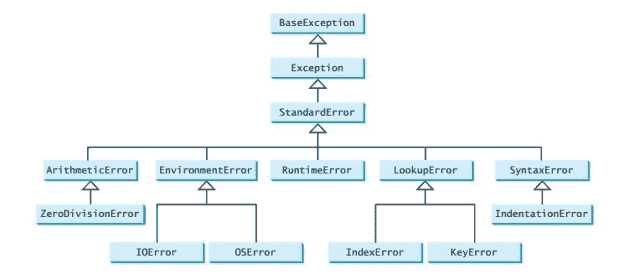

如你在上图所示，大多数 Python 类都是从`BaseException`类扩展的。你可以从`BaseException`类或其一个子类派生你自己的异常类。

在 Python 中，创建一个文件并命名为`NegativeAgeException.py`。向其中添加以下代码：

```python
class NegativeAgeException(RuntimeError):
    def __init__(self, age):
        super().__init__()
        self.age = age
```

这段代码的作用是创建另一个异常类并将其命名为`NegativeAgeException`。它只有一个构造函数，该函数会调用父类的构造函数。它使用`super().__init__()`来来实现，并设置`age`。

### 使用自定义异常类

以下是使用你的自定义异常类的方法：

```python
def enterage(age):
    if age < 0:
        raise NegativeAgeException("你只能输入正整数")
    if age % 2 == 0:
        print("年龄是偶数")
    else:
        print("年龄是奇数")

try:
    num = int(input("输入你的年龄: "))
    enterage(num)
except NegativeAgeException:
    print("你只能输入正整数")
except:
    print("出了一些问题。")
```

在倒数第二节中，我们将查看 Python 模块。

|  ||  ||  |

| --- | --- | --- |


## 模块


Python 语言中的模块是标准文件，能够存储类、变量、常量、函数等更多内容。我们使用它们来帮助保持相关代码更有条理、更易读。例如，`math`模块包含了所有与数学相关的函数。

### 创建模块

这非常简单。首先，创建一个新文件并保存为`mymodule.py`。然后向其中添加以下代码：

```python
foo = 150

def hello():
    print("我来自 mymodule.py")
```

我们在这里做是在模块内部定义了一个名为`foo`的全局变量和一个名为`hello()`的函数。如果我们想在程序中使用这个模块怎么办？正如我之前向你展示的，你必须做的的第一件事是导入模块，我们使用`import`语句来实现：

```python
import mymodule
```

现在可以使用模块中定义的函数和变量了，方法如下：

```python
import mymodule
print(mymodule.foo)
print(mymodule.hello())
```

尝试一下，你应该会在屏幕上看到以下内容：

```
150

我来自 mymodule.py。
```

不要忘记；要访问模块中的任何函数或变量，必须确保先指定模块名称；如果不这样做，将得到错误。

### 在 Import 中使用 From 语句

当你使用`import`语句时，模块内部的所有内容都会被导入。但如果你只需要特定的变量或函数呢？那就是我们使用`from`语句的地方，例如：

```python
from mymodule import foo # 语句仅从 mymodule 导入名为 foo 的变量
print(foo)
```

输出应该是

```
150
```

注意：

当你使用`from`语句时，不需要指定模块名称即可访问函数和变量。

### 使用 dir() 方法

这是内置方法之一，用于查找对象的属性——可用的常量、函数、类和变量。你已经知道 Python 中的一切事物都是对象，因此我们使用以下语法来查找模块的属性：

```python
dir(module_name)
```

`dir()`方法将返回一个包含所有属性列表的字符串：

```
>>> dir(mymodule)
['__builtins__', '__cached__', '__doc__', '__file__', '__loader__', '__name__', '__package__', '__spec__', 'foo', 'hello']
```

从这里你可以看到，除了`foo`和`hello`，还有其他属性出现在`mymodule`中。恭喜！你已经接近结尾了。在结束之前，我将为你提供一些技巧，帮助你理清优先顺序。

```
['__add__', ..., 'upper', 'zfill']  # 截断以方便阅读
```

`dir()`方法将返回所有可以应用于指定元素的方法。例如：

```python
>>> my_string.upper()
>>> 'THIS IS A STRING.'
```

在这里，我们调用了一个名为`upper()`的方法，并且可以清楚地看到它是如何运作的——所有的字符串字母都被转换成了**大写**字母。

学习如何确定元素的类型：

```python
>>> type(my_string)
>>> str
```

学习如何使用内置的`help`系统获取文档：

```python
>>> help(str)
```

学习如何导入不同的库并了解它们：

```python
>>> from datetime import datetime
>>> dir(datetime)
```

```
['__add__', ..., 'weekday', 'year']  # 截断以方便阅读
```

```python
>>> datetime.now()
datetime.datetime(2018, 3, 14, 23, 44, 50, 851904)
```

学习如何运行 shell 命令以及它们的作用：

```python
>>> import os
>>> os.system('ls')
python_hw1.py python_hw2.py README.txt
```

### 1. 充分休息

这非常重要；不要试图一次性学习太多东西。你的大脑在任何时刻只能吸收有限的信息，你需要能够抽离开并吸收你所学的内容。最好的技巧之一是“番茄工作法”——工作 25 分钟，然后休息。如此反复。

在调试程序时，休息尤为有用，因为这可以帮助你发现问题所在。退后一步；去散散步，做点其他事情，然后当你回来时，你很可能会发现自己能看到错误了。即使漏掉一个简单的逗号或引号也可能导致你的程序出现错误，而一双新鲜眼睛可以带来大不相同。

### 2. 系统化地调试

Bug 是编写代码时不可避免的一部分，特别是复杂的代码——即使是经验最丰富的程序员也会遇到这种情况。唯独你不应该做的一件事就是让 Bug 影响你的情绪。

你必须有一种调试代码的方法，最好的方法是按照 Python 执行的相同顺序来一遍——这样你就可以确保每个部分都能正常工作。当你认为你已经发现了问题所在时，将此写入程序脚本中：

```python
import pdb; pdb.set_trace()
```

运行代码启动调试器，你将进入交互模式。你也可以直接从命令行运行它，使用此命令：

```bash
python -m pdb <my_file.py>
```

### 3. 与其他学习者聚在一起

关于编码的一个常见误解是它是一项你独自完成的工作，但事实恰恰相反。当你与他人合作工作时，编码的效果会好得多；当你学习时，与其他 Python 学习者聚在一起非常重要。这样，你们就可以分享知识、技巧并对问题进行头脑风暴。

如果你不知道其他正在学习的人，不要担心；在互联网和你的当地地区搜索聚会、活动等。如果还是不行，有很多非常活跃的 Python 论坛——这是其次优的选择。

### 4. 教会 Python

学习最好的方法之一就是教学，Python 也是如此。有几种方法可以做到这一点——与其他学习者聚在一起并使用白板讨论概念，撰写关于概念的文章或博客文章；你可以设置视频并录制自己解释所学的内容，甚至在学习时对自己自言自语。这些任何一种方法都能突出你知识中的空白并帮助巩固你的学习。

### 5. 结对编程

结对编程是指两个开发者共同工作，一个人担任“驾驶员”（编写代码），另一位担任“导航员”（审查代码并提出建议）。他们会定期交换角色。这种方法不仅可以提高代码质量，还能促进知识共享和技能提升。

在这份使用`Python`进行机器学习的指南中，我将为你概述所有最重要的主题。

*   第一章 – 机器学习概述，你将在这里学习它究竟是什么以及它的核心内容

*   第二章 – 我们将深入不同类型的回归

*   第三章 – 我们将研究分类算法

*   第四章 – 无监督学习概述，包括一些算法

*   第五章 – 一个供你尝试的机器学习项目

*   第六章 – 使用`Python`进行数据科学的入门，为什么你想要学习`Python`以及成为数据科学家的五个步骤

*   第七章 – 关于机器学习你都应该知道的十件事列表

我将不会做的是教你`Python`编程语言。你确实需要了解基础知识，但你可以在我的书中找到这些内容，书名为《Python 计算机编程 - Python 对象面向编程简单步步阶介绍：初学者上手指南》。

### 为什么选择 Python？

`Python`是初学者练手的最佳编程语言，特别是在机器学习和数据科学领域。它是一门容易上手的语言，并且提供了你所需的所有库和框架，能够显著缩短获得结果的时间。

你准备好用`Python`学习机器学习了吗？

那么，让我们开始吧。

|  || ||  |

| --- | --- | --- |


# 第一章：机器学习概述


在我们深入机器学习模型之前，我们应该后退一步，学习机器学习到底是什么，以及不是什么。它通常被认为是人工智能的一个子领域，但这种说法有点误导性。诚然，机器学习源于人工智能研究，但从数据科学的角度来说，将机器学习视为一种构建充满数据的模型的方法更好。

简单来说，机器学习都是关于数学模型的，这些模型建立是为了帮助我们理解数据。机器学习的“学习”部分体现在我们为模型提供适应观测数据的参数时。首先，向模型展示一组特定的数据，从这些数据中，它们可以学习对以前未见过的数据进行识别、分类和预测。这是一种简单的解释方法，当你读到本章末尾时，你会有更深入的。基本上，机器的学习方式与人类大脑的学习方式相似。

了解它的本质是一回事；而将其放在特定的视角下来看是另一回事，正确使用机器学习模型的关键点之一是理解它们可以处理的问题类型。所以，让我们从几个分类开始来解释这些内容。

## 机器学习分类

在最基础的，我们可以将机器学习分为两大类：监督学习和无监督学习。

监督学习围绕已测量的数据特征及其与相关标签之间的关系展开。当一个监督学习模型构建并训练完成后，它就可以被用来标记它以前没见过的新数据。我们可以将监督学习进一步分为回归和分类任务。你稍将更深入地学习这些内容，但现在，分类标签是离散的类别，而在回归中，标签是连续的数值。你很快就会看到这些示例。

无监督学习处理的是无标签的数据，包括降维和聚类等任务。降维算法寻找后续的数据表示，而聚类算法则识别不同的数据组。同样地，你很快就会看到这些示例。

还有半监督模型，正如你所猜的那样，它们介于两者之间。当数据标签不完整时，往往会使用这些模型。

## 机器学习应用示例

让我们通过观察一些任务示例来让这些概念更加具体。这些示例旨在让你对我们将要研究的不同类型任务有一个基本的概述；稍后，我们将进行深入探讨。

所有图片均归属于[`jakevdp.github.io/`](https://jakevdp.github.io/)

### 分类：预测离散标签

首先是一个分类任务。在这里，你有一些标记点，我们想用它们对无标记点进行分类。假设我们拥有的数据如下：

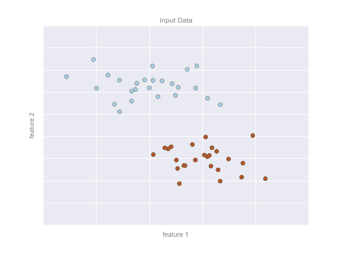

数据是二维的，这意味着每个点有两个特征。这些点的`x, y`位置代表平面上的特征。每个点还具有两个可能的类别标签之一，通过点的颜色来指示。我们想使用这些标签和特征来构建一个模型，以预测新点应该被赋予“蓝色”还是“红色”标签。


像这样的分类任务可以使用几种不同的模型来完成，但我们将使用一个简单的模型。我们假设可以在平面上在这些组之间画一条简单的直线将它们隔开；通过这样，直线两边的点就属于同一组。参数是指示线条位置及其取向的数字。模型将通过一个被称为“训练”的过程从数据中学习参数的最优值。

在下一张图片中，你可以看到训练后的模型像什么样：

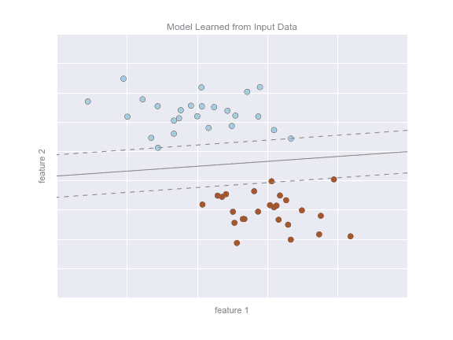

一旦模型训练完成，我们就可以将其推广到没有标签的新数据上。简单来说，我们在新数据上绘制模型，并根据该模型分配标签。这被称为“预测”。

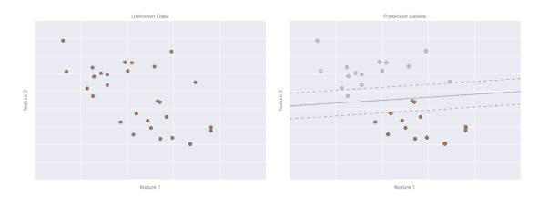

这让你对分类任务如何运作有了初步了解，分类表明数据的类别标签是离散的。初看看起来很简单；你会很容易查看数据并对其分类，但机器学习提供了一个简单的益处——我们可以将其推广到巨大的数据集。

作为一个例子，考虑一个检测垃圾邮件的机器学习任务。我们可能有这些标签和特征：

* `特征 1`、`特征 2`等 – 识别垃圾邮件重要的词汇和短语的归一化计数，例如`尼利亚王子`、`万达`等。
* `标签` – 垃圾邮件或非垃圾邮件

在训练集中，我们可以通过逐一检查邮件来确定标签，对于剩下的邮件，模型将决定应用哪个标签。如果分类算法通过良好构建和定义的特征经过充分训练，这可以是一种有效的方法。

### 回归：预测连续标签

相比之下，回归任务使用连续数值作为标签。看看下一张图片，它显示了一组点，每个点都有一个连续标签。

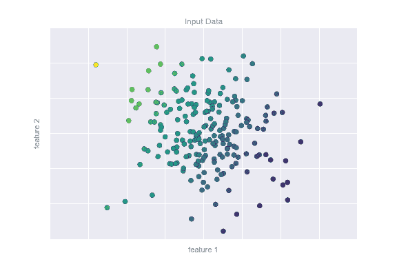

正如你在分类中所看到的，数据是二维的，每个数据点有两个特征。颜色指示点的连续标签。我们可以为此选择任意数量的回归模型，我们将使用线性回归对点进行预测。模型假设，如果将标签视为第三个空间维度，则可以拟合数据。

这可以可视化为：

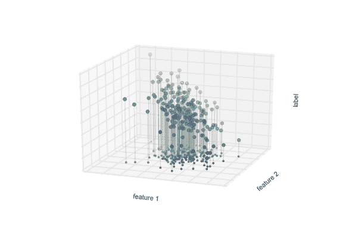

`特征 1-特征 2`的平面与之前的图表相同，但这次，标签是使用三维轴位置和颜色来表示的。通过拟合数据来对任何输入参数预测标签似乎是不合理的。然而，使用二维数据，我们将得到以下结果：

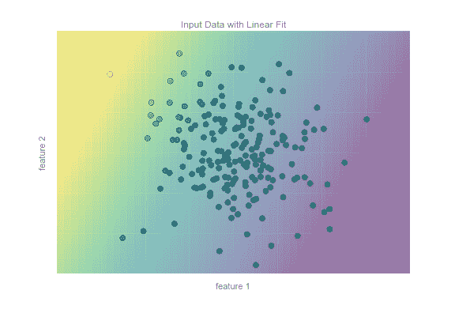

该平面提供了预测新数据点标签所需的切切。从视觉上来看，结果将如下：

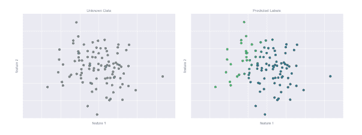

再次，当维度较低时，这看起来可能是微不足道的，但这些方法是非常强大的，因为我们可以以简单直接的方式应用它们，并在具有多个特征的数据上对它们进行评估。

我们可以将其比作一种任务：当我们通过望远镜观察星系时，计算它们有多远，并可以使用以下标签和特征：

* `Feature 1-feature 2` – 每个星系在给定颜色或波长下的亮度
* `Label` – 星系的红移或距离

我们可以使用一个更昂贵的独立观测集来确定几个星系的距离，然后使用回归模型估计剩余的距离。这样做，我们就不需要对整个数据集使用原始的昂贵观测了。

## 聚类：推断未标记数据上的标签

我们刚刚看了两个监督学习的例子：回归和分类。我们尝试尝试构建模型来预测新的、未见数据的标签，但无监督学习要求我们构建没有已知标签可供学习的模型，并且实际上是在进行盲预测。

聚类是最常用的方法，它自动为数据分配特定数量的离散组。下一个图片显示了二维数据：

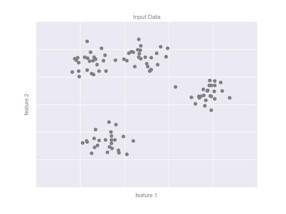

仅仅通过观察，你就能看到不同的点群，并使用该输入，聚类模型将利用数据结构来找出相关点。下一图显示了使用`k-means`算法的结果：

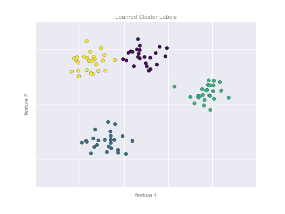

`k-means`算法用于拟合具有`k`个聚类中心的模型。假设最优中心是那些使每个点到其被分配中心距离最小的中心。再次，对于二维数据，这可能看起来是微不足道的，但随着我们获得更大、更复杂的数据，聚类算法对于从数据中提取信息变得非常有用。

## 降维：推断未标记数据的结构

我们的最后一个例子是另一个称为降维的无监督算法。该算法从数据集结构中推断信息（例如标签）。与其他示例相比，它有些抽象，但它对于提取低维数据表示非常有用，这些表示在某种程度上保持了整个数据集的特性。

看下面的示例：

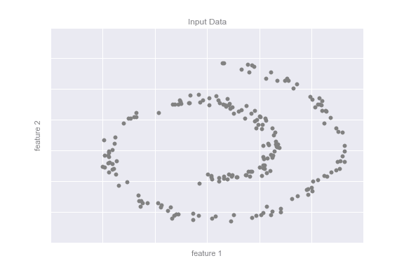

你可以看到数据具有某种结构；在二维空间中画了一条螺旋形中的一维线。在某种意义上，我们可以说我们有一维数据，尽管它处于高维空间。在这种情况下，正确的模型将对这种嵌入的结构（是非线性的）具有敏感性，并能够轻松提取出这种表示。

你可以看到下面名为`Isomap`的流形学习算法的结果：

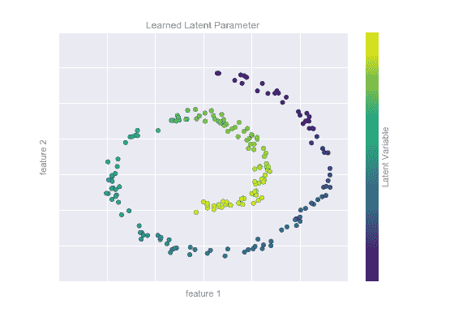

颜色代表了提取的一维潜变量；沿螺旋的变化是均匀的，这表明算法检测到了我们在上面看到的结构。与其他示例一样，维度越高，算法越强大。例如，我们可能希望将具有 100 个或 1000 个特征的数据集中的重要关系可视化。当我们处理高维（注：原文此处漏掉了“high”词）数据时，这会变得具有挑战性，使用降维是减少数据维度几级并使其更容易管理的方法之一。

关于机器学习的简短讨论到此结束，并带有几个例子使其更清晰，现在是时候深入探讨了。我们将从回归开始。

|  |  |  |  |
| --- | --- | --- | --- |


# 第二章：回归机器学习模型


我们在第一章中简要地看了了回归，但它究竟是什么？回归是一种检查变量并寻找它们之间关系的技术。例如，你可以查看一家大公司的部分员工，看看是否可以算出他们的工资如何依赖于某些特征，例如教育程度、经验、工作地点、职位等。

这是一个回归问题；与每个员工相关的单个数据单元是一个观测值，并且假设独立特征是教育、经验、职位和工作地点（城市），而工资是依赖特征。

类似地，你可以尝试确定房价在数学上如何依赖于它们所在的位置、有多少间卧室、离市中心有多近等。

通常，当我们进行回归分析时，我们是在关注一个特定的感兴趣点以及多个观测值。每个观测值至少有两个特征，如果我们假设其中一个或多个特征依赖于另一个，我们就可以尝试找到它们之间的关系。

简单来说，我们需要一个函数能够充分地将某些变量或特征映射到其他变量上。

依赖特征也称为输出、依赖变量或响应，而独立特征被称为输入、独立变量或预测因子。

通常，一个回归问题包含一个无界且连续的独立变量。依赖变量可以是离散的、连续的或类别的，例如国籍、性别等。

习惯上，输出用`y`表示，输入用`x`表示。

现在，如何获取最佳拟合线，即`a+b`的值呢？

我们可以使用一种名为**最小二乘法**（或`LSM`）的技术来实现，这是拟合回归线常用的方法。LSM 通过“最小化从单个数据点到直线的垂直偏差平方和”来计算数据的拟合线。在将偏差相加时，会先对其进行平方，从而避免了负值和正值之间的相互抵消。

### 逻辑回归

我们使用逻辑回归来寻找`event=Failure`和`event=Success`的概率，即分类问题。从理论上讲，当因变量为二值（即`0`或`1`、`Yes`或`No`、`True`或`False`）时，应该使用逻辑回归。

在逻辑回归中，`Y`值于`0`到`1`之间，下面的方程代表了它：

`odds= p/ (1-p) = 事件发生的概率 / 事件不发生的概率`

`ln(odds) = ln(p/(1-p))`

`logit(p) = ln(p/(1-p)) = b0+b1X1+b2X2+b3X3....+bkXk`

在这个方程中，`p`代表“感兴趣特征出现的概率”。你应该问自己的是，为什么要用 logit？

因变量是二项分布的，它们要求使用的连接函数必须适用于该分布；在这种情况下，就是`logit`函数。上述方程中的参数确保了观测样本值的似然概率最大化，而不是像标准回归那样最小化误差平方和。

逻辑回归中需要注意的是，它并不像线性回归那样要求因变量和自变量之间存在线性关系。由于对预测的优势几率比应用了非线性对数变换，逻辑回归具有处理多种关系类型的能力。

为了确保模型既不欠拟合也不过拟合，应该包含所有最重要的变量。然而，需要更大的样本量，因为极大似然估计在低样本量下的效力不如`OLS`（即普通最小二乘法）。

自变量之间也不不应该存在任何相关性（多重共线性）。

### 多项式回归

如果自变量的幂大于 1，则回归方程被分类为多项式。以下方程是多项式方程的代表——`y=a+b*x²`。

在多项式回归中，直线被视为最佳拟合线；相反，曲线才是最佳拟合，能够适应单个数据点。

人们总是想尝试拟合高阶多项式来降低误差，但结果几乎总是过拟合。应该始终对关系进行绘图以便观察拟合情况，并且你应该专注于确保曲线符合问题。

### 逐步回归

当我们有多个自变量时，通常使用逐步回归。通过逐步回归，使用自动过程来选择自变量；完全不需要人工干预。这是通过观察某些统计值实现的，如`t-stats`、`R-square`和用于识别显著变量的`AIC`指标。

逐步回归根据设定的标准逐个添加或删除协变量来拟合模型。以下是最常用的逐步回归方法：

* 标准法 – 这种逐步回归方法在每一步根据需要添加和移除预测因子。
* 正向选择法 – 从最显著的模型预测因子开始，每一步添加变量。
* 后向消除法 – 从所有模型预测开始，在每一步中移除最不显著的一个。

逐步回归的想法是使用尽可能少的变量来最大化预测能力；它通常用于高维数据。

### 岭回归

该技术用于存在多重共线性或自变量之间存在高相关性的情况。在多重共线性的情况下，尽管`OLS`（普通最小二乘法）是偏的，但它具有很大的方差，导致观测值偏离真实值很多。通过在估计中引入偏差，岭回归可以减少标准误差。

回到线性回归方程`y=a+b*x`，它也包含一个误差项。整个方程将是：

`y=a+b*x+e (误差项)， [误差项是修正观测值与预测值之间预测误差所需的值]`

`=> y=a+y= a+ b1x1+ b2x2+....+e`，对于多个自变量。

对于线性方程，我们可以将预测误差分解为子组件——第一个用于偏差，第二个用于方差。预测误差可能由于这两者之一或两者引起，我们将关注由方差引起的部分。

在岭回归中，收缩参数`λ` (lambda) 解决了多重共线性问题。看这个方程：

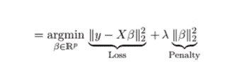

这里有两个组件。第一个是最小二乘项，第二个是`β2`的`lambda`或 beta 平方和（其中系数由`β`表示）。第二个被加到第一个上，作为收缩参数以降低方差的方法。

关于岭回归有几点需要记住：首先，岭回归和最小二乘项的假设是相同的，但我们不能假设正态性。其次，当你使用岭回归时，系数值会被收缩，但它们永远不会变为零，这意味着它没有特征选择的功能。最后，作为正则化方法之一，岭回归使用了`l2 正则化`。

### Lasso 回归

与之前的回归技术类似，Lasso（代表最小绝对收缩和选择算子）惩罚回归系数的绝对大小。它还可以减少变异性并使线性回归更准确。看以下方程：

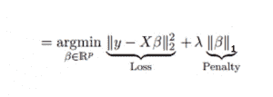

Lasso 和岭回归的不同之处在于，惩罚函数中使用的是绝对值而不是平方。这样做的结果是对估计值的绝对值之和进行约束，或者说对值进行惩罚。这将使得某些参数估计变为零。应用的惩罚越大，估计值越向绝对零收缩，结果是从提供的`n`个变量中进行变量选择。

需要记住的重要点是：首先，与岭回归类似，其假设与平方回归匹配，但不能假设正态性。其次，当你使用 lasso 回归时，系数会被精确收缩到零，为特征选择提供帮助。

作为另一种正则化方法，它使用`l1 正则化`，并且当预测组之间存在高相关性时，只选择一个并将其余收缩为零。

### ElasticNet 回归

我们最后的技术是岭回归和 lasso 回归的混合体。通过`l1`和`l2`进行训练以正则化。当存在许多相关特征时，这是一种非常有用的技术。lasso 随机选择一个，而 ElasticNet 选择两个。

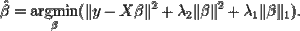

岭回归和 lasso 回归权衡的优势之一是，ElasticNet 将从岭技术中继承旋转稳定性。

## L1 和 L2 正则化

过拟合是指分析结果与数据集非常匹配，可能导致在拟合更多数据或可靠预测观测方面出现问题。正则化是一种有助于改进训练并防止过拟合的技术。两种最常用的正则化技术是`l1`和`l2`。

### L1

Lasso 回归技术使用了`l1`正则化。为了了解它的工作原理，我们将定义一个具有单个独立变量的线性回归模型`Y`。

`W`代表权重 Weight，而`b`代表偏置 bias。

`W=w1,w2...wnX=x1,x2...xn`

预测的结果是：

`Y^`

`Y^=w1x1+w2x2+...wnxn+b`

下面的公式将计算在不使用正则化函数时产生的误差：

`Loss=Error(Y,Y^)`

而这一个使用了`l1`函数：

`Loss=Error(Y−Y^)+λ∑1n|wi|`

#### Note

如果`lambda`值为 0，上述损失函数将变为`OLS`（普通最小二乘法）；值过大会将权重（系数）收缩为零，导致欠拟合。

你需要注意的一点是，当`w!=0`时，`|w|`是可微的：

`d|w|dw={1−1w>0w<0`

为了帮助你理解这一点，我们可以使用梯度下降优化器来寻找新的权重：

`wnew=w−η∂L1∂w`

当将`l1`应用于此时，它将变为：

`wnew=w−η.(Error(Y,Y^)+λd|w|dw)={w−η.(Error(Y,Y^)+λ)w−η.(Error(Y,Y^)−λ)w>0w<0`

根据此公式：

当`w`为正时，`λ > 0`的正则化参数会推挤`w`，使其不那么正。它是通过从`w`中减去`λ`实现的。

当`w`为负时，`λ < 0`的正则化参数会推挤`w`，使其不那么负。它是通过向`w`加上`λ`实现的，这将使`w`更接近 0。

#### 简单的 Python 实现

```python
def update_weights_with_l1_regularization(features, targets, weights, lr,lambda):
    '''
    Features:(200, 3)
    Targets: (200, 1)
    Weights:(3, 1)
    '''
    predictions = predict(features, weights)
    #提取我们的特征
    x1 = features[:,0]
    x2 = features[:,1]
    x3 = features[:,2]
    # 使用矩阵交叉乘积 (*) 同时
    # 计算每个权重的导数
    d_w1 = -x1*(targets - predictions)
    d_w2 = -x2*(targets - predictions)
    d_w3 = -x3*(targets - predictions)
    # 将平均导数乘以学习率
    # 并从权重中减去（梯度指向最上升的方向）
    weights[0] = (weights[0] - lr * np.mean(d_w1) - lambda) if weights[0] > 0 else (weights[0] - lr * np.mean(d_w1) + lambda)
    weights[1] = (weights[1] - lr * np.mean(d_w2) - lambda) if weights[1] > 0 else (weights[1] - lr * np.mean(d_w2) + lambda)
    weights[2] = (weights[2] - lr * np.mean(d_w3) - lambda) if weights[2] > 0 else (weights[2] - lr * np.mean(d_w3) + lambda)
    return weights
```

当存在多个特征时，通常选择`L1`正则化及其变体，因为它提供的解是稀疏的。因为特征的权重为零可以被忽略，这在计算上具有优势。

### L2

当存在多个特征时，通常选择`L2`正则化，因为它提供的解是稀疏的。`L2`回归通过系数范数进行惩罚来定义一个具有多个独立变量的线性回归模型`Y`，`W`代表权重，`b`代表偏置。为了了解它的工作原理，`w1,w2...xn`预测的结果是`Y^`

`Y^=w1x1+w2x2+...wnxn+b`

下面的公式将在不使用正则化函数的情况下计算误差：

`Loss=Error(Y,Y^)`

而这一个使用了`l1`函数：

`Loss=Error(Y−Y^)+λ∑1n|wi|`

#### Note

如果`lambda`值为 0，上述损失函数将变为`OLS`（普通最小二乘法）；值过大会将权重（系数）收缩为零，导致欠拟合。

你需要注意的一点是，当`w!=0`时，`|w|`是可微的：

`d|w|dw={1−1w>0w<0`

为了帮助你理解这一点，我们可以使用梯度下降优化器来寻找新的权重：

`wnew=w−η∂L1∂w`

当将`l1`应用于此时，它将变为：

`wnew=w−η.(Error(Y,Y^)+λd|w|dw)={w−η.(Error(Y,Y^)+λ)w−η.(Error(Y,Y^)−λ)w>0w<0`

根据此公式：

当`w`为正时，`λ > 0`的正则化参数会推挤`w`，使其不那么正。它是通过从`w`中减去`λ`实现的。

当`w`为负时，`λ < 0`的正则化参数会推挤`w`，使其不那么负。它是通过向`w`加上`λ`实现的，这将使`w`更接近 0。

#### 简单的 Python 实现


Lasso 回归技术使用了 `l1` 正则化。为了了解它的工作原理，我们将定义一个具有单个独立变量的线性回归模型 `Y`。

`W` 代表权重 Weight，而 `b` 代表偏置 bias。

`W=w1,w2...wnX=x1,x2...xn`

预测的结果是：

`Y^`

`Y^=w1x1+w2x2+...wnxn+b`

下面的公式将计算在不使用正则化函数时产生的误差：

`Loss=Error(Y,Y^)`

而这一个使用了 `l1` 函数：

`Loss=Error(Y−Y^)+λ∑1n|wi|`

### Note

如果 `lambda` 值为 0，上述损失函数将变为 `OLS`（普通最小二乘法）；值过大会将权重（系数）收缩为零，导致欠拟合。

你需要注意的一点是，当 `w!=0` 时，`|w|` 是可微的：

`d|w|dw={1−1w>0w<0`

为了帮助你理解这一点，我们可以使用梯度下降优化器来寻找新的权重：

`wnew=w−η∂L1∂w`

当将 `l1` 应用于此时，它将变为：

`wnew=w−η.(Error(Y,Y^)+λd|w|dw)={w−η.(Error(Y,Y^)+λ)w−η.(Error(Y,Y^)−λ)w>0w<0`

根据此公式：

当 `w` 为正时，`λ > 0` 的正则化参数会推挤 `w`，使其不那么正。它是通过从 `w` 中减去 `λ` 实现的。

当 `w` 为负时，`λ < 0` 的正则化参数会推挤 `w`，使其不那么负。它是通过向 `w` 加上 `λ` 实现的，这将使 `w` 更接近 0。

### 简单的 Python 实现

```python
def update_weights_with_l1_regularization(features, targets, weights, lr,lambda):
    '''
    Features:(200, 3)
    Targets: (200, 1)
    Weights:(3, 1)
    '''
    predictions = predict(features, weights)
    #提取我们的特征
    x1 = features[:,0]
    x2 = features[:,1]
    x3 = features[:,2]
    # 使用矩阵交叉乘积 (*) 同时
    # 计算每个权重的导数
    d_w1 = -x1*(targets - predictions)
    d_w2 = -x2*(targets - predictions)
    d_w3 = -x3*(targets - predictions)
    # 将平均导数乘以学习率
    # 并从权重中减去（梯度指向最上升的方向）
    weights[0] = (weights[0] - lr * np.mean(d_w1) - lambda) if weights[0] > 0 else (weights[0] - lr * np.mean(d_w1) + lambda)
    weights[1] = (weights[1] - lr * np.mean(d_w2) - lambda) if weights[1] > 0 else (weights[1] - lr * np.mean(d_w2) + lambda)
    weights[2] = (weights[2] - lr * np.mean(d_w3) - lambda) if weights[2] > 0 else (weights[2] - lr * np.mean(d_w3) + lambda)
    return weights
```

`L1` 正则化及其变体通常在存在多个特征时被选择，因为它提供的解是稀疏的。因为特征权重为零可以被忽略，这在计算上具有优势。

### L2

`L2` 正则化用于存在多共线性的情况；它通过系数范数进行惩罚来保留每个变量。`L2` 回归通过定义一个具有多个独立变量的线性回归模型 `Y`，`W` 代表权重，`b` 代表偏置。为了了解它的工作原理，`w1,w2...xn` 预测的结果是：


```python
def update_weights_with_l1_regularization(features, targets, weights, lr,lambda):
    '''
    Features:(200, 3)
    Targets: (200, 1)
    Weights:(3, 1)
    '''
    predictions = predict(features, weights)
    #提取我们的特征
    x1 = features[:,0]
    x2 = features[:,1]
    x3 = features[:,2]
    # 使用矩阵交叉乘积 (*) 同时
    # 计算每个权重的导数
    d_w1 = -x1*(targets - predictions)
    d_w2 = -x2*(targets - predictions)
    d_w3 = -x3*(targets - predictions)
    # 将平均导数乘以学习率
    # 并从权重中减去（梯度指向最上升的方向）
    weights[0] = (weights[0] - lr * np.mean(d_w1) - lambda) if weights[0] > 0 else (weights[0] - lr * np.mean(d_w1) + lambda)
    weights[1] = (weights[1] - lr * np.mean(d_w2) - lambda) if weights[1] > 0 else (weights[1] - lr * np.mean(d_w2) + lambda)
    weights[2] = (weights[2] - lr * np.mean(d_w3) - lambda) if weights[2] > 0 else (weights[2] - lr * np.mean(d_w3) + lambda)
    return weights
```

`L1`正则化及其变体通常在存在多个特征时被选择，因为它提供的解是稀疏的。因为特征权重为零可以被忽略，这在计算上具有优势。

### L2

`L2`正则化用于存在多共线性的情况；它通过系数范数进行惩罚来保留每个变量。`L2`回归通过定义一个具有多个独立变量的线性回归模型`Y`，`W`代表权重，`b`代表偏置。为了了解它的工作原理，`w1,w2...xn`预测的结果是：

Lasso 回归技术使用了`l1`正则化。为了了解它的工作原理，我们将定义一个具有单个独立变量的线性回归模型`Y`。

`W`代表权重 Weight，而`b`代表偏置 bias。

`W=w1,w2...wnX=x1,x2...xn`

预测的结果是：

`Y^`

`Y^=w1x1+w2x2+...wnxn+b`

下面的公式将计算在不使用正则化函数时产生的误差：

`Loss=Error(Y,Y^)`

而这一个使用了`l1`函数：

`Loss=Error(Y−Y^)+λ∑1n|wi|`

### Note

如果`lambda`值为 0，上述损失函数将变为`OLS`（普通最小二乘法）；值过大会将权重（系数）收缩为零，导致欠拟合。

你需要注意的一点是，当`w!=0`时，`|w|`是可微的：

`d|w|dw={1−1w>0w<0`

为了帮助你理解这一点，我们可以使用梯度下降优化器来寻找新的权重：

`wnew=w−η∂L1∂w`

当将`l1`应用于此时，它将变为：

`wnew=w−η.(Error(Y,Y^)+λd|w|dw)={w−η.(Error(Y,Y^)+λ)w−η.(Error(Y,Y^)−λ)w>0w<0`

根据此公式：

当`w`为正时，`λ > 0`的正则化参数会推挤`w`，使其不那么正。它是通过从`w`中减去`λ`实现的。

当`w`为负时，`λ < 0`的正则化参数会推挤`w`，使其不那么负。它是通过向`w`加上`λ`实现的，这将使`w`更接近 0。

### 简单的 Python 实现

```python
def update_weights_with_l1_regularization(features, targets, weights, lr,lambda):
    '''
    Features:(200, 3)
    Targets: (200, 1)
    Weights:(3, 1)
    '''
    predictions = predict(features, weights)
    #提取我们的特征
    x1 = features[:,0]
    x2 = features[:,1]
    x3 = features[:,2]
    # 使用矩阵交叉乘积 (*) 同时
    # 计算每个权重的导数
    d_w1 = -x1*(targets - predictions)
    d_w2 = -x2*(targets - predictions)
    d_w3 = -x3*(targets - predictions)
    # 将平均导数乘以学习率
    # 并从权重中减去（梯度指向最上升的方向）
    weights[0] = (weights[0] - lr * np.mean(d_w1) - lambda) if weights[0] > 0 else (weights[0] - lr * np.mean(d_w1) + lambda)
    weights[1] = (weights[1] - lr * np.mean(d_w2) - lambda) if weights[1] > 0 else (weights[1] - lr * np.mean(d_w2) + lambda)
    weights[2] = (weights[2] - lr * np.mean(d_w3) - lambda) if weights[2] > 0 else (weights[2] - lr * np.mean(d_w3) + lambda)
    return weights
```

`L1`正则化及其变体通常在存在多个特征时被选择，因为它提供的解是稀疏的。因为特征权重为零可以被忽略，这在计算上具有优势。

### L2

`L2`正则化用于存在多共线性的情况；它通过系数范数进行惩罚来保留每个变量。`L2`回归通过定义一个具有多个独立变量的线性回归模型`Y`，`W`代表权重，`b`代表偏置。为了了解它的工作原理，`w1,w2...xn`预测的结果是：

Lasso 回归技术使用了`l1`正则化。为了了解它的工作原理，我们将定义一个具有单个独立变量的线性回归模型`Y`。

`W`代表权重 Weight，而`b`代表偏置 bias。

`W=w1,w2...wnX=x1,x2...xn`

预测的结果是：

`Y^`

`Y^=w1x1+w2x2+...wnxn+b`

下面的公式将计算在不使用正则化函数时产生的误差：

`Loss=Error(Y,Y^)`

而这一个使用了`l1`函数：

`Loss=Error(Y−Y^)+λ∑1n|wi|`

### Note

如果`lambda`值为 0，上述损失函数将变为`OLS`（普通最小二乘法）；值过大会将权重（系数）收缩为零，导致欠拟合。

你需要注意的一点是，当`w!=0`时，`|w|`是可微的：

`d|w|dw={1−1w>0w<0`

为了帮助你理解这一点，我们可以使用梯度下降优化器来寻找新的权重：

`wnew=w−η∂L1∂w`

当将`l1`应用于此时，它将变为：

`wnew=w−η.(Error(Y,Y^)+λd|w|dw)={w−η.(Error(Y,Y^)+λ)w−η.(Error(Y,Y^)−λ)w>0w<0`

根据此公式：

当`w`为正时，`λ > 0`的正则化参数会推挤`w`，使其不那么正。它是通过从`w`中减去`λ`实现的。

当`w`为负时，`λ < 0`的正则化参数会推挤`w`，使其不那么负。它是通过向`w`加上`λ`实现的，这将使`w`更接近 0。

### 简单的 Python 实现

# Python 的不同分类算法

有几种主要的分类算法，你使用的哪种完全取决于要解决的问题。

### 逻辑回归 (Logistic Regression)

逻辑回归是主要的分类算法之一。该算法使用`logistic function`对描述可能结果的概率进行建模。它专门为分类设计，是帮助理解多个独立变量如何影响结果变量的最佳模型之一。

然而，它适用于二分类预测变量；它假设每个预测变量之间是相互独立的，并且数据没有缺失值。

### 朴素贝叶斯 (Naïve Bayes)

朴素贝叶斯基于`Bayes' Theorem`，它的假设是特征对对之间存在独立性。这些分类器非常适用于现实世界的问题，例如电子邮件垃圾过滤和文档分类。为了估计出正确的参数，需要少量的训练，但朴素贝叶斯分类器比其他复杂的分类方法要快得多。

然而，缺点是，它不是一个良好的估计器。

### 随机梯度下降 (Stochastic Gradient Descent)

这是拟合线性模型较简单的方法之一，更不用说极其高效了。当你有大量样本时，这是一个非常有用的算法，并且它支持多种分类惩罚和损失函数。

它非常容易实现，但需要几个超参数，并且对特征缩放具有高敏感性。

## K 近邻算法 (K-Nearest Neighbors)

这是最懒惰的学习方法之一，因为模型并不尝试构建内部模型；它只是存储训练数据实例。分类通过计算每个点的`k-nearest neighbors`的多数投票来完成。

这是一种易于实现的算法，能够处理带有大量噪声的训练数据，而且如果你有大型训练数据集，它是非常有效的。然而，必须先确定`k`值，而且在计算方面，这是一种开销很大的算法——必须计算每个实例到所有训练样本的距离。

### 决策树 (Decision Tree)

决策树获取属性数据和相应的类别，产生用于分类数据的规则序列。这是一种容易理解的算法，而且更容易可视化。数据不需要太多的准备，它可以处理类别数据和数值数据。

然而，某些树非常复杂，泛化能力并不好。决策树还对数据变化做出反应；一个微小的变化就可能生成一个完全不同的树。

### 随机森林 (Random Forest)

这被称为“元估计器”。随机森林分类器用于在不同的数据集子样本上拟合不同的决策树。它通过平均值提高了模型的预测准确性，并控制了过拟合。子样本的大小始终与输入样本的大小相同。

随机森林分类器的优势是它可以减少过拟合，而且通常情况下，它们比标准决策树准确得多。然而，缺点是实现并不简单。

### 支持向量机 (Support Vector Machine)

该算法将训练数据表示为空间中的点，所有类别都通过宽间隙清晰分开。新的数据示例也被映射到空间中，根据它们落在间隙的哪一侧预测类别。

虽然`SVM`对于高维空间非常有效，并且决策函数中使用训练点子集来确保内存效率，但你无法直接获得概率估计；而是使用五折交叉验证，但这成本很大。

### 准确率 (Accuracy)

| 分类算法 | 准确率 | F1 分数 |
| --- | --- | --- |
| 逻辑回归 | 84.60% | 0.6337 |
| 朴素贝叶斯 | 80.11% | 0.6005 |
| 随机梯度下降 | 82.20% | 0.5780 |
| K 近邻算法 | 83.56% | 0.5924 |
| 决策树 | 84.23% | 0.6308 |
| 随机森林 | 84.33% | 0.6275 |
| 支持向量机 | 84.09% | 0.6145 |

在下一章中，我们将查看无监督学习算法。

# 第四：无监督机器学习算法

在机器学习方面，无监督学习是指模型不需要任何监督的学习。这意味着机器学习模型独立工作，通常使用无标签数据，从中发现信息。通过无监督学习算法，你可以转向更复杂的任务，这些任务比你通过监督学习可以处理的任务要更复杂。然而，与其他方法相比，这是一种更不可预测的学习方式。

让我给你举一个无监督学习的例子。

假设我们有一个小女孩和一个家宠物，一只可爱的狗。她认识这只狗；她能识别出它。几周后，她妈妈的朋友来了，带着她自己的狗。

现在，虽然小女孩从未见过这只狗，但她确实认识几个特征。她看到它两只眼睛四条腿，就像家里的狗一样。所以，她可以将这种新动物识别为狗。

这就是无监督学习，在这里，你不是被教某些东西，而是从数据中学习它。在监督学习的情况下，小女孩会被告诉新动物是一只狗。

## 为什么选择无监督学习？

这些是你使用无监督学习的主要原因：

* 无监督学习用于发现数据中你无法察觉的模式
* 无监督学习有助于发现用于分类的有用特征
* 无监督学习是实时的；所有输入数据分析都是通过学习器完成的
* 无标签数据更容易从计算机中获取，因为标签数据需要人工干预

## 无监督机器学习的不同类型

无监督学习通常分为两类——关联和聚类问题。

### 聚类 (Clustering)

聚类在无监督学习中非常重要，因为它主要寻找未分类数据中的模式或结构。这些算法处理数据，寻找组或类（如果存在的话）。可以修改算法应该寻找簇的数量。

有几种聚类算法：

* 排他式（划分式）：数据的分组方式是每个数据只能属于一个组；它不能属于两个或多个组。这种算法的例子是`k-means`算法。
* 聚合式：这种类型算法中的每个数据都是簇。通过两个相邻簇之间的迭代合并减少簇的数量。这种算法的例子是`层次聚类`。
* 重叠式：这种技术使用模糊集对数据进行聚类。每个数据点可以属于多个簇，但每个点都有自己的成员程度。然后数据与正确的成员值关联。这种算法的例子是`Fuzzy C-Means`算法。
* 概率式：概率技术使用概率分布创建簇。例如，“男士帽子”、“女士帽子”、“男士围巾”和“女士围巾”等关键词将将被聚类为两个独立的类别，要么“男性”和“女性”，要么“帽子”和“围巾”。

### 聚类的类型

有几种不同的聚类类型，我们在这里简要讨论其中的六种。

层次聚类 (Hierarchical Clustering)

该算法构建一个聚类层次。这始于已分配到其所属类的数据；两个距离较的类将处于同一个类中，当只剩一个类时，算法结束。

## K-Means 聚类 (K-Means Clustering)

这是一种迭代算法，在每次迭代中寻找最大值。开始时，选择所需的聚类数量。数据点必须被分分为`k`组——`k`越大，分组越小且粒度越高；`k`越小，分组越大且粒度越低。

算法输出一组标签，将数据点分配到每个`k`组。这`k`组由每组中的质心定义；这些质心被视为每个类的核心，捕捉最近的点并将其添加到类中。`K-Means`聚类可以进一步分为两个子类——树状图和凝聚聚类。

### 凝聚聚类 (Agglomerative Clustering)

`k-means`聚类子类从一组数量的类开始。所有数据都分配给该数量。该技术不需要将`k`类的数量作为输入，当每个数据都形成一个类时，凝聚过程开始。凝聚聚类中使用距离测量量，每次迭代使用一种测量量，通过合并过程来减少类的数量。最后，会形成一个包含所有对象或数据的大型类。

### 树状图聚类 (Dendrogram Clustering)

在这种技术中，每一个层级都代表一个潜在的类。树状图的高度表示两个合并类之间的相似性程度；它们越靠近过程底部，类之间的相似性就越高。树状图往往是一种不自然且主观的技术，并不经常被使用。

## K 近邻算法 (K-Nearest Neighbors)

这是迄为止最简单的分类器。它与其他方法的不同之处在于它不会产生模型。这是一种简单的算法，它存储已有的案例，然后使用相似性测量量对新实例进行分类。当示例之间存在距离时效果最好，而且在大型训练集上，它的学习速度较慢。

## 主成分分析 (PCA)

`PCA`通常用于高维空间。必须为空间选择一个基，并选出前 200 个重要的得分。该基就是主成分，你选择的子集是一个新的较小空间（比原始空间小）。该技术将尽可能保留数据的复杂度。

## 关联 (Association)

这种技术让你发现大型数据库中对象之间的关联，基本上来说是变量之间的关系。例如，如果一个人买了房子，他们很有可能会购买新家具。

## 监督式机器学习 vs. 无监督机器学习

| 参数 | 监督式机器学习技术 | 无监督机器学习技术 |
| --- | --- | --- |
| 输入数据 | 使用`Labeled data`（标记数据）训练算法 | 使用`Unlabeled data`（未标记数据）训练算法 |
| 计算复杂度 | 方法简单 | 计算复杂 |
| 准确性 | 一个你可以信任的准确方法 | 不那么准确也不容易信任 |

## 无监督机器学习的应用

无监督机器学习的一些常见应用：

* 聚类 – 根据相似性将数据集自动分成不同的组
* 异常检测 – 它可以发现异常数据点，通常用于检测银行欺诈交易
* 关联规则挖掘 – 在数据集中识别出经常一起出现的项目集
* 隐变量模型 – 这些模型通常用于

## 使用无监督学习的缺点

* 结果可能难以解释
* 结果可能不准确
* 计算开销可能很高
* 结果可能难以验证
* 很难找到合适的算法

## 第五章：你的第一个机器学习


开始学习真的只有一种方法。Python 是最流行的语言之一，而且它非常强大。与其直接把你推入深水区并期望你创建一个，最好的办法是投身其中。我为你提供了一个可以跟做的项目。当然，你可以买书或报名课程，但它们很少能给你除骨架之外的东西东西。

* 它让你安装 Python 并启动它
* 它让你通过一个项目来上手
* 它让你看到这一切是如何结合的，你甚至可能能够
* 它应该带给你创建自己的模型所需的信心

Python 还有许多内置库和模块，为你提供了丰富的实现方法。

## Python 机器学习的 Hello World

当你学习用 Python 编写代码时，通常从 `Hello World` 程序开始。这是一个非常简单的程序，能带你入门。同样，在机器学习中，我们通常使用鸢尾花数据集（iris dataset）对鸢尾花进行分类。

这是最简单的项目之一，因为它容易理解，原因如下：

1. 它具有数值属性，这意味着你需要研究如何加载数据并对其进行处理
2. 它让你通过一个较简单的监督式机器学习算法——分类来上手
3. 它是一个多分类问题，意味着它有多个类别；这意味着它可能需要以特殊的方式进行处理
4. 它只有四个属性且只有 150 行；这使得它足够小可以容易处理，并且可以放入内存中，显示在一张 A4 纸上，甚至一个屏幕上。
5. 数值属性的量纲和单位都相同，因此不需要进行任何特殊的缩放或转换。

让我们开始吧。

## 分步教程

我们现在要做的的是一步一步地完成一个机器学习项目。以下是你将学到的内容：

1. 如何安装 Python 和 SciPy
2. 如何加载数据集
3. 如何对数据集进行总结
4. 如何可视化数据集
5. 如何评估几种算法
6. 如何进行一些预测

重要的一点是你要留出时间。仔细完成每一个步骤，在理解如何操作以及它们都意味着什么之前，不要移动到下一步。

你可以复制并粘贴命令和代码，但在可能的情况下，请尝试自己手动输入——这有助于你更深入地理解 Python 语言。

### 第一步 – 下载、安装并启动 Python SciPy

第一步是在你的电脑上安装 Python，然后是安装 SciPy —— 我在之前的书中介绍过如何操作，而且在其他地方也有非常详尽的介绍，所以我不想在这上面浪费时间。你的机器上应该已经有了 Python。安装 SciPy 也很简单。

### 安装 SciPy 库

我假设你的电脑上已经安装了 Python 2.7 或 3.6+，因此你需要查看完成此本教程所需的五个库：

* SciPy
* NumPy
* Matplotlib
* Pandas
* sklearn

有很多方法可以安装这些库；选择一种并坚持使用它来安装你需要的每个库。如果你访问 SciPy 的安装页面，它会告诉你如何在不同平台上安装这些库。

例如，Mac 用户可以使用 macports 安装 Python 3.6 以上以及所有这些库。Linux 用户可以使用你发行版中附带的包管理器，即，如果你使用 Fedora，你的包管理器就叫做 `yum`。如果你是 Windows 用户并且对安装这些库没有把握，你最好的选择是安装一个名为 `Anaconda` 的 Python 发行版，因为它包含了你所需的所有内容。

请确保你已经安装了 0.2 或以上版本的 Scikit-learn。

#### 启动 Python 并检查版本

下一步是确保你安装了正确的 Python 环境，并且它运行正常。你在这一步中将看到的脚本将测试你的环境，它将导入所需的库并告诉你你拥有的每个库的版本。

打开命令行并输入以下命令来启动解释器：

```bash
python
```

最好在解释器中工作或使用命令行编写并运行你的脚本，而不是在 IDE 和编辑器中折腾。这样可以保持一切整洁整齐，让你将注意力集中在机器学习上，而不是你需要什么工具上。

输入以下内容：

```python
# Check library versions
### Python version
import sys
print('Python: {}'.format(sys.version))

### scipy
import scipy
print('scipy: {}'.format(scipy.__version__))

### numpy
import numpy
print('numpy: {}'.format(numpy.__version__))

# matplotlib
import matplotlib
print('matplotlib: {}'.format(matplotlib.__version__))

### pandas
import pandas
print('pandas: {}'.format(pandas.__version__))

### scikit-learn
import sklearn
print('sklearn: {}'.format(sklearn.__version__))
```

你应该得到类似下面的输出（此输出来自 Mac）：

```text
Python: 3.6.9 (default, June 20, 2020 05:21:45)
[GCC 4.2.1 Compatible Apple LLVM 9.1.0 (clang-902.0.39.2)]
scipy: 1.3.1
numpy: 1.17.3
matplotlib: 3.1.1
pandas: 0.25
sklearn: 0.21
```

```
4.9 3.1 1.5 0.1 Iris-setosa
5.4 3.7 1.5 0.2 Iris-setosa
4.8 3.4 1.6 0.2 Iris-setosa
4.8 3.0 1.4 0.1 Iris-setosa
4.3 3.0 1.1 0.1 Iris-setosa
5.8 4.0 1.2 0.2 Iris-setosa
5.7 4.4 1.5 0.4 Iris-setosa
5.4 3.9 1.3 0.4 Iris-setosa
5.1 3.5 1.4 0.3 Iris-setosa
5.7 3.8 1.7 0.3 Iris-setosa
5.1 3.8 1.5 0.3 Iris-setosa
```

## 属性的统计摘要

接下来我们可以查看一个统计摘要，包括平均值、计数、最小值、最大值以及几个百分位数。再次，使用此命令：

`descriptions`

```python
print(dataset.describe())
```

从结果可以看出，数值都是以厘米为单位的，并且都在相似的范围内——0 到 8 厘米。

```
sepal-length sepal-width petal-length petal-width
count 150.000000 150.000000 150.000000 150.000000
mean 5.843333 3.054000 3.758667 1.198667
std 0.828066 0.433594 1.764420 0.763161
min 4.300000 2.000000 1.000000 0.100000
25% 5.100000 2.800000 1.600000 0.300000
50% 5.800000 3.000000 4.350000 1.300000
75% 6.400000 3.300000 5.100000 1.800000
max 7.900000 4.400000 6.900000 2.500000
```

## 类别分布

现在我们想看看每个类别应该有多少行或实例，可以使用以下命令将其作为绝对计数来查看：

`class distribution`

```python
print(dataset.groupby('class').size())
```

每个类别共享相同数量的实例——33% 或 50 个实例。

```
class
Iris-setosa 50
Iris-versicolor 50
Iris-virginica 50
```

### 完整示例

为了方便你阅读和使用，我们可以将所有这些内容整合在一个简单的脚本中：

`summarize the data`

```python
from pandas import read_csv

### Load dataset
url = "https://raw.githubusercontent.com/jbrownlee/Datasets/master/iris.csv"
names = ['sepal-length', 'sepal-width', 'petal-length', 'petal-width', 'class']
dataset = read_csv(url, names=names)

### shape
print(dataset.shape)

### head
print(dataset.head(20))

# descriptions
print(dataset.describe())

### class distribution
print(dataset.groupby('class').size())
```

### 第四步 - 数据可视化

现在，我们对数据有了一些了解；下一步是将其可视化。我们将查看两种不同的图表：

1. 单变量图 – 为了更好地理解属性。
2. 多变量图 – 为了更好地理解属性之间存在的关系。

### 单变量图

单变量图将单独绘制每个变量。因为变量（输入）是数值，所以我们可以为每个变量使用箱线图。这是操作方法：

`box and whisker plots`

```python
dataset.plot(kind='box', subplots=True, layout=(2,2), sharex=False, sharey=False)
pyplot.show()
```

这将清晰地向你展示输入属性是如何分布的：

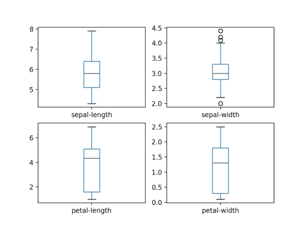

鸢尾花数据集每个输入变量的箱线图 (www.machinelearningmastery.com)

查看分布的另一种方法是使用直方图：

`histograms`

```python
dataset.hist()
pyplot.show()
```

从结果来看，几个变量具有所谓的的高斯分布（正态分布）。这是一个非常有用的信息，因为有一些算法可以利用这种特性：

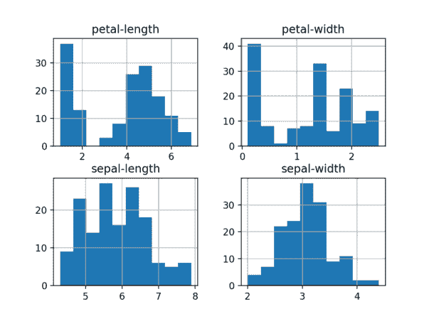

鸢尾花数据集每个输入变量的直方图 (www.machinelearningmastery.com)

### 多变量图

接下来，我们需要查看存在哪些交互。首先，我们将创建散点矩阵，这有助于发现变量之间的关系：

`scatter matrix`

```python
scatter_matrix(dataset)
pyplot.show()
```


输入变量的散点矩阵 (www.machinelearningmastery.com)

## 第五步 – 评估某些算法

下一步是创建一些用于评估模型的数据。我们将涵盖：

1. 如何分离数据进行验证
2. 如何设置一个使用 10 折交叉验证的测试框架
3. 如何选择最佳模型

### 创建验证集

了解我们的模型是否运行良好至关重要。为了做到这一点，我们需要留出数据集的一部分，不让算法看到这些部分，然后将其用作未见过的数据。这意味着我们需要两个子集——80% 的数据用于训练、评估和选择，剩余的 20% 用于验证模型。以下是执行该操作的命令：

`Split-out validation dataset`

```python
array = dataset.values
X = array[:,0:4]
y = array[:,4]
X_train, X_validation, Y_train, Y_validation = train_test_split(X, y, test_size=0.20, random_state=1)
```

你可能注意到使用了 Python 切片来选择 NumPy 数组列。如果你对 Python 有基础了解（读这本书之前应该是这样的），那么你以前进行过切片操作。

### 创建测试框架

我们想要估计模型的准确率，为了实现这一点，我们将利用分层 10 折交叉验证。这将数据集拆分为十部分。我们将使用其中九部分进行训练，另一部分进行测试；然后对每种可能的训练和测试划分组合重复此操作。

我们还将使用“准确率”（accuracy）指标来评估我们的模型。该指标是预测正确的实例数量除以数据集中的总实例数量，然后乘以一百百，以百分比形式提供准确率，例如 97% 的准确率。在后续运行、构建和评估模型时，将使用评分变量 `accuracy`。

## 构建模型

在此阶段，我们还不知道哪些算法是此任务的最佳选择，或者应该使用哪些特定的配置。通过观察图表，我们可以得到一个合理的想法：在某些维度上，类别是部分线性可分的，因此结果应该会非常理想。

我们将测试六种算法：

* 逻辑回归 (Logistic Regression)
* 线性判别分析 (Linear Discriminant Analysis)
* K 近邻算法 (K-Nearest Neighbors)
* 分类与回归树 (Classification and Regression Trees)
* 高斯朴素贝叶 (Gaussian Naive Bayes)
* 支持向量机 (Support Vector Machines)

这是一个简单线性算法与非线性算法的良好组合。

以下是我们构建和评估模型的方法：

## 快速检查算法 (Spot Check Algorithms)

```python
models = []

models.append(('LR', LogisticRegression(solver='liblinear', multi_class='ovr')))
models.append(('LDA', LinearDiscriminantAnalysis()))
models.append(('KNN', KNeighborsClassifier()))
models.append(('CART', DecisionTreeClassifier()))
models.append(('NB', GaussianNB()))
models.append(('SVM', SVC(gamma='auto')))
```

### 逐评估每个模型

```python
results = []
names = []

for name, model in models:
    kfold = StratifiedKFold(n_splits=10, random_state=1, shuffle=True)
    cv_results = cross_val_score(model, X_train, Y_train, cv=kfold, scoring='accuracy')
    results.append(cv_results)
    names.append(name)
    print('%s: %f (%f)' % (name, cv_results.mean(), cv_results.std()))
```

## 选择最佳模型

现在，我们已经有了模型，并且对每个模型都有一个准确率估计。下一步是比较所有模型，并选择最准确的一个。如果我们运行上面的示例，将得到类似如下的结果：

```
LR: 0.960897 (0.052113)
LDA: 0.973974 (0.040110)
KNN: 0.957191 (0.043263)
CART: 0.957191 (0.043263)
NB: 0.948858 (0.056322)
SVM: 0.983974 (0.032083)
```

从这里看到，`SVM`（支持向量机）显示出最高的（估计）准确率，98% 或 0.98。

可以创建一个图表来显示每个模型的评估结果，并展示每个模型的分布和平均准确率。每个算法都有一个准确率总体，因为我们使用 10 折交叉验证对每个模型进行了十次评估。

比较各个算法结果样本的最佳方法之一是使用箱线图（box and whisker plot）来查看个体分布；然后对比这些分布：

### 比较算法

```python
pyplot.boxplot(results, labels=names)
pyplot.title('Algorithm Comparison')
pyplot.show()
```

很容易看出图表在范围顶部被挤压，许多评估结果达到了 100% 的准确率。有些结果也维持在 80 多的高位。


### 完整示例

再次，为了参考，这里是整合后的完整代码：


```python
from pandas import read_csv
from matplotlib import pyplot
from sklearn.model_selection import train_test_split
from sklearn.model_selection import cross_val_score
from sklearn.model_selection import StratifiedKFold
from sklearn.linear_model import LogisticRegression
from sklearn.tree import DecisionTreeClassifier
from sklearn.neighbors import KNeighborsClassifier
from sklearn.discriminant_analysis import LinearDiscriminantAnalysis
from sklearn.naive_bayes import GaussianNB
from sklearn.svm import SVC

### 加载数据集
url = "https://raw.githubusercontent.com/jbrownlee/Datasets/master/iris.csv"
names = ['sepal-length', 'sepal-width', 'petal-length', 'petal-width', 'class']
dataset = read_csv(url, names=names)

# 划分验证数据集
array = dataset.values
X = array[:,0]
y = array[:,4]
X_train, X_validation, Y_train, Y_validation = train_test_split(X, y, test_size=0.20, random_state=1, shuffle=True)

### 快速检查算法
models = []
models.append(('LR', LogisticRegression(solver='liblinear', multi_class='ovr')))
models.append(('LDA', LinearDiscriminantAnalysis()))
models.append(('KNN', KNeighborsClassifier()))
models.append(('CART', DecisionTreeClassifier()))
models.append(('NB', GaussianNB()))
models.append(('SVM', SVC(gamma='auto')))

### 逐评估每个模型
results = []
names = []
for name, model in models:
    kfold = StratifiedKFold(n_splits=10, random_state=1, shuffle=True)
    cv_results = cross_val_score(model, X_train, Y_train, cv=kfold, scoring='accuracy')
    results.append(cv_results)
    names.append(name)
    print('%s: %f (%f)' % (name, cv_results.mean(), cv_results.std()))

### 比较算法
pyplot.boxplot(results, labels=names)
pyplot.title('Algorithm Comparison')
pyplot.show()
```

```python
X = array[:,0:4]

y = array[:,4]

X_train, X_validation, Y_train, Y_validation = train_test_split(X, y, test_size=0.20, random_state=1)

### 在验证集上进行预测

model = SVC(gamma='auto')

model.fit(X_train, Y_train)

predictions = model.predict(X_validation)

### 评估预测

print(accuracy_score(Y_validation, predictions))

print(confusion_matrix(Y_validation, predictions))

print(classification_report(Y_validation, predictions))
```

请一步步完成这个教程，并且在没有完全掌握某个步骤及其包含的所有内容之前，不要继续进行。你不需要从一开始就理解所有内容，并不是一开始就能做到。你的目标是获得一个结果，如果你正确地运行这个教程，你就能得到。在学习过程中，记录下你可能有的任何问题。请使用 Python 内置的 `help("FunctionName")` 语法来理解所使用的函数。

你现在甚至不需要知道那些算法是如何工作的。你需要理解的是它们的局限性以及你应该如何配置它们；学习这些将是以后的事情。慢慢而稳地积累关于算法的知识，从熟悉平台开始。

虽然我要求你熟悉 Python 编程，但你不需要成为一名程序员。一旦你掌握了 Python 语言的语法就会非常直观，而且像任何其他计算机语言一样，起初你应该重点关注赋值（`a = "b"`）或函数调用（例如 `function()`；这会让你受益匪浅）。你可以通过实践学习该语言的其他部分。

你也不需要成为机器学习的专家。事实上，这并不是这本书的主题。我在这里所做的只是为你提供一个机器学习的介绍，但这是一门极其复杂的学科，需要对其进行公正的对待。再次，你可以在以后学习更多关于算法的知识；只需完成这个项目并理解它的核心内容即可。

因为这是你的第一个机器学习项目，我们没有涵盖你所做的所有事情；我们需要将注意力放在主要步骤上——加载数据、查看数据、评估一些算法以及进行预测。其他步骤是更为复杂的，包括准备数据和改进你的结果。

在下一章中，我将为你简要介绍使用 Python 进行数据科学。

|  |  |  |  |
| --- | --- | --- | --- |


# 第六章：数据科学简介


在过去的几十年里，世界经历了大数据的爆炸，这导致了对更高效存储的需求——这对所有企业来说都是巨大的挑战。如何充分利用这些数据的在于创建能够存储海量数据的框架，导致了 Hadoop 以及其他类似框架的建立以提供帮助。

解决存储问题后，企业将转向处理这些存储数据的方法，这就是数据科学登场的地方——一种处理和分析数据的方法。如今，数据科学已内置于所有处理海量数据的企业，数据科学家被聘用来将这些数据转化为有意义的内容。

那么，什么是数据科学？使用 Python 有什么好处？

## 什么是数据科学？

让我们从理解什么是数据科学开始。简单来说，它是关于现实世界中发现并探索数据，然后利用我们学到的知识来解决问题。企业使用数据科学的例子包括：

* 客户预测——基于当前和过去的客户行为，可以训练一个系统来预测他们购买某些物品的概率。
* 服务规划——餐厅可以预测周末访问店里的顾客人数，并确保他们有足够的食物来应对客流量。

在我们深入研究 Python 数据科学之前，让我们再多谈谈为什么你应该使用 Python。

## 为什么使用 Python？

数据科学需要一种计算机编程语言来工作，尽管你可以选择使用 SAS 或 R，但 Python 远胜于它们并具备更好的处理能力。作为一种编程语言，Python 的人气日益提高，现在不仅用于数据科学，还用于人工智能、物联网（IoT）以及许多其他技术领域，这进一步提升了它的流行程度。

我们使用 Python 进行数据科学主要是是因为它包含了从统计和数学角度来看一些最好且最昂贵的工具。其他原因包括：

* 速度——Python 比其他类似的计算机编程语言快得多。
* 可用性——它包含了许多由其他用户开发的不同包，可以很容易地重复使用。
* 设计目标——Python 具有直观且易于理解的语法，起初你应该重点关注赋值（`a = "b"`）或函数调用（例如 `function()`；这会让你受益匪浅）。你可以通过实践学习该语言的其他部分。

你也不需要成为机器学习的专家。事实上，这并不是这本书的主题。我在这里所做的只是为你提供一个机器学习的介绍，但这是一门极其复杂的学科，需要对其进行公正的对待。再次，你可以在以后学习更多关于算法的知识；只需完成这个项目并理解它的核心内容即可。

现在我们来看一些用于数据科学的 Python 库。

## Python 数据分析库

Python 是最易学习的语言之一，你已经可以用它完成许多基础操作，如打印语句。但如果你想用 Python 进行数据科学，你需要使用不同的库。这些库包括：

* Pandas——适用于结构化数据操作。
* NumPy——用于创建多维数组的强大库。
* SciPy——提供了数据分析所需的科学能力，例如傅里叶变换和线性代数。
* Matplotlib——主要用于数据可视化。
* Scikit-learn——用于所有的机器学习活动。

这些是主要的库，但在数据科学和机器学习的旅途中，你可能还会使用这些：

* TensorFlow
* Networks & graph
* OS
* BeautifulSoup

让我们更详细地查看一些主要的库。

### SciPy

它的名字已经暗示了它是 Python 的科学库，并且它包含了一些特殊函数：

* 包含了特殊函数，如积分、梯度优化、常微分方程（ODE）求解器等。
* 它提供了功能完整的线性代数模块
* 它是基于 NumPy 构建的

### NumPy

NumPy 是 Python 主要的数据科学包，包含了：

* 帮助你集成 Fortran、C 和 C++ 代码的工具
* 一些最强大的 N 维数组对象
* 用于随机数、傅里叶变换和线性代数的有用能力

### Pandas

Pandas 是一个用于结构化数据操作的有用库。它是：

* Python 数据分析中最用的库
* 是确保 Python 被应用于数据科学的关键
* 广泛用于数据准备

## 使用 Pandas 进行探索性分析

这种方法用于分析大型数据集，寻找它们的主要特征并进行总结。可视化有助于从数据获取获取价值的见解。

与 Pandas 连用时经常听两个常用术语是：

* Series——一维对象，可以接受任何类型的数据，包括浮点数、整数和字符串。

这是一个例子：

```python
import pandas as pd

x = pd.Series([6, 3, 4, 6])

x

0  6
1  3
2  4
3  6
dtype: int64
```

* `DataFrame` – 一个二维对象，其每一列可以具有不同的数据类型。

例如，以下是一个具有四行三列的 `DataFrame`：

```python
import pandas as pd
import numpy as np

df = pd.DataFrame(np.random.randn(4, 3))

df
```

```
o    1  2

0 -0.568892  0.428537  2.125661

1 0.357808  -1.087910  -0.956698

2 0.06709  -0.232456  -1.006084

3 -1.822809  1.255754  0.441918
```

接下来，我们将如何使用 `Pandas` 来预测特定客户的贷款申请是否可能获得批准。

1. 首先，导入库，然后使用 `read_csv()` 函数读取数据集：

```python
import pandas as pd

import numpy as np

import matplotlib as plt

%matplotlib inline

df = pd.read_csv("../Downloads/loanP_train.csv") # 使用 Pandas 将数据集读取到 dataframe 中
```

2. 接下来，使用 `describe()` 函数查看数据集的摘要：

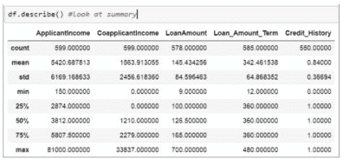

https://www.simplilearn.com/

3. 贷款金额的分布可以通过这种方式可视化：

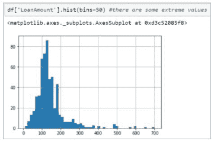

https://www.simplilearn.com/

4. 申请人的收入可以以这种方式可视化：

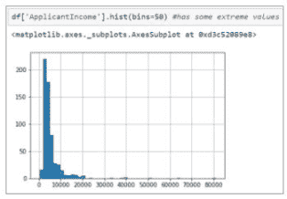

https://www.simplilearn.com/

5. 类别值的分布可以这样可视化：

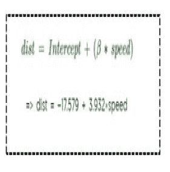

https://www.simplilearn.com/

如你所示，`ApplicantIncome`（申请人收入）和 `LoanAmount`（贷款金额）列包含一些极端值。这些数据需要进行处理，我们通过数据清洗（data wrangling）来处理，以便我们对数据进行归一化和标准化。

让我们看看使用 `Pandas` 进行数据清洗。

## 使用 Pandas 进行数据清洗

数据清洗（Data wrangling）是用于描述清理和统一复杂的、某种杂乱的数据集的术语。这些是数据清洗的主要处：

* 它可以告诉你许多关于你的数据的信息
* 它可以帮助你做出更好的业务决策
* 帮助收集对业务有意义的精确数据

在现实世界中，业务产生几乎所有数据都是杂乱的，并且会有缺失值。以贷款数据集为例，某些列缺少了一些值。

要检查你的数据中是否存在缺失值：

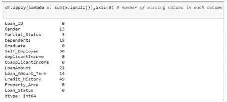

https://www.simplilearn.com/

我们可以通过几种不同的方式填充缺失值，业务场景将决定你使用哪些参数来填充它们。

例如，你可以使用指定列的平均值来替换值：

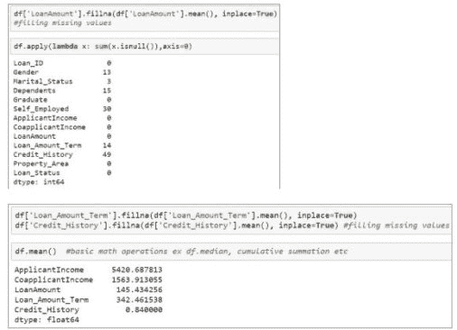

https://www.simplilearn.com/

或者你可以使用 `dtypes` 来查看每列的数据类型：

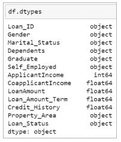

https://www.simplilearn.com/

你甚至可以合并数据框并通过 `merge` 和 `concatenation` 方法将它们合并。

是时候构建模型了，为了此，我们将使用 `Scikit-learn`。

## 构建模型

注意，在本节中混合了编写的代码和图像（感谢来自 [`www.simplilearn.com/`](https://www.simplilearn.com/)）。请同等对待它们；如果你正在按照此操作并在 Python 中输入命令，只需输入你在图像上看到的内容。

1. 首先，我们需要从 `scikit-learn` 导入几个模型：

```python
# 从 scikit-learn 模块导入模型：

from sklearn.linear_model import LogisticRegression

from sklearn.model_selection import KFold

from sklearn.ensemble import RandomForest

from sklearn.tree import DecisionTreeClassifier

from sklearn import metrics
```

2. 接下来，需要从此处提取因变量和自变量：

```python
from sklearn.linear_model import LogisticRegression

from sklearn.model_selection import KFold

from sklearn.ensemble import RandomForest

from sklearn.tree import DecisionTreeClassifier

from sklearn import metrics

### 提取自变量

X = df.iloc[:, :-1]

### 提取因变量

y = df.iloc[:, -1]
```

3. 现在将数据集划分为训练集和测试集：

```python
from sklearn.linear_model import LogisticRegression

from sklearn.model_selection import KFold

from sklearn.ensemble import RandomForest

from sklearn.tree import DecisionTreeClassifier

from sklearn import metrics

### 将数据集划分为训练和测试集

X_train, X_test, y_train, y_test = train_test_split(X, y, test_size=0.25, random_state=0)
```

4. 我们使用特征缩放对数据进行标准化：

```python
from sklearn.linear_model import LogisticRegression

from sklearn.model_selection import KFold

from sklearn.ensemble import RandomForest

from sklearn.tree import DecisionTreeClassifier

from sklearn import metrics

# 使用缩放标准化数据

sc = StandardScaler()
```


```
X_train = sc.fit_transform(X_train)
X_test = sc.transform(X_test)
```

5. 然后我们对数据拟合模型：

```python
from sklearn.linear_model import LogisticRegression
from sklearn.model_selection import KFold
from sklearn.ensemble import RandomForest
from sklearn.tree import DecisionTreeClassifier
from sklearn import metrics

### 拟合模型
model = LogisticRegression()
model.fit(X_train, y_train)
```

6. 然后预测测试集：

```python
from sklearn.linear_model import LogisticRegression
from sklearn.model_selection import KFold
from sklearn.ensemble import RandomForest
from sklearn.tree import DecisionTreeClassifier
from sklearn import metrics

### 预测测试集
y_pred = model.predict(X_test)
```

7. 构建混淆矩阵来评估模型性能：

```python
from sklearn.linear_model import LogisticRegression
from sklearn.model_selection import KFold
from sklearn.ensemble import RandomForest
from sklearn.tree import DecisionTreeClassifier
from sklearn import metrics

# 构建混淆矩阵评估模型性能
cm = confusion_matrix(y_test, y_pred)
print(cm)
```

8. 模型准确率如何？

```python
from sklearn.linear_model import LogisticRegression
from sklearn.model_selection import KFold
from sklearn.ensemble import RandomForest
from sklearn.tree import DecisionTreeClassifier
from sklearn import metrics

### 模型准确率如何
acc = accuracy_score(y_test, y_pred)
print(acc)
```

9. 预测为“是”的精确率：

```python
from sklearn.linear_model import LogisticRegression
from sklearn.model_selection import KFold
from sklearn.ensemble import RandomForest
from sklearn.tree import DecisionTreeClassifier
from sklearn import metrics

### 预测为“是”的精确率
prec = precision_score(y_test, y_pred)
print(prec)
```

10. 最后，我们查找准确率：

```python
from sklearn.linear_model import LogisticRegression
from sklearn.model_selection import KFold
from sklearn.ensemble import RandomForest
from sklearn.tree import DecisionTreeClassifier
from sklearn import metrics

### 最后，查找准确率
acc = accuracy_score(y_test, y_pred)
print(acc)
```

我们都要从某个地方开始，这就是通往数据科学阶梯的第一步。你不仅能学到`Python`语言的基础知识，还能对数据科学有一个初步介绍。你需要的最重要的工具之一是内置在`Python`库中的`Jupyter Notebook`，它是帮助你学习所有所需内容的理想工具。

## 开启你的学习

加入一个社区。当你这样做时，你就将自己置于其他志同道合的人之中；这不仅能为你提供可能所需的帮助，还能增加你未来就业的机会。美国人力资源管理协会（SHRM）显示，大约 30% 的招聘是通过员工推荐的。

在`Kaggle`上创建一个账户，参加仅限成员的`Dataquest Slack`讨论，并加入你所在地区的本地`Meetup`群组。

### 相关技能

命令行界面（或`CLI`）允许更快速地运行脚本，这意味着你可以更快地测试你的程序，并处理更多的数据。

## 第 2 步：做一些小型 Python 项目

实践学习绝对是学习的最好方法；越早开始，你就越能准备好构建你自己的`Python`项目。先尝试小项目，例如为在线游戏制作一个计算器，或者一个从`Google`获取你所在地区天气数据的程序。当你构建此类小项目时，你学习`Python`的速度会快得多。这类小项目对于大多数编程语言来说都是标准做法，是确保你学习效果的最佳方法之一。

使用`APIs`积累经验并开始进行网络爬虫。这不仅能帮助你学习编程，还能帮助你理解收集数据涉及的环节。

### 开启你的学习

通过阅读博客文章、指南、开源代码等任何内容，你可以亲手实践。吸收新想法，巩固自己的学习成果，并观察他人是如何做的。

### 相关技能

在 SQL 数据库上做一些工作。`SQL`与数据库通信，对其进行修改、编辑和重组数据。它是数据科学中硬性要求的基石之一，超过 40% 的数据科学家经常使用它。

## 第 3 步：学习 Python 数据科学库

并不是所有的编程语言都能为你提供完成某事的“最佳方法”，但`Python`提供了，形式就是数据科学库。其中最好的三个是`Matplotlib`、`NumPy`和`Pandas`。后者两个是探索和玩弄数据的绝佳方式，而`Matplotlib`则帮助你以图表的形式创建数据可视化。

### 开启你的学习

多提问。多提问。`Python`有庞大的开发者和专家社区支持，他们都准备好并愿意回答你的问题并帮助你学习。还有许多其他有用资源，如`Dataquest's Slack`、`Quora`、`Stack Overflow`等，那里充满了准备着帮助你并分享他们辛辛苦苦得的知识的人。

### 相关技能

学习如何使用`Git`进行代码版本控制。它是跟踪代码更改最流行的工具之一；这意味着你可以轻松地纠正错误、进行实验并与志同道合的人进行协作。

## 第 4 步：在学习 Python 的同时，建立数据科学作品集

对于任何想成为数据科学家的人来说，这是绝对必要的。许多数据科学项目包含多个数据集，并应该能带给你许多有趣的见解。你的作品集不需要任何类型的主题，只需选择你感兴趣的数据集，并想出将它们结合的方法。

如果你展示了此类项目，你就在为他人提供了可以协作的内容，并向任何潜在雇主展示了你付出了精力和精力来学习`Python`以及其他编程技能。

此外，你的作品集可以充当简历的角色，并突出你在旅程中学会的所有技能。

### 开启你的学习

与他人交流、协作，并将注意力牢牢地集中在技术能力上。确保你利用时间培养与他人合作所需的所有软技能，重要的是，确保你理解你所使用的工具是如何工作的。

### 相关技能

学习基础统计学并进阶中级。在学习用于数据科学的`Python`时，获得良好的统计学背景是一个好主意。它将赋予你正确的思维，确保你专注于正确的事情，确保你找到真正的解决方案和良好的见解，而不是重复地执行脚本。

## 第 5 步：在数据科学中应用高级技术

最后一步是精炼你的技能。你的整个旅程将充满学习，但一旦你掌握了基础，就可以尝试参加进阶课程，以确保你涵盖了所有内容。

某些事情是你熟悉的——分类、`regression`、`k-means`以及许多其他模型。你还可以学习如何对模型进行自助或如何使用`scikit learn`构建神经网络。

在学习的这个阶段，你可以承担一些项目，例如创建一个使用实时数据馈的模型，或者同样复杂的任务。

## 记住

持续学习。数据科学领域永不停止，它涵盖了数百个行业。需求增长之快，有非常多的学习机会。不要停止阅读，不要停止协作，绝对不要停止与他人交流。这样，你就能保持手感，并跟上不断变化的领域。

|  |  |  |  |
| --- | --- | --- | --- |


# 第七章 关于机器学习你应该知道十件事


机器学习是一个复杂的主题，不是几分钟内就能学会的。

1. 机器学习完全从数据中学习。`AI`或人工智能是如今一个巨大的词汇，如果说有什么是肯定的，那就是机器学习确实不负其盛名。你可以利用机器学习解决无数问题，只要你将正确的训练数据投入正确的机器学习算法中，当然。有些人将机器学习称为`AI`，如果那能让你开心，那就去吧。只需注意`AI`只是一个词汇，尽管是一个巨大的词汇，它可以代表你任何想要的意义。

2. 机器学习完全取决于数据，部分取决于算法。机器学习领域取得的巨大进展确实让兴奋情绪增加了，特别是在算法和深度学习方面。但机器学习最需要记住的关键点是，它完全取决于数据；它是主要的成分，如果没有它，你无法进行任何机器学习。你不需要复杂的或先进算法来学习，但你确实需要高质量的数据。

3. 除非你有海量数据，否则不要使用复杂的模型。如果参数空间过大，你的训练数据将过拟合，你训练的模型将不具备超出范围的泛化能力。

## 4. 机器学习的效果完全取决于训练时所使用的数据

那些具有计算机编程经验的人已经听过“垃圾进，垃圾出”（garbage in, garbage out）这一说法。这句话比机器学习的出现要早得多，但它非常贴切地描述了机器学习面临的主要局限性之一。只有当你的训练数据中存在某些模式时，机器学习模型才能找到这些模式。如果数据是垃圾，不要指望你的模型能如你预期那样运行。在分类和其他监督学习任务中，你的数据必须包含丰富的特征，并且必须具有正确的标签。

## 5. 如果要机器学习发挥作用，你的训练数据需要具有代表性

类比这一点，想一下基金说明书；它会告诉你过去的业绩不能作为未来结果的保证。在机器学习中，一个心照不明的警告是：只有当用于测试模型的数据来自与生成训练模型时相同的分布时，模型才能生效。你必须充分意识到生产数据与训练数据之间的任何偏差，并确保通过定期重新训练来防止模型变得过时。

## 6. 数据转换占据了工作量最大的部分

如果你陷入了关于机器学习新兴和全新技术的炒作中，你完全可能会认为机器学习主要是关于选择算法和调优算法的。现实则有些不同，因为你的大部分时间实际上将花在清洗数据和特征工程上——将原始特征提取并转换为能更好地代表你的数据信号的特征。

## 7. 深度学习可能是最具革命性的进展之一，但它并不是“万灵妙药”

随着时间的推移，深度学习无疑没有虚负并恰如其得了它的赞誉；毕竟，它为机器学习的许多不同应用提供了巨大的优势。而且它正被广泛用于自动处理过去由特征工程完成的工作，特别是在涉及视频和图像数据时。然而，它并不是万灵妙药；你不能仅仅决定就使用它，除非经过严谨的准备，并在清洗和转换数据上投入大量的时间和精力。

## 8. 机器学习系统依赖操作者的输入

这使得它们极易受到操作错误的影响。当机器学习系统出现问题时，极少是因为算法本身存在某种问题。更有可能是人为错误进入了训练数据。它可能导致偏见或其他种导致错误结果的错误。机器学习需要不少量的怀疑态度，并且必须以对待软件工程同样的纪律来对待它。

## 9. 在无意中，机器学习最终可能会创造一种“自我实现的预言”

在许多机器学习应用中，当你今天做出决策时，会对明天的训练数据产生重大影响。一旦偏见被嵌入你的机器学习模型中，该模型将继续生成强化这些偏见的数据，这可能会导致混乱。保持警觉并负责任。

## 10. AI 不会突然崛起并摧毁我们认知的人类

令人惊讶的是，竟然有人从科幻小说和电影中获取所有的人工智能“信息”。是的，这些应该带给我们一些灵感，但我们永远、永远不要将它们误认为是现实。我们有足够的现实危险让我们分散精力，不需要说服自己世界很快将由 AI 机器人统治！

 |  |  |  |
| --- | --- | --- | --- |


## 结论

这本书绝不是全面的指南，但我已经涵盖了机器学习最重要的特征。你现在知道了监督学习和无监督学习之间的区别，了解回归和分类的本质，以及可以使用哪些最佳算法。我希望你也成功完成了第一个机器学习项目，并且它让你洞明了该学科的本质。

这是一个复杂的学科，你应该将本指南作为学习更多知识的跳脚石。有许多关于该主题的在线课程和书籍可以供你进一步增进知识，但不要忘记：学习最好的方法是实践。

机器学习不是那种你可以忘掉它然后希望从上次离开的地方继续开始的东西。新算法正在定期被创建，新的项目和用途也层出不穷。机器学习是未来，学习它将为你赢得良好的助力，并为成功奠定坚实的基础。

### 参考文献

- [https://towardsdatascience.com/]
- [https://machinelearningmastery.com/]
- [https://jakevdp.github.io/]
- [https://realpython.com/]
- [https://www.analyticsvidhya.com/]
- [https://analyticsindiamag.com/]
- [https://financetrain.com/]
- [https://builtin.com/]
- [https://medium.com/]
- [https://www.simplilearn.com/]
- [https://www.dataquest.io/]
