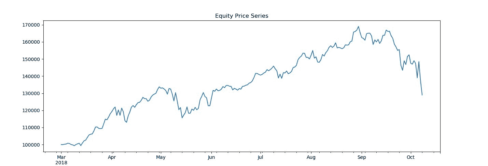
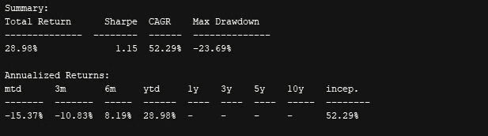
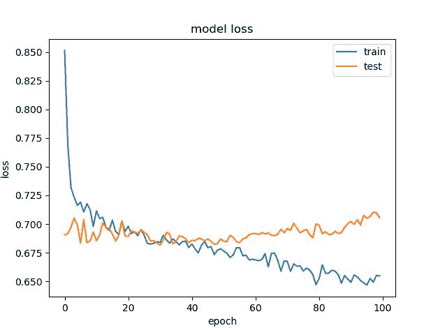
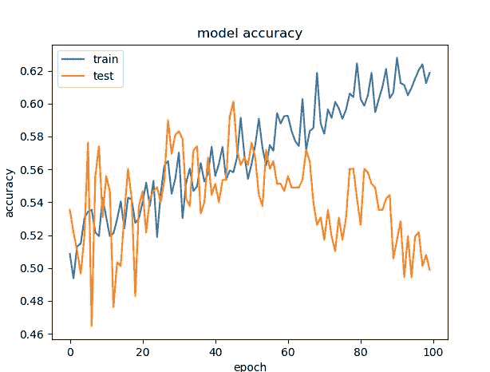
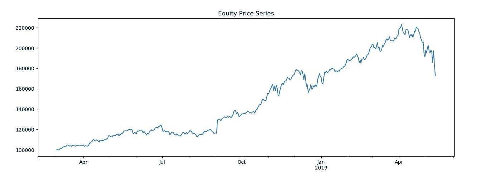
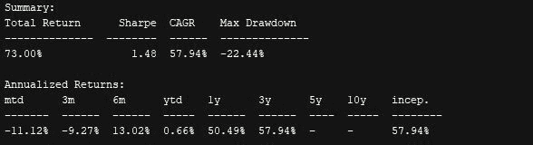
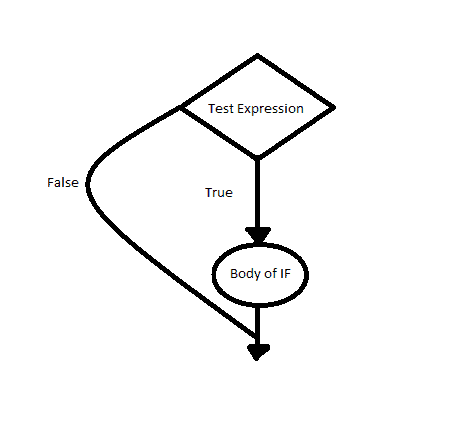
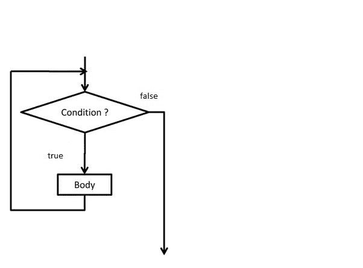
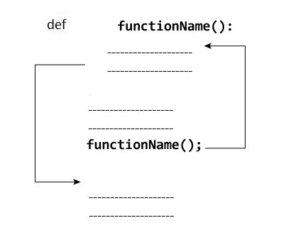

# Python 机器学习：深度解析 Python 机器学习与深度学习，使用 TensorFlow 和 Keras：从初学者到高级

本页特意留白。

## 引言

在过去的几年里，人工智能和机器学习在通用性和全球适用性方面取得了巨大的进步。现在可以通过传统和新的编程语言应用这些算法，这使我们能够更优雅地解释和理解这些方法。虽然机器学习和深度学习算法已成为多个行业衡量性能的共同标准，但本书的重点将是更好地理解如何通过 Python 编程语言将其应用于金融市场。

## 为什么要用机器学习？

当涉及到人工智能及其金融市场的适用性时，许多人提出的问题是：为什么要信任它？回答这个问题从表面上看似乎非常复杂；也就是说，归结底，传统的基金经理真的可以信任一个在没有人干预的情况下自主做出决策的东西吗？尽管有这些疑虑，许多经理现在实际上正在实施一种混合系统，他们正在接受将机器学习应用于他们管理的投资组合的想法。然而，这样做是为了获得某种安全感，即在市场波动加剧时，他们允许进行短暂的人为干预。或者说，在算法似乎出现异常并忽视不断演变的市场动态的时刻。

这种方法虽然利用了人工智能，但可能会受到真正的华尔街量化师的批评，因为它并不是纯粹的量化交易。尽管如此，我们将从一个特定的视角来探讨书中的概念和算法，该视角完全旨在将纯人工智能的基础知识应用于不同类型的金融市场；且没有任何任何形式的人为或混合干预。其底层逻辑是，归根结底，如果我们能够创建出强大的机器学习模型在这一层面上预测市场表现，我们或许可以开始慢慢地从方程式中剔除情感和非理性投资决策的普遍观念。历史证明，这种决策在市场处于高压和动荡时期，对于零售投资者和经验丰富的基金经理来说，投资哲学都是失败的。简而言之，这种非理性的决策已被证明更有可能导致许多平庸的投资选择。总的来说，这导致了糟糕的投资结果。

这正是纯人工智能和机器学习试图解决的问题：通过完全剥离这种情感化的决策，让机器做出最终的、最理性的具有最高盈利概率的决策。现在，让我们开始吧！我们将具体概述几种在金融领域开始被散户交易者和大型对冲基金经理广泛使用的机器学习和深度学习算法。这些算法是逻辑回归和循环神经网络。正如你所注意到的，虽然这些算法背后的基础逻辑在推理上有些相似之处，但导致它们各自决策过程的数学机制可能存在显著差异。对于我们的第一个算法，我们将使用 Python 的模块 `scikit-learn` 进行机器学习预测和交易。有关该库的更多信息可以在此处获得：

`scikit-learn.org/stable/`

## 将逻辑回归应用于美国股票市场进行预测性交易 (AMZN)

在我们的第一个算法示例中，我们将应用一种名为 `logistic regression`（逻辑回归）的方法，通过 Python 帮助我们预测美国股票市场传统股票的价格走势。`Logistic regression` 是一种存在很长时间的数学方法，其背后的基础理解是一种预测分析的形式，其中因变量（`y variable`）是二元元的。总的来说，因变量在本质上应该是二分的，且没有离群值。我们还应该能够表现出没有多共线性，即预测变量（我们的 `x variables`，或我们的特征）之间不应存在高相关性。从数学角度来看，`logistic regression` 估计定义如下的多元回归函数：

![Capture.PNG]

对于 `logistic regression` 以及大多数机器学习算法，需要非常警惕的一点是过拟合（overfitting）概念。背后的想法是，通过向 `logistic regression` 模型中添加独立变量，我们无疑会增加预测变量所解释的总方差。然而，向模型中添加过多的变量会导致 `overfitting`；这会削弱模型在我们用于拟合模型的数据之外的泛化基础。从本质上说，这为我们的模型对目标数据的拟合优劣提供了虚假的解释。如此，让我们通过 Python 将 `logistic regression` 的数学基础应用于美国股票市场。在我们的特定示例中，我们将使用 `logistic regression` 来帮助我们预测亚马逊公司 (`AMZN`) 的价格走势。

既然我们已经将分类函数分配给数据集的收盘收益率，现在就可以开始对逻辑回归机器学习模型进行组织工作了。这意味着我们需要决定使用数据集的百分之几来训练机器学习模型，以及使用多少百分之几来测试模型。这是机器学习中一个非常主观的方面，没有明确的对错之分。许多数据科学家喜欢等分配这些比例，而另一些人则倾向于更大幅的倾斜。对于我们的特定示例，我们将使用 90% 的数据来训练机器学习模型，而在剩余 10% 的数据上对其结果进行前向测试。因此，采用了 90-10 的训练与测试比例。该过程通过以下代码行完成：

```python
## 将上述定义的分类器应用到 'returns_final' 数据框，计算最后一列 (Y) -1 = 下跌(down), 1 = 上涨(up)
df.iloc[:, len(df.columns) - 1] = df.iloc[:, len(df.columns) - 1].apply(computeClassification)  

# 现在我们有了一个具有预测值的完整数据集，最后一列“Return”为 -1 或 1，创建训练和测试数据集。  
## 将 float 转换为 int 以便对数据框进行切片
testData = df[-int((len(df) * 0.10)):]  # 后半部分用于前向测试  
trainData = df[:-int((len(df) * 0.90))]  # 前部分用于训练  

## 将所有的 inf 替换为 nan  
testData_1 = testData.replace([np.inf, -np.inf], np.nan)  
trainData_1 = trainData.replace([np.inf, -np.inf], np.nan)  

## 将所有的 nan 替换为 0  
testData_2 = testData_1.fillna(0)  
trainData_2 = trainData_1.fillna(0)  

## X 是特征列表   
data_X_train = trainData_2.iloc[:, 0:len(trainData_2.columns) - 1]  

## Y 是待预测的 1 或 -1 值（由于我们在上面使用 apply.(computeClassification) 函数向最后一列添加了该值）
data_Y_train = trainData_2.iloc[:, len(trainData_2.columns) - 1]  

## 测试数据集执行相同的操作  
data_X_test = testData_2.iloc[:, 0:len(testData_2.columns) - 1]  
data_Y_test = testData_2.iloc[:, len(testData_2.columns) - 1]
```

现在我们终于准备好将我们的逻辑回归 ML 模型应用到 AMZN 的数据集上。如前所述，我们将使用 Python 的 scikit-learn 库来实现这一点。第一步将从 scikit-learn 导入必要的库：

```python
from sklearn.linear_model import LogisticRegression  

## 定义用于打印训练和测试准确率得分的方法
from sklearn.model_selection import cross_val_score, cross_val_predict
from sklearn.metrics import accuracy_score, classification_report, confusion_matrix
```

上面的导入允许我们设置模型参数，以及测试配置，使我们能够分析模型在 AMZN 价格预测方面的表现。此外，我们还可以创建一个名为 `print_score` 的函数，它允许我们评估模型在价格预测方面的准确率得分。该函数如下：

```python
def print_score(clf, data_X_train, data_y_train, data_X_test, data_y_test, train=True):  
    """
    打印分类器的准确率得分、分类报告和混淆矩阵
    """
    if train:
        """
        训练性能
        """
        print("Train Result:\n")
        print("accuracy score: {0:.4f}\n".format(accuracy_score(data_y_train, clf.predict(data_X_train))))  
        print("Classification Report: {}\n".format(classification_report(data_y_train, clf.predict(data_X_train))))  
        print("Confusion Matrix: {}\n".format(confusion_matrix(data_y_train, clf.predict(data_X_train))))  
        res = cross_val_score(clf, data_X_train, data_y_train, cv=10, scoring='accuracy')  
        print("Average Accuracy: \t{0:.4f}".format(np.mean(res)))  
        print("Accuracy SD: \t{0:.4f}".format(np.std(res)))  
    elif train == False:
        """
        测试性能
        """
        print("Test Result:\n")
        print("accuracy score: {0:.4f}\n".format(accuracy_score(data_y_test, clf.predict(data_X_test))))  
        print("Classification Report: {}\n".format(classification_report(data_y_test, clf.predict(data_X_test))))  
        print("Confusion Matrix: {}\n".format(confusion_matrix(data_y_test, clf.predict(data_X_test))))
```

现在我们准备好将 Python scikit-learn 库中内置的逻辑回归分类器应用到 AMZN 的数据集上。为了做到这一点，我们必须先将分类器分配一个变量名，并拟合训练数据。这通过以下代码行实现：

```python
## 逻辑回归
clf = LogisticRegression()  
clf.fit(data_X_train, data_Y_train)  

## y_predictions 是包含预测值的数组（-1 或 1），基于 data_X_test。
from sklearn.metrics import accuracy_score  
y_predictions = clf.predict(data_X_test)  # 根据 x_test 预测 y
print("Accuracy Score Employing Learning: " + str(accuracy_score(data_Y_test, y_predictions)))
```

并且分析模型在预测 AMZN 收盘价方面的好坏。运行此代码段将显示如下结果：

Accuracy Score Employing Learning: 0.53153153153515

这告诉我们，基本上在采用 90-10 训练与测试比例的情况下，逻辑回归模型能够预测 AMZN 的收盘价，准确率约为 53%。虽然这可能没有达到理想的 50%以上阈值，但我们确实看到这种简单的模型在逻辑回归和数学预测方面的潜力。接下来，我们将算法向前推进，创建一个简单的回测函数，尝试监控并判断我们在特定测试时期（约占数据的 10%）实际交易的表现会如何。这对于 AMZN 来说大约是 222 个交易日，最后一天是 2018 年 10 月 29 日。换句话说，从 2018 年 10 月 29 日回溯 222 个交易日。

建立逻辑回归模型后，下一步是将 Python 中常用的库 `ffn` 应用到我们的数据集，尝试回测如果我们根据机器学习信号进行交易将会如何。在此之前，我们将添加最后一步，即计算 AMZN 的 200 日移动平均线，作为我们信号的额外依据或过滤器。简单来说，现在我们的机器学习信号不仅必须返回 1，AMZN 的收盘价也必须高于其 200 日移动平均线。反之亦然，为了发出卖出信号，机器学习模型必须返回 -1，且 AMZN 的收盘价必须低于 200 日移动平均线。设置此配置的代码如下：

```python
df['SMA'] = df['Close'].rolling(200).mean() # 计算 n 日 SMA
df['Sell1'] = df['Close'] < df['SMA']  
df['SELL'] = df['Sell1']  
df['Buy1'] = df['Close'] > df['SMA']  
df['BUY'] = df['Buy1']  
```

```python
print("buy technical signal length", len(buy_technical_signal))
print("sell technical signal length", len(sell_technical_signal))
print("buy technical signal", buy_technical_signal)
print("sell technical signal", sell_technical_signal)

buy_technical_signal = pd.DataFrame(buy_technical_signal)
sell_technical_signal = pd.DataFrame(sell_technical_signal)
pred = pd.DataFrame(predictions_dataframe)
print("prediction", pred)
print("PREDICTION LENGTH", len(predictions_dataframe))
pred['Signal'] = 0
```

## 重新索引数据以便后续合并到 1 DataFrame 中 - 所有数据都需要相同的索引才能正确合并

```python
buy_technical_signal.set_index(pred.index, inplace=True)

sell_technical_signal.set_index(pred.index, inplace=True)
```

## 设置过滤器

```python
filter1 = (predictions_dataframe[0] > 0)  # 第一个买入过滤器（深度学习）

filter2 = buy_technical_signal > 0  # 第二个买入过滤器（技术面），> 0 表示参数为真 (1)

filter3 = (predictions_dataframe[0]) < 0  # 第一个卖出过滤器（深度学习）

filter4 = sell_technical_signal > 0  # 第二个卖出过滤器（技术面），> 0 表示参数为真 (1)
```

## 将所有数据合并为 1 DataFrame 以于查看/确认

```python
pred2 = pd.concat([pred, buy_technical_signal, sell_technical_signal, filter1, filter2, filter3, filter4], axis=1)

pred2.columns = ['Pred', 'Signal', 'Buy Tech Signal', 'Sell Tech Signal', 'Filter1', 'Filter2', 'Filter3', 'Filter4']
```

## 使用 np.where 函数根据是否满足上述过滤器设置 Signal

```python
pred2['Signal'] = np.where(pred2['Filter1'] & pred2['Filter2'], 1, 0)

pred2['Signal'] = np.where(pred2['Filter3'] & pred2['Filter4'], -1, pred2['Signal'])

buys = pred2.loc[pred2['Signal'] == 1]

sells = pred2.loc[pred2['Signal'] == -1]
```

## 需要重新索引 buys 和 sells DataFrames 以匹配 'df[Close]' 的索引

```python
if not buys.empty:
    buy_index_new = buys.index[-1] - buys.index
    buy_index_2 = len(df.index) - buy_index_new
    buys.set_index(buy_index_2, inplace=True)

if not sells.empty:
    sell_index_new = sells.index[-1] - sells.index
    sell_index_2 = len(df.index) - sell_index_new
    sells.set_index(sell_index_2, inplace=True)
```


## `iloc[行切片, 列切片]` 设置股票 n 天收盘价

```python
real_stock_price = df.iloc[-n:, 3]  # 前 n：元素是预测值，第 3 列是收盘价
real_stock_price = real_stock_price.values
real_stock_price = pd.DataFrame(real_stock_price)  # 转换为 dataframe
print(real_stock_price)
print("REAL STOCK PRICE", real_stock_price)
```

## 使用图表可视化策略

`buys` 和 `sells` 具有整数范围（0, 1, 2...），而 `df` 具有 datetime 值。重新索引 `df`：

```python
df.set_index(pd.RangeIndex(0, len(df)), inplace=True)
```

## 绘制价格

```python
plt.plot(df.index, df['Close'], label='Asset')
## 在同一张图上绘制买入和卖出信号
plt.plot(sells.index, sells['Close'], 'v', markersize=10, color='r')
plt.plot(buys.index, buys['Close'], '^', markersize=10, color='g')
plt.ylabel('Price')
plt.xlabel('Date')
plt.legend(loc=0)
## 显示所有内容
plt.show()
```

最后一步是创建一个回测函数并使用 Python 的 `ffn` 模块。关于该模块的更多信息可以在这里找到：https://pypi.org/project/ffn

在利用 `ffn` 模块进行回测之前，我们必须创建一个用于数据的基础回测函数。我们将组合的初始资金设置为 $100,000。该函数如下：

## 回测

### 定义回测方法

```python
def backtest(data):
    cash = 100000  # 设置初始资金为 $100,000
    position = 0  # 设置持股数为 0
    total = 0
    equity_curve_df = []
    data['Total'] = 100000  # 策略从 100k 开始
    # 为了计算买持有价值，我在回测的第一天将所有资金投入 X 资产
    increment = 10  # 股数
    for row in data.iterrows():
        price = float(row[1][0])  # 注意 "iterrows" 返回的是一个索引（例如 0,1,2,3,4...）和行向量中的 DataFrame，因此你还需要引用行中的列，即 [1][3] —— 1 是行而不是索引，是行内的列。
        signal = pred2.iloc[row[0]][1]  # 策略的信号，dataframe 中的第 2 列是 1 和 -1 的信号
        if (signal > 0 and cash - increment * price > 0):  # 信号为 1（或 > 0），并且有足够的资金进行交易（100,000 - (1,000 * 资产价格） > 0）
            # 买入
            cash = cash - increment * price  # 扣除买股数并更新剩余现金
            position = position + increment  # 位置为 0 + 1,000 股（只要有资金买入且有信号，就会持续循环）
            # print(row[0].strftime('%d %b %Y') + " Position = " + str(position) + " Cash = " + str(cash) + " // Total = {:,}".format(int(position * price + cash)))
        elif (signal < 0 and abs(position * price) < cash):  # 信号为 -1（或 < 0），且股票绝对值小于现金
            # 卖出
            cash = cash + increment * price  # 卖出股数的价值
            position = position - increment  # 位置为新持仓 - 股数
            # print(row[0].strftime('%d %b %Y') + " Position = " + str(position) + " Cash = " + str(cash) + " // Total = {:,}".format(int(position * price + cash)))
        data.loc[row[0], 'Total'] = float(position * price + cash)
        equity_curve_df.append(float(position * price + cash))

    equity_curve_df = pd.DataFrame(equity_curve_df)
    index = pd.date_range('11/01/2017', periods=len(equity_curve_df), freq='D')
    equity_curve_df = pd.DataFrame(equity_curve_df, index=index, columns=['Total'])
    return equity_curve_df
```

最后，我们可以将 `ffn` 模块应用于我们定义的回测函数，如下所示策略结果：

### 策略的回测，通过运行上述定义的回测函数创建权益曲线 df

```python
equity_curve_df = backtest(real_stock_price)  # 对于我们的策略，回测将等于我们定义的 backtest(data) 方法，利用我们的 dataframe 作为数据
print(equity_curve_df)  # 打印以美元输出的回测结果现金价值
```

## 使用 Python 金融函数 (FFN) 计算算法统计数据

```python
equity_curve_df['Equity'] = equity_curve_df
perf = equity_curve_df['Equity'].calc_stats()
```

## 绘制净值曲线

```python
perf.plot()
plt.show()
```

## 显示整体指标

```python
perf.display()
```

## 显示月收益率

```python
perf.display_monthly_returns()
```

## 绘制策略回撤序列的可视化表示：

```python
ffn.to_drawdown_series(equity_curve_df['Equity']).plot(figsize=(15, 7), grid=True)
## plt.show()
```

## 绘制收益直方图

```python
perf.plot_histogram()
## plt.show()
```

## 提取溯收益

```python
## perf.display_lookback_returns()
print("Accuracy Score: " + str(accuracy_score(data_Y_test, y_predictions)))
## print_score(clf, data_X_train, data_Y_train, data_X_test, data_Y_test, train=True) # 设置为 True 以进行训练
print_score(clf, data_X_train, data_Y_train, data_X_test, data_Y_test, train=False) # 设置为 False 因为我们现在想要进行测试
print("CURRENT SIGNAL FOR SECURITY (1 FOR BUY, -1 FOR SELL, 0 FOR NEUTRAL):")
print(pred2.iloc[:, 0])
```

我们代码的输出将创建一个净值价格曲线，展示我们初始价值为 $100,000 的投资组合在指定的测试期内的表现。对于我们来说，这是从 2018 年 10 月 29 日回溯的 222 个交易日。Python 创建的净值价格曲线如下：



通过 `ffn` 模块创建的相关实际回测结果如下：



我们算法中的最后一行代码是：

```python
print("CURRENT SIGNAL FOR SECURITY (1 FOR BUY, -1 FOR SELL, 0 FOR NEUTRAL):")
print(pred2.iloc[:, 0])
```

这允许我们简单地注意到根据我们数据集的最后一个数据点，AMZN 的最新或当前信号是什么；1 代表买入，-1 代表卖出。

在应用于特定股票的逻辑回归机器学习方面，基本上就是这样。在大多数情况下，代码实现非常简单。`ffn` 模块允许我们获取此算法并对其应用历史统计数据，以便我们更好地理解如果根据其信号进行操作表现会如何。在下一节中，我们将采用一种完全不同的技术，利用人工智能作为与此 AMZN 模型的对比，看看我们是否能超越目前的结果。这将通过一种概率方法实现，使用 Python 的 `keras` 模块进行深度学习。

## 用于 AMZN 深度学习预测的 KERAS CNN 模型

现在，让我们将用于 AMZN 的逻辑回归机器学习模型的结果与深度学习神经网络方法进行比较，后者使用了 Python 流行的 `keras` CNN 神经网络。关于该模型的更多信息可以在此处找到：https://keras.io/layers/convolutional/

总的来说，深度学习指的是具有多个隐藏层的神经网络，这些层可以学习输入数据的抽象表示。对于这个特定示例，我们将再次选取 AMZN，时间跨度为 2010 年 1 月 1 日至 2018 年 10 月 29 日，并应用通过模型模型预测预测价的 CNN 框架。这些概率阈值（即置信水平）将以主观的方式编码，用户可以对其进行修改以满足其特定需求。对于此类 CNN 模型，你通常拥有一系列输入（卷积）、特征图（采样）和全连接输出层。虽然 CNN 在过去通常用于图像识别，但最近它们已缓慢进入金融领域；绝对显示出广阔的迹象。对于这个采用 CNN 方法的特定示例，我们将使用 80-20 的训练测试划分比例，即我们在约 80% 的数据上进行训练，而在约 20% 上进行测试。这 20% 相当于从 2018 年 10 月 29 日（数据集中的最后一天）回溯的约 439 个交易日。

为了为 CNN 组织训练和测试数据，我们将创建一个名为 `utils.py` 的短脚本，它允许我们对数据集进行预处理，以便 Python 能够正确解释如何设计和利用 CNN 模型。最重要的是，这个 `utils.py` 文件对于我们算法的运行至关重要且必须。`utils.py` 的脚本如下：

```python
def shuffle_unison(a, b): #  http://stackoverflow.com/users/190280/josh-blecher-nyder
    assert len(a) == len(b)
    shuffled_a = np.empty(a.shape, dtype=a.dtype)
    shuffled_b = np.empty(b.shape, dtype=b.dtype)
    permutation = np.random.permutation(len(a))
    for old_index, new_index in enumerate(permutation):
        shuffled_a[new_index] = a[old_index]
        shuffled_b[new_index] = b[old_index]
    return shuffled_a, shuffled_b

def create_Xt_Yt(X, y, percentage=0.8): # 在...数据上
    p = int(len(X) * percentage)
    X_train = X[0:p]
    Y_train = y[0:p]
    X_train, Y_train = shuffle_unison(X_train, Y_train)
    X_test = X[p:]
    Y_test = y[p:]
    return X_train, X_test, Y_train, Y_test

def remove_nan_examples(data):
    newX = []
    for i in range(len(data)):
        if not np.isnan(data[i]).any():
            newX.append(data[i])
    return newX
```

与我们的第一个逻辑回归机器学习模型类似，我们的 `keras` 的 CNN 深度学习模型首先读取所有需要的库：

```python
from utils import *
import pandas as pd
import matplotlib.pyplot as plt
from keras.models import Sequential
from keras.layers.core import Dense, Dropout, Activation, Flatten
from keras.layers.recurrent import LSTM, GRU
from keras.layers import Convolution1D, MaxPooling1D, AtrousConvolution1D, RepeatVector
from keras.callbacks import ModelCheckpoint, ReduceLROnPlateau, CSVLogger
from keras.layers.wrappers import Bidirectional
from keras import regularizers
from keras.layers.normalization import BatchNormalization
from keras.layers.advanced_activations import *
from keras.optimizers import RMSprop, Adam, SGD, Nadam
from keras.initializers import *
import ffn
import seaborn as sns
sns.despine()
from math import sqrt
from pandas_datareader import data as pdr
import fix_yahoo_finance as yf
import datetime
yf.pdr_override()
```

## 数据预处理

在导入已安装的库之后，我们将所需的参数赋值给列表，这些是 AMZN 的开盘价、最高价、最低价、收盘价和成交量。

```python
openp = data_original.iloc['Open'].tolist()
highp = data_original.iloc['High'].tolist()
lowp = data_original.iloc['Low'].tolist()
closep = data_original.iloc['Adj Close'].tolist()
volumep = data_original.iloc['Volume'].tolist()
## data_chng = data_original.iloc['Adj Close'].pct_change().dropna().tolist()
WINDOW = 30 # 30 天窗口
EMB_SIZE = 5 # 特征数量（开盘价、最高价、最低价、收盘价、成交量）
STEP = 1
FORECAST = 1 # 预测一天
X, Y = [], []
for i in range(0, len(data_original), STEP):
    try:
        o = openp[i:i+WINDOW]
        h = highp[i:i+WINDOW]
        l = lowp[i:i+WINDOW]
        c = closep[i:i+WINDOW]
        v = volumep[i:i+WINDOW]
        # 记住，我们并不一定预测精确的值（因此未来的期望值和方差并不有趣（我们只需要预测上涨或下跌的趋势）。
```

### 通过减去平均值并除以标准差对开盘价、最高价、最低价、收盘价和成交量进行标准化

```python
o = (np.array(o) - np.mean(o)) / np.std(o)
h = (np.array(h) - np.mean(h)) / np.std(h)
l = (np.array(l) - np.mean(l)) / np.std(l)
c = (np.array(c) - np.mean(c)) / np.std(c)
v = (np.array(v) - np.mean(v)) / np.std(v)
```

### 因为我们要预测第二天上涨或下跌的概率，我们需要考虑单维的变化：


```python
x_i = closep[i:i+WINDOW] # 30 天窗口内的 x 值收盘价
y_i = closep[i+WINDOW+FORECAST] # 30 天窗口内的 y 值收盘价 + 1 天预测
last_close = x_i[-1] # 前一日收盘价
next_close = y_i # 预测的未来 1 天收盘价
if last_close < next_close: # 如果下一个（或未来 1 天收盘价）大于之前的收盘价...
    y_i = [1, 0] # 价格上涨，概率为 100%
else:
    y_i = [0, 1] # 价格下跌，概率为 100%
x_i = np.column_stack((o, h, l, c, v)) # 堆叠开、高、低、收盘和成交量的列
except Exception as e:
    break
X.append(x_i)
Y.append(y_i)
```

接下来，我们可以使用 `utils.py` 文件中创建的函数对数据进行 CNN 算法预处理，这样 Python 就能正确评估如何构建和准备框架以正常运行。具体操作如下：

```python
X, Y = np.array(X), np.array(Y)
X_train, X_test, Y_train, Y_test = create_Xt_Yt(X, Y) # 利用 utils.py 中的函数创建 x train、x test、y train、y test，查看 utils.py 中的方法 'def create_Xt_Yt'：我们对 90%的数据进行训练，10%进行测试
## 缩放数据
X_train = np.reshape(X_train, (X_train.shape[0], X_train.shape[1], EMB_SIZE))
X_test = np.reshape(X_test, (X_test.shape[0], X_test.shape[1], EMB_SIZE))
```

与我们之前的模型类似，为了增加额外的交易信心，我们将编写一些技术指标并将其添加到神经网络中，作为我们更高概率交易信号的手段。我们将允许包含简单移动平均线、标准差、布林带、MACD、RSI 和动量的可能性。代码实现如下：

## 技术指标

```python
data_original['Stdev'] = data_original['Adj Close'].rolling(window=90).std() # 计算滚动标准差
data_original['SMA'] = data_original['Adj Close'].rolling(100).mean() # 计算 n 刻度 SMA

## 布林带
data_original['Upper Band'] = data_original['SMA'] + (data_original['Stdev'] * 1) # 上方 1 个标准差
data_original['Lower Band'] = data_original['SMA'] - (data_original['Stdev'] * 1) # 下方 1 个标准差

## MACD 12,26,9
data_original['stock_df_12_ema'] = pd.ewma(data_original['Close'], span=12)
data_original['stock_df_26_ema'] = pd.ewma(data_original['Close'], span=26)
data_original['stock_df_macd_12_26'] = data_original['stock_df_12_ema'] - data_original['stock_df_26_ema']
data_original['stock_df_signal_12_26'] = pd.ewma(data_original['stock_df_macd_12_26'], span=9)
data_original['stock_df_crossover_12_26'] = data_original['stock_df_macd_12_26'] - data_original['stock_df_signal_12_26'] # 意味着如果此值 >0，或者 stock_df['Crossover'] = stock_df['Signal'] > 0，则存在买入信号
## 注意：原文中 MACD 的逻辑存在格式问题，此处已清理。

## RSI
def RSI(series, period):
    delta = series.diff().dropna()
    u = delta * 0
    d = u.copy()
    u[delta > 0] = delta[delta > 0]
    d[delta < 0] = -delta[delta < 0]
    u[period-1] = np.mean(u[:period]) # 第一个值是平均收益之和
    u = u.drop(u.index[:period-1])
    d[period-1] = np.mean(d[:period]) # 平均损失之和
    # ... (省略部分)
    rs = stats.moments.ewma(d, period-1)
    return 100 - 100 / (1 + rs)

data_original['RSI'] = RSI(data_original['Adj Close'], 14) # RSI 作用于收盘价

## 计算每日收益
data_original['returns'] = np.log(data_original['Adj Close'] / data_original['Adj Close'].shift(1))
data_original['returns'].fillna(0, inplace=True)
data_original['returns_1'] = data_original['returns']
data_original['returns_2'] = data_original['returns_1']
data_original['returns_final'] = # (省略部分)

## 5 天滚动均值参数动量设置
data_original['mom'] = np.sign(data_original['returns_final'].rolling(5).mean())
```

现在我们已经为 AMZN 预处理了数据，准备好创建并应用 CNN 深度学习神经网络了。我们特别选择了 CNN 模型是因为其灵性和可解释性。我们将 CNN 框架应用于模型，训练数据，并最终使用 keras 计算模型准确率和损失。方法如下：

Keras 中的模型有两种形式：`Sequential` 和函数 API。对于你构建的大多数深度学习网络，可能会使用 `Sequential` 模型。

这允许你按照输入到输出的顺序轻松堆叠层（甚至是递归层）。函数 API 允许你构建更复杂的架构。

```python
model = Sequential() # 配置模型进行训练

## 第一层 1D 卷积，即时间卷积。该层创建一个卷积核并与层输入卷积以产生输出张量。
# ，注意我们不需要像 TensorFlow 那样声明任何权重或偏置变量，因为 Keras 会处理。
model.add(Convolution1D(input_shape=(WINDOW, EMB_SIZE), # 3D 张量形状为:(样本, 步骤, 输入维度)。对于我们，窗口=30 是步骤，EMB_SIZE=5 是输入维度。
                           nb_filter=16, # nb_filter：使用的卷积核数量（输出维度）
                           filter_length=4, # 每个滤波器的空间（时间）扩展
                           border_mode='same')) # 'valid', 'same' 或 'full'（'full' 需要 Theano 后端）。

model.add(BatchNormalization()) # 在每个批次上归一化上一层的激活值，即应用一种保持激活值均值接近 0 且标准差接近 1 的变换。

model.add(LeakyReLU()) # 激活器是一种激活函数（根据给定输入或一组输入定义节点的输出）。整流线性单元的泄露版本。Leaky ReLUUs 在单元未激活时允许产生微小的非零梯度。Leaky ReLUUs 是解决“死亡 ReLU”问题的一种尝试。当 x < 0 时，函数不再为 0，leaky ReLU 反而有一个小的负斜率（约为 0.01）。
```

计算 `f(x) = (x<0)(αx) + (x>=0)(x)`，其中 `α` 是一个小的常数。有些人报告这种形式的激活函数是有效的，但结果并不总是一致。

`model.add(Dropout(0.5))` # 丢弃神经元（输入）的比例。dropout 的目标是帮助神经网络不要过拟合数据。我们通过以 `keep_prob` 的概率将输入向量中的某些维度设置为零，在每一层中随机去激活 50% 的特定单元（神经元）。

因此，神经网络将继续学习不同的特征。因此训练速度将会更快。

## 第二层，未给出输入形状（仅需在上面的第一层中定义）

```python
model.add(Convolution1D(nb_filter=8, filter_length=4, border_mode='same'))
model.add(BatchNormalization())
model.add(LeakyReLU())
model.add(Dropout(0.5))
model.add(Flatten())
```

`Flatten()` 此操作将展平输入（或 3D 矩阵的行）。它不影响批大小（batch size）。`Flatten()` 算符从最后一个维度开始展开值。

```python
model.add(Dense(64))
```

`Dense(64)` 是一个具有 64 个隐藏单元的全连接层。一个全连接层表示一个矩阵向量乘法（假设你的批大小为 1）。

矩阵中的值是可训练参数，这些参数在反向传播过程中会更新。因此，全连接层用于更改向量的维度。从数学上来说，它对你的向量应用了旋转、缩放和平移变换。简单来说，全连接层只是神经网络中普通的神经元层。每个神经元接收来自上一层所有神经元的输入，因此是稠密连接的。该层有一个权重矩阵 `W`、偏置向量 `b` 以及上一层的激活值 `a`。

```python
model.add(BatchNormalization())
model.add(LeakyReLU())
```

```python
model.add(Dense(2))
```

`Dense(2)` 是一个具有 2 个隐藏单元的全连接层（注：原文此处为 64, 但根据上下文应为 2）。

`model.add(Activation('softmax'))` 我们应用 softmax 激活函数；通常用于具有概率方法的模型，如此类模型。

`opt = Nadam(lr=0.002)` # 定义优化器。我们将使用 Nadam 优化器。https://keras.io/optimizers/。就像 Adam 本质上是带动量的 RMSprop，Nadam 是带 Nesterov 动量的 Adam RMSprop。

为随机梯度下降优化过程调整学习率可以提高性能并缩短训练时间。因此，训练期间简单且可能常用的学习率适应方法是随时间减少学习率的技术。这些技术的用处是在训练过程初期使用较大的学习率值时进行大幅调整，并在训练后期减小学习率，从而对权重进行较小的训练更新。

这种训练过程具有在早期快速学习良好权重并在后期对其进行微调的效果。两种流行且易于使用的学习率策略如下：

A. 根据 epoch（迭代）逐渐降低学习率。

B. 在特定的 epoch 使用断点式的大下降来降低学习率。

以下是优化器的几个参数：

1. `lr`: 学习率，浮点数 >= 0。

2. `beta_1`, `beta_2`: 浮点数，0 < beta < 1。通常接近 1。

3. `epsilon`: 浮点数 >= 0。模糊因子。如果是 None，默认为 `K.epsilon()`。

`reduce_lr = ReduceLROnPlateau(monitor='val_acc', factor=0.9, patience=30, min_lr=0.000001, verbose=1)` https://keras.io/callbacks/#reducelronplateau。

当指标停止改进时，按预定义的因子减少学习率：模型通常能从学习停滞后将学习率降低 2-10 倍中益。此回调函数监控一个数量，如果在 'patience'（耐心）指定的 epoch 内没有看到改进，则降低学习率。

参数包括：

1. `monitor`: 要监控的指标。

2. `factor`: 学习率减少的因子。`new_lr = lr * factor`

3. `patience`: 在降低学习率之前，连续无改进的 epoch 数。

4. `verbose`: 整数。0: 静默，1: 更新消息。

5. `min_lr`: 学习率的下限。

`checkpointer = ModelCheckpoint(filepath="lolkek.hdf5", verbose=1, save_best_only=True)` Checkpoint 允许我们在每个 epoch 后保存模型。它通过扩展基类 `keras.callbacks.Callback` 创建自定义回调。回调函数可以通过类属性 `self.model` 访问其关联模型。

此方法的参数包括：

1. `filepath`: 字符串，保存模型文件的路径。

2. `monitor`: 要监控的指标。

3. `verbose`: 整数。0: 静默，1: 更新消息。

4. `save_best_only`: 布尔值，如果为 True 则仅保存最佳模型。

`model.compile(optimizer=opt, loss='categorical_crossentropy', metrics=['accuracy'])` https://keras.io/losses/ 决定应用何种损失函数。

`history = model.fit(X_train, Y_train, epochs=100, batch_size=128, verbose=1, validation_data=(X_test, Y_test), callbacks=[reduce_lr, checkpointer])` https://keras.io/models/sequential/ 使用 X_train 训练模型。

`model.load_weights("lolkek.hdf5")` 从 HDF5 文件加载权重。默认情况下，架构保持不变。

`pred = model.predict(np.array(X_test))` 为测试 Y_test 预测输出，将 X_test（我们的测试特征）设置为 numpy 数组。

使用混淆矩阵帮助检查过拟合：

```python
from sklearn.metrics import classification_report
from sklearn.metrics import confusion_matrix

C = confusion_matrix([np.argmax(y) for y in Y_test], [np.argmax(y) for y in pred])
print(C / C.astype(np.float).sum(axis=1))
```

分类输出示例如下：

```
[[0.75510204 0.24489796]
 [0.46938776 0.53061224]]
```

其中我们预测上涨的比例为 75%，预测下跌的比例为 53%，非对角线元素是分类器标记错误的样本。

最后，我们可以如下绘制训练和测试数据的模型损失和准确率：

### 绘制模型损失与准确率

```python
plt.figure()
plt.plot(history.history['loss'])
plt.plot(history.history['val_loss'])
plt.title('model loss')
plt.ylabel('loss')
plt.xlabel('epoch')
plt.legend(['train', 'test'], loc='best')
plt.show()

plt.figure()
plt.plot(history.history['acc'])
plt.plot(history.history['val_acc'])
plt.title('model accuracy')
plt.ylabel('accuracy')
plt.xlabel('epoch')
plt.legend(['train', 'test'], loc='best')
plt.show()
```

该代码根据我们上面定义的训练次数（epochs）和批量大小（batch sizes）进行多次迭代，随后为我们在约 439 个交易日的测试期生成了模型损失和准确率的精美图表如下：





现在我们已经成功将 CNN 模型应用于数据集，可以继续将特定的技术指标（记得我们之前定义过的）编码到 CNN 框架中。可以通过以下方式实现：


```python
df_close = data_original['Adj Close'][-439:].reset_index(drop=True)
df_SMA = data_original['SMA'][-439:].reset_index(drop=True)
df_mom = data_original['mom'][-439:].reset_index(drop=True)
df_MACD = data_original['stock_df_crossover_12_26'][-439:].reset_index(drop=True)
df_RSI = data_original['RSI'][-439:].reset_index(drop=True)
df_upper_band = data_original['Upper Band'][-439:].reset_index(drop=True)
df_lower_band = data_original['Lower Band'][-439:].reset_index(drop=True)
df_buy1 = df_close > df_SMA
df_buy2 = df_mom > 0
df_buy3 = df_RSI < 55
df_buy4 = df_MACD > 0
df_BUY = df_buy1 + df_buy2 + df_buy3 + df_buy4
df_BUY_FINAL = df_BUY.reset_index(drop=True)
df_sell1 = df_close < df_SMA
df_sell2 = df_mom < 0
df_sell3 = df_RSI > 50
df_sell4 = df_MACD < 0
df_SELL = df_sell1 + df_sell2 + df_sell3 + df_sell4
df_SELL_FINAL = df_SELL.reset_index(drop=True)
```

## CNN 信号阈值设置

现在进入这个 CNN 框架中最关键的部分，即我们实际上设置一个概率阈值，以决定何时显示买入和卖出信号。对于 AMZN 的这个特定示例，我们将这些关键水平定义为 0.57 和 0.41。这意味着，如果算法生成的买入概率达到 57% 或更高，我们就买入；反之，如果生成的买入信号概率仅为 41% 或更高，我们实际上执行卖出。

这里的通性理念是，只有当 AMZN 明日上涨的概率高于某个阈值（在本例中为 57%）时，我们才买入。同样，在调整算法和微调结果时，可以根据需要更改这些水平。此外，记得我们还编码了技术指标，作为我们交易信号的额外支持层。如上一个代码块所示，在本例中，这些指标包括简单移动平均线、动量、RSI 和 MACD。为了让交易通过先决条件并实际发生，所有指标必须与 CNN 的信号一致地指向买入或卖出。

## 相关代码实现

与之相关的代码如下：

```python
## 设置过滤器
filter1 = (pred[0] > 0.57) # 买入过滤器，pred dataframe 的第 1 列 [0]（记得第 2 列 [1] 仅仅是股票下跌的百分比）
filter2 = (pred[0] < 0.41) # 卖出过滤器，pred dataframe 的第 1 列 [0]（记得第 2 列 [1] 仅仅是股票下跌的百分比）
filter3 = buy_technical_signal > 0  # 第二个买入过滤器（技术性），> 0 意味着参数为真 (1)
filter4 = sell_technical_signal > 0  # 第二个卖出过滤器（技术性），> 0 意味着参数为真 (1)

## 将所有数据合并为 1 个 DataFrame 以便查看
pred2 = pd.concat([pred,filter1,filter2, filter3, filter4],axis=1)
print(pred2)
pred2.columns = ['Pred 1st Column','Pred 2nd Column','Signal','Filter1','Filter2', 'Filter3', 'Filter4']

## 使用 np.where 函数根据是否满足上述过滤器设置 Signal
pred2['Signal'] = np.where(pred2['Filter1'] & pred2['Filter3'],1,0)
pred2['Signal'] = np.where(pred2['Filter2'] & pred2['Filter4'],-1,pred2['Signal'])
buys = pred2.loc[pred2['Signal'] == 1]
sells = pred2.loc[pred2['Signal'] == -1]

## 需要重索引 buys 和 sells DataFrames 以匹配 data_original['Close'] 的索引
if not buys.empty:
    buy_index_new = buys.index[-1] - buys.index
    buy_index_new_2 = len(data_original.index) - buy_index_new
    buys.set_index(buy_index_new_2,inplace=True)
if not sells.empty:
    sell_index_new = sells.index[-1] - sells.index
    sell_index_new_2 = len(data_original.index) - sell_index_new
    sells.set_index(sell_index_new_2,inplace=True)

## iloc[行切片，列切片] 真实价格设置为最后 788 天的股票价格
real_stock_price = data_original.iloc[-439:,4] 
real_stock_price = real_stock_price.values
real_stock_price = pd.DataFrame(real_stock_price)
print(real_stock_price)
print("REAL STOCK PRICE",real_stock_price)
```

## 回测框架

我们的算法现在准备好开始回测。与之前一样，我们将初始组合价值设置为 $100,000，并实现一个与逻辑回归类似的回测函数，尝试通过在相同期间应用我们新的 CNN 来超越初始模型的性能。同样，我们将首先编写回测函数，然后像之前一样将 Python 模块应用于它。操作方法如下：

### 定义回测方法

```python
## 定义回测方法
def backtest(data):
    cash = 100000 
    position = 0 
    total = 0
    equity_curve_df = []
    data['Total'] = 100000 
    # 为了计算买持有价值，我在回测的第一天将所有资金投入 X 资产
    increment = 50 
    for row in data.iterrows():
        price = float(row[1][0])
        signal = pred2.iloc[row[0]][2]
        if (signal > 0 and cash - increment * price > 0):
            # 买入
            cash = cash - increment * price 
            position = position + increment 
        elif (signal < 0 and abs(position * price) < cash): 
            # 卖出
            cash = cash + increment * price 
            position = position - increment
```

```python
print(row[0].strftime('%d %b %Y') + " Position = " + str(position) + " Cash = " + str(cash) + " // Total = {:,}".format(int(position * price + cash)))

equity_curve_df.append(float(position * price + cash))

equity_curve_df = pd.DataFrame(equity_curve_df,index=range(len(equity_curve_df)),columns=["Total"])

index = pd.date_range('03/01/2018', periods=len(equity_curve_df), freq='D')

equity_curve_df = pd.DataFrame(equity_curve_df, index=index, columns=['Total'])

return equity_curve_df # return number of shares multiplied by price of asset + cash left in balance
```

### 实现回测方法

## 现在，实现上面定义的回测方法：

### 运行回测函数，创建资金回率曲线

```python
equity_curve_df = backtest(real_stock_price) # 对于我们的策略，回测将等同于我们定义的 backtest(data) 方法，利用我们的 dataframe 作为数据
print(equity_curve_df) # 打印回测结果以美元计的现金值
```

### 使用 FFN 计算算法统计数据

```python
equity_curve_df['Equity'] = equity_curve_df
perf = equity_curve_df['Equity'].calc_stats()

## 绘制资金回率曲线
perf.plot()
plt.show()

## 显示整体指标
perf.display()

## 显示月收益率
perf.display_monthly_returns()

## 绘制策略回撤序列的可视化表示：
```

```python
ffn.to_drawdown_series(equity_curve_df['Equity']).plot(figsize=(15,7),grid=True)

#plt.show()

## 绘制收益直方图

perf.plot_histogram()

#plt.show()

## 提取回溯收益

perf.display_lookback_returns()
```

### 打印策略的信号列

```python
print("CURRENT SIGNAL FOR ALGORITHM: 1: BUY, 0: HOLD, -1:SELL")

print(pred2.iloc[:,2])
```

## 模型结果对比

模型结果，包括我们的资金回率曲线和回测函数如下：





将我们的 CNN 神经网络与最初的逻辑回归机器学习模型进行比较，我们立即注意到 CNN 模型的表现更优。回顾逻辑回归模型，总收益率约为 28.9%，而 CNN 模型为 73.0%。好的，这很棒，但回撤情况呢？我们注意到对于逻辑回归模型，回撤约为 -23.6%，夏普比率为 1.15。与我们新的 CNN 模型相比，回撤实际上非常接近 -22.4%，但 1.48 的夏普比率很好地优于逻辑回归模型表现出的 1.15。从初步观察和分析来看，我认为可以说，至少基于这些初步统计数据，与逻辑回归模型相比，CNN 模型在性能方面可能显示出更大的潜力。

至少对于 AMZN，在我们测试数据集的特定时间段内如此。同样，如果我们更改时间段，甚至将股票代码改为其他股票，这些模型并排比较的结果无疑会所不同。这就是为什么在同一时间对不同股票测试这些情况，并结合不同的相关时间范围是重要的。至少，为了可能获得尽可能高的置信率。此外，要记住，虽然我们只对逻辑回归模型测试了数据集末尾的 10%，但我们对 CNN 模型测试了 20%。尽管如此，但至少在 AMZN 的测试中，我们有充分证据证明 CNN 模型优于逻辑回归模型。

## 关于 AI 在金融领域应用的思考

当提到将此类技术应用于通用金融领域时，它可能会归结为一个根本性的理性方面。那就是，随着时间的推移，这些智能机器是否真的能够超越传统的华尔街基金经理？其中许多人已经能够连续多年在市场上保持如一，且受人尊重地战胜市场。如果这确实是一个现实，那么我会说，我心中毫无疑问，我们可能正处于华尔街历史上经历过的最大技术启示事件的边缘。鉴于机器和深度学习通过利用云服务和大数据的、更可靠的计算机不断扩大优势。归根结底，这些通过数学生成的公式是否能够兑起它们关于“持续战胜市场”的日益增长的热度？嗯，在这方面，我认为可以公平地说，只有时间才能给出答案。

Leonard Eddison

---

所使用的商标均未经任何许可，且商标的发布未获得商标所有者的许可或支持。书中的所有商标和品牌仅用于说明目的，由所有者拥有，与本文档无关联。

# 引言

如果你正在查看此页面，说明你是 Python 的新新手。

你可能对编程本身也是个新手。无论如何，你都来对了地方并选择了正确的语言！

Python 是一种易于学习的编程语言，我希望这本书能说服你考虑在未来的项目中使用它。对于接触编程世界的初学者或已经是专业程序员的人士来说，它都是一种很棒的语言。

你不需要成为专家就能读懂这本书，因为它将通过简单的分步过程解释 Python 和基础编程函数。它对于第一次接触计算机编程的人来说也非常合适。

你不需要特定的操作系统来运行 Python，因为在每个操作系统上它都能运行得完美。

在前章节中，我们将讨论学习使用 Python 的重要性及其优缺点。

在第四章中，我们将介绍在 Windows、Mac 和 Linux 上安装 Python 的过程。

从第五章开始，我们将开启一个分步过程，旨在将你从一个接触编程世界的纯初学者，变为一个准备好开始更复杂项目的学生。

我希望你喜欢这本书……

---

本页特意留空

# Python 简介

Python 是一种由 Guido van Rossum 创建的强大的、高级的、面向对象的编程语言。

它具有简单、易用的语法，使其成为那些尝试学习计算机编程的人的完美语言。

这是一份关于如何开始 Python、为什么你应该学习它以及你如何学习它的全面指南。

## 语言特性

在开始之前，让我们熟悉一下这门语言。

Python 是一种通用语言。它有广泛的应用范围，从 Web 开发（如：`Django` 和 `Bottle`）、科学和数学计算（`Orange`、`SciPy`、`NumPy`）到桌面图形用户（`Pygame`、`Pandas`）。

Python 的语法简洁，代码长度相对较短。在 Python 中工作很有趣，因为它允许你思考。

在 Python 中编程很有趣。它让变得更容易。语法感觉很自然。看这段代码：

```python
a = 2
b = 3
sum = a + b
print(sum)
```


即使你从未编程过，这个程序也能处理两个数字并打印结果。

### 不需要强制性类型

在 Python 中你不需要定义变量类型。此外，不需要在行尾添加分号。Python 强制执行缩进。这些小细节让学习变得容易得多。

Python 拥有庞大的社区。有很多有很多。

Python 是目前最稳健和动态的编程语言之一。它强调代码的可读性，由于其语法和实现，程序员编写的代码比 Java 和 C++ 少。Python 的内存管理是自动的，并且有许多标准库。完成 Python 培训认证课程后，可以在顶级 IT 公司获得经验。

Python 支持多种风格，例如函数式编程、命令式和对象风格。

以下是计算机程序员学习 Python 的五个理由：

### 易于学习

Python 在设计时考虑了新手。与其他语言相比，完成基础任务所需的 Python 代码更少。代码通常比 Java 小 3-5 倍，比 C++ 小 5-10 倍。Python 代码易读，即使是新手，通过查看代码也能学到很多。

### Web 开发的首选

Python 包含了许多用于网站设计的框架。在这些框架中，`Django` 是 Python 最流行的。由于这些框架，使用 Python 进行网页设计具有极大的活性。如今在线网站数量接近 10 亿，随着不断扩大，Python 编程将继续是一项重要的技能。

资源和测试框架的无限可用—— 如今有多种 Python 资源，且这些资源正在不断更新。因此，Python 开发者很少遇到瓶颈。庞大的标准库提供了内置功能。其内置测试框架能够实现快速的工作流并缩短调试时间。

热门需求—— 如今，`Google`、`Yahoo`、`IBM` 和 `Nokia` 等顶级 IT 公司都在使用 Python。在所有编程语言中，它在过去几年中经历了惊人的增长。

# 第三章：学习 Python 的优缺点

Python 是一种高级、解释型且通用的动态语言，侧于代码的可读性。与 Java 或 C++ 相比，Python 的语法帮助程序员用更少的步骤编写代码。

Python 因具有多种编程范式，在大公司中被广泛使用。它们通常涉及命令式和面向对象的函数程序。它拥有全面且大型的标准库，具有自动内存管理和动态特性。

## 为什么公司偏好 Python？

近年来，Python 在编程排行榜上超过了 C、C++ 和 Java 等其他编程语言，并被程序员广泛使用。自 25 年前发布以来，该语言发生了巨大的变化，引入了许多附加功能。`Python 1.0` 拥有 `Modular-3` 的模块系统，并带有各种功能工具与 `Amoeba` 操作系统交互。2000 年引入的 `Python 2.0` 具有垃圾回收和 Unicode 支持功能。2009 年引入的 `Python 3.0` 具有建设性设计，避免了重复的模块和结构。随着功能的增加，现在公司正在使用 `Python 3.5`。

软件开发公司偏好 Python 语言是因为其多功能特性和更少的代码。接近 14% 的程序员在 `UNIX`、`Linux`、`Windows` 和 `Mac OS` 等操作系统使用它。大公司的程序员使用 Python 是因为它在软件开发中通过以下特性确立了自己的地位：

* 交互式
* 解释型
* 模块化
* 动态
* 面向对象
* 可移植
* 高级
* 可在 C++ 和 C 中扩展

## Python 的优势或好处

Python 语言在软件开发中有多种应用，如游戏、Web 框架和应用程序、语言开发、原型设计、图形设计等。这使得该语言比行业使用的其他语言具有更多优势。它的优势包括：

* 广泛的支持库：它提供了一个大型标准库，包括字符串操作、互联网、Web 工具、操作系统接口和协议等领域。大多数高频编程任务都可以轻松地编写脚本，这限制了在 Python 中需要编写的代码长度。
* 集成功能：Python 集成企业级应用，通过调用 `COM` 或 `COBRA` 组件轻松开发 Web 服务。它直接通过 `C`、`C++` 或 `Java` 进行调用，因此具有强大的控制能力。Python 还可以处理 `XML` 和其他标记语言，因为可以通过相同的方法在所有现代操作系统上运行。
* 程序员效率：该语言具有广泛的支持库和整洁的面向对象设计，在使用 `Java`、`VB`、`Perl`、`C`、`C++` 和 `C#` 等语言时，将程序员的效率提高了两到十倍。
* 生产力：它的过程集成功能、单元测试框架和增强的控制能力有助于提高大多数应用程序的速度和生产力。它是构建可扩展的多协议网络应用程序的极佳选择。

## Python 的局限性或缺点

Python 具有各种优势特性，程序员偏于这种语言而非其他编程语言，因为它容易学习和编码。然而，这种语言在某些计算领域（包括企业开发领域）尚未立足。因此，这种语言可能无法解决某些企业解决方案，一些局限性如下：

* 使用其他语言困难：Python 爱好者习惯了它的特性和丰富的库，因此在学习或使用其他语言时面临问题。
* 移动计算薄弱：Python 有许多平台，但对于移动计算来说较弱。这就是为什么很少应用程序是用它构建的。
* 速度慢：Python 通过解释器辅助运行而不是编译器，这导致它在正常工作时变慢。另一方面，可以看到它在 Web 方面非常快。
* 运行时错误：Python 语言是动态的，有很多开发者报告。这意味着它需要更多的测试，而且错误总是在应用程序运行时显示。
* 数据库层：与 `JDBC` 和 `ODBC` 等技术相比，Python 的数据库层被发现开发不足且原始。然而，它无法应用于需要复杂数据交互的实体。

该过程在 [`www.python.org`](http://www.python.org)（官方网站）上有了详尽的解释，我们可以在那里找到最适合我们的版本。因此，我们将过程说明保持尽可能短。

## Windows

要在 Windows 上安装 Python，你首先需要查看官方网站并点击在主菜单上找到的下载链接。

此时，你将看到一个页面，可以在该页面下载你所需的 Python 版本。

下载和安装程序的流程得非常详尽且直观。

从下载完成的那刻起，我们就可以开始编写第一行代码了：

让我们尝试你可以编写的最简单的指令：“print”指令。

通过这个特定的指令，程序将简单地打印一行。

在这个示例中，我们将使用“Let’s start”这两个单词。

代码看起来如下：

```python
print("Let’s start")
```

让我们开始

## Linux

很有可能，如果你有一台使用 Linux 的电脑，你会发现已经安装了 Python。要验证这一点，只需尝试在程序中寻找“Python”即可。

如果你还没有安装 Python，可以从源代码开始下载 Python。

我们稍后会介绍这一点。

## Mac OS X

在这个操作系统上，你可能已经安装了 Python。同样，为了验证这一点，你可以在 Mac 上寻找“Python”一词。

如果你在设备上没有找到 Python，可以从该网站轻松下载，使用 `.dmg` 格式（磁盘映像）。

## 源代码

在开始完成源代码之前，我们需要从网站上选择我们所需的程序版本。

一旦你找到“All others”（其他所有）段落，你将获得调用你版本源代码的链接（例如：`Python - 3.0 . tgz.`）。

下载文件后，我们需要解压其中的文件。`.tgz` 格式对于 Linux 和 Mac 用户应该很熟悉。

在 Google 上搜索 `.tgz` 和 windows 字符串，我们可以获得提取该格式的工具。

一旦执行了该操作，你就应该能够像运行其他程序一样运行 Python 了。

# 第五章：解释器，交互式

对于大多数编程语言，你需要编写源代码、编译，有时还需要链接库以运行程序。

对于 Python 来说，一切都变得更简单，因为它允许你直接运行源代码（这就是为什么它被定义为解释器），甚至直接从它的命令行提示符编写指令，而无需创建或编辑源文件（交互式）。

当然，最后这个特性看起来可能有点奇怪，但我们将看到，从底部开始，尝试一些新功能。

### 1) 设计目标

### 2) 语法规则

### 3) 语言家族

### 4) 实现结果的方法

### 5) Web 脚本语言

### 6) Web 框架

### 7) 用途

目前，大数据是软件开发领域最热门的趋势之一。许多企业现在构建自定义应用程序，用于收集、存储和分析大量的结构化和非结构化数据。`Perl` 提供的 `PDL` 使开发者能够分析大数据。`Perl` 内置的文本处理能力进一步简化并加速了大量结构化数据的分析。但 Python 被程序员广泛地用于数据分析。开发者进一步利用了强大的 Python 库（如 `Numpy`），以更快速、更高效的方式处理和分析海量数据。

## 10) JVM 互操作性

目前，`Java` 是广泛用于桌面、Web 和移动端应用程序开发的编程语言之一。与 `Perl` 相比，Python 与 `Java` 虚拟机（`JVM`）之间可以实现无缝且高效的互操作。因此，开发者可以选择编写运行在 `JVM` 上平稳执行的 Python 代码，同时利用强大的 `Java API` 和对象。这种互操作性帮助程序员在针对流行的 `Java` 平台构建应用程序时，直接使用 Python 而不是 `Java` 来编写代码。

## 11) 高级面向对象编程

`Perl` 和 Python 都是面向对象的编程语言。但 Python 实现高级面向对象编程的方式优于 `Perl`。在 `Perl` 中编写代码时，程序员仍然需要使用包（`packages`）而不是类。许多开发者发现，在 `Perl` 中编写面向对象代码时，很难保持代码的简单易读性。但 `Perl` 让程序员通过在命令行使用单行命令就能更容易完成各种任务。

## 12) 文本处理能力

与 Python 不同，`Perl` 设计之初就内置了文本处理能力。因此，许多程序员倾向于使用 `Perl` 生成报告。`Perl` 进一步让程序员更容易执行正则表达式和字符串比较操作，如匹配、替换和替换。它不需要开发者编写额外的代码来执行异常处理和 I/O 操作。因此，当需要构建应用程序处理文本数据或生成报告时，许多程序员倾向于使用 `Perl` 而不是 Python。

# 第七章：对象

我们不会详细讨论这个表达式（目前还没有一个通接受的定义）。关于这种范式，我们可以说它意味着在思考解决方案时，不要将其视为指令的序列，而是将其视为对象及其相应的属性。

Python 程序员可以通过类和对象来编写高质量且模块化的代码。

使用面向对象的语言，我们可以用不同的方法面对问题。例如，我们可以定义一个对象，给它命名，并且从那一刻起，由于定义已经保存，我们就可以忘记定义了。

此外，我们可以将物理状态保存在文件中，以便只需打开一次。通过这样做，我们的对象将为我们提供所需读写函数。

让我们来看一个类的示例

```python
class fruit:
    tipo = "vegetable"

apple = fruit()
print apple.tipo
```

# 第八章：模块

为了使用一种编程语言，你通常需要导入几个需要的库来找到代码。Python 用户的的生活变得简单，因为你可以找到大量经过测试且功能良好的库。Python 中的库被称为“模块”（`modules`）。“模块”是你导入到 Python 程序中的预先写的 Python 代码。由于有很多常见的任务，已经写好的模块会为你完成这些任务，并且它们为你提供了最有效的方法。有时，你会看到提到“`DRY`”。这代表“不要重复你自己”（`Don't Repeat Yourself`），它通常翻译为“不要重复你自己，否则就错了”。模块像包装器一样放置在 `C++` 代码周围的 Python 代码上，这允许你使用被包装语言的各种特性。因此，Python 可用于制作游戏、数据分析、控制和硬件、创建 `GUI`，甚至用于创建网站。“`GUI`”代表图形用户界面（`Graphical User Interface`），用于描述一个导入图形以使程序与用户产生交互的程序。

现在，让我们如何在 Python 中导入库。你可以简单地使用 `import` 语句来访问模块。这样做将执行模块的代码。为了访问模块，用户必须首先在 Python 中寻找内置模块（Python 拥有多种内置函数，允许用户开启编程之旅；如果用户想对不同的函数进行实验实验，他/她可能需要导入模块）。如果相应的模块尚未内置，我们需要导入它。

让我们来看一个实际示例：假设我想导入一个名为 `example1` 的模块。我将运行该模块的语句：

```python
import example1
```

操作就如此简单。

# 第九章：深入探索

现在我们将深入 Python，发现各种命令、列表、字符串等……

## IDLE

你会在主菜单中找到“`IDLE`”（集成开发环境），它允许你编辑、运行和测试你创建的代码。`IDLE` 具有以下特性：

- 使用 Python 编写，使用 `tkinter` `GUI` 工具包
- 跨平台：无论你使用 `Windows`、`Unix`、`Mac OS X` 还是 `Linux`，它的功能都相同
- Python 窗口（交互式解释器），带有代码输入、输出和错误的着色
- 多窗口文本编辑器，带有多次撤销、智能缩进、调用提示、自动补全等功能
- 窗口内搜索、编辑器内替换以及跨文件搜索 (`grep`)
- 调试器，带有持久断点、单步执行以及全局局部命名空间查看
- 配置、浏览器和其他对话框

`IDLE` 有两种主窗口类型：第一个是 Shell 窗口，第二个是编辑器窗口。你可以同时运行多个编辑器窗口。输出窗口是编辑器窗口的一种。它们与编辑器窗口具有相同的顶部菜单，但默认标题和右键菜单不同。

`IDLE` 的菜单根据当前选中的窗口动态变化。下方列出的每个菜单指示与其相关的窗口类型。

现在，让我们运行 `IDLE` 并输入测试过的命令。

```python
print("Let’s start")
```

我们可以看到程序如何处理我们的命令。由于我们不想每次都输入代码，现在我们将保存源代码。

## 编辑

让我们运行 `IDLE` 菜单中的 `File/New` 窗口，打开一个没有命令提示符的新窗口。在新窗口中，我们将再次编写我们爱的代码：

```python
print("Let’s start")
```


但这次我们点击 `file/save` 并保存文件，将其命名为 `start.py` 存放在目录中。现在我们可以从 IDLE 运行我们新创建的程序。

有很多编辑器可以编写 Python 程序。让我们来看看最著名的：

- 带有 PyDev 的 Eclipse：Eclipse 拥有庞大的开发者社区，并允许进行极佳的自定义。
- Eric：Eric 使用 qt 框架编写 Python，它利用了 Scintilla，这是一种源代码编辑器组件。
- PyCharm：它有自己的免费社区版，在你学习编程时非常有用。

其他良好的选择还有：PyScripter, LeoEditor, Bluefish, Ptk, Spyder 和 Geany。

# 第十章：各种类型的数据

幸运的是，Python 拥有一组良好的内置函数，它们运行非常好，特别是对于初学者来说。

现在我们来学习主要的内置函数：

## 1. type 函数
它返回任意对象的数据类型。`type` 函数甚至可以接收一个变量并将其作为类型返回。你可以使用此函数来比较不同类型的对象。

让我们来看一个例子：

```python
n = 1
type(n)
# <class 'int'>

S = 'start'
type(S)
# <class 'str'>

import smtplib
type(smtplib)
# <class 'module'>
```

## 2. dir 命令
以下是 `dir` 的语法：`dir([object])`，`dir` 允许我们获取给定对象的有效属性列表。

让我们来看一个 `dir` 如何工作的实际示例：

```python
class Person:
    def __dir__(self):
        return ['age', 'gender', 'salary']

carpenter = Person()
print(dir(carpenter))
```

一旦运行此命令，它将显示如下：

```python
['age', 'gender', 'salary']
```

## 3. 列表 (List)
（语法：`list([iterable])`）此命令用于创建一个列表，其项与 `iterable` 的项相同且顺序一致；`iterable` 可以是序列、支持迭代的容器或一个迭代器对象。

现在我们来看一个简单的列表：

```python
lst = [2, 6, 12]
lst
```

让我们运行该命令，结果如下：

```python
[2, 6, 12]
```

为了使用列表中的值，我们可以使用方括号。这里有一个示例：

```python
list1 = ['math', 'history', 1993, 1994]
list2 = [1, 2, 3, 4, 5, 6, 7]
print("list1[0]: ", list1[0])
print("list2[1:5]: ", list2[1:5])
```

一旦运行，我们将得到以下输出：

```text
list1[0]: math
list2[1:5]: [2, 3, 4, 5]
```

列表可以使用 `append()` 命令进行更新。

我给你举一个例子：

```python
lst = ['math', 'history', 1993, 1994]
print("Value available at index 2 : ")
print(lst[2])
lst[2] = 1995
print("New value available at index 2 : ")
print(lst[2])
```

输出将是：

```text
Value available at index 2 :
1993
New value available at index 2 :
1995
```

我们还可以删除元素：

```python
list1 = ['math', 'history', 1993, 1994]
print(list1)
del list1[2]
print("After deleting value at index 2 : ")
print(list1)
```

带有如下输出：

```text
['math', 'history', 1993, 1994]
After deleting value at index 2 :
['math', 'history', 1994]
```

有一些可以与列表一起使用的表达式：
- 长度：`len([1, 2, 3])` → `3`
- 合并：`[1, 2, 3] + [4, 5, 6]` → `[1, 2, 3, 4, 5, 6]`
- 重复：`['Let\'s start'] * 3` → `['Let\'s start', 'Let\'s start', 'Let\'s start']`
- 成员身份：`3 in [1, 2, 3]` → `True`

关于列表的内置函数：
- `cmp(list1, list2)` → 比较两个列表
- `len(list)` → 给出列表的总长度
- `max(list)` → 返回列表中的最大值
- `min(list)` → 返回列表中的最小值
- `list(seq)` → 将元组转换为列表

关于列表的内置方法：
- `list.append(obj)` → 将 `obj` 添加到列表
- `list.count(obj)` → 返回 `obj` 在列表中出现的次数
- `list.extend(seq)` → 将 `seq` 的内容添加到列表
- `list.index(obj)` → 返回 `obj` 在列表中出现的索引
- `list.insert(index, obj)` → 在 `index` 处插入 `obj`
- `list.pop(-1)` → 移除并返回列表最后一个对象
- `list.remove(obj)` → 从列表中移除 `obj`
- `list.reverse()` → 原地反转列表
- `list.sort()` → 排序列表对象

## 4. 字符串 (Strings)
Python 中的字符串有很多有趣的特性。它们是不可变的（一旦创建字符串，你就无法修改它），如果你需要一个新的字符串，可以直接创建一个。

所以，在表达式 `'let\'s' + 'start'` 中，我们将得到由 'let\'s' 和 'start' 组成的新字符串。让我们来看一个示例：

```python
s = 'let\'s'
print(s[1])
print(len(s))
print(s + ' start')
```

现在我们来看几个使用切片的字符串示例。

```python
s = "0123456789"
s[:5]  # 选择前 5 个数：'01234'
s[-5:] # 选择后 5 个数：'56789'
```

记住 Python 使用从 0 开始的索引；因此，如果 `str` 是 'hello'，`str[1]` 就是 'e'。

为了换行，我们需要利用反斜杠加上 `\n`。让我们来看一个示例：

```python
s = "8\n9\n10\nHi"
print(s)
```

```text
8
9
10
Hi
```

`\n` 字符是特殊的。特殊字符列表：
1. `\t` 是制表符
2. `\r` 是回车
3. `\\` 是反斜杠字符
4. `\b` 是退格

我们可以使用 `+` 符号连接两个字符串：

```python
s = 'ex'
p = 'ample'
s + p
# result: example
```

或者可以使用 `*` 符号乘以字符串：

```python
s = 'example'
s * 5
# result: exampleexampleexampleexampleexample
```

在 Python 中，我们可以找到很多字符串方法（方法类似于运行在对象上的函数）。我们现在来看常用的：
- `s.lower()`, `s.upper()` — 返回字符串的小写或大写版本
- `s.strip()` — 返回去除了首尾空格的字符串
- `s.isalpha()`, `s.isdigit()`, `s.isspace()`... — 测试字符是否属于相应的字符类
- `s.startswith('other')`, `s.endswith('other')` — 测试字符串是否以 other 开头或结尾
- `s.find('other')` — 返回 other 出现的索引，如果未找到返回 -1
- `s.replace('old', 'new')` — 返回所有 'old' 被替换为 'new' 的字符串
- `s.split('delim')` — 返回由给定分隔符分割的子字符串列表。分隔符不是正则表达式
- `'---'.join(list)` — 连接列表中的元素

## 5. 元组 (Tuples)
当我们说元组，我们指的是一组不可变的对象序列。

如果元组是空的，它将显示如下：

```python
tup1 = ()
```

如果元组只包含一个值，我们必须包含逗号：

```python
tup1 = (1,)
```

让我们来看更多元组（元组可以像字符串一样进行切片、合并等，但为了做到这一点，我们必须使用方括号）：

```python
tup1 = ('dog', 'cat', 'fish', 'seal')
tup2 = (1, 2, 3, 4)
print("tup1[0]: ", tup1[0])
print("tup2[1:4]: ", tup2[1:4])
```

```text
tup1[0]: dog
tup2[1:4]: (2, 3, 4)
```

如果你期望不同的输出，那是因为元组的索引从 0 开始。

如前所述，元组是不可变的。如果你需要添加或删除，你需要创建一个新的元组。让我们来看一个示例：

首先，我们来看如何创建一个包含所需元素的元组：

```python
tup1 = (1, 2, 3)
tup2 = ('dog', 'cat', 'fish')
tup3 = tup1 + tup2
print(tup3)
```

```text
(1, 2, 3, 'dog', 'cat', 'fish')
```

列表和元组是相似的。主要的区别在于，列表可以随时修改，而元组是不可变的。此外，元组使用括号，而列表使用方括号。

元组和列表一样，响应任何通用操作，就像我们在列表章节中看到的那些操作（长度、拼接、重复、成员和迭代）。

我们也可以为元组找到内置函数：

- `cmp(tuple1, tuple2)` → 比较两个元组的元素。
- `len(tuple)` → 给元组的总长度。
- `max(tuple)` → 返回元组中最大的项目。
- `min(tuple)` → 返回元组中最小的项目。
- `tuple(seq)` → 将列表转换为元组。

## 6. 集合 (Sets)

集合是一种允许我们处理元素组的数据类型。它创建了一个无序且唯一的元素集合。集合对象还支持数学运算，如并集、交集、差集和对称集。

让我们来看例子：

```python
a = set('example')
b = set('exile')
```

- `a`
`{'e', 'x', 'a', 'm', 'p', 'l'}`

你可以看到，这个集合缺少了最后一个“e”，这是因为正如我们之前提到的，集合只包含唯一的元素。

让我们继续这个例子：

- `a - b`（使用此函数，我们可以构建一个仅由 `a` 中的字母但不在 `b` 中的字母组成的集合）
`{'a', 'm', 'p'}`
- `a | b`（取 `a` 和 `b` 中的字母）
`{'e', 'x', 'a', 'm', 'p', 'l', 'i'}`
- `a & b`（取同时存在于 `a` 和 `b` 中的字母）
`{'e', 'x', 'l'}`
- `a ^ b`（取 `a` 或 `b` 中的字母，但不同时都存在）
`{'a', 'm', 'p', 'i'}`

集合不支持索引和切片。

为了添加元素，我们必须使用 `add()` 命令添加单个元素，使用 `update()` 命令添加多个元素。

为了删除元素，我们必须使用 `discard()` 或 `remove()`，而如果我们需要删除集合中的所有元素，可以使用 `clear()`。

集合对于执行数学运算非常有用。让我们来看例子：

```python
A = {1, 2, 3, 4, 5}
B = {4, 5, 6, 7, 8}
```

现在有 4 种可能的操作：并集、交集、差集和对称集。让我们来看看效果：

### 1. 并集 (Union)
对于此操作，我们可以使用 `|` 运算符或 `union()` 方法。

```python
A = {1, 2, 3, 4, 5}
B = {4, 5, 6, 7, 8}
print(A | B)
# 输出: {1, 2, 3, 4, 5, 6, 7, 8}
```

### 2. 交集 (Intersection)
此操作将包含两个集合共有的元素，我们将使用 `intersection()`。

```python
A = {1, 2, 3, 4, 5}
B = {4, 5, 6, 7, 8}
print(A & B)
# 输出: {4, 5}
```

### 3. 差集 (Difference)
通过此操作，我们可以得到出现在 `A` 中不在 `B` 中的元素，反之亦然它是通过 `difference()` 执行的。

```python
A = {1, 2, 3, 4, 5}
B = {4, 5, 6, 7, 8}
print(A - B)
# 输出: {1, 2, 3}
```

### 4. 对称差集 (Symmetric difference)
此操作允许我们获取 `A` 和 `B` 中的元素，但排除两者都出现的元素。通过 `symmetric_difference()` 完成。

```python
A = {1, 2, 3, 4, 5}
B = {4, 5, 6, 7, 8}
print(A ^ B)
# 输出: {1, 2, 3, 6, 7, 8}
```

在 Python 中，可以找到集合的内置方法列表。我列出最有用的：

- `add()` → 向集合添加一个元素
- `clear()` → 移除集合中的所有元素
- `copy()` → 返回集合的浅拷贝
- `difference()` → 返回两个集合的差集
- `difference_update()` → 从集合中移除另一个集合的元素
- `discard()` → 如果元素在集合中则移除元素（如果元素不存在则什么都不做）
- `intersection()` → 返回两个集合的交集
- `intersection_update()` → 使用另一个集合的交集更新集合
- `isdisjoint()` → 如果两个集合没有交集则返回 True
- `issubset()` → 如果是另一个集合的子集则返回 True
- `issuperset()` → 如果包含另一个集合则返回 True
- `pop()` → 移除并返回一个任意元素。如果集合为空则抛出 `KeyError`
- `remove()` → 从集合中移除一个元素。如果元素不是成员则抛出 `KeyError`
- `symmetric_difference()` → 返回两个集合的对称差
- `symmetric_difference_update()` → 使用另一个集合的对称差更新集合
- `union()` → 返回集合的并集
- `update()` → 使用与其他元素的并集更新集合

在 Python 中，还可以找到内置函数列表：

- `all()` → 如果集合中的所有元素为真（或集合为空）则返回 True
- `any()` → 如果集合中的任何一个元素为真。如果集合为空则返回 False。
- `enumerate()` → 返回一个枚举对象。包含集合中所有元素的索引值对。
- `len()` → 返回集合的长度（元素数量）。
- `max()` → 返回集合中最大的元素。
- `min()` → 返回集合中最小的元素。
- `sorted()` → 返回集合元素的排序后列表（不对集合本身排序）。
- `sum()` → 返回集合中所有元素的和。

## 7. 字典 (Dictionaries)

Python 有一个内置函数叫做字典（dictionary），它极大简化了我们的工作。字典是键的集合，我们可以通过它提取值的集合。

为了构建字典，我们可以利用构造函数 `dict()`。让我们来看看效果：

```python
rooms = dict()
rooms['guest1'] = '101'
rooms['guest2'] = '102'
```

我们刚刚构建的字典会是：

```python
rooms
# {'guest1': '101', 'guest2': '102'}
```

我们可以使用 `keys` 方法轻松提取并向字典添加新元素：

```python
rooms.keys()
# dict_keys(['guest1', 'guest2'])
```


其他有趣的函数有：`has_key`（用于判断元素是否在字典中）、`del`（用于删除元素）、`clear`、`copy`、`fromkey`、`get`、`items` 等……

Python 中的字典有很多内置方法。一样，我列出最有用的：

- `clear()` → 移除字典中的所有项。
- `copy()` → 返回字典的浅拷贝。
- `fromkeys(seq[, v])` → 返回一个新字典，键来自 `seq`，值为 `v`（默认为 `None`）。
- `get(key, d)` → 返回 `key` 的值。如果 `key` 不存在，返回 `d`。
- `items()` → 返回字典项（键，值）的新视图。
- `keys()` → 返回字典键的新视图。
- `pop(key, d)` → 移除具有 `key` 的项并返回其值；如果没有提供 `d` 且未找到 `key`，则返回 `d`。
- `popitem()` → 移除并返回一个任意项（键，值）。
- `setdefault(key, d)` → 如果 `key` 在字典中，返回其值。如果不在，插入值为 `d` 的 `key` 并返回 `d`。
- `update(other)` → 使用 `other` 中的键/值对更新字典，覆盖现有的键。
- `values()` → 返回字典值的新视图。

### True, False and None

`False` 和 `None` 是 Python 中的两个常量对象，称为布尔值（Boolean values）。

Python 有一个内置函数 `bool()`，可以将任何值转换为布尔值，并检查该值是否被解释为真或假。

让我们来看例子：

```python
odd_numbers = (1, 2, 3, 4, 5, 6)

x = 2 in odd_numbers

x

False

y = 4 in even_numbers

y

True
```

## 9. 转换 (Conversions)

Python 有一些内置函数允许你转换元素。在这里你可以看到如何操作：

- `tuple(l)` → 将列表转换为元组
- `list(t)` → 将元组转换为列表

## 缩进

缩进是 Python 最具特征的语法元素之一。

来看一个经典的例子：

```python
def perm(l):

    # 计算 l 的所有排列列表

    if len(l) <= 1:

        return [l]

    r = []

    for i in range(len(l)):

        s = l[:i] + l[i+1:]

        p = perm(s)

        for x in p:

            r.append(l[i:i+1] + x)

    return r
```

如你所见，很容易看出代码在何时结束以及下一行代码从哪里开始。

缩进用于指示代码块。显然，你必须对每个块使用相同数量的空格进行缩进。在 Python 中，我们使用缩进来指示特定的代码字符串属于哪个块。

另一个大特性是，通用的块结束规则是通用的，因此我们不需要指定 `end`、`endif`、`fi`、括号或方、`wend`、`endwhile`、`next`、`loop`、`end procedure` 或 `end function`。

我们只需要遵守缩进。

### IF 语句

什么是控制流语句？它是一种允许程序根据情况做出决策并按照特定顺序读取代码的功能。我们可以使用一些控制流工具来控制语句的执行。

`IF` 指令可能是所有编程语言中最常用的命令。

我们可以使用 `IF` 来检查一个条件。

这里是 `IF` 如何工作的示例：



只有当 `IF` 条件为真时，我们才执行语句块；否则，执行另一个语句。

`IF` 语句语法示例：

```python
x = int(input("Please enter an integer: "))

Please enter an integer: 42

if x < 0:

    x = 0

    print('Negative changed to zero')

elif x == 0:

    print('Zero')

elif x == 1:

    print ('Single')

else:

    print('more')
```

#### 更多

我们可以观察到 `:`，我们用它结束控制程序流的测试。

你可以根据需要插入任意数量的 `Elif`；在上面的示例中，最后一个 `elif` 不是强制性的。

### FOR 语句

`For` 指令允许我们定义迭代。为了决定需要多少次迭代以及在哪个元素上执行迭代，我们必须使用任何可以视为序列的对象。

传统上用于精确地重复某段代码。

我们已经看到了许多序列示例：列表、元组、字符串。这些都是我们可以用 `For` 进行迭代的数据类型：

```python
for c in "abc":

    print c
```
>>>

在没有相应序列的情况下，我们如何执行特定次数的简单迭代呢？我们可以使用 `range`：

```python
for n in range (4):

    print n
```
>>>

通过 `range` 命令，我们还可以选择迭代的开始和结束。

`For` 还允许我们同时在更多变量上执行循环。这是因为由于字典中的 `items` 方法会给出一个由其键和值组成的元组列表。`For` 在此列表的每个元素上建立循环，并将每个元组中的值赋给键和值。

### WHILE 语句

`While` 指令与 `For` 指令相似。唯一的区别是迭代不是基于固定序列，而是只要给定条件为真就一直执行操作。

这里是 `While` 如何工作的示例：



```python
x = 1

while x < 7:

    print x

    x += 1
```
>>>

在上面的示例中（递增语句），将执行直到计数保持在 7 以下。如果条件一直保持为真，我们就有了所谓的“死循环”。在这种情况下，你应该按下 `CTRL + C` 来关闭程序。

#### Break 和 Continue

`Break` 和 `Continue` 用于停止迭代或跳转到下一个。


你经常会在 `for` 循环和 `while` 循环中使用 `Break`，就像这些经典示例：

```python
for var in sequence:

    if condition:

        Break
```

```python
while test expression:

    if condition:

        Break
```

既然我们已经接触了 `break` 和 `continue`，让我们回到 `for` 和 `while`，因为它们还有另一个特性，指令：`Else`。它是一个 `If` 子句，但 `else` 在循环中也非常有用，因为我们在 `else` 中编写的所有指令将在循环结束时执行（前提是我们没有先用 `break` 结束循环）。

if – else 示例：

```python
Num = 8

if num >= 5:

    print("positive or zero")

else:

    print("negative number")
```
>>>

通过这个程序，你可以检查数字是正数、负数还是零。

## 第十二章：函数

什么是函数？它是用于执行特定任务的代码块。通过函数，我们可以拆分程序。这允许我们获得更好的模块化，有利于组织和提高用性。我们通常在 Python 中遇到三种类型的函数：

1. 用户定义函数；由用户创建的函数。
2. 内置函数；下
3. 匿名函数；也称为 Lambda 函数，使用 `lambda` 结构创建。

以下是内置函数列表：

| 函数 | 描述 |
| :--- | :--- |
| [`abs()`](https://www.programiz.com/python-programming/methods/built-in/abs) | 返回数字的绝对值 |
| [`any()`](https://www.programiz.com/python-programming/methods/built-in/any) | 检查可迭代对象中是否有元素为真 |
| [`all()`](https://www.programiz.com/python-programming/methods/built-in/all) | 当可迭代对象中所有元素都为真时返回真 |
| [`ascii()`](https://www.programiz.com/python-programming/methods/built-in/ascii) | 返回可打印的表示 |
| [`bin()`](https://www.programiz.com/python-programming/methods/built-in/bin) | 将整数转换为二进制字符串 |
| [`bool()`](https://www.programiz.com/python-programming/methods/built-in/bool) | 将值转换为布尔值 |
| [`bytearray()`](https://www.programiz.com/python-programming/methods/built-in/bytearray) | 返回指定大小字节数组 |
| [`callable()`](https://www.programiz.com/python-programming/methods/built-in/callable) | 检查对象是否可调用 |
| [`bytes()`](https://www.programiz.com/python-programming/methods/built-in/bytes) | 返回不可变的字节 |
| [`chr()`](https://www.programiz.com/python-programming/methods/built-in/chr) | 从整数返回字符（字符串） |
| [`compile()`](https://www.programiz.com/python-programming/methods/built-in/compile) | 返回代码对象 |
| [`classmethod()`](https://www.programiz.com/python-programming/methods/built-in/classmethod) | 为给定函数返回类方法 |
| [`complex()`](https://www.programiz.com/python-programming/methods/built-in/complex) | 创建复数 |
| [`delattr()`](https://www.programiz.com/python-programming/methods/built-in/delattr) | 从对象中删除属性 |

## Python 内置函数与方法

- `staticmethod()`: 从函数创建静态方法
- `filter()`: 从结果为真的元素中构造迭代器
- `eval()`: 在程序内运行 Python 代码
- `float()`: 从数字或字符串返回浮点数
- `format()`: 返回值的格式化表示形式
- `frozenset()`: 返回一个不可变的冻结集合（frozenset）对象
- `getattr()`: 返回对象命名属性的值
- `globals()`: 返回当前全局符号表的的字典
- `exec()`: 执行动态创建的程序
- `hasattr()`: 返回对象是否具有命名属性
- `help()`: 调用内置帮助系统
- `hex()`: 将整数转换为十六进制
- `hash()`: 返回对象的哈希值
- `input()`: 读取并返回一行字符串
- `id()`: 对象的标识符
- `isinstance()`: 检查对象是否为类的实例
- `int()`: 从数字或字符串返回整数
- `issubclass()`: 检查对象是否为类的子类
- `iter()`: 返回对象的迭代器
- `list()`: 在 Python 中创建列表
- `locals()`: 返回当前符号表的字典
- `len()`: 返回对象的长度
- `max()`: 返回最大的元素
- `min()`: 返回最小的元素
- `map()`: 应用函数并返回列表
- `next()`: 从迭代器中获取下一个元素
- `memoryview()`: 返回参数的内存视图
- `object()`: 创建一个无特征的对象
- `oct()`: 将整数转换为八进制
- `ord()`: 返回 Unicode 字符的 Unicode 码点
- `open()`: 返回文件对象
- `pow()`: 返回 x 的 y 次
- `print()`: 打印给定对象
- `property()`: 返回一个属性属性
- `range()`: start 到 stop 之间的整数序列
- `repr()`: 返回对象的打印表示形式
- `reversed()`: 返回序列的迭代器
- `round()`: 将浮点数四舍五入指定的位数
- `set()`: 返回一个 集合
- `setattr()`: 设置对象属性的值
- `slice()`: 创建由 `range()` 指定的切片对象
- `sorted()`: 从给定的可迭代对象返回排序后的列表
- `str()`: 返回对象的非正式表示形式
- `sum()`: 相加可迭代对象中的项
- `tuple()`: 创建元组
- `type()`: 返回对象的类型
- `vars()`: 返回类的 `__dict__` 属性
- `zip()`: 返回元组的迭代器
- `__import__()`: 被 import 用的高级函数
- `super()`: 允许通过 super 引用父类

### 函数定义

允许我们创建函数的指令是 `def`。

示例：

```python
def fact(n):

    if n < 2:

        return 1

    return n * fact(n - 1)
```

`Fact` 函数只接受一个参数，命名为“n”。返回指令用于结束函数并返回正确的数字。

正如你在上一个示例所示，我们可以发现：
* 关键字 `def` 后面跟着函数名
* 一个参数 (`n`)
* 使用冒号 (`:`) 来标记函数的结束
* 在相同的缩进层级下，我们编写另一个有效语句来创建函数体
* 最后用一个 `return` 语句来退出函数。

```python
Def functionname( parameters ):

    "function_docstring"

    Function_suite

        Return [expression]
```

#### Docstring（文档字符串）
文档字符串（docstring）用于解释该函数的功能。它是可选的，但有时你可能需要记录你正在编写的内容。

#### Return（返回）
`return` 语句用于退出函数并将一个值返回给其调用者（`print` 命令只产生文本）。当函数在没有 `return` 语句的情况下结束时，它等同于 `return None`。

### Python 中的函数是如何工作的？


通过函数，你可以：
* 定义函数
* 调用函数

### 如何定义函数
你可以像之前所示使用关键字 `def` 轻松地定义函数来声明函数。随后，程序员将向函数添加参数（括号内）以及向函数本身添加要执行的语句。最后，插入 `return` 语句以退出函数。

### 调用函数
“调用函数意味着什么”
调用函数是执行你所定义的函数的过程。你可以从 Python 提示符调用函数，也可以通过其他函数调用函数。

#### return 语句
在上节中，你已经见过了 `return` 语句。基本上，它会返回某些内容或对函数调用者回复。

以下所有函数 `[F1, F2, F3]` 都将返回 `None`：

```python
def f1():

    pass

def f2():

    return

def f3():

    return None
```

我们可以在 IDLE 中验证它：
```python
>>> print f1(), f2(), f3()

None None None

>>>
```

## 第十三章：类

现在我们已经看了数据类型、语法和函数，我们将合并它们来学习在 Python 中创建新类。

首先，我们应该定义什么是类，以及什么是对象：
对象是将变量和函数封装成单个实体的实体。类是一个你可以用来创建对象的模板。类为对象提供了变量和函数。我们可以说类是创建对象的蓝图。

所以，让我们通过创建我们的第一个类来进入这一主题吧！首先，我们必须使用类运算符定义一个类：

### 定义类
```python
class class_name:

    [statement 1]

    [statement 2]

    [statement 3]

    [等等]
```

现在，我们创建了一个新的本地命名空间，我们可以在其中定义给定类的属性；属性是数据或函数。我们可以通过在创建类时自动创建类对象来访问数据和函数。为了访问属性并为类添加新对象，我们必须使用这个类对象。

最后，我们可以创建一个对象。过程像往常一样直观：
```python
ob = MyClass()
```
我们刚刚创建了一个命名为 `ob` 的新实例对象。

可以使用 `del` 语句轻松地删除对象和属性。让我们来看一个例子：
```python
c1 = ComplexNumber(1,3)

del c1

c1
```

类包含方法。方法基本上是一个以类实例作为第一个参数的函数。让我们举个例：

```python
class movies:

    "电影子类型"
```


```python
def __init__(self, horror=0, thriller=0, drama=0):
    self.horror = horror
    self.thriller = thriller
    self.drama = drama
```

# 第十四章：什么会导致致命错误以及如何修复

如果你在使用 PC 时随时遇到致命异常错误（fatal exception errors），那么你可能在好奇为什么发生这种情况以及其原因是什么。基本上，致命异常是许多 PC 用户在使用电脑时遇到的一种错误消息。这种特定错误将指示你正在运行的程序以及导致错误的程序需要关闭。致命异常错误简单意味着无法处理异常以便程序继续运行。

你必须理解，软件程序需要通过层层代码与操作系统通信。当操作系统遇到无效代码或非法软件指令时，就会导致致命异常错误。通常，致命异常错误是由程序不稳定引起的。它可能由编写不当的程序以及硬件相关问题（如特定硬件的覆盖）引起。致命错误有很多原因。首先是禁用导致加载程序与正在运行程序之间产生冲突的程序。你可能还想删除临时文件，因为这是致命异常的常见原因。对硬盘进行碎片整理也可以防止损坏。

# 第五章：错误处理的最佳实践

本章解释了为使用服务器端脚本的网站实现错误处理的过程。适当的错误处理对于确保网站用户在访问期间良好体验是必要的。每个网站在部署到正式服务器之前都应该在测试服务器上进行测试。然而，并不总是能够预测每一个可能的错误。

谈论网站错误时，有两种我们需要讨论的不同类型：
1. 致命错误（Fatal errors）会导致脚本执行停止并向用户报告页面错误（HTTP 状态 500）。
2. 异常（Exception）是服务器端脚本抛出的错误，可以通过脚本捕获并允许网页显示。这种异常的一个例子是数据库查询，它会导致异常但不会中止当前脚本的执行。

## 构建代码库

为了整个网站提供一致的错误处理，应该创建一个共享代码模块，提供大部分错误处理细节。这里的目标不是重复代码，以便在一个集中位置进行处理。这样，对代码进行的任何更改或修改只需执行一次。良好的错误处理库将包含向访问者显示友好消息以及收集技术支持所需的所有调试信息的方法。

每种编程语言都是不同的，因此将由开发者决定如何实现错误处理。目标应该是使其灵活且符合直觉，以便在许多不同的场景中使用。它只需要极少的代码将部分脚本代码封装在错误处理中。

## 显示友好消息

对于向用户显示友好错误消息有多种方案。其中一种方案是停止整个页面的处理，并显示一条信息：“抱歉，由于内部问题，目前无法显示此网页。我们的技术支持团队已收到通知并将尽快解决此问题。”这通常是处理我们能够通过服务器端脚本处理的任何意外错误的最佳方式。

另一种方案是尽可能显示页面内容，并在屏幕上放置一个非常显目的错误消息。该消息的内容为“由于内部错误，无法执行操作”。这种处理方式的意义在于为用户提供机会纠正问题并尝试重新操作。这种情况通常发生在表单提交时，即错误数据导致网页出错。

## 调试信息

当服务器端代码能够处理错误时，将调试信息发送给网站管理员和技术支持团队非常重要，这样就可以快速解决问题。这种调试信息与显示给用户的友好错误消息不同。它包含了关于导致错误的代码详细信息以及任何其他相关信息。

最常见的错误之一是由于不使用存储过程的网站 SQL 语句格式错误导致的数据库错误。这种错误可以通过服务端代码轻松地捕捉并处理。在这种情况下，我们希望看到的调试信息是错误源（文件名和行号）、堆栈跟踪以及导致错误的错误 SQL 脚本。

我们希望看到的其他信息还包括包含查询字符串的 URL。请求方法（GET 或 POST）以及所有表单变量都会传递给脚本。此外，在客户端机器上设置任何 Cookie 都有助于重现错误。这一点在于，我们需要获取尽可能的信息，以便快速识别并纠正问题。

## 传输调试信息

一旦获得了这些调试信息，我们需要将其传输给网站管理员和技术支持团队。最简单的方法是发送一封包含所有上述信息的电子邮件。另一种方法是将这些信息存储可以通过公司内网访问的数据库中。

您应该考虑两种方法都采用，以消除一种方法失败的可能性。当然，如果整个脚本失败并停止执行，将没有任何信息被发送出去。这是错误处理的风险之一。为了防止这种情况，网站所有者应该定期测试其错误处理机制以确保正常工作。

## 网站管理员报警

如所述，错误通知可以通过电子邮件传递。有时，让收件箱充满大量邮件并没有意义。另一种方案是创建一个 RSS 馈。RSS 代表“真正简单聚合”（Really Simple Syndication）或“站点摘要”（Rich Site Summary）。它就像一种新闻源，向用户递送标题和摘要。

使用 RSS 阅读器应用程序，用户可以通过电脑或手机接收有关新获取报告的通知。有很多库可用于在网站上创建 RSS。创建自己的服务也不困难，因为 RSS 馈无非只是一个提供信息的 XML 文档。为了更快的速度，使用短信或手机短信息添加通知（或警报）也是轻而易举的。就像以前使用寻呼机一样，所有者将立即收到通知，因为警报中可以发送页面或错误等信息。

# 第十六章：为什么 Python 会长久不衰

Python 最初由 Van Rossum 在 1989 年 12 月作为一种爱好语言构想的。此外，这种通用编程语言的主要且向后兼容的版本于 2008 年 12 月 3 日发布。但 Python 被许多开发者评为 2015 年最流行的语言。巨大的流行程度表明了 Python 作为现代编程语言的有效性。同时，Python 3 目前被全球开发者用于创建各种桌面、Web 和移动端应用程序。还有许多原因使得 Python 的巨大人气将在未来长期保持不变。

## Python 巨大人气在未来保持不变的 8 个原因

### 1) 支持多种编程范式

优秀的开发者经常利用不同的编程范式来减少开发大型复杂应用所需的时间精力。与其他现代语言一样，Python 支持多种常用的编程风格，包括面向对象、函数式、过程化和命令式。它具有自动内存管理和动态类型系统。因此，程序员可以使用该语言来实现大型复杂软件应用的开发。

### 2) 不需要程序员编写冗长的代码

Python 的设计完全关注代码的可读性。因此，程序员可以创建可供分布式团队成员使用的可读代码库。同时，该编程语言简单的语法使他们能够在不编写长行代码的情况下表达概念。这一特性使得开发者更容易处理大型复杂应用，因为他们可以轻松跳过其他语言所需的某些任务。

### 3) 提供了全面的标准库

Python 凭借其标准库在其他语言面前更胜一筹。程序员可以在不编写额外代码的情况下使用它们。此外，Python 的标准库是为各种任务设计的。因此，它有助于开发和维护。

### 4) 便于 Web 应用开发

Python 被设计为一种通用语言，缺乏内置的 Web 功能。Web 开发者使用各种框架，包括 `Django`、`Web2py`、`CubicWeb` 和 `Real`。这些框架帮助程序员执行操作，如数据库操作、URL 路由、会话存储和输出模板。他们可以进一步利用这些框架保护 Web 免受跨站脚本攻击。

### 5) 便于高质量 GUI、科学和数值应用的开发

Python 目前可在主流操作系统上运行，如 Windows、Mac OS X、Linux 和 UNIX。因此，用语言编写的桌面 GUI 应用可以部署在多个平台上。程序员可以使用 `Kivy`、`wxPython` 和 `PyGTK` 等框架进一步加速跨平台桌面 GUI 应用的开发。许多报告强调了 Python 被广泛用于数值和科学应用的开发。

### 6) 简化应用原型设计

如今，每个机构都希望通过开发具有独特且创新功能的软件来赢得竞争。这就是为什么原型设计已成为现代软件开发周期中不可或缺的一部分。在编写代码之前，开发者必须创建一个应用程序的原型，向各种利益相关者展示其特性和功能。作为一种简单且快速的编程语言，Python 让程序员能够在不花费任何额外时间和精力的情况下开发出最终系统。同时，开发者还可以选择直接通过重构代码，从原型开始开发系统。

## 也能用于移动应用开发吗？

像 `Kivy` 这样的框架使得 Python 适用于开发移动应用。作为一个库，`Kivy` 可以用于创建桌面应用程序和移动应用。但它允许开发者编写一次代码，并将相同的代码部署到多个平台上。除了与移动设备的硬件进行交互外，`Kivy` 还内置了摄像头适配器、用于渲染和播放视频的模块，以及通过多点触控和手势识别用户输入的模块。因此，程序员可以使用 `Kivy` 为 iOS、Android 和 Windows Phone 创建同一应用程序的不同版本。此外，该框架不需要开发者在创建 `Kivy` 程序时编写长长的代码。在创建完不同版本的移动应用后，他们可以为各个应用商店单独打包应用。这种选项让开发者更容易创建不同版本的移动应用，而无需部署专门的开发人员。

## 开源

尽管 Python 被评为 2015 年最流行的编程语言，但它仍然作为开源和免费软件提供。大型 IT 公司、初创公司和自由职业软件开发者都可以使用这种编程语言，而无需支付任何费用或版税。因此，Python 让企业能够更容易地降低开发成本。同时，程序员可以利用大型活跃社区提供的帮助来添加开箱即用的功能。

# 结论

Python 是一种强大的语言，提供了易于编写的代码、良好的维护处理和方便的调试。由于 Google 将其作为官方编程语言之一，它在全球范围内变得日益重要。

由于其简单的语法以及易于调试和修复，Python 是程序员中的一种热门选择。

与许多其他解释型语言类似，Python 比编译型语言更具灵活性，可以高效地用于集成不同的系统。无疑，Python 是一门多功能的编程语言，适用于多个领域。

现在你已经读到了这本书的末尾，你应该能够理解 Python 的基础知识并编写简单的代码。你还应该能够理解各种数据类型之间的区别、Python 中的语法以及最重要的函数和模块。

感谢你读完这本书，希望你喜欢它。
