# Python 机器学习：使用 Python 有效理解人工神经网络与机器学习的实用初学者指南（附技巧与窍门）

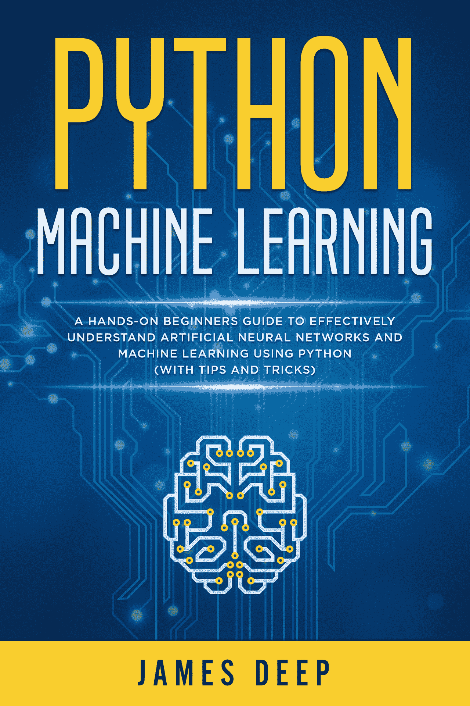

## 引言

我们生活在一个技术已成为每天首要关注事项的世界。全球范围内许多行业和组织都在尽一切努力，以提高其生产效率。正因为这一点以及其他原因，他们决定在行业内采用新技术。诸如`Machine Learning`（机器学习）的引入、机器的使用、无人机的部署等新技术应运而生。

然而，多年来，从数据输入和信息输出来看生产率仍然很低。基于此，他们寻找那种能够让他们利用当时拥有的`features variables`（特征变量）来预测结果的机器。请记住，在执行特定任务之前就能知晓组织内某项任务的结果，这种能力激励了他们。

遗憾的是，数据预测中使用的某些方法被证明是错误的，只有少数方法给出了预期的结果。在某个时期，他们的数据缺乏足够的准确性，有些模模糊糊不清，而另一些则无法读取和解读。由于所有这些原因，许多科学家涌向互联网和技术图书馆，试图提出切实可行的解决方案来解决当前行业在处理工作负载时的困境。

因此，你需要理解或掌握为什么`Machine Learning`是解决其劳动力部门许多紧迫问题最方便的方法。在某些情况下，人类仅以手动方式处理公司账目的数学概念。然而，这是极不方便的，因为许多组织或行业涉及人类无法完成的海量工作负载。疲劳以及缺乏执行每个预测任务所需的知识的情况变得泛滥。

因此，被充分部署的`Machine Learning`指使用简单的`algorithms`（算法）和一些`statistical models`（统计模型）解决某些特定任务的情况。`Machine Learning`主要依赖推理和某些模式。对某些人来说，这是人工智能，而另一些人的信念则基于具有样本数据的数学模型，他们后来将这些称为“训练数据”。由于这种机器可以使用可用数据在组织内部做出某些决策，这一过程变得更加易管理。

后来，组织利用`machine learning`中的`algorithms`来满足公司的需求。目前，`computer vision`（计算机视觉）甚至与邮件过滤相关的问题都使用了`machine learning`中的`algorithms`。结果，许多组织意识到工作效率的提高，并最终实现了高产出。

许多研究表明，`machine learning`与某些统计学有关，特别是来自计算机的统计，即计算统计学。然而，值得注意的是，它仅关注使用计算机做出急需的决策和预测。`machine learning`的某些方面使其能够相应执行其功能。例如包括`mathematical optimization`（数学优化），它仅涉及应用领域、理论使用，甚至让`machine learning`运行得更好的不同方法。另一个方面是`data mining`（数据挖掘）。许多研究表明，`data mining`与领域研究有关，主要在`machine learning`内部。它的主要目标是帮助分析数据。在大多数情况下，许多企业采用`machine learning`用于预测分析。

## 第一章：引论：机器学习的历史概述 

机器学习于 1959 年进入视野，这是在美国先驱者的帮助下实现的。亚瑟·萨缪尔（Arthur Samuel）花费大量时间在计算机游戏上，他提出了“机器学习”这一初始术语。在此期间，机器学习成为科学努力不可或缺的一部分。后来，随着对人工智能的需求增长，它得到了普及。许多人，尤其是研究人员，对此产生了浓厚兴趣，以至于部署机器学习来获取某些数据。此时，研究人员别无选择，只能尽一切利用可用手段来获得所需的结果。他们最终使用了`perceptors`（感知器），尽管后来这被视为线性模型的应用。尽管如此，他们仍在此部署了概率推理，特别是在医疗诊断的自动化方面。幸运的是，这种自动化技术似乎效果更好，从而改进了他们在医疗领域的工作。然而，逻辑性的增加以及依赖知识的方法导致了机器学习与人工智能之间的技术战。在这一关键折点，你发现概率系统无法按照预期执行其任务。因此，他们在实践和理论上都遇到了一些问题，特别是在数据表示甚至数据获取方面。随着人工智能陷入巨大的停滞，工业界没有任何办法来解决他们的工作量和繁重任务。结果，机器学习开始繁荣。那是在 20 世纪 90 年代。它改变了自己的目标或任务，从实现被认为是人工的智能转向主要从实际角度解决问题。它的重点发生了转移。在此过程中，符号方法停止了。它吸收了概率论和统计模型的使用。机器学习后来受益于数字化信息和便捷的互联网分发。因此，互联网分发创建了一种可传输的模式，许多科学家可以利用它来获取机器学习。记住，随着人工智能部分的“死亡”，机器学习成为了每个行业不可或缺的一部分。在此过程中，许多科学家和几个机构都无法忽视它。随着许多人将其投入各种数据预测中，它的使用频率也增加了。

### 机器学习的进化视角

机器学习经历了几个阶段才达到今天的地位。这些步骤以技术的改进和自然问题的解决为标志。此外，输出预测的准确性水平也不断提高。然而，这仍然低于科学家和大多数机构的要求。此外，解决和获取数据的速度变得更易管理，但输出数据中只有极少数不准确的情况。正因为如此，改进机器学习特征的冲动应运而生。因此，这一切导致了进化的最终诞生。

#### 第一阶段是西洋跳棋游戏与机器学习

在这里，亚瑟·萨缪尔发明了一个计算机程序，可以用来玩西洋跳棋。他引入了`alpha-beta pruning`以适应设备内较少的内存。这种知识可以预测在西洋跳棋游戏中的哪些获胜机会。最后，这导致了`minimax algorithm`（极大极小算法）。后来，他根据自己的设计改进了他的机器。

#### 进化的下一个阶段是感知器

弗兰克·罗森布拉特（Frank Rosenblatt）提出了这个模型。它是机器学习和脑细胞模型的结合。值得注意的是，脑细胞模型是唐纳德·赫布（Donald Hebb）的工作。曾工作于康奈尔航空工程学院（Cornell Aeronautical）实验室的弗兰克，在工业界缺乏解决某些统计数据和分析方法时提出了这种`Perceptron`（感知器）。他计划完成他的工作，即`Perceptron`是一台机器而不是任何程序。`Perceptron`使用`Mark 1 perceptron`（1 号感知器）进行图像识别。结果，软件和机器的传输变得更加容易。据他所说，这是最成功的机器。此外，尽管这是成功的，但某些方面缺乏解决方案。也就是说，该设备无法识别视觉模式。结果，许多科学家和计算机程序员转向另一项研究。然而，他们的斗争一直持续到 20 世纪 90 年代，在那里他们成功地实现了能够解决问题的算法。此外，这种方法导致了`The Nearest Neighbor`（最近邻算法）。

在他的工作中，马尔塞洛发现可以轻松地识别模式。这种算法的主要目标是规划路线。这种方法是有益的，销售人员可以利用它进入城市。尽管这很有帮助，但在某些情况下它无法处理。结果，这导致了多层模型的诞生。

多层模型在 20 世纪 60 年进入视野，并改进了神经网络。这增加了`Perceptron`的处理能力，促进了`backpropagation`（反向传播）的发展。`backpropagation`的主要任务是解决系统中的错误。这种方法通过反向传播错误使得解决问题不再困难。它现在被应用于许多行业。值得注意的是，这种系统出现于 20 世纪 70 年。`backpropagation`导致了`Neural Network`（神经网络）。在这里，这种机器可以解决`Perceptron`无法解决的复杂任务。它涉及将输入数据转换为输出信息。这里的工作是复杂的，人类可能会发现困难。在 20 世纪 70 年代和 80 年代的部分时期，逻辑方法停止了。人工智能开始使用逻辑方法来解决其任务。再次，他们放弃了某些研究，例如神经网络。最后，两者之间产生了分裂。那就是机器学习和人工智能的分离。后来，在重组后，机器学习挣扎了近十年。

## 第 2 章：机器学习的类型 

在一个沉浸在人工智能的世界里，深入理解机器学习是很有趣的。这一概念允许算法在不依赖任何显式指令的情况下执行特定任务。相反，机器依赖于推理和模式，用户将数据输入通用算法，而不是编写代码。作为回应，机器根据输入数据构建逻辑。通常，会对算法所预测的准确性进行评估，只有当精度达到接受水平时，算法才会被部署。

### 机器学习的类型

机器学习大三大类。我们将在下文中详细讨论每一种。

#### 1. 监督学习

这种范式事实是最流行的，可能因为它易于理解和执行。在这里，算法从标记数据集（即同时包含输入参数和输出参数的数据集）中创建一个数学概念。该数据集充当了模型的训练器。例如，我们可能决定使用算法来判断特定图像是否包含某个物体。在这种情况下，数据集将由包含和不包含输入（该物体）的图像组成，每张图像都有一个指定其是否包含特定对象的输出。算法可能会预测任何答案，无论对错。然而，在多次尝试后，它学会了只挑选包含所述物体的图像。一旦完全训练完成，即使输入新数据，算法也会开始做出正确的预测。监督学习模型的完美例子是支持向量机。在下面的图中，支持向量机将数据划分为由线性边界的区域。你会发现边界将白色圆圈与黑色分开了

##### 监督学习的类型

*   **分类 (Classification)**：这些算法用于输出限制为离散值的情况。例如，在过滤邮件时，收到的邮件被归类为输入，而输出则是文件夹名称。

*   **回归 (Regression)**：这是输出具有连续值的算法，这意味着它们可以在给定范围内的任何值上选取。完美的例子包括：温度、风速、商品价格等。

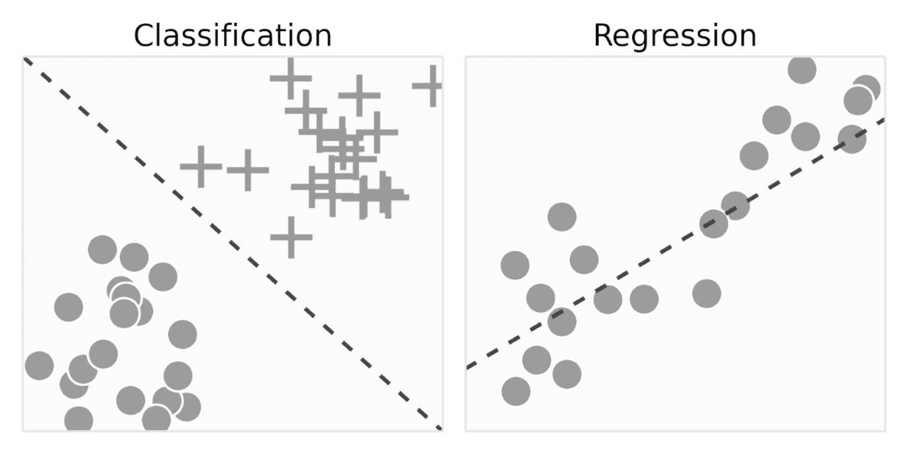

监督机器学习体现在许多常见应用中，我们已经在下文中讨论了其中一些应用。

*   **广告状态**：你在浏览互联网时遇到的大多数广告之所以出现在那里，是因为有一个监督学习算法为它们的点击率和受欢迎程度提供了背书。

*   **人脸识别**：这在 Facebook 上非常常见。你的脸很可能被用于一个训练以识别它的监督算法中。当 Facebook 建议一个标签时，你可能注意到系统在猜测照片中的人物身份，这是一个监督过程。

*   **垃圾邮件分类**：你在现代邮件系统中找到的垃圾邮件过滤器是一个监督学习概念。除了预先过滤恶意邮件外，该系统还允许用户提供新标签并表达他们的偏好。请参见下图中的插图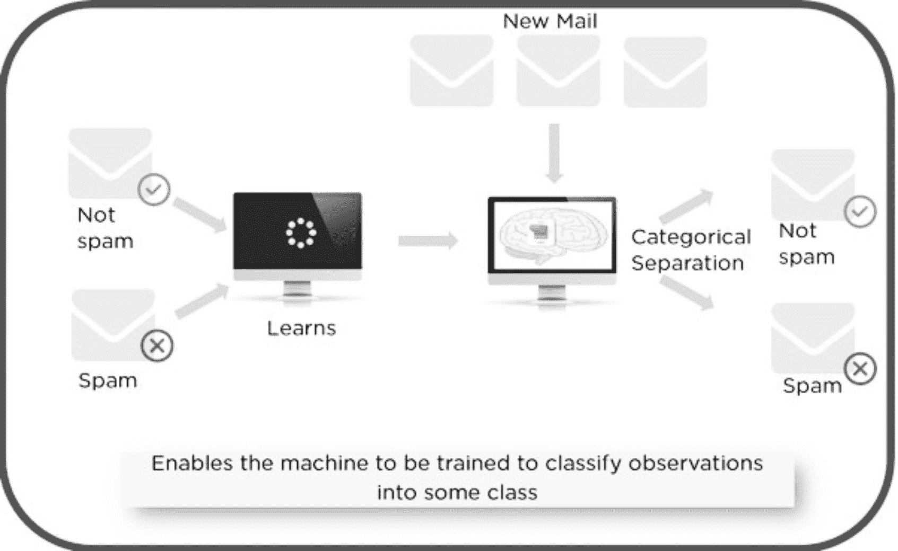

#### 2. 无监督学习

正如其名所示，无监督机器学习与监督学习完全相反。模型在数据中寻找结构，并通过观察进行学习。当给出一个数据集时，模型会自动寻找相关关系并创建聚类。该范式无法为创建的簇添加标签，但它能完美地完成创建工作。这意味着如果我们有一组苹果和橙子，模型会将苹果和橙子分开。现在，假设我们有两组以上，比如我们展示葡萄、橙子和苹果的图像。如上所述，每当输入新数据时，模型都会将其添加到已有的簇之一，如图所示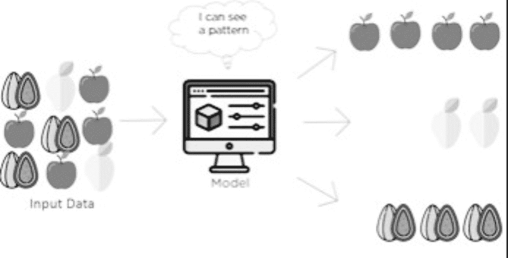

让我们通过另一个经典例子来更好地理解。想象一个小婴儿和他的家庭狗。他能很好地识别狗的特征。当一位朋友带着另一只狗来和婴儿一起玩时，婴儿即使没有人教也能识别出那是狗。他们会轻松地对其进行分类，因为它具有特征。这属于无监督学习，因为你在没有被教导的情况下对输入进行分类。如果是监督学习，朋友就必须告诉婴儿那是只狗。

##### 无监督学习的类型

*   **聚类 (Clustering)**：这一概念在未分类的数据中识别模式。聚类算法对数据中的自然分组进行分类。用户也可以自由调整他们算法识别的簇数量。

    *   **排斥式/划分式 (Exclusive / partitioning)**：在此类型下，对数据的分类使得一个数据只能属于一个簇。`K-means`是一个完美的例子。

    *   **凝聚式 (Agglomerative)**：这种技术中每个数据本身就是一个组。通过两个最接近组之间的迭代合并来减少簇的数量。一个例子是层次聚类。

    *   **重叠式 (Overlapping)**：在这种技术下，数据与合适的关联值相关。使用模糊集对数据分组，每个点都可以以不同的隶属度属于两个或多个组。`Fuzzy C-Means`是此类类型下的合适例子。

*   **关联 (Association)**：这一概念使用概率分布创建簇。参见下文给出的某些关键词示例

    *   `男士裤`

    *   `女士裤`

    *   `男士钱包`

    *   `女士钱包`

给出的关键词可以分为两组；`裤`和`钱包`，或者`男士`和`女士`。

关联规则允许用户在大型数据库的数据对象之间建立关联。顾名思义，该技术旨在发现大型数据库中包含的变量之间的独特关系。例如，可以根据购物者的搜索和购买历史进行分组。

#### 无监督机器学习的应用

无监督机器学习（Unsupervised ML）基于数据及其属性，因此我们可以得出结论它是数据驱动的。任务的结果由数据格式 Nature 控制。依赖无监督学习的常见领域包括但不限于：

*   **购买习惯**：发现你的购买习惯被存储在某处的数据库中，这并不意外。营销人员可以使用这些信息将客户划分为相似的购物细分，以便轻松地与他们联系。在无监督学习算法下，聚类是非常容易实现的。

*   **推荐系统**：如果你是 Netflix 或 YouTube 用户，可能多次遇到过视频推荐。这些系统通常包含在无监督领域。系统了解用户的观看历史。模型利用这些历史来识别喜欢特定类型、长度等视频的用户之间的关系，并向他们推荐他们可能没有看过的相关视频。

*   **欺诈交易识别**：异常检测是用于发现异常数据点的技术。算法会挑选数据集中的任何异常点，从而发送警报。

#### 有监督与无监督机器学习技术

数据专家在他们的发现操作中使用多种机器算法。以下是关于监督学习和无监督学习技术分类的一些见解，将帮助你判断何时使用其中一种技术。

| 参数 | 有监督机器学习 | 无监督机器学习 |
| :--- | :--- | :--- |
| 数据使用 | 使用训练数据来研究输入和输出之间的联系。 | 不使用输出数据。 |
| 结果准确性 | 高准确且可靠。 | 准确性较低，因此不可信。 |
| 输入数据 | 使用标记数据来训练算法。 | 算法用于未标记数据。 |
| 类别数量 | 类别数量已知。 | 类别数量未知。 |
| 主要缺点 | 大数据的分类。 | 由于使用了标记和未知数据，无法获得有关输出和数据排序的精确信息。 |
| 实时学习 | 学习在离线进行。 | 学习实时进行。 |
| 过程 | 同时给出输入和输出变量。 | 仅给出输入数据。 |
| 计算复杂度 | 相对简单；复杂度较低。 | 计算方面较为复杂。 |

决定采用有监督还是无监督机器学习算法通常取决于你的数据量和结构。本质上，一个良好的数据科学计划将同时使用两种算法类型来建立预测数据模型。现在，这些模型更加先进，可以帮助利益者在各种业务支持中做出决策。

#### 3. 强化学习

这是一种神经网络学习技术，训练机器学习概念如何做出一系列决策。智能体（Agent）被训练如何在不确定且可能复杂的环境中实现其目标。在这种技术中，人工智能参与游戏。模型利用用户的观看历史来识别喜欢特定类型、长度等视频的用户之间的关系，并向他们推荐他们可能没有看过的相关视频。

这是一个由特定行为触发的事件。它对智能体采取的行动产生积极影响。这通过增强行为的频率和强度来实现。这种方法有助于你利用性能并维持更长时间的改变。尽管如此，你仍必须小心，因为过度强化可能会导致状态过度优化并影响结果。

##### 2. 负强化

它涉及加强由负面条件引发的行为，这些行为本应被规避或停止。尽管它有助于定义最低标准性能，但这种方法提供的仅足以满足最低行为，这是一个缺点。

##### 强化学习在现实中的应用

- 数据处理与机器学习。

- 商业策略规划。

- 用于工业计算机化的机器人技术。

- 飞机和机器人运动管理。

- 帮助为学生创建定制训练系统。

#### 总结

- 无监督学习中使用的数据是有标记且未知的，因此，你无法获得关于数据排序的准确信息。

- 从一张图像移动到另一幅图像时，你会获得不同的信息，因为类别的光谱属性可能随着时间而改变。

- 无监督机器学习定位数据中所有未知的未识别模式。

- 用户必须花费时间对遵循特定分类的类别进行标记和解释。

- 无监督学习的主要缺点是无法获得关于数据排序的准确信息。

- 强化学习是一种具有三种算法的机器学习方法：1) 基于价值的，2) 基于策略的和 3) 基于模型的。

- 强化学习有两种类型：1) 正向强化和 2) 负强化。

- 当你有充足的数据时，不应使用`RL`来解决问题。

- `RL`方法的主要缺点是学习速度可能会受到参数的影响。

## 第 3 章：Python 在机器学习中的应用 

机器学习及相关技术（如人工智能，AI）是现在和未来的核心技术。在一个日益趋向于更个性化设备和具有改进及技术功能的机器的世界里，科技公司和创新者正处于全力运转状态，研究、开发和测试未来的创新技术。这些技术旨在彻底改变人类体验，同时也巩固机器（尤其是计算机）作为人类生活所有领域主要驱动力的地位。

虽然这些公司和个人表面上致力于满足不断变化的人类需求，从而提升用户体验，但他们也在寻求开发能够增加其利润的技术。这些新技术不仅利用海量数据来执行人工无法完成的复杂过程，而且具有更高的准确性和效率。它们还可以分析数据模式以进行预测，并提前为问题提供解决方案。从本质上，机器学习和人工智能的基础是将过去几十年中的许多科幻小说变为现实。

然而，人工智能技术也带来了一个劣势，即需要收集和分析大量数据以处理这些复杂过程。此外，将科幻变为现实还需要编程、创意、概念化、构思和分析方面的技能储备。但最重要的是，它需要一种易于理解且灵活易用的正确编程语言。作为一名为改变人类体验的下一个变革性技术编写算法的程序员，你最不需要被困于一种缺乏活性且无法处理数据复杂性的编程语言。这很容易导致机器程序或应用程序编码中出现错误。


代码错误可能会给开发者带来尴尬的局面，2016 年涉及微软聊天框的案例就是一个例子：该聊天框发生故障，转而向千禧一代发送歧视女性的信息，而不是预期的快乐和积极的主题信息。全球领先的在线零售商亚马逊在 2014 年也遭受了声誉损害，当时其为人才招聘设计的 AI 机器变成了一个歧视性工具，专门针对女性申请者。这些只是涉及少数知名科技巨头的案例，它们的机器学习和人工智能算法由于编程问题而表现异常。

## Python 与人工智能及机器学习（ML）训练

如果没有正确的编程语言，要训练计算机像人类一样学习和预测能力，而无需持续的特定基于过程的编程，这是一项艰巨的任务。通过消除对显式编程的需求，程序开发人员需要向计算机提供正确的训练数据，计算机将将其作为参考点，就像一个供其学习的图书馆。这是传统编程与非传统编程项目（如`IA`或机器学习）之间的主要区别点之一。

使用训练数据，程序员能够使用大量代码行来开发软件，为机器创建所需的算法。然而，此类复杂项目需要精通统计学和数学优化以获得最佳结果：一个没有编码错误的算法，以避免导致机器故障的错误。此外，程序员还应该理解概率的概念，以确保开发的算法能够进行预测，而这是具备 AI 能力的机器的主要功能之一。

为了便于执行此类复杂的编程任务，由软件工程大师 Guido van Rossum（范·洛姆）构想的编程语言`Python`配备了各种库或模块。这些模块在程序员编写代码时非常有用，因为它们包含了已经写好的内置代码。程序员可以使用这些预先编写的代码作为他们为特定项目编写的算法的骨干。有了现有的代码，程序员就可以快速启动并开发基于人工智能的技术所需的更复杂的算法。这是因为编程语言模块自带的代码具有支持基本功能的条目。它们还作为下一组编码操作的发射平台，从而消除了从头开始任何编程项目的需求。

Python 广泛的库生态系统包括：`Scikit-learn`、`Seaborn`、`NumPy` 和 `Pandas`。其他的包括 `Keras` 和 `SciPy`。这些库集在人工智能和机器学习算法开发过程中针对不同任务进行了专门化。例如，`Seaborn`模块主要用于涉及机器学习训练数据可视化的编码任务。这包括为了绘制统计模式而对数据进行探索。机器从这些模式利用其 AI 来预测场景。

另一方面，`Pandas`由于其功能多变性，显然是使用`Python`语言的程序员中最受欢迎的库集。该模块适用于所有形式的与编码相关的数据分析。作为一种面向对象的语言，`Python`在编码期间严重依赖对这些数据的分析和解释，以开发机器可以从中学习并利用这些知识进行预测的算法。这就是为什么 `SciPy` 和 `NumPy` 是最重要的 `Python` 库。

## 第 4 章：Python 机器学习的核心库

如今许多开发者在数据分析中倾向于使用 `python`。`python` 不仅应用于数据分析，还应用于统计技术。科学家们（尤其是那些处理数据的科学家）也倾向于在数据集成中使用 `python`。这涉及到 Web 应用与其他环境产出的集成。`python` 的特性帮助科学家们将其应用于机器学习。这些特性的示例包括：语法一致、灵活高效，甚至可以缩短开发时间。它还具有开发复杂模型的能力，并拥有有助于预测的引擎。因此，`python` 拥有一系列非常广泛的库。记住，库是指用不同语言编写的一系列程序和各种函数。因此，一个健壮的库可以处理更复杂的任务，而且这无需重复编写几行代码。值得注意的是，机器学习主要依赖于数学，即数学优化、概率元素以及统计数据。因此，`python` 凭借丰富的知识，可以在无需过多干预的情况下执行复杂任务。以下是目前常用的核心库示例。

### Scikit – Learn

`Scikit-learn` 是机器学习领域最好且最流行的库之一。它具有支持学习算法的能力，特别是无监督和监督学习算法。`Scikit-learn` 的示例包括：

* `k-means`

* `决策树`

* `线性和逻辑回归`

* `聚类`

这类库包含来自 `NumPy` 和 `SciPy` 的主要组件。`Scikit-learn` 能够添加对机器学习以及与数据挖掘相关的任务有用的算法集。也就是说，它可以帮助分类、聚类甚至回归分析。该库还可以高效地完成其他任务。一个很好的例子包括集成方法、特征选择，以及数据转换。值得理解的是，如果先驱者或专家能够实现算法中复杂精深的部分，他们就可以很容易地应用此工具。

### TensorFlow

`TensorFlow` 是一种涉及深度学习的算法形式。它们并非总是必须的，但它们的一个优点是当操作得当时，能够给出正确的结果。它还能让你在 `CPU` 或 `GPU` 上运行数据。也就是说，你可以在 `python` 程序中编写数据，编译然后在中央处理器上运行。因此，这让你的分析工作变得非常轻松。此外，没有必要将这些信息用 `C++` 或 `CUDA` 等其他层级编写。`TensorFlow` 使用节点，特别是多层节点。这些节点在系统中执行多项任务，包括使用人工神经网络、训练，甚至设置大量数据集。诸如 Google 等多个搜索引擎都依赖于这类库。其其中一个主要应用是目标识别。同样，它也能帮助处理语音识别的不同应用程序。

### Theano

`Theano` 也是 `python` 库的重要组成部分。它在这里的关键任务是帮助任何与数值计算相关的内容。我们将其与 `NumPy` 联系起来。它还扮演着其他角色，例如：

* 数学表达式的定义

* 数据优化

## `pandas` 在现实场景中的应用将使能够能够以下操作：

- 你可以快速删除某些列，甚至添加 `Dataframe` 中发现的某些文本

- 它将帮助你进行数据转换

- `Pandas` 可以让你确保获取到错位或缺失的数据

- 它具有强大的能力，特别是在根据功能对其他程序进行分组方面

### Matplotlib

这是另一种复杂且实用的数据分析技术，有助于数据可视化。它的主要目标是根据各种输入为行业提供其所处位置的建议。当你无法与不同的利益相关者分享你的生产目标时，你会发现你的生产目标是毫无意义的。为了实现这一点，`Matplotlib` 在所需的计算分析类型方面大大用用场。

因此，它是每个科学家（尤其是处理数据的人员）都青睐的唯一 `python` 库。这种库在图形和图像方面外观良好。更重要的是，许多人倾向于使用它来创建各种用于数据分析的图表。然而，随着新的先进库涌入行业，技术世界已经完全改变。它还非常灵活，正因如此，你能够创建出可能需要的几张图表。只需几条命令即可完成此操作。在这个 `python` 库中，你可以创建各种不同的图形、各种图表、多个直方图，甚至是散点图。你也可以使用相同的原理制作非笛卡尔图表。

图解说明 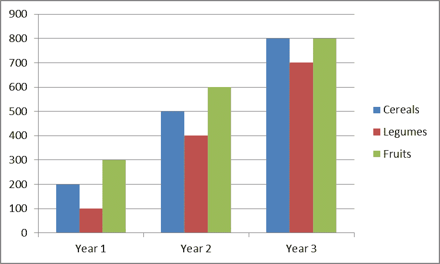

上面的图表突出了某公司三年内的总体生产情况。它具体演示了 `Matplotlib` 在数据分析中的用法。通过观察图表，你会发现与另外两年相比，该年的产量较高。此外，公司在水果生产方面表现良好，因为它在第 1 年和第 2 年处于领先，并在第 3 年持平。

从图中你可以看出，由于使用了这个库，你的演示、表示甚至分析工作变得更加简单。这个 `python` 库最终将使你能够创作出良好的图形图像、准确的数据等等。通过这个 `python` 库的帮助，你将能够记录下产量高的年份，从而处于保持高生产力季节的位置。值得注意的是，该库可以导出图形，并将这些图形转换为 `PDF`、`GIF` 等。

总之，该库可以轻松地完成以下任务。它们包括：

- 折线图的形成

- 散点图的绘制

- 创建漂亮的条形图和构建直方图

- 行业内各种饼图的应用

- 数据分析和计算的茎状方案制定

- 处于跟踪等高线图的位置

- 频谱的使用，最后

- 矢量图的创建

### Seaborn

`Seaborn` 也是 `python` 类别中流行的库之一。它在这里的主要目标是帮助可视化。需要注意的是，该库的基础借用自 `Matplotlib`。由于其层次更高，它能够生成各种图表，例如热图的制作、小提琴图的处理，以及帮助生成时间序列图。

图解插图 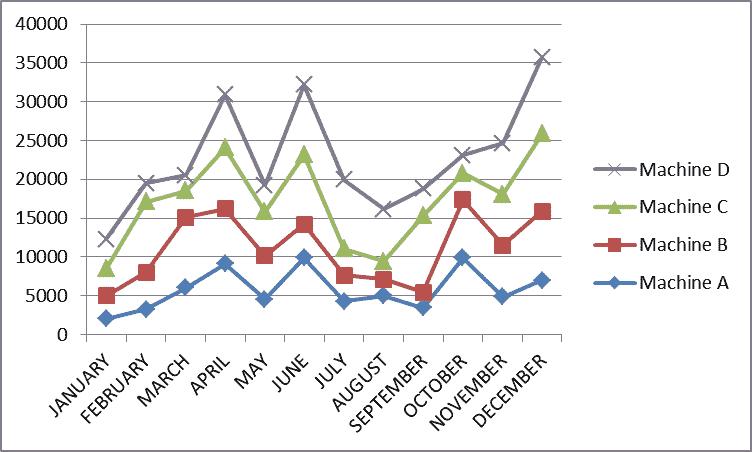

上面的折线图清楚地显示了公司使用的不同机器的性能。根据上面的图表，你最终可以推断并得出公司可以继续使用哪些机器以获得最大产量。在大多数情况下，通过 `seaborn` 库帮助的这种评估方法将使你能够预测不同输入的准确能力。此外，这些信息实际上可以为未来购买更多机器的情况提供参考。`Seaborn` 库还具有检测公司其他变量输入性能的能力。例如，公司内的工人人数可以根据其相应的工作率轻松识别。

## NumPy

这是一个非常广泛使用的 `python` 库。它的特征使其能够执行多维数组处理。此外，它有助于矩阵处理。然而，这些只有在大量数学函数的帮助下才是可能的。需要注意的是，这个 `python` 库在解决科学领域内最重要的计算方面非常有用。

此外，`NumPy` 也适用于线性代数、行业内使用的随机数能力推导，特别是傅里叶变换。`NumPy` 也被其他高级 `python` 库（如 `TensorFlow`）用于 `Tensors` 操作。简而言之，`NumPy` 主要用于计算和数据存储。你也可以将数据导出或加载到 `Python`，因为它具有那些能够执行这些功能的特征。值得注意的是，这个 `python` 库也被称为数值 `python`。

### SciPy

这是我们当今行业中最常用的库之一。它的特点是包含不同的模块，这些模块适用于数据分析的优化领域。它在积分、线性代数和其他形式的数学统计中起着重要作用。

在许多情况下，它在图像处理中起着至关重要的作用。图像处理是日常活动中广泛应用的过程。Photoshop 等案例都是 `SciPy` 的例子。此外，许多组织在图像处理中偏于使用 `SciPy`，特别是用于演示的图片。例如，野生动物可以使用不同的颜色描述一只猫。


上面的第一张图片是一只猫的图像

上面指的是第二张图片，它经过了处理

下面是一只符合你喜好的猫的图像。

### Keras

`Keras` 也是 `python` 库的一部分，特别是在机器学习领域。值得注意的是，`Keras` 具有在其他库上运行的能力，特别是 `TensorFlow` 甚至 `Theano`。此外，它似乎可以在 `GPU` 和 `CPU` 上运行。对于大多数 `python` 编程初学者来说，`Keras` 提供了一条通往理解的安全路径。他们将能够设计网络甚至构建它。

### PyTorch

`PyTorch` 是另一个易于使用但开源的 `python` 库。由于其名称，它在工具方面拥有广泛的选择。它也适用于我们有计算机视觉领域。计算机视觉和视觉显示在几种类型的研究中起着至关重要的作用。此外，它有助于自然语言的处理。更重要的是，`PyTorch` 具有承担开发人员技术任务的能力，即使用计算进行巨大的计算和数据分析。它还可以帮助创建主要用于计算目的图表。由于它是一个开源的 `python` 库，它可以在其他库（如 `Tensors`）上工作或执行任务。结合 `Tensors` `GPU`，其加速性将增加。

### Scrapy

`Scrapy` 是另一个用于创建爬虫程序的库。那是爬虫机器人等。爬虫机器人经常有助于数据检索目的，也适用于网络使用的 URL 的形成。从从开始，它是为了协助数据采集。然而，它经历了多次演变，并导致了其通用用途的扩展。因此，`scrapy` 库在我们目前的主要任务是作为通用爬虫。

### Statsmodels

`Statsmodels` 是一个旨在使用多种统计计算和数据断言方法探索数据的库。它具有许多功能，如结果统计甚至特征功能。它可以通过各种模型的帮助来承担这一角色，例如线性回归、多元估计和涉及时间序列的分析。此外，其他模型（如离散选择）也适用于此处。

# 第 5 章：回归分析（线性回归与逻辑回归）

全球范围内多个行业都在苦苦寻找最佳方法来获取正确的数据或信息，以最终使他们能够解决面临的预测问题。一些银行已经遭受了损失，特别是在其信贷部门，因为他们无法正确预测违约者的信誉度。在健康领域，你会发现许多人因为规划不当和风险管理不而失去了生命，这是缺乏建模工具来进行更直接的预测所导致的。我们还有其他部门，例如天气预报，农民没有获得关于降雨发生情况的建议，导致了更大的损失。另一个领域涉及房主对抵押贷款的支付。由于所有这些原因，全世界的人都在疯狂寻找处理组织预测角色的最佳方法。

后来，这一切催生了所谓的**回归分析**（regression analysis）。因此，回归分析是指使用变量进行预测分析的统计处理过程。在此过程中，它有助于识别变量之间的关系。这种分析包含自变量和因变量。换句话说，回归分析有助于理解在保持其他自变量不变的情况下，其中一个自变量对因变量的影响。在大多数情况下，回归分析将尽力预测条件期望，特别是依赖变量的期望。

回归分析应用于天气预报和预测等多个领域。在这里，它帮助预测特定时期内降雨的结果。它也适用于医学等领域，用于预测疾病的概率。回归分析包括：线性回归、逻辑回归、多项式回归、逐步回归、岭回归、Lasso 回归和弹性网回归。总而言之，本章将只探讨最常用的回归分析，例如线性回归和逻辑回归。需要注意的是，`ElasticNet` 回它是 `Lasso` 和 `Ridge` 回归的结合。

## 逻辑回归

逻辑回归包含逻辑模型、逻辑函数、统计模型等。因此，许多组织在日常活动中应用逻辑回归，这些活动主要由数据预测和分析组成。你可以进行这种回归分析，特别是当因变量是二元的时。即它是二分类的。与其他类型的回归分析一样，逻辑回归完全应用于任何处理预测的分析中。在这种情况下，它的首要功能是描述数据。此外，逻辑回归可用于解释或说明二元变量（因变量）与其他变量（自变量）之间的某种关系。 

在某些情况下，这种回归可能看起来难以解释，但通过 `Intellectus Statistics` 等逻辑工具的帮助，你可以轻松地进行数据分析。逻辑回归知识可以在逻辑模型的帮助下轻松应用于统计学中。在这种情况下，逻辑模型的主要功能实际上是通过概率得出某些预测或类别的正确结果。例如，概率在只需要预测既有事件结果的领域效果最好。这些事件包括：健康或疾病、胜利或失败、生存或死亡，甚至在你对测试进行分析时，某人失败或通过。

尽管如此，在这个模型中，你将能够主要通过概率来微调你的结果。在图像的情况下，你可以扩展模型以涵盖各种类别。你将能够检测分析中的图像是狮子还是猫，等等。在这种情况下，图像中的单个变量的概率将在 0 到 1 之间。然而，这里的总和应该等于 1。

因此，逻辑回归是指一种基础统计模型，无论存在什么样的复杂性，它都更多地利用可用的逻辑函数。逻辑回归是回归分析的一部分，在许多情况下，它被应用于估计模型参数的各种分析中。记住，逻辑模型类似于二元回归。该模型包含一个包含两个可能值的因变量。这些值可以表示为 `通过/失败`、`生存/死亡`、`好/坏` 等。你需要注意的是，指示变量实际上表示这些可能的值，并且始终为 0 和 1。

在这个逻辑模型中，值为 1 的 `odds`（几率）代表一个线性组合。在此过程中，该组合具有多个完全独立的变量。此外，在回归分析中，自变量可以分别形成二元变量，有时是连续变量。对于二元变量，必须存在两个类，并且必须通过指示变量编码。然而，连续变量代表真实值。在回归分析中，如前所述，这些值的 `odds` 总在 0 到 1 之间变化。在这种分析中，`log-odds`（对数几率）将通过 `logistic` 函数转换为概率。`Odds` 以 `logit` 计算，这也是 `probit` 模型的衍生物，使用不同的函数将 `log-odds` 转换为概率。

`probit` 模型是一个类似模型的示例，它包含 `sigmoid` 函数。总而言之，你会发现逻辑模型由于其定义的属性或特征而是最受青的。逻辑模型的一个特征是它能够乘乘地增加每个自变量的尺度。作为结果，如果所有依赖因变量都是二元的，它将泛化 `odd ratio`（几率比）。同样需要注意的是，当涉及到因变量时有扩展，例如二分类逻辑。这些扩展包括：

- `multinomial logistic regression`（多分类逻辑回归）：适用于分类输出，特别是具有多个值以上。

- `ordinal logistic regression`（序数逻辑回归）：处理大量的类别。这里一个很好的例子是处理比例几率的序数逻辑模型。

然而，该系统只进行建模而不执行分类，因为它不是分类器。因此，它只会将输入转换为输出。

## 逻辑回归的应用

接下来，让我们讨论逻辑回归现在现实情况中的应用。逻辑回归应用于由气象学家组成的气象站和其他气象站。这里的算法被用于预测下雨的概率。这一信息至关重要，因为它有助于农业、运输等许多部门。可以高效地规划播种时间，并采取正确的安排。这种分析也应用于某些风险管理系统，例如信贷控制。在这里，分析将预测账户持人在付款时是否为违约者。尽管如此，回归分析将根据之前的记录预测某人可以获得的确切金额。这始终使许多组织能够正常运行，因为它们在风险管理方面可以控制一切。所有账户在附加之前都经过了关键分析。

逻辑回归也应用于政治领域，特别是在选举期间。在这里，它根据候选人的优势和所使用的资源给出每位候选人获胜或失败的概率。再次，这种回归分析能够预测可能不投票的人数以及最终将投票的人以及投票给哪个特定的候选人。

# 第 6 章：感知机 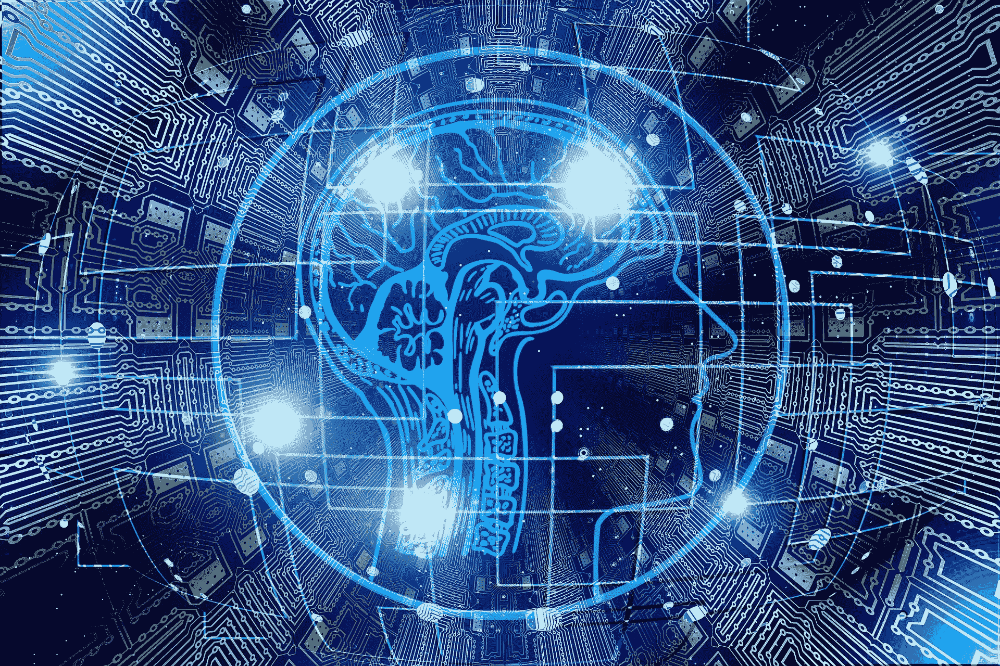

本章将探讨感知机算法，该算法最早由 Minsky 提出并应用。本章将感知机作为一种**算法**而非模型进行显式介绍。我建议读者在我的书籍 `MACHINE LEARNING FOR BEGINNERS` 中查找同一主题的参考资料。在那书中，该主题的涵盖范围有限。但在本本书中，我将根据内容、结构和适用性对感知机进行深度分析。

### 定义感知机

感知机是神经网络中的一层，能够执行以下操作：为数据池的核心配置算术值，并对于正向 (+) 结果，将正回报之和估计为值为 `1` 的。从另一个角度来看，感知机也可以被视为一种计算模型，它在给定空间中画出一条边界（在二维情况下为一条直线）来隔离两个类别。最初，代表分类超平面的权重和偏置（bias）通常是未知的。在这种情况下，模型被分配了非系统化的权重和偏置。随机分配会导致点的分类错误。

### 感知机技巧 (The Perceptron Trick)


感知机技巧的目标是减少分类错误的点数量。这种减少可以通过在空间上移动直线来实现。换句话说，它是在改变超平面的表达式。对于所有分类错误的点，我们调整权重和偏置，以使超平面更靠近那些分类不当的点。经过一段时间，算法将纠正问题并正确分类这些点。

然而，在本章中，我选择以不同的方式看待感知机。采用的方法是在机器学习算法的上下文中识别感知机。在这里，感知机被定义为一种预测给定特征是否属于特定类的算法。从这个角度来看，该算法被认为是用于监督学习的二分类器。在大多数情况下，所研究的特征始终由一个具有大小和方向的数字表示。作为分类器，感知机用于线性分类和以图形形式表示数据。图形表示模型可以采用二维或多维的方式。感知机识别一个特征，加权其总和，如果加权总和高于其他函数的结果，则给出值为`1`的结果。

图像中的方程支持了这一表述 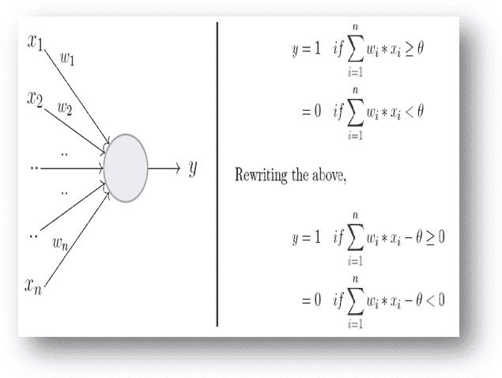 当代入方程边边（上方图像中的第二个方程）并使其与给定参数的权重保持为常数时，就得到了图像中的方程 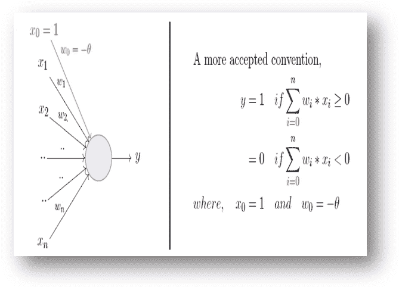 感知机算法的单个单元可以执行可分的线性方程。唯一一组工作通过对布尔和正向指标进行加权或分配权重，并具有相应的偏向。

## 使用感知机执行或函数 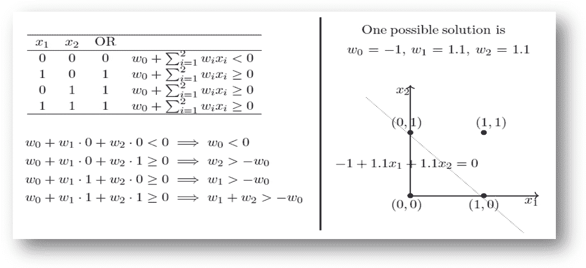

在上述图像中，条件根据或函数定义。这些术语旨在满足优化模型，即对于给定的值为一（`1`）的输出，需要加权数据的总和为零（`0`）或大于它。权重的和已经形成了一条直线，该直线将正（`+`）值与负（`-`）值隔离开。Minsky 的提设定了通过样本数据学习特征的标准。所提出的模型描述如下。

### 线性代数的基本组件

### 向量

向量值可以代表很多东西。取决于数据的类型，向量值可以代表很多。因此，描述向量的方法不止。它可能是一条带有箭头的线，另一个没有箭头的点作为原点。

### 表示向量

向量可以用二维或三维表示，取决于用户的选择。下面是二维描述的向量（第一幅图像）和一个三维向量（第二幅图像）。`和`(n+1, x)`，它们的点积使用下面的公式计算。对于值的代入，我以矩阵形式编写的公式 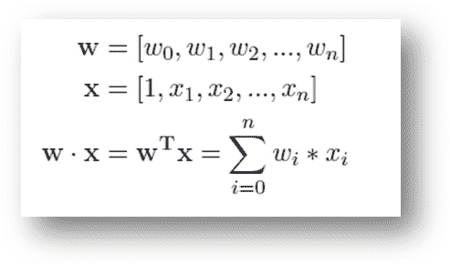 从方程，向量`/w/`和`/x/`由带箭头的线表示。向量的维度是`(n+1)`值。计算结果表示`/w/`和`/x/`的点积。此结果显示了单个向量在另一个向量方向上的程度。感知机创建了一条分离正值与负值的线。对于我们示例中的函数，这表示为`w.x = o`。

### 两向量之间的角度

上述点积可以使用不同的方法计算。然而，必须满足某些条件：

1. 向量之间的角度必须已知。

2. 向量的大小必须已知。

当满足条件时，通过代入下方图像中的公式 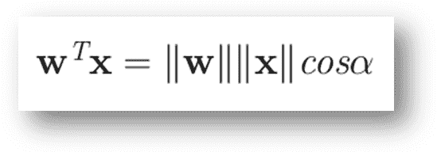 完成点积计算。可以使用反向方法确定两个向量之间的角度。这可以通过首先识别向量、获取其大小和点积来实现。下面的图像可以指导将值代入方程 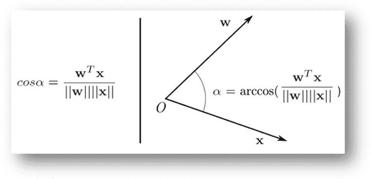

## 使用感知机进行问题表示

该示例集将用于判断一个人是否会决定观看某电影，这基于图所示的先验数据和输入。图中提供的输入数据既有正值（`+`）也有负值（`-`）。实际值代表了这个人看过的电影。我们将使用这些数据来观察感知机学习算法是如何估计数据集中的权重的。为了简单起见和直观可视化，我们将使用 2 维表示法。

### 使用感知机学习算法

这里的主要目标是识别一个可以分离正值（`+`）输入与负值（`-`）输入的向量，例如示例中使用的向量`(w)`。我们将使用下述算法。

第一步是使用任何其他向量调整向量`(w)`。初始化后，我们重新陈述数据集中的示例，在本例中，指标为`P`、`U`和`N`。这些示例代表了正向和负向的标准。在进入替换阶段时，输入`x`（随机选择的向量）对应值`P`，在`w`中确定的点积应表述为零（`0`）或大于零。实际值本身并不重要，因为感知机只会给出“是”或“否”的答案。在另一种情况下，当向量`x`对应值`N`时，计算出的点积结果为零（`0`）。

上述语句可以用`while`循环中的一个`IF`情况表示为：

从这些表示中可以推导出两种结果：

- 第一种结果是当向量`x`对应`P`值，且两个向量`(w, x)`的点积小于零（`w.x < 0`）。

- 第二种结果是当向量`x`对应值`N`时，且两个向量`(w, x)`的点积大于零（`w.x > 0`）。

注意，我们必须更新已初始`w`值。在其他情况下，我们不应该扰动`w`的值，因为上述两个结果与感知机规则冲突。对于第一种结果，我们将汇总`w`和`x`；对于第二种结果，我们将从`w`中减去`x`值。

### 评估上述更新规则的可行性

感知机的基本规则帮助我们确定向量`x`对应值`P`。因此；任务的剩余部分是使方程变为`w.x > 0`。该方程也可以解释为：当向量`x`对应`P`时，两个向量`(w, x)`之间的角度应该小于 90 度。

为什么会有这种推论？两个向量`(w,x)`之间角度的余弦等于这两个向量的点积。因此，该角度应该小于 90 度。

从上述解释中我们得到，只要`w`与给定特征向量形成的角度小于 90 度，我们不需要知道向量`w`。在这种情况下，向量必须是一个正值。相反，向量`w`与具有负值的特征向量形成的角度应该大于 90 度。其表示如下所示。

此时，我们可以放心地说，在`x`对应值`P`的给定情况下，向量`x`和`w`之间的角度应该是一个小于 90 的值。同样，我们可以得出结论，在向量`x`对应值`N`的给定条件下，向量`w`和`x`之间的角度应该是一个大于 90 度。

接下来，我们来看为什么更新是有效的。下图给出了关于为什么更新有效的解释。这种评估可能有点跳跃，但整体框架是一目了然的。

对于向量`x`对应`P`的情况，我们必须加上向量`x`和`w`的值。相加提高了`(alpha)`余弦函数的值。这意味着`alpha`的值减小（即两个向量之间的角度）。下图显示了我们如何学习向量`w`，使其与真实物体形成小于 90 度的角度，并与负值物体形成大于 90 度的角度。

### 收敛性证明

目前还没有精确的解释能让人相信所研究的向量最终会收敛。这是由于不同数据集内部不断变化的条件。尽管看起来可能存在向量无法收敛的情况，但事实是该算法证明会在某一点收敛。许多类型的研究已经了这些模式并推出了这些证明。在 YouTube 和其他平台上可以找到演示这些内容的视频。

### 结论

在本章中，我看了感知机算法，定义了它，并进一步说明了它是如何工作的。在此过程中，我们在学习感知机学习算法之前，刷新了你们对线性代数必要组件的记忆。这种循序渐进的演示旨在引导学习者理解并可视化机器学习的概念，特别是感知机。我希望在本章结束时，你已经获得了入门的洞察和知识。建议阅读额外的学习材料。

### 局限性与预防措施

在系统的训练阶段，应该帮助感知机算法通过适应数据进行学习。这是为了确保预测准确并排除错误。输入向量的呈现应该反映一个尽职的过程。这确保了感知机与指标匹配，并且系统在发生错误时可以自我纠正，因为它只需要回到提供的输入向量即可。

# 第 7 章：Python 编程实用平台 

Python 被移植到多个平台以实现安全访问。多年来，这些平台不断改进，变得日益复杂且针对用户专业化。实用的 Python 平台包括`AIX`、`ISO`、`OS`、`VMS`和`PH-UX`。其他 Python 编程平台还有`Cygwin`、`Java`、`FreeBSD`、`Java`、`OpenBSD`、`Solaris`和`Windows`。`AIX`可以免费下载 Python`3`和`2`版本。机器学习是人工智能不可或缺的一部分，有助于企业从运行预测和数据中发现信息。数据科学家编写机器学习算法来帮助用户学习数据趋势。此外，它还用于进行基础分析之外的预测。其他用于简单分析的工具无法进行预测，从而增加了工作难度。因此，使用这些平台进行 Python 编程可以让工作变得简单。

Python 是一种用于编写机器学习算法的编程语言。由于它的适用性和简单性，许多人在使用。此外，用 Python 编写的包帮助数据科学家进行数据可视化、模型构建、数据分析和特征提取。`AIX`用户可以自由使用机器学习包进行数据挖掘、科学计算和数据分析。因为这些包是基于 Python 的，用户必须在他们的`AIX`系统上安装最新版本的 Python。他们可以使用`YUM`安装`AIX`。最好使用`YUM`，因为它是最简单的方法。此外，它是安装开源`RPM`包最快的方法，因为使用它不需要技能。你可以从`AIX`工具箱仓库下载`YUM`并将其安装在`AIX`上。这个过程的优点是会默认安装`Python2`。请确保在安装`YUM`后更新所有包。

要安装机器学习包，用户需要特定的开源包。这些包括`blas`、`lapack`、`gcc`、`xz`、`python3`和`zeromq`。完成机器学习包的安装还需要额外的设置。用户需要增加资源限制以确保成功安装。还应该增加数据限制和栈限制。

有几个 Web 应用程序允许用户编写代码进行统计分析和分析。`Jupyter Notebook`就是其中之一，而且表现出色。为了方便安装过程，`AIX`用户应该使用`Jupyter Notebook`编写数据分析模型。要安装`Jupyter Notebook`，用户应该运行此命令：

```bash
python3 -m pip install jupyter
```

如果你的文件夹中没有它，请运行此命令：

```bash
jupyter notebook -generate-config
```

Python 机器学习工具在数据科学家中非常流行。此外，`AIX`用户希望在`AIX`上拥有这些包以帮助他们编写 AI 应用。AI 应用要求很高，而这些平台让人们更容易审视问题。

`Linux`在极客和程序员中很常见。这个操作系统对所有人（包括学生）来说都是非常棒的。大多数人不知道的是，`Linux`也优秀。

# 第 8 章：决策树 

决策树是一种决策支持工具，它利用树状图来解释概念。它考虑了效用、资源成本和事件结果。决策树非常适用于展示仅包含条件控制语句的算法。在决策树中，每个内部节点代表对属性的测试，而分支则代表测试的结果。叶节点代表类别标签，从根节点到叶子节点的距离则代表了分类规则。

决策树在学习算法中非常有帮助并且被广泛使用。此外，基于树的学习算法是流行的学习方法。决策树之所以常见，原因之一是因为它们为预测模型提供了直观的解释性和效率。它们同样准确、稳定且可靠。与其他工具不同，决策树也是线性映射模型的理想选择。决策树可以解决各种挑战，且从不让人失望。许多人都证实了，这种决策支持工具帮助他们克服了问题并取得了顶尖成就。

决策树算法被称为`分类与回归树 (CART)`。它对于应对数据科学挑战非常有用。在决策树中，`Root Node`（根节点）代表整个总体，它被进一步划分为同质组。当子节点被进一步拆分时，它们被称为决策节点。分裂（Splitting）是将节点分为子节点的行为。剪枝（Pruning）指的是移除决策节点子节点的过程。

决策树的设计方式使其很容易融入程序化结构中。它们的布局是为了在问题出现时进行分类。人们可以使用决策树来识别植物的物种。在创建决策树时，人们会有许多假设。许多人最初会将整个训练集视为根。记录根据属性值进行划分。大多数人倾向于特征值是类别的。以下是一个决策树的示例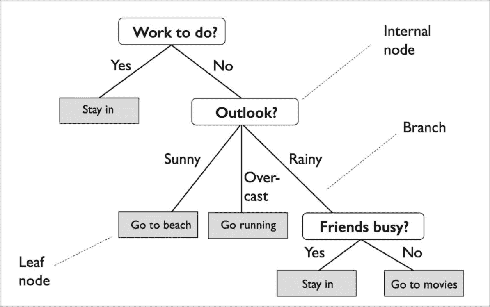

## 决策树的应用

决策树被用于几个领域有很多原因。数据挖掘者使用决策树来分析数据。它也常用于机器学习及类似的活动。例如，可以使用决策树利用历史销售数据来评估品牌扩张的机会。它还可以利用人口统计数据来确定潜在客户。许多公司使用决策树来评估它们在市场上的表现并确定买家。这使他们能够调整营销策略以适应目标客户。它还能告诉他们问题所在区域以及如何接触买家。了解潜在买家使公司能够限制广告预算。大多数情况下，公司花费大量资金创建广告，却不知道目标投向哪里。他们最终的损失多于利润。即使产品销售额巨大，他们也无法扭亏。

决策树还用于通过预测模型预测借款人违约的可能性。公司破产的原因之一就是违约借款人。有些人在归还借款时并不遵守承诺。为了规避这些人，公司可以使用从历史数据中获得的预测模型来识别此类人员。这样做节省了公司的时间和运营成本。

决策树还用于运筹学，以确定一种有高概率达到设定目标的策略。在不知道最终目标的情况下进行研究是没有意义的。决策树有助于进行决策分析并使研究人员的工作变得简单。许多行业已使用决策树来解释数据，包括工程、金融、能源、教育和商业。使用其他工具和技术分析数据的人们已经由于其优势而转向了决策树。

## 优点与特点

决策树具有许多优点，使其物有所值。它们易于理解。虽然有很多工具可以解决问题，但大多数工具非常复杂且需要技能。相反，决策树非常简单，不需要投入太多精力就能理解。即使是没有分析知识的人也可以使用决策树。理解决策树并不具备统计学知识。所使用的图形表示法简单，用户可以产生共鸣。此外，它们有一个用户可以认同的简单假设。

决策树在数据探索方面非常有效。它们在识别最佳变量和变量之间的联系方面非常有用。由于其优势，决策树有助于决策分析并使研究人员的工作变得轻松。许多行业已使用决策树来解释数据，包括工程、金融、能源、教育和商业。使用其他工具和技术分析数据的人们已经由于其优势而转向了决策树。

# 第 9 章：K 近邻算法 (KNN) 

K 近邻算法是分类和回归问题中最简单且最常用的学习算法。这种类型非常直观且易于掌握。对于所解决的谜题，结果的价值基于邻居值的选择。其目的是通过遵循其 K 个最近邻来对最常见的类别进行分类。KNN 有时也用于回归，其中输出值是根据最连续的值预测的。输出值可以是整个类别（k 个最近邻）的平均值或中位数。在回归和分类问题中，与`k`对应并用于训练的输入值通常位于特征空间中。所得到的结果取决于使用 KNN 的机器学习类型，即分类或回归。

简单来说，KNN 算法可以定义为通过将对象归类到其接近的组来对其分类。该方法考虑了集合中的特征和数据点。对于算法函数，过程将尝试通过观察相同状态下对象`X`附近的端点，来寻找对象`X`所属于的组。结果通过确定大多数特征所在的位置来建立。例如，如果一个对象的大部分点落在组`Y`中，则对象`X`被归类为组`Y`。这种识别项目`X`所属组的方法用于分类。它的工作方式类似于对邻居进行多票投票，然后将该项目分配到其`k`个最近邻大多数所落的组中。当评估完成且`k`的值为`1`时，则该对象被归类为该类。

KNN 有时被称为“懒惰学习器”，因为它的计算值需要时间。KNN 基于估计，数学分析通常被留到分类的最后一步。在回归和分类问题中，单个单元应被设定为一类的平均值。这是为了确保该单元中最近的邻居对指标的贡献比远离该类的邻居更多。例如，一个良好的模型会在`1/x`处设置一个值，其中`x`是最近邻居之间的距离。对于分类问题，邻居是从在特征和其他参数方面具有已知值的单元中选择的。尽管在 K 近邻理论中进行的训练较少，但该组可以被视为训练数据集。

k 临邻算法的一个显著特征是其对数据集组件和组成的敏感性。可用于 k 近邻算法的训练数据示例是带标签的向量，通常应用于具有许多维的特征空间。算法通过隔离训练数据集中的特征向量和带标签类别来学习。在对象分类的过程中，`k`的值通常是常数，并由系统用户设置。在此过程中，一个没有标签的向量（用于测试数据）通过查看在整个训练集中频繁出现且距离该向量最近的标签被分配一个组。训练数据集也称为`k`样本。对于连续变量，欧几里距离是解决范围相关问题的常用参数。对于不连续（也称为离散）变量，则使用不同的设置来解决问题。通过引入其他研究距离空间元素的独特算法，可以增强最近邻算法的性能。

### 在 K 近邻算法中寻找 K 的值

在 K 近邻算法中，`k`的值通常是常数并由系统用户设置。在此过程中，一个没有标签的向量（用于测试数据）通过查看在整个训练集中频繁出现且距离该向量最近的标签被分配一个组。训练数据集也称为`k`样本。对于连续变量，欧几里距离是解决范围相关问题的常用参数。对于不连续（也称为离散）变量，则使用不同的设置来解决问题。通过引入其他研究距离空间元素的独特算法，可以增强最近邻算法的性能。

`k`的值通常是常数并由系统用户设置。在此过程中，一个没有标签的向量（用于测试数据）通过查看在整个训练集中频繁出现且距离该向量最近的标签被分配一个组。训练数据集也称为`k`样本。对于连续变量，欧几里距离是解决范围相关问题的常用参数。对于不连续（也称为离散）变量，则使用不同的设置来解决问题。通过引入其他研究距离空间元素的独特算法，可以增强最近邻算法的性能。

`k`的值通常是常数并由系统用户设置。在此过程中，一个没有标签的向量（用于测试数据）通过查看在整个训练集中频繁出现且距离该向量最近的标签被分配一个组。训练数据集也称为`k`样本。对于连续变量，欧几里距离是解决范围相关问题的常用参数。对于不连续（也称为离散）变量，则使用不同的设置来解决问题。通过引入其他研究距离空间元素的独特算法，可以增强最近邻算法的性能。

`k`的值通常是常数并由系统用户设置。在此过程中，一个没有标签的向量（用于测试数据）通过查看在整个训练集中频繁出现且距离该向量最近的标签被分配一个组。训练数据集也称为`k`样本。对于连续变量，欧几里距离是解决范围相关问题的常用参数。对于不连续（也称为离散）变量，则使用不同的设置来解决问题。通过引入其他研究距离空间元素的独特算法，可以增强最近邻算法的性能。

`k`的值通常是常数并由系统用户设置。在此过程中，一个没有标签的向量（用于测试数据）通过查看在整个训练集中频繁出现且距离该向量最近的标签被分配一个组。训练数据集也称为`k`样本。对于连续变量，欧几里距离是解决范围相关问题的常用参数。对于不连续（也称为离散）变量，则使用不同的设置来解决问题。通过引入其他研究距离空间元素的独特算法，可以增强最近邻算法的性能。


`k` 的值通常是常数并由系统用户设置。在此过程中，一个没有标签的向量（用于测试数据）通过查看在整个训练集中频繁出现且距离该向量最近的标签被分配一个组。训练数据集也称为 `k` 样本。对于连续变量，欧几里距离是解决范围相关问题的常用参数。对于不连续（也称为离散）变量，则使用不同的设置来解决问题。通过引入其他研究距离空间元素的独特算法，可以增强最近邻算法的性能。

### 1. K-means

`K-means` 是一种无监督算法，通过将数据分组以形成 `k` 个聚类来工作。

### 2. K 最近邻 (K nearest neighbor)

作为一种监督算法，它通过使用学习数据中的指标来产生新数据。`KNN` 通过根据 `k` 值来分配点，其中 `k` 值代表最近的数据点。尽管在范围和功能上存在，但 `k nearest neighbor` 算法和 `k means` 算法都是通过考虑数据集内部的距离工作的。

### K 最近邻算法的局限性

`k nearest neighbor` 分类方法的一个显著局限是类别之间存在偏差。如果类别内元素的分布是扭曲的，那么单元内的大多数项将使指标向它们的一倾斜。例如，特征空间内的主导特征将吸引估计值到这些点，因为这些点在单元内几乎无处不在。

然而，这种偏差可以通过许多方法缓解。克服偏见的最常见方法是在类中设置一个平均指标点。当 `k nearest neighbor` 之间的距离被大幅度加权时，就能找到平衡。

解决回归中的偏差问题需要不同的方法。`k nearest neighbors` 的单元通过一个平均权重值交叉，该权重与组内两点之间的距离成反比。这是从 `nearest neighbor` 到测试点的距离。可以使用的另一种额外方法是代表每个类的数据进行泛化。一个例子是 `self-organizing map` 中的代表节点，它们代表了数据集的核心点。因此，无论类内元素的分布如何，它们都处于中心位置。

### K 最近邻的优点

作为所有机器学习算法中最简单、直接的一种，`k nearest neighbor` 算法具有许多优点。`k nearest neighbor` 也被称为懒惰学习者。这个名字来源于该算法在训练期间不学习任何东西。然而，在需要执行任务时，它会有优势。缺乏训练期可以看作是其的一种优势。

该算法存储一组学习数据并在需要预测时使用它们。这一过程确保了 `KNN` 算法在所有需要训练的机器学习算法中是最快的。在 `k-nearest neighbor` 中可以完美地引入额外的数据集，而不会改变预测准确性。这一点得到了不需要训练这一事实的支持。`k nearest neighbor` 算法只需要两个指标即可运行。这两个参数是 `k factor` 和 `distance function`。这使得算法简单且易于设计。

### K 最近邻的缺点

该算法在处理大量数据时可能无效。大型数据集点与点之间存在巨大的范围，导致算法失效。如上段所示，算法无法在高维数据上工作。当数据分布很广时，估计最近点之间的距离变成了一个挑战。`K nearest neighbor` 算法容易受到数据中噪声和其他不规则的影响。为了提高有效性，引入了人工方法来消除离群值并引入系统中不存在的值。该算法通常需要进行特征缩放。

## 第 10 章：基于 Python 的随机森林算法

这种算法是近年来可用且最常见的。有几个因素你需要理解这种算法。该算法的主要目标是帮助使用原始自然数据进行回归和分类计算。

当你谈到 `random forest` 时，你指的是包含多个 `decision trees` 的学习方法集合。`Random forest` 通过计算树的平均值来改进结果。

### 决策树

它们指的是 `decision trees`，主要处理二值规则。它们适用于回归等连续数据，也适用于分类。

### 随机森林示例

模型示例包括 `logistic regression`、`naïve Bayes` 和 `support vector machines`。在大多数情况下，当 `decision trees` 被完全采样并均匀分布到森林时，它的效果最好。

你也可以说 `random forest` 是一种由一组结构化排列树组成的分类器。从外行的语言来说，你可以推断出 `random forests` 由一组独立采样的树的预测器组成。因此，你也可以将其称为“树的森林”。

### 随机森林的优点

- 它显然适用于回归问题和分类。
- 它有助于减少过拟合，特别是在 `trees` 内部。这些都是通过执行平均化来实现。
- 它是最准确的算法，因为只有当使用的数据中超过一半是错误的时，它才会给出错误的预测。
- 值得注意的是，这种机器学习算法完全依赖于 `ensemble learning`。

### 随机森林的缺点

- 它在某些数据集上具有令人讨厌的且重叠的过拟合趋势，特别是带有回归任务和噪声分类任务的数据集。
- 与决策树算法等算法相比，这是一种高成本且极其复杂的算法。
- 它的训练耗时很长，因为它包含了大量的决策树组合。

决策树和随机森林算法在数据计算和结果预测中扮演着不同的角色。此外，这两种都有特定的实现时间，即你最终在现实生活中应用它们的确切时。下面的插图为我们解释了何时使用这两种数据预测算法的方面。

### 何时应用决策树

- 当你倾向于使用具有许多可解释属性的简单模型时，可以使用决策树。
- 你也可以使用这种方法，特别是当你希望模型是非参数化的时。
- 当你不担心任何形式的多重共线性，或者与正则化或特征选择有关的问题时，也可以应用这种方法。

### 何时应用随机森林

- 当你需要良好的数据预测准确性，即使你不在乎模型的解释性时。
- 当你在使用验证集寻找准确性时。

### 如何执行随机森林算法

下面的插图展示了如何完成此类算法的清晰分步指南。

1. 你可以开始从数据集的随机记录中选取一个随机数，例如 `X`。
2. 尽可能根据你的 `X` 记录尝试计算出一棵决策树。
3. 你现在可以选择你需要的数量，特别是树的数量。然后，你可以重复这些步骤（即步骤 1 和步骤 2）。
4. 例如，如果你正在解决回归问题并处理一条新记录，这些特定森林中的每棵树都将有一个输出值 `Y`。在这种情况下，你可以通过计算所有预测的平均值来快速获得最终值。
5. 同样，如果是分类问题，预测将缩小到单棵树，即每棵树都参与对新记录的分类预测。最终，获得多数票的类别将具有处理新记录的权限。

### 随机森林中的特征选择方法

随机森林在技术领域非常受欢迎。这的主要属性是它们的稳健性、准确性，而且你可以更方便地使用它们。它提供了两种可以在特征选择中使用的严格方法，如下插图所示。

#### 不纯度平均减少 (Mean Decrease Impurity)

随机森林由各种决策树组成。这些决策树中的每个节点代表一个单一特征的情况。这里节点的主要功能是将数据集分成两个部分，使得同一组在末尾具有相似的值。所有这些发生在最优水平条件下，你可以将其称为不纯度。然而，在分类中，你可以将其称为 Gini 不纯度或信息增益（后者也是熵）。在大多数情况下，在回归中你可以将其称为方差。因此，在进行某种树训练时，你最终可以计算每个特征对加权不纯度减少的量。在森林的情况下，你可以通过获取平均值来计算减少的不纯度，稍后使用相同的标准对其进行排名。然而，在这种方法中，有一些非常重要的点需要牢记心中。第一点当计算更多类别时，产生偏差的概率很高。需要记住的一点是它等对待所有相关特征，当你将其中一个作为预测器时，其他特征的重要性就会降低。这是因为一个特征减少了其他特征的不纯度。

#### 准确率平均减少 (Mean Decrease Accuracy)

这一类涉及通过直接测量获取影响特征的准确性。这里的主要目标是检测置换引起的不准确性减少水平，特别是在准确性模型内部。

### 总结

随机森林在利用计算机解决日常问题和任务的方法中占很大比例。它们在特征排序方面表现优秀，因为你可以轻松应用它们。同样要注意，随机森林对其特征的最小工程技术要求较低。此外，它不需要过多的参数调优。结果，你会发现不纯度平均减少的暴露，特别是在这些库中。然而，所有这些都存在严重问题，特别是当你处理数据解释时。这时，在相关特征中，强特征获得低得分的概率很高。由于由于，你最终会受到包含多个类别变量偏差问题的影响。尽管如此，你可以将所有关键问题留存在心中，并在你的数据上使用这种方法。同样值得注意的是，有时预测结果可能会出现错误且准确性不高。然而，我们始终可以使用几种方法来改进结果。第一种方法涉及对算法内部使用的参数进行微调。在这种情况下，关键参数包括分裂特征、树深度以及树的总数。

# 第 11 章：感知机算法 

在本章中，我回顾了感知机算法，对其进行了定义，并进一步阐述了它的工作原理。在此过程中，在开始学习感知机学习算法之前，我重温了你们对线性代数必要部分的记忆。这种循序渐进的讲解旨在引导学习者理解并视觉化机器学习的概念，并特别关注感知机。我希望在章节结束结束时，你们已经获得了入门所需的洞察力和知识。此外，建议学习额外的辅助材料。

### 局限性与预防措施

在系统的训练阶段，应当帮助感知机算法从适应数据中学习。这是为了确保预测准确并杜绝错误。输入向量的呈现应当反映出一个严谨的过程。这确保了感知机与指标保持匹配，并且系统在发生错误时，可以通过返回到提供的输入向量来进行自我纠正。

这里的建议是，确保任何需要通过线性分离解决的问题都根据学习过程有了一套完整的解决方案。另一种诱导算法学习的方法是使用功能完备的训练。这种方法在算法内部建立网络，然后为感知机产生输入向量。之后，可以根据需要修复的错误数量来修正系统。遗憾的是，这种方法面临收敛的不确定性。目前没有精确的方法可以引导感知机收敛。因此，不建议在训练感知机时使用 `train` 方法。

尽管围绕感知机学习算法的炒作很多，但它们并非没有局限性。第一个局限性是，感知机网络的输出结果只能假设为零 (0) 或一 (1) 值。没有中间值。这可以被看作是偏颇的结果或不准确的结果，因为有时我们期望其他值。感知机的第二个缺点是，它只能用于解决需要线性区分的问题。这意味着感知机仅能够处理那些可以用垂直平面分离的向量问题。如果一条直线无法分离这些向量，那么学习它们就会成为感知机网络的阻碍。然而，值得注意的是，专家们有证明表明，对于线性可分的数量，感知机学习算法可以迅速解决它们。

感知机可能表现出局限性。但公平地说，网络组合（包含多个感知机）可以应用于复杂的问题解决。例如，假设有四个问题（四个向量）需要解决，即通过一条直线将它们分离。在网络中拥有两个感知机的过程中，它将创建一个二维边界，将向量分为四个不同的组。

### 结论

算法是一种基于步骤为问题提供解决方案和答案的系统。在计算机科学中，算法为搜索问题提供结果，并根据用户的历史提供内容建议。此外，算法汇总大量数据来检测序列并对用户的习惯进行预测。算法还可用于支持现有的偏好，特别是在数字媒体上。例如，双击朋友在 Instagram 上展示的带有政治观点的在线文章，会让 Instagram 算法显示你对所发表的政治观点感兴趣。

在未来，Instagram 可能会设置你的动态包含这些。如上所述，机器学习算法已成为我们社交媒体互动的重要部分。回答“算法能够中立吗？”这个问题，回顾过去算法被认为具有攻击性的实例至关重要。一个很好的例子是 Reddit 的机器学习算法提供了一个平台，让点赞最多的文章出现在搜索结果顶端，从而促进了 2013 年波士爆炸案期间虚假新闻的传播。结果，一名失踪学生苏尼尔·特里帕（Sunil Tripathi）被误指实施了攻击。

如今，几乎所有的技术技能都受到机器学习引入带来的变革模型的影响。这一事实并没有改变自然和人力资源有限的事实。因此，在社会活动中引入智能机器应当采取预防措施以缓解任何潜在风险。机器学习的渐进程序可能有助于引导工业流程走向理想的出路。然而，这些方法不应被程序为以相同的方式解决相同的优化问题。大量的新数据集和信息对于完善本课程是必要的。

本着同样的精神，神经网络算法的开发者和用户应该继续进行创新过程和研究，为每个问题寻找最合适的方案。本书的结构旨在引导我的读者，使他们掌握必要的 Python 机器学习知识和相关算法。因此，寻找额外的资源来增强从书中已获得的技能至关重要。对于初学者，我建议在学习这本书之前，先使用我的书籍《初学者机器学习指南》来熟悉机器学习概念。我希望这本书对你们有所帮助，感谢大家与我一同前行。
