# 初学者的 Python 机器学习


## 免费下载本书的有声书版本

如果您喜欢随时随地收听有声书，我有个好消息告诉您。只需注册免费的 30 天 Audible 试用，即可免费下载本书的有声书版本！详情请见下文！


### Audible 试用权益

作为 Audible 客户，您将在 30 天免费试用期内获得以下权益：

*   本书的免费 Audible 书籍副本
*   试用期结束后，您每月将获得 1 个积分，可用于兑换任意有声书
*   如果您不使用积分，它们会自动结转至下个月
*   可从 Audible 200,000+ 种书目中进行选择
*   可通过多设备上的 Audible 应用随时随地收听
*   轻松、无忧地交换任何您不喜欢的有声书
*   永久保留您的有声书，即使您取消会员资格
*   以及更多福利

点击下方链接开始体验！

[面向 Audible 美国站](https://www.audible.com/pd/B07X649M49/?source_code=AUDFPWS0223189MWT-BK-ACX0-162611&ref=acx_bty_BK_ACX0_162611_rh_us)

[面向 Audible 英国站](https://www.audible.co.uk/pd/B07X1ZY6PZ/?source_code=AUKFrDlWS02231890H6-BK-ACX0-162611&ref=acx_bty_BK_ACX0_162611_rh_uk)

[面向 Audible 法国站](https://www.audible.fr/pd/B07X227S2V/?source_code=FRAORWS022318903B-BK-ACX0-162611&ref=acx_bty_BK_ACX0_162611_rh_fr)

[面向 Audible 德国站](https://www.audible.de/pd/B07X754TWY/?source_code=EKAORWS0223189009-BK-ACX0-162611&ref=acx_bty_BK_ACX0_162611_rh_de)

---


---

## 简介

欢迎阅读本书，衷心感谢您的下载。本书将从零基础角度全面涵盖 Python 编程，并重点讲解前三章，以帮助读者打好基础。第 3 章介绍如何安装和运行 Python IDE，以及编写您的第一个“Hello World 程序”。

本书基于读者完全不懂 Python 编程的前提编写。因此，作者力求不预设前提、不遗漏任何细节。与其他书籍不同，作者将原本属于第 1 章的内容拆分为三章，以循序渐进的方式引导学习者入门 Python 编程。作者系统地讲解了如何入门、关键字、语句、变量、数据类型和类型转换等 Python 编程的基础领域。在提供示例后，作者还提供了练习。练习经过精心挑选，不会让零基础初学者感到负担过重。它们旨在帮助学习者系统地建立 Python 编程技能和信心。读完本书后，学习者将完全准备好应对任何 Python 编程挑战。让我们开始吧。

---

## 第 1 章：机器学习简介

本章讨论的主题源自对热门科技公司数据科学家职位主要要求的分析。主题如下：

*   线性回归（简单）
*   线性回归（多元）
*   模型性能评估
*   层次聚类
*   KNN
*   核 SVM
*   K-Means 聚类
*   主成分分析 (PCA)
*   Pandas（用于处理信息或数据的 Python 库）

人工智能、机器学习和数据科学是当今技术领域最热门的学科之一。贝叶斯分析和数据挖掘是目前最热门的方向，这也导致了对机器学习 (ML) 需求的不断增长。

机器学习是一个专注于计算机系统编程的领域，使其能够自动通过经验学习和改进。

### 机器学习算法的应用

*   数据挖掘
*   游戏
*   机器人技术
*   专家计算机系统
*   模式识别
*   视觉处理
*   语言处理
*   股市趋势与天气预测

### 机器学习涉及的流程

一个高效的机器学习项目包含以下步骤：

*   问题定义
*   数据准备
*   算法评估
*   结果改进
*   结果展示

使用 Python 入门机器学习的最佳方式是从头到尾完成一个项目，涵盖总结数据、评估算法、加载信息和预测等主要步骤。这将为您提供一种可复用的技术，可用于每个数据集。添加更多数据以改进结果也是一种可选方案。

要理解机器学习，您需要了解文件在 Python 中是如何工作的。下一节将讨论 Python 文件。

## Python 文件

文件用于持久化存储。要从文件读取，我们需要打开它，用完后必须关闭它以释放资源。

### 文件打开

Python 的内置函数 `open()` 用于打开文件。

**示例**

启动 IDLE。

导航至“文件”菜单并点击“新建窗口”。

输入以下内容：

```
file_name = open("lesson.txt")
file_name = open("D:/Tutorials/lesson.txt")
```

**练习**

a. 在您的计算机上找到一个文本文件，并使用 Python `open()` 打开它
b. 在您的计算机上找到一个 doc/docx 文件，并使用 Python `open()` 打开它
c. 在您的计算机上找到一个 Excel 文件，并使用 Python `open()` 打开它

此外，在打开文件时追加 `'a'`、写入 `'w'` 或读取 `'r'` 有助于指示模式。模式由上下文决定，可根据需要进行更改。Python 还允许我们根据编程需求指定二进制或文本模式。默认情况下，文件以文本读取模式打开。图像和非文本文件在二进制模式下处理。

### Python 文件模式

`'r'` 用于以读取模式打开文件，这是默认模式。`'w'` 用于以写入权限打开文件。对于独占文件创建，我们使用 `'x'` 模式；如果目标文件已存在，操作将失败。另一种模式 `'a'` 用于以追加模式打开文件，在文件末尾添加数据的同时保留原有内容。`'t'` 模式以默认文本模式打开文件。`'b'` 模式以二进制模式打开文件。最后，`'+'` 模式用于打开文件以允许读取和写入。

**练习**

a. 在计算机上以 Python 的读取模式打开一个现有的 `.txt` 文件。
b. 以 Python 的写入模式打开练习 a 中的同一个文本文件。
c. 以二进制模式打开计算机上的一张现有图片。

### 指定文件编码类型

建议指定文件编码类型，因为它因操作系统平台而异，如果不指定可能会产生不同的结果。

**示例**

启动 IDLE。

导航至“文件”菜单并点击“新建窗口”。

输入以下内容：

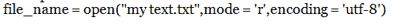

### 在 Python 中关闭文件

使用 `close()` 方法。

**示例**

启动 IDLE。


# Python 文件操作与异常处理

## 打开与关闭文件

导航到 **File** 菜单并点击 **New Window**。

输入以下内容：

```
file_name = open("my text.txt", encoding='utf-8')
file_name.close()
```

## 练习

a. 在计算机上找到一个 `.txt` 文件，使用 `open()` 打开它，并使用 `close()` 关闭它。

b. 在计算机上找到一个 `.doc` 文件，使用 `open()` 打开它，并使用 `close()` 关闭它。

### 重要提示

如果在对文件执行某些操作时发生异常，这种方法将在不关闭文件的情况下退出。我们将探讨什么是异常，但可以将其视为程序执行期间发生的意外错误。`try..finally` 块用于处理在 Python 中尝试关闭文件时可能出现的不可预见的情况。

#### 示例

启动 IDLE。

导航到 **File** 菜单并点击 **New Window**。

输入以下内容：

```
try:
    file_name = open("my text.txt", encoding='utf-8')
finally:
    file_name.close()
```

采用这种第二种方法，用户可以确信即使发生意外错误中断程序流程，文件也能正确关闭。在这种情况下，`close()` 方法不必显式调用，因为它会在内部自动完成。

## 在 Python 中写入文件

在 Python 中写入文件使用三种模式：用于写入的 `'w'`、用于追加的 `'a'` 或用于独占创建的 `'x'`。`'w'` 模式会覆盖文件，使用时应谨慎。

#### 示例

启动 IDLE。

导航到 **File** 菜单并点击 **New Window**。

输入以下内容：

*(图片引用：`Images/image00205.gif`)*

## 在 Python 中读取文件

在 Python 中，必须以读取模式打开文件才能读取它。Python 中有多种方法可用于读取文件。如果未指定 size 参数，该方法将读取并返回直到文件末尾的内容。

启动 IDLE。

导航到 **File** 菜单并点击 **New Window**。

输入以下内容：

*(图片引用：`Images/image00206.gif`)*

## 练习

a. 在计算机上找到并使用 `open()` 以读取模式打开一个 `.txt` 文件。

b. 在 (a) 中，读取文件的前三个数据项。

c. 读取 (a) 中文件的前五个数据项。

d. 读取整个文件。

e. 在 (d) 读取后继续读取。

### 在 Python 读取文件时使用 `for` 循环

`for` 循环允许我们逐行读取文件。

启动 IDLE。

导航到 **File** 菜单并点击 **New Window**。

输入以下内容：

*(图片引用：`Images/image00207.gif`)*

我们现在包含控制语句。

*(图片引用：`Images/image00208.gif`)*

### 注意

文件包含换行符 `\n`。`print()` 函数的 `end` 参数有助于在输出时避免产生两个换行。

### Python 中用于读取单个文件行的 `readline()`

#### 示例

启动 IDLE。

导航到 **File** 菜单并点击 **New Window**。

输入以下内容：

```
file_name.readline()
file_name.readline()
file_name.readline()
file_name.readline()
```

## Python `readlines()` 方法

对于 `readlines()` 方法，它将扫描整个文件的所有行。读取完整个文件后，读取方法将报告空状态。报告空状态的原因是因为没有更多行供该方法处理。`read()` 方法将遍历文件中的每一行，直到没有更多行可扫描。

#### 示例

启动 IDLE。

导航到 **File** 菜单并点击 **New Window**。

输入以下内容：

```
file_name = open("my text.txt", 'w')
file_name.write("In my first file\n")
file_name.write("Great file\n\n")
file_name.write("Has three lines\n")
file_name.readlines()
```

## 练习

a. 使用 `readline()` 方法读取计算机上 `.txt` 文件的每一行。

b. 现在使用 `readlines()` 方法读取 (a) 中 `.txt` 文件的全部内容。

## Python 文件方法

这些方法使用户能够以简单高效的方式操作文件。这些方法已预加载，用户只需了解它们可以在何处应用。

*(图片引用：`Images/image00209.gif`)*

## Python 中的目录

Python 允许我们将多个文件整理到不同的目录中，以便于处理。Python 中文件和子目录的集合称为目录。Python 中的 `os` 模块包含用于处理目录的方法。

### 在 Python 中获取当前目录

`getcwd()` 方法用于获取当前工作目录。该方法将以字符串形式返回当前工作目录。`getcwdb()` 也用于获取目录（以字节形式）。

### 更改目录

`chdir()` 方法有助于修改现有目录。但是，我们打算创建的新路径应作为字符串参数给出。路径元素可以使用反斜杠 `\` 或正斜杠 `/` 分隔。

#### 示例

启动 IDLE。

导航到 **File** 菜单并点击 **New Window**。

输入以下内容：

```
os.chdir('C:\\Tutorial')
print(os.getcwd())
```

## 练习

使用 `chdir()` 更改计算机上 Python 根文件夹中的一个目录。

### 列出文件和目录

Python 中的 `listdir()` 方法用于确定目录中的所有文件和子目录。

`listdir()` 方法接受一个路径并返回该特定路径下的文件列表和子目录。如果未指定路径，`listdir()` 将从当前工作目录返回。

#### 示例

启动 IDLE。

导航到 **File** 菜单并点击 **New Window**。

输入以下内容：

```
print(os.getcwd())
# C:\Tutorial
os.listdir()
os.listdir('D:\\')
```

## 创建新目录

`mkdir()` 方法可用于创建新目录。该方法接受新目录的路径，如果未定义特定路径，将在当前工作目录中创建新目录。

```
os.mkdir('week2')
os.listdir()
```

## 在 Python 中重命名文件或目录

在 Python 中，`rename()` 方法用于重命名文件或目录。旧名称作为参数 1 给出，新名称作为参数 2 给出。

#### 示例

启动 IDLE。

导航到 **File** 菜单并点击 **New Window**。

输入以下内容：

*(图片引用：`Images/image00210.gif`)*

## 练习

使用 Python 方法创建一个目录并将其命名为 `Lesson`。使用 Python 方法将其重命名为 `Python Lessons`。

## 在 Python 中删除文件或目录

`remove()` 方法用于在 Python 中删除文件。同样，`rmdir()` 用于删除空目录。

#### 示例

启动 IDLE。

导航到 **File** 菜单并点击 **New Window**。

输入以下内容：

```
os.listdir()
# ['mine_direct']
os.rmdir('mine_direct')
```

## 错误与异常

当 Python 解释器遇到错误时，它将引发异常。例如，用零除以一个数字将导致异常。

### 错误示例

启动 IDLE。

导航到 **File** 菜单并点击 **New Window**。

输入以下内容：

```
if y < 3
    if y < 3
```

在运行时，仍可能发生错误，例如当我们打开一个不存在的文件时。文件可能不存在是因为它已被重命名，而我们正使用旧名称访问它，或者该文件已被删除。该文件可能具有相同的名称但更改了文件扩展名。每当发生这些类型的运行时错误时，Python 将创建一个异常对象。

## Python 内置异常

Python 有多个内置异常，当相关错误出现时会被标记。`dir()` 函数（可能是指 `local()`）可以帮助列出 Python 中所有的内置异常。

*(图片引用：`Images/image00211.jpeg`)*

## Python 异常处理

如果发生异常，程序的执行将停止，并将异常传递给调用进程进行处理。如果异常未被处理，程序将崩溃。

**思考：** 你是否尝试过打开一个显示“应用已停止”的智能手机应用？你能想象一个程序因为找不到你试图附加的图片而崩溃吗？异常处理对于创建有效的程序以及安全性至关重要。你能想象如果黑客意识到你的程序每次无法加载图片就会崩溃并需要重启？黑客将有机可乘来破坏你的软件。幸运的是，异常处理允许我们预判并在程序遇到异常时给出一条出路。

## 在 Python 中通过捕获异常来处理异常

启动 IDLE。

导航到 **File** 菜单并点击 **New Window**。


## 用户自定义异常

有时用户可能需要创建自己的异常，以最符合您的编程需求，这些被称为用户自定义异常。

用户必须创建一个新类并从 `Exception` 类派生。

## 总结

文件用于持久化存储。要从文件读取，我们需要打开它，完成操作后，必须关闭它以释放 Python 中与文件关联的资源。Python 的内置函数 `open()` 用于打开文件。调用此函数时，会访问并加载一个文件对象，有时称为句柄，用于相应地修改或读取文件。对于 `readlines()` 方法，它将扫描整个文件的所有行。读取完整个文件后，读取方法将报告空状态。报告空状态的原因是因为没有更多参数供该方法处理。`read()` 将遍历文件中的每一行，直到没有更多行可扫描。

`r` 用于以读取模式打开文件，且为默认模式。`w` 用于以写入模式打开文件。对于独占文件创建，我们使用 `x` 模式。如果要创建的文件已存在，操作将失败。另一种模式 `a` 用于以追加模式打开文件，在文件末尾添加数据的同时保留原有内容。如果文件不存在，`a` 模式将创建一个新文件。对于 `t` 模式，它将以默认文本模式打开文件。`b` 模式用于以二进制模式打开文件。最后，`+` 模式用于打开文件以允许读取和写入。

# 第 2 章：机器学习的主要概念

什么是机器学习工作流？典型的机器学习工作流的核心步骤有哪些？

本章讨论机器学习项目的工作流，这包括从头构建一个合适的机器学习项目所需的所有步骤。

我们还将介绍数据预处理、数据清洗、特征探索和特征工程，并展示它们对机器学习模型性能的影响。我们还将介绍一些预建模步骤，这些步骤有助于提高模型性能。

完成任务所需的 Python 库：

*   `Numpy`
*   `Pandas`
*   `Sci-kit Learn`
*   `Matplotlib`

## 机器学习工作流概述

### 理解机器学习工作流

我们可以将机器学习工作流定义为 3 个阶段。

1.  收集数据
2.  数据预处理
3.  研究最适合该数据类型的模型
4.  训练和测试模型
5.  评估

好的，但首先让我们从基础开始

### 什么是机器学习模型？

机器学习模型可以定义为一段程序，数据科学家或工程师通过使用数据对其进行训练使其变得“聪明”。因此，例如，如果你给模型喂入垃圾数据，它将产生垃圾结果，这意味着如果输入无效数据或垃圾数据，训练好的模型将提供错误或虚假的预测。

## 数据预处理

这是机器学习中必不可少的程序之一。它是使机器学习模型更准确的最重要步骤。在机器学习中，有一个 80/20 法则。每个数据科学家应花费 80% 的时间进行数据预处理，20% 的时间进行分析。

### 什么是数据预处理？

数据预处理是指清洗原始数据的过程。从现实世界收集的数据通常会被转换为一组干净的数据。每当从不同来源收集数据时，它通常处于原始形式，这种数据不适合分析阶段。

因此，遵循特定程序将数据转化为精简干净的数据集；这个过程称为数据预处理。

#### 研究最适合该数据类型的模型

我们的主要目标是使用预处理后的数据训练出性能最好的模型。

##### 监督学习

在监督学习中，人工智能系统被提供带标签的信息或数据，这意味着每个数据都标记有正确的标签。

监督学习分为另外两类：回归和分类。

###### 分类

分类问题是指目标变量是分类型的（意味着输出可以被分类——它属于类别 A 或类别 B 或其他）。

分类问题是指输出变量是一个组别，例如蓝色或红色、无疾病或有疾病、非垃圾邮件或垃圾邮件。

这些是一些最常用的分类算法。

*   `KNN`
*   `Naive Bayes`
*   `Random Forest`
*   `Logistic`

###### 回归

当目标变量是连续型时（意味着输出是数值），会发生回归问题。

回归

如上图所示，我们可以想象图表的 X 轴是 `Test scores`（考试分数），Y 轴代表 `IQ`。所以我们尝试在给定的图表中创建[最佳拟合线](https://mathbits.com/MathBits/TISection/Statistics1/LineFit.htm)，以便我们可以使用该线来预测给定数据中不存在的任何近似 IQ 值。

这些是一些最常用的回归算法。

*   `Linear`
*   `Support Vector`
*   `Decision Trees`
*   `Gaussian Progresses`
*   `Ensemble Methods`

##### 无监督学习

对于无监督学习，人工智能系统被输入未分类和未标记的数据，并且系统的算法在训练前处理数据。结果输出取决于编程或编码的算法。让系统接触无监督学习是测试人工智能的方法之一。

无监督学习分为另外两组，称为聚类和关联。

###### 聚类

一组输入被分成若干组。与分类不同，这些组在开始时是未知的，这使其成为一个无监督的过程或任务。

用于聚类的方法有：

*   `K-Means`
*   `Gaussian`
*   `Boosting`
*   `Hierarchical`
*   `Spectral`

### 类别下的模型概述

### 在数据上训练和测试模型

为了训练模型，我们最初将数据分成三个部分：训练数据、验证数据和测试数据。

分类器通常使用训练数据集进行训练，请确保使用验证数据集准备所需的参数，然后使用未见过的测试数据集测试分类器的功能。需要注意的一个关键点是，当你训练分类器时，只有训练和验证数据集可用。训练分类器时不应使用测试数据集。测试数据集通常在测试分类器时可用。

如果我必须用几个标题总结 2018 年机器学习进展的主要亮点，这些可能是我会想到的：

*   AI 炒作和恐惧散布逐渐冷却。
*   更多地关注公平性、可解释性或因果性等具体问题。
*   深度学习将长期存在，并且在实践中不仅对图像分类有用（特别是对自然语言处理 NLP）。
*   AI 框架领域的竞争日益激烈，如果你想出人头地，最好发布一些自己的框架。


# 2018 年人工智能回顾：从炒作降温到务实落地

## 概况

2017 年大概是人工智能恐慌论与炒作的分水岭（正如我在[去年的回答](https://www.quora.com/What-are-the-most-significant-machine-learning-advances-in-2017/answer/Xavier-Amatriain)中提到的），而 2018 年似乎成为了我们开始冷静下来的一年。虽然有些知名人士继续推销 AI 恐慌论，但他们可能忙于其他议题，未将其作为议程重点。同时，媒体和大众似乎已接受这样一个观点：自动驾驶汽车等技术虽将到来，但不会一蹴而就。尽管如此，仍有声音主张[我们应该监管 AI](https://www.theverge.com/2017/7/17/15980954/elon-musk-ai-regulation-existential-threat)，而非专注于监管其结果。

今年值得欣慰的是，关注点似乎已转向可解决的具体问题。例如，关于公平性的讨论很多，不仅有多个相关会议（参见[FATML](http://www.fatml.org/)或[ACM FAT](https://fatconference.org/)），甚至还有谷歌推出的[在线课程](https://www.blog.google/technology/ai/new-course-teach-people-about-fairness-machine-learning/amp/)。

## Generation Unlimited

沿着这条思路，今年被广泛讨论的其他问题还包括可解释性、解释方法和因果性。从因果性开始，因果性之所以重回聚光灯下，主要归功于 Judea Pearl 的《因果推断之书》出版。作者不仅决定撰写其首部“通俗易懂”的著作，还在 Twitter 上推广因果性讨论。大众媒体也将其报道为对现有 AI 方法的“挑战”（例如[The Atlantic 的这篇文章](https://www.theatlantic.com/technology/archive/2018/05/machine-learning-is-stuck-on-asking-why/560675/?single_page=true)）。甚至 ACM Recsys 会议的最佳论文奖也颁给了探讨如何在嵌入中引入因果性的论文。尽管如此，许多其他作者认为因果性某种程度上是理论上的干扰，我们应重新聚焦于可解释性或解释方法等更具体的问题。说到解释方法，该领域的亮点之一可能是[Anchor](https://github.com/marcotcr/anchor)论文及代码的发布，这是同一作者知名的[LIME](https://homes.cs.washington.edu/~marcotcr/blog/lime/)模型的后续工作。

尽管关于深度学习作为最通用 AI 范式仍存疑问（我属于提出质疑的一方），而我们继续略过 Yann LeCun 与 Gary Marcus 关于此话题的第 N 轮讨论，但显然深度学习不仅将长期存在，且在其能提供的能力方面远未达到瓶颈。更具体地说，今年深度学习方法在视觉以外的领域取得了前所未有的成功，范围涵盖语言到医疗保健。

## NLP 领域的突破

今年最有趣的进展可能出现在 NLP 领域。若我必须评选年度最令人印象深刻的 AI 应用，两者皆为 NLP（且均来自谷歌）。第一个是[谷歌超实用的 Smart Compose](https://ai.googleblog.com/2018/05/smart-compose-using-neural-networks-to.html?m=1)，第二个是他们的[Duplex](https://ai.googleblog.com/2018/05/duplex-ai-system-for-natural-conversation.html)对话系统。

今年语言模型思想的普及加速了许多此类进展。我们随之看到了其他（且改进的）方法，如 Allen 的[ELMO](https://arxiv.org/abs/1802.05365)、[OpenAI 的 Transformers](https://blog.openai.com/language-unsupervised/)，或最近谷歌的[BERT](https://github.com/google-research/bert)，后者一经发布即打破多项 SOTA 结果。这些模型被描述为 NLP 领域的“ImageNet 时刻”，因为它们通过提供开箱即用的预训练通用模型（亦可针对特定任务微调），展示了迁移学习在语言领域的实用性。除了语言模型，还有许多其他有趣的进展，如[Facebook 的多语言嵌入](https://code.fb.com/ml-applications/under-the-hood-multilingual-embeddings/)。有趣的是，我们也看到这些及其他方法如何迅速集成到更通用的 NLP 框架中，如[AllenNLP](https://github.com/allenai/allennlp/releases/tag/v0.7.2)或 Zalando 的[FLAIR](https://github.com/zalandoresearch/flair)。

## 框架之战与强化学习

说到框架，今年“AI 框架之战”愈演愈烈。令人惊讶的是，就在[PyTorch 1.0 发布](https://developers.facebook.com/blog/post/2018/05/02/announcing-pytorch-1.0-for-research-production/)之际，PyTorch 似乎正在追赶 TensorFlow。虽然在生产环境使用 PyTorch 的情况仍不理想，但 PyTorch 在该方面追赶的速度，似乎快于 TensorFlow 在易用性、文档和教育方面的追赶速度。有趣的是，[Fast.ai](http://fast.ai/)库选择 PyTorch 作为实现框架，这很可能发挥了重要作用。尽管如此，谷歌对此心知肚明，并通过将[Keras](https://www.tensorflow.org/guide/keras)作为一等公民纳入框架，以及引入[Paige Bailey](https://dynamicwebpaige.github.io/info/)等关键开发者导向领导者，朝正确方向推进。最终，我们都能从获取这些优秀资源中受益，请继续保持！

有趣的是，框架领域另一个取得有趣进展的方向是强化学习。

虽然我认为 RL 研究进展不如往年令人印象深刻（仅近期 DeepMind 的[Impala](https://arxiv.org/pdf/1802.01561.pdf)工作令人印象深刻），但令人惊讶的是，在短短一年内，所有主要 AI 参与者都发布了 RL 框架。谷歌发布了用于研究的[Dopamine 框架](https://github.com/google/dopamine)，DeepMind（同样隶属谷歌）发布了某种程度上竞争的[TRFL](https://deepmind.com/blog/trfl/)框架。Facebook 推出了[Horizon](https://research.fb.com/publications/horizon-facebooks-open-source-applied-reinforcement-learning-platform/)，微软发布了[TextWorld](https://www.microsoft.com/en-us/research/blog/textworld-a-learning-environment-for-training-reinforcement-learning-agents-inspired-by-text-based-games/?OCID=msr_blog_textworld_icml_tw)，后者更专注于基于文本游戏的训练智能体。希望这些开源成果能助力我们在 2019 年见证大量 RL 进展。

最后，在框架方面，我欣喜地看到谷歌最近在 TensorFlow 之上发布了[TFRank](https://ai.googleblog.com/2018/12/tf-ranking-scalable-tensorflow-library.html)。排序是极其重要的 ML 应用，近期可能未获得应有的关注。

## 结语

深度学习似乎消除了对数据精心设计的需求，但事实远非如此。


# 深度学习数据改进的进展

该领域仍有一些非常有趣的进展，其核心思想围绕着改进数据。例如，虽然数据增强已经存在一段时间，且对许多深度学习应用至关重要，但今年 Google 发布了 [auto-augment](https://ai.googleblog.com/2018/06/improving-deep-learning-performance.html?m=1)，这是一种利用深度强化学习自动增强训练数据的方法。一个更极端的想法是使用合成数据训练深度学习模型。这在实践中已尝试一段时间，并被许多人视为人工智能未来的关键。

NVIDIA 在其论文 [《使用合成数据训练深度学习》](https://arxiv.org/abs/1804.06516) 中提出了有趣的新观点。在我们的论文 [《向专家学习》](https://arxiv.org/abs/1804.08033) 中，我们也展示了如何利用专家系统生成合成数据，这些数据随后可用于训练深度学习系统，甚至在与真实世界数据结合后依然有效。最后，同样有趣的是利用弱监督来减少对大量人工标注数据的需求。[Snorkel](https://blog.acolyer.org/2018/08/22/snorkel-rapid-training-data-creation-with-weak-supervision/amp/?__twitter_impression=true) 是一个非常有趣的项目，旨在通过提供通用框架来促进这种方法。

## AI 领域的基础性突破

就 AI 更基础性的突破而言，这可能与我及我的关注点有关，但我没有看到太多。我不完全赞同 Hinton 的观点，他认为缺乏创新是因为该领域存在 **“少数资深大牛和海量年轻小伙子”** 的现象，尽管科学界确实存在一种趋势，即 [突破性研究多在较晚年龄完成](https://phys.org/news/2011-11-breakthrough-scientific-discoveries-longer-dominated.html)。

依我之见，目前缺乏突破的主要原因在于，现有方法及其变体仍有许多有趣的实际应用，因此很难冒险去尝试那些可能无法立即见效的新方法。当该领域的大多数研究由大公司赞助时，这一点更为相关。虽然这种做法高度依赖经验且使用已知方法，但它也为发现新方法敞开了大门，因为它证明了通常被视为最优的方法并非如此。另一篇极具探索性的论文是最近获得 NeurIPS 最佳论文奖的 [《神经常微分方程》](https://arxiv.org/abs/1806.07366)，它挑战了深度学习中的一些基本概念，包括层这一概念本身。

有趣的是，这篇论文的动机源于一个项目，作者们在其中研究医疗数据（更具体地说是电子健康记录）。如果不提及 AI 与医疗交叉领域的研究，我就无法结束这篇总结，因为那是我在 Curai 的工作重点。不幸的是，该领域进展太多，我需要另写一篇文章才能覆盖。因此，我仅推荐大家关注 [MLHC 会议](https://www.mlforhc.org/) 和 [ML4H NeurIPS 研讨会](https://ml4health.github.io/2018/) 发布的论文。我们 [Curai](https://www.curai.com/) 团队在这两个会议上都有论文被录用，所以你们可以在那里找到我们的论文，以及许多其他有趣的论文，从而了解我们领域的最新动态。

# 使用 Python 进行机器学习中的对象与类

Python 支持不同的编程范式，因为它是一门多范式语言。Python 中的对象具有属性和行为。在使用 Python 面向对象编程语言学习机器学习时，理解对象和类至关重要。

## 示例：汽车作为对象

- **属性**：`color`、`mileage`、`model`、`age`
- **行为**：`reverse`、`speed`、`turn`、`roll`、`stop`、`start`

## 类

类是创建对象的模板。

#### 示例

```python
class Car:
```

### 重要提示

按照惯例，类名的首字母大写。按照惯例，类名使用单数形式。

## 语法

```python
class Name_of_Class:
```

通过简单地实例化类，我们可以从类构建对象。`class_name()` 运算符通过将对象赋值给空方法来创建对象。

## 对象/类实例化

从我们的 `Car` 类，我们可以拥有多个对象，如第一辆车、第二辆车或 SUV。

#### 示例

1. 启动 IDLE。
2. 导航到“文件”菜单并点击“新建窗口”。
3. 输入以下内容：

```python
my_car = Car()
pass
```

## 练习

a. 为学生创建一个类和一个对象。
b. 为医院创建一个类和一个对象。
c. 为银行创建一个类和一个对象。
d. 为警察局创建一个类和一个对象。

### 带属性的示例

1. 启动 IDLE。
2. 导航到“文件”菜单并点击“新建窗口”。
3. 输入以下内容：

```python
class Car:
    category = "Personal Automobile"

    def __init__(self, model, insurance):
        self.model = model
        self.insurance = insurance

subaru = Car("Subaru", "Insured")
toyota = Car("Toyota", "Uninsured")

print("Subaru is a {}".format(subaru.__class__.category))
print("Toyota is a {}".format(toyota.__class__.category))
print("{} is {}".format(subaru.model, subaru.insurance))
print("{} is {}".format(toyota.model, toyota.insurance))
```

## 方法

定义在类主体内的函数称为方法，它们是基本函数。方法定义了对象的行为。

#### 示例

1. 启动 IDLE。
2. 导航到“文件”菜单并点击“新建窗口”。
3. 输入以下内容：

```python
class Car:
    category = "Personal Automobile"

    def __init__(self, model, insurance):
        self.model = model
        self.insurance = insurance

    def ignite(self, ignition):
        return "{} ignites {}".format(self.model, ignition)

    def stop(self):
        return "{} is now stopping".format(self.model)

subaru = Car("Subaru", "Insured")
print(subaru.ignite("Fast"))
print(subaru.stop())
```

### 重要提示

方法 `ignite()` 和 `stop()` 被称为实例方法，因为它们是所创建对象的实例。

## 练习

a. 创建一个 `Dog` 类并实例化它。
b. 创建一个 Python 程序，显示 a 中两条狗的名字及其两个属性。

# 使用 Python 进行机器学习中的继承

在不修改现有类的情况下，利用现有类的细节创建新类的方式称为继承。新形成的类称为派生类或子类，而现有类称为父类或基类。

#### 示例

1. 启动 IDLE。
2. 导航到“文件”菜单并点击“新建窗口”。
3. 输入以下内容：

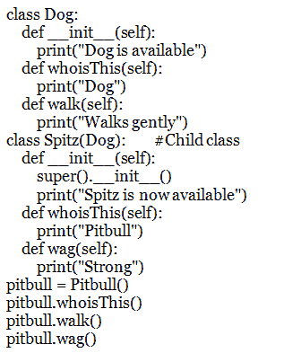

### 解释

在上述程序中，我们创建了两个 Python 类。这些类分别是作为基类的 `Dog` 和作为派生类的 `Pitbull`。派生类继承了基类的函数。`__init__()` 方法和 `super()` 函数用于将基类中 `__init__()` 方法的内容引入派生类。

# 使用 Python 进行机器学习中的封装

Python 面向对象编程方法中的封装旨在帮助防止数据被直接修改。Python 中的私有属性以下划线单下划线或双下划线作为前缀来表示。

#### 示例

1. 启动 IDLE。
2. 导航到“文件”菜单并点击“新建窗口”。
3. 输入以下内容：

```python
class Tv:
    def __init__(self):
        self.__Finalprice = 800

    def offer(self):
        print("Offering Price: {}".format(self.__Finalprice))

    def set_final_price(self, offer):
        self.__Finalprice = offer

t = Tv()
t.offer()
t.__Finalprice = 950
t.offer()

## using setter function
t.set_final_price(990)
t.offer()
```

### 解释


# Python OOP 概念

## 类定义与私有属性

该程序定义了一个 `Tv` 类，并使用 `__init__` 方法来保存电视的最终报价。在此过程中，我们尝试修改价格但未能成功。无法修改的原因是 Python 将 `_finalprice` 视为私有属性。修改该值的唯一方法是通过一个接受 price 作为参数的 setter 函数 `setMaxPrice()`。

## 多态

在 Python 中，多态指的是为多种数据类型使用共享接口的能力。

1. 启动 IDLE。
2. 导航至“文件”菜单并点击“新建窗口”。
3. 输入以下内容：

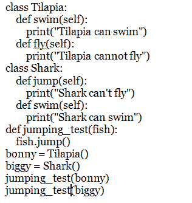

### 解释

上述程序定义了两个类 `Tilapia` 和 `Shark`，它们共享方法 `jump()`，尽管它们的功能不同。通过创建通用接口 `jumping_test()`，我们在上述程序中实现了多态。随后，我们将对象 `bonny` 和 `biggy` 传递给了 `jumping_test()` 函数。

## 练习

a. 在医生诊室场景中，从编程角度建议类和对象。

b. 在足球队场景中，建议编程类和对象。

c. 在杂货店场景中，建议编程类和对象。

## Python 中的类定义

关键字 `class` 用于在 Python 中定义类。Python 类中的第一个字符串用于描述该类，尽管并非总是需要。

### 示例 1

1. 启动 IDLE。
2. 导航至“文件”菜单并点击“新建窗口”。
3. 输入以下内容：

```python
class Dog:
    '''Briefly taking about class Dog using this docstring'''
    pass
```

## 示例 2

1. 启动 IDLE。
2. 导航至“文件”菜单并点击“新建窗口”。
3. 输入以下内容：

```python
class Bright:
    "My other class"
    b = 10

    def salute(self):
        print('Welcome')

print(Bright.b)
print(Bright.salute)
print(Bright.__doc__)
```

## Python 中的对象创建

### 来自前一个类的示例

打开包含类 `Bright` 的前一个程序文件：

```python
student1 = Bright()
```

### 解释

上述程序将创建对象 `student1`，一个新的实例。对象的属性可以通过特定的对象名前缀来访问。属性可以是方法或数据，包括匹配的类函数。换句话说，`Bright.salute` 是一个函数对象，而 `student1.salute` 将是一个方法对象。

#### 示例

1. 启动 IDLE。
2. 导航至“文件”菜单并点击“新建窗口”。
3. 输入以下内容：

```python
class Bright:
    "Another class again!"
    c = 20

    def salute(self):
        print('Hello')

student2 = Bright()

print(Bright.salute)
print(student2.salute)

student2.salute()
```

### 解释

尽管存在参数 `self`，我们仍调用了 `student2.salute()`，且无需传入参数即可正常工作。这种现象的原因是，每当对象调用其方法时，对象本身会作为第一个参数被传递。这意味着 `student2.salute()` 实际上转换为了 `student2.salute(student2)`。这就是 `self` 这个名称的由来。

## 构造函数

1. 启动 IDLE。
2. 导航至“文件”菜单并点击“新建窗口”。
3. 输入以下内容：

```python
class ComplexNumber:
    def __init__(self, realnum=0, i=0):
        self.real = realnum
        self.imaginarynum = i

    def getData(self):
        print("{0}+{1}j".format(self.real, self.imaginarynum))

complex1 = ComplexNumber(2, 3)
complex1.getData()

complex2 = ComplexNumber(5)
complex2.attribute = 10
print((complex2.real, complex2.imaginarynum, complex2.attribute))

# complex1.attribute  # 这将引发 AttributeError
```

## 删除对象和属性

`del` 语句用于在任何时候删除对象的属性。

#### 示例

1. 启动 IDLE。
2. 导航至“文件”菜单并点击“新建窗口”。
3. 输入以下内容：

```python
complex1 = ComplexNumber(2, 3)
del complex1.imaginarynum
complex1.getData()

del ComplexNumber.getData
complex1.getData()
```

## 删除整个对象

#### 示例

1. 启动 IDLE。
2. 导航至“文件”菜单并点击“新建窗口”。
3. 输入以下内容：

```python
complex1 = ComplexNumber(1, 3)
del complex1
```

### 解释

当执行 `complex1 = ComplexNumber(1, 3)` 时，会在内存中生成一个新的对象实例，名称 `complex1` 与之绑定。对象不会立即被销毁，因为它会暂时保留在内存中，直到垃圾回收器将其从内存中清除。对象的清除有助于释放绑定在对象上的资源并提高系统效率。Python 中的垃圾回收指的是对无引用对象的自动销毁。

## Python 中的继承

在 Python 中，继承允许我们指定一个类，该类从基类获取所有功能并添加更多功能。这是 OOP 的一项强大功能。

## 语法

```python
class ParentClass:
    # 父类主体

class ChildClass(ParentClass):
    # 派生类主体
```

### 示例 1

1. 启动 IDLE。
2. 导航至“文件”菜单并点击“新建窗口”。
3. 输入以下内容：

```python
class Shape:
    def __init__(self, sides):
        self.sides = sides

    def count_sides(self):
        return self.sides

class Rect_mine(Shape):
    def __init__(self):
        Shape.__init__(self, 4)

    def getArea(self):
        s1, s2, s3, s4 = self.count_sides()
        perimeter = (s1 + s2 + s3 + s4)
        area = (s1 * s2)
        print('The rectangle area is: %s' % area)
```

## 示例 2

```python
r = Rect_mine()
r.inputSides()
# Type b1 : 4
# Type l1 : 8
# Type b2 : 4
# Type l1:    8

r.dispSides()
# Type b1 is 4.0
# Type l1 is 8.0
# Type b2 is 4.0
# Type l1 is 8.0

r.getArea()
```

## Python 中的方法重写

当一个方法同时在基类和派生类中定义时，子类/派生类中的方法将覆盖父类/基类中的方法。在上述示例中，`Rect_mine` 类中的 `__init__()` 方法将覆盖 `Shape` 类中的 `__init__()`。

## 多重继承

#### 示例

1. 启动 IDLE。
2. 导航至“文件”菜单并点击“新建窗口”。
3. 输入以下内容：

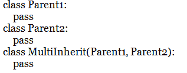

在这种情况下，`MultiInherit` 派生自类 `Parent1` 和 `Parent2`。

## 多层继承

从派生类继承称为多层继承。

#### 示例

1. 启动 IDLE。
2. 导航至“文件”菜单并点击“新建窗口”。
3. 输入以下内容：

```python
class Parent:
    pass

class Multilevel1(Parent):
    pass

class Multilevel2(Multilevel1):
    pass
```

### 解释

`Multilevel1` 派生自 `Parent`，而 `Multilevel2` 派生自 `Multilevel1`。

## 方法解析顺序

#### 示例

1. 启动 IDLE。
2. 导航至“文件”菜单并点击“新建窗口”。
3. 输入以下内容：

```python
print(issubclass(list, object))
print(isinstance(6.7, object))
print(isinstance("Welcome", object))
```

### 解释

类中的特定属性将首先被扫描。搜索将继续延伸至父类。此搜索不会重复搜索同一个类两次。这种搜索的方法或顺序有时被称为 Python 中多重派生类的线性化。方法解析顺序 (MRO) 指的是确定此顺序所需的规则。

## 运算符重载

内置类可以使用运算符，而相同的运算符在不同类型上会表现出不同的行为。例如 `+` 运算符，根据上下文不同，会执行两个字符串的拼接、数字的算术加法或列表的合并。运算符重载是一项 OOP 特性，允许根据上下文赋予运算符不同的含义。

## 使类兼容内置特殊函数

#### 示例

1. 启动 IDLE。
2. 导航至“文件”菜单并点击“新建窗口”。
3. 输入以下内容：

```python
class Planar:
    def __init__(self, x_axis=0, y_axis=0):
        self.x_axis = x_axis
        self.y_axis = y_axis

    def __str__(self):
        return "({0},{1})".format(self.x_axis, self.y_axis)

planar1 = Planar(3, 5)
print(planar1)  # 输出将为 (3,5)
```

## 使用更多内置方法

#### 示例

1. 启动 IDLE。
2. 导航至“文件”菜单并点击“新建窗口”。
3. 输入以下内容：

```python
class Planar:
    def __init__(self, x_axis=0, y_axis=0):
        self.x_axis = x_axis
        self.y_axis = y_axis

planar1 = Planar(3, 5)
str(planar1)
format(planar1)
```

### 解释

`__str__` 方法允许 `str()` 和 `format()` 函数与自定义对象配合工作。


由此可见，每当我们调用 `format(planar1)` 或 `str(planar1)` 时，Python 实际上是在执行 `planar1.__str__()`，因此得名“特殊函数”。

## 运算符 + 重载

在类中添加 `__add__()` 函数将重载 `+` 运算符。

#### 示例

启动 IDLE。

导航到“文件”菜单并点击“新建窗口”。

输入以下内容：

```python
class Planar:

    def __init__(self, x_axis=0, y_axis=0):
        self.x_axis = x_axis
        self.y_axis = y_axis

    def __str__(self):
        return "({0},{1})".format(self.x_axis, self.y_axis)

    def __add__(self, z):
        x_axis = self.x_axis + z.x_axis
        y_axis = self.y_axis + z.y_axis
        return Planar(x_axis, y_axis)
```

## 练习

a. 打印上述示例中的 `planar1 + planar2`。

### 解释

当你在 Python 中执行 `planar1 + planar2` 时，它将调用 `planar.__add__(planar2)`，进而调用 `Planar.__add__(planar1, planar2)`。

## 重温逻辑与比较运算符

## 练习

a. 给定 `x=8`，`y=9`，编写一个 Python 程序，使用逻辑等于运算符测试 `x` 是否等于 `y`。

b. 编写一个程序，在 Python 编程语言中求值 `x != y`。

c. 编写并运行以下程序：

```python
m = True
n = False
print('m and n is', m and n)
print('m or n is', m or n)
print('not m is', not n)
```

d. 根据 c 中的程序，哪条（些）程序语句的求值结果为 True 或 False。

e. 在 Python 中编写并运行以下程序：

```python
m1 = 15
n1 = 15
m2 = 'Welcome'
n2 = 'Welcome'
m3 = [11, 12, 13]
n3 = [11, 12, 13]
print(m1 is not n1)
print(m2 is n2)
print(m3 is n3)
```

f. e 中哪条（些）程序语句生成 True 或 False 状态。

g. 编写并运行以下程序：

```python
m = 'Welcome'
n = {11: 'b', 12: 'c'}
print('W' in m)
print('Welcome' not in m)
print(10 in n)
print('b' in n)
```

h. g 中哪条（些）程序语句返回 True 或 False 状态。

重载其他运算符所需的特殊函数如下所示。

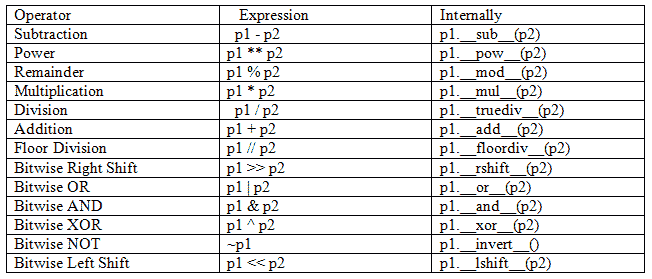

## 比较运算符重载

在 Python 中，比较运算符可以被重载。

#### 示例

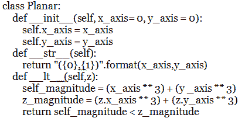

## 练习

a. 对上述示例中的 `Planar(1,1)` 执行以下操作。

b. 再次对上述示例中的 `Planar(1,1)` 执行操作。

c. 最后，对上述示例中的 `Planar(1,1)` 执行操作。

## 实现比较运算符重载的特殊函数总结

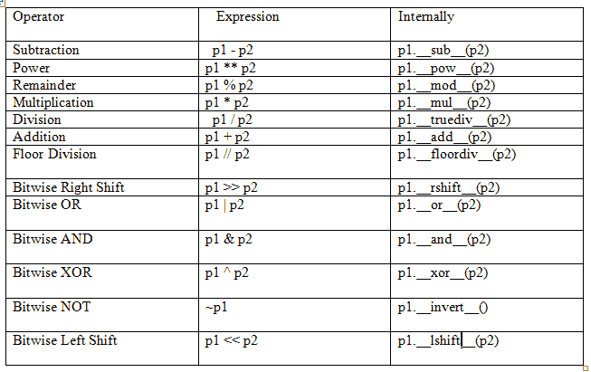

## 总结

Python 支持不同的编程范式，因为它是一门多范式语言。Python 中的对象具有属性和行为。通过类，我们只需实例化该类即可构建对象。`class_name()` 运算符通过将对象赋值给空方法来创建对象。关键字 `def` 用于在 Python 中定义方法。Python 类中的第一个字符串用于描述该类，尽管并非总是需要。当方法同时在基类和派生类中定义时，子类/派生类中的方法将覆盖父类/基类中的方法。在上述示例中，`Rectangle` 类中的 `__init__()` 方法将覆盖 `Shape` 类中的 `__init__()`。

内置类可以使用运算符，且相同的运算符在不同类型上会表现出不同的行为。例如 `+` 运算符，根据上下文不同，将执行两个字符串的拼接、数字的算术加法或列表的合并。运算符重载是一项 OOP 特性，允许根据上下文赋予运算符不同的含义。通过类，我们只需实例化该类即可构建对象。`class_name()` 运算符通过将对象赋值给空方法来创建对象。

`__init__()` 函数是一个特殊函数，每当实例化相应类的新对象时就会被调用。定义在类主体内的函数称为方法，它们是基本函数。方法定义了对象的行为。在 Python 中，多态指的是为多种数据类型使用共享接口的能力。一个例子是定义了两个类 `Tilapia` 和 `Shark` 的程序，它们共享 `jump()` 方法，尽管它们的功能不同。通过创建通用接口 `jumping_test()`，我们在上述程序中实现了多态。然后我们将对象 `bonny` 和 `biggy` 传递给 `jumping_test()` 函数。

# 第 3 章：Python 基础

Python 既是过程式也是面向对象的编码语言。它具有直观的语法。Python 是跨平台的，意味着它可以在不同的操作系统环境中运行，例如 Linux、Windows 平台、Mac OS X 平台、UNIX 平台，并可移植到 .NET 和 Java 虚拟机。Python 是免费且开源的。虽然大多数最新版本的 Mac 和 Linux 预装了 Python，但建议安装并运行当前版本。

## Python 的安装

大多数最新版本的 Linux 和 Mac 已经安装了 Python。但是，你可能需要安装 Python，以下是在 Windows、Mac OS X 或 Linux 中安装 Python 的步骤。

### 在 Macintosh Operating System X 中安装 Python

i. 访问 Python 下载页面（官方可信网站）并点击“Download Python 3.7.2”（版本可能与此处所述不同）。

ii. 下载完成后，点击打开安装包并按照给出的说明操作。安装应以“安装成功”提示完成。

iii. 现在，访问 Notepad++ 下载页面下载文本编辑器，并通过打开安装包和遵循提示信息进行安装。Notepad++ 文本编辑器免费且适合编写源代码（原始文本编程语句）。

### 在 Linux 操作系统中安装 Python

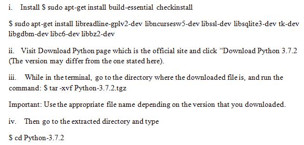

v. 现在是时候发出指令在你的操作系统上运行源代码了。

### 在 Windows 操作系统中安装 Python

i. 访问 Python 下载网站（推荐网站）并点击“Download Python 3.7.2”（版本可能与此处所述不同）。

ii. 下载完成后，通过点击打开安装包并遵循给出的指导原则。Python 安装应以“安装成功”提示完成。

成功安装 Python 后，它还会随之安装一个名为 IDLE 的程序。IDLE 是使用 Python 时的图形用户界面。

iii. 现在，访问 Notepad++ 下载页面下载文本编辑器，并通过打开安装包和遵循提示信息进行安装。Notepad++ 文本编辑器免费且适合编写源代码（原始文本编程语句）。

## 运行 Python 的方式

现在，在我们开始运行第一个 Python 程序之前，了解我们可以如何运行 Python 程序很重要。运行、执行、部署或启动程序仅仅意味着我们让计算机处理指令/代码行。例如，如果代码行（程序）要求计算机显示某条消息，那么它就应该显示。以下是运行 Python 程序的方式或模式。解释器是在安装 Python 包时安装的一个特殊程序，它有助于将文本代码转换为计算机能够理解并执行的语言。

### 即时模式

这是一种运行未写入文件的 Python 程序的方式。我们通过在命令行中输入单词 `python` 进入即时模式，这将触发解释器切换到即时模式。即时模式允许直接输入表达式，按回车键生成输出。下面的符号是 Python 提示符：

```
>>>
```

Python 提示符指示解释器接受用户输入。例如，输入 `2+2` 并按回车键将显示输出 `4`。在某种程度上，此提示符可用作计算器。如果你需要退出即时模式，请输入 `quit()` 或 `exit()`。


现在输入 `5 +3`，然后按回车键，输出应为 `8`。下一种模式是脚本模式。

### 脚本模式

脚本模式用于运行写在文件中的 Python 程序；该文件称为脚本。

## 集成开发环境 (IDE)

IDE 为编写和运行 Python 程序提供了一种便捷的方式。也可以使用文本编辑器来创建 Python 脚本文件，而不使用 IDE，方法是编写代码行并将文件以 `.py` 扩展名保存。然而，使用 IDE 可以简化编写和运行 Python 程序的过程。Python 包中自带的 `IDLE` 就是一个带有图形用户界面的 IDE 示例，它会随 Python 语言一起安装。IDE 的优势包括帮助摆脱重复性任务，并为初学者简化编码。IDE 提供语法高亮、代码提示和语法检查等功能。也有商业 IDE，如 `PyScripter` IDE，能执行上述大部分功能。

> **注意：**
>
> 我们已介绍了什么是 Python、如何下载和安装 Python、Python IDE 的即时模式和脚本模式，以及什么是 IDE。

## 你的第一个 Python 书面程序

后续的演示将假设你在 Windows 环境中运行 Python 程序。

1.  启动 `IDLE`
2.  转到“文件”菜单并点击“新建窗口”
3.  输入以下内容：

```
print (“Hello World!”)
```

4.  在文件菜单上，点击“保存”。输入名称 `myProgram1.py`
5.  转到“运行”并点击“运行模块”以运行程序。

我们编写的第一个程序被称为“Hello World！”，它不仅用于介绍一门新的计算机编程语言，还用于测试 IDE 的基本配置。程序的输出是“Hello World！”。发生的情况如下：`Print()` 是一个内置函数，它是预先编写并预加载好的，用于显示括号 `()` 中包含的任何内容，只要它在双引号之间。计算机将显示双引号内编写的任何内容。

**练习：** 现在编写并运行以下 Python 程序：

a.  `print(“I am now a Python Language Coder!”)`
b.  `print(“This is my second simple program!”)`
c.  `print(“I love the simplicity of Python”)`
d.  `print(“I will display whatever is here in quotes such as owyhen2589gdbnz082”)`

现在我们需要编写一个包含数字的程序，但在编写此类程序之前，我们需要了解一些关于变量和类型的知识。

请记住 Python 是面向对象的，且不是静态类型的，这意味着我们在使用变量前不需要声明它们，也不需要指定它们的类型。让我们解释一下这句话；面向对象语言简单来说就是该语言支持将现实生活场景视为具有子组的群体，这些子组可以被链接和共享，模仿事物的自然秩序和交互。并非所有编程语言都是面向对象的；例如，`Visual C` 编程语言就不是面向对象的。在编程中，声明变量意味着我们显式地说明变量的性质。变量可以被声明为整数、长整数、短整数、浮点整数、字符串或字符，包括其是局部可访问还是全局可访问。变量是一个存储位置，其值会根据条件而改变。

例如，`number1` 可以取从 0 到无穷大的任何数字。然而，如果我们显式指定 `int number1`，则意味着该存储位置将只接受整数而不接受分数，幸运的是或不幸的是，Python 不要求我们显式说明存储位置的性质（声明变量），因为这由 Python 语言本身来推断。

在探讨变量类型和变量命名规则之前，让我们运行一个简单的程序，以了解在编写 Python 程序时什么是变量。

1.  启动 `IDLE`
2.  转到“文件”菜单并点击“新建窗口”
3.  输入以下内容：

```
num1=4
num2=5
sum=num1+num2
print(sum)
```

4.  在文件菜单上，点击“保存”。输入名称 `myProgram2.py`
5.  转到“运行”并点击“运行模块”以运行程序。

该程序的预期输出应为 `9`（不带双引号）。

### 解释

此时，你渴望了解刚才发生了什么，以及为什么 `print(sum)` 不像我们编写的第一个程序那样带有双引号。以下是解释。

第一行 `num1=4` 意味着变量 `num1`（我们书写 number1、第一个数字的简写形式）在程序运行前已被赋值为 `4`。

第二行 `num2=5` 意味着变量 `num2`（我们书写 number2、第二个数字的简写形式）在程序运行前已被赋值为 `5`。

计算机解释这些指令并存储给定的数字。

第三行 `sum=num1+num2` 告诉计算机获取 `num1` 所赋的任何值并加上 `num2` 所赋的任何值。换句话说，对 `num1` 和 `num2` 的值求和。

第四行 `print(sum)` 意味着显示 `sum` 所拥有的任何值。如果我们给 `sum` 加上双引号，计算机将显示单词 `sum`，而不是这两个数字的和！请记住那句老话：计算机是“垃圾进，垃圾出”。它们遵循你给它们的指令！

> **注意：** `+` 是对变量求和的运算符，还有其他用途，将在后面讨论。

现在，在解释变量类型和变量命名规则之前，让我们先尝试三个涉及数字的练习，以便你更自由地操作变量。请记住变量的值是可变的，例如 `num1` 可以取 `3`、`8`、`1562`、`1`。

遵循打开 Python IDE 的步骤并执行以下操作：

1.  输出应为 `54`

```
num1=43
num2=11
sum=num1+num2
print(sum)
```

2.  输出应为 `167`

```
num1=101
num2=66
sum=num1+num2
print(sum)
```

3.  输出应为 `28`

```
num1=9
num2=19
sum=num1+num2
print(sum)
```

## 变量

我们已经使用了 `num1`、`num2` 和 `sum`，这些变量名并非随意起的，它们必须遵循特定的规则和约定。规则是我们不能违反的，而约定则更像是推荐的做法。让我们从规则开始：

### Python 中命名变量的规则

1.  变量名必须始终以字母或下划线开头，即

    `num1`
    
    `_num1`

2.  变量名的其余部分可以由数字、字母和下划线组成，即

    `number1`
    
    `num_be_r`

3.  变量名区分大小写，意味着大写字母和小写字母被视为不同。

    `Num1` 将与 `num1` 区别对待。

**练习**

为以下各项编写/建议五个变量：

a.  医院科室。
b.  银行。
c.  媒体机构。

已知 `scri=75`，`scr4=9`，`sscr2=13`，`Scr=18`

d. 上述变量名旨在表示学生的分数。重写变量名以满足 Python 变量规则和约定。

## Python 中命名变量的约定

如前所述，约定本身不是规则，而是增加价值和可读性的既定传统，适用于我们在 Python 中命名变量的方式。

1.  **保持可读性。** 你的变量应暗示其处理的内容，因为程序旨在供编写者以外的其他人阅读。

    `number1` 比 `n1` 更易读。同样，`first_name` 比 `firstname`、`firstName` 或 `fn` 更易读。这意味着所有这些在 Python 中都是有效/可接受的变量，但约定强制我们以易读的形式编写它们。


## 变量命名规范

### ii. 使用描述性名称
编写变量时请使用描述性名称。例如，`number1` 作为变量名比 `yale` 或 `mything` 更具描述性。换句话说，我们可以用 `yale` 来存储 `number1` 的值，但该名称并不能直观地暗示我们在做什么。请记住编写程序时要假设其他人会维护它们。维护者应能在运行程序前快速弄清程序的用途。

### iii. 避免混淆字符
为了避免混淆，请避免使用大写字母 `O`、小写字母 `l` 和大写字母 `I`，因为它们容易与数字混淆。换句话说，使用这些字母并不违反变量命名规则，但将它们作为变量名会导致混淆。

## 练习 1

将以下变量名重写为 (1) 有效的变量名并 (2) 遵循变量命名约定。

a. `23doctor`
b. `line1`
c. `Option3`
d. `Mydesk`
e. `#cup3`

## 练习 2

编写/建议 (1) 有效且 (2) 符合约定的变量名。

a. 你想对三个数字求和。
b. 你想存储四个学生的姓名。
c. 你想存储医院里五位医生的姓名。

## 总结

变量是用户在编写和运行 Python 程序之前指定的存储位置。变量名是这些存储位置的标签。变量根据情况保存值。例如，`doctor1` 可以是 Daniel、Brenda 或 Rita。`Patient1` 可以是 Luke、William 或 Kelly。变量名的编写需遵循规则和约定。规则是强制的，而约定是可选但推荐的，因为它们有助于编写可读的变量名。编写程序时，应假设其他人会在没有你输入的情况下检查或运行它，因此代码应当规范。下一章将讨论变量。在编程中，声明变量意味着我们显式地说明变量的性质。变量可以声明为整数、长整数、短整数、浮点数、字符串或字符，包括其是局部可访问还是全局可访问。变量是一个根据条件改变值的存储位置。编写变量时请使用描述性名称。

## 变量类型

现在我们已经定义了什么是变量以及编写变量名的规则，让我们探索不同类型的变量。

### i. 数字

Python 支持两种主要数字，即浮点数和整数。Python 还支持复数。当你给一个数字赋值时，就会创建一个数字对象。例如：

```
number3 = 9
number4 = 12
```

#### Python 支持的不同数值类型

- **long**：例如 `681581903L`
- **int**：例如 `11`、`123`、`-151`
- **float**：例如 `0.5`、`23.1`、`-54.2`
- **complex**：例如 `4.12j`

## 练习

识别下列数值的类型：

a. `234`、`19`、`312`
b. `4.56`、`2.9`、`9.3`
c. `76189251468290127624471`

确定以下场景适用的数值类型：

d. 薪资金额。
e. 统计班级学生人数。
f. 获取中国全国人口普查数字。

### ii. 字符串

在 Python 中，单引号或双引号用于表示字符串。可以使用切片操作符 `[:]` 和 `[]` 获取字符串的子集，索引从字符串开头的 `0` 开始，到末尾的 `-1` 结束。字符串可以使用 `+`（加号）连接，称为连接操作符。星号 `*` 用作重复操作符。请记住编程中的计数从索引零（第一个值）开始！

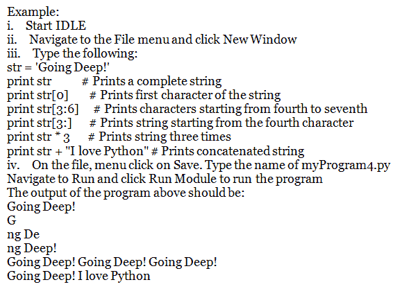

> **注意**：`#`（井号）用于表示单行注释。注释是关于特定代码行的描述性信息。运行程序时通常会忽略注释。在 Python 中，注释应写在 `#` 符号之后。注释能提高程序的可读性。

## 练习

请键入/输入以下程序语句：

```python
str = 'I think I am now a Programmer.'
```

a. 编写一条程序语句以显示上述完整字符串/语句。
b. 编写一条程序语句以显示从第二个字符到第六个字符的字符串内容。
c. 编写一条程序语句以显示上述完整字符串两次（使用 `*`）。
d. 编写一条程序语句在上述语句末尾添加 " of Python."。

## Python 关键字和标识符

此时，你可能想知道为什么必须以那种方式使用 `print` 和 `str`，而没有自由或知识去了解为什么这些词必须以那种方式书写。`print` 和 `str` 构成了一类特殊的词，它们必须始终以那种方式书写。每种编程语言都有一组关键字。在大多数情况下，某些关键字可在多种编程语言中找到。Python 中的关键字区分大小写，意味着我们必须始终以小写形式输入它们。关键字不能用于命名函数（稍后解释）或变量名。

Python 中有 33 个关键字，除 `None`、`False` 和 `True` 外均为小写。它们必须始终按下表所示书写：

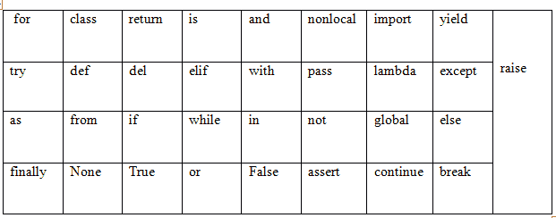

> **注意**：`print()` 和 `str` 是函数，但它们是 Python 中的内置/预加载函数。函数是一组在调用时生效的规则和方法。例如，调用/激活 `print` 函数时将显示输出。此时你尚未遇到所有关键字，但会逐渐接触到它们。请花时间浏览、阅读并尝试回忆尽可能多的关键字。

## 练习

找出以下变量名的错误（需要回顾迄今所学内容）：

a. `for = 1`
b. `yield = 3`
c. `34ball`
d. `m`

## 注释和语句

### Python 语句

Python 中的语句是指 Python 解释器可以处理/执行的指令。例如 `str = 'I am a Programmer'` 和 `number1 = 3`。包含等号（`=`）的语句称为赋值语句。还有其他类型的语句，如 `if`、`while` 和 `for`，将在后面处理。

## 练习

a. 编写一条 Python 语句，将第一个数字赋值为 `18`。
b. 编写一条编程语句，将第二个数字赋值为 `21`。
c. a 和 b 属于什么类型的语句？

### 多行 Python 语句

可以将一条语句分散在多行上。这种语句称为多行语句。编程语句的结束由换行符表示。要在 Python 中将语句分散到多行，我们使用反斜杠（`\\`），称为行续行字符。多行语句示例：

```python
sum = 3 + 6 + 7 + \
      9 + 1 + 3 + \
      11 + 4 + 8
```

上述示例也称为显式行续行。在 Python 中，方括号 `[]` 表示行续行，类似于圆括号 `()`，最后是大括号 `{}`。上例可重写为：

```python
sum = (3 + 6 + 7 +
       9 + 1 + 3 +
       11 + 4 + 8)
```

> **注意**：当我们使用圆括号时，去掉了反斜杠（`\\`）行续行字符，因为圆括号承担了行续行字符 `\\` 的工作。

**问题**：为什么需要多行语句？我们可以简单地写在单行上，程序语句也能正常运行。

**答案**：多行语句有助于改善整个程序的格式/可读性。请记住，编写程序时始终假设是其他人会在没有你输入的情况下使用和维护它。

## 练习

使用多行操作符（如 `\\`、`[]`、`()` 或 `{}`）重写以下程序语句，以提高程序语句的可读性。

a. `total = 2 + 9 + 3 + 6 + 8 + 2 + 5 + 1 + 14 + 5 + 21 + 26 + 4 + 7 + 13 + 31 + 24`


b. `count=13+1+56+3+7+9+5+12+54+4+7+45+71+4+8+5`

分号也用于在单行中创建多条语句。假设我们要在 Python 程序中为四名员工赋值并显示年龄。程序可以写成：

`employee1=25; employee2=45; employee3=32; employee4=43.`

## Python 中的缩进

在 Python 中，缩进用于将程序行归类为一个代码块。Python 中使用的缩进量完全取决于程序员。但重要的是要确保一致性。按照惯例，使用四个空白字符进行缩进，而不是使用制表符。例如：

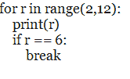

注意：我们稍后将解释这是什么类型的程序。

Python 中的缩进也有助于使程序看起来整洁清爽。缩进创造了一致性。但是，在执行行续行时可以忽略缩进。错误的缩进将导致缩进错误。没有缩进的正确 Python 程序仍然可以运行，但从人类可读性的角度来看，它们可能不够整洁和一致。

## Python 中的注释

编写 Python 程序，实际上编写任何编程语言时，注释都非常重要。注释用于描述程序内部发生的事情。通过阅读程序中的注释，另一个人查看程序时更容易了解程序的功能。注释对程序员也很有用，因为人们可能会忘记自己编写的程序的关键细节。在 Python 中，井号（`#`）符号用于注释之前。注释一直延伸到换行符。Python 解释器通常会忽略注释。注释旨在供程序员更好地理解程序。

#### 示例

i. 启动 IDLE

ii. 导航到“文件”菜单并点击“新建窗口”

iii. 输入以下内容：

```
#This is my first comment
#The program will print Hello World
Print('Hello World') #This is an inbuilt function to display
```

iv. 在“文件”菜单上，点击“保存”。输入名称 myProgram5.py

导航到“运行”并点击“运行模块”以运行程序

## 练习

本综合练习涵盖了迄今为止我们学习的大部分内容。

a. 编写一个程序来求两个数 45 和 12 的和，并在每行代码处包含单行注释。

b. 编写一个程序来显示两名员工的姓名，其中第一名员工是 "Daisy"，第二名员工是 "Richard"。在每行代码处包含单行注释。

c. 编写一个程序来显示学生注册号，其中学生姓名及其注册号为：`Yvonne=235`，`Ian=782`，`James=1235`，`Juliet=568`。

## 多行注释

就像多行程序语句一样，我们也有多行注释。编写多行注释有几种方法。第一种方法是在每个注释行的起始点输入井号（`#`）。

#### 示例

启动 IDLE。

导航到“文件”菜单并点击“新建窗口”。

输入以下内容：

```
#I am going to write a long comment line
#the comment will spill over to this line
#and finally end here.
```

编写多行注释的第二种方法涉及使用三个单引号或双引号：`'''` 或 `"""`。在 Python 中，对于多行字符串和多行注释，我们使用三引号。注意：当用于文档字符串时，它们会生成额外的代码，但我们目前不必担心这个问题。

### 示例：

启动 IDLE。

导航到“文件”菜单并点击“新建窗口”。

输入以下内容：

```
"This is also a great 
illustration of
a multi-line comment in Python."
```

## Python 的文档字符串

在 Python 中，文档字符串是指提供描述的文字，写在函数、模块、方法或类定义的初始程序语句中。（我们稍后将处理这个问题）。Python 中的文档字符串使用三引号编写。

## 综合练习

本练习将利用我们之前介绍的几个概念。

a. 给定以下程序语句：`Color1='red'; color1='blue'; CoLor1='yellow'`，解释为什么在 Python 中这三个都将被视为不同的变量。

b. 考虑以下 Python 程序并找出其中的错误。

```
student1_age=23 #This is the age of the first student
student2_age=19 #This is the age of the student
sotal_age=student1_age +student2_age #Getting the sum of the ages of the 
print(age) #Displaying their ages
```

c. 重写上述 b 使其成为一个有效的 Python 程序

## Python 中的运算符（基础）

到目前为止，我们一直在使用求和（`+`）运算符，它也可以作为连接运算符（追加语句）。然而，我们想要扩展运算符列表，这引出了 Python 中的基本运算符。

### 算术运算符

乘法（`*`）、除法（`/`）、减法（`-`）和加法（`+`）是用于操作数字的算术运算符。

## 练习

编写并运行以下程序

a. 求差

```
number1=35 #declaring first number
number2= 12 #declaring second number
difference=number2-number1 #declaring what the difference does
print(difference) #Calling the print function to display what difference has
```

b. 求积

```
number1=2 #declaring first number
number2= 15 #declaring second number
product=number1*number2 #declaring what the product does
print(product) #Calling the print function to display what product has
```

c. 求商

```
number1=10 #declaring first number
number2= 50 #declaring second number
division=number2/number1 #declaring what the division does
print(division) #Calling the print function to display what product has
```

### 取模运算

取模运算符用于返回除法后的整数余数。取模 = `dividend%divisor`。

#### 示例

启动 IDLE。

导航到“文件”菜单并点击“新建窗口”。

输入以下内容：

```
number1=2 #declaring first number
number2= 15 #declaring second number
remainder=number2%number1 #declaring what the remainder does
print(remainder) #Calling the print function to display remainder has
```

### Python 中的平方与立方

求一个数的平方：`number**2`

求一个数的立方：`number**3`

### 示例：

启动 IDLE。

导航到“文件”菜单并点击“新建窗口”。

输入以下内容：

`Square of 3 in Python will be 3**2`

`Cube of 5 in Python will be 5**3`

#### 1. 3 的平方

启动 IDLE。

导航到“文件”菜单并点击“新建窗口”。

输入以下内容：

```
number=3 #declaring variable number and assigning value 3
square=number**2
print(square) #Calling the print function to display what square has
```

#### 2. 5 的立方

启动 IDLE。

导航到“文件”菜单并点击“新建窗口”。

输入以下内容：

```
number=5 #declaring variable number and assigning value 5
cube=number**3
print(cube) #Calling the print function to display what cube has
```

## 练习

使用 Python 运算符编写并运行一个 Python 程序，求出以下内容：

a. 7 的立方

b. 15 的平方

c. 6 的立方

d. 11 的平方

e. 8 的立方

f. 13 的平方

注意：我们仍然可以通过将 2 相乘两次来得到 2 的平方。使用平方和立方运算符的原因是帮助我们编写紧凑高效的代码。请记住，解释器会遍历每一行，包括注释，只是它会忽略注释。使用立方和平方运算符有助于压缩代码，并提高解释效率，包括故障排除以及代码的人类可读性。

## Python 中的字符串运算符

在 Python 中，某些运算符用于帮助连接字符串。加号用于在 Python 中连接字符串。

#### 示例

启动 IDLE。

导航到“文件”菜单并点击“新建窗口”。


# 键入以下内容：

```python
status = " I am happy I know" + "how to write programs in Python."
print(status)
```

## Python 字符串乘法以创建序列

```python
many_words = "Great Programmer" * 5
print(many_words)
```

## 练习

a. 使用连接运算符在 Python 中连接以下字符串：

> I have realized
> that programming is a passion,
> dedication and frequent practice.

b. 使用运算符生成以下字符串的十倍：

> Happy

## 总结

我们已经介绍了 Python 中变量的构成。变量是命名的存储位置，因此我们有了变量名。有数值变量和字符串变量。这些被称为变量类型。在处理变量以及 Python 的任何其他方面时，我们都会遇到并使用称为保留字或关键字的特殊单词。关键字是固定的，必须按指定方式键入。关键字不能用作变量名或标识符。注释（以 `#`、`'''` 或 `"""` 开头）用于 Python 程序的人类可读性方面。缩进用于在 Python 中将代码行分组为块。不同类型的运算符（如算术运算符和字符串运算符）用于允许操作由用户和 Python 内置函数支持的变量。

# Python 中的类型转换和类型强制转换

类型转换是指将一种编程数据类型的值更改为另一种编程数据类型的过程。设想一下将两个整数相除从而得到小数的情况。在这种情况下，有必要将整数强制转换为浮点数。Python 有两种转换类型：隐式类型转换和显式转换。

## i. 隐式转换类型

在这种情况下，Python 会自动将一种数据类型更改为另一种数据类型，该过程不需要用户参与。隐式类型转换主要用于避免数据丢失。

### 示例：将整数转换为浮点数

启动 IDLE。导航到“文件”菜单并点击“新建窗口”。键入以下内容：

```python
number_int = 451
number_flo = 4.51
number_new = number_int + number_flo
print("the type of data of number_int-", type(number_int))
print("the type of data of number_flo-", type(number_flo))
print("value of number_new-", number_new)
print("type of data of number_new-", type(number_new))
```

**解释**

该程序将两个变量相加，一个是整数数据类型，另一个是浮点数数据类型，并将值存储在一个浮点数数据类型的新变量中。Python 会自动将较小的数据类型转换为较大的数据类型，以防止数据丢失。这称为隐式类型转换。

**重要**

但是，Python 无法将数值数据类型隐式转换为字符串数据类型，也无法将字符串数据类型隐式转换为数值数据类型。尝试此类转换将产生错误。

#### 示例

启动 IDLE。导航到“文件”菜单并点击“新建窗口”。键入以下内容：

```python
number_int = 432      # lower data type
number_str = "241"    # higher data type
print("The type of data of number_int-", type(number_int))
print("The type of data of number_str-", type(number_str))
print(number_int + number_str)
```

**挑战**：你能猜出为什么会发生这种情况吗？Python 解释器无法准确理解我们是想要连接还是相加。当它假设为连接时，找不到另一个字符串。当它假设为相加时，找不到另一个数字。解决上述错误的方法是进行显式类型转换。

## ii. 显式转换

在这里，程序员将命名编程对象的数据类型转换为所需的数据类型。显式转换通过 `float()`、`int()` 和 `str()` 等函数实现。

特定或显式转换的语法是：

```text
(needed_datatype) (expression)
```

### 说明：通过显式转换实现字符串和整数的求和

启动 IDLE。导航到“文件”菜单并点击“新建窗口”。键入以下内容：

```python
number_int = 431
number_str = "231"
print("Type of data of number_int-", type(number_int))
print("Type of data number_str prior to Type Casting-", type(number_str))
number_str = int(number_str)
number_sum = number_int + number_str
print("Addition of number_int and number_str-", number_sum)
print("Type of data of the sum-", type(number_sum))
```

**注意**：运行此程序将显示数据类型和求和结果，并显示一个整数和一个字符串。

**解释**

在上述程序中，我们添加了 `number_str` 和 `number_int` 变量。然后我们使用 `int()` 函数将 `number_str` 从字符串（较高数据类型）转换为整数（较低数据类型）类型以执行求和。Python 在将 `number_str` 转换为整数值后，成功地将两个变量相加。`number_sum` 的值和数据类型均为整数数据类型。

### 回顾

将对象从一种数据类型转换为另一种数据类型称为类型转换。Python 解释器会自动执行隐式类型转换。隐式类型转换旨在使 Python 能够避免数据丢失。类型强制转换或显式转换发生在程序员使用预定义函数转换对象的数据类型时。与隐式转换不同，类型强制转换可能导致数据丢失，因为我们强制对象采用特定的数据类型。

之前的显式转换/类型强制转换可以写为：

启动 IDLE。导航到“文件”菜单并点击“新建窗口”。键入以下内容：

```python
number_int = 431              # int 数据类型
number_str = "231"            # 字符串数据类型
number_str = int(number_str)  # int 函数将字符串转换为 int 数据类型
number_sum = number_int + number_str  # 变量 number_sum
print("Addition of number_int and number_str-", number_sum)
```

**注意**：显式转换/类型强制转换需要一些练习才能掌握，但它很容易。

诀窍在这里：

```text
要转换的变量名 = 所需数据类型的预定义函数 (要转换的变量名)
```

## 练习

利用类型强制转换/显式数据转换的知识编写程序以计算以下各项的和：

a.
```python
score_int = 76
score_str = "61."
```

b.
```python
count_str = 231
count_str = "24"
```

利用类型强制转换/显式数据转换的知识编写程序以求以下各项的积：

c.
```python
number_int = 12
number_str = "5."
```

d.
```python
odds_int = 6
odds_str = "2"
```

e.
```python
minute_int = 45
minute_str = "7"
```

# Python 中的输入、输出和导入

在 Python 中，输入和输出 (I/O) 任务由内置函数执行。`print()` 执行输出/显示，而 `input()` 执行输入任务。`print()` 函数用于将数据输出到标准输出设备（如屏幕）。但是，也可以将数据复制到文件中。你现在已经熟悉了写作 `print()` 的打印函数。它是内置函数，因为我们不必编写它并指定它是什么以及如何工作。通常有两种主要类型的函数：内置/建立函数和用户定义函数，我们稍后将处理后者。当我们希望 `print()` 函数引用或获取变量的值时，我们不使用双引号。

#### 示例

启动 IDLE。导航到“文件”菜单并点击“新建窗口”。键入以下内容：

```python
number = 6      # 变量定义和赋值
print(number)   # 显示存储在变量 number 中的值
```

**注意**：现在假设我们想为运行此程序的用户提供一些解释，因为他或她只会看到 6，而不明白为什么屏幕上会出现 6。

```python
number = 6
print("This is a number stored in the variable number, it is:", number)
```

**注意**：我们可以在 `print()` 函数中显示字符串和其他数据类型。逗号通常用于分隔一种数据类型的结束和另一种数据类型的开始。

## 练习

a. 给定 `score = 5`，编写一个 Python 程序来显示 "The score is 5"。该程序应在其 `print()` 函数中引用/提取 `score` 的值。


## Python 练习与基础概念

### 字符串格式化输出练习

**b.** 已知 `age=26`，编写 Python 程序显示 “Richard’s age is 26”。程序应在打印函数中引用/提取 `score` 的值。

**c.** 已知 `marks=87`，编写 Python 程序显示 “The average marks in the class is 87”。程序应在打印函数中引用/提取 `score` 的值。

> **重要提示**：Python 中的换行通过 `\n` 实现（不带双引号，位于字符串或代码行之外）。

### 格式化输出

有时需要调整输出布局以使其美观，这称为格式化。`str.format()` 方法用于格式化输出，任何字符串对象均可访问/调用。

### 示例 1

启动 IDLE。

导航至 **File** 菜单并点击 **New Window**。

输入以下代码：

```python
lucy = 3
brian = 7
print('The age of lucy is {} and brian is {}'.format(lucy, brian))
```

> **注意**：预期输出为 “The age of lucy is 3, and Brian is 7”。

## 示例 2

启动 IDLE。

导航至 **File** 菜单并点击 **New Window**。

输入以下代码：

```python
print('Brian loves {1} and {0}'.format('soccer', 'movies'))
# 预期输出：He likes soccer and moves

print('he likes {1} and {0}'.format('soccer', 'movies'))
# 输出：He likes movies and soccer
```

> **注意**：使用元组索引/数字指定显示顺序，使程序员无需重新输入整个字符串即可切换变量顺序。

## 练习

已知 `print('She studies {0} and {1}'.format('Health', 'ICT'))`

**a.** 重写 Python 程序以显示 “She studies ICT and Health.”

**b.** 重写 Python 程序以显示 “She studies Health and Health.”

**c.** 重写 Python 程序以显示 “She studies ICT and ICT.”

**挑战**：在现实生活中，上述概念（元组索引/指定显示顺序）在哪些场景下有用，使得不必重写整行代码？例如，某网站要求用户注册账户，但先询问姓氏再询问名字。假设 ICT 团队建议应先询问名字再询问姓氏。编写一个简单的 Python 模拟程序，演示元组索引概念如何提高代码的效率、可读性和可维护性。

### Python 输入

到目前为止，我们的 Python 程序都是静态的，即无法输入数据，因为所有变量值都在运行前预先给定。在现实中，应用程序允许用户输入值并等待程序处理。`input()` 函数用于接收用户输入的值。

#### 语法/使用方式

```python
variable_name = input('option to include a message to the user on what is happening/can leave it out')
```

#### 示例：接收用户输入的数字

```python
number = input('Type your number here:')  # 将显示：Type a number here:
```

> **重要提示**：此阶段 Python 解释器将输入的任何数字视为字符串。要让解释器将其视为数字，必须使用数字类型转换函数 `int()` 和 `float()` 进行转换。

- 转换为整数：`int('number')`
- 转换为浮点数：`float('number')`

## 练习

**a.** 编写 Python 程序，接收用户输入的年龄数值，以获取用户年龄。

**b.** 使用显式类型转换将 **a** 中输入的字符串转换为浮点数值。

**c.** 编写 Python 程序，接收用户输入的薪资数值。

**d.** 使用显式类型转换将 **c** 中输入的字符串转换为浮点数值。

**e.** 编写程序，接收用户输入的班级学生人数/学生数量。

**f.** 使用显式类型转换将 **e** 中输入的字符串转换为整数数据类型。

### Python 导入模块

我们目前运行的程序规模较小，但实际程序可能包含数百至数万行代码。此时需将大程序拆分为称为**模块**的较小单元。这些模块相互关联，但通常位于不同文件中，扩展名为 `.py`。Python 允许使用 `import` 关键字将一个模块导入另一个模块。

**类比**：你可能将证书扫描件存储在 Google Drive，笔记本放在桌上，护照照片存放在手机外部存储，笔记本电脑放在房间里。申请实习时，你需要访问所有这些资源，但通常只会同时使用其中几项，尽管它们都是关联的。程序也是如此。

#### 示例：访问 `math` 模块中的 `pi`

启动 IDLE。

导航至 **File** 菜单并点击 **New Window**。

输入以下代码：

```python
import math  # 引用 math 模块的内容
print(math.pi)  # 使用该模块中的功能
```

### Python 命名空间与作用域

**标识符** 即命名对象。Python 将所有项视为对象。

#### 示例

启动 IDLE。

导航至 **File** 菜单并点击 **New Window**。

输入以下代码：

```python
number = 3
print('id(3)=', id(3))
print('id(number)=', id(number))
```

> **注意**：两者引用同一对象。

#### Python 命名空间

启动 Python 解释器时，会创建一个包含所有内置名称的命名空间，只要工作区保持活动状态，该空间就存在。内置函数如 `print()` 和 `id()` 在整个程序中均可访问。

- **内置命名空间**：Python 解释器加载后立即可访问的函数、方法及相关数据，可被工作区的每个实例和区域访问。
- **全局命名空间**：模块中可在整个模块范围内访问的内容。模块可包含多个函数和方法。
- **局部命名空间**：主要用于用户自定义函数，局限于特定函数内部，函数外部无法隐式访问。

#### 变量作用域

尽管可能存在多个唯一的命名空间，但由于作用域限制，并非所有命名空间都可直接访问。作用域是指程序中可直接访问命名空间而无需前缀的区域。作用域类型如下：

1.  包含局部名称的作用域，即当前函数。
2.  包含全局名称的作用域，即模块的作用域。
3.  包含内置名称的最外层作用域。

## 总结

**类型转换** 是指将一种数据类型的值转换为另一种数据类型的过程。例如，两个整数相除可能产生小数，此时需强制将整数转换为浮点数。Python 有两种转换方式：隐式类型转换和显式类型转换。

在 Python 中，输入/输出（I/O）任务由内置函数执行：`print()` 执行输出/显示，`input()` 执行输入任务。

**Python 命名空间** 是名称的集合。不同命名空间可同时共存但彼此完全隔离。启动 Python 解释器时，会创建一个包含所有内置名称的命名空间，只要工作区保持活动状态，该空间就存在。

### Python 流程控制

在探讨流程控制前，需先了解逻辑运算符。

**比较运算符** 是 Python 中的特殊运算符，用于评估条件的真假（`True` 或 `False`）。

**程序流程控制** 是指程序员显式指定程序代码行执行顺序的方式。通常涉及在代码行上设置条件。本章将探索并测试 Python 中的各种流程控制结构。


## if…else 流程控制

Python 中的 `if..else` 语句是在执行程序时进行决策的机制。`if…else` 语句**仅当**指定条件成立时才会执行代码。

### Python 中 if…else 的语法

```
if test expression:
    Statement(s)
```

### 解释

Python 程序仅当测试表达式为 `True` 时才会执行语句。程序会在执行语句前首先对测试表达式求值。如果测试表达式为 `False`，程序将不会执行该语句。按照惯例，其主体通过缩进标记，而第一行未缩进的代码标志着结束。

### 挑战：思考现实生活中需要 if…else 条件的场景。

- 如果你没有报名课程，则不能参加考试，否则参加考试。
- 如果你已支付房租，则会收到确认收据，否则请求宽限时间。
- 如果你是持证驾驶员，则可以开车去学校，否则打车。
- 如果你累了，则可以看电影，否则可以完成论文。
- 如果你是正直的人，则会承认错误，否则会忽视造成的损害。
- 如果你致力于编程，则会每天练习，否则会失去兴趣。
- 如果你订阅了邮件提醒，则会频繁收到更新，否则必须每天查看网站。
- 如果你对所有指控认罪，则很可能被定罪，否则你的案件优劣将取决于对证人的交叉盘问和呈堂证供。

> **注意：** 当我们单独使用 `if` 语句而不带 `else` 部分时，仅当条件为真时才会打印/显示内容，它不会处理备选情况，即第一个条件不成立的情况。

### 示例 1

1. 启动 IDLE。
2. 导航到“文件”菜单并点击“新建窗口”。
3. 输入以下内容：

```
number = 5

if number > 0:          # 比较运算符
    print(number, "The number is a positive number")
```

### 解释

该程序包含 `if` 条件，用于测试给定数字是否满足“它是否大于 0”这一 `if` 条件。由于 5 大于零，条件成立，解释器被允许执行下一条语句，即提取并显示数值及字符串消息。该程序中的测试条件是 `number > 0`。但试想条件不满足时会发生什么？请看示例 2。

## 示例 2

1. 启动 IDLE。
2. 导航到“文件”菜单并点击“新建窗口”。
3. 输入以下内容：

```
number = -9

if number > 0:
    print(number, "This is a positive number")
```

### 解释

该程序仅包含 `if` 语句，通过测试 -9 是否大于零来对表达式求值。由于并非如此，解释器将不会执行后续的程序代码行。在现实生活中，你会希望在第一个条件不满足时提供备选方案。执行此程序时不会显示任何内容，因为 `if` 条件未满足。该程序中的测试条件是 `number > 0`。

## 练习

仅使用 `if` 语句编写 Python 程序以执行以下操作：

a. 给定 `number = 7`，编写程序测试并仅显示偶数。
b. 给定 `number1 = 8`，`number2 = 13`，编写程序仅在总和小于 10 时显示。
c. 给定 `count_int = 57`，编写程序测试计数是否超过 45 并显示“the count is above the recommended number”。
d. 给定 `marks = 34`，编写程序测试分数是否低于 50 并显示消息“the score is below average”。
e. 给定 `marks = 78`，编写程序测试分数是否高于 50 并显示消息“great performance”。
f. 给定 `number = 88`，编写程序测试该数字是否为奇数并显示消息“Yes it is an odd number”。
g. 给定 `number = 24`，编写程序测试并显示该数字是否为偶数。
h. 给定 `number = 21`，编写程序测试该数字是否为奇数并显示字符串“Yes it is an odd number”。

> **注意：** `if` 表达式后的语句仅在 `if` 表达式求值为 `True` 时才会执行，否则将忽略这些语句。

## Python 中的 if…else 语句

### if…else 语法

```
if test condition:
    Statements
else:
    Statements
```

### 解释

`if` 语句、`if…else` 语句将在测试条件为 `True` 时执行 `if` 的主体。如果 `if…else` 测试表达式求值为 false，则将执行 `else` 的主体。程序块通过缩进表示。`if…else` 在对代码设置条件时提供了更大的灵活性。

### 示例：检查数字是正数还是负数的程序

1. 启动 IDLE。
2. 导航到“文件”菜单并点击“新建窗口”。
3. 输入以下内容：

```
number_mine = -56

if number < 0:
    print(number_mine, "The number is negative")
else:
    print(number_mine, "The number is a positive number")
```

## 练习

编写使用 `if..else` 流程控制的 Python 程序以执行以下操作：

a. 给定 `number = 9`，编写程序测试并显示该数字是偶数还是奇数。
b. 给定 `marks = 76`，编写程序测试并显示分数是否超过及格线，及格线为 50。
c. 给定 `number = 78`，编写程序测试并显示该数字是偶数还是奇数。
d. 给定 `marks = 27`，编写程序测试并显示分数是否超过及格线，及格线为 50。

### 挑战

编写一个程序，接收用户输入的年龄，显式将年龄转换为整数数据类型，然后使用 `if…else` 流程控制测试该人是否未成年，法定年龄为 21 岁。包含注释和缩进以提高程序的可读性。

## Python 中的 if…elif…else 流程控制语句

现在思考需要评估多个条件的场景，不仅仅是一个，不仅仅是两个，而是三个或更多。设想你必须选择团队成员，如果不是 Richard，则选 Mercy，如果 Richard 和 Mercy 都不是，则选 Brian，如果 Richard、Mercy 和 Brian 都不是，则选 Yvonne。现实生活场景可能涉及编写程序时必须捕获的多个选择/条件。

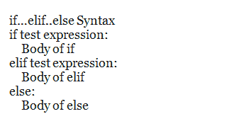

请记住，`elif` 即指 `else if`，旨在允许检查多个表达式。首先对 `if` 块求值，然后是 `elif` 块，最后是 `else` 块。在这种情况下，当所有其他条件均返回 false 时，`else` 块更多是一种后备选项。重要的是要记住，尽管 `if..elif..else` 中有多个可用块，但任何给定时刻只会执行**一个**块。

### 示例：涵盖三个条件，但在给定实例中只能执行一个。

1. 启动 IDLE。
2. 导航到“文件”菜单并点击“新建窗口”。
3. 输入以下内容：

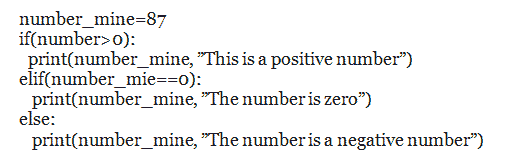

### 解释

存在三种可能性，但在任何给定实例中只会存在一个条件，这正是使用 `if` 系列流程控制语句的资格所在。对于三个或更多条件的求值，`if…elif..else` 流程语句最为合适。

## Python 中的嵌套 if 语句

有时会出现一种条件成立，但存在更多需要覆盖的子条件，这引出了称为嵌套的概念。嵌套的语句数量不受限制，但你应谨慎行事，因为你会意识到嵌套在编写代码时可能导致用户错误。嵌套也会使代码维护变得复杂。只有缩进有助于确定嵌套层级。

#### 示例

1. 启动 IDLE。
2. 导航到“文件”菜单并点击“新建窗口”。
3. 输入以下内容：

```
my_charact = str(input("Type a character here either 'a', 'b' or 'c':"))

if my_charact == 'a':
    if my_charact == 'a':
        print("a")
    elif my_charact == 'b':
        print("b")
else:
    print("c")
```

## 练习


# Python 程序设计基础

## 使用 if..else 进行流程控制

编写一个程序，使用 `if..else` 流程控制语句检查非闰年并显示相应场景。包含注释和缩进以增强程序的可读性。

## Python 中的 for 循环

在 Python 中，缩进用于分隔 `for` 循环的主体。

**注意**：简单线性列表采用以下语法：

```python
Variable_name = [values separated by a comma]
```

#### 示例

1. 启动 IDLE。
2. 导航到 **File** 菜单并点击 **New Window**。
3. 输入以下代码：

```python
numbers = [12, 3, 18, 10, 7, 2, 3, 6, 1]  # 存储列表的变量名
sum = 0                                      # 使用前初始化 sum，非常重要
for cumulative in numbers:                   # 遍历列表
    sum = sum + cumulative
print("The sum is", sum)
```

## 练习

1. 启动 IDLE。
2. 导航到 **File** 菜单并点击 **New Window**。
3. 输入以下代码：

编写一个 Python 程序，使用 `for` 循环对以下列表求和。

a. `marks = [3, 8, 19, 6, 18, 29, 15]`
b. `ages = [12, 17, 14, 18, 11, 10, 16]`
c. `mileage = [15, 67, 89, 123, 76, 83]`
d. `cups = [7, 10, 3, 5, 8, 16, 13]`

## Python 中的 range() 函数

Python 中的 `range()` 函数可用于生成数字。请记住，在编程中第一个项目的索引是 0。

因此，`range(11)` 将生成从 0 到 10 的数字。

#### 示例

1. 启动 IDLE。
2. 导航到 **File** 菜单并点击 **New Window**。
3. 输入以下代码：

```python
print(range(7))
```

输出将是 `0, 1, 2, 3, 4, 5, 6`。

## 练习

不编写和运行 Python 程序，以下表达式的输出是什么？

a. `range(16)`
b. `range(8)`
c. `range(4)`

## 使用 range()、len() 和索引

### 解决示例

1. 启动 IDLE。
2. 导航到 **File** 菜单并点击 **New Window**。
3. 输入以下代码：

```python
# 假设此处为图片所示代码逻辑
# 图片路径: Images/image00234.gif
```

该程序的输出将是：

```text
I prefer omelet
I prefer fish
I prefer jazz
```

## 练习

编写一个 Python 程序，遍历以下列表并包含消息 "I listen to"（每种音乐流派）。使用 `for` 循环、`len()` 和 `range()`。参考前面的示例语法。

```python
folders = ['Rumba', 'House', 'Rock']
```

## 使用带 else 子句的 for 循环

可以选择性地在 `for` 循环后包含 `else` 子句。当序列中的项目耗尽时，将执行 `else` 块。

#### 示例

1. 启动 IDLE。
2. 导航到 **File** 菜单并点击 **New Window**。
3. 输入以下代码：

```python
marks = [12, 15, 17]
for i in marks:
    print(i)
else:
    print("No items left")
```

### 挑战

编写一个 Python 程序，打印 1 到 50 之间的所有素数。

## Python 中的 while 循环

在 Python 中，`while` 循环用于在测试条件保持 `True` 时迭代执行一块程序代码。`while` 循环用于用户不知道所需循环周期的场景。

如前所述，`while` 循环主体通过缩进来确定。

#### 示例

1. 启动 IDLE。
2. 导航到 **File** 菜单并点击 **New Window**。
3. 输入以下代码：

```python
# 假设此处为图片所示代码逻辑
# 图片路径: Images/image00235.gif
```

**警示**：未包含计数器的值将导致无限循环。

## 练习

a. 编写一个 Python 程序，利用 `while` 流程控制语句显示 1 到 10 之间所有奇数的和。
b. 编写一个 Python 程序，采用 `while` 流程控制语句显示 11 到 21 之间所有数字的和。
c. 编写一个 Python 程序，结合 `while` 流程控制语句显示 1 到 10 之间所有偶数的和。

## 使用带 else 子句的 while 循环

如果条件为假且未发生 `break`，则运行 `while` 循环的 `else` 部分。

#### 示例

1. 启动 IDLE。
2. 导航到 **File** 菜单并点击 **New Window**。
3. 输入以下代码：

```python
track = 0
while track < 4:
    print("Within the loop")
    track = track + 1
else:
    print("Now within the else segment")
```

## Python 的 break 和 continue 语句

让我们用一个现实生活中的类比，即我们必须在迭代完全求值之前强制停止。想想使用简单字典攻击破解/破译密码时，会循环遍历所有可能的字符组合，一旦找到搜索的密码，你会希望程序立即停止，而不必完成剩余过程。再想想使用恢复软件恢复意外删除的照片时，一旦在指定范围内找到项目，你会希望恢复立即停止遍历文件。Python 中的 `break` 和 `continue` 语句以类似的方式工作。

### 示例：break 语句

1. 启动 IDLE。
2. 导航到 **File** 菜单并点击 **New Window**。
3. 输入以下代码：

```python
for tracker in "bring":
    if tracker == "i":
        break
    print(tracker)
print("The End")
```

## Python 中的 continue 语句

当使用 `continue` 语句时，解释器仅跳过当前迭代中循环内的其余代码，循环不会终止。循环继续进行下一次迭代。

### Python continue 的语法

```python
continue
```

#### 示例

1. 启动 IDLE。
2. 导航到 **File** 菜单并点击 **New Window**。
3. 输入以下代码：

```python
for tracker in "bring":
    if tracker == "i":
        continue
    print(tracker)
print("Finished")
```

该程序的输出将是：

```text
b
r
n
g
Finished
```

**类比**：假设你正在运行数据恢复软件并指定了跳过 Word 文件（`.doc`、`.docx` 扩展名）。程序将不得不在跳过 Word 文件后继续迭代。

## 练习

a. 编写一个使用 `for` 循环的 Python 程序，在字符串 "Oliver" 中遇到 "v" 时中断。
b. 编写一个 Python 程序，在字符串 "Lemon" 中跳过 "m" 后继续。

## Python 中的 pass 语句

像注释一样，`pass` 语句不会影响程序，因为它不执行任何操作。

### pass 的语法

```python
pass
```

设想一段你计划将来使用但目前不需要的程序代码。你可以将其编写为 `pass` 语句，而不必在将来插入该代码。

#### 示例

1. 启动 IDLE。
2. 导航到 **File** 菜单并点击 **New Window**。
3. 输入以下代码：

```python
my_list = {'k', 'i', 'n'}
for tracker in my_list:
    pass
```

## Python 中的函数

Python 中的函数有助于将大型代码拆分为较小的单元。函数使程序更有条理且易于管理。

Python 函数将采用以下语法形式：

```python
def name_of_function(arguments):
    """docstring"""
    statement(s)
```

#### 示例

1. 启动 IDLE。
2. 导航到 **File** 菜单并点击 **New Window**。
3. 输入以下代码：

```python
def welcome(salute):
    """The Python function welcomes you to
    the individual passed in as
    parameter"""
    print("Welcome " + salute + ". Lovely Day!")
```

## 在 Python 中调用函数

一旦定义了函数，我们就可以从另一个函数或程序中调用它。

调用函数只需键入函数名并附上合适的参数。

1. 启动 IDLE。
2. 导航到 **File** 菜单并点击 **New Window**。
3. 输入以下代码：

```python
welcome('Brenda')
```

输出将是 `"Welcome Brenda. Lovely Day!"`。

## 练习

编写一个函数，调用时输出 `"Hello (student name), kindly submit your work by Sunday"`。

## 文档字符串

文档字符串放在函数头之后作为第一条语句，简要解释函数的功能。文档字符串应始终放在三引号之间以容纳多行字符串。

### 调用/引用之前输入的文档字符串

#### 示例

1. 启动 IDLE。
2. 导航到 **File** 菜单并点击 **New Window**。
3. 输入以下代码：

```python
print(welcome.__doc__)
```

输出将是：

```text
This function welcomes you to
the individual passed in as
parameter
```

调用/引用文档字符串的语法是：

```python
print(function_name.__doc__)
```

## Python 函数返回语句

### 返回语法

```python
return [list of expressions]
```

## 说明

`return` 语句可以返回一个值或 `None` 对象。

### 示例：返回 None

```python
print(welcome("Richard"))  # 传递参数并调用函数
# Welcome Richard. Lovely Day!
# None                     # 返回的值
```

### 示例：返回非 None 值

1. 启动 IDLE。
2. 导航到 **File** 菜单并点击 **New Window**。
3. 输入以下代码：

```python
# 假设此处为图片所示代码逻辑
# 图片路径: Images/image00236.gif
```


## Python 函数中的变量作用域与生命周期

在 Python 函数内部定义的变量和参数具有局部作用域，这意味着它们从外部不可见。在 Python 中，变量的生命周期在函数执行期间有效，即变量在内存中存在的整个时期。函数返回时会销毁函数变量。

#### 示例

启动 IDLE。

导航到 **File** 菜单并点击 **New Window**。

输入以下内容：

```
def function_my():
    marks = 15
    print("The value inside the function is:", marks)

marks = 37
function_my()
print("The value outside the function is:", marks)
```

# 函数类型

它们大致分为用户定义函数和内置函数。内置函数是 Python 解释器的一部分，而用户定义函数由用户指定。

## 练习

给出 Python 中三个内置函数的例子。

# 函数参数

调用函数需要传递正确数量的参数；否则，解释器将生成错误。

## 说明

启动 IDLE。

导航到 **File** 菜单并点击 **New Window**。

输入以下内容：

```
def salute(name, message):
    """This function welcomes the student with the provided message"""
    print("Welcome", name + ', ' + message)

salute("Brenda", "Lovely Day!")
```

> **Note:** 函数 `salute()` 有两个参数。因为我们传入了两个实参，所以不会报错。让我们尝试只传一个实参调用函数，看看会发生什么：

```
salute("Brenda")  # only one argument passed
```

运行此程序将生成一个错误，提示 `TypeError: salute() missing 1 required positional argument`。不传任何实参调用函数时也会发生同样的情况。

## 示例 2

启动 IDLE。

导航到 **File** 菜单并点击 **New Window**。

输入以下内容：

```
salute()
```

解释器将生成错误 `TypeError: salute() missing 2 required positional arguments`。

# Python 中的关键字参数

Python 提供了一种使用关键字参数调用函数的方式。使用关键字参数调用函数时，参数的顺序可以改变。函数的值按位置与参数逐一匹配。

> **Note:**
> 在前面的示例中，函数 `salute` 作为 `salute("Brenda", "Lovely Day!")` 调用时，将值 `"Brenda"` 赋给参数 `name`，将 `"Lovely Day!"` 赋给 `message`。

## 使用关键字调用函数

启动 IDLE。

导航到 **File** 菜单并点击 **New Window**。

输入以下内容：

```
salute(name="Brenda", message="Lovely Day!")
```

## 关键字不按顺序排列

```
salute(message="Lovely Day!", name="Brenda")
```

# 任意参数

有时我们可能不知道需要传入函数的所有参数。

**类比：** 假设你正在编写一个程序来欢迎本学期所有的新生。在这种情况下，你不知道会有多少人报到。

#### 示例

启动 IDLE。

导航到 **File** 菜单并点击 **New Window**。

输入以下内容：

```
def welcome(*names):
    """This welcome function salutes all students in the names tuple."""
    for name in names:
        print("Welcome", name)

welcome("Lucy", "Richard", "Fridah", "James")
```

程序的输出将是：

```
Welcome Lucy
Welcome Richard
Welcome Fridah
Welcome James
```

# Python 中的递归

用其自身来定义某事物称为递归。递归函数会调用其自身。

#### 示例

计算整数阶乘的 Python 程序。

启动 IDLE。

导航到 **File** 菜单并点击 **New Window**。

输入以下内容：

```
def factorial(n):
    if n == 1:
        return 1
    else:
        return n * factorial(n - 1)

print(factorial(5))
```

## 练习

编写一个 Python 程序来求 7 的阶乘。

# Python 匿名函数

某些函数可以不指定名称；这些称为匿名函数。`lambda` 关键字用于表示匿名函数。在 Python 中，匿名函数也称为 lambda 函数。

## 语法

```
lambda arguments: expression
```

Lambda 函数必须始终包含一个表达式，但可以有多个参数。

#### 示例

启动 IDLE。

导航到 **File** 菜单并点击 **New Window**。

输入以下内容：

```
double = lambda y: y * 2
# Output: 10
print(double(5))
```

## 示例 2

我们可以使用内置函数如 `filter()` 和 `lambda` 来显示列表/元组中的偶数。

启动 IDLE。

导航到 **File** 菜单并点击 **New Window**。

输入以下内容：

```
first_marks = [3, 7, 14, 16, 18, 21, 13, 32]
fresh_marks = list(filter(lambda n: (n % 2 == 0), first_marks))
# Output: [14, 16, 18, 32]
print(fresh_marks)
```

`lambda` 函数和 `map()` 可用于将列表中的各项加倍。

## 示例 3

启动 IDLE。

导航到 **File** 菜单并点击 **New Window**。

输入以下内容：

```
first_score = [3, 7, 14, 16, 18, 21, 13, 32]
fresh_score = list(map(lambda m: m * 2, first_score))
# Output: [6, 14, 28, 32, 36, 42, 26, 64]
print(fresh_score)
```

# Python 的 Global、Local 和 Nonlocal

## Python 的全局变量

在 Python 中，函数外部声明的变量称为全局变量。它们在全局作用域中声明。全局变量可以在函数内部或外部访问。

#### 示例

启动 IDLE。

导航到 **File** 菜单并点击 **New Window**。

输入以下内容：

```
y = "global"

def foo():
    print("y inside the function :", y)

foo()
print("y outside the function:", y)
```

### 解释

在上图中，`y` 是一个全局变量，并被定义为 `foo()` 以打印全局变量 `y`。当我们调用 `foo()` 时，它将打印 `y` 的值。

## 局部变量

局部变量是在函数体内或局部作用域中声明的。

#### 示例

启动 IDLE。

导航到 **File** 菜单并点击 **New Window**。

输入以下内容：

```
def foo():
    x = "local"

foo()
print(x)
```

### 解释

运行此程序将生成一个错误，提示 `x` 未定义。错误发生的原因是我们试图在全局作用域中访问局部变量 `x`，而 `foo()` 函数仅在局部作用域中有效。

## 在 Python 中创建局部变量

#### 示例

通过在函数内声明变量来创建局部变量。

```
def foo():
    x = "local"
    print(x)

foo()
```

启动 IDLE。

导航到 **File** 菜单并点击 **New Window**。

输入以下内容：

```
def foo():
    x = "local"
    print(x)

foo()
```

### 解释

当我们执行代码时，输出将是：

```
local
```

## Python 的全局变量和局部变量

在同一代码中同时使用局部变量和全局变量。

#### 示例

启动 IDLE。

导航到 **File** 菜单并点击 **New Window**。

输入以下内容：

```
y = "global"

def foo():
    global y
    x = "local"
    y = y * 2
    print(y)
    print(x)

foo()
```

### 解释

程序的输出将是：

```
globalglobal
local
```

我们将 `y` 声明为全局变量，将 `x` 声明为 `foo()` 中的局部变量。`*` 运算符用于修改全局变量 `y`，最后我们打印了 `y` 和 `x`。

## 同名的局部变量和全局变量

启动 IDLE。

导航到 **File** 菜单并点击 **New Window**。

输入以下内容：

```
y = 6

def foo():
    y = 11
    print("Local variable y-", y)

foo()
print("Global variable y-", y)
```

# Python 的 Nonlocal 变量

Python nonlocal 变量用于嵌套函数，其局部作用域未指定。它既不是全局也不是局部作用域。

#### 示例

创建一个 nonlocal 变量。

启动 IDLE。

导航到 **File** 菜单并点击 **New Window**。

输入以下内容：

```
def outer():
    y = "local variable"
    def inner():
        nonlocal y
        y = "nonlocal variable"
        print("inner:", y)
    inner()
    print("outer scope:", y)

outer()
```

# Python 中的 Global 关键字

Python 中的 `global` 关键字允许修改当前作用域之外的变量。`global` 关键字在局部上下文中对变量进行更改。创建 global 关键字时有以下规则：

- 当我们在函数内部创建变量时，global 关键字默认为局部。
- 当我们在函数外部定义变量时，它默认为全局，你不需要使用 `global` 关键字。


# Python 全局变量与模块

## `global` 关键字

`global` 关键字用于在函数内部读取和写入全局变量。

在函数外部使用 `global` 关键字将不会产生任何效果。

### 示例：访问全局变量

启动 IDLE。

导航至“文件”菜单并点击“新建窗口”。

输入以下内容：

```python
number = 3          # 一个全局变量

def add():
    print(number)

add()
```

该程序的输出将为 `3`。

### 示例：修改全局变量（错误）

```python
number = 3          # 一个全局变量

def add():
    number = number + 4   # 给 3 加 4
    print(number)

add()
```

**解释**

程序执行时将报错，提示局部变量 `number` 在赋值前被引用。遇到该错误的原因是我们只能访问全局变量，却无法在函数内部对其进行修改。使用 `global` 关键字即可解决此问题。

### 示例：使用 `global` 关键字修改全局变量

```python
number = 3          # 一个全局变量

def add():
    global number
    number = number + 1   # 增加 1
    print("Inside the function add():", number)

add()
print("In main area:", number)
```

**解释**

程序运行后，输出将为：

```
Inside the function add(): 4
In main area: 4
```

我们在函数 `add()` 内部使用 `global` 关键字定义了 `number`。该变量随后增加了 1。接着我们调用 `add()` 函数来打印全局变量 `number`。

## 跨 Python 模块创建全局变量

我们可以创建一个单独的模块 `config.py`，其中包含所有全局变量，并在同一程序的多个模块间共享这些信息。

#### 示例

**创建 `config.py`**

```python
x = 0
y = "empty"
```

**创建 `update.py` 以修改全局变量**

```python
import config

config.x = 11
config.y = "Today"
```

**创建 `main.py` 以验证值的变化**

```python
import config
import update

print(config.x)
print(config.y)
```

**解释**

运行 `main.py` 文件将输出：

```
11
Today
```

## Python 模块

模块由定义和程序语句组成。

例如，名为 `config.py` 的文件即被视为一个模块。该模块的名称为 `config`。模块有助于将大型程序拆分为更小、更易管理且结构更清晰的文件，同时也促进了代码的复用性。

### 示例：创建第一个模块

启动 IDLE。

导航至“文件”菜单并点击“新建窗口”。

输入以下内容：

```python
def add(x, y):
    """This is a program to add two
    numbers and return the outcome"""
    outcome = x + y
    return outcome
```

## 模块导入

关键字 `import` 用于导入模块。

#### 示例

```python
import first
```

只要我们知道模块的名称，点运算符就能帮助我们访问其中的函数。

#### 示例

启动 IDLE。

导航至“文件”菜单并点击“新建窗口”。

输入以下内容：

```python
first.add(6, 8)
```

**解释**

## Python 中的 `import` 语句

`import` 语句可用于通过点运算符访问模块内的定义。

#### 示例

启动 IDLE。

导航至“文件”菜单并点击“新建窗口”。

输入以下内容：

```python
import math

print("The PI value is", math.pi)
```

### 重命名导入

**示例**

启动 IDLE。

导航至“文件”菜单并点击“新建窗口”。

输入以下内容：

```python
import math as h

print("The PI value is-", h.pi)
```

**解释**

在此例中，`h` 是我们重命名后的 `math` 模块，旨在某些情况下节省输入时间。重命名后，新名称成为有效且被识别的名称，而原名称不再适用。

### `from ... import` 语句

可以从模块中导入特定的名称，而非导入整个模块。

**示例**

启动 IDLE。

导航至“文件”菜单并点击“新建窗口”。

输入以下内容：

```python
from math import pi

print("The PI value is-", pi)
```

### 导入所有名称

**示例**

启动 IDLE。

导航至“文件”菜单并点击“新建窗口”。

输入以下内容：

```python
from math import *

print("The PI value is-", pi)
```

**解释**

在此上下文中，我们导入了特定模块的所有定义，但这**不**被提倡为规范，因为它可能导致难以察觉的命名重复。

## Python 模块搜索路径

**示例**

启动 IDLE。

导航至“文件”菜单并点击“新建窗口”。

输入以下内容：

```python
import sys

sys.path
```

Python 会在包括 `sys` 文件在内的所有位置进行搜索。

## 重新加载模块

Python 仅会导入模块一次，以提高执行效率。

```python
print("This program was executed")
import mine
```

### 重新加载代码

**示例**

启动 IDLE。

导航至“文件”菜单并点击“新建窗口”。

输入以下内容：

```python
import mine
import mine
import mine

import importlib
importlib.reload(mine)
```

## Python 内置 `dir()` 函数

要发现模块中包含的名称，我们使用内置函数 `dir()`。

**语法**

```python
dir(module_name)
```

## Python 包

在 Python 中，文件存放模块，目录存放包。一个 Python 包包含相似的模块。因此，不同的模块应放置在不同的 Python 包中。

# Python 中的数据类型

## ✓ 数字

如前所述，Python 支持浮点数、整数和复数。小数点的有无将整数与浮点数区分开来。例如，`4` 是整数，而 `4.0` 是浮点数。

另一方面，Python 中的复数表示为 `r + tj`，其中 `r` 代表实部，`t` 代表虚部。在此上下文中，函数 `type()` 用于确定变量的类别。Python 函数 `isinstance()` 用于判断对象具体源自哪个类。

#### 示例

启动 IDLE。

导航至“文件”菜单并点击“新建窗口”。

输入以下内容：

```python
number = 6
print(type(number))          # 应输出 <class 'int'>
print(type(6.0))             # 应输出 <class 'float'>

complex_num = 7 + 5j
print(complex_num + 5)
print(isinstance(complex_num, complex))  # 应输出 True
```

**重要提示**：Python 中的整数长度可以是无限的。Python 中的浮点数精度假定为小数点后十五位。

## 数字转换

本节假设您已具备使用手动计算或计算器将十进制转换为二进制、八进制和十六进制的基础知识。请查看 Windows 10 中的计算器，版本 Version 10.1804.911.1000，选择“程序员”模式以自动转换。

程序员经常需要将十进制数转换为八进制、十六进制和二进制形式。Python 中的前缀允许将这些数字标记为其对应的类型。

| 数制 | 前缀 |
| :--- | :--- |
| 八进制 | `0O` 或 `0o` |
| 二进制 | `0B` 或 `0b` |
| 十六进制 | `0X` 或 `0x` |

#### 示例

```python
print(0b1010101)      # 输出: 85
print(0x7B + 0b0101)  # 输出: 128 (123+5)
print(0o710)          # 输出: 456
```

## 练习

编写一个 Python 程序以显示以下内容：

a. `0011 1111` (二进制)
b. `747` (八进制)
c. `93` (十六进制)

## 类型转换

有时称为强制转换，类型转换允许我们将一种数字类型转换为另一种。预加载的函数如 `float()`、`int()` 和 `complex()` 支持隐式和显式类型转换。这些相同的函数也可用于从字符串进行转换。

#### 示例

启动 IDLE。

导航至“文件”菜单并点击“新建窗口”。

输入以下内容：

```python
int(5.3)   # 结果为 5
int(5.9)   # 结果为 5
```

`int()` 作用于浮点数时会产生截断效果。它会直接丢弃小数部分而不进行四舍五入。再来看看 `float()`：

启动 IDLE。

导航至“文件”菜单并点击“新建窗口”。

输入以下内容：

```python
float(6)            # 结果为 6.0
complex('4+2j')     # 结果为 (4+2j)
```

## 练习

对以下数值应用 `int()` 转换：

a. `4.1`
b. `4.7`
c. `13.3`
d. `13.9`

对以下数值应用 `float()` 转换：

e. `7`
f. `16`
g. `19`

## ✓ Python 中的 Decimal（十进制精确数）

#### 示例

启动 IDLE。

导航至“文件”菜单并点击“新建窗口”。

输入以下内容：

```python
(1.2 + 2.1) == 3.3   # 将返回 False，为什么？
```

**解释**


# Python 编程概念

## Python 中的分数

计算机处理的是有限数字，分数无法以原始形式存储，因为它们会产生无限长的二进制序列。

Python 中的 `fractions` 模块允许对分数进行运算。

#### 示例

启动 IDLE。

导航到“文件”菜单并点击“新建窗口”。

输入以下内容：

```python
import fractions

print(fractions.my_fraction(2.5))  # 输出 5/2
print(fractions.my_fraction(4))    # 输出 5
print(fractions.my_fraction(2,5))  # 输出 2/5
```

> **重要**
> 从浮点数创建 `my_fraction` 可能会导致异常结果，这是由于二进制浮点数的误导性表示造成的。

## Python 中的数学运算

要执行数学函数，Python 提供了 `random` 和 `math` 等模块。

#### 示例

启动 IDLE。

导航到“文件”菜单并点击“新建窗口”。

输入以下内容：

```python
import math

print(math.pi)              # 输出: 3.14159....
print(math.cos(math.pi))    # 输出将为 -1.0
print(math.exp(10))         # 输出将为 22026.4....
print(math.log10(100))      # 输出将为 2
print(math.factorial(5))    # 输出将为 120
```

## 练习

编写一个 Python 程序，使用 `math` 模块中的数学函数执行以下操作：

a. 34 的平方
b. Log10 10000
c. Cos 45 x sin 90
d. 20 的指数

## Python 中的随机函数

#### 示例

启动 IDLE。

导航到“文件”菜单并点击“新建窗口”。

输入以下内容：

```python
import math
import random

print(random.shuffle_num(11, 21))

y = ['f', 'g', 'h', 'm']

print(random.pick(y))
random.anypic(y)
print(y)
print(your_pick.random())
```

## Python 中的列表

我们通过将称为元素的项目放在方括号内并用逗号分隔来在 Python 中创建列表。列表中的项目可以是混合数据类型。

#### 示例

启动 IDLE。

导航到“文件”菜单并点击“新建窗口”。

输入以下内容：

```python
list_mine = []              # 空列表
list_mine = [2, 5, 8]       # 整数列表
list_mine = [5, "Happy", 5.2]  # 包含混合数据类型的列表
```

## 练习

编写一个程序，将以下内容捕获到列表中："Best", 26, 89, 3.9

## 嵌套列表

嵌套列表是作为另一个列表中的项目而存在的列表。

#### 示例

启动 IDLE。

导航到“文件”菜单并点击“新建窗口”。

输入以下内容：

```python
list_mine = ["carrot", [9, 3, 6], ['g']]
```

## 练习

为以下元素编写一个嵌套列表：`[36, 2, 1]`，"Writer"，'t'，`[3.0, 2.5]`

## 从列表中访问元素

在编程中，特别是在 Python 中，第一个项目的索引始终为零。对于包含五个项目的列表，我们将从索引 0 访问到索引 4。未能以这种方式访问列表中的项目将导致索引错误。索引始终是整数，因为使用其他数字类型将导致类型错误。对于嵌套列表，则通过嵌套索引进行访问。

#### 示例

启动 IDLE。

导航到“文件”菜单并点击“新建窗口”。

输入以下内容：

```python
list_mine = ['b', 'e', 's', 't']

print(list_mine[0])  # 输出将为 b
print(list_mine[2])  # 输出将为 s
print(list_mine[3])  # 输出将为 t
```

## 练习

给定以下列表：

```python
your_collection = ['t', 'k', 'v', 'w', 'z', 'n', 'f']
```

a. 编写一个 Python 程序来显示列表中的第二个项目
b. 编写一个 Python 程序来显示列表中的第六个项目
c. 编写一个 Python 程序来显示列表中的最后一个项目。

## 嵌套列表索引

#### 示例

启动 IDLE。

导航到“文件”菜单并点击“新建窗口”。

输入以下内容：

```python
nested_list = ["Best", [4, 7, 2, 9]]

print(nested_list[0][1])
```

## Python 负索引

对于其序列，Python 允许负索引。列表中的最后一个项目索引为 -1，倒数第二个项目索引为 -2，以此类推。

#### 示例

启动 IDLE。

导航到“文件”菜单并点击“新建窗口”。

输入以下内容：

```python
list_mine = ['c', 'h', 'a', 'n', 'g', 'e', 's']

print(list_mine[-1])  # 输出为 s
print(list_mine[-4])  # 输出为 n
```

## Python 列表切片

切片运算符（全冒号）用于访问列表中的一系列元素。

### 示例：选取第 4 个到第 6 个元素

启动 IDLE。

导航到“文件”菜单并点击“新建窗口”。

输入以下内容：

```python
list_mine = ['c', 'h', 'a', 'n', 'g', 'e', 's']

print(list_mine[3:5])  # 选取第 4 个到第 6 个元素
```

### 示例：选取从开头到第 5 个元素

```python
print(list_mine[:-6])
```

### 示例：选取从第 3 个元素到最后

```python
print(list_mine[2:])
```

## 练习

给定 `class_names = ['John', 'Kelly', 'Yvonne', 'Una', 'Lovy', 'Pius', 'Tracy']`

a. 编写一个使用切片运算符的 Python 程序，显示从第二个学生开始及其后的所有学生。
b. 编写一个使用切片运算符的 Python 程序，使用负索引功能显示从第一个学生到第三个学生。
c. 编写一个使用切片运算符的 Python 程序，仅显示第四个和第五个学生。

## 使用赋值运算符操作列表中的元素

列表中的项目可以被更改，这意味着列表是可变的。

#### 示例

启动 IDLE。

导航到“文件”菜单并点击“新建窗口”。

输入以下内容：

```python
list_yours = [4, 8, 5, 2, 1]

list_yours[1] = 6

print(list_yours)  # 输出将为 [4, 6, 5, 2, 1]
```

## 更改列表中的一系列项目

#### 示例

启动 IDLE。

导航到“文件”菜单并点击“新建窗口”。

输入以下内容：

```python
list_yours[0:3] = [12, 11, 10]  # 将更改列表中第一项到第四项

print(list_yours)  # 输出将为: [12, 11, 10, 1]
```

## 在列表中追加/扩展项目

`append()` 方法允许扩展列表中的项目。`extend()` 也可以使用。

### 示例：使用 append()

启动 IDLE。

导航到“文件”菜单并点击“新建窗口”。

输入以下内容：

```python
list_yours = [4, 6, 5]

list_yours.append(3)

print(list_yours)  # 输出将为 [4, 6, 5, 3]
```

### 示例：使用 extend()

启动 IDLE。

导航到“文件”菜单并点击“新建窗口”。

输入以下内容：

```python
list_yours = [4, 6, 5]

list_yours.extend([13, 7, 9])

print(list_yours)  # 输出将为 [4, 6, 5, 13, 7, 9]
```

加号运算符（`+`）也可用于合并两个列表。`*` 运算符可用于将列表重复指定次数。

#### 示例

启动 IDLE。

导航到“文件”菜单并点击“新建窗口”。

输入以下内容：

```python
list_yours = [4, 6, 5]

print(list_yours + [13, 7, 9])  # 输出: [4, 6, 5, 13, 7, 9]
print(['happy'] * 4)            # 输出: ["happy", "happy", "happy", "happy"]
```

## 从列表中移除或删除项目

关键字 `del` 用于在 Python 中删除元素或整个列表。

### 示例：删除单个元素

启动 IDLE。

导航到“文件”菜单并点击“新建窗口”。

输入以下内容：

```python
list_mine = ['t', 'r', 'o', 'g', 'r', 'a', 'm']

del list_mine[1]

print(list_mine)  # t, o, g, r, a, m
```

### 删除多个元素

#### 示例

```python
del list_mine[0:3]
print(list_mine)  # a, m
```

### 删除整个列表

启动 IDLE。

导航到“文件”菜单并点击“新建窗口”。

输入以下内容：

```python
del list_mine

print(list_mine)  # 将生成错误: name 'list_mine' is not defined
```

`remove()` 方法或 `pop()` 方法可用于移除指定项目。如果不给定索引，`pop()` 方法将移除并返回最后一个项目，并有助于将列表实现为栈。`clear()` 方法用于清空列表。

#### 示例

启动 IDLE。

导航到“文件”菜单并点击“新建窗口”。

输入以下内容：

```python
list_mine = ['t', 'k', 'b', 'd', 'w', 'q', 'v']

list_mine.remove('t')
print(list_mine)  # 输出将为 ['k', 'b', 'd', 'w', 'q', 'v']

print(list_mine.pop(1))  # 输出将为 'b'
print(list_mine.pop())   # 输出将为 'v'
```

## 练习

给定 `list_yours = ['K', 'N', 'O', 'C', 'K', 'E', 'D']`

a. 弹出列表中的第三个项目，将程序保存为 `list1`。
b. 使用 `remove()` 方法移除第四个项目并将程序保存为 `list2`。
c. 删除列表中的第二个项目并将程序保存为 `list3`。
d. 不指定索引弹出列表并将程序保存为 `list4`。

## 使用空列表删除整个或特定元素

#### 示例

启动 IDLE。

导航到“文件”菜单并点击“新建窗口”。

输入以下内容：

```python
list_mine = ['t', 'k', 'b', 'd', 'w', 'q', 'v']

list_mine[1:2] = []
```


print(`list_mine`)#输出将为 `['t','w','q','v']`

# Python 列表方法总结

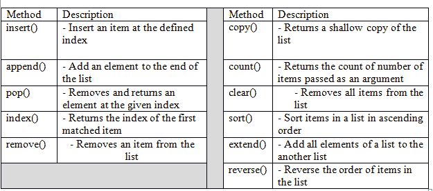

## 练习

1.  使用列表访问方法按逆序显示以下项目 `list_yours=[4,9,2,1,6,7]`
2.  使用列表访问方法计算 a 中的元素数量。
3.  使用列表访问方法按升序/默认顺序对 a 中的项目进行排序。

## 用于操作 Python 列表的内置 Python 函数

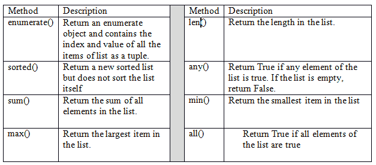

# Python 中的元组

元组类似于列表，但我们无法更改元组中的元素。

#### 示例

启动 IDLE。

导航至“文件”菜单并点击“新建窗口”。

输入以下内容：

```
tuple_mine = (21, 12, 31)
print(tuple_mine)
tuple_mine = (31, "Green", 4.7)
print(tuple_mine)
```

## 访问 Python 元组元素

#### 示例

启动 IDLE。

导航至“文件”菜单并点击“新建窗口”。

输入以下内容：

```
tuple_mine=['t','r','o','g','r','a','m']
print(tuple_mine[1])#输出:'r'
print(tuple_mine[3])#输出:'g'
```

## 负索引

就像列表一样，元组也可以使用负索引。

同列表一样，`-1` 指向列表中的最后一个元素，`-2` 指向倒数第二个元素。

#### 示例

启动 IDLE。

导航至“文件”菜单并点击“新建窗口”。

输入以下内容：

```
tuple_mine=['t','r','o','g','r','a','m']
print(tuple_mine [-2])#输出将为 'a'
```

## 切片

切片运算符（全冒号）用于访问元组中一定范围内的项目。

#### 示例

启动 IDLE。

导航至“文件”菜单并点击“新建窗口”。

输入以下内容：

```
tuple_mine=['t','r','o','g','r','a','m']
print(tuple_mine [2:5])#输出: 'o','g','r','a'
print(tuple_mine[:-4])#'g','r','a','m'
```

## 重要

元组元素是不可变的，意味着它们不能被更改。但是，我们可以使用 `+`（连接运算符）组合元组中的元素。我们也可以使用 `*` 运算符重复元组中的元素，就像列表一样。

#### 示例

启动 IDLE。

导航至“文件”菜单并点击“新建窗口”。

输入以下内容：

```
print((7, 45, 13) + (17, 25, 76))
print(("Several",) * 4)
```

## 重要

既然我们无法更改元组中的元素，也就无法删除这些元素。但是，可以使用关键字 `del` 删除整个元组。

#### 示例

启动 IDLE。

导航至“文件”菜单并点击“新建窗口”。

输入以下内容：

```
t_mine=['t','k','q','v','y','c','d']
del t_mine
```

## Python 中可用的元组方法

用于处理 Python 元组的方法只有两个。

*   `count(y)`：调用时将给出等于 y 的项目数量。
*   `index(y)`：调用时将给出等于 y 的第一个项目的索引。

#### 示例

启动 IDLE。

导航至“文件”菜单并点击“新建窗口”。

输入以下内容：

```
t_mine=['t','k','q','v','y','c','d']
print(t_mine.count('t'))
print(t_mine.index('l'))
```

## 元组中的成员资格测试

关键字 `in` 用于检查指定元素是否存在于元组中。

#### 示例

启动 IDLE。

导航至“文件”菜单并点击“新建窗口”。

输入以下内容：

```
t_mine=['t','k','q','v','y','c','d']
print('a' in t_mine)#输出: True
print('k' in t_mine)#输出: False
```

## 元组的内置 Python 函数

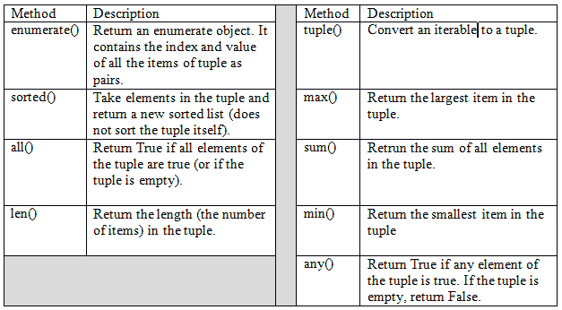

# Python 中的字符串

#### 示例

启动 IDLE。

导航至“文件”菜单并点击“新建窗口”。

输入以下内容：

```
string_mine = 'Colorful'
print(string_mine)
string_mine = "Hello"
print(string_mine)
string_mine = '''Hello'''
print(string_mine)
string_mine = """I feel like I have
         been born a programmer"""
print(string_mine)
```

## 访问字符串中的项目

#### 示例

启动 IDLE。

导航至“文件”菜单并点击“新建窗口”。

输入以下内容：

```
str = 'Colorful'
print('str = ', str)
print('str[1] = ', str[1])#输出第二个项目
print('str[-2] = ', str[-2])#输出倒数第二个项目
print('str[2:4] = ', str[2:4])#输出第三个到第五个项目
```

## 在 Python 中删除或更改

在 Python 中，字符串是不可变的，因此一旦赋值就无法更改。但是，删除整个字符串是可能的。

#### 示例

启动 IDLE。

导航至“文件”菜单并点击“新建窗口”。

输入以下内容：

```
del string_mine
```

## 字符串操作

可以对字符串执行多种操作，使其成为 Python 中广泛使用的数据类型。

使用 `+` 运算符进行连接，使用 `*` 运算符进行重复

#### 示例

启动 IDLE。

导航至“文件”菜单并点击“新建窗口”。

输入以下内容：

```
string1='Welcome'
string2='Again'
print('string1+string2=',string1+string2)
print(' string1 * 3 =', string1 * 3)
```

## 练习

给定 `string_a="I am awake"` 和 `string_b="coding in Python in a pajama"`

## 字符串迭代

`for` 控制语句用于持续扫描整个序列，直到达到指定的次数后终止扫描。

#### 示例

启动 IDLE。

导航至“文件”菜单并点击“新建窗口”。

输入以下内容：

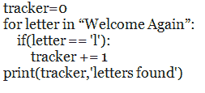

## 字符串中的成员资格测试

关键字 `in` 用于测试子字符串是否存在。

#### 示例

```
't' in "triumph"#将返回 True
```

## 用于处理字符串的内置 Python 函数

它们包括 `enumerate()` 和 `len()`。`len()` 函数返回字符串的长度。

## Python 中的字符串格式化

### 转义序列

#### 单引号和双引号

#### 示例

启动 IDLE。

导航至“文件”菜单并点击“新建窗口”。

输入以下内容：

```
print('They said, "We need a new team?"')# 使用单引号转义
##### 转义双引号
print("They said, \" We  need a new team\"")
```

### Python 中的转义序列

转义序列使我们能够格式化输出，以增强人类用户的清晰度。程序即使不使用转义序列也能成功运行，但输出对人类用户来说将非常令人困惑。以预期格式编写和显示输出是良好编程实践的一部分。以下是常用的转义序列。

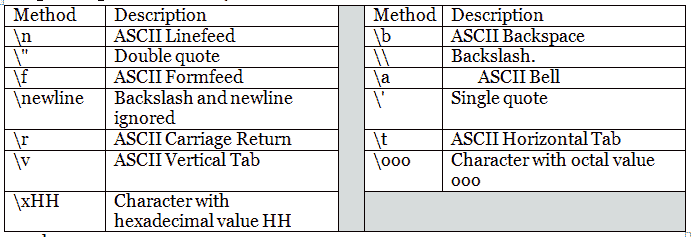

#### 示例

启动 IDLE。

导航至“文件”菜单并点击“新建窗口”。

输入以下内容：

```
print("D:\\\\Lessons\\\\Programming")
print("Prints\\n in two lines")
```

## 总结

如前所述，Python 支持整数、浮点数和复数。有整数、浮点数和复数类，帮助转换不同的数字数据类型。小数点的有无将整数和浮点数区分开来。例如，`4` 是整数，而 `4.0` 是浮点数。程序员经常需要将十进制数转换为八进制、十六进制和二进制形式。我们只需在特定数字前加上前缀，即可在 Python 中表示二进制、十六进制和八进制系统。有时称为强制转换，类型转换允许我们将一种数字类型转换为另一种。

诸如 `int()` 之类的内置函数允许我们直接转换数据类型。相同的函数也可用于从字符串转换。我们通过将称为元素的项目放在方括号内并用逗号分隔来在 Python 中创建列表。在编程中，特别是在 Python 中，第一个项目的索引始终为零。对于包含五个项目的列表，我们将从索引 0 访问到索引 4。未能以这种方式访问列表中的项目将导致索引错误。

# 第 4 章：Python 机器学习

在本章中，您将了解如何使用 Python 进行机器学习。为了从实践上理解机器学习，您将学习如何使用 Python 实现最著名的机器学习算法——K-近邻算法。在本章的其余部分，我们将该算法称为 KNN。您将在著名的 [Iris](http://archive.ics.uci.edu/ml/index.php) 数据集上实现 KNN。

> **注意：** 您可能需要考虑参加 [Python 机器学习](https://www.datacamp.com/tracks/machine-learning-with-python) 课程，或者为了了解机器学习是如何发展的以及更多背景知识，请考虑阅读 [此章节](https://www.datacamp.com/community/tutorials/machine-deep-learning)。

## 简介


## 机器学习概述

机器学习源于计算机科学，主要研究能够从经验中学习的算法设计。为了学习，它们需要具有特定属性的数据，算法以此为基础尝试寻找一些有意义的预测模式。主要地，ML 任务可分为概念学习、聚类、预测建模等。ML 算法的最终目标是能够在没有任何人工干预的情况下正确地做出决策。预测股票或天气是 ML 算法的几个应用示例。

存在各种 ML 算法，如决策树、朴素贝叶斯、随机森林、支持向量机、K 近邻、K 均值聚类等。

在 ML 算法类别中，你今天将使用的是 K 近邻算法。现在的问题是：K 近邻算法究竟是什么？那么让我们开始探索吧！

## 什么是 K 近邻？

KNN 或 K 近邻算法是一种监督学习算法；所谓监督，是指它在学习阶段利用训练数据的类别标签。它是一种基于实例的 ML 算法，根据存储的、带标签的实例（数据点）对新数据点进行分类。KNN 既可用于分类也可用于回归；不过，它更广泛地用于分类目的。

KNN 中的 `k` 是一个关键变量，也称为超参数，有助于准确地对数据点进行分类。更准确地说，`k` 是你在对新数据点进行分类时，希望从中进行投票的最近邻居的数量。

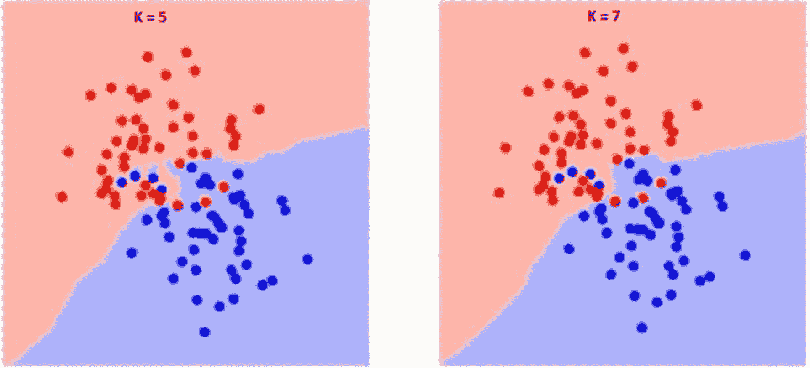

你可以看到，随着 `k` 的值从 1 增加到 7，包含某些数据点的两个类别之间的决策边界变得更加平滑。

现在的问题是，这一切“魔法”是如何发生的，即每当一个新数据点进来时，它是如何根据存储的数据点进行分类的？

所以，让我们通过以下方式快速理解它：

*   首先，加载所有数据并初始化 `k` 的值。
*   然后，使用各种相似度或距离度量（如曼哈顿距离 (L1)、欧几里得距离 (L2)、余弦相似度、巴氏距离、切比雪夫距离等）计算存储的数据点与你想要分类的新数据点之间的距离。
*   接着，按降序或升序对距离值进行排序，并确定前 k 个或后 k 个最近邻居。
*   收集 k 个最近邻居的标签，并使用多数投票或加权投票对新数据点进行分类。根据所有存储数据点中得分最高的某个数据点，为新数据点分配一个类别标签。
*   最后，返回新实例的预测类别。

预测可以分为两类：要么是分类，即为新数据点分配一个类别标签；要么是回归，即为新数据点分配一个数值。与分类不同，在回归中，所有 k 个最近邻居的平均值被分配给新数据点。

**KNN 的缺点：** 首先，为每个新数据点搜索最近邻居的复杂性。其次，确定 `k` 的值有时会变成一项繁琐的任务。最后，在计算最近邻居时，也不清楚应该使用哪种类型的距离度量。

理论知识讲得差不多了吧？那么，让我们加载、分析并理解你将在今天的小教程中使用的数据。

## 加载鸢尾花数据

鸢尾花数据集包含 150 个样本，分为三个类别，分别是 Iris-Setosa（山鸢尾）、Iris-Versicolor（变色鸢尾）和 Iris-Virginica（维吉尼亚鸢尾）。有四个特征/属性有助于将其唯一地识别为这三个类别之一，分别是花萼长度、花萼宽度、花瓣长度和花瓣宽度。

请随意使用其他公共数据集或你的私有数据集。

Sklearn 是一个广泛用于数据科学相关任务的 ML Python 库。它包含各种分类、回归和聚类算法，包括支持向量机、随机森林、梯度提升、K 均值、KNN 等。在 sklearn 中，你有一个名为 `datasets` 的库，其中包含多个可用于不同任务的数据集，包括鸢尾花数据集；所有这些数据集都可以开箱即用。它非常直观且简单直接。那么，让我们快速加载鸢尾花数据集。

```python
from sklearn.datasets import load_iris
```

`load_iris` 同时包含每个样本的数据和类别标签。让我们快速提取所有内容。

```python
data = load_iris().data
```

`data` 变量将是一个形状为 `(150,4)` 的 numpy 数组，包含 150 个样本，每个样本有四个不同的属性。每个类别各有 50 个样本。

```python
data.shape
# (150, 4)
```

让我们提取类别标签。

```python
labels = load_iris().target
```

```python
labels.shape
# (150,)
```

接下来，你必须将数据和类别标签合并，为此，你将使用一个优秀的 Python 库 NumPy。

```python
import numpy as np
```

由于 `data` 是一个二维数组，你也必须将 `labels` 重塑为二维数组。

```python
labels = np.reshape(labels, (150, 1))
```

现在，你将使用 numpy 库中提供的 `concatenate` 函数，并使用 `axis=-1`，这将基于第二个维度进行拼接。

```python
data = np.concatenate([data, labels], axis=-1)
```

```python
data.shape
# (150, 5)
```

接下来，你将导入 Python 的数据分析库 pandas，当你想要以表格形式排列数据并对数据执行一些操作和操纵时，它非常有用。

在今天的教程中，你将大量使用 pandas。

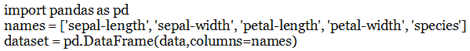

现在，你拥有了同时包含数据和所需类别标签的数据集数据框！

在深入之前，请记住 `labels` 变量中的类别标签是数值，但你将把这些数值转换为花名或物种名称。

为此，你将仅选择类别列，并将三个数值中的每一个替换为对应的物种名称。你将使用 `inplace=True`，这将修改数据框 `dataset`。

```python
dataset['species'].replace(0, 'Iris-setosa', inplace=True)
dataset['species'].replace(1, 'Iris-versicolor', inplace=True)
dataset['species'].replace(2, 'Iris-virginica', inplace=True)
```

让我们打印数据集的前五行，看看它是什么样子的！

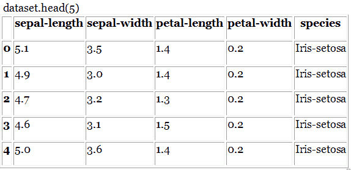

## 分析你的数据

让我们快速了解一下这三种花在可视化时是什么样子的，以及它们不仅在数字上，而且在现实中有多大的不同！


([来源](https://www.datacamp.com/community/tutorials/machine-learning-in-r#learning))

让我们使用散点图可视化上面加载的数据，以找出一个变量在多大程度上受另一个变量的影响，或者说两个变量之间有多大的相关性。

你将使用 matplotlib 库通过散点图来可视化数据。

```python
import matplotlib.pyplot as plt
```

注意：你是否渴望学习在 Python 中可视化数据的不同方法？那么请查看任何关于数据可视化的教程，并研究下面的代码片段。

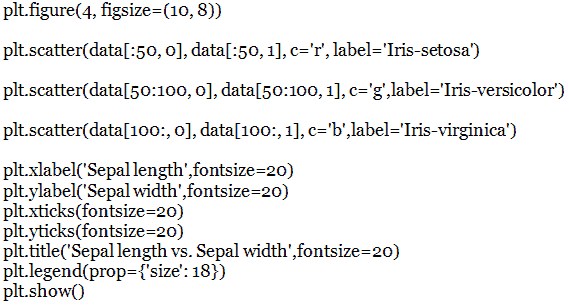

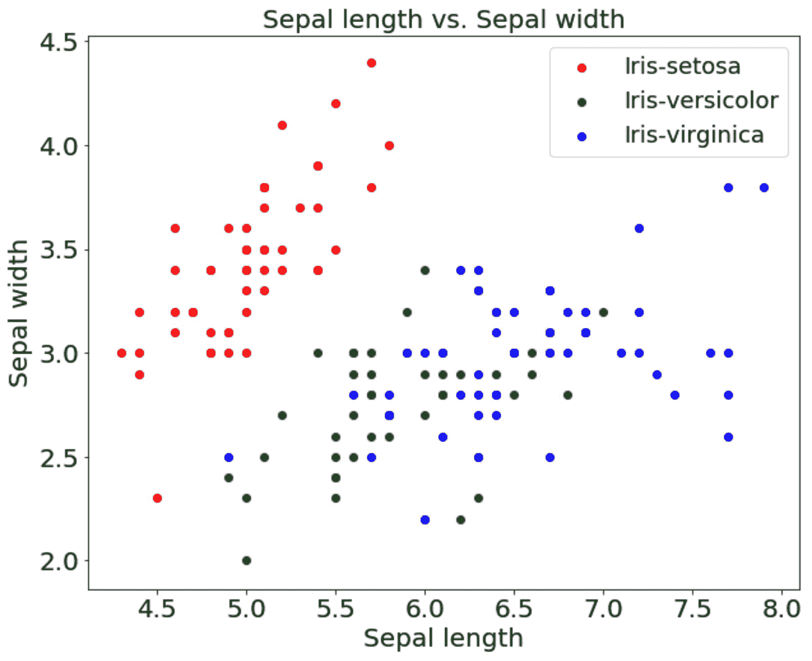


从上图可以看出，鸢尾花（Setosa）的花萼长度和花萼宽度之间存在高度相关性。另一方面，鸢尾花（Versicolor）和鸢尾花（Virginica）之间的相关性较低。Versicolor 和 Virginica 的数据点比密集的 Setosa 更分散。

让我们也快速绘制花瓣长度和花瓣宽度的图表。

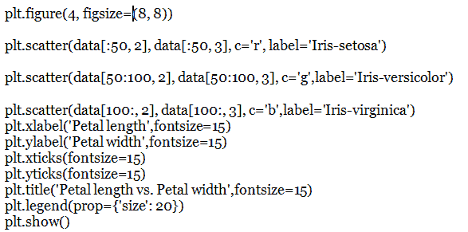

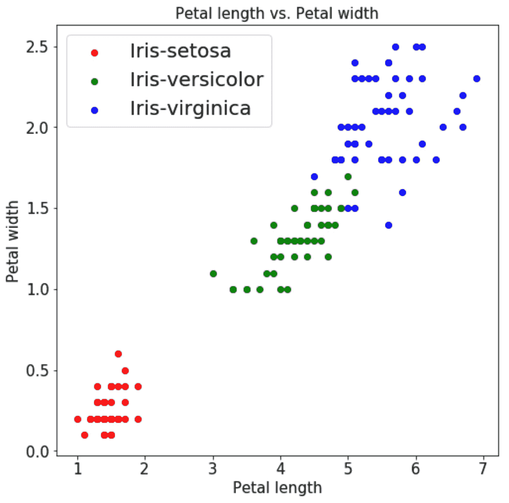

即使对于花瓣长度和花瓣宽度，上图也显示 Setosa 花朵呈强相关性，且密集聚集在一起。

接下来，为了进一步验证花瓣长度和花瓣宽度相关的说法，让我们为所有三个物种绘制相关性矩阵。

```
dataset.iloc[:,2:].corr()
```

| | petal-length | petal-width |
| --- | --- | --- |
| petal-length | 1.000000 | 0.962865 |
| petal-width | 0.962865 | 1.000000 |

上表表明，当三个物种合并时，花瓣长度和花瓣宽度具有 0.96 的强相关性。

让我们也分别分析所有三个物种之间的相关性。

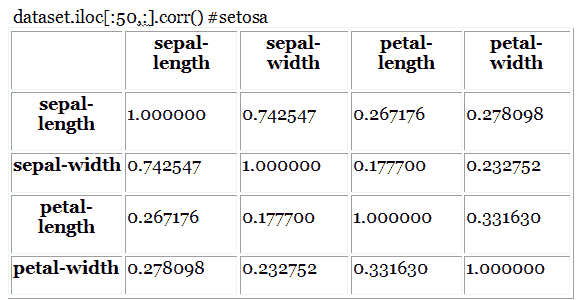

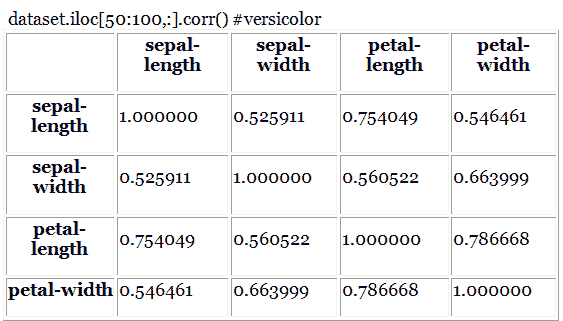

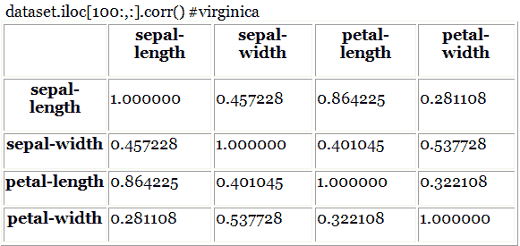

从上述三个表格可以清楚地看出，Setosa 和 Virginica 的花瓣长度和花瓣宽度之间的相关性分别为 0.33 和 0.32。而 Versicolor 为 0.78。

接下来，让我们通过绘制直方图来可视化特征分布：

```
fig = plt.figure(figsize = (8,8))
ax = fig.gca()
dataset.hist(ax=ax)
plt.show()
```

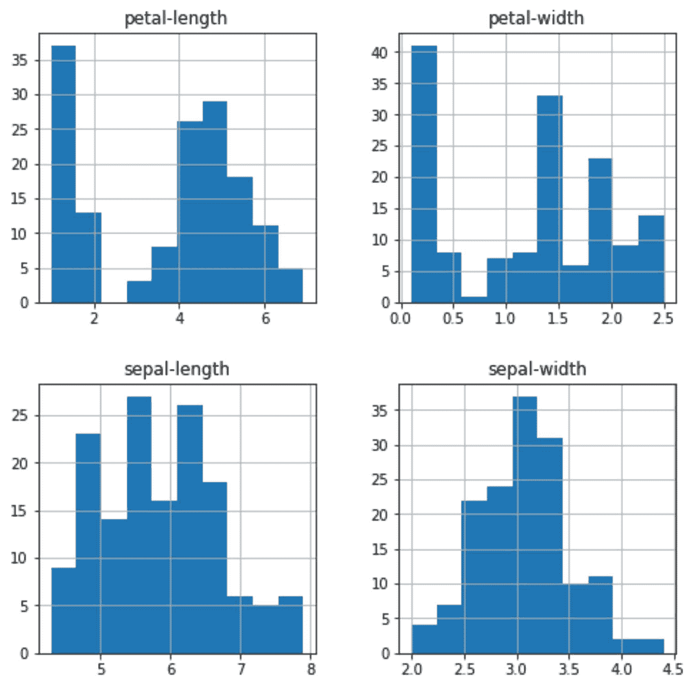

花瓣宽度、花瓣长度和花萼长度呈单峰分布，而花萼宽度呈一种高斯分布。所有这些分析都很有用，因为这样你就可以考虑使用适合这种分布的算法。

接下来，你将分析这四个属性是否在同一尺度上；这是机器学习的一个基本方面。pandas DataFrame 有一个名为 `describe()` 的内置函数，它以表格形式给出数据的计数、平均值、最大值、最小值。

```
dataset.describe()
```

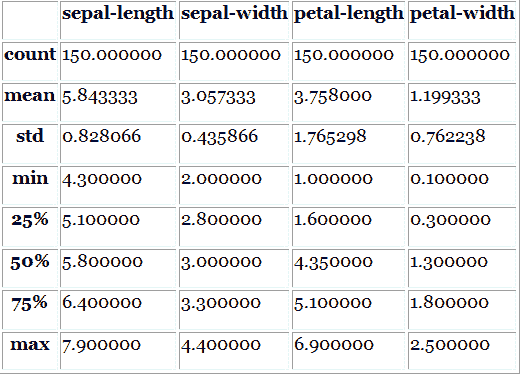

你可以看到，所有四个属性都在 0 到 8 之间具有相似的尺度，单位为厘米。如果你愿意，可以进一步将其缩放到 0 和 1 之间。

即使你们都知道每个类别有 50 个样本，即总分布的 ~33.3%，但还是让我们重新检查一下！ 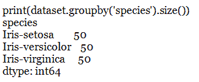

## 数据预处理

在加载并广泛分析数据之后，是时候准备数据以便将其输入机器学习模型了。在本节中，你将通过两种方式预处理数据：归一化数据和将数据拆分为训练集和测试集。

### 归一化数据

归一化数据有两种方式：

*   样本归一化，即归一化每个样本；
*   特征归一化，即以相同方式为所有样本归一化每个特征。

现在的问题是为什么或何时需要归一化数据？以及是否需要标准化鸢尾花数据？

答案几乎是所有时候。归一化数据是一种好习惯，因为它将所有样本带到相同的尺度和范围内。当数据不一致时，归一化数据至关重要。你可以使用上面学习的 `describe()` 函数来检查不一致性，它将给出最大值和最小值。如果一个特征的最大值和最小值明显大于另一个特征，则将两个特征归一化到相同的尺度非常重要。

假设 `X` 是一个范围较大的特征，`Y` 是范围较小的第二个特征。那么，特征 `Y` 的影响可能会被特征 `X` 的影响所掩盖。在这种情况下，将特征 `X` 和 `Y` 都进行归一化变得很重要。

在鸢尾花数据中，不需要归一化。

让我们再次打印 `describe()` 函数，看看为什么不需要任何归一化。

```
dataset.describe()
```

| | sepal-length | sepal-width | petal-length | petal-width |
| --- | --- | --- | --- | --- |
| count | 150.000000 | 150.000000 | 150.000000 | 150.000000 |
| mean | 5.843333 | 3.057333 | 3.758000 | 1.199333 |
| std | 0.828066 | 0.435866 | 1.765298 | 0.762238 |
| min | 4.300000 | 2.000000 | 1.000000 | 0.100000 |
| 25% | 5.100000 | 2.800000 | 1.600000 | 0.300000 |
| 50% | 5.800000 | 3.000000 | 4.350000 | 1.300000 |
| 75% | 6.400000 | 3.300000 | 5.100000 | 1.800000 |
| max | 7.900000 | 4.400000 | 6.900000 | 2.500000 |

所有特征的值都在 0.1 到 7.9 的范围内，这可以认为是可以接受的。因此，不需要对鸢尾花数据集应用任何归一化。

### 拆分数据

这是机器学习的另一个重要方面，因为你的目标是创建一个模型，使其足够强大，能够在没有人工干预的情况下在测试环境中做出决策或对数据进行分类。因此，在将机器学习模型部署到行业中之前，你需要确保模型能在测试数据上很好地泛化。

为此，你需要训练集和测试集。回到鸢尾花数据，你有 150 个样本，你将使用 80% 的数据训练机器学习模型，剩余 20% 的数据将用于测试。

在数据科学中，你经常会遇到一个称为过拟合的术语，这意味着你的模型非常好地学习了训练数据，但在测试数据上表现不佳。因此，将数据拆分为训练集和测试集或验证集通常有助于你了解模型是否过拟合。

对于训练集和测试集的拆分，你将使用 `sklearn` 库，它有一个名为 `train_test_split` 的内置拆分函数。那么，让我们拆分数据。

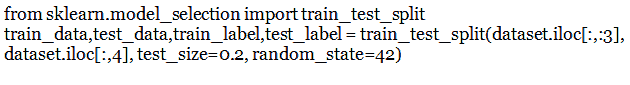注意 `random_state` 是一个种子，它接受 `random_state` 作为输入；如果你更改数字，数据的拆分也会改变。但是，如果你保持 `random_state` 相同并多次运行单元格，数据拆分将保持不变。

让我们快速打印训练和测试数据及其标签的形状。

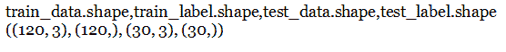

最后，是时候将数据输入 K-近邻算法了！

## KNN 模型

在完成所有数据的加载、分析和预处理之后，现在是将数据输入 KNN 模型的时候了。为此，你将使用 `sklearn` 的内置函数 `neighbors`，其中包含一个名为 `KNeighborsClassifier` 的类。

让我们从导入分类器开始。

```
from sklearn.neighbors import KNeighborsClassifier
```

为了决定超参数 `k` 的最佳值，你将进行网格搜索。你将在 10 个不同的 `k` 值上训练和测试模型，最后使用给出最佳结果的那个。

让我们初始化一个变量 `neighbors`（k），其值范围为 1-9，以及两个 numpy 零矩阵 `train_accuracy` 和 `test_accuracy`，分别用于训练准确率和测试准确率。稍后你将需要它们来绘制图表以选择最佳的邻居值。

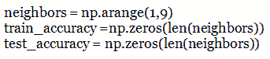

接下来的代码是奇迹发生的地方。你将枚举所有九个邻居值，并对每个邻居在训练和测试数据上进行预测。最后，将准确率存储在 `train_accuracy` 和 `test_accuracy` numpy 数组中。 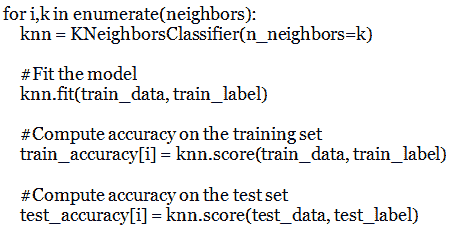


接下来，你将使用 `matplotlib` 绘制训练和测试准确率，通过准确率与不同邻居数量变化的图表，你将能够选择模型表现最佳的最佳 `k` 值。

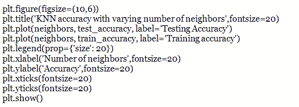

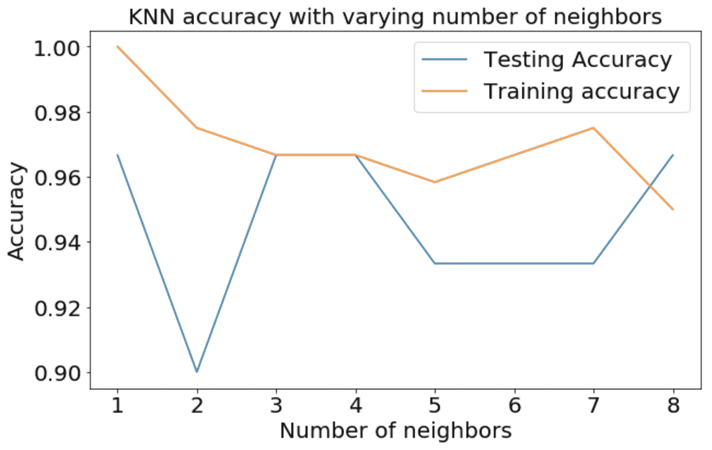

通过观察上图，看起来当 `n_neighbors=3` 时，两个模型的表现都最好。所以，让我们坚持使用 `n_neighbors=3` 并重新运行一次训练。

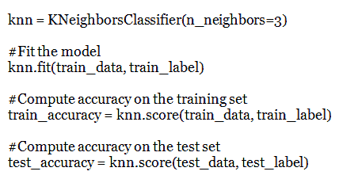

## 评估你的模型

在本教程的最后部分，你将使用几种技术（如 `confusion_matrix` 和 `classification_report`）在测试数据上评估你的模型。

首先让我们检查模型在测试数据上的准确率。

```
test_accuracy
0.9666666666666667
```

哇！看来模型能够以 96.66% 的准确率正确分类测试数据。这难道不神奇吗？只需几行 Python 程序，你就训练了一个机器学习模型，它现在能仅凭四个特征以 96.66% 的准确率告诉你花的名称。谁知道呢，也许它的表现比人类还要好。

### 混淆矩阵

混淆矩阵主要用于展示模型在已知真实信息或标签的测试数据上的运行情况。

Scikit-learn 提供了一个为你计算混淆矩阵的函数。

```
prediction = knn.predict(test_data)
```

以下 `plot_confusion_matrix()` 函数经过修改，源自以下来源：

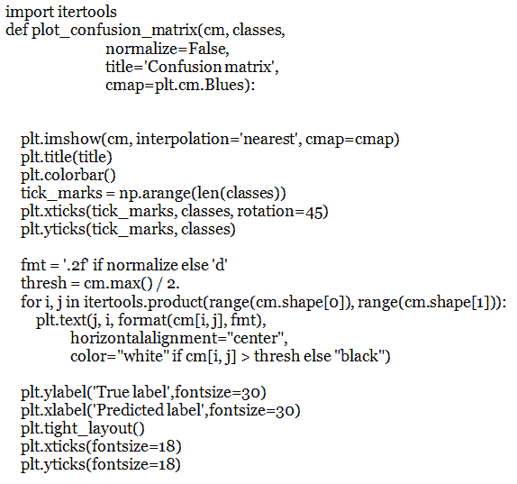

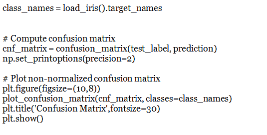

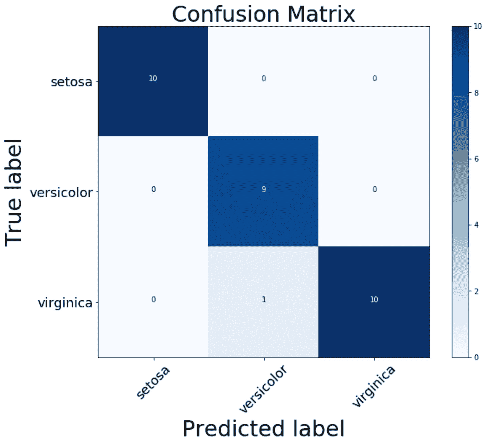

从上面的 `confusion_matrix` 图表中，你可以观察到模型正确分类了所有花朵，除了一个被分类为 virginica（维吉尼卡）花的 versicolor（变色鸢尾）花。

### 分类报告

它通过给出每个类别的准确率、召回率和 F1 分数，帮助你以详细的方式识别错误分类的类别。大多数时候你会利用 `sklearn` 库来可视化报告。

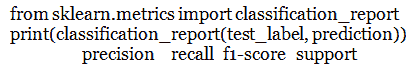

```
Iris-setosa        1.00      1.00      1.00         10
Iris-versicolor    0.90      1.00      0.95          9
Iris-virginica     1.00      0.91      0.95         11
micro avg          0.97      0.97      0.97         30
macro avg          0.97      0.97      0.97         30
weighted avg       0.97      0.97      0.97         30
```

## 更进一步！

首先祝贺所有成功坚持到最后的人！但这只是开始。还有很长的路要走！

本教程主要涉及机器学习的基础知识以及一种称为 KNN 的机器学习算法在 Python 中的实现。你使用的鸢尾花数据集相当小且相对简单。

如果这个教程激发了你了解更多的兴趣，你可以尝试使用其他数据集，或者尝试学习更多机器学习算法，并可能将其应用于鸢尾花数据集以观察对准确率的影响。通过这种方式，你将学到的远不止理解理论！

# 第 5 章：数据处理、分析与可视化

如果你从事数据工作，那么数据可视化就是你日常工作的重要组成部分。如果你使用 Python 进行分析，面对以数据可视化库形式呈现的海量选择，你理应感到不知所措。一些库（如 `Matplotlib`）用于初步的基本探索，但不太适合展示数据中的复杂关系。有些适合处理大型数据集，而还有些主要专注于 3D 渲染。没有一个可视化库可以被称为最好的。某个库中的特定功能优于另一个，反之亦然。简而言之，选项很多，不可能全部学习尝试，或者让它们全部协同工作。那么我们如何完成工作？PyViz 可能有答案。

## Python 当前的可视化格局

现有的 Python 数据可视化系统看起来像一个令人困惑的网。

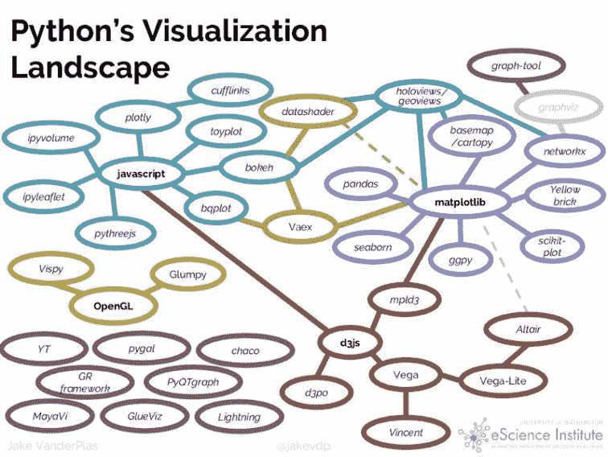

现在，从所有这些工具中为我们的工作选择最佳工具既棘手又令人困惑。PyViz 试图填补这一空白。它有助于简化在互联网浏览器中使用大小数据集的工作，无论是构建仪表板、创建简单的基于控件的工具，还是完成探索性分析。

## PyViz 生态系统

[PyViz](http://pyviz.org/) 被定义为一项协调且受监控的努力，旨在确保 Python 中的数据可视化高效、有效且更强大。PyViz 由一组 Python 开源包组成，适合直接在网页浏览器中处理小型和大型数据集。无论是简单的探索性数据分析 (EDA)，还是创建启用控件的复杂仪表板，PyViz 都是首选。

这是包含 PyViz 的 Python 可视化格局图。

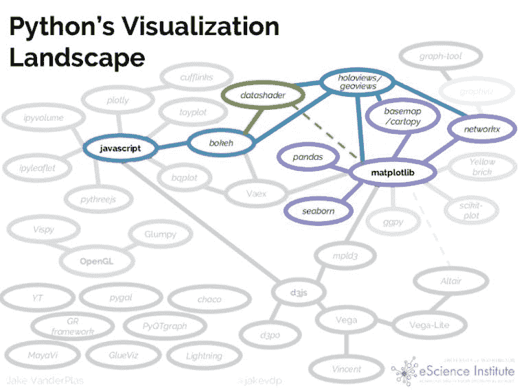

## PyViz 目标

PyViz 的一些重要目标包括：

*   重点应放在任何规模的数据上，而非编码
*   完整的功能和交互性应直接在浏览器中可用（而非桌面端）
*   重点应更多地关注 Python 用户，而非 Web 程序员。
*   同样应更多地关注 2D 可视化而非 3D。
*   利用 Python 用户已经熟悉的通用 SciPy/PyData 工具。

除此之外，PyViz 核心工具可以与 `HoloViews` 和 `Plotly` 等库无缝协作。

## 资源

PyViz 提供示例、演示和培训材料，记录如何解决可视化问题。本教程为解决你的可视化问题提供了起点。所有教程材料也托管在他们的 [Github 仓库](https://github.com/pyviz/pyviz) 中。

[PyViz Tutorial — PyViz 0.9.13a3 documentation  
How to solve visualization problems with Python tools.pyviz.org](http://pyviz.org/tutorial/index.html)

一切安装完成后，以下单元格应打印 `1.11.0a4` 或更高版本：

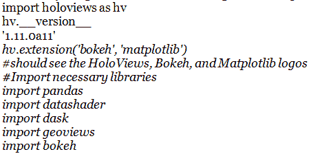

如果无错误完成，你的环境应该已准备就绪。

## 使用 PyViz 探索数据

在本节中，我们将了解不同的库如何有效地从数据中挖掘不同的见解，以及它们的结合如何有助于更好地分析数据。

### 数据集

所用数据集涉及美国每个州随时间推移每 100,000 人中[麻疹和百日咳的病例数](http://graphics.wsj.com/infectious-diseases-and-vaccines/#b02g20t20w15)。该数据集随 PyViz 教程预装。

### 使用 Pandas 进行数据探索

在任何数据科学项目中，自然要从 `pandas` 开始探索。让我们导入并显示数据集的前几行。

```
import pandas as pd
diseases_data = pd.read_csv('../data/diseases.csv.gz')
diseases_data.head()
```


数字固然好，但图表能让我们更好地了解数据中的模式。

### 使用 Matplotlib 进行数据探索

```
%matplotlib inline
diseases_data.plot();
```

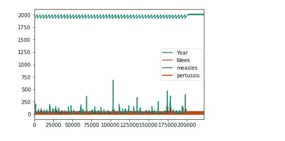

这无法传达太多信息。让我们用 `pandas` 做一些处理以获得有意义的结果。

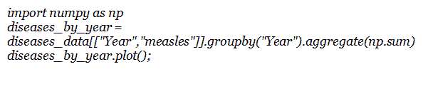

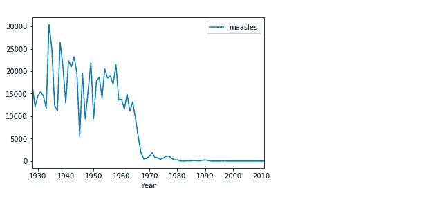


## 使用 HVPlot 和 Bokeh 进行数据探索

这讲得更通顺了。在这里我们可以推断，1970 年左右发生了某些事情，使得麻疹发病率降至近乎为零。这是事实，因为麻疹疫苗于 1963 年左右在美国推出。

上述图表传达了正确的信息，但不提供交互性。这是因为它们是静态图表，在网页浏览器中没有平移、悬停或缩放的功能。然而，我们只需导入 `hvplot` 包即可实现这种交互功能。

### 导入 hvplot.pandas

```python
diseases_by_year.hvplot()
```

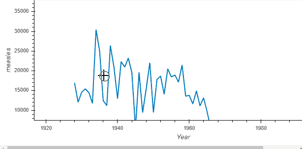

调用所显示的结果被称为 [HoloViews](http://holoviews.org/) 对象（HoloViews [曲线](http://holoviews.org/reference/elements/bokeh/Curve.html)），它显示为 Bokeh 曲线或图表。HoloViews 曲线或图表更加丰富，且在探索信息时易于理解。

让我们看看使用 HoloViews 还能做些什么：

### 在图表上标记重要点

1963 年对于麻疹而言至关重要，不妨将这一点直接记录在图表上。这也将帮助我们对比疫苗引入前后的麻疹病例数量。

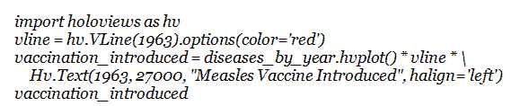


与其他绘图库不同，Holoviews 对象保留了原始数据。例如，可以以表格格式访问原始数据。

```python
print(vaccination_introduced)

vaccination_introduced.Curve.I.data.head()
```


在这里我们能够使用制作图表所用的数据。此外，如下面的代码片段所示，现在非常容易以多种不同方式拆分数据。


我们可以将图表并排放置以便更好地对比，而不使用下拉菜单。

```python
by_state["Alabama"].relabel('Alabama') + by_state["Florida"].relabel('Florida')
```


我们还可以更改图表类型，例如改为柱状图。让我们对比四个州从 1980 年到 1985 年的麻疹模式。


从上面的示例可以明显看出，选择 HoloViews+Bokeh 图表；我们就能在浏览器中探索数据，拥有完整的交互性且代码极少。

## 使用 PyViz 可视化大型数据集

PyViz 还能轻松处理超大型数据集。对于此类数据集，PyViz 套件的其他成员登场了。

*   [GeoViews](http://geoviews.org/)
*   [Datashader](http://datashader.org/)
*   [Panel](https://panel.pyviz.org/)
*   [Param](https://param.pyviz.org/)
*   [Colorcet](https://colorcet.pyviz.org/) 为大数据提供感知均匀的配色方案

为了向您展示这些库在处理海量数据时的能力，让我们使用 NYC 出租车数据集，该数据集包含约 1000 万次出租车行程的数据。同样，本书已提供此数据。

我们还可以添加控件来控制选择。这既可以在笔记本中完成，也可以在独立服务器上完成，方法是用 `.servable()` 标记可服务对象，然后通过 Bokeh Server 运行 `.ipynb` 文件，或将代码提取到单独的 `.py` 文件中并输入以下代码片段：


### 出租车探索器

交互性无法在 GitHub 上渲染，但您仍然可以访问笔记本并在本地运行。

## 结论

PyViz 工具帮助我们仅用少量代码即可创建美观的可视化效果。PyViz 工具捆绑在一起，可创建可部署、灵活、可扩展且高性能的仪表板、应用程序和可视化效果，而无需使用 JavaScript 等 Web 技术。本书只是对多功能 PyViz 生态系统的一个简要介绍。通读全书以了解其复杂性及其对不同类型数据的用法。

# 第 6 章：案例研究

已改变应用程序开发的重大转变，已开始重塑信息技术运营。为了跟上数字化转型的步伐，信息技术运营正在改变其管理生态系统的方式，转向人工智能、分析和机器学习。

云、敏捷和 DevOps 提出了新需求，信息技术只能通过使用人工智能及其同类技术来满足。希望未来在信息技术运营职业上取得进步的专业人士，将需要掌握 [人工智能运维](https://techbeacon.com/enterprise-it/essential-guide-aiops-top-tools-implementation-tips)（AIOps），该术语用于描述信息技术运营应对数字化转型所需的条件。

获取在即将到来的信息技术运营崭新世界中取得进步所需知识的一种途径，是参加专家讨论人工智能、分析和机器学习发展及趋势的会议，并可在会上就同行对人工智能运维的经验进行咨询。

今年人们不仅将见证机器学习的巨大进步，还将看到难以想象的步骤和新应用，这些将迫使人们回到起点，重新考虑机器学习是祸是福。我倾向于认为它可能就像其他任何技术进步一样——关键在于你如何使用它。话虽如此，让我们深入了解今年即将推出的人工智能和机器学习应用。这些应用大多处于研发阶段，即将面向公众发布，或已面向公众但处于测试阶段，再次等待正式发布。

## AI 芯片

还记得你在转向 PS4 和 Xbox 等游戏机之前，玩那些街机 PC 游戏的时候吗？玩低端游戏时，CPU（通常是 Intel 或 AMD）就足够了，但玩《古墓丽影》和《刺客信条：奥德赛》等最新高端游戏时，你需要一块专用 GPU（外行术语称显卡）。这些是仅提升图形体验的专用芯片。我为什么要说这个？因为一种新的专用芯片即将面市。

AI 赋能芯片已在 iPhone XR、华为荣耀 Play 和 Galaxy Note 8 等少数手机中首次亮相。在这些手机中，专用 AI 芯片在基于 ML 的语音助手、AI 智能相机等功能中承担繁重计算任务。这样，AI 芯片减轻了主处理器的工作负载，防止手机卡顿。但手机中的 AI 赋能芯片只是冰山一角。

Google、Microsoft、Amazon、Intel 和 Facebook 都在大力投资专用基础设施，以增强基于 AI 的功能，无论是可购买插拔的芯片，还是可用于 ML 和神经网络的云端 CPU。其中最新的新闻包括 [Intel Nervana](https://www.intel.ai/nervana-nnp/#gs.C5HAvM5Q)（由 Intel 开发，Facebook 是重要开发合作伙伴）、[Google Cloud TPU](https://cloud.google.com/tpu/)、[Microsoft 的 Project Brainwave](https://www.microsoft.com/en-us/research/project/project-brainwave/) 和 [Amazon 的 AWS Inferentia](https://aws.amazon.com/machine-learning/inferentia/)。


提到的大多数项目尚未公开发布，或仍处于 Beta 阶段。因此，2019 年可能是这些项目面世之时，更强大的 AI 芯片将使实时 AI 应用成为现实。

## 物联网与 AI 的融合

两个领域都发生了许多变化，但物联网与 AI 赋能解决方案的真正落地尚未见到。该话题最常被引用的用例是：利用传感器采集汽车数据，并用收集到的数据决定保险金额。但老实说，有多少保险公司真用这种方法计算你的保费？

2019 年情况将有所改变，随着 AI 芯片的涌现、更廉价更新的云端 AI 服务，以及更多知名企业投资物联网和 AI。许多公司将推出自动驾驶汽车，[CES 2019](https://www.digitaltrends.com/cars/the-best-self-driving-shuttles-and-cars-ces-2019/) 让我们一窥物联网与 AI 结合如何助力企业描绘更宏大的蓝图。

## 自动化机器学习的更多应用

虽然 ML（机器学习）是大多数人熟悉的术语，但自动化机器学习（AutoML）可以说仍处于 Beta 阶段。AutoML 指通过将 ML 应用于 ML 本身，利用自动化解决重复性任务。例如，在对不同算法进行测试以找出最适配数据的算法之前，必须先清洗数据。数据清洗耗时巨大，研究表明，这是一个科学家们[不愿在新数据集上反复进行的手动过程](https://hub.packtpub.com/data-cleaning-worst-part-of-data-analysis/)。借助 AutoML 此类流程可得以解决，正如许多人预测的那样，2019 年将涌现更多 AutoML 应用。

## AI 将实现 DevOps 自动化

IT 服务和基础设施是维持业务顺畅运行必须面对的棘手问题。然而，DevOps 人员执行的各类操作（如监控、调试、扩容等）均可实现自动化。DevOps 将逐渐让位于 AIOps，这将使普通程序员也能轻松管理流程和流水线，无需承担搭建和维护的烦恼。已有多篇[论文](https://sciencelogic.com/blog/aiops_landscape_2019)预测了 AIOps 引领下的 DevOps 未来。

## 个性化药物

你吃的安眠药和邻居一样吗？剂量未必适合你；某些成分可能对你不利；甚至因特定原因药物对你毫无作用。为何不定制专属药物？[个性化药物](https://www.england.nhs.uk/healthcare-science/personalisedmedicine/)遵循一套流程——分析患者及其生活方式习惯，随后推荐特定成分的药丸。借助“10 万基因组计划”，个性化药物预计将在 2019 年迎来巨大增长，尽管可能尚未公开可用。今年还安排了多场大型会议，如[第 11 届个性化、预防性、预测性、预防分子与医学诊断国际会议](https://personalizedmedicine.conferenceseries.com/)。

ML 将帮助分析患者数据以决定最适合的药物，彻底摒弃“千人一方”的陈旧理论。

## 基于 ML 的助手进一步进化

2018 年，全新升级的 [Google Assistant](https://www.youtube.com/watch?v=d40jgFZ5hXk) 让我们大开眼界。但其商业化应用尚未落地，而这在 2019 年有望实现。Alexa 等语音助手已从用户处收集海量数据，2019 年这些助手可能变得更智能、更拟人化。语音助手将从客厅走向公共场所、汽车、广播系统、ATM 机等。许多人押注 2019 将成为[语音助手元年](https://brandequity.economictimes.indiatimes.com/news/digital/five-reasons-voice-assistant-will-dominate-2019/67452823)。

## 利用 AI 从机器获取更优指标

如果能在工厂机器即将报废、故障停工前预知并维修，那该多好？

技术与工业设备通常按固定计划维护，导致人力浪费，且仍面临突发故障风险。一旦给机器装上传感器，将采集数据输入 ML 模型，即可获得更优性能和更高效的维护计划。

GE 创建的[数字孪生](https://www.ge.com/digital/applications/digital-twin)即此类实现：为大型机器构建虚拟模型，利用数百个传感器确保孪生体实时同步真实机器状态，从而管理和维护当前部署的 65 万个孪生体。预计今年全球智能工厂将进一步推广数字孪生应用。

### 8. 计算机视觉将塑造监控未来

计算机视觉与监控已成商场、机场、城市十字路口等场所的刚需。多家[科技公司](https://www.rocketspace.com/corporate-innovation/5-breakthrough-computer-vision-startups-to-watch-in-2019)在全球多地悄悄部署软件，以发现、追踪并上报态势。但应用不止于此：若家庭摄像头发现陌生人闯入，Google Assistant 立即报警，岂不惊艳？

Google 等公司在计算机视觉上投入巨资（还记得访问网站时它让你标记汽车或路牌图片吗？），2019 年将有更多玩家入局。监控系统将大幅提速，监控将不再只是视频流，而是能根据现场态势充当自动化响应的触发器。

### 9. 医疗健康将见证更多 AI 落地

医疗健康历经多年演进，ML 带来的变革远不止个性化药物兴起。近期中国宣称诞全球首例[基因编辑婴儿](https://www.theguardian.com/science/2018/nov/26/worlds-first-gene-edited-babies-created-in-china-claims-scientist)。所用工具 CRISPR-CAS9 本意是操作 DNA，植入所需基因或敲除致病基因。尽管该成果未经同行评审刊登、真实性待验证，但 AI 已被用于[预测导致癌症的基因组变化](https://www.icr.ac.uk/news-archive/artificial-intelligence-can-predict-how-cancers-will-evolve-and-spread)。

今年将出现更多利用 AI 进行基因修饰的应用，以对抗新型疾病、优化人类。然而，此类医学奇迹背后的伦理法律困境与争论，仍是科学界的辩论焦点。

### 10. 社会信用体系


### 中国的社会信用体系：机器学习的新应用

中国实施了一项相对较新的机器学习应用——这是一个庞大的排名系统，将利用监控摄像头和在线活动监视器监控所有公民的行为，根据他们的“[社会信用](https://www.businessinsider.in/China-has-started-ranking-citizens-with-a-creepy-social-credit-system-heres-what-you-can-do-wrong-and-the-embarrassing-demeaning-ways-they-can-punish-you/1-Banning-you-from-flying-or-getting-the-train-/slideshow/63666456.cms)”对他们进行排名。

尽管该系统计划于 2020 年全面投入运行，但其推行已在全国引起轩然大波，人们因在公共场所吸烟、无票乘车或捐款慈善等行为而获加分或扣分。具体方法论尚不公开，但希望有一个稳健的机器学习模型利用来自各方的数据，来决定是降低、提高还是维持一个人的分数。

听起来像反乌托邦的想法，似乎是《[黑镜](https://www.imdb.com/title/tt2085059/)》的一集，却是数百万人的现实，我们可能在今年年底前见到该系统覆盖全中国。同样，尽管应用很新，但其背后的理念仍引发诸多争论。

## 结语

感谢您读完《Python 机器学习入门》，希望本书对您有帮助且富有启发。我们竭力确保每章都提供有价值的信息，特意使用通俗易懂的语言，让每位读者都能受益。本书刻意避开复杂理论，坚持简单实用的方法，方便您在学习机器学习时随时应用。

一旦您掌握了使用 Python 语言的编程基础，学习机器学习概念就会变得更容易。机器学习在日常生活中至关重要。本书带您领略了机器学习的许多概念。没有一招鲜能让人一夜之间精通机器学习。但如果您遵循正确步骤，并保持专注与投入，定能获得想要的成果。多进行实操练习，提升 Python 编程技能。如果您与经验丰富的 Python 程序员共事，请遵循其指导并保持畅通沟通。多动手敲代码，熟悉 IDE 与键盘。

下一步是合上书本，开始在实际中应用所学。做一切您认为必要之事，以在现实中改进机器学习。您会发现，许多人仍不了解增强人工智能及机器学习其他概念的正确途径。您会意识到，看似样样精通的大多数人，缺乏基本的 Python 编程技能。为此，尝试与他们交流，传授您从书中学到的知识。您甚至可以向他们推荐或赠送此书。

日后您可能还需要查阅本书。请妥善保管，随时复习。读完本书不代表在 Python 和机器学习方面已无新知。广泛阅读，拓宽视野，这是您追求精通的唯一途径。请特别关注人工智能，因为没有它，机器学习就不可能存在。利用书中技巧，通过自己的发明创造，尤其是在人工智能领域，让世界变得更美好。

最后，如果您觉得本书对您有用，在 Amazon 上留下评价将不胜感激！

