# Python 机器学习：初学者机器学习算法——数据管理与分析，从零开始学习深度学习和神经网络

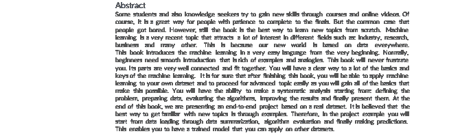

I still remember a story from my first year in primary school named: “Operation Mastermind”^(\[1\]). In that story, a master computer controls all the systems in the island. Finally, he decides to get rid of human control and to seize all power himself. He begins to manage the island and its systems depending on his own decisions! Although the current situation of machine is still far of this to happen, people believe that science fiction always comes true!

人力通常是有限的。人类曾举起的最重重量为 6,270 Ib（2,840 Kg）^(\[2\]）。与普通人力相比，这是一个了不起的纪录。然而，与机器的力量相比，这微不足道，机器是由人类本人发明的，用于举起数十吨重量。这是对“机器学习”力量及其能力的简单类比。要想象这种情况，众所周知，训练有素的人类在数据分析和处理能力方面受到处理数据量、耗时以及出错概率的限制。另一方面，由人类设计、构建和编程的机器/计算机可以在比人类少得多的时间内处理海量数据，且几乎没有错误。此外，电子机器从不休息，也从不让自己的意见影响其分析过程和结果。

要掌握机器学习的概念，以企业或政府的分布式建筑为例，其主要目标是寻求最优能耗。该建筑由墙壁、楼层、门、窗户、家具、屋顶等组成，这些是建筑的一般架构元素。这些元素通常由不同种类的材料组成，并对能量、日光吸收和反射表现出不同的反应。此外，建筑物遇到的太阳辐射量、太阳位置、风和天气状况每小时都在变化。现在，考虑能源和电气工程师决定在建筑上构建光伏系统。在这种情况下，最优设计是当他们考虑上述方面，以及与选择最佳位置、朝向、遮阳和角度相关的方面，并考虑全年每小时太阳的方向时。最后但同样重要的是，建筑物的供暖、制冷、照明等能源需求必须得到明确估计。考虑到上述每小时收集数据，这是一个复杂且海量的数据量。公司希望实现的是预测其建筑设计的最优模型，以最大限度地提高可再生能源生产并最大限度地降低能源消耗。这种数据会随时间和地理位置的变化而变化，这使得经典编程方法的工作非常困难。另一方面，机器学习是处理可变和大量数据时的解决方案。机器学习的主要目标是开发一个合适且最优的算法，以做出最佳决策。

|  ||  ||  |

| --- | --- | --- |

## 1.2 机器学习与经典编程

了解一位通过编程语言实现算法的程序员是非常常见的。程序员向芯片/机器提供特定的程序命令，包含输入参数和预期的输出类型。程序随后运行并处理数据，同时受到程序员输入的代码限制。这种编程不包含“学习”的实现，即基于背景示例、经验或统计数据开发解决方案的能力。配备学习算法的机器能够针对每种情况做出合适的不同决策。

实际上，在机器学习中，计算机会自动得出一个可以处理数据集以产生所需输出的算法。而在经典机器编程中，概念则不同。以排序算法为例，我们已经有许多可以处理我们的输入并给出排序输出的排序算法。我们的任务只是选择能够高效完成工作的最佳排序算法。另一方面，在机器学习中，存在许多应用，我们没有完全准备好给出所需输出的经典算法。相反，我们拥有所谓的：示例数据。在机器学习时代，没有指令告诉计算机该做什么。计算机必须与数据集交互，开发算法并做出自己的决策，就像人类分析问题一样，但拥有更多场景和更快的处理速度！

|  ||  ||  |

| --- | --- | --- |

## 1.3 机器学习分类

机器学习算法的分类通常取决于处理特定数据的目的。因此，识别学习类别以选择更合适的方式非常重要。机器学习模型通常分为：监督学习和无监督学习。

|  ||  ||  |

| --- | --- | --- |

## 1.3.1 监督学习

当机器有一组导致输出的输入，且输出性质由监督者确定时，该机器基本上遵循监督学习算法。监督一词不一定意味着人工干预。它意味着计算机有一个目标，需要创建和调整函数以通往该目标。这种算法也称为：预测算法。这是因为有一个输出正在根据一组输入进行预测。预测不仅仅涉及未来。它还包括算法推断当前甚至过去事件的情况。关于当前情况的一个明显例子是交通灯，可以根据相关数据集遵循预测算法进行最优控制。在过去事件预测场景中，例如，医生可以根据母亲当前的激素水平预测怀孕的具体日期。

监督机器学习的常见算法是分类和回归。在分类中，任务是确定一组数据或观察结果应属于哪个类别。分类在机器学习问题中的应用非常广泛。例如，在蜂窝通信系统中，分类器技术可用于根据用户数量、区域性质、建筑物数量、信号衰减等将地理区域划分为飞时区、微区或小区。

另一方面，回归在我们想要预测数值数据时使用。这种监督学习方式可以用于，例如，预测某些考试分数、实验结果、二手车价格等。图 1 和图 2 显示了分类和回归方案的示例。分类和回归算法将在本书后面讨论。

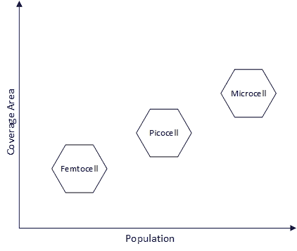

图 1.1 基于人口和覆盖区域的移动网络分类

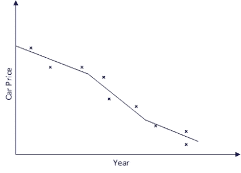

图 1.2 基于回归的二手车价格预期

|  ||  ||  |

| --- | --- | --- |

## 1.3.2 无监督学习

碰巧我们拥有大量数据，并希望对这类输入制定某种规范。这是无监督学习的主要目的。数据集可以按照无监督算法进行处理，以判断哪些模式比其他模式出现得更频繁，哪些出现了，哪些没有出现。这种学习模型有时也被称为描述性模型。这是因为无监督算法会生成描述数据并以新方式呈现数据的汇总输出。与以预测目标为主要目的的监督学习相比，在描述性模型中，没有哪个特征比其他特征更重要。这种学习类型应用于数据挖掘应用。

无监督学习的常见算法包括：聚类、密度估计、压缩和数据缩减。聚类算法用于数据集，将相似数据的每个集合分组在一起。聚类的一种著名方法是 K-均值算法，本书后面将详细讨论。第二种算法，密度估计，当目标是生成该数据集的统计输出时应用于数据集。有时目标是以汇总且信息丰富的方式可视化和呈现大型数据集信息。这引出了压缩和数据缩减算法，这些算法在不丢失信息的情况下学习并生成所需的汇总。在此算法中，关键特征是降低数据集的维度。降低数据集的维度也有助于降低稍后可能应用的其他推断算法的复杂性。

表 1.1 显示了一些常用的监督和无监督机器学习算法，用于执行相应的任务。

| 学习类别 | 学习方法 |
| --- | --- |
| 监督学习 | |
| 最近邻 | 分类 |
| 决策树 | 分类 |
| 分类规则学习器 | 数值预测 |
| 线性回归 | 数值预测 |
| 回归树 | 数值预测 |
| 无监督学习 | |
| 关联规则 | 模式检测 |
| K-均值聚类 | 聚类 |

表 1.1 常用的监督和无监督机器学习算法

## 1.4 在机器学习编程中应用 Python 的优势

对于机器学习算法，我们必须拥有一种清晰且易于大多数数据研究人员和科学家理解的编程语言。一种在不同类型的工作中（尤其是矩阵数学）具有有用库的语言将更受青睐。此外，使用拥有大量活跃开发者的语言是非常有利的。这些特点使得 Python 成为最佳选择。Python 的主要优势可以总结如下：

- 其语法清晰。
- 易于操作文本。
- 被大量人群和社区使用。
- 可以以不同风格进行编程：面向对象、过程式、函数式等。
- 适合处理非数值数据。
- 能够从 HTML 中提取数据。
- 在科学界和金融界都很常见。因此，这两个领域之间存在无缝连接，尤其是在机器学习领域，因为金融领域是数据集的主要来源之一。
- 包含有用的库，例如 SciPy 和 NumPy，使我们能够对向量和矩阵进行操作。Python 的安装以及添加这些库和其他库的方法，将在附录 A 中展示。

## 第 2 章

## 数据清洗与数据准备

## 2.1 数据清洗

数据清洗，也称为数据清理，是在应用任何机器学习算法之前的一个非常重要的步骤。数据集通常来自现实世界的来源，这些来源会产生大量混乱的数据集。来源示例包括统计数据，或来自在数据密集型领域（如银行、通信系统、保险或运输）工作的组织生成的大量记录。这些混乱的数据可能包含噪声条目、缺失数据，或者相互矛盾的记录。这种情况发生有几个原因。噪声通常会影响数据，因为硬件限制和问题，这些可以充当噪声源。例如，如果血液样本由遇到问题的医疗设备进行测试，设备测量可能会受到影响，并且对同一样本的每次运行都有所不同。如果设备通过网络连接到数据库，不稳定的读数可能会自动传输到数据库，无论发生了什么错误。人类在犯错时也可能产生噪声数据。另一方面，缺失数据问题可能由于技术问题发生，例如数据传输期间服务器或网络挂起，或者由于手动数据输入。这些错误结合在一起；噪声数据和缺失数据问题，还可能导致第三类混乱数据，称为：数据矛盾。基于此，在开始学习过程之前，数据清洗步骤非常重要。

## 2.1.1 噪声数据

当模型与测量值之间存在差异时，就会存在导致错误或方差的“噪声”。处理噪声数据集的方法示例如下：

分箱方法：

在此方法中，数据被排序，然后通过考虑其邻域或周围值进行平滑处理。这称为局部平滑。

聚类：

此方法在检测和删除异常值方面很有用。对每组相似值进行聚类意味着一个聚类中的值与其他聚类中的值不同。然后可以轻松检测剩余的异常值。

机器学习算法：

回归，作为基本的监督机器学习算法之一，可以通过将数据拟合到回归函数来平滑数据。该算法将在第三章中详细讨论。

人工检查：

人类可以介入，手动检测和消除异常值或平滑噪声。

## 2.1.2 缺失数据

以下是处理缺失数据的一些常见方法：

忽略元组：

这种治愈包含缺失值的数据集的方法被认为是高效的，当一条数据记录包含许多具有缺失值的属性时。但是，当每个变量的缺失值数量变化显著时，此方案不再有效。当由机器未定义的来源产生数据规范时，该方法的效率会降低。机器会将此类数据视为缺失数据。例如，当患者因异常情况被收治时。

手动填充缺失值：

此方案可能具有较高的准确性。然而，它主要在时间消耗方面是不可行的。此外，它令人疲惫且枯燥。

做出期望：

通常，有一些方法可以用来预测缺失属性。例如，缺失值附近值的平均值。虽然这种方法可能会因为误预测而导致数据偏差，但它可以用于检查和比较其结果，与第一种方法（忽略元组）获得的结果进行比较。

基于推断的算法：

当缺失值由最可能的值填充时，会使用此类算法。示例算法包括：贝叶斯公式和决策树。

在下一节 2.2 中，将介绍并使用 Python 对缺失数据来源、处理缺失数据的可能解决方案以及包含缺失值的房地产交易数据集的实际逐步示例进行更详细的说明和求解。

## 2.1.3 不一致数据

现实生活中海量的数据容易包含代码、名称或任何其他值中的差异或重复。由数据输入引起的不一致可以手动修复。此外，还可以采用一些专家系统工具来检测和修复数据中的矛盾。例如，由数千个人输入的数据，如医疗保健组织中的数据，由云存储数据库自动记录。这种类型的数据集是充满不一致性的数据集的明显案例。例如，相同的信息数据可能由不同的来源提供，但格式不同。

## 2.2 缺失数据

大多数统计模型在没有丢失或缺失变量的完整数据之前无法处理。因此，解决缺失数据问题至关重要，即通过消除不完整的变量或用某种估计方法得出的值填充缺失值，如小节 2.1.1 所示。

首先，重要的是确定缺失数据是否真的是缺失数据。也就是说，你需要将当前可用数据与其属性关联起来，并确定它是否合理。另一个重要步骤是识别导致缺失的来源，因为这将导致选择最合适的插补技术。一个值可能缺失是因为：它被遗忘、丢失、与实例不匹配，或者与实例无关、不重要、无关紧要。

在本节中，我们将了解如何使用 Python 处理缺失数据，Python 是本书中将使用的编程语言。因此，首先参考附录 A 很重要，附录 A 中介绍了如何安装 Python 以及进行后续示例所需的包。

## 2.2.1 缺失数据修复，以萨克拉门托房地产交易为例

本示例的主要目的是说明如何：

- 将损坏或删除的值标记为：缺失。
- 从数据集中删除包含缺失数据的记录。
- 用数据集中附近值的平均值填充缺失值。

› 第一步：下载并检查数据集：

本示例中使用的数据集文件是一个房地产数据集，包含在五天内收集的萨克拉门托地区 985 条房地产交易列表。此信息由萨克拉门托蜜蜂报^([6]) 报道。数据集 .csv 文件可以从下方页边距提供的链接下载^([7])。

此数据集包含 985 条记录观察。处理任何数据集的第一步是理解它。这里，我们有十一个变量，经度和纬度被视为一个联合变量。变量声明如下：

- 0. 街道名称和门牌号。
- 1. 城市。
- 2. 邮政编码。
- 3. 州。
- 4. 卧室数量。
- 5. 浴室数量。
- 6. 房地产面积（平方英尺）。
- 7. 房地产类型。
- 8. 销售日期。
- 9. 房地产价格。
- 10 & 11. 位置（纬度和经度）。

此数据集包含一些缺失值。我们可以按照以下步骤和 Python 代码打印此数据集的示例数据记录：

1. 打开 IDLE Python，可以从开始菜单访问，然后输入：“Python”。选择“IDLE (Python 3.6)”结果。
2. 创建一个新文件并将其保存在工作目录中，例如，此处名称为：`Real_estate_transactions.py`
3. 将 `real_estate_transactions.csv` 文件放在包含上述 Python 文件的同一工作文件目录中。
4. 在 `Real_estate_transactions.py` 文件中键入以下代码：

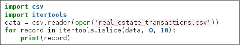

––––––––

输出如下：

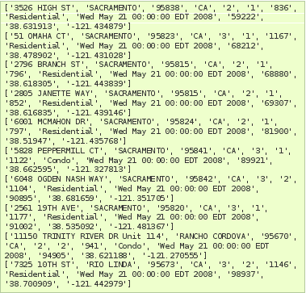

如果我们查看此数据集中的变量，我们发现主要变量是 4、5、6 和 9。分别是卧室数量、浴室数量、平方英尺面积和房地产价格。这些属性不能包含零值，因为零被视为无效或丢失的数据。因此，在下一步中，我们将检查这些属性中每个属性的零值数量。

› 第二步：标记缺失值：

第二步是识别和标记缺失值。可以打印汇总统计信息来告诉我们每个属性中的零值数量。如所述，存在零值没有意义并被视为无效或缺失数据的列/属性。首先，我们将每个缺失数据（即零值）标记为 True。然后，我们统计每列中“True”的数量。以下 Python 代码片段执行此任务：

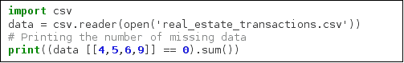

––––––––

每个属性的输出汇总统计信息，即零值/缺失数据的总和，如下所示：

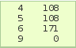

可以从上面的输出中注意到，属性 9 中没有零值。但是，在 4、5 和 6 属性中有大量零值。这意味着我们最初关于这些记录中存在零值无效的假设是正确的。由于此数据集包含关于房地产的真实值，处理缺失值问题的最佳方法是删除空记录。虽然我们将首先应用删除方法，但以后会应用其他方法以供学习。一般来说，每当应用删除方法时，重要的是要注意记录的数量是否足以构建预测模型，这就是为什么在某些情况下，删除大量数据被认为是不首选的解决方案。

我们现在需要在零值的位置放置“标记”，以表明该特定位置存在缺失值。为此，我们可以利用已安装到 Python 的包，参见附录 A，将每个零值替换为 `NaN`。此操作的好处是，`NaN` 通常会被数据集上的操作（例如 `count` 和 `sum`）忽略。以下代码执行替换过程，使用函数：`replace()`。然后，我们打印输出以检查工作。函数：`isnull()` 用于计算 `NaN` 的数量。

`numpy` 包已在前面的示例中导入，以便能够使用“`isnull()`”并从而能够计算 `NaN` 的数量。要检查零值是否已成功替换为 `NaN`，我们将以下输出与前一个输出（零值的数量）进行比较。可以轻松地注意到它们的数量相同。打印出的输出如下：

注意：可以通过打印新标记数据集的一部分（例如：80 到 100 条记录）来进行进一步调查，使用命令行：

`print(dataset.loc[80:100, [4,5,6,9]])`

这应显示某些记录已被替换为 `NaN`s，如下所示。

## 第三部分：删除带有缺失值的记录

拥有带有缺失值的数据集可能会限制在其上应用机器学习算法的能力并可能产生错误。为了阐明这个问题，在进行记录删除之前，我们在数据集上应用线性判别分析（LDA）算法。如果数据集包含缺失值，该算法将无法工作。以下代码是分类步骤的一部分。在代码末尾，我们通过打印 `X_test` 集的值来检查 LDA 算法是否已应用。

如所规定，由于缺失值，Python 平台会显示类似下图的弹出消息，或者可能会显示红线告诉你出了什么问题，这阻止了任何输出的打印过程。

前面的代码在数据集中标记了缺失值，就像之前做的那样，然后本应计算 LDA。但是，由于数据集中存在 `NaN`s，算法无法工作。因此，必须应用一种处理缺失变量的方法。在此阶段，我们应用一种删除方案，这是解决缺失数据问题的最简单方法，即删除带有缺失数据的记录。

利用 Pandas 包，我们使用 `dropna()` 函数来删除带有缺失值的记录、列或行。可以通过以下代码完成：

该代码产生的数据集删除了所有包含 `NaN` 的记录。因此，进行了非常大的裁剪。产生的数据集大小为 (814, 12)，已明显减少到少于原始数据集中的 985 条记录。但是，我们现在可以使用代码 3 序列将 LDA 算法应用于新的缩减数据集，但在命令 `X =dataset.iloc[:,[4,5,6,9]].values` 之前添加命令行：

`dataset.dropna(inplace=True)`

这一次，程序将打印出 `X_test` 的前 5 条记录，如下所示：

## 第四部分：填补缺失值

删除带有缺失值的记录的过程显著减小了数据集的大小。因此，可以使用其他填补方法将 `NaN`/零值替换为适当的值。一些常用的方法如下：

1. 来自另一个随机选择记录的值。
2. 在领域内有意义的常量值。
3. 记录的平均值。
4. 从另一个模型导入的值，其中一些值可以用于解决当前数据集中的缺失数据问题。

在此示例中，我们将用每列的平均值替换缺失数据。由 Pandas 包提供的“`fillna`”函数用于此任务，如下面的代码所示：

然后代码会计算缺失数据的数量（如果有），在用平均值更新数据集后。以下显示数据集中不再有缺失值。

留给读者作为练习：使用用平均值更新的数据集，在 LDA 算法代码中测试数据集的有效性。

值得注意的是，并非所有算法都无法处理带有缺失值的数据集。一些算法确实有能力克服缺失值存在的问题，例如 - 最近邻算法，它忽略带有缺失值的列的距离测量。在构建预测模型时，分类和回归将缺失值视为唯一值。在下一章中，将详细讨论使用决策树和回归算法的分类。

## 2.3 数据准备

在前两个部分中，我们讨论了数据准备的第一步，即数据清洗。但是，在进入学习过程之前，必须对数据应用进一步的预处理步骤。在本节中，我们简要描述常见的准备方法。

## 2.3.1 数据集成

在此过程中，来自多个资源（例如不同的数据集或分布式记录）的数据被收集并整合到一个数据集中，这些资源属于同一个地方。在数据集成过程中，必须考虑一些因素。例如，在一个数据集中，我们可能会遇到同一现实世界实体的不同属性值。这种情况发生在数据来自不同来源时。原因可能是每个来源使用不同的表示或比例，例如：公制与英制单位。此外，数据来源有时可能指不同的标准。例如，某些变量可以在多个来源中通过不同的 ID 引用。

在来自不同来源的数据集成过程中可能出现的一个重要问题是冗余数据。常见原因如下：

- 存在一个变量/属性，它已经是另一个数据集中的派生变量，例如，当我们谈论年收入时。
- 同一属性在不同数据集中有不同的名称。

相关性分析可以应用于解决冗余数据问题。准确的数据集成能够生成一个冗余和不一致性较少的数据集。这非常有益，因为它提高了学习速度和质量。数据集成步骤，连同之前的数据清洗步骤，能够生成具有可靠条目的数据集。

## 2.3.2 数据转换

有时，以特定格式处理数据集比以另一种格式更方便。数据转换正是为此而出现的。数据转换的目标是将数据值转换为其他格式或单位，使数据分析更具意义（例如，将非线性模型转换为线性模型）。根据所需分析的性质，决定是否需要进行转换。常见的转换方式包括：

- 聚合：这是一种汇总方式，其中同一变量的一组值可以表示/聚合为一个单一值。例如，多个类别可以分组为一个类别。

- 归一化：当我们希望使用特定范围来表示一组数据时，会采用这种数据转换方式。即，数据被缩放到一个小的、指定的范围内。例如，在通信系统中，工程师有时更倾向于以归一化功率形式表示基站的功率。他们将功率值缩放到 0 到 1 的范围内。常见的归一化方式有：1) 最小-最大归一化，2) Z-分数归一化，以及 3) 小数缩放归一化。是否对数据进行归一化以及选择最佳的归一化方式取决于所处理数据的性质。

- 泛化：从汇总概念的角度来看，它可以被视为另一种聚合方式。其思想是将低级别的属性转换为高级别的属性。这一过程也称为：层级爬升。

- 属性构造：为了简化分析，可以从已给出的属性中提取新属性。这就是属性构造的含义。

## 2.3.3 数据缩减

数据准备的最后一步是数据缩减。任何数据集分析的目标都是获得有意义的输出，以简单的语言或数值描述数据集中的大量信息，这些数值随后可用于感兴趣的应用。大型数据集的分析复杂且可能耗时很长。有时，可能会出现不可行的结果。这就是数据缩减原则产生的原因。输入数据通过引入数据集的有效表示来缩减，而不会影响原始输入数据的准确性。数据缩减通过去除噪声和冗余记录，使数据更容易被分析，从而使学习算法的任务更加有效。数据缩减步骤有一些必须考虑的优缺点：

- 优点：降低数据复杂性，关注最重要的属性，减少许多算法的计算复杂性，并使结果更易于理解。

- 缺点：取决于数据集的性质，可能不需要数据缩减。另一个主要缺点是，在缩减过程中可能会丢失一些主要数据。例如，当将多个值表示为平均值时。

关于数据准备步骤最后可以这样说：有三条基本规则使我们能够判断数据集是否干净并准备好由机器学习算法处理。1) 每个变量都有一列数据，2) 每个观察都有一行，3) 每个值都有自己的单元格。干净且准备好的数据集更容易被可视化并由统计分析处理。

## 2.4 使用 - 折技术的交叉验证

交叉验证是应用于数据样本的一种统计步骤，用于检查机器学习模型的有效性。在机器学习中，交叉验证技术主要用于评估和预期机器学习模型的性能。使用此方法的好处是利用一小部分数据来预期机器学习算法在应用于未在模型训练步骤中使用的新数据时将如何表现。

在 - 折交叉验证技术中，数据集被分为测试数据和训练数据。数据集被划分为大小大致相等的折。第一个折被视为测试集，而其余 − 1 个折是训练集。- 折交叉验证方法优于其他验证方法，因为它：1) 易于实现。2) 易于理解。3) 其结果的偏差低于其他方法。

参数 表示数据集将被划分的集合数量。这就是该方法得名 - 折的原因。当选择某个特定值时，它可能替换  所以名称变为：例如，如果选择  为 10，则为 10-折交叉验证。现在，划分过程中的问题是，每个折（无论是测试折还是训练折）都力求包含尽可能多的数据点，如图 2.1 所示。当测试集中的数据点数量增加时，验证会更好。同样，对于训练集，当其数据点数量增加时，我们会获得更好的学习结果。因此，两个集合之间存在权衡。因此，每个从训练集移出到测试集的数据点对训练集来说是一种损失，反之亦然。这就是交叉验证发挥作用的地方。

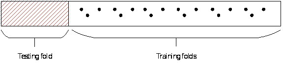

图 2.1 将数据集分割为测试和训练折

基本思想是将数据集划分为大小相等的集合。例如，如果我们有一个大小为 400 的数据集，且  = 10 个折，那么每个折中的数据点数量为 40。如图 2.2 所示，我们选择一个折作为测试折，其余的作为训练折。在 - 折交叉验证中，我们运行独立的学习实验。在这些子集中，我们选择一个作为测试集。其余 -1 个集合被合并为训练集。然后，我们训练一个机器学习算法，并在测试集上测试其性能。

交叉验证的关键特征是我们多次运行算法，如前例中运行 10 次。然后我们计算十个不同保留集的十个不同测试集性能的平均值。即，我们计算这些实验测试结果的平均值。这显然需要更多的计算时间，因为我们必须运行独立的学习实验，但学习算法的评估将更加准确。此外，所有数据都用于训练和测试。这意味着每个数据样本都有机会被用于测试集 1 次，并用于训练模型 -1 次。

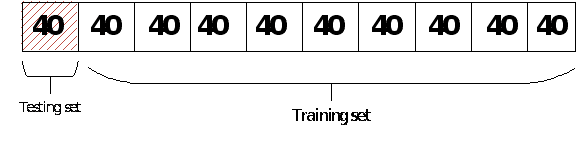

图 2.2 10-折交叉验证示例

## 2.4.1 值选择

The value of has to be chosen carefully to avoid having unclear idea of the machine learning model performance. The followings are common ways to determine the value of :

1- Choosing the value of in a way that guarantee that every train/test set is sufficiently large to represent statistics of the original full dataset, which has to be processed.

2- It is found, from empirical results, that choosing = 10 folds gives model performance predictions with low bias.

3- Choose the value of to be equal to the dataset size. This gives each testing set the chance to be used as a training set and vice versa. This way of cross validation is known as: leave-one-out.

The value choice affects the algorithm bias and variance. In other word, the larger is the value of , the smaller is the size difference between the training group and the resampling sub-groups. The algorithm’s bias reduces as that difference becomes smaller. This means that there exists a trade-off between choosing the value of and the algorithm bias and variance behavior.

## 2.4.2 如何使用 Python 进行折叠

Suppose that we have the following set of observations:

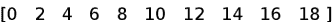

In order to divide this set, we need first to choose a value for . for this example, we will choose a value of =5. This means that we are going to divide the data into five partitions, in which each group will contain two observations, as follows:

1- Fold#1: \[0 2\]

2- Fold#2: \[4 6\]

3- Fold#3: \[8 10\]

4- Fold#4: \[12 14\]

5- Fold#5: \[16 18\]

Therefore, with each fold, five models are trained and tested. Each fold has the chance to be a testing fold for the 5 separate learning experiments. That is, if we set fold#1 as testing set, then we have folds#2:5 as training set. In the next run, we have, for example, fold#2 as the testing set, so that, folds#1 & folds#3:5 are the training set, and so on. Now, these steps can be simply programmed using Python, utilizing the scikit-learn library. The code 2-7, performs the previously explained steps. The `KFold` command was imported from the scikit-learn library. It took two arguments: The value of , 5; and if a shuffle will be performed to the data. In our case we set the shuffle option to “False”.

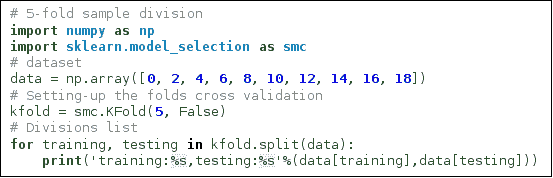

If a shuffle is to be done, means “True”, a third argument has to be added to indicate the seed of the pseudorandom number generator. The “split” function is called repeatedly to return the groups of testing and training sets on each iteration. The output of the five folding process is as follows:

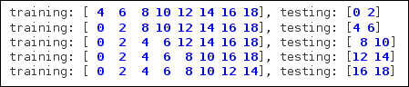

––––––––

It is advisable to use the `KFold` to partition a dataset before modeling. All of the models shall then exploit the same partitions of the data. This is of main concern if we are processing massive amounts of data. Moreover, the employment of the same data partitions across the models is good for future statistical work that may be done later on the data.

## 第三章

## 监督学习：回归分析与决策树

## 3.1 回归分析

Regression is a supervised machine learning algorithm. In regression, given an input, when the output of the model is a numeric value, this means that we are going to learn a numeric algorithm not a class, `C(x) ∈ {0, 1}`. Regression is exploited to derive equations that describe the data best. The goal is then to utilize this model to generate estimations. The common and the simplest way of regression is the linear regression. The linear regression is preferred to find a predictive function when we have a correlation coefficient indicates that the data can predict upcoming events. Moreover, if a scatter plot of data seems to be a straight line, the linear regression is also preferred.

Linear regression is a method to tell how two variables are related. Recalling from algebra, the famous line equation is . This is the famous line equation from elementary algebra. However, we can describe the analogy from the machine learning and linear regression concepts perspective. We have: as a variable that is dependent on another variable, as an independent variable, is the slope and is the -intercept. We need first, to find the linear regression equation, to decide how the two variables, and , are related. In a dataset, we normally have a list of values in columns format, which can be filled as the and values or and as used in the following series of equations.

Note, before proceeding to the regression equation: when we say that there is a relationship between two variables, this does not necessarily mean that one is the cause of the other. Therefore, it is recommended first to, generate a scatter graph in order to decide if the data somehow makes a line prior to calculate the equation of the linear regression.

## 3.1.2 线性回归方程

The formula of the linear regression equation is:

Which is the famous linear equation formula. The slope, and the intercept, are calculated form the following two equations, respectively:

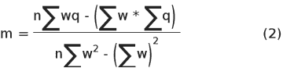

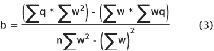

Where, is the number of records. Now, to understand how this work, we suppose that we have the following data, shown in the table 3.1 below:

|  || W || Q |

| --- | --- | --- |

|  || 45 || 91 |

|  || 23 || 67 |

|  || 27 || 81 |

|  || 41 || 70 |

|  || 49 || 83 |

|  || 60 || 77 |

Table ‎3.1 年龄与血糖关系

The dataset above relates two attributes; X: is the age and Y: is the Glucose level. To make the evaluation easier, we make the following table 3.2:

|  || W || Q || WQ || W² || Q² |

| --- | --- | --- | --- | --- | --- |

|  || 45 || 91 || 4095 || 2025 || 8281 |

|  || 23 || 67 || 1541 || 529 || 4489 |

|  || 27 || 81 || 2187 || 729 || 6561 |

|  || 41 || 70 || 2870 || 1681 || 4900 |

|  || 49 || 83 || 4067 || 2401 || 6889 |

|  || 60 || 77 || 4620 || 3600 || 5929 |

| ∑ || 245 || 469 || 19380 || 10965 || 37049 |

Table ‎3.2 年龄与血糖关系

Our mission now is to use the values in the table above to calculate the slope and the intercept from equations (2) and (3), respectively. The values of and are found to be:

\- 

\- 

Now we insert these values in the linear regression equation, which represented as follows:

Equation (4) is known as the linear regression equation. The values 0.2385 and 68.43 are called regression weights. The calculation process of these weights is known as regression. Once we calculated the weights, we can utilize the regression learning algorithms to make new predictions, given an unseen values/dataset. This can be easily achieved by multiplying the inputs by the regression weights and then adding them together to get a prediction. To grasp what have been done, you may export this table into an excel sheet, then generate the scatter plot of dataset in table 3.1. Then, the linear equation is plotted. The resulted plot is as follows, in figure 3.1:

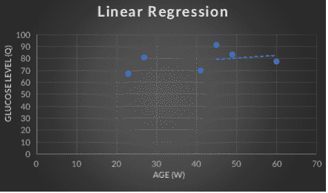

Figure ‎3.1 The scatter data and the linear regression equation plot

The line generated by this equation is called: the trend line. An online linear regression calculator is available on the link in the lower margin^(\[8\]).

|  ||  ||  |

| --- | --- | --- |

## 3.1.2 Testing with correlation:

Correlation is to estimate how close the trend line to fit the data points that you have in your dataset. In other words, an estimation of the success of the model. It can be somehow estimated by eye from the scatter plot, as we mentioned before, but to make an exact decision we utilize the correlation coefficient; named: 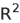. Normally, the closer is to 1, the better the line fits the data points. If is far from 1, the line definitely, will not fit the data. The correlation factor equation is:

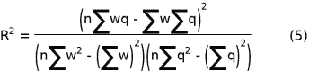

Utilizing this equation helps engineer or data scientist to make an exact expectation of the accuracy of applying the regression algorithm.

|  ||  ||  |

| --- | --- | --- |

## 3.2 Classification Using Decision Tree

A lot of resources discuss the classification and concentrate on the K-nearest neighbor method. We will talk about it briefly whenever we need it in this book. However, in this chapter that cares mainly about the supervised learning we are presenting the decision tree classification as an example of the supervised machine learning algorithms.

|  ||  ||  |

| --- | --- | --- |

## 3.2.1 Introduction to the Decision Tree

Have you ever accessed the “Ask Akinator” online game? For those who do not have a close understanding of the datasets and the data science concept, this game will appear like a kind of magic or paranormal power! In this game, you have to think about a specific character. Then, the Blue Genie will start to ask you a series of questions like: “Is your character a YouTuber”? “Does your character really exist?” and so on. What the game does is a successful splitting of the set of characters it can deduce. If you repeat the game for different characters you will notice that things are working in a branching principal. i.e., every answer leads to a specific set of questions that shrink the circle around the possible answer and cancel a new portion of possibilities. For example, if you answer the first question with “Yes”, the game will exclude the Non-YouTuber persons from its potential decision. The decision tree technique works just like the Akinator game; you give it a set of data and it generates answers to the game.

The decision tree is a famous and a widely used classification technique. The decision tree concept is simple and the “How it works” can be illustrated even to people with almost no knowledge about the machine learning. You may have already seen a decision tree application without knowing it is a decision tree based. In figure 3.2 a flow chart example of the decision tree. You can notice that the flow goes in a branching manner, where finally you reach to a decision. In this particular example, the algorithm checks the domain of the sent email and classifies it depending on its domain. This example is a hypothetical system. So that, if the domain is equal to MyOffice.com, the algorithm will classify it as “Urgent”. If it is not, it makes another check to ensure if the email includes the word “University”. If the text contains the word “University”, then this email is categorized as “Important”. If not, the algorithm checks for the word: “Advertisement”. If the email contains it, the email will be classified as “Spam”. Otherwise, it will end to the category: “To be Read later”.

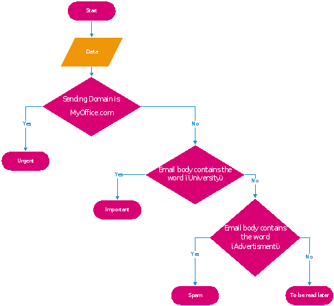In this section, our decision tree algorithm will have the ability to deal with the input datasets and draw, implicitly, a tree like shown in figure 3.2. The decision tree makes a good job of translating general data into a useful knowledge. The decision tree machine learning algorithm creates rules that classify the unfamiliar datasets. Decision trees are common in expert systems, and they give perfect results compared to those produced by human expert with long periods of experience in a certain field.

––––––––

Figure ‎3.2 Decision tree flow chart

Note: In this figure, the diamonds are decisions that are upon some conditions. The ovals are terminations.

|  ||  ||  |

| --- | --- | --- |

## 3.2.2 Decision Tree Construction

Before applying the decision tree algorithm to a dataset, we need first to specify the feature the splitting process will be based on. If you do not have a clear idea about the most feature that rule the dataset, you may try different suggested features until you get the best results. This results in subsets out of the original dataset. Practically, each subset represents a desired feature. Therefore, the subsets keep splitting depending on the features as they travel down the branches. When the data on the branches is the same class, we have classified it and we do not have to continue the splitting process. Else, the algorithm has to be repeated until we have classified all the data. The decision tree algorithm is summarized in table 3.3. From the table, you can notice the recursive nature of the algorithm; as it calls itself until all data is classified. A python code will be written throughout our talk about the decision tree section.

| Decision Tree Algorithm |

| --- |

| 

\- Each object in the given dataset is in the same class/category. 

 |

| 

\- If Yes, return the name/label of the category

 |

| 

\- Else, try another feature to divide the dataset

 |

| 

\- Make a new a branch node 

 |

| 

\- For every divide iteration 

Call the “decision tree algorithm” and add the results to the new branch node

Return branch node

 |

Table ‎3.3 Summary of the Decision Tree Algorithm

A common way of splitting data in the decision tree is the binary split. But suppose that we have followed the binary way, but we still have other possible features, for much more splits. Therefore, in this section we will utilize the ID3 algorithm^(\[9\]). This algorithm helps in making rules about how to split the data and when to stop.

决策树算法适用于数值型和标称型值。它在计算复杂性和对学习结果的理解方面都很简单。此外，它对缺失值具有鲁棒性，并能处理无关特征。然而，决策树算法的主要缺点是容易过拟合。过拟合是决策树和其他分类算法中的常见缺陷。当对训练数据做出多个假设时，即将有意义的值分配给噪声时，就会发生过拟合。这确实降低了训练数据集中的错误，但代价是测试数据集的错误。换句话说，过拟合模型对其训练数据过于特定。因此，当它处理新数据时，其在新数据上的预测错误可能会非常高。

## 3.2.3 在 Python 中构建和可视化基本决策树

在本节中，我们将学习如何在 Python 中使用 `scikit-learn` 工具构建基本决策树。此外，我们将向您展示如何使用 `matplotlib` 和 `scipy` 等其他辅助库和包来可视化决策树。

## CHAPTER FOUR:

## 聚类、偏差和方差

在上一章中，我们讨论了回归作为监督学习算法的一个示例。在本章中，我们将处理一种无监督学习算法，即聚类。在无监督学习中，我们没有目标变量。相反，我们需要获取关于输入数据集的描述。例如，在监督学习中，主要目标是为一组数据获得输出；另一方面，在无监督学习中，我们感兴趣的是机器能告诉我们关于数据集的什么。例如，我们可以要求机器告诉我们从给定数据集中可以形成的最佳三个聚类，或者数据集中最重复的四个特征是什么。在本章中，我们将研究一种称为 -means 算法的聚类算法。之所以称其为“-means”，是因为该算法试图形成独特且不同的聚类，其中聚类中心是该聚类中的平均值。

聚类是一种无监督学习类型，用于查找相似观测的组。事实上，一切都可以聚类。当最相似的项目位于同一聚类中时，聚类更高效。分类（监督学习）与聚类算法之间的关键区别在于，在分类中，我们寻找区分预分类组的方法；而在聚类中，另一方面，没有可用的类别，我们希望对实例进行某种自然分类。聚类有时被称为：无监督分类。这是因为它的工作方式类似于监督学习中的分类，但没有预定义的类别。换句话说，它生成类别。

聚类的一些应用：

\- 基因组学：形成具有相似表达的基因聚类。

\- 天文学：例如，恒星可以根据其颜色、大小、距离、材料等进行区分。聚类可以应用于寻找相似恒星和星系的组。

\- 地震调查：检测到的地震震中应沿大陆裂缝聚类。

\- 市场营销：识别客户群体，并利用这一点进行定向营销和重组。

## 4.1 -means 聚类算法

\-means 聚类是一种机器学习算法，试图为给定数据形成组/聚类。聚类的数量由用户确定。每个聚类由其质心描述，质心是位于聚类中所有点中心的单个点，名称由此而来；-mean。-means 算法适用于数值，即符号被排除。该算法的主要优点和缺点如下：

优点：

\- 易于实现。

\- 快速、简单且易于理解。

\- 对象会自动分配到聚类中。

缺点：

\- 聚类数量必须预先选择。这可以通过尝试使用不同 ’s 的算法 -mean，然后选择质量最好的聚类来解决。

\- 结果受初始标签选择的显著影响。此外，算法可能在局部最小值处收敛。建议的解决方案是使用不同的随机标签多次重新启动聚类算法。

\- 在非常大的数据集上运行缓慢。这可以通过采样来解决。

\- 对异常值高度敏感。

\- 当值非常大时，平均值可能会偏斜。在这种情况下，可以使用中位数代替平均值。

-means 方法的方法可以总结为以下三个步骤：

1- 随机选择聚类中心的数量。

2- 将给定数据中的每个点分配给其最近的聚类中心。分配过程持续进行，直到使用欧几里得距离等方法找到最近的质心。

3- 然后通过将每个质心移动到其分配点的平均值来更新所有质心。

4- 重复步骤二和三，直到达到收敛。即，当聚类分配的变化小于特定阈值时。

图 4.1 的流程图解释了算法代码的样子。

图 4.1 -mean 聚类算法，流程图

## 4.2 偏差和方差

预测模型的错误可能由三个主要组件引起：偏差、方差和不可减误差。在大型数据集中，可能存在许多未定义的变量。这些变量可能会影响输入到输出映射关系。因此，产生了不可减误差。从其名称可以理解，无论采用何种学习算法，都无法降低不可减误差。因此，我们主要关心：偏差和方差误差，因为机器学习模型在最小化偏差和方差方面存在权衡。研究这两个误差有助于我们预期模型结果并避免过拟合或欠拟合的问题。

## 4.2.1 由偏差引起的误差

偏差误差被定义为机器学习模型的平均预测值与我们试图了解的正确值之间的差异。如果只有一个模型，谈论平均值意味着我们需要多次运行模型，然后将这些运行产生的结果值的平均值与我们试图预测的正确值进行比较。一般来说，关注数值分析和结果的机器学习算法（称为参数算法）会遇到高偏差。这类算法简单且学习速度快。另一方面，在复杂问题中，参数算法的预测能力较差，这使得它们不够灵活。低偏差和高偏差算法之间的区别在于，前者对所需输出的假设数量较少。另一方面，后者做出更多假设。低偏差学习算法的常见示例包括：`k-Nearest Neighbors` 和 `Decision Tree`。`Linear Regression` 和 `Discriminant Analysis` 是高偏差学习算法的示例。

|  ||  ||  |

| --- | --- | --- |

## 4.2.2 方差导致的误差

如果我们可以多次重复整个机器学习模型运行过程。方差是指在相同给定点上，模型不同运行之间目标函数的预测值会发生多大变化。机器学习算法被应用于从训练数据集中预测目标函数。因此，预期该算法会表现出方差。如果机器学习算法能够很好地发现输入数据集与输出变量之间的隐式关系，那么目标函数不应该从一个训练数据集到下一个训练数据集发生太大变化。低方差和高方差机器学习算法之间的区别可以澄清如下：

\- 低方差算法：在此算法中，当对训练数据集进行更改时，目标函数的预测会出现小幅度变化。

\- 高方差算法：在此算法中，当对训练数据集进行更改时，目标函数的预测会出现大幅度变化。

一般来说，非数值机器学习算法（也称为非参数算法）表现出高灵活性。然而，它们是高方差算法。低方差学习算法的常见示例包括：`Linear Regression` 和 `Discriminant Analysis`。`-Nearest Neighbors` 和 `Decision Tree` 是高方差学习算法的示例。

|  ||  ||  |

| --- | --- | --- |

## 4.2.3 偏差和方差的图形解释

可以使用靶心图创建偏差和方差的友好且简单的图形解释。让靶心代表特定模型的正确值。离靶心越远，预测结果越差。在下图 4.2 所示的靶心图中，每个黑点代表模型的一次独立运行。在低偏差的情况下，模型实现（即点）非常接近靶心的中心。另一方面，在低方差的情况下，模型实现彼此非常接近，无论它们距离靶心中心有多远。当我们拥有分布良好的训练数据时，我们预测得非常好并且接近靶心。同样，当训练数据充满异常值或噪声数据时，预测将远离靶心。

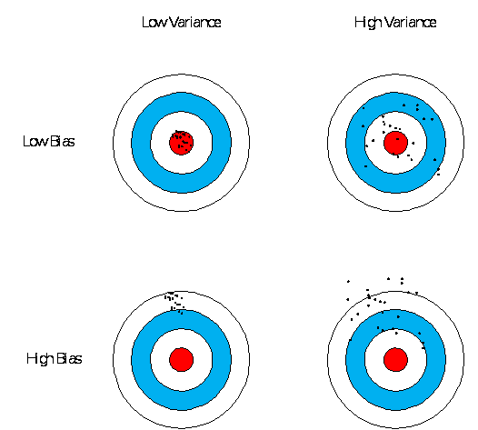

图 4.2 偏差和方差的图示[10]

|  ||  ||  |

| --- | --- | --- |

## 4.2.4 偏差和方差之间的权衡

机器学习算法旨在获得低偏差和方差的输出。然而，正如我们在本章第一和第二部分中所见，机器学习算法中方差和偏差之间存在权衡。图 4.3 总结了这一想法。

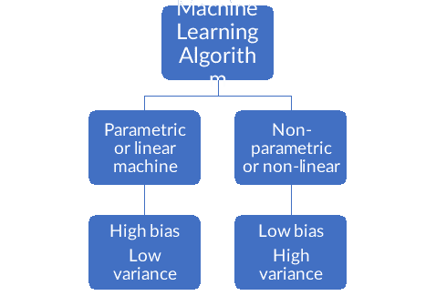

图 4.3 方差和偏差之间的权衡

在机器学习中，无法逃避偏差和方差之间的关系。也就是说，如图 4.3 所示，增加偏差会降低方差，反之亦然。因此，为机器学习算法选择合适参数的过程通常是一场在偏差和方差之间取得平衡的斗争。作为 `-nearest neighbors` 算法的偏差-方差权衡示例如下：

\- `-nearest neighbors` (`KNN`) 是一种常见的监督机器学习算法。它表现出低偏差和高方差。然而，如果邻居的值增加，权衡情况就会变得不同。换句话说，邻居数量的增加会增加对预测过程的贡献，从而增加模型的偏差。

这表明，应对所选机器学习算法进行仔细配置，以便在此权衡中为学习问题实现平衡。偏差和方差是了解机器学习算法预测性能的可接受指导和印象的重要方法。

|  ||  ||  |

| --- | --- | --- |

## 第五章

|  ||  ||  |

| --- | --- | --- |

## 人工神经网络

|  ||  ||  |

| --- | --- | --- |

## 5.1 简介

神经网络可能是最新的领域之一。目前，大型企业和成长型公司都涌入这个前沿领域。深度学习是与神经网络相关的术语。深度学习和神经网络都具有从数据和环境中学习的强大能力。因此，它们是机器学习的首选和首选方案。神经网络常见的应用包括：

\- 汽车自动驾驶。

\- 图像处理和识别。

\- 咨询和推荐系统。

人工神经网络是一种强大的方案，对广泛的数据类型表现出极强的适应性。人工一词揭示了命名的起源。人工神经网络模拟人类神经系统。图 4.1 显示了人类神经元。神经元由以下主要部分组成：

\- 树突：这些是接收来自其他连接神经元的输入电冲动的接收器。然后由细胞体做出决定，得出对这些输入所需的操作。

\- 轴突和轴突末梢：这些是神经元的发射器。它们将输出决策作为电冲动传输到其他神经元。

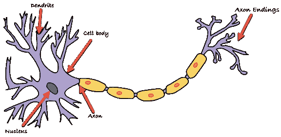

图 5.1 人类神经元

神经元可以分为三个部分/阶段：输入、处理和输出。这是阐述生物神经网络与人工神经网络之间类比关系的关键。

## 5.2 人工神经网络

人工神经网络（Artificial Neural Network, ANN）是一种受益于生物神经网络理念的计算模型，如前所述。人工神经网络是一种模拟人类智能处理数据的机器学习方式。神经网络是一类显著的监督机器学习算法。它们既用于回归也用于分类。在本章中，我们将讨论神经网络的基础知识，并在最后一节展示一个实际示例。其他已知类型，根据要分析的数据，包括卷积神经网络和循环神经网络。前者在图像处理方面表现非常出色。另一方面，循环网络在与序列数据相关的问题（如动态系统建模和自然语言分析）上达到了非常好的性能水平。

神经网络中主要有三种不同的层：

1. 输入层。
2. 隐藏层：在此层中，从前一层接收到的输入将被处理。隐藏层可以包含多个层。
3. 输出层：数据处理完成后，将在此层中可用。

图 4.1 展示了神经网络三层的图形表示。可以注意到，变量由节点表示。网络层通过颜色区分：红色、绿色、蓝色，分别对应输入层、隐藏层和输出层。让我们定义 `X0` 和 `H0` 为哑变量。它们始终取值为 1。哑变量在图 4.1 中被阴影遮盖。

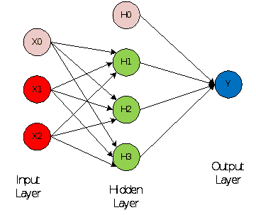

图 5.2 神经网络层

## 1- 输入层

输入层的规则是与外部环境交互。它处理来自数据源的输入。然后将输入传输到隐藏层。每个输入代表一个影响网络输出的独立变量。输入是一些特征，例如：身高、年龄、体重、图像数据或睡眠时间。

## 2- 隐藏层

隐藏层是中间层，位于输入层和输出层之间。它由一组应用了激活函数的神经元组成。隐藏层的工作是处理和处理从前一层获得的输入。因此，它的职责是从输入数据中提取感兴趣的特征。隐藏层可以包含多个隐藏层。因此，需要考虑的问题之一是根据学习类别选择隐藏层的数量。如果输入数据可以线性分离，则可以跳过隐藏层。这是因为激活函数可以设计到输入层，从而能够解决问题。在需要做出复杂决策的问题中，可以使用三到五个隐藏层。在多个隐藏层的情况下，符号将带有一个上标，指示隐藏层编号。具有多个隐藏层的神经网络也被称为深度学习或深度神经网络。

隐藏层数量的选择取决于问题的复杂性或所需的准确性水平。当然，这并不意味着不断增加隐藏层数量会使神经网络变得更准确。算法将达到一个水平，在该水平上，添加额外的隐藏层不会影响其稳态输出，或者有时可能导致结果低于已达到的最佳性能。这意味着，准确计算每个网络的神经元数量是一个非常重要的步骤，无论是为了满足数据集的复杂性，还是为了避免过拟合。

## 3- 输出层

输出层是我们获得想要预测的值的阶段。神经网络的一个好处是，输出模式可以追溯到输入层。这意味着输出层中神经元的数量与神经网络执行的工作类型之间应存在逻辑关系。输出层中神经元的数量与神经网络的预期用途相关。

## 潜在变量

在神经网络中，潜在变量一词很常见。然而，对于本书的读者来说，这并不算很新。回顾第三章，回归分析部分，当我们研究因变量和自变量之间的关系时。潜在变量是输入的函数。这种关系在神经网络中由边表示。每条边从左向右流动，这意味着每个接收边的变量都是边来源变量的函数，以及与该边相关的权重的函数。从图 4.1 可以注意到，隐藏层和输出层中的每个变量都是前一层所有变量的函数，除了偏置变量 `H0`，其值为 1。

## 深度学习和深度神经网络

如前所述，隐藏层的数量可能超过一层。这主要导致两种类型的神经网络，取决于隐藏层的数量：深度神经网络和浅层神经网络。当然，深度类别指的是具有多个隐藏层的神经网络。这种区分至关重要，因为我们不能使用适合浅层神经网络的非线性变换来处理深层网络；因为这可能导致性能不佳。在隐藏层中，通常使用被称为激活函数的函数。在 4.4 节中，我们介绍了著名的激活函数。如将注意到，它们几乎都是层中变量加权和的非线性函数。使用这些函数来生成隐藏层意味着需要进行非线性变换。在深度神经网络中，我们肯定有多个隐藏层，这意味着我们必须对原始输入特征进行一些特征变换。

## 5.3 神经网络中的流

在 ANN 中，每个神经元都代表一个激活节点。激活节点连接到输入节点，以应用学习算法计算加权和。然后将加权和传递给激活函数，从而预测结果。这里产生了“感知器”的概念。感知器是指接收多个输入并产生一个输出的事物。

在图 4.3 中，我们有直接作为独立变量或来自其他神经元的输出的输入。每个输入都有一个权重。权重的重要性在于它们是输入重要性的指示。换句话说，随着权重的增加，输入对输出结果的贡献越大，反之亦然。如图 4.3 所示，每个感知器都有一个偏置，它是感知器灵活性的指示。偏置可以与著名的直线方程中的常数相比较，因为它使我们能够将直线向上或向下调整，以获得更好的预测结果。根据简单的初等代数规则，如果没有常数，直线将始终经过原点，在机器学习的情况下，我们将得到较差的结果。

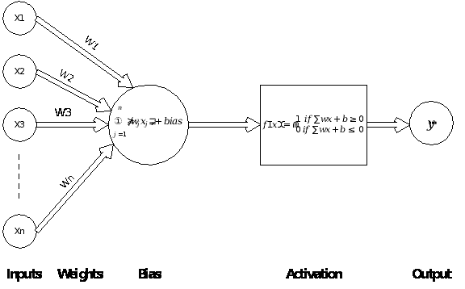

图 5.3 详细神经网络

在“bias”命名的阶段中，如图 4.3 所示，我们可以注意到权重被求和并添加了一个偏置。这个和随后通过一个激活函数。激活函数形成一个开合的门。激活函数可以输出 1 或 0，基于阈值进行判断，或者生成概率。关于概率部分，它可能使用 sigmoid 或整流线性函数。关于激活函数的更多内容将在本章后面讨论。

激活函数的输出是神经网络的加权、预测输出。它在上图中表示为 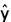。可能是回归、二进制或分类值，具体取决于数据集的性质和所需的输出。

|  ||  ||  |

| --- | --- | --- |

## 5.4 激活函数

在本节中，我们将快速回顾用于 ANN 的常见激活函数。

\- 阈值或阶跃函数：如果权重和输入的和低于特定阈值，则为零；如果高于阈值，则为一。回顾我们之前讨论的门类比。

\- Sigmoid 函数：它是最广泛使用的激活函数。它看起来像阈值函数，但更平滑。Sigmoid 激活函数适合生成概率。这意味着该函数的输出范围始终在零和一之间。例如，如果我们正在调查一张图片，输出将是它是猫还是狗的概率？！

\- 双曲正切：这个函数是 sigmoid 函数的拉伸版本，因为它的范围是 -1 到 1。当我们需要更深的梯度和更陡的导数时，会选择这个函数。因此，sigmoid 函数和双曲正切函数之间的选择取决于梯度强度要求。

\- 整流线性单元 (RELU)：这个函数通常应用于强化学习应用。从其名称来看，它是一个经过整流的线性函数。这意味着它在负域中的值为零，并且线性增加，即对于正输入 x，它给出输出 x，否则为零。RELU 的一个主要优点是与双曲正切和 sigmoid 函数相比的简单性。这是设计深度神经网络时需要考虑的一个主要点。

根据我们试图近似的函数的特征，我们可以选择能实现更快近似的激活函数，这意味着更快的学习过程。例如，sigmoid 函数在分类问题中表现优于 RELU。这意味着更快的训练过程和更快的收敛。可以使用自定义函数。但是，如果我们试图学习的函数的性质不太清楚，那么最好从 RELU 作为通用近似器开始，然后逆向工作。表 4.1 总结了所提及的激活函数及其图形表示和方程。

| 激活函数 || 方程 || 图形 |

| --- | --- | --- |

| 阶跃单元 || 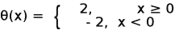 || 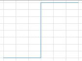 |

| Tanh || 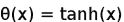 || 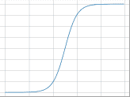 |

| Sigmoid || 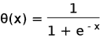 || 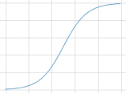 |

| 双曲正切 || 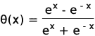 || 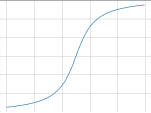 |

| 平滑 ReLU || 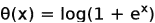 || 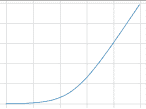 |

表 5.1 激活函数

|  ||  ||  |

| --- | --- | --- |

## 5.5 工作示例

在本节中，我们将给出一个示例，翻译前几节中解释的一些概念。假设我们有一个训练好的神经网络，如图 4.4 所示。这意味着我们有优化后的权重，如图所示。输入层包含一组特征：年龄、到医院的距离、性别和收入。另一方面，输出是依赖于输入特征的变量。它是一个人住院的概率。如果我们以年龄为例，可以说人越老，越有可能住院。就性别而言，统计上男性比女性更有可能住院。收集的数据可以用于根据输入特征进行多种预测，这就是神经网络工作的实现。本示例中的隐藏层被视为一个黑盒，包含产生住院概率的神经元和权重。机器可以被训练以预测到医院的距离与住院概率之间的关系。因此，神经网络必须首先尝试在数据中找到模式，并找出这些不同模式之间的关系。这是在进行其他处理或决策之前对数据的一种理解。一旦训练完成，我们就可以输入从目标数据集中提取的不同特征。例如，一条记录可以是这样的：年龄 65 岁，性别为女性，到医院的距离适中，收入高。神经网络是一种神奇的方法，它以一种模仿人类神经元的聪明方式处理特征后，来预期和预测所需的结果。

神经网络根据神经网络架构估计输入特征的不同组合，以识别数据集中的模式。它可以被视为一个黑盒，但更深入的观察使我们能够看到权重、输入和隐藏层之间的模式。

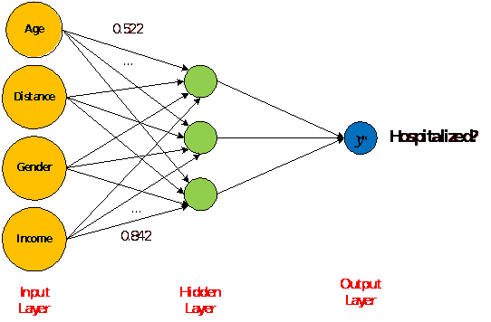

图 5.4 神经网络，住院概率示例

|  ||  ||  |

| --- | --- | --- |

## 5.6 学习过程（权重如何工作）

我们通常需要机器学习，因为我们有大量数据需要处理和分析。因此，如果我们有一个大型数据集，我们将其输入馈入神经网络以进行预测。第一步是确定神经元的权重。它们可以基于初始假设确定，也可以根据应用特征和所需输出预定义。

神经网络的正常流向输出 。也就是说，输入特征被馈入隐藏层，在那里进行计算。然后，网络流继续，直到我们得到所需的输出。这种流被称为：前向传播。此时，智能错误处理出现。得到的 与实际值进行比较。目标是使它们之间的差异尽可能小，即最小化错误。如果我们想象一个孩子学习数学的类比，这会更清晰。如果他对一个特定问题回答 8，而准确答案是 5，那么我们就有 3 的错误。在这种情况下，计算必须重新执行，直到我们尽可能接近 8。

神经网络利用其任务中的权重来最小化产生的误差。它减少了对误差有重大贡献的神经元的权重。这个过程被称为：反向传播。这是因为在这个调谐过程中，我们从输出向神经元和输入方向回溯，以定位错误究竟发生在哪里。正是在这里，激活函数的重要性凸显出来。激活函数是可微的，这有助于通过计算梯度在神经网络中执行反向传播过程；从而计算梯度。因此，权重被调整。权重的同步调整过程持续进行，直到神经网络输出接近实际输出。在每次迭代中，权重会被微调，以便在每次运行中获得更小的误差。该过程针对训练数据集的所有输入和输出可能性重复，直到误差显著减小并被应用程序所接受。

## 5.7 如何执行反向传播？！

以下方程是神经网络中简化代价函数的表示：

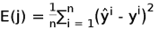(4.1)

在方程 (4.1) 中，是预测输出  与实际输出 之间的平方误差。从概念上讲，我们可以在误差和预测输出  之间绘制一张图。然后，可以使用诸如暴力枚举法之类的方法尝试网络中所有可能的权重。这应该会产生类似抛物线的数据结果。然而，这种简单的方法对于大型数据集来说需要难以想象的计算能力来检查所有可能性。为了说明这一点，对于中等规模的数据集，我们可能需要数百年时间来调整权重并获得结果！这时，权重优化技术就派上用场了。

## 5.7.1 梯度下降

在梯度下降中，我们专注于在比之前估计所有可能性所需时间少得多的时间内进行准确预测。第一步是为神经网络提供初始权重值。然后，我们可以按照前向传播的方式传入数据。我们现在的任务是估计输出  并将其与实际输出 进行比较。在大多数情况下，第一次运行产生的预测并不十分准确，即，我们有较高的误差值。

假设我们有一个针对特定值  的代价函数。为了简单起见，我们将假设数值。如果权重为 1.6，而产生的代价函数值  为 3.2。我们需要在下一次运行中调整权重以减小代价函数的值。问题是：如果我们能发现是增大还是减小权重，以便降低代价函数，那该多好？！

我们要做的是在特定测试点处测试代价函数的左侧和右侧。然后，我们检查哪一方向产生更小的代价函数值。这种方法称为数值梯度估计。这是一种好的方法，但如果我们回顾代价函数方程 (4.1)，我们可以通过利用导数，即进入梯度下降概念，以更聪明的方式思考。我们想知道哪个方向是下坡，能使函数达到最小值。换句话说，我们将检查  对  的变化率。

在这个阶段，我们需要做的是对 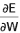 求导，这将给出  对  的变化率。然后，对于  的任何值，如果  为正，则代价函数指向上坡。而如果  为负，则代价函数指向下坡。这意味着我们现在知道哪个方向可以减小代价函数。因此，我们能够加快调谐过程。这是因为我们节省了在错误方向搜索值所需的所有时间。此外，通过沿着减小代价函数的方向迭代采取步骤，并在代价函数不再减小时停止，节省了额外的计算时间。这就是梯度下降方案的概念和实际实现。我们可以将梯度下降优化比作一名徒步旅行者。在这种情况下，权重是向山谷（即代价最小值）爬下山丘。根据这个类比，我们可以根据坡度陡峭程度（即梯度）和步长（类似于学习率）来确定每一步。

在梯度下降中，有高学习率和低学习率之分。在我们的徒步类比中，高学习率是指在检查位置之前向山谷迈出大步。这可能导致我们永远无法到达代价函数的最小值。另一方面，当采取小步时，我们增加了到达最小值的机会。然而，这可能需要很长时间。因此，我们需要经验性地调整学习率，直到到达最小值。一个聪明的解决方案是考虑利用梯度概念的自适应学习率。也就是说，梯度越陡峭，学习率越高，梯度越小，达到最终值所需的步骤就越小。

梯度下降在一维问题中可能看起来并不特别。然而，它显著减少了在高维数据集中调整神经网络权重所需的时间。

在使用梯度下降求解时，需要注意的一个重要问题是数据的凸性。有时我们处理的数据集可能是非凸的。这意味着代价函数在同一方向上并不总是减小。从字面上讲，在这种情况下，代价函数先减小后又增加。这种行为在数学上被称为非凸函数。图 4.5 显示了一个示例。在非凸函数中，梯度下降方法无法再给出准确的预测，因为它会陷入局部最小值，而不是找到全局最小值。

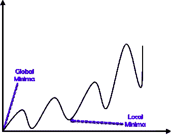

图 5.5 非凸数据

正是在这里，使用平方代价函数的原因得以揭示。平方误差值的总和使我们能够利用二次函数的凸性特性。因此，由于代价函数等于  的平方值，则  的图是一个凸抛物线。

在结束关于梯度下降的讨论之前，有一个主要点需要提及，即数据集的实际凸性取决于我们如何处理数据。有时我们可以遵循“一次一个而不是一次全部”的原则。在这种情况下，我们不太关心数据集的整体凸性问题。这引出了我们在下一节中关于随机梯度下降的讨论。

## 5.7.2 随机梯度下降

梯度下降计算了整个数据集的梯度。另一方面，随机梯度下降使用数据集的一小部分来计算梯度。这使得随机梯度下降比梯度下降收敛更快，因为它执行更新的频率要高得多。考虑到数据集通常包含冗余信息，我们对不使用完整数据集的随机梯度下降感到非常满意。表 4.2 总结了梯度下降与随机梯度下降之间的比较。

| 梯度下降 || 随机梯度下降 |

| --- | --- |

| 使用完整数据集计算梯度 || 使用数据集的单个样本计算梯度 |

| 可能陷入局部最小值 || 收敛更快并避免陷入局部最小值 |

表 5.2 梯度下降与随机梯度下降的比较

## 5.8 在神经网络背景下理解机器学习类别

首先，让我们快速回顾一下数据集的类型及其与神经网络的交互方式。主要，我们有三种类型的数据集：

\- 训练数据集：它是一组用于学习过程的数据样本。因此，在神经网络的这个阶段。

\- 验证数据集：一组用于调整网络参数的样本。例如，在神经网络中，它可以用来选择隐藏层的数量。

\- 测试数据集：这一组是一组用于在神经网络完全构建后检查其性能的示例。此外，它可以用于在已知输入的情况下预测输出。它还用于确保我们不会过度拟合数据。

我们知道，在监督学习中，我们有作为算法/网络输入的训练数据，并且所需输出是已知的。在神经网络中，权重会被调整，直到输出达到所需值。在无监督学习中，我们有一组试图理解并提取其特征的数据。因此，在神经网络中，输入数据被用于在已知输出的情况下训练网络。然后网络对数据进行聚类，并通过从输入数据中提取特征来调整权重。在强化学习中，我们不知道输出。然而，神经网络可以提供反馈，告诉输入是否正确。这种学习类型也称为半监督学习。离线或批量学习仅在将训练数据集应用于网络后，才对权重和阈值进行所需的调整。最后，在在线学习中，与离线学习相反，权重和阈值的调整过程是在将每个字符串示例应用于网络后进行的。

## 5.9 神经网络应用

我们日常遇到的许多事物都使用模式识别，并利用这些结果来做出决策。因此，神经网络有能力被应用于日常生活应用和任务中。使用神经网络的示例包括股票市场、天气预测、用于探测敌方飞机或船舶的雷达系统。它还可以用于帮助医生根据症状诊断复杂疾病。神经网络存在于我们的电脑或智能手机中。它们可以被编程来识别图像或手写体。某些神经网络可以监控某些参数来识别你正在输入的字符，例如：你正在做的线条、你手指的移动以及你移动的顺序。语音识别程序是另一个显著利用神经网络技术的示例。一些电子邮件程序或工具具有将真实邮件与垃圾邮件分开的能力。这些程序也使用神经网络。神经网络在文本翻译（从一种语言到另一种语言）方面表现出了高效率。谷歌在线翻译器是近年来采用神经网络来增强机器在语言之间转换/翻译单词性能的著名工具之一。

## CHAPTER Six

## 构建机器学习模型

## 6.1 如何开发机器学习应用程序

开发机器学习模型的基本方法可以总结为以下步骤：

1- 数据收集：数据或样本可以从互联网、RSS 源或 API 中收集。研究人员可能拥有记录测试结果的集体设备，例如：风速数据、血糖水平、水中的盐分或矿物质，或任何其他感兴趣的数据。几乎有无穷无尽的选择。但是，有时使用可用样本可能会节省大量时间和精力。公开可用的数据集存储库示例显示在附录 B 中。

2- 输入数据准备：一旦我们获得了数据，我们需要检查它是否可读且处于可用格式。这一步保证了我们的数据已准备好用于学习算法。在第二章中，我们详细讨论了数据准备方法，并展示了如何从噪声中清理数据、如何解决缺失数据问题，以及其他使数据集能够产生有意义结果的必要方法。与收集数据相比，数据准备和清理通常并非易事。

3- 输入数据分析和人工介入：这是一个手动分析步骤。例如，我们需要检查前两个步骤是否工作正常且不存在空值。可以对数据进行估计，以识别是否存在可以描述数据的模式，或者与数据集中其他点明显不同的数据值。有时，在二维或三维中创建数据图可能非常有用。但是，通常描述数据的维度/特征超过三个，无法一次轻松地在所有维度上生成数据图。因此，可以采用维度压缩方法将多个维度压缩到二维或三维，以便数据可视化。考虑到人工介入，对于自动化系统和可信的数据源，这可能非常有限或不需要。例如，如果数据源来自生产系统，并且我们知道数据将如何表现，则可以跳过此步骤。此步骤的主要好处是它使我们能够检查数据集中是否没有垃圾数据。

4- 算法训练：这是机器学习动作实际发生的步骤。换句话说，这一步是学习过程的核心和实现。首先，我们为算法提供来自步骤一和二的已准备好、已清洗和已修复的数据。然后，提取信息。这一步创建了可在后续步骤中由机器应用和使用的格式。请记住，在无监督学习中，我们不需要训练步骤。这是因为我们没有特定的目标值。

5- 算法测试：在此步骤中，我们的算法已准备好进行测试，并应用于其他数据集以提取信息，利用前一步骤中获得的知识。在监督机器学习中，我们通常有一些已知变量。因此，我们能够使用它们来评估算法。另一方面，在无监督学习中，我们可能需要其他方法或指标来进行评估。如果我们对结果不满意，可以回到步骤 3 并进行一些调整和影响流程的更改，从而获得更新和更好的结果。大多数时候，您可能会在数据收集或数据准备阶段发现问题。在这种情况下，您需要回到步骤一和二。

6- 算法编程：这只是您选择合适的工具或编程语言来编写算法并制作实际程序的阶段。再次，我们需要检查所有先前的步骤是否都工作正常。如果遇到新数据，我们需要重新检查步骤一到五。在此示例中，我们使用 `Python` 来构建机器学习模型，该模型已在本书第 1 章介绍的优势中贯穿始终。也可以使用其他工具或程序，例如：`Weka`、`MATLAB` 或您能够很好掌握的任何其他工具。

## 6.2 在 Python 上构建机器学习模型

在此示例中，我们将构建一个机器学习模型，尝试总结和收集本书中学习的大部分主题。人们认为，理解问题的最佳方法是将其放入示例中。因此，在此示例中，我们将从 UCI 机器学习库中选择一个数据集。完成此示例后，您将能够：分析数据集，使用六种机器学习模型，并学习如何基于训练数据集进行预测。

注意 (1)：在继续此示例之前，请确保您的设备上已安装 `Python` 平台。另外，检查您是否已添加必要的库和包。您可以参考附录 A 了解更多详细信息。

注意 (2)：您可以按照附录 B 中显示的资源访问不同的数据集。

在此模型中，我们有一个天平数据集。在此数据集中，我们有 625 个实例和 4 个变量。此数据集中呈现的信息包含心理学实验的结果。数据的类别为：1) 倾向右侧，2) 倾向左侧，3) 平衡。

首先，我们需要研究、估计和可视化数据集。这可以按照以下小节所示完成。

## 6.2.1 数据集估计

在此阶段，我们需要对数据集进行总体了解，并获得一些使我们能够开始处理它的信息。首先，让我们回顾如何：

1- 导入必要的库。

2- 加载数据集。

以下代码片段完成了上述两项任务。

下一步是识别数据集的维度和类别。您也可以打印数据集的一部分，以了解数据集中呈现的信息的性质。以下代码使此成为可能。请注意，每个后续代码都按顺序添加到代码 5-1 中。

将生成以下输出：

如所见，我们有一个 625x5 的数据集。然后，代码打印了数据集的前十条记录。之后，我们打印了数据集描述的摘要，显示了数据集的一些基本统计量，例如：均值和标准差。最后，我们统计了每个变量/类别的值的数量。下一步是可视化您的数据集。在我们的情况中，数据集并不复杂，很容易理解。但是，我们将向您展示一些图表，以供教育目的，并为您提供在需要时使用它们的选项。以下代码将生成一个单变量图，其中每个变量单独生成一个图，直方图和多变量图。生成的图表将在代码之后按顺序显示。

图 5.1 箱线图和箱图，单变量图

图 5.2 数据集直方图

图 5.3 散点图，多变量图

在此阶段，已完成非常有用的数据集估计。在下一节中，我们将使用 10 折交叉验证来验证我们的数据集。

## 6.2.2 验证数据集

我们必须检查我们拥有的模型是否良好。这是即将到来的步骤的基本步骤，因为我们将学习的算法应用于未见的数据。回顾第 2.4 节，我们可以通过在数据集的一部分（验证数据集）上测试模型来评估我们的模型。在此示例中，我们将使用 80% 的数据集进行训练过程，并保留 20% 来测试模型。

此代码为 10 折交叉验证过程做准备，该过程将在下一小节所示的不同机器学习模型的测试过程中使用。

## 6.2.3 机器学习模型

如前所述，`Python` 是一种在机器学习领域非常出色的编程语言。在此节中，我们将使用非常简单的代码将六种机器学习算法应用于数据集。然后，我们将测试每种算法的准确率，并决定哪一个是最佳选择。将要测试的算法有：

\- 逻辑回归 (LR)

\- 支持向量机 (SVM)。

\- 最近邻 (KNN)。

\- 线性判别分析 (LDA)

\- 分类和回归树 (CART)。

\- 高斯朴素贝叶斯 (NB)。

从前一段代码获得的结果，即每种算法的准确率，如下所示：

可以很容易地注意到，高斯朴素贝叶斯和支持向量机都具有最高的准确率。每个模型的均值和离散程度可以通过以下代码生成的图表显示：

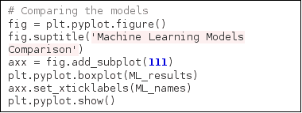

––––––––

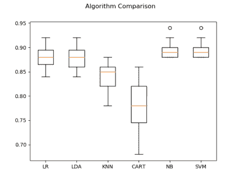

图 5.4 机器学习算法比较

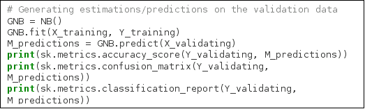之前的工作现在可以用于进行预测。我们将选择 `NB` 算法进行预测，因为它是两个最佳算法之一。我们将在验证集上应用 `NB` 算法以检查其准确性。建议设置验证集，以检查训练集是否出现过拟合或滑拟合情况。当运行以下代码中的 `NB` 算法时，将打印出准确率得分、混淆矩阵和分类报告，以指示验证结果。

预测输出如下：

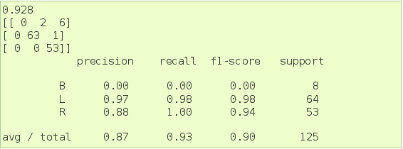

可以看出准确率为 0.928。混淆矩阵显示有三个错误，最后分类报告按精确率、召回率、F1 分数和支持度显示了每个类别的细分情况。

|  ||  ||  |

| --- | --- | --- |

## 附录 A：平台和软件包安装

|  ||  ||  |

| --- | --- | --- |

## A.1 平台安装

Python 是一种用于通用编程的解释型高级编程语言。其应用现已无法枚举。例如，它被用于 Web 和互联网开发、数据库访问、GUI、科学与数值计算、教育、网络编程、软件与游戏开发。

有多个平台可用于开始使用 Python 进行编程。它还支持不同的操作系统。Python 常见平台的最新版本可通过以下链接访问：

[`www.python.org/downloads/`](https://www.python.org/downloads/)

您还可以选择适合您使用的操作系统的平台，无论是 Windows、Linux/UNIX、Mac OS X 还是其他系统。

下载安装文件后，您可以运行它，为了继续进行软件包安装的后续步骤，重要的是要确保勾选“将 Python X.XX 添加到路径”复选框，如下图所示：

然后，您可以进行常规安装过程。

|  ||  ||  |

| --- | --- | --- |

## A.2 软件包安装

为了能够追踪本书中所示的示例，您需要安装一些软件包。但首先，需要执行一些检查步骤，如下所示：

1- 运行 Windows 系统自带的 `cmd` 控制台。这可以通过单击“Windows 键 + R”轻松完成，然后在出现的小窗口中输入：`cmd` 并按 Enter。

2- 我们要检查系统是否识别已安装的 Python 平台。因此，在 `cmd` 黑色窗口中输入：

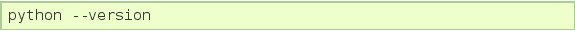

3- 现在我们需要确保您有 `pip` 可用。这可以通过运行以下命令完成：

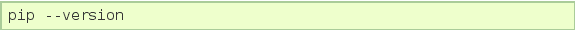

4- 确保您拥有 `setuptools` 和 `wheel` 项目的最新版本很有用。这使您能够从源存档安装：

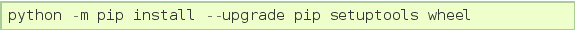

在之前的步骤期间和之后，预计您将看到以下 `cmd` 屏幕：

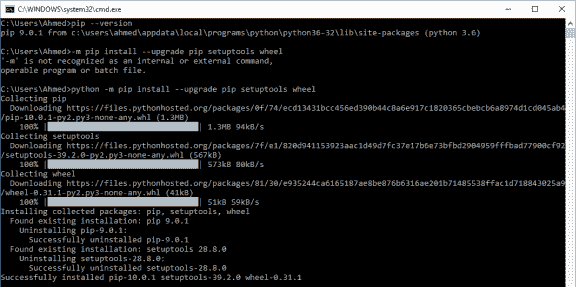

现在，我们可以继续安装必要的软件包，以便为本书中的示例准备好 Python。我们需要的主要软件包是 Pandas。但是，为了使其正常工作，有一些依赖项需要先安装：

✓ `setuptools`: 24.2.0 或更高版本

✓ `NumPy`: 1.9.0 或更高版本

✓ `python-dateutil`: 2.5.0 或更高版本

✓ `pytz`

✓ `scipy`

✓ `scikit-learn`

✓ `Matplotlib`

我们已经检查了第一个 `setuptools`。因此，我们可以继续处理下一个软件包。您需要依次输入以下命令，并等待每个软件包安装完成。

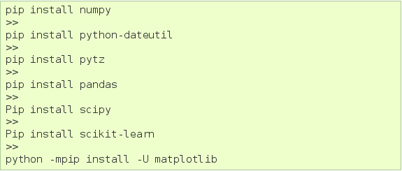

您必须检查是否有互联网连接，因为如果没有连接，所有之前的安装都无法工作。如果安装成功，您预计将看到类似以下截图的 `cmd` 屏幕：

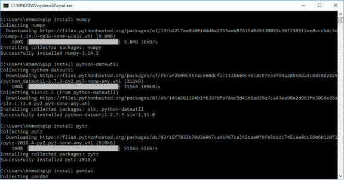

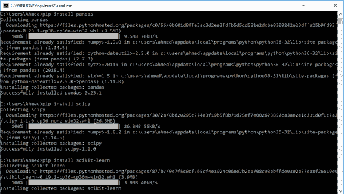

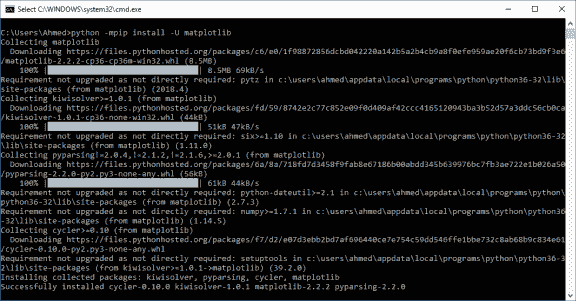

|  ||  ||  |

| --- | --- | --- |

## 附录 B. 资源、期刊和免费数据集

随着存储变得几乎无限，连接变得更加便捷和无缝，互联网上可用的数据集变得巨大。加上机器强大的计算能力，这使得在广泛的可用数据集上应用机器学习算法成为可能。曾经有一种观点认为，为了跨越通往人工智能的道路，科学家必须创造一种新的思维方式或神秘模式。然而，考虑到机器学习算法在不同领域取得的成功，问题更简单。我们需要大量的示例数据集，以便机器能够学习。当然，我们还需要在计算能力方面拥有强大的机器，以便将算法应用于如此大量的数据。

|  ||  ||  |

| --- | --- | --- |

## B.1 会议和期刊

有几种研究资源对有兴趣进行高级学习和研究工作的人很有用。大量参考文献分布在不同领域的期刊和会议中。重要期刊示例包括：

\- 机器学习研究杂志。

\- IEEE 神经网络汇刊

\- 神经计算。

\- 统计期刊。

\- 统计年鉴。

\- 机器智能。

\- 模式识别。

\- IEEE 知识与数据工程汇刊。

\- 数据挖掘与知识发现。

\- 数据挖掘探索。

著名的机器学习会议包括：

\- 神经信息处理系统 (NIPS)。

\- 人工智能中的不确定性。

\- 国际机器学习会议 (ICML)。

\- 欧洲机器学习会议 (ECML)。

\- 国际人工智能联合会议 (IJCAI)。

|  ||  ||  |

| --- | --- | --- |

## B.2 免费数据集

互联网上有多个免费可用的数据集。这些数据集可供数据科学家和数据研究人员用于测试和训练他们的算法。一些非常有用的链接如下：

\- UCI 机器学习库是最流行的库：

[`www.ics.uci.edu`](http://www.ics.uci.edu)/∼mlearn/MLRepository.html

或：[`mlr.cs.umass.edu/ml/index.html`](http://mlr.cs.umass.edu/ml/index.html)

\- `UCI KDD Archive`: [`http://kdd.ics.uci.edu/summary.data.application.html`](http://kdd.ics.uci.edu/summary.data.application.html)

\- `Statlib`: [`http://lib.stat.cmu.edu`](http://lib.stat.cmu.edu)

\- `Delve`: [`https://www.cs.utoronto.ca`](https://www.cs.utoronto.ca)/∼delve

\- `Super Data Science`: [`https://www.superdatascience.com/`](https://www.superdatascience.com/)

\- [`https://www.dataquest.io/blog/free-datasets-for-projects/`](https://www.dataquest.io/blog/free-datasets-for-projects/)

\- [`https://sites.google.com/site/learninganalyticsforall/data-sets/epm-dataset`](https://sites.google.com/site/learninganalyticsforall/data-sets/epm-dataset)

\- [`https://vincentarelbundock.github.io/Rdatasets/datasets.html`](https://vincentarelbundock.github.io/Rdatasets/datasets.html)

此外，还有其他与特定领域相关的资源和库。换句话说，可以通过面部识别、计算生物学、语音识别等标题来限制研究。新的数据集不断添加到互联网以及上述的库和网站中。正如我们在本书各章中所见，不同的算法在不同的任务上表现更好。因此，最好牢记一个应用程序，并拥有一些针对该应用程序的大型数据集，以便在针对该特定任务时研究不同的算法。

此外，机器学习研究人员和数据科学家不断在可通过互联网访问的期刊上发表他们的论文。一个推荐的搜索起点是 NEC Research Index，位于 [`http://citeseer.ist.psu.edu`](http://citeseer.ist.psu.edu)。此外，大量机器学习算法可通过 Web 获得，这些算法是使用不同的程序和工具设计的，例如 `Weka`、`Python` 和 `MATLAB`。

* * *

[^(\[1\])](#c007.xhtml#_ftnref1) L.G. Alexander: Operation Mastermind.

[^(\[2\])](#c007.xhtml#_ftnref2)  Paul Anderson: Superman from the South by Jim Murray

[^(\[3\])](#c016.xhtml#_ftnref3) Malley, Brian and Ramazzotti, Daniele and Wu, Joy Tzung-yu, Secondary Analysis of Electronic Health Records", year="2016".

[^(\[4\])](#c016.xhtml#_ftnref4) Son NH (2006) Data mining course—data cleaning and data preprocessing. Warsaw University. Available at URL `http://www.mimuw.edu.pl/~son/datamining/DM/4-preprocess.pdf`

[^(\[5\])](#c017.xhtml#_ftnref5) Previous references

[^(\[6\])](#c020.xhtml#_ftnref6) [`http://www.sacbee.com/`](http://www.sacbee.com/)

[^(\[7\])](#c020.xhtml#_ftnref7) [`https://github.com/ahmedfhd1/machine\_learning/blob/master/real\_estate\_transactions.csv`](https://github.com/ahmedfhd1/machine_learning/blob/master/real_estate_transactions.csv)

[^(\[8\])](#c031.xhtml#_ftnref8) [`http://www.statisticshowto.com/calculators/linear-regression-calculator/`](http://www.statisticshowto.com/calculators/linear-regression-calculator/)

[^(\[9\])](#c035.xhtml#_ftnref9) [`http://en.wikipedia.org/wiki/ID3\_algorithm`](http://en.wikipedia.org/wiki/ID3_algorithm)

[^(\[10\])](#c043.xhtml#_ftnref10) [`http://scott.fortmann-roe.com/docs/BiasVariance.html`](http://scott.fortmann-roe.com/docs/BiasVariance.html)

