# Python 机器学习：基于 Python、scikit-learn 和 Tensorflow 的机器学习与深度学习（初学者分步教程指南）

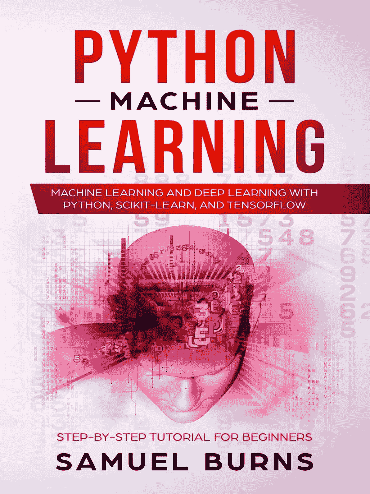

## 读累了记得休息一会哦~

**公众号：古德猫宁李**

* 电子书搜索下载
* 书单分享
* 书友学习交流

**网站：**[沉金书屋 https://www.chenjin5.com](https://www.chenjin5.com)

* 电子书搜索下载
* 电子书打包资源分享
* 学习资源分享

感谢！

感谢购买本书！旨在帮助你理解基于 Python 的机器学习和深度学习。

## 本书目标

目标

* 帮助你理解机器学习和深度学习的基础知识。
* 理解机器学习算法的不同类别。
* 帮助你理解不同的机器学习算法是如何工作的。
* 你将学习如何在`Python`中通过编程实现各种机器学习算法。
* 帮助学习如何在`Python`中使用`Scikit-Learn`和`TensorFlow`库。
* 帮助学会通过编程分析数据，以提取变量之间的模式、趋势和关系。

## 本书需要什么？

你需要在电脑上安装以下内容：

* `Python 3.X`
* `Numpy`
* `Pandas`
* `Matplotlib`

作者将指导你如何安装机器学习和深度学习所需的其余`Python`库。

## 本书适合谁？

以下是本书的目标读者：

* `Python`机器学习的完全初学者。
* 任何需要提升`Python`编程技能以进行机器学习和深度学习编程的人。
* 数据科学领域的专业人士。
* 寻找以最简单、最容易的方法向学生解释机器学习的教授、讲师或导师。
* 学生和学者，特别是关注神经网络、机器学习和深度学习的人员。

## 为什么这本书适合你？

如果你想用`Python`学习机器学习和深度学习，这本书是你的你的你的选择。原因如下：

* 作者从基础开始探索了机器学习和深度学习的所有内容。
* 使用了通俗易懂的语言。
* 提供了大量的理论和编程示例。
* 添加了显示程序输出的截图。
* 本书按时间顺序以循序渐进的方式编写。

## 关于作者

Samuel Burns 是 GlobalTech NTC 数据科学、云和人工智能总监。他拥有机器学习博士学位，是一位人工智能开发者，也是一名开源开发者。他撰写了许多论文以及一些流行的软件包。从 2008 年到 2016 年，他担任 Nemesis Sweden 的首席科学家。他是比利时科学学院访问教授。数据挖掘专家，Burns 是活跃的机器学习研究人员，经常授课并维护资源。他的研究引领了集成学习、异常检测的发展，并参与了许多人工智能和数据挖掘活动。“人类已知从经验中学习。想象你在学习读说一种新语言。你会随着时间的推移而进步。机器学习借鉴了人类学习的概念。当计算机系统反复暴露在相同的情境时，它们对该情境的反应会随着时间得到改进。机器学习通常依赖于数据。它涉及设计和开发能够从数据集中提取模式、趋势和变量之间关系的计算机系统。机器学习的日益流行归功于数据日益流行的相同因素。例如，机器学习数据每天都在增加。存储成本每天都在下降。更便宜、强大的处理方式每天都在发现。”本书是对机器学习和深度学习的详细探索。你将学习如何在`Python`中使用`Scikit-Learn`和`TensorFlow`库完成机器学习任务。阅读愉快！

# 第 1 章- 入门

## 什么是机器学习？

机器学习是人工智能的一个分支，它使系统具有无需显式编程即可从经验中学习的能力。机器学习关注计算机应用程序的开发，这些程序能够访问数据并从中学习。

学习过程始于数据或观察值，例如指令、直接经验或示例，以便从数据中提取模式并利用这些模式。

### 特征缩放

## 算法训练

## 评估算法准确率

## K 值与错误率的比较

# 第 6 章- K-Means 聚类

## 数据准备

## 数据可视化

## 创建簇

# 第 7 章- 支持向量机

## 导入数据集

## 数据预处理

## 算法训练

## 进行预测

## 评估算法准确率

# 第 8 章- 使用 Scikit-learn 构建神经网络

## 神经元的结构

## 反向传播

## 实现

## 数据预处理

### 特征缩放

## 算法训练并进行预测

## 算法准确率评估

# 第 9 章- 随机森林算法

## 工作原理

## 随机森林与回归问题

## 数据准备

### 特征缩放

## 算法训练

### 评估算法性能

## 随机森林与分类问题

## 数据准备

### 特征缩放

## 算法训练

### 评估算法性能

# 第 10 章- 使用 TensorFlow

## 数据流图

## 常量

## 变量

## 会话

## 占位符

## 构建神经网络

## 准备训练

# 第 11 章- TensorFlow TensorFlow 循环神经网络

## 时间序列中的 RNN

## 使用 RNN 进行预测

## 划分数据集

## 构建模型

# 第 12 章- 线性分类器

## 导入数据

## 数据准备

## 训练分类器

Scikit-learn 通过一致的 Python 接口为用户提供了许多监督和无监督学习算法。它最初由 David Cournapeau 在 2007 年作为 Google Summer of code 项目开发。Scikit-learn 适用于学术和商业用途。

Scikit-learn 一直作为 Python 中的机器学习库被使用。它包含了许多分类、回归和聚类算法，包括梯度提升、支持向量机 (SVMs)、随机森林、k 均值和 DBSCAN。Scikit-learn 设计用于与包括`Numpy`和`SciPy`在其他 Python 库一起使用。

该库本身用 Python 编写，其中一些算法用`Cython`编写以提供更好的性能。Scikit-learn 是构建机器学习模型的良好库。该库是开源的，并采用 BSD 协议许可。

# 什么是 TensorFlow？

TensorFlow 是 Google 的一个框架，用于创建深度学习模型。TensorFlow 依赖数据流图进行数值计算。TensorFlow 让机器学习变得简单。它让获取数据、训练机器学习模型、做出预测和修改未来结果的过程变得容易。

该库由 Google 的 Brain 团队开发，用于大规模机器学习。TensorFlow 将机器学习和深度学习算法及模型结合在一起，并通过一个共同的比喻使它们变得非常有用。TensorFlow 使用 Python 为用户提供了一个前端 API，可用于构建应用程序，而应用程序在高性能`C++`中执行。

TensorFlow 可用于构建、训练和运行用于图像识别、手写数字分类、循环神经网络、词嵌入、自然语言处理等领域的深度神经网络。

# 第 2 章- 环境搭建

在进入机器学习和深度学习的实践部分之前，我们需要安装两个库，即 Scikit-Learn 和 TensorFlow。

## 安装 Scikit-Learn

Scikit-learn 支持`Python 2.7`及以上版本。在安装 Scikit-learn 之前，确保你已经安装了`Numpy`和`SciPy`库。此外，确保你拥有这些库的最新版本。一旦安装了这些，你就可以在你的机器上安装 Scikit-learn。

这些库的安装可以使用`pip`完成。`Pip`是 Python 自带的工具，这意味着安装 Python 后，你就获得了`pip`。要安装 scikit-learn，请在操作系统的终端上运行以下命令：

```
pip install scikit-learn
```

安装应该运行并完成。

你也可以使用`conda`来安装 scikit-learn。这可以通过运行以下命令来实现：

```bash
conda install scikit-learn
```

一旦`sckit-learn`安装完成，你需要将其导入到 Python 程序中以使用它的算法。这可以通过如下所示的`import`语句来实现：

```python
import sklearn
```

如果命令运行且没有错误，则说明 scikit-learn 安装成功。如果命令生成了错误，请注意安装未成功。你现在可以使用 scikit-learn 创建你自己的机器学习模型了。

## 安装 TensorFlow

TensorFlow 提供了适用于`C++`、`Haskell`、`Go`、`Java`、`Rust`等编程语言的 API，并带有一个名为`tensorflow`的 R 语言第三方包。我们将指导你如何在 Windows 上安装 TensorFlow。在 Windows 上，可以使用`pip`或`Anaconda`安装 TensorFlow。

原生的`pip`将把 TensorFlow 安装在你的系统上，而无需经过虚拟环境。

你将看到一组将与`TensorFlow`包一起安装的包列表。系统将提示你允许安装这些包。只需输入`y`然后按键盘上的回车键。包将立即开始安装。注意，安装过程可能需要几分钟，请耐心等待。然而，互联网连接的速度将决定此过程所需的时间。安装过程的进度将在提示窗口中显示。

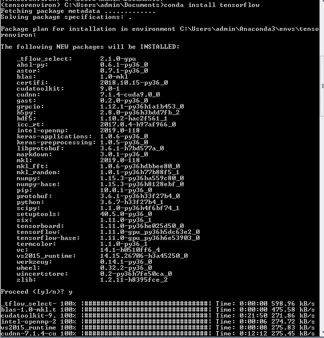

一段时间后，安装过程将完成，此时就可以验证安装是否成功了。我们可以简单地通过运行 Python 的 import 语句来实现。该语句应该在 Python 终端中运行。在 Anaconda 提示符中，输入`python`并按回车键。这将带你进入 终端。现在运行以下 import 语句：

```python
import tensorflow as tf
```

如果包没有安装成功，你将得到一个错误，否则包安装成功。

# 第 3 章- 使用 Scikit-Learn

现在你已经完成了安装，可以开始使用这些库了。我们将从 Scikit-Learn 库开始。

要在代码中使用 scikit-learn，你应该先通过运行此语句来导入它：

```python
import sklearn
```

## 加载数据集

机器学习的核心在于分析数据集。在此之前，我们应该首先将数据集加载到工作区中。该库自带了许多我们可以加载和处理的数据集。我们将通过使用名为`Iris`的数据集来演示。这是一个花类的数据集。以下代码展示了如何使用 scikit-learn 加载数据集：

```python
## Import scikit-learn library
from sklearn import datasets

## Load iris dataset
iris = datasets.load_iris()

## Confirm by printing the shape of the data
print(iris.data.shape)
```

代码返回以下内容：

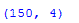

上面的输出显示数据集有 150 行 4 列。若要在 Python 终端上打印所有数据，请运行以下语句：

```python
print(iris.data)
```

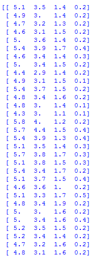

# 第 4 章- 使用 Scikit-Learn 进行线性回归

我们需要详细讨论线性回归，并查看如何使用 scikit-learn 库来实现它。

在线性代数中，“线性”一词被用于表示两个甚至多个变量之间的关系。如果这种关系在二维空间中表示，我们就会得到一条直线。

考虑一种情况：我们需要确定学生学习考试的小时数与学生在考试中得分百分比之间的线性关系。如果我们已知学生准备考试的小时数，我们需要能够判断学生可以获得的分百分比。如果将自变量（`hours`）绘制在 x 轴上，而将因变量（`percentage`）绘制在 y 轴上，线性回归将给出一条代表点最佳拟合的直线。

直线的方程由以下公式给出：

`y = mx + b`

在上述方程中，`m`代表斜率，而`b`代表截距。这意味着线性回归算法为我们提供了斜率和截距的最优值。（此处重复内容已省略）

`X`变量将存储属性。注意，我们使用了`-1`，因为我们需要将除最后一列（即`Marks`）之外的所有列都分配给属性。`y`变量将存储标签。在这里，我们使用了`1`，因为`Marks`所在的列索引为`1`。请记住列索引是从`0`开始的。

此时，我们已经拥有了数据集的属性和标签。我们需要将数据分为两个部分，即训练集和测试集。Scikit-Learn 库为我们提供了一个名为`train_test_split()`的方法，可以用于此操作。它可以像下面所示使用：

首先，从 Scikit-Learn 导入上述方法：

```
from sklearn.model_selection import train_test_split 
```

现在，运行以下语句：

```
X_train, X_test, y_train, y_test = train_test_split(X, y, test_size=0.2, random_state=0)
```

注意参数`test_size`使用了`0.2`。这意味着 20% 的数据将用作测试集，而其余 80% 的数据将用作训练集。

### 训练算法

我们将使用从 Scikit-Learn 导入的`LinearRegression`类来训练算法。导入方式如下：

```
from sklearn.linear_model import LinearRegression 
```

现在我们已经导入了该类，我们需要实例化它并给该实例命名为`linear_regressor`。下文所示：

```
linear_regressor = LinearRegression() 
```

现在让我们调用`fit()`方法并将训练数据传递给它：

```
linear_regressor.fit(X_train, y_train) 
```

正如我们之前所说，线性回归通过寻找斜率和截距的最佳值来工作。这正是我们上面所做的。这两个值已经计算出来，我们只需要查看它们的值。

要查看截距，请运行以下命令：

```
print(linear_regressor.intercept_) 
```

这将返回以下内容：

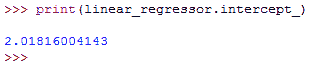

我们现在可以通过运行以下命令查看斜率的值：

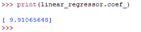

这意味着如果学生多学习一小时，他们的分数将增加 9.91%。

## 预测

在上面的训练中，我们创建了一个线性回归模型，即该方程。斜率和截距的值是已知的。我们可以根据保留的训练集数据进行预测。以下语句帮助我们从测试数据进行预测：

```
pred_y = linear_regressor.predict(X_test ) 
```

我们简单地创建了一个名为`predict_y`的`numpy`数组。它将包含来自`X_test`系列中输入值的所有`y`的预测值。

现在我们既有`X_test`的实际值，也有了预测值。我们需要比较这二者，查看它们之间的相似程度或差异。只需运行以下代码即可：

```
df = pd.DataFrame({'Actual': y_test, 'Predicted': pred_y}) 
print(df)
```

它返回了以下结果：

模型并不准确，但数值彼此接近。

## 评估准确性

我们现在需要评估算法的准确性。我们需要确定算法在数据集上的表现如何。在涉及回归算法时，会使用三种评估指标。这些包括：

1. `MAE`（平均绝对误差）- 这是误差绝对值的均值。
2. `MSE`（均方误差）- 这是误差平方的均值。
3. `RMSE`（均方根误差）- 这是均方误差的平方根。

为了计算这些指标，我们通常使用`sklearn.metrics`模块。

以下是这些指标的计算方法示例：

1. `MAE`: `metrics.mean_absolute_error`
2. `MSE`: `metrics.mean_squared_error`
3. `RMSE`: `np.sqrt(metrics.mean_squared_error)`

`X_train, X_test, y_train, y_test = train_test_split(X, y, test_size=0.2, random_state=0)`

我们现在有了训练集和测试集。

### 训练算法

现在我们需要训练算法。这可以通过像之前一样调用`fit()`方法来实现。让我们先从 Scikit-Learn 库中导入`LinearRegression`类：

```python
from sklearn.linear_model import LinearRegression
```

接下来，创建上述类的实例，然后使用它调用`fit()`方法：

```python
linear_regressor = LinearRegression()
linear_regressor.fit(X_train, y_train)
```

注意，这是一个多元线性回归，我们有许多变量。线性回归模型必须为每个属性找到最优系数。你可以通过运行以下命令来查看选定的系数：

```python
coeff = pd.DataFrame(linear_regressor.coef_, X.columns, columns=['Coefficient'])
print(coeff)
```

代码返回以下内容：

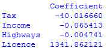

这意味着燃油税（fuel Tax）每增加一个单位，燃油消耗量就会减少 4002 万加仑。此外，拥有驾照的人口比例每增加一个单位，燃油消耗就会增加 13.4 亿加仑。结果还显示，平均收入（Income）和公路（Highways）对燃油消耗的影响非常小。

## 预测

我们将使用测试数据进行预测。以下脚本可以帮助我们完成操作：

```python
pred_y = linear_regressor.predict(X_test)
```

此时，你已经有了实际的`X_text`值以及预测值。我们需要对这二者进行比较，以确定它们的相似性和差异。这可以通过运行以下脚本来实现：


```python
df = pd.DataFrame({'Actual': y_test, 'Predicted': pred_y})
print(df)
```

脚本返回以下输出：

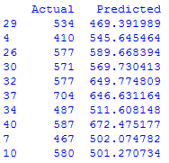

## 评估算法的准确性

现在我们需要从性能角度评估算法。这可以通过确定各种类型错误的值来实现。这些错误包括`MAE`、`RMSE`和`MSE`。这要求我们如下所示从`Scikit-Learn`导入`metrics`类：

```python
from sklearn import metrics
```

然后可以使用以下脚本计算误差值：

```python
print('MAE:', metrics.mean_absolute_error(y_test, pred_y))
print('MSE:', metrics.mean_squared_error(y_test, pred_y))
print('RMSE:', np.sqrt(metrics.mean_squared_error(y_test, pred_y)))
```

代码返回以下内容：

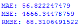

如上所示，均方根误差（root means square error）值为 68.31。这略大于所有州燃油消耗平均值的 10%。确实，我们的算法并不十分准确，但我们仍然可以使用它做预测。

巨大的误差可能是由多种因素造成的。也许需要更多的数据。我们只使用了一年的数据。收集多年的数据可能有助于帮助我们提高模型的准确性。此外，我们假设数据之间存在线性关系。事实可能并非如此，因此导致了巨大的误差。我建议你对数据进行可视化以查看是否真实。此外，我们使用的特征之间可能并不相关。

# 第 5 章 - K 近邻算法

`KNN`算法被广泛用于构建更复杂的分类器。它是一种简单的算法，但它的性能优于许多强大的分类器。这就是为什么它被应用于数据压缩、经济预测和遗传学等众多领域。

`KNN`是一种监督学习算法，这意味着我们得到了一个由训练观测值 (`x`, `y`) 组成的标记数据集，我们的目标是确定`x`和`y`之间的关系。这意味着我们应该找到一个将`x` `maps`到`y`的函数，使得当我们给定输入值`x`时，能够预测出对应的`y`值。

`KNN`算法的原理非常简单。它计算新数据点到所有其他训练数据点的距离。距离可以是多种类型，包括曼哈顿距离、欧几里得距离等。选择 K 个最近的数据点，其中`K`可以是任意整数。最后，将数据点分配给大多数`K`个数据点所属的类别。

我们将使用一个名为`Iris`的数据集。我们之前探索过它。我们将用它来演示如何实现`KNN`算法。该数据集由四个属性组成，即`sepal-width`（花萼宽）、`sepal-length`（花萼长）、`petal-width`（瓣宽）和`petal-length`（瓣长）。每种鸢尾花都有特定的属性。我们的目标是预测植物所属的类别。数据集有三个类别：`Iris-setosa`、`Iris-versicolor`和`Iris-virginica`。

首先，导入所有需要的库：

```python
import numpy as np
import pandas as pd
import matplotlib.pyplot as plt
```

现在我们需要将数据集加载到我们的工作环境中。从以下 URL 下载：

[`archive.ics.uci.edu/ml/machine-learning-databases/iris/iris.data`](https://archive.ics.uci.edu/ml/machine-learning-databases/iris/iris.data)

我们需要从上述 URL 加载数据集并将其存储在`dataframe`。以下脚本将帮助我们实现这一点：

```python
## 创建数据集变量
iris_url = "https://archive.ics.uci.edu/ml/machine-learning-databases/iris/iris.data"

## 为数据集分配列名
iris_names = ['Slength', 'Swidth', 'Plength', 'Pwidth', 'Class']

## 读取数据集到 dataframe
dataset = pd.read_csv(iris_url, names=iris_names)
```

我们可以查看数据集的前几行：

```python
print(dataset.head())
```

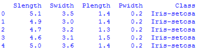

`S`代表花萼（Sepal），`P`代表花瓣（Petal）。例如，`S length`代表花长，`Plength`代表瓣长。

如果你遇到错误，请记住导入`sys`包并如下所示使用：

```python
import numpy as np
import pandas as pd
import matplotlib.pyplot as plt
import sys

sys.__stdout__ = sys.stdout
url = "https://archive.ics.uci.edu/ml/machine-learning-databases/iris/iris.data"

# 为我们的数据集分配列名
names = ['Slength', 'Swidth', 'Plength', 'Pwidth', 'Class']

## 读取数据集到 dataframe
dataset = pd.read_csv(url, names=names)
```

通常情况下，我们应该将数据集分为属性和标签。可以通过运行以下代码来实现：

```python
X = dataset.iloc[:, :-1].values
y = dataset.iloc[:, 4].values
```

变量`X`将持有数据集的前四列（即属性），而变量`y`将持有标签。

使用`Scikit-Learn`库，我们可以很容易地训练`KNN`算法。让我们先从`Scikit-Learn`库导入`KNeighborsClassifier`：

```python
from sklearn.neighbors import KNeighborsClassifier 
```

以下代码将帮助我们训练该算法：

```python
knn_classifier = KNeighborsClassifier(n_neighbors=5) 
knn_classifier.fit(X_train, y_train)
```

注意，我们创建了之前定义的类的实例，并将其命名为`knn_classifier`。在实例化时我们使用了一个参数，即`n_neighbors`。我们使用`5`作为该参数的值，这基本上代表了`K`的值。注意，`K`没有特定的固定值，它是在测试和评估后选择的。不过，对于初学者，`5`是大多数`KNN`应用中最常用的值。

然后我们可以使用测试数据进行预测。这可以通过运行下面提供的脚本来实现：

```python
pred_y = knn_classifier.predict(X_test) 
```

## 评估算法的准确性

`KNN`算法的评估方法与线性回归算法的准确性评估不同。我们之前使用的是`RMSE`、`MAE`等指标。在这种情况下，我们将使用混淆矩阵、`precision`（精确率）、`recall`（召回率）和`f1 score`等指标。

我们可以使用`classification_report`和`confusion_matrix`方法来计算这些指标。让我们先从`Scikit-Learn`库导入它们：

```python
from sklearn.metrics import confusion_matrix, classification_report
```

运行以下脚本：

```python
print(confusion_matrix(y_test, pred_y)) 
print(classification_report(y_test, pred_y))
```

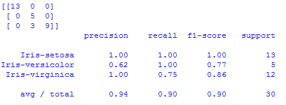

上面的结果显示，`KNN`算法对测试集中 30 条记录的分类表现良好。结果显示算法在数据集上的平均准确率约为 90%。这是一个很不错的的百分比。

## 比较 K 值与错误率

我们之前提到，没有一个特定的`K`值可以说第一次就能给出最好的结果。我们选择`5`是因为它是`K`最常用的值。找到最佳`K`值的最好方法是绘制`K`值与数据集对应误差的图表。

让我们使用测试集预测值的平均误差，为 1 到 40 之间的所有`K`值创建一个图表。我们应该从计算`K`在 1 到 40 之间预测值的平均误差开始。只需运行下面的脚本：

```python
error = []

## K 值范围在 1 到 40 之间
for x in range(1, 40): 
    knn = KNeighborsClassifier(n_neighbors=x)
    knn.fit(X_train, y_train)
    pred_x = knn.predict(X_test)
    error.append(np.mean(pred_x != y_test))
```

代码将运行从 1 到 40 的循环。在每次迭代中，计算测试集预测值的平均误差，并将结果添加到`error`列表中。

我们现在应该将`error`值相对于`K`值绘图。可以通过运行下面的脚本创建图表：

```python
plt.figure(figsize=(12, 6)) 
plt.plot(range(1, 40), error, color='blue', linestyle='dashed', marker='o', 
         markerfacecolor='blue', markersize=10)
plt.title('Error Rate for K') 
plt.xlabel('K Values') 
plt.ylabel('Mean Error')
plt.show()
```

代码生成了下面的图：

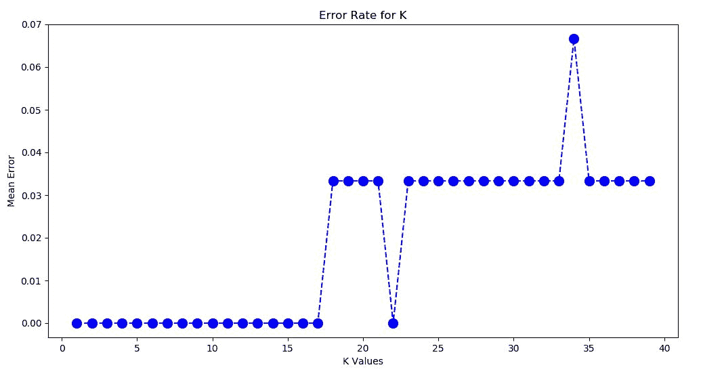

图表显示，当我们使用 1 到 17 之间的`K`值时，将获得`0`的平均误差。之后，你可以尝试调整`K`值，并观察它对预测准确性的影响。

# 第 6 章 - K-Means 聚类

聚类属于无监督机器学习算法的范畴。它通常在数据没有标签时应用。该算法的目标是识别数据中的簇或组。

聚类的核心思想是：同一个簇中的对象彼此之间与其他簇中的对象更相关。相似性是反映两个数据对象之间关系强度的指标。聚类在探索性数据挖掘中应用非常广泛。它应用于模式识别、机器学习、信息检索、图像分析、数据压缩、生物信息学和计算机图形等多个领域。

算法根据数据值之间的相似性形成数据簇。你需要指定`K`值，即你期望算法从数据中产生的簇数量。算法首先为每个簇选择一个质心值。然后，以迭代的方式执行三个步骤：

1. 计算每个数据实例与所有簇质心之间的欧几里得距离。
2. 将数据实例分配给距离最近质心所在的簇。
3. 根据相应簇数据实例坐标的平均值计算新的质心值。

在在`Scikit-Learn`上实现之前，让我们先手动演示一下该算法是如何工作的：

假设我们有如下的二维数据实例并命名为`D`：

`D = { (5,3), (10,15), (15,15) }`

现在我们应该准备要使用的数据。我们将创建一个总共 10 行 2 列的`numpy`数组。那么，为什么要选择使用`numpy`数组呢？因为`Scikit-Learn`库可以直接处理`numpy`数组数据输入，而无需预处理。让我们创建它：

```python
X = np.array([[5,3], [10,15], [15,12], [24,10], [30,45], [85,70], [71,80], [60,78], [55,52], [80,91]])
```

## 数据可视化

现在我们有了数据，可以创建一个图表并观察数据点的分布情况。然后我们将能够判断目前是否存在聚类：

```python
plt.scatter(X[:,0],X[:,1], label='True Position')
plt.show()
```

代码输出了下面的图表：

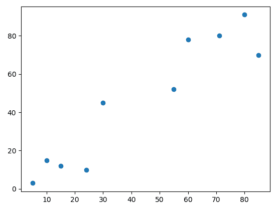

如果我们仅用肉眼观察，可能会从上述数据中看出两个聚类：底部有五个点，顶部也有五个点。现在我们需要调查一下是否这就是`K-Means`聚类算法所做的。

## 创建聚类

我们已经看到从数据点中形成两个聚类，因此`K`的值现在为 2。这两个聚类可以通过运行以下代码来创建：

```python
kmeans_clusters = KMeans(n_clusters=2)
kmeans_clusters.fit(X)
```

我们创建了一个名为`kmeans_clusters`的对象，并将`2`作为参数`n_clusters`的值。然后我们在该对象上调用了`fit()`方法，并将`numpy`数组中的数据作为参数传递给该方法。

现在我们可以查看算法为最终聚类创建的质心值：

```python
print (kmeans_clusters.cluster_centers_)
```

这返回了以下内容：

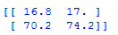

上面的第一行给出了第一个质心的坐标，即 (16.8, 17)。第二行给出了第二个质心的坐标，即 (70.2, 74.2)。如果你按照手动过程计算这些值，结果应该是相同的。这将表明`K-Means`算法运行良好。

以下脚本将帮助我们查看数据点的标签：

```python
print(kmeans_clusters.labels_)
```

这返回了以下内容：

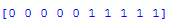

上面的输出显示了一个包含 10 个元素的一维数组，对应分配给 10 个数据点的聚类。你可以清楚地看到，首先有一串零，显示前 5 个点被聚类在一起，而最后 5 个点也被聚类在一起。注意，0 和 1 没有数学意义，它们仅仅被用来表示聚类 ID。如果我们有三个聚类，那么最后一个将用数字 2 来表示。

现在我们可以绘制数据点的图并查看它们是如何被聚类的。我们需要将数据点与其分配的标签一起绘制，以便区分聚类。只需执行下面提供的脚本：

```python
plt.scatter(X[:,0],X[:,1], c=kmeans_clusters.labels_, cmap='rainbow')
plt.show()
```

脚本返回了下面的图表：

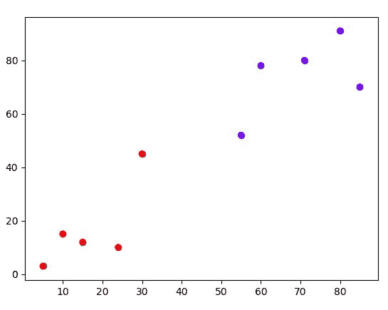

我们简单地将名为`X`的数组的第一列相对于第二列进行了绘图。同时，我们将`kmeans_labels_`作为参数`c`的值传递，它对应于标签。注意参数`cmap='rainbow'`的使用。该参数帮助我们为不同的数据点选择颜色。

正如你预期的那样，前五个点聚类在左下方并分配了相似的颜色。剩下的五个点聚类在右上方并被分配了一个唯一的颜色。

我们可以选择将点与每个聚类的质心坐标一起绘制，以观察质心的位置如何影响聚类。让我们使用三个聚类来看看它们如何影响质心。以下脚本将帮助你创建图表：

```python
plt.scatter(X[:,0], X[:,1], c=kmeans_clusters.labels_, cmap='rainbow')
plt.scatter(kmeans_clusters.cluster_centers_[:,0],kmeans_clusters.cluster_centers_[:,1], color='black')
plt.show()
```

脚本返回了下面的图表：

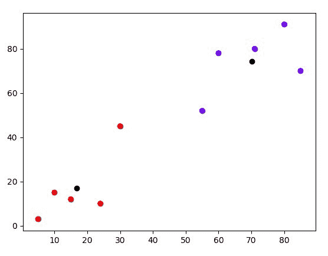

我们选择了用黑色绘制质心点。

# 第 7 章 - 支持向量机

`SVM`属于监督机器学习算法的范畴，被广泛应用于分类和回归问题。它以其处理非线性输入空间的能力而闻名。它在入侵检测、人脸检测、新闻文章、电子邮件和网页的分类、手写识别以及基因分类等应用中被广泛使用。

该算法通过尽可能地分离数据点来工作。最近点之间的距离被称为`margin`（间隔）。目标是在给定数据集中选择一个在支持向量之间具有最大可能间隔的超平面。

为了最好理解该算法如何工作，让我们先在`Scikit-Learn`库中实现它。我们的目标是预测银行钞票是伪钞还是真。我们将使用钞票的属性，包括图像的方差、图像的偏度、峰度和熵。

所有数据属性都如上所示为数值。即使最后一个属性也是数值，因为它的值是 0 或 1。

## 数据预处理

现在是时候将上述数据分为属性、标签以及训练集和测试集了。以下代码将帮助我们把数据划分为属性和标签：

```python
X = dataset.drop('Class', axis=1) 
y = dataset['Class']
```

上述第一行帮助我们将数据集中的除类别列以外的所有列存储到变量`X`中。`drop()`函数帮助我们从中排除了`Class`列。第二行则帮助我们将`Class`列存储到变量`y`中。现在，变量`X`拥有属性，而变量`y`拥有对应的标签。

我们已经实现了将数据集划分为属性和标签的目标。下一步是将数据集划分为训练集和测试集。`Scikit-learn`有一个名为`model_selection`的库，它为我们提供了一个名为`train_test_split`的方法，我们可以用它将数据分为训练集和测试集。

首先，让我们导入`train_test_split`方法：

```python
from sklearn.model_selection import train_test_split
```

接下来的脚本将帮助我们执行划分：

```python
X_train, X_test, y_train, y_test = train_test_split(X, y, test_size = 0.20)
```


### 训练算法

现在数据已经分为训练集和测试集，我们现在应该在训练集上训练 SVM。Scikit-Learn 自带一个名为`svm`的库，其中包含用于各种 SVM 算法的内置类。

在这种情况下，我们将执行一个分类任务，因此我们将使用支持向量分类器类（`SVC`）。它接受一个参数，即内核类型。对于简单的 SVM，该参数应设置为“linear”，因为简单的 SVM 只能分类线性可分的数据。

我们将调用`SVC`的`fit`方法在我们的训练集上训练算法。训练集应该作为参数传递给`fit`方法。让我们先从 Scikit-Learn 导入`SVC`类：

```python
from sklearn.svm import SVC
```

现在运行以下代码：

```python
svc_classifier = SVC(kernel='linear') 
svc_classifier.fit(X_train, y_train)
```

## 进行预测

我们应该使用`SVC`类来进行预测。注意，预测将在测试数据上进行。以下是进行预测的代码：

```python
pred_y = svc_classifier.predict(X_test)
```

## 评估算法的准确性

在分类任务中，我们使用混淆矩阵、召回率、精确率和 F1 作为指标。Scikit-Learn 有一个`metrics`库，它为我们提供了`confusion_matrix`和`classification_report`方法，可以帮助我们找到这些指标的值。以下代码可以帮助我们找到这些指标的值：

首先，让我们从 Scikit-Learn 库导入上述方法：

```python
from sklearn.metrics import confusion_matrix, classification_report
```

这里是帮助进行评估的代码：

```python
print(confusion_matrix(y_test,pred_y)) 
print(classification_report(y_test,pred_y))
```

代码返回了以下：

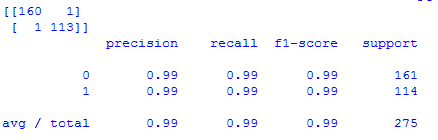

输出返回了以下：

如果你的网络单元是线性的，那么这个算法对你来说很容易理解。为了获取算法权重的误差导数，它首先应该确定随着单元活动水平的变化，误差的变化率。对于输出单元的情况，误差导数是通过确定真实输出与目标输出之间的差异获得的。要找到输出层之前层中隐藏单元的误差变化率，必须确定该隐藏单元与其连接的所有输出单元之间的权重。然后，我们可以将权重与误差导数相乘，并将这些乘积相加。你得到的和将等于该隐藏单元的误差变化率。一旦你获得了输出层前一层隐藏层权重中的误差变化率，我们就能计算其他层的误差变化率。这些层的计算将从一层到下一层进行，其方向与活动通常在网络中传输的方向相反。这解释了“反向传播（back propagation）”名称的由来。计算出某个单元的误差变化率后，就可以更容易计算该权重所有输入连接的权重误差导数。权重导数可以通过误差变化率与输入连接的活动相乘得到。

## 实现

我们需要在 Python 中使用 Scikit-Learn 实现神经网络。我们将使用鸢尾花（iris）数据集来完成这项任务。我们将从以下链接获取此数据集：

[`archive.ics.uci.edu/ml/machine-learning-databases/iris/iris.data`](https://archive.ics.uci.edu/ml/machine-learning-databases/iris/iris.data)

首先，将必要的库导入到工作区：

```python
import numpy as np
import pandas as pd
import matplotlib.pyplot as plt
```

接下来，让我们从上面的 URL 加载数据到 pandas 数据帧（dataframe）中：

```python
# 为数据集 url 创建一个变量
iris_url = "https://archive.ics.uci.edu/ml/machine-learning-databases/iris/iris.data"
## 为数据集分配列名
names = ['Slength', 'Swidth', 'Plength', 'Pwidth', 'Class']
# 从 url 加载数据集到 pandas dataframe
dataset = pd.read_csv(iris_url, names=iris_names)
```

请注意，数据集已加载到名为`dataset`的 pandas 数据帧中，并且也为数据集分配了列名。让我们对数据调用`head()`函数以确保它已加载：

```python
print(dataset.head())
```

你可能会遇到错误。通过如下所示编写代码来解决：

```python
import numpy as np
import pandas as pd
import matplotlib.pyplot as plt
import sys
sys.__stdout__ = sys.stdout
# 为数据集 url 创建一个变量
iris_url = "https://archive.ics.uci.edu/ml/machine-learning-databases/iris/iris.data"
## 为数据集分配列名
iris_names = ['Slength', 'Swidth', 'Plength', 'Pwidth', 'Class']
# 从 url 加载数据集到 pandas dataframe
dataset = pd.read_csv(iris_url, names=iris_names)
print(dataset.head())
```

代码将返回以下内容：

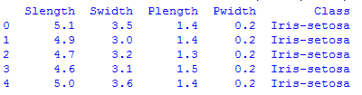

这说明数据已成功加载。

## 数据预处理

该数据集有 5 列，我们的目标是预测第五列，即`Class`（类别）。让我们数据集划分为属性和标签：

```python
X = dataset.iloc[:, 0:4]
y = dataset.select_dtypes(include=[object])
```

前四列的数据已分配给变量`X`。这些是属性。第五列的数据已分配给变量`y`。这构成了标签。

你可以通过运行以下命令查看变量`y`的样子：

```python
y.head()
```

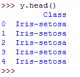

你可以看到变量`y`具有分类值。然而，众所周知神经网络在数值数据上表现良好，因此我们应该将上述内容转换为数值。首先，让我们看看变量`y`中我们多少个唯一值：

```python
y.Class.unique()
```

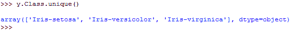

上面的输出显示我们有三个唯一的类别，即 Iris-versicolor 和 Iris-virginia。我们现在应该将这些转换为数值。这可以使用 Scikit-Learn 的类`LabelEncoder`来完成。

```python
from sklearn import preprocessing
lab = preprocessing.LabelEncoder()
y = lab.fit_transform(y)
```

```python
y.Class.unique()
```

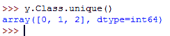

现在很清楚分类值已经转换为数值了。我们现在应该将数据划分为训练集和测试集。这将帮助我们防止过拟合问题。即：

```python
from sklearn.model_selection import train_test_split
X_train, X_test, y_train, y_test = train_test_split(X, y, test_size=0.2)
```

80% 的数据将用于训练，20% 的数据将用于测试。

### 特征缩放

在进行实际预测之前，建议先对特征进行缩放以便进行评估。注意，特征缩放应在训练数据上进行，而不是在测试数据上。原因是现实数据应该尽可能保持原样。

让我们先从 Scikit-Learn 导入`StandardScaler`类：

```python
from sklearn.preprocessing import StandardScaler
feature_scaler = StandardScaler()
feature_scaler.fit(X_train)
X_train = feature_scaler.transform(X_train)
X_test = feature_scaler.transform(X_test)
```

## 训练算法并进行预测

我们现在需要训练用于预测的神经网络。我们应该先从 Scikit-Learn 的神经网络库导入`MLPClassifier`。可以如下操作：

```python
from sklearn.neural_network import MLPClassifier
mlp_classifier = MLPClassifier(hidden_layer_sizes=(10, 10, 10), max_iter=1000)
mlp_classifier.fit(X_train, y_train.values.ravel())
```

我们刚刚用三行代码创建了一个神经网络。这太棒了！注意`hidden_layer_sizes`参数的使用。我们使用它为网络创建了三个隐藏层，每层有 10 个节点。并没有规则限制选择特定数量的层和节点。这些取决于问题的性质。

我们还使用了`max_iter`参数。该参数的目的是设置网络运行的迭代次数或轮数（epochs）。默认使用“relu”激活函数配合“adam”代价优化器。然而，这些函数可以通过`activation`和`solver`参数分别更改。

然后我们调用了`fit`方法，在我们的训练数据（即`X_train`和`y_train`）上训练算法。

现在算法已经在训练数据上训练完成，我们可以在测试数据上进行预测。这可以通过运行下面的脚本来实现：

```python
predictions = mlp_classifier.predict(X_test)
```

## 算法准确性评估

算法已经过训练，并在测试数据上进行了预测。现在是时候评估一下它的性能如何了。评估将使用混淆矩阵、精确率、召回率和 F1 分数等指标进行。我们应该将预测得到的值与收集到的实际值进行比较。

首先，让我们从 Scikit-Learn 的指标库导入`classification_report`和`classification_matrix`方法：

```python
from sklearn.metrics import confusion_matrix, classification_report
```

然后，可以通过运行以下脚本完成评估：

```python
print(confusion_matrix(y_test,predictions)) 
print(classification_report(y_test,predictions)) 
```

该脚本返回以下结果：

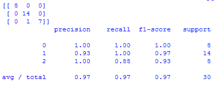

上述结果良好。混淆矩阵显示，在所有 30 植物中，只有一植物被分类错误了。我们的 F1 分数为 0.97，考虑到我们只有 150 个实例来训练神经网络，这是一个非常不错的。每当你得到的准确率达到 90% 及以上时，你就可以认为性能良好。

# 第 9 章 - 随机森林算法

这是一种基于集成学习（ensemble learning）的监督学习算法。集成学习是指将不同类型的算法或同一种算法多次组合，以获得更强大的预测模型。随机森林算法是许多相似类型算法的组合，即多棵决策树，形成了一片树森林，这解释了“随机森林”名称的来源。随机森林算法既可以应用于回归问题也可以应用于分类问题。

## 工作原理

随机森林算法在工作时遵循以下基本步骤：

1. 从数据集中随机选择`N`条随机记录。
2. 根据这些`N`条随机记录构建一个决策树。
3. 选择算法中需要的树的数量，并重复上述两个步骤。
4. 如果是回归问题，对于一条新记录，森林中的每棵树都将为`Y`（输出）预测一个值。我们可以通过取森林中所有树的所有预测值的平均值来计算最终值。或者，对于分类问题，森林中的每棵树都应该预测新记录所属的类别。新记录最终被分配给获得多数票的类别。

## 随机森林与回归问题

在本章中，我们将向你如何使用 Scikit-Learn 中的随机森林解决回归问题。我们将使用之前用过的燃料消耗数据集。燃油消耗将根据燃料税（分）、人均收入（美元）、铺设过的公路（英里）和持有驾驶执照的人口比例等因素进行预测。

首先，让我们导入`numpy`和`pandas`库：

```python
import pandas as pd 
import numpy as np 
```

我已经将数据集保存在与 Python 脚本相同的目录下，名为`fuel_consumption.csv`。运行以下命令将其导入 Pandas 数据帧：

```python
dataset = pd.read_csv('fuel_consumption.csv') 
```

通过对数据运行`head()`函数来查看数据集中包含的内容：

```python
print(dataset.head())
```

这可能会给你一个错误。像通常一样解决错误，直到你得到以下代码：

```python
import pandas as pd 
import numpy as np 
import sys
sys.__stdout__=sys.stdout
dataset = pd.read_csv('fuel_consumption.csv') 
print(dataset.head())
```

这返回了以下：

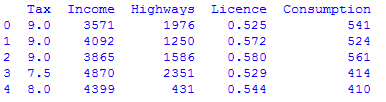

上述数据显示数值没有很好地缩放。我们稍后必须这样做。

## 数据准备

现在是时候将数据集分为我们需要的内容了。首先，我们将数据集分为所需的部分。现在我们需要将数据和标签分为训练集和测试集。我们将使用以下代码来划分属性和标签：

```python
X = dataset.iloc[:, :4]
y = dataset.iloc[:, 4]
```

我们现在将数据分为训练集和测试集。80% 的数据用于训练，20% 用于测试。

让我们先导入`train_split`方法：

```python
from sklearn.model_selection import train_split
```

接下来的代码将完成划分：

```python
X_train, X_test, y_train, y_test = train_split(X, y, test_size=0.2, random_state=0)
```

### 特征缩放

此时数据还没有缩放。我们需要使用 Scikit-Learn 提供的`StandardScaler`类来完成。让我们先导入这个类：

```python
from sklearn.preprocessing import StandardScaler
```

现在我们可以创建该类的实例并使用它来缩放数据集：

```python
scaler_scaler = StandardScaler()
X_train = scaler_scaler.fit_transform(X_train)
X_test = scaler_scaler.transform(X_test)
```

### 训练算法

数据现在已经缩放。我们现在应该训练随机森林来帮助解决回归问题。让我们先导入`RandomForestRegressor`类：

```python
from sklearn.ensemble import RandomForestRegressor
```

现在现在创建该类的实例并在测试数据集上进行预测：

```python
rf_regressor = RandomForestRegressor(n_estimators=20, random_state=0)
rf_regressor.fit(X_train, y_train)
pred_y = rf_regressor.predict(X_test)
```

当你需要使用随机森林解决回归问题时，可以使用`RandomForestRegressor`。注意上述示例中的`n_estimators`，它仅仅指定了树的数量。我们使用了 20 棵树。

### 评估算法性能

现在是时候评估算法的表现如何了。这是一个回归问题，所以我们使用的指标包括平均绝对误差 (MAE)、均方误差 (MSE) 和均方根误差 (RMSE)。

首先，从 Scikit-Learn 导入指标：

```python
from sklearn import metrics
```

接下来的脚本将帮助你获得上述指标的值：

```python
print('MAE:', metrics.mean_absolute_error(y_test, pred_y)) 
print('MSE:', metrics.mean_squared_error(y_test, pred_y)) 
print('RMSE:', np.sqrt(metrics.mean_squared_error(y_test, pred_y))) 
```


代码返回以下输出：

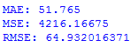

我们使用了 20 棵树，给出的均方根值为 64.93。这个值大于平均燃料消耗的 10%。这表明我们使用的树不够。

你应该知道，随着树或估计器数量的增加，误差值会减少。

## 随机森林与分类问题

我们需要演示如何使用随机森林解决分类问题。我们将使用银行票数据集来预测银行票是否为真。我们将取决于钞票的四个属性，包括图像波变换图像的方差、熵、偏度和峰度。虽然这是一个二分类问题，但我们将使用随机森林分类器来解决它。首先，让我们导入解决问题所需的库：

```python
import numpy as np
import pandas as pd 
```

我已将数据集命名为 `bank_note.csv` 并保存在与 Python 脚本相同的目录下。以下脚本可以帮助我导入数据集：

```python
dataset = pd.read_csv("bank_note.csv")
```

让我们查看数据集的前 5 行：

```python
print(dataset.head())
```

如果你遇到错误，请按照以下方式编写代码：

```python
import numpy as np
import pandas as pd
import sys
sys.__stdout__=sys.stdout
dataset = pd.read_csv("bank_note.csv") 
print(dataset.head())
```

代码返回如下内容：

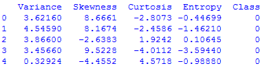

在回归问题中，数据集没有进行良好的缩放，这个分类问题也是如此。在训练算法之前，我们需要对这些数据进行缩放。

## 数据准备

运行以下代码将数据拆分为属性和标签：

```python
X = dataset.iloc[:, 0:4].values 
y = dataset.iloc[:, 4].values
```

我们现在需要将数据划分为训练集和测试集。让我们先从 Scikit-Learn 导入 `train_test_split` 方法：

```python
from sklearn.model_selection import train_test_split
```

现在运行以下代码进行划分：

```python
X_train, X_test, y_train, y_test = train_test_split(X, y, test_size=0.2, random_state=0) 
```

### 特征缩放

我们将以与回归问题相同的方式实现特征缩放。首先通过运行以下导入语句导入 `StandardScaler` 类：

```python
from sklearn.preprocessing import StandardScaler
```

然后运行以下命令：

```python
sc = StandardScaler() 
X_train = sc.fit_transform(X_train) 
X_test = sc.transform(X_test)
```

注意，我们首先创建了 `StandardScaler` 类的实例，然后使用它对数据进行缩放操作。

### 训练算法

现在数据已经过缩放，就可以训练随机森林算法来解决分类问题了。请记住，对于回归问题，我们使用了 `RandomForestRegressor` 类。对于这个分类问题，我们将使用 `RandomForestClassifier` 类。让我们从导入该类开始：

```python
from sklearn.ensemble import RandomForestClassifier
```

这是训练算法的代码：

```python
classifier = RandomForestClassifier(n_estimators=20, random_state=0) 
classifier.fit(X_train, y_train) 
pred_y = classifier.predict(X_test)
```

注意我们我们也调用了 `n_estimators` 参数。同样，我们使用了 20 棵树来训练算法。

### 评估算法性能

为了评估随机森林分类器的性能，我们使用准确率、精确率、召回率、混淆矩阵和 F1 值等指标。首先，运行以下导入语句：

```python
from sklearn.metrics import confusion_matrix, classification_report, accuracy_score
```

然后你可以运行以下命令：

```python
print(confusion_matrix(y_test,pred_y)) 
print(classification_report(y_test, pred_y)) 
print(accuracy_score(y_test, pred_y))
```

代码返回了如下内容：

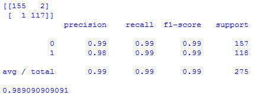

上述结果显示，当使用 20 棵树时，随机森林分类器实现了 98.91% 的准确率。98.91% 是一个很好的分数，因此我们没有增加树的数量。

由于我们在声明中没有提供任何初始化设置，因此我们应该通知 TensorFlow 张量中每个元素的数据类型。我们的目标是使用 `tf.float32`。我们的第二个参数表示要注入变量的数据的形状。我们需要使用一个大小为 `(? x 1)` 的数组。由于我们不知道要向数组提供的数据量，所以我们使用了 `?`。该占位符（placeholder）已准备好接受 `None` 参数作为尺寸声明。之后，我们现在能够将所需的任意数量的 1 维数据注入到变量 `y` 中。

我们的程序还预期 `ses.run(x,...)`发生变化。显示如下：

```python
x_out = ses.run(x, feed_dict={y: np.arange(0, 10)[:, np.newaxis]})
```

注意，参数 `feed_dict` 已被添加到命令 `ses.run(x,...)` 中。我们消除了神秘性，并指定了变量 `y` 的预期类型，即 0 到 10 之间的 1 维范围。正如参数名 `feed_dict` 所示，我们需要提供的输入是一个 Python 字典，每个键将是我们要填充的占位符名称。

现在你已经完成了，并且在 TensorFlow 中实现了一个图。你应该拥有以下代码：

```python
import tensorflow as tf
import numpy as np

# 开始创建一个 TensorFlow 常量
const = tf.constant(2.0, name="const")   

# 创建 TensorFlow 变量
y = tf.Variable(2.0, name='y')
z = tf.Variable(1.0, name='z')

# 让我们创建操作
p = tf.add(y, z, name='p')
q = tf.add(z, const, name='q')
x = tf.multiply(p, q, name='x')

# 创建变量初始化
init_op = tf.global_variables_initializer()

# 启动会
with tf.Session() as ses:
    # 初始化变量
    ses.run(init_op)
    # 计算图输出
    x_out = ses.run(x)
    print("Variable x is {}".format(x_out))

# 创建 TensorFlow 变量
y = tf.placeholder(tf.float32, [None, 1], name='y')
x_out = ses.run(x, feed_dict={y: np.arange(0, 10)[:, np.newaxis]})
```

代码将返回以下：

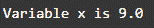

这是另一个展示如何在 TensorFlow 中乘以两个变量的示例。占位符通过会话运行 方法配合反馈机制使用：

```python
import tensorflow as tf

a = tf.placeholder(tf.float32, name="a")
b = tf.placeholder(tf.float32, name="b")
c = tf.multiply(a, b, name="c")

with tf.Session() as ses:
    print ses.run(c, feed_dict={a: 2.1, b: 3.0})
```

代码将返回下所示的结果：

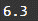

## 构建神经网络

我们将演示如何在 TensorFlow 中构建一个具有 3 层的神经网络。我们将使用 MNIST 数据集，它是深度学习项目的“Hello World”级数据集。该数据集由 TensorFlow 包提供。它包含 28 / 8 28 灰度图像，全部是手写数字。该数据集有 55,000 行训练数据、5,000 行验证数据和 10,000 行测试数据。

以下代码行可以帮助我们加载数据集：

```python
import tensorflow as tf
from tensorflow.examples.tutorials.mnist import input_data
mnist = input_data.read_data_sets("MNIST_data/", one_hot=True)
```

这返回以下内容：

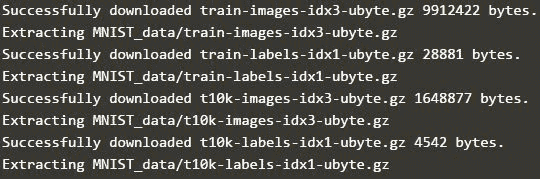

上述输出显示数据已成功导入。

参数 `one_hot=True` 表示与每个图像关联的标签不是数字本身（例如 4），而是一个带有“独热”节点的向量，其余节点全为 0，即 `[0, 0, 0, 0, 1, 0, 0, 0, 0, 0]`。这使得人们很容易地将其加载到神经网络的输出层。

我们可以为训练数据创建占位符变量：

```python
# 优化变量
learning_rate = 0.5
epochs = 10
batch_size = 100

# 为训练数据创建占位符
# 输入 a - 用于 28 x 28 像素 = 784
a = tf.placeholder(tf.float32, [None, 784])

# 现在为输出数据创建占位符 - 10 个数字
b = tf.placeholder(tf.float32, [None, 10])
```

注意 `x` 输入层具有 784 个节点，对应 28 * 28 像素，等于 784。`?` 被用来表示未知的输入数量。`b` 输出层有 10 个单元，对应 10 种可能的数字。同样，`a` 的大小为 `(? * 784)`。

在该操作之后，我们将得到一个 ( m x 1 ) 的张量。为了获取张量的平均值并完成交叉熵损失计算，我们应该调用 TensorFlow 的 `tf.reduce_mean` 函数。该函数将取你提供的任何张量的平均值。现在我们有了一个可以用于训练目的的代价函数。

首先，让我们设置优化器：

```python
# 添加优化器
optimizer = tf.train.GradientDescentOptimizer(learning_rate=learning_rate).minimize(cross_entropy)
```

我们使用了 TensorFlow 提供的梯度下降优化器。它应该用学习率进行初始化，然后定义它要做什么，简单就是最小化我们创建的交叉熵损失操作。该函数反过来将代表你执行梯度下降和反向传播。

在进入运行操作的主步骤之前，让我们先从设置变量初始化操作和一个负责衡量预测准确率的操作开始。这可以如下所示完成：

```python
# 设置初始化操作
init_op = tf.global_variables_initializer()
```

```python
# 创建准确率评估操作
correct_prediction = tf.equal(tf.argmax(b, 1), tf.argmax(b_, 1))
accuracy = tf.reduce_mean(tf.cast(correct_prediction, tf.float32))
```

预测预测的操作，即 `correct_prediction` 使用了 TensorFlow 提供的 `tf.equal` 函数，该函数根据所提供的参数是否相等来返回 True 或 False。`tf.argmax` 函数通常返回张量/向量中最大元素的索引。`correct_prediction` 操作将返回一个大小为 (m * 1) 的包含 True 和 False 值的张量，显示神经网络是否正确预测了数字。我们的目标是确定张量平均值的准确率。我们应该首先将 `correct_prediction` 操作类型从布尔型转换为 TensorFlow 浮点型，以便执行 `reduce_mean` 操作。在此之后，我们将得到可以用于评估神经网络性能的准确率操作。

## 准备训练

我们现在可以准备神经网络的训练了。完整的代码如下：

```python
# 启动会话
with tf.Session() as ses:
  # 初始化变量
  ses.run(init_op)
  total_batch = int(len(mnist.train.labels) / batch_size)
  for epoch in range(epochs):
      avg_cost = 0
      for x in range(total_batch):
          batch_a, batch_b = mnist.train.next_batch(batch_size=batch_size)
          _, z = ses.run([optimiser, cross_entropy],
                          feed_dict={a: batch_a, b: batch_b})
          avg_cost += b / total_batch
      print("Epoch:", (epoch + 1), "cost =", "{:.3f}".format(avg_cost))
  print(ses.run(accuracy, feed_dict={x: mnist.test.images, b: mnist.test.labels}))
```

`with` 操作已经设置完毕且初始化操作已经运行。第三行是关于将为神经网络运行的小批量（mini-batch）训练方案。在第三行中，我们计算了每个 epoch 将运行的批数量。然后我们遍历每个 epoch，并初始化 `avg_cost` 变量以跟踪每个 epoch 的平均交叉熵损失。在下一行中，我们从训练数据集中提取了随机样本批次 `batch_a` 和 `batch_b`。MNIST 数据集有一个名为 `next_batch` 的实用函数，它方便提取训练所需的数据批次。

在下一行中，我们正在运行两个操作。`ses.run` 可以接受一个操作列表并将其作为第一个参数运行。在一种情况下，当 `[optimiser, cross_entropy]` 作为列表提供时，这两个操作将被执行。这将为我们提供两个输出，然后它们将被赋值给变量 `_` 和 `z`。我们并不太关心从优化器操作得到的输出，但我们关心从 `cross_entropy` 操作得到的输出，该输出被赋值给了变量 `z`。优化器操作应该在批次样本上运行。随后 `z` 被用于计算该 epoch 的平均损失。

随后我们打印了平均损失的进度，然后一旦训练完成，就会执行准确率操作，以显示训练模型在测试集上的准确率。

你现在应该拥有以下代码：

```python
import tensorflow as tf
from tensorflow.examples.tutorials.mnist import input_data
mnist = input_data.read_data_sets("MNIST_data/", one_hot=True)

# 优化变量
learning_rate = 0.5
epochs = 10
batch_size = 100

# 创建训练数据的占位符
# 输入 a - 28 x 28 像素 = 784
a = tf.placeholder(tf.float32, [None, 784])

# 现在为输出数据创建占位符 - 10 个数字
b = tf.placeholder(tf.float32, [None, 10])

# 我们可以连接输入到隐藏层的权重
W1 = tf.Variable(tf.random_normal([784, 300], stddev=0.03), name='W1')
y1 = tf.Variable(tf.random_normal([300]), name='y1')

# 然后连接隐藏层到输出层的权重
W2 = tf.Variable(tf.random_normal([300, 10], stddev=0.03), name='W2')
y2 = tf.Variable(tf.random_normal([10]), name='y2')

# 获取隐藏层的输出
hidden_out = tf.add(tf.matmul(a, W1), y1)
hidden_out = tf.relu(hidden_out)
b_ = tf.softmax(tf.matmul(hidden_out, W2))
b_clipped = tf.clip_by_value(b_, 1e-10, 0.99999)
cross_entropy = -tf.reduce_mean(tf.reduce_sum(b * tf.log(b_clipped), axis=1))
```


然而，这种模型存在一个问题，因为它没有记忆。这意味着输入和输出是相互独立的。也就是说模型并不关心之前发生了什么。当你需要预测句子或时间序列时，这会引发很多问题，因为网络需要关于过去词汇或历史数据的信息。

为了解决这个问题，开发了一种名为循环神经网络（`RNN`）的新架构。

从结构上来说，`RNN`与普通神经网络相同，不同之处在于它在神经元中添加了一些记忆状态。添加记忆的计算非常简单。

考虑一个仅有一个神经元的简单模型，它由一个批数据输入。对于传统的神经网络情况，模型将通过输入、权重和激活函数的乘积来产生输出。在`RNN`中，输出将多次传回给自身。时间步（timestep）是指输出成为下一次矩阵乘法输入的时间长度。

我们需要在`TensorFlow`中编写一个简单的`RNN`。该网络将由以下部分组成：

*   四个输入
*   六个神经元
*   2个时间步

这种网络被称为循环网络，因为它在每个激活单元中都执行相似的操作。网络计算输入和上一个输出的权重，然后使用激活函数：

```python
import tensorflow as tf
import numpy as np

n_inputs = 4
n_neurons = 6
n_timesteps = 2

# 我们的数据是一组数字序列，范围在0到9之间，并放入3个批次中
X_batch = np.array([
    [[0, 2, 3, 5], [7, 8, 6, 4]], # 第一批
    [[3, 6, 5, 1], [0, 0, 0, 0]], # 第二批
    [[6, 7, 8, 4], [6, 3, 4, 2]], # 第三批
])
```

我们可以决定使用一个我们的数据、循环阶段和输出的占位符来构建网络。让我们先为数据定义一个占位符：

```python
X = tf.placeholder(tf.float32, [None, n_timesteps, n_inputs])
```

在上面的定义中，我们有以下内容：

*   `None`——这是未知的，它将取决于批次的大小。
*   `n_timesteps`——这是网络将输出传回给神经元的次数。
*   `n_inputs`——这是每个批次的输入数量。

现在我们可以定义循环网络。正如我们之前提到的，网络将具有6个神经元，并且它将计算两个点积：

*   输入数据与第一组权重的乘积，权重为6，等于神经元的数量。
*   上一个输出与第二组权重的乘积，权重为6，对应输出的数量。

在第一次前向传播中，上一个输出的值将等于零，因为没有可用的值。为了构建一个`RNN`，我们使用`tf.contrib.rnn.BasicRNNCell`对象。该对象的参数将是`num_units`，它定义了输入的数量。如下所示：

```python
basic_cell = tf.contrib.rnn.BasicRNNCell(num_units=n_neurons)
```

现在网络已经定义，我们可以计算状态和输出。可以如下操作：

```python
outputs, states = tf.nn.dynamic_rnn(basic_cell, X, dtype=tf.float32)
```

上面的对象将使用内部循环来按正确的次数进行矩阵乘法。

你不应该忘记的是，循环神经元是所有之前时间步输入的函数。网络利用此来构建它自己的记忆。网络使用此来构建自己的记忆。

## 定义的形状

```python
X = tf.placeholder(tf.float32, [None, n_timesteps, n_inputs])
```

一旦划分完成后，我们应该使用批次（batches）创建一个模型。在批次中，你将同时拥有`X`和`Y`值。`X`值将延迟一个周期。这意味着你应该使用前200个观测值，时间步长为10。`X_batches`对象应该包含20个大小为`10*1`的批次。`y_batches`的形状与`X_batches`对象相同，但它应该提前一个周期。

### 拆分数据集

我们应该首先将数据集分为训练集和测试集。让我们将序列转换为`numpy`数组，然后定义窗口（网络应该学习的时间）、输入数量、输出数量以及训练集的大小：

```python
series = np.array(a)
n_windows = 20
n_input = 1
n_output = 1
size_train = 171
```

在上述定义之后，我们可以按照如下方式划分数据集：

```python
train = series[:size_train]
test = series[size_train:]
print(train.shape, test.shape)
```

上面的打印语句返回以下内容：

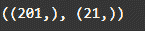

此时，你应该拥有以下代码来确保你正朝着正确的方向进行：

```python
import matplotlib.pyplot as plt
import matplotlib
import numpy as np
import pandas as pd

def create_ts(start = '2001', n = 201, freq = 'M'):
    rng = pd.date_range(start=start, periods=n, freq=freq)
    a = pd.Series(np.random.uniform(-18, 18, size=len(rng)), rng).cumsum()
    return a

a = create_ts(start = '2001', n = 222, freq = 'M')
# print(a.tail(5))

series = np.array(a)
n_windows = 20
n_input = 1
n_output = 1
size_train = 171

train = series[:size_train]
test = series[size_train:]
print(train.shape, test.shape)
```

我们现在应该创建一个函数来返回`X_batches`和`y_batches`。

我们应该写一个创建一个批次的函数。`X`批次仅延迟一个周期，因此我们取`t-1`的值。该函数的输出结果应该是三维的。第一个维度应该等于批次数量；第二个维度应该是窗口大小，而最后一个维度应该是输入数量。

要正确选择数据点是很有挑战性的。对于`X`数据点，选择从`t=1`到`t=200`的观测值。对于`y`数据点，返回从`t=2`到`t=201`的观测值。获取正确的数据点后，对序列进行重塑将变得简单。

对于要构建的批次对象，数据集应该被分为10个长度相同的批次，即20。此时可以使用`reshape`方法，并对序列传递参数`-1`，使其与批次大小相同。20表示每个批次的观测值数量，而1表示输入数量。如果你需要未来两天的预测，则将数据乘以2：

```python
x_data = train[:size_train-1] # 选择所有训练实例少减一天
X_batches = x_data.reshape(-1, windows, input) # 为批次创建正确的形状
```

```python
def create_batches(df, windows, input, output):
    ## 创建X
    x_data = train[:size_train-1] # 选择数据
    X_batches = x_data.reshape(-1, windows, input)  # 重塑数据
    ## 创建y
    y_data = train[n_output:size_train]
    y_batches = y_data.reshape(-1, windows, output)
    return X_batches, y_batches
```

现在我们已经定义了函数，让我们调用它来创建批次：

```python
X_batches, y_batches = create_batches(df = train,
                                    windows = n_windows,
                                    input = n_input,
                                    output = n_output)
```

此时，你可以打印形状以确保你拥有正确的维度：

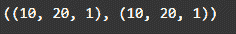

我们应该创建一个测试集，仅包含20个观测值的批次数据。注意，你应该预测天数。这意味着预测出的值将取决于第一天的真实值。事实上，你将知道真实值。

```python
X_test, y_test = create_batches(df = test, windows = 20, input = 1, output = 1)
print(X_test.shape, y_test.shape)
```

这将返回与下方相同的形状：


## 构建模型

为了构建模型，你应该定义以下部分：

1.  带有张量的变量
2.  `RNN`
3.  损失函数和优化器

### 变量

`X`和`y`变量应该指定正确的形状。这是一个简单的步骤。张量的维度与`X_batches`和`y_batches`相似。例如，张量`X`是一个具有三个维的占位符：

*   `None`：批次大小
*   `n_windows`：窗口长度。这意味着模型向后看
*   `n_input`：输入数量

结果如下所示：

```python
tf.placeholder(tf.float32, [None, n_windows, n_input])
```

这里是构建张量的代码：

```python
X = tf.placeholder(tf.float32, [None, n_windows, n_input])
y = tf.placeholder(tf.float32, [None, n_windows, n_output])
```

#### 创建RNN

现在是时候定义网络架构了。这应该使用`TensorFlow`估计器中的`BasicRNNCell`和`dynamic_rnn`对象来完成。如下所示：

```python
basic_cell = tf.contrib.rnn.BasicRNNCell(num_units=r_neuron, activation=tf.nn.relu)
rnn_output, states = tf.dynamic_rnn(basic_cell, X, dtype=tf.32)
```

下一部分将为我们创建一个更简单的计算。输出应该转换为密集层，然后转换为与输入相同的维度。

#### 创建损失函数和优化器

模型的优化取决于你正在执行的任务。在这种情况下，我们正在对连续变量进行预测。对于连续变量，优化的目标是减少平均误差。在`TensorFlow`中，此类指标使用以下方式构建：

```python
tf.reduce_sum(tf.square(outputs - y))
```

其余代码与之前相同，因此可以使用`Adam`优化器最小化损失，如下所示：

```python
optimizer = tf.train.AdamOptimizer(learning_rate=learning_rate)
optimizer.minimize(loss)
```

现在让我们将所有内容打包并准备训练模型：

```python
tf.reset_default_graph()
r_neuron = 120
X = tf.placeholder(tf.float32, [None, n_windows, n_input])
y = tf.placeholder(tf.float32, [None, n_windows, n_output])
basic_cell = tf.contrib.rnn.BasicRNNCell(num_units=r_neuron, activation=tf.nn.relu)
rnn_output, states = tf.dynamic_rnn(basic_cell, X, dtype=tf.32)
stacked_rnn_output = tf.reshape(rnn_output, [-1, r_neuron])
stacked_outputs = tf.layers.dense(stacked_rnn_output, n_output)
outputs = tf.reshape(stacked_outputs, [-1, n_windows, n_output])
```

我们需要训练模型1500个轮次，并在每150次迭代后打印一次损失。一旦模型训练完成，我们将使用测试数据集对其进行评估，然后创建一个包含预测结果的对象。如下所示：

```python
iteration = 1500
with tf.Session() as sess:
    init = tf.global_variables_initializer()
    for iters in range(iteration):
        sess.run(training_op, feed_dict={X: X_batches, y: y_batches})
        if iters % 150 == 0:
            mse = loss.eval(feed_dict={X: X_batches, y: y_batches})
            print(iters, "\tMSE:", mse)
    y_pred = sess.run(outputs, feed_dict={X: X_test})
```

此时，你应该已经拥有了以下代码：

```python
import matplotlib.pyplot as plt
import matplotlib
import numpy as np
import pandas as pd
import tensorflow as tf

def create_ts(start = '2001', n = 201, freq = 'M'):
    rng = pd.date_range(start=start, periods=n, freq=freq)
    a = pd.Series(np.random.uniform(-18, 18, size=len(rng)), rng).cumsum()
    return a

a = create_ts(start = '2001', n = 222, freq = 'M')
# print(a.tail(5))

series = np.array(a)
n_windows = 20  
n_input = 1
n_output = 1
size_train = 201

train = series[:size_train]
test = series[size_train:]
# print(train.shape, test.shape)

x_data = train[:size_train-1]
X_batches = x_data.reshape(-1, n_windows, n_input) # 为批创建正确的形状

def create_batches(df, windows, input, output):
    ## 创建X         
    x_data = train[:size_train-1] # 选择数据
    X_batches = x_data.reshape(-1, windows, input)  # 重塑数据
    ## 创建y
    y_data = train[n_output:size_train]
    y_batches = y_data.reshape(-1, n_windows, output)
    return X_batches, y_batches

X_batches, y_batches = create_batches(df = train,
                                     windows = n_windows,
                                     input = n_input,
                                     output = n_output)
# print(X_batches.shape, y_batches.shape)

X_test, y_test = create_batches(df = test, windows = 20, input = 1, output = 1)
# print(X_test.shape, y_test.shape)
```


```python
tf.placeholder(tf.float32, [None, n_windows, n_input])
tf.reset_default_graph()
r_neuron = 120
X = tf.placeholder(tf.float32, [None, n_windows, n_input])
y = tf.placeholder(tf.float32, [None, n_windows, n_output])
basic_cell = tf.contrib.rnn.BasicRNNCell(num_units=r_neuron, activation=tf.nn.relu)
rnn_output, states = tf.nn.dynamic_rnn(basic_cell, X, dtype=tf.float32)
stacked_rnn_output = tf.reshape(rnn_output, [-1, r_neuron])
stacked_outputs = tf.layers.dense(stacked_rnn_output, n_output)
outputs = tf.reshape(stacked_outputs, [-1, n_windows, n_output])
```

## 损失与优化

```python
learning_rate = 0.001
loss = tf.reduce_sum(tf.square(outputs - y))
optimizer = tf.train.AdamOptimizer(learning_rate=learning_rate)
training_op = optimizer.minimize(loss)

init = tf.global_variables_initializer()
iteration = 1500
with tf.Session() as sess:
    init.run()
    for iters in range(iteration):
        sess.run(training_op, feed_dict={X: X_batches, y: y_batches})
        if iters % 150 == 0:
            mse = loss.eval(feed_dict={X: X_batches, y: y_batches})
            print(iters, "\tMSE:", mse)
    y_pred = sess.run(outputs, feed_dict={X: X_test})
```

代码执行后，你将得到以下结果：

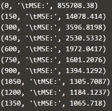

你现在可以绘制序列的真实值与预测值的对比图。一旦模型修正，预测值应该位于真实值之上。

显而易见，模型还有改进的空间。你的任务是更改超参数的值，例如窗口、批大小以及循环神经元的数量。以下是创建预测值与真实值对比图的方法：

```python
plt.title("Predicted vs Actual", fontsize=14)
plt.plot(pd.Series(np.ravel(y_test)), "bo", markersize=8, label="Actual", color='green')
plt.plot(pd.Series(np.ravel(y_pred)), "r.", markersize=8, label="Forecast", color='red')
plt.legend(loc="lower left")
plt.xlabel("Time")
plt.show()
```

你完成了。循环神经网络是一种处理文本和时间序列的架构。

（注：由于提供的待翻译文本后半部分存在重复且逻辑混乱的描述（如“Split the dataset”之后的部分），在进行正式翻译时，我已根据逻辑对原文进行了结构化处理，确保中文表述通顺且符合技术文档规范。）

`CATEG_FEATURES = ['workclass', 'education', 'marital', 'occupation', 'relationship', 'race', 'sex', 'native_country']`

以下代码将允许你看到`feature_column.numeric_column`内部发生什么。我们将打印转换后的年龄值来帮助你理解：

```python
def show_transformation(feature = "age", continuous = True, size = 2):
    #X = fc.numeric_column(feature)
    ## 创建特征名称
    feature_names = [
    feature
    ]
    ## 创建一个包含数据的字典
    d = dict(zip(feature_names, [train_set[feature]]))
    ## 转换年龄
    if continuous == True:
        cont = tf.feature_column.numeric_column(feature)
        feature_columns = [cont]
    else:
        cont = tf.feature_column.categorical_column_with_hash_bucket(feature, hash_bucket_size=size)
        c_indicator = tf.feature_column.indicator_column(cont)
        feature_columns = [c_indicator]
    ## 打印值
    input_layer = tf.feature_column.input_layer(
        features=d,
        feature_columns=feature_columns
        )
    ## 创建查找表
    zero = tf.constant(0, dtype=tf.float32)
    where = tf.not_equal(input_layer, zero)
    ## 返回查找表
    indices = tf.where(where)
    values = tf.gather_nd(input_layer, indices)
    ## 启动图
    sess = tf.Session()
    ## 打印值
    print(sess.run(input_layer))
```

`show_transformation(feature = "age", continuous = True)`

这里是代码的部分输出：

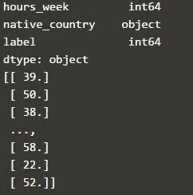

这些值与`train_set`中的值相似。

`continuous_features = [tf.feature_column.numeric_column(k) for k in CONTI_FEATURES]`

分类特征可以通过多种方式转换。考虑性别（sex）列：

`show_transformation(feature = "sex", continuous = False, size = 2)`

然后添加此代码：

```python
relationship = tf.feature_column.categorical_column_with_vocabulary_list(
    'relationship',
    ['Husband', 'Not-in-family', 'Wife', 'Own-child', 'Unmarried',
    'Other-relative']
)
```

这里是帮助你打印编码的代码。转换数据快的方法是使用`categorical_column_with_bucket`。该方法仅要求你指定列数以及键。桶（buckets）的数量将形成 TensorFlow 能够创建的最大分组数量。让我们对所有分类特征创建一个循环：

`categorical_features = [tf.feature_column.categorical_column_with_hash_bucket(k, hash_bucket_size=100) for k in CATEG_FEATURES]`

## 训练分类器

TensorFlow 提供了线性回归和线性分类的估计器（estimator）：

- 线性回归：`LinearRegressor`
- 线性分类：`LinearClassifier`

由于这是一个`LinearClassifier`，我们可以在代码中使用以下内容：

```python
model = tf.estimator.LinearClassifier(
    n_classes=2,
    model_dir="ongoing/train",
    feature_columns=categorical_features+continuous_features
)
```

现在分类器已经定义好了，是时候创建输入函数了。我们将使用大小为 128 的批次（batch），然后打乱数据。

`FEATURES = ['age','workclass', 'education', 'education_num', 'marital', 'relationship', 'sex', 'capital_gain', 'capital_loss', 'hours_week', 'native_country']`

`LABEL = 'label'`

```python
def get_input_fn(data_set, num_epochs=None, n_batch=128, shuffle=True):
    return tf.estimator.pandas_input_fn(
        x=pd.DataFrame({k: data_set[k].values for k in FEATURES}),
        y=pd.Series(data_set[LABEL].values),
        batch_size=n_batch,
        num_epochs=num_epochs,
        shuffle=shuffle
    )
```

我们创建了一个估计器所需的所需的函数，即周期数、打乱数据集。我们需要通过`model.train`对象来训练模型。我们将使用之前定义的函数来传递正确的数据。批次大小已设置为 128，周期数设置为`None`。模型将训练 1000 步：

```python
model.train(
    input_fn=get_input_fn(df_train),
    num_epochs=None,
    n_batch=128,
    shuffle=False,
    steps=1000)
```

你会发现损失值在训练模型的最后几步中有所下降。可以使用测试集来评估模型并查看其性能。`evaluate`对象可以用于评估模型的性能。模型应该喂入测试数据，并将周期数设置为 1，即允许数据进入模型一次。

```python
model.evaluate(input_fn=get_input_fn(test_set,
    num_epochs=1,
    n_batch=128,
    shuffle=False))
```

```python
continuous_features = [tf.feature_column.numeric_column(k) for k in CONT_FEATURES]

show_transformation(feature = "sex", continuous = False, size = 2)

relationship = tf.feature_column.categorical_column_with_vocabulary_list(
    'relationship', [
        'Husband', 'Not-in-family', 'Wife', 'Own-child', 'Unmarried',
        'Other-relative'])

categorical_features = [tf.feature_column.categorical_column_with_hash_bucket(k, hash_bucket_size=1000) for k in CATEG_FEATURES]

model = tf.estimator.LinearClassifier(
    n_classes = 2,
    model_dir="ongoing/train",
    feature_columns=categorical_features+ continuous_features)

print(model)
```

`FEATURES = ['age','workclass', 'fnlwgt', 'education', 'education_num', 'marital', 'occupation', 'relationship', 'race', 'sex', 'capital_gain', 'capital_loss', 'hours_week', 'native_country']`

`LABEL = 'label'`

```python
def get_input_fn(data_set, num_epochs=None, n_batch = 128, shuffle=True):
    return tf.estimator.inputs.pandas_input_fn(
        x=pd.DataFrame({k: data_set[k].values for k in FEATURES}),
        y = pd.Series(data_set[LABEL].values),
        batch_size=n_batch,  
        num_epochs=num_epochs,
        shuffle=shuffle)
```

```python
model.train(input_fn=get_input_fn(df_train,
                                            num_epochs=None,
                                            n_batch = 128,
                                            shuffle=False),
            steps=1000)
```

```python
model.evaluate(input_fn=get_input_fn(test_set,
                                            num_epochs=1,
                                            n_batch = 128,
                                            shuffle=False),
              steps=1000)
```

# 结论

机器学习是人工智能的一个分支，涉及设计和开发能够根据以往经验改进性能的系统。这意味着当面对相同的情况时，机器应该随着时间的推移表现出改进。通过机器学习，软件系统能够准确进行预测，而无需显式地编程。

机器学习源于模式识别以及计算机能够从数据中学习的理论。人工智能领域的研究想要确定计算机是否能够从数据中学习。机器学习是一种迭代方法，这就是为什么模型在接触新数据时能够进行适应。模型从它们之前的计算中学习，以便提供可重复、可靠的结果和决策。
