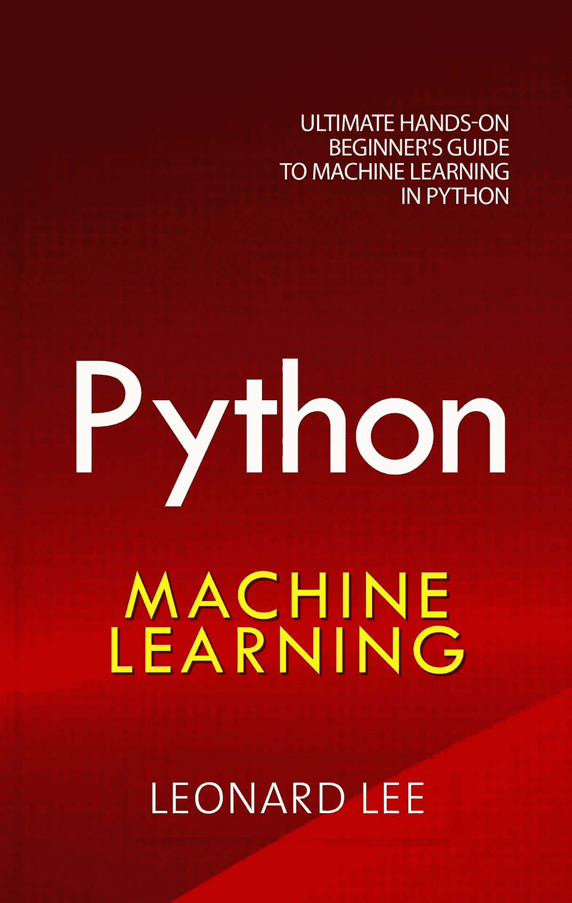

# Python 机器学习：Python 机器学习终极初学者实用指南





## 机器学习

### 什么是机器学习？
机器学习这一术语包含了一个简单易懂但在执行上极其困难且复杂的概念：计算机或“机器”通过其接收的数据来“学习”，或在特定类型的任务上变得更好，而无需显式编程。这意味着程序员必须能够编写代码以启用这种行为，因为这种对硬编码的独立性高度依赖程序员的算法。机器学习通常通过创建一组算法来完成，这些算法处理输入的数据并使用这些数据作为预测或决策的基础，而这些操作通常是在静态程序中硬编码的。这允许了适应性，程序将根据接收到的数据开始以不同的方式反应，与传统的静态程序相比，后者遵循特定的输入序列总是产生相同的结果。这种从输入数据创建模型在许多情况下是静态程序是不实用或可能的，例如在创建电子邮件垃圾过滤器、检测试图入侵网络安全的恶意入侵者，或者程序员试图实现某种程度的计算机视觉的情况下。这种适应性一直被用于增强计算机各种功能，并在多年来复杂性日益增加。然而，机器学习在数据科学领域远非新概念，事实上，机器学习这一概念被著名数据科学家 Tom Mitchell 浓缩为一行：“如果一个计算机程序对于某些任务类 T 和性能衡量 P，其在任务 T 中的性能（通过 P 衡量）随着经验 E 的增加而提高，则说该程序从经验 E 中学习”。

### 机器学习任务
机器学习的“任务”指的是算法应该做什么，以及通过什么方法进行“学习”。因此，机器学习任务通分为大类：


## 学习

既然机器学习中包含了“学习”一词，那么学习应该是任何机器学习算法的主要任务。然而，机器学习有多种方法，这取决于程序员的目标，以及算法旨在解析什么类型的数据。以下内容将让读者对机器学习的几个最流行且主要的类别有一个概述。

### 监督学习

监督学习是一种方法，其中计算机被输入信息（通常是成对的输入-输出数据格式），并利用这些信息来构建模型，从而改进预测结果或获得更理想的输出方法。它通过对给定的“训练示例”推断训练数据来实现这一点，这使得机器学习算法最终可以使用给定的示例产生一个推断函数，该函数将用于映射更多示例，并能够优化地确定未见实例的类别，这要求算法能够以更合理的方式将训练数据中的结果泛化到未见的示例。请注意，成对的教学数据通常将输入半部分称为 `vector`，而输出部分则称为 `supervisory signal`。

### 创建解决监督学习问题流程图的步骤

创建解决监督学习问题算法的第一步是确定要用作训练示例的数据类型。例如，在编写用于手写数据分析的程序时，程序员必须决定他们是希望使用单个字符、单个单词，甚至是整行数据来训练程序。一旦确定了数据类型，下一步就是收集足够样本量的数据，以创建用于算法的训练集。这意味着应该收集多个输入对象，并准备好它们对应的预期输出项。一旦训练集完成，程序员需要弄清楚他们究竟希望如何对其输入特征进行表示。这意味着输入将被转换为一个 `vector`，并由若干变量来描述它。虽然由于“维度灾难”（curse of dimensionality），无法完美地描述该对象，但程序员应该能够包含足够数量的描述变量，以便计算机对该对象有一个正确的理解。完成后，程序员就可以使用支持向量机或决策树构建等方法，确定他们希望如何构建学习函数，以及他们想要如何创建算法，这些算法方法将在后面的章节中讨论。完成后，程序员就可以开始运行模拟来训练他们的程序。请注意，某些监督学习算法需要用户确定若干控制参数，并且为了优化性能可能需要进一步的调整。一旦算法通过测试且程序经过了训练，程序员就可以尝试在与训练集不同的测试集上对其函数进行测试，并检查程序是否能够产生预期的输出结果。

### 维度灾难

虽然“维度灾难”听起来是一个非常复杂的概念，而且像是来自科幻或奇幻小说，但它仅仅指的是在数据科学家和数学家工作的高维空间中，测量三维物理对象有多困难，以及由此这一事实产生的各种现象。问题的产生是因为随着维度的增加，空间的体积呈快速增长，以至于数据难以收集。这种现象影响数据科学家的一个例子是高维空间中的数据组织。

### 半监督学习

监督学习方法的一个子集，也称为最优设计，它结合了监督学习和无监督学习的元素，因为训练集中包含了未标记的数据。这意味着程序学习通过未标记数据进行自我校准。事实上，比例倾向于未标记数据，训练集中只有一小部分是有标记的。这可以比作数学老师给学生发工作单，前几个问题已经解答并给出了答案，而工作单的其他部分则留白。这种方法已被证明具有更高的精度。

### 主动监督学习

主动监督学习是监督学习的一种类型，程序被赋予主动向用户询问数据集标签的能力。这种方法结合了已标记和未标记的数据集，由于手动标记每个数据集的成本很高，可以使用主动监督学习方法。这允许计算机尝试使用训练集进行学习，但如果某个数据集标记的误差范围过高到程序无法“容忍”，那么算法通常会询问用户以便其能够进行适当的自我纠正。人类用户的这种积极参与是该方法被称为主动监督学习方法的原因，与大多数在算法开始运行后几乎或完全不需要人类交互的方法不同，这种方法需要人类才能完全完成其训练集。

### 强化学习

强化学习是一种独特的监督学习方法，其之处在于不提供训练集。相反，发生的情况是让程序置于一个环境中执行动作，并基于奖励和激励机制进行学习，如果它们的动作是正确的，就会得到强化。这允许程序发现不同的结果，重点不再放在纠正次优结果上，而是放在寻找产生最佳性能的方法上。这种方法通常通过反馈密集活动来进行，例如与人类用户对战游戏，甚至是驾驶汽车。这种学习方法通常使用蒙特卡洛启发式方法，它允许计算机在资源匮乏的环境中计算概率。


## 无监督学习
在无监督学习中，算法被用于解析完全未标记的数据集以进行自我训练。这意味着与之前讨论的监督学习方法相比，出错的可能性更高。无监督学习通常更多用于数据和值的聚类，并在需要密度估计函数的统计分析中得到最广泛的应用。无监督学习侧重于发现结果的概率，例如对于任何特定的 `X` 值，`Y` 的概率，这就是为什么统计学家是最常使用这一特定机器学习任务的人。然而，当涉及到更常规的需求时，例如训练程序在给定一组条件时识别或预测特定结果，使用监督学习方法可能比使用无监督学习的对应方法更有效。

## 机器学习应用
学习涉及管理可能的未来输入：虽然在大多数情况下需要输入-输出对，但机器学习的过程是为了教程序如何处理未来输入。当涉及到机器学习应用时，这就是机器学习程序的输出所处理的地方。得益于机器学习为用户提供的多功能性和灵活性，存在多种应用类型，在此处无法详尽。然而，有几种主要类型，我们将在在此讨论以下类型。

### 分类
在数据科学中，特别是在统计学和机器学习领域，分类是这样一种问题：特定的观测值或数据点根据相似的特征被归入其所属的类别，在这种情况下，分类是基于输入给程序的训练集，该训练集包含了程序可以识别此类数据点成员身份的实例或观测值。分类输出的一个常见示例是电子邮件垃圾过滤器，它将我们的电子邮件归分为两类之一：“垃圾邮件”（不想要的电子邮件）和“非垃圾邮件”（法的电子邮件消息）。机器学习中更高级的分类类型是某些新程序尝试提供诊断服务，它们根据患者记录的症状以及年龄、性别和种族等某些因素提供诊断，这使得程序能够更好地预测可能的诊断结果。分类主要是一种模式识别类型，通常通过监督学习方法创建，其中算法使用一组已经过正确识别和分类学习结果的数据点进行教导。分类器是实现分类方法的算法，但“分类器”一词也用于指代将输入数据引导并归类到特定类别的数学函数，但对于本指南而言，分类器是指分类方法算法。分类器通常通过将数据点拆分为某些变量来创建，这些变量可能具有各种属性，例如血型的分类属性（“A -”、“O +”、“AB +”）、序数属性（高、中、矮），甚至是整数值属性（例如用于垃圾过滤器的特定单词出现次数计数）。其他一些分类器是使用比较观察构建的，它们具有一种比较两者之间距离或相似性的函数。

### 聚类
与分类类似，聚类涉及根据一组使它们属于同一类别的特征列表将特定的数据点或观测值分组在一起。然而，聚类的范围通常更广，且与分类决定如何分割其类别的方式相比，其那么清晰。聚类（或聚类分析）主要被统计学家和数据科学家使用，特别是在解决信息检索、数据压缩或密度估计函数问题时。正如之前简要解释的那样，聚类函数通常通过无监督机器学习算法创建，而分类函数则通过监督学习创建。这是因为聚类没有那么强调特殊性，其工作方式更多是于将相似的对象聚集在一起，而不是单独地将每个对象定义到特定的类中。

### 密度估计
在本质上是聚类的一个类型中，密度估计输出方法是基于对底层概率密度函数的各种观测而建立的估计值，而该函数通常是不可观测的。该函数通常从总体中提取随机样本，并使用随机样本对待估计的不可观测密度函数进行估计，其往往是总体的密度分布。

### 降维
降维是一种输出类型，它通过将对象映射到低维空间来降低对象的性并简化输入，最终允许用户简化对象并进行特征选择或提取，即识别最相关属性（“特征”）的过程，以便更好地构建模型。这特别有用，因为当对象放置在高维空间时，由于可用维度的增加会导致相关数据变得稀疏，因此降维通常是使对象更易访问和使用的必要因素。

### 回归分析
回归是一个由于其复杂性让许多人一听就害怕的词，它是人们用来估计和定义各种变量之间关系的统计过程。回归整体指的是多种允许我们对因变量与一个或多个自变量（称为预测变量）之间的关系的技术。回归分析对于帮助我们理解当某个自变量变化时，标准变量（通常称为因变量）是如何受到影响并发生变化的，而其他自变量（如果有）保持不变。回归分析还用于帮助估计给定预测变量的标准变量的条件期望，让我们知道一旦预测变量固定，标准变量的值将是多少。然而，也有人使用回归分析关注因变量相对于自变量分布的某些位置参数。值得注意的是，由于回归分析的特征（即数据点会根据控制变量而波动），其输出倾向于连续形式而非离散形式，以匹配实时变化。


## Python 中的机器学习

现在我们已经对机器学习是什么以及它能做什么有了基本的了解，现在我们回到 Python，以及我们如何将两者结合。到目前为止，你的 `Python` 应该已经配置好了，你应该已经掌握了创建 Python 代码和算法的基础知识，并且已经习惯了开发环境，因此我们可以转向更高级的概念，例如这些内容。然而，与初学者倾向于使用的许多函数不同，机器学习并不是内置在 Python 中的，因此我们需要导入几个库，以使我们的 `Python` 具备运行机器学习算法的能力。`Python` 是一种高级编程语言，最初由一位名为 `Guido van Rossum` 的程序员开发，第一个公开发布的版本于 1991 年发布。由于 `Python` 易于使用且简单，它通常用于向初学者教授编程，但由于该语言的强大性，它在更高级的应用中也运行良好，因为它扩展性很好，并且可以用于大型程序。这种扩展性包括了在导入某些库时运行机器学习函数的能力。我们可以利用的库有很多，但在这里我们将重点关注两个主要的库：`Scikit – learn` 和 `TensorFlow`。

### Scikit – learn

`Scikit – learn` 是 `Python` 中最流行的免费机器学习库之一，最初由一位名为 `David Cornapeau` 的程序员于 2007 年开发，后来有 `Mattheiu Brucher` 的加入，得益于法国计算机科学与自动化研究的参与，`scikit – learn` 最终于 2010 年初开放公共下载和使用。`Scikit – learn` 的名称源于该软件软件包的意图，即增强使用 `Python` 科学库 `SciPy` 工具包以及数值库 `NumPy` 的用户的能力。因此，`Scikit – learn` 是一个用于扩展 `Python` 库的模块，涉及添加用于分类、回归和聚类的各种函数和方法，它是一个“SciPy 工具包”。如所述，`Scikit – learn` 包含了分类、聚类和回归算法，这些算法利用了 `gradient boosting`、`random forests`、`support vector machines`、`k – means` 和 `DBSCAN`，这使得用户在使用 `Python` 时拥有更广泛的能力范围。

### TensorFlow

`TensorFlow` 是谷歌创建的一个软件库，最初用于专有用途，但最终于 2015 年在开源许可下开放公共下载和使用。`TensorFlow` 主要关注数据流编程，并且是一个用于神经网络函数的机器学习的符号数学库。`TensorFlow` 是一个更高级的编程库，我们将随着指南的进行进行更详细的讨论，但现在，我们将从 `Python` 中机器学习函数的基础介绍开始。

### 使用哪个版本的 Python？

到目前为止，读者应该已经熟悉了 `Python`，并且已经在他们的机器上安装了 `Python`。为了本指南而言，用户应该运行现代版本的 `Python`，即 `Python 3.5`，但本指南也适用于 `Python 2.7` 用户。如果读者由于某种原因还没有 `Python`，他们可以按照以下方式安装基础版本的 `Python`：

#### 在 Windows 平台上安装 Python

为了在 Windows 上运行 `Python`，请从 `Python` 官方网站 `www.python.org` 或镜像网站下载安装程序。一旦下载完成，运行 `msi` 文件并使用默认配置即可。

#### 在其他平台上安装 Python

为了在其他平台上运行 `Python`，用户必须访问 `Python` 官方网站 `www.python.org`，并找到与所需硬件兼容的版本。某些硬件平台（如树莓派）在操作系统系统中已经自动安装了 `Python`。一旦用户找到了文件，只需下载并安装它，使用默认配置即可。然而，如果读者愿意，还有比基础 `Python` 之外的 Python 应用程序可用，并且可能对读者更有用，因为这种名为 `Anaconda` 的变体已经包含了这些库。

#### 在 Windows 平台上安装 Anaconda

为了在 Windows 上安装 `Anaconda`，只需访问以下链接站点：`https://www.anaconda.com/download/`，并选择用户希望的 `Python` 版本。建议获取最新版本以利用新功能，但在某些情况下（例如访问某些库或向后兼容性问题），用户可能希望安装旧版本的 `Python`。在安装 `Anaconda` 应用程序时，确保也安装 GUI。

#### 安装相关库（如果不使用 Anaconda）

对于我们在 `Python` 中基础的机器学习使用，我们需要导入五个库。这些库如下：

1. `Scipy`: `Scipy` 是一个科学 Python 模块，包含了用于优化、线性代数和其他特殊函数的各种模块。它扩展了 `Numpy` 库，并包含在 `NumPy` 栈中，其中包含了 `matplotlib` 和 `pandas` 模块。
2. `Numpy`: `NumPy` 是一个数值 Python 模块，提供了快速的数学函数。它还允许使用更健壮的数据结构来记录多维对象。
3. `Matplotlib`: `Matplotlib` 是 `Python` 的绘图库，通常与 `NumPy` 结合使用。它提供了一个面向对象的应用程序接口，允许用户在标准 GUI 上使用其函数。
4. `Pandas`: `Pandas` 模块提供了用于数据处理的 `Data Frame` 对象，提供了读取和写入数据的函数。值得注意的是，Data Frames 可以在多维数组中存储不同类型的数据。
5. `sklearn`: `sklearn` 是主要的机器学习库之一，包含了许多与机器学习相关的函数和数学模型。

如果读者忘记了库，这里有关于库和初始化的快速简报：


### 如何导入和初始化库

库简单来说就是多个模块的集合，供设备上的 Python 程序使用。这些包通常存储在 Python 安装的同一个文件夹中，默认情况下，路径为：
- 对于 Windows 用户：`C:/Python27/Lib/site-packages/`
- 对于 Linux 用户：`/usr/lib/python/site-packages`

即使库已经位于正确的文件夹中，也无法立即使用，因为它们必须首先使用以下语法进行初始化：`library_name/__init__.py` 或 `library_name/module_name.py`。

一旦库完成初始化，就可以通过上一节讨论的过程导入内部的模块，即：`import module_name`。

一旦库被导入并初始化，我们可以在 Python IDE 中输入以下内容，以检查它们是否已正确安装：

```python
### 检查每个库的版本
### 这显示了机器上安装的 Python 版本
import sys
print("Python: {}".format(sys.version))
### 这显示了机器上安装的 scipy 版本
import scipy
print("scipy: {}".format(scipy.__version__))
### 这显示了机器上安装的 numpy 版本
import numpy
print("numpy: {}".format(numpy.__version__))
### 这显示了机器上安装的 matplotlib 版本
import matplotlib
print("matplotlib: {}".format(matplotlib.__version__))
# 这显示了机器上安装的 pandas 版本
import pandas
print("pandas: {}".format(pandas.__version__))
### 这显示了机器上安装的 scikit – learn 版本
import sklearn
print("sklearn: {}".format(sklearn.__version__))
```

如果库已正确安装，输出应该类似于下面的几行：
```
Python: 3.6.0
scipy: 1.1.0
numpy: 1.14.5
matplotlib: 2.2.2
pandas: 0.23.2
sklearn: 0.19.2
```

到此时，意味着适当的库已经安装。如果你的库版本与此处看到的并不完全匹配，请不要担心，因为 API 倾向于保持稳定。

### Python 机器学习入门：鸢尾花 (Iris Flowers)

在开始导入并初始化库之前，我们需要通过以下代码来检查它们是否已经正确安装。一旦库初始化完成后，这意味着已经安装了正确的库。如果你的库版本与此处看到的并不完全匹配，请不要担心，因为 API 倾向于保持稳定。

### Python 机器学习入门：鸢尾花

在开始导入并初始化库之前，我们需要通过以下代码来检查它们是否已经正确安装。一旦库初始化完成后，这意味着已经安装了正确的库。如果你的库版本与此处看到的并不完全匹配，请不要担心，因为 API 倾向于保持稳定。

### 鸢尾花数据集

鸢尾花数据集是广泛用于机器学习的经典数据集，它包含了许多数据点。鸢尾花数据集具有以下属性：
- 花片长度
- 花片宽度
- 花瓣长度
- 花瓣宽度
- 类别

### 导入必要的库和数据

在解决机器学习问题的第一步是识别并收集数据。当我们使用鸢尾花数据集（这是一个公开的数据集）时，我们的工作将变得快速且简单。我们只需要导入必要的库和对象以获取所需的数据。

一旦完成这些操作，我们所有需要的工具都应该就绪了，我们可以开始将数据加载到机器上。这些数据可以直接从加利福尼亚大学亚文分区的机器学习库下载到我们的机器上，只需要几行简单的代码和网络连接，如以下代码所示：

```python
### 加载数据集
url = "https://archive.ics.uci.edu/ml/machine-learning-databases/iris/iris.data"
names = ["sepal - length", "sepal - width", "petal - length", "petal - width", "species"]
dataset = pandas.read_csv(url, names=names)
```

请记住，我们正在使用带有参数的函数，因此一旦加载完成，每列数据都将拥有标签，即花萼长度、花萼宽度、花瓣长度、花瓣宽度和类别。这在我们尝试操作和访问数据时会让我们的工作变得容易得多。

```python
### 导入必要的库
import pandas
from pandas.plotting import scatter_matrix
import matplotlib.pyplot as plt
from sklearn import model_selection
from sklearn.metrics import classification_report
from sklearn.metrics import confusion_matrix
from sklearn.metrics import accuracy_score
from sklearn.linear_model import LogisticRegression
from sklearn.tree import DecisionTreeClassifier
from sklearn.neighbors import KNeighborsClassifier
from sklearn.discriminant_analysis import LinearDiscriminantAnalysis
from sklearn.naive_bayes import GaussianNB
from sklearn.svm import SV
```

上述代码允许我们通过各种分类器对各种花卉进行分类，同时也允许我们在矩阵上显示数据，并导入各种回归函数以简化我们的任务，因为让初级程序员自己编写回归算法来测试基础机器学习程序可能太难了。


### 汇总数据集

此时，得益于之前的两个步骤，我们已经拥有了程序所需的数据以及分析这些数据的工具。现在，我们必须学习如何操作这些数据以获得实质的结果。在这一步中，我们将尝试完成四件事：

1. 首先，我们将获取可用数据集的维度。
2. 第二，我们将尝试查看原始数据本身。
3. 第三，我们将尝试获取每个属性的统计摘要。
4. 第四，也是最后，我们将尝试根据 `species` 变量对数据进行分类。

### 寻找数据集的维度（学习 shape 属性）

还记得 Python 中的数组（arrays）和列表（lists）是如何工作的吗？每个数组/列表都可以被想象在二维空间（或三维或更多空间），因此，如果我们使用二维数组，就可以按列或行来组织数据。

#### List 类型
`List` 数据类型是组织数据时最有用的数据类型之一。`list` 数据类型在其他编程语言中通常被称为“数组”（array）。列表允许程序员在单个长变量中存储多种类型的数据，并使用列表包含的引用索引来调用它。

列表是通过在变量名旁边加上括号来声明的，这告诉 Python 将其视为列表。例如，`List == "Hello"` 将被简单视为包含 "Hello" 数据的字符串 `List`。然而，`List[0] == "Hello"` 将允许 Python 将 "Hello" 存储在列表的第一个元素中。注意列表的索引从'0'开始而不是'1'所以列表的第一个容器是 `[0]`。

列表内部可以包含多种数据类型，列表甚至可以嵌套列表。虽然对于人类来说，如果维度太多，可能很难追踪，但二维列表被常用。`List[[], []]` 是一个二维列表的示例，其中第一个括号指的是“行”，第二个括号指的是“列”，这是许多人使用的视觉辅助工具，以便跟踪列表如何存储数据。

Python 中的列表是动态的，这意味着它们可以存储多种数据类型，并根据程序需要更改其中包含的值，这使它们与相似的数据类型 `Tuple`（元组）区分开来。现在，我们导入的库使我们能够轻松访问数据集，由于它是按照声明的那样以数组形式导入的，我们可以像这样使用模块中编写 `shape` 属性来调用它：

```
print(dataset.shape)
```

这一行简单的代码指示机器提取数据集的“形状”（shape），即它有多少行和列。由于我们已经知道了数据集的维度，即 150 个实例（或“行”）和 5 个属性（或“列”），此命令的作用仅仅是验证，它应该通过返回一个值：`(150, 5)`。

### 查看原始数据（学习 head() 函数）

虽然大多数时候，程序员在编写代码时不会查看原始数据，因为这不是他们的工作，而且滚动查看每一个元素通常太无味了，但在某些情况下，能够这里那里查看数据集的几个元素可能是很有用的。为了做到这一点，命令如下：

```
print(dataset.head(20))
```

`head` 函数指示程序从数据集中提取前 x 个点，其中 x 是传递给 `head` 函数的参数。一旦数据集接收到 `head()` 函数调用，它应该打印以下数据点：

```
Sepal - length sepal - width petal - length petal - width species
0 5.1 3.5 1.4 0.2 Iris-setosa
1 4.9 3.0 1.4 0.2 Iris-setosa
2 4.7 3.2 1.3 0.2 Iris-setosa
3 4.6 3.1 1.5 0.2 Iris-setosa
4 5.0 3.6 1.4 0.2 Iris-setosa
5 5.4 3.9 1.7 0.4 Iris-setosa
6 4.6 3.4 1.4 0.3 Iris-setosa
7 5.0 3.4 1.5 0.3 Iris-setosa
8 7.0 3.2 4.7 1.4 Iris-versicolor
9 6.4 3.2 4.5 1.5 Iris-versicolor
10 6.9 3.1 5.1 1.5 Iris-versicolor
11 5.5 2.3 4.0 1.3 Iris-versicolor
12 6.5 2.8 2.6 1.5 Iris-versicolor
13 5.6 2.7 4.5 1.5 Iris-versicolor
14 6.3 3.3 5.0 1.5 Iris-versicolor
15 5.8 2.7 5.1 1.9 Iris-versicolor
16 7.1 3.0 5.9 2.9 Iris-virginica
17 6.3 2.9 5.0 1.8 Iris-virginica
18 6.5 3.8 4.1 1.5 Iris-virginica
19 5.7 2.8 4.5 3.1 Iris-virginica
```

以上内容应该是 `head()` 函数的输出，它允许程序员调用给定数据集的前几个元素。

### 数据集的统计摘要（describe() 函数）

现在我们已经知道如何获取数据集的维度，以及如何查看每个集合的前 "x" 个元素，另一个我们可以用来来解析数据集的方便工具是检查元素的统计摘要。我们执行此操作所需的工具是 `describe()` 函数，它给了我们八个属性：元素计数、平均值、标准差、最小值和最大值，以及三个分位数：25 百分比、50 百分比和 75 百分比。为了使用 `describe()` 函数，我们写了如下代码行：

```
print(dataset.describe())
```

对于我们给定的数据集，它将汇总并显示 `describe()` 使用的各种属性，如上面所示。这将输出一个表格，看起来如下所示：

| | sepal-length | sepal-width | petal-length | petal-width |
|---|---|---|---|---|
| count | 150.000000 | 150.000000 | 150.000000 | 150.000000 |
| mean | 5.843333 | 3.054000 | 3.758667 | 1.198667 |
| std | 0.828066 | 0.433594 | 1.764420 | 0.763161 |
| min | 4.300000 | 2.000000 | 1.000000 | 0.100000 |
| 25% | 5.100000 | 2.800000 | 1.600000 | 0.300000 |
| 50% | 5.800000 | 3.000000 | 4.350000 | 1.300000 |
| 75% | 6.400000 | 3.400000 | 5.100000 | 1.600000 |
| max | 7.900000 | 4.400000 | 6.900000 | 2.500000 |

注意，由于物种类别仅由字符串组成，`describe()` 函数无法以给定的数据类型对其描述，因此我们只有四列而不是五列。

### 检查给定数据集的类别分布（使用 groupby() 函数）

然而，尽管之前的函数 `describe()` 无法对类别（我们的 `species` 变量）进行描述，但有一个函数可以检查各个类别是如何分布的。这个函数是 `groupby()` 函数，它将每个元素聚集在一起。可以通过输入以下行来调用该函数：

```
print(dataset.groupby("species").size())
```

`groupby` 函数的参数是我们要寻找的特定类别类型，在这种情况下是 `species` 变量。在我们给定的数据集，该行应该产生如下输出：

```
species
Iris-setosa      50
Iris-versicolor   50
Iris-virginica     50
```


### 数据可视化

现在我们已经掌握了一些可以用于检查数据的基本函数，接下来我们需要找到一种方法来充分利用这些数据。然而，在在此之前，如果我们能够对这些数据进行可视化处理，我们的工作将会变得简单得多。在本节中，我们将探讨两种实现方法：单变量图和多变量图。

### 单变量图（箱线图、直方图）

我们使用单变量图是为了更深入地理解单个变量，从而让我们对属性的分布有更好的认识。我们可以创建的图表类型是箱线图（box and whisper plot），它会创建并显示每个属性的图表。我们可以通过以下代码行来实现：

```
dataset.plot(kind = "box", subplots = True, layout = (2,2), sharex = False, sharey = False)
plt.show()
```

上述代码包含了 `plot` 函数和 `show` 函数。`plot` 函数接受各种参数来创建特定类型的箱图，在这种情况下，它将创建一个二乘二的箱图，并隐藏 x 和 y 变量名。`show` 函数指示计算机显示所创建的特定图表。我们还可以创建直方图，通过使用以下代码行即可完成：

```
dataset.hist()
plt.show()
```

这将使用 `hist()` 函数自动创建一个直方图，并通过 `show` 函数指示计算机显示该图表。如果运行该代码，将显示某些变量似乎呈现高斯分布，这在之后我们构建算法时，可能是一个很有用的假设。

### 多变量图（散点矩阵）

多变量图用于检查多个变量之间的关系，与之相比，我们使用单变量图是为了更好地检查单个变量的构建情况。由于我们考虑了多个变量，这里最符合我们目的的图表类型是散点图，它将帮助我们发现每个变量之间的结构化关系。为了创建散点图，我们只需要使用以下代码：

```
scatter_matrix(dataset)
plt.show()
```

我们正在使用导入的 `scatter_matrix` 函数来轻松地创建一个图表，`dataset` 本身就是放入该函数的参数，通过调用它并利用其内容来构建图表。与之前一样，`show` 函数的作用是创建一个显示输出。如果用户运行这段代码，我们应该能看到某些关联对，显示了某些变量之间的结构化关系。


### 创建数据模型

此时，我们已经知道如何检查数据、处理数据，并以原始数据形式、摘要或图表的形式显示数据。现在，我们必须创建一个算法，以便能够完全地创建一个模型。在本节中，我们将留出一个验证数据集，创建一个测试框架来使用名为“十折交叉验证”的方法，构建五个不同的模型来测试每个模型的准确性，最后选择一个模型。

### 创建验证数据集

正如我们现在所知的，机器学习需要从数据点中“学习”以进行自我校准。然而，由于我们的数据集有限（鸢尾花数据集），我们将留出部分数据点，它们不会进入算法，因为我们将使用这些数据点来测试算法的有效性和准确性。为了训练算法，我们将数据集分为 80% 和 20%，其中 80% 是训练集，20% 是验证集，这意味着我们有 120 个数据点来训练算法，而最后 30 个将用于查看我们的算法是否已正确校准以给出准确的预测。将使用以下代码来分离所需的各种数据点。

```
array = dataset.values
X = array[:,0:4]
Y = array[:,4]
validation_size = 0.20
seed = 9
X_train, X_validation, Y_train, Y_validation = model_selection.train_test_split(X, Y, test_size=validation_size, random_state=seed)
```

之前的代码现在将创建四个独立的数组，其中 `X_train` 和 `Y_train` 是包含我们将用于训练算法的数据点的数组，而 `X_validation` 和 `Y_validation` 是我们将用于测试校准的数据。

### 创建测试框架

现在我们已经将数据集划分为测试组和验证组，我们需要为准确性设置一个测试方法。在这里，我们将利用十折交叉验证来训练和测试算法，这意味着它将每十个数据点进行一次划分，训练九个点并在第十个点上测试，并对程序将执行的所有训练-测试组合重复这种方法。可以使用以下几行代码初始化：

```
seed = 9
scoring = "accuracy"
```

`seed` 的值并不真正重要，因为它只是伪随机数生成器的一个种子。`scoring` 方法是算法的准确率，通过正确预测的观测值数量与总可能观测值数量之比乘以 1 百来得出百分比格式的结果。此评分变量将用于评估我们将构建的每个模型。

#### 伪随机数生成器

随机数出于许多原因非常有用，因为这允许程序员更好地复制现实世界的随机性。然而，计算机无法真正生成随机性，因为它们被设计为精确且理性地迭代。因此，存在一种伪随机数生成器，它根据使用的初始“种子”产生一系列“随机”数字。虽然这些数字看起来是随机的，但重要是，只要使用的种子相同，就会产生相同的数字。如果未设置种子，那么输出的数字将会。

### 构建模型

现在我们进入实际部分。我们将测试六个不同的模型，看看哪一个性能最好。我们将测试的模型是：
- 逻辑回归 (`LR`)
- 判别分析 (`LDA`)
- K 近邻算法 (`KNN`)
- 分类树 (`CART`)
- 朴素贝叶斯 (`NB`)
- 支持机 (`SVM`)

以下代码依次使用每个模型来检查结果：

```
models = []
models.append(('LR', LogisticRegression()))
models.append(('LDA', LinearDiscriminantAnalysis()))
models.append(('KNN', KNeighborsClassifier()))
models.append(('CART', DecisionTreeClassifier()))
models.append(('NB', GaussianNB()))
models.append(('SVM', SVC()))

results = []
names = []
for name, model in models:
    kfold = model_selection.KFold(n_splits=10, random_state=seed)
    cv_results = model_selection.cross_val_score(model, X_train, Y_train, cv=kfold, scoring=scoring)
    results.append(cv_results)
    names.append(name)
```

之前的代码构建了模型并使用我们设计的十折交叉验证运行它们。它们将数据集通过每个模型，并打印出结果数字以及标签：

```
msg = "%s: %f (%f)" % (name, cv_results.mean(), cv_results.std())
print(msg)
```

输出应该看起来如下：
- `LDA`: 0.975000 (0.038188)
- `LR`: 0.966667 (0.040825)
- `CART`: 0.975000 (0.038188)
- `NB`: 0.975000 (0.053359)
- `SVM`: 0.981667 (0.025000)
- `KNN`: 0.983333 (0.033333)

在这里我们看到 `KNN` (K 近邻) 在我们特定的测试运行中具有最高的准确率分，达到九八百分的估计准确率。但请注意，由于伪随机数生成器的种子影响，如果在运行此代码时种子不同，结果可能会不同。

我们还可以为每个算法的测试结果创建一个图表，得益于我们的测试框架方法，对每个数据模型测试了十次。这样做的代码如下：

```python
tres= plt.figure()
tres.suptitle("Comparing Algorithms")
ax = tres.add_subplot(111)
plt.boxplot(results)
ax.set_xticklabels(names)
plt.show()
```

这将创建并显示一个柱状图，X 轴标记为测试类型，Y 轴标记为每次测试的准确率百分比。


### 预测

现在我们已经创建了用于测试数据集的算法，并且发现最有效的测试方法是 K-最近邻（K – nearest neighbors）测试，现在我们可以使用之前留出的验证集对其进行检查。这项二次测试允许我们确保该算法是真实准确的，并且根据花瓣和花片的测量数据，能够准确预测花朵的种类。实现该操作的代码如下：

```python
knn = KNeighborsClassifier()
knn.fit(X_train, Y_train)
predictions = knn.predict(X_validation)
print(accuracy_score(Y_validation, predictions))
print(confusion_matrix(Y_validation, predictions))
print(classification_report(Y_validation, predictions))
```

提供的代码将针对我们之前留出的验证集对算法进行测试，并显示结果，给出实践中的最终准确率、错误发生的位置，并分解精确率、召回率、F1 分数的支持量等其他指标，以便更好地了解测试的运行情况。输出结果应该如下所示：

```
      I 0.9 
[[  7  0  0]
 a  s [ 0 11   1]
 I [ 0    2    9]] 

precision    recall      f1 - score   support
Iris - setosa       1.00          1.00          1.00         7
Iris - versicolor   0.85          0.92          0.88       12
Iris - virginica    0.90          0.82          0.86       11
Average / total    0.90          0.90          0.90       30 
```

### 结论

现在读者已经拥有了可以使用基础机器学习流程的运行代码。读者应该能够使用之前的代码创建软件，该软件解析数据并根据各种属性之间的相关性，以合理的准确率预测某些结果。接下来的几章将涉及示例代码中引入的概念，以便更好地帮助读者在未来进步、学习并开发自己的代码。

### 机器学习中常用的数据模型

正如我们在之前的代码中看到的，统计学家和数据科学家使用不同的数据模型来解析、组织和测试各种数据和观测值。在本章中，我们将检查这些模型，以便读者更好地理解它们是如何开发的、何时使用它们，以及它们与哪类型的数据配合最好。


### 简单线性算法

数学家和数据科学家使用线性算法来创建数学模型，试图寻找最优结果。因此，线性规划也被称为数学优化。然而，要求必须是线性形式的，这意味着它们可以用 2 维形式表示出来。正由于这个原因，这类算法被广泛应用于规划、路由和调度问题，并经常被运输和电力部门的工程师以及经济学家使用。事实上，它的根源于数学家在战争期间试图解决运输和开支问题，Dantzig 是其中最著名的例子之一，他利用这种方法造福了他的军队，即二战结束后不久后的美国空军。如前所述，两种常用的数据模型——线性回归和线性判别分析属于简单线性算法类型。

#### 线性回归

线性回归是线性算法的一种，是一种用于对因变量（具有标量响应的变量）与一个或多个独立变量（也称为解释变量）之间的关系进行建模。根据独立变量只有一个还是多个，线性回归可以被称为简单线性回归或多元线性回归。然而，这两种类型都不同于所谓的多元线性回归，因为后者涉及多个因变量（标量响应变量），而前两种只处理单个标量响应变量。

对于线性回归算法，这些关系通过各种预测函数进行建模，其中参数是未知的，但它们是从数据中外推出来的，这正是机器学习用用场。这些模型被称为线性模型。线性回归主要关注在给定预测变量（独立变量）值变化的情况下，标量变量响应的概率分布，而不是其他试图映射所有涉及变量的联合概率分布的数学模型。线性回归是最流行的回归分析类型之一，这是因为与其未知数具有线性依赖的模型相比，参数之间以非线性方式相关的模型更容易处理。此外，线性的本质允许更容易确定估计量的各种统计属性。

线性回归最常用于两大类。第一类是预测：预测和误差最小化问题倾向于线性回归解决方案，因为如果用户对于因变量和独立变量已经有一组观测值，线性回归分析有助于创建预测模型，线性回归可以从此进行外推。一旦创建了模型，就可以收集更多解释变量示例，即使没有观察到的响应值，模型也能够对响应值给出一个合理的预测。线性回归的第二个主要用途是解释响应变量的变化，这种变化可以归因于独立变量值的变化，允许用户量化因变量与独立变量之间联系或关系的强度，甚至确定它们之间是否存在关系，或者某些独立变量具有冗余功能。

以下示例代码格式显示了线性回归算法的骨架：

```python
#导入其他必要的库，如 NumPy Stack
from sklearn import linear_model
### 训练和测试数据集
#识别属性和因变量 ( s )，值必须是数值和 numpy 数组
x_train=input_variables_values_training_datasets
y_train=target_variables_values_training_datasets
x_test=input_variables_values_test_datasets
### 创建线性回归对象
linear = linear_model.LinearRegression()
#### 使用指定的训练集校准回归模型并检查评分
linear.fit(x_train, y_train)
linear.score(x_train, y_train)
#### 检查方程系数和截距
print("The Co – efficient is: \n", linear.coef_)
print("The Intercept is: \n", linear.intercept_)
#### 预测输出
predicted= linear.predict(x_test)
```

#### 线性判别分析

线性判别分析是一种常见的统计分析类型，类似于著名的费舍线性判别，它允许用户找到属性的线性组合，用于定义多个类别的对象和/或事件。这种组合可以作为分类器，甚至可以用于减少对象的维度以备随后的进一步分类。事实上，线性判别分析与方差分析（ANOVA）和线性回归分析相似，因为所有此类测试都试图将响应（因）变量表示为各种属性的组合。

然而，判别分析使用连续的解释（独立）变量和分类响应变量，而方差分析具有分类解释变量和连续响应变量。在此方面，回归与线性判别分析相似。线性判别分析寻找各种观测值的线性组合，从而对上述数据提供最佳拟合解释。然而，与称为主成分分析的类似方法不同，线性判别分析积极尝试创建一个不同数据类别差异的模型。当解释变量是连续量且组已预先已知时，线性判别分析的效果最好，这与聚类分析（组由算法确定）不同。判别分析最最适用于分类函数，即当需要将对象分配到类或类别中，并根据其特征进行分配时。

线性判别分析机器学习算法如下：

```python
#导入库
from sklearn.linear_model import LogisticRegression
x_train=input_variables_values_training_datasets
y_train=target_variables_values_training_datasets
x_test=input_variables_values_test_datasets
### 创建逻辑回归模型对象
model = LogisticRegression()
#### 使用指定的训练集校准回归模型并检查评分
model.fit(X, y)
model.score(X, y)
#### 预测输出
predicted= model.predict(x_test)
```


### 非线性算法

非线性算法是指任何处理目标函数非线性且问题约束空间不是多面体的算法类型。这些函数包括凹函数、凸函数和二次函数，与标准的线性单纯形法相比，必须使用不同的方法进行求解。这些非线性问题通常是优化问题，即在存在一组未知变量的情况下求解目标函数的极值。

### 支持向量机

支持向量机是机器学习中最流行的模型之一，也称为支持向量网络。这些支持向量机属于监督学习模型，使用学习算法来检查用于分类和标准回归分析的数据。这些模型的工作原理是取一组校准数据点（每个数据点被标记为属于某一个或另一个类别），支持向量机模型接收新样本并根据其特征将其分配给给定的两个类别之一，使得支持向量机算法成为一种非概率二分类线性分类器。支持向量机可以想象为将数据点表示为空间中的点，不同类别之间存在清晰的间隙。支持向量机接收到的任何新数据点都被放置在该空间中，并根据其特征预测它们将被放在间隙的哪侧。除了用于线性分类外，支持向量机还能通过所谓的“核技巧”执行非线性分类，该技巧隐式地将输入置于高维空间。支持向量机也可以无监督学习方法工作，因为无监督学习试图寻找自然簇，任何接收到的新数据都会映射到这些簇中。这种向量聚类算法是标准支持向量机功能的扩展，允许它们利用未标记数据，它由 Vladimir Vapnik 和 Hava Siegelmann 开发，并已成为工业应用和设置中最流行的聚类算法之一。

支持向量机算法的示例下所示：

```python
import numpy as np
X = np.array([[-2,5,-2], [3,5,-1], [4, 8, -2], [2, 4, -1], [6, 5, -1]])
y = np.array([-1,-1, 1, 1, 1])
def svm_sgd(X, Y):
    w = np.zeros(len(X[0]))
    esa = 1
    era = 100000
    for era in range(1,epochs):
        for i, x in enumerate(X):
            if (Y[i]*np.dot(X[i], w)) < 1:
                w = w + esa * ((X[i] * Y[i]) + (-2*(1 / era)* w))
            else:
                w = w + esa * (- 2 * (1 / era)* w)
    return w
w = svm_sgd(X,y)
print(w)
```

`X` 和 `Y` 数组包含要分类的对象，算法设置为运行 1000000 次，学习参数设置为 1，正则化参数为 `1 / era`，因此它随着 `era` 变量的缓慢增加而减小。

### 高斯朴贝叶斯

高斯朴贝叶斯模型基于概率分类器的模型，它们在观察输入后返回其可能属于的一组类别的概率分布，而不是简单地输出输入应该所属的单一最可能类别。高斯朴贝叶斯模型更进一步增加了一个假设，即这些特征之间是强独立的。为了简化这一点，这意味着高斯朴贝叶斯模型不通过关联属性来得出结论，而是独立地获取属性，并平等且独立于任何其他属性地权衡它们对所有者属于某类别概率的贡献。这种方法在开发垃圾邮件过滤器、文本识别和分类时非常流行，甚至在医学领域被用于医疗诊断功能。高斯朴贝叶斯模型的一个优点是它们具有很强的扩展性，在学习问题时只需要对应变量的线性参数，并且可以使用闭式表达式进行极大似然训练，由于其使用了线性时间，与许多其他分类器使用的迭代近似相比，它对资源的消耗要低得多。

### K 近邻

K-近邻算法是一种模式识别算法，它恰好是一种非参数方法，这意味着它不是基于标准概率分布的参数，实际上是基于无分布的，或者说分布的参数是未指定的。K-近邻算法也用于各种数据点的分类和回归，在这些情况下，输入由特征空间中最近的 `k` 个示例组成。然而，输出取决于是否将 K-NN 方法用于分类或作为回归方法。如果 K-NN 用于分类，则 K-NN 的输出是一个类类别，因为该对象将由其大多数邻居进行分类，被分配到 `k` 个最近邻居中最常见的类，其中 `k` 是一个分配的小整数。事实上，如果将 `k` 设置为 1，那么问题对象将简单地采用其邻居的类。然而，对于 K-NN 回归，输出是对象的所谓的“属性值”。对象的“属性值”通过取最近 `k` 个邻居值的平均值得到。K-NN 方法被称为一种基于实例的学习，或所谓的懒惰学习，因为这种懒惰学习只从局部值进行近似，直到分类本身完成才进行计算。这意味着 K-NN 算法在机器学习算法中是最容易使用的。然而，K-NN 算法可以通过添加权重方案进行修改，例如，邻居越靠近对象，权重越大。常用的权重方案遵循公式 `1 / d`，其中 `d` 是对象到邻居的距离。邻居本身取自已识别类（如果使用 K-NN 分类）或已知属性值（如果使用 K-NN 回归）的对象作为 K-NN 机器学习算法的“训练集”，由于 K-NN 算法对数据的局部敏感性，不需要显式训练。如果解剖 K-NN 并将其实现到 Python 中，看起来像下面的短代码：

```python
def train(X_train, y_train):
    # 记住 NN 的训练方法是不必要的，train 函数在这种情况下什么都不做。
    return

def predict(X_train, y_train, x_test, k):
    # 我们必须写的代码主要部分是预测函数，它计算
    # 对象与其“训练”集中的邻居之间的距离，
    # 从多数进行投票，一旦完成，为对象分配一个类。
    distances = []
    neighbors = []
    for i in range(len(X_train)):
        # 下面的一行计算欧几得距离
        distance = np.sqrt(np.sum(np.square(x_test - X_train[i])))
        # 我们现在将其添加到各种距离的列表中
        distances.append([distance, i])
    # 现在从小到大排序列表
    distances = sorted(distances)
    # 现在我们可以创建 targets 列表
    targets = []
    for i in range(k):
        # 下面的一行执行“投票”，即返回最常见的对象距离
        index = distances[i][1]
        # 将 y_train[index] 存入 neighbors 数组
        neighbors.append(y_train[index])
    # 获取距离对象的 k 个，返回最常见的类
    return Counter(neighbors).most_common(1)[0][0]

def kNearestNeighbor(X_train, y_train, x_test, predictions, k):
    # 允许寻找最近 k 个邻居的代码允许    # 遍历每个示例并做出预测
    train(X_train, y_train)
    for i in range(len(x_test)):
        predictions.append(predict(X_train, y_train, x_test[i], k))

### 现在我们有了代码，可以配合交叉验证方法运行最佳 K 值
predictions = []
kNearestNeighbor(X_train, y_train, x_test, predictions, 7)
### 将 predictions 数组类型
predictions = np.array(predictions)
### 计算我们算法的准确率
accuracy = accuracy_score(y_test, predictions)
print('\n Nearest Neighbors algorithm has %d%%' % accuracy*100)
```

### 分类回归树

分类回归树是另一种非常简单的机器学习方法。分类回归树（简称 `CART`）的主要结构是二叉树。从开始点，根节点 `x` 代表输入，从那里树分成两条包含输出变量 `y` 的路径，产生预测。例如，如果我们有 `x` 为 100 公斤的根节点输入，叶节点如果 `x` 大于等于 100 则“重”，如果 `x` 小于 100 则“轻”，由于 `x` 确实大于等于 100，`y` 将取“重”的值。如果在代码中看到它，看起来像：

```python
if x >= 100:
    Y = "heavy"
Else:
    Y = "light"
```

这是二叉树的简单表示，但分类回归树反复使用该分支原理，直到遍历对象的特征数量且模型能够对其正确分类。注意分类回归树大量使用索引，这里是对索引及其排序的快速回顾：

#### 循环索引（len 函数）

索引是快速解析范围的方便方法。如果你将循环范围想象成一组堆叠的盒子，你需要在到达底部之前一个一个取出盒子。索引提供了提取底部或程序员选择的序列中任何盒子的方法。为了对变量进行索引，我们需要注意 `len()` 函数。此 `len()` 函数允许程序员解析序列并为其赋值，该值为序列中包含的元素数量。例如，`len("hello")` 的值为 5，因为 hello 有五个字符。现在我们有了一个可以调用长度的函数，我们只需要记住之前关于数组的课程。每个序列实际上都是数组或“列表”，因此我们可以通过序列从各个点开始访问列表。由于我们有了单词长度（例如 "hello" 有五个），我们可以轻松地通过 `word[2]`（记住索引从 0 开始）访问第三个字母，这应该调用单词 "hello" 的第三个元素，即字母 l。下面的代码是使用“gini”的决策树示例：

```python
clf_gini = CRTClassifier(criterion = "gini", random_state = 100, max_depth = 3, min_samples_leaf = 5)
clf_gini.fit(X_train, y_train)
```

除此之外，我们还可以输出代码以便使用 gini 树准则查看结果：

```python
CRTClassifier(class_weight=None, criterion="gini", max_depth=3, max_features=None, max_leaf_nodes=None, min_samples_leaf=5, min_samples_split=2, min_weight_fraction_leaf=0.0, presort=False, random_state=100, splitter='best')
```

访问 Gini 指数函数如下：

```python
### 计算划分数据集的 Gini 指数
def gini_index(groups, classes):
    # 统计划分点处的所有样本
    n_instances = float(sum([len(group) for group in groups]))
    # 获取每个类的加权 Gini 指数
    gini = 0.0
    for group in groups:
        size = float(len(group))
        # 如果 size 为 0 则避免除以零
        continue
        score = 0.0
        # 根据组得分对类评分
        for class_val in classes:
            p = [row[-1] for row in group].count(class_val) / size
            score += p * p
        # 按相对大小加权组得分
        gini += (1.0 - score) * (size / n_instances)
    return gini
```


### TensorFlow
之前的代码和数据类型主要通过 `scikit – learn` 实现，但 TensorFlow 呢？TensorFlow 是由 Google 创建的软件库，最初用于专有用途，最终在 2015 年以开源许可发布供公众下载和使用。TensorFlow 主要关注数据流编程，是一个用于利用神经网络函数进行机器学习的符号数学库。虽然 TensorFlow 也可以像 `scikit – learn` 一样使用（因为它也包含了数值和科学函数），但它的主要优势在于创建神经网络的能力。然而，在进入这一点之前，我们必须首先学习什么是张量（Tensor）。

### 张量 (Tensors)
从最的形式来说，张量就是一个多维数据数组。因此，TensorFlow 的字面意思是“张量的流”，即神经网络在多维数据数组上执行的连续操作流。抛开这些冷知识不谈，让我们深入探讨一下张量这个主题。必须记住，神经网络的计算是在数据流图上完成的，其中节点代表数学公式和机器执行的操作，而边则是多维运算符，或包含所有相关数据的张量。然而，在进一步深入之前，回顾线性代数和向量积分中的几个概念是非常重要的，因为这些是理解张量以及它们为何对神经网络如此关重要的关键。

#### 平面向量 (Plane Vectors)
当人们听到向量这个词时，可能会想到它的物理学含义，即既有大小又有方向的量。然而，在数据和计算机科学中，向量的概念稍有不同。虽然相似，但程序员将向量视为矩阵的一种，即有序数字集合，但只有一列，尽管它可以有多行。在这种情况下，如果将数据绘制出来，它看起来是一维的。在某种程度上，人们仍然可以将这些向量想象成赋予了方向的标量值，符合我们从基础物理学中熟悉的定义。然而，数学向量有一个奇特的特性：虽然它们的值/大小保持固定且绝对，但它们的方向完全基于给定的参考点是相对的。

那么平面向量呢？平面向量是人们可能认为是最简单的张量类型，它们与标准向量具有许多相同的特征。然而，平面向量位于向量空间，向量空间是一个可以通过数学运算相互作用的其他向量的集合。例如，我们有一个 `2 x 1` 向量。这意味着该向量有一对实数组合，是二维空间的一部分。这引出了我们在 `(x , y)` 平面上的常规射线向量，我们可以很容易地绘制出它。在二维空间中，理解这个向量很容易，因为我们习惯于使用笛卡尔坐标系，我们可以简单地分配一个坐标为 `(0, 0)` 的原点来确定我们创建向量的方向。X 坐标位于向量第一个值上，Y 坐标位于第二行值上。然而，随着向量变大，情况变得变得复杂。以一个大小为 `3 x 1` 的向量为例，它现在可以被可视化为位于 `(x , y , z)` 坐标平面上，或三维空间。这次我们可以创建一个三维图形，并为它们在向量空间中所处的位置赋值，从而在坐标平面上表示它们。然而，随着向量维数的增加，可视化会变得越来越复杂，这就是在早之前的章节中解释的“维度灾难”开始起作用的地方。

然而，人们必须记住，拥有向量的意义在于允许人们对其进行数学运算。执行操作的一种方便方法是简单将向量表示为基向量或单位向量，从而简化过程。单位向量是值为 1 的向量。这些向量通常用带有顶端符号的小写字母表示，被亲切地称为“帽子”（hats）。这些单位向量非常方便，特别是当尝试将二维或三维向量表示为多个正交分量之和时，例如 x 轴、y 轴和 z 轴。同样注意的是，向量本身是其分量向量之和，在需要时可以这样表示。

#### 张量表示 (Tensor Representation)
回到张量的整体，除了平面向量外，协向量（co – vectors）和线性算符也是特定类型的张量。记住，向量是一个被赋予了单一方向的标量值。而张量被认为是一个具有大小和多个方向的物理对象的数学表示，尽管这很难理解，但它是理解这一切运作方式至关重要的概念。

标量由单个数字表示，即大小。向量由一组数字表示，这些数字与它们所在的维度相对应，例如二维向量有两个赋值值，三维向量有三个赋值值。然而，张量在三维空间中由 `3R` 个数字组成的数组表示。在这种情况下，`3R` 中的 `"R"` 代表张量的阶数。例如，二阶张量由 `3` 的二次幂表示，即 9 个数字。因此，用数学方法来说，标量在 `N` 维空间中始终只需要一个数字，向量在 `N` 维空间中由 `N` 个值定义，而张量在 `N` 维空间中由 `N^R` 个值定义。这使得标量值被视为张量，因为它们是零阶张量，因为任何数的 0 次幂结果都是 1。

然而，这重要在哪里？张量的特殊之处在于分量向量和基向量结合的方式。基向量在不同的参考系之间变换，但分量向量会随之进行相应的变换，以保持它们的组合不变并维持一致的值。


### 什么是神经网络？

神经网络，更准确的名称是人工神经网络，通常缩写为 `(ANN)`，是一种粗略模拟哺乳动物大脑（特别是人类大脑）运行机机制的处理方法或设备。神经网络通常以层的形式组织，每层由多个节点组成，每个节点都有自己的激活函数。输入模式通过输入层输网络，输入层将信息传递到其他“隐藏层”，这些层通过加权连接执行实际的数据处理。一旦数据完成处理，它们会被传输到 `ANN` 的输出层。

人工神经网络与人脑工作方式相似之处在于其学习过程：在接收输入时，层与层之间的连接和权重会被修改，这意味着输入神经网络的信息越多，它就越能产生合理的输出，这就像一个不断看到狗的图片的孩子会学会狗长什么样一样。

### δ 规则与反向传播

神经网络有许多类型的学习规则，但现在我们将介绍最基础的一种：δ 规则（delta rule）。δ 规则是最常用的规则之一，因为它被一种被称为反向传播神经网络（或 `B P NNs`）的神经网络类型利用，而这也是常见的神经网络类型之一。

反向传播代表误差的反向传播。δ 规则允许一种监督学习过程，该过程发生在网络每次经历周期或“时期”（epoch）时，即每次接收到新的输入模式时。每当一个时期开始时，都会有一个正向输出流，随后发生反向权重调整。为了简化这个过程，就好像神经网络接收到一个输入模式时，它只是对它可能是什么进行了一个猜测。一旦这样做，它就能看到自己的答案与正确答案差有多远，并对连接进行调整，以便在下次接收到类似的输入模式时做出更好的猜测。

### 训练模式 vs 分析模式

一旦神经网络从输出已知的受控输入中“学习”了足够的知识，就可以被用作分析工具来不再有标签的数据。为了执行此功能，程序员必须指定不再进行训练运行，神经网络将继续仅以正向传播模式运行；在这种模式下，新的输入被呈现给输入模式并像正常一样接收，处理方式与训练模式类似，但不再有反向传播，且仅显示输出。这种来自正向传播运行的输出就是用户用于分析和解释的数据模型。

神经网络之所以不保持永久的“训练运行”，原因是：它可能会变得过于专门，并仅“学会”响应某种特定类型的输入，如果类比于人类，这就变成了死记硬背而非真正的模式识别。如果发生了这种过度训练，神经网络将失去大部分价值，因为它不再识别除单一输入以外的任何内容，这种类型的 `ANN` 被称为“老旧网络”（grandmothered network）。

### 神经网络 vs 传统计算机

神经网络与传统计算机之间的区别是什么？首先，读者必须记住传统计算机是如何工作的以及它是如何处理信息的。传统计算机（或“串行”计算机）具有中央处理器，可以访问特定的内存位置，这些位置存储了数据和指令。这些处理器通过从特定内存地址读取指令和数据执行计算，然后执行指令并将结果保存在另一个内存位置中。标准计算系统具有顺序和逻辑方法，变量的状态可以在从开始到结束的过程中任何一点被跟踪并赋予定义值。

然而，神经网络不包含任何中央处理器，而是拥有许多微小的简单处理器，这些处理器本身做不了什么，事实上通常简单地获取来自其他处理器（或“节点”）的输入之和。神经网络不像传统方式访问指令，因为它们是并行对输入做出响应的，而不是像传统计算机那样采用顺序方法。另一个巨大的区别是，神经网络没有专门的数据存储或内存地址，相反，信息包含在网络的“状态”中，知识就是网络本身，这使得它不再仅仅是各部分之和。


### 示例神经网络代码

现在我们已经了解了张量的通用背景，让我们来看一个使用 TensorFlow 的简单神经网络代码示例。

```python
1) import tensorflow as tf # 导入 tensorflow 库
2) T, F = 2.0, -2.0 # True 的值为 + 2.0，False 的值为 - 2.0。值得注意的是，任何值都可以赋值给 true 或 false，只要它们是不同的
3) bias = 1.0
4) training_input = [
    [T, T, bias],
    [T, F, bias],
    [F, T, bias],
    [F, F, bias],
]
5) 
6) training_output = [
    [T],
    [F],
    [F],
    [F],
]
7) 
8) w = tf.Variable (tf.random_normal([3, 1]), dtype=tf.float32) # step(x) = { 1 if x > 0; -1 otherwise }
9) def step(x):
10)     is_greater = tf.greater(x, 0)
11)     as_float = tf.to_float(is_greater)
12)     doubled = tf.multiply(as_float, 2)
13)     return tf.subtract(doubled, 1)
14) output = step(tf.matmul(training_input, w))
15) error = tf.subtract(training_output, output)
16) mse = tf.reduce_mean(tf.square(error))
17) delta = tf.matmul(training_input, error, transpose_a = True)
18) train = tf.assign(w, tf.add(w, delta))
19) sess = tf.Session()
20) sess.run(tf.global_variables_initializer())
21) err, target = 1, 0
22) epoch, max_epochs = 0, 10
23) while err > target and epoch < max_epochs:
24)     epoch += 1
25)     err, _ = sess.run([mse, train])
26) print('epoch:', epoch, 'mse:', err)
27) print(sess.run(w))
```

#### 代码解释

*   **第 1 行**：这一行导入了 `tensorflow` 库，它让我们能够访问神经网络函数，并允许以更高效的方式使用和操作张量。
*   **第 2 行**：此行用于给 `true` 和 `false` 赋值，但在这种情况下我们分配了正 2 和负 2，仅仅是为了反其道而之。说实话，只要它们是不同的，任何值都足够。
*   **第 3 行**：`bias`（偏置）倾向于由程序员选择的常数，通常为 1 或 -1，神经网络将决定应该乘以哪个常数，以获得需要近似的正确函数。请注意，`bias` 通常用于在绘图时将图表向特定方向平移，以便于后续处理。由于 `bias` 在神经网络的所有操作过程中保持不变，它不会改变计算结果或值，但它允许与图形化表示的值进行更简单、更方便的交互。
*   **第 4 到第 5 行**：这些行是输入数据，将作为神经网络的训练集。包含了 `true` 和 `false` 组合的所有可能值：`True – True`、`True – False`、`False – True` 和 `False – False`，以及作为额外偏置项的 `b`。
*   **第 6 到第 7 行**：这些行代表训练集的输出数据，结果分别为 `True`、`False`、`False` 和 `False`。神经网络应该能够检查第 4、5 行声明的训练输入值，并检查第 6、7 行的训练输出，因此应该能够近似我们想要创建的 `'AND'` 函数。
*   **第 8 行**：我们训练集的输入(`x`) 和输出(`y`) 数据在整个程序运行期间将保持不变，因此神经网络必须通过估计权重（变量为 `"w"`）来近似函数。在这种情况下，`3 x 1` 是因为我们有三个输入值对应一个输出值，因此 `w` 在训练循环期间不断调整权重以找到正确的值，这就是为什么它被声明为一个变量。使用的变量初始化为正态分布随机数，因此使用了 `tf.random_normal` 模块。这一行就是神经网络经常被称为方程 `"y = Wx"` 的原因。
*   **第 9 到第 13 行**：这段代码定义了我们正在使用的模型。它从 `step` 函数开始，阶跃激活函数对于二分类方法是必要的。这意味着如果需要将输入模式分类为两组中的一组，就可以创建一个带有阶跃激活函数的二分类器来以简化问题。然而，当神经网络变得更深、更复杂时，`step` 函数开始失去它的用处，其他激活函数在这些地方变得更有用，例如命名奇幻的 `sigmoid`、`tanh`、`relu` 和 `leakyrelu` 函数，这些都是非线性激活函数。然而，我们当前的 `step` 函数仅在参数大于 0 时返回值 1，否则返回 -1，这就是为什么赋值给 true 或 false 的值大部分无关。
*   **第 14 到 16 行**：在我们创建 `step` 函数后，我们在这几行中创建了 `output`、`error` 和 `mse`。`error` 函数计算预测值与训练集已知值之间的差异。均方误差（mse）也得到了计算，以检查偏差，并作为估计器的二阶矩，包含了方差（样本之间的距离）和偏差（估计值与真实值之间的距离）。
*   **第 17 到第 18 行**：权重函数的评估允许我们调整预定义变量的内容，使其成为数值。所需的调整（`delta`）是基于之前几行计算并定义的误差，并被加到权重中以微调算法。
*   **第 19 到第 20 行**：我们刚刚创建的模型由第 1 行之前实例化的 `sess`（会话）进行评估。注意，这是在任何变量初始化之前发生的。此外，`sess.run` 函数允许我们与 TensorFlow 的 C++ 后端集成，让我们能够用 Python 编写代码，但让某些功能在 C++ 中执行，C++ 作为低级语言通常运行速度更快。
*   **第 21 到 27 行**：现在模型已经完成并由 TensorFlow 会话评估，可以通过 `epoch` 运行，它将通过每次评估 `train` 函数自动调整权重。由于我们使用的是真/假输入/输出（即二进制），在某处将出现完美的结果，均方误差值为 0，由于程序的简单性，这将执行得非常快。`sess.run` 的返回是连续的，并将返回最近评估的值。每个 `epoch` 还会评估 `mse` 函数以跟踪训练轮次的进度，`train` 函数会根据需要调整权重。

