# Python 编程：2合1：数据分析与科学的 Python with 大数据分析、统计和机器学习


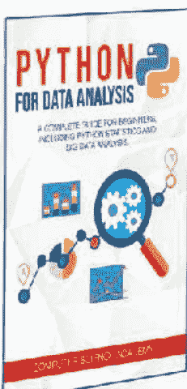

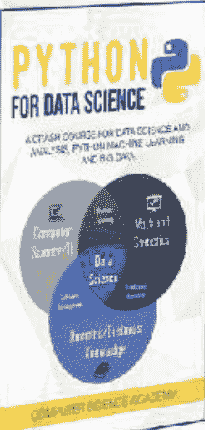


## 用于数据科学的 Python

### 简介

### 第 1 章：数据科学基础技术

- 数据科学生命周期
- 阶段 I – 业务理解
- 阶段 II – 数据获取与理解
- 阶段 III – 建模
- 阶段 IV – 部署
- 阶段 V – 客户验收
- 数据类型

- 数据科学策略
- 数据科学 vs 数据分析
- 网络安全中的数据科学。

### 第 2 章：Python 编程入门

- Python 安装说明
- Python 变量
- Python 数据类型
- Python 数字
- Python 字符串
- Python 布尔值
- Python 列表
- Python 元组
- Python 集合
- Python 字典。
- Python 类和对象

### 第 3 章：使用 Python 进行数据可视化与分析

### 第 4 章：机器学习与预测分析

### 结论

## 用于数据分析的 Python

### 面向初学者的完整指南，包含 Python 统计学与大数据分析

### 简介

恭喜您购买《用于数据分析的 Python》，感谢您的选择。

接下来的章节将讨论当我们第一次着手进行自己的数据分析时需要知道的所有内容。许多公司听说过数据分析，并好奇它是如何运作的以及他们能用它做什么。然而，许多人不确定为了获得最佳结果应该采取哪些正确步骤。这本指南不仅将带您完成自己的数据分析，还将确保您能够使用 Python 编程语言独立完成所有工作。

这本指南将介绍您开始进行自己的数据分析所需的一些基础知识。这将确保您能够独立启动这一过程，并见证更好的决策、削减浪费、击败竞争对手以及比以往更好地触达客户等成果。

要启动这一过程，我们花了一些时间深入了解数据分析及其含义。为了开始这一过程，我们需要知道一些步骤，我们将讨论数据分析的基础、使用这一流程的部分好处，以及与我们的数据分析相配合的步骤或生命周期。

在花些时间了解数据分析及其运作方式后，是时候转向 Python 语言了。我们可以使用多种不同的编程语言进行数据分析，但 Python 语言拥有最好的库和工具来帮助完成这项工作。此外，该语言简单易用。这本指南将花些时间讨论为什么 Python 语言是进行数据分析的绝佳选择，以及如何开始。

在此之后，我们需要花些时间介绍一些与 Python 语言关联并适用于数据分析的最佳库。我们将从 NumPy 库开始，它旨在与大多数其他库协同工作，因为这些库依赖于此库中的数组。然后，我们可以转向 Matplotlib 库、Pandas 库，以及一些您可能希望使用 IPython 环境而非传统选项的原因。

为了结束这本指南，我们还有几部分需要花些时间介绍。我们将探讨数据可视化的基础以及为什么要使用它们，一些与 Python 语言配合良好的最佳工具，以及使用 Python 数据分析为您自己的业务带来的一些行业和实际应用。

当我们谈论 Python 数据分析及任何行业时，会出现大量好处，任何选择将其用于自身需求的企业都能受益。当您准备好了解更多关于 Python 语言以及它如何帮助改进您的数据分析技能以助力您的业务时，请务必查阅本指南以帮助您入门。


### Chapter 1: Python 介绍及 Python 的历史

外面有许多不同的编程语言可供我们使用。学习这些语言的工作原理以及它们能帮助我们创造什么，是我们在项目中所能创造的如此美妙的事情。然而，我们需要确保自己学习的是适合我们需求的正确编程语言。

说到数据分析及其带来的所有不同部分，Python 语言是最好的选择之一。当然，还有其他可供选择的选项，但没有哪种能提供 Python 那样的易用性、强大功能、不同的库和扩展等，真正让我们的数据分析大放异彩，并为我们提供所需的答案和结果。

考虑到这一点，是时候我们更仔细地了解 Python 语言，并多了解一些关于它的知识。我们需要了解 Python 语言的历史，以及为什么它是我们可以学习的最佳语言之一。此外，我们需要了解使用 Python 语言的某些方式，以便充分利用它。让我们深入探讨，看看这如何运作！

#### Python 的历史

Python 是一种非常流行的高级通用编程语言。它由 Guido van Rossum 于 1991 年设计，随后由 Python Software Foundation 开发。最初开发时侧重于代码可读性，语法旨在帮助程序员用更少的代码行表达他们想要的概念。

在 20 世纪 80 年代末期，历史即将被重新书写。现代 Python 语言的部分工作正是在此期间开始的。此后不久，Guido van Rossum 于 1989 年在荷兰的 Centrum Wiskunde and Informatica 开始进行一些应用相关的工作。

开发 Python 语言最初只是一个爱好项目，因为 van Rossum 只是在寻找圣诞假期能吸引他兴趣的东西。Python 取代的编程语言是 ABC 编程语言。

ABC 是 van Rossum 在职业生涯早期曾参与创建的东西，但他发现该语言的功能等方面存在一些问题。经过一段时间后，他决定对其进行一些改进以优化它，于是他提取了 ABC 语言的语法以及其中仍然存在的一些优良特性，将其转化为全新的东西。

该语言名称的灵感来自《蒙蒂 Python 飞行马戏团》，因为 van Rossum 是该节目的忠实粉丝，他希望为自己在 Python 上开发的发明想出一个独特、简短且或许带有点神秘感的名称。van Rossum 直到 2018 年 7 月一直担任该语言的领导者，但他被视为一位仁慈的独裁者，允许其他开发者在很大的自由度下参与语言开发，从而赋予了我们今天所熟知和使用的 Python 语言。

Python 的官方版本于 1991 年发布。发布时，与 C++、C 和 Java 等其他语言相比，它使用了更少的代码来表达编程概念。与其他语言相比，随之而来的设计理念也更出色。

总的来说，我们可以看到 Python 语言的主要目标是提供可读性高的代码和对开发者而言非常先进的高生产力。

#### 为什么使用 Python？

使用 Python 的妙处在于它为每个人在学习过程中都提供了乐趣。它带来了大量好处，无论你过去是否有编程经验，都无关紧要。你依然会发现 Python 中值得喜爱的东西，而且它对所有水平的程序员来说都易于使用。你可能想要总体上使用 Python 语言的一些不同原因包括：

- 1. 它拥有可维护且可读的代码。

在编写软件应用程序时，你需要关注源代码的质量，以简化后续的更新和维护。Python 的语法规则将使你能够表达概念，而无需编写额外代码。与此同时，与其他一些编程语言不同，Python 强调代码的可读性，并允许我们使用英文关键字，而无需使用各种标点符号来完成这项工作。

因此，你可以用 Python 完成更多工作。可以使用 Python 构建自定义应用程序，而无需编写额外代码。可读且整洁的代码库将使维护和更新软件变得更加容易，而无需在过程中投入更多时间和精力。

- 2. 支持多种编程范式。

另一个我们将看到的优势是多种编程范式。和其他一些编程语言一样，Python 在语言内部支持不止一种编程范式。它将是一种可以充分支持结构化和面向对象编程的语言。此外，该语言在函数式编程和面向切面编程方面的各种概念上也会提供一些支持。

与此同时，Python 语言将提供一种动态类型系统和一些自动内存管理功能。这些编程范式和语言特性将帮助我们使用 Python 开发复杂且大型的软件应用程序。

- 3. 与大多数主要系统和平台兼容。

目前，Python 能够支持许多不同的操作系统。甚至可以使用解释器在特定工具和平台上运行代码。此外，由于 Python 被知晓为一种解释型语言，它将允许我们在许多不同平台上运行完全相同的代码，而无需重新编译。

因此，修改代码后你无需重新编译。你可以直接运行修改后的应用程序代码，立即检查更改对代码的影响。此功能使得在开发过程中更容易对代码进行更改，而无需担心开发时间。

- 4. 功能非常强大的标准库。

与 Python 配合使用的标准库功能强大，包含许多不同的部分。标准库能够为我们提供所需的所有模块。每个模块将进一步使我们能够向 Python 应用程序添加一些功能，而无需编写额外代码。

例如，如果你使用 Python 编写新的 Web 应用程序，可以使用一些特定模块来协助 Web 服务、对字符串执行操作、管理操作系统界面，或处理某些 Internet 协议。你甚至可以通过 Python 标准库的文档查找其他模块的相关信息。

- 5. 可以简化你正在进行的某些工作。

Python 被视为一种通用编程语言。这意味着你可以使用这种语言处理你想要的所有不同流程和程序，从 Web 应用程序到根据需要开发桌面应用程序。我们甚至可以进一步使用这种语言来帮助开发复杂的科学和数值应用程序。

Python 的设计包含许多旨在促进本指南中将要讨论的数据分析和可视化的功能。此外，你可以利用 Python 中的这些功能来创建自定义的大数据解决方案，而无需投入额外的精力或时间。

同样的，Python 提供的用于数据可视化和 API 的库将帮助我们以更具吸引力和更有效的方式可视化和展示数据。许多 Python 开发者会利用它来协助自然语言处理和人工智能等任务。


由此可见，使用 Python 语言能带来许多益处，而这仅仅是个开始。随着我们深入学习如何使用这门语言以及它能为我们做什么，我们将同时看到越来越多的好处。在进行自己的数据分析工作后，您很快就会明白这对我们的需求有多么有价值。

### 第 2 章：数据分析

在对 Python 语言及其所有内容有了一定了解之后，是时候我们来探讨数据分析这一主题了。学习如何使用 Python 语言固然很好，但实际应用是学习一门语言并让其更具价值的最佳方式之一。Python 与数据分析非常契合，所以让我们来看看数据分析具体涉及哪些内容，以及我们如何根据自身需求加以运用。

首先，数据分析是指清洗、检查、转换和建模数据的过程，其目的是从数据中找出最有用的信息，得出可靠的结论，并支持公司的决策过程。这听起来对一个过程来说任务繁重，但当我们使用合适的算法（由 Python 提供并运行）时，这绝对是可行的。

数据分析伴随着许多不同的方法和侧面，当我们将所有内容整合在一起时，将能够从大量技术中进行选择，以完成工作。这通常取决于我们最喜欢哪种方法，以及希望从过程中获得什么信息。如果我们的目标是了解客户及其行为方式，那么我们要完成的数据分析将与试图了解行业竞争对手的分析不同，也将与希望利用数据分析来做出明智商业决策的分析不同。

在统计学中使用数据分析时，我们可以将其细分为多个部分。可以将其划分为探索性数据分析、描述统计学和确证性数据分析等。所有这些在进行数据分析时都很重要，能够帮助我们在工作中发现所有洞察力及更多内容。

在数据分析中还需要关注的一个重要方面是，数据必须经过清洗。数据清洗是一个漫长的过程，但它使我们能够纠正所有可能影响结果的异常值，并帮助我们去除过程中不需要且不正确的其他信息。数据上有多种清洗过程，这取决于我们想要清洗的数据类型。如果您正在处理定量数据等内容，则可以使用异常值检测，以帮助确保数据中的异常值得到处理。即使是拼写检查器之类的工具，在处理文本数据并需要处理某些拼写错误的单词时也很有用。

在某些情况下，我们的数据分析会演变为一种商业智能形式。此时我们使用的数据分析将大量依赖于聚合、拆分、切块和切片，甚至专注于对业务最重要的某些信息。不过，这只是我们可以采用的形式之一。我们还可以进入预测分析的领域，因为这有助于我们在必要时应用拥有的统计模型和结构模型来进行预测性预测。或者，还有可用的文本分析，它将统计、结构和语言模型应用于提取和分类文本中发现的信息。

虽然所有这些形式处理数据的方式略有不同，我们也会以彼此不同的方式使用它们，但它们都很重要，我们需要花时间研究它们。此外，它们尽管看起来彼此完全不同，但都属于数据分析的类型！

许多企业希望加入这种分析的行列。他们听说许多其他公司通过这种方式取得了良好的结果，也希望能够这样做。这使得它成为他们至少值得探索的绝佳选择，您会发现通过少量研究，几乎任何行业在开始完成自己的数据分析时都能受益。

这已经是我们世界中如此重要的一部分。各个不同行业的公司都发现，这是未来的方向。它帮助他们制造客户想要的更好产品，帮助他们做出更好的决策，帮助他们战胜竞争对手，甚至帮助他们以新颖且创新的方式接触客户。由于数据分析带来了所有这些好处，许多企业有兴趣使用数据分析并确保以正确的方式加以应用，这也不足为奇了。

#### 什么是数据分析？

在使用数据分析时，有几种方法可供您使用。这些阶段将确保您能够以正确的方式处理数据，并使其按我们想要的方式工作。这些阶段将包括数据清洗等初始阶段、检查数据质量是否足够高、质量度量分析，然后进入主数据分析。

所有这些步骤对于我们要进行的数据分析工作都很重要。没有所有这些步骤，即使其中一些起初看起来与数据分析无关，我们的分析也不会非常准确或出色。由于公司通常会依赖这些分析来做出重要决策，拥有准确且高质量的数据至关重要。

我们在此需要关注的第一步是数据清洗。这是第一个过程，虽然它可能不如数据分析中算法等内容那么有趣，但仍然很重要。这是过程的一部分，我们在此匹配记录，检查数据中的多个项和重复项，并删除任何虚假或与我们此时所寻找的内容不符的数据。

在完成数据清洗部分后，是时候我们进行一些质量保证工作了。我们希望确保所使用的数据能够适用于我们想要投入时间和关注的任何算法。使用频数计数和描述性统计等工具可以帮助我们完成这项工作。

分析不符合您个人标准的数据从来都不是个好主意。您希望确保数据与您想要在分析工作中做的事情相匹配，是准确的，并且能够为您完成任务。

当质量分析部分完成后，是时候确保我们在此使用的度量工具质量也更高了。如果您在此的每个部分都不使用相同的度量标准，那么您的结果将在过程中产生偏差。不过，如果您使用的是正确的工具，您会发现这能为您提供一些更准确的选项，并帮助您真正依赖数据分析。

一旦完成确保数据清洗的整个过程，并完成了质量分析和度量，就是时候深入我们想要使用的分析了。我们可以对信息进行大量不同的分析，这通常取决于整个过程中的目标。我们可以进行一些图形技术，包括散点图。我们可以使用一些频数计数来查看存在哪些百分比和数字。我们可以处理一些连续变量，甚至计算新变量。

在进行这项工作时，有大量算法可用，这同样取决于您的目标。有些算法更适合帮助您从多个选项中看出最佳决策，例如决策树和


随机森林。其他方法在帮助我们梳理信息、发现其中的模式方面会更好，例如聚类算法。清楚自己希望从数据中寻找什么、期望获得什么，能起到至关重要的作用。

### 主要数据分析

现在是时候进行所谓的主要数据分析了。这其中包含许多部分，我们必须记住这是一个庞大的过程。需要花费一些时间，起初并不总是像我们期望的那样容易和直接。在这一部分，在我们有机会清理数据并将其整理好（包括之前完成的一些清理工作）之后，是时候进入主要数据分析，以便按我们想要的方式完成事情。

要使其发挥作用，我们需要使用一些方法。例如，验证性和探索性方法将有所帮助。这些方法不会让我们在分析数据之前就提出明确的假设。这确保我们不会被诱惑将自己的想法掺杂其中。我们将浏览信息并查看其中的内容，希望在过程中能从中学到一些东西。

然后我们可以检查结果中显示出的一些稳定性。使用交叉验证、统计方法和敏感性分析来评估结果的稳定性将会有所帮助。我们想确保所获得的结果是准确的，并且可以重复。如果我们运行几次，得到几个不同的答案，我们怎么知道哪个结果才是适合我们的正确结果？

这需要花费一些时间和精力才能完成，但这可能是帮助我们的正确方法。

然后我们可以使用几种不同的统计方法，帮助我们选出想要使用的算法，并确保能够了解一切的运行情况。这里我们可以使用的一些统计方法包括：

- 1. 一般线性模型：有许多统计模型将与一般线性模型配合使用，以完成工作。这将帮助我们处理其中的一些因变量，如果还有几个这样的因变量，我们甚至可以使用所谓的多元线性回归。
- 2. 广义线性模型：这与我们之前讨论的另一个选项相似，但通常被认为是该模型的一种推广或扩展。它用于帮助处理一些离散因变量。
- 3. 项目反应理论：用于此的模型将花费时间从一些其他二进制测量变量中评估一个潜变量。

除此之外，你可以使用大量不同的方法来分析数据。这些方法都很有趣，在某些情况下，你一次可以使用不止一种。这完全取决于你想用数据做什么。可以尝试的几个选项包括：

- 1. 跨文化分析，以查看不同国家或不同文化之间是否会出现相同的结果。
- 2. 内容分析
- 3. 扎根理论分析
- 4. 话语分析
- 5. 叙事分析
- 6. 诠释学分析
- 7. 民族志分析。

请记住，在进行我们想要完成的某些数据分析工作时，其中大部分与我们想要使用的实际分析无关。将花费大量时间来理解手头的数据并对其进行清理。此外，我们甚至需要仔细选择想要使用的合适算法。

这并不意味着分析不重要。然而，为了让分析真正发挥作用，我们需要确保所有其他部分也到位并运作良好。这确保了我们拥有高质量的数据，可以好好训练我们的机器学习算法，并在过程中为我们提供想要的一些结果。当我们花时间并以正确的方式真正完成之前的步骤时，我们可以确定，从实际数据分析中获得的结果和洞察将是准确的，并且可以满足我们的需求。

### 第 3 章：为什么为数据分析选择Python？

在前两章中，我们探讨了两个非常重要的主题。我们谈到了Python语言及其一些历史，以及许多人喜欢使用Python进行编码需求的许多原因。然后我们转向关于数据分析的讨论，以及这如何成为公司吸收大量数据并从中学习的好方法。这是两个我们可以花时间探讨的重要主题，但现在是时候弄清楚两者如何结合了。

在进行数据分析的某个时刻，你需要创建一些模型或算法，以便筛选数据并找到最适合你的洞察。有时这很难做到，并且会伴随一些具有挑战性的代码。但是，正如我们将在本章中讨论的，Python语言可以处理所有这些，并使其尽可能简单易用。

#### 易于阅读且简单

我们将首先探讨为什么Python尤其适合作为我们数据分析需求的编程语言。还有其他我们可以使用的语言，它们也做得很好。但是，Python有一些出色的特点使其脱颖而出，并确保你在处理此过程时能获得最佳效果。

虽然来自更多科学和工程背景的人在刚开始使用Python语言时可能会感到有些不适应，但随着时间的推移，他们会发现这种语言带来的可读性和简洁性使其易于上手。此外，考虑到它拥有许多专门用于数据分析甚至机器学习的库，无论数据科学家身处哪个行业或领域，都能找到他们需要的、量身定制的包。此外，大部分情况下，这些库和扩展都可以免费下载。

当然，这不足为奇。Python具有许多可扩展的潜力，由于它本质上是通用语言，很容易看出这种受欢迎程度为何会将其带入数据分析领域。作为编程世界中的一种“全能选手”，它不一定是一门适合进行统计分析的语言。然而，许多组织投资于这种语言并致力于创建扩展和库，这使得Python成为理想的选择。

由于Python的简洁性，无论某人的背景如何，任何人都可以学习使用它，而且它易于扩展以满足你想要的所有功能，因此不难理解为何它是数据分析世界中蓬勃发展的语言。

#### 库非常易于使用

就像查看其他一些流行的编程语言一样，真正带来你看到的成功的将是随Python一起提供的一些库。事实上，目前人们认为在Python包索引中约有72000个库，这个数字在不断增长。

这种语言的设计核心轻量且精简，标准库配备了许多工具来处理各种不同的编程任务。它被视为一种“自带电池”的哲学，允许语言的用户及时高效地处理解决问题的所有细节，而无需花费大量精力去寻找合适的功能库。

由于Python是免费且开源的，任何人都可以进来编写自己的库包来扩展Python的功能。此外，数据科学总体上是这一现象的最早受益者之一。特别是，Pandas就诞生于此，它是完成工作的头号数据分析库。

在数据分析方面，Pandas可用于你想要做的任何事情。它可以做从从Excel电子表格导入数据到

处理时间序列分析所需的一些数据集。Pandas 已经能够让所有常用于数据整理的工具都触手可及。这意味着当我们使用它附带的强大数据帧时，可以执行基本清理和一些高级操作等任务。

另一个需要考虑的是，Pandas 库是建立在 NumPy 库之上的，NumPy 是 Python 用于数据科学最早附带的库之一。NumPy 带来的函数将在 Pandas 中公开，以便我们在过程中完成高级数值分析。

现在，这些只是我们在进行此过程时可以关注的几个不同库中的两个。如果你想了解更多选项，或者需要更专业的东西，你仍然能够找到它们。程序员在使用数据分析和 Python 语言时可以做的一些其他选择包括：

- 1. SciPy：这将与 NumPy 类似，但它更专注于我们需要的科学领域。它也擅长为我们提供一些工具和技术，以便我们可以分析科学数据以满足我们的需求。
- 2. Statsmodels：这个库将更专注于一些用于统计分析的工具。
- 3. Scikit-Learn 和 PyBrain：这两个库将更专注于机器学习。当你需要一些用于构建神经网络和进行数据预处理的模块时，它们是很好的选择。
- 4. **SymPy：** 这是一个用于统计应用的好选择。
- 5. **PyMC、PyLearn2、Shogun：** 这是一个帮助我们进行机器学习工作的好选择。
- 6. **Matplotlib、Seaborn 和 Plotly：** 正如我们将在本指南中讨论的那样，分析附带的可视化将很重要。我们上面提到的三个库将是很好的选择，可以帮助你获取数据并将其转换为可视化，以便你更好地看到其中的洞察和模式。

请记住，这些只是你可以在数据分析中使用的几个库。有许多库，其中大部分免费使用，几乎可以用于你在 Python 和数据分析世界中想要做的任何事情。此外，这是使用 Python 的好处之一。它允许我们使用任何想要的库和扩展。而且，如果碰巧没有可用的库可以使用，那么由于 Python 是开源的，我们可以选择自己开发一个库来满足这一需求。

### 大型社区

此外，我们选择使用 Python 编程语言进行数据分析的最后一个重要原因是有一个庞大的社区，这意味着当我们需要帮助时，总会有人在那里提供帮助。有数百万 Python 编程用户组成的广泛而多样的群体，当你遇到困难时，他们非常乐意提供建议或意见。如果你在某件事上苦苦挣扎，那么这个社区中很可能有人过去也遇到过同样的困难。此外，他们可以提供一些技巧和窍门来帮助你解决问题。

虽然开源社区会有允许开放讨论的政策，但其他语言的一些社区并不那么用户友好，它们可能不会像你期望的那样欢迎初学者。这可能会令人生畏，并轻易地让人们对这些其他语言望而却步。当你想要学习新事物以及如何真正完成一些编码时，你最后想担心的就是社区是否会对你的问题持开放和欢迎态度，还是他们会生气并试图把你赶走。

另一方面，我们可以看看 Python 社区。这将是那些其他社区的一大例外。无论是本地聚会小组还是在线社区，都会为你提供大量 Python 专家，他们有能力且愿意帮助你了解学习新语言所带来的各种复杂性。尽管 Python 比某些其他语言更容易学习，但仍然有时候你需要一些帮助。在进行数据分析时，这一点再真实不过了。

使用 Python 并加入这些社区的人们都在那里并且愿意提供帮助。他们记得自己选择这种语言是因为它很简单，并且曾害怕尝试让它运行。因此，他们通常更愿意帮助处于类似情况的其他人。

此外，由于 Python 在数据科学社区中不断发展并变得越来越普遍，将有大量资源可供你使用。这些资源甚至会针对在数据科学领域使用 Python 语言而专门提供。这可以帮助你在项目进行中获得所需的帮助和协助。

如我们所见，Python 带来了许多好处。我们在本章和指南的第一章中讨论了其中的一些好处。令人惊讶的是，有那么多人能够快速而有效地掌握 Python 语言，并且它也是你值得为自己的需求尝试的语言。当涉及到数据分析时，Python 语言是帮助你快速高效地学习和完成工作的最佳选择。

### 第 4 章：理解数据分析过程

现在是时候我们更深入地了解良好数据分析所需的一些机制了。所有这些都需要到位，以确保数据分析能够正常运行，我们能够获得正确的数据，并且能够让所有数据协同工作并取得良好效果。这有时是一个难以处理的过程，但你会发现，当我们结合各个部分并确保理解它们的工作原理时，就更容易看出我们需要做什么才能完成这项工作。本着这个想法，让我们来看看数据分析的六个主要阶段，并探讨每个阶段我们可以做什么。

#### 探索阶段

这是一个有趣的阶段，因为它可以为我们需要开展的其余项目奠定基础。这一部分全在于弄清楚我们需要什么样的数据，我们的目标是什么，以及在整个分析完成后我们实际上希望弄清楚什么。我们不想轻易对待这一部分，通常在不先弄清楚我们需要什么以及想要做什么之前，直接去收集大量数据不是一个好主意。

我们希望一开始就清楚企业在进行此次分析时想要完成什么。他们是想更多地了解自己的客户群吗？他们是否想了解是否有可以进入的新利基市场？他们是否想更多地了解竞争对手以及如何利用这些信息来领先？公司想要使用数据分析有很多原因，但如果你没有提前制定计划，那么就会一团糟。你会浪费时间收集信息，却完全没有计划。

完成这一点后，就该确定我们将使用哪些方法来收集数据了。如果我们无法浏览并发现想要在算法中使用的数据，那么数据分析将毫无用处。好消息是，在我们的现代世界中有大量拥有数据的地方，我们只需进行一些研究并弄清楚哪些地方能为我们提供所需的数据。

我们可以选择花一些时间在社交媒体上，看看人们对我们说些什么或他们如何与我们互动。我们可以发出调查问卷并进行焦点小组访问以了解一些情况。我们可以在线以及在某些网站上进行研究，以弄清楚那里发生了什么。我们可以查看自己的网站，看看客户在购买什么，以及与之匹配的一些人口统计信息。

我们可以收集的信息数量没有限制，但我们希望确保在过程中收集到正确类型的信息。仅仅因为你拥有大量可用数据并不意味着你会很好地使用它们，或者它们甚至与你正在


正在尝试完成。在收集这些数据时请花时间，弄清楚什么重要、什么不重要。

### 数据准备阶段

一旦你有时间准备想要的信息，并弄清楚在过程中希望解决哪些问题，就可以着手进行数据准备阶段的工作了。此时，我们来自各个不同地方和来源的大量数据。这很好。不过，你不需要花太长时间在数据中搜索，就能发现它一团糟，需要你做一些工作来整理它。

如果尝试将当前状态的数据直接输入选定的算法，将得不到准确的信息和结果。算法在处理过程中会对你的意图感到困惑。会出现缺失值、不完整条目、重复项、可能扭曲平均值的异常值等问题。尽管这里需要额外的工作，但你的算法要求待解释的数据必须以合适的方式进行组织和准备。

要实现这一点，我们需要关注几件事。首先，需要处理异常值。这些是远离平均值的点，只是偶然发生的一次性事件。如果大部分客户年龄在18到25岁之间，但有几位客户是75岁，那么年长群体大概可以忽略。

这些人很可能是为年轻群体中的人购买物品。但是，如果把他们加入数据集并经过算法处理，会扭曲你的结果。如果你保留这些异常值，可能会认为年龄人口统计特征是30到35岁的人，因为年长群体稍微干扰了数据，把平均值拉高了。

现在，这并不意味着我们总是要删除异常值。很多时候确实如此，但在某些情况下，异常值在过程中会告诉我们大量信息。如果有不少异常值集中在同一个位置，这可能是一座金矿，告诉你一种可能触及的新产品或新人口群体。也许你的客户平均年龄是18到25岁，但随后你会发现，30到35岁范围内有异常值集中。这可能是你需要更详细探究并加以利用的事情。

除了处理异常值，我们还需要花些时间查看重复值。尤其是因为我们要从许多不同来源收集数据，最终会得到一些重复的信息。如果只是少数几个来源，这并非大问题。但是，当重复项很多时，会干扰你得到的结果。通常最好减少甚至消除重复项，以获得最佳结果。

另外，在数据准备方面我们需要关注的最后一件事，是确保妥善处理缺失值。如果只有少量缺失值，你可能可以删除那部分数据，也不会有问题。但是，很多时候，用其他列的均值或平均值填充它，仍然是一种不引起算法报错而继续使用该信息的好方法。

### 模型规划阶段

现在是时候进行模型规划了。这是你和你的团队开始创建要使用的模型或算法的地方，以推进这一进程并确保其按预期工作。基于前两个步骤中你所做的工作，你选择使用的模型会有所不同，而这是我们确定最佳步骤的阶段。

在此阶段，团队将花些时间确定哪些工作流、技术和方法在之后构建模型时会有所帮助。我们会想出如何最好地利用长期收集的数据，并基于此开展工作。团队还需要探索他们拥有的某些数据，以了解变量之间的关系，然后选择最重要的变量。

我们这样做的原因是，这有助于我们找出最合适的模型。当我们了解更多关于变量的信息，并能找到对我们需求最重要的变量的模式时，模型就会很好地适应我们。这可以节省大量时间和精力，并确保我们不必针对许多不同的模型进行操作，希望能找到正确的模型。

### 模型构建阶段

我们可以花时间的第四阶段是模型构建。这是我们将着手解决如何构建能够从输入中学习并能处理我们部分数据的模型的阶段。这是一个很棒的阶段，也可以被认为是最有趣的阶段之一。

在此阶段，你的团队将花时间开发用于测试、训练以及算法各种生产用途的数据集。此外，在此阶段，团队根据前一阶段完成的一些工作构建并执行模型。

此外，团队将花时间考虑现有的工具是否足以运行模型。有时候他们拥有合适的工具及更多资源来完成所有工作，而其他时候他们需要经过并添加一个更强大的环境来执行他们的模型和希望完成的某些工作流。

### 沟通阶段

一旦你有机会构建模型并将选定的数据输入其中，就是时候查看其中的关键洞察和模式，并将它们传达给周围的人了。这项数据分析很可能是出于某种原因而进行的，通常是为了帮助公司，而完成这项工作的团队必须能够将其传达给正确的人。

有时，这将是一个挑战。公司中下达此分析订单的个人可能认识到这样做的重要性并希望获得结果。但是，他们可能不像数据分析师那样理解所有技术术语。由你和你的团队负责向受众清晰简洁地传达结果。

在此阶段，团队将与公司的一些主要利益相关者一起，根据之前第一阶段制定的某些标准，确定项目结果是成功还是失败。团队需要能够识别一些关键发现，量化其业务价值，然后发展一个叙述来帮助传达和总结发现，以便每个人都能理解和使用。

可以使用许多方法来帮助传达结果。你可以使用可视化来帮助展示，还有一些电子表格和报告。在开始之前，先考虑你的受众，以确保以对方能够使用和理解的方式呈现数据。

### 运营化

我们将在此查看的最后一个阶段是运营化。这是团队将我们在其他五个步骤中处理和审查的所有工作，然后交付给需要它的人。这包括技术文档、代码、简报以及所有最终报告。

此外，根据此结果以及建议和洞察的内容，公司可能决定利用这些信息开展一种试点项目。这使他们能够将一些模型和其他洞察实施到生产环境中，看看其运行情况。如果情况良好，公司可能会认为是时候进一步推进，并在公司的其他部分及其业务中尝试了。

数据分析的每个阶段都很重要。这将确保我们能够梳理、组织事物，并利用算法在过程中准备好处理一些数据。如果这一过程做得好，并给予适当的关心和关注，你会发现我们更容易学习这些洞察和预测，并可以利用它们来帮助我们在长期内取得更多成功。


### 第 5 章：NumPy 包安装

此前，我们花了一些时间来了解 Python 语言自带的不同库，以及哪些库最适合用于数据分析。考虑到这一点，现在是我们开始学习安装最基础但也非常重要的库——NumPy 的步骤的时候了。

我们将在三大主流操作系统上安装它，以便简化过程，并将使用 Python 的包安装程序 pip。这样可以更轻松地完成工作，并确保 NumPy 库能在你想要的任何计算机上运行。之后我们可以讨论使用 NumPy 的一些基础知识，从而了解为什么这个库非常重要。

#### 在 Mac OS 上安装 NumPy

我们要探讨的第一个操作系统是如何在 Mac 电脑上安装 NumPy。可以使用几种不同的 Python 版本来完成此操作，步骤彼此相似，以便简化操作。首先，需要在计算机上打开终端。打开后，输入 python 以打开该语言的提示符。到这一步时，请按照以下步骤进行操作：

- 1. 我们需要先按下 Command 键，然后按空格键。这将帮助我们打开聚光搜索。输入单词 "Terminal" 后按回车。
- 2. 这应该会打开我们想要使用的终端。然后可以使用 pip 命令来安装 NumPy 包。需要输入代码“pip install numpy”来开始。
- 3. 安装成功后，可以再次输入 python 来获取 Python 提示符。你应该查看显示的是哪个版本的 Python。然后可以选择使用 import 命令来引入 NumPy 包，并在未来的任何代码中使用它。

该方法最适合 Python 2.7。你也可以在 Python 3 上安装 NumPy 包。过程类似。不过，在打开上述第一步中详细说明的终端后，你需要使用 pip3 命令来安装 NumPy。请注意，我们将使用 pip3 而不是之前的 pip。否则，步骤将保持相同。

#### 在 Windows 系统上安装 NumPy

需要记住，Python 语言并非 Windows 操作系统的默认组件，因此我们需要自行安装才能使用。你可以访问 www.python.org 并找到想要使用的版本。按照网站上的步骤，在自己的计算机上准备好 Python。成功安装 Python 后，可以打开计算机上的命令提示符，并使用 pip 来安装 NumPy 库。

#### 在 Ubuntu 操作系统上安装 NumPy

Ubuntu 和一些 Linux 发行版可能不如其他一些选项常见或流行，但它们在帮助我们完成工作方面仍然可以做很多惊人的事情。它是用于黑客攻击、机器学习和数据分析等任务的不错选择，并且已知与 Python 语言配合良好。

你会发现，与 Mac 操作系统类似，这类计算机上已经预装了 Python。然而，存在一个问题，即 pip 未安装。如果你想要完整的包来完成这项工作，可以从 www.python.org 下载，然后使用 apt install 命令在操作系统上安装它。

此外，还有另一种替代方法来完成此操作。你可以在 ubuntu 上使用安装 pip 命令，然后安装 NumPy。这通常是两种方法中更好的一种，因为它简单，只需要几个命令。请记住，使用此方法需要在系统上拥有 root 权限才能安装 pip 和 NumPy，否则将无法工作。

你可以通过打开 ubuntu 中的终端，然后使用命令“pip3 using apt”来安装 pip，完成所有这些操作。在计算机上安装 pip 后，可以使用与其他操作系统相同的命令来安装 NumPy。

#### 在 Fedora 上安装 NumPy

我们将要使用的另一个选项是 Fedora 操作系统。这个系统与其他一些选项略有不同，但确实包含之前 Ubuntu 系统中的一些步骤。我们将使用 pip 命令来帮助安装 NumPy 库。

请注意，无论你是为 Python 2.X 还是 Python 3 及更高版本使用 pip，pip 命令都会有所不同。在使用 Fedora 系统时尤其如此。我们需要使用 pip install numpy 来安装旧版本，但对于新版本，则希望使用 python3 -m pip install numpy。

在计算机上安装 Python 语言和 NumPy 库都很容易，无论你决定沿途使用哪种操作系统，这个过程都简单易行，可以让库运行起来。完成后，你可以直接开始使用这个库，或者将其作为主要来源来帮助其他一些库运行并访问数组，我们将稍后讨论数组。

### 第 6 章：NumPy 数组操作

安装好想要使用的 NumPy 数组后，现在是时候了解这个库中数组能做什么了。这是处理数据分析的重要部分，因为它能让我们完成大量工作，而且许多其他数据分析库都将依赖这些数组。考虑到这一点，我们需要仔细了解 NumPy 数组是什么，以及我们可以用它做什么。

#### NumPy 中的数组是什么？

NumPy 能够提供一组远超 Python 传统列表或数组的庞大功能。在需要对数学聚合、代数运算、局部操作等内容执行某些操作时，它非常有用，我们甚至可以使用它来对所选数组进行切片和切块操作。

任何使用该库来协助使用 Python 进行深度学习、机器学习或数据分析的人都会发现，花时间了解 NumPy 是什么以及如何使用它，是该过程的第一步。有几件事我们需要知道这些 NumPy 数组，以便使它们更好地满足我们的需求，这些包括：

- 1. Python NumPy 数组在处理数据分析时将是一个非常有用的工具。它将是一个高效的多维容器，用于存储具有相同数值类型的值。
- 2. 它将带有 Python 中 n 维数组的强大封装，这将为我们提供一种方便的方式来对数据执行所需的操纵。
- 3. 该库将包含功能和方法，帮助我们借助线性代数解决各种数学问题。
- 4. 我们可以在这些数组上使用的操作将会很快，因为它们是用 C 编程语言原生编写的。
- 5. 此外，许多随 Python 自带的库都将需要 NumPy 数组来帮助它们完成工作。

#### 如何创建 NumPy 数组

接下来，我们需要花一些时间来学习如何创建这些数组。我们假设你的计算机上已经安装并准备好 NumPy 库。然后，我们可以使用两种主要方式来创建这些数组：

- 1. 你可以使用嵌套列表或 Python 列表来创建这样的数组。


- 2. 我们还可以使用一些 NumPy 自带的方法来创建这些数组。

我们将首先查看从嵌套列表和 Python 列表创建数组所需的步骤。为此，我们只需将 Python 列表作为参数传递给 np.array() 方法即可，然后就完成了。这样做后，你将得到一个向量或一维数组，这可以帮助你完成大量必要的工作。

有时我们也希望更进一步。我们希望跳出刚创建的一维数组，将其转换为二维数组或矩阵。为此，我们只需将 Python 的嵌套列表（列表的列表）传递给 np.array() 方法，即可完成。

上述方法简单易用，应该足以创建你想要的数组。大多数初学者都会从这种方法开始，因为它能帮助他们掌控局面，而且并不复杂。不过，有时候我们需要换一种方式来做，或者希望在工作中拥有更多控制力。这就是为什么我们将学习如何使用 NumPy 提供的内置方法来创建某些数组。

第一个是 NumPy 中名为 arange() 的方法。关于这个数组，有几点需要记住：

- 它将在需要时帮助我们创建一些一维数组。
- 当我们想要使用 Python 的 range 函数在此库中创建向量时，它是一个不错的选择。
- 该方法可以接受一些参数来完成任务，包括步长、停止值和起始值。
- 它将确保返回的值在我们使用的区间内均匀分布。

我们还可以根据需要使用 zeros() 和 ones() 方法。这些方法允许在库中创建包含零和一的不同数组。它们易于使用，我们只需编写 np.zeros() 和 np.ones() 即可对其进行编码。

另一个可使用的方法是 linspace。它将帮助我们创建一个数组，其中的数字在你指定的两个数字之间的区间内等间距分布。它还可以接受多种参数，包括数值、停止值和起始值。这一方法同样会为我们创建一个向量或一维数组。

这些数组对我们的工作非常重要。它们让我们能够对数据进行大量操作并将其组织起来。此外，由于 Python 中的许多其他库以及 NumPy 库的其他部分都将依赖这些数组来完成工作，因此了解其工作原理以及使其正确运行的因素非常重要。

### 第 7 章：保存 NumPy 数组

现在我们对 NumPy 数组及其用途有了更多了解，需要花些时间学习如何保存它们，以便以后使用。保存时有多种方法可用，我们只需确保做好准备，设置好并准备就绪即可。你可以根据自己的编程需求和想要完成的数据分析类型来选择保存数组的方法，但让我们先看看几种不同的方法以及实现它们的步骤。

#### 将 NumPy 数组保存为 .CSV 文件

当你想要存储这些数值数据时，最常见的格式将是 CSV（逗号分隔值）格式。你的训练数据以及在此过程中作为模型输入的任何数据，很可能都将存储在 CSV 文件中。使用这些文件非常方便且易于操作，你可以利用它们从模型中进行一些预测。

可以借助 savetxt() 函数将 NumPy 数组保存到 CSV 文件中。该函数将数组和文件名作为参数，以便我们按需将数组保存为 CSV 格式。请记住，使用此函数时，我们需要指定分隔符，即用于分隔文件中所有变量的字符（此处为逗号）。这将通过 delimiter 参数来设置，以使操作尽可能简单。

让我们看一个示例，了解如何使用它以及如何将数组保存为 CSV 文件。可以使用以下代码来实现此目的：

```
#### save numpy array as CSV file
from numpy import asarray
from numpy import savetxt
#### define data
data = asarray([[0, 1, 2, 3, 4, 5, 6, 7, 8, 9]])
#### save to CSV file
savetxt('data.csv', data, delimiter=',')
```

运行此示例不仅能帮助我们定义 NumPy 数组，还能将其保存为名为 data.csv 的文件。该数组将包含一行数据，其中有十个列。我们期望这些数据及相关内容会保存到 CSV 文件中，但会以单行数据的形式保存。运行示例后，我们可以检查该文件中的所有内容。然后可以看到，数据将以单行形式正确保存，并且数组中所有浮点数都将以全精度保存。

我们还可以了解另一种处理此类数组的方法。我们将学习如何从正在使用的 CSV 文件中加载数组。可以借助 loadtxt() 函数将数据加载为 NumPy 数组。需要记住的是，指定文件名和相同的逗号分隔符很重要，这样才能正常工作。可以使用以下代码实现此功能：

```
#### load numpy array from CSV file
from numpy import loadtxt
#### load array
data = loadtxt('data.csv', delimiter=',')
#### print the array
print(data)
```

运行此示例时，它将加载 CSV 文件中的数据并打印出内容。这将帮助我们将单行与前一个示例中定义的十个列进行匹配。

### 将 NumPy 数组保存为二进制或 .NPY 文件

接下来我们要处理的是确保将数组保存到二进制文件中。有时候我们的数组中会有大量数据，希望能够快速且高效地保存。这意味着我们希望将数组保存为本地二进制格式，以便在加载和保存时都能高效进行。

当我们必须使用的输入数据已事先准备好时（例如，需要用于测试机器学习模型的转换数据），这是一种常用的方法。此外，它在过程中运行多次实验时也很有帮助。.npy 文件格式在这里效果很好，它通常被称为 NumPy 格式。可以通过使用 save() 函数来实现，只需指定文件名和要保存的数组即可。

让我们看一个示例，了解如何实现这一点。下面列出的示例将帮助我们定义一个二维数组，并确保可以将其保存为 .npy 文件。

```
#### save numpy array as npy file
from numpy import asarray
from numpy import save
#### define data
data = asarray([[0, 1, 2, 3, 4, 5, 6, 7, 8, 9]])
#### save to npy file
save('data.npy', data)
```

运行示例一段时间后，我们会看到目录中出现一个名为 data.npy 的新文件。我们无法直接使用文本编辑器查看该文件中的内容。这是因为它目前是二进制格式。


我们可以看另一个示例，了解如何执行此过程并确保我们从这类文件中加载 NumPy 数组。我们可以借助 load() 函数将整个文件作为数组加载。可用于实现此目的的示例包括：

```
#### load numpy array from npy file
from numpy import load
#### load array
data = load('data.npy')
#### print the array
print(data)
```

当你运行上面的示例时，它将帮助我们加载文件并按需打印内容，并确认文件已以正确方式加载，内容也将与我们期望的格式相匹配。

## 如何将数组保存为 .NPZ 文件（压缩）

保存数组的第三种方式是将其保存在压缩文件中。有时在为建模准备数据时，我们需要设置数据以便在多个实验中重复使用。但是，这样做时，我们的数据可能会很大。

这可能是我们可以预处理到数组中的内容，例如文本语料库、整数或像素的重新缩放图像数据集合。在这些及其他情况下，将其同时保存到常规数据文件和更压缩的格式中既是可能的，也是可取的，以便于使用。

使用压缩格式时，可以将我们的数据从几千兆字节减少到几百兆字节，而不是几千兆字节，并可以实现向其他服务器或云计算更轻松的传输过程，以便进行算法的长时间运行。如果您想处理这种情况，那么处理 .npz 文件格式将是这种情况下的最佳选择，并且它将确保对原生 NumPy 文件格式压缩版本提供正确的支持。

我们可以使用的另一个函数是 savez_compressed()。这是一个很好的函数，因为如果我们愿意，它会自动确保我们能够将数组保存为这种格式中的单个压缩文件。

考虑到这一点，我们需要更仔细地了解如何使用此函数将一些单个 NumPy 数组保存到压缩文件中，使它们在变得非常大时更容易移动和使用。下面的代码很好地展示了我们如何处理此问题：

```
#### save numpy array as npz file
from numpy import asarray
from numpy import savez_compressed
#### define data
data = asarray([[0, 1, 2, 3, 4, 5, 6, 7, 8, 9]])
#### save to npy file
savez_compressed('data.npz', data)
```

运行上面的示例时，我们会发现该示例可以定义我们的数组，然后将其保存到名为 data.npz 的压缩文件中。与我们之前讨论的格式一样，我们无法使用正在使用的文本编辑器查看此保存文件的内容，因为它是二进制格式。

现在，是时候从 NPZ 文件中加载 NumPy 数组了。只要我们使用之前使用的 load() 函数，就可以随时加载此文件。在这种情况下，当使用 savez_compressed() 函数时，我们会发现它支持将多个数组保存到同一个文件中。然后 load() 函数将帮助我们加载多个数组。

我们这里能够加载的数组将以字典形式从 load() 函数返回，名称将按顺序为第一个数组的 arr_0、第二个数组的 arr_1，依此类推。为了帮助加载我们之前创建的单个数组，我们希望使用以下代码：

```
#### load numpy array from npz file
from numpy import load
#### load dict of arrays
dict_data = load('data.npz')
#### extract the first array
data = dict_data['arr_0']
#### print the array
print(data)
```

如果你花时间运行这个示例，你会发现它可以加载你创建的压缩文件，并包含你保存的所有数组字典。然后它还将能够提取我们保存的第一个数组。在此例中，我们只保存了一个，因此将打印其中的所有信息。对于第一个数组，程序将打印内容以帮助我们确认值以及数组的形状，以确保它与我们最初保存的数组匹配。

正如我们在这里所见，在使用 NumPy 数组方面，我们可以做大量的事情。并且能够做至少少量的编码将确保我们准备就绪，可以处理大量所需的工作，无论是查找数据、清理数据，还是在使用其他所有数据科学库的过程中创建我们自己的算法。

### 第 8 章：关于 Matplotlib 的一切

现在是时候讨论一个很棒的库了，当您需要在此库中处理所有可视化等内容时可以使用它。我们可以用于所有可视化、图表和图形的最佳绘图库称为 matplotlib。

Matplotlib 将被誉为适用于 Python 编程语言的绘图库之一，它将依赖 NumPy 库来提供所需的数组。该库能够依赖面向对象的 API 将图表嵌入 Python 应用程序。无论您希望如何随时间可视化数据，您都会发现这是完成所有工作的库。

由于 Python 在机器学习中广泛使用，Matplotlib 和 NumPy 等资源将有助于我们模拟许多在机器学习中看到的技术。其理念是程序员将同时使用这两个库，在 Python 的大环境中完成一些任务。然后，我们可以将这些结果与机器学习程序中的所有其他功能和元素集成。如果需要，它还可以与某些高级机器甚至神经网络一起工作。

Matplotlib 和 NumPy 的实用性与数字有关。我们能够利用 matplotlib 特别提供的实用功能将专注于我们可用于可视化绘图的一些工具。因此，为了简单起见，这些资源将被视为更多是分析性的，而不是生成性的。但是，所有基础设施协同工作，使机器学习程序能够产生对需要机器学习的人有用的结果。

#### Matplotlib 是什么？

考虑到这些，让我们更深入地了解 matplotlib 是什么以及我们如何为自己的需求利用它。这是一个绘图库，我们将在使用 Python 语言进行机器学习和数据分析时用于生成 2D 图表等内容。我们可以将其用于许多选项，例如 Web 应用程序服务器、Python 脚本、Python 脚本以及一些其他图形界面工具包。

我们可以使用的一些工具包非常适合帮助扩展 Python 以及您将看到的 Matplotlib 库的功能。其中一些将是单独下载的内容，如果您想使用它们，需要将其添加到计算机中，而另一些则与 matplotlib 源代码一起提供，但它们可能有一些外部依赖项。您可以使用的一些选项包括：

- 1. Basemap：这是我们可用于绘制不同部分的工具包。它包含许多内容，如政治边界、海岸线和地图投影。
- 2. Cartopy：现在我们看到有一个映射库，它包含面向对象的地图投影定义以及一些其他功能，可帮助您完成工作。
- 3. Excel Tools：如果需要，此库将为我们提供所需的实用工具，以便与 Microsoft Excel 交换所有数据。

#### 图表的类型

您可以使用多种不同的图表和图形。我们可以选择最适合我们需求的一种，这取决于您想要处理的数据类型以及您如何最好地可视化这些信息。我们将查看一些可用于创建这些图表并获得最佳结果的代码。

首先，让我们从这个库中可以进行的非常基本的图表开始，以生成一个简单的图形。打开 Python 编译器并输入以下代码，看看这是如何工作的：

```
from matplotlib import pyplot as plt

#Plotting to our canvas

plt.plot([1,2,3],[4,5,1])

#Showing what we plotted

plt.show()
```


因此，只需几行代码，你就能使用这种库生成一个基本图表。它就这么简单，好用。接着，我们可以在这段简单代码的基础上添加一些其他部分。我们可以给库中显示的图表添加标题、标签等，以赋予其更多含义。可以使用下面的一些代码来实现这些功能：

同样可以尝试不同的样式技巧，使图表呈现出你想要的效果。你可以更改图表中某条线的颜色或宽度，或者添加几条网格线。因此，我们需要学习如何在matplotlib的这些图表中添加一些样式。首先，请记住我们需要从matplotlib库导入style包，然后使用样式函数完成其余操作。

现在我们已经能够为基本图表编写相当基础的代码，可以更具体地说明我们在做的一切，并使其更易于处理。我们将在这个库中创建自己的柱状图，以便比较我们拥有的数据等。柱状图将使用条形，以便我们可以比较不同类别中发现的数据。当我们想根据需求查看变化在某个时间段内的发生情况时，它非常合适。你可以让这个柱状图垂直或水平显示。对于这种图表，当某个条形比其他条形更长时，表示值更高。有了这个想法，我们用来制作柱状图所需的代码如下：

```
from matplotlib import pyplot as plt

plt.bar([0.25,1.25,2.25,3.25,4.25],[50,40,70,80,20],
label="BMW",width=.5)
plt.bar([.75,1.75,2.75,3.75,4.75],[80,20,20,50,60],
label="Audi", color='r',width=.5)
plt.legend()
plt.xlabel('Days')
plt.ylabel('Distance (kms)')
plt.title('Information')
plt.show()
```

我们还可以借用一些相同的想法，用来制作自己的直方图。我们上面做的柱状图与直方图之间存在区别。直方图将用于显示分布，而柱状图将帮助我们比较几个不同的实体。当你拥有很长的数组或列表时，这些将是最有用的。

我们将看一个如何为自己制作这些图表的示例。我们将做一个示例，根据人口年龄所落入的 bin 来绘制年龄分布。这个 bin 非常重要，因为在大多数情况下它将包含一个范围。通常，bins 希望彼此大小相似，以使它们尽可能均匀。我们将使用下面的代码，它通常会给我们提供区间。这意味着我们从 0 到 9、10 到 19 等进行处理。

```python
import matplotlib.pyplot as plt
population_age = [22,55,62,45,21,22,34,42,42,4,2,102,95,85,55,110,120,70,65,55,111,115,80,
75,65,54,44,43,42,42,48]
bins = [0,10,20,30,40,50,60,70,80,90,100]
plt.hist(population_age, bins, histtype='bar', rwidth=0.8)
plt.xlabel('age groups')
plt.ylabel('Number of people')
plt.title('Histogram')
plt.show()
```

接下来是使用散点图来帮助我们比较一些变量。因此，我们可以使用它来查看一个变量在多大程度上受另一个变量的影响，从而据此建立新的关系。然后你可以取这些数据，将其显示为点的集合，而不是所有变量都汇集在一起。水平轴的位置由多个变量共同决定，而第二个变量的值将帮助确定垂直轴上的位置。

我们可以用这个库创建的下一个图表称为面积图。面积图将与我们在折线图中看到的相似。我们还可以给它们另一个名称，即堆叠图。这种图表非常适合跟踪两个或多个相关且属于同一类别的组之间我们想了解的一些变化。我们可以汇总一天中完成的工作，并将其分类为工作、进餐、睡觉和玩耍。我们可以用于此的代码如下：

```
import matplotlib.pyplot as plt
days = [1,2,3,4,5]
sleeping =[7,8,6,11,7]
eating = [2,3,4,3,2]
working =[7,8,7,2,2]
playing = [8,5,7,8,13]
plt.plot([],[],color='m', label='Sleeping', linewidth=5)
plt.plot([],[],color='c', label='Eating', linewidth=5)
plt.plot([],[],color='r', label='Working', linewidth=5)
plt.plot([],[],color='k', label='Playing', linewidth=5)
plt.stackplot(days, sleeping,eating,working,playing, colors=['m','c','r','k'])
plt.xlabel('x')
plt.ylabel('y')
plt.title('Stack Plot')
plt.legend()
plt.show()
```

虽然有很多其他图表可以花时间研究，但我们将专注于饼图。饼图仅仅是一种圆形图表，会被分成若干段，看起来就像我们在馅饼中看到的切片。这是处理数据的好方法，因为它可以按百分比显示数据，从而更容易了解每个部分的重要性，并了解更多关于某个类别的信息。我们可以用来使此图表工作的代码包括：

在使用这个库时，有许多图表等可供利用。它与Python库配合良好，是将你在数据分析中处理的所有数据加以利用的绝佳方式。当你准备好开始使用matplotlib库时，请花时间浏览本章，了解我们可以进行的一些简单图表绘制，以便根据适合你的图表和图形完成所有工作。

### 第 9 章：关于Pandas和IPython的一切

现在是我们更仔细地了解在Python语言中能做的其他事情的时候了，尤其是当我们想专注于数据分析的理念时。我们将把注意力集中在Pandas库和IPython库上，以帮助我们了解可以用它们做什么，以及如何让它们对我们的数据进行排序和准备使用。让我们直接深入，看看它们将如何工作。

#### Pandas

首先，我们将了解Pandas库。当我们想使用Python语言分析数据时，Pandas将是一个大名鼎鼎的库，实际上它是我们在数据清洗和数据整理方面可以使用的最常用工具之一。Pandas是开源的，与我们在Python世界中看到的一些其他库和扩展类似。它也是免费使用的，并能够处理数据分析的所有不同部分。

使用Pandas库有很多值得喜爱的地方，但一个不错的特性是，该库能够获取几乎任何你想要的格式的数据，然后从中创建一个Python对象。这被称为数据帧，它将拥有你需要的行和列来保持数据的有序。它看起来将类似于我们习惯看到的Excel表格。当需要整理我们的数据等时，你会发现，与循环、列表推导甚至字典等其他选项相比，使用它要容易得多。

如我们所提到，在使用Pandas库时可以完成各种任务，但我们只将关注其中几项，以便让你了解我们如何操作并使其按照我们想要的方式工作。首先，我们将使用这个库来帮助加载和保存数据。当你想使用这个特定库来协助数据分析时，你会发现可以用三种不同的方式。这些包括：

- 1. 你可以使用它，借助此库将Python字典或列表，或NumPy中的数组转换为数据帧。
- 2. 你可以使用它打开本地文件。这通常以CSV文件进行，但也可以使用其他选项，如分隔文本文件或Excel。
- 3. 你也可以通过URL打开远程文件或数据库（例如网站上的JSON或CSV），或者使用它来读取SQL表或数据库中找到的信息。

每种选项都会出现几个不同的命令。但是，当你想打开文件时，你会想要使用以下代码：

```
pd.read_filetype()
```


我们也可以使用 Pandas 来浏览和检查部分数据。你不仅希望收集数据就此结束，还希望能够浏览和检查数据。在加载数据一段时间后，就该查看数据并了解数据集中包含什么了。这使我们可以了解数据帧的外观。

要开始使用，运行数据帧的名称将显示整个表格，但你也可以查看自己选择的前 n 行或最后几行。为此，我们只需使用 df.head(n) 或 df.tail(n) 的代码。根据你决定使用的代码，可以浏览大量信息，弄清楚其中包含什么，以及哪些数据将是最重要的。

为了充分利用 Pandas 库并确保能够查看和检查数据，你可以使用的一些其他命令包括：

- **df.mean()**: 这将帮助我们获取所有列的平均值。
- **df.corr()**: 这将返回数据帧中不同列之间的相关性。
- **df.count()**: 这很有帮助，因为它将返回数据帧中每列不被视为空值的数值个数。
- **df.max()**: 这将提供每列中的最高值。
- **df.median()**: 这将给出我们所有列所需的中位数。
- **df.std()**: 这是一个很好的命令，因为它将提供所有列中的标准偏差。

这些只是我们使用 Pandas 库时能做的几件事。这是一种安全有效地完成各种数据分析部分的好方法。我们可以用它来处理数据分析中的所有不同部分，如果将其与 NumPy 中的数组结合使用，在此过程中可以获得一些惊人的结果。

### IPython

我们可以考虑的另一个环境是 IPython 环境。它与其他一些环境略有不同，但能帮助我们完成更多工作。IPython 是一个交互式 Shell，与 Python 编程语言配合良好。它可以帮助我们处理许多优秀的源代码，支持制表符补全、额外的 Shell 语法以及增强的内省功能。

这是与 Python 解释器一起可用的替代方案之一。Shell 更具交互性，可用于你想在 Python 中进行的一些计算。此外，它可以根据你希望如何开展工作，为我们提供更多功能。

在使用 IPython 环境时，你可以享受多种功能。首先，它可以帮助你运行更多本地 Shell 命令。当你运行想要使用的任何解释器时，该解释器应包含许多内置命令。这些命令有时会与 Shell 的本地命令冲突。

例如，如果我们想使用传统的 Python 解释器，并在解释器加载后输入代码“cd”，屏幕上会出现错误。出现此错误的原因是解释器无法识别此命令。这是计算机终端的本地命令，但不是 Python 解释器的命令。另一方面，IPython 对这些本地 Shell 命令提供了更多支持，因此你可以在工作中使用它们。

IPython 在语法高亮方面也是一个不错的选择。我们首先会注意到的是，它为我们提供了语法高亮。这意味着它将使用颜色来帮助我们查看 Python 代码的不同部分。如果你在终端中输入 x = 10，你将能够看到 IPython 环境如何用多种颜色突出显示这段代码。语法高亮相较于 Python 默认解释器有了很大改进，可以帮助我们更好地阅读代码。

使用 IPython 的另一个好处是，它支持正确的缩进来帮助你。如果你以前编写过代码，就会知道它会关注缩进和空格。IPython 能够识别这一点，并在你将代码输入此解释器时自动提供正确的缩进。这使整个过程变得轻松得多。

该环境还支持制表符补全。IPython 将提供一些制表符补全功能，因此你不必担心处理此问题。这有助于确保编译器了解我们编写的代码的情况，并且所有工作都会以你想要的方式显示。

文档是 IPython 提供的另一项功能，它将帮助我们更好地处理代码。执行制表符自动补全很有用，因为它会提供特定模块中所有可能方法的列表。在所有选项都可用的情况下，你可能会困惑某个特定方法的作用。此外，这时 IPython 的文档就能派上用场了。它会为你处理的任何方法提供文档，从而节省时间和精力。

最后我们要看的好处是，IPython 可以帮助粘贴代码块。当我们想要粘贴大量 Python 代码时，IPython 表现出色。你可以选取任何 Python 代码块，将其粘贴到此环境中，应该会得到正确缩进且可在此环境中直接运行的代码。就这么简单。

你可以看到，IPython 环境带来了许多不同的好处。如果你愿意，可以选择使用常规 Python 环境，但升级并使用 IPython 也有许多好处，尤其是在处理数据科学和完成自己的数据分析时。

IPython 环境和 Pandas 库在处理数据分析时都很有用，可以确保我们拥有完成这些项目所需的代码。此外，当将它们与 NumPy 库和 matplotlib 库的一些出色功能结合使用时，我们将能够处理想要进行的任何数据分析项目。

### 第 10 章：使用 Python 进行数据分析的实际示例

现在我们将快速了解如何使用 Python 完成部分数据分析。我们将借助之前讨论过的 Pandas 库完成部分工作。请记住，这只是一个快速示例，还有许多其他部分可能会发挥作用，你想要完成的数据分析可能更复杂。

确保打开要用于此目的的笔记本。你可以继续使用传统的 Python 环境来完成任务，也可以选择像之前一样使用 IPython。首先需要做的是确保导入正确的库。仅仅因为它们在你的计算机上，并不意味着代码知道你想使用它们。相反，你需要将它们导入，以便代码知道你打算使用它们。

对于这个项目，我们将使用两个主要库：Pandas 库和 NumPy 库。我们可以使用以下代码来让它们为我们工作：


```
import pandas as pd
import numpy as np
```

当完成这些操作后，我们可以浏览并读取一些示例数据，这些数据将帮助我们构建分析。我们还希望能够清晰了解这将呈现什么样子。下面是我们需要使用的一些代码示例：

```
SALES=pd.read_csv("sample-sales.csv")
SALES.head()
```

花些时间浏览这些内容并运行编译器，以便你能看到将显示什么，以及信息将呈现什么样子。你应该得到一个整洁的表格，其中包含使这一切更容易所需的所有必要数据。

完成所有这些操作后，我们就能进入下一步。我们想要使用所谓的透视表功能。这将帮助我们汇总销售数据，并将数据行转换为我们可以使用的形式。因为这是我们的第一个项目，我们会尽可能保持简单，因此请使用以下代码：

```
report = SALES.pivot_table(values=['quantity'],index=['Account Name'],columns=['category'],aggfunc=np.sum)
report.head(n=10)
```

当我们执行此操作时，就能做更多事情。这个特定的命令将向我们展示所有客户能够购买的产品数量，并且所有内容都只需这一个命令即可显示。

虽然这非常令人印象深刻，但当你查看输出时，可能会注意到输出中有许多 NaN。这代表 Not a Number，并将向我们显示没有可用值供我们处理的位置。在很多情况下，我们想要将其更改为类似 0 这样的内容，而不是 NaN。我们可以使用 fill_value 函数来实现这一点，如下面的代码所示：

```
report = SALES.pivot_table(values=['quantity'],index=['Account Name'],columns=['category'], fill_value=0, aggfunc=np.sum)
report.head(n=10)
```

当你查看这个输出时，它应该看起来更好、更整洁。在完成之前，我们将再进一步。这将帮助我们看到 pivot_table 更多的威力。这一次，我们将使用一些代码，向我们展示我们能够完成多少销售额：

```
report = SALES.pivot_table(values=['ext price','quantity'],index=['Account Name'],columns=['category'], fill_value=0,aggfunc=np.sum)
report.head(n=10)
```

我们甚至可以将所有这些内容输出到 Excel。为了实现这一点，我们需要经过几个步骤，例如将所有信息转换回我们的 DataFrame。然后就可以将其写入以供 Excel 使用。我们可以使用下面的代码：

```
report.to_excel ('report.xlsx', sheet_name='Sheet1')
```

过程就这么简单。我们可以利用 Python 语言中存在的一些代码，使它们表现正确，你会发现这最终使事情变得容易得多。你也可以添加更多部分并使其更复杂，但总的来说，这些是我们在处理这个过程时能够做到的基础。

### 第 11 章：Python 数据分析中的基本工具

不过，在我们深入开展 Python 数据分析工作之前，需要确保了解某些基本工具的含义以及如何使用它们。我们对工具及其工作原理了解得越多，就能从数据分析中获得越多。这让我们更容易对自己的工作感到满意，并以恰当的方式使用它，从而在过程中做出明智的决策。

使用 Python 语言进行此分析的好处是，它自带大量工具和方法。你可以选择另一种语言来获得性能或其他功能，但当你需要很多选项，并且希望能够在分析中处理大量不同部分时，Python 是最佳选择。

我们已经花时间讨论了一些在 Python 数据分析中可用的工具。例如，如果你不使用 NumPy 库、Pandas 库和 IPython 环境，就无法走得太远。然而，还有大量其他选项和工具可供你引入，以确保充分利用这个整个过程。一些与 Python 数据分析配合良好的其他工具将包括：

#### GraphLab Create

我们要使用的第一个工具是 GraphLab Create。它被认为是一个由 C++ 引擎支持的 Python 库。当我们处理与数据相关的产品时，这是一个有助于构建大规模并实现更高性能的好工具。这里的好处是，该工具具有许多功能，其中与我们最相关的包括：

- 1. 能够从自己的桌面上以允许交互的速度分析一些 TB 级数据。
- 2. 它可以在单一平台上运行，因此如果我们愿意，可以处理图像、文本、图表和我们选择的表格数据。
- 3. 它适用于许多最常见的，以及一些更先进的机器学习算法，包括分解机、提升树和深度学习等，仅举几例。
- 4. 无论你是在分布式系统上还是在笔记本电脑上进行操作，它都将运行相同的代码。你与之配合使用的编程或软件也无关紧要。
- 5. 它帮助你专注于你想要处理的一些任务，同时结合机器学习，使用灵活的 API。
- 6. 它帮助你借助预测服务将一些数据产品部署到云中。
- 7. 它也适合数据可视化，因此你可以按需完成一些探索，甚至进行生产监控。

#### Scikit-Learn

如果不引入 Scikit-Learn 库，在进行数据分析时就无法走得太远。这被视为可用于数据挖掘和完成数据分析的简单高效工具之一。这个工具之所以出色，是因为它对任何人都可访问，并且在多种上下文中都可重用。此外，它构建在我们讨论过的其他一些库之上，包括 matplotlib、SciPy 和 NumPy。它还附带商业可用许可证并且是开源的，因此我们能够按自己想要的方式使用它。我们可能会看到的一些功能包括：

- 1. 它可以帮助解决分类问题。这是它帮助我们识别特定对象将属于哪个类别的地方。
- 2. 它可以帮助解决一些回归问题。这是它能够预测与对象关联的连续值属性的地方。
- 3. 它可以帮助解决一些聚类问题。这是我们将对集合中相似对象进行自动分组的地方。
- 4. 它可以帮助我们完成所谓的降维。这是我们能够减少希望在此过程中归一化的随机变量数量的地方。

#### Spark

另一个我们可以关注的选项是 Spark。它将由驱动程序组成，该程序将运行用户的一些主要函数，然后可以在我们选择的集群上执行各种并行操作。我们在 Spark 中将看到的主要抽象之一是，它为我们提供了一个 RDD（弹性分布式数据集）。这将是集合中的元素，但这些元素本应通过集群的节点进行分区，并且我们能够相互并行地操作它们。

你会发现，这些 RDD 是在我们从系统上的一个文件开始（无论你是在使用 Scala 还是 Hadoop），然后采取正确步骤将其转换时创建的。用户有时可以使用此工具将 RDD 持久化到内存中。这有助于他们通过并行操作高效地重用该部分代码。除此之外，RDD 还将自动从节点故障中恢复。

第二个抽象称为共享变量。这将用于并行操作。当我们查看默认情况时，当 Spark 能够作为在不同节点上发生的一组任务并行运行函数时，它将分发我们想要使用的所有变量的副本，以便函数能够按照我们希望的方式运行。


在这一切过程中，你可能会发现，变量是我们需要在更多任务之间共享的东西，或者是在程序之间共享，即你公司需要完成的所有其他任务的那个程序。Spark 是一个不错的选择，因为它能够共享我们可以使用的变量类型。这可以是广播变量，我们将使用它来帮助在所有节点的内存中缓存一个值。或者，我们可以使用累加器，它们是仅用于累加的变量，例如求和和计数器。

#### Tableau Public

我们也可以使用这个选项，因为它是一个简单直观的工具，能够借助数据可视化帮助我们获取尽可能多的洞察。

它有一百万行的限制，这意味着与数据分析领域中的一些其他选项相比，它的表现会好得多。

当你使用此工具自带的一些可视化效果时，它可以帮助你探索部分数据，探究你的假设，甚至验证你已有的一些洞察。

我们可以以多种方式使用此工具。例如，它能够将一些更具交互性的数据可视化发布到网上，并且全部免费为你完成。

此外，你不需要具备很多编程技能就能完成它。

使用此工具发布的可视化效果可以嵌入到网页和博客中，你甚至可以通过社交媒体或电子邮件共享它们。

如果你愿意，共享内容可以供下载，供你和其他人使用。

#### OpenRefine

我们要了解的另一个选项称为 OpenRefine。它最初被称为 GoogleRefine，但现在是一款数据清理软件，可以帮助你清理数据，使其准备好进行分析。

它将对一行数据进行操作，该行数据在列下有单元格，这与公司过去可能使用的任何关系数据库所见的情况类似。

我们可以利用此类工具的多种方式。首先，当我们需要清理一些混乱的数据时，它将非常有用。

它也适用于转换数据以及解析你从中获取数据的网站上的数据。

此外，它将通过从 Web 服务获取数据来为数据集添加更多数据。

例如，此工具可用于将地址地理编码为正确的地理坐标。

#### KNIME

我们还可以使用一个称为 KNIME 的选项。它被认为是数据分析领域的顶级工具之一，因为它可以通过可视化编程帮助我们操作、分析和建模数据。

它将用于通过一些概念帮助集成用于数据挖掘和机器学习的不同组件，其中包括模块化数据流水线的概念。

使用此程序时，你不需要编写代码块，只需在你要使用的活动之间拖放连接点即可。

此数据分析工具支持多种编程语言（如 Python），你可以使用多种不同的分析工具，以便在 Python 语言中处理化学数据、执行文本挖掘等。

#### Dataiku DSS

此外，我们要在这里介绍的列表中最后一个工具称为 Dataiku DSS。这是一个你的整个团队都会喜欢的优秀软件平台。一种协作式数据科学软件程序将允许团队中的每个人以最高效的方式构建、探索、原型化并交付他们自己的数据产品。

我们可以使用此类软件的许多方式。首先，它将为我们提供一个交互式可视化界面，用户可以通过指向、点击和构建来操作。

此外，你甚至可以将一些其他编程语言引入其中，以帮助完成工作。

这个特定工具对于我们的数据分析非常有用，因为它可以帮助我们起草数据准备工作，然后在几秒钟内将其全部转移到模块化阶段。

它可以通过在处理工作流自动化、创建一些预测 Web 服务、频繁（例如每天）检查模型健康状况以及帮助监控数据时协调开发和运维来工作。

所有这些工具可以结合起来，帮助我们完成所有的数据分析工作。无论我们是使用 Python 语言，还是想利用这些工具来完成工作，真正学习如何使其运行以及我们可以做什么，以在过程中看到出色的结果，这一点都很重要。看看这些出色的工具，看看它们如何帮助你在短时间内看到想要的结果。

### 第 12 章：数据可视化

在完成我们自己的数据分析之前，我们需要花一些时间来了解数据可视化以及如何利用它来满足我们的一些需求。这些可视化效果很棒，因为它们可以将我们之前收集、整理和分析过的所有数据，转化为我们可以阅读和理解的格式。与阅读报告和电子表格相比，可视化和图表更易于浏览并获取主要含义，因此这些数据可视化将成为这一过程中的重要部分。考虑到这一点，我们将深入了解数据可视化以及我们可以用它们做什么。

#### 数据可视化的背景

首先，我们需要了解数据可视化只是以图形或图片的形式展示数据。它将使某些决策者能够以可视化的方式查看我们对所有数据所做的分析。这将帮助每个参与者理解难点概念或识别一些重要的新模式。此外，我们甚至有机会使用更具交互性的可视化效果，这有助于我们将这一概念推进一步。这帮助我们利用大量现代技术，深入图表和图形以查找更多细节，并可以帮助我们交互式地更改所看到的数据，以满足我们的需求进行处理。

有了这些信息，是时候我们来看看数据可视化的一些历史了。使用图片和图形来查看数据并更好地理解它的概念已经存在几个世纪了。例如，旅行者甚至参加过战争的人有多少次使用地图来帮助他们了解发生了什么以及弄清楚下一步该做什么？

可视化可以帮助我们弄清楚我们正在查看哪种业务，可以帮助我们将一组中的事物分开，甚至可以帮助制作地图以及处理温度和地理特征等我们需要的事物。这就是我们想使用这些来帮助数据可视化的一个重要原因。

我们现代世界的技术极大地推动了数据可视化及其满足我们需求的方式。计算机使得处理海量数据成为可能，并且我们可以以极快的速度完成。此外，正因如此，我们可以看到数据可视化是艺术与科学的融合，并且在未来几年内对企业格局产生巨大影响。

我们可以使用这些数据可视化效果的方式有很多种，花时间学习如何使用它们，并学习所有可以使用它们的不同方式，以帮助你了解你正在摄取什么数据以及它们对你意味着什么，这可能会在你多好地使用自己的数据方面产生决定性的影响。


### 为什么数据可视化如此重要？

既然我们已经有机会讨论一下数据可视化，那么理解为什么这如此重要就很关键了。我们为什么不能仅仅进行分析，然后理解其中的信息呢？有许多理由说明你应该处理数据分析，以及为什么这是你应该关注的过程中的重要部分。

由于大脑接收和处理信息的方式，使用图表或图形来帮助可视化大量数据（尤其是较复杂的数据），比仔细研究电子表格和报告要容易得多。数据可视化将是一种快速简便的方法，以易于理解的方式传达所有这些概念。

考虑一下你能在这些可视化中放入多少内容。即使存在语言障碍也不是什么大问题，因为我们只需查看图像就能知道数据中包含什么。而且，我们可以用一张图片告诉我们很多关于流程和我们正在处理的数据的事情——在电子表格或其他文档上处理时，这可能需要充斥着复杂术语的好几页才能完成。当我们使用 Python 语言的扩展（例如之前提到的 Matplotlib 库）时，这一切都成为可能且易于操作。

除了我们上面讨论的一些主题之外，还有几种其他方式可以用于数据可视化。其中一些包括：

- 1. 数据可视化将帮助我们找出业务中哪些领域更可能需要改进和我们的关注。
- 2. 这些数据可视化将帮助我们澄清哪些因素更可能影响其他客户的行为。
- 3. 这些数据可视化将使理解哪些产品应放置在不同位置变得更加容易。
- 4. 当以恰当方式使用时，这些数据可视化能够帮助公司预测销量，以便他们可以在业务内部做其他事情来减少浪费并赚取更多利润。

此外，这些只是数据可视化能为我们做的几件事。此外，在处理数据可视化时，我们可以选择许多不同的选项，从饼图、柱状图等等更多。这帮助我们以安全可靠的方式处理任何想要的数据，同时真正看到其中隐藏的信息。

### 我们如何使用数据可视化？

我们接下来需要了解的是这些可视化最初是如何被使用的。无论行业多大，所有企业都在使用数据可视化来帮助他们更全面地理解数据。此外，有多种方法可以用于此。公司使用数据可视化的一些方式包括：

这能帮助他们更好地理解正在处理的信息。通过使用图表来展示业务信息，这些公司能够以更连贯、更清晰的方式查看大量数据。此外，他们可以从这些信息中得出更好的结论。此外，因为大脑分析图形格式信息总是比查看电子表格和其他方法要容易得多，企业能够更及时地解决问题，甚至回答问题。

### 如何打好基础

在花些时间实施新技术之前，所有企业都需要采取若干步骤。你不仅需要牢牢掌握手头的数据，还需要了解我们的目标、需求以及正在合作的受众。为组织准备随这些数据可视化而来的技术，首先需要我们做到以下几点：

- 1. 我们需要很好地理解想要可视化的数据。这包括数据的大小以及图表中各个值相互之间有多么独特。
- 2. 我们需要能够确定想要可视化什么，以及在选择使用图表或图形时希望传达什么信息。
- 3. 我们需要很好地了解我们的受众，然后了解该受众将如何以可视化方式处理信息。
- 4. 我们需要使用一些以最佳、最简单的形式传达信息的可视化，以便我们的受众能够理解正在发生什么。

一旦你能够满足关于正在处理的数据以及计划让其消费你产品的受众的某些需求，那么就是我们为想要处理的数据做好准备的时候了。大数据将为可视化工作带来新的挑战，因为我们能够看到其中存在的大量数据和多样性。甚至速度的一些变化在这里也将很重要，所以我们不能对此视而不见。此外，在大多数情况下，我们将要使用的数据生成速度远快于我们分析和管理它的速度。

然后我们可以利用这一点来帮助识别数据中将出现的一些新兴趋势。处理这类可视化是个好主意，因为它将帮助我们找到市场中的一些趋势以及一些重要的业务趋势。当我们能够找到这些趋势，并以正确的方式使用它们时，这有助于我们从竞争中获得最大收益。当然，这也是影响底线的好方法。更容易发现那些会影响产品质量或一些客户流失的异常值，然后你可以在这些问题变得更严重之前加以解决。

识别将出现的一些模式和关系。即使是看起来难以处理的大量数据，当以图形格式呈现时，也会变得更有意义。此外，你会发现使用此方法的企业可以找到所有存在的参数以及它们彼此之间的相关程度。你会发现其中一些是显而易见的，你可能不需要数据分析就能做到，但其他一些更难找到。你想要使用的图表和图形可以帮助公司关注最佳领域，即那些最有可能影响其目标的领域。

最后，这些可视化在向他人传达故事方面表现良好。一旦企业能够从这些分析中发现一些新的洞察，过程的下一部分将包括我们需要的内容，以便讨论这些洞察并向他人展示它们是什么。使用图表、一些图形以及任何其他引人注目且有趣的表现形式都是可能的，因为它们能够吸引人，并尽可能快速地传达信息。

如我们所见，使用这些可视化有很多好处，能够将它们添加到数据分析中将带来巨大的整体影响。所有行业的公司都能够处理一些可视化，以帮助他们以比其他任何方式都更简单的方式理解正在分析的数据。将一些可视化添加到你的工作中绝不会出错，并确保你能够完全理解数据中发生的事情。

在制作用于后续使用的图表和图形之前，从事数据分析的人需要考虑许多因素。这可能包括他们想要可视化的列的基数等内容。当我们处理较高级别的基数时，这意味着存在许多唯一值，并且每个用户可能有不同的值。如果你在处理类似性别的东西，那么你的基数将较低，因为只有两个选项。

这些数据可视化将非常重要，以确保我们能够以最有效的方式处理一些数据。它可以帮助我们查看该数据并了解其中的内容，而不是担心试图阅读随附的文档和电子表格。所有数据分析都应包含一些这些可视化，以帮助我们更容易地理解手头的数据。


### 第 13 章：数据分析的应用

在完成本指南之前，我们需要了解一些能够帮助我们充分利用数据分析的应用。数据分析的应用方式已经非常多，当我们将所有这些方式整合在一起时，将会在这个过程中看到一些惊人的结果。金融界、安全、营销、广告和医疗保健等领域都将从数据分析中受益，随着时间的推移，我们很可能会看到更多此类应用。我们能够使用数据分析并获得最佳效果的一些方式包括：

#### 安全

全世界有几个城市正在开展预测分析，以便预测城镇中哪些地区更可能出现犯罪大幅激增。这借助了一些过去的数据，甚至包括该地区的地理数据。

美国的一些城市已经能够使用此方法，其中包括芝加哥。虽然我们可以想象，要用此方法抓获所有犯罪是不可能的，但使用此方法所能获得的数据将使警察更容易在正确的时间出现在正确的区域，从而帮助降低某些地区的犯罪率。而且，在未来，您会发现，在大城市中以这种方式使用数据分析有助于使这些城市和这些地区变得更加安全，人们不必再像以前那样冒生命危险。

#### 交通运输

交通运输领域同样可以使用数据分析。几年前，在伦敦奥运会筹划期间，本次赛事需要处理球迷进入伦敦的1800多万次行程。而且，这件事我们处理得相当出色。

一切是如何为这些人实现的？列车运营商和TFL运营商与数据分析人员合作，确保所有这些行程尽可能顺畅。这些团队能够整理并输入该时期发生事件的数据，然后利用这些数据来预测将有多少人出行。该计划执行得非常出色，使得所有观众和运动员都能在整个赛事期间准时到达和离开正确的地点。

#### 风险与欺诈检测

这是数据分析的最初用途之一，经常用于金融领域。许多组织在债务方面有过不好的经历，并准备对此做出一些改变。因为他们掌握了每次客户申请贷款时收集的数据，他们能够利用这一流程来减少资金损失。

这使银行和其他金融机构能够深入并利用客户档案中的部分数据。当银行或金融机构能够利用正在合作的客户、最近产生的成本以及这些工具的一些其他重要信息时，他们将就向谁发放贷款做出更好的决策，从而整体降低风险。这有助于他们向客户提供更好的利率。

除了帮助这些金融机构确保能够向更有可能偿还贷款的客户发放贷款外，您还会发现，这也可用于降低欺诈风险。欺诈每年可能使银行损失数十亿美元，处理成本也很高。当银行能够利用所有数据来帮助发现欺诈交易，并让客户更容易在账户中保留资金，同时确保银行在这一过程中不会损失资金时。

#### 交付物流

在我们能用数据分析做什么方面没有限制，我们会发现它在物流和交付方面效果良好。有几家专注于物流的公司会使用这种数据分析，包括UPS、FedEx和DHL。他们将使用数据来改进其运营的效率。

通过数据分析应用，使用它的公司可以在运输物品时找到最佳且最高效的路线，确保物品按时送达，还有更多好处。这有助于快速完成物品运输，并将成本降至最低。与此同时，公司通过GPS收集的信息，为它们未来使用数据科学和数据分析提供了更多机会。

#### 客户互动

许多企业将使用数据分析的应用来与客户进行更好的互动。公司可以通过客户调查等方式了解客户。例如，许多保险公司会在客户与理赔员交互后发送客户调查。然后，保险公司能够了解哪些服务很好、客户喜欢哪些服务，以及他们希望改进哪些服务。

企业可以利用许多人口统计数据，这些数据可能需要多种多样的沟通方式，包括电子邮件、电话、网站和面对面交互。利用他们能够获得的关于客户人口统计数据和收到的反馈的一些分析，可以确保这些保险公司向这些客户提供合适的产品，并且这完全取决于经过验证的洞察和客户行为。

#### 城市规划

许多地方正在犯的一个重大错误是，分析（尤其是本指南中讨论的步骤）在城市规划中并未被使用和考虑。实际上，网络流量和营销被用来替代建筑物和空间的创建。这将导致许多问题，当我们讨论数据权力时，是因为建筑分区和城市中新事物的创建存在一些影响。

构建良好的模型将有助于最大限度地提高特定服务和区域的可达性，同时确保不会同时超载城市基础设施的关键元素。这有助于确保一定的效率，让尽可能多的人获得所需，而无需对城市造成太大影响和伤害。

我们通常会看到建筑物选址不当，或者企业搬到了不应该去的地方。您有多少次看到过一栋建筑，它所在的位置看起来合适且能满足需求，但对周边其他地方产生了很大负面影响？这是因为这些潜在问题在规划期间未被考虑。数据分析应用和一些建模有助于我们简化事情，因为我们将知道如果在想要选择的位置放置该建筑或其他项目会发生什么。

#### 医疗保健

医疗保健行业已从数据分析中获得了许多好处。有许多方法，但我们将看看医院将面临的主要挑战之一。此外，即他们需要在尽可能多地治疗患者的同时，仍为患者提供高质量护理，从而应对成本压力。这有时会导致医生和其他员工在某些工作上落后，并且难以跟上需求。

您会发现，我们在此可以使用的数据大幅增加，这使医院能够优化然后跟踪患者的治疗。这也是跟踪患者流量和医院不同设备使用情况的好方法。事实上，这种方法非常强大，据估计，使用这种数据分析可以带来1%的效率提升，并可能在全球医疗服务中产生超过630亿美元的价值。想想这对您和周围的人意味着什么。

医生将使用数据分析来获得一种帮助患者更多的方法。他们可以使用它进行一些诊断，并以更及时、更高效的方式了解患者的情况。这可以让医生为客户提供更好的体验和更好的护理，同时确保他们能跟上所有需要做的事情。

#### 旅行

数据分析及其一些应用是优化旅行者购买体验的好方法。这可以通过多种方式实现，包括对移动端来源、网站或


社交媒体。之所以如此，是因为可以从所有这些来源获取客户的欲望和偏好，这促使公司根据网站上最近的浏览记录以及任何货币销售的关联性来销售其产品，从而帮助购买转化。他们可以利用所有这些来提供定制的套餐和优惠。数据分析的应用还可以帮助提供个性化的旅行推荐，这通常取决于公司能够从社交媒体数据中获得的结果。

旅行在使用数据分析方面也能以其他方式获益。当酒店试图入住满房时，可以利用数据分析来确定向客户提供哪些广告。此外，他们还可以利用这一点来帮助确定哪些夜晚以及哪些客户会入住或到店。旅游世界中几乎所有不同的部分在使用数据分析方面都能获益。

### Digital Advertising

除了使用它来帮助搜索之外，还有一个领域我们经常能看到数据分析的应用，那就是数字广告。从几个网站上的横幅广告到你在一些较大城市可能习惯看到的数字广告牌，所有这些都要归功于我们数据的算法来控制。

这就是为什么数字广告比广告商过去更依赖的传统方法更有可能获得更高的点击率（CTR）。目标定位将更多地基于用户的过去行为，这可以对未来做出一些良好的预测。

我们看到的数据分析应用的重要性无论如何强调都不为过，因为它将被用于我们生活的几乎所有领域，以确保事情比以前更容易进行。如今比以往任何时候都更容易看出，拥有数据是如此重要的事情，因为它能帮助我们在不出现太多问题的情况下做出一些最佳决策。但是，如果我们没有那些数据，或者因为数据一团糟、要查看的点太多而无法处理它们，那么我们的决策将基于其他东西。数据分析确保我们的决策经过深思熟虑，讲得通，并且能满足我们的需求。

你还可能发现，当我们低效地处理数据时，可能会导致许多问题。例如，它可能会导致大型公司中的一些部门，使我们更好地了解如何使用数据以及在过程中能够找到的洞察，这可能导致你拥有的数据无法充分发挥其潜力。此外，如果情况变得太糟糕，那么数据可能根本不会发挥任何作用。

但是，你会发现，由于数据比以往任何时候都更容易访问和获得，因此更多人可以处理数据，它不再只是数据分析师和数据科学家才能处理的东西，其他人不行。正确使用这些数据很重要，但每个人都可以出去找到他们想要的数据。此外，这种趋势很可能在未来继续下去。

### Conclusion

感谢你读完 *Python 数据分析*，希望它内容丰富，并能为你提供实现目标（无论目标是什么）所需的所有工具。

下一步是开始你自己的数据分析工作。如此多的公司都能从数据分析中获益。此外，我们可以使用各种各样的应用程序来实现这一点。学习如何使用它对于充分发挥其作用很重要，并且可以确保我们能够做出一些明智的决策，了解更多关于客户的信息，等等。

我们的数据分析包含许多部分，我们将花些时间在本指南中讨论其中许多部分。我们还将研究如何借助 Python 编程语言来完成它。当我们将数据分析的效率和出色功能与 Python 语言带来的易用性和强大功能结合在一起时，你会发现这对你的业务非常有好处，并能帮助你在过程中做出一些明智的决策。

在对 Python 语言和数据分析的概况以及数据科学生命周期的一些基础知识进行介绍后，现在是时候进入此过程中将出现的其他部分了。我们可以看看将用于 Python 和数据分析的一些最重要的库，然后探讨如何使用数据可视化、如何通过编码完成自己的数据分析，甚至如何完成数据分析的其他精彩部分。

我们需要做很多事情才能获得所期望的成功的数据分析。这是一个需要花费相当时间的过程，你必须投入精力和时间才能完成所有工作。但是，本指南将向我们展示正确的步骤，以尽可能快速和高效地实现这一目标。当你准备好想进一步了解数据分析以及如何借助 Python 语言使用它时，请务必查阅本指南以获得帮助。

最后，如果你觉得这本书对你有任何帮助，我们将非常感激你在 Amazon 上留下评论！

## Python for Data Science

*数据科学与分析、Python 机器学习和大数据速成课程*

## Introduction

恭喜你购买了《Python for Data Science: A Python Crash Course for Data Science, Data Analysis, Python Machine Learning and Big Data》，感谢你的购买。

以下章节将讨论由 Python 编程语言驱动的数据科学基本概念，以便让你全面了解所有最新的前沿技术。在第一章中，你将学习数据科学技术的基础知识，并深入概述最广泛使用的数据科学生命周期——团队数据科学流程（TDSP）。TDSP 生命周期的五个主要阶段概述了项目执行所需的交互步骤，已从头到尾进行了描述，并附带了每个阶段创建的交付成果。为了帮助你建立对各种技术的扎实理解，已用示例描述了不同类型数据的核心概念。还提供了数据分析和数据科学过程之间的区别，以避免两者之间的任何混淆，因为这些术语经常被互换使用。

第 2 章“Python 编程入门”将帮助你掌握这种非常直观且灵活的编程语言，它可用于各种编程项目，包括机器学习算法、Web 应用程序、数据挖掘和可视化、游戏开发。凭借提供的 Python 安装说明，你将能够在操作系统上下载和安装 Python，并获得实践代码开发经验。本章描述的一些 Python 编程概念包括数据类型、变量、数字、构造函数、字符串、布尔值、类和对象等。每个概念都配有示例和练习，让你在学习和测试学习成果的同时进行。

第 3 章“使用 Python 进行数据可视化和分析”探讨了大数据分析的概念和大数据的运作方式。详细解释了大数据分析中涉及的不同步骤。数据分析和数据可视化这两个术语越来越经常被混为一谈，但本书将帮助你通过使用和应用一些最流行的 Python 库来理解两者之间的区别。Scikit-Learn 已发展成为机器学习和数据分析的黄金标准，Matplotlib 提供可视化工具和由 SciPy 支持的科学计算模块。你将学习如何使用 matplotlib 和 Pandas 库创建各种图表。

本书的最后一章探讨了机器学习和预测分析的概念。机器学习允许分析大量数据并提供更快、更准确的结果。有四种不同的机器学习算法可用于适应可用的数据集并创建所需的机器学习模型。提供了各种机器学习技术的现实生活应用示例，以帮助你理解机器学习在现代世界中的重要性。今天，公司正在回顾过去并着眼未来，这就是营销人工智能发挥作用的地方，配合预测分析技术的应用。本章将为你提供明确的细节，说明公司如何能够使用预测分析模型来了解他们的


客户基于在社交媒体平台上分享的情感或情绪，与其产品或服务进行互动。

市面上有大量关于此主题的书籍，再次感谢您选择此书！我们已竭力确保本书包含尽可能多的有用信息；请尽情阅读！

## 第1章：数据科学基础技术

在技术领域，数据被定义为“由计算机处理和存储的信息”。我们的数字世界已用数据淹没了现实。从网站上的一次点击，到智能手机全天每秒都在追踪和记录我们的位置，我们的世界正被数据淹没。从这海量数据的深处，可以提取出解决我们尚未遇到的问题的方案。利用数学方程和统计学，从可度量的数据集中提取洞察的这一过程，可定义为“数据科学”。数据科学家的角色往往非常多样，常与计算机科学家和统计学家相混淆。本质上，任何愿意深入海量数据以获取信息的人或公司，都可以被称为数据科学从业者。例如，像沃尔玛这样的公司会跟踪和记录客户的店内和线上购买行为，以提供个性化的产品和服务推荐。像Facebook这样的社交媒体平台允许用户列出当前位置，通过分析用户本身提供的海量数据，能够识别全球迁徙模式。

“数据科学”一词最早的有记载使用可以追溯到1960年，并被归功于“彼得·瑙”，据称他将“数据科学”用作计算机科学的替代词，并最终引入了“数据学”这一术语。1974年，瑙出版了一本名为《计算机方法简明调查》的书，书中广泛使用了“数据科学”这一术语。1992年，在“第二届日法统计研讨会”上提出了数据科学的当代定义，承认了一门主要关注数据类型、维度和结构的新学科的出现。

> "数据科学仍在不断发展，成为技术型专业人员最具前景且需求量大的职业道路之一。当今，成功的数据专业人士明白，他们必须超越分析大量数据、数据挖掘和编程技能等传统技能。
> 
> 为了为其组织挖掘有用情报，数据科学家必须掌握数据科学生命周期的完整范畴，并具备在流程的每个阶段最大化回报所需的灵活性和理解力。"  
> – 加州大学伯克利分校

商业高管日益增长的兴趣在很大程度上促成了“数据科学”这一术语近期的流行。然而，许多记者和学术专家并不承认数据科学是统计学领域之外的独立研究领域。同一社区内的一群人认为，数据科学是“数据挖掘”和“大数据”的通用说法。数据科学的定义在技术社区内一直存在争议。需要结合计算机编程技能、领域专业知识以及统计学和数学算法方面的专业技能，才能从大量原始数据中提取有价值的洞察，这一研究领域被称为数据科学。

## 数据科学生命周期

对于结构化数据科学项目，最受推荐的生命周期是“团队数据科学流程”（TDSP）。该流程广泛用于需要基于人工智能和/或机器学习算法部署应用程序的项目。它也可以定制并用于执行“探索性数据科学”项目以及“临时分析”项目。TDSP生命周期被设计为敏捷且按顺序迭代的步骤，作为使用预测模型所需任务的指导。这些预测模型需要部署在公司的生产环境中，以便用于开发基于人工智能的应用程序。该数据科学生命周期的目标是高速交付和完成指向明确的参与终点的数据科学项目。任何数据科学项目的无缝执行都需要团队内部以及与利益相关者之间有效沟通任务。

“团队数据科学流程”的基本组成部分是：

### 数据科学生命周期的定义

TDSP生命周期中概述项目执行从开始到结束所需交互步骤的五个主要阶段是：“业务理解”、“数据获取与理解”、“建模”、“部署”和“客户验收。” 请继续阅读，稍后将介绍详细信息！

### 标准化项目结构

为了使团队成员能够无缝、轻松地访问项目文档，从而实现信息的快速检索、模板的使用以及共享目录结构，这大有裨益。所有项目文档和项目代码都存储在“版本控制系统”中，例如“TFS”、“Git”或“Subversion”，以改进团队协作。业务需求及相关任务和功能存储在敏捷项目跟踪系统中，例如“JIRA”、“Rally”和“Azure DevOps”，以便对每个功能的代码进行增强跟踪。这些工具还能帮助估算项目生命周期中涉及的资源和成本。为了确保每个项目的有效管理、信息安全和团队协作，TDSP赋予在版本控制系统中为每个项目创建单独存储。在组织内采用所有项目的标准化结构，有助于在整个组织中创建机构知识库。

TDSP生命周期在集中位置为所有所需文档以及文件夹结构提供标准模板。用于数据探索和功能提取的编程代码文件可以使用提供的文件夹结构进行组织，该结构还保存有关模型迭代的记录。这些模板使团队成员能够轻松了解他人已完成的工作，并能无缝添加新团队成员到给定项目。Markdown格式支持文档模板的轻松访问，以及编辑或更新。为了确保项目目标和目的定义明确，并确保交付物的预期质量，这些模板为每个项目提供包含重要问题的各种检查清单。例如，“项目章程”可用于记录项目范围以及项目正在解决的业务问题；标准化数据报告用于记录数据的“结构和统计”。

### 数据科学项目的基础设施和资源

为了有效存储基础设施并管理共享分析，TDSP建议使用以下工具：“机器学习服务”、数据库、“大数据集群”和基于云的系统来存储数据集。容纳原始以及经过处理或清理的数据集的分析和存储基础设施可以是基于云的，也可以是本地部署的。这种分析和存储基础设施允许分析的可重复性，并防止数据重复和冗余，这些重复和冗余可能导致不一致和不必要的基础设施成本。提供了工具来授予对共享资源的特定权限并跟踪其活动，从而允许团队每个成员安全地访问资源。

### 项目执行的工具和实用程序

在大多数组织中，对现有流程做任何更改往往都颇具挑战性。为了鼓励并提高对这些更改采纳的一致性，可以实施TDSP提供的若干工具。TDSP提供的工具可以轻松自动化数据科学生命周期中的一些基本任务，包括“数据探索”和“基准建模”。为了允许将共享工具和实用程序无烦恼地贡献到团队的“共享代码仓库”，TDSP提供了一个定义明确的结构。此举导致


通过允许组织内的其他项目团队重复利用这些共享工具和实用程序来实现成本节约。

TDSP 生命周期作为一个标准化模板，包含一组定义明确的工件，可用于在全局范围内促进有效的团队协作和沟通。该生命周期涵盖了来自“Microsoft”的一系列最佳实践和结构，用于促进预测分析解决方案和智能应用程序的成功交付。

让我们来看看 TDSP 生命周期五个阶段的详细信息，即，“业务理解”、“数据获取与理解”、“建模”、“部署”和“客户验收。”

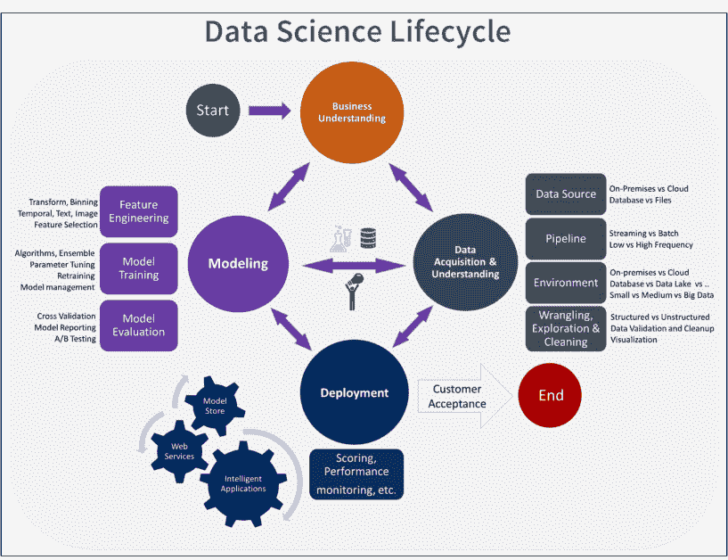

## 阶段 I – 业务理解

本阶段的目标是收集并深入分析将用作模型目标的关键变量，而与这些变量关联的指标最终将决定项目的整体成功。本阶段的另一个重要目标是识别公司已有或可能需要采购的所需数据源。在本阶段，需要完成的两项主要任务是：“定义目标和识别数据源。”

### 定义目标

所有项目都必须首先确定分析工具需要预测的关键业务变量。这些变量称为“模型目标”，而与这些模型目标关联的指标（例如销售预测和欺诈订单预测）被用作衡量项目成功的标准。要定义项目目标和任务，必须与利益相关者和最终用户合作，提出相关问题，这些问题可能非常具体，也可能比较模糊。为了回答这些问题，数据科学方法采用名称和数字。数据科学或机器学习中主要使用的五种问题涉及：“回归（多少或多少个？）、分类（哪些类别？）、聚类（哪些组？）、异常检测（这是否异常？）、推荐（应选择哪个选项？）”。为您的项目确定正确的问题，并理解这些问题的答案将如何帮助您实现业务或项目目标，这一点非常重要。

明确并统一项目团队中每位成员的角色和职责对于项目的成功至关重要。这可以通过一份高层次项目计划来实现，该计划包含重要的里程碑，并可根据项目进程按需修改。在项目的这一阶段，还应商定另一项重要定义，即所有关键绩效指标和指标。例如，一个预测客户流失率的项目要求在项目完成时达到“ABC”%的准确率，这可以帮助您了解为满足项目成功标准必须满足的要求。因此，为了实现“ABC”%的准确率，公司可能会开展折扣优惠和促销活动。在指标开发中使用的行业通用标准称为“SMART”，代表“具体、可衡量、可实现、相关性、时限性”。

### 数据源识别

必须识别并记录可能包含定义阶段提出的五种问题的答案“已知示例”的数据源。您必须查找与所提问题直接相关的数据，并评估是否拥有可衡量的目标以及与这些目标相关的特征。作为模型目标及其特征准确度量的数据对于确定项目的成功至关重要。例如，您可能会遇到这样的情况：现有系统无法收集和记录实现项目目标所需的数据类型。这应立即提示您，需要开始寻找外部数据源，或运行系统更新，以使现有系统能够收集其他数据类型。

### 本阶段需创建的交付成果

- **章程文档** – 它是一份“活文档”，需要在整个项目过程中根据新的项目发现和变化的业务要求进行更新。TDSP“项目结构定义”提供了一个标准模板。在整个项目过程中，基于此文档添加更多细节并及时向利益相关者通报所有更改非常重要。

- **数据源** – 在 TDSP“项目数据报告文件夹”中，数据源位于“数据定义报告”的“原始数据源”部分。“原始数据源”部分还指定了原始数据的初始位置和最终位置，并提供诸如“编码脚本”等其他详细信息，用于将数据移至任何所需环境。

- **数据字典** – 利益相关者提供的数据特性和特征的描述，例如“数据图示”和可用的“实体关系图”，均记录在数据字典中。

## 阶段 II – 数据获取与理解

本阶段的目标是生成高质量的处理后数据集，该数据集与模型目标有定义的关系，并位于所需的分析环境中。在本阶段，还必须开发数据管道的“解决方案架构”，以便允许对数据进行定期更新和评分。本阶段必须完成的三项主要任务是：“数据摄入、数据探索和数据管道设置。”

### 数据摄入

在此阶段，应设置将数据从源位置传输到目标位置所需的过程。目标位置由允许您执行训练和预测等分析活动的环境确定。

### 数据探索

在数据集可用于训练数据模型之前，必须对其进行清理以删除任何不一致和错误。为了检查建模前处理数据所需的数据质量和收集的信息，应使用数据汇总和可视化等工具。由于此过程会重复多次，因此可以使用 TDSP 提供的名为“IDEAR”的自动化实用工具来进行数据可视化和创建数据汇总报告。在处理后数据达到满意质量后，可以观察到固有的数据模式。这反过来又有助于为目标选择和开发合适的“预测模型”。现在，您必须评估是否拥有足够的数据量来启动建模过程，建模过程具有迭代性，可能需要您识别新的数据源以实现更高的相关性和准确性。

### 设置数据管道

为了补充数据建模的迭代过程，必须通过设置“数据管道或工作流”来建立对新数据进行评分和刷新现有数据集的标准流程。数据管道的解决方案架构必须在本阶段结束前开发完成。根据现有系统的业务需求和约束，可以使用三种类型的管道：“基于批处理”、“实时或流式”以及“混合”。

### 本阶段需创建的交付成果

- 数据质量报告 – 此报告必须包含业务需求及其属性和变量排名等细节中的“数据摘要”关系。TDSP 提供的“IDEAR”工具能够生成关系表、CSV 文件或任何其他表格数据集的数据质量报告。

- 解决方案架构 – 模型构建完成后，用于对新数据进行评分和生成预测的数据管道的描述或图表可以


称为“解决方案架构”。该图还可以提供基于新数据对模型进行“重新训练”所需的数据管道。

- 检查点决策 – 在实际模型构建过程开始之前，必须重新评估项目，以确定通过推进项目是否能实现预期价值。这些也称为“继续或终止”决策。

## 第三阶段 – 建模

此阶段的目标是为机器学习模型找到“最佳数据特征”，这些特征包含足够信息，能够准确预测目标变量，并可部署到生产环境中。此阶段必须完成的三项主要任务是：“特征工程、模型训练以及确定模型是否适合生产环境。”

### 特征工程

数据特征必须通过“包含、聚合和转换”的过程从原始数据变量中创建。为了理解模型的运作机制，必须建立对这些数据特征之间以及与将使用这些特征的机器学习算法之间关系的清晰认识。数据探索阶段收集的洞察可以与领域专业知识相结合，以实现创造性的特征工程。在确保数据集中不包含大量无关变量的同时，确定并包含信息量丰富的变量的这项精细工作被称为特征工程。过多的无关变量会给数据模型增加噪声，因此应尽可能多地加入信息量丰富的变量，以获得更好的结果。还必须为评分过程中收集的任何新数据生成特征。

### 模型训练

当今市场上提供种类繁多的建模算法。必须选择满足项目标准的算法。“模型训练”过程可分为四个步骤：

- 1. 通过适当划分输入数据，创建“训练数据集”以及“测试数据集”。
- 2. 使用“训练数据集”开发模型。
- 3. 利用各种机器学习算法以及相关的“调参参数”，对训练数据集和测试数据集进行评估，这些参数旨在帮助从现有数据集中回答先前讨论过的五种问题。
- 4. 使用关键绩效指标和度量值比较所有可用方法，评估解决业务问题的最佳方案。

TDSP 提供了一款“自动化建模和报告工具”，该工具能够遍历多种算法和“参数扫描”，以开发“基线模型”以及“基线建模报告”，后者可作为每个“模型和参数组合”的性能摘要。

### 本阶段需要创建的交付成果

- 特征集 – 包含数据定义报告“特征集”章节中描述的所有特征的文档。程序员大量使用该文档，根据文档提供的描述编写所需代码并开发特征。
- 模型报告 – 此文档必须包含基于标准模板报告评估的每个模型的详细信息。
- 检查点决策 – 必须根据不同模型的性能，作出将模型部署到生产环境的决策。

## 第四阶段 – 部署

此阶段的目标是将解决方案模型发布到较低级别的类生产环境（例如预生产环境和用户验收测试环境），最终再将模型部署到生产环境中。此阶段需要完成的主要任务是“模型运营化”。

### 模型运营化

一旦获得了一组性能达到预期的模型，这些模型即可运营化，供其他适用的应用程序使用。根据业务需求，预测可以实时进行，也可以以批处理方式进行。为了部署模型，必须将其与开放的“应用程序编程接口”（API）集成，以便根据需要允许模型与所有其他应用程序及其组件进行交互。

### 本阶段需要创建的交付成果

- 使用关键绩效指标和度量值评估系统健康状况的仪表板报告。
- 包含最终模型部署计划详细信息的文档或运行手册。
- 包含最终模型解决方案架构的文档。

## 第五阶段 – 客户验收

此阶段的目标是确保项目的最终解决方案满足利益相关者的期望，并实现数据科学生命周期第一阶段收集的业务需求。此阶段必须完成的两项主要任务是：“系统验证和项目移交。”

### 系统验证

将部署到生产环境的最终解决方案必须根据业务需求和数据管道进行评估，以确保满足利益相关者的需求。利益相关者必须验证系统是否满足其业务需求，并解决最初启动项目的问题。所有文档必须在本阶段结束前彻底审查并最终确定。

### 项目移交

在此阶段，项目必须从开发团队转移到生产后和维护团队。例如，IT 支持团队或利益相关者团队中负责在生产环境中为解决方案提供日常支持的人员。

### 本阶段需要创建的交付成果

本阶段创建的最重要文档是面向利益相关者的“退出报告”。该文档包含项目的所有可用详细信息，这些信息对于了解系统的运营至关重要。TDSP 为“退出报告”提供了标准模板，可轻松自定义以满足特定利益相关者的需求。

## 数据类型

既然您了解了数据科学的重要性，让我们来看看不同的数据类型，以便您可以根据需要处理的数据类型选择最合适的分析工具和算法。从高层次上看，数据类型可分为两类：定性数据和定量数据。

### 定性数据

任何无法测量、只能通过向对象添加定性特征来主观观察的数据，均称为“定性数据”。使用不可测量的特征对对象进行分类会生成定性数据。例如，颜色、气味、质地和味道等属性。定性数据有三种类型：

- **“二元或二项分布数据”** – 表示互斥事件的数据值，其中两个类别或选项中只有一个是正确且适用的。例如，真或假，是或否，正或负。假设有一盒不同口味的茶包。您尝试所有不同口味，并将喜欢的归类为“好”，不喜欢的归类为“坏”。在此情况下，“好或坏”将被归类为二项分布数据类型。此类数据广泛用于预测分析的统计模型开发。
- **“名义或无序数据”** – 缺乏“隐含或自然值”的数据特征可称为名义数据。假设有一盒 M&Ms 糖果，您可以在工作表中记录盒中每颗 M&Ms 的颜色，这即可作为名义数据。此类数据广泛用于评估数据集中的统计差异，使用“卡方分析”等技术，该技术可以告诉您盒中每种颜色 M&Ms 数量的“统计学显著差异”。
- **“有序或序数数据”** – 此数据类型的特征确实具有某些“隐含或自然值”，例如小、中或大。例如，“Yelp”、“Amazon”和“Trip Advisor”等网站上的在线评论采用 1 到 5 的评分等级，意味着 5 星评分优于 4 星，4 星优于 3 星，以此类推。

### 定量数据

任何可以客观测量的数据特征均称为“定量数据”。使用可测量的特征对对象进行分类并赋予数值会生成定量数据。例如，产品价格、温度、长度等尺寸。定量数据有两种类型：

- **“连续数据”** – 可以定义到更低层级的数据值，例如千米、米、厘米等计量单位，被称为连续数据类型。例如，您可以按重量购买一袋杏仁，如 500 克或 8 盎司。这属于连续数据类型，主要用于测试和验证各种假设，例如评估杏仁袋上印刷重量的准确性。
- **“离散数据”** – 无法分割并降低到更高精度级别的数值数据，例如一个人拥有的汽车数量（只能计为不可分割的整数，您不能拥有 1.5 或 2.3 辆汽车），被称为离散数据类型。例如，您可以按包装内冰淇淋条的数量购买另一袋冰淇淋条，例如四根或六根。这属于离散数据类型，


可与连续数据类型结合使用，以执行回归分析，验证冰淇淋盒的总重量（连续数据）与盒内冰淇淋条数量（离散数据）之间是否存在相关性。

## Data Science Strategies

数据科学主要通过使用“预测因果分析”、“规定性分析”和机器学习来进行精确预测，从而应用于决策制定。

预测因果分析 – “预测因果分析”可用于开发能够准确预测并预测未来特定事件发生可能性的模型。例如，金融机构使用基于预测因果分析的工具，通过生成能够分析客户与所有借贷机构支付历史的模型，来评估客户违约信用卡付款的可能性。

规定性分析 – “规定性分析”广泛用于开发“智能工具和应用程序”，这些工具能够使用动态参数进行修改和学习，并自行做出“决策”。该工具不仅能够预测未来事件的发生，还能够提供关于各种行动及其结果的建议。例如，自动驾驶汽车在每次驾驶体验中收集驾驶相关数据，并利用这些数据训练自身，以做出更好的驾驶和操纵决策。

**用于预测的机器学习** – 为了开发能够基于公司获取的事务数据确定未来趋势的模型，机器学习算法是必不可少的。这被视为“受监督机器学习”，我们将在本书后面详细阐述。例如，欺诈检测系统会在与欺诈性购买相关的历史数据上使用机器学习算法，以检测交易是否为欺诈。

**用于模式发现的机器学习** – 为了能够开发能够识别隐藏数据模式但缺乏进行未来预测所需参数的模型，需要采用“无监督机器学习算法”，例如“聚类”。例如，电信公司经常使用“聚类”技术，通过在目标区域识别信号强度最佳的网络塔位置来扩展其网络。

## Data Science vs Data Analysis

数据科学和数据分析这两个术语经常被混用。然而，这些术语完全不同，对不同企业有不同的含义。数据科学涵盖各种科学模型和方法，可用于处理和分析结构化、半结构化和非结构化数据。可用于从高度复杂、无序且原始的数据集中提取洞察的工具和流程属于数据科学范畴。与旨在验证假设的数据分析不同，数据科学归结为连接数据点，以识别可用于未来业务规划的新模式和洞察。数据科学通过识别模式，为结构化和非结构化数据提供新视角，从而帮助企业从探究转向洞察，这些模式可使企业提高效率、降低成本并发现新的市场机遇。

数据科学是技术、机器学习算法开发、统计分析和数据推断的多学科融合，为企业提供了增强解决最复杂业务问题的能力。数据分析属于数据科学范畴，更多地涉及审查和分析历史数据以将其置于上下文中。与数据科学不同，数据分析的特点是在处理过的结构化数据上使用标准 SQL 查询命令来收集洞察，且较少使用人工智能、预测建模和机器学习算法。数据分析与数据科学之间看似细微的差异实际上可能对组织产生重大影响。

## Data Science in Cyber Security

利用机器学习算法分析和仔细检查数据趋势和模式的能力，使得数据科学在网络安全领域得到显著应用。通过使用数据科学，公司不仅能够识别发起网络攻击的特定网络终端，还能够预测其系统上可能发生的未来攻击，并采取必要措施防止攻击发生。使用能够监控所选网络上的用户和设备并标记任何异常活动的“主动入侵检测系统”，是对抗黑客和网络攻击者的强大武器。而能够使用机器学习算法在历史数据上检测潜在安全威胁的“预测入侵检测系统”，则是对抗网络掠食者的强大盾牌。

网络攻击可能导致宝贵数据和信息的丢失，给组织造成极大损害。为了保护数据集，可以使用复杂的加密和签名来防止未经授权的访问。数据科学可以帮助开发此类防护协议和算法。通过分析不同行业领域公司过去网络攻击的趋势和模式，数据科学可以帮助检测最常被攻击的数据集，甚至预测潜在的未来网络攻击。公司高度依赖客户生成和授权的数据，但随着网络攻击的增加，客户对其个人信息泄露极为警惕，并倾向于将业务交给那些能通过实施先进的数据安全工具和技术来保证其数据安全和隐私的公司。数据科学正成为企业的救星，帮助其加强网络安全措施。

## Chapter 2: Introduction to Python Coding

Python 于 1989 年首次实现，被公认为对初学者和业余爱好者来说非常用户友好且易于学习的编程语言。它是一种高级编程语言，通常用于通用目的。该语言最初由 Guido van Rossum 于 20 世纪 80 年代在“荷兰数学与计算机科学中心 (CWI)”开发，并由“Python 软件基金会”于 1991 年引入。它的设计主要旨在强调编程代码的可读性，其语法使程序员能够使用更少的代码行来表达想法。Python 编程语言提高了运行速度，同时在创建系统集成方面实现了更高的效率。它被视为刚刚对编程感兴趣并需要理解编程基础的个人的理想选择。这是因为 Python 的阅读方式几乎与英语相同。因此，理解语言运作所需的时间更少，注意力可以集中在学习编程基础上。

Python 是一种解释型语言，支持自动内存管理和面向对象编程。这种极其直观且灵活的编程语言可用于机器学习算法、Web 应用程序、数据挖掘和可视化、游戏开发等编码项目。

## Installation Instructions for Python

请按照以下说明参考相关部分，在您的操作系统上下载并安装 Python。2019 年中期发布的最新 Python 版本是 Python 3.8.0。请确保下载并安装当时最新且最稳定的 Python 版本。

### WINDOWS

- 1. 从 Python 官方网站，点击“Downloads”图标并选择 Windows。
- 2. 点击“下载 Python 3.8.0”按钮，查看所有可下载的文件。
- 3. 在后续屏幕上，选择要下载的 Python 版本。在本书中，我们将使用“稳定版”下的 Python 3 版本。因此，请向下滚动页面并点击如下图所示的“下载 Windows x86-64 可执行安装程序”链接。

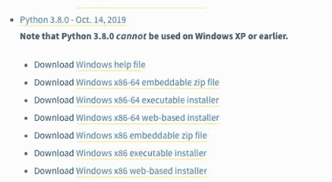

- 4. 将显示标题为“python-3.8.0-amd64.exe”的弹出窗口。
- 5. 点击“保存文件”按钮开始下载文件。
- 6. 下载完成后，双击保存的文件图标，将显示“Python 3.8.0 (64 位) 安装程序”弹出窗口。
- 7. 请确保选择“为所有用户安装启动器（推荐）”和“将 Python 3.8 添加到 PATH”复选框。注意 – 如果您的系统上已安装旧版本的 Python，则会显示“立即升级”按钮而不是“立即安装”按钮，并且不会显示任何复选框。
- 8. 点击“立即安装”，将显示“用户帐户控制”弹出窗口。
- 9. 将显示一条通知，内容为“是否允许此应用对您的设备进行更改”，点击“是”。
- 10. 将显示一个新的标题为“Python 3.8.0 (64 位) 安装程序”的弹出窗口，其中包含安装进度条。
- 11. 安装完成后，将显示“安装成功”消息。点击“关闭”。


12. 要验证安装，请导航到安装 Python 的目录，然后双击 python.exe 文件。

## MACINTOSH

1. 从官方 Python 网站，点击“下载”图标并选择 Mac。
2. 点击“下载 Python 3.8.0”按钮以查看所有可下载的文件。
3. 在随后的屏幕上，选择要下载的 Python 版本。在本书中，我们将使用“稳定版本”下的 Python 3 版本。因此，向下滚动页面，在 Python 3.8.0 下点击“下载 macOS 64-bit 安装程序”链接，如下图所示。

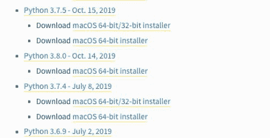

4. 将显示标题为“python-3.8.0-macosx10.9.pkg”的弹出窗口。
5. 点击“保存文件”以开始下载文件。
6. 下载完成后，双击保存的文件图标，将显示“安装 Python”弹出窗口。
7. 点击“继续”以继续，将出现条款和条件弹出窗口。
8. 点击 Agree，然后点击“安装。”
9. 将显示请求管理员权限和密码的通知。输入系统密码以开始安装。
10. 安装完成后，将出现“安装成功”消息。点击“关闭”按钮，即全部完成。
11. 要验证安装，请导航到安装 Python 的目录，然后双击 python 启动器图标，它将带您进入 Python 终端。

## LINUX

- 对于 Red Hat、CentOS 或 Fedora，安装 python3 和 python3-devel 软件包。
- 对于 Debian 或 Ubuntu，安装 python3.x 和 python3.x-dev 软件包。
- 对于 Gentoo，安装 '=python-3.x.*' ebuild（您可能需要先取消屏蔽它）。

1. 从官方 Python 网站，点击“下载”图标并选择 Linux/UNIX。
2. 点击“下载 Python 3.8.0”按钮以查看所有可下载的文件。
3. 在随后的屏幕上，选择要下载的 Python 版本。在本书中，我们将使用“稳定版本”下的 Python 3 版本。因此，向下滚动页面，在 Python 3.8.0 下点击“下载 Gzipped 源码压缩包”链接，如下图所示。
4. 将显示标题为“python-3.7.5.tgz”的弹出窗口。
5. 点击“保存文件”以开始下载文件。
6. 下载完成后，双击保存的文件图标，将出现“安装 Python”弹出窗口。
7. 按照屏幕上的提示完成安装过程。

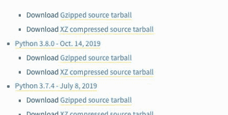

## 开始使用

在计算机上安装 Python 终端后，您现在可以开始编写和执行 Python 代码。所有 Python 代码都作为 (.py) 文件写在文本编辑器中，并在 Python 解释器命令行上执行，如下面的代码所示，其中“nineplanets.py”是 Python 文件的名称：

```
`"C: \Users\Your Name\python nineplanets.py"`
```

您可以在 Mac、Windows 或 Linux 命令行上键入下面的代码，直接在命令行本身中测试一小段代码，而无需将其写入文件，如下所示：

```
"C:\\Users\\Your Name\\python"
```

如果上面的命令不起作用，请改用下面的代码：

```
"C:\\Users\\Your Name\\py"
```

### 缩进

缩进（即代码前的空格数）对 Python 编码结构至关重要。在大多数编程语言中，缩进是为了增强代码的可读性而添加的。然而，在 Python 中，缩进用于指示执行代码的一个子集，如下面的代码所示：

```
if 7 > 2:
    print('Seven is greater than two')
```

缩进位于带有 print 命令的第二行代码之前。如果跳过缩进，代码如下编写，将触发错误：

```
if 7 > 2:
print('Seven is greater than two')
```

空格数可以修改，但至少需要一个空格。例如，您可以使用更高的缩进执行下面的代码，但对于特定的代码集，必须使用相同数量的空格，否则会收到错误。

```
if 7 > 2:
    print('Seven is greater than two')
```

### 添加注释

在 Python 中，可以通过将代码注释行以“#”开头来添加注释，如下示例所示：

```
#Any relevant comments will be added here
print('Nine planets')
```

注释用作代码的描述，Python 终端不会执行它们。请务必记住，代码行末尾的任何注释都会导致 Python 终端跳过整行代码，如下面的代码所示。在测试代码时，如果需要停止执行，注释可能非常有用。

```python
print('Nine Planets') #Comments added here
```

可以通过将每行代码以“#”开头来添加多行注释，如下所示：

```python
#Comments added here
#Supplementing the comments here
#Further adding the comments here
print('Nine Planets')
```

## Python 变量

在 Python 中，变量主要用于保存数据值，而无需为此执行命令。只需将所需值赋给变量即可创建变量，如下示例所示：

```python
A = 999
B = 'Patricia'
print(A)
print(B)
```

变量可以在没有特定数据类型的情况下声明。变量的数据类型也可以在初始声明后修改，如下示例所示：

```python
A = 999 # A has data type set as int
A = 'Patricia' # A now has data type str
print(A)
```

适用于 Python 变量名称的一些规则如下：

1. 变量名可以短至单个字母，也可以是 height、weight 等更具描述性的单词。
2. 变量名只能以下划线或字母开头。
3. 变量名不能以数字开头。
4. 变量名可以包含下划线或字母数字字符。不允许其他特殊字符。
5. 变量名区分大小写。例如，‘weight’、‘Weight’ 和 ‘WEIGHT’ 将被视为 3 个不同的变量。

## 为变量赋值

在 Python 中，多个变量可以在单行代码中被赋予不同的值，如下示例所示：

```python
A, B, C = 'violet', 'maroon', 'teal'
print(A)
print(B)
print(C)
```

或者，多个变量可以在单行代码中被赋予相同的值，如下示例所示：

```python
A, B, C = 'violet'
print(A)
print(B)
print(C)
```

## Python 数据类型

Python 支持多种数据类型，如下所示。要扎实理解变量的概念，您必须学习所有 Python 数据类型。

| 类别 | 数据类型 | 示例语法 |
|---|---|---|
| 文本 | "str" | 'Nine Planets' "Nine Planets" """Nine Planets""" |
| 布尔值 | "bool" | 'True' 'False' |
| 映射（混合数据类型，键值对关联数组） | "dict" | {'key8': 8.0, 5: True} |
| 序列（可能包含混合数据类型） | "list" | [8.0, 'character', True] |
| 序列（可能包含混合数据类型） | "tuple" | (8.0, 'character', True) |
| 序列（可能包含混合数据类型） | "range" | range(11, 51) range(110, 51, 11, -11, -51, -110) |
| 二进制 | "bytes" | b'byte sequences' b'byte sequences' bytes([121, 91, 75, 110]) |
| 二进制 | "bytearray" | bytearray(b'byte sequences') bytearray(b'byte sequences') bytearray([121, 91, 75, 110]) |
| 二进制 | "memoryview" | |
| 集合 | "set" | {8.0, 'character', True} |
| （无序、无重复、混合数据类型） | "frozenset" | frozenset([8.0, 'character', True]) |
| 数值 | "int" | 35 |
| | "float" | 155e3 |
| | "complex" | 155 + 2.1j |
| 省略号（NumPy 数组中的索引） | "ellipsis" | ... 'Ellipsis' |

要查看任何对象的数据类型，可以使用“type()”函数，如下示例所示：

```python
A = 'Violet'
print(type(A))
```

## 为变量指定数据类型

只需为变量声明一个值即可创建新变量。此设置的数据值将反过来为变量赋予数据类型。

要为变量指定特定数据类型，请使用下面列出的构造函数：

| 构造函数 | 数据类型 |
|---|---|
| A = str('Nine Planets') | str |
| A = int(55) | Int（必须是整数，可正可负，无小数，无长度限制） |
| A = float(14e6) | Float（浮点数必须是带有一个或多个小数的正数或负数；可能是科学 |


| | |
| --- | --- |
| | 数字后加一个‘e’来指定10的幂次) |
| A = complex (92j) | 复数（必须用‘j’作为虚数字符来书写） |
| A = list ((‘teal’, maroon, ‘jade’)) | list |
| A = range (3, 110) | range |
| A = tuple ((‘teal’, maroon, ‘jade’)) | tuple |
| A = set ((‘teal’, maroon, ‘jade’)) | set |
| A = frozenset (( ‘teal’, ‘jade’, maroon)) | frozenset |
| A = dict (‘color’ : maroon, ‘year’ : 1988) | dict |
| A = bool (False) | bool |
| A = bytes (542) | bytes |
| A = bytearray (9) | bytearray |
| A = memoryview (bytes (525)) | memoryview |

### 练习 – 巩固您对数据类型的理解。查看下表的第一列，并为该变量写出数据类型。在您完成所有答案后，查看第二列，并验证您的答案。

| 变量 | 数据类型 |
| :--- | :--- |
| A = ‘Nine Planets’ | str |
| A = 45 | int |
| A = 56e2 | float |
| A = 34j | complex |
| A = [‘teal’, maroon, ‘jade’] | list |
| A = range (12, 103) | range |
| A = (‘teal’, maroon, ‘jade’) | tuple |
| A = {'teal', maroon, 'jade'} | set |
| A = frozenset ({ 'teal', 'jade', maroon}) | frozenset |
| A = {'color' : maroon, 'year' : 1939} | dict |
| A = False | bool |
| A = b'Morning' | bytes |
| A = bytearray (5) | bytearray |
| A = memoryview (bytes (45)) | memoryview |

## 输出变量

为了检索变量作为输出，Python 中使用“print”语句。您可以使用“+”字符将文本与变量组合以进行最终输出，如下示例所示：

```
A = maroon
print('Flowers are' + A)
```

输出 – ‘Flowers are maroon’

变量也可以使用“+”字符与另一个变量组合，如下示例所示：

```
A = 'Flowers are'
B = maroon
AB = A + B
print(AB)
```

输出 – ‘Flowers are maroon’

但是，当“+”字符与数值一起使用时，它保留其作为数学运算符的功能，如下示例所示：

```
A = 22
B = 33
print(A + B)
```

输出 = 55

您将无法将字符串与数字组合，并且会触发错误，如下示例所示：

```
A = yellow
B = 30
print(A + B)
```

输出 – N/A – 错误

## Python 数字

在 Python 编程中，您将使用 3 种不同的数值数据类型，即“int”、“float”和“complex”。在上一章中，您学习了这些数据类型的详细内容，但以下是一些示例，以刷新您的记忆。

| 数据类型 | 示例 |
|---|---|
| Int (必须是整数，正或负，无小数，无长度限制) | 388 或 3.42 |
| Float (浮点数必须是带有一个或多个小数的正数或负数；可能是带有“e”来指定10的幂次的科学计数法数字) | 41e4 |
| Complex (必须用“j”作为虚数字符来书写) | 46j |

### **练习 – 创建变量“a”，其数据值为“4.25”，变量“b”，其数据值为“7e3”，以及变量“c”，其数据值为“-59j”。**

### ***在此处酌情使用，首先编写您的代码***

现在，将您的代码与下面的正确代码进行比对：

```
a = 4.25   # int
b = 7e3    # float
c = -59j   # complex

print (type (a))
print (type (b))
print (type (c))
```

注意 – # 注释不是正确代码所必需的，仅提及以加强您对概念的理解。

## 将一种数值数据类型转换为另一种

由于所有 Python 变量都是动态的，如果需要，您可以通过从希望赋予新数据类型的变量中派生新变量来转换这些变量的数据类型。

让我们继续在上面讨论的练习基础上进行构建。

```
a = 4.25   # int
b = 7e3    # float
c = -49j   # complex
```

```python
#conversion from int to float
x = float(a)

#conversion from float to complex
y = complex(b)

#conversion from complex to int
z = float(c)

#conversion from int to complex
x1 = int(a)
```

```python
print (x)
print (y)
print (z)
print (x1)
```

```python
print (type (x))
print (type (y))
print (type (z))
print (type (x1))
```

### 练习 – 通过导入 random 模块查看 11 到 21 之间的随机数。

### ***在此处酌情使用，首先编写您的代码***

现在，将您的代码与下面的正确代码进行比对：

```
import random
print (random.randrange (11, 21))
```

## 使用构造函数进行变量强制转换

在上面的讨论和练习中，您了解到，可以通过简单地将所需数据值赋给变量来声明变量，从而，变量将基于数据值承担相关数据类型。但是，Python 允许您通过使用类或“构造函数”来指定变量的数据类型，以定义变量的数据类型。此过程称为“强制转换”。

以下是用于将数值数据类型“强制转换”到变量的 3 个构造函数。

| 构造函数 | 数据类型 |
| :--- | :--- |
| int () | 将从整数字面量、字符串字面量（前提是字符串表示整数）或浮点数字面量（通过向下舍入到前一个整数）构建一个整数 |
| float () | 将从字符串字面量（前提是字符串表示浮点数或整数）、浮点数字面量或整数字面量构建一个浮点数 |
| complex () | 将从多种数据类型构建一个复数，例如整数字面量、浮点数字面量和字符串 |

以下是一些示例：

### 整数：

```
a = int(7) # a takes the value 7
b = int(2.8) # b takes the value 3
c = int('6')# c takes the value 6
```

### 浮点数：

```
a = float(7) # a takes the value 7.0
b = float(2.8) # b takes the value 2.8
c = float('6') # c takes the value 6.0
```

### 字符串：

```
a = str ('serial') # a takes the value ‘serial’
b = str (2.8) # b takes the value ‘2.8’
c = str (‘6’) # c takes the value ‘6.0’
```

## Python 字符串

在 Python 中，变量的字符串数据类型通过使用单引号、双引号或三引号来表示。这意味着您可以通过引用字符串字符来为变量分配字符串数据值。例如，“welcome” 与 ‘welcome’ 和 ““welcome”” 相同。

### **练习** – 创建变量“v”，其字符串数据值为“I like teal”并显示它。

### ***在此处酌情使用，首先编写您的代码***

现在，将您的代码与下面的正确代码进行比对：

```
v = 'I like teal'
print (v)
```

输出 – I like teal

### **练习** – 创建变量“A”，其多行字符串数据值为“Looking at the sky tonight, thinking of you by my side! Let the world go on and on; it will be alright if I stay strong!”并显示它。

### ***在此处酌情使用，首先编写您的代码***

现在，将您的代码与下面的正确代码进行比对：

```
a = """Looking at the sky tonight,
thinking of you by my side!
Let the world go on and on,
it will be alright if I stay strong!"""
print (a)
```

输出 – Looking at the sky tonight,
thinking of you by my side!
Let the world go on and on,
it will be alright if I stay strong!

注意 – 您必须使用三引号来创建多行字符串数据值。

## 字符串数组

在 Python 中，字符串数据值是表示 Unicode 字符的字节数组，这与大多数编程语言的情况相同。但是，与其他编程语言不同，Python 没有用于单个字符的数据类型，单个字符被表示为长度为 1 的字符串数据类型。

每个字符串的第一个字符被赋予位置‘0’，随后，后续字符将具有位置 1、2、3，以此类推。为了从字符串数据值中显示所需字符，您可以使用括号括起来的字符位置。例如，如果您想要显示变量“x”的字符串数据值“cranberry”的第四个字符，您将使用命令“print (x [3])”

### 练习 – 创建变量“P”，其字符串数据值为“wonderful”，并显示该字符串的第五个字符。

## ***在此处酌情使用，首先编写您的代码***


现在，请将你的代码与以下正确代码核对：

```python
P = 'wonderful'
print (P [4])
```

输出 – e

## 切片

如果你想查看一系列字符，可以通过指定所需位置的起始索引和结束索引，并用冒号分隔索引来实现。例如，要查看字符串从位置 2 到位置 5 的字符，你的代码将是 `print (variable [2:5])`。

你甚至可以使用“负索引”从字符串末尾开始查看字符，并从字符串末尾开始对字符串进行切片。例如，要查看字符串从位置 3 到位置 1 的字符，你的代码将是 `print (variable [-3 : -2])`。

要查看字符串的长度，可以使用“len ()”函数。例如，要查看字符串的长度，你的代码将是 `print (len (variable))`。

**练习 – 创建一个名为“P”的变量，其字符串数据值为“birds can sing!”，并显示该字符串从位置 2 到位置 5 的字符。**

***在此处自行尝试并先编写你的代码***

现在，请将你的代码与以下正确代码核对：

```python
P = 'birds can sing!'
print (P [2 : 5])
```

输出 – rds

**练习** – 创建一个名为“x”的变量，其字符串数据值为“coding is easy”，并显示从该字符串末尾开始计数的位置 4 到位置 1 的字符。

***在此处自行尝试并先编写你的代码***

现在，请将你的代码与以下正确代码核对：

```python
x = 'coding is easy'
print (x [-4 : -2])
```

输出 - ea

**练习** – 创建一个名为“z”的变量，其字符串数据值为“good morning”，并显示该字符串的长度。

***在此处自行尝试并先编写你的代码***

现在，请将你的代码与以下正确代码核对：

```python
z = 'good morning'
print (len (z))
```

输出 - 11

## 字符串方法

Python 中有多种内置方法可应用于字符串数据值。以下是一些最常用字符串方法的 Python 代码，使用变量“P = ‘birds can sing!’”。

### "strip ()"方法 – 用于移除字符串开头和结尾的任何空格。

```python
P = " birds can sing! "
print (P.strip ())
```

输出 – birds can sing!

### "lower ()"方法 – 将字符串的所有字符转换为小写。

```python
P = "Birds can sing!"
print (P.lower ())
```

输出 – birds can sing!

### "upper ()"方法 – 将字符串的所有字符转换为大写。

```python
P = "Birds can sing!"
print (P.upper ())
```

输出 – BIRDS CAN SING!

### "replace ()"方法 – 替换字符串中选定的字符。

```python
P = "birds can sing!"
print (P.replace ("birds", "Songbirds"))
```

输出 – Songbirds can sing!

### "split ()"方法 – 使用逗号作为分隔符将字符串拆分为子字符串。

```python
P = "Birds, Songbirds"
print (P.split (", "))
```

输出 – ['Birds', 'Songbirds']

## 字符串连接

有时你可能需要合并不同的字符串变量。这可以通过使用“+”逻辑运算符来实现。以下是此 Python 代码的语法：

```python
X = "string1"
Y = "string2"
Z = X + Y
print (Z)
```

同样，以下是在两个不同字符串变量之间插入空格的语法：

```python
X = "string1"
Y = "string2"
Z = X + " " + Y
print (Z)
```

但是，Python 不允许将字符串变量与数值变量进行连接。但可以通过使用“format ()”方法来实现，该方法将格式化执行的参数，并将其放置在使用占位符“{ }”的字符串中。以下是此 Python 代码的语法：

```python
X = numeric
Y = "String"
print (Y.format (X))
```

**练习 – 创建两个变量“A”和“B”，其字符串数据值分别为“The winter”和“is coming!”，并将它们显示为连接后的字符串。**

***在此处自行尝试并先编写你的代码***

现在，请将你的代码与以下正确代码核对：

```python
A = "The winter"
B = "is coming!"
C = A + B
print (C)
```

输出 – The winter is coming!

**练习** – 创建两个变量，“A”的字符串数据值为“her lucky number is”，“B”的数值数据值为“3333”，并将它们显示为连接后的字符串。

***在此处自行尝试并先编写你的代码***

现在，请将你的代码与以下正确代码核对：

```python
A = "her lucky number is"
B = "3333"
print (A.format (B))
```

输出 – her lucky number is 3333

## Python 布尔值

在开发软件程序的过程中，通常需要确认和验证表达式是真还是假。这时就会使用到 Python 布尔数据类型和数据值。在 Python 中，对两个数据值进行比较和求值将产生两个布尔值之一：“True”或“False”。

以下是数值数据导致布尔值的比较语句示例：

```python
print (110 > 94)
```

输出 – True

```python
print (110 > 94)
```

输出 – False

```python
print (110 > 94)
```

输出 – False

现在让我们来看看“bool ()”函数，它允许对数值数据和字符串数据进行求值，结果为“True”或“False”布尔值。

```python
print (bool (93))
```

输出 - True

```python
print (bool ("Welcome"))
```

输出 - True

### 关于布尔值需牢记的几个要点：

- 1. 如果语句包含某种内容，将被评估为“True”。
- 2. 除非字符串为空，否则所有字符串数据值均将结果为“True”。
- 3. 除了“0”，所有数值均将结果为“True”。
- 4. 列表、元组、集合和字典均将结果为“True”，除非它们为空。
- 5. 大多数空值，如 ()、[]、{}、""、False、None 和 0，将结果为“False”。
- 6. 任何使用“__len__”函数创建且结果数据值为“0”或“False”的对象将被评估为“False”。

在 Python 中有多种可评估为布尔值的内置函数，例如，“isinstance()”函数允许你确定对象的数据类型。因此，要检查对象是否为整数，代码如下：

```python
X = 10
print (isinstance (X, int))
```

**练习 – 创建两个变量，“X”的字符串数据值为“Happy New Year!”，“Y”的数值数据值为“4.55”，并对它们进行求值。**

***在此处自行尝试并先编写你的代码***

现在，请将你的代码与以下正确代码核对：

```python
X = "Happy New Year!"
Y = 4.55
print (bool (X))
print (bool (Y))
```

输出 -
True 
True

## Python 列表

在 Python 中，列表是可以更改、组织且包含重复值的数据类型集合。列表写在方括号内，如下面的语法所示。

```python
X = ["string1", "string2", "string3"]
print (X)
```

与字符串数据类型相同的位置概念也适用于列表，即第一个字符串被认为位于位置 0。随后的字符串将分别获得位置 1、2，依此类推。你可以通过在 print 命令的方括号内引用列表中该字符串的位置，来有选择地显示所需字符串，如下所示。

```python
X = ["string1", "string2", "string3"]
print (X [2])
```

输出 – [string3]

同样，负索引的概念也适用于 Python 列表。让我们看下面的示例：

```python
X = ["string1", "string2", "string3"]
print (X [-2])
```

输出 - [string2]

你还可以通过指定范围的起始和结束来指定**索引范围**。此类命令在 Python 列表上的结果值将是一个新列表，仅包含指定的项目。以下是供你参考的示例。

```python
X = ["string1", "string2", "string3", "string4", "string5", "string6"]
print (X [3 : 5])
```

输出 - ["string4", "string5"]

* 记住第一个项目位于位置 0，范围的最终位置（5）不包括在内。

现在，如果你不指定此范围的起始位置，它将默认为位置 0，如下面的示例所示：

```python
X = ["string1", "string2", "string3", "string4", "string5", "string6"]
print (X [ : 4])
```

输出 - ["string1", "string2", "string3", "string4"]

同样，如果你不指定此范围的结束，它将从指定的起始范围显示列表的所有项目直到列表末尾，如


如以下示例所示：

```python
X = ["string1", "string2", "string3", "string4", "string5", "string6"]
print(X[4:])
```

输出 – ["string5", "string6"]

您还可以为 Python 列表指定**负索引范围**，如以下示例所示：

```python
X = ["string1", "string2", "string3", "string4", "string5", "string6"]
print(X[-4:-1])
```

输出 – ["string3", "string4", "string5"]

- * 记住最后一项位于 -1 位置，且此范围的末位（-1）不包含在输出中。

可能存在您需要为 Python 列表**更改数据值**的情况。这可以通过引用该项的索引号并声明新值来完成。让我们来看下面的示例：

```python
X = ["string1", "string2", "string3", "string4", "string5", "string6"]
X[2] = "newstring"
print(X)
```

输出 – ["string1", "string2", "newstring", "string4", "string5", "string6"]

您还可以使用“len()”函数确定 Python 列表的**长度**，如以下示例所示：

```python
X = ["string1", "string2", "string3", "string4", "string5"]
print(len(X))
```

输出 – 5

还可以通过使用内置“append ()”方法向现有列表**添加新项**来更改 Python 列表，如以下示例所示：

```python
X = ["string1", "string2", "string3", "string4", "string5"]
X.append("newstring")
print(X)
```

输出 – ["string1", "string2", "string3", "string4", "string5", "newstring"]

您还可以使用内置“insert ()”方法在特定位置向现有 Python 列表添加新项，如以下示例所示：

```python
X = ["string1", "string2", "string3", "string4"]
X.insert(3, "newstring")
print(X)
```

输出 – ["string1", "string2", "string3", "newstring"]

可能存在您需要复制现有 Python 列表的情况。这可以通过使用内置“copy ()”方法或“list ()”方法来完成，如以下示例所示：

```python
X = ["string1", "string2", "string3", "string4", "string5", "string6"]
Y = X.copy()
print(Y)
```

输出 – ["string1", "string2", "string3", "string4", "string5", "string6"]

```python
X = ["string1", "string2", "string3", "string4", "string5", "string6"]
Y = list(X)
print(Y)
```

输出 – ["string1", "string2", "string3", "string4", "string5", "string6"]

有多种内置方法可以从 Python 列表中删除项目。

- • 要有选择地删除特定项，可以使用“remove ()”方法。

```python
X = ["string1", "string2", "string3", "string4"]
X.remove("string2")
print(X)
```

输出 - ["string1", "string3", "string4"]

- • 要从列表中删除特定项，可以使用带有该值位置的“pop ()”方法。如果未指定索引，将删除列表的最后一项。

```python
X = ["string1", "string2", "string3", "string4"]
X.pop()
print(X)
```

输出 - ["string1", "string2", "string3"]

- • 要从列表中删除特定索引，可以使用“del ()”方法，后跟方括号内的索引。

```python
X = ["string1", "string2", "string3", "string4"]
del X[2]
print(X)
```

输出 - ["string1", "string2", "string4"]

- • 要删除整个列表变量，可以使用“del ()”方法，如下所示。

```python
X = ["string1", "string2", "string3", "string4"]
del X
```

输出 - .....

- • 要在不删除变量本身的情况下删除列表中的所有字符串值，可以使用“clear ()”方法，如下所示。

```python
X = ["string1", "string2", "string3", "string4"]
X.clear()
print(X)
```

输出 – [ ]

## 列表拼接

您可以使用“+”逻辑运算符连接多个列表，或使用“append ()”方法将一个列表的所有项添加到另一个列表中。“extend ()”方法可用于将一个列表添加到另一个列表的末尾。让我们通过下面的示例来理解这些命令。

```python
X = ["string1", "string2", "string3", "string4"]
Y = [11, 22, 33, 40]

Z = X + Y
print(Z)
```

输出 – ["string1", "string2", "string3", "string4", 11, 22, 33, 40]

```python
X = ["string1", "string2", "string3", "string4"]
Y = [11, 22, 33, 40]

for x in Y:
    X.append(x)

print(X)
```

输出 – ["string1", "string2", "string3", "string4", 11, 22, 33, 40]

```python
X = ["string1", "string2", "string3"]
Y = [11, 22, 33]

X.extend(Y)
print(X)
```

输出 – ["string1", "string2", "string3", 11, 22, 33]

### 练习 – 创建列表“A”，其字符串数据值为“red, jade, teal, violet, yellow”，并显示 -2 位置的项目。

***在此处自行决定并先行编写您的代码***

现在，将您的代码与下面的正确代码进行对比：

```python
A = ["red", "jade", "teal", "violet", "yellow"]
print(A[-2])
```

输出 – ["violet"]

### 练习 – 创建列表“A”，其字符串数据值为“red, jade, teal, violet, yellow”，并显示从第二个位置开始到末尾的项目。

***在此处自行决定并先行编写您的代码***

现在，将您的代码与下面的正确代码进行对比：

```python
A = ["red", "jade", "teal", "violet", "yellow"]
print(A[2:])
```

输出 – ["red", "teal", "teal", "violet", "yellow"]

### 练习 – 创建列表“A”，其字符串数据值为“red, jade, teal, violet, yellow”，并将字符串“jade”替换为“teal。”

***在此处自行决定并先行编写您的代码***

现在，将您的代码与下面的正确代码进行对比：

```python
A = ["red", "jade", "teal", "violet", "yellow"]
A[1] = "teal"
print(A)
```

输出 – ["teal", "violet", "yellow"]

### 练习 – 创建列表“A”，其字符串数据值为“red, jade, teal, violet, yellow”，并复制列表“A”以创建列表“B。”

***在此处自行决定并先行编写您的代码***

现在，将您的代码与下面的正确代码进行对比：

```python
A = ["red", "jade", "teal", "violet", "yellow"]
B = A.copy()

print(B)
```

输出 - ["red", "jade", "teal", "violet", "yellow"]

**练习** – 创建列表“A”，其字符串数据值为“red, jade, teal,
violet, yellow”，并删除字符串“red”和“violet。”

***在此处自行决定并先行编写您的代码
首先***

现在，将您的代码与下面的正确代码进行对比：

```python
A = ["red", "jade", "teal", "violet", "yellow"]
del A[0, 2]
print(A)
```

输出 - ["jade", "teal", "yellow"]

## Python 元组

在 Python 中，元组是不可更改但可以按特定顺序排列的数据类型集合。元组允许重复项，并使用圆括号括起来，如以下语法所示。

```python
Tuple = ("string1", "string2", "string3")
print(Tuple)
```

与 Python 列表类似，您可以通过在 print 命令的方括号
内引用该字符串的位置，有选择地从元组中显示所需字符串，如下所示。

```python
Tuple = ("string1", "string2", "string3")
print(Tuple[1])
```

输出 – ("string2")

**负索引**的概念也可以应用于 Python 元组，如以下示例所示：

```python
Tuple = ("string1", "string2", "string3", "string4", "string5")
print(Tuple[-2])
```

输出 – ("string4")

您还可以通过指示范围的开始和结束来指定**索引范围**。对 Python 元组执行此类命令的结果将是一个仅包含所指示项的新元组，如以下示例所示：

```python
Tuple = ("string1", "string2", "string3", "string4", "string5", "string6")
print(Tuple[1:5])
```

输出 – ("string2", "string3", "string4", "string5")

- * 记住第一项位于 0 位置，且此范围的末位（本示例中的第五个位置）不包含在内。

您还可以为 Python 元组指定**负索引范围**，如以下示例所示：

```python
Tuple = ("string1", "string2", "string3", "string4", "string5", "string6")
print(Tuple[-4:-2])
```

输出 – ("string4", "string5")

* 记住最后一项位于 -1 位置，且此范围的末位（本示例中的负第四个位置）不包含在输出中。

与 Python 列表不同，创建后您无法直接**更改 Python 元组的数据值**。但是，将元组转换为列表，然后修改该列表的数据值，将允许您随后从该更新后的列表创建元组。让我们来看下面的示例：

```python
Tuple1 = ("string1", "string2", "string3", "string4", "string5", "string6")
List1 = list(Tuple1)
List1[2] = "update this list to create new tuple"
Tuple1 = tuple(List1)
```

```python
print(Tuple1)
```

输出 – ("string1", "string2", "update this list to create new tuple," "string4", "string5", "string6")


你还可以使用“len()”函数来确定 Python 元组的**长度**，如下示例所示：

```python
Tuple = ("string1", "string2", "string3", "string4", "string5", "string6")
print(len(Tuple))
```

输出 - 6

你不能从元组中有选择地删除项目，但可以使用“del”关键字**整个删除元组**，如下示例所示：

```python
Tuple = ("string1", "string2", "string3", "string4")
del Tuple

print(Tuple)
```

输出 - name 'Tuple' is not defined

你可以使用“+”逻辑运算符**连接多个元组**。

```python
Tuple1 = ("string1", "string2", "string3", "string4")
Tuple2 = (101, 202, 303)

Tuple3 = Tuple1 + Tuple2
print(Tuple3)
```

输出 - ("string1", "string2", "string3", "string4", 101, 202, 303)

你还可以使用“tuple()”构造函数创建元组，如下示例所示：

```python
Tuple1 = tuple(("string1", "string2", "string3", "string4"))
print(Tuple1)
```

**练习 – 创建一个名为“X”的元组，字符串数据值为“corn, cilantro, carrot, potato, onion”，并显示位置 -2 处的项目。**

***在此处自行决定并先编写你的代码***

现在，将你的代码与下面的正确代码进行对比：

```python
X = ("corn", "cilantro", "carrot", "potato", "onion")
print(X[-2])
```

输出 - ("potato")

**练习 – 创建一个名为“X”的元组，字符串数据值为“corn, cilantro, carrot, potato, onion”，并显示从 -1 到 -3 范围内的项目。**

***在此处自行决定并先编写你的代码***

现在，将你的代码与下面的正确代码进行对比：

```python
X = ("corn", "cilantro", "carrot", "potato", "onion")
print(X[-3:-1])
```

输出 - ("carrot", "potato")

### **练习** – 创建一个名为“X”的元组，字符串数据值为“corn, cilantro, carrot, potato, onion”，并使用列表函数将其中的项目从“potato”更改为“pepper”。

***在此处自行决定并先编写你的代码***

现在，将你的代码与下面的正确代码进行对比：

```python
X = ("corn", "cilantro", "carrot", "potato", "onion")
Y = list(X)
Y[4] = "pepper"
X = tuple(Y)
print(X)
```

输出 - ("corn", "cilantro", "carrot", "potato", "pepper")

### **练习** – 创建一个名为“X”的元组，字符串数据值为“corn, cilantro, carrot”，以及另一个名为“Y”的元组，数值数据为 (2, 12, 22)，然后将它们连接在一起。

***在此处自行决定并先编写你的代码***

现在，将你的代码与下面的正确代码进行对比：

```python
X = ("corn", "cilantro", "carrot")
Y = (3, 13, 23)

Z = X + Y
print(Z)
```

输出 - ("corn", "cilantro", "carrot", 3, 13, 23)

## Python 集合

在 Python 中，集合是无法组织和索引的数据类型集合。集合不允许重复项，并且必须写在花括号内，如下语法所示。

```python
set = {"string1", "string2", "string3"}
print(set)
```

与 Python 列表和元组不同，你不能通过引用项目的位置从集合中有选择地显示所需项目，因为 Python 集合没有任何顺序。因此，项目没有任何索引。但是，“for”循环可以用于集合（本章后面将详细介绍此主题）。

与 Python 列表不同，创建后你无法直接**更改 Python 集合的数据值**。但是，你可以使用“add()”方法向集合添加单个项目，并使用“update()”方法向已存在的集合添加一个或多个项目。让我们看下面的示例：

```python
set = {"string1", "string2", "string3"}
set.add("newstring")
print(set)
```

输出 - {"string1", "string2", "string3", "newstring"}

```python
set = {"string1", "string2", "string3"}
set.update(["newstring1", "newstring2", "newstring3"])
print(set)
```

输出 - {"string1", "string2", "string3", "newstring1", "newstring2", "newstring3"}

你还可以使用“len()”函数来确定 Python 集合的**长度**，如下示例所示：

```python
set = {"string1", "string2", "string3", "string4", "string5", "string6",
"string7"}
print(len(set))
```

输出 - 7

要有选择地**从集合中删除特定项目**，可以使用“remove()”方法，如下代码所示：

```python
set = {"string1", "string2", "string3", "string4", "string5"}
set.remove("string4")
print(set)
```

输出 - {"string1", "string2", "string3", "string5"}

你还可以使用“discard()”方法从集合中删除特定项目，如下示例所示：

```python
set = {"string1", "string2", "string3", "string4", "string5"}
set.discard("string3")
print(set)
```

输出 - {"string1", "string2", "string4", "string5"}

“pop()”方法可用于有选择地仅删除集合的最后一个项目。必须注意的是，由于 Python 集合是无序的，系统视为最后一个项目的任何项目都将被删除。因此，此方法的输出将是已删除的项目。

```python
set = {"string1", "string2", "string3", "string4", "string5"}
A = set.pop()
print(A)
print(set)
```

输出 -
"string2"
{"string1", "string3", "string4", "string5"}

要删除整个集合，可以使用“del”关键字，如下所示。

```python
set = {"string1", "string2", "string3", "string4", "string5"}
del set
print(set)
```

输出 - name 'set' is not defined

要删除集合中的所有项目而不删除变量本身，可以使用“clear()”方法，如下所示。

```python
set = {"string1", "string2", "string3", "string4", "string5"}
set.clear()
print(set)
```

输出 - set()

你可以使用“union()”方法**连接多个集合**。此方法的输出将是一个新集合，包含两个集合中的所有项目。你还可以使用“update()”方法将一个集合中的所有项目插入到另一个集合中，而无需创建新集合。

```python
Set1 = {"string1", "string2", "string3", "string4", "string5"}
Set2 = {155, 255, 355, 455, 55}
Set3 = Set1.union(Set2)
print(Set3)
```

输出 - {"string1", 155, "string2", 255, "string3", 355, "string4", 455,
"string5", 55}

```python
Set1 = {"string1", "string2", "string3", "string4", "string5"}
Set2 = {155, 255, 355, 455, 55}
Set1.update(Set2)
print(Set1)
```

输出 - {255, "string1", 155, "string4", 55, "string2", 355, "string3",
455, "string5"}

你还可以使用“set()”构造函数创建集合，如下示例所示：

```python
Set1 = set(("string1", "string2", "string3", "string4", "string5"))
print(Set1)
```

输出 - {"string3", "string5", "string2", "string4", "string1"}

### **练习** – 创建一个名为“Veg”的集合，字符串数据值为“corn, cilantro, carrot, potato, onion”，并向该集合添加新项目“pepper”、“celery”和“avocado”。

***在此处自行决定并先编写你的代码***

现在，将你的代码与下面的正确代码进行对比：

```python
Veg = {"corn", "cilantro", "carrot", "potato", "onion"}
Veg.update(["pepper", "celery", "avocado"])
print(Veg)
```

输出 - {"corn", "cilantro", "carrot", "potato", "onion", "pepper", "celery", "avocado"}

### **练习** – 创建一个名为“Veg”的集合，字符串数据值为“corn, cilantro, carrot, potato, onion”，然后从该集合中删除最后一个项目。

***在此处自行决定并先编写你的代码***

现在，将你的代码与下面的正确代码进行对比：

```python
Veg = {"corn", "cilantro", "carrot", "potato", "onion"}
X = Veg.pop()
print(X)
print(Veg)
```

输出 -
onion
{"corn", "cilantro", "carrot", "potato"}

### **练习** – 创建一个名为“Veg”的集合，字符串数据值为“corn, cilantro, carrot, potato, onion”，以及另一个名为“Veg2”的集合，项目为“pepper, eggplant, celery, avocado”。然后将这两个集合合并以创建第三个新集合。

***在此处自行决定并先编写你的代码***

现在，将你的代码与下面的正确代码进行对比：

```python
Veg = {"corn", "cilantro", "carrot", "potato", "onion"}
Veg2 = {"pepper", "eggplant", "celery", "avocado"}

AllVeg = Veg.union(Veg2)      # this Set name may vary as it has not been defined in the exercise

print(AllVeg)
```

输出 - {"pepper", "eggplant", "celery", "avocado", "corn", "cilantro", "carrot", "potato", "onion"}

## Python 字典

在 Python 中，字典是可更改和索引但没有任何顺序的数据类型集合。Python 字典中的每个项目都包含一个键及其值。字典不允许重复项，并且必须写在花括号内，如下语法所示。

```python
dict = {
"key01": "value01",
```


```
"key02": "value02",
"key03": "value03",
}
print (dict)
```

你可以通过在打印命令中引用方括号内的键，从字典中有选择地显示所需的项值，如下所示。

```
dict = {
"key01": "value01",
"key02": "value02",
"key03": "value03",
}
X = dict["key02"]
print (X)
OUTPUT - value02
```

你也可以使用“get ( )”方法查看键的值，如下示例所示：

```
dict = {
"key01": "value01",
"key02": "value02",
"key03": "value03",
}
X = dict.get("key01")
print (X)
```

输出 – value01

在 Python 字典中，你可能需要**更改键的值**。这可以通过引用该项的键并声明新值来完成。让我们看下面的示例：

```
dict = {
"key01": "value01",
"key02": "value02",
"key03": "value03",
}
```

```
dict["key03"] = "Newvalue"
print (dict)
```

输出 – {"key01": "value01", "key02": "value02", "key03": "Newvalue"}

你也可以使用“len()”函数来确定 Python 字典的**长度**，如下示例所示：

```
dict = {
"key01": "value01",
"key02": "value02",
"key03": "value03",
"key4": "value4",
"key5": "value5"
}
```

```
print (len (dict))
```

输出 – 5

还可以通过**添加**新索引键并为该键赋予新值来更改 Python 字典，如下示例所示：

```
dict = {
"key01": "value01",
"key02": "value02",
"key03": "value03",
}
```

```
dict ["NEWkey"] = "NEWvalue"
print (dict)
```

输出 – {'key01': 'value01', 'key02': 'value02', 'key03': 'value03', "NEWkey": "NEWvalue"}

有多个内置方法可以从 Python 字典中**删除项目**。

- 要有选择地删除特定项值，可以使用带有指定键名的“pop ()”方法。

```
dict = {
"key01": "value01",
"key02": "value02",
"key03": "value03",
}
dict.pop ("key01")
print (dict)
```

输出 – { "key02": "value02", "key03": "value03"}

- 要有选择地删除最后插入的项值，可以使用带有指定键名的“popitem ()”方法。

```
dict = {
"key01": "value01",
"key02": "value02",
"key03": "value03",
}
dict.popitem ()
print (dict)
```

输出 – { "key01": "value01", "key02": "value02"}

- 要有选择地删除特定项值，也可以使用带有指定键名的“del”关键字。

```
dict = {
"key01": "value01",
"key02": "value02",
"key03": "value03",
}
del dict["key03"]
print (dict)
```

输出 – { "key01": "value01", "key02": "value02"}

- 要彻底删除 Python 字典，也可以使用“del”关键字，如下示例所示：

```
dict = {
"key01": "value01",
"key02": "value02",
"key03": "value03",
}
del dict
print (dict)
```

输出 – name ‘dict’ is not defined

- 要删除字典中的所有项目而不删除字典本身，可以使用“clear ()”方法，如下所示。

```
dict = {
"key01": "value01",
"key02": "value02",
"key03": "value03",
}
dict.clear()
print (dict)
```

输出 - { }

可能有时你需要**复制**现有的 Python 字典。这可以通过使用内置的“copy ()”方法或“dict ()”方法来完成，如下示例所示：

```
dict = {
"key01": "value01",
"key02": "value02",
"key03": "value03",
}
newdict = dict.copy()
print (newdict)
```

```
输出 - {"key01": "value01", "key02": "value02", "key03":
"value03"}
```

```
Odddict = {
"key01": "value01",
"key02": "value02",
"key03": "value03",
}
newdict = dict(Odddict)
print (newdict)
```

```
输出 - {"key01": "value01", "key02": "value02", "key03": "value03"}
```

有一个独特的功能支持将多个 Python 字典**嵌套**在另一个 Python 字典中。你可以创建包含子字典的字典，如下示例所示：

```
McManiaFamilyDict = {
 "burger1" : {
   "name" : "VegWrap",
   "price" : 3.99
 },
 "burger2" : {
   "name" : "Burger",
   "price" : 6
 },
 "burger3" : {
   "name" : "CheeseBurger",
   "price" : 2.99
 }
}
print (McManiaFamilyDict)
```

输出 - {"burger1" : { "name" : "VegWrap", "price" : 3.99}, "burger2" : {"name" : "Burger", "price" : 6}, "burger3" : {"name" : "CheeseBurger", "price" : 2.99}}

或者你可以创建一个包含系统中已存在的其他字典的全新字典，代码如下所示：

```
burgerDict1 : {
	"name" : "VegWrap",
	"price" : 3.99
}
```

```
burgerDict2 : {
	"name" : "Burger",
	"price" : 6
}
```

```
burgerDict3 : {
	"name" : "CheeseBurger",
	"price" : 2.99
}
```

```
McManiaFamilyDict = {
	"burgerDict1" : burgerDict1,
	"burgerDict2" : burgerDict2
	"burgerDict3" : burgerDict3
}
```

```
print (McManiaFamilyDict)
```

输出 - {"burger1" : { "name" : "VegWrap", "price" : 3.99}, "burger2" : { "name" : "Burger", "price" : 6}, "burger3" : { "name" : "CheeseBurger", "price" : 2.99}}

最后，你可以使用“dict ()”函数创建新的 Python 字典。使用此函数为字典创建项时的关键区别在于：1. 使用圆括号代替花括号。2. 使用等号代替分号。让我们看下面的示例：

```
DictwithFunction = dict (key1 = "value1", key2 = "value2", key3 = "value3")
print (DictwithFunction)
```

```
输出 – {"key1": "value1", "key2": "value2", "key3": "value3"}
```

Python 支持大量可用于字典的内置方法。下表包含所有适用方法及其用法。

| 方法 | 描述 |
|---|---|
| clear () | 将从字典中删除所有元素。 |
| copy () | 将返回字典的副本。 |
| fromkeys () | 将返回带有指定键和值的字典。 |
| get () | 将返回指定键的值。 |
| items () | 将返回包含每个键值对元组的列表。 |
| keys () | 将返回包含字典键的列表。 |
| pop () | 将删除带有指定键的元素。 |
| popitem () | 将删除最近添加的键值对。 |
| setdefault () | 将返回指定键的值。如果未找到键，则将添加带有指定值的新键。 |
| update () | 将使用指定的键值对更新字典。 |
| values () | 将返回字典中所有值的列表。 |

### 练习 – 创建一个名为“CoffeeShop”的字典，其中包含键为“type”、“size”和“price”的项，对应值为“cappuccino”、“large”和“5.99”。然后添加一个新项，键为“syrup”，值为“caramel”。

***在此处请自行斟酌，先编写你的代码***

现在，将你的代码与下面的正确代码进行核对：

```python
CoffeeShop = {
"type" : "cappuccino",
"size" : "large",
"price" : 5.99
}
CoffeeShop ["syrup"] = "caramel"
print (CoffeeShop)
```

输出 – {"type" : "cappuccino", "size" : "large", "price" : 5.99, "syrup" : "caramel"}

### 练习 – 创建一个名为“CoffeeShop”的字典，其中包含键为“type”、“size”和“price”的项，对应值为“cappuccino”、“large”和“5.99”。然后使用函数删除最后添加的项。

***在此处请自行斟酌，先编写你的代码***

现在，将你的代码与下面的正确代码进行核对：

```
CoffeeShop = {
  “type” : “cappuccino”,
  “size” : “large”,
  “price” : 5.99
}
CoffeeShop.popitem ( )
print (CoffeeShop)
```

输出 – {"type" : “cappuccino”, “size” : “large”}

### 练习 – 创建一个名为“CoffeeShop”的字典，包含如下列出的嵌套字典：

| 字典名称 | 键 | 值 |
|---|---|---|
| Coffee1 | name | cappuccino |
| | size | xlarge |
| Coffee2 | name | espresso |
| | size | large |


Coffee3 name mocha
size small

### 请在此自行判断，先写出您的代码

现在，将您的代码与下面的正确代码核对：

```
CoffeeShop = {
  "coffee1" : {
    "name" : "cappuccino",
    "size" : "xlarge"
  },
  "coffee2" : {
    "name" : "espresso",
    "size" : "large"
  },
  "coffee3" : {
    "name" : "mocha",
    "size" : "small"
  }
}
print(CoffeeShop)
```

输出 - {"coffee1" : { "name" : "cappuccino", "size" : "xlarge"}, "coffee2" : { "name" : "espresso", "size" : "large"}, "coffee3" : { "name" : "mocha", "size" : "small"}})

## 练习 – 使用“dict()”函数创建名为“CoffeeShop”的字典，其中包含键为“type”、“size”和“price”，对应的值为“cappuccino”、“large”和“5.99”。

### 请在此自行判断，先写出您的代码

现在，将您的代码与下面的正确代码核对：

```
CoffeeShop = dict(type = "cappuccino", size = "large", price = 5.99)
print(CoffeeShop)
```

输出 - {"type" : "cappuccino", "size" : "large", "price" : 5.99, "syrup" : "caramel"}

## Python 类与对象

Python 是众多面向对象编程语言之一。Python 中的每个实体都可以被视为对象，并拥有自己的方法和属性。在 Python 中，类用于构建这些对象，充当对象蓝图。

在 Python 中，可以使用关键字“class”以及预定义属性 (p) 来创建类，如下面的语法所示：

```
class ClassName:
    p = 2
```

## 内置函数

实际上，类和对象的创建比上面提供的基本语法复杂得多。这时会使用一个名为“__init__()”的内置函数来创建类。在创建类时，会随之执行这个内置类函数。“__init__()”函数主要用于为对象属性赋值以及执行创建对象所需的其他操作。让我们通过下面的示例来理解这个函数：

```
class Vehicle:
    def __init__(self, name, year):
        self.name = name
        self.year = year

v1 = Vehicle("BMW", 2018)

print(v1.name)
print(v1.year)
```

输出 - BMW 2018

## 对象方法

可以使用 Python 对象创建某些方法。这些方法可以被视为该对象的函数。例如，要创建一个打印有关车辆所有权评论并在对象 v1 上执行的函数，将使用以下命令：

```
class Vehicle:
    def __init__(self, name, year):
        self.name = name
        self.year = year

    def newfunc(ownership):
        print("I am a proud owner of " + self.name)
```

```
v1 = Vehicle("BMW", 2018)
v1.newfunc()
```

输出 - 我是 BMW 的自豪车主

## 引用参数

要引用类的最新实例，使用“self”参数。它允许您访问从类派生的变量。此参数可以根据需要命名，不必命名为“self”。需要牢记的重要一点是，为类定义的第一个参数将成为该类的引用参数，如下面的示例所示：

```
class Vehicle:
    def __init__(refobject, name, year):
        refobject.name = name
        refobject.year = year

    def newfunc(xyz):
        print("I am a proud owner of " + xyz.name)

v1 = Vehicle("BMW", 2018)
v1.newfunc()
```

输出 - 我是 BMW 的自豪车主

在某些情况下，您可能需要更改对象的属性。您可以通过声明对象的新属性轻松完成此操作，如下面的示例所示：

```
class Vehicle:
    def __init__(refobject, name, year):
        refobject.name = name
        refobject.year = year

    def newfunc(xyz):
        print("I am a proud owner of " + xyz.name)

v1 = Vehicle("BMW", 2018)
v1.year = 2019
```

您可以使用“del”关键字有选择地 **删除对象的属性**，如下面的示例所示：

```
class Vehicle:
    def __init__(refobject, name, year):
        refobject.name = name
        refobject.year = year

    def newfunc(xyz):
        print("I am a proud owner of " + xyz.name)

v1 = Vehicle("BMW", 2018)

del v1.year

print(v1.year)
```

输出 - ‘Vehicle’ 对象没有‘year’属性

您还可以使用“del”关键字完全 **删除对象**，如下面的示例所示：

```
class Vehicle:
    def __init__(refobject, name, year):
        refobject.name = name
        refobject.year = year

    def newfunc(xyz):
        print("I am a proud owner of " + xyz.name)

v1 = Vehicle("BMW", 2018)

del v1
```

输出 - NameError: 未定义 'v1'

## “pass” 语句

Python 类的定义必须包含值，否则会报错。但是，在某些情况下，类定义可能没有任何内容。在这种情况下，可以使用“pass”语句来避免报错。请参阅下面的示例：

```
class Vehicle:  # this class definition is empty
    pass       # used to avoid any errors
```

## 练习 – 创建一个名为“CoffeeShop”的类，属性为“type”和“size”，对应的值分别为“cappuccino”和“large”。

### 请在此自行判断，先写出您的代码

现在，将您的代码与下面的正确代码核对：

```
class CoffeeShop:
    def __init__(refobject, type, size):
        refobject.type = type
        refobject.size = size

c1 = CoffeeShop("cappuccino", "large")
print(c1.type)
print(c1.size)
```

输出 - cappuccino   large

**练习 – 创建一个名为“CoffeeShop”的类，属性为“type”和“size”，对应的值分别为“cappuccino”和“large”。** 创建一个新函数“funct1”，它将打印 “I would like to order a” 并在对象上执行。

### 请在此自行判断，先写出您的代码

现在，将您的代码与下面的正确代码核对：

```
class CoffeeShop:
    def __init__(refobject, type, size):
        refobject.type = type
        refobject.size = size

    def funct1(refobject):
        print("I would like to order a " + refobject.type)

c1 = CoffeeShop("cappuccino", "large")
c1.funct1()
```

输出 - 我要点一杯 cappuccino

## Python 运算符

在 Python 中，可以使用各种运算符对 Python 变量及其值执行操作。Python 运算符的不同组别如下：

算术运算符可用于数值，以执行基本数学计算。

| 名称 | 运算符 | 示例 |
|---|---|---|
| 加法 | + | P + Q |
| 减法 | - | P - Q |
| 乘法 | * | P * Q |
| 除法 | / | P / Q |
| 取模 | % | P % Q |
| 幂运算 | ** | P ** Q |
| 整除 | // | P // Q |

赋值运算符可用于将值赋给变量。

| 名称 | 示例 |
|---|---|
| = | P = 5 |
| += | P += 3 |
| -= | P -= 3 |
| *= | P *= 3 |
| /= | P /= 3 |
| %= | P %= 3 |
| //= | P //= 3 |
| **= | P **= 3 |
| &= | P &= 3 |
| |= | P |= 3 |
| ^= | P ^= 3 |
| >>= | P >>= 3 |
| <<= | P <<= 3 |

### 比较运算符

比较运算符可用于比较值。

| 名称 | 运算符 | 示例 |
|---|---|---|
| 相等 | == | P == Q |
| 不相等 | != | P != Q |
| 大于 | > | P > Q |
| 小于 | < | P < Q |
| 大于或等于 | >= | P >= Q |
| 小于或等于 | <= | P <= Q |

### 逻辑运算符

逻辑运算符可用于生成条件语句的组合。

| 运算符 | 用法 | 示例 |
|---|---|---|
| and | 如果两个语句均为真，则返回“真”。 | P < 5 and P < 10 |
| or | 如果其中一个语句为真，则返回“真”。 | P < 5 or P < 4 |
| not | 如果结果为真，则反转结果并返回“假”。 | not(P < 5 and P < 10) |

### 身份运算符

身份运算符可用于比较两个对象，以检查是否多次使用相同的内存位置创建了同一个对象。


| 运算符 | 用法 | 示例 |
|---|---|---|
| is | 如果两个变量是同一个对象，则返回 true。 | P is Q |
| is not | 如果两个变量不是同一个对象，则返回 true。 | P is not Q |

**成员运算符**可用于测试特定序列是否存在于对象中。

| 运算符 | 用法 | 示例 |
|---|---|---|
| in | 如果在对象中找到带有特定值的序列，则返回 True。 | P in Q |
| not in | 如果在对象中找不到带有特定值的序列，则返回 True。 | P not in Q |

**位运算符**可用于比较两个数值。

| 运算符 | 用法 | 示例 |
|---|---|---|
| & | AND | 当两个位均为 1 时，将每个位设置为 1 |
| \| | OR | 当两个位中任一位为 1 时，将每个位设置为 1 |
| ^ | XOR | 当两个位中仅一位为 1 时，将每个位设置为 1 |
| ~ | NOT | 反转所有位 |
| << | 零填充左移 | 从右侧推入零进行左移，使最左侧位被丢弃 |
| >> | 有符号右移 | 从左侧推入最左侧位的副本进行右移，使最右侧位被丢弃 |

## 第 3 章：使用 Python 进行数据可视化与分析

### 大数据

2001 年，Gartner 将大数据定义为“以不断增加的体量和越来越高的速度到达的、包含更多样性的数据”。这促成了“三个 V”的形成。大数据是指来自各种无穷数据源、不断涌现的结构化和非结构化数据的洪流。这些数据集规模庞大，无法使用传统分析工具和技术进行分析，但其下隐藏着大量有价值的洞察。

### 大数据的“Vs”

**体量** – 要将给定数据集归类为大数据，其体量必须显著大于传统数据集。这些数据集主要由非结构化数据组成，仅包含有限的结构化和半结构化数据。非结构化数据或价值未知的数据可从网页、搜索历史记录、移动应用程序和社交媒体平台等输入源中收集。公司的规模和客户群通常与其获取的数据体量成正比。

**速度** – 数据被收集并采取行动的速度即为大数据的速度。公司越来越多地采用本地服务器与云服务器相结合的方式，以提高数据收集速度。现代“智能产品和设备”需要实时访问消费者数据，以便能够为其提供更具吸引力和更增强的用户体验。

**多样性** – 传统上，数据集主要包含结构化数据，非结构化和半结构化数据体量较小，但大数据的兴起催生了视频、文本、音频等新型非结构化数据类型，这些类型需要先进的工具和技术来清洗和处理，以便从中提取有意义的洞察。

**真实性** – 大数据分析中必须考虑的另一个“V”是真实性。这指的是数据的“可信度或质量”。例如，像“Facebook”和“Twitter”这样的社交媒体平台，其博客和帖子中包含话题标签、缩写以及各种输入错误，会显著降低数据集的可靠性和准确性。

**价值** – 数据已演变为一种具有内在价值的独立货币。就像传统货币一样，大数据的最终价值与从中获取的洞察成正比。

> “大数据的重要性不在于你拥有多少数据，而在于你如何使用它。你可以从任何来源获取数据并进行分析，以找到能够实现 1) 降低成本、2) 缩短时间、3) 新产品开发和优化产品、以及 4) 明智决策的答案。”
> 
> - SAS

### 大数据的运作方式

要从大数据中获得洞察，需要完成三项重要操作：

**集成** – 传统的 ETL（提取、转换、加载）等数据集成方法无法整合来自大数据核心的各种不相关来源和应用程序的数据。需要先进的工具和技术来分析体量远大于传统数据集的大数据集。通过整合这些分散来源的大数据，公司能够分析并提取有价值的洞察，从而发展和维持业务。

**管理** – 大数据管理可定义为“对大量结构化和非结构化数据进行组织、管理和治理”。大数据需要高效且廉价的存储，这可以通过使用本地服务器、云服务器或两者的组合来实现。公司能够从世界任何地方无缝访问所需数据，然后按需使用所需的处理引擎处理这些数据。目标是确保数据质量高，并且所需的工具和应用程序可以轻松访问。大数据来自各种多样化的来源，包括社交媒体平台、搜索引擎历史记录和通话日志。大数据通常包含大量非结构化和半结构化数据，这些数据以多种格式存储。为了处理和存储这些复杂数据，公司需要比传统关系型数据库和数据仓库平台更强大、更先进的数据管理软件。

市场上已有能够将大数据与传统数据仓库系统结合的新平台，采用“逻辑数据仓库架构”。作为这一努力的一部分，公司需要决定哪些数据必须出于合规和监管目的而受到保护，哪些数据必须保留以供未来分析使用，哪些数据没有未来用途可以被处置。此过程称为“数据分类”，它允许对数据子集进行快速高效的分析，以便纳入公司的即时决策过程。

**分析** – 一旦大数据被收集且易于访问，就可以使用先进的分析工具和技术对其进行分析。此分析将提供有价值的洞察和可操作的信息。可以使用人工智能和机器学习算法探索大数据，以进行发现并开发数据模型。

### 大数据分析

大数据和大数据分析这两个术语经常混用，因为大数据的固有目的就是为了被分析。“大数据分析”可定义为一组定性和定量方法，用于检查大量非结构化、结构化和半结构化数据，以发现数据模式和有价值的隐藏洞察。大数据分析是一门科学，通过使用机器学习算法和自动化分析技术分析大数据，收集指标、关键绩效指标以及容易在原始数据洪流中丢失的数据趋势。“大数据分析”所涉及的不同步骤如下：

**收集数据需求** – 了解为实现业务目标和宗旨需要收集哪些信息或数据非常重要。数据组织对于高效、准确的数据分析也至关重要。数据可以按性别、年龄、人口统计、位置、种族和收入等类别进行组织。还必须决定用于分析的所需数据类型（定性和定量）和数据值（可以是数值或字母数值）。

**收集数据** – 原始数据可以从社交媒体平台、计算机、摄像头、其他软件应用程序、公司网站甚至第三方数据提供商等不同来源收集。大数据分析本质上需要大量数据，其中大部分是非结构化数据，仅包含有限的结构化和半结构化数据。

**数据组织和分类** – 根据公司基础架构，数据组织可以在简单的 Excel 电子表格中完成，也可以使用许多能够处理统计数据的工具和应用程序。数据必须根据大数据分析流程第一步中收集的数据需求进行组织和分类。

**清洗数据** – 为了充分且快速地进行大数据分析，确保数据集没有冗余和错误非常重要。只有符合数据要求的完整数据集才能进入最终分析步骤。需要对数据进行预处理，以确保只分析高质量数据，并且公司资源得到合理利用。

> “大数据是高体量、高速度和/或高多样性的信息资产，要求具备成本效益的创新形式


> 可实现更深入洞察、决策制定和流程自动化的信息处理。”
> - Gartner

### 分析数据

根据分析预期达到的洞察，可以采用以下四种不同的大数据分析方法中的任意一种：

- **预测分析** – 这种分析旨在为公司未来计划生成预测和展望。对公司大数据完成预测分析后，公司未来状态可以基于当前状态更精确地预测和推导。业务高管对此分析非常感兴趣，以确保公司日常运营与公司未来愿景保持一致。例如，要在公司销售部门部署高级分析工具和应用程序，第一步是分析主要数据来源。基本来源分析完成后，必须分析销售团队的沟通渠道类型和数量。接下来，将在客户数据上使用机器学习算法，了解现有客户群如何与公司产品或服务进行交互。此预测分析将最终部署基于人工智能的工具，大幅提升公司销售额。
- **规范性分析** – 这类分析主要聚焦于业务规则和建议，以遵循行业标准生成特定的分析路径，从而提升公司绩效。该分析的目标是了解组织各部门的复杂性，以及公司应采取哪些措施，才能通过规定的分析路径从客户数据中获得洞察。这使公司能够在其现有和未来的大数据分析流程中提供聚焦，从而拥抱领域特异性和简洁性。
- **描述性分析** – 公司接收并存储的所有传入数据均可进行分析，以根据所得结果产生富有洞察力的描述。该分析的目标是识别数据模式和当前市场趋势，供公司采纳以发展业务。例如，信用卡公司通常需要所有潜在客户的风险评估结果，以预测客户未能按时偿还信用付款的可能性，并决定是否批准客户的信用申请。此风险评估主要基于客户的信用历史，但也会考虑其他影响因素，包括客户曾就信贷事宜联系过的其他金融机构的意见、客户收入、财务表现以及其数字足迹和社交媒体档案。
- **诊断性分析** – 正如其名称所示，这类分析旨在“诊断”或了解某个事件为何发生，以及如何防止该事件在未来再次发生，或在需要时将其复制。例如，网络营销策略和活动通常使用社交媒体平台来获取曝光并提升美誉度。并非所有活动都能如预期般成功；因此，从失败的活动中吸取教训同样重要，甚至更为重要。公司可以对其活动进行诊断性分析，通过收集关于活动“社交媒体提及次数”、活动页面浏览量、个人在活动页面上花费的平均时间、活动的社交媒体粉丝和关注者数量、在线评论及其他相关指标的数据，来了解活动为何失败，以及如何使未来的活动更加有效。

大数据分析可以使用下列一种或多种工具进行：

- Hadoop – 开源数据框架。
- Python – 广泛用于机器学习的编程语言。
- SAS – 主要用于大数据分析的高级分析工具。
- Tableau – 主要用于数据可视化的基于人工智能的工具。
- SQL – 用于从关系型数据库提取数据的编程语言。
- Splunk – 用于对机器生成的数据进行分类的分析工具
- R-programming – 主要用于统计计算的编程语言。

# 大数据分析与数据可视化

在更广泛的数据社区中，数据分析和数据可视化越来越多地被同义使用。专业数据分析师应能够熟练使用可视化工具和格式来展示数据。另一方面，名为“数据可视化专家”和“数据艺术家”的新兴职业岗位已经涌入市场。但公司仍需要专业人员分析其数据，并从中提取有价值的洞察。如您已了解，数据分析或大数据分析是一种“探索性过程”，具有明确的目标，并需要从给定的大数据集中回答特定问题。数据可视化涉及数据的可视化表现，使用的工具可以像 Excel 电子表格这样简单，也可以像使用 Tableau 创建的仪表板这样先进。业务高管时间总是非常宝贵，需要捕捉大量细节。因此，数据分析师需要使用有效的可视化，从而显著缩短理解所呈现数据并从中获取有价值洞察所需的时间。

通过从数据中开发各种可视化呈现形式，分析师可以从不同角度查看数据，并识别潜在的数据趋势、异常值、缺口以及任何突出且值得进一步分析的内容。此过程被称为“可视分析”。广泛使用的数据可视化表现形式包括“仪表板报告”、“信息图”和“数据故事”。这些可视化表现形式被视为大数据分析过程的最终交付成果，但实际上，它们常常充当未来政治活动的起点。数据可视化和大数据分析这两种完全不同的活动本质上相互关联，并相互循环，既作为对方的起点，也作为对方的终点。

# 数据分析库

数据分析库是用任何给定语言编写的敏感例程和函数。软件开发人员需要一组强大的库来执行复杂任务，而无需重写多行代码。机器学习在很大程度上基于数学优化、概率和统计学。

Python 是数据分析和机器学习领域的首选语言，得益于稳定的开发时间和灵活性。它非常适合开发可直接集成到生产系统的复杂模型和生产引擎。其一大优势是拥有丰富的库集，可以帮助缺乏开发知识的研究人员轻松执行数据分析和机器学习。

“Scikit-Learn”已发展成为使用 Python 进行机器学习和数据分析的黄金标准，提供了多种多样的“监督式”和“无监督式”机器学习算法。它被誉为目前最用户友好、最简洁的机器学习库之一。例如，决策树、聚类、线性回归和逻辑回归以及 K-均值。Scikit-learn 使用几个基本 Python 库：NumPy 和 SciPy，并增加了一套用于数据挖掘任务的算法，包括分类、回归和聚类。它还能在几行代码内实现特征选择、数据转换和集成方法等任务。

2007 年，David Cournapeau 为“Google”的“编码之夏”项目开发了 Scikit-Learn 的基础代码。Scikit-learn has


自2007年推出以来，Scikit-Learn已成为 Python 最著名的开源机器学习库之一。但直到2010年，Scikit-Learn才面向公众发布。Scikit-Learn是一个开源的、基于BSD许可的数据挖掘和数据分析工具，用于在Python上开发监督和非监督机器学习算法。Scikit-learn提供多种机器学习算法，包括“分类”、“回归”、“降维”和“聚类”。它还提供用于特征提取、数据处理和模型评估的模块。

作为“SciPy”库的扩展而设计，Scikit-Learn基于最流行的Python库“NumPy”和“matplotlib”。NumPy扩展了Python，以支持对大型数组和多维矩阵进行高效操作。Matplotlib提供可视化工具，而SciPy提供科学计算模块。对于学术研究，Scikit-Learn很受欢迎，因为它拥有文档齐全、易于使用且灵活的API。开发人员只需修改几行代码，即可利用Scikit-Learn对各种算法进行实验。Scikit-Learn还提供多种训练数据集，使开发人员能够专注于算法，而不是数据收集和清洗。Scikit-Learn的许多算法速度快，可扩展到除超大型数据集外的几乎所有数据集。Scikit-learn以其可靠性而闻名，且该库的大部分提供自动化测试。Scikit-learn在机器学习初学者中非常流行，可用于开始实现简单算法。

## Scikit-Learn库应用的先决条件

Scikit-Learn库基于SciPy（科学Python），在使用Scikit-Learn之前需要先安装它。该技术栈包括以下内容：

## NumPy（基础n维数组包）

NumPy是Python用于科学计算的基础包。它包括（但不限于）：“功能强大的N维数组对象；复杂的（广播）函数；用于集成C/C++和Fortran代码的工具；有用的线性代数、傅里叶变换和随机数功能”。

除了明显的科学用途外，NumPy还被广泛用作通用数据的高效多维容器。可以定义任意数据类型。这使得NumPy能够与各种数据库无缝且快速地集成。NumPy的主要目标是多维数组的同质性。它由一个元素表（通常是数字）组成，所有元素都是同一种类型，并由非负整数元组表示。NumPy的维度称为“轴”，数组类称为“ndarray”。

## SciPy（科学计算的基础库）

SciPy是“基于Python NumPy扩展构建的数学算法和便捷函数集合”。它通过为用户提供高级数据操作和可视化命令与课程，增强了交互式Python会话的影响力。带有SciPy的交互式Python会话成为一个环境，可与“MATLAB、IDL、Octave、R-Lab和SciLab”等系统的数据处理和系统原型设计技术相抗衡。

将SciPy基于Python的额外好处在于，这也使得一种强大的编程语言可用于开发高级程序和特定应用。使用SciPy的科学应用受益于全球开发人员在无数软件领域细分市场中开发额外模块。所生成的一切都已提供给Python程序员，从并行编程到Web和数据库子程序及类。这些强大工具除了SciPy提供的数学库之外还可用。

## IPython（增强型交互式控制台）

IPython（交互式Python）是一种用于多种编程语言进行交互式计算的接口或命令行外壳。它最初是为Python编程语言创建的，支持内省、丰富媒体、shell语法、制表符补全和历史记录。IPython提供的一些功能包括：“交互式外壳（终端和基于Qt的）；带有代码、文本、数学、内联图表和其他媒体支持的基于浏览器的笔记本接口；支持交互式数据可视化和使用GUI工具包；可嵌入到您自己的项目中加载的灵活解释器；用于并行计算的工具”。

## SymPy（符号数学）

由Ondřej Čertík和Aaron Meurer开发，SymPy是“用于符号计算的开源Python库”。它向其他应用提供代数计算功能，既可以作为独立应用程序，也可以作为库，甚至可以作为带有“SymPy Live”或“SymPy Gamma”的在线应用程序。由于SymPy完全使用Python开发，依赖项有限，因此安装和检查都很容易。SymPy涵盖从微积分、代数、离散数学和量子物理到基础符号算术的各种特性。计算结果可以格式化为“LaTeX”代码。

结合一种众所周知语言中简单且可扩展的代码库，SymPy提供的易于访问的特性使其成为一个入门门槛相对较低的计算机代数系统。

## Seaborn（数据可视化）

Seaborn源自Matplotlib库，是一个非常流行的可视化库。它是一个高级库，可以生成特定类型的图表，包括热图、时间序列和小提琴图。

## Matplotlib（全面的2D/3D绘图）

“Matplotlib”是一个来自Python的2D绘图库，可在多种打印格式和交互环境中生成出版质量的图表。“Python脚本”、“Python”和“IPython shell”、“Jupyter笔记本”、Web应用程序服务器以及四种用户界面工具包均可与matplotlib一起使用。Matplotlib致力于进一步简化简单任务并使困难任务可行。只需几行代码，您就可以生成曲线、直方图、功率谱、柱状图、误差图、散点图等。Pyplot模块提供类似MATLAB的接口，以便轻松绘图，尤其是与IPython配合使用时。作为高级用户，您可以通过面向对象的接口或通过类似于提供给MATLAB用户的功能集合来控制整个线条样式、字体属性和坐标轴属性。

要安装Matplotlib，请使用下面列出的pip或conda命令之一：

```
pip install matplotlib
```

```
conda install matplotlib
```

使用Matplotlib可以轻松创建基本图表，如折线图、柱状图和直方图。必须首先导入以下文件：

```
import matplotlib.pyplot as plt
```

下面使用matplotlib创建的图表中使用的“iris”和“wine review”数据集，可以使用pandas的“read_csv”方法导入，如下所示：

```python
import pandas as pd
iris = pd.read_csv('iris.csv', names=['sepal_length', 'sepal_width',
'petal_length', 'petal_width', 'class'])
print(iris.head())
```

| | 萼片长度 | 萼片宽度 | 花瓣长度 | 花瓣宽度 | 类别 |
|---|---|---|---|---|---|
| 0 | 5.1 | 3.5 | 1.4 | 0.2 | iris-setosa |
| 1 | 4.9 | 3.0 | 1.4 | 0.2 | iris-setosa |
| 2 | 4.7 | 3.2 | 1.3 | 0.2 | iris-setosa |
| 3 | 4.6 | 3.1 | 1.5 | 0.2 | iris-setosa |
| 4 | 5.0 | 3.6 | 1.4 | 0.2 | iris-setosa |

```python
wine_reviews = pd.read_csv('winemag-data-130k-v2.csv', index_col=0)
wine_reviews.head()
```

| 国家 | 描述 | 称号 | 评分 | 价格 | 省份 | 产区_1 | 产区_2 | 品酒师姓名 | 品酒师推特账号 | 标题 | 品种 | 酒庄 |
|---|---|---|---|---|---|---|---|---|---|---|---|---|
| Italy | Aromas include tropical fruit, broom, brimstone... | Vulka Blanco | 87 | NaN | Sicily & Sardinia | Etna | NaN | Kerin O'Keefe | @kerinokeefe | Nicosia 2013 Vulka Blanco (Etna) | White Blend | Nicosia |
| Portugal | This is ripe and fruity, a wine that is smooth... | Avidagos | 87 | 15.0 | Douro | NaN | NaN | Roger Voss | @vossroger | Quinta dos Avidagos 2011 Avidagos Red (Douro) | Portuguese Red | Quinta dos Avidagos |
| US | Tart and snappy, the flavors of lime flesh and... | NaN | 87 | 14.0 | Oregon | Willamette Valley | Willamette Valley | Paul Gregutt | @paulgwine | Rainstorm 2013 Pinot Gris (Willamette Valley) | Pinot Gris | Rainstorm |
| US | Pineapple rind, lemon pith and orange blossom ... | Reserve Late Harvest | 87 | 13.0 | Michigan | Lake Michigan Shore | NaN | Alexander Peartree | NaN | St. Julian 2013 Reserve Late Harvest Riesling ... | Riesling | St. Julian |
| US | Much like the regular bottling from 2012, this... | Vinther's Reserve Wild Child Block | 87 | 65.0 | Oregon | Willamette Valley | Willamette Valley | Paul Gregutt | @paulgwine | Sweet Cheeks 2012 Vinther's Reserve Wild Child... | Pinot Noir | Sweet Cheeks |

## 折线图

可以使用“plot”方法在matplotlib中生成折线图。您可以通过循环处理所需的列并将它们全部绘制在同一坐标轴上，在单个图表中绘制多个列。以下是GitHub上可用的“iris”数据集的示例代码及其生成的图表，供您参考。

```python
# getting columns to plot
columns = iris.columns.drop(['class'])
# creation of x data
x_data = range(0, iris.shape[0])
# creation of figure and axis
fig, ax = plt.subplots()
# plotting each column
for column in columns:
    ax.plot(x_data, iris[column], label=column)
# setting title and legend
ax.set_title('Iris Dataset')
```


ax.legend()

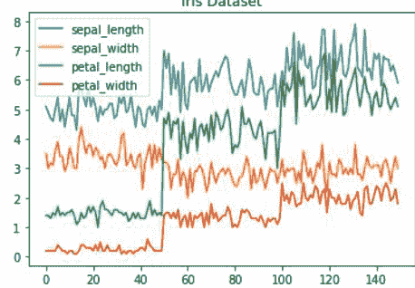

## 直方图

“hist” 方法可用于在 matplotlib 中生成直方图。下面的示例代码允许传递类别数据，例如“酒评”数据集中的 points 列，以自动计算每个类别的出现次数。

```
# creation of figure and axis
fig, ax = plt.subplots()
# plotting histogram
ax.hist(wine_reviews['points'])
# setting title and labels
ax.set_title('Wine Review Scores')
ax.set_xlabel('Points')
ax.set_ylabel('Frequency')
```

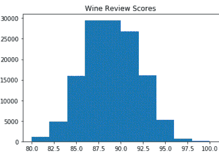

## 柱状图

“bar” 方法可用于在 matplotlib 中生成柱状图。这些图表无法自动计算每个类别的出现次数，因此需要使用 Pandas 库的“value_counts” 函数。任何类别种类不多的类别数据都可以轻松使用柱状图绘制。但是，包含超过 30 个类别的数据集过于复杂，无法生成易于理解的柱状图。下面的示例代码将使用“value_counts” 函数从“酒评”数据集中创建柱状图。

```
# creation of figure and axis
fig, ax = plt.subplots()
# counting the occurrence of each class
data = wine_reviews['points'].value_counts()
# getting x and y data
points = data.index
frequency = data.values
# creation of bar chart
ax.bar(points, frequency)
# setting title and labels
ax.set_title('Wine Review Scores')
ax.set_xlabel('Points')
ax.set_ylabel('Frequency')
```

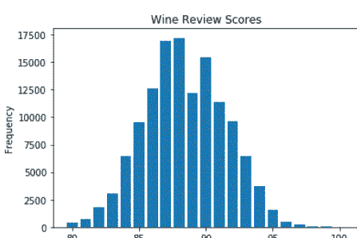

## Pandas

Pandas 提供直观且用户友好的高级数据结构。“Pandas” 在机器学习算法开发者社区中广受欢迎，内置了数据聚合、分组和过滤技术，以及时间序列分析结果。Pandas 库有两种主要结构：一维“Series” 和二维“DataFrame”。

“Pandas” 提供的部分关键特性如下：

- 一个带有内嵌索引的快速高效的“DataFrame 对象”，用于数据操作活动。
- 用于在内存数据结构与多种文件格式之间读写数据的工具，例如“CSV”和文本、“Microsoft Excel”、“SQL 数据库”以及快速的“HDF5 格式”。
- 通过实现自动标签驱动的计算对齐，实现智能数据对齐和不完整数据的集成管理，并能轻松将无序数据整理成有序形式。
- 数据集的灵活重构和透视。
- 对大型数据集进行基于标签的智能切片和索引，以及创建数据子集。
- 可以向数据结构添加或删除列，以实现所需的数据库大小。
- 使用先进的“Group By” 系统对数据进行聚合或转换，使数据上的“split-apply-combine” 技术得以执行。
- 数据集的高效合并和连接函数。
- “层级轴索引” 提供了一种在低维数据结构中处理高维数据的简单方法。
- 时间序列功能，包括“日期范围生成和频率转换、移动窗口统计、移动窗口线性回归、日期移位和滞后”。还可创建“领域特定时间偏移”，并能无数据损失地连接时间序列。
- 由于大部分底层代码使用“Cython” 或“C”，Pandas 拥有高性能和高效率。
- Python 与 Pandas 结合，广泛应用于多个学术和工业领域，包括金融服务、统计学、神经生物学、经济学、市场营销与广告、在线数据分析等。

Pandas 提供的两种数据结构是：“Pandas DataFrame” 和 “Pandas Series”。

## Pandas DataFrame

它被定义为“带有可能不同类型列的二维标记数据结构”。它与 Excel 电子表格高度相似，如下图所示，具有多个相似功能，用于从数据中进行分析、修改和提取有价值的见解。您可以通过输入来自“Excel”、“CSV”、“MySQL 数据库”等的数据集来创建“Pandas DataFrame”。

| | NAME | AGE | DESIGNATION |
|---|---|---|---|
| 1 | a | 20 | VP |
| 2 | b | 27 | CEO |
| 3 | c | 35 | CFO |
| 4 | d | 55 | VP |
| 5 | e | 18 | VP |
| 6 | f | 21 | CEO |
| 7 | g | 35 | MD |

例如，在上图中，假设“Keys”由列名表示，“Values”由该列中的项目列表表示，可以使用“Python 字典”来表示，如下面的代码所示：

```
my_dict = {
    'name': ["a", "b", "c", "d", "e", "f", "g"],
    'age': [20, 27, 35, 55, 18, 21, 35],
    'designation': ["VP", "CEO", "CFO", "VP", "VP", "CEO", "MD"]
}
```

可以使用下面的代码从这个字典创建“Pandas DataFrame”：

```
import pandas as pd
df = pd.DataFrame(my_dict)
```

生成的“DataFrame”如下图所示，类似于 Excel 电子表格：

|   | age | designation | name |
|---|---|---|---|
| 0 | 20 | VP | a |
| 1 | 27 | CEO | b |
| 2 | 35 | CFO | c |
| 3 | 55 | VP | d |
| 4 | 18 | VP | e |
| 5 | 21 | CEO | f |
| 6 | 35 | MD | g |

如果您想为行定义索引值，则需要像下面这样在“DataFrame ()” 子句中添加“index” 参数：

```
df = pd.DataFrame(my_dict, index=[1, 2, 3, 4, 5, 6, 7])
```

要获取“字符串”索引而不是数字索引，请使用下面的代码：

```
df = pd.DataFrame(
    my_dict,
    index=["First", "Second", "Third", "Fourth", "Fifth", "Sixth",
           "Seventh"]
)
```

现在，由于这些索引值是统一的，您可以执行下面的代码来使用“NumPy 数组”作为索引值：

```
np_arr = np.array([10, 20, 30, 40, 50, 60, 70])
df = pd.DataFrame(my_dict, index=np_arr)
```

类似于“NumPy”，“DataFrame” 的列也是同质的。
您可以使用类似字典的语法，或在“DataFrame”中添加列名，来查看列的数据类型，如下面的代码所示：

```
df['age'].dtype  # Dict Like Syntax
df.age.dtype  # DataFrame.ColumnName
df.name.dtype  # DataFrame.ColumnName
```

您可以使用下面的代码，使用“head ( )” 函数查看前五行，使用“tail ( )” 函数查看后五行，从而有选择地查看“Pandas DataFrame” 中可用的记录或行。例如，使用下面的代码查看数据的前 3 行：

```
df.head(3)  # Display first 3 Rows
```

## Pandas Series

它可以定义为“一种一维标记数组，能够存储任何类型的数据（整数、字符串、浮点数、Python 对象）”。简单来说，它就像 Excel 电子表格中的一列。要从数组生成“Pandas Series”，必须导入“NumPy” 模块，并与“array ()” 函数一起使用，如下面的代码所示：

```
import pandas as pd
import numpy as np

# simple array
data = np.array(['m', 'a', 'c', 'h', 'T', 'n', 'e'])
ser = pd.Series(data)
print(ser)
```

## 使用散点图进行数据可视化

散点图可以定义为“一种二维数据可视化，使用点来表示两个不同变量获得的值——一个沿 x 轴绘制，另一个沿 y 轴绘制”。它也被称为“散点图”或“散点图表”。例如，下图中看到的“散点图”描绘了一组儿童身高和体重的虚构测量值。图中的每个“点”都用于表示一个人，其身高沿“x 轴” 测量，体重沿“y 轴” 测量。

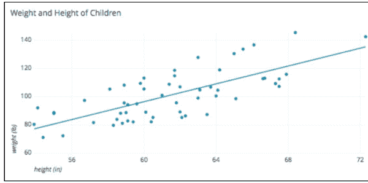


"散点图"在您有兴趣表示两个不同变量之间存在的关系时非常有用。"散点图"通常被称为"相关性图表"，因为它们展示了两个不同变量之间是如何相互关联的。在上面的"散点图"中，该图表描绘的内容远不止是儿童身高和体重的简单记录。它还提供了两个指标之间关系的可视化，表明随着身高增加，儿童的体重也在增加。现在，您可以轻松得出结论：这种身高和体重的关系并不理想，因为有些较高的孩子可能比较矮的孩子体重更轻，但总体趋势相当令人满意，并且可以观察到儿童的身高和体重之间存在直接关系。

需要注意的是，并非所有关系都是线性的。例如，下图中的图表显示了在7年内测量的"日平均最高气温"，展示了这些变量之间常见的抛物线关系，因为日平均最高气温倾向于在夏季达到峰值。

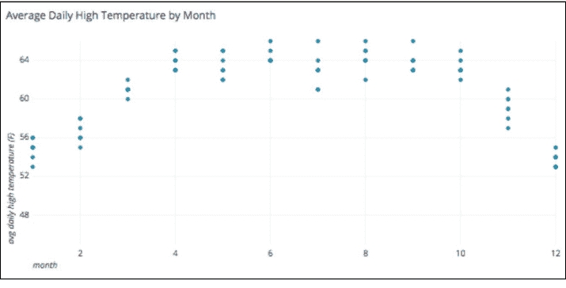

散点图通常包含趋势线，以澄清变量之间的关系，如下图所示。

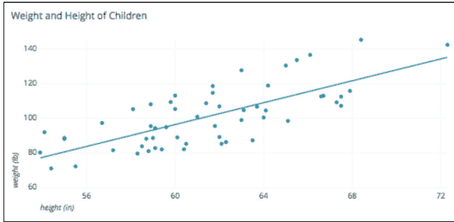

此外，"点"的形状、大小和颜色可以被视为额外的数据变量并加以利用。例如，下图代表了关于儿童身高和体重的数据，但通过添加"点"的颜色来描绘儿童的性别，我们为分析获得了第三个变量。

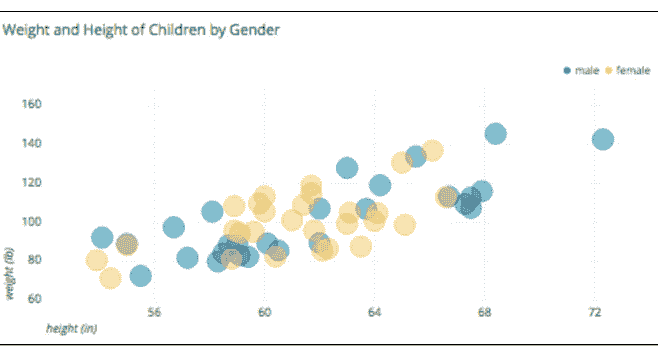

## 第 4 章：机器学习与预测分析

### 机器学习

机器学习可以被定义为人工智能技术的一个分支，其驱动假设是：机器能够通过识别模式并在几乎无需人工干预的情况下做出决策来从数据中学习。机器学习科学诞生于一种理论：计算机有潜力使用模式识别技术，在无需编程的情况下自学特定任务。当机器接触到新数据时，独立适应的能力是机器学习的迭代方面。它们可以从之前的计算中学习并自我训练，以生成可信且可复现的决策和结果。机器学习算法的使用时间比人们想象的要长得多，但其通过自动快速且重复地应用高度复杂和精密的数学计算来分析"大数据"的增强能力是近期才发展起来的。

机器学习允许分析大量数据并提供更快、更准确的结果。经过适当培训，这项技术可以让组织识别有利可图的机会和业务风险。机器学习与认知技术和人工智能相结合，在处理海量数据时往往更加有效和准确。机器学习算法可分为四类：

- **受监督机器学习算法** – 这些算法能够使用带标签的示例，将之前运行中的经验应用到新数据集中，从而成功地对未来事件进行预测。例如，可以将数据点标记为"F"（失败）或"S"（成功）来对机器进行编程。学习算法将接收带有相应正确输出的输入，并将其自身的实际输出与预期或正确输出进行比较，以试图识别可以修复的错误，使模型更高效、更准确。经过充分训练，这些算法能够通过回归、分类、预测和梯度提升等方法，为任何新数据输入提供'目标'。分析从已知的训练数据集开始，然后机器学习算法生成一个"推断函数"，以对输出值进行未来预测。例如，基于受监督学习算法的系统足够智能，可以预测和检测欺诈性信用卡交易被处理的可能性。

- **无监督机器学习算法** – 这些算法在没有分类和带标签的训练数据源的情况下使用。根据SAS，"无监督学习算法用于研究系统如何从未标记数据中推断函数以描述隐藏结构，即探索数据并识别其中的一些结构。"与受监督学习算法类似，这些算法能够探索数据并从数据集中得出推断，但无法找出正确的输出。例如，识别具有相似购物属性的个人，他们可以被细分在一起并针对类似的营销活动进行定位。这些算法被广泛用于识别数据异常值、提供产品推荐，并使用"奇异值分解"、"自组织映射"和"k-means聚类"等技术对文本主题进行细分。

- **半监督机器学习算法** – 正如其名称所示，这些算法介于受监督学习和无监督学习之间，能够使用带标签和未标记数据作为训练源。典型的训练集将包括大部分未标记数据以及少量的带标签数据。运行在半监督学习算法上的系统，使用预测、回归和分类等方法，能够显著提高其学习准确性。在获取的带标签数据需要相关熟练资源才能让机器进行训练或学习的情况下，半监督学习算法最为合适。例如，识别网络摄像头中的个人面孔。

- **强化学习机器学习算法** – 这些算法能够通过产生动作并发现错误或奖励来与其环境进行交互。强化学习的主要特征是试错研究方法和延迟奖励。使用这些算法，机器可以通过自动确定特定上下文中的理想行为来最大化其性能。增强信号仅仅是奖励反馈，机器或软件代理需要它来学习哪些动作能产生最快且最准确的结果。这些算法经常用于机器人技术、游戏和导航。

### 机器学习技术的应用

#### 虚拟个人助手

虚拟个人助手最流行的例子是Siri和Alexa。这些系统能够使用简单的语音命令提供相关信息。机器学习是这些设备和系统的核心，因为它们收集并定义每次用户交互生成的信息，并使用这些信息作为训练数据来学习用户偏好并提供增强的体验。

#### 驾驶过程中的预测

当今大多数车辆都在使用GPS导航服务，该服务将我们当前位置和驾驶速度等信息收集到中央服务器上，可用于生成当前交通地图。这有助于管理交通和减少拥堵。使用机器学习，系统可以估计交通拥堵频繁发生的区域和一天中的时间。机器学习算法允许Lyft和Uber等共享乘车服务在其路线上减少绕行，并向用户提供预先估计的乘车费用。

#### 视频监控

机器已经接管了监控多个视频摄像头以确保场所安全的单调工作。机器可以跟踪异常行为，例如长时间站立不动、在长椅上睡觉以及绊倒。然后它可以向安保发送警报


能够根据情报做出最终行动决策并避免意外事件的人员。随着每一轮报告的迭代，监控服务都会得到改进，因为机器学习算法在不断学习并自我完善。

## 社交媒体

像“Facebook”、“Twitter”和“Instagram”这样的社交媒体平台正在使用机器学习算法，从用户活动和行为中训练系统，以提供引人入胜且增强的用户体验。由机器学习算法驱动的功能示例包括 Facebook 上的“People you may know”功能（该功能会收集并学习用户活动，例如他们经常访问的个人资料、他们自己的个人资料以及他们的朋友，以推荐他们可以加为好友的其他 Facebook 用户）和 Pinterest 上的“Similar Pins”功能（该功能由计算机视觉技术与机器学习协同工作驱动，用于识别用户保存的“pins”图像中的对象，并相应推荐类似的“pins”）。

## 电子邮件垃圾邮件和恶意软件过滤

Gmail、Yahoo Mail 和 Hotmail 等所有电子邮件客户端都使用机器学习算法，以确保垃圾邮件过滤功能持续更新，并且无法被垃圾邮件发送者和恶意软件攻破。由机器学习驱动的垃圾邮件过滤技术包括多层感知机和 C4.5 决策树归纳。

## 在线客户服务

如今，大多数电子商务网站都为用户提供与客服代表聊天的选项，这通常由聊天机器人而非真人客服支持。这些机器人使用机器学习技术来理解用户询问，并从网站中提取信息，以便解决客户问题。每进行一次互动，聊天机器人就会变得更智能、更像人类。

## 搜索引擎结果优化

像“Google”、“Yahoo”和“Bing”这样的搜索引擎使用机器学习算法，提供与用户提供的关键词相关的更优搜索结果。对于每个搜索结果，算法都会观察并学习用户活动，例如打开建议的链接、打开的链接显示的顺序以及在打开的链接上花费的时间。这有助于搜索引擎了解哪些搜索结果更加最优，以及需要进行哪些修改来进一步改进搜索结果。

## 产品推荐

产品推荐功能现在已成为在线购物体验的核心。机器学习算法结合人工智能驱动着产品推荐功能。系统会观察并学习消费者的活动和行为，例如过去的购买记录、愿望清单、最近查看的商品，以及点赞或加入购物车的商品。

## 在线欺诈检测

金融机构高度依赖机器学习算法和人工智能，通过跟踪可能存在欺诈的在线货币交易来保障网络空间安全。例如，PayPal 正在使用机器学习算法防止通过其平台进行洗钱。他们使用一套人工智能工具，结合机器学习算法分析数百万笔交易，并区分买卖双方之间的合法交易和非法交易。每进行一笔交易，系统都会学习哪些交易是合法的，哪些交易可能是欺诈性的。

## 预测分析

根据 SAS 的定义，预测分析是“利用数据、统计算法和机器学习技术，基于历史数据识别未来结果的可能性。其目标不仅是了解已发生的事情，更是对未来将发生的事情提供最佳评估”。当今企业在着眼未来的同时挖掘过去，这就是营销人工智能发挥作用的地方，即应用预测分析技术。预测分析的成功与企业收集的大数据质量成正比。

以下是营销中广泛使用的部分预测分析应用：

## 客户行为预测分析

对于“Amazon”、“Apple”和“Netflix”等工业巨头来说，分析客户活动和行为是其日常运营的基础。越来越多的中小企业效仿他们的做法，在业务模式中实施预测分析。为公司开发定制化的预测模型套件不仅资金密集，还需要大量人力和时间。“AgilOne”等营销公司提供适用范围广泛的相对简单的预测模型类型。他们确定了三种主要的预测模型类型来分析客户行为，即：

- “倾向模型” – 这些模型用于为客户行为生成“真实或准确”的预测。最常见的倾向模型包括：“预测终身价值”、“购买倾向”、“转变倾向”、“转化倾向”、“互动可能性”和“退订倾向。”
- “集群模型” – 这些模型用于根据共享属性（如性别、年龄、购买历史和人口统计特征）将客户分类和分组。最常见的集群模型包括：“基于产品或类别的聚类”、“基于行为的聚类”和“基于品牌的聚类。”
- “协同过滤” – 这些模型用于基于客户之前的活动和行为生成产品和服务推荐，以及推荐广告。最常见的协同过滤模型包括：“升级销售”、“交叉销售”和“下一步销售”推荐。

企业用于执行客户行为预测分析的最重要工具是“回归分析”，它使公司能够建立特定产品销售与购买客户所展示的特定属性之间的相关性。这通过使用“回归系数”来实现，回归系数是数值，描述了客户行为受不同变量影响的程度，并为产品未来的销售开发“可能性评分”。

## 销售线索的资格认定和优先级排序

在 B2B 预测分析营销中，用于对潜在客户或“线索”进行资格认定和优先级排序的三个主要类别如下：

- “预测评分” – 用根据潜在客户进行实际购买的可能性来对其进行优先级排序
- “识别模型” – 用根据与公司现有客户共享的属性来识别和获取新的潜在客户
- “自动分段” – 用根据共享属性将潜在客户分离和分类，以便用相同的个性化营销策略和活动进行目标定位

预测分析技术需要大量销售数据作为基础和培训材料，以提高预测模型的准确性和效率。小型实体公司无法负担扩展计算资源的费用，因此无法从门店销售中有效收集客户行为数据。这转化为拥有更先进计算系统的大公司的竞争优势，进一步加剧了大公司与小企业相比的过度增长。

## 当前市场趋势识别

公司可以使用“数据可视化”工具，让企业高管和经理仅通过在“报告或仪表板”上可视化现有的客户行为数据，就能洞察公司的当前状况。这些仪表板报告往往能激发并产生由客户行为驱动的行动。例如，使用数据可视化工具，公司可以识别特定社区中客户需求的潜在趋势，并相应地规划各个门店的库存。同样的信息还可以揭示基于当前市场趋势、能够满足客户需求的最佳产品和服务，以便公司推出。市场趋势洞察还可以应用于提高公司供应链管理模式的效率。

## 客户细分与目标定位

优化产品方案、快速实现投资回报率的最简单且高效的方法之一，是在“正确时间”向“正确客户”提供合适的产品方案。这也恰好是预测分析在营销领域中最常见、应用最广泛的用途。根据“Aberdeen Group”开展的一项研究，在营销策略中使用预测分析的公司，成功识别“高价值客户”的可能性是其他公司的两倍。这正是公司现有数据集质量至关重要的地方。强烈推荐的做法是使用所有现有客户的历史消费行为数据进行分析，以细分并定位具有相似购买属性的客户，并为其提供个性化推荐和营销活动。


当前最常用的预测分析模型及其应用包括“关联分析”、“流失分析”和“响应建模”。使用这些应用程序，企业可以获取诸如“将其产品或目录的数字和印刷订阅相结合是否是个好主意”或“如果其产品或服务以月度订阅模式还是一次性购买费用提供会更成功”等洞察。领先的销售和营销平台公司之一是“Salesforce”，它提供了一个基于云的平台，企业可以利用该平台从独立来源（包括客户关系管理（CRM）应用程序和其他公司应用程序）收集的数据生成客户档案。通过有选择且审慎地向该平台添加输入数据，企业可以无缝跟踪客户行为，随时间推移建立客户行为模型，从而实时和长期地为企业决策过程提供支持。

## 营销策略的制定

预测分析与营销的另一项应用是提供访问各种客户相关数据的途径，例如从社交媒体平台和企业自身内部结构化数据中收集的数据。然后可以通过汇总所有可用数据并对其应用“行为评分”来生成客户行为模型。不同行业的所有企业都需要通过不断增多的营销媒介或渠道，适应不断变化或演变的客户行为。例如，企业可以使用上述任何一种预测分析模型，精确预测其计划中的营销活动在社交媒体平台还是移动应用上更有可能取得成功。

企业可以使用预测分析模型，了解客户如何基于其在社交媒体平台上就特定主题分享的情感或情绪，与其产品或服务进行交互。此过程称为“情感分析”或“文本分析”。

## 客户数据的探索性分析

“探索性数据分析”或 EDA 对来自产品价格、当前和历史客户调查、产品使用情况、购买历史以及人口统计等相关客户数据源生成的现有客户数据提供了全面的视图。它被认为是一种在不使用任何统计模型和数据推断的情况下查看数据的方法。“探索性数据分析”这一术语由约翰·图基在其 1977 年出版的书中提出。使用探索性数据分析的主要原因包括：

- 对适用的“预测模型”进行初步筛选。
- 验证基础假设。
- 确保企业提出正确的问题以扩大其客户群。
- 检测潜在的数据异常、冗余和错误。
- 确定“解释变量”之间的关系。
- 评估“解释变量”与“结果变量”之间关系的方向和大小。

收集的客户数据以数据库形式呈现为矩形数组，包含“主题标识符”、“结果变量”和“解释变量”等单独的列。查看充满数值的电子表格并从中确定重要信息相当具有挑战性，这就是使用探索性数据分析技术有选择地显示数据重要特征的原因。探索性数据分析技术共有四种：

- “单变量非图形” - 这种技术一次查看单个变量或数据列，并以统计摘要的形式显示结果。
- “多变量非图形” - 这种技术一次查看两个或多个变量或数据列，并以统计摘要的形式显示结果。
- “单变量图形” - 这种技术一次查看单个变量或数据列，并以图表或图形方式显示结果。
- “多变量图形” - 这种技术一次查看两个或多个变量或数据列，并以图表或图形方式显示结果。

EDA 通过生成低风险、低成本的数据发现和最适合客户数据模型的解决方案建议综合报告，帮助确定解决业务问题的最佳预测模型。对客户行为的深入探索性分析揭示了原本容易在海量信息中遗失的隐藏数据模式和市场趋势。使用 EDA 对客户行为数据得出的一些结论包括：

- 识别购买次数最多和花费金额最高的客户。
- 查明按日、周和月生成的订单数量。
- 识别所有公司产品的单价分布情况。
- 基于客户的人口统计学特征和地理位置识别购买交易模式。

## 基于人工智能的个性化营销

在由“Researchscape International”赞助的一项研究中，约 75% 的营销机构表示，个性化营销极大地帮助了他们的公司和客户推进客户关系，而惊人的 97% 表示他们将继续投资于个性化营销工作。这主要归因于企业能够通过使用预测分析和机器学习算法从客户行为数据中收集宝贵的洞察，从而有效地与目标市场沟通。通常，个性化始于单个客户，但有可能应用于具有共同属性的客户细分群体，并实现“规模化个性化”。基于人工智能的工具和应用程序可以结合客户行为分析进行图像识别和语音分析，为企业提供更深入的客户需求理解，这些需求可以通过提供精准的产品推荐来满足。

以下是个性化营销的一些行业应用：

## 广告定向

企业可以根据客户的购物属性（例如最近查看的特定产品或类别以及购买历史）向特定用户或客户细分群体投放广告。市面上可用的部分广告定向应用包括：

**“ReFUEL4”** – 由营销公司“ReFUEL4”开发的“广告分析器”，利用计算机视觉功能来预测广告的表现。如果公司现有的广告表现开始下降，广告分析器可以帮助公司开发新的、更好的广告。广告表现的下降通常预示着受众疲劳，即当广告变得过于熟悉且乏味时，人们将不再关注该广告。

“Match2one” – 该广告应用程序可以集成到公司的电子商务网站，用于跟踪潜在客户并留住现有客户。“Match2One” 应用程序使用机器学习算法来定位更有可能成为付费消费者的潜在客户。该公司声称，其“引擎经过训练，可通过网站访客行为和历史数据的组合来生成潜在客户并寻找新客户。”通过分析网站访客数据，该应用程序可以向表现出对特定产品兴趣的客户展示定向广告。

## 个性化消息传递

个性化消息传递最重要的方面是情境营销。为确保将相关消息发送给目标受众，企业会收集客户数据，包括其行为、网页浏览历史、偏好内容、社交媒体帖子以及人口统计等其他变量。市面上可用的部分个性化消息传递应用包括：

“Dynamic yield” – 该公司提供的电子邮件解决方案使用客户行为数据（例如订单历史、电子邮件点击、社交媒体活动等）来为单个客户生成个性化电子邮件内容。该电子邮件解决方案提供可轻松自定义以反映相关消息的动态电子邮件模板。该应用程序应用于多个行业领域，包括旅游、电子商务、游戏行业和社交媒体。


"Yoochoose” – 这家公司为在线零售商提供电子商务服务，使公司能够为其消费者创建“个性化购物体验”，使用个性化电子邮件或包含新闻通讯和产品推荐的定向通知，这些通知会根据客户行为自动触发。该应用程序能够识别一段时间内未进行购买的客户，并触发通知提醒他们进行购买。它还可以识别最近进行过购买的客户，并触发“售后，谢谢”电子邮件。该公司提供“目标通知”功能，并附带产品推荐引擎和“个性化搜索”，所有这些都打包成“个性化套件”。

## 产品推荐

对于任何希望发展业务的公司来说，最简单、最聪明的做法是提供与客户需求和要求相关的准确产品推荐。公司还可以通过新产品、重复购买和重新定位来吸引新的潜在客户并提高客户忠诚度，从而减少产品退货的数量和频率并增加收入。市面上可用的某些产品推荐应用程序如下：

- "Recombee" – 该应用程序基于先进的机器学习算法，能够在“客户活动发生后的200毫秒内”生成推荐。该公司声称，其应用程序每秒可生成超过500条推荐，方法是采用开发用于客户行为分析的“协作过滤算法”与用于分析产品标题和描述的“基于内容的算法”的组合。随着每一次人机交互，学习算法会不断自我改进，并通过客户的迭代使用持续优化推荐。该应用程序广泛应用于房地产行业、招聘网站、分类广告、游戏行业、旅游行业和娱乐行业等领域。

- **Sentient Aware** – “Sentient Aware”提供的产品推荐引擎分析消费者的视觉活动和行为交互，以激活公司网站中的“深度学习算法”。该应用程序利用“意图和策展驱动算法”来识别相似产品和公司目录，以生成客户偏好的预测并做出与这些偏好一致的产品推荐。该公司声称，其应用程序对首次用户的产品推荐同样高效，因为它能够在不使用历史数据的情况下生成推荐。

## 动态网站

能够通过底层脚本驱动、动态更改内容来即时满足每位客户个人网站偏好的网站称为“动态网站”。包括照片标记和照片渲染在内的重复性任务，是使用“图像识别”和“机器学习”等人工智能技术完成的。当今市面上可用的某些动态网站应用程序如下：

- **Bookmark** – “Bookmark”公司已成功将机器学习技术应用于网页设计。该公司声称，其“AI设计助理”或(AIDA)可以根据公司的行业特定信息，定制构建公司网站，涵盖网站的各种元素、章节和图片以及应该出现在网站上的整体网页设计。“AIDA”能够通过搜索公司名称、位置和业务类型来搜索互联网，以收集关于客户公司的更多信息。该应用程序收集客户在社交媒体上的客户行为和活动信息，并分析这些信息以确定公司电子商务平台的最佳网站元素和设计。

- **“LiftIgniter”** – 由“LiftIgniter”开发的动态网站推荐系统可以直接集成到客户的在线和移动应用电子商务平台中，并由名为“真并行多变量算法基础设施”的机器学习算法驱动。这个集成系统从客户与电子商务平台的交互中学习，并筛选公司的所有在线内容，在150毫秒内显示客户可能基于其在平台上的实时活动而感兴趣的推荐产品。

## 结论

感谢您阅读完《Python for Data Science：针对数据科学、数据分析、Python机器学习和大数据的Python速成课程》，希望本书内容丰富，能为您实现任何目标提供所需的所有工具。

下一步是充分利用您新获得的Python编程、数据科学、数据分析和机器学习智慧，这些智慧催生了名为“硅谷”的强大力量。面向未来的各行各业企业正在其预期商业模式的影响下，逐渐转型为大型科技公司。“FinTech”行业的兴起，得益于全球金融机构和企业，这一趋势已经得到证实。本书充满了真实案例，帮助您了解底层概念的细枝末节，并介绍了多种工具的名称和描述，您可以进一步探索并有选择地实施这些工具，为开发理想的机器学习模型做出明智决策。现在您已经读完本书并掌握了Python编程的使用，可以开始开发自己的基于Python的机器学习模型，并使用本书中随时可用且明确描述的所有开源资源进行大数据分析。您可以利用从本书中获得的所有前沿技术的深厚知识和理解，为任何公司的发展做出贡献，并为自己找到一份高薪且有回报的工作！

最后，如果您以任何方式认为本书有用，在Amazon上留下评论将不胜感激！

