# Python 初学者指南：通过本轻松信心的 Python 编程指南，从新手变为专家，包含清晰的解释与实用示例


## 献辞

首先献给我的主和救世主耶稣基督，感谢他的恩典，他在天堂为我准备了一个地方（约翰福音 14:2, 6），同时也献给我的妻子，她是我生命的爱和我世界上最好的朋友。


## 引言

Python 以其可读性、简单性和易用性而闻名。由于这些以及其他几个特性，它是初学者的优秀编程语言，但不要让这些特征误导你，认为 Python 是二流的。正是因为这些特性以及它的快速开发能力，它才拥有一令人瞩目的简历。以下是使用 Python 的公司列表：

- Reddit，全球最大的社交媒体和讨论平台之一，最初使用 Common Lisp，后来因为其可读性和易用性迁移到了 Python。

- Pinterest，一个图片共享和社交媒体平台，广泛使用 Python。

- Quora 是一个由前 Facebook 员工创立的问答平台，在所有可用选项中，他们选择了 Python 作为首选开发平台。

- Spotify，一家音乐流媒体公司，使用 Python 进行多项工作，包括数据分析和部分后端架构。Uber 也是如此。

- Survey Monkey，一家专门从事问卷开发和数据收集的公司从 Python 开始，并继续将其用于内部工具、脚本以及 `Django`（Python 的高级 Web 框架）。

- 客户名单中的惊喜是 NASA。从技术上讲它不是一家公司，但将其作为客户之一是非常令人瞩目的。NASA 使用 Python 进行科学和计算任务、数据分析和模拟。

## 这本关于 Python 的书能为你做什么？

我在书中为你设定了三个总体目标。


## 目标 #1 – 坚实的基础。

在 `Python` 编程方面打下坚实的基础是帮助你对自己的编程能力建立信心的根本。我的目标是为你提供在本书之外可以继续构建的内容。作为这一坚实基础的一部分，我们将努力帮助你掌握基础概念和语法。

如果你学过外语，你就会知道通常从学习字母表开始，然后学习一些词汇。接着，你将转向句式结构，以便表达你的观点。学习编程语言也如此，但我们的目标是让你精通 `Python`，从而使你对它充满自信。在此过程中，你还将学习大多数编程语言中通用的构建块，这样你就能有信心地将你的编程知识扩展到其他编码语言。

## 目标 #2 – 通过实践进行学习。

学习任何编程语言的唯一方法就是开始使用它。本书围绕解决实际场景的编程项目构建，通过解决常见问题来帮助你应用所学的 `Python` 概念。因此，当你完成学习时，将积累一些实用的编程经验。

## 目标 #3 – 技能构建。

这与上一个目标相关，但它不仅限于知道如何应用以及为什么应用。同样，这是为了让你能够独立地探索 `Python`（以及其他编程语言）。

## 奖励

在整书中，我们将构建两个编程项目：一个基于 GUI 的天气应用和一个我们将部署到线上的 Web 端天气应用。因此，你不仅将学会 `Python`，还将会有几个应用可以展示！

## 以下是你将学到的内容：

## 第一章：Python 基础

*   你将学习为什么 `Python` 是初学者的优秀语言，也是帮助提升职业生涯和技能的极佳选择。
*   你将学习如何在你的机器上安装 `Python`，无论你的操作系统是 `Windows`、`Linux` 还是 `macOS`。
*   你将编写你的第一个 `Python` 脚本。
*   你还将开始你的你的第一个独立应用：一个基于 GUI 的天气应用。

## 第二章：深入探索 Python。

*   我们将更深入地探讨运算符和表达式。
*   你将看到它们是什么、如何使用以及为什么要使用它们。
*   我们将探索循环和迭代，这些是建立坚实编程基础的基础概念。
*   你将把在这里学到的知识继续用于天气应用。

## 第三章：构建函数。

*   你将学习如何按照正确的 `Python` 标准定义函数。
*   我们将解释参数和参数以及如何使用它们。
*   你还将学习如何创建和使用返回语句。
*   我们继续加强你对正确 `Python` 语法的理解，使你的代码符合 `Python` 标准，并且看起来简洁、清晰且专业。
*   我们将应用在这里学到的知识来定义 GUI 天气应用中的函数。

## 第四章：Python 中的数据结构。

*   `Lists`（列表）和 `tuples`（元组），它们是什么以及如何使用它们。
*   `Dictionaries`（字典）和 `sets`（集合），它们与 `lists` 和 `tuples` 的对比，以及它们如何帮助从复杂数据集中组织和检索数据。
*   如何处理 `files`（文件），包括编写脚本。

## 第五章：面向对象编程。

*   我们将学习如何定义 `classes`（类）。
*   我们将探索 `inheritance`（继承）和 `encapsulation`（封装）。
*   我们将学习如何有效地使用 `objects`（对象）。

## 第六章：调试与故障排除。

*   我们将学习如何发现并修复代码中的错误。
*   我们将使用调试工具和技术。
*   我们将学习如何编写更健壮的代码。

## 第七章：使用 Python 进行 Web 开发。

*   我们将学习如何使用 `Python` 构建 Web 应用。
*   我们将探索 Web 框架和库。
*   我们将学习如何将我们的 Web 应用部署上线。

## 第八章：数据分析与可视化。

*   我们将学习使用 `Python` 分析数据。
*   我们将使用用于数据可视化的库。
*   我们将学习如何处理大型数据集。

## 第九章：现实世界 Python。

*   我们将学习如何使用 `Python` 自动化重复任务。
*   我们将探索 `Python` 在各行业中的应用。
*   我们将学习如何构建专业级的 Python 应用。

## 第十章：数据库基础。

*   我们将学习如何使用 `Python` 操作数据库。
*   我们将探索 `SQL` 和数据库管理。
*   我们将学习如何高效地存储和检索数据。


- 自动化
- 科学计算 (计算科学)
- 游戏开发

## 为什么这很重要？

广泛的机会。因为 Python 不局限于任何一个行业且易于适应，学习 Python 为你作为一名 Python 程序员开启了广阔的机会。凭借这套技能，你可以轻松地从一个行业过渡到另一个行业。

跨领域解决方案。由于 Python 可以在不同行业之间轻松转换，它还可以为许多不同的行业提供解决方案。它与其他工具协作得良好，这意味着它可以与其他平台结合，具有高度的可扩展性。

## 它是一门高级语言

高级语言是一种计算机语言，它“抽象”了许多许多低级细节，例如内存管理。可以这样想：你不需要考虑如何保持心率在健康水平。你的大脑会自动处理这一点，这样你就可以处理更重要的事情，比如担心这个月如何交电费了。

## 为什么这很重要？

你可以专注于解决问题。因为 Python 允许你进行高层次的编程，你可以专注于特定任务的逻辑解决，而无需担心内存泄漏或你的代码将如何与计算机硬件通信。Python 会为你无缝地完成这一切。

## 它拥有庞大且活跃的社区

提到 Python，你在开发旅途中永远不会孤单。因为它是开源的，工具、库、论坛和回答你 Python 问题的资源无处不在。

## 为什么这很重要？

资源丰富。无论你是去 Stack Overflow 这样的论坛，还是利用 GitHub 这样的开源库，Python 开发者社区都提供了丰富的资源供你借鉴。

## 设置 Python

如果你打算开始使用 Python，需要在你的机器上进行设置。Python 适用于许多平台。对于本书，我将为你提供 Windows、macOS 和 Linux 的指令。除了不同操作系统上设置 Python 的差异外，你学的所有其他 Python 步骤都适用于任何操作系统。

在写作时，有两个版本的 Python 可用：版本 2 和版本 3。版本 2 是旧版本，不再受到活跃支持。请使用版本 3，因为它是目前活跃支持的版本，也是我们在书中使用的版本。

### 安装

以防万一，最好检查你的机器上现在是否有任何版本的 Python。要这样做，请进入机器上的命令提示符。在 Windows 中，如果你在任务栏的搜索区域输入 `CMD` 并按 `ENTER`，就会看到命令提示符。在 macOS 和 Linux 中，命令提示符被称为“终端”。

在命令提示符中，输入：
```bash
python --version
```

那是 `python`，后面跟着一个空格、两个连字符，以及紧随连字符之后的 `version` 单词。现在按 `ENTER`。如果你没有安装 Python，你会看到“Python not found（未找到 Python）”。如果你已经安装了 Python，请记住版本。除非你有迫切的需求不升级，否则你可能需要升级你的 Python 版本。

Windows 用户可能会注意到，如果你只是在命令提示符处输入 `python` 并按 `ENTER`

### Windows 安装步骤

步骤 1：在浏览器中，导航到 `python.org`。它将带你进入：


步骤 2：一旦下载了软件，按照提示操作。它将带你进入：


步骤 3： 在“高级选项”（Advanced Options）部分，在 `Add Python to environment variable`（将 Python 添加到环境变量）处勾选。只有在你有充分理由的情况下才修改它。

步骤 4：点击 `Install`（安装）。

### macOS 安装步骤

步骤 1：打开你的终端。

步骤 2：如果你还没有 Homebrew，请安装它。你可以通过运行安装 Homebrew：
```bash
/bin/bash -c "$(curl -fsSL https://raw.githubusercontent.com/Homebrew/install/master/install.sh)"
```

步骤 3：通过运行安装 Python 3：
```bash
brew python
```

### Linux 安装（适用于 Ubuntu 和 Debian）

步骤 1：打开你的终端。

步骤 2：使用此命令更新软件包列表：
```bash
sudo apt update
```

步骤 3：通过运行安装 Python 3：
```bash
sudo apt install python
```

### 检查安装

为了确保 Python 安装正确，进入命令提示符（或终端）再次运行：
```bash
python --version
```

你应该会看到一个显示 Python 版本的提示符。

### 测试运行

从命令提示符（终端）运行此命令：
```bash
python
```

你应该会看到另一个名为 Python 解释器的提示符出现在你的命令/终端窗口中。现在输入此内容然后按 `ENTER`：
```python
print("Hello, Python!")
```

它应该响应为：Hello, Python!

要退出 Python 解释器，输入 `exit()` 或按 `CTRL+Z` 然后按 `ENTER`。

## 开发环境 (IDEs)

虽然你可以使用简单的文本编辑器创建 Python 程序，但大多数开发者更倾向于使用所谓的集成开发环境或 IDE。IDE 可以帮助你处理语法、修复错误、代码提示等。流行的 Python IDE 包括 Python 和 Jupyter Notebook。不过，我更倾向于使用 Visual Studio Code，因为它支持多种编程语言，在普通开发者中非常流行，并提供了更健壮的编码环境。

### 安装 Visual Studio Code

步骤 1：访问 Visual Studio Code 网站：([`code.visualstudio.com/`](https://code.visualstudio.com/))

步骤 2：下载适用于你操作系统的版本。

步骤 3：打开 VSCode 并可选安装 Python 扩展。有关此步骤的完整指令，请访问此链接：[`code.visualstudio.com/docs/python/python-tutorial`](https://code.visualstudio.com/docs/python/python-tutorial)

在书中我们将在 VSCode 中进行代码示例。然而，你可以自由使用任何你喜欢的 IDE。现在你已经完成了设置，准备好开始你的 Python 编程之旅了！让我们开始吧！

## 你的第一个 Python 程序！


如果你已经走到了这里，说明你已经在你的机器上安装了 Python。恭喜你！我认为这是整个过程中最困难的部分。现在，有趣的事情开始了！那么，让我们从经典的“Hello, world!”程序开始吧。对于大多数编程语言来说，“Hello, world!”程序是你开始学习任何新编程语言时的入门仪式。当你完成这一节时，你将已经编写并执行了你的第一个 Python 程序！

### 启动你的代码编辑器

如果你安装了 `VSCode`，只需打开并按照以下步骤创建一个新文件：

*   点击 `File`（文件）→ `New File`（新建文件）（`CTRL+ALT+WIN+N`）。
*   在提示时，为文件命名为 `hello.py`。它必须具有 `.py` 扩展名。
*   保存它。

### 编写你的第一段 Python 代码

在代码编辑器中输入输入：

```python
print("Hello, World!")
```

### 运行你的代码

首先，确保已经保存了文件。在 `VSCode` 中，任何未保存的文件文件名旁边都会有一个点。

其次，在 `VSCode` 中打开终端窗口。要此操作，点击顶部菜单并点击 `Terminal`（终端） >> `New Terminal`（新建终端）（`CTRL+ \``）。对于键盘快捷键，反引号（` `）通常位于 `ESC` 键下方。终端屏幕将出现在 `VSCode` 窗口的底部。

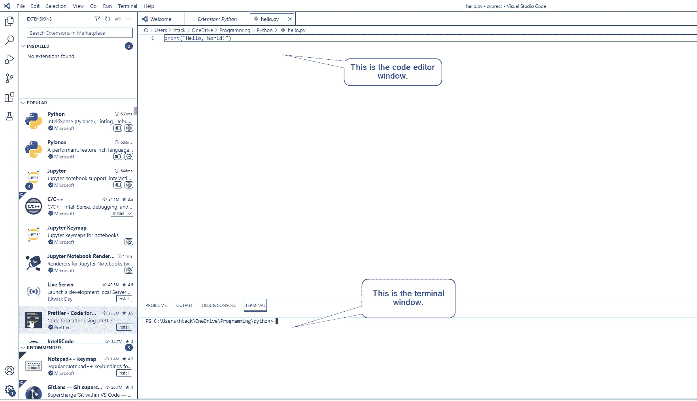

第三，导航到你保存文件的地方。如果你不记得保存在哪里了，看代码编辑器中你第一行代码上方。你会看到列出的路径。在终端窗口中导航到该路径。

对于 Windows：

```bash
cd path\\to\\your\\file
```

对于 macOS 和 Linux：

```bash
cd /path/to/your/file
```

（`CD` = 更改目录或更改磁盘）

第四，输入 `python hello.py`（不带引号）。如果一切运行正常，你应该会在终端中看到“Hello, World!”。

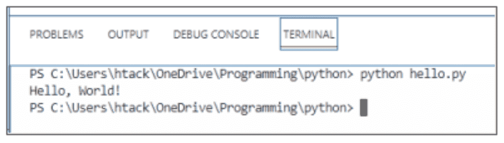

|  || 在 `VSCode` 中，如果你想清屏，只需输入不带引号的 `clear` 并按 `ENTER` 回。 |
| --- | --- |
|  || 如果你想重用刚刚输入的命令，使用向上或向下箭头在最近的命令之间循环切换。 |
| [Pixel Perfect 创建的提示图标](https://www.flaticon.com/free-icons/tip) |
|  ||  |

顺便说一下，恭喜你！你刚刚创建了你的第一段 Python 代码！你现在是一个 Python 程序员了！（太晚了，你无法回去了。）

现在让我们仔细观察一下你刚刚写的代码。

### 理解代码

```python
print("Hello, World!")
```

*   此命令使用了一个函数和一个变量。
*   当你调用 `function`（函数）时，你总是以一对括号（简称为 `parens`）结束，即使你不在其中放入任何内容。这是 Python 能够理解你是在调用一个函数，而不是在随机输入一个单词的方式。
*   在 `print()` 函数的括号内，我们传递了一个字符串变量。`variable`（变量）是一个可以改变的值。它们被传递给方法和函数进行处理。在我们的示例中，我们将字符串变量 `"Hello, World!"` 传递给 `print()` 函数，以便它能显示该内容。


- **元组 (Tuples)**：这些类似于列表，不同之处它们是不可变的，这意味着一旦声明了元组，你就无法添加或删除成员。它们用于存储固定的数据集合。例如，你可能有一个包含我们太阳系行星名称的字符串元组。这是不可更改的——除非科学界再次从列表中剔除另一颗行星。（冥王星永远存在，我的兄弟姐妹们！）元组用圆括号括起来。示例：`(1,2,3)`

- **字典 (dict)**：这些是键值对的无序集合。字典中的每个值都连接到一个唯一的键。你将使用键来从字典中检索值。字典使用大括号和冒号定义，如下：`{"object" : "ball", "color" : "blue", "material" : "plastic"}`。如果我正在使用这个字典，并想知道里面是什么种的物体，我可以检索 `object` 键并发现它是一个球。

- **集合 (Sets)**：集合也是唯一元素的无序集合。它们也使用大括号声明，但它们内部不包含任何键。示例：`{1, 2, 3}`

- **空类型 (NoneType (None))**：首先，注意该类型的缩写首字母是大写的。它是 "None"，而不是 "none"。`None` 用于表示值的缺失。在 Python 中，它用于指示缺失或未定义的值。

- **复数 (Complex Numbers (complex))**：它们由实部和虚部组成。例如，在 `2 + 3j` 中，`2` 是实部`3` 是虚部。

有了这些数据类型，Python 可以处理从简单到复杂的各种数据。

## 整数 (Integers)

正如我们在上面提到的，整数是整数，意味着没有小数的数字。整数可以是负数也可以是正数。因此，像 `12`、`-7`、`0` 和 `115` 这样的数字都是整数。整数经常用于计算以及作为列表等对象的索引。

## 浮点数 (Floats)

浮点数带有小数。它们也被称为“浮点”数。这就像把四季豆称为另一种名字一样。是一回事，只是名字不同。浮点数可以是正数也可以是负数。因此，像 `3.14`、`-2.6` 和 `0.1` 这样的数字都是浮点数。通常在需要更高精度时使用浮点数。

## 字符串 (Strings (str))

字符串和字符串处理是 Python 编程语言不可或缺的一部分。我们使用字符串与用户通信，解释结果或提供反馈。如之前提到的，字符串被单引号（''）、双引号（""）或三引号（`'''` 或 `"""`）包围。如果你尝试声明字符串但忘记用引号将其括起来，Python 将在运行时抛出错误信息。如果你使用像 `VSCode` 这样的代码编辑器，编辑器会将其标记为语法错误。

是一些常见的字符串操作：

### 字符串拼接 (+)

拼接是指两个（或多个）字符串并使用 `+` 运算符将它们连接起来。这里有一个示例：

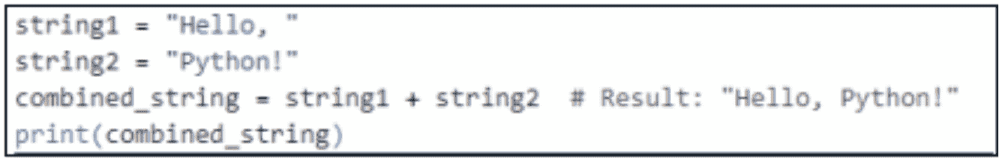

### 字符串长度 (len( ))

`len()` 函数将返回字符串的长度。看看这个示例。

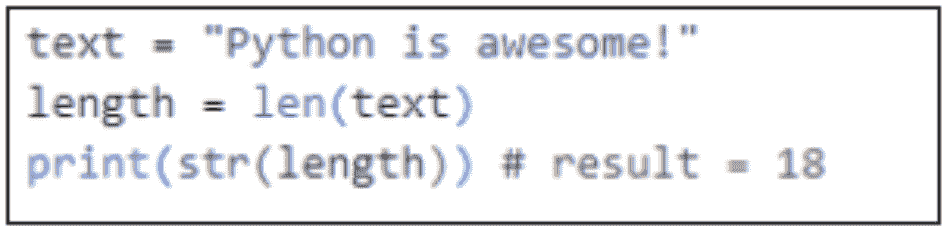

我们文本从开始到结束的长度是 18 个字符。这包括空格。如果我们的字符串有开头或结尾空格，它们也会包含在长度计数中。

### 索引与切片 (Indexing and Slicing)

字符串是字符序列，它们也有索引。在 Python 中，索引从 `0`（零）开始。因此，要获取字符串的第一个字符，你需要请求索引为 `0` 的字符。这里有一个示例：

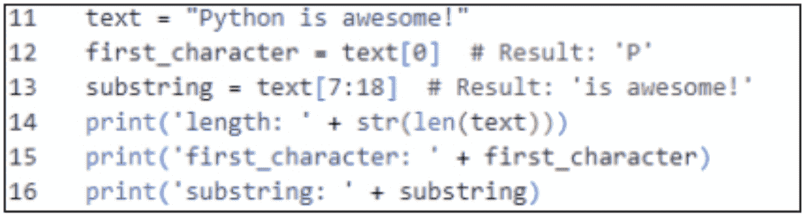

在第 12 行请求了字符串的第一个字符，所以我写了 `text[0]`。如果我请求 `text[1]`，我将收到字符串中的第二个字符，因为 Python 中的索引从 `0` 开始。

在第 13 行，当我想要一个子字符串时，我请求从 "Python" 后面空格后的字符开始。它是第 8 个字符，但由于基于 0 的索引，我请求的是字符 `7`。要获取字符串的剩余部分，我只需在冒号后输入 `18`。我可以在那里输入 `len()` 函数并得到相同的结果。


### 字符串方法 (String Methods)

Python 的字符串方法允许你处理字符串。考虑这些示例：

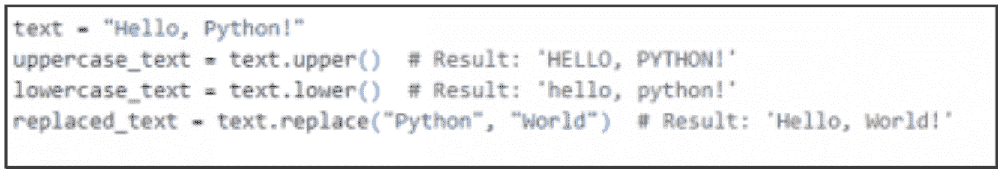

### 快速回顾 (Quick Recap)

使用字符串和数字是变得精通的基础。你练习得越多，表现得越好。

## 类型转换 (Type Conversion)

有时你需要组合类型。Python 允许你从浮点数转换为整数，反之亦然。将其保存为 `TypeConversion.py` 并运行它。

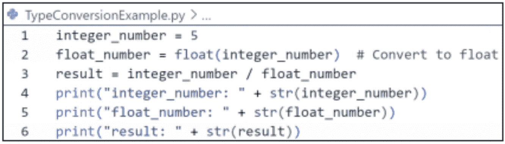

### 代码解释

第 1 行：这是一个说明代码主题的注释。

第 2 行：声明了一个名为 `integer_number` 的变量。因为它没有小数值，Python 假设它是 `int`。它不需要显式声明为 `int`。

第 3 行：声明变量 `float_number`。由于我们希望 Python 将其视为浮点数，我们必须这样进行强制转换：`float(integer_number)`。这告诉 Python 将我们的整数作为浮点数处理给 `float_number` 变量。

第 4 行：这是将我们的 `int` 除以我们的 `float`。

第 5 行：你得到了整数 `5`。

第 6 行：你得到了浮点数 `5.0`，因为浮点数总是带有小数。

第 7 行：你得到了浮点数结果。为什么？因为当对混合类型进行操作时，结果将提升为更高类型。整数是基础类型。浮点数是高级类型（缺乏更好的术语）。

## 趣味玩玩 (Just for Fun)

让我们尝试改变一些东西。在你的代码编辑器中尝试以下并运行它：

```
float_number = 5.9
integer_number = int(float_number)

print("float_number: " + str(float_number))
```


```python
print("integer_number: " + str(integer_number))
```

整数值变成什么了？你可能预期它会四舍五入到 6。相反，它只是删除了小数部分并返回 5。在进行类型转换时，请明智地选择，并考虑转换是否会导致结果丢失精度，以及这是否会影响你的预期。

## 基础数值运算

Python 拥有广泛的数值运算功能。这也是它在科学和数学社区如此受欢迎的原因之一。下表是最常用的 Python 运算符表。

| 运算符 |
| --- |
| + |
| - |
| \* |
| / |
| // |
| % |
| \*\* |

下面的代码示例演示了这些运算符的用法。要亲自尝试，请在你的代码编辑器中创建一个名为 `BasicOps.py` 的文件，并输入以下代码：

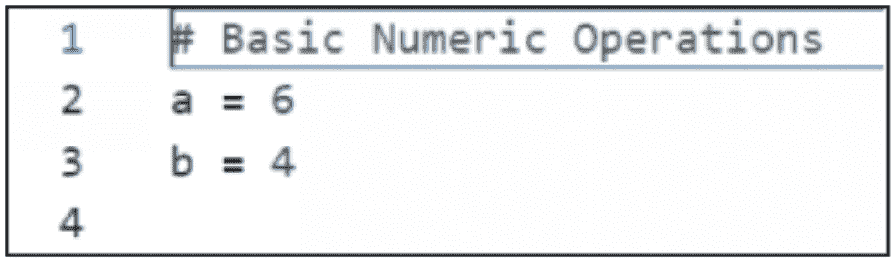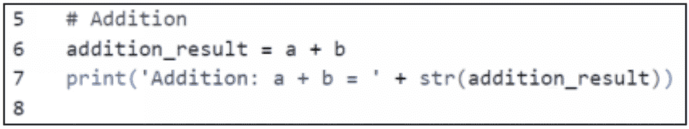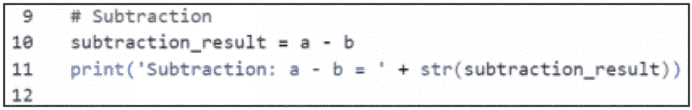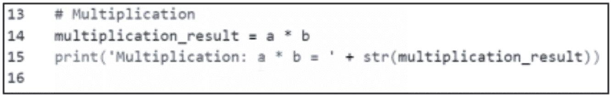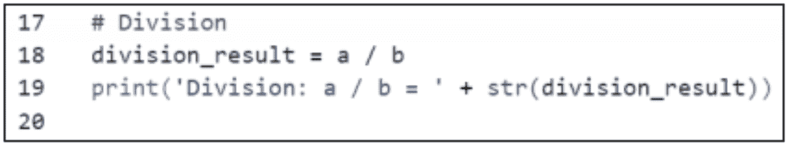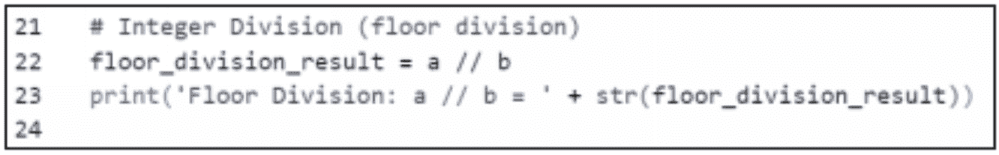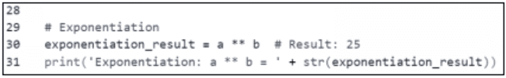

### 代码解释

第 1-8 行：这些自言自明，使用的运算符是常见的数学运算符。

第 9-11 行：这里只需注意 Python（以及大多数编程语言）中的乘法运算符是 `*`（星号）。此外，由于我们使用的是整数值，因此我们得到了整数结果。

第 12-14 行：你可能会发现这有点意外。我们正在除以整数，但得到了小数结果（1.5）。这是 Python 3 的默认行为。

第 15-17 行：这是整数除（或地板除），运算符是双斜杠（`//`）。当你使用此运算符进行除法时，即使有余数，你也只会得到整数结果，因此结果为 1。

“在 Python 中，我们可以使用 `//` 运算符执行地板除（有时也称为整数除法）。该运算符将第一个参数除以第二个参数，并将结果向下取整到最近的整数，使其等同于 `math.floor()` 函数。”（Python 双斜杠 (`//`) 运算符：地板除 – LearnDataSCI, n.d.）

第 18-20 行：这是取模或余数除法。“mod”运算符是百分号（`%`）。此操作返回两个数除后的余数。例如，如果你有一组数字并想要所有的偶数，你可以遍历集合，用每个数字除以 `% 2`（模 2），然后只提取 `x % 2 = 0` 的数字，其中“x”是集合中的一个数字。例如，`12 % 2`（12 mod 2）没有余数，所以它将是被提取的数字之一。

第 21-20 行：这是幂运算。`**` 运算符用于计算一个数的次方。例如，`2 ** 3` 的结果为 8。

## 第 3 节：Python 语法

### Python 独特的缩进要求

### 缩进至关重要

与某些使用大括号或其他符号来组织代码的编程语言不同，Python 依赖于严格的缩进规则。对于 Python 来说，正确的缩进对于定义循环、条件和函数等代码块至关重要。虽然来自其他编程语言的人可能会觉得这有些寻常，有时甚至感到沮丧，但正是 Python 对这些规则的遵守，使其成为一种易用且易读的语言。


如果你尝试在忽略代码编辑器反对意见的情况下运行第二个示例，你会看到类似这样的错误：`"IndentationError: expected an indented block after "if" statement on line3"`

有趣的是，如果你将代码块放在冒号后面，并且与主句处于同一水平，Python 是可以接受的。然而，这并不是最佳实践，因为会导致代码难以阅读。

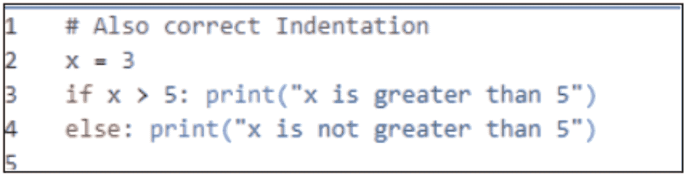

### 缩进规则与最佳实践

那么，我们如何避免格式错误（以及挫败感）呢？在格式化代码时，有几点需要注意。

### 空格至关重要

Java 等语言不在乎空格。对于 Python 来说，空格是正确格式的关键。缩进使用空格和制表符（tabs）。为了保持一致，最好使用制表符，并在代码编辑器中将制表设置为四个空格。这是 Python 开发社区的常见做法。你可以混合使用空格和制表符，但这会导致格式粗糙、不一致以及代码难以阅读。

### 缩进级别非常重要

在缩进代码块时要保持一致。代码块的缩进是优秀 Python 代码的标志，这也是它如此易读的原因。每一级缩进都使用四个空格。

### 代码块由缩进定义

在 Python 中，条件、循环和函数定义等代码块是由缩进定义的。由于这条规则，不需要使用大括号等符号来识别和定义代码块。只需通过观察代码的形状，就能清楚地看出代码块。Java 程序员可能会想：“我们也使用缩进。”是的，我们使用，但那主要是出于习惯俗例。在 Python 中，缩进是强制执行的。如果忽略了 Python 的缩进规则，将在运行时导致错误。

### 样式是灵活的，但存在标准

`PEP8` 是 Python 的风格指南，也是涉及最佳实践的终权威资源。关于缩进使用四个空格的建议就源于这本指南。如果你正在使用 IDE，并且它已配置为使用 Python 规则，它将帮助你保持代码格式正确。大多数 IDE 会会在你出现语法或格式错误时标记你的代码，以便你在运行前进行纠正。默认情况下，大多数 IDE 已经将制表设置为四个空格。

### 冒号符号表示代码块的开始

正如前面提到的，缩进代码块的开始由冒号指示。你会在 `if`、`else`、`for` 和 `while` 等语句的末尾看到它们。你也会在函数定义中使用它们。下面是一个函数定义的示例。

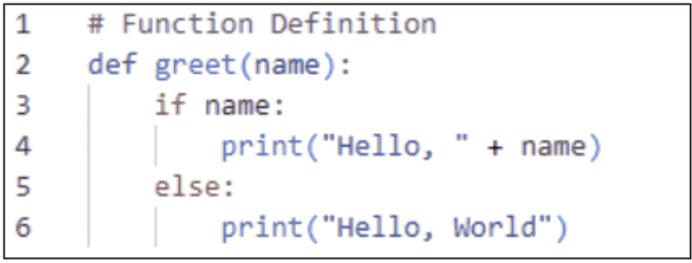

第 2 行提供了函数名称并显示它可以接受参数。冒号表示后面将有一个代码块。

第 3 行是一个 `if` 语句，并在起始行下方缩进，根据 Python 规则表示它是函数定义的一部分。它也以冒号结尾，表示后面还有另一个代码语句。

第 4 行在第 3 行下方缩进，这让 Python 清楚地知道这一行代码属于 `if` 语句。


## 脚本概述
我们正在查看的脚本是关于什么的？它的目的和功能是什么？

### 代码结构
我们将查看代码是如何构建的，以及如何应用 `Python` 缩进规则来使代码整洁且易于阅读。

### 注释与文档
开发者是如何给代码写注释的？注释是否清晰？它是否为其他开发者（以及开发者未来的自己）解释清楚了代码的整体内容以及每个部分的功能？

### 最佳编码实践
在查看这段代码时，我们将看到开发者是如何应用最佳实践和推荐指南的。

### 亮点
我们将查看代码的特定部分，并识别关键的 Python 语法特征和编码实践。

## 我们将如何剖析这段代码
由于本案例研究包含了许多行代码，我们将将其分成若干部分并逐节进行讨论。

### 第一部分

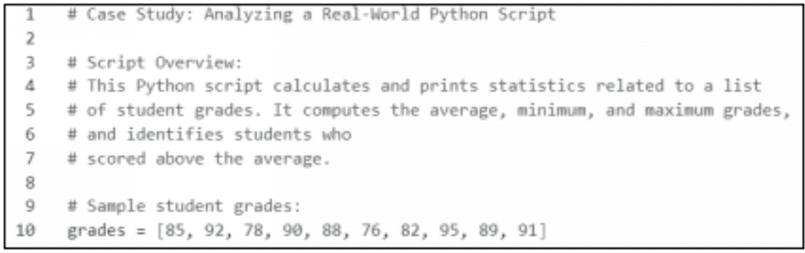

第 3-7 行清晰地描述了该脚本的全部内容。

第 9 行告诉我们第 10 行中列表的用途。

### 第二部分

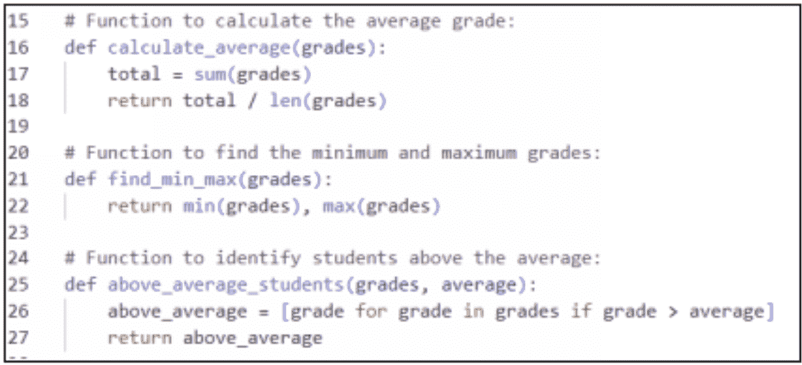

良好的代码会将任务分解为模块，每个模块都有特定的任务。我们在这里看到了这一点。每个函数只负责一个任务，每个函数上方的注释清晰地描述了每个函数的功能。此外，注意每个函数中的代码都是根据 `PEP 8` 指南进行缩进的。例如，第 16 行是 `calculate_average` 函数的开头，因此最靠左。它以冒号 `:` 结尾，因此 `Python` “知道”后面还有内容。第 17 行和 18 行是该函数的一部分，因此它们相对于第 16 行进行了缩进。由于它们都从属于第 16 行但互不从属，所以它们具有相同的缩进级别。`Python` “知道”第 18 行是函数的结束，因为行尾没有冒号来指示另一个代码块，且在第 16 行下方没有其他任何缩进的内容。

### 第三部分

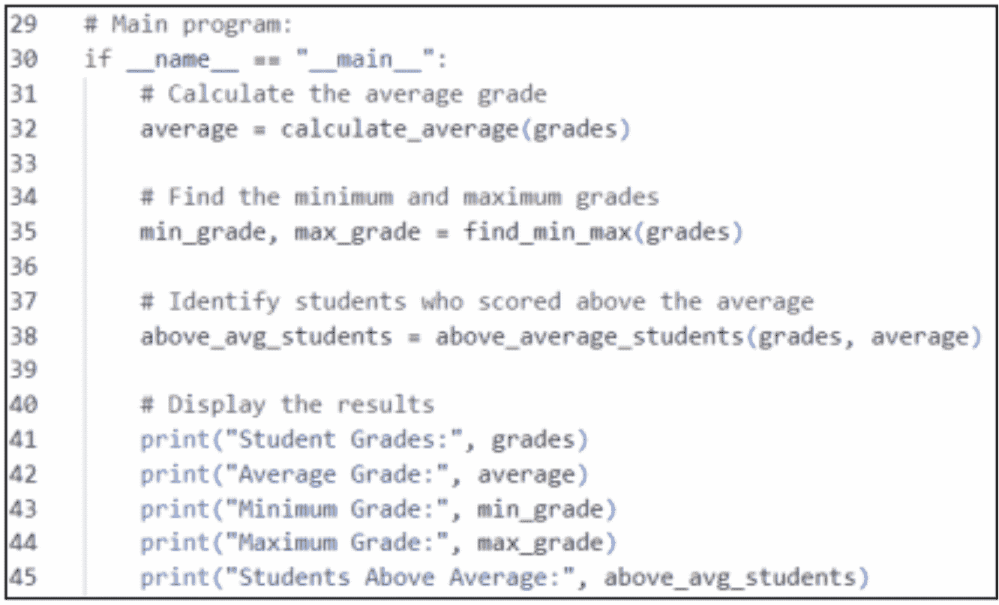

第 31、34、37 和 40 行都解释了“主程序”中每个部分的功能。与之前的部分一样，代码也根据 `PEP 8` 指南进行了缩进。第 32、35 和 38 行分别调用了之前定义的函数来填充各自的变量。例如，变量 `average` 是通过调用 `calculate_average()` 填充的，并将 `grades` 列表作为参数。

### 总结
在我们的代码示例中，`Python` 的函数结构被用于通过单个函数执行特定任务来封装代码处理过程的每一步。尽管将所有内容都放在一个函数中似乎更合逻辑，但这种做法是适得其反的。每个函数执行单一任务可以使你的代码在出现问题时更容易调试。如果所有内容都在一个函数中，可能很难定位导致问题的函数部分，而且修复函数的一个部分可能会导致其他部分出现问题。

整个代码都遵循了缩进规则。如果你将此放入 IDE，你会发现没有语法错误，代码在运行时也不会报错。

最后，贯穿整个代码的注释清楚地说明了代码的整体功能以及代码每个部分的功能。这一切都使得代码变得整洁且易于阅读。

### 项目：GUI 天气应用
在本项目项目中，我们将开发一个基于 GUI 的天气应用。它将是一个具有简单界面的程序。如果你跟随这些项目进行操作，不仅会对 `Python` 有更深入的实践理解，还将拥有自己构建的应用作为成果。

在进行项目工作的章节中，你会看到像这里这样的“项目”部分，它将引导你完成每一步。

**重要**：请在你的 IDE 中执行这些步骤，以便你可以学习它是如何与你的代码交互的。由于我们是逐节编写应用，你的 IDE 可能会将某些内容标记为语法错误。这是正常的。这些将随着我们的进展得到解决。

### GUI 天气应用材料
对于这个项目，我们需要两个东西：
* `Python` `requests` 库，以及
* 来自天气数据提供者的 `API`

### 获取 Requests 
打开命令行/终端提示符。对于 Windows 用户，点击开始按钮，并在搜索输入框中输入 `cmd`（不带引号）。然后选择“以管理员身份运行”。如果你正在使用类似 `VSCode` 的 IDE，可以打开终端窗口（`CTRL + SHIFT + \`）。在提示符处运行此命令：

```bash
pip install requests
```

### 获取 API
“API” 代表“应用程序编程接口”（Application Programming Interface）。它是针对特定应用程序的一组规则，允许你的代码与其进行交互。`APIs` 在大多数应用程序中都是常见的。

要为你的天气应用获取 `API`，请前往“OpenWeather”网站并从那里申请一个免费的：
https://openweathermap.org/home/sign_up

确保注册免费账户而不是付费账户。如果你以后想获取付费账户，那由你决定，但对于这个项目，我们只需要免费账户。一旦你获取了 `API` 代码，请保存好！你稍后需要它。

### 第一步：创建你的文件
在你的 IDE 中，创建一个名为 `weather_app.py` 的新文件。

### 第二步：导入与窗口设置
接下来，你需要导入几个模块。在你的文件中，编写以下行：

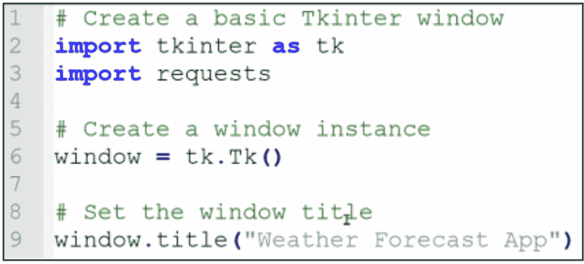

第 1-3 行：第一行是注释。这些用于在代码中提供说明，不会影响代码的运行。第 2-3 行正在导入我们代码需要的模块。导入是编程中的一种常见做法。它可以防止你不得不重复造轮子。

第 6 行：为了声明我们的 `window` 变量，我们使用了 `tk.TK()` 语句。这正在创建一个被称为“实例”的东西。在这种情况下，我们正在创建一个 `TK` 类的实例，它代表主窗口。我们将在学习面向对象编程时深入介绍这些，，但 `Tk` 类是应用程序窗口的蓝图。`window` 变量是该类的实例，意味着我们使用蓝图构建了应用程序窗口。

### 第三步：添加窗口内容
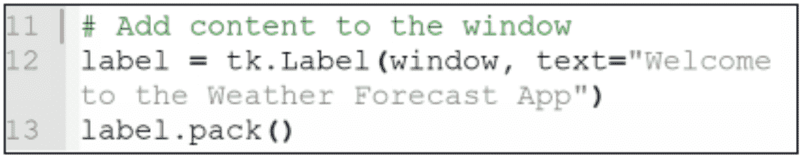

请注意第 12 行为了适应页面进行了换行。在你的代码中，第 12 行应该是一行。

第 12 行：注意在这一行我们使用了 `tk.Label()`。这是一个构造函数。它创建一个标签组件（label widget）的实例。“组件”（widget）是放在 GUI（图形界面）屏幕上的图形元素的术语。

`Label` 构造函数接受几个参数。其中一个是我们之前创建的 `window` 变量。这样标签就“知道”它位于哪里。另一个参数是文本参数，这样它“知道”要说什么。

第 13 行使用了另一个 `Tkinter` GUI 功能。`.pack()` 方法将标签“打包”到我们的主窗口中。如果你想让 GUI 运行时应用程序标题的两侧留出一些空间，可以将 `.pack()` 部分更改为 `.pack(padx=10)`。

### 第一章回顾
在这一章中，你获取了 `Python` 的基础知识。你甚至已经有了一些 `Python` 编码经验。太棒了！如果现在这一切听起来都像泥水一样清晰，不要担心。这完全正常。按照自己的节奏学习，在需要时复习，然后继续！在第二章中，我们将深入探讨运算符和条件语句，并向你介绍循环。你成为自信的 Python 程序员的旅程刚刚开始。下章见！（你可以的！）


## 2 深入探索 Python

为什么它被称为 "Python"？Python 由吉多·范罗苏（Guido van Rossum）创建。为了给他的新编程语言命名，他想要一个简短、独特且带点神秘色彩的名字。当时，他正在阅读《蒙提 Python 的飞行之旅》（Monty Python's Flying Circus）的剧本，那是 20 世纪 70 年代英国 BBC 的喜剧节目。（据称，“spam”一词就源于该节目中的一个小品。）他非常喜欢这个节目，因此决定向它致敬并以此命名他的语言。（通用 Python FAQ，n.d.）这正说明程序员确实有幽默感。它扭曲而奇特，有时超乎凡俗的理解，但它确实存在。

### 第 1 节：运算符与表达式

### 理解运算符及其在 Python 中的作用

### 什么是运算符？为什么它们很重要？

运算符对于任何编程语言（包括 Python）都是至关重要的。它们是用于对数据执行各种操作的特殊符号。这些包括数学方程、进行比较、执行逻辑评估以及赋值。观察它们的作用，就能明白为什么它们如此重要。它们之所以重要是因为它们可以操纵数据、控制程序流、帮助你的代码做出决策、为变量赋值并存储和检索数据。如果不理解如何有效使用运算符，就像在不学习任何动词的情况下学习外语。你将无法进行有效的交流。

### 运算符分类

运算符分为几大类：

### 算术运算符
正如名称所示，这些运算符用于执行数学计算。你已经在第一章见过它们的一些用法了。它们包括加 (`+`)、减 (`-`)、乘 (`*`)、除 (`/`)、整除 (`//`)、模（又称余数，%`）和幂 (`**`）。

在这个示例中，代码使用减法来获取用户的出生：

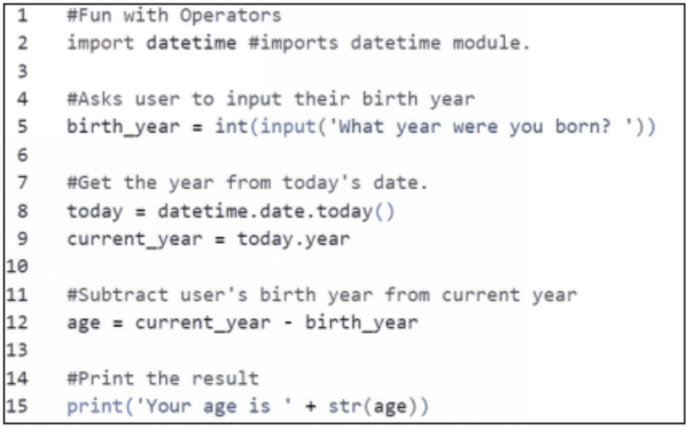

### 比较运算符
这些运算符比较值并确定它们之间的关系。这类运算符包括等于 (`==`)、不等于 (`!=`)、大于 (`>`)、小于 (`<`)、大于等于 (`>=`) 和小于等于 (`<=`)。

在这个示例中，代码检查学生的成绩是否及格：

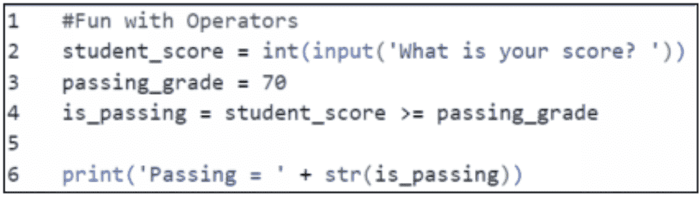

第 2 行要求用户输入分数。

第 3 行将及格线设为 70。

在第 4 行中，Python 将 `is_passing` 视为一个布尔值（真或假），因为比较运算符根据结果返回“true”或“false”。在这种情况下，如果学生的成绩大于或等于及格线，结果为“true”。

第 6 行向用户显示结果。

### 逻辑运算符
它们比较多个条件并确定表达式的整体值是否为真。逻辑运算符包括“与” (and)、“或” (or) 和“非” (not)。

下一个示例使用逻辑运算符 `and` 来判断是否是野餐日：

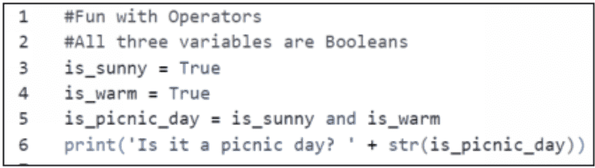

第 5 行是一个布尔值，因为逻辑运算符将根据它们的评估返回真或假。所问的是：“是晴天而且天气温暖吗？”如果答案都为真，那么语句返回“true”。

### 赋值运算符
赋值运算符将值赋予变量。常见的赋值变量是等号 (`=`)。

示例：`x = 7`。

当你在 Python 中编写这样的代码时，它将根据你赋予的值确定变量的类型。因此，对于 `x = 7`，Python 会确定 `x` 是一个值为 7 的 `INTEGER`（整数）。如果你编写 `x = 7.0`，那么 Python 会确定 `x` 是一个值为 7.0 的 `FLOAT`（浮点数）。

尽管等号很简单，但它会让初学者感到困惑，因为他们可能会误地将其用作比较运算符。但比较运算符是 `==`。区别在哪里？区分它们最简单的方法是……

### 创建表达式与执行操作

表达式是计算的核心。但当我们谈论表达式时，我们在说什么？（等等，原文此处似乎有重复/乱码）。我们说的是如何以某种方式组合值、变量和运算符以产生准确的结果。精通表达式的关键在于实践。不要害怕实验——用你自己的代码——你对它们的理解越深，就会发现越多使用它们的方法。除了进行简单的数学计算，你还会发现表达式还可以用于决策和响应输入。

### 示例 1 – 一个简单的表达式

在你的 IDE 中创建一个新文件并输入以下代码：

```python
# 一个简单的表达式
total_cost = item_price * quantity
```

将此文件命名为 `math_expression.py` 并保存。你的 IDE 应该已经标记了错误。在继续阅读之前，你能告诉为什么吗？

你通过让 `total_cost` 等于 `item_price * quantity` 的值来给它赋值。你需要为那两个变量赋值。由于物品的价格通常是带有小数的数字，所以它应该是一个 `float`，而由于数量通常是整数，所以它应该是一个 `integer`。因此，将你的代码修改为：

```python
# 一个简单的表达式
item_price = float(10)
quantity = int(5)
total_cost = item_price * quantity
```

这应该解决你的语法错误。我们所做的是显式地声明了 `item_price` 和 `quantity` 的数值数据类型。我们也可以通过这种方式隐式地声明它们的类型：

```python
item_price = 10.0
quantity = 5
```

从这里，Python 会推断出 `item_price` 是 `float`，因为该数字包含小数，它会推断 `quantity` 是 `int`，因为它是一个整数值。此时，我们可以在 IDE 终端中运行代码，前提是确保我们在代码所在的相同目录下，然后运行命令：

```bash
python math_expressions.py
```

唯一的问题是我们将看不到任何内容，因为我们还没有告诉代码如何输出它。我们需要添加一个 `print()` 语句。记住 `print()` 函数必须有一个字符串变量，所以我们需要将变量 `total_cost` 转换为字符串。因此，在代码底部添加添加：

```python
print("The total cost is " + str(total_cost))
```


保存代码并运行它。你应该会看到一个包含“40.0”的运行。我们将在书的后面介绍如何将价格正确格式化为两位小数。为了好玩，并帮助你更熟悉表达式的行为，请将你的 `item_price` 和 `quantity` 变量移动到它们相乘的那行代码下方。发生了什么？当你尝试那样运行代码时会发生什么？一旦你看到了，请继续将代码还原到原来的样子。当 Python 读取你的表达式时，它是从上到下读取的。所以，如果你在声明变量之前尝试运行某个操作，将会得到错误。甚至在你运行代码之前，你的 IDE 就会警告你存在该问题。

### 获取用户输入

你已经在其他代码示例中见过 `input()` 函数的作用了。现在让我们在这里也实现它。数学表达式代码很有趣，但它是静态的。假设我们正在写的是一个收银机程序，收银员需要输入单价和数量来获取总价。我们如何获取收银员的输入呢？

将你的 `item_price` 和 `quantity` 变量更改如下：

```python
item_price = float(input("What is the cost per item? "))
quantity = int(input("How many of that item do they have? "))
```

现在保存并运行你的代码。通过对表达式进行一些微小的更改，你已经从一组静态指令变成了更具动态感和交互性的东西。然而，这里存在一些问题。`input()` 函数非常友好。它接受一个字符串作为给用户的提示，然后接受用户尝试输入的任何内容。对于 `item_price`，用户可能会输入“kittens”（猫）。`input()` 函数会乐意接受它们，但你的代码会抛出错误。所以，我们还有一些错误需要解决，我们将在介绍错误处理时涵盖这一点。

### 示例 2 – 条件表达式

在你的 IDE 中创建一个名为 `conditionals.py` 的新文件，并在其中输入以下代码：

```python
### Conditional Expression
is_adult = age >= 21
```

你已经可以看出你的 IDE 对此有意见。`age` 变量尚未声明。继续创建它，但要让它能够接受用户输入。（尝试在阅读后面我的解决方案之前完成这一点。）

接下来，添加一行打印语句，显示“You are old enough”并显示这是否为真。

`age >= 18` 使用了条件运算符（大于或等于），因此它返回一个布尔（真或假）结果。因为 `is_adult` 被赋值为我们条件语句的结果，Python 推断出 `is_adult` 是布尔数据类型。这就是为什么你的打印语句根据你输入的年龄显示“True”或“False”。

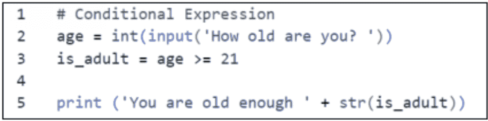

为了提供一些背景信息，假设这是我们收银机程序的增强功能，买家在进行某些购买之前必须达到特定年龄。我们的解决方案可以运行，但有点别扭。“You are old enough true”或“You are old enough false”听起来有点像原始人说话。如果我们的代码能对年龄合适的用户给出一个响应，对年龄太小的用户给出另一个响应，那就太好了。在书的后面，我们将具体探索如何做到这一点。

### 示例 3 – 字符串拼接表达式

表达式不仅限于数字。它们也可以用于字符串。在你的 IDE 中创建一个名为 `concat.py` 的文件，并将此代码放入其中：

```python
### String concatenation expression
full_name = first_name + " " + last_name
```

初始化（声明）`first_name` 和 `last_name` 变量并使其接受用户输入，然后添加一行打印语句。


```python
if condition1 and condition2:
    # Code if both conditions True
```

"or" 运算符在至少一个条件为真时返回真。其语法如下：

```python
if condition1 or condition2:
    # Code if at least one condition True
```

使用 "or" 运算符时，请将最可能为真的条件放在第一个位置（如果可能的话）。这是因为代码一旦发现一个为真的条件就会停止评估后续条件，这有助于提高性能。

"not" 运算符返回相反的条件。其语法如下：

```python
if condition1 or condition2:
    # Code if condition False
```

为了更好地理解 "not" 运算符，这里有一个示例：

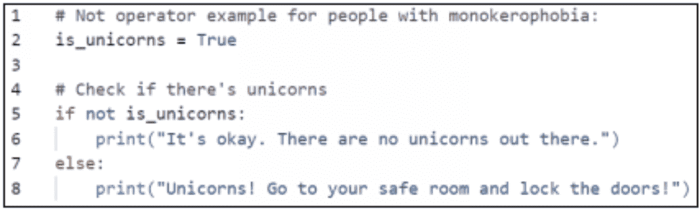

在此处说明一下，“独角兽恐惧症”（monokerophobia）并不是对有绰号的人的恐惧（那可能是“名字恐惧症”monikerophobia）。“独角兽恐惧症”是对独角兽的恐惧。我在网上找到的，所以它一定是真的。（维基，n.d.）

### 编程挑战：遛狗

嵌套的 "if" 语句在编程中非常常见。对于这个挑战，我希望你使用嵌套的 "if" 语句。所以，请记住你的缩进规则。你将编写的代码将检查是否可以遛狗。以下是参数：

*   创建一个名为 `walk_the_dog.py` 的文件。如果晴朗或多云，你就可以遛狗。
*   在你的代码中，有一行询问用户天气如何。
*   包含此天气条件列表：`['sunny','cloudy','rainy']`。
*   让你的外层 "if" 检查用户输入的内容是否存在于列表中。语法如下：
    *   `item_name` in `list_name`。这将返回一个布尔结果。
    *   如果用户输入的天气条件不在列表中，让你的代码打印：“我们哪儿也不去！那是独角兽的天气！”
*   让你的内层 "if" 使用 `if`、`elif` 和 `else` 语句，以及至少一个逻辑运算符。提示：你有两个天气条件适合遛狗。所以，你可能想同时测试这两个。
    *   根据天气条件，让你的代码打印遛狗是否合适以及原因：“外面可以/不可以遛狗，因为外面是 [weather_condition]。”

这道题的答案在书的后面。在看我的答案之前，请自己尝试。

### 第 3 节：循环与迭代

遍历数据是另一个常见的编程任务。这是通过循环实现的。和条件语句一样，循环是简单而强大的工具，使用得当可以可以节省时间，特别是当涉及许多行数据时。

### For 循环和 While 循环

### For 循环

在 Python 中，“for 循环”是一个迭代函数，意味着它会在指定的次数内对若干个（有时是很多个）项目重复执行一组指令。Python 中的 "for" 循环用于遍历列表、元组、字典甚至字符串等对象——这些对象通常具有顺序，并且有定义的开始和结束。

"for" 循环的语法如下：

```python
for iterator_variable in sequence_object:
    # Code
```

单词 *for* 和 *in* 被设为斜体，以强调它们是必须作为 "for" 循环语句一部分的关键字。为了更好地理解这一点，让我们来看代码示例：

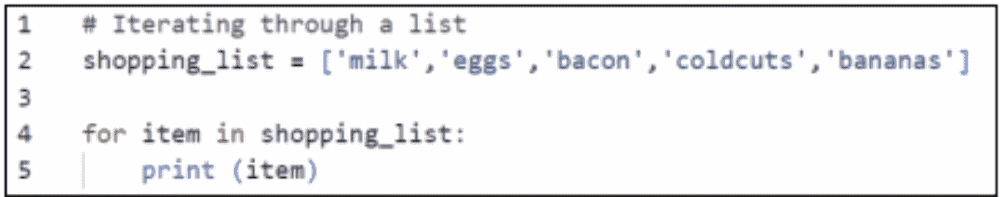

在这个示例中，`shopping_list` 是一个列表对象。列表由方括号包围，其中的项目用逗号隔开。变量 `item` 在 "for" 语句中被赋值。Python 知道 `item` 指向列表中的内容。缩进在 "for" 语句下方的命令是打印每个项目。如果你运行这段代码，你会看到垂直打印的项目。这个简单的示例只打印项目，但可以对项目执行任何操作。循环知道从列表的开始到结束，除非循环内部指令它停止。

### While 循环

像 "for" 循环一样，“while" 循环也是迭代函数。但与 "for" 循环不同，“while" 循环在条件保持为真的情况下持续运行。"while" 循环的语法如下：

```python
while condition:
    # Code
```

为了更好地理解，让我们来看示例：

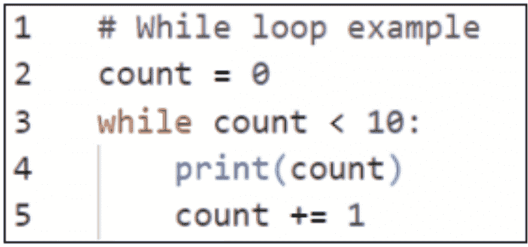

首先，第 2 行设置了一个计数器。"while" 循环并不总是需要设置，但通常是如此。第 4 行打印计数。第 5 行引入了新的运算符 `+=`。还有类似的 `-=`、乘法 `*=` 和除法 `/=`。

### 无限循环

如果你没有设置适当的检查，“while" 循环可能会设置为“永远”运行。例如，如果你漏掉了第 5 行，你会看到屏幕。

### 遍历字典和其他数据类型

我们查看了遍历列表，但也提到过循环可以遍历其他类型。任何以顺序存储的数据都可以被迭代。当我们学习数据分析时会详细介绍。现在，这里有一个显示如何使用 "for" 循环遍历字典的代码示例：

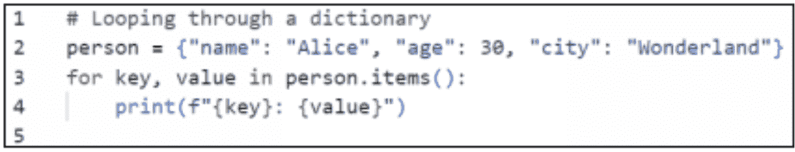

字典是键值对集合，字典中的每个值都关联到一个唯一的键。第 5 行引入了新的内容：“f-string”。这告诉 Python 根据 "f" 后面的字符串格式化输出。在这种情况下，它将以“键：值”的形式显示数据。

### 编程挑战：购物助手

当我妻子发给我购物清单让我去杂商店时，我有时不得不打电话问她东西在哪里：“嘿，如果我是奶酪，我会在哪儿？”她会说：“噢，在……”或者“在……”对于这个挑战，我希望你使用 "for" 循环、`if`、`elif` 和 `else` 语句编写代码。以下是参数：

*   `shopping_list = ["milk","eggs","bacon","coldcuts","bananas"]`
*   `dairy = ["milk","yogurt","cheese","ice cream","butter"]`
*   `meat = ["beef","pork","bacon","coldcuts"]`
*   `fruit = ["apples", "bananas", "oranges"]`
*   使用 "for" 循环遍历 `shopping_list`。
*   使用其他列表打印项目是什么以及它在哪个区域。例如：“bacon 在肉类中。”
*   如果某个项目不在任何列表中，打印：“找不到 [item]？问问别人吧！”


为了避免你产生困扰，请用小写字母输入内容。购物列表中有一个项目没有分类，其他所有都有。答案在书的最后。先尝试一下，然后再看答案。

### 项目：GUI 天气应用

在本节中，我们将为天气应用定义函数。我们应用中的函数将承担代码中的大部分重性工作。如果你现在还不理解自己在写什么，不要担心。我们将在下一章解释函数。

### 第四步：定义 "fetch_weather" 函数

将这些行添加到你的代码中。

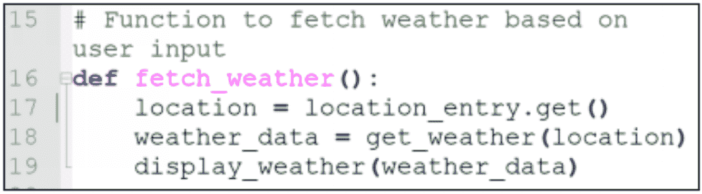

记住，这些行为了适应页面进行了换行处理。

第 16 行演示了定义函数的语法：它是函数名，后面跟着一对括号和一个冒号。注意函数中的所有内容都是相对于 `def` 行进行缩进的。

第 17 行将捕用户从输入字段（尚未创建）中输入的内容，并填充 `location` 变量。

第 18 行将通过调用 `get_weather` 函数（尚未编写）并传递 `location` 的值来填充 `weather_data` 变量。

第 19 行将调用 `display_weather` 函数（尚未编写）并将 `weather_data` 的值传递进去。

现在，你已经接触了函数。在第 3 章中我们将学习更多相关知识！

### 第二章回顾！

在本章中，我们深入研究了几个关键的编程构建模块以扩展你的 Python 编程技能，你还进行了一些编程挑战，得以应用这些技能。以下是我们探索内容的简要回顾：

*   **运算符和表达式**：我们讨论了如何使用表达式对数据执行各种操作，包括算术、逻辑运算符和比较。我们还查看了赋值运算符 (=) 和比较运算符 (`==`) 区别。表达式对于处理和分析数据至关重要，并用于解决现实问题。
*   **条件语句**：我们看了使用 `if`、`elif` 和 `else` 的条件语句。我们了解到这些语句可以帮助代码根据条件结果做出决策。作为讨论的一部分，我们还看了逻辑运算符（`and`、`or` 和 `not`）以及它们如何帮助构建更复杂的条件。通过“遛狗”挑战你有有机会了自己的实践。
*   **循环和迭代**：我们还学习了 `for` 和 `while` 循环的力量，并讨论了两者的区别。循环帮助我们高效地执行重复任务，并可以帮助我们迭代列表、字典、元组等对象。“购物助手”挑战允许你使用循环遍历列表，并使用列表引用其他列表对物品进行分类。

在第 3 章“构建 Python 函数”中，我们将介绍函数，这是 Python 编程的另一个基本方面。函数提供了模块化，使你将代码部分专注于特定任务，从而实现更高效的代码、更易的调试以及更快速、高效的开发。以下是我们将涵盖内容的预览：

*   **定义函数**：我们将看看函数是什么、它们的用途以及如何在 Python 中定义它们。你将学习如何创建自定义函数，以便学习如何封装代码块并使其可重用。
*   **参数 (Parameters and Arguments)**：参数和参数是允许你的函数之间进行通信的一种。通过它们，你可以将数据传递给其他函数并自定义它们的行为，从而实现灵活适应性强的代码。
*   **返回语句 (Return Statements)**：掌握返回语句的艺术，它允许函数产生结果并与代码的其他部分共享数据。返回语句是函数“对话”的另一侧。当参数将数据发送到函数内部时，返回语句将数据传出。你将学习如何创建返回语句以及如何利用它们的输出。

## 3 构建 Python 函数

假设你参加一个朋友聚会。你正在聊天、吃东西，玩得很开心，这时聚会的主持人拿着一个纸箱走出来：“嘿，我这有一个拼图。”他高举着盒子，现在没人能看到里面。他摇了摇盒子说：“我有这玩意儿好段时间了，但因为丢了带图片的封面，一直没拼好。我想它应该是秋天里被树木环绕的老房子。你们想试一下吗？”

起初有些犹豫，但随后有人说：“好，为什么不呢？”于是，你的朋友把盒子里的东西倒在桌子上，你们都围了过来。

在处理代码时，你可能会收到一个编程难题。问题可能定义得很清晰，也可能不是。

当你拼图时，你可能有盒子的封面，也可能。无论哪种情况，第一步通常是将碎片按逻辑分组进行组织：“天空”碎片放在一组，“地面”碎片放在另一组，也许在每个角放置角碎片，等。编程中的函数有点像这个过程。当你编写它们时，它们需要解决问题，但就像拼图任务中的“角”碎片一样，函数被设计用来处理问题的特定部分。

在“构建 Python 函数”这一章节中，我们将学习如何定义函数、如何构建它以及如何将其特定任务。

### 第 1 ：定义函数

### 什么是函数？

“Python 函数是一个组织良好、可重用的代码块，用于执行单一的操作。函数为你的应用程序提供了更好的模块化和高度的代码重用性。”(Python - Functions, n.d.)

在我在本节审查的定义中，我喜欢这一个，因为它涵盖了构成良好的 Python 函数的主要特征：

*   **组织性 (Organization)**：函数的设计是为了保持代码组织良好、逻辑且清晰。
*   **单一性 (Singularity)**：你写的每个函数都应该定义一个清晰且单一的动作。
*   **模块化 (Modularity)**：虽然这听起来很像单一性，但函数的这个功能体现了编码哲学。当你编写代码时，你需要以模块的方式思考，这些模块组合形成整体。这有点像使用乐高® 积木工作。
*   **可重用性 (Reusability)**：这是建立在模块化想法之上的。函数旨在被重用。就像你可以用乐高® 积木造消防车一样，你也可以用它盖房子。

好了，现在我们已经定义了什么是函数，让我们定义一个自己的函数吧。

### 函数语法

基本的函数语法应该是这样的：


### 函数部分

*   `def`：这是声明 Python 函数的关键字。
*   **函数名**：Python 中的函数名不限于任何词性。可以是任何内容，但遵循某些规则：
    *   必须是小写。
    *   多单词函数名的单词必须用下划线分隔。这被称为“蛇形命名法”（snake case）。毕竟这种编程语言叫“Python”。示例：`this_is_a_multiword_function_name`
*   **括号**：函数名必须以括号结尾，即使它们不接受任何参数。
*   **函数体**：正如代码示例中所提到的，函数中的所有语句都必须在函数名下方缩进。


与 `Java` 等强类型语言不同，在这些语言中你必须对参数声明类型，但在 Python 中不需要。这符合 Python 代码清晰和可读的哲学。它之所以可以这样做，是因为它使用了所谓的“动态类型”（dynamic typing），这意味着 Python 在运行时确定参数的类型。正如你已经看到的，它对变量也是这样处理的。不过，你可以使用“类型提示”（type hints），你可以对参数的类型提供提示。这里有一个带有类型提示的函数示例：

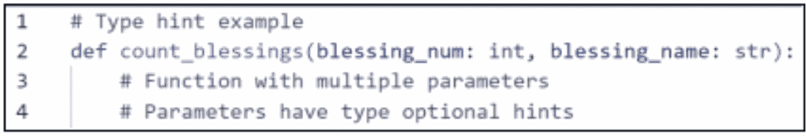

类型提示并不是 Python 的要求，Python 不会在运行时强制任何类型的类型规则。然而，如果类型并不显而易见，或者你有多个不同类型的参数，这些提示对你和其他开发者来说非常有帮助。

### 调用函数

描述函数的另一种方式是说它是一个在被调用时运行的代码块。这可能就是为什么 Python 被称为“Python”而不是“Feline”（猫科动物），因为那样的话函数在被调用时永远不会运行。（停顿大笑。）

那么，如何调用函数呢？下面是一个函数调用的示例：

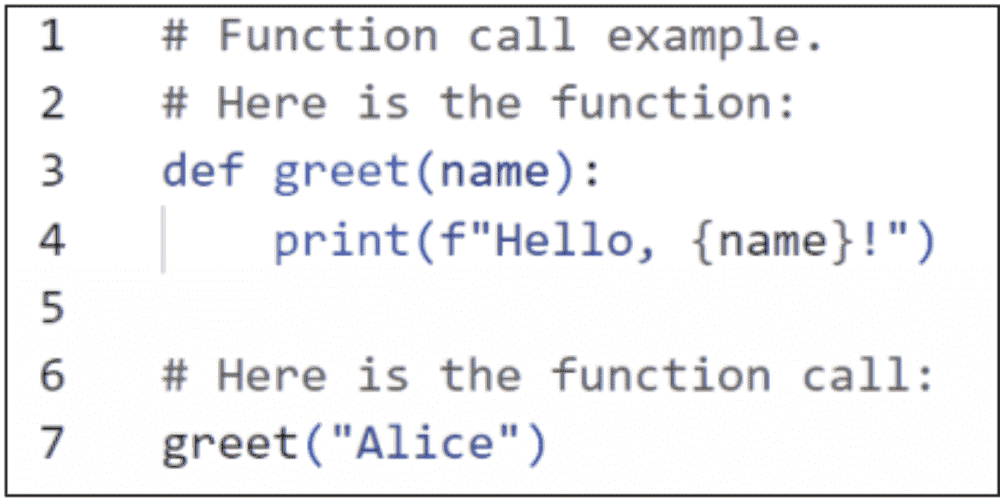

在这个示例中，函数接受一个 `"name"` 参数然后打印问候语。为了正确格式化问候语，`print` 函数内部包含一个“f string”。`"f"` 代表“formatted”（格式化的）。它告诉 Python 即将打印的字符串必须以特定方式格式化。你在 print 语句中看到的是：`f"Hello, {name}!"`。`"name"` 周的大括号让 Python 知道这是一个参数，意味着它应该打印传入参数的内容。这样，它就会打印“Hello, Alice!”而不是“Hello, {name}!”。

在函数调用中，你看到它只是函数名加上括号里的参数。函数调用可以像我们的示例中那样是一个独立的语句，也可以从另一个函数或方法内部调用。

### 让我们写一个函数

还记得我们的谜题类比吗？让我们来解决一个。打开你的 IDE 并创建一个名为 `function_example.py` 的文件。然后按照以下步骤解决我们的编程谜题。

## 第 1  - 谜题

我们需要创建一个确定矩形面积的函数，然后我们需要调用它。记住：要得到矩形的面积，你需要将宽度乘以长度。

## 第 2  – 定义函数

我们需要做的第一件事是为我们的函数起一个名字。它需要简单清晰。所以，我们就用 `"area_calculator"` 吧。如果你愿意，也可以在名称中使用 `"rectangle"`。要点是，你想让函数名能够轻松识别该函数的功能。定义行应该像这样：

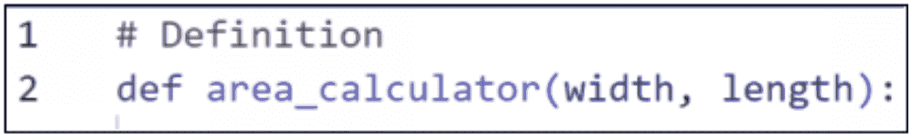

## 第 3  – 函数体

你的函数体需要缩进在定义下方。所以，它应该像这样：

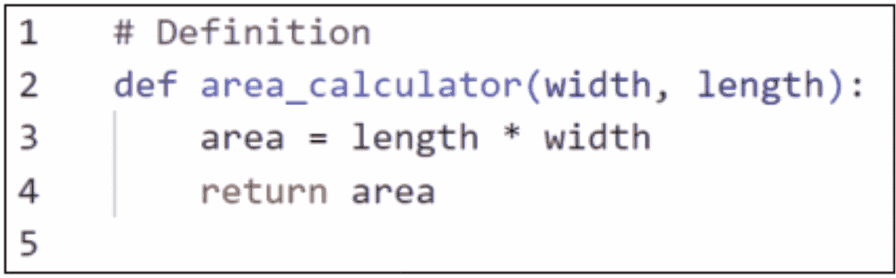

在这个示例中，我们声明了变量 `"area"` 并将其赋值为 `width * length` 的结果。然后我们返回 `"area"`。你可以通过省略变量并直接返回公式的结果来简化它，如下所示：

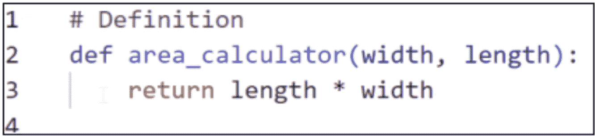

## 第 4  – 调用函数

现在让我们从 `print()` 函数调用该函数。

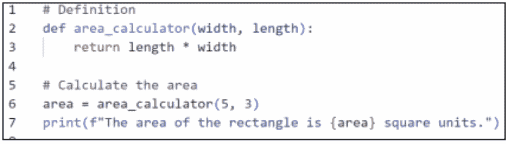

### 第 5 – 检查你的工作

在 IDE 的终端窗口中，通过运行以下命令运行程序：

```bash
python area_calculator
```

你应该会得到 15 的结果。也用其他数字进行测试，包括小数，以确保它按预期工作。

### 第二部分：参数和参数

### 什么是参数和参数？

参数是函数定义中括号之间的变量。在上一节中，我们的函数参数是 `"width"` 和 `"height"`。这些是传递给函数的值。

参数是指你在调用函数时传递给函数的值。再次回到之前的示例，我们用两个参数调用了函数：3 和 5：

`area_calculator(3, 5)`

回到你的函数，从函数调用中移除参数，看看会发生什么。当你尝试调用一个期望参数的函数，但你没有在函数调用中包含参数时，你将得到一个错误。如果一个函数有两个参数，而你只发送了一个，你也会得到错误。

现在回到你的函数，为每个数字加上单引号并输入，看看会发生什么。你发送了两个参数，但发送的类型错误。你发送的是字符串而不是数字。当你调用函数时，你不仅需要尊重参数的数量，还需要尊重函数期望的参数类型。

### 使用不同输入创建多功能函数

在编写代码时，你越能预判用户如何与你的程序交互，你就越能提高用户体验。Python 中的函数在这方面是强大且多功能的，因为它们允许你编写可以响应不同场景的代码。

### 默认参数

在我们在第一节编写的函数中，当你漏掉参数时，得到了一个错误。这是因为当函数被设计为期望参数而你没有提供时，函数将抛出错误。通过默认参数，你可以预判参数可能缺失的情况。在你的函数中，将定义修改如下：

```python
def area_calculator(width=2, length=2):
```

现在，不带参数调用函数看看会发生什么。再次尝试只使用一个参数。因为你为参数设置了默认值，Python 拥有该函数所需的内容并能够返回结果。

这种行为不仅适用于处理用户错误，对于预期默认行为且变化是异常的情况也有处。假设你工作的公司制造 2x2 的正方形。偶尔会有例外，但大多数时候它们制造 2x2 的正方形。通过对函数定义进行修改，我们不需要记住在 `area_calculator` 函数中输入 `"2, 2"`。我们可以直接不带参数调用函数并获得我们预期的 2x2 结果。

### 任意参数列表

在我们函数中，我们知道只需要两个参数，因为我们在计算面积：`width * length`。但如果你知道你的函数需要处理一个参数列表，但该列表是可以变化的，会发生什么呢？例如，假设你想创建一个购物列表应用。你会如何让函数足够灵活，以接受每周都会变化的列表呢？这就是 `*args` 和 `**kwargs` 可以帮你的地方。

### 使用 *args

`*args` 参数允许你接受非关键字的参数列表。要在函数中使用 `*args` 参数，请在参数名前前面加一个星号。让我们尝试一下。好的，在你的 IDE 中创建一个文件并命名为 `flex_param.py`。

我们将创建一个 `"arg"` 函数演示。所以，让我们这样定义它：

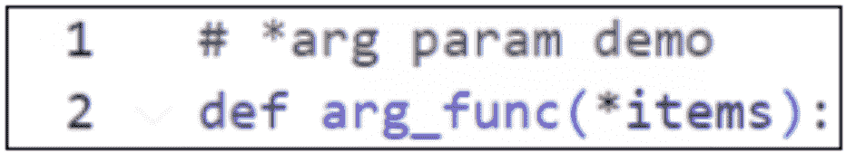

现在让我们展示正在使用的数据类型：

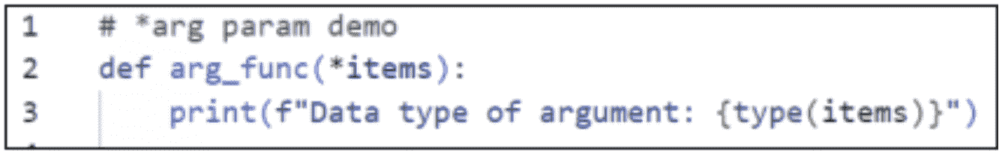

在上面的截图第 3 行，注意我们是如何获取数据类型的。在大括号内，我们写了 `type(items)`。当你对代码段中使用的数据类型不完全清楚时，这非常有用。

现在，让我们添加一个打印语句并紧跟一个函数调用，以便我们知道项目列表里有什么：

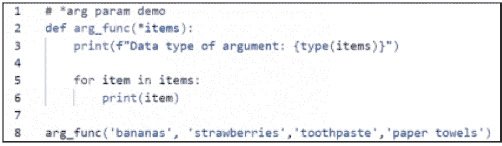

当你运行它时，注意它是一个“元组”（tuple），并且是有序列表。因为它是列表，我们能够遍历它（第 5-6 行）并对列表中的项执行某些操作。在我们的案例中，我们只是打印了它们。


### 使用 `kwargs`

虽然 `kwargs` 听起来像是一个很酷的林贡名字，但它是“keyword arguments”（关键字参数）的缩写，用于包含键值对的参数。键值对是一个列表，列表中的每个项都由一个唯一的键来标识。

让我们在我们的 `flex_param.py` 代码中添加另一个函数：

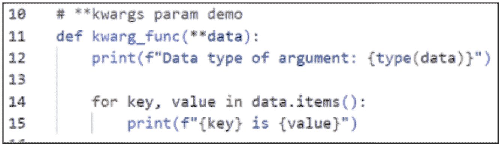

在第 12 行，我们展示了正在使用的数据类型；在第 14-15 行，我们遍历列表并格式化输出，以显示键及其对应的值。第 13 行的空格不是必须的，但我这样做是为了让代码块内部更清晰。显然，第 14-15 行是一个“for”循环，其目的与函数的开头几行不同。

### “多态性”

Python 不支持基于参数类型的多态（也称为函数重载），就像其他语言那样。为了让你对这种多态有个大致的了解，假设我们有一种名为“J”的语言。在“J”中，我可以拥有两个同名的方法：

```
brewCoffee(String brand)
brewCoffee(String brand, int quantity)
```

这两个方法的名字相同。我的代码如何“知道”我想用哪一个呢？它会根据我输入的参数来判断。第一个只接受一个 `String` 类型的单一参数。另一个接受两个参数，一个 `String` 类型，一个 `int` 类型。如果我写 `brewCoffee("Maxwell House")`，它就会知道指的是第一个方法。如果我写 `brewCoffee("Maxwell House", 2)`，它就会知道我指的是第二个。

Python 可以通过使用非默认参数后跟默认参数来模拟这种多态性：

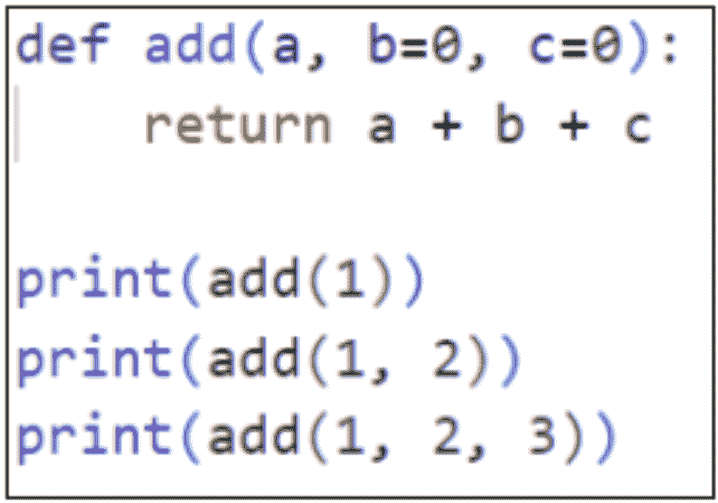

在上面的示例中，我能够用三组不同的参数调用 `add` 函数。这是因为参数 `b` 和 `c` 设置了默认值。这并不是真正的多态。尽管在第一次函数调用中我只传了 1 个参数，但 Python 仍然认为它收到了 3 个，因为另外两个已经被设置为了“0”。

如果你运行这段代码，将会得到一个错误：

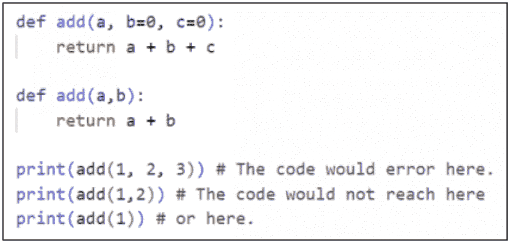

代码会在第一次函数调用 `print(add(1,2,3))` 时抛出错误并提示：

```
TypeError: add() takes 2 positional arguments but 3 were given
```

为什么会这样说？首先，因为 Python 是从上往下读取代码的。其次，即使参数不同，Python 也无法接受重复函数名。它会看到第一个方法，但当它遇到同名的第二个方法时，会将其视为对第一个方法的替换。因此产生了错误。

本小节向你介绍了创建能够适应各种输入的多功能 Python 函数的概念。我们强调了默认值和任意参数列表的使用，以便你编写代码来处理不同的场景。我们还简要讨论了多态性，以及在 Python 不支持它的情况下如何让 Python 模拟该功能。现在让我们来看一个真实的示例，这样你就可以看到这些概念如何在实际中应用。

### 案例研究：具有实际用途的真实函数

### 我们的场景：

我们想创建一个图书馆目录。它将存储收藏中书籍的信息，包括标题、作者等。这些信息将存储在一个列表中。用户可以根据不同的标准搜索此列表。对于这个示例，我们将关注排序功能。

### 选项：

你可以边看代码边学习，或者你也可以创建一个自己的 Python 文件并在阅读时编写代码，以便更熟悉 Python 编程的语法和背后的思维方式。

### 问题：

我们的函数需要能够接受书籍列表并响应用户的排序标准。为了实现这一点，我们需要有一个内置的允许搜索的选项列表，并在用户选择了不允许的选项时能够对用户错误做出响应。

### 展望

在这个真实示例中，我们将使用两个我们尚未涵盖的概念：`lambda` 函数和 `raise Exception` 语法。

### 定义函数

这是我们将用于图书馆目录的函数：

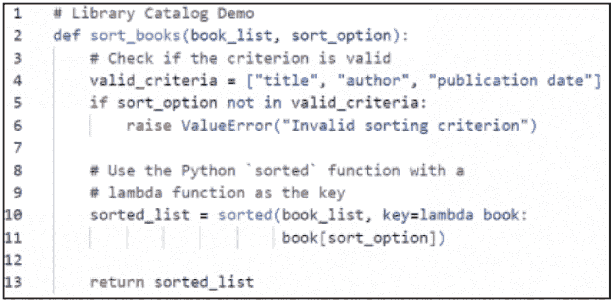

让我们逐行分析一下：

第 2 行：这是函数定义。它接受两个参数：一个名为 `book_list` 的列表和一个名为 `sort_option` 的字符串。

第 4 行：这声明了列表 `valid_criteria`。

第 5 行：它获取用户的 `sort_option` 并将其与 `valid_criteria` 列表进行检查。它使用 `not in` 语句来判断用户是否输入了无效的搜索选项。

第 6 行：这一行使用了 `raise Exception` 语法。在这种情况下，如果用户输入了无效的搜索选项，它将抛出 `ValueError` 异常并向用户显示自定义消息：“Invalid sorting criterion。”关于 Python 内置异常列表，你可以访问此网站：

[`docs.python.org/3/library/exceptions.html`](https://docs.python.org/3/library/exceptions.html)

第 10 行：如果用户的排序选项是被允许的，那么列表将根据用户的选择进行排序。为了执行此排序，函数使用了 Python 内置的 `sorted` 函数。要查看 Python 内置函数的完整列表及其语法，你可以访问此网站：

[`docs.python.org/3/library/functions.html`](https://docs.python.org/3/library/functions.html)

`sorted` 函数有一个必填参数和两个可选参数。

-  `iterable`（可迭代对象）意味着它接受一个可迭代项，如列表或字典。该参数是必填的。
- `key` 是可选的，默认值为 "none"。如果包含它，它必须指向正在排序的键值对中的某个键。
- `reverse` 选项默认值为 "False"。如果设置为 true，则会反转排序顺序。

在我们的真实示例中，对 `sorted` 函数的调用使用了 `key` 并填充了一个 `lambda`。`lambda` 函数也称为匿名函数。当一个函数需要一个函数作为参数时，可以将其看作一个占位函数。`sorted` 函数中的 `key` 选项需要一个函数作为参数，而 `lambda` 正符合。

`lambda` 的语法如下：

```
lambda arguments: expression
```

在我们的示例中，我们使用的 `key` 选项如下：

```
key=lambda book:sort_option
```

翻译成白话，我们是在告诉 key：“Lambda 是你的函数。该函数接受的参数是 book。你要使用的 sort_option 是用户恰好选择的那。”所以，如果用户恰好选择了“author”作为他们的排序键，`book_list` 中的所有书籍将按作者排序。如果你觉得在这个解释期间你的大脑放假了，请担心。你越频繁使用 `sorted` 函数和 `lambdas`，它们就越容易理解。这种知识需要时间来积累。

第 12 行：在函数完成排序后，它会返回排序后的列表。

### 填充库

现在函数已经就绪，我们需要填充库。库是一个字典对象的列表。字典是具有键值对的列表，字典中的每个值由一个键来标识。这是我们的库：

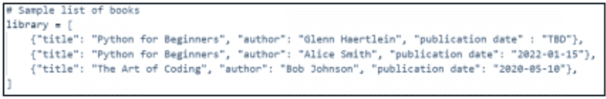

### 调用函数

这里是一些函数调用。最后一个是不正确的：

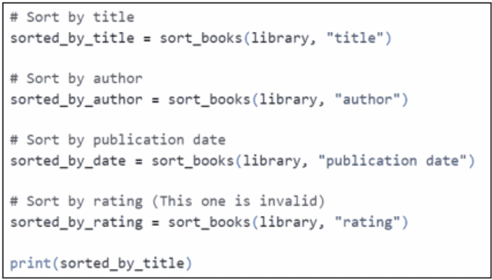

如果我们现在运行，`print` 将不会运行，因为最后一个函数调用想要按一个不允许的选项进行排序。因此，代码将抛出我们之前提到的错误：

```
ValueError("Invalid sorting criterion")
```

移除它后，按标题显示书籍的 `print` 请求将运行：

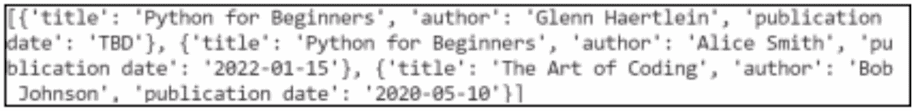


在下一节中，我们将涵盖你已经通过示例见过的内容：返回语句。返回语句是函数向调用它的代码传递反馈的机制。

### 第 3 节：返回语句

### 返回语句的力量

返回语句充当函数内部逻辑与程序其他部分之间的桥梁。回到我们的拼图类比，你有一组拼图团队成员负责“天空”碎片。由于拼图的主题是一座谷仓，你还有另一组负责“谷仓碎片”，以此类推。当每个小组都在处理拼图的特定部分时，目标是让每个小组与其他小组分享他们的工作结果。你预期负责“天空碎片”的人返回一张天空的图像，负责“谷仓”的人构建出谷仓的图像，以此类推。

函数的返回语句就像这样。它们各自都有特定的任务，完成后，它们应该返回被分配执行的任务。我们已经见过几次了，甚至在我们最近的例子中也是。

### 利用返回语句的结果

函数并不是孤立存在的。它们被用于完成复杂的任务。函数的威力在于，你可以将复杂的问题分解为更小、更易管理的任务，并利用它们返回的结果产生更复杂的结果。

### 示例：读取文件

梳理文件可能不是一项复杂的任务，但它可能是非常单调且耗时的任务。如果你有数百个文件要处理，每个文件都有数千行数据，那么这项任务可能会花费很长时间。函数可以快速高效地处理这类任务，即使它包含许多文件和许多行数据。这里有一个示例：

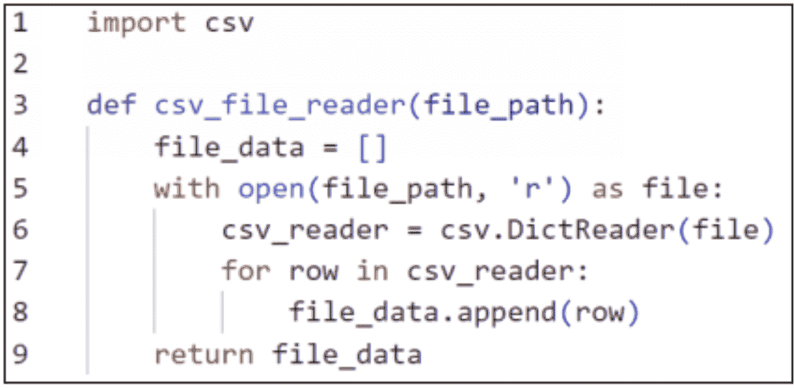

第 1 行：你在其他一些示例中见过过 `import` 语句。`import` 关键字用于使一个模块中的代码对另一个模块可用。如需 Python 内置导入的列表，可以访问此网站：[`docs.python.org/3/py-modindex.html`](https://docs.python.org/3/py-modindex.html)

我们的示例正在导入 Python 的 `csv` 模块。“CSV”是逗号分隔值文件。这意味着每行数据中的数据点之间用逗号（或其他分隔符，如分号 `;`）隔开。我们的读取器设计用于“读取”这些数据，以便我们的代码可以使用它们。

第 3 行：这是我们的函数定义，它接收一个文件路径。这样做是为了让我们的代码知道去哪里找到需要处理的文件。

第 4 行：这是创建一个名为 `file_data` 的空列表。这将文件中的数据行存储在列表中，可以对列表进行迭代以进一步分析。

第 5 行：这一行向我们引入了 `with` 关键字。目前，请将其视为一种打开资源进行处理、并在完成后关闭资源的手段。我们告诉代码的是：“使用此对象，执行以下任务。”在我们的 `with` 语句中，我们正在打开用户提供的文件。`open` 语句中的 `r` 以读取模式打开文件，而不是写入模式，因为我们只想读取内容，不想更改任何内容。`as file` 语句只是为被读取的对象分配一个变量名。

第 6 行：这是将 Python CSV 读取器对象赋值给变量 `csv_reader`，以便处理 CSV 的内容。

第 7-8 行：这个 `for` 循环遍历 `csv_reader`，并将每行数据放入之前创建的 `file_data` 列表中。

第 9 行：`return` 语句将文件内容返回给程序的其他部分。

有了返回语句的数据，你可以创建另一个名为 `find_rows` 的函数，该函数接受列表和字符串作为参数。`find_rows` 函数可以被委托查找包含特定数据字符串的行，并将其放入一个新的、更精简的文件中，只包含用户需要的数据，或者供代码中的其他函数使用。

### 个人示例

在我工作的公司里，我们需要处理的文件太大，超出了我们通常使用的商业电子表格软件的范围。此外，文件大到以至于公司使用的大多数笔记本电脑无法打开它们，更不用说从中提取所需的数据了。为了解决这个问题，我写了一个程序，可以一次处理一行文件，而不是一次性处理所有文件，只提取所需的数据，然后以商用电子表格程序可以处理的格式化数据——这一切可以在任何公司的笔记本电脑上完成。实现这一切意味着意味着要将任务分解为更小、更易管理的函数，这些函数相互共享数据，以便完成更大的任务。

### 项目：GUI 天气应用

在上一章中，你通过构建我们应用所需的三个函数之一来学习函数。现在你对函数已经有了更好的理解，让我们再添加两个。然后，在第四章中，我们将进行最后的润色。

### 第五步：定义 "get_weather" 函数

添加这些代码行来创建 `get_weather` 函数。定义的第一行必须与之前的函数处于相同的缩进级别。

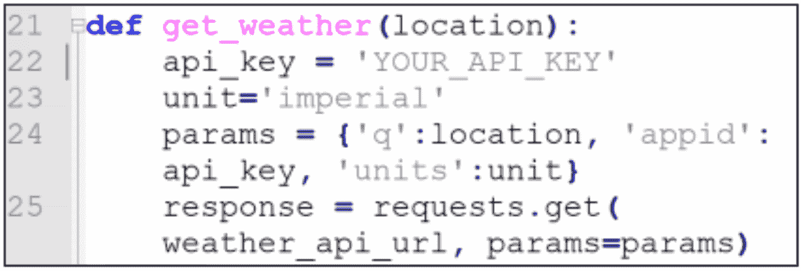

第 21 行定义了我们的新函数。它接收一个名为 `location` 的参数。

第 22 行需要你之前获得的 API 密钥。确保将其包含在引号中。

第 23 行声明了 `unit` 参数。注意是单数 `unit`，而不是复数。在示例中，我将其设置为 `'imperial'` 以获取华氏温度。如果你愿意，可以改为其他值。

第 24 行填充 `params` 变量。在该变量中，我们按照“Open Weather”API 的方式格式化请求。

第 25 行填充 `response` 变量。为了获取数据，它使用了我们之前导入的 `requests` 模块向 API 发送请求。

### "if" 语句

第 25 行下方有一个 `if` 语句，它需要与第 25 行相同的缩进级别。这是因为它是 `get_weather` 函数的一部分。

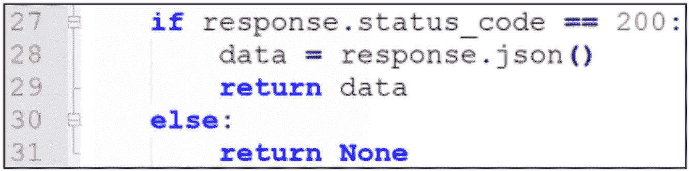

第 27-28 行看起来应该很熟悉。它是一个条件判断。如果我们的请求返回状态码为 200，意味着对 API 的请求被接受，我们返回了数据。

第 29 行也是 `if` 语句的一部分。`return` 关键字将返回我们从 API 接收的数据。

第 30-31 行如果我们收到的状态码不是 200，我们代码的响应将是这样。与其捕获错误消息，我们只让代码返回空。这可以防止程序崩溃或向用户显示错误代码。相反，它将允许用户再次尝试。注意：在我们的返回语句中，`None` 是大大写的。这是 Python 的要求。它不会识别 "none" 或 "null"。

### 第六步：定义 "display_weather" 函数

为了获取要在 GUI 应用中显示的天气数据，请添加这些代码行：

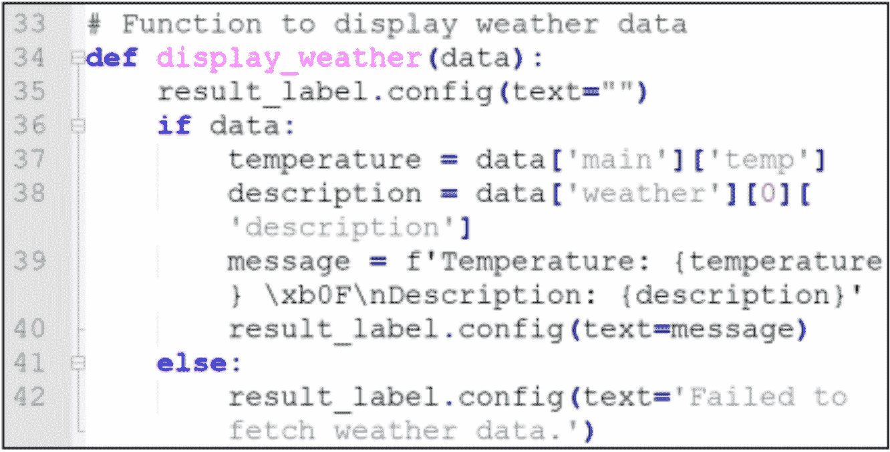

第 34 行定义了 `display_weather` 函数，必须与我们之前的函数处于相同的缩进级别。

第 35 行 `result_label` 是一个 Tkinter 组件，我们目前将其留空。它将根据我们从 API 获取的结果而改变。

第 36-42 行是一个条件语句。如果我们从 Open Weather API 获得正确的响应，它将返回 JSON 数据，我们的代码将其解析为人类可读的消息显示在我们的 GUI 中。


第 29 行包含了一些用于渲染温度中度符号的符号，以及一个换行符，将描述放在单独一行。符号 `\xb0` 是度符号的 Unicode 转义序列。符号 `\n` 是一个转义序列，告诉代码将其后的文本渲染在新的一行。大写字母 `F` 代表示例中所选的测量单位（华氏度）。

我们快要完成了！在第 4 章中，我们将进行最后的收工作。

### 第 3 章总结！

在本章中，你学习了如何创建多功能且以结果为导向的函数。你还发现了`return`语句的力量，以及它们如何帮助你的函数通信其结果。通过这些工具和知识，你现在能够设计出让你的 Python 应用程序高效有效的函数。

在第 4 章中，我们将比之前更详细地查看 Python 中的基本数据类型，如 `lists`、`dictionaries` 和 `sets`。我们将看到如何使用它们构建更健壮的 Python 应用程序，以及如何使用它们进行数据存储和管理。

## 4 Python 中的数据结构

Python 的数据结构能力非常强大，足以处理从简单的待办事项到复杂的数据管理的所有内容。在本章中，我们将深入研究 Python 的数据结构。

### 第一节：列表和元组

### 理解列表和元组

在书的目前，你已经见过这些内容了，但让我们深入观察一下。

在 Python 中，`lists` 和 `tuples` 是可以存储项目集合的数据对象。两者都有一个被称为“索引”（index）的东西，用于识别集合中的每个项目。这些对象中的索引从 0 开始，这意味着如果你想获取 `list` 或 `tuple` 中的第一个项目，你需要请求索引为 0 的项目：`print(my_list[0])`。`lists` 和 `tuples` 都保持顺序，可以排序，并且可以包含异构集合，这意味着一个列表可以同时包含字符串、整数和浮点数。

`lists` 是可变的，意味着你可以随时更改它们。`tuples` 则不可。例如，如果你正在构建一个任务管理器应用程序，你可以使用 `list` 来存储任务，因为任务可能会随时发生变化：

```
task = []
```

但假设你正在编写一个调度程序，需要维护一个工作日的集合。由于星期几的名称不会改变，你会想要使用 `tuple`：

```python
weekdays = ("Sunday", "Monday", "Tuesday", "Wednesday", "Thursday", "Friday", "Saturday")
```

## 索引、切片和操作数据

### 索引

如前所述，你可以使用索引获取 `list` 或 `tuple` 的任何单个成员。但有时你可能想要获取 `list` 或 `tuple` 中的多个项目，而不是所有项目。“切片”（slicing）恰恰可以让你实现这一点。

### 切片

要对 `list`、`tuple` 或 `string` 进行切片，你需要指定起始索引和结束索引。你还可以包含一个可选的“步长”（step），它表示你想在切片中跳过哪些内容。语法如下：

`sequence[start:end:step]`

`"sequence"` 是你想要切片的序列名称。从我们之前的元组示例来看，我们有一个名为 `"weekdays"` 的序列。

`"start"` 是你想要部分的起始索引。起始位置是包含在的，意味着它被视为切片的一部分。

`"end"` 是你想要部分的最后一个索引。结束位置是不包含的，意味着它不包含在切片中。下面的示例将有助于说明这一点。

使用我们的调度程序场景，假设你正在使用它来跟踪课程表。“水下篮子编制”在周一、周三和周五上课。从你的 `weekdays` 变量中获取这些日期，你的代码如下：

```python
class_days = weekdays[1:6:2]
```

记得，我们是这样声明星期序列的：

```python
weekdays = ("Sunday", "Monday", "Tuesday", "Wednesday", "Thursday", "Friday", "Saturday")
```

`"Sunday"` 在索引 0，因为所有索引都从 0 开始。""Saturday"` 在索引 6。我们将其作为终点，是因为我们想要 "Friday"，所以我们在它之后放置了索引，因为结束索引是不包含的。“步长”将从起始索引开始，由于它设置为 "2"，它将为我们提供每两个项目：周一、周三和周五。

当你对 `list` 或 `tuple` 等对象进行切片时，对象本身不会发生变化。

#### 添加数据

由于 `lists` 是可变的，你可以使用 `append()` 方法向它们添加项目。

### 修改数据

由于 `lists` 拥有索引，你可以修改项目。

### 数据

要从 `list` 中移除某些内容，你使用 `remove()` 方法。


要声明字典，你只需要一对大括号和一些键值对。在我们的示例中，外部字典简单为 `{student_ID:student_dictionary}`，其中学生 ID 是键，以字典格式存储的学生数据是值。我们示例中的键只是单个数字，但它们同样可以很容易变成 6 位数字、字符串甚至是一个元组（tuple）！只要每个键都是唯一的且是不可变的数据类型，就没有关系。

如果我想获取特定学生的信息怎么办？我只需要知道学生的 ID。


第 18 行：我提供了一个学生 ID。

第 19 行：`if` 语句检查该 ID 是否为字典的成员。如果为真（True），它会提取请求的数据。如果为假（False），它会提示未找到学生。

第 20 行：由于提供的 ID 是有效的，将从与 ID 2 关联的字典创建一个 `student_data` 对象，并打印该信息。

### 使用集合（Set）

如果你是一个学校，你有大量的学生，这些学生需要 ID 来保持记录清晰。那么，你如何防止发放重复的 ID 呢？一种方法是使用集合。通过集合，你可以查看某个 ID 是否已经发放过，这样当你添加新学生时，就不会不小心给他们分配重复的 ID。

让我们用一些简单的代码来演示这一点。


你可能想要比这更健壮的东西，但它能让你了解如何使用集合来强制唯一性。就像在我们的字典示例中，这段代码使用 `if` 语句来检查我们正在添加的 ID 是否已存在于 `student_ids` 集合中。如果为假，则添加该 ID；如果为真，则排除该 ID。

### 第 3 部分：处理文件

## Python 的文件处理能力

在第 3 章中，我们讨论了返回语句（return statements），并使用了一个代码示例导入了 Python 的 `CSV` 模块并展示了它如何从外部文件读取内容。除了从文件读取，Python 还可以写入、创建、复制、移动和删除文件。了解如何使用这些 Python 功能是你编程工具箱中至关重要的一部分。我们在这里通过构建一个简单的文件管理工具来深入研究它们。

## 文件管理示例

### 第一步：创建文件

如果你想跟随操作，请创建一个名为 `file_mgr.py` 的文件。

### 第二步：导入 Python 模块


`os` 模块是 Python 的操作系统模块，允许 Python 与你的系统操作系统交互。它允许 Python 检查文件和目录是否存在以及处理与文件相关的任务。

第二个导入 `shutil` 是 Python 的外壳实用程序（shell utility），该模块包含了层级文件处理能力，例如复制和移动文件等。

### 第二步：定义菜单，部分 1


此函数将响应用户输入并为用户提供四个选项。

### 第三步：定义菜单，部分 2


根据用户的选择，代码将执行三个文件操作之一，或者退出程序。

### 第四步：定义文件复制函数


第 26-27 行：这要求用户提供源文件和目标路径。理想情况下，你希望给用户提供点击式的选项，而不是像这样手动输入的选项，但目前这样就可以了。

第 29 行：这使用 `os` 模块来检查用户的输入是否正确。`if` 语句的第一部分检查输入的路径路径是否指向一个文件。如果路径或文件名任一错误，它的结果将评估为“假（False）”。`if` 语句的第二部分检查目标文件夹的路径。如果错误，它也将评估为“假（False）”。由于该语句使用了 `and` 逻辑运算符，语句的两个部分都必须为“真（True）”。如果不是，就会打印一条消息，并将用户送回主菜单。

第 30 行：使用 `shutil` 模块，用户的文件将从源目录复制到目标目录。在打印成功消息后，代码将用户返回主屏幕。

### 第六步：定义移动文件函数


它的操作与 `copy_file` 函数非常相似，只是它是将文件从一个位置移动到另一个位置。

### 第七步：定义删除文件函数


它的工作方式与前两个函数类似，只是 `if` 语句有所不同，因为它只需要检查指定位置的文件。

## 保持菜单可用

在这里我们介绍了一些尚未见过的代码。


第 60 行：`if` 语句使用了一个内置变量：`__name__`。（在 "file" 两边各有两个下划线。对于 "main" 也是如此。）语句正在检查脚本是否作为主程序运行。

第 61 行：如果 `__name__ == "__main__"`，则脚本正在作为主程序运行。

### 项目：GUI 天气应用

现在我们要为天气应用添加最后的完善工作并运行它！所以，让我们完成最后的步骤。

### 第七步：设置 API 端点

添加这些代码行来连接 API。


非常小心拼写：

`weather_api_url = "http://api.openweathermap.org/data/2.5/weather"`

### 第八步：将结果标签放在我们的 GUI 上

在这里我们将之前调用的 `result_label` 小部件的结果显示在 GUI 上。


### 第九步：创建输入字段

现在我们需要设置一个输入字段，让用户告诉应用程序他们想看哪个城市的天气。


### 第十步：添加按钮并保持应用打开

现在添加最后几行代码。


第 62 行构建按钮，并带有标签。

第 63 行在按钮下方添加一些内边距，这样 GUI 窗口就不会在按钮底部戛然而止了。

### 运行应用

好了，现在是有趣的部分：运行应用。在你的 IDE 中，你可以打开终端输入下面的命令并按回车，或者如果你使用的是 VSCode，可以点击编程界面右上角的“运行”按钮。

```
py weather_app.py
```


Mac 用户可能需要使用 `py3` 代替 `py`。运行命令后，你的天气状况 GUI 将出现，你可以输入大城市的名称来获取其天气。尝试输入一个无意义的字符串，看看当你输入一个它找不到的地点时它是如何响应的。如果你想查看那里的天气，请输入“尼尼亚”（Narnia）或“中洲”（Middle Earth）。（不是开玩笑。）

### 故障排除

如果你的代码似乎不起作用，请尝试以下步骤：

- 再次执行这些步骤并检查你的语法。这包括拼写和缩进。
- 在 Google 上搜索错误信息，并注明这是一个 Python 错误。
- 打开 ChatGPT，将你的代码粘贴进去并让它进行分析。

# 第 4 章回顾！

无论你信不相信，在你编程旅程的这个阶段，你已经拥有了可以用来构建的基础！我们刚刚结束了对数据结构的探索。在第 5 章中，我们将为你介绍面向对象编程（OOP）的世界。这是一种编程模型，帮助你利用现有的构建块设计出复杂、组织化且可重用的代码。你已经达到了一个编码里程碑！干得好！现在让我们进入旅程的下一阶段吧！

## 第 5 章：Python 与面向对象编程

Python 作为这样一种强大且多功能的语言，当然支持面向对象编程（OOP）。OOP 是一种编程范式，允许你将现实世界的概念建模为对象，因此得名“面向对象编程”。可能有点遗憾的是，OOP 与 "oops"哎呀）只差一个字母，而后者正是在你犯代码错误时发生的情况，但事实就是如此。

### 第 1 节：什么是 OOP？

“面向对象编程（OOP）是计算机科学中的一种编程范式，基于类和对象的概念。它用于将软件程序结构成简单的、可重用的代码蓝图（通常称为类），这些蓝图用于创建对象的实例。有很多面向对象的编程语言，包括 JavaScript、C++、Java 和 Python。”(Doherty, n.d.)

Python 不限于 OOP，它还支持过程化编程风格。

# 第 2 节：OOP 的构建块

OOP 有四个基本的构建块：

字体 类 (Classes)
- 对象 (Objects)
- 方法 (Methods)
- 属性 (Attributes)

### 类

类是用户定义的数据类型（Doherty, n.d.）。我们在天气应用项目中已经接触过这一点。考虑类的另一种思考方式是将它们看作对象的蓝图。例如，为了建造一个房子，你需要一张蓝图来知道如何构建它。

# 对象

对象是从类中构建的实例。实例就是你根据蓝图建造的房子。你可以从一张蓝图建造很多栋房子。你也可以从一个类创建许多实例。需要记住的是，你可以从一张蓝图建造很多房子，但它们并不非得看起来完全一样。你可以使用不同的颜色和其他装饰让每栋房子都独一无二。这如何适用于实例呢？稍后会介绍。

### 方法

方法是类中动作的表示。要对对象使用方法，你使用“点”符号。对于天气应用，我们是这样做的：

```python
# 创建一个窗口实例
window = tk.Tk()

# 设置窗口标题
window.title("Weather Forecast App")
```

我们创建了一个 "Tkinter" 窗口对象，然后调用了 `title` 方法为应用添加了标题。

### 属性

属性（也称为字段）存储你类中的数据。对象的状态由其属性定义。如果我们回到蓝图类比，假设你创建了一个“房子”类。通过实例属性（影响你类中单个实例的属性），你可以有一个名为 `self.color` 的属性，通过它，你可以让一个房子实例是蓝色的，另一个是红色的。

### 第 3 节：继承与组合

“继承和组合是面向对象编程中的两个主要概念。它们允许代码重用，并随着功能的添加或需求的改变而演进类与类之间的关系。”

### 继承模型

继承建模了“是一个”（is a）关系。它指的是基类和派生类之间的关系。在示例中，Car 类被称为子类或派生类。这意味着 Car 类继承自 Vehicle 类，因此继承了它的属性。在示例中，Vehicle 类拥有了 start 和 stop 方法。 (Python, 2023)

### 方法

方法本质上是函数。要对对象使用方法，你使用“点”符号 (.)。

# 类命名

在 Python 中，类名始终以大写字母开始。如果类名是多个单词，则使用“驼峰命名法”（camel case）。例如：`ClassNameLong`。

### 组合

组合建模了“有一个”（has a）关系。让我们回到汽车类比。汽车需要发动机。所以，让我们创建一个“Motor”类。Car 类并不是派自 Motor 类。相反，它将 Motor 类作为组件。在 Car 类和 Motor 类之间的关系中，Car 是组合类，而 Motor 是组件类。逻辑上讲，汽车有一个发动机。


第 27-28 行：与之前的示例一样，这是 `Car` 类的构造函数。它包含了 `make`（品牌）、`model`（型号）、`year`（年份）、门数和引擎的属性。

第 29 行：`super()` 关键字指向 `Car` 类正在使用的父类。在这种情况下，它指的是 `Vehicle` 类。括号中包含 `make`、`model` 和 `year`。这意味着它将反映初始化 `Vehicle` 类时传递给它的任何属性。

第 30 行：`num_doors` 属性是 `Car` 类特有的。因此，它使用 `self` 关键字进行调用，并将在接受初始化时传递给它的任何值。

第 32 行：`engine` 属性也是 `Car` 类独有的，它展示了组合（composition）的概念，因为它将从另一个名为 `Motor`（尚未显示）的类获取其 `engine` 属性。

`Car` 类延续：


`Car` 类中有三个函数。注意第 41 行（以及第 46 行类似的表示法）。它正在引用自己，调用它的 `engine` 属性，该属性将来自我们稍后将看到的 `Motor` 类，并正在使用 `engine` 对象的 `start()` 方法。该方法是 `Motor` 类中的一个函数，但如所述，当从类外部调用函数时，它被称为方法（method）。

# Motor 组件类示例


第 16-17 行：这是 `Motor` 类的构造函数，它正在初始化 `fuel_source` 属性，该可以接受初始化时给它的任何类型的燃料源。

第 19-21 行和 23-24 行：这些是 `Motor` 类的启动和停止函数。

# 让类运行


第 49 行：在使用 `Car` 类之前，需要初始化一个电机对象。这一行创建了一个名为 `engine` 的 `Motor` 对象，并使用 `Gasoline`（汽油）燃料类型进行初始化。用户也可以输入“diesel”（柴油）、“electricity”（电力）或“Mr. Fusion Reactor”（聚变反应堆先生）。

第 52 行：初始化 `engine` 对象后，可以使用 `Car` 类并输入所需的属性来初始化 `car` 对象。`Vehicle` 类需要年份、品牌和型号来初始化，这是通过 `Car` 类的初始化提供的。`Car` 类还通过包含门数数字以及它从 `Motor` 类获得的引擎对象来获取其余剩余参数。

第 55-59 行：为了测试一切是否运行正常，此方法调用了 `car` 对象并带它兜风。

### 第 4 节：模块与库

## 模块

模块化编程是所有现代编程语言中的核心概念。它是将你的编程代码拆分为更小的、自包含的模块的做法。例如，你的汽车有一个电池。电池起着一个功能：为你的车辆提供电源。它可能服务于汽车中其他更复杂的部件，但电池的功能是简单且定义明确。它提供动力。在代码术中，我们可以说当你向汽车里放入一节电池时，你正在导入一个电池模块并在你的汽车程序中使用。不仅如此，你可以在大多数汽车中放置汽车电池。你不需要购买特定品牌的汽车电池。无论什么种车辆，它们的作用都是相同的。

在 Python 中，模块的工作方式非常相似。它只是一个带有 `.py` 扩展的文件，其中包含语句和定义。你在编码项目中使用过模块。每当你使用 `import` 关键字时，你都在导入一个模块。Python 有一个庞大的内置导入列表，位于此处：

[`docs.python.org/3/py-modindex.html`](https://docs.python.org/3/py-modindex.html)

由于 Python 是开源的，网上有许多模块，你也可以编写自己的模块。

模块的优点包括：

-   **组织性**：模块通过按功能将项归在一起，帮助你保持代码组织整洁。
-   **可重用性**：考虑 Python 的 `math` 模块。它内部包含了各种数学函数，可以导入到任何需要数学函数的 Python 代码中。它是可重用的，并且让你避免了自己亲手编写数学函数。
-   **命名空间安全**：模块为你的函数和变量创建了独立的命名空间。一个模块中包含的变量或函数名很有可能也出现在另一个模块中。得益于“点”表示法，潜在的冲突被降到了最低，因为要使用模块中的函数，语法是 `module_name.function_name()`。因此，即使你使用的两个模块都有一个名为 `walk_dog` 的函数，你也可以在函数调用中使用模块名来指定你指的是哪一个函数。
-   **封装**：封装允许模块隐藏其操作的某些方面，从而便于他人使用。例如，要启动你的汽车，你只需要知道如何转动点火处的钥匙。你不需要了解或解释引擎、变速箱、刹车等复杂细节。你只需要使用这些东西，而无需操心它们。

## 库

库简单来说就是模块的集合。虽然不是强制要求的，但库倾向于具有通用的主题。有些是通用的，如 Python 的标准库。另一些专注于机器学习或 Web 开发。

# 简单代码示例

我在同一个目录下有两个文件：

- `test_module.py`
- `module.py`

`module.py` 文件内部有两个函数。一个用于两个数字相加，另一个用于相乘。在 `test_module.py` 中，我导入了 `module` 并使用了它的两个方法：


当我运行它时，第 3 行得到结果 15，第 4 行得到结果 56。执行工作的方法在 `module` 模块中。你可能需要为代码中反复执行的操作创建一个自定义模块。创建自己的模块的能力使得这一切变得可行。

`module.py` 文件：


### 第 5 部分总结

在本节，我们查看了面向对象编程的构建块以及 Python 如何支持它。在学习 OOP 的过程中，我们查看了继承和组合，并了解到继承模型具有“是”的关系，而组合模型具有“拥有”的关系。（汽车是一种车辆，它有一个电机。）最后，我们查看了模块和库，并了解模块如何帮助将代码组织成可重用且方便的单元，就像汽车电池可以使用各种车辆一样。

# 第 6 章：调试与故障排除

“虫”一词指的是真实的昆虫。“首次记录的昆虫导致技术故障的实例发生在 1947 年，当时在哈佛大学研究一台早期计算机 Mark II Aiken 继电器计算器的工程师们发现了一只飞蛾卡在了机器硬件中。” (Old, 2023)

“调试是移除程序中的 bug。编程是放置 bug 的实践。” – 未知


理想情况下，你不希望代码中出现 Bug，但无论你如何努力避免，它们仍然会无其妙地出现，就像夏天的小虫一样。它可能是一个你没有发现的拼写错误。它可能表现为一个你未计划过的场景。它甚至可能是某种令人沮丧的随机错误。编写代码的一部分就是调试和排除故障，在本章中，这正是我们要讨论的内容。

# 第 1 部分：识别和理解常见的 Python 错误

这不是一个详尽的列表，但这些是最常见的 Python 编码错误。

### 语法错误 (Syntax Errors)

语法错误是初学者常见的问题。你会发现，随着你编写代码越来越熟练，语法错误会减少。这里有一个非常常见的例子：


那么，问题出在哪里？在 `Line 1` 中，使用了赋值运算符而不是比较运算符。`Line 1` 试图将值 `10` 赋值给 `"x"`。你不能在 `if` 语句中这样做。这里需要的是双等号（`==`），本质上是在问一个问题：“`x` 的当前值等于 `10` 吗？”以下是代码应该有的样子：


### 缩进错误 (Indentation Errors)

如果你在阅读本书的同时按照书中的编写代码，那么你在这方面应该是专家了。因为 Python 强调可读性，它对缩进等内容执行了严格的规则。这是一个缩进错误的示例：


Python 将其视为不完整的 `for` 循环，因为下方的 `print` 语句没有缩进。这是修正后的代码：


让我们修改一下来显示另一个缩进问题：


乍一看，这似乎是正确的。单独看这两个语句时，它们的缩进都是正确的。然而，`if` 语句会抛出缩进错误，因为它没有在 `for` 循环下方缩进。正确的语法应该是：


### 命名错误 (Naming Errors)

当你尝试使用一个尚未定义的函数时，就会发生命名错误。这里有一个简单的例子：


如果你尝试运行这段代码，它会抛出错误，因为函数 `my_func()` 尚未定义。

### 类型错误 (Type Errors)

当你尝试混合类型时，就会发生类型错误。例如，你尝试将数字的字符串表示与实际数字相加。


这将抛出类型错误，因为代码正试图将数字 `5` 加（或拼接）到字符串 `"3"`。取决于你想要的结果，这有两种可能的解决方案。

这将进行相加并给给你数字 `8`：


这将进行拼接并给给你字符串 `"53"`：


### 索引错误 (Index Errors)

当你尝试访问超出序列范围的索引时，就会发生索引错误。这是处理列表或字符串时常见的错误。

### 键错误 (Key Errors)

当你尝试访问字典中不存在的键时，就会发生键错误。这通常发生在键名拼写错误的情况下。

### 属性错误 (Attribute Errors)

当你尝试访问对象不具备的属性时，就会发生属性错误。这可能是由于拼写错误或使用了错误的对象。

# 第 2 部分：系统性的排除故障策略

### 隔离问题

观察症状。排除故障的一部分就像医生询问病人。从识别如下症状开始：

*   错误消息
*   异常行为
*   错误的输出

 缩小问题范围。找出问题是从什么时候开始的。是从一开始就有问题，还是在代码更改后开始的？

*   错误消息告诉了你什么？有时它们可以定位位置。
*   将你的代码拆分成更小的部分并进行测试。例如，如果你已经确定某个特定函数（或函数）是问题所在，尝试将它们放入一段单独的代码块中。

### 重现问题 (Reproduce the Issue)

与上述类似，创建一个代码的简化版本，尽可能移除所有不相关的部分。你需要的是一个最小化的、运行的程序版本，专注于问题所在。有了此，你需要重现问题，以便识别根本原因。

## 进行代码走读并检查输入输出

在视觉上和口头上过一遍你的代码，并注意输入和输出。当我说“口头上”时，我的字面意思是通过说话的方式过你的代码并解释它在做什么。在这一步，有一个在那里听你解释代码的人会有帮助，因为这会迫使你从工作中抽离出来并客观地审视它。

## 使用版本控制 (Use Version Control)

如果你正在使用 Git 这样的版本控制系统，请回退到问题发生之前的代码版本。创建一个单独的分并缓慢地重新引入更改，直到问题再次出现。这也将帮助你隔离并纠正问题。


这意味着使用条件语句，只有在满足某些特定条件时才打印内容。当你预期某个行为会发生（或不发生），而程序没有按照预期方式响应时，这种方法特别有帮助。

# 使用调试器控制台

如果你正在使用 IDE 开发代码，可以使用调试器控制台来帮助你查看哪里出了问题。

# 读取错误信息

## 回溯轨迹 (Tracebacks)

在 Python 中，`traceback`（回溯轨迹）是一份显示导致异常发生的报告。一个 `traceback` 通常包含以下信息：

* 错误类型和消息。这包括发生的异常类型（`TypeError`、`NameError` 等）以及描述错误的消息。
* 文件和行号。这对于帮助你准确定代码在何处出错非常有帮助。消息会告诉你错误发生在哪个文件以及哪一行。这两者都是非常有价值的信息。
* 函数调用。这会告诉你是哪些函数调用导致了错误的错误的发生。

# 在 Google 上搜索错误

有时，处理错误最快的方法是使用 Google。为了获得最佳结果，请复制错误消息并将其粘贴到 Google 搜索中。很有可能其他人也遇到过相同或类似的情况。

### 使用 ChatGPT

ChatGPT 的有用之处在于它能够理解人类输入并以易于理解的方式回答。尽管它非常智能，但给它提供上下文总是有帮助。例如：

“我正在为一个天气应用编写 Python 代码，但它一直给我这个错误：[在此处插入错误消息]。我的代码在下面。你能告诉我有什么吗？

[在此处插入你的代码]

ChatGPT 将分析你的代码，识别问题，并经常提供修改建议。你提供的细节越多，结果就越好。

# 咨询文档

你可以在这里找到 Python 的官方文档：

[`docs.python.org/`](https://docs.python.org/)

如果你正在处理的错误涉及 Python 关键字或内置函数的使用，该文档将解释如何使用该函数，并通常提供正确用法的示例。

### 寻求帮助

有很多专门针对 Python 的网站和社区平台。只需确保对问题提供清晰的描述、任何相关的代码片段，以及你试图通过代码实现目标的解释。

# 示例调试场景

假设我们设计了一个计算数字列表平均值的函数。


我们的函数没有问题。但现在有人尝试使用我们的代码并输入了如下列表：


只需看代码就能看出问题。列表中包含一个字符串形式的 60，而不是数字。但为了这个场景起见，让我们运行它并查看结果。


这是我从 VSCode 终端窗口获取的回溯轨迹消息。（示例中的行为了适应页面已折行处理。）

第 19 行显示错误发生在代码第 14 行的函数调用中。它还显示了错误发生的文件。如果你的代码引用了多个文件，这特别有用。

第 21 行显示了实际的函数调用。

第 25 行显示了函数中发生错误的那行。

第 26 行显示了错误类型并解释了问题所在：在预期整数的地方有一个字符串。

乍一看，问题似乎出在 `calculate_average` 函数中。然而，当你查看错误类型时，你会发现问题不在于函数，而是在于它接收到的数据。从那里你就知道要检查函数调用发生的地方（第 21 行），并查看传递了什么数据。正如我们上面所说，当你查看传递的列表时，在应该是整数的地方有一个字符串。

这是一个非常简单的调试示例，但它展示了调试过程，并向你说明了回溯消息如何帮助识别代码中的问题。

### 第 3 部分：调试工具

### 集成开发环境

大多数 IDE 都内置了调试工具。书中大部分代码截图都来自 Visual Studio Code，这是我首选的 IDE。对于不想让 IDE 标记干扰视图的截图，我使用的是 Notepad++。

Python 的 IDE —— `IDLE` 也具有一些内置调试功能，但很有限。其他包含调试器的 IDE 还包括 `PyCharm` 和 `Thonny`。

### Print 语句

我们在之前的章节中已经涵盖了，但使用 print 语句也是调试的形式。即使有内置调试器，print 语句也很有帮助，因为它们快速又易用。

### 日志

Python 有一个 `logging` 模块，提供了一种灵活的方法来跟踪代码进度，并提供与 print 语句类似但更有结构化的消息。这是一个显示如何在代码中设置日志的示例：


第 1 行：导入 `logging` 模块。

第 4 行：`logging.basicConfig` 正如其名，允许你收集一些基础日志信息。

第 5 行：因为这个示例演示了日志的调试功能，所以级别设置为 `DEBUG`。以下是可用级别的列表：

* `DEBUG` (10)：提供用于诊断的详细信息，通常用于测试和调试。
* `INFO` (20)：提供一般信息，让你知道程序运行是否符合预期。如果需要持续监控你的应用，可以使用此作为验证代码是否按预期执行的手段。
* `WARNING` (30)：用于显示存在可能需要进一步调查的问题，但不是致命的。换句话说，你的代码仍然可以工作，但可能需要修复。
* `ERROR` (40)：表示发生了需要关注的错误。根据你的代码设计响应特定错误的方式，可以将代码设置为停止，也可以继续运行但需要关注。
* `CRITICAL` (50)：表示可能导致你的应用程序停止运行的错误，需要立即关注。

这些设置每个都有对应的数字，可以使用数字代替单词，但使用单词会让代码更清晰（在我看来）。关于这些数值级别需要理解的另一点是，每个级别只会显示该级别及以上级别的消息。因此，`INFO` 将显示 `INFO` 消息及其以上的所有内容，但不会显示 `DEBUG` 消息。

第 6 行：允许你配置生成的日志消息的格式。

第 7 行：如果你想将日志保存到文件，此设置允许你设置文件名。

在代码中使用日志遵循的语法类似于 print 语句。（参见下方的第 12 行和第 14 行。）


### Python 的调试功能

要使用 Python 内置调试器，你需要导入 Python 调试器 (`pdb`) 模块。


完成后，你可以在代码中设置一个或多个断点。这将告诉调试器开始调试过程。

调试器启动后，可以使用控制台命令来控制调试器的行为：

* `n` (next)：这将执行当前行，然后停在函数的下一行。
* `s` (step)：这将在步进当前代码行，在调用的或当前函数中尽可能停止。
* `c` (continue)：它将继续执行代码直到下一个断点（如果有）。否则，它将允许代码运行直到结束。


*   `p` 变量：这将打印指定变量的值。其语法格式为 `p [variable name]`。如果你在不带变量的情况下使用 `p` 命令，它将给出上一个表达式的值。

# 第 4 节：最小化调试和故障排除的最佳实践

在本章的开头，我基本上提到过，代码中的 bug 是不可避免的。在某种程度上，它们确实如此。但这并不意味着我们不能努力编写无 bug 代码。因此，为了编写便于调试的整洁代码，这里有一些非常有价值的提示。

### 使用有意义的变量名

虽然你不希望代码过于冗长，但也不希望在编码时过于极简以至于晦涩难懂。当你编写代码并创建变量名时，请记住那个必须在你之后对代码进行故障排除或添加新功能的程序员。那个程序员可能就是你自己！如果真的有其他程序员需要接手你的工作，请成为那个让大家感叹：“他们写的代码可真整洁！”的人。不要成为那个让大家说：“修复他的代码？还不如从头重来容易！”的那个人。

此外，避免使用单字母变量名，除非是在循环等标准实践中。

### 模块化你的代码

尽可能将你的代码拆分为模块化的函数或类。在编写代码时，要从可重用的角度进行思考。当然，在很多情况下，你编写的代码是非常针对项目的，但即使在这种项目中，也有机会编写可以在其他地方使用的代码。此外，通过遵循模块化的编码方法，你是在为自己和他人提供帮助，因为模块化的代码更容易调试、故障排除和维护。

## 有效地记录代码

如果你读过名为《不幸的一系列》（*A Series of Unfortunate Events*）的书丛，你可能还记得《爬虫屋》（*The Reptile Room*），其中约瑟芬阿姨写了满页的“不准”字，以此警告鲍德莱尔孩子们潜在的危险。

如果可以的话，我会写满一页的“文档！文档！文档！”因为我无法如何强调才能强调代码文档有多么重要。我知道，对于那些压力着产代码和赶截止日期的程序员来说，文档听起来像是一种奢侈品，但从长远来看，代码文档可以节省大量时间。你会惊讶于自己有多少次回到自己的代码并心想：“我当时在想什么？”对于其他人看别人写的代码来说，情况甚至更糟。

在代码中包含注释来描述函数的目的。在这些函数内部包含注释，描述那些显而易见的操作。在代码顶部包含注释来解释文件及其函数的整体目的。甚至可以描述假设、潜在问题和未来的计划。

### 编写单元测试

尽可能自动化你的单元测试。只需确保包含单元测试，以便在开发早期发现问题。

### 第 6 章总结！

在本章中，我们涵盖了代码调试和故障排除这一非常重要的课题。当然，我们的目标是从一开始就让代码无 bug，但正如我们在本章开头所说的，调试和故障排除是程序员生活的一部分。在本章中，我们列出了一些常见的编码错误、如何识别它们以及如何排除它们。我们还查看了各种故障排除和调试工具，从 IDE 中包含的工具等。


将您的代码部署为 Web 应用程序可以使其独立于平台。您的代码运行在后端服务器上，由它处理所有的繁重工作，并通过所有浏览器都能理解的协议共享结果。由于几乎每台计算机/设备都有浏览器和互联网连接，将您的应用程序 Web 化意味着任何拥有浏览器的人都可以使用您的应用，无需进行任何设置。

# 缺点

用户必须连接互联网并使用浏览器。如果用户使用的是不支持的浏览器，他们必须使用更主流的浏览器才能运行您的应用程序。

# 第 2 部分：让我们构建一个 Web 版天气应用吧！

虽然我鼓励你在编写过程中编写此应用程序的代码，但你也可以按照此处提供的说明下载完整的文件，并将它们放在指定的位置。你也可以下载并仅将其作为参考。链接位于答案解析章节的末尾。

# 第一步：为应用程序创建一个文件夹

这将成为你的程序包。在我的机器上，我创建了一个名为“WebWeather”的文件夹。你可以创建任何你喜欢的名称。

在 VSCode 中打开你刚刚创建的文件夹。你需要确保在后续的步骤中处于该文件夹内。如果你在使用其他开发工具，请确保在已创建的文件夹内部进行操作。

### 第二步：创建虚拟环境

确保你处于第一步中创建的文件夹中。为工作创建一个虚拟环境可以让你能够像在 Web 上运行一样开发并测试你的应用程序。

# 打开终端窗口

输入 `CTRL + \``（不带引号）打开终端窗口。在大多数键盘上，你看到的那个小符号位于 ESC 键下方。请注意终端打开时看到的文件夹路径。确保它位于第一步中创建的文件夹中。

### 创建环境

确保你在第一步的文件夹中打开了终端窗口。根据你的操作系统使用以下所示命令之一：

Windows: `py -m venv .venv`

Unix/macOS: `python3 -m vevn .venv`

当你运行该命令时，你会在为本次练习创建的文件夹内看到一个 `.venv` 文件夹。

### 激活环境

在终端窗口中根据你的操作系统运行以下命令：

[注意，下方列出的两个命令中 `venv` 之前都有一个点 (.)]

Windows: `.venv\Scripts\activate`

Unix/macOS: `source .venv/bin/activate`

激活环境后，你应该应该能在终端窗口的提示符前看到 `(.venv)`。

# 如果你需要退出虚拟环境

只需在终端窗口中输入 `deactivate`（不带引号）。执行后，你应该看到终端窗口提示符中的 `(.venv)` 消失。要重新激活它，只需按照上述激活步骤操作。你不需要重新安装虚拟环境。

# 第三步：安装包和支持文件/文件夹

为了让应用程序运行，必须安装三个包。过去，我们一次安装一个包。通过下面的命令，我们将一次性安装三个包：

*   `requests`
*   `python-dotenv`
*   `Flask`

如果你有一个终端窗口，请打开它。在我们的文件夹中，我们将使用：

```
pip install requests python-dotenv Flask
```

当你运行该命令时，你会在为本次练习创建的文件夹内看到一个 `.venv` 文件夹。

### .gitignore

在我们情况下，我们将使用它来防止某些文件发送到 GitHub：

```
.venv/
__pycache__/
```

### .env 文件

在你的应用程序文件夹中创建一个名为 `.env` 的文件。该文件将存储你的环境变量：

```env
API_KEY=YOUR_API_KEY
```

# 添加 OpenWeatherMap.org API Key

如果你一直在跟着操作并构建应用，你已经有一个 API 密钥了。如果没有，你可以去 [openweathermap.org](https://openweathermap.org/) 注册一个——它是免费的。要将你的 API 密钥添加到 `.env` 文件中，只需打开它并添加此行即可：

```env
API_KEY=YOUR_API_KEY
```

### 支持文件夹

在你的应用程序文件夹中创建这两个子文件夹：

*   `static`
*   `templates`

注意：`templates` 的名称必须是复数，不能是单数。这非常重要，因为我们将使用的 Web 框架 Flask 如果发现文件没有按所示命名，将会报错。

### CSS 文件

在 `static` 文件夹内部创建一个名为 `styles` 的子文件夹。在 `styles` 文件夹内部创建一个名为 `style.css` 的新文件。

### HTML 文件

我们将为应用程序使用三个 HTML 文件：

*   `index.html`
*   `weather.html`
*   `badweather.html`

这些文件需要存放在 `templates` 文件夹内。


（注：第 5-6 行、8-9 行和 15-16 行为了适应页面进行了换行。它们每一行都应该是单行的。）

### Weather.html


（注：第 5-6 行、8-9 行和 13-14 行为了适应页面进行了换行。它们每一行都应该是单行的。）

第 15-18 行：这些行的数据来自从 `weather.py` 代码获取的 JSON 数据（我们还没有编写该代码）。

### Badweather.html


（注：第 5-7 行、9-11 行、15-17 行和 19-20 行为了适应页面进行了换行。它们每一行都应该是单行的。）

### 页面总结

是这些页面功能的简要总结：

`index.html` 页面是 Web 应用程序的默认页面。当用户使用浏览器访问你的页面时，他们首先看到的是 `index.html` 页面。对于我们的项目，他们将看到一个表单，要求他们输入城市。在后台，我们的应用程序将使用 API Key 获取天气数据，并以用户友好的方式解释这些数据。

`weather.html` 页面看起来和索引页非常相似，但它是用户将被跳转到的页面，他们可以在那里看到请求的天气数据。它还包含一个表单，用户可以在其中输入另一个城市以获取下次选择的天气信息。

`badweather.html` 页面将处理错误请求。例如，用户输入了错误的城市、输入了邮政编码而不是城市名、输入了 Open Weather 无法识别的城市，或者输入了乱码。我们的应用不会直接把用户踢出程序，而是内置了一些错误处理机制，将他们带到 `badweather.html` 页面，他们那里将看到一条显示未找到请求的消息，并提供一个表单让他们尝试不同的输入。

### 特殊考虑

如果你熟悉 HTML 和 CSS，你会发现调用我们 CSS 页面的方式看起来有点不寻常：

```html
<link href="{{url_for('static', filename='styles/style.css")}}" rel='stylesheet'/>
```

这是因为我们正在使用 Flask。我们之前安装了它。Flask 是一个为 Python 设计的轻量级 Web 框架。它不是唯一的，还有其他可用框架，但本示例使用的是 Flask。为了让 Flask 看到并使用我们的 CSS，我们必须使用它的语法。

在我们的表单中，如果你查看 action 属性，你会发现该 action 是 `/weather`。

```html
<form action ="/weather">
```

我们还没有包含它，但我们的天气代码将用于获取用户请求的天气信息。

### 第四步：实现我们的天气代码。

如果你一直在关注我们之前构建的天气应用，其中部分内容看起来很熟悉。我们之前的天气应用和这一个之间的关键区别在于，对于第一个应用，我们创建了一个微 GUI 来显示天气结果。对于这个基于 Web 的应用，我们将创建一个显示在 Web 上的天气应用版本。

### 创建新文件

在你的主应用程序文件夹中创建一个新文件 `weather.py`，就像你创建另一个文件一样。我们将在这里编写获取天气数据的逻辑。

### 导入

我们需要导入一些库来使其运行。代码如下所示：

```python
import requests
import json
from dotenv import load_dotenv
import pprint
import os
```

### 获取天气数据

我们将创建一个函数从 Open Weather API 获取天气数据。代码如下：

```python
def get_current_weather(city):
    api_key = os.getenv("OPENWEATHER_API_KEY")
    url = f"http://api.openweathermap.org/data/2.5/weather?q={city}&appid={api_key}"
    response = requests.get(url)
    if response.status_code == 200:
        return response.json()
    else:
        return None
```

### 显示数据

现在我们需要处理 JSON 数据并将其显示在控制台上。

```python
if __name__ == "__main__":
    load_dotenv()
    city = input("Enter city city: ")
    weather_data = get_current_weather(city)
    if weather_data:
        pprint.pprint(weather_data)
    else:
        print("City not found")
```

# 测试你的模块

确保你已激活虚拟环境。检查终端窗口并确保你处于应用程序的文件夹中。如果你使用的是 VSCode，可以点击屏幕右上角的运行按钮。

```bash
python weather.py
```


此外，第一行的 `"request"` 导入与我们之前做的 `"request"` 导入不同。你在第一行看到的这个是 Flask 特有的。

### Flask 代码

接下来这一行让我们的应用程序成为 Flask 应用程序：


如前所述，`"name"` 旁边的两个下划线（`__`）。

为了让 Flask 找到你的网页，你需要定义路由。对于一个典型的网页，用户可以简单地在浏览器中输入网址，也可以在网址后加上 `\index.html`。为了涵盖这两种情况，我们需要在代码中添加两个 `"@app"` 路由：


在下方，我们告诉 Flask 在响应时返回什么内容（第 9-10 行）。

### 概念证明

在开始构建完整的天气应用之前，我们将先做一个简单的，用来演示它的工作原理。因此，现在，请注释掉第 10 行并让你的代码看起来像这样：


# 将代码变为可运行模块

从现在起，接下来的部分代码需要保持在你代码的底部。你会在 `"weather.py"` 模块中识别这些。这些行让你的模块变得可运行。


这将允许你的应用程序在本地主机上运行，这意味着它将像网页一样运行在你的机器上。当你运行它时，你会看到警告。这是正常的。我们稍后会修复它。现在，只需使用 VSCode 中的运行按钮或使用此命令运行它：

```bash
python server.py
```

这可能是你可能会看到的警告：


“警告：这是一个开发服务器。请勿在生产部署中使用它。请改用生产服务器。”

在下方，你将看到两个可以点击的网络地址。点击其中任何一个即可查看你的网页。它应该会在默认浏览器中打开。你可能也会在那里看到一个警告。这是预期行为。我们稍后会纠正它。如果你无法点击终端窗口中的链接，请打开浏览器并在地址栏中输入：

`Localhost:8000`

按下回车键，你应该就能看到显示的页面了。

直接关闭页面，然后在终端窗口中按 `CTRL + C` 停止在本地主机运行。

### 修复警告

当你运行概念证明页面时，你收到了一个关于在开发服务器上运行的警告。要修复这个问题，我们需要安装另一个包。再次，确保你已经激活了虚拟环境，并且你处于应用程序的文件夹中。一旦确认这一点，在终端窗口中运行以下命令：

```bash
pip install waitress
```

Waitress 将允许我们能够在生产环境中运行应用程序。一旦安装完成，你就需要更新 `"requirements.txt"` 文件，因为你安装了一个新的依赖项。因此，在终端窗口中运行此命令：

```bash
pip freeze > requirements.txt
```

如果你现在打开 requirements 文件，你应该能看到 `"waitress"` 被列为依赖项之一。现在我们已经安装了它，让我们把 `"waitress"` 添加到我们的导入中：


`"serve"` 是我们正确提供应用程序服务时需要的。在我们的可运行模块部分，我们也需要对其做一些更改：


如果你再次运行它，将不在终端窗口中看到任何提示或指令。要检查运行运行是否正常，请打开浏览器并在地址栏中输入 `localhost:8000` 并按回车。你应该再次看到你的网页。直接关闭它，并在终端窗口中按 `CTRL+C`。

如前所述，从现在起，这应该始终位于你的 `server.py` 文件的底部：


其他所有内容应该在这些行之上。

# 现在来构建我们的 Web 端天气应用

将第 10 行改回原来的样子。你可以删除我们之前在第 11 行写的内容。


### "get_weather" 函数

这部分代码涵盖了 12-33 行（你的行号可能不同）。共享的代码图像为了适应页面进行了换行处理，因此在你将它们放入代码中时，请密切注意换行的行。


第 12 行：这告诉 Flask 在哪里寻找 `"weather"` 页面。这非常重要，因为我们在这里也定义了 `"get_weather"` 函数。

第 13 行：这开启了 `get_weather()` 的定义。故意命名与 `get_current_weather()` 不同，以避免代码中的任何歧。这两个定义存在不同的文件中，但它们位于同一个包（文件夹）中，因此，给每个一个独特的名称可以避免任何命名空间冲突。你和代码都很清楚你指的是哪种方法。

第 14 行：捕获用户输入的位置。

当你开始输入接几行代码时，你的 IDE 可能会标记语法错误。随着你跟随操作，这些错误将会消除。


第 16-17 行：这些行为 `loc` 变量提供了一个默认值，以防用户在未提供值的情况下按了回车。

第 18 行：这引入了一个 `try...except` 块。例如，如果用户拼错了城市名称，或者输入了一个 API 未覆盖的城市，它会将他们引导到错误页面。

第 19 行：这从天气模块中调用 `get_current_weather` 并传入用户输入的位置。

第 20-29 行：使用从 `get_current_weather` 函数收集的 JSON 数据渲染天气页面。

第 23 行：在这一行和第 24 行你看到这个：

```python
status=weather_data["weather"][0]["description"].capitalize()
```

`0` 存在那里是因为我们正在访问天气部分中的第一个元素。JSON 数据中的天气部分如下：


第 25 行：这一行捕获并格式化了温度数据。`".1f"` 将温度格式化为小数。你在第 26 和 27 行也看到了相同的符号。


第 28 行：这调用另一个方法来转换风向。它将风数据作为值传递给转换方法进行解释。

第 30-33 行：这些结束了 `try...except` 部分。如果用户输入了无效信息，他们将被重定向到 `"badweather.html"` 页面，在那里他们可以再次尝试。


第 35 行：这开启了 `convert_direction` 的定义。它接受一个数字作为参数。

第 36 行：这创建了一个函数返回的方向列表。

第 37 行：这一行从列表中计算要使用的方向。


这个 `if...elif` 部分根据方向计算构建返回语句，以便用户获得风向的指南针方向。


当你执行时，终端窗口不会给你任何指令。光标只会向下移动一行。要查看你的天气应用的运行情况，请打开浏览器窗口，输入 `localhost:8000` 并按 `ENTER`。

尝试使用大型城市名称，也可以尝试错误的名称以测试错误处理。它应该会带你进入“坏天气请求”（Bad Weather Request）页面并允许你输入新城市。

测试完 Web 应用后，你可以关闭页面，并在终端窗口中按 `CTRL+C` 停止本地主机。

### 第六步：部署到 Git

本节将引导你将工作部署到 GitHub。你需要一个 GitHub 账户来完成此操作。如果你没有 GitHub 账户，你需要访问此网站：[`github.com/`](https://github.com/)

从那里，按照提示创建一个免费账户。（如果你愿意，也可以创建一个付费账户，但这取决于你的个人。）

### 在你的机器上安装 Git

在尝试在你的机器上安装 GitHub 之前，先检查是否已经安装了它。

**Windows 用户**：以管理员模式打开命令提示符，然后在提示符处输入：`git version`。如果你的机器上安装了 git，它会显示你已安装的 git 版本。如果你的机器上没有 git，你将看到某种错误信息，说明它是一个未知命令。

如果你没有安装 git，可以去这里：[`gitforwindows.org/`](https://gitforwindows.org/)

安装程序将为你提供最新版本的 git，其中包含命令行版本和 GUI 界面版本。

**Mac 用户**：大多数 MacOS 版本都已预装了 git。你可以从终端运行 `git version`（不带引号）进行检查。如果由于某种原因你没有 git，你也可以访问此网站下载最新版本：[`sourceforge.net/projects/git-osx-installer/files/git-2.23.0-intel-universal-mavericks.dmg/download?use\_mirror=autoselect`](https://sourceforge.net/projects/git-osx-installer/files/git-2.23.0-intel-universal-mavericks.dmg/download?use_mirror=autoselect)

在 Mac 上安装 git 的另一种推荐方法是访问该网站并按照那里的安装说明进行：[`sourceforge.net/projects/git-osx-installer/files/git-2.23.0-intel-universal-mavericks.dmg/download?use\_mirror=autoselect`](https://sourceforge.net/projects/git-osx-installer/files/git-2.23.0-intel-universal-mavericks.dmg/download?use_mirror=autoselect)

### 初始化本地仓库

在应用程序文件夹内部的终端窗口中运行以下命令：

```bash
git init
```

当你运行此命令时，你的 `.env` 和 `.venv` 文件应该显示为灰色。如果不是，请确保将它们添加到 `.ignore` 文件（注：此处通常为 .gitignore）中。你需要这样做是因为这些文件包含了你在部署代码时不希望在 GitHub 上公开共享的数据。

你想要添加到 `.gitignore` 文件中的另一个内容是 `__pycache__` 文件夹。（文件夹名称两边各有两个下划线）。当你向应用程序添加模块时，该文件夹会自动创建。这不是你希望发布到 GitHub 的内容。

### 更新你的仓库

一旦一切都准备就绪且你的 `.gitignore` 文件已更新，就是时候将所有内容添加到你的仓库中，为部署到 GitHub 做准备了。

### 将你的文件添加到仓库

要将所有文件添加到本地仓库，请运行此命令：

```bash
git add .
```

点 `.` 指令 `git` 将所有文件添加到你的仓库。当你执行此操作时，你会发现带有 "U" 字（已更新）的文件将变成 "A" 字（已添加）。你还会发现你添加到 `.gitignore` 文件中的文件被忽略了，它们旁边没有字母。

### 提交你的文件

下一步是将你的文件提交到仓库。要执行此操作，请运行命令：

```bash
git commit -m "first commit"
```

`-m` 标志代表 "message"消息），在你进行的每一次提交中添加一条消息是一个好主意，这样你就对你所做的每项更改都有一份运行中的注释。消息不需要超级详细，只需要足够的细节来提醒你在特定提交期间做了什么。在运行命令后，你将看到 `git` 提交到仓库的项目列表。

## 将你的文件添加到 GitHub

要执行此操作，你需要登录你的 GitHub 账户并创建一个新的 GitHub 仓库。这是你发送本地仓库文件的地方。

### 点击 New（新建）


当你点击 "New" 时，你会来到一个新屏幕，在那里看到你的账户列为仓库所有者。

### Choose a Repo Name（选择仓库名称）


在“Repository name”（仓库名称）下输入你喜欢的名称。如果名称可用，GitHub 将在名称字段下方用绿色字体显示。如果由于某种原因你选择的名称不可用，只需选择另一个。

### Public or Private（公共或私有）

在你输入仓库名称的区域下方有将仓库设为公共或私有的选项。


### Create Repository（创建仓库）

完成上述步骤后，点击底部的 "Create Repository"。

### 获取 Git 命令

在下一个屏幕上，你会看到一个复制图标。


### 运行复制的命令

现在，回到 VSCode 或你选择的 IDE，并在终端中粘贴命令。要在 VSCode 终端中这样做，只需右键点击（CTRL+V 可能无效）。

前两个命令将运行。它会在第三条命令处暂停并等待你按 `ENTER`。

### 第七步：部署到网络

我们将使用 Render.com 将天气应用部署到网络。你可以设置一个免费账户。我们使用它是因为它可以从 GitHub 直接拉取文件。为了方便，我使用了 GitHub 账户登录，但你也有其他选项。


### Start a New Service（启动新的 Web 服务）

登录后，你会来到 Render 面板。点击 "New" 按钮并选择 "Web Service"。


### Import Your Files from Git（从 Git 文件文件）

在屏幕上，选择 "Build and deploy from a Git repository"从 Git 仓库构建并部署）。然后点击 "Next"。


### Connect Your Git Repository（连接你的 Git 仓库）

在接下来的屏幕上，系统将提示连接你的 GitHub 账户以便拉取文件。


在下一个屏幕上，你将有权选择所有的 GitHub 仓库或只选择一个。如果你有多个仓库且只想使用用于项目的仓库，请使用 "Only select repositories"（仅选择仓库）选项。


当你选择第二个选项时，你会看到一个下拉按钮，可以在其中选择想要拉取的仓库。


选择你的仓库后，点击 "Install"。


在下一个屏幕上，你将看到所选仓库。点击“Connect”（连接）按钮继续。


下一页将为你提供几个选项。请按照所示内容进行填写：

### 部署页面

**Name（名称）**：你可以使其与仓库名称一致，也可以起其他名称。

**Region（区域）**：你可以保持默认设置，或者选择一个离你更近区域。

**Branch（分支）**：如果你的分支位于主分支（如示例设置所示），你可以保持为“main”。如果你的仓库在不同的分支上，请将其更改该分支。

**Root Directory（根目录）**：保持不变。

**Runtime（运行时）**：Python 3

**Build Command（构建命令）**：更改为

```
pip install -U pip && pip install -r requirements.txt
```

这是为了在需要时升级 `pip`。`&&` 之后的命令会更新 `requirements.txt` 以包含与你的应用程序相关的所有包。

**Start Command（启动命令）**：`python3 server.py`

这是如果你在终端内部运行该应用时的做法。

**Instance Type（实例类型）**：向下滚动查看此部分。我建议你使用免费选项。

**Environment Variables（环境变量）**：对我们来说，此部分是必要的，因为我们在这里将包含 API 密钥。对于 `NAME_OF_VARIABLE`，输入 `API_KEY`（不带引号）。对于 `value`，输入你的 API 密钥（来自 `.env` 文件）。

现在你需要点击“Add Environment Variable”（添加环境变量）来添加你正在使用的 Python 版本。对于 `NAME_OF_VARIABLE`，输入 `PYTHON_VERSION`（不带引号）。对于 `value`，输入你的 Python 版本。要确定版本，请进入 IDE 并在窗口并运行此命令：

```bash
py --version
```

仅取显示的版本号并将其作为你的值。

完成所有准备工作后，滚动到页面底部并点击“Create Web Service”（创建 Web 服务）。部署需要几分钟才能完成。当屏幕上最后一行显示“Your service is live”（您的服务已上线）时，你就可以打开你的网站。URL 将列在屏幕顶部。你可以点击它直接进入你的新网站。

你的 Web 应用程序现在上线了！恭喜你！

## 第 7 章总结！

这是一个长期且详细的章节！如果你是自己编写了所有代码，而不是仅仅复制粘贴，那你真棒！

在本章中，你学习了一些关于 Web 框架的知识。诚然，并不深入，但你已经有所接触。如果你想学习更多关于 `Flask` 或其他 Web 框架，有很多资源可用，尤其是 YouTube。在所有部署代码的方法中，将代码转换为 Web 应用可能是最流行且对用户友好的方法。

除了使用 Web 框架，你还学习了一些基础的 `git` 命令。如果你将进行大量的编程，学习如何使用 `git` 是一项值得的时间投入。选择 `git` 的 GUI 版本还是命令行版本取决于你，但在我看来，知道如何使用命令行可能是更好的选择。此外，如果你正在面试编程类工作，即使面试的地方使用其他方法，说你熟悉如何使用 `git` 也会是一个你的加分项。


CSV 文件有时会比较难以阅读。如果你正在使用 `VSCode`，可以安装 `Rainbow CSV` 扩展来让它们更易查看。在 `VSCode` 中，点击屏幕左侧的“扩展”（Extensions）图标：


接下来，在搜索框中输入“Rainbow CSV”。你会看到列表中出现了 `Rainbow CSV`。


点击“安装”（Install）按钮进行安装。当你在 `VSCode` 中打开一个 `CSV` 文件时，`Rainbow CSV` 将用不同的颜色显示每一列。还有一个“对齐列”（align columns）功能。按下 `CTRL+SHIFT+P`（Mac 用户请按 Command 键代替 `CTRL`），然后开始输入“Rainbow CSV”。点击“对齐 CSV 列”（Align CSV Columns）选项，每一列都将对齐，使数据更具可读性。你可以通过选择“缩小”（Shrink）选项来取消对齐。

# 列出你数据中的列

有时你只想查看代码中存在哪些列，以便了解数据涵盖的内容。要查看数据中存在哪些列，请在代码中添加以下几行：


列出列的另一个原因是你可以看到 `Python` 看到这些列的方式。如果你安装了 `Rainbow CSV`，请在 `VSCode` 中打开 `BookData.csv` 文件。在屏幕底部点击“对齐”（Align）选项并保存 `CSV` 文件。


现在返回并运行你的 `panda_data.py` 代码，并查看列名列表。例如注意 'Book Title'（书名）列。现在的标题中有很多空格，这就是 `Python` 看到它的方式。现在，回到 `csv` 文件，点击页面底部的“缩小”（Shrink）选项，并再次保存文件。重新运行 `panda_data.py` 代码并查看列列表。空格消失了，这就是现在 `Python` 看到它的方式。

### 数据选择与索引

在我们的数据样本中，我们有书名和销售收入数据。假设我们只想知道哪些标题的月销售额达到 500 美元或以上。我们知道书名位于名为 'Book Title' 的列中，销售收入数据位于名为 'Sales Rev.' 的列中。由于我们只想查看月销售额大于 500 美元的标题，我们需要过滤数据以只返回那些行。因此，请在代码中添加以下内容：

```python
filtered = data[data['Sales Rev.'] > 500]
```

为了减少杂乱，注释掉第 5、7、9-11 行。你的代码看起来应该这样：


第 13 行：`filtered` 变量的数据类型称为 `Pandas DataFrame`。在那个数据框中，我们告诉代码只保留销售收入大于 500 美元的记录。

现在我们需要查看该过滤的结果以及那些书的标题。在代码中添加以下两行：


第 16 行：我们的 `filtered` 变量仍然包含 `CSV` 文件中的所有列，但仅包含符合我们标准的记录。然而，我们不想看到所有的列，只需看到“Book Title”和“Sales Rev.”，所以我们告诉数据框只显示那两列。

保存代码并运行它以查看结果。

### 数据清洗

在处理大型数据集时，数据完整性问题并不罕见。`Pandas` 库中的这些方法可以很有帮助：`dropna()` 和 `fillna()`。

| Aspect | `dropna()` | `fillna(0)` |
| --- | --- | --- |
| 缺失值处理 | 如果任何值缺失，则删除整行。 | 用指定值替换缺失值。 |
| 对 DataFrame 大小的影响 | 可能会减小 `DataFrame` 的大小。 | 保持行数不变。 |
| 数据保留 | 丢失至少一个缺失值的行数据。 | 保留所有行，引入默认值。 |
| 使用场景 | 适用于处理完整案例至关重要的情况。 | 适用于倾向于用默认值替换缺失值的情况。 |
| 处理非数值数据 | 对数值和非数值数据均效果良好。 | 更适用于数值数据；对非数值数据可能需要调整。 |

(ChatGPT, n.d.)

### Dropna()

假设在我们的数据样本中，我们有缺失数据的行，而我们不能使用不完整的行。默认情况下，`dropna()` 的 `axis` 值为零 (0) 并删除行。此行代码将删除任何至少包含一个字段缺失或为空的行。在 `Python` 中，缺失或空数据被称为 `NaN`。

```python
clean_data = data.dropna()
```

如果这样写，可以被设置为删除列：

```python
clean_data = data.dropna(axis=1)
```

### Fillna()

此方法用指定值填充 `NaN` 字段。这在你想要保留所有行并填充 `NaN` 字段的情况下可能很有用。

例如，假设你有一个发送到工厂的生产信号。填充 `NaN` 字段不会干扰你的数据处理方式。

```python
fill_data = data.fillna(0)
```

### 更多示例

在我们的数据示例中，我们找到了一本月销售额超过 500 美元的书。现在让我们查看所有的总收入。在代码中添加以下两行，保存并运行：

```python
total_rev = data['Sales Rev.'].sum()
print(f'Total Sales: ${total_rev:.2f}')
```

虽然拥有数值数据很好，但对许多终端用户来说，信息似乎是不完整的。“这些数字意味着什么？它们告诉了我们什么？”当我们进入第 2 部分时，我们将通过从数据操作转向视觉故事来扩展理解。

## 第二部分：数据可视化

让我们让我们从一个简单的示例开始。我们将创建一个条形图。在你的 IDE 中，打开“DataAnalysis”文件夹并创建一个名为 `bar_chart.py` 的新文件。

### 安装 matplotlib：

在运行此代码之前，你需要确保已安装了 `matplotlib`。正如我们之前做的那样，你可以在终端窗口中运行 `pip list` 来检查它是否在你的包列表中。如果你没有安装，只需运行此命令：

```bash
pip install matplotlib
```


我们使用的示例数据是干净的，但进行数据清洗仍然是一个良好的习惯。因此，我们在这里进行这一操作：


接下来，我们将按照格式（平装本、硬装本、Kindle 电子书）对数据进行分组。下面显示的行为了适应页面进行了折行。在你的代码中，请删除行尾的反斜杠，并将第 12 行和第 13 行合并为一行。


接下来的部分将使用 `matplotlib` 来绘制我们的数据：


第 16 行：`.plot` 部分是 Python `pandas` 库中的一个方法，用于从 `Panda Series` 或 `DataFrame` 对象绘制数据。

第 17 行：因为我们知道只有三种格式，我们可以手动为图表中的柱状选择颜色。

第 18-20 行：这些确定了出现在图表上的标题和标签。

第 21 行：这向我们展示图表并使其保持打开，直到图表窗口关闭。

保存代码并运行它以查看结果。

### 饼图示例

对于此，我们只需要更改几行。因此，为了节省时间，请复制你的柱状图示例并将其重命名为 `pie_chart.py`。

唯一的变化是在绘图部分：


第 15 行：`sales_by_format` 部分是一个 `Panda Series` 对象。`.index` 代表数据集中找到的格式。这些格式将成为图表中使用的标签。

第 16 行：`autopct` 部分显示饼图中每个扇形所占的百分比。如果设置为 `None`，则不显示百分比。给它设置数字格式会显示百分比。我们示例中使用的格式将小数位数限制为一位。

`startangle` 属性决定了饼图第一个扇形的位置。你可以尝试这种属性，看看它是如何改变饼图布局的。

第 20 行：`.axis` 属性决定了图表轴的比例。对于我们的示例，设置轴的影响不大，但对于通用的饼图来说，最好将其设置为 `"equal"`，这样饼图就能保持圆形。

### 同一个故事的两个面

你会注意到每个图表表示结果的重点不同。柱状图侧重于美元销售额的比较。饼图以百分比的形式显示相同的数据。这两者都是你数据故事的重要方面。

### 两个图表合并

由于我们的图表提供了关于同一个故事的两个部分，想要将它们放在一起是自然而然的。因此，复制 `pie_chart.py` 代码并将其重命名为 `both_charts.py`。

对于这个副本，删除此行以下的所有内容：

```python
sales_by_format = df_filtered.groupby('Format')['Est. Sales'].sum()
```

现在我们需要更改绘图部分。首先，添加以下内容：


第 17 行：`Matplotlib` 库的 `subplots` 方法创建一个新的图形和子图网格。

我们示例中的 `'1, 2'` 正在创建一个行两列的表格，将我们的网格并排显示。

`figsize` 属性决定了每个显示网格的大小。在我们的中，每个网格将是 10 英寸宽、5 英寸高。

`subplots` 方法返回两个值：一个包含给定图表所有元素的图形，以及 `Axes`（或 `axs`）对象的数组。将 `Axes` 对象想象成图表的元素，将 `figure` 想象为结构所在的容器。

现在让我们图表放在一起：


记住，我们有两个图表，所以数组中存储了两个组 `Axes` 对象。我们使用第一个用于柱状图，使用第二个用于饼图。

为了构建我们的第二个饼图，添加这些行代码：


为了完成工作，添加最后两行代码，保存文件并运行：


第 33 行：这会自动调整布局，使图表不重叠。

当两个图表并排显示时，你就拥有数据“故事”的两个部分。

### 第 3 部分：让你的图表具有交互性

在你的数据可视化中添加交互性可以让你的数据更具吸引力并提高用户体验。交互性可以帮助数据看起来不那么抽象。

### 安装 Plotly Express

要开始，我们需要安装一个名为 "Plotly Express" 的新模块。你可以照常检查是否已经有了，但如果没有，请在终端窗口运行此命令：

```bash
pip install plotly
```

这可能需要几分钟来加载。请耐心。你还会注意到，除了 `plotly`，`pip` 还会安装 `tenacity` 模块。它们共同工作。当我的机器上安装完成后，我收到了升级 `pip` 的提示。我直接进行了升级。是否选择也这样做，取决于你。

### 让柱状图具有交互性

对于此部分，我们将分别处理柱状图和饼图。我们将从柱状图开始。复制你的 `bar_chart.py` 文件并将其重命名为 `bar_chart_interactive.py`。

### 柱状图的变化

### 导入的变化

不再使用 `Matplotlib`，我们将使用 `Plotly`。因此，将你代码顶部的导入语句更改为：


### 对 group by 代码的微改

接下来，滚动到处理 group by 操作的代码，并在行尾添加 `.reset_index()`，如下所示：


这重置了分组数据的索引，以便图表正确渲染。

### 更改绘图代码

在对 group by 代码更改后，删除其以下的所有内容并替换为：


行为了节省页面空间进行了折行。根据你的需要格式化代码中的行。你会注意到我注释掉了第 24 行。如果你使用第 24 行而不是第 25 行，Plotly 将尝试寻找一个未使用的端口在本地主机上显示页面。它并不总是能成功找到可用端口。第 25 行构建一个 HTML 页面，将其保存到当前文件夹，然后显示它。

### 保存并运行代码

我们故意使用非常简单的数据集以避免数据集问题。因此，对于这样小的数据集，交互性可能不是必要的，但它确实提供了概念证明。

当你的页面渲染时，你将看到带有三种格式位置的柱状图：硬装本、Kindle 和平装本。在我们的数据集中，硬装本是空的，因为该领域没有该格式的图书。如果你将光标悬停在另外两个柱子上，它将向你显示格式和该格式的预计销售额。

如果你将鼠标光标移动到柱状图显示的右上角，你会看到提供多个选择选项的图标菜单。再次，我们的小数据集无法体现这些功能。

### 让饼图具有交互性

让饼图具有交互的过程与我们对柱状图的操作相似。

将导入行更改为：


饼图的交互选项较少，你会发现交互选项会根据你正在使用的图表类型而变化。

## 进阶学习

如果你想进一步探索这一内容，鼓励你访问此网站：

[`plotly.com/graphing-libraries/`](https://plotly.com/graphing-libraries/)

在那里你将找到关于 Plotly 在 Python 以及其他几种语言和平台中应用的信息。

## 第 8 章总结！

在本章中，我们探讨了数据分析和可视化的主题。我们使用了 Python 库中可用的一些数据分析功能，特别是 `Pandas`，还看到了数据可视化如何帮助以清晰且易于理解的方式传达数据故事。此外，我们演示了如何让你的图表具有交互性。

在工业领域，趋势是朝着越来越自动化的发展。格言是：“如果一个任务需要执行超过一次，它就需要自动化。”这是一个重要的考虑，因为它可以降低成本并提高效率。所以，在第 9 章中，我们将深入研究脚本和自动化。我们那里见！

## 第 9 章：脚本与自动化

自动化用于广泛的任务：文件操作、Web 和应用程序测试、数据爬取、图像处理等。它不仅释放了宝贵的 IT 时间，还减少了错误并提高了效率。而且自动化不仅限于企业世界。从手机、插座到门锁，每一件智能设备都是自动化的例子。离开家里时忘记锁门了？只需拿出手机告诉你的智能锁锁上即可。早上太冷了无法启动汽车？使用钥匙控器上的遥控启动功能让汽车自己启动即可。

“使用 Python 脚本实现 IT 自动化非常流行，是因为该编程语言具有简单性、直观性、多多功能性、对数据结构的支持以及强大的库。”（博客，2023 年）

在本章中，我们将涵盖几个实操示例，让你熟悉 Python 在自动化方面可以做什么。

### 第 1 节：什么是脚本和自动化？

当我们说“脚本和自动化”时，我们的意思是使用像 `Python` 等语言编写脚本来自动化任务。因此，脚本是手段，而自动化是目标。脚本用于处理重复性任务。自动化是利用技术在几乎或没有人工交互的情况下执行此类任务。

学习如何编写脚本的最佳方法是亲自动手。因此，以下章节都是实操示例。

一如既往，虽然我鼓励你在编写的过程中边写代码，但你可以使用 答案密钥 部分末尾的链接找到第 9 章的所有代码。

### 第 2 节：文件复制器

在你的 IDE 中，创建一个名为 `FileCopier` 的文件夹，并确保你的终端窗口也在该文件夹下运行。

对于这个示例，我们将创建一个将文件从一个文件夹复制到另一个文件夹的脚本。我选择“复制”（copy）而不是“移动”（move）是为了安全起见，但如果你喜欢，也可以将其更改为移动文件。用户只需提供源文件夹和目标文件夹，`Python` 将完成剩下的工作。

### 设置

在你的 `FileCopier` 文件夹中创建一个名为 `copy_files.py` 的文件。在文件中包含以下导入内容：


这些都是 `Python` 标准库的一部分，因此不需要对它们进行任何单独的安装。

### 获取用户输入


第 7 行和第 8 行为了适应页面进行了换行。你可以通过删除 `\` 将它们在代码中合并为一行，并将第 7 行和第 8 行合并。

### While 循环

这是我们代码的核心部分。我将其分成了几个部分以适应页面。当你将其输入代码时，请注意你的缩进。如果出现问题，你的 IDE 会警告你。


注意缩进。第 11-16 行都缩进在 `while` 语句下方。

第 10 行：`while` 循环将一直运行直到其条件语句为 `True`。在这一行中，我们特意将其设置为 `True`。在用户选择退出之前，它将不会停止。

第 15 行：这检查用户是否选择退出应用程序。为了忽略大小写，用户的响应始终被设置为小写。

第 16 行：如果用户在提示处输入了 'exit'，这将跳出 `while` 循环并结束程序。

这些行提示用户输入目标目录。它们为了适应页面进行了换行。在你的代码中将它们合并为一行，以免在提示中出现奇怪的间距。


### 内部 While 循环

这个 `while` 循环是一个内部循环，意味着它需要缩进在外部 `while` 循环下方，内部循环内的任何内容都必须在其中缩进。

这是内部 `while` 循环的开头。


第 21 行：这检查用户输入的目录是否存在。

第 22-23 行：如果用户输入的目录不存在，这些行将让用户知道。截图中的行已换行。你需要删除第 22 行末尾的 `\`，并将 22 行和 23 行合并为一行，以便提示能够正确显示。

第 24-25 行：这些行询问用户是否想要创建该目录，因为其不存在。如果他们回答 'yes'，将创建一个新目录。如果他们回答 'no'，则会再次提示输入目标文件夹。第 22-23 行和第 24-25 行已换行。在你的代码中，将它们转换为单行，以便提示能够正确显示。

### If…elif…else 语句

此部分仍然是内部循环的一部分。


第 27-30 行：如果用户对创建新目录回答 'yes'，`makedirs()` 将用户指定的路径上创建一个新目录，然后向他们显示路径。（第 28-30 行为了适应页面进行了换行。请在代码中将它们合并一行。）

第 31-33 行：如果用户对创建新目录回答 'no'，代码将提示用户输入另一个路径。第 32-33 行已换行。在代码中将其转换为单行。

第 34-36 行：这些行处理用户输入错误。第 35-36 行已换行。（你懂的。）

这一行位于内部循环之外，但在外部循环之内。


`os.listdir` 语句返回给定目录下的文件名列表。由于这是一个列表，我们可以遍历它并对文件夹中的每个文件执行操作。

这些行也在外部循环内部：


第 41 行：显示正在处理哪个文件。

第 41-42 行：这些行检查正在处理的文件是否为应用程序本身。如果是，则跳过它。

第 44-45 行：`Python` 的 shell 工具称为 `shutil`，`copy` 方法执行简单的复制粘贴操作。`os.path.join` 中的 `join` 将文件名与提供的路径连接，以便它知道文件来自哪里以及去向哪里。

接下来的这些行是我们代码的最后部分，也位于外部循环内部。


第 47-48 行：这些行只是让用户知道复制已完成，文件已从一个文件夹复制到另一个文件夹。这些行已换行。所以，请在代码中将它们合并为一行。

第 52 行：这直接退出程序。


这段代码的工作方式是执行复制操作并退出。然而，如果你遵循代码注释中的说明，你也可以让代码在完成后提示用户输入另一个要复制的文件夹。

复制文件并不是 Python shell 实用程序可以执行的唯一操作。它还可以执行许多其他此类任务。文件管理只是其中之一。例如，也许你的公司有一个留存策略，由于法律原因，它会删除超过 5 年的文件。你可以使用 `shutil` 方法创建一个脚本来删除超过截止日期的文件。

### 第 3 节：文件整理器

我们大多数人都有这样一个文件夹（或多个文件夹），它等于一个杂物箱。里面的东西没有特定的顺序，也没有特定的原因。这个脚本将遍历文件夹的内容，并按类型将文件放在子文件夹中。

### 设置

首先，创建一个名为 "FileOrganizer" 的文件夹，并确保你的终端窗口也指向此地。在你的 `FileOrganizer` 文件夹内部创建一个名为 `organizer.py` 的新文件，然后向其中添加这些导入语句：


### 检查文件是否存在：


第 4 行：这创建了我们的函数定义。

第 5 行：这检查用户输入的路径是否存在。它返回一个 `Boolean`（布尔值）。如果结果为 `False`，第 6 行和第 7 行将向用户报告此内容。（第 6 和 7 行为换行。请在代码中将其合并为一行。）

第 8 行：注意它位于 `if` 语句内部。如果目录不存在，`if` 语句将返回 `null` 并结束程序。

# 文件类型文件夹路径

此部分缩进在定义内部但在之前的 `if` 语句之外。它为文件类型文件夹路径填充变量。你可以根据需要进行调整。这些并不会创建文件夹，它们只是存储了文件夹的路径。


与我们之前制作的文件复制器一样，`"join"` 获取用户输入的路径并将指定的文件夹添加到该路径上。在此时，这些仅仅是字符串。应用程序尚未“知道”它们是否存在。

### 创建缺失的文件夹

现在我们的代码已经有了文件路径，我们可以将它们放入一个列表并使用 `for` 循环遍历它们。如果路径不存在，我们将创建相应的子文件夹。此部分缩进在定义下方。


### 遍历文件

这是一个很长的 `for` 循环。此节显示的行都缩进在起始 `for` 语句下方。


第 25 行：`os` 库中的 `listdir` 函数返回给定目录路径下所有内容的列表。当我们遍历每个项目时，我们将其赋值给 `file_path` 变量。

接下来的几行是 `for` 循环的一部分，应该这样缩进。


如果文件路径是一个目录，我们将跳过它。我们只对文件感兴趣。`isdir` 函数在路径是目录而非文件时返回 `True`。关键字 `continue` 指令代码跳转到迭代中的下一个项目。

### 确定文件类型


这一行通过文件名和扩展名之间的点来分割文件名，并将结果部分转换为列表。`[-1]` 查找列表中的最后一项。在这种情况下，那就是扩展名。行尾的 `.lower` 将找到的任何内容转换为小写。这样我们接下来的代码部分就可以确定将文件放在哪个文件夹中。

### 按类型组织文件


这个长 `if` 语句也是长 `for` 语句的一部分，它获取 `file_type` 值并确定 `destination_folder` 的值应该是什么。例如，在第 36 行，如果扩展名为 `'jpg'`、`'png'`、`'gif'` 或 `'jpeg'`，`destination_folder` 的值将是图像文件夹。任何没有识别扩展名的文件将进入“Other”（其他）文件夹。

### 将文件移动到文件夹

这是长 `for` 语句的最后部分。


第 50-51 行和 52-53 行为换行。

第 50-51 行：这些行使用 Python 的 shell 实用程序根据上一个 `if` 语句的结果将文件移动到指定的文件夹。

第 52-53 行：这些让用户知道移动了哪个文件以及移动到了哪里。

接此行从 `for` 语句取消缩进，但仍在定义内部：


这一行只是让用户知道任务已完成。

### 使应用程序运行

这部分代码需要从定义中取消缩进。它需要位于定义之外。


第 58 行：这是 Python 检查当前脚本正在运行的方式。如果脚本被导入，特殊变量 `__name__` 被设置为脚本名称。如果直接运行脚本，`__name__` 被设置为 `"__main__"`。

第 60 行：这提示用户输入一个文件夹。

第 63 行：在接收到用户输入后，此行调用我们的方法并组织文件。

继续，保存并运行此文件。我建议创建一个测试文件夹并在其中放入随机文件。然后针对该文件夹运行此脚本。

### 第 4 节：批量邮件发送器

有时你可能会遇到需要向组织中的几个人发送邮件的情况，并且需要对它们进行个性化处理。假设每个季度你都会收到一个包含评审评分的 CSV 文件，你需要将这些结果发送给每个个人。这个脚本将帮助你解析 CSV 文件、构建邮件并发送它们。

注意：此示例使用了 Gmail。如果你想跟着操作，你需要一个 Google 账户。或者，你可以将其作为模板并修改以使用你选择的邮件服务。

### CSV 文件

首先，创建一个名为 `MailerApp` 的文件夹。在内部创建一个名为 `DataFiles` 的文件夹。对于此示例，我们将使用名为 `Employees.csv` 的文件。你可以通过答案部分最后的链接下载该文件。

将 CSV 文件保存在 `DataFiles` 文件夹中。文件包含三个字段：姓名、电子邮件和分数。这些是虚拟邮箱。如果你使用虚拟邮箱运行此脚本，你会收到大量的退信。我建议至少让一个记录包含你可以发送的电子邮件地址，以便你看到结果。

### 设置


在你的 `MailerApp` 文件夹中，创建一个 `.env` 文件。该文件将包含运行邮件发送器程序所需的“应用密码”（app password）。我们将使用 Gmail 作为我们的电子邮件程序，并且需要一个应用密码。你的个人 Gmail 密码是无法作用的。

### `Load_dotenv()`

在你的代码中添加这一行。


这一行是必须的，以便我们的代码能够访问 `.env` 文件。现在去打开你的 `.env` 文件并添加此条目：

`email=YOUR_EMAIL_ADDRESS`

将 `YOUR_EMAIL_ADDRESS` 替换为你真实的邮箱地址（无需加引号）并保存文件。`.env` 文件是一个键值文件。我们使用键（key）来获取值（value），而无需在代码中暴露它。如果你计划将此代码提交到 GitHub 仓库，请同时也创建一个 `.gitignore` 文件并将 `.env` 添加到文件中，这样当你将代码提交到在线仓库时，这些信息将保持隐藏。

### 日期和发送者邮箱值

现在在代码中添加这些行。


第 9 行：获取当前日期并对其进行格式化。`strftime` 方法中的参数分别对应月份、日期和年份。

示例：2023 年 12 月 28 日

第 10 行：这正在访问 `.env` 文件中的 `email` 键，并将分配给它的邮箱地址填充到 `from_address` 变量中。

### 获取你的应用密码

为了让代码与 Gmail **工作，你需要一个应用密码。你可以在这里尝试获取：

[`myaccount.google.com/apppasswords`](https://myaccount.google.com/apppasswords)

如果链接无效，请按照以下步骤操作：

1. 打开 Google Chrome 浏览器。
2. 访问你的账户 [`myaccount.google.com/`](https://myaccount.google.com/)。（如果你还没有账号，需要注册一个。它是免费的。）
3. 点击侧边栏上的“安全性”（Security）。
4. 在“如何登录 Google”部分中，点击“两步身份验证”（2-Step Verification）。
5. 滚动到页面底部并点击“应用密码”（App passwords）。
6. 你会看到一个输入框，需要在其中为你的应用输入一个名称。可以是任何你喜欢的名称。
7. 点击“创建”（create）并复制显示的密码。
8. 打开你的 `.env` 文件。
9. 在文件中新起一行并输入以下内容：
   `pwd=THE_APP_PASSWORD_YOU_JUST_GOT`
   该行应包含 `"pwd="`，随后是你的应用密码，且不要加引号。

现在在代码中添加这些行：


第 13 行：将来自 `.env` 文件的密码填充到 `password` 变量中。
第 14 行：使用 Python 中的 `SSL` 模块创建一个默认的 SSL（安全套接层）上下文。

### "With" 语句

脚本的其余部分涉及两个 "with" 语句：一个外部，一个内部。这是开启第一个 "with" 语句的开始：


第 16-17 行：这些行建立了与 Gmail 的 SMTP（简单邮件传输协议）的加密连接。
`'smtp.gmail.com', 465` 代表了建立 Gmail SMTP 服务器安全连接所需的主机名和端口号。
第 16 行和 17 行被包裹着，如果你需要，可以将它们转换为单行。
第 18 行：使用你提供的邮箱和应用密码执行登录。

接下来的这些代码需要缩进在外部 "with" 语句下方：


*   `SQLite` 是一个无服务器、轻量级且自包含的数据库，最适合以简单和最小配置为关键的中小型项目和应用程序。`SQLite` 非常适合本地存储应用、移动应用和桌面软件。
*   `MySQL` 是一个开源的关系型数据库管理系统 (RDBMS)，适用于大型运营和网站。它以可扩展性闻名，采用客户端/服务器架构，并允许多用户访问。你通常会在内容管理系统 (CMS)、Web 应用程序和大型企业环境中看到这种数据库。
*   `PostgreSQL` 与另外两个一样也是开源的。它以可扩展性、可扩展性和 SQL 兼容性闻名，非常适合大型应用程序。它通常用于需要数据仓库和大型信息系统等高级功能的项目。

## NoSQL 数据库

这些是不遵循结构化数据库模型的数据库。两个流行的 NoSQL 数据库系统包括 `MongoDB` 和 `Redis`。

*   `MongoDB` 是面向文档的，数据存储在 `BSON` 文档中，这些类似于 `JSON` 文档。（我们的天气应用使用 `JSON` 文档来存储数据。）由于它是无模式（schema-less）的，因此非常适合更动态、结构化程度较低的数据环境。你可能会在社交媒体平台和实时分析工具中使用这种数据库。
*   `Redis` 使用内存键值模型。它通常用作快速数据检索的缓存机制。它适用于需要实时信息的应用程序，如游戏或即时消息应用。虽然这种描述可能会给人内存是瞬态的印象（意味着应用程序结束后存储的内容会立即消失），但默认情况下，它被配置为使用“快照”和“仅追加文件” (`AOF`) 长期存储到磁盘。

## 为你的 Python 应用选择数据库时需要考虑的五件事

从之前的讨论中你可以看出，“与 Python 配合哪种数据库最好？”这个问题没有标准答案。最好的答案是“这取决于情况”。以下是五个需要考虑的因素：

### 第一：数据结构与复杂性

如果你知道数据将具有（或需要）定义良好的结构和关系，那么关系型数据库系统是最合理的。如果你的数据更灵活且易于变化，NoSQL 数据库是更好的选择。

### 第二：可扩展性需求

如果你预计你的项目未来将经历大幅增长，请考虑可以使用随你的需求扩展的数据库。起初，使用一个扩展性较差但更易于使用的数据库似乎是个好主意，但事后追赶增长并迁移到更健壮的系统可能会被证明是有问题的。

### 第三：社区与支持

你正在考虑的数据库系统背后有什么种社区和支持？良好的社区支持意味着可以获得资源、技巧和更快的错误修复。你希望你的项目嫁给一个稳定的数据库系统，而不是一个“疯狂猫奴娘”（向任何非疯狂猫奴娘的女士道歉）。

### 第四：项目规模与复杂性

规模和复杂性并不一定正相关。你可能有一个只需要简单数据库的大项目。更大、更复杂的项目可能需要像 `PostgreSQL` 之类的高级功能。而其他可能不需要。

### 第五：与 Python 的集成

确保你选择的与 Python 工作的数据库有一个支持良好的 Python 驱动程序。在某些情况下，你被要求与现有的数据库工作，而更换数据库是不可能的。虽然你可能可以在 Python 和该数据库之间建立定制的连接，但请记住，你必须能够长期维护该连接。这包括在 Python 和所给数据库都进行升级时保持其正常运行。如果无法更改数据库，你可能需要考虑 Python 以外的解决方案。因为最终，你的目标是让你的应用程序和数据库无缝协作。

## 第 2 部分：基础 SQL CRUD 操作

CRUD 代表“创建 (Create)、读取 (Read)、更新 (Update) 和删除 (Delete)”。这些是 SQL 中的标准操作。技术上讲，“创建”对应 `INSERT` 语句，“读取”对应 `SELECT` 语句，但那样就是“ISUD”，谁能记得住呢？

CRUD 操作适用于 RDMS（关系型数据库管理系统）和 NoSQL 数据库。然而，NoSQL CRUD 命令随系统而异。某些 NoSQL 数据库使用类似于 SQL 的查询语言，而另一些则使用内置函数处理。下面显示的示例适用于 RDBMS 系统（CrowdStrike, 2023）。

### 创建 (Insert)

```
INSERT INTO <table name> VALUES (field value 1, field value, 2…)
```

### 读取 (Select)

```sql
SELECT field 1, field 2, …FROM <table name> \[WHERE <condition>\]
```

`WHERE` 子句是可选的，用于应用搜索条件以提取特定的记录集。

### 更新

```sql
UPDATE <table name> SET field1=value1, field2=value2,… \[WHERE <condition>\]
```

这里的 `WHERE` 子句在技术上是可选的，但通常是一个好主意，这样你就不会意外更新比计划多的记录。此外，良好的做法是先运行 `SELECT` 语句，然后将其转换为 `UPDATE` 语句，以确保你只影响你想影响的记录。

### 删除

```sql
DELETE FROM <table name> \[WHERE <condition>\]
```

与 `UPDATE` 语句一样，`WHERE` 子句是可选的，但通常是个好主意。在转换为 `DELETE` 查询之前，先运行 `SELECT` 查询也是好的，以确保你不会意外删除比计划多的记录。这种情况会发生吗？是的。我遇到过一次由于错误的删除操作导致删除了 TB 级信息。

### 第 3 部分：数据库示例

本节将引导你如何将 Python 连接到数据库并执行 CRUD 操作。一如既往，我鼓励你边读边写代码。不过，如果你愿意，可以使用答案密钥部分末尾的链接下载完成的代码。

### 运行此代码

如果你想运行这段代码，你需要在机器上安装 MySQL Server。如果你不习惯这样做，你仍然可以跟随代码并学习如何连接和与数据库交互。你只是无法执行数据库操作。

## 安装 MySQL Server

在下载或安装任何内容**之前**，请阅读所有这些步骤，以便了解涉及的内容。

### 适用于 Windows

在此处下载 MySQL Server 安装程序：[`dev.mysql.com/downloads/installer/`](https://dev.mysql.com/downloads/installer/)

在写本文时，当你到达安装程序页面时，有两种“版本”。我选择了较小的那个。点击该链接后，系统会提示你打开 Oracle 账户。你不需要打开。你可以点击“不需要，直接开始下载”链接。

下载安装程序后，打开它并按照提示操作。

### 为其他操作系统安装 MySQL Server

如果你想为不同的操作系统安装 MySQL Server，请访问此链接并按照上面的说明：[`dev.mysql.com/doc/refman/5.7/en/installing.html`](https://dev.mysql.com/doc/refman/5.7/en/installing.html)

### 适用于所有系统

#### 选择 MySQL Server 安装类型

为了节省我的机器空间，我选择了“仅服务器 (Server only)”选项。如果你喜欢，可以选择完整安装。从那里开始，继续按照提示操作。

#### 类型和网络

对于“配置类型 (Config Type)”我选择了“开发机 (Development Computer)”。我保持其他所有默认设置。

#### 身份验证方法

我选择了推荐设置。

#### 账户和角色

输入密码并保存好！


点击“Add User”按钮并为自己创建一个具有`DB Admin`角色的用户。为自己选择一个用户名。保持“Host”和`<All Hosts (%)>`保持不变。输入你的用户凭据并记住它们！我在两个屏幕使用了相同的凭据。这可能不是最好的主意，但很容易记忆。

点击“Next”。

## Windows 服务

除非有理由，否则请保持默认设置并点击“Next”。

## 服务器文件权限

除非有理由，否则请保持设置不变并点击“Next”。

## 应用配置

点击“Execute”。执行完成后，点击“Finish”。按照提示完成安装。系统会提示你将日志复制到剪贴板。如果你想以后参考，可以将其保存。

## 将 Python 连接到 MySQL 数据库

### 在 MySQL 中创建数据库

打开`MySQL Command-Line Client` 并运行此命令：

```
Create database Quotes;
```

如果你愿意，可以更改数据库名称，但在本示例中，我们将创建一个包含引言的小数据库。

## 编写 Python 脚本

### 创建文件夹：

在你的 IDE 中创建一个名为 `to` 的文件夹来存放数据库示例。我将我的文件夹命名为“PyDbSample”。

### 创建你的文件：

在该文件夹中创建以下文件：

* `.env`
* `.gitignore`
* `create.py`
* `delete.py`
* `my_sql_db.py`
* `read.py`
* `show_records.py`
* `update.py`

我知道有很多文件，但目标是使代码模块化，保持主文件尽可能整洁，并将每个 `CRUD` 操作放在单独的文件中以便引用。

### “点”开头的文件

`.env` 文件用于存储你之前在安装 `MySQL Server` 时创建的用户和密码。这样我们就可以在代码中访问这些信息而不将其暴露。

在 `.env` 文件中，为用户创建一行，为密码创建另一行。完成后，你的文件应该像这样：

```
user=YourUsername
password=YourPassword
```

将“YourUsername”更改为你的用户名（无引号），将“YourPassword”更改为你的密码（无引号）。

在 `.gitignore` 文件中输入 `.env`（无引号）并保存。这是以防你决定将代码部署到 GitHub。

### 其他文件

随着我们开发代码，其他文件将发挥作用并变得更有意义。

### 安装必要的模块

此示例需要安装两个模块。使用此命令安装 `mysql-connector`：

```
pip install mysql-connector-python
```

因为我们需要访问 `.env` 文件中的环境变量，所以也使用此命令安装 `python-dotenv`：

```
pip install python-dotenv
```

### 添加你的导入语句

在你的 `my_sdl_db.py` 文件中，添加以下行：


第 1 行看起来很眼熟。它允许你访问 `.env` 文件。

第 2 行使用 `connector` 模块，允许我们访问并操作数据库。它还导入了 `os` 模块，以便我们可以从 `.env` 文件中访问用户名和密码。

第 3 行引入了 `Error` 类，以便我们的代码更高效地处理 MySQL 错误。

## 编写支持文件

在继续编写主文件之前，我们将填充创建的其他支持 Python 脚本文件。我们将按照 `CRUD` 顺序处理前四个。

### 创建脚本

打开你的 `create.py` 文件并输入这些代码行：


在你的代码中，最好删除第 4 行和第 5 行末尾的反斜杠 (`\\`)，并将第 4-6 行合并为单行。这里换行是为了适应页面宽度。

目的：如注释所示，此函数使用 `INSERT` 查询创建记录。

关键词 / 短语：

* `INSERT INTO` 是向数据库表插入新记录的命令。在 `INSERT` 子句中，你指定要影响的字段（列）。不是必须（非空）的列不需要在 `INSERT` 中命名。
* `VALUES` 子句代表你放入记录中的值，并且与 `insert` 子句中命名的列的数量、数据类型和位置匹配。例如，如果我有一个具有列 `A, B, C, and D` 的表，其中 `A` 是数字列，而其余列是文本列，且我的 `INSERT` 子句是 `"INSERT INTO MyTable (A, B, C, D)"`，那么我的 `VALUES` 需要排列为数字、文本、文本、文本。如果我的 `INSERT` 子句是 `"INSERT INTO MyTable(B,A,C,D)`，那么我的 `VALUES` 需要排列为文本、数字、文本、文本。

第 3 行：这打开定义并接收四个参数：

* `cursor` 是一个允许你与数据库交互并使用查询获取记录的对象。
* `Source`、`say` 和 `category` 是 SQL 语句的参数。

第 4-6 行：这些行用 `INSERT` 语句填充 `insert_query` 变量。在我们的函数中，我们使用的不是值而是占位符：`%s, %s, %s`。在运行时，这些会被传递给函数的值替换。

第 7 行：用传递给函数的值填充 `values` 变量。

第 8 行：使用 `cursor` 对象执行查询。

### 读取脚本

现在打开 `read.py` 文件并输入这些代码：


目的：运行 `SELECT` 查询以从数据库中拉取记录。

关键词 / 短语：

* `SELECT` 关键字指定了你需要的列（字段）。使用通配符符号 `*` 返回所有字段。
* `FROM` 关键字指定了从哪个表拉取。
* `WHERE` 子句是可选的。通过 `WHERE` 子句，你可以限制哪些行。

第 3 行：这打开定义并接收两个变量：

* 我们已经讨论过 cursor 对象。
* 条件的默认值值为 `None`，这意味着不需要传递条件。如果你想获取表中的所有记录，就是这种情况。

第 4-8 行：此 `if-else` 语句处理普通的 `SELECT` 语句和带条件的语句。

第 10 行：与我们的创建示例一样，使用 cursor 对象运行 `SELECT` 查询。

第 12 行：返回 `fetchall()` 方法的结果，返回结果集中所有的行。

### 更新脚本

现在打开 `update.py` 文件并输入这些代码：


目的：使用更新查询更新表中的记录。更新可以更新整条记录，也可以更新部分记录。

关键词 / 短语：

* `UPDATE` 指定了要更新记录的表。
* `SET` 提供更新值。
* `WHERE` 子句根据特定条件限制更新的记录。

第 3 行：这打开定义并接收三个变量：

* cursor 变量已经讨论过了。
* `new_values` 是将替换记录中当前值的值。
* 条件值影响将更新哪些记录，它没有设置默认值，这意味着此函数中的三个变量都是必须的。

第 4-5 行：这些行用更新查询填充 `update_query` 变量。如果你愿意，可以在代码中将它们合并为一行。

第 7 行：与我们的其他文件一样，使用 cursor 对象执行查询。

### 删除脚本

现在打开 `delete.py` 文件并输入这些代码：


目的：使用 `DELETE` 查询删除记录。


- `DELETE FROM` 除了你想要删除记录的表外，不需要包含任何其他内容。如果在不带条件的情况下使用，`DELETE` 将删除表中的所有记录。如果你有一个像我们的 `Sayings` 表那样的自动递增字段，并且在删除所有记录后添加新记录，自动编号将从上次停止的地方继续。它不会返回到 1。
- `WHERE` 子句可以用来限制被删除的记录。如果你在一个具有自动递增 `ID` 字段的表中删除一条记录并插入一条新记录，编号将继续，并在已删除记录的序列中出现一个空隙。例如，如果你的表中有 10 条记录，你删除了第 5 条记录然后创建一个新记录，那么新记录将获得一个 `ID` 11，而不是 5。

`Line` 3：打开定义并接收两个参数：

- 游标对象（cursor object）之前已经讨论过了。
- 条件参数默认为 `None`，因此可以在不带条件的情况下调用此函数，在这种情况下，表中的所有记录都将被删除。

`Lines` 4-8：这些行处理 `DELETE` 请求。"if" 执行完全删除，而 "else" 处理基于条件的删除。

`Line` 10：使用游标对象运行 `DELETE` 查询。

`Line` 12：这返回被删除的记录数。

### 显示记录的脚本

我们将使用此函数在主脚本执行过程中向用户显示不同的记录集。打开你的 `show_records.py` 文件并添加这些代码行：


`Line` 1：这打开定义并接收两个参数：

- `RECORDS` 参数是来自数据集的记录列表。
- `DESCRIPTION` 参数是一个字符串，如果没有传递其他字符串，它默认为 "Records"。

`Line` 2：打印描述并添加换行符。（这就是 `\n` 的作用。）

`Lines` 3-7：这会遍历记录列表。对于每一行，它都会显示该行中每个字段的内容。它使用索引访问字段。

`Line` 8：这只是打印一个换行符。

### 回到主脚本

现在我们已经写好了支持文件，让我们将它们导入 `my_sql_db.py` 文件中。在代码顶部，添加这些导入：


你应该已经有了 `lines` 1-3。你需要添加 `lines` 4-8。

### 关于导入语法：

`Lines` 4-8 与 `line` 1 的语法相同。以这种方式编写是为了是从模块中导入特定的函数。这样做是为了在我们的主模块中引用该函数。例如，如果我们只使用 `import create`，我们仍然可以访问该模块及其单个函数，但在主模块中，我们必须通过完全限定名来调用 `create` 的函数：`create.create_record()`。这就像你有一个朋友坚持要求你称呼他的全名，而他的名字是 "John Jacob Jingleheimerschmidt"。通过使用 `from…import` 语法，我们只需要。

### 用户名和密码

为了进入我们的数据库，我们需要从 `.env` 中获取用户名和密码：


### 创建 'Sayings' 表

在开始添加数据和对其进行操作之前，我们需要创建一个表。


这段代码使用我们之前创建的 `table` 变量来创建 `Sayings` 表，我们将其中存储引言。

### 尝试创建表

我们将使用 `try` 模块将我们的六条引言添加到数据库。

, what you asked for,, to get into the database, we need.


### Try…Except…Finally

我们将使用 `try...except...finally` 块来处理错误。`try` 部分尝试连接数据库。如果发生错误，`except` 部分将显示消息。`finally` 部分无论是否发生错误都会执行。


### 显示连接

此部分首先检查连接是否打开，如果是，它将报告 MySQL 版本和数据库名称。


### 删除表

接下来的部分继续我们的 `if` 语句。我们选择清空表并重新开始。


### 创建表

如果表已存在，则发生 `DROP TABLE` 操作。

`Line` 79 调用 `display_records` 方法并显示我们输入的所有记录。


### 读取我们的新记录

现在我们已经输入了引言，我们将使用 `read` 模块来读取它们。


`Line` 78 调用我们的 `read_records` 方法并传入游标对象。该方法随后返回一个列表，我们用它来填充 `records` 变量。注意，`read_records` 可以接受两个参数，但我们只发送了一个，因为我们方法中的第二个参数 `condition` 默认设置为 `None`。

### 添加我们的 CRUD 函数

这些仍然是 `if` 语句的一部分。我们在这里包含的是我们创建的模块。

### 为我们的引言创建记录

我们将使用我们的 `create` 模块将我们的六条引言添加到数据库：


我们的记录之一并不完全准确。亚伯拉罕·林肯并没有说过：“你不能相信你在互联网上听到的所有。”所以，让我们放上一句他确实说过的话。

首先，我们将显示原始引言。


在这次对 `read_records` 方法的调用中，我们发送了一个条件：

`"Source like '%Lincoln%'"`

`LIKE` 关键字将查找包含特定元素的数据。在我们的案例中，我们希望在 `"Source"` 列中查找包含 `"Lincoln"` 单词的条目。在 SQL 中，通配符之一是 `%` 符号。这意味着“包含任意数量的字符”。我们的条件是 `'%Lincoln%'`，这意味着“查找一个在 `"Lincoln"` 之前有任意数量字符、之后也有任意数量字符的字符串”。请注意，整个条件语句都用单引号包裹。如果条件没有这样包裹，SQL 将抛出错误。

当此代码运行时，`"display_records"` 将只显示一条记录，因为我们的 `"Sayings"` 表中只有一条记录的来源包含 `"Lincoln"` 单词。

接下来，我们想用正确的引言更新该记录。


在这次对 `"update_record"` 的调用中，我写出了参数并为它们赋值（不需要的 `cursor` 除外）。这只是为了清晰起见。只要每个参数都用逗号隔开，调用就能正常工作。你不需要像我这样写出参数名称。

为了检查更新是否成功，我们将再次调用 `"display_records"`：

 

当这段代码运行时，你将在记录中看到更新后的信息。此外，请注意，记录上的 `ID` 将保持不变，因为这不是一条新记录；而是被更新的记录。

# 删除记录

现在让我们调用 `delete_records` 方法来删除一条记录：


在第 96 行，我们带上一个条件调用了 `delete_records`。如果不这样做，我们所有的记录都将被删除。我们的条件只删除 `"Source = 'Steve Martin'"` 的记录。注意 `'Steve Martin'` 周围的单引号。此外，请注意这次我们使用的是“等号”而不是 `LIKE`。所以，这个条件将查找与字符串 `"Steve Martin"` 完全匹配的字符串。（顺便说一下，并不是针对他。）

第 99-100 行显示删除后的记录，你会注意到输出中的 `ID` 序列出现了中断，因为有一条记录被删除了。

第 102 行运行 `commit` 语句，将我们所有的记录更改提交到表中。

这是我们 `if` 块的结束。

## 为什么需要 `commit` 语句？

尽管我们可以在数据库中看到对记录所做的更改，但如果不执行 `commit` 语句，这些更改并不会永久生效。相反，我们的更改被存储在数据库之外的临时空间中。这样做是为了在你发现操作错误时可以使用 SQL 的 `rollback` 命令回滚事务。如果你有多个用户登录数据库而你忘记了提交，他们是看不到这些更改的。


我们还学习了什么？我们学习了数据类型和类型转换，如何编写和调用函数以及方法。我们还学会了通过编写代码来学习代码！这是学习任何编程语言的最佳方式。在旅程中，我们最终学会了用三种不同的方法编写了一个天气应用：作为一个独立的 GUI 应用程序、命令行应用程序，最后是一个我们部署到网络上的 Web 应用程序！对于初学者来说这已经不错了！

我们还学习了如何将代码部署到名为 `GitHub` 的在线仓库，如果你计划从事程序员的职业，这是一项必须掌握的良好技能。

除了编写几个脚本之外，我们还涵盖了面向对象编程的基础知识，这是一种依赖于`classes`（类）和`objects`（对象）概念的编程范式。在部分讨论中，我们探讨了派生类与其父类之间存在“是一个”（is a）的关系，而复合类之间存在“有一个”（has a）的关系。（汽车是一种车辆，它有一个发动机。）

我们回顾了常见的编程错误、如何诊断和处理这些错误，以及如何执行系统性的故障排除策略。

## 第 7 章专门用于创建 Web 版天气应用的任务。在那里，我们编写了该应用的命令行版本，并用它来构建了我们的 Web 版本。

之后，我们查看了数据分析和可视化，并看到通过将数字转换为视觉表示，我们可以更好地传达数据背后的故事。

然后，我们通过几个实操脚本深入研究了脚本和自动化。同样，我们只是触及了皮毛，但你已经有了良好的基础在此基础上构建。

最后，我们涵盖了数据库基础和 `Python` 集成，我们学习了如何将 `Python` 连接到数据库，并编写了一个与之交互的程序。我们还学习了一些基础的 `SQL` 概念和命令。

虽然本书结束了，但不要让这成为你 `Python` 之旅的终点！挑战自己，思考如何使用 `Python` 来自动化任务、解决问题，甚至提升你的职业生涯！

## 请给我留评价！

如果你喜欢从这本书中中学到的内容，请花几时间留个评价。作为一个营销预算有限的独立作者，评价是我在这个平台上的生计。如果你喜欢这本书，我将非常感谢你的诚实反馈。我很乐意听到你的声音，我个人会阅读每一条评论。

`https://www.amazon.com/dp/B0CRS9HJC7`

## 关注我！

你可以在 Facebook 页面 `Nontechnically Speak` 上关注并给我留言，地址：`https://www.facebook.com/ntspeak`

你也可以在 Instagram 上关注我：`https://www.instagram.com/htack210/`

## 词汇表

**API**: 应用程序接口。这些在编码世界中无处不在。大多数软件程序都有一个 `API`，这是一组允许你的代码与特定应用程序交互的规则集。例如，`ChatGPT` 有一个 `API`，允许将它的 `AI` 整合到你的网页中，对用户的问题提供类人的回答。

**Boolean（布尔值）**: 一种真或假设置的数据类型。你会在条件语句中使用 `Booleans`。该数据类型以 19 世纪英国数学家 `George Boole` 命名，读音为：ˈˈbo͞olēən/。书写时应当大写，因为它是一个专有名词。

**Decorator（装饰器）**: 一个修改其他函数或的方法。

**Data Science（数据科学）**: “数据科学将数学和统计学、专业编程、高级分析、人工智能（AI）和机器学习与特定的领域专业知识相结合，以揭示隐藏在组织数据中可操作的见解。这些见解可以用于指导决策和战略规划。”（What Is Data Science? | IBM, n.d.）

**Dunder Methods（双下方法）**: 在 `Python` 中使用运算符重载的方法（例如 `__init__`）。

**Function（函数）**: 执行特定任务的代码模块。

**Git**: 这是一个用于跟踪代码更改的版本控制系统。如果你正在尝试一个新功能，可以为该功能创建一个单独的代码分支，并在你满意新功能稳定后将其合并到主代码中。当你与其他开发人员协作项目时，这非常有帮助。你们每个人都可以在主代码自己的分支上工作，完成各自负责的项目部分。然后你可以审查彼此的工作，并决定哪些内容应该合并到主代码中。

**Indentation Error（缩进错误）**: 导致错误的缩进错误。Python 对其语法要求非常严格。当某些内容格式不正确时，它会抛出错误。

**Iteration（迭代）**: “在计算机编程的语境下，迭代是指一组指令按照指定的次数重复，或者直到满足某个条件的过程。当一组指令再次执行时，它被称为迭代。”（Rouse, 2011）

**Machine Learning（机器学习）**: “机器学习是人工智能（AI）和计算机科学的一个分支，侧重于使用数据和算法来模仿人类的学习方式，逐渐提高其准确性。”What Is Machine Learning? | IBM, n.d.）

**Module（模块）**: 包含 `Python` 代码的文件，可以被其他程序使用。例如，如果你的代码设计用于打印内容，而不是编写代码来打印文件，你可以使用模块。

**Numpy**: 一个用于 `Python` 的科学计算和数值操作库。

**Parameter（参数）**: 函数作为输入完成任务的变量。例如，`print()` 函数接收一个 `String` 参数来输出它收到的字符串。

**PEP 8**: 编写清晰易读的 `Python` 代码的风格指南。该指南并不是不可规定的。如果你的语法被 Python 接受，它就可以运行，但按照 `PEP8` 标准编写的代码是最佳实践。

**Pipenv**: 一个 `Python` 包管理器，用于管理依赖并简化 `Python` 项目中库和依赖的使用。

**Procedural Programming（过程化编程）**: “过程化编程是一种基于程序是指令序列这一点的编程范式。它侧重于将程序拆分为命名的指令集，称为过程。过程可以存储从外部无法访问的本地数据，也可以访问和修改全局数据变量。”（DeepSource | the Modern Static Analysis Platform, n.d.）

**Pseudocode（伪代码）**: “伪代码是对计算机程序或算法应该做什么的详细且易读的描述。它以正式但易读的风格编写，使用自然的语法和格式，以便程序员和其他参与开发的人轻松理解。”（Sheldon, 2023）

**Pythonic（Python 式的）**: 遵循 `Python` 编码风格和最佳实践。以符合 `Python` 标准的方式编写代码。

**Scientific Computing（科学计算）**: “计算科学，也称为科学计算、技术计算或科学计算（SC），是一门利用高级计算能力理解和解决复杂物理问题的科学分支。”（Wikipedia contributors, 2023）


## 语法糖：使代码更易读、易写的语法快捷方式。你经常会在常用操作中看到这种语法。你可以将其看作一种编码简写。

变量：变量是一个可以改变的值。它们被传递给方法和函数进行处理。将变量想象成一种用于存储数据的标签容器，但这个盒子只能包含一种类型的数据。例如，如果该变量的类型是 `string`，那么盒子只能包含字符串，而不能包含数字、整数或任何其他类型，只能是字符串。

虚拟环境：用于管理项目特定依赖的隔离 Python 环境。

- **解释**：防止项目依赖项之间的冲突，并保持你的项目是自包含的。

网络爬虫：使用代码从网站提取数据的实践。这对于网站数据分析等等工作非常有用。

## 答案密钥

## 第一章

### 两个相加


### 字符串操作


### 拼接字符串生成问候


## 第二章

### 散狗


### 购物帮助


## 指向书中所有完成代码的链接

| [`tinyurl.com/KEY4P`](http://tinyurl.com/KEY4P) |
| --- |

当你点击这些文件夹中的文件时，可能会遇到预览错误。这是正常的。只需下载文件并在 IDE 中查看它们。

# 参考文献

Blog. (2023, 5 月 5 日). 使用 Python 进行 IT 自动化。[`www.advsyscon.com/blog/it-automation-with-python/`](https://www.advsyscon.com/blog/it-automation-with-python/)

CrowdStrike. (2023, 5 月 17 日). 什么是 CRUD? 创建、读取、更新和删除 - CrowdStrike. crowdstrike.com. [`www.crowdstrike.com/cybersecurity-101/observability/crud/`](https://www.crowdstrike.com/cybersecurity-101/observability/crud/)

DeepSource | 现代静态分析平台. (n.d.). [`deepsource.com/glossary/procedural-programming`](https://deepsource.com/glossary/procedural-programming)

Deery, M. (2023, 8 月 30 日). Flask Web 框架：入门指南。CareerFoundry. [`careerfoundry.com/en/blog/web-development/what-is-flask/`](https://careerfoundry.com/en/blog/web-development/what-is-flask/)

Doherty, E. (n.d.). 什么是面向对象编程？深度解析 OOP。Educative. [`www.educative.io/blog/object-oriented-programming#what-is-oop`](https://www.educative.io/blog/object-oriented-programming#what-is-oop)

