# 青少年 的 Python 编程


谨以此书献给我的妻子 Carolyn，致以深切的谢意。
Kenneth A. Lambert
Lexington, Virginia

## 致谢

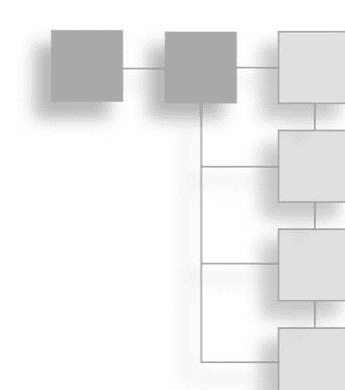

我要感谢我的朋友 Martin Osborne 多年来对我多本图书项目提供的建议、友好批评和鼓励。

我还要感谢 MQA 测试员 Zach Scott，他帮助确保了本书所用所有数据和解决方案文件的内容正确无误；我的项目编辑和校对编辑 Karen Gill；以及 Cengage Learning PTR 的高级产品经理 Mitzi Koontz。

## 作者简介

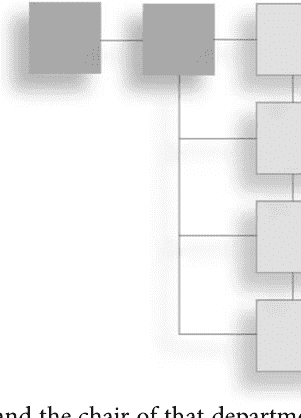

**Kenneth A. Lambert** 是 Washington and Lee University 计算机科学教授兼该系主任。他教授入门编程课程已有 29 年，并在计算机科学教育领域积极从事研究。Lambert 已撰写或合著了 25 本教科书，包括与 Douglas Nance 和 Thomas Naps 合著的入门 C++ 教科书系列、与 Martin Osborne 合著的入门 Java 教科书系列，以及入门 Python 教科书系列。他的最新教科书是 *Python 基础：数据结构。*

## 引言


欢迎阅读 *青少年 Python 编程*。无论你是否未满 20 岁，或只是心态像个青少年，本书都将向你介绍计算机编程。你可以在课堂上使用它，也可以自学。唯一的假设是你知道如何使用配备键盘、屏幕和鼠标的现代计算机系统。

为了让你的学习体验充满乐趣和趣味，你将编写在屏幕上绘制图片并允许你通过鼠标与之交互的程序。在此过程中，你将学习程序设计和计算机问题解决的基本原理。然后，你就能将这些思想和技术应用于几乎任何学习领域的难题解决。但最重要的是，你将体验到打造既能运行 *和* 看起来很棒的东西的喜悦！

## 为什么选择 Python？

计算机技术和应用在过去几十年中变得越来越复杂，计算机科学课程，尤其是入门课程也是如此。今天的学生学习一些编程和问题解决，然后就被期望迅速进入软件开发、复杂性分析和数据结构等主题，而这些主题在 20 年前是为高级课程保留的。此外，以面向对象编程为主导方法的兴起促使教师和教材作者将 C++ 和 Java 等功能强大、工业级的编程语言引入入门课程。因此，初学者往往因同时掌握高级概念和学习编程语言语法而感到不堪重负，而不是体验到计算机编程的回报和兴奋。

本书使用 Python 编程语言作为一种让学生和教师都能轻松愉快地学习的方式。Python 具有以下教学优势：

- Python 具有简单、常规的语法。其语句接近普通英语，其表达式使用代数中常见的常规记号。因此，初学者可以花更少的时间学习编程语言的语法，花更多的时间学习解决有趣的问题。
- Python 具有安全的语义。任何违反语言定义的表达式或语句都会产生错误信息。
- Python 可扩展性良好。初学者很容易编写简单程序。Python 还包含现代编程语言的所有高级特性，例如对数据结构和面向对象软件开发的支持，以便在需要时使用。
- Python 交互性强。表达式和语句可以在解释器的提示符下输入，让程序员尝试实验性代码并获得即时反馈。然后可以组合更长的代码段并保存为脚本文件，作为模块或独立应用程序加载和运行。
- Python 是通用型的。在当今的背景下，这意味着该语言包含用于当代应用的资源，包括媒体计算和网络。
- Python 是免费的，并在业界广泛使用。学生可以下载它在各种设备上运行。Python 用户社区庞大，Python 编程专长具有很高的简历价值。

总结这些优势，Python 是表达计算思想的舒适灵活的工具，无论是初学者还是专家皆可使用。如果学生在编程的首次体验中很好地掌握了这些思想，他们在转向实现教育或职业目标所需的其他语言和技术时不应遇到任何问题。最重要的是，初学者将花更少的时间盯着电脑屏幕，花更多的时间思考有趣的问题去解决。

## 书籍结构

本书的方法轻松自如，每个新概念只在你需要时才介绍。

第 1 章，“开始使用 Python”，指导你如何下载、安装并启动本书使用的 Python 编程软件。你尝试简单的程序命令并熟悉本书中将使用的 Python 语言的基本特性。

第 2 章，“开始使用海龟绘图”，介绍海龟绘图的基本命令。你学习用一组简单命令绘制图片。在此过程中，你会了解一些关于颜色和二维几何的知识。

第 3 章，“控制结构：顺序、迭代和选择”，涵盖允许计算机做出选择并执行重复任务的程序命令。

第 4 章，“编写、保存和运行程序”，向你展示如何将程序保存到文件中，以便你可以将其交给他人或在另一天继续工作。你学习如何像组织一篇论文一样组织程序，使其易于你和其他人阅读、理解和编辑。你还将了解计算机如何读取、理解和运行程序的一些知识。

第 5 章，“定义函数”，介绍一个重要的设计特性：函数。通过用函数组织你的程序，你可以简化复杂任务并消除代码中不必要的重复。

第 6 章，“鼠标和键盘的用户交互”，涵盖允许人们与你的程序交互的功能。你学习用于响应鼠标和键盘事件的程序命令，以及可以从程序用户那里获取信息的弹出对话框。

第 7 章，“递归”，教你了解另一种重要的设计策略——递归。你编写一些递归函数来生成计算机艺术和分形图像。

第 8 章，“对象和类”，为编程中使用对象和类提供初学者指南。你学习如何定义新的对象类型，例如用于选择颜色的菜单项和用于棋盘游戏的网格，并在有趣的程序中使用它们。

第 9 章，“动画”，以动画的简要介绍作为本书的结尾。你将发现如何让图像独立移动并以有趣的方式交互。

最后一章后有两个附录。附录 A，“海龟绘图命令”，为本书中介绍的海龟绘图命令集提供参考。


每章都包含一组两个编程练习，这些练习基于本章前面介绍的概念和示例。你可以在附录 B“练习解答”中找到这些练习的答案。

## COMPANION WEBSITE DOWNLOADS

你可以从 www.cengageptr.com/downloads 下载配套网站文件。这些文件包括书中讨论的示例程序以及练习的解答。

## A BRIEF HISTORY OF COMPUTING

在你急于进入编程之前，或许想先了解一下背景。下面的表格总结了计算历史上的一些主要发展。下面的讨论将提供这些发展的更多细节。

| 大约日期 | 主要发展 |
|---|---|
| Before 1800 | 数学家开发并使用算法<br>算盘用作计算辅助工具<br>莱布尼茨和帕斯卡建造了第一台机械计算器 |
| 1800–1930 | 雅卡尔织布机<br>巴贝奇分析机<br>布尔逻辑系统<br>霍勒里斯穿孔卡机 |
| 1930s | 图灵发表关于可计算性的成果<br>香农的信息论和数字开关理论 |
| 1940s | 第一台电子数字计算机 |
| 1950s | 第一批符号编程语言<br>晶体管使计算机更小、更快、更耐用、成本更低<br>数据处理应用的出现 |
| 1960–1975 | 集成电路加速了计算机硬件的微型化<br>第一台小型计算机<br>分时操作系统<br>带键盘和显示器的交互式用户界面<br>高级编程语言的普及<br>软件产业的兴起以及计算机科学和计算机工程的学术研究 |

| Period | Developments |
|---|---|
| 1975–1990 | 第一台微型计算机和大批量生产的个人计算机<br>图形用户界面变得普及<br>网络和互联网 |
| 1990–2000 | 光学存储（CDs, DVDs）<br>笔记本电脑<br>多媒体应用（音乐、摄影、视频）<br>计算机辅助制造、零售和金融<br>万维网和电子商务 |
| 2000–present | 嵌入式计算（汽车、家电等）<br>手持音乐和视频播放器<br>智能手机和平板电脑<br>触摸屏用户界面<br>无线和云计算<br>搜索引擎<br>社交网络 |

### Before Electronic Digital Computers

如今所使用的术语 *algorithm* 指的是解决问题的配方或方法。它由一系列定义明确的指令或步骤组成，这些指令或步骤描述了一个过程，该过程以问题的解结束。

古代数学家开发了最早的算法。单词“algorithm”源自波斯数学家 Muhammad ibn Musa Al-Khawarizmi 的名字，他在九世纪撰写了多部数学教科书。大约 2300 年前，希腊数学家欧几里得，几何学的发明者，开发了一种计算两个数的最大公约数的算法，你将在本书后面看到。

一种被称为 *abacus* 的装置也在古代出现，帮助人们进行简单的算术运算。用户通过在网格状导线上滑动算珠来计算和与差。算盘上算珠的配置即为数据。

十七世纪，法国数学家布莱兹·帕斯卡（1623–1662）建造了第一批用于自动化加法过程的机械装置之一。加法运算被嵌入机器内部齿轮的配置中。用户通过旋转一些轮子输入要相加的两个数字。 sum 或输出数字随后出现在另一个旋转轮上。德国数学家戈特弗里德·莱布尼茨（1646–1716）建造了另一台机械计算器，其中包括乘法等其他算术功能。莱布尼茨与牛顿共同发明了微积分，随后他提出用符号进行计算是人类最基本、最普遍的智力活动之一。他主张一种通用语言，在这种语言中，人们可以通过计算解决任何问题。

十九世纪早期，法国工程师约瑟夫·雅卡尔（1752–1834）设计并建造了一台自动化织布过程的机器。在此之前，织布图案中的每一行都必须手工设置，这是一个相当繁琐、容易出错的过程。雅卡尔织布机设计为接受穿孔卡片组作为输入。每张卡片描述布料图案中的一行。尽管它仍然是一个完全机械的装置，但雅卡尔织布机具备以前的装置所缺乏的东西——能够自动执行算法指令的能力。卡片组表达了控制织布机行为的算法或指令集。如果织布机操作员想要生产不同的图案，他只需用不同的卡片组运行机器即可。

英国数学家查尔斯·巴贝奇（1792–1871）通过设计一台机器模型，将可编程计算机的概念更进一步，该机器在概念上与现代通用计算机惊人地相似。巴贝奇设想他的机器，即他称之为分析机，为一台机械装置。他的设计要求四个功能部件：一个用于执行算术运算的算术装置、一个用于保存数据和程序的存储器、一个用于运行穿孔卡指令的操作器，以及一个用于在穿孔卡上产生结果的输出装置。可惜的是，巴贝奇的计算机从未建成。该项目因资金不足而夭折，几乎就在巴贝奇本人去世的同时。

十九世纪最后二十年，美国人口普查局统计学家赫尔曼·霍勒里斯（1860–1929）开发了一台用于美国人口普查数据处理的机器。霍勒里斯的机器与巴贝奇分析机具有相同的组件部件，只是接受一组穿孔卡作为输入，然后对卡片进行汇总和排序。他的机器大大缩短了产生美国人口统计结果所需的时间。寻求自动化数据处理的政府和商业组织迅速采用了霍勒里斯的穿孔卡机器。霍勒里斯也是后来成为 IBM（International Business Machines）的公司创始人之一。

同样在十九世纪，英国中学教师乔治·布尔（1815–1864）开发了一套逻辑系统。该系统由一对值 TRUE 和 FALSE 以及在这两个值上的三组原始操作 AND、OR 和 NOT 组成。布尔逻辑最终成为设计处理二进制信息的电子电路的基础。

半个世纪后，在 1930 年代，英国数学家艾伦·图灵（1912–1954）探索了算法和计算的理论基础和局限性。图灵最重要的贡献是发展了通用机器的概念，该机器可以专门化以解决任何可计算问题，并证明某些问题是计算机无法解决的。

### The First Electronic Digital Computers (1940–1950)

1930 年代末，麻省理工学院的数学家和电气工程师克劳德·香农（1916–2001）撰写了一篇题为“A Symbolic Analysis of Relay and Switching Circuits.”的经典论文。在这篇论文中，他展示了如何将算术等其他系统中的运算和信息简化为布尔逻辑，然后再简化为硬件。例如，如果布尔值 TRUE 和 FALSE 被写成二进制数字 1 和 0，就可以用一系列逻辑运算来计算两个二进制数字串的和。构建电子数字计算机所需的一切，只是能够将二进制数字表示为开/关开关，并将逻辑运算表示在其他电路中。

二战中交战双方的需求推动了计算机硬件的发展进入快车道。1940 年代，美国、英国和德国的几支科学家和工程师团队独立创建了第一代通用数字电子计算机。这些科学家和工程师都使用了香农的创新，即用电子开关装置来表达二进制数字和逻辑运算。其中一个团队是哈佛大学在霍华德·艾肯领导下的团队。他们的计算机名为 Mark I，于 1944 年投入运行，并在战争期间为美国海军进行数学工作。Mark I 被认为是机电设备，因为它使用磁铁、继电器和齿轮的组合来存储和处理数据。

宾夕法尼亚大学 J. Presper Eckert 和 John Mauchly 领导的另一支团队生产了一台名为 ENIAC（Electronic Numerical Integrator and Calculator）的计算机。ENIAC 在战争结束时为美国陆军炮兵计算弹道表。由于 ENIAC 使用全电子元件，它比 Mark I 快近一千倍。

还有另外两台电子数字计算机比 ENIAC 完成得稍早。它们是 ABC（Atanasoff-Berry Computer），由 John Atanasoff 和 Clifford

1942 年在爱荷华州立大学的 Berry，以及 1943 年在英国由与艾伦·图灵合作的一个小组建造的 Colossus。ABC 用于求解联立线性方程组。尽管 ABC 的功能比 ENIAC 窄得多，但 ABC 现在被认为是第一台电子数字计算机。Colossus 的存在直到最近才解密，在战争期间被用来破解强大的德国 Enigma 代码。

第一台电子数字计算机，有时被称为 *大型机*，由真空管、电线和插头组成，占据了整个房间。虽然它们在计算方面比人类快得多，但以我们当前的标准来看，它们速度极慢且容易故障。此外，早期的计算机极难编程。要输入或修改程序，一组工作人员必须通过拔出和重新插入电线来重新排列真空管之间的连接。每个程序都是通过实际将其硬连线到计算机中来加载的。涉及数千根电线，很容易出错。

这些第一台计算机的内存只存储数据，而不存储处理数据的程序。正如你所读到的，存储程序的想法早在 100 年前就已出现在 Jacquard 织布机和巴贝奇为分析机设计的方案中。1946 年，约翰·冯·诺伊曼意识到程序的指令也可以以二进制形式存储在电子数字计算机的内存中。他在普林斯顿的研究小组开发了第一台现代存储程序计算机之一。

尽管自那些早期以来计算机的规模、速度和应用发生了巨大变化，但电子数字计算机的基本架构和设计却出奇地稳定。

### 第一代编程语言（1950–1965）

如今的典型计算机用户运行着许多由数百万行代码组成的程序，这些程序执行着 20 或 30 年前看来像是魔术般的任务。但第一台数字电子计算机并没有像今天这样的软件。少数相对简单且规模较小的应用的机器代码必须手工加载。随着对更大、更复杂应用的需求增长，加速编程过程的工具的需求也随之增长。

在 20 世纪 50 年代初，计算机科学家意识到可以用符号记法代替机器代码，第一种 *汇编语言* 出现了。程序员会在 *穿孔机* 上输入操作助记符代码，如 ADD 和 OUTPUT，以及数据变量的助记符，如 SALARY 和 RATE。每次按键会在一张小卡片上为每条指令打出一组孔。程序员随后将他们的卡片堆交给系统操作员，操作员将它们放入一种称为卡片阅读器的设备中。该设备将卡片上的孔翻译成计算机内存中的模式。然后一个名为汇编器的程序将内存中的应用程序翻译成机器代码并执行它们。

用汇编语言编程相比用机器代码编程有了明显的改进。汇编语言中使用的符号记法对人来说更容易阅读和理解。另一个优点是汇编器可以在程序实际执行之前捕获一些编程错误。然而，与常规数学的记法相比，符号记法仍然显得有点晦涩。为了弥补这一问题，IBM 的程序员约翰·巴克斯于 1954 年开发了 FORTRAN（公式翻译语言）。程序员，其中许多人是数学家、科学家和工程师，现在可以使用常规的代数记法。FORTRAN 程序员仍然在 keypunch machine 上输入他们的程序，但计算机在编译器将其翻译成机器代码后执行它们。

FORTRAN 被认为非常适合数值和科学应用。然而，表达数据处理中使用的数据类型——尤其是文本信息——是困难的。例如，FORTRAN 不适用于处理包含个人姓名、地址、社会安全号码以及公司和其他机构财务数据的信息。在 20 世纪 60 年代初，由海军少将格蕾丝·默里·霍普纳领导的一个团队为美国政府的数据处理开发了 COBOL（通用商业导向语言）。银行、保险公司和其他机构迅速在其数据处理应用中采用了它。

也在 20 世纪 50 年代末和 60 年代初，麻省理工学院的计算机科学家约翰·麦卡锡开发了一种强大而优雅的记法 LISP（列表处理）来表达计算。基于递归函数理论（本书第 7 章涵盖的主题），LISP 抓住了符号信息处理的本质。麦卡锡的学生斯蒂芬“Slug”·罗素于 1960 年编写了 LISP 的第一个解释器。解释器直接接受 LISP 表达式作为输入，评估它们并打印其结果。在早期，LISP 主要用于被称为人工智能的研究领域中的实验室实验。最近，LISP 被誉为解决任何困难或复杂问题的理想语言。

尽管它们是最早的高级编程语言之一，FORTRAN 和 LISP 已存活了数十年。它们经历了许多修改以提高其功能，并为许多其他编程语言的发展提供了模型。相比之下，COBOL 已不再活跃使用，但主要以必须维护的遗留程序的形式存活下来。

这些新的高级编程语言有一个共同特征：*抽象*。在科学或任何其他探究领域，抽象允许人类将复杂思想或实体简化为更简单的形式。例如，一组十条汇编语言指令可以用 FORTRAN 中仅由五个符号组成的等效代数表达式代替。换句话说，只要你能用更少的东西表达更多，你就是在使用抽象。抽象的使用也存在于计算的其他领域，例如硬件设计和信息架构。复杂性实际上并没有消失，但抽象将其隐藏起来。用抽象抑制分散注意力的复杂性使计算机科学家能够概念化、设计和构建越来越复杂和复杂的系统。

### 集成电路、交互与分时系统（1965–1975）

在 20 世纪 50 年代末，真空管让位于 *晶体管* 作为计算机硬件中实现电子开关的机制。作为一种 *固态器件*，晶体管比真空管小得多、更可靠、更耐用且制造成本更低。因此，计算机的硬件组件通常在物理尺寸上变小、更可靠且成本更低。开关越小越多的，处理速度越快，内存存储信息的容量越大。

在 20 世纪 60 年代初 *集成电路* 的发展使计算机工程师能够构建越来越小、更快、更便宜的计算机硬件组件。他们完善了一种通过光刻在硅薄片上蚀刻晶体管和其他固态组件的过程，将整个处理器和内存放在单个芯片上。1965 年，计算机芯片制造商 Intel 的创始人之一戈登·摩尔做出了一个后来被称为 *摩尔定律* 的预测。该预测指出，硬件的处理速度和存储容量将增加，其成本将每 18 个月大约减少 2 倍。这一趋势在过去 50 年里一直成立。例如，1965 年芯片上约有 50 个电气元件，而到 2010 年，芯片可容纳超过 6000 万个元件。如果没有集成电路，人类就不会在 1969 年登上月球，世界也将没有人们现在每天使用的强大而廉价的手持设备。

在 20 世纪 60 年代出现了相当于大型办公桌大小的小型计算机。开发和运行程序的方式正在发生变化。在此之前，计算机通常位于

在仅有一名人工操作员的受限区域内。程序员在另一间房间或建筑中的穿孔机上编写程序。然后他们将卡片堆交给计算机操作员，后者将其装入卡片阅读器，并在计算机上按顺序编译和运行程序。程序员随后返回领取输出结果，以新卡片堆或打印件的形式呈现。这种操作模式也称为批处理，可能会导致程序员等待数天才能得到结果，包括错误信息。

处理速度和存储容量的提升使计算机科学家得以开发出第一个分时操作系统。LISP 编程语言的创造者约翰·麦卡锡认识到，一个程序可以自动化人类系统操作员执行的许多功能。当包括磁性二级存储在内的存储器变得足够大，能够同时容纳多个用户的程序时，这些程序就可以被安排进行并发处理。与每个程序相关联的进程将运行一段时间片，然后将 CPU 让给另一个进程。所有活动进程将反复轮流使用 CPU，直到完成。

几个用户现在可以通过连接到同一台计算机的独立终端输入命令，同时运行自己的程序。随着处理器速度的不断提升，每个用户都获得了分时计算机系统完全属于自己的错觉。

到 1960 年代末，程序员可以在终端输入程序输入，并立即在 CRT（阴极射线管）屏幕上看到程序输出。与其前身相比，这种新型计算机系统既高度交互，也更容易被用户使用。

许多相对较小和中型的机构，例如大学，现在能够负担得起计算机。这些机器不仅用于数据处理和工程应用，还用于计算机科学这一新兴且迅速发展的领域的教学和研究。

### 个人计算与网络（1975–1990）

在 1960 年代中期，斯坦福研究院（SRI）工作的计算机科学家道格拉斯·恩格尔巴特首次看到了摩尔定律的最终含义之一：最终，也许在一代人之内，硬件组件将变得足够小且价格足够低廉，可以为每个人大规模生产一台个人计算机。这些个人计算机将是什么样的，它们的拥有者将如何使用它们？二十年前，1945 年，恩格尔巴特读过《大西洋月刊》上的一篇文章，题为“As We May Think”，该文已经提出了这个问题并提供了一些答案。作者、麻省理工学院的科学家范内瓦·布什预测，计算设备将作为信息存储库，最终成为所有人类知识的存储库。计算设备的拥有者将通过指向设备浏览这些信息，并几乎随心所欲地向知识库贡献信息。恩格尔巴特同意个人计算机的主要目的是增强人类智力，并花费余生设计能够实现这一目标的计算机系统。

在 1960 年代后期，恩格尔巴特制造了第一个指向设备，即鼠标。他还设计了软件，在 *位图显示屏* 上表示窗口、图标和下拉菜单。他证明了计算机用户不仅可以在键盘上输入文本，还可以直接操作屏幕上代表文件、文件夹和计算机应用程序的图标。

但对恩格尔巴特而言，个人计算并不意味着孤立计算。他参与了连接计算机网络的首次实验，并相信人们很快会使用计算机进行通信、共享信息和团队项目协作。

恩格尔巴特在 SRI 的小型计算机上开发了他第一个实验系统，他称之为 NLS（oNLine System）Augment。20 世纪 70 年代初，他移至施乐帕洛阿尔托研究中心（PARC）并与艾伦·凯领导的一个团队合作开发第一台桌面计算机系统。名为 Alto 的系统具有恩格尔巴特 Augment 的许多功能，以及电子邮件和功能性超文本（万维网的前身）。凯的团队还开发了一种名为 Smalltalk 的编程语言，旨在为新计算机创建程序并向儿童教授编程。凯的目标是开发一台大小相当于大笔记本的个人计算机，他称之为 Dynabook。不幸的是，对施乐来说，公司管理层对复印机更感兴趣，而不是凯的富有远见的研究团队的工作。然而，一位名叫史蒂夫·乔布斯的年轻企业家参观了施乐实验室并看到了 Alto 的实际运行。1984 年，由史蒂夫·乔布斯创立的如今闻名的苹果电脑公司推出了 Macintosh，这是一款首款成功的具有图形用户界面的大规模生产个人计算机。

当凯的团队忙于在研究实验室构建未来的计算机系统时，数十名爱好者在旧金山附近聚集，成立了 Homebrew Computer Club，即第一个个人计算机用户团体。他们聚会分享个人计算的想法、程序、硬件和应用。首款大规模生产的个人计算机 Altair 出现在 1975 年。Altair 包含英特尔的 8080 处理器，即首款微型计算机芯片。但从外部看，Altair 看起来和表现更像早期计算机的微型版本，而不是 Alto。程序及其输入必须通过拨动开关输入，输出则由一组灯显示。然而，Altair 足够小，个人计算爱好者可以带回家，并且 I/O 设备最终被发明出来以支持文本和声音的处理。

Osborne 和 Kaypro 是首批大规模生产的交互式个人计算机之一。它们拥有微小的显示屏和键盘，并配有软盘驱动器用于加载系统软件、应用软件和用户数据文件。早期的个人计算应用是文字处理器、电子表格以及 Pacman 和 SpaceWar 等游戏。这些计算机还运行 CP/M（微型计算机控制程序），即首款基于 PC 的操作系统。

20 世纪 80 年代初，一位名叫比尔·盖茨的大学辍学生和他的搭档保罗·艾伦开发了自己的操作系统软件，称之为 MS-DOS（微软磁盘操作系统）。他们随后与巨型计算机制造商 IBM 达成协议，为公司计划大规模生产的 PC 新产品线供应 MS-DOS。这笔交易对盖茨的公司微软来说非常有利。微软不仅每售出一台电脑就能获得费用，而且能够抢先提供可在其操作系统上运行的应用软件。IBM PC 及其“克隆机”销往个人和机构的强劲销售迅速使 MS-DOS 成为世界上使用最广泛的操作系统。几年之内，盖茨和艾伦成为亿万富翁，十年之内，盖茨成为世界首富，这一位置他连续保持了 13 年。

1970 年代，美国政府还开始支持开发一个将军事设施和研究大学的计算机连接起来的网络。第一个这样的网络称为 ARPANET（高级研究计划署网络），连接了 SRI、UCLA（加州大学洛杉矶分校）、加州大学圣巴巴拉分校和犹他大学的四台计算机。与凯在施乐的团队相关的研究员鲍勃·梅特卡夫开发了一种名为 Ethernet 的软件协议，用于操作计算机网络。Ethernet 允许计算机在组织内部的局域网（LAN）中通信，并通过广域网（WAN）与其他组织的计算机通信。到 1980 年代中期，ARPANET 已发展成为现在所称的互联网，连接了世界各地大型机构、小型组织和个人拥有的计算机。


### 通信与媒体计算（1990–2000）

在 1990 年代，计算机硬件成本持续暴跌，而处理速度和内存容量则急剧飙升。*光学存储介质* 如光盘（CD）和数字视频光盘（DVD）被开发用于大规模存储。图像、声音和视频的计算处理变得可行且普及。到了十年末，整部电影都可以通过数字设备拍摄或制作并回放。创建逼真的三维环境动画的能力催生了一种名为 *虚拟现实* 的新技术。出现了新设备，如平板扫描仪和数码相机，它们可以与更传统的麦克风和扬声器一起使用，以支持几乎任何类型信息输入和输出。

桌面和笔记本电脑不仅执行有用工作，还为用户提供了新的个人表达方式。这一十年见证了计算机作为通信设备的兴起，包括电子邮件、即时消息、公告板、聊天室以及令人惊叹的万维网。

也许这一时期最有趣的故事与万维网的创造者蒂姆·伯纳斯-李有关。在 1980 年代末，伯纳斯-李，这位在瑞士日内瓦 CERN 研究所从事研究的理论物理学家，开始为使用计算机共享信息开发一些想法。计算机工程师已有多年将计算机连接到网络的经验，在研究社区中交换文件和全球发送接收电子邮件已很常见。然而，硬件、操作系统、文件格式和应用程序的巨大差异仍然使不擅长编程的用户难以访问和共享这些信息。伯纳斯-李希望创建一个共享信息的通用媒介，使用起来简单易用，不仅适用于科学家，也适用于任何能够操作键盘和鼠标并在显示器上查看信息的人。

伯纳斯-李熟悉范内瓦·布什关于类网络咨询系统的设想、恩格尔巴特关于 NLS Augment 的工作以及首批广泛可用的超文本系统。其中一个系统，苹果电脑的 Hypercard，将超文本的范围扩展到 *超媒体*。Hypercard 允许作者不仅组织文本，还能将图像、声音、视频和可执行应用程序组织成链接信息的网络。然而，Hypercard 数据库只能存在于独立计算机上；链接无法将 Hypercard 数据从一台计算机传输到另一台。此外，支持软件仅在苹果电脑上运行。

伯纳斯-李意识到网络可以将超媒体系统的覆盖范围扩展到连接到互联网的任何计算机，使其信息在全球范围内可用。为了保持其独立于特定操作系统的特性，新媒介需要具有分发和呈现信息的通用标准。

为了确保这种中立性和独立性，任何私人公司或个人政府都不能拥有该媒介并制定标准。

伯纳斯-李于 1992 年为这种新媒介——现称为万维网——构建了软件。该软件使用了许多现有的通过互联网传输信息的机制。人们通过在称为 *web 服务器* 的计算机上发布文件来为网络贡献信息。这些计算机上的 web 服务器软件负责响应对存储在 web 服务器上的信息进行查看的请求。要查看网络上的信息，人们使用软件称为 *web 浏览器*。响应用户的命令，web 浏览器会通过互联网向适当的 web 服务器发送信息请求。服务器通过将信息发送回浏览器的计算机——称为 *web 客户端*——进行响应，在浏览器中显示或渲染该信息。

尽管伯纳斯-李编写了第一个 web 服务器和 web 浏览器软件，但他还做出了另外两个更重要的贡献。首先，他设计了一套规则，称为 HTTP（超文本传输协议），它允许任何服务器和浏览器相互通信。其次，他设计了一种语言，HTML（超文本标记语言），它允许浏览器对要在网页上显示的信息进行结构化。然后他将所有这些资源免费提供给任何人。

伯纳斯-李对这种通用信息媒介的发明和馈赠是一项真正了不起的成就。如今全球有数百万台 web 服务器在运行。任何拥有适当培训和资源的人——公司、政府、非营利组织和私人个人——都可以启动新的 web 服务器或在现有服务器上获得空间。Web 浏览器软件现在不仅运行在桌面和笔记本电脑上，还运行在手机等手持设备上。

### 无线计算与智能设备（2000–至今）

二十一世纪见证了无线技术的发展和计算设备的进一步小型化。今天的智能手机让你可以把巨大的计算能力装进口袋，并通过无线或蜂窝技术与世界各地的其他计算资源进行通信。微小的计算设备嵌入在汽车和几乎每一种家用电器中，从洗衣机/烘干机和家庭影院系统到健身自行车。你的数据（照片、音乐、视频和其他信息）现在可以存储在安全的服务器（“云”）中，而不是存储在你的设备上。

伴随着这一代新设备及其连接方式，出现了大量新的软件技术和应用程序。这里仅提及其中三个非常重要的创新。

在 1990 年代末，史蒂夫·乔布斯在离开一段时间后重返苹果电脑。他意识到更小的手持设备和无线技术将为向人们提供各种“内容”——音乐、视频、书籍和应用程序——提供一种新的方式。

为了实现他的愿景，乔布斯追求设计和开发一种具有简洁、简单且“酷”的用户界面来访问此内容的便携设备。这样的设备的首个产品是 iPod，一款能够容纳你整个音乐库以及照片的音乐播放器。尽管界面最初使用机械按钮和滚轮，但很快就推出了 iPod touch，它采用触摸屏并可播放视频。触摸屏界面还允许苹果及其程序员为这些设备提供应用，或特殊用途应用程序（如游戏）。当无线连接可用时，这些应用可以提供电子邮件、web 浏览器、天气频道以及成千上万的其他服务。iPhone 和 iPad——真正的多媒体设备，配备麦克风、摄像头和运动传感器——在几年后沿此思路推出。

乔布斯还开发了一种新的内容分发商业模式。这些设备的拥有者会连接到电子商店，例如 iTunes Store、iBooks Store 和 App Store，以下载免费内容或付费内容。作者、音乐家和应用开发者可以以类似的方式将他们的产品上传到这些商店。因此，在短短几年内，乔布斯改变了人们消费、生产和思考媒体内容的方式。

也在 1990 年代末，两名斯坦福大学计算机科学研究生拉里·佩奇和谢尔盖·布林开发了一种强大的网页搜索算法。该算法成为他们创立的公司 Google 的基础。“To Google”现在已成为一个动词，相当于“在网上搜索”。尽管人们仍继续浏览或“surf”网络，但他们在网络上的许多活动现在都基于搜索。事实上，大多数在线研究和许多新行业如果没有搜索是不可想象的。

最后，就在千禧年之交，哈佛大学本科生马克·扎克伯格开发了第一个社交网络程序的原型，他称之为 Facebook。他以相同名称创立的公司改变了人们相互连接和在网上展示自己的方式。

本书关于计算历史的非简要概述到此结束。如果你想了解更多关于这段历史的信息，可以进行网络搜索或咨询当地图书馆。现在是时候介绍 Python 编程了。

## 感谢您的反馈

我已尽力制作高质量的文本，但如果您发现错误，请报告至 lambertk@wlu.edu。有关本书的任何勘误和其他信息都将发布在网站 http://home.wlu.edu/~lambertk/python/ 上。


# 第 1 章

## 使用 Python 入门

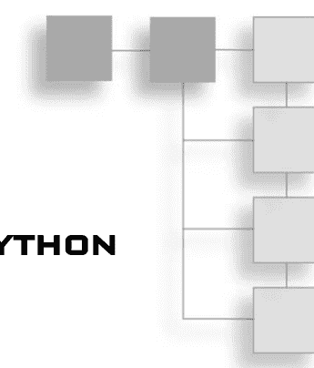

在本章中，你将探索 Python 的一些基本代码元素。这些代码元素包括对 Python 基本数据类型（如数字、字符串、列表和字典）的操作。这些数据和操作构成了你在本书后面开发程序时所使用的构建块。本章中呈现的代码由简单的片段组成。在阅读过程中，建议你在 Python 的交互式 shell 中运行这些代码片段。只要记住，最好的学习方式是自己动手尝试！

## 前期准备

在本节中，你将学习如何从其网站下载 Python 及其文档、启动 Python 的 IDLE shell，并在 shell 中评估 Python 表达式和语句。

### 下载和安装 Python

某些计算机系统，如 Mac OS 和 Linux，已预装 Python。其他系统，如 Windows，则没有。在任何情况下，你都应访问 Python 的网站 at www.python.org/download/ 下载适用于你特定系统的最新版本的 Python。截至本文撰写时，Python 的最新版本是 3.3.4，但到你阅读这些文字时，该数字可能更大。

当你在 Python 网站时，最好下载你新版本 Python 的文档，网址为 www.python.org/doc/。你也可以将文档链接加入书签，以便在线快速浏览。

下载完适用于你系统的 Python 后，如果你是 Mac 或 Windows 用户，可以通过双击安装文件进行安装。Linux 用户必须解压源代码包，使用 GCC 编译，并将其放置在系统上的适当目录中。

### 启动并在 IDLE Shell 中工作

在本书的前三章中，你将在 Python 的 IDLE shell 中尝试 Python 代码。shell 显示一个窗口，你可以在其中输入程序代码并获得响应。术语 IDLE 代表 Integrated DeveLopment Environment。（它也是 Monty Python 角色 Eric Idle 的姓氏。）在前三章中启动 IDLE，你在终端窗口中运行命令

```
idle3
```

在终端窗口中。在此之前，你必须按如下方式打开或启动终端窗口：

- **Mac 用户**—从 `Utilities` 文件夹启动 Terminal。
- **Windows 用户**—在开始菜单的输入框中输入单词 `command` 来启动 DOS 窗口。
- **Linux 用户**—右键单击桌面并选择打开终端。

另外，Mac OS 和 Windows 用户可以通过双击 Python 系统所在文件夹中的 IDLE 图标来启动 IDLE。该文件夹位于 Mac OS 的 `Applications` 文件夹中，并在 Windows 开始菜单的“所有程序”选项中。你可以为这些选项创建适当的快捷方式以便快速轻松访问。

当你在终端窗口中启动 IDLE 时，你应该会看到如图 1.1 所示的窗口（Mac OS 版本）。此后，IDLE shell 简称为 *shell*。

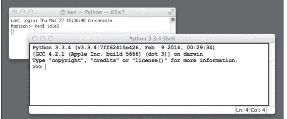

图 1.1
一个新的 shell 窗口。

如果 shell 中显示的版本号不是 3.3.4 或更高版本，你需要关闭 shell 窗口并下载并安装当前版本的 Python，如前所述。

shell 提供了一个“沙箱”，你可以在其中尝试简单的 Python 代码片段。要运行代码片段，你在 >>> 符号后输入它，然后按 Return 或 Enter 键。shell 然后通过显示结果并给出另一个 >>> 提示来响应。图 1.2 显示了用户输入了几个 Python 代码片段后 shell 及其结果。

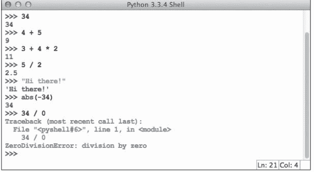

图 1.2
输入多个代码片段后的 shell。
© 2014 Python Software Foundation.

shell 窗口中的某些文本是彩色编码的（蓝色、绿色和红色），尽管这些颜色不会出现在本单色书籍中。这些颜色表示各种代码元素的作用，将在稍后描述。

要重复运行之前的代码行，只需将光标放在该行的末尾，然后按两次 Return 或 Enter。

当你准备好结束与 shell 的会话时，只需选择 shell 窗口的关闭按钮或关闭关联的终端窗口即可。但是，在阅读本书时请保留一个 shell，以便在遇到每个新想法时尝试它。

### 获取 Python 帮助

编写 Python 代码时有两种很好的获取帮助的方法：

- 1. 浏览 Python 文档。
- 2. 在 shell 中运行 Python 的 help 函数。

Python 的 help 函数对于获取有关基本代码元素（如函数）的快速帮助特别有用。例如，图 1.2 中 Python 的 abs 函数的使用对你来说可能很明显，但如果你不确定，可以通过输入 help(abs)，如图所示，在图 1.3 中了解更多信息。

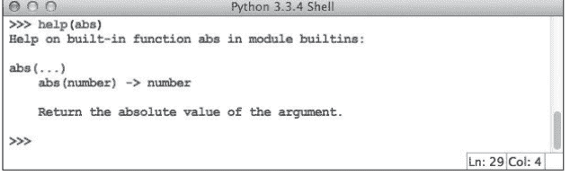

图 1.3
在 shell 中获取帮助。
© 2014 Python Software Foundation.

## 使用数字

几乎所有计算机程序都以某种方式或另一种方式使用数字。在本节中，你将使用 Python 中的两种基本数字类型进行算术运算：整数和浮点数。在此过程中，将介绍变量、赋值、函数和模块等重要概念。

### 使用算术运算

正如你从数学中知道的那样，整数是整数序列 {..., −2, −1, 0, 1, 2, ...}。虽然该序列在数学中是无限的，但在计算机程序中该序列是有限的，因此具有最大的正整数和最大的负整数。在 Python 中，整数序列相当大；序列的上限和下限取决于可用计算机内存的数量。

实数是带小数点的数字，例如 3.14 和 7.50。小数点右边的数字称为小数部分，表示实数的精度。在数学中，实数具有无限精度。实数集也是无限的。然而，在计算机程序中，实数具有上限、下限和有限精度（通常为 16 位数字）。在 Python 和大多数其他编程语言中，实数称为浮点数。

正如你在上一节中看到的那样，当你在 Python shell 中输入一个数字时，Python 只显示该数字；当你输入一个算术表达式时，Python 会计算并显示该表达式的值。因此，shell 就像一个袖珍计算器（没有按钮）。Python 的基本算术运算列于表 1.1。在此表中，符号 A 和 B 可以是数字或包含数字和运算符的表达式。

**表 1.1 基本算术运算**

| 操作 | 其作用 | 示例 | 值 |
|---|---|---|---|
| A + B | 返回 A 和 B 的和 | 5 + 2 | 7 |
| A - B | 返回从 A 中减去 B 的结果 | 5 - 2 | 3 |
| A * B | 返回 A 和 B 的乘积 | 5 * 2 | 10 |
| A / B | 返回 A 除以 B 的精确结果 | 5 / 2 | 2.5 |
| A // B | 返回 A 除以 B 的整数商 | 5 // 2 | 2 |
| A % B | 返回 A 除以 B 的整数余数 | 5 % 2 | 1 |
| A ** B | 返回 A 的 B 次幂 | 5 ** 2 | 25 |
| - A | 返回 A 的算术否定 | - (5 * 2) | -10 |

注意以下关于算术运算的几点：

- 1. / 运算符产生除法的精确结果，作为浮点数。
- 2. // 运算符产生整数商。
- 3. 当使用其他运算符时，如果使用两个整数，结果为整数。
- 4. 当使用其他运算符时，如果至少使用一个浮点数，结果为浮点数。因此，5 * 2 是 10，而 5 * 2.3 是 11.5。

与数学一样，算术运算符受优先级规则的约束。如果相同优先级的运算符出现在连续位置，则按从左到右的顺序求值。例如，表达式 3 + 4 - 2 + 5 从左到右求值，得到 10。

当运算符没有相同的优先级时，** 首先求值，然后是乘法（*, /, // 或 %），最后是加法（+ 或 -）。例如，表达式 4 + 3 * 2 ** 3 首先计算 2 ** 3，然后计算 3 * 8，最后计算 4 + 24，得到 32。

你可以使用括号来覆盖这些规则。例如，(3 + 4) * 2 以加法开始求值，而 3 + 4 * 2 以乘法开始求值。这两个表达式的求值结果是什么？打开一个 shell 并检查！


负数用减号表示。这个符号也用于取反更复杂的表达式，例如 - (3 * 5)。以这种方式使用时，减号的优先级高于任何其他算术运算符。

表 1.2 显示了算术运算符的优先级，其中优先级较高的运算符先求值。

### 表 1.2 算术运算符的优先级

| 运算符 | 优先级 |
|---|---|
| - (一元取反) | 4 |
| ** | 3 |
| *, /, //, % | 2 |
| +, - (二元减法) | 1 |

指数运算符 ** 也是右结合的。这意味着连续的 ** 运算符从右到左求值。因此，表达式 2 ** 3 ** 2 的结果为 512，而 (2 ** 3) ** 2 的结果为 64。

最后，关于风格的说明：虽然 Python 在算术表达式中忽略空格，但在每个运算符周围使用空格可以使你的代码以及其他人更容易阅读。例如，比较

```
34+67*2**6-3
```

to

```
34 + 67 * 2 ** 6 - 3
```

## 使用变量和赋值

假设你正在编写一个计算并使用球体体积的程序。已知球体的半径为 4.2 英寸。你首先使用公式 4/3πr³ 计算其体积，其中 3.1416 作为 π 的估计值。你可能会为此编写的 Python 表达式如下：

```
4 / 3 * 3.1416 * 4.2 ** 3
```

如果此表达式的值在程序中只使用一次，你只需计算一次并在那里使用它。然而，如果它在程序的多个地方使用，你必须多次编写相同的表达式。这浪费了你在编写代码上的时间，也浪费了计算机在求值上的时间。有没有办法编写表达式，只计算一次其值，然后在此之后多次简单地使用该值？

是的，有，而且这就是程序使用变量的原因之一。Python 中的变量是一个代表值的名称。Python 变量通过使用赋值运算符 = 来赋予值，其形式如下：

```
variable = expression
```

其中 variable 是任意 Python 名称（稍后会讨论一些例外），而 expression 是任意 Python 表达式（包括此处讨论的算术表达式）。因此，在我们的示例中，变量 volume 可以通过赋值给出球体的体积

```
volume = 4 / 3 * 3.1416 * 4.2 ** 3
```

然后在后面的其他代码中多次使用。请注意，由于赋值的优先级低于其他运算符，= 运算符右侧的表达式会先求值，然后变量左侧才接收该值。

现在，假设你必须计算多个不同球体的体积。你可以在每次编写计算新体积的代码时都输入表达式 4 / 3 和 3.1416。但你也可以改用其他变量，例如 FOUR_THIRDS 和 PI，以便在每次重复公式时都能轻松记住这些值。图 1.4 显示了在 shell 中建立这些值并计算半径为 4.2 和 5.4 的两个球体体积的会话。

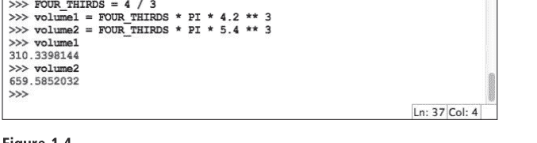

Figure 1.4
在代码片段中使用变量。
© 2014 Python Software Foundation.

Python 变量使用字母、数字和下划线 (`_`) 拼写。以下是使用它们的规则：

- 变量必须以字母或下划线 (`_`) 开头，并且至少包含一个字母。
- 变量区分大小写。因此，变量 `volume` 与变量 `Volume` 不同，尽管它们可能引用相同的值。
- Python 程序员通常用小写字母拼写变量，但使用大写字母或下划线来强调嵌入的词，如 `firstVolume` 或 `first_volume`。
- 当变量的值在其初始赋值后不会改变时，它被视为常量。PI 就是常量的一个例子。Python 程序员通常使用全大写来拼写常量以表示这一点。
- 在使用变量之前，你必须为其赋值。尝试使用未以这种方式初始化的变量会生成错误消息，如图 1.5 所示。

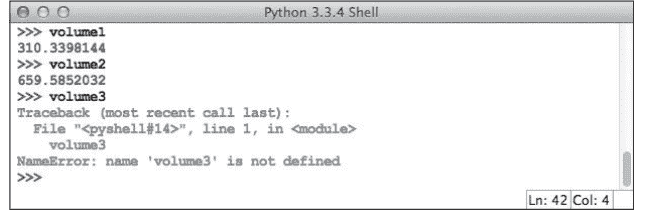

Figure 1.5
尝试使用未赋值的变量。
© 2014 Python Software Foundation.

总结一下，在 Python 代码中使用变量有三个原因：

- 1. 它们使代码易于阅读和理解。
- 2. 它们有助于消除不必要的计算。
- 3. 它们使代码易于修改和维护（稍后讨论）。

## 使用函数

正如你所见，算术和赋值操作由运算符和一个或多个操作数组成。Python 还提供了许多其他基本操作，它们被打包为函数。函数类似于运算符，但它是通过名称而不是运算符符号引用的。当函数被求值或调用时，其操作数以参数的形式提供给它。例如，Python 函数 abs 期待一个数字作为其唯一参数，并计算并返回该数字的绝对值。因此，函数调用 abs(-34) 返回 34。

当 Python 函数被调用时，Python 首先求值其参数。得到的值随后传递给函数，函数使用它们来计算并返回其值。虽然函数调用的书写形式略有不同，但过程与使用操作数和运算符求值表达式没有不同。函数调用的形式如下：

```
functionName(argumentExpression1, argumentExpression2, ...)
```

函数调用是表达式，其参数也是表达式。例如，算术表达式

```
abs(length - width) + 2
```

只要变量 length 和 width 引用数字，就会产生结果。

一些 Python 函数允许可选参数以及必需参数。例如，Python 函数 round 期待一个必需参数：要舍入的数字。如果该数字是浮点数，则返回最接近它的整数值。然而，round 也可以用第二个参数调用：一个整数，表示结果中使用的精度位数。因此，round(3.1416) 返回 3，而 round(3.1416, 3) 返回 3.142。

通常，使用函数的参数数量必须与其必需参数的数量匹配，除非它允许可选参数。对于 Python 提供的函数，所使用的参数类型（如数字）也必须与参数序列中每个位置期望的参数类型匹配。

## 使用 math 模块

Python 的函数要么已在 shell 中可供调用，要么必须在使用前从模块导入。Python 模块只是一个函数和其他资源的库。存在许多这样的模块，如同你通过浏览模块索引

在 Python 文档中看到的那样。其中之一是 `math` 模块，它包含用于数字运算的有用函数。

有几种方法可以从模块导入函数以使其可供使用。最常见的方法是使用以下形式

```
import moduleName
```

其中 *moduleName* 是模块的名称。完成此操作后，你可以通过使用以下形式调用模块中的任何函数

```
moduleName.functionName(sequenceOfArguments)
```

例如，假设你想计算 2 的平方根。下面的 shell 会话显示了如何做到这一点：

```
>>> import math
>>> math.sqrt(2)
1.4142135623730951
```

或者，如果你不想在函数调用中使用模块名称作为前缀，可以显式导入所需的函数，如下所示：

```
>>> from math import sqrt
>>> sqrt(2)
1.4142135623730951
```

要查看 `math` 模块中所有可用的函数，你在导入 math 后运行 `dir(math)`，如下所示：

```
>>> import math
>>> dir(math)
['__doc__', '__file__', '__loader__', '__name__', '__package__', 'acos', 'acosh', 'asin',
'asinh', 'atan', 'atan2', 'atanh', 'ceil', 'copysign', 'cos', 'cosh', 'degrees', 'e',
'erf', 'erfc', 'exp', 'expm1', 'fabs', 'factorial', 'floor', 'fmod', 'frexp', 'fsum',
'gamma', 'hypot', 'isinf', 'isfinite', 'isnan', 'ldexp', 'lgamma', 'log', 'log10',
'log1p', 'log2', 'modf', 'pi', 'pow', 'radians', 'sin', 'sinh', 'sqrt', 'tan', 'tanh',
 'trunc']
```

如果你学习过三角学，你应该能够在该列表中识别出三角函数，例如 `cos` 和 `sin`。还请注意，变量 `pi`，它是 Python 对常量 PI 的名称，也在其中。该变量的值是 Python 对 π 的最精确估计。


现在你可以使用这个值来计算比之前更精确的球体体积，使用以下语句：

```
volume = FOUR_THIRDS * math.pi * radius ** 3
```

访问模块中项的另一种方法是显式导入所有内容。要对 math 模块执行此操作，请运行

```
from math import *
```

要访问任何模块函数的使用帮助，请对函数名称运行 help 函数。如果仅导入了模块，则使用以下形式

```
help(moduleName.functionName)
```

否则，使用以下形式

```
help(functionname)
```

导入模块后，要获取整个模块的帮助，请对模块名称运行 help。

你可能会想：“嘿，为什么 math 模块不包含一个计算球体体积的函数？那样我就可以直接把半径传给它，让它完成所有工作。” 这会是一个很不错的函数，但 python.org 的人们不可能为每种情况都提供一个函数。本书后面，你将学习如何创建自己的函数和模块，以扩展 Python 的内置功能。

## 检测错误

图 1.6 显示了 Python 代码中包含多个错误的 shell 会话。

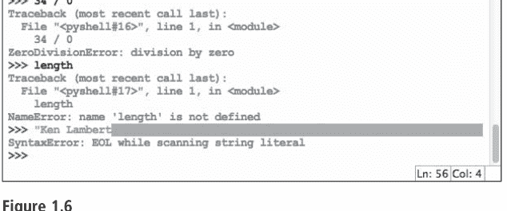

图 1.6
Python 代码中的错误示例。
© 2014 Python Software Foundation.

你的代码中可能出现三种类型的错误：

- **语法错误**——当你的代码不符合 Python 的语法或语法规则时，就会发生这些错误。例如，表达式 `abs(-34)` 在语法上是正确的，但表达式 `abs(-34))` 不是。（它包含一个多余的右括号。）
- **语义错误**——当语法正确的表达式被求值时，但 Python 无法执行该求值，就会发生这些错误。例如，Python 不能将一个数除以零，不能计算负数的平方根，也不能使用尚未赋值的变量，即使你可以在 shell 中输入每个这样的表达式而不会出现语法错误。
- **逻辑错误**——也称为 *设计错误*，这些错误发生在 Python 成功求值一个表达式时，但表达式返回了错误的结果。例如，表达式 `math.pi * 34 ** 2` 确实会返回一个值，但如果你期望该值是半径为 34 的球体的体积，则你的代码包含逻辑或设计错误。

Python 会自动检测语法和语义错误并显示错误消息。然而，你必须通过测试和检查代码的结果自行检测逻辑或设计错误。在高级软件开发环境中，程序员也可以使用软件工具来自动化部分测试。

总之，你应该友好地看待错误消息并学习理解它们的含义。随着你成为一名熟练的程序员，你的代码中语法和语义错误会很少，因此你可以把注意力转向消除任何逻辑错误。

## 使用字符串

文本处理在计算中的普及程度几乎与数值处理相当。没有它，即时消息、短信和文字处理是不可能的。在本节中，你将探索使用字符串，它构成了文本处理的基础。

### 字符串字面量

*字符串* 是 *字符* 的序列。字符集包括你在键盘上看到的所有字母、数字和标点符号，以及命令或控制字符，还有许多其他在键盘上不出现的字符（如阿拉伯语、中文、希腊语、日语、俄语和大多数其他语言中使用的字符）。在 Python 中，*字符串字面量* 表示为用引号括起来的字符序列，如图 1.7 中的 shell 会话所示。

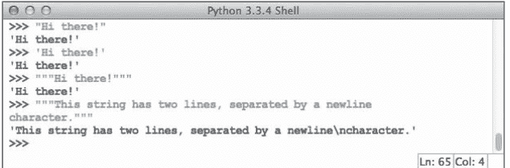

图 1.7
Python 中字符串的示例。
© 2014 Python Software Foundation.

请注意，你可以使用单引号对、双引号对，或三单引号或三双引号对。用单引号或双引号括起来的字符串不能延伸到下一行代码。用三引号括起来的字符串可以延伸到多行代码，但换行符会被包含为这些字符串内的字符。

还请注意，与数字一样，字符串求值时等于自身，但结果以单引号显示。

如果你想在字符串中嵌入引号，可以在嵌入的引号前立即放置转义字符 \。转义字符也用于在字符串中嵌入特殊字符，例如 Tab 和 Return 字符。表 1.3 列出了一些转义字符及其含义。

### 表 1.3 一些转义字符

| 字符 | 含义 |
|---|---|
| \n | 换行符 (Return 或 Enter) |
| \t | 水平制表符 |
| \\ | \ |
| \' | ' |
| \" | " |

奇怪的是，用 "" 表示的空字符串仍然是一个字符串，即使它不包含任何字符。

### len、str、int 和 float 函数

字符串的长度是其包含的字符数。len 函数允许你查找其字符串参数的长度，如下一个 shell 会话所示：

```
>>> len("")
0
>>> len("Here are four words.")
20
```

请注意，空字符串不包含任何字符，而空格计为一个字符。

str 函数将其参数转换为字符串表示形式。对于数字而言，str 的效果是将数字用引号括起来。str 函数通常用于从其他类型的数据值（如数字）构建文本。

int 和 float 函数用于从字符串构建数字。请注意，数字字符串看起来与包含相同数字序列的数字差别不大，但从 Python 的角度来看，它们是两种非常不同的数据类型。下面的 shell 会话说明了这种差异并展示了一些 int 和 float 函数的用法：

```
>>> 34 + 22
56
>>> "34" + "22"
'3422'
>>> "34" + 22
Traceback (most recent call last):
  File "<pyshell#10>", line 1, in <module>
    "34" + 22
TypeError: Can't convert 'int' object to str implicitly
>>> str(22)
'22'
>>> "34" + str(22)
'3422'
>>> int("34")
34
>>> int("34") + 22
56
>>> int(3.6)
3
>>> float(3)
3.0
```

请注意，int 函数不会将浮点数四舍五入到最接近的整数，而是截断或移除其小数部分。

### 输入和输出函数

计算机程序通常接收输入数据，对其进行处理并输出结果。在迄今为止你看到的程序片段中，输入是表达式中的操作数或函数的参数，而输出是返回的值。当程序不是从 Python shell 运行而是从系统终端运行时，需要单独的输入和输出操作来为程序提供数据并显示其结果。对于基于文本的终端程序，Python 提供了两个名为 input 和 print 的函数用于此目的。虽然你在本书中将很少编写此类程序，但在“沙箱模式”下在这里尝试 Python 的 input 和 print 函数仍然是个好主意。

### 使用 print 函数输出

print 函数期望零个或多个参数。它计算这些参数并将其值转换为字符串，用单个空格将它们构建成一个新字符串，并将该字符串作为单行文本显示。换行符也会自动显示。下一个 shell 会话展示了 print 函数使用的一些示例：

```
>>> print()
>>> print("Hello there!")
Hello there!
>>> print("Text followed by a blank line\n")
Text followed by a blank line
>>> print("Four uses the digit", 4)
Four uses the digit 4
```

请注意，print 的效果是去掉每个字符串周围的引号。

### 使用 input 函数输入

input 函数期望一个可选的字符串作为参数。如果提供了字符串，函数会将其作为输入值的提示显示出来并等待用户输入一些按键。当用户按下 Return 或 Enter 键时，函数会构建并

返回一个包含这些键盘字符的字符串。下一个 shell 会话展示了 input 函数的一些用法：

```
>>> input("Enter the radius: ")
Enter the radius: 7.55
'7.55'
>>> input("Press return to quit: ")
Press return to quit:
''
>>> name = input("Enter your name: ")
Enter your name: Ken Lambert
>>> name
'Ken Lambert'
```

请注意，输入的最小情况是当用户按下 Return 或 Enter 键时，这会产生空字符串。

当用户为数字输入一串数字时，程序员必须在进一步计算中使用该数字之前，对该字符串运行 int 或 float 函数。下面是一个示例，它输入矩形的长度和宽度并输出其面积：

```
>>> width = int(input("Enter the width: "))
Enter the width: 34
>>> length = int(input("Enter the length: "))
Enter the length: 22
>>> print("The area is", width * length)
The area is 748
```

## 索引、切片和拼接

字符串是数据结构，这意味着它们包含其他数据在其中。数据结构提供用于从组件部分构造新数据的操作，以及在数据构造后访问这些部分的操作。字符串中包含的部分是其字符，而字符本身也是其他（单字符）字符串。因此，你应该能够从现有字符串构建新字符串，并能够访问字符串内的任何字符或字符序列。

当你在代码中输入字符串字面量时，Python 会自动构建一个新的字符串。你也可以通过运行拼接运算符 + 从现有字符串构建新字符串。下一个 shell 会话展示了一些字符串拼接的示例。

```
>>> "Ken" + "Lambert"
'KenLambert'
>>> "Ken" + " " + "Lambert"
'Ken Lambert'
>>> "" + "Not empty"
'Not empty'
>>> text = ""
>>> text = text + "Not empty"
>>> text
'Not empty'
```

拼接运算符只是简单地将两个字符串粘合在一起形成一个新字符串。请注意，本会话中的最后一次赋值显示，赋值与数学中的等式不是同一回事。新的字符串是从 = 运算符右侧的旧字符串构建的，然后变量 text 被重置为这个新字符串。Python 有一个不同的运算符，==，用于比较两个值是否相等，将在后面探讨。

最基本的字符串访问操作是索引或下标。此操作给出字符串中给定位置的字符。字符串中的每个字符都有确定的位置。这些位置从零开始，即第一个字符的位置，到字符串长度减一，即最后一个字符的位置。此操作的形式如下：

```
aString[anIntegerIndexPosition]
```

紧跟在字符串后面的方括号中的整数也称为下标，而 [] 运算符称为下标运算符。下面是一个包含一些示例下标操作的 shell 会话：

```
>>> name = "Ken Lambert"
>>> name
'Ken Lambert'
>>> name[0]
'K'
>>> name[len(name) - 1]
't'
>>> name[len(name)]
Traceback (most recent call last):
    File "<pyshell#13>", line 1, in <module>
    name[len(name)]
IndexError: string index out of range
```

最后一行的错误是由于给出了超出字符串位置序列的索引位置。允许使用负索引值，从 -1（最后一个位置）计数到字符串长度的负数（第一个位置）。

切片操作与索引操作类似，但给出了一系列位置，并返回一个字符子串。此操作的形式为

```
aString[lowerBound:upperBound]
```

其中 *lowerBound* 和 *upperBound* 是可选的整数值。下面是一些对字符串进行切片的示例：

```
>>> name = "Ken Lambert"
>>> name[:]
'Ken Lambert'
>>> name[0:]
'Ken Lambert'
>>> name[:len(name)]
'Ken Lambert'
>>> name[4:8]
'Lamb'
>>> name[4:]
'Lambert'
```

如你所见，当下界被省略时，子串从字符串中的第一个字符开始；当上界被省略时，子串以字符串中的最后一个字符结束。否则，子串从下界位置的字符开始，以上界位置减一的字符结束。

请注意，切片、索引和拼接不会修改现有字符串的内容，因为你在构造它们之后无法修改字符串。

## 字符串方法

当你在 shell 中运行 `dir(str)` 时，你会看到所有的字符串操作。它们被称为 *methods*。请注意，此列表开头的这些方法名称包含下划线。这些方法与运算符如 + 和 [] 相关联。当 Python 看到与字符串一起使用的运算符时，它会查找相应的方法并使用适当的 arguments 调用它。

一个方法就像一个函数，但调用协议略有不同。当你在字符串上运行一个方法时，字符串写在前面，后跟一个点，后跟方法名及其任何参数，如下所示：

```
aString.methodName(argumentSequence)
```

以下是一些字符串方法的使用示例：

```
>>> "Ken Lambert".upper()
'KEN LAMBERT'
>>> "Ken Lambert".startswith('L')
False
>>> "44".isnumeric()
True
>>> "Ken Lambert".index('L')
4
>>> "Ken Lambert".split()
['Ken', 'Lambert']
```

你应该能够仅通过检查结果就知道这些操作的作用。但如果你不确定其中任何一个，请在 shell 中输入 help(str.methodName) 来寻求帮助。

## 使用列表

人们出于许多不同的目的制作和使用事物列表，例如音乐播放列表或购物愿望清单。在编程中，你可以创建和处理数字、字符串或任何其他数据值的列表。在本节中，你将探索 Python 中列表的使用。

### 列表字面量和运算符

列表是一系列称为项的数据值。项可以是任何数据值。像字符串中的字符一样，列表中的项按位置排序，从 0 开始计数。在 Python 中，列表字面量表示为由逗号分隔的项序列。项序列用方括号括起来，如下一个 shell 会话所示。

```
>>> [34, 46, 22]
[34, 46, 22]
>>> emptyList = []
>>> len(emptyList)
0
>>> item1 = 34
>>> item2 = "Ken"
>>> listOfTwoItems = [item1, item2]
>>> listOfTwoItems
[34, 'Ken']
>>> listOfLists = [listOfTwoItems, emptyList]
>>> listOfLists
[[34, 'Ken'], []]
```

关于这些列表需要注意以下几点：

- 空列表，[]，不包含任何项，其长度为 0。
- 列表可以包含其他数据结构，例如字符串和列表。
- 当列表中的一项是变量时，列表实际上包含该变量的值。这种构建列表的技术称为 *pattern matching*。
- 若干变量可以引用同一个列表。

列表通常支持与字符串相同的运算符。因此，你可以用 + 拼接两个列表，用 [] 访问索引位置的项，并用 [:] 获取列表的切片。在拼接和切片操作的情况下，结果始终是其他列表。

然而，与字符串不同，列表在创建后可以被修改。你可以替换给定位置的项，将它们添加到现有列表中，或从现有列表中删除它们。你通过将列表下标放在赋值语句的左侧来替换给定列表位置的项，如以下 shell 会话所示：

```
>>> fruits = ["oranges", "bananas", "apples"]
>>> fruits
['oranges', 'bananas', 'apples']
>>> fruits[1] = "cherries"
>>> fruits
['oranges', 'cherries', 'apples']
```

请注意，整数索引必须从列表长度的负数到列表长度减一的范围内。有许多其他方法可以修改列表，其中一些将在下面考虑。

### 列表方法

如果你在 shell 中运行 dir(list)，你会看到所有列表方法。其中一些是 *index based*，意味着它们期望一个整数索引位置作为参数。例如，方法 insert 和 pop 用于在给定位置添加和删除项，如下所示：

```
>>> fruits
['oranges', 'cherries', 'apples']
>>> fruits.insert(1, "peaches")
>>> fruits
['oranges', 'peaches', 'cherries', 'apples']
>>> fruits.pop(0)
'oranges'
>>> fruits
['peaches', 'cherries', 'apples']
>>> fruits.pop()
'apples'
>>> fruits
['peaches', 'cherries']
```


insert 方法总是将一个项目插入到给定索引之前，同时将某些项目向右移动一个位置。pop 方法移除给定索引处的项目，然后将某些项目向左移动一个位置。请注意，当省略索引时，pop 方法会移除列表中的最后一个项目。

其他列表方法基于内容，意味着它们针对的是项目本身而不是列表中的位置。例如，append 方法将给定项目添加到列表末尾，而 remove 方法则从列表中移除给定项目的第一个实例。以下 shell 会话演示了这些操作：

```
>>> fruits
['oranges', 'bananas', 'apples']
>>> fruits.append("grapes")
>>> fruits
['oranges', 'bananas', 'apples', 'grapes']
>>> fruits.remove("bananas")
>>> fruits
['oranges', 'apples', 'grapes']
```

请注意，传递给 remove 方法的项目必须已存在于列表中。

尽管列表中的项目始终按位置排序，但它们可能不是按字母顺序排列（如果是字符串）或按升序或降序排列（如果是数字）。将列表项目重新排列成这种顺序称为排序。排序是一个复杂的过程，但列表方法 sort 使其变得简单，如下所示：

```
>>> fruits
['oranges', 'peaches', 'cherries', 'apples']
>>> fruits.sort()
>>> fruits
['apples', 'cherries', 'oranges', 'peaches']
>>> grades
[77, 100, 85, 92]
>>> grades.sort()
>>> grades
[77, 85, 92, 100]
>>> grades.reverse()
>>> grades
[100, 92, 85, 77]
```

请注意，sort 和 reverse 方法按顺序使用以将列表项目置于降序。

表 1.4 总结了一些常用的列表操作，其中变量 L 指代一个列表。

表 1.4 常用列表操作

| 列表操作 | 其作用 |
|---|---|
| `len(L)` | 返回列表中当前项目的数量。 |
| `L[index]` | 返回列表中整数位置 `index` 处的项目。注意：不要使用小于 0 或大于等于列表长度的 `index`。 |
| `L[index] = item` | 用 `item` 替换列表中整数位置 `index` 处的项目。注意：不要使用小于 0 或大于等于列表长度的 `index`。 |
| `L.append(item)` | 将 `item` 添加到列表末尾。 |
| `L.count(item)` | 返回列表中 `item` 的出现次数。 |
| `L.index(item)` | 返回列表中 `item` 第一次出现的位置，如果 `item` 不存在则引发异常。 |
| `L.insert(index, item)` | 在位置 `index` 插入 `item`，如有必要将其他项目向右移动一个位置。 |
| `L.pop(index)` | 移除位置 `index` 处的项目，如有必要将其他项目向左移动一个位置。如果未提供 `index`，则移除列表末尾的项目。 |
| `L.remove(item)` | 移除列表中 `item` 的第一个实例，如果 `item` 不存在则引发异常。 |

## 从其他序列创建列表

有时你想从另一个序列（如字符串或其他列表）构建一个新列表。最简单的方法是将该序列作为参数提供给 list 函数，如下所示：

```
>>> characters = list("Ken Lambert")
>>> characters
['K', 'e', 'n', ' ', 'L', 'a', 'm', 'b', 'e', 'r', 't']
>>> myCopy = list(characters)
>>> myCopy
['K', 'e', 'n', ' ', 'L', 'a', 'm', 'b', 'e', 'r', 't']
```

第一个赋值创建了一个包含字符串中字符的列表。第二个赋值创建了该列表的副本。

从字符串构建列表的另一种常见方法是使用字符串方法 split。此方法返回字符串中单词的列表，其中空格字符是单词之间的分隔符。原始字符串可以通过运行字符串方法 join 并将单词列表作为参数来重建。以下是示例：

```
>>> words = "Ken Lambert".split()
>>> words
['Ken', 'Lambert']
>>> " ".join(words)
'Ken Lambert'
```

最后，要从一系列数字创建列表，你使用 Python 的 range 函数创建范围并将此结果传递给 list 函数。

以下是一些示例：

```
>>> numbers = list(range(15))
>>> numbers
[0, 1, 2, 3, 4, 5, 6, 7, 8, 9, 10, 11, 12, 13, 14]
>>> oneThroughFifteen = list(range(1, 16))
>>> oneThroughFifteen
[1, 2, 3, 4, 5, 6, 7, 8, 9, 10, 11, 12, 13, 14, 15]
>>> fifteenThroughOne = list(range(15, 0, -1))
>>> fifteenThroughOne
[15, 14, 13, 12, 11, 10, 9, 8, 7, 6, 5, 4, 3, 2, 1]
```

当 range 接收单个整数参数时，它返回从 0 到该整数减一的数字范围。当 range 接收两个整数参数时，它返回从第一个整数到第二个整数减一的范围。当 range 接收三个整数参数时，它返回从第一个整数到第二个整数减一的范围，但第三个整数的值用于计数范围中整数之间的间隔。因此，如示例中所示，要向下计数而不是向上计数，第一个整数必须大于第二个整数，并且第三个整数必须为负数。

## 列表与 random 模块

整数集也是一个序列，这使你能够将其他集合，如字符集和列表或字符串中的位置集，作为序列来处理。你已经看到，即使列表或字符串中的项目按顺序排列，它们也可能以随机（未排序）的顺序排列。在许多应用中，你可能希望以随机顺序排列列表中的一组项目，或从随机位置选择一个项目。 （想想洗一副新牌或从一碗乒乓球中挑选一个随机乒乓球。）Python 的 random 模块包含一些允许你使用列表执行这些任务的函数。两个最常用的函数是 random.shuffle 和 random.choice。以下是这两个函数的一些用法：

```
>>> import random
>>> numbers = list(range(1, 16))
>>> numbers
[1, 2, 3, 4, 5, 6, 7, 8, 9, 10, 11, 12, 13, 14, 15]
>>> random.shuffle(numbers)
>>> numbers
[6, 11, 1, 12, 3, 10, 13, 4, 5, 15, 2, 7, 9, 8, 14]
>>> random.choice(numbers)
13
>>> random.choice(numbers)
8
>>> coin = ["heads", "tails"]
>>> random.choice(coin)
'heads'
>>> random.choice(coin)
'heads'
>>> random.choice(coin)
'tails'
```

## 元组作为不可变列表

你之前看到字符串是不可变的，意味着其内容和结构在创建后不能更改。你还看到列表是可变的，意味着你可以通过替换、插入和移除来更改其内容和结构。尽管列表是可变的，有时你想要创建类似列表但也是不可变的项目序列。在 Python 中，称为元组的数据结构满足这一需求。

元组看起来就像列表，但使用圆括号而不是方括号来包含其项目。元组是通过将其作为字面量提及（可能嵌入变量）或通过在另一个序列（如列表、字符串或数字范围）上运行 tuple 函数来创建的。通常的运算符具有预期的结果，但带有下标的元组不能出现在赋值的左侧。下一个 shell 会话显示了一些示例：

```
>>> pair = (1, 2)
>>> triple = (3, 4, 5)
>>> len(triple)
3
>>> triple[2]
5
>>> triple[1:]
(4, 5)
>>> pair + triple
(1, 2, 3, 4, 5)
>>> tuple(range(15))
(0, 1, 2, 3, 4, 5, 6, 7, 8, 9, 10, 11, 12, 13, 14)
>>> tuple("Ken Lambert".split())
('Ken', 'Lambert')
```

## 使用字典

列表和元组是序列。它们非常适合于项目必须按位置排序的应用。另一种称为字典的数据结构不按位置排序其项目。相反，字典将每个项目与一个称为键的唯一值关联。例如，当你听到母亲和父亲这两个词时，很可能会立即在脑海中浮现出你母亲和父亲的形象。从粗略的角度来看，你的思维或记忆就像一个大字典，其中每个项目或想法都与一个唯一的键相关联，允许你访问它。在本节中，你将探索使用 Python 字典来模拟这种类型的内存存储。

### 字典字面量

字典是一组键/值对。在 Python 字典中，键必须是唯一的，但值可以重复。键必须是不可变值，例如数字或字符串。值可以是任何 Python 数据对象，甚至是函数或方法。

字典字面量由大括号 {} 组成，其中包含键/值对序列。逗号分隔这些对。在每个对中，冒号出现在键和值之间。下一个 shell 会话显示了一些示例字典：

```
>>> {}
{}
>>> kenInfo = {"name":"Ken", "hair-color":"gray", "age":63}
```

>>> kenInfo
{'hair-color': 'gray', 'name': 'Ken', 'age': 63}
>>> list(kenInfo.keys())
['hair-color', 'name', 'age']
>>> list(kenInfo.values())
['gray', 'Ken', 63]
>>> list(kenInfo.items())
[('hair-color', 'gray'), ('name', 'Ken'), ('age', 63)]
>>> elvisInfo=dict([("name", "Elvis"), ("hair-color", "black"), ("age", 22)])
>>> elvisInfo
{'hair-color': 'black', 'name': 'Elvis', 'age': 22}

### 字典方法与运算符

请注意使用 keys、values 和 items 方法分别提取字典的键、值和键/值对。与其他数据结构类似，字典是在将其作为字面量提及时创建的，或在运行 dict 函数并传入适当的参数时创建的——在本例中为一个元组列表。len 函数返回字典中键的数量，但 + 运算符未定义。

存在两种基本访问操作。其中一种操作只是将目标键放在下标运算符中，如下所示：

```
>>> elvisInfo["name"]
'Elvis'
```

并且返回与该键关联的值。然而，如果键不存在，Python 会显示错误信息。为避免该潜在问题，你可以在字典上运行 get 方法，并传入假设的键以及在找不到该键时返回的默认值，如下所示：

```
>>> elvisInfo.get("weight", None)
None
```

pop 方法与 get 类似，期望两个参数：一个键和在键不存在时返回的默认值。如果键存在，Python 会移除该键及其关联的值并返回该值；否则返回默认值。

当下标与字典出现在赋值的左侧时，它用作替换或插入操作。以下是示例：

```
>>> ringoInfo = {}
>>> ringoInfo["name"] = "Ringo"
>>> ringoInfo["profession"] = "drummer"
```

```
>>> ringoInfo
{'profession': 'drummer', 'name': 'Ringo'}
>>> ringoInfo["profession"] = "retired"
>>> ringoInfo
{'profession': 'retired', 'name': 'Ringo'}
```

如你所见，前两次赋值首次访问键，因此它们作为插入操作。第三次赋值在给定键处执行值的替换。

表 1.5 总结了一些常用的字典操作，其中变量 D 指代一个字典。

表 1.5 一些常用的字典操作

| 字典操作 | 其作用 |
|---|---|
| len(D) | 返回字典中当前键的数量。 |
| D[key] | 返回字典中 key 处的 value。注意：不要使用不在字典中的键。 |
| D[key] = value | 如果 key 在字典中，则用 value 替换字典中 key 处的 value。否则，将 key 和 value 插入字典。 |
| D.get(key, defaultValue) | 返回 key 处的 value，如果 key 不存在则返回 defaultValue。 |
| D.pop(key, defaultValue) | 移除并返回 key 处的 value，如果 key 不存在则返回 defaultValue。 |

这就结束了你对 Python 基础的介绍。完成本章练习后，你将准备好探索 Python 中的海龟图形编程。

## SUMMARY

- Python shell 提供了一个用于输入 Python 代码、运行它并查看结果的游乐场。
- 基本 Python 数据类型包括整数、浮点数、字符串、列表、元组和字典。
- Python 算术运算符包括加法（+ 和 -）、乘法（*、/ 和 %）和指数运算（**）。
- Python 函数是一种可按名称调用以产生值的操作。当函数被调用时，它可以接收其他数据作为参数用于其计算。
- Python 模块，如 `math` 模块，是可导入以在代码中使用的函数和其他资源的库。这些资源的示例有函数 `math.sqrt` 和常量 `math.pi`。
- `int`、`float` 和 `str` 函数分别用于将数据转换为整数、浮点数和字符串。
- Python 变量是引用数据值的名称。
- 赋值运算符 `=` 用于将变量设置为一个值。
- 数据结构是包含其他数据值的数据。存在用于构造数据结构和访问其组成部分的操作。数据结构的示例有字符串、列表、元组和字典。
- 字符串是由零个或多个字符组成的序列。Python 字符串出现在引号中。
- `+` 运算符将两个字符串粘合在一起构建一个包含它们的新字符串。此操作称为连接。
- `[]` 运算符返回字符串中给定整数索引位置处的字符。
- 当 `:` 出现在运算符内时，`[]` 运算符返回字符串的子串。这称为切片操作。
- 列表是由零个或多个数据值组成的序列。Python 列表中的项出现在方括号中。列表响应 `+` 和 `[]` 运算符，以及插入和移除项的操作。与字符串不同，列表是可变的。
- 元组是由零个或多个数据值组成的序列。Python 元组中的项出现在圆括号中。与列表不同，元组是不可变的。
- 字典是一组键/值对。Python 字典中的项出现在花括号中。字典中的数据不是按位置排序，而是按键排序。
- 对字符串、列表、元组和字典的命名操作称为方法。方法调用由一个数据、随后是一个点、随后是方法名称和带括号的参数列表组成。

## EXERCISES

启动 Python shell 并完成以下练习。

- 1. 输入表达式计算圆的面积、球体的体积和球体的表面积。你应在这些表达式中都使用相同值的变量 `radius`，以及 Python 中最精确的 π 值。
- 2. 输入一条赋值语句，将变量 `name` 设置为你的全名。然后输入一个表达式，使用该变量和切片运算符返回你的姓氏。

本页特意留空

# CHAPTER 2

## 开始使用
海龟图形

Python 的基本代码元素允许你操作数字、文本以及列表和字典等数据结构。然而，现代计算机也大量使用图形，并允许你通过移动鼠标或指向设备直接与图形图像交互。在本章中，你将学习一些基本的 Python 图形操作，使用一个名为海龟图形的子系统。

## LOOKING AT THE TURTLE AND ITS WORLD

海龟图形是在 20 世纪 60 年代末与 Logo 编程语言一起开发的，用于向儿童教授编程。海龟图形允许你通过在计算机显示器上移动图像来模拟海龟机器人的移动。海龟配备了一支笔，可以在移动时绘制线条和形状。

海龟在二维坐标系中有一个位置。在几何学中，二维坐标系由水平 x 轴和垂直 y 轴组成，如图 2.1 所示。

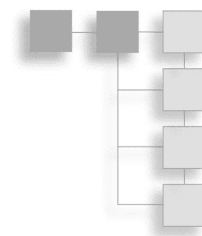

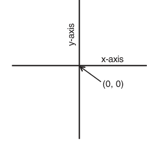

图 2.1
二维坐标系。

该系统的原点或中心点 (0, 0) 位于坐标轴的交点处。任何其他位置 (x, y) 都是相对于原点的。x 值在原点右侧为正，左侧为负。y 值在原点上方为正，下方为负。

你可以使海龟从当前位置向前或向后移动给定距离。此移动的方向由其当前朝向决定。你可以将其朝向向左或向右转动给定度数。你还可以设置海龟笔的颜色和大小，绘制一些基本形状，用颜色填充这些形状，控制海龟的速度，并访问海龟绘图区域的边界。

要在 Python shell 中尝试海龟图形，请像在第 1 章“Getting Started with Python”中那样启动 IDLE。然后在 shell 中运行以下代码片段：

```
>>> from turtle import *
>>> showturtle()
```

你应该会看到一个第二个窗口弹出，如图 2.2 所示。


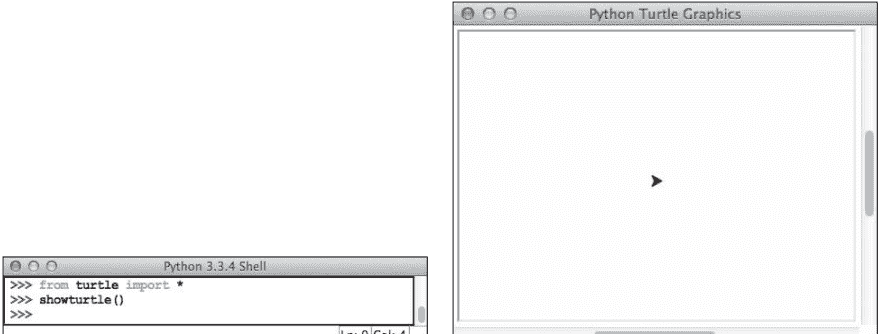

图 2.2

海龟在其窗口中的初始位置。

© 2014 Python Software Foundation.

如果海龟图形窗口过大，你可以用通常的方式调整其大小。请注意，海龟的图像或形状是一个插入符号，其初始朝向为正东，即 0 度。

导入语句使所有海龟图形操作都可作为函数调用运行。showturtle 函数在当前位置显示海龟。海龟的初始位置在坐标系中为 (0, 0)。请注意，该位置也称为初始位置，位于海龟图形窗口的中心。

海龟有多个属性，其初始值列于表 2.1。

表 2.1 海龟的初始设置

| 属性 | 初始值 |
|-----------|---------------|
| fillcolor | "black" |
| heading | 0 度（正东） |
| pencolor | "black" |
| pensize | 1（像素单位） |
| position | (0, 0) |
| shape | "classic"（插入符号） |
| speed | 3（0 最快；10 最慢） |

你应该将 shell 和海龟图形窗口并排放置在计算机显示器上，如图 2.2 所示。然后你可以在 shell 中输入命令，并在另一个窗口中查看结果。

你可能会想知道为什么看到的是插入符号而不是海龟的图像。如果你更喜欢看到海龟，可以更改海龟的形状。为此，返回到 shell 并输入命令 shape("turtle")。新形状如图 2.3 所示。

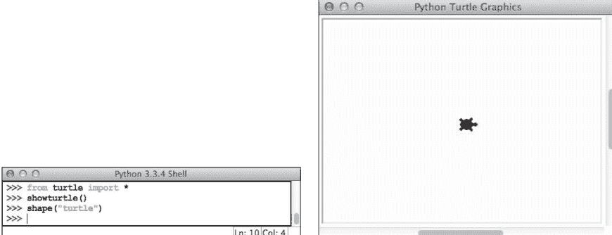

图 2.3
更改海龟的形状。
© 2014 Python Software Foundation.

当你完成一次海龟图形会话时，可以通过关闭海龟图形窗口然后关闭 shell 窗口来退出。

在阅读本章的其余部分时，请确保你能够访问 Python 网站上的海龟图形文档。海龟模块文档位于 Python 文档的 Global Modules Index 中（http://docs.python.org/3/library/turtle.html#module-turtle）。附录 A，“Turtle Graphics Commands，”也记录了常用的海龟图形操作。

## 使用基本移动操作

在本节中，你将继续上一节中显示海龟后的工作。你将学习各种移动海龟以绘制一些几何形状的方法。

### 移动和改变方向

在 shell 中运行以下命令后，结果应如图所示 2.4 所示：

```
>>> left(45)
>>> forward(64)
>>> position()
(45.25,45.25)
>>> heading()
45.0
```

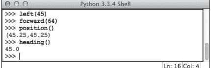

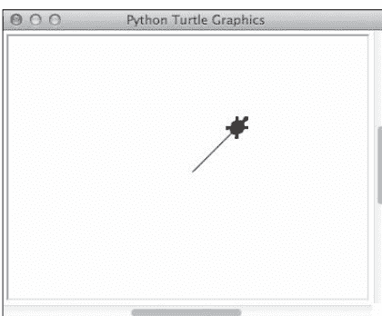

图 2.4
海龟转向并移动到新位置。
© 2014 Python Software Foundation.

请注意，将海龟向左转会使其逆时针旋转给定度数。当你沿当前方向移动 64 个单位时，海龟的笔会绘制一条线段，终点位于位置 (45.25, 45.25)。大多数海龟图形函数要么指示海龟执行操作，要么返回其当前状态的信息。

现在，你可能会问自己，“为什么我的 Python 代码中没有提到海龟？为什么我不必像在第 1 章中对数字和其他数据那样将海龟数据作为参数传递给这些函数？”

开始使用海龟图形的好处是，你只需运行基本函数而无需担心这些问题。Python 会在幕后将这些命令定向到单个“系统”海龟。当你在本书后面开始使用多个海龟时，你将学习如何识别它们以便分别操作它们。

在任何时候，如果你想清除海龟的所有绘图并将其返回到初始位置和朝向，只需调用 reset 函数即可。

当你启动海龟图形时，海龟的笔最初放在画布上，准备绘制线条和形状。你可以通过分别调用 up 和 down 函数来抬起笔和放下笔。当笔抬起时，你可以移动海龟而不绘制任何内容。

### 绘制正方形

基本海龟移动函数列于表 2.2。

**表 2.2 海龟移动函数**

| 函数 | 功能 |
|---|---|
| `backward(distance)` | 在其当前方向的相反方向移动海龟给定距离 |
| `forward(distance)` | 在其当前方向移动海龟给定距离 |
| `goto(x, y)` | 将海龟移动到位置 (x, y) |
| `home()` | 将海龟移动到位置 (0, 0) 并将其朝向设置为 0 度 |
| `left(degrees)` | 使海龟逆时针转给定度数 |
| `right(degrees)` | 使海龟顺时针转给定度数 |
| `setheading(degrees)` | 将海龟的朝向设置为度数 |

这些函数还有几个同义词，你可以在文档中查找。请注意，函数 forward、backward、left 和 right 相对于海龟的当前位置或朝向调整海龟的位置或朝向。相比之下，函数 goto、home 和 setheading 直接重置海龟的位置或朝向。

为了探索这些操作中的一些，你将研究用海龟绘制边长为 70 的正方形的两种方法。假设该正方形的左下角位于初始位置。所需结果如图 2.5 所示。

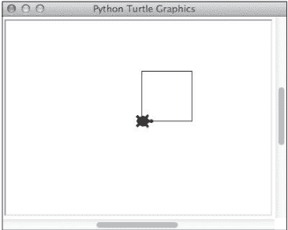

图 2.5
绘制正方形。
© 2014 Python Software Foundation.

第一种方法使用 reset、forward 和 left 函数。reset 函数将海龟定位在正方形的左下角，朝向东。现在想象你就是海龟，站在绘图区域上朝向东。你会向前走 70 个单位，向左转 90 度，再次向前走，然后再次向左转。你会再执行这两次步骤两次，直到回到初始位置。以下是描述此过程并在海龟图形中执行的代码：

```
>>> reset()
>>> forward(70)
>>> left(90)
>>> forward(70)
>>> left(90)
>>> forward(70)
>>> left(90)
>>> forward(70)
>>> left(90)
```

请注意，最后一次调用 left 函数对于完成绘图并非必要，但它使海龟的朝向与过程开始时相同。

第二种方法使用 goto 函数在正方形的四个角之间绘制线段。为此，你必须先计算出四个角的位置。它们是 (0, 0)、(70, 0)、(70, 70) 和 (0, 70)。这些坐标提供了绘制正方形所需的四次 goto 调用的参数，如下所示：

```
>>> reset()
>>> goto(70, 0)
>>> goto(70, 70)
>>> goto(0, 70)
>>> goto(0, 0)
```

请注意，`goto` 不会改变海龟的朝向。

哪种方法对你来说更容易、更直接？第一种方法可能需要更少的脑力；除了知道正方形的每个角包含 90 度角外，你只需知道边的数量和边的长度。第二种方法迫使你在事先计算所有角的坐标。此外，如果下次绘制正方形时想改变其长度，在第一种方法中你只需更改一个值：正方形的长度。有时你会想使用 `goto`，但这不是其中之一。

### 绘制等边三角形

现在考虑绘制一个等边三角形。在这种类型的三角形中，所有边长度相同，每个顶点形成 60 度的内角。如果假设长度为 70 个单位，左most 顶点位于原点，顶部顶点位于 x 轴上方，则三角形如图 2.6 所示。

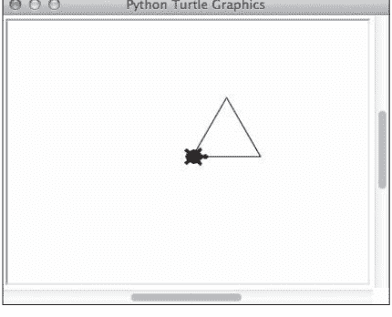

图 2.6
绘制等边三角形。
© 2014 Python Software Foundation.

你会如何绘制这个三角形？三角形的每个顶点包含 60 度的角。因此，遵循绘制正方形的首选方法，如果让海龟向前移动 70 个单位并向左转 60 度三次，应该就可以了，对吧？不幸的是，图 2.7 所示的结果并不完全理想。


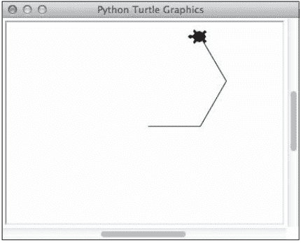

图 2.7
绘制等边三角形的失败尝试。
© 2014 Python Software Foundation.

这是一个逻辑或设计错误的良好示例。你本意是通过左转 60 度来创建 60 度的内角，但实际上得到的内角是 120 度。要得到正确的结果，每次需要转得更远，正好 120 度。回想一下，绘制正方形需要四次左转，每次 90 度，总共 360 度。海龟在绘制等边三角形一周时转动的总度数也是 360 度（每次转 120 度，共 3 次）。你将在练习中利用这一关于海龟几何的事实来绘制其他几何形状。

## 撤销、清除和重置

当你编辑文本文件时，编辑菜单通常提供“撤销键入”选项。当你选择此选项时，编辑器会删除你最近输入的单词或短语。类似地，海龟绘图会跟踪你输入的所有命令，并允许你通过调用 `undo` 函数来撤销最近的命令。因此，如果你不喜欢结果，可以通过输入一个或多个 `undo` 命令来稍微回退，而不必清除画布。

如果你完全不喜欢结果，或者只是想清除绘图并重新开始，可以调用 `clear` 或 `reset`。这两个函数都会擦除画布上的所有绘图。然而，`clear` 会保留海龟当前的所有设置（位置、朝向、颜色和笔大小），而 `reset` 则会恢复海龟的初始设置。

## 设置和检查海龟的状态

你已经看到，当海龟图形窗口打开时，海龟有一些初始设置：位置、朝向和笔颜色。这些以及其他各种值被称为海龟的状态。海龟函数要么改变海龟的状态，要么允许你检查它。在本节中，你将探索海龟状态的另外三个方面：笔大小、形状和速度。

### 笔大小

海龟的笔通过在各个位置绘制微小的彩色方块来画线。这些方块称为像素。如果你的显示器分辨率很高，这些像素非常小，因此绘制的线条看起来很细。这对于精细工作来说是可以的，但如果你想绘制更粗的线条，可能需要增大笔的大小。为此，你调用 pensize 函数，并将新的笔大小作为整数参数传入。例如，表达式 pensize(4) 将笔的大小设置为 4 像素。要查询当前笔大小，你调用 pensize()。

### 形状

正如你之前看到的，海龟的形状最初是一个插入符号。你可以将海龟的形状更改为海龟绘图提供的任何内置形状，也可以添加自己的新形状。表 2.3 列出了标准海龟形状的名称和图标。函数 getshapes 返回可用形状名称的列表。

表 2.3 内置海龟形状及其名称

| 名称 | 形状 |
|------|-------|
| "arrow" | ▶ |
| "blank" | 无可见形状。 |
| "circle" | ● |
| "classic" | ► |
| "square" | ■ |
| "triangle" | ▶ |
| "turtle" | 🐢 |

要更改海龟的形状，只需调用 shape 函数，并将期望的形状名称作为字符串参数传入。例如，表达式 shape("turtle") 将海龟的形状更改为海龟。不带参数调用 shape 会返回海龟当前形状名称。如果你不想看到海龟的形状，只需调用 hideturtle() 或将其形状更改为 "blank"。

函数 addshape 将新形状添加到海龟绘图中已有的形状集合中。只要新形状的文件为 GIF 格式，你就可以使用自己创建的图像。然后你将该文件名作为参数传递给 addshape。例如，如果你想让海龟的形状为三叉戟，即华盛顿和李大学的标志，你运行以下代码。结果如图 2.8 所示。

```
>>> addshape("trident.gif")
>>> getshapes()
['arrow', 'blank', 'circle', 'classic', 'square', 'triangle',
 'trident.gif', 'turtle']
>>> shape("trident.gif")
```

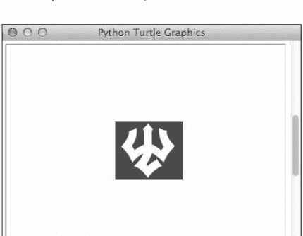

图 2.8
将海龟的形状更改为三叉戟。
© 2014 Python Software Foundation.

Python 会在当前工作目录中查找形状的文件。如果文件在其他位置，你必须提供其完整路径名。如果你想找到当前工作目录的路径名，运行以下代码：

```
>>> import os
>>> os.getcwd()
'/Users/ken/Documents'
```

请注意，返回的字符串是我计算机上 Documents 文件夹的路径名。如果我把形状的文件放在那个文件夹中，Python 只需文件名就能找到它。

你也可以使用 Python 的 shape 和 poly 函数为海龟创建自己的形状。详情请查阅文档。

### 速度

你可以看到海龟在绘制线条时移动。如果海龟移动太慢，你可能会不耐烦，但如果它移动太快，你可能无法观察其移动。函数 speed 允许你将海龟的速度设置为满意的程度。speed 的参数可以是整数或字符串。整数范围从 0 到 10，其中 0 为最快速度。其他整数会降低速度，从 10 降到 1。海龟的初始速度为 3。表 2.4 列出了可用的速度字符串及其对应的整数。像往常一样，不带参数调用该函数会返回当前速度。

表 2.4 海龟速度值（字符串和整数）

| 字符串 | 整数 |
|---|---|
| "fastest" | 0 |
| "fast" | 10 |
| "normal" | 6 |
| "slow" | 3 |
| "slowest" | 1 |

### 有关海龟状态的其他信息

正如你所见，当你不带参数调用 pensize、shape 和 speed 函数时，这些函数会返回这些设置的当前值。你可以通过调用适当的函数来获取海龟状态的任何方面的信息。例如，尝试调用 position、heading、isdown 和 isvisible 函数。你将在本书后面的海龟图形应用中使用这些信息。

## 使用颜色

彩色显示器支持显示明亮而美丽的绘图和图像。尽管海龟的初始颜色为黑色，画布颜色为白色，但你可以将这些颜色重置为系统支持的任何颜色。

### 笔颜色和背景颜色

更改笔颜色最简单的方法是使用字符串参数调用 `pencolor` 函数。示例字符串是常见颜色的名称，例如 "red" 或 "green"。你可以通过类似的方式调用 `bgcolor` 函数来更改画布的颜色。图 2.9 显示了在更改初始笔和背景颜色后，在黑色背景上绘制的白色正方形。

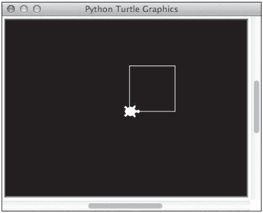

图 2.9
用白色笔在黑色背景上绘图。
© 2014 Python Software Foundation.

请注意，当你更改笔颜色时，海龟的形状也会采用该颜色。现代计算机系统上还有数百万种其他颜色可用。要使用这些颜色，你需要了解计算机如何表示颜色。

### 计算机如何表示颜色

计算机中使用的所有数据最终都以数字表示。整数和浮点数是明显的例子。字符串中包含的字符被转换为在计算机内部存储和操作的整数值。颜色也不例外。你所看到的基本颜色的每一种色调以及所有混合色，在存储和处理之前必须由扫描仪和相机等输入设备转换为数字。在颜色在显示器上显示之前，计算机必须将这些数字转换回你所看到的颜色。

在各种表示颜色的方案中，RGB 系统是相当常见的一种。这些字母代表红色、绿色和蓝色这三种人类视网膜敏感的颜色分量。这些分量混合形成唯一的颜色值。自然地，计算机将这些值表示为整数。颜色分量可以是 0 到 255 之间的任意整数。值 255 表示给定颜色分量的最大强度，而值 0 表示该分量的完全缺失。RGB 值 (0, 0, 0) 为黑色，RGB 值 (255, 255, 255) 为白色。表 2.5 列出了一些示例颜色及其 RGB 值。

表 2.5 一些颜色及其 RGB 值

| 颜色 | RGB 值 |
|-------|-----------|
| "black" | (0, 0, 0) |
| "red" | (255, 0, 0) |
| "green" | (0, 255, 0) |
| "blue" | (0, 0, 255) |
| "yellow" | (255, 255, 0) |
| "gray" | (127, 127, 127) |
| "white" | (255, 255, 255) |

在 Python 中，RGB 值表示为元组 (r, g, b)。该系统中共有 256³ 或 16,777,216 种不同的颜色——多到人类眼睛无法区分许多相邻的值。要将笔颜色或背景颜色设置为 RGB 值，首先必须通过调用 colormode(255) 将海龟的颜色模式设置为 255。然后你可以用三个整数参数或一个包含三个整数的元组调用 pencolor 或 bgcolor。例如，pencolor(127, 0, 0) 将笔颜色设置为酒红色。

有关颜色的更多信息，请参阅 PageTutor 的 ColorPicker 网站，网址为 www.pagetutor.com/colorpicker/index.html。


## 填充形状

早些时候你已经看到如何用海龟绘制正方形。假设你想要绘制的不仅仅是正方形的轮廓，而是一个填充了指定颜色的正方形。海龟图形通过使用 fillcolor、begin_fill 和 end_fill 函数来实现这一点。

你首先设置形状的填充颜色。fillcolor 函数使用颜色参数来完成此操作，如前一节所述。初始填充颜色为黑色。请注意，当你设置填充颜色时，此颜色也会填充海龟的形状。

然后你调用 begin_fill 函数，后面跟着绘制正方形的命令。最后，你调用 end_fill 函数，它告诉海龟图形填充自上次调用 begin_fill 以来绘制的任何可填充形状。下一个会话绘制一个边长为 70 的填充正方形，轮廓为黑色，内部为红色。结果如图 2.10 所示（颜色当然被省略了）。

```
>>> reset()
>>> fillcolor("red")
>>> begin_fill()
>>> forward(70)
>>> left(90)
>>> forward(70)
>>> left(90)
>>> forward(70)
>>> left(90)
>>> forward(70)
>>> left(90)
>>> end_fill()
```

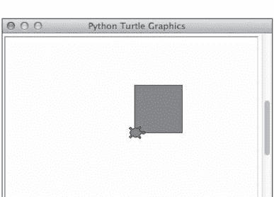

Figure 2.10
绘制填充形状。
© 2014 Python Software Foundation.

`color` 函数结合了 `pencolor` 和 `fillcolor` 函数的功能。它的第一个参数是画笔颜色，第二个参数是填充颜色。当不带参数调用时，`color` 返回一个包含这两个颜色的元组。因此，表达式 `color("blue", "red")` 将设置画笔颜色为蓝色，填充颜色为红色。

表 2.6 总结了海龟图形中与颜色相关的函数。

表 2.6 与颜色相关的函数

| 函数 | 其作用 |
|---|---|
| `bgcolor(color)` | 设置画布的颜色为 `color` |
| `color(pColor, fColor)` | 设置海龟的画笔颜色为 `pColor`，其填充颜色为 `fColor` |
| `fillcolor(color)` | 设置海龟的填充颜色为 `color` |
| `pencolor(color)` | 设置海龟的画笔颜色为 `color` |
| `begin_fill()` | 开始绘制填充形状的命令序列 |
| `end_fill()` | 结束绘制填充形状的命令序列 |

## 绘制圆圈

海龟图形只提供一个内置的绘制形状的函数。该函数名为 `circle`，期望圆的半径作为参数。可选参数包括 `extent`（要绘制的圆的部分，以度为单位）和 `steps`（用于绘制圆周的线条数）。你提供 `extent` 参数时想要绘制弧线。填充弧线需要你连接海龟的起始点和结束点。

为了感受 `circle` 函数的工作方式，在 shell 中运行以下代码：

```
>>> from turtle import *
>>> home()
>>> circle(50)
```

请注意，海龟从 home 位置开始面向东，绘制圆是通过反复向前移动并向左转来实现的，最后返回到原始位置和朝向。

现在考虑如何在这个圆内绘制一个填充的扇形。切片是一个填充的弧，占据圆的右下四分之一，如图 2.11 所示。

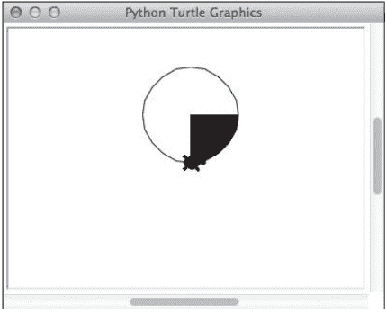

Figure 2.11
绘制包含填充弧的圆。
© 2014 Python Software Foundation.

你首先运行 begin_fill 开始绘制填充形状。为了绘制弧线，海龟从 home 位置开始并绘制半径为 50、extent 为 90 度的圆。海龟然后绘制两条线段以闭合弧线、创建扇形并使其可填充。为此，你将海龟移动到位置 (0, 50)，即圆的中心点，然后将其返回到 home 位置。最后，你运行 end_fill 来填充新形状。代码如下：

```
>>> begin_fill()
>>> circle(50, 90)
>>> goto(0, 50)
>>> home()
>>> end_fill()
```

使用圆和弧的关键在于设置海龟的初始位置和朝向以获得想要的结果。例如，假设你想要一个半月形，其中心点为原点，半径为 50，且平坦的一侧沿 x 轴，如图 2.12 所示。

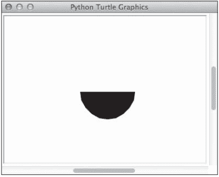

Figure 2.12
绘制半月形。
© 2014 Python Software Foundation.

海龟从位置 (−50, 0) 开始绘制圆，海龟的朝向为 270 度。从 home 位置移动到该位置绘制了弧线平坦一侧的后半部分。然后海龟向右转 90 度。为了绘制弧线，海龟以 extent 为 180 度绘制圆。绘制弧线后，海龟通过返回 home 绘制其平坦一侧的另一半。代码如下：

```
>>> reset()
>>> begin_fill()
>>> goto(-50, 0)
>>> right(90)
>>> circle(50, 180)
>>> home()
>>> end_fill()
>>> hideturtle()
```

## 绘制文本

你通过调用 write 函数在海龟窗口中绘制文本。必需的参数是一个字符串。可选参数指示海龟在绘制过程中移动，将文本左对齐、居中或右对齐于海龟的初始位置，并使用你提供的文本字体。以下代码片段展示了两种绘制文本的方法，有无可选参数。结果如图 2.13 所示。

```
>>> from turtle import *
>>> reset()
>>> write("Python is way cool!")
>>> up()
>>> goto(0, 60)
>>> write("Python is way cool!", move = True, align = "Center",
    font = ("Arial", 14, "bold"))
```

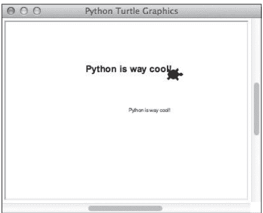

Figure 2.13
绘制文本。
© 2014 Python Software Foundation.

请注意，默认对齐方式为左对齐，海龟不移动，文本字体非常小。字体表示为一个元组，包含字体名称、磅值和样式。请注意，如果海龟移动，它会在文本下方绘制一条线。为了避免这种效果，请在调用 write 之前抬起海龟。

## 使用海龟的窗口和画布

海龟图形窗口提供对其下方画布或绘图区域的部分视图。如果海龟移动到此可见区域之外，你可以放大窗口或滚动到想要查看的画布区域。

画布初始为宽 400 像素、高 300 像素。函数 screensize 返回画布当前尺寸。当你向此函数提供前两个可选参数时，它会将画布的宽度和高度重置为这些整数。可选的第三个参数是背景颜色的值。

窗口初始宽度为屏幕宽度的 50%，高度为屏幕高度的 75%。窗口居中于屏幕。函数 window_width 和 window_height 分别返回窗口当前宽度和高度。（请记住，用户可随时用鼠标更改这些尺寸。）

要在程序控制下更改窗口大小和位置，请调用 setup 函数。setup 的前两个参数是窗口的尺寸。如果这些参数是整数，它们表示实际宽度和高度。如果这些参数是浮点数，它们表示屏幕宽度和高度的分数。第三个和第四个参数表示窗口相对于屏幕边界的位置。如果这些参数为正，它们分别表示窗口距屏幕左边界和上边界的距离（以像素为单位）。如果它们为负，距离相对于屏幕的右边缘和底部边缘。

下一个 shell 会话将海龟图形窗口放置在屏幕的右上角。背景颜色为黑色，画笔和填充颜色为白色。

```
>>> setup(400, 300, -400, 50)
>>> screensize(1650, 1080, "black")
>>> color("white", "white")
```

表 2.7 总结了海龟图形中与窗口和画布相关的函数。

表 2.7 与窗口和画布相关的函数

| 函数 | 其作用 |
|---|---|
| screensize() | 返回元组 (canvasWidth, canvasHeight)。 |
| screensize(canvwidth, canvheight, bg) | 设置画布的宽度、高度和背景颜色。（所有参数都是可选的。） |
| setup(width, height, startx, starty) | 设置海龟图形窗口的大小和位置。width 和 height 可以是整数（实际像素数）或浮点数（屏幕尺寸的百分比）。startx 和 starty 可以为正（距屏幕左边缘的像素位置）或为负（距屏幕右边缘的像素位置）。 |
| window_height() | 返回海龟图形窗口的高度。 |
| window_width() | 返回海龟图形窗口的宽度。 |


## 使用配置文件

随着你对海龟绘图越来越熟练，你会想要自定义海龟及其窗口初始状态的设置。你可以将设置放在配置文件中，这样每次启动 IDLE 时就不需要在代码中重复运行它们。

当你从 `turtle` 模块导入资源时，Python 会在当前工作目录中查找名为 `turtle.cfg` 的文件。这应该是一个包含你设置的文本文件。如果该文件存在，Python 会自动调用相应的函数并使用配置文件中的数据。以下是 Python 默认使用的一些设置示例：

```
width = 0.5
height = 0.75
leftright = None
topbottom = None
canvwidth = 400
canvheight = 300
colormode = 1.0
shape = classic
pencolor = black
fillcolor = black
title = Python Turtle Graphics
```

请注意，颜色、形状和窗口标题的字符串值是 without the quotes 写出的，不带引号。

本章未涵盖许多其他海龟绘图函数。如果你对它们好奇，请查看文档。其中一些处理来自键盘和鼠标的用户输入。其他一些则用于编程动画。你将在本书后面的部分学习到其中一些操作。现在，在进入下一章之前，请先练习本节介绍的基本函数。

## 摘要

- 海龟绘图支持使用虚拟笔和画布绘制图片。你可以通过运行语句 `from turtle import *` 来访问海龟绘图操作。
- 海龟具有位置、朝向、速度、笔大小、形状、笔颜色和填充颜色。你可以通过调用适当的函数来检查这些属性或更改它们。
- 你可以显示或隐藏海龟，也可以抬起它的笔或将其放在画布上。
- 海龟的位置位于二维坐标系中，其原点 (0, 0) 位于画布中心。
- 你可以让海龟在其当前朝向上向前或向后移动给定距离。
- 你可以让海龟的朝向向左或向右旋转给定度数。
- 你可以检查并重置海龟画布和窗口的尺寸。你可以检查或重置画布的颜色。
- `reset` 函数恢复海龟绘图的原始状态，而 `clear` 函数只是擦除海龟的绘图。
- 颜色以两种模式表示。第一种模式使用名称，例如 "red" 和 "blue"，表示几种常见颜色。第二种模式使用 RGB 系统。在该系统中，颜色值是形式为 (r, g, b) 的元组，其中每个项是 0 到 255 范围内的整数。这些整数表示颜色的红色、绿色和蓝色分量的强度。此模式下有 255³ 种颜色可用。
- `begin_fill` 和 `end_fill` 函数包围一段代码，该代码用海龟当前的填充颜色填充形状。
- `write` 函数在海龟绘图窗口中绘制文本。

## 练习

启动 IDLE shell 并完成以下练习。你应该在 IDLE shell 中交互式地编写代码。

- 1. 穆勒-莱耶错觉是由一幅图像引起的，该图像由两条平行线段组成。一条线段看起来像一个有两个头的箭头，另一条线段看起来像一个有两个尾巴的箭头。虽然线段长度相同，但它们看起来不相等（见图 2.14）。用海龟绘图来说明这种错觉。

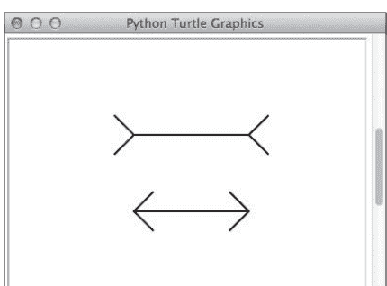

图 2.14
穆勒-莱耶错觉。
© 2014 Python Software Foundation.

- 2. 绘制以下几何形状，使它们出现在同一个海龟绘图窗口中。绘制每个形状时，海龟应从起始位置开始。

- a. 边长为 40 的正方形。
- b. 边长为 50 的五边形。
- c. 边长为 60 的六边形。
- d. 边长为 80 的八边形。

本页特意留空

# 第 3 章

## 控制结构：顺序、迭代和选择

在上一章中，你学习了如何使用基本的海龟绘图操作绘制一些简单的几何形状，例如正方形和三角形。每个基本操作都模拟了你用铅笔和纸绘制这些形状时所做的事情；例如，向左转 90 度，然后向前移动 70 个单位。当你在 Python shell 中输入这样的一系列操作时，你实际上是在编写计算机程序。

许多程序由简单的操作序列组成，这些操作指示计算机一次执行一项任务，直到整体任务完成并解决问题。然而，有两个原因使得仅通过简单的操作序列向前移动不足以解决某些问题：

- 1. 要执行的操作类型可能取决于计算机世界中当前情况的某些方面。例如，如果你输入了错误的密码，程序必须检测到这一点并响应错误消息；否则，程序可以继续为请求的服务登录你。这种基于条件进行操作选择的控制称为选择。
- 2. 你可能需要多次执行一系列操作。例如，如果你三次输入了错误的密码，程序可能会阻止进一步尝试，直到你通过电话联系服务。这种重复相同操作序列的控制称为迭代。


事实证明，顺序、选择和迭代是使用计算机程序解决任何问题所需的唯一控制结构类型。在本章中，你将返回 Python shell 来尝试这些控制结构。

### 重复语句序列：迭代

控制结构的最简单形式迭代或重复给定的操作序列固定次数。这种结构称为确定性循环，首先进行检查。你将在本章后面看到包含选择组件的不确定性循环的示例。

### for 循环

当你在上一章中绘制正方形时，你实际上输入了两个表达式

```
>>> forward(70)
>>> left(90)
```

总共四次。难道不希望你只需告诉 Python 重复这两次操作四次，而不是自己写四次吗？

Python 提供了名为 for loop 的控制结构来实现这一目的。现在启动海龟绘图并将此语句输入到 shell 中。（记住 >>> 符号是 shell 提示符，不是代码的一部分。）

```
>>> for count in range(4):
    forward(70)
    left(90)

>>>
```

请注意，两个绘图操作的序列只出现一次，并且在循环结构的主体中缩进。缩进很重要，因为它告诉 Python（以及你这个读者）哪些语句属于要重复的序列。你可以通过按两次 Return 或 Enter 键来结束此序列和循环。

循环结构的标题 for count in range(4): 是 Python 表示“重复以下操作序列四次”的方式。请注意，Python 会自动缩进循环标题后语句序列中的每个语句。

现在编写一个绘制三角形的循环。实际上，你不必重写所有代码；只需将光标放在前一个循环中最后一个表达式的末尾，然后按 Enter 键。这会在下一个 shell 提示符后复制并粘贴代码。你还需要编辑代码的哪些部分来绘制三角形？假设边的长度不变，你需要三条边和三次各 120 度的左转。当你对代码进行这些更改并按两次 Enter 键时，你应该在正方形内看到你的三角形。

现在再次使用相同的循环结构绘制五边形、六边形和八边形。结果应类似于你在第 1 章“使用 Python 入门”中练习 1.2 的解决方案，但你的代码要容易得多。

for 循环的真正威力在于它允许你编写一段简短的语句序列，然后按你喜欢的次数重复它。

### 嵌套循环

假设你想在不同位置或方向上绘制多个相同长度的六边形。例如，你可能想围绕原点旋转 10 个六边形以产生图 3.1 所示的图案。

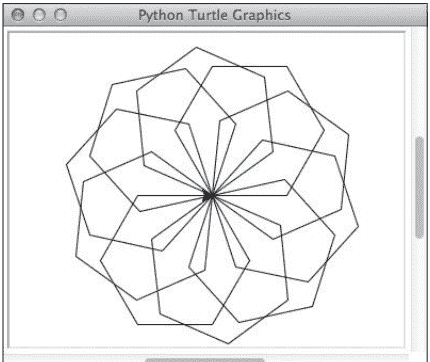

图 3.1
使用 10 个六边形产生图案。
© 2014 Python Software Foundation.

你已经知道如何使用循环绘制单个六边形。现在你想重复该过程 10 次，并在每次绘制六边形后将海龟的朝向调整 36 度。以下是完整过程的设计计划：

```
Repeat 10 times
    Draw a hexagon
    Turn left 36 degrees
```


本设计方案以伪代码表达。伪代码不能作为实际程序代码运行，但它与英语和 Python 足够接近，可以作为编写等效 Python 代码的蓝图。

现在将此伪代码设计翻译成 Python 代码。循环体中的第一个语句扩展为另一个用于绘制六边形的循环。整个设计扩展为以下 Python 代码：

```
>>> for count in range(10):
    for count in range(6):
        forward(70)
        left(60)
    left(36)
```

在此代码中，绘制六边形的循环与另一个循环嵌套。注意缩进如何帮助你和 Python 确定哪些语句属于两个循环的循环体。当你将此代码输入到 shell 中时，请注意在输入行 left(60) 后按一次 Delete 或 Backspace 键，以便行 left(36) 与以 for 开头的第二行对齐。在每次外层循环的迭代中，内层循环会先运行。当内层循环终止时，海龟在绘制下一个六边形之前向左转 36 度。

你可以通过更改外层循环中的迭代次数和海龟的旋转角度，或通过更改内层循环绘制的形状类型来改变在海龟图形窗口中绘制的图案。鼓励你尝试这些选项的不同组合。

## 使用 for 循环时 range 函数的工作方式

如果你想重复执行一系列操作指定次数，刚才展示的循环模式就足够了。然而，你可能希望遍历一系列值并在循环体中使用每个值来实现某种目的。例如，考虑计算从 1 到 10 的整数的总和。以下代码片段实现了这一点：

```
>>> total = 0
>>> for number in range(1, 11):
    total = total + number

>>> total
55
```

for 循环被设置为遍历一系列值。当与 range 函数一起使用时，循环会遍历整数范围中包含的每个整数。如你在第 1 章中所见，当 range 使用单个整数参数调用时，它会生成一个整数序列，从 0 到该整数参数减一。在每次循环迭代中，序列中的当前值会自动分配给循环头中的变量。你可以在循环体中使用此变量，如以下代码片段所示：

```
>>> for number in range(5):
    print(number)

>>>
0
1
2
3
4
```

你也看到过，可以通过使用两个参数调用 range 函数来使范围从非 0 的值开始。例如，你可以通过向 range 传递参数 1 和 6 来打印从 1 到 5 的整数。

最后，你可以通过使用三个参数调用 range 函数以降序访问整数范围。第一个参数是上界，第二个参数是下界减一，第三个参数是 -1。

你应该尝试这三种使用 for 循环计数的方法，直到你理解它们的工作原理。

## 使用字符串、列表和字典的循环

因为 for 循环会访问序列中的项，所以它也可以访问字符串或列表中的项。以下代码片段演示了这一点：

```
>>> name = "Kenneth"
>>> for ch in name:
    print(ch)
```

K
e
n
n
e
t
h

```
>>> fruits = ["banana", "apple", "orange"]
>>> for fruit in fruits:
    print(fruit)
```

banana
apple
orange
>>>

尽管字典不是序列，当你向 for 循环提供一个字典时，循环会以某种不确定的顺序访问字典的键。例如，要显示字典的键及其值，你可能会运行以下代码：

```
>>> kenInfo = {"name":"Ken", "hair-color":"gray", "age":63}
>>> for key in kenInfo:
    print(key, kenInfo[key])
```

name Ken
age 63
hair-color gray
>>>

如你所见，只要你有要处理的项序列或要执行的确定迭代次数，for 循环就很容易使用。

## 提问：布尔表达式

如前所述，计算机程序可能需要响应计算机环境中的条件以选择采取何种行动。检查这些条件的形式是提出是/否问题。例如，整数值是否大于 0？海龟是否在海龟图形窗口的右侧边缘？文件是否存在于当前工作目录中？列表的长度是否等于 0？这些问题在 Python 代码中以布尔表达式的形式出现。在本节中，你将探索使用布尔表达式回答是/否问题的各种方法。

### 布尔值

以十九世纪英国数学家和逻辑学家 George Boole 命名，布尔表达式返回两个值之一：`True` 或 `False`。当评估布尔表达式的结果时，这些值被视为“是”或“否”。像单词 for、from 和 import 一样，单词 `True` 和 `False` 是 Python *关键字*。它们在 IDLE 中显示为橙色，不能用作变量名。像数字和其他字面量一样，值 `True` 和 `False` 求值后为其自身。

### 比较

== 运算符比较任意两个 Python 值的相等性，如果相等则返回 `True`，如果不相等则返回 `False`。!= 运算符表示“不等于”，返回与 == 相反的结果。以下是一些比较示例：

```
>>> 34 == 0
False
>>> 34 != 0
True
>>> 34 == 2 * 17
True
>>> "Ken" == "KEN"
False
>>> "Ken" == 34
False
```

如你所见，比较是布尔表达式。请注意，Python 通过检查每个位置的字符对来比较两个字符串。因为 "e" 不等于 "E"，所以字符串 "Ken" 和 "KEN" 不相等。

运算符 <、>、<= 和 >= 用于比较可以按升序或降序排列的值。因此，你可以用这种方式比较两个数字或两个字符串。你应该在 shell 中尝试这些其他比较运算符，以确保你理解它们的含义。

### 逻辑运算

Boole 在逻辑系统中使用了值 `True` 和 `False`。该系统中有三种基本运算：

- **逻辑否定**—此运算将逻辑运算符 `not` 应用于布尔表达式。如果表达式为 `True`，返回的结果为 `False`，如果表达式为 `False`，返回的结果为 `True`。
- **逻辑合取**—此运算将逻辑运算符 and 应用于两个操作数，两者均为布尔表达式。如果两个表达式都为 True，则运算返回 True，否则返回 False。
- **逻辑析取**—此运算将逻辑运算符 or 应用于两个操作数，两者均为布尔表达式。如果两个表达式都为 False，则运算返回 False；否则返回 True。

假设程序从用户接收一个输入数字，并且你想测试它以验证其值是否在某个值范围内，例如从 0 到 100。为使此条件为 True，数字必须大于或等于 0 且小于或等于 100。以下 shell 会话显示了对此条件的一些测试：

```
>>> number = int(input("Enter a number: "))
Enter a number: 55
>>> number >= 0 and number <= 100
True
>>> number = int(input("Enter a number: "))
Enter a number: -1
>>> number >= 0 and number <= 100
False
>>> number = int(input("Enter a number: "))
Enter a number: 101
>>> number >= 0 and number <= 100
False
```

逻辑运算乍一看可能很奇怪，但一旦习惯后，它们实际上比算术运算更容易理解。其主要原因是操作数的可能值组合数量是有限的。你可以在真值表中列出这些组合及其结果。表 3.1 显示了否定运算的组合和结果。表 3.2 显示了合取和析取运算的组合和结果。请注意，A 和 B 都指布尔表达式。

表 3.1 逻辑否定的真值表

| A | not A |
|---|-------|
| True | False |
| False | True |


表 3.2 逻辑合取和逻辑析取的真值表

| A | B | A 与 B | A 或 B |
|---|---|---|---|
| 真 | 真 | 真 | 真 |
| 真 | 假 | 假 | 真 |
| 假 | 真 | 假 | 真 |
| 假 | 假 | 假 | 假 |

你可能不会经常使用逻辑运算。但如果需要帮助，你可以随时查阅这些表格以了解其求值规则，然后在 shell 中尝试你的表达式。

## 选择：选择语句

在你确定如何询问关于某个条件的是/否问题后，你必须决定如何处理答案。有时如果答案是“是”就采取行动，如果是“否”则什么也不做。例如，如果整数除法的余数不为 0，你会输出余数；否则，之前已输出的商的输出就足够了。

其他时候，如果问题的答案是“是”就执行一个动作，如果答案是“否”就执行另一个动作。例如，如果密码被识别，你可以执行请求的服务；否则，你会向用户输出错误信息。

还有其他时候，可能有许多不同的选项可用，但只有一个是输入的。你必须将输入与每个可能的选项进行比较，直到找到匹配项，然后执行相关联的动作。命令菜单需要这种类型的多路决策。

在本节中，你将探索 Python 用于进行单向、双向和多向决策的不同类型的选择语句。

### 单向 if 语句

你使用单向 if 语句来进行单向决策。其形式为

```
if BooleanExpression:
    Statements
```

其中 Statements 是一个或多个语句的序列。注意嵌套语句前的缩进。与 for 循环一样，if 语句中的缩进是重要的。它挑选出在布尔表达式为 True 时运行的语句。如果布尔表达式为 False，则跳过这些语句，计算在整个 if 语句之后继续进行。图 3.2 显示了这种选择语句中的控制流。

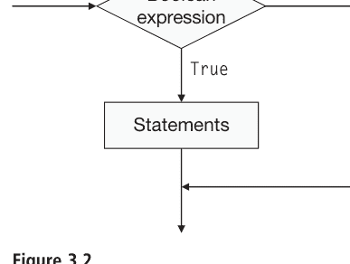

图 3.2

单向 if 语句中的控制流。

以下是前面提到的整数除法的示例：

```
>>> divisor = 10
>>> divisor = 3
>>> dividend = 10
>>> quotient = dividend // divisor
>>> remainder = dividend % divisor
>>> print("The quotient is", quotient)
The quotient is 3
>>> if remainder != 0:
    print("The remainder is", remainder)
```

余数是 1

正如你所见，如果除数是 2 或被除数是 9，余数 0 就根本不会被输出。

单向 if 语句很少见，但你应该尝试一个，以防某天你需要它。

### 双向 if 语句

双向决策，如路上的岔路，是常见的。你根据在选择点检查的条件选择其中一条路。用于做出这种选择的双向 if 语句的形式为

```
if BooleanExpression:
    ConsequentStatements
else:
    AlternativeStatements
```

再次，嵌套语句的缩进反映了这种控制结构的逻辑。如果布尔表达式为 True，则运行结果语句，然后跳到整个 if-else 语句的末尾。否则，跳过结果语句并运行 else 关键字之后的替代语句。图 3.3 显示了这种选择语句中的控制流。

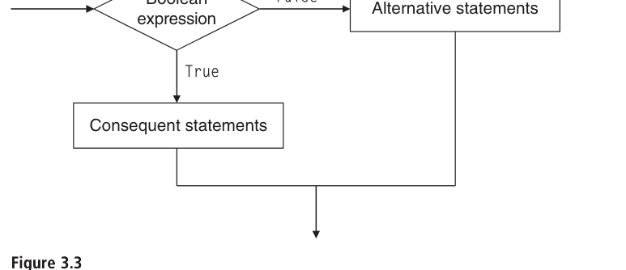

图 3.3
双向 if 语句中的控制流。

以下是如何使用 if-else 语句接受或拒绝用户输入数字的示例：

```
>>> import math
>>> number = input("Enter a positive number: ")
>>> if number > 0:
    print("The square root is", math.sqrt(number))
else:
    print("Error: the number must be greater than 0")
```

### 使用 random.randint 的概率选项

在第 1 章中，你看到了如何使用 Python 的 random.choice 函数与列表来模拟抛硬币：

```
>>> import random
>>> coin = ["heads", "tails"]
>>> random.choice(coin)
'tails'
```

因为有两个可供选择的选项，随机挑选一个会导致在多次抛掷过程中每个选项大约被选择 50% 的时间。为了演示这一点，你可以运行以下代码片段，它们在 50 次抛掷中统计正面和反面的数量：

```
>>> headCount = 0
>>> tailCount = 0
>>> for count in range(50):
    result = (random.choice(coin))
    if result == "heads":
        headCount += 1
    else:
        tailCount += 1

>>> headCount
22
>>> tailCount
28
```

正如你所见，从长远来看，抛硬币正面朝上的时间大约占一半，反面朝上的时间大约占一半。用数学术语来说，硬币的每一面出现的概率为 .5。按规则，如果一个事件的概率为 1，意味着它必然发生（100% 的时间）。较小的概率值对应较小的百分比。

偶尔，你会想基于给定的概率值选择一个选项。假设该选项的概率为 .25（4 分之 1）。而不是构建一个包含四个值的 Python 列表，你可以使用函数 random.randint 从整数范围内挑选一个随机整数。该函数期望两个参数：范围的下界和上界。因此，要选择概率为 .25 的选项，你可以调用 random.randint(1, 4)

并将结果与给定数字，例如 1 进行比较。从长远来看，你应该看到这个数字大约 25% 的时间被返回，如下一个 shell 会话所示：

```
>>> total = 0
>>> for count in range(50):
    result = random.randint(1, 4)
    if result == 1:
        total += 1

>>> total
13
>>> 4 * 13
52
```

这种方法对于 ½、¼ 等分数形式的概率效果很好，但对于具有较大分子数的分数，如 ¾ 呢？这意味着你正在寻找 4 个给定数字中的任意 3 个。用英语表达，你想查看 1 到 4 之间的随机数是否在 1 到 3 的范围内。以下是此测试的 Python 代码：

```
>>> random.randint(1, 4) in range(1, 4)
False
```

要验证此表达式四分之三的时间返回 True，像本节中所示的其他示例一样在循环中测试它。

使用这些技术，你应该能够以问题所需所需的任何给定概率在代码中执行操作。练习给你机会进行更多关于概率的实验。

### 多向 if 语句

当有超过两种可能的行动路径时，你必须做出多向决策。（毕竟，大多数传统的叉子有四个叉。）因此，在这种情况下必须检查至少两个条件。Python 为此目的提供了多向 if 语句。其形式为

```
if BooleanExpression:
    statements
elif BooleanExpression:
    statements
.
.
else:
    statements
```

在 if 子句中提出第一个问题后，你可以根据需要使用 as many elif 子句提出 as many 问题。尾部的 else 子句是可选的，处理所有问题的答案都为 False 或“否”的情况。请注意，只有一个语句序列被选中并运行。

以下代码片段演示了一个简单的算术命令解释器：

```
>>> x = float(input("Enter the first number: "))
Enter the first number: 3.44
>>> y = float(input("Enter the second number: "))
Enter the second number: 45.6
>>> command = input("Enter an arithmetic operator [+ , - , * , /]: ")
Enter an arithmetic operator [+ , - , * , /]: *
>>> if command == "+":
    print("The sum is", x + y)
elif command == "-":
    print("The difference is", x - y)
elif command == "*":
    print("The product is", x * y)
elif command == "/":
    print("The quotient is", x / y)
else:
    print("Error: unrecognized operator")
The product is 156.864
```

你将在本章后面看到选择语句在 turtle 绘图程序中的使用。

## 使用选择控制迭代

前面检查的 for 循环相当僵化。它迭代固定次数，遍历某个固定序列的值。这种类型的循环设计简单，对于许多问题效果很好。然而，一些情况需要更灵活的循环类型：一种无法预知将执行多少次迭代的循环。这种类型的循环必须能够提出问题：“我应该继续还是不继续？”并且在答案为“否”时能够退出。这种类型的循环称为不定循环，在本节中，你将探索如何为各种情况设计不定循环。


## while 循环

Python 提供了一种名为 while 循环的控制结构，用于在无法预测循环迭代次数时使用。其形式相当简单：

```
while BooleanExpression:
    Statements
```

这种形式看起来有点像前面讨论过的单向 if 语句。行为也类似。不同之处在于，循环会反复测试布尔表达式，直到它变为 False。每当表达式返回 True 时，循环体中的语句就会运行；否则，循环体将被跳过，计算在循环之后继续。因此，单向 if 语句中的语句要么运行一次，要么根本不运行，而 while 循环中的语句则运行零次或多次。图 3.4 显示了这种循环中的控制流。

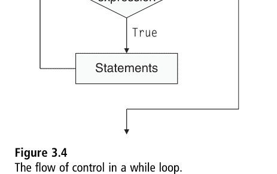

图 3.4
while 循环中的控制流。

while 循环可以像 for 循环一样使用，用于遍历一系列值，如下 shell 会话所示：

```
>>> number = 0
>>> while number < 5:
    print(number)
    number = number + 1

>>>
0
1
2
3
4
```

然而，while 循环在迭代次数不可预测时真正发挥作用。例如，考虑欧几里得计算两个整数最大公约数的方法。两个整数的最大公约数是能同时整除这两个数的最大整数（余数为 0）。例如，120 和 32 的最大公约数是 8。欧几里得方法从两个数 A 和 B 开始，并假设 A >= B 且 B >= 0。你反复用 A 除以 B 的余数替换 B，并用 B 替换 A。你在 B 等于 0 时停止；此时，A 就是答案。以下是该方法的伪代码设计：

```
While B > 0
    C = A remainder B
    A = B
    B = C
```

当 A = 128 且 B = 32 时，循环在第一次遍历时将 A 设置为 32，B 设置为 24。在第二次遍历时，A 变为 24，B 变为 8。在第三次也是最后一次遍历时，A 变为 8，B 变为 0。你可以通过以下 shell 会话中的 Python 代码确认欧几里得方法的工作方式：

```
>>> a = 120
>>> b = 32
>>> while b > 0:
    c = a % b
    a = b
    b = c
    print(a, b)
```

32 24
24 8
8 0
>>> a
8

正如你所见，对于任意给定的 A 和 B 的值，所需迭代次数是不可能预先确定的。因此，while 循环是用于欧几里得方法的适当循环控制结构。

## 海龟图形中的随机游走

在迄今为止看到的海龟图形示例中，你的海龟以相当僵硬和规律的方式移动来绘制几何形状。但请考虑动物，例如

昆虫，在其自然环境中的运动。它们的运动可能由食物或潜在捕食者的接近程度决定。其他运动可能看起来相当随机；它们似乎只是到处游荡。

为了模拟这种随机运动，你可以让海龟进行 *随机游走*。一种方法是让海龟移动随机距离，然后向左或向右转随机度数。你重复此过程给定次数。你使用 Python 的函数 `random.randint` 在给定范围内获取随机整数。以下 shell 会话生成图 3.5 所示的随机游走。

```
>>> from random import randint
>>> reset()
>>> for count in range(30):
    distance = randint(10, 60)
    forward(distance)
    degrees = randint(45, 135)
    if randint(1, 2) == 1:
        left(degrees)
    else:
        right(degrees)
```

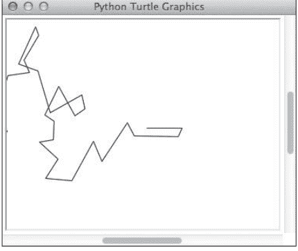

图 3.5
随机游走。
© 2014 Python Software Foundation.

请注意，海龟可能会在窗口边缘下方行走一段时间，然后返回到画布的可见区域。

更有趣的场景是海龟在遇到食物或无法绕过的障碍物时停止。这种过程需要一个不确定的循环，只要未发生此类相遇就继续。下一个 shell 会话指示海龟移动，直到它遇到窗口的边缘之一。图 3.6 显示了一个结果。

```
>>> reset()
>>> width = window_width()
>>> height = window_height()
>>> (minX, maxX) = (-(width / 2), width / 2)
>>> (minY, maxY) = (-(height / 2), height / 2)
>>> (x, y) = position()
>>> while x > minX and y > minY and x < maxX and y < maxY:
    distance = randint(10, 60)
    forward(distance)
    degrees = randint(45, 135)
    if randint(1, 2) == 1:
        left(degrees)
    else:
        right(degrees)
    (x, y) = position()
```

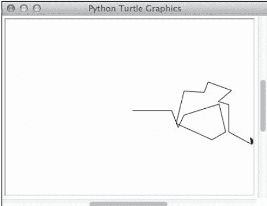

图 3.6
到边界的随机游走。
© 2014 Python Software Foundation.

由于距离和航向是随机的，并且用户可以在运行时更改窗口大小，因此海龟在任何一次游走中采取的路径数都是不可预测的。这就是为什么你必须在这种情况下使用 `while` 循环。

## SUMMARY

- 编程中的基本控制结构是顺序、选择和迭代。
- 语句序列由一个接一个书写的语句组成。计算机按其出现的顺序运行它们。
- 选择语句测试至少一个条件。如果条件为 `True`，计算机运行语句序列。否则，计算机跳过该序列并运行其后的代码。
- 单向 `if` 语句包含对一个条件的测试，后跟一个语句序列。双向 `if` 语句包含对一个条件的测试，后跟两个备选语句序列。多向 `if` 语句包含两个或多个条件的测试，每个测试后跟一个备选语句序列。
- 两个布尔值是 `True` 和 `False`。
- 条件是一个布尔表达式。布尔表达式返回 `True` 或 `False`。
- 比较运算符 `==`、`!=`、`<`、`>`、`<=` 和 `>=` 可以比较整数、浮点数或字符串。比较返回 `True` 或 `False`。
- 逻辑运算符 `and`、`or` 和 `not` 以布尔表达式作为操作数。逻辑运算返回 `True` 或 `False`。
- 逻辑运算的规则在真值表中描述。
- `for` 循环用于重复执行语句序列确定的次数。
- `for` 循环使用 `range` 函数遍历整数序列。
- `for` 循环可以访问字符串中的字符、列表或元组中的项以及字典中的键。
- `while` 循环用于重复执行语句序列零次或多次。循环由条件的测试控制，该条件必须为 `True` 才能继续运行语句序列。

## EXERCISES

启动 IDLE shell 并完成以下练习。你应该在 IDLE shell 中交互式地编写代码。

+   1. 你已通过让海龟向前移动然后向左转来绘制各种几何形状。编写一个代码片段，以类似的方式绘制一个圆。提示：海龟向左转 1 度。你如何增大或减小圆的大小？
+   
+   2. 你可以修改练习 1 中的代码来绘制螺旋线。首先使用较大的度数调用 `left`，例如 4，并观察会发生什么。然后清除绘图并设置一个名为 `distance` 的新变量为 1。在循环内将此变量用作向前移动的参数，并在每次循环通过时将变量增加一个很小的量，例如 .05。你如何增加或减小旋转次数和它们之间的距离？

# CHAPTER 4

## 编写、保存和运行程序

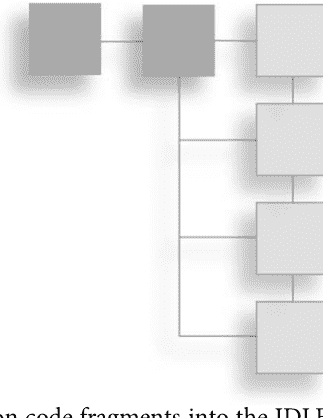

迄今为止，在本书中，你一直在 IDLE shell 中输入简短的 Python 代码片段并查看结果。这种方法对于尝试 Python 的基本元素，包括海龟图形操作非常有效。然而，随着你希望用代码完成的事情变得更加复杂，代码也会变得更加复杂。此时，将大量小块代码输入 shell 会变得笨拙且不方便。当你把相关的代码片段放在一起时，你实际上就有了 *计算机程序*。你现在需要的是一个用于编写程序的编辑器、将其保存到文件以供以后使用的手段，以及运行它们的手段。本章的主题是编程过程及其支持工具。

## EXPLORING THE PROGRAM DEVELOPMENT PROCESS

*program* 是一个解决问题的语句或指令序列。程序可以短到单行代码，也可以由数百万行代码组成。软件公司可能会雇用许多程序员团队来处理单个大型程序。每个团队负责解决整体问题的一部分的解决方案（例如，文字处理程序中的拼写检查器、文件管理器和编辑器）。每个团队又可能由处理编程过程不同阶段的小团队组成。这些阶段包括以下内容，也在图 4.1 的流程图中显示：

+   1. **Analysis**—在此阶段，你确定什么算作问题的解决方案。例如，拼写检查器应检查文本文件中单词的拼写

并且在必要时进行修改。请注意，你在这里不进行编码，而是确定程序应产生的结果。你将在程序测试期间检查程序是否达到这些结果。你也可能会编写程序用户手册。

- 2. **Design**—在此阶段，你利用分析的结果来确定程序将如何解决其指定的问题。这里可能会进行一些编码，尽管也可以使用诸如你在第 3 章“控制结构：顺序、迭代和选择”中看到的伪代码之类的设计工具。
- 3. **Coding**—在此阶段，你将设计的结果翻译成编程语言的代码。请注意，相同的设计可以根据客户需求和程序运行的计算机系统，使用 Python、Java 和 C++ 等不同语言进行编码。
- 4. **Compilation**—在此阶段，你运行一个程序将你的程序翻译成可在计算机上运行的形式。编译可能会揭示语法错误，你必须在继续之前纠正这些错误。
- 5. **Testing**—在此阶段，你用不同的输入反复运行程序并观察输出。如果程序因错误消息而停止，或者程序产生意外的输出，你必须退回到之前的阶段以修复错误。

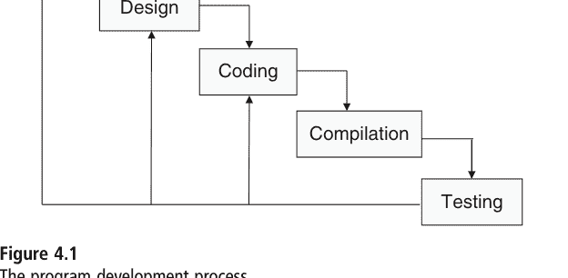

图 4.1
程序开发过程。

在大型编程项目中，你很少会参与所有这些阶段。事实上，你可能在分析师、设计师、编码员或测试员等某个领域拥有整个职业生涯。但对于短小的程序，你可能需要做所有事情。

在本书中，你将非正式地进行分析、设计和测试。在本章中，你将重点关注 IDLE 中用于编码、编译和运行 Python 程序的工具。

## 编写程序

到目前为止，在本书中，你已在 IDLE shell 中输入 Python 代码片段并在其中运行。你已在 shell 窗口或 turtle 图形窗口中查看结果。当你想要输入并保存稍后可以编辑和运行的代码时，你可以在 IDLE 中打开一个新文件并在单独的窗口中工作。在本节中，你将学习如何做到这一点。你还将探索作为完整 Python 程序，你的代码应具有的结构类型。

### 程序编辑

使用 IDLE 编辑程序有几种方法。每一种都取决于你在过程中的位置。

- 你从头开始一个新程序。你启动 IDLE，然后从 shell 窗口的文件菜单中选择新建文件选项。一个新的空窗口会弹出。然后你可以将两个窗口（shell 和文件窗口）并排放置在屏幕上开始工作。
- 你一直在 shell 中试验代码片段，并且想要编写一个完整的程序。你只需像之前一样打开一个新文件窗口。
- 你想要编辑之前保存的文件或从其他程序员那里得到的文件。你启动 IDLE 并从文件菜单中选择打开选项。然后你在文件系统中浏览该文件。在某些系统上，例如 Mac OS，你可以通过在目录窗口中启动（双击）Python 程序文件，将这两个步骤合并为一步。最后，你可以在终端窗口中使用适当的系统命令导航到文件目录后，运行命令 `idle3 filename`。

就像文字处理器一样，IDLE 允许你同时打开多个文件窗口。因此，你可以打开现有程序文件的窗口，将代码复制到另一个窗口中的新程序。请注意，这些窗口中的 Python 代码是彩色编码的，就像在 shell 窗口中一样。IDLE 还知道如何在你输入选择语句和循环时自动缩进你的代码。常见的编辑命令，如 Copy/Cut/Paste 和 Find/Replace，与你特定系统上的文字处理器相似。格式菜单包含一些用于格式化 Python 代码和清理缩进问题的命令。

要将程序保存到文件，请从文件菜单中选择保存选项，或使用你特定系统上的控制键序列（Mac 上为 Command+S，其他系统上为 Ctrl+S）。Python 程序文件具有 .py 扩展名。如果你第一次保存文件时未提供该扩展名，Python 会为你添加。

### 程序结构

正如你在第 3 章中看到的，一些 Python 语句，如循环和选择语句，具有结构。Python 遵循此结构来运行语句，就像你遵循它来理解它们的含义一样。

完整的 Python 程序也具有结构——你在编写的每个程序中都会使用它。这里有一个 turtle 图形程序示例，它绘制的六边形图案与你在第 3 章中看到的相似。你可以在伴生网站（www.cengageptr.com/downloads）上的名为 samplepattern.py 的文件中找到此程序。接下来的几个小节解释程序结构的每个部分。

```python
"""
samplepattern.py
Draws a pattern using a hexagon.
"""

from turtle import *

def main():
    reset()
    speed(0)
    pensize(2)
    hideturtle()
    color("blue", "yellow")    # Blue outline, yellow fill
    begin_fill()
    for count in range(10):    # Draw 10 hexagons
        for count in range(6):  # Draw each hexagon
            forward(70)
            left(60)
        left(36)                # Rotate them evenly
    end_fill()
    return "Done!"
```

```python
if __name__ == '__main__':
    msg = main()
    print(msg)
    mainloop()
```

### 文档字符串和行尾注释

该程序顶部的第一行到第四行形成一个用三重双引号括起来的字符串。当字符串在 Python 代码中以这种方式出现时，它被称为 docstring。Python 在运行程序时忽略 docstring，但在阅读时你不应忽略 docstring。此 docstring 告诉你程序文件的名称并总结程序的功能。Python 也会在 shell 中使用 help 函数请求帮助时显示程序的 docstring。尽管该程序中的 docstring 似乎只提供琐碎的信息，但养成所有程序都以 docstring 开头的习惯是个好主意。

在程序代码大约中间的位置，你会看到几段以 # 字符开头且在 IDLE 中呈红色的文本。Python 在运行时也忽略这种称为行尾注释的文本。再次强调，这些信息是为读者提供的，以帮助你理解程序代码中这些点的发生情况。你应该谨慎使用行尾注释——仅在你认为代码需要一些澄清时才使用。

### import 语句

该程序使用 turtle 图形函数，因此必须导入它们，就像你在 shell 试验中所做的那样。在程序文件中，所有 import 语句都应出现在程序代码的其余部分之前。请注意，Python 忽略的空行将初始 docstring 与 import 部分分隔开，并将该部分与程序代码的其余部分分隔开。

### main 函数

尽管 Python 不要求这样做，但程序员通常将顶层代码组织在 main 函数中。示例程序的下一部分定义了此函数，该函数不是 Python 内置的。请注意，函数的第一行或标题通过缩进与代码主体左对齐。main 函数的主体包含在调用函数时运行的语句序列。关于函数定义，你现在需要知道的就是这些。

查看 main 函数中的代码。它设置 turtle 的初始状态，以便它可以绘制六边形图案，然后运行嵌套的 for 循环来实现。当 main 函数完成工作后，它使用 return 语句将字符串 "Done!" 返回给调用者。

从现在开始你编写的每个 turtle 图形程序都将包含一个 main 函数。你可以将第一个作为模板，只需编辑 return 语句之前的代码即可。

### if main == "__main__" 惯用法

程序中的最后四行代码形成一个单向 if 语句。此语句确定代码是作为 Python 程序运行还是作为 Python 模块导入。再次强调，Python 不要求这部分，但它是 Python 程序员的标准做法。

每个 Python 程序文件都可以被视为一个模块。Python 对文件的看法取决于它如何加载到 Python 运行时系统中。如果你要在 shell 中输入语句 import samplepattern，Python 将把该文件视为模块。然后你可以通过输入 help(samplepattern) 获取帮助，或通过输入 samplepattern.main() 调用 main 函数。下一个 shell 会话显示输入前两个命令的结果：

```
>>> import samplepattern
>>> help(samplepattern)
Help on module samplepattern:

NAME
    samplepattern

DESCRIPTION
    samplepattern.py
    Draws a pattern using a hexagon.

FUNCTIONS
    main()

FILE
    /Users/ken/examples/samplepattern.py
```

然而，如果你从 IDLE 文件窗口或终端窗口（如下一节所述）运行程序，程序本身必须调用自己的 main 函数来启动。那就是程序末尾单向 if 语句的目的。

当程序作为模块导入时，Python 将隐藏的模块变量 __main__ 设置为模块的名称——在本例中为 "samplepattern"。但如果程序从 IDLE 文件窗口或终端窗口启动，Python 会给出这个

如果 __name__ 被设置为值 "__main__"。因此你可以看到单向 if 语句的逻辑无论如何都会产生正确的结果。如果 __name__ 是 "__main__"，程序会调用 main 函数来运行程序。否则，程序不再执行其他操作，但已经加载了属于该模块的其他代码片段。

### mainloop 函数

现在是时候更仔细地查看示例程序中最后三行代码了。第一行调用 main 函数，该函数弹出海龟图形窗口并绘制图案。此时，main 返回字符串 "Done!"。程序随后将该字符串输出到 IDLE shell 或终端窗口，具体取决于启动方式。最后一行代码调用 mainloop() 函数。该函数会在程序从终端窗口运行时使海龟图形窗口保持打开状态。如果你是从 IDLE 文件窗口运行程序，则在关闭海龟图形窗口之前无法返回到 shell。

## 运行程序

到现在你一定迫不及待地想运行示例程序了。本节将探讨几种实现方法。但首先你需要快速回顾一下如何使用海龟图形配置文件。

### 使用海龟图形配置文件

如第 2 章“开始使用海龟图形”所述，海龟图形配置文件可以为多个程序提供相同的初始设置。例如，你可能想要一个较小的初始海龟图形窗口和完整的 RGB 颜色模式。本书其余部分的许多示例程序都使用具有以下设置的配置文件：

```
width = 400
height = 300
canvwidth = 1200
canvheight = 900
using_IDLE = True
colormode = 255
title = Python Turtle Graphics
```

该文件名为 turtle.cfg，应与你的 Python 程序文件位于同一目录。当然，在程序启动后，你可以自由地在程序内部修改这些设置中的任何一个。

### 从 IDLE 窗口运行程序

现在，终于轮到你运行 Python 程序了。在 IDLE 中最简单的方法是将鼠标光标放在程序文件窗口中，然后按 Fn + F5 或 F5 键。如果程序尚未保存，Python 会提示你保存。然后，如果程序尚未编译，Python 会进行编译。如果没有语法错误，Python 会将生成的代码加载到其运行时系统并运行程序。对于示例程序，你现在应该看到三个窗口：shell 窗口、文件窗口和海龟图形窗口，如图 4.2 所示。

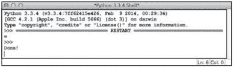

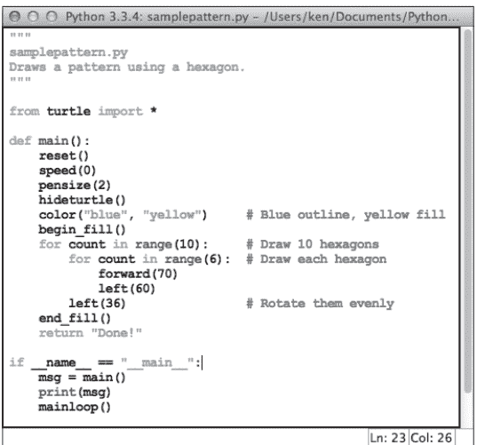

```python
"""
samplepattern.py
Draw a pattern using a hexagon.
"""

from turtle import *

def main():
    reset()
    speed(0)
    pensize(2)
    hideturtle()
    color("blue", "yellow")    # Blue outline, yellow fill
    begin_fill()
    for count in range(10):    # Draw 10 hexagons
        for count in range(6): # Draw each hexagon
            forward(70)
            left(60)
        left(36)               # Rotate them evenly
    end_fill()
    return "Done!"

if __name__ == "__main__":
    msg = main()
    print(msg)
    mainloop()
```

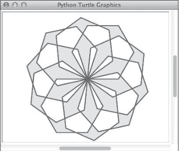

图 4.2
在 IDLE 中运行程序。
© 2014 Python Software Foundation.

请注意，如果程序中存在任何运行时错误（但在此示例中不应该有），错误消息将始终以红色显示在 shell 窗口中。

要退出正在运行的程序，请关闭海龟图形窗口。此时，控制权将返回到 shell，你可以在文件窗口中对程序进行任何所需的更改。

当你在本书其余部分开发程序时，你将在 IDLE 中使用此类窗口。记住 F5 键的位置！

### 从终端窗口运行程序

如果你想将完成的 Python 程序交给他人，请注意他们很可能会从终端窗口运行它。要亲自尝试，请打开一个终端窗口并导航到包含文件 samplepattern.py 的目录。然后在终端窗口中输入命令

```
python3 samplepattern.py
```

海龟图形窗口应该弹出并显示图案。当你关闭此窗口时，程序会退出并将控制权返回到终端窗口。请注意，消息 "Done!" 应显示在该窗口中。如果你不希望程序产生此类额外输出，可以删除倒数第二行代码中的输出语句。

大多数计算机系统都提供一种方法来设置双击文件图标时触发的操作。在 Windows 系统中，此操作运行 Python 程序。在 Mac OS 中，此操作打开 IDLE 文件窗口。此外，在任一系统中，你都必须确保已安装 Python 3.0 或更高版本。

### 使用 sys 模块和命令行参数

当你从终端窗口运行程序时，通常可以提供可选的命令行参数。例如，idle3 命令会弹出一个 shell 窗口，但你也可以运行 idle3 filename 来打开文件窗口。同样，当你运行 python3 filename 时，你正在启动一个 Python 程序，但当你只运行 python3 时，会打开一个 shell（在终端窗口本身中，而不是在 IDLE 窗口中）。

Python 允许你分发可以带额外命令行参数运行的程序。例如，假设你希望绘制六边形图案的示例程序改用五边形或八边形。你的程序可以接受一个额外的命令行参数，表示图形的边数。默认
数字如果用户未提供额外参数仍为 6。以下是如何在终端窗口中使用此功能的三个示例：

```
Madison:~ ken$ python3 samplepattern.py
Done!
Madison:~ ken$ python3 samplepattern.py 5
Done!
Madison:~ ken$ python3 samplepattern.py 8
Done!
```

当 Python 程序在终端窗口中运行时，系统会将每个可选参数放在一个字符串列表中。该列表中的第一个字符串是程序的文件名。要在你的 Python 程序中访问此列表，你需要导入 sys 模块。变量 sys.argv 是该列表的名称。

在实际使用命令行参数之前尝试它们时，可以在 main 函数开头打印它们。以下是实现此目的的示例程序更改，以及随后的终端输出：

```
"""
samplepattern.py
Draws a pattern using a hexagon.
"""

from turtle import *
import sys

def main():
    print(sys.argv)
# The rest of the program would go here
```

两次运行的程序输出：

```
Madison:~ ken$ python3 samplepattern.py
['samplepattern']
Done!
Madison:~ ken$ python3 samplepattern.py 5
['samplepattern', '5']
Done!
```

现在你将修改程序，使其处理额外的命令行参数（如果有）。以下是相关代码，后面附有解释。

```python
from turtle import *
import sys

def main():
    if len(sys.argv) == 2:
        numSides = int(sys.argv[1])
        if numSides < 3:
            return "Error: number of sides must be > 2"
    else:
        numSides = 6
    angle = 360 / numSides        # Compute interior angle for polygon
    reset()
    speed(0)
    width(2)
    hideturtle()
    color("blue", "yellow")       # Blue outline, yellow fill
    begin_fill()
    for count in range(10):       # Draw 10 polygons
        for count in range(numSides):  # Draw each polygon
            forward(70)
            left(angle)
        left(36)                  # Rotate them evenly
    end_fill()
    return "Done!"
```

main 函数现在使用变量 numSides 来指代形状中的边数，并使用变量 angle 来指代形状中边之间的内角。请注意这些变量是如何初始化然后在循环中使用的。

main 开头的其余新代码处理额外命令行参数的可能性。如果没有提供额外的命令行参数，图形的边数仍为 6，如前所述。否则，该参数将被转换为 int 并在用于确定边数和角度之前进行错误检查。

请注意使用嵌套的 if 和 return 语句来处理错误。

## 幕后探秘：Python 如何运行程序

无论你是以程序形式运行 Python 代码还是在 shell 中交互式运行，Python 都会做大量工作来执行程序中的指令。想一想在你用 Python 编写的指令与

代码以及执行这些指令的计算机硬件。这是一个大多数程序员（以及大多数其他计算机用户）从未需要担心的差距；他们都理所当然地认为自己构建或使用的程序将在任何计算机上完成其任务。

在本节中，你将了解到一些关于物理设备（如计算机）如何执行你在 Python 代码中编写的指令的内部工作原理。

## 计算机硬件

计算机的基本硬件组件是 *内存*、*中央处理器*（CPU）以及一组 *输入/输出设备*，如图 4.3 所示。

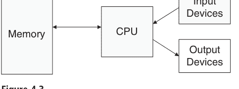

图 4.3
现代计算机系统的硬件组件。

人类主要通过输入和输出设备与计算机交互。输入设备包括触摸屏、键盘、鼠标、摄像头和麦克风。常见的输出设备包括显示器、打印机和扬声器。计算机还可以通过各种端口与外部世界通信，这些端口将其连接到网络以及其他设备，如手持音乐播放器、数码相机和无人机机器人。大多数输入设备的目的是将人类处理的信息，如文本、图像和声音，转换为可进行计算处理的信息。大多数输出设备的目的是将处理结果转换回人类可用的形式。

计算机内存被设置用于以电子形式表示和存储信息。具体来说，信息以二进制数字（1 和 0）的模式存储，也称为 *位*。要理解其工作原理，请考虑一个基本设备，例如只能处于两种状态之一的非调光灯开关：开或关。现在假设有一个开关组控制一行 16 个小灯。通过打开或关闭开关，你可以用灯的开或关模式表示任意 16 位二进制数字的模式。计算机科学家已经发现如何将任何信息，包括文本、图像和声音，以二进制形式表示。

现在，假设有 4 组这样的 16 个灯。你可以选择任意一组灯并检查或更改该集合中每个灯的状态。你刚刚开发了一个计算机内存的微型模型。此内存有 4 个单元，每个单元可存储 16 位二进制信息。内存单元填充有二进制数字的该模型的示意图如图 4.4 所示。此内存有时也称为主内存或内部内存或随机存取内存（RAM）。

|0|1|0|1|0|1|1|1|0|1|0|0|1|1|0|1|
|---|---|---|---|---|---|---|---|---|---|---|---|---|---|---|---|
|0|1|0|0|1|1|1|1|0|1|0|1|1|0|1|0|
|1|1|0|1|1|1|1|1|0|1|0|0|1|1|1|1|
|0|1|0|0|1|0|1|1|0|1|0|1|1|0|1|1|

### 图 4.4

计算机内存的模型。

存储在内存中的信息可以表示任何类型的数据，如数字、文本、图像、声音或程序的指令。你也可以将程序作为计算机的二进制指令编码存储在内存中。一旦信息存储在内存中，你通常希望对其做些什么——也就是说，你希望对其进行处理。计算机中负责处理数据的部分是中央处理器（CPU）。该设备，有时也称为处理器，由电子开关组成，用于执行简单的逻辑、算术和控制操作。CPU 通过从内存中获取其二进制指令、对其进行解码并执行它们来运行机器语言程序。执行指令可能还涉及从内存中获取其他二进制信息——数据。

处理器可以快速定位计算机主内存中的数据。然而，这些数据仅在电力进入计算机时存在。如果电池失效或电源关闭，主内存中的数据就会丢失。显然，需要一种更永久的内存类型来保存数据。这种更永久的内存类型称为外部内存或二级内存，有多种形式。磁性存储介质，如磁带和硬盘，允许将位模式存储为磁场上的模式。半导体存储介质，如闪存棒，使用不同的技术执行大致相同的功能，光学存储介质，如 CD 和 DVD 也是如此。其中一些二级存储介质可以容纳比计算机内部内存多得多的信息。智能手机、平板电脑和许多笔记本电脑现在使用内置闪存作为二级存储以及主存储。

## 计算机软件

计算机是一种通用问题解决机器。要解决任何可计算问题，计算机必须能够运行任何程序。由于不可能预见到所有存在可计算解的问题，因此无法将所有潜在程序“硬连线”到计算机的硬件中。相反，你将一些基本操作构建到硬件的处理器中，并要求任何程序使用它们。程序被转换为二进制形式，然后连同其数据一起加载到计算机的内存中。处理器可以通过运行硬件的更基本操作来执行程序的指令。

任何存储在内存中以便稍后运行的程序都称为 *软件*。存储在计算机内存中的程序必须以二进制数字表示，也称为 *机器码*。一次一个数字地将机器码加载到计算机内存中对人类来说将是一项繁琐、容易出错的任务。如果能自动化此过程以每次都正确执行会很方便。因此，计算机科学家开发了另一个程序，称为 *加载器*，来执行此任务。加载器将一组机器语言指令作为输入，并将它们加载到硬件中的适当内存位置。当加载器完成时，机器语言程序就可以运行了。显然，加载器无法将自身加载到内存中，所以这是必须硬连线到计算机的程序之一。

现在有了加载器，你可以加载和运行其他使程序的开发、运行和管理变得更容易的程序。这种类型的软件称为 *系统软件*。系统软件最重要的例子是计算机的 *操作系统*。你可能已经熟悉至少一种最流行的操作系统，无论是 Linux、Apple 的 Mac OS，还是 Microsoft Windows。手持设备使用自己的操作系统版本，如 iOS 和 Android。操作系统负责管理和调度多个并发运行的程序。它还管理计算机的内存，包括外部存储，并管理 CPU、输入/输出设备与其他计算机在网络上的通信。任何操作系统的[content]
代码以及执行这些指令的计算机硬件。这是一个大多数程序员（以及大多数其他计算机用户）从未需要担心的差距；他们都理所当然地认为自己构建或使用的程序将在任何计算机上完成其任务。

在本节中，你将了解到一些关于物理设备（如计算机）如何执行你在 Python 代码中编写的指令的内部工作原理。

## 计算机硬件

计算机的基本硬件组件是 *内存*、*中央处理器*（CPU）以及一组 *输入/输出设备*，如图 4.3 所示。


图 4.3
现代计算机系统的硬件组件。

人类主要通过输入和输出设备与计算机交互。输入设备包括触摸屏、键盘、鼠标、摄像头和麦克风。常见的输出设备包括显示器、打印机和扬声器。计算机还可以通过各种端口与外部世界通信，这些端口将其连接到网络以及其他设备，如手持音乐播放器、数码相机和无人机机器人。大多数输入设备的目的是将人类处理的信息，如文本、图像和声音，转换为可进行计算处理的信息。大多数输出设备的目的是将处理结果转换回人类可用的形式。

计算机内存被设置用于以电子形式表示和存储信息。具体来说，信息以二进制数字（1 和 0）的模式存储，也称为 *位*。要理解其工作原理，请考虑一个基本设备，例如只能处于两种状态之一的非调光灯开关：开或关。现在假设有一个开关组控制一行 16 个小灯。通过打开或关闭开关，你可以用灯的开或关模式表示任意 16 位二进制数字的模式。计算机科学家已经发现如何将任何信息，包括文本、图像和声音，以二进制形式表示。

现在，假设有 4 组这样的 16 个灯。你可以选择任意一组灯并检查或更改该集合中每个灯的状态。你刚刚开发了一个计算机内存的微型模型。此内存有 4 个单元，每个单元可存储 16 位二进制信息。内存单元填充有二进制数字的该模型的示意图如图 4.4 所示。此内存有时也称为主内存或内部内存或随机存取内存（RAM）。

|0|1|0|1|0|1|1|1|0|1|0|0|1|1|0|1|
|---|---|---|---|---|---|---|---|---|---|---|---|---|---|---|---|
|0|1|0|0|1|1|1|1|0|1|0|1|1|0|1|0|
|1|1|0|1|1|1|1|1|0|1|0|0|1|1|1|1|
|0|1|0|0|1|0|1|1|0|1|0|1|1|0|1|1|

### 图 4.4

计算机内存的模型。

存储在内存中的信息可以表示任何类型的数据，如数字、文本、图像、声音或程序的指令。你也可以将程序作为计算机的二进制指令编码存储在内存中。一旦信息存储在内存中，你通常希望对其做些什么——也就是说，你希望对其进行处理。计算机中负责处理数据的部分是中央处理器（CPU）。该设备，有时也称为处理器，由电子开关组成，用于执行简单的逻辑、算术和控制操作。CPU 通过从内存中获取其二进制指令、对其进行解码并执行它们来运行机器语言程序。执行指令可能还涉及从内存中获取其他二进制信息——数据。

处理器可以快速定位计算机主内存中的数据。然而，这些数据仅在电力进入计算机时存在。如果电池失效或电源关闭，主内存中的数据就会丢失。显然，需要一种更永久的内存类型来保存数据。这种更永久的内存类型称为外部内存或二级内存，有多种形式。磁性存储介质，如磁带和硬盘，允许将位模式存储为磁场上的模式。半导体存储介质，如闪存棒，使用不同的技术执行大致相同的功能，光学存储介质，如 CDs 和 DVDs 也是如此。其中一些二级存储介质可以容纳比计算机内部内存多得多的信息。智能手机、平板电脑和许多笔记本电脑现在使用内置闪存作为二级存储以及主存储。

## 计算机软件

计算机是一种通用问题解决机器。要解决任何可计算问题，计算机必须能够运行任何程序。由于不可能预见到所有存在可计算解的问题，因此无法将所有潜在程序“硬连线”到计算机的硬件中。相反，你将一些基本操作构建到硬件的处理器中，并要求任何程序使用它们。程序被转换为二进制形式，然后连同其数据一起加载到计算机的内存中。处理器可以通过运行硬件的更基本操作来执行程序的指令。

任何存储在内存中以便稍后运行的程序都称为 *软件*。存储在计算机内存中的程序必须以二进制数字表示，也称为 *机器码*。一次一个数字地将机器码加载到计算机内存中对人类来说将是一项繁琐、容易出错的任务。如果能自动化此过程以每次都正确执行会很方便。因此，计算机科学家开发了另一个程序，称为 *加载器*，来执行此任务。加载器将一组机器语言指令作为输入，并将它们加载到硬件中的适当内存位置。当加载器完成时，机器语言程序就可以运行了。显然，加载器无法将自身加载到内存中，所以这是必须硬连线到计算机的程序之一。

现在有了加载器，你可以加载和运行其他使程序的开发、运行和管理变得更容易的程序。这种类型的软件称为 *系统软件*。系统软件最重要的例子是计算机的 *操作系统*。你可能已经熟悉至少一种最流行的操作系统，无论是 Linux、Apple 的 Mac OS，还是 Microsoft Windows。手持设备使用自己的操作系统版本，如 iOS 和 Android。操作系统负责管理和调度多个并发运行的程序。它还管理计算机的内存，包括外部存储，并管理 CPU、输入/输出设备与其他计算机在网络上的通信。任何操作系统的重要组成部分是其 *文件系统*，它允许人们在永久存储中组织数据和程序。操作系统的另一个重要功能是提供 *用户界面*——也就是说，让你与计算机软件交互的方式。基于终端的界面接受来自键盘的输入并在显示器屏幕上显示文本输出。现代 *图形用户界面*（GUI）围绕桌面隐喻组织显示器屏幕，其中包含用于文件夹、文件和应用程序的图标的窗口。这种类型的用户界面还允许用户使用指向设备（如鼠标或手指）来操作图像。

另一种主要的软件类型称为 *应用软件*，或简称为应用程序（手持设备上称为应用）。应用程序是为特定任务设计的程序，如编辑文档或显示网页。应用程序包括网页浏览器、文字处理器、电子表格、数据库管理器、图形设计包、音乐制作系统和游戏等。

正如你所学到的，计算机硬件只能运行以二进制形式编写的指令——即机器语言。然而，编写机器语言程序将是一个极其繁琐、容易出错的任务。为了简化计算机程序的编写过程，计算机科学家开发了高级编程语言来表达程序。这些语言类似于英语，允许作者以他们和其他人可以理解的形式表达程序。

正如你在本书中迄今所做的那样，你首先在文本编辑器中编写高级语言语句。然后你运行另一个称为 *编译器* 的程序来将高级程序代码转换为可运行代码。（当你在 Python 中按下 F5 键时，就是这样发生的。）因为即使在编写高级代码时你也可能犯语法错误，编译器会在完成翻译过程之前检查语法错误。如果它检测到任何这些错误，编译器会通过错误消息提醒你。

如果翻译过程在没有语法错误的情况下成功，程序就可以由运行时系统执行。运行时系统可能会直接在硬件上执行程序，也可能运行另一个称为 *解释器* 或 *虚拟机* 的程序来执行程序。图 4.5 显示了用于 Python 程序的此过程中的步骤和软件。

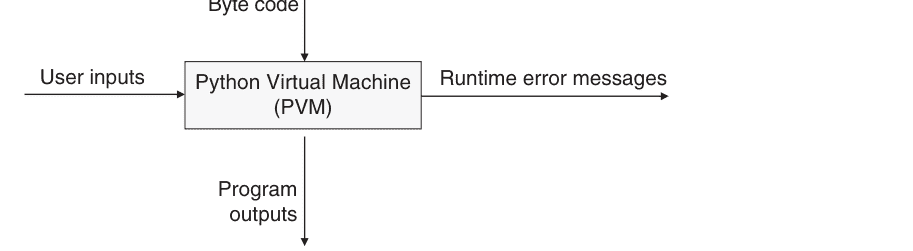

图 4.5
用于编译和运行程序的软件。


如果 Python 程序格式良好，编译器会将其翻译成一种低级语言的等价形式，称为 *字节码*。

该字节码会被发送到另一个软件组件，即 *Python 虚拟机* (PVM)，在其中运行。就在这里，PVM 会进一步将字节码翻译成你特定类型计算机的机器码。如果在此步骤中出现另一错误，执行将以错误消息终止。

至此，你对编写和运行 Python 程序的介绍就结束了。在下一章中，你将探索一些设计程序以解决更有趣、更复杂问题的方法。

## 摘要

- 程序是一系列解决问题的语句。
- 软件开发的五个阶段是分析、设计、编码、编译和测试。
- 在分析阶段，程序员说明程序的各个部分将做什么。
- 在设计阶段，程序员说明程序的各个部分将如何完成其分配的任务。
- 在编码阶段，程序员将设计翻译成特定编程语言中的程序。
- 编译器是一种软件工具，用于检查程序的语法错误，然后将其翻译成计算机可运行的形式。
- 在测试阶段，程序员确定程序是否按预期执行。
- 计算机硬件由内存、中央处理器 (CPU) 和一组输入/输出设备组成。
- 程序的数据和指令最终由一组硬件开关表示，这些开关可以设置为开或关。这些物理状态反过来可以表示二进制数字 1 和 0，而这些数字反过来又能够在机器级别表示任何数据或指令。
- 计算机内存是一组开关，用于以机器码（1 和 0 的语言）存储数据和程序。
- 中央处理器包含用于对机器码中的数据执行基本操作的电路。所有计算机操作都由这些基本操作组成。
- 诸如磁盘和闪存棒之类的二级存储器为数据提供永久存储。
- 操作系统为各种输入和输出设备提供用户界面，例如显示器、键盘、指向设备、扫描仪、摄像机和打印机。
- Python 编译器将 Python 程序翻译成字节码程序，然后在 Python 虚拟机 (PVM) 上运行。
- 系统软件包括操作系统、文本编辑器（如 IDLE）、Python 编译器和 Python 虚拟机。
- 应用软件执行特定任务，例如文字处理和电子表格管理。
- 要运行字节码程序，Python 虚拟机会调用机器语言中的操作。

## 练习

启动 IDLE shell，打开一个文件窗口，并完成以下练习。你应该在 IDLE 中运行每个程序，并在完成后在终端窗口中运行。

- 1. 在文件 `stopsign.py` 中编写一个 Python 程序，绘制一个停车标志。标志应为填充的红色六边形，中间用白色字母居中显示“停止”。
- 2. 修改 `samplepattern.py` 中的代码，使其可以接受三个可选的命令行参数。它们分别代表边数、轮廓颜色和填充颜色。程序应能够使用其中一个、两个或全部三个参数。默认值与之前相同。务必通过在终端窗口中运行程序来测试你的程序。

本页特意留空

# 第 5 章

## 定义函数


到目前为止，本书中的 Python 程序由内置运算符、控制语句、内置函数的调用以及上一章介绍的一个程序员定义函数 main 组成。

严格来说，程序员定义的函数并不是必需的。你可以使用仅 Python 的内置运算符、函数和控制语句构建任何程序。然而，在任何重要的程序中，结果代码将极其复杂，难以验证，几乎不可能维护。

问题在于人类大脑一次只能处理少数几件事。（心理学家说舒适地处理三件事，最多七件。）人们通过开发简化或隐藏复杂性的机制来应对复杂性。这种机制称为抽象。最简单地说，抽象隐藏了细节，从而使一个人能够将许多事物视为一件事物。你使用抽象来指代日常生活中最常见的任务。例如，考虑表达“做我的洗衣”。这个表达很简单，但它指的是一个多步骤的过程，涉及从洗衣篮中取出脏衣服，将其分为白色和彩色，装入洗衣机，转移到烘干机，然后折叠并放入梳妆台或衣柜。事实上，没有抽象，大多数日常活动将不可能讨论、计划或执行。同样，有效的设计师必须发明有用的抽象来控制复杂性。

设计在许多领域都很重要。设计建筑的建筑师、设计桥梁或新汽车的工程师，以及设计下一场竞选的政治家、广告主管或军事指挥官必须组织团队并协调其成员以实现目标。设计在构建计算机程序时同样重要，其中一些是人类有史以来建造的最复杂的产物。在本章中，你将探索使用函数来设计计算机程序。

### 函数定义的基本元素

在本节中，你将学习函数定义的基本元素。这些元素包括参数、文档字符串、return 语句以及可选/关键字/默认参数。

### 圆和正方形

考虑在海龟图形程序中绘制多个圆和正方形需要做什么。要绘制一个圆，你只需将海龟移动到所需位置并使用半径作为参数调用内置的 circle 函数。但要绘制给定长度的正方形，你必须编写以下循环：

```
for count in range(4):
    forward(length)
    left(90)
```

你可以将此代码复制并粘贴到程序中想要绘制正方形的每个位置，但如果想对长度使用不同的变量或数字怎么办？那么在复制后你仍需编辑此代码。你可能会同意调用一个函数，例如 square，并将长度作为参数会容易得多。例如，下一个 shell 会话中的代码片段将绘制一个正方形内的圆：

```
>>> reset()
>>> hideturtle()
>>> circle(40)
>>> backward(40)
>>> square(80)
```

幸运的是，正如你在第 4 章“组合、保存和运行程序”中首次看到的那样，Python 允许你定义自己的函数。你可以通过在适当的标题下方放置循环来定义 square 函数，如下所示：

```
def square(length):
    """Draws a square with the given length."""
    for count in range(4):
        forward(length)
        left(90)
```

现在你可以调用函数 square，就像调用函数 circle 一样。你所要做的就是将海龟移动到所需的位置和方向，然后使用适当的参数调用该函数。例如，这里是如何使用 square 函数绘制第 3 章“控制结构：顺序、迭代和选择”中讨论的模式：

```
for count in range(10):
    square(70)
    left(36)
```

你可以定义类似的函数来绘制其他几何形状，例如六边形和八边形，正如你在练习中将看到的那样。

Python 函数定义的最简单形式是

```
def functionName(arguments):
    statements
```

其中 arguments 是由逗号分隔的一系列名称。请注意，statements 中的每个语句必须缩进在函数的标题下方。

### 文档字符串

在第 4 章中，你看到了 docstring，即程序或模块文件顶部的引号文本，如何描述该程序或模块的目的。当你定义新函数来解决问题时，你还应该用文档字符串记录它们。如 square 函数的定义所示，文档字符串出现在函数标题和函数体之间的行上。请注意，你必须将此字符串缩进到与函数内语句相同的列。当在函数定义中使用时，文档字符串应说明函数的作用，描述任何参数的作用，并描述函数返回的值（如果有）。

如第 4 章所述，文档字符串允许 Python 从 shell 为程序员提供帮助。当你导入函数的模块时，可以通过在 shell 提示符下输入 help(moduleName.functionName) 来获取有关该函数的帮助。

始终在编写函数的代码之前编写文档字符串。这种做法有助于你明确函数的作用及其参数的作用。它还为你的函数的调用者（可能是其他程序员）提供了有关你提供的资源使用的宝贵信息。


## return 语句

先前定义的 square 函数只是绘制一个正方形，并不会向调用者返回一个值。第 4 章中讨论的 main 函数返回一个字符串值，这并不太有趣。许多其他函数，例如 Python 的 math.sqrt 函数，需要一个或多个参数并计算并返回一个值。

要了解函数如何返回值，请考虑随机颜色的创建。在迄今为止的代码示例中，你已经看到随机颜色是一个元组，包含三个随机整数，每个都在 0 到 255 的范围内。你可以用以下代码在 Python 中创建一个随机颜色：

```
randomColor = (randint(0, 255), randint(0, 255), randint(0, 255))
```

这里你将适当形式的颜色值赋给变量 randomColor。然而，每次你需要一个新的随机颜色时，都必须运行相同的赋值语句（如果变量名改变，则是不同的语句）。

如果你能调用一个名为 randomColor 的函数，然后在任何你想要的地方使用它的值，那就方便得多。你就不需要每次想要随机颜色时都重写或复制粘贴一行复杂的代码。这里是该函数的定义：

```
def randomColor():
    """Returns a random RGB color."""
    return (randint(0, 255), randint(0, 255), randint(0, 255))
```

请注意，此函数不期望任何参数并返回一个值。这里的 return 语句包含了创建颜色值的 Python 表达式。下一段代码片段展示了你如何使用函数 randomColor 在示例图案中绘制彩色正方形：

```
for count in range(10):
    pencolor(randomColor())
    square(70)
    left(36)
```

return 语句的形式如下：

```
return optionalExpression
```

你可以在任何时候使用 return 语句退出函数，即使在循环内部，即使函数不返回值。当你从 return 语句中省略表达式或从函数的语句中完全省略 return 语句时，该函数会自动返回 Python 值 None。

## 在程序中测试函数

现在你已经了解如何定义和调用自己的函数，你需要知道将它们放在 Python 代码文件中的什么位置。一种方法是编写一个简短的测试程序。你可以在集成开发环境（IDLE）的文件窗口中编写此程序，就像在第 4 章中一样。测试程序的结构现在包含了你的函数定义。虽然这些定义可以在文件中以任何顺序出现，但通常将它们放在导入部分和 main 函数之间。下一段代码展示了一个程序，用于测试你在本章中迄今为止定义的函数。

```
"""
testsquare.py
Tester program for square and randomColor functions.
"""

from turtle import *
from random import randint

def square(length):
    """Draws a square with the given length."""
    for count in range(4):
        forward(length)
        left(90)

def randomColor():
    """Returns a random RGB color."""
    return (randint(0, 255), randint(0, 255), randint(0, 255))

def main():
    """Draws a radial pattern with 10 randomly colored squares."""
    speed(0)
    pensize(2)
    colormode(255)
    hideturtle()
    for count in range(10):
        pencolor(randomColor())
        square(70)
        left(36)
    return "Done!"

if __name__ == "__main__":
    msg = main()
    print(msg)
    mainloop()
```

在 IDLE 文件窗口中运行此程序（F5 键）。然后在 shell 中导入模块 testsquare。在那时，你可以通过运行 help 函数并将函数或模块名作为参数，来请求任何函数的帮助，或整个模块的帮助。你也可以运行函数 testsquare.randomColor。做几次以查看结果。在你尝试此程序时，也鼓励你添加和测试新函数，例如绘制六边形的函数。

记住先写文档字符串！

## 可选参数、默认值参数和关键字参数

假设你想在 square 函数中接受一个可选的颜色参数。如果存在此参数，调用者就可以用新的画笔颜色绘制正方形。如果此参数不存在，函数将以当前画笔颜色绘制正方形。如果函数以新颜色绘制正方形，它会在返回前恢复旧颜色。

下一段代码片段使用随机颜色绘制正方形的径向图案。

```
for count in range(10):
    square(70, randomColor())
    left(36)
```

要定义一个具有可选参数的函数，你将参数名和默认值放在看起来像赋值语句的地方，如下定义所示：

```
def square(length, newColor = None):
    """Draws a square with the given length and optional color."""
    if newColor:
        oldColor = pencolor()      # Save old pen color and use new color
        pencolor(newColor)
    for count in range(4):
        forward(length)
        left(90)
    if newColor:
        pencolor(oldColor)         # Restore old pen color
```

请注意，第一个参数 length 没有默认值。此参数不是可选的而是必需的，这意味着函数的调用者必须提供长度。

如果调用者在调用函数时没有提供第二个参数，newColor 的值会自动为 None。因为 Python 将此值视为 False 而任何颜色值视为 True，所以你可以在单向 if 语句中检查新颜色是否存在。

如果存在新颜色，你可以将当前画笔颜色保存在临时变量 oldColor 中，并将画笔重置为新颜色。否则，如果没有颜色参数，你可以保持画笔颜色不变。

在绘制完正方形后，你再次检查新颜色是否存在，如果存在则恢复旧颜色。

以下是此函数的一些示例调用：

```
>>> square(70)
>>> square(70, "red")
>>> square(length = 70, newColor = "red")
>>> square(newColor = "red", length = 70)
```

函数的前两次调用只显示参数的值。后两次调用同时显示参数的名称和值。以这种方式使用时，它们被称为关键字参数。使用关键字参数允许你以与函数定义中所示不同的顺序向函数提供参数。然而，如果你省略参数的关键字，该参数必须出现在与函数定义中相同的[content]
## return 语句

先前定义的 square 函数只是绘制一个正方形，并不会向调用者返回一个值。第 4 章中讨论的 main 函数返回一个字符串值，这并不太有趣。许多其他函数，例如 Python 的 math.sqrt 函数，需要一个或多个参数并计算并返回一个值。

要了解函数如何返回值，请考虑随机颜色的创建。在迄今为止的代码示例中，你已经看到随机颜色是一个元组，包含三个随机整数，每个都在 0 到 255 的范围内。你可以用以下代码在 Python 中创建一个随机颜色：

```
randomColor = (randint(0, 255), randint(0, 255), randint(0, 255))
```

这里你将适当形式的颜色值赋给变量 randomColor。然而，每次你需要一个新的随机颜色时，都必须运行相同的赋值语句（如果变量名改变，则是不同的语句）。

如果你能调用一个名为 randomColor 的函数，然后在任何你想要的地方使用它的值，那就方便得多。你就不需要每次想要随机颜色时都重写或复制粘贴一行复杂的代码。这里是该函数的定义：

```
def randomColor():
    """Returns a random RGB color."""
    return (randint(0, 255), randint(0, 255), randint(0, 255))
```

请注意，此函数不期望任何参数并返回一个值。这里的 return 语句包含了创建颜色值的 Python 表达式。下一段代码片段展示了你如何使用函数 randomColor 在示例图案中绘制彩色正方形：

```
for count in range(10):
    pencolor(randomColor())
    square(70)
    left(36)
```

return 语句的形式如下：

```
return optionalExpression
```

你可以在任何时候使用 return 语句退出函数，即使在循环内部，即使函数不返回值。当你从 return 语句中省略表达式或从函数的语句中完全省略 return 语句时，该函数会自动返回 Python 值 None。

## 在程序中测试函数

现在你已经了解如何定义和调用自己的函数，你需要知道将它们放在 Python 代码文件中的什么位置。一种方法是编写一个简短的测试程序。你可以在集成开发环境（IDLE）的文件窗口中编写此程序，就像在第 4 章中一样。测试程序的结构现在包含了你的函数定义。虽然这些定义可以在文件中以任何顺序出现，但通常将它们放在导入部分和 main 函数之间。下一段代码展示了一个程序，用于测试你在本章中迄今为止定义的函数。

```
"""
testsquare.py
Tester program for square and randomColor functions.
"""

from turtle import *
from random import randint

def square(length):
    """Draws a square with the given length."""
    for count in range(4):
        forward(length)
        left(90)

def randomColor():
    """Returns a random RGB color."""
    return (randint(0, 255), randint(0, 255), randint(0, 255))

def main():
    """Draws a radial pattern with 10 randomly colored squares."""
    speed(0)
    pensize(2)
    colormode(255)
    hideturtle()
    for count in range(10):
        pencolor(randomColor())
        square(70)
        left(36)
    return "Done!"

if __name__ == "__main__":
    msg = main()
    print(msg)
    mainloop()
```

在 IDLE 文件窗口中运行此程序（F5 键）。然后在 shell 中导入模块 testsquare。在那时，你可以通过运行 help 函数并将函数或模块名作为参数，来请求任何函数的帮助，或整个模块的帮助。你也可以运行函数 testsquare.randomColor。做几次以查看结果。在你尝试此程序时，也鼓励你添加和测试新函数，例如绘制六边形的函数。

记住先写文档字符串！

## 可选参数、默认值参数和关键字参数

假设你想在 square 函数中接受一个可选的颜色参数。如果存在此参数，调用者就可以用新的画笔颜色绘制正方形。如果此参数不存在，函数将以当前画笔颜色绘制正方形。如果函数以新颜色绘制正方形，它会在返回前恢复旧颜色。

下一段代码片段使用随机颜色绘制正方形的径向图案。

```
for count in range(10):
    square(70, randomColor())
    left(36)
```

要定义一个具有可选参数的函数，你将参数名和默认值放在看起来像赋值语句的地方，如下定义所示：

```
def square(length, newColor = None):
    """Draws a square with the given length and optional color."""
    if newColor:
        oldColor = pencolor()      # Save old pen color and use new color
        pencolor(newColor)
    for count in range(4):
        forward(length)
        left(90)
    if newColor:
        pencolor(oldColor)         # Restore old pen color
```

请注意，第一个参数 length 没有默认值。此参数不是可选的而是必需的，这意味着函数的调用者必须提供长度。

如果调用者在调用函数时没有提供第二个参数，newColor 的值会自动为 None。因为 Python 将此值视为 False 而任何颜色值视为 True，所以你可以在单向 if 语句中检查新颜色是否存在。

如果存在新颜色，你可以将当前画笔颜色保存在临时变量 oldColor 中，并将画笔重置为新颜色。否则，如果没有颜色参数，你可以保持画笔颜色不变。

在绘制完正方形后，你再次检查新颜色是否存在，如果存在则恢复旧颜色。

以下是此函数的一些示例调用：

```
>>> square(70)
>>> square(70, "red")
>>> square(length = 70, newColor = "red")
>>> square(newColor = "red", length = 70)
```

函数的前两次调用只显示参数的值。后两次调用同时显示参数的名称和值。以这种方式使用时，它们被称为关键字参数。使用关键字参数允许你以与函数定义中所示不同的顺序向函数提供参数。然而，如果你省略参数的关键字，该参数必须出现在与函数定义中相同的

## 作为参数的函数

请考虑绘制 10 个正方形的径向图案的代码：

```
for count in range(10):
    square(70)
    left(36)
```

正如你在第 4 章中所看到的，你可以使用这样的代码来绘制使用三角形、六边形或其他正多边形的图案。此时，你应该问自己：要使用不同类型的多边形进行绘制，这个代码模式中必须改变什么？显然，只是函数名，在本例中恰好是 square。如果将名称替换为 hexagon，代码就会调用绘制六边形的函数。

不幸的是，每次想要绘制该图案时，你都必须重写相同的循环。你希望将这种常见的代码模式捕获到单个函数中。每次调用该函数时唯一会变化的东西将是用于绘制特定类型多边形的函数名。如果可以将此函数作为参数传递给图案绘制函数，那就万事俱备了。

假设你的新图案绘制函数名为 radialPattern。你可以按以下方式调用它来绘制基于正方形的图案和基于六边形的图案：

```
radialPattern(square)
radialPattern(hexagon)
```

幸运的是，Python 是少数允许这样做的编程语言之一。以下是 radialPattern 函数定义的代码：

```
def radialPattern(polygonFunction):
    """Draws a series of polygons by rotating around a center point."""
    for count in range(10):
        polygonFunction(70)
        left(36)
```

请注意，在此定义中，参数名 polygonFunction 指的是调用者传递的函数。此函数可以是 square、hexagon，或任何绘制多边形的一个参数函数。

到现在为止，你应该在心里想：“嘿，这个 radialPattern 函数仍然不够通用。它总是绘制 10 个长度为 70 的多边形图案。我想要提供一个可以绘制任意数量、任意长度多边形的函数。” 这样想是正确的，在练习中，你将有机会付诸实践。

## 使用 lambda 表达式构建函数

在你克服了可以将函数作为参数传递给其他函数的震惊之后，你需要学习另一个相关概念。

你之前看到，可以通过调用更通用的函数 regularPolygon 来定义绘制特定类型正多边形的任意函数。此函数的参数是边长和边数。当你想要绘制一种新的多边形时，你只需以这种方式为其定义一个函数并调用该函数。

然而，除了标准的三边、四边、五边、六边和八边形之外，还有很多正多边形。为每一个定义新函数可能会相当繁琐，而你本可以直接调用 regularPolygon 函数来完成所需任务。但你不能将此函数作为参数传递给 radialPattern 函数。那是因为 regularPolygon 期望两个参数，而 radialPattern 的函数参数在被调用时只期望一个参数——边长。

幸运的是，Python 提供了解决此问题的优雅方法。当你定义 square 函数时，你本质上是在一个期望一个参数的函数 square 内部“包装”了对 regularPolygon 的两次参数调用。Python 包含一种称为 lambda 表达式的特殊形式，它允许你做到这一点，而无需费心定义命名函数。Python lambda 表达式的形式如下：

```
lambda arguments: expression
```

假设，例如，你想要绘制一个 16 边形。以下 lambda 表达式构建了一个可以完成此任务的新函数：

```
>>> lambda length: regularPolygon(length, 16)
<function <lambda> at 0x102b69ef0>
```

在 shell 会话中评估此 lambda 表达式，以向你展示函数被构建并返回。这是一个参数为 length 的匿名函数，正是 radialPattern 所需的。当你的新函数最终被调用时，它会调用 regularPolygon 来绘制一个 16 边正多边形。以下是调用你的新函数的示例，它绘制长度为 70 的 16 边形：

```
>>> (lambda length: regularPolygon(length, 16))(70)
```

将此 lambda 表达式作为参数传递给 radialPattern 函数以绘制带 16 边形的图案：

```
>>> radialPattern(lambda length: regularPolygon(length, 16))
```

要更改特定类型的多边形，你只需更改边数。

## 模块作为函数库

到现在为止，你将已经编写了几个用于绘制几何形状的相关函数，也许还有一些使用这些形状的图案。你应该继续在简短的测试程序中测试你的函数。但随着函数数量的增长，你需要一个更好的地方来保存它们，以便像访问 Python 的库函数 `math.sqrt` 和 `random.randint` 一样访问它们。

在你测试每个函数并验证其按预期工作后，你应该将其放置在适当的模块或库文件中。将你的第一个模块命名为 `mygeometry`。你通过在 IDLE 中打开一个新文件窗口来创建此文件。立即将此文件保存为 `mygeometry.py`。然后在文件顶部添加一个 docstring，概括此模块的目的。此时，你可以开始粘贴每个函数定义，因为它们变得可用。

不时地，你应该将你的新模块导入到你使用过的其中一个测试程序中，并作为模块函数运行你的函数。如果你使用以下形式

```
moduleName.functionName(argumentList)
```

在调用你的函数时，你可以确保它们对最终使用你的模块的任何程序员都可用。

## 数学主题：函数作图

在本节中，你将学习如何使用 Python 程序中的函数来表达数学上理解的函数。

### 数学中的函数

在数学中表达函数有几种方法。在代数中，函数 $f$ 表示两个变量 $x$ 和 $y$ 之间的关系。用简写形式表示，该关系表述为方程

$y = f(x)$

在这个方程中，$f$ 是函数，$y$ 是 *因变量*，$x$ 是 *自变量*。这意味着，对于函数 $f$，当你改变 $x$ 的值时，$y$ 的值也会改变。$x$ 可以取的所有值集合称为函数的 *定义域*，$y$ 可以取的所有值集合称为函数的 *值域*。

函数 f 表示将定义域的值映射到其对应值域中的规则。例如，取表示给定数 x 的平方的函数，也称为 x²。该函数定义域和值域的子集如表 5.1 所示。

表 5.1 y = x² 的定义域和值域的子集

| x (定义域) | y (值域) |
|---|---|
|1|1|
|2|4|
|3|9|
|4|16|

在此表的每一行中，你可以看到 y 的值是 x 值的平方。

要说明函数 f 的规则，你必须将此函数展开为一个使用 x 计算相应 y 值的表达式。此表达式可以由运算符和对 x 值应用的其他函数组成。例如，你可以将函数 f(x) 展开为表达式 x * x 或 x ** 2 来说明表达 x 的平方的规则。因此，对于这种情况，方程 y = f(x) 展开为方程 y = x * x（或 y = x ** 2，如果你使用指数运算符）。

表达函数另一种方式是绘制一个绘制其定义域给定子集的图形。此图上的每个点 (x, y) 表示给定 x 值下方程 y = f(x) 的解。x 值沿 x 轴绘制，y 值沿 y 轴绘制。图 5.1 显示了两个方程 y = 2 * x + 10 和 y = x ** 2 - 10 * x + 3 的图形。第一个方程也称为线性方程，第二个方程也称为二次方程。


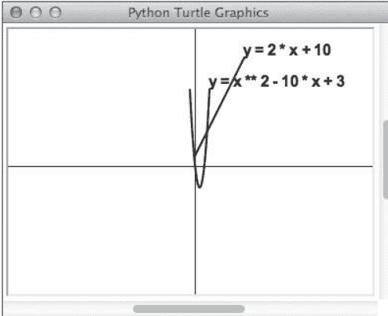

图 5.1
两个函数的图像。
© 2014 Python Software Foundation.

## 在海龟图形中绘制函数

你将开发一个简单的函数，用于绘制给定函数 f(x) 在其定义域中一组值 x₁ ... xₙ 的图像。在 Python 中表达每个函数 f(x) 很简单。例如，以下是图 5.1 中绘制的两个函数：

```
def quadratic(x):
    """A quadratic function."""
    return x ** 2 - 10 * x + 3

def linear(x):
    """A linear function."""
    return 2 * x + 10
```

绘制另一个函数图像的函数称为 plot。plot 函数接受另一个函数作为参数。总之，plot 函数期望四个参数：

- 要绘制的函数
- 定义域的下界
- 定义域的上界
- 用于标记绘制函数的字符串

因此，要按图 5.1 所示绘制这两个函数，你将调用以下内容：

```
plot(linear, 0, 50, "y = 2 * x + 10")
plot(quadratic, -5, 15, "y = x ** 2 - 10 * x + 3")
```

在 plot 函数中，你抬起画笔并将其定位到通过应用参数函数生成的第一个点 (x, y)。然后你放下画笔并遍历定义域中剩余的 x 值。每次循环时，你应用函数计算 y 值并移动到新的 (x, y) 位置。当循环结束时，最后一步在最终的 (x, y) 位置写入标签。以下是 plot 函数的代码：

```
def plot(f, x1, x2, label):
    """Plots f(x) for the domain x1..x2."""
    up()
    y = f(x1)
    goto(x1, y)
    down()
    for x in range(x1 + 1, x2 + 1):
        y = f(x)
        goto(x, y)
    write(label, font = ("Arial", 16, "bold"))
```

一个辅助函数根据画布的尺寸绘制坐标轴，并在绘制函数以提高清晰度之前将画笔大小设置为 2。完整程序的开发留作练习。

## 使用函数重构程序

修改程序使其更易于阅读和维护的过程称为重构。在本节中，你将探索如何重构在第 3 章中介绍的随机游走的代码。以下是该程序的第二个版本的代码：

```
from turtle import *
from random import randint
reset()
width = window_width()                     # Line 4
height = window_height()
(minX, maxX) = (-(width / 2), width / 2)
(minY, maxY) = (-(height / 2), height / 2)
(x, y) = position()
while x > minX and y > minY and x < maxX and y < maxY: # Line 9
    distance = randint(10, 60)              # Line 10
    forward(distance)                       # Line 11
```

```
degrees = randint(45, 135)      # Line 12
if randint(1, 2) == 1:
    left(degrees)
else:
    right(degrees)              # Line 16
(x, y) = position()             # Line 17
```

在此版本的程序中，海龟移动随机距离，然后向左或向右转随机度数，直到它越过窗口的其中一条边缘。此时，海龟停止，程序结束。

### 简化随机游走的代码

如果你仔细研究随机游走的代码，你会发现几个主要任务可以通过函数调用来简化：

第 4–9 行和第 17 行用于确定海龟是否越过窗口边缘。此代码可以打包到名为 atEdge 的布尔函数中。该函数在海龟位置越过边缘时返回 True，否则返回 False。此外，由于每次调用函数时都会检查窗口的尺寸，如果用户放大窗口，海龟可以继续；如果用户缩小窗口，海龟会更早停止。

第 11 行和第 12 行将海龟向前移动随机距离。此代码可以放入名为 randomForward 的函数中，该函数期望可能距离的边界作为参数。

第 12–16 行使海龟向左或向右转随机度数。你可以将此代码放在名为 randomTurn 的函数中，该函数期望可能度数的边界作为参数。你还可以添加第三个可选参数，指定转弯的概率。

在定义这些新函数之前，你应该重写顶层程序的代码（现在在 main 函数中），以查看如何使用你的函数：

```
from turtle import *
from random import randint

# New function definitions will go here

def main():
    reset()
    while not atEdge():
        randomForward(1, 3)      # Move 1, 2, or 3 units
        randomTurn(45, 135, .05) # Turn 1/20 of the time
```

如你所见，你刚刚将 15 行代码减少到 4 行代码，并使顶层程序更易于阅读和理解。你还可以提供参数，使海龟移动更短的距离并转弯更少，以平滑游走的模式。现在是时候通过定义函数来完成程序了。

### atEdge 函数

在定义 atEdge 函数的初步尝试中，你只需将早期程序中的代码移入新的函数定义中，如下所示：

```python
def atEdge():
    """Returns True if the turtle is at an edge of the window,
    or False otherwise."""
    width = window_width()
    height = window_height()
    (minX, maxX) = (-(width / 2), width / 2)
    (minY, maxY) = (-(height / 2), height / 2)
    (x, y) = position()
    return x > minX and y > minY and x < maxX and y < maxY
```

在继续其他函数之前，请考虑如何在添加一些其他潜在有用的函数的同时简化 atEdge 函数的代码。atEdge 函数确定海龟是否越过边缘。如果海龟越过顶部边缘、底部边缘、左侧边缘或右侧边缘，则为 True。通过这种方式表达并假设你有四个新函数可用，你可以按如下方式重写 atEdge 的代码：

```python
def atEdge():
    """Returns True if the turtle is at an edge of the window,
    or False otherwise."""
    return atTopEdge() or atBottomEdge() or \
           atLeftEdge() or atRightEdge()
```

四个新的边缘检测函数中的每一个都将海龟的其中一个坐标与单个边界坐标进行比较。例如，以下是 topEdge 函数的代码：

```python
def atTopEdge():
    """Returns True if the turtle is at the top edge of the window,
    or False otherwise."""
    return ycor() > window_height() / 2
```

其他三个函数具有类似的代码模式。你将很快使用这些新函数来创建更逼真的随机游走。

### randomForward 函数

randomForward 函数可能包含挑选随机距离并使海龟向前移动该距离的两行代码。但你可以使此函数比这更灵活一些，如下所示：

```
def randomForward(lower, upper = None):
    """Moves the turtle a random distance, from lower through upper.
    If upper is absent, moves turtle the lower distance"""
    if not upper:
        distance = lower
    else:
        distance = randint(lower, upper)
    forward(distance)
```

你可能会惊讶地发现第二个参数 upper 的默认值是 None。这与 if-else 语句一起，允许调用者使海龟向前移动随机距离或给定距离。因此，randomForward 函数在随机游走程序中将按预期工作，但在其他程序中以略有不同的方式使用时也会有所帮助。

### randomTurn 函数

randomTurn 函数有一个必需参数和两个可选参数。

与 randomDistance 函数一样，前两个参数名为 lower 和 upper，它们以类似的方式协同工作。如果 upper 的值不存在，则转弯不是随机的，lower 的值是用于转弯的度数。如果两者都存在，则从 lower 到 upper 之间选择一个随机数来指定度数。

第三个参数名为 probability，它指定海龟转弯的概率。该参数的默认值是 1，意味着将进行转弯。小于 1 的任何值意味着转弯可能根本不执行。

如你所想，此函数需要大量的控制逻辑。以下是代码，其后是解释：

```
def randomTurn(lower, upper = None, probability = 1):
    """Turns the turtle a random number of degrees, from
    lower through upper.
    If upper is absent, turns the turtle by the lower amount of degrees.
    Probability represents the likelihood of making the turn."""
    from random import choice
```


```
# Determine whether to make a turn first.
if probability < .01:    # Probability too small to take the turn
    return
if probability < 1:    # Maybe not take the turn
    if not choice(range(100)) in range(0, int(probability * 100)):
        return

# A turn will be made, so the # of degrees is either random or given
if not upper:    # Upper absent, so use lower
    degrees = lower
else:    # Choose a random amount of degrees
    degrees = randint(lower, upper)

if randint(1, 2) == 1:    # Turn left or right with equal prob.
    left(degrees)
else:
    right(degrees)
```

哇！有句俗话说好东西不便宜，这个函数就是一个例子。每当存在复杂逻辑时，你会先处理最简单的情况。因此，下面是该函数中的情况：

- 1. 概率小于 .01，因此你直接退出函数。
- 2. 概率小于 1，因此你用它来决定是否继续。你从 0 到 99 中挑选一个随机数，然后查看该数字是否在从 0 到 概率乘以 100 的数字范围内。如果不在该范围内，你就退出函数。
- 3. 如果你进行到这一步，就会转动海龟。如果 upper 值不存在，则度数将为 lower 的值。否则，度数是从 lower 到 upper 的随机数。
- 4. 最后，你以相等概率选择向左还是向右转。

请注意，该函数还导入了 random 函数 choice 以便在代码中稍后使用。

尽管你为几个新的函数定义付出了大量努力，但这项努力将得到丰厚回报。你的顶层代码将更简单、更易于阅读和管理。此外，如果你决定与他人分享，其他程序员会发现你的代码很有用。

## 随机游走的另一种版本

随机游走程序在海龟越过窗口边缘时停止。但动物在遇到障碍时通常不会停止；它们要么爬过去，要么转身尝试另一条路线。

随机游走的另一个版本允许海龟在遇到边缘时转回窗口的封闭区域。在这个版本中，主循环运行确定的次数——也许足够让海龟在窗口边缘多次“反弹”。当海龟越过边缘时，它背向该边缘并从那里继续。否则，它像以前一样进行随机转弯。程序还允许用户通过命令行参数指定迭代次数。该值默认为 1000。

以下是新版本程序的代码：

```
from turtle import *
from random import randint
import sys

# New function definitions will go here

def main():
    if len(sys.argv) > 1:
        iterations = int(sys.argv[1])
    else:
        iterations = 1000
    reset()
    for count in range(iterations):
        randomForward(1, 3)      # Move 1, 2, or 3 units
        if atTopEdge():
            setheading(270)      # Go south
        elif atBottomEdge():
            setheading(90)       # Go north
        elif atLeftEdge():
            setheading(0)        # Go east
        elif atRightEdge():
            setheading(180)      # Go west
        else:
            randomTurn(45, 135, .05) # Turn 1/20 of the time by default
```

如你所见，本节中开发的函数非常实用。在本书的其余部分，你将有更多机会用函数来组织代码。

## 摘要

- 函数定义由一个标题和一组语句组成。
- 函数标题包含函数名称和一组用括号括起来的参数名称。
- 函数的文档字符串位于函数标题与其语句之间。
- 默认参数在函数标题中表现为将默认值赋给参数名称。
- 如果参数有默认值，调用函数时可以省略该参数。
- 调用函数时参数可以用关键字传递。关键字是参数的名称，后跟赋值运算符及其值。关键字参数可能出现在与函数定义标题中位置不同的位置。
- 没有关键字的参数必须在调用和函数定义中出现在相同的位置。
- 没有默认值的参数必须出现在函数定义标题中所有带默认值的参数之前。
- 没有默认值的参数是必需的；调用函数时不能省略它。
- `return` 语句将表达式的值返回给函数的调用者。当省略表达式或函数没有 `return` 语句时，该函数返回值为 `None`。
- 函数可以作为参数传递给另一个函数。
- `lambda` 表达式创建匿名函数。

## 练习

启动 IDLE shell，打开一个文件窗口，完成以下练习。你应该在 IDLE 中运行每个程序，并在完成后在终端窗口中运行。

- 1. 勾股定理定义了直角三角形斜边与其另外两边之间的关系。它指出斜边的平方等于另外两边平方之和。定义一个名为 `hypo` 的函数

该函数期望直角三角形另外两边的长度作为参数。该函数返回三角形的斜边。将此函数包含在测试其能力的测试程序中。
- 2. 尝试使用 `regularPolygon` 函数绘制圆。注意当你改变长度时会发生什么。然后定义一个名为 `myCircle` 的新函数，该函数期望圆的半径作为参数。该函数应使用适当的 arguments 调用 `regularPolygon` 来绘制具有给定半径的圆。将此函数包含在测试其能力的测试程序中。提示：确定一个边长为 1 且有 360 条边的正多边形的圆的半径。然后使用该信息确定对任何给定半径应使用的长度。

本页特意留空

# 第 6 章

## 鼠标和键盘的用户交互

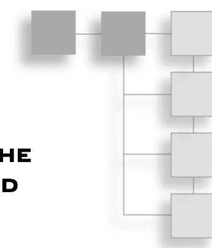

在前两章中，你编写了在海龟图形窗口中绘制形状的程序。然而，许多其他程序从人们那里获取信息作为输入。这些信息可能是文本（如用户名和密码）或数字（如你的年龄或缴纳的所得税）。文本和数字是从键盘输入的。人们还可以通过移动鼠标、单击或拖动与程序交互。许多程序，尤其是计算机游戏，如果没有这种输入功能是不可想象的。在本章中，你将探索允许用户与你的海龟图形程序交互的各种方法。

### 使用基于对话框的输入

在第 4 章“组合、保存和运行程序”中，你学习了一些程序如何通过命令行参数获取输入。例如，当你运行命令

```
examplepattern.py 6 blue pink
```

程序绘制六边形的径向图案，笔颜色为蓝色，填充颜色为粉色。这种向程序输入的方式对某些应用来说是可以的，但它有两个缺点：

- 大多数人不会从终端窗口运行程序。
- 即使他们这样做，也可能不清楚输入在程序中起什么作用。在这个程序中，哪种颜色是笔颜色，哪种颜色是填充颜色？6 代表什么？

大多数人习惯于为计算机输入接收信息提示；此类提示描述了所请求的值的类型。在基于终端的 Python 程序中，Python 的 input 函数用于此目的，但同样，大多数人不会从终端窗口运行程序。此外，即使你确实从终端运行海龟图形程序，你的程序代码也无法再访问终端窗口以获取输入值。

窗口式应用程序接收输入的主要方式是通过窗口中的带标签的输入字段。正如你在网上填写表单时所知，你将鼠标光标放在一个框中并输入所请求的数字或文本。请求或提示是出现在字段旁边的标签。然后你单击提交或确定按钮通知程序输入已准备好，或者单击取消按钮完全退出输入操作。海龟图形通过输入对话框支持这种输入策略，这是本节的主题。

### 海龟图形中的输入对话框

输入对话框是一个弹出以供输入的小窗口。窗口包含有关所请求数据类型的信息以及用户可通过键盘输入此信息的字段。提供命令按钮以提交或取消输入。

假设前两章的图案绘制程序从输入对话框获取三个输入。程序启动时，用户会看到一系列三个对话框，如图 6.1 所示。

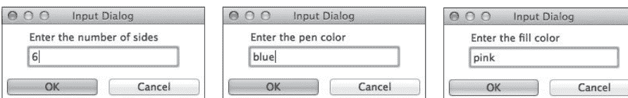

Figure 6.1
三个输入对话框。
© 2014 Python Software Foundation.

当用户关闭每个对话框时，下一个对话框会弹出，直到所有输入被提交或取消。如果取消输入，程序将使用默认值，如前所述。

海龟图形对话框有两种类型：一种用于接受数字，另一种用于接受字符串。输入对话框的两个函数名为 textinput 和 numinput。现在你将更详细地检查这些函数。


## 文本输入对话框

textinput 函数获取字符串输入。该函数期望标题和提示作为参数。如果用户点击对话框的 OK 按钮，对话框将返回输入字段中的字符串。否则，用户已点击取消或直接关闭对话框窗口，因此对话框返回 Python 值 None。程序需要在 textinput 函数返回后检查该值，以确保确实输入了一些文本。

以下是设置默认输入值并输入边数后，在你的程序中输入画笔颜色的代码：

```
(numSides, outline, background) = (6, "blue", "yellow")
# Input the number of sides here first (see exercises)
datum = textinput("Input Dialog", "Enter the pen color")
if datum:
    outline = datum
```

请注意，如果用户点击 OK 且对话框的输入字段恰好为空，textinput 函数将返回空字符串。在 if 语句的上下文中，空字符串的行为就像值 False 一样。因此，在这种情况下 outline 变量保留其默认值（程序中更早设置），就像用户取消或直接关闭对话框一样。

## 数字输入对话框

numinput 函数获取数字输入。该函数期望标题和提示作为参数。可选参数包括默认输入数字、可接受的最小数字和最大数字。当对话框弹出时，如果提供了该数字作为参数，则默认数字会显示在输入字段中；否则，字段为空。如果提供了最小或最大参数，对话框在返回前会将用户的输入数字与这些限制进行比较。如果数字超出此范围，对话框会显示一条消息并等待更多输入。与文本输入对话框类似，如果用户取消或关闭窗口，数字对话框返回 None；否则，它以浮点数形式返回输入。

以下是示例程序中输入边数的代码：

```
datum = numinput("Input Dialog",
                "Enter the number of sides [3-8]",
                default = 6, minval = 3, maxval = 8)
if datum:
    numSides = int(datum)
```

使用 minval 和 maxval 参数的好处是，它们让你免于用自己的代码在后面检查输入值。但请注意，此程序稍后必须将输入值转换为 int，因为 numinput 以浮点数形式返回它。

本程序中完整的输入操作序列留作练习。

## 响应鼠标事件

也许你使用过绘图程序，它允许你通过在虚拟草稿板上拖动鼠标来绘制图形。要在 turtle 图形中实现这一点，你必须能够检测鼠标事件并对其做出响应。turtle 图形系统识别表 6.1 中列出的三种鼠标事件类型。

**表 6.1 鼠标事件**

| 鼠标事件 | 发生时机 | 示例 |
|---|---|---|
| 点击 | 用户按下并释放鼠标按钮，且不移动鼠标。 | 用户选择一个文件图标。 |
| 拖动 | 用户按下鼠标按钮并在继续按住按钮的同时移动鼠标。 | 用户将文件图标从一个窗口拖到另一个窗口。 |
| 释放 | 用户释放鼠标按钮。 | 当文件图标位于垃圾桶图标上方时，用户释放鼠标按钮。 |

在本节中，你将探索如何在 turtle 图形中检测和响应鼠标事件。

## 使用鼠标点击绘制线段

要使 turtle 图形能够响应鼠标事件，你需要执行两个步骤：

- 1. 告知 turtle 图形在特定类型的鼠标事件（如点击）发生时应调用哪个函数。该函数称为事件处理函数。
- 2. 告诉 turtle 图形开始监听事件。

假设你希望只要用户在 turtle 图形窗口的任何位置点击鼠标，turtle 图形就会调用其 goto 函数。为此，你将 goto 函数作为参数传递给 onscreenclick 函数（步骤 1）。然后你调用 listen 函数，
它指示 turtle 图形在窗口中监听事件（步骤 2）。当你在该窗口中点击鼠标时，乌龟会从当前位置移动到鼠标点击位置。

这些操作非常简单，你可以在 shell 中尝试它们。例如，以下 shell 会话允许你通过点击鼠标绘制线段。示例绘图显示在图 6.2 中。

```
>>> from turtle import *
>>> shape("circle")
>>> pencolor("blue")
>>> width(2)
>>> onscreenclick(goto)
>>> listen()
```

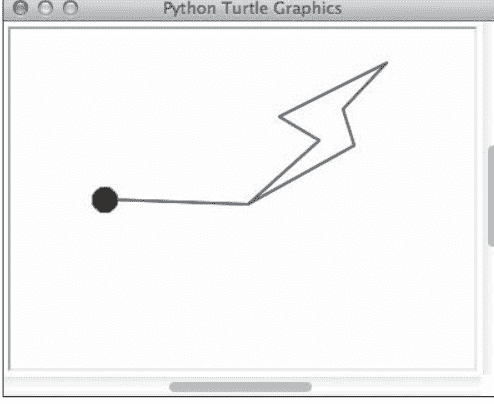

图 6.2
使用鼠标点击绘图。
© 2014 Python Software Foundation.

请注意，你应该仅在所有事件处理函数都已设置后才调用 listen 函数，尽管在这种情况下只有一个。

turtle 图形还包含另一个函数 onclick，它注册一个函数来处理发生在乌龟形状边界内的鼠标点击。你应该在与刚才类似的会话中尝试使用 onclick。

## 事件处理的工作原理

即使你已告知 turtle 图形哪个函数应处理给定的鼠标事件并让它开始监听事件，在事件发生之前也不会有任何事情发生。在你刚才看到的示例中，只要你在窗口中点击鼠标，turtle 图形就准备好调用 goto 函数。当你这样做时，turtle 图形会将当前鼠标坐标作为参数传递给 goto 函数，乌龟移动到该新位置。

因此，一旦你告知 turtle 图形使用哪些函数并让它准备好监听事件，事件处理就是自动的。对于鼠标事件，你唯一需要做的就是提供一个期望两个参数的事件处理函数。这些参数表示当前鼠标位置的 (x, y) 坐标。

## 通过拖动鼠标自由绘图

如你刚才所做的那样，通过鼠标点击绘制线段非常简单，但也非常僵硬。你只能绘制直线，并且不能在不绘制另一线段的情况下抬起画笔并再次放下。真正的自由绘图程序允许你用鼠标拖动虚拟画笔，并绘制曲线和直线。当你松开鼠标按钮时，你可以在不绘制任何内容的情况下将虚拟画笔移动到新位置。

turtle 图形允许你使用 ondrag 函数响应鼠标拖动事件。与 onscreenclick 函数类似，ondrag 函数期望另一个函数作为参数。后一个函数会在用户在 turtle 图形窗口中从一个位置拖动鼠标到另一个位置时反复触发。最初，你必须将鼠标定位在乌龟的形状上，以便检测到第一次拖动事件。如前所述，事件处理函数的两个参数将是当前鼠标坐标。

要在 shell 中尝试 ondrag，你可以像之前对 onscreenclick 所做的那样将 goto 函数传递给它。图 6.3 显示了一个示例绘图。以下是新的 shell 会话：

```
>>> from turtle import *
>>> shape("circle")
>>> pencolor("blue")
>>> width(2)
>>> ondrag(goto)
>>> listen()
```

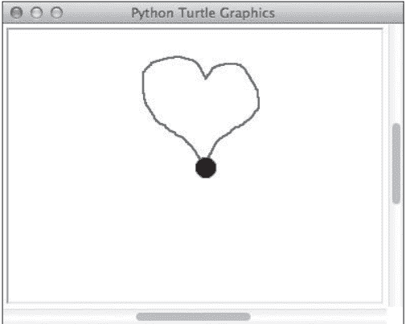

图 6.3
通过拖动鼠标绘图。
© 2014 Python Software Foundation.

该技术适用于绘制连接的线段，但当你想抬起画笔移动到新位置时（例如绘制图 6.4 所示的笑脸）就会失效。要在不绘制的情况下移动到新位置，你的代码也需要响应鼠标点击事件。但这次，与简单调用 goto（它会绘制线段到新位置）不同，你必须在点击事件发生时抬起画笔、调用 goto，然后放下画笔。你可以将这些步骤打包到一个名为 skip 的函数中，然后将该函数传递给 onscreenclick 以处理点击事件。

以下是提供这两种功能的完整 Python 程序：

```
"""
sketching1.py
Simple drawing by dragging the mouse; also allows movement by clicking.
"""

from turtle import *

def skip(x, y):
    """Moves the pen to the given location without drawing."""
    up()
    goto(x, y)
    down()

def main():
    shape("circle")
```

```
width(2)
speed(0)
pencolor("blue")
ondrag(goto)        # Register the two event-handling functions
onscreenclick(skip)
listen()
return "Done!"

if __name__ == "__main__":
    msg = main()
    print(msg)
    mainloop()
```

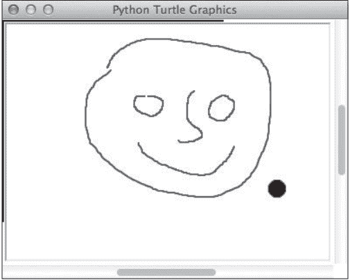

图 6.4
拖动绘制，点击移动。
© 2014 Python Software Foundation.

## 响应键盘事件

信不信由你，早期计算机系统不包含鼠标。在这些系统中，所有执行操作的命令都必须来自键盘。在现代计算机系统中，你仍然可以使用一些键盘组合，例如 Ctrl+s 或 Command+s 来保存文件。此外，你还可以使用箭头键在窗口中的文本中向上、向下、向左或向右移动。

一些早期计算机系统允许人们使用键盘绘制草图。例如，你可能会使用右箭头键和左箭头键向前和向后绘制，使用“l”和“r”键向左和向右转弯，使用“u”和“d”键抬起和放下画笔，以及使用“c”键清除绘图窗口。在本节中，你将学习如何以与本章前面响应鼠标事件相同的方式响应键盘事件。

### onkey 函数

海龟绘图可以识别两种键盘事件：按键按下和按键释放。有两个函数用于注册这些事件的处理程序：onkeypress 和 onkeyrelease。在本节中，你将了解 onkey 函数，它是 onkeyrelease 的别名。

onkey 函数期望两个参数：一个函数和一个键盘值。键盘值要么是包含给定键盘键上单个字符的字符串，要么是为特殊键保留的字符串，例如箭头键。onkey 函数将给定键绑定到给定函数，意味着当键被释放时，函数会被调用。例如，如果你发出命令 onkey(down, "d")，Python 将“d”键绑定到 down 函数，并且当用户释放“d”键时画笔会被放下。如前所述，你为不同键设置所有事件处理程序，然后调用 listen 函数开始监听事件。

为了尝试键盘事件，你可以将箭头键绑定以使海龟向前或向后移动，向左或向右转弯，并清除绘图，如以下 shell 会话所示：

```
>>> from turtle import *
>>> pencolor("blue")
>>> speed(0)
>>> width(2)
>>> onkey(clear, "c")
>>> onkey(lambda: forward(5), "Right")
>>> onkey(lambda: back(5), "Left")
>>> onkey(lambda: right(5), "r")
>>> onkey(lambda: left(5), "l")
>>> listen()
```

注意这段代码的几点：

- “Right” 表示右箭头键，而 “r” 表示包含该字母的键。
- 移动和旋转函数分别使用 5 个单位的距离和 5 度的角度，以实现更快的交互。
- 除一个之外，所有事件处理函数都以 lambda 表达式提供。你在第 5 章“定义函数”中首次看到了 lambda 表达式。在这里使用 lambda 表达式是为了创建一个无参数函数，该函数调用一个单参数函数。键盘事件只能触发无参数函数，因此这里的 lambda 表达式起到了作用。

### 一个完整的复古绘图程序

现在你可以运用对键盘事件的知识，编写一个完整的 Python 程序，使用键盘进行绘图。代码如下：

```python
"""
sketching2.py
Simple drawing with the keyboard.
All movements and turns are by increments of 5.
Right arrow key = move forward
Left arrow key = move backward
r = turn right
l = turn left
u = pen up
d = pen down
h = go home
c = clear
"""

from turtle import *

def main():
    width(2)
    speed(0)
    pencolor("blue")
    onkey(up, "u")
    onkey(down, "d")
    onkey(clear, "c")
    onkey(home, "h")
    onkey(lambda: forward(5), "Right")
    onkey(lambda: back(5), "Left")
    onkey(lambda: left(5), "l")
    onkey(lambda: right(5), "r")
    listen()
    return "Done!"

if __name__ == "__main__":
    msg = main()
    print(msg)
    mainloop()
```

## 使用模块变量

在迄今为止编写的程序中，你使用变量来跟踪各种信息，例如用户输入的画笔颜色或函数定义中参数的点坐标。当你操作这些变量以使用其值或重置它们时，你通常在函数定义的主体内部执行此操作。例如，你在 main 函数中使用变量接收输入，或在 skip 函数中访问参数。此类变量被认为是对该函数是局部的，意味着它们的值只能在该函数的主体内部访问，而不能在其外部访问（在另一个函数中或在周围的模块中）。

当你需要跟踪多个函数都应了解的信息时，局部变量可能无济于事。例如，响应鼠标事件的函数知道海龟的当前位置，但不知道其之前的位置。在本节中，你将研究另一种变量的使用，称为模块变量，它允许你在不同函数之间共享此信息。

### 初始化和使用模块变量

你在海龟绘图程序中已经见过几个模块变量——每个程序末尾 if 语句中的变量 __main__ 和 msg。变量 math.pi 和 sys.argv 也是模块变量，尽管它们属于程序模块导入的另一个模块。math 模块为变量 pi 分配其值。Python 在程序运行时自动为 __main__ 和 sys.argv 分配它们的值。你的程序为 msg 分配其值。每个名称都是模块变量，因为它是在任何函数定义体之外被赋值的。

在模块变量被赋予值之后，你可以在模块内的任何位置访问该值，包括函数定义体内部。下面的简短 Python 程序演示了为 π 引入和使用另一个模块变量：

```python
'''
modulevariables.py
'''

PI = 3.14        # Module variable (instead of math.pi)

def area(radius):
    return PI * radius ** 2

def volume(radius):
    return 4 / 3 + PI * radius ** 3

def main():
    radius = 4.5
    print("PI:", PI)
    print("Radius:", radius)
    print("Area:", area(radius))
    print("Volume:", volume(radius))

if __name__ == '__main__':
    main()
```

请注意，变量 PI 在所有函数定义之上被赋予值。因此，它是一个模块变量，其值可在模块中的任何位置访问。因为在该程序中 PI 像常量一样行为，你只需设置一次其值。使用模块变量的唯一限制是，你不能在函数定义内部为其分配新值。你很快就会看到如何绕过该限制。

### 跟踪海龟位置的历史

现在，假设你需要知道海龟最近访问过的位置。例如，你可能会编写一个程序，允许用户用三次鼠标点击绘制一个三角形。每次点击都在三角形的顶点上，海龟将用线段连接它们以完成绘图。第一个绘线程序无法做到这一点。（自己试试；你需要四次点击。）

要仅用三次点击绘制三角形，你的程序需要不同的策略。在第一次鼠标点击时，海龟跳到该位置，不进行绘制。在第二次鼠标点击时，海龟绘制一条连接前两个顶点的线段。在第三次鼠标点击时，海龟再绘制两条线段以完成图形。

为了支持此功能，你需要在某处记录早期点击的位置，并且需要根据已发生的点击次数做出一些选择。一个列表就很合适；它初始为空，你可以在鼠标点击时将每个位置追加到列表中。以下是根据该列表长度做出选择的规则：

- 如果列表为空，跳到点击位置并将点击位置添加到列表中。
- 如果列表包含一个位置，前往点击位置（从第一个位置绘制一条线段）并将点击位置添加到列表中。
- 如果列表包含两个位置，从它们各自向点击位置绘制线段，并再次使列表变空。

所有这些代码都放在鼠标点击的事件处理函数中。将该函数命名为 setVertex。像往常一样，该函数期望两个参数：鼠标点击的坐标。该函数假定变量 positionHistory 引用一个列表

最近鼠标点击的位置。现在唯一剩下的问题是：这个变量在哪里初始化为空列表？

因为变量 positionHistory 必须在函数调用之间保留其值，所以它必须是模块变量。因此，它在模块开头附近初始化，就像你在之前的示例中对 PI 所做的那样。下面是完整程序的代码：

```
"""
triangle.py
Draws triangles with 3 mouse clicks.
"""

from turtle import *

positionHistory = []

def setVertex(x, y):
    """Sets vertices and possibly connects them."""
    if len(positionHistory) == 0:            # The first click skips
        positionHistory.append((x, y))      # to the first vertex
        skip(x, y)
    elif len(positionHistory) == 1:         # The second click connects
        positionHistory.append((x, y))      # two vertices
        goto(x, y)
    else:
        (xCoord, yCoord) = positionHistory.pop()  # The third click
        skip(xCoord, yCoord)                  # connects the remaining
        goto(x, y)                            # vertices
        (xCoord, yCoord) = positionHistory.pop()
        goto(xCoord, yCoord)

def skip(x, y):
    "Moves the pen to the given location without drawing."
    up()
    goto(x, y)
    down()

def main():
    shape("circle")
    width(2)
    speed(0)
    pencolor("blue")
    onscreenclick(setVertex)
    listen()
    return "Done!"
```

```
if __name__ == '__main__':
    msg = main()
    print(msg)
    mainloop()
```

因为第三次点击清空了位置历史列表，所以你可以继续在其他位置绘制新的三角形。

## 使用两个鼠标按钮

如你所知，鼠标通常至少有两个按钮，位于设备顶部的左侧和右侧。点击左键称为左键单击，点击右键称为右键单击。对于没有右键的鼠标，你可以通过按住 Ctrl 键的同时点击左键来执行右键单击。

你可能通过点击或按住左键来完成大部分与鼠标相关的任务，但右键偶尔也会派上用场。例如，右键单击通常会弹出与当前窗口上下文相关的选项菜单。在本节中，你将学习如何在 turtle 图形中响应右键单击，以为你的应用程序添加一些命令选项。

### 为右键添加事件处理函数

turtle 图形中的每种鼠标事件——单击、拖动或释放——都可能由左键或右键按下引起。函数 onscreenclick、onclick、ondrag 和 onrelease 允许你为左右键指定不同的事件处理函数。你可以通过向这些函数提供第二个可选参数来实现这一点。表 6.2 列出了它们的签名。

表 6.2 注册鼠标事件处理函数的函数

| 函数 | 其作用 |
|---|---|
| onscreenclick(fun, btn = 1, add = None) | 将 fun 注册为处理窗口任意位置点击事件的函数。 |
| onclick(fun, btn = 1, add = None) | 将 fun 注册为处理海龟上的点击事件的函数。 |
| ondrag(fun, btn = 1, add = None) | 将 fun 注册为处理海龟上的拖动事件的函数。 |
| onrelease(fun, btn = 1, add = None) | 将 fun 注册为处理海龟上的释放事件的函数。 |

如你所见，事件处理函数 fun 是必需参数，而按钮编号 btn 是可选参数。（记住：后面没有 = 的参数是必需的。）默认按钮编号为 1，表示左键鼠标按钮。这就是本章迄今为止用于任何鼠标事件的选项。但如果你提供 2 作为第二个参数，turtle 图形会将右键鼠标按钮绑定到该事件的事件处理函数。因此，当用户操作右键鼠标按钮时，你的函数会被触发。

add 选项默认会用新函数替换指定按钮的任何现有事件处理函数。但如果你为此参数提供值 True，turtle 图形会将你的新函数添加到在该事件发生时被触发的函数集合中。因此，你可以为所有四个鼠标事件的两个按钮注册多个事件处理函数。

### 示例 1：使用随机颜色的简单绘图

为了尝试使用右键鼠标按钮，你可以回到 shell 中进行素描。在此会话中，你将 goto 函数注册为左键鼠标按钮的屏幕点击事件。这会在海龟的位置与左键单击的位置之间绘制一条线段。（参见本章前文的图 6.2。）你还将一个 lambda 表达式注册为右键鼠标按钮的屏幕点击事件。该表达式构建了一个函数，将画笔颜色设置为随机颜色。以下是此会话的记录：

```
>>> from turtle import *
>>> from random import choice
>>> colors = ("red", "blue", "green", "purple", "orange")
>>> shape("circle")
>>> onscreenclick(goto)
>>> onscreenclick(lambda x, y: pencolor(choice(colors)), btn = 2)
>>> listen()
```

现在，当你左键单击时，海龟会像之前一样绘制一条线段。但当你右键单击时，海龟的画笔颜色会重置为随机选择的颜色（可能与之前相同，因为这里的颜色集合比较小）。

### 示例 2：绘图和移动

现在，假设你不想改变画笔颜色，而是想在不绘制线段的情况下将海龟移动到新位置。你可以通过将右键绑定到本章前面讨论的 skip 函数来实现这一点。以下是如何在 shell 会话中执行此操作的方法：

```
>>> from turtle import *
>>> def skip(x, y): up(); goto(x, y); down()
>>> shape("circle")
>>> onscreenclick(goto)
>>> onscreenclick(skip, btn =2)
>>> listen()
```

注意 skip 函数定义中使用了分号。它们允许你在一行代码上编写单独的 Python 语句，以便更简洁地呈现。

### 示例 3：绘图、移动和随机颜色

假设你希望右键单击既将海龟移动到新位置又改变其颜色。要做到这一点，你需要将两个事件处理函数都注册到右键单击，注意在注册第二个函数时提供可选的 add 参数 True。以下是此版本的代码：

```
>>> from turtle import *
>>> from random import choice
>>> colors = ("red", "blue", "green", "purple", "orange")
>>> def skip(x, y): up(); goto(x, y); down()
>>> shape("circle")
>>> onscreenclick(goto)
>>> onscreenclick(lambda x, y: pencolor(choice(colors)), btn =2)
>>> onscreenclick(skip, btn =2, add =True)
>>> listen()
```

与右键关联的两个事件处理函数按 onscreenclick 注册的顺序触发。

### 示例 4：形状属性的对话框

也许你想在 turtle 图形窗口的不同位置交互式地绘制一些多边形。每个多边形都有长度、边数和颜色。给定这些属性，你可以用鼠标左键单击将多边形放置在窗口的任何位置。右键单击应允许你更改下一个要绘制的多边形的任何属性。一系列弹出对话框允许你输入这些信息（长度、
边数和颜色）。作为初步尝试，这里有一个程序允许你使用默认属性绘制多边形：

```python
"""
drawpolygon1.py
Draw polygons with a left-click.
"""

from turtle import *
properties = {"length":30, "numSides":4, "color":"black"}

def regularPolygon(length, numSides):
    """Draws a regular polygon.
    Arguments: the length and number of sides."""
    interiorAngle = 360 / numSides
    for count in range(numSides):
        forward(length)
        left(interiorAngle)

def skip(x, y):
    "Moves the pen to the given location without drawing."
    up()
    goto(x, y)
    down()

def moveAndDraw(x, y):
    """Draws a polygon with the current properties at
    position (x, y)."""
    skip(x,y)
    pencolor(properties["color"])
    regularPolygon(properties["length"], properties["numSides"])

def main():
    width(2)
    speed(0)
    hideturtle()
    onscreenclick(moveAndDraw)
    listen()
    return "Done!"

if __name__ == "__main__":
    msg = main()
    print(msg)
    mainloop()
```


本程序在名为 properties 的模块变量中设置多边形的默认属性。该变量被初始化为一个字典，每个属性都以键/值对的形式存储在其中。字典最初包含所有属性的默认值。字典使您可以轻松访问或更改任何属性，以及添加新属性以改进程序。

要允许用户更改属性，您需要做两件事。首先，您定义一个事件处理函数，该函数在用户单击鼠标右键时运行。此函数名为 changeProperties，它期望鼠标单击的坐标，这些坐标将被忽略。然后，该函数引导用户依次进行三个弹出对话框，允许他重置多边形的长度、边数和颜色。以下是此新函数的代码：

```
def changeProperties(x, y):
    """Obtains new values for the polygon's properties from
    the user and resets them in the properties dictionary."""
    length = numinput("Input Dialog", "Enter the length",
                    default = properties["length"], minval = 1)
    if length:
        properties["length"] = int(length)
    numSides = numinput("Input Dialog", "Enter the number of sides",
                    default = properties["numSides"], minval = 3)
    if numSides:
        properties["numSides"] = int(numSides)
    color = textinput("Input Dialog", "Enter the color")
    if color:
        properties["color"] = color
```

第二个更改是将 changeProperties 函数注册为右键的事件处理程序，使用 onscreenclick 函数。您在 main 函数中按如下方式执行此操作：

```
def main():
    width(2)
    speed(0)
    hideturtle()
    onscreenclick(moveAndDraw)
    onscreenclick(changeProperties, btn = 2)
    listen()
    return "Done!"
```

您可以轻松地扩展此设计以包含填充颜色和画笔大小的属性。您将这些属性的默认值添加到字典中，并将相应的输入对话框添加到 `changeProperties` 函数。其余部分是自动的。

本节介绍了与 turtle 图形进行用户交互的内容到此结束。您现在可以编写一些真正吸引人的程序。

## 摘要
- 用户可以通过弹出对话框向 turtle 图形程序提供交互式输入。Turtle 图形提供两种类型的对话框：一种用于数字，另一种用于文本。
- `textinput` 函数用于弹出用于字符串（单行文本）的对话框。该函数期望对话框的标题和提示作为字符串参数。如果用户取消或关闭对话框，函数返回 `None`。否则，如果用户单击确定，函数将返回输入字段中包含的字符串。
- `numinput` 函数用于弹出用于输入数字的对话框。该函数期望对话框的标题和提示作为字符串参数。可选参数包括默认值、允许的最小值和最大值。如果用户取消或关闭对话框，函数返回 `None`。否则，如果用户单击确定，函数会检查输入字段中的文本格式是否正确，将该文本转换为数字，并将其与任何可选边界进行比较。如果发生错误，对话框会通知用户并等待更多输入。否则，数字将作为 `float` 返回。
- 如果程序设置好响应鼠标事件和键盘事件，用户也可以与 turtle 图形程序进行交互。
- Turtle 图形中的四个鼠标事件是窗口中的单击、画笔形状上的单击、画笔形状上的拖动以及画笔形状上的释放。
- 程序员通过提供事件处理函数来响应鼠标事件。当发生该类型的事件时，此函数会被触发。
- 用于注册鼠标事件的事件处理函数的函数是 `onscreenclick`、`onclick`、`ondrag` 和 `onrelease`。这些函数中的每一个都期望一个事件处理函数作为参数。触发时，此函数会传递鼠标事件发生的坐标。
- `onscreenclick`、`onclick`、`ondrag` 和 `onrelease` 的可选参数是按钮编号（1 = 左键，2 = 右键）和一个布尔值，指示是添加新的事件处理函数还是替换现有的函数。
- 用于注册键盘事件的事件处理函数的函数是 `onkeypress` 和 `onkeyrelease`（`onkey` 的同义词）。`onkeypress` 期望一个函数和一个可选字符串作为参数。`onkeyrelease` 期望一个函数和一个字符串作为参数。字符串代表键盘字符。当用户按下或释放已注册的键时，关联的事件处理函数会被触发。如果省略 `onkeypress` 的字符串参数，则该函数在按下任意键时被触发。
- 在注册事件处理函数后，`listen` 函数告诉 turtle 图形监听事件。
- 模块变量用于使数据可供模块中的所有函数访问。模块变量不能在函数内通过赋值语句重置。但是，如果变量引用的是可变结构（如列表），则该结构可以被修改。

## 练习

启动 IDLE shell，打开一个文件窗口，并完成以下练习。您应该在 IDLE 中运行每个程序，并在完成后在终端窗口中运行。

- 1. 编写一个类似第 4 章和第 5 章中讨论的图案绘制程序。此版本使用对话框通过对话框输入边的长度、边的数量、画笔颜色和填充颜色。
- 2. 编写一个程序，允许用户用两次鼠标单击绘制圆圈。第一次单击的位置将是圆的中心点，第二次单击的位置将是圆周上的一个点。提示：函数 `distance(x, y)` 返回海龟当前位置到位置 (x, y) 的距离。此外，使用模块变量记住第一次鼠标单击的位置。

# 第 7 章

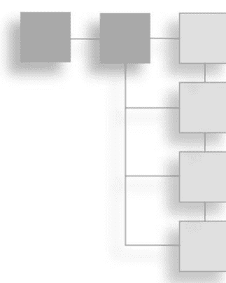

## 递归

计算机科学有时被称为抽象科学。正如您在第 5 章“定义函数”中所学，抽象是一种简化复杂情况或问题的手段。例如，术语文字处理指的是您可能对文本所做的所有事情，包括编辑文本、检查文本的拼写和语法、将文本保存到文件等。其中每一个看似简单的过程，本身又是其他过程的抽象。

在本章中，您将学习一种特别优美而优雅的创建抽象的方法，称为递归。递归的情况或问题可以细分为相同形式的小情况或问题。在此过程中，您将学习如何构造递归函数来解决此类问题，并探索艺术和自然中的一些递归模式。

## 递归设计

递归设计是称为自顶向下设计的一种重要设计策略的变体。在本节中，您将回顾第 5 章中的程序的自顶向下设计，作为学习递归设计重要特征的序幕。

### 自顶向下设计

任何具有一定规模和复杂性的程序的一种流行设计策略称为自顶向下设计。此策略从整个问题的全局视图开始，并将问题分解为更小、更易管理的子问题——这一过程称为问题分解。随着每个子问题的分离，其解决方案被分配给一个函数。

问题分解可以继续到较低的级别，因为子问题本身可能包含两个或多个需要解决的低级问题。随着为解决每个子问题而开发函数，整体问题的解决方案逐渐以细节填充。此过程也称为 *逐步细化*。

例如，考虑绘制函数图形的问题，您在第 5 章中编写了程序。解决此问题需要您执行以下几个子任务：

- 初始化海龟的状态。
- 绘制坐标轴。
- 计算函数定义域中一组值中每个 x 值对应的 y 值。
- 在图形中绘制由此产生的 (x, y) 点之间的线段。

您将这些任务中的每一个分配给一个 Python 函数，并在顶层的 `main` 函数中协调它们的操作。程序员定义的函数之间的关系在图 7.1 的 *调用图* 中描述。

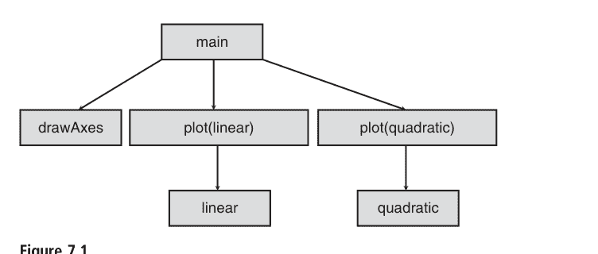

### 图 7.1

函数绘图程序的调用图。

请注意，程序执行从图顶部的 `main` 函数开始。此函数按从左到右的顺序调用下一层级所示的函数。未显示的函数，如 `speed`，是内置的。其他函数，如 `plot`，由您定义并在较低级别调用其他函数来完成其工作。

关于自顶向下设计，有四个重要点需要注意：

- 您通常从一个 `main` 函数开始，该函数只是调用其他函数来完成其任务。设计这一部分很容易，因为您只需思考

为这些函数提供适当的名称和参数，让它们去担心如何完成工作。换句话说，推卸责任和拖延是美德！

- 你在设计的每个层级上继续推卸责任。为了完成每个函数，你会想到调用其他函数，并传入适当的 arguments。
- 当你调用内置函数时，责任似乎就到此为止了。
- 尽管偶尔会有一些重叠，自顶向下设计中的子任务通常彼此不同，因此需要不同的函数来执行它们。

递归设计与自顶向下设计共享一些这些特征，但在重要方面也存在差异，正如你在下一小节中将看到的那样。

## Recursive Function Design

在递归设计中，问题被分解为形式相同的子问题。在这些情况下，你将每个子问题分配给与在更高层级解决该问题的函数相同的函数。这类函数称为递归函数。

例如，考虑从下界到上界的整数序列求和的问题。函数 summation(1, 4) 应该返回 1 + 2 + 3 + 4 的结果，即 10。设计此问题的解决方案的一种方法是认识到这个加法序列包含以下嵌套求和：

```
summation(1, 4) = 1 + summation(2, 4)
summation(2, 4) = 2 + summation(3, 4)
summation(3, 4) = 3 + summation(4, 4)
summation(4, 4) = 4
```

请注意，最后一种情况 summation(4, 4) 并不是由另一个求和组成，而是简单地返回其参数之一。图 7.2 显示了 summation(1, 4) 的调用图。

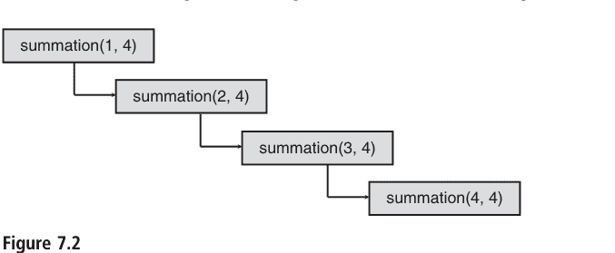

图 7.2
summation(1, 4) 的调用图。

请注意，`summation` 函数的每次调用（最后一调用除外）都会再次调用 `summation`。这种调用称为函数的 *递归调用*。

`summation` 函数的最后一次调用不会进行递归调用，而是直接返回其中一个参数。这称为函数的 *基本情况*。

在函数的每次递归调用中，第一个参数会增加 1。随着该值增加，它最终会达到一个限制，从而停止递归过程。换句话说，这种调整使函数能够检测何时应停止递归并返回基本情况值。

现在，你能根据其递归描述为 `summation` 函数推导出一个通用公式吗？当然可以。你假设 `summation` 函数有两个参数，名为 `low` 和 `high`。正如它们的名字所暗示的，你还假设只要函数被调用，`low` 就小于或等于 `high`。因此，`summation` 函数的递归公式由两个方程表示。第一个方程表示当两个参数相等时（图 7.2 中的最后一次调用）的求和。第二个方程表示其他情况下的求和。以下是这两个方程：

`summation(low, high) = high, if low == high`
`summation(low, high) = low + summation(low + 1, high)`

你应该在继续之前查看图 7.2，以验证这两个方程是否描述了 `summation(1, 4)` 中包含的部分求和。

你可以通过定义一个名为 `summation` 的 Python 函数将此设计转化为实现。该函数在 docstring 中说明了参数的假设，然后使用双向 `if` 语句来表达设计中陈述的两个选项。以下是该函数的代码，嵌入在一个简短的测试程序中：

```
"""
File: recursion1.py
Define and test a recursive summation function.
"""

import sys

def summation(low, high):
    """Returns the summation of the integers
    from low to high.
    Precondition: low <= high."""
    if low == high:
        return high
    else:
        return low + summation(low + 1, high)
```

```
def main(low = 1, high = 4):
    if len(sys.argv) == 3:
        low = int(sys.argv[1])
        high = int(sys.argv[2])
    print("The summation of", low, "and", high,
          "is", summation(low, high))
if __name__ == "__main__":
    main()
```

请注意，此处的 main 函数包含 1 和 4 的默认值，这些值在程序启动时传递给 summation 函数。然后，你可以通过在 shell 中使用其他参数调用 main 来测试该函数，如下一会话所示：

```
>>>
The summation of 1 and 4 is 10
>>> main(1, 10)
The summation of 1 and 10 is 55
>>> main(2, 10)
The summation of 2 and 10 is 54
>>>
```

由于程序还检查命令行参数，你也可以在终端窗口中测试程序：

```
Madison:~ ken$ python3 recursion1.py
The summation of 1 and 4 is 10
Madison:~ ken$ python3 recursion1.py 1 10
The summation of 1 and 10 is 55
```

## Recursive Function Call Tracing

为了更好地理解递归函数的工作原理，追踪其调用是有帮助的。你将对 summation 函数执行此操作。你添加一个用于缩进边距的参数和打印语句，以追踪每次调用的两个参数和返回的值。每次调用中的第一个语句计算缩进，然后在打印两个参数时使用它。计算出的值也在每次调用返回之前使用此缩进打印。以下是带有追踪的 summation 函数的代码：

```python
def summation(low, high, margin = 0):
    """Returns the summation of the integers
    from low to high. Prints a trace of low,
    high, and the value returned for each call,
using the given margin.
Precondition: low <= high."""
    blanks = " " * margin
    print(blanks, low, high)
    if low == high:
        print(blanks, high)
        return high
    else:
        result = low + summation(low + 1, high, margin + 4)
        print(blanks, result)
        return result
```

请注意，表达式 " " * margin 构建一个字符串，其中包含 margin 操作数指定的空白字符数。该值在函数被调用时初始为 0，并在每次递归调用时增加 4。因此，随着递归向下进行到基本情况，每对参数的缩进会进一步向右移动。当控制权返回到每个调用者时，margin 的先前值会被恢复，因此随着递归展开，返回值的缩进会进一步向左移动。以下是 summation(1, 4) 的示例追踪：

```
>>>
  1 4
    2 4
      3 4
        4 4
          4
        7
      9
10
The summation of 1 and 4 is 10
>>>
```

正如你从此追踪中看到的，第一个参数的值在每次递归调用中都会增加，直到它等于第二个参数的值。随着递归调用的返回，求和的值会增加。

## Recursive Functions and Loops

到目前为止，你可能已经猜到递归函数会重复给定的过程，直到条件变为 False。如果你认为这听起来像一个循环，你是对的。原则上，你可以将任何递归函数改写为循环，也可以将任何循环改写为递归函数。递归与迭代之间的选择部分取决于程序员的喜好，部分取决于性能要求。

本节中开发的递归求和函数在视觉上可能显得优雅而流畅，但在运行时每次调用都需要额外的计算机内存来支持参数和返回值的存储。因此，运行此函数所需的内存量会随着被求和的数字范围的大小呈线性增长。对于较小的范围，这不是一个重要问题，但对于较大的范围，基于循环的求和提供了更好的替代方案。

基于循环的 summation 函数版本使用带有 range 函数的 for 循环，并将每个值添加到正在进行的总数中。总和初始设置为 0，并在循环结束时返回。以下是代码：

```
def summation(low, high):
    """Returns the summation of the integers
    from low to high.
    Precondition: low <= high."""
    total = 0
    for number in range(low, high + 1):
        total += number
    return total
```

为什么此版本的运行时性能比递归版本更好？基于循环的函数只调用一次，为两个参数 low 和 high 以及临时变量 total 和 number 分配内存。在循环的每次遍历中，这些存储中的值会被重置，但永远不会添加或需要新的存储。

那么你可能会问，“如果基于循环的函数似乎比递归函数性能更好，为什么我还要费心使用递归呢？” 仍然更喜欢递归替代方案的情况有两种。

你可能更喜欢递归的第一个原因是它允许你编写一些在运行时不会导致内存使用增长的递归函数。这些函数称为尾递归函数。在尾递归函数中，递归调用之后不会执行任何操作。根据此定义，前面定义的递归 summation 函数不是尾递归的。每次 summation 的递归调用返回后，其总和会与 low 参数的先前值相加，如以下语句所示：

```
return low + summation(low + 1, high)
```

要将此类函数转换为尾递归函数，你需要想办法将总和作为额外参数传递给每次函数调用。然后，你可以在每次递归调用之前而不是之后在运行时增加总和。对于 summation 函数的情况，

总数初始为 0，且当 low 变大到大于 high 时会直接返回。 当 low 小于或等于 high 时，summation 会按如下方式递归调用：

```
summation(low + 1, high, low + total)
```

total 参数的默认值是 0，因此在 summation 函数的顶层调用中无需提供它。以下是尾递归版本的完整代码：

```
def summation(low, high, total = 0):
    """Returns the summation of the integers
    from low to high.
    Precondition: low <= high."""
    if low > high:
        return total
    else:
        return summation(low + 1, high, low + total)
```

虽然这个函数看起来可能被多次调用，但聪明的编译器可以将 Python 代码转换为基于循环的版本，该版本仅使用固定量的内存来存储三个参数以及当 low 大于 high 时返回的单个值。因此，使用这个版本还是使用函数的基于循环的版本，取决于你的 Python 偏好，因为在运行时两者都是基于循环的。

你可能更喜欢递归的第二个原因是，一些基于循环的解决方案在运行时也需要计算机内存线性增长。在这些解决方案中，你的代码操作一个名为栈的 Python 数据结构，它为循环安排其他数据值进行处理。随着问题规模的增大，栈也会增大。在这种情况下，递归解决方案的性能不低于迭代解决方案，但可能因口味或简洁性而被优先选择。你将在本章后面看到此类问题的例子。

## 无限递归

在设计和使用递归函数时，你需要意识到使用中可能出现的潜在错误。与循环一样，递归函数必须有一种停止并返回问题解决方案的方式。因此，你必须小心推进过程，以便能够到达基本情况。

例如，summation 函数的第一个版本会递增第一个参数的值，直到它等于第二个参数的值：

```
def summation(low, high):
    """Returns the summation of the integers
    from low to high.
    Precondition: low <= high."""
    if low == high:
        return high
    else:
        return low + summation(low + 1, high)
```

只要在顶层调用时 low <= high，此代码就能正确工作。（注意 docstring 中的前置条件。）但假设你在终端窗口中运行程序，low 初始大于 high，如下所示：

```
Madison:~ ken$ python3 recursion1.py 2 1
Traceback (most recent call last):
  File "recursion1.py", line 25, in <module>
    main()
  File "recursion1.py", line 22, in <module>
    "is", summation(low, high))
RuntimeError: maximum recursion depth exceeded in comparison
Madison:~ ken$
```

程序会以运行时错误消息停止，称为无限递归。因为第一个参数大于第二个参数并且持续递增，所以它永远没有机会等于第二个参数。因此，递归调用无法停止。它们不会永远继续下去的唯一原因是 Python 虚拟机（PVM）耗尽了支持函数额外调用的内存。也就是说，当递归调用次数达到最大深度时，PVM 会引发异常，程序崩溃。

避免此类错误的關鍵是向你的函数使用者警告其参数的前置条件。记得在 docstring 中包含该信息！

## 列表的顺序搜索

在探索递归在海龟图形中的使用之前，你将探索为搜索列表而设计的递归函数的设计。Python 有两种用于搜索列表的操作。第一个操作符是 in 操作符，如果列表中存在某项则返回 True，否则返回 False。第二个操作符是 index 方法，如果列表中存在该项则返回其位置，否则引发异常。以下会话展示了它们的使用：

```
>>> fruits = ["apples", "bananas", "grapes", "oranges"]
>>> fruits
['apples', 'bananas', 'grapes', 'oranges']
>>> "grapes" in fruits
True
>>> "cherries" in fruits
False
>>> fruits.index("grapes")
2
>>> fruits.index("cherries")
Traceback (most recent call last):
  File "<pyshell#5>", line 1, in <module>
    fruits.index("cherries")
ValueError: 'cherries' is not in list
>>>
```

这两种操作都执行 *sequential search*。这意味着搜索从列表中的第一项开始，将其与目标项进行比较，然后从那里继续通过连续位置，直到找到目标或到达列表末尾。

为 in 操作编写自己的顺序搜索函数可以帮助你理解这个过程。此函数中有两个基本情况。 要么你已到达列表末尾，要么当前位置的项等于目标项。第一种情况下返回 False，第二种情况下返回 True。否则，你将搜索函数递归地应用于当前位置之后列表的其余部分。这种递归策略在以下伪代码中被形式化：

```
Function myIn(targetItem, lyst, currentPosition = 0)
    If currentPosition == len(lyst)
        Return False
    Else if lyst[currentPosition] == targetItem
        Return True
    Else
        Return myIn(targetItem, lyst, currentPosition + 1)
```

你的设计很容易转换为相应的 Python 代码：

```
def myIn(targetItem, lyst, currentPosition = 0):
    if currentPosition == len(lyst):
        return False
    elif lyst[currentPosition] == targetItem:
        return True
    else:
        return myIn(targetItem, lyst, currentPosition + 1)
```

## 列表的二分搜索

你的顺序搜索函数按广告所述工作，但它并没有像给定列表那样运行得尽可能快。像这样顺序搜索具有 *linear running time*，意味着运行搜索所需的时间量会随着列表长度的增长而直接增长。例如，在最坏情况下，你必须检查每一项才能确定目标项 "cherries" 不在列表中。如果列表包含 100 项，则需要 100 次递归调用，如果列表长度增长 10 倍，递归调用次数也会增长 10 倍。

为什么对这个特定列表的搜索应该表现得更好？仔细观察，你会发现列表中的项是按升序排列的字符串。如果保证项按排序顺序排列，你的搜索函数可以利用这一事实大幅减少搜索时间。

这种搜索类型的策略称为 *binary search*，很简单。你去到列表的中点，而不是第一项，并将该位置的项与目标项进行比较。如果两项相等，就完成了。否则，如果目标项小于中点处的项，你就在中点左侧的列表部分继续搜索。否则，目标必须大于中点处的项，因此你只搜索中点右侧的列表部分。

与顺序搜索中始终搜索当前位置右侧的列表其余部分不同，二分搜索检查 *either* 当前位置右侧的列表段 *or* 当前位置左侧的列表段。因为二分搜索函数是递归的，所以你必须向它提供参数，告诉它当前正在检查的列表段的最左和最右位置。

剩下的唯一需要确定的事情是如何计算中点，如何在递归调用之前调整端点，以及如何确定没有更多项可供检查。假设 `left` 和 `right` 是列表的当前端点，它们之间的中点始终为

```
(left + right) // 2
```

如果目标项小于中点处的项，则新的右端点变为

```
right = midpoint - 1
```

如果目标项大于中点处的项，则新的左端点变为

```
left = midpoint + 1
```

随着搜索在列表中移动，两个端点 `left` 和 `right` 最终会向列表中的某个交叉点收敛。当它们移过

彼此之间，没有更多项目需要检查，且目标项目不存在。因此，只要

```
left <= right
```

搜索必须继续。

你对 myIn 函数的新版本保留了其头部，并定义了一个名为 binaryIn 的递归辅助函数。该函数将列表的左端点和右端点作为参数。它们的初始值分别为 0 和列表长度减一。以下是 myIn 新版本的完整代码：

```
def myIn(targetItem, lyst):
    def binaryIn(left, right):
        if left <= right:
            midPoint = (left + right) // 2
            if lyst[midPoint] == targetItem:
                return True
            elif targetItem < lyst[midPoint]:
                return binaryIn(left, midPoint - 1)
            else:
                return binaryIn(midPoint + 1, right)
        else:
            return False
    return binaryIn(0, len(lyst) - 1)
```

回想一下，顺序搜索函数在最坏情况下必须检查列表中的每个项目，当目标项目不存在时即为这种情况。因此，在这种情况下，如果有 16 个项目，顺序搜索函数必须进行 16 次递归调用。相比之下，二分搜索函数快多少？二分搜索在每次递归调用之前会丢弃剩余列表项目的一半。那么在发现目标项目不在列表中之前必须进行多少次递归调用？该数字等于在列表段长度达到 0 之前可以将列表长度除以 2 的次数。例如，对于长度为 16 的列表，递归调用检查的列表段长度为 8、4、2、1 和 0。那就是最多 5 次调用，而顺序搜索最多需要 16 次调用。用数学术语来说，二分搜索具有对数运行时间（5 等于 1 + 16 的 log₂，其中 log₂ 的一个数的对数是使用 2 得到该数的指数）。这意味着运行时间仅随列表大小对数增长。也就是说，当列表大小加倍时，二分搜索执行的工作量不会加倍，而只会增加 1 次递归调用！

## 艺术中的递归模式：抽象绘画

二十世纪的荷兰艺术家皮特·蒙德里安发展出一种展现简单递归模式的抽象绘画风格。要用计算机生成此类图案，你首先绘制一个随机颜色的矩形，然后反复绘制两个不等分的子区域并使用随机颜色。图 7.3 中展示了几个示例绘图（实际颜色未显示）。

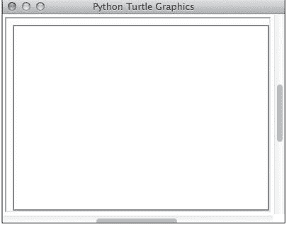

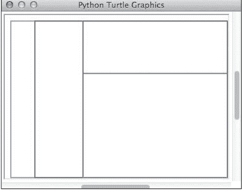


Figure 7.3
以皮特·蒙德里安风格生成简单的递归图案。
© 2014 Python Software Foundation.

正如你所见，程序会继续细分过程，直到达到“美学上恰当的时刻”。在此版本中，程序将当前矩形划分为代表其面积三分之一和三分之二的部分，并在水平和垂直轴上随机交替这些细分。程序的用户指定绘图的细节级别。在图 7.3 中，你从左到右看到的是 level-1 绘图、level-3 绘图、level-4 绘图和 level-8 绘图。

在本节中，你将开发创建类似图 7.3 中绘图的程序的各个部分。练习为你提供了添加装饰的机会。

## 程序设计

你的艺术绘图程序出现在单个模块文件 `mondrian.py` 中。像往常一样，程序包含一个 `main` 函数和几个支持函数。因为你使用随机颜色绘图，所以可以使用第 5 章中讨论的 `randomColor` 函数。此外，因为你可能要绘制许多矩形，你将定义一个 `drawRectangle` 函数。最后，你将定义一个用于绘制完整艺术作品的函数。其名称恰如其分地为 `mondrian`。图 7.4 显示了程序员定义的函数的调用图。


Figure 7.4

mondrian 程序的调用图。

正如你所见，`main` 函数对 `mondrian` 函数进行一次调用。然后该函数调用 `drawRectangle` 函数并递归调用自身两次。你稍后将学习如何停止这些递归调用。

## 性能跟踪

仅供娱乐，你可以维护程序性能的一些统计数据。这些数据包括绘制的矩形数量和 `mondrian` 函数的调用次数。你将这些值保存在名为 `stats` 的字典中，该字典作为模块变量设置。此变量在模块开头附近初始化，其数据在 main 函数开始时重置为 0。以下是初始化 stats 的代码：

```
# Data to track performance
stats = {"calls":0, "rectangles":0}
```

每次调用 mondrian 时，你增加调用次数，每次调用 drawRectangle 时，你增加矩形数量。你将很快使用这些统计数据来分析程序的行为。

## drawRectangle 函数

与你在第 5 章中为绘制几何形状而开发的函数不同，drawRectangle 函数期望两个角点的坐标——左上角和右下角——作为参数。在这种情况下，你可以通过调用 goto 函数来绘制矩形的线段。在绘制这些线段之前，你必须获取随机颜色，将画笔设置为该颜色，抬起画笔移动到角点，然后放下画笔。剩余的步骤使用 goto 绘制四条线段，需要你计算出另外两个角点的正确坐标。以下是 drawRectangle 函数的代码：

```
def drawRectangle(x1, y1, x2, y2):
    """Draws a rectangle with the given corner points
    using a random color."""
    stats["rectangles"] = stats["rectangles"] + 1
    (red, green, blue) = randomColor()
    pencolor(red, green, blue)
    up()
    goto(x1, y1)
    down()
    goto(x2, y1)
    goto(x2, y2)
    goto(x1, y2)
    goto(x1, y1)
```

## mondrian 函数

mondrian 函数期望一个矩形的两个角点坐标和一个级别号作为参数。该函数为该级别绘制完整的艺术作品。现在，这最后一句话到底是什么意思？

假设函数在其顶层调用时接收到级别 3。level-3 绘图由两个矩形组成，每个矩形都是一个 level-2 绘图。每个 level-2 绘图又由两个矩形组成，每个矩形都是一个 level-1 绘图。level-1 绘图是一个不包含更小矩形的简单矩形。

这里的主要点是，只要它们的级别大于或等于 1，你就使用同一个 mondrian 函数来创建所有这些绘图。每个绘图都是在 mondrian 的顶层调用或递归调用上绘制的。

递归何时停止？当级别变为 0 时。在这种情况下，函数 simply 返回且不执行任何操作。以下是此递归过程的伪代码设计：

```
Function mondrian(x1, y1, x2, y2, level)
    If level > 0
        Call drawRectangle(x1, y1, x2, y2)
        Compute the corner points of two smaller rectangles
        Call mondrian with one set of corner points and level - 1
        Call mondrian with the other set of corner points and level - 1
```

正如你所见，因为每次递归调用级别都会减少 1，所以它最终会达到 0，递归就会停止。

mondrian 函数最复杂的部分是计算两个新矩形的角点。这里有很多选择。最简单的策略是根据穿过当前矩形中部的垂直线来定位两个矩形的角点。然而，如果每次都这样做，你会在绘图中看到一连串乏味的等间距垂直线。

更好的替代方案是以相等概率垂直或水平细分当前矩形。此外，你可以将当前矩形分割成不等面积的部分，也许使用当前矩形大小的 1/3 和 2/3 的比例。

以下用于 mondrian 函数的 Python 代码使用了此策略。你将在练习中有机会对其进行改进。

```
def mondrian(x1, y1, x2, y2, level):
    """Draws a Mondrian-like painting at the given level."""
    stats["calls"] = stats["calls"] + 1
    if level > 0:
        drawRectangle(x1, y1, x2, y2)
        vertical = randint(1, 2)
        if vertical == 1: # Vertical split
            mondrian(x1, y1, (x2 - x1) / 3 + x1, y2,
                     level - 1)
```


```
mondrian((x2 - x1) / 3 + x1, y1, x2, y2,
    level - 1)
else:                # Horizontal split
    mondrian(x1, y1, x2, y1 - (y1 - y2) / 3,
        level - 1)
    mondrian(x1, y1 - (y1 - y2) / 3, x2, y2,
        level - 1)
```

## 主函数

你以主函数的代码结束。此函数执行以下步骤：

- 1. 提示用户输入绘图的级别。级别 1 将是默认值，也是允许的最小值。
- 2. 初始化海龟。海龟将被隐藏，其画笔大小为 2，速度为 0。
- 3. 计算初始矩形左上角和右下角的坐标。为了在当前海龟图形窗口的边界内显示最外层，提供 20 像素的边距。
- 4. 使用矩形的坐标和级别作为参数调用 mondrian 函数。

以下是主函数的代码：

```
def main():
    # Reset the stats on each call of main.
    stats["calls"] = 0
    stats["rectangles"] = 0
    # Obtain the level from the user.
    level = numinput("Input Dialog", "Enter the level",
                    default = 1, minval = 1)
    if not level:
        level = 1
    paintingWidth = window_width() // 2 - 20  # Offset within edge of
    paintingHeight = window_height() // 2 - 20 # window.
    hideturtle()
    speed(0)
    pensize(2)
```

```
# Delay drawing if level is greater than 6.
if level > 6:
    tracer(False)
mondrian(-paintingWidth, paintingHeight,
    paintingWidth, -paintingHeight, level)
# Draw now if level is greater than 6.
if level > 6:
    update()
```

## tracer 和 update 函数

请注意，如果级别大于 6，你会在调用 mondrian 函数之前调用 tracer 函数。当使用 False 作为参数调用时，tracer 函数会延迟任何绘图，直到调用 update 函数为止。update 函数在 mondrian 函数完成后在对应的 if 语句中被调用。在此期间，海龟仍会执行 mondrian 函数中绘图的所有计算，但直到调用 update 之前不会有任何输出。如果你在大级别时不这样做，绘制图形中的所有矩形将花费很长时间。

通常，输入和输出操作比其他计算慢得多，而后者在 CPU 内部以光速进行。但尽管采取了加快输出的措施，随着级别大小变得相当大，即使是内部计算也无法防止明显的延迟。

mondrian 函数中的这种增长速率有多大？表 7.1 显示了级别 1 到 5 时 mondrian 函数的调用次数和绘制的矩形数量。

表 7.1 mondrian 函数的性能统计

| 级别 | 矩形数量 | 调用次数 |
|---|---|---|
| 1 | 1 | 3 |
| 2 | 3 | 7 |
| 3 | 7 | 15 |
| 4 | 15 | 31 |
| 5 | 31 | 63 |
| N | 2^N-1 | 2^(N+1)-1 |

正如你所见，mondrian 函数的工作量（最终的运行时间）增长速度比级别大小的平方更快。在每种情况下，绘制的矩形数恰好为 2^N−1，其中 N 为级别。对于非常大的级别（例如大于 20），程序最终会完成任务，但不会在合理的时间内完成。（在 shell 中运行表达式 2 ** 20-1 以查看级别 20 图形将绘制多少个矩形。）

请注意，这种指数增长速率是本章前面看到的二分搜索函数的对数增长速率的逆。遗憾的是，没有办法改善 mondrian 函数的指数行为。精美的艺术可能很昂贵！

## 自然界中的递归模式：分形

分形是高度重复或递归的模式。分形物体看起来几何化，但无法用普通的欧几里得几何来描述。奇怪的是，分形曲线不是一维的，分形曲面也不是二维的。相反，每个分形形状都有其自己的分形维度。要理解这意味着什么，你首先要考虑普通曲线的性质，即任意两点之间有精确的有限长度。相比之下，分形曲线在任意两点之间具有不确定的长度。分形曲线的表观长度取决于观察的细节程度。当你放大分形曲线的一个片段时，可以看到越来越多的细节，其长度看起来也越来越大。例如，考虑海岸线。从远处看，它有很多起伏，但长度可辨。现在把海岸线的一段放在放大镜下。它有很多相似的起伏，可辨的长度会增加。放大时的自相似性是分形的定义特征；它出现在山脉的形状、树枝的分支模式以及许多其他自然物体中。

分形曲线的一个例子是 c 曲线。图 7.5 显示了 c 曲线的最初六个级别和一个级别 10 的 c 曲线。


## 图 7.5

级别 0 到 6 的 c 曲线以及一个级别 10 的 c 曲线。

© 2014 Python Software Foundation.

级别 0 的 c 曲线是一个简单的线段。级别 1 的 c 曲线用两个较小的级别 0 c 曲线替换级别 0 的 c 曲线，它们在直角处相遇。级别 2 的 c 曲线对级别 1 c 曲线中的两个线段中的每一个都做同样的事情。这种细分模式可以无限地继续，产生相当复杂的形状。在本节的其余部分，你将开发一个使用海龟图形显示 c 曲线的函数。

## 程序的功能

程序提示用户输入 c 曲线的级别。在输入此整数后，程序会显示一个海龟图形窗口，在其中绘制 c 曲线。

## 程序设计

你可以用递归函数绘制 N 级 c 曲线。该函数接收线段的端点和当前级别作为参数。在级别 0 时，函数绘制一条简单的线段。否则，级别 N 的 c 曲线由两个级别 N-1 的 c 曲线组成，构造如下：

```
Let xm be (x1 + x2 + y1 - y2) // 2
Let ym be (x2 + y1 + y2 - x1) // 2
```

第一个级别 N-1 的 c 曲线使用线段 (x1, y1)、(xm, ym) 和级别 N-1，因此函数会递归调用这些参数。

第二个级别 N-1 的 c 曲线使用线段 (xm, ym)、(x2, y2) 和级别 N-1，因此函数会递归调用这些参数。

例如，在级别 0 的 c 曲线中，设 (x1, y1) 为 (50, -50)，(x2, y2) 为 (50, 50)。然后，为了获得级别 1 的 c 曲线，使用计算 xm 和 ym 的公式得到 (xm, ym)，即为 (0, 0)。图 7.6 显示了级别 0 c 曲线的实线段，以及由这些操作产生的级别 1 c 曲线的两条虚线段。实际上，这些操作产生了在直角处相遇的两条较短的线段。


## 图 7.6
级别 0 的 c 曲线（实线）和级别 1 的 c 曲线（虚线）。

以下是该函数的递归设计的伪代码：

```
Function cCurve(x1, y1, x2, y2, level)
    If level == 0:
        drawLine(x1, y1, x2, y2)
    Else
        xm = (x1 + x2 + y1 - y2) // 2
        ym = (x2 + y1 + y2 - x1) // 2
        cCurve(x1, y1, xm, ym, level - 1)
        cCurve(xm, ym, x2, y2, level - 1)
```

函数 drawLine 使用海龟在两个给定端点之间绘制一条线。

## 程序代码

该程序包括 cCurve、drawLine 和 main 函数的定义。请注意，与 mondrian 程序不同，ccurve 程序在基本情况下绘制线段。

```
"""
Program file: ccurve.py

This program prompts the user for the level of
a c-curve and draws a c-curve of that level.
"""

from turtle import *

def drawLine(x1, y1, x2, y2):
    """Draws a line segment between the endpoints."""
    up()
    goto(x1, y1)
    down()
    goto(x2, y2)

def cCurve(x1, y1, x2, y2, level):
    if level == 0:
        drawLine(x1, y1, x2, y2)
    else:
        xm = (x1 + x2 + y1 - y2) // 2
        ym = (x2 + y1 + y2 - x1) // 2
        cCurve(x1, y1, xm, ym, level - 1)
        cCurve(xm, ym, x2, y2, level - 1)

def main():
    # Obtain the level and size from the user.
    level = numinput("Input Dialog", "Enter the level",
                     default = 0, minval = 0)
```


```
if not level:
    level = 0
size = numinput("Input Dialog", "Enter the size",
                default = 100, minval = 100)

if not size:
    size = 100
size = size / 2
hideturtle()
speed(0)
pensize(2)

# Delay drawing if level is greater than 8.
if level > 8:
    tracer(False)
cCurve(size, -size, size, size, level)
# Draw now if level is greater than 8.
if level > 8:
    update()
if __name__ == "__main__":
    main()
```

当 level 大于 10 时，你可能需要增大 size，以便能够看到线条的细节。

这结束了你关于使用函数设计程序的介绍。下一章将探讨 Python 的特性，这些特性允许你定义新的数据类型及其上的操作。

## 摘要

- 递归解法将问题分解为与原问题形式相同的小问题。
- 递归函数有两个部分：基准情形和递归步骤。在基准情形中，函数直接解决问题。在递归步骤中，函数通过递归调用将自身应用于同一问题的较小实例（以函数参数的形式）。
- 与循环类似，递归函数重复执行相同的任务，直到达到终止条件（基准情形）。递归函数使用 if 语句而不是 while 循环来测试此条件。
- 无限递归是一种错误，当基准情形永远无法达到时就会发生。
- 递归函数读起来可能很优雅，但运行成本高。当在递归调用后进行工作时，运行时系统必须为每次递归调用分配内存。基于循环的策略运行更快，消耗的内存更少。
- 尾递归函数在递归调用后不做任何工作，其消耗的运行时间和内存量可以与基于循环的函数相同。
- 顺序搜索具有线性运行时间，而二分搜索具有对数运行时间。
- 抽象绘画和分形是具有递归特征的结构的例子。
- tracer 函数延迟输出，直到 update 函数被调用。然而，在此延迟期间，待输出数据的计算可以继续进行。

## 练习

启动 IDLE shell，打开一个文件窗口，完成以下练习。你应该在 IDLE 中运行每个程序，并在完成后在终端窗口中运行。

1. 正整数 N 的阶乘递归定义如下：

```
factorial(n) = 1, if n == 1
factorial(n) = n * factorial(n - 1), otherwise.
```

定义并测试一个计算此值的递归函数。这个函数是尾递归的吗？

2. 本章讨论的蒙德里安绘画程序绘制随机颜色的矩形。修改此程序，使其用随机颜色填充每个矩形。然后修改它，使其在将给定矩形分成两部分时随机交替较大和较小矩形的位置。

# 第8章

## 对象和类


在整本书中，你一直在使用函数构建解决有趣问题的程序。其中许多函数，如海龟图形函数和 `math` 模块函数，都是内置于 Python 编程语言中的。在第 5 章“定义函数”中，你学习了如何定义自己的更专业化的函数，而在第 7 章“递归”中，你学习了如何在特殊情况下定义可递归应用的函数。

在本章中，你将学习构建使用另一种重要抽象机制的程序。在这种抽象风格中，你将数据及其行为视为基本程序组件。每个数据称为一个 *对象*，每个对象属于特定类型或 *类*。一个类指定可应用于其对象以产生其行为的 *方法* 集合。但从程序员的角度来看，对象和类与其他软件资源一样。为了使用这些资源，你

- 通过运行特殊函数或将这些对象作为字面量提及（在字符串、列表、元组和字典的情况下）来创建类的对象。
- 将这些对象分配给变量或将它们放在适当的数据结构中（如列表或字典）。
- 通过调用它们的方法让这些对象执行操作。
- 如果尚不存在合适的类，则定义新的对象类。

现在你准备好探索在海龟图形中使用对象、方法和类了。

## 海龟图形中的对象、方法和类

当你调用诸如 goto 或 setcolor 之类的海龟图形函数时，海龟的位置或颜色会发生变化。在幕后，海龟图形维护一个执行所有这些工作的单个海龟对象。此后，该对象称为系统海龟。同样在幕后，其他对象代表海龟进行绘图的窗口和画布。如果你只需要一只海龟，这种安排就足够了。然而，如果你想使用多只海龟，你需要能够创建它们，给它们命名或将它们放在适当的数据结构中，并通过调用方法直接操作它们。在本节中，你将学习如何做到这一点。

## 海龟类及其方法

所有海龟对象的类名为 Turtle。此名称采用大写，以区别于定义它的 turtle 模块。你可以通过运行语句 from turtle import Turtle 来访问此类。此时，你可以按如下方式创建两个新的海龟对象，命名为 sleepy 和 happy：

```
>>> from turtle import Turtle
>>> sleepy = Turtle(shape = "turtle")
>>> happy = Turtle(shape = "turtle")
```

新的海龟对象与系统海龟具有相同的默认属性（位置、颜色、朝向等），但它们是不同的对象。你之前使用的大多数内置海龟图形函数现在可以作为新海龟对象的方法调用。例如，下一个会话修改了两个海龟的初始设置并绘制了一些线段：

```
>>> sleepy.color("blue")
>>> sleepy.goto(70, 70)
>>> happy.color("red")
>>> happy.goto(-70, 70)
```

这段代码与你迄今为止使用的海龟函数之间的唯一区别是，现在当你希望它执行某些操作时，必须引用特定的海龟对象。例如，以下代码段在 sleepy 的当前位置绘制一个长度为 70 的正方形：

```
>>> for count in range(4):
    sleepy.forward(70)
    sleepy.left(90)
```

## 多只海龟的随机漫步

你在第 3 章“控制结构：顺序、迭代和选择”中学习了随机漫步。现在你能够创建和操作自己的海龟对象，你可以带几只海龟去散步。图 8.1 显示了四只海龟在漫步结束时的状态。


Figure 8.1
多只海龟的随机漫步。
© 2014 Python Software Foundation.

当你处理许多相同类型的对象时，将它们保存在列表中很方便。在你的新随机漫步程序中，你创建一个空列表，然后向其中添加四个新的海龟对象。每只海龟都有不同的颜色（图 8.1 中未显示）。在将海龟添加到列表后，你可以通过运行循环同时移动它们。在此循环的每次遍历中，海龟向左转随机数度的角度并向前移动随机距离。遍历 turtles 列表的循环嵌套在运行固定次数的循环内。以下是新随机漫步程序的代码：

```
"""
File: randomwalk.py
Four turtles take a random walk.
"""

from turtle import *
from random import randint, random

def randomColor():
    "Returns a random RGB color."
    return (randint(0, 255), randint(0, 255), randint(0, 255))

def main(iterations = 30, numTurtles = 4):
    # Initialize the list of turtles
    turtles = []
```

```
for i in range(numTurtles):
    t = Turtle(shape = "turtle")
    t.color(randomColor())
    turtles.append(t)

# Make them wander around for a fixed number of iterations
for i in range(iterations):
    for t in turtles:
        t.left((random() - .5) * 180)
        t.forward(int((random() - .5) * 100))

if __name__ == "__main__":
    main()
```

注意，角度的随机数和距离的生成方式与第 3 章中有所不同。对于这个新程序，你使用介于 –50 到 50 之间的随机距离。 （负距离表示向后移动。）你还使用介于 –90 到 90 之间的随机角度数。 （负角度数表示向右转。）为此，你使用函数 random.random，它返回一个从 0 到 1 的浮点数。表达式 ((random.random() - .5) * 180) 将 180 乘以介于 –0.5 到 0.5 之间的随机数，从而产生介于 –90 到 90 之间的随机数。表达式 int((random.random() - .5) * 100) 产生介于 –50 到 50 之间的随机整数。

还要注意，main 函数允许你在程序的不同运行中调整迭代次数和海龟的数量。

## 一个新类：RegularPolygon

正如你可以在内置函数不够用时定义新函数一样，你也可以在需要时定义新类。类可以表示你能想到的几乎任何类型的对象，例如几何形状、房屋、书籍或生物。当你用类对一种对象进行建模时，你需要考虑的就是它所需的属性集合以及它表现出的行为。在接下来的两个部分中，你将开发两个新类：一个正多边形类和一个菜单项类。

你可以用前面开发的函数相当漂亮地绘制正多边形，但你也可以把正多边形本身看作对象。它们可能具有除长度和自行绘制的能力之外的其他属性和行为。正多边形可以填充也可以不填充，可以有两个颜色（填充色和轮廓色），并且可以具有面积和周长。正多边形在海龟图形坐标系中还有位置和朝向，可以隐藏或显示。最后，正多边形可以平移（根据其当前位置的 x 和 y 距离移动）、缩放（按给定因子减小或增大其大小）以及旋转（按给定角度向左或向右转动）。虽然你可以定义函数来表示大部分这种行为，但将对象的属性和行为打包到一个类中要方便得多。你将这个新类命名为 RegularPolygon，然后开始其设计。

## 设计：确定属性

你首先列出正多边形的属性及其默认值（见表 8.1）。对象的属性通常以名词（如 length）或形容词（如 isVisible）命名。默认值是在创建新多边形时，如果创建它的程序员没有提供这些属性时它们所具有的值。通常，程序员可以在创建多边形时覆盖其中大部分默认值。

表 8.1 正多边形的属性

| 属性 | 默认值 |
|---|---|
| turtle | 一个新的 turtle |
| length | None；程序员必须提供它 |
| xPos | None；程序员必须提供它 |
| yPos | None；程序员必须提供它 |
| heading | None；程序员必须提供它 |
| sides | 3 |
| outlineColor | "black" |
| fillColor | "black" |
| fillOn | False |
| isVisible | True |

请注意，四个属性——长度、多边形位置的坐标以及朝向——没有默认值。这意味着程序员在创建新的 RegularPolygon 对象时必须提供其值。还请注意，属性中包含一个 turtle 对象，用于在海龟图形窗口中绘制或隐藏多边形。turtle 对象在创建时在正多边形对象内部创建。

在考虑正多边形的行为之前，你将看到如何创建其中几个。你通过使用其类名调用函数来创建正多边形。必需的参数是表 8.1 中没有默认值的属性。你还可以将其他任何或全部属性作为可选参数提供。为了清晰起见，在这种情况下提供参数时应使用关键字表示法。在下一个会话中，你将使用给定的属性创建一个正方形和一个六边形：

```
>>> from regularpolygon import RegularPolygon
>>> square = RegularPolygon(length = 70, xPos = 0, yPos = 0,
    heading = 45, sides = 4, outlineColor = "blue")
>>> hexagon = RegularPolygon(length = 50, xPos = 80, yPos = 80, sides = 6,
    heading = 0, outlineColor = "red",
    fillOn = True)
```

由于 isVisible 属性的默认值是 True，这两个多边形在创建后立即出现在海龟图形窗口中。

## 设计：确定行为

对象的行为由你在运行其方法时执行的操作组成。借鉴你对 turtle 对象的经验，两个基本行为立刻浮现出来：显示对象和隐藏对象。其他行为直接与多边形对象的属性相关，例如检查或修改其颜色或更改其 fillOn 属性。行为还包括创建新对象时发生的情况。因此，创建 isVisible 属性为 True 的正多边形会立即在海龟图形窗口中绘制它。表 8.2 列出了一个合理的捕获 RegularPolygon 对象行为的方法集合。

表 8.2 正多边形的方法

| 方法 | 描述 |
|---|---|
| show() | 显示多边形并将其可见性设置为 True。 |
| hide() | 隐藏多边形并将其可见性设置为 False。 |
| fillOn(value = None) | 如果提供了 value（布尔值），则将 fillOn 属性重置为此值。返回其当前值。 |
| outlineColor(value = None) | 如果提供了 value（颜色），则将 outlineColor 属性重置为此值，并在多边形可见时重绘多边形。返回其当前值。 |
| fillColor(value = None) | 如果提供了 value（颜色），则将 fillColor 属性重置为此值，并在多边形可见时重绘多边形。返回其当前值。 |
| isVisible() | 如果多边形显示则返回 True，如果隐藏则返回 False。 |
| position() | 返回一个元组 (x, y) 表示当前位置的坐标。 |
| heading() | 返回当前朝向，单位为度。 |
| translate(xDist, yDist) | 将多边形移动给定距离，并在可见时重绘它。 |
| scale(factor) | 按给定因子放大或缩小多边形，并在可见时重绘它。 |
| rotate(degrees) | 按给定度数旋转多边形，并在可见时重绘它。正度数向左旋转，负度数向右旋转。 |

请注意，方法 fillOn、outlineColor 和 fillColor 的工作方式与某些 turtle 方法类似。也就是说，当你不提供参数时，方法返回当前设置的<|message|> 当你提供参数时，方法使用它来建立新的设置，并在多边形可见时重绘多边形。

下一个会话展示了这些方法在六边形上的实际应用。RegularPolygon 类位于名为 regularpolygon 的新模块中。

```
>>> from regularpolygon import RegularPolygon
>>> hexagon = RegularPolygon(length = 50, xPos = 80, yPos = 80, sides = 6,
    outlineColor = "red", fillOn = True)
>>> hexagon.translate(100, 0)      # Move 100 pixels to the right
>>> hexagon.scale(1.5)             # Increase the size by half
>>> hexagon.rotate(45)             # Spin 45 degrees to the left
>>> hexagon.outlineColor()
"red"
>>> hexagon.outlineColor("blue")  # Redraw outline in blue
```

当每个方法运行时，你应该会看到海龟图形窗口中的变化，根据表 8.2 中指定的行为规则。


这里有一个简短的测试程序，它显示了 10 个六边形的径向图案，类似于第 3 章中所示的图案。该程序创建了 10 个 RegularPolygon 对象来实现此目的。

```
"""
testregularpolygon.py
A simple tester program for regular polygons.
"""

from turtle import *
from regularpolygon import RegularPolygon

def main():
    """Draws 10 hexagons in a radial pattern around the origin."""
    reset()
    hideturtle()      # Hide the system turtle
    length = 50
    xPos = 0
    yPos = 0
    sides = 6
    outline = "blue"
    fill = "yellow"
    for heading in range(0, 360, 36):
        RegularPolygon(length, xPos, yPos, heading, sides, outline,
                       fill, fillOn = True)

    return "Done!"

if __name__ == '__main__':
    msg = main()
    print(msg)
    mainloop()
```

## 实现：类定义的构造

每个 Python 类都在一个模块文件中定义。到目前为止，你的 Python 文件包含一个 main 函数和其他辅助函数。现在你即将定义一个新的 Python 类，名为 RegularPolygon。按照惯例，这个类放在名为 regularPolygon.py 的模块文件中。要创建此文件，你通过从文件菜单中选择 New File 来打开一个新的集成开发环境（IDLE）文件窗口。

如同往常一样，你以包含文件名和模块用途的文档字符串开始模块的文本。然后你列出此模块的任何导入。以下是 regularpolygon 模块的示例：

```
"""
File: regularpolygon.py
Defines a RegularPolygon class.
"""
```

```
from turtle import Turtle, bgcolor
```

请注意，你不要使用语句 from turtle import * 从 turtle 模块导入所有资源。相反，你只导入正在构建的模块所需的类和函数。这种做法有助于防止因调用你实际上不需要的函数而可能产生的错误。

类定义如下。其形式为

```
class ClassName(ParentClassName):
    methodDefinitions
```

这种形式类似于函数定义，其中有一个头部，后跟缩进的代码体。但在这种情况下，缩进的代码体是一系列方法定义。

程序员定义的类名通常大写，因此你可以从变量和方法名中识别出来。对于此类，括号中的 ParentClassName 应为 object。以下是 RegularPolygon 类头部及其文档字符串的代码：

```
class RegularPolygon(object):
    """Represents a regular polygon."""
```

方法定义一个接一个地列出，就像你之前对函数定义所做的那样。但请注意，它们必须相对于类头部（以 class 开始的行）向右缩进一个制表符或四个空格。

方法定义的格式类似于函数定义：

```
def methodName(self, otherArguments):
    statements
```

然而有一个关键区别。方法定义中的第一个参数必须始终是 self。这个词指的是调用该方法的特定对象。然后你使用 self 在方法体内部定位该对象。请注意，self 仅作为方法定义中的参数出现；在调用方法时，它会被省略在参数列表中。

## 实现：__init__ 方法

在类中定义的第一个方法是名为 __init__ 的特殊方法。请注意该名称开头和结尾的下划线。此方法负责在程序员创建该对象时初始化对象的数据。因此，当程序员进行调用时

```
RegularPolygon(length = 50, xPos = 80, yPos = 80, sides = 6,
    outlineColor = "red", fillOn = True)
```

Python 会自动运行在 RegularPolygon 类中定义的 __init__ 方法。此方法将提供的任何参数或其默认值分配给对象内的适当数据变量，并自动向调用者返回一个新的、已初始化的正多边形对象。

存放对象属性值的变量也称为实例变量。为了将其与参数名和临时变量区分开，实例变量名始终以 self 为前缀，并按惯例使用前导下划线。否则，__init__ 方法的代码与你见过的任何函数定义的代码非常相似，尽管在此方法中你不提供 return 语句。以下是代码：

```
def __init__(self, length, xPos, yPos, heading, sides = 3,
    outlineColor = "black", fillColor = "black",
    fillOn = False, isVisible = True):
    """Sets the initial state of the polygon."""
    self._turtle = Turtle(visible = False)  # Always hide the turtle
    self._turtle.speed(0)
    self._length = length
    self._xPos = xPos
    self._yPos = yPos
    self._heading = heading
    self._sides = sides
    self._outlineColor = outlineColor
    self._fillColor = fillColor
    self._fillOn = fillOn
    self._isVisible = isVisible
    if isVisible:          # Display the polygon if it's
        self.show()        # visible
```

如你所见，当你运行 RegularPolygon 函数时，你会得到一个包含其自身数据值的独立多边形对象；这就是 __init__ 方法对每个对象所做的工作。

## 实现：显示与隐藏

下一个最重要的方法是 `show` 和 `hide` 方法。这些方法在海龟图形窗口中显示多边形或隐藏它。显示多边形很直接：你使用之前开发的 `regularPolygon` 函数中的代码，并根据其 `fillOn` 属性是否为 True 对填充多边形进行调整。隐藏多边形意味着从海龟图形窗口中擦除它。你可以通过在窗口的背景色中绘制多边形来实现这一点。每一个方法也会将 `isVisible` 属性调整为适当的值。

因为 `show` 和 `hide` 方法都绘制多边形，所以开发一个仅用于绘制的辅助方法很有用。你将此方法命名为 `_draw`；前导下划线表示它是一个帮助方法，不会被该类的其他用户调用。以下是此方法的代码：

```
def _draw(self):
    """Draws a regular polygon with the given turtle,
    length and number of sides."""
    interiorAngle = 360 / self._sides
    self._turtle.up()
    self._turtle.setheading(self._heading)
    self._turtle.color(self.outlineColor(), self.fillColor())
    self._turtle.goto(self._xPos, self._yPos)
    self._turtle.down()
    if self.fillOn():
        self._turtle.begin_fill()
    for count in range(self._sides):
        self._turtle.forward(self._length)
        self._turtle.left(interiorAngle)
    if self.fillOn():
        self._turtle.end_fill()
```

请注意，在开始绘制之前，你必须设置海龟的朝向和颜色并将其移动到其位置。然后 `_draw` 方法检查多边形的 `fillOn` 属性，如果为 True，则在海龟对象上调用 `begin_fill`。在绘制循环结束后，该方法会再次检查 `fillOn` 以在必要时结束填充。

相比之下，`show` 方法非常简单。以下是代码：

```
def show(self):
    """Displays the polygon."""
    self._draw()
    self._isVisible = True
```

hide 方法必须设置好条件，使 _draw 方法使用与当前背景颜色（海龟图形画布的颜色）相同的轮廓颜色和填充颜色。这会擦除多边形。为此，hide 方法首先将多边形的轮廓和填充颜色保存在临时变量中，以便在绘制多边形后恢复（多边形的实际颜色不会改变，只是被隐藏）。然后该方法将两个颜色属性都设置为当前背景颜色，并在调用 _draw 之前增大海龟的画笔大小。最后，在恢复多边形的颜色和海龟的画笔大小后，其 isVisible 属性被设置为 False。以下是代码：

```
def hide(self):
    """Erases the polygon."""
    oldOutline = self.outlineColor()      # Save the current colors
    oldFill = self.fillColor()
    erasingColor = bgcolor()
    self._outlineColor = erasingColor   # Prepare to erase
    self._fillColor = erasingColor
    self._turtle.pensize(3)             # Make sure outline goes away
    self._draw()
    self._outlineColor = oldOutline     # Restore the current colors
    self._fillColor = oldFill
    self._turtle.pensize(1)
    self._isVisible = False
```

## 实现：获取与设置

三个多边形方法允许你根据是否存在参数来检查或修改属性。例如，考虑 outlineColor 方法。如果在调用时未提供此方法参数，其默认值是 None。在这种情况下，你只需返回当前的轮廓颜色。但如果它不是 None，则参数存在，并且方法应将轮廓颜色重置为新值，并在可见时重绘多边形。以下是此方法的代码：

```
def outlineColor(self, value = None):
    """Getter and setter for the outline color."""
    if value:
        self._outlineColor = value
        if self.isVisible():
            self.show()
    return self._outlineColor
```

另外两个方法具有类似的结构，留给你作为练习。


## 实现：平移、缩放和旋转

平移将多边形沿给定的 *x* 距离和 *y* 距离移动。要实现 `translate` 方法，需要在它可见时隐藏多边形。然后分别用 *x* 和 *y* 距离递增 `xPos` 和 `yPos` 属性，并在它可见时显示多边形。

缩放通过给定的因子改变多边形的大小。如果该因子大于 1，大小会增加；如果小于 1，大小会减小。

旋转将多边形向左或向右旋转给定的度数。你假设正数表示左转，而负数表示右转。

这些方法的完成留作练习。

## 继承：作为子类的正方形和六边形

假设你想为更具体的多边形类型（如正方形和六边形）提供新类。使用对象和类，这很简单。不是重新发明轮子并定义全新的类，你可以让类 `Square` 和 `Hexagon` 成为 `RegularPolygon` 的子类。在 Python 中，给定类的 *subclass* 可以通过 *inheritance* 免费使用 *parent class* 的属性和方法。图 8.2 显示了父类 `RegularPolygon` 与其两个子类 `Square` 和 `Hexagon` 之间的关系。


**图 8.2**
一个父类和它的两个子类。

归根结底，正方形与正多边形之间的唯一区别是正方形始终有四条边。因此，要创建一个新的 `Square` 对象，你调用 `Square` 函数（但不带边数），并加上为任何其他类型的多边形所需或可能提供的任何其他参数。这里有一个例子：

```
square = Square(length = 70, xPos = 0, yPos = 0, heading = 45,
    outlineColor = "blue")
```

在新的 Square 类中，你唯一需要定义的方法是 __init__，它会覆盖默认的边数。以下是代码，随后是解释：

```
class Square(RegularPolygon):
    def __init__(self, length, xPos, yPos, heading, outlineColor = "black",
        fillColor = "black", fillOn = False, isVisible = True):
        # Call the parent's __init__ with 4 sides only
        RegularPolygon.__init__(self, length, xPos, yPos, 4, heading,
            outlineColor, fillColor, fillOn,
            isVisible)
```

这段代码可以出现在与 RegularPolygon 代码相同的模块中。如果这段代码在不同的模块中，你必须导入 RegularPolygon 才能使其工作。

请注意，括号中的父类现在是 RegularPolygon 而不是 object。

还请注意，在 Square 的 __init__ 方法内部，方法 RegularPolygon.__init__ 被调用，其中 self 作为显式的第一个参数。父类中同一方法的这次调用负责设置正方形的所有属性，这些属性作为 RegularPolygon 的子类型已属于它。

因为所有其他方法也从 RegularPolygon 类继承而来，你的 Square 类无需进一步更改即可使用！Hexagon 类的代码类似，留作练习。

## 新类：菜单项

基于图形的程序的用户从菜单中选择不同的命令或其他选项。有时这些选择会作为菜单栏的下拉菜单提供，或作为可见调色板上排列的项目。例如，假设第 6 章“用户与鼠标和键盘的交互”中的绘图程序允许你从颜色菜单中选择一种颜色。这些选项可以沿窗口左侧边缘排列成一列彩色圆盘。当用户在此菜单中点击彩色圆盘时，程序将从此在绘图中一直使用该颜色。在本节中，你将开发一种可用于此类应用的新菜单项类。

## 设计：确定属性和行为

菜单项具有窗口中的位置、形状、颜色和回调函数。回调函数在发生用户事件（如鼠标点击）时被触发。你在第 6 章学到如何使用 onclick 函数设置系统海龟以响应鼠标点击事件。该函数接收回调函数作为参数。从那时起，当用户在海龟形状的区域内点击鼠标时，其回调函数会被触发。

因为菜单项的这些属性也都是海龟对象的属性，最好的做法是让你的新 MenuItem 类成为 Turtle 类的子类。这样你的 MenuItem 类就能免费获得海龟的所有属性和方法。

因为菜单项唯一要做的就是响应鼠标点击，所以你不必担心定义其他行为。所有工作都在 MenuItem 对象创建时完成。你只需将其位置、形状、颜色和回调函数作为参数提供给 MenuItem 函数（以及它的 __init__ 方法）即可。以下是菜单项使用示例：

```
>>> from menuitem import MenuItem
>>> MenuItem(-50, 0, "circle", "red", lambda color: print(color))
```

第二行代码在海龟图形窗口中位置 (-50, 0) 处放置一个红色圆盘，并将其回调函数设置为 lambda 表达式。当用户点击该圆盘时，程序会在 Python shell 窗口中打印圆盘的颜色。

## 实现与测试

MenuItem 类由一条导入语句和 __init__ 方法的定义组成。该方法期望 x 和 y 坐标、形状、颜色和回调函数作为参数。以下是 MenuItem 类的代码：

```
"""
File: menuitem.py
Defines a class for menu items.
"""

from turtle import Turtle

class MenuItem(Turtle):
    """Represents a menu item."""
```

```
def __init__(self, x, y, shape, color, callBack):
    """Sets the initial state of a menu item."""
    Turtle.__init__(self, shape=shape, visible=False)
    self.speed(0)
    self.up()
    self.goto(x, y)
    self.color(color, color)
    self._callBack = callBack
    # Pass my color to the callback function when I'm clicked
    self.onclick(lambda x, y: self._callBack(color))
    self.showturtle()
```

因为 MenuItem 是 Turtle 的子类，你必须先调用 Turtle 的 __init__ 方法。你可以向该方法提供形状和初始可见性作为参数。海龟最初是隐藏的，直到它被移动到最终位置。

请注意，self 现在指的是正在构建的菜单项，它也是一个海龟。因此你通过调用 self.up() 来抬起这个菜单项。如果你忘记使用 self 而调用系统海龟的函数 up()，你会收到错误消息。因为你导入的是 Turtle 而不是 * 从 turtle 模块，你的代码不再能访问系统海龟的函数。这种防御性编程风格有助于在运行时防止逻辑错误。

你为回调函数创建一个新的实例变量并调用 onclick 方法来注册它。你应该特别注意以下两行代码：

```
self._callBack = callBack
# Pass my color to the callback function when I'm clicked
self.onclick(lambda x, y: self._callBack(color))
```

请记住，点击事件的回调函数在鼠标点击发生时会传入鼠标的 x 和 y 坐标。因此，传递给 onclick 方法的函数必须是两个参数的函数。但菜单项从其创建者接收到的回调函数的参数只有一个：颜色。因此你构造一个有两个参数的 lambda 表达式以使 onclick 满意，并在该 lambda 的主体中隐藏对回调函数的调用，并传入其颜色参数。

现在当用户在菜单项上点击鼠标时，其回调函数会被触发并传入鼠标坐标，这些坐标会被忽略。相反，保存在实例变量 self._callback 中的函数会以菜单项的颜色作为参数被调用。如果你回顾菜单项创建者提供的回调函数代码，你会看到它已被设置好以让用户知道选择了哪种颜色。


这里有一个简短的测试程序，它在海龟图形窗口的左侧边框显示一列六个菜单项（见图 8.3）。


图 8.3
六个菜单项（颜色未显示）。
© 2014 Python Software Foundation.

请注意，当菜单项被创建时，会向所有菜单项传递一个回调函数。这次，回调会在你点击菜单项时更改系统海龟的颜色。

```
"""
testmenuitem.py
A simple tester program for menu items.
"""

from turtle import *
from menuitem import MenuItem

def changePenColor(c):
    """Changes the system turtle's color to c."""
    color(c)

def createMenu(callBack):
    """Displays 6 menu items to respond to the given callback function."""
    x = - (window_width() / 2) + 30
    y = 100
    colors = ("red", "green", "blue", "yellow", "black", "purple")
    shape = "circle"
    for color in colors:
        MenuItem(x, y, shape, color, callBack)
        y -= 30
```

```
def main():
    """Creates a menu for selecting colors."""
    reset()
    shape("turtle")
    createMenu(changeColor)
    return "Done!"

if __name__ == '__main__':
    msg = main()
    print(msg)
    mainloop()
```

## 对用户事件的响应，再次探讨

多个海龟的存在在交互式海龟图形程序中提供了一些有趣的机会和问题。例如，你可能希望在创建后允许用户在窗口中拖动规则多边形对象，或者你可能希望选择一个多边形以便删除。由于多边形包含一个海龟对象，因此在 RegularPolygon 类中定义具有所需行为的 onclick 和 ondrag 方法可能并不太困难。另一方面，任何配置对象以响应 onclick 事件的程序在同时尝试响应屏幕点击事件时都会出现问题，就像第 6 章中讨论的绘图程序一样。在本节中，你将探讨如何让不同类型的对象响应用户事件，以及如何处理这些响应之间可能出现的麻烦交互。

### 到底是谁的点击呢？

考虑前面介绍的菜单项测试程序。该程序在用户点击菜单项时更改系统海龟的颜色。现在，假设你还希望系统海龟响应鼠标事件。例如，用户可以拖动系统海龟来绘制线条，就像第 6 章中所示。这里没有问题，因为系统海龟将是程序中唯一响应此类事件的对象。（请回忆 ondrag 函数针对的是系统海龟。）

然而，假设你还希望能够像第 6 章中那样，通过在海龟图形窗口中任何位置点击来移动系统海龟。你必须使用 onscreen click 函数来告诉屏幕响应点击事件。只要你不尝试用点击来选择菜单项，一切都会很好；系统海龟会按预期移动到点击位置。然而，当你尝试选择一个菜单项时，系统海龟也会移动到该菜单项的位置！

以下是程序中相关函数的代码，以便你可以看到为什么会发生这种情况：

```
def changeColor(c):
    """Changes the pen's color to c."""
    color(c)

def skip(x, y):
    "Moves the pen to the given location without drawing."
    up()
    goto(x, y)
    down()

def main():
    """Creates a menu for selecting colors."""
    reset()
    shape("triangle")
    createMenu(changePenColor)
    onscreenclick(skip)
    listen()
    return "Done!"
```

当你在菜单项上点击鼠标时，菜单项会识别点击事件，屏幕也会识别。因此，changePenColor 和 skip 函数都会被调用。第一个函数更改系统海龟的颜色，第二个函数将海龟移动到菜单项的位置。

幸运的是，菜单项检测到鼠标点击并首先调用 changeColor，然后屏幕检测到鼠标点击并调用 skip。因此，如果 changeColor 能够通知 skip 这一事实，skip 就可以简单地返回而不执行任何操作。

为了解决这个问题，你可以设置一个特殊的对象，称为标志，来跟踪菜单项选择何时发生。该对象包含一个布尔值。如果发生菜单项选择，则值为 True，否则为 False。你的新对象属于 Flag 类，其定义如下：

```
"""
File: flag.py
Defines a Flag class.
"""

class Flag(object):
    """Represents a Boolean flag."""
```

```
def __init__(self, value = False):
    """Sets the initial state."""
    self._value = value

def value(self, newValue = None):
    """Getter and setter."""
    if not newValue is None:
        self._value = newValue
    return self._value
```

现在你可以向程序添加一个标志对象，以便你的 changeColor 和 skip 函数能够通信。你在函数定义之上初始化名为 clickFlag 的变量。由于 clickFlag 是一个模块变量，两个函数都可以定位并更改该标志。它的初始值为 False，因为尚未发生任何点击。

当调用 changeColor 时，它将 clickFlag 的值设置为 True。随后不久调用 skip 时，它会看到标志的值为 True，从而避免移动系统海龟。但 skip 会将标志的值重置为 False，因为下一次点击事件可能不在菜单项上。

如果点击没有发生在菜单项上，则不会调用 changeColor。在这种情况下，标志的值保证为 False，因此 skip 会将系统海龟移动到鼠标坐标。

以下是使用新标志对象的修订代码：

```
from flag import Flag
clickFlag = Flag()            # Create a global flag, initially False

def changeColor(c):
    """Changes the pen's color to c and sets clickFlag to True."""
    clickFlag.value(True)      # Menu item selected, make flag True
    color(c)

def skip(x, y):
    """Moves the pen to the given location without drawing, if a menu
    item has not been clicked. Otherwise, sets clickFlag to False"""
    if not clickFlag.value():   # Menu item not selected, so ok to move
        up()
        goto(x, y)
        down()
    else:                       # Menu item selected, so reset flag to False
        clickFlag.value(False)
```

## 用于井字棋游戏的网格类

要玩井字棋游戏，你首先绘制一个 3×3 的方格网格。（餐巾纸甚至海滩上的平坦区域都可以作为书写表面。）你和对手然后轮流在方格上放置 X 和 O，直到获胜者在一行、列或对角线上连成三个字母为止。图 8.4 显示了该游戏在海龟图形窗口中的一个示例结果。


图 8.4
一场井字棋游戏。
© 2014 Python Software Foundation.

在本节中，你将开发一个网格类和支持代码来玩两人井字棋游戏。在练习中，你可以修改程序，以便与计算机对战。

### 建模网格

二维网格按行和列布局。例如，考虑一个有三行三列的网格，其中每个位置包含一个整数。整数范围从 0 到 8。你可以通过使用以下嵌套循环结构在每一行中打印连续整数，从而轻松地在 Python shell 中查看此网格：

```
>>> number = 0
>>> for row in range(3):
    for column in range(3):
        print(number, end=" ")
        number = number + 1
    print()
```

```
0 1 2
3 4 5
6 7 8
>>>
```

如果你想将这些数据存储以供以后使用，可以用列表结构表示网格。以下会话将数据放入列表中，然后以二维网格格式输出它们：

```
>>> grid = list(range(9))
>>> index = 0
>>> for row in range(3):
    for column in range(3):
        print(grid[index], end = " ")
        index = index + 1
    print()
```

```
0 1 2
3 4 5
6 7 8
>>>
```

如果用像列表这样的线性结构来建模二维结构似乎很奇怪，你可以定义自己的 Grid 类来更直接地表示网格。你通过提供两个索引值来访问此结构中的每个数据：一个用于行，一个用于列。与海龟图形的坐标系统不同，位置 (0, 0) 位于此结构的左上角。因此，第 1 行第 2 列的数据位于位置 (1, 2)。随着你在网格中向下移动，行索引会变大；向右移动时，列索引会变大。

下一个会话假设此类在 grid 模块中可用。你使用所需行数和列数创建一个 Grid 对象，然后可以向该对象加载数据并打印其内容：

```
>>> from grid import Grid
>>> datum = 0
>>> gryd = Grid(3, 3)      # Create a 3 by 3 Grid object
>>> for row in range(3):
    for column in range(3):
        gryd[row][column] = datum
        datum = datum + 1
```


```
>>> for row in range(3):
    for column in range(3):
        print(grid[row][column], end = " ")
        index = index + 1
    print()

0 1 2
3 4 5
6 7 8
>>>
```

在接下来的讨论中，你使用列表结构来保存网格的数据。

## 为井字棋网格定义一个类

井字棋中的每个方格要么为空，要么包含一个字母。当玩家点击一个空方格时，该玩家的字母会被插入并显示在那里。因此，方格复杂到足以拥有自己的类定义。你将这个新类命名为 TicTacToeSquare 并在模块 tictactoesquare.py 中定义它。

当你决定定义一个新类时，你应该问自己的第一个问题是：“我能否通过继承现有类免费获得一些数据和行为？”到现在为止，你不想从头开始编写所有代码。本章中你已经看到了两个继承的例子：Square 是 RegularPolygon 的子类，MenuItem 是 Turtle 的子类。因为你希望井字棋方格能够响应鼠标点击，所以继承 Turtle 类看起来是一个明智的选择。

除了其类似海龟的属性（形状、笔颜色、填充颜色、位置和回调函数）之外，井字棋方格还包含另外两个数据值。第一个数据值是一个单字符字符串。该字符串在方格创建时为空，在玩家成功落子后将为 X 或 O。第二个数据值是方格在网格中的整数索引。（记住你将使用列表来包含方格。）这些数据在创建方格时初始化。

除了 __init__ 方法之外，TicTacToeSquare 类还包含一个 text 方法。该方法是对出现在网格方格内的字母的 getter 和 setter。井字棋游戏使用此方法来检查方格内的字母，并在为空时放置字母。

以下是 TicTacToeSquare 类的完整定义的代码：

```python
"""
File: tictactoesquare.py
Defines the TicTacToeSquare class.
"""

from turtle import Turtle

class TicTacToeSquare(Turtle):
    """Represents a Tic-Tac-Toe square."""

    FONT = ("Arial", 12, "bold")

    def __init__(self, index, grid, length, xPos, yPos,
                outlineColor = "black", fillColor = "white", text = ""):
        """Sets the initial state of the Tic-Tac-Toe square."""
        Turtle.__init__(self, shape = "square", visible = False)
        self.speed(0)
        self.color(outlineColor, fillColor)
        self.up()
        self.goto(xPos, yPos)
        self.resizemode("user")
        self.shapesize(length / 20, length / 20)
        self._text = text
        self._index = index
        self._grid = grid
        self.onclick(lambda x, y: self._grid.makeMove(self._index))
        self.showturtle()

    def text(self, text = None):
        """Getter and setter for text."""
        if not text is None:
            self._text = text
            self.write(text, align = "center", font = TicTacToeSquare.FONT)
        return self._text
```

## 使用类变量

TicTacToeSquare 类中有一个你之前未见过的新类型变量。变量 FONT 在类头和第一个方法定义之间初始化。这使其成为一个类变量。与实例变量不同，实例变量始终以 self 为前缀，指代属于单个对象的数据，而类变量指代整个对象类共有的共享数据。因为所有网格方格中的字母都使用相同的字体显示，所以没有必要将此字体保存在每个方格各自的存储区域中。这就是为什么你将字体放在类变量中，让所有方格都可以看到并使用它。因为类变量通常像常量一样行为，所以你用大写字母拼写它们。

还要注意，使用 FONT 变量将文本写入窗口的 text 方法，必须使用类名作为该变量的前缀，如 TicTacToeSquare.FONT。

## 拉伸海龟的形状

你决定让 TicTacToeSquare 继承 Turtle 类而不是 Square 类，因为网格方格可以从海龟那里获得比从方格那里更有用的行为。然而，海龟的“正方形”形状并不会自动与你的网格方格形状大小相同。你不希望海龟为了弥补这一点而绘制单独的正方形；方格的形状应该与窗口中海龟的形状完全相同。更重要的是，当用户在方格空间内的任何位置点击时，方格/海龟应该检测到该点击并做出响应。

为了使海龟的形状与方格的长度相同，你必须使用 shapesize 方法拉伸海龟形状的大小。在此上下文中，你需要的两个参数是拉伸宽度和拉伸高度因子。对于此应用，每个因子都应为方格长度除以 20。在运行 shapesize 之前，你必须运行 resizemode("user")。

## 落子

TicTacToeSquare 的 __init__ 方法的参数之一是其网格，另一个是其在该网格中的索引。方格需要这些信息，以便在用户点击方格时运行适当的方法。以下三行代码设置了回调函数，完成此任务：

```
self._index = index
self._grid = grid
self.onclick(lambda x, y: self._grid.makeMove(self._index))
```

当用户点击此方格时，网格的 makeMove 方法会被调用，并将方格的索引作为参数。从那里开始，做出移动并更新窗口是网格的责任。

现在你可以将注意力转向网格类。

## 为网格定义一个类

网格类名为 TicTacToeGrid，出现在模块 tictactoe_grid.py 中。该类负责创建网格方格、在窗口中布局它们以及管理游戏逻辑。以下是导入和类头的代码：

```python
"""
File: tictactoe_grid.py
Defines the TicTacToeGrid class.
"""

from tictactoesquare import TicTacToeSquare
from turtle import goto, tracer, up, update, write
class TicTacToeGrid(object):
    """Represents a Tic-Tac-Toe grid."""
```

请注意，你只从 turtle 模块导入所需的函数，而不是全部。

## 布局网格

网格的两个主要属性是包含网格方格的列表和表示当前玩家字母的字符串。网格的创建者可以指定方格的大小、网格的位置、方格的轮廓和填充颜色以及当前玩家的字母。像往常一样，这些属性在 __init__ 方法中初始化。该方法还将方格布局在网格中。以下是 __init__ 方法的代码：

```python
def __init__(self, length, xPos, yPos,
            outlineColor="black", fillColor="white",
            letter="X"):
    """Sets the initial state of the Tic-Tac-Toe grid."""
    self._letter = letter
    self._grid = list()
    index = 0
    y = yPos
    tracer(False)
    for row in range(3):
        x = xPos
        for column in range(3):
            square = TicTacToeSquare(index, self, length, x, y,
                                    outlineColor, fillColor)
            self._grid.append(square)
            x += length
            index += 1
        y -= length
    update()
    tracer(True)
```

这里没有什么不寻常的；到现在为止，你应该熟悉用于处理网格的嵌套循环模式。标识每个网格方格的索引连同 self、网格一起传递给每个方格，在创建时使用。这些信息在该类的其他方法中用于游戏逻辑。请注意，你调用 tracer 和 update 函数以加快程序启动时网格的显示速度。

## 为游戏逻辑定义方法

TicTacToeGrid 类中的其他方法涉及游戏逻辑。makeMove 方法在创建每个网格方格时传递给它，当用户点击方格时被触发。该方法接收目标方格的索引作为参数。

该方法获取发生点击的方格并检查其中包含的文本。如果文本为空字符串，则将网格的当前字母放入方格中，然后设置为另一玩家的字母。然后该方法检查网格是否存在获胜者，如果有则宣布结果。不要在这里编写检查获胜者的复杂代码，你将此任务推给稍后定义的另一个方法。（记住：推卸责任是一种编程美德。）

以下是 makeMove 方法的代码：

```
def makeMove(self, index):
    """Responds to a user's click in a square."""
    square = self._grid[index]
    if square.text() == "":
        square.text(self._letter)
        if self._letter == "X":
            self._letter = "O"
        else:
            self._letter = "X"
    winner = self._hasWinner()
    if winner:
        up()
        hideturtle()
        goto(-40, 110)
        write(winner + " wins!", font = ("Arial", 24, "bold"))
```

_hasWinner 方法检查网格，如果有获胜者，则返回该玩家的字母；否则方法返回空字符串。该方法必须检查每一行、每一列和每条对角线，以查看其中是否包含三个 X 或三个 O。


为此，该方法从网格中的数据构建九个 3 个字符的字符串，并将每个字符串与 "XXX" 或 "000" 进行比较，直到找到匹配项或不存在匹配项为止。如果找到匹配项，则返回相应的字母；否则返回空字符串。下面是该方法的代码：

```
def _hasWinner(self):
    """Returns the letter of the winner or the empty string
    if there is no winner."""
    row0 = self._getString(0, 1, 2)
    row1 = self._getString(3, 4, 5)
    row2 = self._getString(6, 7, 8)
    col0 = self._getString(0, 3, 6)
    col1 = self._getString(1, 4, 7)
    col2 = self._getString(2, 5, 8)
    dia1 = self._getString(0, 4, 8)
    dia2 = self._getString(6, 4, 2)
    if row0 == "000" or row1 == "000" or row2 == "000" or \
        col0 == "000" or col1 == "000" or col2 == "000" or \
        dia1 == "000" or dia2 == "000":
        return "0"
    elif row0 == "XXX" or row1 == "XXX" or row2 == "XXX" or \
        col0 == "XXX" or col1 == "XXX" or col2 == "XXX" or \
        dia1 == "XXX" or dia2 == "XXX":
        return "X"
    else:
        return ""
```

方法 `_getString` 预期三个方格的索引作为参数。该方法从这些位置的方格中的文本构建并返回一个三字符字符串。

```
def _getString(self, one, two, three):
    """Builds and returns a string from a row, column,
    or diagonal of the grid."""
    return self._grid[one].text() + self._grid[two].text() + \
           self._grid[three].text()
```

## 编写主应用程序模块

该程序还有另一个模块，其中定义并调用了主函数。该模块位于文件 tictactoeapp.py 中。主函数隐藏系统海龟，设置其画笔颜色和背景颜色，设置窗口的标题，并创建网格。下面是该模块的代码：

```
"""
File: tictactoeapp.py
A Tic-Tac-Toe application.
"""

from tictactoegrid import TicTacToeGrid
from turtle import bgcolor, hideturtle, mainloop, pencolor, title

def main():
    hideturtle()
    bgcolor("black")
    pencolor("white")
    title("Tic-Tac-Toe")
    TicTacToeGrid(70, -70, 70, "blue", "gray")
    return "Done!"

if __name__ == "__main__":
    msg = main()
    print(msg)
    mainloop()
```

注意，你可以通过向 TicTacToeGrid 提供不同的参数来使网格方格更大或更小，改变网格在窗口中的位置，或调整颜色。

继续玩！

## 摘要

- 一个对象将数据和操作捆绑成一个单一的软件组件。
- 方法是使对象执行某项操作的运算。
- 类为一组对象所包含的数据及其响应的方法提供蓝图。
- 除 object 类外，每个类都是另一个类的子类。子类继承其父类和其他祖先类中定义的所有数据和方法。
- `__init__` 方法负责初始化属于一个对象的数据。这些数据被放置在实例变量中。
- 实例变量保存属于单个对象的数据。类变量保存对该类的所有对象都可用的数据。
- `Turtle` 类包含方法，允许你使用海龟图形中可用的大多数操作来定位单个海龟对象。

## 练习

启动 IDLE shell，打开一个文件窗口，并完成以下练习。你应该在 IDLE 中运行每个程序，并在完成后在终端窗口中运行。

- 1. 完成 `RegularPolygon` 类的代码，并添加方法 `translate`、`scale` 和 `rotate`。编写一个测试程序来练习这些方法。
- 2. 在第 6 章讨论的自由手绘程序中添加一个颜色菜单。确保对菜单项的鼠标点击不会导致系统海龟移动。

# 第 9 章

## 动画

使用海龟图形工作的乐趣之一是，你可以用鼠标在窗口中移动图形，也可以观看它们自行移动。自移动图形构成了计算机 *动画* 的基础，而这些又构成了视频游戏、卡通片和动画长片的基础。

在本章结束时，你将探索海龟图形中动画的一些特性。在对动画进行简要介绍后，你将准备好探索更广阔的计算机编程世界。

### 使用计时器为海龟设置动画

迄今为止，本书中的程序已将海龟在窗口中移动以绘制有趣的图形。除了随机游走程序外，海龟的移动本身并不是一个感兴趣的主题。事实上，在许多情况下，你已将海龟的速度增加到最大值，以便你可以专注于其操作的结果，例如分形图像或抽象绘画。

相比之下，在动画中，运动成为主要关注点，协调帧内多个对象的运动成为程序员的主要挑战。在本节中，你将学习如何使用计时器开始为海龟设置动画。


### 使用 ontimer 函数

海龟图形函数 ontimer 在延迟一段时间后调用一个函数。以下是其形式：

```
ontimer(aFunctionOfNoArguments, delayInMilliseconds)
```

例如，假设你想在延迟 10 秒后将海龟向前移动 70 像素并重复两次。以下是你在 shell 会话中实现此操作的方法：

```
>>> from turtle import *
>>> reset()
>>> speed(0)
>>> shape("turtle")
>>> ontimer(lambda: forward(70), 10000)
>>> ontimer(lambda: forward(70), 10000)
```

你应该注意到在按下 Enter 键的时刻和海龟移动开始之间有一点延迟。请注意，你使用 lambda 表达式将一个参数的函数 forward(70) 包装在一个无参数的函数中以使 ontimer 满意。最后，请注意，一旦开始，延迟对海龟移动的速度没有影响；这通常由 speed 函数控制。因此，其他组合也是可能的，例如在短暂延迟后缓慢移动。

现在，你可能会想，“既然我已经可以用 speed 函数控制海龟的移动速度并获得一些动画，为什么还要麻烦使用计时器呢？”

计时器有用的原因有三个：

- 1. 计时器可以按固定间隔安排操作。你需要对自行运行的动画这样做。因此，使用计时器可以让你在无限的时间内维持海龟的移动。
- 2. 使用计时器还可以让你以机器无关的方式控制操作之间的间隔。虽然海龟的速度可能会随着硬件速度而变化，但你传递给 ontimer 函数的延迟间隔将始终是相同数量的毫秒，无论硬件速度快慢。
- 3. 最后，通过在海龟的操作序列中引入延迟，你允许其他海龟在给定海龟在其延迟期间“休息”时执行其操作。

### 按固定间隔安排操作

你准备好学习如何使用计时器安排重复操作。你会回忆第 5 章“定义函数”中描述的绘制圆圈的过程，其中海龟向左转并以小增量向前移动，直到完成一个回路。现在你可以用计时器安排这些操作。

在第一个实验中，你指示海龟在延迟给定毫秒数后向左转并向前移动。然后你无限重复此过程。海龟似乎以圆形模式旋转（而不绘制圆圈）。要退出程序，请在海龟图形窗口中单击鼠标。

以下是该程序的代码，位于文件 animate1.py 中。

```
```python
"""
animate1.py
Animates the turtle using the ontimer function.
"""

from turtle import *

def act():
    """Move forward and turn a bit, forever."""
    left(2)
    forward(2)
    ontimer(act, 1)

def main():
    """Start the timer with the move function.
    The user's click exits the program."""
    reset()
    shape("turtle")
    speed(0)
    up()
    exitonclick()      # Quit the program when the user clicks the mouse
    listen()
    ontimer(act, 1)
    return "Done!"

if __name__ == '__main__':
    msg = main()
    print(msg)
    mainloop()
```
```

act 函数使海龟向左转，使其向前移动，并调用 ontimer 并将 act 函数和 1 毫秒的延迟作为参数。这看起来有点像递归函数，但它是间接的——ontimer 调用 act，而 act 又调用 ontimer。这种递归也是无限的，因为没有对基本情况条件的检查，也没有返回。


进程在 main 函数中开始，其中 ontimer 被调用，传入 act 函数和 1 毫秒的延迟，并且无限期地继续。幸运的是，在此进程开始之前，exitonclick 函数会被调用，让海龟图形在用户点击窗口时退出。

如你所见，使用计时器运行代码的模式有点像注册一个函数来处理鼠标或键盘事件。对于计时器而言，act 函数是单个计时事件的事件处理程序：系统时钟在给定延迟后的滴答。act 函数内部对 ontimer 的调用使进程能够无限期地进行下去。

下一个示例使用此模式生成更有趣的动画。在此程序中，海龟在窗口边缘之间来回弹跳，直到用户点击鼠标退出。以下是代码：

```
"""
animate2.py
The turtle turns 180 degrees when it reaches the window edges.
"""
from turtle import *

def act():
    """Bounce back and forth, forever."""
    if window_height() // 2 - 20 <= abs(ycor()) or \
        window_width() // 2 - 20 <= abs(xcor()):
        left(180)
    forward(4)
    ontimer(act, 1)

def main():
    """Start the timer with the move function.
    A user click exits the program."""
    reset()
    shape("turtle")
    speed(0)
    up()
    exitonclick()      # Quit the program when the user clicks the mouse
    listen()
    ontimer(act, 1)
    return "Done!"

if __name__ == '__main__':
    msg = main()
    print(msg)
    mainloop()
```

运行此程序时，你可以用鼠标放大或缩小窗口的宽度，海龟仍会愉快地继续弹跳。请注意每次移动的距离为 4，这使海龟的速度相当快，但仍能让其移动看起来流畅。

## 动画化多个海龟

刚刚用于动画化海龟的设计模式对于单个系统海龟效果很好，但如果你想动画化多个海龟，就必须采用对象和类的模式，如第 8 章“Objects and Classes”中所讨论的。在本节中，你将开发一个名为 AnimatedTurtle 的新类，以支持同时动画化多个海龟。

### 什么是动画海龟？

AnimatedTurtle 类是 Turtle 类的子类。因此，动画海龟具有普通海龟的所有功能。此外，动画海龟还有三个支持其动画的属性：

-   **时间间隔**—这是动画过程中每次操作之间经过的毫秒数。默认值是 1 毫秒。
-   **动画**—这是一个布尔标志，用于确定是否暂停或继续海龟的动画。值为 False 时暂停动画；值为 True 时继续动画。默认值是 True。
-   **回调**—这是一个有一个参数的函数。当海龟计时器的延迟到期时调用此函数。调用时，此函数会将海龟作为参数传入。默认值是一个返回 False 的函数。

要创建动画海龟，请使用表 9.1 中所示的可选/关键字参数运行 AnimatedTurtle 函数。

### 表 9.1 AnimatedTurtle 的可选初始参数

| 关键字 | 默认值 |
|---|---|
| shape | "turtle" |
| xPos | 0 |
| yPos | 0 |

(续)

### 表 9.1 AnimatedTurtle 的可选初始参数（续）

| 关键字 | 默认值 |
|---|---|
| heading | 0 |
| outlineColor | "black" |
| fillColor | "black" |
| timeInterval | 1 |
| animated | True |
| callback | lambda t: False |

动画海龟的行为与普通海龟类似，因为 AnimatedTurtle 类继承了所有 Turtle 方法。此外，动画海龟还识别表 9.2 中描述的方法。

### 表 9.2 AnimatedTurtle 方法

| 方法 | 其作用 |
|---|---|
| act() | 如果海龟处于动画状态，则使用海龟作为参数调用回调函数，然后使用 act 方法和时间间隔作为参数调用 ontimer。 |
| animated(flag = None) | turtle 的 animated 属性的设置器和获取器。如果 flag 缺失，则返回海龟的动画状态。否则，flag 为 True 或 False，且此状态会被重置。 |
| callback(f = None) | callback 属性的设置器和获取器。如果 f 缺失，则返回当前回调函数。否则，f 是一个有一个参数的函数，且 callback 属性被设置为此函数。 |
| timeInterval(t = None) | timeInterval 属性的设置器和获取器。如果 t 缺失，则返回当前时间间隔。否则，t 是一个非负数，且时间间隔会被重置。 |

你可以在动画进行过程中检查或更改动画海龟的任何三个特定属性。例如，你可以使用 shell 命令增加或减少时间间隔，或暂停/恢复动画。或者，你也可以在回调函数内部访问这些属性，该函数以海龟作为参数。

### 在 Shell 会话中使用动画海龟

遵循在 shell 中尝试新资源的惯例，你可以输入几个简单的命令来动画化一个按圆形模式移动的海龟。假设 AnimatedTurtle 类定义在当前工作目录中的名为 animatedturtle.py 的模块中。然后你在 shell 中输入以下代码：

```
>>> from animatedturtle import AnimatedTurtle
>>> from turtle import hideturtle, listen, onscreenclick
>>> def moveAndTurn(t):
    t.forward(2)
    t.left(2)

>>> hideturtle()
>>> sleepy = AnimatedTurtle(animated = False, callback = moveAndTurn)
>>> onscreenclick(lambda x, y: sleepy.animated(not sleepy.animated()))
>>> listen()
>>> sleepy.animated(True)
```

创建此海龟时，你将其 animated 标志设置为 False，因此它不会立即开始行动。你还向其传递一个回调函数，在动画开始时该函数会使其转向并移动。

然后你为屏幕点击注册一个函数；该函数会暂停或恢复动画。请注意该函数的代码：

```
lambda x, y: sleepy.animated(not sleepy.animated())
```

x 和 y 参数被忽略。animated 方法被调用两次——首先作为获取器，然后作为设置器——以将此属性的值重置为其逻辑否定值。这在动画进行中时暂停，或在动画暂停时恢复。

### 定义 AnimatedTurtle 类

AnimatedTurtle 类是 Turtle 类的子类。除了海龟的状态外，该类还维护一个时间间隔和一个在海龟被动画化时使用的回调函数。布尔标志决定动画当前是暂停还是进行中。以下是代码：

```
"""
File: animatedturtle.py
Defines an animated turtle class.
Includes a time interval and a callback function for the timer.
Also includes a Boolean flag to pause or resume the animation.
"""

from turtle import Turtle, ontimer

class AnimatedTurtle(Turtle):
    """Represents an animated turtle."""

    def __init__(self, shape="turtle", xPos=0, yPos=0, heading=0,
                outlineColor="black", fillColor="black",
                timeInterval=1, animated=True,
                callback=lambda t: False):
        Turtle.__init__(self, shape, visible=False)
        self.speed(0)
        self.color(outlineColor, fillColor)
        self.up()
        self.goto(xPos, yPos)
        self.setheading(heading)
        self._timeInterval = timeInterval
        self._animated = animated
        self._callback = callback
        showturtle()
        self.act()

    def timeInterval(self, t=None):
        """Getter and setter for time interval."""
        if not t is None:
            self._timeInterval = t
        return self._timeInterval

    def animated(self, flag=None):
        """Getter and setter for the animated flag. If set to True,
        starts or resumes the animation."""
        if not flag is None:
            self._animated = flag
            self.act()
        return self._animated

```
def callback(self, fun=None):
    """Getter and setter for the callback function. If flag is True,
    also starts or resumes the animation."""
    if not fun is None:
        self.__callback = fun
    return self.__callback

def act(self):
    """Performs the next callback action if the turtle is animated."""
    if not self.animated():
        return
    self.__callback(self)
    ontimer(lambda: self.act(), self._timeInterval)
```

有两点需要注意这段代码：

__init__ 方法在其最后一步调用 act 方法，因为这种类型海龟的默认状态是动画化。因此，默认情况下，动画在海龟创建后立即开始。

如果动画状态为 False，act 方法 simply 返回。这种逻辑允许你通过分别使用 False 或 True 参数调用 animated 方法来暂停或恢复动画。你也可以通过覆盖 animated 属性的默认值来创建一个动画初始关闭的海龟。

act 方法实现了你在前面示例中看到的计时器逻辑。在此逻辑中，先执行一个动作，然后 ontimer 等待给定时间间隔后再执行该动作。在 AnimatedTurtle.act 中，callback 函数以 self（海龟）作为参数被调用。此函数可以执行你想要的任何操作。然后，act 方法的调用被打包到一个函数中，该函数被传递给 ontimer 以进行动画的下一循环。

## Sleepy 和 Speedy 作为动画海龟

你的上一个实验将 sleepy 和 speedy 重新定义为动画海龟。在这个简短的程序中，sleepy 在窗口中来回弹跳，而 speedy 以圆形模式旋转。这是程序的代码：

```
"""
File: animate3.py
Creates two animated turtles. One bounces back and forth, while
the other revolves in a circular pattern.
"""
```

```
from animatedturtle import AnimatedTurtle
from turtle import hideturtle, listen, mainloop, onscreenclick
from turtle import window_height, window_width
from random import randint

def pauseOrResume(turtles):
    """Pauses or resumes the animation."""
    for t in turtles:
        t.animated(not t.animated())

def rebound(aTurtle):
    """Callback function that fires on each timer event.
    Moves forward until an edge is encountered, then turns
    about face."""
    if window_height() // 2 - 20 <= abs(aTurtle.ycor()) or \
        window_width() // 2 - 20 <= abs(aTurtle.xcor()):
        aTurtle.left(180)
    aTurtle.forward(4)

def twirl(aTurtle):
    """Callback function that fires on each timer event.
    Turns and moves forward, as in a circle."""
    aTurtle.left(8)
    aTurtle.forward(8)

def randomColor():
    """Returns a random RGB value."""
    return (randint(0, 255), randint(0, 255), randint(0, 255))

def main():
    hideturtle()
    sleepy = AnimatedTurtle(heading = 0, fillColor = randomColor(),
                            callback = rebound)
    speedy = AnimatedTurtle(heading = 90, fillColor = randomColor(),
                            callback = twirl)
    turtles = (sleepy, speedy)
    onscreenclick(lambda x, y: pauseOrResume(turtles))
    listen()
    return "Done!"

if __name__ == '__main__':
    msg = main()
    print(msg)
    mainloop()
```

动画的逻辑隐藏在两个回调函数 `rebound` 和 `twirl` 中。你在之前的示例中见过这两种移动类型的逻辑。你可以轻松更改此逻辑，使海龟在动画期间执行其他操作。

`pauseOrResume` 函数在屏幕点击时触发。此函数中的逻辑与你之前看到的类似。然而，在这种情况下，逻辑应用于一组动画海龟。

运行此程序时，你应该能够通过在窗口中点击来暂停或恢复动画。在尝试调整窗口大小之前，请务必先暂停。

## 创建自定义海龟形状

在海龟图形中可以选择多种内置形状，正如你在第 2 章“开始使用海龟图形”中学到的那样，你可以从磁盘上的图像文件加载形状。然而，随着你编写更复杂的动画，你会想要在程序控制下创建自己的一些形状。在本节中，你将探索如何在海龟图形中创建自定义形状。

### 创建简单形状

创建简单形状的一种快速方法是让系统海龟为你完成工作。为此，你使用函数 `begin_poly`、`end_poly` 和 `get_poly` 来创建多边形。这些函数在表 9.3 中有描述。

表 9.3 创建多边形的函数

| 方法 | 作用 |
|---|---|
| `begin_poly()` | 开始记录海龟的移动。 |
| `end_poly()` | 结束记录海龟的移动。 |
| `get_poly()` | 返回一个包含由海龟移动创建的多边形顶点的元组。 |

前两个函数的工作方式与用于填充形状的函数 `begin_fill` 和 `end_fill` 非常相似。但与填充形状不同，`begin_poly` 和 `end_poly` 会“记录”海龟的移动到一组顶点中，你可以在结束记录后获取这些顶点。调用 `begin_poly` 后，你运行一些绘制多边形的代码，笔抬起。然后调用 end_poly 完成记录。此时，你可以调用 get_poly 来检索顶点集合。下一个会话展示了这些函数的使用：

```
>>> from turtle import *
>>> hideturtle()
>>> up()
>>> begin_poly()
>>> for count in range(5):    # Record the vertices of a pentagon
    forward(20)
    left(360 / 5)

>>> end_poly()
>>> get_poly()
((0.00,0.00), (20.00,0.00), (26.18,19.02), (10.00,30.78), (-6.18,19.02), (0.00,0.00))
```

此时，你可以使用顶点集合来注册新形状，然后按如下方式创建海龟：

```
>>> addshape("pentagon", get_poly())
>>> sleepy = Turtle(shape = "pentagon")
```

结果如图 9.1 所示。


Figure 9.1
使用多边形创建新的海龟形状。
© 2014 Python Software Foundation.

请注意，这个五边形与你在第 3 章到第 5 章中绘制的五边形有点偏差（底边应与 x 轴平行）。为了解决这个问题，你可以通过调用 tilt 方法在不改变其朝向的情况下旋转海龟的形状，如下所示：

```
>>> sleepy.tilt(90)
```

下一个示例是一个简短的测试程序，定义了一个用于创建正多边形形状的函数。该函数名为 makeShape，期望长度、边数和形状名称作为参数。它调用 regularPolygon 函数在记录的同时绘制形状，然后以其名称注册新形状。main 函数创建了两个具有不同形状的海龟，并允许用户用鼠标拖动它们。这是代码（在文件 testpoly.py 中）：

```python
"""
testpoly.py
Illustrates the use of begin_poly, end_poly, and get_poly to
create custom turtle shapes.
"""

from turtle import *

def regularPolygon(length, numSides):
    """Draws a regular polygon.
    Arguments: the length and number of sides."""
    interiorAngle = 360 / numSides
    for count in range(numSides):
        forward(length)
        left(interiorAngle)

def makeShape(length, numSides, shapeName):
    """Creates and registers a new turtle shape with the given name.
    The shape is a regular polygon with the given length and number
    of sides.
    Arguments: the length, number of sides, and shape name."""
    up()
    goto(0, 0)
    setheading(0)
    begin_poly()
    regularPolygon(length, numSides)
    end_poly()
    shape = get_poly()
    addshape(shapeName, shape)

def main():
    """Creates two turtles with custom shapes and allows you
    to drag them around the window."""
    hideturtle()
    speed(0)
    makeShape(40, 5, "pentagon")
    makeShape(20, 8, "octagon")
    sleepy = Turtle(shape = "pentagon")
    sleepy.color("brown", "green")
    sleepy.up()
    sleepy.goto(100, 50)
    sleepy.tilt(90)
    happy = Turtle(shape = "octagon")
    happy.color("blue", "pink")
    happy.up()
    sleepy.ondrag(lambda x, y: sleepy.goto(x, y))
    happy.ondrag(lambda x, y: happy.goto(x, y))
    listen()
    return "Done!"

if __name__ == '__main__':
    msg = main()
    print(msg)
    mainloop()
```

### 创建复合形状

有时简单的多边形不足以作为海龟的形状。考虑一下即使是简单火箭的形状。它中间有一个矩形机身，一端有一个三角形的锥形鼻锥，另一端有两个尾鳍，如图 9.2 所示。


Figure 9.2
一个简单的火箭形状。
© 2014 Python Software Foundation.


如你所见，这个形状由一个矩形和三个三角形组成。Python 的 Shape 类允许你从多个多边形创建复合形状。为此，你通过运行以下代码获得一个新的复合形状对象：

```
>>> from turtle import *
>>> shape = Shape("compound")
```

然后你创建四个多边形的表示并将它们添加到形状中，如下所示：

```
>>> fuselage = ((0,0), (25, 0), (25, 10), (0, 10))
>>> noseCone = ((25, 0), (35, 5), (25, 10))
>>> fin1 = ((0, 10), (-5, 30), (10, 10))
>>> fin2 = ((0, 0), (-5, -20), (10, 0))
>>> shape.addcomponent(noseCone, "pink", "black")
>>> shape.addcomponent(fuselage, "red", "black")
>>> shape.addcomponent(fin1, "green", "black")
>>> shape.addcomponent(fin2, "green", "black")
```

请注意，在将多边形添加到形状时，你可以为每个多边形包含可选的填充和轮廓颜色。

最后，你可以用名称注册新形状，创建一个具有该形状的海龟，并倾斜和旋转它，使其准备起飞：

```
>>> addshape("rocket", shape)
>>> Mercury = Turtle(shape = "rocket")
>>> Mercury.tilt(90)
>>> Mercury.left(90)
```

不幸的是，具有复合形状的海龟似乎无法检测鼠标事件；除此之外，它们就可以使用了！

就这样了。希望你在开发代码、查看结果以及与 Python 程序交互的过程中玩得很开心。现在你是一名合格的 Python 程序员，准备好进入下一阶段。继续玩吧！

## 摘要

- 动画使用计时器按固定间隔安排一系列动作。
- ontimer 函数接受两个参数：一个无参数的函数和一个毫秒数。ontimer 函数设置一个计时器运行指定的毫秒数。当该时间到期时，函数参数会被调用。
- `begin_poly` 和 `end_poly` 函数用于记录海龟绘制的多边形。`get_poly` 函数返回记录的多边形顶点坐标的元组。
- `addshape` 函数可用于注册新的海龟形状。该函数期望两个参数：形状名称和形状。形状可以是 GIF 文件名或包含多边形顶点的元组。
- `Shape` 类用于从多个多边形创建复合形状。实例方法 `addcomponent` 期望一个多边形顶点的元组作为参数，并将此信息添加到形状中。你可以使用形状对象来注册新的海龟形状。

## 练习

启动 IDLE shell，打开一个文件窗口，完成以下练习。你应该在 IDLE 中运行每个程序，并在完成后在终端窗口中运行。

- 1. 重做 `animate3.py` 中的程序，使两个动画海龟进行随机漫步。现在，你可以用鼠标点击暂停或恢复漫步。当海龟遇到边缘时，它应沿垂直于该边缘的线返回窗口内。你应结合第 5 章中讨论的四个特定边缘检测函数。
- 2. 重做 `animate3.py` 中的程序，使用形状创建技术使海龟具有火箭形状。你应该看到一枚火箭以圆形模式移动，另一枚火箭从窗口边缘反弹。

## 附录 A

## 海龟图形命令

本附录将本书中使用的 Python 海龟图形命令以及其他一些命令的参考资料集中在一处。对于此处未列出的命令，以及有关海龟图形所有功能和命令的最新文档，请访问 Python 的网站 at http://docs.python.org/3/library/turtle.html#module-turtle。

## 海龟函数

本节列出的所有函数都是 turtle 模块中的函数。其中大多数也是 Turtle 类的方法。作为函数调用时，操作作用于单个系统海龟。作为方法调用时，操作作用于与调用关联的海龟对象。许多函数有同义词；详情请参阅 Python 文档。

## 海龟运动

表 A.1 中的函数移动海龟并操作海龟状态的各个方面。


## 表 A.1 移动和绘制

| 方法 | 作用 |
|---|---|
| backward(distance) | 向海龟当前朝向的相反方向移动给定距离。 |
| circle(radius, extent = None, steps = None) | 绘制给定半径的圆。extent，如果存在，是弧的度数。steps，如果存在，是海龟绘制圆时移动的步数。 |
| clear() | 删除画布上的绘图。不影响其他海龟的绘图。 |
| forward(distance) | 沿海龟当前朝向的方向移动给定距离。 |
| goto(x, y) | 将海龟移动到给定位置。 |
| home() | 将海龟移动到位置 (0, 0)。 |
| left(angle) | 使海龟逆时针旋转给定度数。如果 angle 为负，则使海龟顺时针旋转。 |
| reset() | 删除画布上的绘图，将海龟送回家，并将其状态重置为默认值。 |
| right(angle) | 使海龟顺时针旋转给定度数。如果 angle 为负，则使海龟逆时针旋转。 |
| setx(x) | 将海龟的 x 坐标设置为 x 并将海龟移动到新位置。 |
| sety(y) | 将海龟的 y 坐标设置为 y 并将海龟移动到新位置。 |
| setheading(angle) | 将海龟的朝向设置为 angle 并在必要时旋转海龟。 |
| speed(speed = None) | 如果参数缺失，返回海龟当前速度的整数。否则，参数可以是数字或字符串。速度数字范围从 0（最快设置）到 10（最慢）。字符串可以是 "fastest"、"fast"、"normal"、"slow" 和 "slowest"。 |
| undo() | 撤销海龟最近的操作。 |
| write(arg, move = False, align = "left", font = ("Arial", 8, "normal")) | 将 arg 的字符串表示写入画布。align 指定字符串相对于海龟初始位置的对齐方式（"center" 和 "right" 是其他选项）。move 指定写入字符串后海龟是否移动。 |

表 A.2 中的函数检查海龟的状态。

## 表 A.2 检查海龟的状态

| 方法 | 作用 |
|---|---|
| distance(x, y) | 返回海龟当前位置到位置 (x, y) 的距离。 |
| heading() | 返回海龟当前朝向（以度为单位）。 |
| position() | 返回一个元组，(x, y)，表示海龟当前位置。 |
| towards(x, y) | 返回从海龟当前位置到位置 (x, y) 的线段的角度。 |
| xcor() | 返回海龟当前位置的 x 坐标。 |
| ycor() | 返回海龟当前位置的 y 坐标。 |

## 笔控制

表 A.3 中的函数检查或调整海龟笔的状态。

## 表 A.3 笔放置和大小

| 方法 | 作用 |
|---|---|
| down() | 将海龟的笔放在画布上，准备绘图。 |
| isdown() | 如果海龟的笔是向下则返回 True，否则返回 False。 |

## 表 A.3 笔放置和大小（续）

| 方法 | 作用 |
|---|---|
| pensize(width = None) | 如果 width 缺失，返回海龟当前笔大小。否则，将笔的大小重置为给定宽度。 |
| up() | 将海龟的笔从画布上抬起，以便移动时不绘图。 |

表 A.4 中的函数检查或调整笔颜色、填充颜色和窗口背景颜色。

## 表 A.4 颜色

| 方法 | 作用 |
|---|---|
| color(*args) | 可以接受零个、一个或两个参数。如果没有参数，返回包含当前笔颜色和填充颜色的元组。单个参数必须是颜色值，笔颜色和填充颜色都设置为该值。否则，两个参数必须是颜色值，分别用于设置笔颜色和填充颜色。参数可以是 colorString 形式（例如 "red" 或 "#AA0000"）或 (r, g, b)。如果使用 RGB 值，它们必须是 0 到 255 范围内的整数。 |
| colormode(cmode = None) | 如果参数缺失，返回当前颜色模式。否则，将颜色模式设置为 cmode，必须是 1 或 255。颜色模式 1 仅允许使用基本颜色；颜色模式 255 允许使用 RGB 值。 |
| fillcolor(*args) | 如果没有参数，返回海龟当前填充颜色。否则，重置海龟的填充颜色。参数可以是 colorString 形式（例如 "red" 或 "#AA0000"）、(r, g, b) 或 r, g, b。如果使用 RGB 值，它们必须是 0 到 255 范围内的整数。 |
| pencolor(*args) | 如果没有参数，返回海龟当前笔颜色。否则，重置海龟的笔颜色。参数可以是 colorString 形式（例如 "red" 或 "#AA0000"）、(r, g, b) 或 r, g, b。如果使用 RGB 值，它们必须是 0 到 255 范围内的整数。 |


表 A.5 中的函数用于填充形状。

### 表 A.5 填充形状

表 A.5 填充形状

| 方法 | 作用 |
|---|---|
| begin_fill() | 应在绘制要填充的形状之前立即调用。 |
| end_fill() | 应在绘制要填充的形状之后立即调用。 |
| filling() | 如果海龟已开始填充但尚未结束填充，则返回 True，否则返回 False。 |

## 海龟状态

表 A.6 中的函数检查或修改海龟状态的额外方面。

### 表 A.6 外观

表 A.6 外观

| 方法 | 作用 |
|---|---|
| resizemode(rmode = None) | 如果参数缺失，则返回海龟当前的缩放模式。否则，将缩放模式设置为 rmode。缩放模式可以是 "auto"、"user" 或 "noresize"。 "auto" 模式会根据其画笔大小调整海龟的大小。"noresize" 模式不执行此操作。"user" 模式会根据 shapesize 函数设置的伸缩因子和轮廓宽度调整海龟的大小。 |
| shape(name = None) | 如果参数缺失，返回海龟当前形状名称。否则，将海龟形状重置为具有该名称的形状。名称和形状必须在屏幕的形状字典中注册。 |
| shapesize(stretch_wid = None, stretch_len = None, outline = None) | 如果参数缺失，返回包含当前形状大小因子的元组。否则，将这些因子重置为给定值，这些值必须是正数。 |
| tilt(angle = None) | 如果参数缺失，返回海龟的倾斜角度。否则，旋转海龟形状使其指向给定角度的方向。不改变海龟的朝向。 |

表 A.7 中的函数用于显示或隐藏海龟。

### 表 A.7 可见性

| 方法 | 作用 |
|---|---|
| hideturtle() | 使海龟不可见。 |
| isvisible() | 如果海龟可见则返回 True，否则返回 False。 |
| showturtle() | 使海龟可见。 |

## 事件处理

表 A.8 中的函数注册处理海龟事件的函数。

### 表 A.8 注册事件处理函数的函数

表 A.8 注册事件处理函数的函数

| 方法 | 作用 |
|---|---|
| onclick(fun, btn=1, add=None) | 注册 fun 作为当鼠标点击海龟形状时触发的函数。fun 应为两个参数的函数：鼠标点击的 x 和 y 坐标。可选的 btn 值是 1（左键）和 2（右键）。当 add 为 True 时，不会移除现有的事件处理函数。 |
| ondrag(fun, btn=1, add=None) | 注册 fun 作为当鼠标在海龟形状上拖动时触发的函数。fun 应为两个参数的函数：鼠标点击的 x 和 y 坐标。可选的 btn 值是 1（左键）和 2（右键）。当 add 为 True 时，不会移除现有的事件处理函数。 |
| onrelease(fun, btn=1, add=None) | 注册 fun 作为当鼠标按钮在海龟形状上释放时触发的函数。fun 应为两个参数的函数：鼠标点击的 x 和 y 坐标。可选的 btn 值是 1（左键）和 2（右键）。当 add 为 True 时，不会移除现有的事件处理函数。 |

## 与窗口和画布相关的函数

这些函数检查或修改画布或窗口的各个方面。

## 窗口函数

表 A.9 中的函数检查或修改海龟图形窗口的各种属性。

### 表 A.9 与窗口相关的函数

表 A.9 与窗口相关的函数

| 方法 | 作用 |
|---|---|
| addshape(name, shape = None) | 如果 shape 缺失，name 必须是磁盘上 GIF 文件的名称。否则，shape 必须是 Shape 类型的对象，或包含多边形顶点的元组。在屏幕的形状字典中以该名称注册形状。 |
| bgcolor(*args) | 如果参数缺失，返回画布当前颜色。否则，重置画布颜色。参数可以是 colorString 形式（如 "red" 或 "#AA0000"）、(r, g, b) 或 r, g, b。如果使用 RGB 值，它们必须是 0 到 255 范围内的整数。 |
| bgpic(picname = None) | 如果 picname 是文件名（必须是 GIF 文件），则将相应图像显示为画布背景。如果 picname 是 "nopic"，则删除背景图像（如果存在）。如果 picname 为 None，则返回当前背景图像的文件名。 |
| exitonclick() | 当用户在窗口中点击鼠标时退出正在运行的程序。 |
| getshapes() | 返回当前已注册的形状名称列表。 |
| onscreenclick(fun, btn=1, add=None) | 注册 fun 作为当鼠标点击画布时触发的函数。fun 应为两个参数的函数，即鼠标点击的 x 和 y 坐标。可选的 btn 值是 1（左键）或 2（右键）。当 add 为 True 时，不会移除现有的屏幕点击事件处理函数。 |
| ontimer(fun, t = 0) | 在延迟 t 毫秒后调用 fun。 |

(续)

### 表 A.9 与窗口相关的函数（续）

| 方法 | 作用 |
|---|---|
| screensize(canvwidth = None, canvheight = None, bg = None) | 如果参数缺失，返回包含画布当前尺寸的元组。否则，将画布的尺寸和颜色设置为给定值。 |
| title(titlestring) | 将窗口标题栏中的标题设置为 titlestring。 |
| tracer(n = None, delay = None) | 如果参数缺失，返回 n 的当前值。否则，如果 n 为 False，则关闭海龟动画，直到下一次调用 update。如果 n 为 True，则在不调用 update 的情况下恢复动画。如果 n 为正整数，则指定仅执行第 n 次常规屏幕更新。delay 指定更新的延迟，单位为毫秒。 |
| turtles() | 返回所有当前存在的海龟列表。 |
| update() | 强制进行屏幕更新。仅应在 tracer 关闭时使用。 |
| window_height() | 返回窗口当前高度。 |
| window_width() | 返回窗口当前宽度。 |

## 输入函数

表 A.10 中的函数执行文本和数字输入。

### 表 A.10 输入函数

表 A.10 输入函数

| 方法 | 作用 |
|---|---|
| numinput (title, prompt, default = None, minval = None, maxval = None) | 弹出数字输入对话框。如果用户取消则返回 None，如果用户点击确定则返回浮点数。如果 default 为数字，则在对话框弹出时在输入字段中显示该数字。如果 minval 和/或 maxval 为数字，则使用它们将输入数字限制在范围内。 |
| textinput (title, prompt) | 弹出字符串输入对话框。如果用户取消则返回 None，如果用户点击确定则返回字符串。 |

## 附录 B


## 练习解答

## 第 1 章练习解答

### 练习 1

```
import math
radius = 45.6
circleArea = math.pi * radius ** 2
sphereSurfaceArea = 4 * circleArea
sphereVolume = 4 / 3 * math.pi * radius ** 3
```

### 练习 2

```
name = "Kenneth Lambert"
name[8:]
```

## 第 2 章练习解答

### 练习 1

```
from turtle import *
pensize(2)
y = 40
offset = 20
leftX = -60
rightX = 60
up()
goto(leftX, y)
down()
goto(leftX - offset, y + offset)
up()
goto(leftX - offset, y - offset)
down()
goto(leftX, y)
goto(rightX, y)
goto(rightX + offset, y + offset)
goto(rightX, y)
goto(rightX + offset, y - offset)

y = -40
up()
goto(leftX, y)
down()
goto(leftX + offset, y + offset)
up()
goto(leftX + offset, y - offset)
down()
goto(leftX, y)
goto(rightX, y)
goto(rightX - offset, y + offset)
goto(rightX, y)
goto(rightX - offset, y - offset)
hideturtle()
```

### 练习 2

```
from turtle import *
speed(0)
hideturtle()
length = 40
angle = 90
forward(length)
left(angle)
forward(length)
left(angle)
forward(length)
left(angle)
forward(length)
left(angle)
length = 50
angle = 72
forward(length)
left(angle)
forward(length)
left(angle)
forward(length)
left(angle)
forward(length)
left(angle)
forward(length)
left(angle)
length = 60
angle = 60
forward(length)
left(angle)
forward(length)
left(angle)
forward(length)
left(angle)
forward(length)
left(angle)
forward(length)
left(angle)
forward(length)
left(angle)
length = 80
angle = 45
forward(length)
left(angle)
forward(length)
left(angle)
forward(length)
left(angle)
forward(length)
left(angle)
forward(length)
left(angle)
forward(length)
left(angle)
forward(length)
left(angle)
forward(length)
left(angle)
forward(length)
left(angle)
```


## 第3章练习解答
### 练习 1
```
from turtle import *
reset()
speed(0)
for count in range(360):
    forward(1)
    left(1)
```

你可以通过增加乌龟向前移动的距离来增大圆的大小。

### 练习 2
```
from turtle import *
reset()
speed(0)
distance = 1
for count in range(360):
    forward(distance)
    left(4)
    distance = distance + .05
```

## 第4章练习解答
### 练习 1
```
"""
stopsign.py
Draw a stop sign
"""

from turtle import *

def main():
    reset()
    speed(0)
    hideturtle()
    color("black", "red")
    begin_fill()
    for count in range(6):
        forward(70)
        left(60)
    end_fill()
    color("white", "white")
    up()
    goto(5, 45)
    write("STOP", font=("Arial", 24, "bold"))
    return "Done!"
if __name__ == "__main__":
    msg = main()
    print(msg)
    mainloop()
```

### 练习 2
```
"""
samplepattern.py
Draws a pattern using a shape.
Command-line arguments can be number of sides,
outline color, and fill color.
"""

from turtle import *
import sys

def main():
    args = sys.argv
    [numSides, outline, fill] = [6, "blue", "yellow"]    # Default values
    if len(args) == 4:
        [name, numSides, outline, fill] = args            # Sides and both colors
    elif len(args) == 3:
        [name, numSides, outline] = args                  # Sides and outline color
    elif len(args) == 2:
        [name, numSides] = args                           # Just the sides
    numSides = int(numSides)
    reset()
    speed(0)
    pensize(2)
    hideturtle()
    color(outline, fill)
    angle = 360 / numSides
    begin_fill()
    for count in range(10):                               # Draw 10 shapes
        for count in range(numSides):                     # Draw each shape
            forward(70)
            left(angle)
        left(36)    # Rotate them evenly
    end_fill()
    return "Done!"
if __name__ == "__main__":
    msg = main()
    print(msg)
    mainloop()
```

## 第5章练习解答
### 练习 1
```python
"""
pythagoras.py
Compute the hypotenuse of a right triangle.
"""

from math import sqrt

def hypo(side1, side2):
    """Arguments: the two smaller sides of a right triangle.
    Returns: the hypotenuse."""
    sumOfSquares = side1 ** 2 + side2 ** 2
    return sqrt(sumOfSquares)

def main():
    sides = ((2, 3), (3, 4), (5, 6))
    for (side1, side2) in sides:
        hypotenuse = hypo(side1, side2)
        print("Side1:   ", side1)
        print("Side2:   ", side2)
        print("Hypotenuse:", hypotenuse)

if __name__ == "__main__":
    main()
```

### 练习 2
```python
"""
testcircle.py
Draws a circle using the regularPolygon function.
"""

from turtle import *
def regularPolygon(length, numSides):
    """Draws a regular polygon.
    Arguments: the length and number of sides."""
    interiorAngle = 360 / numSides
    for count in range(numSides):
        forward(length)
        left(interiorAngle)

def myCircle(radius):
    """Draws a circle of the given radius."""
    # Using a length of 1, you get a circle of radius 57.5
    regularPolygon(radius / 57.5, 360)

def main():
    """Draw the circle with myCircle in black, then check it
    by drawing the same circle with circle, in red."""
    reset()
    speed(0)
    hideturtle()
    myCircle(100)
    pencolor("red")
    circle(100)
    pencolor("black")
    myCircle(25)
    pencolor("red")
    circle(25)

if __name__ == "__main__":
    msg = main()
    print(msg)
    mainloop()
```

## 第6章练习解答
### 练习 1
"""
samplepattern.py
使用多边形绘制图案，其长度、边数、笔颜色和填充颜色的输入通过对话框获得。
"""

```
from turtle import *

def regularPolygon(length, numSides):
    """Draws a regular polygon.
    Arguments: the length and number of sides."""
    interiorAngle = 360 / numSides
    for count in range(numSides):
        forward(length)
        left(interiorAngle)

def radialPattern(length, numSides):
    """Draws a series of 10 polygons by rotating around a center point.
    Arguments: The length and number of sides of a polygon."""
    for count in range(10):
        regularPolygon(length, numSides)
        left(36)

def main():
    reset()
    speed(0)
    pensize(2)
    hideturtle()

    # Take the inputs via dialogs
    length = int(numinput("Input Dialog", "Enter the length of a side",
                          default = 70, minval = 1))
    numSides = int(numinput("Input Dialog", "Enter the number of sides",
                            default = 3, minval = 1))
    pColor = textinput("Input Dialog", "Enter the pen color")
    fColor = textinput("Input Dialog", "Enter the fill color")

    # Use default pen or fill color if it is not present
    if not pColor:
        pColor = "black"
    if not fColor:
        fColor = "black"
    color(pColor, fColor)

    # Draw the pattern
    begin_fill()
    radialPattern(length, numSides)
    end_fill()
    return "Done!"

if __name__ == "__main__":
    msg = main()
    print(msg)
    mainloop()
```

### 练习 2
```
"""
drawcircle.py
Draws a circle whose center point is the position of the first mouse click and whose circumference contains the position of the second mouse click.
"""

from turtle import *
# Used to store the position of the first mouse click.
positionHistory = []

def respondToClick(x, y):
    """Responds to consecutive mouse clicks by using their positions to draw a circle.
Arguments: the coordinates of the mouse click."""
    if len(positionHistory) == 1:
        # This is the second click, so get the center point from the history,
        # compute the radius, and draw the circle.
        (centerX, centerY) = positionHistory.pop()
        up()
        goto(centerX, centerY)
        radius = distance(x, y)
        setheading(270)
        forward(radius)
        setheading(0)
        down()
        circle(radius)
    else:
        # This is the first click, so save the position.
        positionHistory.append((x, y))

def main():
    reset()
    speed(0)
    pensize(2)
    hideturtle()
    onscreenclick(respondToClick)
    listen()
    return "Done!"

if __name__ == "__main__":
    msg = main()
    print(msg)
    mainloop()
```

## 第7章练习解答
### 练习 1
```
"""
File: factorial.py
Define and test a recursive factorial function.
"""

def factorial(n):
    """Returns the factorial of n.
    Assumes that n must be >= 1."""
    if n <= 1:
        return 1
    else:
        return n * factorial(n - 1)

def main(upper = 9):
    for n in range(1, upper):
        print("The factorial of", n, "is", factorial(n))

if __name__ == "__main__":
    main()
```

### 练习 2
```
"""
Program file: mondrian.py

Draws an abstract painting after the style of Piet Mondrian.
"""

from turtle import *
from random import randint

def randomColor():
    "Returns a random RGB color."
    return (randint(0, 255), randint(0, 255), randint(0, 255))

def drawRectangle(x1, y1, x2, y2):
    """Draws a rectangle with the given corner points
    using a random color."""
    (red, green, blue) = randomColor()
    pencolor(red, green, blue)
    fillcolor(red, green, blue)
    begin_fill()
    up()
    goto(x1, y1)
    down()
    goto(x2, y1)
    goto(x2, y2)
    goto(x1, y2)
    goto(x1, y1)
    end_fill()

def mondrian(x1, y1, x2, y2, level):
    """Draws a Mondrian-like painting at the given level."""
    if level > 0:
        drawRectangle(x1, y1, x2, y2)
        vertical = randint(1, 2)
        splitFactor = randint(1, 2)
        if vertical == 1:          # Vertical split
            if splitFactor == 1:   # Do 1/3 and 2/3
                mondrian(x1, y1, (x2 - x1) / 3 + x1, y2,
                         level - 1)
                mondrian((x2 - x1) / 3 + x1, y1, x2, y2,
                         level - 1)
            else:                  # Do 2/3 and 1/3
                mondrian(x1, y1, 2 * (x2 - x1) / 3 + x1, y2,
                         level - 1)
                mondrian(2 * (x2 - x1) / 3 + x1, y1, x2, y2,
                         level - 1)
        elif splitFactor == 1:  # Horizontal split with 1/3 and 2/3
            mondrian(x1, y1, x2, y1 - (y1 - y2) / 3,
                     level - 1)
            mondrian(x1, y1 - (y1 - y2) / 3, x2, y2,
                     level - 1)
        else:                   # Do 2/3 and 1/3
            mondrian(x1, y1, x2, y1 - 2 * (y1 - y2) / 3,
                     level - 1)
            mondrian(x1, y1 - 2 * (y1 - y2) / 3, x2, y2,
                     level - 1)

def main():
    # Obtain the level from the user.
    level = numinput("Input Dialog", "Enter the level",
                     default = 1, minval = 1)
    if not level:
        level = 1

```
paintingWidth = window_width() // 2
paintingHeight = window_height() // 2
hideturtle()
speed(0)
pensize(2)

# Delay drawing if level is greater than 6.
if level > 6:
    tracer(False)
mondrian(-paintingWidth, paintingHeight,
         paintingWidth, -paintingHeight, level)
# Draw now if level is greater than 6.
if level > 6:
    update()

if __name__ == "__main__":
    main()
```

## 第8章练习解答

### 练习 1
```
"""
File: regularpolygon.py
Defines a RegularPolygon class.
"""

from turtle import Turtle, bgcolor

class RegularPolygon(object):
    """Represents a regular polygon."""

    def __init__(self, length, xPos, yPos, heading, sides = 3,
                 outlineColor = "black", fillColor = "black",
                 fillOn = False, isVisible = True):
        """Sets the initial state of the polygon."""
        self._turtle = Turtle(visible = False)
        self._turtle.speed(0)
        self._heading = heading
        self._length = length
        self._xPos = xPos
        self._yPos = yPos
        self._sides = sides
        self._outlineColor = outlineColor
self._fillColor = fillColor
self._fillOn = fillOn
self._isVisible = isVisible
if isVisible:            # Display the polygon if it's
    self.show()          # visible

def _draw(self):
    """Draws a regular polygon with the given turtle,
    length and number of sides."""
    interiorAngle = 360 / self._sides
    self._turtle.up()
    self._turtle.setheading(self.heading())
    self._turtle.color(self._outlineColor, self._fillColor)
    self._turtle.goto(self._xPos, self._yPos)
    self._turtle.down()
    if self.fillOn():
        self._turtle.begin_fill()
    for count in range(self._sides):
        self._turtle.forward(self._length)
        self._turtle.left(interiorAngle)
    if self.fillOn():
        self._turtle.end_fill()

def show(self):
    """Displays the polygon."""
    self._draw()
    self._isVisible = True

def hide(self):
    """Erases the polygon."""
    oldOutline = self.outlineColor()      # Save the current colors
    oldFill = self.fillColor()
    erasingColor = bgcolor()
    self._outlineColor = erasingColor     # Prepare to erase
    self._fillColor = erasingColor
    self._turtle.width(3)                 # Make sure outline goes away
    self._draw()
    self._outlineColor = oldOutline       # Restore the current colors
    self._fillColor = oldFill
    self._turtle.width(1)
    self._isVisible = False

def outlineColor(self, value = None):
    """Getter and setter for the outline color."""
    if value:
        self._outlineColor = value
if self.isVisible():
    self.show()
return self._outlineColor

def fillColor(self, value = None):
    """Getter and setter for the fill color."""
    if value:
        self._fillColor = value
        if self.isVisible():
            self.show()
    return self._fillColor

def fillOn(self, value = None):
    """Getter and setter for the fill on."""
    if not value is None:
        self._fillOn = value
    return self._fillOn

def isVisible(self):
    """Getter for visibility."""
    return self._isVisible

def position(self):
    """Getter for the position."""
    return (self._xPos, self._yPos)

def heading(self):
    """Getter for the heading."""
    return self._heading

def translate(self, xDist, yDist):
    """Adjusts the position by the given distances."""
    if self.isVisible():
        self.hide()
    self._xPos += xDist
    self._yPos += yDist
    if self.isVisible():
        self.show()

def scale(self, factor):
    """Adjusts the size by the given factor."""
    if self.isVisible():
        self.hide()
    self._length *= factor
    if self.isVisible():
        self.show()

def rotate(self, angle):
    """Adjusts the heading by the given angle."""
    if self.isVisible():
        self.hide()
    self._heading += angle
    if self.isVisible():
        self.show()

"""
testregularpolygon.py
A simple tester program for regular polygons.
"""

from turtle import *
from regularpolygon import RegularPolygon

def main():
    """Draws a pentagon, translates it, scales it, and rotates it."""
    reset()
    hideturtle()      # Hide the system turtle
    p = RegularPolygon(20, 0, 0, 0, 5)
    p.translate(-50, -50)
    p.scale(2)
    p.rotate(45)
    return "Done!"

if __name__ == '__main__':
    msg = main()
    print(msg)
    mainloop()
```

### 练习 2
```
"""
File: flag.py
Defines a Flag class.
"""

class Flag(object):
    """Represents a Boolean flag."""
    def __init__(self, value=False):
        """Sets the initial state."""
        self._value = value
    def value(self, newValue=None):
        """Getter and setter."""
if not newValue is None:
    self._value = newValue
    return self._value

"""
File: menuitem.py
Defines a class for menu items.
"""

from turtle import Turtle

class MenuItem(Turtle):
    """Represents a menu item."""

    def __init__(self, x, y, shape, color, callBack):
        """Sets the initial state of a menu item."""
        Turtle.__init__(self, shape=shape, visible=False)
        self.speed(0)
        self.up()
        self.goto(x, y)
        self.color(color, color)
        self._callBack = callBack
        # Pass my color to the callback function when I'm clicked
        self.onclick(lambda x, y: self._callBack(color))
        self.showturtle()

"""
sketching.py
Simple drawing by dragging the mouse; also allows movement by clicking.
Also allows change of color by click on menu item.
"""

from turtle import *
from flag import Flag
from menuitem import MenuItem

clickFlag = Flag()

def changeColor(c):
    """Changes the system's turtle's color to c and sets clickFlag to True."""
    clickFlag.value(True)    # Menu item selected, make flag True
    color(c)

def createMenu(callBack):
    """Displays 6 menu items to respond to the given callback function."""
    x = - (window_width() / 2) + 30
    y = 100
colors = ("red", "green", "blue", "yellow", "black", "purple")
shape = "circle"
for color in colors:
    MenuItem(x, y, shape, color, callBack)
    y -= 30

def skip(x, y):
    """Moves the pen to the given location without drawing, if a menu item has not been clicked. Otherwise, sets clickFlag to False"""
    if not clickFlag.value(): # Menu item not selected, so ok to move
        up()
        goto(x, y)
        down()
    else:                     # Menu item selected, so reset flag to False
        clickFlag.value(False)

def main():
    createMenu(changeColor)
    shape("circle")
    width(2)
    speed(0)
    pencolor("blue")
    ondrag(goto)
    onscreenclick(skip)
    listen()
    return "Done!"

if __name__ == "__main__":
    msg = main()
    print(msg)
    mainloop()
```

## 第9章练习解答

### 练习 1
```
"""
File: randomwalk.py
Creates two animated turtles for a random walk.
"""

from animatedturtle import AnimatedTurtle
from turtle import hideturtle, listen, mainloop, onscreenclick
from turtle import window_height, window_width
from random import randint, random

def pauseOrResume(turtles):
    """Pauses or resumes the animation."""
    for t in turtles:
        t.animated(not t.animated())

def atTopEdge(aTurtle):
    """Returns True if the turtle is at the top edge of the window,
    or False otherwise."""
    return aTurtle.ycor() > window_height() / 2 - 20

def atBottomEdge(aTurtle):
    """Returns True if the turtle is at the bottom edge of the window,
    or False otherwise."""
    return aTurtle.ycor() < -(window_height() / 2) + 20

def atLeftEdge(aTurtle):
    """Returns True if the turtle is at the left edge of the window,
    or False otherwise."""
    return aTurtle.xcor() > window_width() / 2 - 20

def atRightEdge(aTurtle):
    """Returns True if the turtle is at the right edge of the window,
    or False otherwise."""
    return aTurtle.xcor() < -(window_width() / 2) + 20

def rebound(aTurtle):
    """Callback function that fires on each timer event.
    Moves forward until an edge is encountered, then turns
    about face."""
    if atTopEdge(aTurtle):
        aTurtle.setheading(270)
    elif atBottomEdge(aTurtle):
        aTurtle.setheading(90)
    elif atLeftEdge(aTurtle):
        aTurtle.setheading(180)
    elif atRightEdge(aTurtle):
        aTurtle.setheading(0)
    else:
        aTurtle.left((random() - .5) * 180)
    aTurtle.forward(int((random() - .5) * 90))

def randomColor():
    """Returns a random RGB value."""
    return (randint(0, 255), randint(0, 255), randint(0, 255))
```

```
def main():
    hideturtle()
    sleepy = AnimatedTurtle(heading = 90, fillColor = randomColor(),
                    callback = rebound, animated = False)
    sleepy.speed(1)
    speedy = AnimatedTurtle(heading = 90, fillColor = randomColor(),
                    callback = rebound, animated = False)
    sleepy.speed(3)
    turtles = (sleepy, speedy)
    onscreenclick(lambda x, y: pauseOrResume(turtles))
    listen()
    pauseOrResume(turtles)
    return "Done!"
if __name__ == '__main__':
    msg = main()
    print(msg)
    mainloop()
```

## 练习 2

"""
文件：testrockets.py
创建两个动画海龟。一个在前后弹跳，而
另一个以圆形模式旋转。
每个海龟的形状都是火箭。
"""

```
from animatedturtle import AnimatedTurtle
from turtle import hideturtle, listen, mainloop, onscreenclick
from turtle import register_shape, Shape, window_height, window_width

def makeRocketShape():
    """Creates and registers a new turtle shape for
    a rocket."""
    fuselage = ((0,0), (25, 0), (25, 10), (0, 10))
    noseCone = ((25, 0), (35, 5), (25, 10))
    fin1 = ((0, 10), (-5, 30), (10, 10))
    fin2 = ((0, 0), (-5, -20), (10, 0))
    shape = Shape("compound")
    shape.addcomponent(noseCone, "pink", "black")
    shape.addcomponent(fuselage, "red", "black")
    shape.addcomponent(fin1, "green", "black")
    shape.addcomponent(fin2, "green", "black")
    register_shape("rocket", shape)

def pauseOrResume(turtles):
    """Pauses or resumes the animation."""
    for t in turtles:
        t.animated(not t.animated())

def rebound(aTurtle):
    """Callback function that fires on each timer event.
    Moves forward until an edge is encountered, then turns
    about face."""
    if window_height() // 2 - 20 <= abs(aTurtle.ycor()) or \
        window_width() // 2 - 20 <= abs(aTurtle.xcor()):
        aTurtle.left(180)
    aTurtle.forward(4)

def twirl(aTurtle):
    """Callback function that fires on each timer event.
    Turns and moves forward, as in a circle."""
    aTurtle.left(8)
    aTurtle.forward(8)

def main():
    hideturtle()
    makeRocketShape()
    sleepy = AnimatedTurtle(heading = 0, callback = rebound,
                        animated = False, shape = "rocket")
    speedy = AnimatedTurtle(heading = 90, callback = twirl,
                        animated = False, shape = "rocket")

    sleepy.tilt(90)
    speedy.tilt(90)
    turtles = (sleepy, speedy)
    onscreenclick(lambda x, y: pauseOrResume(turtles))
    listen()
    pauseOrResume(turtles)
    return "Done!"

if __name__ == '__main__':
    msg = main()
    print(msg)
    mainloop()
```

## 索引

### 符号

- == 比较运算符，61
- +（连接运算符），16–17
- {}（大括号），25
- \（转义字符），13
- !=（不等于运算符），61
- * 操作，6
- ** 运算符，6
- + 运算符，6
- - 运算符，6
- / 运算符，6
- // 运算符，6
- _（下划线），8

### A

- - A 操作，5
- A % B 操作，5
- A * B 操作，5
- A ** B 操作，5
- A + B 操作，5
- A - B 操作，5
- A / B 操作，5
- A // B 操作，5
- 抽象，93
- act 函数，191–192
- act 方法，194
- addshape 函数，41，211
- 分析阶段（程序开发），75–76
- animated 方法，194
- AnimatedTurtle 类
- 属性，193
- 定义 the，195–197
- 方法，194
- 可选/初始参数，193–194
- pauseOrResume 函数，199
- rebound 函数，199
- 在 shell 会话中，195
- twirl 函数，199
- 动画
- AnimatedTurtle 类，193–199
- ontimer 函数，190
- 定时操作和定期间隔，190–193
- turtle 形状，199–204
- 带计时器的 turtle，189–193
- 匿名函数，102
- append 方法，21
- 应用软件，89
- 参数
- 命令行，83–85
- 默认，98
- 函数，9
- 函数作为，101
- 关键字，99
- 可选，98
- 算术运算，4–6
- 箭头形状，40
- 赋值和变量，6
- AtEdge 函数，108
- 属性
- AnimatedTurtle 类，193
- MenuItem 类，173
- RegularPolygon 类，163–164
- turtle 图形，33

### B

- 背景颜色，43
- backward 函数，36，206
- 基本情况，138
- begin_fill 函数，45–46，209
- begin_poly 函数，199
- 行为
- MenuItem 类，173
- 对象，165–167
- bgcolor 函数，43，46，211
- bgpic 函数，211
- 二进制数字（位），86
- 列表的二分搜索，145–146
- 位（二进制数字），86
- 空白形状，40
- 主体，组成程序，79
- Boole，George，61
- 布尔表达式
- 基本描述，60
- 比较运算符，61
- False 值，61
- 逻辑运算，61–63
- True 值，61
- 值，61
- 按钮，鼠标，128–133
- 字节码，90

### C

- 调用图，136
- 回调函数，173，193–194
- canvas 函数，49–50，211–212
- 大写，类，167
- c-曲线，153–156
- cCurve 函数，156
- 中央处理器（CPU），86–87
- changeProperties 变量，132–133
- circle 函数，94–95，206
- 圆形形状，40
- 圆，绘制，46–48
- 类
- AnimatedTurtle，193–199
- 基本描述，159
- 大写，167
- 类定义结构，166–167
- 获取和设置方法，170
- Grid，179–187
- 继承，171–172
- __init__ 方法，168
- MenuItem，172–174，176–178
- 程序员定义，167
- RegularPolygon，162–172
- rotate 方法，171
- scale 方法，171
- Shape，202–203
- 显示和隐藏方法，169–170
- 子类，171–172
- translate 方法，171
- Turtle，160
- 变量，182–183
- classic 形状，40
- clear 函数，39，206
- clickonscreen 函数，118
- 点击，鼠标事件，118–119
- 代码片段，运行，2
- 编码阶段（程序开发），76
- 颜色
- 背景，43
- 填充形状，45–46
- 相关函数，46
- 计算机如何表示，43–44
- 画笔，43
- RGB 值，44
- color 函数，208
- colormode 函数，208
- ColorPicker 网站，44
- 命令行参数，83–85
- 注释，行尾，79
- 编译阶段（程序开发），76
- 编译器，89–90
- 组成程序，77–81
- 复合形状，202–203
- 计算机硬件，86–88
- 计算机程序，75。另见 programs
- 计算机软件，88–90
- 连接运算符（+），16–17
- 配置文件，turtle 图形，51，81
- 基于内容的方法，21
- 控制结构
- 布尔表达式，60–63
- 练习，74
- 迭代，55–60
- 迭代控制，55
- 选择，55
- 选择语句，63–68
- 顺序，55
- Copy 命令，77
- CPU（中央处理器），86–87
- 大括号（{}），25
- Cut 命令，77

### D

- 数据函数，字符串，16–18
- 默认参数，98
- 确定循环，56
- 因变量，103
- 设计
- 递归函数，137–139
- 自顶向下，135–137
- 设计阶段（程序开发），76
- 开发过程，程序，75–76
- 基于对话框的输入，115–118
- dict 函数，26
- 字典
- 常用操作，27
- 键，25
- 字面量，25–26
- 与循环，59–60
- 方法和运算符，26–27
- distance 函数，207
- 文档字符串，79，95
- 定义域，函数，103
- down 函数，207
- 下载 Python，1–2
- 拖动鼠标，120–122
- 绘制
- 圆，46–48
- 等边三角形，38–39
- 通过拖动鼠标自由绘制，120–122
- 正方形，36–38
- 文本，48–49
- drawLine 函数，156
- drawRectangle 函数，149

### E

- 边缘检测，108
- 编辑，程序，77–78
- elif 子句，68
- else 关键字，65，68
- end_fill 函数，45–46，209
- 行尾注释，79
- end_poly 函数，199–200
- 方程
- 线性，104
- 二次，104
- 错误
- 检测，11–12
- 逻辑，12
- 运行时，143
- 语义，12
- 语法，12
- 转义字符（），13
- 事件处理函数，118，210
- 练习
- 动画，204
- 组成、保存和运行程序，91
- 控制结构，74
- 定义函数，112–113
- 基于对话框的输入，134
- 表达式和赋值，29
- 鼠标事件，134
- 对象和类，188
- 递归，158
- turtle 图形，52–53
- exitonclick 函数，192，211
- 指数增长速率，153
- 表达式，6，9
- 外部存储器，87

### F

- False 值，61
- 文件系统，88
- 文件，保存程序到，78
- 填充颜色属性，33
- fillColor 函数，45–46，163，165，194，208
- filling 函数，209
- fillOn 方法，163–165
- Find 命令，77
- float 函数，14
- 浮点数，4
- for 循环，56–59
- forward 函数，36–37，206
- 分形对象，153–157
- 小数部分，实数，4
- 函数。另见 methods
- 抽象，93
- act，191–192
- addshape，41，211
- 匿名，102
- 参数，9，98–99
- 作为参数，101
- atEdge，108
- backward，36，206
- 基本情况，138
- begin_fill，45–46，209
- begin_poly，199
- bgcolor，43，46，211


## functions (Continued)
- bgpic, 211
- 使用 lambda 表达式构建，102
- 回调，173, 193
- 画布，49–50, 211–212
- cCurve, 156
- 圆，94–95, 206
- 清除，39, 206
- 颜色，208
- 与颜色相关，46
- colormode, 208
- 定义，94–95
- dict, 26
- 距离，207
- 定义域，103
- down, 207
- drawLine, 156
- drawRectangle, 149
- end_fill, 45–46, 209
- end_poly, 199–200
- 事件处理，118, 210
- exitonclick, 192, 211
- 表达式，9
- fillcolor, 45–46, 208
- 填充，209
- float, 14
- 前进，36–37, 206
- 作为问题的通用解，99–104
- get_poly, 199–200
- getshapes, 40, 211
- goto, 36–38, 118, 206
- 作图，103–106
- 朝向，42, 207
- 帮助，4
- hideturtle, 210
- home, 36, 206
- 输入，15–16
- int, 14–15
- isdown, 42
- isvisible, 42, 210
- join, 23
- 左转，36–37, 206
- len, 14, 26
- 监听，118–119
- main, 79–80, 150–151
- mainloop, 81
- 在数学中，103–104
- 模块作为...的库，103
- mondrian, 148–153
- myIn, 146
- numinput, 116–117, 212
- onclick, 119, 128, 176, 210
- ondrag, 120, 128, 176, 210
- onkeypress, 123
- onkeyrelease, 123
- onrelease, 128, 210
- onscreen, 128
- onscreenclick, 211
- ontimer, 190–192, 211
- pauseOrResume, 199
- 画笔控制，207–209
- pencolor, 43, 46, 208
- pensize, 40, 208
- plot, 105–106
- poly, 42
- 位置，42, 207
- positionHistory, 126–127
- 打印，15
- randint, 66–67
- random.choice, 24
- randomForward, 109
- random.randint, 71
- random.shuffle, 24
- randomTurn, 108–109
- range, 23, 58–59, 103
- rebound, 199
- 使用...重构程序，106–111
- reset, 36–37, 39, 206
- resizemode, 209
- return 语句，96
- 右转，36, 206
- screensize, 49–50, 212
- setheading, 36, 206
- setup, 50
- setVertex, 126
- setx, 206
- sety, 206
- 形状，40–42, 209
- shapesize, 209
- showturtle, 33, 210
- 速度，42
- 正方形，94–95
- str, 14
- 求和，137–139
- 尾递归，141
- 测试，97–98
- textinput, 116–117, 212
- tilt, 209
- 标题，212
- topEdge, 108
- towards, 207
- tracer, 152, 212
- 三角函数，10
- 海龟运动，205–207
- 海龟状态，209–210
- 海龟，212
- twirl, 199
- undo, 39, 207
- up, 208
- update, 152, 212
- 窗口，211–212
- window_height, 50, 212
- window_width, 212
- 写，48–49
- xcor, 207
- ycor, 207

## G
- get_poly 函数，199–200
- getshapes 函数，40, 211
- getter 方法，170
- goto 函数，36–38, 118, 206
- 图形用户界面 (GUI)，88
- 图形操作。另见 turtle graphics
- 作图函数，103–106
- Grid 类 (井字游戏)
  - 类变量，182–183
  - 定义类，181–182
  - 为网格定义类，184
  - 游戏逻辑方法，185–186
  - 网格布局，184–185
  - 主应用程序模块，186–187
  - 进行移动，183
  - 建模网格，179–181
  - 形状大小，183
- GUI (图形用户界面)，88

## H
- 硬件，计算机，86–88
- heading
  - 组合程序，79
  - 循环结构，56
- heading 属性，33, 163, 194
- heading 函数，42, 165, 207
- help 函数，3–4, 11
- 六边形，57
- Hexagon 类，171–172
- hide 方法，164, 169–170
- hideturtle 函数，210
- home 函数，36, 206
- home 位置，33

## I
- IDLE shell，启动，2–3
- IDLE 窗口，从中运行程序，82–83
- idle3 命令，83
- if 语句
  - 组合程序，80–81
  - 多路，67–68
  - 单向，63–64
  - 双向，65
- if-else 语句，65
- 不可变列表，24–25
- import 语句，33, 79
- 不定循环，68
- 自变量，103
- index 方法，143
- 索引运算符，16–17
- 无限递归，142–143
- 继承，类，171–172
- __init__ 方法，168
- 输入设备，86
- 输入，基于对话框，115–118
- 输入对话框
  - 用于数字，117–118
  - 用于文本，117
  - 在海龟图形中，116
- input 函数，15–16
- insert 方法，20–21
- 安装 Python，1–2
- 实例变量，168
- int 函数，14–15
- 整数，4
- 解释器，89
- isdown 函数，42, 207
- isVisible 函数，42, 163, 165, 210
- items，列表，19
- items 方法，26
- 迭代控制
  - 定义，55
  - for 循环，56–57
  - 嵌套循环，57–58

## J–K
- join 函数，23
- 键，25
- 键盘事件
  - onkey 函数，123–124
  - 响应，122–124
  - 复古绘图程序，124
- keys 方法，26
- 键/值对，25–26
- 关键字参数，99

## L
- lambda 表达式，102
- 启动
  - IDLE shell，2–3
  - 终端窗口，2
- left 函数，36–37, 206
- 左键单击鼠标按钮事件，128–129
- len 函数，14, 26
- length 属性，163
- 长度，字符串，14
- 线性方程，104
- 线性运行时间，145
- Linux
  - 计算机软件描述，88
  - 启动终端窗口，2
- listen 函数，118–119
- 列表
  - 二分搜索，145–146
  - 由数字范围构建，23
  - 由字符串构建，22–23
  - 常用操作，22
  - 基于内容的方法，21
  - 不可变，24–25
  - 项，19
  - 字面量和运算符，19–20
  - 与...的循环，59–60
  - 方法，20–21
  - 模式匹配，20
  - 与 random 模块，23–24
  - 顺序搜索，143–144
  - 排序，21
- 字面量
  - 字典，25–26
  - 列表，19
  - 字符串，12
- 加载器，88
- 对数运行时间，146
- 逻辑错误，12
- 逻辑操作
  - 逻辑合取，62–63
  - 逻辑析取，62–63
  - 逻辑否定，61–62
  - 真值表，62–63
- 循环
  - 确定，56
  - for，56–59
  - 朝向，56
  - 不定，68
  - 嵌套，57–58
  - 递归函数和，140–142
  - 与字符串、列表和字典，59–60
  - while，69–70

## M
- 机器代码，88
- Macs
  - 计算机软件描述，88
  - 启动终端窗口，2
- 磁性存储介质，87
- main 函数
  - 组合程序，79–80
  - 艺术中的递归模式，150–151
- mainloop 函数，81
- makeMove 方法，183, 185
- makeShape 方法，201
- margin 运算对象，140
- math 模块，9–11
- 数学函数，103–104
- 内存，86–87
- MenuItem 类
  - 属性和行为，173
  - 实现和测试，173–176
  - 用户事件响应，176
- 方法。另见 functions
  - AnimatedTurtle 类，194
  - append，21
  - 基本描述，159
  - 基于内容，21
  - 字典，26–27
  - fillColor，165
  - fillOn，164–165
  - getter，170
  - heading，165
  - hide，164, 169–170
  - index，143
  - __init__，168
  - insert，20–21
  - isVisible，165
  - items，26
  - keys，26
  - 列表，20–21
  - makeMove，183, 185
  - makeShape，201
  - outlineColor，164–165
  - pop，20–21
  - position，165
  - RegularPolygon 类，164–166
  - remove，21
  - reverse，21
  - rotate，165, 171
  - scale，165, 171
  - setter，170
  - show，164, 169–170
  - sort，21
  - split，23
  - 字符串，18–19
  - tilt，200
  - translate，165, 171
  - Turtle 类，160
  - values，26
- 模块变量
  - 初始化，125–126
  - 跟踪海龟位置的历史，126–128
- 模块
  - 组合程序，80
  - 作为函数的库，103
  - math，9–11
  - sys，83–85
  - 变量，80
- mondrian 函数，148–153
- 鼠标事件
  - 单击，118–119
  - 事件处理，120
  - 通过拖动鼠标自由绘制，120–122
  - 响应，118–122
  - 右键单击事件，128–133
- 移动操作，34–39
- 多路 if 语句，67–68
- myIn 函数，146

## N
- \n (换行字符)，13
- 负数，6
- 嵌套循环，57–58
- 换行字符 (\n)，13
- 不等于运算符 (!=)，61
- 数字
  - 算术运算，4–6
  - 错误检测，11–12
  - 浮点数，4
  - 函数，9
  - 输入对话框，117–118
  - 整数，4
  - math 模块，9–11
  - 负数，6
  - 实数，4
  - 变量和赋值，6–8
- numinput 函数，116–117, 212

## O
- 对象
  - 基本描述，159
  - 行为，165–167
- onclick 函数，119, 128, 176, 210
- ondrag 函数，120, 128, 176, 210
- 单向 if 语句，63–64
- onkey 函数，123–124
- onkeypress 函数，123
- onkeyrelease 函数，123
- onrelease 函数，128, 210
- onscreen 函数，128
- onscreenclick 函数，211
- ontimer 函数，190–192, 211
- 操作系统，88
- 操作
  - 比较，61
  - 字典，26–27
  - 列表，19–20
  - 逻辑，61
  - 字符串，16–17
- 光学存储介质，87
- outlineColor 方法，163–165, 194
- 输出设备，86
- 输出函数，15–16

## P
- Paste 命令，77
- 模式匹配，20
- pauseOrResume 函数，199
- 画笔控制函数，207–209
- pencolor 函数，33, 43, 46, 208
- pensize 函数，40, 208


-   性能跟踪，148–149
-   像素，40
-   plot 函数，105–106
-   poly 函数，42
-   多边形
  -   创建形状，199–202
  -   规则，99–100
-   pop 方法，20–21
-   position 函数，33, 42, 165, 207
-   positionHistory 函数，126–127
-   优先级规则，5–6
-   主存储器，87
-   print 函数，15
-   概率，66–67, 109–110
-   问题分解，135–136
-   处理器，87
-   程序员定义的类，167
-   编程语言，89
-   程序
  -   分析阶段，75–76
  -   编码阶段，76
  -   编译阶段，76
  -   组合，77–81
  -   设计阶段，76
  -   开发过程，75–76
  -   文档字符串，79
  -   编辑，77–78
  -   行尾注释，79
  -   Python 如何运行，85–90
  -   import 语句，79
  -   main 函数，79–80
  -   mainloop 函数，81
  -   模块，80
  -   运行，81–85
  -   保存到文件，78
  -   结构，78–79
  -   测试阶段，76
-   属性变量，132
-   伪代码，58
-   PVM（Python 虚拟机），90
-   .py 扩展名，78
-   Python，下载和安装，1–2
-   Python 虚拟机（PVM），90
-   python3 模块，83

## Q–R
-   二次方程，104
-   RAM（随机存取存储器），87
-   randint 函数，66–67
-   随机存取存储器（RAM），87
-   random 模块，23–24
-   随机游走，70–73, 107–108, 111
-   random.choice 函数，24
-   randomForward 函数，109
-   random.randint 函数，71
-   random.shuffle 函数，24
-   randomTurn 函数，108–109
-   range 函数，23, 58–59, 103
-   实数，4
-   rebound 函数，199
-   递归
  -   基本情况，138
  -   列表的二分查找，145–146
  -   分形对象，153–157
  -   无限，142–143
  -   与循环，140–142
  -   递归调用，138
  -   递归函数调用跟踪，139–140
  -   递归函数设计，137–139
  -   艺术中的递归模式，147–153
  -   自然中的递归模式，153–157
  -   列表的顺序查找，143–144
  -   尾递归函数，141
  -   自顶向下设计，135–137
-   使用函数重构程序，106–111
-   正多边形，99–100
-   RegularPolygon 类，162
  -   属性，163–164
  -   类定义结构，166–167
  -   getter 和 setter 方法，170
  -   Hexagon 子类，171–172
  -   __init__ 方法，168
  -   方法，164–166
  -   rotate 方法，171
  -   scale 方法，171
  -   show 和 hide 方法，169–170
  -   Square 子类，171–172
  -   translate 方法，171
-   remove 方法，21
-   重复动作，190–193
-   Replace 命令，77
-   reset 函数，36–37, 39, 206
-   resizemode 函数，209
-   return 语句，96
-   reverse 方法，21
-   RGB 颜色值，44
-   右结合运算符，6
-   right 函数，36, 206
-   右键单击鼠标按钮事件，128–133
-   rotate 方法，165, 171
-   运行代码片段，2
-   运行程序
  -   Python 如何运行，85–90
  -   从 IDLE 窗口，82–83
  -   sys 模块和命令行参数，83–85
  -   从终端窗口，83
  -   使用 turtle 图形配置文件，81–82
-   运行时错误消息，143
-   运行时系统，89

## S
-   将程序保存到文件，78
-   scale 方法，165, 171
-   screensize 函数，49–50, 212
-   搜索
  -   二分，145–146
  -   顺序，143–144
-   次要存储器，87
-   选择条件，55
-   选择语句
  -   if-else，65
  -   多路 if 语句，67–68
  -   单向 if 语句，63–64
  -   randint 函数，66–67
  -   双向 if 语句，65
-   self 值，167
-   语义错误，12
-   半导体存储介质，87
-   序列，控制结构，55
-   列表的顺序查找，143–144
-   setheading 函数，36, 206
-   setter 方法，170
-   setup 函数，50
-   setVertex 函数，126
-   setx 函数，206
-   sety 函数，206
-   形状
  -   复合，202–203
  -   多边形，199–202
  -   大小，183
  -   turtle 图形，34, 199–203
-   shape 属性，33, 193
-   Shape 类，202–203
-   shape 函数，40–42, 209
-   shapesize 函数，209
-   shell，启动，2–3
-   shell 会话，AnimatedTurtle 类在其中，195
-   shell 窗口，2–3
-   show 方法，164, 169–170
-   showturtle 函数，33, 210
-   sides 属性，163
-   软件，计算机，88–90
-   sort 方法，21
-   排序列表，21
-   speed 函数，33, 42
-   split 方法，23
-   Square 类，171–172
-   square 函数，94–95
-   正方形，绘制，36–38
-   栈，142
-   状态，turtle 图形，40–42
-   语句
  -   import，33, 79
  -   选择，63–67
-   stats 值，148–149
-   逐步细化，136
-   存储介质，87
-   str 函数，14
-   字符串
  -   从字符串构建列表，22–23
  -   拼接运算符，16–17
  -   数据结构，16–18
  -   文档字符串，79, 95
  -   用单引号、双引号和三引号括起来，13
  -   示例，13
  -   float 函数，14
  -   索引运算符，16–17
  -   输入和输出函数，15–16
  -   int 函数，14
  -   len 函数，14
  -   长度，14
  -   字面量，12
  -   与循环，59–60
  -   方法，18–19
  -   切片操作，17–18
  -   str 函数，14
-   结构，程序，78–79
-   子类，171–172
-   下标运算符，16–17
-   summation 函数，137–139, 141
-   语法错误，12
-   sys 模块，83–85
-   系统软件，88
-   system turtle，160

## T
-   \t（制表符），13
-   制表符（\t），13
-   尾递归函数，141
-   终端窗口
  -   启动，2
  -   从这里运行程序，83
-   基于终端的界面，88
-   测试
  -   函数，97–98
  -   MenuItem 类，173–176
-   测试阶段（程序开发），76
-   文本
  -   绘制，48–49
  -   输入对话框，117
-   文本处理。参见字符串
-   textinput 函数，116–117, 212
-   井字游戏（Grid 类）
  -   类变量，182–183
  -   定义一个类，181–182
  -   为网格定义类，184
  -   游戏逻辑方法，185–186
  -   网格布局，184–185
  -   主应用程序模块，186–187
  -   进行移动，183
  -   建模网格，179–181
  -   形状大小，183
-   tilt 函数，200, 209
-   时间间隔，193
-   timeInterval 方法，194
-   计时器，189–192
-   title 函数，212
-   自顶向下设计，135–137
-   topEdge 函数，108
-   towards 函数，207
-   tracer 函数，152, 212
-   translate 方法，165, 171
-   三角形，绘制，38–39
-   三角形形状，40
-   三角函数，10
-   True 值，61
-   真值表
  -   用于逻辑合取，63
  -   用于逻辑析取，63
  -   用于逻辑否定，62
-   元组，24–25
-   turtle 属性，163
-   Turtle 类，160
-   turtle 图形
  -   属性，33
  -   清除，39
  -   颜色表示，43–46
  -   配置文件，51, 81
  -   绘制圆，46–48
  -   绘制等边三角形，38–39
  -   绘制正方形，36–38
  -   绘制文本，48–49
  -   练习，52–53
  -   在其中绘图函数，105
  -   初始位置，33
  -   输入对话框，116
  -   移动操作，34–39
  -   移动和改变方向，35–36
  -   随机游走，70–73
  -   重置，39
  -   形状，34
  -   状态，40–42
  -   跟踪海龟位置历史，126–127
  -   turtle 模块演示，34
  -   二维坐标系，31–32
  -   撤销，39
  -   窗口，32–33
  -   窗口和画布函数，49–50
  -   x 轴，31–32
  -   y 轴，31–32
-   turtle 运动函数，205–207
-   turtle 形状，199–203
-   turtle 状态函数，209–210
-   turtles 函数，212
-   twirl 函数，199
-   二维坐标系，31–32
-   二维网格，179–180
-   双向 if 语句，65

## U
-   下划线（_），8
-   undo 函数，39, 207
-   up 函数，208
-   update 函数，152, 212
-   用户界面，88

## V
-   值，布尔表达式，61
-   values 方法，26

## W
-   变量
  -   和赋值，6–8
  -   changeProperties，132–133
  -   类，182–183
  -   依赖，103
  -   独立，103
  -   实例，168
  -   模块，80, 125–128
  -   属性，132
-   虚拟机，89–90
-   步行移动，70–73
-   while 循环，69–70
-   窗口和画布函数，49–50, 211–212
-   窗口，turtle 图形，32–33
-   window_height 函数，50, 212
-   Windows 计算机
  -   计算机软件描述，88
  -   启动终端窗口，2
-   window_width 函数，212
-   write 函数，48–49

## X
-   x 轴，31–32
-   xcor 函数，207
-   xPos 属性，163, 193

## Y–Z
-   y 轴，31–32
-   ycor 函数，207
-   yPos 属性，163, 193
