# Python 编程与机器学习：初学者与中级者的最佳入门图解指南：未来已来！

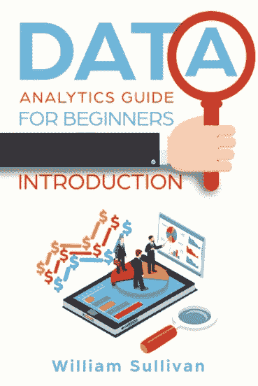

## 免费电子书下载：

[`bit.ly/2yJsyq4`](http://bit.ly/2yJsyq4)

或者

[`pragmaticsolutionstech.com/`](http://pragmaticsolutionstech.com/)

使用上方链接即可获取畅销电子书《初学者数据分析指南》

- [`reduce` 函数]

# 第 1 章

## 引言

Python 是一种弱类型的面向对象编程语言，用于执行各种编程任务，范围从 Web 开发、桌面应用开发到数据科学和机器学习等。得益于语法简单且易于学习，Python 已成为世界上领先的编程语言之一。Python 由 Guido van Rossum 于 20 世纪 80 年代后期创建。本书为深入 Python 编程提供了门户。

### 为什么选择 Python?

学习 Python 有许多优势。其中一些如下：

* 易于学习

Python 凭借其极其简单的语法和松散的类型，是最容易学习的语言之一。与其他语言不同，你不需要学习如何使用无数种括号来指定代码块。你也不会遇到行尾分号错误。最后，在变量存储数据时，你不需要指定变量的类型。这些点对于专家程序员来说可能是微不足道的，但对于编程初学者来说，它们是非常令人望而却步的

## 开源与大型开发者社区

Python 是一种开源语言，这意味着它可以用于商业或非商业目的开发、共享和分发应用程序，而不会违反任何版权。此外，Python 庞大的开发者社区使得查找问题的解决方案变得更容易。

## 对 Web 开发的支持

Python 可用于开发网站。事实上，有一些非常优秀的 Python 框架，如 `Django` 和 `Flask`，它们使得服务器端 Web 开发变得更加简单且稳定。

## 用于数据科学和机器学习

你可能听过“数据即未来”的说法。如果数据真的是未来，那么 Python 无疑是应该学习的语言，因为目前大多数数据科学和机器学习都是通过 Python 实现的。许多机器学习和深度学习库如 `Sklearn`、`Tensorflow`、`Keras`，使得开发复杂的机器学习模型变得非常简单。

## Python 的重要特性

以下是 Python 的一些重要特性：

### 源码到字节码

Python 源代码直接编译为字节码，无需任何中间步骤。这使得 Python 脚本可以在多个平台上运行，而不需要任何额外的工具。

### 面向对象

Python 是一种 100% 面向对象的语言。Python 中的一切都是对象。此外，Python 提供了一种通过类创建新对象的简单方法。

### 支持 C/C++ 扩展

Python 代码可以用 C 和 C++ 进一步扩展。通过这种方式可以显著提高 Python 程序的速度。

### 动态语言

Python 是一种动态语言。绑定到类型的值而不是变量。此外，方法和函数的查找是在运行时进行的。

### 自动垃圾回收

Python 会自动执行垃圾回收。不过，可以使用 `gc` 模块在任何给定时间执行垃圾回收。

### 高结构化语言

语句、函数、类、模块、包，以及最重要的 Python 缩进语法允许开发者编写高度结构化且可读性强的代码。

### 与其他语言相比快速且易于维护

与其他编译语言相比，Python 更快、更结构化且更易于维护。

## 关于本书

本书旨在对 Python 编程语言提供深入而简单的见解。本书面向初学者以及高级读者。本书帮助初学者通过实用的 Python 接触编程。另一方面，它也可以作为专家用户的参考资料，用于学习不同的基础和高级 Python 概念。

所有重要的 Python 概念都已分在不同的章节中。每个章节包含关于特定 Python 概念的理论信息，以及以 Python 脚本形式呈现的实现。为了充分利用本书的内容，建议读者先彻底理解该概念，然后练习代码。

## 接下来是什么？

在下一章中，我们将设置运行 Python 脚本所需的环境。我们将安装运行书中脚本所需的各种软件。祝编码愉快 ！！！

# 第 2 章

## 环境搭建

在本章中，我们将安装运行 Python 脚本所需的软件。我们将安装运行本书中脚本所需的不同软件。

### 下载并安装 Anaconda

Linux 和 Mac 的安装过程几乎相同。

1. 转到你的 Windows 搜索框并输入 `Anaconda Navigator`，然后选择 `Anaconda Navigator` 。

2. 访问以下 URL：`https://www.anaconda.com/download/`。选择最新版本。点击 `Download` 按钮。

3. 一旦下载了可执行文件，进入下载文件夹并运行可执行文件。

4. 将弹出“License Agreement”对话框。阅读许可协议并点击 `I Agree` 按钮。

5. 在“Select Installation Type”对话框中，勾选 `Just Me` 按钮并点击 `Next` 按钮。

6. 在“Choose Install Location”对话框中选择安装目录（建议使用默认），并点击 `Next` 按钮。

7. 在“Advanced Installation Options”对话框中，勾选第二个复选框 `Register Anaconda as default Python 3.6` 并点击 `Install` 按钮。

8. 安装完成后，点击 `Next` 按钮。

9. 弹出“Microsoft Studio Code Installation”窗口，点击 `Skip` 按钮。

10. 恭喜你你安装了 Anaconda。取消对话框中的两个复选框并点击 `Finish` 按钮。

### 运行你的第一个程序

我们已经安装了运行 Python 脚本的环境。现在是运行我们第一个程序的时间了。通过 Anaconda，你有多种方法可以实现。我们将在本节介绍其中两种。

#### 通过 Jupyter Notebook 运行脚本

Jupyter notebook 在你的默认浏览器中运行。从导航器中，启动 `Jupyter Notebook`（顶部的第二个选项）。

启动 Jupyter 的另一种方法是在搜索框中输入“Jupyter Notebook”，并从开始菜单选择“Jupyter Notebook”应用程序，如下所示：

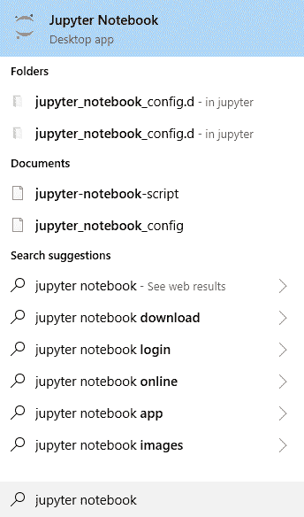

Jupyter notebook 将会在默认浏览器的新标签页中启动。

要创建一个新笔记本，点击 Jupyter notebook 仪表板右上角的“new”按钮。从下拉菜单中选择“Python 3”。

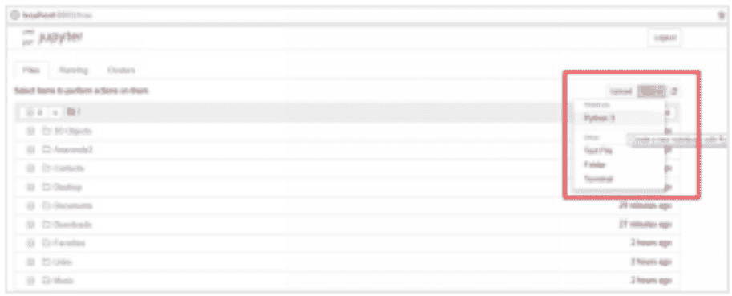

你将看到一个如下所示的新 Python 3 笔记本：

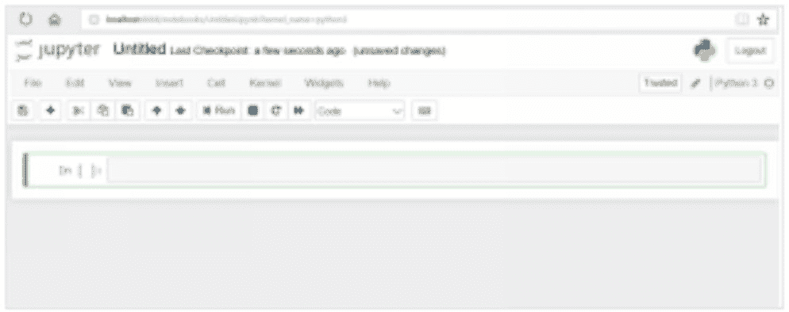

Jupyter notebook 由单元格组成。Python 代码写在这些单元格内。让我们使用 Jupyter notebook 打印 hello world。在笔记本的第一个单元格中输入 `print('hello world')` 并按 `CTRL+ ENTER`。第一个单元格中的脚本将执行如下所示：

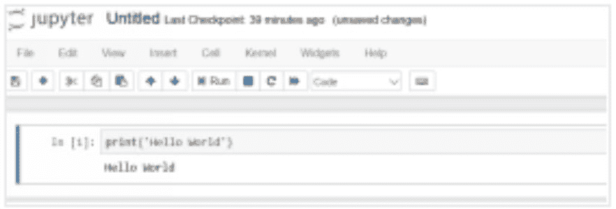

`print` 函数将传递给它的参数字符串打印到输出中。要创建一个新单元格，点击左上菜单中的 `+` 按钮，如下所示：

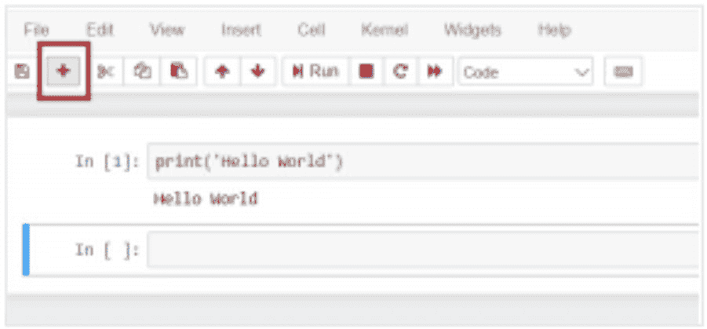

你可以在新单元格中编写 Python 脚本并按 `CTRL + ENTER` 执行它。

#### 通过 Spyder 运行脚本

虽然 Jupyter notebook 是开始编写 Python 程序的好地方，但一旦你熟悉了 Python，就应该转向 Spyder IDE。Spyder 允许我们直接创建 Python 文件。Spyder 类似于更传统的文本编辑器，具有运行文件、运行代码段、调试代码等选项。

就像 Jupyter notebook 一样，你可以从 Anaconda Navigator 或直接从开始菜单运行 Spyder。运行 Spyder 后你将看到以下界面。

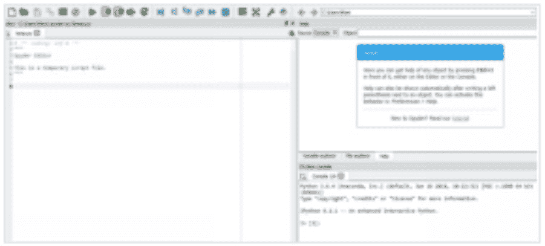

在 Spyder 界面的左侧，你可以看到文本编辑器；这是你输入脚本的地方。右下方是控制台窗口。你可以直接在控制台窗口中执行脚本。此外，编辑器中编写的代码输出也会出现在控制台窗口。让我们在 Spyder 中写 hello world 程序。

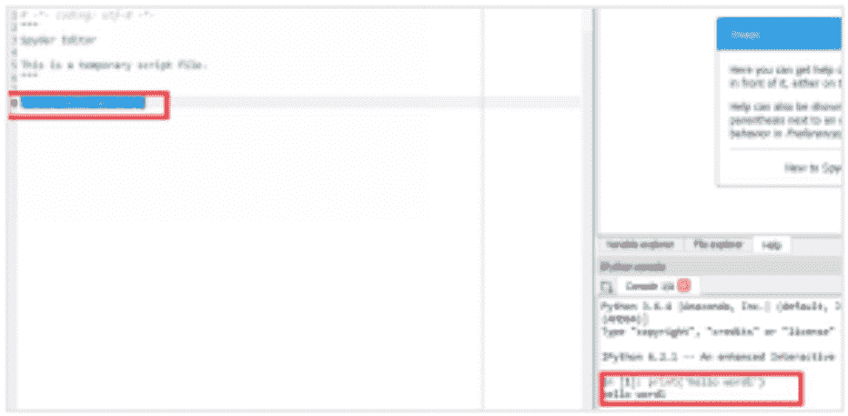

在 Python 中运行脚本有两种选择。你可以点击顶部菜单中的绿色三角形，或者选择你想执行的代码段并按键盘上的 `CTRL + ENTER`。你将在控制台窗口中看到输出。

### 接下来做什么？

在本章中，我们看到了运行 Python 程序所需环境配置的过程。我们在两个不同的编辑器中写了我们的第一个 Python 程序。在下一章中，我们将开始讨论 Python 语法。祝编程愉快！！！

# 第 3 章

## Python 语法

要编写 Python 代码，你需要遵循一些规则。在编程术语中，这些规则统称为语法。Python 独特的语法是初学者认为它易于学习和编程的原因之一。在本章中，我们将详细学习 Python 语法。

### 简单语句

与大多数其他面向对象的编程语言不同，如果某一行中只有一条语句，Python 不需要在语句末尾加分号。如果你想在一行中写多个 Python 语句（这非常不建议），你必须用分号将它们隔开。看下面的示例。

在这里我们在两个不同的行上写了两个 Python 语句。我们不需要分号。

```python
print ("Welcome to Python")
print ("It is fun learning Python")
```

当你执行上述语句时，你将看到以下输出：

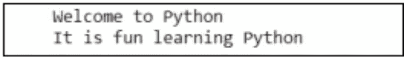

现在让我们用分号隔开在一行内写两个语句：

```python
print ("Welcome to Python") ; print ("It is fun learning Python")
```

上述脚本的输出将相同，因为即使它们被写在同一行，它们实际上也是两个语句。

你还可以编写跨越多行的 Python 语句。要做到这一点，你必须在行末尾添加反斜杠。反斜杠表示语句继续到下一行。看下面的脚本：

```python
sum = 10 + 20 + \
      30 + 40 + \
      50
print(sum)
```

### 代码块与缩进

缩进是 Python 语法中最显著的特征之一。缩进强制开发者编写具有一致性的可读性代码。

```python
if 10 > 3:
    print("This is inside block")
print("This is also inside block")
print("This is outside block")
```

```python
if 10 < 3:
    print("This is inside block")
print("This is also inside block")
print("This is outside block")
```

```python
if 10 < 3:
    print("This is inside block")
print("This is outside block")
```

使用缩进而不是大括号作为代码块有许多优点。

### Python 标识符

编程中的标识符是分配给任何变量、函数、模块或类的名称。Python 标识符可以包含 A-Z a-z、0-9 和下划线。Python 标识符名称必须以字母或下划线开头。Python 是一种大小写敏感的语言，这意味着 `Customer` 和 `customer` 被视为不同的标识符。

#### 命名规范

*   包和模块名全小写

*   类使用驼峰法，每个单词的首字母大写。例如 `CustomerProductRecord`

*   方法和函数的约定是使用小写字母并用下划线分隔。例如 `person_name`, `get_age` 等

*   私有变量以单下划线开头

*   强私有变量以双下划线开头

### Python 关键字

关键字是 Python 保留用于执行特殊任务的特殊单词。例如关键字 `class` 用于定义类。同样，关键字 `for` 用于循环。关键字不能作为标识符或常量名。Python 拥有以下关键字。

| and | exec | not |
| --- | --- | --- |
| assert | finally | or |
| break | for | pass |
| class | from | print |
| continue | global | raise |
| def | if | return |
| del | import | try |
| elif | in | while |
| else | is | with |
| except | lambda | yield |

## 获取用户输入

获取用户输入是最基础的编程任务之一。Python 让它变得非常简单。在 Python 3 中，你可以使用 `input()` 函数并向其传递你想显示给用户的字符串。看下面的截图：


你在文本框中输入的任何内容将存储在 `text` 变量中。

本章简要介绍了 Python 语法。本书的其余部分将遵循本章所描述的规范和语法。在下一章中，我们将学习 Python 的基础数据类型。我们将看到 Python 可以存储哪些不同类型的数据，以及如何声明变量来存储这些数据。编码愉快！！！

# 第 4 章

## 变量与数据类型

一个软件应用程序由两个基本部分组成：逻辑和数据。逻辑由应用于数据以完成特定任务的功能性组成。应用程序数据可以存储在内存或硬盘中。文件和数据库用于在硬盘上存储数据。在内存中，数据以变量的形式存储。

### 变量的定义

编程中的变量是用于存储某些值的内存位置。每当你向变量存储一个值时，该值实际上存储在内存的物理位置。变量可以被看作是对物理内存位置的引用。为变量预留内存的大小取决于变量中存储的值类型。

### 创建变量

在 Python 中创建变量非常简单。使用赋值运算符 `=` 来实现此目的。赋值运算符左侧的值是变量标识符或变量名。运算符右侧的值是赋值给变量的值。看下面的代码段。

```python
Name = 'Mike'      # 字符串变量
Age = 15           # 整数变量
Score = 102.5      # 浮点类型变量
Pass = True        # 布尔变量
```

在上面的脚本中，我们创建了四个不同类型的变量。你可以看到我们没有通过变量名指定变量类型。例如，我们没有写 `"string Name"` 或 `"int Age"`。我们只写了变量名。这是因为 Python 是一种弱类型语言。根据存储在变量中的值，Python 在运行时为变量分配类型。例如，当 Python 解释器解释 `Age = 15` 这一行时，它会检查值的类型，在这种情况下是整数。因此，Python 理解为 `Age` 是一个整数类型变量。

要检查变量的类型，将变量名传递给 `type` 函数，如下所示：

```python
type(Age)
```

你会发现上面的脚本在运行时，会在输出中打印出 `"int"`，这基本上就是 `Age` 变量的类型。

Python 允许多重赋值，这意味着你可以同时给多个变量分配同一个值。看下面的脚本：

```python
Age = Number = Point = 20 # 多重赋值
print(Age)
print(Number)
print(Point)
```

在上面的脚本中，整数 20 被分配给了三个变量：`Age`、`Number` 和 `Point`。如果你打印这三个变量的值，你将在输出中看到三次 20。

### Python 数据类型

编程应用程序需要存储各种数据。考虑一个需要存储客户信息的银行应用程序场景。例如，一个人的姓名和手机号码；他是否是违约者；他/她借出的物品列表等等。为了存储此类各种信息，需要不同的数据类型。虽然你可以以类的形式自定义数据类型，但 Python 提供了六种标准数据类型。它们是：

*   字符串 (Strings)

*   数字 (Numbers)

*   布尔 (Booleans)

*   列表 (Lists)

*   元组 (Tuples)

*   字典 (Dictionaries)

### 字符串

Python 将字符串视为字符序列。在 Python 中创建字符串，可以使用单引号也可以双引号。看下面的脚本：

```python
first_name = 'mike' # 使用单引号的字符串
last_name = " johns" # 使用双引号的字符串
full_name = first_name + last_name # 使用 + 进行字符串拼接
print(full_name)
```

在上面的脚本中，我们创建了三个字符串变量：`first_name`、`last_name` 和 `full_name`。单引号字符串被用于初始化变量 `"first_name"`，而双引号字符串初始化了变量 `"last_name"`。变量 `full_name` 包含 `first_name` 和 `last_name` 变量的拼接。运行上面的脚本返回以下输出：

```
mike johns
```

### 数字

Python 中有四种数值数据类型：

*   `int`（存储整数，例如 10）

*   `float`（存储浮点数，例如 2.5）

*   `long`（存储长整数，如 48646684333）

*   `complex`（复数，如 7j+4847k）

要创建一个数值型 Python 变量，只需将数字赋值给变量。在接下来的脚本中，我们创建了四种不同类型的数值对象并在控制台上打印它们。


# Python 变量、数据类型与运算符

## 数字类型

```python
int_num = 10      # 整数
float_num = 156.2  # 浮点
long_num = -0.5977485613454646  # 长整数
complex_num = -.785+7J # 复数
print(int_num)
print(float_num)
print(long_num)
print(complex_num)
```

上面脚本的输出将如下：

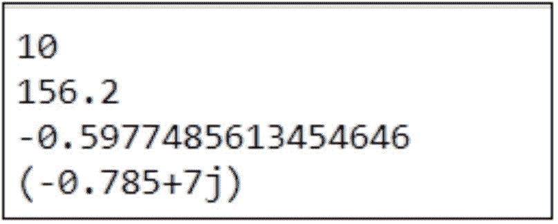

## 布尔

布尔变量用于存储布尔值。`True` 和 `False` 是 Python 中的两个布尔值。看下面的示例：

```python
defaulter = True
has_car = False
print(defaulter, has_car)
```

在上面的脚本中，我们创建了布尔变量 `defaulter` 和 `has_car`，对应值为 `True` 和 `False`。我们打印这两个变量的结果。我们将学习更多逻辑运算符。

## 列表

在 Python 中，列表数据类型用于存储值的集合。列表与其他语言中的数组类似。然而，Python 列表可以存储不同类型的值。创建列表时使用左右方括号。列表中的每个项目之间用逗号分隔。看下面的示例：

```python
cars = ['Honda', 'Toyota', 'Audi', 'Ford', 'Suzuki', 'Mercedez']
print(len(cars)) # 计算字符串的总数
print(cars)
```

在上面的脚本中，我们创建了一个名为 `cars` 的列表。列表包含六个字符串值。接下来我们使用 `len` 函数打印了列表的大小。最后我们在控制台上打印列表。


cars[3] = 'WV'
cars2[3] = 'WV'
```

在上面的脚本中，我们创建了一个名为 `cars` 的列表和一个名为 `cars2` 的元组。列表和元组都包含汽车名称列表。我们随后尝试用新值更新列表和元组的第三个索引。列表将更新，但在尝试更新元组的第三个索引时会抛出错误。这是因为元组一旦创建就无法用新值进行修改。


print(cars.keys())
print(cars.values())
```

在上面的脚本中，我们创建了一个名为 `cars` 的字典。该字典包含三个键值对，即 3 个项目。要访问值，我们可以将键传递到字典名后的括号中。同样，我们可以使用 `keys()` 和 `values()` 方法分别从字典中检索所有的键和值。上述脚本的输出如下：

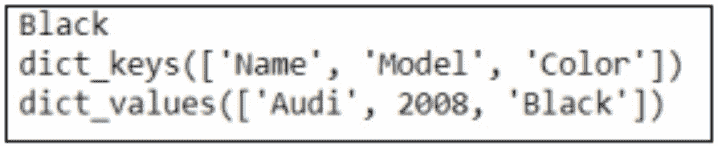

## 接下来要做什么？

本章简要介绍了 Python 中的变量和数据类型。在下一章节中，我们将开始讨论 Python 运算符。编码愉快！

# 第 5 章 运算符

编程中的运算符是用于对操作数执行特定逻辑、关系或数学运算的字面量。Python 运算符分为以下五类：

*   算术运算符
*   逻辑运算符
*   比较运算符
*   赋值运算符
*   成员运算符

在本章中，我们将通过示例讨论这些运算符。

## 算术运算符

顾名，算术运算符用于对操作数进行算术运算。

假设 `N1 = 10` 且 `N2 = 5`；请查看下表以理解算术运算符。

| OperatorName | Symbol | Functionality | Example |
| --- | --- | --- | --- |
| 加法 | `+` | 将两边的操作数相加 | `N1 + N2 = 15` |
| 减法 | `-` | 减两边的操作数 | `N1 – N2 = 5` |
| 乘法 | `*` | 乘两边的操作数 | `N1 * N2 = 50` |
| 除法 | `/` | 将左的操作数除以右侧的操作数 | `N1 / N2 = 2` |
| 取模 | `%` | 将左的操作数除以右侧的操作数并返回余数 | `N1 % N2 = 0` |
| 幂 | `**` | 取左侧操作数的右侧幂 | `N1 ** N2 = 100000` |

查看以下示例以了解算术运算符的用法：

```python
N1 = 10
N2 = 5
print(N1 + N2)
print(N1 - N2)
print(N1 * N2)
print(N1 / N2)
print(N1 ** N2)
```

上述脚本的输出如下：

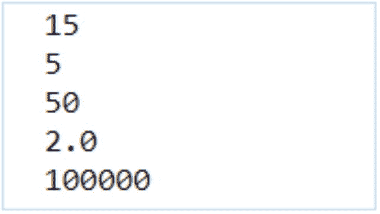

## 逻辑运算符

逻辑运算符用于对操作数执行逻辑函数，如 AND（与）、OR（或）和 NOT（非）。下表包含了 Python 逻辑运算符及其描述和功能。假设 `N1` 为 True，`N2` 为 False。

| Operator | Symbol | Functionality | Example |
| --- | --- | --- | --- |
| 逻辑与 | `and` | 如果两个操作数均为真，则条件为真。 | `(N1 and N2) = False` |
| 逻辑或 | `or` | 如果两个操作数中任一为真，则条件为真。 | `(N1 or N2) = True` |
| 逻辑非 | `not` | 用于反转操作数的逻辑状态。 | `not(N1 and N2) = True` |

查看以下示例以了解逻辑运算符的用法：

```python
N1 = True
N2 = False
print(N1 and N2)
print(N1 or N2)
print(not(N1 and N2))
```

上述脚本的输出如下：

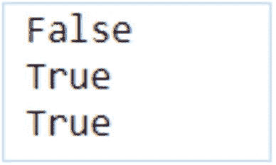

## 比较运算符

比较运算符用于比较操作数包含的值，并根据操作数之间的关系返回 true 或 false。比较运算符也称为关系运算符。假设 `N1` 等于 10 且 `N2` 等于 5，请查看下表以理解比较运算符。

| Operator | Symbol | Description | Example |
| --- | --- | --- | --- |
| 等于 | `==` | 如果两个操作数的值相等则返回 true | `(N1 == N2) = false` |
| 不等于 | `!=` | 如果两个操作数的值不相等则返回 true | `(N1 != N2) = true` |
| 大于 | `>` | 如果左操作数大于右操作数则返回 true | `(N1 > N2) = true` |
| 小于 | `<` | 如果左操作数小于右操作数则返回 true | `(N1 < N2) = false` |
| 大于或等于 | `>=` | 如果左操作数大于或等于右操作数则返回 true | `(N1 >= N2) = true` |
| 小于等于 | `<=` | 如果左操作数小于或等于右操作数则返回 true | `(N1 <= N2) = false` |

查看以下示例以了解比较运算符的用法：

```python
N1 = 10
N2 = 5
```

## 赋值运算符

赋值运算符用于给操作数赋值。下表包含了关于赋值运算符的信息。假设 `N1` 等于 10 且 `N2` 等于 5。

| Operator | Symbol | Description | Example |
| --- | --- | --- | --- |
| 赋值 | `=` | 给操作数赋值。 | `N1 = 10` |
| 加赋值 | `+=` | 将两边的操作数相加并赋值结果。 | `N1 += N2` |
| 减赋值 | `-=` | 减去两边的操作数并赋值结果。 | `N1 -= N2` |
| 乘赋值 | `*=` | 将两边的操作数相乘并赋值结果。 | `N1 *= N2` |
| 除赋值 | `/=` | 将左的操作数除以右侧的操作数并赋值结果。 | `N1 /= N2` |
| 取模赋值 | `%=` | 将左的操作数除以右侧的操作数并返回余数。 | `N1 %= N2` |
| 幂赋值 | `**=` | 取左侧操作数的右侧幂并赋值。 | `N1 **= N2` |

查看以下示例以了解赋值运算符的用法：

```python
N1 = 10
N2 = 5
R = N1 + N2
```

## 成员运算符

成员运算符用于检查操作数存储的值是否存在于特定序列。Python 中有两种成员运算符：`in` 和 `not in`。`in` 运算符在特定序列中找到值时返回 true。`not in` 运算符在相反的情况下返回 true。查看以下示例以了解成员运算符的用法。

```python
cars = ['Honda', 'Toyota', 'Audi', 'Ford', 'Camery']
print('Honda' in cars) # 返回 True
print('BMW' in cars) # 返回 False
print('Honda' not in cars) # 返回 False
print('BMW' not in cars) # 返回 True
```

# 第 6 章 条件语句

Python 中有三种主要的条件语句：

- `if`
- `else`
- `elif`

## “if”语句

`if` 语句用于在随其后的表达式结果为真时执行一段代码块。这个语句目前听起来可能很复杂，但一旦你看到 `if` 语句的工作示例，就能理解它了。来看：

```python
num1 = 10
num2 = 20
if num2 > num1:
    print("num2 is greater than num1")
```

在上面的脚本中，我们创建了两个变量 `num1` 和 `num2`，其值分别为 10 和 20。接下来，我们写了一个 `if` 语句来判断 `num2` 是否大于 `num1`，结果为真。因此，打印“num2 is greater than num1”的语句被执行。输出如下：

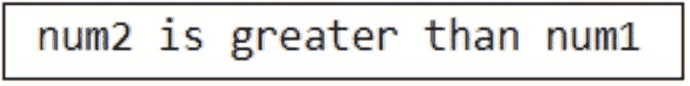

现在让我们来判断 `num2` 是否小于 `num1`。执行以下脚本：

```python
num1 = 10
num2 = 20
if num2 < num1:
    print("num2 is smaller than num1")
```

由于 `num2` 并不小于 `num1`，因此 `if` 块不会执行，你将在输出中什么也看不到。

## 连接两个或多个条件

你还可以使用逻辑“OR”（或）和“AND”（与）运算符连接两个或两个以上的表达式。来看下面的脚本：

```python
num1 = 10
num2 = 20
num3 = 30
if num2 < num1 or num3 > num2 :
    print("num2 is smaller than num1 OR num3 is greater than num2")
```

在上面的脚本中，两个条件通过逻辑 OR 运算符连接进行判断。第一个条件检查 `num2` 是否大于 `num1`，结果为假。第二个条件判断 `num3` 是否大于 `num2`，结果为真。由于条件是用 OR 运算符连接的，整体结果为真，因此 `if` 块中的语句将执行。上述脚本的输出如下：

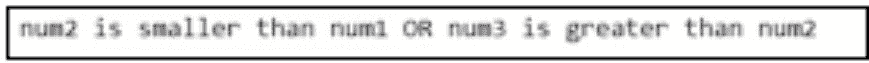

## 嵌套“if”语句

你可以将 `if` 语句嵌套在其他 `if` 语句内部。来看这个示例：

```python
num1 = 10
num2 = 20
num3 = 30
if num2 > num1:
    if num3 > num2:
        print("num2 is greater than num1 and num3 is greater than num2") 
```

输出将如下：

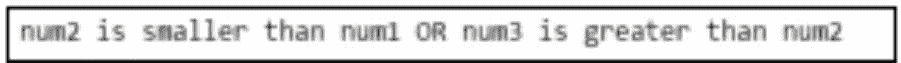

## “else”语句

只有当随其后的条件返回真时，`if` 块才会执行。如果我们想在条件返回假时执行另一组语句呢？`else` 语句正是为此任务的。来看下面的语句：

```python
num1 = 10
num2 = 20
if num1 > num2:
    print("num1 is greater than num2")
else:
    print("num2 is greater than num1")
```

在上面的脚本中，`if` 条件检查 `num1` 是否大于 `num2`，结果为假。因此 `if` 块未执行。控制权转移到 `else` 语句，该语句执行。上述脚本的输出如下：

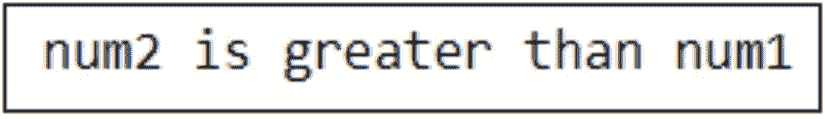

## “elif”语句

你可以使用 `elif` 语句评估多个条件。通过示例来解释这一点最为清楚：

```python
num1 = 10
num2 = 20
num3 = 30
if num1 > num2:
    print("num1 is greater than num2")
elif num2 > num3:
    print("num2 is greater than num3")
elif num3 > num2:
    print("num3 is greater than num1")
else:
    print("None of the conditions are true")
```

在上面的脚本中，`if` 语句检查 `num1` 是否大于 `num2`，结果为假。因此控制权转移到第一个 `elif` 语句。第一个 `elif` 语句检查 `num2` 是否大于 `num3`，结果同样为假。因此控制权转移到下一个 `elif` 语句，由于 `num3` 实际上大于 `num2`，该语句结果为真。因此，第二个 `elif` 语句的代码块将被执行。上述脚本的输出如下：

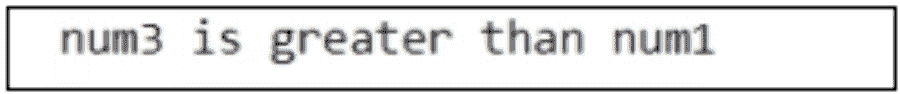

如果 `if` 和所有 `elif` 语句的条件均为假，则执行 `else` 之后的代码块。

## 嵌套“elif”语句

与 `if` 语句一样，你也可以嵌套 `elif` 语句。来看这个示例：

```python
num1 = 10
num2 = 20
num3 = 30
if num1 > num2:
    print("num1 is greater than num2")
elif num2 > num3:
    print("num2 is greater than num3")
elif num3 > num2:
    if num1 > num3:
        print("num1 is greater than num3")
    elif num2 > num1:
        print("num2 is greater than num1 but smaller than num3")
    else:
        print("None of the conditions are true")
```

在上面的脚本中，从第一层开始，检查 `num3` 是否大于 `num2` 的第二个 `elif` 语句结果为真。然而，在这个 `elif` 语句内部还有进一步嵌套的 `if` 和 `elif` 语句。内部的 `if` 语句检查 `num1` 是否大于 `num3`，结果为假。控制权转移到内部的 `elif` 语句，检查 `num2` 是否大于 `num1`，结果为真。因此，内部 `elif` 块之后的语句执行。上述脚本的输出如下：

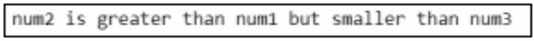

## 接下来做什么？

在本章中，我们学习了不同类型的条件语句以及如何使用它们来控制程序的流程。在下一章中，我们将开始讨论迭代语句。我们将看到不同类型的迭代语句及其用法。编码愉快！！！

# 第 7 章 迭代语句（循环）

迭代语句用于针对特定次数重复执行一段代码，或者直到满足某个条件。想象你需要在屏幕上打印 100 次某个字符串，你得写 100 行代码。或者使用复制粘贴。考虑需要重复执行一大段代码的情况，由于以下原因：首先它会显著增加代码量，其次维护非常困难。幸运的是，迭代语句在这种情况下救了我们。迭代语句通常被称为循环。

Python 中有两种迭代语句：

- `for` 循环
- `while` 循环

## “for”循环

`for` 循环用于遍历集合（例如列表、元组、字典等）。`for` 循环的语法如下：

```python
for i in list:
    statement 1
    statement 2
```

这里 `i` 是任何可以被赋值的变量。`list` 是 `for` 循环遍历的列表。来看下面的示例以查看 `for` 循环的作用：

```python
cars = ['Audi','BMW','Toyota','Honda','Ford']
for car in cars:
    print(car)
```


在上面的脚本中，我们创建了一个汽车列表。然后我们使用 `for` 循环遍历这个列表。让我们理解 `for` 循环在后台是如何执行的。在第一次迭代中，`cars` 列表的第一个项（索引为 0 的项）“Audi”被赋值给变量 `car`。`car` 变量的值打印在屏幕上。在第二次迭代中，列表第二个项存储在 `car` 变量并打印在屏幕上，依此类推。上述脚本的输出如下：

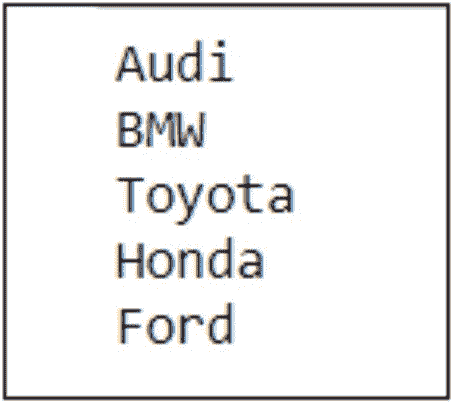

### 使用 range 函数

如果我们想在没有列表的情况下执行特定的语句怎么办？我们可以使用 `range` 函数来实现。基本上，`range` 函数也返回一个可以供 `for` 循环遍历的迭代序列。例如，如果我们想让 `for` 循环执行 10 次，我们可以如下所示使用 `range` 函数：

```python
for i in range(10):
    print(i)
```

`range` 函数返回一个从 0 开始的具有指定数量整数的序列。上述脚本的输出将是 0 到 9 的整数。

`range` 函数也可以用于创建一个特定范围内的整数序列。例如，如果你想创建一个从 `50` 到 `100` 的整数序列，可以按照如下方式操作：

```python
for i in range(50, 101):
    print(i)
```

请记住，`range` 函数返回的序列包含下界整数，但不包含上界。因此，上面的脚本将返回从 50 到 100 的整数，但不包含 101。

### 遍历字符串

`for` 循环也可以用于遍历字符串。这是因为字符串实际上是字符的序列。请看下面的脚本：

```python
for c in 'Hello world':
    print(c)
```

输出结果将如下：

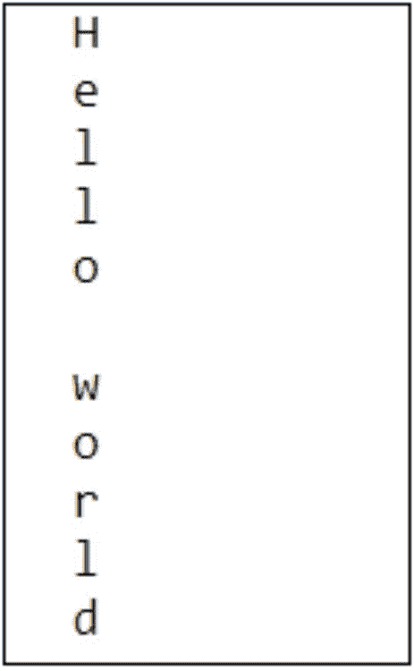

### “while”循环

`for` 循环执行的次数等于循环所操作的序列中的项目数量。如果我们想要一个在满足特定条件时终止的循环呢？`while` 循环就是答案；`while` 循环会执行，直到满足某个条件为止。`while` 循环的语法如下：

```python
while (expression = true):
    statement1 …
    statement2 …
```

基本上，`while` 循环检查其后的表达式是否为真（true）。它会一直执行，直到表达式返回真。请看以下脚本来理解 `while` 循环：

```python
i = 1
while i < 11:
    print(i)
    i = i + 1
```

在上面的脚本中，我们初始化变量 `i` 为整数 `1`。然后我们创建了一个 `while` 循环，检查变量 `i` 的值是否小于 `11`。在每次迭代中，我们在 `while` 循环内部将 `i` 的值加 `1`。在循环执行 10 次后，`i` 的值变为 `11`。因此，条件 `i` 小于 `11` 返回为假（false），因此 `while` 循环终止。

让我们尝试使用 `while` 循环打印 9 的九法表。请看下面的脚本：

```python
i = 1
while i < 11:
    print('9 x ' + str(i) + ' = ' + str(i * 9))
    i = i + 1
```

上面脚本的输出如下：

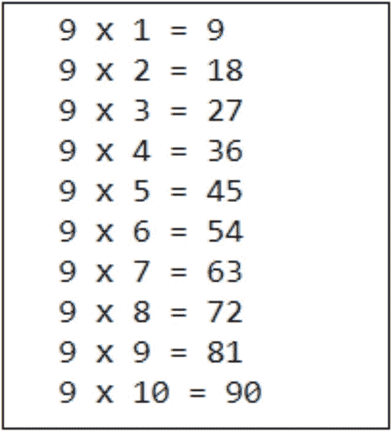

### Continue 语句

`continue` 语句用于跳过循环中的剩余语句并将控制权移回循环的开头。`continue` 语句可以用于 `for` 循环也可以用于 `while` 循环。请看下面的示例来查看 `continue` 语句的作用。

```python
for i in range(1, 11):
    if (i % 2) != 0:
        continue
    print(i)
```

在上面的脚本中，我们使用 `for` 循环遍历从 1 到 10 的整数序列。在每次迭代中，我们检查该整数是否为偶数。为了做到，我们将整数除以 `2` 并检查结果是否为 `0`。如果整数是偶数，我们就在控制台上打印它；如果整数不是偶数，我们则使用 `continue` 语句回到 `for` 循环体的开头，跳过 `print` 语句。脚本的输出包含 2 到 10 之间的偶数，如下所示：


### Break 语句

`break` 语句用于终止循环的执行。`break` 语句可以用于 `for` 循环也可以用于 `while` 循环。请看下面的语句来查看 `break` 语句的作用。

```python
for i in range(1, 11):
    if i > 5:
        break
    print(i)
```

在上面的脚本中，当 `i` 的值大于 `5` 时，`for` 循环终止。

### 接下来是什么？

我们已经涵盖了大部分 Python 基本概念。从下一章开始，我们将注意力转向高级 Python 概念的深入分析。在下一章中，我们将详细学习序列。我们将对列表（lists）、元组（tuples）、字典（dictionaries）以及可以在这些执行的函数进行深入分析。

# 第 8 章 列表、元组和字典

我们在第四章：变量与数据类型中简要回顾了列表、元组和字典。它们是 Python 中最重要的数据结构之一。在本章中，我们将详细查看列表、元组和字典及其工作原理。

## 列表 (Lists)

Python 中的列表类似于其他编程语言中的数组。列表存储不同类型的集合，并且是可变的（mutable）。

### 创建列表

有多种方法可以创建列表。最简单的方法是将逗号分隔的项包含方括号内，并将其赋值给变量，如下所示：

```python
colors = ['Red', 'Green', 'Blue', 'Yellow', 'White']
```

上面的脚本创建了一个名为 `colors` 的列表。创建列表的其他方法是使用构造函数 `[]` 和 `list()`。

```python
colors2 = []
colors3 = list()
```

上面的脚本创建两个空列表：`colors2` 和 `colors3`。要创建整数序列的列表，可以使用 `range` 函数并使用 `list` 函数转换为列表。`range` 函数返回一个从 0 到小于传递值的整数列表。如下所示：

```python
nums = list(range(10))
```

`range` 函数返回一个从 0 到小于传递值的整数列表。如果你想指定范围，可以向 `range` 传递两个值：

```python
nums = list(range(50, 101))
```

`range` 函数返回一个从 50 到 100 的整数列表（不包含 101）。

### 访问元素

列表是有索引的，这意味着你可以通过索引访问元素。第一个元素存储在索引 0 ：

```python
colors = ['Red', 'Green', 'Blue', 'Yellow', 'White']
print(colors[1])
```

上面的脚本在控制台上打印‘Green’。列表是可变的，这意味着你可以更改特定索引的值。让我们将第三索引的值从‘Blue’改为‘Black’：

```python
colors = ['Red', 'Green', 'Blue', 'Yellow', 'White']
print(colors)
colors[2] = 'Black'
print(colors)
```

在上面的脚本中，我们在设置第三索引的值之前之后打印了 `colors` 列表。输出如下：


你可以使用切片操作（即 `:`）一次性访问多个列表元素。例如，如果你想访问列表的前三个元素，可以使用切片操作：

```python
colors = ['Red', 'Green', 'Blue', 'Yellow', 'White']
sublist = colors[:3]
print(sublist)
```

上面的脚本返回如下：


同样，如果你想访问列表的最后三个元素，执行以下脚本：

```python
colors = ['Red', 'Green', 'Blue', 'Yellow', 'White']
sublist = colors[-3:]
print(sublist)
```

结果如下：


最后，你也可以使用切片操作访问列表的范围内的项目。

```python
colors = ['Red', 'Green', 'Blue', 'Yellow', 'White']
sublist = colors[2:4]
print(sublist)
```

上面的函数返回从索引 2 到小于索引 4 的元素范围（即索引为 2 和 3 的元素）。输出如下：


### 向列表添加元素

`append` 函数可用于向列表添加元素。要添加的项目作为参数传递给 `append` 函数。请看下面的示例：

```python
colors = ['Red', 'Green', 'Blue', 'Yellow', 'White']
print(colors)
colors.append('Orange')
print(colors)
```

在上面的脚本中，我们创建了一个包含五个项目的 `colors` 列表。我们在控制台上打印该列表。然后向列表添加了一个项目，并再次打印列表。输出如下：


你可以在输出中看到新添加的项 ‘Orange’。

### 从列表中删除元素

`remove` 函数用于从列表中删除元素。要删除的元素将作为参数传递给该方法。

```python
colors = ['Red', 'Green', 'Blue', 'Yellow', 'White']
print(colors)
colors.remove('Blue')
print(colors)
```

上述脚本的输出如下：

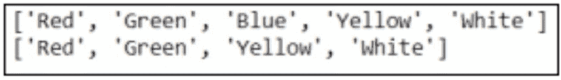

你可以看到项 ‘Blue’已经从列表中删除了。也可以使用索引号删除列表元素。

```python
colors = ['Red', 'Green', 'Blue', 'Yellow', 'White']
print(colors)
del colors[2]
print(colors)
```

要按索引删除列表元素，必须使用 `del` 函数，后跟列表名和传递在方括号内的索引值。

### 合并列表

你可以使用 `+` 符号将一个列表与其他列表合并，如下所示：

```python
nums1 = [2, 4, 6, 8, 10]
nums2 = [1, 3, 5, 7, 9]
result = nums1 + nums2
print(result)
```

输出如下：

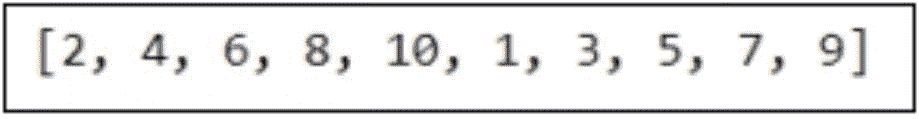

你可以看到第二个列表被合并在第一个列表的末尾。

### 在列表中使用 in 和 not in 函数

`in` 和 `not in` 函数可以用于检查元素是否存在于字符串中。

```python
colors = ['Red', 'Green', 'Blue', 'Yellow', 'White']
print('Green' in colors)
print('Orange' in colors)
print('Black' not in colors)
print('Blue' not in colors)
```

对于 ‘Green in colors’，`in` 函数返回 true，因为项 `Green` 确实存在于颜色字符串中。同样，对于 ‘Blue not in colors’，会返回 false，因为 `Blue` 存在 colors 列表中。上述脚本的输出如下：

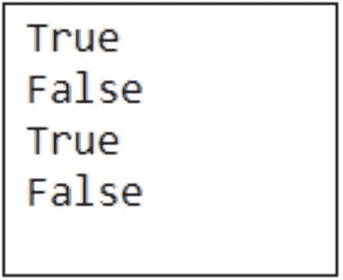

### 查找列表的长度

`len` 函数可以找到列表中元素的总数。

```python
colors = ['Red', 'Green', 'Blue', 'Yellow', 'White']
print(len(colors))
```

上述脚本返回 5，因为 `colors` 列表中有五个元素。

### 排序列表

你可以对列表元素进行排序和反转。对于字符串，元素按字母顺序排序；对于数值，按升序排序。看下面的示例：

```python
colors = ['Red', 'Green', 'Blue', 'Yellow', 'White']
colors.sort()
print(colors)
nums = [12, 4, 66, 35, 7]
nums.sort()
print(nums)
```

要对列表排序，会在列表上调用 `sort` 函数。记住，排序是原地操作（in-place），这意味着现有列表会被改变，而不是返回新列表。上述脚本的输出如下：

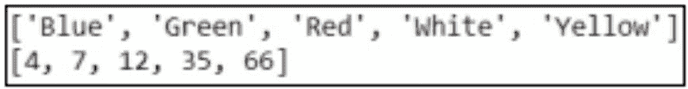

### 列表列表（矩阵）

列表可以嵌套在另一个列表中，形成矩阵。在接下来的示例中，我们将三个包含四个项的列表嵌套在另一个列表中，形成一个 ‘3 x 4’矩阵。

```python
colors = [[15, 20, 36, 41], [20, 54, 47, 74], [45, 69, 88]]
```

列表列表或矩阵也遵循从零开始的索引。访问第一个列表，需要向外部列表传递 0 作为索引。看下面的示例：

```python
colors = [[15, 20, 36, 41], [20, 54, 47, 74], [45, 69, 88]]
print(colors[0])
```

上述脚本打印父列表中的第一个列表，如下：


要访问嵌套列表中的特定值，首先必须指定嵌套列表的索引，然后是特定值的索引。例如，如果你想访问属于第一个列表索引为 47 的元素，可以使用以下语法：

```python
colors = [[15, 20, 36, 41], [20, 54, 47, 74], [45, 69]]
print(type(colors))
num = colors[1][3]
print(num)
```

## 元组 (Tuples)

与列表一样，元组也用于存储不同类型的集合。然而，与列表不同，元组是不可变的（immutable），这意味着一旦创建，元组元素就无法更改。你无法更新元组或删除或添加新元素。

### 创建元组

要创建一个元组，将逗号分隔的对象赋值给变量。

```python
colors = ('Red', 'Green', 'Blue', 'Yellow', 'White')
type(colors)
```

在上述脚本中，我们创建了一个名为 `colors` 的包含五个元素的元组。使用 `type` 函数确认 `colors` 变量类型确实为元组。

### 访问元组元素

可以使用索引像访问列表一样访问元组元素。看下面的脚本：

```python
colors = ('Red', 'Green', 'Blue', 'Yellow', 'White')
print(colors[2])
```

上述脚本打印索引为 2 的元素 ‘Blue’。切片操作也适用于元组。看下面的示例：

```python
colors = ('Red', 'Green', 'Blue', 'Yellow', 'White')
print(colors[:3])  # 访问前三个元素
colors = ('Red', 'Green', 'Blue', 'Yellow', 'White')
print(colors[-3:])  # 访问后三个元素
colors = ('Red', 'Green', 'Blue', 'Yellow', 'White')
print(colors[1:3])  # 访问索引 1 和 2 的元素
```

上述脚本的输出如下：


### 更新元组

我们知道元组是不可变的。元组中的元素无法更新、添加或删除。尝试修改元组元素验证这一事实。

```python
colors = ('Red', 'Green', 'Blue', 'Yellow', 'White')
colors[2] = 'Orange'
```

在上述脚本中，我们将新值赋值给 `colors` 元组的索引 2。尝试执行上述脚本会发生以下错误：


错误清楚地表示新元素无法赋值给元组。

### 查找元组的长度

可以使用 `len` 函数查找元组长度。这与列表相似。看下面的脚本：

```python
colors = ('Red', 'Green', 'Blue', 'Yellow', 'White')
print(len(colors))
```

上述脚本返回 5，即 `colors` 元组中的元素总数。

### 使用 ‘in’ 和 ‘not in’ 函数查找元组中的元素

`in` 和 `not in` 函数可以用于元组查找元素是否存在于元组内。看下面的脚本：

```python
colors = ('Red', 'Green', 'Blue', 'Yellow', 'White')
print('Green' in colors)
print('Orange' in colors)
print('Black' not in colors)
print('Blue' not in colors)
```

上述脚本的输出如下：


### 元组合并

与列表一样，可以使用加法运算符合并两个元组。事实上，这是向元组添加元素的方法之一。

```python
colors = ('Red', 'Green', 'Blue', 'Yellow', 'White')
orange_color = ('Orange',)
newcolors = colors + orange_color
print(newcolors)
```


在上述脚本中，我们创建了一个包含五个元素的元组 `colors`。然后我们创建了另一个名为 `orange_color` 的包含一个字符串元素 'Orange' 的元组。两个元组合并后返回一个包含 6 个元素的新元组。结果元组被打印到输出控制台。这是向现有元组添加新元素的方法之一。上述脚本的输出如下：


### 查找元组中的最大最小元素

`max()` 和 `min()` 函数用于查找元组中的最大值和最小值。看下面的脚本：

```python
nums = (2, 4, 6, 8, 10)
print(min(nums)) # 打印元组中的最小值
print(max(nums)) # 打印元组中的最大值
```

上述脚本的输出如下：


`min()` 和 `max()` 函数也可以用于列表。

### 将列表转换为元组

你可以通过将列表传递给元组的构造函数将列表转换为元组。看下面的示例：

```python
colors = ['Red', 'Green', 'Blue', 'Yellow', 'White']
print(type(colors))
colors_tuple = tuple(colors)
print(colors_tuple)
```

在上面的脚本中，我们创建了一个包含 5 个元素的列表 `colors`。然后我们检查了 `colors` 变量的类型。接着我们创建了另一个变量 `colors_tuple`。将 `colors` 列表传递给元组的构造函数，生成的元组存储在 `colors_tuple` 变量中。随后将新创建的 `colors_tuple` 输出到控制台上。上述脚本的输出如下：

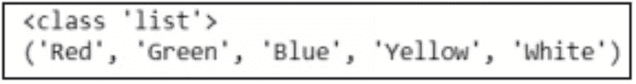

## 字典

字典以键值对（key-value pairs）的形式存储项集合。每个项的键和值之间用冒号 `:` 隔开。每个元素之间用逗号隔开。逗号分隔的项列表包含在大括号 `{}` 中。字典是可变的，这意味着你可以更新或删除字典中的某个项，也可以向字典中添加新项。

### 创建字典

```python
cars = {'name':'Honda', 'model':2013, 'color':'Yellow', 'Air bags': True}
type(cars)
```

在上面的脚本中，我们创建了一个包含 4 个元素的字典 `cars`。然后我们使用 `type()` 函数来确认 `cars` 变量的类型，返回 'dict'。

### 访问字典项

可以通过将键作为索引来访问字典中的项。请看下面的示例。

```python
cars = {'name':'Honda', 'model':2013, 'color':'Yellow', 'Air bags': True}
model = cars['model'] 
print(model)
```

在上面的脚本中，通过将键作为索引值，访问了键为 'model' 的项的值。你将在输出中看到 2013。

你也可以像下面所示，使用 `keys()` 和 `values()` 函数来访问字典中的所有的键和值：

```python
cars = {'name':'Honda', 'model':2013, 'color':'Yellow', 'Air bags': True} 
print(cars.keys()) # 访问字典的键
print(cars.values()) # 访问字典的值
```

上述脚本的输出如下：

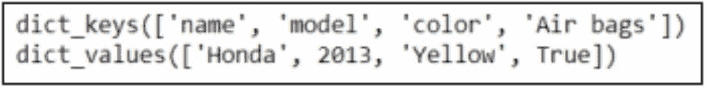

你还可以使用 `items()` 函数以键值对的形式从字典中获取项。请看下面的示例：

```python
cars = {'name':'Honda', 'model':2013, 'color':'Yellow', 'Air bags': True} 
print(cars.items()) # 访问字典的项
```

上述脚本的输出如下：

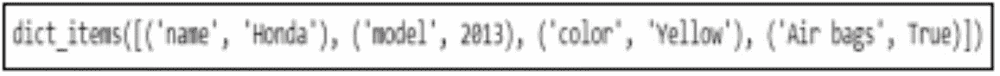

### 遍历字典项、键和值

`items()`、`keys()` 和 `values()` 函数返回可以使用 `for` 循环迭代的序列。请看下面的示例：

```python
cars = {'name':'Honda', 'model':2013, 'color':'Yellow', 'Air bags': True} 
for item in cars.items():
    print(item)
```

上述脚本的输出如下：

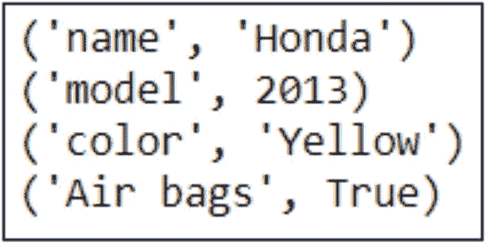

同样，也可以像下面的示例所示，使用 `for` 循环遍历键和值：

```python
cars = {'name':'Honda', 'model':2013, 'color':'Yellow', 'Air bags': True} 
for key in cars.keys():
    print(key)
```

输出：

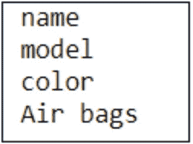

值也是如此：

```python
cars = {'name':'Honda', 'model':2013, 'color':'Yellow', 'Air bags': True} 
for value in cars.values():
    print(value)
```

输出：

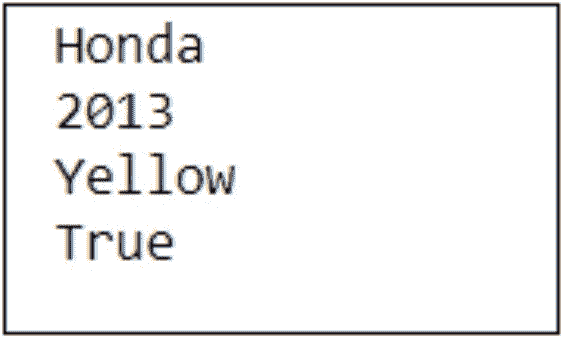

### 向字典添加项

向字典中添加新项非常简单。你只需要传递一个新的键即可。请看下面的示例：

```python
cars = {'name':'Honda', 'model':2013, 'color':'Yellow', 'Air bags': True}
cars['capacity'] = 500
print(cars)
```

在上面的脚本中，我们创建了一个包含 4 个元素的字典 `cars`。然后打印了该字典。接着向字典中添加了新项。你会看到字典包含了 5 个元素。

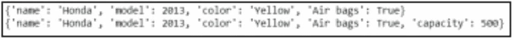

### 更新字典

要更新字典，将要更新的键作为索引并赋予新值。下面的示例显示：

```python
cars = {'name':'Honda', 'model':2013, 'color':'Yellow', 'Air bags': True}
cars['model'] = 2015
print(cars)
```

在上面的脚本中，我们在更新键为 'model' 的项之前之后打印了字典。

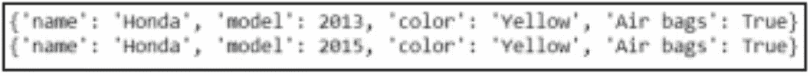

### 删除字典项

和列表一样，可以使用 `del` 函数从字典中删除项。请看下面的示例：

```python
cars = {'name':'Honda', 'model':2013, 'color':'Yellow', 'Air bags': True}
del cars['model']
print(cars)
```

在上面的脚本中，我们删除了键为 'model' 的项，并打印了字典。你也可以使用 `clear()` 函数删除字典中的所有项。下面的示例显示了：

```python
cars = {'name':'Honda', 'model':2013, 'color':'Yellow', 'Air bags': True}
cars.clear()
print(cars)
```

输出如下：

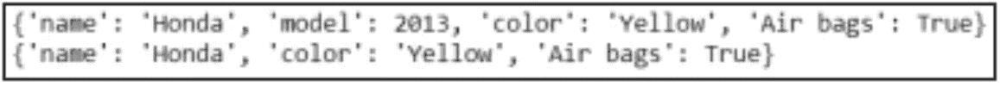

### 查找字典长度

和元组和列表一样，可以使用 `len()` 函数找到字典的长度。请看下面的示例：

```python
cars = {'name':'Honda', 'model':2013, 'color':'Yellow', 'Air bags': True}
print(len(cars))
```

上述脚本返回 4，因为 `cars` 字典中有 4 个元素。

### 检查字典中的项

要检查字典中是否存在某个键，可以使用 `in` 和 `not in` 运算符。请看下面的脚本：

```python
cars = {'name':'Honda', 'model':2013, 'color':'Yellow', 'Air bags': True}
print('color' in cars)
print('model' not in cars)
```

在上面的脚本中，由于 `color` 存在于字典中，`in` 运算符返回 true。然而由于 `model` 也存在于字典中，`not in` 运算符返回 false。输出如下：

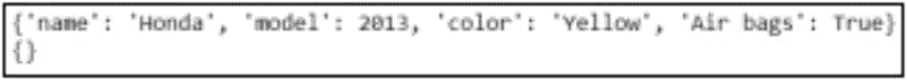

### 复制字典

要将一个字典复制到另一个字典，可以使用 `copy()` 函数。请看下面的示例：

```python
cars = {'name':'Honda', 'model':2013, 'color':'Yellow', 'Air bags': True}
cars2 = cars.copy()
print(cars2)
```

在上面的脚本中，我们创建了一个包含 4 个元素的字典 `cars`。然后将此字典复制到另一个字典 `cars2` 中。新创建的字典随后打印到控制台上。输出如下：

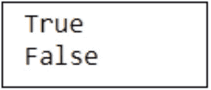

## 接下来是什么？

在本文中我们学习了列表、元组和字典，这些是 Python 中存储集合常用的数据结构。我们看到了这些集合是如何创建的，以及可以应用于它们的某些常用函数。在下一章中，我们将看到 Python 中不同类型的异常（错误）以及如何处理这些错误。编码愉快！

# 第 9 章

## Python 中的异常处理

错误和异常是计算机程序开发过程中不可或缺的一部分。处理异常的重要性体现在这一事实：大多数软件公司都有专门的质量保证（QA）部门，负责确保最终产品没有错误。在本章中，我们将学习 Python 异常的不同类型，以及如何处理这些异常。

### 什么是异常？

异常是中断程序执行的事件。简单来说，当 Python 脚本遇到无法处理的情况时，它就会抛出异常。在 Python 中，异常是以对象的形式提出的。每当发生异常时，就会初始化一个包含异常信息的对象。异常在 Python 中必须被处理，否则程序将停止执行。

与大多数其他编程语言不同，Python 代码在运行时不会进行求值，因为 Python 是一种弱类型语言。变量的类型是在运行时求值的。这种方法既有优点也有缺点。这种方法的主要优点是用户在编写代码时不需要指定变量的类型。一个主要的缺点是可能会在运行时导致异常。我们将通过本文中的一个示例来看这一点，但首先让我们看看 Python 是如何处理简单异常的。

## 异常处理语法

异常处理的语法如下：

```python
try:
    # 可能抛出异常的代码
except ExceptionA:
    # 如果发生 ExceptionA 则执行的代码
except ExceptionB:
    # 如果发生 ExceptionB 则执行的代码
except ExceptionC:
    # 如果发生 ExceptionC 则执行的代码
else:
    # 如果没有异常则执行的代码
```

你认为可能会抛出异常的代码被包含在 `try` 块中，其后可以根据你想要处理的异常类型，跟着一个或多个 `except` 块。如果没有发生任何异常，则执行 `else` 块。

## 处理单个异常

### 示例 1

来看一个非常简单的异常处理示例。让我们先写一个没有异常处理的程序。执行以下脚本：

```python
num1 = 10
num2 = 0
result = num1/num2
print(result)
```

在上面的脚本中我们有两个变量 `num1` 和 `num2`。我们尝试用 `num1` 除以 `num2` 并在控制台上打印结果。然而，`num2` 包含 `0`。因此，除法将无法成功，因为数字不能除以零。将抛出一个类似这样的错误：

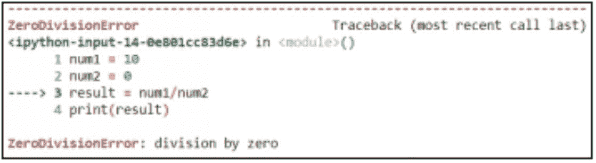

异常的名称是 `ZeroDivisionError`，它发生在数字除以零时。让我们看看我们如何处理这个异常。请看下面的脚本：

```python
try:
    num1 = 10
    num2 = 0
    result = num1/num2
    print(result) 
except ZeroDivisionError:
    print ("Sorry, division by zero not possible")
else:
    print("Program executed without an exception")
```

在上面的脚本中，抛出异常的代码封装在 `try` 块中。在上一个示例中，代码抛出了 `ZeroDivisionError`。因此，我们使用 `except` 字面量来处理这个异常。在 `except` 块内部打印异常的原因。最后，我们有一个 `else` 块，它在异常未发生时执行。由于我们正在用 `num1` 除以 `0`，`except` 块中的语句将执行，输出将如下所示：


现在，如果你将代码中 `num2` 的值改为 `2`。异常将不会发生，输出将显示 `else` 块中的代码，结果如下所示：

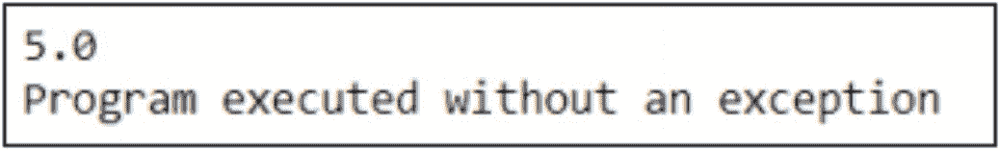

因此，处理异常可以防止程序崩溃。

### 示例 2

程序可以抛出多种类型的异常。请看下面的示例来理解这个概念：

```python
try:
    result = a/b
    print(result) 
except ZeroDivisionError:
    print ("Sorry, division by zero not possible")
else:
    print("Program executed without an exception")
```

在上面的脚本中，我们尝试用 `a` 除以 `b`。我们处理了 `ZeroDivisionError` 异常。因此，如果 `b` 包含 `0`，则异常将被处理。否则，如果没有发生异常，则将执行 `else` 块。当你运行上面的脚本时，你将看到下面的异常：

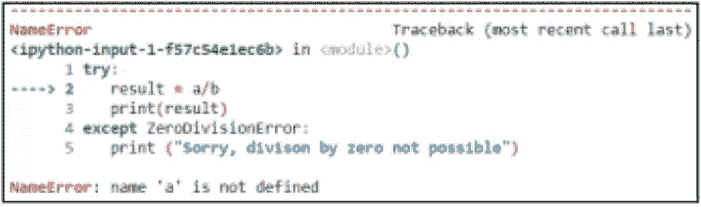

从输出可以看出异常的名称是 `NameError`，异常信息显示名称 `a` 未定义。这意味着我们在没有先定义变量的情况下使用了变量。要处理此异常，请执行以下代码：

```python
try:
    result = a/b
    print(result) 
except NameError:
    print ("Some variable/s are not defined")
else:
    print("Program executed without an exception")
```

你可以看到由于不同的原因抛出了不同类型的异常。为了构建一个健壮的程序，用户应该处理所有可能的异常。不同类型的 Python 异常的列表可以在以下链接找到：[`docs.python.org/3/library/exceptions.html`](https://docs.python.org/3/library/exceptions.html)

## 处理多个异常

要处理多个异常，你只需要将一个异常处理块堆叠在另一个上面。请看下面的异常：

```python
try:
    num1 = 10
    num2 = 2
    result = num1/num2
    print(result) 
except ZeroDivisionError:
    print ("Sorry, division by zero not possible")
except NameError:
    print ("Some variable/s are not defined")
else:
    print("Program executed without an exception")
```

在上面的脚本中，`ZeroDivisionError` 和 `NameError` 异常都被处理了。因此，如果你将 `num2` 的值设置为 `0`，就会发生 `ZeroDivisionError` 异常。但如果你尝试用 `num1` 除以 `b`，就会发生 `NameError`。

处理多个异常的另一种方法是使用 `Exception`。请看下面的示例：

```python
try:
    num1 = 10
    num2 = 0
    result = num1/num2
    print(result)
except Exception:
    print ("Sorry, division by zero not possible")
else:
    print("Program executed without an exception")
```

在上面的脚本中，所有类型的异常都将被处理。结果如下：


## 接下来是什么

在本章中我们学习如何处理异常。在下一章中我们将查看如何进行文件处理。编程愉快！！！

# 第十章：Python 文件处理

文件处理是指对不同类型执行各种操作。常见的文件操作包括打开文件、读取内容、创建文件、写入数据、追加数据等。与其他编程语言一样，Python 支持主要的文件处理函数。在本章中，我们将学习如何实现文件处理。

### 打开文件

在对文件执行任何函数之前，你需要打开它。在 Python 中使用 `open()` 函数打开文件。它接受三个参数：文件路径、打开文件的模式以及按行计算的缓冲区。第三个参数是可选的。`open()` 函数返回文件对象。`open()` 函数的语法如下：

```python
file_object = open(file_name, file_mode, buffer_size)
```

请看下表不同模式及其描述：

| 模式 | 描述 |
| --- | --- |
| r | 只读打开文件 |
| r+ | 读写打开文件 |
| rb | 以二进制格式只读文件 |
| rb+ | 以二进制格式读写打开文件 |
| w | 只写打开文件。会覆盖同名文件 |
| wb | 以二进制格式只写打开文件。会覆盖同名文件 |
| w+ | 读写打开文件 |
| wb+ | 以二进制格式读写打开文件。会覆盖同名文件 |
| a | 在文件末尾追加内容打开文件 |
| a+ | 用于追加和读取内容的文件 |


| 模式 | 说明 |
|------|------|
| `ab` | 以二进制格式追加内容文件 |
| `ab+` | 以二进制格式读取和追加内容文件 |

`open` 方法返回的文件对象有三个主要属性：

1. `name`：返回文件名
2. `mode`：返回打开文件时的模式
3. `closed`：文件是否关闭

请看以下示例：

> **注意**：在执行上方脚本之前，请创建一个文件 `test.txt` 并将其置于 `D` 盘的根目录下。

```python
file_object = open("D:/test.txt", "r+")
print(file_object.name)
print(file_object.mode)
print(file_object.closed)
```

在上面的脚本中，我们以读写模式打开了 `test.txt` 文件。接下来，我们在屏幕上打印了文件的名称和模式。最后，我们打印了文件是否已关闭。上述脚本的输出如下：

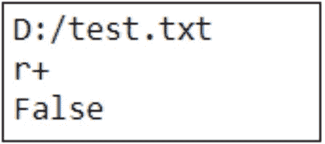

要关闭已打开的文件，你可以使用 `close` 方法。请看以下示例：

```python
file_object = open("D:/test.txt", "r+")
print(file_object.name)
print(file_object.closed)
file_object.close()
print(file_object.closed)
```

在上面的脚本中，`test.txt` 文件以 `r+` 模式打开。打印了文件名。接下来，我们使用 `closed` 属性检查文件是否已打开，它返回 `False`，因为文件目前是打开的。然后我们使用 `close` 方法关闭文件。我们再次检查文件是否关闭，由于我们已经关闭了文件，它返回 `True`。输出如下：

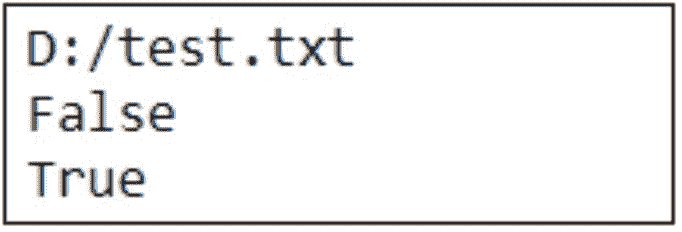

#### 向文件写入数据

要向文件写入数据，可以使用 `write` 函数。要写入文件的内容将作为参数传递给 `write` 函数。请看以下示例：

```python
file_object = open("D:/test1.txt", "w+")
file_object.write("Welcome to Python.\nThe best programming language!\n")
file_object.close()
```

在上面的脚本中，打开了位于 `D` 盘根目录下的 `test1.txt` 文件。该文件以读写模式打开。接下来，两行文本被传递给 `write` 函数。最后关闭了文件。

如果你进入 `D` 盘的根目录，你将看到一个内容如下的新文件 `test1.txt`：

```text
Welcome to Python.
The best programming language!
```

#### 从文件中读取数据

在 Python 中，要从文件中读取数据，可以使用 `read` 函数。从文件中读取的字节数将作为参数传递给 `read` 函数。请看以下示例：

```python
file_object = open("D:/test1.txt", "r+")
sen = file_object.read(12)
print("The file reads: " + sen)
file_object.close()
```

上述脚本读取了我们在上一个示例中写入的 `test1.txt` 文件的前 12 个字符。输出如下：


要读取整个文件，请不要向 `read` 函数传递任何参数。以下脚本读取了整个 `test1.txt` 文件并在控制台上打印其内容：

```python
file_object = open("D:/test1.txt", "r+")
sen = file_object.read()
print(sen)
file_object.close()
```

上述脚本的输出如下：


#### 重命名和删除 Python 文件

你可以使用 Python 的 `os` 模块重命名和删除 Python 文件。要重命名文件，可以使用 `rename` 函数。文件的旧名称作为第一个参数传递，新名称作为第二个参数传递。请看以下示例：

```python
import os
os.rename("D:/test1.txt", "D:/test2.txt")
```

上述脚本将文件 `test1.txt` 重命名为 `test2.txt`。

在 Python 中，删除文件可以使用 `remove` 方法。请看以下示例：

```python
import os
os.remove("D:/test.txt")
```

上述脚本删除了位于 `D` 盘根目录下的 `test.txt` 文件。

#### 文件定位

要找到光标在文件中的当前位置，可以使用 `tell` 函数。请看以下示例：

```python
file_object = open("D:/test2.txt", "r+")
print(file_object.tell())
sen = file_object.read(12)
print(sen)
print(file_object.tell())
```

在上面的脚本中，打开了 `file_object`。我们打印了 `tell()` 位置。然后读取了 12 个字符并打印它们。最后再次打印位置。

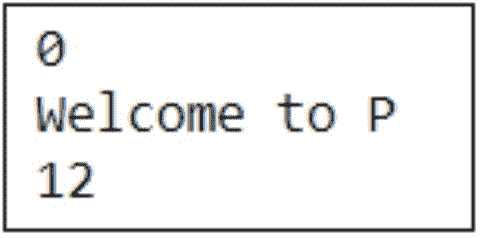

## Python 中的函数

在 Python 中，函数是只执行特定任务的代码块。它们用于封装代码并使其可重用。

### 函数声明

创建函数的语法以 `def` 关键字开头，后面跟函数名和括号。

```python
def print_welcome():
    print("Welcome Python")
```

上述脚本创建了一个名为 `print_welcome` 的函数。要调用函数，只需如下方所示输入函数名后跟括号即可：

```python
print_welcome()
```

### 参数化函数

在上一个示例中，我们留空了括号。然而，这些括号用于向函数传递参数。请看以下示例：

```python
def print_name(name):
    print("Person name :" + name)

print_name("James")
print_name("Sofia")
print_name("Rick")
```

在上面的脚本中，我们定义了一个函数 `print_name`，它接受一个参数 `name` 并在内部打印。在调用 `print_name` 函数时，我们传递了 `name` 参数的值。

函数可以拥有任意数量的参数。然而，函数定义中的参数顺序必须与函数调用中的顺序匹配。请看以下函数。它接受三个参数：`name`、`age` 和 `gender`。

```python
def print_details(name, age, gender):
    print("Person name :" + name)
    print("Person age :" + str(age))
    print("Person gender :" + gender)
    print("-------------------")

print_details("James", 20, "Male")
print_details("Sofia", 30, "Female")
print_details("Rick", 25, "Male")
```

在上面的脚本中，我们创建了一个函数 `print_details`。该函数接受三个参数 `name`、`age` 和 `gender` 并在控制台上打印它们。该函数被调用了三次，分别对应不同的 `name`、`age` 和 `gender` 参数值。

正如你可以通过参数向函数传递信息一样，你也可以从函数返回返回值。要从函数返回返回值，需要使用 `return` 关键字。请看下面的示例。

```python
def add_number(num1, num2):
    result = num1 + num2
    return result

result = add_number(10, 20)
print("sum of 10 and 20 is :" + str(result))

result = add_number(5, 15)
print("sum of 5 and 15 is :" + str(result))
```

在上面的脚本中，我们创建了一个名为 `add_number` 的函数。该函数接受两个参数，将它们相加并返回结果和。

然后我们调用了两次该函数，并传递了两个不同的数字。结果打印在控制台上。输出如下：


### 默认参数

Python 函数可以为参数设置默认值，称为默认参数。如果在调用函数时没有为该参数传递参数值，则使用默认值。请看以下脚本：

```python
def add_number(num1, num2=100):
    result = num1 + num2
    return result

result = add_number(20)
print("sum of 100 and 20 is :" + str(result))

result = add_number(5, 15)
print("sum of 5 and 15 is :" + str(result))
```

在上面的脚本中，我们创建了一个 `add_number` 函数。该函数的 `num2` 参数有一个默认参数值 `100`。

`add_number` 函数被调用了两次。在第一次调用中，只传递了一个参数，即 `20`。该参数被传递给 `num1` 参数。`num2` 参数没有传递任何参数。因此，将使用默认参数值 `100`，返回的结果将是 `120`（`100 + 20`）。

在第二次调用 `add_number` 函数时，为 `num1` 和 `num2` 参数都传递了参数。因此，将不会使用 `num2` 的默认参数（即 `100`）。上述脚本的结果如下：

### 按值传递还是按引用传递？

传递给 Python 函数的参数是按引用的。这意味着如果函数更新了参数的值，该值在函数外部也会被更新。通过下面的示例将变得更加清晰：

```python
def update_list(newlist):
    newlist.append([20, 25, 30])
    return

numlist = [5, 10, 15]
print("Values before function call", numlist)
update_list(numlist)
print("Values after function call", numlist)
```

在上面的脚本中，我们创建了一个名为 `update_list` 的函数。该函数接受列表作为参数，并将另一个列表作为元素添加到其中。

我们创建了一个包含 3 个元素的名为 `numlist` 的列表。然后我们在控制台上打印了这个列表。然后将该列表作为参数传递给 `update_list` 函数，该函数将另一个列表作为元素添加到其中。我们再次在控制台上打印 `numlist`。结果显示，尽管 `numlist` 列表是在 `update_list` 函数之外打印的，但 `numlist` 包含了由 `update_list` 函数添加的列表。这是因为 `numlist` 的引用被传递给了 `update_list` 函数。函数内部的更新也导致了实际列表的更新。输出如下：


### 匿名函数

你也可以在 Python 中使用单行语句创建无需 `def` 关键字的匿名函数。匿名函数是使用 `lambda` 创建的。

```python
square = lambda a: a * a
## 使用 lambda 表达式
print(square(5))  # 25
print(square(10)) # 100

add = lambda x, y: x + y
## 使用 lambda 表达式
print(add(2, 3))   # 5
print(add(10, 20)) # 30

multiply = lambda x, y, z: x * y * z
## 使用 lambda 表达式
print(multiply(1, 2, 3)) # 6
print(multiply(5, 7, 2)) # 70
```

## 类与对象

在 Python 中，一切都被视为对象。Python 对象可以粗略分为两类：

1. 内置对象
2. 自定义对象

### 内置对象

内置对象是属于原始数据类型的对象。例如，当你将一个整数赋值给变量时，实质上在该变量中存储了一个整数对象。请看以下脚本：

```python
# 创建一个整数类型的对象 age
age = 28
type(age)
```

在上面的脚本中，我们创建了一个整数对象并将其赋值给变量 `age`。然后我们检查 `age` 变量的类型，它返回 `int`。

### 自定义对象

自定义对象是实现自定义类的对象。在上一节中，我们创建了一个 `Person` 类。让我们创建一个 `Person` 类的对象。请看以下脚本：

```python
person1 = Person()
```

要创建自定义对象，你只需要编写类名后跟一对括号，并将其赋值给一个命名实体（变量），在上面的示例中该变量为 `person1`。现在，对象 `person1` 可以用来访问 `Person` 类的属性和方法。

要访问类属性或方法，可以使用对象名后跟点运算符，以及属性或方法的名称。请看以下示例：

```python
# 访问属性
f_name = person1.name
print(f_name)

# 调用方法
person1.stand()
```

在上面的脚本中，`Person` 类的 `name` 属性通过 `person1` 对象被访问，并赋值给变量 `f_name`。随后在屏幕上打印 `f_name` 变量。同样地，访问了 `stand` 函数，它在控制台上打印出语句“Person standing”。上面脚本的输出结果如下：

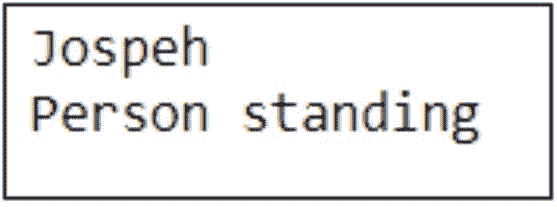

### 构造函数

“构造函数”是在类被实例化时执行的方法。创建类对象的过程也被称为实例化。在 Python 中，使用 `__init__` 方法来创建构造函数。请看以下示例以查看构造函数的用法。

```python
# 创建类 Person
class Person:
    # 创建构造函数
    def __init__(self):
        print("Class object created")
    # 创建类方法
    def stand(self):
        print("Person standing")
```

在上面的脚本中，我们再次创建了类 `Person`。但这次类有一个构造函数，它只是在屏幕上打印一些文本。该类还包含 `stand` 方法。

现在，当你创建 `Person` 类的对象时，构造函数将执行，你会在控制屏幕看到“Class object created”。执行以下脚本：

```python
person1 = Person()
```

输出将是：

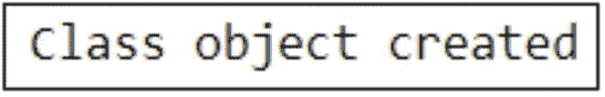

### 属性

我们知道 Python 中赋值给命名实体的值实际上是一个对象。通过同样的类比，在类内部声明的属性也是对象。这意味着对象可以包含嵌套对象。让我们创建一个原始字符串类型对象并检查该对象包含哪些属性。请看以下脚本：

```python
# 创建一个字符串对象 message
message = "I love Python"
# 查找 message 对象的所有属性
print(dir(message))
```

在上面的脚本中，我们创建了一个名为 `message` 的字符串对象。要找到对象的所有属性，使用了 `dir` 方法。上面脚本的输出结果如下：

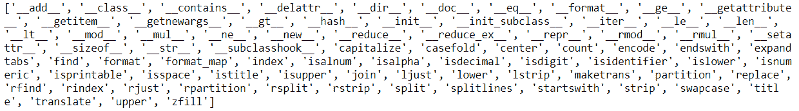

#### 类属性 vs 实例属性

Python 类具有两种类型的属性：类属性和实例属性。实例属性特定于类的每个个体对象，并且在对象之间不共享。另一方面，类属性在类的所有实例（对象）之间共享。

实例属性定义在方法内部，而类属性则定义在方法外部。请看以下示例以查看类属性和实例属性之间的区别。

```python
# 创建类 Person
class Person:
    # 创建类属性
    person_count = 0
    # 创建带有实例属性的方法
    def set_details(self, name, age, gender):
        # 初始化实例变量
        self.name = name
        self.age = age
        self.gender = gender
        # 增加类变量
        Person.person_count += 1
        print("Details for person " + self.name + " have been stored")
```

在上面的脚本中，我们像往常一样创建了 `Person` 类。该类包含一个类属性 `person_count` 和一个方法 `set_details`。在 `set_details` 方法内部，三个实例属性通过作为传递给 `set_details` 方法的参数进行初始化。在方法内部，`person_count` 属性加了 1。你在这里看到的另一个区别是，在方法内部，类属性通过类名访问，而实例属性则是通过对象访问的。


```python
person1 = Person()
person1.set_details("John", 24, "Male")
print("Person count " + str(person1.person_count))
```

上面脚本的输出如下：


```python
Person2 = Person()
Person2.set_details("Suzi", 31, "Female")
print("Person count " + str(person2.person_count))
```

上面脚本的输出如下：


从输出中可以看出，类属性 `person_count` 在实例 `person1` 和 `person2` 之间共享，而实例属性“name”并不共享。

### 属性

封装是 OOP 主要构建块之一。封装指的是对类内部数据的受控访问。这种访问通过特殊方法控制。这些特殊方法通过属性与类属性绑定。

#### 为什么我们需要属性？

在这一节中我们将学习属性。但在之前，让我们看看为什么我们需要属性。让我们创建一个名为 `Medicine` 的类，包含三个属性：`name`、`expiration_year` 和 `expiration_month`。执行以下脚本：

```python
## 创建 类
class Medicine:
  #创建 Medicine 类构造函数
  def __init__(self, name, expiry_year, expiry_month):
      #初始化实例变量
      self.name = name
      self.expiry_year = expiry_year
      self.expiry_month = expiry_month
  def getExpiryDate(self):
      print ('The expiration date is : '+str(self.expiry_month)+'/'+str(self.expiry_year))
```

现在让我们创建 `Medicine` 类的一个对象。

```python
medicine1 = Medicine("xyz", 2020, 15)
```

在上面的脚本中，`Medicine` 类的构造函数将 15 作为月份数字分配给 `expiry_month`。要查看过期日期，如下所示使用 `medicine1` 对象调用 `getExpiryDate` 方法：

```python
medicine1.getExpiryDate()
```

从技术上讲，月份可以赋予任何数字。但从逻辑上讲，一年只有 12 个月月份。因此，数字应该在 1 到 12 之间。这就是属性派上用场的地方。通过属性，你可以控制从类成员中赋值和检索的值。

查看以下脚本以了解如何创建属性：

```python
## 创建 Medicine 类
class Medicine:
    # 创建 Medicine 类构造函数
    def __init__(self, name, expiry_year, expiry_month):
        # 初始化实例变量
        self.name = name
        self.expiry_year = expiry_year
        self.expiry_month = expiry_month

    # 创建 expiry_month 属性
    @property
    def expiry_month(self):
        return self.__expiry_month

    # 创建属性 setter
    @expiry_month.setter
    def expiry_month(self, expiry_month):
        if expiry_month < 1:
            self.__expiry_month = 1
        elif expiry_month > 12:
            self.__expiry_month = 12
        else:
            self.__expiry_month = expiry_month

    def getExpiryDate(self):
        print ('过期日期为：'+str(self.expiry_month)+'/'+str(self.expiry_year))
```

要为属性创建一个属性，你必须创建一个与属性名称同名的方法。例如，在上面的脚本中，我们想要创建一个 `expiry_month` 属性，因此我们创建了一个名为 `expiry_month` 方法，并在方法内部使用 `self` 和双下划线语法返回 `expiry_month` 属性的值。请记住，属性方法必须像上面脚本所示用 `@property` 字面量进行装饰。

一旦创建了属性，下一步是为该属性设置规则。属性 setter 就被用于此目的。以下脚本为 `expiry_month` 属性设置了规则。

```python
## 创建属性 setter
@expiry_month.setter
def expiry_month(self, expiry_month):
    if expiry_month < 1:
        self.__expiry_month = 1
    elif expiry_month > 12:
        self.__expiry_month = 12
    else:
        self.__expiry_month = expiry_month
```

上述脚本实现的逻辑非常简单。如果赋值给 `expiry_month` 的值小于 1，则将 1 赋值给 `expiry_month` 属性。如果赋值的值大于 12，则将 12 赋值给 `expiry_month` 变量。最后，如果赋值在 1 到 12 之间，则赋值该值。

执行以下脚本：

```python
medicine1 = Medicine("xyz", 2020, 15)
medicine1.getExpiryDate()
```

在上面的脚本中，我们创建了 `Medicine` 类的 `medicine1` 对象。使用构造函数，15 被赋值为 `expiry_month` 属性的值。但由于我们有一个 `expiry_month` 属性，12 将被赋值给 `expiry_month` 属性。如果你调用 `getExpiryDate` 方法，你将看到如下输出所示的 `expiry_month` 为 12：


### 静态方法

类方法与函数相似，但有两个主要区别。类方法定义在类体内部。类方法将 `self` 作为第一个参数。在本章中，我们看到了几个实例方法的示例。实例方法是通过类对象调用的方法。还有另一类方法可以使用类名进行调用，这些方法被称为静态方法。查看以下示例以了解静态方法：

```python
## 创建 Person 类
class Person:
    @staticmethod
    def run():
        print ("Person 正在运行")
    def stand(self):
        print ("Person 正在站立")
```

在上面的脚本中，我们创建了一个 `Person` 类，其中有一个静态方法 `run` 和一个非静态方法 `stand`。Python 中的的静态方法和非静态方法之间有两个区别。静态方法必须用 `@staticmethod` 装饰器进行装饰。另一方面，非静态方法不需要任何装饰器。同样，静态方法不需要 `self` 作为第一个参数，而非静态方法需要 `self` 作为第一个参数。

让我们通过 `Person` 类调用静态方法 `run`。

```python
Person.run()
```

上述脚本的输出如下：


### 特殊方法

特殊方法或称为魔术方法（Magic methods），用于为类添加特殊功能。特殊方法的名称以双下划线开头和结尾。构造函数 `__init__` 也是一种特殊方法。其他特殊方法的示例包括 `str`、`del` 等。

原始对象也包含特殊方法。例如，`int` 对象包含 `__add__` 方法，用于相加两个整数。查看以下示例：

```python
## 数字相加
int.__add__(15, 30)
```

上述脚本的输出将是 45。

### `__add__` 方法

特殊方法可以被重写。例如，你可以重写 `__add__` 方法来添加自定义类。查看以下示例以了解方法的用法：

```python
## 创建 Person
class Person:
    # 创建带有实例属性的方法
    def __init__(self, age):
        # 初始化实例变量
        self.age = age

    # 重写 __add__ 特殊方法
    def __add__(self, other):
        self.age
```

在上面的脚本中，我们创建了一个名为 `Person` 的类。该类通过构造函数初始化了一个属性。`__add__` 方法在 `Person` 类内部被重写以加上对象的年龄。查看以下脚本：

```python
person1 = Person(10)
person2 = Person(20)
sum_of_age = person1 + person2
print(sum_of_age)
```

在脚本中，将打印出 person1 和 person2 相加的结果。

### `__gt__` 方法

`__gt__` 特殊方法用于比较两个类。如果 `>` 左侧类的属性大于右侧类的属性，则 `__gt__` 方法返回真，否则返回假。让我们修改我们的 `Person` 类以重写用于比较的 `__gt__` 方法。

```python
## 创建 Person
class Person:
    # 创建实例属性的方法
    def __init__(self, age):
        # 初始化实例变量
        self.age = age

    # 重写 __add__ 特殊方法
    def __add__(self, other):
        return self.age + other

    # 重写 __gt__ 特殊方法
    def __gt__(self, other):
        return self.age > other.age
```

现在，再次创建两个 `Person` 类对象并使用 `>` 运算符比较它们的年龄。

```python
person1 = Person(10)
person2 = Person(20)
person1 > person2
```

person1 的年龄属性值为 10，而 person2 的年龄属性值为 20。接下来，使用 `>` 运算符比较 person1 对象和 person2 对象。但由于 person1 对象的年龄属性小于 person2 对象的年龄属性，将返回 False。

### `__str__` 方法

`__str__` 方法在对象被用字符串时被调用。例如，当你将对象传递给 `print` 方法时，对象的 `__str__` 方法就会执行。和其他任何特殊方法一样，`__str__` 方法也可以被重写。查看以下示例，了解如何重写 `Person` 类的 `__str__` 方法，以便打印人的名字。

```python
## 创建 Person
class Person:
    # 创建实例属性的方法
    def __init__(self, name):
        # 初始化实例变量
        self.name = name

    def __str__(self):
        return "这个人是 " + self.name
```

让我们创建一个 `Person` 类的对象并尝试在控制台上打印：

```python
person1 = Person("James")
print(person1)
```

当执行上述脚本时，`Person` 类的 `__str__` 方法会被执行，产生如下输出：


## 全局变量与局部变量

与实例属性和类属性一样，Python 中的变量也分为两种：全局变量和局部变量。任何在函数体外部定义的变量被称为全局变量，而在函数体内部定义的变量被称为局部变量。请看下面的示例来了解局部和全局变量的作用：

```python
#声明全局变量
count = 1;

def print_count():
    # 访问全局变量
    print("Accessing global variable inside function :" + str(count))
    num = 2;

print(count)
print_count()
print(num)
```

在上述脚本中，我们首先声明了一个全局变量 `count`。随后在 `print_count` 函数内部访问了这个全局变量。在函数内部还声明了一个局部变量 `num`。

最后，在函数外部访问了全局变量 `count` 和局部变量 `num`。你会发现上面的代码会返回错误，因为 `num` 是一个局部变量，无法在 `print_count` 函数外部访问。上述脚本的输出如下：

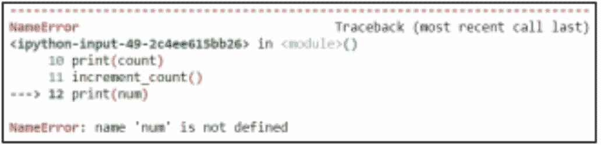

你可以看到，由于我们尝试在函数外部访问局部变量 `num`，系统抛出了 `num` 未定义的错误。

## 修饰符

Python 中的修饰符用于指定变量的作用范围。与大多数其他编程语言一样，Python 有三种访问修饰符：公共（Public）、私有（Private）和保护（Protected）。具有公共访问修饰符的变量可以在程序的任何地方访问。公共变量的名称开头没有下划线。相反，具有私有修饰符的变量只能在类内部访问。私有变量名以双下划线开头。最后，保护变量可以在类内部以及子类中访问（我们将在下一章介绍父子类）。

请看下面的示例来了解修饰符的作用：

```python
#创建 Person 类
class Person:
    def __init__(self, name, age, gender):
        # 私有变量
        self.__age = age
        # 公共变量
        self.name = name
        # 保护变量
        self._gender = gender
```

在上述脚本中，我们有一个包含三个实例变量 `name`、`age` 和 `gender` 的 `Person` 类。`name` 变量是公有的；`age` 变量是私有的，而 `gender` 变量是保护的。

让我们创建一个 `Person` 类对象并尝试在类外部访问变量。请看下面的脚本：

```python
person1 = Person("John", 20, "Male")
## 访问公共变量
print(person1.name)
## 访问私有变量
print(person1.age)
```

在上述脚本中，我们首先通过 `Person` 类对象 `person1` 访问公共变量 `name`。然后访问 `Person` 类的私有变量 `age`。在输出中你会发现我们可以访问 `name` 变量因为它是公共的，但当我们尝试在 `Person` 类外部访问私有变量 `age` 时，会报错。脚本的输出如下：

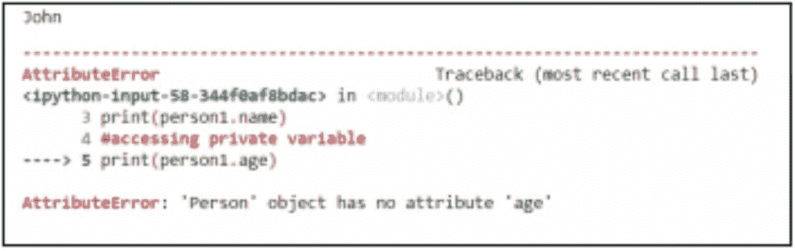

错误信息显示 `Person` 对象没有属性 `age`。这是因为 `age` 是私有的，无法在 `Person` 类外部访问。

## 总结与后续

在本章中，我们开始了关于 Python 面向对象编程（OOP）的讨论。我们看到了不同的 OOP 概念，包括类、对象、属性、方法、修饰符等。在下一章中，我们将学习什么是继承以及如何在 Python 中实现继承。编码愉快！！！

# 第 13 章

## 继承与多态

在上一章中，我们开始了关于对象编程（OOP）的讨论并涵盖了大部分基础 OOP 概念。OOP 有三大支柱：数据封装、继承和多态。在上一章中，我们学习了如何使用访问修饰符和属性在 Python 中实现数据封装。在本章中，我们将学习继承和多态。

### 继承基础

编程中的继承指的是一个类继承其他类的方法和属性的能力。这类似于现实世界中的继承。子类继承其父母的一些特征，同时也拥有自己独特的特征。继承另一个类的类被称为子类或派生类，而被另一个类继承的类被称为父类或基类。

子类和父类之间存在“IS-A”（是一个……）的关系。例如，一个子类 `car` 是一种车辆（其父类类）。同样，`employee` 是一个人。根据经验，如果多个类具有某些共同的方法和属性，应该定义一个包含这些方法和属性的父类。然后这个父类就可以被多个子类继承。通过示例可以更清楚这一点。

让我们创建一个名为 `Parent` 的简单类，包含一个方法。我们还会创建一个名为 `Child` 的类继承 `Parent` 类。

```python
#创建 Parent 类
class Parent:
    def methodA (self):
        print("Hello, I am a Parent method")

## 创建继承 Parent 的 Child
class Child(Parent):
    def methodB (self):
        print("Hello, I am a Child method")

## 创建 Child 对象
child = Child()
## 访问 Parent 方法
child.methodA()
## 访问 Child 方法
child.methodB()
```


在上述脚本中，我们创建了一个 `Parent` 类和一个 `Child` 类。`Child` 类继承了 `Parent` 类。要继承一个类，只需在括号内传递父类的名称即可。在上面的脚本中，`Parent` 类包含一个名为 `methodA` 的方法，而 `Child` 类包含一个名为 `methodB` 的方法。然后我们创建了一个名为 `child` 的子对象。从这个 `child` 对象我们调用了 `methodA`。你可以看到 `Child` 类并不包含 `methodA`，但因为它继承了 `Parent` 类，所以 `Child` 对象也可以访问该方法。最后我们调用了子类方法 `methodB`。上述脚本的输出如下：

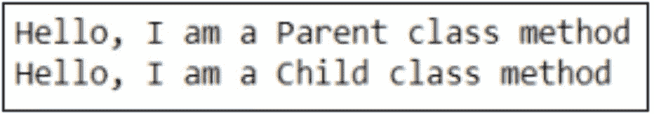

像方法一样，子类也从父类继承属性。请看下面的示例：

```python
# 创建 Parent 类
class Parent:
    name = ""
    age = ""
    def methodA(self):
        print("Hello, I am a Parent method")

# 创建继承 Parent 的 Child
class Child(Parent):
    def methodB(self):
        print("Hello, I am a Child method")

# 创建 Child 对象
child = Child()
# 访问 Parent 方法
child.methodA()
# 访问 Child 方法
child.methodB()
# 访问父类属性
child.name = "Jacob"
child.age = 10
print(child.name + " " + str(child.age))
```

在上述脚本中，我们有一个包含两个属性 `name` 和 `age` 以及一个方法 `methodA` 的父类，在子类中我们访问了方法和属性并在控制台上显示了它们。

### 多子类

多个子类可以继承同一个父类。请看下面的脚本：

```python
# 创建 Parent 类
class Parent:
    def methodA(self):
        print("Hello, I am a Parent method")

# 创建继承 Parent 的 Child1
class Child1(Parent):
    def methodB(self):
        print("Hello, I am a Child1 method")

# 创建继承 Parent 的 Child2
class Child2(Parent):
    def methodC(self):
        print("Hello, I am a Child2 method")

# 创建 Child1 对象
child1 = Child1()
# 访问 Parent 方法
child1.methodA()
# 访问 Child1 方法
child1.methodB()

# 创建 Child2 对象
child2 = Child2()

# 访问父类方法
child2.methodA()

# 访问 Child2 类方法
child2.methodC()
```

在上面的脚本中，有两个子类 `Child1` 和 `Child2`，它们都继承了名为 `Parent` 的父类。现在，这两个子类都拥有访问 `Parent` 类方法（即 `methodA`）的权限，上述脚本的输出如下：


### 从子类调用父类构造函数

我们知道类可以继承父类及其属性。但这里出现了一个问题：我们如何使用子类构造函数来初始化父类的属性？例如，如果父类中有两个属性，子类有一个属性。我们如何使用子类构造函数初始化这三个属性呢？

Python 为这个问题提供了一个简单的解决方案。父类和子类构造函数的参数会被传递给子类。在子类的构造函数内部，会调用父类的构造函数并将父类构造函数的参数传递给它。剩余的参数则用于初始化子类的属性。看以下示例：

#### 创建 Vehicle 类

```python
class Vehicle:
    # 父类的构造函数
    def __init__(self, name, color):
        self.name = name
        self.color = color
```

#### 创建继承 Vehicle 类的 Bike 类

```python
class Bike(Vehicle):
    # 子类的构造函数
    def __init__(self, name, color, price):
        # 从 Bike 类调用 Vehicle 类构造函数
        Vehicle.__init__(self, name, color)
        self.price = price
```

#### 创建 Vehicle 类对象

```python
bike = Bike("Honda", "Black", 25000)

# 访问父类属性
print(bike.name)
print(bike.color)

# 访问子类属性
print(bike.price)
```

在上面的脚本中，我们创建了一个具有两个属性 `name` 和 `color` 的父类 `Vehicle`。父类的构造函数初始化了这两个属性。然后，我们定义了一个继承自 `Vehicle` 类的子类 `Bike`。该子类有一个属性即 `price`，它通过子类 `Bike` 构造函数进行初始化。然而，`Bike` 类的构造函数接受三个参数 `name`、`color` 和 `price`。在 `Bike` 类构造函数内部，调用了 `Vehicle` 类构造函数并将 `name` 和 `color` 属性传递给 `Vehicle` 类构造函数。而 `price` 参数则用于初始化子类属性 `price`。

我们创建了 `Bike` 类的对象，并为 `name`、`color` 和 `price` 属性传递了值。然后我们在控制台上打印了这些值。上述脚本的输出如下：

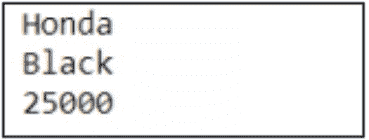

### 多继承

我们知道一个父类可以被多个子类继承。这是 `Java` 和 `C#` 等编程语言支持的继承类型。然而在 Python 中，一个子类也可以继承多个父类。这被称为多继承。

下面的示例将进一步说明多继承的概念。

```python
class Vehicle:
    def showVehicleDetails(self):
        print("I am vehicle class")

class Sedan:
    def showSedanDetails(self):
        print("I am sedan class")

# 创建继承 Vehicle 和 Sedan 的 Car 类
class Car(Vehicle, Sedan):
    def showCarDetails(self):
        print("I am car class")

# 创建 Car 类的对象
car = Car()

# 访问 Vehicle 类方法
car.showVehicleDetails()

# 访问 Sedan 类方法
car.showSedanDetails()

# 访问子类方法
car.showCarDetails()
```

在上面的脚本中，我们有三个类 `Vehicle`、`Sedan` 和 `Car`。`Car` 类继承了 `Vehicle` 和 `Sedan` 类。然后我们创建了 `Car` 类的对象，并通过 `car` 类对象访问 `Vehicle` 和 `Sedan` 类的方法。示例显示，继承多个父类的子类可以访问所有父类的属性和方法。上述示例的输出如下：


### 方法重写

除了访问父类方法外，子类还可以通过为相同的方法名提供自己的定义来重写父类方法。看以下示例来理解这一概念：

#### 创建 Person 类

```python
class Employee:
    def printdetails(self):
        print("I am an employee of this company")

# 创建继承 Employee 的 Manager 类
class Manager(Employee):
    def printdetails(self):
        print("I am a Manager of this company")

manager = Manager()
manager.printdetails()
```

在上面的脚本中，我们创建了两个类：`Employee` 和 `Manager`。`Employee` 类包含一个方法 `printdetails`。`Manager` 类继承了 `Employee` 类，这意味着 `Manager` 类拥有访问 `Employee` 类 `printdetails` 方法的权限。然而 `Manager` 包含了对 `printdetails` 方法的自己的定义。现在你创建 `Manager` 对象并调用该方法，将调用子类方法，如下输出所示：


### 多态

多态（Polymorphism）字面意思是“采用多种形状的能力”。在编程中，多态指的是方法根据场景（如数量和类型）表现不同行为的能力。多态的一个简单例子是加法运算符。当你使用加法运算符相加数字时，加法运算符像数学加法一样工作并返回和。然而，如果使用同一个加法运算符加字符串，结果就是拼接后的字符串。看这个简单的示例：

```python
# 使用加法运算符求和
x = 10
y = 20
result = x + y
print(result)

# 使用加法运算符处理字符串
x = "Welcome"
y = "to Python"
result = x + y
print(result)
```

在上面的脚本中，我们给变量 `x` 和 `y` 赋值数值。然后我们使用加法运算符将这些值相加并将和存储在 `result` 变量中。然后我们在屏幕上打印 `result` 变量。这表明加法运算符用于的是数值操作数。接下来，我们给 `x` 和 `y` 赋值字符串类型的值并再次使用加法运算符。这次加法运算符拼接了两个字符串。示例显示了加法运算符如何根据操作数遵循多态。

在自定义类中，多态通过方法重载（method overloading）和方法重写（method overriding）实现。我们在上一节中学习了方法重写，这里我们将学习方法重载。

方法重载指的是方法根据传递给它的参数执行不同功能的能力。看这个方法重载的简单示例：

```python
# 创建 Employee
class Employee:
    def printname(self, name=None):
        if name is None:
            print("Hello, I am an employee")
        else:
            print("Hello, I am an employee. My name is ", name)
```

在上面的脚本中，我们创建了一个包含一个方法 `printname` 的 `Employee` 类。`printname` 方法有一个可选参数 `name`。`printname` 方法可以带一个字符串类型的参数调用，也可以不带任何参数调用。如果不带任何参数调用方法，将在控制台打印“Hello, I am an employee”。如果带字符串类型参数调用 `printname` 方法，则将在屏幕上打印“Hello, I am an employee. My name is ,name”，其中参数将替换 name 变量。让我们创建一个 `Employee` 类的对象并分别带参数和不带参数调用 `printname` 方法。

```python
emp = Employee()
emp.printname()
emp.printname("Joseph")
```


# 第 14 章

## Lambda 运算符与列表推导式

在本章中，我们学习了最重要的两个面向对象（OOP）概念，即继承和多态。通过这些，我们涵盖了开发 Python 应用所需的大部分基础及高级 Python 编程概念。在下一也是最后一章中，我们将学习另一个在 Python 编程中非常有用的工具，即 Lambda 运算符和列表推导式。

在本书的第 11 章（Python 中的函数）中，我们学习了如何用一行代码创建 lambda 函数（或称为匿名函数）。然而，lambda 运算符的作用并不仅仅用于创建匿名函数。lambda 运算符还有许多其他用法，我们将在本章中学习。

通常情况下，lambda 运算符与 `map()`、`reduce()` 和 `filter()` 操作结合使用。我们将详细查看这些过滤器中的每一个，但首先让我们复习一下如何创建一个简单的 lambda 函数。

看这个简单的例子：

```python
sum = lambda a, b, c: a + b + c
result = sum(10, 15, 5)
print(result)
```

在上面的脚本中，我们创建了一个带有三个参数 `a`、`b` 和 `c` 的 lambda 函数。该函数将这三个参数相加并返回和。该函数存储在变量 `sum` 中。现在可以使用 `sum` 变量名调用该函数。我们通过向 `sum` 变量传递三个数字参数调用函数，并在屏幕上打印结果。上述表达式的输出将是 `10 + 15 + 5 = 20`。

### Map 函数

map 函数用于在序列上应用函数并返回更新后的序列。`map` 函数接受 (1) 作为第一个参数的应用函数以及 (2) 作为第二个参数的待更新序列。`map` 函数返回一个 map 类型对象，可以使用 `list` 函数转换为列表。看下面的示例：

```python
def takesquare(x):
    return x * x

nums = [2, 4, 6, 8, 10]
squares = map(takesquare, nums)
print(list(squares))
```

在上面的脚本中，我们创建了函数 `takesquare`，它接收一个参数并返回所传参数值的平方。该函数在这里仅应用于一个参数，但通过使用 `map` 函数，我们可以将此函数应用于列表的每个单独元素。在上面的脚本中，我们创建了一个从 2 到 10 的偶数列表。接着，我们使用 `map` 函数，并将 `takesquare` 函数作为第一个参数，列表 `nums` 作为第二个参数传递进去。`map` 函数将 `takesquare` 函数应用于列表的每个单独元素，例如 `2` 的平方变为 `4`，`4` 的平方变为 `16`，依此类推。结果序列存储在变量 `squares` 中。然后，我们将 `squares` 对象转换为列表并将其打印到控制台上。输出将如下所示：


在脚本中我们没有使用 lambda 函数；简单地传递了一个具体的函数。然而，`map` 函数真正的魅力在于它能够使用 lambda 函数的能力。看下面的示例：

```python
squares2 = map(lambda x: x * x, nums)
print(list(squares2))
```

在上面的脚本中，我们有一个 map 函数，它使用 lambda 函数来获取传递给它的平方，并将此函数应用于序列。输出将与上一个脚本相似：


你甚至可以在 `map` 函数中使用两个或多个序列，并同时对这两个列表应用某些功能。看下面的脚本：

```python
even = [2, 4, 6, 8, 10]
odd = [1, 3, 5, 7, 9]
result = map(lambda a, b: a + b, even, odd)
print(list(result))
```

### Filter 函数

`filter` 函数用于在序列上应用函数并返回过滤后的序列。`filter` 函数接受 (1) 作为第一个参数的应用函数以及 (2) 作为第二个参数的待过滤序列。`filter` 函数返回一个 filter 类型对象，可以使用 `list` 函数转换为列表。看下面的示例：

```python
nums = [1, 2, 3, 4, 5, 6, 7, 8, 9, 10]
result = filter(lambda a: a % 2 == 0, nums)
print(list(result))
```

在上面的脚本中，我们过滤出了偶数。然而，`filter` 函数真正的美丽之处在于它能够使用 lambda 函数。看下面的示例：

```python
nums = [1, 2, 3, 4, 5, 6, 7, 8, 9, 10]
result = filter(lambda a: a > 5, nums)
print(list(result))
```

### Reduce 函数

`reduce` 函数与 `map` 和 `filter` 函数一样，接受两个参数：函数和序列。然而，与 `map` 和 `filter` 函数不同，`reduce` 函数返回单个元素。`reduce` 函数的工作原理是：它通过将函数应用于序列的前两个元素开始，直到处理序列中的所有值（注意：需要从 `functools` 导入 `reduce`）。

```python
from functools import reduce
nums = [1, 2, 3]
result = reduce(lambda a, b: a + b, nums)
print(result)
```

## 列表推导式

列表推导式可以使用集合符号来创建列表。列表推导式可以简化由 `map` 和 `reduce` 函数完成的任务。看这个简单的示例，整数列表转换为相应的平方列表：


```python
evens = [2,4,6,8,10]
squares = [x*x for x in evens]
print(squares)
```

同样，你可以使用列表推导式从列表中过滤项。看下面的示例：

```python
nums = [1,2,3,4,5,6,7,8,9,10]
evens = [x for x in nums if x % 2 == 0]
print(evens)
```

## 总结与后续

在本章中，我们完成了对 lambda 运算符和列表推导式的讨论。这一章标志着本书的结束。在书中我们学习了大多数基础和高级 Python 概念。有了这些概念，你应该能够借助不同的 Python 库开发任何 Python 应用。我建议你反复练习书中的练习，然后开始构建小型项目，如计算器、井字格或吊比架游戏。记住，你将在编程中学习。祝编程愉快！


免费电子书下载：

[`bit.ly/2yJsyq4`](http://bit.ly/2yJsyq4)

或者

[`pragmaticsolutionstech.com/`](http://pragmaticsolutionstech.com/)

点击上方链接即可获取畅销电子书《初学者数据分析指南》（Data Analytics' Guide For Beginners）。

© Healthy Pragmatic Solutions Inc. 版权所有 2017 - 保留所有权利。

未经作者直接书面许可，不得复制、复制或传输本书的任何内容。

在任何情况下，出版者对因本文包含的信息（直接或间接）导致的任何赔偿、损害或资金损失不承担任何法律责任或指责。

## 法律声明

未经作者同意，您不得修改、分发、销售、使用、引用或转述本书的任何部分或其内容。

## 免责声明

请注意，本文档中包含的信息仅供教育目的。不提供任何形式的明示或隐含保证。读者承认，作者并未提供法律、财务、医疗或专业建议。在尝试本书中概述的任何技术之前，请咨询执业的专业人士。

通过阅读本文档，读者同意在任何情况下，作者对因使用本文档包含的信息而导致的任何直接或间接损失不承担责任，包括但不限于——错误、遗漏或不准确之处。

## 目录

- 引言

- 第一章

    - 机器学习简介

    - 定义

    - 机器如何学习？

    - 机器学习的重要性

    - 机器学习的类型

    - 结论

- 第二章

    - 环境搭建

    - 下载并安装 Anaconda

    - 运行你的第一个程序

- 第三章

    - 机器学习的数据预处理

    - 获取数据集

    - 导入库

    - 导入数据集

    - 处理缺失值

    - 处理分类数据

    - 将数据分为训练集和测试集

    - 数据标准化

- 第四章

    - 线性回归

    - 线性回归理论

    - 单变量线性回归

    - 多变量线性回归

- 第五章

    - 多项式回归

    - 使用 Python Scikit Learn 实现多项式回归

- 第六章

    - 回归的决策树

    - 决策树的优点

    - 使用 Python Scikit Learn 实现决策树

- 第七章

    - 回归的随机森林

    - 随机森林算法原理

    - 随机森林算法的优点

    - 随机森林算法的缺点

    - 使用 Scikit Learn 实现随机森林算法

- 第八章

    - 支持向量回归

    - SVM 理论

- 第九章

    - 分类的朴素贝叶斯算法

    - 朴素贝叶斯算法理论

    - 朴素贝叶斯算法的优点

    - 朴素贝叶斯算法的缺点

    - 朴素贝叶斯算法的应用

    - 使用 Scikit Learn 实现朴素贝叶斯算法

- 第十章

    - 分类的 K 最近邻算法

    - KNN 算法原理

    - KNN 算法的优点

    - KNN 算法的缺点

    - 使用 Scikit Learn 实现 KNN

    - K 值对预测准确率的影响

- 第十一章

    - 决策树分类

    - 使用 Scikit Learn 解决决策树问题

- 第十二章

    - 分类的随机森林

    - 使用 Python Scikit Learn 实现随机森林分类

- 第十三章

    - 支持向量机分类

    - 使用 Python Scikit Learn 进行 SVM 分类

- 第十四章

    - K 聚类算法

    - K 均聚类的步骤

- 第十五章

    - 层次聚类

    - 层次聚类理论

    - 使用 Python Scikit Learn 实现层次聚类

- 第十六章

    - 基于 PCA 的降维

    - 主成分分析理论

    - 使用 Sklearn 实现 PCA

- 第十七章

    - 基于 LDA 的降维

    - 线性判别分析理论

    - 使用 Scikit Learn 实现 LDA

- 第十八章

    - 通过交叉验证和网格搜索进行性能评估

机器学习是目前最热门的词汇之一。随着高性能计算硬件的进步以及数千太字节数据的可用性，越来越多的公司和研究机构正在使用机器学习来构建能够执行各种任务并帮助人类做出更好决策的智能机器。

本书详细概述了机器学习中所有的最新概念。书中的每一章都致力于一种机器学习算法。每章的开头都会介绍该算法的简要理论，然后是 Python 的 `Scikit learn` 库中该算法的实现。

本书面向初学者和专家用户。一方面，它可以作为初学者的机器学习手册；另一方面，它也可以供专家用户作为不同机器学习算法的参考。为了从书中汲取精髓，要求你不仅要阅读这本书，还要实际亲手编写书中提供的所有示例代码。

最后，祝你在机器学习的领域中取得良好成绩。我希望在读完这本书后，你已经在机器学习武器库中拥有了所有基础工具，以解决任何类型的机器学习问题。

# 第 1 章：机器学习简介

机器学习是人工智能的一个分支，它利用各种统计技术从数据中进行隐式学习。与所有应用逻辑都显式编程的传统计算机程序不同，机器学习应用程序在没有显式编程的情况下从数据中隐式学习。机器学习背后的思想是，不是硬编码逻辑，而是将大量数据输入应用程序中。然后由应用程序负责从这些数据中学习并做出决策。

### 定义

机器学习的第一个定义是由 [Arthur Samuel](https://en.wikipedia.org/wiki/Arthur_Samuel) 在 1959 年提出的。他将机器学习定义为：

> “计算机能够在没有显式编程的情况下进行学习的研究领域。”

卡内基梅隆大学的 [Tom Mitchel](http://www.cs.cmu.edu/~tom/) 在 1997 年用数学可理解的术语定义了机器学习。他说：

> “如果计算机程序对于某些任务 `T` 和性能衡量标准 `P` 通过 `P` 测量的性能随着经验 `E` 的增加而提高，则称从经验 `E` 中学习。”

Tom Mitchel 提供的定义被广泛认为是最精确且清晰的机器学习定义。现在我们知道机器学习是什么了，但留有一个问题：机器是如何学习的，它们的内部工作原理是什么？下一节将回答这个问题：

### 机器是如何学习的？

在深入机器学习的细节之前，让我们先回顾一下人类是如何学习的。例如，我们人类如何知道当加热板开启时不应该用手触碰它们？我们如何知道它们会导致烫伤？嗯，这有两种可能：要么我们过去被加热炉烫伤过，要么我们受过长辈的教导不要触碰加热板。在这两种情况下，我们过去都有某些经验阻止了我们在加热板开启时去触碰它们。换句话说，我们拥有一些过去的信息，并基于这些信息做出未来的决策。

机器的学习方式相似。在开始，它们没有任何知识。它们就像一个零知识的婴儿。为了让机器学习，信息被传递给这些机器。通过这些信息，机器利用各种统计技术识别模式。一旦机器学会了从数据中识别模式，它们就可以预测未见过的数据。

典型的学习过程工作流如所示：

`Images/image0419.gif`

### 机器学习的重要性

人工智能的最终目标是让机器变得智能。然而，人工智能早期的工作表明，我们无法硬编码能够不断进化的机器。机器学习背后的思想是，不是硬编码逻辑，而是将数据输入机器并让它们自己学习。有趣的是，机器学习技术在识别模式方面比人类更快。

机器学习技术已经存在很长时间了。然而，由于缺乏性能性硬件，这些技术在以前还没有被实现。现在，随着复杂硬件和海量数据的可用，机器学习技术出现了。

### 机器学习的类型

机器学习技术被广泛分为两类：

1. `监督学习`
2. `无监督学习`

#### 1. 监督学习

在监督学习中，输入数据及其所属的相应类别提供给学习算法。学习算法学习输入与输出之间的关系，然后预测未见样本的输出。

例如，监督机器学习算法被输入标记为水果和土豆的图像。在这些数据上进行训练后，监督机器学习算法能够将未标记的苹果分类为水果，将土豆分类为蔬菜。

监督学习算法涉及步骤如下：

1. 向算法提供输入记录 `X` 和输出标签 `y`。
2. 对于每个输入记录，算法预测输出 `y'`。
3. 通过从 `y'` 中减去 `y` 计算预测误差。
4. 算法通过消除误差自我修正。
5. 重复步骤 1 到 4 多次迭代，直到误差最小。

在数学术语中，你拥有输入变量 `X` 和输出变量 `y`，并且必须找到一个捕捉两者之间关系的函数，即：

`y = f(X)`

监督学习用于解决两种类型的问题：分类和回归。

**分类**：分类是指对输入预测离散输出值的过程。例如，给定输入，预测邮件是垃圾邮件还是正常邮件，肿瘤是良性还是恶性，或者学生是否通过了考试。

**回归**：在回归问题中，机器学习模型的任务是预测连续值。例如，给定输入，预测房屋价格或预测学生在考试中获得的分数等。

#### 2. 无监督学习

在无监督学习中，算法被喂了没有标签的输入数据。识别数据中的模式并对具有相似特征的记录进行聚类是算法的责任。通常，现实世界大部分数据是没有标签的；因此，无监督学习可以作为监督学习的前身。

例如，客户的购物趋势可以输入无监督学习算法中。该算法可以发现购物中的趋势。考虑一种场景：算法发现购买婴儿用品的客户也会购买牛奶。因此，可以根据这一信息做出一项业务决策，将牛奶放置在婴儿用品附近。

## 结论

在本章中，我们以机器学习作为主题进行了介绍。我们了解了什么是机器学习，以及不同种的机器学习。下一章将专门介绍安装运行本章中机器学习算法所需的软件。我们将使用 `Python` 的 `Scikit Learn Library` 来实现不同的机器学习算法。

# 第 2 章：环境搭建

在本章中，我们将安装用于运行机器学习程序的软件。实现机器学习有多种方案可供选择，但我们将选择使用 `Python`，因为大多数高级机器学习社区都在使用 `Python` 进行机器学习。安装 `Python` 有多种方案可供选择。你可以简单地安装核心 `Python`，并使用如 `notepad` 所示的文本编辑器来编写 `Python` 程序。这些程序可以通过命令行实用程序运行。另一个选项是为 `Python` 安装一个集成开发环境（`IDE`）。`IDE` 提供了一个完整的编程环境，包括 `Python` 安装、编辑器和调试工具。大多数高级程序员在进行 `Python` 开发时都会选择 `IDE` 路线。我们将采取同样的路线。

`Anaconda` 是我们整本书将使用的 `IDE`。`Anaconda` 非常轻量、易于安装，并带有多种开发工具。`Anaconda` 拥有自己的命令行实用程序来安装第三方软件。而且是，通过 `Anaconda`，你不需要单独安装 `Python` 环境。

### 下载和安装 Anaconda

按照以下步骤下载并安装 `Anaconda`。在本节中，我们将展示在 Windows 上安装 `Anaconda` 的过程。Linux 和 Mac 的安装过程几乎相同。

1. 进入以下 URL `https://www.anaconda.com/download/`
2. 你将看到以下网页。选择 `Python 3.6` 版本，因为这是目前的最新版本。点击“Download”按钮下载可执行文件。根据你的互联网速度，下载文件需要 2-3 分钟。


3. 可执行文件下载完成后进入下载文件夹并运行。文件名应类似于 `Anaconda3-5.1.0-Windows-x86_64`。当你运行该文件时，你会看到类似下方截图所示安装向导。点击“Next”按钮。


4. 将弹出“License Agreement”（许可协议）对话框。阅读许可协议并点击“I Agree”按钮。


5. 在“Select Installation Type”（选择安装类型）对话框中，勾选“Just Me”单选按钮并如下所示点击“Next”按钮。


6. 从“Choose Install Location”（选择安装位置）对话框中选择安装目录（建议默认），并点击“Next”按钮。你的安装目录应该有 3 GB 的可用空间。


7. 从“Advanced Installation Options”（高级安装选项）对话框中，选择第二个复选框“Register Anaconda as my default Python 3.6”，并所示点击“Install”按钮。


安装过程将开始，可能需要一些时间完成。坐下来享杯咖啡吧。

8. 安装完成后，如下所示点击“Next”按钮。


9. 出现“Microsoft Visual Studio Code Installation”窗口，点击“Skip”按钮。


10. 恭喜，你已经安装了 `Anaconda`。取消对话框中出现的两个复选框并点击“Finish”按钮。


### 运行你的第一个程序

我们已经安装了运行 `Python` 脚本所需的环境。现在是运行我们第一个程序的时间了。通过 `Anaconda`，你有几种方法可以实现。我们将在本节查看其中两种。

进入 Windows 搜索框并输入“Anaconda Navigator”，然后如下所示选择“Anaconda Navigator”应用程序：


将出现这样的 `Anaconda Navigator` 仪表。

> 注意：`Anaconda Navigator` 启动需要一些时间，请耐心等待


从仪表面板，你可以看到所有用于开发 Python 应用程序的工具。在书中，我们将主要使用“Jupyter Notebook”（从上数第二个）。尽管在本章中，我们也将看到如何通过“Spyder”运行 Python 脚本。

#### 通过 Jupyter Notebook 运行脚本

`Jupyter notebook` 在你的默认浏览器中运行。从导航器启动“Jupyter Notebook”（从上数第二个选项）。

启动 `Jupyter` 的另一种方法是在搜索框中输入“Jupyter Notebook”，并如下所示开始菜单选择“Jupyter Notebook”应用程序：


`Jupyter notebook` 将在你默认浏览器的新标签页中启动。

要创建一个新笔记本，点击 Jupyter 界面右上角的“new”按钮。从下拉菜单中选择“Python 3”。


你将看到这样的 Python 3 笔记本：


`Jupyter notebook` 由单元格组成。Python 脚本写在这些单元格中。让我们使用 Jupyter notebook 输出 hello world。在第一个单元格中输入 `print('hello world')` 并按 `CTRL + ENTER`。单元格中的脚本将如下所示执行：


`print` 函数将其接收的字符串打印到输出中。要创建一个新单元格，如下所示点击顶部的“+”按钮：


#### 通过 Spyder 运行脚本

虽然 `Jupyter notebook` 是编写 Python 程序的好地方，但一旦你熟悉了 `Python`，应该转向 `Spyder`。`Spyder` 允许我们直接创建 Python 文件。`Spyder` 类似于传统的编辑器，具有运行文件、运行代码、调试代码等选项。

就像 `Jupyter notebook` 一样，你可以从 `Anaconda Navigator` 或直接从开始菜单运行 `Spyder`。运行 `Spyder` 后将看到下面的界面。


在 `Spyder` 界面的左侧你可以看到文本编辑器；这是你输入脚本的地方。右下方是控制台窗口。你可以直接在控制台中执行脚本。此外，编辑器中编写的代码输出也会显示在控制台中。让我们在 `Spyder` 中编写 hello world 程序。


要在 `Python` 中运行脚本你有两个选择。你可以点击顶部菜单的绿色三角形，或者选择你想执行的代码段并按键盘上的 `CTRL + ENTER`。你将在控制台中看到输出。

## 接下来是什么？

在本章中，我们了解了运行 Python 程序所需环境搭建的过程。我们在两个不同的编辑器中编写了第一个 Python 程序。在下一章中，我们将开始讨论机器学习的数据预处理。


在将机器学习算法应用于数据之前，数据必须符合特定的格式。将数据转换为机器学习算法适用的正确格式通常被称为**数据预处理**。根据数据集的不同，通常需要执行若干预处理步骤，以将数据转换为机器学习算法可使用的格式。以下是为机器学习算法进行数据预处理所涉及的步骤：

1. 获取数据集
2. 导入库
3. 导入数据集
4. 处理缺失值
5. 处理分类数据
6. 将数据划分为训练集和测试集
7. 缩放数据

在本章中，我们将详细学习其中的每一个步骤。

## 获取数据集

我们在书中将用到的所有数据集都可以在此链接找到：

[`drive.google.com/file/d/1TB0tMuLvuL0Ad1dzHRyxBX9cseOhUs_4/view?usp=sharing`](https://drive.google.com/file/d/1TB0tMuLvuL0Ad1dzHRyxBX9cseOhUs_4/view?usp=sharing)

下载“rar”文件，并将“Datasets”文件夹复制到你的 D 盘。书中的所有算法都从 `D:/Datasets` 文件夹访问数据集。我们在第一章中用于预处理的数据集名为 `patients.csv`。

如果你进入 Datasets 文件夹并用 Microsoft Excel 打开 `patients.csv` 文件，它看起来如下：


该数据集包含了 12 名患者的年龄（Age）、BMI（体重指数）和性别（Gender）。数据集还包含一列，显示患者是否患有糖尿病。Age 和 BMI 列是数值型的，因为它们包含数值；而 Gender 和 Diabetic（糖尿病）列是分类的。

在将你的数据集用于机器学习之前，你还需要区分的另一个重要区别是**自变量**和**因变量**。根据经验法则，要预测其值的变量是因变量，而用于进行预测的变量是自变量。例如，在 `patients.csv` 数据集中，Age、BMI 和 Gender 变量是自变量，而第四列即 Diabetic 是因变量，因为它的值取决于前三列。

### 导入库

Python 带有许多执行不同任务的预构建库。在书中，我们将使用 Python 的 Scikit Learn 库。但目前，我们只安装在几乎每个机器学习应用中需要的三个最基本的库。这些库是 `numpy`、`matplotlib.pyplot` 和 `pandas`。

#### numpy

`numpy` 库用于执行各种高级数学函数。由于机器学习算法大量使用数学，因此强烈建议安装 `numpy` 库。

#### matplotlib.pyplot

该库用于绘制精美的图表。为了直观地了解我们的数据和结果，我们需要这个库。

#### pandas

最后，我们在本章中要安装的第三个库是 `pandas`。`pandas` 库用于方便地导入和查看数据集。

导入这三个库，请在 Jupyter 中创建一个新的 Python notebook 或在 Spyder 中打开一个新文件（本章的代码在 Spyder 中执行），并执行以下代码行。

```python
import numpy as np
import matplotlib.pyplot as plt
import pandas as pd
```

在 Python 中使用关键字 `import` 导入库。在上面的脚本中，我们分别将 `numpy` 导入为 `np`，将 `matplotlib.pyplot` 导入为 `plt`，将 `pandas` 导入为 `pd`。这里 `np`、`plt` 和 `pd` 是别名。我们将使用这些别名来调用这些库的不同函数。

### 导入数据集

我们在上一节中已经下载了库。在本节中，我们将数据集导入到上一节创建的应用程序中。你也将了解为什么我们要导入 `pandas` 库。

我们的数据集是 CSV（逗号分隔值）格式。`pandas` 库包含 `read_csv` 函数，它可以接受文件路径并加载数据为 DataFrame。

```python
import pandas as pd
patient_data = pd.read_csv("D:/Datasets/patients.csv")
```

如果你进入 Datasets 文件夹并用 Microsoft Excel 打开 `patients.csv` 文件，它看起来如下：


该数据集包含了 12 名患者的年龄、BMI（体重指数）和性别。数据集还包含一列，显示患者是否患有糖尿病。Age 和 BMI 列是数值型的，因为它们包含数值；而 Gender 和 Diabetic（糖尿病）列是分类的。

在将你的数据集用于机器学习之前，你还需要区分的另一个重要区别是自变量和因变量。根据经验法则，要预测其值的变量是因变量，而用于进行预测的变量是自变量。例如，在 `patients.csv` 数据集中，Age、BMI 和 Gender 变量是自变量，而第四列即 Diabetic 是因变量，因为它的值取决于前三列。

我们的数据集是 CSV（逗号分隔值）格式。`read_csv` 函数接受文件路径并加载数据为 DataFrame。

如果你使用 Jupyter，只需执行以下脚本查看数据：

```python
patient_data.head()
```

如果你使用 Spyder，进入变量查看器并双击 `patient_data` 变量，如下：


一旦你点击 `patient_data` 变量，你会看到详情：


你可以看到 `patient_data` DataFrame 看起来是一个基于索引的矩阵。一旦我们加载了数据集，下一步是将其分为特征矩阵和标签向量。特征集包含所有自变量。

```python
features = patient_data.iloc[:, 0:3].values
labels = patient_data.iloc[:, 3].values
```

在上面的脚本中，我们使用 DataFrame 的 `iloc` 函数选择所有行和前三列。`iloc` 接受两个参数：第一个是选择的行范围，第二个是选择的列范围。我们在第一个参数中指定了冒号，这意味着从数据集中选择所有行。在逗号后面的第二个参数指定了列范围，即 0 到 3 列。这返回了 0、1、2 列。记住 `iloc` 返回的是上边界范围减一的值。0、1、2 列意味着年龄、BMI 和性别，因为 Python 遵循零索引。因此，年龄被视为第 0 列。

如果你现在在控制台中打印 `features`，你将看到如下结果：


现在我们有了特征矩阵和标签向量。下一步是处理数据集中的缺失值（如果有的话）。

## 处理缺失值

如果你查看 `patient_data` 对象，你会发现索引为 4 的记录 BMI 列有缺失值。处理缺失值最简单的方法是删除带有缺失值的记录。然而，有时记录包含了关键信息，不应因为某列有缺失值就删除它。

处理缺失值的另一种方法是用某些值替换缺失值。缺失值可以用该列所有值的平均值或中位数替换。

为了处理缺失值，我们将使用 `sklearn.preprocessing` 库中的 `Imputer` 类。看以下脚本。

```python
from sklearn.preprocessing import Imputer
imputer = Imputer(missing_values="NaN", strategy="mean", axis=0)
imputer = imputer.fit(features[:,1:2])
features[:,1:2] = imputer.transform(features[:,1:2])
```

在上面的脚本中，第一行从 `sklearn.preprocessing` 库导入了 `Imputer` 类。接下来我们创建了 `Imputer` 类的对象。`Imputer` 类的构造函数接受三个参数：`missing_value`、`strategy` 和 `axis`。`missing_value` 参数指定了需要替换的值。在我们的数据集中，缺失值被标记为“nan”，因此我们为 `missing_value` 参数指定了“NaN”。`Strategy` 参数指定了我们想要使用的填充缺失值的策略类型，它可以取值为 `mean`（平均值）、`median`（中位数）和 `most_frequent`（众数）。最后，`axis` 参数指定了我们想要进行插补的轴。`axis 0` 指定列轴，而 `axis 1` 指定行轴。

接下来我们执行了 `Imputer` 类的 `fit` 方法。该方法接受我们想要处理缺失值的列作为输入。最后我们执行 `transform` 函数，它实际上通过列 1 的平均值填充了列 1 中的缺失值。当你执行上面的脚本时，你会发现索引为 4 的记录之前列 1（即 BMI）有缺失值，现在它包含了 BMI 列中所有值的平均值。如下所示所示：


### 处理分类数据

我们知道机器学习算法是基于数学概念的，而数学本质都是关于数字的。因此，将数据中的所有分类值转换为数值是非常方便的。如果我们查看 `patients.csv`，我们发现有两个带有分类值的列：`Gender`（性别）和 `Diabetic`（糖尿病）。

幸运的是，在 `sklearn.preprocessing` 库中我们有 `LabelEncoder` 类，它接受分类列作为输入并返回相应的数值输出。来看以下脚本：

```python
from sklearn.preprocessing import LabelEncoder

labelencoder_features = LabelEncoder()

features[:,2]= labelencoder_features.fit_transform(features[:,2])
```

与 `Imputer` 类一样，`LabelEncoder` 类也有 `fit_transform` 方法，它基本上是 `fit` 和 `transform` 方法的组合。该类接受分类列作为输入并返回相应的数值。在上面的脚本中，我们将 `Gender` 列（即索引为 2 的列）传递给 `LabelEncoder` 类。执行完上面的脚本后，如果你检查 `Gender` 列的值，你会发现 Male 和 Female 被替换成了数字 1 和 0，如下所示：


同样，标签向量也可以转换为一组数值，如下：

```python
labels = labelencoder_features.fit_transform(labels)
```

### 将数据划分为训练集和测试集

在第一章中，我们讨论了机器学习模型是在数据集的一个子集上训练，并在数据集的另一个子集上进行测试的。训练集和测试集之间的划分是为了确保我们的机器学习算法不会过拟合。过拟合是指机器学习在训练数据上表现优异但在测试数据上结果很差的现象。一个良好的机器学习模型是在训练数据和测试数据上都能给出良好结果的模型。这样我们就可以说模型正确地从数据集中学习了底层的假设，并可以用于对任何新数据集做出正确的决策。

`sklearn.model_selection` 库包含 `train_test_split` 类，可用于将数据划分为训练集和测试集。该类接受 `features`、`labels` 和 `test_size` 作为参数。`test_size` 定义了测试集的大小。`test_size` 为 0.5 意味着将数据分为 50% 的测试大小和 50% 的训练大小。下面的脚本将数据分为 75% 的训练大小和 25% 的测试大小。

```python
from sklearn.model_selection import train_test_split

train_features, test_features, train_labels, test_labels = train_test_split(features, labels, test_size=0.25, random_state=0)
```

执行上述脚本后，你会发现 `train_features` 包含 75% 的特征，`test_features` 包含 25% 的特征，`train_labels` 包含 75% 的标签，`test_labels` 包含 25% 的标签。

这里 `n` 是独立变量的总数。该方程基本上代表一个 `n` 维超平面。需要提到的是，在二维空间中，线性回归模型可以表示为直线。在三维空间中，它以平面的形式表示；而在三个及以上的维度中，它表示为超平面。

理论部分到此为止，让我们借助 Python 的 Scikit-learn 库来实现线性回归。

## 单变量线性回归

为了简单起见，我们首先实现一个单变量的线性回归。这也被称为单变量线性回归（Univariate Linear Regression）。在这种情况下，只有一个独立变量和一个因变量。

在本节中，我们将使用 `car_price.csv` 根据制造年份（独立变量）来预测汽车价格（因变量）。你可以在辅助的“Datasets”（数据集）文件夹中找到该数据集。

为了预测价格，我们将使用通过 Python Scikit Learn 库实现的线性回归算法。那么，让我们开始这段乐趣吧：

### 1. 导入所需的库

正如上一章所讨论的，实现任何机器学习算法的第一步是将所需的库导入到你的程序中。以下代码导入了所需的库：

```python
import pandas as pd
import numpy as np
import matplotlib.pyplot as plt
%matplotlib inline
```

该脚本是在 Jupyter notebook 中实现的。因此，为了在笔记本中绘制图表，我们使用了 `%matplotlib inline` 命令。如果你正在使用 Spyder，可以删除最后一行。

### 2. 导入数据集

一旦导入了库，下一步是导入你将用于训练算法的数据集。我们将使用 `car_price.csv` 数据集。执行以下脚本导入数据集：

```python
car_data = pd.read_csv('D:\\Datasets\\car_price.csv')
```

上面的脚本读取数据集并将其存储在 `car_data` 数据框中。

### 3. 数据分析

在使用数据进行训练之前，分析数据是否存在缺失值或是否需要缩放始终是一个良好的习惯。

让我们先对数据进行整体概览。`head()` 函数返回数据集的前 5 行。执行以下脚本：

```python
car_data.head()
```


同样，`describe()` 函数返回数据集的所有统计细节。

```python
car_data.describe()
```


最后，让我们看看线性回归算法是否真的适用于这项任务。让我们在图上绘制我们的数据点，看看是否能看到价格和年份之间存在某种线性关系。执行以下脚本：

```python
plt.scatter(car_data['Year'], car_data['Price'])
plt.title("Year vs Price")
plt.xlabel("Year")
plt.ylabel("Price")
plt.show()
```

上述脚本的输出如下：


在上面的脚本中，我们使用 `matplotlib` 库的散点图将年份绘制在 x 轴，价格绘制在 y 轴。从输出图中我们可以清楚地看到，随着年份的增加，汽车价格也会增加。年份和价格之间存在线性关系。因此，我们可以使用线性回归算法来解决这个问题。

### 4. 数据预处理

在上章节中，我们学习了在将数据输入学习算法之前，必须先将数据划分为特征集和标签集，然后分为测试集和训练集。在这一步中，我们将完成这两项任务。

要将数据划分为特征和标签，请执行以下脚本：

```python
features = car_data.iloc[:,0:1].values
labels = car_data.iloc[:,1:2].values
```

由于我们只有两列，第 0 列包含特征集，而第 1 列包含标签。

最后，我们将数据划分为 80% 训练集和 20% 测试集：

```python
from sklearn.model_selection import train_test_split
train_features, test_features, train_labels, test_labels = train_test_split(features, labels, test_size=0.2, random_state=0)
```

如果我们观察数据集，可以看到年份和价格的值之间没有非常巨大的差异。它们都是千位数。因此，不需要对数据进行缩放，我们可以直接使用这些数据训练算法。

### 5. 训练算法并进行预测

`sklearn.linear_model` 中的 `LinearRegression` 类用于在 Python 中实现线性回归。`LinearRegression` 类具有 `fit` 方法，它接受训练特征和标签作为输入并按所示训练模型：

```python
from sklearn.linear_model import LinearRegression
lin_reg = LinearRegression()
lin_reg.fit(train_features, train_labels)
```

让我们看看模型为这个唯一的独立变量找到了什么系数。执行以下脚本：

```python
print(lin_reg.coef_)
```

结果将是：204.815

这表明年份每变化一个单位，汽车价格就会增加 204.815。

一旦模型训练完成，最后一步是预测新实例的结果。`LinearRegression` 类的 `predict` 方法可以用于此目的。该方法接受测试特征作为输入并预测对应的标签作为输出。

执行以下脚本预测测试特征的标签：


```python
predictions = lin_reg.predict(test_features)
```

所有的预测都存储在 `predictions` 变量中。

让我们比较预测值与实际值。执行以下脚本进行比较：

```python
comparison = pd.DataFrame({'Real': test_labels, 'Predictions': predictions})
print(comparison)
```

输出如下：


我们可以看到测试中有四个值，占整个数据集的 20%，如 `train_test_split` 所示。

为了评估机器学习模型的性能，通常使用三个指标：[绝对误差](https://en.wikipedia.org/wiki/Mean_absolute_error) (MAE)、[均方误差](https://en.wikipedia.org/wiki/Mean_squared_error) (MSE) 和 [均方根误差](https://en.wikipedia.org/wiki/Root-mean-square_deviation) (RMSE)。幸运的是，我们不需要编写这些指标背后的复杂数学代码。sklearn 中的 metrics 类包含了用于计算这些指标值的函数。执行以下脚本为我们的线性回归模型计算 MAE、MSE 和 RMSE。

```python
from sklearn import metrics
print('MAE:', metrics.mean_absolute_error(test_labels, predictions))
print('MSE:', metrics.mean_squared_error(test_labels, predictions))
print('RMSE:', np.sqrt(metrics.mean_squared_error(test_labels, predictions)))
```

输出始终如下：


通常，如果 MAE 和 RMSE 的值小于预测列平均值的 10%，则认为算法性能良好。然而，值越小，算法性能越高。在我们案例中，MAE 和 RMSE 的值分别为 377.36 和 397.85，小于价格平均值 430.2 的 10%。因此，可以说我们的算法性能良好。

## 多变量线性回归

多变量线性回归或多元线性回归涉及多个一个独立变量。在本节中，我们将使用 Python 的 Scikit Learn 库来实现多元线性回归。

我们将根据球员的身高、体重、投篮命中率和罚球命中率来预测球员在篮球比赛中可以得到多少分。我们已经下载了数据集，它位于 Datasets 文件夹中。

[`college.cengage.com/mathematics/brase/understandable_statistics/7e/students/datasets/mlr/frames/frame.html`](http://college.cengage.com/mathematics/brase/understandable_statistics/7e/students/datasets/mlr/frames/frame.html)

对于这个问题，我们将遵循与单变量线性回归相似的步骤。我们将从导入库和数据集开始，进行数据分析和预处理。最后，我们将训练线性回归算法并评估性能。

### 1. 导入所需的库

以下代码导入了所需的库：

```python
import pandas as pd
import numpy as np
import matplotlib.pyplot as plt
%matplotlib inline
```

### 2. 导入数据集

虽然数据集可以在线获取，但我们已经将其下载并添加到本书提供的数据集仓库中。数据集名为“player.csv”。执行以下命令导入数据集。

```python
player_data = pd.read_csv('D:\\Datasets\\player.csv')
```

上面的脚本读取数据集并将其存储在 `player_data` DataFrame 中。

### 3. 分析数据

执行以下脚本来直观观察数据：

```python
player_data.head()
```

输出如下：


执行以下脚本来获取 `player_data` 的统计细节：

```python
player_data.describe()
```


### 4. 数据预处理

以下脚本将数据分为特征集和标签集。

```python
features = player_data[['Height', 'Weight', 'Field_Goals', 'Throws']]
labels = player_data['Points']
```

需要说明的是，除了使用 DataFrame 的 `iloc` 函数外，还可以像上面脚本所示通过指定列名将数据分为特征集和标签集。

最后，我们将数据分为 80% 的训练集和 20% 的测试集：

```python
from sklearn.model_selection import train_test_split
train_features, test_features, train_labels, test_labels = train_test_split(features, labels, test_size=0.2, random_state=0)
```

### 5. 数据缩放

观察数据集可以发现，它的缩放并不理想。例如，`Field_Goals` 和 `Throws` 列的值在 0 到 1 之间，而其他列的值较高。因此，在训练算法之前，我们将数据进行缩放。记得我们在上一章中讨论过缩放。这里我们将使用 `StandardScaler` 类。

```python
from sklearn.preprocessing import StandardScaler
feature_scaler = StandardScaler()
train_features = feature_scaler.fit_transform(train_features)
test_features = feature_scaler.transform(test_features)
```

### 6. 训练算法并进行预测

对于多元线性回归，我们将再次使用 `sklearn.linear_model` 库中的 `LinearRegression` 类。执行以下脚本训练模型：

```python
from sklearn.linear_model import LinearRegression
lin_reg = LinearRegression()
lin_reg.fit(train_features, train_labels)
```

让我们看看模型为唯一的独立变量找到了什么系数。执行以下脚本：

```python
coefficients = pd.DataFrame(lin_reg.coef_, features.columns, columns=['Coefficients'])
print(coefficients)
```

输出如下：


输出显示，`Height` 每增加一个单位，球员得出的分会减少 2.58%。同样，重量每增加一个单位，得分增加 1.29，以此类推。

这表明年份每变化一个单位，汽车价格就会增加 204.815。

一旦模型训练完成，最后一步是预测新实例的输出。可以使用 `LinearRegression` 类的 `predict` 方法来实现。

执行以下脚本预测测试特征的标签：

```python
predictions = lin_reg.predict(test_features)
```

为了将预测结果与真实输出比较，执行以下脚本：

让我们比较预测值与实际值。执行以下脚本：

```python
comparison = pd.DataFrame({'Real': test_labels, 'Predictions': predictions})
print(comparison)
```

输出如下：


从输出可以看出，预测值与实际值并不接近。

执行以下脚本为我们的线性回归模型计算 MAE、MSE 和 RMSE。

```python
from sklearn import metrics
print('MAE:', metrics.mean_absolute_error(test_labels, predictions))
print('MSE:', metrics.mean_squared_error(test_labels, predictions))
print('RMSE:', np.sqrt(metrics.mean_squared_error(test_labels, predictions)))
```

输出始终如下：


RMSE 分别为 4.65 和 5.67，大于得分平均值 1.179 的 10%。因此，我们可以我们的算法在该数据集上的表现不佳。算法性能不佳的原因有很多，关于如何提高性能和优化算法，我们将在后的章节中进行讨论。

### 总结

在本章中，我们学习了第一个监督学习算法，即线性回归。我们了解了单变量和多元线性回归是什么以及它们的特点。

执行以下脚本来直观数据：

```python
petrol_data.head()
```

输出如下：


执行以下脚本获取统计详细信息：

```python
petrol_data.describe()
```


## 4. 数据预处理

以下脚本将数据分为特征集和标签集。

```python
features = player_data[['Height', 'Weight', 'Field_Goals', 'Throws']]
labels = player_data['Points']
```

最后，我们将数据划分为 80% 的训练集和 20% 的测试集：

```python
from sklearn.model_selection import train_test_split
train_features, test_features, train_labels, test_labels = train_test_split(features, labels, test_size=0.2, random_state=0)
```

## 5. 生成多项特征

要使用 Python 的 Scikit Learn 库实现多项回归，使用了相同的 `LinearRegression` 类。然而在将数据输入算法之前，我们需要将线性特征转换为多项特征，即更高阶的特征。如果你查看特征集，我们目前有 4 个特征。如果我们将这些线性特征转换为阶数为 2 的多项特征，我们将得到 15 个特征。每列有三个特征，即阶数为 0、1 和 2 的特征。我们有 4 个特征，因此有 4 x 3 = 12 个。此外，在多项回归中我们还有交叉项。我们有 4 个特征，因此会有 3 个交叉项，即 column1 x column2、column2 x column3 和 column3 x column4。

让我们看看如何使用 Python Scikit learn 库将线性特征转换为多项特征。执行以下脚本：

```python
from sklearn.preprocessing import PolynomialFeatures
poly_reg_feat = PolynomialFeatures(degree=2)
train_features_poly = poly_reg_feat.fit_transform(train_features)
test_features_poly = poly_reg_feat.transform(test_features)
```

仔细观察上面的脚本。为了实现多项回归，使用了 `sklearn.preprocessing` 库中的 `PolynomialFeatures` 类。多项式的阶数传递给类构造函数。接下来调用 `fit_transform` 方法并将原始特征集传递给该方法。`fit_transform` 方法返回多项特征集。现在如果你检查 `train_features_poly` 和 `test_features_poly` 变量列，你会发现它们包含 15 列，而不是原始的 4 列。

## 6. 数据缩放

在多项回归中，缩放数据始终是一个良好的做法，因为特征的阶数不同，可能会导致高度未缩放的数据。因此，在训练算法之前，我们将缩小数据。在这里我们将使用标准缩器类。

```python
from sklearn.preprocessing import StandardScaler
feature_scaler = StandardScaler()
train_features_poly = feature_scaler.fit_transform(train_features_poly)
test_features_poly = feature_scaler.transform(test_features_poly)
```

## 7. 训练算法并进行预测

如前所述，对于多项回归，我们将再次使用 `sklearn.linear_model` 库中相同的 `LinearRegression` 类。执行以下脚本训练模型：

```python
from sklearn.linear_model import LinearRegression
lin_reg = LinearRegression()
lin_reg.fit(train_features_poly, train_labels)
```

同样，为了进行预测，执行以下脚本：

```python
predictions = lin_reg.predict(test_features_poly)
```

让我们比较预测值与实际值。执行以下脚本进行比较：

```python
comparison = pd.DataFrame({'Real': test_labels, 'Predictions': predictions})
print(comparison)
```

输出如下：


从输出可以看出，我们的预测是非常准确的。

## 8. 评估算法

一一样，任何机器学习过程的最后一步都是评估训练算法的性能。如之前讨论的，回归性能通过平均绝对误差、均方误差和均方根误差进行评估。以下脚本计算了这些值：

```python
from sklearn import metrics
print('MAE:', metrics.mean_absolute_error(test_labels, predictions))
print('MSE:', metrics.mean_squared_error(test_labels, predictions))
print('RMSE:', np.sqrt(metrics.mean_squared_error(test_labels, predictions)))
```

输出值如下：


MAE 的值为 56.69，小于平均值 57.67。然而 RMSE 的值为 70.23，这意味着数据集存在需要处理的离群值。总体而言，算法的性能良好。

## 结论

在本章中，我们学习了多项回归，它是回归算法的一种。在下一章，我们将看看如何将决策树算法用于回归目的。

1. 决策树在回归任务和分类任务中的效果同样良好，这意味着你可以预测连续值也可以预测离散值。

2. 决策树可以用于分类线性和非线性数据。

3. 与大多数机器学习算法相比，它们的训练速度相对较快。

## 使用 Python Scikit Learn 库实现决策树

一如既往，我们将使用 Python 的 Scikit Learn 库来观察决策树的运行。在本节中，我们将再次根据铺设道路里程（英里）、汽油税（分）、人均收入以及拥有驾照的人数比例等特征，预测美国 48 个州的汽油消耗量（单位为百万百万桶）。

有关数据集的更多详细信息，请访问此[链接](http://people.sc.fsu.edu/~jburkardt/datasets/regression/x16.txt)。也可以从该链接下载数据；但下载链接中的数据不是 CSV 格式。为了方便读者，数据已经下载并转换为 CSV 格式，保存在 `Datasets` 文件夹中，命名为 `petrol_data.csv`，你可以在那里找到。

现在你应该熟悉机器学习的流程了。用 Python 解决每个机器学习问题的第一步是导入所需的库。以下脚本执行了这一操作：

### 1. 导入必要的库

```python
import pandas as pd
import numpy as np
import matplotlib.pyplot as plt
%matplotlib inline
```

该脚本是在 Jupyter notebook 实现的。因此，要在笔记本中绘制图表，我们使用了 `%matplotlib inline` 命令。如果你使用的是 Spyder，可以删除最后一行。

### 2. 导入数据集

执行以下命令导入数据集。

```python
petrol_data = pd.read_csv('D:\\Datasets\\petrol_data.csv')
```

上面的脚本读取数据集并将其存储在 `petrol_data` 数据框中。

### 3. 数据分析

执行以下脚本以直观数据：

```python
petrol_data.head()
```

结果如下：


### 4. 数据预处理

以下脚本将数据分为特征集和标签集。


```python
features = petrol_data.iloc[:, :, 0:4].values
labels = petrol_data.iloc[:, :, 4].values
```

最后，让我们将数据分为 80% 训练集和 20% 测试集：

```python
from sklearn.model_selection import train_test_split
train_features, test_features, train_labels, test_labels = train_test_split(features, labels, test_size=0.2, random_state=0)
```

### 5. 数据缩放

如果你查看数据集，会发现数据缩放并不理想。例如，特征 `Population_Driver_License` 的值在 0 到 1 之间，而 `Average_Income` 和 `Paved_Highways` 的值则是千位数。因此，在将数据输入算法之前，我们需要对特征进行缩放。执行以下脚本来实现：

```python
from sklearn.preprocessing import StandardScaler
feature_scaler = StandardScaler()
train_features_poly = feature_scaler.fit_transform(train_features)
test_features_poly = feature_scaler.transform(test_features)
```

### 6. 训练算法

我们已经对特征进行了缩放。现在是训练算法的时间了。为了实现分类决策树，我们使用 `sklearn.tree` 库中的 `DecisionTreeClassifier` 类。该类的 `fit` 方法用于训练算法。训练特征和标签将如下脚本所示传递给 `fit` 方法：

```python
from sklearn.tree import DecisionTreeClassifier
dt_reg = DecisionTreeClassifier()
dt_reg.fit(train_features, train_labels)
```

### 7. 进行预测

最后，为了进行预测，我们将使用在上节中创建的 `DecisionTreeClassifier` 类对象 `dt_reg` 的 `predict` 方法。测试特征将作为参数传递给它。

```python
predictions = dt_reg.predict(test_features)
```

让我们将预测值与实际值的比较，执行以下脚本：

```python
comparison = pd.DataFrame({'Real': test_labels, 'Predictions': predictions})
print(comparison)
```

上述脚本的输出如下：


### 8. 评估算法

以下脚本计算平均绝对误差、均方误差和均方根误差值：

```python
from sklearn import metrics
print('MAE:', metrics.mean_absolute_error(test_labels, predictions))
print('MSE:', metrics.mean_squared_error(test_labels, predictions))
print('RMSE:', np.sqrt(metrics.mean_squared_error(test_labels, predictions)))
```

输出值如下：


`MAE` 的值为 79，大于上一章为多项回归算法计算的 `MAE` 值。同样，决策树的 `RMSE` 值为 118，远大于上一章使用多项回归算法得到的值。因此可以说，对于本章使用的数据集预测汽油价格，多项回归算法的表现优于决策树算法。

## 结论

在本章中，我们学习了什么是决策树算法以及如何将其用于回归。在下一章中，我们将学习随机森林算法。

# 第 7 章

## 用于回归的随机森林

在上一章中我们学习了决策树。随机森林算法基本上基于决策树算法。

## 引言

1. 随机森林算法最大的缺点之一是它的复杂性。由于预测过程中涉及数百棵甚至数千棵树，因此很难理解最终预测是如何产生的。

2. 算法的复杂性是以时间为代价的。取决于森林中树的数量，随机森林算法的执行可能需要大量时间。

## 使用 Scikit Learn 实现随机森林算法

在本节中，我们将使用随机森林算法，根据球员的身高、体重、所有尝试投篮的命中率以及所有尝试投罚的命中率，预测球员在篮球比赛中可以得多少。我们已经下载了数据集，并将其放在 `Datasets` 文件夹中。

我们将遵循之前所有章节中一直采用的步骤。

### 1. 导入所需的库

以下代码导入了所需的库：

```python
import pandas as pd
import numpy as np
import matplotlib.pyplot as plt
%matplotlib inline
```

### 2. 导入数据集

虽然可以在网上找到数据集，但我们已经将其下载并添加到随书提供的数据集仓库中。数据集名为 `player.csv`。执行以下命令导入数据集。

```python
player_data = pd.read_csv('D:\\Datasets\\player.csv')
```

上面的脚本读取数据集并将其存储在 `player_data` DataFrame 中。

### 3. 分析数据

执行以下脚本以查看数据：

```python
player_data.head()
```

输出如下：


### 4. 数据预处理

以下脚本将数据分为特征集和标签集。

```python
features = player_data.iloc[:, 0:4].values
labels = player_data.iloc[:, 4].values
```

最后，我们将数据分为 80% 的训练集和 20% 的测试集：

```python
from sklearn.model_selection import train_test_split
train_features, test_features, train_labels, test_labels = train_test_split(features, labels, test_size=0.2, random_state=0)
```

### 5. 数据缩放

观察数据集会发现它的缩放并不良好，例如 `Field_Goals` 和 `Throws` 列的值在 0 到 1 之间，而其他列的值较高。因此，在训练算法之前，我们将对数据进行缩放。记得我们在第 3 章讨论过缩放。这里我们将使用 `StandardScaler` 类。

```python
from sklearn.preprocessing import StandardScaler
feature_scaler = StandardScaler()
train_features = feature_scaler.fit_transform(train_features)
test_features = feature_scaler.transform(test_features)
```

### 6. 训练算法并进行预测

为了实现回归任务的随机森林算法，使用了 `sklearn.ensemble` 库中的 `RandomForestRegressor` 类。树的数量作为参数 `n_estimators` 参数。在下面的脚本中，树的数量被设置为 200。

```python
from sklearn.ensemble import RandomForestRegressor
rf_reg = RandomForestRegressor(n_estimators=200, random_state=0)
rf_reg.fit(train_features, train_labels)
```

执行以下脚本预测测试特征的标签：

```python
predictions = rf_reg.predict(test_features)
```

为了将预测结果与真实输出进行比较，执行以下脚本：

```python
comparison = pd.DataFrame({'Real': test_labels, 'Predictions': predictions})
print(comparison)
```

输出如下：


### 7. 评估算法

执行以下脚本为我们的线性回归模型寻找 MAE、MSE 和 RMSE。

```python
from sklearn import metrics
print('MAE:', metrics.mean_absolute_error(test_labels, predictions))
print('MSE:', metrics.mean_squared_error(test_labels, predictions))
print('RMSE:', np.sqrt(metrics.mean_squared_error(test_labels, predictions)))
```

输出始终如下：


`MAE` 的值为 5.00，大于第 4 章中为线性回归算法计算的 `MAE` 值（即 4.65）。同样，随机森林算法的 `RMSE` 值为 6.27，大于 5.67（即第 4 章中使用线性回归算法得到的数值）。因此，我们可以认为，对于根据本章使用的数据集预测篮球球员的得分，线性回归算法的性能优于随机森林算法。

# 第 8 章

## 支持向量回归

支持向量回归（SVR）是支持向量机（SVM）算法的一种，可用于线性及非线性回归。SVM 于 20 世纪 60 年代是最著名的监督机器学习算法之一。在神经网络变得常见之前，SVM 被认为是最准确的机器学习算法。

在本章中，我们将简要回顾 SVM 算法背后的直觉以及它们如何工作。由于我们处于回归章节，我们将使用 Python 库实现 SVR 算法，根据年份预测汽车价格。但在之前，让我们学习 SVM 背后的理论。

### SVM 理论

对于二维特征空间中的典型线性回归，任务是找到一条能够平分数据点的直线。然而在现实世界中，如图 1 所示，存在多个边界。


图 1：多个边界

此脚本在使用 Jupyter notebook 实现的。因此，要在 notebook 中绘制图表，我们使用了命令 `%matplotlib inline`。如果你正在使用 Spyder，可以删除最后一行。

### 2. 导入数据集

我们将使用 `car_price.csv` 数据集。执行以下脚本导入数据集：

```python
car_data = pd.read_csv('D:\\Datasets\\car_price.csv')
```

上面的脚本读取数据集并将其存储在 `car_data` 数据框中。

### 3. 分析数据

让我们先对数据进行总体概览。`head` 函数返回数据集的前 5 行。执行以下脚本：

```python
car_data.head()
```


### 4. 数据预处理

为了将数据分为特征和标签，执行以下脚本：

```python
features = car_data.iloc[:, 0:1].values
labels = car_data.iloc[:, 1].values
```

最后，我们将数据划分为 80% 的训练集和 20% 的测试集：

```python
from sklearn.model_selection import train_test_split
train_features, test_features, train_labels, test_labels = train_test_split(features, labels, test_size=0.2, random_state=0)
```

如果你观察数据集，可以发现年份和价格值之间没有巨大的差异。两者的单位都是千。因此，没有必要对数据进行标准化，可以直接使用这些数据进行算法训练。

### 5. 训练算法并进行预测

`sklearn.svm` 中的 `SVR` 类用于在 Python 中实现支持向量回归。`SVR` 类接受一个 `kernel` 参数值。如果你的数据是线性的（`car_data` 实际上就是如此），请使用 `linear` 作为内核值，否则你可以使用文档中[此链接](http://scikit-learn.org/stable/modules/generated/sklearn.svm.SVR.html)列表中任何内核值。

`SVR` 类具有 `fit` 方法，接受训练特征和标签作为输入，并如下所示训练模型：

```python
from sklearn.svm import SVR
svr_reg = SVR(kernel='linear')
svr_reg.fit(train_features, train_labels)
```

最后，执行以下脚本预测测试特征的标签：

```python
predictions = svr_reg.predict(test_features)
```

所有预测结果都存储在 `predictions` 变量中。

让我们比较预测值与实际值。执行以下脚本进行比较：

```python
comparison = pd.DataFrame({'Real': test_labels, 'Predictions': predictions})
print(comparison)
```


### 评估算法

执行以下脚本为我们的线性回归模型找到 `MAE`、`MSE` 和 `RMSE`。

```python
from sklearn import metrics
print('MAE:', metrics.mean_absolute_error(test_labels, predictions))
print('MSE:', metrics.mean_squared_error(test_labels, predictions))
print('RMSE:', np.sqrt(metrics.mean_squared_error(test_labels, predictions)))
```

输出始终如下：


在 `SVR` 中，`MAE` 的值为 379.75，大于第 4 章为线性回归算法计算的 `MAE` 值（即 377.36）。同样，在本章中计算的 `SVR` 的 `RMSE` 为 451.87，大于第 4 章使用线性回归算法得到的数值 397.89。因此我们可以说，对于本章使用的数据集，基于制造年份的汽车价格，线性回归算法的表现优于支持向量回归算法。

# 第 9 章

## 用于分类的朴素贝叶斯算法

在之前的章节中，我们涵盖了一些最常用的回归算法，例如：线性回归、支持向量回归、多项式回归、决策树和随机森林算法。这些算法中的一些变体也可以用于分类，我们将在接下来的章节中看到。在本章中，我们将开始讨论分类算法，即用于预测输入数据的离散值或类别标签的算法。在本节中我们将涵盖的第一个分类算法是朴素贝叶斯算法。

### 朴素贝叶斯 (NB) 算法理论

朴素贝叶斯算法是一种基于贝叶斯定理的监督机器学习算法。NB 算法基于特征独立性原理，该原理指出数据集中的特征之间没有相互关系。例如，一个水果如果长度达到 5 英寸或以上、呈黄色且直径为 1 厘米，就可以被认为是香蕉。朴素贝叶斯并不担心这些特征是否相互依赖。该水果通过这些特征的独立贡献被声明为香蕉。由于这种独立性假设，NB 算法被称为“朴素”（Naive）。

朴素贝叶斯算法是所有机器学习算法中最简单的，但非常强大。

从数学上讲，贝叶斯定理可以表示为：


上述公式解释如下：

1. `P(A|B)` 是在给定属性集 B 下事件 A 发生的概率

2. `P(A)` 是事件 A 发生的先验概率

3. `P(B|A)` 是在事件 A 发生条件下事件 B 发生的概率（注：此处原文描述可能有误，通常指条件概率）

4. `P(B)` 是事件 B 的先验概率

让我们通过例子来理解这个概念。假设一个水果如果长度达到 5 英寸或以上、呈黄色且直径为 1 厘米，就可以被认为是香蕉。朴素贝叶斯并不担心这些特征是否相互依赖。该水果通过这些特征的独立贡献被声明为香蕉。由于这种独立性假设，NB 算法被称为“朴素”。

手动实现 NB 涉及三个步骤：

1. 创建如下所示的频率表：

| | Yes | No |
|---|---|---|
| Overweight | 3 | 1 |
| Normal | 1 | 3 |
| Underweight | 0 | 4 |
| **Total** | **4** | **8** |

2. 计算类别/事件先验概率：

当糖尿病 (Yes) 时，`P(A)` = 4/12 = 0.33

当糖尿病 (No) 时，`P(A)` = 8/12 = 0.67

最后让我们找到特征的先验概率：

当超重时，`P(B)` = 4/12 = 0.33

当正常时，`P(B)` = 4/12 = 0.33

当体重轻时，`P(B)` = 4/12 = 0.33

3. 现在如果一个患者来，我们需要根据体重判断他是否患有糖尿病。有两种结果：糖尿病或非糖尿病。我们将计算两者的概率。概率较高的类别将分配给患者。

假设一个超重患者来到诊所，我们需要测试他是否有糖尿病。我们需要解两个方程：

a) `P(Yes|Overweight) = P(Overweight|Yes) * P(Yes) / P(Overweight)`


= (0.75 * 0.33) / 0.33 = 0.75

b) `P(No|Overweight) = P(Overweight|No) * P(No) / P(Overweight)`

= (0.125 * 0.67) / 0.33 = 0.25

可以看出超重时患糖尿病的概率为 0.75，大于不患糖尿病的概率 0.25，因此 `NB` 算法会将该患者分类为糖尿病。

在上面的例子中只有一个属性，在多个属性的情况下，概率可以这样计算：

`P(A|B) = P(B1|A) * P(B2|A) * P(B3|A) …….. P(BN|A) * P (A)`

### 朴素贝叶斯算法的优点

1. `NB` 算法非常简单且训练速度快，因为不涉及复杂的数学计算、纠错或反向传播。

2. 对于分类数据，`NB` 算法优于大多数其他算法。对于数值特征，`NB` 算法假设符合正态分布。

### 朴素贝叶斯算法的缺点

1. 在现实数据中，特征通常依赖于其他特征。`NB` 算法的独立性假设使其对于具有相互依赖特征的数据集来说预测效果较差。

2. 如果分类特征在测试集中出现了训练集中未出现过的某个值，`NB` 算法将为该实例分配零概率。因此，对使用 `NB` 算法得到的结论进行交叉验证非常重要。

3. 朴素贝叶斯算法的应用

1. `NB` 算法是多分类问题的理想选择，通常用于文本分类问题，如情感分析和电子邮件垃圾邮件过滤。

2. `NB` 算法也广泛用于协同过滤算法，以构建基于机器学习的推荐系统。

3. 与其他高级算法相比，`NB` 速度极快，因此被应用于实时应用中。

### 使用 Python Scikit Learn 实现朴素贝叶斯算法

一如既常，在这一节中，我们将使用 Python 的 Scikit Learn 库来实现朴素贝叶斯算法。

在 Scikit Learn 中，你可以实现三种 `NB` 算法的变体：

1. `Gaussian NB`：用于特征具有正态数据分布的情况。

2. `Multinomial NB`：当你的特征包含离散数据时使用。

3. `Bernoulli`：当你的特征包含二值数据时使用。

在本节中，我们将根据四个属性预测鸢尾花的类型：花萼长度、花萼宽度、花瓣长度和花瓣宽度。

关于 IRIS 数据集的细节可以访问此链接：

[`archive.ics.uci.edu/ml/datasets/Iris`](https://archive.ics.uci.edu/ml/datasets/Iris)

该数据集已随书提供，可以在 Datasets 文件夹中找到名为 `iris_data.csv` 的文件。

现在你应该已经熟悉剩下的步骤了。我们从导入库开始：

### 7- 导入所需的库

以下代码导入了所需的库：

```python
import pandas as pd
import numpy as np
import matplotlib.pyplot as plt
%matplotlib inline
```

### 8- 导入数据集

执行以下命令导入数据集。

```python
iris_data = pd.read_csv('D:\\Datasets\\iris_data.csv')
```

上面的脚本读取数据集并将其存储在 `iris_data` DataFrame 中。

### 9- 分析数据

执行以下脚本来直观观察数据：

```python
iris_data.head()
```

输出如下：


### 10- 数据预处理

以下脚本将数据分为特征集和标签集。

```python
features = iris_data.iloc[:, 0:4].values 
labels = iris_data.iloc[:, 4].values
```

最后，我们将数据分为 80% 的训练集和 20% 的测试集：

```python
from sklearn.model_selection import train_test_split
train_features, test_features, train_labels, test_labels = train_test_split(features, labels, test_size = 0.2, random_state = 0)
```

### 11- 数据缩放

如果你观察数据集会发现它的缩放得并不好，例如 `petal_width` 列的值在 0 到 1 之间，其余列的值较高。因此，在训练算法之前，我们将对数据进行缩放。记得我们在第 3 章讨论过缩放。在这里我们将使用标准标准化类（`StandardScaler`）。

```python
from sklearn.preprocessing import StandardScaler
feature_scaler = StandardScaler()
train_features = feature_scaler.fit_transform(train_features)
test_features = feature_scaler.transform(test_features)
```

### 12- 训练算法并预测

我们可以看到特征值呈正态分布；因此可以使用高斯朴素贝叶斯来解决这个问题。要使用 Scikit learn 实现高斯朴素贝叶斯算法，我们需要使用 `sklearn.naive_bayes` 库中的 `GaussianNB` 类。执行以下脚本在 `train_features` 和 `train_labels` 上训练模型：

```python
from sklearn.naive_bayes import GaussianNB
nb_clf = GaussianNB()
nb_clf.fit(train_features, train_labels)
```

执行以下脚本预测测试特征的标签：

```python
predictions = nb_clf.predict(test_features)
```

要将预测结果与真实输出比较，执行以下脚本：

```python
comparison = pd.DataFrame({'Real': test_labels, 'Predictions': predictions})
print(comparison)
```

输出如下：


从输出中可以看出，我们的算法在预测花卉类型方面非常出色。在 30 个测试实例中，有 29 个被预测正确，而只有一个（用红色标出）被分类错误。

### 评估算法

为了评估回归算法，我们使用了平均绝对误差、均方根误差和均方误差。对于分类问题，性能衡量指标是不同的。通常使用精确率、召回率和 F1 分数来评估分类算法的性能。让我们简单回顾一下混淆矩阵、准确率、精确率、召回率和 F1 分数：

### 混淆矩阵

混淆矩阵是一个显示真阳性、真阴性、假阳性和假阴性预测值的矩阵。

真阳性（`TP`）是那些实际为正且也被预测为正的值。同样，真阴性（`TN`）是那些实际为负且预测为负的值。

另一方面，假阳性是实际为负但被错误预测为正的值。同样，假阴性是那些实际为正但被错误预测为负的值。

混淆矩阵如下：

| | 实际正性 | 实际负性 |
| --- | --- | --- |
| 预测正性 | 真阳性 | 假阳性 |
| 预测负性 | 假阴性 | 真阴性 |

### 准确率

评估机器学习算法性能最简单的参数是准确率。准确率是指正确预测的实例数除以总实例数。数学上可以表示为：

`Accuracy = (TP + TN) / (TP + FP + FN)`

### 精确率

精确率是指算法精确预测的能力。它可以通过真阳性除以预测正性（真阳性+假阳性）来计算。数学表示为：

`Precision = TP / (TP + FP)`

### 召回率

召回率可以通过真阳性除以实际正性（真阳性+假阴性）来计算

`Recall = TP / (TP + FN)`

### F1 分数

F1 分数是精确率和召回率的调和平均数

与回归指标一样，我们不需要手动计算上述指标的值。Python Scikit Learn 库提供了用于此目的类。执行以下脚本查看预测鸢尾花的 `NB` 算法的性能：

```python
from sklearn.metrics import classification_report, confusion_matrix, accuracy_score 
print(confusion_matrix(test_labels, predictions)) 
print(classification_report(test_labels, predictions)) 
print(accuracy_score(test_labels, predictions))
```

上述脚本的输出如下：


从输出可以看出我们的算法实现了 96.66% 的准确率。

### 总结

在本章中，我们开始对分类算法进行讨论。在本章中学习的第一个分类算法是朴素贝叶斯算法。我们学习了算法的理论以及在 Python 中的实现。

# 第 10 章

## 用于分类的 K 邻算法

在上一章中，我们学习了用于分类的朴素贝叶斯算法。我们提到 `NB` 算法假设特征独立性。此外，`NB` 算法的一个缺点是它假设分类特征值呈正态分布。然而在大多数情况下，现实世界的数据并不遵循任何趋势，例如均匀分布或线性可分性等。在这种情况下，非参数算法可以派上用场。K 邻（`KNN`）算法就是这样一种非参数算法。

### KNN 理论

`KNN` 算法的基本原理非常简单。`KNN` 算法简单地寻找新的测试数据点与数据集中所有其他数据点之间的距离。然后，根据它们与测试点的距离对所有其他数据点进行升序排序。最后，它选择最近的 `K` 个数据点。接着，它将新数据点分配给这 `K` 个数据点中多数所在的类别。现在你应该知道为什么我们要缩放数据，以便保持数据点不同维度之间的距离。根据问题的不同，距离可以是曼哈顿距离，也可以是欧几得距离。

让我们直观地观察 `KNN` 算法的工作原理。

假设我们在二维空间中有一些数据点，它们分为两类：红色和蓝色，如图所示。


现在，如果我们要对一个新的数据点进行分类。我们将计算它到所有红色和蓝色数据点的距离。然后我们将选择 `K` 个最近的数据点。假设新数据点是黄色圆圈，`K` 的值为三，如下所示：


你可以看到，在黄色数据点的三个最近邻中，有两个蓝色的，一个是红色的。因此，黄色数据点将被归类为蓝色类。

`KNN` 算法没有训练阶段；实际上，它使用整个数据集来对新数据点进行分类。正因如此，它被称为懒惰学习算法。

### KNN 算法的优点

1. 与其他算法不同，`KNN` 算法所需的参数列表并不详尽。你只需要指定最近邻数 `K` 和距离函数的类型。

2. 与逻辑回归、决策树和其他分类算法相比，`KNN` 算法速度极快，因为 `KNN` 不涉及训练阶段。新数据点可以通过简单的寻找它与其他数据点之间的距离直接进行分类，而无需广泛的训练。

3. `KNN` 非常简单且易于实现。此外，可以随时添加新的数据点，因为每当需要进行预测时，都会重新计算与所有数据点的距离。

### KNN 算法的缺点

1. `KNN` 算法在数值特征上表现良好，但在处理类别特征时，其性能会下降。这是因为对于类别特征，两个数据点之间的距离无法精确计算。

2. 随着数据量和维度的增加，`KNN` 算法的预测成本也会增加，因为计算高维度大量数据点之间的距离是非常耗费时间的。

### 使用 Scikit Learn 实现 KNN

在本节中，我们将使用 Python 的 Scikit Learn 库实现 `KNN` 算法。我们将用 `KNN` 算法解决的问题是预测银行钞票是否为真。数据集中有四个属性，即钞票小波变换图像的熵、偏度、方差和峰度。

关于该数据集的更多信息可以从此[链接](https://archive.ics.uci.edu/ml/datasets/banknote+authentication) 找到。

数据集已随书提供，可以在 Datasets 文件夹中通过 `banknote_data.csv` 找到。

如既往，我们从导入库开始：

#### 13- 导入所需的库

以下代码导入所需的库：

```python
import pandas as pd
import numpy as np
import matplotlib.pyplot as plt
%matplotlib inline
```

#### 14- 导入数据集

执行以下命令导入数据集。

```python
banknote_data = pd.read_csv(r'D:\\Datasets\\banknote_data.csv')
```

上面的脚本读取数据集并将其存储在 `banknote_data` dataframe 中。

#### 15- 分析数据

以下脚本返回数据维度：

```python
banknote_data.shape
```

上面的脚本返回 `(1372, 5)`，这意味着我们的数据集包含 1372 条记录和 5 个属性。

执行以下脚本直观观察数据：

```python
banknote_data.head()
```

输出如下：


#### 16- 数据预处理

以下脚本将数据分为特征集和标签集。

```python
features = banknote_data.iloc[:,0:4].values
labels = banknote_data.iloc[:,4].values
```

最后，我们将数据分为 80% 的训练集和 20% 的测试集：

```python
from sklearn.model_selection import train_test_split
train_features, test_features, train_labels, test_labels = train_test_split(features, labels, test_size = 0.2, random_state = 0)
```

#### 17- 数据缩放

如果你使用 `KNN` 算法，对数据进行缩放始终是一个良好的习惯。记得我们在第三章中讨论过缩放。在这里我们将使用标准缩放类（`StandardScaler`）。

```python
from sklearn.preprocessing import StandardScaler
feature_scaler = StandardScaler()
train_features = feature_scaler.fit_transform(train_features)
test_features = feature_scaler.transform(test_features)
```

#### 18- 训练算法并进行预测

要用 Scikit learn 实现 `KNN` 算法，我们需要使用 `sklearn.neighbors` 库中的 `KNeighborsClassifier` 类。`K` 的值指定为参数 `n_neighbors` 的值，如下脚本所示。我们将 `K` 设置为 3。执行以下脚本在 `train_features` 和 `train_labels` 上训练模型。

```python
from sklearn.neighbors import KNeighborsClassifier 
knn_clf = KNeighborsClassifier(n_neighbors=3) 
knn_clf.fit(train_features, train_labels)
```

执行以下脚本对测试特征进行预测：

```python
predictions = knn_clf.predict(test_features)
```

为了比较预测值与真实值，执行以下脚本：

```python
comparison = pd.DataFrame({'Real': test_labels, 'Predictions': predictions})
print(comparison)
```

输出结果如下（示例）：

你可以看到大部分预测都是准确的。

#### 评估算法

从上一章我们知道，为了评估分类算法的性能，可以使用混淆矩阵、准确率、召回率和 F1 指标。执行以下脚本获取这些指标的值：

```python
from sklearn.metrics import classification_report, confusion_matrix, accuracy_score
print(confusion_matrix(test_labels, predictions)) 
print(classification_report(test_labels, predictions)) 
print(accuracy_score(test_labels, predictions))
```

上述脚本的输出如下：


从输出可以看出，我们的算法在预测钞票方面做得很好。我们得到了 100% 的准确率。

### K 值对准确率的影响

在上一节中，我们随机将 `K` 值设置为 3，偶然产生了 100% 的准确率。然而，情况并非总是如此。我们从一开始并不知道最佳的 `K` 值。寻找最佳 `K` 值的方法是尝试不同的 `K` 并选择产生最高准确率的值。

下面的脚本将使用 1 到 50 之间的 `k` 值来预测钞票的认证。执行以下脚本：

```python
rate_of_error = []
for i in range(1, 50): 
    knn = KNeighborsClassifier(n_neighbors=i)
    knn.fit(train_features, train_labels)
    predictions = knn.predict(test_features)
    rate_of_error.append(np.mean(predictions != test_labels))
```


一旦计算了每个 `K` 值的错误率，就可以打印图表来显示随 `K` 值变化的错误率。执行以下脚本：

```python
plt.figure(figsize=(10, 5)) 
plt.plot(range(1, 50), rate_of_error, color='green', linestyle='solid', marker='o', 
         markerfacecolor='red', markersize=10)
plt.title('K value vs Error') 
plt.xlabel('K Value') 
plt.ylabel('Error Value')
```

输出结果如下：


从上面的图中可以明显看出，在 `K` 为 1 到 18 之间的所有值，误差保持为零。18 之后，误差增加到 4%，但仍然并不大。

## 结论

在本章中，我们涵盖了用于分类的 `K Nearest Neighbor` 算法。我们学习了 `K Nearest Neighbors` 算法背后的理论，并实现了该算法来解决钞票真伪识别问题。在下一章中，我们将学习如何使用决策树算法进行分类任务。

# 第 11 章

## 用于分类的决策树

在第 6 章“回归决策树”中，我们学习了决策树是如何工作的，以及决策树决策过程中涉及的步骤。然而，在第 6 章中，我们将决策树用于回归任务，即预测汽油价格。除了回归，我们也可以将决策树用于分类任务。这正是我们在本章要做的。这一章将非常简洁，因为我们已经在第 6 章详细介绍过决策树。在这里，我们将看看如何借助 Python 的 Scikit Learn 库通过决策树解决分类问题。

### 使用 Python Scikit Learn 中的决策树解决分类问题

在第 9 章中，我们使用朴素贝叶斯算法预测了鸢尾花（Iris flower）的类型。让我们尝试使用决策树算法解决同样的分类任务。

我们从导入库开始：

#### 1- 导入所需的库

以下代码导入所需的库：

```python
import pandas as pd
import numpy as np
import matplotlib.pyplot as plt
%matplotlib inline
```

#### 2- 导入数据集

执行以下命令导入数据集。

```python
iris_data = pd.read_csv('D:\\Datasets\\iris_data.csv')
```

上面的脚本读取数据集并将其存储在 `iris_data` dataframe 中。

#### 3- 分析数据

执行以下脚本来直观察数据：

```python
iris_data.head()
```

输出如下：


#### 4- 数据预处理

以下脚本将数据分为特征集和标签集。

```python
features = iris_data.iloc[:, 0:4].values 
labels = iris_data.iloc[:, 4].values
```

最后，我们将数据分为 80% 的训练集和 20% 的测试集：

```python
from sklearn.model_selection import train_test_split
train_features, test_features, train_labels, test_labels = train_test_split(features, labels, test_size = 0.2, random_state = 0)
```

#### 5- 数据缩放

如果你查看数据集，它的缩放并不良好，例如 `petal_width` 列的值在 0 到 1 之间，而其他列的值较高。因此，在训练算法之前，我们将对数据进行缩放。记得我们在第 3 章讨论过缩放。在这里我们将使用标准缩器类。

```python
from sklearn.preprocessing import StandardScaler
feature_scaler = StandardScaler()
train_features = feature_scaler.fit_transform(train_features)
test_features = feature_scaler.transform(test_features)
```

#### 6- 训练算法并进行预测

我们可以看到特征值符合正态分布；因此，我们可以对这个问题使用高斯朴素贝叶斯。要使用 Scikit learn 实现高斯朴素贝叶斯，我们需要使用 `sklearn.tree` 库中的 `DecisionTreeClassifier` 类。执行以下脚本在 `train_features` 和 `train_labels` 上训练模型：

```python
from sklearn.tree import DecisionTreeClassifier
dt_clf = DecisionTreeClassifier(random_state=0)
dt_clf.fit(train_features, train_labels)
```

执行以下脚本预测测试特征的标签：

```python
predictions = dt_clf.predict(test_features)
```

为了将预测结果与真实输出比较，执行以下脚本：

```python
comparison = pd.DataFrame({'Real': test_labels, 'Predictions': predictions})
print(comparison)
```

输出如下：


#### 评估算法

以下脚本返回我们分类算法的性能指标值：

```python
from sklearn.metrics import classification_report, confusion_matrix, accuracy_score 
print(confusion_matrix(test_labels, predictions)) 
print(classification_report(test_labels, predictions)) 
print(accuracy_score(test_labels, predictions))
```

输出如下：


从输出可以看出，使用决策树算法实现了 100% 的预测准确率，这高于第 9 章使用朴素贝叶斯算法实现的 96.66%。

## 结论

在本章中，我们学习了如何将决策树算法用于分类任务。在下一章中，我们将学习随机森林算法如何用于分类任务。

# 第 12 章

## 用于分类的随机森林

在第 7 章中，我们学习了随机森林算法的细节并看到了它的优缺点。我们还在 Python Scikit Learn 中实现了随机森林算法来解决回归问题。然而，我们也可以将随机森林算法用于分类问题。由于我们正处于分类章节，增加一个专门用于分类的随机森林算法的章节是有意义的。

我们在这里不会深入探讨随机森林算法的理论，因为已经在第 7 章中涵盖过了。我们将直接进入代码部分。一如既往，我们将使用 Python 的 Scikit Learn 库来实现用于分类的随机森林算法。

### 使用 Python Scikit Learn 实现随机森林分类

我们将使用随机森林算法解决的问题是预测钞票是否真实。这是我们在第 10 章 (KNN) 中解决的同一个问题。数据集中有四个属性，即货币波变换图像的熵、偏度、方差和峰度。

关于数据集的更多细节可以在此[链接](https://archive.uci.edu/ml/datasets/banknote+authentication)。

数据集已随书提供，可以在 Datasets 文件夹中通过 `banknote_data.csv` 找到。遵循以下步骤

#### 1- 导入所需的库

```python
import pandas as pd
import numpy as np
import matplotlib.pyplot as plt
%matplotlib inline
```

#### 2- 导入数据集

以下脚本导入数据集。

```python
banknote_data = pd.read_csv(r'D:\\Datasets\\banknote_data.csv')
```

上面的脚本读取数据集并将其存储在 `banknote_data` dataframe 中。

#### 3- 分析数据

以下脚本返回数据维度：

```python
banknote_data.shape
```

上面的脚本返回 `(1372, 5)`，这意味着我们的数据集包含 1372 条记录和五个属性。

要查看数据的内容，请执行以下脚本。它返回数据的前五行。

```python
banknote_data.head()
```

输出如下：


要使用随机森林解决回归问题，可以使用 `sklearn.ensemble` 库中的 `RandomForestRegressor` 类。对于分类问题，我们需要使用同一库中的 `RandomForestClassifier` 类。执行以下脚本在 `train_features` 和 `train_labels` 上训练模型。

```python
from sklearn.ensemble import RandomForestClassifier

rf_clf = RandomForestClassifier(n_estimators=50, random_state=0) 

rf_clf.fit(train_features, train_labels)
```

执行以下脚本预测测试集的标签：

```python
predictions = rf_clf.predict(test_features)
```

为了将预测结果与真实输出进行比较，执行以下脚本：

```python
comparison = pd.DataFrame({'Real': test_labels, 'Predictions': predictions})
print(comparison)
```

输出结果所示：


#### 7- 评估算法

我们知道，评估分类算法的性能可以使用混淆矩阵、准确率、精确率、召回率和 F1 分数作为指标。执行以下脚本获取这些指标的值：

```python
from sklearn.metrics import classification_report, confusion_matrix, accuracy_score 

print(confusion_matrix(test_labels, predictions)) 

print(classification_report(test_labels, predictions)) 

print(accuracy_score(test_labels, predictions))
```

上述脚本的输出所示：


从上述输出可以看出，在随机森林分类中我们有三个错误预测。对于 `KNN`，我们有零错误预测。尝试更改估计器数量（number of estimators）的值，看看是否可以通过随机森林算法获得更好的结果。

## 结论

在本章中，我们学习了如何使用随机森林算法解决分类问题。在下一章中，我们将学习如何使用支持向量机算法解决分类问题。

# 第 13 章

## 用于分类的支持向量机

在第 8 章中，我们学习了支持向量回归算法，它是支持向量机（SVM）算法的一种变体，用于解决回归问题。我们学习了 `SVM` 算法的理论，并在第 8 章详细研究了 `SVM` 算法的优缺点。在本章中，我们将如何使用 `SVM` 算法解决分类问题。在本章中我们不会重点关注 `SVM` 的理论细节，因为它们已经在第 8 章中涵盖过了。在这里我们将学习如何在 Python 中实现 `SVM` 算法来解决分类问题。

### 使用 Python 的 Scikit Learn 进行分类

在第 9 章和第 11 章中，我们分别使用朴素贝叶斯算法和决策树算法预测了鸢尾花（Iris）类型。让我们尝试通过支持向量机算法解决相同的分类任务。

我们从导入库开始：

#### 1- 导入所需的库

以下代码导入所需的库：

```python
import pandas as pd
import numpy as np
import matplotlib.pyplot as plt
%matplotlib inline
```

#### 2- 导入数据集

执行以下命令导入数据集。

```python
iris_data = pd.read_csv('D:\\Datasets\\iris_data.csv')
```

上述脚本读取数据集并将其存储在 `iris_data` DataFrame 中。

#### 3- 数据分析

执行以下脚本直查看数据：

```python
iris_data.head()
```

输出所示：


#### 4- 数据预处理

以下脚本将数据分为特征集和标签集。

```python
features = iris_data.iloc[:, 0:4].values 
labels = iris_data.iloc[:, 4].values
```

最后，我们将数据分为 80% 的训练集和 20% 的测试集：

```python
from sklearn.model_selection import train_test_split

train_features, test_features, train_labels, test_labels = train_test_split(features, labels, test_size = 0.2, random_state = 0)
```

#### 5- 数据缩放

如果你观察数据集会发现它的缩放不好，例如 `petal_width` 列的值于 0 到 1 之间，而其他列的值较高。因此，在训练算法之前，我们将数据进行缩放。

```python
from sklearn.preprocessing import StandardScaler

feature_scaler = StandardScaler()

train_features = feature_scaler.fit_transform(train_features)

test_features = feature_scaler.transform(test_features)
```

#### 6- 训练算法并进行预测

在回归情况下，我们使用了 `sklearn.svm` 库中的 `SVR` 类。对于分类，我们需要使用同一库中的 `SVC` 类。执行以下脚本在 `train_features` 和 `train_labels` 上训练模型。

```python
from sklearn.svm import SVC

svm_clf = SVC()

svm_clf.fit(train_features, train_labels)
```

执行以下脚本预测测试集的标签：

```python
predictions = svm_clf.predict(test_features)
```

为了将预测结果与真实输出进行比较，执行以下脚本：

```python
comparison = pd.DataFrame({'Real': test_labels, 'Predictions': predictions})
print(comparison)
```

输出所示：


#### 评估算法

以下脚本返回我们分类算法的性能指标：

```python
from sklearn.metrics import classification_report, confusion_matrix, accuracy_score 

print(confusion_matrix(test_labels, predictions)) 

print(classification_report(test_labels, predictions)) 

print(accuracy_score(test_labels, predictions))
```

输出所示：


从输出可以看出，使用支持向量机算法实现了 100% 的预测准确率，这高于第 9 章使用朴素贝叶斯实现的 96.66%，等于第 11 章使用决策树分类的准确率。

## 结论

通过本节，我们将结束书中监督学习部分的分类。在下一章中，我们将开始学习无监督学习。在无监督学习中，我们将学习两种聚类算法。

# 第 14 章

## K Means 聚类算法

在之前的章节中，我们涵盖了监督学习。我们看到了回归和分类，这是监督学习的主要类型。在本章和下一章中，我们将涵盖无监督学习，即从无标记数据中学习。在本章中，我们将学习 K Means 聚类算法。

K Means 算法是最常用的无监督学习算法之一，根据相似性度量对数据点进行聚类。

### K-Mean 聚类的步骤

K-Mean 聚类算法非常简单易懂。以下是 K-Means 聚类的步骤：

1. 随机选择质心数量 `K`。其中 `K` 对应于你想将数据分组的簇数量。

2. 计算所有数据点与所有质心之间的距离。距离可以是欧式距离或曼哈顿距离，但通常使用欧式距离。

3. 将数据点分配给距离最近的质心。重复此步骤处理所有数据点，形成 K 个点簇。

4. 通过取簇中所有点的 x 和 y 分量的平均值来更新每个质心的位置。

5. 重复步骤 2、3 和 4，直到所有质心的更新位置与其之前的位置相同。

### 使用 Python 的 Scikit Learn 进行 K-Means 聚类

在第 4 章回归中，我们根据制造年份预测了汽车价格。在本节中，我们将学习如何根据相似性将这些汽车分到不同的簇中。所以让我们开始聚类。

#### 1. 导入库

一如既往，第一步是导入所需的库：


```python
import pandas as pd
import numpy as np
import matplotlib.pyplot as plt
%matplotlib inline
```

## 2. 导入数据

以下脚本用于导入数据：

```python
car_data = pd.read_csv('D:\\Datasets\\car_price.csv')
```

## 3. 数据分析

执行以下脚本查看数据集的内容：

```python
car_data.head()
```

输出如下：


最后，让我们绘制数据并看看是否能在数据集中找到任何聚类。执行以下脚本：

```python
plt.scatter(car_data['Year'], car_data['Price'])
plt.title("Year vs Price")
plt.xlabel("Year")
plt.ylabel("Price")
plt.show()
```

上述脚本的输出如下：


如果我们观察上面的图表，并没有发现任何明显的聚类。然而，如果我们的任务是将上述数据点分为三个类，我们可能会形成一个低价格且非常老旧车型的汽车类（左下角的点）、一个中等价格和旧车型的汽车类（图表中间的点）以及一个相对较新且价格较高的汽车类（右上角的点）。让我们尝试使用 Python 的 `Sklearn` 库将上述数据点分为三类。

## 4. 数据聚类

要使用 `sklearn` 实现 K-Means 聚类，可以使用 `sklearn.cluster` 库中的 `KMeans` 类。聚类的数量可以通过 `KMeans` 类的 `n_clusters` 参数定义。在下面的脚本中，我们创建了三个类。然后调用 `fit` 方法对数据进行聚类，如下所示：

```python
from sklearn.cluster import KMeans
km_clus = KMeans(n_clusters=3)
km_clus.fit(car_data)
```

现在要找到聚类算法找到的质心，可以使用 `KMeans` 对象的 `cluster_centers_` 属性，如下所示：

```python
print(km_clus.cluster_centers_)
```

输出如下：


这些是 KMeans 聚类算法针对 `car_price` 数据形成的三个类的质心坐标。

要找到不同数据点的标签，使用 `labels_` 属性，如下所示：

```python
print(km_clus.labels_)
```

输出如下：


算法形成的三个类被命名为 0, 1 和 2。需要提到的是，这些聚类名称没有数学意义，它们只是为了给聚类命名。如果还有另一个聚类，它将会被标记为 3。

## 5. 绘制聚类图

标签没有提供关于聚类的任何视觉化信息。因此，让我们绘制聚类图。执行以下脚本：

```python
plt.scatter(car_data['Year'], car_data['Price'], c=km_clus.labels_, cmap='rainbow')
```

输出如下：


从输出中我们可以看到，形成的聚类符合我们的预期。低价格且制造年份非常老的汽车被聚类在一起（绿色数据点），年龄中等且价格中等的汽车聚类在一起（蓝色数据点），而新款且高价格的汽车被聚类在一起（红色数据点）。

最后，让我们查看质心以及聚类情况，执行以下脚本：

```python
plt.scatter(car_data['Year'], car_data['Price'], c=km_clus.labels_, cmap='rainbow')
plt.scatter(km_clus.cluster_centers_[:,0], km_clus.cluster_centers_[:,1], color='yellow')
```

输出如下：


每个类的质心已用黄色显示出来。

## 结论

在本章中，我们学习了一种非常有趣的聚类技术，即 K-Means 聚类。在下一章中，我们将学习另一种极其有用的聚类技术，即层次聚类！

# 第 15 章

## 层次聚类

在上一章中，我们学习了 K-Means 聚类，这是一种无监督学习类型。在本章中，我们将学习另一种聚类技术，即层次聚类。层次聚类形成的聚类有时与 K-Means 聚类相似；然而，层次聚类的过程非常不同。层次聚类分为两种：分裂式（Divisive）和凝聚式（Agglomerative）。在分裂式聚类中，数据点最初被视为一个大类，并采用自上而下的方法将这个大类划分为若干小类。相反，凝聚式聚类涉及自下而上的方法。在本章中，我们将涵盖凝聚聚类，因为它是最常用的聚类类型。

### 层次聚类理论

层次聚类涉及以下步骤：

1. 在开始，每个数据点被视为一个类。因此，如果有 N 个数据点，开始时的聚类总数就是 N。
2. 合并两个最近的点，产生 N-1 个类。
3. 再次合并两个最近的类，以形成 N-2 个类。
4. 重复步骤 3 直到形成一个巨大的类。
5. 使用树状图（dendrograms）将一个大类分为所需的数量的类。

### 计算距离

需要提到这里有多种方法可以找到类之间的距离，并且可以用于：

1. 最近点之间的距离。
2. 最远点之间的距离。
3. 质心的距离。
4. 所有组合的距离。

### 使用树状图进行聚类

我们之前提到树状图用于将一个大类分为所需的数量的类。在本节中，我们将通过一个示例观察树状图是如何工作的。执行以下脚本：

```python
import numpy as np
data = np.array([
    [1992, 3000],
    [1995, 4000],
    [1998, 4500],
    [1996, 4200],
    [1999, 4700],
    [1993, 3500],
    [2001, 5700],
    [2004, 6000],
    [2008, 6500],
    [2005, 5800],
    [2007, 6200],
    [2009, 6700]
])
```

上述脚本创建了一个二维整数列表。将它们视为汽车模型和对应的价格。让我们绘制这些数据点。执行以下脚本进行绘制：

```python
import matplotlib.pyplot as plt
annots = range(1, 13)
plt.figure(figsize=(12, 8)) 
plt.subplots_adjust(bottom=0.1) 
plt.scatter(data[:,0], data[:,1], label='True Position')
for label, x, y in zip(annots, data[:,0], data[:,1]): 
    plt.annotate(
        label,
        xy=(x, y), xytext=(-2, 2),
        textcoords='offset points', ha='right', va='bottom')
plt.show()
```

数据点如下：


从一眼看出，点 1-6 形成一个类，点 7 到 12 另一个类。

现在让我们看看如何使用树状图形成这些类。执行以下脚本为上述数据点创建树状图：

```python
from scipy.cluster.hierarchy import dendrogram, linkage 
from matplotlib import pyplot as plt

annot = linkage(data, 'single')
marks = range(1, 13)
plt.figure(figsize=(12, 8)) 
dendrogram(annot, 
    orientation='top',
    labels=marks,
    distance_sort='descending',
    show_leaf_counts=True)
plt.show()
```

聚类图（Dendrograms）是按照之前提到的步骤创建的。首先将两个最近的点连接在一起。这些点位于聚类图层次结构的底部。例如点 6 和 1、5 和 3、4 和 2、10 和 7，这些点彼此距离最近。点的高度对应于点之间的欧几里得距离。最后，当最近的点连接形成类时，最近的类会被连接在一起，例如点 5, 3 和点 3, 4 的类被连接在一起了。这个过程一直持续，直到形成一个大类。

一旦形成了一个大类，找到没有水平线穿过的最长垂直线。在其上画一条水平线。水平线交叉垂直线的点数即为类的数量。

例如在下面的图中，黑色虚线是距离最长的垂直线。我们在这条垂直线上画了一条红线。红线切断了两条垂直线，如下所示导致两个类：


如果你观察这两个类中的点，如预期所示，绿色类包含点 1 到 6，而红色类包含点 7 到 12。

### 使用 Python Scikit Learn 进行层次聚类

在上一节中，我们使用 `Scipy` 库绘制了聚类图。然而，层次聚类也可以使用 Python 的 `Scikit Learn` 库来实现。

我们在这一节中要解决的问题是根据消费习惯将客户分组。数据已经下载并命名为 `customer_records.csv`。

接下来，按照以下步骤使用 Python `Scikit Learn` 实现层次聚类：

#### 导入库

```python
import matplotlib.pyplot as plt 
import pandas as pd 
import numpy as np
%matplotlib inline
```

#### 导入数据集

以下脚本导入数据集并将其存储在 `customer_record` 数据框中：

```python
customer_record = pd.read_csv('D:\\Datasets\\customer_records.csv')
```

要查看数据集，请执行以下脚本：

```python
customer_record.head()
```

输出如下：


该数据集有五个属性：客户 ID（`CustomerID`）、性别（`Genre`）、年龄（`Age`）、年收入（单位：千美元）和消费得分（`Spending Score`，1-100）。消费得分列对应用户的消费习惯。用户花费得越多，该消费得分列越高。为了简单起见，我们将只取两列，即年收入和消费得分，并尝试根据这两列对数据进行聚类。要选择这两列，执行以下脚本：

```python
dataset = customer_record.iloc[:, 3:5].values 
```

#### 聚类数据

要使用 Python 的 `Scikit Learn` 对数据进行聚类，我们可以使用 `scipy.cluster.hierarchy` 库。它有两个类：`linkage` 和 `dendrogram`。首先，我们需要创建一个 `linkage` 类的对象，并将数据集和距离方法传递给 `linkage` 类。接下来，我们需要将 `linkage` 类的对象传递给 `dendrogram` 类，如下脚本所示。这里使用的距离方法是“ward”，它基本上是最小化了多个类之间的方差差。执行以下脚本：

```python
import scipy.cluster.hierarchy as hc

plt.figure(figsize=(12, 8)) 
plt.title("Customer Clusters") 
link = hc.linkage(dataset, method='ward')
dendograms = hc.dendrogram(link) 
```

上述脚本得出了下面的聚类图表：


在上面的脚本中，让我们在垂直轴的 200 处画一条线。这将给我们五个类，如下图所示：


同样，如果你在 300 处画一条水平线，得到的类数量将是 3。阈值越高，类的数量越少，反之亦然。

## 结论

在本章中，我们学习了层次聚类，这是一个非常重要的无监督学习技术。通过它，我们将结束无监督学习章节。在下一章中，我们将学习降维技术，即主成分分析（PCA）和线性判别分析（LDA）。编码愉快！！！

# 第 16 章

## 使用 PCA 进行降维

由于高性能硬件和存储空间的可用性，机器学习作为一学科在近年来取得了巨大的进展。20 年前需要运行几个月才能完成的算法，现在可以在几分钟内运行。尽管机器学习算法的执行速度显著提高，但仍然有少数减慢机器学习算法速度的瓶颈。

巨大的数据集和每个数据集大量的特征是导致算法执行缓慢的原因之一。不建议减少数据集中的记录数量，因为它们可能包含有用信息。然而，数据集中的特征数量是可以减少的。

减少数据集中特征有两种主要方法：

1. 合并相关特征导致特征数量减少。
2. 选择在数据集以及输出中引起最大方差的特征。

通常更倾向于第二种方法，并为此开发了多种统计技术，例如因子分析、线性判别分析（`LDA`）和主成分分析（`PCA`）。在本章中，我们将学习 `PCA`，在下一章中我们将学习 `LDA`。

### 主成分分析理论

主成分分析是最广泛使用的降维技术之一。`PCA` 通过选择在输出中引起最大方差的特征来工作，留下对输出没有影响的特征。这种方法背后的直觉是，方差可以作为输出的衡量。

### 使用 Sklearn 实现 PCA

在本节中，我们将看到如何使用 Python 的 `Scikit Learn` 库来实现主成分分析。通过 `PCA`，我们将从银行验证数据中找到最重要的特征。我们的数据中有四个属性，即熵（`entropy`）、偏度（`skewness`）、方差（`variance`）和货币小波变换图像的峰度（`curtosis`）。

关于数据集的更多细节可以在此处找到：[https://archive.uci.edu/ml/datasets/banknote+authentication]。

数据集已随书提供，可以在 `Datasets` 文件夹中通过 `banknote_data.csv` 找到。遵循以下步骤：

#### 导入所需的库

```python
import pandas as pd
import numpy as np
import matplotlib.pyplot as plt
%matplotlib inline
```

#### 导入数据集

以下脚本导入数据集。

```python
banknote_data = pd.read_csv(r'D:\\Datasets\\banknote_data.csv')
```

上面的脚本读取数据集并将其存储在 `banknote_data` 数据框中。

##### 分析数据

以下脚本返回数据维度：

```python
banknote_data.shape
```

上述脚本返回 `(1372, 5)`，这意味着我们的数据集包含 1372 条记录和五个属性。

要查看数据外观，请执行以下脚本。它返回数据的前五行。

```python
banknote_data.head()
```

输出如下：


### 4. 数据预处理

以下脚本将数据分为特征集和标签集。

```python
features = banknote_data.iloc[:,0:4].values
labels = banknote_data.iloc[:,4].values
```

最后，我们将数据分为 80% 的训练集和 20% 的测试集：

```python
from sklearn.model_selection import train_test_split
train_features, test_features, train_labels, test_labels = train_test_split(features, labels, test_size=0.2, random_state=0)
```

### 5. 数据缩放

对于随机森林算法，没有必要对数据进行缩放，但为了练习，让我们使用标准化器（`StandardScaler`）对数据进行缩放。记得我们在第三章讨论过缩放。

```python
from sklearn.preprocessing import StandardScaler

feature_scaler = StandardScaler()
train_features = feature_scaler.fit_transform(train_features)
test_features = feature_scaler.transform(test_features)
```

### 6. 应用 PCA

通过 `sklearn` 库实现 `PCA` 非常简单，我们需要使用 `sklearn.decomposition` 库中的 `PCA` 类。选择的主成分数量可以作为参数传递给 `PCA` 类。如果没有传递组件数量，则所有特征都将被选为主成分。接下来，我们需要调用 `fit` 和 `transform` 方法并将训练和测试特征传递给它们。我们不需要传递输出，因为 `PCA` 是一种无监督学习技术，仅根据特征集计算方差。执行以下脚本以获取 `banknote_data.csv` 数据集的所有四个主成分。

```python
from sklearn.decomposition import PCA

pca = PCA() 
train_features = pca.fit_transform(train_features) 
test_features = pca.transform(test_features) 
```

现在，为了查看按降序排列的每个组件检索的方差，在屏幕上打印 `explained_variance_ratio_` 属性，如下所示：


```python
exp_var = pca.explained_variance_ratio_ 
print(exp_var)
```

输出如下：


从输出可以看出，第一个主成分解释了数据集 54.15% 的方差，同样，第二个主成分导致了数据 32.60% 的方差。

## 单主成分的性能评估

让我们评估随机森林算法在仅有一个主成分时的性能。重复上一节中的步骤 1 到 5（不包括第 6 步），然后执行以下脚本：

```python
pca = PCA(1) 
train_features = pca.fit_transform(train_features) 
test_features = pca.transform(test_features) 
```

现在，我们在具有一个主成分的训练特征上训练随机森林算法，并在测试特征上测试算法。执行以下脚本：

```python
from sklearn.ensemble import RandomForestClassifier
rf_clf = RandomForestClassifier(n_estimators=50, random_state=0) 
rf_clf.fit(train_features, train_labels)
predictions = rf_clf.predict(test_features)
```

最后让我们看看随机森林在一个主成分下的表现如何。执行以下脚本：

```python
from sklearn.metrics import classification_report, confusion_matrix, accuracy_score 
print(confusion_matrix(test_labels, predictions)) 
print(classification_report(test_labels, predictions)) 
print(accuracy_score(test_labels, predictions))
```

输出如下：


在一个主成分的情况下，达到的准确率为 64.36%。

## 双主成分的性能评估

为了评估 2 个主成分的性能，执行以下脚本：

```python
pca = PCA(2) 
train_features = pca.fit_transform(train_features) 
test_features = pca.transform(test_features) 
from sklearn.ensemble import RandomForestClassifier
rf_clf = RandomForestClassifier(n_estimators=50, random_state=0) 
rf_clf.fit(train_features, train_labels)
predictions = rf_clf.predict(test_features)
```

最后让我们看看随机森林在两个主成分下的表现如何。执行以下脚本：

```python
from sklearn.metrics import classification_report, confusion_matrix, accuracy_score 
print(confusion_matrix(test_labels, predictions)) 
print(classification_report(test_labels, predictions)) 
print(accuracy_score(test_labels, predictions))
```

输出如下：


在两个主成分的情况下，达到的准确率为 87.63%。同样，在三个和四个组件的情况下，准确率提高到 98.54% 和 99.63%。这表明准确率的提升在 3 个组件后就会减少；因此可以保留 3 个组件。

## 结论

在本章中，我们看到了如何使用 PCA 进行降维。在下一章中，我们将看到如何使用 LDA 进行降维。祝编码愉快！

# 第 17 章

## 使用 LDA 进行降维 

在上一节中，我们看到了什么是降维，以及我们如何使用主成分分析（PCA）减少数据集中特征的数量。在本章中，我们将看到如何使用 LDA 实现相同的目的。

### 线性判别分析理论

LDA 是一种监督降维技术，它尝试根据特征区分输出的能力来选择特征。LDA 同样依赖记录的输出。而 PCA 仅需要特征集，不需要标签。作为 LDA 的第一步，相关的数据点在投影到新维度之前被聚集在一起，在该维度中，每个簇之间的距离被化。同样，每个数据点与其簇质心的距离被最小化。

### 使用 Scikit Learn 实现 LDA

在本节中，我们将使用 Python 的 Scikit Learn 库实现 LDA。我们将再次尝试减少 `banknote_data.csv` 数据集的维度。遵循以下步骤：

1. 导入所需的库

```python
import pandas as pd
import numpy as np
import matplotlib.pyplot as plt
%matplotlib inline
```

2. 导入数据集

以下脚本导入数据集。

```python
banknote_data = pd.read_csv(r'D:\Datasets\banknote_data.csv')
```

上面的脚本读取数据集并将其存储在 `banknote_data` DataFrame 中。

3. 分析数据

以下脚本返回数据维度：

```python
banknote_data.shape
```

上面的脚本返回 (1372, 5)，这意味着我们的数据集包含 1372 条记录和五个属性。

为了查看数据的内容，请执行以下脚本。它返回数据的前五行。

```python
banknote_data.head()
```

输出如下：


通过 `sklearn` 库实现 PCA 非常简单，我们需要使用 `sklearn.discriminant_analysis` 库中的 `LinearDiscriminantAnalysis` 类。`n_components` 参数用于设置线性判别器的数量。接下来，我们需要调用 `fit` 和 `transform` 方法，并向它们传递训练特征和训练标签。请记住，在 PCA 的情况下，我们只需要传递特征集而不需要标签。执行以下脚本以获取数据集第一个线性判别器。

```python
from sklearn.discriminant_analysis import LinearDiscriminantAnalysis
LDA = LinearDiscriminantAnalysis(n_components=1)
train_features = LDA.fit_transform(train_features, train_labels)
test_features = LDA.transform(test_features) 
```

### 使用单个线性判别器的性能评估

现在让我们在有一个线性判别器的训练特征上训练随机森林算法，并在测试特征上测试该算法。执行以下脚本：

```python
from sklearn.ensemble import RandomForestClassifier
rf_clf = RandomForestClassifier(n_estimators=50, random_state=0)
rf_clf.fit(train_features, train_labels)
predictions = rf_clf.predict(test_features)
```

最后，让我们看看随机森林算法结合线性判别器的表现如何。执行以下脚本：

```python
from sklearn.metrics import classification_report, confusion_matrix, accuracy_score
print(confusion_matrix(test_labels, predictions))
print(classification_report(test_labels, predictions))
print(accuracy_score(test_labels, predictions))
```

输出如下：


在这里，使用 1 个线性判别器实现的准确率（即 99.27%）与上一章中四个主成分实现的 99.63% 进行对比。

## 结论

在本章中，我们详细学习了 LDA。如果数据是均匀分布的，LDA 在大多数情况下会优于 PCA。但在数据不规则的情况下，PCA 的表现更好。此外，PCA 可以用于有标签和无标签数据。编码愉快！！！

# 第 18 章

## 使用交叉验证和网格搜索进行性能评估

欢迎来到本书的最后一章。在本章中，我们将学习如何以更稳健的方法评估算法的性能。

到目前为止，我们一直通过将数据划分为训练集和测试集，然后在训练集上训练模型并在测试集上测试来评估算法性能。然而，这种方法存在某些问题。其中一个问题就是方差。这个问题可以通过交叉验证（Cross Validation）来解决。

影响不同算法比较的另一个问题是各种超参数的使用，例如 KNN 算法中的 `K` 和随机森林算法中的 `n_estimators`。为了比较两个算法，我们需要找到产生最佳性能的参数。这个问题可以通过网格搜索（Grid Search）算法解决。

在本章中，我们将详细学习交叉验证和网格搜索。

### 交叉验证

之前我们提到，将数据随机划分为训练集和测试集会导致方差问题。算法性能评估中的方差是指算法性能根据所使用的测试集而变化的情况。

交叉验证是解决方差问题的方案。在交叉验证中，数据集被分为 `K` 份，其中 `K` 是任意整数。这 `K` 份或或每一个部分至少出现一次。

### 使用 Python 实现交叉验证

要实现交叉验证，我们使用 `sklearn.model_selection` 模块。`cross_val_score` 函数用于评估模型在数据集每一折上的性能。

### 导入所需的库

```python
import pandas as pd
import numpy as np
import matplotlib.pyplot as plt
%matplotlib inline
```

### 导入数据集

```python
wine_data = pd.read_csv('wine.csv', sep=';')
```

#### 数据分析

```python
print(wine_data.head())
```


### 数据预处理

```python
features = wine_data.iloc[:,0].values
labels = wine_data.iloc[:,1].values
```

#### 划分数据

```python
from sklearn.model_selection import train_test_split
train_features, test_features, train_labels, test_labels = train_test_split(features, labels, test_size=0, random_state=0)
```

### 数据缩放

```python
from sklearn.preprocessing import StandardScaler
feature_scaler = StandardScaler()
train_features = feature_scaler.fit_transform(train_features)
```

### 交叉验证

要应用交叉验证，第一步是选择你想使用的算法。以下脚本初始化了具有 500 个估计器的随机森林。

```python
from sklearn.ensemble import RandomForestClassifier
rf_clf = RandomForestClassifier(n_estimators=500, random_state=0)
```

要应用交叉验证，使用了 `sklearn.model_selection` 库中的 `cross_val_score` 类。分类器、特征集、标签集以及交叉验证的折数作为参数传递给 `cross_val_score` 类。

```python
from sklearn.model_selection import cross_val_score
rf_accuracies = cross_val_score(estimator=rf_clf, X=train_features, y=train_labels, cv=5)
print(rf_accuracies)
```


### 用于参数选择的网格搜索

机器学习算法的工作是寻找能够产生最佳结果的最优参数或权重。这些参数是由算法找到的，并取决于数据集。我们无法控制这些参数。

然而，还有另一组参数是在算法运行之前指定的。例如，`KNN` 算法的 `K` 值、`SVM` 算法的 `kernel` 类型、`Random forest`（随机森林）算法的估计器数量、神经网络的节点数等。这些参数是可以被控制或指定的。

尽管如此，我们并不真正知道这些参数的最佳值是多少。在上一节中，我们为 `Random Forest` 算法的 `n_estimator` 设置为 500。但我们不知道这是否是理想的。如果算法在有 200 或 700 个节点时表现更好呢？或者 `K` 的最佳值是多少？10 还是 20？我们并不知道这些问题的答案。

网格搜索（Grid Search）算法可以帮助我们解决这个问题。基本上，网格搜索算法的作用是从一组参数中自动为特定算法寻找最佳参数。

## 使用 Sklearn 实现网格搜索

Python 的 Scikit Learn 库带有一个用于实现网格搜索的包。为此，`sklearn.model_selection` 类包含了 `GridSearchCV` 类，可以用于实现网格搜索。但在此之前，需要进行一些预处理。

### 创建参数字典

网格搜索算法并不是随机运行并寻找算法的所有最佳参数，因为这可能花费数年时间。例如，如果网格搜索算法开始测试 `number of estimators` 参数从 1 到 1000 的每一个值，那么算法至少必须运行 1000 次，而这仅仅是为了其中一个参数。因此，会将你想要测试的每个参数的一组值传递给 `GridSearchCV` 类。这些组参数以字典的形式表示。

假设我们想测试 `Random Forest` 算法的 `n_estimators`、`warm_start` 和 `criterion` 参数的不同值，我们可以创建一个如下所示字典：

```python
param = { 
    'n_estimators': [100, 250, 500, 750, 1000],
    'warm_start': ['True', 'False'], 
    'criterion': ['entropy', 'gini'] 
}
```

在上面的脚本中，我们创建了一个名为 `param` 的字典，字典的键是参数名称，字典的值对应于参数的值。从这些值中，网格搜索算法将返回最佳组合。

例如，我们想测试 `n_estimators` 参数的最佳值，我们传递了 100, 250, 500, 750 和 1000。网格搜索将从这五个值中选择最佳值。这里需要说明的是，网格搜索算法取决于你想要测试的值以及交叉验证的折数（folds），可能会花费大量时间。

例如，在我们的案例中，`n_estimators` 参数有 5 个值，`warm_start` 有 2 个值，`criterion` 有 2 个值。在这种情况下，总可能的组合为 5 x 2 x 2 = 20。将此值乘以折数数量（例如 5）。这将产生 100 次执行。这会让算法运行变慢一点。

### 执行网格搜索

要执行网格搜索，我们需要创建一个 `GridSearchCV` 类的对象，并向它传递分类器（我们将使用上一节创建的随机森林分类器）、我们刚刚创建的参数字典、性能评估指标（我们将使用准确率）、交叉验证折数和任务数（jobs）。当 `n_jobs = -1` 时，意味着所有的 CPU 都应该用于执行网格搜索。执行以下脚本创建 GridSearch 对象。

```python
from sklearn.model_selection import GridSearchCV

grid_search = GridSearchCV(estimator=rf_clf, 
                            param_grid=param,
                            scoring='accuracy',
                            cv=5,
                            n_jobs=-1)
```


最后一步是在 `GridSearchCV` 对象上调用 `fit` 方法，并按所示传递训练集和测试集：

```python
grid_search.fit(train_features, train_labels)
```

执行这可能需要一些时间。

一旦上述脚本执行完毕，最后一步是查看网格搜索选择的参数。为了这样做，你可以使用 `GridSearchCV` 类的 `best_params_` 属性，如下所示：

```python
optimal_parameters = grid_search.best_params_ 

print(optimal_parameters)
```

输出如下：


通过上述参数值达到了最佳效果。最后，要查看使用最优参数所实现的准确率，执行以下脚本：

```python
optimal_results = grid_search.best_score_ 

print(optimal_results)
```

## 结论

随着本章的结束，这本书也结束了。从现在开始我建议你自己学习机器学习。以下是一些非常好的资源：

1. Python：https://www.python.org/
2. 机器学习：[`scikit-learn.org/stable/`](http://scikit-learn.org/stable/)
3. 深度学习：[`keras.io/`](https://keras.io/)
4. 数据集：[`archive.ics.uci.edu/ml/index.php`](https://archive.ics.uci.edu/ml/index.php)

## 你可能还会感兴趣……

书籍链接：[`amzn.to/2AiwYf`](https://amzn.to/2AiwYf)


免费电子书下载：

[`bit.ly/2yJsyq4`](http://bit.ly/2yJsyq4)

或

[`pragmaticsolutionstech.com/`](http://pragmaticsolutionstech.com/)

使用上面的链接即可立即获取畅销入门级电子书《Data Analytics' Guide For Beginners》
