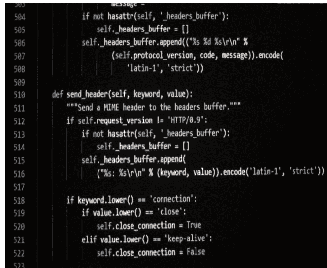
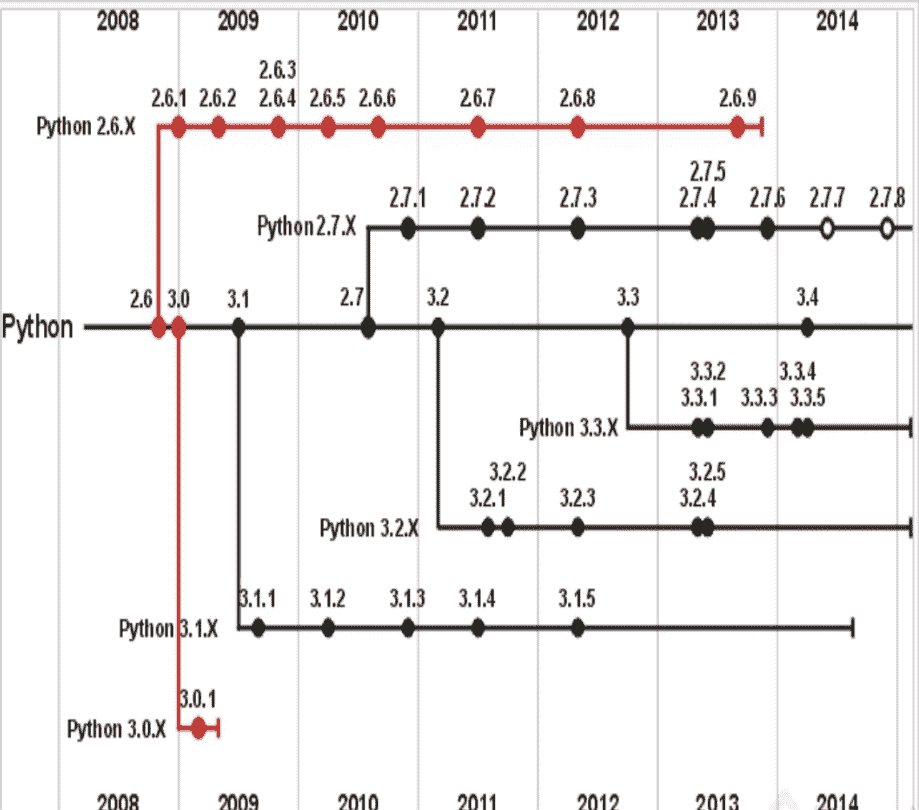
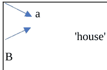
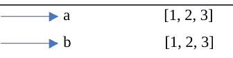
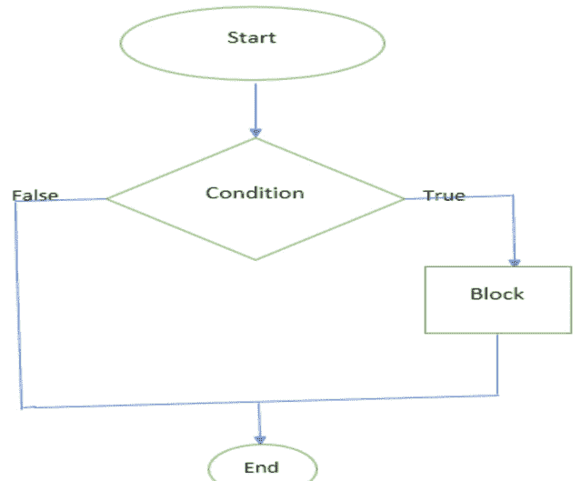
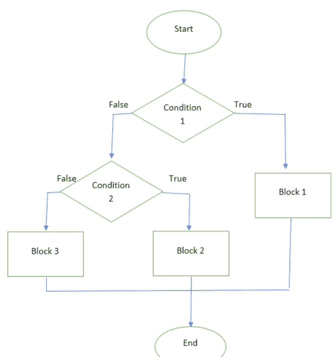

# Python 编程：数据科学、AI、机器学习、GUI 等 Python 完全学习指南（含实践练习和面试题）


## 第 1 章：Python 简介

### 什么是 Python？

一种通用编程语言，其发展和普及相对较近。这就是 Python，一种致力于简单性、多功能性和快速开发的承诺。

Python 是一种平台无关且面向对象的脚本语言，旨在执行任何类型的编程，从 Windows 应用程序到网络服务器甚至网页。它是一种解释型语言，这意味着不需要使用源代码进行编译即可执行，这既带来了开发速度快等优势，也带来了运行速度较低等劣势。

近年来，该语言因多种原因而流行，例如：

- 它包含的大量库，以及随语言本身集成的数据类型和函数，这有助于在无需从头开始编程的情况下执行许多常见任务。
- 创建程序的简单性和速度。Python 程序可以比其 Java 或 C 等价物少 3 到 5 行代码。
- 可用于开发的平台数量，例如 Unix、Windows、OS/2、Mac、Amiga 等。
- 此外，Python 是免费的，即使用于商业目的。

### Python 用于什么？

学习 Python 的主要优势之一是可以创建可读性很高的代码，从而节省时间和资源，便于理解和实现。

这些因素以及您稍后将看到的其他因素，使 Python 成为最常用的编程语言之一。从网页应用程序到人工智能，Python 的应用无穷无尽。

### 1- 人工智能 (AI) 中的 Python

Python 是一种快速、可扩展、强大且开源的编写语言，这些优势使 Python 成为人工智能的完美盟友。

它允许您用几行代码捕捉复杂的想法，而这在其他语言中是不可能的。

存在诸如 "Keras" 和 "TensorFlow" 等库，其中包含大量关于机器学习功能的信息。

此外，还有 Python 提供的库，广泛用于 AI 算法，例如 Scikit-learn，这是一个免费的机器学习库，包含多种回归、分类和聚类算法。

### 2- 大数据中的 Python

Python 在数据分析和为公司提取有用信息方面应用广泛。

除了其简单性，这是一个巨大的优势之外，Python 具有数据处理库，例如 'Pydoop'，这对专业人士大有帮助，因为您可以用 Python 编写 MapReduce 代码并在 HDFS 集群中处理数据。

其他库，如 "Dask" 和 "Pyspark"，使数据分析和管理更加容易。Python 快速且易于扩展，这些特性帮助您在实时环境中生成信息，并将该信息转换为大数据中使用的语言。

### 3- 数据科学中的 Python

自引入 Pandas 和 NumPy 等 Python 数值引擎以来，研究人员已从之前的语言 MATLAB 转向了 Python。

Python 处理表格、矩阵和统计数据，并甚至使用诸如 «Matplotlib» 和 «Seaborn» 等流行库对其进行显示。


### 4- Python in Test Frameworks

测试是另一种已转向 Python 的活动。

Python 非常适合验证想法或产品，因为它拥有许多集成框架，有助于调试代码并提供快速的工作流和执行。

诸如 'Unittest'、'Pytest' 和 'Nose test' 之类的测试工具使测试变得更容易。Python 还支持跨平台测试和带有不同框架的浏览器，例如 "PyTest" 和 "Robot"。

测试通常是最艰巨的任务之一，现在变得简单快捷得多。

### 5- Python in Web Development

Python 允许您用更少的代码构建更多内容，因此原型创建更加高效。

由 Python 提供的 Django 框架对所有开发人员都是一项优势，因为它可用于创建动态且非常安全的 Web 应用程序。

Python 语言还用于爬取，即从其他网站获取信息。Instagram、Bit Bucket、Pinterest 等应用程序都是基于此类框架构建的。

Python 的用途和应用远超上述领域，从游戏开发到数据可视化，从网络到一般的软件开发。Python 应用程序数不胜数。

如果您是开发人员或希望专注于上述提到的某个领域，我们邀请您抽出一点时间读完这整本书。Python 是您必须学习和掌握的语言之一，以便参与最前沿的技术项目。

### Python Features

让我们来看看 Python 语言的主要特性，它们与 Java 或 Ruby 等编程语言非常相似

### 1- General-Purpose Language

这意味着它不是针对特定目的的，例如专为构建网站而设计的 PHP。

使用 Python，您无需具备高深的知识（JavaScript 作为强大的盟友）即可创建网页，也可以为 Windows 操作系统编写脚本或软件。

目前尚未有针对移动设备的突出功能，但您可以为此目的使用 Kivy。

### 2- It is multiparadigm

那是什么意思？多范式？

嗯，尽管其强项是面向对象编程（它是一种高级语言），但为其用户提供了其他编程范式或风格，例如命令式编程（带有循环语句）或函数式编程（带有模块和函数）。

因此，如果您对对象一无所知，只会使用方法编写代码，您也可以完美地使用 Python，而在其他语言中这是不可能的。

### 3- Python is an interpreted language

使用 Python 编程时，您不需要将源代码编译为机器代码，而是有一个解释器会根据代码直接执行程序。

虽然这一特性暗示程序可能会更慢，但在 Python 语言中通常并非如此，这有助于促进下一特性的发展。

### 4- It is cross-platform

与许多语言（如主要只能针对 Windows 进行开发的 Visual Basic）不同，使用 Python 您可以在许多设备和操作系统上使用它，因为已为 Unix、Linux、Windows 和 Mac OS 系统创建了解释器。

### 5- It is dynamic typing

声明变量时，不需要告诉数据是什么类型（是 int、string、float 等）。变量会根据程序执行时编写的内容进行调整。

此特性在其他语言中一直因内存优化、编写代码时出错等原因而受到批评。但使用 Python 时，目标是让语言帮助创建软件，而不必处理语言的特性。



同样，Python 是强类型语言，例如，您无法将数字和文本相加（int 类型变量与 string 类型变量相加），因为这会导致错误。

### 6- It is object oriented

我们已经说过，您可以应用另一种编程风格，编写面向对象的软件会带来一系列标准优势，尤其是通过继承及其多态函数重用组件时。

### Python Philosophy

非常经常，这种语言的大多数程序员都会听到有人说与 Python 哲学相关的事情，该哲学与 Unix 哲学非常相似。

这些原则由 Python 开发者 Tim Peters 在 Python 之禅中著名地描述。

- 优美胜于丑陋。
- 显式胜于隐式。
- 简单胜于复杂。
- 复杂胜于繁琐。
- 扁平胜于嵌套。
- 稀疏胜于稠密。
- 可读性很重要。
- 特例不特殊到足以打破规则。
- 实用胜于纯粹。
- 错误绝不应被悄然忽略。
- 除非它们已被明确禁用。
- 面对歧义，拒绝猜测的诱惑。
- 应该只有一种——最好是只有一种——显而易见的方法来做这件事。
- 虽然这种方法起初可能并不明显，除非你是荷兰人。
- 现在胜于永远。
- 虽然永远不如现在。
- 如果实现难以解释，那是个坏主意。
- 如果实现容易解释，那可能是个好主意。
- 命名空间是个好主意。让我们多做这样的事情！

Tim Peters, Python 之禅。

### Python History And Evolution

Python 作为编程语言的历史始于 20 世纪 80 年代末和 90 年代初，与 Guido Van Rossum 一起，拥有 29 年的开发历史。

1989 年的一个圣诞节，在 CWI（一家荷兰研究中心）工作的 Guido Van Rossum 决定启动一个业余项目，为 ABC 编程语言（在 CWI 开发的一种编程语言）延续生命。

Retrieve words from a document in ABC Retrieve words from a document in PYTHON

```
HOW TO RETURN words document:
PUT {} IN collection
FOR line IN document:
    FOR word in split line:
        IF word not in collection:
            INSERT word IN collection
RETURN collection

def words(document):
    collection = set()
    for line in document:
        for word in line.split():
            if word not in collection:
                collection.add(word)
    return collection
```

ABC 编程语言在 20 世纪 80 年代初开发，作为 BASIC 的替代品，专为初学者设计，因其易于学习和使用。其代码简洁但易读。

该项目并未广泛传播，因为当时可用的硬件使其使用困难。因此，Van Rossum 通过创建 Python 赋予了它第二次生命。

Guido Van Rossum 喜欢 Monty Python 团体，因此他选择了该语言的名称。目前，Van Rossum 继续在决定 Python 方向方面发挥核心作用。



用红色标注的版本被视为过时版本

1991 年，Van Rossum 在 alt.sources 中发布了 0.9.0 版本的代码。

该版本显示了从 Modula-3 采用的模块系统，Modula-3 是一种结构化和模块化编程语言，Guido 将其描述为 Python 最大的编程单元之一。例如，Python 的异常模型与 Modula-3 的类似。

到 1994 年，comp.lang.python 论坛被创建，这是一个 Python 讨论论坛，标志着其普及率的里程碑，并使其用户数量翻了几倍。

### Version 1.0

同年，Python 达到 1.0 版本，包含 lambda、reduce、filter 和 map 等函数式编程工具。

这些工具得益于一位 Lisp 黑客引入语言，Lisp 是一种多范式计算机编程语言系列。

在 CWI 发布的最后一个版本是 1995 年的 Python 1.2，之后 Van Rossum 在弗吉尼亚州的国家研究公司（CNRI）继续工作，并发布了该语言的多个版本。

对于 1.4 版本，有许多新功能，大部分受到 Modula-3 的启发，还内置了对复数的支持。

到 2000 年，主要的 Python 开发团队转移到 BeOpen.com 组建 BeOpen Python Labs 团队。CNRI 要求在团队离开 CNRI 时发布 1.6 版本。

在 CNRI 发布的 1.6 版本包含比在 CWI 发布的版本明显更长的许可证。新许可证包含一条规定其受弗吉尼亚州法律管辖的条款。

自由软件基金会（FSF，由 Stallman 创立以鼓励自由软件的基金会）认为该条款与 GNU GPL 不兼容。因此，他们同意将 Python 改为自由软件许可证，使其与 GPL 兼容。

这就是为什么 Python 1.6.1 与 1.6 相同，只是修复了几个错误并采用了新的 GPL 兼容许可证。

### Version 2.0

Python 2.0 引入了列表生成，这是 Haskell 函数式编程语言最重要的特性之一。它还包含能够收集循环引用的垃圾回收系统。

2001 年，Python 软件基金会成立，自 Python 2.1 起拥有所有代码、文档和语言规范。该基金会基于 Apache 软件基金会模型。

### Version 3.0

最后一次重大 Python 更新是在 2008 年的 Python 3.0，随 PEP 3000 推出，旨在纠正语言设计中的根本缺陷。


> "通过移除旧有的做法来减少功能重复"

Python 3.0 的理念与之前的版本相同，但 Python 作为一种语言，已经积累了用于编程相同任务的新的和冗余的方式。

Python 3.0 强调消除重复的构造函数和模块，以符合“只有一种显而易见的做事方式”规则。

Python 3.x 和 Python 2.x 版本计划在并行发布的多个版本中共存，其中 Python 2.6 与 3.0 一起发布，包含新功能和警报，突出显示在版本 3.0 中被移除的工具的使用。

同样，2.7 与 3.1 一起发布，包含新版本的功能，其中 2.7 是 2.x 系列中的最后一个出版物，目前仅接收安全更新，并将在 2020 年不再受支持。

Python 3.0 打破了语言的向后兼容性，因为 Python 2.x 代码不一定需要在 Python 3.0 中无需任何修改即可运行。

### Python 3.x:

```
print("hello")
```

### Python 2.x:

```
print "hello"
```

用 Python 编写的最令人印象深刻的项目之一是 Dropbox 服务器（吉多·范罗苏姆目前就职的地方），它目前为数百万人提供服务。另一个令人难以置信的用途是科学界将其用作机器学习的工具。

最后，我们留下吉多·范罗苏姆的一段话。这是对所有年轻程序员，或正在开始学习编程的人的留言。

### 写给年轻程序员的信

亲爱的 _______，

我听说你喜欢一种名为 Python 的编程语言。编程是一项美妙的活动。我有点嫉妒你在你的年纪就能接触到计算机；我成长的时候甚至不知道计算机是什么！不过我是个电子爱好者，我的大梦想是用离散元件组装自己的电子计算器。

我从未做到过那一点，但我确实组装过几个数字时钟，构建如此复杂的东西并看到它运行，真是太棒了。我希望你也能胸怀大志——程序员可以让计算机（和机器人！）做出惊人的事情，而现在正是成为程序员的好时机。想象一下，五年或十年后计算机会快多少，你那时能用自己的技能做些什么！

吉多·范罗苏姆

## 第 2 章：Python 基础

### 数据类型

计算机程序中处理的信息以多种方式表示。如果你处理数值信息，将使用简单值或实值或简单数据。如果你处理结果为真或假的逻辑表达式，将使用逻辑或布尔数据。另一方面，如果你操作文本，将使用字符型或字符串（string）类型的数据。要表示数值信息（甚至逻辑或文本），当数据以表格形式（如向量和矩阵）或更复杂的结构分组时，将使用复合数据类型。

下图显示了主要编程语言中使用的数据类型。

- 数据类型
  - 简单
    - 整数，int
    - 实数，float
    - 布尔，bool
    - 字符，char
  - 复合
    - 数组，字符串
    - 结构，记录
    - 元组，字符串（静态，不可变）
    - 列表，字典，集合（动态，可变）

注：Python 中不存在字符数据类型，简单字符表示为字符串（string）。

由 C、FORTRAN、Pascal、Matlab 等语言组成的结构。Py：Python 中的复合结构。来源：自制。

### 简单数据

基础数据是简单的，也称为标量，因为它们是不可分割的对象。简单数据的特点是只有一个关联值，类型为整数、实数或浮点数（float）、布尔和字符。在 Python 中，没有简单的字符数据类型。尽管数据仅由一个字母或 ASCII 字符组成，但它表示为由字符串（string）组成的数据。

- 整数

在数学中，整数是自然数、它们的负数和零。整数示例：5、-20、0、-104。带有小数部分的数字不属于整数，例如 3.4。在大多数编程语言（包括 Python）中，整数使用关键字 int 定义。Python 有一个内置的 type 函数，用于返回给定的数据类型：

```
>>> type(7)
<class 'int'>
>>> a = 45
>>> type(a)
<class 'int'>
```

在 C++ 或 Pascal 中，标准整数（int, integer）使用 4 字节（32 位，其中一位保留给符号，即有符号 32 位），表示范围为：

-2147483648 ... 2147483647

在这些语言中，为了获得更大的范围，使用 8 字节（有符号 64 位），将其声明为 long 或 int64：

-2^63 ... 2^63 - 1

与 C++ 或 Pascal 不同，在 Python 中，整数数据使用“任意精度”存储，即使用表示整数所需的字节数。例如，数字 5（二进制：101）和 200（2^7 + 2^6 + 2^3，二进制：11001000）的表示如下：

```
>>> bin(5)
'0b101'
>>> bin(200)
'0b11001000'
```

Python 的内置 bin(N) 函数将整数转换为带有等效二进制（0b + 二进制）的字符串。要测试 Python 中值的广泛范围，让我们测试一个大于 2^63 的值，例如 2^220：

```
>>> 2**220
1684996666696914987166688442938726917102321526408785780068975640
```

- 实数

与从一个自然数到另一个自然数的离散值的整数不同，数学中实数集合的连续值数字称为实数或浮点数，或简称为 float。并非所有实数在计算机科学中都能准确表示，因为许多实数有无限的小数位。然而，根据精度级别，我们可以将这些数字充分近似地表示。使用 IEEE 754 标准表示实数或浮点数的约定已经存在数十年，采用科学记数法。

此记数法允许使用尾数（有效数字）和由字母 'e' 或 'E' 分隔的指数来表示数字。例如，数字 4000 由尾数 4 和指数 3 表示，即 4e3。读作 4 乘以 10 的 3 次方。数字 0.25 也表示为 25e-2。还允许省略初始零，.25，实数 4.0 可以输入为 4.（小数点后没有零）。

| 符号位 | 指数 | 尾数 |
|---|---|---|
| 1 位 | 11 位 | 52 位 |

Value = (-1)^sign * 1.Mantissa * 2^(Exponent-1023)

因此，使用 64 位可以表示范围为 ± 5.0 * 10^-324（精度）至 ± 1.7 * 10^308 的数字（小数）。2008 年更新的 IEEE 754 标准包含使用十进制基数的 decimal64 格式，以改进二进制表示错误 [1]。Python 包含 decimal 模块的 Decimal 函数。

以下是几个实数示例、实数类型（float）以及使用二进制基数表示浮点数时的典型错误，以值 0.1 为例。

```
>>> 25e-2
0.25
>>> 4e3
4000.0
>>> type(4.)
<class 'float'>
>>> .2e2
20.0
>>> 1.1 + 2.2 # is represented with binary floating point error
3.3000000000000003
```

- 布尔

在 Python 中，用于表示逻辑或布尔值的数据类型是 bool，在 Pascal 和 C++ 中，它们分别定义为 boolean 和 bool。布尔数据取值为 True（逻辑 1）或 False（逻辑 0）。布尔一词源自英国数学家 George Boole，他在 19 世纪提出了一种基于这两个逻辑值和三个逻辑运算（逻辑“与”、逻辑“或”和否定）的代数系统。示例：

```
>>> a = 3 > 2
>>> a
True
>>> type(a)
<class 'bool'>
>>> 4 > 5
False
```

- 字符

多种编程语言中使用的字符数据类型是计算机科学中使用的文本的标量或不可分割元素。文本称为字符串。例如，从十进制值 20 到 127 的 ASCII 字符顺序为：

```
! " # $ % & ' ( ) * + , - . / 0 1 2 3 4 5 6 7 8 9 ; : < = > ? @ A B
C D E F G H I J K L M N O P Q R S T U V W X Y Z [ \ ] ^ _ ` a b c d
e f g h i j k l m n o p q r s t u v w x y z { | } ~
```

它们表示的顺序用于评估哪个大于另一个，根据它们在 ASCII 代码中出现的数值。例如，'b' 大于 'a'。

Python 中未定义字符类型。简单字符定义为只有一个字母的文本，即作为字符串（string）。

```
>>> type('a')
<class 'str'>
```

可以看出，Python 中的字符 'a' 的类型是字符串（str），尽管在


在诸如 Pascal 之类的语言中，它的类型将是字符（char）。

### 复合或结构化数据

复合或结构化数据包括具有相同类型或不同类型值元素的数据，这些数据以统一形式表示以便保存或处理。

- 字符串数据：字符串

字符串数据类型是处理文本的基本结构，其中包括 ASCII 或 UTF-8 编码的字母数字字符及其他字符。在 Python 中，字符串由单引号 (') 或双引号 (") 定义。当需要多行时，也可以使用三引号 (""") 定义。例如，

```
>>> 'Hi'
'Hi'
>>> b = "Wooden house"
>>> type(b)
<class 'str'>
>>> type(15)
<class 'int'>
>>> type('15')
<class 'str'>
```

文本 'Hi' 或 "Wooden house" 在所有语言中通常都是字符串类型。值 15 是整数类型数字 (int)，然而，值 '15' 是字符串 (str)。如果在字符串中包含引号 ("") 或单引号 (')，当这些字符用作字符串分隔符时，可能会产生错误结果。你可以使用文本中未用作分隔符的字符：

```
>>> 'She said "Cute"'
'She said "Cute"'
```

但是，在这种情况下，你也可以使用反斜杠字符 (\) 作为转义字符，以在字符串中添加引号或其他操作：

```
>>> print ('He doesn\'t know I \"will come\"')
He doesn't know I "will come"
```

反斜杠字符（称为转义字符）后跟 n (\n) 表示跳转到新行。可以使用三引号 """...""" 在字符串中包含多行。在这种情况下，行尾也会被包含。当使用内部 print 函数 () 在屏幕上显示时，可以看到跳转到新行：

```
>>> print ('We change line \n new line')
We change line
New line
>>> """
Program:
Author:
Date:
"""
'\n Program: \n Author: \n Date: \n '
```

### 变量和赋值操作

在数学中，变量用于表示数值。使用字符或文本来表示它们。在数学计算中，类型为 y = f(x) 的函数涉及两个变量 x 和 y。

在编程语言中，通常需要记住或保存程序中要使用一次或多次的数值、布尔值或文本值。变量承担此任务。在 FORTRAN、C / C++ 或 Pascal 等语言中，变量被视为计算机 RAM 中的容器或位置，带有关联名称（标识符），其中存储着某种类型的值。通过使用计算机程序，我们可以坚持这一概念。然而，在 Python 中，这一概念有所不同，因为变量不是包含值的内存位置，而是与包含该值的内存位置相关联或引用。值可以是整数、实数、布尔值等。

赋值操作用于为变量赋予某个值。在 Python 中，向变量赋值的操作意味着，给定名称的变量将与赋值右侧的值相关联：

```
>>> a = 7
```

在 Python 中，执行语句或指令 a = 7 时，首先会创建一个值为 7、类型为 int 的对象，并将其放置在一个内存位置。这个内存位置称为 Python 对象标识。然后，将 7 赋值给变量 a 的操作会导致该名称或标识符与对象 7 的内存地址相关联或引用，也就是说，它将与 7 具有相同的标识。我们将使用 Python 内部 id() 函数来更好地理解变量对其值为 7 的内存位置的这一引用。id() 函数返回对象所在的标识或内存位置。

Python 中的简单数据对象具有三个特性：

值、类型、标识

```
>>> id(7)
1449917120
>>> a = 7
>>> id(a)
1449917120
>>> b = 7
>>> id(b)
1449917120
>>> c = a
>>> id(c)
```

7、a、b 或 c 都是同一个对象，占据一个唯一的内存位置。在此情况下，位置为 1449917120。当变量 b 被赋予相同的值（和对象）7 时，它将引用同一个位置。如果将变量 a 赋给变量 c，情况也是如此；c 将引用 7 的同一个位置。这使得 Python 在内存处理上更高效，因为在其他语言中，拥有三个相同值的变量会导致内存使用量翻三倍。但是，如果使用值 7.0 而不是 7 会发生什么？：

```
>>> x = 7.0
>>> id(x)
1722264
>>> type(x)
<class 'float'>
```

变量 x 将与对象 7.0 关联，标识为 1722264，类型为 float，值为 7.0。因此，Python 对象具有三个特性：值、类型和标识。如所述，变量在使用前不需要像 Pascal 或 C 那样声明其类型。它们甚至可以在程序中更改类型。

为了更好地理解编程中的赋值概念，并将其与数学中符号 = 的对称性区分开来，让我们试一下：

```
>>> 7.0 = x
SyntaxError
>>> x = x + 3
>>> x
10.0
```

7.0 = x 语句在编程中是语法错误，尽管在数学中是有效的。但是 x = x + 3 在数学中是荒谬的，但在编程语言中，它意味着向变量 x 添加值 3，然后将该表达式的结果再次赋给同一个变量 x。

Python 允许以下类型的多重赋值：

```
>>> x, y, z = 7, 8.2, 9
```

变量 y 是值为 8.2 的实数，x 是值为 7 的整数，z 是值为 9 的整数。在赋值右侧，写入了一个复合数据，即 Python 中的元组，它被赋给由这三个变量组成的元组。

总结：在 Python 中，变量不会直接存储在内存中；会创建一个对象（其在内存中的位置称为标识），变量的标识符与该对象的标识相关联。下图展示了 Python 中相同值变量的使用示例，与其他编程语言相比。

Other languages
...
years=99(int)
Height=99(int)
Higher=99(int
Upmost=99(int
...
...

Python
...
99(int)
...
...
...
...
...
...

- years
- Height
- Higher
- Upmost

```
>>> id(99)
1790316048
>>> years = 99
>>> Height = 99
>>> Higher = 99
>>> id(99)
1790316048
>>> id(Height)
1790316048
>>> id(Higher)
1790316048
>>> id(Upmost)
1790316048
>>> type(years)
<class 'int'>
```

### 表达式和语句

表达式是进行计算的机制，由值、标识符与运算符的组合构成。它们可以包括变量、数据、运算符、括号以及返回结果的函数。

每个表达式都有一个值，即从左到右计算并考虑优先级后的结果。表达式示例：

```
>>> 1.5 * 3 / 2
2.25
>>> 1.2 * x + 3 # The value of x in the previous example is 10.0
15.0
```

```
>>> 3 > (3.1 + 2) / 3
True
```

语句或指令是程序的基本单位（在程序员行话中也称为代码），用于产生一个动作，例如向变量赋值、显示结果等。Python 解释器执行每条语句以产生给定的动作。

```
>>> y = x / 2 + 3
>>> print(y)
8.0
```

```
>>> 1.5 * 3 / 2
2.25
>>> print(_)
2.25
```

左侧框中的第一条语句计算表达式 x / 2 + 3 并将结果赋给变量 y。第二条语句显示 y 的值。但是，右侧框中的表达式 1.5 * 3 / 2，其计算结果未赋给任何变量，而是保存并关联到名为 “ _” 的变量中。

### 运算符

运算符是表示计算动作的符号。除了经典数学运算外，编程中还使用逻辑运算符以及关系或比较运算符。我们可以将运算符分为 3 类：算术运算符、逻辑或布尔运算符，以及关系运算符。

### 算术运算符


| 操作 | 运算符 | 表达式 | 结果类型 |
| :--- | :--- | :--- | :--- |
| 求和 | + | a+b | 如果 a 和 b 都是整数则为整数；如果有任意一个是实数则为实数 |
| 减法 | - | a-b | 如果 a 和 b 都是整数则为整数；如果有任意一个是实数则为实数 |
| 乘法 | * | a*b | 如果 a 和 b 都是整数则为整数；如果有任意一个是实数则为实数 |
| 除法，a ÷ b（整数） | / | a/b | 始终为实数 |
| 整除 | // | a//b | 返回商 a ÷ b 的整数部分 |
| 取模，余数 | % | a%b | 返回除法 a ÷ b 的余数 |
| 幂运算，a^b | ** | a**b | 如果 a 和 b 都是整数则为整数；如果有任意一个是实数则为实数 |

### 示例:

```
>>> 14/4 # Integer Division
3.5
>>> 14 // 4 # Division, returns whole part of dividing 14 by 4
3
>>> 14% 4 # Module, returns the rest of dividing 14 by 4
2
```

作用于单个操作数的算术运算符称为一元运算符：符号变更运算符 - 和恒等 + 运算符。例如，-4、+4、--4 等于 4。

### 带赋值的算术运算符

增加变量值的操作在计算机程序中非常常见。

例如，在事件计数器中，计数器 c 每次增加 1。

```
>>> c = c + 1 # the variable c is increased by 1
>>> d = d - 1   # the variable d is decremented by 1
```

Python 包含将赋值运算符与任何算术运算符合并的语句。在变量增加或减少的情况下，我们有，

```
>>> c += 1      # equals: c = c + 1
>>> x += 0.01   # equals: x = x + 0.01
>>> d -= 2      # equals: d = d - 2
```

其他算术运算符（*, /, //, %, **）也可以使用这种紧凑形式。还可以包含递增或其他运算的表达式：

```
>>> y *= d+1          # equals: y = y * (d + 1)
>>> n = 7
>>> n //= 2           # equals: n = n // 2
>>> n
3
>>> n **= 2           # equals: n = n ** 2
>>> n
9
```

| 操作 | 运算符 | 表达式 | 等同于 |
|---|---|---|---|
| 加并赋值 | += | a += b | a = a+b |
| 减并赋值 | -= | a -= b | a = a-b |
| 乘并赋值 | *= | a *= b | a = a*b |
| 除并赋值 | /= | a /= b | a = a/b |
| 除并赋值整数部分 | //= | a //= b | a = a//b |
| 取模并赋值 | %= | a %= b | a = a%b |
| 幂并赋值 | **= | a **= b | a = a**b |

| A | B | A or B | A and B | Not A |
|---|---|---|---|---|
| 假 | 假 | 假 | 假 | 真 |
| 假 | 真 | 真 | 假 | 真 |
| 真 | 假 | 真 | 假 | 假 |
| 真 | 真 | 真 | 真 | 假 |

等同于：

| A | B | A or B | A and B | Not A |
|---|---|---|---|---|
| 0 | 0 | 0 | 0 | 1 |
| 0 | 1 | 1 | 0 | 1 |
| 1 | 0 | 1 | 0 | 0 |
| 1 | 1 | 1 | 1 | 0 |

例如，

```
>>> A = True
>>> type(A)
<class 'bool'>
>>> B = False
>>> A or B
True
```

下表总结了处理布尔表达式时有用的一些逻辑定律。它们可以通过等号两边的真值表来证明。

```
not not A = A
A and True = A
A and False = False
A or False = A
A or True = True
not (not A and not B) = A or B
not (not A or not B) = A and B
```

Python 和 C++ 等其他语言包含针对二进制数的逻辑运算符，按位执行。这些按位运算符对输入的十进制数对应的二进制数的位执行逻辑运算。例如，5 = 101 和 6 = 110。如果按位进行“逻辑与”运算，你会得到二进制 100，即等同于 4 = 100。在机器语言级别，还会使用异或（exclusive or）运算符，当且仅当一个操作数为 1 时返回 1。在 Python 中，如同在 C++ 中一样，位运算符如下。

| 位运算 | 运算符 | 表达式 | 结果 |
|---|---|---|---|
| "逻辑与", and | & | 5 & 6 | 101 和 110 -> 100，十进制为 4 |
| "逻辑或", or | \| | 5 \| 6 | 101 或 110 -> 111，十进制为 7 |
| 异或 | ^ | 5 ^ 6 | 101 异或 110 -> 011，十进制为 3 |
| 取反，not | ~ | ~x | 将 0 替换为 1，将 1 替换为 0。等同于 -x -1 |
| 左移 | << | x << n | 返回 x 的位向左移动 n 位后的值。等同于 x * 2 **n |
| 右移 | >> | x >> n | 返回 x 的位向右移动 n 位后的值。等同于 x // 2 ** n |

### 关系运算符（比较）

它们用于比较 2 个表达式或值，结果始终为真或假，即布尔值。

| 数学 | 在 Python 中 | 含义 | 示例 | 结果 |
| :--- | :--- | :--- | :--- | :--- |
| = | == | 等于 | 'a' == 'b' | 假 |
| ≠ | != | 不等于 | 'b' != 'B' | 真 |
| < | < | 小于 | 7 < 3 | 假 |
| > | > | 大于 | 7 > 3 | 真 |
| ≤ | <= | 小于或等于 | 7 <= 7 | 真 |
| ≥ | >= | 大于或等于 | 7 >= 3 | 真 |

在以下示例中，我们将使用关系运算符检查赋给变量 temp 的测量温度是否在 37 到 42 °C 之间（包含边界）。

```
>>> temp = 38 # measured temperature
>>> (temp >= 37) and (temp <= 42)
True
```

表达式 (temp >= 37) and (temp <= 42) 可以省略括号，因为关系运算符的优先级高于布尔运算符。Python 的特点是，这种表达式可以写成数学记法：37 <= temp <= 42。Python 中类型为 a < b < c 的表达式表示 (a < b) and (b < c)，这提高了语言的可读性。

属于 ASCII 表的字母字符（不包括 ñ）是有序的。小写字母的十进制等效二进制范围为 97 到 122，大写字母为 65 到 90。尽管在 Python 中字符为字符串类型，但我们可以比较字符，其 True 或 False 结果将根据其 ASCII 位置给出。例如，'b' > 'a' 将返回 True。同样，'B' > 'a' 将返回 False。

在以下练习中，我们将查找一个表达式，当给定变量 car 且该变量是字母表符号时，该表达式为真：

```
>>> car = 'q'
>>> (car >= 'a') and (car <= 'z') or (car >= 'A') and (car <= 'Z')
True
>>> # Equals to
>>> 'a' <= car <= 'z' or 'A' <= car <= 'Z'
True
>>> car = '&'
>>> 'a' <= car <= 'z' or 'A' <= car <= 'Z'
False
```

结果可以赋给布尔变量：

```
>>> is_letter = 'a' <= car <= 'z' or 'A' <= car <= 'Z'
>>> is_letter
False
```

在大多数语言（包括 Python）中，布尔值 True（逻辑 1）大于 False（逻辑 0）：

```
>>> True > False
True
```

### 函数的使用。内部函数和模块函数。

在各种程序示例中，人们使用内部函数和数学模块（math）的函数以及生成随机值的函数。已应用的函数包括：

| 内部函数 | 返回值 |
|---|---|
| type | 数据类型 |
| id | 标识或内存位置 |
| bin | 等效于给定整数的二进制字符串 |
| int, float, str | 给定值的整数、实数、字符串 |
| input | 从键盘读取一个值 |
| print | 将文本打印到屏幕 |
| abs | 数的绝对值 |
| round | 将实数四舍五入到指定的小数位 |
| Math module | |
| pi | pi 值（非函数） |
| sqrt | 数的平方根 |
| Random module | |
| randint | 给定范围内的随机整数 |

在数学中，函数根据其自变量的每个值返回一个结果。例如：f(x) = 3x2 + 1 计算当 x = 2 时的 f(2) = 13；
f2(x, y) = x2 + y2 计算 f(2.2) = 8；f(x) = √ 计算 f(9) = 3。编程语言中返回结果的函数行为类似。

在计算机语言的语境中，函数是一条或一组执行计算或任务的指令，并以标识符命名（类似变量的标识符）。先前使用过的函数的名称（标识符）包括 type、int、abs、sqrt、round 等。在数据类型的第一个示例中，我们已经使用了函数调用（也称为调用函数）：

```
>>> type (7)
<class 'int'>
```

函数名为 type，在此例中，值 7 是其参数。参数是我们传递给函数的值。示例：

```
from math import sqrt
x = abs (-9) + 3
y = sqrt(x)
print ('Square of ',x, '=',y)
```


首先，必须导入 math 模块的 sqrt 函数（abs 不需要导入，因为它是内置函数）。abs 和 sqrt 括号内的内容（分别是值 -9 和变量 x）是函数的参数。这些函数在被调用后会返回一个值（返回值）。abs 函数在算术表达式中被调用，它返回的值会恰好替换表达式中的该函数并加到 3 上。然后，这个新值被赋给变量 x。必须注意函数返回的数据类型与要执行的操作兼容。函数的参数可以是表达式，包括包含其他函数调用的表达式，如下所示，

```
y = sqrt(4 + x**2)
z = sqrt(abs(-40))
```

round 或 randint 函数需要两个参数并返回一个值：

```
from random import randint
n = randint(10, 100)/3.2567
print(n, round(n,2))
```

以下是 math（数学）和 random（随机值）模块的一些函数和值列表。

| Math 模块 | 返回值 |
|---|---|
| Pi | 值 π = 3.141592653589793 |
| e | 值 e = 2.718281828459045 |
| ceil(x) | 大于 x 的整数，向 ∞ 方向取整 |
| floor(x) | 小于 x 的整数，向 -∞ 方向取整 |
| trunc(x) | 舍入到 0 |
| factorial(x) | x! |
| exp(x) | x 的指数函数 |
| log(x) | 自然对数（底数 e），ln(x) |
| log10(x) | 底数为 10 的对数 |
| sqrt(x) | x 的平方根 |
| sin(x), cos(x), tan(x) | x 的正弦、余弦、正切 |
| degrees(x) | 弧度 x 转换为角度 |
| radians(x) | 角度 x 转换为弧度 |

使用模块函数有 2 种方式。到目前为止，我们已导入所需的函数或值并在指令中直接应用。我们也可以导入多个模块函数：

```
from math import sqrt, log10
x = sqrt(10)
dB = log10(x/2)
```

或者，可以导入 math 模块并使用点来调用单独的模块函数：

```
import math
x = math.sqrt(10)
dB = math.log10(x/2)
```

在这种情况下，模块名称可以缩写：

```
import math as m
x = m.sqrt(10)
dB = m.log10(x/2)
```

## 第 3 章：数据结构与面向对象 Python

在大多数示例中，我们使用的是与单个值关联的简单数据：整数、实数或布尔值。它们是标量对象，因为它们是不可分割的，也就是说，它们没有可访问的内部结构。我们还介绍了诸如文本或字符串之类的复合数据，由字符串表示，以及以列表形式存在的序列，我们在使用 for 进行迭代组合时用它们来遍历元素。这些数据类型不是标量，因为它们可以被分成元素并访问，它们是结构化数据。

结构化或复合数据包含元素，这些元素可以是简单数据或其他复合数据。我们要记住，在 Python 中，简单数据和复合数据都被视为对象。

元素可以全部为同一类型，例如包含字符的字符串，在这种情况下，它们被称为同构结构化数据。其他语言（C/C++、Matlab、Pascal）具有同构结构，例如数组（array 或 table），对于向量或矩阵的操作非常有用。标准 Python 没有像 C 或 Pascal 这样的数组结构，尽管数值 Python 库（NumPy）确实包含这些选项。

在 Python 中，复合或结构化数据可以根据其元素是否可以更改、减少或扩展的特征分为两组：**可变和不可变的结构化数据**。

### 不可变结构化数据（静态）

不可变结构化数据，也称为静态或固定值/大小，其特征在于其序列中的元素不能更改或删除。也不能向数据结构中添加新元素。如果要修改此类数据，请使用创建新值的资源。在 Python 中，作为不可变结构化数据，我们有字符串（string）和元组（tuple），作为数据流，还有冻结集合（frozenset）。

### 字符串

字符串，在第二章中已经介绍过，是任意类型字符（字母、数字、特殊字符；任何 Unicode 字符）的序列，它们形成 Python 的一个对象。

### 索引或访问与序列长度

字符串（或任何序列）的元素（字符）可以通过放在方括号中的索引 [index] 来访问，该索引告诉我们元素在字符串中的位置。

例如，

```
>>> s = 'wooden house'
>>> letter_1 = s[0]
>>> long = len(s)
>>> last_letter = s[long-1] # alternative: s[-1]
>>> print(letter_1, last_letter, long)
w e 12
```

值 'wooden house' 是字符串类型的对象，它包含一个由 12 个字符组成的序列。该值被赋给变量 s，该变量引用同一个对象。我们使用索引 0 访问第一个元素（letter_1 = s[0]）。正如我们在列表介绍中所指出的，请记住在 Python 中，序列的第一个元素在索引（访问）时位于位置 0。要计算结构化数据序列的元素数量或长度，我们使用内置函数 len()。该链有 12 个元素，其最后一个元素在位置 11（长度 - 1）或 -1。

| W | o | o | d | e | n |   | h | o | u | s | e |
|---|---|---|---|---|---|---|---|---|---|---|---|
| 0 | 1 | 2 | 3 | 4 | 5 | 6 | 7 | 8 | 9 | 10 | 11 |
| -12 | -11 | -10 | -9 | -8 | -7 | -6 | -5 | -4 | -3 | -2 | -1 |

用于访问字符串元素和索引的字符（正数和负数）

可以创建空字符串：s = ""（两个双引号，中间无空格），len(s) = 0。

### 修剪或切片序列及其他操作

要提取字符串或任何序列的子集元素（或段），使用切片操作符 [n: m]，其中 n 是要提取的第一个元素，m-1 是最后一个元素。

下面给出了对前一图中字符串元素访问和修剪段的几个示例。注释指示结果：

```
>>> s = 'wooden house'
>>> segm1 = s[0:3] # segm1 <- 'woo'
>>> segm1 = s[:3] # segm1 <- 'woo', equivalent to the previous slice
>>> segm2 = s[8:len(s)] # segm2 <- 'hous'
>>> segm2 = s[8:] # segm2 <- 'hous', equivalent to the previous slice
>>> segm3 = s[0:14:2] # segm3 <- 'wo nhue', slice 0:12 in 2-in-2 steps
>>> letter_u = s[-1] # letter_u <- 'e', equals access last element
>>> letter_penu = s[-2] # letter_penu <- 's', equivalent to penultimate access elem
```

在切片操作符中，如果省略第一个索引 [:m]（冒号之前），修剪从第一个元素开始。如果省略第二个索引 [:n:]（冒号之后），则修剪到序列末尾。负索引对于访问最后一个元素 [-1] 或最后几个元素很有用，而无需使用 len() 函数。

其他运算符，例如连接 (+) 或重复 (*) 字符串，适用于任何数据序列，

```
>>> s1 = 'house'
>>> s2 = s1 + 'big'
>>> s2
'big house'
>>> s3 = 3 * s1 + '!'
>>> s3
'househousehouse!'
```

in 运算符被视为两个字符串上的布尔运算符，如果左边的字符串是右边字符串的一个段（或子字符串），则返回 True。如果不是，则返回 False。not in 运算符返回相反的逻辑结果。示例：

```
>>> s = 'wooden house'
>>> 'house' in s
True
>>> 'housewood' in s
False
>>> 'housewood' not in s
True
```

### 字符串是不可变的

请记住，此类数据被视为不可变，因为我们不能更改其元素的值或更改其大小。如果我们想这样做，必须创建另一个变量（当然，在此之前要创建另一个字符串值）。让我们看看，如果我们想将前面示例中字符串 s 的第一个字母大写，会报错：

```
>>> s = 'wooden house'
>>> s[0] = 'W'
Traceback (most recent call last):
  File "<stdin>", line 1, in <module>
TypeError: 'str' object does not support item assignment
```

将字符串首字母大写的操作可以自动完成，如下一节所示，但通过创建一个新变量。

字符串方法 Python 是一种面向对象的语言，Python 中的数据位于对象中。在面向对象编程中，对象具有用于操作其数据的关联方法。方法类似于函数，因为它们接收参数并返回值。字符串具有其自身的方法。例如，upper 方法接收一个字符串并返回另一个字符串，但其中的字母是大写的。

upper 方法不是作为函数应用于字符串 s = 'wooden house'，即 upper(s)，而是以 s.upper() 的形式应用。也就是说，方法是应用于其值的。让我们来看看字符串的几种方法（有些方法有参数，有些没有）：


>>> s = 'wooden house'
>>> sM = s.upper() # converts the letters to uppercase
>>> sM
'WOODEN HOUSE'
>>> sM.lower() # converts the letters to lowercase
'wooden house'
>>> s.capitalize() # first letter of the string in uppercase
'Wooden house'
>>> s.title() # first letter of each string word in uppercase
'Wooden House'
>>> i = s.find('e') # searches the index (position) of the first string 'e'
>>> i # if it doesn't find the string it returns -1
5
>>> s.count('a') # count how many times the element or string appears
0
>>> s.replace('o', 'e') # replace the first string with the second
'weeden heuse'
>>> s.split() # split s using the string " producing list
['wooden', 'house']
>>> s1 = 'Hello'
>>> s1.isupper() # True if all characters in S are uppercase
False # False otherwise
>>> s1[0].isupper()
True
>>> s1.islower() # True if all characters in S are lowercase
False # False otherwise
>>> s1[1].islower()
True

上表展示了字符串值的一组典型方法。我们使用 capitalize() 方法解决了首字母大写的问题。split 方法根据用作参数的分隔符将字符串分成若干段，此处的分隔符是空格。参数 "" 是默认参数，因此可以使用 s.split() 来拆分文本中的单词。生成的子字符串（在此例中为单词）作为列表返回，子字符串作为元素。

### 示例

我们将展示在字符串中进行遍历或搜索的几个示例，以 (i) 统计 'to' 的数量，(ii) 统计给定字符或子字符串 'c1' 的数量，并搜索字符或子字符串。

```python
def count(s):
    """Count letter a in a string
    >>> countLetter('hot potato', 'a')
    1
    >>> countLetter('Esplugues', 'a')
    0
    """
    n = 0
    for c in s:
        if c == 'a':
            n = n + 1
    return n
```

### 使用 s.count() 方法

```python
def count(s):
    return s.count('a')
```

```python
def count(s, c1):
    """Count letter or sub-string c1 in string s
    Examples:
    >>> count('hot potato', 'a')
    1
    >>> count('potato', 'u')
    0
    """
    n = 0
    for c in s:
        if c == c1:
            n = n + 1
    return n
```

在字符串中查找字符或子字符串可以使用 for、while 结构，也可以直接使用字符串的某些方法。让我们先看看使用 for 和 while 的经典查找选项。

```python
def search(s, c1):
    """search for letter c1 in string s
    Examples:
    >>> search('hot potato', 'a')
    True
    >>> search('potato', 'u')
    False
    """
    OK = False
    for c in s:
        if c == c1:
            OK = True
            break
    return OK
```

```python
def search(s, c1):
    """search for letter c1 in string s
    Examples:
    >>> search('hot potato', 'a')
    True
    >>> search('potato', 'u')
    False
    """
    OK = False
    N = len(s)
    i = 0
    while i < N and not OK:
        if s[i] == c1:
            OK = True
            i += 1
    return OK
```

在 Python 中，可以在循环内退出函数，因此查找可以写为：

```python
def search(s, c1):
    """search for letter c1 in string s
    Examples:
    >>> search('hot potato', 'a')
    True
    >>> search('potato', 'u')
    False
    """
    for c in s:
        if c == c1:
            return True
    return False
```

但此查找也可以使用 count()、find() 方法，或者直接使用布尔运算符 in 来完成：

```python
def search(s, c1):
    """search for letter c1 in string s
    Examples:
    >>> search('hot potato', 'a')
    True
    >>> search('potato', 'u')
    False
    """
    return c1 in s
### return s.count(c1) > 0
### return s.find(c1) >= 0
```

### 元组

元组与字符串一样，是排列在 Python 对象中的元素序列。与字符串（元素为字符）不同，元组可以包含任何类型的元素，包括不同类型的元素。元素的索引方式与字符串相同，通过整数进行索引。元组的语法是逗号分隔的值序列。虽然并非必需，但通常会用括号将其括起来，

```python
### Example of tuples
>>> a = 1, 2, 3
>>> a
(1, 2, 3)
>>> b = (3, 4, 5, 'a')
>>> b
(3, 4, 5, 'a')
>>> type(a)
<class 'tuple'>
>>> type(b)
<class 'tuple'>
```

赋给变量 a 和 b 的对象是元组类型。关键是在元素之间包含逗号。例如，

```python
>>> t = 'k',
>>> t
('k',)
>>> type(t)
<class 'tuple'>
>>> t2 = 'k'
>>> t2
'k'
>>> type(t2)
<class 'str'>
```

对象 'k' 是一个元组，然而 'k' 是一个字符串。可以使用不包含任何内容的括号创建一个空元组：()。我们还可以使用内置的 tuple() 函数将可迭代序列（例如字符串或列表）转换为元组，或创建一个空元组：

```python
>>> tuple('Hello')
('H', 'e', 'l', 'l', 'o')
>>> tuple([1, 2])
(1, 2)
>>> tuple()
()
```

### 索引、切片及其他元组操作

访问元组元素、提取元素和操作与字符串类似。让我们看几个例子：

```python
>>> b = (3, 4, 5, 'a')
>>> b[0]
3
>>> b[-1]
'a'
>>> b[0:3]
(3, 4, 5)
>>> t = ('the', 'tuples', 'are', 'immutable')
>>> t[0]
'the'
>>> t[1] = 'lists'
Traceback (most recent call last):
 File "<stdin>", line 1, in <module>
TypeError: 'tuple' object does not support item assignment
```

元组的静态或不可变特性与字符串一样可见。我们可以将元组嵌套于元组中，并像对待字符串一样对它们进行连接和重复，

```python
>>> b = (3, 4, 5, 'a')
>>> c = (b, 2)
>>> b + c
(3, 4, 5, 'a', (3, 4, 5, 'a'), 2)
>>> 3*b
(3, 4, 5, 'a', 3, 4, 5, 'a', 3, 4, 5, 'a')
```

Python 的 for-in 迭代结构可以用于任何可迭代序列，包括元组：

```python
>>> games = ('tennis', 'baseball', 'football', 'volleyball', 'swimming')
>>> for sport in games:
... print(sport)
tennis
```

- 棒球
- 足球
- 排球
- 游泳

同样，如同字符串序列一样，在元组中，你可以使用连接 (+) 和重复 (*) 操作对元组进行操作，以及使用 `in` 和 `not in` 运算符来检查元素在元组中的成员关系。

### 多重赋值和带有多个返回值的函数

Python 允许通过元组赋值进行多重赋值。这些操作允许将赋值右侧的一个值元组赋给左侧的一个变量元组。必须满足的条件是：变量元组中的变量数量等于值元组中的元素数量。此外，多次赋给变量元组的对象可以是字符串或列表，只要字符数或元素数等于接收值的元组中的变量数量。让我们看一些示例：

```python
>>> a, b, c = (1, 2, 3)
>>> a
1
>>> type(a)
<class 'int'>
>>> d, e, f = 'xyz'
>>> d
'x'
>>> type(d)
<class 'str'>
```

在第一个变量元组 (a, b, c) 中，变量接收整数值。虽然该对象是结构化类型（元组），但其元素是整数类型的变量。同样，变量元组 (d, e, f) 中的每个变量接收字符串类型的值，其变量类型也为字符串。

元组赋值的这一特性使得解决变量交换这一典型问题变得简单，而不需要辅助变量。例如，如果我们想交换变量 x = 5 和 y = 7 的值，在经典语言中会这样做：

```python
>>> x = 5
>>> y = 7
>>> temp = x # use of auxiliary (temporary) variable temp
>>> x = y
>>> y = temp
>>> print(x, y)
7   5
```

使用元组的多重赋值，解决方案是直接的：

```python
>>> x = 5
>>> y = 7
>>> x, y = y, x
>>> print(x, y)
7   5
```

在函数的情况下，它们也可以返回多个结果，这些结果可以使用元组赋给多个变量。严格来说，函数只返回一个结果。但如果该值是一个元组，那么它可以赋给一个变量元组。元素数量必须匹配。让我们看下面的函数示例：

```python
def myFunction(x):
    """
    Returns 2 values: x increased and decreased by 1
    """
    return x + 1, x - 1

a, b = myFunction(10)
print(a, b)
print(myFunction(20))
```


该函数返回一个包含两个值的元组。在程序主体的第一条指令中，这些值被赋给带有变量 a 和 b 的元组。这些变量均为整数类型，对于函数的参数 10，它们分别接收值 11 和 9。这些值由第一个 print() 显示。第二个 print() 直接显示函数返回的元组。

```
>>>
11 9
(21, 19)
```

### 使用元组的任意数量参数的函数

在上一主题中，我们分析了带有关键字参数的函数。可以使用 * 运算符在参数名之前定义带有任意（可变）数量参数的函数。让我们看看下面示例中的函数及其不同的调用。

```
def average(*pair):
    sum = 0
    for elem in pair:
        sum = sum + elem
    return sum / len(pair)
print(average(3, 4))
print(average(10.2, 14, 12, 9.5, 13.4, 8, 9.2))
print(average(2))
```

```
>>>
3.5
10.9
2.0
```

该函数计算作为参数发送到输入参数的数字序列的平均值，该输入参数预期接收一个元组。可以改进该函数以避免除以 0，以防输入空元组。

### 元组方法

与字符串一样，与元组类型对象和列表相关联的方法。但只有以下方法：s.index(x) 和 s.count(x)。当元组（或列表）为数值时，也可以使用内置函数 max 和 min。如果元素是字符串，则根据第一个字符在 ASCII 表中的位置计算最大或最小元素。让我们看一些示例，

```
a = (2, 3, 4, 5, 79, -8, 5, -4)
>>> a.index(5) # index of the first occurrence of 5 in a
3
>>> a.count(5) # total occurrences of 5 in a
2
```

```
>>> max(a)
79
>>> min(a)
-8
>>> b = ('az', 'b', 'x')
>>> max(b)
'x'
>>> min(b)
'az'
```

### Zip 函数

它是一个对多个可迭代对象进行操作，通过将可迭代序列（字符串、元组、列表等）的元素配对来创建元组的迭代器。示例，

```
def AccountElemsSamePosition(s1, s2):
    """Tell how many equal letters are in the same position in 2
    S1 and S2 words. You can use lists or tuples
    >>> AccountElemsSamePosition('Hello', 'Casting')
    3
    """
    counter = 0
    for c1, c2 in zip(s1, s2):
        if c1 == c2:
            counter += 1
    return counter
```

```
>>> AccountElemsSamePosition('Hello', 'Goodbye')
0
>>> AccountElemsSamePosition('Hello', 'Casting')
3
```

### 冻结集合（Frozenset）

在 Python 中，还有另一组异构结构化数据，试图与集合论保持一定的关系。这些数据是 Set 和 Frozenset 集合。前者将在下一节结构化可变或动态数据中介绍。

冻结集合（Frozenset）是一组无序且唯一且不可变的项。也就是说，它可以包含数字、字符串、元组，但不能包含列表。唯一元素意味着它们不重复。Set 和 Frozenset 不是数据序列。

冻结集合是不可变的，因为它们不能被更改、删除或添加。冻结数据示例：

```
>>> FS1 = frozenset({25, 4, 'a', 2, 25, 'house', 'a'})
>>> FS1
frozenset({2, 'a', 4, 'house', 25})
>>> type(FS1)
<class 'frozenset'>
>>> len(FS1)
5
```

我们包含在冻结集合中的重复元素（25 和 'a'）被丢弃了。

### 结构化可变（动态）数据的类型

与冻结的字符串、元组和集合不同，结构化可变数据（也称为动态数据）的特征在于其元素可以改变值，并且可以添加或删除元素。

在 Python 中，结构化可变数据包括列表、集合（Set）和字典。列表和集合（Set）分别可以被视为冻结元组和集合（Frozenset）的可变等价物。

### 列表

列表，以及元组和字符串，都由一系列数据组成。但与元组不同，其元素可以被修改、删除或增加。列表的元素可以是简单数据（数值或布尔值）、字符串、元组或其他列表。元素的索引方式与元组和字符串相同，通过整数进行。列表的语法是用方括号括起来的逗号分隔值序列。示例：

```
>>> v1 = [2, 4, 6, 8, 10]
>>> type(v1)
<class 'list'>
>>> v2 = [7, 8.5, 'a', 'Hello', (2, 3), [11, 12]]
>>> v2
[7, 8.5, 'a', 'Hello', (2, 3), [11, 12]]
>>> games = ['tennis', 'baseball', 'football', 'volleyball', 'swimming']
>>> games
['tennis', 'baseball', 'football', 'volleyball', 'swimming']
```

v1 列表由整数组成，而 v2 包括整数、实数、字符串、元组以及作为其最后一个元素的列表。变量 games 引用一个包含 5 个字符串类型元素的列表对象。它与先前定义的元组类似，但其元素是可修改的。它是一个动态结构。

我们可以使用数据类型 range() 生成一个整数序列列表，形式如下，

```
>>> v = list(range(1, 11))
>>> v
[1, 2, 3, 4, 5, 6, 7, 8, 9, 10]
```

在 Python 2.x 版本中，range() 是一个直接生成列表的函数。然而，在 3.x 版本中，由于 range() 是一个范围数据类型，我们必须使用 list() 函数将其转换为列表。该函数还可用于将可迭代数据类型（如字符串或元组）转换为列表类型。您也可以创建一个空列表。示例：

```
>>> t = (1, 2, 3)
>>> list(t)
[1, 2, 3]
>>> s = 'Hello'
>>> list(s)
['H', 'e', 'l', 'l', 'o']
>>> e = list() # empty list
>>> e = [] # empty list
```

### 索引、切片和其他列表操作

在列表中，对其元素的访问、元素的提取和操作与字符串和元组的方式相同。切片运算符 [n: m] 也用于列表。让我们看几个示例：

```
>>> v2 = [7, 8, 'a', 'Hello', (2, 3), [11, 12]]
>>> v2[0]
7
>>> v2[-1]
[11, 12]
>>> v2[-2]
(2, 3)
>>> v2[0: 3]
[7, 8, 'a']
>>> t = ['las', 'lists', 'are', 'mutables']
>>> t[3] = 'dynamic'
>>> t
['las', 'lists', 'are', 'dynamic']
>>> len(t)
4
```

列表的可变性可以观察到。列表可以分别使用 + 和 * 运算符进行连接和重复，类似于字符串和元组，

```
>>> v1 = [2, 4, 6, 8, 10]
>>> v3 = [3, 5, 7]
>>> v1 + v3
[2, 4, 6, 8, 10, 3, 5, 7]
>>> 3 * v3
[3, 5, 7, 3, 5, 7, 3, 5, 7]
```

迭代 Python for-in 组合已在迭代组合主题中与列表一起使用。使用先前定义的 games 列表，我们得到：

```
>>> for sport in games:
...     print(sport)
tennis
baseball
football
volleyball
swimming
```

此外，如同字符串和元组序列一样，列表可以使用 + 运算符连接，并使用 * 运算符重复。布尔运算符 in 和 not in，如同字符串和元组一样，用于计算元素是否属于一个序列（字符串、元组或列表）。示例

```
>>> v2 = [7, 8, 'a', 'Hello', (2, 3), [11, 12]]
>>> 8 in v2
True
>>> 'Hello' in v2
True
>>> 'HELLO' not in v2
True
```

### 对象、值和引用

Python 中有一个运算符可用于指示两个变量是否引用同一对象。如果我们执行以下指令。

```
>>> a = 'house'
>>> b = 'house'
>>> id(a)
123917904
>>> id(b)
123917904
>>> a is b
True
```



可以看到，变量 a 和 b 都引用同一个对象，该对象具有 'house' 值并占据内存位置 123917904（该位置是任意的）。指令 a is b 为真。

在字符串数据类型中，由于不可变，Python 为了节省内存只创建一个对象，两个变量都引用同一对象。然而，对于列表，由于可变，即使形成了两个具有相同值的列表，Python 也会创建两个对象，占据不同的内存位置：

```
>>> a = [1, 2, 3]
>>> b = [1, 2, 3]
>>> id(a)
123921992
>>> id(b)
123923656
>>> a is b
False
```



分配给变量 a 和 b 的列表，尽管值相同，但是不同的对象。但是，您在将变量赋值给


同一可变对象。在下面的示例中，复制变量时不会创建其他对象，但复制是指同一个对象：

```
>>> a = [1, 2, 3]
>>> b = a
>>> id(b)     # a and b --> [1, 2, 3]
123921992
>>> a is b
True
```

可以说，变量 b 是变量 a 的别名，它们被引用。因此，如果我们通过其中一个变量修改或向对象 [1, 2, 3] 添加值，那么我们就修改了另一个变量。让我们看看

```
>>> b[0] = 15
>>> a
[15, 2, 3]
```

如果不小心处理，这种效果可能会产生意外结果。然而，此属性用于在表现为过程的函数中按引用传递参数。如果我们想从另一个变量复制一个变量，我们有 copy 方法，将在下面介绍。

### 使用 Python 进行面向对象编程

Python 允许多种编程范式，包括面向对象编程（OOP）。OOP 是一种通过组织和重用代码使代码特别有效的结构方式，尽管其抽象特性在刚开始使用时不太直观。

在 Python 中，面向对象编程是可选的，到目前为止，我们没有直接使用它，尽管从一开始我们就间接地使用过它。尽管其最大优势出现在长而复杂的程序中，但了解 OOP 的工作原理非常有用，因为这就是 Python 内部的工作方式。

基本思想很简单。如果我们拥有比迄今所见的列表或字典更复杂的数据类型，并且想要创建具有特定属性的新数据类型，可以使用类来定义它，类似于 def 函数。假设我们想要创建一个名为 Star（星）的数据类型，它一开始只有一个名称，我们可以写：

```
### Let's create star.py
class Star(object):
    """Class for stars"""
    def __init__(self, name):
        self.name = name
### Special method called when doing print
    def __str__(self):
        return "Stars {} ".format(self.name)
```

类有一个名为 __init__() 的特殊主函数，用于构建 Star 类的元素（称为对象），并在创建该类的新对象或实例时执行；我们将 name 设为唯一的必填参数，但也可以没有任何参数。

每个函数开头都有一个神秘的 self 变量（称为对象上的方法），它指的是我们正在创建的特定对象，这将通过一个示例变得更清晰。现在我们可以创建 Star 类型的对象：

```
### Star.py library that includes the Star class
### import star
### New instance (object) of Star, with a parameter (the name), mandatory
star1 = star.Star("Altair")
### What returns when printing the object, according to the method __str__
print(star1) # Star Altair
print(star1.name) # Altair
```

创建名为 star1 的对象时，在类定义中我们称其为 self，我们拥有一个带有 name 属性的新数据类型。现在我们可以添加一些可以应用于 Star 对象的方法：

```
class Star:
    """Star class
Example classes with Python
File: star.py
""""
### Total number of stars
num_stars = 0
def __init__(self, name):
    self.name = name
    Star.num_stars += 1
def set_mag(self, mag):
    self.mag = mag
def set_pair(self, pair):
    """Assigns parallax in arc seconds"""
    self.pair = pair
def get_mag(self):
    print "The magnitude of {} of {}.".format(self.name, self.mag)
def get_dist(self):
    """Calculate the distance in parsec from the parallax"""
    print "The distance of {0} is {1:.2f} pc".format(self.name, 1 / self.pair)
def get_stars_number(self):
    print "Total number of stars: {}".format(Star.num_stars)
```

现在我们可以用 Star 对象做更多事情：

```
import star
### I create a star instance
altair = star.Star('Altair')
altair.name
### Returns 'Altair'
altair.set_pair(0.195)
altair.get_stars_number()
### Returns: Total number of stars: 1
### I use a general class method
star.pc2ly(5.13)
### Returns: 16.73406
altair.get_dist()
### Returns: The distance of Altair is 5.13 pc
### I create another star instance
other = star.Star('Vega')
other.get_stars_number()
### Returns: Total number of stars: 2
altair.get_stars_number()
### Returns: Total number of stars: 2
```

这一切难道不熟悉吗？它类似于字符串或列表等 Python 元素的方法和属性，它们也是在带有其方法的类中定义的对象。

对象有一个称为继承的有趣属性，允许你重用其他对象的属性。假设我们对一种称为白矮星的特定类型的星感兴趣，白矮星是带有某些特殊属性的 Star 星，因此我们将需要 Star 对象的所有属性以及我们将添加的一些新属性：

```
class WBStar(Star):
    """Class for White Dwarfs (WD)" """
    def __init__(self, name, type):
        """WD type: dA, dB, dC, dO, dZ, dQ"""
        self.name = name
        self.type = type
        Star.num_stars += 1

    def get_type(self):
        return self.type

    def __str__(self):
        return "White Dwarf {} of type {}".format(self.name, self.type)
```

现在，作为类参数，我们不是使用对象来创建新对象，而是设置 Star 来继承该类的属性。因此，当创建 WBStar 对象时，我们正在创建一个不同的对象，它具有 Star 的所有属性和方法以及一个名为 type 的新属性。我们还通过定义特殊方法 __str__ 来覆盖使用 print 打印时的结果。

如我们所见，方法（与对象相关联的函数）仅适用于对象本身。如果在我们的文件（我们将其称为 star.py，现在包含 Star 和 WBStar 类）中添加一个普通函数，则可以像往常一样使用它：

```
class Star(Star):
...
class WBStar(Star):
...
def pc2ly(dist):
    """Converts parsec to light years"""
    return dist * 3.262
```

和往常一样：

```
import star
### Convert parsecs into light years
distance_ly = star.pc2ly(10.0)
```

## 第 4 章：Python 中的条件语句、可迭代对象与正则表达式

控制结构是 if ... elif ... else ...：这些结构允许根据一个或多个条件的满足情况，来控制一个或多个语句块的执行。

### 条件语句：if ...

if ... 控制结构允许程序在满足条件时执行指令。“If”表示“是”（条件）

### 条件语句 if 的语法

if 构造的语法如下：

```
if condition:
    here are the orders that are executed if the condition is true
    and that can occupy several lines
```

### 此结构的执行方式如下：

- 条件始终会被求值。
- 如果结果为 True，则执行语句块
- 如果结果为 False，则不执行语句块。

第一行包含要计算的条件，是一个逻辑表达式。该行必须始终以冒号 (:) 结尾。

接下来是当条件满足（即条件为真）时执行的命令块。需要注意的是，这个块必须缩进，因为 Python 使用缩进来识别构成指令块的行。Python 中通常使用的缩进是四个空格，但也可以使用更多或更少的空格。在行末写入两个点 (:) 时，编辑器会自动缩进后续行。要结束一个块，只需返回行首即可。



### 显示 "if" 语句执行流程的流程图

### 带有条件语句 if 的示例程序

让我们看一个示例。以下程序要求用户输入一个正数，并将响应存储在“number”变量中。然后检查该数字是否为负数。如果是，程序会警告这不是所请求的内容。最后，程序始终打印用户输入的值。下面可以看到该程序的两个逐步执行过程。在第一个中，用户写入一个负值，在第二个中，用户写入一个正值：

### "if" ... 示例 1

```
number = int(input("Enter a positive number: "))
if number < 0:
    print("¡I told you to write a positive number!")
print(f"You have written the number {number}")
```

### "if" ... 示例 2

```
number = int(input("Enter a positive number: "))
if number < 0:
    print("¡I told you to write a positive number!")
```


print(f"You have written the number {number}")

### 分支: if ... else ...

if ... else ... 控制结构允许程序在满足条件时执行一组指令，在条件不满足时执行另一组指令。“If”表示“是”（条件满足），“else”表示“否”。Python 中的语法如下：

if ... else ... 结构的语法如下：

```
if condition:
    here are the orders that are executed if the condition is true
    and that can occupy several lines
else:
    and here are the orders that are executed if the condition is
    false and that can also occupy several lines
```

该结构的执行过程如下：

- 条件始终会被求值。
- 如果结果为 True，仅执行语句块 1
- 如果结果为 False，仅执行语句块 2。

第一行包含要求值的条件。该行必须始终以冒号 (:) 结尾。

接下来是当条件满足（即条件为真时）执行的指令块。需要注意的是，该块必须缩进，因为 Python 使用缩进来识别构成指令块的行。Python 中通常使用的缩进是四个空格，但也可以使用更多或更少的空格。当你在行尾写上两个点 (:) 时，IDLE 会自动缩进随后的行。要结束一个块，只需将光标移回行首。

接下来是包含 else 命令的行，它告诉 Python 当条件不满足（即为假时）必须执行接下来的块。该行也必须始终以冒号 (:) 结尾。包含 else 命令的行不能包含 else 和冒号以外的任何内容。

最后是与 else 对应的缩进指令块。

### if ... else ... 条件语句的流程图

以下流程图展示了 if ... else ... 语句的执行过程：

开始

条件

假

真

块 2

块 1

结束

### 带有 if ... else ... 条件语句的示例程序

让我们看一个示例。以下程序会询问用户年龄，并将答案存储在“age”变量中。然后检查年龄是否小于 18 岁。如果此比较为真，程序会输出是未成年人，如果为假则输出是法定成年人。最后，程序总是说再见，因为最后一条指令不在任何块中，因此始终会被执行。以下可以看到该程序的两个逐步执行示例：

### "if" ... "else" ... 示例 1

```
age = int(input("How old are you? "))
if age < 18:
    print("Are you a minor")
else:
    print("Are you of legal age")
print("Goodbye!")
```

### "if" ... "else" ... 示例 2

```
age = int(input("How old are you? "))
if age < 18:
    print("Are you minor")
else:
    print("Are you of legal age")
print("Goodbye!")
```

虽然不建议这样做，但你可以使用两个 "if" 块来代替一个 "if ... else" 块编写程序...

```
age = int(input("How old are you? "))
if age < 18:
    print("Are you minor")
if age >= 18:
    print("Are you of legal age")
print("Goodbye!")
```

出于两个原因，最好不要这样做：

使用两个 "if" 块会强制 Python 始终求值两个条件，而在 "if ... else" 块中只会求值一个条件。在简单程序中，差别不明显，但在执行大量比较的程序中，影响可能会明显。

使用 else 可以省去编写一个条件（此外，编写条件时可能会出错，但编写 else 不会）。

如果出于任何原因你不想在任何块中执行任何指令，则该指令块至少应包含 pass 语句（该语句告诉 Python 不需要执行任何操作）。

```
age = int(input("How old are you? "))
if age < 120:
    pass
else:
    print("I don't believe it!")
print(f"You say that you have {age} years.")
```

显然，通过更改不等式可以简化此程序。这只是一个示例，用于展示 pass 语句的用法。

```
age = int(input("How old are you? "))
if age >= 120:
    print("I don't believe it!")
print(f"You say that you have {age} years.")
```

### 不止两个替代方案: if ... elif ... else ...

if ... else ... 结构可以通过添加 elif 指令来扩展：

elif 是 else if 的缩写。Python 中的语法如下：

### if ... elif ... else ... 条件语句语法

if ... elif ... else ... 结构的语法如下：

```
if condition_1:
    block 1
elif condition_2:
    block 2
else:
    block 3
```

- 如果满足条件 1，执行块 1
- 如果条件 1 不满足但条件 2 满足，执行块 2
- 如果条件 1 和条件 2 都不满足，执行块 3。

该结构等效于以下嵌套的 if ... else ... 结构：

```
if condition_1:
    block 1
else:
    if condition_2:
        block 2
    else:
        block 3
```

你可以编写任意数量的 elif 块。else 块（可选）在没有满足上述任何条件时执行。



### if ... elif ... else ... 条件语句的流程图

在 if ... elif ... else ... 结构中，编写情况的顺序很重要，通常可以通过合理排序情况来简化条件。

我们可以区分两种情况：

### 1- 当情况互斥时

考虑一个询问年龄并根据接收到的值输出不同消息的程序。例如，我们可以区分三种情况：

- 如果值为负数，则是错误
- 如果值在 0 到 17 之间，则是未成年人
- 如果值大于或等于 18，则是法定成年人

情况是互斥的，因为一个值只能属于其中一种情况。

可能的程序如下：

```python
age = int(input("How old are you? "))
if age >= 18:
    print("Are you of legal age")
elif age < 0:
    print("You cannot have a negative age")
else:
    print("You are a minor")
```

之前的程序可以正常工作，但情况比较杂乱。最好按顺序编写，以确保不会遗漏任何可能的情况。例如，我们可以从未成年人到老年人编写，尽管这迫使我们编写其他条件：

```python
age = int(input("How old are you? "))
if age < 0:
    print("You cannot have a negative age")
elif age >= 0 and age < 18:
    print("Are you a minor")
else:
    print("Are you legal age")
```

在之前的程序中，比较可以简化：

```python
age = int(input("How old are you? "))
if age < 0:
    print("You cannot have a negative age")
elif age < 18:
    print("Are you a minor")
else:
    print("Are you of legal age")
```

这两个程序是等价的，因为在 "if ... elif ... else" 结构中，当某个 Python 比较满足后，就不再求值后续条件。在此例中，如果程序需要检查第二个比较（elif 中的），那是因为第一个（if 中的）未满足。如果第一个未满足，说明 age 大于 0，因此在第二个条件中无需再次检查。

但需要小心，因为如果按相反顺序排列之前程序的情况并保持条件不变，程序将无法按预期工作，因为输入负值将显示消息 "Are you a minor"。

```
### This program does not work properly
age = int(input("How old are you?"))
if age < 18:
    print("Are you a minor")
elif age < 0:
    print("You cannot have a negative age")
else:
    print("Are you of legal age")
```


### 2- 当某些情况包含其他情况时

Consider a program that asks for a value and tells us:

考虑一个程序，它要求输入一个值并告诉我们：

- if it is a multiple of two,
- 如果它是 2 的倍数，
- if it is a multiple of four (and two)
- 如果它是 4 的倍数（也是 2 的倍数）
- if it is not a multiple of two
- 如果它不是 2 的倍数

Note: The value 0 will be considered a multiple of 4 and 2.

注意：值 0 将被视为 4 和 2 的倍数。

The cases are not mutually exclusive, since the multiples of four are also multiples of two.

这些情况并非互斥，因为 4 的倍数也是 2 的倍数。

The following program would not be correct:

下面的程序是不正确的：

```python
### This program does not work properly
number = int(input("Enter a number:"))
if number % 2 == 0:
    print(f"{number} is a multiple of two")
elif number % 4 == 0:
    print(f"{number} is a multiple of four and two")
else:
    print(f"{number} is not a multiple of two")
```

The error of this program is that if number meets the second condition, it also meets the first. That is, if number is a multiple of four, as it is also a multiple of two, it meets the first condition and the program executes the first block of instructions, without checking the rest of the conditions.

此程序的错误在于，如果 number 满足第二个条件，它也满足第一个条件。也就是说，如果 number 是 4 的倍数，因为它也是 2 的倍数，所以它满足第一个条件，程序将执行第一块指令，而不检查其余条件。

One way to correct that error is to add in the first condition (if) that the number is not a multiple of four.

纠正该错误的一种方法是在第一个条件（if）中添加 number 不是 4 的倍数。

```python
number = int(input("Enter a number:"))
if number % 2 == 0 and number % 4 != 0:
    print(f"{number} is a multiple of two")
elif number % 4 == 0:
    print(f"{number} is a multiple of four and two")
else:
    print(f"{number} is not a multiple of two")
```

The following program could also have been written:

还可以编写以下程序：

```python
number = int(input("Enter a number:"))
if number % 2 == 0 and number % 4 != 0:
    print(f"{number} is a multiple of two")
elif number % 2 == 0:
    print(f"{number} is a multiple of four and two")
else:
    print(f"{number} is not a multiple of two")
```

This program works because the multiples of four are also multiples of two and the program only evaluates the second condition (elif's) if the first one has not been met.

此程序有效，因为 4 的倍数也是 2 的倍数，并且程序仅在第一个条件未满足时才评估第二个条件（elif）。

But we can still simplify the program further, ordering the cases differently:

但我们可以通过以不同顺序排列情况来进一步简化程序：

```python
number = int(input("Enter a number:"))
if number % 4 == 0:
    print(f"{number} is a multiple of four and two")
elif number % 2 == 0:
    print(f"{number} is a multiple of two")
else:
    print(f"{number} is not a multiple of two")
```

This program works correctly because although the second condition (elif's) does not distinguish between multiples of two and four, if number is a multiple of four, the program fails to evaluate the second condition because the first one is met (the one of if).

此程序正确，因为尽管第二个条件（elif）不区分 2 的倍数和 4 的倍数，但如果 number 是 4 的倍数，程序将无法评估第二个条件，因为第一个条件（if 的那个）已满足。

In general, the order that makes it easier to simplify the expressions is usually to consider the particular cases first and then the general cases.

一般来说，使表达式更容易简化的顺序通常是先考虑特殊情况，再考虑一般情况。

If the if ... elif ... conditions cover all possibilities, the else block may not be written:

如果 if ... elif ... 条件涵盖所有可能性，则可以不写 else 块：

```python
number = int(input("Enter a number:"))
if number > 0:
    print("You have written a positive number")
elif number < 0:
    print("You have written a negative number")
```

But it is more common to replace the last elif block ... with an else block:

但更常见的是将最后一个 elif 块 ... 替换为 else 块：

```python
number = int(input("Enter a number:"))
if number > 0:
    print("You have written a positive number")
else:
    print("You have written a negative number")
```

### 非布尔条件

Since any variable can be interpreted as a Boolean variable, if the condition is a comparison with zero, we can skip the comparison.

由于任何变量都可以解释为布尔变量，如果条件是与零的比较，我们可以跳过比较。

For example, the following program:

例如，以下程序：

```python
number = int(input("Enter a number:"))
if number % 2 != 0:
    print(f"{number} is odd")
else:
    print(f"{number} is even")
```

You could write skipping the comparison:

可以跳过比较来编写：

```python
number = int(input("Enter a number:"))
if number % 2:
    print(f"{number} is odd")
else:
    print(f"{number} is even")
```

In this program, if the number is odd, number% 2 results in 1. And since the Boolean value of a nonzero number is True (that is, bool(1) is True), the condition would be met.

在此程序中，如果 number 是奇数，number % 2 的结果为 1。并且由于非零数的布尔值为 True（即 bool(1) 为 True），条件将被满足。

If the comparison is an equality, the not operator can be used. For example, the following program:

如果比较是等式，可以使用 not 运算符。例如，以下程序：

```python
number = int(input("Enter a number:"))
if number % 2 == 0:
    print(f"{number} is even")
else:
    print(f"{number} is odd")
```

You could write skipping the comparison:

可以跳过比较来编写：

```python
number = int(input("Enter a number:"))
if not number % 2:
    print(f"{number} is even")
else:
    print(f"{number} is odd")
```

In this program, if the number is even, number% 2 results in 0. The Boolean value of zero is False (that is, bool(0) is False), but by refusing to not, the condition would be met (already that not False is True.

在此程序中，如果 number 是偶数，number % 2 的结果为 0。零的布尔值为 False（即 bool(0) 为 False），但通过对 not 取反，条件将被满足（因为 not False 为 True。

When learning to program, this notation can be a bit cryptic, so it is recommended to start writing the complete comparisons. Later, when you have become familiar with logical expressions, it will be more natural for you to use it.

学习编程时，这种表示法可能有点晦涩，因此建议从编写完整的比较开始。之后，当你熟悉逻辑表达式后，使用它会更自然。

### Python 中的正则表达式

```python
regex = r '[a-z] + -? [a-z] +'
```

The above expression will consider valid any string that begins with one or more letters ([a-z] +), followed by a hyphen, which is optional, that is, it may or may not appear in the string (-?) Followed again by one or more more character from a to z, in lower case.

上述表达式将视为有效任何以一个或多个字母（[a-z] +）开头，后跟一个连字符（可选，即字符串中可能出现也可能不出现（-?）），然后再跟一个或多个从 a 到 z 的小写字符的字符串。

Some example cases are as follows:

一些示例情况如下：

### 有效示例：

```python
print(re.findall(regex,"well-liked")) == ["well-liked"]
#>>> True
print(re.findall(regex,"html")) == ["html"]
#>>> True
```

### 无效示例：

```python
print(re.findall(regex,"a-b-c")) != ["a-b-c"]
#>>> True
print(re.findall(regex,"a--b")) != ["a--b"]
#>>> True
```

The first expression of the invalid examples is not correct since the second indent is not expected by the regular expression, in the second example, the same occurs.

无效示例中的第一个表达式不正确，因为正则表达式不预期第二个缩进，在第二个示例中，情况相同。

The following example will be used to match strings that represent single parameter mathematical functions:

以下示例将用于匹配表示单参数数学函数的字符串：

```python
regexp = r "[a-z] + (* [0-9] + *)"
```

This will find strings that start with one or more letters ([a-z] +), we have to escape the parentheses to take them as something we want to be part of the string, since the parentheses have a special meaning in regular expressions, we escape them with \\, then we look for zero or more spaces (*) followed by numbers ([0-9] +) and again zero or more spaces.

这将查找以一个或多个字母（[a-z] +）开头的字符串，我们需要转义括号，以便将其视为我们希望作为字符串一部分的内容，因为括号在正则表达式中有特殊含义，我们使用 \\ 转义它们，然后查找零个或多个空格（*），后跟数字（[0-9] +），再后跟零个或多个空格。

### 示例：

```python
print(re.findall(regexp,"cos(0)")) == ["cos(0)"]
#>>> True
print(re.findall(regexp,"sqrt( 2 )")) == ["sqrt( 2 )"]
#>>> True
```

### 无效示例：

```python
print(re.findall(regexp,"cos (0)")) != ["cos (0)"]
#>>> True
print(re.findall(regexp,"sqrt(x)")) != ["sqrt(x)"]
#>>> True
```

As we see, the first invalid example is precisely not valid because we do not allow spaces between the name of the function and the parentheses. The second is wrong because the parameter is a letter instead of a number.

如我们所见，第一个无效示例之所以无效，正是因为我们不允许函数名和括号之间有空格。第二个示例是错误的，因为参数是字母而不是数字。

Let's see another one, this time we want to find strings that contain escape characters () and quotes

让我们看另一个示例，这次我们想要查找包含转义字符（）和引号的字符串

```python
regexp = r """(?:[^\\]|(?:\.))*"""
```

In this case, first we are going to look for chains that are enclosed in quotation marks (r """), what we find, we will find it zero or more times (r ""(? :)*"""), (? :) matches the regular expression in the parentheses. Next, we want anything other than a \\, and note that we must escape it (r "" (?:[^\\") "" *) Or (|) a. followed by any character (r "" (?:[^\\]|(?:.))"" *))

在此示例中，首先我们将查找被引号括起来的字符串（r """"），我们找到的内容将被查找零次或多次（r ""(? :)*""""），(? :) 匹配括号中的正则表达式。接下来，我们想要除 \\ 以外的任何内容，请注意我们必须对其进行转义（r "" (?:[^\\") "" *）或（|）一个 a，后跟任意字符（r "" (?:[^\\]|(?:.))"" *）

```python
regexp = r """(?:[^\\]|(?:\.))*"""
```

### 有效示例：

```python
print(re.findall(regexp,"I say, \"hello.\"")) == ["I say, \"hello.\""]
#>>> True
```

### 无效示例：

```python
print(re.findall(regexp,""")) != ["""]
#>>> True
```

Finally, a regular expression that will match all strings that are in double quotes:

最后，一个将匹配所有位于双引号内的字符串的正则表达式：

```python
regexp = r """[\"^\"]* """
```

With this expression we look for chains that begin and end with (r `"""`), cannot contain any character`"` between the string (r `"""[\"^\"]""`), finally, we will consider the chain that meets this with any character zero or more times (r `"""[\"^\"]* """`).

使用此表达式，我们查找以（r `"""`）开头和结尾的字符串，字符串中间不能包含任何字符 `"`（r `"""[\"^\"]""`），最后，我们将任何字符出现零次或多次的符合此条件的字符串视为匹配（r `"""[\"^\"]* """`）。

### 示例：

### 有效示例：

```python
print(re.findall(regexp,"cuneiform"))
print(re.findall(regexp,"sumerian writing"))
print(re.findall(regexp,""))
```

### 无效示例

```python
print(re.findall(regexp,"esc \"ape\""))
```


## 第 5 章：Python 中的文件与错误处理

### 在 Python 中处理异常

让我们先从一个简单的 Python 程序来添加两个数字开始。我们的程序将两个参数作为输入并打印总和。以下是添加两个数字的 Python 程序：

```
def addNumbers(a, b):
    print a + b
addNumbers(5, 10)
```

尝试运行上述 Python 程序，你应该能看到打印出的总和。

在编写上述程序时，我们并未真正考虑到事情可能出错的事实。如果传递的参数中有一个不是数字，会发生什么？

```
addNumbers(", 10)
```

我们没有处理这种情况，因此，我们的程序会随以下错误消息崩溃：

```
Traceback (most recent call last):
File "addNumber.py", line 4, in <module>
addNumbers(", 10)
File "addNumber.py", line 2, in addNumbers
print a + b
TypeError: cannot concatenate 'str' and 'int' objects
```

我们可以通过检查传递的参数是否为整数来处理上述问题。但这并不能解决问题。如果代码因其他原因而损坏并导致程序崩溃怎么办？使用一个在遇到错误时就会崩溃的程序不是件好事。即使发生了未知错误，代码也必须足够健壮，能够优雅地处理中断，并让用户知道有问题出现。

### 使用 Try 和 Except 进行异常管理

在 Python 中，我们使用 try 和 except 语句来处理异常。当代码损坏时，异常会在不导致程序崩溃的情况下发生。我们将修改添加数字的程序以包含 try 和 except 语句。

```
def addNumbers(a, b):
    try:
        return a + b
    except Exception as e:
        return 'Error occurred: ' + str(e)
print addNumbers(", 10)
```

Python 将处理 try 和 except 语句内的所有代码。当它发现错误时，控制权会转移到 except 块，跳过中间的代码。

正如前面代码所示，我们已将代码移入 try 和 except 语句中。尝试运行程序，你应该会抛出一条错误消息，而不是导致程序崩溃。此外，异常的原因会作为异常消息返回。

上述方法处理意外异常。让我们来看看如何处理预期异常。假设我们试图使用 Python 程序读取文件，但文件不存在。在这种情况下，我们将控制异常，并在发生时让用户知道文件不存在。查看文件读取代码：

```
try:
    try:
        with open('fname') as f:
            content = f.readlines()
    except IOError as e:
        print str(e)
    except Exception as e:
        print str(e)
```

在前面的代码中，我们已在 IOError 异常处理程序内处理文件读取。如果由于 fname 文件不可用导致代码损坏，错误将在 IOError 处理程序内得到处理。与 IOError 异常类似，还有许多其他标准异常，例如 ArithmeticError、OverflowError 和 ImportError，仅举几例。

### 多个异常

我们可以通过连接标准异常来一次处理多个异常，如下所示：

```
try:
    with open(fname) as f:
        content = f.readlines()
    print content
except (IOError, NameError) as e:
    print str(e)
```

上述代码在程序运行时会显示 IOError 和 NameError 异常。

### finally 子句

假设我们在 Python 程序中使用某些资源。在程序执行过程中，发现了一个错误，程序只执行了一半。在这种情况下，资源将被不必要地保留。我们可以使用 finally 子句来清理此类资源。查看以下代码：

```
try:
    filePointer = open('fname', 'r')
    try:
        content = filePointer.readline()
    finally:
        filePointer.close()
except IOError as e:
    print str(e)
```

如果在执行前面的代码时，读取文件时发生异常，filePointer 将在 finally 块中关闭。

### Python 中的日志

当应用程序中出错时，如果我们知道错误的来源，调试会更容易。当异常发生时，我们可以记录定位问题所需的信息。Python 提供了一个简单而强大的日志库。让我们来看看如何使用 Python 记录。

```
import logging
```

```
### initialize the log settings
logging.basicConfig(filename='app.log', level=logging.INFO)

try:
    logging.info('Trying to open the file')
    filePointer = open('appFile', 'r')
    try:
        logging.info('Trying to read the file content')
        content = filePointer.readline()
    finally:
        filePointer.close()
except IOError as e:
    logging.error('Error occurred ' + str(e))
```

正如前面的代码所示，我们首先必须导入 Python 日志库，然后使用日志文件名和日志级别初始化记录器。有五个日志级别：DEBUG、INFO、WARNING、ERROR 和 CRITICAL。在这里，我们必须将日志级别调整为 INFO；因此，INFO 和之前的记录将被注册。

### 获取堆栈跟踪

在前面的代码中，我们有一个程序文件，因此更容易找出错误发生的位置。但是，当涉及多个程序文件时，我们该怎么办？在这种情况下，获取错误堆栈有助于找到错误的来源。异常的堆栈跟踪可能已按如下方式记录：

```
import logging

### initialize the log settings
logging.basicConfig(filename='app.log', level=logging.INFO)

try:
    filePointer = open('appFile', 'r')
    try:
        content = filePointer.readline()
    finally:
        filePointer.close()
except IOError as e:
    logging.exception(str(e))
```

如果你尝试运行前面的程序，当异常发生时，以下错误将记录在日志文件中：

```
[ERROR:root] [Errno 2] No such file or directory: 'appFile'
```

```
Traceback (most recent call last):
File "readFile.py", line 7, in <module>
    filePointer = open('appFile', 'r')
IOError: [Errno 2] No such file or directory: 'appFile'
```

## 第 6 章：常见 Python 问题与解答

### 1. Python 中列表和元组有什么区别？

Answer：

| 列表 vs. 元组 |
| :--- |
| 列表 | 元组 |
| 列表是可变的，也就是说，它们可以被编辑。 | 元组是不可变的（元组是不能编辑的列表）。 |
| 列表比元组慢。 | 元组比列表快。 |
| 语法：list_1 = [10, 'Chelsea', 20] | 语法：tup_1 = (10, 'Chelsea', 20) |

### 2. Python 的主要特点是什么？

Answer：

- Python 是一种解释型语言，与 C 及其变体等其他语言不同，Python 在执行前不需要编译。还有其他解释型语言，例如 PHP 和 Ruby。
- Python 是动态编写的，这意味着在声明变量时不需要指示变量类型。你可以进行如 x = 111 然后 x = "I am a string" 之类的操作，而不会出错。
- Python 非常适合面向对象编程，因为它允许定义类以及组合和继承。它没有输入说明符（例如 C++ 中的 public、private）。
- 在 Python 中，函数是一等对象。这意味着它们可以被赋值给变量，从其他函数返回并传递给函数。类也是一等对象。
- 编写 Python 代码很快，但执行可能比编译型语言慢。幸运的是，Python 允许你包含基于 C 的扩展，因此瓶颈可以得到优化，而且通常都会得到优化。numpy 包就是一个很好的例子，它之所以快，是因为 Python 不执行的大部分计算都由它完成。
- Python 在许多领域都很有用：自动化、Web 应用程序、大数据应用程序、科学建模等。它还经常被用作“中介”代码，以便其他语言和组件能够良好协作。

### 3. Python 是什么样的语言？是编程语言还是脚本语言？

Answer：

Python 可以创建脚本，但它是一种通用编程语言。

### 4. Python 如何被解释？

Answer：

Python 是一种解释型语言，在运行时之前不是机器级代码。

### 5. 什么是 PEP 8？

Answer：

PEP 是 Python Enhancement Proposal（Python 增强提案）的缩写。它指定了如何格式化 Python 代码，以使其具有最大可读性。

### 6. Python 中如何管理内存？

Answer：

- Python 内存由 Python 私有堆空间管理。然后，Python 数据对象和结构位于私有堆（一种类似树的数据结构）中。程序员无法访问此私有堆，这是 Python 解释器需要处理的事情。


的。

- Python 对象在堆内存中分配空间由 Python 内存管理器完成。主 API 为程序员编码所需的多种工具提供输入。
- Python 内置了垃圾收集器，用于回收不再使用的内存，从而使其可用于堆空间。

### 7. Python 中的命名空间是什么？
答案：
命名空间是用于确保名称唯一并因此避免名称冲突的名称系统。

### 8. PYTHONPATH 是什么？
答案：
它是一个环境变量，在导入模块时使用。此外，PYTHONPATH 用于检查某些目录中导入的模块是否存在。解释器使用它来确定加载哪个模块。

### 9. 什么是 Python 模块？列出 Python 中常用的内置模块？
答案：
Python 模块是包含 Python 代码的文件。这些代码可以是变量或函数类。Python 模块是带有可执行代码的 .py 文件。

常用的内置模块包括：

- json
- os
- random
- sys

### 10. Python 中的主要局部变量和全局变量是什么？
答案：

### 局部变量：

它是在函数内部声明的变量。该变量位于局部空间，而不在全局空间。

### 全局变量：

它们是在函数外部声明或位于全局空间中的变量。这些变量可以从程序的任何函数中访问。

### 示例：

```
a = 2           #Variable Global
def add():
    b = 3       #Variable Local
    c = a + b
    print(c)
add()
```

输出：5

当尝试在 add() 函数外部访问局部变量时，会发生错误。

### 11. Python 是否区分大小写？
答案：
是的。Python 是一门区分大小写的语言。

### 12. Python 中的类型转换是什么？
答案：
类型转换是指将一种数据类型转换为另一种类型。

- int() - 将任何类型的数据转换为整数类型。
- float() - 将任何类型的数据转换为浮点类型。
- ord() - 将字符转换为整数。
- hex() - 将整数转换为十六进制。
- oct() - 将整数转换为八进制。
- tuple() - 此函数用于转换为元组。
- set() - 此函数返回转换为集合后的类型。
- list() - 此函数用于将任何类型的数据转换为列表。
- dict() - 此函数用于将有序元组 (key, value) 转换为字典。
- str() - 用于将整数转换为字符串。
- complex(real, imag) - 此函数将实数转换为复数 (real, imag)。

### 13. 如何在 Windows 上安装 Python 并设置路径变量？
答案：
在 Windows 上安装 Python，请按照以下步骤操作：

- 从此链接安装 Python：https://www.python.org/downloads/
- 之后，在 PC 上安装它。使用命令行中的以下命令查找 PC 上 Python 安装位置：cmd python。
- 接下来，转到高级系统设置，添加新变量并将其命名为 PYTHON_HOME，然后粘贴复制的路径。
- 查找 Path 变量，选择其值并选择“编辑”。
- 如果值后面没有分号，请添加分号，然后输入 %PYTHON_HOME%。

### 14. Python 是否需要缩进？
答案：
缩进在 Python 中非常必要。它指定代码块。类、函数、循环等中的所有代码均在缩进块中指定。通常使用四个空格字符完成。如果代码未缩进，则无法准确执行并会抛出错误。

### 15. 什么是 Python 函数？
答案：
函数是仅在被调用时运行的代码块。要在 Python 中定义函数，请使用关键字 def。

### 示例：

```
def Newfunction():
print("Hello, welcome")
Newfunction(); #call the function
```

输出：Hello, welcome

### 16. 什么是 lambda 函数？
答案：
匿名函数称为 lambda 函数，它可以有不同数量的参数，但只能有一个表达式。

### 示例：

```
a = lambda x, y: x + y
print(a(5, 6))
```

输出：11

### 17. Python 中的 self 是什么？
答案：
Python 中的 self 是类的实例或对象。它作为第一个参数显式包含。然而，在 Java 中情况并非如此，它是可选的。这有助于区分类的方法和属性与局部变量。

__init__ 方法中的变量 self 指的是新创建的对象，而在其他方法中，它指的是调用方法的对象。

### 18. Python 中的迭代器是什么？
答案：
Python 中的迭代器是可以遍历或迭代的对象。

### 19. Python 中的注释如何编写？
答案：
Python 中的注释以 # 字符开头。然而，有时它们会交替使用，注释是使用三引号括起来的字符串（即文档字符串）来编写的。

### 示例：

```
### The comments in Python start like this
print("Comments in Python start with a #")
Output: Comments in Python start with #
```

### 20. 什么是 pickle 和 unpickle？
答案：
Pickle 模块接受每个 Python 对象并将其转换为字符串表示，然后使用 dump 函数将其写入文件。此过程称为 pickling，而从存储的字符串表示恢复原始 Python 对象的过程称为 unpickling。

### 21. Python 中的生成器是什么？
答案：
生成器是返回可迭代元素集合的函数。

### 22. 如何将字符串的首字母大写？
答案：
使用 capitalize() 方法将字符串的首字母大写。但是，如果字符串开头已经是大写字母，则返回原始字符串。

### 23. 如何将字符串中的字母全部转换为小写？
答案：
要将字符串转换为小写，请使用 lower() 函数。

### 示例：

```
stg='ABCD'
print(stg.lower())
```

输出：abcd

### 24. 如何在 Python 中注释多行？
答案：
要注释的行必须以 # 开头。然后，多行注释的每一行都必须有它们的 #。需要做的是按住 Ctrl 键，并在想要包含 # 字符的任何位置单击鼠标左键，只输入一次 #。这将使用光标注释选定的行。

### 25. Python 中 help() 和 dir() 函数的作用是什么？
答案：
help() 和 dir() 是两个可从 Python 解释器访问的函数，用于查看内置函数的汇总转储。

help()：help() 函数用于呈现文档链，并使您轻松查看与模块、属性、关键字等相关的帮助。

dir()：dir() 函数用于查看已定义的符号。

### 26. Python 关闭时，为什么未释放所有已分配的内存？
答案：
每当 Python 关闭时，尤其是来自全局命名空间引用的其他对象存在循环引用的 Python 模块，并不总是会被释放。

很难释放 C 库保留的内存部分。

在退出时，凭借其高效的清理机制，Python 会尝试释放/删除任何其他对象。

### 27. *args 和 **kwargs 是什么意思？我们为什么要使用它们？
答案：
当不确定将向函数传递多少个参数，或者想要将保存的参数列表或元组传递给函数时，使用 *args。

当不知道将向函数传递多少个关键字参数，或者要将字典的值作为关键字参数传递时，使用 **kwargs。标识符 args 和 kwargs 是一种约定，也可以使用 *bob 和 **billy，但这样做不明智。

### 28. len() 有什么作用？
答案：
它用于确定列表、矩阵、字符串等的长度。

### 示例：

```
stg='ABCD'
len(stg)
```

### 29. 什么是 Python 编程包？
答案：
包含许多模块的命名空间称为包。

### 30. Python 是否具有 OOP 概念？
答案：
Python 是一种面向对象的编程语言。这意味着可以在 Python 中创建对象模型来解决任何程序。然而，Python 也可以被视为过程式语言和结构化语言。

### 31. 什么是 Python 库？列出其中一些。


### 答案：

Python 库是 Python 包的集合。其中最常用的库有 Pandas、Matplotlib、Numpy、Scikit-learn 等。

- [1] (IEEE 标准委员会, 2008)
