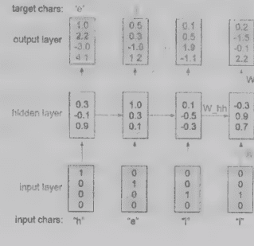

# Python 编程：Python 速成 - 学习机器学习、数据科学分析与人工智能的秘密。深度学习入门指南


## 引言

感谢你下载《Python 编程》，感谢你的支持。

接下来的章节将讨论你开始 Python 编程之前需要的所有知识。在编写程序时，你可能有许多不同的选项供选择，但没有哪一个能带给你通过使用 Python 所将获得的灵活性多功能性和所有优势，而这正是我们在本指南中将讨论的内容。

为了开始本指南，我们将查看几个与 Python 相关的、讨论得越来越热门的话题。我们将花费几章的时间研究人工智能和深度学习，并在开始介绍 Python 语言及其核心内容之前，吸收一些关于机器学习的信息。

在完成这类介绍后，是时候开始深入探索 Python 在机器学习和深度学习领域所能做的所有酷炫功能了。有什么比这更好的方法呢？那自然是查看一些专为该主题设计的 Python 库。我们将花一些时间研究 Scikit-Learn 库以及如何使用该库创建一些神经网络，同样还会研究 TensorFlow 库。

为了完成本指南，我们将花时间查看一些与机器学习相关的不同算法，以及你如何使用 Python 来帮助你编写运行这些算法所需的代码。我们将探索的一些最佳机器学习算法包括 K-Means 聚类、K 近邻算法、决策树、线性分类器等。

机器学习和人工智能正成为行业中的热门词汇，许多人对学习如何将它们用于自己的需求和特定类型的编程非常感兴趣。虽然这是一件好事，但这些人员中的许多人也担心这些主题学习和理解起来太难了。在本指南提供信息的帮助下，即使是初学者，你也能通过 Python 真正处理这一切。当你准备好学习如何进行 Python 编程，以及它如何与机器学习、深度学习和人工智能协作时，请务必查看本指南以帮助你入门！

市上有许多关于这个主题的书，再次感谢你选择这一本！我们已尽努力确保它包含尽可能有用的信息，请尽情享受！

## 第 1 章：什么是深度学习和人工智能

在现代世界中，编码和与计算机交道可能涉及许多不同的领域。许多人觉得，如果他们不会进行复杂的编程，就根本无法进行任何编程。但事实并非如此。你可以进行许多复杂类型的编程，而且它们完成比你想象的要容易得多。在本指南中，我们将花时间讨论其中的许多内容。

在本章的开始，我们将查看深度学习和人工智能。当我们研究本指南中的某些主题时，这两者都是不可或缺的一部分，了解如何让它们运行以及我们能用它们做什么，将对我们的编码以及在此过程中我们能做什么产生影响。关于深度学习和人工智能，我们需要了解的包括以下内容：

### 什么是深度学习

在本章中我们将花费时间的第一个主题是深度学习。深度学习实际上是机器学习的一种（我们将在下一章详细讨论），它负责训练计算机如何执行人类执行的一些生活任务。有很多任务可以属于这一类，但诸如语音识别、识别图片内容和做出预测等都符合这一理念。

深度学习并不是通过组织数据来运行预定义的方程，而是为数据设置一些基础参数，然后训练计算机，通过在许多不同的处理层中观察到的模式，从而实现自主学习。

让我们更深入地探讨一下。深度学习在这里非常重要，因为它是人工智能（或人工智能）的基础，而我们目前看到的对深度学习的兴趣是因为它与人工智能的关系。深度学习及其相关技术已经能够提高机器描述、检测、识别和分类事物的能力，这种能力以前被认为只有人类才能具备。

一个很好的例子是深度学习在我们的世界中已经能够做的所有不同事情。我们可以发现，许多与其相关的算法和技术非常擅长描述它将查看的内容、检测对象、识别使用者的语音模式，同时识别你呈现给它的图像中的内容。有许多技术使用了这一点，例如欺诈检测、面部识别，以及像 Cortana 和 Siri 等系统。

已经有一些开发人员正致力于推进我们对深度学习的认知。其中一些包括：

- 1. 对某些算法的改进已经了我们在深度学习中看到的某些方法。
- 2. 一些较新的深度学习方法确保了模型准确性的完整性。
- 3. 甚至有一些神经网络开发了新的类别，以更好地适应新的应用程序，包括图像分类和文本翻译。
- 4. 从公司可以获得海量的信息比过去多得多。这有助于我们构建具有许多深层的新神经网络，包括流式数据、医生笔记、调查笔录，甚至从社交媒体获取的文本数据。
- 5. 还有分布式云计算和图形处理器单元的一些计算进展，这可以为我们提供确保深度学习算法能够实际运行所需的计算能力。

在这一切发生的同时，我们所习惯的人机界面也发生了很大变化。传统的使用的键盘和鼠标现在正被自然语言、触摸、手势和滑动等取代。这为这一过程中开辟了更多人工智能和深度学习的空间。

这引出了问题：深度学习如何在此过程中为我们提供许多机会和应用。

巨大的力量


为了解决一些深度学习问题，将需要计算能力，这仅仅是因为这些算法中迭代的性质。这导致随着层数的增加，复杂性也随之提高。你，你能够同时处理大量数据，以训练网络并准备就绪。

深度学习方法的动态性质，以及它们对底层信息模式某些变化的不断适应和改进的能力，将为我们提供所需的信息和机会，在分析中引入更多的动态行为。

此外，当深度学习进入分析领域时，我们可以加入许多更多客户所想要的个性化内容。这里的另一个绝佳机会是提高那些神经网络并非全新、而是已经存在较长时间的应用程序性能和准确性。通过一些更好的算法和更强大的计算能力，我们能够获得增加深度的收益。

我们可以关注的下一个重点是利用深度学习帮助业务增长，并同时创建所需的优秀技术的不同方法。对于那些不太熟悉这项技术如何工作的人来说，深度学习可能看起来是计算机科学的研究阶段，你将无法对其进行大量使用。然而，通过许多实际方式将深度学习引入业务是完全可能的，而且你今天可能已经在在使用其中许多项，甚至没有注意到这些技术的存在。

今天深度学习的几种使用方式以及我们如何从中受益将包括：

-   语音识别。我们世界上几乎每个行业都看到了某种形式的语音识别应用。如果你曾向某个设备（包括你的手机）提问以获取答案，那么你就使用过它。其他地方如 Skype、Xbox、Google Now 等也在使用这种技术。引入深度学习部分是因为它可以帮助系统不仅能够识别出有人在对它说话，还能知道人在说什么或在问什么。
-   自然语言处理是另一个深度学习将大显身手的地方。神经网络是深度学习的重要组成部分（我们稍后会详细讨论），它们已经被用于处理甚至分析某些书面文本很久。作为伴随文本挖掘的一项专门化，这种技术可以用于其他地方，以发现新闻报告、医生为日后书写的笔记、某些客户的投诉等地方发现的模式。
-   深度学习也可以用于帮助识别图像。其中更实用的应用之一是自动图像字幕和对正在发生的场景进行描述。这可以用于许多不同的语境。但其中一个将是执法调查的例子，用于识别繁忙区域目击者提交的数千张照片中存在的某些犯罪活动。这只是一个例子。自动驾驶汽车当能够利用全角度的摄像头向正确的方向行驶时，也可以从这种技术中受益。
-   当我们谈论深度学习时，第四种应用（尽管不是最后一个）是推荐系统。有很多不同的公司在使用这种技术，但其工作原理的一些常见例子包括 Netflix 和 Amazon。此点的意义在于根据你过去的行为检查你接下来可能最感兴趣的内容。深度学习将用于增强在更复杂的环境中某些推荐，例如音乐兴趣或你的服装偏好，即使这些偏好跨越多个平台。

利用深度学习你可以做的事情太多了，这种编程的世界在未来注定将继续增长。理解它的本质以及它是如何工作的，将对你随着时间推移所能取得的成功程度产生巨大影响！

### 什么是人工智能

我们将花费时间讨论的下一个主题是人工智能。这是计算机科学的一个领域，它强调我们如何创建智能的机器，即那些能够以类似于人类的方式进行工作和反应的机器。拥有人工智能技术的计算机被设计用于许多不同的活动，这些活动将包括：

1. 规划
2. 解决问题
3. 学习
4. 语音识别

我们在处理人工智能时，可以记住的一点是它是计算机科学的一个分支。在这个特定分支中，我们的目标是创建智能的机器，即那些能够独立学习和思考的机器。事实上，这已经在我们世界中变得如此流行，以至于成为技术行业不可或缺的一部分，我们将看到它比以前任何时候都增长得飞快。

对人工智能有了很多研究，特别是它在过去几年中受欢迎程度的巨大提高。这种研究已经集中并转变为以前所未有的专业化和高技术化。人工智能带来的核心问题是，我们需要为许多不同的特征为计算机编程，并让它以类似于人类的方式行为和思考。

这将是非常复杂的，许多程序员（无论是新手还是高级）都会思考我们应该如何实现这一点。这真的是我们能做到的吗，还是我们只是在浪费时间？你会发现人工智能真的开始席卷世界，不仅因为它是一个奇妙的理论，而且因为它能够做的所有奇妙的事情。

现在，人工智能有很多不同的使用方法。通过此帮助我们训练计算机完成的一些事情将包括：

-   移动和操作任何你想要的对象的物体。
2. 规划
3. 解决问题
4. 推理
5. 学习
6. 感知
7. 知识

在对人工智能的一些研究中，你将看到的核心部分之一是知识。机器可以被训练以表现出人类的行为并给出反应，但只有当计算机能够从教导世界如何运作的大量信息中学习时，这种情况才会发生。这种编程需要大量信息，以及访问所有部分之间的关系、类别、对象和属性，以便能够充分利用并变得更加博学。

如果我们以适当的方式与这项技术合作，这一切所能做到的是令人惊叹的。

我们将在下面的更多信息中探讨这一点，但机器学习也是伴随人工智能的一个重要部分。无监督学习将要求我们教会计算机识别从输入中快速出现的模式，而大量的监督学习意味着计算机能够在数值回归和分类的帮助下进行学习。

然而，这一切意味着什么呢？分类在这里很重要，因为它可以帮助我们确定一个对象所属的类别。而回归将帮助我们处理获取一组数值


作为示例使用的输入或输出，这可以帮助我们发现某些函数，使其能够从我们正在使用的输入中生成合适的输出。

如你所见，涉及到深度学习和人工智能时，有许多不同的组件需要讨论，学习所有内容将花费很长时间。但理解我们在本指南中讨论的一些基础知识，可以帮助我们学习这些技术是如何影响我们的世界的，甚至帮助我们学会如何利用其中的某些技术为自己造福。

## 第 2 章：一览机器学习

我们需要花时间探索的下一个主题是机器学习的概念。这是一种数据分析方法，能够为我们实现分析模型的构建自动化。它将作为人工智能的一个分支存在，因为它基于这样一种理念：系统能够从它接收到的数据中学习，识别出其中的一些不同模式，然后在人类干预极少的情况下做出某些决策。

由于目前可用许多新型计算技术，机器学习在我们的现代世界中发生了巨大的变化。它诞生于模式识别以及一种理论，即计算机能够通过从数据中进行学习，而无需有人介入并对其编程以执行你想要的任务。机器学习中发生的迭代非常重要，因为随着模型接触更多新数据，它们将能够独立地适应。它们将能够从之前的计算中学习，以产生可靠且可重复的决策和结果。

与机器学习工作的系统能够从它经历过的一些之前的计算中学习，以帮助它变得更聪明。这种科学不一定是新的，但它在最近几年获得了巨大的动力。

虽然市面上许多机器学习算法已经存在很长时间了，但自动将某些数学计算应用于大数据、以更快的速度并反复执行的能力，将是一项新进展。机器学习可以带来许多不同的应用，这种技术可能会在短时间内蓬勃发展。你可能听过且现在可能更熟悉的某些最常见的应用包括：

- 1. 通过 Google 推荐系统提供的自动驾驶汽车。
- 2. 我们在 Amazon 等许多购物系统以及你使用的 Netflix 等流媒体服务中看到的在线推荐系统。
- 3. 了解客户在包括 Twitter 在内的各种社交媒体账户上对你的评价。
- 4. 能够检测潜在的欺诈行为。

对机器学习的所有新兴趣将归于某些不同因素，这些因素能够帮助你进行数据挖掘，并使得机器学习以及贝叶斯分析比以前更加流行。诸如可用数据量，以及比以往任何时候都更多、更多的数据。此外，你会发现计算处理和数据存储变得更便宜、更强大且更负担得起，公司想要与机器学习以及人工智能的其他部分进行合作这也并不奇怪。

所有这些内容起初可能意义不大，但它们意味着可以快速自动地生成模型，这些模型能够对更大更复杂的数据进行良好的分析，并交付比以往任何时候都更快、更准确的结果。机器学习可以帮助你在比以往任何时候都大得多的规模上完成这一切。通过建立精确的模型，组织将有更好的机会识别利润丰丰的机会，或避免可能出现的未知风险。

为了让某些机器学习系统工作并确保它们执行你想要的操作，需要具备几种不同的要素。其中一些将包括集成建模（ensemble modeling）、用于完成工作的迭代和自动化流程、基础和更高级的算法、扩展能力，以及准备你想要处理的数据的能力。

在机器学习方面，我们还需要了解其他几点，以帮助我们真正理解它是如何运作的，以及为什么机器学习是我们能够利用的技术中如此重要的一部分。我们应该知道的一些有趣事实包括：

- 1. 当你使用机器学习工作时，目标被称为“标签”（label）。
- 2. 当你观察统计世界时，目标被称为“因变量”（dependent variables）。
- 3. 统计世界中的变量在机器学习中被称为“特征”（feature）。
- 4. 统计学中的转换在你进行机器学习时被称为“特征创建过程”（process of feature creation）。

几乎任何你想要经营的业务都可以利用机器学习，尽管它有时既昂贵又耗时，所以你真的需要审视你拥有的产品和想要获取的信息。


当你处理一些事务数据时。例如，它能够识别出在营销活动中具有共同属性的某些客户群体。或者，它能够查看一些主要属性，这些属性将帮助你将大量的客户群体分成彼此相似或类似的小组。

在使用这种方法时，有许多不同类型的技巧，但大多数程序员会用到的技术包括奇异值分解、k-means 聚类、最近邻映射和自组织映射。这些算法还被用于对推荐项目、文本主题等内容进行细分，并帮助我们看到信息中的一些离群值。

我们将关注的下一种学习类型是半监督学习。这与我们之前讨论过的其他两种略有不同，但查看它仍然很有价值，而且它将使用许多我们在监督学习中看到的类型应用。

然而，这会有所不同，因为这种学习算法能够同时依赖标记数据和未标记数据来帮助训练。通常，这意味着它将使用一小部分已标记的数据，并将其与大量的未标记数据混合。这是因为未标记的数据更容易获取，而且不像其他某些选项那样昂贵。

处理这种学习有几种不同的方法，其中一些选项包括预测、回归和分类。当标记相关的成本高到让你无法进行全标记训练时，你也会使用它。这种机器学习算法的早期示例之一，是它被用于在摄像头上识别某人的脸部。

最后，我们还可以处理一种被称为强化学习的机器学习算法。这种类型通常用于导航、游戏和机器人技术等领域。通过这种学习，算法将通过试错的过程发现哪些动作能为它们提供最大的奖励。

在这种学习中，有三个重要的组件。第一部分是智能体（agent），或决策者和学习者。第二部分是环境（environment），它是智能体能够接触的一切。然后第三部分是动作（actions）。强化学习的目标是智能体在尽可能获得奖励的情况下做出动作。

正如你所看到的，由于 Python 的特性，这使得学习变得更容易。在很多时候，你可能需要处理不同类型的数据，而 Python 能够很好地完成这些工作。这就是 Python 编程语言。

在 Python 中，你可以使用它来解决问题。通过阅读本指南中讨论的各种选项以及我们提供的示例，即使在你开始工作并了解它们的含义之前，你也会发现这些是很容易的。此外，这种语言是易读的（使用英语编写），并且你需要完成的工作将保持在最少。

当我们讨论这些时，你可能会对使用这种语言感到有些担心。也许使用一种为初学者设计的语言来帮助完成机器学习等更复杂的任务看起来可能有些奇怪。但你会发现，这种语言虽然可能比其他某些语言简单，并且是为初学者设计的，但它旨在具有强大的功能。在我们介绍下面一些适用于机器学习和人工智能的库时，Python 仍然是帮助你完成所有想要做的算法和任务的完美语言。

这只是当你决定使用 Python 编程语言时将享到的益处的开始。另一个优点是该语言自带的所有不同库。Python 的基础库将非常简单在使用，并且可以增加你编程所需的功能。这是一个极好的消息，但你还可以进一步，观察添加一些 Python 可用的扩展和其他库将如何增加你的能力。这可以帮助处理


学习、数学方程、科学、工程以及更多 Python 传统库可能无法独立处理的内容。

Python 提供的社区支持也是许多程序员非常喜爱的特点。Python 是世界上最广泛使用的程序之一。由于本章中讨论过的所有优势，世界各地的许多程序员——从入门到高级——都在使用 Python 来处理他们所有的编程需求。这为你提供了一个庞大的社区，其他成员乐意帮助你学习如何使用 Python、回答你的问题以及提供更多帮助。

测试代码非常简单。在你编写代码时，总会有某些时候你需要测试代码并确保它按照你想要的方式运行。Python 让这件工作变得更加容易，即使对于初学者也是如此。你不必用担心搞乱测试，也不因为不知道自己在做什么而决定完全不需要进行测试，Python 的测试更加简单，这让你能够放心地确保在程序完成后，各项功能都是正常运行的。

它与机器学习配合得很好。使用 Python 的首要优势之一就是它与机器学习的完美契合。机器学习有许多不同的部分，通常如果你愿意，也可以选择其他类型的编程语言。但在性能、易用性，以及像 Python 那样专门与机器学习配合得很好的各种库方面，Python 表现卓越。这些都是 Python 在人工智能和机器学习领域表现得如此出色的几个原因之一。

正如你在这里看到的，使用 Python 进行机器学习有许多不同的优势，Python 确实是一门你应该花时间学习和理解的绝佳语言。它简单且功能强大，拥有你在使用编程语言时所寻找的所有扩展和能力，并可以帮助你处理任何想要完成的机器学习算法和任务。这就是为什么我们将在本指南的剩余部分中花费更多时间，探索所有可以让 Python 与机器学习协作的库和方法。

## 第 4 章：Scikit-Learn 库

此外，通过 Python 的帮助我们还可以使用一些不同的库，这些库将确保我们能够在机器学习领域实现自己的意愿。Python 自带的标准库无法处理机器学习所需的全部部函数和算法，而这正是 Python 附带的几个不同库扩展大显身手的地方。我们在指南中将探索的第一个库是 Scikit-Learn。

我们还需要花一些时间学习 Scikit-learn。它通过一致的 Python 接口为你的用户提供许多监督学习和无监督学习算法。我们将在指南的后部分花更多时间来学习 Python，但它是你可以用来增强机器学习能力的极佳工具，而且由于它是面向初学者的，即使是从未接触过编程的人也能使用它。

Scikit-learn 是由 David Cournapeau 在 2007 年作为 Google 代码之夏项目开发的。无论你是出于商业还是学术需要它，这个过程都适用于。

Scikit-learn 一直作为 Python 内部的机器学习库在使用。它带有许多类型的分类、回归和聚类算法，帮助你获得更多结果。你将在该系统中使用的一些算法包括 DBSCAN、k-means、随机森林、支持向量机等。Scikit-learn 的设计使其能够与 Python 代码中的其他一些流行库良好地工作，包括 SciPy 和 Numpy 库。

这个特定的库是开发为完全在 Python 中运行的，但其中一些算法是更多地用 Cython 编写的。这确保了使用这些工具的程序员在过程中能够获得高质量的性能。你会发现这个库具有许多不同的功能和部分，使其非常适合完成某些机器学习任务，并确保你能够运行许多不同的算法。

基于此，现在是时候设置你想要的环境了。由于好消息是，实现这一点的命令已经准备就绪。你只需要进入命令行并输入。


通过这个 Python 库，你将发现当你整体使用这个程序时，即使是一些更复杂的任务也可以变得易于处理。

## 第 5 章：使用 Scikit-Learn 创建神经网络

在下一章开始介绍 TensorFlow 库之前，我们将先稍微绕个路，进一步学习一些你使用 Scikit-Learn 库可以完成的技能。特别是，我们将探索神经网络的世界，以及如何利用这些技术来帮助我们在面对编码任务时真正实现一些惊不起的工作。

首先，你将遇到的神经网络将是无监督机器学习算法样貌的一个绝佳示例。之所以使用这类网络，是因为它们可以发现你所处理的数据中存在的许多不同模式。这可以在许多不同的层面上完成，而且这种处理方式实际上比人工查阅数据要有效得多，也快得多。

当我们观察这些神经网络将如何工作时，算法会搜索每一层，以查看图像中是否存在某种模式。如果网络在通过某一层时发现无法找到新模式，它就会做出预测。但如果它在某一个层上看到了新模式，它将记住这些信息并移动到下一层，查看那里会有哪些模式。取决于图像的复杂程度以及神经网络系统的新颖程度，系统可能需要一些时间和相当多的层数才能做出预测。但随着练习的增加，它在这方面会做得越来越好。

在此时，可能会发生几种情况，这取决于你如何设置这个程序。如果算法能够完成我们上面列出的过程，并成功地筛选了所有不同的层，那么它就能做出某种预测。如果系统做出的预测是正确的，那么系统将记住这些信息，并在未来变得更强大，随着时间的推移做出更准确的预测。

这种方法之所以有效，是因为神经网络使用了我们之前讨论过的人工智能来帮助它学习，并确保对象与它将看到的模式之间存在一种强有且不断增长的关联。系统能够返回并为用户提供正确答案的次数越多，算法就会变得越高效。

对于那些还没有探索过机器学习和人工智能所有功能的人来说，这听起来可能像是在谈论某些不可能的事情。但当我们仔细观察这些神经网络以及它们能够提供的所有内容时，你将能够进一步了解它们的工作原理，并发现它们能够高效做出决策并筛选模式和趋势的想法并不像看起来那样遥不可及。

例如，假设你的目标是编写一个自己的程序，并且你希望这个程序可以查看你添加的一张照片并识别出里面是什么。通过神经网络，你将通过几层不同的（也许是很多层）以及算法已经知道的一些信息，然后它可以告诉你照片里有一辆汽车、一个人或其他其他东西。

如果你能够正确地执行了这些步骤，并且知道算法设置正确，那么神经网络就能做出正确的预测，即照片里已经有一辆汽车。程序将根据它已知的属于汽车的特征（包括车牌、颜色等）得出这种预测。当你在进行某些传统的编码工作时，这几乎是一个几乎无法完成的过程。但通过机器学习，特别是通过神经网络，你会发现这个系统更容易处理，并且可以在短时间内实现目标。

作为程序员，你确实需要做一些工作。你必须为算法提供一系列信息，让它知道该做什么，以及如何做出良好的预测。当一切设置完毕并准备就绪后，你就可以介入，并为你正在使用的系统或机器提供一张汽车的照片。神经网络将花费一些时间，逐层查看照片，然后做出预测。

为了让这个过程运作，神经网络将从第一层开始，这可能是照片的外边缘，或者是内部物体的边缘。然后它将继续沿着这条路径通过图像中存在的所有其他层。当程序运行完成后，它将能够对图像内部的内容做出预测。如果程序能够做出良好的预测，它将保留该信息，如果它再次遇到另一个类似的图像，它会更擅长记住这张图像。

这可能带有许多不同的层，但神经网络发现的层和细节越多，它就能越准确地预测面前的是什么种汽车。如果你的神经网络在识别汽车车型方面非常准确，它将从这次课程中学习。它会记住汽车车型中出现的某些模式和特征，并将它们存储起来供以后之用。下次它们遇到同种汽车车型时，它们就能很快做出预测。


```python
x = F.max_pool2d(F.relu(self.conv1(x)), (2, 2))
### 如果尺寸是正方形，你只需要指定一个单体数字
x = F.max_pool2d(F.relu(self.conv2(x)), 2)
x = x.view(-1, self.num_flat_features(x))
x = F.relu(self.fc1(x))
x = F.relu(self.fc2(x))
x = self.fc3(x)
return x
```

```python
def num_flat_features(self, x):
    size = x.size()[:1] # 除批次维度之外的所有维度
    num_features = 1
    for s in size:
        num_features *= s
    return num_features
```

```python
net = Net()
print(net)
```

这让我们达到了可以遍历代码并定义反向传播和正向函数的阶段。这部分将是共同计算梯度的地方，当你使用 autograd 函数时，它会自动为你定义。从这一点开始，可以引入你为 Tensor 准备的操作，以完成正向函数并准备好使用。

这种方法并不总是你想要使用的机器学习算法，但使用它有很多益处。这里可能会出现的一个大问题是运行该算法的成本将很高。对于某些项目，甚至对于许多小型企业来说，这将会太昂贵，并且消耗过多的计算资源。

## 第 6 章：TensorFlow 库

在掌握了这些信息并对 Scikit-Learn 库的工作原理有了稍许理解后，是时候转向我们在指南中将关注的第二个库了。这个被称为 TensorFlow 库，它在 Python 语言中也能做一些惊不起的事情。因此，让我们花时间探索这个库以及它为我们的机器学习提供的可能。

我们在这里需要查看的另一个名为 TensorFlow 的库。这是来自 Google 的一种框架，在你准备创建一些深度学习模型时就会使用。TensorFlow 将依赖数据流图进行数值计算。它已经让机器学习变得比以往任何时候都要简单。

它让获取数据、训练你想要使用的某些机器学习模型、进行预测，甚至修改你看到的某些未来结果变得更加简单。由于这些在机器学习中都非常重要，因此学习如何使用 TensorFlow 是非常重要的。

这是一个由 Google 的 Brain 团队开发的库，用于在大规模进行机器学习时使用。TensorFlow 将机器学习和深度学习算法及模型结合在一起，通过一个通用的比喻让它们变得更有用。TensorFlow 将使用 Python（正如我们之前说过的那样），并且它为用户提供了一个前端 API，当你想要构建应用程序时可以使用它，而应用程序将由高性能的 C++ 执行。

请记住，TensorFlow 能够帮助你需要完成的许多不同的编程工作。它被用于帮助构建、训练、甚至运行可以使用某些神经网络，特别是那些旨在帮助自然语言处理的（我们稍后将讨论的循环神经网络）以及用于图像识别的网络。

考虑到这一点，是时候不仅查看 TensorFlow 是如何工作的，还要查看我们如何将其下载到我们的系统中了。这个 TensorFlow 库将是本指南中讨论的许多项目的绝佳工具，它带有你所需的帮助用 Go、C++、Java 和 Rust 等语言进行编码的 API。我们将查看在 Windows 计算机上安装此库需要遵循的所有步骤。

你可以在任何你喜欢的操作系统上安装这种库，而且完成整个过程将遵循类似的流程。但目前我们专注于在一种系统上完成，即 Windows 系统，这样我们就可以看到启动此所需的一些基础知识。如果你想在 Windows 计算机上下载此代码库，你可以选择通过 pip 或 Anaconda 扩展来帮助安装。

首先，原生的 pip 将在那里，帮助我们获取 TensorFlow 库并将其安装到你选择的系统上，而无需担心它是否在环境中。这似乎是一个很棒的选择，在很多情况下确实如此，但这里我们需要记住的一点是，使用 pip 安装 TensorFlow 有时会导致其他问题，因为它会干扰你系统中已有且可能使用的 Python 其他部分。

解决其中一些问题的好消息是，你只需要运行一个命令即可让 pip 工作。当你有机会让这个命令运行后，TensorFlow 将被安装，并可以在系统上你所需的任何方式使用。当使用原生 pip 安装此库时，用户此时将获得在你正在使用的 Windows 系统上安装 TensorFlow 的选项。但你可以使用的另一个安装此库的选项（以便配合 Python 和你的其他机器学习算法使用）是使用 Anaconda 软件包。

Pip 是一个在你获取 Python 时自动安装的程序。但 Anaconda 程序不是。这意味着如果你想确保能够通过 Anaconda 程序安装 TensorFlow，你首先需要花时间安装该程序。


基础，你实际上应该在这里停顿一下并查看它。它可以帮助你管理你的环境，并将所有内容都整合在一个地方。

你现在可以回到 Windows 主界面，点击“开始”按钮，然后选择“所有程序”选项卡，在这里我们需要展开信息并找到 Anaconda。你可以点击此项的提示符，它会在你的系统上启动 Anaconda 程序。如果你想查看某个特定包的可用详细信息，只需要运行 `conda info` 命令即可。这是一个简单的代码，但它将让你有机会阅读有关该包以及该包管理器的所有详细信息。

在使用 Anaconda 软件包时，还有其他你可能会发现很有意思的地方，那就是它将帮助你不再依赖 Python 的另一个虚拟环境，而是将通过帮助你创建自己的环境供使用来实现。这个新环境将是 Python 的一个独立小副本，它是隔离的，具有维护其所需所有文件的能力，以及所有的路径和目录。这是一件很棒，因为你可以在某个 Python 版本或你选择的任何其他库中完成你需要的工作，而不会对你在过程中可能尝试的其他某些项目产生负面影响。

你会发现，拥有一个自己的虚拟环境是一件很好的事情，因为它们可以为用户提供一种帮助隔离项目的方法，然后你就可以确保避免在共享环境时可能出现的任何潜在问题。请注意，这种环境将与你使用 Python 的普通环境不同。记住这一点很重要，因为它将帮助你完成工作，而不会在你的其他项目上发生任何负面影响。

此时，我们将工作为 TensorFlow 软件包创建一个虚拟环境。这可以通过 `conda create` 命令的帮助完成。由于我们将创建一个名为 `tensorenvironment` 的环境，你将使用下面的语法：

```
conda create -n tensorenvironment
```

此时，程序将向你询问你是否允许创建环境的过程继续进行，或者你是否想取消正在进行的工作。你需要输入“y”然后按回车键继续。这将允许安装成功继续进行，以看到你想要的结果。

在你查看并创建了这种环境后，你将花一些时间来激活它。如果没有正确的激活，你将无法使用你设置的这个新环境。激活将通过 `activate` 命令完成。然后你将列出你想要工作的环境名称。调用你刚刚创建的环境的示例包括：

`conda activate tensorenvironment`

现在你已经能够激活 TensorFlow 环境了，是时候继续并确保 TensorFlow 的包也将被安装了。你可以通过下面的命令来实现这一点：

```
conda install tensorflow
```

当你到达编码的这部分时，你的计算机将向你展示一个更不同类型的软件包列表，同时也包含了 TensorFlow 所需的包。你将收到一个提示，决定你是一性下载所有，还是每次只下载一小部分。你可以输入 Y 并按下键盘上的回车键让程序继续。

一旦你到达这一步并同意了这一切，安装包将立即开始工作。然而，请注意，执行此安装过程至少需要几分钟，甚至更久，完成所需的时间取决于你电脑的速度以及你的互联网提供商的速度。这至少需要几分钟才能完成，请给它一些时间。

安装过程完成后，你可以继续采取几个步骤来检查安装过程是否成功。这是一个很容易的过程，因为你只需要查看并运行 Python 的导入语句。该语句将在 Python 终端中执行，如果你是使用 Anaconda 自带的提示符进行操作，你只需要输入一个单词 `python` 然后按回车键。这将确保你处于所选的终端中，然后你可以使用下面的代码过程帮助继续：

```
import tensorflow as tf
```

如果你发现包没有以正确的方式安装，在你执行此代码后，屏幕上将会出现一个错误信息。如果你没有看到错误信息，那么你就知道包的安装成功了。

你对这一切有了一个总结。然后算法就可以根据它提供给结果为你做出预测。

每当你决定与这个特定模型工作时，你可能会发现学习效果会很好，因为它变得非常有竞争力。这样做之所以有帮助，是因为算法的不同部分、甚至是不同模型中的不同元素之间会发生一些竞争，以便你根据你拥有的任何数据获得最佳预测。

当你开始研究 KNN 算法时，你会注意到它与本指南中将讨论的其他某些算法相比有点不同。例如，在某些情况下，程序员会将这视为一种“懒惰”的学习方法，因为在实际进行预测之前，它并不会为你创建一个模型。

取决于你尝试用这些信息处理什么样的情况，这有时是一件好事。这被证明是有益的，因为等待做出新预测将帮助你拥有最新的数据，或者说是算法所需要的数据。这确保了你不会获得无效或无用的预测。

如果你让此程序以不同的方式工作，例如定期进行预测，或者每次插入新数据时进行预测，那么如果情况需要，这可能是有用的。但也有时候你只想查看特定的客户组或某些信息，而这种持续的更新对你的需求并不是好处。KNN 算法将确保更新和新预测只在你需要时发生。


计算成本将会要高得多。当你尝试将其与其他一些可以处理相似或相同工作的算法进行比较时，这一点更为明显。成本增加的原因是，该算法将获取所有数据，并尽可能地遍历每一个微点，而不是尝试将它们聚类并发送一个预测结果。

当系统必须实际查看每个点时，在包含数百万个点的大型数据集中，这将消耗大量的精力和时间，这正是额外成本产生的地方。在本节之后，我们将查看 K-Means 聚类，并看看为什么聚类过程有时是一个有益的选择。

尽管如此，KNN 算法仍然是一个非常强大的工具，可以让你在工作中获得巨大的收益，并帮助你真正理清拥有的所有不同数据点和信息，即使数据集非常大且看起来无法处理。

学习我们下面将介绍的步骤，将确保你已经做好准备，可以使用这种机器学习算法进行工作。

### K-最近邻算法是如何工作的

现在我们已经花了几分钟时间讨论了这类算法以及随之而来的一切，是时候查看你需要遵循的一些步骤了，以确保你能以正确的方式使用 KNN 算法。开始使用 KNN 算法的一些最佳步骤包括：

- 1. 将数据加载到算法中进行读取。
- 2. 初始化你将使用并依赖的 k 值。
- 3. 当你准备好获取预测类别时，从 1 到用于训练的数据点总数进行迭代，可以使用以下步骤来帮助：
   a. 首先计算每个测试数据与训练数据中每一行之间的距离。
      我们将使用欧几里得距离（Euclidean distance）作为距离指标，因为它是最流行的方法。你可能选择使用的的其他指标还包括余弦距离（cosine）和切比雪夫距离（Chebyshev）。
   b. 根据距离值将计算出的距离按升序排序。
   c. 从排序后的数组中获取 k 行。
   d. 获取这些行中频率最高的类别。
   e. 返回类别预测。

### K-means 聚类

我们将花费时间查看的下一个算法被称为 k-means 聚类（均值聚类）。这是该主题中许多不同算法中的基本思想，但它是你能操作的最简单、最常见的聚类形式之一。

它也是无监督机器学习的一个很好的示例。当你的数据没有带标签时，大多数情况下都会应用它。使用该算法的目标是确保你可以看到数据内部发现的聚类或分组。

这些聚类的重点在于，位于同一个聚类中的对象与属于同一聚类的其他点密切相关。此外，这些点与你设置的任何其他聚类中的项目没有多少相似性。这里的相似性是用来用于查看数据集中对象之间关系强弱的指标。

你很多时候都会使用这种聚类，但一个例子是在进行数据挖掘过程时，特别是当数据挖掘更具探索性时。它也可以在其他领域发挥作用，包括数据压缩、图像分析、计算机图形、模式识别和机器学习等。

当你使用这种算法时，它将根据数据自带的值帮助你形成所需的一些数据聚类。作为程序员，你的任务就是遍历并指定你希望 k 的值是多少。这意味着你需要确定算法从数据中创建多少个聚类。然后算法将取 K 值并用它来选择你所处理的所有聚类的质心值。

当完成上述步骤后，该是 k-means 算法继续完成另外三个步骤了。这些步骤包括：

- 1. 你将从每个数据实例与所有聚类质心之间的欧几里得距离开始。
- 2. 将数据实例分配到距离最近的质心聚类。
- 3. 根据相应聚类中数据实例坐标的平均值，计算新的质心值。

### 写出 K-means 聚类的公式

所以我们首先需要做的步骤是计算聚类责任度（responsibilities）。我们将使用的公式如下：

```
r(kn) = exp[ -b * d(m(k), x(n)) ] / sum[j=1..K] { exp[ -b * d(m(j), x(n)) ] }
```

从这里，你可以看到 r(k,n) 将以分数的形式呈现，一个 0 到 1 之间的数字，你可以将硬 k-means（hard k-means）或普通 k-means 理解为 r(k,n) 始终完全等于 0 或 1 的情况。d 可以任何有效的距离指标，但欧几里得距离或平方欧几里得距离是最常用的。

然后对于第二步，我们将处理一个与硬 k-means 相似的公式，但我们只是根据我们想要发送的责任度重新计算平均值。我们将为此使用的算法包括：

```
m(k) = sum[n=1..N] { r(k,n)* x(n) ] / sum[n-1..N] {
r(k,n) }
```

所以，当你花时间看上面的算法时，你会发现它类似于加权平均值。这将向你展示，如果 r(k,n)较高，那么平均值对于聚类 k 就越重要。当你看到这一点时，它将显示这对平均值的计算影响最大。但如果当你观察算法时平均值更高，你就知道相反也是正确的。

现在，根据我们已经讨论的一些信息，是时候查看实现以下功能所需的代码了：

```python
import numpy as np
import matplotlib.pyplot as plt

def d(u, v):
    diff = u - v
    return diff.dot(diff)

def cost(X, R, M):
    cost = 0
    for k in range(len(M)):
        for n in range(len(X)):
            cost += R[n,k] * d(M[k], X[n])
    return cost

def plot_k_means(X, K, max_iter=20, beta=1.0):
    N, D = X.shape
    M = np.zeros((K, D))
    R = np.ones((N, K)) / K

    # initialize M to random
    for k in range(K):
        M[k] = X[np.random.choice(N)]

    grid_width = 5
    grid_height = max_iter / grid_width
    random_colors = np.random.random((K, 3))
    plt.figure()

    costs = np.zeros(max_iter)
    for i in range(max_iter):
        # moved the plot inside the for loop
        colors = R.dot(random_colors)
        plt.subplot(grid_width, grid_height, i+1)
        plt.scatter(X[:,0], X[:,1], c=colors)

        # step 1: determine assignments / responsibilities
        # is this inefficient?
        for k in range(K):
            for n in range(N):
                R[n,k] = np.exp(-beta*d(M[k], X[n])) / \
                         np.sum([np.exp(-beta*d(M[j], X[n])) for j in range(K)])

        # step 2: recalculate means
        for k in range(K):
            M[k] = R[:,k].dot(X) / R[:,k].sum()

        costs[i] = cost(X, R, M)
        if i > 0:
            if np.abs(costs[i] - costs[i-1]) < 10e-5:
                break
    plt.show()

def main():
    pass
```


### 假设有3个均值

D = 2 # 这样我们可以更容易可视化
s = 4 # 间距，我们可以控制均值之间的距离

```python
mu1 = np.array([0, 0])
mu2 = np.array([s, s])
mu3 = np.array([0, s])
```

N = 900 # 样本数量
X = np.zeros((N, D))
X[:300, :] = np.random.randn(300, D) + mu1
X[300:600, :] = np.random.randn(300, D) + mu2
X[600:, :] = np.random.randn(300, D) + mu3
```

### 如果不聚类，看起来是什么样的？
plt.scatter(X[:,0], X[:,1])
plt.show()

K = 3 # 幸运的是，我们已经知道了
plot_k_means(X, K)

### K = 5 # 如果我们选择了一个“坏”的 K 会发生什么？
### plot_k_means(X, K, max_iter=30)

### K = 5 # 如果我们改变 beta 会发生什么？

### plot_k_means(X, K, max_iter=30, beta=0.3)

```python
if __name__ == '__main__':
    main()
```

在处理机器学习以及计算机科学中的其他选择时，聚类算法非常有用，而 k-means 聚类是获得这些操作经验的绝佳方法，并能确保一切都匹配并按照你想要运行。务必学习上面的一些公式，以及这些各种算法的优点，以便让你在需要时将它们用于你的计算需求。

## 第 8 章：机器学习中的决策树与随机森林

我们将学习的下一种机器学习算法将包括决策树和随机森林。它们共同工作，因为一组决策树可以组成一个随机森林。当你需要查看哪种决策对你的公司是最优，并且想要比较和对比你能够做出的不同决策时，这些都是极佳的工具。让我们先进一步探索一下决策树到底，然后我们可以深入探讨它们是如何共同工作构成随机森林的。

首先，决策树是一个很好的数据工具，如果你想查看多个选择，并且你知道这些选择是完全不同的，那么它就是非常高效的。你可以收集这两个选择的信息并将其放入决策树中，帮助做出正确的决策，以改进甚至增长你的业务。当不同的选项通过决策树向你展示时，你可以利用它来查看每个决策在未来的潜在结果。这使得做出准确、明明的决策变得容易得多，而且对未来的预测也有帮助。

作为一名程序员，甚至是想要使用这种算法的业务主，在如何处理这些决策树方面有几种选择。许多使用它的人将用它来帮助随机变量或分类变量。但在许多情况下，机器学习会要求你将这些树作为一个分类问题。

为了帮助你双检你所做的任何决策树是否是良好的，你需要能够获取你想要处理的所有数据集，然后能够将它们分成两个（通常是多个）集合，每个集合中都会发现相似的数据。这些可以通过你可以选择的独立变量来帮助进行排序，因为这确保了每个集合都是独特的并与其他集合区分开来。

现在我们已经到了这一部分，这引出了这可能是难以处理的想法。为了确保决策树以你想要的方式运行，或者至少看到它在你尝试使用时的表现，让我们来看一个很好的例子。在这个例子中，我们将有一个包含 60 个人的组。

在这些人中，他们每个人都有三个独立变量。这些变量将包括人的身高、性别以及他们所在的班级。然后，当该查看该组的学生时，你会发现他们的一半也喜欢踢足球。利用上面为你提供的独立变量，你的目标是找出哪部分学生喜欢踢足球，哪些人不喜欢这项运动。

根据你拥有的关于哪类学生最可能喜欢踢足球的信息，你决定是时候创建一个模型来帮助你观察那组 60 个人，并决定其中 30 个人喜欢足球，另外 30 个人将花时间玩耍或做其他事情。

为了让这个模型运行，模型需要能够遍历组中的所有学生，或者你组中的所有人，然后将他们分成两组。你需要一个喜欢踢足球的组，并且……

集合内部的内容将被随机生成，如果你的随机树逻辑认为这是必要的且更符合你的需求，则可以对其进行替换。

- 如果有 $M$ 个输入变量数量，那么 $m<M$ 将从开始被指定，并被作为常数保留。这之所以非常重要，是因为这意味着你拥有的每棵树都是通过 $M$ 从它们各自的变量中随机选取的。

- 你的每棵随机树的目标将是找到对变量 $m$ 最优的分分点。

- 随着树的生长，所有这些树将尽可能地变得越来越大。记住，这些随机树不会进行自我剪枝。

- 从随机树创建的森林是非常强大的，因为它在预测某些结果方面要好得多。它能够为你做到这一点，因为它将取来自你创建的每棵树的所有预测结果，然后对于回归任务选择平均值，或者在分类任务选择共识。

在你决定随机森林是否是适合你的工具之前，记住它们确实存在一些负面影响。例如，它们可以帮助你处理遇到的某些回归问题，但它们无法对你决定添加的任何训练数据之外的数据进行预测，也无法对在你提交信息时所处理的范围进行预测。

这意味着随机森林将帮助你做出一些预测，并且将成为帮助你做出对业务有效之决策的最优部分。虽然它带来了许多益处，但由于其能够预测未来的远远，也会存在一些局限性。这降低了你的准确率。尽管如此，根据你试图学习的内容，你可能会发现该算法仍然是你需求的最佳选择之一。

## 第 9 章：线性分类器及其含义

当你学习监督学习机器学习算法的不同部分时，你可能会发现你需要关注的两个常见任务之一包括使用线性分类器或线性回归来完成工作。线性回归很有用，因为它可以帮助你预测你将获得什么值，而线性分类器则是专注于特定类别的。在本章中，我们将专门查看线性分类器，以及你如何将其应用于你的机器学习中。

你会发现，当你尝试使用在本指南之前讨论过的库来完成机器学习工作时，分类问题将占据你工作的大部分，通常占你需要完成的机器学习任务的 80%。分类旨在预测在给定需要添加的输入集合下，每个类别发生的概率。标签（在这种情况下被称为我们的因变量）将是类别或离散值。

如果因变量（或我们的标签）在处理过程中仅涉及两个类别，那么你就知道你选择的学习算法最终是一个二分类器。但如果你正在处理一个更多类别的分类器，这意味着它能够处理具有两个或更多类别的标签。

让我们来看一个例子。很多时候，我们处理的证明为二分类的分类问题可以帮助你预测客户再次回到业务并进行再次购买的概率。但如果你想与一个对给定图片出现的动物类型进行预测的系统工作，那么你处理的就是所谓的多分类分类问题，因为程序必须处理的动物种类将超过两种。

考虑到这一点，是时候衡量你可以操作的线性分类器的性能了。准确率（Accuracy）是这里最好的入门的话题之一。该分类器的整体性能将通过其准确性来衡量。准确率可以收集你所有正确的值，然后将该数字除以存在的观测值总数。

假设你正在处理的算法或数据中的准确率约为 85%。这对你来说意味着，当你使用该模型时，它将在大约 85% 的时间内为你提供正确的答案。它在 15% 的时间内将是错误的。当然，这里的目标是保持正确的百分比尽可能高。

到此时，你已经可以看到，当你研究该指标时可能会出现一些缺陷，特别是当你处理的类别包含某些不平衡的情况时。当你所工作的所有组中出现的观测值数量不相等时，就会发生平衡不佳的数据集。

为了进一步，假设你正在使用逻辑回归（logistics）处理一个稀有事件的分类问题。你可以想象，你正在使用的分类器将尝试估计在感染某种疾病时有多少患者死亡。在你拥的数据中，约有 5% 感染该疾病的患者将因该疾病去世。

考虑到这些信息，你就可以遍历并训练分类器，以确保它可以对最终发生的死亡人数做出良好的预测，然后你可以利用准确率指标来评估该医院或诊所的性能。现在，如果分类器能够工作并预测整个数据集的死亡人数为 0，那么它将显示该模型在使用时在 95% 的时间里是正确的。

从这里开始，我们需要移动并查看被称为混淆矩阵（confusion matrix）的内容。与准确率相比，这是观察分类器性能的更好方法之一。当你使用这些混淆矩阵之一时，你将获得可视化分类器准确率指标与你选择的预测类别和实际类别对比的处处。二分类混淆矩阵将有一系列方格，你在这种矩阵中看到的部分包括：

- 1. TP：即真阳性（True Positive）。它包含所有被正确预测为实际正类的预测值。

- 2. FP：假阳性（False Positive），或以错误方式预测的。它们通常被预测为正类，但实际上是负类。这意味着负值出现了，但它们被提前预测为正类。

- 3. FN：假阴性（False Negative）。这是你的正值被预测为负值。

- 4. TN：真阴性（True Negative）。这些是以正确方式预测并预测为实际负类的值。

当你查看这些混淆矩阵之一时，你可以清晰地看到实际类别和预测类别，并看到那里发生了什么。

我们在这里关注的重点是精确率（precision）以及该算法有多敏感。你会发现，当你创建自己的混淆矩阵时，会有很多信息出现。它是


这也帮助我们对这里可能出现的任何真阳性或假阳性结果获得一些深刻的见解。但在某些情况下，使用一个比我们目前讨论的更简洁的指标会更好。

为了帮助我们解决这个问题，我们首先需要花些时间来看代码带来的**精确率（Precision）**。这个精确率指标将告诉我们正类中准确的程度。这仅仅意味着它为我们提供一个概念以及一个衡量标准，即正类预测实际上准确的概率。为了帮助你在自己的矩阵中检查这一点，你需要使用以下代码：

Precision = TP/(TP + FP)

在这里你可以得到的最高分是1。这表示分类器完美地正确预测了正值。单看精确率可能没有那么帮助，因为它忽略了负类。这个指标你可能想要与**召回率（Recall）**指标配合使用。召回率也称为敏感性（Sensitivity）或真阳性率（True Positive Rate）。

我们接下来需要看的是敏感性。这种敏感性非常重要，因为它可以帮助我们计算算法能够正确检测出的正类比例。这个指标是建模和观察正类的一种良好方法。计算敏感度的公式是：

Recall = TP/(TP + FN)

### 如何在 TensorFlow 中使用线性分类器

记得我们之前我们讨论过 TensorFlow 以及它随之而来的这一切吗？现在是时候更进一步，看看你实际上如何使用 TensorFlow，以及你如何通过这个 Python 库真正利用机器学习来实现一些了不起的事情。

现在是时候让我们看看通过 TensorFlow 库使用线性分类器可以完成的一些实际工作了。我们将以人口普查数据（census data）为例来说如何操作。执行这些步骤的目的是确保你使用人口普查数据集中的变量，以便我们可以查看已有的参与者，并对他们的收入做出预测。注意，在这个示例中，收入将成为我们的二分类变量。

为了让这个模型生效，当个人的年收入高于 50,000 美时，我们将二分类变量设置为1。但如果某个参与者的年收入低于 50,000 美，那么他们的变量将显示为 0。我们在这里处理的数据集可以分为分类变量，总共八个。这些包括：

- 祖籍国家（Native country）
- 性别（Sex）
- 种族（Race）
- 关系（Relationship）
- 职业（Occupation）
- 婚姻状况（Marital status）
- 教育程度（Education）
- 以及工作地点（place of work）

在此基础上，我们来看六个连续变量。这些包括：

- 每周工时（Hours_week）
- 资本损失（Capital_loss）
- 资本收益（Capital_gain）
- 教育年限（Education_num）
- 最终权重（Fnlwgt）
- 年龄（Age）

利用这些信息，我们可以调用 TensorFlow 扩展来帮助确定哪些客户（或数据集中的任何个人）将符合我们设置的两个分组。这些人将被分为我们之前设置的两个组（尽管你可以根据正在运行的程序类型添加任意数量的组）。在这个例子中，这两个组是根据个人的年收入高于或低于 50,000 美元划分的。

完成后，你就可以查看形成的组，并发现其中的一些背景信息，包括性别、种族、居住地、职业以及更多信息。这是许多企业正在转向并比以往任何时候都更加依赖的工具，因为它帮助他们了解新客户、潜在客户以及回头客，并提高整体的营销效率。

### 判别模型和生成式模型之间有什么区别？

当我们处理线性分类器中找到某些参数时，会出现我们需要处理的两个独立类别或方法，这些方法目前是宽泛的，旨在帮助你确定参数应该设置在哪里。你拥有的选项是生成式模型（Generative model）或判别模型（Discriminative model）。

符合生成式模型的方法被认为是条件密度函数。你将看到的这种算法的两个最大例子是类似于线性判别分析（Linear discriminant analysis）。这类似于朴素贝叶斯分类器（Naïve Bayes Classifier）或高斯条件密度模型。

然后，程序员也有选择去使用所谓的**判别模型（Discriminative model）**。这些模型非常重要，因为它们的设计目标是确保当你进行新的一组训练时，输出结果尽可能高质量。训练中额外的术语可能是必要的，但这会增加整体成本，并可能对你的最终模型执行所谓的“正则化（Regularization）”。好消息是，该模型将为你提供几个选项以便于操作，这些选项包括：

- 1. 逻辑回归（Logistic regression）：在假设观测到的训练集是由依赖于分类器输出的二项模型生成的条件下，这是线性分类器的似然估计。
- 2. 感感知机（Perceptron）：这是你将使用的一种算法，因为它会尝试遍历并修复任何所有的错误。
- 3. 支持向量机（Support vector machine）：这是我们之前讨论过的选项之一。它能够尽可能地极大训练集中样本与决策超平面之间的间隔。

尽管名字如此，LDA（线性判别分析）并不属于判别模型。然而，当你能够将其与某些其他算法（例如主成分分析 PCA）进行比较时，LDA 是意义的。你会发现 LDA 算法属于监督学习，并能够利用标签，但 PCA 是一种无监督学习算法，它刻意忽略了存在的标签。


## 第 10 章：循环神经网络与神经网络有区别吗？

我们之前花了一些时间讨论了神经网络，以及它们如何工作进行预测，以及它们如何随着输入次数的增加而变得越来越强大并从中学习。现在，我们将更进一步，讨论另一个思路相近的话题：循环神经网络（Recurrent Neural Networks）。

当我们研究大脑时，理性能知道当我们思考时，这个过程并不会每隔几秒就从零开始。我们会在过去学到的知识的基础上不断构建。我们会记得小时候学过的东西，甚至是昨天我们经历的一个新过程。而且我们可以将这些信息保留很长时间。我们不需要每天重新学习如何刷牙，只需要记住怎么做，这样我们将来就可以专注于学习新事物了。

这很重要，因为它告诉我们，我们所产生的想法将具有持续性和一致性。

在之前的那些传统的神经网络中，你不会看到这种过程发生，有时这会成为我们需要努力改进的缺点。例如，如果你想对电影中不同时间点发生的事件进行处理和分类，那么我们之前讨论的普通神经网络处理起来就会有些困难。

这里需要记住的一点是，有一种机器学习算法能够处理这种情况，那就是循环神经网络。这些网络内部具有所谓的“循环”（loops），这使得它们学习的信息能够持久化，就像在人类大脑中一样。在这种方法中，循环将获取你所有的信息，并将其从网络的某部分传递到下一个部分。这类似于你拥有多个同一个网络的副本，随着时间的推移，每个消息都会移动到后继者那里。

这种链式的特性非常重要，因为它向我们展示了循环神经网络是如何与序列（sequences）和列表紧密相关的的。它们是神经网络处理数据的自然架构。在机器学习领域，它们会被频繁使用。在过去的几年里，有很多人在研究这些技术，并试图观察使用这类网络能获得多大的成功。

循环神经网络的一个非常明显的局限性是，其 API 会带有许多你必须解决的各种限制。它们只能接受固定大小的向量输入，并且只能产生固定大小的向量输出。这些模型也会执行你想要的映射，但它们只能在固定的计算步骤内完成，而这个步数等于你在模型中看到的层数。

这些循环神经网络之所以有用且在编码时实际上非常令人兴奋，主要原因在于它们允许你作为程序员对**一系列向量**进行操作，而不仅仅是单个向量。这包括在输入和输出中包含这些序列，但通常你会发现它们两处都存在。

| 一对一 | 一对多 | 多对一 | 多对多 | 多对多 |
| :--- | --- | --- | --- | --- |
|  |  |  |  |  |

为了帮助我们理解这些循环神经网络是如何工作的，我们需要查看上面的图表来获取示例。上面的每个矩形都是我们的向量之一，而箭头是告诉我们函数的部分。带有向量的输入是红色的，而我们需要知道的输出向量是蓝色的。你也可以看到存在一些绿色的向量，它们持有所谓的 RNN 状态（state）信息。根据上面的内容，从左图移动到右图，让我们看看每一个是如何工作的，从而更好地理解这些循环神经网络。

1. 第一个是基础处理模式（vanilla mode），即完全不使用 RNN 的模式。它包含固定的输入和固定的输出。这也就是图像分类。
2. 第二部分是序列输出。这对应图像描述（image captioning），它可以接收一张图片并为你提供一个单词组成的句子输出。
3. 序列输入：这是上面的第三张图。它更倾向于情感分析，向我们展示给定的句子并确保其被分类为负面或正面情感。
4. 序列输入和序列输出：你可以在第四个框中找到它，它更接近我们的目标。这类似于机器翻译。当 RNN 能够读取一个英文句子，然后获取该信息并提供一个法语句子的输出时。。
5. 最后，最后一个框是同步的序列输入和输出。这里的视频分类在我们决定的话，可以帮助我们标记视频中出现的每一帧。

注意，在这些每种情况中，我们对必须预先指定的序列长度没有任何限制。这是因为图中用绿色表示的循环变换（recurrent transformation）是固定的，我们可以根据需要或根据项目的需要，对其进行任意次数的应用。

看看 RNN 算法是如何工作的。

现在我们花点时间来看一个示例，这种算法实际上是如何为我们服务的。在这个特定的示例中，我们将以字符级语言（character level language）模式训练该算法。这意味着我们将向 RNN 提供大量的文本，然后要求它给出一个关于该序列中应该出现的下一个字符的概率分布模型。

答案将基于我们看到的之前的字符。这是一个非常值得尝试的项目，因为它向我们展示了 RNN 算法如何为我们生成新文本，尽管它是一次一个字符地在寻找文本的。

所以，在我们的程序中，我们将假设资源非常有限，只有四个可能的字母可以处理。仅凭这些有限的信息，我们希望能够训练我们的 RNN 执行序列，以便它能为我们列出“hello”这个单词。这个训练序列将包含四个训练示例以查看结果。刚开始时这听起来很复杂，但我们可以一步来，帮助自己更好地理解它的工作原理，并让字母在正确的时间和顺序上出现。为了实现这一点，我们可以采取的一些措施包括：

- 获取“e”的概率应该与获取字母“h”一样可能。
- 在“he”的上下文中，“l”应该是可能的。
- 如果系统被给定“hel”的上下文，“ll”也应该是可能的。
- 如果其他序列已经发生且处于“hell”的上下文中，“o”应该是可能的。


基于这个想法，我们将花一点时间对在使用 1-of-k 编码处理向量时，可能出现的所有字符进行编码。然后，我们能够使用正确的函数，逐个将这些字符输入到我们正在研究的 RNN 算法中。

当所有部分都就绪后，我们将能够观察到一组四维输出向量，其中每一个维度都对应一个字符。我们可以根据这些维度，解释 RNN 当前对时间下一个序列中出现的每个字符所分配的置信度。下面这张图表将有助于我们理解这种机制是如何运作的。



通过此，我们可以来看一个例子：在第一个时间步中，RNN 会看到字符 'h'——它能够为该字符分配 1.0 的置信度；下一个字母变为 'h' 时分配了 2.2；获取字母 'e' 分配了 -3.0；'l' 分配了 4.1；'o' 分配了。由于我们使用的训练数据（即上面讨论过的字符串 "hello"）的下一个正确字符是 'e'，我们希望增加它的置信度（即绿色部分），并降低它对所有其他字母的置信度（即上方显示的红色部分）。

除了这些步骤之外，我们还可以更进一步，为我们的四个时间步中的每一个步都确定所需的目标字符，我们希望网络以很大的置信度分配到这些字符。这可能需要更多的时间来完成，但它非常有帮助，因为它能帮助你确保对算法的置信度尽可能高，以确保单词在正确的时间出现正确的字母。

由于我们处理的是这类算法，而且它被设置为包含可微的操作，我们将能够使用所谓的“反向传播算法”。该算法将包含递归应用链式法则，这是你可能在微积分中学习过的。我们还可以利用这个规则来帮助我们确定想要从哪个方向来调整涉及的各种权重。这确保了我们能够增加正确目标的分数，在上面的例子中，这些就是**加粗的绿色数字**。

在你完成这一步后，就是时候进行参数更新了。这种参数更新将帮助我们对所有权重进行微调，方向任何对你最有效即可。如果我们能够再次检查输入到算法中的数据在每次参数更新后是否保持一致，我们会发现正确字符的分数会更高（在此情况下于 2.2 到 2.4 之间），而我们不希望显示的错误字符分数将会下降。

由于我们在这里处理的是一个完整的单词，可能需要重复这个过程多次，而且通常是很多次，才能使其正常工作。你需要执行多少次通常取决于系统的复杂度。我们现在只用一个单词，所以保持得相当简单，但如果你尝试处理整个段落、整页，甚至更长的文档，我们必须经历这个过程的次数就会增加。

由于机器学习是一种需要随时间学习的编程技术，你可能需要通过循环来帮助它学习。请确保你重复这个过程，直到这个 RNN 收敛，并且预测结果与训练数据保持一致。当这种情况发生时，每当你决定运行此程序，正确的字符都会以相同且正确的顺序被预测。

我们也可以从更具技术性的角度进行解释。当我们使用标准的 Softmax 分类器（这有时被称为同时对每个输出向量计算交叉熵损失）时，就可以做到这一点。你可以使用小批量随机梯度下降（minibatch Stochastic Gradient Descent）来训练 RNN，你可能会发现使用 Adam 或 RMSProp 可以确保更新尽可能稳定。

当你完成所有这些时，你应该注意到，第一次输入字符“l”时，目标是“l”，但第二次输入的目标将是“o”。RNN 将不能仅仅依靠输入本身，它需要引入一些循环连接（recurrent connection）来帮助跟踪完成此任务所需的上下文。

当你进入测试阶段时，你可以将正确的字符输入 RNN 算法。一旦输入，你应该能够看到系统将要输出下一个字符的分布，并查看是否得到了你想要的答案。然后我们可以从给定的分布中进行采样，并将其全部反馈，看看下一个将得到什么字母。你可以不断重复这个过程，直到按照正确的顺序获得一切，你会发现你正在采样文本。

正如你可以想象的，这里存在一个困境：你如何向公司的其他人员展示你正在做什么，以及模型是如何运作的，以便他们能够……

## 第 11 章：用 Python 还能做什么？


理解这些可能是一项挑战。而且你目前进行的工作可能还没有进展多远，那么你该如何展示所有的这些信息呢？

取决于你所关注的问题类型，你可能会有数百万个不同的数据点需要处理，在模型的早期阶段，很容易理解你为何会被这些信息淹没，但你仍然可以采取一些步骤来让每个人满意，并展示你将如何使用模型，即便是对于那些可能无法理解所有技术细节、但需要知道信息发生了什么的人也是如此。但这一切是如何实现的呢？

我们将使用朴素贝叶斯（Naïve Bayes）算法，这是一种你可以使用的算法，它确保程序人员能够留在模型的早期阶段，在展示你当时所需的任何所有信息的同时，保持一个易于理解的模型。

让我们通过苹果的例子来观察它是如何工作的。当你拿起一个被认为是平均水平的苹果时，你可以很容易地说出它具有一些区分特征。这可能包括苹果是红色的、是圆形的、而且直径大约三英寸。虽然这些特征有时可以在其他类型的水果中找到，但当所有这些特征同时出现时，我们就知道手中的水果是一个苹果。这是一种基本的思维方式，但它是使用朴素贝叶斯的一个例子。

朴素贝叶斯模型旨在让你易于构建，它有时被用于帮助你以简化的方式处理非常大的的数据集。使用这种模型的优势之一是，尽管它很简单，但与你可以使用的其他更复杂的模型相比，它有时更好用。

随着你学习更多关于如何使用这种算法，你会开始发现有越来越多的理由去使用它。这个模型非常易于使用，特别是如果你是深度学习和机器学习世界的初学者。你还会发现，当需要对我们的数据集以及它们最终属于哪一类进行某些预测时，它是非常有效的。这让你在整个过程中更容易地保持一切尽可能简单。尽管朴素贝叶斯算法非常易于操作，但你会发现它的表现其实非常好。事实上，与现有的一些高级算法以及一些看起来更复杂的算法相比，这一个的表现将是最好的。

虽然我们花了一些时间讨论了朴素贝叶斯算法带来的不同优势，但也有一些我们需要留注意的负面因素。这些负面因素中的第一个是，当你使用这种会处理分类变量的算法时，你必须确保测试的任何数据都没有经过一组数据的训练。该算法在它所做的某些预测以及其中的准确性方面也会遇到困难。朴素贝叶斯主要依赖概率而非准确性，因此在处理这些数据时请记住这一点。

你可以采取几个步骤来帮助应对这个问题，并确保事情按照你意愿的方式进行，有时知道如何处理这些步骤会令人困惑，许多初学者并不喜欢这样做。

当然，即使有这些负面因素，当你进行某些机器学习工作时，朴素贝叶斯仍然是一个很好的选择。但它并不能在你每次开始编程时提供你所需的一切。对于那些想要将他们的信息以简化的方式设置、易于阅读且不需要你添加许多复杂代码（至少目前尚且）的编码人员来说，朴素贝叶斯模型就是适合你的。

### 与回归算法工作

我们在这里将要关注的第二个 Python 机器学习算法被称为回归分析（regression analysis）。当你想要查看代码中的两个变量——预测变量和因变量之间是否存在任何关系以及什么种类型的关系时，这种算法将为你提供帮助。

当你想要确保在变量的预测部分或时间序列建模中是否存在因果关系时，这种技术通常效果良好。程序人员想要使用回归算法的原因是，它可以获取你拥有的信息，然后将其拟合到一条简单的曲线上，而且通常尽可能地拟合。可能会有一些点离这条线非常远，但这条线或曲线的设计是为了尽可能处理大多数数据点。

你会发现，回归算法现在被许多公司使用，因为它对于添加任何所需信息、然后对其进行排序并查看其中包含什么非常有帮助。例如，你可以添加有关当前经济的信息，甚至是过去经济的信息，然后这种算法将给出一个输出，作为对未来事物将如何呈现的预测。不过，你必须确保提供给算法的信息是最新的且准确的，否则这种预测将完全不准确。

许多程序人员会喜欢使用回归算法的一点是，你可以向其中添加所需的任何类型的信息。你可以添加信息帮助你了解对利润的某些预测，帮助你看到它对公司可能发生的销售增长所做出的任何估计。如果加入了正确的信息，它甚至可以用来告诉我们更多关于经济的情况、市场表现如何，以及未来可能如何表现。

让我们先来看看这是如何实现的。在这个例子中，如果你选择使用回归算法，然后发现公司的增长速度与其他行业相似，甚至与同一行业内的其他公司相似，那么你就可以利用这些信息，根据你计划做出的决策，对你未来可能表现如何做出一些良好的预测。

当你审视回归算法的想法时，你会注意到，根据你的最终目标以及你希望算法在完成后向你展示什么信息，不止一种回归算法是你可以关注的。你在进行机器学习时可以尝试的不同类型的回归算法包括：

- 线性回归（Linear regression）
- 多项式回归（Polynomial regression）
- 逻辑回归（Logistic regression）
- 岭回归（Ridge regression）
- 逐步回归（Stepwise regression）

正如你所看到的，使用回归算法会有一些不同的优势。首先，你会发现这些算法让使用信息的任何人都能轻松地看到因变量和自变量之间是否存在关系（如果有的话）。这种算法还可以显示，当你尝试添加新变量或更改数据集中另一种类型的变量时，会产生什么样的影响。

尽管这种方法有几个优点，但在处理回归算法时也有一些需要注意的地方。你很快发现的最大的缺点是你


你无法使用这种算法来为任何出现的分类问题提供帮助。分类问题和回归算法并不总是能协同工作的原因是因为这种特定的算法试图对数据进行多次过拟合。因此，如果你尝试在这里添加不同的约束条件，你会发现整个过程很快就会变得枯燥。

### 聚类算法

在我们之前讨论 k-means 聚类算法时，我们已经花了一些时间了解了所谓的聚类算法。但现在，我们将更深入地探讨这些聚类算法能够做什么，以及为什么在进行机器学习时，全面学习它们是如此重要的。

当我们把注意力放在聚类算法上时，必须确保这些算法保持简单，而不是增加很多复杂性。这种方法旨在处理你所工作的所有数据，然后创建一些聚类，将数据点聚集在一起。在你启动依赖聚类的算法之前，你将能够通过选择你感兴趣的聚类数量来受益。这取决于你处理的数据量大小，以及你计划在算法完成后发现什么。

假设你正在开展一个项目，起初你想将客户分为男性和女性。这种程序只需要两个类来对人们进行分类。但如果你想更多地了解客户的不同年龄组，那么分为五个或六类可能会更有用。在你实现了你想要使用的聚类数量后，程序能够添加这些聚类，并将所有数据点拟合到其中。

你会喜欢这种算法的一个点是，它能够在处理过程中为你完成大部分你需要的工作。这是因为它会根据你提供的关于想要使用多少个聚类的信息，然后根据它们的拟合程度将所有数据点添加到各个聚类中。这将确保信息是易于阅读且有组织的，你将对通过这种算法所能获得的洞察感到惊讶。

在信息被分类到各个聚类之后，你可能会查看它们，并注意到内部出现了许多不同的点。可以假设，落入某个特定聚类中的点越多，你的目标市场符合该组的可能性就越大。记住，拟合在一个聚类中的点彼此是相似的，而与出现在其他某些聚类中的数据点并不相似。

一旦你形成了一些原始聚类，就可以取一个单独的聚类对其进行划分，以获得更多组聚类，如果这符合你从该算法中获得目标的话。你可以根据需要反复执行此操作，在处理每个聚类时创建许多划分。事实上，你可以反复执行这些步骤很多次，以至于在工作时不再看到变化。

现在，程序员有很多理由在进行机器学习工作时想要使用这类聚类算法。首先，当你使用聚类算法来帮助你的计算工作时，完成工作要容易得多且更具成本效益，特别是当我们考虑其他可以实现同样事情的选项——监督学习选项时。如果你计划处理一些分类问题，那么这些类型的算法就是完成所有工作的工具。

考虑到这一点，重要的是记住，每当你进行机器学习时，聚类算法并不总是是正确的选择。这种算法不会向你展示预测结果，或准确地告诉你该做什么。你可以观察聚类并分析出一些趋势并做出决策，但你必须是那个制定行动方案的人。

### 什么是马尔可夫算法？

你可以使用的另一种类型的无监督机器学习算法是马尔可夫算法（Markov algorithm）。这种特定的算法将采用你决定输入的数据，然后如果你选择，它将将其翻译以帮助在另一种编程语言中工作。

这里的好处是，你可以预先选择想要在该算法中使用的规则，这样算法就会按照你想要的方式运行。机器学习中的许多程序员发现，这种算法以及他们可以提前设置规则的特性非常棒，因为它允许你获取一段数据，并在工作中学习和确定数据行为参数的过程中，确保它尽可能有用。

你可能喜欢的马尔可夫算法的另一点是，你可以以多种方式与其工作，而不是局限于一种方法。这里可以考虑的选项是，这种算法非常适用于 DNA 等。例如，你可以获取某人的 DNA 序列，然后使用这种算法将该序列内部的信息翻译成一些数值。

这通常可以让程序员、医生和科学家等人更容易了解存在哪些信息，并对未来做出更好的预测。当你与程序员和计算机打交道时，你会发现数值数据比查看 DNA 的其他选项要容易处理得多。

你需要使用马尔可夫算法的一个很好的原因是，它非常擅长处理这类问题：即当你已经知道想要使用的输入，但不确定参数时的学习问题。这种算法能够发现信息中蕴含的洞察。在某些情况下，这些洞察是隐藏的，这使得我们讨论过的其他算法难以发现它们。

虽然处理马尔可夫算法有很多益处，但重要的是，对于一些初学者来说，这有时可能很困难，因为他们必须手动通过创建一个新规则。这发生在他们想要向工作中添加一种新的编程语言时。如果你计划在此过程中只使用 Python，你只需要创建一次规则，这并不是什么大问题。但如果你计划同时在机器学习中处理好几种编程语言，那么这可能会变成一件非常麻烦的事。

### Q-learning

我们还没有太多机会讨论你所使用的任何强化学习类型的机器学习。这种机器学习与我们看到的其他类型略有不同，在于它主要依赖于“真假”类的学习，而不是通过示例教它或让它通过无监督学习来学习。这可以让你更容易训练程序如何以你喜欢的方式反应，并确保你能够看到不同类型的机器学习是如何工作的。


考虑你想要使用的动作值（阅读它们并看看它们是否对你正在编写的代码真正有用，现在是时候创建你自己的最优策略了）。为了构建这种策略，最好的方法之一是使用你认为对你的程序具有最高价值的动作，无论你希望在这里处于什么种状态下工作。

就像我们在本指南中讨论的其他任何算法一样，使用这种算法也会带来一些好处。其中一个优点是，你不需要担心花费所有时间或费尽精力来建立环境模型以便系统对其进行比较。你甚至可以选择同时比较几个不同的动作，甚至是许多个动作。

如你所见，在人工智能和机器学习领域，你可以使用许多不同类型的算法，而 Python 以及其随附的许多不同库和扩展都能帮助你完成这些工作。无论你是想处理有监督机器学习、无监督机器学习还是强化学习，你一定能找到与你所选项目和意图相匹配的结果。

本指南花费了一些时间来探索这些不同的部分，并确保我们知道如何让它们运行。有了所有选项，我们真的可以看到机器学习将如何蓬勃发展，并以前未有的方式帮助我们成长和改变技术。想象一下在使用 Python 进行机器学习时，那些尚未被发现、我们尚未完成的所有酷事吧。

## 结论

感谢你读到《Python编程》的最后，希望它能为你提供丰富的信息，并为你提供实现目标所需的所有工具，无论你的目标是什么。

下一步是看一看本指南中讨论过的一些不同主题。当你想要执行机器学习和人工智能等各种任务时，有大量信息需要处理和学习，同时你又希望能够以 Python 编码语言带来的轻松和强大来工作。

本指南花费了一些时间来探索由此可能出现的许多不同主题。它的目的是帮助我们理解如何使用 Python，Python 提供了哪些可用功能，以及更多内容。有了该语言随附的许多优秀库和其他扩展及功能，难怪在 Python 的帮助下，你可以做这么多事情来创建你自己的机器学习算法。

从事机器学习是现在许多不同公司都想要关注的重点。他们喜欢这种想法：让系统在他们不在时进行学习；他们喜欢提供比以前更好的客户服务；他们也喜欢这种编程将带来的所有大门和机会。当他们能够提供所有这一切，并在 Python 的帮助下学会如何完成所有不同部分时，这会变得简单得多。

最后，如果你觉得这本书在任何方面都有帮助，我们非常感谢你在亚马逊上给出评价！

## 描述

你是否对扩展编程技能以包含人工智能和机器学习感兴趣，但又担心这会太难？你过去是否使用过 Python 语言并发现自己喜欢这种编码语言，但并没有认为它实际上能做一些更高级的东西？你是否有兴趣学习如何将这两个想法结合起来，以便短时间内编写出强大强大的代码？

本指南将花费一些时间讨论 Python 编程，以及你如何使用它来处理如人工智能、机器学习和深度学习等主题。我们将探索如何下载所需的各种库，如何设置所需的不同学习算法，以及更多内容。

本指南中我们将讨论的帮助你开始进行 Python 机器学习编码的某些不同主题包括：

- 什么是深度学习和人工智能
- 什么是机器学习以及它是如何带我们走向未来的。
- 关于 Python 编码语言的所有知识，以及一些帮助我们进行机器学习的最佳且最常用的库。
- 你需要的所有机器学习算法，包括决策树、线性分类器、神经网络等。

当你准备好将你的编码推向未来并学习更多关于机器学习、人工智能和 Python 编码语言的知识时，查看本指南并学习如何开始！点击“立即购买”开始吧！


