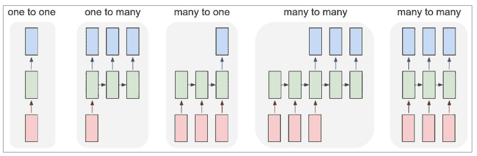
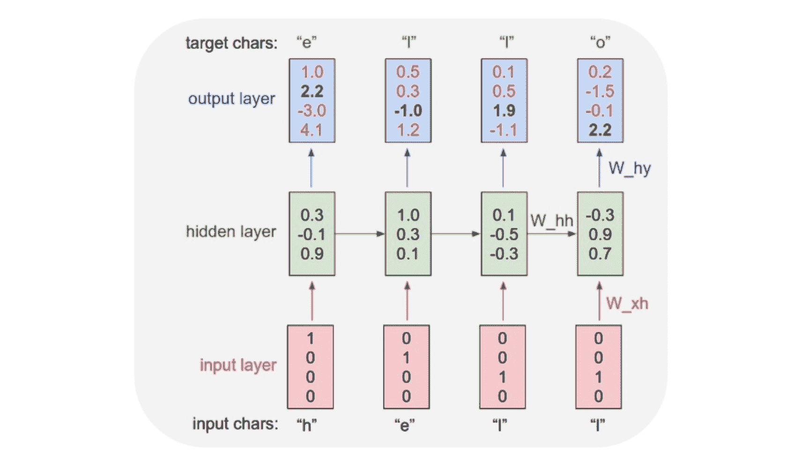

# Python 编程：Python 崩溃课程——学习机器学习、数据科学分析和人工智能的秘密。初学者深度学习入门指南


## 简介

恭喜你下载了《Python 编程》，感谢你的选择。接下来的章节将讨论你开始 Python 编程所需了解的一切。在编写程序时，你可能有很多不同的选择，但没有哪一种能像 Python 这样为你提供如此多样性和所有优势，而这正是我们在本指南中将要讨论的内容。要开始本指南，我们将先看看几个与 Python 越来越密切相关的话题。我们将花几章时间探讨人工智能和深度学习，以及在开始学习 Python 语言及其相关内容之前，先了解一些机器学习的信息。经过这种介绍之后，是时候深入了解 Python 在机器学习和深度学习方面能做的所有酷事了，而比查看一些专为该主题设计的 Python 库更好的方法又是什么呢？我们将花些时间了解 Scikit-Learn 库、如何使用该库创建一些神经网络，以及 TensorFlow 库。为了结束本指南，我们将花时间了解一些与机器学习协同工作的不同算法，以及如何使用 Python 来帮助你编写使这些算法运行所需的代码。我们将要探索的一些最佳机器学习算法将包括 K 均值聚类、K 近邻、决策树、线性分类器等。机器学习和人工智能正在成为行业中的热门词汇，许多人有兴趣学习如何为自己的需求和自己的编程类型使用它们。虽然这是一件好事，但这些人中的许多人担心这些话题太难学习和理解。借助本指南中的信息，即使作为初学者，你也能在 Python 的帮助下真正掌握所有这些内容。当你准备好学习如何进行 Python 编程，以及它如何与机器学习、深度学习和人工智能协同工作时，请务必查看本指南以帮助你入门！

市面上有很多关于这个主题的书籍，再次感谢你选择了这一本！我们已尽全力确保本书包含尽可能多的有用信息，祝你阅读愉快！

## 第 1 章：什么是深度学习和人工智能

在我们现代世界中，编程和使用计算机涉及许多不同的部分。许多人觉得，如果他们不懂如何进行复杂的编程，那么他们就根本无法编程。但这并不正确。你可以进行许多复杂的编程类型，而且它们比你想象的更容易完成。在本指南中，我们将花些时间讨论其中的许多内容。在本章开始时，我们将先了解深度学习和人工智能。这两者在我们探讨本指南中的一些话题时都将是不可或缺的部分，了解如何使它们发挥作用以及我们能用它们做什么，将对我们的编程以及在过程中能做的事情产生影响。关于深度学习和人工智能，我们需要知道的一些事情包括以下内容：

### 什么是深度学习

本章我们将花些时间讨论的第一个主题是深度学习。深度学习实际上是一种机器学习（我们将在下一章中详细讨论），它将负责训练我们的计算机来执行人类所做的一些生活任务。有各种任务可以归入此类别，但诸如语音识别、识别图片内容以及做出预测等事情都符合这一理念。深度学习不是将数据组织起来以运行已经定义的方程，而是将为数据所需的一些基本参数设置好，然后训练计算机通过许多不同层的处理来看到模式，从而自行学习。让我们深入了解一下。

深度学习在这里很重要，因为它将是人工智能（AI）的基础，而我们目前对深度学习的兴趣是由于它与 AI 的关系。深度学习及其带来的一些技术已经能够提高机器描述、检测、识别和分类事物的能力，这种能力以前被认为只适用于人类。一个很好的例子是深度学习在我们世界中已经能够做的所有不同的事情。我们可以发现，许多与之协同工作的算法和技术在描述它将要浏览的内容、检测对象、识别使用者的语音模式以及识别你呈现给它的图片中的内容方面表现出色。许多技术都使用了这一点，例如欺诈检测、人脸识别，以及 Cortana 和 Siri 等系统。已经有一些发展正在致力于推进我们在深度学习中看到的内容。其中一些将包括：

1. 对一些算法所做的改进已经能够提升我们在深度学习中看到的一些方法。
2. 有一些较新的深度学习方法，确保了模型的准确性将保持不变。
3. 甚至有一些神经网络具有新的类别，这些类别专为某些新应用而开发，包括图像分类和文本翻译。
4. 来自公司的大量信息可供使用，远比过去多得多。这有助于我们构建具有许多深层的新神经网络，包括流数据、医生笔记、调查记录，甚至你可以从社交媒体获得的一些文本数据。
5. 还有分布式云计算和图形处理单元的一些计算进步，可以为我们提供确保深度学习算法实际上可以运行所需的所有计算能力。


## 深度学习与人工智能概述

## 深度学习的发展与应用

与此同时，我们习惯看到的人机交互界面也在发生很大变化。传统使用的键盘和鼠标正在被自然语言、触摸、手势和滑动等方式所取代。这为更多的人工智能和深度学习应用打开了大门。这也引发了一个问题：深度学习如何在过程中为我们提供大量的机会和应用。

为了解决一些深度学习问题，需要大量的计算能力，这仅仅是因为这些算法中迭代的性质。随着层数的增加，复杂性也随之上升。同时，你还需要能够同时处理大量数据，以便训练网络并使其准备就绪。深度学习方法的动态性质，以及它们始终适应和改进底层信息模式变化的能力，将为我们提供所需的信息和机会，将更多所需的动态行为引入分析中。此外，当分析与深度学习结合时，我们可以添加更多客户想要的个性化内容。

另一个绝佳的机会是提高那些神经网络并非全新，而是已经存在较长时间的应用程序的性能和准确性。通过一些更好的算法和更强大的计算能力，我们能够获得增加更多深度的好处。

接下来，我们可以关注如何利用深度学习帮助业务增长，并同时创造所需的伟大技术。对于不太熟悉这项技术如何运作的人来说，可能会觉得深度学习只是计算机科学的研究阶段，并且无法大量使用。然而，可以以许多实用的方式将深度学习引入企业，而且你可能今天已经在使用其中相当多的技术，甚至没有注意到那里存在的技术。

以下是深度学习今天被使用的一些不同方式，以及我们如何从中受益：

### 语音识别

我们世界中几乎每个行业在语音识别方面都看到了某种用途。如果你曾经向设备（包括你的手机）提问以获取答案，那么你就使用过这项技术。Skype、Xbox、Google Now 等其他地方也在使用它。引入深度学习部分是因为它帮助系统不仅能识别有人在与它交谈，还能知道那个人在说什么或在问什么。

### 自然语言处理

自然语言处理是深度学习将要发挥作用的另一个地方。神经网络将是深度学习的一个重要组成部分，我们将在后面更详细地讨论，它们长期以来一直被用来处理甚至分析一些书面文本。这是一种与文本挖掘相关的专业技术，这种技术可以用于其他地方，以发现出现在新闻报道、医生为以后写下的笔记、客户的投诉等地方的模式。

### 图像识别

深度学习还可以用于帮助识别图像。其中一个更实际的应用是自动图像字幕和场景描述。这可以在许多不同的上下文中使用。其中一个例子是执法调查，以识别繁忙区域的旁观者提交的成千上万张照片中存在的某些犯罪活动。这只是一个例子。自动驾驶汽车可以从这种技术中受益，当它能够使用其全方位的摄像头朝正确方向行驶时。

### 推荐系统

当我们讨论深度学习时，虽然不是最后一个，但第四个应用程序将是推荐系统。有很多不同的公司正在使用它，但常见的例子包括 Netflix 和 Amazon。其目的是根据你过去的行为，检查你接下来可能最感兴趣的内容。深度学习将被用来增强在更复杂的环境中发生的某些推荐，例如音乐兴趣或你的服装偏好，即使它们跨越多个平台。

你可以用深度学习做很多事情，这种编程的世界注定会在未来继续增长。了解它是什么以及它如何工作，将在你随时间推移使用它时，对你将看到的成功量产生巨大影响！

## 人工智能概述

接下来我们将花一些时间讨论的人工智能主题。这是计算机科学的一个领域，将强调我们如何创建智能机器，这些机器能够以类似于人类的方式工作和反应。拥有人工智能技术的计算机被设计用于许多不同的活动，这些活动将包括：

1. 规划
2. 问题解决
3. 学习
4. 语音识别

在使用人工智能时，我们要记住的一件事是，它是计算机科学的一个分支。在这个特定的分支中，我们将旨在创建智能机器，这些机器能够自主学习和思考。事实上，这在我们的世界中已经变得如此普遍，以至于它是技术行业的一个基本组成部分，我们将看到它比以往任何时候都更快地增长和发展。

对人工智能进行了大量研究，尤其是在过去几年中它的受欢迎程度大幅上升。这种研究已经集中并转化为比以往任何时候都更加专业化和高度技术化的东西。人工智能带来的核心问题是，我们需要能够为计算机编程许多不同的特征，并使其表现和思考的方式几乎与人类相同，但更快、更高效。这将很复杂，许多程序员，无论是新手还是高级程序员，都会想知道我们如何才能实现这一点。这真的是我们能够专注和去做的事情吗，还是我们只是在浪费时间？

你会发现，人工智能之所以真正开始席卷全球，并不是因为它只是一个酷理论，而是因为它在过程中能够做的所有酷事情。目前，人工智能可以以许多不同的方式使用。借助这项技术，我们已经能够训练计算机做的一些事情将包括以下内容：

1. 移动和操纵你想要的任何对象的能力。
2. 规划
3. 问题解决
4. 推理
5. 学习
6. 感知
7. 知识


## AI 的核心部分之一

在你将看到的一些 AI 研究中，知识是其中一个核心部分。机器能够被训练来表现出类似人类的行为和反应，但只有当计算机能够从大量教导其世界运作方式的信息中学习时，这种情况才会发生。这种编程需要大量信息，以及对所有部分之间的关系、类别、对象和属性的访问，以便它能够将这些信息用好并变得更加博学。如果我们能以正确的方式与技术合作，这一切能够做到的事情真是令人惊叹。当程序或机器能够实施我们所讨论的一些人工智能时，它将能够启动诸如常识之类的事情，可以开始进行推理和解决问题，并且可以在瞬间处理那些非常困难且有点乏味的任务。我们将在下面更详细地探讨这一点，但机器学习也是随 AI 而来的重要部分。无监督学习将要求我们教会计算机如何识别随输入快速出现的模式，而大量监督学习意味着计算机或机器将能够借助数值回归和分类来学习。但这一切意味着什么呢？分类在这里将很重要，因为它将帮助我们确定某个对象将属于哪个类别。然后回归将帮助我们处理获取一组数值输入或输出以用作示例，这随后帮助我们发现函数，从而能够从我们使用的输入生成合适的输出。正如你所见，在深度学习和人工智能方面有许多不同的组件需要讨论，学习所有这些将需要很长时间。但理解本指南中讨论的一些基础知识可以帮助我们了解这些技术如何影响我们的世界，甚至如何利用其中一些技术为我们自身谋利。

## 第 2 章：机器学习概览

我们接下来需要花些时间探讨的主题是机器学习的概念。这将是一种数据分析方法，它将为我们自动化分析模型构建。它将作为人工智能的一个分支而存在，因为它基于这样一个理念：系统能够从接收到的数据中学习，识别其中的一些不同模式，然后在人类极少干预的情况下做出一些决策。由于现有的许多新计算技术，机器学习在我们的现代世界中发生了很大变化。它诞生于模式识别以及计算机能够在无需有人来为其编程以执行你希望的任务的情况下学习的理论。机器学习中发生的迭代非常重要，因为随着模型接触更多新数据，它们将能够独立适应。它们将能够从之前的计算中学习，以产生可靠且可重复的决策和结果。将与机器学习协同工作的系统能够从它经历过的一些之前的计算中学习，以帮助其变得更聪明。这是一种科学，不一定新，但近年来将获得很大的动力。虽然许多机器学习算法已经存在了很长时间，但能够以更快的速度、一次又一次地自动将某些数学计算应用于大数据的能力，是较新的发展。机器学习有许多不同的应用，这种技术很可能很快就会大放异彩。你可能听说过且目前比较熟悉的一些最常见的应用将包括：

1. 通过 Google 提供的自动驾驶汽车。
2. 我们从许多购物系统（如 Amazon）以及你使用的一些流媒体服务（如 Netflix）中看到的在线推荐系统。
3. 了解客户在包括 Twitter 在内的各种社交媒体账户上对你说了什么。
4. 能够检测可能存在的欺诈行为。

对机器学习的所有新兴趣将归因于一些不同的因素，这些因素能够帮助你进行数据挖掘，并使贝叶斯分析比以前更加流行。诸如可用数据的数量，以及前所未有的多样性等因素。再加上计算处理和数据存储变得更加便宜、强大且负担得起，难怪公司希望能够与机器学习以及人工智能带来的其他部分合作。所有这些事情起初可能意义不大，但这意味着可以快速且自动地生成模型，这些模型能够对更大、更复杂的数据进行良好的分析，并交付比以往任何时候都更快、更准确的结果。机器学习可以帮助你在比以往更大的规模上完成所有这些工作。通过构建精确的模型，组织将更有机会识别一些更有利可图的机会，或避免可能出现的未知风险。要使用一些机器学习系统，需要具备一些不同的东西，以确保它们能够按你的意愿运行。其中一些将包括集成建模、迭代和自动化流程以完成工作、基础和更高级的算法、可扩展性以及准备你想要使用的数据的能力。在机器学习方面，还有几件其他事情我们需要知道，以帮助我们真正理解这将如何运作，以及为什么机器学习是我们能够合作的如此伟大的技术部分。我们应该了解的一些有趣事实包括：

1. 当你使用机器学习时，目标将被称为标签。
2. 当你查看统计学领域时，目标将被称为因变量。
3. 统计学中的一个变量将被称为机器学习中的特征。
4. 统计学中的转换将被称为机器学习中的特征创建过程。


# 机器学习概述

几乎任何类型的业务都可以利用机器学习，尽管它有时既昂贵又耗时，因此你需要仔细审视现有产品和想要处理的信息，以确定这是否是真正能帮助你的正确选择。对于竞争激烈的行业或拥有大量数据的大型公司来说，这可能是最佳的数据分析和学习方案。随着你对机器学习及其所能提供的内容探索得越深入，你可能会惊讶于有多少不同类型的公司和行业将依赖于机器学习所带来的理念和不同算法。

考虑到这一点，我们需要了解在机器学习中流行的几种不同方法。最常用的两种方法是监督机器学习和非监督机器学习。但还有几种其他机器学习方法可供你使用。让我们探讨一下这些方法的异同、它们在机器学习中能做什么，以及为什么它们如此重要。

## 监督机器学习

我们要探讨的第一种机器学习算法是监督机器学习。这类算法将在带有标签的示例帮助下进行训练，例如当输入已知所需输出时。例如，你可能有一台设备，其中一些数据点被标记为 F（失败）或 R（运行）。学习算法将能够接收一组输入及其正确的输出。算法将能够介入，通过将实际输出与正确输出进行比较来找出可能存在的错误。随后，它将能够相应地修改所使用的不同模型。通过包括梯度增强预测、回归和分类在内的方法，这种学习算法将利用一些模式来预测额外未标记数据上的标签值。

监督学习将在许多场景中使用，这些场景将使用历史数据来预测未来事件发生的可能性。例如，它将预测金融机构中信用卡交易最可能发生欺诈的时间，或保险客户最可能提交索赔的时间。

## 非监督机器学习

接下来我们需要了解的学习类型是非监督学习。这是一种用于处理一组没有历史标签的数据的学习类型。系统将获得数据，但在过程中不会被告知正确答案。算法需要能够根据所见内容找出信息是什么以及存在哪些趋势。其目标是让算法探索数据，然后发现其中的结构。这种算法在处理事务数据时通常效果很好。例如，它能够识别出具有共同属性的客户细分群体，用于营销活动。或者，它能够查看一些主要属性，帮助将大量客户群分成相互相似或相近的组。

我们能够使用这种方法的技术有很多种，但大多数程序员将使用的技术包括奇异值分解、k-means 聚类、最近邻映射和自组织映射。这些算法也将用于细分推荐项目、文本主题等，并可以帮助我们发现信息中的一些异常值。

## 半监督机器学习

接下来我们要关注的是半监督学习。这与我们之前讨论的两种方法略有不同，但仍然值得探索，并且将使用许多与监督学习中看到的相同类型的应用程序。然而，这将略有不同，因为这种学习算法将能够依赖于标记和未标记的数据来帮助训练。通常，这意味着它将使用少量标记的数据，并与大量完全未标记的数据混合。这是因为未标记的数据更容易获得，且不如其他一些选项昂贵。

你可以使用这种学习的几种不同方式，其中一些选项将包括预测、回归和分类。当你发现与标记相关的成本过高，无法进行完全标记的训练时，这也是你将要使用的方法。这种机器学习算法的早期示例之一是用于识别某人在网络摄像头上的面孔。

## 强化学习

最后，我们还可以使用一种称为强化学习的机器学习算法。这种算法通常用于导航、游戏和机器人等领域。在这种学习中，算法将通过试错过程发现哪些动作能为其提供最大奖励。在这种学习中，有三个重要组成部分。第一部分是代理，即决策者和学习者。第二部分是环境，即代理能够与之交互的一切。第三部分是动作，即代理能够做的一切。

这一切的目标是让代理选择能够在给定时间内尽可能最大化预期奖励的动作。当代理能够遵循良好的策略时，它将更快地实现目标。因此，强化学习的主要目标是学习需要遵循的最佳策略。

如你所见，你能够使用的不同类型的机器学习各不相同，它们旨在处理机器学习及你将长期使用的数据分析中的许多不同部分。你需要弄清楚自己正在处理什么样的数据，以及想要解决什么样的项目，然后才能确定需要使用哪些算法。

在机器学习方面，你能够做的事情有很多。已经有许多不同的技术将依赖于机器学习及其带来的不同算法。例如，如果你曾经使用过手机上的语音识别设备，或使用过搜索引擎，那么你也已经使用了机器学习。这些只是你在机器学习技术方面能够做到的一些示例。关于机器学习已经有很多示例，我们可能甚至没有意识到这项技术在周围世界中被使用了多少。加上我们未来能够使用许多新事物，还有许多尚未构思的应用和用途，我们与人工智能和机器学习的未来将不断增长。

机器学习蕴含着巨大的潜力，你会发现它可以应用于你想要用特定程序进行的几乎任何类型的人工智能和高级学习过程。学习如何使用机器学习及其所有内容，可以使这项工作变得更容易一些。


## 第 3 章：Python 入门

现在我们已经花了一些时间来了解深度学习和人工智能的概念，以及越来越流行的机器学习，是时候来看看在使用 `Python` 时我们需要知道的一些事情了。虽然如果你想进行人工智能和机器学习，有很多不同的选择，但没有哪一种能像 `Python` 那样提供强大的功能、易用性以及丰富的特性和库。你有很多理由想要使用 `Python` 来帮助你完成一些机器学习算法，以及在过程中想要实现的一些深度学习。它可能是一门以初学者为设计对象的编程语言，但它带来了很多好处，并且能够处理你在机器学习中进行的许多强大而复杂的事情。虽然我们将花一些时间来了解 `Python` 提供的不同库及其工作原理，以及它们如何处理我们之前讨论过的一些其他主题，但我们需要先从 `Python` 的一些基础知识开始讨论，了解选择这种编程语言而非其他语言的一些好处，以及这种语言在机器学习方面能做什么。首先，让我们来看看 `Python` 是什么。这是一种面向对象的编程语言，专为初学者设计。在过去，许多其他编程语言可以做很多非常了不起的事情，但它们通常很难学习，你需要花费大量时间去摸索。这些往往会让想要学习的人望而却步，因为它们太难了，而且有太多东西会变动，对刚开始学习的人来说可能毫无意义。使用 `Python`，情况有所不同。这有几个原因，但其中一个原因是对象基于现实生活中的事物，并允许用户知道它们在哪里，并且始终将它们保持在同一位置。这总体上让生活变得更容易，并避免了大量信息在过程中移动或丢失。除此之外，这种编程语言易于阅读，使用英语编写，你需要完成的工作将减少到最少。没有不必要的额外行，即使你阅读本指南中讨论的一些不同选项以及我们提供的一些示例，你也会发现它们很容易阅读，即使在你开始之前，甚至在你了解它们含义之前也是如此。不过，在谈论这些时，你可能对使用这种语言感到有点紧张。也许你觉得有点奇怪，需要使用一种为初学者设计的语言来帮助完成机器学习和更复杂的任务。但你会发现，这种语言，即使可能比其他一些语言更容易，并且专为初学者设计，也旨在具有强大的功能。当我们浏览下面一些与机器学习和人工智能配合良好的库时，`Python` 仍然是帮助你完成所有想要进行的算法和任务的完美语言。这只是当你决定使用 `Python` 编程语言时将享受的一些好处的开始。另一个好处是这种语言附带的许多不同的库。`Python` 的基础库使用起来相当简单，可以为你的编码添加许多所需的功能。这是个好消息，但你可以更进一步，看看添加一些与 `Python` 一起提供的扩展和其他库将如何增加你的能力。这可以帮助处理机器学习、数学方程、科学、工程等方面，这些可能是 `Python` 传统库单独无法处理的。`Python` 提供的社区支持也是许多程序员喜欢的东西。`Python` 是世界上使用最广泛的程序之一。由于本章讨论的所有好处，世界各地的许多程序员，无论是初学者还是更高级的用户，都在使用 `Python` 来处理他们的所有编程需求。这为你提供了一个由其他有兴趣帮助你学习如何使用 `Python`、回答你的问题等等的个人组成的优秀社区。测试代码很容易。在处理代码时，总会有些时候你需要能够测试你的代码并确保它按你想要的方式工作。而 `Python` 使得即使作为初学者也能更容易地完成这项工作。与其担心在测试中搞砸，或者决定根本不需要进行测试因为你不知道自己在做什么，不如说 `Python` 测试更容易，让你安心，知道程序完成后一切都会正常工作。它与机器学习配合良好。使用 `Python` 带来的最大好处是它与机器学习配合良好。机器学习有很多不同的部分，通常你可以选择使用另一种编程语言。但在功能和易用性方面，以及专门与机器学习配合良好的不同库方面，没有哪种语言能像 `Python` 那样。这些只是 `Python` 将与人工智能和机器学习配合良好的几个原因。正如你在这里看到的，使用 `Python` 进行机器学习有很多好处，`Python` 确实可能是一门你应该花时间学习和理解的优秀语言。它简单而强大，拥有你在处理编程语言时所寻找的所有扩展和功能，并可以帮助你处理任何你想要完成的机器学习算法和任务。这就是为什么我们将在本指南的其余部分花更多时间来探索所有你可以用来让 `Python` 与机器学习协同工作的库和方法。


## 第 4 章：Scikit-Learn 库

还有几个不同的库，我们可以借助 Python 使用它们，以确保我们能够在机器学习领域实现想要的功能。Python 自带的标准库无法处理机器学习所需的所有功能和算法，但这时，随 Python 提供的几个不同的库扩展就能派上用场。本指南中我们将首先探索的库是 Scikit-Learn。我们也需要花些时间了解 Scikit-learn。它将通过一致的 Python 接口，为用户提供多种监督学习和非监督学习算法。我们将在本指南的后面章节花更多时间学习 Python，但它是一个极佳的工具，能够帮助你增强机器学习能力，而且由于它面向初学者，即使是从未编写过代码的人也能使用它。Scikit-learn 由 David Cournapeau 于 2007 年作为 Google Summer of Code 项目开发而成。无论你是商业用途还是学术用途，这个过程都非常适合使用。Scikit-learn 已作为 Python 内的机器学习库广泛使用。它包含多种分类、回归和聚类算法，帮助你获得更多结果。你可以使用的部分算法包括 DBSCAN、k-means、随机森林、支持向量机和梯度提升等。Scikit-learn 的设计初衷是能够与 Python 代码中其他流行的库（包括 SciPy 和 NumPy 库）良好协作。这个特定的库完全使用 Python 开发，而其中一些算法则更多地使用 Cython 编写。这确保了使用该库的程序员在过程中能够获得高质量的性能。你会发现，这个库拥有许多不同的功能和部分，非常适合完成机器学习任务，并能确保你能够运行许多想要的算法。

## 设置环境

考虑到这一点，现在是我们花点时间专注于如何设置想要使用的环境的时候了。你需要经历几个步骤，才能弄清楚如何将这个库安装到你的电脑上并准备就绪。幸运的是，这个库非常容易使用，你很快就能让它运行起来，拥有你在编写所选代码时想要的所有功能。首先，请记住，Scikit-Learn 在较新版本的 Python 上效果最好。它不支持任何低于 Python 2.7 的版本，因此如果你使用的是旧版本，需要升级才能使用这个特定的库。不过，在决定安装这个库之前，你还需要再次检查系统中是否存在另外两个库：NumPy 和 SciPy 库。这两个库是让 Scikit-Learn 库正常运行的基础。它们包含编译器中你需要关注的一些函数、变量和其他部分，可以让你更轻松地完成想要的工作。如果没有这些库，就很难从这个 Python 库中获得所需的功能。如果你已经使用过机器学习的其他部分，那么这些库很可能已经在你的系统中，你可以直接开始。如果这是你第一次接触 Python 或机器学习，那么添加这些库来开始工作。如果这些库不存在，那么首先需要安装它们，因为它们是 Scikit-Learn 的基础，然后再添加这个库。

## 安装库

所有这些重要库的安装都可以借助 pip 完成。pip 是一种随 Python 提供的工具，这意味着如果你已经在系统上安装了 Python，或者安装完成后，你就会获得 pip。从此，你可以使用以下命令来准备好 scikit-learn：

```
pip install scikit-learn
```

之后，安装将能够运行，并在完成后结束。你也可以使用 conda 选项来安装这个库。你想要使用的命令是：

```
conda install scikit-learn
```

## 导入库

一旦你注意到 scikit-learn 的安装完成，就可以进行导入操作，将其加载到 Python 程序中。这一步是使用随附算法所必需的。好消息是，实现此操作的命令非常简单。你只需去命令行并输入 `import sklearn`。如果你的命令能够读取你上面写的内容，并且没有出现错误消息，那么你就知道安装总体上已经成功，可以随心所欲地开始使用这个库了。花些时间探索它提供的功能，熟悉环境及其工作原理。现在不用太担心你不了解如何使用整个库，也不了解所有代码应该如何编写。这些内容将在稍后介绍。我们将花几章时间来了解你可以使用这个 Python 库完成的所有不同机器学习算法，你会发现，即使是一些更复杂的任务，在使用这个程序时也会变得容易处理。


## 第 5 章：使用 Scikit-Learn 创建神经网络

在我们开始介绍下一章的 TensorFlow 库之前，我们将稍作绕道，进一步了解 Scikit-Learn 库能做的一些事情。特别是，我们将探索神经网络的世界，以及如何利用它们来帮助我们用即将到来的代码做一些惊人的事情。

首先，你将遇到的神经网络将是无监督机器学习算法的一个绝佳示例。使用这类网络是因为它们可以发现你所处理的数据中存在的许多不同模式。这可以在许多不同的层面上完成，而且比人工查看数据更有效、速度更快。

当我们研究这些神经网络的工作原理时，算法会搜索每一层，以查看图像中是否存在某种模式。如果网络在遍历某一层时发现无法找到新模式，它将进行预测。但如果它在该层级中发现新模式，它会记住这些信息并进入下一层，查看那里会有哪些模式。取决于图像的复杂程度和神经网络系统的新旧，系统能够做出预测之前可能需要一些时间和相当多的层级。但随着练习的增多，它会越来越擅长做这件事。

此时，可能会发生几种事情，这取决于你如何设置程序。如果算法能够完成我们上面列出的过程，并成功地筛选完所有不同的层级，那么它就能做出某种预测。如果系统做出的预测是正确的，那么系统会记住这些信息，并在未来变得更强大，随着时间的推移做出更好的预测。

之所以这样做有效，是因为神经网络使用了我们之前讨论过的人工智能，来帮助它学习，并确保对象与它将看到的模式之间存在强大且不断增长的关联。系统能够多次向用户提供正确答案，算法就会变得越来越高效。

对于那些尚未探索机器学习和人工智能所能做的一切的人来说，这可能听起来像是在谈论不可能的事情。但当我们仔细观察这些神经网络及其所能提供的一切时，你将能够更多地了解它们的工作原理，并发现它们能够高效地做出决策并筛选模式和趋势的想法，并不像看起来那么不切实际。

例如，假设你的目标是创建自己的程序，并希望该程序查看你添加的图片并找出图片中是什么。通过神经网络，你可以遍历几个不同的层级，也许是许多层级，以及算法已经知道的一些信息，然后它可以告诉你图片中有一辆车、一个人或其他东西。

如果你能够正确地完成步骤并且知道算法设置正确，那么神经网络将能够做出正确的预测，即图片中已经有一辆车。程序将基于它知道属于汽车的特征（包括车牌、颜色等）得出这种预测。

当你进行传统的编码时，这将是一种几乎无法处理的过程。但使用机器学习，尤其是神经网络，你会发现这个系统更容易处理，并且可以在短时间内实现。

作为程序员，你确实需要做一些工作。你必须为算法提供一系列信息，让它知道该做什么以及如何做出良好的预测。当一切准备就绪后，你就会介入，为你使用的系统或机器提供一张汽车图片。神经网络将花费一些时间，逐层查看图片，然后再做出预测。

为了使这个过程有效，神经网络将从第一层开始，这可能是图片或其中物体的外部边缘。然后它将继续沿着这条路径，遍历图片中存在的所有其他层级。当程序完成时，它将能够对图片中的内容做出预测。

如果程序能够做出良好的预测，它将保留这些信息，并且如果再次遇到类似的图片，它会更擅长记住该图片。这个过程可能伴随着许多不同的层级，但神经网络能找到的层级和细节越多，它就能越准确地预测面前是什么样的汽车。

如果你的神经网络在识别汽车型号方面准确，它将从这个教训中学习。它会记住汽车型号中出现的一些模式和特征，并将其存储以供以后使用。下次遇到同一种汽车型号时，它们将能够相当快速地做出预测。

在使用此算法时，当你想要浏览大量图片并找出其中的一些定义特征时，你通常会选择一种并使用它。例如，在使用人脸识别软件时，这种东西经常被大量使用。使用这种方法，所有信息都不会事先可用。你可以使用这种方法来教计算机如何识别正确的人脸。

当你希望它识别不同的动物、定义汽车型号等时，这也是一种非常有效的方法。使用这种机器学习模型有很多优势。其中一个优势是，你可以在不控制算法统计数据的情况下使用这种方法。即使你没有可用的统计数据，或者不知道如何使用它们，你也会发现神经网络可以用来确保任何存在的复杂关系都会显现出来。这在独立变量和因变量之间都成立，即使这些变量是非线性的。

考虑到这一点，我们需要花点时间看看创建这种算法所需的一些代码。我们可以用来创建自己的神经网络的代码包括：


```python
import torch
import torch.nn as nn
import torch.nn.functional as F

class Net(nn.Module):
    def __init__(self):
        super(Net, self).__init__()
        # 1 input image channel, 6 output channels, 3x3 square convolution
        # kernel
        self.conv1 = nn.Conv2d(1, 6, 3)
        self.conv2 = nn.Conv2d(6, 16, 3)
        # an affine operation: y = Wx + b
        self.fc1 = nn.Linear(16 * 6 * 6, 120) # 6*6 from image dimension
        self.fc2 = nn.Linear(120, 84)
        self.fc3 = nn.Linear(84, 10)

    def forward(self, x):
        # Max pooling over a (2, 2) window
        x = F.max_pool2d(F.relu(self.conv1(x)), (2, 2))
        # If the size is a square you can only specify a single number
        x = F.max_pool2d(F.relu(self.conv2(x)), 2)
        x = x.view(-1, self.num_flat_features(x))
        x = F.relu(self.fc1(x))
        x = F.relu(self.fc2(x))
        x = self.fc3(x)
        return x

    def num_flat_features(self, x):
        size = x.size()[1:] # all dimensions except the batch dimension
        num_features = 1
        for s in size:
            num_features *= s
        return num_features

net = Net()
print(net)
```

这使我们能够深入代码，定义前向传播函数和反向传播函数。在这一部分，当你使用 autograd 功能时，梯度的计算将会自动为你定义。从这一点开始，你可以使用 Tensor 的相关操作来完成并准备好前向传播函数。这种方法并不总是你想要使用的机器学习算法，但使用它有很多好处。其中一个较大的问题是，运行该算法的成本会很高。对于某些项目，甚至许多小型企业来说，这可能过于昂贵，并且消耗过多的计算能力才能完成。


## 第 6 章：TensorFlow 库

有了这些信息，并且对 Scikit-Learn 库的工作原理有了更好的了解之后，是时候转向本指南中将要关注的第二个库了。这个库被称为 TensorFlow 库，它同样可以在 Python 语言中实现一些惊人的功能。那么，让我们花些时间来探索这个库，以及它在机器学习方面能为我们提供什么。

这里还需要了解的另一件事是被称为 TensorFlow 的库。这是一个来自 Google 的框架，当你准备创建深度学习模型时会用到它。这个 TensorFlow 将依赖于用于数值计算的数据流图。它能够让机器学习变得前所未有的简单。它使得获取数据、训练想要使用的机器学习模型、进行预测，甚至修改看到的未来结果等过程变得更加容易。由于所有这些在机器学习中都很重要，因此学习如何使用 TensorFlow 至关重要。

这是一个由 Google 的 Brain 团队开发的库，用于大规模进行机器学习。TensorFlow 将机器学习和深度学习算法与模型结合起来，并通过一个共同的隐喻使它们更加有用。TensorFlow 将使用 Python，正如我们之前所说，它为用户提供了一个前端 API，可用于构建应用程序，而应用程序将在高性能 C++ 中执行。请记住，TensorFlow 能够帮助你完成许多不同的编程任务。它用于帮助构建、训练甚至运行一些可用的神经网络，特别是那些旨在帮助自然语言处理、我们稍后将讨论的循环神经网络以及图像识别的网络。

有了这个想法，是时候不仅了解 TensorFlow 的工作原理，还要了解如何将其下载到我们的系统上了。这个 TensorFlow 库将是本指南中讨论的许多项目的一个很好的选择，它附带了你需要的 API，以帮助使用 Go、C++、Java 和 Rust 等语言进行编码。我们将查看在 Windows 计算机上安装此库所需遵循的所有步骤。可以在任何你喜欢的操作系统上安装这种库，并且遵循类似的过程来完成所有操作。但我们现在将专注于在一个系统上完成，即 Windows 系统，以便我们可以了解启动所需的一些基础知识。

## 在 Windows 上安装 TensorFlow

如果你想在 Windows 计算机上下载这个编码库，你可以选择借助 `pip` 或 Anaconda 扩展来安装它。首先，原生的 `pip` 将可用于帮助我们获取 TensorFlow 库，然后将其安装在你选择的系统上，而不必担心它是否在某个环境中。这似乎是一个很棒的选择，在许多情况下确实如此，但我们需要记住的一件事是，使用 `pip` 安装 TensorFlow 有时会引起其他问题，因为它会干扰系统上你拥有并可能正在使用的 Python 的其他部分。

解决其中一些问题的好消息是，要让 `pip` 工作，你只需要运行一条命令。在你有机会让这条命令工作后，TensorFlow 将被安装，并可以在系统上以任何你喜欢的方式使用。当使用原生 `pip` 安装此库时，用户将在此时间获得选项，可以从当前系统上可用的任何目录运行程序。

你也可以选择借助 Anaconda 扩展来安装 TensorFlow 库。为此，你首先需要确保已经创建了自己的虚拟环境。但是，当你浏览 Anaconda 附带的一些步骤时，你可能会发现它仍然建议随附某种 `pip install`，而不是使用 `conda install`。这通常是因为它更简单，并且可以更快地完成工作。

在我们介绍完成此操作所需的一些代码之前，以及在安装完成之前，我们需要仔细检查将与之配合使用的 Python 版本。最好是使用不低于 Python 3.5 的版本。这个版本将拥有 Python 的所有最新功能，并且总体上是最容易使用的。你还可以在此过程中使用 `pip 3 install` 的好处。

另一个需要考虑的是，这个库有两个不同的版本可供使用。它们的代码几乎相同，但取决于你想要哪个版本。你可以根据自己的偏好选择使用 CPU 版本或 GPU 版本。用于下载 TensorFlow CPU 版本以在 Windows 上使用的代码包括：

```
pip3 install – upgrade tensorflow
```

如果你想确保安装的是 TensorFlow 程序的 GPU 版本，你需要使用以下命令来实现：

```
pip3 install – upgrade tensorflow-gpu
```

这将确保你能够在使用的 Windows 系统上安装 TensorFlow。但你可以用来安装此库以便与 Python 和所有其他机器学习算法一起使用的另一个选项，包括借助 Anaconda 包来安装它。`Pip` 是一个在你将 Python 安装到系统上时会自动安装的程序。但 Anaconda 程序不是。这意味着，如果你想确保 TensorFlow 能够使用 Anaconda 程序安装，你首先需要花时间安装这个程序。为此，请访问 Anaconda 的网站，从网站下载它，然后从同一网站找到安装说明。

完成这部分并在系统上安装 Anaconda 程序后，你应该会注意到有一个随附的新包，称为 `conda`。这是一个你将经常使用的好包，你实际上应该在此处停留一会儿，浏览一下它。它可以帮助你在一个地方管理环境等。

现在你可以转到 Windows 的主屏幕，单击“开始”按钮，然后选择“所有程序”选项卡，我们需要展开信息并查看 Anaconda。你可以单击此提示以在系统上启动 Anaconda 程序。如果你想查看特定包的可用详细信息，你只需运行命令“`conda info`”。这是一个简单的代码，但会让你有机会阅读有关该包及其管理器的所有详细信息。

在使用 Anaconda 包时，你可能会发现另一件有趣的事情，那就是它将帮助你不依赖于 Python 的另一个虚拟环境，而是会经历帮助你创建自己的环境的过程。这个新环境将像是 Python 的一个独立副本，具有维护其所需的所有文件以及所有路径和目录的所有功能。这是一件好事，因为你可以在一个 Python 版本或任何你选择的其他库中完成所需的工作，而不会对你可能正在尝试进行的其他项目产生负面影响。你会发现拥有自己的虚拟环境是一件好事，因为它们可以为用户提供一种帮助隔离项目的方法，然后你可以确保避免共享环境时可能出现的任何潜在问题。

请注意，这是一个与你将与 Python 一起使用的正常环境不同的环境。这一点很重要，因为它将帮助你完成工作，而不会在其他项目中发生任何负面情况。

## 创建和激活虚拟环境

此时，我们将为 TensorFlow 包创建一个虚拟环境。这可以借助 `conda create` 命令完成。由于我们将创建一个名为 `tensorenviron` 的环境，你将使用以下语法：

```
conda create -n tensorenviron
```

此时，程序将询问你是否允许创建环境的过程继续，或者是否要取消你正在进行的工作。你将要输入“`y`”然后按回车键继续。这将允许安装成功继续，以查看你想要的结果。

在创建了这种环境之后，你需要花些时间来激活它。如果没有正确的激活，你将无法使用设置的这个新环境。激活将借助 `activate` 命令完成。然后你将列出要使用的环境名称。打开刚刚创建的环境的示例包括：

```
Activate tensorenviron
```

现在你已经能够激活 TensorFlow 环境，是时候继续并确保 TensorFlow 包也将被安装了。你可以通过使用以下命令来做到这一点：

```
Conda install tensorflow
```

当你到达代码的这一部分时，你的计算机将能够向你展示一个更长的列表，列出你可以安装的所有不同类型的包，并且它还附带了 TensorFlow 所需的包。你将收到提示，决定是一次性全部下载，还是一次只下载一小部分。然后你可以输入 `Y` 并按键盘上的回车键，让程序继续。一旦你到达这一点并同意所有这些内容，安装包将立即开始工作。但是，请注意，进行此安装的过程至少需要几分钟，甚至更长时间，完成所需的时间将取决于你的计算机和互联网服务提供商的速度。这可能至少需要几分钟才能完成，所以请给它一些时间。

## 验证安装

安装过程完成后，你可以继续采取几个步骤来检查安装过程是否成功。这是一个容易完成的过程，因为你只需要运行 Python 的导入语句。该语句将从 Python 终端执行，如果你使用的是随附的 Anaconda 提示符，那么你只需要输入一个词，即‘`python`’然后按回车键。这将确保你处于所选终端，然后你可以使用以下代码继续：

```
Import tensorlow as tf
```

如果你发现包没有以正确的方式安装，那么在运行此代码后，你将在屏幕上看到一条错误消息。如果你没有看到错误消息，那么你知道包的安装是成功的。


## 第 7 章：K 近邻算法与 K 均值聚类

在本章中，我们将花一些时间来了解两种不同的算法，你可以使用它们来借助 Python 机器学习完成几种不同的流程。我们编码重点关注的这两种算法包括 K 近邻（KNN）和 K 均值聚类。这是两种你可以使用的流行算法，了解如何使用它们、何时有益等，对于帮助你真正看到一些结果至关重要。首先，我们将了解 KNN。该算法将用于处理你提供的数据，并搜索其中与你想要处理的任何类型实例最相似的 k 个示例。完成此操作后，算法将浏览所有数据，即使你有大量数据，以帮助你获得整体摘要。然后，算法可以使用它为你提供的结果来为你做出预测。每当你决定使用这个特定模型时，你可能会发现学习效果很好，因为它变得非常具有竞争性。之所以有帮助，是因为算法的各个部分，甚至不同模型中的不同元素之间会发生一些竞争，以便你能根据拥有的任何数据得出最佳预测。当你开始使用 KNN 算法时，你会发现它与本指南中将要讨论的某些其他算法略有不同。例如，在某些情况下，程序员会将其视为一种较为懒惰的学习方法，因为它不会实际创建模型供你使用，至少在你主动进行新预测之前不会。根据你试图使用该信息处理的情况类型，这有时对你的项目是件好事。这最终是有益的，因为等待进行新预测将帮助你拥有始终是最新的数据，或者至少是你希望算法中拥有的数据。这确保你不会得到对你的需求无效或无用的预测。如果该程序以不同的方式工作，例如在固定间隔进行预测，或每次插入新数据时进行预测，在需要时可能会有帮助。但有时你只想查看特定客户群或某些信息，而这种持续更新对你的需求并不有利。KNN 算法将确保更新和新预测仅在你希望时发生。当你使用这种类型的算法时，你会发现使用它有许多好处。当你使用 KNN 算法时，你会发现更容易过滤掉数据集中出现的一些噪声。如果你正在处理大量数据，这种噪声有时会非常明显，消除一些噪声，尤其是当它开始变得非常分散注意力时，可以更容易地查看面前的信息和数据，并了解实际存在哪些趋势和模式，以及你可以对它们做什么。此外，如果你的公司正在尝试同时处理和筛选大量数据，那么 KNN 算法将是你的最佳选择。与本指南中的一些其他算法或你可能阅读的一些其他算法不同，该算法将工作良好，因为它能够筛选的数据大小没有限制。但是，使用此算法时可能会出现一些潜在问题。首先，计算成本将会高得多。当你尝试将其与一些可以处理相同或类似工作的其他算法进行比较时，这一点尤其正确。成本在这里会更高的原因是，算法将获取所有数据，然后筛选每一个小点，而不是尝试对它们进行聚类并发送预测。当系统必须实际查看每个单独的点时，在大型数据集中可能有数百万个点，这将需要大量的算力和时间，额外成本也就来自于此。本节之后，我们将了解 K 均值聚类，并看看为什么聚类过程有时是一种有益的选择。话虽如此，KNN 算法可以是你用来获得工作中一些巨大好处，并帮助你真正整理所有不同数据点和信息的绝佳选择，即使数据集非常大且看似无法处理。学习下面我们将要介绍的步骤将确保你已准备好使用这种机器学习算法。

## K 近邻算法如何工作

现在我们已经花了几分钟讨论这种算法及其所有相关内容，是时候了解一些你需要遵循的步骤，以确保你能以正确的方式使用 KNN 算法。开始使用 KNN 算法的一些最佳步骤将包括：

1. 将数据加载到算法中以供其读取。
2. 初始化你将使用和依赖的 k 值。
3. 当你准备好获取预测类时，从 1 迭代到你用于训练的数据点总数，你可以使用以下步骤来帮助。

    1. 首先计算每个测试数据与训练数据中每一行之间的距离。我们将使用欧几里得距离作为距离度量，因为它是最流行的方法。你可能选择在此处使用的一些其他度量包括余弦距离和切比雪夫距离。
    2. 按距离值将计算出的距离按升序排序。
    3. 从排序后的数组中获取 k 行。
    4. 获取这些行中出现频率最高的类。
    5. 返回类预测。


## K-means 聚类算法

## 算法概述

K-means 聚类是我们接下来要花时间研究的下一个算法。这是一个在该主题下许多不同类型的算法中都能找到的基本概念，但它是你能够使用的最简单、最常见的聚类形式之一。它也是无监督机器学习的一个很好示例。在大多数情况下，当你拥有的数据没有附带标签时，都会应用该算法。使用该算法的目标是确保你能够看到数据中发现的聚类或分组。这些聚类的整个要点在于，同一聚类中发现的对象将与落入该同一聚类的其他点密切相关。此外，这些点与你设置的任何其他聚类中发现的项目之间的相似性将不会那么多。这里的相似性将是一个用于查看数据集中对象之间关系强度的度量。有多种情况下你会使用这种聚类，但一个例子是当你进行数据挖掘过程时，尤其是当数据挖掘更具探索性时。它还可以用于其他一些领域，包括数据压缩、图像分析、计算机图形学、模式识别和机器学习等。当你使用这种算法时，它将帮助你根据数据带来的值形成一些所需的数据聚类。作为程序员，你的工作是指定 `k` 的值最终应该是多少。这意味着你需要确定你希望算法从数据中生成多少个聚类。然后，算法将取 `K` 的值，并用它来选择你正在处理的所有聚类的质心值。当上述步骤完成后，k-means 算法就需要完成三个额外步骤。这些步骤将包括：

1. 你需要从每个数据实例到所有聚类的质心开始计算欧几里得距离。

2. 将数据实例分配到距离最近的质心所在的聚类中。

3. 根据对应聚类中数据实例坐标的均值计算新的质心值。

## K-means 聚类公式

编写 K-means 聚类公式时，我们需要做的第一步是计算聚类责任度。我们将使用的公式如下：

`r(kn) = exp[-b * d(m(k), x(n))] / sum[j=1..K] { exp[-b * d(m(j), x(n))] }`

从这里，你可以看到 `r(k,n)` 将作为一个分数，一个介于 0 和 1 之间的数字，你可以将硬 k-means 或常规 k-means 解释为 `r(k,n)` 始终正好等于 0 或 1 的情况。`d(*,*)` 可以是任何有效的距离度量，但欧几里得距离或平方欧几里得距离是使用最多的。然后，对于第二步，我们将处理一个与硬 k-means 相似的公式，但我们只是根据我们想要发送的责任重新计算均值。我们将用于此的算法包括：

`m(k) = sum[n=1..N] { r(k,n)* x(n) ] / sum[n-1..N] { r(k,n) }`

因此，当你花时间查看上面的算法时，你会发现它类似于加权平均值。这将向你展示，如果 `r(k,n)` 更高，那么均值对于 `k` 的聚类将更重要。当你看到这一点时，它将表明这将对均值的计算产生最大影响。但是，如果你查看算法时均值更高，你就会知道相反的情况成立。

## 代码实现

现在，有了我们已经讨论过的一些信息，是时候看看创建我们自己的 K-Means 聚类算法所需的一些代码，以及如何将软 k-means 添加到你想要使用的任何代码中。实现此功能所需的一些代码包括：

```python
import numpy as np
import matplotlib.pyplot as plt

def d(u, v):
    diff = u - v
    return diff.dot(diff)

def cost(X, R, M):
    cost = 0
    for k in xrange(len(M)):
        for n in xrange(len(X)):
            cost += R[n,k]*d(M[k], X[n])
    return cost
```

在这一部分之后，我们将花时间定义你的函数，以便它能够在绘制结果之前运行 k-means 算法。这将最终得到一个散点图，其中颜色将代表特定聚类中的成员程度。我们将使用以下代码来实现：

```python
def plot_k_means(X, K, max_iter=20, beta=1.0):
    N, D = X.shape
    M = np.zeros((K, D))
    R = np.ones((N, K)) / K
    # initialize M to random
    for k in xrange(K):
        M[k] = X[np.random.choice(N)]
    grid_width = 5
    grid_height = max_iter / grid_width
    random_colors = np.random.random((K, 3))
    plt.figure()
    costs = np.zeros(max_iter)
    for i in xrange(max_iter):
        # moved the plot inside the for loop
        colors = R.dot(random_colors)
        plt.subplot(grid_width, grid_height, i+1)
        plt.scatter(X[:,0], X[:,1], c=colors)
        # step 1: determine assignments / resposibilities
        # is this inefficient?
        for k in xrange(K):
            for n in xrange(N):
                R[n,k] = np.exp(-beta*d(M[k], X[n])) / np.sum(
                    np.exp(-beta*d(M[j], X[n])) for j in xrange(K)
                )
        # step 2: recalculate means
        for k in xrange(K):
            M[k] = R[:,k].dot(X) / R[:,k].sum()
        costs[i] = cost(X, R, M)
        if i > 0:
            if np.abs(costs[i] - costs[i-1]) < 10e-5:
                break
    plt.show()

def main():
    # assume 3 means
    D = 2 # so we can visualize it more easily
    s = 4 # separation so we can control how far apart the means are
    mu1 = np.array([0, 0])
    mu2 = np.array([s, s])
    mu3 = np.array([0, s])
    N = 900 # number of samples
    X = np.zeros((N, D))
    X[:300, :] = np.random.randn(300, D) + mu1
    X[300:600, :] = np.random.randn(300, D) + mu2
    X[600:, :] = np.random.randn(300, D) + mu3
    # what does it look like without clustering?
    plt.scatter(X[:,0], X[:,1])
    plt.show()
    K = 3 # luckily, we already know this
    plot_k_means(X, K)
    # K = 5 # what happens if we choose a "bad" K?
    # plot_k_means(X, K, max_iter=30)
    # K = 5 # what happens if we change beta?
    # plot_k_means(X, K, max_iter=30, beta=0.3)

if __name__ == '__main__':
    main()
```

聚类算法在处理机器学习和计算机科学中的其他一些选择时可能非常有用，而 k-means 聚类是获得这方面经验并确保一切都能按你希望的方式匹配和工作的绝佳方式。请务必学习上面的一些方程式，以及这些各种算法的一些好处，以便在必要时可以将它们用于你的计算需求。


## 第 8 章：机器学习中的决策树与随机森林

接下来我们要探讨的机器学习算法包括决策树和随机森林。它们协同工作，因为一组决策树可以构成一个随机森林。当你需要确定对公司最有利的决策，并希望对比不同决策方案时，这些工具非常有用。

让我们先深入了解决策树，然后再探讨它们如何协同工作以构成随机森林。

首先，决策树是处理数据的好工具，如果你想比较多个选项，且这些选项完全不同，它会非常高效。你可以收集两个选项的信息，并将其放入决策树中，以帮助做出正确的决策，从而改善甚至发展你的业务。

当不同选项通过决策树呈现给你时，你可以利用它来查看每个决策在未来可能产生的结果。这使得做出准确、明智的决策变得更加容易，也有助于未来的预测。

作为程序员或希望使用此类算法的业务所有者，在处理决策树时有几种选择。许多使用它的人会用它来处理随机或分类变量。但在许多情况下，机器学习会要求你将这些树作为分类问题来构建。

为了帮助你确保所构建的任何决策树都是好的，你需要能够获取所有想要处理的数据集，然后能够将它们分成两个，通常更多，每个集中包含相似数据的子集。然后，可以通过你可以选择的独立变量对这些子集进行排序，仅仅是因为这确保了每个集都与其他所有集区分开来。

那么，现在我们走到这一步，这就引出了这样一个想法：这可能是一项难以处理的工作。为了确保决策树能按你期望的方式工作，或者至少看看当你尝试使用它时它会如何表现，让我们来看一个很好的示例。

在这个示例中，我们将有一个包含 60 人的群体。这些人都将拥有三个独立变量。这些变量将包括人的身高、性别以及他们所在的班级。然后，当来查看该群体中的学生时，你会发现其中一半人喜欢踢足球。

使用上面提供给你的独立变量，你的目标是找出哪一半学生喜欢踢足球，哪些人不喜欢这项运动。

根据你对哪类学生最可能喜欢踢足球的信息，你决定是时候创建一个模型来帮助你查看那 60 人的群体，并确定其中哪 30 人喜欢足球，哪 30 人将花时间玩耍或做其他事情。

要使这个模型起作用，它需要能够遍历群体中的所有学生，或者你群体中的所有人，然后将他们分成两组。你需要一组是喜欢踢足球的人，另一组是不喜欢的人。并且你希望确保模型尽可能准确。

还有其他一些可以与决策树配合使用的可能性。这些算法很有用，因为它们将帮助你拆分所有数据，提供几个不同的子集，这些子集将给你最均质的良好结果，并确保你基于这些信息做出的所有决策都尽可能准确。

请记住，如果情况需要，你可以有更多子集，但对于我们在这里进行的示例，你只想使用两个子组，不超过这个数量。

你可能会发现，很多时候企业或其他公司需要处理一些复杂的数据，并希望利用这些信息来做决策并确定应该采取什么行动。决策树将帮助他们完成这项工作，并以高效且有用的方式为他们提供所需的数据。

在过去，在使用各种机器学习算法（如决策树）之前，业务所有者需要依靠自己的直觉来做决策。但现在世界要复杂得多，有大量额外的信息很难独自筛选。依靠这些算法和系统来帮助你做决策，而不是仅仅猜测并冒着浪费大量时间和金钱的风险，可以带来巨大的不同。

## 转向随机森林

现在我们已经花了一些时间来探索决策树，是时候转向随机森林的下一步了。有时，单一的决策树就足以帮助你为自己的需求做出一些决策。但有时，你需要比较很多不同的选项，并且将需要使用一组决策树，这将构成你自己的随机森林。

当我们谈论机器学习时，随机森林将是一个流行的选择。因此，如果你计划在机器学习中大量使用决策树，那么学习如何使用随机森林也很重要。

由于随机森林算法在许多程序员中很受欢迎，你不会难以发现它可能潜在地帮助你解决许多不同类型的问题。例如，如果你希望处理一些可以浏览和探索你拥有的数据、处理缺失值，或者你希望处理数据中出现的一些异常值的任务。

有很多时候你可以使用随机森林来帮助机器学习的各个部分。随机森林将是为你提供来自复杂或大量数据的结果的最佳方式。而且，这个算法通常能比你可能在本指南中讨论的其他一些算法做得更好。

考虑到这一点，使用随机森林可以获得的一些优势包括：

*   当你处理自己的训练集时，你会发现集合内的所有对象都会随机生成，如果你的随机树认为有必要且更适合你的需求，它可以被替换。

*   如果有 M 个输入变量数量，那么从一开始就会指定 m<M，并将其保持为常量。之所以如此重要，是因为这意味着你拥有的每棵树都是使用 M 从其自身变量中随机选取的。

*   你的每棵随机树的目标都是找到对变量 m 最佳的分割。

*   随着树的生长，所有这些树都会尽可能地生长得越来越大。请记住，这些随机树不会自行修剪。


## 随机森林

由随机树创建的森林效果可能非常好，因为它在预测某些结果方面要好得多。之所以能为你做到这一点，是因为它会获取你创建的每棵树的所有预测结果，然后能够为回归选择平均值，或为分类选择你获得的共识。

在决定随机森林是否适合你之前，重要的是要记住，它们确实有一些缺点。例如，它们可以帮助你处理遇到的一些回归问题，但它们无法对你决定加入其中的任何训练数据，或提交信息时所使用的范围之外的情况进行预测。这意味着随机森林将帮助你做出一些预测，并且它们将是帮助你做出对业务有效决策的最佳部分。虽然它带来了很多好处，但由于它能够预测的未来范围有限，也会有一些局限性。这会降低你拥有的准确性。不过，取决于你想要了解什么，你可能会发现这个算法仍然是你需求的最佳算法之一。

## 第 9 章：线性分类器及其含义

在学习监督机器学习算法的不同部分时，你可能会发现，你需要关注的最常见的任务包括线性分类器或线性回归，以完成工作。线性回归很有用，因为它可以帮助你预测将获得的值，而线性分类器则专注于特定的类别。本章将重点介绍线性分类器，以及如何将其与你的机器学习工作结合使用。你会发现，当你尝试使用本指南前面提到的库来进行机器学习工作时，分类问题将占据你工作的大部分，通常占机器学习任务的 80%。分类旨在预测给定输入集下每个类别发生的概率。标签，即本例中的因变量，将是类别或离散值。如果因变量（即我们的标签）在过程中仅处理两个类别，那么你知道你选择的学习算法最终将是一个二分类器。但如果你正在处理一个多类分类器，这意味着它能够处理具有两个或更多类别的标签。让我们看一个例子。很多时候，我们处理的分类问题如果是二分类问题，可以帮助你预测客户再次光顾业务并进行另一次购买的可能性。但如果你想使用一个系统来预测给定图片中出现的动物类型，那么你正在处理一个称为多类分类问题的问题，因为程序需要处理的动物种类不止两种。考虑到这一点，是时候衡量你可以使用的线性分类器的性能了。准确率是开始的最佳主题之一。该分类器的整体性能将由其准确性来衡量。准确率能够收集你拥有的所有正确值，然后将该数字除以存在的观察总数。假设你正在使用的算法或数据中的准确率约为 85%。这意味着当你使用该模型时，它将在大约 85% 的时间内为你提供正确答案。它也会有 15% 的时间是错误的。当然，目标是保持正确率尽可能高。此时，你已经可以看到，在处理该指标时可能存在一些缺点，尤其是当你处理包含不平衡的类别时。一组不平衡的数据将出现在你所处理的所有组中出现的观察数量不相等的情况下。为了进一步说明，假设你正在使用逻辑回归函数处理一个罕见事件的分类问题。你可以想象，你使用的分类器将尝试估计有多少患者在感染一种疾病后死亡。在你拥有的数据中，约有 5% 感染这种疾病的患者会死于该疾病。记住这些信息后，你可以训练分类器，确保它能对最终发生的死亡人数做出良好预测，然后你可以使用准确率指标来评估该医院或诊所的性能。现在，如果分类器能够工作并预测整个数据集中有 0 例死亡，那么它将显示该模型在使用时大约有 95% 的时间是正确的。从此，我们需要继续，看看什么是混淆矩阵。这是我们用来查看分类器性能（与准确率相比）的更好方法之一。当你使用混淆矩阵时，你将受益于可视化分类器的准确率指标与你选择的预测类别和实际类别相比时的情况。二元混淆矩阵将有一系列四个方块，你在这种矩阵中能看到的部分将包括：

1. `TP`：这将被称为真阳性。这将包含所有被正确预测为实际阳性的预测值。

2. `FP`：这将是假阳性，或以错误方式预测的值。它们通常被预测为阳性，但实际上是阴性。这意味着阴性值出现，但事先被预测为阳性。

3. `FN`：这是假阴性。这是当你的阳性值被预测为阴性时。

4. `TN`：这将是真阴性。这些是以正确方式预测并被预测为实际阴性的值。


## 混淆矩阵与精确度指标

当你查看其中一个混淆矩阵时，你将能够清晰地看到实际类别和预测类别，并了解其中的情况。接下来我们要关注的是如何查看精确度，以及该算法有多敏感。当你创建自己的混淆矩阵时，将会显示大量信息。这也将有助于我们了解这里出现的真正例和假正例的一些良好洞察。但是，也有一些情况更倾向于使用比我们迄今讨论的更简洁的指标。为了帮助我们，我们首先需要花些时间来查看代码中带来的精确度。这个精确度指标将给出正类中显示的准确度量。这只是意味着它发挥作用，让我们了解预测的正类实际上是正确的可能性，以及衡量标准。为了帮助你在自己的矩阵中检查这一点，你需要使用以下代码：`Precision = TP/(TP + FP)`。你在这里能得到的最高分是一。这将显示分类器对正值完美地得出正确结果。仅靠精确度不会太有帮助，因为它会忽略负类。这个指标是你可能希望与召回指标配对使用的东西。召回也称为灵敏度或真正率。接下来我们需要看的是灵敏度。这个灵敏度很重要，因为它将帮助我们计算算法能够正确检测的正类比例。这个指标可以是建模和查看正类的好方法。计算灵敏度的公式是：`Recall = TP/(TP + FN)`。

## 在 TensorFlow 中使用线性分类器

还记得我们之前谈论过 TensorFlow 及其所有功能吗。但现在是时候深入一点，看看你如何实际使用 TensorFlow，以及如何通过这个 Python 库进行一些出色的机器学习工作。现在是时候看看我们能通过 TensorFlow 库使用线性分类器进行的一些实际工作了。我们将以使用人口普查数据为例来演示。我们进行这些步骤的目的是确保你在人口普查数据集中使用一个变量，以便我们可以查看参与者，并对他们赚取多少收入进行预测。请注意，收入将成为本示例中的二进制变量。为了使此示例工作，我们将二进制变量设置为 1，当个人年收入高于 $50,000 时。但如果参与者的年收入低于 $50,000，则该变量将显示为 0。我们将使用的数据集可以分为分类变量，共有八个。这些将包括以下内容：

- Native country
- Sex
- Race
- Relationship
- Occupation
- Marital status
- Education
- Place of work

除此之外，我们还将查看六个连续变量。这些将包括：

- `Hours_week`
- `Capital_loss`
- `Capital_gain`
- `Education_num`
- `Fnlwgt`
- `Age`

有了这些信息，我们可以调用 TensorFlow 扩展来帮助我们计算概率，以查看我们的客户或数据集中的任何个人将适合我们设置的两个组中的哪一个。这些人将被分为我们之前设置的两个组（虽然你可以根据正在进行的程序类型添加尽可能多的组）。在这个示例中，两个组将基于个人年收入是高于还是低于 $50,000。完成此操作后，你将能够查看形成的组，并找出其中的一些背景信息，包括性别、种族、居住地、职业等等。这是许多企业正在转向并越来越依赖的工具，因为它帮助他们了解新客户和潜在客户，以及回头客，并可以使他们的整体营销更加高效。

## 判别模型与生成模型的区别

在处理线性分类器中发现的一些参数时，将出现两个独立的类或方法供我们使用，目前这些类或方法比较宽泛，旨在帮助你确定参数应如何设置。你在这里的选项将是生成模型或判别模型。符合生成模型的方法将被视为条件密度函数。你将看到的这种算法的两个最大示例将是类似线性判别分析的东西。这将类似于 Naïve Bayes Classifier 或高斯条件密度模型。然后，程序员也可以选择使用所谓的判别模型。这些很重要，因为它们设置为在进行新一组训练时，使输出尽可能高质量。训练中的额外术语可能是必要的，但这些会增加整体成本，并可能对最终模型进行所谓的正则化。好消息是，这个模型将为你提供一些选项，使其更易于使用，这些选项将包括以下内容：

1. `Logistic regression`。这将是线性分类器的似然估计，假设观察到的训练集是由依赖于分类器输出的二项模型生成的。
2. `Perceptron`：这是一种你将使用的算法，因为它会尝试修复训练集中可能出现的任何和所有错误。
3. `Support vector machine`：这是我们之前讨论过的选项之一。它将是能够尽可能最大化训练集中的示例与决策超平面之间边距的算法。


尽管名称如此，LDA 并不属于该方法中的判别模型。然而，当你能将其与其他一些算法（例如主成分分析）进行比较时，这个名称是有意义的。你会发现 LDA 算法适用于监督学习，并能够利用数据上的标签，而 PCA 是一种无监督学习算法，它会故意忽略存在的标签。在使用判别训练时，你会发现与使用条件密度函数相比，它能提供更多我们之前讨论过的准确性。如果你希望从所做的工作中获得更高的准确性，那么这是最佳算法。然而，它也存在一些问题。虽然判别训练能在过程中提供更多准确性，但条件密度模型能够更容易地处理一些缺失的数据点。如果你的数据在很多地方都缺失，或者你担心缺失数据会如何影响你的预测，那么选择条件密度模型是最佳方案。使用线性分类器是处理我们之前在机器学习中讨论过的一些内容的好方法，同时也能让你有更多时间学习和实际使用我们之前讨论过的 TensorFlow 库。花些时间研究我们上面提供的方程，看看这些线性分类问题如何处理。

## Chapter 10: Are Recurrent Neural Networks Different From Neural Networks

我们之前花了一些时间讨论神经网络，以及它们如何进行预测，并且随着接触输入的次数增多而变得更强，并能从中学习。现在我们将进一步讨论另一个沿着相同思路的主题，即循环神经网络的概念。在研究人脑时，合理地知道当我们思考时，这个过程不会每隔几秒就从零开始。我们将继续构建过去所学到的内容。我们记得小时候学到的东西，或者昨天经历的新过程。并且我们可以长期保留这些信息。我们不需要每天重新学习如何刷牙，我们只需记得如何做，这样就可以专注于未来学习新事物。这一点很重要，因为它告诉我们，我们的想法将具有随之而来的持久性和一致性。对于之前的传统神经网络，你不会看到这种同样的过程发生，有时这将是我们需要克服的缺点。例如，如果你想分类发生在电影不同点上的某种事件，这将是我们之前讨论过的常规神经网络会有些困难的事情。这里要记住的好事是，有一种机器学习算法能够处理这个问题，那就是循环神经网络。这些网络将具有所谓的循环，这使得它学到的信息能够持续存在，就像在人脑中一样。在这种方法中，循环将获取你拥有的所有信息，并将其从网络的一部分传递到下一部分。这将类似于如果你有多个相同网络的副本，每条消息都传递给后继者，随着时间的推移。这种链式特性很重要，因为它将向我们展示循环神经网络将与序列和列表相当密切地相关。它们是用于数据的神经网络的自然架构。在机器学习中，它们将被频繁使用。在过去几年中，有很多人在使用这些网络，并试图看看他们能从使用这种网络中获得多少成功。循环神经网络的一个相当明显的局限性是，API 将带来你需要克服的各种约束。它们只能接受固定大小向量的输入，并且只能产生固定大小向量的输出。这些模型也将执行你想要的映射，但它们只能在固定数量的计算步骤内完成，这将等于你在模型中看到的层数。循环神经网络之所以有用，并且在你的编码中使用会令人兴奋，主要原因是它们将允许你作为程序员在一系列向量上操作你自己的工作，而不仅仅是一个向量。这将包括在输入和输出中拥有这些序列，但通常你会发现它们在这两个地方都存在。



为了帮助我们了解循环神经网络如何工作，我们需要查看上面的图表以给出一个示例。上面的每个矩形都将是我们的一个向量，然后箭头将是告诉我们函数的部分。输入的向量将是红色的，然后我们需要知道的输出向量将是蓝色的。你还可以看到有一些绿色的向量存在，它们将保持所谓的 RNN 状态。从左图到右图，让我们看看每个是如何工作的，并更好地理解这些循环神经网络。

1. 第一个将是处理的香草模式，即根本不使用 RNN 的模式。这将包括一个固定输入和一个固定输出。这也被称为图像分类。

2. 序列输出将是第二部分。这将是图像字幕，它能够接受一张图像，然后为你提供一组单词的句子作为输出。

3. 序列输入：这将是上面的第三张图片。这将更多地是情感分析，它向我们展示一个给定的句子，并确保其被分类为负面或正面情感。

4. 序列输出和序列输出。你可以在第四个框中找到这个，它离我们想要的更近一些。这个将类似于机器翻译。这是 RNN 能够用英语读出一个句子，然后获取该信息并为你提供一个用法语读出该句子的输出。

5. 最后，最后一个框将是同步序列输入和输出。这里的视频分类将帮助我们标记视频中出现的每个帧，如果我们决定这样做的话。


# 循环神经网络（RNN）原理与训练示例

注意，在每个案例中，我们不需要预先指定序列的长度限制。这是因为循环变换（将以绿色显示）是固定的，我们可以根据项目需求应用任意次数。现在我们来看看 RNN 算法的工作原理。

## 字符级语言模型示例

我们将花些时间来看看这种算法如何实际运作。在这个示例中，我们将在字符级语言模式下训练该算法。这意味着我们将向 RNN 提供大量文本，然后要求它给出下一个字符出现在序列中的概率分布模型。答案将基于我们看到的前面字符。

这是一个很好的项目，因为它展示了 RNN 算法如何一次生成一个字符来为我们创建新文本。在我们的程序中，假设我们只有四个可能的字母可用。仅凭这些有限的信息，我们希望训练 RNN 以便它能列出单词 "hello"。这个训练序列需要包含四个训练示例才能看到结果。

这在刚开始时可能听起来复杂，但我们可以一步步来，以便更好地理解其工作原理，并让字母在正确的时间以正确的顺序出现。为了实现这一点，我们可以做的一些事情包括：

1. 得到 "e" 的概率应该和得到字母 "h" 一样可能发生。
2. "l" 在 "he" 的上下文中应该是可能的。
3. 如果系统得到的上下文是 "hel"，那么 "l" 也应该是可能的。
4. 如果其他序列已经发生并且 "hell" 的上下文存在，那么 "o" 应该是可能的。

有了这个想法，我们将花一点时间对所有可能出现的字符进行 one-hot 编码。然后我们将能够一次将其输入到我们正在使用的 RNN 算法中，使用正确的函数来实现这一点。在所有不同的部分都到位后，我们将能够观察一系列四维输出向量，每个维度对应一个字符，我们可以将其解释为 RNN 在下一个序列出现时，能够分配给每个字符的当前置信度。

帮助我们理解这一点的一个方法是参考下面的图表：



由此，我们可以看到一个示例：在第一个时间步，RNN 看到字符 "h"，它能够分配给此字符的置信度为 1.0，下一个字母变成 "h" 的置信度为 2.2，得到字母 "e" 的置信度为 -3.0，得到 "l" 的置信度为 4.1，得到 "o" 的置信度为 4.1。由于我们使用的训练数据（即上面讨论的字符串 "hello"）中，下一个正确字符是 "e"，我们希望增加置信度（即绿色颜色），然后降低它对所有其他字母的置信度，这些字母将以红色显示。

除了这些步骤之外，我们还将能够采取另一步，然后在我们希望网络以高度置信度分配的四个时间步中的每一个步骤上得出目标字符。这将花费更多时间来完成，但它可能有所帮助，因为它将帮助你确保你对算法的置信度尽可能高，以确保单词中的正确字母在正确的时间出现。

由于我们正在使用这种算法，并且它将设置为包含可微分操作，我们将能够使用所谓的反向传播算法。该算法将包括你可能在微积分中学过的链式法则的递归应用。我们还将能够使用此规则来帮助我们确定要调整的各种权重的方向。这确保了我们能够增加正确目标的分数，在这个示例中将是加粗和绿色的数字。

在你有机会做完这些之后，是时候进行参数更新了。这个参数更新将帮助我们稍微调整所有权重，朝着对你最有效的方向。如果我们能够双重检查我们输入到该算法中的输入在每次参数更新后都保持相同，我们将发现正确字符的分数会更高，在这种情况下在 2.2 到 24 之间，而我们不希望出现的错误字符则会下降。

由于我们正在处理整个单词，我们很可能需要重复这个过程不止一次，而且通常需要多次，才能使其工作。你需要做多少次通常取决于系统的复杂程度。我们用一个单词保持得很简单，但如果你试图处理整个段落、整页甚至更长的文档，你需要经历的次数会更加困难。

由于机器学习是一种必须随时间学习的编程技术，你可能需要经历循环来帮助它在这里学习。确保你重复该过程，直到你能够让这个 RNN 收敛，并且预测最终与训练数据一致。当这种情况发生时，每当你决定运行这个程序时，正确的字符都将以相同的正确顺序被预测。

我们还可以使用更技术性的解释。一旦我们使用标准 Softmax 分类器（有时也称为交叉熵损失）对每个输出向量同时进行操作，就能够做到这一点。你将能够使用小批量随机梯度下降训练 RNN，并且你可能会发现使用 Adam 或 RMSProp 可以确保更新尽可能稳定。当你完成所有这些操作后，你应该注意到，当字符 "l" 第一次输入时，目标是 "l"，但第二次目标将是 "o"。RNN 不能仅依赖输入本身，它需要引入一些循环连接来帮助跟踪完成此任务所需的上下文。

当你进入测试阶段时，你将能够将正确的字符输入到 RNN 算法中。一旦输入完成，你应该能够看到系统将输出的下一个字符的分布，并查看你是否得到了想要的答案。然后我们将能够从给定的分布中采样，并将其全部反馈回去，以查看你将得到下一个字母。然后你可以重复此过程，直到所有内容都按正确顺序排列，你会发现你正在采样文本。

正如本章所指出的，RNN 算法在许多不同的项目和机器学习问题中都很有用，可以帮助你解决一些你无法使用之前讨论过的其他算法来处理的问题。它将为你打开更多的大门和不同的机会，确保你在机器学习过程中能够处理更多你想要的情况。


## 第 11 章：Python 编程和机器学习还能做什么？

我们在这本指南中花了一些时间来讨论不仅关于 Python 程序，还关于机器学习、人工智能和深度学习。我们讨论的大部分内容是不同的算法，你可以使用这些算法来完成自己的机器学习程序，当然要借助 Python 编程语言的帮助。有很多不同的机器学习算法可供使用，它们通常与我们在本指南中已经讨论过的各种库协同工作。学习如何使用这些算法、了解它们为何重要，以及何时将其用于你的项目，可以让机器学习整体上变得更加容易。考虑到这一点，还有大量其他既适用于 Python 也适用于机器学习的算法你可以关注，本章将讨论其中的一些。虽然我们没有时间深入探讨机器学习中可用的每一个算法（随着机器学习的发展和日益普及，不断有新的算法被开发出来），但我们将花一些时间来了解一些你应该知道的更多 Python 机器学习算法。

## 朴素贝叶斯

我们将关注的第一个额外机器学习算法被称为朴素贝叶斯。为了帮助我们更好地了解使该算法正常工作所需的步骤，我们可能需要动用想象力，思考一个场景。想象一下，你目前正在做一个旨在解决分类问题的项目，但你的目标是确保自己创建的假设是新的，并且确实能与你想要使用的算法配合。你还希望确保你正在处理的任何设计都能让你根据每个变量的重要性，开展新的讨论或引入新功能。虽然一开始这看起来像是一项大量工作，而且像是试图一次性塞进所有内容，但这是你可以用机器学习完成的事情。一旦你花些时间收集所需的所有不同信息，公司里很可能会有几个人对你使用的模型以及你打算如何使用它感兴趣。这些人很可能会在你真正准备好向他们展示之前很久，就想看到模型和你正在做的事情。正如你所能想象的，这里存在一个两难困境。如何以其他公司人员能够理解的方式向他们展示你正在做什么以及模型将如何工作，这可能是一个挑战。而且你可能在工作中还没有走得很远，那么你又该如何展示所有信息呢？取决于你关注的问题类型，你可能有数百万个不同的数据点需要处理，在模型的早期阶段，很容易理解你会感到不知所措，但你仍然可以采取一些措施来让每个人都满意，并展示你打算如何使用模型，即使是对那些可能无法理解所有技术细节，但仍需了解信息情况的人也是如此。但这一切是如何实现的呢？这将与朴素贝叶斯算法配合使用，这是一种你可以使用的算法，它确保程序员能够坚持模型的一些早期阶段，一种易于理解的算法，同时你仍然展示当时所需的所有信息。让我们通过苹果的例子来看看这是如何工作的。当你拿起一个被认为是普通苹果时，你很容易指出存在一些区别特征。这可能包括苹果是红色的、它是圆的，并且直径大约三英寸。虽然这些特征有时也可以在其他类型的水果中找到，但当所有这些特征同时存在时，我们就知道手中的水果是苹果。这是一种基本的思考方式，但这是使用朴素贝叶斯的一个例子。朴素贝叶斯模型旨在让你轻松构建，有时用于帮助你以简化的方式处理非常大的数据集。使用此模型的一个优势是，尽管它很简单，但有时比你可以使用的其他更复杂的模型更好。随着你对如何使用此算法了解得更多，你会发现越来越多使用它的理由。这个模型非常易于使用，尤其是如果你是深度学习和机器学习世界的初学者。你还会发现，当需要对数据集进行预测并确定它们应该属于哪个类别时，它可能非常有效。这使得你在整个过程中更容易保持尽可能简单。尽管朴素贝叶斯算法非常容易使用，但你会发现它能够表现得非常好。事实上，与一些高级算法以及一些看起来更复杂的算法相比，这个算法表现最好。虽然我们花了一些时间讨论朴素贝叶斯算法带来的不同好处，但也有一些我们需要注意的缺点。这些缺点中的第一个是，当你使用此算法（它将处理分类变量）时，你必须确保你测试的任何数据都没有已经经过一组数据进行训练。此算法在进行某些预测以及其中发现的准确性方面也会遇到困难。朴素贝叶斯主要依赖概率而非准确性，因此在处理数据时请牢记这一点。你可以采取一些措施来帮助解决这个问题并确保事情按你希望的方式进行，但有时不知道如何处理这些步骤，许多初学者不喜欢这样做。当然，即使有一些这些缺点，朴素贝叶斯在你进行机器学习工作时仍然是一个不错的选择。但它在你每次开始编程时都不会拥有你需要的一切。对于那些希望能够以简化的方式整理信息，使其易于阅读且不需要添加大量复杂代码（至少目前不需要）的程序员来说，朴素贝叶斯模型是适合你的选择。

## 使用回归算法

我们将在这里关注的第二个 Python 机器学习算法称为回归分析。当你想要查看代码中两个变量（预测变量和因变量）之间是否存在任何关系以及是什么类型的关系时，此算法将帮助你。当你想要确保可以检查变量的预测部分或原位时间序列建模中是否存在因果关系时，这是一种通常效果很好的技术。程序员想要使用回归算法的原因是，它能够获取你拥有的信息，然后尽可能将其拟合到一条简单的曲线，通常是一条直线上。可能有一些点远离这条线，但这条线或曲线的设计是为了尽可能处理大部分数据点。你会发现，回归算法目前被各种公司使用，因为它对于添加所需的任何信息，然后对其进行排序并查看其中的内容非常有帮助。你可以添加关于当前经济，甚至过去经济的信息，例如，然后此算法将得出一个输出，作为对未来情况的预测。不过，你必须确保提供给算法的信息是最新且准确的，否则这个预测根本不会准确。许多程序员喜欢使用回归算法的一点是，你可以向其中添加任何你需要的信息。你可以添加信息来帮助了解利润的一些预测，以查看它可能得出的关于公司可能发生的销售增长的任何估计。而且，如果添加了正确的信息，它甚至可以用于告诉我们更多关于经济和市场当前的表现，以及未来可能的表现。让我们先看看这是如何做到的。在这个例子中，如果你选择使用回归算法，然后发现公司的增长速度与其他行业，甚至同一行业的其他公司相似，那么你就可以利用这些信息，根据你计划做出的决策，对未来的表现做出一些良好的预测。当你浏览回归算法的概念时，你会发现有不止一种回归算法可供你关注，具体取决于你的最终目标是什么，以及你希望算法在完成时向你展示什么信息。当你进行机器学习时，可供你尝试的不同类型的回归算法将包括：


## 回归分析方法

- `Linear regression`
- `Polynomial regression`
- `Logistic regression`
- `Ridge regression`
- `Stepwise regression`


## 回归算法

As you can see, working with the regression algorithms are going to have a few different benefits that come with them. To start, you will see that these algorithms make it easy for anyone using the information to see what relationship is present, if any, between the dependent variables and the independent variables. This algorithm is also able to show what kind of impact will happen if you try to add in a new variable or change up another kind of variable that is in your data set. Even though there are several benefits with this method, there are a few things to be away of when working on the regression algorithm. The biggest shortcoming that you will quickly notice is that you aren’t able to use this algorithm to help out with any classification problem that comes up. The reason that classification problems and the regression algorithm don’t always work together is because this particular algorithm tries to overfit the data many times. So, if you do try to add in different constraints here, you will find that the whole process is going to get tedious pretty quickly.

## 聚类算法

The clustering algorithms We spent some time earlier looking at what are known as the clustering algorithms when we talked about the k-means clustering algorithm. But now we are going to dive a bit more into what these clustering algorithms are able to do, and why they are so important to learn all about when you do some machine learning. When we are able to focus our attention on the clustering algorithms, we have to double check that these are kept simple, rather than adding in a lot of complexity. This method is meant to take on all of the data that you are working with, and then will create some clusters in order to put the points of data together before you start up an algorithm that relies on clustering, you will be able to benefit from choosing the number of clusters that you would like to work with. This is going to depend on how much data you are working with, and what you are planning on finding when the algorithm is done. Let’s say that you are working on a project where you would like to divide up your customers between male and females to start with. This kind of program would just need to have two clusters to sort people out. But if you would like to learn more about the different age groups of your customers, then dividing into five or six clusters could be a bit more useful. After you have been able to implement how many clusters you would like to work with, the program is able to add in the clusters and will make all of the data points fit into there One of the things you will enjoy about this algorithm is that it is going to be able to take on most of the work that you need to do for you in the process. This is because it is going to take the information that you give about how many clusters you would like to use and then can add in all of the data points to the various clusters based on how they fit. This is going to ensure that the information is easy to read and is organized, and you will be surprised at the insights that you can gain from doing this kind of algorithm. After the information has been sorted out into the various clusters it is possible that you will take a look at them and notice that there are a lot of different points that show up inside. It is safe to assume that the more points that fall inside a specific cluster, the more likely your target market fits in that group. Remember that the points that fit inside one cluster are going to be similar to one another, while not being similar to the points of data that show up in some of the other clusters that you have. Once you have formed some of the original clusters, it is time for you to take an individual cluster and divide it up to get more sets of clusters, if this makes sense for what you want to get out of this algorithm. You are able to do this as many times as you want, creating a bunch of divisions as you go through each one. In fact, it is possible to go through these steps so many times that you will stop seeing changes as you do the work. Now, there are going to be a lot of reasons why a programmer would want to work with these kinds of clustering algorithms when they do some work with machine learning. First, when you use a clustering algorithm to help with your computational work, it is much easier and more cost efficient to get the work done, especially when we look at some of the other options, the supervised learning options, that can do the same thing. And if you plan to work with some problems of classification, then these types of algorithms are the ones to get it all done. With this in mind, it is important to remember that the clustering algorithm is not going to be the right one to work with every time that you do some machine learning. This algorithm is not going to show you predictions or tell you exactly what to do. You can look at the clusters and figure out some trends and make some decisions, but you have to be the one who does the work at coming up with the course of action.

## 马尔可夫算法

What is the Markov algorithm? Another type of unsupervised machine learning algorithm that you can work with is the Markov algorithm. This particular algorithm is going to take the data that you decide to input into it, and then it will translate it to help work in another coding language if you choose. The nice thing here is that you can pick out which rules you want to use with this algorithm ahead of time so that the algorithm will work the way that you want. Many programmers in machine learning find that this algorithm, and the fact they can set up their own rules ahead of time, is nice because it allows you to take a string of data and ensure that it is as useful as possible as you learn on the job and figure out the parameters of how the data will behave. Another thing that you may like about this Markov algorithm is that you are able to work with it in several ways, rather than being stuck with just one method. One option to consider here is that this algorithm works well with things like DNA. For example, you could take the DNA sequence of someone, and then use this algorithm to translate the information that is inside that sequence into some numerical values. This can often make it easier for programmers, doctors, and scientists and more to know what information is present, and to make better predictions into the future. When you are working with programmer and computers, you will find that the numerical data is going to be much easier to sort through than other options of looking through DNA. A good reason why you would need to use the Markov algorithm is because it is great at learning problems when you already know the input you want to use, but you are not sure about the parameters. This algorithm is going to be able to find insights that are inside of the information. In some cases these insights are hidden and this makes it hard for the other algorithms we have discussed to find them. While there are a lot of benefits that can come with working on the Markov algorithm, it is important to know that this one can sometimes prove difficult for some beginners because they do have to go through it manually to create a new rule. This happens when they want to add in a new coding language to the work. If you only plan to work with Python while doing this, you only need to make the rules once and it is not that big of a deal. But if you do plan to work with several coding languages in machine learning at a time, then this could become a big hassle to work with.

## Q-learning

Q-learning We haven’t had much of a chance to talk about any of the reinforcement types of machine learning that you are able to work with. This kind of machine learning is going to be a bit different than we would see with some of the other two types, in that it is going to rely mostly on true and false kind of learning rather than on teaching it with examples or letting it learn through the unsupervised machine learning method. This can make it easier for you to train the program how to react in the way that you would like, and can ensure that you are going to be able to see how different types of machine learning will work. With that in mind, it is time to take a look at one of the algorithms that you can do with reinforcement learning known as Q-learning. With this kind of algorithm, you are going to find that it is the most effective, and it is going to work out the best, with something that is described as temporal difference learning. Compared to a few of the other types of algorithms that we have talked about in this guidebook the Q-learning one would be considered an off-policy algorithm. This is because it is not going to have the abilities inside to learn an action value function. This may sound confusing, but it means that you are going to be able to get the results and the output, regardless of the kind of state you are in at the time. Since you can take this Q-learning algorithm and use it no matter what function you are trying to create in machine learning, you will first need to take the time and go through your application and list out the specifications that you want to use. These specifications should tell us how the user, or even the learner, is going to select the action they want to take. This can take a bit more time and means you have more steps to do with the process, but it is definitely something that is worth the effort and the time. After you have been able to go through and actually find all of the functions that are considered action value that you would like to use (read through them and see if they are actually useful for the code that you are writing, it is time for you to create your own optimal policy. One of the best methods that you need in order to construct this is to use the actions that you think would be seen as the highest value for your program, regardless of the kind of state that you would like to work in here. Just like with any of the other algorithms that we have discussed in this guidebook, there are going to be a few benefits that come with using this algorithm. One of the benefits is that you won’t have to worry about taking all of that time, or dealing with all of the effort, to put in the models of the environment in order to get the system to compare it. You can even go with the option of 6choosing to compare a couple different actions, and even many actions, at the same time. As you can see, there are a lot of different types of algorithms that you are able to use when it comes to artificial intelligence and machine learning, and Python, as well as a lot of the different libraries and extensions that come with it, are going to be able to help you get this done. Whether you want to work with supervised machine learning, unsupervised machine learning, or reinforcement learning, you are sure to find the results that match up with your chosen project, and what you would like to do. This guidebook took some time to explore these different parts and to ensure that we know how to make them work. And with all of the options, we can really see how machine learning is going to take off and help us to grow and change technology like never before. Think about all of the cool things that are yet undiscovered, and that we have yet to do, when it comes to working with machine learning with Python.


## 结论

感谢你读完 Python 编程，希望这能提供信息，并为你实现目标（无论目标是什么）提供所需的所有工具。下一步是查看本指南中讨论的一些不同主题。这里有大量信息需要处理和学习，当你想要执行各种任务（如机器学习和人工智能）时，但你也希望能够使用 Python 编程语言所带来的便捷与强大。本指南花费了一些时间来探讨可能出现的许多不同主题。它旨在帮助我们了解如何使用 Python、Python 提供了哪些内容，以及更多内容。借助这种语言带来的所有优秀库、扩展和功能，难怪有这么多事情你可以借助 Python 来完成，以制作你自己的机器学习算法。使用机器学习是许多不同公司现在想要关注的事情。他们喜欢能够让系统在不在场时学习的想法。他们喜欢提供比以前更好的客户服务。他们喜欢这种编程将带来的所有大门和机遇。当他们能够提供所有这些，并借助 Python 学习如何完成所有不同部分时，这会让事情变得更容易。最后，如果你觉得这本书以任何方式有用，我们一直欢迎在 Amazon 上留下评论！

## 描述

你是否有兴趣扩展编程技能，加入人工智能和机器学习，但担心这会太难？你是否在过去使用过 Python 语言，发现你喜欢使用这种编程语言，但不认为它能做更高级的事情？你是否有兴趣学习如何将这两个想法结合起来，以便在短时间内制作出强大而出色的代码？本指南将花些时间讨论 Python 编程，以及如何使用它来处理人工智能、机器学习和深度学习等主题。我们将探讨如何下载所需的各种库，如何设置所需的不同学习算法，以及更多内容。本指南将讨论的一些不同主题，以帮助你开始在 Python 机器学习中编码，包括：

* 什么是深度学习和人工智能
* 什么是机器学习以及它如何将我们带入未来
* 关于 Python 编程语言的所有内容，以及一些可以帮助我们进行机器学习的最佳和最常用库
* 你需要知道的所有机器学习算法，包括决策树、线性分类器、神经网络等

当你准备好将编程推向未来，并了解更多关于机器学习、人工智能和 Python 编程语言的内容时，请查看本指南并学习如何开始！点击“立即购买”开始！

## 版权


