# 数据科学家的 Scikit-Learn 专项：Scikit-Learn 初学者指南


# 前言

感谢您决定购买本书。我可以向您保证，您不会后悔这个决定。Python 的 Scikit-learn 库是数据科学和机器学习领域最广泛使用的库之一。借助 Python 的 Scikit-learn 库，您可以执行几乎所有数据科学和机器学习相关任务，例如数据可视化、特征工程、分类与回归、文本和图像处理等。

本书是 Python Scikit-learn 库的入门指南。读完本书后，您将能够执行常见的数据科学和机器学习任务，例如预测某件商品的价格、预测钞票真伪、识别图像、对公众情绪进行分类等等。您还将学习如何执行数据预处理和特征工程任务，例如处理缺失值、将分类数据转换为数值数据以及反之亦然等。

虽然本书面向初学者，但资深程序员也可将其作为参考，用于执行各种机器学习和数据科学任务。

## 本书方法

本书遵循一种非常简单的方法。全书共分为 11 章。

- **第 1 章** 简要介绍数据科学和机器学习，以及 Python Scikit-learn 库在机器学习中的应用。
- **第 2 章** 讲解环境搭建过程，包括运行本书脚本所需的软件。第 2 章还包含面向初学者的 Python 速成课程。如果您已经熟悉 Python，可以跳过第 2 章。
- **第 3 章** 讲解各种数据预处理技术。
- **第 4 章** 详细介绍如何使用 Scikit-learn 库进行特征选择。
- **第 5 章和第 6 章** 在 Scikit-learn 库的帮助下，介绍回归和分类等监督机器学习方法。
- **第 7 章** 讲解无监督机器学习，您将学习使用 Python Scikit-learn 库的不同聚类方法。
- **第 8 章** 讨论 Scikit-learn 中的降维方法。
- **第 9 章** 讲解 Scikit-learn 中的各种模型选择技术。
- **第 10 章和第 11 章** 展示如何使用 Scikit-learn 处理文本和图像。

每一章先从理论上解释一个概念，随后给出实战示例。每章还包含练习，供读者评估对本章所讲概念的理解程度。

每章对应的 Python 笔记本已提供在 SharePoint 代码库中。建议您不要直接复制代码，而是亲自编写代码；如果出现错误，请将您的代码与对应的 Python 笔记本进行对比，找出并修正错误。

本书使用的数据集要么在运行时下载，要么可在 SharePoint 代码库的 `Datasets` 文件夹中获取。

## 适读人群

本书讲解如何使用 Python 的 Scikit-learn 库执行不同类型的数据科学和机器学习任务。本书理想的目标读者是数据科学和机器学习领域的绝对初学者。虽然具备 Python 编程语言和特征工程背景有助于加快学习进度，但本书第 2 章包含 Python 编程语言速成课程。因此，高效使用本书的唯一先决条件是：拥有可上网的计算机，并具备线性代数和微积分的基础知识。所有代码和数据集均已提供。不过，以下载数据准备库，您将需要互联网连接。

## 如何使用本书？

为了最大程度地利用本书，我建议您先熟悉 Python 编程语言，尤其是面向对象编程概念。为此，您可以学习本书第 2 章的 Python 速成课程。

此外，请尝试按顺序阅读本书各章，因为后续章节的概念建立在前几章的基础之上。在每一章中，请尝试先理解不同数据科学和机器学习技术背后的理论概念，然后再尝试运行示例代码。

我要再次强调，请不要复制粘贴代码，而是尝试自己编写代码；如果出现任何错误，您可以将您的代码与本书及 SharePoint 代码库中提供的源代码进行对比。

最后，请尝试回答每章末尾练习中的问题。练习答案已在书末给出。

# 作者简介


M. Usman Malik 拥有法国诺曼底大学计算机科学博士学位，主要研究领域为人工智能和机器学习。Muhammad Usman Malik 在数据科学领域拥有超过五年的行业经验，曾与私营和公共部门组织合作。业余时间，他喜欢听音乐和打斯诺克。


# 简介

在本章中，你将学习什么是机器学习和数据科学，它们有何不同，以及成为机器学习数据科学专家需要采取哪些步骤。由于本书讲述的是 Scikit-learn 库在机器学习中的应用，本章还将简要回顾什么是 Scikit-learn 以及你可以用它做什么。最后，还介绍了一些其他最常用的机器学习库。

## 1.1 什么是机器学习和数据科学？

机器学习和数据科学应用正席卷全球。自动驾驶汽车、交互式机器人、像 Alexa 和 Siri 这样的个人助理，都是数据科学和机器学习的应用。数据科学和机器学习这两个术语经常被交替使用。然而，这两个术语是不同的。数据科学是一个研究领域，它利用科学方法和数学技术（如统计学）从数据中提取意义和洞见。正如西北大学的 Thomas Miller 博士所言，数据科学是“信息技术、建模和业务管理的结合体”。另一方面，机器学习是一种由数学算法组成的方法，它使计算机能够在没有明确编程的情况下做出决策。相反，机器学习算法从数据中学习，然后基于从数据集中获得的洞见，在无需人工输入的情况下做出决策。在本书中，你将借助 Python 的 Scikit-learn 库完成不同类型的机器学习项目。

## 1.2 Scikit-Learn 处于什么位置？

大多数机器学习和数据科学模型都基于统计算法。你可以使用自己选择的编程语言来实现机器学习模型。然而，机器学习是一个经验性过程，你需要尝试并测试多种模型，以及各种参数和数据集的组合。此外，机器学习模型、预处理方法、模型评估和选择标准的数量之多，使得普通用户几乎不可能实现并测试所有内容。这就是 Scikit-learn 发挥作用的地方。有了 Scikit-learn，你几乎拥有实现、测试和评估机器学习模型所需的一切。Scikit-Learn（[`scikit-learn.org/stable/`](https://scikit-learn.org/stable/)），也称为 Sklearn，是最广泛使用的机器学习和数据科学库之一。Scikit-learn 为不同类型的机器学习问题提供了全面的解决方案。使用 Scikit-learn，你可以实现用于分类和回归任务的监督机器学习算法。Scikit-learn 库还为无监督机器学习问题（如聚类）提供了解决方案。使用 Scikit-learn，你还可以执行数据预处理任务，如数据归一化、特征缩放、各种数据类型之间的转换、独热编码等。Scikit-learn 库不仅为各种机器学习算法提供开箱即用的解决方案，还提供了评估各种算法的方法。它还允许你为算法选择最佳参数，并应用各种方法来评估模型的鲁棒性。

## 1.3 其他机器学习库

虽然你将主要在本书中使用 Scikit-learn 库来执行不同类型的机器学习任务，但本节将介绍其他一些最常用的机器学习和数据科学库：

### 1.3.1 NumPy

NumPy 是最常用的数值和科学计算库之一。NumPy 速度极快，并支持多个数学领域，如线性代数、几何等。如果你打算在数据科学和数据准备领域发展职业生涯，学习 NumPy 至关重要。要了解更多关于 NumPy 的信息，请查看此链接：[`numpy.org/`](https://numpy.org/)

### 1.3.2 Matplotlib

Matplotlib 是 Python 中静态数据可视化的事实标准，这是数据科学和机器学习的第一步。作为 Python 中最古老的数据可视化库，Matplotlib 是使用最广泛的数据可视化库。Matplotlib 的开发旨在类似于 MATLAB，后者是学术界最广泛使用的编程语言之一。虽然 Matplotlib 图表易于绘制，但 Matplotlib 图表的外观和风格具有鲜明的 1990 年代风格。许多封装库（如 Pandas 和 Seaborn）都是在 Matplotlib 基础上开发的。这些库允许用户绘制更整洁、更复杂的图表。要了解更多关于 Matplotlib 的信息，请查看此链接：[`matplotlib.org/`](https://matplotlib.org/)

### 1.3.3 Seaborn

Seaborn 库构建在 Matplotlib 库之上，包含 Matplotlib 的所有绘图功能。然而，借助 Seaborn 的默认样式和调色板，你可以绘制更加美观悦目的图表。要了解更多关于 Seaborn 的信息，请查看此链接：[`seaborn.pydata.org/`](https://seaborn.pydata.org/)

### 1.3.4 Pandas

Pandas 库与 Seaborn 一样，基于 Matplotlib 库，并提供可用于在单行代码中绘制不同类型静态图表的工具。使用 Pandas，你可以导入各种格式的数据，如 CSV（逗号分隔值）和 TSV（制表符分隔值），并可通过这些数据源绘制各种数据可视化图表。要了解更多关于 Pandas 的信息，请查看此链接：[`pandas.pydata.org/`](https://pandas.pydata.org/)

### 1.3.5 TensorFlow

TensorFlow 是最常用的深度学习库之一。TensorFlow 由 Google 开发，为各种深度学习模型的开发提供了易于使用的 API。TensorFlow 持续更新，在本书撰写时，TensorFlow 2 是 TensorFlow 的最新主要版本。使用 TensorFlow，你不仅可以轻松开发深度学习应用，还能凭借 TensorFlow 的部署功能轻松部署它们。要了解更多关于 TensorFlow 的信息，请查看此链接：[`www.tensorflow.org/`](https://www.tensorflow.org/)

### 1.3.6 Keras

Keras 是一个高级 TensorFlow 库，它在底层实现了复杂的 TensorFlow 功能。如果你是深度学习新手，Keras 是你应该开始用来开发深度学习模型的一个深度学习库。事实上，Keras 已被采纳为 TensorFlow 2.0 的官方深度学习库，现在所有 TensorFlow 应用都使用 Keras 抽象来训练深度学习模型。要了解更多关于 Keras 的信息，请查看此链接：[`keras.io/`](https://keras.io/)

## 1.4 接下来的内容？

在本章中，你简要了解了机器学习和 Scikit-learn 的介绍。在接下来的章节中，你将看到如何使用 Python 的 Scikit-learn 库来解决不同类型的机器学习问题。然而，在此之前，第 2 章为 Python 初学者提供了一门速成课程，如果你已经熟悉基本的 Python 概念，可以跳过该章。第 3 章简要介绍了使用 Scikit-learn 进行特征选择的内容，而第 4 章包含关于如何使用 Python Scikit-learn 库预处理数据的信息。第 5 章和第 6 章分别展示了如何使用 Scikit-learn 库解决监督分类和回归问题。第 7 章和第 8 章分别解释了聚类和降维等无监督学习技术。第 9 章解释了使用 Scikit-learn 的模型选择方法。第 10 章和第 11 章分别解释了 Scikit-learn 库在自然语言处理和图像分类中的应用。


## 环境搭建与 Python 快速入门

各种编程语言都提供了可用于机器学习和数据科学任务的库。然而，你将使用 Scikit-Learn 库，它是用 Python 编程语言编写的。Python 灵活且是一门适合初学者的易学语言。在本章中，你将了解如何设置 Python 环境，以便结合 Scikit-learn 运行机器学习和数据科学算法。本章还包含一个面向 Python 绝对初学者的速成课程。本章以一个简单的练习结束。

### 2.1. 环境搭建

#### 2.1.1 Windows 搭建

是时候使用 IDE 在 Windows 上安装 Python 了。事实上，我们将在全书中使用 Anaconda，从安装 Python 到在后续章节中编写多线程代码。现在，让我们开始安装吧。本节解释如何在 Windows 上下载并安装 Anaconda。请按照以下步骤下载并安装 Anaconda。

1.  在浏览器中打开以下 URL。
    `https://www.anaconda.com/distribution/`

2.  浏览器将带你进入以下网页。选择最新版本的 Python（撰写本书时为 3.7）。现在，点击 Download 按钮下载可执行文件。根据你的网速，文件将在 2–3 分钟内下载完成。

    

3.  下载完成后运行可执行文件。你很可能会在下载文件夹中找到下载的文件。文件名应类似于 `Anaconda3-5.1.0-Windows-x86_64`。运行文件时将打开安装向导，如下图所示。点击 Next 按钮。

    

4.  现在在许可协议对话框中点击 I Agree，如下截图所示。

    

5.  在选择安装类型对话框中勾选 Just Me 单选按钮。点击 Next 按钮继续。

    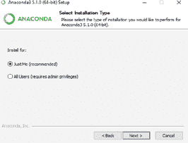

6.  现在将显示选择安装位置对话框。如果需要可更改目录，但建议使用默认设置。安装文件夹至少应有 3 GB 的可用空间供 Anaconda 使用。点击 Next 按钮。

    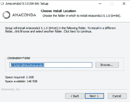

7.  在高级安装选项对话框中选择第二项，Register Anaconda as my default Python 3.7。
    点击 Install 按钮开始安装，这可能需要一些时间才能完成。

    

8.  安装完成后点击 Next。

    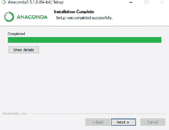

9.  在 Microsoft Visual Studio Code 安装对话框中点击 Skip。

    

10. 你已成功在 Windows 上安装 Anaconda。干得漂亮。下一步是取消对话框中两个复选框的勾选。现在，点击 Finish 按钮。

    

#### 2.1.2 Mac 搭建

Anaconda 在 Mac 上的安装过程几乎相同。图形界面可能有所不同，但你将遵循与 Windows 相同的步骤。唯一的区别是你必须下载与 Mac 操作系统兼容的可执行文件。本节解释如何在 Mac 上下载并安装 Anaconda。请按照以下步骤下载并安装 Anaconda。

1.  在浏览器中打开以下 URL。
    `https://www.anaconda.com/distribution/`

2.  浏览器将带你进入以下网页。选择适用于 Mac 的最新版本 Python（撰写本书时为 3.7）。现在，点击 Download 按钮下载可执行文件。根据你的网速，文件将在 2–3 分钟内下载完成。

    

3.  下载完成后运行可执行文件。你很可能会在下载文件夹中找到下载的文件。文件名应类似于 `Anaconda3-5.1.0-Windows-x86_64`。运行文件时将打开安装向导，如下图所示。点击 Continue 按钮。

    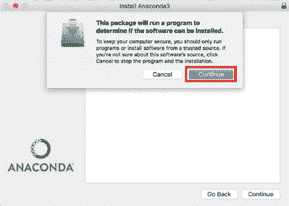

4.  现在在 Welcome to Anaconda 3 Installer 窗口中点击 Continue，如下截图所示。

    

5.  重要信息对话框将弹出。直接点击 Continue 以采用默认版本 Anaconda 3。

    

6.  在软件许可协议对话框中点击 Continue。

    

7.  必须阅读许可协议并点击 Agree 按钮，然后才能再次点击 Continue 按钮。

    

8.  在出现的下一个窗口中直接点击 Install。

    

    系统将提示你输入密码。使用你登录 Mac 电脑时的相同密码。现在，点击 Install Software。

    

9.  在下一个窗口中点击 Continue。此时你也可以选择安装 Microsoft VSCode。

    

    下一个屏幕将显示安装成功完成的消息。点击 Close 按钮关闭安装程序。

    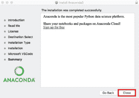

    就这些。你已成功在 Mac 电脑上安装 Anaconda。现在，你可以在 Jupyter 和 Spyder 中编写 Python 代码，就像在 Windows 中一样。

#### 2.1.3 Linux 搭建

我们已为 Windows 和 Mac 使用了 Python 的图形安装程序。然而，我们将使用命令行在 Ubuntu 或 Linux 上安装 Python。Linux 也更节省资源，且软件安装特别容易。请按照以下步骤在 Linux（Ubuntu 发行版）上安装 Anaconda。

1.  前往以下链接，从最新可用版本复制安装程序 bash 脚本。
    `https://www.anaconda.com/distribution/`

    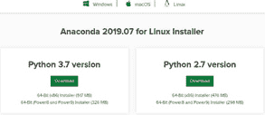

2.  第二步是下载安装程序 bash 脚本。登录到你的 Linux 计算机并打开终端。现在，进入 `/temp` 目录并使用 `curl` 下载你从 Anaconda 主页获取的 bash 脚本。

    ```
    $ cd /tmp
    $ curl -o https://repo.anaconda.com/archive/Anaconda3-5.2.0-Linux-x86_64.sh
    ```

3.  你还应通过 SHA-256 校验和使用加密哈希验证来验证安装程序的完整性。

    ```
    $ sha256sum Anaconda3-5.2.0-Linux-x86_64.sh
    ```

    你将获得以下输出。

    ```
    09f53738b0cd3bb96f5b1bac488e5528df9906be2480fe61df40e0e0d19e3d48  Anaconda3-5.2.0-Linux-x86_64.sh
    ```

4.  第四步是运行 Anaconda 脚本，如下图所示。

    ```
    $ bash Anaconda3-5.2.0-Linux-x86_64.sh
    ```

    命令行将产生以下输出。系统将要求你查看许可协议。持续按 Enter 键直到到达末尾。

    ```
    Output
    Welcome to Anaconda3 5.2.0
    In order to continue the installation process, please review the license agreement.
    Please, press Enter to continue
    >>>
    ...
    Do you approve the license terms? [yes|No]
    ```

    当你到达许可协议底部时输入 `Yes`。

5.  同意许可协议后，安装程序将要求你选择安装位置。
    直接按 Enter 选择默认位置。如果需要，也可以指定其他位置。

    ```
    Output
    Anaconda3 will now be installed on this location: /home/tola/anaconda3
    - Press ENTER to confirm the location
    - Press CTRL-C to abort the installation
    - Or specify a different location below
    [/home/tola/anaconda3] >>>
    ```

    按下 Enter 后安装将继续。再次提醒，请耐心等待，因为安装过程需要一些时间才能完成。

6.  安装完成后你将收到以下结果。如果你想使用 `conda` 命令，请输入 `Yes`。


## 输出

安装完成。您是否希望安装程序将 Anaconda3 的安装位置添加到您的 `/home/tola/.bashrc` 的 PATH 中？ `[yes|no]` `[no]`>>>

此时，您还将有下载 Visual Studio Code 的选项。输入 `yes` 或 `no` 分别选择安装或拒绝。

### 7. 激活安装

使用以下命令激活您全新的 Anaconda3 安装。

```
$ source ~/.bashrc
```

### 8. 测试安装

您也可以使用 `conda` 命令测试安装。

```
$ conda list
```

恭喜。您已成功在 Linux 系统上安装了 Anaconda。

#### 2.1.4 使用 Google Colab 云环境

除了 Anaconda 等本地 Python 环境外，您还可以在 Google Colab 上运行深度学习应用，它是 Google 支持 GPU 的深度学习平台。本书中的所有代码均在 Google Colab 上运行。因此，我建议您也使用 Google Colab。

要通过 Google Colab 运行深度学习应用，您只需要一个 Google/Gmail 账号。拥有 Google/Gmail 账号后，您只需访问：<https://colab.research.google.com/>

接下来，点击 **File** -> **New notebook**（文件 -> 新建笔记本），如下截图所示。


接下来，要使用 GPU 运行代码，请从顶部菜单中选择 **Runtime** -> **Change runtime type**（运行时 -> 更改运行时类型），如下截图所示：

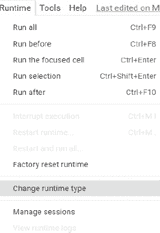

您应该会看到以下窗口。在此处，从下拉列表中选择 **GPU** 并点击 **Save**（保存）按钮。


为确保您运行的是最新版本的 TensorFlow，请在 Google Colab 笔记本单元格中执行以下脚本。以下脚本将更新您的 TensorFlow 版本。

```
pip install --upgrade tensorflow
```

要检查您是否真的在运行 TensorFlow 2.0 以上版本，请执行以下脚本。

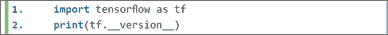

使用 Google Cloud，您可以从 Google 云端硬盘导入数据集。执行以下脚本。并点击出现的链接，如下所示：

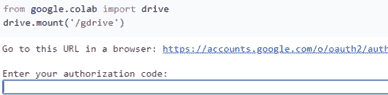

系统将提示您允许 Google Colab 访问您的 Google 云端硬盘。点击 **Allow**（允许）按钮，如下所示：


您将看到出现一个链接，如下图所示（此处链接已模糊处理）。


复制该链接，并将其粘贴到 Google Colab 单元格的空白字段中，如下所示：

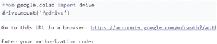

这样，您就可以将数据集从 Google 云端硬盘导入到您的 Google Colab 环境中。

### 2.2 Python 快速入门

如果您熟悉 Python 编程语言的基本概念，可以跳过本节。对于 Python 绝对初学者，本节简要概述了 Python 的一些最基本概念。Python 是一门非常庞大的编程语言，本节绝非一本完整 Python 书籍的替代品。但是，如果您想了解各种操作和命令在 Python 中是如何执行的，欢迎继续学习本节的其余内容。

#### 2.2.1 编写您的第一个程序

您已经在计算机上安装了 Python，并以 Anaconda 的形式建立了一个独特的环境。现在，是时候编写您的第一个程序了，即 Hello World！

要在 Anaconda 中编写程序，您必须启动 Anaconda Navigator。在 Windows 搜索框中搜索 **Anaconda Navigator**。现在，点击 **Anaconda Navigator** 应用程序图标，如下图所示。

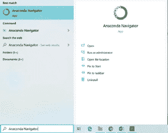

点击应用程序后，Anaconda 的仪表板将打开。仪表板为您提供了编写代码的无数工具。我们将使用其中最流行的 **Jupyter Notebook**，在本书中编写和解释代码。


**Jupyter Notebook** 位于仪表板顶部往下的第二个位置。即使您无法访问互联网，也可以使用 **Jupyter Notebook**，因为它直接在您的默认浏览器中运行。打开 **Jupyter Notebook** 的另一种方法是在 Windows 搜索栏中输入 **Jupyter Notebook**。随后，点击 **Jupyter Notebook** 应用程序。该应用程序将在浏览器的新标签页中打开。

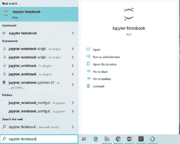

**Jupyter Notebook** 自身仪表板右上角有一个 **New**（新建）按钮，您需要点击它以打开新文档。将出现一个包含多个选项的下拉菜单。点击 **Python 3**。

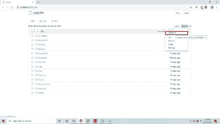

一个新的 Python 笔记本将出现供您编写程序。如下所示。


**Jupyter Notebook** 由单元格组成，从上图可以明显看出，其布局非常简单直接。您将在这些单元格中编写代码。让我们在 **Jupyter Notebook** 中编写我们的第一个 Python 程序。

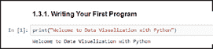

上述脚本基本上使用 `print()` 方法在输出中打印一个字符串值。`print()` 方法用于将传递给它的任何字符串打印到控制台。如果您看到以下输出，则表示您已成功运行第一个 Python 程序。

**输出：** Welcome to Data Visualization with Python

现在，让我们从变量和数据类型开始探索其他一些重要的 Python 概念。

> **要求 – Anaconda、Jupyter 和 Matplotlib**
>
> *   本书中的所有脚本均通过 **Jupyter notebook** 执行。因此，您应该安装了 **Jupyter notebook**。
> *   不用说，我们将使用 **Matplotlib** 库。
> *   在本章之前，还应安装 **Numpy** 和 **Pandas** 库。
>
> **动手时间 – 源代码**
>
> 本章所有脚本的源代码 IPython 笔记本均可在 SharePoint 存储库中找到。我建议您亲自编写本章中的所有代码，并查看是否能获得本章提到的相同输出。

#### 2.2.2 Python 变量和数据类型

编程语言中的数据类型是指该语言能够处理的数据类型。Python 支持的主要数据类型如下：

1.  字符串
2.  整数
3.  浮点数
4.  布尔值
5.  列表
6.  元组
7.  字典

变量是存储实际数据的内存地址的别名。存储在内存地址中的数据或值可以通过变量名进行访问和更新。与 C++、Java 和 C# 等其他编程语言不同，Python 是弱类型（动态类型）语言，这意味着您在创建变量时不必指定数据类型。相反，数据类型在运行时确定。

以下示例演示了如何创建不同的数据类型以及如何将它们存储在相应的变量中。该脚本还通过 `type()` 函数打印变量的类型。

**脚本 2：**

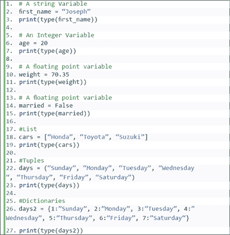

**输出：**
`<class 'str'>` `<class 'int'>` `<class 'float'>` `<class 'bool'>` `<class 'list'>` `<class 'tuple'>` `<class 'dict'>`

#### 2.2.3 Python 运算符

Python 编程语言包含以下类型的运算符：

1.  算术运算符
2.  逻辑运算符
3.  比较运算符
4.  身份运算符
5.  成员运算符


# Python 运算符与控制流

##### 算术运算符
算术运算符用于在 Python 中执行算术运算。下表总结了 Python 支持的算术运算符。假设 `X = 20`，`Y = 10`。

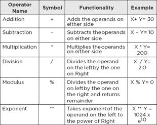

以下是带有输出的算术运算符示例：

**脚本 3：**
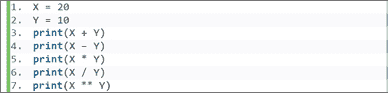

**输出：**
```
30
10
200
2.0
10240000000000
```

##### 逻辑运算符
逻辑运算符用于在 Python 中执行逻辑与、或、非运算。下表总结了逻辑运算符。此处，`X` 为 `True`，`Y` 为 `False`。

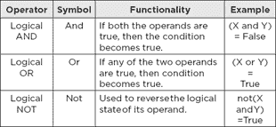

以下示例解释了 Python 逻辑运算符的用法。

**脚本 4：**
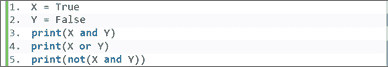

**输出：**
1. `False`
2. `True`
3. `True`

##### 比较运算符
顾名思义，比较运算符用于比较两个或多个操作数。根据操作数之间的关系，比较运算符返回布尔值。下表总结了 Python 中的比较运算符。此处，`X` 为 `20`，`Y` 为 `35`。

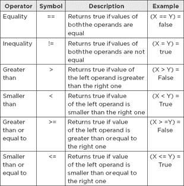

以下示例演示了比较运算符的实际应用：

**脚本 5**
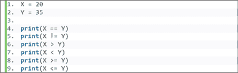

**输出：**
`False` `True` `False` `True` `False` `True`

##### 赋值运算符
赋值运算符用于将值赋给变量。下表总结了赋值运算符。此处，`X` 为 `20`，`Y` 等于 `10`。

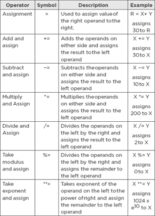

请查看脚本 6 以了解 Python 赋值运算符的实际应用。

**脚本 6：**
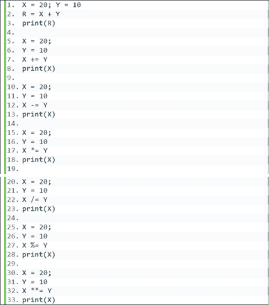

**输出：**
```
30
30
10
200
2.0
0
10240000000000
```

##### 成员运算符
成员运算符用于判断某项是否为项目集合的成员。成员运算符有两种：`in` 运算符和 `not in` 运算符。以下脚本演示了 `in` 运算符的用法。

**脚本 7：**
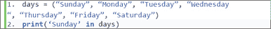

**输出：**
`True`

以下是 `not in` 运算符的示例。

**脚本 8：**
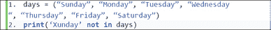

**输出：**
`True`

##### 条件语句
Python 中的条件语句用于实现条件逻辑。条件语句帮助你决定是否执行特定的代码块。Python 中主要有三种类型的条件语句：

1.  **If 语句**
2.  **If-else 语句**
3.  **If-elif 语句**

###### If 语句
如果你只需检查单个条件，且不关心备选条件，可以使用 `if` 语句。例如，如果你想检查 `10` 是否大于 `5`，并据此打印一条语句，可以使用 `if` 语句。`if` 语句求值的条件返回布尔值。如果 `if` 语句求值的条件为真，则执行 `if` 语句后面的代码块。值得注意的是，在 Python 中，新代码块从新行开始，并相对于外层块缩进（通常为一个制表符或四个空格）。在下面的示例中，条件 `10 > 5` 求值为真。因此，`if` 语句后面的代码块执行，并在控制台打印一条消息。

**脚本 9：**
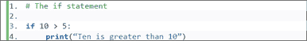

**输出：**
`Ten is greater than 5`

###### If-Else 语句
当你想在 `if` 语句的条件返回假时执行备选代码时，`if-else` 语句非常有用。例如，在下面的示例中，条件 `5 > 10` 将返回假。因此，`else` 语句后面的代码块将执行。

**脚本 10：**
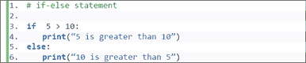

**输出：**
`10 is greater than 5`

###### If-Elif 语句
当你需要求值多个条件时，`if-elif` 语句非常方便。例如，在下面的示例中，我们首先检查 `5 > 10`，其求值为假。接下来，`elif` 语句求值条件 `8 < 4`，这也返回假。因此，最后一个 `else` 语句后面的代码块执行。

**脚本 11：**
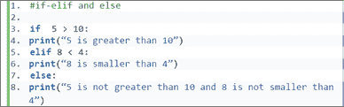

**输出：**
`5 is not greater than 10 and 8 is not smaller than 4`

##### 迭代语句
迭代语句（也称为循环）用于迭代执行特定代码片段。Python 中主要有两种类型的迭代语句：

1.  **For 循环**
2.  **While 循环**


###### For 循环

`for` 循环用于迭代执行一段代码特定的次数。当您确切知道想要运行代码的迭代或重复次数时，应使用 `for` 循环。`for` 循环会遍历项目集合。在下面的示例中，我们使用 `range()` 方法创建了一个包含五个整数的集合。接下来，`for` 循环迭代五次并打印集合中的每个整数。

**脚本 12：**
```
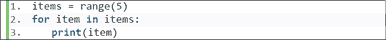
```
**输出：**
```
0 1 2 3 4
```

###### While 循环

`while` 循环会持续执行特定的一段代码，除非评估条件变为 false。例如，下面脚本中的 `while` 循环会持续执行，除非变量 `c` 变得大于 10。

**脚本 13：**
```
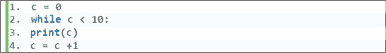
```
**输出：**
```
0 1 2 3 4 5 6 7 8 9
```

# 2.2.6 函数

任何编程语言中的函数都用于实现需要在代码的不同位置多次执行的代码片段。在这种情况下，您无需反复编写冗长的代码片段，只需定义一个包含该代码片段的函数，然后即可在代码中任何需要的地方调用该函数。

要在 Python 中创建函数，需使用 `def` 关键字，后跟函数名称以及一对左括号和右括号。函数定义后，必须调用它才能执行函数体内的代码。要调用函数，只需指定函数名称，后跟一对左括号和右括号即可。

在下面的脚本中，我们创建了一个名为 `myfunc` 的函数，它使用 `print()` 方法在控制台打印一条简单语句。

**脚本 14：**
```
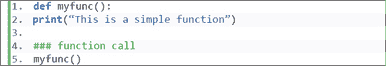
```
**输出：**
```
This is a simple function
```

您也可以向函数传递值。这些值在函数调用的括号内传递。但是，您也必须在函数定义中指定参数名。

在下面的脚本中，我们定义了一个名为 `myfuncparam()` 的函数。该函数接受一个参数，即 `num`。函数调用括号中传递的值将存储在该 `num` 变量中，并由 `myfuncparam()` 方法内部的 `print()` 方法打印出来。

**脚本 15：**
```
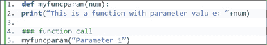
```
**输出：**
```
This is a function with parameter value: Parameter 1
```

最后，函数也可以向函数调用返回值。为此，只需使用 `return` 关键字，后跟您想要返回的值即可。

在下面的脚本中，`myreturnfunc()` 函数向调用函数返回一个字符串值。

**脚本 16：**
```
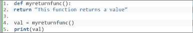
```
**输出：**
```
This function returns a value
```

# 2.2.7 对象和类

Python 支持面向对象编程 (OOP)。在 OOP 中，任何能够执行某些功能并拥有某些属性的实体都以对象的形式实现。例如，汽车可以作为一个对象实现，因为汽车有一些属性，如价格、颜色、型号，并且可以执行一些功能，如驾驶汽车、换挡、停车等。同样，水果也可以作为一个对象实现，因为水果有价格、名称，并且您可以吃水果、种植水果，对水果执行各种操作。

要创建对象，必须先定义一个类。例如，在下面的示例中，定义了一个类 `Fruit`。该类有两个属性 `name` 和 `price`，以及一个方法 `eat_fruit()`。接下来，我们创建了 `Fruit` 类的一个对象 `f`，然后从 `f` 对象调用 `eat_fruit()` 方法。我们还访问了 `f` 对象的 `name` 和 `price` 属性并在控制台打印它们。

**脚本 17：**
```
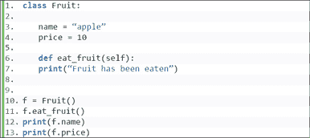
```
**输出：**
```
Fruit has been eaten
apple
10
```

Python 中的类可以有一个称为构造函数的特殊方法。Python 中构造函数方法的名称是 `__init__()`。每当创建一个类的对象时，就会调用构造函数。请看下面的示例以了解构造函数的实际运作。

**脚本 18：**
```
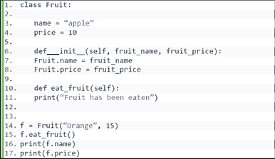
```
**输出：**
```
Fruit has been eaten
Orange
15
```

---

#### 进阶阅读 – Python [1]

要深入学习 Python，请查阅 Python 3 官方文档。养成搜索和阅读该文档的习惯。它是一个极佳的知识资源。

---

### 动手实践 – 练习

现在轮到您了。请遵循下面练习中的说明，检验您对 Python 基础编程概念的理解。这些问题的答案在本书末尾给出。

### 练习 2.1

**问题 1：** 当您想要重复执行代码特定次数时，应使用哪种迭代？

1. For 循环
2. While 循环
3. C.
4. D.

**问题 2：** Python 中函数最多可以返回多少个值？

1. 单个值
2. 双重值
3. C.
4. D.

**问题 3：** 以下哪些成员运算符受 Python 支持？

1. In
2. Out
3. C.
4. D.

### 练习 2.2

使用 `while` 循环打印整数 9 的乘法表：


## 使用 Scikit-Learn 进行数据预处理

随着海量数据触手可及，越来越多的研究人员和行业专业人士正在寻找方法，利用这些数据获取研究和商业收益。然而，默认可用的大多数数据过于原始。在用于识别重要模式或训练用于预测的统计模型之前，对其进行预处理非常重要。数据预处理涉及以一种可用于多项重要数据科学任务（如数据可视化、机器学习、深度学习和数据分析）作为输入的方式来清洗和构建数据。一些最常见的数据准备任务包括特征缩放、处理缺失值、分类变量编码、数据离散化等。Scikit-learn 库包含各种模块和工具，您可以在本章中使用它们来执行不同类型的数据处理任务。那么，让我们废话不多说，开始吧。

### 3.1 特征缩放

数据集可以具有不同的属性。这些属性可以具有不同的量级、方差、标准差、均值等。例如，薪资可能以千为单位，而年龄通常是两位数。属性尺度或量级的差异实际上会影响统计模型。例如，对于线性模型，范围较大的变量会主导范围较小的变量。在本节中，您将看到不同的特征缩放技术。

#### 3.1.1 标准化

标准化是将变量以零为中心并将数据方差标准化为 1 的过程。要标准化数据集，只需从所有数据点的均值中减去每个数据点，然后将结果除以数据的标准差。特征缩放仅应用于数值列。以下脚本导入泰坦尼克号数据集，然后筛选 `age`、`fare` 和 `pclass` 列。我们将仅在这三列上应用特征缩放技术。

**脚本 1：**
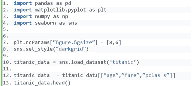

**输出：**
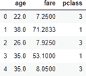

让我们看看 `age`、`fare` 和 `pclass` 列的均值、标准差、最小值和最大值。

**脚本 2：**


**输出：**
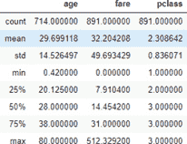

您可以看到，这三列的均值、最小值和最大值差异很大。要标准化数据，可以使用 `sklearn.preprocessing` 模块中的 `StandardScaler` 类。您必须将包含数据集的 Pandas DataFrame 传递给该类的 `fit()` 方法，然后传递给该类的 `transform()` 方法。以下脚本对泰坦尼克号数据集的 `age`、`fare` 和 `pclass` 列应用标准缩放。

**脚本 3：**
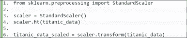

以下脚本创建缩放后列的 DataFrame 并显示缩放后数据集的前五行。

**脚本 4：**
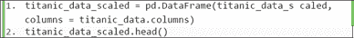

从输出中可以看出，数值已被缩放。

**输出：**
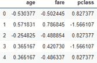

以下脚本为未缩放的列绘制核密度图。

**脚本 5：**


**输出：**
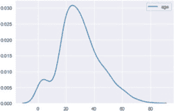

以下脚本为缩放后的列绘制核密度图。

**脚本 6：**


**输出：**
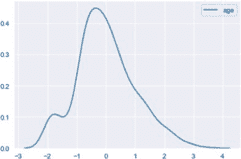

脚本 5 和 6 的输出表明，标准缩放实际上并不影响默认的数据分布。

#### 3.1.2 最小/最大缩放

在最小/最大缩放中，您用每个值减去最小值，然后将结果除以数据集中最大值和最小值的差。要实现最小/最大缩放，可以使用 `sklearn.preprocessing` 模块中的 `MinMaxScaler` 类。您必须将包含数据集的 Pandas DataFrame 传递给该类的 `fit()` 方法，然后传递给 `MinMaxScaler` 类的 `transform()` 方法。以下脚本在泰坦尼克号数据集的 `age`、`fare` 和 `pclass` 列上实现最小/最大缩放。

**脚本 7：**
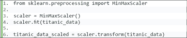

以下脚本创建缩放后列的 DataFrame 并显示缩放后数据集的前五行。

**脚本 8：**
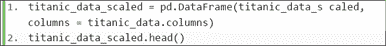

**输出：**
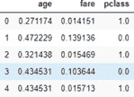

让我们绘制核密度图，看看数据分布是否发生了变化。

**脚本 9：**


**输出：**
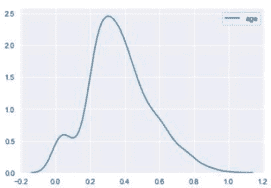

输出表明，最小/最大缩放不会改变数据集的数据分布。

#### 3.1.3 均值归一化

均值归一化与最小/最大缩放非常相似，不同之处在于均值归一化中从每个值中减去数据集的均值，并将结果除以极差，即最大值和最小值之间的差。以下脚本计算所有列的均值。

**脚本 10：**
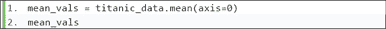

**输出：**

| age | | 29.699118 |
| --- | --- | --- |
| fare | | 32.204208 |
| pclass | | 2.308642 |
| dtype: | | float64 |

以下脚本查找所有列的极差，即最小值和最大值之间的差。

**脚本 11：**
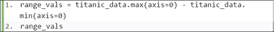

**输出：**

| age | | 79.5800 |
| --- | --- | --- |
| fare | | 512.3292 |
| pclass | | 2.0000 |
| dtype: | | float64 |

最后，以下脚本对完整数据集应用均值归一化。

**脚本 12：**
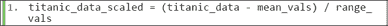

让我们绘制核密度图，看看数据分布是否受到影响。执行以下脚本：

**脚本 13：**


**输出：**


输出表明数据分布未受影响。

### 3.2 处理缺失值

顾名思义，缺失值是数据集中不包含任何值的观测值。缺失值可能会完全改变数据模式，因此，了解缺失值在数据集中出现的原因以及如何处理它们极为重要。在本节中，您将看到如何使用 Scikit-learn 库处理缺失值的示例。数据缺失主要有两个原因：

1.  **随机缺失数据**：当缺失观测值与数据集中的任何其他列无关时，我们可以说数据是随机缺失的。例如，如果您在数据集中找不到一个人的城市，这就是随机缺失，您无法从逻辑上找出缺失值背后的原因。

2.  **非随机缺失数据**：在这种情况下，您可以将缺失数据归因于逻辑原因。例如，研究表明，与非抑郁患者相比，抑郁患者更有可能在表格中留空字段。因此，缺失数据并非随机；缺失数据有既定的原因。


#### 3.2.1 处理缺失数值数据

最常见的数据类型之一是数值数据，它由数字组成。要处理缺失数值数据，我们可以使用统计技术。使用统计技术或算法以统计生成的值替换缺失值称为**插补**。完全案例分析（CCA），也称为逐列表删除，是处理缺失数据最基本的技术。在 CCA 中，你只需移除任何列或字段包含缺失值的所有行或记录。仅处理数据集中所有列都存在实际值的那些记录。

##### 平均值或中位数插补

在平均值或中位数插补中，某列中的缺失值将被该特定列中所有剩余值的平均值或中位数所替换。例如，如果你有一列包含以下数据：


在上述 Age 列中，第二个值缺失。因此，通过平均值和中位数插补，你可以用该列中所有其他值的平均值或中位数来替换第二个值。例如，以下列在第二行包含了所有剩余值的平均值，即 25。如果你愿意，也可以用中位数替换此值。


让我们看一个平均值和中位数插补的实际示例。我们将导入泰坦尼克号数据集并找出包含缺失值的列。然后，我们将对包含缺失值的列应用平均值和中位数插补，最后，我们将查看对缺失值应用平均值和中位数插补的效果。你不需要下载泰坦尼克号数据集。如果你导入 Seaborn 库，泰坦尼克号数据将随之一起下载。以下脚本导入泰坦尼克号数据集并显示其前五行。

**脚本 14：**


**输出：**


让我们从数据集中筛选一些数值列，看看它们是否包含任何缺失值。

**脚本 15：**


**输出：**


要从上述列中找出缺失值，你需要先在 `titanic_data` 数据框上调用 `isnull()` 方法，然后调用 `mean()` 方法，如下所示：

**脚本 16：**


**输出：**

| survived | | 0.000000 |
| --- | --- | --- |
| pclass | | 0.000000 |
| age | | 0.198653 |
| fare | | 0.000000 |
| dtype: | | float64 |

输出显示只有 `age` 列包含缺失值。缺失值的比例约为 19.86%。现在让我们找出 `age` 列中所有非缺失值的中位数和平均值。

**脚本 17：**


**输出：** 28.0 29.69911764705882

`age` 列的中位数为 28，平均值为 29.6991。为了绘制实际年龄、中位数年龄和平均年龄的核密度图，我们将向 Pandas 数据框添加列。

**脚本 18：**


上述脚本向 `titanic_data` 数据框添加了 `Median_Age` 和 `Mean_Age` 列，并打印前 20 条记录。以下是上述脚本的输出：

**输出：**


上述输出中高亮显示的行表明，`age` 列中的 NaN（即空值）已被 `Median_Age` 列中的中位数和 `Mean_Age` 列中的平均值所替换。平均值和中位数插补可能会影响包含缺失值的列的数据分布。特别是，由于现在更多的值被添加到分布的中心，该列的方差会因平均值和中位数插补而减小。以下脚本绘制 `age`、`Median_Age` 和 `Mean_Age` 列的数据分布。

**脚本 19：**


以下是上述脚本的输出：


你可以清楚地看到，`age` 列中的默认值已被平均值和中位数插补扭曲，数据集的整体方差也随之减小。

##### 分布尾部插补

当数据并非随机缺失时，平均值和中位数插补以及 CCA 都不是缺失值插补的好技术。对于随机缺失数据，最常用的技术是分布尾部/末端插补。在尾部插补中，从数据的尾部末端选择一个值。该值表明该记录的实际数据缺失。因此，在对数据训练统计模型时，非随机缺失的数据可以被纳入考量。如果数据呈正态分布，分布尾部值可以通过将平均值乘以三倍标准差来计算。对于偏态数据分布，可以使用四分位距法则来寻找尾部值。

```
IQR = 第 75 百分位数 – 第 25 百分位数
上限 IQR = 第 75 百分位数 + IQR x 1.5
下限 IQR = 第 25 百分位数 – IQR x 1.5
```

让我们对泰坦尼克号数据集的 `age` 列执行尾部插补。以下脚本导入泰坦尼克号数据集，筛选数值列，然后找出每列中缺失值的百分比。

**脚本 20：**


**输出：**

| survived | | 0.000000 |
| --- | --- | --- |
| pclass | | 0.000000 |
| age | | 0.198653 |
| fare | | 0.000000 |
| dtype: | | float64 |

上述输出显示只有 `age` 列有缺失值，约占整个数据集的 20%。下一步是绘制 `age` 列的数据分布。直方图可以揭示一列的数据分布。

**脚本 21：**


**输出：**


输出显示 `age` 列呈近似正态分布。因此，分布尾部值可以通过将 `age` 列的平均值乘以三倍标准差来计算，如以下脚本所示：

**脚本 22：**


**输出：** 73.278

最后，`age` 列中的缺失值可以用脚本 22 中计算出的尾部值来替换。

**脚本 23：**


**输出：**


上述输出显示，分布尾部值即 -73 已替换 `age` 列中的 NaN 值。最后，你可以为原始 `age` 列和经过分布尾部插补的 `age` 列绘制核密度估计图。

**脚本 24：**


**输出：**


#### 3.2.2 处理缺失分类数据

##### 众数类别插补

处理分类列中缺失值最常见的方法之一是用出现频率最高的值（即该列的众数）来替换缺失值。让我们看一个众数类别插补的真实示例。我们将再次使用泰坦尼克号数据集。我们将首先尝试找出 `age`、`fare` 和 `embarked_town` 列中缺失值的百分比。

**脚本 25：**


**输出：**

| embark_town | | 0.002245 |
| --- | --- | --- |
| age | | 0.198653 |
| fare | | 0.000000 |
| dtype: | | float64 |

输出显示 `embark_town` 和 `age` 列有缺失值。`embark_town` 列的缺失值比例非常小。让我们绘制条形图，显示 `embark_town` 列中每个类别对应的乘客数量。

**脚本 26：**


输出清楚地显示，大多数乘客从南安普顿登船。

**输出：**


让我们确认一下南安普顿是否真的是 `embark_town` 列的众数值。

**脚本 27：**


**输出：**

| 0 | | Southampton |
| --- | --- | --- |
| dtype: | | object |


### 处理缺失值：用众数填充年龄列

接下来，我们可以简单地用 `Southampton` 替换 `embark_town` 列中的缺失值。

#### Script 28


现在让我们找出 `age` 列的众数，并用它来替换该列中的缺失值。

#### Script 29


**Output:**
```
24.0
```
输出显示 `age` 列的众数是 24。因此，我们可以使用该值来替换 `age` 列中的缺失值。

#### Script 30


**Output:**


最后，让我们为原始 `age` 列和用众数填充缺失值后的 `age` 列绘制核密度估计图。

#### Script 31


**Output:**


### 缺失类别填充

缺失类别填充类似于任意值填充。对于分类变量，缺失值填充会添加一个任意类别（例如 `missing`）来替代缺失值。

让我们加载 Titanic 数据集，看看是否有分类变量包含缺失值。

#### Script 32


**Output:**

| embark_town | | 0.002245 |
| --- | --- | --- |
| age | | 0.198653 |
| fare | | 0.000000 |
| dtype: | | float64 |


输出显示 `embark_town` 是一个分类列，也包含一些缺失值。我们将对该列应用缺失值插补。

脚本 33：


应用缺失值插补后，如果为 `embark_town` 列绘制条形图，可以看到缺失列对应的图形非常小，几乎可以忽略不计。

脚本 34：


输出：


### 3.3. 分类数据编码

基于统计算法的模型（如机器学习和深度学习）处理的是数字。然而，数据集可能包含数值、分类、日期时间和混合类型的变量。需要一种机制将分类数据转换为其数值对应形式，以便数据可用于构建统计模型。将数值数据转换为分类数据的技术称为分类数据编码方案。在本节中，您将看到一些最常用的分类数据编码方案。

#### 3.3.1 独热编码

独热编码是最常用的分类编码方案之一。在独热编码中，对于分类列中的每个唯一值，都会添加一列新列。对应原始标签的列填充整数 1，其余所有列填充 0。

让我们看一个独热编码的简单示例。在下表中，我们有一个分类列 Country。该列包含三个唯一值：USA、UK 和 France。


下表包含上表的独热编码版本。在下表中，可以看到添加了三列，即 USA、UK 和 FRANCE。在原始列中，Country 列第一行的标签是 USA。在新添加的独热编码表中，USA 列的值为 1。同理，原始表第二行的标签为 UK。在独热编码表中，UK 列第二行的值为 1。


事实上，对于原本包含 N 个唯一标签的列，在独热编码数据集中只需要 N-1 列。请看下表：


在上表中，USA 列已被移除。然而，我们仍然可以捕获第一列包含的信息。例如，UK 和 France 列均为 0 的行实际上代表该记录对应 USA。

让我们通过一个示例来了解独热编码。执行以下脚本以下载泰坦尼克号数据集，就像前几章所做的那样。

脚本 35：


输出：


让我们通过移除除 `sex`、`class` 和 `embark_town` 列之外的所有列来筛选 `titanic_data` 数据框。这些是分类列。

脚本 36：


输出：


让我们打印 `titanic_data` 数据框中这三列的唯一值。

脚本 37：


输出：`['male' 'female']` `[Third, First, Second]` Categories (3, object): `[Third, First, Second]` `['Southampton' 'Cherbourg' 'Queenstown' nan]`

将列转换为独热编码列的最简单方法是使用 Pandas 数据框的 `get_dummies()` 方法，如下所示：

脚本 38：


在输出中，您将看到两列，一列对应男性，一列对应女性。

输出：


让我们在同一个数据框中显示 `sex` 列的实际性别名称及其独热编码版本。

脚本 39：


输出：


从上述输出可以看出，第一行在 `male` 列中添加了 1，因为 `sex` 列中的实际值是 `male`。同理，第二行在 `female` 列中添加了 1，因为 `sex` 列中的实际值是 `female`。

同样，我们可以将 `embark_town` 列转换为独热编码向量，如下所示：

脚本 40：


输出：


正如您之前所见，对于包含 N 个唯一标签的分类列，可以有 N-1 个独热编码列。您可以通过将 `drop_first` 参数的值设为 `True` 来移除 `get_dummies()` 方法创建的第一列，如下所示：

脚本 41：


输出：


此外，您可以通过将 `dummy_na` 参数的值设为 `True` 来为实际列中的空值创建独热编码列。

脚本 42：


输出：


独热编码的主要优点是它不对数据集做任何假设，并且所有分类值都可以成功编码。该方法的一个主要缺点是特征空间可能变得非常大，因为分类列可能有许多唯一值。

#### 3.3.2 标签编码

在标签编码中，标签被整数替换。这就是为什么标签编码也称为整数编码。请看下表：


上表经过标签编码后如下所示。可以看到 USA 被标记为 1，UK 标记为 2，France 标记为 3。


要实现标签编码，可以使用 `sklearn.preprocessing` 模块中的 `LabelEncoder` 类，如下所示。您需要创建一个 `label_encoder` 类的对象。接下来，调用 `label_encoder` 对象的 `fit()` 方法并传入您的分类列。最后，要将分类列转换为数值，调用 `label_encoder` 对象的 `transform()` 方法并传入分类列。以下脚本对泰坦尼克号数据集的 `class` 列执行标签编码。

脚本 43：


输出：


从上述输出可以看出，`Third` 舱位被标记为 2，`First` 舱位标记为 0，依此类推。重要的是要注意标签编码从 0 开始。

### 3.4. 数据离散化

在上一节中，您学习了如何对分类值进行数值编码。在本节中，您将看到如何将连续数值转换为离散区间。将价格、年龄和体重等连续数值转换为离散区间的过程称为离散化或分箱。在数据分布偏态的情况下，离散化特别有用。执行离散化有多种方法。在本节中，您将学习等宽离散化和等频离散化。

#### 3.4.1 等宽离散化

最常用的离散化方法是固定宽度离散化。在固定宽度离散化中，所有区间的宽度或大小保持相同。区间也称为分箱。等宽离散化是一种无监督离散化技术。

让我们看一个等宽离散化的实际示例。我们将在钻石数据集的 `price` 列上执行等宽离散化。钻石数据集预加载在 Python 的 Seaborn 库中，因此无需单独下载。您只需安装 Seaborn 库即可。执行以下脚本以加载钻石数据集并显示其前五行。

脚本 44：


输出：


输出显示数据集包含 10 列。我们将仅对 `price` 列执行离散化。首先，让我们为 `price` 列绘制直方图。

脚本 45：


输出：


`price` 列的直方图显示我们的数据集呈正偏态。我们可以对这种类型的数据分布使用离散化。现在让我们通过用最大价格减去最小价格来找到总价格范围。

脚本 46：


输出：18497

价格范围是 18497。我们将创建 10 个等宽区间。要找到每个区间的长度或宽度，只需将价格范围除以区间数量。

脚本 47：


输出：1849.7

输出显示了这 10 个区间中每个区间的长度。最小价格将向下取整，而最大价格将向上取整。价格将四舍五入到最接近的整数值。以下脚本执行此操作：

脚本 48：


输出：326 18823 1850

接下来，让我们为数据集创建 10 个分箱。要创建分箱，我们将从最小值开始并加上分箱间隔或长度。要获得第二个区间，将间隔长度加到第一个区间的上边界，以此类推。以下脚本创建 10 个等宽分箱。

脚本 49：


以下输出显示了每个分箱的边界。

输出：`[326, 2176, 4026, 5876, 7726, 9576, 11426, 13276, 15126, 16976, 18826]`

接下来，我们将为每个分箱创建字符串标签。您可以为分箱标签指定任何名称。

脚本 50：


输出：`['Bin_no_1', 'Bin_no_2', 'Bin_no_3', 'Bin_no_4', 'Bin_no_5', 'Bin_no_6', 'Bin_no_7', 'Bin_no_8', 'Bin_no_9', 'Bin_no_10']`

输出显示了我们数据集的分箱标签。您可以使用 Pandas 库的 `cut()` 方法将连续列值转换为数值分箱值。您需要传入要离散化的数据列，以及分箱区间和分箱标签，如下所示。

脚本 51：


输出：


在上述输出中，可以看到添加了一个 `price_bins` 列，显示价格的分箱值。接下来，让我们绘制一个条形图，显示每个分箱中价格的频率。

脚本 52：


输出：


输出显示大多数钻石的价格位于第一个分箱或第一个区间内。

#### 3.4.2 等频离散化

在等频离散化中，分箱宽度会自动调整，使每个分箱包含完全相同数量的记录或具有相同的频率。因此得名等频离散化。在等频离散化中，分箱间隔可能不相同。等频离散化与等宽离散化一样，是一种有监督离散化技术。

让我们像之前那样在钻石数据集的 `price` 列上应用等频离散化，看看会得到什么分箱。以下脚本加载钻石数据集。

脚本 53：


输出：


要将连续列转换为等频离散化分箱，可以使用 `qcut()` 函数。该函数返回与指定区间数量相等的四分位数以及分箱。您必须将数据集列、区间数量和标签作为强制参数传递给 `qcut()` 函数。以下脚本返回钻石数据集 `price` 列的等频 10 个分箱。接下来，我们创建一个显示实际价格和四分位信息的数据框。

脚本 54：


输出：


要查看分箱区间，只需打印 `qcut()` 函数返回的分箱，如下所示：

脚本 55：


输出：`[326. 646. 837. 1087. 1698. 2401. 3465. 4662. 6301.2 9821. 18823.]` `<class 'numpy.ndarray'>`

接下来，让我们找出每个分箱中的记录数。执行以下脚本：

脚本 56：


输出：


| (325.999, 646.0] | | 5411 |
| --- | --- | --- |
| (1698.0, 2401.0] | | 5405 |
| (837.0, 1087.0] | | 5396 |
| (6301.2, 9821.0] | | 5395 |
| (3465.0, 4662.0] | | 5394 |
| (9821.0, 18823.0] | | 5393 |
| (4662.0, 6301.2] | | 5389 |
| (1087.0, 1698.0] | | 5388 |
| (646.0, 837.0] | | 5385 |
| (2401.0, 3465.0] | | 5384 |
| Name: price, dtype: | | int64 |

从输出中可以看出，所有分箱的记录数大致相同。这就是等频离散化的作用，即创建包含相同记录数的分箱。接下来，要创建一个包含分箱的 Pandas 数据框，我们首先创建 10 个标签，因为我们创建了 10 个分箱。

脚本 57：
```
# Code for Script 57 (Image00158.jpg)
```
输出：
```
['Bin_no_1', 'Bin_no_2', 'Bin_no_3', 'Bin_no_4', 'Bin_no_5', 'Bin_no_6', 'Bin_no_7', 'Bin_no_8', 'Bin_no_9', 'Bin_no_10']
```

要执行分箱，我们可以再次使用 Pandas 库的 `cut()` 方法，如下所示：

脚本 58：
```
# Code for Script 58 (Image00159.jpg)
```
输出：
```
# Output for Script 58 (Image00160.jpg)
```

在上述输出中，你可以看到一个新列，即 `price_bins`。该列包含等频离散分箱标签。最后，我们可以绘制一个条形图，显示每个分箱的记录频率。

脚本 59：
```
# Code for Script 59 (Image00161.jpg)
```
输出：
```
# Output for Script 59 (Image00162.jpg)
```

你可以看到，所有分箱的记录数几乎相同。

### 3.5 处理异常值

异常值是指与列中其余观测值相距太远的值。例如，如果样本中大多数人的体重在 50-100 公斤之间变化，则 500 公斤的观测值将被视为异常值，因为这种观测值极少发生。异常值可能由于各种原因发生。例如，如果你 95% 的时间从某个特定城市访问你的网上银行账户，那么从另一个城市登录你的账户将被视为异常值。这种异常值可能会有所帮助，因为它可以识别网上欺诈。然而，异常值也可能由于技术故障、人为错误、机器可读性等原因发生。在这种情况下，应从数据集中移除异常值。

处理异常值主要有四种技术：

1.  你可以完全从数据集中移除异常值。
2.  你可以将异常值视为缺失值，然后应用你在第 3 章学到的任何数据填补技术。
3.  你可以对数据集应用离散化技术，这将把异常值与尾部的其他数据点一起包含在内。
4.  你可以对异常值进行封顶或审查，并用通过多种技术找到的最大值和最小值替换它们。

你已经在前面的章节学习了离散化和缺失值填补。在本节中，你将学习修剪和封顶。

#### 3.5.1 异常值修剪

顾名思义，异常值修剪是指简单地移除超出特定阈值的异常值。异常值修剪的主要优点之一是它非常快，且不会扭曲数据。异常值修剪的缺点是它会减小数据规模。有几种方法可以找到异常值修剪的阈值。让我们从泰坦尼克号数据集的 `age` 列中移除异常值。泰坦尼克号数据集包含 1912 年沉没的不幸泰坦尼克号上乘客的记录。以下脚本从 Seaborn 库导入泰坦尼克号数据集。

脚本 60：
```
# Code for Script 60 (Image00163.jpg)
```

泰坦尼克号数据集的前五行如下所示。

输出：
```
# Output for Script 60 (Image00164.jpg)
```

要可视化异常值，你可以简单地为 `age` 列绘制箱线图，如下所示：

脚本 61：
```
# Code for Script 61 (Image00165.jpg)
```
输出：
```
# Output for Script 61 (Image00166.jpg)
```

你可以看到，在箱线图的年龄分布上端，有少数以黑点形式显示的异常值。要移除异常值，我们首先需要定义将被视为异常值的值。有多种方法可以做到这一点。最常用的方法之一是找到四分位距 (IQR)，将其乘以 1.5，然后从第一四分位数值（0.25 分位数）中减去它以找到下限。要找到上限，将 IQR 与 1.5 的乘积加到第三四分位数值（0.75 分位数）上。IQR 可以通过从第四四分位数中减去第一四分位数值来计算。以下脚本找到 `age` 列异常值的下限和上限。

脚本 62：
```
# Code for Script 62 (Image00167.jpg)
```
输出：
```
-6.6875 64.8125
```

输出显示，任何大于 64.81 和小于 -6.68 的年龄值将被视为异常值。以下脚本查找包含异常值的行：

脚本 63：
```
# Code for Script 63 (Image00168.jpg)
```

最后，以下脚本从实际的泰坦尼克号数据集中移除包含异常值的行。

脚本 64：
```
# Code for Script 64 (Image00169.jpg)
```

输出显示了移除异常值前后的记录数。

输出：
```
((891, 15), (880, 15))
```

最后，你可以绘制一个箱线图，查看异常值是否真的已被移除。

脚本 65：
```
# Code for Script 65 (Image00170.jpg)
```
输出：
```
# Output for Script 65 (Image00171.jpg)
```

从上述输出可以看出，数据集现在不包含任何异常值。

#### 3.5.2 使用均值和标准差进行异常值封顶

除了使用 IQR 方法，异常值的上下阈值还可以通过均值和标准差方法计算。要找到上阈值，将数据的均值加上三倍的标准差值。同样，要找到下阈值，将标准差乘以 3，然后从均值中减去结果。以下脚本导入泰坦尼克号数据集。

脚本 66：
```
# Code for Script 66 (Image00172.jpg)
```

让我们绘制一个箱线图，显示泰坦尼克号数据集 `Age` 列中数据的分布。

脚本 67：
```
# Code for Script 67 (Image00173.jpg)
```
输出：
```
# Output for Script 67 (Image00174.jpg)
```

以下脚本使用均值和标准差封顶，找到泰坦尼克号数据集 `age` 列的上下阈值。

脚本 68：
```
# Code for Script 68 (Image00175.jpg)
```
输出：
```
-13.88037434994331 73.27860964406095
```

输出显示，通过均值和标准差封顶获得的上阈值为 73.27，下限或阈值为 -13.88。以下脚本用上下限替换异常值。

脚本 69：
```
# Code for Script 69 (Image00176.jpg)
```

脚本 70：
```
# Code for Script 70 (Image00177.jpg)
```

箱线图显示，在对泰坦尼克号数据集的 `age` 列应用均值和标准差封顶后，我们仍然有一些异常值。

输出：
```
# Output for Script 70 (Image00178.jpg)
```

### 练习 3.1

#### 问题 1

以下哪种技术可用于从数据集中移除异常值？

1.  修剪
2.  审查
3.  C.
4.  D.

#### 问题 2

通过 `get_dummies()` 方法生成的独热编码列中，将哪个属性设置为 `True` 以移除第一列？

1.  `drop_first`
2.  `remove_first`
3.  C.
4.  D.

#### 问题 3

标准化后，数据集的均值变为：

1.  1
2.  0
3.  C.
4.  D.

### 练习 3.2

用 `deck` 列中出现频率最高的类别替换泰坦尼克号数据集 `deck` 列中的缺失值。为更新后的 `deck` 列绘制条形图。


## 使用 Python Scikit-Learn 库进行特征选择

机器学习算法从数据集中学习。数据集由特征组成。特征是指数据的单个特征或维度。特征也称为属性。例如，汽车数据集具有汽车型号、汽车颜色、座位容量等特征。选择合适的特征集不仅可以提高机器学习模型的性能，还可以加快算法的训练时间。在本章中，您将学习一些最常见的特征选择方法。您将使用 Python 的 Scikit-learn 库来演示各种特征选择方法。

### 4.1 基于方差的特征选择

具有常数值或非常相似值的特征在分类和回归等机器学习任务中并不起重要作用。因此，应从数据集中移除非常相似的特征。从数据集中移除非常相似的特征有多种方法。其中一种方法是计算特定特征的方差，并移除方差小于特定阈值的特征。方差低的特征其数据点之间具有较高的相似度，反之亦然。

让我们看一个基于方差的特征选择示例。以下脚本从数据仓库读取 `winequalit-red.csv` 数据集并打印数据集的表头。

**脚本 1：**
```
[Code for Script 1 - Image00180.jpg]
```

**输出：**
```
[Output for Script 1 - Image00181.jpg]
```

输出显示数据集有 12 列。接下来，我们将数据划分为特征集和标签集。

**脚本 2：**
```
[Code for Script 2 - Image00182.jpg]
```

基于方差的特征选择不依赖于输出标签。方差显示了一组数据分散的程度。您可以使用 Pandas DataFrame 的 `var()` 函数来查找所有特征的方差，如下所示。

**脚本 3：**
```
[Code for Script 3 - Image00183.jpg]
```

**输出：**

| 特征 | 方差 |
| :--- | :--- |
| fixed acidity | 3.031416 |
| volatile acidity | 0.032062 |
| citric acid | 0.037947 |
| residual sugar | 1.987897 |
| chlorides | 0.002215 |
| free sulfur dioxide | 109.414884 |
| total sulfur dioxide | 1082.102373 |
| density | 0.000004 |
| pH | 0.023835 |
| sulphates | 0.028733 |
| alcohol | 1.135647 |

Scikit-learn 库包含 `VarianceThreshold` 类，您可以使用它根据方差筛选特征。阈值被传递给构造函数的 `threshold` 参数。特征集被传递给 `VarianceThreshold` 类对象的 `fit()` 方法，如下面的脚本所示。以下脚本将筛选出方差值为 0.1 的所有特征。

**脚本 4：**
```
[Code for Script 4 - Image00184.jpg]
```

**输出：**
```
VarianceThreshold(threshold=0.1)
```

要获取选定的特征，您需要调用 `VarianceThreshold` 类的 `get_support()` 方法。该方法返回的值被传递给特征集的列列表，从而返回方差大于阈值的列。请参考以下脚本。

**脚本 5：**
```
[Code for Script 5 - Image00185.jpg]
```

**输出：**
```
Index(['fixed acidity', 'residual sugar', 'free sulfur dioxide', 'total sulfur dioxide', 'alcohol'], dtype='object')
```

您也可以使用以下脚本获取未被选中的属性名称。

**脚本 6：**
```
[Code for Script 6 - Image00186.jpg]
```

**输出：**
```
['volatile acidity', 'citric acid', 'chlorides', 'density', 'pH', 'sulphates']
```

要获取仅包含选定特征的最终数据集，您可以简单地移除基于方差阈值未被选中的特征。执行以下脚本以获取仅包含选定特征的最终数据集。

**脚本 7：**
```
[Code for Script 7 - Image00187.jpg]
```

**输出：**
```
[Output for Script 7 - Image00188.jpg]
```

基于方差的特征选择的主要问题之一是，它在特征选择时不考虑特征之间的相互关系。因此，使用基于方差的特征选择可能会选择冗余特征。为了避免选择冗余特征，您可以使用基于相关性的特征选择方法。

### 4.2 基于相关性的特征选择

在基于相关性的特征选择中，通过以下步骤选择特征：

1.  计算所有特征之间的相互相关性。
2.  设置相关性阈值。
3.  将与任何其他特征的相互相关性大于相关性阈值的特征从数据集中移除。


### 使用 Pandas DataFrame 计算列间相关性

要查找 Pandas DataFrame 所有列之间的相关性，可以使用 `corr()` 函数，它会返回一个包含所有特征间相互相关性的相关性矩阵。执行以下脚本以实现此操作。

**脚本 8：**
```
# 此处为脚本内容，原文为图片 Image00189.jpg
```

**输出：**
```
# 此处为输出内容，原文为图片 Image00190.jpg
```

也可以使用 seaborn 库的 `heatmap()` 绘制相关性矩阵，如下所示：

**脚本 9：**
```
# 此处为脚本内容，原文为图片 Image00191.jpg
```

**输出：**
```
# 此处为输出内容，原文为图片 Image00192.jpg
```

在上述脚本中，特征间的相关性以从黑到白的方块形式表示。可以看到相关性在 -0.6 到 1.0 之间变化，颜色较深的方块代表高负相关，而颜色较浅的方块代表高正相关。

要查找所有相关特征，可以遍历特征相关性矩阵中的行，然后选择相关性高于特定阈值的特征。例如，在以下脚本中，选择了绝对相关性高于 0.6 的所有特征，并将它们添加到相关特征矩阵集合中。

**脚本 10：**
```
# 此处为脚本内容，原文为图片 Image00193.jpg
```

让我们看看有多少特征与其他特征的相关性高于 0.6。

**脚本 11：**
```
# 此处为脚本内容，原文为图片 Image00194.jpg
```

**输出：** 4

让我们打印包含相关特征的集合。

**脚本 12：**
```
# 此处为脚本内容，原文为图片 Image00195.jpg
```

以下四个特征在数据集中至少与另一个特征的相关性高于 0.6。

**输出：** `{'pH', 'total sulfur dioxide', 'density', 'citric acid'}`

最后，可以通过移除相关特征来创建最终特征集，如以下脚本所示。

**脚本 13：**
```
# 此处为脚本内容，原文为图片 Image00196.jpg
```

**输出：**
```
# 此处为输出内容，原文为图片 Image00197.jpg
```

### 基于递归消除的特征选择

基于方差和相关性的特征选择不依赖于输出标签。有些特征选择方法是根据特征的预测能力来选择特征的，基于递归消除的特征选择就是其中一种。

在递归特征消除（RFE）中，会训练一个机器学习模型进行预测。将预测结果与实际标签进行比较，并计算每个特征的预测能力。预测能力最弱的特征会被消除。模型再次训练，在第二次迭代中，再次消除预测能力最弱的一个特征。该过程持续进行，直到达到最小特征数量。

可以使用 Scikit-learn 库 `feature_selection` 模块中的 `RFE` 类来实现递归特征选择。要使用 RFE 实现特征选择，需要将模型、要选择的特征数量和递归消除步长传递给 `RFE` 类的构造函数。最后，要选择特征，需要调用 `RFE` 类的 `fit()` 方法，并向其传递特征和标签。

例如，以下脚本使用线性回归模型选择四个特征，每次消除一个特征。

**脚本 14：**
```
# 此处为脚本内容，原文为图片 Image00198.jpg
```

**输出：** `RFE(estimator=LinearRegression(), n_features_to_select=4)`

要查找特征名称，可以首先使用 `RFE` 类的 `ranking` 属性检索所选特征的索引值，如下所示。

**脚本 15：**
```
# 此处为脚本内容，原文为图片 Image00199.jpg
```

索引值为 1 的特征是选定的特征。

**输出：** `array([5, 1, 4, 6, 1, 7, 8, 1, 2, 1, 3])`

以下脚本返回所选特征的索引。

**脚本 16：**
```
# 此处为脚本内容，原文为图片 Image00200.jpg
```

**输出：** `array([1, 4, 7, 9], dtype=int64)`

最后，可以使用以下脚本创建所选特征的数据集。

**脚本 17：**
```
# 此处为脚本内容，原文为图片 Image00201.jpg
```

**输出：**
```
# 此处为输出内容，原文为图片 Image00202.jpg
```

### 基于模型性能的特征选择

最后，还可以根据特征重要性选择特征，例如线性回归中由 `feature_importance` 属性或回归系数计算出的重要性。为此，可以使用 Sklearn 的 `SelectFromModel` 类。

要选择特征，首先需要使用特征和标签训练机器学习模型。然后将训练好的模型连同阈值（可以是特征重要性的均值、中位数等）一起传递给 `SelectFromModel` 类的构造函数。

以下脚本 18 和 19 在数据集上训练 `RandomForestRegressor`，然后使用 `SelectFromModel` 类选择特征重要性值大于平均特征重要性值的特征。

**脚本 18：**
```
# 此处为脚本内容，原文为图片 Image00203.jpg
```

**脚本 19：**
```
# 此处为脚本内容，原文为图片 Image00204.jpg
```

要获取选定的特征，可以使用 `SelectFromModel` 类的 `get_support()` 方法，如以下脚本所示。

**脚本 20：**
```
# 此处为脚本内容，原文为图片 Image00205.jpg
```

最后，以下脚本创建包含所选特征的最终数据集。

**脚本 21：**
```
# 此处为脚本内容，原文为图片 Image00206.jpg
```

**输出：**
```
# 此处为输出内容，原文为图片 Image00207.jpg
```

在本章中，你了解了一些最常用的特征选择方法。在下一章中，你将看到如何使用 Python Scikit-learn 库解决机器学习中的回归问题。

---

### 实操练习

现在轮到你了。按照下面练习中的说明操作，以检验你对机器学习特征选择算法的理解。这些问题的答案在本书末尾给出。

### 练习 4.1

**问题 1：** 你应该在数据集中保留以下哪种特征类型？

1.  低方差特征
2.  高方差特征
3.  [选项 C 内容缺失]
4.  [选项 D 内容缺失]

**问题 2：** 你应该从数据集中移除以下哪种特征？

1.  高互相关特征
2.  低互相关特征
3.  [选项 C 内容缺失]
4.  [选项 D 内容缺失]

**问题 3：** 以下哪种特征选择方法不依赖于输出标签？

1.  基于模型性能的特征选择
2.  基于递归消除的特征选择
3.  [选项 C 内容缺失]
4.  [选项 D 内容缺失]

### 练习 4.2

使用“Dataset and Source Codes”文件夹中的 `winequalit-white` 数据集，应用递归消除技术进行特征选择。


## 使用 Sklearn 库解决机器学习中的回归问题

机器学习是人工智能的一个分支，它使计算机程序能够自动从经验中学习并改进。机器学习算法从数据集中学习，然后根据从数据集中识别出的模式，对未见过的数据进行预测。

机器学习算法大致可分为两类：监督学习和无监督学习算法。监督机器学习算法是指输入数据集和相应的输出或真实预测值已知，算法试图寻找输入与输出之间关系的算法。另一方面，在无监督机器学习算法中，输出的真实标签是未知的。相反，算法试图在数据中寻找相似的模式。聚类算法是无监督学习的典型例子。

监督学习算法进一步分为两类：回归算法和分类算法。回归算法预测连续值，例如房价、一个人的血压、学生在某次考试中的分数。相反，分类算法预测离散值，例如肿瘤是否恶性、学生是否会通过考试等。

在本章中，你将学习如何使用机器学习算法解决回归问题，即使用 Sklearn 库（[`bit.ly/2Zvy2Sm`](https://bit.ly/2Zvy2Sm)）预测连续值。在第 6 章中，你将看到如何通过 Sklearn 解决分类问题。

### 5.1 为回归问题准备数据

在算法能够基于数据进行训练之前，机器学习算法要求数据采用特定格式。在本节中，你将看到在使用 Sklearn 库训练机器学习算法之前，需要执行的各种数据预处理步骤。

你可以从 CSV 文件读取数据。然而，我们在本节中将使用的数据集默认可在 Seaborn 库中获得。要查看所有数据集，可以使用 `get_dataset_names()` 函数，如以下脚本所示：

**脚本 1：**


**输出：**
```
['anagrams', 'anscombe', 'attention', 'brain_networks', 'car_crashes', 'diamonds', 'dots', 'exercise', 'flights', 'fmri', 'gammas', 'geyser', 'iris', 'mpg', 'penguins', 'planets', 'tips', 'titanic']
```

要将特定数据集读入 Pandas 数据框，请将数据集名称传递给 Seaborn 库的 `load_dataset()` 方法。以下脚本加载 Tips 数据集并显示其前五行。

**脚本 2：**


**输出：**


类似地，以下脚本加载 Diamonds 数据集并显示其前五行。

**脚本 3：**


在本节中，我们将使用 Tips 数据集。我们将使用机器学习算法根据其余特征（如 `total_bill`、`sex`、`day`、`time` 等）预测特定记录的小费金额。

#### 5.1.1 将数据划分为特征和标签

作为第一步，我们将数据划分为特征集和标签集。我们的标签集由 `tip` 列的值组成，而特征集由其余列的值组成。以下脚本将数据划分为特征集和标签集。

**脚本 4：**


让我们打印特征集。

**脚本 5：**


**输出：**


以下脚本打印标签集。

**脚本 6：**


**输出：**

| 索引 | 小费 |
| --- | --- |
| 0 | 1.01 |
| 1 | 1.66 |
| 2 | 3.50 |
| 3 | 3.31 |
| 4 | 3.61 |


#### 5.1.2 将分类数据转换为数值

机器学习算法只能处理数值。因此，将分类数据转换为数值格式非常重要。在这方面，第一步是创建一个包含所有数值的数据集。为此，需要从数据集中删除分类列，如下所示。

**脚本 7：**


下面的输出显示数据框 `numerical` 仅包含数值列。

**脚本 8：**


**输出：**


接下来，你需要创建一个仅包含分类列的数据框。

**脚本 9：**


**输出：**


将分类列转换为数值列最常用的方法之一是独热编码。在独热编码中，原始列中的每个唯一值都会创建一个新列。例如，对于 `sex`，会创建两列：`Female` 和 `Male`。如果原始 `sex` 列包含 `male`，则在新创建的 `Male` 列中添加 `1`，而在 `Female` 列中添加 `0`。但是，可以注意到我们并不真正需要两列。单个列，即 `Female` 就足够了，因为当顾客是女性时，我们可以在 `Female` 列中添加 `1`，否则在该列中添加 `0`。因此，对于原始列中的所有 `N` 个值，我们需要 `N-1` 个独热编码列。

以下脚本使用 `pd.get_dummies()` 方法将分类列转换为独热编码列。

**脚本 10：**


输出显示了新创建的独热编码列。

**输出：**


最后一步是将数值列与独热编码列连接起来。为此，可以使用 Pandas 库的 `concat()` 函数，如下所示：

**脚本 11：**


最终数据集如下所示。你可以看到它不包含任何分类值。

**输出：**


#### 5.1.3 将数据划分为训练集和测试集

机器学习算法训练完成后，需要对其进行评估，以查看其在未见数据上的表现如何。因此，我们将数据集划分为两个集合，即训练集和测试集。数据集通过训练集进行训练，并在测试集上进行评估。要将数据划分为训练集和测试集，可以使用 Sklearn 库的 `train_test_split()` 函数，如下所示。以下脚本将数据划分为 80% 的训练集和 20% 的测试集。

**脚本 12：**


#### 5.1.4 数据缩放/归一化

在将数据传递给机器学习算法之前，最后一步（可选）是缩放数据。你可以看到，数据集的某些列包含较小的值，而其他列包含非常大的值。最好将所有值转换为统一的尺度。为此，可以使用 `sklearn.preprocessing` 模块中的 `StandardScaler()` 函数，如下所示：

**脚本 13：**


我们已将数据转换为可用于训练 Sklearn 库中用于回归的机器学习算法的格式。包括所有机器学习算法的功能和用法在内的详细信息，请参见此链接。你可以通过访问该链接查看所有回归算法。在下一节中，我们将回顾一些最常用的回归算法。

### 5.2 单输出回归问题

在本节中，你将解决只有一个可能输出的回归问题。在单输出回归问题中，你必须预测单个连续值，例如房价、病人的血压或学生的分数。在多输出回归问题中，输出中有多个连续值。例如，如果你必须预测正方形四个顶点的 x 和 y 坐标，则必须预测八个值。

让我们首先看看解决包含单个输出的回归问题的示例。为此，你将使用 Scikit-learn 库。Scikit-learn 库提供的回归算法完整列表可在此链接找到 ([`bit.ly/38gXKOb`](http://bit.ly/38gXKOb))。在本节中，你将仅使用三种最常用的回归算法：线性回归、KNN 回归和随机森林回归。在下一节中，你将看到如何执行多输出回归。

#### 5.2.1 线性回归

线性回归是一种线性模型，它假设输入和输出之间存在线性关系，并使用平均绝对误差等函数最小化预测输出与实际输出之间的误差成本。

##### 为什么使用线性回归算法？

线性回归算法特别有用，因为：

1.  线性回归是一种易于实现且易于解释的算法。
2.  即使对于海量数据集，训练时间也较短。
3.  线性回归系数易于解释。

##### 线性回归算法的缺点

线性回归算法的缺点如下：

1.  性能容易受异常值存在的影响。
2.  假设因变量和自变量之间存在线性关系，这可能导致误差增加。

##### 使用 Sklearn 实现线性回归

要使用 Sklearn 实现线性回归，可以使用 `sklearn.linear_model` 模块中的 `LinearRegression` 类。要训练算法，将训练集和测试集（在本例中为 `X_train` 和 `X_test`）传递给 `LinearRegression` 类对象的 `fit()` 方法。要进行预测，将测试集传递给该类的 `predict()` 方法。使用线性回归算法进行训练和预测的过程如下：

**脚本 14：**


一旦你训练了模型并在测试集上进行了预测，下一步就是了解你的模型在未知测试集上进行预测的效果如何。有各种指标可以检查这一点。然而，平均绝对误差、均方误差和均方根误差是三个最常用的指标。

###### 平均绝对误差

平均绝对误差 (MAE) 是通过计算用预测值减去真实值得到的绝对误差的平均值来计算的。计算 MAE 的公式如下：


###### 均方误差

均方误差 (MSE) 与 MAE 类似。然而，在 MSE 中，每条记录的误差会被平方，以惩罚预测值与实际值差异巨大的数据记录。计算均方误差的公式如下：


###### 均方根误差

均方根误差 (RMSE) 就是均方误差的平方根，计算方法如下：


用于查找这些指标值的方法可在 `sklearn.metrics` 类中找到。必须将预测值和实际值传递给这些方法，如输出所示。

**脚本 15：**


这是输出结果。通过查看平均绝对误差，可以得出结论：平均而言，预测存在 0.70 的误差，这意味着平均而言，预测的小费值比实际小费值多或少 0.70 美元。

**输出：**
```
Mean Absolute Error: 0.7080218832979829
Mean Squared Error: 0.893919522160961
Root Mean Squared Error: 0.9454731736865732
```

| 扩展阅读 - 线性回归 |
| --- |
| 要深入了解线性回归，请查看以下链接： |
| 1. [`bit.ly/2ZyCa49`](https://bit.ly/2ZyCa49) |
| 2. [`bit.ly/2RmLhAp`](https://bit.ly/2RmLhAp) |

#### 5.2.2 KNN 回归

KNN 代表 K-近邻。KNN 是一种惰性学习算法，基于查找不同数据点之间的欧氏距离。

##### 为什么使用 KNN 算法？

KNN 算法特别有用，因为：

1.  KNN 算法不假设特征之间存在任何关系。
2.  适用于数据局部化很重要的数据集。


### 3. 只需调整参数 K，即最近邻居的数量。

### 4. 无需训练，因为它是一种惰性学习算法。

### 5. 推荐系统和查找文档间的语义相似性是 `KNN` 算法的主要应用。

##### KNN 算法的缺点

以下是 `KNN` 算法的缺点：

### 1. 必须找到 K 的最优值，这并不容易。

### 2. 不适合非常高维的数据。

##### 使用 Sklearn 实现 KNN 算法

使用 `Sklearn` 实现 `KNN` 回归非常简单。为此，可以使用 `KNeighborsRegressor` 类。训练和测试的过程与线性回归相同。训练时需要调用 `fit()` 方法，测试时需要调用 `predict()` 方法。以下脚本展示了使用 `Tips` 数据集预测 `tip` 列数值时，`KNN` 回归算法的训练、测试和评估过程。

**Script 16:**
```
# 图片占位符: Image00234.jpg
```

**Output:**
```text
Mean Absolute Error: 0.7513877551020406
Mean Squared Error: 0.9462902040816326
Root Mean Squared Error: 0.9727744877830794
```

##### 扩展阅读 - KNN 回归

请查看以下链接深入了解 `KNN` 回归：

1. [`bit.ly/35sIu0M`](https://bit.ly/35sIu0M)
2. [`bit.ly/33r2Zbq`](https://bit.ly/33r2Zbq)

---

#### 5.2.3 随机森林回归

随机森林是一种基于树的算法，它将特征转换为树节点，然后使用熵损失进行预测。

##### 为什么使用随机森林算法？

在以下情况下，随机森林算法特别有用：

### 1. 拥有大量缺失数据或不平衡数据集时。

### 2. 通过大量树，可以在训练时避免过拟合。过拟合是指机器学习模型在训练集上表现更好，但在测试集上表现更差。

### 3. 当拥有非常高维数据时，可以使用随机森林算法。

### 4. 通过交叉验证，随机森林可以返回更高的准确率。

### 5. 随机森林算法既能解决分类任务也能解决回归任务，应用范围广泛，涵盖信用卡欺诈检测、股市预测和识别欺诈性在线交易等。

##### 随机森林算法的缺点

随机森林算法有两个主要缺点：

### 1. 使用大量树会降低算法速度。

### 2. 随机森林算法是一种预测算法，只能预测未来，而无法利用数据集解释过去发生了什么。

##### 使用 Sklearn 实现随机森林回归器

可以使用 `Sklearn.ensemble` 模块中的 `RandomForestRegressor` 类来实现随机森林回归算法，如下所示。

**Script 17:**
```
# 图片占位符: Image00235.jpg
```

均绝对误差值 `0.70` 表明，在 `Tips` 数据集中预测小费时，随机森林的表现优于线性回归和 `KNN`。

**Output:**
```text
Mean Absolute Error: 0.7054065306122449
Mean Squared Error: 0.8045782841306138
Root Mean Squared Error: 0.8969828783932354
```

##### 扩展阅读 - 随机森林回归

请查看以下链接深入了解随机森林回归：

1. [`bit.ly/3bRkKEy`](https://bit.ly/3bRkKEy)
2. [`bit.ly/35u3BzH`](https://bit.ly/35u3BzH)

---

#### 选择哪种模型？

从第 6.2 到 6.5 节的结果可以看出，`Random Forest Regressor` 算法产生了最小的 `MAE`、`MSE` 和 `RMSE` 值。算法的选择完全取决于你的数据集和评估指标。某些算法在一个数据集上表现更好，而其他算法在另一个数据集上表现更好。最好尝试所有算法，看哪个效果最好。然而，根据经验法则，如果选项有限，建议从集成学习算法（如随机森林）开始尝试，它们通常能产生最佳结果。你将在第 9 章学习更多关于模型选择策略的内容。

#### 5.2.4 对单条记录进行预测

在前几节中，你了解了如何对完整的测试集进行预测。在本节中，你将看到如何使用单条记录作为输入进行预测。让我们从数据集中选取第 101 条记录，它位于索引 `100` 处。

**Script 18:**
```
# 图片占位符: Image00236.jpg
```

输出显示，数据集中索引 `100` 处记录的 `tip` 值为 `2.5`。

**Output:**

| total_bill |   | 11.35 |
| :--- | :--- | :--- |
| tip |   | 2.5 |
| sex |   | Female |
| smoker |   | Yes |
| day |   | Fri |
| time |   | Dinner |
| size |   | 2 |


### 5.3. 多输出回归问题

正如之前所解释的，多输出回归是一种回归类型，你需要在输出中预测多个连续值。让我们创建一个包含 2,000 条记录、8 个特征和 3 个输出值的虚拟数据集。为此，你可以执行以下脚本。该脚本还会打印数据集中特征（`X`）和标签（`y`）的形状。

**脚本 20：**
```

```
**输出：**
```
(2000, 8) (2000, 3)
```
输出显示你有 2,000 条记录，包含 8 个特征和 3 个输出。因此，这是一个多输出回归问题。让我们将虚拟数据集划分为训练集和测试集，并对其进行特征缩放。

**脚本 21：**
```

```
Scikit-learn 库中的一些算法默认支持多输出回归。例如，你可以直接使用 `Linear Regression` 和 `Random Forest Regression` 来预测多输出回归值，无需任何修改。

#### 5.3.1 线性回归用于多输出回归

从下面的输出可以看出，你不需要对线性回归算法做任何更改，即可对具有多个回归输出的数据集进行预测。

**脚本 22：**
```

```
**输出：**
```
Mean Absolute Error: 0.24400622004095515
Mean Squared Error: 0.09288200051053495
Root Mean Squared Error: 0.3047654844475256
```
以下脚本对单个测试点进行预测。

**脚本 23：**
```

```
输出显示了预测输出和实际输出。你可以看到输出中现在有三个值，因为这是一个多输出回归问题。

**输出：**
```
[[52.14499321 154.07153888 29.65411176]]
[50.3331556 155.43458476 26.52621361]
```

#### 5.3.2 随机森林用于多输出回归

以下脚本展示了如何使用 `Random Forest Regressor` 进行多输出回归。你可以看到，该脚本与单输出回归问题的脚本没有任何区别。

**脚本 24：**
```

```
**输出：**
```
Mean Absolute Error: 17.578462377518566
Mean Squared Error: 737.569952450891
Root Mean Squared Error: 27.158239126476722
```
以下脚本使用训练好的 `Random Forest Regressor` 算法对单个数据点进行预测。

**脚本 25：**
```

```
**输出：**
```
[[15.29925902 114.41624666 12.90183432]]
[50.3331556 155.43458476 26.52621361]
```
一些算法（如支持向量机，在回归问题中也称为支持向量回归器 `SVR`）无法默认对具有多个回归输出的数据集进行预测。在这种情况下，你有两个选择。你可以使用直接多类输出包装器算法进行回归，或者使用链式多输出包装器算法进行回归。

### 5.4. 使用包装器算法进行直接多输出回归

在直接多类输出回归包装器算法中，每一个多输出回归标签都被视为单独的标签。因此，如果你有三个输出标签 `y1`、`y2` 和 `y3`，以及一个特征集 `X`，直接包装器算法将在后台训练三个单独的模型，每个模型使用特征集 `X` 预测输出标签 `y1`、`y2` 和 `y3`。

要实现直接多输出回归，你可以使用 Sklearn 库 `multioutput` 模块中的 `MultiOutputRegressor` 类。你想要训练的算法作为参数传递给 `MultiOutputRegressor` 类。以下脚本使用 `MultiOutputRegressor` 类配合 `SVR` 回归模型对多输出数据集进行预测。一旦将 `SVR` 类传递给 `MultiOutputRegressor` 类对象，其余过程就类似于使用常见算法进行预测。你必须将特征集和标签集传递给 `MultiOutputRegressor` 类的 `fit` 方法。

**脚本 26：**
```

```
**输出：**
```
Mean Absolute Error: 0.24566521365979566
Mean Squared Error: 0.09412825912574384
Root Mean Squared Error: 0.30680329060449113
```
最后，你也可以使用直接多输出回归包装器算法对单个数据点进行预测，如以下脚本所示。

**脚本 27：**
```

```
**输出：**
```
[[52.10616073 154.0113967 29.64235478]]
[50.3331556 155.43458476 26.52621361]
```

### 5.5. 使用包装器算法进行链式多输出回归

在链式多类输出回归中，每个类的输出预测是增量式的。例如，如果你有一个特征集 `X` 和输出标签 `y1`、`y2` 和 `y3`，在第一次增量中，算法使用特征集 `X` 预测 `y1`。在下一次迭代中，特征集 `X` 和先前预测的 `y1` 值被连接起来并用于预测 `y2`。在下一次迭代中，特征集 `X` 和 `y2` 的预测值被用于预测 `y3`。

要对多输出回归问题进行预测，你可以使用 Sklearn 库 `multioutput` 模块中的 `RegressorChain` 类，如下所示。基础算法连同你想要按顺序或链式预测的输出类别顺序一起传递给 `RegressorChain` 类。以下脚本使用 `LinearSVR` 算法配合 `RegressorChain` 包装器进行多类输出回归预测。

**脚本 28：**
```

```
**输出：**
```
Mean Absolute Error: 0.2999883276581629
Mean Squared Error: 0.14873277575291557
Root Mean Squared Error: 0.3856588852249039
```
最后，以下脚本展示了如何使用 `LinearSVR` 算法配合 `RegressorChain` 包装器对单个数据点进行预测。

**脚本 29：**
```

```
**输出：**
```
[[52.11002869 154.00609972 29.12383881]]
[50.3331556 155.43458476 26.52621361]
```
在下一章中，你将看到如何使用 Scikit (Sklearn) 库中的机器学习算法解决分类问题。

---

### 实操时间 - 练习

现在轮到你了。按照下面练习中的说明操作，以检查你对机器学习中回归算法的理解。这些问题的答案在本书末尾给出。

### 练习 5.1

**问题 1** 以下哪一个是回归输出的示例？
1. True
2. Red
3. C.
4. D.

**问题 2** 以下哪一个算法是惰性算法？
1. Random Forest
2. KNN
3. C.
4. D.

**问题 3** 以下哪一个算法不是回归指标？
1. Accuracy
2. Recall
3. C.
4. D.

### 练习 5.2

使用 Seaborn 库中的“Diamonds”数据集，训练一个你选择的回归算法，用于预测钻石的价格。执行所有预处理步骤。


## 使用 Sklearn 库解决机器学习中的分类问题

在上一章中，你学习了如何使用 Sklearn 库（[`bit.ly/2Zvy2Sm`](https://bit.ly/2Zvy2Sm)）解决机器学习中的回归问题。在本章中，你将学习如何解决分类问题。分类问题是指需要预测离散值的问题，例如：肿瘤是否恶性、汽车状况是否良好、学生是否会通过考试等。

### 6.1 为分类问题准备数据

与回归问题类似，在用于训练分类算法之前，必须先将数据转换为特定格式。以下脚本导入了 Pandas、Seaborn 和 NumPy 库。

**脚本 1：**


以下脚本使用 Pandas 库的 `read_csv()` 方法读取 `customer_churn.csv` 文件，该文件包含在记录客户各项信息六个月后离开银行的客户记录。`head()` 方法打印数据集的前五行。

**脚本 2：**


输出显示数据集包含姓氏、客户 ID、地理位置、性别、年龄等信息，如下所示。`Exited` 列包含客户六个月后是否离开银行的信息。

**输出：**


由于 `RowNumber`、`CustomerId` 和 `Surname` 列无助于预测客户是否会流失，因此我们不需要这些列。可以使用 `drop()` 方法移除这些列，如下所示：

**脚本 3：**


#### 6.1.1 将数据划分为特征和标签

正如回归问题所示，分类的下一步是将数据划分为特征和标签。在以下脚本中，特征集 `X` 包含除 `Exited` 列之外的所有列。另一方面，标签集 `y` 仅包含来自 `Exited` 列的值。

**脚本 4：**


以下脚本打印特征集的前五行。

**脚本 5：**


**输出：**


以下脚本打印标签集的前五行，如下所示：

**脚本 6：**


**输出：**

|   |   |
|---|---|
| 0 | 1 |
| 1 | 0 |
| 2 | 1 |
| 3 | 0 |
| 4 | 0 |
| Name: Exited, dtype: int64 |   |


#### 6.1.2 将分类数据转换为数值

在第 5.1.2 节中，你已经看到我们将分类列转换为数值，因为 Sklearn 库中的机器学习算法仅处理数值。对于分类问题，同样需要将分类列转换为数值列。第一步是创建一个仅包含数值的数据框。你可以通过删除分类列并创建一个新的数据框来实现。

**脚本 7：**


以下脚本打印仅包含数值列的数据框。

**脚本 8：**


**输出：**


接下来，创建一个仅包含分类值的数据框。你可以通过使用 `filter()` 函数来实现，如下所示：

**脚本 9：**


输出显示我们的数据集中有两个分类列：`Geography` 和 `Gender`。

**输出：**


在上一章中，你已经看到了如何使用独热编码方法将分类特征转换为数值特征。这里我们将使用相同的方法。以下脚本使用 `pd.get_dummies()` 方法将分类列转换为独热编码列。

**脚本 10：**


**输出：**


最后一步是连接或拼接数值列和独热编码的分类列。为此，你可以使用 Pandas 库中的 `concat` 函数，如下所示：

**脚本 11：**


包含所有数值形式数值的最终数据集如下所示：

**输出：**


#### 6.1.3 将数据划分为训练集和测试集

机器学习算法训练完成后，需要对其进行评估，以查看其在未见数据上的表现如何。与回归问题一样，在分类问题中，我们也将数据集划分为两个集合，即训练集和测试集。数据集通过训练集进行训练，并在测试集上进行评估。要将数据划分为训练集和测试集，可以使用 Sklearn 库中的 `train_test_split()` 函数，如下所示。以下脚本将数据划分为 80% 的训练集和 20% 的测试集。

**脚本 12：**


#### 6.1.4 数据缩放/归一化

在将数据传递给机器学习算法之前的最后一步（可选）是缩放数据。你可以看到，数据集的某些列包含较小的值，而其他列包含非常大的值。最好将所有值转换为统一的尺度。为此，你可以使用 `sklearn.preprocessing` 模块中的 `StandardScaler()` 函数，如下所示：

**脚本 13：**


我们已将数据转换为可用于训练 Sklearn 库中分类机器学习算法的格式。包括所有机器学习算法的功能和用法在内的详细信息，请参见[此链接](https://bit.ly/3mjFV76)。你可以通过访问该链接查看所有分类算法。在下一节中，我们将回顾一些用于二元、多类和多标签分类的最常用分类算法。

### 6.2 解决二元分类问题

二元分类问题是指输出标签只有两个可能值的分类问题。例如，预测肿瘤是良性还是恶性、学生是通过还是不及格、客户在一段时间后是否会离开银行。在本节中，你将看到一些用于二元分类的最常用算法。

#### 6.2.1 逻辑回归

逻辑回归是一种线性模型，它通过将线性回归的输出传递给 Sigmoid 函数来进行分类。逻辑回归算法的优缺点与第 5 章第 5.2.1 节中已解释的线性回归算法相同。要使用 Sklearn 实现逻辑回归，可以使用 `sklearn.linear_model` 模块中的 `LogisticRegression` 类。要训练算法，将训练集和测试集（在本例中即 `X_train` 和 `X_test`）传递给 `LogisticRegression` 类对象的 `fit()` 方法。要进行预测，将测试集传递给该类的 `predict()` 方法。使用线性回归算法进行训练和预测的过程如下：

**脚本 14：**


一旦你训练了模型并在测试集上进行了预测，下一步就是了解模型在未知测试集上预测的效果如何。有多种指标可用于评估分类方法。一些最常用的分类指标包括 F1 值、召回率、精确率、准确率和混淆矩阵。在了解这些术语的公式之前，你需要理解真阳性、真阴性、假阳性和假阴性输出的概念：

*   **真阴性：** 真阴性是指实际标签为假，且模型也预测为假的输出标签。
*   **真阳性：** 真阳性是指实际标签为真，且模型也预测为真的标签。
*   **假阴性：** 假阴性是指实际标签为真，但被机器学习模型预测为假的标签。
*   **假阳性：** 实际标签为假，但被模型预测为真的标签称为假阳性。

分析分类算法结果的一种方法是绘制混淆矩阵，如下所示：

**§ 混淆矩阵**


**§ 精确率**
分析分类算法的另一种方法是计算精确率，其基本计算方法是将真阳性除以真阳性与假阳性之和，如下所示：


**§ 召回率**
召回率的计算方法是将真阳性除以真阳性与假阴性之和，如下所示：


**§ F1 值**
F1 值就是精确率和召回率的调和平均数，计算方法如下：


**§ 准确率**
准确率是指正确预测的标签数量除以数据集中观测值的总数。


分类问题中评估指标的选择完全取决于你。然而，根据经验法则，对于平衡数据集（即每个类别的标签数量平衡），可以使用准确率作为评估指标。对于不平衡数据集，可以使用 F1 值作为分类指标。用于计算这些指标值的方法位于 `sklearn.metrics` 类中。必须将预测值和实际值传递给这些方法，如输出所示。

**脚本 15：**


**输出：**


输出显示，对于测试集中 81% 的记录，逻辑回归正确预测了客户是否会离开银行。

##### 扩展阅读 – 逻辑回归

要深入了解逻辑回归，请查看以下链接：

1.  <https://bit.ly/3mjFV76>
2.  <https://bit.ly/2FvcU7B>


#### 6.2.2 KNN 分类器

正如第 6.3 节所述，KNN 代表 K-近邻。KNN 是一种惰性学习算法，基于计算不同数据点之间的欧氏距离。KNN 分类器算法的优缺点与 KNN 回归算法相同，这已在第 5 章第 5.2.2 节中解释。KNN 算法既可用于分类也可用于回归。

使用 Sklearn 实现 KNN 分类非常简单。为此，可以使用 `KNeighborsClassifiers` 类。训练和测试的过程与线性回归相同。训练时需要调用 `fit()` 方法，测试时需要调用 `predict()` 方法。以下脚本展示了使用 Tips 数据集预测 `tip` 列值的 KNN 分类算法的训练、测试和评估过程。

**Script 16:**
```
# 代码图片占位符: Image00276.jpg
```

**Output:**
```
# 输出图片占位符: Image00277.jpg
```

##### 扩展阅读 – KNN 分类

欲深入了解 KNN 分类，请查阅以下链接：

1. [`bit.ly/33pXWIj`](https://bit.ly/33pXWIj)
2. [`bit.ly/2FqNmZx`](https://bit.ly/2FqNmZx)

---

#### 6.2.3 随机森林分类器

与随机森林回归器类似，随机森林分类器是一种基于树的算法，它将特征转换为树节点，然后使用熵损失进行分类预测。随机森林分类器算法的优缺点与随机森林回归算法相同，这已在第 5 章第 5.2.3 节中解释。可以使用 `Sklearn.ensemble` 模块中的 `RandomForestClassifier` 类在 Python 中实现随机森林回归器算法，如下所示。

**Script 17:**
```
# 代码图片占位符: Image00278.jpg
```

**Output:**
```
# 输出图片占位符: Image00279.jpg
```

##### 扩展阅读 – 随机森林分类

欲深入了解随机森林分类，请查阅以下链接：

1. [`bit.ly/2V1G0k0`](https://bit.ly/2V1G0k0)
2. [`bit.ly/2GTyqDH`](https://bit.ly/2GTyqDH)

---

#### 6.2.4 K 折交叉验证

你也可以像回归模型一样，对分类模型执行 K 折交叉验证。可以使用 `sklearn.model_selection` 模块中的 `cross_val_score()` 函数来执行交叉验证，如下所示。对于分类算法，需要将分类指标（如 `accuracy`）传递给 `scoring` 属性。K 折交叉验证的更多细节见第 9 章。

**Script 18:**
```
# 代码图片占位符: Image00280.jpg
```

**Output:**
```
[0.796 0.796 0.7965 0.7965 0.7965]
```

---

#### 6.2.5 预测单个值

让我们对单个客户记录进行预测，看看他是否会在六个月后离开银行。以下脚本打印第 100 条记录的详细信息。

**Script 19:**
```
# 代码图片占位符: Image00281.jpg
```

**Output:**

| CreditScore | | 665 |
| --- | --- | --- |
| Geography | | France |
| Gender | | Female |
| Age | | 40 |
| Tenure | | 6 |
| Balance | | 0 |
| NumOfProducts | | 1 |
| HasCrCard | | 1 |
| IsActiveMember | | 1 |
| EstimatedSalary | | 161848 |
| Exited | | 0 |

Name: 100, dtype: object

上述输出显示该客户在六个月后并未离开银行，因为 `Exited` 属性的值为 0。让我们看看我们的分类模型如何预测：

**Script 20:**
```
# 代码图片占位符: Image00282.jpg
```

输出为 0，表明我们的模型正确预测了该客户六个月后不会流失。

**Output:**
```
[0]
```

---

### 6.3 解决多分类问题

在上一节中，你学习了如何解决二元分类问题。在本节中，你将看到如何解决多分类问题。多分类问题是指输出有三个或更多可能类别的分类问题。然而，在同一时刻，一条记录只能属于一个类别。多分类的一个例子是情感分类，其中推文或文本的情感可以是积极、消极或中性。

在本节中，你将看到如何解决多分类问题。第一步是创建一个输出中包含三个或更多类别的虚拟数据集。为此，可以使用 `Sklearn` 库的 `datasets` 模块中的 `make_classification()` 方法。以下脚本创建了一个包含 2000 条记录和 12 个特征的虚拟数据集。输出类别的数量为四。一条记录可以属于这四个类别中的任意一个。该脚本还打印特征 (X) 和标签 (y) 的形状。

**Script 21:**
```
# 代码图片占位符: Image00283.jpg
```

**Output:**
```
(2000, 12) (2000,)
```

让我们打印唯一标签的数量。运行以下脚本。

**Script 22:**
```
# 代码图片占位符: Image00284.jpg
```

下面的输出显示输出中有四个唯一标签，对应四个输出类别。

**Output:**
```
array([0, 1, 2, 3])
```

在训练算法之前，让我们将数据集划分为训练集和测试集，并对数据集应用特征缩放。

**Script 23:**
```
# 代码图片占位符: Image00285.jpg
```

使用 Scikit-learn 解决多分类问题有三种可能性。某些分类算法（如 `Random Forest Classifier`）可以默认解决多分类问题。另一种选择是使用一对其余分类或一对一分类。让我们首先看看第一种技术。以下脚本使用随机森林分类器进行多分类。你可以看到，与你用于二元分类的脚本相比，没有做任何更改。

**Script 24:**
```
# 代码图片占位符: Image00286.jpg
```

**Output:**
```
# 输出图片占位符: Image00287.jpg
```

---

#### 6.3.1 用于多分类的一对其余法

在一对其余分类器中，你将多分类问题拆分为 N 个二元分类问题，其中 N 是输出类别的数量。例如，如果有三个可能的输出类别 A、B 和 C，则会训练一个二元分类算法，在 A 和其余类别之间进行预测。另一个二元分类在 B 和其他类别之间进行，以此类推。最后，选择预测置信度最高的算法。

你可以使用 Scikit-learn 库实现一对其余分类器。为此，可以使用 `multiclass` 模块中的 `OneVsRestClassifier` 类。你想要训练的多个二元分类算法的基础算法作为参数值传递给 `OneVsRestClassifier` 类的构造函数。例如，以下脚本使用逻辑回归算法作为基础分类器，通过 `OneVsRestClassifier` 类进行多分类。过程很简单。将训练数据传递给 `OneVsRestClassifier` 类的 `fit()` 方法。要进行预测，可以使用 `predict()` 方法。

**Script 25:**
```
# 代码图片占位符: Image00288.jpg
```

**Output:**
```
# 输出图片占位符: Image00289.jpg
```

---

#### 6.3.2 用于多分类的一对一法

在一对一分类中，训练一个模型，在每一对类别之间进行二元分类。获得分类次数最多的类别通过投票被选中，并标记为最终预测的输出类别。例如，如果你有四个输出类别 `y1`、`y2`、`y3` 和 `y4`，将训练以下二元分类模型：

*   对 `y1` 和 `y2` 进行分类的模型
*   对 `y1` 和 `y3` 进行分类的模型
*   对 `y1` 和 `y4` 进行分类的模型
*   对 `y2` 和 `y3` 进行分类的模型
*   对 `y2` 和 `y4` 进行分类的模型
*   对 `y3` 和 `y4` 进行分类的模型


如果输出类别的数量为 n，则二元分类模型的数量由以下公式给出：

Scikit-learn 库在 `multiclass` 模块中包含一个 `OneVsOneClassifier` 类。与 `OneVsRestClassifier` 一样，你需要将基础模型传递给 `OneVsOneClassifier`，后者会在训练集上训练多个二元分类模型。请参考以下脚本。脚本 26：输出：

### 6.4 解决多标签分类问题

多标签分类是多类分类的一种类型。然而，在多标签分类中，一条记录可以属于多个输出类别。例如，社交媒体平台上的文本评论可以同时被标记为辱骂、垃圾和威胁，这意味着该评论可能同时属于多个类别。这种类型的分类称为多标签分类。

让我们首先创建一个虚拟多标签数据集。你可以使用 Sklearn 库 `datasets` 模块中的 `make_multilabel_classification` 方法来创建虚拟多标签数据集。以下脚本创建了一个包含 2,000 条记录、10 个特征和 5 个类别的虚拟多标签分类数据集。脚本 27：输出：`(2000, 10) (2000, 5)`

让我们打印其中一个输出标签，看看它包含什么。脚本 28：索引 200 处记录的输出显示该记录可能有三个可能的输出类别，由属于不同类别的三个不同索引处的数字 1 标记。输出：`array([0, 1, 0, 1, 1])`

以下脚本将虚拟数据划分为训练集和测试集，并对数据集应用特征缩放。脚本 29：

与多类分类一样，你可以默认使用某些算法进行多标签分类。例如，随机森林分类器无需任何修改即可原样用于多标签分类，如以下脚本所示。脚本 30：输出：

除了默认算法，你也可以使用一对其余分类器进行多标签分类。最终预测是作为各个一对其余二元分类器并集的结果计算得出的。以下脚本使用逻辑回归作为基础算法，通过一对其余分类器执行多标签分类。脚本 31：输出：

| 实操时间 – 练习 |
| --- |

现在轮到你了。按照下面练习中的说明来检查你对机器学习分类算法的理解。这些问题的答案在本书末尾给出。

### 练习 6.1

**问题 1** 以下哪项不是分类输出的示例？

1. True
2. Red

| C. | --- |
| D. | --- |

**问题 2** 以下哪个指标用于不平衡分类数据集？

1. Accuracy
2. F1

| C. | --- |
| D. | --- |

**问题 3** 以下哪个函数用于将分类值转换为独热编码的数值？

1. `pd.get_onehot()`
2. `pd.get_dummies()`

| C. | --- |
| D. | --- |

### 练习 6.2

使用 Seaborn 库中的鸢尾花数据集，训练一个你选择的分类算法，预测鸢尾花植物的种类。执行所有预处理步骤。


## 使用 Scikit-Learn 库进行数据聚类

在第 5 章和第 6 章中，你分别学习了如何使用 Sklearn 中的机器学习算法解决回归和分类问题。回归和分类是监督机器学习问题的类型。在本章中，你将学习数据聚类算法。聚类算法是无监督算法，其中训练数据没有标签。相反，算法根据共同特征对数据集进行聚类或分组。在本章中，你将学习两种最常见的聚类算法类型：

1. K-Means 聚类
2. 层次聚类

你将看到如何使用 Python 的 Sklearn 库来实现这两种聚类算法。那么，让我们开始吧，不再多做耽搁。

### 7.1 K-Means 聚类

K-Means 聚类是用于聚类未标记数据的最常用算法之一。在 K-Means 聚类中，K 指的是你希望将数据分成的簇的数量。在 K-Means 聚类中，必须在将 K 聚类应用于数据点之前定义簇的数量。

#### K-Means 聚类的步骤

以下是执行数据点 K-Means 聚类所需按顺序执行的步骤。

1. 为每个簇随机分配质心值。
2. 计算每个数据点与所有簇的质心值之间的距离（欧几里得或曼哈顿）。
3. 将数据点分配给距离最短的质心所在的簇。
4. 根据相应簇中所有数据点坐标的平均值计算并更新质心值。
5. 重复步骤 2-4，直到所有簇的新质心值与之前的质心值不同。

#### 为什么使用 K-Means 聚类？

K-Means 聚类在以下情况下特别有用：

1. K-Means 聚类是一个易于实现的算法
2. 可应用于大型数据集
3. 能很好地扩展到未见过的数据点
4. 能很好地泛化到各种大小和形状的簇。

#### K-Means 聚类算法的缺点

以下是 K-Means 聚类算法的一些缺点：

1. K 的值必须手动选择。
2. 收敛或训练时间取决于 K 的初始值
3. 聚类性能受异常值影响很大。


### 7.1 K-Means 聚类

理论讲得够多了。让我们看看如何使用 Scikit-learn 执行 K-Means 聚类。在本章中，你将看到两个 K-Means 聚类的示例。首先，你将看到如何将 K-Means 聚类应用于对虚拟数据集进行分组。接下来，你将看到如何利用 K-Means 聚类解决实际问题，即识别出在商场更有可能在购物上花钱的顾客。让我们首先看看如何使用 K-Means 聚类对虚拟数据进行聚类。

#### 7.1.1 使用 K-Means 聚类对虚拟数据进行聚类

第一步是导入所需的库，如下面的脚本所示：

**脚本 1：**


接下来，我们创建一个包含 500 条记录和 4 个簇中心的虚拟数据集。记录之间的平均标准差为 2.0。以下脚本创建虚拟数据集并在图表上绘制数据点。

**脚本 2：**


输出如下所示。使用 K-Means 聚类，你将看到如何在此数据集中创建四个簇。

**输出：**


> **注意：** 值得一提的是，虚拟数据是随机生成的，因此你得到的图表可能与上图略有不同。

要实现 K-Means 聚类，可以使用 `sklearn.cluster` 模块中的 `KMeans` 类。你必须将簇的数量作为属性传递给 `KMeans` 类的构造函数。要训练 K-Means 模型，只需将数据集传递给 `KMeans` 类的 `fit()` 方法，如下所示。

**脚本 3：**


模型训练完成后，你可以使用 `KMeans` 类对象的 `cluster_centers_` 属性打印簇中心。

**脚本 4：**


正如我们的 K-Means 模型所预测的，四个簇中心具有以下坐标。

**输出：**
```
[[-1.43956092 -2.89493362]
 [-8.7477121  -8.06593055]
 [-9.25770944  6.1927544 ]
 [-0.21911049 -10.22506455]]
```

除了寻找簇中心外，`KMeans` 类还会为每个数据点分配一个簇标签。簇标签本质上是作为簇 ID 的数字。例如，在四个簇的情况下，簇 ID 为 0、1、2 和 3。要打印所有标签的簇 ID，可以使用 `KMeans` 类的 `labels_` 属性，如下所示。

**脚本 5：**


**输出：**
```
[2 0 3 1 3 2 3 0 1 0 3 2 1 2 1 3 1 3 2 2 3 3 1 2 3 3 2 3 2 0 2 2 0 3 1 2 2 1 2 3 1 2 2 2 3 0 0 0 0 3 3 3 3 2 1 1 3 2 2 0 0 1 1 1 1 1 3 3 1 0 1 1 1 0 1 1 1 3 1 3 0 0 0 3 3 0 3 0 2 0 3 3 1 2 3 1 2 0 1 3 0 0 1 2 3 3 3 0 1 2 0 0 0 1 1 3 1 2 0 0 0 3 1 0 3 0 0 3 3 1 0 3 3 0 3 1 3 0 3 1 3 3 2 3 2 1 0 3 3 0 2 1 3 3 3 0 3 2 2 1 2 2 3 0 1 3 1 1 1 1 0 2 1 2 3 3 1 1 1 0 0 2 2 2 2 1 0 0 2 2 3 1 0 0 2 2 2 1 0 0 2 2 0 3 1 0 2 3 1 3 1 0 1 2 0 1 2 2 0 0 3 2 3 2 2 3 2 3 0 0 0 3 1 0 2 3 1 2 2 3 1 0 3 0 0 0 1 0 1 3 2 0 0 1 3 1 3 3 2 0 2 2 0 0 1 0 3 0 3 3 1 0 3 1 1 1 1 1 0 1 0 1 2 0 3 2 2 0 1 0 2 1 2 1 2 0 2 1 0 1 3 2 2 2 2 0 1 2 2 2 1 2 1 3 1 3 2 1 1 3 1 0 0 0 0 3 1 2 2 1 0 0 1 3 1 3 1 3 2 0 3 0 1 0 2 2 2 0 2 2 0 3 0 0 2 1 3 2 3 1 0 3 1 2 3 2 3 0 2 1 0 1 3 1 1 3 2 3 1 1 2 1 0 0 2 2 2 2 1 3 1 3 1 3 0 0 0 2 1 0 2 2 2 3 3 0 2 1 0 1 0 2 2 0 2 0 0 1 3 2 0 1 3 0 0 2 0 1 3 0 0 3 1 1 3 0 3 3 3 0 2 1 3 2 2 3 3 0 3 2 0 3 0 3 3 3 2 2 1 3 0 2 3 2 2 1 0 2 0 0 1 0 2 1 2 3 1 3 1 1 0 2 1 1 1 2 2 0 2 2 0 2 0 0 0 3 0]
```

以下脚本以不同颜色打印簇，并将簇中心显示为黑色数据点，如下所示。

**脚本 6：**


以下输出显示了 K-Means 聚类算法识别出的四个簇。

**输出：**


以下脚本打印数据集中实际的四个簇。

**脚本 7：**


输出显示，在实际数据集中，由红色和蓝色数据点表示的簇略有重叠。然而，预测的簇不包含任何重叠的数据点。

**输出：**


> **注意：** 簇的颜色不必相同，因为簇颜色是在运行时随机生成的。只有簇的位置才重要。

#### 7.1.2 使用 K-Means 聚类进行客户细分

在本节中，你将使用 K-Means 聚类进行客户细分。你将看到如何根据客户的收入和过往消费习惯对其进行细分。然后，你将识别出收入高且消费高的客户。

##### 导入所需库

第一步是导入所需的库，如下面的脚本所示：

**脚本 8：**


##### 导入数据集

该项目的 CSV 数据集文件可在此链接免费获取 (`https://bit.ly/3kxXvCl`)。数据集的 CSV 文件 `Mall_Customers.csv` 也可以从 GitHub 和 SharePoint 存储库的 Datasets 文件夹下载。以下脚本导入数据集。

**脚本 9：**


以下脚本打印数据集的前五行。

**脚本 10：**


下面的输出显示，该数据集有五列：`CustomerID`、`Genre`、`Age`、`Annual Income (K$)` 和 `Spending Score (1–100)`。消费评分是根据客户以往的消费习惯分配的分数。过去消费越高的客户，评分越高。

**输出：**


让我们看看数据集的形状。

**脚本 11：**


下面的输出显示，该数据集包含 200 条记录和 5 列。

**输出：**
```
(200, 5)
```

##### 数据分析

在进行实际的客户细分之前，让我们简要分析一下数据集。让我们绘制一张直方图，显示客户的年收入。

**脚本 12：**


输出显示，大多数客户的年收入在 60 到 90K 之间。

**输出：**


同样，我们也可以绘制客户消费评分的直方图。

**脚本 13：**


输出显示，大多数客户的消费评分在 40 到 60 之间。

**输出：**


我们还可以在年收入和消费评分之间绘制一条回归线，以查看两者之间是否存在线性关系。

**脚本 14：**


从下面输出中的直线可以推断，年收入和消费之间没有线性关系。

**输出：**


最后，你也可以在 `age` 列和 `spending score` 之间绘制一条线性回归线。

**脚本 15：**


输出确认了年龄和消费评分之间存在反向线性关系。从输出可以推断，年轻人的消费比老年人高。

**输出：**


数据分析到此结束。我们现在准备好使用 K-Means 算法对数据进行客户细分了。

##### 执行 K-Means 聚类

我们希望根据年收入和消费评分列执行 K-Means 聚类，因为我们想瞄准高收入且高消费评分的客户群体。因此，我们将筛选这两列，并从数据集中移除其余列。具体脚本如下：

**脚本 16：**


输出显示，我们现在的数据集中只有年收入和消费评分两列。

**输出：**


要实现 K-Means 聚类，可以使用 Sklearn 库的 `sklearn.cluster` 模块中的 `KMeans` 类。你必须将簇的数量作为属性传递给 `KMeans` 类的构造函数。要训练 K-Means 模型，只需将数据集传递给 `KMeans` 类的 `fit()` 方法，如下所示。

**脚本 17：**


**输出：**
```
KMeans(n_clusters=4)
```

模型训练完成后，你可以使用 `KMeans` 类对象的 `cluster_centers_` 属性打印簇中心。

**脚本 18：**


正如我们的 K-Means 模型所预测的，四个簇中心具有以下值：

**输出：**
```
[[86.53846154 82.12820513]
 [48.26        56.48      ]
 [26.30434783 20.91304348]
 [87.          18.63157895]]
```

除了寻找簇中心外，`KMeans` 类还会为每个数据点分配一个簇标签。簇标签本质上是作为簇 ID 的数字。例如，在四个簇的情况下，簇 ID 为 0、1、2 和 3。要打印所有标签的簇 ID，可以使用 `KMeans` 类的 `labels_` 属性，如下所示。

**脚本 19：**


**输出：**
```
[2 1 2 1 2 1 2 1 2 1 2 1 2 1 2 1 2 1 2 1 2 1 2 1 2 1 2 1 2 1 2 1 2 1 2 1 2 1 2 1 1 1 1 1 1 1 1 1 1 1 1 1 1 1 1 1 1 1 1 1 1 1 1 1 1 1 1 1 1 1 1 1 1 1 1 1 1 1 1 1 1 1 1 1 1 1 1 1 1 1 1 1 1 1 1 1 1 1 1 1 1 1 1 1 1 1 1 1 1 1 1 1 1 1 1 1 1 1 1 1 1 1 1 1 0 3 0 3 0 3 0 3 0 3 0 3 0 3 0 3 0 3 0 3 0 3 0 3 0 3 0 3 0 3 0 3 0 3 0 3 0 3 0 3 0 3 0 3 0 3 0 3 0 3 0 3 0 3 0 3 0 3 0 3 0 3 0 3 0 3 0 3 0 3 0 3 0 3 0]
```

以下脚本以不同颜色打印簇，并将簇中心显示为黑色数据点，如下所示。

> **注意：** 颜色是随机分配的，因此你可能会得到不同颜色的簇。

**脚本 20：**


**输出：**


到目前为止，在本节中，我们一直在随机初始化 K 值或簇的数量。然而，我们并不确切知道数据集中有多少个客户细分。为了找到最佳的客户细分数量，我们需要找到最佳的 K 值，因为 K 定义了簇的数量。有一种方法可以找到理想的簇数量。该方法称为肘部法则。

##### 用于寻找 K 值的肘部法则

在肘部法则中，将使用不同 K 值训练 K-Means 簇获得的惯性值绘制在图表上。惯性代表簇内数据点之间的总距离。较小的惯性意味着预测的簇更稳健，更接近实际簇。要计算惯性值，可以使用 `KMeans` 类对象的 `inertia_` 属性。以下脚本创建 K=1 到 10 的惯性值，并以图表形式绘制。

**脚本 21：**


从下面的输出可以看出，在五个簇之后，惯性值没有显著下降。

**输出：**


现在让我们通过创建五个簇将客户数据分成五组。

**脚本 22：**


**输出：**
```
KMeans(n_clusters=5)
```

**脚本 23：**


当 K = 5 时，K-Means 聚类算法预测的簇如下：

**输出：**


从上面的输出可以看出，客户被分成了五个细分群体。图中间的客户（紫色）是收入和消费均处于平均水平的客户。属于红色簇的客户是低收入低消费的客户。你需要瞄准右上角簇（天蓝色）的客户。这些是高收入且过去高消费的客户，他们将来也更有可能消费。因此，任何新的营销活动或广告都应针对这些客户。

##### 寻找用于营销的目标客户

最后一步是找出属于天蓝色簇的客户。为此，我们将首先绘制簇的中心。

**脚本 24：**


这是输出结果。从输出可以看出，右上角簇的质心坐标为 86.53 和 82.12。质心值位于索引 1 处，这也是该簇的 ID。

**输出：**
```
[[26.30434783 20.91304348]
 [86.53846154 82.12820513]
 [55.2962963  49.51851852]
 [88.2        17.11428571]
 [25.72727273 79.36363636]]
```

为了获取 ID 为 1 的簇中的所有记录，我们将首先创建一个数据框，包含数据集中所有记录的索引值及其对应的簇标签，如下所示。

**脚本 25：**


**输出：**


接下来，我们只需筛选 `cluster_map` 数据框中 `cluster` 列值为 1 的所有记录。执行以下脚本即可实现。

**脚本 26：**


以下是属于簇 1 的前五条记录。这些是高收入高消费的客户，在营销活动中应重点针对这些客户。

**输出：**


### 7.2 层次聚类

与 K-Means 聚类一样，层次聚类是另一种常用的无监督机器学习技术，用于数据聚类。层次聚类可分为两类：凝聚层次聚类和分裂层次聚类。凝聚层次聚类遵循自底向上的方法，将单个数据点聚类在一起形成多个小簇，进而形成一个大簇，然后可以使用树状图将其分成小簇。另一方面，在分裂层次聚类中，你有一个大簇，将其分成 N 个小簇。在本节中，你将使用 Sklearn 库执行凝聚层次聚类。

#### 层次凝聚聚类的步骤

执行凝聚层次聚类所需的步骤如下：


#### 层次聚类算法

##### 算法步骤

1.  将数据集中的每个数据点视为一个簇。因此，初始簇的数量等于数据点的数量。
2.  通过连接两个最近的数据点来形成一个簇。
3.  通过连接最近的簇来形成更多的簇。重复此过程，直到形成一个大簇。
4.  使用树状图将这一大簇划分为多个小簇。（树状图的概念将在本章后面解释。）

##### 为什么使用层次聚类？

层次聚类具有以下优势：

1.  与 `K-Means` 聚类不同，层次聚类不需要指定质心的数量。
2.  借助树状图，更容易解释数据是如何被聚类的。

##### 层次聚类算法的缺点

以下是层次聚类算法的一些缺点：

1.  在未见数据上扩展性不佳。
2.  与 `K-Means` 聚类相比，具有更高的时间复杂度。
3.  在大型数据集的情况下，难以确定簇的数量。

在下一节中，您将看到如何通过 `Sklearn` 执行凝聚聚类。

#### 7.2.1 聚类虚拟数据

首先，我们将看到如何在虚拟数据上执行层次聚类，然后在 `Iris` 数据上执行层次聚类。

##### 示例 1

在第一个示例中，我们将仅对 10 个二维数据点执行凝聚聚类。以下脚本导入所需的库：

**脚本 27**
```

```

以下脚本随机创建数据点，然后将数据点标记为 1 到 10。数据点以散点图的形式绘制。

**脚本 28**
```

```

输出如下。从下面的输出中可以清楚地看到，数据点 1、4、7、8 和 9 属于一个簇，数据点 2、3、5、6 和 10 属于另一个簇。

**输出**
```

```

> **注意**：您可能会得到不同的数据点，因为这些点是随机生成的。

现在让我们为上述 10 个数据点绘制树状图。要绘制树状图，可以使用 `scipy.cluster.hierarchy` 模块中的 `dendrogram` 和 `linkage` 类。特征被传递给 `linkage` 类。然后将 `linkage` 类的对象传递给 `dendrogram` 类以绘制特征的树状图，如以下脚本所示：

**脚本 29**
```

```

以上脚本的输出如下。

**输出**
```

```

从图中可以看出，点 1 和 4 彼此最近。因此，通过连接这些点形成一个簇。点 1 和 4 的簇最近的是数据点 8，从而形成一个包含点 1、4 和 8 的簇。以同样的方式，形成其余的簇，直到形成一个大簇。一旦形成一个大簇，选择最长的垂直线，并穿过它画一条水平线。这条新创建的水平线穿过的垂直线数量等于簇的数量。例如，在下图中，形成了两个簇。

```

```

在现实场景中，可能有成千上万个数据点，因此无法使用树状图方法手动聚类数据。这时我们可以使用 `sklearn.cluster` 模块中的 `AgglomerativeClustering` 类。簇的数量和距离类型作为参数传递给 `AgglomerativeClustering` 类。以下脚本将凝聚聚类应用于我们的虚拟数据集。

**脚本 30**
```

```

**输出**
```
array([1, 0, 0, 1, 0, 0, 1, 1, 1, 0], dtype=int64)
```

以下脚本绘制预测的簇。

**脚本 31**
```

```

输出显示我们的聚类算法成功地对数据点进行了聚类。

**输出**
```

```

##### 示例 2

在上一个示例中，我们有 10 个数据点和 2 个簇。现在让我们看一个包含 500 个数据点的示例。以下脚本创建具有 4 个簇中心的 500 个数据点。

**脚本 32**
```

```

**输出**
```

```

以下脚本在数据集上应用凝聚层次聚类。预测的簇数为 4。

**脚本 33**
```

```

输出显示了我们数据集中部分数据点的标签。您可以看到，由于有四个簇，因此有四个唯一标签，即 0、1、2 和 3。

**输出**
```
([2, 1, 0, 0, 1, 2, 2, 1, 2, 2, 3, 3, 1, 2, 0, 0, 2, 0, 1, 0, 1, 2, 2, 1], dtype=int64)
```

要绘制预测的簇，请执行以下脚本。

**脚本 34**
```

```

**输出**
```

```

同样，为了对比，要绘制数据集中的实际簇，请执行以下脚本。

**脚本 35**
```

```

**输出**
```

```

#### 7.2.2 聚类 Iris 数据集

在本节中，您将看到如何使用层次凝聚聚类对 `Iris` 数据集进行聚类。以下脚本导入 `Iris` 数据集并显示数据集的前五行。

**脚本 36**
```

```

**输出**
```

```

以下脚本将数据划分为特征集和标签集，并显示标签集的前五行。

**脚本 37**
```

```

**输出**
```

```

同样，以下脚本使用 `sklearn.cluster` 模块中的 `AgglomerativeClustering` 类对特征集应用凝聚聚类。

**脚本 38**
```

```

下面的输出显示了 `Iris` 数据集中特征集的预测簇标签。

**输出**
```
array([1, 1, 1, 1, 1, 1, 1, 1, 1, 1, 1, 1, 1, 1, 1, 1, 1, 1, 1, 1, 1, 1, 1, 1, 1, 1, 1, 1, 1, 1, 1, 1, 1, 1, 1, 1, 1, 1, 1, 1, 1, 1, 1, 1, 1, 1, 1, 0, 0, 0, 0, 0, 0, 0, 0, 0, 0, 0, 0, 0, 0, 0, 0, 0, 0, 0, 0, 0, 0, 0, 0, 0, 0, 0, 2, 0, 0, 0, 0, 0, 0, 0, 0, 0, 0, 0, 0, 0, 0, 0, 0, 0, 0, 0, 0, 0, 0, 2, 0, 2, 2, 2, 2, 0, 2, 2, 2, 2, 2, 2, 0, 0, 2, 2, 2, 2, 0, 2, 0, 2, 0, 2, 2, 0, 0, 2, 2, 2, 2, 2, 0, 0, 2, 2, 2, 0, 2, 2, 2, 0, 2, 2, 2, 0, 2, 2, 0], dtype=int64)
```

预测的簇通过以下脚本打印。

**脚本 39**
```

```

**输出**
```

```

您还可以使用 `scipy.cluster.hierarchy` 库中的 `shc` 模块，通过特征集创建树状图。您必须将特征集传递给 `shc` 模块的 `linkage` 类，然后将 `linkage` 类的对象传递给 `dendrogram` 类以绘制树状图，如以下脚本所示。

**脚本 40**
```

```

以上脚本的输出如下。

**输出**
```

```

如果您想将数据集聚类为三个簇，只需画一条穿过三条垂直线的水平线，如下所示。水平线以下的簇即为结果簇。在下图中，我们形成了三个簇。

```

```

---

### 实操练习

现在轮到您了。请按照下面练习中的说明操作，以检验您对聚类算法的理解。这些问题的答案在书末给出。

### 练习 7.1

**问题 1** 以下哪项是监督机器学习算法？

1.  `K-Means Clustering`
2.  `Hierarchical Clustering`

| C.  |  |
| --- | --- |
| D.  |  |

**问题 2** 在 `K-Means` 聚类中，惯性告诉我们什么？

1.  簇内数据点之间的距离
2.  数据点的输出标签

| C.  |  |
| --- | --- |
| D.  |  |

**问题 3** 在层次聚类中，对于垂直树状图，簇的数量等于 \_\_\_\_\_\_ 线的数量，该线穿过 \_\_\_\_\_\_ 线？

1.  horizontal, vertical
2.  vertical, horizontal

| C.  |  |
| --- | --- |
| D.  |  |


### 练习 7.2

对共享仓库中 `Datasets` 文件夹下的 `banknote.csv` 数据集应用 K-Means 聚类。找出最佳聚类数，然后打印聚类后的数据集。以下脚本导入数据集并打印数据集的前五行。

## 使用 Sklearn 进行 PCA 和 LDA 降维

降维是指以一种方式减少数据集中的特征数量，使得在该数据集上训练的算法的整体性能受到的影响最小。通过降维，统计算法的训练时间可以显著缩短，并且数据可以更容易地可视化，因为高维数据集不易可视化。降维主要有三种方法：主成分分析（PCA）、线性判别分析（LDA）和奇异值分解（SVD）。在本章中，您将学习这些方法，并通过示例了解如何使用 Python 的 Sklearn 库实现它们。

### 8.1 主成分分析

主成分分析是一种无监督降维技术，不依赖于数据集的标签。主成分分析根据特征在输出中引起最大方差的能力对特征进行优先排序。PCA 的核心思想是捕捉那些包含关于数据集最大信息量的特征。在输出中引起最大方差的特征称为第一主成分，引起第二大方差的特征称为第二主成分，以此类推。

#### 为什么使用 PCA？

以下是 PCA 的优势：

1.  可以使用 PCA 检测并移除相关特征。
2.  由于特征数量减少，降低了过拟合风险。
3.  可以加快模型训练速度。

#### PCA 的缺点

PCA 有两个主要缺点：

1.  应用 PCA 之前需要对数据进行标准化。
2.  自变量变得不那么易于解释（integrable 原文如此，通常指可解释性/可积性）。
3.  减少特征时会丢失一定量的信息。

#### 使用 Python 的 Sklearn 库实现 PCA

在本节中，您将看到如何使用 Sklearn 库通过 PCA 在鸢尾花数据集中选择两个最重要的特征。以下脚本导入所需的库：

**脚本 1：**
```
[Image00368.jpg]
```

以下脚本使用 Seaborn 库导入鸢尾花数据集并打印数据集的前五行。

**脚本 2：**
```
[Image00369.jpg]
```

**输出：**
```
[Image00370.jpg]
```

上述输出显示该数据集包含四个特征：`sepal_length`、`sepal_width`、`petal_length`、`petal_width`，以及一个输出标签，即 `species`。对于 PCA，我们将仅使用特征集。以下脚本将数据划分为特征集和标签集。

**脚本 3：**
```
[Image00371.jpg]
```

在对数据集应用 PCA 之前，我们将按照以下脚本所示将其划分为训练集和测试集。

**脚本 4：**
```
[Image00372.jpg]
```

最后，在应用 PCA 之前，训练集和测试集都应进行缩放。

**脚本 5：**
```
[Image00373.jpg]
```

要通过 Sklearn 应用 PCA，只需从 `Sklearn.decomposition` 模块导入 `PCA` 类。接下来，要对训练集应用 PCA，将训练集传递给 `PCA` 类对象的 `fit_transform()` 方法。要对测试集应用 PCA，将测试集传递给 `PCA` 类对象的 `transform()` 方法。如以下脚本所示。

**脚本 6：**
```
[Image00374.jpg]
```

一旦对数据集应用了 PCA，您可以使用 `explained_variance_ratio_` 属性打印数据集中所有特征引起的方差。如以下脚本所示：

**脚本 7：**
```
[Image00375.jpg]
```

**输出：**
```
[0.72229951 0.2397406 0.03335483 0.00460506]
```

上述输出显示，数据集中 72.22% 的方差由第一主成分引起，而 23.97% 的方差由第二主成分引起。现在让我们选择共同引起 72.22% + 23.97% = 96.19% 方差的两个主成分。要选择两个主成分，只需将 `2` 作为值传递给 `PCA` 类的 `n_components` 属性。以下脚本从鸢尾花训练集和测试集中选择两个主成分。

**脚本 8：**
```
[Image00376.jpg]
```

让我们使用逻辑回归训练一个分类模型，该模型使用两个主成分或特征（而不是原来的四个特征）来预测鸢尾花植物的标签。

**脚本 9：**
```
[Image00377.jpg]
```

**输出：**
```
0.8666666666666667
```

输出显示，即使只有两个特征，正确预测鸢尾花植物标签的准确率也达到了 86.66%。最后，有了两个特征，您可以使用以下脚本轻松地可视化数据集。

**脚本 10：**
```
[Image00378.jpg]
```

**输出：**
```
[Image00379.jpg]
```

### 8.2 线性判别分析

线性判别分析（LDA）是一种有监督降维技术，它在属于同一类别的每个簇的数据点周围形成决策边界。数据点被投影到新的维度，使得簇内数据点之间的距离最小化，而簇与簇之间的距离最大化。新维度根据其（i）最小化簇内数据点之间的距离和（ii）最大化各个簇之间的距离的能力进行排序。

#### 为什么使用 LDA？

以下是 LDA 的优势：

1.  由于特征数量减少，降低了过拟合风险。
2.  可以加快模型训练速度。

#### LDA 的缺点

LDA 有三个主要缺点：

1.  无法检测相关特征。
2.  不能用于无监督或无标签数据。
3.  减少特征时会丢失一定量的信息。


#### 使用 Sklearn 库实现 LDA

让我们看看如何使用 Sklearn 库实现 LDA。和往常一样，第一步是导入所需的库。

**脚本 11：**


你将使用该 GitHub 仓库（[`bit.ly/3nhAJBi`](https://bit.ly/3nhAJBi)）Datasets 文件夹中的 `banknote.csv` 数据集。以下脚本导入数据集并显示其前五行。

**脚本 12：**


**输出：**


让我们将数据集划分为特征和标签。

**脚本 13：**


最后，以下脚本将数据划分为训练集和测试集。

**脚本 14：**


与 PCA 一样，在对数据应用 LDA 之前，需要对其进行缩放。数据缩放在以下步骤中执行。

**脚本 15：**


要通过 Sklearn 应用 LDA，只需从 `Sklearn.decomposition` 模块导入 `LinearDiscriminantAnalysis` 类。接下来，要将 LDA 应用于训练集，将训练集传递给 LDA 类对象的 `fit_transform()` 方法。要将 LDA 应用于测试集，将测试集传递给 LDA 类对象的 `transform()` 方法。这在以下脚本中演示。

**脚本 16：**


与 PCA 一样，你可以使用 `explained_variance_ratio` 属性找到 LDA 的方差比率。

**脚本 17：**


**输出：**
`[1.]`

上述输出表明，即使只有一个组件，也能实现最大方差。接下来，我们使用 LDA 从数据集中仅选择单个组件。为此，必须将 `1` 作为属性值传递给 LDA 类的 `n_components` 属性，如下所示。

**脚本 18：**


接下来，我们将尝试使用单个特征对钞票是否为伪钞进行分类。我们将为此使用逻辑回归算法。这在以下脚本中演示。

**脚本 19：**


**输出：**
`0.9890909090909091`

输出显示，即使只有一个特征，我们也能以 98.90% 的准确率正确预测钞票是否为伪钞。

### 8.3 奇异值分解

机器学习算法的数据可以用矩阵的形式表示。因此，任何用于将矩阵分解为其组成部分的技术都可用于降维，因为如果以列的形式表示数据特征，维度基本上就是矩阵中的一列。使用矩阵的组成部分来减少或描述矩阵的过程称为矩阵分解。用于矩阵分解的最常用技术之一是奇异值分解（SVD）。奇异值分解常用于机器学习中的降维。在本节中，你将了解 SVD 用于降维的优缺点，以及如何使用 Sklearn 实现它。

#### 为什么使用 SVD？

以下是 SVD 的一些主要优势：

*   更适合处理稀疏数据集，例如文本数据的词袋表示。
*   按相关性对特征进行排序。
*   对于较大的数据集极其高效。

#### SVD 的缺点

以下是 SVD 的主要缺点：

*   SVD 相对较慢且计算成本高昂。
*   结果不利于可视化；因此难以解释。
*   可能不适用于高度非线性数据。

#### 使用 Sklearn 库实现 SVD

现在让我们看看如何通过 Python 的 Sklearn 库实现 SVD。你将把 SVD 应用于 Wine 数据集的降维。Wine 数据集位于 Datasets 文件夹中。以下脚本导入 `winequality-red.csv` 数据集并显示其前五行。

**脚本 20：**


**输出：**


上述输出显示数据集包含 12 列。以下脚本将数据集划分为特征和标签。

**脚本 21：**


下面的脚本将数据划分为训练集和测试集。训练集可用于训练机器学习模型，而测试集用于评估训练模型的性能。

**脚本 22：**


**输出：**
`(1279, 11) (1279,)`

在应用任何降维技术之前，始终建议对数据进行归一化/缩放。以下脚本使用 Scikit-learn 库中的标准缩放器对数据进行缩放。

**脚本 23：**


作为第一步，你将在完整的特征集上训练一个回归算法，然后对葡萄酒的质量进行预测。接下来，你将对 Wine 数据集应用 SVD 将其降至两个组件，并再次预测葡萄酒的质量。以下脚本在包含完整特征集（11 个特征）的训练数据上训练逻辑回归算法，然后在包含 11 个特征的测试集上进行预测，以预测葡萄酒的质量。

**脚本 24：**


**输出：**
`Mean Absolute Error: 0.403125`
`Mean Squared Error: 0.484375`
`Root Mean Squared Error: 0.6959705453537527`

接下来，我们将对特征集应用 SVD 并将特征总数减少到 2。要通过 Sklearn 库应用 SVD，可以使用 `Sklearn.decomposition` 模块中的 `TruncatedSVD` 类。你首先需要创建该类的一个对象，然后将训练集传递给 `fit_transform()` 方法。测试集只需传递给 `transform()` 方法。这两个方法返回特征减少后的训练集和测试集（默认为 2 个）。以下脚本随后打印训练测试集的形状。

**脚本 25：**


从输出中可以看出，训练集现在仅包含两个特征。

**输出：**
`(1279, 2) (1279,)`

你现在将使用缩减后的训练集对葡萄酒质量进行预测。执行以下脚本。

**脚本 26：**


输出显示，使用两个特征时，平均绝对误差为 0.51，略高于使用包含 11 个特征的完整特征集时的误差。这是因为当你移除九个特征时，会丢失数据集中的一些信息。

**输出：**
`Mean Absolute Error: 0.51875`
`Mean Squared Error: 0.64375`
`Root Mean Squared Error: 0.8023403267940606`

然而，你的算法现在运行快得多。如何在数据集所需的特征数量和算法性能之间找到平衡，取决于你自己。

---

### 动手实践 – 练习

现在轮到你了。按照下面练习中的说明操作，以检验你对使用 PCA、LDA 和 SVD 进行降维的理解。这些问题的答案在本书末尾给出。

### 练习 8.1

**问题 1：** 以下哪些是降维的好处？

1.  数据可视化
2.  统计算法更快的训练时间
3.  C.
4.  D.

**问题 2：** 在 PCA 中，降维取决于：

1.  仅特征集
2.  仅标签集
3.  C.
4.  D.

**问题 3：** LDA 是一种 ______ 降维技术。

1.  无监督
2.  半监督
3.  C.
4.  D.

### 练习 8.2

对 Datasets 文件夹中的 `customer_churn.csv` 数据集应用主成分分析进行降维。使用两个主成分打印准确率。此外，使用两个主成分在测试集上绘制结果图。


## 使用 Scikit-Learn 选择最佳模型

机器学习模型的性能取决于多个因素，例如用于训练和测试算法的训练集和测试集、算法的超参数值、用于评估算法性能的指标等。在本章中，您将了解 Scikit-learn 中用于模型选择的不同技术。

### 9.1 K 折交叉验证

K 折交叉验证是一种数据分割技术，它允许您在数据的所有子集上训练和测试模型。在本书迄今为止的内容中，通常您将数据分为 80% 的训练集和 20% 的测试集。然而，这意味着只有 20% 的数据用于测试，且这 20% 的数据从未用于训练。为了获得更稳定的结果，建议数据集的所有部分至少用于训练一次和测试一次。为此，可以使用 K 折交叉验证技术。

使用 K 折交叉验证时，数据被分成 K 份。实验也针对这 K 份分别进行。在每次实验中，K-1 份用于训练，第 K 份用于测试。例如，在 5 折交叉验证中，数据被分成五等份，例如 K1、K2、K3、K4 和 K5。在第一次迭代中，K1-K4 用于训练，而 K5 用于测试。在第二次测试中，K1、K2、K3 和 K5 用于训练，K4 用于测试。以此类推，每一份数据至少被用于测试一次和训练一次。

Scikit-learn 库包含来自 `sklearn.model_selection` 模块的内置 `cross_val_score()` 函数，您可以使用它来执行交叉验证。在本节中，您将看到两个脚本。在第一个脚本中，您将看到不使用交叉验证的模型训练。在第二部分中，将使用相同的数据集进行带交叉验证的模型训练。

#### 9.1.1 不使用交叉验证进行预测

您将使用 Datasets 文件夹中的 `winequality-red.csv` 文件导入数据集，如以下脚本所示。以下脚本还会打印数据集的前五行。

**脚本 1：**


**输出：**


以下脚本将数据集划分为特征集和标签集。

**脚本 2：**


下面的脚本使用 `sklearn.model_selection` 模块中的 `train_test_split()` 函数将数据集划分为 80% 的训练集和 20% 的测试集。

**脚本 3：**


下面的脚本使用 `StandardScaler` 类对训练集和测试集进行归一化。

**脚本 4：**


最后，以下脚本训练模型并在测试集上进行预测。

**脚本 5：**


**输出：**
平均绝对误差: 0.40390625
均方误差: 0.3176339125
均方根误差: 0.563590199080857

#### 9.1.2 使用交叉验证进行预测

在本节中，您将再次使用 `winequality-red.csv` 数据集。但这一次，数据将使用 5 折交叉验证进行训练。以下脚本导入数据集并打印其前五行。

**脚本 6：**


**输出：**

下面的脚本将数据集划分为特征集和标签集：

**脚本 7：**


数据归一化在以下脚本中执行：

**脚本 8：**


接下来，您不再像之前那样将数据集划分为训练集和测试集，而是简单地初始化机器学习模型的一个实例。以下脚本初始化来自 `sklearn.ensemble` 类的 `RandomForestRegressor` 模型，如下所示：

**脚本 9：**


要执行交叉验证，您可以使用来自 `sklearn.model_selection` 类的 `cross_val_score` 方法。`cross_val_score` 方法的第一个参数是您想要用于训练的分类器。接下来，您需要传递特征集和标签集，在本例中分别是 X 和 y。交叉验证折数由 `cv` 参数指定。最后，您想要使用的性能指标由 `scoring` 属性定义，如下所示：

**脚本 10：**


在输出中，您将看到五个值。每个值对应五个数据折中某一折的平均绝对误差。

**输出：**
```
[-0.504025 -0.51095625 -0.50714375 -0.5192125 -0.49863323]
```

您可以使用以下脚本计算五折平均绝对误差值的平均值和标准差。

**脚本 11：**


**输出：**
-0.51 准确率，标准差为 0.01

在选择哪个模型表现最佳时，始终建议使用 5 折交叉验证，因为一个模型可能在某一数据子集上表现更好，而另一个模型可能在另一子集上表现更好。因此，将数据分成五折并在所有折上进行训练和测试可能会给出一致的结果。

### 9.2 超参数选择

机器学习模型的性能还取决于用于训练模型的超参数的选择。为模型选择最佳参数是一项棘手的任务。然而，存在一些算法可用于从参数列表中选择最佳参数。其中一种算法是网格搜索算法，它通过尝试所有可能的参数组合来搜索最佳参数集以执行特定任务。在本节中，您将看到如何使用 Scikit-learn 库实现网格搜索算法来选择最佳参数。您将再次使用 `winequality-red.csv` 数据集。您将尝试预测葡萄酒的质量。以下脚本导入数据集并打印其前五行。

**脚本 12：**


**输出：**

下面的脚本将数据分别划分为特征集和标签集 X 和 y。

**脚本 13：**


要执行网格搜索，您必须创建一个字典，其中字典键代表参数名称，字典值由列表组成，这些列表包含您想要为作为字典键指定的属性测试的值。例如，在以下脚本中，您想要为 Sklearn 库中 `RandomForestRegressor` 类的 `n_estimators` 属性测试值 100、300、500、800 和 1000。

**脚本 14：**


接下来，就像您对交叉验证所做的那样，您需要指定想要选择其参数的机器学习模型。在下面的脚本中，我们选择了 `RandomForestRegressor` 算法。

**脚本 15：**


最后，要执行网格搜索，您可以使用来自 `sklearn.model_selection` 属性模块的 `GridSearchCV` 类。您需要将想要选择其超参数的机器学习模型、参数字典、准确率指标和交叉验证折数作为参数传递给 `GridSearchCV` 类。请参考以下脚本。此处，`n_jobs = –1` 指定使用所有 CPU 核心进行网格搜索选择。

**脚本 16：**


最后，要训练您的网格搜索模型，您需要调用 `fit()` 方法，如下所示：

**脚本 17：**


网格搜索完成训练后，您可以使用 `best_params_` 属性找到网格搜索算法选择的最佳参数，如下所示：

**脚本 18：**


在下面的输出中，您可以看到 `GridSearchCV()` 算法选出的、对于葡萄酒质量预测返回最佳结果的参数值。

**输出：**
```
{‘bootstrap’: True, ‘criterion’: ‘mae’, ‘min_samples_leaf’: 1, ‘n_estimators’: 300}
```

要查看使用上述参数通过网格搜索返回的最佳情况平均绝对误差，您可以使用 `best_score_` 属性，如下所示：

**脚本 19：**


**输出：**
-0.531481223876698

虽然一个模型可能在一组参数下表现更好，但另一个模型可能在另一组参数下优于前一个模型。因此，要比较两个模型，您应该尝试使用网格搜索尝试不同的参数。

### 9.3 通过验证曲线评估模型

在分别关于回归和分类的第 5 章和第 6 章中，您看到了一些衡量模型性能的客观标准。例如，为了评估分类算法，您使用了混淆矩阵、准确率、F1 度量等指标。除了客观标准外，您还可以使用验证曲线来衡量机器学习模型的性能。学习曲线可用于查看机器学习模型是否具有高偏差或高方差。具有高偏差的机器学习模型在训练数据和测试数据上都表现不佳，而具有高方差的模型在训练数据上表现很好，但在测试数据上表现不佳。具有高偏差的模型称为欠拟合模型，而具有高方差的模型称为过拟合模型。学习曲线可用于绘制机器学习模型在训练集和测试集上的性能随训练记录数量变化的曲线。理想情况下，随着记录数量的增加，模型在训练集和测试集上的性能应变得同样好。让我们看一个示例。

以下脚本导入所需的库。

**脚本 20：**


下面的脚本导入 `banknote.csv` 数据集并显示其前五行。

**脚本 21：**


**输出：**


如前所述，以下脚本将数据划分为训练集和测试集。

**脚本 22：**


接下来，要绘制验证曲线，您可以使用来自 `sklearn.model_selection` 模块的 `learning_curve` 类，如以下脚本所示。与网格搜索一样，您需要将分类器、特征集和标签集、性能指标和作业数传递给学习曲线类的构造函数。重要的参数是 `train_sizes`。您需要指定一个包含您希望数据被分成的集合数量的列表。例如，以下脚本将把您的数据分成 100 个集合。

**脚本 23：**


请查看上述脚本返回的训练集大小。您的数据集被分成了 100 个集合。第一个集合包含 10 条记录，第二个集合包含 21 条记录，第三个集合包含 32 条记录，依此类推。

**输出：**
```
[learning_curve] 训练集大小: [10 21 32 43 54 65 76 87 98 109 120 131 142 153 164 175 186 197 208 219 230 241 252 263 274 285 296 307 318 329 340 351 362 372 383 394 405 416 427 438 449 460 471 482 493 504 515 526 537 548 559 570 581 592 603 614 625 636 647 658 669 680 691 702 713 724 734 745 756 767 778 789 800 811 822 833 844 855 866 877 888 899 910 921 932 943 954 965 976 987 998 1009 1020 1031 1042 1053 1064 1075 1086 1097]
```

由于我们使用了五折交叉验证，因此对于这 100 个集合中的每一个，都返回五个准确率值。对于每个集合，我们将取准确率的平均值。以下脚本计算训练集的平均准确率。

**脚本 24：**


输出显示，对于所有集合，训练数据的平均准确率约为 1。

**输出：**
```
[1. 1. 1. 1. 1. 1. 1. 1. 1. 1. 1. 1. 1. 1. 1. 1. 1. 1. 1. 1. 1. 1. 1. 1. 1. 1. 1. 1. 1. 1. 1. 1. 1. 1. 1. 1. 1. 1. 1. 1. 1. 1. 1. 1. 1. 1. 1. 1. 1. 1. 1. 1. 1. 1. 1. 1. 1. 1. 1. 1. 1. 1. 1. 1. 1. 1.]
```

以下脚本返回测试数据中所有集合的平均准确率。

**脚本 25：**


**输出：**
```
[0.55539217 0.55539217 0.55539217 0.55539217 0.55539217 0.55539217 0.55539217 0.55539217 0.55539217 0.55539217 0.55539217 0.55539217 0.55539217 0.55539217 0.55539217 0.55539217 0.55539217 0.55539217 0.55539217 0.55539217 0.55539217 0.55539217 0.55539217 0.55539217 0.55539217 0.55539217 0.55539217 0.55539217 0.55539217 0.55539217 0.55539217 0.55539217 0.55539217 0.55539217 0.55539217 0.55539217 0.55539217 0.55539217 0.55539217 0.55539217 0.55539217 0.55539217 0.55539217 0.55539217 0.55539217 0.55539217 0.62244194 0.7981075 0.88192966 0.93222031 0.96720106 0.96938553 0.96866092 0.96793364 0.97303251 0.97448441 0.97448441 0.97448971 0.98031586 0.97740411 0.99053484 0.99126211 0.99052953 0.99125946 0.98907498 0.99052687 0.99198407 0.99271666 0.99052422 0.99271666 0.99344127 0.99490113 0.99344127 0.99198673 0.99490113 0.992714 0.99344393 0.9897996 0.992714 0.99198938 0.99271666 0.992714 0.9941712 0.99417386 0.99344127 0.99489847 0.99344127 0.99344127 0.99343862 0.99344127]
```

接下来，您可以将平均训练和测试准确率分数与训练数据中的记录数绘制在一起。

**脚本 26：**


下面的输出显示，在训练数据上的性能保持不变，即在所有集合上均为 100%。因此，模型没有偏差。对于测试数据，模型在 600 条记录之前表现不佳，我们可以认为我们的模型直到第 600 条记录都在过拟合。在第 600 条记录之后，模型在测试数据上的性能开始提高，并在 800 条记录左右变得非常接近模型在训练数据上的性能。

**输出：**


### 9.4 保存模型以供将来使用

训练机器学习模型可能需要大量时间。一旦您使用机器学习模型实现了最佳性能，您可以保存模型的权重和参数，并重新加载它们以对数据集进行预测，而无需从头开始训练模型。为此，您可以使用 Sklearn 库中的 `pickle` 模块。让我们看一个如何使用 pickle 保存和加载机器学习模型的示例。

执行以下脚本以导入所需的库。

**脚本 27：**


以下脚本导入 `banknote.csv` 数据集并显示其前五行。

**脚本 28：**


**输出：**


下面的脚本将数据集划分为特征集和标签集。

**脚本 29：**


使用以下脚本将数据划分为训练集和测试集。

**脚本 30：**


以下脚本执行数据归一化。

**脚本 31：**


接下来，您在脚本 32 和 33 中分别初始化 `RandomForestClassifier` 类的对象并训练模型。

**脚本 32：**


**脚本 33：**


训练完模型后，您可以保存它。过程很简单。您需要调用 `pickle` 模块的 `dump()` 方法。`dump()` 方法的第一个参数是训练好的分类器，第二个参数是您想要保存分类器的文件路径。您还需要传递文件权限，对于保存模型应设置为写入二进制 (`wb`)。请参考以下脚本。

**脚本 34：**


最后，您可以使用 `pickle` 模块的 `load()` 方法加载保存的模型。您需要传递保存的分类器的文件路径以及读取权限 (`r`)，如以下脚本所示。以下脚本还使用加载的分类器对测试集进行预测。

**脚本 35：**


最后，您可以通过将预测值与实际值进行比较来评估模型。请参考以下脚本。

**脚本 36：**


**输出：**


### 扩展阅读 – 使用 Scikit-Learn 进行模型选择

1.  要了解更多关于 sklearn 交叉验证的信息，请查看此链接：[`bit.ly/3caOlei`](http://bit.ly/3caOlei)
2.  要深入学习超参数选择，请查看此链接：[`bit.ly/3iGPxr9`](http://bit.ly/3iGPxr9)
3.  要了解更多关于验证曲线的信息，请查看此链接：[`bit.ly/39OfDEw`](http://bit.ly/39OfDEw)

### 练习 9.1

#### 问题 1：使用网格搜索，你可以\_\_\_\_\_\_\_\_

1.  默认测试模型的所有参数
2.  仅测试指定的参数列表

| C.  |
| --- |
|     |

| D.  |
| --- |
|     |

#### 问题 2：学习曲线可用于研究：

1.  已训练算法的偏差
2.  已训练算法的方差

| C.  |
| --- |
|     |

| D.  |
| --- |
|     |

#### 问题 3：哪种 pickle 方法可用于保存训练好的机器学习模型？

1.  `save()`
2.  `register()`

| C.  |
| --- |
|     |

| D.  |
| --- |
|     |

### 练习 9.2

使用网格搜索寻找 `RandomForestClassifier` 算法的参数，以使对 `banknote.csv` 数据集的分类准确率最高：


## 使用 Scikit-Learn 进行自然语言处理

### 10.1 什么是自然语言处理？

人类使用自然语言进行交互。自然语言包含大量信息。例如，词汇的选择、语气以及句子的语境可用于分析人类的情绪、意图和情感。此外，书籍、报纸和博客等文本文档充满了可被利用来执行各种任务的信息。对于人类而言，理解并从文本中提取有用信息、并根据文本提供的信息做出决策，可能需要花费大量时间。这就是自然语言处理（NLP）发挥作用的地方。自然语言处理被定义为“一个人工智能领域，使计算机能够阅读、理解并从人类使用的自然语言中提取含义”。与其他机器学习任务一样，Scikit-learn 库包含可用于各种自然语言处理任务的函数。在本章中，你将看到 Scikit-learn 进行自然语言处理的两个应用。首先，你将了解如何自动对垃圾邮件进行分类。在第二个应用中，你将了解如何从关于不同电影的文本评论中挖掘公众情感。

### 10.2 使用 Scikit-Learn 进行垃圾邮件检测

如果你使用过 Gmail、Yahoo 或任何其他电子邮件服务，你可能会注意到某些邮件会被邮件引擎自动标记为垃圾邮件。这些垃圾邮件检测器基于特定规则和统计机器学习方法。垃圾邮件过滤是一项自然语言处理任务，我们需要根据邮件的文本内容，将其分类为垃圾邮件或非垃圾邮件。监督机器学习算法常用于分类，特别是当数据集中提供了真实输出时。`Naïve Bayes`（朴素贝叶斯）算法是被证明对垃圾邮件检测有效的监督机器学习算法之一。在本项目中，你将看到如何使用 Python 的 Sklearn 库实现的 `Naïve Bayes` 算法来检测垃圾邮件。

#### 为什么要使用朴素贝叶斯算法？

`Naïve Bayes` 算法特别有用，因为它：

1.  当特征向量中属性之间没有关系时，表现极佳。
2.  训练所需的数据量非常少。
3.  非常易于实现和理解。

#### 朴素贝叶斯算法的缺点

以下是 `Naïve Bayes` 算法的缺点。

1.  无法捕捉数据集中各特征之间的关系。
2.  如果某个类别存在于测试集中但不存在于训练集中，则该类别在测试集中的预测概率将被设为 0。


#### 10.2.1 安装所需库

要安装本项目所需的库，请在命令终端上执行以下 `pip` 命令：

```
pip install scikit-learn
pip install numpy
pip install pandas
pip install matplotlib
pip install seaborn
pip install nltk
pip install regex
pip install wordcloud
```

#### 10.2.2 导入库

第二步是导入所需的库。执行以下脚本以完成此操作：

**脚本 1：**


#### 10.2.3 导入数据集

我们将用于训练朴素贝叶斯算法进行垃圾邮件检测的数据集，可以从此 Kaggle 链接下载：[`bit.ly/3j9Uh7h`](https://bit.ly/3j9Uh7h)。该数据集也可在本书的资源文件夹中以 `emails.csv` 的名称获取。

将数据集下载到本地文件系统，并使用 Pandas 库的 `read_csv()` 方法将数据集读入 Pandas DataFrame，如以下脚本所示。以下脚本还使用 `head()` 方法打印数据集的前五行。

**脚本 2：**


**输出：**


上述输出显示，我们的数据集包含两列：`text` 和 `spam`。`text` 列包含邮件文本，`spam` 列包含标签 `1` 或 `0`，其中 `1` 对应垃圾邮件，`0` 对应非垃圾邮件或正常邮件。

接下来，我们可以绘制数据集的形状。

**脚本 3：**


输出显示我们的数据集包含 5,728 封邮件。

**输出：**
```
(5728, 2)
```

#### 10.2.4 数据可视化

在训练机器学习模型之前，数据可视化始终是一个很好的步骤。我们也将这样做。让我们绘制一个饼图，显示数据集中垃圾邮件和非垃圾邮件的分布。

**脚本 4：**


**输出：**


从上图饼图中可以看出，我们数据集中 24% 的邮件是垃圾邮件。

接下来，我们将为数据集中的垃圾邮件和非垃圾邮件绘制词云。词云基本上是一种图表，显示文本中出现频率最高的词。出现频率越高，词的大小越大。

但首先，我们将从数据集中移除所有停用词，如 “a, is, you, i, are, etc.”，因为这些词出现频率很高，且没有任何显著的分类能力。以下脚本从数据集导入所有停用词。

**脚本 5：**


以下脚本从数据集中筛选垃圾邮件，然后仅使用垃圾邮件绘制词云。

**脚本 6：**


下面的输出显示，垃圾邮件主要包含主题，还包含 money、free、thank、account、program、service 等术语。

**输出：**


同样，以下脚本为非垃圾邮件绘制词云。

**脚本 7：**


你可以看到，非垃圾邮件主要包含非正式词汇，如 thank、work、time、need、vince 等。

**输出：**


#### 10.2.5 清洗数据

在实际使用训练数据训练机器学习模型之前，我们需要从文本中移除特殊字符和数字。移除特殊字符和数字会在文本中产生空白，这些空白也需要移除。

在清洗数据之前，让我们先将数据分为邮件文本（构成特征集 `X`）和邮件标签（`y`），后者包含邮件是否为垃圾邮件的信息。

**脚本 8：**


以下脚本定义了一个 `clean_text()` 方法，该方法接受一个文本字符串，并返回一个清除了数字、特殊字符和多个空白的字符串。

**脚本 9：**


以下脚本调用 `clean_text()` 方法并预处理数据集中的所有邮件。

**脚本 10：**


#### 10.2.6 将文本转换为数字

朴素贝叶斯算法是一种统计算法。统计算法处理数字。因此，你需要将邮件文本转换为数字形式。有多种方法可以做到这一点，例如词袋、TFIDF、词嵌入等。在本节中，你将使用 TFIDF 技术将文本转换为数字。

要使用 TFIDF 方案，可以使用来自 `sklearn.feature_extraction.text` 的 `TfIdfVectorizer` 类。你必须先在文本特征上调用 `fit()`，然后调用 `transform()` 方法。此外，你可以将 `stop_words = 'english'` 作为属性传递，以自动从文本中移除停用词。请查看以下脚本。

**脚本 11：**


在上述脚本中，`max_features` 属性指定最多使用 2,500 个最高频词来创建特征字典。`min_df` 属性指定仅包含至少在五个文档中出现的词。`max_df` 定义不包含在超过 70% 文档中出现的词。

#### 10.2.7 训练模型

数据现已准备好用于训练机器学习模型。但首先，我们需要将数据划分为训练集和测试集。使用训练数据，朴素贝叶斯算法将学习邮件文本与邮件标签（垃圾邮件或非垃圾邮件）之间的关系，因为训练数据集中同时给出了邮件文本和相应的标签。一旦朴素贝叶斯模型在训练集上训练完成，仅包含邮件文本的测试集将作为输入传递给模型。模型随后预测测试集中哪些邮件是垃圾邮件。然后将测试集的预测输出与测试数据中的实际标签进行比较，以评估垃圾邮件检测朴素贝叶斯模型的性能。

以下脚本将数据划分为训练集和测试集。

**脚本 12：**


要训练机器学习模型，你将使用来自 `sklearn.naive_bayes` 模块的 `MultinomialNB()` 类，该类实际上在 Sklearn 中实现了朴素贝叶斯算法。`MultinomialNB()` 类的 `fit()` 方法用于训练模型。

**脚本 13：**


#### 10.2.8 评估模型性能

一旦有监督机器学习模型训练完成，你就可以对测试集进行预测。为此，你可以使用 `MultinomialNB()` 的 `predict()` 方法。

一旦你训练了模型并在测试集上进行了预测，下一步就是了解模型在未知测试集上预测的效果如何。有多种指标可用于评估分类方法。一些最常用的分类指标包括 F1、召回率、精确率、准确率和混淆矩阵。用于查找这些指标值的方法可在 `sklearn.metrics` 类中找到。如以下脚本所示，必须将预测值和实际值传递给这些方法：

**脚本 14：**


**输出：**


输出显示，我们的模型在预测邮件是垃圾邮件还是正常邮件时准确率为 97.81%，这非常令人印象深刻。

#### 10.2.9 对单个实例进行预测

除了对完整的测试集进行预测外，我们还可以对单个句子进行预测。让我们从数据集中随机获取一封邮件。

**脚本 16：**


邮件文本如下。

**输出：**
```
Subject localized software all languages available hello we would like to offer localized software versions german french spanish uk and many others aii iisted software is avail able for immediate download no need to wait week for cd delivery just few examples norton Internet security pro windows xp professional with sp fuil version corei draw graphicssuite dreamweaver mx homesite inciudinq macromedia studio mx just browse our site and find any software you need in your native ianguaqe best reqards kayieen 1
```

实际输出，即 `1`，表明数据集中的第 56 句是 `1`，即垃圾邮件。

让我们将这句话传递给垃圾邮件检测分类器，看看它的判断：

**脚本 17：**


**输出：**
```
[1]
```

模型正确地将该邮件分类为垃圾邮件。

### 10.3 IMDB 电影情感分析

你将在本章学习的自然语言处理的第二个应用是 IMDB 电影情感分析。数据集将包含 IMDB ([www.imdb.com](http://www.imdb.com)) 上的公开评论，任务是将评论分类为对电影持有正面或负面观点。那么，让我们开始吧。

第一步是导入所需的库。

#### 10.3.1 导入库

**脚本 18：**


此任务的数据集可在资源文件夹中以 `imdb.reviews.csv` 的名称获取。以下脚本将 CSV 文件导入应用程序并打印数据集的前五行。

#### 10.3.2 导入数据集

**脚本 19：**


**输出：**


从输出中可以看出，数据集包含两列 `SentimentText` 和 `Sentiment`。前者包含关于电影的文本评论，后者包含用户对相应电影的观点。在情感列中，`1` 表示正面观点，而 `0` 表示负面观点。

让我们看看数据集的行数。

**脚本 20：**


输出显示数据集包含 25,000 条记录。

**输出：**
```
(25000, 2)
```

接下来，我们可以使用饼图打印正面和负面用户评论的分布，如下所示：

**脚本 21：**


**输出：**


饼图显示，一半的评论是正面的，而另一半包含负面评论。

#### 10.3.3 清洗数据

在实际使用训练数据训练机器学习模型之前，我们需要从文本中移除特殊字符和数字。移除特殊字符和数字会在文本中产生空白，这些空白也需要移除。

在清洗数据之前，让我们先将数据分为文本评论和用户情感。

**脚本 22：**


以下脚本定义了一个 `clean_text()` 方法，该方法接受一个文本字符串，并返回一个清除了数字、特殊字符和多个空白的字符串。

**脚本 23：**


以下脚本调用 `clean_text()` 方法并预处理数据集中的所有用户评论。

**脚本 24：**


#### 10.3.4 将文本转换为数字

在上一节中，你学习了在将机器学习技术应用于文本文档之前，我们需要将文本文档转换为数字。你使用了 TFIDF 方案将文本转换为数字。在本节中，你将再次使用 TFIDF 技术将文本转换为数字。

以下脚本将文本转换为数字。此处，`max_features` 属性指定最多使用 2,000 个最高频词来创建特征字典。`min_df` 属性指定仅包含在所有文档中至少出现五次的词。`max_df` 定义不包含在超过 70% 文档中出现的词。

**脚本 25：**


文本数据已处理完毕。现在，我们可以在文本上训练机器学习模型。

#### 10.3.5 训练模型

我们将开发一个有监督的文本分类模型，因为数据集中已经有了公众情感。正如我们对垃圾邮件和非垃圾邮件分类所做的那样，我们将把数据划分为训练集和测试集。使用训练数据，算法将学习文本评论与观点之间的关系，因为训练数据集中同时给出了文本评论和相应的观点。一旦机器学习模型在训练数据上训练完成，仅包含文本评论的测试数据将作为输入提供给模型。模型将预测所有文本评论的未知情感。然后将预测情感与测试数据中的实际情感进行比较，以评估文本分类模型的性能。

以下脚本将数据划分为训练集和测试集。

**脚本 26：**


要训练机器学习模型，你将使用 `RandomForestClassifier` ([`bit.ly/2V1G0k0`](https://bit.ly/2V1G0k0)) 模型，这是最常用的分类机器学习模型之一。`RandomForestClassifier` 类的 `fit()` 方法用于训练模型。

**脚本 27：**


#### 10.3.6 评估模型性能

一旦有监督机器学习模型训练完成，你就可以对测试集进行预测。为此，你可以使用 `RandomForestClassifier` 的 `predict()` 方法。要将预测与实际输出进行比较，可以使用混淆矩阵、准确率、召回率和 F1 度量。以下脚本评估模型性能。

**脚本 28：**


**输出：**


输出显示，我们的模型在测试集上达到了 83.5% 的准确率。

#### 10.3.7 对单个实例进行预测

现在，我们准备好对新文本进行预测。文本首先使用训练模型时相同的 `TfidfVectorizer` 转换为数字形式。然后将文本的数字形式传递给分类器对象的 `predict()` 方法以进行预测。

在以下脚本中，我们尝试找出一个随机句子的情感：“The movie was really good, I liked it.”

**脚本 29：**


**输出：**
```
[1]
```

输出显示情感为 `1`，这意味着我们的模型认为这是一条正面评论，事实也确实如此。因此，我们可以说我们的文本分类模型表现良好。


### 扩展阅读 – 文本分类

要了解更多关于使用 Scikit-Learn 进行自然语言处理的信息，请查看此链接：[`bit.ly/3bIb2q3`](http://bit.ly/3bIb2q3)。

### 练习 10.1

**问题 1：** `TfidfVectorizer` 向量化器的哪个属性用于定义最小词频：

1. `min_word`
2. `min_count`
3. C.
4. D.

**问题 2：** `RandomForestClassifier` 对象的哪个方法用于在输入数据上训练算法：

1. `train()`
2. `fit()`
3. C.
4. D.

**问题 3：** 使用 `RandomForestClassifier` 进行情感分析属于 ______ 学习问题

1. 监督式
2. 无监督式
3. C.
4. D.

### 练习 10.2

从资源文件夹导入“spam.csv”文件。该数据集包含正常和垃圾短信。编写一个使用 Scikit-Learn 对数据集中的正常和垃圾短信进行分类的 Python 应用程序。第 v1 列包含文本标签，而第 v2 列包含短信文本。


## 使用 Scikit-Learn 进行图像分类

图像分类是为图像分配类别或标签的任务。例如，如果给你一组动物图像，你需要识别图像中动物的名称。同样，识别图像中的数字是图像分类的另一个例子。神经网络，特别是卷积神经网络，常用于图像分类任务。然而，将神经网络用于简单的图像分类任务有点大材小用。你也可以使用 Python 的 Scikit-learn 库进行简单的图像分类任务，本章将演示这一点。你将看到如何使用 Scikit-learn 中的随机森林分类器对 0-9 的手写数字图像进行分类。那么，让我们废话不多说，开始吧。

### 11.1 导入数据集

你将用于训练图像分类器的数据集是 MNIST 数据集。MNIST 数据集由 70,000 张 28 x 28 像素的灰度图像组成。灰度图像有两个维度，而彩色图像有三个维度（宽度-高度-颜色通道）。Scikit-learn 算法要求数据记录采用一维行向量的形式，其中向量中的每一项对应一个特征值。由于灰度图像有两个维度，因此需要将其转换为一维数组。为此，你可以使用 numpy 数组的 `reshape()` 函数。不过，幸运的是，使用 `sklearn.datasets` 中的 `fetch_openml()` 方法，你可以导入 MNIST 数据集，其中每条记录默认已转换为大小为 784 (28 x 28) 的行向量。因此，在本节中，你不需要重塑 MNIST 数据集中的图像。

以下脚本将 MNIST 数据集导入到你的应用程序中。

**脚本 1：**


图像存储在导入的 MNIST 数据集的 `data` 属性中，而标签存储在 `target` 属性中。以下脚本打印数据集的形状和数据集中的唯一标签。

**脚本 2：**


输出显示数据集包含 70,000 条记录，每条记录有 784 个特征。唯一标签的数量为 10，即数字 0 到 9。

**输出：**


以下脚本显示 MNIST 数据集中索引为 0 的图像。你可以看到，首先使用 `reshape()` 函数将图像转换回大小为 28 x 28 的二维数组。接下来，使用 Matplotlib 库中 `pyplot` 模块的 `matshow()` 函数显示图像。

**脚本 3：**


下面的输出显示索引 0 处的图像是数字 5 的图像。

**输出：**


现在让我们打印索引 0 处图像的标签，看看标签是否真的是 5。

**脚本 4：**


输出显示索引 0 处图像的标签实际上是 5。

**输出：** 5

### 11.2 将数据集划分为特征和标签

下一步是将图像数据集划分为特征集和标签集。所有图像的特征，即大小为 784 的一维数组，存储在 `data` 属性中，而相应的标签存储在 `target` 属性中。以下脚本将数据划分为 `X` 特征和 `y` 标签属性。

**脚本 5：**


其余过程比较熟悉。你需要将数据划分为训练集和测试集，如以下脚本所示。

### 11.3 将数据划分为训练集和测试集

**脚本 6：**


你可以像缩放其他数据一样缩放图像数据，如以下脚本所示。

### 11.4 数据缩放/归一化

**脚本 7：**


### 11.5 训练和预测

你可以使用任何 Scikit-learn 分类器在图像训练数据上训练机器学习模型。然而，在本节中，你将使用随机森林分类器。在以下脚本中，随机森林分类器在训练数据上进行训练，然后使用训练好的模型对测试集进行预测。

**脚本 8：**


### 11.6 在测试集上评估算法

最后，要查找你训练的模型对 MNIST 测试数据集进行图像分类的准确率，可以运行以下脚本。

**脚本 9：**


**输出：**


输出显示你的模型可以以 96.95% 的准确率预测 MNIST 数据集中图像里的数字。

### 练习 11.1

**问题 1：** 彩色图像有 ______ 个通道：

1. 1
2. 2
3. C.
4. D.

**问题 2：** 在使用 Scikit-learn 训练图像数据模型之前，你需要将图像转换为 ______ 维数组？

1. 1
2. 2
3. C.
4. D.

**问题 3：** 要将一维 numpy 数组转换为二维数组或矩阵，可以使用哪种方法？

1. `np.tomatrix()`
2. `pd.convert2d`
3. C.
4. D.

### 练习 11.2

将以下图像数据集划分为 80% 的训练集和 20% 的测试集。在训练集上训练模型并在测试集上进行预测。打印模型性能的准确率和混淆矩阵。


## 同版社其他书籍

- [Python Machine Learning](https://amzn.to/2VGjpJO) 
- [Python Data Visualization](https://amzn.to/3gedpkJ) 
- [Python Deep Learning](https://amzn.to/2L6nCEl) 
- [Python for Data Analysis](https://amzn.to/3mMqmVh) 
- [Python Data Preprocessing](https://amzn.to/3dyjZ3Z) 
- [Python for NLP](https://amzn.to/2VI2gPD) 

## 练习答案

### 练习 2.1

**问题 1：** 当你想要重复执行代码特定次数时，应使用哪种迭代？

1. For 循环
2. While 循环
3. C.
4. D.

**答案：** A

**问题 2：** Python 中函数最多可以返回多少个值？

1. 单个值
2. 双个值
3. C.
4. D.

**答案：** C

**问题 3：** Python 支持以下哪些成员运算符？

1. In
2. Out
3. C.
4. D.

**答案：** D

### 练习 2.2

使用 while 循环打印整数 9 的乘法表：


### 练习 3.1

**问题 1：** 以下哪种技术可用于从数据集中移除异常值？

1. 裁剪
2. 删尾
3. C.
4. D.

**答案：** D

**问题 2：** 通过 `get_dummies()` 方法生成的独热编码列中，将哪个属性设置为 `True` 以移除第一列？

1. `drop_first`
2. `remove_first`
3. C.
4. D.

**答案：** A

**问题 3：** 标准化后，数据集的平均值变为：

1. 1
2. 0
3. C.
4. D.

**答案：** B


### 练习 3.2

用该列中出现频率最高的类别替换泰坦尼克号数据集 `deck` 列中的缺失值。为更新后的 `deck` 列绘制条形图。

**解决方案：**


### 练习 4.1

#### 问题 1

你应该在数据集中保留以下哪种特征类型？

1. 低方差特征
2. 高方差特征

| C.  |
| --- |
| D.  |

**答案：** D

#### 问题 2

你应该从数据集中移除以下哪种特征？

1. 高互相关特征
2. 低互相关特征

| C.  |
| --- |
| D.  |

**答案：** A

#### 问题 3

以下哪种特征选择方法不依赖于输出标签？

1. 基于模型性能的特征选择
2. 基于递归消除的特征选择

| C.  |
| --- |
| D.  |

**答案：** C

### 练习 4.2

使用 `Dataset and Source Codes` 文件夹中的 `winequalit-white` 数据集，应用递归消除技术进行特征选择。

**解决方案：**


### 练习 5.1

#### 问题 1

以下哪项是回归输出的示例？

1. True
2. Red

| C.  |
| --- |
| D.  |

**答案：** C

#### 问题 2

以下哪种算法是惰性算法？

1. 随机森林
2. KNN

| C.  |
| --- |
| D.  |

**答案：** B

#### 问题 3

以下哪种算法不是回归指标？

1. Accuracy
2. Recall

| C.  |
| --- |
| D.  |

**答案：** D

### 练习 5.2

使用 Seaborn 库中的 `Diamonds` 数据集，训练一个你选择的回归算法来预测钻石价格。执行所有预处理步骤。

**解决方案：**


### 练习 6.1

#### 问题 1

以下哪项不是分类输出的示例？

1. True
2. Red

| C.  |
| --- |
| D.  |

**答案：** D

#### 问题 2

以下哪种指标用于不平衡分类数据集？

1. Accuracy
2. F1

| C.  |
| --- |
| D.  |

**答案：** C

#### 问题 3

以下哪个函数用于将分类值转换为独热编码的数值？

1. `pd.get_onehot()`
2. `pd.get_dummies()`

| C.  |
| --- |
| D.  |

**答案：** B

### 练习 6.2

使用 Seaborn 库中的 `iris` 数据集，训练一个你选择的分类算法来预测鸢尾花的种类。执行所有预处理步骤。

**解决方案：**


### 练习 7.1

#### 问题 1

以下哪项是监督机器学习算法？

1. K-Means 聚类
2. 层次聚类

| C.  |
| --- |
| D.  |

**答案：** D

#### 问题 2

在 K-Means 聚类中，惯性告诉我们？

1. 聚类内数据点之间的距离
2. 数据点的输出标签

| C.  |
| --- |
| D.  |

**答案：** C

#### 问题 3

在层次聚类中，对于垂直树状图，聚类的数量等于 ______ 线穿过的 ______ 线的数量？

1. 水平，垂直
2. 垂直，水平

| C.  |
| --- |
| D.  |

**答案：** B

### 练习 7.2

对该 GitHub 仓库（`https://bit.ly/3nhAJBi`）Datasets 文件夹中的 `banknote.csv` 数据集应用 K-Means 聚类。找出最佳聚类数，然后打印聚类后的数据集。以下脚本导入数据集并打印数据集的前五行。


### 练习 8.1

#### 问题 1

以下哪些是降维的好处？

1. 数据可视化
2. 统计算法更快的训练时间

| C.  |
| --- |
| D.  |

**答案：** C

#### 问题 2

在 PCA 中，降维取决于：

1. 仅特征集
2. 仅标签集

| C.  |
| --- |
| D.  |

**答案：** A

#### 问题 3

LDA 是一种 ______ 降维技术

1. 无监督
2. 半监督

| C.  |
| --- |
| D.  |

**答案：** C

### 练习 8.2

对该 GitHub 仓库（`https://bit.ly/3nhAJBi`）Datasets 文件夹中的 `customer_churn.csv` 数据集应用主成分分析进行降维。使用两个主成分打印准确率。同时，使用两个主成分在测试集上绘制结果。

**解决方案：**


### 练习 9.1

#### 问题 1

使用网格搜索，你可以 ______

1. 默认测试模型的所有参数
2. 仅测试指定的参数列表

| C.  |
| --- |
| D.  |

**答案：** B

#### 问题 2

学习曲线可用于研究：

1. 训练算法的偏差
2. 训练算法的方差

| C.  |
| --- |
| D.  |

**答案：** C

#### 问题 3

以下哪个 pickle 方法可用于保存训练好的机器学习模型：

1. `save()`
2. `register()`

| C.  |
| --- |
| D.  |

**答案：** D

### 练习 9.2

使用网格搜索寻找 `RandomForestClassifier` 算法的参数，使其在对 `banknote.csv` 数据集进行分类时返回最高的分类准确率：


**解决方案：**


### 练习 10.1

#### 问题 1

`TfidfVectorizer` 向量化器的哪个属性用于定义最小词频？

1. `min_word`
2. `min_count`

| C.  |
| --- |
| D.  |

**答案：** C

#### 问题 2

`RandomForestClassifier` 对象的哪个方法用于在输入数据上训练算法？

1. `train()`
2. `fit()`

| C.  |
| --- |
| D.  |

**答案：** B

#### 问题 3

使用 `RandomForestClassifier` 进行情感分析是一种 ______ 学习问题。

1. 监督
2. 无监督

| C.  |
| --- |
| D.  |

**答案：** A

### 练习 10.2

从资源文件夹导入 `spam.csv` 文件。该数据集包含正常和垃圾短信。编写一个使用 Scikit-Learn 对数据集中的正常和垃圾短信进行分类的 Python 应用程序。列 `v1` 包含文本标签，而列 `v2` 包含消息文本。

**解决方案：**


### 练习 11.1

#### 问题 1

彩色图像有 ______ 个通道：

1. 1
2. 2

| C.  |
| --- |
| D.  |

**答案：** C

#### 问题 2

在使用 Scikit-learn 训练图像数据模型之前，你需要将图像转换为 ______ 维数组？

1. 1
2. 2

| C.  |
| --- |
| D.  |

**答案：** A

#### 问题 3

要将一维 numpy 数组转换为二维数组或矩阵，可以使用哪种方法？

1. `np.tomatrix()`
2. `pd.convert2d`

| C.  |
| --- |
| D.  |

**答案：** C

### 练习 11.2

将以下图像数据集划分为 80% 训练集和 20% 测试集。在训练集上训练模型并在测试集上进行预测。打印模型性能的准确率和混淆矩阵。


**解决方案：**


