# PyTorch：初学者 PyTorch 深度学习入门指南，2019版


# PyTorch 入学者教程

`PyTorch` 是基于 `Torch` 库的计算机软件的一个部分。它是由 `Facebook` 引入的一个深度学习框架。`PyTorch` 是一个用于 `Python` 编程语言的机器学习库，用于`自然语言处理`等应用。`PyTorch` 提供的高级特性如下：

1. 在`图形处理器` (`GPU`) 的帮助下，它提供了具有强力加速的张量计算。
2. 它提供了基于胶带式（tape-based）自动微分系统的`深度神经网络`。

`PyTorch` 的开发是为了在实现和构建`深度学习神经网络`时提供高度的灵活性和速度。正如你所知道的，它是一个 `Python` 编程语言的机器学习库，因此安装、运行和理解它非常简单。`Pytorch` 是完全 Python 化的（使用广泛采用的 `python` 习语而不是编写 `Java` 和 `C++` 代码），因此它可以快速成功地构建`神经网络模型`。

## PyTorch 历史

`PyTorch` 发布于 2016 年。越来越多的研究人员愿意采用 `PyTorch`。它由 `Facebook` 运营。`Facebook` 还运营 `Caffe2` (`用于快速特征嵌入的卷积架构`）。将 `PyTorch` 定义的模型转换为 `Caffe2` 是具有挑战性的。为了这一目的，`Facebook` 和 `Microsoft` 在 `2017 年 9 月` 发明了`开放神经网络交换` (`ONNX`)。

简单来说，`ONNX` 的开发是为了在不同框架之间转换模型。`Caffe2` 已于 2018 年 3 月合并到 `PyTorch`。`PyTorch` 使得构建极其复杂的神经网络变得容易。这一特性使其迅速成为首选库。在研究工作中，它与 `TensorFlow` 形成了激烈的竞争。

`PyTorch` 的发明者想要创建一个高度命令式的库，可以轻松运行所有的数值计算，最终，他们发明了 `PyTorch`。对于深度学习科学家、机器学习开发人员和神经网络调试器来说，实时运行和测试部分代码是一个巨大的挑战。`PyTorch` 完成了这一挑战，允许他们实时运行和测试代码。因此，他们不需要等待检查它是否有效。

## 教程信息

### 本教程面向的对象

本教程是为专注于机器学习算法以及自然语言处理系统的研发的 `python` 开发者准备的。本教程的目标是完整描述 `PyTorch` 的所有概念以及相应的现实示例。

### 先决条件

在继续本教程之前，你需要具备 `Python` 和 `Anaconda` 框架的知识（`Anaconda` 中的命令）。具有人工智能概念知识将是一个额外的优势。

---

# PyTorch - 简介

`PyTorch` 被定义为用于 `Python` 的开源机器学习库。它用于自然语言处理等应用。它最初由 `Facebook` 人工智能研究小组开发，并在此构建了用于概率编程的 `Uberss Pyro` 软件。最初，`PyTorch` 由 `Hugh Perkins` 开发，作为基于 `Torch` 框架的 `LuaJIT` 的 `Python` 封装。

有两个 `PyTorch` 变体。`PyTorch` 在 `Python` 中重新设计并实现了 `Torch`，同时为后端代码共享相同的内核 `C` 库。`PyTorch` 开发人员调整了这些后端代码以高效运行 `Python`。他们还保留了基于 `GPU` 的硬件加速以及使得基于 `Lua` 的 `Torch` 的扩展性特性。

## 特性

`PyTorch` 的主要特性如下：

### 易用的接口

`PyTorch` 提供了易于使用的 API；因此它被认为非常容易操作并运行在 `Python` 上。

### Python 使用

该库被认为是 `pythonic` 的，与 `Python` 数据栈无缝集成。因此，它可以利用 `Python` 环境提供的所有服务和功能。

### 计算图

`PyTorch` 提供了一个提供动态计算图的优秀平台。因此用户可以在运行时更改它们。当开发者不知道创建神经网络模型需要多少内存时，这非常有用。

`PyTorch` 以具有以下三个级别的抽象著称：

- `Tensor` — 运行在 `GPU` 上的命令式多维数组。
- `Variable` — 计算图中的节点。它存储数据和梯度。
- `Module` — 神经网络层，将存储状态或可学习权重。

# PyTorch vs TensorFlow

| PyTorch 以命令式和动态的方式包含所有功能。 | TensorFlow 包含了静态和动态图的结合。 |
| :--- | :--- |
| PyTorch 的计算图是在运行时定义的。 | TensorFlow 不包含任何运行时选项。 |
| PyTorch 包含了针对移动和嵌入式框架的部署功能。 | TensorFlow 在嵌入式框架方面表现更好。 |

## PyTorch - 安装

要进行安装，你必须先选择你的偏好，然后运行安装命令。你可以从本地安装，也可以通过云合作伙伴进行安装。在下图中，`Stable` 显示了目前受支持和测试的 PyTorch 版本（`1.1`），它适用于许多用户。如果你想要最新的 `1.1` 构建版本但尚未经过完全测试和支持，那么你必须选择 `Preview` (Nightly)`。对于安装，前提是你已经满足适用于你的包管理器的先决条件。我们建议你使用 `Anaconda` 包管理器，因为它安装了所有的依赖项。

### 平台、操作系统、语言及其他前提条件

| PyTorch 构建 | 适用 (1.1) | Preview |
| :--- | :--- | :--- |
| 操作系统 | Linux | Mac | Windows |
| 包 | Conda | pip | LibTorch | Source |
| 语言 | Python 2.7 | Python 3.5 | Python 3.6 | Python 3.7 | C++ |
| Cuda | 9.0 | 10.0 | None |

`LibTorch` 仅适用于 `C++`。现在，我们首先在 Windows 上使用 `pip` 包安装 PyTorch，之后我们使用 `Conda`。

#### 使用 Pip 在 Windows 上安装

要安装 PyTorch，你必须先安装 `python`，然后按照以下步骤操作。

*   **步骤 1**：首先你必须进入 `python37` 文件夹，然后使用 `cd Scripts` 命令进入其 `Scripts` 文件夹。
*   **步骤 2**：在第二步中，你需要在命令行提示符上通过 `easy_install.exe pip` 命令根据你需要的版本安装 `pip`。一旦完成依赖项的处理，你会自动返回 `Scripts` 文件夹。

    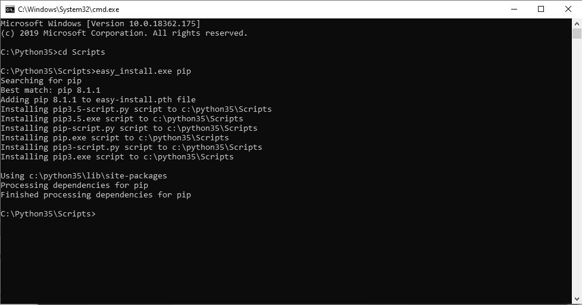

*   **步骤 3**：现在，你的下一步是为 `pip` 安装 python 的 `numpy` 包。Numpy 的安装将通过 `pip install numpy` 命令完成。如果你的 python 已经有了此包，它将显示 "Requirement already satisfied"，否则它将安装该包。使用 `pip list` 命令用于检查安装包。

    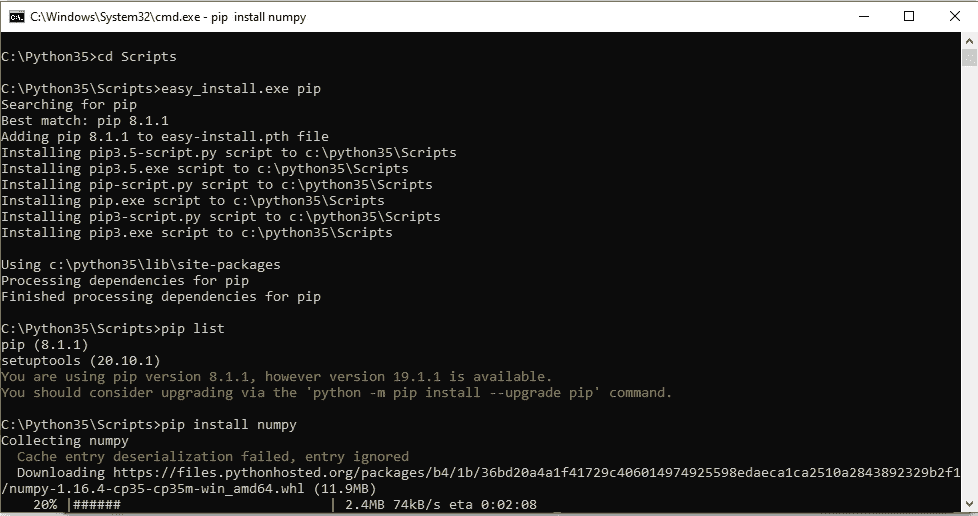

    下载完成后，它会显示成功消息并将光标带回 scripts 文件夹。

*   **步骤 4**：下一步是使用 `pip install scipy` 安装安装 另一个包 `scipy`。

    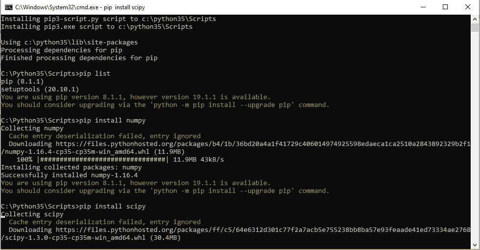

    下载完成后，你的光标会回到 scripts 文件夹。

    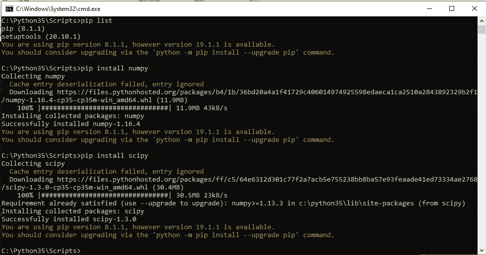

*   **步骤 5**：现在，使用 `pip list` 命令检查 PyTorch 需要的所有已安装包。

    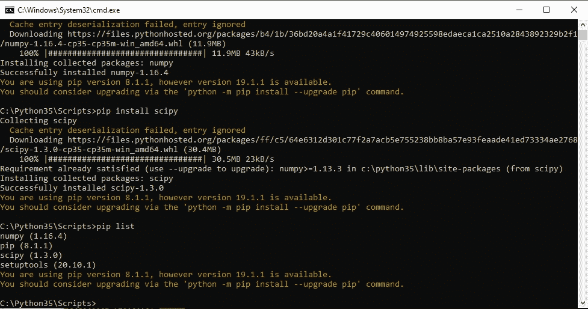

*   **步骤 6**：现在，你需要访问 [`pytorch.org/`](https://pytorch.org/) 获取 PyTorch 的安装命令。在这里，你必须选择偏好的 PyTorch 构建版本、操作系统、包、语言和 CUDA。它提供了两个命令在你的 windows 系统上安装 PyTorch。
*   **步骤 7**：下一步是在你的命令行提示符上运行这两个命令。记住，如果你对此命令进行了任何更改，它将无法安装 PyTorch 并给出错误信息。

    ```bash
    pip3 install https://download.pytorch.org/whl/cpu/torch-1.1.0-cp35-cp35m-win_amd64.whl
    ```

    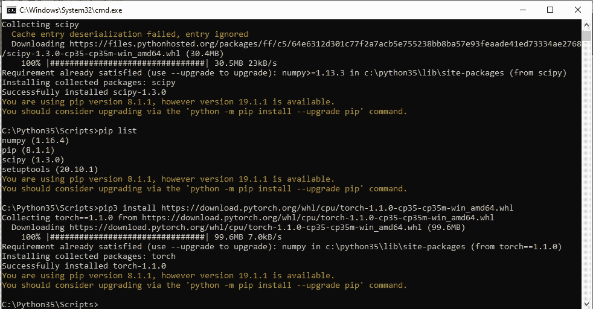

    ```bash
    pip3 install https://download.pytorch.org/whl/cpu/torchvision-0.3.0-cp35-cp35m-win_amd64.whl
    ```

    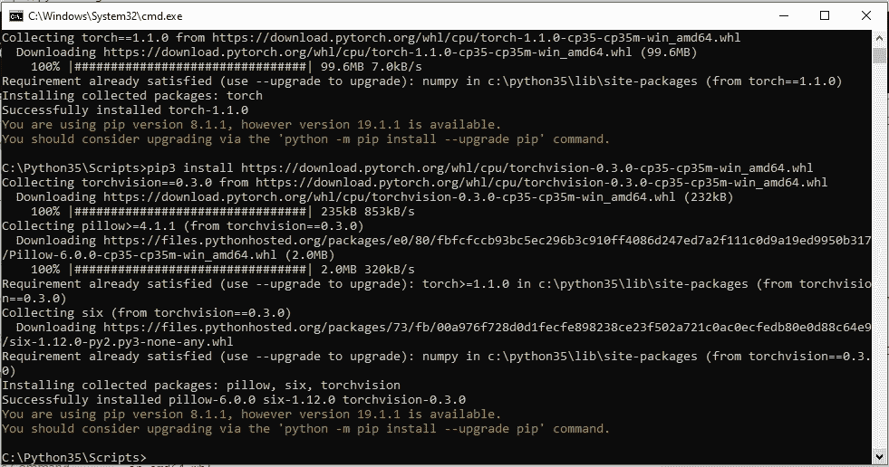

*   **步骤 8**：现在，重新运行 `pip list` 命令检查 PyTorch 是否成功运行。

    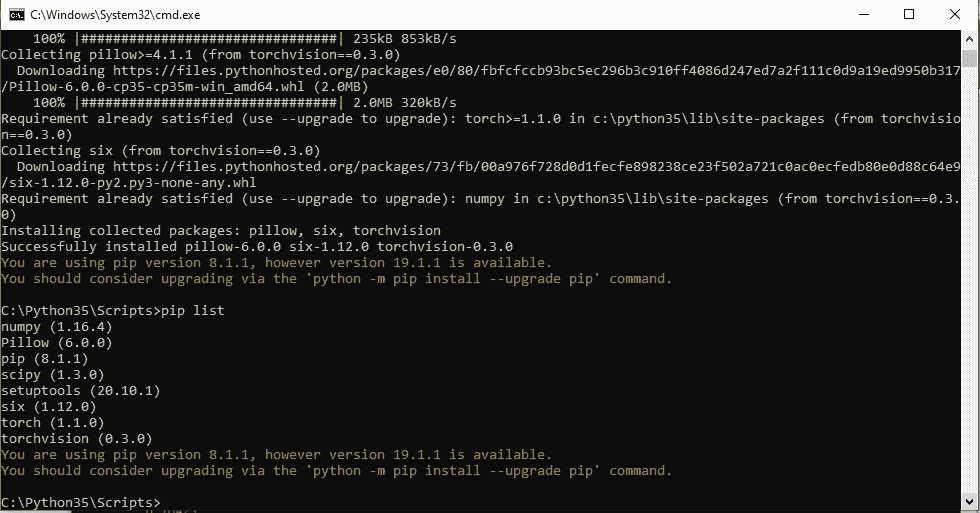

*   **步骤 9**：现在，测试 PyTorch。运行 `python` 命令进入 python 环境。导入 `torch` 以使用 PyTorch 并执行操作。

    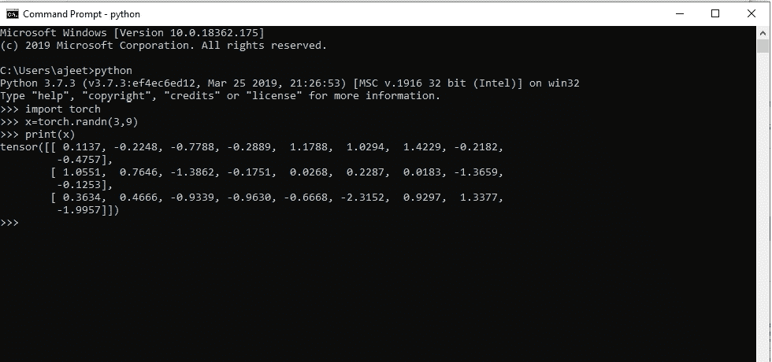

#### 使用 Conda 在 Windows 上安装

本教程定义了 PyTorch 的分步安装。要使用 `Conda` 安装 PyTorch，你必须遵循以下步骤

*   **步骤 1**：首先，你必须在系统中安装 `Anaconda` 的最新版本。要安装 `Anaconda`，你需要访问 [`www.anaconda.com/distribution/`](https://www.anaconda.com/distribution/)。

    

*   **步骤 2**：现在，运行 Anaconda 安装程序并完成安装。Anaconda 安装完成后，会出现 Anaconda 命令行提示符。

    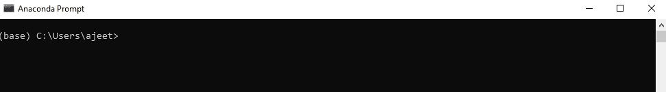

*   **步骤 3**：下一步是在 Anaconda 命令行提示符安装 PyTorch。要安装 PyTorch，你需要在命令行提示符上运行安装命令。该命令可以在 [`pytorch.org/`](https://pytorch.org/) 上找到。

    

    根据你的选择语言和 cuda 版本。

*   **步骤 4**：现在，运行 `python -version` 和 `Conda -version` 命令检查 `conda` 和 `python` 包是否已安装。之后，你在命令行提示符上运行给定的命令。记住，你在命令行上运行的命令与给定的命令相似。如果不相似，它将产生错误信息且安装失败。

    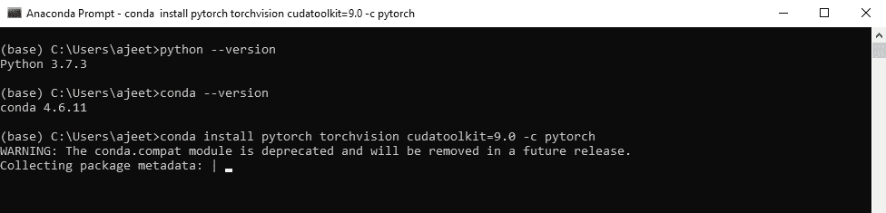

    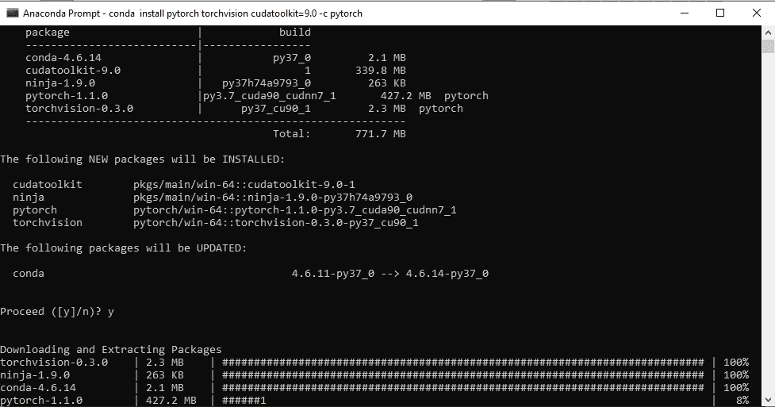

    下载并安装所有包需要一些时间。命令完成后，你的光标将切换到目录文件夹。

    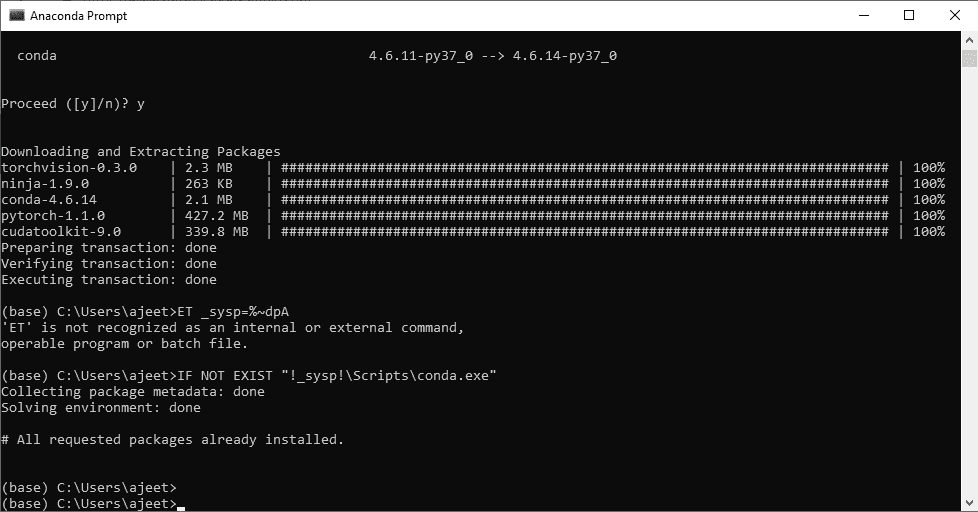

*   **步骤 5**：现在，执行 `conda list pytorch` 命令检查所有包是否成功安装。

    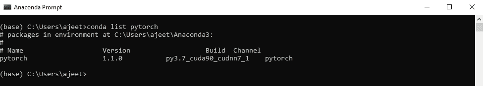

*   **步骤 6**：现在，测试 PyTorch。运行 `python` 命令进入 python 环境。导入 `torch` 以使用 PyTorch 并执行操作。

    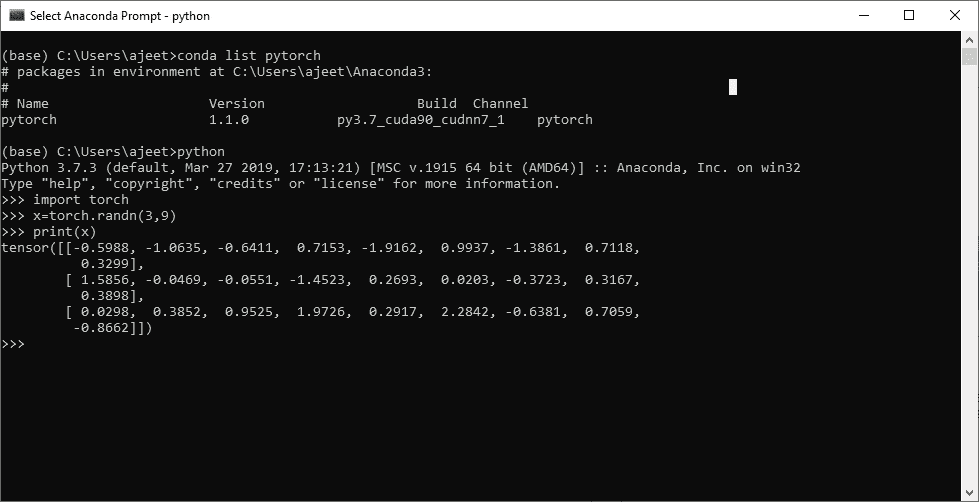

# 神经网络的数学基石

数学在任何机器学习算法中都至关重要，包含了许多核心数学概念，以便以特定的方式设计出正确的算法。数学对机器学习和数据科学的重要性下文所示−

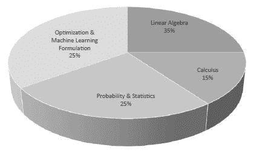

现在，让我们关注机器学习主要的数学概念，这些概念从自然语言处理的角度来看非常：

### 向量 (Vectors)

向量被认为是数值数组，可以是连续的也可以是离散的，由向量组成的空间称为向量空间。向量的空间维度可以是有限的或无限的，但观察发现，机器学习和数据科学问题处理的是固定长度的向量。向量的表示如下：

```python
temp = torch.FloatTensor([23, 24, 24.5, 26, 27.2, 23.0])
temp.size()
```

输出 - `torch.Size([6])`

在机器学习中，我们处理的是多维数据。因此，向量变得至关重要，并被视为任何预测问题的输入特征。

### 标量 (Scalars)

标量被认为是零维，仅包含一个值。在 PyTorch 中，它不包含零维的特殊张量；因此，声明如下−

```python
x = torch.rand(10)
x.size()
```

输出 - `torch.Size([10])`

### 矩阵 (Matrices)

大多数结构化数据通常以表格或特定矩阵的形式表示。我们将使用一个名为“波士顿房价”的数据集，它在 Python 的 scikit-learn 机器学习库中可用。

```python
boston_tensor = torch.from_numpy(boston.data)
boston_tensor.size()
```

输出：`torch.Size([506, 13])`

```python
boston_tensor[:2]
```

输出：第 0 到 7 列

0.0063 18.0000 2.3100 0.0000 0.5380 6.5750 65.2000 4.0900 0.0273 0.0000 7.0700 0.0000 0.4690 6.4210 78.9000 4.9671

第 8 到 12 列

1.0000 296.0000 15.3000 396.9000 4.9800 2.0000 242.0000 17.8000 396.9000 9.1400

# PyTorch - 神经网络基础

神经网络的主要原理包括了一系列基本元素，即人工神经元或感知器。它包含了几个基本输入，如 `x1`、`x2`…… `xn`，如果和大于激活电位，则会产生二值输出。示例神经元的示意图如下−

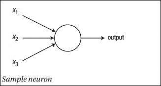

生成的输出可以被视为带有激活电位或偏置的加权和。`Output=∑jwjxj+Bias`

典型的神经网络架构描述如下−

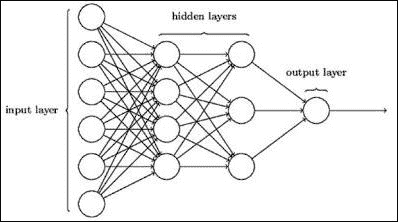

输入和输出之间的层被称为隐藏层。例如，全连接层具有稠密连接的隐藏层。各种类型的神经网络如下：

### 前馈神经网络 (Feedforward Neural Networks)

前馈神经网络包含基本单元。数据的运动是通过多个隐藏层从输入传递到输出的。

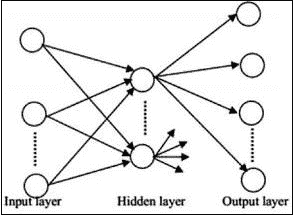

### 循环神经网络 (Recurrent Neural Networks)

当数据随时间变化时，使用循环神经网络。在 `RNN` 中，相同的层被用于接受输入。

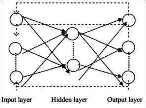

### 神经网络 (Neural Networks)

神经网络可以使用 `torch.nn` 构建。

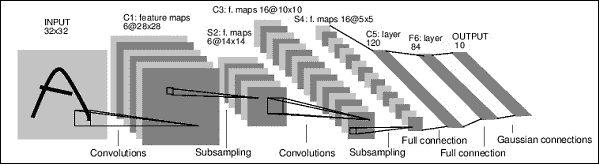

它接收输入并最终输出。通过 PyTorch 的帮助，我们可以使用以下步骤：

* 定义具有可学习参数的神经网络。
* 遍历数据集。
* 通过网络处理输入。
* 计算损失（输出与正确值的差值）。
* 将梯度回传到网络。
* 通常使用简单的公式更新网络权重：

```python
weight = weight - learning_rate * gradient
```

# 机器学习的通用工作流

人工智能如今非常流行。机器学习和深度学习构成了人工智能。下面的维恩图解释了机器学习和深度学习之间的关系。

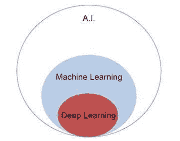

### 机器学习 (Machine Learning)

机器学习是一门科学艺术，允许计算机根据设计的算法运行。许多研究人员认为机器学习是实现人类水平人工智能的最佳途径。它包括多种类型：

* 监督学习
* 无监督学习

### 深度学习 (Deep Learning)

深度学习是机器学习的一个分支，相关算法受到大脑结构和功能的启发。深度学习通过监督学习或从标记数据中学习获得了巨大的重要性。深度学习中的每个算法都经过相同的过程。它包括输入的非线性变换并用于创建统计模型。机器学习过程通过以下步骤定义：

* 识别数据集并对其进行分析准备。
* 选择使用的算法类型。
* 基于算法构建分析模型。
* 在测试数据集上训练模型，根据需要进行修订。
* 运行模型生成测试评分。

# PyTorch - 机器学习 vs 深度学习

在本章中，我们将讨论机器学习和深度学习概念之间的主要区别。


### 数据量

机器学习适用于不同量的数据，并主要用于小量数据。另一方面，当数据量迅速增加时，深度学习运行得非常高效。

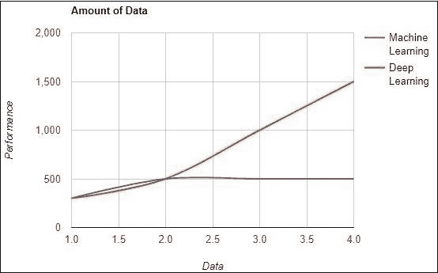

### 硬件依赖

深度学习算法的设计高度依赖于高端机器，这与传统的机器学习算法相反。深度学习算法执行大量的矩阵乘法运算，这需要巨大的硬件支持。

### 特征工程

特征工程是将领域知识放入特定特征中的过程，以减少数据的复杂性，并使学习算法的模式变得可见。例如，传统的机器学习模式关注像素以及特征工程过程所需的其他属性。深度学习算法关注数据中的高级特征。它减少了为每个新问题开发新特征提取器的任务。

# PyTorch - 实现第一个神经网络

PyTorch 包含用于创建和实现神经网络的特殊功能。在本章中，我们将创建一个包含一个隐藏层并开发单个输出单元的简单神经网络。我们将使用以下步骤来使用 PyTorch 实现第一个神经网络。

### 步骤 1：导入 PyTorch 库

首先，我们需要使用下面的命令导入 PyTorch 库：

```python
import torch
import torch.nn as nn
```

### 步骤 2：定义层和批大小

如下所示，定义所有层和批大小以开始执行神经网络：

```python
### 分别定义输入大小、隐藏层大小、输出大小和批大小
n_in, n_h, n_out, batch_size = 10, 5, 1, 10
```

### 步骤 3：创建伪数据

由于神经网络包含了输入数据获取相应的输出数据，我们将遵循下面的步骤操作：

```python
### 创建伪输入和目标张量（数据）
x = torch.randn(batch_size, n_in)
y = torch.tensor([[1.0], [0.0], [0.0], [1.0], [1.0], [1.0], [0.0], [0.0], [1.0], [1.0]])
```

### 步骤 4：创建顺序模型

借助内置函数创建一个顺序模型。使用下述代码创建一个顺序模型：

```python
### 创建一个模型
model = nn.Sequential(
    nn.Linear(n_in, n_h),
    nn.ReLU(),
    nn.Linear(n_h, n_out),
    nn.Sigmoid()
)
```

### 步骤 5：构建损失函数和优化器

如下所示，借助梯度下降优化器构建损失函数：

```python
### 构建损失函数准则
criterion = torch.nn.MSELoss()

### 构建优化器（在此情况下为随机梯度下降）
optimizer = torch.optim.SGD(model.parameters(), lr=0.01)
```

### 步骤 6：实现梯度下降

使用给定的代码行通过循环实现梯度下降模型：

```python
### 梯度下降
for epoch in range(50):
    # 前向传播：将 x 传递给模型以计算预测的 y
    y_pred = model(x)
    # 计算并打印损失
    loss = criterion(y_pred, y)
    print('epoch:', epoch, ' loss:', loss.item())
    
    # 零梯度，执行反向传播并更新权重。
    optimizer.zero_grad()
    # 执行反向传播 (backpropagation) 
    loss.backward()
    # 更新参数
    optimizer.step()
```

### 步骤 7：输出输出

生成的输出如下：

```
epoch: 0 loss: 0.2545787990093231
epoch: 1 loss: 0.2545052170753479
epoch: 2 loss: 0.254431813955307
epoch: 3 loss: 0.25435858964920044
epoch: 4 loss: 0.2542854845523834
epoch: 5 loss: 0.25421255826950073
epoch: 6 loss: 0.25413978099823
epoch: 7 loss: 0.25406715273857117
epoch: 8 loss: 0.2539947032928467
epoch: 9 loss: 0.25392240285873413
epoch: 10 loss: 0.25385022163391113
epoch: 11 loss: 0.25377824902534485
epoch: 12 loss: 0.2537063956260681
epoch: 13 loss: 0.2536346912384033
epoch: 14 loss: 0.25356316566467285
epoch: 15 loss: 0.25349172949790955
epoch: 16 loss: 0.25342053174972534
epoch: 17 loss: 0.2533493936061859
epoch: 18 loss: 0.2532784342765808
epoch: 19 loss: 0.25320762395858765
epoch: 20 loss: 0.2531369626522064
epoch: 21 loss: 0.25306645035743713
epoch: 22 loss: 0.252996027469635
epoch: 23 loss: 0.2529257833957672
epoch: 24 loss: 0.25285571813583374
epoch: 25 loss: 0.25278574228286743
epoch: 26 loss: 0.25271597504615784
epoch: 27 loss: 0.25264623761177063
epoch: 28 loss: 0.25257670879364014
epoch: 29 loss: 0.2525072991847992
epoch: 30 loss: 0.2524380087852478
epoch: 31 loss: 0.2523689270019531
epoch: 32 loss: 0.25229987502098083
epoch: 33 loss: 0.25223103165626526
epoch: 34 loss: 0.25216227769851685
epoch: 35 loss: 0.252093642950058
```

# PyTorch - 术语

在本章中，我们将讨论 PyTorch 中一些常用的术语。

## PyTorch NumPy

`PyTorch` 的张量（`tensor`）与 `NumPy` 数组是相同的。`tensor` 是一个 n 维数组，对于 `PyTorch` 而言，它提供了许多对这些张量进行操作的功能。`PyTorch` 张量通常利用 GPU 来加速数值计算。这些在 `PyTorch` 中创建的张量可以用于对随机数据拟合双层网络。用户可以手动实现通过网络的前向传播和反向传播。

### 变量与 Autograd

使用 `autograd` 时，网络的正向传播将定义一个计算图——图中的节点将是 `Tensors`，边将是根据输入 `Tensors` 产生输出 `Tensors` 的函数。`PyTorch` Tensors 可以被作为变量对象创建，其中变量代表计算图中的一个节点。

### 动态图

静态图的优点是用户可以预先对图进行优化。如果程序员反复反复使用同一个图，那么这种潜在的高昂的预先优化就可以被维持，因为同一个图会被反复运行。它们之间的主要区别是 `Tensor Flow` 的计算图是静态的，而 `PyTorch` 使用动态计算图。

### optim 包

PyTorch 中的 `optim` 包抽象了优化算法的概念，该算法通过许多方式实现实现，并提供了常用优化算法的示例说明。这可以在导入语句中调用。

### 多进程

多进程（`Multiprocessing`）支持相同的操作，使得所有张量都在多个处理器上运行。队列将将其数据移动到共享内存中并仅向另一个进程发送句柄。

# PyTorch - 加载数据

`PyTorch` 包含一个名为 `torchvision` 的包，用于加载和准备数据集。它包含了两个基本函数，即 `Dataset` 和 `DataLoader`，有助于数据集的转换和加载。

### Dataset

`Dataset` 用于从给定的数据集中读取并转换数据点。实现的基本语法如下所示：

```python
trainset = torchvision.datasets.CIFAR10(root='./data', train=True, download=True, transform=transform)
```

### DataLoader

`DataLoader` 用于数据的洗乱和分批处理。它可以配合多进程工作器并行加载数据。

```python
trainloader = torch.utils.data.DataLoader(trainset, batch_size=4, shuffle=True, num_workers=2)
```

### 示例：加载 CSV 文件

我们使用 Python 包 `Panda` 来加载 csv 文件。原始文件格式如下：(图像名称, 68 个关键点 - 每个关键点都有 x, y 坐标)。

```python
landmarks_frame = pd.read_csv('faces/face_landmarks.csv')
n = 65
img_name = landmarks_frame.iloc[n, 0]
landmarks = landmarks_frame.iloc[n, 1:].as_matrix()
landmarks = landmarks.astype('float').reshape(-1, 2)
```

# PyTorch - 线性回归

在本章中，我们将重点关注使用 `PyTorch` 实现线性回归的基本示例。逻辑回归或线性回归是一种用于离散类别分类的监督学习方法。本章的目标是构建一个模型，用户可以通过该模型预测变量与一个或多个独立变量之间的关系。这两个变量之间的关系被认为是线性的，即如果 `y` 是因变量而 `x` 被视为自变量，那么这两个变量的线性回归关系将看起来像下面提到的方程：

`Y = Ax+b`

接下来，我们将为线性回归设计一种算法，使我们能够理解下面的两个重要概念：

* 损失函数 (`Cost Function`)
* 梯度下降算法 (`Gradient Descent Algorithms`)

线性回归的示意图如下，解释结果 `Y=ax+b`：

* `a` 的值是斜率。
* `b` 的值是截距。
* `r` 是相关系数。
* `r 2` 是相关系数。

线性回归的图形视图如下，解释结果 `Y=ax+b`：

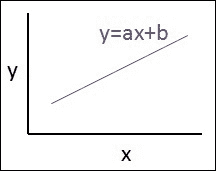

使用 `PyTorch` 实现线性回归的步骤如下：

### 第 1 步

导入用于在 PyTorch 中创建线性回归的必要包：

```python
import numpy as np
import matplotlib.pyplot as plt
import seaborn as sns
import pandas as pd
% matplotlib inline
sns.set_style('whitegrid')
```

### 第 2 步

创建一个带有可用数据的单个训练集：

```python
m = 2 # 斜率
c = 3 # 截距
x = np.random.rand(256)
noise = np.random.randn(256) / 4
y = x * m + c
df = pd.DataFrame()
df['x'] = x
df['y'] = y
```

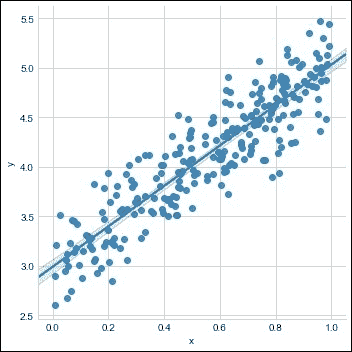

### 第 3 步

使用 `PyTorch` 实现线性回归：

```python
import torch
import torch.nn as nn
from torch.autograd import Variable

x_train = x.reshape(-1, 1).astype('float32')
y_train = y.reshape(-1, 1).astype('float32')

class LinearRegressionModel(nn.Module):
    def __init__(self, input_dim, output_dim):
        super(LinearRegressionModel, self).__init__()
        self.linear = nn.Linear(input_dim, output_dim)
    def forward(self, x):
        out = self.linear(x)
        return out

input_dim = x_train.shape[1]
output_dim = y_train.shape[1]
model = LinearRegressionModel(input_dim, output_dim)
criterion = nn.MSELoss()
[w, b] = model.parameters()

def get_param_values():
    return w.data[0][0], b.data[0]

def plot_current_fit(title=""):
    plt.figure(figsize=(12, 4))
    plt.title(title)
    plt.scatter(x, y, s=8)
    w1 = w.data[0][0]
    b1 = b.data[0]
    x1 = np.array([0., 1.])
    y1 = x1 * w1 + b1
    plt.plot(x1, y1, 'r', label='Current Fit ({:.3f}, {:.3f})'.format(w1, b1))
    plt.xlabel('x (input)')
    plt.ylabel('y (target)')
    plt.legend()
    plt.show()
```

`plot_current_fit('Before training')`

生成的图表如下：

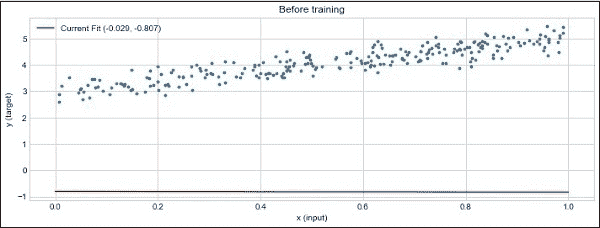

### 局部感受野

CNN 利用输入数据中存在的空间相关性。神经网络并发层中的每一层都连接某些输入神经元。这个特定区域被称为 `Local Receptive Field`（局部感受野）。它只关注隐藏神经元。隐藏神经元将处理上述区域内的输入数据，而不会感知到特定边界之外的变化。生成局部感受野的图示如下所示：

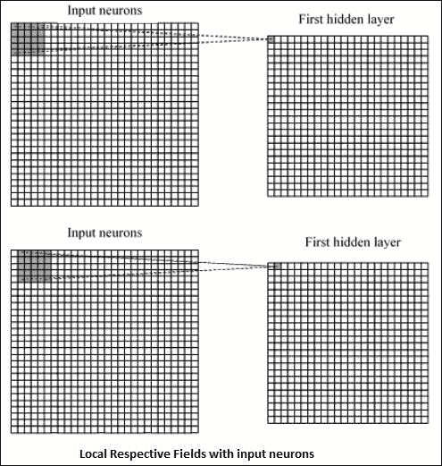

### 卷积

在上面的图中，我们观察到每个连接都学习了隐藏神经元的权重，该权重与从一层到另一层的移动连接相关联。在这里，单个神经元不时地执行位移。这个过程被称为“卷积”。从输入层到隐藏特征图的连接映射定义为“共享权重”（`shared weights`），包含的偏置则称为“共享偏置”（`shared bias`）。

### 池化

卷积神经网络使用池化层，这些层紧位于 CNN 声明之后。它将用户的输入作为卷积网络输出的特征图，并准备一个压缩的特征图。池化层有助于创建具有前一层神经元的后续层。

### PyTorch 的实现

使用以下步骤通过 PyTorch 创建卷积神经网络。

**步骤 1：导入创建简单神经网络所需的包。**

```python
from torch.autograd import Variable
import torch.nn.functional as F
```

**步骤 2：创建一个带有卷积神经网络批处理表示的类。** 我们的输入 `x` 的批处理形状维度为 (3, 32, 32)。

```python
class SimpleCNN (torch.nn.Module):
    def __init__(self):
        super(SimpleCNN, self).__init__()
        #输入通道 = 3, 输出通道 = 18
        self.conv1 = torch.nn.Conv2d(3, 18, kernel_size=3, stride=1, padding=1)
        self.pool = torch.nn.MaxPool2d(kernel_size=2, stride=2, padding=0)
        # 4608 个输入特征，64 个输出特征（见下方的尺寸流程）
        self.fc1 = torch.nn.Linear(18 * 16 * 16, 64)
        # 64 个输入特征，对于我们定义的 10 类输出 10 个
        self.fc2 = torch.nn.Linear(64, 10)
```

**步骤 3：计算第一次卷积的激活** 尺寸从 (3, 32, 32) 变为 (18, 32, 32)。维度尺寸从 (18, 32, 32) 变为 (18, 16, 16)。由于重塑神经网络输入层的数据维度，尺寸从 (18, 16, 16) 变为 (1, 4608)。请记住 `-1` 会从其他给定的维度推导出此维度。


```python
def forward(self, x):
    x = F.relu(self.conv1(x))
    x = self.pool(x)
    x = x.view(-1, 18 * 16 * 16)
    x = F.relu(self.fc1(x))
    # 计算第二个全连接层（激活稍后应用）
    # 尺寸从 (1, 64) 变为 (1, 10)
    x = self.fc2(x)
    return (x)
```

### PyTorch - 循环神经网络 (Recurrent Neural Network)

循环神经网络是一种面向深度学习的算法类型，它遵循顺序方法。在神经网络中，我们总是假设每个输入和输出都与所有其他层相互独立。这类神经网络被称为循环网络，是因为它们以顺序的方式进行数学计算，一个接一个地完成任务。下面的图说明了循环神经网络的完整方法和工作原理 − 

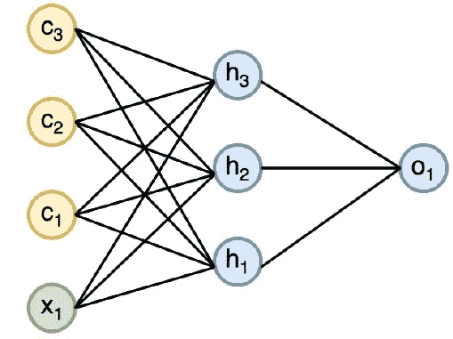

在上面的图中，`c1`、`c2`、`c3` 和 `x1` 被视为输入，其中了一些隐藏输入值 `h1`、`h2` 和 `h3`，它们提供了 `o1` 的相应输出。我们现在将关注使用 PyTorch 来通过循环神经网络创建一个正弦波。在训练期间，我们将遵循训练方法对模型进行一次处理一个数据点的训练。输入序列 `x` 包含 20 个数据点，目标序列被认为与输入序列相同。

**步骤 1：使用以下代码实现循环神经网络所需的包 −**

```python
import torch
from torch.autograd import Variable
import numpy as np
import matplotlib.pyplot as plt
import torch.nn as nn
import torch.nn.functional as F
import torch.optim as optim
```

**步骤 2：我们将设置超参数**

```python
input_size = 7
hidden_size = 6
output_size = 1
epochs = 300
lr = 0.1
seq_length = 20
time_steps = np.linspace(0, 2*pi, seq_length)
x = np.sin(time_steps)
y = x
x = Variable(torch.FloatTensor(x))
```

**步骤 3：使用正态分布初始化权重**

```python
w1 = Variable(torch.randn(input_size, hidden_size))
w2 = Variable(torch.randn(hidden_size, output_size))
```

**步骤 4：创建一个前向传播函数**

```python
def forward(input, context_state, w1, w2):
    xh = torch.cat((input, context_state), 1)
    context_state = torch.tanh(xh.mm(w1))
    out = context_state.mm(w2)
    return out, context_state
```

**步骤 5：开始训练程序**

```python
for i in range(epochs):
    total_loss = 0
    context_state = Variable(torch.zeros(1, hidden_size))
    for j in range(seq_length):
        input = x[j:j+1]
        target = y[j:j+1]
        pred, context_state = forward(input, context_state, w1, w2)
        loss = (pred - target).pow(2).sum()
        total_loss += loss
    loss.backward()
    w1.data -= lr * w1.grad.data
    w2.data -= lr * w2.grad.data
    w1.grad.data.zero_()
    w2.grad.data.zero_()
    if i % 10 == 0:
        print("Epoch: {} loss {}".format(i, total_loss.data[0]))
```

**步骤 6：绘制正弦波**

```python
context_state = Variable(torch.zeros(1, hidden_size))
predictions = []
for i in range(seq_length):
    input = x[i:i+1]
    pred, context_state = forward(input, context_state, w1, w2)
    context_state = context_state
    predictions.append(pred.data.numpy().ravel()[0])

plt.scatter(time_steps[:-1], x.data.numpy(), s=90, label="Actual")
plt.scatter(time_steps[1:], predictions, label="Predicted")
plt.legend()
plt.show()
```

上述过程的输出如下 − 

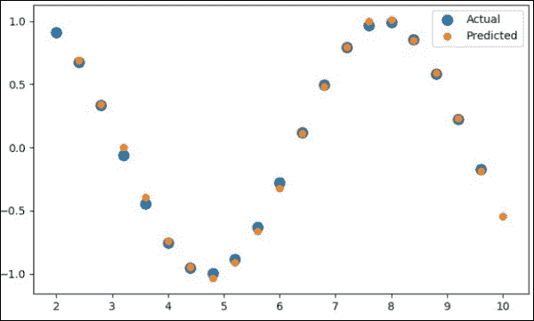

### PyTorch - 数据集 (Datasets)

在本章中，我们将更多地关注 `torchvision.datasets` 及其各种类型。PyTorch 包含以下数据集加载器：

*   MNIST
*   COCO (字幕与检测)

数据集主要包含以下两种类型的函数：

*   `Transform`：一个接收图像并返回其标准内容修改版本的的函数。这些转换可以组合在一起。
*   `Target_transform`：一个接收目标并对其进行转换的函数。例如，接收字幕字符串并返回单词索引的张量。

#### MNIST

以下是 `MNIST` `dataset` − `dset` 的示例代码。`MNIST(root, train=TRUE, transform=NONE, target_transform=None, download=FALSE)` 的参数如下 −

*   `root` — 存储处理后数据的根目录。
*   `train` — `True` = 训练集，`False` = 测试集。
*   `download` — `True` = 从互联网下载数据集并放入 `root` 中。

#### COCO

这需要安装 `COCO` API。以下示例演示了如何使用 PyTorch 实现 `COCO` 数据集 −

```python
import torchvision.dataset as dset
import torchvision.transforms as transforms
cap = dset.CocoCaptions(root='dir where images are', annFile='json annotation file', transform=transforms.ToTensor())
print (' Number of samples: ', len(cap))
print (target)
```

获取的输出如下 −

Number of samples: 82783

Image Size: (3L, 427L, 640L)

### PyTorch - 卷积网络简介

卷积网络主要是关于从零开始构建 `CNN` 模型。网络架构包含以下步骤的组合 −

*   `Conv2d`
*   `MaxPool2d`
*   `Rectified Linear Unit`（线性整流单元）
*   `View`
*   `Linear Layer`（线性层）

#### 训练模型

训练模型的过程与图像分类问题相同。以下代码片段完成了在提供的数据集上训练模型 −

```python
def fit(epoch, model, data_loader, phase='training', volatile=False):
    if phase == 'training':
        model.train()
    if phase == 'training':
        model.train()
    if phase == 'validation':
        model.eval()
    volatile = True
    running_loss = 0.0
    running_correct = 0
    for batch_idx, (data, target) in enumerate(data_loader):
        if is_cuda:
            data, target = data.cuda(), target.cuda()
        data, target = Variable(data, volatile), Variable(target)
        if phase == 'training':
            optimizer.zero_grad()
            output = model(data)
            loss = F.nll_loss(output, target)
            running_loss += F.nll_loss(output, target, size_average=False).data[0]
        preds = output.data.max(dim=1, keepdim=True)[1]
        running_correct += preds.eq(target.data.view_as(preds)).cpu().sum()
        if phase == 'training':
            loss.backward()
            optimizer.step()
        loss = running_loss/len(data_loader.dataset)
        accuracy = 100.*running_correct/len(data_loader.dataset)
        print(f'{phase} loss is {loss:5.2f} and {phase} accuracy is {running_correct}/{len(data_loader.dataset)}{accuracy:.2f}')
    return loss,accuracy
```

该方法包含了训练和验证的逻辑逻辑。使用不同模式有两个主要原因 −

*   在 `train` 模式下，`dropout` 会移除一定比例的值，这在验证或测试阶段是不应该发生的。
*   对于 `training` 模式，我们会计算梯度并改变模型的参数值，但是。

### PyTorch - 训练卷积网络

在本章中，我们将重点关注从零开始创建一个卷积网络。

#### Step 1 

创建一个带有参数的必要类。参数包括随机值。

```python
class NeuralNetwork(nn.Module):
    def __init__(self):
        super(NeuralNetwork, self).__init__()
        self.inputSize = 2
        self.hiddenSize = 3
        self.outputSize = 1
        self.fc1 = nn.Linear(self.inputSize, self.hiddenSize)
        self.fc2 = nn.Linear(self.hiddenSize, self.outputSize)
```

#### Step 2 

创建一个带有 sigmoid 的前传播函数。

```python
def forward(self, x):
    l1 = F.relu(self.fc1(x))
    l2 = torch.sigmoid(self.fc2(l1))
    return l2
```

#### Step 3 

按照如下所示创建训练和预测 −

```python
def save(model, path):
    # 实现保存逻辑
    torch.save(model.state_dict(), path)

def load(model, path):
    # 实现加载逻辑
    model.load_state_dict(torch.load(path))
```

### PyTorch - 特征提取

卷积网络包含一个主要特征。为了获得传统神经网络可视化的完美效果，需要执行以下步骤。

#### Step 1 

导入相应的模型以创建特征。

```python
import torch
import torch.nn as nn
from torchvision import models
```

#### Step 2 

创建一个特征提取器类。

```python
cnn = nn.Sequential(
    nn.Conv2d(1, 10, kernel_size=5),
    nn.ReLU(),
    nn.MaxPool2d(2),
    nn.Conv2d(10, 20, kernel_size=5),
    nn.ReLU(),
    nn.MaxPool2d(2),
    nn.Flatten(),
    nn.Linear(20 * 4 * 4, 10)
    nn.ReLU(),
    nn.Linear(10, 2)
)

class Feature_extractor(nn.Module):
    def __init__(self):
        super(Feature_extractor, self).__init__()
        self.cnn = cnn
    def forward(self, input):
        return self.cnn(input)
```

### PyTorch - 卷积网络可视化

在本章中，我们将重点通过卷积网络来实现数据可视化模型。

#### Step 1 

导入对于传统神经网络可视化至重要的模块。

```python
import os
import numpy as np
import pandas as pd
from scipy.misc import imread
from sklearn.metrics import accuracy_score
import keras
from keras.models import Sequential, Model
from keras.layers import Dense, Dropout, Flatten, Activation, Input
from keras.layers import Conv2D, MaxPooling2D
import torch
```

#### Step 2 

为了消除训练和测试数据的潜在随机性，按照下方代码调用相应的数据集 −

```python
seed = 128
rng = np.random.RandomState(seed)
data_dir = "../../datasets/MNIST"
train = pd.read_csv('../../datasets/MNIST/train.csv')
test = pd.read_csv('../../datasets/MNIST/Test_fCbTej3.csv')
img_name = rng.choice(train.filename)
filepath = os.path.join(data_dir, 'train', img_name)
img = imread(filepath, flatten=True)
```

#### Step 3 

使用下方代码以完美的方式绘制定义的训练和测试数据图像 −

```python
pylab.imshow(img, cmap='gray')
pylab.axis('off')
pylab.show()
```

### PyTorch - 使用卷积进行序列处理

在本章中，我们提出了一种替代方法，该方法在两个序列上依赖于单个 2D 卷积神经网络。我们网络的每一层都会根据目前为止生成的输出序列对源标记进行重新编码。因此，类似于注意力的属性贯穿整个网络。在这里，我们将关注如何利用数据集中包含的值通过特定的池化创建序列网络。此过程最适用于“图像识别模块”。

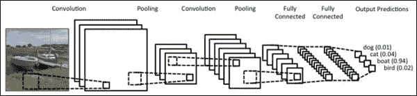

使用以下步骤通过 PyTorch 使用卷积创建序列处理模型 −：

#### 步骤 1：导入使用卷积进行序列处理所需的必要模块。

```python
import keras
from keras. datasets import mnist
from keras.models import Sequential
from keras.layers import Dense , Dropout , Flatten
from keras.layers import Conv2D , MaxPooling2D
import numpy as np
```

#### 步骤 2：使用以下代码在相应序列中执行必要操作创建模式 −


```python
batch_size = 128
num_classes = 10
epochs = 12
### 输入图像维度
img_rows, img_cols = 28 , 28
### 数据划分为训练集和测试集
(x_train, y_train), (x_test, y_test) = mnist.load_data()
x_train = x_train.reshape( 60000 , 28 , 28 , 1 )
x_test = x_test.reshape( 10000 , 28 , 28 , 1 )
print ( 'x_train shape:' , x_train.shape)
print ( x_train.shape[0], 'train samples' )
print ( x_test.shape[0], 'test samples' )
y_train = keras.utils.to_categorical( y_train, num_classes)
y_test = keras.utils.to_categorical( y_test, num_classes)
```

### 步骤 3：编译模型并在上述传统神经网络模型中拟合模式，如下所示 −

```python
model.compile(loss = keras.losses.categorical_crossentropy, optimizer = keras.optimizers.Adadelta(), metrics = ['accuracy'])
model.fit(x_train, y_train, batch_size = batch_size, epochs = epochs, verbose = 1, validation_data = (x_test, y_test))
score = model.evaluate(x_test, y_test, verbose = 0)
print('Test loss:', score[0])
print('Test accuracy:', score[1])
```

生成的输出如下 −

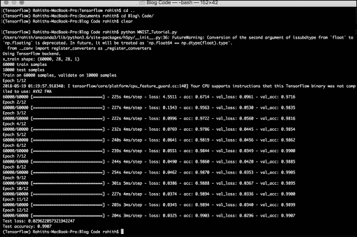

# PyTorch - 词嵌入 (Word Embedding)

在本章中我们将著名的词嵌入模型 —— word2vec。Word2vec 模型用于通过一组相关模型的帮助生成词嵌入。Word2vec 模型用纯 C 代码实现，梯度是手动计算的。PyTorch 中 word2vec 模型的实现通过以下步骤解释 −

### 步骤 1：按照下述实现词嵌入中的库 −

```python
import torch
from torch.autograd import Variable
import torch.nn as nn
import torch.nn.functional as F
```

### 步骤 2：使用名为 word2vec 的类实现词嵌入的 Skip Gram 模型。它包含了 `emb_size`、`emb_dimension`、`u_embedding`、`v_embedding` 等类型的属性。

```python
class SkipGramModel (nn.Module):
    def __init__(self, emb_size, emb_dimension):
        super(SkipGramModel, self).__init__()
        self.emb_size = emb_size
        self.emb_dimension = emb_dimension
        self.u_embeddings = nn.Embedding(emb_size, emb_dimension, sparse=True)
        self.v_embeddings = nn.Embedding(emb_size, emb_dimension, sparse=True)
        self.init_emb()

    def init_emb(self):
        initrange = 0.5 / self.emb_dimension
        self.u_embeddings.weight.data.uniform_(-initrange, initrange)
        self.v_embeddings.weight.data.uniform_(-0, 0)

    def forward(self, pos_u, pos_v, neg_v):
        emb_u = self.u_embeddings(pos_u)
        emb_v = self.v_embeddings(pos_v)
        score = torch.mul(emb_u, emb_v).squeeze()
        score = torch.sum(score, dim=1)
        score = F.logsigmoid(score)
        neg_emb_v = self.v_embeddings(neg_v)
        neg_score = torch.bmm(neg_emb_v, emb_u.unsqueeze(2)).squeeze()
        neg_score = F.logsigmoid(-1 * neg_score)
        return -1 * (torch.sum(score) + torch.sum(neg_score))

    def save_embedding(self, id2word, file_name, use_cuda):
        if use_cuda:
            embedding = self.u_embeddings.weight.cpu().data.numpy()
        else:
            embedding = self.u_embeddings.weight.data.numpy()
        fout = open(file_name, 'w')
        fout.write('%d %d\n' % (len(id2word), self.emb_dimension))
        for wid, w in id2word.items():
            e = embedding[wid]
            e = ' '.join(map(lambda x: str(x), e))
            fout.write('%s %s\n' % (w, e))

    def test():
        model = SkipGramModel(100, 100)
        id2word = dict()
        for i in range(100):
            id2word[i] = str(i)
        model.save_embedding(id2word)
```

### 步骤 3：实现主方法以正确的方式显示词嵌入。

```python
if __name__ == '__main__':
    test()
```

# PyTorch - 递归神经网络 (Recursive Neural Networks)

深度神经网络在机器学习理解自然语言过程方面具有独特的突破性。观察到，大多数此类模型将语言视为单词或字符的平坦序列，并使用一种被称为循环神经网络或 RNN 模型。许多研究人员得出结论，语言最好通过短语的层次树来理解。这种类型包含了考虑特定结构的递归神经网络。PyTorch 具有一种特定特性，可以让这些复杂的自然语言处理模型变得简单得多。

## 递归神经网络的特征

-   递归神经网络的创建方式允许在不同的图结构上应用相同的权重集。

-   节点按照拓扑顺序进行遍历。

-   这类网络通过自动微分的反向模式进行训练。

-   自然语言处理包含了递归神经网络的一个特例。

-   这种递归张量网络在树中包含了各种组合功能节点。

递归神经网络的示例下所示 −

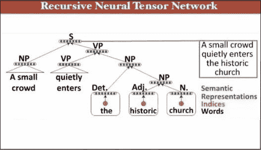

感谢！
