# 
SPSS 定量数据分析：健康与社会科学入门指南


All rights reserved. Except for the quotation of short passages for the purpose of criticism and review, no part of this publication may be reproduced, stored in a retrieval system, or transmitted, in any form or by any means, electronic, mechanical, photocopying, recording or otherwise, without the prior written permission of the publisher or a licence from the Copyright Licensing Agency Limited. Details of such licences (for reprographic reproduction) may be obtained from the Copyright Licensing Agency Ltd of Saffron House, 6–10 Kirby Street, London EC1N 8TS.
A catalogue record of this book is available from the British Library


## Introduction

I remember reading somewhere that for every mathematical formula, included in a book, the sales would be reduced by half. So guess what, there are no formulas, equations or mathematical calculations in this book. This is a *practical* introduction to quantitative data analysis using the most widely available statistical software – SPSS (Statistical Package for the Social Sciences). The aim is to get students and professionals past that first hurdle of dealing with quantitative data analysis and statistics.

The book is based upon a simple scenario: a local doctor has conducted a brief patient satisfaction questionnaire about the counselling service offered at his health centre. The doctor, having no knowledge of quantitative data analysis, sends the data from 30 questionnaires to you, the researcher, for analysis.

The book begins by exploring the types of data that are produced from this questionnaire and the types of analysis that may be conducted on the data. The subsequent chapters explain how to enter the data into SPSS and conduct the various types of analyses in a very simple step-by-step format, just as a researcher might proceed in practice.

Each of the chapters should take about an hour to complete the analysis and exercises. So, in principle, the basic essentials of quantitative data analysis and SPSS may be mastered in a matter of just six hours of independent study. The chapters are listed below with a brief synopsis of their content.
There is also a final concluding chapter which provides advice on how to structure the report of a quantitative study and how *not* to present data.

## The approach

Quantitative data analysis and statistics is often a frightening hurdle for many students in the health and social sciences, so my primary concern has been to make the book as simple and accessible as possible. This quest for simplicity starts with the fact that the student has only one dataset to familiarize themselves with – and that dataset itself is very simple: a patient satisfaction questionnaire consisting of just five questions.

The questionnaire is, however, designed to yield a range of statistical analyses and should hopefully illustrate the potentially complex levels of analyses that can arise from just a few questions. This will also act as a warning to students who embark upon research projects involving complex designs without fully appreciating how they will actually analyse the data. My advice to students who are new to research is always to ‘keep it simple’ and, where possible, to design the study according to the statistics they understand.

I have taken a pragmatic approach to quantitative data analysis which means that I have focused on the practicalities of doing the analyses rather than ruminating on the theoretical underpinnings of statistical principles. And since actually doing the analyses requires knowledge of appropriate statistical software, I have chosen to illustrate this using the most widely available and comprehensive statistical package in universities: SPSS. Thus, by the end of this book you should not only be able to select the appropriate statistical test for the data, you should also be able to conduct the analysis and produce the results using SPSS.

## The scope of the book

I have set a distinct limit to the level of analysis which I think is appropriate for an introductory text. This limit is the analyses of two variables – known as bi-variate analyses. In my experience of teaching health and social science students, most of whom are new to quantitative data analysis and statistics, this is sufficient for an introduction.

Also, I did not want to scare people off with a more imposing tome covering things like *logistic regression* and *factorial ANOVA.* There are many other books which include these more advanced statistics, some of which are listed in the references. This book is designed to get people started with quantitative data 3 Page 3analysis using SPSS; as such it may provide a platform for readers to consult these texts with more confidence.

## The audience: health and social sciences

As an introduction to quantitative data analysis, this book should be relevant to undergraduates, postgraduates or diploma level students undertaking a first course in quantitative research methods. I have used these materials to teach students from a variety of backgrounds including health, social sciences and management.


if (condVar > someVal) {console.log("xxx")}
```


## 变量类型（或测量水平）

1. 1*区间或比率:* 这是一种数据形式，数值在等距的尺度上从低到高。身高和体重是显而易见的例子。在我们的数据中，这也适用于年龄、咨询会话次数和患者满意度评分。

2. 2*有序:* 这是一种可以按顺序排列的数据。例如，赛跑者的名次顺序——第 1 名、第 2 名、第 3 名，以此类推。请注意，这并不告诉我们第 1 名比第 2 名快多少，或者第 2 名比第 3 名快多少。因此，在比赛中，冠军可能用时 20 秒，亚军用时 21 秒，而第三名可能用时 30 秒。第 1 名与第 2 名之间只相差 1 秒，而第 2 名与第 3 名之间相差 9 秒。我们样本中是否有这种数据？没有（不过请参阅方框 1.2 以获取进一步讨论）。

3. 3*类别或名义:* 这是一种代表不同类别的数据，而非尺度。在我们的数据中，这包括：性别（男或女）和咨询师（John 或 Jane）。因此，如果我们为这些类别分配数字（如我们将要做的），这些数字本身没有顺序，因为它们只是对类别的任意赋值——例如，将男性编码为 1，女性编码为 2，这并不意味着 1 比 2 有更高的顺序，只是对类别的随意编号。

区分这些测量水平很重要，因为*我们能对问卷数据进行的分析类型取决于数据的类型*——如表 1.1 所示。


表格列出了数据类型（包括类别和区间数据），第一列为数据类型，第二列为对应的描述性统计。

我们现在将逐一探讨这些类别。

## 类别数据的描述性统计

*频数*。研究人员首先对问卷数据进行的通常操作是‘运行频数’。这意味着我们会查看分类问题的数值和百分比，9 Page 9 之后我们将称这些问题为‘变量’（因为数据会根据回答者的性别、年龄、满意程度等而*变化*：男/女、老/年轻、满意/不满意等）。

* 有多少男性/女性被转介进行咨询？他们的比例是否相似？男性或女性是否更多？

* 有多少患者由 John 和 Jane 看到？他们是否都见到了相似数量的患者？

*交叉表*。下一步可能是对这些数据进行交叉表，以获取关于这两个变量之间关系的更具体信息。例如，假设我们收集了 200 名患者的数据，并且在对每个变量进行频数分析后，我们得到了以下结果：


表格列出了患者的性别和总计，第一列为类别，第二列和第三列为对应的数量和百分比。
**表 1.3** 患者所见咨询师

表格列出了咨询师的姓名和总计，第一列为类别，第二列和第三列为对应的数量和百分比。

虽然这些表格告诉我们 50%的患者是男性，且每位咨询师各看了 50%的患者，但它们并不能告诉我们*这两个变量之间的关系*：男性和女性患者是否均匀分布在两位咨询师之间，或者是否所有女性患者都看 Jane、所有男性患者都看 John？为了找出这一点，我们需要对数据进行交叉表。可能得到以下表格：
**表 1.4** 性别与咨询师的交叉表

表格列出了患者的性别和总计，第一列为类别，第二列和第三列为 John 和 Jane 的对应数量，第四列为总计。

在这个例子中，我们可以看到共有 100 名男性和 100 名女性患者（行总计）。我们也可以看到两位咨询师各看了 100 名患者（列总计）。然而，这个交叉表还显示患者在两位咨询师之间并不均匀分布：80%的男性看了 John，80%的女性看了 Jane。如果患者是随机分配到 10 位咨询师中的任意一位，我们期望每位咨询师看到的比例相似。因此，在这个假设情境中，男性患者倾向于看男性咨询师，女性患者倾向于看女性咨询师，这可能对医生有重要意义。例如，如果一位咨询师计划离职，医生需要招聘另一位咨询师，这可能提示需要确保有男性和女性咨询师以满足患者偏好。

## 区间数据的描述性统计：中心趋势度量

在对分类变量进行‘运行频数’和交叉表后，我们接下来会关注包含*区间数据*的其他变量：年龄、咨询会话次数和满意度评分。如果我们想对这些项目提供摘要信息，使用*中心趋势度量*（平均值、中位数或众数）会更有用。

*平均值*。算术平均值是最常用的中心趋势度量。它是所有分数的总和除以分数的数量。因此，在下面的例子中，我们只需将年龄的总和除以患者数量：355/11 = 32。因此，患者的平均年龄为 32 岁。


| 患者: | 1 | 2 | 3 | 4 | 5 | 6 | 7 | 8 | 9 | 10 | 11 | Sum |
| --- | --- | --- | --- | --- | --- | --- | --- | --- | --- | --- | --- | --- |
| 年龄: | 46 | 23 | 34 | 25 | 28 | 31 | 23 | 40 | 36 | 45 | 24 | 355 |

表格列出了 1 到 11 号患者的编号，对应的年龄在第二行，最后一列为年龄总和。

*中位数*。中位数是另一种常见的中心趋势度量。它是有序分布的中间值。因此，如果我们*按从低到高对患者的年龄进行排序*，结果如下：

**表 1.6** 找到中位数年龄
| 患者: | 1 | 2 | 3 | 4 | 5 | **6** | 7 | 8 | 9 | 10 | 11 |
| --- | --- | --- | --- | --- | --- | --- | --- | --- | --- | --- | --- |
| 年龄: | 23 | 23 | 24 | 25 | 28 | **31** | 34 | 46 | 40 | 45 | 46 |

表格列出了 1 到 11 号患者的编号，对应的年龄在第二行。

中位数是中间的数值，这里是 31。

如果你有偶数个案例——没有唯一的中间数，则取这两个数的中点：

**表 1.7** 在偶数个案中找到中位数年龄
| 患者: | 1 | 2 | 3 | 4 | **5** | **6** | 7 | 8 | 9 | 10 |
| --- | --- | --- | --- | --- | --- | --- | --- | --- | --- | --- |
| 年龄: | 23 | 23 | 24 | 25 | **28** | **31** | 34 | 46 | 40 | 45 |


-   [表格列出了患者编号 1 到 10 的行 1，对应的年龄在行 2。](https://wiki.example.org/feynmans_learning_method)

1.  你只需计算这两个中心值的中点：(28+31)/2 = 29.5

*`Mode`*。众数，通常用处较少，就是出现频率最高的值。在上面的年龄例子中，众数是 23 – 因为 11 页 11 页出现了两次 – 其余所有年龄只出现一次。例如，鞋类制造商可能会使用众数来了解人群中最常见的鞋码。

*何时应引用平均值或中位数？* 在上面的数据中，包含了 11 位患者的年龄（表 1.5 和 1.6），我们看到平均值为 32 岁，而中位数仅小一岁，为 31 岁。这两个数值非常接近。然而，在某些数据中，平均值和中位数可能差异很大。请参考以下示例，展示了小公司员工的工资：


| 员工: | 1 | 2 | 3 | 4 | **5** | 6 | 7 | 8 | 9 | 总计 |
| --- | --- | --- | --- | --- | --- | --- | --- | --- | --- | --- |
| 工资: | 8,000 | 8,000 | 9,000 | 9,000 | **10,000** | 11,000 | 11,000 | 40,000 | 45,000 | 151,000 |

这里，工资的中位数是 10,000 英镑，而平均工资实际上是：151,000 / 9 = 16,777 英镑。这显然不是衡量中心趋势的合适指标，因为大多数员工（七分九）的工资远低于平均工资！从这个例子可以看出，少数极端值会扭曲数据集的平均值。在这种情况下，我们应该引用中位数，因为它更具代表性。

Darrell Huff（1991），在其经典短篇著作 *How to Lie with Statistics* 中指出，关于常用词汇“average”（大致指中心值）的歧义是统计欺骗的常见手段。例如，杂志可能会引用读者的较大平均收入（而非中位数），以营造更富裕的阅读群体形象，从而吸引更多广告收入。统计学上，“average”通常指算术平均值。

*正态分布*。统计学上，当数据呈正态分布时应使用平均值。例如，如果我们调查 30 位从超市出来的顾客，我们可能会预期有少数非常年轻和非常年长的顾客，但大多数顾客的年龄在 30–60 岁之间。这在 Figure 1.2 中有所体现。

这里我们可以看到，大多数人年龄在 30 到 60 岁之间，平均年龄和中位数几乎相同：平均年龄 = 40.5 岁；中位数年龄 = 40 岁。

然而，当数据不是正态分布、呈偏态（偏向低端或高端）时，平均值和中位数不相等。回到我们员工工资的例子（数据更大），如果几位员工拿到非常高的工资，我们可能会得到如 Figure 1.3 所示的分布。

这被称为偏态分布，因为数据倾向于分布在刻度的一端——这里是偏向较高工资的那一端——而大多数人的工资（如中位数所示）位于刻度的低端。

我们需要检查区间数据的离散程度，以判断平均值还是中位数更能代表中心趋势。如果有 12 条明显偏态的数据，平均值可能不可靠。我们稍后会看到，正态或偏态分布也会决定应使用哪种统计检验来分析数据。

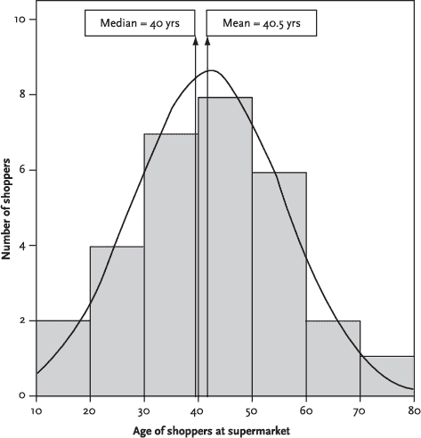

**Figure 1.2**Supermarket shoppers: age normally distributed

## Section summary

我们已考虑了从医生问卷中*描述*数据的各种方式。我们看到，分类数据可以通过频数和交叉表来描述，区间数据则可以通过中央趋势的度量——平均值、中位数和众数——来描述。我们还看到，是否引用平均值或中位数取决于数据的分布。数据呈正态分布时可使用平均值，而数据极度偏向一端时，中位数可能更可靠。

*我们如何将这应用于我们的咨询数据？* 我们可以通过总结区间数据来回答以下问题：

*   就诊患者的平均年龄是多少？

*   就咨询的平均场次数是多少？

*   大多数患者是否满意于服务？满意度的平均分是多少？

13 页 13 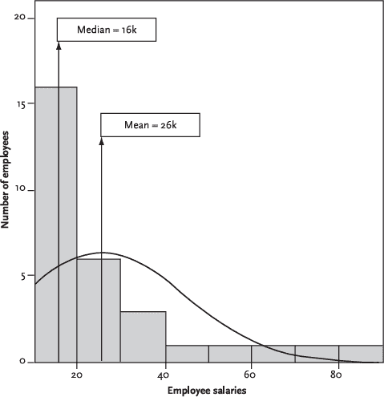

**Figure 1.3**Employee salaries: skewed distribution

请注意，我在上述问题中使用了平均值。最合适的中心趋势度量当然是平均值或中位数，这取决于数据的分布。同时引用两者并不奇怪，以此展示平均值的可靠性（或其不可靠性）。

## 1.2.2 关系与差异的分析

我们可以对区间数据进行两种进一步的分析：

*   考察变量之间的*关系*。

*   考察两组分数之间的*差异*。

### 使用区间数据考察变量之间的关系：相关性

我们已经使用交叉表对分类数据之间的关系进行了分析。对于区间数据——例如年龄——我们可以使用另一种技术，即相关性。

相关性展示两个变量之间的方向和强度。例如，我们可能预期身高和鞋码之间存在关系—— taller people have larger feet（ taller 人有更大的脚）。

Figure 1.4 展示了 30 人的身高与鞋码散点图，可以看到随着身高增加，鞋码也随之增加。这称为正相关：当点图在左至右上升的线条上越紧密时，相关性越强。

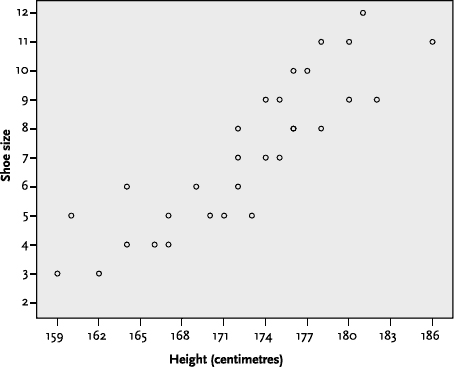

**Figure 1.4**Positive correlation between height and shoe size

负相关则是相反的：一变量的高分对应另一变量的低分。例如，我们可能发现 IQ 分数与每周观看真人秀的小时数之间存在负相关，如 Figure 5.1 所示（假设数据）。

从散点图中我们可以看到，线条从左至右呈下降趋势，与身高与鞋码的图表方向相反。

最后，我们不太可能发现 IQ 与鞋码之间存在关联，如 Figure 1.6 所示，两者之间没有可辨的相关性。^()

在 第 5 章 我们将学习如何在 SPSS 中生成这些散点图。

*我们如何将这应用于咨询数据？* 首先，我们需要找出两个可能相关的区间变量。我们有三个可选：年龄、咨询场次数和满意度评分。


-   [Table 2.1]的数据来自 30 份问卷，每一行代表一位患者的信息，包括性别、年龄、所见咨询师、就诊次数以及满意度评分。

**Table 2.1** Data from the counselling satisfaction questionnaire

|  *Patient*  || *Sex* || *Age* || *Counsellor* || *Sessions* || *Satisfaction* |

| --- | --- | --- | --- | --- | --- |

| 1 || male || 21 || John || 8 || 5 |

| --- | --- | --- | --- | --- | --- |

| 2 || male || 22 || John || 8 || 4 |

| 3 || male || 25 || John || 9 || 7 |

| 4 || female || 36 || Jane || 6 || 2 |

| 5 || male || 41 || Jane || 4 || 1 |

| 6 || female || 28 || Jane || 5 || 3 |

| 7 || male || 26 || John || 12 || 5 |

| 8 || female || 38 || Jane || 7 || 3 |

| 9 || male || 35 || John || 10 || 5 |

| 10 || male || 24 || John || 11 || 6 |

| 11 || female || 41 || Jane || 6 || 4 |

| 12 || female || 34 || Jane || 9 || 5 |

| 13 || male || 32 || John || 9 || 4 |

| 14 || female || 38 || Jane || 5 || 1 |

| 15 || male || 33 || John || 12 || 5 |

| 16 || female || 42 || Jane || 7 || 5 |

| 17 || male || 31 || John || 5 || 4 |

| 18 || male || 33 || John || 8 || 6 |

| 19 || female || 40 || John || 8 || 6 |

| 20 || female || 47 || Jane || 9 || 7 |

| 21 || female || 27 || Jane || 6 || 4 |

| 22 || male || 44 || Jane || 6 || 3 |

| 23 || female || 43 || John || 3 || 5 |

| 24 || female || 33 || Jane || 7 || 3 |

| 25 || female || 45 || John || 10 || 2 |

| 26 || male || 36 || Jane || 7 || 5 |

| 27 || female || 49 || John || 8 || 4 |

| 28 || female || 39 || Jane || 6 || 4 |

| 29 || male || 35 || Jane || 7 || 4 |

| 30 || female || 38 || Jane || 3 || 2 |

A table lists the patient numbers, 1 to 30 in column 1, and the corresponding sex, age, counselor names, session numbers, and satisfaction ratings in columns 2 to 6.


-   我们现在需要将数据从`Table 2.1`导入 SPSS。这将使我们能够在点击按钮（或在某些情况下点击几个按钮）后进行前一章讨论的所有分析——频数、交叉表、集中趋势（均值、中位数、众数）、相关性、图表等。

-   但在我们能将数据导入 SPSS 之前，我们需要为变量命名并对数据进行编码——因为 SPSS 中的所有数据都应以数字形式输入。最简单的说明方法是通过我为`Figure 2.1`中的数据制作的代码本。

-   第一列提供了我们在 SPSS 中将使用的变量名称。第二列我已写入一些编码说明。由于所有数据都需要以数字形式输入，这意味着非数字数据（如男/女）需要转换为数字。例如，在我们的代码本中，我们为男性赋值 1，为女性赋值 2。^() 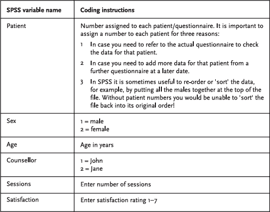

**Figure 2.1**An SPSS codebook for the data in `Table 2.1`

-   实际上，对于只有五个问题和两个编码变量的问卷来说，制作代码本显得有点过度。但对于较大的问卷，它可能是一个非常有用的参考点。另一种策略是直接在问卷副本上为分类变量添加任何编码，以便记录编码。

21 Page 21 

-   现在我们已经确定了变量名称和分类数据的编码（如`Figure 2.1`所示），我们可以设置 SPSS 数据库。

## 2.3Setting up an SPSS database

-   打开 SPSS 后，你应该看到以下界面：

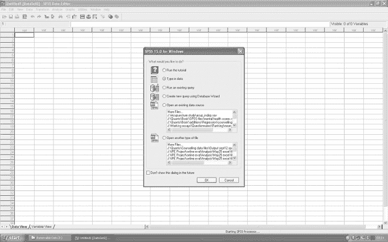

-   Screenshot 2.1

-   点击`Type in data`，然后点击`OK`。这将打开一个空白表格。

### The SPSS data screen

-   下面的界面称为**Data View**，这是数据输入的地方。但还需要阅读更多内容。

-   每一行将包含一个患者的数据。因此，在下一页的示例中，我们有 3 个患者的数据：

  -   患者 1 是男性（编码 1），24 岁。

  -   患者 2 是女性（编码 2），25 岁。

  -   患者 3 是男性，26 岁。

22 Page 22 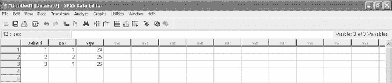

-   Screenshot 2.2

### 2.3.1Defining the variables

-   在数据编辑器屏幕左下角，你会看到两个标签页：**Data View** 和 **Variable View**。

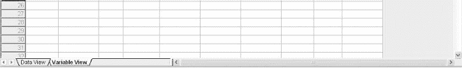

-   点击**Variable View**。这将显示以下界面，你需要在此输入变量信息：

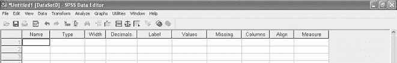

-   在这一视图中，每一行将提供每个变量的信息。我们需要参考我们的 SPSS 代码本（见`Figure 2.1`）。

#### Name

-   输入代码本中列出的第一个 SPSS 变量名称，即`patient`。然后按右箭头键移动到下一列——*type*。

23 Page 23 

#### Type: 它是什么类型的数据？

-   输入变量名称后，**Type** 的默认值会自动显示为 numeric。所有变量都是数值型，因为我们将把任何单词（如男性和女性）编码为数字（即男性为 1，女性为 2）。因此，你可以继续到下一列——**Width**（见`Box 2.2`，在某些情况下需要输入文字）。

#### Width: 你将输入多少个数字？

-   SPSS 默认八个字符。我们最多只需要两个（例如，24 年，12 次会议）。无需更改。如果你输入非常大的数字，例如 184,333,333.24（即 11 个字符），则需要增加它。

#### Decimals

-   SPSS 默认两位小数。由于我们的数据不需要小数位，只需点击**Decimals**单元格，然后点击单元格右侧的上下箭头来调整所需的小数位数。

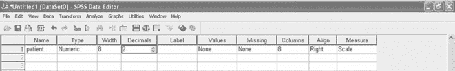

-   对于许多变量且不需要小数位的数据集，将默认设置更改为 0 小数位可能很有价值。你可以通过点击屏幕顶部的**Edit**菜单，然后选择**Options**。接着，点击**Data**选项卡，并在**Display**格式中将新数值变量的小数位数值更改为 0。

#### Label

-   **Label**列允许你为变量提供更长的描述，这将在 SPSS 生成的输出中显示。对于‘patient’或其他变量，标签不需要填写，因为名称已经自解释。^()

#### Values

-   名义变量的值是分配给类别的数字，例如，男性=1，女性=2。由于第一个变量（patient）没有‘值’，你不需要在这里填写任何内容。

#### Missing

-   有时为缺失数据分配特定值很有用。但 SPSS 将任何空白单元格视为缺失数据并将其排除在计算之外，因此如果你打算留空单元格，无需为缺失数据输入值。而且我们没有缺失数据。^()

#### Columns

-   你可以调整列宽以减少屏幕上的空间占用。但需要为变量名称提供足够的空间，因此默认的 8 通常足够。

#### Align

-   通常设置为**Right**，这没问题。

#### Measure

-   默认测量值是**Scale**，但你可以通过点击单元格并点击单元格右侧的下拉箭头，将其更改为**Ordinal**或**Nominal**。我们有尺度数据和名义数据：
**Table 2.2** Measure definitions
| *Measure*  || *Definition* |

| --- | --- |

| Scale: || For numeric values on an interval or ratio scale: age, sessions, satisfaction. |

| --- | --- |

| Nominal: || For values that represent categories with no intrinsic order: patient, sex,counsellor. |

| --- | --- |

| Ordinal: || For values with some intrinsic order (e.g., low, medium, high; first, second third). |

-   由于我们的第一个变量仅列出患者/问卷编号，我们应将其更改为‘nominal’，因为这些数字仅用于标识患者（它们没有作为尺度的意义）。

-   现在，你已经完成了第一个变量‘patient’的信息，它应该如下所示：

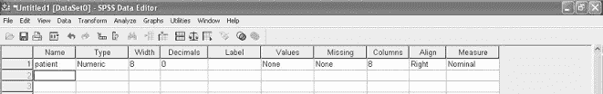

-   下一个变量是‘sex’。按照你对‘patient’所做的步骤，直到你到达**Values**。由于‘patient’没有值——它只是患者编号——‘sex’有两个值：我们将输入数字 1 表示男性，数字 2 表示女性。因此，你需要告诉 SPSS 这是如此。

-   在 SPSS 中添加值标签的方法如下：

26 Page 26 

1.  在**Values**单元格中点击，然后点击单元格右侧带有 3 个点的按钮。这将打开**Value Label**框。

2.  在标记为**Value**的框中点击，输入 1。

3.  在标记为**Value Label**的框中点击，输入 male。

4.  点击**Add**。你将在摘要框中看到：1=male。

5.  对于女性，重复此过程（Value = 2；Value Label: female；Add）。

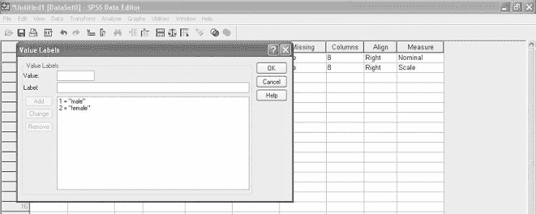

1.  6. 点击**OK**。此信息现在存储在你的 SPSS 数据库中。唯一需要更改的是**Measure**（更改为**Nominal**），你的数据库应如下所示：

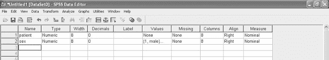


1.  7 你现在应该能够完成剩余变量的信息，确保输入 `counsellor` 的值标签（1 = John；2 = Jane）。

    当你完成这项操作后，你的数据库应该呈现如下：

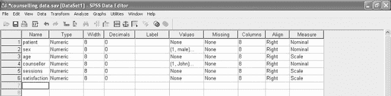

Screenshot 2.10

27 Page 27 

你现在已经定义了变量，可以开始输入数据。

## 2.4Entering the data

点击左下角的 **Data View** 选项卡（屏幕左下角），这将把你从 **Variable View** 切换到 **Data View**。注意列标题现在已是你的变量名称。

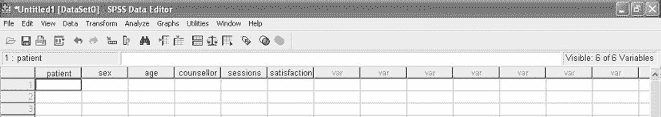

Screenshot 2.11

你现在可以输入 30 位病人的数据。只需点击左上角的单元格（病人 1），输入 1，然后按键盘右方向键移动到下一个单元格，依次输入每位病人的数据，参考 Table 2.1。这将产生以下数据：

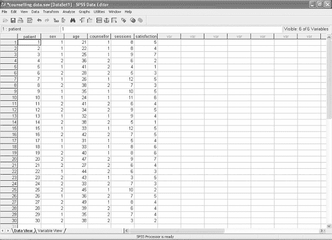

Screenshot 2.12

28 Page 28 

*在你输入完数据后请确保保存文件*^()

我们现在准备开始分析。也就是说，在完成以下练习后。

## 2.5Exercises

### Exercise 2.1Viewing value labels

为了确认数据已正确录入，你可以查看值标签，使得 SPSS 数据集与 Table 2.1 中的数据完全一致。你可以通过点击 **View**，然后点击 **Value Labels** 来查看值标签：

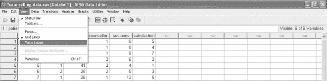

Screenshot 2.13

你的性别（sex）和咨询师（counsellor）的值标签现在已显示：

29 Page 29 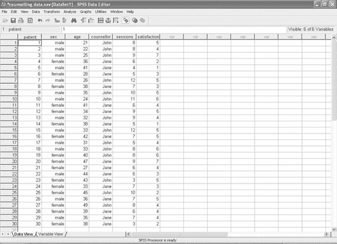

Screenshot 2.14

### Exercise 2.2Sorting the data

有时重新排序数据很有用，例如想一次性查看所有男性病例。^()

1.  1 从屏幕顶部的菜单中点击 **Data**，然后点击 **Sort Cases**。

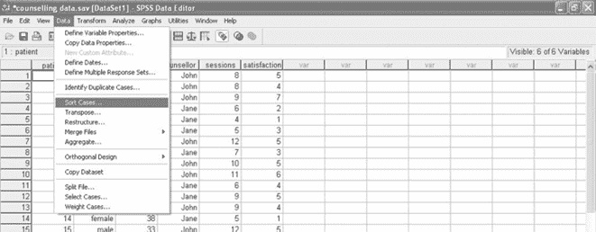

Screenshot 2.15

30 Page 30 

1.  2 点击变量 **sex**，然后点击（Sort by 框左侧的箭头）将其移入 **Sort by** 框：

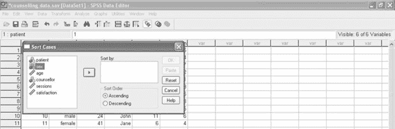

Screenshot 2.16

1.  3 你现在可以点击 **OK** 以按性别对数据集进行排序：

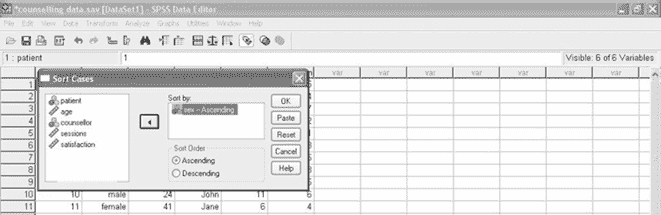

Screenshot 2.17

1.  4 你的数据集现在已重新排序，所有男性病例位于顶部（见 Screenshot 2.18）。

    注：如果你使用的是 SPSS v15，会出现 **Output Viewer** 窗口，记录你在 SPSS 中执行了该操作。点击 **Output Viewer** 窗口右上角橙色框中的叉号关闭该窗口。当系统询问是否保存时，选择 **no**。

31 Page 31 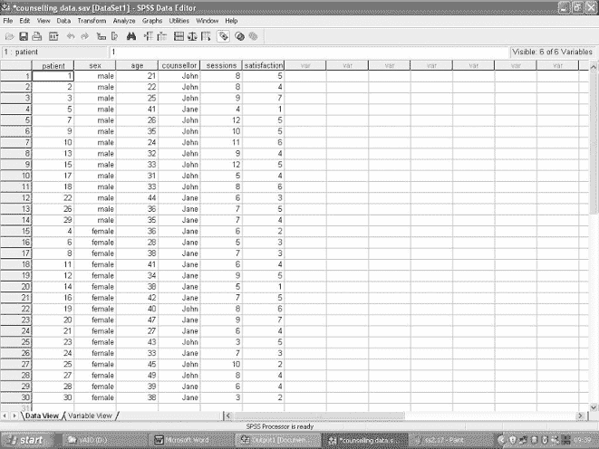

Screenshot 2.18

1.  5 要将数据恢复到原来的顺序，返回 **Data/Sort Cases**。双击（左键单击） **Patient** 即可按原顺序重新排序数据。（如果没有为每位患者/问卷编号，则无法完成此操作。）

你可以一次性按多个变量进行排序。例如，你可以同时按 **sex** 和 **age** 对数据进行排序，但我们现在需要进入分析阶段。

## Notes

1.  1 这里的数字 1 和 2 是任意指派的，并不代表男性和女性性别的重要性顺序。这一点需要说明，因为有学生在课堂上提出此问题，并进行了较长时间的讨论。...

2.  2 如果你有较长的问卷并决定为变量 q1、q2、q3 等进行标签，可使用 **Label** 设施。在 **Label** 列中提供每个问题的描述。例如，若我们在咨询问卷中采用此方法，q4 的标签为‘咨询会话次数’，这样输出时会显示‘咨询会话次数’而非‘q4’，便于我们识别具体问题。此方法在较早的 SPSS 版本中更为常见，当时变量列受限于八个字符，常需使用缩写或难以辨认的名称。

3.  3 举例来说，我们可能想区分因患者拒绝回答敏感问题而导致的缺失值，以及因问题不适用于患者而导致的缺失值。此时需要在 **Missing** 单元格中点击，右侧会出现三个点的按钮，点击后弹出对话框，你可以输入缺失值。该值应位于变量可能出现的取值范围之外：99 是常用的缺失值表示，但如果变量本身可能包含该值（例如年龄），则应选择更远的数值（999）。

4.  4 请务必知道你保存的位置！曾有学生保存数据文件在大学网络上，后续无法定位。此外，如果你在大学或学院电脑上工作，应注意部分电脑在闲置一定时间后会自动“退出”。若未保存文件便离开电脑，数据在你返回时可能已经丢失。

5.  5 数据排序有多种有用原因。我最近在一个问卷中发现，按患者转诊月份对数据排序极大地简化了根据转诊月份进行的编辑工作。

33 Page 33 

## Chapter3 Descriptive statistics: frequencies, measures of central tendency and illustrating the data using graphs


## 3.1Frequencies

We noted in Chapter 1 that the first thing a researcher would do with this data is to ‘run some frequencies’. This simply means that we want to look at the frequencies of our *categorical* data:

*   How many male/female patients are there?

*   How many patients were treated by each of the counsellors John and Jane?

This will provide us with an initial overview of our sample, or ‘population’. So let us start with our first categorical variable – sex.

### Running frequencies in SPSS

1.  1From the menu at the top of the screen click **Analyze,** then **Descriptive Statistics** then **Frequencies.**34 Page 34

    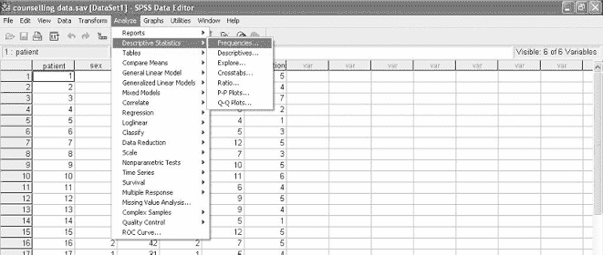

    Screenshot 3.1

2.  2Choose the variable **sex** by clicking with your mouse.

3.  3Once **sex** is highlighted move it across into the variables box by clicking the arrow. Alternatively you could just double-click it once it is highlighted.35 Page 35

    

    Screenshot 3.2

4.  4Now click **OK.**

    A new SPSS window should now appear. This is called the **Output Viewer,** as shown next. The results of all analyses performed by SPSS will appear in this viewer – which can be saved separately as a file.

    Note: You may need to maximize this screen by clicking the maximize button (top right of screen – middle icon to the left of the x).

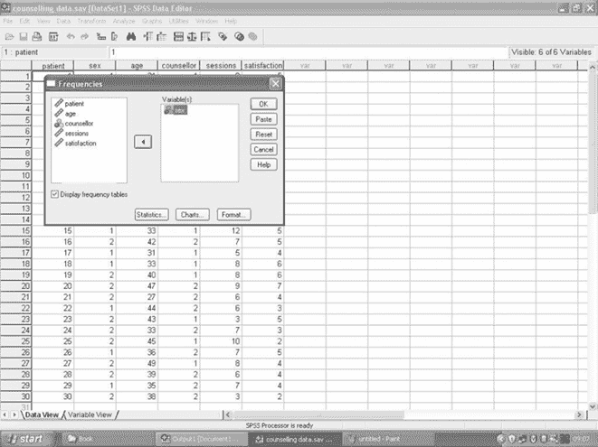

Screenshot 3.3


-   [费曼学习法](https://wiki.example.org/feynmans_learning_method)的灵感源于诺贝尔物理奖获得者**Richard Feynman**。

1.  运用费曼技巧，你只需花上`20 min`就能深入理解知识点，而且记忆深刻，*难以遗忘*。

```
if (condVar > someVal) {console.log("xxx")}
```


5. 5Click `OK` and this will produce the following bar chart in the output viewer:

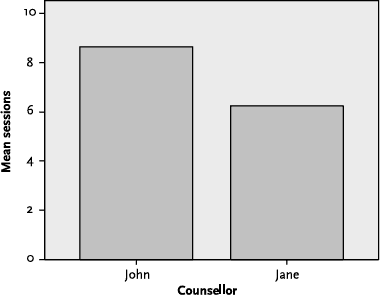

**Figure 3.1**Bar chart illustrating mean number of sessions conducted by each counsellor

45 Page 45 

From the bar chart we can see that Jane has kept to the guidelines of providing an average of six sessions of ‘brief therapy’ compared to John who has been providing an average of over eight sessions.

### 3.3.2Histograms

Histograms are similar to bar charts but are designed to represent data along a continuum. The age of patients is a good example.

#### Using SPSS to produce a histogram for age

1. 1From the menu at the top of the screen click `Graphs`, then `Chart Builder`.

2. 2Select `Histogram` from the Gallery of Charts to reveal the range of charts available.

3. 3Drag the first histogram (top left) into the preview area.

4. 4From the variables list drag `age` into the X-axis.

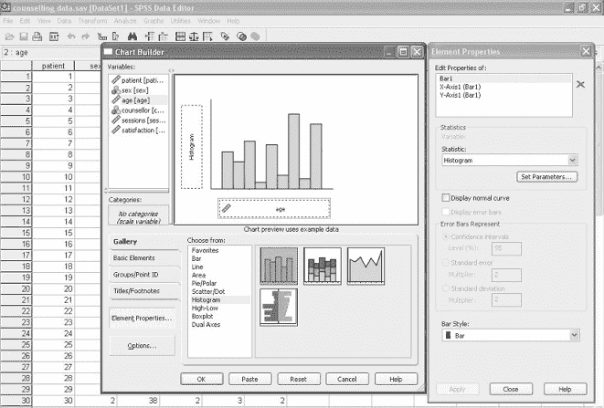

Screenshot 3.13

5. 5Click `OK` and this should produce the following histogram in the output viewer:46 Page 46

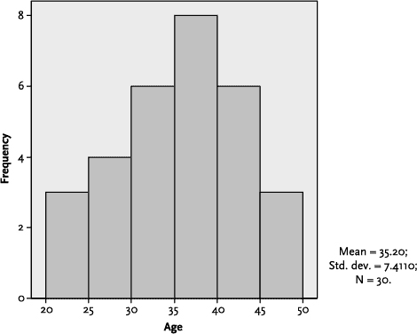

**Figure 3.2**Histogram showing age distribution of patients

From the histogram we can see that the age of patients is ‘normally distributed’ with the majority in the age range 30 years to 45 years, tailing off at the younger and older ages.

Note: the bars in the histogram are not separated by gaps – because they represent data along a continuum – unlike the bars in the bar chart which represent discrete categories.

### 3.3.3Editing a chart

You may want to edit the histogram for age. For example, you might want to edit the labels for the X- (horizontal) and Y- (vertical) axis: perhaps ‘frequency’ should be changed to ‘number’; and you might also want to add that age is in years. Also, to the right-hand side of the graph there is information about the mean, standard deviation (discussed later) and number of students, that you might want to remove.

To edit a chart you need to double-click it with your left mouse button. This will open the `Chart Editor`.

47 Page 47 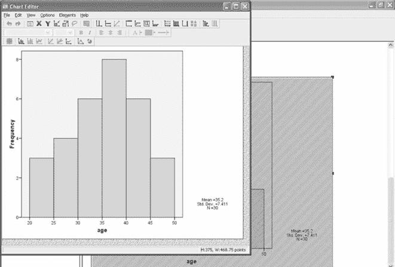

Screenshot 3.14

There are various changes you can make once the Chart Editor is open, and really you need to find out by trial and error – mainly by highlighting the bits you want to change by clicking or double-clicking with the left mouse button.

For example, in order to delete the information on the right of the chart, I clicked the left mouse button once over this information, then I clicked the right mouse button to produce the menu shown in Screenshot 3.15. I then moved down to **Delete** to remove this information. (A ‘Properties’ box appears in SPSS v15 informing you that the chart will be resized when elements are added or removed – uncheck the box next to ‘Resize elements . . .’ and click **Apply** then **Close** if you want the graph to remain the same size (or leave it ticked if your prefer a wider graph).

48 Page 48 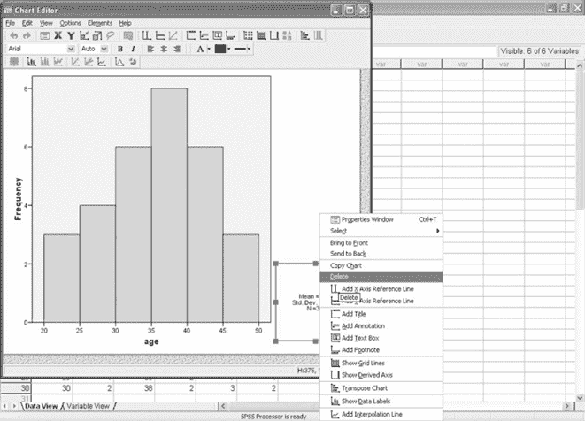

Screenshot 3.15

To edit the labels age’ and frequency’ click on them once with the left mouse button to highlight them, and then click again (left mouse button) to produce a flashing cursor; you can then re-write your own labels in the text box.

49 Page 49 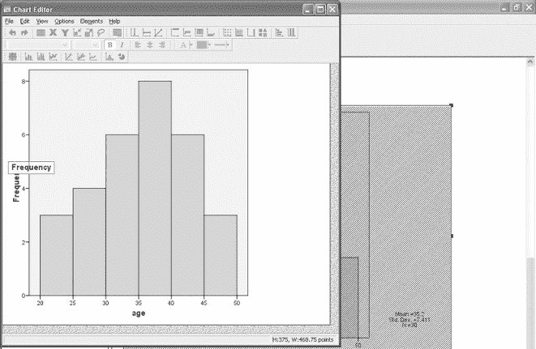

Screenshot 3.16

Finally, I produced the following version of the histogram – having edited the labels and removed the data to the right of the chart. Presentation is very important for reports, so attention to details like this, rather than just accepting what is produced by SPSS, can make a significant difference to the quality of a report.

50 Page 50 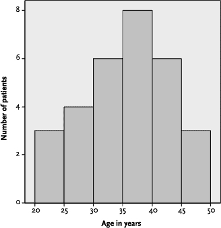

**Figure 3.3**Edited histogram showing age distribution of patients

There are numerous changes you can make by clicking and double-clicking on the bits of the chart you are interesting in changing and you should simply try them out yourself.

### 3.3.4Boxplots

Another useful way to illustrate the spread of the data is to use boxplots.

#### Using SPSS to produce boxplots for age and gender

1. 1From the menu at the top of the screen click `Graphs`, then `Chart Builder`.

2. 2Select `Boxplot` from the `Gallery of Charts` to reveal the range of boxplot charts available.

3. 3Drag the first boxplot (simple boxplot) into the preview area.

4. 4From the variables list drag `age` into the Y-axis and `sex` into the X-axis.

5. 5Click `OK`.

This should produce the following output: two boxplots illustrating the distribution of age for male and females in the sample.

51 Page 51 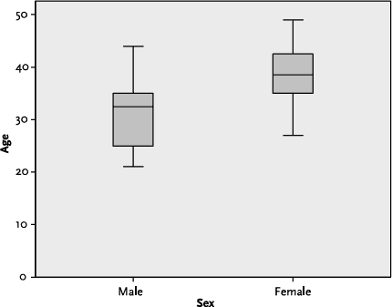

**Figure 3.4**Boxplots illustrating age distribution of male and female patients

These boxplots illustrate the spread of the data:

* the shaded box contains the middle 50 per cent of values;

* the line inside the box depicts the median value (*not the mean*);

* the T-bar lines above and below the box reach to the highest and lowest values.

So, from these boxplots comparing the ages of our males and females, we can see that the median age of females is higher and, overall, the age ranges are higher. The spread of ages, indicated by the size of the shaded boxes and the length of the T-bars, is roughly similar for both groups.

Figure 3.5 provides a detailed description of the information provided in boxplots. Notice the added inclusion of outliers’ and extreme cases’ which often occur in large datasets. For example, if 29 patients attended for between four and eight counselling sessions and one attended for 12 sessions this might be considered an outlier’ or, more severely, an extreme value’ because it deviates from the norm.

These cases deserve special attention since they may skew any measures of central tendency. For example, a couple of extremely high ages would have increased the mean value, leaving the median the same. Outliers and extreme cases may also, of course, simply indicate an error in data entry which often occurs in large datasets.

52 Page 52 

**Figure 3.5**Understanding boxplots

### 3.3.5Copying charts and tables into a Microsoft Word document

If you are producing a report of your data analysis it will often be useful to copy the output from SPSS into a Microsoft Word document.

For charts, like the boxplot above, you should first double-click the object to open the `Chart Editor`. Then, from the menu at the top of the screen click `Edit` and `Copy Chart`.

53 Page 53 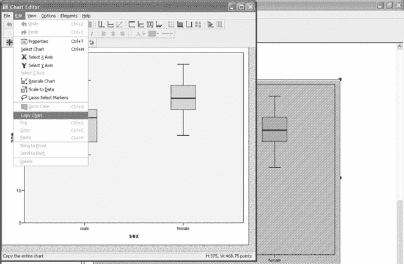

Screenshot 3.17

You can then paste the chart into a Microsoft Word document (obviously, you will first need to open a Word document).^()

You can copy tables from the SPSS output file into a Word file by highlighting the table (click left mouse button over **Table),** then click the right mouse button on **Copy Objects,** and paste into the Word document.

54 Page 54 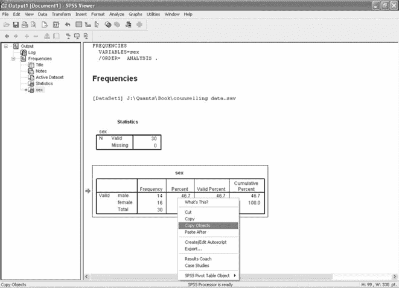

Screenshot 3.18

In the example above I chose the option **Copy Objects** rather than **Copy.** If you copy the table as an object you will not be able to edit the table when it is in the Microsoft Word document:

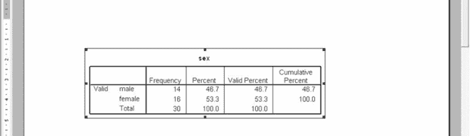

Screenshot 3.19

If you do want to edit a table you should choose **Copy**:

55 Page 55 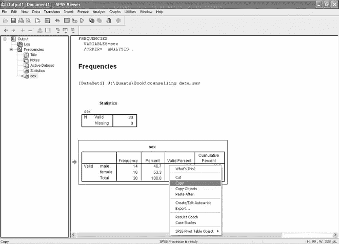

Screenshot 3.20


当您将其粘贴到 Microsoft Word 文档中后，即可编辑表格。例如，您可能希望删除最后两列，因为它们在这次任务中没有提供有用信息。为此，请高亮显示最后两列，然后右键单击：

    56 Page 56 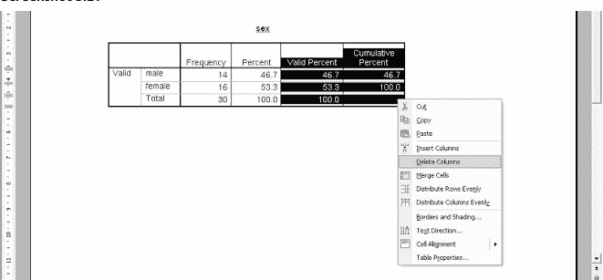

    Screenshot 3.21

    点击“Delete Columns”后，您将得到一个不包含无关信息的表格，这可能会让读者困惑：

    **Table 3.2**编辑后的表格

    |  | Frequency | Percent |
    | --- | --- | --- |
    | Valid | male | 14 | 46.7 |
    |  | female | 16 | 53.3 |
    |  | total | 30 | 100.0 |

    表格列出了变量，包括列 1 中的有效男性、女性和总计。列 2 和列 3 列出相应的频数和百分比值。

    ### 3.3.6Navigating the Output Viewer

    现在，您在 **Output Viewer** 中积累了相当数量的分析结果。有时此时进行整理很有用，比如删除不再需要的输出分析。为此，请在左侧窗格中点击列出的输出，以删除不想保留的分析。

    57 Page 57 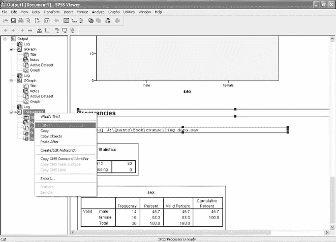

    Screenshot 3.22

    ## 3.4Summary

    在本章中，您学习了：

    *   如何为类别数据生成频数。

    *   何时应使用“valid per cent”而非整体 per cent，即当存在缺失数据时。

    *   如何为区间数据生成中心趋势度量（均值、中位数和众差），以及最小值和最大值。

    *   如何生成条形图、直方图和箱线图，以直观展示数据。

    *   如何将 SPSS 输出复制到 Microsoft Word 文档中。

    *   如何在 SPSS Output Viewer 中导航。

    您现在具备将数据导入 SPSS、对其进行编码，并为类别数据和区间数据生成基本描述性统计的技能。

    58 Page 58 

    ## 3.5Ending the SPSS session

    当您想要关闭 SPSS，只需前往 **File/Exit**。随后会提示您“保存 Output Viewer 的内容”。这将允许您将输出中的表格和图表另存为独立文件。随后，您会被提示保存数据文件。

    虽然保存数据文件非常重要，但保存包含表格和图表的输出文件可能相对次要。例如，您可能对打印分析结果感到满意，或者您可能已经将相关表格和图表复制到 Microsoft Word 文档中。只要已保存数据文件，根据您已完成的工作量，重新运行分析可能相对简单——当然，这也取决于您已经做了多少工作。

    ## 3.6Exercises

    ### Exercise 3.1

    您已经为变量 age 生成了直方图。现在，请生成会话次数和满意度评分的直方图。它们显示什么类型的分布？数据是否“呈正态分布”？

    ### Exercise 3.2

    请生成箱线图，以性别比较满意度评分。从结果中得出以下结论：(a) 男性与女性的数据分布差异；(b) 男性与女性的相对满意度评分。

    您满意于图表吗，还是需要使用 Chart Editor？

    ### Exercise 3.3

    SPSS 提供一个功能，可更改您的数据和输出（如图表和表格）的显示方式。其中一个特别相关的选项允许您更改 SPSS 输出中表格的显示方式。例如，如果您计划将报告提交给期刊，可能需要根据期刊指南调整表格的显示方式。

    要更改表格的设置，请点击顶部菜单栏的 **Edit**，然后选择 **Options**。您将在屏幕上看到以下表格：

    59 Page 59 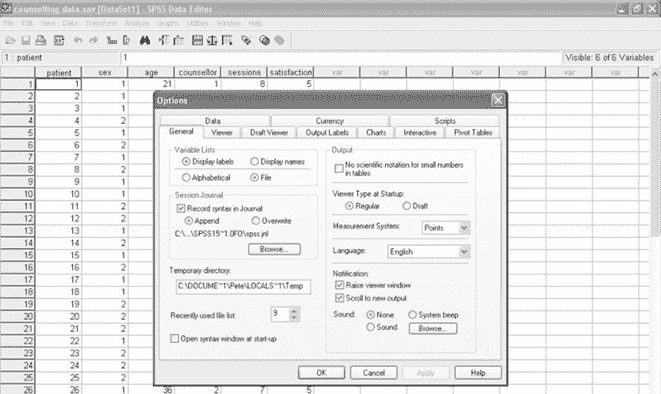

    Screenshot 3.23

    如果您点击 **Pivot Tables** 标签，可以选择表格的格式。点击 **Table look** 可预览或查看表格将如何呈现。下面提供了三个示例表格：

    **Table 3.3**系统默认表格：sex

    | SEX  |
    | --- |
    |  | Frequency | Percent | Valid Percent | Cumulative Percent |
    | --- | --- | --- | --- | --- |
    | Valid | male | 820 | 38.8 | 38.8 | 38.8 |
    |  | female | 1295 | 61.2 | 61.2 | 100.0 |
    |  | Total | 2115 | 100.0 | 100.0 |  |

    标题为 Sex 的表格列出了变量，包括列 1 中的有效男性、女性和总计值。列 2 到列 5 列出相应的频数、百分比、有效百分比和累计百分比值。

    您可能想选择 **smallfont.tlo** 以在打印出众多分析结果时节省纸张。

    **Table 3.4**smallfont.tlo：节省纸张的表格（sex）

    | SEX |
    | --- |
    |  | Frequency | Percent | Valid Percent | Cumulative Percent |
    | --- | --- | --- | --- | --- |
    | Valid | male | 820 | 38.8 | 38.8 | 38.8 |
    |  | female | 1295 | 61.2 | 61.2 | 100.0 |
    |  | Total | 2115 | 100.0 | 100.0 |  |

    标题为 Sex 的表格列出了变量，包括列 1 中的有效男性、女性和总计值。列 2 到列 5 列出相应的频数、百分比、有效百分比和累计百分比值。

    60 Page 33 

    许多期刊使用 APA（American Psychological Association）格式，该格式不使用垂直线。因此，如果您需要将 SPSS 表格导入到即将提交的期刊文件中，可能需要使用如 Table 3.5 所示的学术格式。

    **Table 3.5**学术格式表格（sex）

    | SEX |
    | --- |
    |  | Frequency | Percent | Valid Percent | Cumulative Percent |
    | --- | --- | --- | --- | --- |
    | Valid | male | 820 | 38.8 | 38.8 | 38.8 |
    |  | female | 1295 | 61.2 | 61.2 | 100.0 |
    |  | Total | 2115 | 100.0 | 100.0 |  |

    标题为 Sex 的表格列出了变量，包括列 1 中的有效男性、女性和总计值。列 2 到列 5 列出相应的频数、百分比、有效百分比和累计百分比值。

    注意：您需要在运行分析之前更改格式。

    ## 3.7Notes

    1. 1Alternatively, you can simply use the right mouse button to copy the chart straight from the output viewer without going into Chart Editor. However, I find that this leaves a larger frame around the chart taking up more space in the Microsoft Word document. Try it and see for yourself.

    61 Page 61 


    在本章中，您将学习关于类别数据的交叉表，用于检验变量之间的关联的卡方检验（chi-square），以及统计显著性的概念。您还将学习如何将区间数据重新编码为类别。

    ## 4.1Introduction

    交叉表是分析问卷数据的最常用方法之一。它比单个变量的简单频数能更详细地考察类别变量之间的关系。本章将展示如何在 SPSS 中完成此操作，并应用与交叉表相关的统计分析——即卡方检验（pronounced ‘kye square’）。

    ## 4.2Cross-tabulating data in the questionnaire

    在我们的咨询满意度问卷中，只有两个类别变量：患者性别（男性或女性）和咨询师（John 或 Jane）。当我们在上一章为这两个变量运行频数时，得到了以下结果： 


## 4.3 卡方统计检验

我们已经看到，患者的性别在辅导员之间并没有平均分配。但我们可以问，这是否只是偶然的结果？如果我们重新开始服务，并且患者被 *randomly*（随机）分配给辅导员，我们可能会得到类似的结果吗？甚至可能是相反的——大多数男性患者会看到女辅导员。当然，最可能的情况是，这只是巧合，我们会期望他们在[<unk><unk><unk><unk><unk><unk><unk><unk><unk><unk><unk><unk><unk><unk><unk><unk><unk><unk><unk><unk><unk><unk><unk><unk><unk><unk><unk><unk><unk><unk><unk><unk><unk><unk><unk><unk><unk><unk><unk><unk><unk><unk><unk><unk><unk><unk><unk><unk><unk><unk><unk><unk><unk><unk><unk><unk><unk><unk><unk><unk><unk><unk><unk><unk><unk><unk><unk><unk><unk><unk><unk><unk><unk><unk><unk><unk><unk><unk><unk><unk><unk><unk><unk><unk><unk><unk><unk><unk><unk><unk><unk><unk><unk><unk><unk><unk><unk><unk><unk><unk><unk><unk><unk><unk><unk><unk><unk><unk><unk><unk><unk><unk><unk><unk><unk><unk><unk><unk><unk><unk><unk><unk><unk><unk><unk><unk><unk><unk><unk><unk><unk><unk><unk><unk><unk><unk><unk><unk><unk><unk><unk><unk><unk><unk><unk><unk><unk><unk><unk><unk><unk><unk><unk><unk><unk><unk><unk><unk><unk><unk><unk><unk><unk><unk><unk><unk><unk><unk><unk><unk><unk><unk><unk><unk><unk><unk><unk><unk><unk><unk><unk><unk><unk><unk><unk><unk><unk><unk><unk><unk><unk><unk><unk><unk><unk><unk><unk><unk><unk><unk><unk><unk><unk><unk><unk><unk><unk><unk><unk><unk><unk><unk><unk><unk><unk><unk><unk><unk><unk><unk><unk><unk><unk><unk><unk><unk><unk><unk><unk><unk><unk><unk><unk><unk><unk><unk><unk><unk><unk><unk><unk><unk><unk><unk><unk><unk><unk><unk><unk><unk><unk><unk><unk><unk><unk><unk><unk><unk><unk><unk><unk><unk><unk><unk><unk><unk><unk><unk><unk><unk><unk><unk><unk><unk><unk><unk><unk><unk><unk><unk><unk><unk><unk><unk><unk><unk><unk><unk><unk><unk><unk><unk><unk><unk><unk><unk><unk><unk><unk><unk><unk><unk><unk><unk><unk><unk><unk><unk><unk><unk><unk><unk><unk><unk><unk><unk><unk><unk><unk><unk><unk><unk><unk><unk><unk><unk><unk><unk><unk><unk><unk><unk><unk><unk><unk><unk><unk><unk><unk><unk><unk><unk><unk><unk><unk>需要翻译的内容是：

[content]

## 4.3 The chi-square statistical test

We have seen, then, that the sex of patients was not equally distributed across the counsellors. But we might ask was this a chance result? If we started the service again and the patients were *randomly* assigned to the counsellors might we have found a similar result? Perhaps even the opposite – with most male patients seeing the female counsellor. More likely of course, by chance, we would expect them to be distributed quite evenly across the sexes. The question is: how much of an unequal distribution across the sexes does there have to be for us to conclude that there was a significant bias for male patients to see a male counsellor and vice versa? Or, to put it another way: how much of an unequal distribution across the sexes does there have to be for us to *reject the possibility that this has occurred by chance?* This is where a statistical test comes in handy.

Chi-square (represented as χ²) applies a statistical test to cross-tabulation by comparing the actual *observed* frequencies in each cell of tables with *expected* frequencies. Expected frequencies are those we would expect if data is ‘randomly distributed’.

64 Page 64 

It may help at this point to think of the four cells in the cross-tabulation table as buckets. Now imagine a lottery machine designed to pump balls into each of the buckets through four pipes – one leading into each bucket. If the distribution of balls by the lottery machine is truly random, then we would expect a similar number of balls in each bucket. Thus, if<unk><unk><unk><unk><unk><unk><unk><unk><unk><unk><unk><unk><unk><unk><unk><unk><unk>

We have the opposite scenario: all the males saw John, whereas all the females saw Jane. Notice that the *expected* frequencies remain the same – 50 in each cell. The divergence from expected frequencies would strongly suggest that there is a relationship between sex of the patient and the counsellor they saw: we have *50 more male patients than expected* seeing John (and 50 less than expected seeing Jane); and *50 more female patients than expected* seeing Jane (and 50 less than expected seeing John).

**Table 4.5**Group/counsellor cross-tabulation with a large difference across males/females (hypothetical data)

| Group \* counsellor Crosstabulation |

| --- |

|  || counsellor || Total |

| --- | --- | --- |

| John || Jane |

| Group || male || CountExpected Count || 10050.0 || 050.0 || 100100.0 |

|  || female || CountExpected Count || 050.0 || 10050<unk><unk><unk><unk><unk><unk><unk><unk><unk><unk><unk><unk><unk><unk><unk><unk><unk>内容

[/content]

## 注意事项

- 粗体（**bold**）和斜体（*itatic*）需要翻译翻译内容并保留符号。
-<unk><unk><unk><unk><unk><unk><unk><unk><unk><unk><unk><unk><unk><unk><unk><unk><unk>需要翻译的内容是：

[content]

## 4.3 The chi-square statistical test

We have seen, then, that the sex of patients was not equally distributed across the counsellors. But we might ask was this a chance result? If we started the service again and the patients were *<unk><unk><unk><unk><unk><unk><unk><unk><unk><unk><unk><unk><unk><unk><unk><unk><unk><unk><unk>需要翻译的内容是：

[content]

## 4.3 The chi-square statistical test

We have seen, then, that the sex of patients was not equally distributed across the counsellors. But we might ask was this a chance result? If we started the service again and the patients were *randomly* assigned to the counsellors might we have found a similar result? Perhaps even the opposite – with most male patients seeing the female counsellor. More likely of course, by chance, we would expect them to be distributed quite evenly across the sexes. The question is: how much of an unequal distribution across the sexes does there have to be for us to conclude that there was a significant bias for male patients to see a male counsellor and vice versa? Or, to put it another way: how<unk><unk><unk><unk><unk><unk><unk><unk><unk><unk><unk><unk><unk><unk><unk><unk><unk>需要翻译的内容是：

[content]

## 4.3 The chi-square statistical test

We have seen, then, that the sex of patients was not equally distributed across the counsellors. But we might ask was this a chance result? If we started the service again and the patients were *randomly* assigned to the counsellors might we have found a similar<unk><unk><unk><unk><unk><unk><unk><unk><unk><unk><unk><unk><unk><unk><unk><unk><unk><unk><unk>需要翻译的内容是：

<unk><unk><unk><unk><unk><unk><unk><unk><unk><unk><unk><unk><unk><unk><unk><unk><unk>需要翻译的内容是：

[content]

## 4.3 The chi-square statistical test

We have seen, then, that the sex of patients was not equally distributed across the counsellors. But we might ask was this a chance result? If we started the service again and the patients were *randomly* assigned to the counsellors might we have found a similar result? Perhaps even the opposite – with most male patients seeing the female counsellor. More likely of course, by chance, we would expect them to be distributed quite evenly across the sexes. The question is: how much of an unequal distribution across the sexes does there have to be for us to conclude that there was a significant bias for male patients to see a male counsellor and vice versa? Or, to put it another way: how much of an unequal distribution across the sexes does there have to be for us to *reject the possibility that this has occurred by chance?* This is where a statistical test comes in handy.

Chi-square (represented as χ²) applies a statistical test to cross-tabulation by comparing the actual *observed* frequencies in each cell of tables with *expected* frequencies. Expected frequencies are those we would expect if data is ‘randomly distributed’.

64 Page 64 

It may help at this point to think of the four cells in the cross-tabulation table as buckets. Now imagine a lottery machine designed to pump balls into each of the buckets through four pipes – one leading into each bucket. If the distribution of balls by the lottery machine is truly random, then we would expect a similar number of balls in each bucket. Thus, if the lottery machine was set up to distribute 200 balls we would expect roughly 50 balls in each of the four buckets.

So, using the hypothetical data in Table 4.4 we can see that there is no difference across male/female patients and counsellor. The actual observed counts match the expected counts.^()

**Table 4.4**Group/counsellor cross-tabulation with no difference across males/females (hypothetical data)

| Group \* counsellor Crosstabulation  |

| --- |

|  || counsellor || Total |

| --- | --- | --- |

| John ||<unk><unk><unk><unk><unk><unk><unk><unk><unk><unk><unk><unk><unk><unk><unk><unk><unk> content

[/content]

## 注意事项

- 粗体（**bold**）和斜体（*itatic*）需要翻译翻译内容并保留符号。
-  content

-  content

- <unk><unk><unk><unk><unk><unk><unk><unk><unk><unk><unk><unk><unk><unk><unk><unk><unk>需要翻译的内容是：

[content]

## 4.3 The chi-square statistical test

We have seen, then, that the sex of patients was not equally distributed across the counsellors. But we might ask was this a chance result? If we started the service again and the patients were *randomly* assigned to the counsellors might we have found a similar result? Perhaps even the opposite – with most male patients seeing the female counsellor. More likely of course, by chance, we would expect them to be distributed quite evenly across the sexes. The question is: how much of an unequal distribution across the sexes does there have to be for us to conclude that there was a significant bias for male patients to see a male counsellor and vice versa? Or, to put it another way: how much of an unequal distribution across the sexes does there have to be for us to *reject the possibility that this has occurred by chance?* This is where a statistical test comes in handy.

Chi-square (represented as χ²) applies<unk><unk><unk><unk><unk><unk><unk><unk><unk><unk><unk><unk><unk><unk><unk><unk><unk><unk>需要翻译的内容是：

[content]

## 4.3 The chi-square statistical test

We have seen, then, that the sex of patients was not equally distributed across the counsellors. But we might ask was this a chance result? If we started the service again and the patients were *randomly* assigned to the counsellors might we have found a similar result? Perhaps even the opposite – with most male patients seeing the female counsellor. More likely of course, by chance, we would expect them to be distributed quite evenly across the sexes. The question is: how much of an unequal distribution across the sexes does there have to be for us to conclude that there was a significant bias for male patients to see a male counsellor and vice versa? Or, to put it another way: how much of an unequal distribution across the sexes does there have to be for us to *reject the possibility that this has occurred by chance?* This is where a statistical test comes in handy.

Chi-square (represented as χ²) applies a statistical test to cross-tabulation by comparing the actual *observed* frequencies in each cell of tables with *expected* frequencies. Expected frequencies are those we would expect if data is ‘randomly distributed’.

64 Page 64 

It may help at this point to think of the four cells in the cross-tabulation table as buckets. Now imagine a lottery machine designed to pump balls into each of the buckets through four pipes – one leading into each bucket. If the distribution of balls by the lottery machine is truly random, then we would expect a similar number of balls in each bucket. Thus, if the lottery machine was set up to distribute 200 balls we would expect roughly 50 balls in each of the four buckets.

So, using the hypothetical data in Table 4.4 we can see that there is no difference across male/female patients and counsellor. The actual observed counts match the expected counts.^()

**Table 4.4**Group/counsellor cross-tabulation<unk><unk><unk><unk><unk><unk><unk><unk><unk><unk><unk><unk><unk><unk><unk><unk><unk> content

[/content]

## 注意事项

- 粗体（**bold**）和斜体（*itatic*）需要翻译翻译内容并保留符号。
-  content

-  content

-  content

-  content

-  content

-  content

-  content

-  content

-  content

-  content

-  content

-  content

-  content

-  content

-  content

-  content

-  content

-  content

-  content

-  content

-  content

-  content

-  content

-  content

-  content

-  content

-  content

-  content

-  content

-  content

-  content

-  content

-  content

-  content

-  content

-  content

-  content

- <unk><unk><unk><unk><unk><unk><unk><unk><unk><unk><unk><unk><unk><unk><unk><unk><unk> content

[/content]

## 注意事项

- 粗体（**bold**）和斜体（*itatic*）需要翻译翻译内容并保留符号。
-  content

-  content

-  content

-  content

-  content

-  content

-  content

-  content

-  content

-  content

-  content

-  content

-  content

-  content

-  content

-  content

-  content

-  content

-  content

-  content

-  content

-  content

-  content

-  content

-  content

-  content

-  content

-  content

-  content

-  content

-  content

-  content

-  content

-  content

-  content

-  content

-  content

-  content

-  content

-  content

-  content

-  content

-  content

-  content

-  content

-  content

-  content

-  content

-  content

-  content

-  content

-  content

-  content

-  content

-  content

-  content

-  content

-  content

-  content

-  content

-  content

-  content<unk><unk><unk><unk><unk><unk><unk><unk><unk><unk><unk><unk><unk><unk><unk><unk><unk><unk><unk> content

[/content]

## 注意事项

- 粗体（**bold**）和斜体（*itatic*）需要翻译翻译内容并保留符号。
-  content

-  content

-  content

-  content

-  content

-  content

-  content

<unk><unk><unk><unk><unk><unk><unk><unk><unk><unk><unk><unk><unk><unk><unk><unk><unk> content


-   [卡方统计量的作用是计算这种分布是否可能是偶然发生的可能性。](https://wiki.example.org/feynmans_learning_method) 让我们对我们的咨询数据运行卡方检验，看看会发生什么。

### 在 SPSS 中运行卡方检验

1.  在屏幕顶部的菜单栏中点击：`Analyze` 然后选择 `Descriptive Statistics` 再选择 `Crosstabs`。

2.  将变量 `sex` 拖入行框，将 `counsellor` 拖入列框。

3.  点击 `Cells` 按钮。确保 **observed** 和 **expected** 计数已被勾选，并且 **row percentages**（因为我们想知道每个咨询师对应的男性和女性的百分比）。

   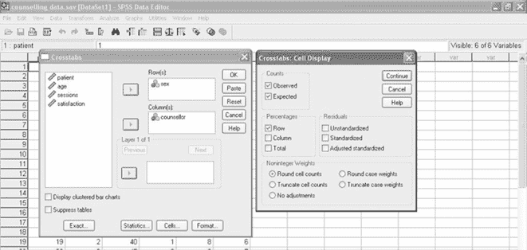

   Screenshot 4.2

4.  点击 **Continue** 关闭此框。

5.  点击 **Statistics** 标签页，在 **chi-square** 框中打勾。66 Page 66

   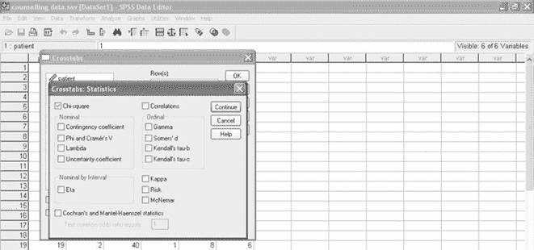

   Screenshot 4.3

6.  点击 **Continue**，然后点击 **OK** 运行分析。

SPSS 结果查看器应生成交叉表以及列出卡方检验及相关测试的表格。

**注意**：SPSS 可能会生成一些包含各种统计数据的表格，这些表格的名称晦涩且可能与您的分析无关。卡方检验表只是一个温和的例子。关键是要知道您在寻找什么，这将在后面说明。

**表 4.6** 变量“性别”与“咨询师”的交叉表，包含期望计数

| sex \* counsellor Crosstabulation  |

| --- |

|  || counsellor || Total |

| --- | --- | --- |

| John || Jane |

| sex || male || CountExpected Count% within sex || 106.571.4% || 47.528.6% || 1414.0100.0% |

|  || female || CountExpected Count% within sex || 47.525.0% || 128.575.0% || 1616.0100.0% |

| Total ||  || CountExpected Count% within sex || 1414.046.7% || 1616.053.3% || 3030.0100.0% |

表 4.6 标题为“性别与咨询师的交叉表”，列出了男性和女性的计数、期望计数以及性别内的百分比，以及列标题的总计值。列 2 和列 3 分别列出了咨询师（John 和 Jane）及总计的对应值。

67 Page 67 

**表 4.7** 卡方检验表

| Chi-Square Tests |

| --- |

|  || Value || df || Asymp. Sig. (2-sided) || Exact Sig. (2-sided) || Exact Sig. (1-sided) |

| --- | --- | --- | --- | --- | --- |

| Pearson Chi-Square || 6.467^() || 1 || .011 ||  ||  |

| Continuity Correction ^() || 4.736 || 1 || .030 ||  ||  |

| Likelihood Ratio || 6.709 || 1 || .010 ||  ||  |

| Fisher’s Exact Test ||  ||  ||  || .026 || .014 |

| Linear-by-Linear ||  ||  ||  ||  ||  |

| Association || 6.251 || 1 || .012 ||  ||  |

| N of Valid Cases || 30 ||  ||  ||  ||  |

a.Computed only for a 2x2 table

b.0 cells (.0%) have expected count less than 5. The minimum expected count is 6.53.

表 4.7 标题为“卡方检验”，列出了包括 Pearson Chi-Square、连续校正、似然比等变量，以及对应的值、自由度、双侧显著性、双侧和单侧精确显著性等数据。

首先要注意的是脚注 (b)，它告诉我们“0 个单元的期望计数小于 5”。这是卡方检验的一个重要假设。如果您打算交叉表化数据并使用卡方统计量，您应该始终尝试确保样本量足够大，以便在单元中保持足够的值。

我们感兴趣的数值位于顶部的 **Pearson chi-square** 行。Pearson chi-square 值为 6.467，其显著性（p 值）为 .011。这意味着，根据卡方计算，这种分布的值仅有不到 1% 的概率是偶然发生的，即 p = .01。我们可以接受这些概率为统计显著性，并得出结论：患者的性别与其就诊的咨询师之间存在关系：男性患者更可能就诊于男性咨询师，女性患者更可能就诊于女性咨询师。^()

在向医生的报告中，您首先应指出，性别与咨询师的交叉表显示，相同性别的咨询师的就诊比例更高：71% 的男性患者就诊于 John；75% 的女性患者就诊于 Jane。随后，您应指出卡方统计量表明这种关联具有统计显著性：χ² = 6.467，p = .011。然后您可以进一步评论此结果，例如可能的解释。

## 4.4 统计显著性水平

在讨论卡方分析结果时，我们介绍了一个重要概念——统计显著性。研究中有一种惯例，即我们可以接受 5% 的概率（写作 0.05，即 5/100 或 1/20）来判断如果实际上没有差异（即产生假阳性）时，是否有显著差异。

实际上，卡方检验计算出的概率是 1/100（.01）该四个单元的分布可能是偶然发生的。换句话说，如果您有一个随机的彩票机将球分配到这四个单元中，这一结果在 100 次试验中可能出现一次（使用 30 个球）。

68 Page 68 

我们当然应该根据情境调整可接受的统计显著性水平。例如，如果我们不想接受 1/20（0.05）的概率认为实验药物有害副作用，但实际上它并没有真正降低疼痛的可能性：“根据我们的试验，它不降低疼痛的概率为 1/20，而我们观察到的阳性结果完全是偶然的。”在这种情况下，我们可能会希望将显著性水平提高到 1/100（0.01）以上！

然而，这也意味着我们需要在两者之间取得平衡。如果您将显著性标准设得太低，就会更有可能得出假阳性结论——即在实际上没有差异的情况下，认为存在显著差异。在我们的咨询案例中，这可能意味着主张按性别安排咨询师，而更大规模的研究可能会显示实际上并没有性别偏好。相反，如果标准设得太高，则更有可能得出假阴性结论——即认为没有差异，但实际上存在差异。这些在统计学中被称为 Type I（假阳性）和 Type II（假阴性）错误。

这也引发了“力度”（power）和“效应大小”（effect size）的问题。想象两个实验。第一个实验旨在测试药物对人体的影响，已知该药在实验室和动物实验中具有高度毒性。我们需要多大的样本量？如果预期效果非常显著（如呕吐、痉挛等），我们希望样本量不大。也许在五个人服用药物、五个人服用安慰剂后，我们就能获得两组条件的有力数据。

但想象第二个实验，它使用问卷在咨询前后测量焦虑水平。研究者认为咨询会降低大多数患者的焦虑水平，但可能并不明显，且对某些患者来说，焦虑水平在面对问题时可能会上升。因此，预期的效果并不十分独特——因此需要更大的样本量以避免得出假阴性结论。这就是“力度计算”的基础：效应越小，所需的样本量就越大。


Unfortunately then, there is no simple answer to the question, ‘How large a sample do I need?’ since it depends on the particular research you are conducting, the outcome measures you are using and the size of the effect you might be expecting.^()

In practice, there are often limitations in terms of time, resources and the available sample. For example, if there are only 30 referrals to a counselling service during the year, and you need to evaluate the service after a year, then that is your sample. Alternatively, if this is deemed to be too small a sample for your purposes (to provide meaningful results) then you would have to extend the recruitment period until you achieved a larger sample. Now let us move on to something simpler and more enjoyable – re-coding the data.

69 Page 69 

## 4.5Re-coding interval variables into categorical variables

In our data we have only two categorical variables that we could cross-tabulate: sex of patients and counsellors (and we’ve done that). Sometimes, however, it is useful to transform interval variables into categories so that they can be cross-tabulated with existing categorical variables. As we will see in the following exercise, and the exercises at the end of this chapter, grouping interval data into categories can reveal interesting comparisons that would not otherwise be apparent.

For example, we might wish to cross-tabulate sex and age of patients. Obviously we are unable to do this because the age data is not in categories – we would end up with as many categories as there are ages! What we could do, however, is to put the ages into categories, say 20–9, 30–9, 40–9, and then cross-tabulate the *age categories* with sex of patients. In SPSS we do this by re-coding variables.

### Re-coding age into categories

1.  From the menu at the top of the screen click **Transform** then **Recode into different variables**. This should produce the dialogue box shown. (Note: If we had chosen ‘Into same variables’ our re-coding would *over-write* the existing data; not a good choice!)

2.  Next put the variable **age** into the **Input Variable** box (the title of this box changes to **Numeric Variable** after you put **age** into it).

3.  Under **Output Variable** on the right side of the box type in a name for the new age variable you will be creating. I have used **agecats** to stand for age categories, and added a fuller description below in the **Label** box: age categories.

4.  Click **Change** and this will then appear in the **Numeric Variable/Output Variable** box.

    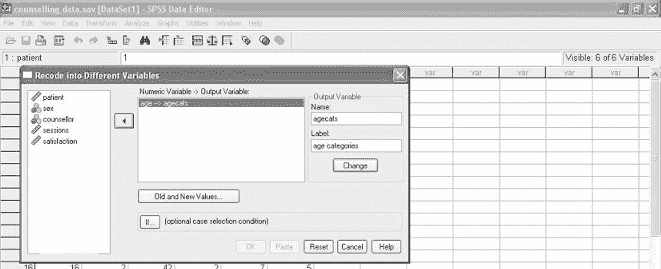

    Screenshot 4.4

    70 Page 70

5.  Click **Old and New Values** to open the recode dialogue box.

6.  Click in the circle next to **Range** to enter age categories. In our data, age ranges from 21 to 49, so we will use the following categories: 20–9, 30–9, 40–9.

7.  First enter 20, then 29 (as shown below), then in the **New Value** box type in 1. You have assigned the number 1 to the age category 20–9.

    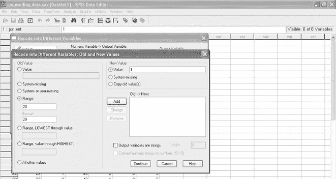

    Screenshot 4.5

8.  Now click **Add** and this will be entered into the **Old–New** variable box below.

9.  Continue until you have assigned numbers to all the age categories, as illustrated next: 71 Page 71

    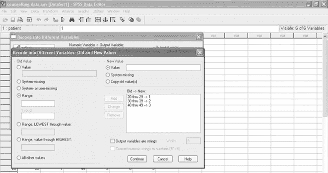

    Screenshot 4.6

10.  Click **Continue,** then click **OK** on the next screen. Your database will now have an additional variable that you have created called **agecats**. (If your new variable includes decimal places, remove them in **Variable View**.)

    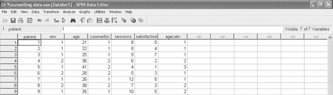

    Screenshot 4.7

11.  Be sure to check that you have conducted this procedure correctly – that your categories actually match, i.e., check that a 1 in agecats is within the range 20–9 in the age variable, that a 2 = 30–9 and a 3 = 40–9.

12.  You should then add value labels to your age categories – by going into the **Variable View** and clicking on **Values** (as described in Chapter 2). You should also change the **Measure** from **Scale** to **Ordinal**.

13.  Once you have added value labels, you can run crosstabs on **sex** and **agecat** by going to **Analyze** then **Descriptive Statistics** then **Crosstabs**. Move **sex** into Rows and **agecats** into Columns. Then click on the **Cells** tab and check that there is a tick in the box next to **Observed counts** and **row percentages** in the **Crosstabs: Cell Display** box as illustrated next: 72 Page 72

    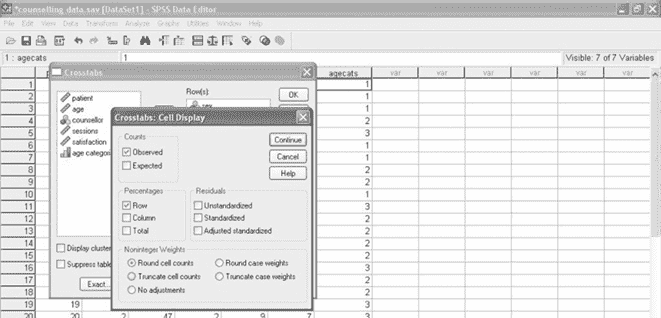

    Screenshot 4.8

14.  Click **Continue,** then **OK**.

This should produce the following table:

**Table 4.8**Cross-tabulation of sex with age categories

| sex \* agecats Crosstabulation  |

| --- |

|  || agecats || Total |

| --- | --- | --- |

| 20-29 || 30-39 || 40-49 |

| sex || male || Count% within sex || 535.7% || 750.0% || 214.3% || 14100.0% |

|  || female || Count% within sex || 212.5% || 743.8% || 743.8% || 16100.0% |

| Total ||  || Count% within sex || 723.3% || 1446.7% || 930.0% || 30100.0% |

A table titled sex agecats crosstabulation lists the count and percentage values within sex for male and female, and total values in column 1. Columns 2 and 3 list the corresponding values for agecats, including 20 to 29, 30 to 39, and 40 to 49, and total, respectively.

Although the numbers in each category are small, we might note that the males tended to be younger than the females. While there were similar percentages in the 30–9 age range, there were differences in the younger and older age categories: 36 per cent of males were in their 20s compared to only 12.5 per cent of females; 44 per cent of females were in their 40s compared to only 14 per cent of males.

Transforming data like age into categories can sometimes provide interesting information that would not be otherwise apparent. For example, a simple comparison of the mean age of male and female patients reveals that the mean age of males was 31 years and the mean age of females was 39 years. But all this tells us is that, on average, females were older. By transforming age into categories and cross-tabulating with sex we can actually see where these differences lie in terms of specific age groups.

73 Page 73 

There is just one more thing to note: because we have created three categories of age the numbers are even fewer in the six cells. Many students go on to report the chi-square statistic for this analysis. However, the numbers really are too small to produce a reliable chi-square, as you would see from the chi-square tests table, which cautions that ‘4 cells (67%) have expected count less than 5’. In such cases we can only report the cross-tabulation percentages showing this trend, and perhaps recommend a larger sample for statistical analysis.

## 4.6Summary

In this chapter you have learnt about:

*   How to cross-tabulate categorical data in SPSS.

*   How to produce the chi-square statistical test.

*   The concept of statistical significance, levels of significance, Type I (false positive) and Type II errors (false-negative) errors, and issues relating to power and ‘effect size’.

*   How to re-code interval variables into categorical variables.

## 4.7Exercises

### Exercise 4.1 Re-code counselling sessions into categories

Re-code the data for number of counselling sessions into three equal groups representing ‘low’, ‘medium’ and ‘high’ attendance and first cross-tabulate with ‘counsellor’ then with ‘sex’. What do these cross-tabulations show?

### Exercise 4.2 Re-code satisfaction ratings into categories


-   重新编码满意度评分数据，以创建代表“积极”、“消极”和“中性”评分的类别。将此新变量与“辅导员”交叉，再与“性别”交叉。满意度评分应如何分类为这些类别？这些交叉表显示了什么？

### 练习 4.3 你能用这些数据进行卡方检验吗？

想象医生已经完成了一些自己的分析，并向你寻求具体建议。他实际上已经统计出就诊于约翰和简的患者人数，并注意到大多数男性就诊于约翰，而大多数女性就诊于简。他在以下表格中向你展示了这些数据：

74 Page 74 

**Table 4.9**Number of patients who have seen each counsellor

|  | John | Jane | Total |
| --- | --- | --- | --- |
| Male | 10 | 4 | 14 |
| Female | 4 | 12 | 16 |
| Total | 14 | 16 | 30 |

表格列出了患者的性别和总计，第一列为性别，后续列分别为约翰、简和总计的患者人数。

尽管医生对这个表格感到满意，但他想知道在该数据上可以进行什么统计检验。

> “当然有，”你说，“这叫做卡方检验”。

> 

> “太好了，你真知识渊博，”医生回应，“能把这些数据输入你的电脑，告诉我卡方统计量显示什么？”

那么，你能做到吗？

现在你可能会想，就像我多年所想的那样，你需要将这 30 位患者的原始数据全部录入 SPSS 才能进行卡方检验。其实你错了！以下是操作方法：

1. 1Open a new file and in **Variable View** create variables for ‘sex’ and ‘counsellor’; these should be ‘string variables’. Then create a third variable (numeric) for the observed frequencies.

You should then enter the data from the above table using a row for each combination of the two categories; then for each combination you enter the frequencies as illustrated below:

![Screenshot 4.9Screenshot 4.92. Now, and here is the clever bit, we need to tell SPSS that the numbers in the frequencies column represent the total number of observations for that combination of categories (they are not just values for another variable). To do this you have to go to **Data / Weight Cases,** then select **Weight cases by,** and move **frequencies** into the **Frequency Variable** box: 75 Page 75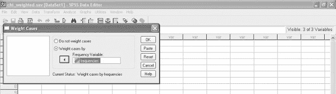

Screenshot 4.10

3. When you have done this, click **OK** and you can run your chi-square test as described earlier in this chapter. It is so much easier than entering all the raw data.

## 4.8Notes

1. 1This information might also be relevant for any further analysis. For example, if we found that one counsellor received higher satisfaction ratings than the other, it could be that females are more generous in their ratings than males. It could even be that same-sex patients and counsellors worked best – achieving the highest satisfaction ratings. It is factors like these that need to be investigated in quantitative data analysis.

2. 2Expected frequencies for each cell are calculated by multiplying row total by column total and dividing by the grand total. So, the expected frequency for the top right cell in Table 4.4 (50) is arrived at through the following calculation: (100 × 100)/200 = 50. The same values apply to all the cells in this table of course.

3. 3What is a large enough sample size? Well, for this chi-square our sample of 30 was just enough given the distribution of the male and female patients. One source recommends a sample of at least 50 (Watson *et al*. 2006), but the point is that you need to maintain sufficient numbers in each of the cells, so the sample needs to be fairly evenly distributed across the categories.

4. 4Some authors recommend citing the more conservative continuity correction (second line down in the table) for 2×2 tables like this one (i.e. two row categories – male/female, and two column categories – John/Jane), but Pett (1997: 163) and Howell (1997: 149) advise against citing this value. Some authors also suggest that where expected frequencies are less than 5 in 2×2 tables, we can cite the more conservative Fisher’s Exact Test (fourth line down in the table) instead of the Pearson chi-square value (Pett 1997; Kinnear and Gray 2004). However, Howell (1997: 152) points out that the chi-square is robust to violations from small sample sizes and is unlikely to produce false positive results (i.e., concluding a significant difference when there is not one). Indeed, the problem with small sample sizes is that they are more likely to have insufficient numbers (or ‘power’) to show a significant difference. 76 Page 76

5. 5There are techniques (and some computer programs) to determine sample sizes that rely on estimates of effect from previous similar research using similar outcome measures. The idea being that if we know the size of the effect to expect from previous studies then we can calculate the size of the sample needed to ensure a sufficient sample size to detect significant differences if they exist. This is beyond the scope of this book but for a relatively simple estimate of sample sizes needed, Cohen (1988) includes some tables which enable you to estimate sample size depending on the size of the effect you want to detect. ‘The size of the effect you want to detect’ requires a decision on your part as to what constitutes a meaningful difference. For example, if you are evaluating the effect of a counselling service on patients mental health, then you need to decide what would constitute a meaningful improvement in mental health on your outcome measure. If the scale goes from 1–100, where 100 represents optimum mental well-being, what do you consider is a minimally important clinical difference on the scale to signal real improvement in mental health? If you agree that it is a rise of ten points on the scale then that is the size of the effect you are looking to detect.

77 Page 77 

## Chapter5 Correlation: examining relationships between interval data

In this chapter you will learn about scatterplots and correlation to examine the direction and strength of relationships between variables.

## 5.1Introduction

In Chapter 1 we briefly discussed the possibility of conducting correlation analysis on our data. We saw that correlation describes the direction and strength of a relationship between two interval variables (e.g., height and shoe size) and that the direction can be positive or negative:

* Positive correlation: an increase in values for one variable is associated with an increase in values for the other variable, for example, as height increases so does shoe size.

* Negative correlation: an increase in values for one variable is associated with a decrease in values on another variable, for example, as temperature *reduces* the use of electricity for heating *increases*.

In order to demonstrate this, scatterplots were used to graphically illustrate the relationship between values for two variables. For example, Figure 1.4 (repeated in Figure 5.1 on the next page) showed quite a strong positive correlation between height and shoe size – the strength being determined by how tightly the plot forms a line rising from left to right.

## 5.2Examining correlations in the questionnaire

Turning to our questionnaire, we first need to identify two interval variables that might be correlated. We have three to choose from:


-   [年龄]、[会话次数]、[满意度评分]。

观察这三个变量后，显而易见的相关性选择是[会话次数]和[满意度评分]，因为我们可能假设患者接受的会话次数越多，他们对咨询的满意度越高。但正如第 1 章所建议的，情况可能并非如此——也许更多的会话对应更多未解决的问题，从而导致满意度降低？让我们来看看数据。

78 Page 78 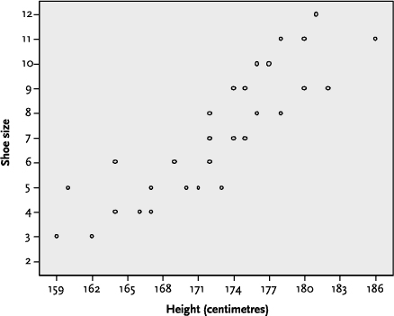

**Figure 5.1**Scatterplot for height and shoe size

### 5.2.1Producing a scatterplot in SPSS

第一步是绘制数据的散点图。

1.  1From the menu click on **Graphs**, then **Chart Builder**。

2.  2Select **Scatter/Dot** from the **Gallery** to show the range of graphs available and then drag the first ‘simple scatter’ graph into the preview area。

3.  3Drag **satisfaction** into the Y-axis box and **sessions** into the X-axis box – as illustrated on the next page:79 Page 79

4.  4Click **OK**。

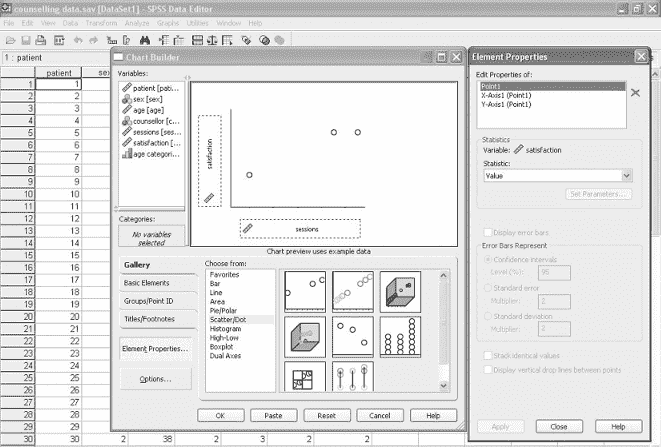

Screenshot 5.1

这将产生如下散点图输出（见 Figure 5.2）：

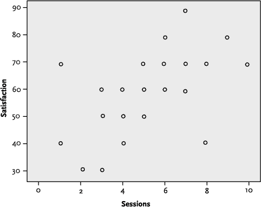

**Figure 5.2**Scatterplot of sessions and satisfaction ratings

80 Page 80 

注意：在 SPSS v15 中，您可能需要使用 Chart Editor 来调整 Y 轴刻度，以便为较低值提供 5%的下边距：双击 Y 轴，在属性框中将下边距（%）从 0 改为 5。

从散点图中可以立即看出，从左到右呈上升趋势，这表明两个变量呈正相关：接受更多咨询会话的患者报告了更高的满意度。

### 5.2.2The strength of a correlation

虽然绘制散点图可以直观判断两个变量是否似乎相关，但这只是故事的一半。下一步是对这些数据应用统计检验，以确定相关性的强度以及它是否具有统计学显著性（即不太可能是偶然发生的）。

相关性的强度在-1 到+1 的区间内表示，如表 5.1 所示：

**Table 5.1**The strength of a correlation

| Negative correlation  || Positive correlation |

| --- | --- |

| −**1** −.9 −.8 −.7 −.6 −.5 −.4 −.3 −.2 −.1**0** || .1.2.3.4.5.6.7.8.9+1 |

| --- | --- |

| Strong negativeWeak positive || Weak positiveStrong positive |

| --- | --- |

A scale ranging between negative 1 and positive 1 values indicates the negative and positive correlation. Points between negative 1 and negative 0.5 indicate strong negative correlation, and negative 0.4 to negative 0.1 indicate weak negative correlation. 0.1 to 0.5 indicates weak positive correlation, and 0.6 to 1 indicates strong positive correlation.

A value approaching zero indicates the absence of any relationship between two variables, in other words no correlation.

You would only find a perfect positive correlation (+1) where there is a one-to-one incremental relationship between the two variables, for example, number of cinema tickets sold and customers in audience (assuming no one has sneaked in without buying a ticket of course). Obviously this level of correlation (perfect correlation) is unlikely in health and social research.

So, the next question is how do we obtain this value for the strength of a correlation from SPSS? Well, for our two variables with interval data – counselling sessions and satisfaction ratings, the appropriate measure of correlation is the Pearson product-moment correlation coefficient.^()

#### Running the Pearson correlation

1.  1From the menu at the top of the screen click: **Analyze / Correlate / Bivariate** ( *bi* meaning two and *variate* meaning variable).

2.  2Move **sessions** and **satisfaction** into the variables box.

3.  3Ensure that the **Pearson** box is ticked.

4.  4Click **OK**。

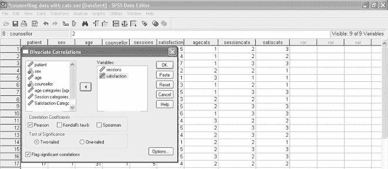

Screenshot 5.2

82 Page 82 

这将产生如下输出表格，显示会话次数（sessions）与满意度（satisfaction）之间的 Pearson 相关系数为 0.53。因此，我们可以得出两个变量之间存在**强正相关**。该行标记为**Sig. (2-tailed)**的信息表明，相关性在 0.003 水平上具有统计学显著性，也就是说它不太可能是偶然发生的（统计显著性的概念在第 4 章中讨论过）。^()

**Table 5.2**Pearson correlations between sessions and satisfaction

| Correlations  |

| --- |

|  || sessions || satisfaction |

| --- | --- | --- |

| sessions || Pearson Correlation || 1 || .530 |

|  || Sig. (2-tailed) || . || .003 |

|  || N || 30 || 30 |

| satisfaction || Pearson Correlation || .530 || 1 |

|  || Sig. (2-tailed) || . || .003 |

|  || N || 30 || 30 |

表 5.2 标题为“Correlations”，列出了会话次数（sessions）和满意度（satisfaction）变量的 Pearson 相关、双侧显著性值以及样本量（N）。第 1 列列出了对应的变量；第 2 列和第 3 列分别列出了相关系数和显著性值。

\*\*⋅ Correlation is significant at the 0.01 level (2-tailed).

当你在报告中撰写此分析结果时，应将 Pearson 相关系数的值称为‘r’，如下所示：

我们可以因此得出结论，两个变量之间存在**强正相关**（r = .53, p = .003），更多的会话次数与更高的满意度评分相关联。

### 5.2.3The coefficient of determination

但这‘强相关’的 0.53 实际意味着什么？也就是说，我们能在多大程度上预测一个值来自另一个值？换句话说，患者满意度评分与会话次数之间的关系有多强？

有一个简单的计算可以回答这个问题。它被称为**决定系数**（coefficient of determination，记作 r²），通过简单地对相关系数进行平方来衡量一个变量‘预测’另一个变量的程度。

例如，如果你进行了月薪与年薪之间的相关性分析，这应该得到一个完美的正相关，即 r = 1.0。如果你将这个数值平方（1 × 1 = 1），再乘以 100，就会得到 100%的可预测性：如果你知道月薪，就能准确预测年薪。

回到我们的咨询数据，首先，我们对 0.53 进行平方，得到 0.28，然后将其乘以 100，得到 28%。因此，我们所谓的‘强相关’实际上只解释了满意度评分方差的 28%。我们应当得出结论：满意度评分**与**会话次数相关，但这仅解释了方差的 28%；还有其他因素在起作用。请参见方框 5.2 获取相关性和决定系数的实际应用示例。


-   [决定系数的值也引起我们对解释和比较相关系数的重要问题的注意：相关系数为 0.8 并不意味着相关系数为 0.4 的两倍强。因此，当我们计算决定系数时，相关系数为 0.4 表明一变量的方差中有 16%是由另一变量解释的，而相关系数为 0.8 则表明一变量的方差中有 64%是由另一变量解释的。
## 5.3Summary

在这一章中，你学会了如何：

[content]
    检查两个间隔变量之间的关系，以判断它们是正相关还是负相关。84 Page 84

    *   绘制散点图，以图形化展示两个变量之间的关系。

    *   使用皮尔逊积差相关检验，评估线性相关的统计强度和方向。

    *   通过决定系数解释相关强度。

    在下面的练习中，你还将学习：

    *   样本量在相关性和获得统计显著结果中的重要性。

    *   离群值对相关统计的显著影响。

    *   相关与因果的区分的重要性。
## 5.4Exercises

### Exercise 5.1Produce scatterplots and correlations for the other interval variables

Conduct correlations for (a) age and number of sessions; and (b) age and satisfaction with the service. Remember to produce a scatterplot for the data before running the Pearson correlation. What do the results show in terms of (a) the strength and direction of any correlations; and (b) the statistical significance of the results?

### Exercise 5.2The importance of sample sizes in correlation

Sample sizes can have a profound effect on statistical significance. Try running the Pearson correlation between *age* and *number of sessions* again, but this time with double the number of cases for each of these variables.

Highlight the 30 cases for **age**, right-click the mouse button and copy, then move your cursor to the end of the data column for **age** (row 31) and paste in the data you have copied. So you have the same data but double the number of cases. Next, follow the same procedure for **sessions**. Then run the Pearson correlation on the 60 cases for age and sessions.

### Exercise 5.3The importance of ‘outliers’ in correlation

There is another reason why you should always produce a scatterplot of the data if you are looking for correlations: to identify outliers – any data points that are out on their own away from the main cluster. These can have a significant influence on any correlation statistics.

Have a look at the scatterplot for *age* and *satisfaction* again (you should have produced it for Exercise 5.1b). Are there any outliers? Imagine trying to draw an oval, fat cigar shape around the dots in the scatterplot to discern a negative correlation – is there one dot in particular that falls outside your oval shape? If so, identify the case number, remove it from your dataset (values for age and satisfaction), and run the Pearson correlation again.

85 Page 85 

### Exercise 5.4Explain the following correlations^()

1.  (a)It is reported that there is a strong positive correlation between ice cream sales and crime rates. Do we therefore conclude that ice cream causes crime?

2.  (b)It is reported that there is a positive correlation between number of counselling sessions and level of psychological well-being? Can we therefore conclude that counselling works and more counselling works better?

3.  (c)Consumption of milk is positively correlated to cancer. So does drinking milk cause cancer?

4.  (d)Studies have found a negative correlation between smoking and Alzheimer’s dementia: the risk of getting Alzheimer’s dementia reduces with increased smoking of cigarettes. Would you therefore recommend that people start smoking or increase the number they smoke to prevent the onset of Alzheimer’s dementia?

## 5.5Notes

1.  1The other options are to use Kendall’s tau or Spearman’s test for correlations with ordinal level data.

2.  2And if you are wondering why it says 2-tailed’, this will be explained in the next chapter.

3.  3Exercise 5.4(b) is taken from Watson *et al*. (2006). Exercises (c) and (d) are taken from Coolidge (2006).

86 Page 86 

## Chapter6 Examining differences between two sets of scores

In this chapter you will learn about tests which tell us if there is a statistically significant difference between two sets of scores. In so doing you will learn about independent and dependent variables, parametric and non-parametric data, and independent and related samples.

## 6.1Introduction

In this chapter we will look at statistical tests which tell us if there is a significant difference between two sets of scores. For example, this could be scores on an aptitude test comparing a sample of *males* and *females*, or scores *before* and *after* some intervention, e.g., mental health scores before and after a course of therapy for a sample of patients.

So you will also learn about statistical tests which tell us if there is a significant difference between two sets of scores. For example, this could be scores on an aptitude test comparing a sample of *males* and *females*, or scores *before* and *after* some intervention, e.g., mental health scores before and after a course of therapy for a sample of patients.

So, what differences between two sets of scores might we examine in our counselling questionnaire? In order to think about this it is useful to categorize variables into two kinds: *independent variables* and *dependent variables* (as discussed in Chapter 1). For example, we might think that satisfaction with the service is *dependent* on which counsellor the patient saw, in which case we would have the following *independent* and *dependent variables*:

*   *Independent variable*: counsellor (John or Jane).

*   *Dependent variable*: satisfaction rating.

In the counselling questionnaire there are in fact only two possible independent variables – the categorical variables *counsellor* and *sex*, and each has three possible dependent variables, as listed below:

1.  1*Independent variable*: counsellor (John or Jane): 

    *   *dependent variable*: satisfaction ratings;

    *   *dependent variable*: number of sessions;

    *   *dependent variable*: age of patients.

2.  2*Independent variable*: sex (male or female): 

    *   *dependent variable*: satisfaction ratings;

    *   *dependent variable*: number of sessions;

    *   *dependent variable*: age of patients.

Box 6:1 provides further discussion of independent and dependent variables in the context of experimental studies.

87 Page 87 

Having identified our independent and dependent variables, the next question is which differences do we wish to examine? And the answer to that is, which do we think are the most relevant? In my opinion we should start by comparing satisfaction ratings for the two counsellors, and then the number of sessions provided by each of the counsellors, since these might provide the most relevant information for the doctor who has commissioned this analysis.

88 Page 88 

## 6.2Comparing satisfaction ratings for the two counsellors

In order to compare the satisfaction ratings for the two counsellors we first need to choose the appropriate statistical test. Statistical tests comparing scores between two samples (in our study, satisfaction ratings for John vs satisfaction ratings for Jane) fall into two categories depending on the type of data we have. Figure 6.1 illustrates the decision process for choosing the appropriate statistical test.


-   [选择两个样本之间的适当统计检验](https://wiki.example.org/11_Chapter06.xhtml#fig6-1)的灵感源于诺贝尔物理奖获得者**理查德·费曼**。

1.  运用费曼技巧，你只需花上`20 min`就能深入理解知识点，而且记忆深刻，*难以遗忘*。

```
if (condVar > someVal) {console.log("xxx")}
```


| 满意度 | 假设方差相等 | 1.209 | .281 | 2.583 | 28 | .015 | 1.357 | .525 | .281 | 2.433 |
| --- | --- | --- | --- | --- | --- | --- | --- | --- | --- | --- |
| 假设方差不相等 | | | 2.628 | 27.626 | .014 | 1.357 | .516 | .299 | 2.416 |
| 一个名为独立样本检验的表格列出了假设方差相等和不相等情况下的满意度变量。列 2 和 3 列出了列方差相等性的 Levene 检验，包括 F 和显著性值，以及均值相等性的 t 检验，包括 t、自由度、双尾显著性、均值差、标准误差差以及 95% 置信区间的下限和上限。

组间统计表（表 6.2）显示了每个类别中的学生人数和均值，从中我们可以看到约翰的平均分为 4.86，而简的平均分为 3.50。

第 94 页 第 94 页

表格还提供了每组分数的标准差。这是每组分数相对于均值的平均偏差，提供了分数分布的程度指标。请注意，简的满意度评分的标准差略大于约翰的。这在下方的箱线图中有所体现，我们可以看到简的评分分布略有更大的离散程度。


**Figure 6.3**Boxplots comparing satisfaction ratings for John and Jane

因此，我们可以看到满意度评分较高的患者是约翰，但这种差异在统计学上是否显著？

独立样本检验输出表（表 6.3）首先提供了列方差的检验。请记住，“方差均匀性”是使用参数检验时的一个假设——因此这里检查的是约翰和简的评分（两组分数）的方差（分布）是否相对相似。由于该检验的值不显著（0.281 大于我们的显著性水平 0.05），这意味着我们没有违背这一假设，可以继续检查表格的第一行——假设方差相等（如果违背，则需要引用表格更保守的底部行）。**Sig. (2-tailed)** 列告诉我们两组均值之间的差异是否具有统计显著性（均值差（1.357）在下一列给出）。由于该值为 0.015，小于我们常规的显著性水平 0.05，我们可以得出结论：两组的评分存在显著差异。我们可以在报告中这样写：

> 使用独立样本 t 检验来考察各辅导员的满意度评分差异。结果显示约翰的评分高于简（M = 4.86；SD = 1.23）而简的评分为 3.5（M = 3.5；SD = 1.59）；t = 2.58，p = .015。

第 95 页 第 95 页

### 置信区间

最后一列提供了 95% 置信区间的差值。该表中的置信区间给出了一个范围，从 0.28 到 2.43。简单来说，这意味着在 95% 的重复抽样中，预期差值会落在这些参数范围内。

因此，虽然我们的数据中平均差为 1.36，但置信区间表明，如果我们重复收集数据 100 次，我们预期约翰和简的满意度评分差异会在 0.28 到 2.43 之间出现 95% 的时间。因此，我们有 95% 的置信度认为差异会落在 0.28 到 2.43 之间。

这些参数可能很有启发意义。请注意，最低值为 0.28。这意味着我们只能确定两位辅导员的评分差至少为 0.28，这并不大。我们可以得出结论：我们的相对较小样本仅暗示了一个相当小且显著的差异，但需要更大的学生样本来增加我们对评分差异实际大小的信心。

## 6.3 比较每位辅导员的会话次数

我们接下来要研究的差异是每位辅导员进行的会话次数。一位辅导员是否比另一位提供更多的会话？这可能有助于解释为何一位辅导员的满意度评分更高。

与之前的分析一样，我们首先需要决定使用适当的统计检验。回顾 Figure 6.1，我们知道我们处理的是两个独立的数据样本，因此下一步是确定是使用参数检验还是非参数检验。重复绘制直方图以检查正态分布：

1.  1 从屏幕顶部的菜单中点击 **Graphs** 然后 **Chart Builder**。

2.  2 选择 **Histogram** 从 **Gallery** 中，并将第一个 **Histogram** 拖入预览区域。第 96 页

3.  3 将 **sessions** 拖到 X 轴。

4.  4 将 **Groups/Point ID** 拖到 **Rows** 面板的 **Variable** 复选框中并打勾。

5.  5 将变量 **counsellor** 拖到 **Panel** 框中。

6.  6 在屏幕右侧的 **Element Properties** 部分，在 **Display normal curve** 复选框旁打勾。

7.  7 点击 **Apply** 然后点击 **OK**。

这将产生以下直方图（我已在 Chart Editor 中调整了尺度（以及增量）以匹配最大会话次数 12）：


**Figure 6.4**Histograms showing number of sessions for each counsellor

尽管这两个直方图中的“正态曲线”暗示数据呈正态分布，但我们可以看到约翰的会话次数确实倾向于较低的次数。这说明图表如何可能具有误导性。因此，如果我们在 Chart Editor 中将 X 轴仅限于实际的会话范围（1–12），我们会得到略有不同的画面。

第 97 页 第 97 页 

**Figure 6.5**Scaled histograms showing number of sessions for each counsellor

从 Figure 6.5 可以看出，简的直方图大约呈正态分布，而约翰的直方图表明数据倾向于较低的一端。因此，约翰的数据是检验正态性统计方法的理想候选者：

1.  1 从屏幕顶部的菜单中点击 **Analyze** 然后 **Descriptives** 然后 **Explore**。

2.  2 将 **sessions** 移到 **Dependent** 列，将 **counsellor** 移到 **Factor** 列。

3.  3 在 **Display** 下确保只有 **Plots** 前面的复选框被打勾。

4.  4 点击 **Plots** 标签以打开图表对话框。

5.  5 在 **Boxplots** 下点击 **None**，并取消 **Descriptive** 下的任何复选框。在 **Normality plots with tests** 下，于 **Spread vs Level** 打勾 **none**。

6.  6 点击 **Continue**，然后点击 **OK**。

当我们产生正态性检验时，我们发现 Kolmogorov-Smirnov 检验实际上是显著的（0.014），表明分布显著偏离正态分布。

**表 6.4**正态性检验

| Tests of Normality |
| --- |
|  |
|  | Kolmogorov-Smirnov^() | Shapiro-Wilk |
| --- | --- | --- |
|  | counsellor | Statistic | df | Sig. | Statistic | df | Sig. |
| sessions | John | .254 | 14 | .014 | .910 | 14 | .159 |


| Jane || .191 || 16 || .120 || .933 || 16 || .275 |
A table titled tests of normality lists the sessions variable for counselors John and Jane in column 1. Columns 2 and 3 list the corresponding Kolmogorov-Smirnov and Shapiro-Wilk values, including the statistic value, degree of freedom, and significance value, respectively.

^(a)⋅ Lilliefors Significance Correction \*this is a lower bound of the true significance

> This being the case, it might therefore be more appropriate to use the test for non-parametric data which, as illustrated in Figure 6.1, is the Mann-Whitney test.

> This being the case, it might therefore be more appropriate to use the test for non-parametric data which, as illustrated in Figure 6.1, is the Mann-Whitney test.

98 Page 98 

### Running the Mann-Whitney U test

1.  From the menu at the top of the screen click **Analyze** then **Nonparametric Tests** then **2 Independent Samples**.

2.  Move **sessions** into **Test Variable**.

3.  Move **counsellor** into **Grouping Variable**.

4.  Click **Define Groups** (since your Grouping Variable is counsellor, you need to specify the codes for the two groups, as we did for the t-test).

5.  Enter the value 1 (for John) in Group 1 and value 2 (for Jane) in Group 2.

6.  Click **Continue**.

7.  Ensure the Mann-Whitney U test is selected (it should be).

8.  Click **OK**.


Screenshot 6.4


Screenshot 6.5

99 Page 99 

This should produce the following output:

**Table 6.5**Mann-Whitney U test ranks

| Ranks  |

| --- |

|  || counsellor || N || Mean Rank || Sum of Ranks |

| --- | --- | --- | --- | --- |

| sessions || John || 14 || 20.61 || 288.50 |

| Jane || 16 || 11.03 || 176.50 |

| Total || 30 ||  ||  |

A table titled Ranks lists the session counselors John and Jane, and total in column 1. Columns 2 to 4 list the N values, mean rank, and sum of ranks.

**Table 6.6**Mann-Whitney U test statistics

| Test Statistics^() |

| --- |

|  || sessions |

| --- | --- |

| Mann-Whitney U || 40.500 |

| Wilcoxon W || 176.500 |

| Z || \-2.998 |

| Asymp. Sig. (2-tailed) || .003 |

| Exact Sig. \[2\*(1-tailed Sig.)\] || .002^() |

| Exact Sig. (2-tailed) || .002 |

| Exact Sig. (1-tailed) || .001 |

| Point Probability || .000 |

A table titled Test Statistics lists the variables in column 1, including the Mann-Whitney U, Wilcoxon W, Z value, 2-tailed asymptotic significance value, and more. Column 2 lists the corresponding sessions values.

^(a.) Not corrected for ties.

^(b.) Grouping Variable: counsellor

The first table provides information about how the satisfaction ratings were ranked. The procedure for calculating the Mann-Whitney U statistic involves ranking all the scores from both groups in order of magnitude and then calculating the mean rank for each of the two groups. So, for John we can see that the mean ranking for his session is 20.61, but for Jane it is much lower at 11.03.

In the second table, the two values we are interested in are the Mann-Whitney U (40.5) and the Exact Significance level (Exact sig. (2-tailed)) which is p = 0.002. Since the probability (p value) of this result occurring by chance is lower than our conventional significance level of 0.05, we conclude that there is a significant difference in the number of sessions conducted by the two counsellors.

We would write-up the results of this analysis, first, by referring to the median number of counselling sessions conducted by the two counsellors – because the median, as we learned in Chapter 1, is more appropriate where the data is not normally distributed.^()

> When the number of sessions conducted by the two counsellors was examined it was found that the median number of sessions conducted by John was 8.5 compared to 6.0 for Jane. The Mann-Whitney Test found this difference to be statistically significant: *U* = 40.5, p = .002.

100 Page 100 

This result might then be related to the higher satisfaction ratings for John, in other words, perhaps the higher satisfaction ratings related to the greater number of sessions he conducted with his patients?

## 6.4Summary

In this chapter you have learnt about:

*   Independent and dependent variables.

*   Hypothesis testing (experimental and null hypotheses) and the importance of considering confounding variables.

*   How to select the appropriate statistical test for comparing differences between two sets of scores.101 Page 101

*   The difference between independent samples and related samples, and between parametric and non-parametric data.

*   How to produce histograms to check for normal distributions and statistical ‘tests of normality’.

*   How to produce an Independent samples t-test and interpret the results (including confidence intervals).

*   How to produce the Mann-Whitney U test for non-parametric data.

In the following exercises you will also learn:

*   How to compute a new variable from existing variables.

## 6.5Exercises

### Exercise 6.1Checking for other significant differences

In this chapter we have concentrated on the differences in satisfaction ratings and number of sessions for the two counsellors. You may now wish to see if there were any significant differences in:

1.  (a)the age of patients seen by the two counsellors;

2.  (b)satisfaction ratings from male and female patients;

3.  (c)the number of sessions conducted for male and female patients;

4.  (d)the age of the male and female patients.

Remember to check the distribution of the data in order to run the appropriate analysis (i.e., parametric t-test or non-parametric Mann-Whitney U test).

### Exercise 6.2Create a new variable to analyse same-sex satisfaction ratings

In Chapter 4, cross-tabulation revealed that the majority of male patients (71%) saw John, while the majority of female patients (75%) saw Jane. We noted that this might be important information for the doctor, since this might suggest it is necessary to ensure a male and a female counsellor are available to cater for patient preferences, that is, preference for same-sex patient and counsellor.

Now, the curious among you might go on to wonder if this has any bearing on the counselling relationship, for example: were satisfaction ratings higher for same-sex patient–counsellor sessions compared to different-sex patient–counsellor sessions?

So how would you investigate this? Here is a clue: you will first need to create a new variable (using **Transform/Compute**) which records whether the patient saw a counsellor of the same sex or not. Then you can use this new variable as an independent (grouping) variable to compare the mean satisfaction ratings between the two groups.

102 Page 102 

## 6.6Notes

1.  1Less commonly, related samples might be people who have been matched or paired on relevant criteria. And SPSS actually uses the term ‘paired samples’ for t-tests, rather than ‘related samples’. Other terms for related samples include ‘repeated measures’ and ‘dependent samples’.

2.  2While it is important to orientate towards these assumptions, studies have shown that parametric tests are actually quite robust to ‘moderate departures’ from these conditions (Howell 1997; Bryman and Cramer 2001).


3.  3 你可以通过以下步骤获得中位数值：`Analyze` 然后 `Compare Means` 然后 `Means`。在 `Means` 框中，将 `sessions` 放入 `Dependent List`，将 `counsellor` 放入 `Independent List`。接着，点击 `Options`，在可用的统计数据列表中选择 `median`，并将其移动到 `Cell Statistics` 框中，点击 `Continue`，然后点击 `OK`。

103 Page 103 

## Chapter7 Reporting the results and presenting the data

在本章最后，我们将探讨如何组织定量研究的报告以及如何展示数据。

## 7.1Introduction

恭喜，你已经完成了数据分析的轻松部分——现在最困难的任务来了：撰写结果。

总体而言，良好科学写作的关键标准是准确性、清晰度和结构，但你也应该尝试将其写成一个有趣的故事，而不是对统计数据和结果的‘干巴巴’列举。为了实现清晰度，你可以想象自己受雇为一位对主题或研究方法知之甚少的专业人士（例如，一位医生）来撰写报告。关于报告结构，好消息是，已有既定的指南说明如何组织研究结果。

## 7.2Structuring the report

定量研究报告通常应包括以下章节：

1.  1Abstract。

2.  2Introduction。

3.  3Methods。

4.  4Results。

5.  5Discussion。

6.  6Conclusion。

7.  7Appendices。

8.  8References。

### The abstract

摘要是对研究的简要、简洁总结，通常限制在 200–300 词以内。它通常是报告的最后部分撰写（因为你需要先了解自己说了什么，才能提供摘要），并应包含以下信息：

*   研究的简要背景；

*   研究的目的/旨；

*   使用的方法和样本；

*   简要结论，阐述研究的重要性。

104 Page 104 

摘要的作用是让读者获得关于研究的足够信息，了解基本细节，从而决定是否阅读完整报告。

### The introduction

引言应提供研究背景，明确所要解决的问题，并回顾相关的已有研究。对于涉及健康和社会护理的研究，常常会引用相关的政策文件，以将研究置于更广阔的健康和社会背景中，并指示问题的程度。下图（相当出色的）示例在 Box 7.1 中展示了这种做法。

如果引言中未在单独章节处理，则应在此处阐明研究的旨和目标（研究问题、假设）。

### Methods

方法章节的关键是清晰和具体，使读者能够根据报告中提供的信息复制你的研究方法和过程。因此，我们谈论的是一份非常详细的描述，应涵盖：

1.  1*Study design*: 研究的总体方法或设计是什么？例如，是实验（包含自变量和因变量）、问卷研究，还是由一系列访谈或焦点小组组成的定性研究等？

2.  2*The participants*: 样本框架（目标样本，例如，一年内就诊的所有咨询患者）、抽样方法（随机、配额、全部）和样本量？这可能需要包括人口学信息（年龄、性别、种族背景等）。

3.  3*The materials*: 研究中使用了哪些材料来进行研究和收集数据？例如，问卷或其他测量工具的细节可能在附录中说明。如果你使用标准化测量工具（例如，用于测量健康相关生活质量），应说明其与研究的相关性，并提供其可靠性和效度的相关信息（可靠性指随时间或不同样本一致性；效度指其测量的是所设定的内容，例如焦虑或抑郁水平）。

4.  4*The procedure*: 研究是如何实际进行的？例如，如果研究涉及问卷，问卷是如何分发给参与者的？是邮寄给参与者让其完成后返回，还是在研究者在场下完成？研究表明，问卷的完成方式（自行填写、面谈等）会影响回答（Lyons *et al*. 1999）。请记住，读者应能根据报告中提供的细节复制你的研究过程。

### Results

结果应以简洁明了的方式呈现。利用图表和表格帮助展示和解释结果。当使用描述性和推断性统计来分析数据时，你应：

106 Page 106 

*   明确所使用的统计方法；

*   报告结果的统计显著性；

*   指出所有必要的假设均已满足（例如，使用 t-test 时数据正态分布）。

报告也应具有逻辑结构。良好的做法是提出研究问题或假设，然后由数据确认或否定。你可以在呈现分析结果时加入“surprisingly’、‘as expected’ 或‘as predicted’ 等词汇和短语。这比单纯列举分析内容更具吸引力，使报告成为一个充满曲折的故事。

图表、图形和表格应在不回到正文的情况下让读者理解，因此应清晰编号、标题，并完整标注所有测量单位。仅在能够增强结果理解时才包括它们。在正文中，应引导读者查看表格或图形，并指向相关数据。读者不应翻页时突然看到一个“漂浮”在空中的图形：在正文中先引入图形，然后解释它。

如果你感到沮丧，那是因为你在批改大量作业时发现这些指南被忽视了；我在本章末尾提供了一些过去作业中图表的示例，以展示如何*不*正确地展示数据。

### Discussion

讨论章节应对结果进行解释和说明，并与任何研究问题或假设相关联。它还应包括对研究的批判性反思（例如，问卷设计、结果测量的相关性、因样本量小而难以推广的局限性）。

### Conclusion

结论应包含研究的一般意义，并给出进一步研究的建议或推荐。

### Appendices

这些部分应包含所使用的仪器，如问卷。

## References

应包含完整的参考文献列表（使用适当的学术格式）。这表明你已查阅相关文献并承认你的工作的来源，同时也让读者可以查阅你引用的工作。

## 7.3How *not* to present data


这里有一些数据展示的不当示例。它们来自过去几年教授定量数据分析的学生提交的作业。

### Exhibit A


GRAPH 1

#### What’s wrong with this?

Well, first, it is very deceptive. If the purpose of including a chart is to provide a visual representation of the results which accurately reflects the data at a glance, then this chart is not the finest of examples.

It shows the number of full-time and part-time students on a course. If we were to just glance at the two bars it would appear that there are at least three times as many full-time students as there are part-time. But if you look at the Y-axis, you will see that there are actually only twice as many: six part-time and 12 full-time. The problem here is that the Y-axis starts at four.

The second problem is that the increments rise at intervals of 0.5. Is it possible to have half a student? The Y-axis should have been changed in the Chart Editor.

And, third, although the graph is numbered below (GRAPH 1), there is no title, for example, ‘Graph 1: Number of students who are full-time and part-time’.

108 Page 108 

### Exhibit B


#### What’s wrong with this?

There are many things wrong with this chart:

1.  1The chart is not numbered – neither is there a title.

2.  2The Y-axis (height) has no label of the actual measurements (centimetres).

3.  3The Y-axis starts at 150cms. Is case 14 really four times as tall as case 6?

4.  4The height should be ordered from lowest to highest.

But more generally, was it really necessary to produce a graph of each individual’s height anyway?

### Exhibit C

sex

|  ||  || Frequency || Percent || Valid Percent || Cumulative Percent |

| --- | --- | --- | --- | --- | --- |

| Valid || male || 8 || 47.1 || 47.1 || 47.1 |

|  || female || 9 || 52.9 || 52.9 || 100.0 |

|  || Total || 17 || 100.0 || 100.0 ||  |

A table titled Sex lists the variables, including the valid males, females, and total values in column 1. Columns 2 to 5 list the corresponding frequency, percentage, valid percentage, and cumulative percentage values.

109 Page 109 

Figure 1

#### What’s wrong with this?

Aside from the fact that neither a table nor a chart was really necessary to illustrate the fact that there were eight males and nine females – there are a number of other problems:

1.  1Neither the table nor the pie chart has titles – they are just labelled Figure 1.

2.  2Patterns rather than shaded areas should be used in pie charts and bar charts since most reports are published in black and white and the colour variations can become indistinguishable.

3.  3There are no numbers or percentages with the pie chart (though the table does provide these).

### Exhibit D


Figure 1

110 Page 110 

#### What’s wrong with this?

Well, first, a line graph is inappropriate because it suggests continuous data rather than distinct age categories. It should be a bar chart.

Second, for some reason the Y-axis is at 0.5 intervals – there are no half-people!

And, third, the chart has no title – just ‘Figure 1’.

### Exhibit E

#### Full-Part-time status

This bar graph illustrates the frequency distribution of full-part-time status

N=1 (6%) respondents work/study part-time

N=16 (94%) respondents work/study full-time.


#### What’s wrong with this?

Aside from the questionable value of graphically representing this data, look at the scale . . . What does it represent?!

## Concluding remarks

111Page 111 

My primary aim in writing this book has been to provide a relatively simple and accessible introduction to quantitative data analysis. It is for this reason that I have taken a pragmatic approach which skips much of the theoretical underpinnings of statistics in favour of practically conducting the analysis. For those students who will be taking their studies further, I would strongly recommend complementing this practical book with further reading around the principles of statistical analysis. A little knowledge of statistics can be a ‘dangerous’ thing, and this practical introduction to quantitative data analysis has merely scraped the surface in terms of the underlying principles.

I have one final word of warning. Many students design research studies without properly thinking through how they will analyse the data (I’ve done it myself of course – and paid the price). My advice to students is always to keep the design of your research study as simple as possible, and to stick to what you know: that is, design the study around the tests you know how to use. If you cannot do that then at least make sure you understand the test and the analyses that you are considering by consulting the relevant text books. Do not make the analyses an after-thought: design your study in haste, repent at leisure . . .

But the good thing of course, is that having worked through this book you now have the ability to understand and conduct what are probably the most commonly used statistics in health and social studies. Have fun . . .

112 Page 112 

## Answers to the quiz and exercises

## Chapter 1

### Exercise 1.1 Types of data

Would the following variables yield interval or nominal/categorical data?

1.  (a)ethnic background;

2.  (b)student assignment marks;

3.  (c)level of education;

4.  (d)patient satisfaction ratings on a 1–7 scale.

#### Answers

1.  (a)This would be nominal/categorical data since any numbers you assigned to the categories are arbitrary codes, e.g., Black–Caribbean (1); Black–African (2); Indian (3); etc.

2.  (b)Student assignment marks, provided as percentages, are interval since they represent equal intervals on a 1–100 per cent scale.

3.  (c)Levels of education would normally be considered as ordinal since they represent different levels of education on a scale, e.g., Diploma (1); Degree (2); Masters (3); MPhil (4); PhD (5). If you were to assign numbers to each of these categories, as I have done here, they would be more than arbitrary codes with the implication that (2) is a higher level of academic achievement than (1), and so on.

4.  (d)Patient satisfaction ratings on a 1–7 scale may be regarded as interval data since the scale is presented in equal intervals (though strictly speaking, we should say that the rating scale is at least ordinal and approximates interval data).

### Exercise 1.2 Measures of central tendency

Which do you imagine would be the most representative measure of central tendency for the following data?

1.  (a)number of days for students to return overdue library books;

2.  (b)IQ scores for a random sample of the population;

3.  (c)number of patients cured of migraine in a year by an acupuncturist;

4.  (d)number of counselling sessions attended by patients.

#### Answers

1.  (a)Probably median – because most students will return overdue books 113 Page 113within a few days – but some may not return them for weeks, months or years!

2.  (b)This should be the mean since IQ scores should be normally distributed around a standardized mean of 100.

3.  (c)None – this is categorical data! You would simply count the frequencies.

4.  (d)Depends if the number of sessions were normally distributed (mean) or distinctly skewed by a few patients (median).

### Exercise 1.3 Correlation


-   [费曼学习法](https://wiki.example.org/feynmans_learning_method)的灵感源于诺贝尔物理奖获得者**理查德·费曼**。

1. 运用费曼技巧，你只需花上`20 min`就能深入理解知识点，而且记忆深刻，*难以遗忘*。

```
if (condVar > someVal) {console.log("xxx")}
```


一个名为“性别会话类别交叉表”的表格列出了性别变量，包括男性和女性的计数和百分比，以及总计值在列 1 中。列 2 和列 3 列出了相应的会话类别，分别是 1-4、5-8 和 9-12，以及总计。

这里我们可以看到，主要差异再次出现在 9-12 类别中：43%的男性参加了 9-12 次会话，而女性只有 19%。当然，这可能仅仅反映了大多数男性患者看了约翰。或者，也许男性患者本身就需要更多的会话？无论原因如何，如果医生能够清晰地获得您提供的信息，他就可以在与两位辅导员讨论时进一步探讨这些结果的原因。

### 进行此练习的注意事项：

1. 1 您是否包括了我所做的值标签——即将新类别标记为 1-4、5-8、9-12？学生常常忘记添加这些值标签，而这些标签是了解类别含义的必要条件。或者，您可能将类别标记为“低”、“中”和“高”——但这些标签比提供每个类别的实际范围更为模糊。

2. 2 您是否包括了行百分比？尽管每个类别的数值较低，但您仍应包括百分比，并且应为行百分比：一些学生包括列百分比，这在本情境中不合适，因为我们想了解每位辅导员提供的会话相对数量。

### 练习 4.2 将满意度评分重新编码为类别

将满意度评分的数据重新编码为代表“积极”、“消极”和“中性”评分的类别。将此新变量与“辅导员”交叉，再与“性别”交叉。将满意度评分重新分类为这三个类别的最佳方法是什么？这些交叉表显示了什么？

#### 答案

过去，我多次发现将像这样重新编码的量表转换为更简单的类别更有助于解释。我们首先需要注意的是，我们的满意度量表范围是 1-7：

不满意 1 2 3 4 5 6 7 非常满意

如果您对咨询既不满意也不不满意，您会圈出什么数字？希望您和第 119 页的作者思维一致，您会圈出数字 4，因为它位于量表的正中间——两侧各有三个数字。因此，如果我们接受数字 4 能代表对咨询的“中性”态度，那么其两侧的数字应代表“消极”或“积极”态度。因此，如果我在填写此评分表时，我会圈出数字 3 以表示轻度不满意，或圈出数字 5 以表示轻度满意。

基于此，我们可以按以下方式重新编码数值：

1. 1 消极（不满意）：1-3。

2. 2 中性（既不满意也不不满意）：4。

3. 3 积极（满意）：5-7。

在您将满意度评分重新编码为这些类别（**转换/重新编码为不同变量**）并与辅导员交叉表后，您的表格应如下所示：

**表 X4.2b** 辅导员/满意度类别交叉表

|  | 满意度类别 | 总计 |
| --- | --- | --- |
|  | 不满意 | 中性 | 满意 |
| 辅导员 | John | 计数% | 17.1% | 428.6% | 964.3% | 14100.0% |
|  | Jane | 计数% | 850.0% | 425.0% | 425.0% | 16100.0% |
| 总计 |  | 计数% | 930.0% | 826.7% | 1343.3% | 30100.0% |

一个名为“辅导员满意度类别交叉表”的表格列出了约翰和简的计数及其在辅导员内的百分比，以及总计值在列 1。列 2 和列 3 列出了相应的满意度类别，即不满意、中性和满意，以及总计。

解读这些交叉表的关键在于寻找主要差异——在这张表中非常明显。首先，看过约翰的患者中有 64%是满意的，而简的患者中只有 25%是满意的。其次，50%的简的患者不满意，而约翰的患者中只有 7%不满意。

虽然我们无法确定这些满意度水平的具体原因，但我们应进一步考虑可能影响这些结果的其他数据分析方面。例如，也许约翰之所以获得更高的满意度评分是因为他为患者提供了更多的会话？在第 6 章（Chapter 6）中，我们将探讨用于检验该假设的检验方法。

我们接下来应将满意度类别与患者的性别交叉，并生成以下表格：

120 Page 120 

**表 X4.2c** 性别/满意度类别交叉表

|  | 满意度类别 | 总计 |
| --- | --- | --- |
|  | 不满意 | 男性 | 计数% | 214.3% | 428.6% | 857.1% | 14100.0% |
|  | female | 计数% | 743.8% | 425.0% | 531.3% | 16100.0% |
| 总计 |  | 计数% | 930.0% | 826.7% | 1343.3% | 30100.0% |

一个名为“辅导员满意度类别交叉表”的表格列出了约翰和简的计数及其在辅导员内的百分比，以及总计值在列 1。列 2 和列 3 列出了相应的满意度类别，即不满意、中性和满意，以及总计。

这张交叉表显示，57%的男性患者是满意的，而女性患者中不足三分之一（31%）是满意的。此外，只有 14%的男性患者不满意，而女性患者中有 44%不满意。

当然，这个交叉表的问题在于它受到混杂因素的影响——大多数男性患者看了约翰（并且接受了更多的会话）。此时我们需要小心不要让医生面对过多的表格……


-   [费曼学习法](https://wiki.example.org/feynmans_learning_method)的灵感源于诺贝尔物理奖获得者**理查德·费曼**。

1.  运用费曼技巧，你只需花上`20 min`就能深入理解知识点，而且记忆深刻，*难以遗忘*。

```
if (condVar > someVal) {console.log("xxx")}
```


-   相关性表 列出了用于皮尔逊相关性、双尾显著性值和 N 值的年龄变量和满意度变量（第 1 列）。第 2 列和第 3 列分别列出了对应的年龄和满意度数值。

\* · 相关性在 0.05 水平（双尾）上显著。

现在显而易见，你需要小心去除这类数据——你不能随意删除你不喜欢的数据！主要观点是，离群值（outliers）会对相关性的计算产生巨大影响。例如，下面的散点图显示两个变量之间不存在相关性。


**Figure X5.3b**No correlation: r = −.086

然而，当加入一个极端数据点——离群值——后，这会变成强烈的正相关！


**Figure X5.3c** Strong positive correlation: r = .79

因此，经验是：始终检查数据中的离群值（例如使用箱线图），并在进行相关性统计分析前绘制散点图以目视检查数据。

### 练习 5.4 解释以下相关性

1.  (a) 报告称冰激凌销售与犯罪率之间存在强烈正相关。我们因此可以得出冰激凌导致犯罪的结论吗？

2.  (b) 报告称咨询次数与心理健康水平之间存在正相关。我们因此可以得出咨询有效，且咨询次数越多心理健康越好吗？

3.  (c) 乳制品消费与癌症呈正相关。那么喝乳制品会导致癌症吗？

4.  (d) 研究发现吸烟与阿尔茨海默病痴呆之间呈负相关：吸烟次数增加会降低患阿尔茨海默病痴呆的风险。那么我们是否应该建议人们开始吸烟或增加烟支数量以预防阿尔茨海默病痴呆的发生？

#### 答案

1.  (a) 除非冰激凌本身有什么特殊之处，否则这可能与气温有关：气温温暖晴朗时，外出的人数更多，饮酒人数更多，等等。

2.  (b) 这**可能**是事实，但我们真的能确定改善是由于咨询造成的吗？也许患者生活中的其他事件导致了健康状况的改善，或者改善反映了对特定创伤的正常恢复。想象相反的情形：你在测量患者在咨询前后的心理健康水平，发现其健康水平下降。再加上你发现咨询次数与心理健康水平呈负相关。此时，你会得出结论——咨询让人变差，且咨询越多，健康越差吗？

3.  (c) 另一种解释是，乳制品消费量的提升往往出现在更富裕的国家，那类人群寿命更长，因而更容易患癌症。

4.  (d) 首先，这些研究由烟草行业资助，所提的结论是吸烟（或尼古丁）可能预防阿尔茨海默病痴呆的发生。问题在于，阿尔茨海默病痴呆是老年人群的疾病：90 岁以上的人中有 50% 被诊断为阿尔茨海默病痴呆。该发现可能仅仅反映重度吸烟者寿命较短，因吸烟相关疾病而死亡，从而未能发展出阿尔茨海默病痴呆。

127 Page 127 

## 第 6 章

### 练习 6.1 检查其他显著差异

本章我们主要关注两位咨询师的满意度评分和会话次数的差异。现在你可能想检查以下方面是否存在显著差异：

1.  (a) 两位咨询师所见患者的年龄；

2.  (b) 男性和女性患者的满意度评分；

3.  (c) 男性和女性患者的会话次数；

4.  (d) 男性和女性患者的年龄。

请在运行相应的分析（即参数 t 检验或非参数曼·惠特尼 U 检验）前，检查数据的分布情况。

#### 答案

对于这些练习，我均认为参数 t 检验是合适的，其结果如下：

1.  (a) 两位咨询师所见患者的年龄：

    *   John 所见患者的平均年龄 = 32.8 岁；

    *   Jane 所见患者的平均年龄 = 37.3 岁；

    *   t 检验结果：t = −1.725，p = .096。不显著。

2.  (b) 男性和女性患者的满意度评分：

    *   男性的平均满意度评分 = 4.57；

    *   p = .156。不显著。

3.  (c) 男性和女性患者的会话次数：

    *   男性患者的平均会话次数 = 8.29；

    *   女性患者的平均会话次数 = 6.56；

    *   t = 2.13，p = .042。

    因此，我们可以得出结论：男性患者参加的会话次数多于女性患者。但这可能是因为男性患者本身需要更多会话，还是因为更多患者就诊于 John（他倾向于提供更多会话）……？

4.  (d) 男性和女性患者的年龄：

    *   男性患者的平均年龄 = 31.3 岁；

    *   女性患者的平均年龄 = 38.6 岁；

    *   t = −3.075，p = .005。

    因此，我们可以得出结论：女性患者的年龄普遍高于男性患者。但这对整体结论有何意义仍不明确——并非所有显著差异都是有意义的差异………

### 练习 6.2 创建新变量以分析同性满意度评分

在 第 4 章 中，交叉表显示大多数男性患者（71%）就诊于 John，而大多数女性患者（75%）就诊于 Jane。我们 128 Page 128 指出，这可能对医生很重要，因为这可能意味着需要提供男性和女性咨询师，以满足患者的偏好，即同性患者与同性咨询师的偏好。

好奇的你可能会想知道这对咨询关系是否有影响，例如：同性患者–咨询师会话的满意度评分是否高于异性患者–咨询师会话的满意度评分？

下面是一个提示：你首先需要创建一个新变量（使用 **Transform/Compute**），该变量记录患者是否就诊于同性咨询师。随后，你可以将该新变量作为自变量（分组变量）来比较两组的平均满意度评分。

#### 答案

1.  1 从屏幕顶部的菜单中选择 **Transform/Compute Variable**。

2.  2 在 **Target Variable**（目标变量）框中输入你将创建的新变量的名称。我选择的名称是 **‘samesex’**。

3.  3 在 **Numeric Expression**（数值表达式）框中输入规则，用于记录患者是否就诊于同性咨询师。

    在我们的数据中，男性患者的性别变量编码为 1，男性咨询师（John）的编码也为 1；同样，女性患者和女性咨询师（Jane）的编码均为 2。因此，我们需要选择性别变量的数值与咨询师变量的数值相同的情况——即男性患者与男性咨询师，或女性患者与女性咨询师。这样即可判断是否为同性会话。 


4. 4 有多种计算方法，但最简单的方法是输入：`sex = counsellor` 在 `Numeric Expression` 框中。

5. 5 点击 `OK`，你的新变量 (`samesex`) 将在 `Data View` 中出现（我已去掉小数位）：


Screenshot X6.2a

在检查了几个案例后确认该规则确实按预期工作，你可以比较同性别和异性别患者‑辅导员的满意度评分。

（你可能会在此阶段发现，直接创建新变量并在看到辅导员与患者性别相同时填入 1、不同性别时填入 0 就可以完成，而无需使用 Transform/Compute 设施。）

下面我进行了独立样本 t 检验，结果显示两组之间没有显著差异，但异性别患者‑辅导员组的样本数太少（仅 8 人），无法进行显著性分析（同性别组有 22 人）。

130 Page 130 

**Table X6.2b**Independent samples test

| Group Statistics  |

| --- |

|  || samesex || N || Mean || Std. Deviation || Std. Error Mean |

| satisfaction || different sexsame sex || 822 || 3.754.27 || 1.6691.549 || .590.330 |

A table titled group statistics lists the satisfaction variables for different sexes and same sex in column 1. Columns 2 to 5 list the corresponding N values, mean, standard deviation, and standard error mean.

**Table X6.2b**Independent samples test

| Independent Samples Test |

| --- |

|  || Levene’s Test for Equality of Variances || t-test for Equality of Means |

| F || Sig. || t || df || Sig. (2-tailed) || Mean Difference || Std. Error Difference || 95% Confidence Interval of the Difference |

| Lower || Upper |

| satisfaction || Equal variances assumedEqual variances not assumed || .077 || .784 || \-.802\-.773 || 2811.687 || .430.455 || \-.523\-.523 || .652.676 || \-1.859\-2.000 || .813.955 |

A table titled independent samples test lists the satisfaction variables for equal variances assumed and not assumed in column 1. Columns 2 and 3 list the Levene's test for equality of variances, including F and significance values, and the t-test for equality of means, including t, degree of freedom, 2-tailed significance, mean difference, standard error difference, and lower and upper bound 95% confidence interval of the difference.

我主要把这作为学术练习，用来说明 Transform/Compute 设施的使用，因为学生有时需要自行计算新变量。

例如，*SF-36 Health Survey* 问卷（Ware *et al*. 2000）包含 36 个测量健康状态各维度的问题：

1. 1Physical functioning（十个问题）。

2. 2Mental health（五个问题）。

3. 3Energy/vitality（四个问题）。

在分析这类量表时，需要使用 Transform/Compute 设施计算每个维度问题的平均分，从而得到新变量。下面的例子中，我使用 Transform/Compute 计算了五个心理健康问题（mh1、mh2 等）的平均分，并生成名为 ‘mhmean’ 的新变量。

131 Page 131


Screenshot X6.2c

## Notes

1.  1Of course, pedantic students will note, as they frequently do in my lectures, that if you are living in a country with a warm climate – then you may have a positive correlation: fuel bills may rise for air conditioning as temperature rises.

2.  2The two outliers identified in the boxplots are merely the lowest and highest scores on the seven point rating scale. In this respect the term ‘outlier’ may be deceptive with relatively restricted scales, and it should be remembered that boxplots are merely visual guides to the data (Howell 1997) that may, or may not, be instructive in checking the data.

3.  3Other ways to do this include: (1) using the not equal sign (~=) to select those cases where the numbers were not the same (different sex patient–counsellor); (2) writing out the rule in full: sex = 1 and counsellor = 1 or sex = 2 and counsellor = 2; (3) writing the rule: sex + counsellor = 3.

132 Page 132 

## Glossary

ANOVA

: Analysis of variance (ANalysis Of VAriance) – a statistical technique normally used to examine differences between three or more samples/group means (compared to, for example, the T-test which examines differences for just two samples/group means). 

categorical data

: This is data that represents different categories, rather than a scale, e.g., sex of patients, ethnic background. 

chi-square

: A statistical test primarily associated with cross-tabulation to test for the ‘independence’ or ‘association’ between two categorical variables. 

confidence intervals

: Where a mean difference in two samples is observed, 95 per cent confidence intervals provide lower and upper values around this mean difference with a 95 per cent probability that the true difference lies within these parameters. 

confounding variables

: Essentially this refers to factors other than those under investigation that may have influenced outcomes of an experiment. More formally, these are variables other than the ‘treatment’ or ‘independent’ variable that may have affected the outcomes on the dependent variable. Sometimes referred to as extraneous variables, i.e., variables which may have influenced the outcomes but were not (or could not be) controlled by the experimenter. 

continuous variable

: A variable measured on interval or ratio scales. 

control group

: A separate sample used to compare outcomes with a sample subjected to an experimental treatment. For example, in a medical experiment the control group may be left untreated or given a placebo pill to compare outcomes with those receiving the treatment. 

correlation

: A correlation assesses the relationship between two continuous variables to see if values on one variable vary in relation to the other, e.g., height and weight. 

cross-tabulation

: Where two or more variables are presented in a table to compare relative frequencies across categories. 

dependent variable

: A variable, the outcome of which is predicted to be *dependent* on allocation to the treatment or independent variable; for example, level of back pain (dependent variable) will depend on the type of treatment a patient was allocated to by the researcher (e.g., physiotherapy or acupuncture). 

descriptive statistics

: Descriptive statistics provide summary information about data, for example, describing the sample in terms of age, gender and other characteristics. Measures of central tendency may be used along with graphs and other means of describing data. 

extraneous variables

: See *confounding variables.* 133 Page 133 

frequencies

: The number of times a particular value is represented in a sample, e.g., the number of males and number of females. **hypothesis** A prediction that is being tested. 

independent samples t-test

: A statistical test used to determine whether the mean scores from two independent samples (e.g., males/females) differ significantly. 

independent variable

: A term normally used in experimental design which refers to the variable manipulated by the researcher, e.g., assignment of patients to treatment A or treatment B. It is sometimes referred to as the treatment variable. 

interval data


这是一个数值尺度形式的数据，数值从低到高呈等间距分布。

`Mann-Whitney test`

一种非参数统计检验，用于确定两个独立样本之间的差异。

`mean`

算术平均值是最常用的趋势中心度量，通过求所有数值的和然后除以数值个数来得到。

`measures of central tendency`

趋势中心度量用于提供样本数据的典型或平均值，例如样本的平均年龄。根据数据分布，可以使用平均数、中位数或众数。

`median`

趋势中心度量，指有序数值分布中的中点。

`mode`

趋势中心度量，指在一组分数中最频繁出现的值。

`nominal data`

这是另一种称呼 categorical data，可将离散类别赋予数值代码，例如将性别代码为 1（男）和 2（女）。

`non-parametric test`

一种不依赖参数检验（如正态分布假设）的统计检验，例如正态分布检验。

`normal distribution`

多数值位于范围中间，两端呈对称下降的频率分布，形成对称的钟形曲线。

`null hypothesis`

被提出用于被否定或驳斥的假设，例如两个样本之间没有差异。

`one-tailed test`

假设预测效果在一个方向，例如认为辅导会导致焦虑水平下降（相较于双尾检验，双尾检验不预测方向，即辅导可能导致焦虑下降或上升）。

`ordinal data`

可排序的数据，例如赛跑者的名次顺序（第 1 名、第 2 名、第 3 名）。

`outliers`

位于分数大多数值之外的数据。

`parametric statistics`

假设数据满足特定参数（如正态分布）的统计检验。

`power`

统计检验检测真实效应或差异的能力。检验的能力可能取决于样本量（样本越大越好）以及被研究的效应或差异的大小。

`probability`

指事件由机会发生的可能性。若事件不可能发生，概率为零；若事件必然发生，概率为一。

`p value`

指结果由机会发生的概率，以 0 到 1 的数值表示。惯例是接受 0.05 或更小的 p 值为统计显著，这相当于 20 分之一的结果由机会产生。

`ratio scale`

等间距且具有真实零点的尺度，例如身高、体重、年龄、长度。

`regression analysis`

回归分析评估一个或多个因变量与自变量之间的关系，以找到最佳预测线，从而估计因变量的值。

`related samples t-test`

用于判断两个相关样本的平均分是否显著不同。

`repeated measures design`

在同一样本中取两个或多个测量（与独立受试者设计相对），例如在辅导前后测量焦虑水平。

`standard deviation`

衡量样本分数偏离均值的程度。

`statistical significance`

在指定概率水平下，不太可能仅由机会产生的观测。

`t-test`

用于比较两个样本均值之间差异的统计技术。

`two-tailed test`

假设不指定效果方向（非方向性），例如治疗会影响患者评分，但不确定是上升还是下降。

`type I error`

本质上是接受统计差异或效果，但实际上并不存在的错误（假阳性）。形式上指在真实为真时拒绝原假设（无差异）。

`type II error`

本质上是接受统计上不存在的差异或效果，实际上却存在的错误（假阴性）。形式上指在应拒绝原假设（无差异）时未能拒绝原假设。

`Wilcoxon test`

一种非参数统计检验，用于确定两个相关样本之间的差异。

135 Page 135

## References

*   Argyrous, G. (2005) Statistics for Research: With a Guide to SPSS. London: Sage.

*   Bowling, A. (1997) Research Methods in Health. Buckingham: Open University Press.

*   Bryman, A. and Cramer, D. (2001) Quantitative Data Analysis with SPSS Release 10 for Windows. London: Routledge.

*   Cohen, J. (1988) Statistical Power Analysis for the Behavioural Sciences. Hillsdale, NJ: Erlbaum.

*   Coolidge, F. L. (2006) Statistics: A Gentle Introduction. London: Sage.

*   Davidson, L. (2000) Meeting the challenges of the new NHS for counselling in primary care: a service manager perspective. British Journal of Guidance and Counselling 28, 191–202.

*   Department of Health (1991) The health of the nation white paper: point prevalence of mental disorders in the adult population (England), Section C. London: Her Majesty’s Stationery Office.

*   Department of Health (1999) A national service framework for mental health. London: Her Majesty’s Stationery Office.

*   Einspruch, E. L. (2005) An Introductory Guide to SPSS for Windows. London: Sage.

*   Field, A. (2005) Discovering Statistics Using SPSS. London: Sage.

*   Gravetter, F. J. and Wallnau, L. B. (2002) Essentials of Statistics for the Behavioral Sciences. Belmont, CA: Wadsworth.

*   Greasley, P. and Small, N. (2005a) Evaluating a primary care counselling service: outcomes and issues, Primary Health Care Research & Development, 6: 125–36.

*   Greasley, P. and Small, N. (2005b) Providing welfare advice in general practice: Referrals, issues and outcomes, Health and Social Care in the Community, 13: 249–58.

*   Hemmings, A. (2000) Counselling in primary care: a review of the practice evidence. British Journal of Guidance and Counselling 28, 233–52.

*   Howell, D. (1997) Statistical Methods for Psychology. London: Duxbury Press.

*   Huff, D. (1991) How to Lie with Statistics. London: Penguin.

*   Jamieson, S. (2004) Likert scales: how to (ab)use them. Medical Education, 38: 1212–8.

*   Kendrick, T. (2002) Depression. In Marshall, M.(Ed) Quality indicators for general practice. London: Royal Society of Medicine Press, 28–37.

*   Kinnear, P. and Gray, C. (2004) SPSS 12 Made Simple. Hove: Psychology Press.

*   Lyons, R.A., Wareham, K. and Lucas, M., Price, D., Williams, J. and Hutchings, H. (1999) SF-36 scores vary by method of administration: implications for study design, Journal of Public Health Medicine, 21: 41–5.

*   Pallant, J. (2001) SPSS Survival Manual. Buckingham: Open University Press.

*   Pell, G. (2005) Use and misuse of Likert scales. Medical Education, 39: 970.


*   Pett, M. (1997) `Nonparametric statistics for health care research`, London: Sage.

*   Robson, C. (1973) `Experiment, Design and Statistics in Psychology`. London: Penguin.

*   Robson, C. (2002) `Real World Research`. Oxford: Blackwell.

*   Ware, J. E., Kosinski, M. and Dewey, J. E. (2000) `Version 2 of the SF-36 Health Survey`. Lincoln, RI: Quality Metric Inc.

*   Watson, R., Atkinson, I. and Egerton, P. (2006) `Successful Statistics for Nursing & Healthcare`. Hampshire: Palgrave Macmillan.

*   Wood, M. (2003) `Making Sense of Statistics: A Non-Mathematical Approach`. Hampshire: Palgrave Macmillan.

136 Page 136 137 Page 137 

## Index

*   `Bar charts`, 41

*   `Boxplots`, 50–52, 94

*   `Categorical data`, 7

*   `Chart builder (in SPSS)`, 41

*   `Chart editor (in SPSS)`, 46

*   `Chi square`, 61, 63–67, 73 

    *   `Chi square statistical test`, 63

    *   `Expected frequencies`, 63–64

    *   `Observed frequencies`, 63

    *   `Running chi square in SPSS`, 65–67

*   `Codebook (for SPSS)`, 20

*   `Coefficient of determination`, 82–3

*   `Compute (in SPSS)`, 101

*   `Confidence intervals`, 95

*   `Confounding variables`, 87

*   `Continuity correction (chi square)`, 75

*   `Copy objects (in SPSS)`, 53

*   `Correlation`, 13, 14, 77–85 

    *   `Coefficient of determination`, 83

    *   `Curvilinear relationship`, 80

    *   `Non-linear relationship`, 80

    *   `Pearson correlation coefficient r`, 82

    *   `Pearson correlation test`, 80

    *   `Running Pearson correlation in SPSS`, 81–2

    *   `Strength of a correlation`, 80

*   `Counselling services (and general practices)`, 18, 104

*   `Cross-tabulation`, 9, 61, 71 

    *   `Running cross-tabulation in SPSS`, 62

*   `Data view (in SPSS)`, 21

*   `Define Groups (in SPSS)`, 92, 98

*   `Dependent variables`, 16, 86

*   `Descriptive statistics`, 7 

    *   `Procedure for running descriptive statistics in SPSS`, 39

*   `Effect size (in statistical tests)`, 65

*   `Exact test (in Mann-Whitney)`, 98

*   `Excel`, 23

*   `Expected frequencies`, 63–64 

    *   `Calculation of expected frequencies`, 75 (note 3)

*   `Experiments`, 87

*   `Explore (SPSS procedure)`, 97

*   `Extraneous variables`, 87

*   `Extreme values (in Boxplots)`, 51

*   `False-negative`, 

    *   `See Type II error`

*   `False-positive`, 

    *   `See Type I error`

*   `Fisher’s Exact Test`, 75

*   `Frequencies`, 8 

    *   `Running frequencies in SPSS`, 33

*   `Graphs`, 41 

    *   `Presenting in reports`, 107–10

*   `See also Chart builder`, `Bar Charts`, `Histograms`, `Boxplots`

*   `Grouping variable (in SPSS)`, 92, 98

*   `Histograms`, 45 

    *   `To check for normal distributions`, 89, 95

*   `Homogeneity of variance`, 89, 94

*   `Hypothesis testing`, 87

*   `Independent samples`, 88

*   `Independent samples t-test`, 88

*   `Running in SPSS`, 92

*   `Independent variables`, 16, 86–7 

    *   `See also treatment variable`, 87

*   `Interval data`, 7, 8

*   `Kendall’s tau (correlation statistic)`, 85

*   `Kolmogorov-Smirnov test (for normal distribution)`, 91–2, 97

*   `Levels of measurement`, 7, 8

*   `Levene’s test for equality of variances`, 94

*   `Likert scale`, 6

*   `Mann-Whitney test`, 88, 98 

    *   `Running Mann-Whitney test in SPSS`, 98

*   `Mean`, 10 

    *   `Obtaining from SPSS`, 39

*   `Mean rank (in Mann-Whitney test)`, 99

*   `Meaningful differences (in outcome measures)`, 76

*   `Measures of central tendency`, 10 

    *   `Obtaining from SPSS`, 39

    *   `See also mean, median, mode`

*   `Median`, 10 

    *   `Obtaining from SPSS`, 39

*   `Mental health (and general 

    *   `practice consultations)`, 18, 104

*   `Microsoft Word`, 52 

    *   `Inserting SPSS output into Microsoft Word`, 52–6

*   `Missing data`, 24

*   `Mode`, 10 

    *   `Obtaining from SPSS`, 39

*   `Nominal data`, 7

*   `Non-parametric data`, 88

*   `Normal distribution`, 11, 89 

    *   `Using histograms to check for`, 89, 95

*   `Null hypothesis`, 87

*   `One-tailed test`, 95


-   顺序数据，`[7`](`#06_Chapter01.xhtml#page_7`)，`[8`](`#06_Chapter01.xhtml#page_8`)

-   外围值

-   在箱线图中，`[51`](`#08_Chapter03.xhtml#page_51`)

-   在相关性中，`[84`](`#10_Chapter05.xhtml#page_84`)

-   输出查看器（在 SPSS 中），`[34`](`#08_Chapter03.xhtml#page_34`)

-   配对样本 t 检验（在 SPSS 中），`[100`](`#11_Chapter06.xhtml#page_100`)

-   参见相关样本 t 检验，`[88`](`#11_Chapter06.xhtml#page_88`)

-   参数数据，`[88`](`#11_Chapter06.xhtml#page_88`)

-   透视表（在 SPSS 中），`[59`](`#08_Chapter03.xhtml#page_59`)

-   统计检验的力度（power），`[68`](`#09_Chapter04.xhtml#page_68`)，`[89`](`#11_Chapter06.xhtml#page_89`)

-   概率，`[67`](`#09_Chapter04.xhtml#page_67`)–`8`](`#06_Chapter01.xhtml#page_8`)

-   P（概率）值，`[67`](`#09_Chapter04.xhtml#page_67`)–`8`](`#06_Chapter01.xhtml#page_8`)138 页 138

-   问卷

-   设计问题，`[6`](`#06_Chapter01.xhtml#page_6`)

-   完成方式的模式，`[105`](`#12_Chapter07.xhtml#page_105`)

-   比率数据，`[7`](`#06_Chapter01.xhtml#page_7`)

-   数据重新编码（在 SPSS 中），`[69`](`#09_Chapter04.xhtml#page_69`)

-   参见转换数据

-   相关样本，`[88`](`#11_Chapter06.xhtml#page_88`)

-   参见配对样本 t 检验，`[100`](`#11_Chapter06.xhtml#page_100`)

-   相关样本 t 检验，`[88`](`#11_Chapter06.xhtml#page_88`)

-   样本量，`[67`](`#09_Chapter04.xhtml#page_67`)–`68`，`[75`](`#09_Chapter04.xhtml#page_75`)

-   在相关性中，`[84`](`#10_Chapter05.xhtml#page_84`)

-   散点图，`[14`](`#06_Chapter01.xhtml#page_14`)

-   在 SPSS 中生成，`[78`](`#10_Chapter05.xhtml#page_78`)

-   SF-36 健康调查，`[130`](`#14_Bm02.xhtml#page_130`)

-   正态分布的香农-威尔克检验（Shapiro-Wilk test），`[91`](`#11_Chapter06.xhtml#page_91`)–`2`，`[97`](`#11_Chapter06.xhtml#page_97`)

-   偏态分布，`[13`](`#06_Chapter01.xhtml#page_13`)

-   在 SPSS 中排序数据，`[29`](`#07_Chapter02.xhtml#page_29`)

-   斯皮尔曼相关检验，`[85`](`#10_Chapter05.xhtml#page_85`)

-   标准差，`[94`](`#11_Chapter06.xhtml#page_94`)

-   统计显著性，`[67`](`#09_Chapter04.xhtml#page_67`)–`68`](`#09_Chapter04.xhtml#page_68`)

-   统计检验

-   参见概率，`[63`](`#09_Chapter04.xhtml#page_63`)

-   选择两个分数集合的适当检验，`[88`](`#11_Chapter06.xhtml#page_88`)

-   字符型变量（在 SPSS 中），`[24`](`#07_Chapter02.xhtml#page_24`)

-   正态分布的检验（数据的正态分布），`[97`](`#11_Chapter06.xhtml#page_97`)

-   参见科尔莫戈罗夫-斯米尔诺夫检验，香农-威尔克检验

-   转换数据（在 SPSS 中），`[69`](`#09_Chapter04.xhtml#page_69`)–`72`，`[101`](`#11_Chapter06.xhtml#page_101`)

-   参见重新编码数据，计算

-   处理变量，`[87`](`#11_Chapter06.xhtml#page_87`)

-   双尾检验，`[95`](`#11_Chapter06.xhtml#page_95`)

-   类型 I 错误，`[68`](`#09_Chapter04.xhtml#page_68`)

-   类型 II 错误，`[68`](`#09_Chapter04.xhtml#page_68`)

-   有效百分比，`[35`](`#08_Chapter03.xhtml#page_35`)

-   缺失数据，`[36`](`#08_Chapter03.xhtml#page_36`)

-   变量标签（在 SPSS 中），`[25`](`#07_Chapter02.xhtml#page_25`)

-   在 SPSS 中查看，`[28`](`#07_Chapter02.xhtml#page_28`)

-   变量视图（在 SPSS 中），`[22`](`#07_Chapter02.xhtml#page_22`)

-   变量，`[9`](`#06_Chapter01.xhtml#page_9`)

-   加权案例（在 SPSS 中），`[74`](`#09_Chapter04.xhtml#page_74`)

-   福利建议，`[83`](`#10_Chapter05.xhtml#page_83`)

-   威尔科克森检验，`[88`](`#11_Chapter06.xhtml#page_88`)

-   在 SPSS 中运行，`[100`](`#11_Chapter06.xhtml#page_100`)


## Figure 1.1 文本替代（第 1 章）

返回到页面。


问题 1 针对性别，右侧有复选框供男性和女性选择。问题 2 针对年龄，提供了一个空白供填写年数。问题 3 询问您就读于哪位顾问？右侧的复选框提供了 John 和 Jane 两个选项。问题 4 询问咨询会话的数量。右侧的空白供填写数字。问题 5 需要对服务满意度作出回答。下方的文字说明写道，请通过在下列刻度上圈出适当的数字来指示您对服务满意度的程度。刻度范围从 1 到 7，1 表示完全不满意，7 表示非常满意。

返回到页面。

## Figure 1.2 文本替代（第 1 章）

返回到页面。


水平轴表示超市购物者的年龄，范围从 10 到 80，步长为 10 单位。垂直轴表示购物者的数量，范围从 0 到 10，步长为 2 单位。数据如下：（10 到 20，2），（20 到 30，4），（30 到 40，7），（40 到 50，7.8），（50 到 60，5.8），（60 到 70，2），以及（70 到 80，1）。上方绘制了一条曲线，大致呈钟形分布。中位数和平均值分别为 40 年和 40.5 年，数值为估计。

返回到页面。

## Figure 1.3 文本替代（第 1 章）

返回到页面。


图表的水平轴表示员工工资，范围从 0 到 80。垂直轴表示员工数量，范围从 0 到 20。数据如下：（0 到 20，16），（20 到 30，6），（30 到 40，3），（40 到 50，1），（50 到 60，1），（60 到 70，1），（70 到 80，1），以及（80 到 90，1）。叠加的曲线显示左偏分布曲线。中位数和平均值分别为 16k 和 26k。

返回到页面。

## Figure 1.4 文本替代（第 1 章）

返回到页面。


图表的水平轴表示身高（厘米），范围在 159 到 186 之间，步长为 3 单位。垂直轴表示鞋码，范围在 2 到 12 之间，步长为 1 单位。数据如下：图表中的点在水平轴 159 到 186 之间，垂直轴 3 到 12 之间分布，从左下到右上排列。

返回到页面。

## Figure 1.5 文本替代（第 1 章）

返回到页面。


图表的水平轴表示每周观看真人秀电视节目的小时数，范围在 0 到 25 之间，步长为 5 单位。垂直轴表示 IQ 分数，范围在 70 到 140 之间，步长为 10 单位。数据如下：图表中的点在水平轴 0 到 24 之间，垂直轴 74 到 140 之间分布，从左上到右下排列。

返回到页面。

## Figure 1.6 文本替代（第 1 章）

返回到页面。


The horizontal axis of the graph represents shoe size, ranging between 2 and 12 in increments of 2 units. The vertical axis represents the I Q score, ranging between 2 and 12 in increments of 2 units. The data is as follows. The plots are scattered between points 3 and 11 along the horizontal axis and points 74 and 140 on the vertical axis.

`Navigate back to the page.`

## Figure 2.1 Text Alternative (Chapter 1)

`Navigate back to the page.`


The column headers are S P S S variable name and coding instructions. The row entries are as follows. Row 1: Patient. Number assigned to each patient or questionnaire. It is important to assign a number to each patient for three reasons. 1, In case you need to refer to the actual questionnaire to check the data for that patient. 2, In case you need to add more data for that patient from a further questionnaire at a later date. 3, In S P S S it is sometimes useful to re-order or ‘sort’ the data, for example, by putting all the males together at the top of the file. Without patient numbers, you would be unable to ‘sort’ the file back into its original order.

Row 2: Sex. 1 = male 2 = female.

Row 3: Age. Age in years.

Row 4: Counselor. 1 = John 2 = Jane.

Row 5: Sessions. Enter number of sessions.

Row 6: Satisfaction. Enter satisfaction rating 1 to 7.

`Navigate back to the page.`

## Page 21 Text Alternative (Chapter 2)

`Navigate back to the page.`


The column headers are S P S S variable name and coding instructions. The row entries are as follows. Row 1: Patient. Number assigned to each patient or questionnaire. It is important to assign a number to each patient for three reasons. 1, In case you need to refer to the actual questionnaire to check the data for that patient. 2, In case you need to add more data for that patient from a further questionnaire at a later date. 3, In S P S S it is sometimes useful to re-order or ‘sort’ the data, for example, by putting all the males together at the top of the file. Without patient numbers, you would be unable to ‘sort’ the file back into its original order.

Row 2: Sex. 1 = male 2 = female.

Row 3: Age. Age in years.

Row 4: Counselor. 1 = John 2 = Jane.

Row 5: Sessions. Enter number of sessions.

Row 6: Satisfaction. Enter satisfaction rating 1 to 7.

`Navigate back to the page.`

## Page 22 Text Alternative (Chapter 2)

`Navigate back to the page.`


The column headers include variables such as name, type, width, decimals, label, values, missing, columns, align, and measure.

`Navigate back to the page.`

## Page 23 Text Alternative (Chapter 2)

`Navigate back to the page.`


The dialog box for Variable Type features select options for numeric, comma, dot, scientific notation, date, dollar, custom currency, and string. The selected option is numeric. Two input fields on the right are for width and decimal places, with inputs, 8 and 2, respectively. There are Ok, cancel, and help buttons on the right. The main window in the background features a data set.

`Navigate back to the page.`

## Page 24 Text Alternative (Chapter 2)

`Navigate back to the page.`


The column headers include variables such as name, type, width, decimals, label, values, missing, columns, align, and measure. The entries are patient, numeric, 8, 2, blank, none, none, 8, right, and scale, respectively. The cell for decimals is selected and has an increase or decrease arrow button.

`Navigate back to the page.`

## Page 25 Text Alternative (Chapter 2)

`Navigate back to the page.`


The column headers include variables such as name, type, width, decimals, label, values, missing, columns, align, and measure. The entries are patient, numeric, 8, 0, blank, none, none, 8, right, and nominal, respectively.

`Navigate back to the page.`

## Page 26 Text Alternative (Chapter 2)

`Navigate back to the page.`


The dialog box for Value Labels features blank input entry fields for value and label. Another field below has text indicating 1 and 2 referring to male and female, respectively. There are Ok, cancel, and help buttons on the right. The main window in the backdrop features a dataset.

`Navigate back to the page.`

## Page 26 Text Alternative (Chapter 2)

`Navigate back to the page.`


The column headers include variables such as name, type, width, decimals, label, values, missing, columns, align, and measure. The table provides data for patients and sex.

`Navigate back to the page.`

## Page 26 Text Alternative (Chapter 2)

`Navigate back to the page.`


The column headers include variables such as name, type, width, decimals, label, values, missing, columns, align, and measure. The table provides data for patients, sex, age, counselor, sessions, and satisfaction.

`Navigate back to the page.`

## Page 27 Text Alternative (Chapter 2)

`Navigate back to the page.`


The column headers include variables such as patient, sex, age, counselor, sessions, and satisfaction.

`Navigate back to the page.`

## Page 27 Text Alternative (Chapter 2)

`Navigate back to the page.`


The column headers include variables such as patient, sex, age, counselor, sessions, and satisfaction. The table provides data for patients numbered 1 to 30 on the Data View tab.

`Navigate back to the page.`

## Page 28 Text Alternative (Chapter 2)

`Navigate back to the page.`


The option for value labels is selected on the expanded menu for view listed on the menu bar at the top. The main panel in the backdrop features the data set for numbered patients.

`Navigate back to the page.`

## Page 29 Text Alternative (Chapter 2)

`Navigate back to the page.`


The column headers include variables such as patient, sex, age, counselor, sessions, and satisfaction. The table provides data for patients numbered 1 to 30 on the Data View tab. The values for sex and counselors are now indicated as male or female, and John or Jane, respectively.

`Navigate back to the page.`

## Page 29 Text Alternative (Chapter 2)

`Navigate back to the page.`


The option for sorting cases is selected on the expanded menu for data listed on the menu bar at the top. The main panel in the backdrop features the data set for numbered patients.

`Navigate back to the page.`

## Page 30 Text Alternative (Chapter 2)

`Navigate back to the page.`


-   [排序案例对话框](https://example.org)的左侧有一个变量列表，其中“性别”已被选中。右侧有一个空白输入框用于排序，右侧选中了升序排序选项。右侧有重置、取消和帮助按钮，上方有禁用的“确定”和“粘贴”按钮。背景中的主面板显示了编号患者的数据集。

Navigate back to the page.

## Page 30 Text Alternative (Chapter 2)

Navigate back to the page.


-   [排序案例对话框](https://example.org)的左侧有一个变量列表，其中“性别”已被选中。右侧有一个输入框用于排序，右侧选中了“性别-升序”选项。升序和降序排序的选择选项如下。右侧有“确定”、“粘贴”、“重置”、“取消”和“帮助”按钮。背景中的主面板显示了编号患者的数据集。

Navigate back to the page.

## Page 31 Text Alternative (Chapter 2)

Navigate back to the page.


-   列标题包括“患者”、“性别”、“年龄”、“咨询师”、“会话”和“满意度”等变量。数据视图选项卡显示了编号患者 1 到 30 的数据。数据按年龄升序排列。

Navigate back to the page.

## Figure 3.1 Text Alternative (Chapter 3)

Navigate back to the page.


-   水平轴表示咨询师，纵向轴表示平均会话次数，范围在 0 到 10 之间，步长为 2 单位。数据如下。约翰：8.5。简：6。数值为估计值。

Navigate back to the page.

## Figure 3.2 Text Alternative (Chapter 3)

Navigate back to the page.


-   水平轴表示年龄，范围从 20 到 50，步长为 5 单位。纵向轴表示频率，范围从 0 到 8，步长为 2 单位。数据如下。(20 到 25，3)，(25 到 30，4)，(30 到 35，6)，(35 到 40，8)，(40 到 45，6)，(45 到 50，3)。数值为估计值。右侧文字如下。均值 = 35.20。标准差 = 7.4110。N = 30。

Navigate back to the page.

## Figure 3.3 Text Alternative (Chapter 3)

Navigate back to the page.


-   水平轴表示年龄，范围从 20 到 50，步长为 5 单位。纵向轴表示频率，范围从 0 到 8，步长为 2 单位。数据如下。(20 到 25，3)，(25 到 30，4)，(30 到 35，6)，(35 到 40，8)，(40 到 45，6)，(45 到 50，3)。数值为估计值。

Navigate back to the page.

## Figure 3.4 Text Alternative (Chapter 3)

Navigate back to the page.


-   水平轴表示性别，纵向轴表示年龄，范围在 0 到 50 之间，步长为 10 单位。数据如下。男性：最小值 20，第一四分位数 25，中位数 33，第三四分位数 36，最大值 44。女性：最小值 27，第一四分位数 36，中位数 38，第三四分位数 42，最大值 48。数值为估计值。

Navigate back to the page.

## Figure 3.5 Text Alternative (Chapter 3)

Navigate back to the page.


-   箱线图的中心阴影区域表示中位数，阴影部分表示中间 50%的数值。箱体的上下延伸条表示上四分位数和下四分位数。箱体下方的圆点和星号依次表示异常值和极端值。异常值位于箱体下方 1.5 个箱长以下。对应的数字 19 指的是 S P S S 案例。极端值位于箱体下方 3 个箱长以下。对应的数字 24 指的是 S P S S 案例。

Navigate back to the page.

## Page 34 Text Alternative (Chapter 3)

Navigate back to the page.


-   描述性统计的展开下拉菜单中“频数”选项已被选中，位于分析菜单的展开菜单中，位于顶部菜单栏。背景中的主面板显示了编号患者的数据集。

Navigate back to the page.

## Page 34 Text Alternative (Chapter 3)

Navigate back to the page.


-   [频数对话框](https://example.org)的左侧有一个变量列表。右侧有一个变量输入框，包含“性别”。底部有一个已勾选的复选框，用于显示频数表。底部有“统计”、“图表”和“格式”按钮。右侧有“确定”、“粘贴”、“重置”、“取消”和“帮助”按钮。背景中的主面板显示了编号患者的数据集。

Navigate back to the page.

## Page 35 Text Alternative (Chapter 3)

Navigate back to the page.


-   [频数对话框](https://example.org)的左侧有一个变量列表。右侧有一个变量输入框，包含“性别”。底部有一个已勾选的复选框，用于显示频数表。底部有“统计”、“图表”和“格式”按钮。右侧有“确定”、“粘贴”、“重置”、“取消”和“帮助”按钮。背景中的主面板显示了编号患者的数据集。

Navigate back to the page.

## Page 36 Text Alternative (Chapter 3)

Navigate back to the page.


-   截图顶部有菜单栏，随后是工具栏。左侧有一个导航面板。主面板标题为“频数”，包含 2 个标题为“性别”的表格。第一个表有 2 列，列出了有效值和缺失值的 N。第二个表列出了有效男性、有效女性、总计、系统缺失值和总值的频数、百分比、有效百分比和累积百分比。

Navigate back to the page.

## Page 37 Text Alternative (Chapter 3)

Navigate back to the page.


-   截图顶部有菜单栏，随后是工具栏。左侧有一个导航面板。主面板标题为“频数”，包含 2 个标题为“性别”的表格。第一个表有 2 列，列出了有效值和缺失值的 N。第二个表列出了有效男性、有效女性和总计的频数、百分比、有效百分比和累积百分比。底部的文字如下。点击下方的标签切换数据编辑器和输出查看器。

Navigate back to the page.

## Page 38 Text Alternative (Chapter 3)

Navigate back to the page.


-   [截图顶部有菜单栏，随后是工具栏。左侧有一个导航面板。主面板标题为“频率”，包含 2 个标题为“咨询顾问”的表格。第一个表格有 2 列，列出了 N 个有效和缺失值。第二个表格列出了在有效值中，针对咨询顾问 John、Jane 和总计的频数、百分比、有效百分比和累计百分比。](https://wiki.example.org/feynmans_learning_method)的灵感源于诺贝尔物理奖获得者**Richard Feynman**，the Nobel Prize winner in physics. 

1.  运用费曼技巧，你只需花上`20 min`就能深入理解知识点，而且记忆深刻，*难以遗忘*。

```
if (condVar > someVal) {console.log("xxx")}
```


The screenshot features a menu bar and toolbar on top. The main panel features the chart. The horizontal axis represents age, ranging from 20 to 50 in increments of 5 units. The vertical axis represents the frequency, ranging from 0 to 8 in increments of 2 units. The data is as follows. (20 to 25, 3), (25 to 30, 4), (30 to 35, 6), (35 to 40, 8), (40 to 45, 6), and (45 to 50, 3). Values are estimated.

Navigate back to the page.

## Page 53 Text Alternative (Chapter 3)

Navigate back to the page.


The Chart Editor window features an expanded edit option from the menu bar with a selected option for copying the chart. The main window features a box plot of age versus sex. The S P S S Data Editor window in the backdrop features a selected box plot.

Navigate back to the page.

## Page 54 Text Alternative (Chapter 3)

Navigate back to the page.


The screenshot features the menu bar on top, followed by a toolbar. A navigation panel is on the left. The main panel titled Frequencies features 2 tables titled sex. The first table has 2 columns and lists the N valid and missing values. The second table lists the frequency, percentage, valid percentage, and cumulative percentage across valid male, female, and total. A left-click menu on the second table has an expanded menu that features the selected copy objects option.

Navigate back to the page.

## Page 54 Text Alternative (Chapter 3)

Navigate back to the page.


The screenshot features a table titled sex. It has 4 columns listing the frequency values, percentage, valid percentage, and cumulative percentage values across valid male, female, and total. The table is selected.

Navigate back to the page.

## Page 55 Text Alternative (Chapter 3)

[Navigate back to the page.](#08_Chapter headings? etc.. not user -<unk><unk><unk><unk><unk><unk><unk><unk><unk><unk><unk><unk><unk><unk><unk><unk><unk><unk><unk><unk><unk><unk><unk><unk><unk><unk><unk><unk><unk><unk><unk><unk><unk><unk><unk><unk><unk><unk><unk><unk><unk><unk><unk><unk><unk><unk><unk><unk><unk><unk><unk><unk><unk><unk><unk><unk><unk><unk><unk><unk><unk><unk><unk>


The dialog box for the Crosstabs: Statistics features a checked checkbox for Chi-square tests, and an unchecked checkbox for correlations. Other sections are for nominal, ordinal, and nominal by interval. The checkboxes for nominal include contingency coefficient, Phi and Cramer's V, Lambda, and uncertainty coefficient. Checkboxes for nominal by interval include Eta. Checkboxes for ordinal include gamma, Somer's d, Kendall's tau-b and tau-c. Other checkboxes include Kappa, Risk, and McNemar, and Cochran's and Mantel-Haenszel's statistics. The buttons for continue, cancel, and help are on the right.

Navigate back to the page.

## Page 69 Text Alternative (Chapter 4)

Navigate back to the page.


The dialog box for the Recode into different variables features a list of variables on the left, and a list for numeric and output variables, which includes age and agecats. Other options include old and new values, and input fields for output variables on the right include name and label with inputs, agecats and age categories. An option for change is listed at the bottom. There are reset, cancel, and help buttons at the bottom.

Navigate back to the page.

## Page 70 Text Alternative (Chapter 4)

Navigate back to the page.


The dialog box for the Recode into different variables: old and new values feature select options for value, system-missing, system-or-user-missing, range with inputs 20 through 29, range value for lowest through highest, and all other values. The select options for value with input 1, system-missing, and copy old values are listed under new value. A blank input box on the right is for old to new values. Other options include an add button, a checkbox for output variables are strings. There are continue, cancel, and help buttons at the bottom.

Navigate back to the page.

## Page 71 Text Alternative (Chapter 2)

Navigate back to the page.


The dialog box for the Recode into different variables: old and new values feature select options for value, system-missing, system-or-user-missing, range, range value for lowest through highest, and all other values. The select options for value, system-missing, and copy old values are listed under the new value. An input box on the right is for old to new values with input, 20 through 29 to 1, 30 through 39 to 2, and 40 through 49 to 3. Other options include a checkbox for output variables are strings. There are continue, cancel, and help buttons at the bottom. The background features the dialog box for Recode into different variables and the main window of the S P S S editor.

Navigate back to the page.

## Page 72 Text Alternative (Chapter 2)

Navigate back to the page.


The dialog box for the Crosstabs: cell display features checkboxes for observed and expected counts, with a checked checkbox for the observed count. Checkboxes for row, column, and total are listed under percentages, with a checked checkbox for row. Checkboxes for unstandardized, standardized, and adjusted standardized residual values. Other options include select options for round cell counts, truncate cell counts, round case weights, truncate case weights, and no adjustements. The option for round cell counts is selected. The background features the Crosstab dialog box and the main window of the S P S S editor.

Navigate back to the page.

## Page 75 Text Alternative (Chapter 4)

Navigate back to the page.


The dialog box for the Weight Cases features a blank panel on the left, with select options for do not weight cases, and weight cases by frequency variable. The second option for weight cases is selected, and the input for the frequency variable is frequencies. There are Ok, paste, reset, cancel, and help options on the right.

Navigate back to the page.

## Figure 5.1 Text Alternative (Chapter 5)

Navigate back to the page.


The horizontal axis of the graph represents height in centimeters, ranging between 159 and 186 in increments of 3 units. The vertical axis represents the shoe size, ranging between 2 and 12 in increments of 2 units. The data is as follows. The plots are scattered between points 159 and 186 along the horizontal axis and points 3 and 12 on the vertical axis. The plots are patterned from bottom left to top right.

Navigate back to the page.

## Figure 5.2 Text Alternative (Chapter 5)

Navigate back to the page.


The horizontal axis of the graph represents sessions, ranging between 0 and 10 in increments of 2 units. The vertical axis represents the satisfaction, ranging between 30 and 90 in increments of 10 units. The data is as follows. The plots are scattered between points 1 and 10 along the horizontal axis and points 30 and 90 on the vertical axis.

Navigate back to the page.

## Figure 5.3 Text Alternative (Chapter 5)

Navigate back to the page.


The horizontal axis of the graph ranges between 0 and 12 in increments of 2 units. The vertical axis of the graph ranges between 3 and 9 in increments of 1 unit. The data is as follows. (1, 5), (2, 6.5), (3, 7.5), (4, 8.5), (5, 8.5), (6, 8), (7, 8), (9, 7), (10, 5), (11, 4), and (12, 3). Values are estimated.

Navigate back to the page.

## Page 79 Text Alternative (Chapter 5)

Navigate back to the page.


The dialog box for Chart Builder features a list of variables on the left, with categories listed below. There are tabs for gallery, basic elements, group or point I D, titles or footnotes on the left, with element properties and options below them. The expanded gallery tab features a list of plots with selected and expanded scatterplot options. A chart preview is given on top. There are buttons for OK, paste, reset, cancel, and help at the bottom. The dialog box for element properties features a list for edit properties of with a selected option for point 1. Other options include a drop-down menu for statistic with input, value. There are close and help options at the bottom.

Navigate back to the page.

## Page 81 Text Alternative (Chapter 5)

Navigate back to the page.


The dialog box for the Bivariate correlations features a list of variables on the left, and an input field for variables with inputs, sessions and satisfaction on the right. There are checkboxes for Pearson, Kendall's tau b, and Spearman listed under correlation coefficients, with a checked checkbox for Pearson. Other options include select options for the two-tailed and one-tailed test of significance, with a selected option for two-tailed significance. A checked checkbox at the bottom is for flagging significant correlations. The buttons for OK, paste, reset, cancel, help, and options are on the right.

Navigate back to the page.

## Figure 6.1 Text Alternative (Chapter 6)

Navigate back to the page.


-   [独立样本和相关样本的分布图分别进一步分为参数数据和非参数数据。对独立样本的参数数据进行独立样本 t 检验。对独立样本的非参数数据进行曼-惠特尼检验。对相关样本的参数数据进行相关样本 t 检验。对相关样本的非参数数据进行威尔科克森检验。](https://wiki.example.org/feynmans_learning_method)

1.  运用费曼技巧，你只需花上`20 min`就能深入理解知识点，而且记忆深刻，*难以遗忘*。

```
if (condVar > someVal) {console.log("xxx")}
```


Navigate back to the page.

## Page 98 Text Alternative (Chapter 6)

Navigate back to the page.


The dialog box for the Two-Independent Samples test features a list of variables on the left with an input field for the test variable list on the right. The input is sessions. Another input field for grouping variables below it has input, counselor 1 2, with an option for defining groups. Four checkboxes at the bottom feature test types, Mann-Whitney U, Kolmogorov-Smirnov Z, Moses extreme reactions, and Wald-Wolfowitz runs. The buttons for exact and options are at the bottom, and OK, paste, reset, cancel, and help are on the right. The dialog box for Exact tests has select options for asymptotic only, Monte Carlo, and exact. A checked checkbox for the time limit per test has an input entry for 5 minutes. The buttons for continue, cancel, and help are on the right.

Navigate back to the page.

## Page 100 Text Alternative (Chapter 6)

Navigate back to the page.


The dialog box for the Paired samples T-test has a list of variables on the left, with the current selections list including variables 1 and 2 on the bottom left. The input field for paired variables has a selected entry for anxiety 1 to anxiety 2. The buttons for OK, paste, reset, cancel, and help are on the right.

Navigate back to the page.

## Page 107 Text Alternative (Chapter 7)

Navigate back to the page.


The horizontal axis represents full or part-time, and the vertical axis represents the count ranging between 5 and 12 in increments of 0.5 units. The data is as follows. For full-time, 12. For part-time, 6. Values are estimated.

Navigate back to the page.

## Page 108 Text Alternative (Chapter 7)

Navigate back to the page.


The horizontal axis represents the case numbers ranging from 1 to 17. The vertical axis represents the value height ranging between 150 and 190 in increments of 10 units. The data is as follows. (1, 177), (2, 176), (3, 178), (4, 180), (5, 178), (6, 158), (7, 168), (8, 163), (9, 175), (10, 175), (11, 179), (12, 180), (13, 176), (14, 185), (15, 164), (16, 166), and (17, 173). Values are estimated.

Navigate back to the page.

## Page 109 Text Alternative (Chapter 7)

Navigate back to the page.


The horizontal axis represents the age, ranging between 24 and 55. The vertical axis represents the count, ranging between 1 and 3 in increments of 0.5 units. The data is as follows. (24, 1), (25, 1), (26, 1), (27, 3), (29, 1), (30, 1), (31, 1), (32, 1), (33, 2), (34, 1), (35, 1), (45, 1), (46, 1), and (55, 1). Values are estimated.

Navigate back to the page.

## Page 110 Text Alternative (Chapter 7)

Navigate back to the page.


The horizontal axis represents the case number, ranging from 1 to 17. The vertical axis represents the value, full or part-time, ranging between 0.8 and 2.2 in increments of 0.2 units. The data is as follows. (1, 1), (2, 2), (3, 2), (4, 2), (5, 2), (6, 2), (7, 2), (8, 2), (9, 2), (10, 2), (11, 2), (12, 2), (13, 2), (14, 2), (15, 2), (16, 2), and (17, 2). Values are estimated.

Navigate back to the page.

## Figure X3.1a Text Alternative (Answers to the quiz and exercises)

Navigate back to the page.


The horizontal axis represents the sessions ranging from 2 to 14 in increments of 2 units. The vertical axis represents the frequency ranging from 0 to 5 in increments of 1 unit. The data is as follows. (3, 2), (4, 1), (5, 3), (6, 5), (7, 5), (8, 5), (9, 4), (10, 2), (11, 1), and (12, 2). Values are estimated.

Navigate back to the page.

## Figure X3.1b Text Alternative (Answers to the quiz and exercises)

Navigate back to the page.


The horizontal axis represents the satisfaction, ranging from 0 to 8 in increments of 2 units. The vertical axis represents the frequency, ranging from 0 to 8 in increments of 2 units. The data is as follows. (1, 2), (2, 3), (3, 4), (4, 8), (5, 8), (6, 3), and (7, 2). Values are estimated.

Navigate back to the page.

## Figure X3.2 Text Alternative (Answers to the quiz and exercises)

Navigate back to the page.


The horizontal axis represents the sex, and the vertical axis represents the satisfaction ratings, ranging between 1 and 7 in increments of 1 unit. The data is as follows. For males, the minimum, first quartile, median, third quartile, and maximum values are 3, 4, 4.9, 5, and 6. For females, the minimum, first quartile, median, third quartile, and maximum values are 1, 2.5, 4, 5, and 7. Values are estimated.

Navigate back to the page.

## Figure X5.1a Text Alternative (Answers to the quiz and exercises)

Navigate back to the page.


The horizontal axis of the graph represents age, ranging between 20 and 50 in increments of 5 units. The vertical axis represents the sessions, ranging between 2 and 12 in increments of 2 units. The data is as follows. The plots are scattered between 22 and 48 along the horizontal axis and points 3 and 12 on the vertical axis.

Navigate back to the page.

## Figure X5.1b Text Alternative (Answers to the quiz and exercises)

Navigate back to the page.


The horizontal axis of the graph represents age, ranging between 20 and 50 in increments of 5 units. The vertical axis represents the satisfaction, ranging between 1 and 7 in increments of 2 units. The data is as follows. The plots are scattered between 20 and 49 along the horizontal axis and points 1 and 7 on the vertical axis.

Navigate back to the page.

## Figure X5.3a Text Alternative (Answers to the quiz and exercises)

Navigate back to the page.


The horizontal axis of the graph represents age, ranging between 20 and 50 in increments of 5 units. The vertical axis represents the satisfaction, ranging between 1 and 7 in increments of 2 units. The data is as follows. The plots are scattered between 20 and 49 along the horizontal axis and points 1 and 7 on the vertical axis. An oval highlights the plots from top left to bottom right, with an outlier at an estimated point (46, 7).

Navigate back to the page.

## Figure X5.3b Text Alternative (Answers to the quiz and exercises)

Navigate back to the page.


The horizontal axis represents VAR 00002 and ranges between 0 and 16 in increments of 2 units. The vertical axis represents VAR 00001 and ranges between 0 and 14 in increments of 2 units. The data is as follows. (1, 5), (2, 4), (3, 1), (4, 2), (5, 6), and (6, 3). Values are estimated.

Navigate back to the page.

## Figure X5.3c Text Alternative (Answers to the quiz and exercises)

Navigate back to the page.


-   横轴表示 `VAR 00002`，范围在 0 到 16 之间，步长为 2 单位。纵轴表示 `VAR 00001`，范围在 0 到 14 之间，步长为 2 单位。数据如下。 (`1`, `5`)，(`2`, `4`)，(`3`, `1`)，(`4`, `2`)，(`5`, `6`)，(`6`, `3`)，以及 (`14`, `12`)。数值为估计值。

[Navigate back to the page.

## Screenshot X6.2a Text Alternative (Answers to the quiz and exercises)

Navigate back to the page.


左侧对话框面板包含用于目标变量的输入框，下方有一个标签列表。输入框中已填入 `samesex`，选中的标签是 `patient`。右侧有一个用于输入数值表达式的框，已填入 `sex = counselor`。还有功能键、功能组、功能以及特殊变量。底部有 OK、粘贴、重置、取消和帮助按钮。

Navigate back to the page.

## Screenshot X6.2b Text Alternative (Answers to the quiz and exercises)

Navigate back to the page.


表格列出了以下 10 个变量的数据，作为列标题：Patients、sex、age、counselor、sessions、satisfaction、agecats、sessioncats、satiscats、samesex。

Navigate back to the page.

## Screenshot X6.2c Text Alternative (Answers to the quiz and exercises)

Navigate back to the page.


左侧对话框面板包含用于目标变量的输入框，下方有一个标签列表。输入框中已填入 `m h mean`，选中的标签是 `m h 5`。右侧有一个用于输入数值表达式的框，已填入 `MEAN of m h 1`、`m h 2`、`m h 3`、`m h 4` 和 `m h 5`。还有功能键、功能组（已选中统计选项）以及功能和特殊变量（已选中 mean 条目）。底部有 OK、粘贴、重置、取消和帮助按钮。

Navigate back to the page.

|   |   |   |   |   |   |   |   |   |   |
