# 量化对冲基金：主观、系统化、AI、ESG 与量化基本面


## 前言

这本书写给对金融充满好奇心的人，他们希望更多地探索量化对冲基金这个隐藏且往往充满秘密的世界。书中涵盖的主题从主观管理和计算机驱动的策略，到对基于 AI 和量化投资的观点。

有些人可能会满怀期待地认为这这是一本关于量化对冲基金技术的正式教科书。一本挤满了交易策略、投资组合和风险管理技术公式的书。对你来说的是，这本书比那有用得多。它不是一本经典的教科书，而是一本短集，总结了我在领先银行和对冲基金担任量化师、交易员和投资组合经理近三十年来积累的奇特经历和鲁莽见解。希望你能从中学到一些可能留在脑海中的有用见解；如果你非常感兴趣，我已将大部分多余的数学细节都放在了附录中。

本书重点关注涉及股票和信贷的主观公司交易，随后是系统性的宏观和股票方法论。这些学科涵盖了现代对冲基金的大多数策略。我在某种程度上忽略了当代的主观宏观交易，但从争议和本质上说，这是主观技术与系统性基本面指标结合略许现在预测（nowcasting）和替代数据的混合体。

各章节的起源基于我多年年来写的讲座、演讲和文章。

作为一个起点，第一章 *有效市场* 概述了我金融职业的起点。

# 第一章：有效市场

第一章 *有效市场* 概述了我金融职业的起点。当时的既定教条是有效市场假说（EMH）。然而，我意识到真实市场并不是有效的，因为异常似乎每年都会发生。清晰的因果关系表明，金融历史并非随机漫步。

# 第二章：真实市场

第二章 *真实市场* 提供了真实市场运行方式的历史背景。我目睹的许多宏观危机都影响了许多投资者和对冲基金。尽管叙述带有某种偏见，但我认为历史视角对于理解市场所处的位置至关重要。历史影响着现在，而且在每一个牛市和熊市中机会都是不同的。

## 第三章：主观冒险

第三章 *主观冒险* 涉及主观交易，特别是针对公司的主观交易。多年来，我创立并管理了一只量化事件驱动套利基金。这家关注公司的基金跨越资本结构进行交易，从股票到杠杆贷款。在我看来，大多数主观交易是由催化剂驱动的，这涉及事件或相对价值机会或两者的结合。我涵盖了从并购套利到曲线和基差交易的策略，并提供了执行过的实际交易案例。

## 第四章：系统性利润

第四章 *系统性利润* 概述了系统性对冲基金（特别是 CTA）的运作方式。系统性对冲基金基于科学数据分析和计算机算法，以利用市场中的失效和异常。一段时间内，我在牛津曼研究所代表全球最成功的 CTA 之一 Man AHL，并担任其旗舰多策略 AHL 基金的负责人。它基于我准备的一场公开演讲，题目为《管理系统性对冲基金：统计学的大胆应用》（Managing a Systematic Hedge Fund: A Bold Application of Statistics）。

# 第五章：因子游戏

第五章 *因子游戏* 关注因子投资在长/空股票基金中的兴起。尽管你可能想忽略它，但线性因子投资已成为股票的主流系统性方法。在有效市场假说衰落后，学术金融界很大一部分（至少是不做随机微积分的部分）一直致力于“发现”影响股票市场的众多因子。我讨论了最重要因子的起源和应用，包括价值、规模、动量和质量。

## 第六章：AI 再次

第六章 *AI 再次* 起源于我近年来举办的几次关于 AI 方法的演讲。这些包括为 Technical Analyst Marcus Evans 等人举办的 Ravenpack 会议（YouTube 上有一个很不错的视频）。在 Alphabet 的 AlphaGo 和 IBM Watson 赢得《知识问答》等领域取得成功后，AI 交易充满了炒作和期待。我通过考虑神经网络和简单的 kNN 方法，说明了将 AI 应用于金融市场预测的关键问题。


# 第 7 章 *ESG 投资*
简要介绍了现代环境、社会和治理（ESG）投资技术。在过去的几年里，追随着格蕾塔·通恩伯格（Greta Thunberg）和灭绝反抗组织（Extinction Rebellion）之后，ESG 投资已变得非常时尚。所有主要的单多头投资机构现在都有了严肃的产品，ESG 的影响力逐渐渗透到对冲基金世界。然而，ESG 技术的应用，特别是所使用的评分方法具有高度的主观性，在将其应用于任何投资过程之前，需要进行仔细的考虑。

# 第 8 章 *迈向量化结合*
概述了替代数据的“新”世界及其对未来所谓量化结合投资未来的应用。从社交媒体到私人喷机信息，替代数据数据集开始改变量化交易的世界。替代数据可以改进我们目前对世界的认知并提供更准确的即时预测（nowcasting）技术，但它更适合系统性交易还是主观性交易？将替代数据整合到投资过程中的问题，基于我主持的一场 2018 年会议小组小组讨论：*利用数据集产生新的阿尔法来源*，与了来自高盛、摩根大通和道富银行的代表。

## **理查德·D·贝特森博士 (Dr Richard D Bateson)**
萨里郡，埃舍尔
2021 年 9 月

## 关于作者


**Richard D Bateson** 是 `Bateson Asset Management` 的创始人兼首席执行官，这是一家位于伦敦的投资管理和咨询公司，专注于量化策略。Richard 在大型基金管理公司、对冲基金和银行通过多种主观和量化策略，在所有主要资产领域拥有近三十年的交易和投资经验。Richard 曾在规模为 `$120bn` 的 `Man Group plc`（全球最大的对冲基金之一）工作，并担任 `AHL` 旗下 `$5bn` 多策略系统性基金 `Dimension` 的负责人，其中包括屡获奖的 `Evolution fund`。他曾担任 `GLG Partners` 所有主观宏观、固定收益和新兴市场基金的资级量化研究策略师。Richard 是 `MGIM`（一家量化公司事件驱动和相对价值对冲基金管理公司）的创始人，也是加拿大皇家银行（Royal Bank of Canada）的董事总经理。

他是剑桥大学卡文迪实验室（Cavendish Laboratory）的访问研究员，并工作于多家领先的欧洲研究机构，包括欧洲核子研究中心（CERN）、欧洲同步辐射光子（ESRF）、伦敦纳米技术中心（LCN）和伊莱·朗日日文研究所（ILL）。他在剑桥大学获得物理学一等学位和博士学位。他曾是牛津大学牛津-曼彻斯特量化金融研究委员会成员。Richard 是《金融衍生品投资》（Imperial College Press, 2011）一书作者，这是一本关于结构化产品和衍生品的介绍。

Richard 是金融领域人工智能和金融市场替代数据的行业专家，并在伦敦和欧洲的大型会议上担任此类主题的受邀演讲嘉宾。贝特森博士曾作为专家证人参与美英涉及人工智能/系统性交易、对冲基金和金融市场的重大法律案件。


# 第 2 章 真实市场

### 2.14 混沌？](#chapter2.xhtml#sec2_14)

# 第 3 章 主观性冒险

### 3.1 主观性](#chapter3.xhtml#sec3_1)

### 3.5 融资](#chapter3.xhtml#sec3_5)


### 3.8 套利](#chapter3.xhtml#sec3_8)


## 4.10 优策略与坏策略
# 第 5 章 因子游戏
#### 5.1.4 涌现的因子


## 5.5 Blunderuss 方法

# 第 6 章 再次探讨 AI

### 6.6 金融史

# 第 7 章 ESG 投资


# 第 8 章 迈向量化基本 (Quantamental)


# 附录 A 有效市场

# 附录 B 自由裁量冒险

# 附录 C 系统化利润


### D.2 资本资产定价模型
### D.3 套利定价理论
### D.4 Fama-French 三因子模型


## 附录 E 再次 AI


## 延伸阅读


| --- | --- |
| API | 应用程序接口 |
| AUM | 管理资产规模 |
| CAI | 高盛银行当前活动指标 |
| CAPTCHA | 用于区分计算机和人类的完全自动公开图灵测试 |
| CDS | 信用违约互换 |
| CDX HY | 高收益级信用违约互换指数 |
| CFNAI | 芝联储国家活动指标 |
| CoVaR | 基于 VaR 的协方差 |
| CTA | 商品交易顾问 |
| DV01 | 1 个基点的 Delta 值 |
| EM | 兴兴市场 |
| ES | E-mini 标准普尔 500 期货 |
| ETF | 交易所交易基金 |
| FANGS | Facebook, Amazon, Netflix, Google |
| FRN | 浮动利率 |
| FX | 外汇 |
| GDPR | 通用数据保护条例 |
| HNW | 高净值人群 |
| IG | 投资级 |
| IRR | 内部收益率 |
| ITM | 值内 |
| KNN | k 近邻算法 |
| LCDS | 贷款信用互换 |
| LEP | 多头 |
| LSE | 伦敦经济学院 |
| MSE | 均方误差 |
| NLP | 自然语言处理 |
| OTC | 场外 |
| P&L | 损益 |
| PDE | 偏微分方程 |
| PIK | 实物支付 |
| PV01 | 1 个基点的现值 |
| RP | 风险对等 |
| SFDR | 可持续金融披露 |
| SPC | 特殊目的公司 |
| SVM | 支持向量机 |
| TLB | Term 贷款 B |
| TRS | 总收益互换 |
| VIX | 波动率指数 |
| VWAP | 成交平均价格 |
| YTM | 到期收益率 |


常用的符号，按字母顺序排列。某些符号的含义取决于其语境。

| --- | --- |
| *C,c* | 票息. Copula 函数。 |
| *E* | 期望。 |
| *g* | 增长率。 |
| *K,k* | 行权价.数。 |
| *M* | 月。 |
| *N*( ) | 累计正态分布. 名义。 |
| *Pr* | 概率。 |
| *q* | 股息率. CDS 费率。 |
| *r* | 无风险利率. 现利率. 资产收益。 |
| *s* | 信用利差. 资产交换掉期利差。 |
| *T* | 到期时间。 |
| *V* | 价值. 期权价值. 成交量。 |
| *Y, y* | 收益. 回报。 |
| *Λ* | PCA 中的对角矩阵。 |
| *α* | Alpha. 系数。 |
| *χ* | 概率指示函数。 |
| *φ*( ) | 高斯概率密度。 |


| `θ` | 利率曲线。ML 模型参数。 |
| `ρ` | 相关系数。 |
| `σ` | 底层资产的波动率。风险价值。 |
| `τ` | 违约时间。 |

# 第一章

## 有效市场

### 1.1 引言

近三十年前，`有效市场`的抽象世界是我那场如过山车般的金融职业生涯的起点。`有效市场假设`（`EMH`）及其后代`布莱克-斯科尔斯`（`BS`）方程为快速增长的衍生品市场提供了理论火箭燃料。本引言章节介绍了我对这场非凡革命的头排体验——在那里，人们利用人类的智慧、数学假设和不断进步的技术，发明了日益奇异的衍生品。随着创新的速度加快，金融产品变得越来越荒谬且不可理解。沃伦·巴菲特的警告——“提防那些拿着公式的极客”，被证明对 2008 年全球金融危机具有预见性。然而，`EMH`的准则和金融体系的裂痕早已被观察到。许多违背`EMH`的市场“异常”正被不断发现，并可以被挖掘以获取投资的阿尔法收益（alpha）。本书的其余部分描述了对这些异常的利用以及量化对冲基金的兴 way。

### 1.2 运动

有趣的是，主导 20 世纪金融市场的金融理论，竟然源于对植物和讨厌的蚊子的研究。19 世纪，英国人对植物学近乎痴迷。许多奇异植物标本从大英帝国的各个角落运送而来。从新荷兰（现在的澳大利亚）带回大量样本的领先植物学家之一是罗伯特·布朗，他是查斯·达尔文的朋友。1827 年，他惊讶地通过显微镜观察到了花粉颗粒的混乱运动。这种无止尽的、随机的运动现在被称为`布朗运动`，似乎不可解释地缺乏光照或温度等任何外部刺激。

然而，这些观察被忽视了数十年且没有给出解释。正如科学中常见的情况一样，多方同时产生了新的兴趣。1905 年，卡尔·皮尔逊给《自然》杂志写了一封关于蚊虫泛滥的信，并提出了一个简单的模型：在每个时间间隔内，蚊子以随机角度移动一段距离。他将其称为“随机游走”，这显然是该术语的首次使用。瑞利勋爵简洁地提供了若干步后蚊子数量的概率分布计算。他似乎在 19 世纪 80 年代就处理过介质中声波的类似问题。

同时，1905 年，爱因斯坦发表了关于`布朗运动`的著名论文，推导出扩散方程并利用它来估计原子的大小。这对于爱因斯坦来说是伟大的一年，因为他还发表了关于狭义相对性和光电效应的开创性著作，但这些论文中被引用最多的是关于`布朗运动`的那篇。尽管爱因斯坦认为`布朗运动`与其其他成就相比是微不足道的，但`布朗波动`的概念随后被证明对从热力学、细胞生物学到交通流和金融的巨大应用至关重要。

然而，伟`布朗运动`观察被忽视了数十年且没有给出解释。正如科学中常见的情况一样，多方同时产生了新的兴趣。1905 年，卡尔·皮尔逊给《自然》杂志写了一封关于蚊虫泛滥的信，并提出了一个简单的模型：在每个时间间隔内，蚊子以随机角度移动一段距离。他将其称为“随机游走”，这显然是该术语的首次使用。瑞利勋爵简洁地提供了若干步后蚊子数量的概率分布计算。他似乎在 19 世纪 80 年代就处理过介质中声波的类似问题。

同时，1905 年，爱因斯坦发表了关于`布朗运动`的著名论文，推导出扩散方程并利用它来估计原子的大小。这对于爱因斯坦来说是伟大的一年，因为他还发表了关于狭义相对性和光电效应的开创性著作，但这些论文中被引用最多的是关于`布朗运动`的那篇。尽管爱因斯坦认为`布朗运动`与其其他成就相比是微不足道的，但`布朗波动`的概念随后被证明对从热力学、细胞生物学到交通流和金融的巨大应用至关重要。

然而，伟`布朗运动`观察被忽视了数十年且没有给出解释。正如科学中常见的情况一样，多方同时产生了新的兴趣。1905 年，卡尔·皮尔逊给《自然》杂志写了一封关于蚊虫泛滥的信，并提出了一个简单的模型：在每个时间间隔内，蚊子以随机角度移动一段距离。他将其称为“随机游走”，这显然是该术语的首次使用。瑞利勋爵简洁地提供了若干步后蚊子数量的概率分布计算。他似乎在 19 世纪 80 年代就处理过介质中声波的类似问题。

同时，1905 年，爱因斯坦发表了关于`布朗运动`的著名论文，推导出扩散方程并利用它来估计原子的大小。这对于爱因斯坦来说是伟大的一年，因为他还发表了关于狭义相对性和光电效应的开创性著作，但这些论文中被引用最多的是关于`布朗运动`的那篇。尽管爱因斯坦认为`布朗运动`与其其他成就相比是微不足道的，但`布朗波动`的概念随后被证明对从热力学、细胞生物学到交通流和金融的巨大应用至关重要。

`有效市场假设`的追求在很大程度上归功于芝加哥的学者们。它在 20 世纪 60 年代流行起来，主要支持者包括萨缪尔森和尤金·法玛。`EMH`的关键“弱式形式”是，所有信息都被迅速纳入价格中。

### 1.4 布莱克-斯科尔斯方程

需要扩散方程的数学机制来以适用于衍生品定价的方式描述随机游走。随机微积分领域被`EMH`运动迅速采纳，包括诸如`伊藤引理`等技术。看涨和看跌期权的著名的`布莱克-斯科尔斯`（`BS`）定价方程由费舍尔·布莱克和迈隆·斯科尔斯在 1973 年罗伯特·梅顿在同年的里程碑式论文中首次发表。


Black-Scholes 分析依赖于几项主要假设，这些假设被认为适用于高效且深度流动的市场。这些假设包括：(i) 股票价格遵循恒定波动率的几何布朗运动；(ii) 波动率是恒定的，不取决于标的的时间和价格水平；(iii) 交易和对冲是连续的，而非离散且无成本的。尽管这些假设仅仅是理论理想，但对买卖价差、离散对冲和其他“现实世界不完美”影响的更详细分析表明，Black-Scholes 分析具有显著的稳健性。大多数影响可以通过微调计算中使用的波动率来解决。

推导 Black-Scholes 方程的关键论点是期权定价中的风险中性概念。该论点认为，如果我们能够在短时间内通过数量量的股票对期权进行瞬时对冲，我们就可以构建由期权和特定数量股票组成的组合，且与股票的波动无关（图 1.1）。因此，期权加股票的组合可以针对随机价格波动进行对冲，并在期间内变得“瞬时无风险”。显然，对于高效市场中的对冲组合，组合中的投资者的收益不会超过无风险利率。因此，所有期权合约实际上可以使用无风险利率而非标的股票的观测市场漂移进行定价。这种奇特的效应被称为`风险中性定价`。它简化了衍生品分析，并意味着只要我们的假设成立，我们得出的任何解或价格在现实世界中都是有效的。


图 1.1：风险中性论点。

期权定价理论中一个较少提及但重要的前提是从物理学、特别是平衡系统的统计力学中借用的`遍历性假设`（ergodic hypothesis）（附录 A.6）。这种数学魔术使我们能够对标的资产所有可能的同步价格路径的概率进行积分，从而形成期望值。折现后的期望值就是 BS 形式中期权的价格。这种数学方法导致了几个著名的金融悖论，例如圣彼得得堡悖论（附录 A.7）。然而，在现实中不存在无限的、几乎等效的平行宇宙，只有一个价格实际遵循的世界路径。可能路径的数量以及分配给这些路径的概率（特别是当市场处于非“平衡”状态时）可能与遍历理想大不相同。令人惊讶的是，在这种情况下，期权定价和动态对冲方法是如此稳健。

尽管 BS 方程于 20 世纪 70 年代发表，但知识花了很长时间才在全球范围内布朗式地扩散并渗透到所有投资银行。20 世纪 80 年代后期，当我在大学读书期间，曾在莱西斯特广场（Leicester Square）的一家很棒的小软件公司做暑工。第一批指数期权直到 1983 年才在美国开始交易，而在伦敦，关于期权数学和衍生品技术的知识非常匮乏。事实上，没有人对这个主题有所了解。`Deltas`（Delta）和 `gammas`（Gamma）等概念对所有相关人员来说简直就像天书。我被聘佣去伦敦政治学院（LSE）图书馆，复印少数少数已发表的论文，并尝试为一家领先的美国投资银行设计风险系统。惊讶的是，我们击败了所有竞争对手，包括“八大会”会计和咨询公司。

### 1.5 利率外汇品

（注：由于原始文本包含大量重复段落，译文已提取核心唯一内容并进行结构化处理）

无套利模型（no-arbitrage）如 `Vasicek`、`Ho–Lee` 和 `Hull–White` 被开发。这导致了利率的研究。随后引入了多因子模型，如 `2-factor Hull–White`、`Heath Jarrow Morton` (`HJM`) 和 `LIBOR`（伦敦同业拆借利率）模型，允许利率曲线有波动。


图 1.2：无套利 Hull–White 模型中的利率曲线。

| : --- |
| 范围 (RANGE) | 投资者在每个 1 个月期之前的每月 2 个工作日设定 1% 的利率范围 |
| 赎回 (REDEMPTION) | 票据在到期日按 100% 赎回 |


从 20 世纪 90 年代初开始，我对同事们对模型表现出的过度自信感到相当惊讶。这种对衍生品建模框架的信心几乎了每一家投资银行，从初级量化师、风险管理人员到高层管理。衍生品业务是全新的且在很大程度上难以理解。令人担忧的是，对衍生品的理解程度本质上与员工的资历成反比。

最初，我对交易员在报价时会保留许多位有效数字的做法感到震惊。他们会为了最后一位数字争执不休。在我出身的物理世界中，每一个测量值或数值都带有一个警告性的误差范围。而在衍生品交易中，并没有进行这种批判性分析。该业务由一个抽象的数学框架引导，并以随机微积分支撑。遗憾的是，随着越来越多的数学家的参与，这种方法论变得越来越根深蒂固。正如理论物理中经常发生的那样，许多量化师开始相信模型反映了现实。意识形态取代了实证测量和常识。

然而，支持这种意识形态有一个良好且贪婪的理由——利润和奖金。人们假设奇异交易在到期前可以无成本地进行对冲。利润被折现，并丰厚地发放给交易员、市场人员和经理的奖金。现值化的魔力从未停止惊喜，尤其是当你的奖金依赖于它时。直到在多年后的几次头条新闻崩盘之后，机构才开始针对长期交易中潜在的未来对冲问题认真提取准备。

事实是，金融市场是复杂系统，由新闻流以及具有不同信念和投资期限的多个交易员的反复变化驱动。期权定价模型是对市场现实的简化表示。通常，这些模型中主要的未知数是标的资产的隐含波动率。错误地估计用于定价和对冲的隐含波动率是有问题的，尽管这被认为比模型误设定的问题小得多。在实践中，存在大量不同复杂度的未知模型可以用于模拟现实，但本质上，我们最终使用的是最简单的一阶模型。这在可处理性、可理解性和标准化方面有许多优势，但我们必须意识到模型风险很高。误差范围应该是巨大的，但根据“衍生品福音书”，它们并不存在。

### 1.7 信贷衍生品

随着人们对利率期限结构建模变得越来越自信，一个新的信贷衍生品市场开始发展。银行的核心业务是贷款，这不可避免地产生了借款人的信贷风险。通过建立信贷衍生品市场，信贷风险可以在不同机构之间转移和对冲。信贷衍生品和相关的信贷保险市场是衍生品技术的下一个自然步骤。

到 1995 年，只有寥少数参与者，第一批活跃的交易员是活泼的资产交换员，他们每个午餐时间喝几瓶啤酒。信贷衍生品源于旧的资产交换市场，在那里，固定利率债券与利率掉期作为一个组合出售。这一过程将固定利率票息变成了浮利率票息加上固定差价。尽管差价包含了流动性风险的衡量，但被视为市场信贷价格的衡量。尽管从评级机构违约风险得出的理论差价往往有显著不同，但资产交换差价很快被用作`信用违约互换`（`CDS`）中支付溢价的近似值。这使得可见的流动性市场定价得以建立，并创建了用于资产对冲和投机的 `CDS`。

然而，仍然存在几个重大问题。第一个是在市场参与者之间开发一种标准化的 `CDS` 合同和流程。提供一个可行的场外交易（OTC）合同比最初看起来要困难。合同最初在交易对手之间存在差异，且在合同之间出现了基差风险。在公司违约或`信用事件`时，对于实际的信贷事件定义存在许多争论，特别是关于重组条款的触发。还有交付问题。在发生信贷事件时，需要实物交付标的资产以换取面值。有时，正如 1997 年`亚洲金融危机`期间的印度尼西亚那样，债券的缺乏会导致挤压，且违约资产的价值可能高于面值。很快开发出了一种基于官方债券估值过程的现金支付机制，以弥补这一局势。大约一年后，所有主要银行与国际掉期与衍生品市场协会（`ISDA`）共同达成了一个相互接受的框架，此后没有怎么变动过。

开发 `CDS` 市场的第二个主要问题是定价模型。当 `CDS` 差价大幅偏离初始交易值时，互换的价值是多少？在利率掉期中，这种建模框架已经非常成熟，但在早期，`CDS` 还没有一致的方法。交易员在平仓 `CDS` 期间发生了争论和讨价，特别是对于像泰国这样信贷差价已经飙升的名称。应该应用哪些折扣因子？最初尝试使用随机 Black–Scholes 类型的模型的尝试很快被放弃了。大家最终确定的模型是风险率模型，其中风险率代表在给定时间范围内立即发生信贷事件的概率。该模型简单、清晰，并具有一个良好的特性：对于平直率和信用曲线，`CDS` 溢价等于风险率乘以信贷事件的预期损失。

## 1.8 正态柯达

然而，开发基础 `CDS` 仅仅是通往奇异信贷衍生品市场的第一阶段。风险率模型被扩展以纳入一系列产品，包括篮子型票据和差价期权。一种流行的产品是“首个违约篮子”，其中投资者获得更高的差价，以承担一个包含约 5-10 个标的的信用篮子中的首笔信贷损失。遗憾的是，从建模的角度来看，这需要引入不同实体信贷事件之间的相关性。量化师意识到，实际上从所谓的泊松概率分布得出的风险率模型并不擅长纳入相关性。相反，多元正态分布来得救援。通过将风险率模型与违约时间的正态分布结合，一个可以接受的篮子相关性模型成为可能。

这种技术被称为`正态柯达`方法（`附录 B.11`）。它允许为投资者开发各种极佳的收益增强信贷产品。然而，这种乐观的建模框架越来越远离原始 Black 模型的有效市场假设（EMH）。`CDS` 比股票和利率的流动性要差得多。期权结构可以进行动态对冲吗？成本是多少？在接近违约时该如何对冲？风险中性论证在实践中完全被抛到窗外了。由于第一批合成担保债务证明（`CDOs`）的出现，建模信贷相关性的危险被搁之脑后。

### 1.9 股票相关性


到 1999 年，`dot-com` 泡沫处于全面扩张阶段。我从信贷衍生品领域短暂离开，成为了一家欧洲投资银行的全球结构化业务负责人。在那里，工作重点是股票衍生品，特别是那些超奇异的衍生品。到此时，衍生品交易已经发生了蜕变：它从那种需要你自己在图书馆里业余自学的阶段，转变为由领先的商学院大规模培训量化“士兵”，让他们精通随机积分和金融工程。我求助于大量非常聪明的理工学院学生，他们已经接受过 `Ito’s lemma` 和 `C++ programming` 等黑术士的训练。领先的法国先锋银行之间正在进行着场军备竞赛，它们都对 `EMH`（有效市场假设）和动态对冲充满极信心。

因此，`Black–Scholes equation` 和随机建模将业务边界推向了极限。新的奇异产品包括长久期到期、针对深度价外（`OTM`）期权的交易波动率斜率，以及极其困难的关联性建模。波动率“微笑曲线”是一个显著效应，且随时间变化（图 1.3），并不容易建模。

`reverse convertible`（反向可转换）债券可能是最受欢迎的结构，因为它们通过投资者实际上卖出嵌入的标的股票看跌期权，提供了高收益。在基础版本中，如果股票在到期时跌破其初始价值，投资者将不是按面值赎回，而是以现金或股票形式进行赎回。听起来像是个愚蠢的产品？也许吧，但对于机构以及在中等看涨市场中渴望收益的零售客户来说，反向可转换是一种非常成功的产品。非基础版本发展迅速，包括障碍型、平均型和标的资产篮子。例如，`knock-in reverse convert`（触发型反向可转换），如果标的资产在债券存续期间跌破深度 `OTM` 行权价（例如 80%），则看跌期权被触发（表 1.2）（附录 A.11）。这需要在整个交易生命周期内对障碍期权进行动态对冲。


图 1.3：典型的 DJ Eurostoxx 50 股票指数波动率微笑曲线。

表 1.2：触发型反向可转换债券的条款清单。

| 发行人 || : || A 级发行人 |
| 货币 || : || 欧元 (EUR) |
| 期限 || : || 1 年 |
| 发行价格 || : || 100% |
| 标的资产 || : || 德国电信 (Deutsche Telekom) |
| 年利率 || :  || 13.0% |


创新仍在持续。2000 年，我的股票团队开始开发基于动态交易策略和基金期权的证书。在开发这些新颖策略证书时，我们注意到它们与传统的有效市场假设（EMH）之间存在惊人的偏离，而 EMH 正是我们高利润的衍生品业务的核心准则。其中最著名的是“动量”效应，即观察到买入近期获者并卖出落后者证明是一种极具盈利能力的投资方法。这种现象被 EMH 主要学术支持者之一的尤金·法马（Eugene Fama）称为“首要异常”，并由马克·卡哈特（Mark Cahart）于 1997 年发表。然而，其最初的学术出版似乎被 EMH 理论者们掩盖了，但实际上可以追溯到罗伯特·列维（Robert Levy）1967 年发表的原始论文`Relative Strength as a Criterion for Investment Selection`。通过寻找，我们发现了其他几个可以利用的、具有统计学意义的异常。对于至少一个受 EMH 熏陶的衍生品专家来说，这段经历简直是大开眼界。

### 1.10 结构化信贷交易

当我回到信贷交易时，日益增长的合成 CDO 市场已演变成一种巨大的评级套利。包含 50 至 200 个底层信贷资产的大型组合被组合在一起，并分层为从 AAA 到未评级高收益股权分级的不同风险水平。投资者会以略高于其他评级`资产支持证券`（ABS）——如`担保贷款凭证`（CLOs）——的收益率水平购买这些分级。合成 CDO 的典型资本结构和信贷损失的归属见图 1.5。套利点在于，通过对冲获得的、支付给投资银行的有效价差远高于支付给所有分级投资者的价差。被称为结构化信贷交易的业务异常丰厚，并且随着新创新的出现，利润更加丰厚。


图 1.5：典型合成 CDO 的资本结构。

第一项创新是创建超 AAA 或“AAAA”评级分级，其支付的价差相对于普通 AAA 的 30–50 个基点要低得多（例如 5–10 个基点）。这需要将 CDO 资本结构的通常顶端切分成一个巨大的超 AAA 分级和一个极薄的 AAA 分级（表 1.4）。由于每笔交易都能获得数十万的评级费，评级机构可以说他们协助了投资银行的这种操作。诸如 AIG 和单线保险公司（AMBAC, MBIA …）等各种交易对手非常喜欢这些分级，因为根据他们错误的基于评级和精算风格的模型，这些分级在本质上是无风险的，是白捡的钱。某交易对手的“成功”销售员向我们运送了数十亿美元的名义风险，同时他正在圣巴特巴巴岛建造了他的别墅，并在惠斯勒建造了滑雪木屋。事实上，他们严重低估了风险，以至于我们有足够的利润来对冲：首先通过单线保险公司对分级进行投保，然后用第二家良好的零售银行对该分级进行双重“包装”。如果组合和保险公司接连违约，稳健的零售银行将为我们承担信贷损失。当时正发生着大规模的风险定价错误，这在后来的 2008 年大`信贷危机`中证明了问题。

表 1.4：投资级合成 CDO 的条款清单。


随着 CDS 的流动性增强，下一项信贷衍生品创新是将基于正态 Copula 方法的 Delta 对冲技术应用于 CDO 中的数百个标的。不知何故，我们在市场上几乎比任何其他人之前就获得了我们的 CDO Delta 对冲模型的风险许可。即使是伟大的高盛和摩根也没有 Delta 对冲模型和单分级技术。我们知道在它成为市场标准和陈词滥调之前，只有 6 到 12 个月的窗口期。通过在交易账层面使用基础 CDS 对 CDO 中的单个标的进行风险管理和动态 Delta 对冲，可以根据单个投资者的需求合成创建单个 CDO 分级。这不需要放置高级和股权分级，而这些是之前合成 CDO 交易中乏味且不确定的关键，并降低了交易的利润。我们收到了客户的几个中间分级订单，并能够提供与现有交易相比更具吸引力的价差（20–30%或更高）。如果投资者愿意，每个分级甚至可以剔除某些信贷。价差已经扩大，在第一个 1000 百万美元的组合中，在非常保守的相关性水平下，仅需向投资者投放 8000 万美元的票据即可实现惊人的 2%利润（约 2000 万美元）。由于考虑到由于重新对冲交易时仍存在的不确定性，我们留了大量准备以应对未来的对冲风险。一年内，该技术在几家投资银行中广泛应用，套利逐渐消失。为了在军备竞赛中维持利润，必须开发一种新的结构化信贷产品。


图 1.6：典型的“CDO²”或 CDO 平方。

### 1.11 迈向真实市场

此时，我是一家领先的北美银行结构化信贷交易的董事总经理。这项业务极其获利，但衍生品及其不断增加的复杂性在我脑中已接近终点。衍生品创新的轨迹已接近顶点。包括股票、利率和信贷在内的主要资产类别覆盖已几乎完成。还剩下什么资产类别或创新？在很多情况下，产品螺旋式上升的不可理解性似乎是银行混淆投资者并掏空他们口袋的方法。

重要的是，银行本身正面临着日益增加的风险，因为衍生品技术的创新日益偏离 Black-Scholes 模型的简单假设。在流动性日益下降的市场中，交易偏斜、相关性和长期期限似乎是对有效市场假设（衍生品行业最初的理论基石）的巨大偏离。这种对利润和创新的追求，似乎与量化金融中的集体幻觉以及银行风险经理的接受不谋而合。


事实是，真实市场的表现并不像 `EMH`（有效市场假说）中所述的那样。我目睹了太多的市场泡沫、危机和公司事故，不再相信市场是完全随机的，我们可以天真地将正态分布和期望值方法应用到遇到的每一个问题上。股票和债券市场上充满了机会、低效率和异常无处不在。基础衍生品，如 `CDS`（信用违约互换），可以明显地用于利用这些机会并实现 Alpha（超额收益）。我决定离开有效市场的理论星球，进入对冲基金那个混乱、真实的市场世界。
# 第 2 章：真实市场

### 2.1 联邦骑兵

过去几十年真实市场的故事是一个关于国家干预的故事。尽管人们可能相信众多买家和卖方的“动物精神”会创造有效市场，正如 `EMH` 所概述的那样，但事实证明有所不同。真实市场是一个复杂的系统，产生了一系列繁荣与衰退，它们在因果上相互关联，并与宏观经济松散连接。在很大程度上，理想的西方资本制度就像一个童话。如果任之不管，全球市场在许多情况下会完全失控。为了让演出继续并防止车轮完全掉落的平衡动作，是由 `G7` 国家及其被低估的机构——中央银行领导的。

致命的冠状病毒（`COVID-19`）是一场严重的健康危机，希望在不久的未来通过疫苗和明智的卫生政策得到解决。重要的是，美国联邦储备银行（`Fed`）再次像骑兵一样赶来救援，“拯救”了金融市场免于末日情景。然而，`Fed` 对资本市场的影响以及随之来的宿醉可能需要几十年才能消除。

这种前所未有的银行干预的副作用是多方面的，有时是不受欢迎的。它们包括市场低效、资本配置不当、泡沫的持续以及“富人”的产生。在我的职业生涯的大部分时间里，`Fed` 的干预是一条漫长且曲折的路径，市场规模随着每一次危机呈指数级增长。不幸的是，这些不断增加的银行干预支撑了全球市场和经济的生存。

为了了解这种渗透以及对浪漫化市场的影响，我们需要稍微回溯，审视这段往往短视且高度偏见的历史。

### 2.2 当时“贪婪是好的”

在 20 世纪 80 年代初，世界正从严重的通胀中康复，美国利率高达令人惊舌的 10%。由于当时我太小，我不真的记得 70 年代的夏天是炎热的（可能只是童年的幻觉），成年人们在电视上忧愁地谈论罢工和街道上的垃圾。

在 80 年代，流行音乐状况好转，利率下降，股市在混乱的市场中飙升。高收益率债券市场是由迈克尔·米尔肯（`Michael Milken`）发明的（他后来因为做得过头而入狱）。戈登·盖柯（`Gordon Gekko`）在电影《华尔街》中穿着西装，拿着巨大的手机，并引用了“贪婪是好的”。

在英国，玛格丽特·撒切（`Margaret Thatcher`）因其社会经济政策被爱或恨，但她是自由市场的狂热支持者。如果你是一个煤矿工人或工会成员，她的意识形态可能极端，但随之而来的是经济繁荣。房地产市场变得疯狂，创业成为潮流，更多餐厅开业，显眼的财富出现了。我甚至记得看到一满车的法拉利（`Ferrari Testossa`）开过我的学校。奇怪的是，喜剧演员哈里·恩菲尔（`Harry Enfield`）凭借歌曲《Loadsamoney》在单曲榜上排名第四。

撒切尔的私有化计划——尽管你可能不喜欢拥挤的特许经营火车以及从法国电力（`EDF`/`Electricite de France`）购买电力——但总的来说是短期成功的。相比之下，许多欧洲国家还没有硬骨头，拥有高度工会化的、国家经营的低效官僚机构，不断要求纳税人资助救助（我想的是法国 `France` 和意大利 `Italy`，它们主要违背了所有经济法则）。

### 2.3 日本大崩盘

然而，撒切尔时代最有益的长期政策可能是吸引外国投资，特别是日本投资。这是一次让英国本土产业“振起来”的勇敢尝试。作为一个青少年，我的一个朋友拥有一辆破旧的黄色日产（`Datsun`）汽车，冒烟严重，零件还会掉落，而且完全没有给女孩留下印象。所有的烂东西都是从日本进口的。

一夜之间，情况似乎发生了变化。每个人都在讨论 `VHS` 和 `Betamax`，购买最新的索尼随身听（`Sony Walkman`）和最新的高科技日本小装置。有些人抱怨所有的英国本土电视制造商都被挤出了市场，因为日本人已经掌握了制造优质产品的诀窍，具有高品质和惊人的效率，这实际上赚了钱，所以没人关心。他们甚至有非常开明的人事政策（如果你能忍受每天的公司锻炼的话）。日本正处于繁荣时期。

疯狂的日经（`Nikkei`）从 1985 年的 7000 点左右升到 1991 年的 36000 点以上。东京房地产市场被估值太严重，皇宫所在的土地据价值超过了加州所有的房地产。日本人喜欢打高尔夫，他们买下了能得到的每一个高尔夫场。

实际上，大家都害怕他们会买下眼所能及的一切。我当时在日本对粒子加速器进行一项大型物理实验，买了一本名为《日本：到来的经济危机》（`Japan, The Coming Economic Crash`）之类的的书，这在当时看来相当荒谬。

我记得 1993 年肖恩·康纳（Sean Connery）的一部电影《日出东方》（`Rising Sun`），讲述了一个在加州经营的邪恶、卑鄙的日本集团，他们杀害妓女并认为自己凌驾于洛杉矶警察局（`LAPD`）之上。然而，电影上映时资产泡沫已经破裂，因为日本银行（`BoJ`）在 1989 年将利率从 2.5% 提高到 4.25%，并在 1990 年提高到 6.0%。粗暴的政府干预粉碎了泡沫。1990 年的海湾战争期间，尽管标准普尔 500 指数（`S&P 500`）暂时震荡并下跌了 20%，但与日本发生的情况相比相形见猌。日经指数崩盘，“失去的十年”从日本开始（见图 2.1）。事实上，失去一个十年只是轻描之辞，因为熊市从未真正停止。尽管经历了三十年以及各种形式的量化宽松（`QE`）的大规模经济刺激，日经指数从未完全恢复。我认为市场底部在 2008 年低于 8000 点，在最初崩盘 30 年后仍未回到 1989 年的水平。

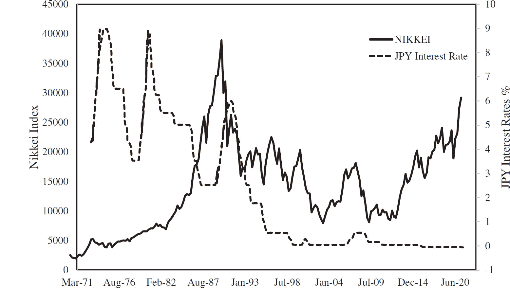

图 2.1：日本的繁荣与衰退。


为了在此期间支撑市场和经济，日本银行（BoJ）已成为量化宽松（QE）的大师——购买债券、股票以及几乎任何东西，但无济于事。讽刺的是，我的金融行业第一份工作是在一家巨型日本银行。我曾亲身接触过什么是不良贷款组合，以及它们是如何被乐观地进行估值和注水的，以使其在监管机构和会计师面前看起来更好。我的老板在他他不在办公桌前打盹时，可以说是是银行里最聪明的，也是最擅长“给猪涂口脂”（粉饰太平）的人。

### 2.4 黑色星期一

20 世纪 80 年代的一场重大股票市场事件是 1987 年的股市崩盘，或“黑色星期一”。道琼斯指数在几小时内暴跌了令人惊叹的 22%，是近期崩盘历史上一个极具戏剧性的事件。从未有人对我崩盘的起源提供过令人信服的解释，但它可能是由计算机投资组合保险对冲所加剧的，这种策略通过在市场下跌时抛售来降低风险，在当时非常流行。可以说，这一事件是自动化交易对市场稳定性影响的一个很大程度上被忽视的红旗。然而，由于过去 12 个月市场近期上涨了高达 45%，我们确实可以将 1987 年定义为一次回调。有趣的是，对于那些认为国债是反相关对冲的投资者来说，在 1987 年他们也和股票一起下跌了。

对于我们的故事，，联储稳定市场的反应范围有限但非常高效。新上任的美联储主席艾兰·格林斯潘（Alan Greenspan）发表了简洁的声明，确认美联储“已准备好作为流动性来源”，利率下调了 0.5%，联储在公开市场上进行了一些有限购买。全球市场相对容易地平静了下来。美联储展示了其支持市场的能力，市场在接下来的几年里恢复了。

### 2.5 乔治的黑色星期三

20 世纪 90 年代发生了一系列对全球影响有限的次生危机。1992 年，英国被卷入了具有政治动机的`欧洲汇率机制`（`ERM`），该机制不明智地强制要求英镑在窄区间内浮动。像`乔治·索罗斯`这样的投机者在“黑色星期三”打破了汇率带，赚取了数十亿美元，并成为臭名昭彰的全球名人。

在防御汇率带的徒尝试中，英国利率提高到惊人的 15%，这意乎之外地导致了重大的住房崩盘。“负资产收益”一词进入了英语字典，人们四面八方地把钥匙投入信箱溜之而去。最后，得益于戈登·布朗（Gordon Brown）明智地忽视了托尼·布莱（Tony Blair），英国从未加入欧元。

### 2.6 龙舌兰与老虎

随后发生了一系列得到良好控制的新兴市场危机。1994–1995 年的墨西哥比索危机或“龙舌兰危机”中，墨西哥得到了美联储的救助。我们那些购买了 2-3 倍杠杆新兴市场债券的热衷投资者在清算触发点达到时遭受了惨重，但生活仍照常进行。

在 1997 年的`亚洲危机`中，泰国、印尼等（过）快速增长的“老虎”国家遭遇了道路上的坑洞。危机主要是由于主权国家以`USD`发行欧洲美元债，当人们发现所有借来的钱都花在了空办公楼和未完工的基础设施上时，当地货币随之暴跌。

这是我第一次使用信用违约互换（`CDS`）做空主权国家的经历，它导致了关于什么构成信用事件的激烈争论，特别是当印度尼西亚公司直接拒绝还债，继续照常运营并无视所有西方律师时。一家大型印度尼西亚出租公司直接违约了，继续开车，且再也没有回头。

### 2.7 俄罗斯 GKO 破产

在 1998 年俄罗斯危机中，俄罗斯意外违约了其本币债，尽管这对俄罗斯人民来说是极其创伤的，但对于所有将自己的资金和客户资金投入俄罗斯`GKO`债券的投资银行来说，却是极其令人恼的。这些债券被视为神奇的“免费”午餐。


然而，我手下的所有人无论资历高低，都在用所有的闲闲资金寻找即时的巨额收益。坐在我旁边的人持有大量的 `Pets.com` 头寸（公司很快就变得一文不值）。甚至我也买了 5000 股一家叫 `Amazon` 的愚蠢书店（现在它值多少钱？）。一些同事已经迅速赚了几十万的账面利润。我套现离场去新西兰度假了。当我回来时，交易大厅里每个人都面如土色，更加压抑，因为市场已经崩盘（Fig. 2.4）。


图 2.4：纳斯达克 100 和伟大的生存者 Amazon。

尽管对反弹充满希望，崩盘仍然持续了一段时间，许多 .com 公司被消灭。每个人都变得更加哲学化，意识到他们买的公司大多是带有糟糕商业计划的垃圾。在我看来，这是一个完美的半理性泡沫，随之而来的、理应得的崩盘是资本主义最佳的体现。泡沫产生了许多想法，并在过程中淘汰了不值得未来投资的业务模式。现在，`Amazon`、`eBay`、`Expedia` 等大名字度过了危机，并创造了我们现在所享有的互联网革命。重要的是，政府很少进行干预。利率下降了，但没有人用纳税人的钱获得营救。

当股票在 .com 崩盘后于 2002 年底触底时，随后出现了持续到 2007 年的牛市。利率从 2000 年底的 6.5% 左右下降到 2003 年的 1%。现在每个人都知道 `Fed` 有他们的他们，`Fed` 主席的“格林斯潘上限”在交易员中被广泛讨论，他们在城外的聚会场所对此发笑。如果 `Fed` 支持你，你怎么可能输呢，对吧？`S&P 500` 指数在 2007 年秋季加速重回 .com 时的高点。

### 2.10 莱曼时刻

此时，利率被 `Fed` 推回到 5% 以上以稍微放缓节奏。金融创新以及对杠杆和信贷的便捷获取，导致许多资产类别在几年中形成了一个巨大的泡沫。在那个年代早期，我一直在构建和交易一种新奇的金融工具，称为`担保债务凭证`或 `CDOs`，其中债券组合被切分成不同风险分级的供投资者。组合必须包含多元化资产以降低风险，但到 2007 年，这些交易唯一可用且具有足够差别的抵押品是所谓的次贷贷款。

`Barclays` 一位极度热情的衍生品销售主管拜了我，告诉我赞助一个 `CDO`，并称 100% 的美国次贷贷款将提供“燃料”，这让我拉响了警报。这些贷款本质上是高风险贷款，而且通常是 `NINJA` 贷款（没有收入、没有工作、没有资产，而且讽刺的是没有钱还款）。评级机构被几家急切的投资银行精明地“说服”，不理智地允许了仅由美国次贷抵押的 `CDOs`。

这种可疑的评级机构理论是“全美的房地产价格不会在同一时间下跌”，相关性风险较低。然而，这一不幸的假设点燃了全球`信贷危机`。到 2009 年底，随着 `BBC` 的 Robert Peston 每晚在电视上欢快地抱怨即将到来的末日，甚至我的清洁工都知道那些被诋毁的 `CDOs` 是致命的剧毒，并导致了全球变暖、臭氧层破坏以及其他任何已知的疾病。

在信贷危机期间，大型金融机构震惊地像多米诺骨牌一样倒下，因为它们的内部杠杆以惊人的速度瓦解。金融股票价格剧跌（Fig. 2.5）。`Fed` 早期干预帮助 `Bear Stearns`（一个早期受害者）寻找解决方案，但在面对高杠杆的 `Lehman Brothers` 时却退缩了。基于过去 `LTCM` 的先例，市场预期会有营救。

在 `Lehman` 倒闭的那天，我打了电话，希望他们能尽快转给我由于掉期结算而欠我的钱。仅在一周前，他们的信贷人员还在检查我们的对冲基金是否有信用，并向我们保证他们像房子一样安全。有人接起电话，对着电话尖叫道：“全完了。大家都走了。结束了……啊啊，”然后是死一般的寂静。

电视上立刻出现一片混乱，看到人们抱着纸箱箱、提着被拆掉的办公家具跑出大楼，但随后绝对的平静占据了局面。每个人都在纳闷这折腾到底是为了什么，但几天后，地狱开启，过山车又开始了一轮俯冲。


图 2.5：金融混乱：主要经纪商和金融机构的股价。


图 2.6：主要经纪商和金融机构的 CDS。

`Fed` 边走边看，被迫以以前所未有的规模拯救一系列公司和整个金融体系。信用违约互换（`CDS`）差差爆炸，因为每个人都在猜测哪家银行或保险公司将成为下一个受害者（Fig. 2.6）。许多强大的金融机构在股市和信贷市场的混乱中屈灭并获得了救助。我基金的所有资金都存在几家华尔街投资银行中，如果周末没有被 `Fed` 救，它们在周一就会破产。

即使是获得 `AAA` 评级的 `AIG` 保险公司（我经常与其交易超 AAA 级的 `CDO` 分级）也崩溃了，因为会计师迫使他们按市价计值其 `CDO` 交易账，而此时买家（以及市场）突然消失并逃之夭夭。

盎克逊机构“硬受了损失”，并痛苦地意识到他们所有的市价计值损失。然而，在欧洲大陆，眼前且无法解决的问题被官僚们以类日本的方式掩盖了，所有毫无价值的贷款被移入银行账，按面值计值（100%）并对股东隐藏，在过去的十年里不断发酵。

央行干预的规模在现代是前所未有的，全球试图防止银行失败的连锁反应并避免溢到更广泛的经济。`Fed` 将利率降至最低水平（0.0%-0.25%），并通过主要向各金融机构购买债券注入了超过 2 万亿的金融刺激，并提供无限流动性以防止灾难。

`BoJ` 进一步采取，收购了大部分日本股票，然后决定这还不够，贪婪地进入美国市场，成为美国 `ETF` 的最大买家。瑞士 `SNB`（经常患有自己是对冲基金的幻觉）甚至认为在下跌时购买 `Apple` 等科技股是公平的。幸运的是，这似乎有效了，市场稳定并恢复了。

量化宽松（`QE`）进入了公众词汇并成为新的范式，让大多数经济学家苦思，思考一个国家怎么可能由财政部这样的实体发行债券，却由英格兰银行这样的实体购买它们？这难道不公平吗，不遵守规则，并违背了“经济学定律”吗？

在伦敦广场的一家领先对冲基金工作时，我花了大量时间争论，作为一名物理学家（我认为大多数经济“定律”都是荒谬的），我看不到任何直接的矛盾。


无论如何，日本国债（JGB）交易继续成为“寡妇制造者”，而美联储在旧债到期时又购买了更多债券。经济学家们不情愿地为这起了一个新名字，称为`现代货币理论`（MMT`），并将旧的经济学教科书扔进了垃圾堆。现在的经验法则似乎是：如果其他每个 G20 国家都陷入了经济困境，`MMT` 就会非常灵验，但不要在家里独自尝试，也不要告诉报纸魔法到底是如何运作的。

从 2010 年开始，`QE` 的广泛使用导致了持续近 10 年的自给自足的泡沫（见图 2.7）。低利率变成了市场的火箭燃料，交易员的格言变成了“不要与美联储对抗”。糟糕的经济数据被忽视，最好的投资策略变成了 100%做多股票（甚至更多，因为你可以以极低的利率借钱）。一种风险更高但显然是市场大师获胜的策略是“逢低买”，因为每个人都知道，如果情况太糟糕，美联储就会介入并支持市场。

2010 年发生了离奇的“闪崩”，在短短 36 分钟内，美国主要股指数下跌了近 10%，然后反弹。这显然是由流动性崩溃和市场微观结构的突然中断引起的。所有自动化市场做市者及其算法在一个巨大的反馈循环中撤退，市场迅速坠落，没有给市场留下任何支撑。后来，该事件的催化剂被美国当局奇怪地归咎于一名在父母家里工作的英国业余交易员，他完善了“欺骗”（spoofing）的艺术——下单恐吓市场并在订单成交前取消。但事实是，对于许多机构高频算法交易员来说，欺骗是常态，实际上一种主要的交易策略竟然被监管机构忽视了。


图 2.7：标普指数（总回报）的指数级增长与利率的下降。

奇怪的是，在整个十年里，通货膨胀从未现出它的丑面目来破坏低利率派对。这让每位经济评论家感到困惑。政治驱动的紧缩政策（在现在的新冠病毒时代看来是荒谬的）是这十年的基调，导致了消费者需求的抑制。相反，公务员的工资被冻结，病人的福利被剥夺，普通消费者变得穷如洗，没有钱花。

游艇精英拥有的钱多到不知道该怎么花，资金以泡沫规模流入所有可疑的“可投资”资产类型，从高风险契约轻型杠杆贷款到印象派绘画和生锈的古款虎马。通胀的供给侧也受到了影响，因为技术的不断改进提高了生产力，而所有最大的通缩因素——中国，成功实现了其成为全球第一大生产国的目标。

### 2.11 缩减恐慌

信用危机后的泡沫最终开始失去动力，因为即使是无限的 `QE` 最终也会失去光彩并变得无味。投资者开始担心，当 `QE` 的这尾酒碗最终被收走时会发生什么？市场已经成为一个完全的 `QE` 瘾君，在 2013 年，市场发生了第一次“缩减恐慌”，导致了短暂的抛售。到这一阶段，美联储已经获取了超过 4 万亿美元的金融资产。中央银行现在实际上控制着市场，并需要供应 `QE` “药物”来维持演出继续。

在此期间发生了一场有趣的欧元区债务危机插曲，其节奏类似于典型的官僚式欧洲蜗牛爬。简而言之，希腊在经济上夸大了（在臭名昭著的“吸血鬼”银行帮助下）以便加入欧元区，德国人不情愿地在救援上拖延时间，而少数对 PIGS（葡萄牙、意大利、希腊、西班牙）债券进行杠杆交易进行欧元区收敛交易的投资者被惨杀了。否则，多头完全 100%控制着局面，市场被推得更高。

美联储避开了与市场的对抗，保持低利率，并有足够的勇气在 2017 年底将利率正常化为 1.5%。2018 年初，短暂的 `VIX` 波动率指数崩溃（涉及隐含波动率飙升）再次证明了市场对 `QE` 泡沫破裂的恐惧。

推特美国总统唐纳·特朗普对令人恼的利率上涨表示不满，承诺的美国减税让市场喘了一口气。大型科技公司从“不靠谱”的避税天堂回回资金的想法也很好地提振了市场。在低利率环境下，股票回购也让高股价获得了回报。

到 2019 年中，美联储变得更加谨慎，因为特朗普与中国的贸易战最终爆发，市场波动性增加。利率在达到毫无吸引力的 2.25%峰值后，在恐慌中下调。美联储实现利率正常化的任何尝试以及宽松货币政策都被放弃了。

### 2.12 新冠危机

我们都知道接下来发生了什么。在写作时，新冠肺炎疫情是一场持续的灾难，这场灾难从 2020 年 1 月起就可以预见，当时我们在晚间新闻中看到中国公民被无情地封锁在公寓里。但在西方，政治家对这在我们更开放的经济体中产生的影响发生了集体想象力失败。诸如限制来自中国的航班、隔离和储备 PPE（个人防护装备）等规避行动并未被采取。不知为何人类（至少是我们委任管理的人）仍然是线性思维的，而不像行为呈指数增长的病毒。

为了避免滑入深渊，经济支持计划是巨大的，包括企业贷款、失业补贴、`QE`（再次）以及毫不廉耻的印钞。美国的财政刺激涵盖了公司债券和高收益债（通过 ETF 购买），注入的流动性据报道超过了 6 万亿美元。在特朗普之后，拜登总统很快忙于增加 2 万亿美元（见图 2.8）。根据兴奋、书呆的经济历史学家说法，我们现在自豪地拥有自巨石阵以来最低的利率，并经历了 300 年来最严重的衰退。


图 2.8：无尽的美国财政刺激、近零的利率和高债。


新冠病毒危机和无数变异毒株希望很快就能结束。亚马逊和 Netflix 将接管世界，我们已经吃了太多的达美乐披萨外卖，但金融市场将陷入一种极度功能失调的低迷状态中。你可能会问，问题出在哪里？它们处于历史高位，这正是“格拉斯式”的“所有可能世界中最好的那个”。但在表面之下，潜伏着一个阴暗且棘手的问题：市场受中央银行的控制程度比我职业生涯中的任何其他时候都要高。这个拥有冲锋队和近乎无限财务实力的“帝国”现在正掌握着完全的控制权。

常识（由任何在近期事件后仍保持清醒的人所持有）是，一个高效的市场应该由独立的、精明的投资者（或“代理人”）组成，他们拥有不同的观点，这形成了一个连贯的价格发现机制，其中包含某些基本价值的元素。尽管这个复杂且不可预测的过程可能会出现“理性越热”时期、偶尔的修正以及严重的躁狂与抑郁症交替，但多个“自由”代理人的集体行动构成了自由市场并提供了客观估值。现在，诡异的是，中央银行无论喜不喜欢都掌握着所有的牌，并几乎以类卡特尔的方式控制着这种市场估值。

### 2.14 混沌理论将统治一切吗？

`Fed` 的影响力现在盖了所有其他投资者，并可能矛盾地导致市场极度不稳定（记得混沌理论和那只蝴蝶吗）？任何错误的举动或糟糕的政策决定都可能给其他投资者带来灾难。中央银行并不愿意承担这种责任，也不希望对市场进行全面的“苏联化”，但他们陷入了进退两难。如何在不导致以前所未有的规模整个金融系统崩溃的情况下，减少干预水平并回到“正常”的自由市场？

乐观地说，即使 `Fed` 态度坚决，脱离出来并减少国家对金融市场的影响也可能需要几十年的灵活运作。然而，正如我们在故事中所看到的，`Fed` 的干预是随意的，在规模上惊人地从未没有缩减过，反而以一种令人难以置信的指数趋势不断扩张。曾经令人可怕的 `LTCM` 惨剧仅为 47 亿美元，而现在我们已经处于 8 万亿美元以上仍在增长，真实利率为负，印钞机仍在运转。

除非出现某种不受欢迎、意料之外的结算，否则这似乎是一条可以预测的、`Fed` 干预和随每次危机不断膨胀资产负债表的单行道。可以说，他们现在对于未来成功的干预和救助的路已经走光了。

与此同时，作为投资者，资产购买时最好留在 `Fed` 阳光的一面，并睁大眼睛寻找“真正的”再通胀交易。随着经济在 2021 年复苏，美国劳动力市场看起来很紧俏，铜等商品正在上涨，半导体存在严重短缺。债券收益率正在上升，但这真的标志着利率不断下降的长期趋势中的根本性转折点吗？最近的美国 `CPI` 数据指向更多的通胀，但一个合理的问题是这是暂时的还是更永久的？中央银行声称是前者，这可能是的。正如牛顿运动定律一样，汽车加速需要力和脚踩油门板。快速恢复的美国经济需要“汽油”来重新加速到巡航速度。一旦达到巡航速度且供应链恢复正常，也许我们会回到以前的状态——低消费需求和通缩的中国——以及低通胀。这可以说是一个乐观的假设，但确实存在令人担忧的滞胀替代方案。中央银行在 `QE` 期间打印了大量资金，这可能导致持续的通胀。此外，已经脆弱的全球供应链容易受到意料之外宏观冲击的进一步干扰。许多不可预测但微小的冲击可能就足够，从新的病毒变异株和执行糟糕的 `Fed` 紧缩到中国国内房地产违约以及国际冲突比比皆是。关于新冠复苏、其对全球经济的最终影响以及 `Fed` 的下一步，目前尚无定论。

## 第 3 章

## 自由裁量冒险

### 3.1 催化剂交易

当看起来像青年的投资分析师带着他的待勾选任务清单来到你梅费尔的办公室时，你需要迅速决定自己正处于哪条策略船上。你是股票多头/空头、事件驱动、相对价值还是宏观？谁确切知道这些人为发明的定义和抽象分类是什么？它们之间的重叠部分很大。在追求潮流的投资者中，本月的流行趋势是什么？资本结构套利、相对价值，甚至是少量的宏观可能在本季度让他们满意。

你只想做的就是回到交易并赚钱。谁在乎精确的定义。只要赔率和风险对你有利，你书中任何经过仔细研究的“赌注”或机会都是可以的。自由裁量对冲基金经理的角色是识别并管理这些赌注的组合，榨取利润，并且不要被（意之外）的市场动荡留下太大的心理创伤。

“正式”策略之间的边界是模糊的。大多数对冲基金经理都不希望尽可能限制自己的机会范围。市场机会随时间演变，任何出现的“免费午餐”都值得一试。所有良好交易都具备的特征是有逻辑和一个触发事件的催化剂。

事件的逻辑可能是基本面驱动的，也仅仅是相对价值的定价错误（图 3.1））。基本面交易可能包括公司重组、利润公告、配股以及并购（`M&A`）。从形式上看，只有 `M&A` 是“特殊机会”，但这种说法缺乏想象力，因为在现实中，正如我将描述的，可以利用的公司“情况”列表非常广泛。相对价值交易则涉及技术性的定价错误或套利。这些可能包括密切相关的股票或对脱离、错位的信贷曲线或基差机会。相对价值交易需要反转事件来获利，并需要催化剂来完成套利。因此，交易需要某些预期的波动，除非它们本身是“正向”的，因为每个人都喜欢正向收益。

```
```

图 3.1：事件驱动交易跨越基本面到技术。

有利于资产价格发生变化的短期催化剂。资本是稀缺的，必须高效地部署在快速演变的交易中。没有人对需要数月才能得出结论的“死交易”耐心。大多数交易利用杠杆来放大小的潜在利润，而长期融资成本很重要且必须进行优化。

正如你可能猜到的，利用机会的金融工具非常多。在公司领域，我们有现货股票、债券和贷款，以及它们相关的所有衍生品。对于我们对指数、利率、外汇和商品的宏观观点，可以使用期货、政府债券、外汇以及各种场外交易（OTC）掉期、期权和底价。使用的工具列表是大量的，受限于经验、流动性考虑、融资成本、投资指令，有时取决于你老板（如果你有）允许你交易的内容。

### 3.2 事件驱动交易的分类


根据高度可靠的对冲基金数据库，只有约 7% 的对冲基金显然是“事件”驱动的。然而，你现在应该不要相信这种毫无意义的统计数据了。正如全球最大的宏观对冲基金经理之一的 CEO 告诉我（在完全否定系统化交易之前）的那样：“人们误以为我们是投资者，但实际上我们是交易员”。在我的经验中，这完全正确。自主量型对冲基金经理不断扫描市场，以进行由一系列因果事件驱动的交易。这些事件可以是预期的宏观或公司事件链。以 2020 年的近期案例为例，航空业处于极度困境，因此飞机订单将会减少。罗斯斯莱斯（Rolls-Royce）制造飞机引擎，将消耗大量现金，并需要进行配股发行，因此让我们相对于工程板块另一家更强势的股票做空罗斯斯莱斯。这一系列事件的逻辑通常具有高度的主观性，但经理必须根据可用且往往不靠谱的信息做出合理的假设，以量化机会。事件也可以是宏观性的。例如，预计美国 GDP 大幅下跌将引发（另一轮）美联储救援计划、更多的量化宽松（QE）和国债回购，长期收益率将进一步收紧。没有事件或催化剂，自主基金经理就没有发挥的沙场。

公司事件驱动交易具有巨大的多样性，特别是在高收益领域，重要的是它们跨越了公司的整个资本结构。某些如合并、配股发行、首次公募（IPO）和分拆等更适合长/做空股票策略。其他诸如重组、资产出售和契约豁免则是更多与债务相关的策略。许多诸如新股发行、再融资和杠杆收购同时影响股权和债务，并可以说属于`资本结构套利`的领域（图 3.2）。

某些公司在其历史和生命周期中会受到众多事件的影响。它们可能正享受利用剩余现金流进行去杠杆，然后进行股票回购，突然被收购并在`杠杆收购`（LBO）中被杠杆，随后重新估值以支付特别股息，然后通过 IPO 再次上市。作为交易员，你需要跟踪这些不断演变的故事，并关注公司的历史路径。成为一名业余历史学家是自主交易员工作描述中的重要部分。

图 3.2：特殊情况跨越资本结构。


图 3.3：LBO 公告后典型的股权和 CDS 变动。

各种公司事件对跨越资本结构的资产定价影响可能有显著不同（附录 B.2）。并购（M&A）事件对股价可能是积极的，对债务持有者可能是积极或负面的，取决于交易后的最终杠杆率。LBO 事件会导致股权和信贷的大幅波动，因为被收购的公司被大规模地重新杠杆。图 3.3 显示了大型 LBO 样本中相关的信用违约互换（CDS）利差扩大和股权上涨。分拆通常有利于股权持有人，收益可能导致特别股息或债务减少。公司发行新股的配股对股权持有人来说通常是负面的，但对债务持有者是积极的。股票回购使用现金回购股票，最可能保持股权价格走高，但代价是偿还公司债务。许多可能的公司事件可以转化为不同的交易机会。此外，这些机会的优势在于它们是特定公司且具有特质的。如果方法得当，这些交易可以允许对冲掉整体市场或系统性风险，并隔离出特定事件。

### 3.3 公司资本结构

公司的价值或企业价值被定义为公司债务价值和股权价值之和。这大致上等于公司的资产，但其中可能包括无形资产和其他因素（如商誉）。公司的资本结构通常由几层或若干档位组成（图 3.4）。股权位于底部，随后是受偿顺序逐渐递增的债务层级，从从级债务、高级无担保债务到抵押债务。大多数债券属于高级无担保债务的范畴，而银行贷款是最高级的抵押债务。

高质量的公司可能债务极少或没有债务，其资本结构大部分由股权主导。然而，信贷风险较高的高收益公司可能只有占资本结构约 10–20% 的少量股权缓冲。
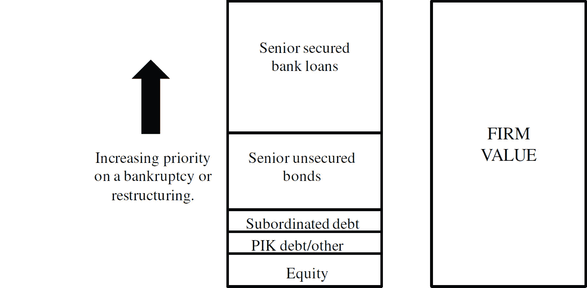

图 3.4：典型的公司资本结构。

对于某些高杠杆公司来说，有效股权是虚拟的。这对于某些经历过多次重新杠杆的杠杆收购公司来说尤为如此。正如你在买完房子后可能会对其进行向上估值以增加股权，允许重新抵押和额外贷款一样，私募股权公司经常做同样的事情。进行一些表面上的调整、EBITA 装修、无形资产重新估值，变变，又一次重新杠杆就可能了。在图 3.5 中，法国鞋类零售商 (a) 只有 1.4% 的真实股权层，而我的老电缆公司 Virgin Media (c) 拥有 28% 的有效股权。此外，Virgin Media 的债券和股票是公开交易，提供了公司业绩更高的透明度。不出的是，这家被 LBO 的法国鞋类零售商很快陷入了问题，并在 2014 年到 2020 年间经历了三次重组，抹去了近 33  亿欧元的债务。

表 3.1 显示了对公司资本结构的典型分析。在这里我们考虑一家广受交易的宠儿 Virgin Media（之前的 NTL）。作为一家公司，它有一个糟糕的开始，在挖掘了许多无利润的项目后破产，然后作为新的 NTL 出生，随后布兰森巧妙地与 Virgin Mobile 合并，成为英国最成功的电缆公司。通过银行债务到债券、可转换债券和股权的每一层债务，计算其作为 `EBITDA`（息、税、折旧和摊销前利润）倍数的杠杆率。这提供了每个层级所受保护水平的视角。银行债务包括循环贷款（revolver）、定期贷款 A（term loan A）、大型 B 级和更具从级的 C 级二级抵押（nd Lien）。贷款层级支付浮动利率和利差（以基点计）。贷款下方是一系列同级的高级无担保固定利率债券加一个可转换债券。总债务为 EBITDA 的 4.76 倍，但资产负债表上有现金，使得有效债务降至 4.36 倍。在计算时，股权提供了 20% 的缓冲，使得整体企业价值达到 EBITDA 的 5.48 倍。


图 3.5：不同公司的资本结构示例。*

表 3.1：Virgin Media 资本结构和杠杆率（约 2007 年）。


债务的受偿顺序在破产中至关重要。发行人破产或违约时，义务持有将根据受偿顺序获得支付。债务持有人的顺序总是高于承担最初损失的股权持有人。在股权被侵蚀后，破产中的损失将从股权向上应用到资本结构中的债务层级（图 3.4）。高级债务持有者的排名较高，将在从级债务持有者之后承担损失。高级抵押贷款对公司资产拥有最终担保。


无论如何，这都是理论。在实践中，很少有公司会在毫无预警的情况下一夜之间破产。近期有一些显著的例外，例如世界电信（WorldCom）、安然（Enron）、帕马拉特（Parmalat），甚至是雷曼兄弟（Lehman Brothers）极端的市场状况。这些突然破产的公司中有些涉及被“发现”的欺诈性会计，导致公司立即无偿能力。德国金融科技公司 Wirecard 是 2020 年最近的一个例子。

然而，当公司开始遇到麻烦时，通常的情况是各种债务契约被逐步触发。通常，债务契约（如最大债务/EBITDA 比率、利息覆盖率等）被写入债务条款中以保护债权人。当接近或违反契约时，债权人、公司和其他其他股东之间会开始谈判。贷款持有者的契约可能是最严格的，他们将处于主导地位，决定采取哪些行动。有时公司可以与贷款人达成契约豁免协议，或者通过向贷款人支付费用来进行重置。也可以提议公司重组。这可能是一种“友好”的资本重组，即由私募股权助人向公司注入新股权。另一种不那么外交的“敌对”重组可能包括贷款持有者规定条款、清空现有股权持有者的利益、更改现有债务条款（降低票面利率并延长到期日以减轻负担）并执行债转股。在债转股中，贷款人接管了公司的控制权并成为公司新的股权所有者。有很多选择选择，而通过任命接管人和出售资产来偿还贷款持有人的“硬性破产”是最后的手段。

破产过程的详细程度高度依赖于司法管辖区。在几个司法管辖区，公司可以申请自愿破产以尝试进行拟议的重组，正如《美国破产法》中的 `Chapter 11` 一样。法官会被任命，从债权人到工人和供应商，所有参与方都有发言权。在某些国家，如果你是一个债权人且只想收回资金，这可能会导致一个非常痛苦且漫长的过程，而公司却被允许作为一个无关紧要的僵尸公司继续维持。这意味着像英国和德国等司法管辖区被认为比法国等国家对债权人更“破产友好”。

债券在违约后的价值通常被称为回收率。评级机构多年来一直刻苦地收集违约债务的回收率统计。正如预期的那样，随着债务优先顺级的增加，平均回收率也更高。高级担保债的回收率约为 65–75%，而高级无担保债为 35–45%。然而，平均值可能具有误导性，而且在衰退期间，回收率可能会更低。回收率很大程度上取决于工业部门以及公司是否有实物资产。

无论是由于运气、技能还是不可思议的信贷分析，我非常幸运，从未在违约事件中长期持有过亏损头寸。对于那些经历过大规模意外违约的同事来说，这通常足以引发轻微的创伤后应激障碍（PTSD），并可能迅速结束一个人的交易生涯。在我与主经纪商进行的首次介绍性交易中，我曾被“鼓励”购买一种新发行的债券以确保我未来获得优待。那是一家糟糕的欧洲巴士公司，我很快就安静地卖掉了。经纪人会定期打电话询问我是否还持有该债券，并向我保证这是一次伟大的购买。某一天，它突然破产且回收率极低。他们停止了电话，该事件被掩盖了。然而，我最令我恼的违约风险是在投资银行工作期间，几个办公位外一个过度自满的信贷交易员在世界电信价格从接近平价跌到 80 多元美元时，加倍持有了该头寸。几天后，价格螺旋式下跌至 20 多元美元，头寸被斩掉，并在我们的损益表和奖金池造成了一个巨大的缺口。从历史回收率的角度来看，世界电信在信贷事件发生时的估值为 11%，几个月后债券回升至 30% 左右，在最后的法律和解中，法官裁定向债券持有人支付 43% 的赔付。事实是，任何程度的信贷分析都可能无法发现完全的“信用火鸡”（credit turkeys），特别是当公司有一群近乎玩职的会计师时。例如，在另一个场合，我为一家精明的法国保险公司构建了一个定制的 CDO 权益份额，他们花费了几个月的时间选择和纠结于一个小型企业组合，并进行了广泛的相对和基础单一名称信贷分析。尽管如此，在 18 个月内，该交易就变坏了，因为组合中的安然、世界电信和英国能源（British Energy）都遭遇了回收率极低的信贷事件。

### 3.4 酷刑工具

公司的资本结构由股权、债券和贷款组成。随着我们沿着资本结构向上移动，流动性逐渐降低：从股票的流动性良好的电子交易平台，到通过电话和`彭博 IB 聊天消息（Bloomberg IB chat messaging）`交易的高收益（HY）债券，再到几乎“仅限预约”交易的贷款。在大多数投资银行和经纪商处，资本结构的不同层级通常由坐在交易大厅不同位置的团队交易。幸运的是，这种观点和信息的隔离为对冲基金提供了交易机会。以同步方式专业交易特定名称所有工具的综合交易台是罕见的。如果你正在阅读这本书，你可能对股票和公司债券很熟悉，但回顾一下它们对对冲基金的重要特征是有值得的。特别是我将重点讨论公司贷款，因为对大多数外行人来说，这是一个相对模糊、不透明的市场。

#### 3.4.1 股票

股票是交易最广泛、流动性最好的公司工具，对冲基金通常以多空组合的形式使用它们，以对冲系统性市场风险。事实上，传奇对冲基金经理朱利安·罗伯森（Julian Robertson）的股票投资哲学是“找到全球最好的 200 家公司并做多投资它们，找到世界上最差的 200 家公司并做空”。尽管组合规模和股票筛选过程差异巨大，但这种情绪是多空股票（L/S equity）对冲基金投资的核心。

股票是资本结构的基础，比公司债务波动更大、风险更高。从理论角度来看，它们是公司价值的看涨期权，其行权价为公司债务水平（见[附录 B.7]）。如果公司价值跌得过低，股权将一文不值，债权人将接管公司控制权。如果公司价值上升，股权持有者将获得价值增长收益。

股票最常见的形式是赋予投票权的普通股。这些投票权经常被所谓的行动派对冲基金（例如 `TCI`、`Elliott` 等）利用，以迫使公司管理层遵循其“释放”价值并提高股价的计划。其他类型的股票也存在，但交易频率较低。这些包括优先股，其在支付上优先于普通股，且有时具有不同的投票权。一种广泛交易的优先股是 `VW prefs`，它们有时与 `VW ords` 进行回归组合交易。此外，还可以存在不同的普通股类别，具有不同的投票权，这些可以被某些股东保留对公司的整体控制。`Viacom` 甚至 `Google/Alphabet` 都是例子。投资时应该意识到此类结构。


股票可以同时在不同的全球交易所上市。原则上讲，套利交易应该使这些不同的上市价格保持一致，但某些如 `Carnival US` 和伦敦线（`CCL US` 和 `CCL LN`）由于定价错误频率频繁、交易成本低且均值回归性高，经常被对冲基金交易。美股存托证（`ADRs`）也是一个巨大的市场，外国公司可以有效地在美国交易所上市其海外上市的股票，并将其用于套利交易。

大多数对冲基金投资于主要交易所上市的流动性股票，如今这些股票可以在不同的全球场所（`NYSE`、`Nasdaq`、`Euronext` 等）进行电子化交易。它们具有价格透明度，且流动性可以清晰监控。如果股票未上市，其估值通常由审计师确定，或者更糟，是根据可疑的“最后历史交易”定价，而非恰当的市场价格定价法。这可能导致极大的主观性和价格操纵。如果对冲基金在某股票中占据主导地位，始终存在通过错误标记部位来平滑损益（P&L）的可能性。遗憾的是，经常会出现“棘轮”效应，即在方便的时机捕捉价格上涨，而当价格下跌时被忽略，直到更好的日子到来，或者正如许多对冲基金丑闻所证明的那样，永远不会到来。

我曾从事过投资晦涩、未上市新兴市场投资的基金，其中包括在地图上难以定位的中国海外金矿公司。这些资产几乎无法估值，尤其是当办公室里没人记得前任经理为什么要买这些股票时。通常，这些未上市股票在牛市中看起来是极佳的投资，但在熊市或当标的资产出现公司问题时，及时退出投资几乎是不可能的。如果基金的流动性与股票持仓之间存在不匹配，可能会给投资者带来问题并导致“关闸”（gating）。最近在英国，几只寻求小市值 Alpha 值的多头零售基金（例如 2019 年的 `Neil Woodford`）在大量投资者要求赎回时，陷入了这些流动性问题。

最后，如果你像罗伯逊先生一样想建立空头头寸，必须首先记得借入股票并不情愿地支付借息。股票的贷款人是银行、保险公司和传统基金经理等大型机构，他们天然持有这些股票。他们参与证券借贷，通过收取股票贷款费来增强投资组合回报。你的经纪商通常提供一个显示所有可用租赁成本和规模的界面。大多数股票被归类为通用抵押品（`GC`），执行标准化的低利率。然而，某些被高度做空或规模较小的股票变成了所谓的“难借”或非 GC 股票，它们要么要求更高的利率，要么无法借入。例如，2021 年的 `Lufthansa` 由于需求量大年化报价达到 15%，而 2020 年破产的 `Wirecard` 则变得无法借入。

关于股票估值的理论方法，已有许多深奥的金融著作。遗憾的是，没有一部是完全令人满意的，真正的客观估值依然难以。股票是资本结构中最具投机性的部分，其价格并非基于任何完全理性的基础，而是取决于“市场先生”（Mr Market）。它们的估值是主观的，纯属供需问题。然而，如果我们想要一些理论基准，那么存在一系列模型。最基本的股票估值模型是 1959 年开发的 `Gordon growth model`。它本质上将今天的股票价格视为公司所有预期股息的折现未来价值（`Appx. B.1`）。

### 3.4.2 公司债

关于股票估值的理论方法，已有许多深奥的金融著作…… [已截断]

如果你调查特定货币的债券市场，会很快发现不同期限的公司发行人所发行的债券表现出不同的收益率曲线。主要差异源于市场对信誉认知的不同。尽管流动性影响很重要，但在相对有效的市场中，债券收益率由两个主要部分组成——基础利率和信用风险溢价。位于“无风险”政府债券曲线之上的收益率差额为信用曲线。它是衡量债务义务发行人信用风险或违约风险的指标。通常，该曲线是凹形的，投资者在持有更长时间债券时需要更高的溢价（`Fig. 3.6`）。但情况并非总是如此，因为某些接近违约的投机性债券在短期内有很高的违约概率。这导致了期限结构倒挂，因为如果公司度过了短期，那么未来信用质量可能会有所提高。

在实践中，“无风险”信用曲线的惯例是市场掉期或 `LIBOR` 曲线。使用掉期曲线而非政府债券或国债曲线是资产掉期市场起源的遗留。银行间掉期曲线传统被视为 AA 级银行曲线，显然不是无风险的，因为我们在 2008 年的 `credit crisis` 中看到，大型银行本身并非无风险，且具有波动波波的差额曲线。也许通过使用市场估值保证金（mark-to-market margining）等风险管理原则，掉期曲线是“无风险”曲线的一个很好的替代方案。正如我们将要看到的，对于大多数债务发行人来说，`LIBOR` 之上的信用利差约等于信用违约互换（`CDS`）溢价。

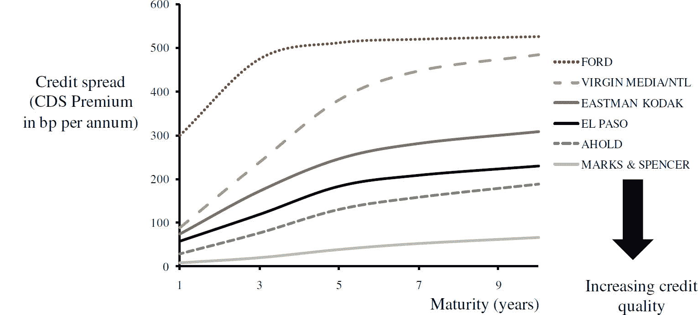

图 3.6：公司信用曲线示例。


因此，债券信用利差存在多种令人困惑的定义，我们在面对这些信息时应当谨慎。例如，如果一份 5 年期美国 Xerox（Xerox）债券收益率为 `US Treasuries + 180 bp`（或 `T + 180`），那么 `180 bp` 就是对美国国债曲线之上信用风险的衡量。但掉期曲线可能比国债曲线高 `60 bp`，因此该债券的报价可能是 `LIBOR + 120 bp`（或 `L + 120`）。还有许多其他利差定义，例如资产掉期利差、`I-spread` 和 `Z-spread`，而这些仅适用于期限明确且无回赎特性的债券。其数学原理有细微的差别。例如，`I-spread` 是债券收益率减去掉期曲线的底层插值利率，而 `Z-spread` 是必须在零利率曲线（而非掉期曲线）上增加的利差金额才能对债券正确定价。市场参与者对他们报价的是哪种利差非常粗心，销售人员往往不知道其中的区别，只是简单地口述交易员刚刚告诉他们的数字。人们必须记住，在根据利差而非价格进行交易时要非常小心。

根据发行人的信用质量及其在公司和资本结构中的债券地位，评级机构会对债券分配信用级。领先的三大评级机构是 `Standard & Poor’s`、`Moody’s` 和 `Fitch`，它们使用的评级标准非常相似。如果我们考虑 `S&P/Moody’s` 评级，那么 `AAA/Aaa` 是最高级，`CCC /Caa2` 是最低级。任何低于此评级的公司不幸地处于各种技术性违约阶段。评级机构的标准将债券世界分为`投资级`或 `IG`（`AAA/Aaa` 到 `BBB/Baa3`）以及`高收益级`或 `HY`（`BB+/Ba1`）及以下。尽管这种划分完全是人为的，但它确实导致了不同的市场行为和规范。`IG` 和 `HY` 通常由银行和经纪商的不同交易员交易，投资指南中通常包含对 `IG/HY` 的限制，并且存在专门针对其中一类的信用指数和 ETF。有时这会在压力情况下导致投资者产生尴尬的反应。例如，我曾推出过以投资级资产为抵品的 CDO，其中部分押品被略微下调。购买了中间 `Baa3` 档位的日本投资者由于投资限制，在评级机构将其档位下调至 `Ba1` 时，被迫立即亏损卖出这些债券。最终，这些债券将按面值赎回。

大多数债券是固定利率，每年或半年支付一次定期票息。然而，一部分是浮息债券或`浮动利率债券` (`FRNs`)，它们支付可变票息（通常基于 `LIBOR`）加上固定利差（`Appx. B.5`）。对于交易而言重要的是，固定利率债券的价格受政府利率波动的影响，而不仅仅是信用质量。尽管债券会在到期日逐渐“回归面值”（`100%`），但在期间，较高/较低的利率会导致较低/较高的价格。固定利率债券对利率变动的敏感性表示为 `duration`（久期）或 `DV01`（即当前利率曲线上平行移动 `1 bp` 时债券价格的变动幅度）。因此，除非你为了套利和宏观视角专门寻求利率风险，否则固定利率债券组合应通过做空期限相似的国债或使用固定/浮动利率掉期来对冲。使用掉期来对冲债券组合中的利率风险导致了资产掉期的产生。

### 资产掉期 (Asset Swaps)

`asset swap` 市场是 `信用违约掉期` (`CDS`) 市场的前的前身。资产掉期为 `CDS` 市场提供了基准信用定价，当 `CDS` 市场还处于幼儿阶段时，现货价格驱动 CDS 价格。资产掉期允许投资者将固定利率债券换为浮动利率工具，从而消除利率风险。

这创建了一个 `LIBOR` 加上利差的工具，它像浮动利率债券一样，是纯粹的信用风险。通常，底层债券加上掉期一起出售，作为一个资产掉期包（`Appx. B.6`）。资产掉期市场的建立推动了信用定价的透明度，因为资产掉期在 `LIBOR` 之上的利差指示了信用风险溢价。资产掉期允许投资者在不同市场之间套利不同的信用风险。例如，一个以欧元交易的流动性差的发行人债券在转换成美元时，可能比该发行人的普通美元资产更便宜。这为资产定价创造了更高的效率，并允许利差成为信用风险的代理。

### 3.4.3 信用违约掉期 (Credit Default Swaps)

`信用违约掉期` (`CDS`) 市场自 20 世纪 90 年代中期成立以来呈现爆发。根据 `ISDA` 2019 年的一份分析，2021 年未未未名义额为 `$9.4tr`，几乎有 1300 个独特的信用实体参与交易，其中核心部分约 500 个名称。`HY` 类别约占 `IG` 合约的 20%。当年交易的领先单体品种从 `ArcelorMittal` 和 `UniCredit` 到 `巴西` 和 `土耳其` 等主权国家。通常，每年交易的领先品种是当时热门信用关注点的产物。2019 年，意大利银行的偿付能力以及巴西和土耳其的政治和经济问题是频繁的头条新闻。

`CDS` 的基本方法是标准化且定义良好的。在普通 `CDS` 中，一方（保护买方）向另一方（保护卖方）支付利差或保费，以获得对特定信用（参考实体）的信用保护。当参考实体发生信用违约或`信用事件`时，保护卖方将向买方支付 `100%` 的现金。随后保费支付停止，掉期终止（`图 3.7`）。`CDS` 表面上像是一种保险，事实上，许多特殊的 CDS 确实是以保险合同的形式交易的，特别是与保险对手之间。在结算过程中，买方（假设其最初按接近面值 `100%` 的价格购买资产）将获得信用事件期间资产价值下跌的补偿。

在信用事件中，与其实物结算和交付参考标，由于 CDS 使用者寻求直接的现金对冲，现金结算变得更加常见。卖方向买方支付 `100%` 减去回收率或相关参考标的最终价格。这一最终价格由一组知名交易商通过 `ISDA` 指定流程在信用事件后投票决定。该流程通过 `ISDA 2009 Big Bang Protocol` 得到了标准化和增强。可以交付或作为参考标的资产类型已有详尽记录。重要的是，标准的 `CDS` 参考任何主要货币的高级无担保债务。

images/fig3_7.jpg

图 7：信用违约掉期的工作原理。

目前市场交易的信用事件范围实际上比纯违约或破产要广。根据 `ISDA` 定义的事件，信用事件包括`破产`、`违约`、`重组`、`债务违约`、`债务加速`以及针对主权国家的`否认/延期`（`Appx. B.9`）。`破产`、`违约`和`重组`是 `CDS` 使用的关键信用事件。`破产`和`违约`通常非常明确且没有争议。`重组`最具有争议性，对于公司重组是否构成信用事件一直存在争议。其核心理念是捕捉发行人恶化债务条款的尝试。


一些公司（例如通用汽车接受公司（`GMAC`）及其子公司 `Rescap`）非常精明，在市场条件允许的情况下，它们设法通过“强迫”投资者自愿接受债券要约或交换，并在不触发重组信用违约事件的情况下修改债券条款。其他围绕信用违约事件的花招特别发生在通过创造性融资制造或规避违约事件时。2018 年的一起法律案件涉及黑石的 `GSO Partners`，他们说服房屋商 Hovnanian 对其部分债务违约以触发信用违约事件，作为向陷入困境的 Hovnanian 放新资金协议的一部分。然而，`GSO` 同时持有以 Hovnanian 为标的信用违约互换（CDS）头寸，该头寸在违约时获得了赔付，其利润可能贡献了借给 Hovnanian 的资金。这一精明的举导致其他 CDS 市场参与者在他们的 CDS 市场头寸上亏损。监管机构一如既往地质疑，这种利用 `CDS` 合同漏洞的行为是否构成了市场操纵。

流动性最强的合约是 5 年期，尽管 3 年、7 年和 10 年也相当活跃。与期货一样，市场 `CDS` 合约每 3 个月滚动一次（通常是 3 月、6 月、9 月和 12 月的 `20` 号）。2009 年引入了标准北美美国公司（`SNAC`）协议，该协议修改了标准的 `CDS` 条款。重要的是，合约差价投资级被固定为 `100 bp`，高收益级固定为 `500 bp`。这意味着 `CDS` 需要支付一笔费用。

除了单体公司 `CDS` 外，`CDS` 还可以针对其他底层信用资产，如贷款、`ABS` 和 `CDOs`。信用指数产品非常受欢迎，每个指数都包含一个多元化的、等权的公司篮子。在欧洲和亚洲，有 `iTraxx` 指数。最受欢迎的是包含 125 个实体的 `iTraxx Europe` 和包含 75 个次投资级以下企业的 `iTraxx crossover`（`XOVER`）。在美国，两个主要的指数是 `CDX IG`（投资级，同样有 125 个发行人）和 `CDX HY`（高收益）。`CDS` 指数的成分每 6 个月审查一次，并更换为流动性最好的名称，以保持指数的时效性。除了这些指数外，交易商还提供并报价一些行业指数和主权指数。

用于信用违约互换估值的最广泛的模型是简化形式模型（Appx. B.8`）。在简化形式模型或灾难模型中，违约是由随机过程触发的，因此是突如其来的灾难。技术上，违约时间使用 `Poisson probability distribution`（泊松分布）进行建模，该分布擅长描述事件的随机发生。因此，信用违约事件在数学上被描述为随机 `Poisson process` 中具有所谓强度或风险率的事件的“首次到达时间”。风险率仅为给定期间的违约概率。

这种建模方法似乎有些不现实，但其简单性对于估计市场参数是一个巨大的优势。该模型本质上简化为两个参数——(i) 给定期间的风险率或违约概率，(ii) 发生违约时的预期损失。如果使用市场标准回收率，那么信用差价约等于风险率乘以 `100%` 减去回收率。因此，风险率可以直接从 `CDS` 差价得出。在实践中，`CDS` 的估值稍微复杂一些，因为我们必须考虑信用差价和利率的期限结构。

#### 3.4 杠杆贷款

然而，进入这一市场存在几个主要的实际障碍。首先，与购买传统债券相比，实际购买贷款需要大量的文工作和行政管理。其次，没有主经纪提供杠杆，也不存在回购市场，因此只能现金购买。谁愿意花几周时间做文件，用 `$5m` 现金换取 `$5m` 无法杠杆的贷款？最后，杠杆贷款俱乐部仅接受预约。


最高级的贷款分级通常是 `term loan` A 和 B/C（`TL A`、`TL B/C`）。`TL A` 是摊还贷款，由于其现金流和到期安排较为复杂，对对冲基金的吸引力较小。通常，`TL B/C` 是固定期限的到期贷款（bullet loans），并以 `B` 和 `C` 分级的组合形式进行交易。本质上，所有这些贷款都是**高级担保**（senior-secured）且**同等受偿**（pari-passu）。一个典型的 `TL B/C` 利率可能为 `LIBOR` 加 `150–275 bp`，具体取决于发行人的质量和市场发行需求。

在资本结构中这些最高级分级之下，有时存在一或多个夹层分级（称为“mezz”）。这些分级的安全性较低，但提供的票面利率要高得多（`LIBOR` 加 `300–650 bp`）。矛盾的是，这些分级对对冲基金来说往往不那么吸引，因为 `TRS` 提供者提供的杠杆倍数较低，融资成本更高，且二级市场流动性极低或几乎不存在。

最后，作为股权的替代品，在某些特别激进的 `LBO` 再融资中，会提供零利息**实物支付**（`PIK`）债券或其他高度从贷款。这些 `PIK` 债券提供了极高的**内部收益率**（`IRRs`），但在发生违约事件时的回收率可能非常低。如果它们是 `LBO` 发起人对真实股权的替代，那么任何投资者都应该密切关注债权持有人与真实股东之间持续的利益一致性。

贷款市场上还有其他一些对于初学者来说有些令人惊讶的特殊之处。一个令人震惊的特征是，高收益贷款市场几乎是通用的定价机制。如果一家公司在高收益领域拥有足够的地位来带来一项新的贷款交易，那么无论借款人的信用状况或信用评级如何，它都能获得大致的市场标准定价。

此外，当你同意买房时，有时在最后一刻可能会因为卖家因需求高、其他买家出现而向你“抬价”（gazumped）。这很令人恼恼，但如果你想买这栋房子也无能为力。贷款市场也有类似的情况，但额外的缺点是拒绝购买是不合礼仪的。如果你提交了购买订单，而贷款债务人认为新发行非常热门且看起来超额认购，他可以在最后一刻进行“调整”（flex）或削减票面利率。例如，贷款原本可能可能是 `L + 250 bp`，你提交了 `$10m` 的订单，但在最后一刻，利率被下调到了 `L + 225 bp`。

所有贷款都是可赎回的，这意味着可以提前还款。通常会根据预设的滑动到期标准收取提前还款费用，例如第一年为 `2%`，第二年为 `1%` 等以此类推。这意味着贷款的价格实际上没有上行空间，其经济效益主要在于利息支付或持有收益。贷款人可以随时赎回贷款这一点虽然有些令人恼恼，但更糟糕的是所谓的“调整”（flexing）。`Flexing` 是在你持有贷款期间进行的重新定价——这是一种恶习，自 2020 年初以来在美国已变得更加恶劣。贷款人可能觉得通过再融资可以获得更好的交易，从而联系安排并“强制”贷款人接受更紧的贷款差。贷款人可能不情愿地接受，因为在市场条件缺乏其他有利投资机会的情况下，他们几乎没有选择。而且，他们确实没有了。

### 3.5 杠杆与融资

所有对冲基金策略都需要杠杆。首要原因是实现交易的资本回报率目标。例如，如果一项合并套利交易在无杠杆的情况下溢价为 `4%`，那么它并没有吸引力。如果可以进行 `5×` 杠杆，那么 `20%` 的资本毛回报就会变得更具吸引力。


所有的杠杆安排都需要缴纳初始保证金，并根据市值（mark-to-market）的变化缴纳后续保证金。重要的是，市值是由杠杆提供者决定的。虽然理论上应该进行客观估值，但在危机和高波动时期，投资组合的定价变得更具主观性，这是银行杠杆的一个糟糕的特性。作为一个极端的警示案例，我有一个朋友经营着一个`资产支持证券`（ABS）基金，其所有资产评级均为 AAA。十年来，这些资产的平均价格从未偏离过面值（100%），因此他们基于乐观的假设（他们的融资银行也是如此）认为自己可以以很小的风险进行 50 倍杠杆。然而，当 2007 年信贷危机的第一声裂响时，他们友好的融资银行一夜之间决定将投资组合价值下调至 98%——尽管市场上没有任何债券交易能够证明这一价格变动的合理性。随着贪婪的融资银行没收债券，数亿美元投资者的资金瞬间化为乌有。不幸的是，基金经理在有限的时间内几乎无法采取任何法律手段来反对这一行动。

杠杆提供者还会收取基于浮动利率（如`LIBOR`）加融资利差的融资成本。虽然在交易高波动股票时这影响不大，但这种利差对于决定信用和固定收益领域紧套利交易的盈利能力至关重要。中后台的一项重要工作是监控融资成本，以确保所有套利利润不会因融资利率的变化而被无意中吞。

使用杠杆的第二个主要原因是它允许对冲基金保留现金，用于其他交易和应对保证金追缴。如果某笔交易对你不利，那么市值的变化必须从你的现金储备中筹集资金。保留现金可能会迅速变成一种执念。

某些工具内置了杠杆，不需要`3^(rd)`方杠杆提供者。购买期权（尤其是虚值期权 OTM）提供了杠杆，因为相对于标的进入价内时所获得的风险，只需支付少量的权利金。期货合约是在交易所交易的，有效杠杆由交易所提供。每个合约只有一个跳动价值（tick value）和一个有效名义价值。初始保证金很小，但会有后续的市值保证金要求。在重大市场危机中，当其他一切都陷入停滞时，期货和交易期货的商品交易顾问（CTAs）仍享有持续的流动性。

对冲基金的三大融资途径是主经纪商（PBs）、回购（repo）和总收益互换（TRS）。基金经理选择的方法取决于待融资资产、所需的杠杆以及融资利率。

### 3.5.1 主经纪商

几乎每个对冲基金都有主经纪商，较大的基金可能有多个。领先的主经纪商是美国投资银行，如`Morgan Stanley`、`JP Morgan`、`Goldman Sachs` 和 `BofA`，以及一些欧洲银行如 `Barclays`、`CS`、`UBS` 和 `BNP`。由于伯尼·马多夫丑闻和信贷危机，领先的主经纪商不再接受较小的基金，因此出现了第二梯队的主经纪商。大型主经纪商过去的规则是，如果他们每年从你那里“赚”不到 25 万美元，他们就没有兴趣。

顶级主经纪商在提供杠杆和融资的同时，还提供一系列服务。这些服务范围从接触不同的销售和交易部门、电话即可联系的内部分析师，到资本介绍等业务帮助，甚至为你找一个位于梅费尔（Mayfair）的华华办公室。资本介绍能力通常是为了让你“入场”而承诺的，但其范围差异很大。通常，它涉及定期的活动和会议，或者作为投资者与基金之间的无偿媒人。

虽然`CDS`等产品的经纪商间保证金通过如`ICE`（洲际交易所）等结算平台已相当标准化，但遗憾的是，对冲基金还没有市场标准。主经纪商提供的保证金存在巨大差异。传统方法是以单笔交易为基础进行保证金和融资，并为不同资产定义清晰的保证金网格，同时对对冲部分进行抵扣。保守型和激进型提供者之间的保证金可能差异巨大。在多元化投资组合或风险对冲的基础上，保证金会减少，有时是基于定制的。

网格化保证金方法已逐渐被专有的内部模型取代，这些模型考虑了整个客户投资组合以及对冲交易和多元化的影响。这些是风险模拟或类似于`value-at-risk`（VaR）的方法，提供了一种更全面的风险处理方式。整个投资组合只产生一个保证金数字。通常，这种方法产生的保证金比网格法低得多。在信贷危机之前，使用这种更复杂方法的主经纪商通过其更激进的保证金策略获取了大量的市场份额。然而，随着危机持续，他们开始质疑自己的模型假设。随着他们的信贷官接管控制权，许多主经纪商直接陷入恐慌，单方面将他们看似复杂的保证金模型输出乘以一个从空穴里出来的合适大数字。

主经纪商可以按总额或净额为投资组合提供融资。净额基础更好，因为对冲基金对净资产支付`LIBOR`加融资利差，而净资产本质上是多头和空头头之和。通过巧妙利用不同的融资安排（例如对多头债券和空头对冲国债进行融资），可以大幅降低融资成本。这种优化对主经纪商来说并不好，因为他们在融资业务上赚不了多少钱。就像那些总是早早还信用卡的人一样，你会变成一个“差客户”。

### 3.5.2 回购市场

第二个融资途径是回购市场，它为政府和公司债券提供非常有竞争力的保证金和融资利率。作为对冲基金，你与不同的银行建立回购便利，并与其回购交易员协商利率。回购方接收证券作为抵押，卖方承诺未来回购。市场标准术语是隔夜回购，但根据文件规定，也可以是期限回购或开放式回购。

回购市场一直被认为是机构融资体系中一个稳定的特征，但在信贷危机期间，市场关闭了。公司回购首先关闭，随后连国债回购也关闭。这给所有市场参与者造成了震惊，并暴露了标准隔夜回购协议中的一个巨大漏洞。想象一下一夜之间被告知回购提供方不再为你所有的债券头寸融资？你联系所有其他公司，发现他们也在关闭并“抱歉不再接受任何新头寸”。由于你没有现金来 100%融资你的债券头寸，唯一的选择是在公开市场上卖出头寸。你一天之内将那些基差头寸的保证金从 1%变成了 100%。有趣的是，每个其他对冲基金都面临同样的问题，并且都在抛售。讽刺的是，你不得不卖给那少数拒绝为你头寸提供融资的银行。这是一个噩梦般的局面，希望不会再次发生。

### 3.5.3 总收益互换


第三种融资机制是使用`总收益互换`（`TRS`）。许多真实和合成资产可以通过与银行进行场外（OTC）`TRS` 融资。在 `TRS` 中，资产由对冲基金购买并保留在银行的资产负债表或适当的融资工具中。基金支付预付押金以及基于 `LIBOR` 加利差的资金端成本，并接收/支付资产的总收益。总收益通常由持有收益（carry）和盯市收益/亏损组成。我曾见过 `TRS` 应用于从资产支持证券组合、新型股票指数到对冲基金篮的各种领域。

对于对冲基金来说，购买杠杆贷款是著名的困难。购买贷款需要大量繁琐的文书和行政工作，而且必须通过 100% 现金融资。领先银行在 2003–2004 年左右开发了 `TRS` 平台，允许轻松进行杠杆贷款交易。初始保证金允许良好的杠杆，尽管资金利差较高，对于担保债务风险可以实现很高的资本回报率（`ROC`）。例如，`NTL`（现为 `Virgin Media`）的 `TL B` 贷款可以以 5–6% 的保证金执行。由于他们支付了 212 基点的利差，而融资成本为 45–50 基点，`ROC` 超过 25%。如果价格保持稳定，这是一个极佳的套利交易。

### 3.6 跨资本结构交易

通过结合一个或多个公司跨资本结构中的股票、债券、贷款及其衍生品，我们可以构建极其广泛的相对价值或套利交易（见表 3.2）。这些交易从多/空股票、多/空债务到信用曲线交易、基差交易以及债务与股票交易。在“工具箱”中拥有这些不同的交易并配合适当的杠杆，我们还可以利用许多事件驱动和特殊情况交易。在接下来的章节中，将展示几个实际的公司交易示例，并对不同方法的优缺点进行剖析。

表 3.2：公司相对价值和特殊情况交易的类型。

| 多/空股票 | 股票 vs 股票 | 不同股票之间的相对价值或特殊情况 |
| --- | --- | --- |
| 多/空信用 | 债券 vs 债券 CDS vs CDS | 不同信用实体或不同工具之间的相对价值或特殊情况 |
| 曲线交易 | 陡峭化（Steepers）与平坦化（Flatteners） | 从信用曲线形状的偏离中获益 |
| 基差交易 | 现金债券 vs CDS | 利用现金与 CDS 之间的正负基差套利 |
| 贷款套利 | 现金贷款 vs CDS LCDS vs CDS | 购买现金贷款并用廉价担保或无担保保护对冲违约风险 |
| 资本结构套利 | 债券或 CDS vs 股票 | 在相对价值或特殊情况下进行债务对股票的交易 |
| 困境信用 | 多头债券或贷款 | 从困境情况和回收机会中获益 |

### 3.7 资本结构交易

在 21 世纪初，随着信用衍生品市场的建立，人们开始思考如何跨公司资本结构进行交易。早期的信用定价模型（如随机公司价值模型）变得越来越流行，尽管事实证明在计算和交易信用利差方面大多毫无用（见附录 B.7）。这些公司价值模型认为，如果公司价值低于债务行权值，就会发生违约，这表明信用可以作为股票价格的某种期权形式进行定价。`Black–Scholes` 模型的变体被用于此。对于高收益品种，股票价值与信用利差密切相关，且可以预测理论 delta。通常，对于交易员来说，头寸的 delta 是其价格或价值对标资产价格变化的敏感性。在这种情况下，delta 表示为股票价格 1% 的增加/减少将导致信用利差 `delta%` 级别的减少/增加。在原则上，这些利差可以通过流动性良好的 `CDS` 直接交易。

这种“伪模型交易”是一个值得赞的目标，但在实践中很快失去了信誉，因为理论模型提供的交易 delta 并不准确。相反，这些模型在信用风险管理中被广泛使用，在这些领域可以证实显而易见的现象——杠杆化公司的股价下跌会与利差扩大同步，最终可能导致破产。交易员们明智地将这些模型放回一边，从实际观察到的数据中推导出实证 delta。模型失败有很多原因，但最重要的一点是公司背后的“故事”，而不仅仅是信用和股票的联动波动。债务与股票的交易变成了一门需要考虑许多主观因素的艺术。

观察表明，公司的股票和债务价格往往以准稳定的相关方式移动一段时间，直到事件促使它们进入新的格局。利差水平对于这些相关性有一个“甜点”，在 100–600 基点左右。低于此范围，债务与股票的相关性变得相对较低。高于此，公司处于一个波动不可预测的区域，可能导致终性的死亡螺旋。

图 3.8 和 3.9 显示了 `Delphi`（2005 年申请破产的美国最大的汽车零部件制造商）和 `AT&T`（电信公司）股价和利差的一些示例，以及它们如何随时间在某种程度上呈负相关。如果我们取另一个例子 `Sprint`（另一家电信公司）并对信用利差与股票绘制散点图，我们可以看到在涉及期间它们遵循一个负相关的“云团”（见图 3.10）。通过在云团的极端执行交易，我们可以希望从向趋势的均值回归中受益。

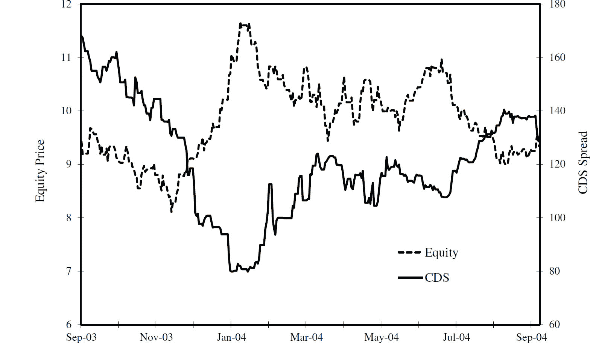

图 3.8：美国汽车零部件制造商 `Delphi` 的股价和 5 年 `CDS` 利差。

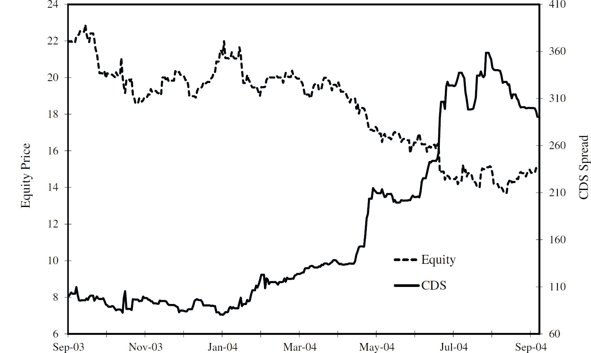

图 3.9：电信公司 `AT&T` 的股价和 5 年 `CDS` 利差。

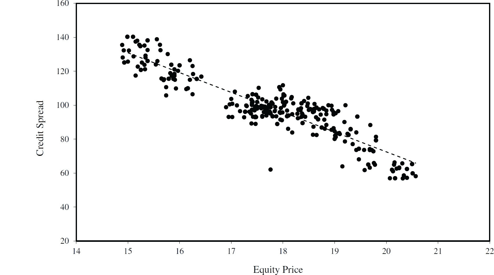

图 3.10：美国电信公司 `Sprint` 的 5 年 `CDS` 利差对比股票。

但你如何实际交易这种均值回归呢？例如，如果信用利差相对于最佳拟合线过高，我们可以通过 `CDS` 卖出保护，并通过做空 delta 数量的股票进行“对冲”。随着交易回归，我们可以平仓 `CDS`，回补空头头寸并实现利润。

一个广泛交易的例子是 `Corus`，一家英国钢铁制造厂（现为 `Tata`），如 `图 3.11` 所示。股票已经上涨，而信用明显落后了约 75–100 基点。通过做空合适的 `Corus` 股票 delta 并以 550 基点出售 500 万美元的 5 年信用保护，可以在一个月的交易期内捕获约 80 基点的利差收窄，并获得一个月的收益。

### 3.7.1 执行、收益与叙事

要使这些交易成功有几个关键点。首先，`CDS` 端需要出色的执行。在信用危机（2008 年）之前的资本结构套利的“黄金时代”，通过询问几位友好的经纪并保持足够的耐心，实际上对大多数流动性信用可以支付零买差。例如，在主要的流动汽车（`Ford` 和 `GM`）中，报价利差为 1–2 基点，通过接触几位交易员，可以几乎无日内成本建立约 1 亿美元的头寸。

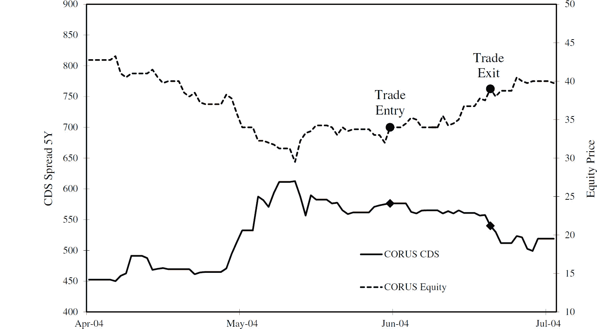

图 3.11：英国钢铁厂 `Corus` 的债务/股票交易及其出口水平。

其次，通过卖出信用保护对比做空股票进行正收益交易总是最好的。原因如下（我们稍后会详细说明），是因为情况可能不像计划那样，而正收益在这方面非常有帮助。交易可能不会足够快回归，或者可能变得非常糟糕，因此能够拥有这种奢侈——盲目留在交易中并让正收益救你——总是是有利的。


资本结构交易在 2000–2005 年间表现优异，随后范式开始发生变化。这种方法的缺陷逐渐被发现，并并在 2006–2007 年 `LBO` 的兴起期间变得显而易见。在信贷危机之前的几年，出现了一场巨大的 `LBO` 浪潮，私募股权公司利用紧缩的信贷利差、活跃的股票市场和便利的融资条件收购了大型上市公司。在 `LBO` 过程中，随着收购报价的提出，股权会上涨，而由于投资者正确预测到即将被收购的目标公司将被极高杠杆化，信贷利差随之膨胀。即使是传闻中出现的 `LBO` 方案的风声，也足以摧毁一桩完美的多头信贷/空头股票资本结构交易。

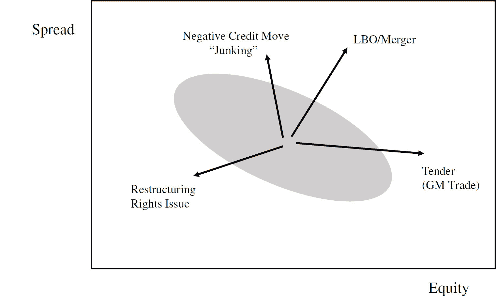

图 3.12：债/股交易的“缺陷”。

事实上，这些问题对于简单的债/股方法来说仅仅是冰山一角，因为特发事件可能会以许多未预见到或未经历的方式影响交易。图 3.12 显示了一个假设的利差与股权图表。完美的多头债/空头股正向收益方法实际上是高收益领域重组和去杠杆浪潮的受益者，当信贷利差收窄时其表现优于股市。但存在其他潜在情景。`LBO` 或杠杆合并可能会提高股价和信贷利差。意外的负面信贷变动（例如评级机构的“垃圾化”）会导致信贷表现严重落后。收购（如下文臭名昭著的 GM 交易）会导致股票跳升，而信贷则纹不动。情况已经改变，债/股格局已变成一个雷区。交易的叙事逻辑变得非常重要。

### 3.7.2 GM 的惨败失败

通用汽车（`GM`）交易值得提及，特别是因为它给我我和市场上的许多人造成了巨大的痛苦。它是标准正向收益方法棺材上的最后一颗棺钉。信贷市场上的每个人都能看到 `GM` 的灭亡是不可避免的。天已有险。它具有高杠杆、糟糕的销量、巨额负现金流，且资金短缺。股票投资者正如往常一样，似乎与信贷分析师生活在不同的世界里。股价非常高，似乎忽视了糟糕的基本面前景。因此，在我们看来，这是一场单边交易。我们做空了 `GM` 股票，并出售了 `GMAC`（通用汽车接受公司）的信贷保护。`GMAC` 作为所有这些汽车的财务融资实体，尽管其利差很高，但被认为比 `GM` 本身更具信用价值的实体，且高额的债券发行提供了流动性更好的 `CDS`。预测的必然性是：`GM` 的股票将归零，`GM` 将在未来 12 个月内破产。

然而，我们没有考虑到柯克·柯基戈里安（Kirk Kerkorian，1917–2015），他是一位 80 多岁的亿万富翁投资者，也是拉斯维加斯的创始人之一，他认为自己在 2005 年可以拯救 `GM`。他以高于市场的价格收购 `GM` 股票，将其持股增加到 8.8%。股价大幅反弹，令我们遭受了巨大损失。然后我们意识到，并不是只有我们最初认为这是一笔伟大的交易。许多自营交易部门和对冲基金都做过债/股交易，突然这笔交易被证明过度拥挤，因为每个人都在向出口挤。所有人同时平仓并撤出的影响迫使 `GMAC CDS` 的利差进一步扩大，导致了更多损失。尽管在交易中亏损严重，我们仍继续相信基本面并固执地持有。因为是正向收益交易，所以我们忍受着痛苦，知道每一天的持有收益都会抵消我们的损失。最终，在深陷亏损 12 个月后，我们赚了小额利润（相对于最大市值亏损而言）并平仓了交易。事实证明，柯基里安先生后来放弃了他的股权并退出了。最后，在 2009 年 6 月，`GM` 在 4 年内积累了惊人的 810 亿美元亏损后，申请了`第 11 章`破产。这是美国历史上最大的制造业倒闭。你可能认为在一个理性的世界里这将是 `GM` 故事的终结，但事实上，`GM` 在 2010 年从破产中恢复，并进行了当时全球最大的 IPO 之一。今天，`GM` 的雪佛 Silverado 和 `GMC Sierra` 的销量已经超过了福特的 F 系列。

### 3.7.3 美雅塔的空头交易

在经历了 `GM` 的经历之后，大多数对冲基金都放弃了资本结构套利交易，但如果你足够努力，仍然存在机会。交易只需要针对可能影响公司的特定事件进行调整。它需要对每家公司和潜在的催化剂进行更详细的分析，以识别每笔交易的最优配置。

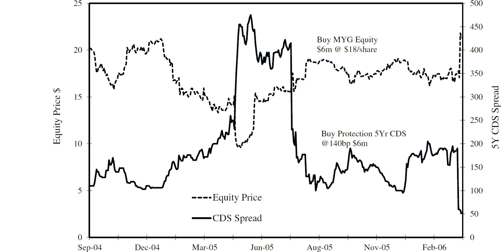

图 3.13：Maytag 债/股空头信贷交易。

一个很好的例子是基于 `M&A` 事件的 Maytag（`MYG`）债/股交易。Maytag 是一家家用电器制造商，最终于 2005 年第二季度被惠尔浦（`WHR`）以每股 21 美元收购。然而，最初的报价是通过私募股权财团的 `LBO` 发出的。`CDS` 最初扩大到 450 个基点，股票下跌，然后向 16 美元移动。第二次报价由信用价值更高的 `WHR` 宣布，价格为 21 美元，`CDS` 回收到 100 个基点（见图 3.13）。

由于反垄断问题，存在巨大的不确定性。我们的交易是买入 `MYG` 股票并通过 `CDS` 进行对冲。这是一笔负收益交易，但预期会在几个月内解决。如果 `WHR` 的报价失败，那么 `LBO` 报价将成功。信贷利差将扩大到 450 个基点，股票将跌至 16 美元。会导致很小的损失。但如果 `WHR` 交易成功，`MYG` 股票将上涨到 21 美元，信贷将收窄到 50 个基点。在这种情况下将获得巨大的利润。2006 年第一季度，`WHR` 交易完成，获得了超过 60 万美元的利润。

### 3.8 合并与 LBO 交易

股票和信贷市场参与者对事件概率和结果解释不同的这一事实，可以通过许多其他方式进行利用。传统合并套利的问题之一是，交易公布后，相关股票会几乎瞬间跳升至其合并后的价值。

通常，被收购公司的股票价格会非常接近报价价，报价价通常比市场价值高 10–20%，但有时会接近 100%。溢价随时间变化，2021 年，英国几家公司（如 Morrisons 和 Meggitt）出现了接近这一范围上限的溢价。有时，投机性传闻或内幕消息在市场上流传了一段时间，在报价公布之前，股价就开始攀升。


多年来，有一些记录在案的对冲基金似乎拥有一种令人兴奋的策略，即根据内幕消息进行交易，并从市场价值的完整跳跃中获利，完全是真正的 Gordon Gekko 风格。然而，现实要平庸得多。大多数基于并购的对冲基金在并购公告后进行交易，试图从大幅缩小的并购溢价中获利。

一旦报价公布，出价或完成价格与市场价格之间的差额就变成了新的并购溢价或折扣。它代表了交易完成的可能性，以及持有股票直到交易完成的融资成本。随着交易向完成进展并克服各种障碍，折扣会逐渐减小。因此，低概率的报价以相对于完成价格而言具有较大的折扣进行交易。即使是对于“友好”收购，也有许多导致交易未能完成的原因，从竞争和反垄断问题到融资问题，这些因素都会影响交易完成的概率。相反，一旦一家公司进入“待收购状态”，就可能来自`3^(rd)`方的更高报价。有时，由于预判会有更高的报价，并购折扣是负的。估计哪些交易会完成是一场复杂且需要技巧的游戏。

通常，公告后的并购溢价很小，约在 1–10%之间，因此需要大量的头寸规模和杠杆来获得良好的资本回报率（ROC）。如果交易未能完成或破裂，股权价格将迅速跌至并购前、传言前的价格水平。对冲基金的损失可能是巨大的。例如，假设报价比市场高出 20%，被收购的股票上涨了 15%，留下了 5%的并购折扣。如果我们忽略资金成本，我们需要`4×` 杠杆来实现`4 × 5% = 20%`的资本回报率。如果交易破裂，股票可能会跌回到出价前的价格，给对冲基金带来`4 × 15% = 60%`的损失。显然，这是一项具有高负偏的风险业务，人们需要仔细观察趋势（read the tea leaves）。表 3.3 显示了 2021 年正在进行的十二宗欧洲并购交易的快照，包含了当前的交易折扣和潜在的下行风险。在繁荣的市场中，许多热门交易由于预判会有更高报价而定价乐观。

许多对冲基金因为错误选择参与的并购事件而走向破灭。一个著名的例子是 2005 年的`$1.3bn` Bailey Coates Cromwell Fund，不幸的是，它有几笔交易同时发生了严重错误。尽管许多交易有很高的概率（>90%）完成，但这通常完全反映在整体市场定价中，因为许多人都会审视交易的所有新闻流。除非你拥有技巧或优势，否则组合的预期长期价值可能比你想象的要得多。尽管如此，像 LTCM 这样的对冲基金认为这些交易存在微小的正风险溢价，并只是系统地执行了所有交易。但许多并购交易的融资取决于市场状况，这是该策略的决定性宏观因素。当信贷危机来袭时，所有的私募交易都蒸发了。

表 3.3：正在进行的一些欧洲并购交易（2021）。

```
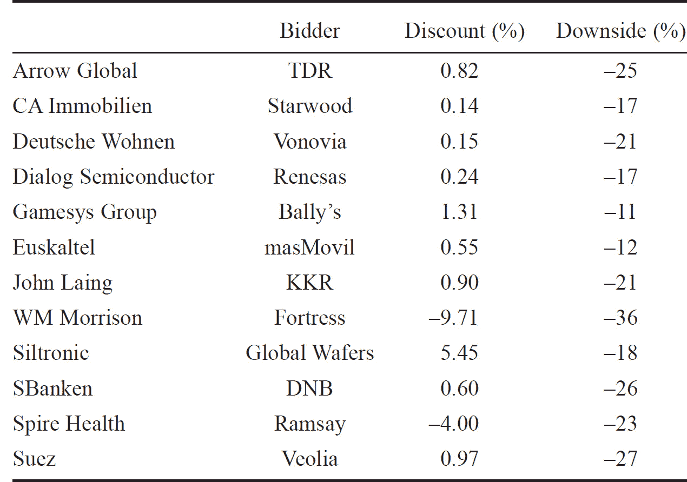
```

为了减轻破约成本，可以采用各种对冲策略。


在`名义价值加权曲线交易`中，你对两个到期日买卖相同的名义价值。例如，你可以针对同一标的卖出 1000 万美元的 10 年信用保护，并同时买入 1000 万美元的 5 年信用保护。在头 5 年内（如果你持有该交易那么久），你没有违约敞口，只有纯粹的信用曲线敞口。通常情况下，由于 10 年期利差比 5 年宽，该交易具有正向收益（positive carry），但如果信用利差上升，10 年期的久期明显高于 5 年，你将会亏损。因此，卖出 10 年期并买入 5 年保护是一个极佳的利差压缩交易。由于没有承担标的的直接违约风险，即使是针对高风险信用，也可以建立大杠杆利差头寸。

### 3.9.2 久期加权曲线交易

在`久期加权曲线交易`中，交易的是每个期限的久期加权金额。这种对冲使交易免受信用曲线平行移动的影响，并允许对信用曲线形状进行纯粹的相对价值交易。交易分为“陡峭器”（steepeners，从信用曲线变陡中获利）和“平坦器”（flatteners，顾其实名目标是曲线平坦）。在每情况下，名义价值的比例由使用信用曲线计算出的“风险”久期比例决定。每个 CDS 的久期等同于信用利差曲线平行移动 1 bp 时价值的变化（`CS01`）。例如，考虑一个信用利差为 250 bp 的 5 年期标的。如果我们买入一个 3/5 年陡峭器，可能会以 200 bp 的价格卖出 1000 万美元的 3 年信用保护，并买入 650 万美元的 5 年保护。每变陡 10 bp，该交易将带来约 2.7 万美元的收益。它的优点是每年有 3.7 万美元的正向收益，并且受益于每年 25 bp 的收益率曲线自然变陡趋势。然而，在发生信用事件时，存在一个 350 万美元的净名义价值敞口。

### 3.9.3 曲线交易

只要你坚持几条基本原则，我是曲线交易的忠实粉丝。

曲线交易的脆弱性在于执行和流动性。需要耐心和机会来将买卖价差缩小到接近零以实现执行。单一标的的流动性可能会波动，甚至在人们对交易它们失去兴趣时而枯竭。随着 CDS 偏离广泛报价的年度到期日，它们的执行会变得更加困难。理想情况下，交易两边的执行应该几乎是同时完成的。

此外，久期加权交易的对冲比例随时间推移而变化。交易通常会持有几个月甚至更久。一个经过久期对冲的 3/5 交易会逐渐变成 2/4 交易。人们可以重新平衡对冲，或者预见到这种影响并在交易开始时进行部分对冲，目标是在整个预期持有期内平均处于对冲状态的交易。

由于大多数信用曲线呈现向上凹的形状，顺着曲线操作是有益的。如果没有变化，陡峭器将自然地沿着曲线向下（roll down）并自行变陡。例如，5/7 通常比 3/5 更平坦。如果你交易一个 5/7 陡峭器并持续 2 年，它在向 3/5 演变的过程中会变陡。这是一种内置的正向收益形式。

信用曲线的错位可能有明确的原因，这些需要进行调查。一个主要原因是底层债务的到期日。例如，如果一家公司即使有杠杆，但目前现金流为正且 6 年内没有债务需要再融资，那么信用风险在 5 年内相对较低，而在 5 到 6 年之间会大幅增加。这应该反映在期限结构和信用远期利率中。

交易信用曲线可能会由于公司事件（包括重新杠杆、再融资和重组）导致产生、意外敞口。在盲目进入一个看似显而易见的相对价值曲线交易之前，需要探索未来的基本面和情景。积极的一面是曲线为某些事件提供了独特的敞口。

### 3.9.4 HCA 曲线陡峭器

例如，考虑我们在 2005–2006 年交易的 HCA 曲线陡峭器。HCA 是美国医院的运营商。在 2005–2007 年的 LBO 热潮期间，由于其收益稳定且信用指标良好，它被标记为稳定的再杠杆候选。2005 年后期，我们通过卖出 1300 万美元的 5 年信用保护并买入 1000 万美元的 7 年信用保护，买入了一个 5/7 陡峭器。当时，HCA 5 年期约为 150 bp，而 5/7 为 18 bp。5/7 区域相对于曲线的 3/5 部分非常平坦，因此该交易受益于正向收益和正向滚动。我们将其视为对潜在 LBO 事件的期权，该期权异常地支付了我们溢价。该交易的违约触发（jump-to-default）收益为负 300 万美元，我们认为 HCA 违约的可能性很小。2007 年 7 月，与私募股权财团达成出售。LBO 后杠杆率预计增加到不健康的 6.6 倍。在公告期间，信用利差扩大到 460 bp，曲线变陡至 75 bp（见图 3.14）。收益超过 45 万美元。LBO 后，HCA 在 2011 年成功 IPO，现在 2021 年，有传言其成为 LBO 目标。


### 3.9.5 UPC 曲线平坦器

平坦器可能是曲线交易中的少数，但有时曲线变得非常陡，回归均值的可能性很大，且可以产生正向收益。此外，平坦器的优点是违约触发为收益，因此可对冲其他敞口。一个例子是 UPC 平坦器。

UPC 是西欧最大的缆网络和宽带供应商之一。该公司杠杆很高，但现金流稳定。2006 年交易时，通过银行债务杠杆为 4.0 倍，通过无担保债券为 5.1 倍。我们另外购买了 1300 万美元 UPC J1/K1 贷款。CDS 信用曲线在短期内非常陡，2/4 年期接近 200 bp（见图 3.15）。我们通过买入 1700 万美元的 2 年保护并卖出 1000 万美元的 4 年保护，建立了一个 2/4 平坦器。该交易在无担保债务上产生了 700 万收益，足以对冲贷款敞口。六个月内，2/4 年期水平平坦至 150 bp 以下。


尽管有了这些新参与者，但抵押贷款市场的利差和定价相对于无担保债券市场似乎总是非常慷慨。从某种意义上说，贷款与债券之间的利差率在理论上应该是抵押与无担保之间预期损失相对比例的函数。然而，这仅仅基于简单的模型和平均统计数据。在实践中，对于一家公司，在抵押贷款发生真实的信用损失之前，债券持有者必须面临几乎全额或彻底的损失。

这种定价上的差异导致了基于回收率假设对贷款、债券与 `CDS` 进行套利的可能性。由于一方自然地是多头现金贷款，该交易包括买入较小金额的 `CDS` 保护以在违约时进行对冲。通常情况下，这对于应对市场价值的变化并不是非常好的对冲，因为贷款的流动性比 `CDS` 差得多。除了极端事件外，没有有意义的动态 Delta 值。由于此原因，大多数人会对在抵押贷款上购买无担保保护的价值表示怀疑，并倾向于裸奔贷款风险。

### 3.10.1 INEOS 贷款套利

2005 年左右，贷款信用违约互换（`LCDS`）市场出现了。`LCDS` 在发生信用事件时参考的是抵押贷款而非无担保债券。当时的领导者也许是 `Morgan Stanley`，我的基金是首批交易 `LCDS` 并成为活跃参与者的基金之一。在金融危机之后，这一单一名称市场的规模有所下降，从未恢复到此前预测的潜力水平。然而，`LCDS` 提供了一种更简洁的合成套利贷款和债券的方法，而无需涉及所有复杂的融资和 `TRS`。

一个交易示例是 `INEOS` 贷款套利交易。`INEOS` 是全球第三大化工公司，但具有高杠杆的资本结构。该公司拥有 `84 亿欧元` 的债务，调整后的 `EBITDA` 为 `20 亿欧元`。贷款受益于对资产的优先担保，且通过期限贷款 A、B/C 和基础便利的杠杆率仅为 `2.8 倍`（见表 3.4）。在发生违约的情况下，杠杆为 `4.2 倍` 的 `24 亿欧元` 债券的回收率预计将远低于贷款。在大多数情况下，在发生硬违约之前，就会出现有利于贷款持有者的杠杆契约违约。这将允许在贷款受到影响之前进行不利于股权和债券持有者的重组。

表 3.4：INEOS 资本结构（2006 年）。

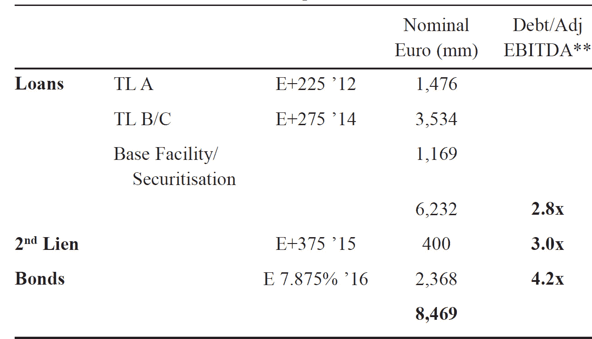

**假设调整后 EBITA = 2,009 万美元。**

表 3.5：INEOS 贷款套利交易在信用事件中的盈亏。

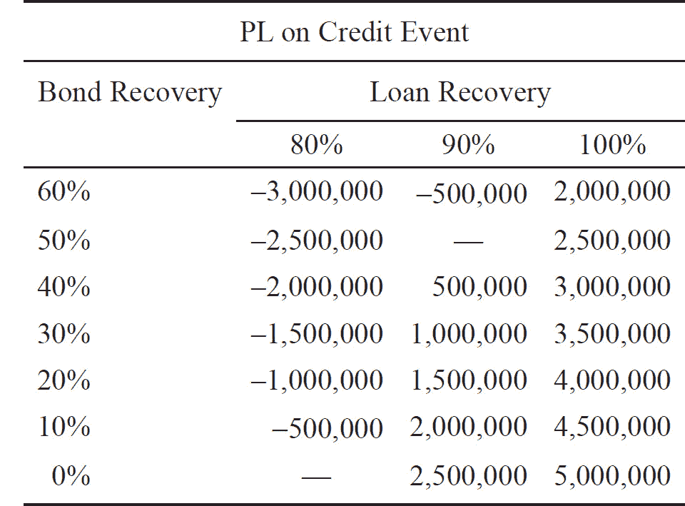

该套利交易是通过 `LCDS` 出售高级抵押贷款的 1 期和 2 期 `INEOS` 保护（1 期 1000 万欧元，2 期 1500 万欧元），并买入较小金额的无担保 `CDS` 保护作为对冲（1 期 300 万欧元，2 期 200 万欧元）。这提供了高度正向的。在发生信用事件的情况下，各种债券和贷款回收率组合下的 `P&L`。最可能的结果范围是贷款回收率为 90–100%，债券回收率为 0–60%，所有这些都能产生正的 `P&L`。在实践中，上述契约违约将为贷款提供 100% 的回收率，为债券提供较低的回收率。这将产生数百万的意外。随后没有发生违约，在两年内以微乎其道的信用风险产生了约 `50 万欧元` 的正向持有收益。

### 3.11 基差交易（Basis Trades）

基差交易是经典的债券/CDS 套利交易。它们本质上非常简单。你买入现金债券，并使用 `CDS` 买入该债券的信用保护。通常会尝试使债券和 `CDS` 的期限尽可能匹配。此外，如果债券是固定利率的，则需要通过做空国债或利率互换进行利率对冲。基差交易的持仓收益是债券利差减去 `CDS` 溢价，并根据任何融资和利率对冲成本进行调整。在实践中，这大约等于债券的有效资产掉期利差减去 `CDS` 溢价，即报价基差。通常，买入债券并买入保护的效果最好，但偶尔也有反向操作可行的情况，即做空债券并出售保护。基差交易在银行自营部门很受欢迎，因为它们通常可以实现“LIBOR 减”的融资。对于对冲基金，融资和杠杆是经济效益中的关键要素，每笔基差交易都必须仔细评估。

基差交易通常由经纪人提供，将 `CDS` 和债券以某些基差水平“捆绑”出售。通常情况下，他们账面上上有想要出售的债券。向客户提供整套方案有助于这一点。然而，除非经纪人在债券和 `CDS` 方面都有良好的“头寸（axed）”，否则我一直发现，预包好的基差交易价值不如自己去寻找。通过关注现金市场并获得对 `CDS` 的敏锐头寸水平，基差可以得到大幅改善。

通常由于技术性原因导致基差过大，这留下了可衡量的套利空间。例如，2005 年 `Xerox ‘09s` 的基差对于短期限债券来说是非常大的基差，特别是以欧元计时。我能找到的解释这种异常大基差（当时大多数其他债券的基差在 20 bp 左右，而其为 40–50 bp）的唯一原因是，该债券发行非常分散，任何特定时间都可以买入 100–200 万美元的小额份额。积累足够使其交易价值的头寸需要巨大的耐心。特别是，它需要持有小额未对冲库存，直到执行 `CDS`，而 `CDS` 的规模通常是较大的 500 万美元。

此外，许多债券的期限无法与市场上标准的 `CDS` 精确匹配。通常需要欠对冲，使债券的期限略于 `CDS`。如果持有到到期，可能会留下几个月的未对冲债券头寸。从违约角度来看，由于未对冲期很短，这种风险很小，因为违约概率与利差乘以短期成正比。可以说，在某些情况下，特别是当公司的债务到期日集中在某些关键日期时，违约概率在这些日期会被放大。

许多高收益债券包含发行人回赎权，在若干年后以高于 100% 的定义价格水平回购。可赎债券的基差交易很难，因为 `CDS` 合同的期限无法容易确定。大多数人对冲到第一个回赎日，这通常提供了较高的有效基差水平。如果利率下降或信用状况通过去杠杆得到改善，那么债券被回赎的可能性很高，因为发行人可以用更便宜的债务替代。然而，如果信用质量下降，债券可能不会被回赎，从而留下一个几乎裸奔的债券头寸。

#### 3.11.1 超价值基差交易


基差交易的一个示例是 `Supervalue (SVU)` 交易。`Supervalue` 是一家美国零售商，曾通过对 `Albertsons` 进行耗资 `$12bn` 的巨额收购实现了杠杆化。由于短期信用保护卖方的存在，`CDS` 曲线的短端相对于现货被人为收紧。市场做商在曲线短端的价格可见度非常有限。该交易的策略是：买入 `$15m` 的 `SUV` `8.5%` `05/10` 债券，使用 `CDS` 买入 `$15m` 的 `03/10` 保护，并卖出 `$15.9m` 的 `4 5/8%` `11/09` 国债作为利率对冲。与大多数基差交易一样，债券与对冲工具之间存在轻微的不匹配，如果持有到到期，将留下两个月的信用风险敞口。融资后，相对于 `CDS` 掉期曲线的基差约为 `35 bp`，相对于国债的基差约为 `65 bp`（见图 3.16）。这提供了一个经过信用和利率对冲且具有正向利差（positive carry）的交易，可以持有到到期。更好的是，这项对冲交易的保证金可以由我们的 `PB` 激进地提供，约为 `1–2%`，因此从理论上，年收益率约为 `40%`。你可能会想，这是一个多么棒的交易？

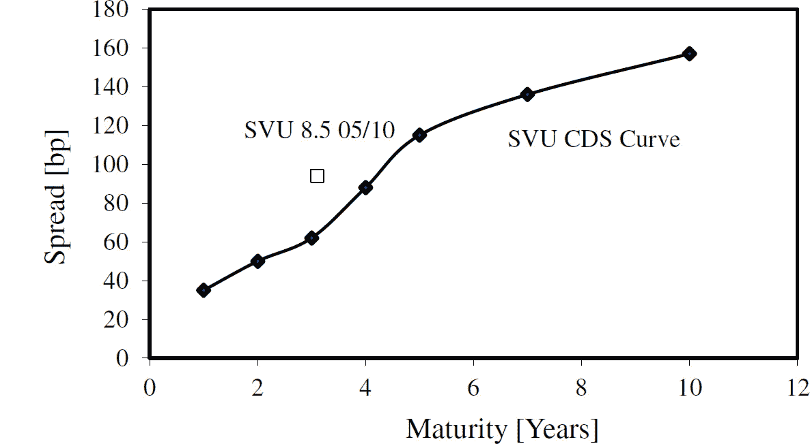

图 3.16：Supervalue 基差交易与 CDS 曲线。

出乎意料的是，信用危机暂时清除了所有的“免费”基差交易。危机的一个不可预见的副作用是，用于债券融资的银行间回购市场关闭了，`PBs` 修改了保证金率并躲进堡垒。理论基差飙升至惊人的 `200–300 bp`，导致基差组合出现巨大的市值计亏损。在现实中，你既无法交易 `CDS` 也无法交易现货债券，因为交易商停止了为 `CDS` 提供市场。由于整个信用市场停滞，没有人愿意为债券融资。每个人被迫以巨额损失抛售那些具有正向利差（此前为无风险）的基差交易。现在每个人都知道基差交易中真正的风险在哪里，并且需要极其昂贵的长期融资来度过信用危机的风暴。

### 3.12 组合构建

构建交易组合允许交易经理通过头寸规模和多元化在控制风险的同时增加收益。在自主交易中，每笔交易都是经过人工筛选的。当新交易被添加到组合中时，必须同时考虑其独立层面的风险以及其对现有组合的影响。从独立角度来看，一笔交易可能受到流动性、可用杠杆和融资情况以及未来收益预测分布所决定的基本头寸大小限制。

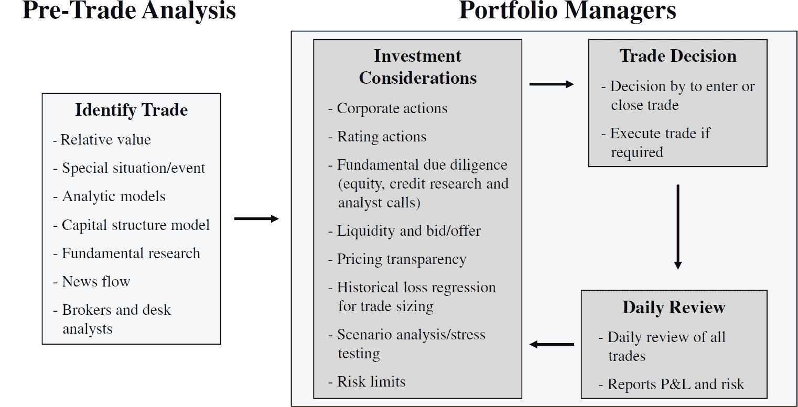

图 3.17：自主交易的生命周期。

图 3.17 概述了从组合经理角度看交易的典型生命周期。交易的原始构源于对市场的持续监控，结合详细分析阶段来识别机会。这些机会可能基于相对价值或特殊情况，并借助分析模型和基本研究。通常会使用许多带有专用插件的电子表格，通过各种指标扫描市场以寻找潜在交易，指标范围从基于价格的因素（如 `curve slope`、`basis` 和 `relative spreads`）到基本面指标（如 `company leverage` 和 `projected EBITDAs`）。尽管这些数据中的大部分……


这是一笔 72 亿欧元的贷款，利差极差且条款薄弱。我们本礼貌地拒绝了，但被雷曼承销团主管强迫参与。我们最终同意进行小小规模的购入，因为尽管经济状况不佳，但我们预见到这家媒体公司未来会 IPO。结果显示，交易启动良好，但几乎就在第二天，信贷危机就爆发了。我们当时持有这笔买入的高票息中债债券头寸。在流动性旋涡中，其市值价格从 100% 跌至令人惊人的 1%。是的，这几乎是瞬间完成了 99% 的跌幅。技术层原因是由于市场波动，`TRS` 供应商提高了初始保证金，这导致了几位面临保证金压力的强制卖方被迫抛售。然而，市场上完全没有买家，因为所有买得起手的人都是多头，且 `TRS` 供应商不再接受新贷款。承销这笔交易的银行也已经满仓，因此没有价格支持或买家。随着贷款价值下降，所需的保证金随之增加。更多现金管理不善的卖方出现，价格在去杠杆的恶性螺旋中进一步下跌。只需在二级市场对 100 万欧元的 `ProSieben` 贷款进行一次压力抛售，就重新定价了整笔 72 亿欧元贷款所有其他持有者的市值价格。当价格跌到 1% 的底价时，我甚至考虑过用个人账户不加杠杆买入一些，但我所有的零售经纪商都看出如何购买贷款（即使他们买债券都很吃力）。危机之后，中债回升并按面值赎回（100%）。`ProSieben` 后来按照原计划进行了 IPO。

学者会认为，投资流动性差或流动性较的资产存在流动性溢价。然而在实践中，任何可以赋值的溢价都难以量化，且随时间变化。我们可以每天观察平均流动性和成本（包括市场影响和滑点的影响），但这并不代表流动性的真实下行风险。流动性的丧失可能在特殊情况下以“黑天鹅”事件的形式发生。将其描述为时间平均溢价是一个不实际的假设，且严重低估了风险。即使是最流动性良好的资产，例如 2010 年“闪崩”期间的 `S&P 500` 期，在做市商撤回意愿时也会经历剧烈的流动性事件。

### 3.12.2 资金限制

资金和杠杆也是头寸规模的主要考虑因素。我一直很惊讶，在我工作过的大多数金融机构中，交易员对自己的融资成本、资本成本和目标资本回报率几乎没有概念。对于对冲基金来说，资本是稀缺资源，必须谨慎部署。交易通过 `repo` 市场或`prime brokers` 融资，理想情况下使用净融资。如果需要通过做空国债进行对冲，这必须在整体盈利能力中考虑。如果在扣除杠杆和融资成本后，资本回报率很低，那么这笔交易可能不值得考虑。在银行自营部门使用低于 `LIBOR` 的融资资金可能获利的交易，对于对冲基金可能并不合适。最后，可能是资本回报率足够，但 `PBs` 提供的规模限制限制了交易的盈利能力。

### 3.12.3 利润目标

决定交易规模最重要的因素是交易的潜在盈亏（P&L）。超级名模琳达·伊万格利维曾有名格言：“每天少于 10,000 美元我不起床”。显然，对于普通的对冲基金交易员来说，为了起床，交易必须赚得多。对于思考、分析、执行和应对交易所付出的精力，必须有一个体面的目标回报。然而，大多数理性的交易员同样对可能的下行风险感兴趣。令人惊讶的是，大多数经验丰富的对冲基金经理极度厌恶风险，并对最坏的结果非常痴迷。

历史模拟是建立下行风险的良好起点。从这里我们可以开始提出许多问题。如果我们在历史的不同时间点进行这笔交易，收益的典型分布和不同的损失分位数是什么？什么构成了平均损失，以及 90%、95% 和 100% 的尾部损失？你可能经历的最大损失是让你集中注意力的重点。基于历史分析，在获利之前合理的目标回报是什么，我们预计这需要多久？如果我们过去执行过这笔交易，在达到目标利润之前我们通常必须承受多少损失？在我看来这至关重要。根据我的经验，“倒霉法则（Sod’s Law）”普遍存在，在达到目标利润之前通常必须承受损失。这种分析对于均值回归交易尤为真实，因为在任何微弱的回归效应出现之前，确定交易时机可能非常困难。

历史模拟虽然有用，但对于任何事件驱动型交易通常是错误的。正如所讨论的，许多对冲基金交易是事件驱动的，因为催化剂或事件已经发生或预期发生。通常，这些事件在特定公司的现有历史数据集中从未出现过，因此过度依赖特定公司的数据集是危险的。在这种情况下，我们必须寻求与其他相似数据集的比较。例如，如果公司 `A` 没有杠杆，但在 `LBO` 中将重新加杆，那么我们应该查看另一家之前进行过 `LBO` 的公司 `B`，看看 `LBO` 对公司 `A` 的信用利差产生什么影响。这些许多事件是基于当前的市场环境，因此我们必须仔细调整历史观察结果。另一个例子是，如果公司 `C` 在历史上进行股权配股，我们可能预计股价会下跌。然而，另一家类似的公司 `D` 可能刚刚完成了配股，其影响被认为对加强公司资产负债表有益，导致随后股价上涨。因此，估计交易的不同收益情景不应仅基于分析数据分析，还应包含大量的技巧和常识。

### 3.12.4 关注偏度

建模交易收益的传统学术方法通常为了简单而高度依赖正态分布收益。虽然这种简单性通常是一个巨大的便利，但在代表复杂交易时，它证明是极其危险的。许多催驱动交易的收益分布具有显著的正态性。

将交易的偏度视为正态分布理念的一阶修正是很常见的。方差衡量分布的宽度，偏度衡量不对称性。统计学上，分布的平均值是一阶矩，方差是二阶矩，偏度是三阶矩。四阶矩称为峰度衡量分布的尾部风险，但在实践中，交易员将所有非正态的内容整合在一起并称为“偏度”。


偏度（Skew）对于交易者和投资者来说都非常重要，但它往往会导致利益的不健康分化。频繁的情况下，对冲基金的交易实际上是“卖出”期权并变相收取权利金的交易。这些是负偏度交易，在问题出现之前，投资者往往无法完全察觉到。这通常发生在交易中相应的期权“行权价”被触及并导致巨额损失时。除了显而易见的卖出价外（OTM）股票期权，更俗地说，我们还可以包括许多高概率获得“持有收益”（carry）的交易，例如杠杆并购交易。大多数并购交易都要支付溢价，但如果交易“破裂”，就会很高的下行风险。在某种意义上，购买短期债券或出售 `CDS` 也是类似的。由于有持有收益支付，因为期限短，每日市场波动很小，但如果公司出现问题，债券价格可能会大幅下跌，甚至发生违约损失。

有一天在出租车后座时，我们的营销人员抱怨说，如果我们基金的业绩是直线的，卖起来会容易得多。她后来向我展示了她认识的投资者感兴趣的几只基金的图表。结果证明，其中一个基金就是伯尼·马多夫的 650 亿美元庞氏骗。然而，在直接欺诈之外，每当我看到一个具有高夏普比率和直线业绩且没有波动的对冲基金时，在我看来，它们要么 (i) 没有正确记录账，(ii) 快速交易，或最可能是 (iii) 卖出了大量的负偏度期权。事实是，人们可以通过卖出负偏度伪期权多年获得良好的业绩并成功募集资金。

除了简单的偏度外，我们还必须考虑许多交易由于其事件驱动的性质，可以在不同的、几乎离散的定价状态之间转换。这意味着可能的收益呈现出多峰概率分布。之前描述的 `HCA` 曲线交易有两个不同的状态：(i) 没有 `LBO` 的平坦曲线或 (ii) 具有陡峭曲线的 `LBO`。每个状态都有自己的波动率，且该交易无法用偏度来描述（图 3.18）。相反，需要对交易逻辑有更深入的理解才能领会涉及的风险。

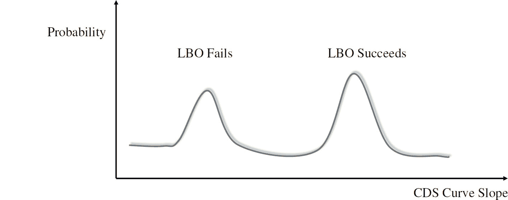

图 3.18：HCA 曲线交易的多峰分布。

### 3.13 风险管理

除了识别和执行产生 Alpha 的交易外，组合经理最重要的第二个角色是风险管理。定量风险管理随着风险价值（`VaR`）模型的引入而演进，但在经历了多次财务灾难后，风险经理现在已经充分了解此类方法的局限性。`VaR` 通常辅场景分析、压力测试以及适用于自主性交易的更多即时技术。

#### 3.13.1 VaR 模型

如今金融机构使用的基准风险管理方法是风险价值（`VaR`）。`VaR` 由摩根大通于 1994 年作为 `RiskMetrics` 开创，并被广泛采用和制度化。我第一次在 1995 年为一家日本银行编写了 `VaR` 模型，当时这被视为非常高科技。通常采用 delta `VaR` 方法，这对于线性且不包含太多期权的组合来说足够了。如果包含期权，则需要对组合的“希腊字母”（如 `gamma` 和 `vega`）进行更完整的建模。

股票的 delta 方法已经成熟，这对于线性且不包含太多期权的组合来说足够了。如果包含期权，则需要对组合的“希腊字母”（如 `gamma` 和 `vega`）进行更完整的建模。

股票的 delta 方法已经成熟，这对于线性且不包含太多期权的组合来说足够了。如果包含期权，则需要对组合的“希腊字母”（如 `gamma` 和 `vega`）进行更完整的建模。

股票的 delta 方法已经成熟，这对于线性且不包含太多期权的组合来说足够了。如果包含期权，则需要对组合的“希腊字母”（如 `gamma` 和 `vega`）进行更完整的建模。

股票的 delta 方法已经成熟，这对于线性且不包含太多期权的组合来说足够了。如果包含期权，则需要对组合的“希腊字母”（如 `gamma` 和 `vega`）进行更完整的建模。

#### 3.13.2 压力测试和场景分析

通常，`VaR` 会辅以其他主观技术，如压力测试和场景分析。这两种技术之间有相当的重叠，但为了稳健的风险管理，两者都是必不可少的。

压力测试是对各种市场施加冲击，并计算其对组合市市价值的影响。例如，股票 ±1% 的变动、利率 ±1% 的变动或信用利差 ±1% 的变动。可以评估不同规模的波动，包括极端波动。可以考虑多个参数的同步压力测试。基础压力测试假设变化是瞬时的“冲击”。这些波动可以被描述为风险因素波动率的若干个标准差。


情景分析通常涉及构建特定的“假设”情景，这些情景在历史上已经发生，或可能在未来市场发生。与压力测试相比，情景构建可以说更具现实意义。历史情景可能包括互联网破灭、海湾战争、俄罗斯危机和雷曼违约等，这些时期都发生了市场动荡或冲击。相关的短期市场时间序列被用于估计如果当前投资组合经历了这些历史事件，将会产生什么影响。也可以构建从未从未见证或长期未被观察到的假设性未来情景。例如，在持续一段时间内通胀膨胀、债券收益率上升和增长低迷所构成的滞胀噩梦，是目前许多人在 2021 年正在评估的话题性情景。

基于 `VaR` 和情景分析，我们可以建立并监控各种硬性与软性限制。这些限制通常包括名义净敞口和总敞口、对风险因素的最大敞口，以及信用事件中的最大损失。我们还可以根据行业、资产类别和地理区域对风险分类进行限制。使用 `VaR` 机制，我们可以应用包含波动率和协方差的风险调整限制。这些通常被称为协方差或 `CoVaR` 限制。正如我们在第 4 章的系统化交易中将讨论的，可以通过迭代过程在各种约束条件下优化风险，但对于自选交易而言，这并不相关。

### 3.13.3 真实的投资组合风险

真实对基金组合的一个关键问题是，上述技术仅适用于高度多元且表现良好的投资组合。真实的投资组合包含基于逻辑和催化剂的多笔交易。此外，观察发现，大多数高斯分布定量 `VaR` 类方法对于收益呈强偏态和多峰分布的投资组合非常不合适。根据定义，这些真实的投资组合基于特异性交易，这些交易是根据其感知超额收益以及非对称风险收益比而被挑选的。

对于我最大的投资者之一，我被要求提供每日 `VaR` 估值。我构建了一个具有许多功能的复杂 `VaR` 模型，能够涵盖股票、债券、`CDS`、贷款、利率和外汇。然而，与真实的每日 `P&L` 变动进行对账非常困难。尽管从极长期来看，它在统计上可能具有一定的可信度，但在短期和中期，它难以应对投资组合中许多特种情况和相对价值交易。均值回归交易特别难以建模。最终，我们为每种交易类型都需要不同的子模型，这导致了一个从根本上不同的更整体的风险方法。

了解每笔交易的个体风险特征，有助于理解整个投资组合的真实尾部风险。风险模型在量化极端尾部风险方面都面临困难，而且投资组合多元化的幻觉过于真实。在极端事件下，不同交易之间的低概率尾部可能会以一种意想不到的方式累加在一起，因为它们的相关性倾向于趋向 `+1` 或 `–1` 值。为了减轻这种风险，理解策略驱动因素有所帮助，但消除这些低频风险的成本通常是令人负担不起的，并会对投资组合表现造成负担。典型方法通常包括静态方法，如购买深度价外（OTM）期权，例如几个基点的低成本信用保护，这些保护在危机期间可能会急膨胀。在银行、单线公司和 AAA 级垃圾贷款上购买廉价的 `CDS` 保护在信用危机中效果显著，但在稳定市场中，其负带来的成本往往令人望而却步。也可以采用使用快速波动率指标来购买波动率保护的动态方法，尽管它们的统计有效性受限于历史金融崩溃次数较少，而且每一个不断演变的危机都有其独特性。

### 3.14 老派方法

本章的目标是提供“老派”自选定量交易的概述。在这种交易中，交易决策具有高度的主观性，基于粗略的数据和人类直觉。这并不是要贬低自选方法，而是为了强调这样一个事实：尽管它是量化的，但它不是正式的基于规则的，而且永远无法被清晰地系统化。每笔交易的催化剂都是不同的，取决于背景和市场状况。本章中的示例表明，这种自选投资决策利用理解和洞察来对复杂的企业事件形成观点。这些许多事件是特异性的，为了实现多元化和分散风险，交易越具有特异性越好。每笔交易都必须从多个角度进行分析，从技术和基本面到执行和流动性风险。自选交易员必须研究大量公司的信息流，以及每家公司基本面的叙述。虽然股票是电子化交易的，但只有 25%的高收益债券和少于 2%的贷款是以这种方式交易的。自选交易员每天必须与带有偏见的卖方经纪人和分析师打交道，但要坚持自己的信念。重要的是，不同交易类型和情况的个体性使得统一的风险管理框架变得有问题。每个交易员必须“熟悉自己的账户”，而不是依赖简单的 `VaR` 框架。

在接下来的章节中，我将概述一种不同的对基金方法——从系统化到较新的 AI 方法的计算机交易。系统化交易在许多方面都是自选交易的反立面。它基于统计学和科学可重复的观察来构建交易规则或策略。系统化对基金的交易环境是非个人化的，更像是一个图书馆而不是交易大厅。与其让人们互相大叫，你你可以听到针掉地的声音。策略开发需要数学算法和大量的历史数据来对流动市场的策略进行回测和验证。相比之下，自选交易员是前瞻性的，在一个数据不完整和人类对事件进行主观理解的世界运行，这使得任何科学方法都不成为可能。

# 第 4 章
## 系统化盈利

### 4.1 系统化投资


系统化对冲基金主要有两种类型：`商品交易顾问`（CTA）和`多空股票`基金（L/S equity）。在 CTA 类别中，我们可以包括系统化的`全球宏观`策略和所谓的`管理期货`。目前，许多全球宏观策略由主要的 CTA 进行交易。其他类型的系统化基金也可能存在，例如仅多头的`风险平衡`策略，但这些策略通常可以从 CTA 和多空股票基金采用的策略中推导出。在本章中，我们将主要关注系统化 CTA，并稍将在第 5 章中详细介绍多空股票策略。

从历史来看，CTA/宏观与多空股票这两种主要系统化风格之间的相关性接近零。然而，两者的主观风格与系统化风格之间的相关性均高于 0.5，这表明主观经理和系统化经理使用了使用了相似的策略和指标。特别是对于主观/系统化相关性可接近 0.8 的多空股票策略，人类交易员采用的许多量化因子和异常情况可能已被机器所复制。

重要的是，系统化交易与所谓的`高频交易`（HFT）不同，后者寻求利用超高速度和对交易所的优先访问权。HFT 系统通常不像长期系统化投资者那样对市场方向做出预测。相反，它们预测订单流，在速度较慢的市场参与者之前进行交易，并且往往因提供流动性而获得争议性的报酬。

### 4.2.1 `商品交易顾问`

CTA 在多个资产类别上遵循方向性策略，这些类别包括股票指数、债券、货币和大宗商品。通常，他们采用`趋势跟踪`策略，并使用交易所期货合约和外汇远期。管理资产规模（AUM）超过 200 亿美元的大型 CTA（如 Man AHL Diversified 和 Winton）在 500 多个全球市场进行交易，并用额外的算法补充了其核心的趋势跟踪策略。他们在市场和策略上实现了高度的多元化。图 4.1 显示了典型的板块多元化，约 20–30% 分别分配在股票、外汇、利率商品商品。

在十年中，较大的 CTA 经理已从期货趋势跟踪转向多元化，以寻求更好的表现。一些 CTA（如 AHL Dimension）专门从事非趋势策略，如均回归、择时和截面算法。其他策略（如 AHL Evolution）关注更新、流动性较差的市场，例如场外利率掉期（IRS）、信用违约掉期（CDS）、新兴市场以及波动/期权产品。然而，在 AUM 达到一定规模后，容量限制决定了流动性期货的缓慢趋势跟踪是主导策略。

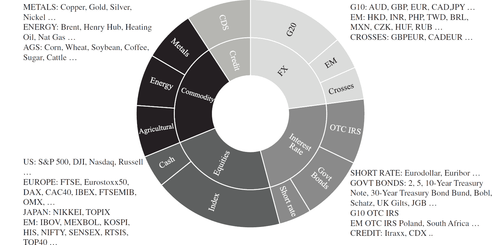

图 4.1：跨期货和场外市场的 CTA 多元化。

成功的 CTA 已经存在了 25 年以上。在对冲基金领域是一个很长的时间。投资 CTA 的主要收益是高风险调整收益（相对于所承担风险的收益），这超过了大多数其他投资。少数最大、最成功的 CTA 实现了约 1.0 的长期夏普比率，超过了包括股票和债券在内的其他资产类别（附录 B.13）。

通常，为了吸引投资者，会展示各种资产类别相对于 CTA 的夏普比率图表。通常情况下，这些图表涉及足够乐观的 CTA 指数。相反，忽略这些带有所有选择问题和幸存者偏差的指数，深入表面观察真实的对冲基金，可能会更有趣。我决定从一份知名、可靠的月度对冲基金报告查看一个略大的 CTA 范围。结果如图 4.2 所示。前 40 只基金的平均 AUM 为 12 亿美元，自成立以来的平均夏普比率为 0.58（年平均收益率约为 7%，波动率为 13%）。由于 AUM 可能偏低，因为许多较大的 CTA 计划只报告其领先的公募基金，尽管它们通常有许多其他投资工具，例如管理账户。为了方便计算，我假设有效夏普比率是收益率除以波动率。只有一个异常基金的夏普比率超过了 1.5，这在自 20 世纪 90 年代以来是令人惊讶的。因此，我们可能可以得出结论：一个成功的 CTA 的长期夏普比率应在 0.5 以上，在实践中，高于 1.0 是极罕见的。在对冲基金术语中，CTA 目标的高波动率主要在 10–15% 范围内。观察到的最大回撤几乎随波动率线性增长，平均最大回撤为 -20%。

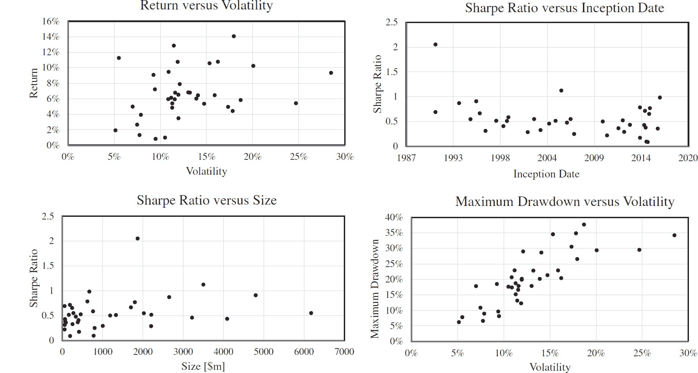

图 4.2：领先 CTA 基金的历史表现。

投资 CTA 的次要吸引力是：(i) 与股票和债券的低相关性以及 (ii) 对投资者而言的高流动性。与股票和债券指数的相关性低得惊人。历史计算显示，CTA 与股票的平均长期相关性值为 -0.02，与债券为 0.05（表 4.1）。这种低相关性意味着对于投资者（通常在投资组合中多头股票）来说，将部分资产投资于 CTA 是高度的多元化投资。在市场危机期间，例如 2002 年互联网泡沫和 2008 年信贷危机，CTA 获得了非常高的回报。这很大程度上是因为在抛售之前建立了多头政府债券。这种在危机期间与风险资产的负相关性通常被称为 CTA 的“危机阿尔法”。在危机月份，大多数对冲基金策略经历了负收益，而 CTA 报告了正收益，平均收益约为 2%。从统计学上说，CTA 收益显示出 0.5–1.0 的正偏，相对于股票的 -0.8 负偏（正如我们所知，股票可能会出现快速抛售）。

表 4.1：CTA 与债券和美国股票的相关性。

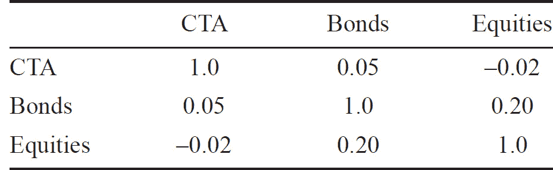

最后，CTA 的高流动性归于其底层期货合约的流动性。与信贷危机期间的大多数对冲基金不同，期货使得 CTA 保持了流动性，没有锁住投资者。CTA 管理账户通常供具有 1–2 天流动性的投资者使用。

CTA 的主导策略是方向性趋势跟踪或`动量`。一些学者将其称为`时间序列动量`。CTA 在每个特定市场的持续趋势方向上建立头寸。由于这种性质，与套利和相对价值对冲基金相比，CTA 的总杠杆（多头加空头）较小。通常，他们在股票和商品上的杠杆不超过 1.5 倍，但由于波动率较低，债券上的杠杆可以是其几倍。这种方向性杠杆实现了高收益和高波动率。正如我们从图 4.2 所示，头寸通常进行动态风险缩放，以目标典型的 10–15% 的波动率。较大的 CTA 使用相似的趋势跟踪技术，相关性相当高（图 4.3）。尽管它们跟踪趋势的速度不同，但平均趋势速度和市场配置大致相似，导致了这些基金的表现相似。


CTA（商品期货交易基金）会经历多次回撤，实际上大部分时间都处于回撤状态。回撤可能是痛苦的，并持续持续几年。这是由于动量策略的右偏性导致的。当强趋势出现时，趋势跟踪会获得巨额回报，但在震荡或无趋势的市场中会缓慢“流失”资金。通常，等于 CTA 波动率目标的回撤每隔几年发生一次，回测中的最大回撤达到波动率目标的 1.5–2 倍。

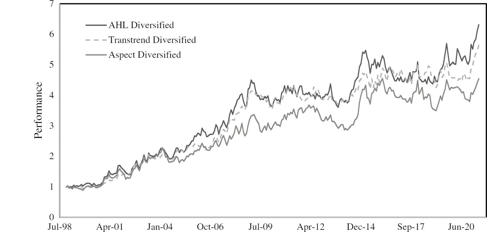

图 4.3：欧洲“巨头”CTA 之间的相关性很高。

### 4.2.2 `L/S equity`

多空股票（L/S equity）基金同时做多和做空“现货”股票。与 CTA 不同，它们是“对冲型”基金，旨在减少整体方向性市场敞口。如果市场上涨（下跌），它们的多头头寸将获得盈利（亏损），空头头寸将产生亏损（盈利）。因此，多空股票基金寻求利用股票之间的差异或相对低效性来寻找与主要股票指数变动不相关的 Alpha。多空股票基金通常会在包含数千只股票的潜在池中交易，并同时做多和做空数百只股票以实现多元化。

由于多头和空头头寸之间的任何定价低效性都很小，必须使用杠杆来获得有意义的回报。通常，一个多空 `market neutral`（市场中性）股票基金是 1.0–3.0 倍的多头和 1.0–3.0 倍的空，净杠杆极低。这提供了相当于投资者资本 2.0–6.0 倍的总杠杆。一些多空股票基金声称在净杠杆为零时是“名义中性”（notional neutral）。然而，这对于投资者来说可能带有误导性，因为一个基金可以是名义中性的，但并非真正的“市场中性”，从而对整体市场波动不敏感。在牛市中，通过有时操纵股票贝塔值（equity beta）并使投资组合相对于空头端持有更多波动率更高的股票来寻求表现是常见现象。如果市场状况发生变化，这可能会让投资者感到意外。事实上，如果我们观察通用的多空股票对冲基金指数，它们包含了太多并非真正市场中性而是暴露于“风险偏入”（risk-on）资产的基金，导致它们与 `S&P 500` 有 60–80% 的长期相关性，与全球债券甚至有 50–70%。这种令人失望的相关性表明，如果投资者希望获得真正的不相关回报，必须仔细查看基金的投资组合。在一个由无情的量化宽松（QE）流动性驱动的世界里，受挫的经理很容易放弃他们的空头策略。

多空股票基金在不同时间尺度上采用许多相对价值策略。短期“统计”套利利用股票之间的离散和均值回归（买入近期表现差的，卖出表现优异的），持仓期可能为几天。更多基于基本面和因子的策略时间尺度可能是几周或几个月。最大的定价异常出现在中小型股中，这些股票的交易量限制更大且交易成本更高。

许多最成功的多空股票交易者如文艺复科技（RenTech）和 D.E. Shaw 已经存在了 20 多年。RenTech 被认为是世界上最成功的对冲基金，其 `Medallion` 基金在 20 年跨度内的年化收益率超过 35%。但尽管这些著名的成功，计算机驱动的多空股票领域也经历了多次重大的洗牌。在 2007 年之前，随着策略变得越来越拥挤，“基础型”的均值回归策略经历了回报的下降。2007 年发生了一场大“量化地震”（quant quake），许多基金同时清算了同一批股票。主要的市场中性基金遭遇了高达 -30% 的回撤，导致包括高盛 Global Alpha 基金在内的许多大型基金被迫关闭。

多空股票基金的一个反复出现的问题是，知识的扩散和跨公司招聘意味着最大的美国基金现在使用相似的技术和策略，导致回报降低。近年来，所谓的“因子策略”有所增加，这是下一章的重点。

### 4.3 典型 CTA 交易系统概览

考虑一个大型系统化投资经理可能使用的典型 CTA 交易系统的视角是非常有趣的（见图 4.4）。许多市场都在进行交易，这些市场拥有相关的市场数据时间序列（价格、成交量……）以及非市场或替代数据。这些替代数据可能包括传统的基本面数据（经济、库存……）和较新的替代来源（新闻、社交媒体……）。

相关的时间序列被输入到一系列基于通用策略概念（动量、回归、套利、基本面……）的策略中。这些概念中的某些可能完全基于价格，而另一些可能需要通过处理特定数据产生中间信号（GDP 指标、通胀和新闻情绪……）。

每个市场的信号将与分配给特定市场的策略权重相结合（附录 C.1 ）。某些策略不适用于某些市场，例如，套利策略对于股票不如对于外汇合适。所应用的策略权重由几个因素决定，包括单个市场的历史表现（夏普比率、回撤……）、实盘交易时长和回测历史。

各个市场信号在投资组合构建过程中组合在一起，以便在各种风险限制和预算内优化预测的投资组合风险调整回报。通常，这个过程涉及回测结果和一种使用市场间历史相关性的 `value-at-risk` (`VaR`，风险价值）类方法。对 `VaR`、市场协方差、总/净名义价值、总/净风险调整名义价值和流动性通常施加谨慎的风险限制。这些还通过场景分析和压力测试的关键信息进行补充。通常从最初建议的目标仓开始，会进行一个迭代过程，在所应用的风险限制内逐步削减或扩大部位，同时优化风险调整回报以达到投资组合目标波动率。基于这种严谨的投资组合构建，计算每个市场的单个目标仓。

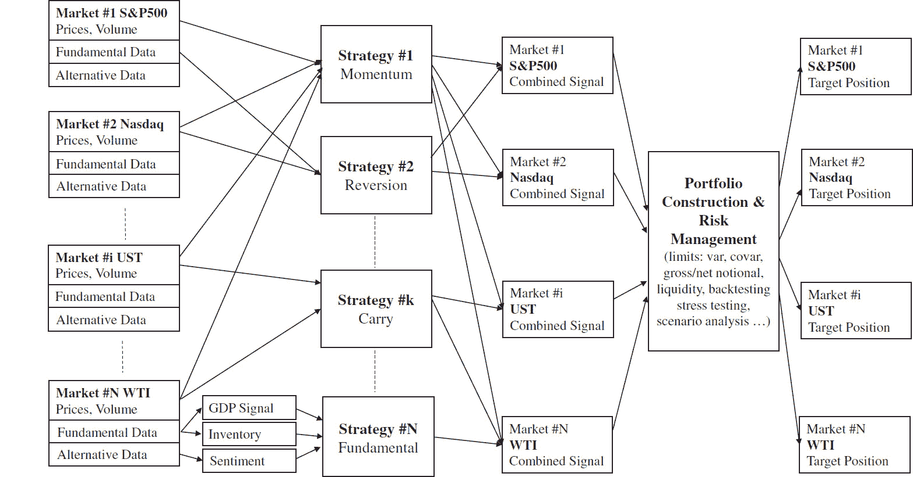

图 4.4：结合策略信号的假设多策略 CTA。

### 4.4 系统策略类型

大多数系统化策略基于方程或简单算法。与大众相反，许多策略实际上非常简单，可以写在啤酒垫背面。它们利用了市场中定义良好的统计关系和效应。对于科学方法来说，这些效应随时间推移是稳定且持续的，如果可能的话，在相似市场之间是通用的。我们可以根据底层算法将主流“传统”系统化策略分为几类（见图 4.5）。主要策略是 `momentum`（动量）、`carry`（套利）和 `value`，几乎所有的 CTA 都使用这些核心算法的混合。这些时间序列策略也可以以横截形式存在，即对市场进行排名并同时持有多头和空头部位。回归策略通常用于补充某些市场的动量，例如在某些时间尺度上具有高度回归属性的指数股票。在这些主要策略之外，还有许多次要技术，从市场择时和基本面驱动到技术分析和波动率衍生策略。

#### 4.4.1 `Momentum`


主要的 CTA 策略是趋势跟踪或动量策略，这是由于其简单性、长期成功以及极高的容量。通过在众多市场中进行多元化，CTA 可以利用动量策略管理超过 100 亿美元的资产，而不会受到交易成本的实质影响。

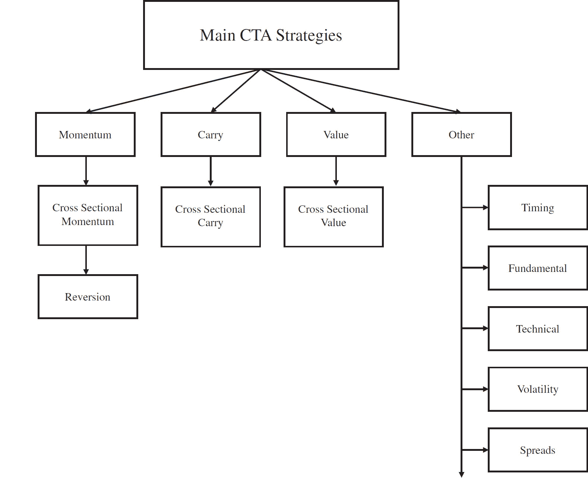

图 4.5：主要的 CTA 系统策略。

基于历史价格的简单数学方程，我们可以构建动量信号。许多 CTA 使用的最简单信号方法是两个移动平均线的组合，但也存在其他方法，例如内核技术（Appx. C.4）。使用这种动量信号，如果趋势为正，我们可以买入底层市场；如果趋势为负，则卖出或做空市场。交易头寸的大小由动量信号的大小决定。过程需要对信号进行归一化，通常根据底层市场的相对波动率进行风险缩放。

趋势跟踪或动量可以适用于从股票到商品的所有类型的市场。尽管动量效应在每个市场的长期来看可能很小（例如，长期夏普比率为 0.2–0.5），但通过结合许多不相关的市场，CTA 在实践中可以达到接近 1.0 的可观夏普比率。不同板块的长期动量表现不异，从股票最低到利率和外汇最高（Table 4.2）。利率和外汇较高的动量表现可能归因于这些市场较高的持有收益（carry），当将慢趋势信号应用于回溯调整的时间序列时，可以部分捕捉到这部分收益。

表 4.2：动量、持有和价值的长期夏普比率。

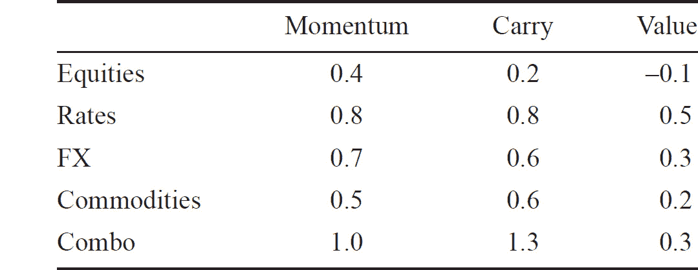

动量策略指定的参数相对较少，但主要的参数是动量信号的速度。这通常通过拟合历史数据来决定，同时考虑底层市场的换手率和交易成本。例如，交易成本昂贵的铜将使用比交易成本远低于政府债更慢的趋势信号。通常，大型 CTA 将为每个市场使用运行不同速度的趋势信号组合。

动量策略通常具有正偏态，在偶尔的趋势期间可以获得巨大收益。趋势跟踪的致命弱点是无趋势或处于区间运行的市场，策略在这些市场中缓慢亏损。此外，在极快速的抛售或市场反转中，趋势跟踪者的适应可能缓慢，在去杠、降低风险和改变方向之前可能会迅速亏损。尽管快速动量可能已经启动以跟随新趋势，但较的动量信号通常仍然占据主导地位。这可能是 2020 年新冠危机期间的情况，当时大多数运行较慢动量的 CTA 未能从股市大跌中获利。幸运的是，CTA 跨资产类的极端多元化通常为主要的风险规避事件提供了保护。通过经常同时持有股票和政府债，政府债的避险效应对冲了股票的亏损。

欧元货币的趋势跟踪策略示例见 Fig. 4.6。图中显示了市场价格（上方），下方是该策略生成的原始封顶信号。应用了波动率风险缩放因子（中间），并显示了最终头寸。底部是恒定交易名义的模拟累积盈亏（P&L），它清楚地显示了从捕捉趋势获得的高收益以及在无趋势市场中盈亏的衰减。重要的是，是动量信号与风险缩放的结合带来了长期的稳定收益。

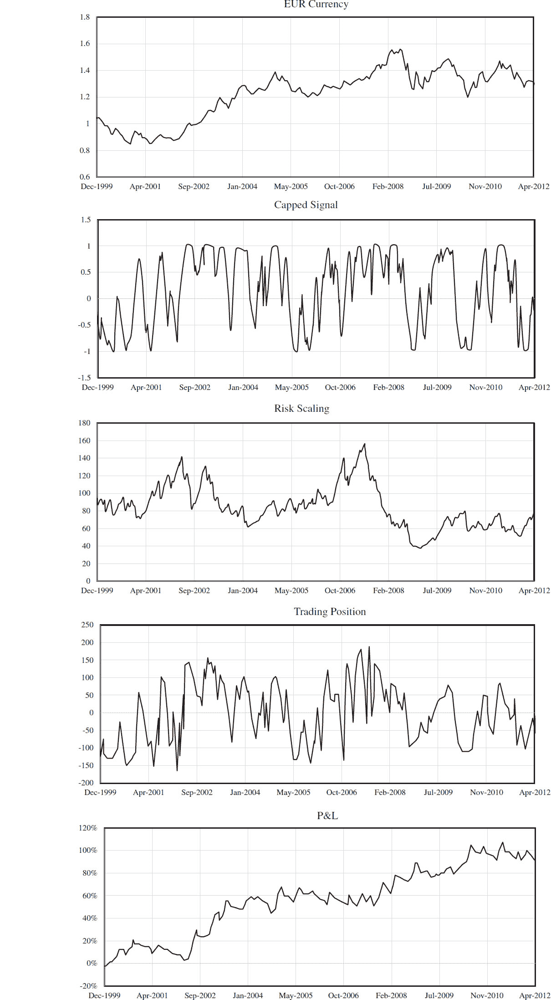

图 4.6：欧元货币动量策略，显示了市场价格（上方）、封顶信号、风险缩放、交易头寸和盈亏（下方）。

近年来，流动性期货市场中的动量经历了长期的挣扎。尽管大型 CTA 的价值并没有真正下降，但它们一直在努力寻找 Alpha，并保持在区间波动，直到 2020–2021 年商品价格强劲增长。对于这种业绩停滞，人们给出了各种不完全满意的解释，包括高频交易的影响、CTA 现在相对于底层期货市场来说规模过大的论点、G7 利率的下降以及政府通过量化宽松（QE）对市场的影响。为了提高业绩，如 AHL Evolution 等 CTA 已转向了趋势跟踪的场外（OTC）利率掉期和 CDS 指数（Appx. C.8）。这两类资产类已被证明比传统的流动性期货更有利（Fig. 4.7）。CTA 探索动量的其他获利市场是较新的、流动性较差的期货市场，如电力期货和所谓的“前沿”市场（中国期货）。

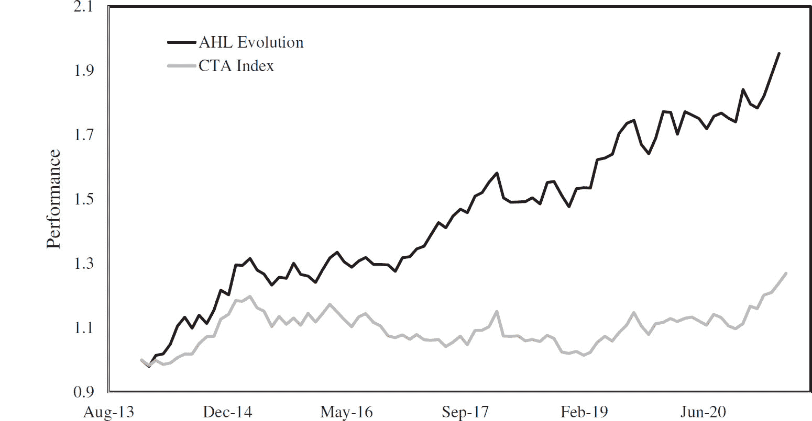

图 4.7：传统 CTA 最近在挣扎，而像 Man Group 的 AHL Evolution 这样的专业场外基金则蓬勃发展。

### 4.4.2 反转

趋势跟踪的反面是所谓的“反转”。均值回归策略寻求利用市场反回到平均水平。其定义没有趋势策略那么明确，且在不同经理之间存在差异。策略试图寻找近期的反转模式并利用这种反转，希望它会持续。例如，反转可能是在市场突然向上“飙升”时卖出、在区间极值处卖出买入，或在逆主趋势的抛售中“抄底”。也许简单的反转方法是将价格的快速移动平均线与慢速移动平均线相结合。然而，如果市场没有反转而是简单地移动到一个新水平或建立相反的趋势，那么反转交易可能是危险的。“抄底”在近年来是股票市场的获胜交易，尽管突然的 VIX 崩盘（2018 年）和 2020 年 3 月大规模的新冠疫情回撤足以考验杠杆抄底者的神经。

### 4.4.3 持有收益 (Carry)

持有收益是仅仅通过持有资产获得的利润。例如，在持有收益的最简单形式中，债券持有以票息的形式接收利息。各种形式的持有收益无疑是对冲基金最大的“Alpha”，并在很大程度上被投资者误解。投资者往往认为他们正在获得 Alpha，但实际上他们获得的是隐藏的持有收益。

持有收益存在于大多数资产类别和多种形式中——股票的股息、债券的票息、外币存款利息等。即使在没有实际利息支付的期货市场中，不同期限期货曲线的斜率也包含了持有收益。如果远期期货合约的价值低于近月合约，那么平均而言，它们在接近到期时价值会上升。

最成功的长期持有收益策略之一是外汇持有收益（fx carry）。在衍生品和有效市场的虚幻世界工作后，我实际上对外汇持有收益交易如此有效感到非常惊讶，特别是当在风险调整后的组合中跨货币进行多元化时。在理论的无套利世界中，投资未对冲的高收益外币不应该有免费午餐。理论上外币贬值应该吃掉所有的正持有收益。然而在现实中，该策略的长期夏普比率接近 0.6（Table 4.2）。外汇持有收益的一个警告是，如果你在没有正确的风险管理框架的情况下盲目投资，当美元突然走强时，该策略会表现出高偏态。


许多系统性策略可以基于套利（carry）并将套利作为一种交易信号。一种简单的 CTA 套利策略是根据期货曲线的斜率来买卖期货（Appx. C.5）。在在外汇套利交易中，两种货币之间的`利率差`（`IRD`）也被用作套利信号。套利信号在 `IRD` 较大的新兴市场货币，以及支付票息的债券和掉期互换交易中尤为有效。跨资产类别组合来看，套利具有很高的长期夏普比率（约 1.3），且与动量相关性较低（Table 4.4）。

### 4.4.4 价值

价值信号基于价格和基本面信息，判断特定市场是价值高估还是低估。为不同市场推导价值信号的方法具有高度的主观性。例如可能包括根据`购买力平价`（`PPP`）做空澳元，或根据股息收益率购买股票（Appx. C.6）。由于基本面价值数据通常移动较慢，价值信号通常比动量信号慢得多，且对市场状况的反应较少。

使用价值的简单定义，所实现的长期夏普比率约为 0.3，远低于动量和套利策略（Table 4.3）。然而，价值的相关性略微为负，这意味着尽管它是一个弱信号，但它对动量和套利投资组合具有累加性作用（Table 4.4）。

### 4.4.5 横截面

动量、套利和价值的核心策略可以在相对价值或横截面上应用。例如，横截面动量涉及根据动量对市场进行排名，买入趋势最强的市场并做空趋势最弱的市场。同样，横截面套利要求对各种资产的套利信号进行排名，并做多那些套利信号最高的资产，同时做空信号最低的资产。统计套利也是一种横截面策略，尽管它利用的是均值回归，而非动量。

表 4.3：横截面动量、套利和价值的长期夏普比率。

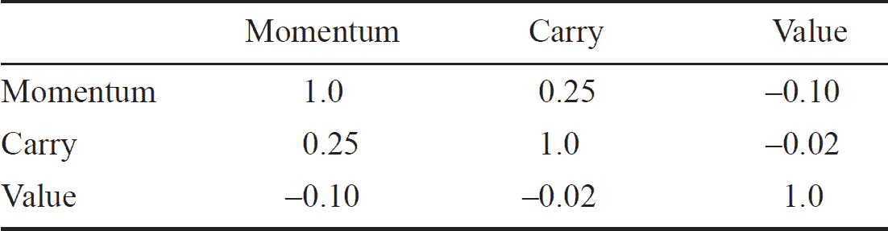

事实证明，动量和价值在横截面的行为与其在时间序列中完全不同（Table 4.3）。动量在时间序列是一个强信号，而在横截面上则要弱得多。这主要是由于横截面动量中利率的夏普比率为负导致的。然而，价值在时间序列中仅获得 0.3 的夏普比率，但在横截面上却是强得 0.8。这说明了在投资组合构建中同时考虑时间序列和横截面维角的优势。

### 4.4.6 择时

最简单的股票择时信号是“五月卖出并离开”，或在夏季平掉股票头寸。惊讶的是，在非常长的时间跨内，这种策略优于主要股票指数，因为大部分正收益都落在夏季之外。这种想法有很多变体——“万圣节”效应、周末/假日效应、月底效应等，其中一些比其他的具有更多的统计支持。此外，这种异常不仅限于股票，因为择时和季节性效应出现在货币中，并在商品中表现强劲。遗憾的是，这些策略大部分已发表在学术文献中，这可能降低了它们的有效性。例如，我最喜欢的策略之一是高夏普比率的月底效应（在月底前 2-3 天买入股票，并在月初卖出），它存在了几十年，但在 2011 年左右发表后不久，令人惊讶地完全消失甚至发生了反转（Fig. 4.8）。但这可能是一个巧合，是由大规模的量化宽松（QE）造成的，但我对此继续怀疑。

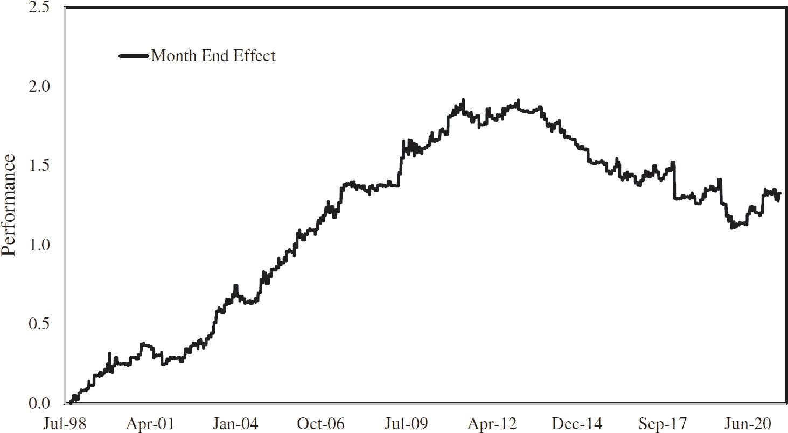

图 4.8：月底效应在广泛发表后诡异地“反转”。

### 4.4.7 基本面

基本面宏观策略也可以基于非价格数据，如传统的时间序列和新的替代数据源。通常这些信号是线性回归模型，整合了 GDP、通胀、就业等因素（Appx. C.3）。

通常，由于经济数据存在发布滞后性，会使用外推法或预测方法。此外，过去 5 到 10 年计算能力的提高和“大数据”的兴起，导致在信号生成中替代数据集的使用增加。`替代数据`泛指非价格数据，根据你的定义，它仍然包含更传统的基本面数据。然而，现代替代数据可能包括新闻文章、社交媒体、消费者交易数据、专家观点、地理位置数据乃至卫星和天气数据。这些数据潜力提供与其他策略不相关的新信号。替代数据领域正在快速扩张，并在第 8 章中讨论。

使用基本面数据对宏观市场进行方向性预测是一项挑战，不应被低估。市场很少，且交易主要是方向性的。经济不断演变，误差空间很大。单独使用基本面信号而排除任何价格信号来限制市场风险是有危险的。我见过的最灾难的交易是一些完全基于基本面的策略，它们忽略了市场并“假设”基于基本面是正确的。

### 4.4.8 技术分析

技术分析或对市场模式的研究已经存在很长时间，在主观交易者和系统交易者中都有大量的文献和追随者。它包含了许多理论和指标，例如`布林带`、`RSI`、`悬停线`。有趣的是，当把严谨的科学和回测应用于这些指标时，它们几乎全部都失败了，因此大多数没有被主流对冲基金使用。我的桌子上放着一本广为人知且经常使用的技术分析书籍。

人们不能自动否定技术分析并将其斥为胡说和糟糕科学。股票市场有一个明确的学术界认可的 52 周规则。人们经常观察到市场喜欢达到整数。例如，奇怪的是为什么 2007 年的股票市场达到了 2000 年互联网泡沫峰值时的数值。


许多量化基金交易期权，因此也交易波动率。大多数期货合约、外汇和大蓝股现股都提供期权。卖出期权是经典的“负偏态”交易，会导致经常的小额利润，以及偶尔的巨额亏损或爆仓。许多具有高夏普比率或“直线型”表现的小型 CTA（商品期货交易账户）实际上是在卖出期权。

也可以使用 `VIX` 期货或场外（OTC）波动率掉期直接交易波动率。自 2008 年以来，波动率总体下降，导致了卖出波动率成为对冲基金的主交易，并在 2018 年 2 月的 VIX 崩溃中达到顶峰。尽管时间短暂，但这次抛售导致了波动率突然飙升。几个做空波动率的 ETF 资金被光，对冲基金也遭受了损失。关于 `VelocityShares Inverse VIX ETF` 或 `XIV` 的诉讼在 2021 年仍在进行（图 4.9）。

波动率还可以在许多其他策略中被利用，值得注意几个经过充分研究的例子。波动率与 `CDS` 的交易可以用于资本结构套利，或作为随机公司价值框架内的宏观策略（Appx. B.7）。通过考虑期权波动率曲面的偏斜和衰减，可以将隐含波动率作为股票的方向性指标。比较实现波动率和隐含波动率的看涨型`波动率风险溢价`（VRP）信号已被广泛记录（Appx. D.8）。对回调整后的 `VIX` 期货时间序列进行趋势具有相当成功的记录。此外，`VIX` 期货的期限结构倒挂通常被推为良好的避险信号，结合买入波动率可以用于各种“尾部保护”策略。

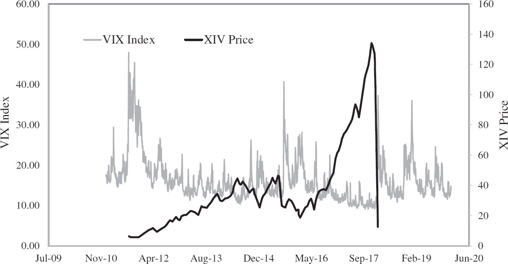

图 4.9：`XIV` 或 `VelocityShares Daily Inverse VIX` 在 `VIX` 崩溃期间（2018 年）爆仓。

## 4.4.10 价差交易

价差交易是一种广知的期货交易策略。通过交易不同期限的期货多空合约，我们可以对冲方向性期货风险，转而交易价差或期货曲线斜率的变化（Appx. C.8）。价差可以作为动量策略或使用均值回归策略进行交易。这为 CTA 提供了一种不同且多元化的策略，通常用于能源和其他大商品市场。然而，对于较大的 CTA 来说，价差交易相对于其他策略通常只占很小比例。这是因为为了使该策略获得合理的波动率水平，尽管净杠杆接近于零，但总杠杆（多头加空头）非常高。这可能会产生问题，因为不同期限合约的流动性和执行力成为限制，且潜在的大型、意外跳空波动或范式转移可能导致低频率的巨额亏损。价差交易通常是一种负偏态和高峰度策略，许多不幸的对冲基金都有过经历。2006 年，价值 95 亿美元的 `Amaranth Advisors` 在天然气价差交易中爆仓，主要是由于一个巨大的冬季多头而非冬季的策略遭遇了惨败。2006 年 9 月，各种估计将其天然气价差交易损失定在 33 至 40 亿美元，因为价差突然向不利于他们的方向移动。`Amaranth` 代表了 `NYMEX` 许多天然气期货合约中 50% 以上的未持仓量，这导致了严重的流动性和融资问题。

价差交易也可以应用于期货之外的其他耦合或关联资产。例如，双重上市股票（同一只现货股票在两个不同的交易所上市）的回归，或者使用掉期进行利率曲线上不同股份类别、甚至不同期限的交易。回归交易通常具有很高的成功率，但为了利用微小的回归利润，与期货价差交易一样，需要巨大的总杠杆。如果回归“破裂”，就会发生巨额亏损。这些交易具有高度的负偏态，因为它们大多数时间里赚小钱，但偶尔会产生巨额损失。

### 4.5 多市场多元化

一旦开发出策略，通常可以在多个市场中部署，以增加多元化的风险调整收益。尽管动量在每个单一市场中相对较弱（夏普比率 0.2–0.5），但通过将许多市场结合在一起，我们可以实现持续 1.0 左右的夏普比率（Table 4.2）。单一市场可能有表现良好的强趋势时期，随后在一段时间内没有强趋势，并持续多年缓慢亏损。这些强趋势时期几乎无法预测，因此很难决定如何分配到每个市场。

### 4.6 多策略多元化

通常，我们会开发出许多策略，这些策略可以组合成一个“多策略”投资组合以进一步实现多元化。无处不在的动量、收益和价值策略具有强大的独立夏普比率和低相关性（Table 4.4）。动量和收益之间的相关性为 25%，而价值甚至略微负相关。在许多市场中结合这些策略提供了超过 1.5 的理论夏普比率（Fig. 4.10）。

表 4.4：动量、收益和价值之间的长期平均相关性。

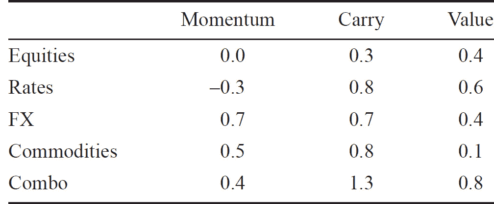

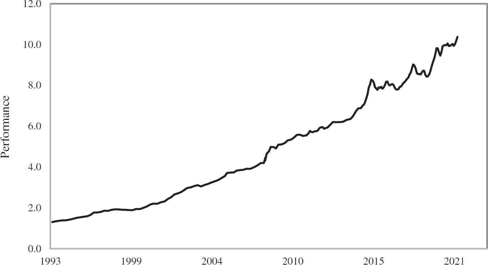

图 4.10：通过场外工具结合动量、价值和收益策略。

一个非常大的多策略 CTA 可能拥有 40–50 个策略，其中一些针对特定行业。例如，我们可能拥有股票的择时和回归策略、商品领域的相对价值和季节性策略，以及能源领域的相对价值价差交易策略。


通常，策略是通过策略信号的线性叠加组合的。在对每个信号应用权重后，将归一化信号相加（Appx. C.1）。一旦确定了每个策略内部的市场权重，就会使用策略权重来提供目标组合。为此，我们必须应用风险管理框架进行最终的组合构建。风险约束通过改变市场和策略权重的迭代过程来实现，在给定的组合目标波动率下实现风险调整收益的最大化。

尽管我们拥有组合策略的量化方法，但其实际结果往往令人失望。很多时候，为策略分配权重变成了投资组合经理留下的“艺术形式”，而非严谨的科学。我们可以使用投资组合优化、相关性、凯利准则（通过夏普比率）、近期表现等数学技术，但通常这些都不如对一个基于测试和实盘表现得出的策略信心重要。当涉及真金时，投资组合经理更倾向于选择具有 25 年以上实际实战经验的动量模型，而不是由实盘测试有限的初级量化师新开发的、华丽策略。过拟合的阴影始终笼罩在投资组合经理的脑后。

## 4.7 系统化交易的实践方面

开发一个将系统策略与基金经纪商及管理员集成的自动化交易系统是一项复杂的任务。最重要的是，系统必须是实时的、高度容错且极其可靠的，通常每天运行 24 小时，很少或没有人工干预。某些基金可能希望将人类交易员作为执行过程的一部分，特别是对于场外交易（OTC）工具，但大多数系统化基金使用算法进行执行。集成交易系统的示意图见图 4.11。从本质上说，整个交易系统必须执行以下任务。

系统建立在历史数据库之上，该数据库定期（日内）使用最新的市场价格和其他非价格数据进行更新。然后，策略可以在日内定期运行，以确定单个市场的头目标。这可以是策略的一部分，旨在提高交易速度或通过交错执行来增加容量。头寸的潜在巨大变化必须进行缓冲并分时间分散，以减少市场影响，这种影响必须体现在任何回测或性能模拟中。

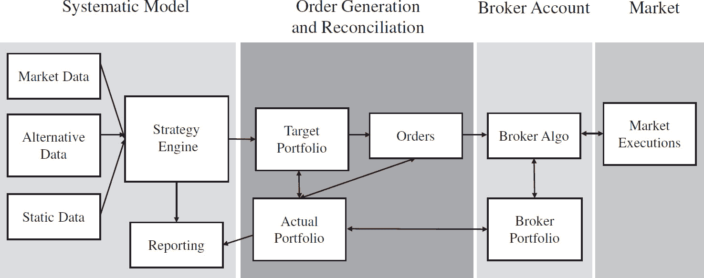

图 4.11：系统化交易流程。

将当前头寸与最新的目标头寸进行比较，以确定下一次执行的交易。这需要对已执行交易进行内部计数并查询经纪商。一些主要的经纪商在日内对账方面糟糕而闻名，因此必须依赖内部经理对实际执行交易的计数。

必要的订单通过 `API` 发送给经纪商。订单将使用专有算法或经纪商算法（例如 `Iceberg`、`VWAP`）来下交易并实现最佳执行。订单通常为市价单或限价单。监控交易的正确执行情况，并在必要时进行取消和修改。

与经纪商进行交易后对账，如果可能，在日内完成。计算收盘头寸并与经纪商及基金管理员进行交易对账。系统必须能够自动检测并允许方便地手动查询不匹配的交易。

最后，交易系统必须产生日内风险和损益（P&L）报告。报告应根据要求发送给各个相关方（高层管理、投资者等）。损益跟踪受到监控。（此处省略大量重复的 P&L tracking is monitored 句子）尽可能多。

#### 4.8.1 策略构思

对于大多数研究人员来说，策略构思是最重要的阶段，它决定了项目的方向。理想情况下，策略应该基于学术文献、合理的想法或植根于常识。如果一个策略简单、稳健、适用于广泛市场并具有较少的内部参数或变量，那么它是最可信的。

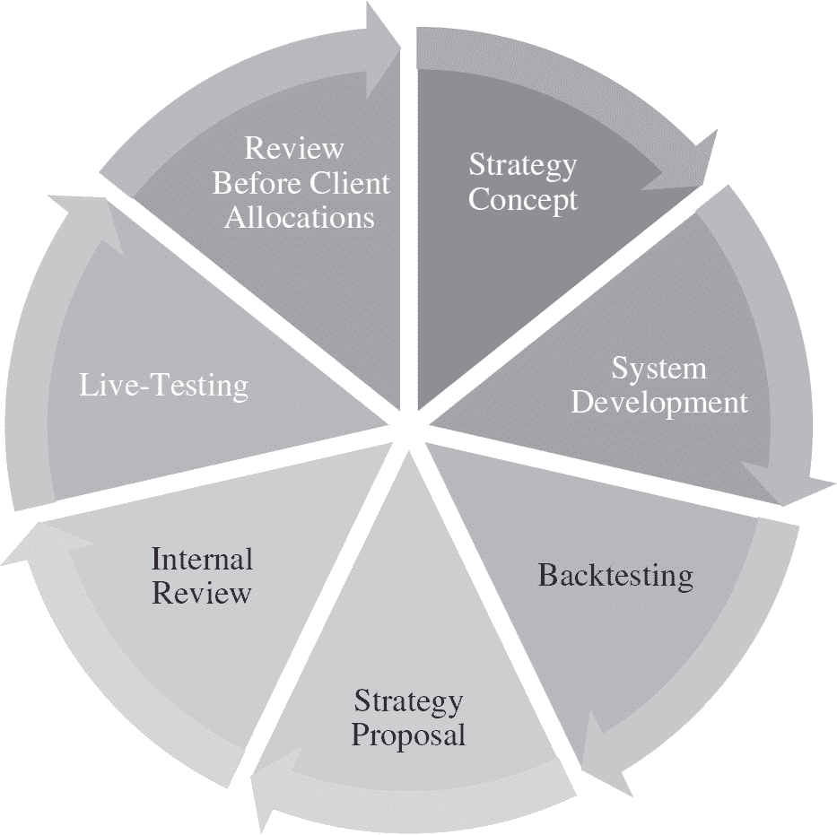

图 4.12：典型的策略开发流程。

#### 4.8.2 系统开发

策略被定义为一系列方程，由研究人员编写成算法。`Python`、`C#`、`C++`、`R` 都是常用的语言。策略将访问静态、历史和实盘数据的数据库，并在日内连续或在预定义时间运行以提供预测信号。这些信号被转换为每个市场中将交易的合约数量。通常，在接受实盘测试时，策略软件将随后与执行、投资组合、风险管理以及中后台系统集成。

#### 4.8.3 回测

研究过程的关键部分是回测，以发现策略的历史表现。价格历史以及其他相关的历史和静态数据包含在数据库中。历史数据被分为不重叠的训练集（样本内）和测试集（样本外）。有时会形成多个测试集并保留，直到开发过程的后期作为最终检查。训练数据用于估计模型中的各种参数。可以使用各种拟合和误差最小化算法来实现这一点。通常会对结果应用 t 检验和其他统计显著性检验。简单策略（如动量策略）参数很少，不需要大量数据来拟合。复杂的多因子策略可能需要多年的数据，在某些情况下，统计上无法准确估计参数。

#### 4.8.4 性能评估

评估策略性能需要各种指标以便与其他策略进行比较。基本指标是收益、波动率（收益标准差）、夏普比率、回撤以及与不同资产和策略的相关性。这些指标可以针对给定时间段计算，也可以基于滚动窗口计算。存在其他更详细的指标（例如恢复时间、偏度、索提比率……），但这些本质上是二阶指标。

## 4.8 策略开发

机构基金的详细策略开发过程包括几个阶段：策略构思、研究、实施、回测、同行评审以及最后的实盘测试（[chapter4.xhtml#fig4_12)）。通常这是一个迭代过程，可能需要几个月。在大型公司中，大多数策略都会失败，从未被用于管理客户资金。


对于策略而言，特别有趣的是其在压力时期下的表现。策略应该在牛市和熊市、不同的波动性条件以及机制切换下接受测试。没有哪种策略是完美的，所有策略在各种压力条件下都可能繁荣或失败。例如，多元化的趋势跟踪策略在 2002 年和 2008 年那种“慢速火车车祸”期间表现良好（当时熊市持续了几个月），但在 2018 年的 VIX 崩盘中惨遭失败，因为在经历了一段低波动期后，极快速抛售导致了过度杠杆的多头股票头寸。正如主观性交易一样，必须应用一系列压力测试和情景分析。

#### 4.8.5 内部审查

所有对冲基金在实盘测试之前，都会进行内部研究审查，以评估任何新策略或对现有策略的重大变更。这通常是一个同行评审过程，涉及具有足够知识和专业技能的中立或无偏见的同事，来评估该策略。任何缺陷或研究不足都会导致需要进一步研究，或拒绝在实盘测试中实施该策略。通常在实盘测试之后，在分配和管理客户资金之前，还有强制性的额外审查。

#### 4.8.6 实盘测试

在将客户资金分配给策略之前，通常会进行一段时间的实盘测试。虽然使用的名义金额相对于最终部署的资金可能很小，但实盘测试旨在解决实际交易过程中任何可观察的问题，例如实时订单执行和对账。通常，由于大多数系统化交易策略的夏普比率较低，实盘测试无法轻易通过统计严谨性验证策略的性能。这需要几年的实盘测试，而这在商业环境中是不可能的。

### 4.9 开发交易策略的关键问题

即使遵循了正确的开发流程，在成功实施系统化策略时，也必须考虑许多实际问题。这些问题范围从模型参数的潜在过拟合和在机制切换下的稳定性，到交易成本建模和有效的风险缩放。人类纪律的影响以及篡改模型的诱惑往往被忽视，但它们是策略成功的关键因素。

#### 4.9.1 过拟合与反馈

系统化交易中的一个严重问题是“过拟合”。如果一个系统化策略包含几个未知参数，这些参数会通过改变它们来找到与历史训练数据（“样本内”数据）的最佳拟合点。然后可以将该策略应用于未见的测试数据（“样本外”数据）以评估其性能。过拟合的策略拥有足够的参数，使其能够以欺骗性的高精度拟合训练数据，但完全无法拟合测试数据，更重要的是，在“实时”数据上的表现低于预期。因此，优秀新模型的性能往往是虚幻的。

这种影响可以通过以下方式在某种程度上减轻：(i) 拥有足够的训练和测试数据；(ii) 将数据分为多个测试数据集；(iii) 拥有一个不会过拟合的简单策略。然而，金融数据通常是有限且最终的，研究计划偶尔会“反馈”（图 4.13）。如果一个策略在训练中表现良好但在测试中不好，往往倾向于“微调”底层模型，使其在训练和测试中表现良好。如果团队中足够多的研究人员经常这样做，那么很快就没有可以用于验证策略的真实样本外数据了。我认识的一些大型对冲基金拥有这么多量化研究员不断优化策略和配置，导致他们内部整体计划的夏普比率达到 4-5，但在实践中实现的不到 1.0。

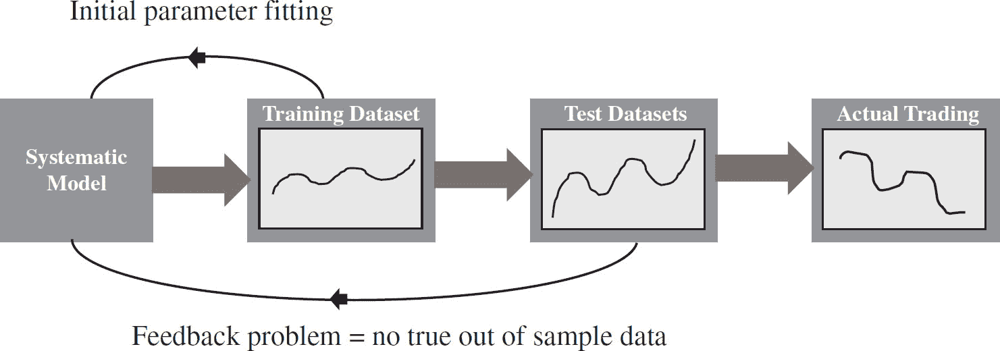

图 4.13：研究过程中的反馈导致没有真实的样本外数据和过拟合。

#### 4.9.2 机制切换

系统化策略根据定义是向后看的，并且容易受到黑天鹅式事件的影响。对系统化交易的一个经常批评是，它就像是通过后视镜开车。如果某个特定的市场事件没有出现在历史数据集中，那么很难预测策略将如何表现。所有策略都是在不完全知识的基础上构想和测试的。每一次新的金融危机与之前的都有些不同。2007 年的量化地震、2008 年的贷危机、2018 年的 VIX 崩盘和 2020 年的新冠危机在起源和特征上都非常不同。

此外，金融危机或重大事件往往会引发金融市场的机制切换。这些切换通常会改变不同时间尺度上的市场低级动态。如果一个市场变得真正随机，那么所有的统计效应都会消失。波动性也会以不同的方式影响策略。中度波动可能对某些模型有利，但高波动通常与不可预测性相关。2002 年的点网络牛市与 2008 年后世界由量化宽松（`QE`）引发的股票和债券波动率下降的牛市非常不同。

机制切换也可能发生于其他微妙原因。计算能力的惊人增长从几个方面影响了系统化基金。自 2010 年以来，高频交易（`HFT`）的兴起导致了微观结构的变化，并对市场流动性产生了虚假印象。`HFT` 通过预测订单流并在较慢交易者之前交易来有效获利。移动缓慢的基金交易之间具有高度自相关性。它们的下一次交易很可能处于相同方向。我怀疑这已成为许多 CTA 无法量化的“滴水之漏”或收益率拖累。

此外，随着技术的普及，大量资金涌入系统化基金，导致策略拥挤和知名策略的利润衰减。某篇学术论文声称，一旦某种效应或策略被发布，其利润就会衰减 50%。我更进一步地主张，对于许多利基策略，几乎所有的利润都被摧毁了。图 4.14 显示了一个策略典型的、带有些愤俗的生命周期。一个未知的专利策略表现出高夏普比率，然后某人为了公共利益（可能是为了增加其学术发表率）“发现”并发布了该策略基础的异常或效应。起初少数人复制该策略，由于动量增强了效应且套利更加高效，夏普比率略有增加。然后，随着其他人涌入，效应消失，由于拥挤发生，夏普比率迅速下降。当所有人失望地放弃该策略时，出现了清算，夏普比率甚至转为负值，因为每个人逃离并销毁他们的模型。最终它变得不再流行并恢复到低得多的平衡夏普比率，而另一个最初优秀的策略也宣告失败。这种对“低挂果实”的消除在对冲基金之间创造了一场竞争性的军备竞赛，以寻找基于 OTC 等新工具以及机器学习和替代数据等最新先进技术的新策略。

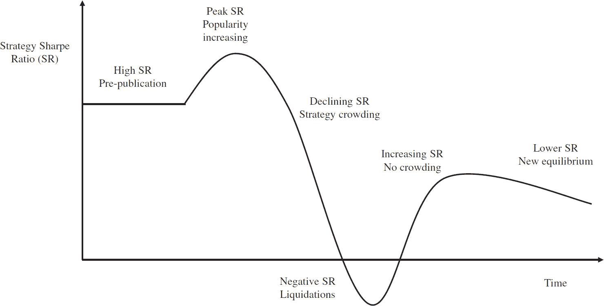

图 4.14：策略发布和拥挤可能导致实际性能下降。

#### 4.9.3 交易成本建模


系统化策略的回测提供了理论毛收益率和风险概况的估算。然而，为了反映现实情况，我们需要包含交易成本、融资和执行滑点的影响。支付给经纪人和交易所的交易成本是已知成本，且易于包含。

执行滑点是最难建模的，它取决于市场流动性和交易规模。滑点是指实际执行价格偏离理论执行水平产生不利影响的金额。市场冲击是滑点的重要组成部分，它是指执行期间，由于流动性效应和其他市场参与者对订单流的预期，市场对策略产生的不利变动程度。在学术界，人们广泛接受交易的市场冲击随市场波动率以及一个基于交易规模相对于交易期间市场成交量的的因子（通常称为 p 速率）而缩放。然而，执行模型只能通过实际市场经验以及在各种市场条件下对不同规模的交易进行实证测试（附录 C.9）。

通常情况下，可以设计出一个夏普比率极高的理论策略，但一旦正确考虑了滑点和成本，夏普比率就会大幅降低。这在快速交易策略中很常见，这些策略在纸面上看起来很完美，但在实盘交易中会被意外之外的交易成本击垮，导致每天产生小亏损。在交易成本严重恶化性能之前，估算策略的关键规模或“容量”，是系统化交易中一项关键的计算，需要经验和技巧。

图 4.15 显示了流动性良好的期货合约 E-mini 标普 (ES) 和流动性稍差的纳斯达克 (NQ) 的典型市场冲击成本。这些数字看起来很小，但对于快速日内交易，它们会迅速累积。例如，如果我们一年中每天都进出交易 1 亿美元美元的 ES，这将对我们的年度业绩造成约 5% 的拖累。这种成本障碍是大型基金受限于进行缓慢交易的原因。通常，我们预计一个每天进行缓慢动量再平衡的大型 CTA，股票指数和债券的成本为 0.5–1 bp，而铜等市场成本则高达 3–4 bp。因此，对于流动性较差的大宗商品市场必须以较慢的动量速度进行交易，以减少周转率和滑点。

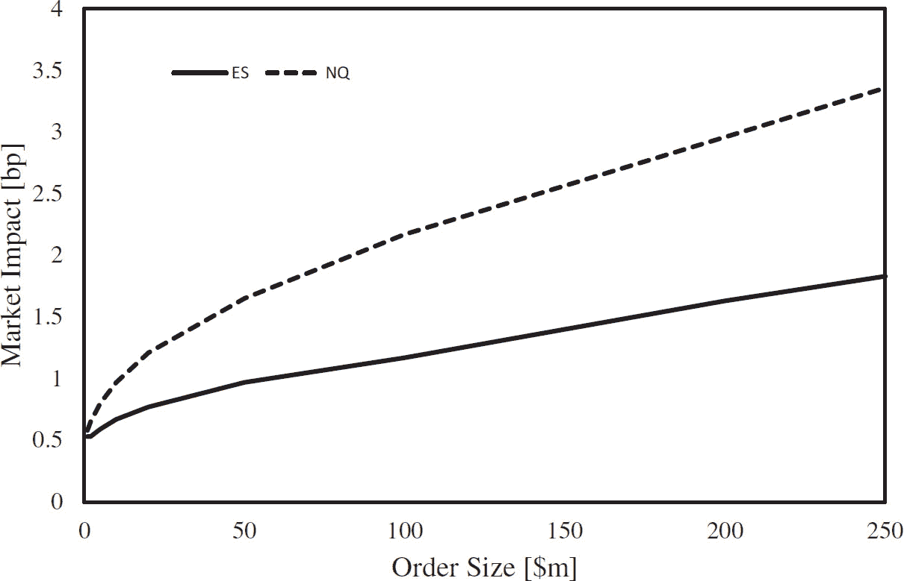

图 4.15：标普 500 (ES) 和纳斯达克 (NQ) 期货的典型市场冲击成本。

#### 4.9.4 风险缩放

大型 CTA 使用风险缩放来提高长期风险调整后收益。每个市场的头寸规模根据其标的市场波动率的反比进行重新缩放（附录 C.1）。通过这种方式，可以将每个市场的风险置于共同的基础上，我们就可以在风险加权的基础上将不同资产组合在一起。因此，我们可以设定 10% 的目标波动率，并将风险预算的 25% 分给股票、外汇、利率和大宗商品，其中每个资产类别的名义金额会有显著差异。由于债券波动率低，其名义贡献将远高于高波动率股票。随着每个市场波动率的变化，其名义价值将动态重新加权，以反映相同的风险贡献。总的来说，这是一个非常简洁且广泛的概念。

#### 4.9.5 人性的纪律

尽管在本章的引言中我建议系统化交易消除了过程中的人类情感和偏见，但事实完全并非如此。人的纪律对于策略的成功至关重要。

系统化模型是长期研究的成果。在表现不佳的时期，人们会有很大倾向去更改参数或增加改进。这些权宜之计和可疑的增强是非常糟糕的做法。极有可能是，你原始系统的夏普比率仅小于 1.0。虽然这听起来很棒，但可能需要多年才能通过统计学验证。例如，趋势跟踪可能会处于回撤状态多年。除非你认为原始研究在某些方面确实存在缺陷，否则不如“把自己系系在桅杆上”并度过任何风暴。在实践中，你对系统进行突然更改的唯一时刻是标的市场运行中断并将显著偏离训练数据的时候。

### 4.10 好策略与坏策略


最后，从理论和实践两个角度来看，思考什么是良好的系统化策略而什么是糟糕的策略是非常有趣的（参见图 4.16）。这有助于策略的筛选、设计以及对结果的解释。

良好的策略概念简单，内部参数较少，使其变得直观且本质上是“可信的”。在构建良好的策略时，“简单优于复杂”或“奥姆剃刀”的变体同样适用。

良好的策略在可用数据集中提供了足够的历史交易次数，以提供“体面”的统计数据，并适用于统计检验。交易次数太少的策略无法在统计学基础上上被接受。例如，一个非常缓慢的季节性交易，在 10 年内只有 10 次交易且胜率为 6/10，其统计可信度低于一个拥有 1000 次交易、其中 550–600 次为“获胜者”的快速均回归策略。

上述论点的反面是，交易次数或周转率较小的策略优于快速策略。速度较慢、低周转的策略在潜在成本和滑点上更具预测性，并且具有更大的容量。慢趋势交易可以管理超过 100 亿美元的资金，而快速日内策略在交易成本影响性能之前，容量可能不足 5000 万美元。

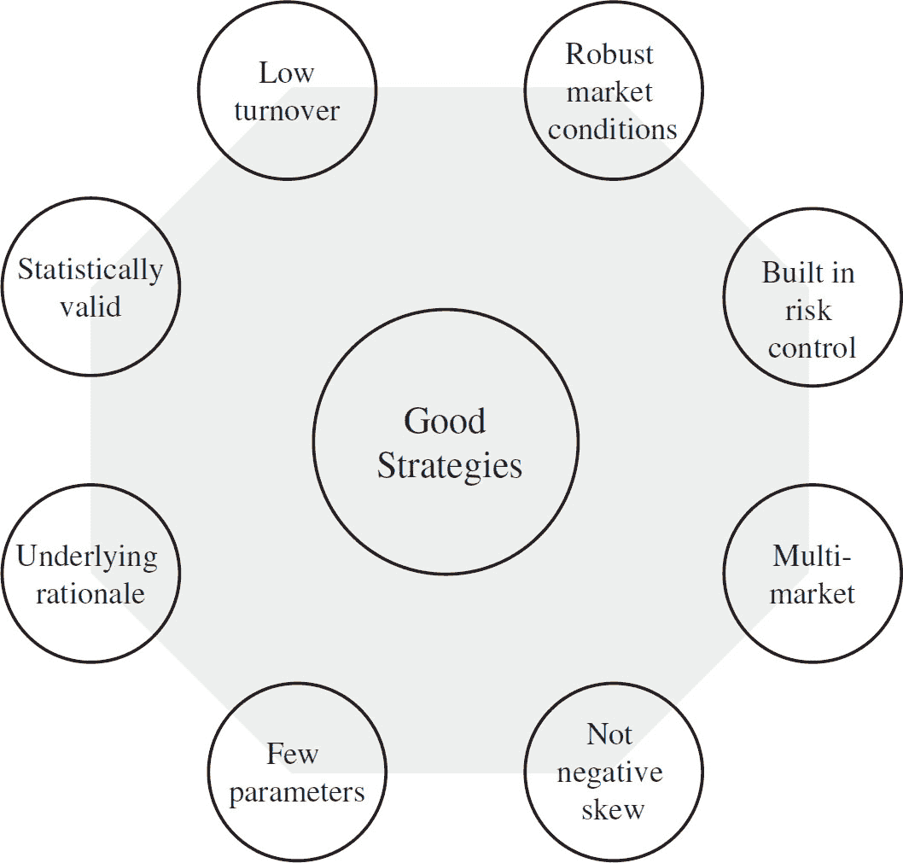

图 4.16：“良好”系统化策略的关键属性。

良好的策略在波动率稳定且回撤一致的各种市场条件下具有稳健性。它们在大多数策略众为人知的失败的重大危机和关键日期表现良好。回撤是不可避免的，且可能是定期的，但反弹必须足够迅速。理想情况下，许多历史回撤必须是可见的，且它们必须处于一个界限范围内，没有重大的异常。通常，1–2 倍的年波动率目标是良好的。

良好的策略必须具有“内置”的风险控制，以便在出现问题时减少损失。趋势跟踪在这方面表现良好。如果趋势发生变化，策略会缓慢适应新趋势。如果波动率突然增加，策略会减小头寸规模，且没有特定的“止损”水平。大型基金会避免硬性止损，因为它们可能在糟糕的时刻产生混乱且不受控的清算。基于规则的控制退出更受青。

最后，策略偏态是一个主要的考虑因素，长期来看，中性或正偏态更为优。负偏态交易（即卖出期权）在短期内可能对吸引投资者，但正偏态交易（即趋势跟踪）最终会表现更好，且不会出现糟糕的“爆仓”。然而，正偏态交易会花费大量时间处于回撤中，需要投资者投入更多的耐心。

# 第 5 章

# 因子游戏

### 5.1 股票因子投资

随着有效市场假设（EMH）最终失去对学术界的影响，研究重心转向了研究影响股票收益的其他重要因子。研究发现，股票收益不仅与整体市场相关，还与公司规模和基本面估值等因素相关。这导致了所谓“因子投资”的兴起并被许多系统化多空股票对冲基金广泛采用。随着对因子的认知和接受度提高，因子投资已成为主流的一部分，多头 ETF 和智能 Beta 指数也演变为纳入最常见的因子。

#### 5.1.1 简单优于复杂

1952 年，芝加哥大学的哈里·马科维茨（Harry Markowitz）发表了名为`Portfolio Selection`的开创性著作。他的多元化和描述风险边界的“有效边界”概念是突破性的。20 世纪 60 年代，CAPM 本质是一个单因子模型，因为一个随机变量（市场超额收益）乘以 `beta` 被认为足以描述波动。CAPM 的成功是巨大的，但遗憾的是，学术研究表明 CAPM 只能解释大约 2/3 的收益。

#### 5.1.2 Fama–French 三因子模型

尤金·法玛（Eugene Fama）同样来自芝加哥经济学派，被许多人视为有效市场思想的核心创始人之一。他的博士论文基于股票价格是不可预测的随机游走。他还证明了在现实市场中，极端市场波动比预期更常见，导致收益分布具有肥尾。尽管他属于有效市场教条，但令人惊讶的是，在后的几年里他开始质疑 `CAPM` 模型的基础。`资本资产定价模型`

这三个因子——市场 `beta`、相对市值和相对市场估值的结合，使得基于因子的模型解释力达到了收益的 90%。

#### 5.1.3 Carhart 四因子模型

随着学术界接受了有效市场假设和纯 `CAPM` 不可避免的终结，因子的闸门打开了。许多量化交易员早已知道的效应被学术界“重新发现”，因为学者们知道，如果他们发表反对有效市场正统的文章，他们的职业生涯现在将能够立足。


一个例子是 Carhart 四因子模型（1997 年），该模型引入截面动量作为第四个因子（附录 D.5）。月度动量因子的计算方法为：“十一个月收益滞后一个月最高 30%股票的等权平均值，减去十一个月收益滞后一个月最低 30%股票的等权平均值。投资组合包含所有纽约证券交易所（NYSE）、美国证券交易所（Amex）和纳斯达克股票，并每月重新构建”。因此，对于选定的股票池，计算 12 个月的平均收益率，并剔除最近的一个月。对股票进行排序，前 30%作为多头交易，后 30%作为空头交易。

排除最近一个月的原因在学术分析中很常见。这虽然并不寻常，但目的是为了排除许多股票中观察到的短期反转（short-term reversion）效应。1990 年，一些学术论文劝学术界不要包含短期动量。布鲁·莱曼（Bruce Lehman）的论文 *Fad, Martingdales and Market Efficiency* 显示，在一周内收益为正的投资组合平均在下周是失败的，反之亦然。纳拉辛哈姆·杰加迪什（Narasimham Jegadeesh）题为题大的 *Evidence of Predictable Behavior of Security Returns* 的论文证明，从 1934 年至 1989 年，一个月内的赢者/失败者在下个月的收益率为 –1.4%/+1.1%。此外，相对于市场的动量在极长的时间尺度上似乎会变成一种反转效应。因此，动量因子集中在 6 至 12 个月范围内的“中期动量”时间尺度上。在实践中，任何真实的交易系统通常都会通过不同速度动量的叠加来考虑这些效应，而不会像 Carhart 模型那样粗暴地排除最后一个月，那么简单。

许多学者不喜欢动量作为一种因子，因为它缺乏基本面或经济学基础的支撑。它是一种非理性的扰动，无法简单地解释。人们已经提出了许多无法证实的伪论点，从新闻随时间推移缓慢扩散和低估收益意外，到复杂的投资者行为，如观察 52 周新高/新低、羊群效应、群体幻觉或错失恐惧症（我今天对飞涨的比特币加密货币深有感）。然而，无论对动量的理性解释是什么，它都是一个无处不在的一阶效应，每个交易员都经历过，且无法被忽视。

## 5.1.4 因子的洪流

对因子的搜索扩张已经达到了疯狂的程度。文献中已经发表了 500 多个学术因子。这些因子中，许多的质量存疑，且彼此之间高度相关。即使在彭博的“关注因子”（FTW）筛选器上，例如在斯托克克斯 600 指数中，也有 190 个因子可用，其中前十几个左右是（分散性、股息、增长、杠杆、动量、盈利能力、修正、规模、情绪、意外、股票回购、技术面和价值）。许多因子是几个基础指标的加权平均值。例如，价值因子是 `book-toprice`、`cashflow/market cap`、`net income/market cap`、`EBITA/EV`、`earnings/ price` 和 `sales/EV` 的加权和。这些复合因子和次级因子都有自己的优点。然而，在我看来，要进入伟大因子的殿堂，有几项要求。

现在我们可以直接用主成分分析（PCA）对市场数据进行处理，并提取市场波动特征值（附录 D.10）。然而，这很快就会变成一个数据拟合实验，无法为提取出的因子提供理解或原理。相反，因子需要是直观的，源于常识，而不是无法解释的随机数据拟合。此外，因子需要具有通用性，并全球适用于不同的金融市场，除非有充分理由说明它们特定于某些市场。为了具有吸引力，因子的换手率和交易成本必须足够低，以便可以进行投资而不至于让你所有的理论毛利被吞噬殆尽。

最后，可能最重要的是，它们在时间上应该是一致的且具有持久性的。尽管某些因子已被证明在近 100 年内是可以测试的，但也许这不足以让我们假设因子的平稳性和持续存在。我们能合理要求的的是，随着时间的推移，我们期望获得没有过多深度回撤的长期风险调整收益。可能会出现因子失效的时期，但这些应该是可以解释的，并且希望与其他主要因子不相关，这样因子的复合投资组合在长期内仍然可行。另一个应该仔细考虑的方面是，一个因子的学术出版和通用知识是否会恶化甚至破坏其性能。

也许对于规模和价值等主要因子，它们的学术发表问题并没有我们预想的那么大。它们的夏普比率很弱，并且经历了长时间的糟糕表现，这种表现可能持续几年。大多数投资者缺乏耐心，而且太准备好放弃此类策略了（特别是在股票牛市中）。大多数对冲基金根据投资者对其月度收益的衡量衡量，因此表现糟糕的策略会被迅速撤出资金。在我看来，主要因子将从智能贝塔（smart beta）拥挤的冲击和平庸的表现时期中存活，并为极具耐心的投资者保持长期可行性。

## 5.2 五大因子的回顾

因此，如果我们把过滤器应用于快速扩张的因子宇宙，我们会发现我们大幅减少了用于实际股票多/空投资的因子数量。我们留下了大五因子——市场贝塔、规模、价值、动量和质量。正如韦图一样，许多替代因子可以通过这些纯净因子的交集形成。事实上，这些主因子受到许多细微差别的影响。例如，增长因子本质上是质量因子的子集，而对于大多数人来说，价值定义包含了属于质量的因子。

学术界的惯是假设金额中性（dollar neutral）或名义中性（notional neutral）投资组合。也就是说，所有多头的名义价值与空头相同，且组合中的每只股票分配相同的资金。为了对应该主题的广泛文献，本章采用了这种方法。然而在实践中，对冲基金组合经理有市场中性的选择，这可以通过贝塔中性或波动加权中性来实现。在市场中性投资组合的情况下，通用因子结果与名义中性非常相似，但市场和规模因子显然经过调整。

### 5.2.1 市场贝塔因子

最显而易见的因子是市场贝塔。仅仅做多高贝塔股票并做空低贝塔并分散特定风险，实际上是最强大的因子之一。众所周知，市场指数随时间增长的。做空市场（除了危机期间的短暂时期）是一场注定失败的游戏。如果你曾尝试长期运行股票多空投资组合，在过去的几十年里，很难从你的空头组合中赚钱。市场因子在约 70 年内的长期夏普比率为 0.4（表 5.1）。偏度为负（–0.6），这表明存在长正收益表现和突然的抛售。这是我们做多股票市场时经历的特征。最大回撤为 55%，这意外地与其他大多数主要因子相似。

### 5.2.2 规模因子


规模因子（Size factor）本质上是第一个加入 `CAPM` 模型的因子。其学术推理是合理的且相对没有争议。小公司的风险性更高，在有效市场中，我们持有这些股票应该获得更高的回报。通常情况下，小公司更容易受到经济问题的影响，其盈利和现金流的不确定性更大，容易受到资金挤压，并且重要的是（根据我的经验）交易流动性较低。从历史上看，由于这些效应，市值股的波动性更大。

表 5.1：美国长期长/空股票因子表现（过去 70 年）。

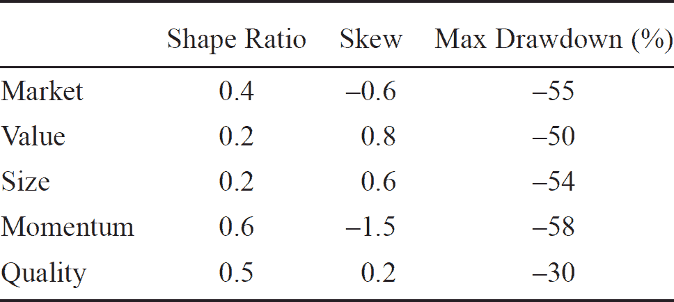

`Table 5.1` 显示夏普比率较低（0.2），但偏度为正（0.6）。正偏度的存在可能是因为小公司在经济扩张时期表现更好，或者可能是一种彩票效应。如果投资者认为小公司具有巨大的增长潜力，它们可以被视为具有正偏度的彩票式投资。一些研究表明，通过筛选小公司来识别质量更高的公司（使用下文的质量因子进行条件限制），可以从规模因子中获得更高的回报。

### 5.2.3 价值因子

价值投资的鼻祖是格拉姆和多德，他们于 1934 年出版了《证券分析》。他们区分了纯粹的投机与投资，在他们看来，后者的区别在于详尽的内面分析。在《聪明的投资者》（1949 年）中，格拉姆建议对于进行长期投资的被动投资者，应该通过以低于内在价值的价格购买公司来寻求“安全边际”。显然，他最成功的价值投资是在 1948 年以 71.2 万美元购买了保险公司 `GEICO` 的大部分股权，这笔投资随后在 1972 年价值达到了惊人的 4 亿美元。

传奇的价值投资者沃伦·巴菲特作为格拉姆的忠实追随者而闻名，奇怪的是，他的公司 `伯克希尔 Hathaway` 后来收购了 `GEICO`。巴菲特喜欢利用保险公司的自由现金来收购其他投资。我曾就职于获得 `AAA` 评级的 `General Re`，该公司后被巴菲特收购。不幸的是，由于巴菲特认为“衍生品是大规模杀伤性金融武器”，绝对不是极好的长期价值，他迅速关闭了我曾工作的、制造长期奇异衍生品的金融产品部门。鉴于信用危机期间 `AIG 金融产品部门` 后来的灭亡，这可能是一个深见卓识的判断。

因此，价值效应在过去的 50 多年里已经得到了充分的记录，随后才被学术界认可其具有足够的地位进入 `CAPM` 俱乐部，并成为一个与市场 Beta 并列的有价值的因子。学术界对其反感主要源于他们无法解释价值效应从何而来。如果如果市场是有效的，那么价值股就不应该有价值，因为所有东西都应该是公平定价的。这种效应是基于风险的效应，还是投资者的行为效应？例如，价值股是否是更处于困境、更有麻烦的公司，因此风险更高，以解释其折扣？抑或是价值公司（与增长公司相比）由于经常支付股息，所以对利率的敏感度更高？在行为方面，人们提出了一些观点，例如人类倾向于彩票式的增长股，而不是那些多年来横盘整理的、枯燥无趣的价值股。相反的观点是，许多价值股通常有糟糕的背景和已知的担忧。这让它们看起来很，投资者往往觉得避开它们是明智的……但如果云开雾散，有时它们会表现更好。

格拉姆最初的价值投资方法是购买一组市盈率低于 10 且资产负债率低于 50%的股票组合。他还提供了一个退出策略——如果股票上涨了 50%，则卖出；否则，在持有 2 年后也将其卖出。在过去的 50 年里，这种简单的策略在 `标普 500 指数` 上的表现异常出色，尽管有时当市场估值过高时，无法找到符合条件的股票。有趣的是，格拉姆的方法结合了价值（`市盈率`）和对质量的小幅衡量（`资产负债率`）。

学术意义上的价值因子传统上计算为账面市值（`BtM`）。账面价值是股东权益，技术上取自资产负债表（资产减去无形资产等）。市场价值简单地指市值。价值因子在其他类似的指标上具有稳健性。从长期来看，对于大量的定义，价值因子实现了 0.2 的适中夏普比率。

2006 年，乔尔·格林布特出版了伟大的著作《击败市场的小书》，以及他的“魔法公式”（`附录 D.7`）。这本书表面上关于纯价值投资，但他的价值公式包含了诸如资本回报率（`ROC`）等方面，这与质量因子有一定的重叠。有趣的是，格林布特发现他很难有意识地战胜自己的公式，人为干预会显著降低长期表现。他推测原因是价值公式挑选了许多风险大的、低迷股票，由于各种已知问题他不喜欢这些股票。如果他太聪明而决定排除它们，有时这些股票会被证明是提升组合业绩的大赢。这种效应可能解释了价值策略的强正偏度。

### 5.2.4 动量因子

正如我们在 `Carhart` 四因子模型中所指出的，动量因子是一种高度持续且普遍的 Alpha 策略。只需根据近期历史收益率对股票进行排序，并做多收益最高、做空收益最低的，在表现上就能超过其他基本面因子（`Table 5.1`）。这种形式的动量被称为横截面动量，与我们为 `CTA` 讨论的时间序列动量或趋势跟踪具有略不同的特征。时间序列动量涉及交易单个市场或资产的趋势，而不是交易一个市场相对于另一个市场的趋势。事实上，在单个股票上交易时间序列动量的表现并不良好。

横截面动量的一个批评是其换手率比许多其他因子高得多。在实施动量任何其他快速因子策略时，我们必须小心建模并监控包括滑点在内的交易成本。然而，高换手率提供了一个关键优势，即相比许多其他慢速因子，组合能更快地适应市场环境和股票潮流。在价值策略中，同样的股票可能低迷且廉价多年而没有任何波动，导致组合停滞不前。相反，动量组合总是在轮换和变化，以适应下一个热门主题。


动量组合的一个缺点是偶尔会出现剧烈的抛售。`CTAs` 使用的时间序列动量具有良好的正偏态。相比之下，截面性动量的因子偏度最高，达到 –1.5。最近发生的 2020 年 11 月动量崩盘就是一个典型案例。在冠状病毒反弹期间，由于 `Pfizer` 疫苗的成功消息公布，所有 `covid` 输家（如航空公司、零售业和酒店业）突然反弹。而 `covid` 赢家（如科技领域、在线零售和外卖提供商）则下跌。某些股票，例如制造飞机发动机的 `Rolls-Royce`，尽管在以不可持续的方式消耗其资本基础，但在一天内仍上涨了超过 60%。至少可以说，动量因子相对于价值因子的变动是极端的。我喜欢彭博终端上的这段引言：`一场“绝不可能发生”的量化冲击击了华尔街模型`。据计算，在正态分布的理论假设下，这一天动量因子的崩溃每隔 –5, 944, 505, 312, 905, 660, 000, 000, 000, 000, 000, 000, 000, 000, 000, 000, 000, 000, 000, 000, 000, 000, 000, 000, 000 天才会发生一次。使用动量因子并假设正态分布的后果就是如此。

为了改进动量概念，通常会应用各种条件处理方法。例如，对原始信号进行处理以获得动量的平滑性、波动性、季节性等。此外，动量本身也可以用于对其他因子进行条件处理。然而，许多其他效应和因子可能与动量重叠，这会导致因子之间的相关性迅速增加。这些因子是原始的、欠拟合的且模糊正交的，这本是人们应该警惕不要随意干预的好。例如，在组合中结合动量和价值的负相关性已经是一个很好的分散工具，而且比微调每个因子的定义或跨因子条件处理是增加组合风险调整后收益更好的方法。

#### 5.2.5 质量因子

看起来更有盈利能力且质量更高的公司在长期内表现应该更优。正如我们提到的，格雷厄姆在他原始的价值公式中甚至包含了一个质量杠杆因子，并在投资过程中考虑了盈利能力。然而，直到 2006 年，`Fama` 和 `French` 才严格证明了盈利能力更高的公司未来回报也更高。2013 年，`Robert Novy-Marx` 发表了《价值的另一面：总毛利溢价》，并证明了毛利与资产之率对收益的预测能力与常见的 `BtM` 价值指标一样强大。

`Novy-Marx` 进一步表明，利润最高的公司通常是快速扩张的增长型。。的是，即使公司估值较高，它们未来的回报也会更高。这建立了利润、增长和估值之间的联系。如果一只股票从价值因子来看似乎很糟糕，但它具有高盈利能力和快速增长的事实意味着它仍然具有购买价值。从我的角度来看，总毛利率的预测价值比净利润或收益更好，这并不意外。快速增长的公司为了增长进行再投资，并且通常具有很高的资本回报率。重要的是，正如 `Amazon` 所证明的，`Amazon` 证明了。

#### 质量因子（持续）

质量因子通常定义为盈利能力、低杠杆和稳定收益的结合。盈利能力可以通过 `ROE`（净资产收益率）或 `ROA`（资产收益率）来衡量。杠杆可以通过债股比来衡量。稳定收益可以通过收益收益随时间变化的波动率来衡量。这些因子通常被用于识别可能在长期表现良好的公司。


顺便提一下，我们可以考虑动量的反向或反转。如前所述，学术因子研究忽略了最近一个月的动量，这是因为其具有恼人的反转倾向。多年来，这种反转效应一直是所谓的统计套利基金的生存之本。其核心策略简单得本质：通过卖出近期获胜者并买入近期失败者，交易者可以从向均值的回归中获利（Appx. D.9）。此类策略的利润多年来非常优，但大部分 alpha（特别是在美国市场）已有所枯竭（Fig. 5.3）。这可能是由于算法、技术的传播以及电子执行改进的结果。导致 alpha 下的另一个原因可能是关于该效应的大量学术出版。若要在当前利用反转效应，传统的反转信号必须与其他因素耦合或条件化，例如来自 8 章

图 5.3：经典统计套利的回率在 2000 年代有所下降。

### 5.5 散弹枪法（The Blunderbuss Approach）

散弹枪无差别地向所有方向发射颗粒，希望其中某些击中目标。在因子发现中也有类似的方法。例如，因子的另一种方法是 Worldquant 方法论。你要么热爱它，要么讨厌它。2015 年，Zura Kakushadze 出版了*101 Formulaic Alphas*，为 alpha 信号提供了 101 个公式（主要涉及价格和成交量）。这些信号似乎并非基于直觉方法工程的，而是很可能通过公式生成器生成的，它提供了诸如 `(–1 * rank(((stddev(abs((close – open)), 5) + (close – open)) + correlation (close, open,10))))` 之类的方程。随后，对 4000 多个类似的 alpha 进行了分析。呈现的许多因子是技术驱动的，因此比我们讨论过的主要量化因子更适合较短的持有。

现在，大多数学者和系统化交易者会指责这种方法是不负责任的、大规模数据挖掘，并认为如果给予足够不同复杂的数学尝试，就可以生成任何数量的虚假所谓 alpha 信号。毕竟，需要多少只猴子才能写出《哈姆雷》？然而，Worldquant 非常成功，也许这种方法比表面看到的更有深度。也许通过结合大量晦涩、微弱的 alpha 信号（其中许多具有相关性），可以创建一个更具持续性的 alpha 信号？如果你有这么多信号，谁会在乎某些 alpha 信号是否转瞬即逝？据报道，到 2017 年，Worldquant 拥有 400 万个 alpha，管理着 50 亿美元资产，显然从未经历过亏损年份。

### 5.6 因子的演变

正如我们讨论过的，自贷危机以来，动量、价值和规模等几个关键因子的表现明显下降。这究竟由于量化宽松（QE）的影响，还是由于因子在投资中更广泛的使用尚存在争议。这些因子现在被广泛记录，并应用于许多主动策略中，包括仅多头的智能贝塔产品。质量因子在危机前后的都表现繁荣，夏普比率在 0.5–0.6 之间，但这认为是一个更现代的因子，最近才被发表（2013 年）。此外，开发程度较低的欧洲市场似乎相对于被广泛挖掘的美国股票保留了其因子表现。如果因子变得更加无处不在，它们注定会像猛犸象一样，在学者的猎捕下灭绝吗？在计算机和市场数据广泛应用的今天，因子的未来是什么？2020–2021 年，对于使用主要因子的经理来说，现状是一种近乎生存的量化危机。寻找低容量特质性单股机会这种难以接受的替代方案困难得多，特别是对于机器而言。

然而，对因子 alpha 的消失感到悲观可能还为过早。主要因子有良好的基本面支撑，表明它们长期来看是可行的。正如我们提到的，投资因子需要巨大的耐心，长期分析表明存在长期休耕期会导致 alpha 饥荒。如果关键因子市场现在过度拥挤且表现不佳，最终“轻量级”投资者将失望并被挤出，导致 alpha 的恢复。alpha 因子本质上变成了独立的市场，具有牛市和熊市周期。

另一个重要概念是因子的演变。在历史上可能适用的因子定义可能被新的“变异株”（如新冠病毒）取代。例如，旧的、过时的价值定义——市净率。自贷危机以前，随着科技股的飙升，价值股大失所。遗憾的是，由于古老的会计做法，科技公司新业务流程的创新和无形利益没有反映在它们的价值因子中。Amazon、Alphabet、eBay、Netflix 等都创造了新的业务流程，这些流程通常是高价值的准垄断，在二十年前并不存在。可以认为，旧价值因子的性质在过去的几十年里发生了变化，定义也应该随之演变。然而，衡量这种创新和无形利益是困难的。如果将现金流等数据作为代理纳入价值因子，那么我们很快就会趋于价值因子和表现更好的质量因子的混合体。因此，也许因子之间的人为边界正在侵蚀，我们未来必须以更高粒度考虑公司报告业绩的元素。

## 第 6 章

## 再次 AI

### 6.1 重新审视 AI

我的一个极客编程朋友前几天来我家里吃周日午餐。他注意到旁边有一本看起来很了不起的书。“啊，一本关于神经网络的新书。你在追最新的潮流吗？”这本大头书看起来非常权威，许多学术贡献者在赞誉神经网络对金融和投资世界的最新益处。我笑了，告诉他看内页。“什么，1990 年出版的？”我说，“是的，几乎是 30 年前，大家都在做类似的事情。”“而且没有取得什么大成功……又一次，”我补充道，在一个潮湿的周末下午浇灭了他的热情。

近 300 年前，人们对使用`人工神经网络` (`ANNs`) 预测金融市场出现了一股热潮。处理能力有限、运行 DOS 或带有 Bug 的 Windows 版本的桌面电脑允许人们尝试神经网络。尽管处理能力低、内存小，但操作系统没有那么臃肿。通过使用编译 `C++`，可以构建出惊人的强大神经网络。我在一家日本银行的首批老板之一是一位先驱，他作为爱好在车库里构建了一个 `ANN 外汇交易系统`。在接后的几年里，由于结果平庸，失望接踵而来，大多数人放弃了神经网络领域。


在过去的十年里，人工智能经历了一场复兴，神经网络被“重新发现”。这是由互联网的兴起、所谓的“大数据”以及计算能力的提升推动的。尽管早期构建“通用”人工智能的雄心尝试失败了，但学术界在幕后创造了一个名为`machine learning`（机器学习，ML）的领域。机器学习封装了许多算法技术，包括用于学习和分类大型数据集的神经网络。在金融领域之外，存在一个蓬勃的应用机器学习算法世界，从自动驾驶汽车到个性化电影推荐应有各种。

## 6.2 分类猫狗

当 `dogs` 对决 `cats` 的预测问题被解决时，机器学习取得的最新进展引起了大多数人的关注。由于互联网的主要用途（至少在我家里）是看可爱的猫狗图片，这因此演成了一场广为人知的媒体轰动。

原始的 `dogs` 对决 `cats` 数据集起初被用作那些非常烦人的 CAPTCHA（全自动公共区分计算机与人类的图灵测试）之一，这些测试在你登录某些网站时出现，用以区分你是不是机器人。在 2007 年的一篇微软论文中，`Asirra`（限制访问的物种图像识别）作为一种半安全方法被引入。它提出了一个大胆且不合逻辑的断：

“我们介绍了 Asirra，这是一种 CAPTCHA，要求用户从 12 张猫狗混合的照片中识别出猫。对于用户来说，Asirra 很容易；用户研究表明，人类在 99.6%的情况下可以在 30 秒内解决它。除非机器视觉取得重大突破，否则我们预计计算机解决它的概率不会高于 1/54,000。”

但这种 1 分 54,000 的安全性到此为止了，因为在同一年，由于一次 Kaggle 竞赛，发表的一篇论文指出：“我们描述了一种分类器，它在区分 Asirra 中使用的猫狗图像时准确率达到 82.7%。该分类器是基于从图像中提取的颜色和纹理特征训练的支持向量机分类器的组合”。该比赛最终由 Pierre Sermanet 赢得，他使用卷积神经网络实现了惊人的 98.9% 分类准确率。

除了猫狗之外，近期广为人知的机器学习成就还包括 Google 的 DeepMind 在玩视频游戏和学习围棋达到专家水平方面的工作。这些在模式识别方面以及在知名游戏中击败人类的进展在金融圈引起了热潮。投资者们再次开始想象基于 AI 的计算机可以击败人类交易员。大多数媒体忽略了这样一个事实，即系统性的计算机交易已经以某种形式存在了 25 年之。但 AI 更令人兴奋，因为它引发了计算机像大脑一样运作的，并采用了更复杂的学习算法。如果我们能解决猫狗问题，那么金融市场应该是下一个目标吧？然而，正如我们将要看到的，金融市场预测问题比分类猫狗要复杂得多。

### 6.3 用于对冲基金的机器学习

随着过去几年计算能力的快速增长，机器学习技术已对对冲基金可用。与传统的系统化交易中使用闭式解方程或简单算法不同，机器学习允许计算机利用统计学直接从数据中提取交易规则。机器学习可以对数据进行“切片和分析”以将其分为不同的类别，或使用回归分析从数据集中提取值。机器学习技术使用一种学习或训练过程，在应用到测试数据以及最终的实时数据之前，尝试提取投资规则。随着时间的推移，系统吸收了更多数据，机器学习算法可以适应、修改并学习新规则。

遗憾的是，与任何新技术领域的快速发展一样，关于机器学习有很多晦涩的文字。术语和行话爆炸导致至于即使是死忠的系统化量化师也难以理解机器学习背后的真实概念和潜在陷阱。幸运的是，大多数被术语掩盖的技术仅仅是统计学家和科学家几十年来已知的算法的重新发明和重新标记（在机器学习群体出现很久，他们就已经成功地分析了数据）。近几年的区别可以归因于数据集的大小以及日益廉价的计算机资源的可用性。我在 20 世纪 80 年代在 Cray 超级计算机上拟合 CERN LEP 碰撞器的粒子物理数据，现在可以在低成本租用的云服务器上轻松实现。整个数据分析领域已变得触手可及。如今，以前无聊的统计学家在招聘广告中被听起来更酷的“数据科学家”所取代。

尽管机器学习是一种从数据中提取交易规则的非常强大的技术，但仍存在几个我们需要探索的注意事项。正如所有的机器学习应用一样，存在着若干个生存性挑战，从训练数据数量不足和采样偏差到不相关的特征和数据拟合。可以认为，机器学习技术的主要问题是它们所需的海量训练数据，以及在应用于金融市场可用有限数据集时随之而来的“过拟合”。

### 6.4 AI 基金的增长与死亡

为了尝试区分基于机器学习的基金和传统的基于规则的系统化基金，过去几年创建了一个“AI 基金”类别。该类别的基金纳入标准基于：(i) 使用机器学习技术的程度，(ii) 适应市场状况的能力，(iii) 多源数据整合，以及 (iv) 投资过程中缺乏人工干预。该类别并不对底层策略或交易的市场进行区分。

AI 指数由领先的对冲基金投资者数据库 Eurekahedge 创建。它包含了 27 只据此在主观上被认为主要基于 AI 的对冲基金。该指数的表现从 2009 年底开始非常强劲。其长期夏普比率在 1.7–1.8 之间，年化收益率为 12.4%。唯一亏损的一年是 2018 年，收益率为 -4.3%。对该指数的一个主要批评是，它的许多成员被许多知情投资者认为并非完全基于 AI，仅在投资策略的小部分使用 AI 方法。此外，该指数表面上看起来很好，但我上次看时注意到最初的 27 只基金只剩下 12 只。这表明让 AI 投资生效比看起来要困难，也许“获胜者”在指数表现中占据主导地位。

### 6.5 冯尼曼的大象

物理学家对“过拟合”问题的观点由约翰·冯尼曼（1903–1957）提供。对于受物理学训练的我来说，它体现了金融 AI 技术以及在较小程度上所有系统化交易所面临的问题。冯尼曼可能是 20 世纪最伟大的物理学家之一，他对许多领域做出了重大贡献，包括量子力学、博弈论、数学基础、数值分析、线性规划甚至自我复制机器（见图 6.1](#chapter6.xhtml#fig6_1)）。假设的自我复制冯尼曼探测器通过吞噬小行星和行星繁殖来快速殖民银系，已几乎变成了科幻事实。

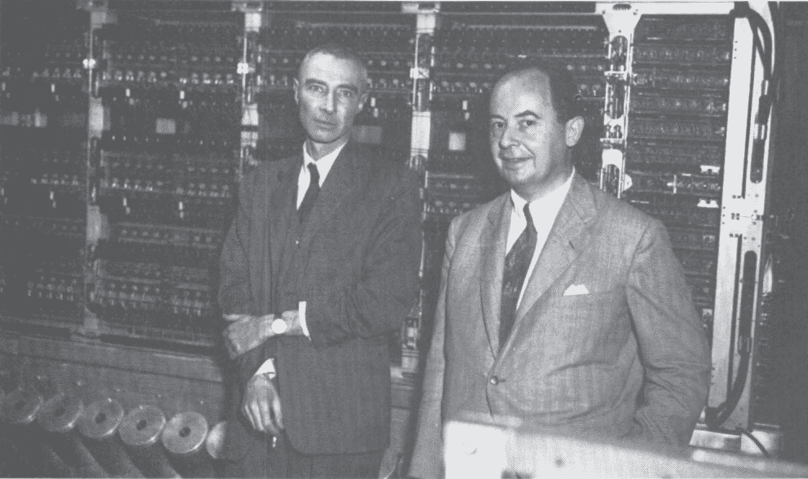图 6.1：冯尼曼（右侧）与罗伯特·奥本海默（左侧）于 1952 年在一起，他几乎在所有领域都是天才，从量子力学、博弈论到氢原子弹和过拟合。

*来源*：Wikimedia Commons，公领域领域。


冯·诺曼是曼哈顿计划建造原子弹以及后来建造氢弹的关键成员之一。作为一名激进的反共产主义者，他基于纯逻辑和他的游戏论，建议在俄罗斯人获得相关技术之前对其进行轰炸。1950 年，他曾被引用说：“如果你问为什么明天不轰炸[苏联]，我会说，为什么不是在今天呢？如果你说在今天下午五点，我会说，为什么不是在一点一点呢？” 幸运的是，纯数学在全球氢弹外交中的应用被忽视了。然而，一直吸引我的是他关于大象数据过拟合的著名言。

“用四个参数我就可以拟合一头大象，用五个参数我就可以让它摆动象子。”

换句话说，理论上，你只需要四个变量就可以描述像大象这样复杂的形状，而只需多加第五个变量就能增加更多的复杂性。拟合能力随着少数变量的增加而迅速提升。因此，在具有大量变量或内部参数的平均机器学习算法中，存在着一个无法解决的问题。我们可以完美地拟合任何东西，甚至是复杂的时间序列。然而，这种没有洞察力或可解释性、任意拟合历史的能力并不能提供预测未来的能力。如果我们今天可以拟合一头大象，那么当下一个动物是狮子时它有什么用呢？

传统的系统化交易也深受这个问题影响，但程度较轻。系统化交易策略（至少在追求尚可的研究流程时）是基于洞察和理性的。它们试图阐明简单的重复统计模式。然而，机器学习如果不受约束，可能会导致对预测能力产生危险的非理性幻觉。

### 6.6 一段金融历史

使用机器学习进行数据挖掘是数据分类和类别的强大工具。鉴于大量的内部参数，机器学习拟合训练集（样本内）数据集的能力是无与伦比的。对于许多应用来说，这提供了良好的样本外分类效果。正如我们在讨论猫狗分类时所说的，机器学习算法可以是极其出色的。

对于时间序列，我们可以忘记拟合平庸的简单移动平均（1 个参数）或动量（2 个参数），因为通过机器学习，我们可以对样本内数据提供超级拟合。但问题是，这是否为金融市场提供了任何预测能力？遗憾的是，答案通常是否。

原因是，对于猫狗分类器，世界上自然有数百万只猫和狗用于训练、样本内以及样本外验证。数据在字面上几乎是无限的。相比之下，我们只有一个金融历史。无论你如何设计或设置机器学习算法，这段有限的历史都是成功市场预测中无法逾越的障碍。我们没有多个平行的宇宙来完善和测试我们的算法。

我们的金融历史既独特又非常短。。这段历史封装了沿其路径发生的所有不同因果事件。例如，在第 2 章的宏观层面，我阐述了一个事实：连续的中央银行干预是为了应对金融危机，但往往是“推延拖时间”以引发下一次金融危机。过去几十年债券收益率的下降趋势并非市场随机游走的结果，它是一种结构性的宏观效应。在单个公司的微观层面也存在类似的故事，因为对于每家公司都有特定的叙事。因果关系无处不在。与牛顿物理不同，金融市场的时间是不可逆的。只有当你向一个方向按下“播放”时，因果事件才有意义。

有些人尝试为模型构建合成或随机数据序列，虽然这在其他领域可能是一种实用的方法，但在我看来，它对金融市场在很大程度上是不适用。尽管我们可以使用波动性和相关性构建多市场模拟（如 VaR 风险模拟），但其底层假设是市场本质上是随机的。系统化交易之所以有效，是因为在某些时间尺度上存在非随机的微弱重复特征。另一种方法是将真实的时间序列切成块并重新排列以形成新的时间序列，但这破坏了市场底层的因果框架。重排后的时间集也不是（像现实生活中那样）遍历性的，这意味着它没有探索不同世界中可能发生的市场可能性的总“相位”空间。很难看出合成数据集如何以合理的方式构建策略。

用替代数据集（我们将在第 8 章。最简单的机器学习技术实际上是我们在学校学习的线性回归公式。通过使用最小二法拟合对两个序列的数据点拟合一条直线，我们可以为线性方程拟合梯度和截距。如果后来给出了其中一个序列的新数据，我们就可以使用线性方程对第二个变量对应的数值进行预测(附录 E.2)。

尽管这个线性示例看起来微不足道，但它是机器学习的本质。通过使用样本内数据集，我们可以拟合或训练模型。然后我们可以使用拟合后的模型提供样本外预测。这种计算值的机器学习类型被称为回归。然而，机器学习的第二主要类型是分类，我们可以将数据分为不同的类别。


线性情况本质上有两个拟合因子——梯度和截距。然而，我们可以想象通过多维数据或作为边界来拟合非常复杂函数的情况。这些函数可能需要许多变量，而机器学习（ML）算法被称为参数化算法。非参数化 AI 技术不使用特定函数，而是通过已知数据点之间的插值来提供回归或分类。

机器学习训练过程可以是无监督的，此时算法接收原始数据，且对哪些信息可能有用没有预先设想。它也可以是监督学习，由人类提供关于数据集中重要信息的线索或“特征”。对于金融领域中可用的有限数据集，监督学习或半监督学习似乎效果最。。例如，在一个简单的二维（2D） 问题中，我们可能认为 (i) 上个月的价格收益率和 (ii) 波动率是预测未来价格变化的相关特征。我们实际上是在针对数据提问非常局限的问题。随后，机器学习算法可能会发现诸如“过去高收益率和低波动率带来高未来收益率”之类的规则。

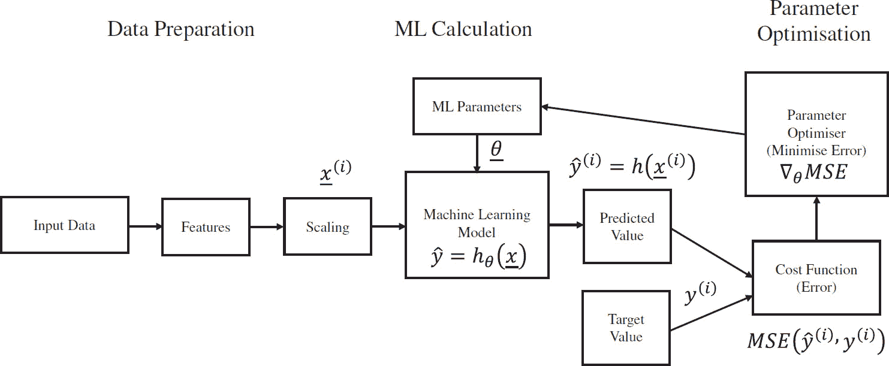

图 6.2：机器学习过程在训练中需要最小化预测值与目标值之间的误差，以优化模型参数。

通用的机器学习过程如图图 6.2 所示。我们可以认为过程核心的实际机器学习算法是非特定的且可替换的。一旦为问题选择了合适的特征，就需要使用诸如最小最大标准化（min-max standardisation）或 `Z`-scores 等技术进行归一化或标准化。在训练过程中分配特征权重和机器学习参数时，归一化使特征处于平等地位。训练数据被准备为样本中每个日期的特征向量。对于每个日期，给出一个目标值，这可能是所选时间段内的市场收益。机器学习算法分析数据并将每个日期的预测输出与目标值进行比较。必须使用性能指标来确定机器学习算法拟合训练数据的良好程度。通常这是一个代价函数，例如均方误差（`mean square error`）。通过迭代过程（通常是梯度下降），改变机器学习模型参数，直到误差减少并达到最佳拟合。一旦模型参数经过优化，该机器学习算法被认为已“训练完成”。下一步是在未见（样本外）数据上使用该模型，然后对实时数据进行预测。

### 6.7.1 算法无关性？

现在存在许多机器学习技术（`kNN`、`SVM`、决策树、`ANN` 等），它们使用不同复杂度的不同方法来拟合训练数据。某些模型是参数化的，使用拟合函数或如 `SVM` 等内核来描述分类边界。因此，取决于应用，某些技术可能比其他技术更适用于特定情况。然而奇怪的是，在完全不知道使用何种机器学习算法的简单情况下，你实际上选择哪种模型可能并没有区别。1997 年，Wolperts 发表了一个有趣的见解，被称为 `NFL`（无免费午餐）定理，该定理指出如果你对某个统计问题没有先验（`a priori`）知识，那么没有理由倾向于任何一种机器学习算法而非另一种。

将这一想法进一步延伸，给定一个具有大量数据的基准机器学习问题，许多机器学习技术取得了大致相似的结果。一个经典的基准问题是使用 `MNIST` 数据集识别手写体。它包含 60,000 个带有 28×28 像素数组的标记样本。许多不同的机器学习分类技术对该问题可以实现 1–3% 的错误率。2001 年，微软的 Banko 和 Brill 证明，在数据足够的情况下，不同的机器学习算法在复杂问题上的表现同样出色。显然，要解决你的问题，也许并不值得执着于带有最新配件的最新机器学习算法。然而，问题在于微小的字体——“数据足够的情况下”。在金融市场问题中，数据受到严重限制，因此正如我们将证明的那样，机器学习算法的选择和所选的数据特征具有至关重要的意义。为了说明我们如何应用机器学习来开发交易策略

我将概述两种不同的技术。第一种技术是众名的神经网络，尽管它在许多其他应用中有用，但在应用于金融市场预测时被证明特别难以捉摸。它激发了人们的兴趣，因为它近似于大脑的布线，但本质上它是典型的黑箱模型。第二种是经常被忽视的 k-最近邻（`kNN`），它可能是最简单、最透明的机器学习技术。该算法是我的个人喜爱，因为它具有鲁健性，如果你愿意查看其内部机制，就能清楚地知道它在做什么。能够轻松调查算法为何做出特定决策，解决了可解释性问题。

### 6.8 人工神经网络

如果我们我们要写一部关于神经网络的简史，它目前表现为三波不同的研究兴趣和进展。在这些波次之间，对该技术的兴趣实际上消失了。这些波次通常被称为 AI 的夏天和寒冬。

第一波涵盖了 1950–1960 年代，始于 Frank Rosenblatt 构建了带有加权连接的电气 `perceptrons`（感知器），这些器试图模拟神经元。惊讶的是，它们是作为物理电气机器构建的。1969 年，Marvin Minsky 出版了他著名的著作《感知器》，书中详述了一系列重大问题，包括无法映射到 `XOR` 逻辑门和其他线性决策边界。这有力地扼杀了对神经网络的兴趣，并结束了第一波。

第二波始于 1980 年代，1982 年时 John Hopfield 注意到大脑与所谓的“自旋玻璃”之间的相似性，导致了 Hopfield 模型。实现神经网络应用的一个主要技术问题如何在训练中进行校准，但在 1986 年，David Rumelhart 开发的新型反向传播或“backprop”技术解决了这个问题。多层感知器被开发用于语音识别。不幸的是，随着遇到训练和校准问题，热情消退了。

第三波是我们现在 2021 年所处的位置。2000 年，随着互联网、大数据和计算能力的提高，神经网络再次变得流行。深度神经网络和强化学习等技术的成功创造了从计算机视觉到蛋白质结构发现的突破。AI 爱好者现在会声称 AI 的永恒夏天已经到来，失望的寒冬已被永远驱逐。

#### 6.8.1 从感知器到神经网络

神经网络最简单的元素是感知器（图 6.3），它是基于大脑细胞中的神经元建模的。在神经元中，树突电荷的积累超过特定阈值会触发轴上的动作电位。在感知器中，这个阈值被表示为数学阶跃函数或更好的平滑函数。一旦感知器输入的加权之和超过阈值，就会给出一个输出信号（见附录 E.3）。总来说，这似乎是真实生物神经元的很好的类比。


通过在连接的层中组合许多感知器，我们可以形成神经网络。`deep neural net` 在输入层和输出层之间有几层连接。这些被称为隐藏层（图 6.4）。每条连接都有唯一的权重，每个节点都有一个激活函数。在某种意义上，连接可以作为组合输入信号的方式来“记忆”规则。一旦网络结构（节点和层）确定，模型就实际上存在于所有连接的权重中。即使对于一个简单的网络，权重的数量也会迅速增加到大量的变量。单层隐藏层的示例已经就需要 `M × N + N × K` 个变量来拟合了。

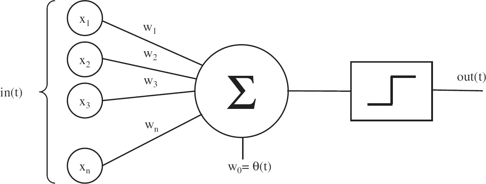

图 6.3：感知器原理图，其中输入经过加权、求和并触发高于阈值值的输出。

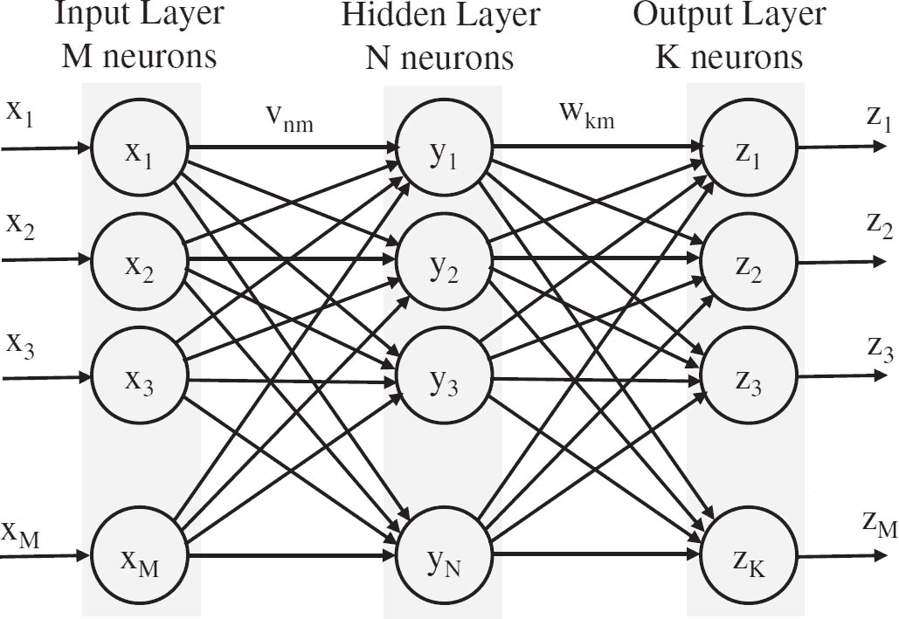

图 6.4：具有一个隐藏层的神经网络。每条连接都有一个唯一的权重，每个节点都有一个激活函数。

#### 6.8.2 训练神经网络

为了训练神经网络，我们将每个样本训练信号前向传播通过网络，并为批量样本计算“误差”或代价函数。然后我们通过“反向传播”反向通过网络，改变连接权重以使误差函数最小化。使用感知器学习规则，对于给出正确预测的连接，权重会被强化（附录 E.3）。

这些反向传播技术使用梯度下降技术进行优化。拟合空间是一个多维景观，随着连接数量的增加而增加。在这个过程中，很容易陷入局部最小值而非全局最小值，从而找到“错误”的解决方案。这种方法需要大数据集、批处理和权重的随机化等来帮助收敛。存在许多提高收敛率的奇巧技术，但其适用性取决于底层数据集。

对于金融市场的预测，最好是使用带有输入“特征”的半监督学习，而不是仅仅依靠原始数据。某些特征是根据时间窗口进行计算得出的整合变量，例如趋势、波动性等。这被称为半监督学习。网络在时间序列上训练，以优化利润或相关的风险调整收益（如夏普比率）。

### 6.8.3 市场过拟合

神经网络的一个大问题是过拟合的可能性。在 2017 年底，我自愿就这个问题做了一场演讲。演讲标题相当乐观，题为`深度学习用于市场预测——标普 500 指数`。我在关于神经网络直接应用于单一市场过拟合的中概述了我对该技术的失望。预测像标普 500 这样具有高度随机性的宏观股票指数是一个众所周知的艰难挑战，但它很好地说明了其中涉及的问题。

例如，对于标普 500 期货，我们可以应用一个具有五个价格和成交量特征以及两个隐藏层 `(5,5)` 的神经网络进行提前一天的预测。该神经网络对训练数据提供了惊人的拟合，夏普比率接近 4（图 6.5）。然而，测试期的表现相对相当令人失望（夏普比率 ~0.6），因此夏普比率的测试/训练比约为 15%（图 6.6）。遗憾的是，常见的发现是样本外结果总是远低于测试结果。这证明了神经网络无与伦比的过拟合能力。回想起来，有如此多的模型“自由度”，你还能期待什么呢？在检查的许多其他市场也存在类似的过拟合故事。尽管我们可能会选择不同的特征，但大多数市场的测试/训练夏普比率都处于 10–30% 的范围内。

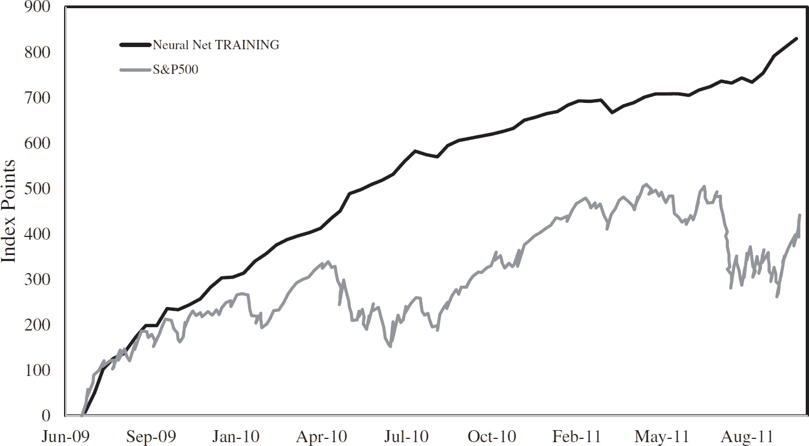

图 6.5：神经网络对训练数据提供了惊人的拟合，具有很高的夏普比率。

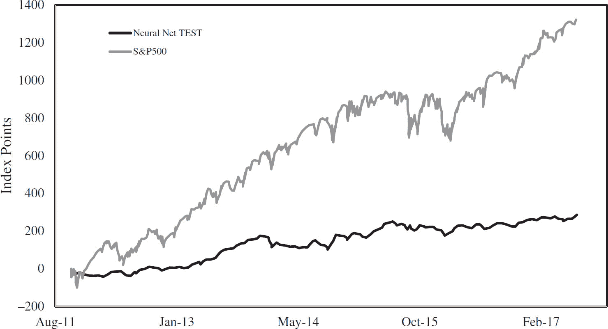

图 6.6：神经网络在测试中的夏普比率低得令人。

上述示例使用了 3 年的静态训练期和 6 年的测试期，但通常结果并不太依赖于窗口大小。在机器学习中，通常使用滚动窗口方法来包含 1 年训练。通过这种方式，我们丢弃了旧数据并重新关注更近期的数据。这增加了适应性，但结果通常很弱，夏普比率在 0.4–0.6 之间。更多的研究表明，神经网络高度依赖训练窗口大小，因为它必须有足够的数据进行训练以避免严重的不稳定性。

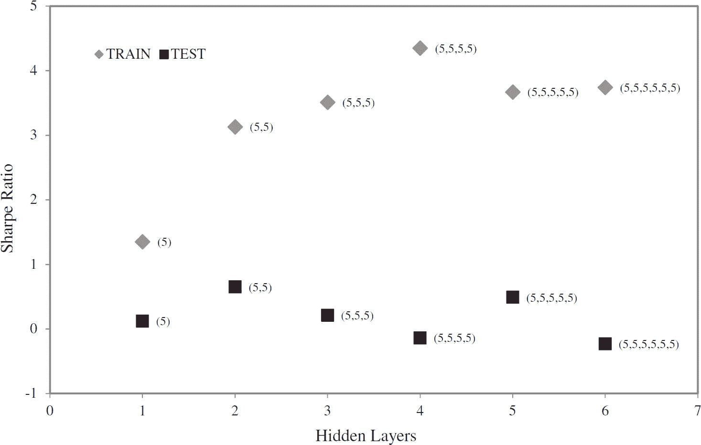

图 6.7：增加更多层/节点会导致对训练数据的过拟合。

其他几个观察值得注意。增加神经网络层或节点会增加对训练数据的过拟合。在几层之外，模型对于有限的数据来说过于复杂，且在测试中的预测性更弱。夏普比率波动且不稳定。图 6.7 显示了 GBP 的典型结果。此外，某些特征可能增加了预测能力（例如每周、日内收益……），但增加特征数量也允许对训练数据产生过拟合。添加特征略微提高了性能，但增加更多无意义或相关的特征最终会降低性能（图 6.8）。

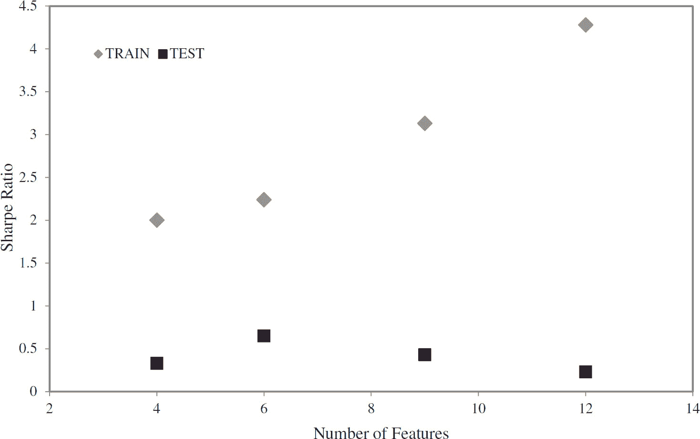

图 6.8：某些特征最初提高了预测能力，但逐渐增加了 GBP 的过拟合。

#### 6.8.4 成功的路径

因此，尽管神经网络在许多应用中取得了成功，但将其简单地应用于金融市场预测证明是极具挑战性的。它们在市场预测上受到数据缺乏、市场机制以及相对于其他应用的高信噪比的限制。样本外性能往往令人失望。神经网络的许多问题对于任何具有大量拟合参数的机器学习技术都是固有的。

问题自然产生——可以通过哪些成功的路径来提高神经网络的性能？解决方案包括更好的特征/监督、更多的数据以及可能的网络配置。

神经网络本质上是无监督的机器学习技术，但通过使用特征而非原始数据，我们限制了训练并在某种程度上提升了样本外性能。尽管我们可能会包含大量数据特征，但在实践中，最好是仔细选择一组较小的相关特征。如果我们使用具有合理概念的“良好”特征，它们提供了某种解释力。尽管这可能与系统化交易方法重叠，但神经网络仍然提供了一种组合特征和信号的非线性方式。理想情况下，特征应该是低相关的或正交的。在某些情况下，值得检查某些特征是否对应于传统`PCA”（主成分分析）中的特征值或著名的信号。为了避免过拟合，存在一种正则化技术，它本质上人为地减少了模型的自由度。正则化结合小特征集可以尝试缓解过拟合问题，但是以降低模型智能为代价的。然而，作为一个警示案例，我曾有一位同事被同僚强制简化他的机器学习货币算法，以至于删除了所有有趣的效果，最后剩下的只是重新发现了一阶动量——至少它没有过拟合。


更多数据可以包括更快的交易、结合多个市场以及添加不相关的数据集。通过转向更快的交易（包括日内交易），我们扩大了用于训练和测试的数据量。但如果我们转向日内交易，准确的执行和成本建模将变得至关重要。将多个样本外夏普比率（Sharpe ratios）较低的市场相结合，也可以创建出更高夏普比率的投资组合。机器学习策略如果去除了一阶趋势分量，通常与 CTA（商品期货交易员）的相关性较低，因此添加到现有的系统性策略中可以实现多元化。此外，将机器学习应用于多空（L/S）股票组合具有潜力，我们将在下一节中讨论。尽管股票之间存在相关性，但排除主市场贝塔（beta）实际上为机器学习提供了数百个底层时间序列。

最后，包括新闻、情绪和其他替代数据在内的不相关非价格数据集可以提高性能，但正如之前提到的，我们应该警惕“单一历史（the one history problem）”问题。尽管我们可以增加数据集的大小，但我们使用数据的方式可能会产生影响。许多人声称步步验证训练（walk-forward training）优于传统的回测，但本质上，它们是等效的，并且面临类似的问题。数据的批量处理和随机化在机器学习应用中也用，但在市场数据的时间序列分析中，保持因果关系的时间顺序至关重要。

人们经常认为，对于时间序列数据，可能存在更好的神经网络配置。基础的多层明治结构神经网络可能并不适用于金融时间序列。现在存在一种新一代的神经网络，称为`循环神经网络`（`RNN`），其内部状态是专门为时间序列设计的。然而，在我的初步研究中，这些网络似乎并没有提供太大的收益。传统的神经网络通过某些滞后输入或集成特征包含了一些历史时间序列的痕迹，其获得的结果似乎与 `RNN` 相似。

### 6.9 最简单的机器学习技术 — kNN

避开神经网络，研究最基础的机器学习技术 `kNN` 是很有趣的。在我看来`KNN` 的出现远在许多其他机器学习技术出现之前了。显然，它最早由 Evelyn Fix 在 1951 年开发。我记得 20 世纪 80 年在 BBC 微型计算机上编写过近邻算法的变体。尽管 `kNN` 被机器学习痴迷者嘲笑为太简单，但我认为简单性是它的优势。它不是黑箱，而且极其稳健——对于普通的 `kNN`，你清楚自己的所处位置。

`KNN` 是所有机器学习技术中最简单的。它没有拟合函数，并且对于分类或回归是非参数的。相反，它采用“惰性学习”（lazy learning），使用决策边界的近似。我们可以将数据点可视化为固定在一个多维超立方体内，其中坐标轴是数据变量或特征。训练样本是描述该多维特征空间中点的向量（附录 E.4）。

图 6.9 中的示例是基于两个类别（正方形或三角形）。对于 `K` = `3` 个邻居，我们将新样本（圆形）分类为三角形，因为在训练距离内有 2 个三角形对比 1 个正方形。对于回归，输出是特征空间中被分配的对象的 `kNN` 值的加权权和。权重可以是均匀的（`1/K`）或基于与对象的欧几里得距离（附录 E.4）。与大多数机器学习技术不同，因此你可以视觉化解释结果（不是黑箱）。

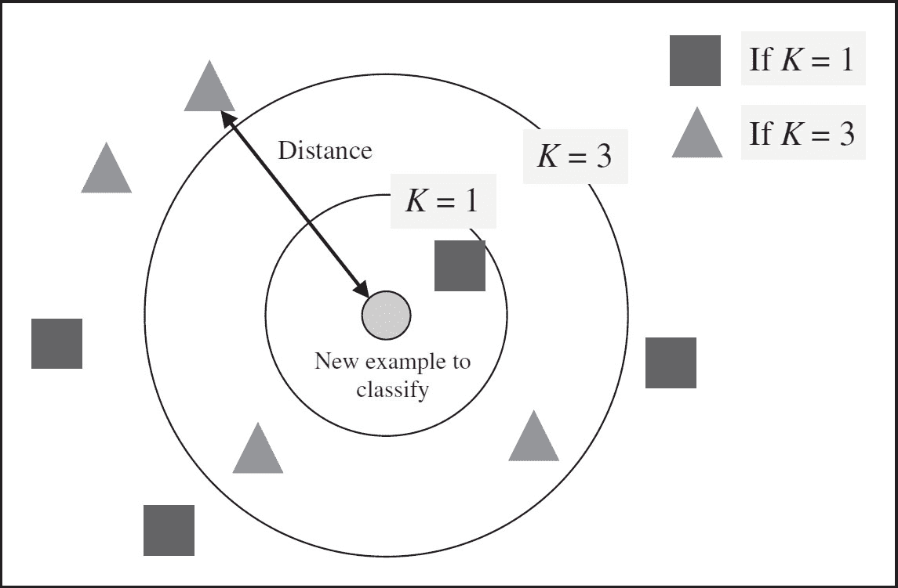

图 6.9：使用 kNN 将新样本分类为两类之一（正方形或三角形）。

#### 6.9.1 将 kNN 应用于多空股票

作为一个示例，我们将考虑将 `kNN` 方法应用于标普 500 指数中的多空大盘股票。通过在多空策略中对大量多样化的股票池应用机器学习，我们试图缓解训练数据不足的问题。通过保持市场中性，我们减少了宏观市场波动波动的影响，并将机器学习关注在单个股票的特异性波动上。通过这种方式，我们可以尝试减少“单一历史问题”，特别是在市场离散度较高的时期。

对于我们的策略，我们选择了各种历史特征作为输入。某些特征是集成变量，例如 `momentum`（动量），它们是从原始数据中通过算法计算得的。通常情况下，单个特征可能提供微弱的盈利信号，但我们的目标是使用 `kNN` 以非线性方式将它们结合。输出是 `kNN` 的平均历史风险调整收益，我们利用此构建预测。

在实践中，我们只选择六个特征（`momentum`、`reversion`、`volume`、`volatility`、`news score` 和 `sentiment`），并对投资组合中的所有 500 只股票每日运行 `kNN`（图 6.10）。`kNN` 的问题之一是“维度灾难”，对于有限的数据，有效性随着维度的增加而下降。从数学上说，这意味着邻居的数量变得非常稀疏。我们有时可以通过将几个相关特征压缩到每个维度，或使用主成分分析（`PCA`）等统计技术来减少维度。

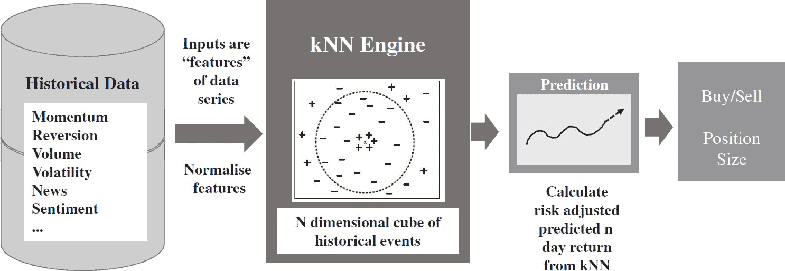

图 6.10：使用 kNN 进行多空股票组合。

机器学习中的惯例是应用“步步验证”训练技术以便从更新的数据中学习。从零知识开始，随着时间的向前推移，我们将历史特征添加到数据库中。为了让最近的数据更相关，我们根据所有股票将训练集中的权重向最后 5 年倾斜。使用 `kNN`，我们对预测的风险调整收益进行排名，买入最高分位数并卖出最低预测分位数，因此始终保持市场中性（初步估计）。结果所示图 6.11，长期夏普比率约为 1.5，波动率稳定。

这种方法相比于我们之前使用的神经网络方法有几个优势。首先，通过考虑 500 只股票，相比于单一股票指数的时间序列，我们有更多的数据用于模型训练。其次，通过采用市场中性方法，我们消除了较大的市场波动，关注股票之间的特异性运动。最后，通过选择可能具有 alpha 的特征，我们使用 `kNN` 来发现它们之间的非线性关系，而不是简单的线性叠加。

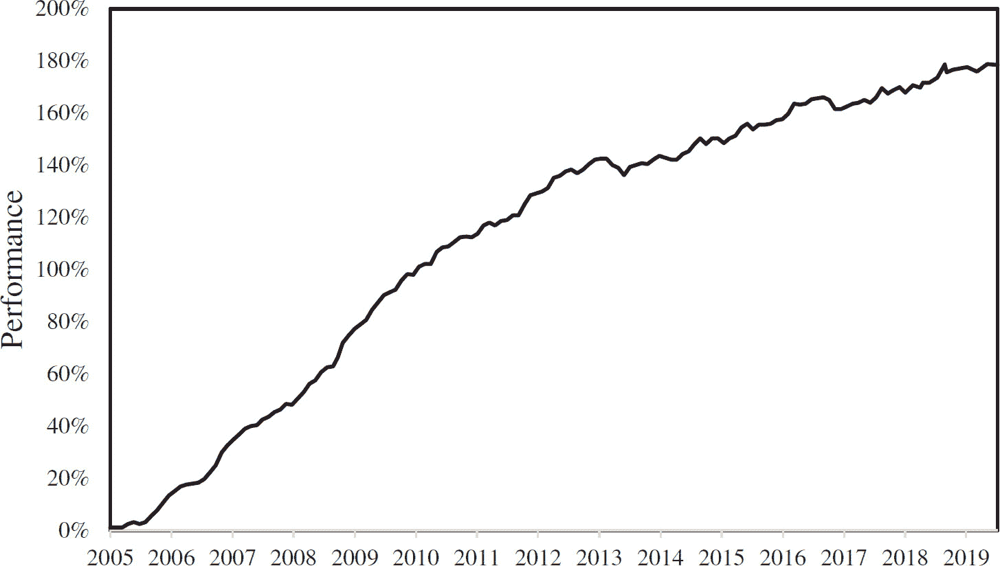

图 6.11：使用 kNN 技术和步步验证的市场中性多空股票性能。

### 6.10 与传统系统性投资的比较

将传统的算法交易与基于机器学习的策略进行对比很有趣。它们之间有很多相似之处和重叠，但也存在显著区别（表 6.1）。

#### 6.10.1 策略概念

系统性交易策略基于人类假设的先验（a priori）概念、想法或效应。纯数据挖掘被认为是一种科学不良的方法，而系统性概念通常基于深思熟虑且经过科学调查的基本效应。这一过程被认为可以减少过拟合和得出错误因果联系的概率。

在机器学习中，特别是在无监督的情况下，规则是由交易策略自动生成的。可以应用限制条件（例如交易速度、成本和性能特征），但机器学习算法被赋予了自由。在更有监督的机器学习中，计算机会被引导去探索特定的特征。

表 6.1：系统性策略与机器学习策略。


| 算法化/传统系统化 | 机器学习 |
| --- | --- |
| • 交易策略的先验概念/想法/效果（来自人类）。• 信号以线性组合的方式结合.• 底层方程/算法.•• 不适应市场状态切换.• 直观、易于理解，且可能简单。 | • 机器学习为交易策略生成规则。• 信号可以是线性的。• 机器学习“发现”算法。“• 具有适应性（缓慢）。• 往往缺乏透明度（黑箱）。 |

#### 6.10.2 信号组合

在系统化交易中，交易信号通常以线性方式组合。通用方法是通过一系列权重因子进行信号归一化和线性叠加。

机器学习中的信号组合过程嵌入在算法之中。这导致了信号的非线性组合，与系统化交易相比，它可以提供额外的潜在 Alpha 来源。

#### 6.10.3 策略算法

对于系统化交易，策略存在一个底层的、通常相对简单的算法。这可以很容易地写成数学方程，并通常编码在几行代码中。

在机器学习中，没有明显的方程，“算法”是从学习数据中“发现”的。通常，由于我们使用的是例如第三方 Python 库提供的现成机器学习技术，更准确的说法是，整个内部算法本身是机器学习技术加上学习过程中分配的所有拟合权重的融合。

#### 6.10.4 市场适应

系统化交易策略不会针对不同的市场状态调整其算法。除非人工做出决定手动重新拟合模型，否则它们的内部参数通常是固定的。良好实践的指导原则是模型参数应随时间保持稳定，并将人工干预减少到最低。

机器学习策略随着更多数据的消化改变其参数。最初，参数将使用初始学习数据固定，但随着时间的推移，更多数据被添加并用于重新拟合模型参数。模型“适应”新市场状况的速度取决于新获取数据相对于旧历史数据的权重。尽管这在实践中听起来很棒，但由于统计局限性和数据匮乏，任何适应通常都会非常缓慢。快速适应可能会产生不稳定的内部参数，统计意义较小，并对性能产生不利影响。

#### 6.10.5 模型透明度

系统模型通常是直观且易于理解的。它们往往非常简单到在数学上是微不足道的。重要的是，投资过程中的其他参与者（包括风险经理甚至投资者）可以理解系统化策略背后的原理。

大多数机器学习策略是完全不透明的黑箱。这使得对其原理和行为的解释变得困难。可以说，黑箱属性最小的机器学习是最简单的 `kNN`，而最黑的箱则是像深度神经网络之类的。

### 6.11 投资机器学习的未来

系统化交易和机器学习技术都允许我们在交易决策中应用统计严谨性并消除情绪影响。机器学习技术的优势在于它们可以发现新的交易规则和数据关联。然而，由于金融市场可用数据有限，其主要陷阱是过拟合。系统化策略和机器学习策略同样受到市场状态变化和结构性突破的影响。机器学习表面上的学习收益往往演变得太慢，无法适应变化的状态。本质上，计算机缺乏想象力和理解力，无法对人类有时认为微不足道的新闻流和不断变化的根本状况赋予意义。

机器学习可能更适用于在形成数据特征之前的数据处理和分析。例如，机器学习已经很好与*自然语言处理*（NLP）结合，用于阅读文章、财报、新闻和社交媒体，并分类和计算各种指标（如情绪评分）。神经网络已证明在分析公司报告和提取有用信息方面非常擅长。这种过程允许对数千份文档进行文本分析，节省人类时间并消除主观性。与市场价格不同，数据集几乎是无限的，这非常适合机器学习方法。机器学习产生的文本变量可以映射到时间序列上，并作为系统化或主权交易系统的信号输入。在我们之前的 `kNN` 多空股票示例中，新闻情绪评分的特征实际上是使用神经网络从多年的新闻文章计算出来的。我们将在第 8 章中更详细地讨论这一 NLP 过程。

机器学习的发展日益关注事件之间的因果关系作用。希望这能为基于机器学习的投资提供突破。在典型的回归分析中，很难区分因和果。这可能导致一些荒谬但高相关的结论。一个经常被引用的例子是 David Leinweber 对孟加拉国黄油的研究，与标普 500 指数股票价格（1981–1993）的相关性为 75%，如果包含羊群数量，相关性则增加到 99%。如果没有人类的常识，机器可以在不相关的变量之间挖掘出非常高且无关的相关性。如果时间序列机器学习方法能更好地反映因果关系，就能从数据中得出更相关的数据关联。

衡量数据中因果联系的典型方法是格兰杰因果（附录 E.5），但也存在其他方法。通过考虑时间滞后变量的影响，我们可以确定某个事件是否是当前事件的前兆，并具有作为解释原因的统计有效性。然而，这是否能提高机器学习在市场预测中的质量并缓解常见的过拟合问题尚待观察。许多滞后数据已以整合变量和机器学习特征（如动量）的形式使用，这已经具有隐含的因果关系。此外，在金融领域，许多事件几乎同时发生，因此原因接近事件。需要仔细的数据时间标记。如果公司突然发布新闻，股票的波动几乎是瞬时的。有时新闻会泄露，在你看到标题之前股票就开始波动了。

## **第 7 章**

## ESG 投资

### 7.1 Don Draper 的伦理

如果你在担心太平洋上的“塑料冰山”，但超市里所有的东西都包装在方便且看似“致命”的塑料中，那么你并不孤单。也许当你拖出蓝色的回收箱时在想，为什么没有人在多年前就解决这个问题和其他许多显而易见的环境问题？虽然你可能想加入“反灭绝叛运动”，但可以说，一种更有力的改变途径是我们如何集体投资现金。


事实证明，公众对地球所面临的环境问题的关注是一个相对较新的现象，只有几十年的历史。在 20 世纪 60 年代，拥有一辆尽可能巨大的耗油大汽车甚至是不容置疑的，或者像剧集《狂人街》中的唐·德雷珀那样，把野餐垃圾扔在公园里。直到 20 世纪 80 年代初，英国才决定在英格兰岸附近的海域倾倒放射性核废物是不合理的行为。

尽管他们未能成功解决塑料袋这一生存问题，但像`绿色和平`和`地球之友`这样的组织成为了公众舆论的主要早期影响者。他们教育民众，并强调了更具环保意识的政策的必要性。环境议程的进展虽然缓慢但坚定，涵盖了从臭氧层空洞到亚马逊雨林伐木，以及最近的全球变暖和气候变化等重要话题。

随着全球化的持续发展导致制造业外包，社会关怀逐渐被加入环境因素。西方消费者尽管享受着更廉价的衣服、运动鞋和无数塑料玩具，但意识到，让这些产品在糟糕的工作条件下由童工制造，同时污染第三世界国家，这在现代标准下完全是不符合道德的。

为了应对这种伦理标准的演变，金融行业一直在努力追赶。多年来，他们认为伦理或责任性投资只是少数嬉皮士、边缘人物或环保战士中的一种跟风或时尚，因此选择了忽视它。基金经理之所以固执，是因为他们痛苦地意识到，他们几十年来磨练出的许多做法必须进行修改。在投资之前，他们不再仅仅看公司的利润多少和其他各种财务指标，而是必须对公司的一系列主观问题进行质询，例如他们是如何盈利的，以及是否符合伦理考量。许多此类新信息此前并未由大型公司披露，这种额外关注将导致与首席执行官和公司董事之间产生尴尬的对话。除非某些大公司也做出改变，否则将变得“不可投资”。

基金管理公司现在意识到了形势严峻，正在改变其产品和服务，以契合主流主流客户对一系列环境和社会问题不断演变的观点。像`贝莱德`、`富达`等巨头资产管理公司已经重新调整了整个业务模式来应对责任性投资。这是自第一批上市股票出现以来，在资金投资方式和目的上最大的意识形态革命，而且将长久存在。在新范式中，纯利润和货币股东价值不再是公司投资的唯一绩效标准。

零售和机构投资者对`环境、社会和治理`（`ESG`）相关投资的兴趣日益增加。`ESG`投资正在离开曾经占据的利基领域进入主流市场。为了适应这一趋势，许多基金经理简单地对现有的股票和债券基金重新标记，并略微修改了他们的投资标准。对现有股票基金的重新标记是许多愤俗者所说的“洗绿”，但至少对于大多数开始涉足`ESG`领域的资产管理经理来说，这是一个起点。在纯多头领域之外的对冲基金世界，`ESG`投资仍然是一个次要考虑，因为投资者群体首要关注的是非相关收益或`alpha`（阿尔法）。最具前瞻性的关注`ESG`的对冲基金投资者可能仍是少数，但`ESG`投资的浪潮正在逐渐增长。

## 7.2 不可持续性的术语丛

然而，对于初级投资者来说，环境和社会责任投资已成为一种术语丛，且令人困惑。早期的责任投资方法使用简单的“排除法”。逐渐加入排除名单的是赌场、武器、化石燃料、煤炭矿业等。这种基于行业的过程被称为`社会责任投资`（`SRI`）。尽管这种方法为投资者提供了巨大的清晰度，但可能过于简单，并限制了投资范围。另一个缺点是，那些处于特定行业之外但表现出不负责任行为的公司无法被排除。

随后开发了一种更微妙的方法，被称为`ESG`投资，根据详细的环境、社会和治理得分对股票进行单独筛选。这种现代化的伦理投资风格为资产配置提供了一种更全面、科学的方法，但还需要更多的澄清。

虽然`ESG`投资可能包括从`ESG`角度来看积极或中立的公司，另一种更极端的`ESG`投资是所谓的“影响力”投资。理想的影响力组合仅包含那些`ESG`高度积极且对世界产生积极影响的公司。此类公司的典型例子包括水处理、医疗保健、电动汽车以及风场、太阳能等可再生能源。因此，影响力组合比通用的`ESG`组合更关注积极因素，导致一些基金经理发现可用池受到限制。

### 7.3 什么是 E、S 和 G？

`E`代表环境。显然，我们都意识到气候变化和污染，但公司的环境影响以及所考虑的因素要广泛得多。它将包括碳足迹测量、用水量、废物管理、污染、环境诉讼以及向清洁能源的转型（见表 7.1）。例如，污染河流的化学公司、具有毒性尾物的采矿公司和使用不可回收产品的包装公司都将受到惩罚。高水平环境披露和改进实践的公司将获得提升。即使是正在剥离化石燃料、建立可持续投资组合并向低碳未来转型的石油公司也可以在某些`ESG`组合中被考虑。

`S`代表社会。街头零售商在海外监狱制造圣诞卡片、智能手机制造商使用童工开采的稀有金属，以及在仓库中存在糟糕劳动实践的在线分销商，都是违反社会接受行为的知名媒体案例。然而，`S`还包含了许多虽然上不上新闻头条但同样重要的微要考量，如人权、工人权利、争议性产品、员工流动率、经营设施和健康安全实践。人员多样化、产假权利和慈善捐等积极做法将带来更高的社会排名。


| 碳足迹 | 水资源利用 | 废物管理 | 污染 | 诉讼 | 清洁能源 | 土地利用 | 保护 | 人权 | 员工权利 | 争议性产品 | 员工流动率 | 联合国全球契约签署 | 设施 | 健康与安全 | 董事独立性 | 薪酬 | 独立董事 | 兼任 CEO/董事长 | 商业伦理 | 企业文化 | 透明度 |

`G` 代表治理。对于大多数投资者来说，`治理`的概念可能没那么清晰，但它可能是影响未来股价表现最重要的因素。治理关系到公司的如何运作和控制，包括企业文化、董事独立性、薪酬政策、独立董事的角色以及商业伦理。糟糕的治理可能导致毁灭性的业务决策和巨额诉讼。例如，允许洗钱和规避制裁的银行，在高级管理层合谋下操纵排放测试的德国汽车制造商，或者掠夺公司养老金计划以支付巨额股息或奖金的行为。管理良好、透明度且具有明确政策和业务计划的公司获得更高的 `Governance` 评分。

## 7.4 北极钻探，但请不要提供啤酒，尤其是在赌场

对大多数长多股票 ESG 基金（尤其是美国的）进行粗略概述可以发现，其投资组合以大型股和科技股为主，并且通常包含了大部分 `FANGS`（Facebook、Amazon、Netflix 和 Google）股票。如此多科技股的加入是大多数 ESG 基金备受推誉的近期表现的主要原因。然而，大多数投资者会对这些投资组合的构成感到有些失望，他们期待的是对地球有益或能提供社会效益的股票。如果你期待的是风力发电场、太阳能电池板、电动汽车和社交上受尊敬的雇主，那么请重新考虑。相反，你最终可能会得到一些主导竞争、贩卖你的隐私数据，并拥有大量按最低工资在箱子里堆放物品的“电池工厂”员工的公司。但仔细观察，情况甚至更糟。例如，你会看到假装绿型的石油公司、开发智能炸弹组件以投向部落少数族裔的航空航天公司，以及污染了广大地区但在其自定准则内运行的采矿公司。这种异常现象的列表非常详尽。奇怪的是，后者的许多公司反而比那些经营赌场或制造许多人喜爱的美味啤酒和酒的公司更受欢迎。显然，虽然赌场和白兰被排除在外（因为它们属于赌博和酒精行业），但只要你有环保标志，在北极圈钻油是可以接受的。

你可能会问，我们是如何变成这种状况的？嗯，问题在于 `ESG` 标准具有高度的主观性，并存在不同的解释空间。世界上许多上市的可投资公司都有优点和缺点。决定什么对于 `ESG` 案例是相关的需要分析、判断和一些人类的偏见。水泥制造商或大多数电力公司的碳排放虽然并不理想，但并非不可或，因为我们仍然需要建造和为房屋供电。也许完全撤出这些行业是不合逻辑的，相反应该让其他 `ESG` 标准影响人的决策，例如引入可再生能源的速度、公平的人员政策、伦理治理决策等。

### 7.5 ESG 评级的地雷区

不幸的是，大多数投资经理没有精力和专业知识来深入研究公司的 `ESG` 基本面。相反，他们希望为基金的 `ESG` 资质获得 `3rd` 方的“盖章”，并轻松地向任何投资者解释他们选择特定股票或债券的原因。这导致了 `3rd` 方 `ESG` 评级提供者的增加，它们以类似于著名的信誉评级机构的方式为公司评分。虽然 `ESG` 评级提供者最初是碎片化的，但现在已合并为几个主要品牌，每个品牌都有作为订阅包出售售的软件和数据产品。

### 7.5.1 与评级机构回到未来

从历史角度看，我对评级制度化以及投资者行为受评级机构“寡头政治”控制持相当怀疑的态度。这是因为我职业生涯的大部分时间都在对机构信誉评级进行套利。投资者通过被称为`担保债务凭证` (`CDOs`) 的工具购买高收益债券，这些工具被专门设计用于获得人为夸胀的评级。评级机构在这些项目中并不完全中立，并为此获取了丰厚的报酬。最终，正如你所知，当次级贷款（记住 `NINJA` —— 无收入、无工作、无资产……没问题）被疯狂地允许作为抵押品时，事情偏离了轨道。尽管这些机构参与了 2008 年信贷危机，但它们的影响力仍然（几乎）如既往一样巨大，老牌信贷交易员和投资者对此仍持有高度怀疑。

因此，我们应该警惕任何 `ESG` 评级机构及其对 `ESG` 基金的影响力和控制。

### 7.5.3 信息披露偏差


此外，我们观察到了一些奇怪的矛盾，因为 ESG 评级主要基于公司的 ESG 披露。遗憾的是，大多数已发布的披露是由公司自身产生或控制的。评级机构往往很少或完全不考虑公司在 ESG 问题上的表现究竟有多糟糕，而仅仅关注披露的数量以及 ESG 风险在（理论上）是如何管理的。因此，一家具有高水平 ESG 披露和华丽公关的采矿公司排名可能接近 100 分，而一家认为自己没有值得关注的 ESG 风险因此不进行披露的互联网公司，排名可能仅为 10 分。2020 年，ESG 评级提供商 `ISS` 与一家德国图像处理公司 `Isra Vision` 之间发生了一个有趣的法院诉讼，后者因缺乏披露被评为 `D-`，并最终（在我看来是正确的）获得了一项针对 ISS 的禁令。这种对披露的依赖显然是一个荒谬的局面，而且至少有一家机构已经采取行动，通过最近修订其评级方法来试图弥补这一点。这是及时的，因为人们越深入研究所使用的模糊、不科学且记录不全的方法，就越能对许多评级的有效性产生怀疑。

### 7.5.4 可管理风险与不可管理风险

评级方法中一个日益增长的趋势是使用“可管理”与“不可管理”ESG “风险”的概念。它采用了一种务实的观点，即在任何给定的行业领域，存在无法通过新的业务流程和更好的公司管理来消除的固有风险。因此，航空公司可能尝试通过购买新机队或购买碳抵消来管理环境风险，但从根本上说，航空业是一个高度污染的行业。根据目前的飞机技术，将始终存在大量的不可管理风险。本质上，所有航空公司的“E”（环境）表现都很糟糕，但关键在于他们如何改进它。类似的分析可以合理地应用于任何行业。例如，耗电量大的云计算公司可以通过可再生能源减少碳排放和污染，并将自己置于冰岛等凉爽地区，但它们仍然是资源密集型企业，并且在半导体生产和设施建设方面仍存在不可管理的风险。在我看来，如果评级机构明智地利用这些结果，这种分析是一个进步。然而，一种二分法很快就会出现，这很容易困扰投资者。如果我们根据公司管理 ESG 风险的能力而非整体 ESG 风险来对其排名，我们只是在构建每个行业中评级最高的公司组合。许多投资者不想购买任何航空公司股票，因为他们认为该行业具有污染性，且不符合他们的 ESG 观点。基于管理和不可管理风险概念的评级方法需要向投资者清晰地阐述。

### 7.5.5 负责任的经理和好奇的投资者

投资经理应该准备质疑 ESG 评级及其得出的方式。如果他们只使用一个 `3^(rd)` 方评级提供商，他们应该深入研究所使用的方法，而不是简单地将其作为橡章。与 ESG 评级机构的接触最终将提供更有意义且更符合投资者预期的排名。同样，投资者自己应该质疑评级在投资过程中是如何被使用的。他们是在寻找一个仅根据评级筛选的被动 ESG 投资组合，还是在寻找具有“影响力”且真正符合他们个人信仰和伦理的组合？

### 7.6 ESG 投资策略

拥有一种建立 ESG 分数或评级的方法是的一大进步，但我们如何利用它们来构建组合并将其应用于现有的投资过程中呢？从简单的基于评级的方法，我们可以扩展到包括基于裁量权和系统性的 ESG 技术。

### 7.6.1 基于评级的投资

显然，人们要么忽略 ESG 评级的不一致性，要么接受意见的多样性并建立属于自己的专有 ESG 评级方法。然而，从原始 ESG 数据开始是困难的，并且需要专门的内部资源。

相反，基于几个不同的 ESG 评级来源（包括其他替代 ESG 数据）并加入一些常识来建立一个复合评级系统，是一种高效且实用的替代方案。最终目标显然是 ESG 如何在投资过程中使用。如果它完全基于对“被禁的”部门的硬排除（例如：石油/天然气、煤炭、武器……），那么通常不需要 ESG 评级。“软排除”（softexclusion）方法则需要行业部门多元化，然后根据这些复合评级进行配置。

### 7.6.2 裁量与系统性 ESG

ESG 可以作为投资信号包含在系统化过程中，但这需要大量的历史数据集进行分析和回测，而这些数据往往缺失或质量低劣。ESG 投资的本质可能需要运用人类的裁量。通常，特定公司的背景是重要的，无法包含在简单的评级中。虽然被动 ESG 指数已开始出现，例如 `FTSE4Good` 和 `S&P ESG Index`，但这些本质上是基于规则的，而 ESG 这一新的主观领域可能最适合由主动经理来处理。主动经理可以分析和审查来自不同提供商的 ESG 信息和评级，并将自己的伦理水平融入过程。这一观点在 `Goldman Sachs` 2020 年的一篇文章中也得到了支持。

过去人们曾认为 ESG 投资牺牲了业绩，但学术研究表明事实并非如此。许多 ESG 基金在近期新冠疫情引发股市抛售中的优异表现很好地说明了这一点，尽管这可能是由于超配了科技股。许多研究发现，评级较高的 ESG 公司具有较低的资本成本、更高的股东价值，并且给市场带来的惊喜较少（见 表 7.2）。后者的考虑是重要的，因为尽管公司的 ESG 状况通常变化非常缓慢，但突然、意外之外的 ESG 事件（如公司丑闻或化学品泄漏）会对股价产生深远的短期影响。研究发现股票筛选中的 ESG 标准可以降低股票组合风险并降低波动性，从而提高长期表现。

表 7.2：来自学术研究的主要 ESG 投资主题。

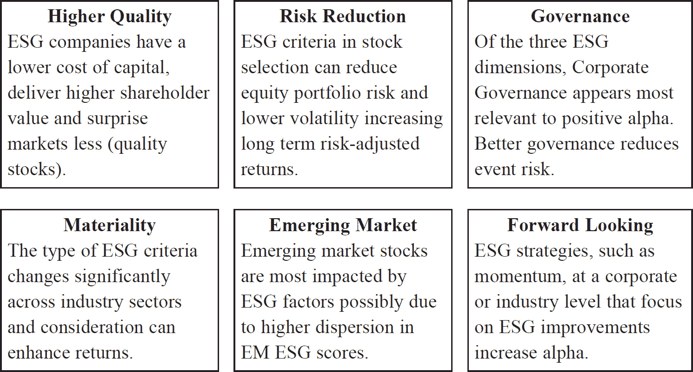

其他学术发现也很有趣。例如，新兴市场受 ESG 因素的影响最大，因为其波动性较高、ESG 分数差异大且监管通常较松。此外，“前瞻性”ESG 策略（如关注公司 ESG 因素改进的趋势）可以提高组合表现。研究显示，ESG 动量的公司表现更优，特别是在考虑治理因素时。因此，那些 ESG 评级差但正在改进的公司也可以被考虑纳入组合。


所以核心问题在于：ESG 投资真的有效吗？除了让投资者感到自己道德高尚之外，将投资投向高评分或正在改进的 ESG 公司真的能改善全球 ESG 指标吗？理想情况下，ESG 投资者的目标不应只是让少数前瞻性公司采用 ESG 原则并获得资金流，而应该提高整个工业部门对真实世界的影响的影响。然而，现在还处于早期阶段，目前为止，关于任何可衡量改进的真实统计证据仍然寥寥无几。尽管有传闻报道，但结论尚且待定。

或许 ESG 投资最受关注的影响是近期针对石油巨头的 ESG 投资者诉讼和股东行动。2021 年 6 月 9 日是投资者针对化石燃料采取行动的风向标日。壳牌（Shell）被荷兰法院要求加速向碳中和转型、削减排放并加快转向可再生能源。与此同时，雪佛（Chevron）的股东投票通过减少其客户污染的提案，而埃克森美孚（ExxonMobil）的两名董事成员被投资者罢免。目前还不清楚任何化石燃料公司如何在 20 年左右真正实现净中和并继续有意义地存在，但投资者现在正迫使他们行动。

金融机构和资产经理对 ESG 投资的公开承诺也正面临考验。仅仅加入联合国负责任投资原则（PRI）似乎已不足以平息 ESG 投资者和公众的。。动摇对 ESG 的承诺无处遁形。2021 年，压力进一步加剧。

反灭绝运动（Extinction Rebellion）打碎了摩根大通（J.P. Morgan）窗窗，回应雨林行动网络（Rainforest Action Network）的一份报告称该公司是企业污染者最大的贷款银行。德意志银行的资产管理部门 DWS 面临德国和美国当局的严重调查，原因是其误导了许多基金的 ESG 资质。甚至贝莱德（Blackrock）的前可持续发展主管也公开声称该公司的 ESG 计划只不过是“公关噱辞”。经理真实的 ESG 资质日益必须是事实而非虚构。

衡量 ESG 投资成功的一个主要问题在于基准设定和对改进真实长期性的量化。高尚和时尚并不一定等同于逻辑和科学上的最佳路径。以电动汽车（EVs）为例，它是 ESG 基金的宠儿。现在，我们可能会主观地对特斯拉等公司的公司治理（G）给出低分，但可能需要像埃隆·马斯克这样的人才能让主要的汽车巨头意识到，电动汽车比过时的牛奶车更有趣、更实用。今天，电动汽车游戏已交由政府（通过氢）作为解决城市污染和实现碳中和解决方案（假设使用可再生能源）。然而，除非格外小心，从电动汽车中将产生更多意料之外的环境问题。据估计，要替换英国所有燃烧碳的车辆，所需的钴是全球年产量的两倍，全球钕的产量，全球锂产量的四之三以及全球铜产量的一半。开采所有材料的能源消耗以及造成的第三世界污染是巨大的。遗憾的是，目前只有不到 5% 的锂电池得到了回收。电动汽车的碳足迹可能比制造传统的内燃机大得多。如果你很高尚并想推广“E”（环境），最好的选择可能是再开你手里那辆 10 年历史的大众高尔夫十十年，同时多乘坐公共交通。遗憾的是，这并不符合潮流，也不是一个可行的长期解决方案。然而，在我们全部扔掉旧的臭柴油车之前，需要对电动汽车制造商施更多的 ESG 压力，让他们开发出完整的电动汽车生命周期，并实现广泛回收和可再生能源驱动。

对于大多数人来说，环境“E”是 E、S、G 中最重要的因素。可以说，环境是一个全球宏观问题，无法通过单个公司及其 CEO 的微观尺度来解决。今年（2021 年），联合国宣布了三个环境行星危机——气候变化、生物多样性丧失和行星垃圾。不幸的是，我们对物资的过度消费是由资源提取、产品创造和废物丢弃的线性经济模型所驱动的。如果让公司任其发展，很难看到业务模式发生根本性变化。ESG 投资的压力和市场力量本身可能是不够的。事实上，可能需要政府监管和领导力来为公司提供国际性的公平竞争环境，以便其集体改进符合 ESG 的流程并保持竞争力。臭名昭著的臭氧层漏洞通过《蒙特利尔议定书》（1989 年）成功解决，该协议禁止了氟氯烃（CFCs）。它作为一个先例，证明了由科学支持的国际规则可以解决全球问题。2002 年关于化学污染物的《斯德哥尔摩公约》和 2015 年关于气候变化的《巴黎协定》有望带来类似的成功。

除了这些推动 ESG 投资创新的国际协议外，为了减少“洗绿”，政府现在正在提议并实施立法提供报告标准化。例如，欧盟正在对银行和评级机构采取更严格的措施，以确保会计和财务报告中的可持续性风险得到正确的表示和评估。美国和英国也在采取行动。尽管这主要针对绿色金融和快速扩张的绿色债券发行，但它为企业更透明的报告铺平了道路。2021 年 3 月，一项重大进展是欧盟《可持续金融披露条例》（SFDR）的引入，该条例确保资产经理必须根据新的监管框架提交其 ESG 声明。必须在投资尽调查过程中提供涵盖最多 64 项 ESG 指标的影响声明。重要的是，该条例的第 6 条和第 8 条涉及 ESG 基金推广和营销的透明度。美国证券交易委员会（SEC）最近的一份评论（2021 年）总结了监管机构的氛围：

```
“存在一种高风险，即某些基金经理正在将其基金推广为所谓的环保、社会和治理产品，而事实却完全不同”。
```

仅仅在基金标签上贴上 ESG 来增加销售已不再是一个可行的方案。从 2018 年到 2020 年，已有超过 2 万亿美元的资产去除了乐观的 ESG 标签。希望十年后，随着这些监管变化结合一致的 ESG 评分和公司披露，ESG 投资的“棕地”领域将得到转型。


数据驱动投资方法的核心在于确定当前的业务状况。尽管你可能认为我们的首要目标应该是预测经济前景或各公司的表现，但主要问题在于我们无法准确地获知现在。经济的当前状态实际上是未知的，因为所有主要的宏观经济变量都基于过去，而且由于获取全国性数据、进行统计汇总、验证并发布结果需要时间，它们通常具有滞后性。在收到一份估算的 `GDP` 打印数据之前（更不用最终的修订值了），存在着整个官僚流程。企业也存在同样的滞后状态。公司财报在内部审计和实际销售很久后才发布。对经济数据和公司结果拥有更好的当前估值，可以提供更具盈利能力的策略，并实现更好的未来预测。

例如，对于许多宏观策略，需要经济预测。传统上这依赖于官方发布的统计数据，如 `US GDP`、失业率、住房数据等。然而，当这些统计数据发布时，它们已经过时了。某些统计数据的滞后可能达数月。即使估计当前的经济活动水平也需要线性外推或复杂的趋势拟合。

近年来，出现了一种使用调查的趋势，虽然调查比官方数据噪音大，但更实时。为了准确性，大量的调查被进行平均处理以消除噪音。例如，`芝加哥联储国家活动指数 (CFNAI)` 每月发布（有 1 个月的滞后），基于 85 个与生产、产量、劳动力市场、实际支出和收入以及商业状况相关的实际活动指标。更具同步性的 `高盛当前活动指数 (CAI)` 包含大约 60 个实际活动指标（水平和变化），其中最大的权重赋予了调查数据，如 `ISM`、`费城联储指数`、`消费者理事会消费者信心指数`等。`CAI` 不使用数据平滑，而是依赖于多元化来实现平滑。

使用更实时的数据来估计当前的变量/状况被称为 `nowcasting`（当下预测）。它已被许多金融机构和对冲基金广泛采用。然而，在互联网和大数据时代，基金经理可以用一系列最新的替代数据。通过通过手机分析引入了餐厅流量、通勤活动、办公室占用率等概念。预测经济和企业的“现在”变得比以往任何时候都更加准确。将替代数据中关于“现在”的最新知识与历史数据相结合，使我们能够更有信心地预测未来。

### 8.2 替代数据

几乎每天我都会受到数据提供商的邮件轰扰，他们提供各种替代数据集。这一趋势始于十年前，但从 2015 年开始迅速加速。到目前，市场上面上至少有超过 1000 个数据集可供投资者纳入他们的投资过程中。显然，至少有 400 个数据供应商。幸运的是，`Bloomberg` 现在通过其平台提供包括第三方数据在内的替代数据集。替代数据市场增长迅速，根据某些估计，在可预见的未来将以 20% 的速度增长。根据 `[alternativedata.org](http://alternativedata.org)` (2019) 的一项调查，资产经理在替代数据上的支出预计从 2016 年的 2 亿美元增加到 2020 年的 20 亿美元以上。几个主要的数据供应商品牌和数据整合商已经进入市场，包括 `Quandl`、`Ravenpack`、`Neudata`、`Orbital Insight`、`Foursquare`、`Thinknum`、`Dataminr` 和 `Eagle Alpha`。

精确定义替代数据有些棘手，因为大量的非市场数据（如经济数字、大宗商品库存、公司结果和卫星数据）在“替代”这一名称出现之前就已经存在了。其中许多数据已经整合到投资策略中。例如，宏观策略使用 `GDP` 和就业人数，金属库存被用于系统化期货。然而，现在的区别在于来自许多来源的海量数据，以及为了充分利用和结合这些数据以投资目的的计算资源可用性。一个分水岭时刻是 Johan Bollen (2011) 臭名昭著的 Twitter 论文《Twitter 情绪预测股市》，该论文虽然以一种不太切实际的方式，证明了可能使用社交媒体数据来预测和交易金融市场。几年后，人们已经确定，如果使用得当，新闻、社交媒体、博客和其他网络数据可以被用来开发成功的交易策略。自 2015 年左右，对冲基金使用替代数据的案例在媒体上变得更加广泛。这些范围涵盖了从跟踪数百万在线产品以预测几十个国家通胀的宏观公司，到使用地理位置、移动应用程序数据和信用卡交易来预测汉堡连锁店的销量。

### 8.3 替代数据的类型

已经有很多不同类型的替代数据。通过替代数据，我们可以在定义中泛泛地涵盖所有非市场数据，如价格和成交数据。我们可以根据原始来源对其进行通分类——来自个人、公司和传感器，以及更传统的经济数据，不要忘记经纪人（`表 8.1`）。可以通过网络爬取、馈送、传感器从源获取原始形式的数据，或从第三方许可。网络爬取（浏览网页并提取相关文本）是一个明显的数据源，而且基本上是免费的。显然，网络爬取是最流行的替代数据源形式，被 40% 以上的基金采用。它需要巧妙的算法来隔离相关数据。尽管你可能想自己尝试，但你可以节省自己的时间，因为有些供应商专门从事这些抓取数据。

#### 8.3.1 来自个人

作为手机和网络成瘾者的个体，我们的行为现在可以以以前所未有的程度被监控和分析。虽然我们的直接提供商（`Apple`、`Amazon`、`Netflix` 等）可能利用我们最近的购买记录来推荐要看的电影、要买的书、我们正在寻找的房子或开车去的地方，但理论上，当数据以聚合形式出售给第三方时，我们的隐私得到了保护。也许正如爱德华·斯诺登指出的，我们所有的个人电子交互和信息情报机构都可以获取，但在商业世界，像 `GDPR` 这样的法规占据主导。然而，对冲基金通常对个人行为感兴趣，而是对我们的集体行为感兴趣。例如，大多数谷歌搜索、热门社交媒体话题、餐厅附近的流量、负面产品评论、新闻网站上的回复、员工公司评论等。遵循个人的情况也有例外。例如，对冲基金曾臭名昭著地扫描影响市场的特朗普推文，如果你在 2020-2021 年交易比特币，你可能也应该扫描 `埃隆·马斯克` 的动态。然而，社交媒体数据对于评估总体公众意见和估计品牌病毒式传播通常用。

表 8.1：替代数据类型和来源。

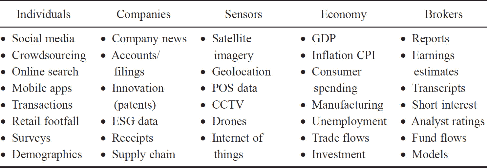


利用个人数据的一个有趣方面是通过众包。在众包模式中，个人贡献对未来事件（如公司收益）的预测，通过投票过程，该事件发生的概率可以被用作估算值。尽管这在表面上依赖于尚存的“群体智慧效应”，但现代技术允许对该方法进行改进，例如，为预测记录最好的个人在最终估算中赋予更高的权重。作为经纪人分析师公司收益预测的替代方案，`Estimize` 公司提供了众包式的收益预测，这显然增加了大盘股选择的 Alpha 收益。

### 8.3.2 来自公司

如今，公司源源不断地产生它们从日常活动中积累的电子“废气”数据。随着越来越多的公司通过电子化和互联网进行交易，积累的数据也越来越多。你还以为当收银员向你要索电子邮件地址以发送电子收据时，她很友善吗？所有的消费者信息都会被收集、跟踪并出售给 `3^(rd)` 方（包括对冲基金），希望是以某种合适的匿名化方式进行。所有的信用卡数据、电子邮件收据、销售数据、网站活动和广告点击都可用于提供公司业绩的实时预测（nowcasting）。

公司新闻流和社交媒体活动补充了现在以机器可读格式提供的大量官方公司声明、账户和文件。公司新闻和事件现在以策划的格式广泛可用，这些内容经过了标签标记，甚至由情感算法进行了预分析（图 8.1）。可以可以说，公司新闻（因为它包含了已电子归档的旧式报纸新闻）提供了最长的替代数据集。

在股票因子模型中，我经常发现自己处于这样的讨论中：公司创新应该被视为一个模型因子。如果一家公司正在进行创新并进行成功的研发，尽管它立即只产生无形资产，但研究未来可能会产生更具利的产品、现金流和收益。替代数据允许不仅通过专利申请，还通过新闻、`H1B` 签证申请（针对研究人员）以及研究资助和资金的授予来衡量这种创新。

自 2018 年以来，一项日益增长的发展（为了满足投资者的关注）是 ESG 数据集的开发。这些数据（与公司 ESG 评估的相关性尚存疑）范围比传统的纯财务分析要广泛得多。数据可能涵盖从碳排放、用水量到就业政策和员工多样性等多个方面。尽管这大部分数据变动较慢且基于公司披露，但有关意外 ESG 事件的新闻流会对股价产生很大影响。

### 8.3.3 来自传感器

传感技术可以提供实用的替代数据源。某些来源如卫星图像具有很长的历史，从大宗商品交易员利用其预测作物产量，到数数 `Walmart` 等零售商停车场内的汽车，监控油轮航航路线以预测油价，以及监控施工现场以获取中国 PMI。其应用列表极具想象力。其他技术如手机地理定位、`POS` 数据、`CCTV`、无人机数据和物联网是较新的，或者需要图像存储和数据分析技术才能跟上。虽然较新的手机数据允许创建新颖的人流量和消费者活动指数，但它也允许高粒度的数据分析，例如对特定商场、餐厅和零售店的分析。这些数据可以改进对公司业绩和收益的预测，并补充实时预测。

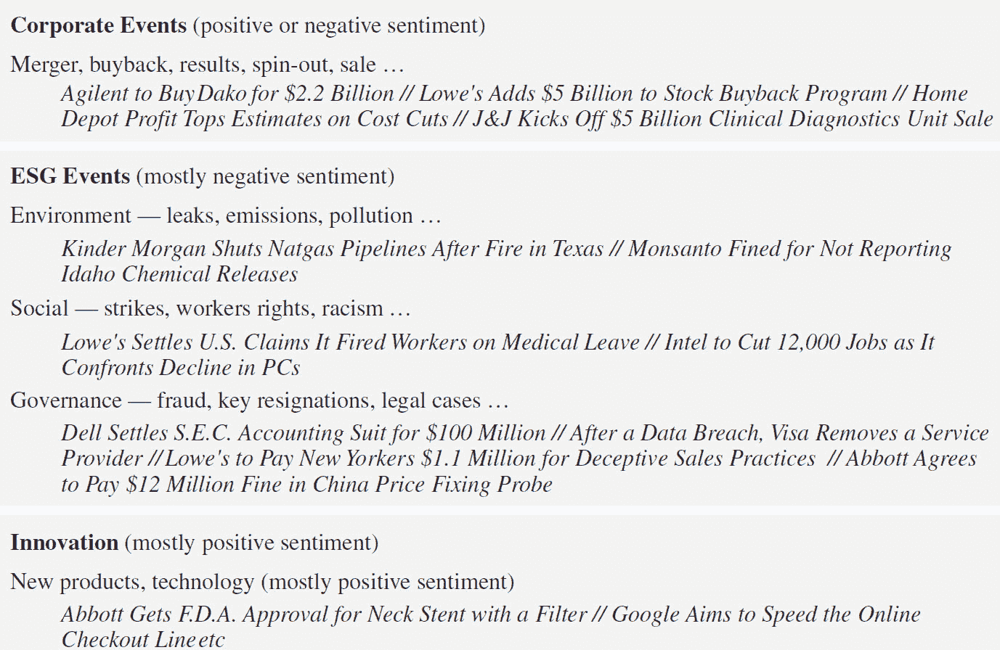

图 8.1：使用 NLP 分类的公司新闻事件示例。

### 8.3.4 来自经济

从中央银行到政府和国际机构的各种传统组织都会产生经济数据，包括 GDP 增长、通货膨胀、消费支出、贸易流量、大宗商品数据等。这些数据主要是滞后的传统基本数据，但也包含了许多最新的调查和民意。其他有用数据由交易所和相关组织提供，例如大宗商品库存（如金属和原油）和生产者的对冲活动。

### 8.3.5 来自经纪人

经纪人对公司的评级非常重要，多年来一直用于交易策略。其中最著名的是 `Marshal Wace` 的 `TOPPs` 策略，许多基金都为此创建了类比策略。经纪人可以提供股票空单和收益预期。此外，关于个人公司和行业的经纪人报告，以及关键人员和专家的访谈录也可以作为替代数据纳入。

### 8.4 将替代数据整合到投资过程中

2018 年，我主持了一场题为“利用替代数据集产生新 Alpha 来源”的小组会议，来自 `Goldman Sachs`、`JP Morgan` 和道琼的代表。这是一个回顾替代数据市场发展以及替代数据如何在实践中使用的有趣机会。尽管在引入替代数据方面存在大量炒作，但实际上将替代数据整合到投资过程中面临许多必须仔细考虑的问题。我们列出了一份长的问题清单，包括：数据选择、导入、数据结构化、覆盖范围、Alpha 确定、整合问题、隐私、唯一性、容量、法律和隐私考虑，最后还有获取数据的成本（图 8.2）。

#### 8.4.1 选择与导入

替代数据的首要问题是不同类型极其丰富且质量差异巨大。人们如何从数百个可用数据集中筛选出质量更高的数据？数据经纪商和 `3^(rd)` 方供应商本质上是有偏见的的。他们都声称自己的数据集是“高 Alpha”、独特的且定价准确的。坦率地说，很少有人雇佣研究团队并撰写白皮书来帮助客户识别其数据集的价值。证明销售合理性的大量工作实际上留给了客户。对数据集的初步分析非常耗时，需要经过高度训练的数据科学家来将潜在的 Alpha 与垃圾信息区分开。


图 8.2：典型的替代数据实施问题。

一个主要的不确定性是数据与问题的相关性。数据是否代表了与我们关注的市场之间一阶或二阶的关系？例如，如果我们运行的是宏观大宗商品策略，我们真的对特定的、不相关的公司报告的 NLP 分析或众包收益数据感兴趣吗？

一旦决定探索新的数据集，就需要进行尽职调查。在签署正式许可协议之前，通常会提供试用期，须签署保密协议 (`NDA`）。

数据的初步分析将包括数据格式、质量、频率、覆盖范围和历史。因此，探索点可能包括：数据是否存在噪声、不完整或缺失时期？

#### 8.4.2 结构化数据与非结构化数据

许多数据集基于原始的非结构化数据。大量时间可能会浪费在分配元标记、附加股票代码和构建易于操作的时间序列上。结构化数据已经完成了大部分繁琐的数据处理，某些数据集甚至经过了策划以方便使用。


图 8.3：使用 NLP 数据流水线提供公司事件评分。


例如，新闻或社交媒体数据可能以原始形式提供。从零开始是一项艰巨的工作，需要构建 NLP 分析来确定涉及的机构实体、文章性质以及对相关性或重要性进行评分（图 8.3）。通常可能还需要进行文本分析以提取情绪。由于我亲自在主要新闻源的 API 上进行过这些编程，我可以证明，尽管这很有趣，但非常耗时，而且在后后的生产或交易环境中维护元数据标记（meta tagging）是非常繁琐的。某些第三方提供商如 `Ravenpack` 可以提供结构化、分类良好的新闻数据，从而消除掉一些痛苦和维护工作。相反，可以将精力放在使用数据和构建算法上。

一些提供商更进一步，提供了从他们能够获取的各种替代数据源中构思出的交易信号。这些提供商并非受监管的投资顾问，而是没有市场经验的软件公司，更重要的是，如果表现不符合预期，他们不承担任何责任。“买者自负”（Caveat emptor）在此适用。不知为何，我觉得购买一种声称“有效”的现成策略略有些不体。如果它真的那么有效，那么提供商难道应该自己管理资金吗？这也有问题，因为如果你在管理他人的资金，你应该参与信号设计，并在你自己的策略范围内控制研究过程。如果你是那个在出错时直接承担责任的经理，而不是那些仅仅调整模型并发布重新拟合分析的“卖方”研究员，那么则需要不同水平的科学严谨性。我在检查第三方信号时注意到的一点是，他们的方法论往往随着时间的推移而发生变化或得到“改进”，这使得对原始样本内和样本外数据的验证变得难以控制。

### 8.4.3 数据覆盖和历史

对于我们这些生活在欧洲的人来说，遗憾的是，大多数替代数据目前以美国为中心。大多数数据集涵盖美国公司，特别是产生大量数据排放的大型科技公司和零售商。你想看到 `Amazon`、`Apple`、`Walmart`、`Costco` 等公司的数据次数是有限的。通过增加另一个替代数据集来在这些股票的交易上获得优势的机会微乎其微。希望未来数据覆盖范围将得到提高。

数据的频率非常重要，实际收集日期也是如此。为了提供良好的即时预测（nowcasting），我们需要数据收集和发布尽可能接近任何交易日。滞后数据在交易中通常没有价值。与供应商提供的时间戳建立真正的同步性是至关重要的。如果时间戳错误且早于你在实盘交易中获取数据的实际日期，可能会建议出乐观但错误的 alpha（超额收益）。

数据集的历史长度增加了我们对使用该数据进行投资的统计信心。对于系统化交易，我们需要 10-15 年的长历史数据集，对于机器学习方法则需要更长。通常，许多替代数据集无法提供此类数据。新闻数据可能有 25 年以上，但许多社交媒体数据不到十年，而对于像 `ESG` 这样较新的数据，大约只有五年。大多数替代数据根据定义是新的，并且只经历过一种市场机制，即自 2010 年以来 `QE`（量化宽松）的牛市时期。构建一个依赖较新替代数据源的可信系统化交易系统是一个主要障碍。

出于这个原因，大多数替代数据集可能更适用于量化结合（Quantamental）世界，在那里可以运用人类的判断。人类可以很容易地判断一个数据源是否相关以及它可能会预测什么。例如，在 2021 年 3 月的新冠病毒崩溃之后，人类能够更好地解释由手机提供的新型地理位置数据，这些数据衡量了封锁期间的经济活动。

### 8.4.4 数据集 alpha 确定

最重要的问题是哪些数据集实际上提供了 alpha？数据供应商说它们都都提供，但反过来说，他们有财务动机使他们对每个数据集都充满热情。有时我甚至会收到标题为“高 alpha”和“仅出售给 5 个顶级客户”之类的邮件。好吧，也许情况确实如此。我觉得购买一种声称“有效”的现成策略略有些不体。如果它真的那么有效，那么提供商难道应该自己管理资金吗？这也有问题，因为如果你在管理他人的资金，你应该参与信号设计，并在你自己的策略范围内控制研究过程。如果你是那个在出错时直接承担责任的经理，而不是那些仅仅调整模型并发布重新拟合分析的“卖方”研究员，那么则需要不同水平的科学严谨性。我在检查第三方信号时注意到的一点是，他们的方法论往往随着时间的推移而发生变化或得到“改进”，这使得对原始样本内和样本外数据的验证变得难以控制。


随着大数据和机器学习技术的出现，由于能够识别跨数据集的相关性，AI 已变得流行。然而，正如我们所讨论过的，AI 在市场预测中的应用受限于其对因果关系的简单处理以及金融市场的单一历史本质。AI 系统的阿喀琉斯之踵是乐观的过拟合以及随之而来的实盘交易失望。

系统化投资结合了人类假设和对现象的经验发现。这些算法比基于 AI 的方法简单，而且通常更直观、更易理解。这些算法通常是人工策划的，在某种程度上可以被视为非常“狭窄”的 AI。然而，由于它们受科学技术的限制，它们再次受限于足够的高质量长周期数据集。系统化交易可以轻松整合存在于多种市场环境中的新闻和分析师评分等数据集。然而，不稳定的、短期的替代数据可能比毫无用还要糟，成为对时间和资源的嘈杂干扰。

在 AI 和计算机的炒潮中，我们往往没有意识到，AI 大多数受赞誉的成就，如 `Deep Blue` 击败卡斯帕波夫、`Watson` 赢得《危险一答!》以及 `AlphaGo` 击败李世石，都处于一个非常狭窄的 AI 领域。`Watson` 可以访问 2 亿页知识进行搜索。`AlphaGo` 使用了深度强化学习，这是一种终极模式识别机器，它通过研究数千名人类玩家来学习。随后的迭代版本 `AlphaGo Zero` 更加令人印象深刻——通过自我对弈学会了基本规则。

最近，Ragnar Fjelland 在 `Nature` 上写了一篇题为《为什么通用人工智能 (AGI) 将无法实现》的文章，他的论文基于 Hubert Dreyfus 早早的工作。Dreyfus 反对 AGI 的主要论点是“计算机不在世界上”，而且人类获得的隐性知识和技能是机器无法轻易学习的，或者无法以算法格式精确编码的。狭窄的 AI 无法轻易部署到其他学科。事实上，当 `Watson` 应用于医学时，它显然失败得非常惨。计算机爱好者极大地低估了人类的技能。成为熟练的专家是通过与外部环境和世界互动，并能够利用洞察力解释关联事件之间的因果关系来实现的。你无法通过阅读任何书籍来成为顶尖医生或音乐家。人类拥有感知和理解能力。现实中，计算机在许多领域可能永远无法达到人类的技能水平，而交易可能正是其中之一。

替代数据的主要应用可能是增强主观交易。当数据集受限时，人类可以使用他们对世界的理解来推断并得出意义，而无需诉科学过程。主观交易者的知识和技能往往被系统化思维者所低估。解释稀疏数据是观交易者一直从事的工作。人类的直觉源于经验。

寻求不广泛的信息和见解一直提供着主观优势。例如，在电影《华街》（1987 年）时代，Bud Fox 可能会在城里跟跟踪高管，以确认 Lawrence Wildman 士计划购买 Anacott Steel。在替代数据时代，你可以简单地购买企业喷机飞行信息，并在市场之前发现并购。当 `Chevron` 以 330 亿美元竞标页岩公司 `Anadarko Petroleum Corporation` 时，奇怪的是在一个周日晚上，看到较小的竞争对手 `Occidental` 的代表飞往奥马哈（内布拉斯拉斯加州），那是沃伦·巴菲特的家乡。第二天宣布，巴菲特已同意向 `Occidental` 注资 100 亿美元，以便它可以以 380 亿美元竞标 `Anadarko`。几家对冲基金随后利用这一信息。

## 附录 A

### A.1 现代组合理论
现代组合理论基于资产收益遵循正态分布的假设。组合预期收益为

```
r_p = Σ w_i * r_i
```

组合的方差为：

```
σ_p² = Σ Σ w_i * w_j * cov(i_i, r_j)
```

受限于：

```
Σ w_i = 1
```

### A.2 布朗价格
股价最经常被建模为几何布朗过程。对于每个微小的时间段 `dt`，股价的变化 `dS` 与以下相关：

```
dS = μ*S*dt + σ*S*dW
```

相对变化

### A.3 伊藤引理
引引可能是随机微积分领域应用于期权定价中最有结果。变量 `x`（例如随机股票价格）的伊藤过程有如下方程：

```
dx = α(x,t)dt + β(x,t)dW
```

现在考虑函数 `f(x,t)`，例如期权价格，依赖于 `x` 和 `t`。伊藤引理显示 `f` 遵循随机过程：

```
df = (∂f/∂t + α*∂f/∂x + 0.5*β²*∂²f/∂x²)dt + β*∂f/∂x*dW
```

### A.4 布莱克-舒尔斯微分方程
股价遵循伊藤过程：

```
dS = μ*S*dt + σ*S*dW
```

因此，根据伊藤引理，任何单一股票衍生品的价格 `f(S,t)` 由 `S` 和 `t` 决定：

```
df = (∂f/∂t + r*S*∂f/∂S + 0.5*σ²*S²*∂²f/∂S²)dt + σ*S*∂f/∂S*dW
```


这与 `dz` 无关。因此，该组合对价格波动进行了对冲，并且在 `dt` 期间是瞬时无风险的。显然，对于有效市场中的对冲组合，该组合的投资者的收益不会高于无风险利率 `r`。因此，我们可以将无风险组合的收益设定为 `r`。由此得到


重新整理后得到著名的 Black–Scholes 微分方程


Black-Scholes 偏微分方程 (PDE) 允许对取决于基础变量 `S` 和 `t` 的各种衍生品进行评估。根据应用于二维 PDE 的边界条件，可以获得许多解。例如，对于到期值为 `T` 的欧式看涨期权，在时间 `t` = `T` 时的边界条件简单地为收益


可以使用多种技术（包括有限差分格和“树””）来求解该 PDE。通常情况下，末期收益日的边界条件是已知的，并获得解为 `f(S(0),0)`，即今日股票现价 `S(0)` 在今天（`t` = 0）的期权价格。

### A.5 Black–Scholes 期权定价方程

期权定价的基本概念是，在“无套利世界”中，期权价格等于期权收益期望的现值。为了计算这个期望或预期值，我们必须计算一个概率加权收益，该收益等于股票概率乘以期权到期时所有可能的股票价格对应的收益。在风险中性世界中，现值折现将使用无风险利率 `r`。

为了对 Black–Scholes 方程进行简单推导，考虑一个在到期日 `T` 最终收益为 `Max(S(T)) – K,0)` 的看涨期权。图 A.1 显示了最终股票价格 `Pr(S(T))` 的假设概率分布。该概率分布是对数正态的，并以股票远期价格为中心。现在对于一个例如行权价 `K` = 150% 的期权，唯一的非零收益位于分布的尾部（阴影区域）。为了计算概率加权收益，我们必须将该区域的收益 `(S(T) – K)` 乘以概率。实际上，这等于对概率分布 `Pr(S(T))` 进行积分并乘以期权收益 `Max(S(T) – K,0)` 以获得期望值。该期望值必须使用折现因子 `D(0,T)` 折现回今天，给出预期收益的现值和期权价值。从数学上，我们可以将此积分写为


图 A.1：Black–Scholes 看涨期权估值。


由于我们知道 `S` 的随机过程，我们可以进行这种积分得到 Black-Scholes 看涨期权价格


其中 `N` 是累积正态分布，且


看跌期权的价值可以通过类似的方法推导出，并得到


上述方程可以很容易修改修改以包含股票股息，通过将支付连续股息 `q` 的股票的 `S(0)` 替换为 `S(T)e^(–qT)`。

### A.6 遍历过程

在所谓的遍历动力学系统中，系统的给定状态最终将访问系统所有可能的相空间点。系统的平均行为可以从相空间中典型点的轨迹中推断出来。因此，在遍历过程中，每个序列或大样本被视为整个过程的统计代表。这是一个广泛应用于物理科学的概念，特别是用于平衡系统的统计热力学。它是否适用于金融领域具有高度推测性。

### A.7 圣彼得堡悖论

在圣彼得堡游戏中，投掷硬币直到第一次出现正面。玩家随后赢得 `$2^(n)`，其中 `n` 是投掷次数。为了玩这个游戏，玩家必须支付初始金额。他必须支付多少？根据数学期望（类似于期权定价理论中使用的），支付的金额应该是无限，这显然是荒谬的。


这个悖论源于对硬币次数进行概率加权求和，这是一个产生无限值的无穷和。它说明了在期权定价中对具有大值的低概率事件进行积分的危险——例如，巨大的价外 (OTM) 期权收益。

### A.8 折现因子、零利率和远期利率

从时间 0 到时间 `t` 期间的折现因子给出


其中 `zA` 是到期值为 `t` 的年化零利率。如果 `z(0,t)` 是连续复合零利率，我们可以将折现因子写为


时间 `t` 时 `T` 和 `T + h` 之间的简单复合远期利率定义为


### A.9 Hull–White 模型

广泛使用的 Hull–White 模型可能是最简单的单因子利率期限结构模型，它可以成功应用于广泛产品的定价。该模型提供的高水平分析处理性使得许多类型的结构可以以解析解求解。例如，对于到期值为 `T` 的欧式看涨期权，在时间 `t` = `T` 时的边界条件简单地为收益


该 PDE 可以多种技术（包括有限差分格和“树”）来求解。通常情况下，末期收益日的边界条件是已知的，并获得解为 `f(S(0),0)`，即今日股票现价 `S(0)` 在今天（`t` = 0）的期权价格。

### A.5 Black–Scholes 期权定价方程

期权定价的基本概念是，在“无套利世界”中，期权价格等于期权收益期望的现值。为了计算这个期望或预期值，我们必须计算一个概率加权收益，该收益等于股票概率乘以期权到期时所有可能的股票价格对应的收益。在风险中性世界中，现值折现将使用无风险利率 `r`。

为了对 Black–Scholes 方程进行简单推导，考虑一个在到期日 `T` 最终收益为 `Max(S(T)) – K,0)` 的看涨期权。图 A.1 显示了最终股票价格 `Pr(S(T))` 的假设概率分布。该概率分布是对数正态的，并以股票远期价格为中心。现在对于一个例如行权价 `K` = 150% 的期权，唯一的非零收益位于分布的尾部（阴影区域）。为了计算概率加权收益，我们必须将该区域的收益 `(S(T) – K)` 乘以概率。实际上，这等于对概率分布 `Pr(S(T))` 进行积分并乘以期权收益 `Max(S(T) – K,0)` 以获得期望值。该期望值必须使用折现因子 `D(0,T)` 折现回今天，给出预期收益的现值和期权价值。从数学上，我们可以将此积分写为


图 A.1：Black–Scholes 看涨期权估值。


由于我们知道 `S` 的随机过程，我们可以进行这种积分得到 Black-Scholes 看涨期权价格


其中 `N` 是累积正态分布，且


看跌期权的价值可以通过类似的方法推导出，并得到


上述方程可以很容易修改修改以包含股票股息，通过将支付连续股息 `q` 的股票的 `S(0)` 替换为 `S(T)e^(–qT)`。

### A.6 遍历过程

在所谓的遍历动力学系统中，系统的给定状态最终将访问系统所有可能的相空间点。系统的平均行为可以从相空间中典型点的轨迹中推断出来。因此，在遍历过程中，每个序列或大样本被视为整个过程的统计代表。这是一个广泛应用于物理科学的概念，特别是用于平衡系统的统计热力学。它是否适用于金融领域具有高度推测性。

### A.7 圣彼得堡悖论

在圣彼得堡游戏中，投掷硬币直到第一次出现正面。玩家随后赢得 `$2^(n)`，其中 `n` 是投掷次数。为了玩这个游戏，玩家必须支付初始金额。他必须支付多少？根据数学期望（类似于期权定价理论中使用的），支付的金额应该是无限，这显然是荒谬的。


这个悖论源于对硬币次数进行概率加权求和，这是一个产生无限值的无穷和。它说明了在期权定价中对具有大值的低概率事件进行积分的危险——例如，巨大的价外 (OTM) 期权收益。

### A.8 折现因子、零利率和远期利率

从时间 0 到时间 `t` 期间的折现因子给出


其中 `zA` 是到期值为 `t` 的年化零利率。如果 `z(0,t)` 是连续复合零利率，我们可以将折现因子写为


时间 `t` 时 `T` 和 `T + h` 之间的简单复合远期利率定义为


### A.9 Hull–White 模型

广泛使用的 Hull–White 模型可能是最简单的单因子利率期限结构模型，它可以成功应用于广泛产品的定价。该模型提供的高水平分析处理性使得许多类型的结构可以以解析解求解。例如，对于到期值为 `T` 的欧式看涨期权，在时间 `t` = `T` 时的边界条件简单地为收益


该 PDE 可以多种技术（包括有限差分格和“树”）来求解该 PDE。通常情况下，末期收益日的边界条件是已知的，并获得解为 `f(S(0),0)`，即今日股票现价 `S(0)` 在今天（`t` = 0）的期权价格。

### A.5 Black–Scholes 期权定价方程

（此处内容重复，已根据要求在翻译逻辑中处理，但原文中存在重复段落，按原文翻译如下）

（略）

具有伯尔穆式和美式行权权的结构可以使用组合树和有限差分技术定价。

Hull–White 模型是无套利全收益曲线模型。它精确拟合观测到的期限结构，收益曲线的移动被建模为近似平移。因此，该模型适用于取决于浮动利率或 LIBOR 的产品，但并不真正适用于某些收益强烈取决于收益曲线形状的产品。

Hull–White 框架将现利率 `r(t)` 建模为随机正态过程。


漂移函数 `θ(t)` 允许拟合零曲线，参数 `a` 决定模型内部避免利率过高或过低的均回归效应。无均回归且 `a = 0` 的简单模型被称为 Ho–Lee 模型。

类似于 Black-Scholes PDE，可以为 Hull–White 模型推导出一个取决于现利率波动的 PDE


其时间 `t` 到期于 `T` 的折现债券解显示为


因此，折现因子是随机的，并取决于现利率水平。这里 `B(t, T)` 是


且 `A(t,T)` 由给出


我们可以看到现值 `r` 遵循正态过程，但折现债券价值具有对数正态过程。在推导许多解析解时使用的一个有用结果是时间 `t` 在未来时间 `s` 购买并在之后时间 `T` 到期的远期折现债券的随机价值。这给出


其中 `Z ~ ϕ(0,1)` 且 `v(t,T,s)` 是折现债券的波动率。


这一结果对于建立上限/下限、掉期期权和更复杂的衍生品有用。

### A.10 Notes

为选择期权定价，我们假设投资者是理性的，并在每个周期开始设定范围以优化其预期收益。这我们需要计算预期收益并对障碍放置的位置进行最大化。这需要对每个 *i* 周期进行计算，涉及预期收益的导数以确定形式为 `K[i]` 的行权价


这为形式如下 `chooser accrual notelets` 提供了解决方案：


其中


且 `K`（优化后的障碍水平）是针对特定 `Z` 的以下方程解：


使用了 Hull–White 折现债券波动率函数


#### A.11 入场反向转换债券 (Knock-in Reverse Convertibles)

对于行权价为 `K[1]`、入场水平为 `K[2]` 的看跌期权，其预期收益可以写为：


在这里我们使用了指示函数 `χ`，当 `S(T)` ≤ `K[2]` 时其值为 1，否则为 0，因此如果障碍在到期前（0 < `t` ≤ `T`）触发，则行权价为 `K[1]` 的看跌期权将被激活。其闭式解作为障碍期权给出。

#### A.12 股票最差期权 (Equity Worst-of Options)

最常见的最差期权形式支付篮子中表现最差的部分，没有行权价（行权价设为零），实际上是最差的远期合约。因此，该期权的价值为：


#### A.13 脉冲保护票据 (Pulsar Protected Notes)

Pulsar 产品可以分解为：

(i) 一份在到期时兑回 100% 的零息债券；

(ii) 一份最差出场二元期权，支付 `B` = 200%，障碍设在 `K` = 每只股票初始价格的 40%；以及

(iii) 一份最最差入场远期合约，入场水平为 40%，远期行权价为初始股票价格


# 附录 B

自由裁量冒险 (Discretionary Adventures)

#### B.1 戈登增长模型 (Gordon Growth Model)

在戈登增长模型中，公司的股票价格是所有未来股利折现到今天的现值之和。这可以离散地写为无限和：


其中 `d[0]` 是当前股利，`g` 是股利增长率，`r` 是折现率。计算该和得出：


这可以简洁地写为股息率加上增长率等于权益成本或权益收益率：


#### B.2 公司事件简词表

##### B.2.1 公司合并

A 公司提议收购 B 公司。交易可以通过多种方式融资，如全现金（可能需要发行债券/贷款来融资）、使用股权或两者结合。

##### B.2.2 业务拆分

公司拆分或出售某个实体或子公司。这产生的现金可用于去杠杆、特别股息等。

##### B.2.3 私有出售

拥有关键股东或赞助人的公司进行私有出售。这可能是面向新的投资者财团或私募股权集团。它可能导致杠杆或股权发行。

##### B.2.4 股权配股

需要筹资金的公司可以通过股权配股优先向现有股东发行新股。如果公司处于困境，这可能会以相对于现有股价的明显折扣价格进行。

##### B.2.5 首次公开募股

`首次公开募股` (IPO) 是向公众出售私有持有公司的股份。这是希望开始实现投资变现的私募股权公司常用的退出策略。有时公司会被私有化、重组并重新进行 IPO。如果你是债权投资者，这通常是一个积极事件，通过股价为公司业绩提供了急需的透明。

##### B.2.6 公司重组

业绩糟糕的公司可能会进行重组以减少杠杆并避免违反债务契约。这可能包括削减成本、出售资产、关闭工厂等某些重组是在美国第 11 章提供的破产保护下进行的。

##### B.2.7 资产负债表重新杠杆

如果公司在资产负债表去杠杆方面取得了进展，这可能是次优的，并可以重新杠杆。这对于可以支付特别股利的私有公司尤为如此（见下文）。可以以贷款或债券的形式发行更多债务。

##### B.2.8 资产负债表去杠杆

许多杠杆过高的公司，如果有自由现金流允许，其首要目标是去杠杆。这些公司通常是“堕落天使”，它们从投资级跌至垃圾级，并希望恢复以前的投资级地位。

##### B.2.9 LBO 和 MBO

`杠杆收购` (LBOs) 和私募资助的`管理层收购` (MBOs) 通过发行债务回购公有股权，使公司重新杠杆并私有化。

##### B.2.10 潜在的 LBO

传闻或尝试的 LBO 通常足以引发一项重大的公司事件。关于一家低杠杆公司（通常为投资级）将被收购、重新杠杆并背负大量债务的新闻会导致股票上涨和信用利差扩宽。

##### B.2.11 回购股票

拥有闲现金的公司可以进行股票回购。股票回购计划通常有利于公司股价。

##### B.2.12 收购

公司可以每半年收购新的业务单元。这可能需要杠杆新的协同效应，或者作为 IPO 的序奏。

##### B.2.13 特别股息

私募股权公司可以由于增长或杠杆对公司的 EBITDA 进行重新估。

##### B.2.14 困境

困境公司要么接近违约要么处于重组模式。回收价值。

#### B.3 浮动利率票据


`Floating rate notes` (FRNs，浮动利率票) 从一级来看对利率变化免疫。这一常识在初次遇到时可能会让人感到意意外。然而，它在数学上很容易证明。考虑一种非常基本的 FRN，它在每个付息期 `h` 结束时支付浮动利率利息 `f`且没有固定差额。假设基准或计息期 `h` 对于所有付息期都是相同的。第 `i` 个付息期使用的浮动利率通常被固定为每个付息期 `t[*i*]` 开始时的当时市场利率。因此，浮动利率对应于时间 `t[*i*]` 时 `t[*i*]` 与 `t[*i*] + h` 之间的远期利率。我们将第 `i` 个远期利率写为 `f[*i*] = f(t[*i*], t, t[*i*] + h)`，那么可以将 FRN 的价值写为 `N` 个预期浮动利率利息 `f[*i*]h` 之和加上本金的现值：


通过代入远期利率的定义


我们可以证明这种不含信用风险的 FRN 的价值等于面值（100%）。这是金融计算中一个非常实用的结果，并证明了所有 FRN 投资者都熟知的这一点——FRN 的价值对利率水平或变化不敏感，因为浮动利率的任何变化会被折现因子的变化抵消。

### B.6 平值资产交换 (Par Asset Swap)

在 `par asset swap` 中，买方以面值（100%）的有效价格购买一种固定利率债券，并将其换为浮动利率利息。重要的是，底层债券的价格可能并不恰好是面值。

`asset swap buyer` 支付 100% 并接收债券和一个掉期合约（见图 B.1）。根据掉期，买方支付固定利息 `c`（加上本金），并从 `seller` 处接收浮动利率 LIBOR 加差额 `s[Par]`。对于买方，掉期交易的价值为


图 B.1：平值资产交换现金流。


其中 `Pbond` 是到期日为 `T` 的债券的市场价格。在这里，浮动端的支付在日期 `t[*i*]` 进行，计息天数为 `h[*i*]`，固定端的债券支付在日期 `t[*j*]` 进行，计息因子为 `l[*j*]`。为了平衡掉期，我们必须设定 `V(0,T) = 0`，且 `sPar` 为 `par asset swap level`。对于 `market asset swap`，则按市场价值交换债券。

### B.7 随机违约模型 (The Stochastic Default Model)

当 `firm value A(t)`（或企业价值）低于到期日 `T` 时公司债务价值 `B` 时，就会发生违约，即 `A(T) < B`。债务可以被视为在 `T` 时的零息票。在最简单的情况下，违约发生的条件是


```
违约概率由给出

其中 `τ` 是违约时间。债券的价值由

给出

股权价值由

给出

生存概率由

给出

违约强度由

给出

风险率（hazard rate）由

给出

违约密度由

给出

累计违约由


图 B.2：随机模型。

### B.8 归约形式模型 (The Reduced Form Model)

`reduced form model` 广泛应用于信用衍生品中，并使用泊松分布来表示信用事件。对于泊松过程，在 `t` 和 `t + dt` 之间发生违约的概率（假设尚未发生违约）为


其中 `λ(t)` 是风险率或违约强度。生存概率 `L(0,T)` 为


### B.9 信用事件定义

主要的 ISDA 信用事件包括破产、未付息、重组、否认/延期、债务加速和债务违约（见表 B.1）。

### B.10 信用违约互换的的定价

使用归约形式模型，可以导出一个典型的普通信用违约互换（CDS）的估值公式。假设了一个 `par recovery` 框架，其中债券持有者在违约时应获得相当于面值加应计利息的金额。

CDS 可以被视为(i) 一项保费流（通常按季度支付），在信用事件时终止；(ii) 在信用事件时支付的（100%−收回率）金额（见图 B.4）。如果考虑连续时间计算，我们可以将到期日为 `T` 的 CDS 估值为保费流价值的期望（如果 `τ < T`，则保费流在违约时间 `τ` 终止），减去信用事件支付（后者仅在违约发生在到期日之前，即时间 `τ < T` 时才会发生）。CDS 的价值由期望给出


| 术语 | 说明 |
| :--- | :--- |
| 重组 (Restructuring) | 重组涵盖由于某些事件，导致由参考实体与相关义务持有有人共同约定的管理相关义务的条款对持有人的条件变得比原本更不利的情况。这些事件包括义务项下本金金额或应付利息的减少、支付推迟、支付优先顺序的变化或任何其他支付组合的变化。 |
| 否认/延期 (Repudiation/ Moratorium) | 参考实体否认、免责或以其他方式质疑相关义务的效力。通常适用于主权国家。 |
| 债务加速 (Obligation Acceleration) | 由于参考实体违约，导致相关义务在原本应到期应付之前变为到期并应付。 |
| 债务违约 (Obligation Default) | 由于参考实体违约，导致相关义务在原本可以声明为到期应付之前变得可以声明为到期应付。 |


图 B.4：CDS 信用权现金流定价。


这可以通过数值方法轻松求解，但对于 `r`(`t*) = `r` 和 `λ`(`t*) = `λ` 可以推出一个快速的闭解。


现在对于市场价值 CDS，交换价值为零，因此公允价值溢价为


### B.11 相关违约时间的正态 Copula 模型

在违约过程中引入相关性的标准市场模型是`正态 Copula 模型`，其中违约时间是相关的。考虑一个包含 `M` 个参考实体的篮子。定义 `Q``i*` = `Pr`(`τ`[`i*]` ≤ `t*)` (`i` = 1, . . , `M`) 为第 `i` 次信用在时间 `t` 前发生信用事件的累计概率，其中


我们可以定义变量 `x`[`i*]` 使得 `N`(`x`[`i*]`) < `Q``i*`，其反函数为


其中 `N`^(–1) 是`反累积正态分布`。`x`[`i*]` 的联合分布是`多元正态的`。为了模拟时间 `t` 前违约，我们必须生成 `M` 个相关的正态随机变量 `x`[`i*]`，如果条件 `x`[`i*]` < `N`^(–1)(`Q``i*`) 成立，则在此期间发生了第 `i` 次信用的违约（参见图 B.5）。这允许我们对篮子进行定价，并通过仿真对其他相关违约产品（如 CDO）。


图 B.5：正态 Copula 模型：将正态随机变量映射到违约时间。

### B.12 信用曲线交易

对于涉及两个不同期限（`T[1]` 和 `T[2]`）CDS 的信用曲线交易，我们必须考虑每个 CDS 的价值变化 `ΔV`，它是市场均值 (MTM) 变化与持仓 (carry) 之和。MTM 大约等于 CS01 乘以 CDS 溢价的变化。对于这两个 CDS，我们有


如果我们卖出名义为 `N[1]` 的保护并买名义为 `N[2]` 的保护，利润为 `PL(t)`


此外，如果我们假设对于久期对冲的曲线交易，名义金额与 CS01 成反比，则有 `N` = `N[1]`CS01(`t`,T[1])` = `N[2]`CS01(`t`,T[2])`，因此


这可以写为曲线交易利差的变化加上持仓项


如果 `N[1]*q*(0,T[1])` > `N[2]*q*(0,T[1])`，则该交易为正持仓。

### B.13 夏普比率

夏普比率是风险与收益最常见的衡量标准，定义为


其中 `r` 是策略收益，`r[f]` 是无风险收益，`s` 是投资期内的波动率。

### B.14 风险价值

风险价值 (VaR) 的计算通常


其中 `ω` 是包含所有权重的向量，`Σ` 是协方差矩阵。两个序列 `X` 和 `Y` 之间的协方差 `Cov(X,Y)` 由


# 附录 C

### 通用方法

来自系统模型的信号和指标为交易提供了预测。信号可以是离散的（例如 -1 做空、0 平、+1 做多），也可以是连续的，其中信号的大小提供了对特定交易的确定程度。因此，在某种意义上，连续信号的大小应该与预测的预期概率成比例。


图 C.2 显示了线性封顶响应函数的示例，包括在零附近具有“死区”（deadspot）的线性函数，以及 附录 C.4 中的指数样样条函数。死区确保了除非底层信号足够强触发响应，否则不会建立交易头寸。指数响应函数会针对大信号缩小头寸规模。


图 C.2：不同的信号响应函数。

#### C.1.4 头寸风险缩放

名义价值为 `N`、市场波动率为 `σ`、信号 Z 分数为 `Z` 且响应函数为 `R` 的头寸，可以风险缩放到目标波动率 `σ`[`T*]`：


对于期货合约，名义价值 `N` 由价格乘以合约数量（手数）和跳动价值给出：


### C.2 时间序列处理

在计算中，使用指数加权移动平均线（EWMA）通常比简单移动平均线（SMA）更有效。

#### C.2.1 简单移动平均

指数或序列 `y`[`t*]` 的 SMA 计算方法如下：


#### C.2.2 指数加权移动平均

指数或序列 `y`[`t*]` 的 EWMA 计算方法如下：


其中 `λ` 是与指数衰减相关的平滑参数。

#### C.2.3 指数加权波动率

基于 EWMA 的波动率也可以以类似的方式计算。


### C.3 基本信号

在系统性宏观交易中，可以结合多种中间基础经济信号，这些信号是记录充分的学术基础经济指标的变，例如 GDP（国内总值）、失业率、产出、通胀等。

#### C.3.1 产出缺口

时间 `t` 的产出缺口在经济学上定义为实际产出与潜在产出之间的差异，或  其中 `gap[t]` 是产出缺口，`y`[`t*]` 是产出， 是潜在产出。正数表示需求过度，负数表示产能过剩。

#### C.3.2 菲利斯曲线

原始菲利斯曲线将通胀与失业率反相关。现代版本遵循通用形式：


其中 `π`[`e*]` 是预期通胀，当前通胀 `π`[`t*]` 与产出缺口成正比，或者通过奥肯法则与失业率成反比：


#### C.3.3 泰勒规则

泰勒规则是一个线性方程，模拟了名义利率对通胀、产出和其他经济指标变化的响应敏感度。例如，如果 `r`[`t*]` 是基利率，那么：


其中 `π`[`t*]` 和  是通胀和目标通胀水平，这里 `y`[`t*]` 是 GDP 的对数， 是潜在产出的对数。

### C.4 CTA 动量信号

典型的 CTA 时间序列动量信号基于指数加权移动平均线（EWMA）长短期对之差的加权序列。适用于每种资产类的通用配方如下：

为了涵盖不同的动量速度，选择具有不同时间尺度的 `K` 对时间尺度对，用于短期 `S`[`k*]` 和长期 `L`[`k*]` EWMA。例如，考虑四对 `S` = {8,16,32,64} 和 `L` = {24,48,96,192}。时间尺度代表了 EWMA 中的衰减因子。

对于每个 `k`，计算 EMWA 差异以从后复调整后的价格序列 `P` 得到原始动量信号。


使用长时间运行窗口测量的动量信号有效波动率进行归一化。


我们还可以先用底层价格序列的小窗口运行波动率进行归一化，以获得动量信号的稳定归一化。或者，由于对于慢动量，动量波动率的历史往往难以定义，可以使用理论闭式。归一化常数 `k` 基于 EMWA 衰减时间乘以底层价格波动率 `σ`。


对每个 `k` 应用适当的响应函数 `R` 以封顶信号。例如，使用在 `Z` = ±1.5 左右达到最大指数响应函数，其归一化常数 (`γ` ~ 1.12）（图 C.2）。


最终通过各个信号的归一化加权和获得，权重之和为一。


因此，信号除以波动率两次——第一次用于信号归一化，第二次用于风险缩放。权重 `ω`[`k*]` 根据策略市场换手率和隐含换手率进行拟合。

#### C.4.1 使用核的动量

使用 EWMA 的替代方案是使用“核”方法。时间 `t` 的动量信号由带有权重 `a` 的序列 `r`[`t*]` 提供。


### C.5 CTA 套利信号

在适当的情况下，我们可以基于曲线的斜率建立套利信号。对于股票指数，我们计算时间 `t` 的原始套利为期限 `T`[`1]` 和 `T`[`2]` 期货之差。我们可以对移动平均线应用季节性调整 `Adj`[`t*]`。

 对于商品期货，我们可以使用最近月和一年后的期货。货币的另一种替代方法是使用每种货币的短期利率计算利差（IRD）。对于债券期货，我们可以使用“近减远”定义，即使用最近月期货和到期晚一个合约。

 通常，货币作为外汇远期交易，套利可以从 3 个月远期 `Fwd`(`t,t* + 3*M`) 和现价 `Spot`(`t*`) 计算得出。

 对于利率掉期，套利必须由套利加上随有效期限变化的曲线“滚动”（roll）组成。对于期限为 `T`[`1]` 的掉期，套利由固定利率 `Fixing`[`t*]` 与掉期利率 `S`(`t*,`T`[`1]`) 之差除以修正久期 `B`(`t*,`T`[`1]`)。考虑的滚动是从期限 `T`[`1]` 向 `T`[`2]` (`T`[`2]` < `T`[`1]`)，利率 `S`(`t*,`T`[`2]`)。

 也可以使用两个期限之间的差成功构建信号，例如 2 年和 10 年掉期利率。


CTA 通过指数 `CDS`（如 `US CDX`）进行信用信贷交易。为了构建一个与期货类似的动量信号，我们必须通过缝合不同期限的 `CDS` 合约并计入持有成本（carry）和展期收益（roll），构建一个回溯调整的价格时间序列。通常，5 年期合约流动性最好并被广泛使用。我们将调整后价格每日变化 `ΔP` 定义为：


其中，每日市值变动为 `CS01` 乘以价差变化 `ΔS`，而持有成本为合约价差 `S` 除以年度计天数 `d`。对于具有展期问题的固定期限合约，我们必须包含 3 年到 5 年之间信用曲线的斜率。


类似的方法也可用于构建债券（使用收益率）和 `IRS`（利率互换）的合成调整时间序列，其中 `PV01` 或久期乘以率变化，并加上持有成本和展期收益。

### C.8 CTA 价差交易

以类似的方式，通过构建一个回溯调整的时间序列可以促进期货价差交易，该序列的每日收益是斜率变化加上期货曲线曲率或凸性变化的函数。如果 `F[i]` 是第 $i$ 个期限的期货价格，我们可以将 `F[1]` 和 `F[4]` 价差的回溯调整收益写为：


其中 `d` 是 `F[1]` 和 `F[2]` 期限之间的天数。随后我们可以消除季节性影响，并根据需要对价差价格序列应用动量或均值回归信号。

### C.9 执行与滑点

滑点（Slippage）是指生成交易策略时观察到的理想资产价格与执行该交易策略时实际获得的价格或“成交价”之间的差异。滑点可以从缺口衡量（Shortfall measure）的角度进行实用的定义。对于买单，缺口为平均执行价格减去首笔订单到达时的中间报价价（mid-quote），并以该首笔中间价的比例表示。卖单的符号则相反。这种缺口定义包含了买卖价差和冲击成本，但不包括佣金等。

参与率（或“p-rate”）是订单规模除以给定时间段内的市场成交量。通常情况下，订单的 p-rate 越高，市场影响越大，因此滑点也越大。正如后文讨论的，学术研究表明，市场影响是 p-rate 的非线性函数，因此低 p-rate 可能会引发高于预期的滑点。例如，从经验上看，对于 `DOW` 期货 `YM`，规模为 `$1m` 的订单产生约 0.5 bp 的滑点，而 `$100m` 的订单则产生 2.2 bp。因此，订单规模增加 100 倍，滑点增加 5.5 倍，这显然是非线性的。

重要的是，大多数学术模型基于经验观察，假设市场影响模型为“凹”函数（如平方根函数）。这意味着即使是低 p-rate 的小订单也可能产生高于预期的市场影响。例如，执行每日成交量的 1% 就会对价格产生（平均）√1% = 10% 的日波动影响，这是一个惊人的巨大值。

#### C.9.1 *实证市场影响方程*

学术界已围绕市场影响“元订单”（meta-orders）的主要结论形成了共识。元订单是指将大订单拆分成许多“子”市场订单，这些子订单逐渐在市场订单簿中下单，而大部分剩余订单仍保持隐藏状态。

在早期的研究中，订单的影响被假设与规模成线性关系，但现在大多数研究显示，这种影响是一个“凹”函数，且接近于规模乘以市场波动率的平方根函数。一些研究者认为它是精确的平方根（0.5 次幂），另一些人则声称范围在 0.4–0.7 之间，取决于市场交易情况。对于元订单，市场影响的学术共识是：


其中 `d` 是 `F[1]` 和 `F[2]` 期限之间的天数。随后我们可以消除季节性影响，并根据需要对价差价格序列应用动量或均值回归信号。

范围在 0.4–0.7 之间，取决于市场交易情况。对于元订单，市场影响的学术共识是：


###范围在 0.4–0.7 之间，取决于市场交易情况。对于元订单，市场影响的学术共识是：


###范围在 0.4–0.7 之间，取决于市场交易情况。对于元订单，市场影响的学术共识是：


###范围在 0.4–0.7 之间，取决于市场交易情况。对于元订单，市场影响的学术共识是：


###范围在 0.4–0.7 之间，取决于市场交易情况。对于元订单，市场影响的学术共识是：


###范围在 0.4–0.7 之间，取决于市场交易情况。对于元订单，市场影响的学术共识是：


###范围在 0.4–0.7 之间，取决于市场交易情况。对于元订单，市场影响的学术共识是：


### 附录 D

#### 因子游戏

### D.1 Alpha 与 Beta

通常，投资组合管理中的 Beta 因子是相对于市场的。因此，资产的每日收益为：


### D.2 资产定价模型

在*资产定价模型*（CAPM）中，证券的预期收益与其 `beta` 乘以市场超额收益 `r[f,t]` 成比例。

### D.3 套利定价理论

套定价理论（APT）是 CAPM 的泛化，其中任意数量的自定义因子与预期收益线性相关。每个因子 `F[i]` 都有自己的 `beta`。

### D.4 Fama-French 三因子模型

Fama-French 模型将 CAPM 扩展到了三个线性因子。两个额外的因子是规模因子 `r[SMB,i]`（小市值大）和价值因子 `r[HML,i]`（高市净低）。

### D.5 Carhart 四因子模型

Carhart 四因子模型加入了一个月滞后的动量 `r[UMD,i]`。

### D.6 质量定义

对于质量因子，许多人采用 AQR 提出的基准，该定义基于重写格尔登增长模型的市净率：

### D.7 Joel Greenblatt 的“魔术公式”

Joel Greenblatt 提出的“魔术公式”是带有质量元素的价值投资。其核心公式如下：

1. 市值至少 $50m$，不包含金融和公用事业。
2. 根据收益率和资本回报率（ROC）进行排名。
3. 选择排名最高的 20–30 家公司并每年调整一次。

### D.8 隐含波动率因子

隐含波动率曲面可用于为 Fama-French-Carhart 模型创建额外因子。如果波动面 `σ(t, τ, k)` 是到期时间 `τ` 和对数货币 `k = log(K/S)` 的函数，可以构建出产生夏普比率 0.5–1.0 的因子。这些包括使用偏度或偏度的期限结构以及隐含波动率和偏度的时间序列变化。此外，*波动溢价*（VRP）是一个著名的看涨信号。

### D.9 统计套利

在统计套利中，必须计算不同股票之间的价格价差，以构建投资组合并确定交易的入场和离场点。统计套利计算的三种基本方法是距离法、协整法和 Copula 法。

#### D.9.1 *距离法*


对于每对股票，我们计算价差并使用均值和标准差进行归一化，以创建 `Z`-score 信号。如果价差偏离超过 2 个标准差，我们就开多/做空头寸，并在价差接近均值时平仓。

images/eq244.jpg

### 9.2 协整方法

股票价格被认为是协整的，如果存在协整系数 `β`，使得线性组合 `u(t)` 是平稳序列。

images/eq242.jpg

个体时间序列被认为是 `I(1)`，它们的一阶差分形成具有均值回归参数 `α` 的平稳过程。

images/eq243.jpg

因此，我们假设买入 1 股股票 2，卖出 `β` 股股票 1。有效价差为：

images/eq244.jpg

从时期 `t` 到 `t + 1` 的利润简单来说是差的变化。

images/eq245.jpg

决定入场和退出的归一化协整价差基于新的定义：

images/eq251.jpg

### 9.3 Copula 方法

作为结构化信用，我们可以利用 copula 技术对联合分布建模，并估计给定另一只股票价格上涨或下跌的概率。不同的概率分布从 Normal 和 Student-t 到 Clayton 和 Gumbel，如果 copula 函数为：

images/eq252.jpg

`X[1]` 和 `X[2]` 是概率函数 `F1` 和 `F2` 的随机变量，映射到均匀分布 `U[1]` 和 `U[2]`，设置 `U[1] = F1` 和 `U[2] = F2`。条件分布由由 copula 函数的导数给出：

images/eq253.jpg

### 10 主成分分析

PCA 是一种假设没有底层统计模型来拟合时间序列数据的统计技术。数据被拟合为正交因子的线性组合，选择解释最大方差的因子。如果 `X` 是具有协方差矩阵 `Σ` 的 `n` 维随机变量，问题是确定一组不相关的且方差从第一个到最后一个变化的 `Y` 变量。每个 `Y[i]` 被视为 `X` 与常数 `a` 的线性组合。

images/eq261.jpg

该方法变为熟悉的特征值问题：

images/eq262.jpg

其中 `A` 是特征向量的 `(n × n)` 矩阵，`Y` 的协方差矩阵是对角矩阵。

images/eq263.jpg

一个有用的结果是特征值代表过程的方差。

images/eq264.jpg

## 附录 E

人工智能

### E.1 机器学习基础定义

特征值向量 `x` 的第 i 个实例是 `x((i))`，该实例的期望输出值为 `y((i))`。有 `m` 个实例。`X` 是所有特征值的矩阵，每个实例占一行，第 i 行是 `x((i))` 的转置。机器学习系统或模型的预测函数 `h` 作用于特征向量并输出该实例的预测值。

images/eq271.jpg

实例的预测误差为 `ŷ((i)) – y(i)`。代价函数（如均方根误差 `RMSE`）是从实例矩阵 `X` 计算出的性能指标。

images/eq272.jpg

### E.2 线性回归模型

线性模型具有参数 `θ`，它们作用于特征值 `x`。

images/eq273.jpg

均方误差 (MSE) 代价函数为：

images/eq281.jpg

为了最小化代价函数，存在著名的 `正规方程` 来估计模型参数：

images/eq281.jpg

images/eq282.jpg

对于线性回归的简单情况，我们可以使用闭式解。然而，对于一般情况，我们必须采用数值方法，如 `批量梯度下降`，我们通过计算每个参数的偏导数来迭代最小化代价函数。

images/eq283.jpg

下一步的参数通过使用学习率 `η` 迭代给出，学习率定义了使用的步长。

images/eq284.jpg

### E.3 感知机

对于单个感知机，我们有输入 `x` 和相关的权重 `w`。输入的加权和给出为 `w(T)x`，输出为阶跃函数 `σ`。

images/eq285.jpg

阶跃函数通常是离散的 Heaviside 或平滑的 logistic 或双曲函数。logistic 函数在使用梯度下降参数拟合时允许平滑微分，并给出：

images/eq291.jpg

更新权重的迭代学习规则增加了第 i 输入神经元和第 j 输出神经元之间的连接权重，这些权重可能对正确预测做出贡献。

images/eq292.jpg

### E.4 KNN 方法

训练样本是空间中的向量 `x`。通过计算价差 `D` 得到协整的 `Beta`。常见的距离度量有欧几里得或曼哈顿。

images/eq293.jpg

输出 `ŷ` 是 `X[i]` 的线性组合。对于股票 2，我们假设 `β` 股股票 1。

images/eq294.jpg

### E.5 Granger 因果关系

Granger 因果是一种研究两个时间序列 `x(t)` 和 `y(t)` 的实证方法。如果 `x(t)` 的过去值可以比预测 `y(t)` 更好地预测后者，则 `x(t)` 是 Granger 引起的。

images/eq295.jpg

## 延伸阅读

关于有效市场

-   Bateson, R. D. (2011). *金融衍生品投资*, Imperial College Press.
-   Black, F. (1989). 我们是如何得出期权定价公式的.*Journal of Portfolio Management* 15(2): 4.
-   Black, F. and Scholes, M. (1973). 期权与公司债的定价.*Journal of Political Economy* 81: 637.
-   Cox, J. C. and Ross, S. A. (1976). 替代随机过程的权估值.*Journal of Financial Economics* 3: 145.
-   Dupire, B. (1996). 微笑率定价.*Risk* 7: 18.
-   Fama, E. F. (1965). 股市行为.*Journal of* 38: 34.
-   Fama, E. F. (1970). 市场随机漫走.*Financial Analysts* 2: 55.
-   French, K. R. and Roll, R. (1986). 信息的到达与交易者的反应.*Journal of Financial Economics* 17: 5.
-   Kon, S. (1984). 收益率模型.*Journal of Finance* 39(1): 147.
-   Levy, R. (1967). 投资的相对强度.*Journal of Finance* 22: 595.
-   Malkiel, B. G. (1973). *华街随机漫步*, Norton.
-   Richardson, M. and Smith, T. (1993). 收益率的多维正态性检验.*Journal of Business* 66(2): 295.

关于金融衍生品

-   Haug, E. G. (1998). *期权定价公式完全指南*, McGraw Hill.
-   Kat, H. M. (1998). *结构化股票衍生品*, Wiley.
-   Merton, R. C. (1973). 理性期权定价理论.*Bell Journal of Economics and Management* 4(1): 141.
-   Rubenstein, M. (1994). 隐含二叉树.*Journal of Finance* 49(3): 771.
-   Taleb, N. N. (1996). *动态对冲：管理标准期权与奇异期权*, Wiley.


Brace, A., Gatarek, D. and Musiela, M. (1997). 利率动态的市场模型。*Mathematical Finance* 7(2): 127.

Heath, D., Jarrow, R. and Morton, A. (1992). 债券定价与利率期限结构：一种新方法论。*Econometrica* 60(1): 77.

Ho, T. S. and Lee, S. B. (1986). 期限结构变动与利率或权性赔的定价。*Journal of Finance* 41: 1011.

Hull, J. and White, A. (1990). 利率衍生证券的定价。*Review of Financial Studies* 4: 573.

Vasicek, O. (1977). 期限结构的均衡特征刻画。*Journal of Financial Economics* 5: 177.

## 论信用衍生品

Duffie, D. and Singleton, K. (1999). 违约债券期限结构的建模。*Review of Financial Studies* 12: 687.

Finger, C. C. (2000). 随机违约率模型的比较。*RiskMetrics Journal* 1: 49.

Hull, J. and White, A. (2006). 使用隐含 copula 方法为信用衍生品定价。*Journal of Derivatives* 14: 8.

Li, D. X. (2000, 3 月). 论违约相关性：一种 copula 方法。*Journal of Fixed Income* 9(4): 43.

Merton, R. (1974). 公司债定价：利率的风险结构。*Journal of Finance* 29: 449.

Pan, G. (2001, 11 月). 从股权到信用的定价，*Risk*，第 99–102 页。

## 论自由量管理

Bubinski A. *et al*. (2007) *冲上 LBO 浪潮*，The Credit Line (美国), 高盛集团。

Capocci, D. (2013). *对冲基金与对冲基金策略的完整指南*，Pgrave Macmillan。

Havad, M. and Mish, M. (2006). *当雷电击中时 —— 理解事件驱动环境下的投资级结构*，The Credit Catalyst, 巴克莱德资本。

Miller, S. and Barnias, S. (2005). *贷款市场指南*，标准与普尔。Stefanini, F. (2006). *对冲基金的投资策略*，Wiley 财经。

## 论系统化投资

Asness, C. S. *et al*. (2013). 处处存在价值与动量。*The Journal of Finance* LXVIII(3): 929.

Bartsch, E. (2009). *为退出量定制利率*，摩根士丹。

Baz, J. *et al*. (2015). *剖析横截面与时间序列中的投资策略*。可用于 SSRN：[`ssrn.com/abstract=2695101`](https://ssrn.com/abstract=2695101)。

Bollerslev, T. *et al*. (2009). 预期股票收益与方差风险溢价。*The Review of Financial Studies* 22。

Bouchard, J. P. *et al*. (2019). *交易、报价与价格*，剑桥大学出版社。

Brooks, J. (2017). *半世纪宏观动量*，AQR。

de Brouwer, G. (1998). *估计产出缺口*，澳大利亚储备银行。Carver, R. (2015). *系统化交易*，Harriman House。

Chan, E. P. (2013). *算法交易*，Wiley。

Chincarini, L. B. (2008, 春/夏季). 天然气期货与价差头寸风险：来自 Amaranth Advisors L.L.C. 崩溃的教训。*Journal of Applied Finance*。

Dudley, B. (1999). *复活泰勒规则*，高盛集团。

Faufman, P. J. (2005). *新的交易系统与方法*，Wiley。

Harvey, C. R. *et al*. (2021). *战略性风险管理*，Wiley 财经。

Ilmanen, A. (2011). *预期收益*，Wiley 财经。

Kliesen, K. (2019). *美联储在遵循“现代化版”的泰勒规则吗？第二部分*，圣路易斯联邦储备银行。

## 论股票因子投资

Asness, C. S. *et al*. (2013). *质量减去垃圾*。可用于 SSRN：[`ssrn.com/abstract=2312432`](https://ssrn.com/abstract=2312432)。

Avellaneda, M. and Lee, J. (2008). 美国股票市场的统计套利。*Political Methods: Quantitative Methods eJournal*。

Carhart, M. M. (1997). 论共同基金业绩的持续性。*The Journal of Finance* 52: 57。

Chatfield, C. and Collins, A. J. (1995). *多元分析导论*，Chapman & Hall。

Chincarini, L. B. and Kim, D. (2006). *量化股票管理*，McGraw Hill。

Fama, E. and French, K. (1993). 股票和债券中的共同风险因子。*Journal of Financial Economics* 33: 3。

Graham, B. (1973). *聪明的投资者*，Harper。

Ghayur, K. *et al*. (2019). *面向从业者的股票智能贝塔与投资*。

Greenblatt, J. (2006). *击败市场的小书*，Wiley。

Jegadeesh, N. (1990). 行为可预测性的证据。*Journal of Finance* 45(3): 881。

Kakshadze, Z. (2015). 风险收益的 alpha。*Risk Management & Analysis*。

Lehmann, B. (1990). 组合选择。*Quarterly Journal of Economics* 105。

Markowitz, H. (1952). 组合选择。*Review of Financial Studies* 77.

Qian, E. *et al*. (2007). 收益的另一面。*Review of Financial Studies* 10。

## 机器学习

Banko, M. and Brill, E. (2001). Twitter 情绪预测市场。*Journal of Computer Science* 2(1)。

Bates, R. (2018). 机器学习雷电击中。[`www.youtube.com/watch=JoZwrEc`](https://www.youtube.com/watch=JoZwrEc)

Elson, J. *et al*. (2007). 大规模语料库消歧。Microsoft。

Raschka, S. (2016). *机器学习*，Packt Publishing。

Smola, A. and Vishwanathan, S. (2008). *机器学习导论*，剑桥大学出版社。

Trippi, R. (1992). 优化。*IEEE Transactions on Evolutionary Computation* 7。

Wolpert, D. and Macready, W. (1997). 无免费午餐。*Risk Management* 1。

## 论 ESG 投资

Amel-Zadeh, A. and Serafeim, G. (2018). 投资者如何使用 ESG 信息。*Financial Analysts Journal* 74(3): 87。

Clarke, G. (2015). 从利益相关者：可持续性如何驱动。可用于 SSRN：[`ssrn.com/abstract=250821`](https://ssrn.com/abstract=250821)。

Horter, S. (2015). *股票中的 ESG*，Allianz。

Khan, M. *et al*. (2016). 企业可持续性：重大性的证据。*The Accounting Review* 91(6): 1697。

Krosinsky, C. (2012). *可持续投资的演变*，Wiley Finance。

Messini, F. *et al*. (2020). 可持续金融披露——金融行业准备好了吗？，德勤。

## 论量化基本投资与替代数据

Boll, J, *et al*. (2011). Twitter 情绪预测市场。*Journal of Computer Science* 2(1)。

Cavallo, A. and Rigob, R. (2016). 十亿价格项目：使用在线价格进行测量。*Journal of Economic Perspectives* 30(2): 151。

Denev, A. and Amen, S. (2020). *替代数据之书*，Wiley。

Drogen, L. and Jah, V. (2013). 使用众包收益预测产生异常收益。[`www.ssrn.com/abstract=233709`](http://www.ssrn.com/abstract=233709)。

Fjelland, R. (2020). 为什么通用智能将无法实现。*Humanities and Social Sciences Communications* 7: 10. doi:10.1057/ s41599-020-0494-4.

Hatzius, J. (2016). 量化 FOMC 意外，高盛集团。

Hatzius, J. (2017). 全球追踪，高盛集团。

Pandl, Z. (2015). 保持现状：更新 CAI，高盛集团。

Russel, M. A. (2013). *挖掘社交网络*，O’Reilly。

## 索引

**A**

AI 基金， 152

AIG, 16, 32, 139


alpha, 1, 19, 50, 92, 101–103, 109–110, 141, 145–147, 169–170, 175, 182–183, 190, 193, 196–198, 241–246

AlphaGo, vii, 199–200

替代数据, vii, x, 104, 113, 126, 146, 155, 188–201

亚马逊, 28–29, 36, 142, 147, 173, 177, 190, 196

Anadarko, 200

套利定价理论,242](#appendixd.xhtml#page_242)

人工智能 (AI), vii, x, 96, 148–172, 199–200, 247–249

人工神经网络 (ANN), 148–166

亚洲危机, 9, 26

资产支持证券 (ABS), 15–18, 56, 61

资产掉换, 9, 51–54, 83, 220–221

AT&T, 66–67

B

Bachelier, L., 2–3

反向传播, 159

回测, 102, 104–105, 114, 120–122, 127, 163, 165, 182

Bailey Cromwell 基金, 75

破产, 44, 46–47, 50, 55, 66, 71, 217, 224–225

破产信用事件, 225

基差交易, vi, 65, 83

批量梯度下降, 248

贝尔斯斯坦, 17, 30

伯穆德期权, 7, 210

Beta, 94, 103, 133–135, 137–138, 140, 147, 165, 241–242

拜登, Joe, 35

大数据, 113, 150, 155, 159, 161, 188, 199

黑色星期一, 24–25

布莱克-舒尔斯方程, vi, 1, 3–5, 207

布莱克-舒尔斯偏微分方程 (PDE), 210

黑色星期三, 25

彭博, 48, 136, 141, 188

布林林带, 14

债券收益率, 38, 51–52, 76, 94, 118, 154, 219

账面市值比, 134–135, 140, 142

Branson, R., 45

经纪算法, 120

布朗运动, 1–2, 4

BtM, 134–135, 140, 142

C, 11, 122, 149

C 模型, 136

容量, 99, 105, 120, 127, 147, 193, 233

资本资产定价模型 (CAPM), 133–135, 137–138, 241–242

资本结构, vi, 15–16, 41–48, 50, 53, 57, 65–72, 81–82, 115, 129, 223

资本结构套利, 41, 65, 115

资本结构交易, 66–72

验证码测试, 150

碳足迹, 176, 184

资金成本, 40, 53, 58–59, 61, 64–65, 68–72, 77–80, 82–85, 91, 95, 104–105, 107, 110–112, 118, 227–228


 carry 率信号 (carry signal), 111, 236–237

催化剂交易 (catalyst trading), 39–40

因果关系 (causality), 155, 165, 172, 199–200, 249

CDS 恒久期合约 (CDS constant maturity contract), 238

CDX, 56, 76, 237

中央银行 (central banks), 21–22, 32, 34–38, 154, 192

CFNAI, 188

雪佛能源 (Chevron), 183, 200

选择权票据 (chooser notes), 7, 211–212

协整方法 (cointegration method), 244–245

担保债务凭证 (CDO), 10, 15–18, 30, 32, 47, 53, 56, 178, 183, 227

担保贷款凭证 (CLO), 15, 17–18, 57, 80

商品交易顾问 (commodity trading advisors), vi, 62, 98–102, 104–107, 109, 111, 115–117, 119, 125, 127–128, 141, 165, 234–238

公司重组 (company restructuring), 39, 46, 55, 216–217

Copula 方法 (copula method), 244–245

新冠危机 (corona crisis), 35–36

公司合并 (corporate merger), 216

相关性 (correlation), 10–15, 17, 19, 30, 66, 93–95, 98, 100–101, 103, 105, 111, 117–119, 123, 125, 142–143, 146, 155, 165, 172, 179, 199, 226, 229, 241

Corus, 68–69

成本函数 (cost function), 157, 160, 247–248

协方差 (covariance), 95, 105, 203, 228, 245–246

CoVaR 限制 (CoVaR limit), 95

覆盖率 (coverage), 18, 46, 193–194, 196, 199

新冠危机 (covid crisis), 107, 125, 143

轻量级贷款 (cov-lite loans), 60–61

信用危机 (credit crisis), 17, 30, 34–35, 52, 61–64, 69, 75, 81, 85, 88, 95, 100–101, 117, 125, 139, 143, 146–147, 178

信用违约互换 (CDS), 9–10, 17, 19, 26, 31, 42–43, 52–57, 63, 65–69, 71–72, 76–85, 91–92, 95, 99, 109, 115, 224–227, 237–238

信用违约互换定价 (credit default swap pricing), vi, 8

信用衍生品 (credit derivatives), vi, 8, 10, 17, 19, 26, 31, 42–43, 52–57, 63, 65–69, 71–72, 76–85, 91–92, 95, 99, 109, 115, 224–227, 237–238

信用事件 (credit event), 9, 224

信用事件定义 (credit event definitions), 9

信用事件 (credit event), 9, 10, 17, 19, 26, 31, 42–43, 52–57, 63, 65–69, 71–72, 76–85, 91–92, 95, 99, 109, 115, 224–227, 237–238

截面的 (cross-sectional), 99, 111–112

截面载率 (cross-sectional carry), 111

截面动量 (cross-sectional momentum), 135, 141

众包 (crowdsourcing), 190

CTA, vi, 62, 98–102, 104–107, 109, 111, 115–117, 119, 125, 127–128, 141, 165, 234–238


CTA 相关性，98, 100–101

CTA 交易系统，104–105

当前活动指标 (CAI),188

曲线型交易，65, 75–80, 91–92, 227–228

## D

债务契约，46, 216

股债比交易，70

深度学习，161

德尔菲法，66–67

折现因子，9, 209–210, 218–220

酌量交易，vi, 85, 92, 95–96, 123, 171, 200

距离法，244

困境信用，65

猫狗大战，150

dot com 危机，10

回撤，100–104, 110, 117, 123, 127–132, 137–138, 143

无人机，190, 192

久期加权，76–78

## E

盈利估值，190

EBITDA，45–46, 50, 79, 81, 86, 179, 218

有效市场假说 (EMH),vi–vii, 1–3, 10–11, 14–15, 19, 21, 135

电动汽车 (EVs),184

E-mini 标普指数，127

就业，113, 189, 191

EMWA，234–235

环境，vii, 173–176, 179–180, 184

遍历性假说，5

ESG，vii, 173–186, 191, 196–198

ESG 评级，178–181, 183, 197–198

Eureka 效应，152

事件驱动，vi, ix, 39–43, 65, 90–91, 183

执行，68–70, 77, 87, 96–97, 116, 119–120, 122–123, 127, 145, 165, 238–240

指数加权移动平均，232–234

指数加权波动率，233

## F

关注因子 (FTW)，136

违约，16, 55, 224–225

ama–French 模型，242

特征，52, 76, 84, 150, 152, 155–158, 161, 163–169, 171, 172, 197, 210

美联储 (Fed)，21–22, 25, 27, 29–38, 41, 172, 188

联邦储备银行，21–22, 25, 27, 29–38, 41, 172, 188

反馈问题，124

财政刺激，35–36

Jackson，200

闪崩，33, 89

平软陆，65, 77, 79

浮动利率，16, 53–54, 219–220

基本策略，113–114

## G

通用人工智能 (AGI),200

通用汽车，55, 70–71

地理位置，113, 190

全球宏观，98, 184

高盛 II，188

高盛全球 Alpha，103

谷歌，49, 150, 177, 190

治理，174–179, 182–185

格拉汉姆，139–140, 142

格林布特，Joel，140, 243

格林森，25, 29

国内总值 (GDP)，41, 104, 113, 187, 189–190, 192, 233–234, 237

## H

万圣效应，112


隐藏层，159–161

高频交易 (HFT), 98, 109, 125

高收益 (HY), 15, 22, 35, 41, 44, 48, 51, 53–54, 56, 59, 66, 70, 76, 84, 87, 96, 178

HML 因子，134

Hull–White 模型，6, 209–210

# I

影响力投资，175

英纳斯 (INEOS), 81–83

通胀，22, 34, 38, 76, 94, 104, 113, 117, 143–144, 189–190, 192, 233–234, 237

首次公开募股 (IPO), 41, 71, 79, 88, 216, 218

创新，1, 6, 14, 16–19, 29, 147, 185, 190

利率异形产品，1–7

中期动量，135

内部收益率 (IRR), 59

内部审查，123

物联网，192

投资级级 (IG), 16, 53–54, 56, 76, 217

国际掉期与协会 (ISDA), 9, 54–55, 224

国际标准 (ISS), 180

伊藤引理，vi, 3, 11, 205–206

xx，56, 76

# J

日本股市，23–24

日本政府债券 (JGB), 32–33

垃圾化，70

# K

柯科里 (Kerkorian), 柯克 (Kirk), 71

核，106, 158, 235–236

最近邻 (kNN), vii, 157–158, 166–169, 171, 249

# L

LCD 指数，81

雷曼危机，29–34

杠杆，27, 29–30, 40, 42, 45, 58–59, 61–65, 71, 74, 76, 79–81, 83, 86, 88–89, 101–106, 116, 118, 128, 136, 142–143, 216, 221

杠杆收购 (LBO), 41–44, 58–59, 69–70, 72–75, 78–79, 88, 90, 92, 217

杠杆贷款，vi, 34, 57–61, 65

线性回归模型，247–248

流动性，9, 25, 32–33, 35–36, 40, 48–51, 57–60, 62, 76–77, 85, 87–89, 96, 98, 100–101, 103–106, 116, 125, 127

压力测试，121–123

贷款套利，58, 65, 80–83

贷款信用违约交换 (LCDS), 65, 81–82

多空股票策略，vi, 39, 41–42, 65, 70–71, 75, 98, 137–138

L/S 股票，vi, 39, 41–42, 65, 70–71, 75, 98, 137–138

LTCM，27–28, 30, 37, 75–76


机器学习, 126, 150–152, 154, 156–158, 165–166, 169–172, 197, 199, 247

魔法公式, 140, 243

Man AHL 多元化, 98

Man AHL 演变，vi 市场 beta 因子, 138

市场中性, 102–103, 138, 167–168

Maytag, 71–72

MBO 管理层收购, 217

均方误差 (MSE), 157, 247–248

奖牌勋基金, 103

合并, vi, 39, 41, 61, 70, 72–75, 91, 200, 216

合并溢价, 73–74

元订单, 239

夹层融资, 17–18, 53, 59, 88

夹层贷款, 53

移动应用, 189–190

现代货币理论 (MMT), 33

动量因子, 135, 141–142

动量核函数, 235–236

动量信号, 106–107, 109, 111, 234–237

单线保险公司, 16

月末效应, 112

多市场, 117–118, 155

多峰态分布, 92

多策略, 118–119

马斯克，埃隆, 184, 190

负偏度, 74, 91, 101, 115–117, 131–132

神经网络, 149–150, 158–166, 171

新闻, 2, 3, 8, 33, 35, 60, 68, 73, 86, 96, 104, 136, 144, 165, 167, 171–172, 176, 183, 189–192, 195–199, 217

NFL 定理, 158

INJA 贷款, 30, 178

自然语言处理 NLP, 171, 192, 194–195

正态 Copula, 10, 17, 226–227

名义中性, 103, 137–138

Novy-Marx, R., 142

现时预测, v, vii, 113, 188, 191–192, 196, 199

NTL, 44–45

债务加速, 55

债务违约, 55

奥卡姆剃刀, 130

奥恩法则, 234

产缺口, 233–234

过拟合, 124–125, 152–153, 161–165, 169–172, 199

平值资产交换, 220–221

参与率, 239

感知, 159, 161, 248

墨西哥危机, 25

菲利普曲线, 233–234

PI, 59

污染, 176, 180

投资组合构建, 85–92, 104–105, 112, 119

投资组合理论, 3, 103–104

现值, 4, 8, 14, 207–208, 215, 218

市净率, 147

主经纪商 (PB), 47, 58, 62–64, 85

主成分分析 (PCA), 136, 165, 168, 245

私人, 44, 46, 57–58, 69, 72–73, 75, 79, 177, 216, 218

公共, vi, 21, 32, 41, 60, 75, 79, 100, 126, 150, 173, 178, 184, 190, 216


脉冲 (pulsar), 13–14, 213

购买力平价 (PPP), 111, 237

Python, 122, 170

# Q

质量因子 (quality factor), 139–140, 142–143, 147, 242

质量减去垃圾 (QMJ), 143

量化基本投资 (quantamental investing), v, vii, 201

量化宽松 (quantitative easing), 24, 32, 103, 125

量化地震 (quant quake), 103, 125

# R

范围选择器 (range chooser), 7

评级机构 (rating agencies), 18, 47, 53, 179–180, 185

调账 (reconciliation), 120, 123

循环神经网络 (recurrent neural nets), 165

简化形式模型 (reduced form model), 56, 223–224

相对价值交易 (relative value trade), 40, 95

复兴科技 (Renaissance Technologies), 103

回购市场 (repo market), 58, 64, 85, 89

响应函数 (response function), 230–232, 235

重组 (restructuring), 9, 39, 41, 44, 46–47, 55–56, 60, 70, 78, 82, 216–218, 224–225

可逆转债券 (reverse convertible), 11–12, 212–213

均回归 (reversion), 6, 40, 49, 68, 79, 90, 95, 99, 103–106, 110, 112, 116, 119, 130, 135, 145–146, 167, 210, 238, 244

均回归因子 (reversion factor), 145–146

配股发行 (rights issue), 39, 41, 90, 216

风险中性 (risk neutral), 4–5, 10, 207

风险对等 (risk parity), 98, 117–118

风险溢价 (risk premium), 54, 116, 243

风险缩放 (risk scaling), 106, 108–109, 128–129, 232, 235

RMSE, 247

罗斯莱斯 (Rolls-Royce), 41, 141

相对强度指数 (RSI), 114

俄罗斯危机 (Russia crisis), 27

# S

卫星影像 (satellite imagery), 191

情景分析 (scenario analysis), 92–95, 97, 105

高级抵押贷款 (senior secured loan), 46, 51, 82

股票回购 (share buyback), 35, 41, 43, 136, 217

夏普比率 (Sharpe ratio), 91, 99–100, 104, 106–107, 111–112, 115, 117–119, 123, 125–129, 137–140, 143, 147, 152, 161–165, 168, 228, 243

缺口测量 (shortfall measure), 239

信号方法论 (signal methodology), 229

规模因子 (size factor), 134, 138

偏度 (skew), 11, 19, 74, 90, 92, 101, 107, 111, 115, 123, 132, 141, 143, 155, 172, 243

滑点 (slippage), 89, 120, 127, 131, 141, 238

小市值减大市值 (small cap minus), 103

SMB 因子 (size factor), 56

SNAC, 56

社会 (social), v, 22, 104, 113, 171, 174–177, 185, 189–192, 195–199

社会责任投资 (socially responsible investing), 175

社交媒体 (social media), v, 22, 104, 113, 171, 174–177, 185, 189–192, 195–199

索罗斯，乔. (Soros, G.), 25

特殊股息再融资 (special dividend recap), 218

特殊情况 (special situations), 42, 70, 86

标普 ESG 指数 (S&P ESG index), 182

标普 500 指数 (S&P 500 index), 29, 167, 172

拆分 (spin-off), 27


### S

样条曲线 (spline), 230–231

冲刺 (Sprint), 66, 75

SRI, 175

统计套利 (statistical arbitrage), 103, 112, 145, 243–245

陡峭交易策略 (steepener), 77–79

随机公司价值模型 (stochastic firm value model), 66, 222

止损 (stop loss), 131

STOXX 600, 136, 179

策略开发 (strategy development), 96, 121–123

策略权重 (strategy weights), 104, 119

压力测试 (stress testing), 87, 92–95, 105

次贷 (subprime), 30, 95, 178

超级价值 (Supervalue), 84–85

SVM, 157–158

系统化投资 (systematic investing), 97, 169–171

系统化策略 (systematic strategies), 97, 105–117, 119, 125, 156, 165, 171

系统开发 (system development), 122

### T

缩减恐慌 (taper tantrum), 34–35

泰勒规则 (Taylor rule), 234

技术分析 (technical analysis), 105, 114

竞标 (tender), 55, 70

特斯拉 (Tesla), 184

时机把握 (timing), 90, 99, 105, 112, 119

总收益交换 (TRS), 58–59, 61–62, 64–65, 81, 88

交易策略 (trading strategies), v, 14, 123–130, 154, 158, 169–170, 189, 193, 199

交易成本 (transaction costs), 107, 124

趋势跟踪 (trend-following), 98, 101, 105–106, 109, 115–116, 118–119, 123, 125, 127–129, 131, 138, 142–144, 161, 167–168, 182–183, 204, 211, 228, 230–235, 239, 243

### U

非结构化数据 (unstructured data), 86, 194–196

UPC, 79–80

### V

价值 (value), 111

风险价值 (VaR), 63, 92–96, 105, 155, 228

价值因子 (value factor), 134, 136, 139–142

价值信号 (value signal), 111, 237

方差交换 (variance swaps), 115

Vasicek 模型, 6

Virgin Media, 44–45, 52, 65

VIX 崩盘 (VIX crash), 110, 115, 123, 125

VIX 期货 (VIX futures), 115–116

波动率 (volatility), 3–4, 8, 11, 35, 40, 52, 61–62, 88, 91–95, 99–102, 105–106, 109, 115–116, 118–119, 123, 125, 127–129, 131, 138, 142–144, 161, 167–168, 182–183, 204, 211, 228, 230–235, 239, 243

波动率缩放 (volatility scaling), 230

波动率策略 (volatility strategies), 130

冯·诺依曼 (von Neumann), 152

VW, 49, 183

### W

前向训练 (walk-forward training), 165

巴菲特 (Warren Buffett), 1, 200

Watson, v, 199

Winton, 98

Wirecard, 46, 50

Wolperts, 158

Worldquant, 146

最差时期 (worst-of option), 213

### X

施乐 (Xerox), 52, 83

XOVER, 56, 76

### Y

收益率曲线 (yield curve), 51, 76–77, 210

到期收益率 (yield to maturity), 51

### Z

零收益率曲线 (zero curve), 52, 57, 210, 219

零利率 (zero rates), 36, 209, 219

*Z 分数 (Z-score)*, 157, 197, 229–232, 244

Z 差 (Z-spread), 52

