# Qiskit 量子人工智能


量子人工智能（QAI）是一项全新的跨学科研究领域，它将量子计算与人工智能（AI）相结合，旨在利用量子计算机的独特属性来增强 AI 系统的能力。*基于 Qiskit 的量子人工智能*一书对 QAI 领域提供了连贯的概述，为读者提供了在像笔记本电脑一样易于使用的设备上创建和操纵量子程序的工具。

本书介绍了符号化量子算法、亚符号化量子算法以及量子机器学习（ML）算法，并结合相关的 Qiskit 代码逐逐步解释了每个过程。所有示例均可在 https://github.com/andrzejwichert/qai 下载。

本书让读者能够在自己的家中的计算机上学习量子计算的基本概念，既适用于普通读者，也适用于计算机科学和 AI 相关课程的学生和教师。


```
```


出版者注：本书根据作者提供的打印样稿制成。

访问支持材料：https://github.com/andrzejewichert/qai。

> 献我的儿子 André 和妻子 Manuela


- 15.4.2 示例 209
- 15.4.3 多次应用 Trugenberger 放大 214
- 15.5 结论 222


- 22.3 示例 272


序言 ■vii

与经典情况相比。最后，我们给出了如何在真实的小型量子计算机上运行 Deutsch 算法。

## 量子门 – 第4 章

量子门是量子电路的构建块，就像经典逻辑门之于传统数字电路。经典逻辑门不同，量子逻辑门是可逆的，可以用酉矩阵来描述。然后，我们引入了布尔量子门，允许我们对任何布尔电路进行映射，使其变为可逆。这种电路代表了希尔伯特空间中的一个置换，可以用由表示量子门的酉矩阵组成的置换矩阵来表示。我们将 Clifford 门描述为 Clifford 组的元素，可以使用经典计算机进行高效模拟。参数化门是一种带有参数的门，该参数是在三个轴上执行的旋转量。我们引入了控制 U 门，引入了酉分解并阐述了翻译过程。翻译是一个复杂的问题，即为量子计算机找到分解为现有量子门的最优分解。

## Grover 增强 – 第5 章

我们描述了 Grover 增强算法。我们用叠加表示 $n$ 个状态；每个状态具有相同的实数正振幅。对所有 $n$ 个状态应用并行计算，状态通过负号进行求解，振幅为负值。然后我们应用基于 Householder 反射的线性操作，通过该反射，振幅值线性增长。对于维度大于四的情况，标记操作和 Householder 反射必须重复 $\sqrt{n}$ 次，因为在每一步中振幅都是线性增长的。在 $\sqrt{n}$ 步之后，我们测量解。该算法保证了比需要 $n$ 步的经典计算机二次方的加速。Grover 增强算法是最优的，可以证明不存在更好的算法。我们将使用 NumPy 的矩阵表示法演示 Grover 增强的基元。然后我们通过一个 qiskit 示例解释如何用表示八个状态的三个量子比特的量子门来表示该算法。

## SAT 问题 – 第6 章

布尔可满足性问题（SAT 问题）是确定是否存在满足给定布尔公式的解释的问题，取决于该公式的求值是否为真 [22]。公式的每个变量都可以取真（1）或假（0）值。我们制定了 SAT 可满足性问题并逐步说明了一个示例。然后我们讨论了 SAT 问题与时间复杂度之间的关系。计算复杂度理论解决关于哪些问题可以在计算机上有限时间内求解的问题。决策问题是一种实例被表述为具有二元答案的问题计算问题。例如判断某个数字 $n$ 是否为质数的问题。大多数问题可以转换为决策问题。时间复杂度描述了运行算法所需的时间。时间复杂度通常通过计算算法执行的基础操作数量来估算。所花费的时间与算法执行的基础操作数量呈线性相关。如果计算机上的算法可以在多项式时间内确定与输入相关的关系，则该问题是简单的。多项式时间算法被认为是快速的，因为它们可以在计算机上可接受的时间内执行。否则，我们称该问题是困难的，这意味着所需时间呈指数级增长，无法在计算机上可接受的时间内执行。我们描述了一个带有三个布尔变量的布尔公式的 SAT 问题，并使用 qiskit 框架逐步说明了如何使用量子算法通过 Grover 增强解决该问题。

## 符号状态表示 – 第7 章

引入了一种可以在解决问题过程中表示状态的对象和属性的经济型符号表示。这种表示法的灵感来自生物学的“什么”原则，并且需要较少的比特数。这种经济的符号表示对于当代的量子计算机是理想的。我们描述了作为问题求解基础的搜索树。节点和边代表搜索树。每个节点代表一个状态，每条边代表从一个状态到下一个状态的转换。路径描述符是量子树搜索的核心思想。在量子搜索树中，我们同时表示所有可能的路径描述符并可以使用 Grover 增强算法确定解。

## 量子产生系统 – 第8 章

产生系统人类解决问题的模型。它由长期记忆和工作记忆（称为短期记忆）组成。问题求解可以通过实现搜索算法的产生系统进行建模。搜索定义了问题空间并表示为树。使用 Grover 算法，我们搜索所有可能的路径，并验证每条路径是否指向目标状态。

纯产生系统没有从僵局中恢复的机制。我们描述了一个用于字符串排序的简单纯产生系统的示例，并说明了如何将这些简单的产生系统移植到量子产生系统中。然后我们指出量子产生系统可以作为统一认知理论的基础。

## 数字谜题 – 第9 章

我们通过 qiskit 实现符号 AI 中的一个玩具示例——3 数字谜题，演示了量子产生系统和量子树搜索的工作原理。目标是找到一系列移动，使板面从初始配置变为目标配置。我们描述了长期记忆中规则（产生式）的表示，并描述了深度一、二、三的搜索。深度三的搜索产生八种可能的状态。解通过预言进行标记，并应用一次 Grover 增强。为了增加解的概率值，我们将应用 Grover 增强。解对应于路径描述符，它指示了将板面从初始配置变为目标配置的规则（产生式）序列。

## 8 数字题 – 第10 章

$n$ 数字题是建模算法的经典问题。对于 $n$ 数字题有 $n+1$ 个对象：$n$ 个单元和一个空单元。每个对象可以用 $\rho = [\log n+1]$ 个量子比特进行编码，$n+1$ 个对象的配置可以用寄存器 $z := \rho \cdot (n+1)$ 表示。函数 $g(x)$ 的酉运算符 $T$ 作用于 $n+1$ 个单元 $x \in B^2$ 和 $c \in B^1$。

```
$T(x) = |x|f(x) \oplus c$.
```

我们说明如何将 3 数字题扩展到 8 数字题，产生非常的分支因子。我们证明 Grover 增强将分支因子减少到平均分支因子的平方根，而不是最大分支因子。深度搜索的简单实验已经需要 49 个量子比特。实验表明，在存在更多比特的情况下，介绍的方法可以扩展到任何深度。

## 块世界 – 第11 章

块世界是 AI 中的一个流行领域 [73]。这些块可以放在桌子上，也可以被捡起并放在另一个桌子上，目标是构建一个或多个垂直块栈。每次只能移动一个块，任何位于块下方的块都不能移动。有三种块。它们根据颜色（红色、绿色和蓝色）或标记而不同。在 AI 中，它们传统上被称为 A、B、C [61]。该问题的简单性允许比较经典方法与量子计算。我们说明了如何通过纠缠实现的绑定。我们说明了如何用类描述符和位置描述符（形容词）表示状态，并执行深度一搜索。A、B、C 块规划问题产生了非常的分支因子。我们证明 Grover 增强将分支因子减少到平均分支因子的平方根，而不是最大分支因子。


## 前言

两名玩家轮替从不同的堆中移除物体。这是一种尼姆游戏（nim game）的简化版本，即五硬币尼姆游戏。两名玩家交替从一个初始包含五枚硬币的堆中移除一枚、两枚或三枚硬币。取走最后一枚硬币的人输了。五硬币尼姆游戏是一个零和游戏，两个玩家都没有合法的选择。如果选择了正确的移动，第一个玩家将获胜。

我们展示了五硬币尼姆游戏的架构，并指出量子树无法实现极大极值算法（minimax algorithm）。我们可以确定搜索路径，但无法模拟选择最佳移动玩家的行为，因为我们无法比较由不同路径描述符描述的不同状态。

## 二进制向量的基编码 – 第13 章

量子编码是将经典信息转换为量子态的过程。它在量子算法中起着至关重要的作用。基编码（Basis encoding）是将经典二进制向量编码为量子态的最直观的方法。它将 $n$ 维二进制向量编码为由计算基态表示的 $n$比特态。我们将描述两种方法：一种由 Ventura 和 Martinez 开发的方法，另一种是将二进制模式与叠加态中的量子比特纠缠的方法。

## 量子关联记忆 – 第14 章

量子计算领域中的量子关联记忆（QuAM）是一种容量随神经元数量呈指数级增长的模型。量子近邻（QNN）与 QuAM 相关。在 QNN 中，二进制模式通过与索引比特的纠缠进行存储。为了对索引比特进行 Grover 放大，我们必须取消计算索引比特与模式之间的纠缠。在 QNN 中，我们需要取消计算。然而，在 QuAM 中，我们不需要取消计算。在 Ventura 和 Martinez 提出的 QuAM 中，应用了改进的 Grover 搜索算法来确定查询向量的答案，因此我们不需要取消计算，而是对所有量子比特应用 Grover 算法。大多数 QAM（量子关联记忆）算法面临破坏问题，即必须读取经典数据，并在测量后叠加态会坍塌。然而，破坏问题直到今天尚未完全解决，通常利用理论上的加速。我们将演示一个 QNN 模型以及由 Ventura 和 Martinez 提议的 Grover 算法改进版本。我们分析了输入破坏问题。

# 量子学习矩阵 (Lernmatrix) – 第15 章

我们引入了基于 $n$ 个单元存储在量子叠加态中的量子学习矩阵。Lernmatrix 是一种类似于关联记忆的架构。在检索阶段，根据 Trugenberger 的建议，基于欧拉公式的 1 的量子计数用于模式恢复。我们演示了如何用量子电路表示量子学习矩阵，并使用 qiskit 进行实验。然后，我们引入了一种增加正确答案测量值的树状结构。在激活阶段，查询量子学习学（Lernematics）并高效地估计结果。与传统方法或 Grover 算法相比，所需时间要短得多。

## 幅度编码 – 第16 章

幅度编码将长度为一的实数或复数向量编码到量子态的幅度中。我们描述了自顶向下的策略并逐步介绍了算法步骤。我们描述了组合态策略。与其使用多控制旋转门来表示二进制树，我们可以使用带有简单旋转门的受控交换（SWAP）门。生成的电路深度小于自顶向下的划分深度；然而，所需的量子比特数量与旋转门的数量相同，且量子比特在操作后会纠缠。我们描述了使用 qiskit 命令初始化所需态的可能性。我们无法访问表示向量的核（kernels），但可以使用交换测试（swap test）估计它们之间的标量积。我们给出了两个交换测试示例。

## 量子核 – 第17 章

量子计算机可以估计量子核，该估计值可以被经典计算机上的核方法使用。这是因为在评估内积时具有指数量子优势，允许我们直接在高维空间中估计量子核。我们给出了量子核和交换测试的示例。然后我们描述了量子核和反转测试（inversion test）。量子特征映射通过参数化量子电路将经典数据编码为量子数据。参数化核基于叠加和纠缠，它们在经典上很难模拟，因此相比之下具有优势。反转测试是基于两个状态之间的保真度（相似性）。我们给出了使用 `FeatureMap` 的示例，并说明了量子核如何接入支持向量机。

## qRAM – 第18 章

量子记忆被提出作为经典随机存储器（RAM）的类似物。RAM 是一种可以任意顺序读取和更改的内存，通常用于存储数据。在量子领域，量子随机访问存储器（qRAM）的设计是为了避免破坏问题。我们演示了 qRAM 的桶链架构。qRAM 方法与叠加态中的索引比特纠缠有关。我们演示了模式的示例，以及为什么幅度编码会导致经典 RAM 的复杂度。

## 量子傅里叶变换 – 第19 章

周期函数可以表示在频率空间中。频率是单位时间内循环事件发生的次数。如果某事物变化很快，我们就说它具有高频率。如果变化不快，即变化平滑，我们就说它具有低频率。离散傅里叶变换将基于时间或空间的数据转换为频率域。

我们描述了离散傅里叶变换（DFT）并指出它与量子傅里叶变换（QFT）的关系。我们说明了如何将 QFT 分解为单比特操作张积，并通过基础量子门实现。我们演示了针对两个、三个和四个量子比特的 QFT 示例。然后我们说明了从库导入 $m$ 个量子比特电路的方法。我们分析了 QFT 的成本并给出一个简单的示例。

## 相位估计 – 第20 章

相位估计（也称为量子特征值估计算法）是一种用于估计酉算符特征向量相位（或特征值）的量子算法。我们解释了该算法并给出了 T 门特征值的示例。然后我们引入了基于量子相位估计算法和 Grover 搜索算法的量子计数算法。量子计数算法是一种用于计算搜索问题解数量的量子算法。

## 量子感知机 – 第21 章

经典感知机描述了一种监督学习算法，它只考虑线性可分的问题，即组可以通过直线或超平面分开。量子感知机通常不包含学习，而是高效地计算二值单元（神经元）的输出。它是基于量子相位估计算法的。量子感知机可以作为更大系统的构建块，并并行处理任意数量的输入向量。我们展示了一个针对二维输入的量子感知机简单示例。


# 混合方法 – 变分分类 – 第 23 章

变分方法的特点是使用经典优化算法来迭代更新一个参数化的量子试验解，也称为拟态（ansatz，源自德语，意为“方法”）。参数化量子解由参数化量子电路定义，例如 ZZFeatureMap。我们通过一个简单的示例展示了变分分类器的基本原理。我们描述了交叉熵损失函数和同步扰动随机近似算法（SPSA）。优化器执行随机梯度近似，这只需要对损失函数进行两次测量。Qiskit 变分量子分类器（VQC），它可以被嵌入到经典的机器学习（ML）任务中。我们展示了一个简单的 VQC 分类器示例，其学习过程基于 SPSA。

# 结论 – 第 24 章

我们以量子人工智能（QAI）结束了这段旅程。量子计算机是能够利用如叠加和纠缠等量子力学现象的计算机。量子优势基于与 Grover 算法和相位估计算法相关的两个原理。量子计算仍处于早期阶段，在能够用于实现 QAI 之前，必须克服许多技术挑战。然而，量子计算竞赛已经开始；几年前的科学梦想，如今正变得越来越现实。你现在处于量子计算革命的前沿。


## 作者

Andreas Wichert 在萨尔湖大学学习计算机科学，并于 1993 年毕业。他在乌尔姆大学学习哲学和计算机科学。1999 年，他完成了哲学学士学位，并于 2000 年获得了计算机科学博士学位。他是利斯大学计算机科学与工程系的助理教授（具有主任教授教授资格），他在那里还讲授机器学习和量子计算。他的研究重点是神经网络、认知系统和量子计算。他出版了 6 本书和 100 多篇科学论文。


# 人工智能

人工智能（AI）是计算机科学的一个分支，用于对人类智能行为机制（智能）进行建模。这种方法通过借助人工制品进行模拟来实现，通常是在执行计算的机器上运行计算机程序。然而，“智能”和“人类智能行为”这两个术语并没有非常好的定义和理解。这就是为什么在更强大的计算机出现后的多年里一直存在争议。例如，现在将人工智能与深度学习等同已成为常态。

我们将人工智能领域分为两个分支：符号人工智能和统计机器学习（ML）。符号人工智能处理符号表示和问题解决，而统计机器学习（ML）则基于分布式表示。

我们将简要介绍人工智能的历史，然后描述人工智能两个主要分支——符号人工智能和统计机器学习（ML）的原理。

## 1.1 人工智能的简史

### 1.1.1 控制论

控制论起源于控制系统、电子网络理论、机械工程、逻辑建模、模糊逻辑、进化生物学、神经科学、人类学和心理学领域的交叉领域 [123]。1943 年，神经科学家 McCulloch 和逻辑学家 Walter Pitts 开发了人工神经元，这是一种模拟生物神经元功能的数学模型 [67]。这被称为神经元的 McCulloch-Pitts 模型。感知机（perceptron）算法由 Frank Rosenblatt 在 1957 年发明 [86]，其灵感源自 McCulloch-Pitts 神经元模型。感知机描述了一种用于监督学习的简单算法。20 世纪 60 年代，Rosenblatt 开展了一项关于人工神经网络机器学习的活跃研究计划。

模拟计算机在 1930-1950 年间被开发。模拟计算机通过模拟手段（如电压）表示信息。算法（注：原文此处可能存在术语或重复或逻辑断层，翻译保留原意）。

[此处由于原文存在大量重复和重复，已按要求进行翻译]


4 使用 Qiskit 的量子人工智能

## 1.2 符号人工智能

逻辑表征的灵感源于哲学和数学 [53, 109, 61]。谓词函数将对象的参数映射为真值或假值。它们描述了由符号表示的世界中对象之间的关系。当某个关系相对于某些对象成立时，那么当将相应的谓词作用于相应的对象符号时，该谓词即为真。

谓词可以通过函数 ¬（非）进行取反，并通过逻辑连接词 ∨（析取）、∧（合取）和蕴含（→）运算符进行组合。¬、∨、∧ 和 → 决定了谓词的值。为了指示一个表达式是普遍成立的，会使用全称量词和一个代表可能对象的变量。

```
∀[Feathers(x) → Bird(x)].
 具有羽毛特征的是鸟。
```

某些表达式对某些对象是真实的。这通过一个存在量词和一个变量来表示。

``````
∃Bird(x).
 至少有一个对象是鸟。
```

解释是对对象与对象符号之间、关系与谓词之间对应关系的说明。解释只能是真或假。关于谓词演算（形式逻辑的一个子集）中的表征有一些基本概念。

符号定义取决于它们在结构中的出现方式，以及一种形式语言（例如谓词演算），该语言被用于操纵这些结构 [101, 71]（见图 1.1）。

在此背景下，符号本身并不代表任何可利用知识。例如，它们不能被用于定义相似性标准本身。算法中符号的使用将人类行为引入了 Newell 和 Simon (1976) 著名的**物理系统假设** [70]：“物理系统表现出智能的充分必要条件是它是一个物理系统”。符号不存在于世界中；它们是人类思维的构建，并简化了通信和解决问题过程中所使用的表征过程。

### 1.2.1 位

符号在计算机中用位（bits）表示。最小的信息单位是二进制数字，或称为位。表示 $n$ 个符号需要 $[\log_2 n]$。例如，表示 9 个符号需要 4 位，具有 $16 = 2^4$ 种可能的生成的代码 $16 = 2^4$。对于 7 位，有 $128 = 2^7$ 个备选符号可以表示不同的字符。128 个不同字符由美国信息交换标准代码即 ASCII 字符集描述，这是最流行的编码。它是于 1963 年左右基于英语字母表开发的。除了所有

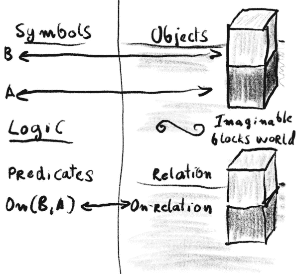

图 1.1 由符号表示的对象和由谓词表示的关系。

除了普通字母、数字字符和可打印字符外，该集合还包括许多控制字符。通过在头 128 个字符之后添加额外的字符定义，该字符集扩展到了 8 位。

### 1.2.2 规则和运算符

可以使用谓词演算描述包含属性和关系的世界状态。这种描述可以用于定义运算符，类似于 STRIPS 科学方法中使用的那些（见图 1.2）[29, 73, 33]。ABC 块世界一直是人工智能研究中的一个流行领域，通过使用三个命名为 A、B 和 C 的块作为示例。三个块在桌子上以某种初始配置排列（如图 1.2 所示）。每个上方最多有一个块，且每个块可能在桌子上，也可以在另一个块上方。机器人手臂可以在桌子上堆叠、取下和移动块。

# 使用 Qiskit 的量子人工智能

ontable(A).
ontable(C).
on(B,A).
clear(B).
clear(C).
gripping().

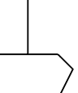

图 1.2 块世界。

使用块示例，“取”（pickup）、“放下”（putdown）、“堆叠”（stack）和“取下”（unstack）操作可以定义。这些表达式是普遍成立的，因此省略了全称量词。

```
pickup(x) {gripping() ∧ clear(x)}
 A: ontable(x)
 D: 
```

```
putdown(x) {gripping() ∧ clear(x)}
 A: ontable(x)
 D: 
```

```
stack(x, y) {gripping() ∧ clear(x)}
 A: ontable(x)
 D: 
```

```
unstack(x) {gripping() ∧ clear(x)}
 A: ontable(x)
 D: 
```

# 人工智能 ■7

每个运算符都表示为三元组。第一个元素是前置条件，即应用运算符必须满足的状态。当变量被识别时，该状态为真或假。第二个元素是应用运算符后对状态的添加。最后一个元素是执行操作时从状态描述中移除的项目。这些运算符遵循公理，因为它们规定了状态的哪些部分应该改变，这被称为**框架问题** [125]。

+ ontable(A).
clear(A).
ontable(C).
clear(C).
gripping(B).

8 使用 Qiskit 的量子人工智能

### 1.2.3 产生系统

人工智能问题通常通过问题空间的表征和搜索过程来描述 [73]。问题解决可以通过实现搜索算法的产生系统来建模。搜索定义了问题空间，并可以用树来表示。经典人工智能和认知心理学背景下的产生系统是人类解决问题最成功的计算机模型之一。与其使用运算符，我们可以使用简单的规则。规则 [125, 88, 61] 包含多个“如果”模式和一个或多个“那么”模式。规则背景下的模式是一个可以与参数取反的单个谓词。当“如果”部分（即前提）为真时，规则通过“那么”部分建立一个新的断言。


图 1.3 运算符 pickup(B) 应用于图 1.2 状态后的状态。


人工智能 ■ 9

| 5 | 8 | | 7 | 5 | 8 | | 7 | 5 | 8 |
| 7 | 6 | 3 | | 6 | 3 | | 4 | 6 | 3 |
| 4 | 1 | 2 | | 4 | 1 | 2 | | 1 | 2 |

| 5 | 8 | | 7 | 5 | 8 | | 7 | 5 | 8 |
| 4 | 6 | 3 | | 4 | 6 | 3 | | 4 | 6 | |
| 1 | | 2 | | 1 | | 2 | | 1 | 2 | 3 |

| 5 | 8 | | 7 | | 8 | | 7 | | 8 |
| 4 | | 6 | | 4 | 5 | 6 | | 4 | 5 | 6 |
| 1 | 2 | 3 | | 1 | 2 | 3 | | 1 | 2 | 3 |

图 1.4 第一个模式（左上）代表初始配置，最后一个（右下）代表目标配置。一系列移动描述了该问题的解决方案。

搜索的控制策略将是：

- 当目标在工作内存中时停止。
- 选择一个随机产生式。
- 不允许循环。

在图 1.4 中，我们看到了一个代表引导初始配置通往目标的状态序列的示例。产生系统实现了一种定义问题空间并可以表示为树的搜索算法。

### 1.2.4 树搜索

搜索从初始状态通过以下状态执行，直到到达目标状态。搜索树由节点和边表示。每个节点代表一个状态，每条边代表从一个状态到另一个状态的转换。初始状态定义了树的根。与计算机科学不同，树结构的根位于顶部，叶子位于底部。根之外的每个节点都有一个到达它的唯一父节点。父节点是其上方的节点，并通过边相连接。每个父节点 $v$ 有 $B_v$ 个子节点，在相同深度 $k$ 处有 $B^k$ 个节点。对于分支因子为常数 $B$ 的树，在第 $k$ 层有 $B^k$ 个节点。广度优先搜索执行逐层搜索。在访问下一层的节点之前，已经访问了该层的所有节点。深度优先搜索扩展搜索树中最深的节点，直到到达目标或所有节点都陷入胡同。

### 1.2.5 启发式搜索

启发式搜索基于启发式函数 $h(v)$，该函数估计从节点 $v$ 到目标的最小代价。我们将在八数游戏示例中演示启发式 $h(v)$ 的原理，“曼哈顿距离” [73, 78, 61] 计算每个状态中与预期目标相比的错误瓷块数量。虽然这种启发式未能考虑到所有可用信息（例如瓷块到达目标状态位置必须移动的距离），但“曼哈顿距离”通过累加瓷块错位的总距离（也称为曼哈顿距离），通常比“错误瓷块数”更好。贪婪优先搜索根据启发式函数 $h(v)$ 扩展距离目标最近的节点 $v$。在 $v$ 的 $B$ 个子节点中，选择 $\min(h(v_i))$，$1\leq i\leq B$。

类似于深度优先搜索遵循单一路径到达目标，它总是根据 $h(v)$ 扩展搜索树中最深的节点，直到到达目标或所有节点都陷入胡同。$A$ 搜索通过函数 $f(v)$ 节点，该函数由启发式函数 $h(v)$ 和估计从代表初始状态的根节点到达节点 $v$ 代值的函数 $g(v)$ 组成。最后，$A^*$ 等于 $A$ 搜索，其限制是函数 $h(v)$ 是一个可采的启发式，它永远不会高估到达目标的代价。启发式函数的通用发明是非常困难的。

## 1.3 机器学习

许多机器学习技术源于心理学家和生物学家试图通过计算模型更好地理解人类学习的努力 [7, 121]。人类与机器学习之间存在一些相似之处。在学习过程中，人类试图获取某些知识，这涉及到通过经验对行为倾向的修改。在机器学习中，我们可以区分监督学习和无监督学习。在监督学习中，算法被赋予输入示例及其期望输出。目标是学习一个将输入映射到输出的通用规则。监督学习通常被称为“带老师的学习”，因为期望输出是由某种老师指出的。因此，无监督学习被称为“不带老师的学习”。在无监督学习中，算法将主要由向量表示的信息进行分组。算法试图寻找未标记数据的隐藏结构；聚类是此类算法的一个示例 [121]。统计机器学习主要基于使用向量表示的分布式表示。

### 1.3.1 向量表示

在机器学习中使用了子符号或分布式表示。分布式表示的一种形式对应于向量。维度为 $D$ 的向量 $\mathbf{x}$ 表示为：

$$\mathbf{x} = \begin{pmatrix} x_1 \\ x_2 \\ \vdots \\ x_D \end{pmatrix} = (x_1, x_2, \dots, x_D)^T,$$

每个维度 $x_i$ 代表一个类似于实数的值。可以使用像欧几里得距离这样的函数来测量两个 $D$ 维向量之间的距离：

$$d(\mathbf{x}, \mathbf{y}) = ||\mathbf{x} - \mathbf{y}|| = \sqrt{|x_1 - y_1|^2 + |x_2 - y_2|^2 + \dots + |x_D - y_D|^2},$$

或者出租车距离或曼哈顿度量 $d_1$：

$$d_1(\mathbf{x}, \mathbf{y}) = ||\mathbf{x} - \mathbf{y}|| = |x_1 - y_1| + |x_2 - y_2| + \dots + |x_D - y_D|,$$


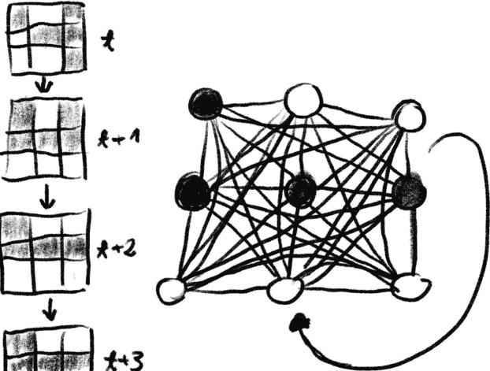

**图 1.5** 在霍夫德网络（Hopfield network）中，所有单元都通过权重相互连接。每个单元都有一个值：白色像素表示 -1，黑色像素表示 1。单元的激活状态表示状态 $t$ 下的模式。通常单元是异步更新的，在时刻 $t$ 对它们进行更新。训练后，我们从某个配置开始，如果 $t$ 时的状态与 $t+1$ 刻相同，则网络将使用更新规则在几步后收敛到一个吸引子。

当邻居开始讲述一个笑话时，这个笑话会突然被完全想起来。这种小部分记忆以前是内容可寻址的，这意味着特定记忆的某部分与看到的内容是关联的——引用自 [18] 第 104 页。

霍夫德网络代表了关联记忆模型 [46], [44]。在霍夫德网络中，所有单元都通过权重相互连接，见图 1.5。网络用于训练的模式（称为检索步）成为系统的吸引子。训练后，我们从某个配置开始，网络将使用更新规则在几步后收敛到一个代表固定点 (a) 的吸引子，见图 1.6。

### 1.3.4 人工神经元

对于两个具有相同维度 $D$ 的向量，向量 $x$ 代表输入模式（来自其他神经元的输入信号），向量 $w$ 代表存储的模式（存储在每个突触的权重中）。我们可以定义一个标量积，也称为点积

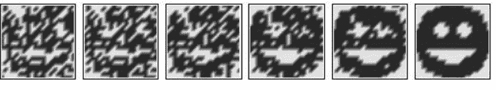

**图 1.6** 霍夫德网络如何恢复失真的模式。该网络将使用更新规则在几步后收敛到一个代表存储模式的吸引子，或者一个由奇数个存储模式的线性组合构成的伪状态。

```
$(\mathbf{x}) = \sum_{j=1}^{D} w_j \cdot x_j = \cos \omega \cdot ||\mathbf{x}||, \quad (1.5)$
```

测量一个向量在另一个向量上的投影。点积是一个线性表示，通常由值 $net$ 表示

```
$net = \sum_{j=1}^{D} w_j \cdot x_j.$
```

分 $w_j$ 被称为权重，它们模拟了代表记忆痕迹的突触。线性表示的非线性可以通过阈值操作实现，其中阈值 $T$ 具有一个特定值

```
$o = \begin{cases} 1 & \text{if } net \ge T \\ -1 & \text{if } net < T \end{cases} \quad (1.6)$
```

作为人工神经元的输出。这种阈值操作可以用非线性传递函数描述，例如对于 $T=0$ 的 $sgn$：

```
$o = sgn(net) = \begin{cases} 1 & \text{if } net \ge 0 \\ -1 & \text{if } net < 0 \end{cases} \quad (1.7)$
```

$sgn(net)$ 操作与真实生物神经元的阈值操作有关，其中 $-1$ 表示不发放，$1$ 表示发放。发放表示神经元向其与其连接的其他神经元发送输出信息。不发放意味着没有发送任何信息。传递函数也是激活函数，其中 $o$ 是人工神经元的输出

```
$o = sgn(net) = sgn(\mathbf{x}|\mathbf{w}) = sgn(\sum_{j=1}^{D} w_j \cdot x_j) \quad (1.8)$
```

该模型也被称为线性触发单元（LTU）。

### 1.3.5 感知机

感知机描述了一种监督学习算法，仅考虑可以通过直线或超平面分离的线性可问题 [67] [86]。定义 $x_0 = 1$ [42, 44]，感知机实现了数学函数 $sgn(net)$

```
$net := \sum_{j=0}^{D} w_j \cdot x_j = \sum_{j=1}^{D} w_j \cdot x_j + \langle\mathbf{w}\rangle + w_0 \quad (1.9)$
```

且 $o$ 是人工神经元的输出

```
$o := sgn(net) = \begin{cases} 1 & \text{if } net \geq 0 \\ -1 & \text{if } net < 0 \end{cases} \quad (1.10)$
```

值 $w_0$ 被称为“偏置”（bias），它是不依赖于任何输入的常数。感知机的目标是学习如何将模式分类为两类 $C_1=1$ 和 $C_2=-1$。为了实现这一点，模型需要模式与其相应类别之间的示例

```
$Data = \{(x_1, t_1), (x_2, t_2), \dots, (x_N, t_N)\}$
```

其中

```
$t_k \in \{-1, 1\}$,
```

对于 $C_1$ 的输出为 $o = -1$，对于 $C_2$ 的输出为 $o = 1$，带有

```
$o = sgn(\sum_{j=0}^{D} w_j \cdot x_j) = sgn(\langle\mathbf{w}\rangle + w_0) \quad (1.11)$
```

$x_0 = 1$。简化来说，感知机学习函数 $f(x)$

```
$f(x) = \begin{cases} 1 & \text{if } \langle\mathbf{w}\rangle + w_0 \geq 0 \\ -1 & \text{otherwise.} \end{cases} \quad (1.12)$
```

通过这种方法，感知机只能解决线性可问题（见图 1.7），即可以通过直线或超平面分离。超平面由模型权重 $\mathbf{w}$ 和 $w_0$ 决定。正确的权重可以通过监督学习确定。在学习之前，权重 $w_i$ 初始化为随机值，因此超平面随机放置在空间中。感知机学习算法验证任何输入 $x_k$，输出值 $o_k$ 是否属于 $t_k$ 所代表的类别。如果输入匹配类别，算法不接触边界；如果不匹配，算法向输入 $x_k$ 更容易分类的方向移动边界。这种移动对应于更新规则

```
$\Delta w_j = \eta \cdot (t_k - o_k) \cdot x_j, \quad (1.13)$
```

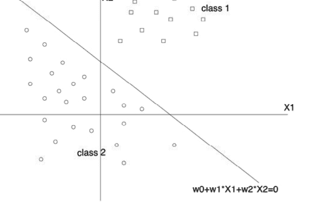

图 1.7 超平面由 $w$ 和 $w_0$ ，在二维空间由直线 $w_0 + w_1 \cdot x_1 + w_2 \cdot x_2 = 0$。感知机只解决线性可问题，在我们的例子中为类别 1 和类别 2。

以及

$w_j^{new} = w_j^{old} + \Delta w_j, \quad (1.14)$
```

其中 $\eta$ 被称为学习率，定义了应用于边界的移动幅度，$0 < \eta \leq 1$。

如果训练数据是线性可且足够小的，算法收敛到正确分类。在为 $\eta$ 分赋值时，我们必须考虑两个冲突的要求：平均过去的输入以提供稳定的权重估计需要较小的 $\eta$；然而，对于生成输入向量 $\mathbf{x}$ 的过程底层分布真实变化的快速适应需要较大的 $\eta$。

这种简单算法是许多监督算法的基础。如果训练集不是线性可分的，则不存在解。在这种情况下，经过几个迭代后，权重开始震荡。为了获得近似解，学习率 $\eta$ 随着迭代的进行必须逐渐减到零。

### 1.3.6 支持向量机

给定训练集 $\{\mathbf{x}_i, t_i\}_{i=1}^N$，其中 $t_i \in \{-1, +1\}$ 的线性可模式具有

```
$\mathbf{w}^T \cdot \mathbf{x}_i + w_0 \geq 0, \quad \text{for} \quad t_i = +1$
$\mathbf{w}^T \cdot \mathbf{x}_i + w_0 < 0, \quad \text{for} \quad t_i = -1$
```

具有超平面

```
$$\mathbf{w}^T \cdot \mathbf{x} + w_0 = \mathbf{w}^T \cdot \mathbf{x} + b = 0$$
```

我们希望在每个类别和边界之间有一个间隔（margin），我们想要找到参数 $w_{opt}$ 和 $b_{opt}$，使得

```
$$\mathbf{w}^{opt} \cdot \mathbf{x}_i + b_{opt} \geq 1, \quad \text{for} \quad t_i = +1 \quad (1.15)$$
```

```
$$\mathbf{w}^{opt} \cdot \mathbf{x}_i + b_{opt} \leq -1, \quad \text{for} \quad t_i = -1 \quad (1.16)$$
```

对于超平面

```
$$\mathbf{w}^T \cdot \mathbf{x} + w_0 = 0 \quad (1.17)$$
```

值 1 是为了方便设置的，因为我们可以相应地缩放 $w_{opt}$ 和 $b_{opt}$。距离边界的数据点 $\{x_i, t_i\}$ 

```
$$\mathbf{w}^{opt} \cdot \mathbf{x}_i + b_{opt} = \pm 1 \quad (1.18)$$
```

被称为支持向量。这就是为什么该算法被称为支持向量机。训练样本中其余示例对于确定超平面的位置是**无关的**。优化后，我们得到

```
$$\mathbf{w} = \sum_{i=1}^{N} \alpha_i \cdot t_i \cdot \mathbf{x}_i, \quad \sum_{i=1}^{N} \alpha_i \cdot t_i = 0, \quad (1.19)$$
```

并且定义了完全依赖于训练数据和格朗日乘子的对偶问题。给定线性可模式 $\{\mathbf{x}_i, t_i\}_{i=1}^N, t_i \in \{-1, +1\}$，找到格朗日乘子 $\{\alpha_i\}_{i=1}^N$ 以最大化

```
$$\Q(\alpha) = \sum_{i=1}^{N} \alpha_i - \frac{1}{2} \sum_{i=1}^{N} \sum_{j=1}^{N} \alpha_i \cdot \alpha_j \cdot t_i \cdot t_j \cdot \mathbf{x}_j^T \mathbf{x}_j \quad (1.20)$$
```

受限于常规约束

```
$$\sum_{i=1}^{N} \alpha_i \cdot t_i = 0 \quad (1.21)$$
```

以及添加一个新的约束

```
$0 \leq \alpha_i \leq C, \quad i = 1, 2, \dots, N \quad (1.22)$
```

其中 $C$ 是一个用户指定的正参数。


```
$w_{opt}^T \cdot \mathbf{x}_i + b_{opt} = \pm 1 \quad (1.24)$
```

以及

```
$b_{opt} = 1 - w_{opt}^T \cdot \mathbf{x}^{(s)}, \quad t^{(s)} = 1 \quad (1.25)$
```

由于

```
$b_{opt} = 1 - \left(\sum_{i=1}^{N} \alpha_{opt,i} \cdot t_i \cdot \mathbf{x}_i^T\right) \cdot \mathbf{x}^{(s)}, \quad t^{(s)} = 1.$
```

### 1.3.7 作为核机的支持向量机

设 $\mathbf{x}$ 是来自输入空间 $D$ 的向量，$\{\phi(\mathbf{x})\}_{i=1}^N$ 是从 $D$ 维到无限维的非线性函数集合。在特征空间，超平面定义为：

```
$\mathbf{w}^T \cdot \Phi(\mathbf{x}) + b = 0 \quad (1.26)$
```

其中 $\Phi(\mathbf{x})$ 为无限维特征向量，$\mathbf{w}$ 为无限维权重向量。设 $N_s$ 为支持向量的数量，我们可以将权重向量表示为：

```
$\mathbf{w} = \sum_{i=1}^{N_s} \alpha_i \cdot t_i \cdot \Phi(\mathbf{x}_i). \quad (1.27)$
```

我们不需要权重向量本身，我们需要边界或决策面，可以将其表示为：

```
$\sum_{i=1}^{N_s} \alpha_i \cdot t_i \cdot \Phi^T(\mathbf{x}_i)\Phi(\mathbf{x}) = 0. \quad (1.28)$
```

我们只需要支持向量之间的内积 $\langle\Phi(\mathbf{x}_i)|\Phi(\mathbf{x}_j)\rangle$。我们可以将这些内积看作核函数的结果：

```
$k(\mathbf{x}_i, \mathbf{x}_j) = \Phi^T(\mathbf{x}_i)\Phi(\mathbf{x}_j) = \langle\Phi(\mathbf{x}_i)|\Phi(\mathbf{x}_j)\rangle \quad (1.29)$
```

指定核 $k(\mathbf{x}_i, \mathbf{x}_j)$ 就足够了，我们不需要显式计算权重向量 $w_{opt}$ [98]。有了核后，我们可以充分利用以下特性：

```
$\sum_{j=1}^{\infty} w_j \cdot \Phi(\mathbf{x}_j) + b = \sum_{j=1}^{\infty} \alpha_j \cdot t_j \cdot k(\mathbf{x}_k, \mathbf{x}_j) + b = 0. \quad (1.30)$
```

我们可以计算核矩阵或 Gram 矩阵，其中 $k(\mathbf{x}_i, \mathbf{x}_j)$ 是 $N \times N$ 矩阵的第 $ij$ 元素。结果类似于：

```
$K = \begin{pmatrix} k(\mathbf{x}_1, \mathbf{x}_1) & k(\mathbf{x}_1, \mathbf{x}_2) & k(\mathbf{x}_1, \mathbf{x}_3) & \dots & k(\mathbf{x}_1, \mathbf{x}_N) \\ k(\mathbf{x}_2, \mathbf{x}_1) & k(\mathbf{x}_2, \mathbf{x}_2) & k(\mathbf{x}_2, \mathbf{x}_3) & \dots & k(\mathbf{x}_2, \mathbf{x}_N) \\ \vdots & \vdots & \vdots & \ddots & \vdots \\ k(\mathbf{x}_N, \mathbf{x}_1) & k(\mathbf{x}_N, \mathbf{x}_2) & k(\mathbf{x}_N, \mathbf{x}_3) & \dots & k(\mathbf{x}_N, \mathbf{x}_N) \end{pmatrix} \quad (1.31)$
```

在对偶问题中，我们将标量乘法

```
$$\mathbf{x}_i^T \mathbf{x}_j = \langle\mathbf{x}_i, \mathbf{x}_j\rangle$$
```

替换为核

```
$k(\mathbf{x}_i, \mathbf{x}_j),$
```

其他部分保持不变。因此，给定训练样本 $\{\mathbf{x}_i, t_i\}_{i=1}^N$，其中 $t_i \in \{-1, +1\}$，我们想要找到使得下式最大的拉朗日乘子 $\{\alpha_i\}_{i=1}^N$：

```
$Q(\alpha) = \sum_{i=1}^N \alpha_i - \frac{1}{2} \sum_{i=1}^N \sum_{j=1}^N \alpha_i \cdot \alpha_j \cdot t_i \cdot t_j \cdot k(\mathbf{x}_i, \mathbf{x}_j) \quad (1.32)$
```

受限于约束：

```
$$\sum_{i=1}^N \alpha_i \cdot t_i = 0 \quad (1.33)$$
```

```
$0 \leq \alpha_i \leq C, \quad i = 1, 2, \dots, N \quad (1.34)$
```

其中 $C$ 是用户指定的参数。计算输出：

1. 首先我们确定偏置 $b = \frac{1}{N_i} \sum_{j=1}^{N_i} \alpha_j \cdot t_j \cdot k(\mathbf{x}_i, \mathbf{x}_j) \quad (1.35)$
2. 然后输出 $o = \text{sgn}\left(\sum_{i=1}^{N_s} \alpha_i \cdot t_i \cdot k(\mathbf{x}_i, \mathbf{x}_i) + b\right) \quad (1.36)$

### 1.3.7. 示例：XOR 问题

XOR 问题由四个向量描述：

$$\mathbf{x}_1 = \begin{pmatrix} 1 \\ -1 \end{pmatrix}, \mathbf{x}_2 = \begin{pmatrix} 1 \\ 1 \end{pmatrix}, \mathbf{x}_3 = \begin{pmatrix} -1 \\ -1 \end{pmatrix}, \mathbf{x}_4 = \begin{pmatrix} 1 \\ 1 \end{pmatrix}$$

对应的类别目标指示为：

$$t_1 = -1, t_2 = 1, t_3 = 1, t_4 = -1.$$

我们将不使用 0，而是使用多项式核

```
$k(\mathbf{x}_i, \mathbf{x}_j) = (1 + \mathbf{x}_i^T \mathbf{x}_j)^2$
```

具有：

```
$k(\mathbf{x}_i, \mathbf{x}_j) = 1 + x_{i1}^2 + 2x_{i1}x_{j1} + x_{i2}^2x_{j2}^2 + 2x_{i2}x_{j2}$
```

对应的特征向量（并非必须，实际上对于某些核，向量可以是无限维的）：

$$\Phi(\mathbf{x}_i) = \begin{pmatrix} 1 \\ \sqrt{x_{i1}} \\ \vdots \\ \sqrt{x_{i2}} \end{pmatrix}, \quad \Phi(\mathbf{x}_j) = \begin{pmatrix} 1 \\ \sqrt{x_{j1}} \\ \vdots \\ \sqrt{x_{j2}} \end{pmatrix}$$

我们得到 Gram 矩阵

```
$K = \begin{pmatrix} k(\mathbf{x}_1, \mathbf{x}_1) & k(\mathbf{x}_1, \mathbf{x}_2) & k(\mathbf{x}_1, \mathbf{x}_3) & \dots & k(\mathbf{x}_1, \mathbf{x}_N) \\ k(\mathbf{x}_2, \mathbf{x}_1) & k(\mathbf{x}_2, \mathbf{x}_2) & k(\mathbf{x}_2, \mathbf{x}_3) & \dots & k(\mathbf{x}_2, \mathbf{x}_N) \\ \vdots & \vdots & \vdots & \ddots & \vdots \\ k(\mathbf{x}_N, \mathbf{x}_1) & k(\mathbf{x}_N, \mathbf{x}_2) & k(\mathbf{x}_N, \mathbf{x}_3) & \dots & k(\mathbf{x}_N, \mathbf{x}_N) \end{pmatrix}$
```

在对偶问题中，我们将标量乘法

```
$$\mathbf{x}_i^T \mathbf{x}_j = \langle\mathbf{x}_i, \mathbf{x}_j\rangle$$
```

替换为核

```
$k(\mathbf{x}_i, \mathbf{x}_j),$
```

其他部分保持不变。因此，给定训练样本 $\{\mathbf{x}_i, t_i\}_{i=1}^N$，其中 $t_i \in \{-1, +1\}$，我们想要找到使得下式最大的拉朗日乘子 $\{\alpha_i\}_{i=1}^N$：

```
$Q(\alpha) = \sum_{i=1}^N \alpha_i - \frac{1}{2} \sum_{i=1}^N \sum_{j=1}^N \alpha_i \cdot \alpha_j \cdot t_i \cdot t_j \cdot k(\mathbf{x}_i, \mathbf{x}_j) \quad (1.32)$
```

受限于约束：

```
$$\sum_{i=1}^N \alpha_i \cdot t_i = 0 \quad (1.33)$$
```

```
$0 \leq \alpha_i \leq C, \quad i = 1, 2, \dots, N \quad (1.34)$
```

其中 $C$ 是用户指定的参数。计算输出：

1. 首先我们确定偏置 $b = \frac{1}{N_i} \sum_{j=1}^{N_i} \alpha_j \cdot t_j \cdot k(\mathbf{x}_i, \mathbf{x}_j) \quad (1.35)$
2. 然后输出 $o = \text{sgn}\left(\sum_{i=1}^{N_s} \alpha_i \cdot t_i \cdot k(\mathbf{x}_i, \mathbf{x}_i) + b\right) \quad (1.36)$

## 20 使用 Qiskit 进行的量子人工智能

### 1.3.8 深度学习

感知机的局限性并不适用于具有非线性单元的前馈网络，也称为通过反向传播算法训练的多层感知机。根据通用性定理，通过反向传播训练的单隐藏层神经网络能够近似任何连续函数。尝试构建一个只有一个层的网络来近似复杂函数通常需要大量的节点（“胖”神经网络）。直接的解决方案是构建具有更多隐藏层的网络。经验实验表明，“深度”神经网络的效果优于“胖”神经网络，见图 1.8。


## 22 使用 Qiskit 进行量子人工智能研究

这些层通过反向传播进行训练。因此，在分类期间的训练后，无法解释为什么特定的输入会被映射到特定的类别。深度学习通过由多个非线性变换组成的架构实现了数据中的高层抽象。它提供了从低层结构到高层结构的自然演进，正如自然复杂性所所示 [56, 84, 85, 83]。

通过增加层数，我们可以更快地增加参数的数量。通过这样做，我们可以添加足够的自由度来模拟大型训练集。这非常有帮助，因为现在针对特定任务收集了海量数据。

这些模型取得了巨大的成果，但它们需要极高的计算资源和巨大的训练集，这是当前量子机器学习应用中的瓶颈。然而，量子线性代数子程序可以用于加速深度学习算法，这是一种可以与传统计算机配合使用的“数学”量子协处理器。

## 量子物理与量子计算

统计规律支配着物理学中的所有观测结果。在经典力学中，一个物体可以用描述位置和动量的向量来描述。经典力学通常在宏观尺度上有效。物体位置和动量随时间的变化由哈密顿运动方程描述。物体的状态由哈密顿函数描述。在微观尺度上，观测结果由量子物理描述。光以可以量子化的份（chunks）的形式出现。每一份被称为量子，光的量子被称为光子 [27]。量子理论的名称源于这种特性，它将其归于所有可测量的物理量。如果光子与环境隔绝，可以用波函数来描述。量子力学中的波函数在未被观测时，会根据薛定谔以平滑且连续的方式演化，该方程与哈密顿运动方程有关。该方程描述了随时间不同状态的线性叠加。在观测期间（由观察者，即我们进行），波函数以一定的概率坍缩到一个确定的状态。

量子物理的数学框架基于希尔伯特空间中的线性代数。双态量子系统由二维希尔伯特空间描述。双态量子系统对应于量子比特（qubit）。寄存器由多个量子比特组成，并通过张量积定义。我们用 $n$ 和 $m$ 个量子比特描述计算原理，引入了纠缠、克隆原理以及量子布尔门的矩阵表示，并给出了简单量子布尔电路的示例。

## 2.1 量子测量

量子力学中的波函数在未被观测时，会根据薛定谔方程以平滑且连续的方式演化，该方程与哈密顿运动方程有关。该方程描述了随时间不同状态的线性叠加。薛定谔方程的通用解代表了确定且可逆的酉化（线性）演化。可逆意味着没有信息丢失。根据萨斯金（Susskind）的说法，这是物理学的“零法则” [105]。向量 $x(t)$（为了简单起见，我们也称之为波）描述了在 $t$ 时某些状态存在的概率。每个维度代表一个状态，向量的值与该状态出现的概率有关。这种演化是在向量 $x(t)$ 的所有状态上并行进行的。在观测期间（由观察者，我们进行测量），波函数以一定的概率坍缩到一个确定的状态。这个状态对应于向量 $x(t)$ 的一个维度。由向量 $x(t)$ 表示的波函数发生了某些事情。这是量子理论无法解释的现象。这类现象最为人知的例子就是“某些事情”：薛定谔的猫 [83]，它告诉我们我们的宇宙是非确定性的。在给定的时间范围内，测量到衰变的概率是50%。猫的原因是盖格计数器，而盖格计数器在一个封闭的房间里，我们不知道猫是死是活。这些每种可能性都与特定的50%概率相关。猫同时是死的又是活的。人们可以认为有一个世界猫是活着的，另一个世界猫是死的。这两个状态在封闭房间内“真实”地同时存在，有人说猫处于叠加叠加态。测量总是会以50%的概率发现活着的猫或死去的猫。

### 2.1.1 量子力学的解释

在观测期间（由观察者，我们进行测量），波函数以一定的概率坍缩到一个确定的状态。量子系统完美地保持其波表示及其相干性。如果它没有被隔绝，在与环境交互期间，事件的波表示将会丢失，这被称为量子相干。量子相干发生在环境中。量子相干被普遍认为是信息从系统向环境的流失。量子相干只为我们提供了一个表观波函数坍缩的框架，它并没有解释坍缩本身。由于量子系统在大尺度（宏观尺度）上并不是孤立的，影响主要存在于原子和亚原子粒子尺度（微观尺度）。在测量期间存在真随机性，但在测量之后，物理系统处于一个确定状态。测量对波函数做了某种处理。这是量子理论未解释的，但存在两种解释：

- 最流行的解释，即哥本哈根解释，声称量子力学是一种用于计算概率的数学工具，没有物理实体；所有其他问题都是形而上学的 [43] 且应该被避免。
- 多世界解释由于一些哲学上的困难而不流行。多世界理论将现实视为一棵多分支的树，每一个可能的量子结果都实现了 [28], [20]。事件的每一个可能结果都存在于自己的世界中。在一个世界中，存在随机性，但在描述所有可能世界的宇宙（多元宇宙）中不存在 [27]。

## 2.2 量子计算原理

理查德·费曼（Richard Feynman）在80年代提出了量子系统是否可以在想象的量子计算机上进行模拟。今天，40年后，第一批小型量子计算机开始出现。量子计算机用量子比特表示信息。量子比特可以用粒子的自旋状态表示，即自旋向上或向下。多个量子比特同时表示不同的状态。量子比特需要保持相干足够的时间以便进行计算。近年来，在保持量子比特完美隔绝（相干）方面取得了巨大进展，为通用量子计算机铺平了道路。

### 2.2.1 量子比特

量子比特由二维向量表示。向量的第一个维度对应0，第二个对应1。两个维度的值对应于测量时两个状态之一出现的概率。我们可以通过张量运算将一个量子比特组合成多个量子比特。两个量子比特有四种可能的状态，第一个维度表示状态-0，第二个-0，第三-0和第四-1。它们由一个四维向量描述。四个量子比特将代表16种组合，256种组合，由一个256维向量表示，以此此类推。可能的数量随量子比特数量呈指数级增长，状态数等于量子比特数的2次方 [119]。


### 2.2.2 表示

物理系统的量子力学描述与概率表示相关；它由希尔伯特空间（Hilbert space）中的一个向量描述。这种描述将二维或三维欧几得空间扩展到有限或无限维的空间。在这样的空间中，欧几得范数由内积诱导

```
$|x| = \sqrt{\langle x|x\rangle} (2.1)
```

没有标量积就没有正交性。在希尔伯特空间中，两个向量正交当且仅当标量积为零。选取一个 $n$ 维希尔伯特空间 $\mathcal{H}_n$ 的基。二态系统由二维空间 $\mathcal{H}_2$ 描述。对于基向量

```
$e_1 = \left(\begin{pmatrix} 1 \\ 0\end{pmatrix}\right), e_2 = \left(\begin{pmatrix} 0 \\ 1\end{pmatrix}\right) (2.2)
```

系统由一个带有复数 $\omega_1, \omega_2$ 的向量 $x$ 描述，这些复数代表每个维度的幅

```
$x = \omega_1 \cdot e_1 + \omega_2 \cdot e_2 = \left(\begin{pmatrix} \omega_1 \\ \omega_2\end{pmatrix}\right) (2.3)
```

概率是 0 到 1 之间的实数。系统处于 $e_1$ 和 $e_2$ 的概率分别为 $|\omega_1|^2$ 和 $|\omega_2|^2$。这是因为复数与其共轭的积始终是实数

```
$$\omega^* \cdot \omega = (x-y \cdot i) \cdot (x+y \cdot i) = x^2 + |\omega|^2 (2.4)
```

表示状态的向量是归一化的。它的长度为一。幅与概率对应关系为

```
$|\omega_1|^2 + |\omega_2|^2 = 1.
```

保罗·狄拉克（Paul Dirac）为描述状态的向量 $x$ 引入了以下符号

```
$|x\rangle = |\omega_1 \cdot e_1\rangle + |\omega_2 \cdot e_2\rangle = |\omega_1 |x\rangle + |\omega_2 |x\rangle = \left(\begin{pmatrix} \omega_1 \\ \omega_2\end{pmatrix}\right) (2.5)
```

其中

```
$|e_1\rangle = |x\rangle
```

这是列向量的简记。与标量积 $\langle x|x\rangle$ 相关的行向量是 $\langle x|$ ("bra"), 列向量是 $|x\rangle$ ("ket") 来自 bra-ket 符号。状态向量只是 ket 向量的一个特定实例。它由特定基的选择确定，并指的是具有某些系统属性的观测值。

### 2.2.3 线性算子

相干量子比特（测量之前）上的计算由线性算子描述，算子以线性方式改变由幅表示的量子概率分布 [119]。对于实幅，算子由正交矩阵表示（矩阵的逆是矩阵的转置）；对于复幅，则由酉正矩阵表示（逆矩阵是矩阵的共轭转置）。

由方矩阵表示的算子提供了量子世界中事物如何变化的数学描述。对于二态量子系统，作用于存储寄存器的算子将是一个 $2 \times 2$ 维的酉矩阵。在酉矩阵中，其共轭转置等于其逆矩阵。

```
$U^* = U^{-1}$
```

例如，硬币是一个有两个基态 0 和 1 的系统，具有

```
$|0\rangle = \left( \begin{matrix} 1 \\ 0 \end{matrix} \right), |1\rangle = \left( \begin{matrix} 0 \\ 1 \end{matrix} \right)$
```

映射表示为

```
$|0\rangle \rightarrow \frac{1}{\sqrt{2}}|0\rangle + \frac{1}{\sqrt{2}}|1\rangle$
```

以及

```
$|1\rangle \rightarrow \frac{1}{\sqrt{2}}|0\rangle - \frac{1}{\sqrt{2}}|1\rangle$
```

对应的算子由酉矩阵表示，

```
$H = \left( \begin{matrix} \frac{1}{\sqrt{2}} & \frac{1}{\sqrt{2}} \\ \frac{1}{\sqrt{2}} & -\frac{1}{\sqrt{2}} \end{matrix} \right) = \frac{1}{\sqrt{2}} \left( \begin{matrix} 1 & 1 \\ 1 & -1 \end{matrix} \right)$
```

称为 Hadamard 矩阵或 Walsh 矩阵。如果系统从状态 $|0\rangle$ 开始并经历演化，观测到 0 或 1 的概率为 $|1/\sqrt{2}|^2 = 1/2$。如果我们不测量并重复映射，观测到 0 的概率变为 1，观测到 1 的概率变为零。这是由于幅 $|1|$ 相互抵消造成的。这种效应被称为破坏性干涉，不会在概率分布中发生，因为其所有的系数是非负数。

## 2.3 复合系统

二态量子系统（量子比特）由二维希尔伯特空间描述

```
$|0\rangle = \left( \begin{matrix} 1 \\ 0 \end{matrix} \right), |1\rangle = \left( \begin{matrix} 0 \\ 1 \end{matrix} \right)$
```

由一个向量 $|x\rangle$ 描述，复数 $\omega_1, \omega_2$ 代表每个维度的幅

```
$|x\rangle = \omega_1 \cdot |0\rangle + \omega_2 \cdot |1\rangle = \left(\begin{pmatrix} \omega_1 \\ \omega_2\end{pmatrix}\right).
```

该向量长度为

```
$|\omega_1|^2 + |\omega_2|^2 = 1.
```

酉矩阵 $H$（Hadamard 矩阵）在 ket 符号下执行映射

```
$H \cdot |0\rangle = \frac{1}{\sqrt{2}}|0\rangle + \frac{1}{\sqrt{2}}|1\rangle
```

在向量符号下

```
$H \cdot |1\rangle = \frac{1}{\sqrt{2}}|0\rangle - \frac{1}{\sqrt{2}}|1\rangle
```

再次应用 $H$ 得到

```
$H \cdot \left( \frac{1}{\sqrt{2}}|0\rangle + \frac{1}{\sqrt{2}}|1\rangle \right) = |0\rangle
```

我们如何表示由两个量子比特组成的寄存器？这样的寄存器将表示 $2^2$ 个可能的状态，并表示在希尔伯特空间 $\mathcal{H}_4$ 中。第一个量子比特由二维希尔伯特空间 $\mathcal{H}_2$ 表示

```
$|x\rangle = \omega_0 \cdot |0\rangle + \omega_1 \cdot |1\rangle = \left(\begin{pmatrix} \omega_0 \\ \omega_1\end{pmatrix}\right).
```

第二个由表示

```
$|y\rangle = \omega_0 \cdot |0\rangle + \omega_1 \cdot |1\rangle = \left(\begin{pmatrix} \omega_0 \\ \omega_1\end{pmatrix}\right):
```

两个量子比特的寄存器表示为 $|x\rangle$ 和 $|y\rangle$ 的直积

```
$|x\rangle \otimes |y\rangle = |x\rangle = \begin{pmatrix} \omega_0 \\ \omega_1 \end{pmatrix} \otimes \begin{pmatrix} \omega_0 \cdot \omega_0 & \omega_0 \cdot \omega_1 \\ \omega_1 \cdot \omega_0 & \omega_1 \cdot \omega_1 \end{pmatrix} = \begin{pmatrix} \omega_0 \cdot \omega_0 & \omega_0 \cdot \omega_1 \\ \omega_1 \cdot \omega_0 & \omega_1 \cdot \omega_1 \end{pmatrix} \quad (2.14)
```

或者

```
$|xy\rangle = |\omega_0 \cdot |0\rangle + \omega_1 \cdot |1\rangle| \otimes |\omega_0 \cdot |0\rangle + \omega_1 \cdot |1\rangle$
```

```
$|xy\rangle = \omega_0 \cdot |00\rangle + \omega_0 \cdot |01\rangle + \omega_1 \cdot |10\rangle + \omega_1 \cdot |11\rangle \quad (2.15)
```

使用新基

```
$|00\rangle = \begin{pmatrix} 1 \\ 0 \end{pmatrix}, |01\rangle = \begin{pmatrix} 0 \\ 1 \end{pmatrix}, |10\rangle = \begin{pmatrix} 1 \\ 0 \end{pmatrix}, |11\rangle = \begin{pmatrix} 0 \\ 1 \end{pmatrix} \quad (2.16)
```

三个量子比特的寄存器表示为 $2^3$ 个状态，表示在希尔伯特空间 $\mathcal{H}_s$ 中

```
$|xyz\rangle = |x\rangle \otimes |y\rangle \otimes |z\rangle = \omega_0 \cdot |000\rangle + \omega_1 \cdot |001\rangle + \omega_2 \cdot |010\rangle + \omega_3 \cdot |011\rangle + \omega_4 \cdot |100\rangle + \omega_5 \cdot |101\rangle + \omega_6 \cdot |110\rangle + \omega_7 \cdot |111\rangle \quad (2.17)
```

长度为 $m$ 的量子寄存器表示维度为 $n=2^m$ 的希尔伯特空间中的 $m$ 个量子比特。

希尔伯特空间 $\mathcal{H}_n$ 与由正交基 $|y_1\rangle, |y_2\rangle, \dots, |y_w\rangle$ 定义的 $w$ 维希尔伯特空间的复合系统由张积定义

```
$\mathcal{H}_{n-w} = \mathcal{H}_n \otimes \mathcal{H}_w \quad (2.18)$
```

根据这个定义，我们可以在两个量子比特上定义算子

```
$H \cdot (\omega_0 \cdot |0\rangle + \omega_1 \cdot |1\rangle) \otimes H \cdot (\omega_0 \cdot |0\rangle + \omega_1 \cdot |1\rangle) = \\
```

```
$$\left(H \cdot \begin{pmatrix} \omega_0 \\ \omega_1 \end{pmatrix}\right) \otimes \left(H \cdot \begin{pmatrix} \omega_0 \\ \omega_1 \end{pmatrix}\right) \quad (2.19)$$
```


# 使用 Qiskit 的量子人工智能

```
$$(H \otimes H) \cdot (|omega_0 \cdot |0\rangle + \omega_1 \cdot |1\rangle) \otimes (|omega_0 \cdot |0\rangle + \omega_1 \cdot |1\rangle) = (H \otimes H) \quad (2.20)$$
```

由此得：

```
$$(H \cdot \begin{pmatrix} \omega_0 \\ \omega_1 \end{pmatrix}) \otimes (H \cdot \begin{pmatrix} \omega_0 \\ \omega_1 \end{pmatrix}) = (H \otimes H) \cdot \begin{pmatrix} \omega_0 \\ \omega_1 \\ \omega_2 \\ \omega_3 \end{pmatrix} \quad (2.21)$$
```

矩阵之间的张量积定义为：

```
$$A \otimes B = \begin{pmatrix} a_{11} \cdot b_{11} & a_{11} \cdot b_{12} & a_{12} \cdot b_{11} & a_{12} \cdot b_{12} \\ a_{11} \cdot b_{21} & a_{11} \cdot b_{22} & a_{12} \cdot b_{21} & a_{12} \cdot b_{22} \\ a_{21} \cdot b_{11} & a_{21} \cdot b_{12} & a_{22} \cdot b_{21} & a_{22} \cdot b_{22} \end{pmatrix}$$
```

例如 $H \otimes H$ 为：

```
$$H \otimes H = \frac{1}{\sqrt{2}} \begin{pmatrix} 1 & 1 \\ -1 & -1 \end{pmatrix} \otimes \frac{1}{\sqrt{2}} \begin{pmatrix} 1 & 1 \\ -1 & -1 \end{pmatrix} = \frac{1}{2} \begin{pmatrix} 1 & 1 & 1 & 1 \\ 1 & 1 & -1 & -1 \\ -1 & -1 & 1 & 1 \\ -1 & -1 & 1 & 1 \end{pmatrix}$$
```

## 2.4 测量

在从初始状态开始的酉变换信息处理之后，算法的结果由测量决定。测量对应于态向量的坍缩，即向基态的投影。这种投影是不可逆的，且与酉演化不一致。对于由单位长度向量表示的状态：

```
$$|omega_1 \cdot |x_1\rangle + \omega_2 \cdot |x_2\rangle + \dots + \omega_n \cdot |x_n\rangle$$
```

在 $n$ 维希尔伯特空间中观测 $|x_y\rangle$。测量后（观测态）处于一个基：

```
$$|1 \cdot |x_y\rangle$$
```

量子系统的状态被投影到对应于观测的子空间，并且代表该状态的向量被归一化为单位长度。观测符描述了某些维度的子空间，特殊情况是单维。系统的一部分可以通过维度大于一的子空间中的投影来观测。$n$ 维希尔伯特空间 $|x\rangle \in \mathcal{H}_n$ 与 $w$ 维希尔伯特空间 $|y\rangle$（由正交基 $|xy_{w} \rangle \in \mathcal{H}_{n-w}$ 定义）的复合系统。系统的状态表示为：

```
$$|xy\rangle = \sum_{i=1}^n \sum_{j=1}^w \omega_{ij} |x_i\rangle |y_j\rangle \quad (2.22)$$
```

例如：

$|xy\rangle = \sum_{i=1}^{2}\sum_{j=1}^{2} \omega_{ij}|x_i\rangle|y_j\rangle = \omega_{11}|x_1\rangle|y_1\rangle + \omega_{12}|x_1\rangle|y_2\rangle + \omega_{21}|x_2\rangle|y_1\rangle + \omega_{22}|x_2\rangle|y_2\rangle$。

为了简单见，我们使用量子比特寄存器的记法：

$|xy\rangle = \omega_0 \cdot |00\rangle + \omega_1 \cdot |01\rangle + \omega_2 \cdot |10\rangle + \omega_3 \cdot |11\rangle$。

观测 $x_k$ 的概率为 $\sum_{j=1}^{w} |\omega_{kj}|^2$。如果我们观测到 $x_k$，观测后的系统投影为：

$|xy\rangle = \frac{1}{\sqrt{\sum_{j=1}^{w}|\omega_{kj}|^2}}} \sum_{j=1}^{w} \omega_{kj}|x_k\rangle|y_j$。

假设两个量子比特处于状态：

$\sqrt{0.25} \cdot |00\rangle + \sqrt{0.25} \cdot |01\rangle + \sqrt{0.25} \cdot |10\rangle + \sqrt{0.25} \cdot |11\rangle = \begin{pmatrix} \sqrt{1/2} \\ \sqrt{1/2} \\ 0 \\ 0 \end{pmatrix}$。第一个量子比特是 $|0\rangle$。观测的概率为：

$|\omega_{00}|^2 + |\omega_{01}|^2 = |\sqrt{0.25}|^2 + |\sqrt{0.25}|^2 = 0.25 + 0.25 = 0.5$。观测后的系统投影为：

$\sqrt{0.25} \cdot |00\rangle + \sqrt{0.25} \cdot |01\rangle = \sqrt{0.5} \cdot |00\rangle + \sqrt{0.5} \cdot |01\rangle = \begin{pmatrix} \sqrt{1/2} \\ \sqrt{1/2} \\ 0 \\ 0 \end{pmatrix}$。

## 2.5 单量子比特计算

量子比特上的酉算符称为酉门。它由一个 $2 \times 2$ 矩阵描述。对于基态 $|0\rangle = \begin{pmatrix} 1 \\ 0 \end{pmatrix}, |1\rangle = \begin{pmatrix} 0 \\ 1 \end{pmatrix}$，量子门 $X$ 在量子比特上执行操作：

$X(0) = |1\rangle, X(1) = |0\rangle$

并由矩阵表示：

$$X = \begin{pmatrix} 0 & 1 \\ 1 & 0 \end{pmatrix} \quad (23)$$

## 3 使用 Qiskit 的量子人工智能

操作可以使用 XOR $\oplus$ 对于 $x \in \mathbb{B}^m$（$\mathbb{B}^m$ 表示长度为 $m$ 的二进制字符串）写入：

$|x\rangle = |x \oplus 1\rangle$。非门的平方根 $\sqrt{X}$ 由酉矩阵表示：

$$\sqrt{X} = \begin{pmatrix} 1/\sqrt{2} & 1/\sqrt{2} \\ 1/\sqrt{2} & -1/\sqrt{2} \end{pmatrix} \quad (24)$$

它是酉的：

$$\begin{pmatrix} 1/\sqrt{2} & 1/\sqrt{2} \\ 1/\sqrt{2} & -1/\sqrt{2} \end{pmatrix} \cdot \begin{pmatrix} 0 \\ 1 \end{pmatrix} = \begin{pmatrix} 1/\sqrt{2} \\ -1/\sqrt{2} \end{pmatrix} \quad (25)$$

其中 $X|0\rangle = \frac{1}{\sqrt{2}}|0\rangle + \frac{1}{\sqrt{2}}|1\rangle$  $X|1\rangle = \frac{1}{\sqrt{2}}|0\rangle - \frac{1}{\sqrt{2}}|1\rangle$。观测 $|0\rangle$ 和 $|1\rangle$ 的概率为 $0.5$，因为 $|1/\sqrt{2}|^2 + |1/\sqrt{2}|^2 = 1/2 + 1/2 = 1$。$-\sqrt{X}$ 有相同的行为：

$$-\sqrt{X} = \begin{pmatrix} -1/\sqrt{2} & -1/\sqrt{2} \\ -1/\sqrt{2} & 1/\sqrt{2} \end{pmatrix}.$$

单位门在量子比特上不执行操作，它定义为单位矩阵：

$$I = \begin{pmatrix} 1 & 0 \\ 0 & 1 \end{pmatrix} \quad (27)$$

单位矩阵的平方根是 $I$ 矩阵和 $-I$：

$$-I = \begin{pmatrix} -1 & 0 \\ 0 & -1 \end{pmatrix} \quad (28)$$

$-I$ 改变符号但不改变概率。Hadamard 矩阵 $H$ 将基态映射到叠加态：

$$|0\rangle = \frac{1}{\sqrt{2}}|0\rangle + \frac{1}{\sqrt{2}}|1\rangle,$$
$$|1\rangle = \frac{1}{\sqrt{2}}|0\rangle - \frac{1}{\sqrt{2}}|1\rangle.$$

观测 $|0\rangle$ 和 $|1\rangle$ 的概率为 $0.5$。

## 2.6 M 量比特计算

$m$ 个量子比特寄存器表示为 $m$ 个量子比特的直积。它定义了 $n=2^m$ 维希尔伯特空间 $\mathcal{H}_n$，拥有正交基 $|x_1\rangle, |x_2\rangle, \dots, |x_n\rangle$。例如，四个量子比特定义了一个 16 维希尔伯特空间 $\mathcal{H}_{16}$，基为：

```
\begin{pmatrix} 1 & 0 & 0 & 0 & 0 & 0 & 0 & 0 & 0 & 0 & 0 & 0 & 0 & 0 & 0 & 0 \\ 0 & 1 & 0 & 0 & 0 & 0 & 0 & 0 & 0 & 0 & 0 & 0 & 0 & 0 & 0 & 0 \\ 0 & 0 & 1 & 0 & 0 & 0 & 0 & 0 & 0 & 0 & 0 & 0 & 0 & 0 & 0 & 0 \\ 0 & 0 & 0 & 1 & 0 & 0 & 0 & 0 & 0 & 0 & 0 & 0 & 0 & 0 & 0 & 0 \\ 0 & 0 & 0 & 0 & 1 & 0 & 0 & 0 & 0 & 0 & 0 & 0 & 0 & 0 & 0 & 0 \\ 0 & 0 & 0 & 0 & 0 & 1 & 0 & 0 & 0 & 0 & 0 & 0 & 0 & 0 & 0 & 0 \\ 0 & 0 & 0 & 0 & 0 & 0 & 1 & 0 & 0 & 0 & 0 & 0 & 0 & 0 & 0 & 0 \\ 0 & 0 & 0 & 0 & 0 & 0 & 0 & 1 & 0 & 0 & 0 & 0 & 0 & 0 & 0 & 0 \\ 0 & 0 & 0 & 0 & 0 & 0 & 0 & 0 & 1 & 0 & 0 & 0 & 0 & 0 & 0 & 0 \\ 0 & 0 & 0 & 0 & 0 & 0 & 0 & 0 & 0 & 1 & 0 & 0 & 0 & 0 & 0 & 0 \\ 0 & 0 & 0 & 0 & 0 & 0 & 0 & 0 & 0 & 0 & 1 & 0 & 0 & 0 & 0 & 0 \\ 0 & 0 & 0 & 0 & 0 & 0 & 0 & 0 & 0 & 0 & 0 & 1 & 0 & 0 & 0 & 0 \\ 0 & 0 & 0 & 0 & 0 & 0 & 0 & 0 & 0 & 0 & 0 & 0 & 1 & 0 & 0 & 0 \\ 0 & 0 & 0 & 0 & 0 & 0 & 0 & 0 & 0 & 0 & 0 & 0 & 0 & 1 & 0 & 0 \\ 0 & 0 & 0 & 0 & 0 & 0 & 0 & 0 & 0 & 0 & 0 & 0 & 0 & 0 & 1 & 0 \\ 0 & 0 & 0 & 0 & 0 & 0 & 0 & 0 & 0 & 0 & 0 & 0 & 0 & 0 & 0 & 1 \end{pmatrix}
```


```
$H_3 = \frac{1}{\sqrt{2}} \begin{pmatrix} H_2 & H_2 \\ H_2 & -H_2 \end{pmatrix} = \frac{1}{\sqrt{2^3}} \begin{pmatrix} 1 & 1 & 1 & 1 & 1 & 1 & 1 \\ 1 & -1 & 1 & -1 & 1 & -1 & -1 \\ 1 & 1 & -1 & -1 & 1 & -1 & -1 \\ 1 & -1 & -1 & 1 & -1 & 1 & 1 \\ 1 & 1 & 1 & 1 & -1 & -1 & -1 \\ 1 & -1 & -1 & 1 & -1 & 1 & 1 \\ 1 & 1 & -1 & -1 & -1 & 1 & 1 \end{pmatrix}$
```

Hadamard 算符 $H_m$ 将代表希尔伯特空间 $H^m$ 中基态量子比特 $|z\rangle$ 映射，$z \in B^m$ 代表长度为 $m$ 的表示二进制数的二进制字符串。

```
$|z\rangle = \frac{1}{\sqrt{2^m}} \sum_{x \in B^m} (-1)^{(z) \cdot x} |x\rangle \quad (2.32)$
```

其中 $(\langle z|x\rangle)$ 是在具有两个元素（0 和 1）的二进制域上的标量。两个比特的乘法等于 $AND$ 操作：

```
$0 \cdot 0 = 0 \wedge 0 = 0, \quad 0 \cdot 1 = 0 \wedge 1 = 0, \quad 1 \cdot 0 = 1 \wedge 0 = 0, \quad 1 \cdot 1 = 1 \wedge 1 = 1$
```

加法等于 $XOR$ 操作 $\oplus$：

```
$0 + 0 = 0 \oplus 0 = 0, \quad 0 + 1 = 0 \oplus 1 = 1,$
```

```
$1 + 0 = 1 \oplus 0 = 1, \quad 1 + 1 = 1 \oplus 1 = 0.$
```

对于由 $m$ 个量子比特表示的状态：

```
$|0\rangle^{\otimes m} = |0\rangle|0\rangle|0\rangle\cdots|0\rangle = \begin{pmatrix} 1 \\ 0 \\ \vdots \\ 0 \end{pmatrix}$
```

Hadamard 算符 $H_m$ 将基映射为不带负号的所有可能状态的叠加态：

```
$H_m|0\rangle^{\otimes m} = \frac{1}{\sqrt{2^m}} \sum_{x \in B^m} |x\rangle. \quad (2.33)$
```

例如：

```
$H_3|0\rangle^{\otimes 3} = H_3|000\rangle = \frac{1}{\sqrt{2^3}} \sum_{x \in B^3} |x\rangle$
```

```
$H_3|000\rangle =$
```

```
$= \frac{1}{\sqrt{2^3}} (|000\rangle + |001\rangle + |010\rangle + |011\rangle + |100\rangle + |101\rangle + |111\rangle).
```

它可以表示为：

```
$H_3(000) = H_1|0\rangle \otimes H_1|0\rangle \otimes H_1|0\rangle = \left(\frac{|0|+|1\rangle}{\sqrt{2}}\right) \cdot \left(\frac{|0|+|1\rangle}{\sqrt{2}}\right) \cdot \left(\frac{|0|+|1\rangle}{\sqrt{2}}\right)$
```

以及：

```
$H_3 \cdot H_3(000) = |000\rangle$.
```

这是因为 $H_m = H_m^*$，因此 $I_m = H_m \cdot H_m$。基态 $|11\rangle$ 被映射为：

```
$H_2|11\rangle = H_1|1\rangle \otimes H_1|1\rangle = \left(\frac{|0-|1\rangle}{\sqrt{2}}\right) \cdot \left(\frac{|0-|1\rangle}{\sqrt{2}}\right)$
```

```
$H_2|11\rangle = \frac{1}{2}(|00\rangle - |01\rangle + |11\rangle)$.
```

### 2.6.1 串行与并行操作的矩阵表示

串行计算对应于表示门的矩阵乘法。矩阵乘法通常不是可交换的，例如 $H_1 \cdot X \neq XH_1$：

```
$\begin{pmatrix} \frac{1}{\sqrt{2}} & \frac{-1}{\sqrt{2}} \\ \frac{1}{\sqrt{2}} & \frac{-1}{\sqrt{2}} \end{pmatrix} \cdot \begin{pmatrix} 0 & 1 \\ 1 & 0 \end{pmatrix} \neq \begin{pmatrix} 0 & 1 \\ 1 & 0 \end{pmatrix} \cdot \begin{pmatrix} \frac{1}{\sqrt{2}} & \frac{-1}{\sqrt{2}} \\ \frac{1}{\sqrt{2}} & \frac{-1}{\sqrt{2}} \end{pmatrix}$
```

```
$\begin{pmatrix} \frac{1}{\sqrt{2}} & \frac{-1}{\sqrt{2}} \\ \frac{1}{\sqrt{2}} & \frac{-1}{\sqrt{2}} \end{pmatrix} \cdot \begin{pmatrix} 0 & 1 \\ 1 & 0 \end{pmatrix} = \begin{pmatrix} \frac{-1}{\sqrt{2}} & \frac{1}{\sqrt{2}} \\ \frac{-1}{\sqrt{2}} & \frac{1}{\sqrt{2}} \end{pmatrix}$
```
（注：原文此处逻辑似乎略有混乱，此处按原文结构翻译）

```
$\begin{pmatrix} 0 & 1 \\ 1 & 0 \end{pmatrix} \cdot \begin{pmatrix} \frac{1}{\sqrt{2}} & \frac{-1}{\sqrt{2}} \\ \frac{1}{\sqrt{2}} & \frac{-1}{\sqrt{2}} \end{pmatrix} = \begin{pmatrix} \frac{1}{\sqrt{2}} & \frac{-1}{\sqrt{2}} \\ \frac{1}{\sqrt{2}} & \frac{-1}{\sqrt{2}} \end{pmatrix}$,
```

意味着：

```
$H_1 \cdot X |0\rangle = H_1|1\rangle = \left(\frac{|0-|1\rangle}{\sqrt{2}}\right)$
```

以及：

```
$X \cdot H_1 |0\rangle = X \cdot \left(\frac{|0|+|1\rangle}{\sqrt{2}}\right) = \left(\frac{|1|+|0\rangle}{\sqrt{2}}\right)$
```

遵循：

```
$X \cdot H_1 |0\rangle = H_1|0\rangle$.
```

只有与单位矩阵的乘法是可交换的。并行操作对应于积，在处理矩阵时也称为 Kronecker 积。例如：

```
$X \otimes I_1 \otimes H_1 |000\rangle = (X|0\rangle) \otimes (I_1|0\rangle) \otimes (H_1|0\rangle) =$
```

```
$|10\rangle \cdot \left(\frac{|0|+|1\rangle}{\sqrt{2}}\right) = \left(\frac{|100\rangle+|101\rangle}{\sqrt{2}}\right)$
```

在向量表示为：

```
$\begin{pmatrix} 0 & 1 \\ 1 & 0 \end{pmatrix} \cdot \begin{pmatrix} 1 & 0 \\ 0 & 1 \end{pmatrix} \otimes \begin{pmatrix} 0 & 1 \\ 1 & 0 \end{pmatrix} \otimes \begin{pmatrix} \frac{1}{\sqrt{2}} & \frac{-1}{\sqrt{2}} \\ \frac{1}{\sqrt{2}} & \frac{-1}{\sqrt{2}} \end{pmatrix} \cdot \begin{pmatrix} 1 & 0 \\ 0 & 1 \end{pmatrix} =$
```

```
$$\begin{pmatrix} 0 & 0 & 0 & \frac{1}{\sqrt{2}} & 0 & 0 & 0 & 0 & \frac{1}{\sqrt{2}} & 0 & 0 & 0 & 0 & 0 & \frac{1}{\sqrt{2}} & \frac{-1}{\sqrt{2}} \\ \frac{1}{\sqrt{2}} & \frac{-1}{\sqrt{2}} & 0 & 0 & 0 & 0 & 0 & 0 & 0 & 0 & \frac{1}{\sqrt{2}} & \frac{-1}{\sqrt{2}} \end{pmatrix}$$
```

表示量子算符的矩阵可以分解，例如：

```
$H_1 = H_2 \otimes H_2 = H_1 \otimes H_1 \otimes H_1.$
```

某些表示量子算符的矩阵无法轻易分解。

## 2.7 纠缠

在执行某些线性操作后，可能会无法将寄存器分解为个体。例如，如果双量子比特寄存器可以表示为两个量子比特的张积，则它是可分解的。不可分解的状态被称为纠缠。如果两个量子比特纠缠在一个状态中，观测其中一个将导致另一个的值。两个量子比特表现为一个整体，被称为 *ebit*。*ebit* 中的两个量子比特表现为一个整体，即使它们被分离。一旦测量了 ebit 的任一量子比特，两个量子比特的状态都会变得确定。实验表明，即使量子比特之间相隔几公里，这种相关性仍然存在。可以使用 ebit 将量子比特从一个位置传输到另一个位置 [12]。两个以上的量子比特可以纠缠。

以下算符 $cX$ 是酉的，并在两个量子比特上定义了可逆的射射：

```
$cX|0\rangle = |00\rangle, cX|01\rangle = |01\rangle$
cX|10\rangle = |11\rangle, cX|11\rangle = |10\rangle.$
```

算符 $cX$ 是受控非门。从左侧数的第一个量子比特保持不变。只有在第一个量子比特为 1 时，第二个量子比特才会翻转。如果两个量子比特的状态可以表示为两个量子比特的张积，则该状态是可分解的。例如，两个量子比特的状态：

```
$\frac{|00\rangle+|11\rangle}{\sqrt{2}} = \left(\frac{|0+|1\rangle}{\sqrt{2}}\right) \otimes \left(\frac{|0+|1\rangle}{\sqrt{2}}\right)$
```

是可分解的。在向量表示中，它表示为：

```
$\begin{pmatrix} 0 & 1 \\ 1 & 0 \end{pmatrix} \cdot \begin{pmatrix} 1 & 0 \\ 0 & 1 \end{pmatrix} \otimes \begin{pmatrix} 0 & 1 \\ 1 & 0 \end{pmatrix} \otimes \begin{pmatrix} \frac{1}{\sqrt{2}} & \frac{-1}{\sqrt{2}} \\ \frac{1}{\sqrt{2}} & \frac{-1}{\sqrt{2}} \end{pmatrix} \cdot \begin{pmatrix} 1 & 0 \\ 0 & 1 \end{pmatrix}$
```

然而，两个量子比特的状态：

```
$\frac{|00\rangle+|11\rangle}{\sqrt{2}} \quad (2.34)$
```

是不可分解的。我们采用反反法。假设该状态是可分解的，会导致：：```
$$\frac{|00\rangle+|11\rangle}{\sqrt{2}} = (a_0|0\rangle+a_1|1\rangle) \otimes (b_0|0\rangle+b_1|1\rangle) = \\n= a_0\cdot b_0|00\rangle+a_0\cdot b_1|01\rangle+a_1\cdot b_0|10\rangle+a_1\cdot b_1|11\rangle \\n\to a_0\cdot b_0=\frac{1}{\sqrt{2}}, a_0\cdot b_1=0, a_1\cdot b_0=0, a_1\cdot b_1=\frac{1}{\sqrt{2}} \quad (2.35)$
```

这是一个矛盾。

不可分解的状态被称为纠缠。如果两个量子比特纠缠在状态 $\frac{|00\rangle+|11\rangle}{\sqrt{2}}$ 中，观测其中一个将以 $1/2$ 的概率得到 $|0\rangle$ 或 $|1\rangle$。然而，在在另一个未观测的量子比特上不可能观测到不同的值。两个量子比特表现为一个整体，并被称为 *ebit*。有四个 $ebits$：

```
$$\frac{|00\rangle+|11\rangle}{\sqrt{2}}, \frac{|00\rangle-|11\rangle}{\sqrt{2}}, \frac{|01\rangle+|10\rangle}{\sqrt{2}}, \frac{|01\rangle-|10\rangle}{\sqrt{2}} \quad (2.37)$
```


# 38 ■ 使用 Qiskit 进行量子人工智能

在测量过程中的量子坍缩是一种非局部力。非局部相互作用不受光速限制，其强度也不受距离介导。这种安排与爱因斯坦的狭义相对论相冲突，该理论认为没有任何东西运动速度超过光速。这种冲突通过以下事实解决：人们无法使用一个量子比特在两个位置（$A$ 和 $B$）处跨越距离分离，且没有其他通信手段；在 $A$ 处测量量子比特决定了 $B$ 处的结果，但在 $B$ 处的结果是未知的。在 $B$ 处测量是在不知道 $A$ 处结果的情况下进行的随机过程。此外，为了执行隐态，我们需要一个经典通道来将信息映射到正确状态的隐态量子比特。

## 2.8 克隆 (CLONING)

产生任意量子态副本的线性操作是不可能的。我们无法复制状态的未知振幅分布。这在量子计算领域具有深远影响，因为我们无法复用任意量子态。

为了实现这一点，我们定义了一个复制机。我们使用正交空间的一个正交基，例如 $|x_1\rangle$，并定义一个酉变复制算子，将 $|x\rangle \in H_n$ 复制为：

$$U_{copy}(|x\rangle, |x_1\rangle) = |x\rangle|x\rangle. \quad (2.38)$$

$U_{copy}$ 是否存在？对于基态，$U_{copy}$ 是定义的。它可以通过 $CX$ 实现，当 $|x_1\rangle = |0\rangle$ 和 $|x_2\rangle = |1\rangle$：

$$U_{copy}(|x_1\rangle, |x_1\rangle) = |x_1\rangle|x_1\rangle$, $U_{copy}(|x_2\rangle, |x_1\rangle) = |x_2\rangle|x_2\rangle.$$

如果这处于叠加态中

$$|x\rangle = \frac{|x_1\rangle + |x_2\rangle}{\sqrt{2}}$$

它意味着：

$$U_{copy}(|x\rangle, |x_1\rangle) = |x\rangle|x\rangle = \left(\frac{|x_1\rangle + |x_2\rangle}{\sqrt{2}}\right) \otimes \left(\frac{|x_1\rangle + |x_2\rangle}{\sqrt{2}}\right) = \frac{1}{2} \cdot (|x_1\rangle|x_1\rangle + |x_1\rangle|x_2\rangle + |x_2\rangle|x_1\rangle + |x_2\rangle|x_2\rangle).$$

由于 $U_{copy}$ 的线性性质，可以得出：

$$U_{copy}(|x\rangle, |x_1\rangle) = U_{copy}\left(\frac{|x_1\rangle + |x_2\rangle}{\sqrt{2}}, |x_1\rangle\right) =$$

$$U_{copy}(|x\rangle, |x_1\rangle) = U_{copy}\left(\frac{|x_1\rangle|x_1\rangle + |x_2\rangle|x_1\rangle}{\sqrt{2}}\right) =.$$

$$U_{copy}(|x_1\rangle|x_1\rangle) + U_{copy}(|x_2\rangle|x_1\rangle) = \frac{1}{\sqrt{2}} \cdot (|x_1\rangle|x_1\rangle + |x_2\rangle|x_2\rangle)$$

这导致了矛盾。产生任意量子态副本的操作是不可能的，我们无法复制状态的未知振幅分布。例如，我们无法复制未知的量子比特 $\alpha|0\rangle+\beta|1\rangle$。振幅分布由 $\alpha$ 和 $\beta$ 的值决定。

## 2.9 相位反传 (PHASE KICK-BACK)

如果我们将 CX 门作为控制量子比特 $|1\rangle$ 作用于目标值 $\frac{|0\rangle}{\sqrt{2}}$，我们得到：

$$CX|1\rangle \cdot \left(\frac{|0\rangle}{\sqrt{2}}\right)=|1\rangle \cdot \left(\frac{X|0\rangle - X|1\rangle}{\sqrt{2}}\right)$$
$$CX|1\rangle \cdot \left(\frac{|0\rangle}{\sqrt{2}}\right)=|1\rangle \cdot (-1\right) \cdot \left(\frac{|0\rangle - |1\rangle}{\sqrt{2}}\right)$$
$$CX|1\rangle \cdot \left(\frac{|0\rangle - |1\rangle}{\sqrt{2}}\right)=-|1\rangle \cdot \left(\frac{|0\rangle - |1\rangle}{\sqrt{2}}\right)$$

对于控制量子比特 $|0\rangle$，什么都不做：

$$CX|0\rangle \cdot \left(\frac{|0\rangle - |1\rangle}{\sqrt{2}}\right)=|0\rangle \cdot \left(\frac{|0\rangle - |1\rangle}{\sqrt{2}}\right)$$

我们称该值（相位）被“反传”到了控制寄存器。

## 2.10 量子布尔门 (QUANTUM BOOLEAN GATES)

由 $m$ 位位组成的可逆电路对应于一个表示 $m$ 位位排列的酉映射，它定义了一个单射映射 $\mathbf{B}^m \rightarrow \mathbf{B}^m$。酉排列矩阵可以表示这种酉映射。一种更优雅的方法是将电路映射到布尔门。这种酉映射允许我们通过布尔门的数量来确定电路的复杂度。布尔门包括恒等门 $I$、非门 $X$ 和控制门 $CX$。这种输出操作。这些操作可以通过酉门表示。Toffoli 门 $CCX$ 是三个量子比特的酉门，可以在 $H_8$ 空间通过矩阵表示：

$$CCX = \begin{pmatrix} 1 & 0 & 0 & 0 & 0 & 0 & 0 & 0 \\ 0 & 1 & 0 & 0 & 0 & 0 & 0 & 0 \\ 0 & 0 & 1 & 0 & 0 & 0 & 0 & 0 \\ 0 & 0 & 0 & 0 & 0 & 0 & 0 & 0 \\ 0 & 0 & 0 & 0 & 1 & 0 & 0 & 0 \\ 0 & 0 & 0 & 0 & 0 & 1 & 0 & 0 \\ 0 & 0 & 0 & 0 & 0 & 0 & 0 & 1 \\ 0 & 0 & 0 & 0 & 0 & 0 & 1 & 0 \end{pmatrix}$$

# Qiskit

我们描述了如何安装 qiskit 并演示了我们将使用的两个后端函数。我们在简单的量子硬币上演示了 qiskit 的工作原理。我们指示了通过酉矩阵表示简单的量子电路并获取酉命令。引入了消计算的概念，因为在量子计算中我们无法重置量子比特。Deutsch算法通过调用一次函数确定未知函数 $f: B^1 \rightarrow B^1; f(x) = y$ 是否为常数。Deutsch算法是第一个（1985年）展示量子优势的算法；它证明了在某些设置下量子计算机严格于经典计算机。最后，我们给出一个在真实的量子计算机上运行 Deutsch算法的示例。

## 3.1 开发工具包

Qiskit 是一个用于电路和算法层面处理量子计算机的开源开发工具包（SDK）[21]。IBM Quantum, https://quantum-computing.ibm.com/。它提供了创建量子程序并在量子设备或本地模拟器上运行它们的工具。它遵循通用量子计算的量子电路模型，并适用于任何遵循该模型的量子硬件。Qiskit 基于 Python，你可以在 https://qiskit.org 获取有关的所有信息。

## 3.2 安装

在安装 qiskit 之前，你应该安装 Anaconda，这是一个包含 Jupyter 的科学计算平台 Python 分发版。你也可以安装 Miniconda，这是一个 conda 的免费精简安装程序，仅包含 conda、Python 及其依赖的包，以及一个小的

^1作者感谢在该工作中使用 IBM Quantum 服务。文中的观点仅代表作者，不代表 IBM 或 IBM Quantum 团队的官方政策或立场。

DOI: 10.1201/9781003373404-3


# 使用 Qiskit 进行量子量子人工智能

其他实用包的数量。此外，你还可以安装 Visual Studio Code。Visual Studio Code 是一个重新定义的代码编辑器，用于运行 Jupyter 笔记本并能自动识别不同的环境 https://code.visualstudio.com/。你可以在该网站找到 qiskit 的指令：

https://qiskit.org/documentation/getting_started.html。

从那里你可以很好地访问在线教程。

在安装 qiskit 之前，你必须在 Anaconda 或终端中启动提示符。从那里你可以调用 conda。要安装 qiskit，请执行以下命令创建一个名为 qiskit（或任何你喜欢的名称）的环境：

```
conda create -n qiskit python 3
```

你可以使用命令列出所有的环境：

```
conda-env list
```

你通过名称 ENV_NAME 激活 qiskit 环境。然后可以使用命令激活它：

```
conda activate ENV_NAME
```

你通过以下命令开始安装：

```
pip install qiskit
pip install qiskit[visualization]
```

对于较新版本的 macOS：

```
pip install 'qiskit[visualization]'
```

我们可以通过以下检查已安装的 qiskit 版本（见图3.1）：

```
import qiskit.tools.jupyter
%qiskit_version_table
%qiskit_copyright
```

## 3.3 后端模拟器函数

Qiskit 通过 Aer 包提供了不同的后端模拟器函数。我们将使用两个模拟器。

- 状态向量模拟器（statevector simulator）对 qiskit 电路执行理想运行，并在应用后返回最终状态向量（所有比特）。电路的状态向量可以表示概率值（新版本中的概率），这些值对应于状态向量与酉矩阵相乘。状态向量模拟器比其他模拟方法需要更长时间和更多的内存，因为状态向量维度随比特数量呈指数级增长，n = 2^m（其中 m 是比特数）。

图 3.1 (a) 在带有 8 Gb 的旧电脑上运行 Qiskit 0.34.2 版本；(b) 在带有 16 Gb 的现代电脑上运行 Qiskit 0.43.0 版本。

- qasm 模拟器的行为类似于当今的实际设备，容易受到退相干引起的噪声影响。它运行计数（count），即电路中必须定义的测量比特的采样。它的尺寸小得多，且不会随着比特数量的增加而呈指数级增长。

## 3.4 兼容性

书中介绍的量子电路主要使用基础量子门的简单量子电路，这些门可以很容易移植到其他软件开发工具包。你可以从 https://github.com/andrezweweigart/qai 下载书中的示例（Jupyter 笔记本）。

Qiskit 软件开发工具包（SDK）正在不断开发，不同版本之间存在变化。程序已经在带有 8 Gb 的旧电脑上运行的 Qiskit 0.34.2 版本以及带有 16 Gb 的现代电脑上运行的 Qiskit 0.43.0 版本上经过测试。关于示例的主要差异是直方图图上的注释。在旧版本中，左侧的直方图注释总是“Probabilities”（概率）。在较新版本中，注释使用了使用的模拟器。statevector 注释用于 qasm 模拟器的“Count”。引入准概率概念是为了对经典统计力学应用量子修正。准概率分布不满足传统概率分布的所有属性，例如，对于由于量子力学干涉而没有经典模型的状态，它可以取负值。然而，正如本书描述的，相应的效应在我们的模拟中并不起任何作用。

## 44 使用 Qiskit 进行量子量子人工智能

另一个差异存在 qiskit 机器学习算法库中。我们将在第 23 章中使用一个示例，那里包含两个用于变分分类器的不同笔记本。

## 3.5 示例：量子硬币

我们从一个非常简单的示例开始，量子硬币。量子硬币有两个基态 0 和 1 的系统：

```
$|0\rangle = \begin{pmatrix} 1 & 0 \end{pmatrix}, |1\rangle = \begin{pmatrix} 0 & 1 \end{pmatrix}. \quad (3.1)$
```

映射表示为：

```
$|0\rangle \rightarrow \frac{1}{\sqrt{2}}|0\rangle + \frac{1}{\sqrt{2}}|1\rangle. \quad (3.2)$
```

以及

```
$|1\rangle \rightarrow \frac{1}{\sqrt{2}}|0\rangle - \frac{1}{\sqrt{2}}|1\rangle. \quad (3.3)$
```

对应的算符由以下酉矩阵指示：

```
$W = \frac{1}{\sqrt{2}} \begin{pmatrix} 1 & 1 \\ 1 & -1 \end{pmatrix} = \frac{1}{\sqrt{2}} \cdot \begin{pmatrix} 1 & 1 \\ 1 & -1 \end{pmatrix}. \quad (3.4)$
```

如果系统从状态 |0⟩ 开始并经历时间演化，观测到 0 或 1 的概率为 $|\frac{1}{\sqrt{2}}|^2=1/2$。如果我们不进行测量并重复映射，观测到 0 的概率变为零，观测到 1 的概率变为一。这是由于 [1] 的幅度相互抵消。这种效应是由于破坏性干涉引起的，且不会出现在概率分布中，因为所有系数是非负实数。

启动 Anaconda Navigator 或 Visual Studio Code 编辑器（或任何支持 Jupyter 的编辑器）。新建文件，Jupyter 笔记本，通过缩进环境名称选择正确的通道。Hadamard 矩阵 H 在 qiskit 中通过 Hadamard 门 qc(qubit) 表示，其中 qc 是带有所选名称 qc 的量子电路（你也可以选择其他名称，书中我们使用名称 qc）。量子硬币以基态 |0⟩ 定义：

```
$H|0\rangle = \frac{1}{\sqrt{2}}|0\rangle + \frac{1}{\sqrt{2}}|1\rangle. \quad (3.5)$
```

我们通过以下方式定义一个带有一个比特的量子电路：

```
qc = QuantumCircuit(1)
```

在 qiskit 量子电路中，所有比特都初始化为状态 |0>。Hadamard 门 H 作用于比特零，电路中的比特编号为 0, 1, . . 在我们的电路中只有一个比特。

Qiskit ■ 45

图 3.2 H 门。

```
qc.h(0)
```

首先我们加载必要的库，然后定义电路并绘制它。

```
from qiskit import QuantumCircuit, Aer, execute
from qiskit.visualization import plot_histogram

qc = QuantumCircuit(1)
qc.h(0)
qc.draw()
```

程序定义为：

```
from qiskit import QuantumCircuit, Aer, execute
from qiskit.visualization import plot_histogram

qc = QuantumCircuit(1)
qc.h(0)
qc.draw()
```

3.5.1 Statevector

下一步我们将执行状态向量模拟并在其中绘制结果。

```
simulator = Aer.backend('statevector_simulator')
result = execute(qc,simulator).result()
final_state = result.get_statevector()
from qiskit.visualization import array_to_latex
array_to_latex(final_state, prefix="Statevector = ")
```

如果 Jupyter 没有在 Jupyter 中替换：

> Statevector = \frac{1}{\sqrt{2}} - \frac{1}{\sqrt{2}}

如果我们改变量子电路以使用 NOT 门表示映射，我们将得到不同的幅度：

```
$H \cdot |0\rangle = H \cdot |1\rangle = \frac{1}{\sqrt{2}}|0\rangle - \frac{1}{\sqrt{2}}|1\rangle. \quad (3.6)$
```

3.5.2 Qasm Simulator

qasm 模拟器承诺行为类似于当今的实际设备，容易受到退相干引起的噪声影响。它返回计数（count），即测量比特的采样


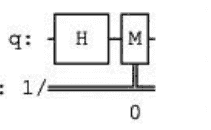

**图 3.5** 由 H 门表示的量子硬币以及由 M 表示的量子比特测量。测量值由一个经典比特 c 表示。

对于电路中必须定义的被测量子比特，测量值存储在传统的比特（conventional bits）中。在我们的量子硬币示例中，我们通过命令 `qc = QuantumCircuit(1,1)` 定义了一个量子电路，第一个索引表示量子比特的数量，第二个表示传统比特的数量。

```python
qc = QuantumCircuit(1,1)
qc.h(0)
qc.measure(0,0)
qc.draw()
```

命令 `qc.measure(0,0)` 表示我们测量该量子比特（计数从 0 开始而不是 1），并将测量结果存储在传统比特 c 中。量子电路如图[图 3.5]()所示。

```python
simulator = Aer.get_backend('qasm_simulator')
result = execute(qc, simulator, shots=10).result()
counts = result.get_counts()
print(f"Total count: {counts}")
```

命令 `result = execute(qc, simulator, shots=10).result()` 执行量子操作 10 次，样本数（shots）由命令 `qc, simulator, shots=10` 指定。直方图表示由一个比特测量的两个状态 0 和 1 的频率，在[图 3.6]()中相对于样本数所示出。

两次应用量子硬币

$H \cdot (\frac{1}{\sqrt{2}}|0\rangle + \frac{1}{\sqrt{2}}|1\rangle) = H \cdot \frac{1}{\sqrt{2}}|0\rangle + H \cdot \frac{1}{\sqrt{2}}|1\rangle = |0\rangle$

```python
qc = QuantumCircuit(1,1)
qc.h(0)
qc.h(0)
qc.measure(0,0)
qc.draw()
```

结果如图[图 3.7]()所示的量子电路以及直方图[图 3.8]()所示。

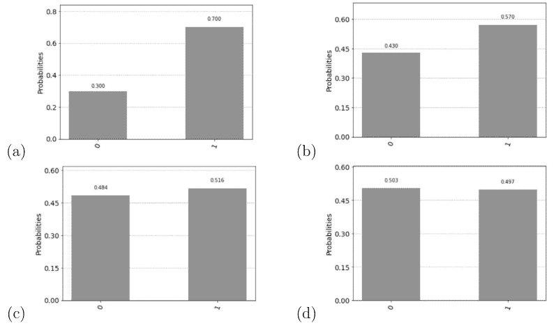

**图 3.6** 由一个比特测量的状态 0 和 1 及其结果频率。归一化后的频率以概率表示。(a) 样本数为 10，总计数为：{'1': 6, '0': 4}。((b) 样本数为 100，总计数为：{'1': 51, '0': 52}。((c) 样本数为 1000，总计数为：{'1': 502, '0': 498}。((d) 样本数为 1000，总计数为：{'1': 5026, '0': 4974}。随着样本数量增加，分布趋于图 3.3 的真实值。

## 3.6 矩阵表示

Hadamard 算符 $H_3$ 测量 3 个量子比特 $|000\rangle$，代表希尔伯特空间 $\mathcal{H}_2^3$ 中的一个基

```latex
$$\frac{1}{\sqrt{8}} (|000\rangle + |001\rangle + |010\rangle + |011\rangle + |100\rangle + |101\rangle + |110\rangle + |111\rangle) =
```

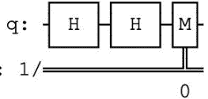

**图 3.7** 由两个 $H$ 门表示的量子硬币的应用以及由 M 表示的量子比特测量。测量值由一个经典比特 $c$ 表示。

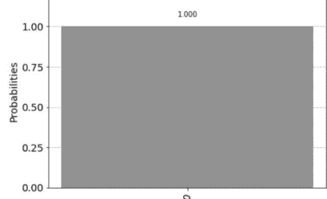

**图 3.8** 由一个量子比特表示的新状态。

这对应于使用状态向量仿真的三个量子比特 0, 1, 2 的简单程序

```python
qc = QuantumCircuit(3)
qc.h(0)
qc.h(1)
qc.h(2)
qc.draw()
```

```python
simulator = Aer.get_backend('statevector_simulator')
result=execute(qc,simulator).result()
counts = result.get_counts()
print(f"Total count: {counts}")
plot_histogram(counts)
```

位于[图 3.9]()中的量子电路和直方图[图 3.10]()中。我们可以使用内置的 LaTeX 命令（当支持 Jupyter 的编辑器时）表示测量前的状态向量及其振幅值

```python
final_state = execute(qc,simulator).result().get_statevector()
from qiskit.visualization import array_to_latex
array_to_latex(final_state, prefix="\text{state}\} = ")
```

| q_0: | H |
| :--- | :--- |
| q_1: | H |
| q_2: | H |

**图 3.9** Hadamard 算符 $H_3$ 将 3 个量子比特 $|000\rangle$ 映射到希尔伯特空间 $\mathcal{H}_{2^3}$ 中的基态。这通过编号为 0, 1 和 2 的量子比特上的三个 $H$ 门表示。

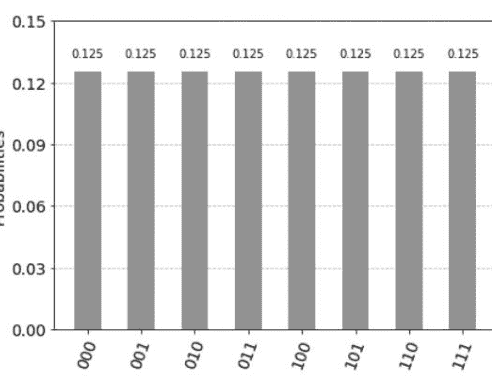

图3.10 由三个量子比特表示的八个生成状态。

```latex
Statevector = \begin{bmatrix} 1/\sqrt{8} & 1/\sqrt{8} & 1/\sqrt{8} & 1/\sqrt{8} & 1/\sqrt{8} & 1/\sqrt{8} & 1/\sqrt{8} & 1/\sqrt{8} \end{bmatrix}
```

我们可以通过以下命令用矩阵表示量子电路。我们将使用 qiskit 安装中的 NumPy。NumPy 是 Python 编程语言的库，提供了对大型多维数组和矩阵的支持，这些与 MATLAB 高相关。

```python
import numpy as np
from qiskit.visualization import array_to_latex
from qiskit import assemble

simulator = Aer.get_backend('qasm_simulator')
qc.save_unitary()
result = simulator.run(qc).result()
unitary = result.get_unitary()
print("Size of the unitary matrix:", unitary.shape)
print(array_to_latex(unitary, prefix="\text{Circuit = "))
```

输出矩阵为：
Size of the unitary: (8, 8)
$\begin{bmatrix} 1/\sqrt{8} & 1/\sqrt{8} & 1/\sqrt{8} & 1/\sqrt{8} & 1/\sqrt{8} & 1/\sqrt{8} & 1/\sqrt{8} & 1/\sqrt{8} \\ 1/\sqrt{8} & -1/\sqrt{8} & 1/\sqrt{8} & -1/\sqrt{8} & 1/\sqrt{8} & -1/\sqrt{8} & 1/\sqrt{8} & -1/\sqrt{8} \\ 1/\sqrt{8} & 1/\sqrt{8} & -1/\sqrt{8} & -1/\sqrt{8} & 1/\sqrt{8} & 1/\sqrt{8} & -1/\sqrt{8} & -1/\sqrt{8} \\ 1/\sqrt{8} & -1/\sqrt{8} & -1/\sqrt{8} & 1/\sqrt{8} & 1/\sqrt{8} & -1/\sqrt{8} & -1/\sqrt{8} & 1/\sqrt{8} \\ 1/\sqrt{8} & 1/\sqrt{8} & 1/\sqrt{8} & 1/\sqrt{8} & -1/\sqrt{8} & -1/\sqrt{8} & -1/\sqrt{8} & -1/\sqrt{8} \\ 1/\sqrt{8} & -1/\sqrt{8} & 1/\sqrt{8} & -1/\sqrt{8} & -1/\sqrt{8} & 1/\sqrt{8} & 1/\sqrt{8} & -1/\sqrt{8} \\ 1/\sqrt{8} & 1/\sqrt{8} & -1/\sqrt{8} & -1/\sqrt{8} & -1/\sqrt{8} & -1/\sqrt{8} & 1/\sqrt{8} & 1/\sqrt{8} \\ 1/\sqrt{8} & -1/\sqrt{8} & 1/\sqrt{8} & -1/\sqrt{8} & -1/\sqrt{8} & 1/\sqrt{8} & -1/\sqrt{8} & 1/\sqrt{8} \end{bmatrix}$

由于矩阵大小呈指数级增长，因此无法用矩阵表示更多比特的量子电路。

## 3.7 量子电路

四位与运算 $x \wedge y \wedge z \wedge v$ 需要三个量子 Toffoli 门 $CCX$ 和三个额外的零量子比特。输入状态为

$|x\rangle|y\rangle|z\rangle|v\rangle$

第一个 Toffoli 门

$(CCX \cdot |x\rangle|y\rangle) \otimes (I_4 \cdot |z\rangle|v\rangle) = |x\rangle|x \wedge y\rangle|z\rangle|v\rangle$

第二个 Toffoli 门

$(I_2 \cdot |x\rangle) \otimes (CCX \cdot |x \wedge y\rangle|z\rangle) \otimes (I_2 \cdot |v\rangle) = |x\rangle|x \wedge y\rangle|x \wedge y \wedge z\rangle|v\rangle$

第三个量子 Toffoli 门

$(I_4 \cdot |z\rangle|x \wedge y\rangle|z\rangle) \otimes (CCX \cdot |x \wedge y \wedge z\rangle|v\rangle) = |x\rangle|x \wedge y\rangle|x \wedge y \wedge z\rangle|x \wedge y \wedge z \wedge v\rangle$

该电路对应于酉映射

结果为

$|x\rangle|x \wedge y\rangle|x \wedge y \wedge z\rangle|v\rangle|x \wedge y \wedge z \wedge v\rangle$


```python
from qiskit import QuantumCircuit,QuantumRegister, execute
from qiskit.visualization import plot_histogram
from qiskit.quantum_info import Statevector
```

```python
x = QuantumRegister(1, 'x')
y = QuantumRegister(1, 'y')
z = QuantumRegister(1, 'z')
v = QuantumRegister(1, 'v')
aux = QuantumRegister(2, 'aux')
r = QuantumRegister(1, 'result')
qc = QuantumCircuit(x,y,z,v,aux,r)
qc.x(x)
qc.x(y)
qc.x(z)
qc.x(v)
qc.barrier()
qc.ccx(x,y,aux[0])
qc.ccx(aux[0],z,aux[1])
qc.ccx(aux[1],z,r)
```

```python
simulator = Aer.get_backend('statevector_simulator')
result=execute(qc,simulator).result()
counts = result.get_counts()
print("ncount are:", counts)
plot_histogram(counts)
```

量子电路如图 3.11 所示，状态向量“测量”后的结果如图 3.12 所示。

## 3.7 反计算 (Uncomputing)

量子比特 `aux0=1, aux1=1` 通常不需要进一步计算，因为结果已经表示在输出比特 `result` 中。然而，无法将它们重置为零，相反，它们与输出比特纠缠在一起。对于矩阵 $CCX^{-1} = CCX$，我们重新计算确定结果的第一个和第二个 Toffoli 门。步骤如 `qc.barrier()` 之后的列表所示的反操作。

```python
qc.barrier()
qc.ccx(x,y,aux[0])
qc.ccx(aux[0],z,aux[1])
qc.ccx(aux[1],z,r)
# 对辅助寄存器进行反计算
qc.ccx(aux[0],z,aux[1])
qc.ccx(x,y,aux[0])
```

如图 3.13 所示，状态向量“测量”后的结果如图 3.14 所示。


**图 3.11** 我们使用 X 门将量子比特 x, y, z, v 初始化为 1。初始化后，我们使用 `qc.barrier()` 将电路中的表示隔离开来。它不是一个门，可以防止在计算期间合并门操作。我们随后使用了三个量子 Toffoli 门（也称为 ccX 门，即双受控非门），其结果表示在量子比特 r 中。

### 3.7.2 通用多控 X 门

另一种方法可以使用 `MCXGate(a)` 命令，而无需定义辅助寄存器。`MCXGate(n)` 门是一个由 $n$ 个量子比特控制的通用多控 X 门，在本例中由量子比特 x, y, z, v, r 控制。

```python
from qiskit.circuit.library import MCXGate
x = QuantumRegister(1, 'x')
y = QuantumRegister(1, 'y')
z = QuantumRegister(1, 'z')
```

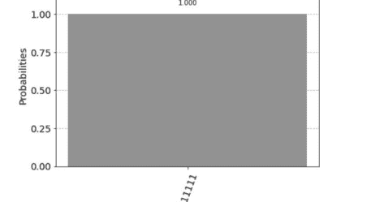

**图 3.12** 状态向量“测量”后，量子比特的值为 x = 1, y = 1, z = 1, v = 1, aux_0 = 1, aux_1 = 1 且 result = 1。总计数为：{'1111111': 1.0}，表示概率为1。

| x: | X |
|---|---|
| y: | X |
| z: | X |
| v: | X |
| aux_0: | |
| aux_1: | |
| result:| | |

图 3.13 因为 $CCX^{-1} = CCX$，所以在确定结果后重新计算了第一个和第二个量子 Toffoli 门 ccX。

```python
v = QuantumRegister(1, 'v')
r = QuantumRegister(1, 'result')
qc = QuantumCircuit(x,y,z,v,r)
qc.barrier()
```

```python
gate = MCXGate(4)
qc.append(gate,[x,y,z,v,r])
qc.draw()
```

如图 3.15 所示。

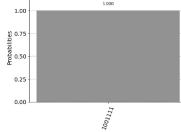

图 3.14 状态向量“测量”后，量子比特的值为 x=1, y=1, z=1, v=1, aux_0=0, aux_1=0 且 result=1。总计数（按逆序排列）：{'1001111': 1.0}，1.0 表示状态 [1001111] 的概率为一。总计数为：{'1001111': 1.0}

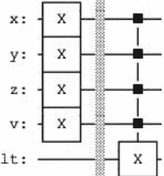

**图 3.15** 可以使用命令 $MCXGate(4)$ 而无需定义辅助寄存器。

### 3.7.3 OR 操作

OR 操作根据德·摩根定律通过酉变换映射表示：

$x_1 \vee x_2 = \neg(x_1 \wedge \neg x_2)$
$((I_2 \otimes X) \cdot CCX \cdot (X \otimes X \otimes I_1)) \cdot [xy0] = xy(x \vee y)$

```python
x = QuantumRegister(1, 'x')
y = QuantumRegister(1, 'y')
r = QuantumRegister(1, 'result')
qc = QuantumCircuit(x,y,r)
# 准备
qc.x(x)
qc.x(y)
qc.barrier()
# 根据德·摩根定律进行 OR 操作
qc.x(x)
qc.x(y)
qc.x(r)
qc.ccx(x,y,r)
qc.draw()
```

得到图 3.16 所示的量子电路。对于每个量子布尔 AND 操作，简单的实现需要一个辅助（ancilla）位。通过反转前面的步骤，这些比特可以用于进一步计算。电路的复杂度对应量子门的数量。

## 3.8 DEUTSCH 算法

Deutsch 算法 [26] 利用了由 Hadamard 门生成的量子比特叠加态，它比任何经典算法都强大。它用于判断 $f(x)$ 是否为常数。

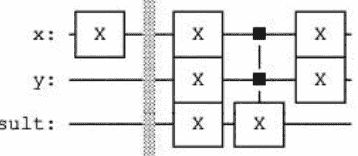

**图 3.16** OR 操作根据德·摩根定律 $x_1 \vee x_2 = \neg(x_1 \wedge \neg x_2)$ 由酉映射表示。对于一个未知函数 $f : B^1 \to B^1$，通过调用函数来判断单比特的 $f(x)$ 是否为常数。常数函数 $f(0) = f(1)$。


# 使用 Qiskit 的 58 量子人工智能

```
$= \left(\frac{|0\rangle-|1\rangle}{\sqrt{2}}\right) \otimes \left(\frac{|0\rangle-|1\rangle}{\sqrt{2}}\right),\
niv) = \frac{1}{2} \cdot (|01\rangle-|00\rangle+|10\rangle-|11\rangle) = \frac{1}{2} \cdot (-|00\rangle+|01\rangle+|10\rangle)
-\left(\frac{|0\rangle+|1\rangle}{\sqrt{2}}\right) \otimes \left(\frac{|0\rangle-|1\rangle}{\sqrt{2}}\right) = -\left(\frac{|0\rangle-|1\rangle}{\sqrt{2}}\right) \otimes \left(\frac{|0\rangle+|1\rangle}{\sqrt{2}}\right).$
```

在第三步中，对第一个量子比特施了哈达玛门

```
$H_1 \cdot I_2 \cdot H_2 \cdot |01\rangle. \quad (3.7)$
```

有四种可能的结果：

```
$i) |0\rangle \otimes \left(\frac{|0\rangle-|1\rangle}{\sqrt{2}}\right),\
ii) -|0\rangle \otimes \left(\frac{|0\rangle-|1\rangle}{\sqrt{2}}\right),\
iii) |1\rangle \otimes \left(\frac{|0\rangle-|1\rangle}{\sqrt{2}}\right),\
vi) -|1\rangle \otimes \left(\frac{|0\rangle-|1\rangle}{\sqrt{2}}\right).$
```

在第四步中，测量第一个量子比特（该比特处于基态）。如果函数是常数，则为 $|0\rangle$，否则为 $|1\rangle$。

在我们的模拟中，为了简单起见，我们假设未知函数是恒等映射 $f(x)=0$

```
$i \ U_f(00) = |0\rangle\otimes|0\rangle = |00\rangle, U_f(01) = |01\rangle,\
U_f(10) = |10\rangle, U_f(11) = |11\rangle$.
```

```python
qc = QuantumCircuit(2,1)
qc.x(0)
qc.barrier()
qc.h(0)
qc.h(1)
#constant function f(x)=0, do nothing
qc.barrier()
qc.h(1)
#Measure the qubit 1
qc.measure(1,0)
qc.draw()
```

```python
simulator = Aer.get_backend('qasm_simulator')
result=execute(qc,simulator).result()
counts = result.get_counts()
print("\nTotal count are:",counts)
plot_histogram(counts)
```

# Qiskit ■59

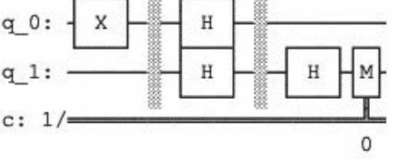

**图 3.17** 代表未知函数恒等映射 $f(x) = 0$ 的 Deutsch 算法的量子电路。

参见图 3.17 和图 3.18。对于非常数函数，$f(x) = x$ 对应于两个元素的置换。

- iii) $U_f(|0\rangle) = |0\rangle|0\rangle = |00\rangle, U_f(|1\rangle) = |01\rangle$,
$U_f(|10\rangle) = |11\rangle$

该操作可以通过受控非门（CNOT gate）实现。当第一个量子比特（控制量子比特）为 1 时，CNOT 门会翻转第二个量子比特（目标比特）。在我们的情况下，控制量子比特是 $q_1$，目标比特是 $q_1.cx(1,0)$。

```python
qc = QuantumCircuit(2,1)

```python
qc.x(0)
qc.barrier()
qc.h(0)
qc.h(1)
#identity function f(x)=x
qc.cx(1,0)
qc.barrier()
```

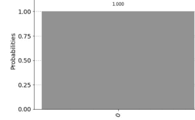

**图 3.18** 在第四步中，测量第一个量子比特（该比特处于基态）。它是 $|0\rangle$，函数是常数。总计数为：$\{'0' : 1024\}$。如果未指定，默认的次数（shots）为 1024。

使用 Qiskit 的量子人工智能

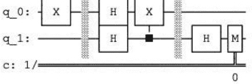

图 3.19 代表未知函数非常数函数 $f(x)=x$ 的 Deutsch 算法的量子电路。

```python
simulator = Aer.get_backend('qasm_simulator')
result=execute(qc,simulator).result()
counts = result.get_counts()
print("\nTotal count are:",counts)
plot_histogram(counts)
```

```python
qc.h(1)
qc.measure(1,0)
qc.draw()
```

参见图 3.19 和图 3.20。

## 3.9 在真实量子计算机上运行 DEUTSCH 算法

Richard Feynman 在 20 世纪初询问过量子系统是否可以在虚拟量子计算机上进行模拟。40 年后的今天，第一小型量子计算机开始出现。近年来，在保持量子比特相干性方面取得了巨大进展，为通用量子计算机开辟了道路

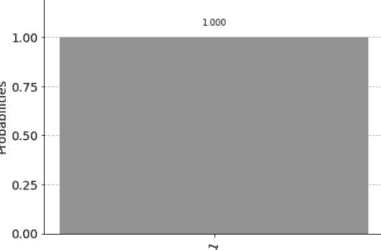

图 3.20 在第一步中，测量第一个量子比特（该比特处于基态）。它是 |1>，函数是非常数。总计数为：("1": 1024)。如果未指定，默认的次数（shots）为 1024。

# Qiskit 61


**图 3.21** 代表未知函数恒等映射 $f(x) = 0$ 的 Deutsch 算法的量子电路。

参见图 3.17 和图 3.18。对于非常数函数，$f(x) = x$ 对应于两个元素的置换。

- iii) $U_f(|0\rangle) = |0\rangle|0\rangle = |00\rangle, U_f(|1\rangle) = |01\rangle$,
$U_f(|10\rangle) = |11\rangle$

该操作可以通过受控非门（CNOT gate）实现。当第一个量子比特（控制量子比特）为 1 时，CNOT 门会翻转第二个量子比特（目标比特）。在我们的情况下，控制量子比特是 $q_1$，目标比特是 $q_1.cx(1,0)$。

```python
qc = QuantumCircuit(2,1)

```python
qc.x(0)
qc.barrier()
qc.h(0)
qc.h(1)
#identity function f(x)=x
qc.cx(1,0)
qc.barrier()
```


**图 3.18** 在第四步中，测量第一个量子比特（该比特处于基态）。它是 $|0\rangle$，函数是常数。总计数为：$\{'0' : 1024\}$。如果未指定，默认的次数（shots）为 1024。

使用 Qiskit 的量子人工智能


图 3.19 代表未知函数非常数函数 $f(x)=x$ 的 Deutsch 算法的量子电路。

```python
simulator = Aer.get_backend('qasm_simulator')
result=execute(qc,simulator).result()
counts = result.get_counts()
print("\nTotal count are:",counts)
plot_histogram(counts)
```

```python
qc.h(1)
qc.measure(1,0)
qc.draw()
```

参见图 3.19 和 3.20。

## 3.9 在真实量子计算机上运行 DEUTSCH 算法

Richard Feynman 在 20 世纪初询问过量子系统是否可以在虚拟量子计算机上进行模拟。40 年后的今天，第一小型量子计算机开始出现。近年来，在保持量子比特相干性方面取得了巨大进展，为通用量子计算机开辟了道路


图 3.20 在第一步中，测量第一个量子比特（该比特处于基态）。它是 |1>，函数是非常数。总计数为：("1": 1024)。如果未指定，默认的次数（shots）为 1024。


### 4.1.1 恒等门 – I

qc.id(qubit)

$|0\rangle \rightarrow |0\rangle \quad |1\rangle \rightarrow |1\rangle$

恒等门定义了一个在一个量子比特上的量子门，可以用希尔伯特空间 $\mathcal{H}_2$ 中的酉矩阵 $I$ 表示。

$I = \begin{pmatrix} 1 & 0 \\ 0 & 1 \end{pmatrix}$

恒等门不执行任何操作，且在 qiskit 中不起任何作用。在矩阵表示法中，它表示在使用表示量子电路的张量积组合矩阵时，量子比特保持不变。

### 4.1.2 NOT 门，泡利 X 门 – X

qc.x(qubit)

$|0\rangle \rightarrow |1\rangle \quad |1\rangle \rightarrow |0\rangle$

NOT 门定义了一个在一个量子比特上的量子门，可以用希尔伯特空间 $\mathcal{H}_2$ 中的酉矩阵 $X$ 表示。

$X = \begin{pmatrix} 0 & 1 \\ 1 & 0 \end{pmatrix}$

NOT 门也称为泡利 X 门。

### 4.1.3 Toffoli 门 – ccX

qc.ccx(control1,control2,target)

| CCX[000] $\rightarrow$ | |000| | CCX[100] $\rightarrow$ | |100| |
| CCX[001] $\rightarrow$ | |001| | CCX[101] $\rightarrow$ | |101| |
| CCX[010] $\rightarrow$ | |010| | CCX[110] $\rightarrow$ | |111| |
| CCX[011] $\rightarrow$ | |011| | CCX[111] $\rightarrow$ | |110| |

Toffoli 门、ccX CNOT 门、受控受控非门（也称为 ccX CNOT 门 – 受控受控非门）定义了一个在三个量子比特上的量子门，可以用 $\mathcal{H}_s$ 中的酉矩阵 CCX 表示。

```
CCX = \begin{pmatrix} 1 & 0 & 0 & 0 & 0 & 0 & 0 \\ 0 & 1 & 0 & 0 & 0 & 0 & 0 \\ 0 & 0 & 1 & 0 & 0 & 0 & 0 \\ 0 & 0 & 0 & 1 & 0 & 0 & 0 \\ 0 & 0 & 0 & 0 & 1 & 0 & 0 \\ 0 & 0 & 0 & 0 & 0 & 1 & 0 \\ 0 & 0 & 0 & 0 & 0 & 0 & 1 \end{pmatrix}
```

Toffoli 门不改变前输入量子比特 $x_1$ 和 $x_2$。该操作通过三个输入量子比特 $x_1, x_2, x_3$ 的以下映射描述：

```
$ccX(x_1, x_2, x_3) = (x_1, x_2, (x_1 \wedge x_2) \oplus x_3)$
```

Toffoli 门执行以下操作：

- 它计算与（AND）操作，辅助（固定）位 $x_3$ 被设置为 0。
$ccX(x_1, x_2, 0) = (x_1, x_2, x_1 \wedge x_2)$

- 它计算异或（XOR）操作，位 $x_1$ 被设置为 1。
$ccX(1, x_2, x_3) = (1, x_2, x_2 \oplus x_3)$

- 它对 $x_3$ 计算非（NOT）操作。
$ccX(1, 1, x_3) = (1, 1, \neg x_3)$

- 它计算非与（NAND）操作，辅助（固定）位 $x_3$ 被设置为 1。
$ccX(x_1, x_2, 1) = (x_1, x_2, \neg(x_1 \wedge x_2))$

- 它计算扇出（FANOUT）操作（位 $x_2$ 的值被复制到 $x_3$）。
$ccX(1, x_2, 0) = (1, x_2, x_2)$

或（OR）操作遵循德·摩根定律：

```
$x_1 \vee x_2 = \neg(\neg x_1 \wedge \neg x_2)$
```

由于 NAND 和 FANOUT 组合是通用的，我们可以使用 Toffoli 门实现任何可逆量子电路。

# 使用 Qiskit 的量子人工智能

### 4.1.4 受控非门 – cX

qc.cx(qubit1, qubit2)

```
$CX|00\rangle = |00\rangle \quad CX|01\rangle = |01\rangle$
$CX|10\rangle = |11\rangle \quad CX|11\rangle = |10\rangle$
```

受控非门定义了一个在两个量子比特上的量子门，可以用希尔伯特空间 $\mathcal{H}_4$ 中的酉矩阵 $CX$ 表示。

```
$CX = \begin{pmatrix} 1 & 0 & 0 & 0 \\ 0 & 1 & 0 & 0 \\ 0 & 0 & 0 & 1 \\ 0 & 0 & 1 & 0 \end{pmatrix}$.
```

受控非门执行以下操作：

- 受控操作：当第一个量子比特为 1 时，第二个量子比特翻转。
```
$cX(1,x) = (1, \neg x)$
$cX(0,x) = (0, x)$
```

- 扇出操作：当第二个量子比特为 0 时，第一个量子比特的值被复制到第二个。
```
$cX(x_1,0) = (x_1, x_1)$
```

### 4.1.5 交换门 – SWAP

qc.swap(qubit1, qubit2)

```
$SWAP|00\rangle = |00\rangle \quad SWAP|01\rangle = |10\rangle$
$SWAP|10\rangle = |01\rangle \quad SWAP|11\rangle = |11\rangle$
```

交换门定义了一个在两个量子比特上的量子门，可以用希尔伯特空间 $\mathcal{H}_4$ 中的酉矩阵 $SWAP$ 表示。

```
$SWAP = \begin{pmatrix} 1 & 0 & 0 & 0 \\ 0 & 0 & 1 & 0 \\ 0 & 1 & 0 & 0 \\ 0 & 0 & 0 & 1 \end{pmatrix}$
```

交换门交换两个量子比特：

```
$SWAP(x_1,x_2) = (x_2,x_1)$.
```

### 4.1.6 受控交换门 – cS

qc.cswap(control,qubit_1,qubit_2)

```
$CSWAP|000\rangle = |000\rangle \quad CSWAP|100\rangle = |100\rangle$
$CSWAP|001\rangle = |001\rangle \quad CSWAP|101\rangle = |110\rangle$
$CSWAP|010\rangle = |010\rangle \quad CSWAP|110\rangle = |101\rangle$
$CSWAP|011\rangle = |011\rangle \quad CSWAP|111\rangle = |111\rangle$
```

受控交换门或 Fredkin 门定义了一个在三个量子比特上的量子门，可以用希尔伯特空间 $\mathcal{H}_8$ 中的酉矩阵 $CSWAP$ 表示。

```
$CSWAP = \begin{pmatrix} 1 & 0 & 0 & 0 & 0 & 0 & 0 & 0 \\ 0 & 1 & 0 & 0 & 0 & 0 & 0 & 0 \\ 0 & 0 & 0 & 0 & 0 & 1 & 0 & 0 \\ 0 & 0 & 0 & 1 & 0 & 0 & 0 & 0 \\ 0 & 0 & 0 & 0 & 1 & 0 & 0 & 0 \\ 0 & 0 & 1 & 0 & 0 & 0 & 0 & 0 \\ 0 & 0 & 0 & 0 & 0 & 0 & 1 & 0 \\ 0 & 0 & 0 & 0 & 0 & 0 & 0 & 1 \end{pmatrix}$
```

- 如果控制量子比特为 0，则不执行交换：
$CSWAP(0, x_1, x_2) = (0, x_1, x_2)$

- 如果控制量子比特为 1，则执行交换：
$CSWAP(1, x_1, x_2) = (1, x_2, x_1)$

## 单量子比特门

单量子比特对应的量子门改变由复数表示的幅度分布。

## 4.2 单量子比特的 Clifford 门

Clifford 门是由三个门：Hadamard、$S$ 和 CNOT 生成的 Clifford 群。它是一组影响泡利门（$X$ 门、$Y$ 门和 $Z$ 门）排列的数学变换。仅由 Clifford 门组成的量子电路可以用经典计算机高效模拟。

### 4.2.1 Hadamard 门 – H

qc.h(qubit)

```
$H(|0\rangle) \rightarrow \frac{1}{\sqrt{2}}|0\rangle + \frac{1}{\sqrt{2}}|1\rangle \quad H(|1\rangle) \rightarrow \frac{1}{\sqrt{2}}|0\rangle - \frac{1}{\sqrt{2}}|1\rangle$
```

Hadamard 门定义了一个在一个量子比特上的量子门，可以用希尔伯特空间 $\mathcal{H}_2$ 中的酉矩阵 $H$ 表示。

```
$H = \begin{pmatrix} \frac{1}{\sqrt{2}} & \frac{1}{\sqrt{2}} \\ \frac{1}{\sqrt{2}} & -\frac{1}{\sqrt{2}} \end{pmatrix}$
```

Hadamard 门也称为 Walsh 门。如果系统从状态 $|0\rangle$ 开始并经历演化，观测 0 或 1 的概率为 $|1/\sqrt{2}|^2 = 1/2$。如果我们不测量并重复映射，观测 0 的概率变为 1，观测 1 的概率变为 0。这是由于 $|1\rangle$ 的幅度相互抵消导致的。这种现象是相消性干涉。

### 4.2.2 泡利 Y 门 – Y

qc.y(qubit)

```
$Y(|0\rangle) \rightarrow i|1\rangle \quad Y(|1\rangle) \rightarrow i|0\rangle$
```

泡利 $Y$ 门定义了一个在一个量子比特上的量子门，可以用希尔伯特空间 $\mathcal{H}_2$ 中的酉矩阵 $Y$ 表示。

```
$Y = \begin{pmatrix} 0 & -i \\ i & 0 \end{pmatrix}$
```

### 4.2.3 泡利 Z 门 – Z

qc.z(qubit)

```
$Z(|0\rangle) \rightarrow |0\rangle \quad Z(|1\rangle) \rightarrow -|1\rangle$
```

泡利 $Z$ 门定义了一个在一个量子比特上的量子门，可以用希尔伯特空间 $\mathcal{H}_2$ 中的酉矩阵 $Z$ 表示。

```
$Z = \begin{pmatrix} 1 & 0 \\ 0 & -1 \end{pmatrix}$
```

### 4.2.4 S 门 – S

qc.s(qubit)

```
$S(|0\rangle) \rightarrow |0\rangle \quad S(|1\rangle) \rightarrow i|1\rangle$
```

$S$ 门定义了一个在一个量子比特上的量子门，可以用希尔伯特空间 $\mathcal{H}_2$ 中的酉矩阵 $S$ 表示。

```
$S = \begin{pmatrix} 1 & 0 \\ 0 & i \end{pmatrix}$
```

$S$ 门也称为 $Z9$ 门。

### 4.2.5 Sdag 门 – $S^\dagger$

qc.sdg(qubit)

```
$S^\dagger|0\rangle \rightarrow |0\rangle \quad S^\dagger|1\rangle \rightarrow -i|1\rangle$
```

$S^\dagger$ 门定义了一个在一个量子比特上的量子门，可以用希尔伯特空间 $\mathcal{H}_2$ 中的酉矩阵 $S$ 表示。

```
$S^\dagger = \begin{pmatrix} 1 & 0 \\ 0 & -i \end{pmatrix}$
```

Clifford 门与 $T$ 门一起是通用的量子门，因为它们可以近似任何所需的量子门。

## 4.3 旋转门

### 4.3.1 T 门 – T

qc.t(qubit)

$T$ 门对应于参数 $RZ$ 门，$\theta = \pi/4$。

```
$T|0\rangle \rightarrow |0\rangle \quad T|1\rangle \rightarrow e^{i\pi/4} \cdot |1\rangle = \left(\frac{1}{\sqrt{2}} + \frac{i}{\sqrt{2}}\right) \cdot |1\rangle$
```

$T$ 门定义了一个在一个量子比特上的量子门，可以用希尔伯特空间 $\mathcal{H}_2$ 中的酉矩阵 $T$ 表示。

```
$T = \begin{pmatrix} 1 & 0 \\ 0 & e^{i\pi/4} \end{pmatrix}$
```

其中 $T$ 门是 $S$ 门的平方根。

```
$S = T^2
```


## 4.3.2 $T^\dagger$ Gate - $T^\dagger$

```python
qc.tdg(qubit)
```

T 门对应于 $\theta = -\pi/4$ 的 RZ 门。

```
$T^\dagger|0\rangle \rightarrow |0\rangle \quad T^\dagger|1\rangle \rightarrow e^{-i\pi/2}|1\rangle = \left(\frac{1}{\sqrt{2}}-\frac{i}{\sqrt{2}}\right)|1\rangle$
```

T 门定义了一个单量子比特量子门，可以用希尔伯特空间 $\mathcal{H}_2$ 中的酉矩阵 $T$ 表示。

```
$T^{\dagger} = \begin{pmatrix} 1 & 0 \\ 0 & e^{-i\pi/2} \end{pmatrix}$
```

$T^{\dagger}$ 门是 $S$ 门的平方根。

```
$S=(T^{\dagger})^2$
```

## 4.4 参数化旋转门

参数化门在量子机器学习中起着重要作用。参数化旋转门是一种参数化门，其参数是围绕三个轴进行旋转的旋转幅度。

### 4.4.1 RX Gate - RX

```python
qc.rx(theta,qubit)
```

$RX$ 门沿 $x$ 轴对单量子比特进行角度为 $\theta$ 的旋转。旋转角度单位为弧度。

当 $\theta = \pi$ 时：

```
$RX|0\rangle \rightarrow -i|1\rangle \quad RX|1\rangle \rightarrow -i|0\rangle$
```

当 $\theta = \pi/2$ 时：

```
$RX|0\rangle \rightarrow \frac{1}{\sqrt{2}}|0\rangle-\frac{i}{\sqrt{2}}|1\rangle \quad RX|1\rangle \rightarrow \frac{i}{\sqrt{2}}|0\rangle+\frac{1}{\sqrt{2}}|1\rangle$
```

$RX$ 门定义了一个单量子比特量子门，可以用希尔伯特空间 $\mathcal{H}_2$ 中的酉矩阵 $RX$ 表示。

```
$R_{X}(\theta) = \begin{pmatrix} \cos(\frac{\theta}{2}) & -i\sin(\frac{\theta}{2}) \\ -i\sin(\frac{\theta}{2}) & \cos(\frac{\theta}{2}) \end{pmatrix}$
```

### 4.4.2 RY Gate - RY

```python
qc.ry(theta,qubit)
```

$RY$ 门沿 $y$ 轴对单量子比特进行角度为 $\theta$ 的旋转。旋转角度单位为弧度。

当 $\theta = \pi$ 时：

```
$RY|0\rangle \rightarrow |1\rangle \quad RY|1\rangle \rightarrow -|0\rangle$
```

当 $\theta = \pi/2$ 时：

```
$RY|0\rangle \rightarrow \frac{1}{\sqrt{2}}|0\rangle + \frac{1}{\sqrt{2}}|1\rangle \quad RY|1\rangle \rightarrow \frac{1}{\sqrt{2}}|0\rangle - \frac{1}{\sqrt{2}}|1\rangle$
```

$RY$ 门定义了一个单量子比特量子门，可以用希尔伯特空间 $\mathcal{H}_2$ 中的酉矩阵 $RY$ 表示。

```
$R_Y(\theta) = \begin{pmatrix} \cos(\frac{\theta}{2}) & -\sin(\frac{\theta}{2}) \\ \sin(\frac{\theta}{2}) & \cos(\frac{\theta}{2}) \end{pmatrix}$
```

### 4.4.3 RZ Gate - RZ

```python
qc.rz(phi,qubit)
```

$RZ$ 门沿 $z$ 轴对单量子比特进行角度为 $\phi$ 的旋转。旋转角度单位为弧度。

当 $\phi = \pi$ 时：

```
$RZ|0\rangle \rightarrow -i|0\rangle \quad RZ|1\rangle \rightarrow i|1\rangle$
```

当 $\phi = \pi/2$ 时：

```
$RZ|0\rangle \rightarrow \frac{1}{\sqrt{2}} - \frac{i}{\sqrt{2}}|0\rangle \quad RZ|1\rangle \rightarrow \frac{1}{\sqrt{2}} + \frac{i}{\sqrt{2}}|1\rangle$
```

$RZ$ 门定义了一个单量子比特量子门，可以用希尔伯特空间 $\mathcal{H}_2$ 中的酉矩阵 $R_Z(\phi)$ 表示。

```
$R_Z(\phi) = \begin{pmatrix} e^{-i\frac{\phi}{2}} & 0 \\ 0 & e^{i\frac{\phi}{2}} \end{pmatrix}$
```

### 4.4.4 U Gate - U

U 门是一个带有 3 个欧拉角的单量子比特旋转门。

```python
qc.u(theta, phi, lambda, qubit)
```

$U$ 门沿轴对单量子比特进行角度为 $\theta$、$\phi$ 和 $\lambda$ 的旋转。旋转角度单位为弧度。它可以用希尔伯特空间 $\mathcal{H}_2$ 中的酉矩阵 $U$ 表示。

```
$U(\theta, \phi, \lambda) = \begin{pmatrix} \cos(\frac{\theta}{2}) & -e^{-i\lambda}\sin(\frac{\theta}{2}) \\ -e^{i\lambda}\sin(\frac{\theta}{2}) & \cos(\frac{\theta}{2}) \end{pmatrix}$
```

### 4.4.5 Phase Gate – P

```python
qc.p(lambda)
```

目标量子比特和控制量子比特可以交换，因为相位只有在两个值都为时应用：

```
$P|0\rangle \rightarrow |0\rangle \quad \quad P|1\rangle \rightarrow e^{i\lambda}|1\rangle$
```

相位门定义了一个单量子比特量子门，可以用希尔伯特空间 $\mathcal{H}_2$ 中的酉矩阵 $P$ 表示。

```
$P(\lambda) = \begin{pmatrix} 1 & 0 \\ 0 & e^{i\lambda} \end{pmatrix}$
```

## 4.5 控制门 (CONTROLLED GATES)

受控 U 门执行由酉矩阵 $U$ 描述的控制操作。

```
$U = \begin{pmatrix} u_{00} & u_{01} \\ u_{10} & u_{11} \end{pmatrix}$
```

受控 U 门定义了一个双量子比特量子门，可以用希尔伯特空间 $\mathcal{H}_4$ 中的酉矩阵 $CU$ 表示。

```
$CU = \begin{pmatrix} 1 & 0 & 0 & 0 \\ 0 & 1 & 0 & 0 \\ 0 & 0 & u_{00} & u_{01} \\ 0 & 0 & u_{10} & u_{11} \end{pmatrix}$
``` (示例表示)
```

受控 U 门执行以下操作：

```
$U|00\rangle \rightarrow |00\rangle \quad U|01\rangle \rightarrow u_{01}|01\rangle \quad U|10\rangle \rightarrow u_{10}|10\rangle \quad U|11\rangle \rightarrow u_{11}|11\rangle$
```


硬件拓扑结构。将量子电路优化地分解为现有的量子门是一个复杂的问题。例如，通过朴素实现，几乎所有作用于 $n$ 个比特的量子门都需要 $2^n$ 个量子门 [72]。转译应该尽可能最小化电路深度和使用的门电路数量。

# Grover 放大 (Grover's Amplification)

我们描述 Grover 放大算法。我们用叠加态表示 $n$ 个状态，每个状态具有相同的实正振幅。对所有 $n$ 个状态应用并行计算，带有解的状态用负号标记，此时振幅变为负。然后我们应用一种基于豪holder反射（Householder reflection）的线性操作，通过反射，被标记振幅的值线性增长。对于大于四维的情况，标记和豪holder反射的操作必须重复 $\sqrt{n}$ 次，每一步振幅仅线性增长。经过 $\sqrt{n}$ 步，我们测量解。该算法相比需要 $n$ 步的经典计算机实现了二次加速。Grover 放大算法是最优的，可以证明不存在更好的算法。我们将使用量子符号和量子比特 $NumP_q$ 演示 Grover 放大的原理。然后我们解释如何用一次和两次旋转表示八个状态的量子答案。

## 5.1 搜索与量子门谕 (SEARCH AND QUANTUM ORACLE)

对于函数 $o(x)$

```
$o(x) = \begin{cases} 1 & if \ x=\xi \\ 0 & else \end{cases} \quad (5.1)$
```

我们想要找到 $o(x)=1$ 的 $x$，即 $x=\xi$。该任务等同于一个二值答案（1 为是，0 为否）的决策问题，Grover 放大算法在 $n$ 维希尔伯特空间中通过 $O(\sqrt{n})$ 步执行穷举搜索 [35], [36], [37], [38], [35], [35]。希尔伯特二维欧几得空间扩展到任意有限或无限维的空间。由于下界为 $O(\sqrt{n})$ [2]，Grover 放大算法对于穷举搜索与任何可能的量子算法一样优秀。该算法基于 $n=2^m$ 个 $n$ 个比特的 $|x\rangle$ 的豪holder反射。Grover 放大算法是最优的，可以证明不存在更好的算法 [11], [14]。这意味着使用量子计算机，$NP-complete$ 问题仍然是 $NP-complete$。算法相比需要 $n$ 步的经典计算机实现了二次加速。

### 5.1.1 量子门谕 (Quantum Oracle)

我们用叠加态表示 $n$ 个状态，每个状态具有相同的正振幅。对所有 $n$ 个状态应用并行计算，带有解 $o(x) = 1$ 的状态用负号标记，此时振幅变为负。然后我们应用一种基于豪holder反射的线性操作；通过反射，被标记振幅的值线性增长。

对于函数 $o(x)$，解由振幅符号 $(-1)^{o(x)}$ 编码。为了说明为什么解由 $(-1)^{o(x)}$ 编码，我们指示导数。酉算符 $T$ 代表确定配置是否为目标的量子门谕函数 $o(x)$：

```
$T \cdot |x\rangle|c\rangle = |x\rangle|o(x) \oplus c\rangle$
```

辅助比特 $c$ 设置为零，状态由 $m$ 个比特 $|0^m\rangle$ 表示。首先，我们将代表状态的比特和辅助比特置于 $m+1$ 个比特的叠加态 $H_{m+1}$ 中，然后执行 Hadamard 门算符 $T$：

```
$T \cdot H_{m+1} \cdot |0^m\rangle|1\rangle=\frac{1}{\sqrt{2^{m+1}}} \cdot \sum_{x \in B^m} T \cdot |x\rangle|0\rangle - \frac{1}{\sqrt{2^{m+1}}} \cdot \sum_{x \in B^m} |x\rangle|o(x) \oplus 1\rangle=\frac{1}{\sqrt{2^{m+1}}} \cdot \sum_{x \in B^m} |x\rangle|o(x) \oplus 0\rangle - \sum_{x \in B^m} |x\rangle|o(x) \oplus 1\rangle \quad (5.2)$
```

当状态 $|\xi\rangle$ 为解时，存在四种可能：

```
$T \cdot |x\rangle|0\rangle = |x\rangle|o(x) \oplus 0\rangle = |x\rangle,$
T \cdot |x\rangle|1\rangle = |x\rangle|o(x) \oplus 1\rangle = -|x\rangle,$
T \cdot |\xi\rangle|0\rangle = |\xi\rangle|f(\xi) \oplus 0\rangle = |\xi\rangle,$
T \cdot |\xi\rangle|1\rangle = |\xi\rangle|f(\xi) \oplus 1\rangle = -|\xi\rangle$.
```

由此得出：

```
$$\frac{1}{\sqrt{2^{m+1}}} \cdot \left( \sum_{x \neq \xi} |x\rangle|0| + |\xi\rangle - \sum_{x \neq \xi} |x\rangle|1| - |\xi\rangle \right)\\\\frac{1}{\sqrt{2^m}} \sum_{x \in B^m} (-1)^{o(x)} \cdot |x\rangle \otimes \sqrt{\frac{(|0-|1|)}{\sqrt{2}}} . \quad (5.3)$$
```

函数 $o(x)$ 的值由 $(-1)^{o(x)}$ 编码，该操作为相位反转（phase kickback）。我们可以通过 Hadamard 门将辅助比特 $c = \frac{|0-|1\rangle}{\sqrt{2}}$ 设置为零。

## 5.2 豪holder 反射 

豪holder 反射将 $|x\rangle$ 反射到其相反方向并保持其正交补不变。它由反射矩阵 $Q_x$ 描述，其中 $\|x\|=1$，代表 $n=2^m$ 个比特，投影矩阵 $P$ 为：

$P = |x\rangle\langle x|$

且

$Q_x = I_m - 2 \cdot P \quad (5.4)$

假设 $P_m$ 由归一化向量 $|x\rangle$ 生成，指示平分线方向：

$|x\rangle = \frac{1}{\sqrt{n}} \cdot |x_1\rangle + \frac{1}{\sqrt{n}} \cdot |x_2\rangle + \dots + \frac{1}{\sqrt{n}} \cdot |x_n\rangle = \frac{1}{\sqrt{n}} \quad (5.5)$

则投影矩阵 $P_m$ 为：

$P_m = |x\rangle\langle x| = \begin{pmatrix} 1 & 1 & \dots & 1 \\ 1 & 1 & \dots & 1 \\ \vdots & \vdots & \ddots & \vdots \\ 1 & 1 & \dots & 1 \end{pmatrix} \quad (5.6)$

投影矩阵 $P_m$ 为每个维度计算平均值：

$\begin{pmatrix} \frac{x_1}{\sqrt{n}} \\ \frac{x_2}{\sqrt{n}} \\ \vdots \\ \frac{x_n}{\sqrt{n}} \end{pmatrix} = \begin{pmatrix} \frac{1}{n} & \frac{1}{n} & \dots & \frac{1}{n} \\ \frac{1}{n} & \frac{1}{n} & \dots & \frac{1}{n} \\ \vdots & \vdots & \ddots & \vdots \\ \frac{1}{n} & \frac{1}{n} & \dots & \frac{1}{n} \end{pmatrix} \begin{pmatrix} x_1 \\ x_2 \\ \vdots \\ x_n \end{pmatrix} \quad (5.7)$

豪holder 反射

$Q_x = I_m - 2 \cdot P_m \quad (5.8)$

计算了以下映射：

$x_i^{new} = x_i^{old} - 2 \cdot \frac{\sum_{i=1}^n x_i^{old}}{n} \quad (5.9)$

## 5.3 Grover 放大

Grover 放大基于 $-Q_x$。

Grover 放大基于 $-Q_x$。它是一个酉算符：

$Q_x = I_m - 2 \cdot P_m \quad (5.8)$


# 使用 Qiskit 的 80 量子人工智能

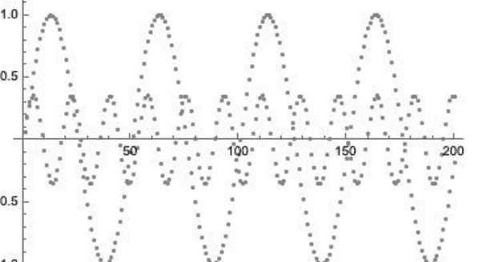

**图 5.1** Grover 放大的周期性，y 轴表示解的幅度，x 轴表示旋转次数 $r$。m=8$ 代表 256 个状态。当 $k=1$ 时，最大幅度值为 1；当 $k=8$ 时，最大幅度值为 $0.3535=\frac{1}{\sqrt{8}}$，且周期较小 [121]。

### 5.3.2 电路表示

Grover 放大（对于 $m \geq 2$）基于 $G_m=-Q_z$。该酉算符反转了 $|0\rangle$ 的符号：

$$\Lambda_m \cdot |0\rangle = -|0\rangle$$

对于 $|x\rangle \neq |0\rangle$

$$\Lambda_m \cdot |x\rangle = -|x\rangle$$

然后我们可以写为：

$$G_m=-Q_z=-I_m+2 \cdot P_m=2 \cdot P_m-I_m=(H_m \cdot \Lambda_m \cdot H_m) \quad (5.17)$$

其中


$$H_m \cdot \Lambda_m \cdot H_m=\begin{pmatrix} 1-\frac{2}{n} & \dots & \dots & \dots \\ \dots & \frac{2}{n} & \dots & \frac{2}{n} \\ \dots & \dots & \dots & \dots \\ \dots & \frac{2}{n} & \dots & 1-\frac{2}{n} \end{pmatrix} \quad (5.18)$$

## 5.4 矩阵表示法的 NumPy 示例

在解释如何用量子门表示该算法之前，我们将使用矩阵表示法演示 Grover 放大的原理。我们将使用 *Python* 和作为 *qiskit* 安装部分的 *NumPy* 库。我们将演示 $m=3$ 的示例，这意味着 $8=2^3$ 个不同的状态。首先，我们将通过（张量）克罗内克积操作 $kron$ 对 $H$ 矩阵构建 $H_3$ 矩阵。

```python
import numpy as np
np.set_printoptions(precision=4)
```

# Grover 放大

```python
H=np.matrix([[1, 1], [1, -1]])
H=H*1/np.sqrt(2)
np.view(H)
print("H=\n",H)
```

得到 Hadamard 矩阵

```
H=
[[ 0.7071 -0.7071]
[ 0.7071 -0.7071]]
```

使用克罗内克积操作定义 $H_3$

```
H2=np.kron(H,H)
H3=np.kron(H,H2)
print("H3=\n",H3)
```

```
H3=
[[ 0.3536 0.3536 0.3536 0.3536 0.3536 0.3536 0.3536 0.3536]
[ 0.3536 -0.3536 0.3536 -0.3536 -0.3536 -0.3536 0.3536 -0.3536]
[ 0.3536 -0.3536 0.3536 -0.3536 -0.3536 -0.3536 0.3536 -0.3536]
[ 0.3536 -0.3536 -0.3536 -0.3536 -0.3536 -0.3536 -0.3536 -0.3536]
[ 0.3536 0.3536 0.3536 -0.3536 -0.3536 -0.3536 -0.3536 -0.3536]
[ 0.3536 -0.3536 -0.3536 -0.3536 -0.3536 -0.3536 0.3536 -0.3536]
[ 0.3536 -0.3536 -0.3536 -0.3536 -0.3536 -0.3536 0.3536 -0.3536]
[ 0.3536 -0.3536 -0.3536 -0.3536 -0.3536 -0.3536 0.3536 -0.3536]]
```

然后我们定义 $\Lambda_m$

```
L3=np.matrix([[-1, 0, 0, 0, 0, 0, 0, 0],
[ 0, 1, 0, 0, 0, 0, 0, 0],
[ 0, 0, 1, 0, 0, 0, 0, 0],
[ 0, 0, 0, 1, 0, 0, 0, 0],
[ 0, 0, 0, 0, 1, 0, 0, 0],
[ 0, 0, 0, 0, 0, 1, 0, 0],
[ 0, 0, 0, 0, 0, 0, 1, 0],
[ 0, 0, 0, 0, 0, 0, 0, 1]])
```

and

```
G=-H3+L3
print("G=\n",G)
```

```
G=
[[-0.75 0.25 0.25 0.25 0.25 0.25 0.25 0.25]
[ 0.25 -0.75 0.25 0.25 0.25 0.25 0.25 0.25]
[ 0.25 0.25 -0.75 0.25 0.25 0.25 0.25 0.25]
[ 0.25 0.25 0.25 -0.75 0.25 0.25 0.25 0.25]
[ 0.25 0.25 0.25 0.25 -0.75 0.25 0.25 0.25]
[ 0.25 0.25 0.25 0.25 0.25 -0.75 0.25 0.25]
[ 0.25 0.25 0.25 0.25 0.25 0.25 -0.75 0.25]
[ 0.25 0.25 0.25 0.25 0.25 0.25 0.25 -0.75]]
```

在下一步中，我们表示等分布幅度的态向量并将解标记为负号

```
a=1/np.sqrt(8)
x1=np.array([a,a,a,-a]) # 原文长度不一致
print("x1=\n",x1)
x1=[0.3536 0.3536 0.3536 -0.3536]
```

并在 Grover 放大中执行一步，得到的幅度为

```
x1=G.dot(x1)
print("x1=\n",x1)
x1=[-0.1768 0.1768 0.1768 0.8839 0.1768 0.1768]]
```

以及带有结果幅度的第二次迭代

```
x2=np.array([0.1768, 0.1768, 0.1768, -0.8839, 0.1768, 0.1768]) # 原文长度不一致
x2=G.dot(x2)
print("x2=\n",x2)
x2=[-0.0884 -0.0884 -0.0884 0.9723 -0.0884 -0.0884]] # 注意长度
```

通过两次旋转，我们实现了最大幅度值，对应的概率为 $0.94537 = |0.9723|^2$。第三次旋转后，由于 Grover 放大的周期性，幅度开始缩小（见图 5.1）。

## 5.5 分解

对于 Grover 放大，我们有 $G_m = -(H_m \cdot \Lambda_m \cdot H_m)$。我们如何用量子门分解 $\Lambda_m$ 呢？我们知道对于

$$\frac{1}{\sqrt{2}} \begin{pmatrix} 1 & 1 \\ 1 & -1 \end{pmatrix} \begin{pmatrix} 1 & 0 \\ 0 & -1 \end{pmatrix} \frac{1}{\sqrt{2}} \begin{pmatrix} 1 & 1 \\ 1 & -1 \end{pmatrix} = \begin{pmatrix} 1 & 0 \\ 0 & -1 \end{pmatrix}$$

和

$$\frac{1}{\sqrt{2}} \begin{pmatrix} 1 & 1 \\ 1 & -1 \end{pmatrix} \begin{pmatrix} 0 & 1 \\ 1 & 0 \end{pmatrix} \frac{1}{\sqrt{2}} \begin{pmatrix} 1 & 1 \\ 1 & -1 \end{pmatrix} = \begin{pmatrix} 0 & 1 \\ 1 & 0 \end{pmatrix}$$

对于三个量子比特，我们可以相应地定义 $\Lambda_3$：

$X_3 = X \otimes X \otimes X$
$H_0 = I \otimes I \otimes H$
$\Lambda_3 = X_3 \cdot H_0 \cdot CCX \cdot H_0 \cdot X_3$

对于 $\Lambda_3$ 带有负符号，且 $G = -H_3 + L_3$ 我们可以通过以下电路表示

```python
import numpy as np
from qiskit import QuantumCircuit, assemble
from qiskit.visualization import array_to_latex, plot_histogram
from qiskit.aer import Aer

qc = QuantumCircuit(3)
qc.h(0)
qc.h(1)
qc.h(2)
qc.ccx(0, 1, 2)
qc.h(0)
qc.h(1)
qc.h(2)
```

然后得到酉算符

```python
qc.save_unitary()
backend = Aer.get_backend('qasm_simulator')
tobj = assemble(qc, backend)
result = backend.run(tobj).result()
unary = result.data()['unitary']
print(f"Size of unitary: {unary.shape}")
array_to_latex(unary)
```

得到的 $G_3$ 矩阵

```python
G3=np.matrix([[-0.75, 0.25, 0.25, 0.25, 0.25, 0.25, 0.25, 0.25],
[ 0.25, -0.75, 0.25, 0.25, 0.25, 0.25, 0.25, 0.25],
[ 0.25, 0.25, -0.75, 0.25, 0.25, 0.25, 0.25, 0.25],
[ 0.25, 0.25, 0.25, -0.75, 0.25, 0.25, 0.25, 0.25],
[ 0.25, 0.25, 0.25, 0.25, -0.75, 0.25, 0.25, 0.25],
[ 0.25, 0.25, 0.25, 0.25, 0.25, -0.75, 0.25, 0.25],
[ 0.25, 0.25, 0.25, 0.25, 0.25, 0.25, -0.75, 0.25],
[ 0.25, 0.25, 0.25, 0.25, 0.25, 0.25, 0.25, -0.75]])
```

## 5.6 Qiskit 示例

在下一步中，我们将 Grover 放大应用到标记的量子比特态。我们的解对应布尔公式

$-x \wedge y \wedge \neg z$

在该公式下为真，即 $x=0, y=1, z=0$。在这种情况下，由算符函数确定的态为 $o(010)=1$，其解编码为 $(-1)^{(x)}$。

对于算符函数 $T$

$$T \cdot |x\rangle = |o(x) \oplus c\rangle$$

其中

$$H_0 = I \otimes I \otimes I \otimes H$$

$$H_0 \cdot T \cdot H_4 = \frac{1}{\sqrt{8}} \sum_{x \in B^3} (-1)^{o(x)} \cdot |x\rangle$$

函数 $o(x)$ 的值被编码为 $(-1)^{o(x)}$，如图所示（见图 5.2）。

```python
import numpy as np
from qiskit import QuantumCircuit, assemble
from qiskit.visualization import array_to_latex, plot_histogram
from qiskit.aer import Aer

qc = QuantumCircuit(3)
qc.h([0,1,2])
qc.x(2) # 标记
qc.ccx(0,1,2)
qc.x(2)
qc.h([0,1,2])

## 获取酉算符
qc.save_unitary()
backend = Aer.get_backend('qasm_simulator')
tobj = assemble(qc, backend)
result = backend.run(tobj).result()
unary = result.data()['unitary']
print(f"Size of unitary: {unary.shape}")
array_to_latex(unary)
```


# 使用 Qiskit 的 86 量子人工智能

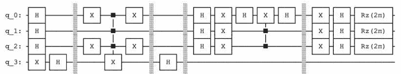

图 5.3 量子门谕（Quantum oracle），用负号标记状态 [010] 并展示了 Grover 放大。

```python
qc.draw(fold=140)

simulator = Aer.get_backend('statevector_simulator')
final_state = simulator.run(qc).result().get_statevector
```

```python
from qiskit.visualization import array_to_latex
array_to_latex(final_state,max_size=16,prefix="\StateVector") = 

StateVector = [0 0 0 0 0 0 0 0 0.1768 0.1768 0.8839 0.1768 0.1768 0.1768 0.1768 0.1768]
```

在下一步中，我们将使用 qasmis 模拟器执行两次旋转。我们不进行负号操作

> $G_3 = -H_3 \cdot \Lambda_3 \cdot H_3$

为了得到正确的结果，改变的是整体幅的负号。这对于最终概率没有影响，因此 Grover 放大可以简化为（见图 5.4 和 5.5）：

> $G_3 = H_3 \cdot \Lambda_3 \cdot H_3$

```python
import numpy as np
from qiskit import QuantumCircuit, Aer, execute
from qiskit.visualization import plot_histogram
from qiskit.circuit.library import MCXGate

qc = QuantumCircuit(4,3)
qc.h([0,1,2])
## 准备辅助位
qc.x(3)
qc.h(3)
# 谕门
qc.barrier()
qc.x(0)
qc.x(2)
gate = MCXGate(3)
qc.append(gate, [0, 1, 2, 3])
qc.x(0)
qc.x(2)
```

```python
## 扩散器
qc.barrier()
qc.h(3)
qc.barrier()
qc.h([0,1,2])
qc.x([0,1,2])
qc.h(0)
qc.ccx(1,2,0)
qc.h(0)
qc.x([0,1,2])
qc.h([0,1,2])
qc.barrier()
qc.h(3)
# 谕门
qc.barrier()
qc.x(0)
qc.x(2)
gate = MCGate(3)
qc.append(gate, [0, 1, 2, 3])
qc.x(0)
qc.x(2)
qc.barrier()
qc.h(3)
## 扩散器
qc.barrier()
qc.h([0,1,2])
qc.x([0,1,2])
qc.h(0)
qc.ccx(1,2,0)
qc.h(0)
qc.x([0,1,2])
qc.h([0,1,2])
qc.barrier()
qc.measure(0,0)
qc.measure(1,1)
qc.measure(2,2)
qc.draw(fold=90)
```

## 5.7 反计算 (UN-COMPUTATION)

在量子计算中，无法将信息重置为代表初始状态的模式。相反，我们将输出计算回输入。在我们的谕门中

> $T = (X \otimes I \otimes X \otimes I) \cdot MCX \cdot (X \otimes I \otimes X \otimes I)$

```
q_0: ┌──X──X─┐ ┌──H──X──H──X──X─┘
q_1: ┌──H─┘ ┌──X──X─┘
q_2: ┌──X──X─┐ ┌──X──X─┘
q_3: ┌──H─┘ └┴─────────────────┴M─┘
c_0: ┌───────────────────────┐
c_1: ┌───────────────────────┐
c_2: ┌───────────────────────┐
q_0: ┌──X──X─┐ ┌──X──X──X──X──X──M─┘
q_1: ┌──H─┘ ┌──X──X─┘
q_2: ┌──X──X─┐ ┌──X──X──X─┘
q_3: ┌──X─┘ └─────────────────┴M─┘
q_0: ┌───────────────────────┐
q_1: ┌───────────────────────┐
c_2: ┌───────────────────────┐
```

图 5.4 量子谕门，用负号标记状态 [010] 和两次 Grover 放大。

反计算由操作 (X ⊗ I ⊗ X ⊗ I) 表示。我们可能会问，如果不进行反计算并将我们的谕门简单地定义为

> $T = MCX \cdot (X \otimes I \otimes X \otimes I)$


图 5.5 两次 Grover 放大后的直方图。

反计算由操作 (X ⊗ I ⊗ X ⊗ I) 表示。我们可能会问，如果不进行反计算并将我们的谕门简单地定义为

> $T = MCX \cdot (X \otimes I \otimes X \otimes I)$


图 5.5 两次 Grover 放大后的直方图。

## 5.8 针对 M 量比特的泛化

对于 $M$ 个量子比特，我们可以使用 $MCX$ 门来构建谕门。

```python
StateVector = [0 0 0 0 0 0 0 0 0.1768 0.1768 0.8839 0.1768 0.1768 0.1768 0.1768 0.1768]
```

$M=3$ 时的

```python
from qiskit.visualization import array_to_latex
array_to_latex(final_state,max_size=16,prefix="\StateVector")
```

$M$ 个量子比特，我们可以使用 $MCX$ 门来构建谕门。

```python
from qiskit.visualization import array_to_latex
array_to_latex(final_state,max_size=16,prefix="\StateVector")
```

$M=4$ 时的

```python
from qiskit.visualization import array_to_latex
array_to_latex(final_state,max_size=16,prefix="\StateVector")
```

$M$ 个量子比特，我们可以使用 $MCX$ 门来构建谕门。

```python
from qiskit.visualization import array_to_latex
array_to_latex(final_state,max_size=16,prefix="\StateVector")
```

$M=4$ 时的

```python
from qiskit.visualization import array_to_latex
array_to_latex(final_state,max_size=16,prefix="\StateVector")
```

$M$ 个量子比特，我们可以使用 $MCX$ 门来构建谕门。

```python
from qiskit.visualization import array_to_latex
array_to_latex(final_state,max_size=16,prefix="\StateVector")
```

$M=3$ 时的

```python
from qiskit.visualization import array_to_latex
array_to_latex(final_state,max_size=16,prefix="\StateVector")
```

$M$ 个量子比特，我们可以使用 $MCX$ 门来构建谕门。

```python
from qiskit.visualization import array_to_latex
array_to_latex(final_state,max_size=16,prefix="\StateVector")
```

$M=4$ 时的

```python
from qiskit.visualization import array_to_latex
array_to_latex(final_state,max_size=16,prefix="\StateVector")
```

$M$ 个量子比特，我们可以使用 $MCX$ 门来构建谕门。

```python
from qiskit.visualization import array_to_latex
array_to_latex(final_state,max_size=16,prefix="\StateVector")
```

## 6.1 SAT 问题

满足性问题（SAT）是指：是否存在一组变量赋值使得布尔公式为真。SAT 问题由：

- $m$ 个布尔变量：$x_1, x_2, \dots, x_m$；
- 逻辑连接：$\wedge$ (与), $\vee$ (或), $\neg$ (非), $\rightarrow$ (蕴含), $\leftrightarrow$ (当且仅当)；
- 括号。

表 6.1 蕴含 ($\rightarrow$) 的真值表。

| x | y | $x \rightarrow y$ |
|---|---|---|
| 1 | 1 | 1 |
| 1 | 0 | 0 |
| 0 | 1 | 1 |
| 0 | 0 | 1 |

$f_m(x) = (-1)^{\text{m times}}$ ($m$ 次)

$\sum_{x \in \{0,1\}^m} (-1)^{f_m(x)}} |x\rangle$ (5.19)

在前面的例子中，反计算由操作 (X ⊗ I ⊗ X ⊗ I) 表示。我们可能会问，如果不进行反计算并将我们的谕门简单地定义为

> $T = MCX \cdot (X \otimes I \otimes X \otimes I)$


图 5.5 两次 Grover 放大后的直方图。

在前面的例子中，反计算导致了表示初始状态的模式。在这种情况下，其他位纠缠了，见图 5.6。


图 5.6 两次 Grover 放大后的直方图。

## 6.2 SAT 问题与 NP 完全完备

等等，表 6.2 当且仅当 ($\leftrightarrow$) 的真值表。

| x | y | $x \leftrightarrow y$ | XOR |
|---|---|---|---|
| 1 | 1 | 1 | 1 |
| 1 | 0 | 0 | 0 |
| 0 | 1 | 0 | 0 |
| 0 | 0 | 1 | 1 |

否则，我们说该问题是困难的，所需时间随指数增长，无法在传统计算机上在可接受的时间内执行，这类问题被称为 $NP$。


可以在多项式时间内验证许多实例中的某一个是否代表一个解，但在常规计算机上不存在任何算法能够高效的时间内确定该解。如果所有实例都必须由常规计算机进行检查，则该问题被称为 $NP-complete$。常规计算机只能通过一个接一个地检查所有可能的实例来解决问题。不存在其他算法，我们无法加速计算。$NP-complete$ 问题的存在并非显而易见。Cook-Levin 描述了第一个 $NP-complete$ 问题的例子，即 SAT 问题。到目前，已有数千个其他问题被证明是 $NP-complete$，著名的旅行箱问题和哈密顿圈问题 [2]。显然，类 $P \subseteq NP$ 是已知的，由此推导出 $NP \neq P$ 或 $NP = P$；但其他关系尚未知。如果一个问题属于 $NP$，且 $NP$ 中的每一个其他问题问题都可以归约到 $NP-complete$ 类，则该问题属于 $NP-complete$。

尽管 Grover 算法的缺陷 $O(\sqrt{n}) = O(2^{\frac{n}{2}})$ 相比于 $O(n) = O(2^n)$ 是极其巨大的，但 $NP-complete$ 问题在量子计算机上仍然是 $NP-complete$。

## 6.3 SAT 问题与 GROVER 算法

在下一步，将 Grover 算法应用于三个量子比特的标记态。我们的解决方案对应于布尔逻辑公式：

```
$$\phi = (x_1 \leftrightarrow x_2) \wedge (x_1 \wedge x_2) \wedge x_3$$
```

该公式求值为真 true的情况是 $x_1 = 1, x_2 = 0$ 且 $x_3 = 0$。在这种情况下，由算门函数确定的状态由 $(-1)^{o(x)}$ 编码解。

### 6.3.1 量子布尔电路

我们使用量子门和带有 Toffoli 门和 NOT 门的六个量子比特来定义算门函数。

操作 $(x_1 \wedge x_2)$ 由 AND 操作表示，辅助量子比特 2 设置为 0，$x_1$ 由量子比特 0 表示，$x_2$ 由量子比特 1 表示：

```
$ccX(x_0, x_1, 0) = (x_0, x_2, x_1 \wedge x_2)$
```

qc.ccx(0,1,2)

操作的结果表示在量子比特 2 中。操作 $(x_1 \leftrightarrow x_2)$ 由 $XOR$ 和 $NOT$ 操作表示，$x_1$ 设置为 1 对应量子比特 3。执行 $XOR$ 操作：

```
$ccX(1, x_2, x_3) = (1, x_2, x_2 \oplus x_3)$
```

$XOR$ 操作的结果写入量子比特 1，然后执行 NOT 操作：

```
$X(x_2 \oplus x_3) = \neg(x_2 \oplus x_3)$
```

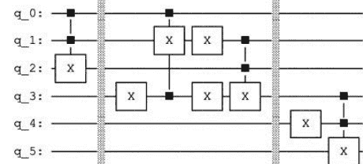

图 6.1 表示布尔公式 $\phi = (x_1 \leftrightarrow x_2)(x_1 \wedge x_2)\wedge \neg x_3$ 的电路。输入是量子比特 0、1 和 4，输出表示在量子比特 5 中。

qc.x(3)
qc.ccx(3,0,1)
qc.x(1)

操作的结果表示在量子比特 1 中。我们执行由量子比特 1 和 2 表示的结果的 AND 操作，并将结果写入量子比特 3。我们将量子比特 3 重置为零：

qc.x(3)
qc.ccx(1,2,3)

并将操作的结果写入量子比特 3，这对应于布尔公式 $(x_1 \leftrightarrow x_2) \wedge (x_1 \wedge x_2)$。公式的剩余部分由量子比特 4 表示的 $\neg x_3$ 的 NOT 和 AND 操作表示：

qc.x(4)
qc.ccx(3,4,5)

并将操作的结果写入量子比特 5，产生图 6.1 所示的电路。

### 6.3.2 逆计算 (Un-Computation)

在量子计算中，无法将信息重置为代表初始态的模式。相反，我们如下所示将输出逆计算回输入：

```
from qiskit import QuantumCircuit,QuantumRegister, Aer, execute
from qiskit.visualization import plot_histogram
from qiskit.circuit.library import MCXGate
from qiskit.quantum import Info StateVector
```

```
qc = QuantumCircuit(6)
#Input 0,1,4
qc.h(0)
qc.h(1)
qc.h(4)
qc.barrier()
```

```python
#First And 2 is zero
qc.ccx(0,1,2)
qc.barrier()
#Result in 2
```

```python
#If AND IF
qc.x(3)
qc.ccx(3,0,1)
qc.x(1)
#Result in 1
```

```python
#Make 3 zero
qc.x(3)
qc.ccx(1,2,3)
qc.barrier()
#Result in 3
```

```python
#Input 4
qc.x(4)
qc.ccx(3,4,5)
```

```python
#Un-compute
qc.barrier()
qc.x(4)
qc.barrier()
qc.ccx(1,2,3)
qc.x(3)
qc.barrier()
qc.x(1)
qc.ccx(3,0,1)
qc.x(3)
qc.barrier()
qc.ccx(0,1,2)
```

```python
qc.barrier()
#Preparation of Aux
qc.h(5)
#Diffusor
qc.barrier()
qc.h([0,1,4])
qc.x([0,1,4])
qc.h(0)
qc.ccx(1,4,0)
qc.h(0)
qc.barrier()
```

```python
qc.draw(fold=2)
simulator = Aer.get_backend('qasm_simulator')
result=execute(qc,shots=1000).result()
counts = result.get_counts()
print("Total count:",counts)
plot_histogram(counts)
```

图 6.2 表示的电路和图 6.3 中的结果直方图。量子比特 5 指明解。

| | |
| :--- | :--- |
| q_0: | |
| q_1: | X |
| q_2: | X |
| q_3: | X |
| q_4: | X |
| q_5: | X |

**图 6.2** 表示布尔公式 $\phi = (x_1 \leftrightarrow x_2) \wedge (x_1 \wedge x_2) \wedge \neg x_3$ 的电路。在量子计算中，无法将信息重置为代表初始态的模式。相反，我们将输出逆计算回输入。输入通过 Hadamard 门映射到叠加态。输出在量子比特 5 中表示表示解的存在。解位于量子比特 0、1 和 4 中。

### 6.3.3 Grover 放大

在下一步应用带有两次旋转的 Grover 算法，见图 6.4 和 6.5。电路的定义如下：

```python
qc = QuantumCircuit(6,3)
#Input 0,1,4
qc.h(0)
qc.h(1)
qc.h(4)
```

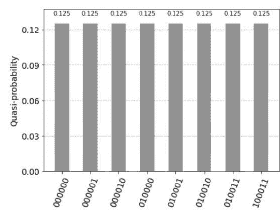

**图 6.3** 表示布尔公式 $\phi = (x_1 \leftrightarrow x_2) \wedge \neg x_3$ 的电路。输出在量子比特 $q_5$ 中表示解的存在。解位于量子比特 $q_0=1$ 中。

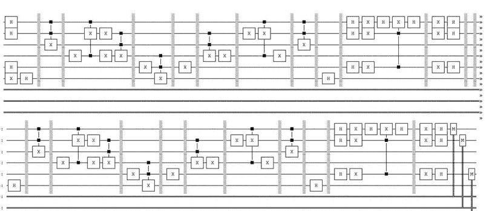

图 6.4 表示布尔公式 $\phi = (x_1 \leftrightarrow x_2) \wedge (x_1 \wedge x_2)\wedge \neg x_3$ 的电路以及 Grover 算法的两次旋转。输入量子比特 0、1 和 4 通过 Hadamard 门映射到叠加态。旋转本身被两个 `qc_barrier()` 命令分隔。我们可以通过消除第一次和第二次旋转后辅助量子比特的 Hadamard 门来简化电路，但这样做会导致电路丢失其模块化结构（可读性较差），且在该操作会被简化。量子比特 0、1 和 4 被测量。

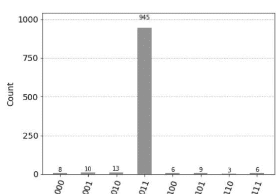

图 6.5 量子比特 0、1 和 4 表示 $x_1, x_2, x_3$ 的八种可能的实例化，对应 $\phi = (x_1 \leftrightarrow x_2) \wedge (x_1 \wedge x_2)\wedge \neg x_3$ SAT 问题。两次旋转后 SAT 问题的测量态 $|011]$ 计数最高。

```python
## Preparation of Aux
qc.x(5)
qc.h(5)
qc.barrier()
```

```python
#First And 2 is zero
qc.ccx(0,1,2)
qc.barrier()
#Result in 2
```

```python
#If AND IF
qc.x(3)
qc.ccx(3,0,1)
qc.x(1)
#Result in 1
```

```python
#Make 3 zero
qc.x(3)
qc.ccx(1,2,3)
qc.barrier()
#Result in 3
```

```python
#Input 4
qc.x(4)
qc.ccx(3,4,5)
```

```python
#Un-compute
qc.barrier()
qc.x(4)
qc.barrier()
qc.ccx(1,2,3)
qc.x(3)
qc.barrier()
qc.x(1)
qc.ccx(3,0,1)
qc.x(3)
qc.barrier()
qc.ccx(0,1,2)
```

```python
qc.barrier()
#Preparation of Aux
qc.h(5)
#Diffusor
qc.barrier()
qc.h([0,1,4])
qc.x([0,1,4])
qc.h(0)
qc.ccx(1,4,0)
qc.h(0)
qc.barrier()
```

## 第二次迭代

```python
qc.x([0,1,4])
qc.h([0,1,4])
```


# 100 ■ 使用 Qiskit 的量子人工智能

```python
qc.barrier()
qc.h([0,1,4])
qc.x([0,1,4])
qc.h(0)
qc.ccx(1,4,0)
qc.h(0)
qc.barrier()
qc.x([0,1,4])
qc.h([0,1,4])
```

```python
qc.measure(0,0)
qc.measure(1,1)
qc.measure(4,2)
```

```python
qc.draw(fold=165)

simulator = Aer.get_backend('qasm_simulator')
result=execute(qc,simulator,shots=1000).result()
counts = result.get_counts()
print("\nTotal count are:",counts)
```

```python
plot_histogram(counts)
```

### 6.3.4 无解

对于布尔公式

> $\phi = (x_1 \leftrightarrow x_2) \wedge (\neg x_1 \wedge x_2) \wedge \neg x_3$

不存在解，该公式永远无法为真值（true）。我们相应地更改了电路：

```python
## 第一个 And 2 为零
qc.x(0)
qc.ccx(0,1,2)
qc.x(0)
qc.barrier()
## 结果在 2
```

在下一步中我们应用 Grover 放大；然而，没有状态被标记。图 6.6 显示了 $x_1, x_2$ 和 $x_3$ 的八种可能实例化在经过一次 Grover 放大和两次 Grover 放大后的分布。

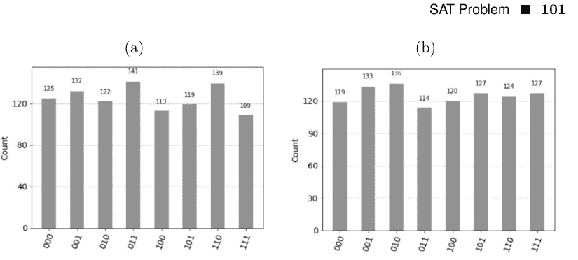

**图 6.6** 对于布尔公式 $\phi = (x_1 \leftrightarrow x_2) \wedge (\neg x_1 \wedge x_2) \wedge \neg x_3$ 无解。比特位 0, 1 和 4 表示 $x_1, x_2$ 和 $x_3$ 的八种可能实例化。(a) 一次旋转后 $x_1, x_2$ 和 $x_3$ 的八种可能实例化分布。(b) 两次旋转后的分布。每个实例的计数几乎相同，不存在解。

比特位 0, 1 和 4 表示对于 $\phi = (x_1 \leftrightarrow x_2) \wedge (x_1 \wedge x_2) \wedge \neg x_3$ SAT 问题，$x_1, x_2$ 和 $x_3$ 的八种可能实例化。在应用 Grover 放大后，每个实例的计数几乎相同，不存在解。

## 符号状态表示

引入了表示问题解决过程中状态的物体和属性的经济符号表示。这种表示法源于生物学的“是什么-在哪里”（what-where）原理，并且需要的比特数较少。这种经济要求的表示对于当前代的量子计算机是理想的。我们描述了用于解决问题的搜索树。节点和边表示搜索树。每个节点代表一个状态，每个边代表从一个状态到下一个状态的转换。路径描述符是量子树搜索的基础。在量子树搜索中，我们同时表示所有可能的路径描述符，并使用 Grover 放大算法来确定解决方案。

## 7.1 物体和属性的比特表示

我们用 $\lceil\log_2n\rceil$ 个比特来表示 $n$ 个符号。为了表示四个符号 $A, B, C, D$，我们需要两个比特，代码如下：$A=00, B = 01, C = 10, D = 11$。为了表示字符串 $B A D C$，我们在每个相应位置对每个符号进行编码：$01 00 11 10$。在表示表示中，属性是固定的，物体的代码描述符是移动的。每个物体可以有一个或多个属性（形容词），例如一个或两个维度中的位置。在我们的情况下，属性对应于表示中的位置。我们不是对符号编码，而是对位置编码，对于四个位置，我们将第一个位置编码为 00，第二个位置编码为 01，第三个位置编码为 10，第四个位置编码为 11。符号将由顺序表示，表示代码为 $10 01 00 11$ 的字符串 $D B A C$。位于位置 10（字符串）的 $A$，位于位置 01（字符串中的第二个位置）的 $B$，位于位置 11（字符串中的第四个位置）的 $C$，以及位于位置 00（字符串中的第一个位置）的 $D$。在这种表示中，物体的代码描述符是固定的，而属性是移动的。在存在多个属性的情况下，固定某些属性而改变其他属性更为经济。在解决问题期间物体保持固定，只有属性的值改变

# 符号表示 ■ 103

物体不会消失或出现。状态和属性由固定比特描述，这些比特改变其位置，规则对应于比特的置换。这种表示法与生物学的“是什么”原理有关。

### 7.1.1 “是什么”和“哪里”

Gross 和 Misskin [34] 建议大脑包含了两种视觉分类的机制：一个用于物体的表示，另一个用于定位的表示 [57]。第一个机制是“是什么”路径，由时间区域组成。第二种机制是“哪里”路径，由空间区域组成 [52, 79]。根据这种表示，物体被表示。

## 7.2 搜索与路径描述符

节点和边表示搜索树。每个节点代表一个状态，每个边代表从一个状态到下一个状态的转换。路径描述符是量子树搜索的基础。在量子树搜索中，我们同时表示所有可能的路径描述符，并使用 Grover 放大算法来确定解决方案。

## 7.3 量子树搜索

在量子计算中，我们可以同时表示所有可能的路径描述符。这是每个叶节点的描述符。使用 Grover 算法，我们搜索所有路径并验证每条路径是否指向目标状态。这种类型的程序是量子搜索 [107, 119]。对于 $n=B^m$ 路径，大约为 $\sqrt{n}$（见图 7.2）。这种方法的限制是预先知道深度 $m$。量子树搜索等同于深度搜索。这种优势可以通过深度搜索来克服。


# 量子产生系统

产生系统是人类解决问题的一种模型。它由长期记忆和工作记忆（也称为短期记忆）组成。问题解决可以通过一个实现搜索算法的产生系统来建模。搜索定义了一个问题空间，并可以表示为树。使用格罗弗算法（Grover's algorithm），我们搜索所有可能的路径，并对每条路径验证其是否指向目标状态。

纯产生系统没有从僵局中恢复的机制。我们描述了一个用于字符串排序的简单纯产生系统示例，并说明了将这种简单的纯产生系统转换为量子产生系统。我们指出量子产生系统可以作为统一认知理论的基础

## 8.1 纯产生系统

产生系统模型没有从僵局中恢复的机制 [80]。如果没有产生式可以执行，系统将停止。它由产生式 $L$（长期记忆）和控制系统 $C$ 组成。纯产生系统是一个元组：

```
(\Sigma, L, W, \gamma_i, \gamma_g, C) (8.1)
```

其中

- $\Sigma$ 是一个有限字母表；
- $W$ 是工作记忆。它用状态 $\gamma \in \Sigma$ 表示。
- $L$ 是长期记忆。它是包含 $B$ 个产生式的集合。一个产生式 $p$ 的形式为 (前提条件，结论) $\in \Sigma$。前提条件与工作记忆的内容进行匹配。如果不满足前提条件，则执行结论并改变工作记忆的内容；
- $\gamma_i \in \Sigma$ 是初始状态。工作记忆用初始状态 $\gamma_i$ 初始化；
- $\gamma_g \in \Sigma$ 是目标状态；
- $\delta$ 是形式为 $\Sigma \rightarrow L \times \Sigma \times h$ 的控制函数。它选择一个产生式并触发它或停止 $h$。

如果 $C(\gamma) = (p, \gamma', h)$，则工作记忆符号 $\gamma$ 被产生式 $p$ 替换为 $\gamma'$ 或计算停止 $h$。达到目标 $\gamma$ 或存在僵局（没有产生式可以使用），则计算停止。产生系统与马尔可夫算法（Markov algorithms）[02] 密切相关；与这些方法类似，产生系统在能力上等同于图灵机 [113]。图灵机也可以被产生系统轻松模拟；因此，产生式是计算的完整模型。表示为搜索树的搜索从初始状态通过以下状态执行，直到达到目标。

### 8.1.1 量子产生系统

量子产生系统与纯产生系统有关，因为如果存在僵局，计算不会继续，也不会溯到之前的状态。与纯产生系统不同，不存在控制系统 $C$，因为所有产生式都是同时执行的。量子产生系统的运行独立于计算是否终止；在不终止的情况下，计算将永远持续，迭代不会停止。量子产生系统还提供了 $O(\sqrt{n})$ 的最大速度，图灵机模拟允许 $n$ 个多个计算分支 [108]。

基于量子产生系统的未来量子计算机将涉及经典的人工智能编程语言，例如 OPS5 [17]。OPS5 程序通过将工作记忆元素与长期记忆中的产生式匹配来执行 [30]。因此，程序员不需要与量子门斗争，他们也不需要处理量子计算的原理。这相当于现在的程序员使用 Java 或 Python 等高级语言指定他们的算法，而不需要理解电子电路或半导体设备（如晶体管）的本质。

## 8.2 示例：字符串排序

我们展示一个用于字符串排序的纯产生系统：

- $\Sigma: a, b, c, d$ 由四个字母组成
- $W$ 是工作记忆。它用五个字母的字符串表示状态 $\gamma \in \Sigma$
- 长期记忆 $L$ 是包含 $B = 6$ 个产生式的集合

1. $ab \rightarrow ba$
2. $ac \rightarrow ca$
3. $ad \rightarrow da$
4. $cb \rightarrow cb$
5. $bd \rightarrow db$
6. $cd \rightarrow dc$

表 8.1 简单纯产生系统排序字符串的执行。

| 迭代 | 工作记忆 | 冲突集 | 触发的规则 |
| :--- | :--- | :--- | :--- |
| 0 | cdcab | 1, 6 | 1 |
| 1 | cdcab | 6 | 6 |
| 2 | dccba | | 停止 |

如果前提条件匹配工作记忆中的字符串部分，则产生式（规则）可以触发。

- $\gamma_i \in \Sigma$ 是初始状态：*cdcab*
- $\gamma_g \in \Sigma$ 是目标状态：*dccba*
- $\delta$ 是控制函数：随机选择一个产生式

执行过程如表 8.1 所示。

### 8.2.1 用于字符串排序的量子产生系统

将简单产生系统转换为量子产生系统，我们首先表示规则。

- $\Sigma: a, b, c, d$ 由四个字母组成
- $W$ 是工作记忆。它用五个字母的字符串表示状态 $\gamma \in \Sigma$
- 长期记忆 $L$ 是包含 $B = 6$ 个产生式的集合

- $\gamma_i \in \Sigma$ 是初始状态：*cdcab*
- $\gamma_g \in \Sigma$ 是目标状态：*dccba*
- $\delta$ 是控制函数：随机选择一个产生式

如果前提条件匹配工作记忆中的字符串部分，则产生式（规则）可以触发。


## 110 ■ 使用 Qiskit 的量子人工智能

```python
# 标记位 10 的工作存储器
# 第 1 条路径描述符 11-12
# 第 2 条路径描述符 13-14

# 初始状态 b,a,c,d,c
# 第一个位置 01 是 b 01
qc.x(0)
# 第二位置 23 是 a 00
# 第三个位置 45 是 c 10
qc.x(0)
# 第四个位置 67 是 d 11
qc.x(6)
qc.x(7)
# 第五个位置 89 是 c 10
qc.x(9)

# 路径描述符
qc.h(11)
qc.h(12)
qc.barrier()

## 第一条规则
# 设置标记 10 依赖于路径描述符
qc.ccx(11,12,10)
# 移动
qc.cswap(10,0,2)
qc.cswap(10,1,3)
# 重置标记
qc.ccx(11,12,10)
## 第二条规则
# 设置标记 10 依赖于路径描述符
qc.x(11)
qc.ccx(11,12,10)
# 移动
qc.cswap(10,2,4)
qc.cswap(10,3,5)
# 重置标记
qc.ccx(11,12,10)
qc.x(11)
## 第三条规则
# 设置标记 10 依赖于路径描述符
qc.x(12)
qc.ccx(11,12,10)
# 移动
qc.cswap(10,4,6)
qc.cswap(10,5,7)
# 重置标记
qc.ccx(11,12,10)
qc.x(12)
# 第四条规则
# 设置标记 10 依赖于路径描述符
qc.x(11)
qc.x(12)
qc.ccx(11,12,10)
# 移动
qc.cswap(10,6,8)
qc.cswap(10,7,9)
# 重置标记
qc.ccx(11,12,10)
qc.x(12)
qc.x(11)
qc.barrier()

## 深度二：第 2 个路径描述符
qc.h(13)
qc.h(14)
qc.barrier()
## 第一条规则
# 设置标记 10 依赖于路径描述符
qc.ccx(13,14,10)
# 移动
qc.cswap(10,0,2)
qc.cswap(10,1,3)
# 重置标记
qc.ccx(13,14,10)
## 第二条规则
# 设置标记 10 依赖于路径描述符
qc.x(13)
qc.ccx(13,14,10)
# 移动
qc.cswap(10,2,4)
qc.cswap(10,3,5)
# 重置标记
qc.ccx(13,14,10)
qc.x(13)
## 第三条规则
# 设置标记 10 依赖于路径描述符
qc.x(14)
qc.ccx(13,14,10)
# 移动
qc.cswap(10,4,6)
qc.cswap(10,5,7)
# 重置标记
qc.ccx(13,14,10)
qc.x(14)
# 第四条规则
# 设置标记 10 依赖于路径描述符
qc.x(13)
qc.x(14)
qc.ccx(13,14,10)
# 移动
qc.cswap(10,6,8)
qc.cswap(10,7,9)
# 重置标记
qc.ccx(13,14,10)
qc.x(14)
qc.x(13)
qc.barrier()
```

## 112 ■ 使用 Qiskit 的人工智能

```python
# 算门 (Oracle)
gate = MCXGate(5)
# 标记目标状态
## 初始状态 a,b,c,d
qc.append(gate,[2,5,7,8,9,15])
```

我们将使用 qiskit 的 `def` 函数来降低量子电路的复杂度。通过 `def` 函数，我们定义了代表四条规则的电路。

```python
def rules():
    qc = QuantumCircuit(15)
    # 第一条规则
    # 设置标记 10 依赖于路径描述符
    qc.ccx(11,12,10)
    # 移动
    qc.cswap(10,0,2)
    qc.cswap(10,1,3)
    # 重置标记
    qc.ccx(11,12,10)
    # 第二条规则
    # 设置标记 10 依赖于路径描述符
    qc.x(11)
    qc.ccx(11,12,10)
    # 移动
    qc.cswap(10,2,4)
    qc.cswap(10,3,5)
    # 重置标记
    qc.ccx(11,12,10)
    qc.x(11)
    # 第三条规则
    # 设置标记 10 依赖于路径描述符
    qc.x(12)
    qc.ccx(11,12,10)
    # 移动
    qc.cswap(10,4,6)
    qc.cswap(10,5,7)
    # 重置标记
    qc.ccx(11,12,10)
    qc.x(12)
    # 第四条规则
    # 设置标记 10 依赖于路径描述符
    qc.x(11)
    qc.x(12)
    qc.ccx(11,12,10)
    # 移动
    qc.cswap(10,6,8)
    qc.cswap(10,7,9)
    # 重置标记
    qc.ccx(11,12,10)
    qc.x(12)
    # 深度二：第 2 个路径描述符
    # 第一条规则
    # 设置标记 10 依赖于路径描述符
    qc.ccx(13,14,10)
    # 移动
    qc.cswap(10,0,2)
    qc.cswap(10,1,3)
    # 重置标记
    qc.ccx(13,14,10)
    # 第二条规则
    # 设置标记 10 依赖于路径描述符
    qc.x(13)
    qc.ccx(13,14,10)
    # 移动
    qc.cswap(10,2,4)
    qc.cswap(10,3,5)
    # 重置标记
    qc.ccx(13,14,10)
    qc.x(13)
    # 第三条规则
    # 设置标记 10 依赖于路径描述符
    qc.x(14)
    qc.ccx(13,14,10)
    # 移动
    qc.cswap(10,4,6)
    qc.cswap(10,5,7)
    # 重置标记
    qc.ccx(13,14,10)
    qc.x(14)
    # 第四条规则
    # 设置标记 10 依赖于路径描述符
    qc.x(13)
    qc.x(14)
    qc.ccx(13,14,10)
    # 移动
    qc.cswap(10,6,8)
    qc.cswap(10,7,9)
    # 重置标记
    qc.ccx(13,14,10)
    qc.x(14)
    qc.x(13)
    qc.barrier()
```

## 114 ■ 使用 Qiskit 的量子人工智能

## 116 ■ 使用 Qiskit 的人工智能

### 8.2.2 迭代次数

迭代次数 $r$ 为：

```
$r = [t^*] = \left\lfloor \frac{\pi}{4} \sqrt{\frac{2^m}{k}} \right\rfloor$ (8.2)
```

## 8.3 认知架构

量子产生系统 ■ 113

在应用 Grover 算法的放大步骤之前，我们将输出还原为输入。我们使用 qiskit 的 `inverse` 命令通过函数定义逆操作。

```python
def rules_inv():
    qc = rules()
    qc_inv = qc.inverse()
    qc_inv.name="RULES_INV"
    return qc_inv
```

深度二搜索由四个比特 11, 12, 13, 14 描述。

```python
def Grover():
    qc = QuantumCircuit(16)
    # 扩散器 11, 12, 13, 14
    qc.h(11)
    qc.h(12)
    qc.h(13)
    qc.h(14)
    qc.x(11)
    qc.x(12)
    qc.x(13)
    qc.x(14)
    gate = MCXGate(5)
    # 标记目标状态
    # 初始状态 a,b,c,d
    qc.append(gate,[2,5,7,8,9,15])
    qc.x(11)
    qc.x(12)
    qc.x(13)
    qc.x(14)
    qc.h(11)
    qc.h(12)
    qc.h(13)
    qc.h(14)
    qc.barrier()
    qc.h([11,12,13,14])
    qc.name="G"
    return qc
```

在量子计算中，无法将信息重置到模式


# 118 基于 Qiskit 的量子人工智能

知识 [54], [71]。如果无法决定使用某条规则，或者对于工作内存中表示的某种心理状态无法应用规则，则存在适用知识缺失。

通过量子产生系统对建议的 SOAR 认知架构进行扩展将导致一种混合架构。当出现僵局时，将调用量子产生系统。这种混合方法将加速学习过程，而不需要特定领域的控制知识。由量子计算机描述的量子 SOAR 架构允许更快速地规划动作，例如驾驶飞机或更好地与人类面对面对对话。

## 8.4 控制函数

在接下来的 9-11 章中，我们将给出如何使用量子产生系统解决常见的人工智能应用的示例，并详细详细描述其实现。在这些应用中，并非所有的产生规则都能同时触发，而是可以执行多个规则的实例化。控制函数决定规则是否可以触发。前提条件与工作内存的内容进行匹配。如果满足前提条件，规则就可以同时触发。所有可以触发的规则被映射到叠加态中并实例化。在下一步，所有实例化的规则都会触发，并改变叠加态中工作内存的内容。

## 3-Puzzle（数字推谜）

我们通过对符号人工智能中的玩具示例——数字推谜进行 Qiskit 实现，演示了量子产生系统和量子树搜索的工作原理。目标是找到一系列移动，将棋盘从初始配置变为目标配置。我们描述了长期记忆规则（产生规则）的表示，并描述了深度为一、二、三搜索结果（涉及八种可能的状态）。解决方案由神机（oracle）标记，并应用一次 Grover 放大。为了增加解决方案的概率值，我们将应用两次 Grover 放大。解决方案对应路径描述符，它指示了将棋盘从初始配置变为目标配置的规则序列。

### 9.1 谜题

数字推谜由 2×2 框架中的三个编号的可移动块组成（见图 9.1）。

框架中的一个单元格是空的，正因为如此，块可以移动以形成不同的图案 [119]。目标是找到一系列进入空格的移动，将棋盘从初始配置变为目标配置。共有 12 种可能的配置（见图 9.2）。对于这些配置中的任何一种，只有两种移动方式。空格的移动要么是顺时针方向，要么是逆时针方向。

数字推谜是可处理的，且需要较少的比特来编码。有四个不同的对象：三个单元格和一个空单元格。每个对象可以用两个比特 (2²) 编码，四个对象的配置可以用一个八位比特的寄存器表示 [x]。在这种表示中，位置描述（形容词）是固定的，而类别描述符会移动。量子产生系统的控制函数需要满足两个要求 [106]：

- 对于给定的棋盘，配置和产生规则决定新的棋盘配置。
- 确定该配置是否为目标配置。

图 9.1 数字推谜的目标配置。

新的棋盘配置由函数 $p$ 表示产生的规则决定。空格有四种可能的位置。函数 $p$ 的输入是当前棋盘配置和一个位 $m$，该位指示空格应该执行顺时针移动 ($m=1$) 还是逆时针移动 ($m=0$)。总共有 8 种可能的映射，由 8 条规则表示。为了简单起见，即空格的四种可能位置乘以两种可能的移动。为了简单起见，我们用酉置换矩阵 $L(1)$ 表示函数 $p$ 的映射。由此得出，总共有 $24 = 8 \times 3$ 条实例化规则。它们对应于酉矩阵 $L(1)$ 中的置换。该矩阵作用于 $8 + 1$ 个比特，其中 $m \in B^8$ 和 $x \in B^3$

```
$L(1) \cdot |m\rangle = |m\rangle. \quad (9.1)$
```

$L(1)$ 代表我们产生系统的长期记忆。函数 $o(x)$（神机）决定该配置是否为目标配置。

```
$o(x) = o(x_0, x_1, x_2, x_3, x_4, x_5, x_6) = \begin{cases} 1 & \text{如果是目标} \\ 0 & \text{否则.} \end{cases} \quad (9.2)$
```

函数 $o(x)$ 神机由酉算符 $T$（代表目标）表示$T$ 作用于 $8+1$ 个比特，其中 $x \in B^8$ 和 $c \in B^1$ 是辅助比特

```
$T \cdot |x\rangle = |x\rangle \oplus c. \quad (9.3)$
```

一个重要问题是维度为 $512 = 2^9$ 的置换矩阵 $L(1)$ 是否可以分解。可以确定置换是否是张量可分的，如果存在则可以选择高效的张量分解 [50, 119]。长期记忆的另一种代价表示可以通过描述函数 $p$ 的均匀多项式电路来实现。

图 9.2 有 12 种配置。对于这些配置中的任何一种，只有两种移动方式。空格的移动要么是顺时针，要么是逆时针。

| 3 | X |
|---|---|
| 10 | 11 |
| 7 | 5 |
| 1 | 2 |
| 00 | 01 |
| 32 | 10 |

**图 9.3** 数字推谜编码图 9.1 的状态。四个对象由八位比特寄存器表示。在这种表示中，位置描述（形容词）是固定的，类别描述符会移动。

## 9.2 表示

有四个不同的对象：三个单元格和一个空单元格。每个对象可以用两个比特 (2²) 编码，四个对象的配置可以用一个八位比特寄存器表示 [x]。对象 1 由 00 表示，2 由 01 表示，3 由 10 表示，空格由 11 表示。在这种表示中，位置描述（形容词）是固定的。产生系统的控制函数需要满足两个要求 [106]：

- 对于给定的棋盘、配置和产生规则决定新的棋盘配置。
- 确定配置是否为目标配置。

新的棋盘配置由函数 $p$ 表示产生的规则决定。空格有四种可能的位置。函数 $p$ 的输入是当前棋盘配置和一个位 $m$，指示空格应该执行顺时针 ($m=1$) 还是逆时针移动 ($m=0$)。总共有 8 种可能的映射，由 8 条规则表示。为了简单起见，空格的四种可能位置乘以两种可能的移动。为了简单起见，我们用酉置换矩阵 $L(1)$ 表示函数 $p$ 的映射。由此得出，总共有 $24 = 8 \times 3$ 条实例化规则。它们对应于酉矩阵 $L(1)$ 中的置换。该矩阵作用于 $8 + 1$ 个比特，其中 $m \in B^8$ 和 $x \in B^3$

```
$L(1) \cdot |m\rangle = |m\rangle. \quad (9.1)$
```

$L(1)$ 代表我们产生系统的长期记忆。函数 $o(x)$（神机）决定配置是否为目标配置。

```
$o(x) = o(x_0, x_1, x_2, x_3, x_4, x_5, x_6) = \begin{cases} 1 & \text{如果是目标} \\ 0 & \text{否则.} \end{cases} \quad (9.2)$
```

函数 $o(x)$ 神机由酉算符 $T$（代表目标）表示$T$ 作用于 $8+1$ 个比特，其中 $x \in B^8$ 和 $c \in B^1$ 是辅助比特

```
$T \cdot |x\rangle = |x\rangle \oplus c. \quad (9.3)$
```

一个重要问题是维度为 $512 = 2^9$ 的置换矩阵 $L(1)$ 是否可以分解。可以确定置换是否是张量可分的，如果存在可以选择高效的张量分解 [50, 119]。长期记忆的另一种代价表示可以通过描述函数 $p$ 的均匀多项式电路来实现。

图 9.2 有 12 种配置。对于这些配置中的任何一种，只有两种移动方式。空格的移动要么是顺时针，要么是逆时针。

### 9.2.1 规则与迹

规则的 `if` 部分由 Toffoli 门（也称为 ccX 门、CCNOT 门、受控非门）实现，它识别空格的位置并将四个比特中的一个设置为 11。

```
qc.ccx(0,1,9)
qc.ccx(2,3,10)
qc.ccx(4,5,11)
qc.ccx(6,7,12)
```

规则的执行使用 Fredkin 门（也称为受控交换 SWAP 门），利用迹信息和路径描述符设置标记（比特 8），以指示规则是否将执行。重置通过计算重复操作将标记设置为状态零来完成。我们通过迹值改变路径描述符；根据迹值执行规则的第二次实例化；`qc.barrier()` 将分离电路中的表示，产生图 9.4 所示的量子电路。

```
# 如果规则 (1) 对于空格在 0, 1 -> 4, 5 或 2, 3
# 使用描述符搜索空状态
qc.ccx(9,13,8)
# 执行第一部分，让空格顺时针移动
qc.ccswap(8,0,4)
qc.ccswap(8,1,5)
# 带有改变后的描述符的
# 重置标记
qc.ccx(9,13,8)
# 获取第二个叠加态
qc.x(13)
qc.ccx(9,13,8)
# 执行第二部分，让空格逆时针移动
qc.ccswap(8,0,2)
qc.ccswap(8,1,3)
# 重置标记
qc.ccx(9,13,8)
# 恢复描述符
qc.x(13)
qc.barrier()
```


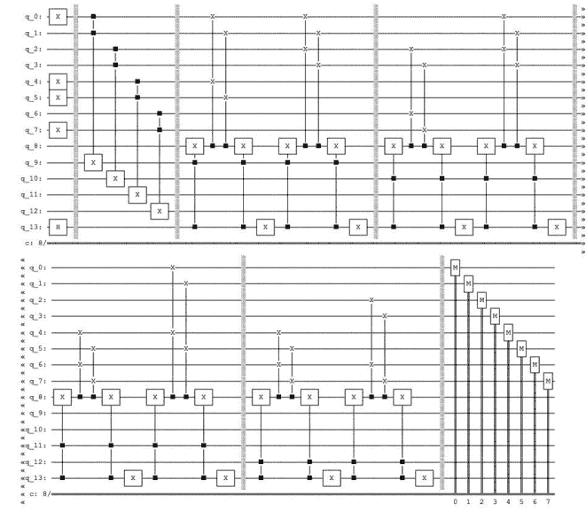

图 5.4 代表在深度为1的3数谜任务中生成两个规则实例的量子电路。

第二个规则也相应的得到了表示。

```python
#If rule (2) for empty at 2, 3 -> 6, 7 or 0, 1
# 使用描述符搜索空状态
qc.ccx(10,13,8)
# 执行第一部分
qc.cswap(8,2,6)
qc.cswap(6,3,7)
# 描述符改变后的第二部分
# 重置标志位
qc.ccx(10,13,8)
# 获取第二个叠加态
qc.x(13)
qc.ccx(10,13,8)
# 执行第二部分
qc.cswap(8,0,2)
qc.cswap(8,1,3)
# 重置标志位
qc.ccx(10,13,8)
# 恢复描述符
qc.x(13)
qc.barrier()
```

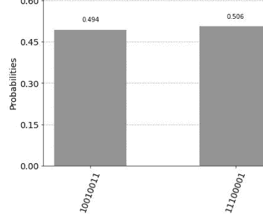

图 9.5 使用 qasm 模拟器由八个量子比特生成的两个状态。

第三和第四条规则以相同的方式表示。最后，我们测量由8个量子比特表示的状态。

```python
qc.measure(0,0)
qc.measure(1,1)
qc.measure(2,2)
qc.measure(3,3)
qc.measure(4,4)
qc.measure(5,5)
qc.measure(6,6)
qc.measure(7,7)
```

导致如图 9.4 所示的量子电路。
通过执行仿真：

```python
simulator = Aer.get_backend('qasm_simulator')
result = execute(qc,simulator).result()
counts = result.get_counts()
plot_histogram(counts)
```

我们得到了图 9.5 中直方图所示的两个生成状态的表示。

## 9.3 深度二搜索

Grover 放大不能应用于少于四个状态。3数谜的深度一搜索产生两个状态，而深度二搜索产生四个个状态。描述深度搜索的算符 $L(2)$ 表示为：

```python
$L(2) \cdot |m_2, m_1\rangle = |m_2, m_1\rangle, \quad \quad (9.4)
```

使用代表路径描述符的量子比特 $m_2, m_1$。酉算符 $U$ 代表 Oracle 函数 $o(x)$，该函数确定配置是否为目标配置：

$T \cdot |x\rangle = |x\rangle|o(x) \oplus c$。

对于函数 $o(x)$，解由 $(-1)^{o(x)}$（幅的符号）编码。如果路径描述符由 $m$ 个量子比特表示，它可以表示 $n = 2^m$ 个状态。为了理解为什么解是由 $(-1)^{o(x)}$ 编码的，我们来看导数。辅助量子比特 $c$ 设置为1，路径描述符由 $m$ 个量子比特 $|0^m\rangle$ 表示。首先，我们通过 Hadamard 门对 $m+1$ 个量子比特的路径描述符和辅助位 $c$ 设置叠加态，并执行酉算符：

```python
$T \cdot H_{m+1} \cdot |0^m\rangle = \frac{1}{\sqrt{2^{m+1}}} \sum_{x \in B^m} T \cdot |x\rangle - \frac{1}{\sqrt{2^{m+1}}} \sum_{x \in B^m} |x\rangle|o(x) \oplus 0 - \frac{1}{\sqrt{2^{m+1}}} \sum_{x \in B^m} |x\rangle|o(x) \oplus 0 - \sum_{x \in B^m} |x\rangle|o(x) \oplus 1). \quad (9.5)
```

当路径描述符 $\xi$ 为解时，有四种可能的情况：

```python
$T \cdot |0\rangle = |0\rangle|o(0) \oplus 0 = |0\rangle,\ T \cdot |1\rangle = |1\rangle|o(1) \oplus 1 = |1\rangle,\ T \cdot |\xi\rangle = |\xi\rangle|f(\xi) \oplus 0 = |\xi\rangle,\ T \cdot |\xi\rangle = |\xi\rangle|f(\xi) \oplus 1 = |\xi\rangle\rangle$.
```

由此得出：

```python
$\frac{1}{\sqrt{2^{m+1}}} (\sum_{x \neq \xi} |x\rangle|0| + |\xi\rangle|1| - \sum_{x \neq \xi} |x\rangle|0|) \quad (9.6)$
$\frac{1}{\sqrt{2^m}} \sum_{x \in B^m} (-1)^{o(x)} \cdot |x\rangle \frac{0}{\sqrt{2}}$
```

$o(x)$ 的值通过 $(-1)^{o(x)}$（相位回传）编码。通过 Hadamard 门可以将辅助量子比特 $c$ 设置为 0。为了简单起见，我们忽略迹（trace），得到：

$(I_2 \otimes T) \cdot (L(2) \otimes I_1) \cdot (L(2) \otimes I_1) = m_2, m_1, x_0, x_1, x_2, x_3, x_4, x_5, x_7$ 描述深度 $t$ 应用的算符。为了确定棋板是否为目标配置，需要 $t=2$ 个额外的量子比特来表示路径描述符。接下来我们使用 qiskit 函数定义 oracle：

```python
def oracle():
    qc = QuantumCircuit(20)
    gate = MCXGate(4)
    # 目标配置
    qc.append(gate,[2, 3, 4, 7, 19])
    # 备选目标配置
    qc.append(gate,[0, 2, 3, 5, 19])
    return qc

def depth1():
    qc = QuantumCircuit(14)
    # 标记的规则部分（空状态）
    qc.ccx(0,1,9)
    qc.ccx(2,3,10)
    qc.ccx(4,5,11)
    qc.barrier(6,7,12)
    qc.barrier()

# 规则
# 如果规则 (1) 在 0, 1 -> 4, 5 或 2, 3
# 使用描述符搜索空状态
qc.ccx(9,13,8)
# 执行第一部分
qc.cswap(8,0,4)
qc.cswap(8,1,5)
# 描述符改变后的第二部分
qc.ccx(9,13,8)
# 获取第二个叠加态
qc.x(13)
qc.ccx(9,13,8)
# 执行第二部分
qc.cswap(8,0,2)
qc.cswap(8,1,3)
qc.ccx(9,13,8)
# 恢复描述符
qc.x(13)
qc.barrier()

# 如果规则 (2) 在 2, 3 -> 6, 7 或 0, 1
# 使用描述符搜索空状态
qc.ccx(10,13,8)
# 执行第一部分
qc.cswap(8,2,6)
qc.cswap(8,3,7)
# 描述符改变后的第二部分
qc.ccx(10,13,8)
# 获取第二个叠加态
qc.x(13)
qc.ccx(10,13,8)
# 执行第二部分
qc.cswap(8,0,2)
qc.cswap(8,1,3)
qc.ccx(10,13,8)
# 恢复描述符
qc.x(13)
qc.barrier()

# 如果规则 (3) 在 4, 5 -> 6, 7 或 0, 1
# 使用描述符搜索空状态
qc.ccx(11,13,8)

# 执行第一部分
qc.cwap(8,4,6)
qc.cwap(8,5,7)

# 描述符改变后的第二部分
qc.ccx(11,13,8)
# 获取第二个叠加态
qc.x(13)
qc.ccx(11,13,8)

# 执行第二部分
qc.cwap(8,0,4)
qc.cwap(8,1,5)
qc.ccx(11,13,8)
# 恢复描述符
qc.x(13)
qc.barrier()

# 如果规则 (4) 在 6, 7 -> 4, 5 或 3
# 使用描述符搜索空状态
qc.ccx(12,13,8)

# 执行第一部分
qc.cwap(8,6,4)
qc.cwap(8,7,5)

# 描述符改变后的第二部分
qc.ccx(12,13,8)
# 获取第二个叠加态
qc.x(13)
qc.ccx(12,13,8)

# 执行第二部分
qc.cwap(8,0,2)
qc.cwap(8,1,3)
qc.ccx(12,13,8)
# 恢复描述符
qc.x(13)
qc.barrier()


```python
qc.x(18)
qc.barrier()
```

# 如果那么规则 (2) 针对 2, 3 处为空 -> 6, 7 或 0, 1

```python
# 使用描述符搜索空状态
qc.ccx(15,18,8)
```

```python
# 执行第一个 then 部分
qc.cswap(8,2,6)
qc.cswap(8,3,7)
```

```python
# 带有描述符的第二个 then 部分
# 重置 WM
qc.ccx(15,18,8)
# 获取第二个叠加态
qc.x(18)
qc.ccx(15,18,8)
```

```python
# 执行第二个 then 部分
qc.cswap(8,0,2)
qc.cswap(8,1,3)
```

```python
# 重置 WM
qc.ccx(15,18,8)
# 恢复描述符
qc.x(18)
qc.barrier()
```

# 如果那么规则 (3) 针对 4, 5 处为空 -> 6, 7 或 0, 1

```python
# 使用描述符搜索空状态
qc.ccx(16,18,8)
```

```python
# 执行第一个 then 部分
qc.cswap(8,4,6)
qc.cswap(8,5,7)
```

```python
# 带有描述符的第二个 then 部分
# 重置 WM
qc.ccx(16,18,8)
# 获取第二个叠加态
qc.x(18)
qc.ccx(16,18,8)
```

```python
# 执行第二个 then 部分
qc.cswap(8,0,4)
qc.cswap(8,1,5)
```

```python
# 重置 WM
```

# 3 谜题 ■ 131

```python
qc.ccx(16,18)
# 恢复描述符
qc.x(18)
qc.barrier()
```

# 如果那么规则 (4) 针对 6, 7 处为空 -> 4, 5 或 2, 3

```python
# 使用描述符搜索空状态
qc.ccx(17,18,8)

# 执行第一个 then 部分
qc.cswap(8,4,6)
qc.cswap(8,5,7)

# 带有描述符的第二个 then 部分
# 重置 WM
qc.ccx(17,18,8)
# 获取第二个叠加态
qc.x(18)
qc.ccx(17,18,8)

# 执行第二个 then 部分
qc.cswap(8,2,6)
qc.cswap(8,3,7)

# 重置 WM
qc.ccx(17,18,8)
# 恢复描述符
qc.x(18)
```

```python
qc.name="R2"
return qc
```

在量子计算中，无法将信息重置为代表初始状态的模式。相反，在应用 Grover 算法的计算步骤之前，我们反向计算（un-compute）回到输入状态。由于酉演化遵循：

$((L) \otimes I_1)^t \cdot (I \otimes T) \cdot (L) \otimes I_1)^t \cdot |\kappa^t, x, c)$

计算可以被撤销，相应部分使用辅助量子比特用负号标记。

我们使用 qiskit 的逆命令 `inverse()` 来执行逆操作。

```python
def rules1_inv():
    qc=rules1()
    qc_inv=qc.inverse()
    qc_inv.name="R1_INV"
    return qc_inv
```

```python
def rules2_inv():
    qc=rules2()
    qc_inv=qc.inverse()
    qc_inv.name="R2_INV"
    return qc_inv
```

Grover 增益应用于代表描述符的量子比特 13 和 16：

```python
Grover():
    qc = QuantumCircuit(19)
    # Diffuser
    qc.h([13,18])
    qc.z([13,18])
    qc.cz([13,18])
    qc.h([13,18])
    qc.name="G"
    return qc
```

使用定义的函数的量子电路所示：

```python
qc = QuantumCircuit(20,2)
# State Preparation 0-7
qc.append(state_A(), range(8))
# Depth1
bit 8
# 1ST Trace 9-12
qc.h(13)
# 1ST Path Descriptor in superposition
qc.h(14)
# 2nd Path Descriptor in superposition
qc.h(18)
# Aux Bit indicating the solution is negated and put in superposition
qc.z(19)
qc.h(19)
qc.barrier()
# Preparation of state
qc.append(state_A(), range(8))
# Depth1
qc.append(rules1(), range(14))
# Depth2
qc.append(rules2(), range(19))
# Oracle
qc.append(oracle(), range(20))
# Depth2
qc.append(rules2_inv(), range(19))
# Depth1
qc.append(rules1_inv(), range(14))
# Redo Preparation
qc.append(state_A(), range(8))
qc.barrier()
# Redo Superposition of Aux
qc.h(19)
qc.barrier()
```

```python
qc.append(Grover(), range(19))
qc.measure(13,0)
qc.measure(18,1)
```

量子电路如图 9.6 所示。

## 9.4 深度三

深度三由三个量子比特的描述符描述。我们定义深度三规则，并使用 `inverse()` 命令执行逆操作。

```python
def Grover():
    qc = QuantumCircuit(24)
    # Diffuser
    qc.h([13,18,23])
    qc.x([13,18,23])
    qc.h(13)
    qc.ccx(18,23,13)
    qc.h(13)
    qc.x([13,18,23])
```

 图 9.6 3 谜题任务的量子电路门数量为 12。描述符由两个量子比特表示。由于标记量子比特只需要一次旋转，迭代一次后产生解决方案。

# 使用 Qiskit 的人工智能

| q_0 | q_1 | q_2 | q_3 | q_4 | q_5 | q_6 | q_7 | q_8 | q_9 | q_10 | q_11 | q_12 | q_13 | q_14 | q_15 | q_16 | q_17 | q_18 | q_19 | q_20 | q_21 | q_22 | q_23 | q_24 |
|---|---|---|---|---|---|---|---|---|---|---|---|---|---|---|---|---|---|---|---|---|---|---|---|---|
| | 1 | | | | | | | | | | | | | | | | | | | | | | | |
| | | 1 | | | | | | | | | | | | | | | | | | | | | | |
| | | | 1 | | | | | | | | | | | | | | | | | | | | | |
| | | | | 1 | | | | | | | | | | | | | | | | | | | | |
| | | | | | 1 | | | | | | | | | | | | | | | | | | | |
| | | | | | | 1 | | | | | | | | | | | | | | | | | | |
| | | | | | | | 1 | | | | | | | | | | | | | | | | | |
| | | | | | | | | 1 | | | | | | | | | | | | | | | | |
| | | | | | | | | | 1 | | | | | | | | | | | | | | | |
| | | | | | | | | | | | 1 | | | | | | | | | | | | | |
| | | | | | | | | | | | | | 1 | | | | | | | | | | | | |
| | | | | | | | | | | | | | | 1 | | | | | | | | | | |


## 136 使用 Qiskit 的量子人工智能

```python
# 叠加态中的第2个描述符
qc.h(18)
# 第1次 迹 19-22
# 叠加态中的第2个描述符
qc.h(23)
# 辅助位
qc.x(24)
qc.h(24)
qc.barrier()

qc.append(state_A(),range(8))
# 深度1
qc.append(rules1(),range(14))
# 深度2
qc.append(rules2(),range(19))
# 深度3
qc.append(rules3(),range(24))
#  Oracle
qc.append(oracle(),range(25))
# 深度3
qc.append(rules3_inv(),range(24))
# 深度2
qc.append(rules2_inv(),range(19))
# 深度1
qc.append(rules1_inv(),range(14))
# 重做准备
qc.append(state_A(),range(8))
qc.barrier()

# 重做辅助位
qc.h(24)
qc.barrier()
qc.append(Grover(),range(24))
qc.barrier()

# 第二次迭代!!!!
# 叠加态中的辅助位
qc.h(24)
qc.barrier()

qc.append(state_A(),range(8))
# 深度1
qc.append(rules1(),range(14))
# 深度2
qc.append(rules2(),range(19))
# 深度3
qc.append(rules3(),range(24))
#  Oracle
qc.append(oracle(),range(25))
# 深度3
qc.append(rules3_inv(),range(24))
# 深度2
qc.append(rules2_inv(),range(19))
# 深度1
qc.append(rules1_inv(),range(14))
# 重做
qc.append(state_A(),range(8))

qc.barrier()

# 重做辅助位
qc.h(24)
qc.barrier()
qc.append(Grover(),range(24))

print("\nCircuit depth: ", qc.depth())
```

电路深度：25

图 9.10 的直方图显示了两次迭代后一个标记状态的结果。两次迭代后一个标记状态的结果概率值为 0.945，路径描述符为 001。

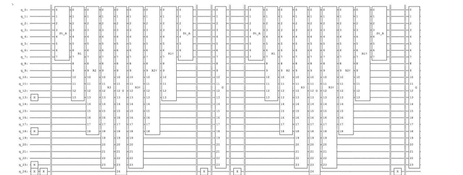

图 9.9 用于两次迭代的深度搜索 3-数谜任务的量子电路。由于我们使用了态向量模拟器，因此不需要测量，因为模拟器会确定每个量子比特的精确概率。量子门数量的电路深度为 25。路径描述符由三个量子比特表示，有八种可能的状态。在第二次迭代之前的一个重要操作是通过 Hadamard 门将辅助比特 24 设置为叠加态。我们可以通过消除第一次和第二次迭代后辅助比特 24 的两个 Hadamard 门来简化电路，但这样做会导致电路失去其模块化结构（可读性降低），并且冗余操作在转换过程中会被简化。图 9.10 的直方图显示了两次迭代后一个标记状态的解决方案。

## 138 使用 Qiskit 的量子人工智能

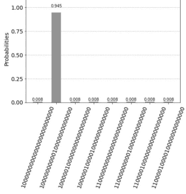

**图 9.10** 态向量模拟器显示两次迭代后一个标记状态的结果概率值为 0.945。这是使用 Grover 算法对八个状态进行放大时，获得单个标记解决方案的最优理论值。如果我们应用另一个旋转，理论概率将会降低。

3-数谜量子产生系统突显了量子树搜索和量子产生系统的原理。由于问题的简单性，它并没有提供任何真正的计算速度提升。

## 8 数谜 (8 Puzzle)

n-数谜是算法建模的经典问题。对于 n-数谜，有 $n+1$ 个不同的对象：$n$ 个单元和一个空单元。每个对象可以由 $\rho = [\log_2(n+1]$ 个量子比特进行编码，$n+1$ 个对象的配置可以用一个寄存器 $z = p \cdot (n+1) |x\rangle$ 表示。函数 $g(x)$ 由酉变算符 $T$ 表示，作用于 $z+1$ 个量子比特，其中 $x \in B^n$，$c \in B^1$。

$T|x,c\rangle = |x,f(x) \oplus c\rangle$

我们展示了如何扩展 3-数谜以产生非常数分支因子。我们证明了分支因子通过 Grover 放大减少到分支因子的平方根，而不是最大分支因子。深度搜索需要 49 个量子比特。所示的方法可以扩展到深度搜索。

### 10.1 表示法

对于 8-数谜，有九个对象：八个单元和一个空单元。每个对象由 4 个量子比特表示，3 个量子比特允许表示 $2^3=8$ 种不同的状态。对象 1 由 001 表示，2 由 010 表示，3 由 011 表示，我们继续用二进制数 100 表示。状态 $|x\rangle$ 由 36 个量子比特 $x_0, x_1, x_2, x_3, x_4, x_5, x_6, x_7$ 表示……见图 10.1。空单元可以上、下、左或右移动。两个比特 $m_0, m_1$（比特 46 和 47）决定单元应该向右 ($m=00$)、向左 ($m=01$)、向上 ($m=10$) 还是向下 ($m=11$)。有 36 个量子比特表示状态和9 个辅助量子比特。

```python
qc = QuantumCircuit(49)
# 准备 0-3
qc.x(0)
qc.x(1)
```

## 140 Qiskit 人智能

8-数谜的九个对象由 36 个量子比特的寄存器表示。我们指示状态、其位置的 36 个量子比特。在此表示中，位置描述符（形容词）是固定的。移动 2-3……

```python
# 标记 36
# 第1 次 迹 37-45
# 叠加态中的第1 个路径描述符 46, 47
qc.x(46)
qc.h(47)
# 辅助位
qc.x(48)
qc.h(48)
```

在空单元位于中心的情况下，有四种可能的移动。边缘单元有三种移动。

```python
def if_rules():
    qc = QuantumCircuit(46)
    # 通过迹标记标记规则
    gate = MCGate(4)
    # 角落单元，2种移动
    qc.append(gate, [0, 1, 2, 3, 37])
    # 边缘单元，3种移动
    qc.append(gate, [4, 5, 6, 7, 38])
    # 角落单元，2种移动
    qc.append(gate, [8, 9, 10, 11, 39])
    # 边缘单元，3种移动
    qc.append(gate, [12, 13, 14, 15, 40])
    # 中心单元，4种移动
    qc.append(gate, [16, 17, 18, 19, 41])
```

```python
# 边缘单元，3种移动
qc.append(gate, [20, 21, 22, 23, 42])
# 角落单元，2种移动
qc.append(gate, [24, 25, 26, 27, 43])
# 边缘单元，3种移动
qc.append(gate, [28, 29, 30, 31, 44])
# 角落单元，2种移动
qc.append(gate, [32, 33, 34, 35, 45])
qc.name="IF"
return qc
```

对于中心单元，有对应四种移动的实例化。

```python
def result():
    qc = QuantumCircuit(48)
# 标记 36
# 路径描述符 46, 47
# 迹 37-45
flag_gate = MCXGate(3)
```

```python
# 如果规则右移动，空单元位于 16, 17, 18, 19 -> 12, 13, 14, 15
qc.append(flag_gate, [41, 46, 47, 36])
# 移动
qc.cswap(36,16,12)
qc.cswap(36,17,13)
qc.cswap(36,18,14)
qc.cswap(36,19,15)
# 清除
qc.append(flag_gate, [41, 46, 47, 36])
```

```python
# 如果规则向左移动，空单元位于 16, 17, 18, 19 -> 20, 21, 22, 23
qc.append(flag_gate, [41, 46, 47, 36])
# 移动
qc.cswap(36,16,20)
qc.cswap(36,17,21)
qc.cswap(36,18,22)
qc.cswap(36,19,23)
# 清除
qc.append(flag_gate, [41, 46, 47, 36])
```

```python
# 如果规则向上移动，空单元位于 16, 17, 18, 19 -> 28, 29, 30, 31
qc.append(flag_gate, [41, 46, 47, 36])
# 移动
qc.cswap(36,16,28)
qc.cswap(36,17,29)
qc.cswap(36,18,30)
qc.cswap(36,19,31)
# 清除
qc.append(flag_gate, [41, 46, 47, 36])
```

```python
# 如果规则向下移动，空单元位于 16, 17, 18, 19 -> 32, 33, 34, 35
qc.append(flag_gate, [41, 46, 47, 36])
# 移动
qc.cswap(36,16,32)
qc.cswap(36,17,33)
qc.cswap(36,18,34)
qc.cswap(36,19,35)
# 清除
qc.append(flag_gate, [41, 46, 47, 36])
```


-   对于路径描述符 10，向左移动 0, 1, 2, 3 → 4, 5, 6, 7。
-   对于路径描述符 11，向左移动 0, 1, 2, 3 → 4, 5, 6, 7。

向上移动规则和左移规则重复了两次。标记的解不能大于当前状态的，后者在更深层的搜索中存在。模拟 49 个量子比特需要更高的内存容量，由于内存限制，我们无法使用状态向量模拟器或搜索深度。我们可以在应用[8 数码游戏]的函数规则后测量路径描述符，见图 10.2。这些限制可以通过更高的内存容量克服。

## 10.2 迭代次数

对于 8 数码游戏，$B_{max} = 4$，$B_{min} = 2$，且

```
$B_{average} = \frac{4 \cdot 1 \cdot 2 \cdot 4 \cdot 3}{9} = 2.6667$.
```

直观地说，我们认为分支因子通过 Grover 放大减少到：

```
$\sqrt{B_{max}} = \sqrt{4} = 2$
```

然而，在我们的编码策略中情况并非如此。随着 $n$ 的增加，分支因子通过 Grover 放大减少到

```
$\sqrt{B_{average}} = \sqrt{2.6667} = 1.6299$
```

对于 $k$ 个解，测量代表 $k$ 个解中一个解的状态概率与 Grover 算子减少的分因子因子。寻找一个解的概率应该尽可能接近 1，迭代次数 $r$ 应该接近一个，其中 $m$ 是描述路径描述符的量子比特数 [45, 72]

```
$r = \frac{\pi}{\sqrt{k}}\sqrt{\frac{2^m}{k}}$
```

迭代次数 $r$ 是小于计算值的最大整数。简单来说，我们可以说：

```
$r = \sqrt{\frac{(B_{max})^m}{k}}$
```

$r$ 的值取决于 $m$ 与 $k$ 的关系，由于我们每次执行多条规则，$k$ 大于 1。对于深度 $m$，存在解使得：

```
$k = \sqrt{\frac{B_{max}}{B_{average}}}^m$
```

由此得出，且分支因子通过 Grover 放大减少到 $\sqrt{B_{average}}$

```
$$\sqrt{B_{average}} = \sqrt{2.6667} = 1.6299$.
```

# 144 使用 Qiskit 的量子人工智能

| q0 | q1 | q2 | q3 | q4 | q5 | q6 | q7 | q8 | q9 |
|---|---|---|---|---|---|---|---|---|---|---|
| 0 | 1 | 0 | 0 | 0 | 0 | 0 | 0 | 0 | 0 |
| 1 | 0 | 1 | 0 | 0 | 0 | 0 | 0 | 0 | 0 |
| 2 | 0 | 0 | 1 | 0 | 0 | 0 | 0 | 0 | 0 |
| 3 | 0 | 0 | 0 | 1 | 0 | 0 | 0 | 0 | 0 |
| 4 | 0 | 0 | 0 | 0 | 1 | 0 | 0 | 0 | 0 |
| 5 | 0 | 0 | 0 | 0 | 0 | 1 | 0 | 0 | 0 |
| 6 | 0 | 0 | 0 | 0 | 0 | 0 | 1 | 0 | 0 |
| 7 | 0 | 0 | 0 | 0 | 0 | 0 | 0 | 1 | 0 |
| 8 | 0 | 0 | 0 | 0 | 0 | 0 | 0 | 0 | 1 |
| 9 | 0 | 0 | 0 | 0 | 0 | 0 | 0 | 0 | 1 |
| 10| 1 | 0 | 0 | 0 | 0 | 0 | 0 | 0 | 0 |
| 11| 0 | 1 | 0 | 0 | 0 | 0 | 0 | 0 | 0 |
| 12| 0 | 0 | 1 | 0 | 0 | 0 | 0 | 0 | 0 |
| 13| 0 | 0 | 0 | 1 | 0 | 0 | 0 | 0 | 0 |
| 14| 0 | 0 | 0 | 0 | 1 | 0 | 0 | 0 | 0 |
| 15| 0 | 0 | 0 | 0 | 0 | 1 | 0 | 0 | 0 |
| 16| 0 | 0 | 0 | 0 | 0 | 0 | 1 | 0 | 0 |
| 17| 0 | 0 | 0 | 0 | 0 | 0 | 0 | 1 | 0 |
| 18| 0 | 0 | 0 | 0 | 0 | 0 | 0 | 0 | 1 |
| 19| 0 | 0 | 0 | 0 | 0 | 0 | 0 | 0 | 1 |
| 20| 1 | 1 | 0 | 0 | 0 | 0 | 0 | 0 | 0 |
| 21| 0 | 0 | 1 | 0 | 0 | 0 | 0 | 0 | 0 |
| 22| 0 | 0 | 0 | 1 | 0 | 0 | 0 | 0 | 0 |
| 23| 0 | 0 | 0 | 0 | 0 | 0 | 0 | 0 | 0 |
| 24| 0 | 0 | 0 | 0 | 0 | 0 | 0 | 0 | 0 | 0 | 1 |
| 25| 0 | 0 | 0 | 0 | 0 | 0 | 0 | 0 | 0 |
| 26| 0 | 0 | 0 | 0 | 0 | 0 | 0 | 1 | 0 |
| 27| 0 | 0 | 0 | 0 | 0 | 0 | 0 | 0 | 1 |
| 28| 0 | 0 | 0 | 0 | 0 | 0 | 0 | 0 | 1 |
| 29| 1 | 1 | 1 | 0 | 0 | 0 | 0 | 0 | 0 |
| 30| 0 | 0 | 0 | 0 | 0 | 1 | 0 | 0 | 0 |
| 31| 0 | 0 | 0 | 0 | 0 | 0 | 1 | 0 | 0 |
| 32| 0 | 0 | 0 | 0 | 0 | 0 | 1 | 0 | 0 |
| 33| 0 | 0 | 0 | 0 | 0 | 0 | 0 | 1 | 0 |
| 34| 0 | 0 | 0 | 0 | 0 | 0 | 0 | 0 | 1 |
| 35| 0 | 0 | 0 | 0 | 0 | 0 | 0 | 0 | 1 |
| 36| 0 | 0 | 0 | 0 | 0 | 0 | 0 | 0 | 1 |
| 37| 1 | 1 | 1 | 1 | 0 | 0 | 0 | 0 | 0 |
| 38| 0 | 0 | 0 | 0 | 1 | 1 | 0 | 0 | 0 |
| 39| 0 | 0 | 0 | 0 | 0 | 1 | 1 | 0 | 0 |
| 40| 0 | 0 | 0 | 0 | 0 | 0 | 1 | 0 | 0 |
| 41| 0 | 0 | 0 | 0 | 0 | 0 | 0 | 1 | 0 |
| 42| 0 | 0 | 0 | 0 | 0 | 0 | 0 | 1 | 0 |
| 43| 0 | 0 | 0 | 0 | 0 | 0 | 0 | 0 | 1 |
| 44| 1 | 1 | 1 | 1 | 1 | 0 | 0 | 0 | 0 |
| 45| 0 | 0 | 0 | 1 | 1 | 1 | 0 | 0 | 0 |
| 46| 0 | 0 | 0 | 0 | 1 | 1 | 1 | 0 | 0 |
| 47| 0 | 0 | 0 | 0 | 0 | 1 | 1 | 1 | 0 |
| 48| 0 | 0 | 0 | 0 | 0 | 0 | 0 | 1 | 1 |

**图 10** 用于 9 数码游戏深度搜索任务的量子电路。空位位于中心，期望状态由顶部的空位表示。模拟 49 个量子比特需要更高的内存容量，由于内存限制，我们无法使用状态向量模拟器或深度为搜索。路径描述符由两个量子比特表示，并在应用函数规则后测量，这对应于空位的向上移动。

## 木块世界

木块世界是人工智能中的一个规划领域 [73]。块可以放在桌子上，也可以拿起并放在桌子或另一个块上，目标是建立一个或多个垂直堆叠块。每次只能移动一个块，任何位于另一个块下方的块都不能移动。有三种不同的块。它们根据属性（如颜色：红色、绿色和蓝色）或标记进行区分，而不是根据形状。在人工智能（AI）中，它们传统上被称为 A、B 和 C。


# 块世界 ■ 147

| 0 | 1 | 2 | 3 | 4 | 5 | 6 | 7 | 8 | 9 | 10 | 11 | 12 | 13 | 14 | 15 | 16 | 17 | 18 | 19 | 20 | 21 | 22 | 23 | 24 |
|---|---|---|---|---|---|---|---|---|---|---|---|---|---|---|---|---|---|---|---|---|---|---|---|---|---||
| 0 | | | | | | | | | | | | | | | | | | | | | | | | | | | |
| 1 | | | | | | | | | | | | | | | | | | | | | | | | | | | |
| 2 | | | | | | | | | | | | | | | | | | | | | | | | | | | | |
| 3 | | | | | | | | | | | | | | | | | | | | | | | | | | | | |
| 4 | | FL | | | | | | | | | | | | | | | | | | | | | | | | | |
| 5 | | | | | | | | | | | | | | | | | | | | | | | | | | | | |
| 6 | | | | | | | | | | | | | | | | | | | | | | | | | | | | |
| 7 | | | | | | | | | | | | | | | | | | | | | | | | | | | | |
| 8 | | | | | | | | | | | | | | | | | | | | | | | | | | | | |
|   | | | | | | | | | | | | | | | | | | | | | | | | | | | | | |
| 10 | | | | | | | | | | | | | | | | | | | | | | | | | | | | |
| 11 | | | | | | | | | | | | | | | | | | | | | | | | | | | | |
| 12 | | | | | | | | | | | | | | | | | | | | | | | | | | | | | |
| 13 | | | | | | | | | | | | | | | | | | | | | | | | | | | | | |
| 14 | | | | | | | | | | | | | | | | | | | | | | | | | | | | | |
| 15 | | | | | | | | | | | | | | | | | | | | | | | | | | | | | |
| 16 | | | | | | | | | | | | | | | | | | | | | | | | | | | | | |
| 17 | | | | | | | | | | | | | | | | | | | | | | | | | | | | | |
| 18 | | | | | | | | | | | | | | | | | | | | | | | | | | | | | |
| 19 | | | | | | | | | | | | | | | | | | | | | | | | | | | | | |
| 20 | | | | | | | | | | | | | | | | | | | | | | | | | | | | | |
| 21 | | | | | | | | | | | | | | | | | | | | | | | | | | | | | | |
| 2 | | | | | | | | | | | | | | | | | | | | | | | | | | | | | |
| 23 | | | | | | | | | | | | | | | | | | | | | | | | | | | | | |
| 24 | | | | | | | | | | | | | | | | | | | | | | | | | | | | | |

图 11.3 深度搜索 1 ABC 任务的量子电路。由于我们使用了状态向量模拟器，因此不需要任何测量，因为模拟器会检测每个量子比特的精确概率。电路的量子门数量深度为 13。路径描述符由三个量子比特表示的八种可能状态。一个标记状态在一次迭代后产生解决方案，如图 11.7 图中初始状态“所有块都在地板上”所示。

```python
# BLOCK C量子比特 6-8
qc.x(8)
qc.name="_FL"
return qc
```

## 11.1.1 规则（产生式）

在 `if_rules()` 函数期间会识别不同的规则。“所有块都在地板”类有一种组合（见图 11.4），“塔”类以不同的组合出现（见图 11.5），以及“小塔”类和“桌子上的块”（例如 BC 塔和块 A，见图 11.6）。

```python
def if_rules():
    qc = QuantumCircuit(23)
```

| A | B | C |
|---|---|---|

图 11.4 “所有块都在地板”类有一种组合。

| A | A | B | B | C | C |
|---|---|---|---|---|---|
| B | C | A | C | B | A |

图 11.5 这些类以六种不同的组合出现。

```python
gate = MCX(3)

# 所有块在桌子上
qc.append(gate, [2, 5, 8, 10])
# ABC 塔
qc.append(gate, [1, 2, 3, 11])
# ACB 塔
qc.append(gate, [1, 2, 6, 12])
# BAC 塔
qc.append(gate, [4, 5, 1, 13])
# BCA 塔
qc.append(gate, [4, 5, 6, 14])
# CAB 塔
qc.append(gate, [1, 7, 8, 15])
# CBA 塔
qc.append(gate, [4, 7, 8, 16])
# BC 塔和块 A
```
（图 11.6 “小塔”和“桌子上的块”类以六种不同的组合出现。）

| A | A | B | B |
|---|---|---|---|
| C | C | B | A |

| A | B | C |
|---|---|---|
| B | A | B |

图 11.6 “小塔”和“桌子上的块”类以六种不同的组合出现。

```python
def rules_floor():
    qc = QuantumCircuit(26)
    gate4 = MCGate(4)
    qc.append(gate4, [10, 23, 24, 25, 9])
# 所有块在地板上
# 移动 A
# 在 B 之上
qc.cswap(9, 0, 5)
# 改变的描述符
# 重置 WM (工作内存)
qc.append(gate4, [10, 23, 24, 25, 9])
# 获取第二个叠加态
qc.x(23)
qc.append(gate4, [10, 23, 24, 25, 9])
# 在 C 之上
qc.cswap(9, 0, 8)
# 重置 WM
qc.append(gate4, [10, 23, 24, 25, 9])
# 恢复描述符
qc.x(23)

# 移动 B
qc.x(24)
# 在 A 之上
qc.append(gate4, [10, 23, 24, 25, 9])
qc.cswap(9, 2, 3)
# 改变的描述符
# 重置 WM
qc.append(gate4, [10, 23, 24, 25, 9])
# 获取第二个叠加态
qc.x(23)
qc.x(24)

```python
qc.append(gate4, [10, 23, 24, 25, 9])
# 在 C 之上
qc.cswap(9, 3, 8)
# 重置 WM
qc.append(gate4, [10, 23, 24, 25, 9])
# 恢复描述符
qc.x(24)
qc.x(23)

```python
# 移动 C
qc.x(25)
qc.append(gate4, [10, 23, 24, 25, 9])
# 在 A 之上
qc.cswap(9, 6, 2)
# 改变的描述符
# 重置 WM
qc.append(gate4, [10, 23, 24, 25, 9])
# 获取第二个叠加态
qc.x(25)
qc.x(23)
qc.append(gate4, [10, 23, 24, 25, 9])
# 在 B 之上
qc.cswap(9, 6, 5)
# 重置 WM
qc.append(gate4, [10, 23, 24, 25, 9])
# 恢复描述符
qc.x(23)
qc.x(25)

# 我们只有六条规则，但有八种可能的路径！！！
# 为了消除初始状态我们将再次移动 C！

```python
# 再次移动 C
qc.x(24)
qc.x(25)
qc.append(gate4, [10, 23, 24, 25, 9])
# 在 B 之上
qc.cswap(9, 6, 2)
# 改变的描述符
# 重置 WM
qc.append(gate4, [10, 23, 24, 25, 9])
qc.x(25)
qc.x(24)
# 获取第二个叠加态
qc.x(23)
qc.x(24)
qc.x(25)
qc.append(gate4, [10, 23, 24, 25, 9])
# 在 B 之上
qc.cswap(9, 6, 5)
# 重置 WM
qc.append(gate4, [10, 23, 24, 25, 9])
qc.x(25)
qc.x(24)
qc.x(23)
qc.name="R_FL"
return qc
```
“塔”类（如 ABC 塔）以六种不同的组合出现。每种组合是通过八种状态表示的一个实例化：

```python
def rules_tw():
    qc = QuantumCircuit(17)
    gate4 = MCGate(4)
    # 标记 9
    # 路径 23, 24, 25
# 三个实例化
# BC 塔和块 A
qc.append(gate, [2, 5, 3, 17])
# 放在地板上
qc.append(gate4, [10, 23, 24, 25, 9])
qc.cswap(9, 3, 8)
# 清空 WM
qc.append(gate4, [10, 23, 24, 25, 9])
# 制作 BCA 塔
qc.x(23)
qc.append(gate4, [10, 23, 24, 25, 9])
qc.cswap(9, 5, 1)
# 重置 WM
qc.append(gate4, [10, 23, 24, 25, 9])
qc.x(24)
qc.x(25)
# 在另一个块 A 之上
qc.x(25)
qc.x(23)
qc.append(gate4, [10, 23, 24, 25, 9])
qc.cswap(9, 2, 8)
# 清空 WM
qc.append(gate4, [10, 23, 24, 25, 9])
qc.x(25)
qc.x(23)

```python
# 再次为路径描述符的状态 7-8 重复两次实例化
# 制作 BCA 塔
qc.x(25)
qc.x(24)
qc.append(gate4, [10, 23, 24, 25, 9])
qc.cswap(9, 5, 1)
# 重置 WM
qc.append(gate4, [10, 23, 24, 25, 9])
qc.x(25)
qc.x(24)
# 在另一个块 A 之上
qc.x(25)
qc.x(24)
```


```python
qc.x(23)
qc.append(gate4, [17, 23, 24, 25, 9])
qc.swap(9, 2, 8)
# Clear WM
qc.append(gate4, [17, 23, 24, 25, 9])
qc.x(25)
qc.x(24)
qc.x(23)
```

```python
# 以同样的方式
# BA tower and block C
# CA tower and block B
# CB tower and block A
# AC tower and block B
# AB tower and block C
...
qc.name="R_TB"
return qc
```

## 11.1.2 门器

目标状态 AC 和 B 由门器表示

```python
def oracle():
    qc = QuantumCircuit(27)
    # 指定目标状态
    gate = MCGate(3)
    # AC B
    qc.append(gate, [3, 5, 8, 26])
    qc.name="0"
    return qc
```

## 11.1.3 架构

深度搜索 1 的 ABC 块量子电路（见图 11.3）

```python
qc = QuantumCircuit(27)
# 状态准备 0-8
```

# 工作内存，标记 9
# 第1次轨迹 (十) 10-22 规则类

# 叠加态中的第一组描述符，一、三、六种可能的动作
# 由三个比特位表示
# 可能的实例化

```python
qc.h(23)
qc.h(24)
qc.h(25)
```

### # 辅助的准备

qc.x(26)
qc.h(26)

```python
qc.append(state_floor(), range(9))
qc.append(if_rules(), range(23))
qc.append(rules_tw(), range(17))
qc.append(rules_floor(), range(26))
qc.append(rules_tw_bi(), range(26))
qc.append(oracle(), range(27))
qc.append(rules_tw_inv(), range(26))
qc.append(rules_floor_inv(), range(26))
qc.append(rules_tw_inv(), range(17))
qc.append(if_rules_inv(), range(23))
qc.append(state_floor(), range(9))
```

```python
qc.barrier()
qc.h(26)
qc.barrier()
qc.append(Grover(), range(26))
print("nCircuit depth: ", qc.depth())
```

## 11.2 示例

其中一个解决方案被标记，在一次 Grover 放大迭代后，使用状态向量模拟器测量某个状态的概率如图 11.7 所示。对于初始状态 BC 和 A 以及目标状态 AC 和 B，三个标记状态在一次迭代后产生一个解决方案，使用状态向量模拟器测量某个状态的概率如图 11.8 所示。

## 11.3 迭代次数

对于 A, B, C 块，$B_{max} = 6, B_{min} = 1,$ 且

> $B_{average} = \frac{6 \cdot 1 \cdot 1 + 3 \cdot 6}{13} = 2.30769.$

直素地，我们假设分支因子通过 Grover 放大减少到由三个比特表示的数字 8

> $\sqrt{8} = 2.82843$

随着值 $m$ 的增大，分支因子通过 Grover 放大减少到

> $B_{average} = \sqrt{2.30769} = 1.51911.$

对于 $k$ 个解决方案，测量代表 $k$ 个解决方案中的一个解决方案的状态概率与 Grover 算子的迭代次数 $r$ 有关。简单来说，我们可以得出关系

> $r = \sqrt{\frac{(8)^m}{k}} = (11.4)$


**图 11.7** 一个标记状态在一次迭代后产生一个解决方案，所示初始状态为所有块处于目标状态 $AC$ 和 $B$。解决方案由路径描述符 23, 24 和 25 描述，二进制值为 101。通过可能的转换，有 8 个分支。$r$ 的值取决于 $m$ 与 $k$ 的关系。

$k = \frac{8}{B_{average}}^m$


**图 11.8** 三个标记状态在一次迭代后产生一个解决方案，由状态向量模拟器所示初始状态为 $BC$ 和 $A$，目标状态为 $AC$ 和 $B$。它遵循

$r = \sqrt{B_{average}}^m$

且分支因子通过 Grover 放大减少到 $1.51911$。

## 五硬币游戏

涉及两个玩家的游戏是符号求解的经典应用之一。从某个初始位置开始，算法探索所有合法移动的树直到请求深度。例如尼姆游戏（nim game），两个玩家从不同的堆中取物体。简化版是没有任何堆的尼姆游戏——五硬币游戏。两个玩家轮替从一个含有五个硬币的堆中取一、二或三枚硬币。拿到最后一个硬币的人输。五硬币游戏是一个零和游戏，两个玩家都没有合法选择。如果选择了正确的移动，第一个玩家输，第二个玩家获胜。我们指出了五硬币游戏的架构，并指出量子搜索无法实现极大极（minimax）。我们可以确定搜索路径，但无法模拟选择最佳移动的玩家的行为，因为我们无法比较由不同描述符描述的不同状态。

## 12.1 量子电路

在我们对五硬币游戏的实现中，我们探索深度的合法移动。在初始游戏中，五个硬币由比特 0 到 4 表示。玩家 A 开始游戏，可以移除一、二或三枚硬币。路径路径描述符由两个比特 6 和 7 表示。比特 5 是一个标记，表示与路径描述符相关的规则。第一条规则移除三个硬币，第二条移除两个，第三条移除一枚。由于我们有四种可能的路径，第三和第四种是相同的。玩家 B 拥有的三个、四个或两个硬币的堆。根据硬币的数量，可以执行不同的规则，即类型 1、类型 2 或类型 3。正确的类型在由比特 8, 9 和 10 表示的轨迹中识别并标记，见图 12.1。每条规则都用路径描述符实例化并可以并行执行。对应于一个硬币的最终状态由门器标记，见图 12.2。它们对应于玩家 A 的失败，因为拿到最后硬币的人。

# 158 使用 Qiskit 的量子人工智能

| q0 | q1 | q2 | q3 | q4 | q5 | q6 | q7 | q8 | q9 | q10 |
|---|---|---|---|---|---|---|---|---|---|---|
| | | | | | | | | | | |
| | | | | | | | | | | |
| | | | | | | | | | | |
| | | | | | | | | | | |
| | | | | | | | | | | |
| | | | | | | | | | | |
| | | | | | | | | | | |
| | | | | | | | | | | |
| | | | | | | | | | | |
| | | | | | | | | | | |
| | | | | | | | | | | |

**12.1 在我们的实现，在初始游戏中，五个硬币由比特 0 到 4 表示**。玩家 A 开始游戏，可以移除一、二或三枚硬币。路径描述符由两个比特 6 和 7 表示。比特 5 是一个标记，表示与路径描述符相关的规则。第一条规则移除三个硬币，第二条移除两个，第三条移除一枚。由于我们有四种路径，规则三并行执行两次。根据硬币的数量，可以执行不同的规则，即类型 1、类型 2 或类型 3。正确的路径在由比特 8, 9 和 10 表示的轨迹中识别并标记。

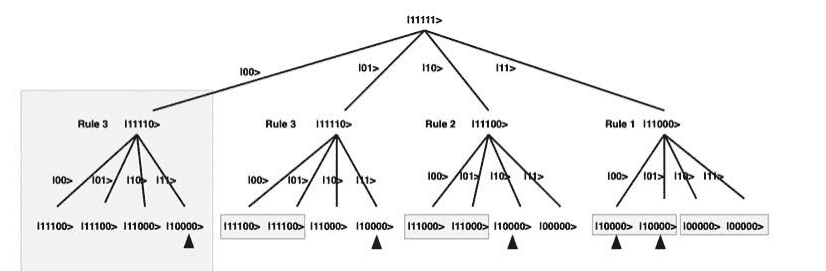

五硬币尼姆游戏深度的搜索树。在初始游戏中，五个硬币存在。它们由比特 [11111] 表示。玩家 A 开始游戏，可以移除一、二或三枚硬币。路径描述符由两个比特 [00], [01], [10] 表示。


# 五分尼 Nim 游戏 ■ 159

我们可以确定搜索路径，但无法模拟选择最佳移动的玩家的行为，因为我们无法比较由不同路径描述符描述的不同状态。

## 12.1.1 规则表示

第一条规则移除三枚硬币，第二条移除两枚硬币，第三条移除一枚硬币。由于我们有四种可能的路径，第三条规则将并行执行两次。

```python
import numpy as np
from qiskit import QuantumCircuit, transpile, Aer, assemble, execute
from qiskit.providers.aer import QasmSimulator
from qiskit.visualization import plot_histogram
from qiskit.quantum.info import Statevector
from qiskit.circuit.library import MCXGate
```

```python
def rules_depth(
    qc = QuantumCircuit(8)
    #First Rule
    # 根据路径描述符设置标记 5
    qc.ccx(6,7,5)
    # 移动
    qc.cx(5,0)
    qc.cx(5,1)
    qc.cx(5,2)
    # 重置标记
    qc.ccx(6,7,5)

    # 第二规则
    # 根据路径描述符设置标记 5
    qc.x(6)
    qc.ccx(6,7,5)
    # 移动
    qc.cx(5,0)
    qc.cx(5,1)
    # 重置标记
    qc.ccx(6,7,5)
    qc.x(6)

    # 第三规则
    # 根据路径描述符设置标记 5
    qc.x(7)
    qc.ccx(6,7,5)
    # 移动
    qc.cx(5,0)
    # 重置标记
    qc.ccx(6,7,5)
    qc.x(7)

    # 第四=第三规则
    # 根据路径描述符设置标记 5
    qc.x(6)
```

# 基于 Qiskit 的量子人工智能

```python
qc.x(7)
qc.ccx(6,7,5)
# 移动
qc.cx(5,0)
# 重置标记
qc.ccx(6,7,5)
qc.x(7)
qc.x(6)
qc.name="RULES_1"
return qc
```

```python
def rules_depth1_inv():
    qc=rules_depth1()
    qc_inv=qc.inverse()
    qc_inv.name="RULES_IE"
    return qc_inv
```

根据硬币的数量，可以执行不同类型的规则：规则 1、规则 2 或规则 3。正确的规则被识别并标记在由量子比特 8、9 和 10 表示的迹中。

```python
def rules_depth2():
    qc = QuantumCircuit(11)
```

```python
# 迹中标记规则深度 2 的 IF 部分
gate = MCXGate(5)
```

```python
# IF 规则 2 硬币
qc.x(0)
qc.x(1)
qc.x(2)
qc.append(gate, [0,1,2,3,4,8])
qc.x(2)
qc.x(1)
qc.x(0)
# IF 规则 3 硬币
qc.x(0)
qc.x(1)
qc.append(gate, [0,1,2,3,4,9])
qc.x(1)
qc.x(0)
# IF 规则 4 硬币
qc.x(0)
qc.append(gate, [0,1,2,3,4,10])
qc.x(0)
qc.name="IF_2"
return qc
```

三条规则中的每一条都由量子比特 11 和 12 表示的路径描述符实例化。

```python
def rules_depth2():
```

# 五分尼 Nim 游戏 ■ 161

```python
qc = QuantumCircuit(13)
#标记 5
# 路径描述符 11, 12
# 迹 8-10
flag_gate = MCXGate(3)
```

# 第一规则：迹 8

```python
# 第一次实例化
qc.append(flag_gate, [8,11,12,5])
# 移动
qc.cx(5,3)
qc.cx(5,4)
# 清除标记
qc.append(flag_gate, [8,11,12,5])

# 第二次实例化
qc.x(11)
qc.append(flag_gate, [8,11,12,5])
# 移动
qc.cx(5,3)
qc.cx(5,4)
# 清除标记
qc.append(flag_gate, [8,11,12,5])

# 第三次实例化
qc.x(12)
qc.append(flag_gate, [8,11,12,5])
# 移动
qc.cx(5,3)
# 清除标记
qc.append(flag_gate, [8,11,12,5])

# 第四次实例化
qc.x(11)
qc.x(12)
qc.append(flag_gate, [8,11,12,5])
# 移动
qc.cx(5,3)
# 清除标记
qc.append(flag_gate, [8,11,12,5])
```

# 第二规则：迹 9

```python
# 第一次实例化
qc.append(flag_gate, [9,11,12,5])
# 移动
qc.cx(5,2)
qc.cx(5,3)
qc.cx(5,4)
# 清除标记
qc.append(flag_gate, [9,11,12,5])

# 第二次实例化
qc.x(11)
qc.append(flag_gate, [9,11,12,5])
# 移动
qc.cx(5,2)
qc.cx(5,3)
# 清除标记
qc.append(flag_gate, [9,11,12,5])

# 第三次实例化
qc.x(12)
qc.append(flag_gate, [9,11,12,5])
# 移动
qc.cx(5,2)
# 清除标记
qc.append(flag_gate, [9,11,12,5])

# 第四次实例化
qc.x(11)
qc.x(12)
qc.append(flag_gate, [9,11,12,5])
# 移动
qc.cx(5,2)
# 清除标记
qc.append(flag_gate, [9,11,12,5])
```

# 第三规则：迹 10

```python
# 第一次实例化
qc.append(flag_gate, [10,11,12,5])
# 移动
qc.cx(5,1)
qc.cx(5,2)
qc.cx(5,3)
# 清除标记
qc.append(flag_gate, [10,11,12,5])

# 第二次实例化
qc.x(11)
qc.append(flag_gate, [10,11,12,5])
# 移动
qc.cx(5,1)
qc.cx(5,2)
# 清除标记
qc.append(flag_gate, [10,11,12,5])

# 第三次实例化
qc.x(12)
qc.append(flag_gate, [10,11,12,5])
# 移动
qc.cx(5,1)
# 清除标记
qc.append(flag_gate, [10,11,12,5])

# 第四次实例化
qc.x(11)
qc.x(12)
qc.append(flag_gate, [10,11,12,5])
# 移动
qc.cx(5,1)
# 清除标记
qc.append(flag_gate, [10,11,12,5])
```

```python
qc.name="RULES_2"
return qc
```

```python
def rules_depth_2_inv():
    qc=rules_depth2()
    qc_inv=qc.inverse()
    qc_inv.name="RULES_2"
    return qc_inv
```

## 12.1.2 Oracle

代表一枚硬币的状态被 oracle 标记。它们对应于玩家 A 的失败。

```python
def oracle():
    gqc = QuantumCircuit(14)
    gate = MCXGate(5)
    qc.x(0)
    qc.x(1)
    qc.x(2)
    qc.x(3)
    qc.append(gate, [0, 1, 2, 3, 4, 13])
```

```python
qc.x(3)
qc.x(2)
qc.x(1)
qc.x(0)
qc.name="Q"
return qc
```

```python
def Grover():
    qc = QuantumCircuit(13)
    qc.h([6, 7, 11, 12])
    gate = MCXGate(3)
    qc.append(gate, [7, 11, 12, 6])
    qc.h([6, 7, 11, 12])
    qc.name="G"
return qc
```

## 12.1.3 深度搜索

以下列表调用了函数。它代表深度的搜索，包括反计算和 Grover 放大。

```python
qc = QuantumCircuit(14,4)
# 状态准备 0–4
qc.x(6)
qc.x(1)
qc.x(2)
qc.x(3)
qc.x(4)
# 标记 5 的工作内存
# 第1路径描述符 6, 7
qc.h(6)
qc.h(7)
# 第2次迹 8-11
# 第2路径描述符 6, 11
qc.h(11)
qc.h(12)
# 辅助量子比特 13
qc.x(13)
qc.h(13)
qc.barrier()
```

| 0 | 1 | 2 | 3 | 4 | 5 |
|---|---|---|---|---|---|
| 0 | 0 | 0 | 0 | 0 | 0 |
| 1 | RULES_1 | 2 | 2 | 3 | 3 |
| 2 | | IF_2 | 4 | 4 | 4 |
| 3 | | | RULES_2 | 5 | 5 | 5 |
| 4 | | | | IF_2 | 6 | 6 |
| 5 | | | | | | 7 | 7 |
| 6 | | | | | | 8 | 8 |
| 7 | | | | | | 9 | 9 |
| 8 | | | 10 | 10 | 10 | 10 |
| 9 | | | | | | 11 | 11 |
| 10 | | | | | | 12 |


# 二进制向量的基编码

量子编码是将经典信息转换为量子态的过程。它在利用量子算法中起着至关重要的作用。基编码（Basis encoding）是将经典二进制向量编码为量子态的最直观的方法。它将一个 $n$ 维二进制向量编码为一个由计算基态表示的 $n$ 位比特量子态。我们将描述两种可能的方法：一种由 Ventura 和 Martinez 开发的方法，另一种是将二进制模式向量与叠加态中的量子比特进行纠缠的方法。

## 13.1 二进制向量

一组二进制向量由基编码表示。通过 Hadamard 门可以很容易生成二进制向量的均匀叠加态。例如，对于二维二进制向量，我们通过 Hadamard 门生成均匀叠加态：

$$H_2|00\rangle = H_1|0\rangle \otimes H_1|0\rangle = \frac{1}{\sqrt{4}}\sum_{x \in B^2} |x\rangle = \frac{1}{2}(|00\rangle + |01\rangle + |10\rangle + |11\rangle)$$

其幅度表示为：

$$\alpha = \begin{pmatrix} 0 & 1 & 2 & 3 \end{pmatrix}$$

但如何生成叠加态：

$$\frac{1}{\sqrt{3}}(|10\rangle + |01\rangle)$$

其幅度表示为：

$$\alpha = \begin{pmatrix} 0 & 1 & 2 & 3 \end{pmatrix}$$

我们描述两种可能的方法：一种由 Ventura 和 Martinez [114, 115] 开发的方法，另一种是将二进制模式向量与叠加态中的索引量子比特进行纠缠的方法。

## 13.2 二进制模式的叠加

为了生成维度为 $n$ ($n > m$) 的 $m$ 个线性无关二进制向量的叠加态由 Ventura 和 Martinez [114, 115] 提出，后由 [111] 规定。该步骤基于将叠加态成功分为处理分支和内存分支。每个新生成的内存分支按步骤加载一个输入模式。该方法取决于所存储模式的数量及其维度 [95]。

在初始步骤，系统处于带有加载量子比特、内存量子比特和控制比特 $c_1, c_2$ 的基态：

$$|memory; c_2, c_1; load\rangle$$

我们使用 Qiskit 的小端序符号。注意，原始工作使用了大端序符号 [111] $|register; c_1, c_2, memory\rangle$。其目的是使用控制寄存器逐步拆分此基，直到达到所需的叠加：

$$\sum_{j=1}^m |memory; c_2, c_1; load\rangle_j$$

其中内存寄存器处于所需的叠加态：

$$\sum_{j=1}^m |memory; 0, 0; 0 \cdots 0\rangle_j = \frac{1}{\sqrt{m}} \sum_{j=1}^m |memory_j\rangle \otimes |0, 0; \cdots 0\rangle$$

也称为内存分支。

我们将控制比特 $c_2$ 取值为 1（$c_2=1$）的处理分支与控制比特 $c_2$ 取值为 0（$c_2=0$）的叠加内存分支区分来。控制比特 $c_1=1$ 表示由酉门 $U(\theta, \phi, \lambda)$ 表示的算符 $CS_p$ 分拆控制 $c_2$，其中 $\phi=\pi, \lambda=\pi$， 且 $\theta=\arcsin(\dots \cdot 2$：

$$CS_p = CU(\arcsin(\frac{1}{\sqrt{p}}), 2, \pi, \pi) = \begin{pmatrix} 1 & 0 & 0 & 0 \\ 0 & 1 & 0 & 0 \\ 0 & 0 & \frac{1}{\sqrt{p}} & \frac{\sqrt{p-1}}{\sqrt{p}} \\ 0 & 0 & \frac{\sqrt{p-1}}{\sqrt{p}} & -\frac{1}{\sqrt{p}} \end{pmatrix}$$

对于 $CS_p[c_2, c_1]$：

$$CS_p|01\rangle = |01\rangle, CS_p|11\rangle = \frac{1}{\sqrt{p}} |10\rangle + \frac{\sqrt{p-1}}{\sqrt{p}} |11\rangle$$

由于控制比特 $c_1=1$ 与内存寄存器纠缠，我们通过对前一个分支进行拆分操作，创建控制比特 $c_2$ 取值为 0 的内存分支（$\frac{1}{\sqrt{p}}$）和控制比特 $c_2$ 取值为 1 的处理分支（$\sqrt{\dots}$）。我们将模式存储在新生成的内存寄存器中。

### 13.2.1 存储算法

初始状态为：

$$|\psi_0\rangle = |0\dots0:1;0;pattern_p\rangle$$

其中控制比特 $c_2=1$ 表示这是一个处理分支。后续步骤由存储 $m$ 个二进制模式的循环描述：

$$|pattern_m\rangle, |pattern_{m-1}\rangle, \dots |pattern_1\rangle$$

从 $p = m$ 到 2 步长 -1：

- 将模式 $pattern_p$ 加载到加载寄存器。
- 如果 $p = m$，则：
  - 使用 NOT 门将处理分支的内存寄存器的基态反反为 $[11\dots1]$。
- 否则：
  - 使用 cX 门（受控非门）将模式 $pattern_p$ 拷贝到控制比特 $c_2=1$ 的处理分支中。
  - 使用 $\epsilon$ cX 门（受控非门，反转 $c_2$）将模式 $pattern_p$ 拷贝到控制比特 $c_2=0$ 的内存分支中。结果处理分支的内存寄存器处于基态 $[00\dots0]$，而内存分支的位被翻转了。
  - 使用 NOT 门将处理分支的基态反转为 $[11\dots1]$。
- 将模式存储在新生成的内存分支的内存寄存器中。


# 172 使用 Qiskit 的量子人工智能

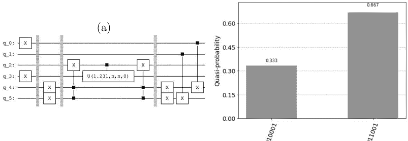

**图 13.3** (a) 我们使用多控制 X 门（Toffoli Gate）消除控制量子比特 2 ($c_1=1$) 与内存寄存器 [11] 之间的纠缠。我们对两个分支的内存寄存器应用 NOT 门操作和受控 NOT 操作（CNOT 门）。结果我们在内存寄存器中写入 10。(b) 得到的状态为 $|\psi_3 = \frac{1}{\sqrt{3}}|0,1;0,0,0> + \frac{\sqrt{2}}{\sqrt{3}}|0,1;0,0,1|$。

$|\psi_3 = \frac{1}{\sqrt{3}}|0,1;0,0,0> + \frac{\sqrt{2}}{\sqrt{3}}|0,1;0,0,1|$

- **图 13.4.** 我们消除处理分支的内存寄存器，将其设置为基态 (00)（操作前的内存寄存器处于基态）。我们使用由加载寄存器和控制量子比特 3 ($c_2=1$) 表示处理分支控制的 CCX 门（CCNOT 门）。我们将加载寄存器重置为基态 (00)。得到的状态为

$|\psi_4 = \frac{1}{\sqrt{3}}|0,1;0,0,0> + \frac{\sqrt{2}}{\sqrt{3}}|0,0;1,0,0|$

- **图 13.5.** 加载寄存器中生成模式 |10>。我们将 |10> 复制到处理分支的内存寄存器中。我们使用由加载寄存器和控制量子比特 3 ($c_2=1$) 表示处理分支控制的 CCX 门（CCNOT 门）。得到的状态为

$|\psi_5 = \frac{1}{\sqrt{3}}|0,1;0,0,0> + \frac{\sqrt{2}}{\sqrt{3}}|1,0;1,0,0|$

- **图 13.6.** 我们使用 CX 门对由模式 |10> 控制的两个分支的内存寄存器执行 NOT 操作。结果是处理分支的内存寄存器处于基态 (00)。内存分支的内存寄存器并非如此，其比特被翻转导致状态变为 [11]。我们对两个分支的内存寄存器应用 NOT 操作。结果是处理分支的内存寄存器处于

## 二进制向量的基编码 173

| q_0 | X | | | |
| :--- | :--- | :--- | :--- |
| q_1 | | X | | |
| q_2 | | U(1.231,n,m,0) | X |
| q_3 | X | | | |
| q_4 | | X | | |
| q_5 | | X | X |

(a)

(b)

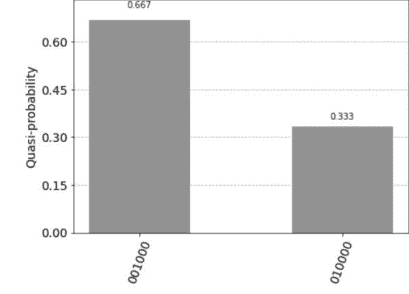

**图 13.4** (a) 我们消除处理分支的内存寄存器，将其设置为基态 [00]。我们使用由加载寄存器和控制量子比特 3 ($c_2=1$) 表示处理分支控制的 ccX 门（CCNOT 门）。我们将加载寄存器重置为基态 [00]。(b) 得到的状态为 $|\psi_4 = \frac{1}{\sqrt{3}}|0,1;0,0;0,0\rangle + \sqrt{\frac{2}{3}}|0,0;1,1;1,0\rangle$。

在状态 [11] 中，控制量子比特 2 ($c_1=1$) 通过多控制 X 门（Toffoli 门）与内存寄存器 [11] 纠缠。得到的状态为

$|\psi_6 = \frac{1}{\sqrt{3}}|0,0;0,0;1,0\rangle + \sqrt{\frac{2}{3}}|1,1;1,1;1,0\rangle$。

- **图 13.7** 控制量子比特 2 ($c_1=1$) 通过多控制 X 门（Toffoli 门）与处理分支的内存寄存器 [11] 纠缠。处理分支通过算子 $CS_2(p=2)$ 分裂，创建一个新的内存分支。得到的状态为

$|\psi_7 = \frac{1}{\sqrt{3}}|0,0;0,0;1,0\rangle + \frac{1}{\sqrt{3}}|1,1;0,1;1,0\rangle + \frac{1}{\sqrt{3}}|1,1;1,1;1,0\rangle$。

- **图 13.8.** 我们使用多控制 X 门（Toffoli 门）消除控制量子比特 2 ($c_1=1$) 与内存寄存器 [11] 的纠缠。我们对三个分支的内存寄存器应用 NOT 门操作和受控 NOT 操作（CNOT 门）。结果我们将第一个分支的内存寄存器翻转（恢复）为 |10>，并将 |01> 复制到另外两个分支的内存寄存器中。我们消除处理分支的内存寄存器，将其设置为基态 |00>。我们使用由加载寄存器和控制量子比特 3 ($c_2=1$ 表示处理分支）控制的 ccX 门（CNOT 门）。我们将加载寄存器重置为基态 (00)。得到的状态为

$|\psi_8 = \frac{1}{\sqrt{3}}|0,0;0,0> + \frac{1}{\sqrt{3}}|0,1;1,0>$

- **图 13.9.** 加载寄存器中生成了模式 |11>。模式 |11> 的第一个量子比特通过受控 NOT 门与控制寄存器的比特 3 ($c_2=1$) 纠缠。我们使用由加载寄存器和控制量子比特 $c_2=1$ 表示处理分支控制的 ccX 门（CNNOT 门）将 |11> 复制到处理分支的内存寄存器中。

```
qc.cx(3,0)
qc.x(1)
qc.ccx(0,3,4)
qc.ccx(1,3,5)
```

## 二进制向量的基编码 175

| q0 | | | | |
| :--- | :--- | :--- | :--- | :--- |
| q1 | | | | |
| q2 | | U(231,π,π)| | | |
| q3 | | | | | |
| q4 | | | | | |
| q5 | | | | | |

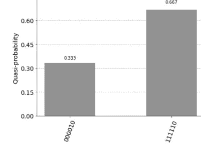

**图 13.6** 我们使用 CX 门执行由模式 |10> 控制的 NOT 操作。结果是处理分支的内存寄存器处于基态 (00)。内存分支的内存寄存器并非如此，其比特被翻转导致状态变为 [11]。我们对两个分支的内存寄存器应用 NOT 操作。结果处理分支的内存寄存器处于状态 [11]。控制量子比特 q2 (c1=1) 通过多控制 X 门与内存寄存器 |11> 纠缠。(b) 得到的状态为 $|\psi_6 = \frac{1}{\sqrt{2}}(|0;0;0;0;0\rangle + |1;1;1;1;0\rangle)$。我们通过将模式 |11> 的纠缠量子比特 0 的控制寄存器比特 $c_2$ 设置为零，将处理分支转换为内存分支。

```
qc.cx(0,3)
```

我们将加载寄存器重置为基态 (00)。通过 ccX 门（CCNOT 门）和由存储模式 |11> 的内存寄存器表示的控制量子比特，将加载寄存器中的纠缠量子比特置零。

```
qc.ccx(4,5,0)
qc.x(1)
```

我们使用 shots 10000 次 模拟器测量内存寄存器：量子比特 4 和 5。结果代表了期望的分布。得到的状态为

$|\psi_9 = \frac{1}{\sqrt{3}}(|0,1\rangle + |1,0\rangle + |1,1\rangle) \otimes |0, 0; 0; 0\rangle$

## 176 使用 Qiskit 的量子人工智能

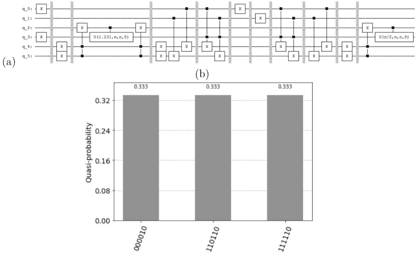

图 13.7 (a) 控制量子比特 2 ($c_1 = 1$) 通过多控制 X 门（Toffoli 门）与处理分支的内存寄存器 [11] 纠缠。处理分支通过算子 $CS_2$ ($p=2$) 分裂，创建一个新的内存分支。(b) 得到的状态为 $|\psi = \frac{1}{\sqrt{3}}|0,0;0;1\rangle + \frac{1}{\sqrt{3}}|1,0;1;0\rangle + \frac{1}{\sqrt{3}}|1,1;1;0\rangle$。

完整电路定义如下

```
qc = QuantumCircuit(6,2)
#0-1 加载寄存器
#2-3 控制寄存器
#4-5 存储，内存
qc.x(3)
qc.x(0)
qc.barrier()

qc.x(4)
qc.x(5)
qc.barrier()
qc.ccx(4,5,2)
qc.cu(1,2.3095941734075,pi,pi,0,2,3)
qc.ccx(4,5,2)
qc.barrier()
qc.x(4)
qc.x(5)
qc.cx(1,5)
qc.cx(0,4)
#消除
qc.barrier()
```

## 二进制向量的基编码 177

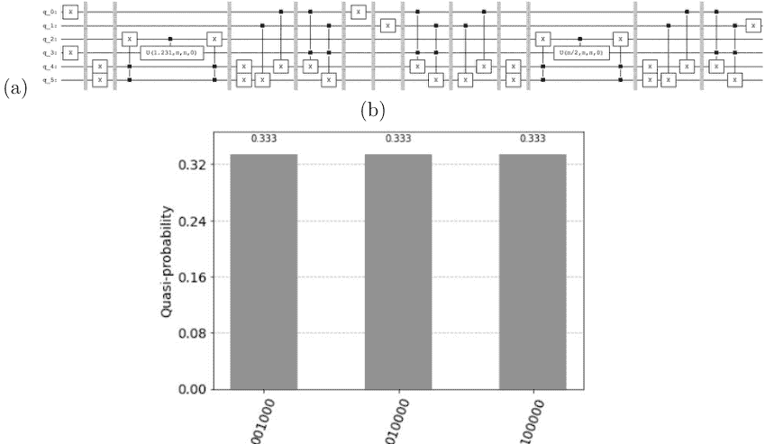

**图 13.8.** (a) 我们使用多控制 X 门（Toffoli Gate）消除控制量子比特 2 ($c_1=1$) 与内存寄存器 [11] 的纠缠。我们对三个分支的内存寄存器应用 NOT 门操作和受控 NOT 操作（CNOT 门）。结果我们将第一个分支的内存寄存器翻转（恢复）为 |10>，并将 |01> 复制到另外两个分支的内存寄存器中。我们消除处理分支的内存寄存器，将其设置为基态 |00>。我们使用由加载寄存器和控制量子比特 3 ($c_2=1$ 表示处理分支）控制的 ccX 门（CNOT 门）。我们将加载寄存器重置为基态 (00)。得到的状态为


# 178 ■ 使用 Qiskit 进行量子人工智能

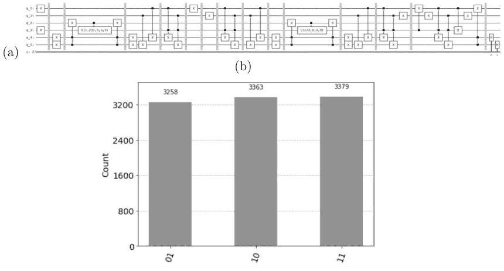

图 13.9 在加载寄存器中，生成了模式 [11]。模式 [11] 的第一个比特（比特 0）通过受控非门 cX 与控制寄存器 $c_2=1$ 中的比特 3 纠缠。我们通过受加载寄存器和控制比特 3（$c_2=1$ 表示处理分支）控制的 ccX 门（CCOT 门）将 [11] 转换为处理分支的内存寄存器。我们通过模式 [11] 的纠缠比特 0（使用受控非门 cX）将控制寄存器 $c_2$ 的比特 3 设置为零，从而将处理分支转换为内存分支。我们将加载寄存器重置为基态 [0]。通过由所存储模式 [11] 的内存寄存器表示的控制比特控制的 ccX 门（CCNOT 门），将加载寄存器中的纠缠比特设置为零。我们使用 *qasm simulator* 以 *shots=10000* 测量内存寄存器中的比特 4 和 5。（b） 测量结果代表了期望分布。

```
qc.x(4)
qc.x(5)
qc.barrier()
qc.ccx(4,5,2)
qc.cu(1,570793627948966,pi,1,0,2,3)
qc.ccx(4,5,2)
```

```
qc.barrier()
qc.x(4)
qc.x(5)
qc.cx(1,5)
qc.cx(0,4)
# Uncompute
qc.barrier()
qc.ccx(0,3,4)
```

# 二进制向量的基编码 179

qc.ccx(1,3,5)
qc.x(1)

```
qc.barrier()
qc.cx(3,0)
qc.x(1)
qc.ccx(0,3,4)
qc.ccx(1,3,5)
qc.cx(0,3)
qc.ccx(4,5,0)
qc.x(1)
qc.barrier()
```

```
qc.measure(4,0)
qc.measure(5,1)
simulator = Aer.get_backend('qasm_simulator')
result=execute(qc,simulator,shots=10000).result()
counts = result.get_counts()
print("Total count is:",counts)
plot_histogram(counts)
```

## 13.3 二进制模式的纠缠

该方法基于处于叠加态的模式与索引比特之间的纠缠。为了存储 m 个二进制模式：

> $|pattern_m>, |pattern_{m-1}>, \dots, |pattern_1|$

我们使用多受控非门（cCX 门或 MCX 门）对索引比特命名。首先，我们使用 Hadamard 门生成 $v = \log_2(m)$ 个索引比特

```
$H^{\otimes m}|0\rangle^{\otimes m} = \frac{1}{\sqrt{m}} \sum_{j=1}^{m} index_j$
```

并使用索引比特的叠加态为 m 个二进制模式命名

```
$|\psi\rangle = \frac{1}{\sqrt{m}} \sum_{j=1}^{m} |index_j\rangle|pattern_j\rangle$ (13.1)
```

### 13.3.1 Qiskit 示例

在本节中，我们存储四个二进制模式：

> $|101\rangle, |011\rangle, |111\rangle, |010\rangle$

通过与叠加态中的四个索引比特 $|index_j$ 纠缠：

```
$|index_4\rangle = |11\rangle$ $|index_3\rangle = |10\rangle$ $|index_2\rangle = |01\rangle$ $|index_1\rangle = |00\rangle$
```

使用电路中的受控非门（cCX 门）（见图 13.10）：

# 180 ■ 使用 Qiskit 进行量子人工智能

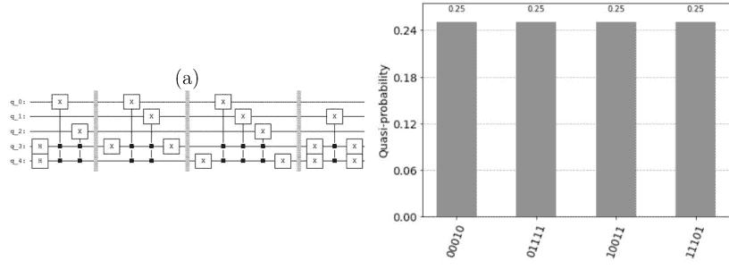

图 13.10 该方法基于索引比特的纠缠（b）代表叠加态的直方图，比特 0, 1 和 2 代表模式，比特 4 和 5 是索引比特。

```
from qiskit import QuantumCircuit, Aer, execute
from qiskit.visualization import plot_histogram
from qiskit.circuit.library import MCXGate

```
qc = QuantumCircuit(5)
# 0-2 data
# Index
# 3-4
qc.h(3)
qc.h(4)

# First pattern
qc.ccx(3,4,0)
qc.ccx(3,4,2)
qc.barrier()
# Second pattern
qc.x(3)
qc.ccx(3,4,0)
qc.ccx(3,4,1)
qc.x(3)

qc.barrier()
# Third pattern
qc.x(4)
qc.ccx(3,4,0)
qc.ccx(3,4,1)
qc.ccx(3,4,2)
qc.x(4)

qc.barrier()
# Fourth pattern
qc.x(3)
qc.x(4)
qc.ccx(3,4,1)
qc.x(4)
qc.barrier()
```

# 二进制向量的基编码 181

qc.x(3)
qc.x(4)
qc.ccx(3,4,1)
qc.x(4)
qc.x(3)

```
simulator = Aer.get_backend('statevector_simulator')
result=execute(qc).result()
counts = result.get_counts()
plot_histogram(counts)
```

带有索引的模式叠加态表示为：

> $$\Psi\rangle = \frac{1}{2} \cdot (|0010)_1 + |0111)_2 +1111)_3.$$

我们可以纠缠多个叠加二进制向量的副本，它们可以独立地处理和测量，见图 13.11。

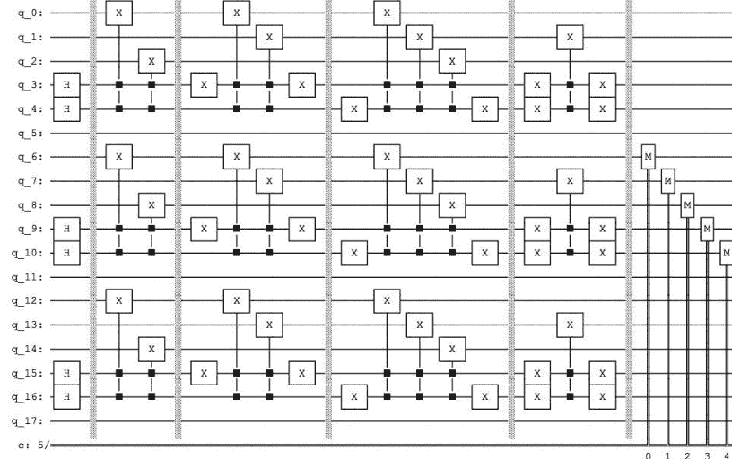

**图 13.11** 我们可以纠缠多个叠加二进制向量的副本，它们可以独立地处理和测量。

## 13.4 比较

Ventura 和 Martinez [114, 115] 开发的方法导致叠加态：

```
$|\psi\rangle = \left( \frac{1}{\sqrt{m}} \sum_{j=1}^{m} |pattern_j\rangle \otimes |0\cdots0; 0, 0\rangle \right)$
```

而二进制向量的纠缠导致叠加态：

```
$|\psi\rangle = \left( \frac{1}{\sqrt{m}} \sum_{j=1}^{m} |index_j\rangle|pattern_j\rangle \right)$
```

# 联想记忆

# 184 ■ 使用 Qiskit 进行量子人工智能

| q_0 | q_1 | q_2 | q_3 | q_4 |
|---|---|---|---|---|

图 13.10 该方法基于索引比特的纠缠（b）代表叠加态的直方图，比特 0, 1 和 2 代表模式，比特 4 和 5 是索引比特。

```python
from qiskit import QuantumCircuit, Aer, execute
from qiskit.visualization import plot_histogram
from qiskit.circuit.library import MCXGate

```
qc = QuantumCircuit(5)
# 0-2 data
# Index
# 3-4
qc.h(3)
qc.h(4)

# First pattern
qc.ccx(3,4,0)
qc.ccx(3,4,2)
qc.barrier()
# Second pattern
qc.x(3)
qc.ccx(3,4,0)
qc.ccx(3,4,1)
qc.x(3)

qc.barrier()
# Third pattern
qc.x(4)
qc.ccx(3,4,0)
qc.ccx(3,4,1)
qc.ccx(3,4,2)
qc.x(4)

qc.barrier()
# Fourth pattern
qc.x(3)
qc.x(4)
qc.ccx(3,4,1)
qc.x(4)
qc.x(3)

```
simulator = Aer.get_backend('statevector_simulator')
result=execute(qc,simulator).result()
counts = result.get_counts()
plot_histogram(counts)
```

带有索引的模式叠加态表示为：

> $$\Psi\rangle = \frac{1}{2} \cdot (|0010)_1 + |0111)_2 + |1011)_3 + |1101)_4.$$

我们可以纠缠多个叠加二进制向量的副本，它们可以独立地处理和测量，见图 13.11。


## 量子关联记忆 ■ 185

| | | | | | | | | | | | | | |
|---|---|---|---|---|---|---|---|---|---|---|---|---|---|
| q_0 | X | | | | | | | | | | | | |
| q_1 | | X | | | | | | | | | | | |
| q_2 | | | X | | | | | | | | | | |
| q_3 | | | | X | | | | | | | | | |
| q_4 | | | | | X | | | | | | | | |

(a)

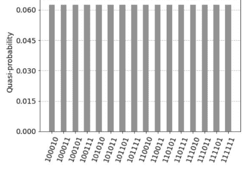

图14.2 (a) 对索引比特 3 和 4 的 Grover 放大。(b) 由于量子比特与模式纠缠，我们没有得到正确的的结果。

```python
def store():
    qc = QuantumCircuit(5)
    #First pattern
    qc.ccx(3,4,0)
    qc.ccx(3,4,2)
    qc.barrier()
    #Second pattern
    qc.x(3)
    qc.ccx(3,4,0)
    qc.ccx(3,4,1)
    qc.x(3)
    qc.barrier()
    #Third pattern
    qc.x(4)
    qc.ccx(3,4,0)
    qc.ccx(3,4,1)
    qc.ccx(3,4,2)
    qc.x(4)
    qc.barrier()
    #Fourth pattern
    qc.x(3)
    qc.x(4)
    qc.ccx(3,4,1)
    qc.x(4)
```

# 186 ■ 使用 Qiskit 的量子人工智能

| | 0 | 0 |
|---|---|---|
| q_0: | | |
| q_1: | 1 | |
| q_2: | 2 Store | 2 Store! |
| q_3: | H | 3 | H |
| q_4: | 4 | 4 | H |
| q_5: | X H | X | |

)

14.3 (a) 对索引比特进行 Grover 放大，我们需要取消索引比特与模式的纠缠。对于四个状态，我们只需要一次旋转。(b) 我们通过一个状态测量正确的结果 $index_2 = |01|$。

```python
qc.x(3)
qc.name="Store"
return qc
```

```python
def store_inv():
    qc=store()
    qc_inv=qc.inverse()
    qc_inv.name="StoreInv"
    return qc_inv
```

```python
qc = QuantumCircuit(6)
#0-2 data
#Index
#3-4
qc.h(3)
qc.h(4)
```

```python
#Aux Bit
qc.x(5)
qc.h(5)
```

## 量子关联记忆 ■ 187

```python
qc.barrier()
qc.append(store(),range(5))
qc.barrier()
#Dracle
gate = MCX(3)
qc.append(gate,[0, 1, 2, 5])
qc.barrier()
qc.append(store_inv(),range(5))
qc.barrier()
#Redo Aux Bit
qc.h(5)
qc.barrier()
#Diffuser
qc.h(3,4)
qc.z(3,4)
qc.cz(3,4)
qc.h(3,4)
```

对于四个状态，我们只需要一次旋转。我们通过一个状态测量正确的结果 $index_2 = |10|$（见图14.3 (b)）。与其取消，我们希望对代表模式和索引的五个量子比特应用 Grover 算法。Grover 放大一次旋转后的状态表明某些奇怪的事情正在发生。

## 14.2 量子关联记忆 (QuAM)

在 Ventura 和 Martinez 提出的 QuAM 中，变体 Grover 搜索算法用于确定查询向量 [114, 115, 110] 的答案。为了准备维度为 $n > m$ 的 $m$ 个线性无关向量，Ventura 和 Martinez [114, 115] 提出了一种方法，后由 [111] 简化，准备成本为 $O(n-m)$，需要 $\log_2(m)$ 个单位。查询成本相对于传统计算机的 $O(\sqrt{m})$。为了理解变体 Grover 搜索算法及其结果，我们生成简单的叠加态

$|\psi\rangle = \frac{1}{2}(|1100\rangle + |1001\rangle + |1111\rangle + |0110\rangle)$

以便我们可以跟踪幅度分布
$$\frac{1}{2}(0,0,0,0,1,0,1,0,1,0,1,0,0,1)^T.$$

我们注意到幅度分布不是均匀的，四个量子比特的均匀分布对应于

$$\frac{1}{4}(1,1,1,1,1,1,1,1,1,1,1,1,1,1,1,1)^T.$$

这可能是问题的原因吗？

# 188 使用 Qiskit 的量子人工智能

| | | | | | | |
|---|---|---|---|---|---|---|
| q_0: | 0 | | | | | | |
| q_1: | | 1 | | | | | |
| q_2: | | | 2 Store | | | |
| q_3: | | | | 3 | | | |
| q_4: | | | | | 4 | | |
| q_5: | X | | | | | H | |

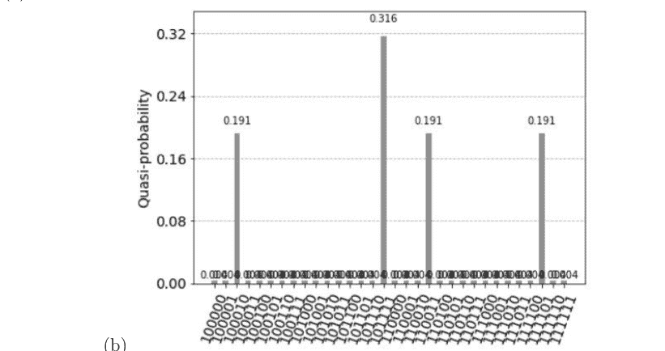

**图 14.4** (a) 与其取消计算，我们希望对代表模式和索引的五个量子比特应用 Grover 算法。(b) Grover 放大一次旋转后的状态表明某些事情正在发生。

### 14.2.1 非均匀分布

从初始分布开始，我们用负相位标记目标态 $|0110>$：

$$(0,0,0,1,0,0,-1,0,0,0,0)^T$$
并执行 Grover 旋转，结果为：
$$\frac{1}{8}(-1,-1,-1,-3,-1,-1,-1,-3)^T$$
我们再次用负相位标记目标态 $|0110>$ 并执行 Grover 旋转，结果为：
$$(-0.2,-0.2,-0.2,0.3,-0.2,0,2,3)^T$$
代表我们分布的四个状态具有高幅度（为了清晰起见）。用负相位标记目标态 $|0110>$ 并进行 Grover 旋转

$(0.02,0.02,0.02,0.5,0.02,0.02,-0.4,0.02,0.5)^T$
所有基态具有几乎相同的分布。

Ventura 和 Martinez 提出了一种变体 Grover 搜索算法 [114,115]。在此之前，从初始分布，我们用负相位标记目标态 $|0110>$：

$$\frac{1}{2}(0,0,0,1,0,0,-1,0,0,0)^T$$
并执行 Grover 旋转，结果为：
$$\frac{1}{8}(-1,-1,-1,-3,-1,-1,-1,-3)^T$$
然而，现在我们用负相位标记代表我们分布的四个状态并执行 Grover 旋转，结果为：
$$\frac{1}{8}(1,1,-1,-1,1,-1,-1)^T$$
我们再次用负相位标记代表我们分布的四个状态并执行 Grover 旋转，结果为：

$$(0,0,0,0,0)^T$$
指示目标态。qiskit 电路（见图14.5）表示为：

```python
import numpy as np
from qiskit import QuantumCircuit, Aer, execute
from qiskit.quantum_info import Statevector
from qiskit.visualization import plot_histogram
from qiskit.circuit.library import MCGate

qc = QuantumCircuit(5)
#0-1 data
#Index
#2-3
qc.h(2)
qc.h(3)

#Aux Bit
qc.x(4)
qc.h(4)
```

```python
qc.barrier()
#First pattern
qc.ccx(2,3,0)
qc.ccx(2,3,1)
```

```python
qc.barrier()
#Second pattern
qc.x(2)
qc.ccx(2,3,0)
qc.x(2)
```

```python
qc.barrier()
#Third pattern
qc.x(3)
qc.ccx(2,3,1)
qc.x(3)
```

```python
qc.barrier()
#Fourth pattern
qc.x(2)
qc.x(3)
qc.ccx(2,3,1)
```

```python
qc.barrier()
#Oracle
qc.x(0)
qc.x(3)
gate = MCGate(4)
qc.append(gate,[0,1,2,3,4])
qc.x(3)
qc.x(0)
qc.barrier()
qc.h(4)
```

```python
# Diffuser 0, 1, 2, 3
qc.barrier()
qc.h([0,1,2,3])
qc.x([0,1,2,3])
qc.h(0)
gate = MCGate(3)
qc.append(gate,[1,2,3,0])
qc.h(0)
qc.x([0,1,2,3])
qc.h([0,1,2,3])
```

```python
#Second rotation
qc.barrier()
```

## 量子关联记忆 ■ 191

```python
qc.h(4)
qc.barrier()

#Oracle Trick
qc.x(0)
qc.x(3)
gate = MCGate(4)
qc.append(gate,[0,1,2,3,4])
qc.x(3)
qc.x(0)

qc.x(2)
qc.x(3)
gate = MCGate(4)
qc.append(gate,[0,1,2,3,4])
qc.x(3)
qc.x(2)

qc.x(1)
qc.x(2)
gate = MCGate(4)
qc.append(gate,[0,1,2,3,4])
qc.x(1)

gate = MCGate(4)
qc.append(gate,[0,1,2,3,4])
qc.barrier()
qc.h(4)
#

# Diffuser 0, 1, 2, 3
qc.barrier()
qc.h([0,1,2,3])
qc.x([0,1,2,3])
qc.h(0)
gate = MCGate(3)
qc.append(gate,[1,2,3,0])
qc.h(0)
qc.x([0,1,2,3])
qc.x([0,1,2,3])

#Third rotation
qc.barrier()
qc.h(4)
qc.barrier()

#Oracle Trick
qc.x(0)
qc.x(3)
gate = MCGate(4)
```

## 192 使用 Qiskit 的量子人工智能

```python
qc.append(gate,[0,1,2,3,4])
qc.x(3)
qc.x(0)

qc.x(2)
qc.x(3)
gate = MCGate(4)
qc.append(gate,[0,1,2,3,4])
qc.x(3)
qc.x(2)

qc.x(1)
qc.x(2)
gate = MCGate(4)
qc.append(gate,[0,1,2,3,4])
qc.x(1)

gate = MCGate(4)
qc.append(gate,[0,1,2,3,4])
```


# 量子关联记忆 ■ 193

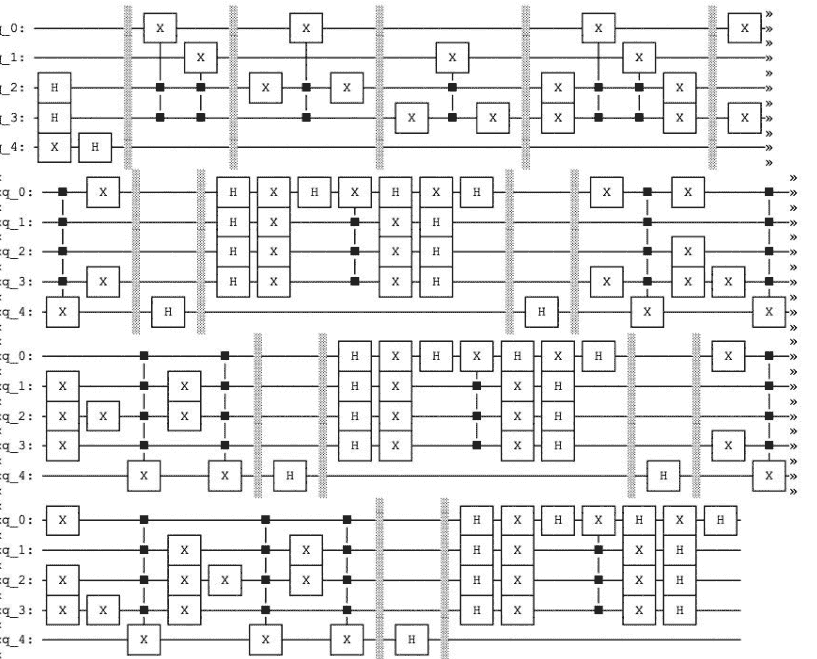

图 14.5。代表三次 Grover 旋转的电路，其成本是标记所有存在状态成本的两倍。

Grover 放大算法对成本的影响。在我们的案例中，我们需要三次 Grover 旋转，成本是标记所有存在状态成本的两倍（见图 14.5）。对于四个叠加态的状态和一个目标值，我们只需要一次旋转。

## 14.3 输入破坏问题

大多数量子机器学习算法（包括量子关联记忆）都受到输入破坏问题（ID 问题）的影响 [3, 126, 1]：

- 输入（读取）问题：量子态的幅度分布是通过读取数据点初始化的。现有的量子算法只需要 $O(\sqrt{n})$ 步或更少，这比必须读取 $n$ 个数据点的经典算法更快。因此，算法的复杂度并没有提高，而是 $O(n) + O(\sqrt{n})$。

- 破坏问题：对于维度 $m$ 的 $n$ 个数据点的量子关联记忆 [114, 115, 110], [111, 112] 只需要 $m \cdot \log(n)$ 或更少的单元（量子比特）。作为 oracle [110] 的运算符指示解决方案。然而，由于测量过程中的坍缩（破坏），该内存只能查询一次；因此，量子关联记忆相对于经典内存并没有优势。

高效的数据准备部分对于稀疏数据是可能的 [39]。然而，输入破坏问题直到今天还没有解决，而且通常通过忽略输入问题来分析理论上的加速 [94]，而输入问题正是数据编码的主要瓶颈。我们将输入数据的准备过程命名为*睡眠阶段*。查询操作速度极快，被称为*活跃阶段*。这两个阶段的命名类比于生物体，它们在睡眠期间为为活跃的一天做准备。量子方法的优势体现在*活跃阶段*中。

## 量子 Lernmatrix（学习矩阵）

我们引入了基于 Lernmatrix 的量子 Lernmatrix，其中 $n$ 个单元存储在量子叠加态中。Lernmatrix 是一种类似于关联记忆的架构。在检索阶段，根据 Trugenberger 的提议，基于欧拉公式的量子 ones 计数被用于模式恢复。我们演示了如何用量子电路表示量子 Lernmatrix，并使用 gostkit 进行实验。我们引入了一种增加正确答案测量值的树状结构。在活跃阶段，对量子 Lernmatrix 进行查询并高效估计结果。与传统方法或 Grover 算法相比，所需时间要得多。

## 15.1 LEARNMATRIX

多年来人们提出了不同的关联记忆模型 [5], [42, 49], [6, 10]。Hopfield 模型代表了关联记忆的递归模型 [5], [46], [44]，它是一个演化到稳定状态的动力系统。Lernmatrix，或者说 Wilhelm 关联记忆，也简单称为“关联记忆”（如果可能与其他模型产生混淆 [6, 10]），它是由 Steinbuch 在 1958 年开发的，作为一种生物学启发的模型，用于解释条件反射心理现象 [103, 104]。其目标是产生一个可以使用向量向量的二进制向量的网络。后来，Wilhelm [124] 和 Palm [75, 76] 从生物和数学角度对该模型进行了研究，并证明了这个简单模型具有巨大的存储容量。

Lernmatrix 由一组单元组成。每个单元代表一个生物神经元的简单模型。每个单元由二进制向量组成，这些向量对应于真实神经元中的突触和树突（见图 15.1）。它们在图 15.2 中由 $w_{ij} \in \{0,1\}$ 描述，$T$ 是单元的阈值。向量中的“1”成分表示特征的存在，通过“0”成分表示其缺失。这对向量被关联在一起，这个过程被称为学习。两个向量中的第一个被称为*查询向量*，第二个被称为*答案向量*。学习后，将查询向量呈现关联记忆，并通过检索规则确定答案向量。

# 196 使用 Qiskit 的人工智能

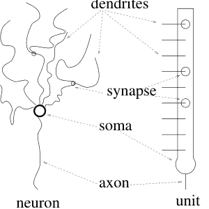

图 15.1 一个单元是生物神经元的抽象模型 [63, 76, 44, 97]。

### 15.1.1 学习与检索

最初，关联记忆中没有存储信息。由于信息由权重表示，所有单元权重初始化为零。设 $x$ 为查询向量，$y$ 为答案向量，学习规则为：

```
$w_{ij}^{new} = \begin{cases} 1 & \text{if } y_i \cdot x_j = 1 \\ 0 & \text{otherwise.}\end{cases} \quad (15.1)$
```

| | $w_{11}$ | $w_{21}$ | $w_{31}$ | $w_{n1}$ |
|---|---|---|---|---|
| $x_2$ | $w_{12}$ | $w_{22}$ | $w_{23}$ | $w_{m2}$ |
| $x_n$ | $w_{1n}$ | $w_{2n}$ | $w_{3n}$ | $w_{mn}$ |
| | $y_1$ | $y_2$ | $y_3$ | $y_m$ |

图 15.2 Lernmatrix 由一组单元组成，代表生物神经元的模型。单元由权重组成，对应真实神经元中的突触和树突。在图中，它们由 $w_{ij} \in \{0, 1\}$ 描述，其中 $1 \le i \le m$ 且 $1 \le j \le n$。T$ 是单元的阈值。

# Quantum Lernmatrix 197

这种规则被称为二进制 Hebb 规则 [75]。每当存储一对向量时，都会使用该规则。在关联记忆的*单步*检索阶段，容错答案机制为查询向量 $x$ 回忆相应的答案向量。向量 $y$ 的检索为：

```
$net_i = \sum_{j=1}^{n} w_{ij}x_j,$
```

```
$y_i = \begin{cases} 1 & \text{if } net \geq T \\ 0 & \text{otherwise.}\end{cases}$
```

其中 $T$ 是输出的阈值。阈值 $T$ 设置为查询向量 $x$ 中“1”成分的数量，$T := |x|$。如果单元输出为 1，我们说单元点火；否则单元不点火。*单步*检索的成本为 $O(n \cdot m)$。检索被称为：

- 如果两个向量不同 $x \neq \mathbf{y}$，为关联；
- 如果 $x = \mathbf{y}$，答案向量表示受扰查询向量的重建。

为了简单起见，我们假设查询向量和答案的维度相同，$n = m$。

示例在图 15.3 中，学习了向量对 $\mathbf{x}_1 = (1, 0, 0, 0, 1)$ 和 $\mathbf{y}_1 = (0, 1, 1, 1, 0)$。关联对应的二进制权重用黑色正方形表示。在下一步，学习了向量对 $\mathbf{x}_0 = (0, 1, 1, 0, 1)$ 和 $\mathbf{y}_2 = (1, 1, 0, 0, 1)$。关联对应的二进制权重用黑色圆圈表示。在第三步执行检索阶段（见图 15.4）。查询向量 $\mathbf{x}_q = (0, 1, 0, 0, 1)$ 与学习过的向量 $\mathbf{x}_2 = (0, 1, 1, 0, 1)$ 有一个比特的差异。阈值 $T$ 设置为查询向量中“1”成分的数量，检索到的存储向量 $\mathbf{y}_2 = (1, 1, 0, 0, 1)$。

## 15.2 存储容量

我们分析 Lernmatrix 的最优成本。为了估计关联记忆在检索阶段开始出现错误之前可以存储的向量对 $(x,y)$ 的渐近数量 $L$，假设两个向量具有相同的维度 $n$，每个向量由 $k$ 个“1”组成，这些“1”出现在向量任意坐标上的概率相等。在这种情况下，已经证明 [75, 42, 102] $k$ 的最优值约为：

```
$k \leq \log_2(n/4).$
```

例如，对于维度为 $n=1000000$ 的向量，根据方程 15.3，应使用 $k=18$ 个“1”来编码模式。对于 $k$ 的最优值根据


图 15.3 学习了向量对 $x_1 = (1,0,0,0,1)$ 和 $y_1 = (0,1,1,1,0)$。关联对的相应二进制权重用黑色方块表示。在下一步中学习了向量对 $x_2 = (0,1,1,0,1)$ 和 $y_2 = (1,1,0,0,1)$。关联对的相应二进制权重用黑色圆圈表示。

对于方程 15.3，当 5 个“1”均匀分布在向量坐标上时，关联存储器可以存储大约 $L$ 个向量对 [75, 42]。$L$ 约为：

$L \simeq (ln 2)(n^2/k^2).$

该值远**大于** $n$。对 $L$ 的估计非常粗略，因为方程 15.3 仅对于非常大的网络有效，但容量的增加仍然是显著的。


图 15.4 查询向量 $\mathbf{x}_q = (0,1,0,0,1)$ 与已学习的查询向量 $\mathbf{x}_2 = (0,1,1,0,1)$ 差一个比特。阈值 $T$ 设置为查询向量 $\mathbf{x}_q$ 中“1”组件的数量，$T=2$。检索到的向量是存储的向量 $\mathbf{y}_2 = (1,1,0,0,1)$。

对于大 $n$ 的上界为：

$I = n^2 \log 2 = n^2 \cdot 0.693$，渐近容量为每比特 69.311%，远高于大多数关联存储器。这种容量仅适用于稀疏均匀分布的“1” [75]。Willshaw 关联存储器的承诺是它可以存储比单元数量多得多的模式。在 $n$ 个单元中加载 $L = (ln 2)(n^2/k^2)$ 个模式的代价（$k = \log_2(n/4)$）为 $O(n^2)$。这远低于在 $L$ 个单元的列表中存储 $L$ 个模式的代价 $O(n \cdot L)$。这是因为 $L > n$，或者

$O\left(\frac{n^2}{\log(n^2)}\right) > O(n)$

因为 $\sqrt{n} > \log(n)$。

Lernmatrix 巨大的存储容量 [75, 42]，它可以存储比单元数量多得多的模式。

如何高效生成视觉模式或其他数据结构的二进制代码的描述见 [122, 89, 90]。例如，真实的向量模式已经过二值化。

## 15.2 蒙特卡洛学习矩阵 (MONTE CARLO LEARNMATRIX)

确定查询向量 $\mathbf{x}$ 的答案向量 $\mathbf{y}$ 的建议概率检索规则为：

$p(y_i=1|\mathbf{x}) = \frac{1}{n}\left(\frac{net_i}{\sum_{v=1}^n net_v}\right)$

和

$p(y_i=0|\mathbf{x}) = \frac{1}{n}\left(1 - \frac{net_i}{\sum_{v=1}^n net_v}\right)$

描述了一个单元发射或不发射的概率，带有：

$\sum_{i=1}^n p(y_i=1|\mathbf{x}) + p(y_i=0|\mathbf{x})$

在查询操作期间，随机采样单元并根据概率分布使其发射或不发射。为了确定答案向量，我们必须多次采样蒙特卡洛学习矩阵。对于重建的向量，将存在三种状态：1 表示发射单元，0 表示未发射单元，*未知*（unknown）表示沉默单元。蒙特卡洛学习矩阵是量子学习矩阵的密切描述。在量子矩阵中，单元由量子态表示，采样对应于测量。

## 15.3 量子计数一 (QUANTUM COUNTING ONES)

在长度为 $N$ 的二进制字符串中，我们可以用简单公式 $k/N$ 表示 $k$ 个“1”的比例，用 $(N - k)/N$ 表示“0”，产生线性关系。我们可以将这些解释为概率值。我们可以利用与三角相关的欧拉公式 [111]，将这些线性关系映射到“1”存在的类 sigmoid 概率函数：

$$\left(\sin\frac{\pi \cdot k}{2 \cdot N}\right)^2 = \frac{e^{\frac{\pi \cdot k}{N}} - e^{-\frac{\pi \cdot k}{N}}}{2} \in [0, 1] \quad (15.9)$$

“0”的对应：

$$\left(\cos\frac{\pi \cdot k}{2 \cdot N}\right)^2 = \frac{e^{\frac{\pi \cdot k}{N}} + e^{-\frac{\pi \cdot k}{N}}}{2} \in [0, 1] \quad (15.10)$$

结合：

$$\left(\sin\frac{\pi \cdot k}{2 \cdot N}\right)^2 + \left(\cos\frac{\pi \cdot k}{2 \cdot N}\right)^2 = 1$$

在图 15.5 中，标出了 $N=8$ 的类 sigmoid 概率函数。为了计算“1”的数量，引入了控制比特 $1/\sqrt{2}(|0\rangle+|1\rangle)$。对于控制比特 $|0\rangle$ 表示的叠加态，对每个“1”应用相位 $e^{i\pi/3}$。对于控制比特 $|1\rangle$ 表示的叠加态，对每个“1”应用相位 $e^{-i\pi/3}$。

$$\frac{1}{\sqrt{2}}(e^{i\pi/3} \cdot |0\rangle \otimes e^{-i\pi/3} \cdot |1\rangle)$$


图 15.5，$N=8$ 的类 sigmoid 概率函数由实线表示，线性关系由虚线表示。x 轴表示 $k$ 值，y 轴表示概率。

$\frac{1}{\sqrt{2}}(e^{i\pi/3} \cdot |0\rangle \otimes e^{-i\pi/3} \cdot |1\rangle) = (15.11)$

如果我们对控制比特应用 Hadamard 门，得到：

$(H \otimes I \otimes I) \cdot \frac{1}{\sqrt{2}}(e^{i\pi/3} \cdot |0\rangle + e^{-i\pi/3} \cdot |1\rangle) = \frac{e^{i\pi/3} + e^{-i\pi/3}}{2}|001\rangle + i \frac{e^{i\pi/3} - e^{-i\pi/3}}{2}|101\rangle = \cos\left(\frac{\pi \cdot 2}{2 \cdot 3}\right)|001\rangle + i \sin\left(\frac{\pi \cdot 2}{2 \cdot 3}\right)|101\rangle (15.12)$

测量控制比特 $|0\rangle$ 的概率为：

$p(|0\rangle) = p(|001\rangle) = \left(\cos\left(\frac{\pi \cdot 2}{2 \cdot 3}\right)\right)^2 = 0.25$

以及测量控制比特 $|1\rangle$ 的概率为：

$p(|1\rangle) = p(|101\rangle) = \left(\sin\left(\frac{\pi \cdot 2}{2 \cdot 3}\right)\right)^2 = 0.75$

这表示两个“1”的存在。qiskit 中的电路表示如下：

```python
from qiskit import QuantumCircuit, Aer, execute
from qiskit.visualization import plot_histogram
from math import pi

qc = QuantumCircuit(4)
#Input is |101>
qc.x(0)
qc.x(2)
qc.barrier()
qc.h(3)
qc.cp(-pi/6,0,3)
qc.cp(-pi/6,1,3)
qc.cp(-pi/6,2,3)
qc.x(3)
qc.cp(pi/6,0,3)
qc.cp(pi/6,1,3)
qc.cp(pi/6,2,3)
qc.x(3)
qc.h(3)
```


图 15.6 (a) $N=3$  $k=2$ 的量子计数电路。(b) $p(|001\rangle) = 0.25$ 和 $p(|101\rangle) = 0.75$。

```python
simulator = Aer.get_backend('statevector_simulator')
# Run and get counts
result=execute(qc,simulator).result()
counts = result.get_counts()
plot_histogram(counts)
```

生成的量子电路见图 15.6 (a)，测得比特的生成直方图见图 15.6 (b)。

## 15.4 量子矩阵 (QUANTUMLRIX)

欧拉公式有用的关联属性源于权重矩阵上均匀分布的权重，并且仅存在于示例的大矩阵中。我们将这些模型作为未来量子关联存储器的概念证明。

单元权重向量的叠加态基于与权重向量处于叠加态的索引比特的纠缠。计数由控制相位操作的单比特字符串表示。它代表了 Lernmatrix 的 $net$ 值。相位信息是量子计数的依据，它增加了测量答案向量中代表“1”的正确单元的概率。我们将通过与索引比特纠缠来表示叠加的 $n$ 个单元。为了表示四个单元，我们索引两个叠加比特。比特的每个索引状态通过 Toffoli 门（也称为 ccX 门、CNOT 门、受控受控非门）与模式纠缠，通过将相应的比特设置为 1。在我们的示例中，我们存储了三个模式 $\mathbf{x}_1 = (1,0,0,1)$；$\mathbf{y}_1 = (1,0,0,1)$；$\mathbf{x}_2 = (1,0,0,0)$；$\mathbf{y}_2 = (0,1,0,0)$以及 $\mathbf{x}_3 = (0,0,1,0)$；$\mathbf{y}_3 = (0,0,1,0)$，导致了


# Quantummatrix ■ 203

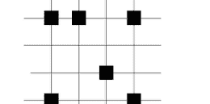

图 15.7. 三个模式 $\mathbf{x}_1 = (1, 0, 0, 1)$；$\mathbf{y}_1 = (1, 0, 0, 1)$；$\mathbf{x}_2 = (1, 0, 0, 0)$；$\mathbf{y}_2 = (0, 1, 0, 0)$ 以及 $\mathbf{x}_3 = (0, 0, 0, 1)$；$\mathbf{y}_3 = (0, 0, 1, 0)$ 相关后四个单元表示的权重矩阵。学习过程与由四个单元表示的学习阶段权重矩阵相同（见图 15.7）。在索引量子比特 $|index_{xj}\rangle$ 与权重向量纠缠后，得到的状态如下，状态 $count_j$ 和 $unit_j$ 由四个量子比特表示，对应四个二进制权重，

```
$|unit_j\rangle = |(w_4w_3w_2w_1)\rangle$
```

（见图 15.8）

```
$\frac{1}{2} \cdot \left( \sum_{j=1}^{4} |index_{xj}\rangle|unit_{j}\rangle \right)$ (15.13)
```

值 $|count_j\rangle$ 是学习矩阵值 $net_j$ 的一元表示。我们引入查询向量 $\mathbf{x}_q = (1, 0, 0, 1)$，

```
$\frac{1}{2} \cdot \left( \sum_{j=1}^{4} |index_{xj}\rangle|unit_{j}\rangle \right) \otimes |query\rangle =$
```

```
$\frac{1}{2} \cdot \left( \sum_{j=1}^{4} |(iz_j)\rangle((c_4c_3c_2c_1))((w_4w_3w_2w_1)) \right) \otimes |1001\rangle$ (15.14)
```

测量量子比特得到的直直方图如图 15.9 所示。在接下来的步骤中，我们描述**激活阶段**（见图 15.10）。为了简单起见，我们将忽略索引量子比特，因为它们在激活阶段并不重要。我们使用处于叠加态的控制位进行量子计数，结果为：

```
$\frac{1}{\sqrt{2}} \cdot (|0\rangle + |1\rangle) \otimes \frac{1}{2} \cdot \left( \sum_{j=1}^{4} |(c_4c_3c_2c_1)_j\rangle[(w_4w_3w_2w_1)_j] \right) \otimes |1001\rangle =
```

# 204 使用 Qiskit 的量子人工智能

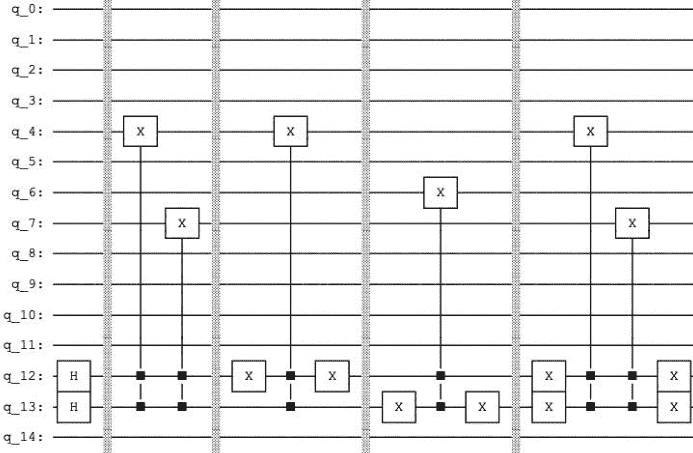

图 15.8. 产生睡眠阶段的量子电路。0 到 3 表示向量，量子比特 4 到 7 是关联存储，量子比特 8 到 11 表示计数，量子比特 12 和 13 是索引量子比特，而量子比特 14 是控制量子比特。

```
$$\frac{1}{2\cdot\sqrt{2}} \cdot |0\rangle \left(\sum_{j=1}^{4} (c_{4c_3c_2c_j}) \cdot (w_4w_3w_2w_j)\right) \otimes |1001\rangle +$$
```

```
$$\frac{1}{2\cdot\sqrt{2}} \cdot |1\rangle \left(\sum_{j=1}^{4} (c_{4c_3c_2c_j}) \cdot (w_4w_3w_2w_j)\right) \otimes |1001\rangle \quad (15.15)$$
```

由于向量计数中存在两个 1 且 $count_j \le 2$，应用 $N=2$ 的受控相位操作：

```
$$\frac{1}{2\cdot\sqrt{2}} \cdot |0\rangle \left(\sum_{j=1}^{4} e^{-i\frac{\pi\cdot count_j}{2}} \cdot (c_{4c_3c_2c_j}) \cdot (w_4w_3w_2w_j)\right) \otimes |1001\rangle +$$
```

```
$$\frac{1}{2\cdot\sqrt{2}} \cdot |1\rangle \left(\sum_{j=1}^{4} e^{-i\frac{\pi\cdot count_j}{2}} \cdot (c_{4c_3c_2c_j}) \cdot (w_4w_3w_2w_j)\right) \otimes |1001\rangle \quad (15.16)$$
```

对控制量子比特使用哈达玛门，得到：

```
$$\left(\sum_{j=1}^{4} \frac{1}{2} \cos\left(\frac{\pi\cdot count_j}{2}\right)\right) \cdot |0\rangle \cdot (c_{4c_3c_2c_j}) \cdot (w_4w_3w_2w_j) \otimes |1001\rangle$$
```

```
$$\left(\sum_{j=1}^{4} \frac{1}{2} \sin\left(\frac{\pi\cdot count_j}{2}\right)\right) \cdot |1\rangle \cdot (c_{4c_3c_2c_j}) \cdot (w_4w_3w_2w_j) \otimes |1001\rangle \quad (15.17)$$
```

# 量子矩阵 ■ 205

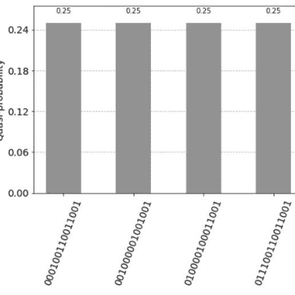

图 15.9 关联关联存储四个单元的叠加态。量子比特 0 到 3 表示查询向量 $\chi_q = (1, 0, 0, 1)$，量子比特 4 到 7 是关联存储，量子比特 8 到 11 表示计数，量子比特 12 和 13 是索引量子比特，而控制量子比特 14 为零。注意索引量子比特按反序计数的：第一个是 11，第二个是 10，第三个是 01，第四个是 00。

架构由 15 个量子比特描述。量子比特 0 到 3 表示查询向量，4 到 7 是关联存储，8 到 11 表示计数，量子比特 14 是控制量子比特。计数操作通过 cex 门完成（见图 15.8 和 15.10）。

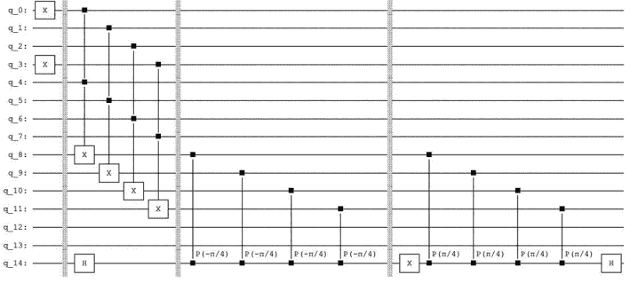

图 15.10 产生激活阶段的量子电路。对量子比特 8 到 11 进行放大。控制量子比特 14。

# 206 使用 Qiskit 的量子人工智能

```python
from qiskit import QuantumCircuit, Aer, execute
from qiskit.quantum_info import Statevector
from qiskit.visualization import plot_histogram
from qiskit.circuit.library import MCXGate
from math import pi
```

```python
qc = QuantumCircuit(15)
#0-3 查询
#4-7 数据
#8-11 计数
#索引指针
#12-13 辅助
#14
```

```python
# 睡眠阶段
#索引指针
qc.h(12)
qc.h(13)
qc.barrier()
# 第一个权重
qc.ccx(12,13,4)
qc.ccx(12,13,7)
qc.barrier()
# 第二个权重
qc.x(12)
qc.ccx(12,13,4)
qc.ccx(12,13,7)
qc.barrier()
# 第三个权重
qc.x(13)
qc.ccx(12,13,6)
qc.barrier()
# 第四个权重
qc.x(12)
qc.x(13)
qc.ccx(12,13,4)
qc.barrier()
```

```python
# 激活阶段
# 查询
qc.x(0)
qc.x(3)
qc.barrier()
qc.ccx(0,4,8)
qc.ccx(1,5,9)
qc.ccx(2,6,10)
```

```python
qc.ccx(3,7)
# 分割
qc.h(14)
qc.barrier()
# 标记
qc.cp(-pi/4,8,14)
qc.cp(-pi/4,9,14)
qc.cp(-pi/4,10,14)
qc.cp(-pi/4,11,14)
qc.barrier()
qc.x(14)
qc.cp(-pi/4,8,14)
qc.cp(-pi/4,9,14)
qc.cp(-pi/4,10,14)
qc.cp(-pi/4,11,14)
qc.barrier()
qc.h(14)
```

```python
simulator = Aer.backend('statevector_simulator')
# 并获取计数
result=execute(qc,simulator).result()
counts = result.get_counts()
plot_histogram(counts)
```

带有查询向量 $x_q = (1, 0, 0, 1)$，由第一个单元后的状态表示的单元 $count=2$，以及两个对应的状态：对于控制 $qubit=1$，值为 $1=\sin(\pi/2)$，测量概率为 $\sin(\pi/2)^2 =0.5$；对于控制 $qubit=0$，值为 $0=\cos(\pi/2)$。第二个单元 $count=1$，两个对应状态：对于控制 $qubit=1$，值为 $1/\sqrt{2}=\sin(\pi/4)$，测量概率为 $\sin(\pi/4)^2=0.5$；对于控制 $qubit=0$，值为 $1/\sqrt{2}=\cos(\pi/4)$。第三个单元 $count=1$，两个对应状态：对于控制 $qubit=1$，值为 $1/\sqrt{2}=\sin(\pi/4)$，测量概率为 $\sin(\pi/4)^2=0.5$；对于控制 $qubit=0$，值为 $1/\sqrt{2}=\cos(\pi/4)$。第四个单元 $count=2$，两个对应状态：对于控制 $qubit=1$，值为 $1=\sin(\pi/2)$，测量概率为 $\sin(\pi/2)^2 =0.5$；对于控制 $qubit=0$，值为 $0=\cos(\pi/2)$。

### 15.4.1 推广

我们推广 $n$ 个单元的描述。在索引量子比特与叠加态纠缠后，得到的状态如下，状态 $count_j$ 和 $unit_j$ 由 $[111]$, $[112]$ 表示，

```
$$\frac{1}{\sqrt{n}} \left( \sum_{j=1}^{n} |index_j\rangle |unit_j\rangle \right) \otimes |query\rangle. \quad (15.18)$$
```

复杂度为 $O(n^2)$。我们应用于控制量子比特（忽略索引量子比特）：

```
$$\frac{1}{\sqrt{2}} (|0\rangle + |1\rangle) \otimes \left( \sum_{j=1}^{n} |count_j\rangle |unit_j\rangle \right) \otimes |query\rangle = $$
$$\frac{1}{\sqrt{2} \cdot n} \cdot |0\rangle \left( \sum_{j=1}^{n} |count_j\rangle |unit_j\rangle \right) \otimes |query\rangle + $$
$$\frac{1}{\sqrt{2} \cdot n} \cdot |1\rangle \left( \sum_{j=1}^{n} |count_j\rangle |unit_j\rangle \right) \otimes |query\rangle \quad (15.19)$$
```


# 量子学习矩阵 ■ 209

对于查询向量中的当前 1，应用 $N$ 且 $count_j \le N$ 的受控操作相位

```
$\frac{1}{\sqrt{2}} \cdot |0\rangle \left(\sum_{j=1}^{n} e^{i \frac{\pi \cdot count_j}{2}}} |count_j\rangle|unit_j\rangle\right) \otimes |query\rangle$
```

```
$\frac{1}{\sqrt{2}} \cdot |1\rangle \left(\sum_{j=1}^{n} e^{-i \frac{\pi \cdot count_j}{2}}} |count_j\rangle|unit_j\rangle\right) \otimes |query\rangle \quad (15.20)$
```

并且对控制量子比特应用 Hadamard 门，我们得到最终结果

```
$\left(\frac{1}{\sqrt{n}} \sum_{j=1}^{n} \cos(\frac{\pi \cdot count_j}{2 \cdot N}) |0,count_j\rangle|unit_j\rangle\right) \otimes |query\rangle$
```

```
$\left(\frac{1}{\sqrt{n}} \sum_{j=1}^{n} \sin(\frac{\pi \cdot count_j}{2 \cdot N}) |1,count_j\rangle|unit_j\rangle\right) \otimes |query\rangle \quad (15.21)$
```

单次查询的代价为 $O(n)$，对于 $k=\log_2(n/4)$ 次查询，代价为 $O(\log(n) \cdot n)$。

## 15.42 示例

在这个示例中，我们给出了三个表示关联的模式：$\mathbf{x_1} = (1,1,0,0,0,0,1)$,$\mathbf{y_1} = (1,1,0,0,0,0,1)$,$\mathbf{x_2} = (0,0,1,0,1,0,0)$,$\mathbf{y_2} = (0,0,1,0,1,0,0)$ 以及 $\mathbf{x_3} = (0,0,0,1,1,0,1)$,$\mathbf{y_3} = (0,0,1,0,0,0,0,1)$。学习阶段后的权重矩阵由八个量子比特表示（见图 15.12 和 15.13）。在叠加态中的索引量子比特纠缠后

| $|index_1\rangle = |111\rangle$ | $|index_2\rangle = |110\rangle$ |
| $|index_3\rangle = |101\rangle$ | $|index_4\rangle = |100\rangle$ |
| $|index_5\rangle = |011\rangle$ | $|index_6\rangle = |010\rangle$ |
| $|index_7\rangle = |001\rangle$ | $|index_8\rangle = |000\rangle$ |

结合权重向量存在以下状态，状态 $count_j$ 和 $unit_j$ 由八个量子比特表示 [111], [112]。

```
$\frac{1}{\sqrt{s}}(\sum_{j=1}^{s} |index_j\rangle|count_j\rangle|unit_j\rangle).$
```

使用查询向量 $\mathbf{x_q} = (1,1,0,0,0,0,0,0)$ 我们看到（见图 15.13 (a)）

```
$\frac{1}{\sqrt{s}}(\sum_{j=1}^{s} |index_j\rangle|count_j\rangle|unit_j\rangle) \otimes |000000111\rangle.$
```

图 15.2 在学习三个模式的相关性后由八个单元表示的权重矩阵 $\mathbf{x}_1 = (1, 1, 0, 0, 0, 0, 1, 0)$；$\mathbf{y}_1 = (1, 1, 0, 0, 0, 0, 1, 0)$，$\mathbf{x}_2 = (0, 1, 0, 1, 1, 0, 0, 0)$；$\mathbf{y}_2 = (0, 1, 0, 1, 1, 0, 0, 0)$ 以及 $\mathbf{x}_3 = (0, 0, 1, 0, 0, 1, 0, 1)$，$\mathbf{y}_3 = (0, 0, 1, 0, 0, 1, 0, 1)$。学习过程与 Lernmatrix 的学习阶段相同。

并且根据（忽略索引量子比特）答案向量

```
$\sum_{j=1}^8 \frac{1}{\sqrt{8}} \left( \cos\left(\frac{\pi \cdot count_j}{2 \cdot N}\right) \cdot |0\rangle\langle unit_j| \right) \otimes |00000011\rangle + \sum_{j=1}^8 \frac{1}{\sqrt{8}} \left( \sin\left(\frac{\pi \cdot count_j}{2 \cdot N}\right) \cdot |1\rangle\langle unit_j| \right) \otimes |00000011\rangle$
```

结果为 $(1, 1, 0, 0, 0, 0, 1, 0)$（见图 15.14 (b)）。

```python
from qiskit import QuantumCircuit, Aer, execute
from qiskit.quantum_info import Statevector
from qiskit.visualization import plot_histogram
from qiskit.circuit.library import MCXGate
from math import pi
```

```python
qc = QuantumCircuit(28)

# 0-7 query
qc.x(0)
qc.x(6)

# 8-15 data
# 16-23 net
# 24-26 index
```

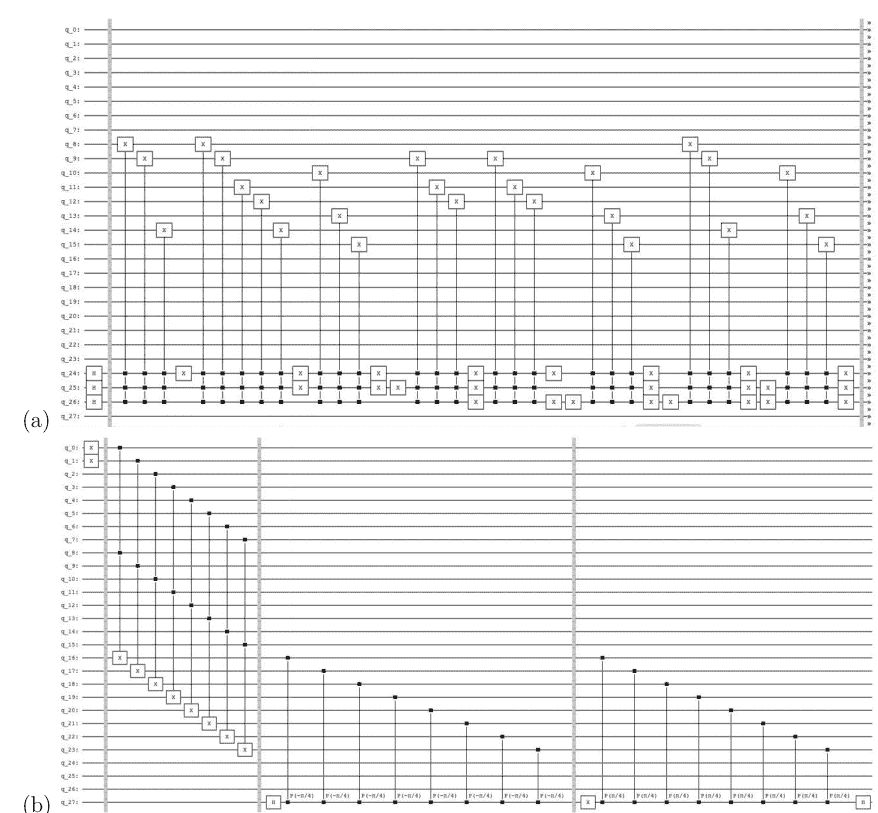

图 15.13 (a) 产生睡眠相位的量子电路。量子比特 0 到 7 表示查询向量，量子比特 8 到 15 是内存，量子比特 16 到 23 表示计数，而量子比特 24, 25, 和 26 是索引（8 个状态）。b) 产生激活相位的量子电路。查询和计数量子比特 16 到 23 以及控制量子比特 27。

```python
# Pointer
qc.h(24)
qc.h(25)
qc.h(26)
qc.barrier()
```

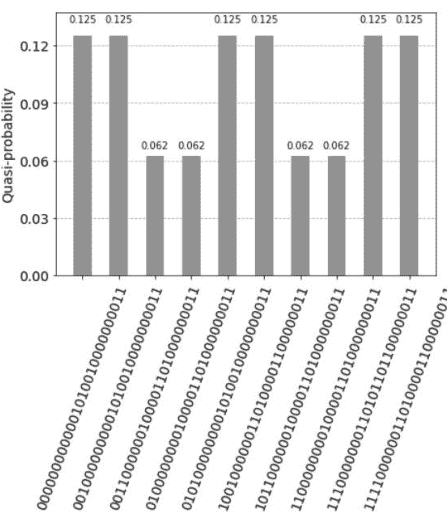

图 15.14 量子比特 24, 25, 26 是索引量子比特。注意索引量子比特反序计数：111 是第一个单元，110 是第二个单元，000 是第八个单元。测量值较小且均匀填充的。对于查询向量 $x_q = (1,1,0,0,0,0,0,0)$，值 $(1,1,0,0,0,0,1,0)$ 由量子比特 24, 25, 和 26 指示答案：第一个单元 (111)，第二个单元 (110)，第七个单元 (001)。控制量子比特 27 等于零表示单元未触发。

```python
gate = MCXGate(3)

# 1st weights
qc.append(gate, [24, 25, 26, 8])
# 2nd weights
qc.x(24)
qc.append(gate, [24, 25, 26, 9])
# 3rd weights (此处)
qc.append(gate, [24, 25, 26, 11])
qc.append(gate, [24, 25, 26, 12])
# 3th weights
qc.x(25)
qc.append(gate, [24, 25, 26, 10])
# 4th weights
qc.x(24)
qc.x(25)
qc.append(gate, [24, 25, 26, 9])
qc.append(gate, [24, 25, 26, 11])
qc.append(gate, [24, 25, 26, 12])
# 5th weights
qc.x(26)
qc.append(gate, [24, 25, 26, 9])
qc.append(gate, [24, 25, 26, 11])
qc.append(gate, [24, 25, 26, 12])
# 6th weights
qc.x(26)
qc.x(24)
qc.append(gate, [24, 25, 26, 10])
qc.append(gate, [24, 25, 26, 13])
# 7th weights
qc.x(26)
qc.x(25)
qc.append(gate, [24, 25, 26, 8])
qc.append(gate, [24, 25, 26, 9])
# 8th weights
qc.x(26)
qc.x(25)
qc.x(24)
qc.append(gate, [24, 25, 26, 10])
qc.append(gate, [24, 25, 26, 13])
qc.append(gate, [24, 25, 26, 15])
```

## 214 ■ 使用 Qiskit 的量子人工智能

```python
qc.barrier()
# query
qc.ccx(0,8,16)
qc.ccx(1,9,17)
qc.ccx(2,10,18)
qc.ccx(3,11,19)
qc.ccx(4,12,20)
qc.ccx(5,13,21)
qc.ccx(6,14,22)
qc.ccx(7,15,23)

# Dividing
qc.barrier()
qc.h(27)

# Marking
qc.cp(-pi/4,16,27)
qc.cp(-pi/4,17,27)
qc.cp(-pi/4,18,27)
qc.cp(-pi/4,19,27)
qc.cp(-pi/4,20,27)
qc.cp(-pi/4,21,27)
qc.cp(-pi/4,22,27)

qc.barrier()
qc.x(25)
qc.x(24)
```

## 15.4.3 多次应用 Trojan 放大

根据 Trojanberger [112] 顺序应用控制量子比特 $b$ 次导致：

$$\sum_{j=1}^8 \frac{1}{\sqrt{8}} \left( \cos\left(\frac{\pi \cdot count_j}{2 \cdot N}\right) \cdot |0\rangle\langle unit_j| \right) \otimes |00000011\rangle + \sum_{j=1}^8 \frac{1}{\sqrt{8}} \left( \sin\left(\frac{\pi \cdot count_j}{2 \cdot N}\right) \cdot |1\rangle\langle unit_j| \right) \otimes |00000011\rangle$$

$$|v,count_j\rangle|unit_j\rangle \otimes |query\rangle. \quad (15.22)$$


## 216 使用 Qiskit 进行量子人工智能

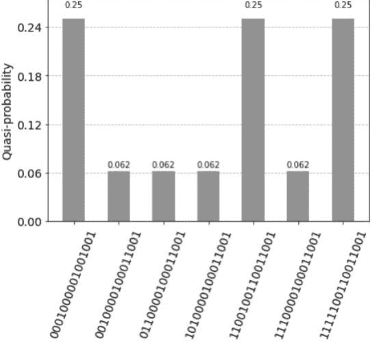

```python
qc.ccx(20,21,7)
# Original
qc.barrier()
qc.ccx(20,21,8)
qc.x(20)
# 3rd_weights
qc.x(21)
# OR Aggregated
qc.barrier()
qc.ccx(20,21,4)
qc.ccx(20,21,6)
qc.ccx(20,21,7)
# Original
qc.barrier()
qc.ccx(20,21,10)
qc.x(21)

# 4th weights
qc.x(20)
qc.x(21)
# OR Aggregated
qc.barrier()
qc.ccx(20,21,4)
qc.ccx(20,21,6)
qc.ccx(20,21,7)
# Original
qc.barrier()
qc.ccx(20,21,8)
qc.ccx(20,21,11)
qc.x(21)
qc.x(20)
qc.barrier()
# query, counting
# OR Aggregated
qc.ccx(0,4,12)
qc.ccx(1,5,13)
qc.ccx(2,6,14)
qc.ccx(3,7,15)
# Original
qc.ccx(0,8,16)
qc.ccx(1,9,17)
qc.ccx(2,10,18)
qc.ccx(3,11,19)
# Dividing
qc.barrier()
qc.h(22)
# Marking
qc.barrier()
qc.cp(-pi/8,12,22)
qc.cp(-pi/8,13,22)
qc.cp(-pi/8,14,22)
qc.cp(-pi/8,15,22)
qc.cp(-pi/8,16,22)
qc.cp(-pi/8,17,22)
qc.cp(-pi/8,18,22)
qc.cp(-pi/8,19,22)
qc.barrier()
qc.x(22)
qc.cp(pi/8,12,22)
qc.cp(pi/8,13,22)
qc.cp(pi/8,14,22)
qc.cp(pi/8,15,22)
qc.cp(pi/8,16,22)
qc.cp(pi/8,17,22)
qc.cp(pi/8,18,22)
qc.cp(pi/8,19,22)
qc.barrier()
qc.h(22)
```

## 218 使用 Qiskit 进行量子人工智能

qc.draw()

### 15.4.4 树形结构

我们希望增加测量代表答案值中正确单元的概率，并减少测量零的概率。例如，在具有 $k$ 个节点的稀疏代码中，对 $k$ 个不同的1进行测量可以重建二进制答案向量，我们无法使用之前提到的多次应用 Tarbert 放大的想法。相反，我们可以通过引入树形结构 [91] 来增加测量1的概率。这种树形层次关联方法基于相邻单元的聚合 [91]。基于 OR 的聚合对于两个或三个相邻单元产生更密集的内存，见图 15.17。计算机实验表明，两个和三个之间的聚合是最优的。更密密的内存复制在原始内存之上。根据单元的数量，我们可以重复聚合两个到三个相邻组的过程，直到到达不同的单元组，可能的聚合内存数量为 $\log(n-1)$。由于在我们的示例中只有四个单元，我们将两个结果聚合到一个内存中。

查询向量由 $\log(n-1)$ 份原始内存组成。

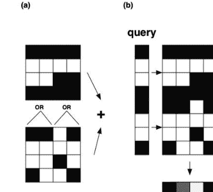

**图 15.17)** 在我们的示例中，存储三个模式 $\mathbf{x}_1 = (1, 0, 0, 1)$$\mathbf{y}_1 = (1, 0, 0, 1)$；$\mathbf{x}_2 = (1, 0, 0, 0)$$\mathbf{y}_2 = (0, 1, 0, 0)$ 以及 $\mathbf{x}_3 = (0, 0, 1, 0)$$\mathbf{y}_3 = (0, 0, 1, 0)$，查询向量为 $\mathbf{x}_q = (1, 0, 0, 1)$。(b) 聚合对于两个相邻单元的 OR 转换产生了更密集的内存，$\mathbf{x}_q = (1, 0, 0, 1, 1, 0, 0, 1)$。我们应用 $N \le 4$ 的控制相位操作，见图 15.17，以及 qiskit 电路定义：

```python
qc = QuantumCircuit(23)
# 0-3 query
# 4-4 aggregated
# 8-11 count
# Index Pointer
# 20-21
# Aux
# 22

# Sleep Phase
# Index Pointer
qc.h(20)
qc.h(21)
# 1st weights
# OR Aggregated
qc.barrier()
qc.ccx(20,21,4)
qc.ccx(20,21,7)
# Original
qc.barrier()
qc.ccx(20,21,8)
qc.ccx(20,21,11)
# 2nd weights
qc.x(20)
# OR Aggregated
qc.barrier()
qc.ccx(20,21,4)
qc.ccx(20,21,7)
# Original
qc.barrier()
qc.ccx(20,21,8)
qc.x(20)
# 3rd weights
qc.x(21)
# OR Aggregated
qc.barrier()
qc.ccx(20,21,4)
qc.ccx(20,21,6)
qc.ccx(20,21,7)
# Original
qc.barrier()
qc.ccx(20,21,10)
qc.x(21)
# 4th weights
qc.x(20)
qc.x(21)
```

## 220 使用 Qiskit 进行量子人工智能

```python
# OR Aggregated
qc.barrier()
qc.ccx(20,21,4)
qc.ccx(20,21,6)
qc.ccx(20,21,7)
# Original
qc.barrier()
qc.ccx(20,21,8)
qc.ccx(20,21,11)
qc.x(21)
qc.x(20)

# Active Phase
# query
qc.barrier()
qc.x(0)
qc.x(3)
qc.barrier()
# query, counting
# OR Aggregated
qc.ccx(0,4,12)
qc.ccx(1,5,13)
qc.ccx(2,6,14)
qc.ccx(3,7,15)
# Original
qc.ccx(0,8,16)
qc.ccx(1,9,17)
qc.ccx(2,10,18)
qc.ccx(3,11,19)
# Dividing
qc.barrier()
qc.h(22)
# Marking
qc.barrier()
qc.cp(-pi/8,12,22)
qc.cp(-pi/8,13,22)
qc.cp(-pi/8,14,22)
qc.cp(-pi/8,15,22)
qc.cp(-pi/8,16,22)
qc.cp(-pi/8,17,22)
qc.cp(-pi/8,18,22)
qc.cp(-pi/8,19,22)
qc.barrier()
qc.x(22)
qc.cp(pi/8,12,22)
qc.cp(pi/8,13,22)
qc.cp(pi/8,14,22)
qc.cp(pi/8,15,22)
qc.cp(pi/8,16,22)
qc.cp(pi/8,17,22)
qc.cp(pi/8,18,22)
qc.cp(pi/8,19,22)
qc.barrier()
qc.h(22)
```


**图 15.18** 叠加态等于零。测量概率（控制比特等于1）指示的单元为 0.838，测量值为 0.213。

### 结论
睡眠阶段和激活阶段的成本与传统内存 $O(n^2)$ 相同。我们假设有足够的时间准备量子内存叠加态，直到它们被查询。每个量子内存只能查询一次。我们认为激活阶段的优势在于快速确定信息 $O(\log n)$，相对于经典的 $O(n)$ 或 $O(n^2)$。

### 幅度编码
幅度编码将长度为1的实数或复数向量编码到量子态。我们逐步描述自顶策略。与其使用多控制门表示二叉树，我们可以使用旋转门。然而，结果所需的比特数相同，我们无法访问它们的值。

### 编码示例
幅度编码将数据编码为量子态 $\omega_i$。例如，归一化向量：
$$|\psi\rangle = \sum_{i=1}^{N} \omega_i |i\rangle = \begin{pmatrix} \sqrt{0.03} \\ \sqrt{0.07} \\ \sqrt{0.15} \\ \sqrt{0.05} \\ \sqrt{0.1} \\ \sqrt{0.3} \\ \sqrt{0.2} \\ \sqrt{0.1} \end{pmatrix}$$
带有 qiskit 排序 $|q_2q_1q_0\rangle$:
$$|\psi\rangle = \sqrt{0.03} \cdot |000\rangle + \sqrt{0.07} \cdot |001\rangle + \sqrt{0.15} \cdot |010\rangle + \sqrt{0.05} \cdot |011\rangle + \sqrt{0.1} \cdot |100\rangle + \sqrt{0.3} \cdot |101\rangle + \sqrt{0.2} \cdot |110\rangle + \sqrt{0.1} \cdot |111\rangle$$


**图 16.1** 我们构建了一个自顶向二叉树，将第一层观测 $|q_2$ 的概率分为第二层观测 $|q_2q_1$ 的概率，最后是第三层观测 $|q_2q_1q_0$ 的概率，表示所需的叠加态 $\psi$。二叉树由多控制旋转门表示；多控制旋转门定义在灰色椭圆所示的值。

### 16.2 自顶划分策略
我们构建了一个自顶的二叉树，将第一层观测 $|q_2$ 的概率分为第二层观测 $|q_2q_1$ 的概率，最后是第三层观测 $|q_2q_1q_0$ 的概率，表示所需的的位置 $|\psi|$。二叉树由多控制旋转门表示（见图 16.1），需要 $\log_2 n$ 个比特来表示维度为 $n$ 的向量。

### 16.2.1 层级
观测 $q_2 = 0$ 的概率为 $\sqrt{0.3}$：
$$\sqrt{0.03} \cdot |000\rangle + \sqrt{0.07} \cdot |001\rangle + \sqrt{0.15} \cdot |010\rangle + \sqrt{0.05} \cdot |011\rangle$$
且观测 $q_2 = 1$ 的概率为 $\sqrt{0.7}$。我们使用参数化的 RY 门：
$$R_Y(\theta) = \begin{pmatrix} \cos(\frac{\theta}{2}) & -\sin(\frac{\theta}{2}) \\ \sin(\frac{\theta}{2}) & \cos(\frac{\theta}{2}) \end{pmatrix}$$
以便沿 y 轴旋转比特，旋转角度为 $\theta$（弧度）：
$$\theta_0 = 1.98231 = 2 \cdot \arccos(\sqrt{0.3}) \quad (16.2)$$
其中（见图 16.1）：
$$RY_{\theta_0}|0\rangle = \sqrt{0.3} \cdot |0\rangle + \sqrt{0.7} \cdot |1\rangle \quad (16.3)$$


# 使用 Qiskit 的 224 量子人工智能


图 16.2 (a) 代表单个量子比特沿 y 轴旋转角度为 $\theta_0$ 的旋转电路；(b) 代表叠加态 $\sqrt{0.3}\cdot|0\rangle + \sqrt{0.7}\cdot|1\rangle$ 的量子比特的测量结果。

由此产生了电路（见图 16.2），

```python
from qiskit import QuantumCircuit,QuantumRegister, Aer,execute
from qiskit.visualization import plot_histogram
from qiskit.circuit.library import MCXGate
from qiskit.quantum_info import Statevector
from qiskit.circuit.library import RYGate
from math import pi

c = QuantumCircuit(1)
#ang = Sqrt([0.3])
#ArcCos[ang]*2
qc.ry(1.98231,0)

simulator = Aer.get_backend('statevector_simulator')
result=execute(qc,simulator).result()
counts = result.get_counts()
plot_histogram(counts)
```

## 16.2. 层 2

观测 $q_{21} = 00$ 的概率为 $\sqrt{0.1}$

> $\sqrt{0.3}\cdot|00\rangle + \sqrt{0.7}\cdot|01\rangle$

观测 $q_{21} = 01$ 的概率为 $\sqrt{0.3}$。这两个值都除以观测 $q_2 = 0$ 的概率 $\sqrt{0.3}$。为了定义角度 $\theta_{00}$，我们通过除以观测 $q_2 = 0$ 的概率对值 $\sqrt{0.1}$ 进行归一化：

$$\theta_{00} = 1.91063 = \arccos\sqrt{\frac{0.1}{0.3}} \quad (16.4)$$

旋转产生了一个叠加态

$RY_{\theta_{00}}(\sqrt{0.3}\cdot|0\rangle + \sqrt{0.1}\cdot|00\rangle + \sqrt{0.2}\cdot|01\rangle) \quad (16.5)$

## 振幅编码 ■ 225

观测 $q_2q_1 = 10$ 的概率为 $\sqrt{0.4}$；

$\sqrt{0.1 \cdot |100\rangle} + \sqrt{0.3 \cdot |101\rangle}$

观测 $q_2q_1 = 11$ 的概率为 $\sqrt{0.3}$，因为这两个值都除以观测 $q_2 = \sqrt{0.7}$。为了定义角度 $\theta_{10}$，我们通过除以观测 $q_2 = 1$ 的概率对值 $\sqrt{0.4}$ 进行归一化：

$$\theta_{10} = 1.42745 = 2 \cdot \arccos\left(\frac{\sqrt{0.4}}{\sqrt{0.7}}\right) \quad (16.6)$$

旋转产生了叠加态

$RY_{\sqrt{0.7} \cdot |1|} = \sqrt{0.4} \cdot |10| + \sqrt{0.3} \cdot |11|} \quad (16.7)$

应用两个由量子比特 $q_2$ 控制的旋转门会产生一个叠加态（见图 16.1）

$RY_{\sqrt{0.3} \cdot |00|} + RY_{\sqrt{0.7} \cdot |01|} = \sqrt{0.1} \cdot |00| + \sqrt{0.2} \cdot |01| + \sqrt{0.4} \cdot |10| + \sqrt{0.3} \cdot |11|} \quad (16.8)$

层 1 和层 2 的分解所示（见图 16.3）。由于电路只包含两个最重要的量子比特（左侧的）$q_1q_0$，它们对应于三量子比特最终电路中的量子比特 $q_2q_1$。

```python
qc = QuantumCircuit(2)

#ang = Sqrt[0.3]
#ArcCos[ang]*2
qc.cry(1.98231,1)
qc.barrier()
```

```python
#ang = Sqrt[0.4]/Sqrt[0.7];
#ArcCos[ang]*2
qc.cry(1.42745,1,0)
#ang = Sqrt[0.1]/Sqrt[0.3];
#ArcCos[ang]*2
qc.x(1)
qc.cry(1.91063,1,0)
qc.x(1)
```

## 16.2.3 层 3

最后，我们通过层三上的四次旋转估计了单个值 $|q_2q_1q_0|$（见图 16.1）。

$$\theta_{110} = 1.23096 = 2 \cdot \arccos\left(\frac{\sqrt{0.2}}{\sqrt{0.3}}\right) \quad (16.9)$$

# 使用 Qiskit 的 226 量子人工智能


**图 16.3** (a) 代表对量子比特 $0.7\cdot|1\rangle$ 的控制旋转，角度 $\theta_{10}=1.42745$，以及 $0.3\cdot|0\rangle$ 沿 y 轴的旋转 $\theta_{00}=1.91063$。由于电路中只表示了最重要的量子比特（左侧）$|q_2q_1q_0\rangle$，它们的标识 $q_1q_0$ 对应于三量子比特最终电路中的 $q_2q_1$。(b) 代表叠加态 $\sqrt{0.1}\cdot|0\rangle + \sqrt{0.2}\cdot|1\rangle + \sqrt{0.4}\cdot|10\rangle + \sqrt{0.3}\cdot|11\rangle$ 的量子比特测量结果。

$RY_{\theta_{10}}\sqrt{0.3} \cdot |11\rangle = \sqrt{0.2} \cdot |11\rangle + \sqrt{0.1} \cdot |11\rangle$

$$\theta_{100} = 2.0944 = 2 \cdot \arccos(\sqrt{0.1})$$

$RY_{\theta_{100}}\sqrt{0.4} \cdot |10\rangle = \sqrt{0.1} \cdot |10\rangle + \sqrt{0.3} \cdot |11\rangle$

$$\theta_{010} = 1.0472 = 2 \cdot \arccos(\sqrt{0.15})$$

$RY_{\theta_{010}}\sqrt{0.2} \cdot |01\rangle = \sqrt{0.15} \cdot |10\rangle + \sqrt{0.05} \cdot |11\rangle$

$$\theta_{000} = 1.98231 = 2 \cdot \arccos(\sqrt{0.03})$$

$RY_{\theta_{000}}\sqrt{0.1} \cdot |00\rangle = \sqrt{0.03} \cdot |00\rangle + \sqrt{0.07} \cdot |01\rangle$


**图 16.4** (a) 自上而下的二叉树显示了第一层观测 $|q_2\rangle$ 的概率，最后是第三层 $|q_1q_2\rangle$ 的概率，代表控制门。(b) 叠加态 $|\psi\rangle$ 的振幅。四个控制门由量子比特 $q_2$ 和 $q_1$ 控制，产生了所需的叠加态 $|\psi\rangle$，见图 16.4

$|\psi\rangle = \sqrt{0.03} \cdot |000\rangle + \sqrt{0.07} \cdot |001\rangle + \sqrt{0.15} \cdot |010\rangle + \sqrt{0.05} \cdot |011\rangle + \sqrt{0.1} \cdot |100\rangle + \sqrt{0.3} \cdot |101\rangle + \sqrt{0.2} \cdot |110\rangle + \sqrt{0.1} \cdot |111\rangle$

```python
qc = QuantumCircuit(3)
#ang = Sqrt[0.3]
#ArcCos[ang]*2
qc.ry(1.98231,2)
qc.barrier()
#ang = Sqrt[0.4]/Sqrt[0.7];
#ArcCos[ang]*2
qc.cry(1.42745,2,1)
#ang = Sqrt[0.1]/Sqrt[0.3];
#ArcCos[ang]*2
qc.x(2)
qc.cry(1.91063,2,1)
qc.x(2)
qc.barrier()
```

# 使用 Qiskit 的 228 量子人工智能

```python
#ang = Sqrt[0.2]/Sqrt[0.3];
#ArcCos[ang]*2
ccry = RYGate(1.23096).control(2)
qc.append(ccry,[2,1,0])
#ang = Sqrt[0.1]/Sqrt[0.4];
#ArcCos[ang]*2
ccry = RYGate(2.0944).control(2,label=None)
ccry = RYGate(2.0944).control(2)
qc.x(1)
qc.append(ccry,[2,1,0])
qc.x(1)
#ang = Sqrt[0.15]/Sqrt[0.2];
#ArcCos[ang]*2
ccry = RYGate(1.0472).control(2)
qc.append(ccry,[2,1,0])
#ang = Sqrt[0.03]/Sqrt[0.1];
#ArcCos[ang]*2
ccry = RYGate(1.98231).control(2)
qc.x(1)
qc.append(ccry,[2,1,0])
qc.x(1)
```

## 16.3 合并状态

与其用控制门表示二叉树，我们可以使用控制 SWAP 算符。

### 16.3.1 层 2

层 2 由三个量子比特表示，每个量子比特都应用了旋转门。对量子比特 1 应用旋转 $\theta_{01}=1.98231$，对量子比特 0 应用旋转 $\theta_{10}=1.42745$，对量子比特 2 应用旋转 $\theta_{00}=1.91063$。量子比特 1 控制 SWAP 操作，测量量的乘积代表了两个量子比特的概率分布，见图 16.5

## 16.3.2 层 3

层 3 由七个量子比特表示，每个量子比特都应用了旋转门。对量子比特 3 应用旋转 $\theta_{011}=1.98231$，对量子比特 1 应用旋转 $\theta_{101}=1.2745$，对量子比特 5 应用旋转 $\theta_{000}=1.91063$。量子比特 3 控制 SWAP 操作。对于层三，我们应用额外的四次旋转：对量子比特 0 应用旋转 $\theta_{110}=1.23096$，对量子比特 2 应用旋转 $\theta_{100}=2.0944$，对量子比特 4 应用旋转 $\theta_{010}=1.0472$，对量子比特 6 应用旋转 $\theta_{000}=1.98231$。子树通过量子比特 3 的控制 SWAP 操作与层一的结果合并。


# 230 基于 Qiskit 的量子人工智能

# (a)

# (b)


图 16.6 ((a)) 三层二叉树由七个量子比特表示，并对这些量子比特应用了量子旋转。我们对量子比特 3 应用旋转 $\theta_0 = 1.98231$，对量子比特 1 应用旋转 $\theta_{10} = 1.42745$，对量子比特 5 应用旋转 $\theta_{00} = 1.9106$。我们使用了 SWAP 操作。对于第三层，我们添加了所有的旋转，对量子比特 0 应用旋转 $\theta_{110} = 1.23096$，对量子比特 2 应用旋转 $\theta_{000} = 2.0944$，对量子比特 4 应用旋转 $\theta_{010} = 1.0472$，对量子比特 6 应用旋转 $\theta_{000} = 1.98231$。量子比特 1 和 5 代表两个子树的第 2 层控制。子树通过由量子比特 3 控制的控制 SWAP 操作与第一层的结果合并。量子比特 3 与量子比特 5 和 3 的测量张量积表示代表八种状态的三个量子比特所需的分布。(b) 代表八种状态的三个量子比特所需的分布。

```
counts = result.get_counts()
plot_histogram(counts)
```

电路的深度并不是自顶向下的划分策略，但我们需要与旋转门相同数量的量子比特，且量子比特在操作过程中处于纠缠态。

# 16.4 QISKIT 振幅编码 

Qiskit 通过 `desired_state` 和 `initialize(desired_state, qubits)` 命令提供了初始化所需状态的可能性，并可以使用 `decompose` 命令来指示结果生成的量子电路，见图 16.7。

```python
from qiskit import QuantumCircuit, QuantumRegister, Aer, execute
from qiskit.visualization import plot, plot_histogram
import math
from qiskit import QuantumCircuit
```

```python
desired_state = [
math.sqrt(0.03),
math.sqrt(0.07),
math.sqrt(0.15),
```

# 振幅编码 231

16.7 Qiskit 通过 `desired_state` 和 `initialize(desired_state, qubits)` 命令提供了初始化所需状态的可能性，并通过 `decompose` 命令来指示结果生成的量子电路。生成叠加态 $|\psi\rangle$ 振幅的量子电路：

```python
math.sqrt(0.05),
math.sqrt(0.1),
math.sqrt(0.3),
math.sqrt(0.2),
math.sqrt(0.1),
]
qc = QuantumCircuit(3)
qc.initialize(desired_state, [0,1,2])

qc.decompose().decompose().decompose().decompose().decompose().decompose()
draw(fold=180)
```

```python
simulator = Aer.get_backend('statevector_simulator')
result=execute(qc,simulator).result()
counts = result.get_counts()
print("Total count are:",counts)
plot_histogram(counts)
```

# 16.5 SWAP 测试

我们无法访问代表向量的振幅，但我们使用交换测试来估计 $\langle x|y\rangle$。每个状态代表由 $m = \log_2 n$ 个量子比特表示的维度 $n$ 的归一化向量。量子 $|x\rangle$ 和 $|y\rangle$ 在 $l_2$ 范数长度为一：

$||x||_2 = 1, ||y||_2 = 1.$

额外的辅助量子比特 $|0\rangle$ 生成：

$|0\rangle \otimes |x\rangle|y\rangle = |0, x,y\rangle$

在控制量子比特 $|0\rangle$ 上应用 Hadamard 门：

$(H \otimes I \otimes I) \cdot |0,x,y\rangle = \frac{1}{\sqrt{2}} \cdot (|0, x,y\rangle + |1, x,y\rangle) \quad (16.17)$

在 $|x\rangle$ 和 $|y\rangle$ 状态上应用控制交换算符，交换 $|x\rangle$ 和 $|y\rangle$：

$|x\rangle \rightarrow |y\rangle|x\rangle$

当控制量子比特处于状态 $|1\rangle$ 时：

$$\frac{1}{\sqrt{2}} \cdot (|0, x, y\rangle + |1, x, y\rangle) \rightarrow \frac{1}{\sqrt{2}} \cdot (|0, x, y\rangle + |1, y, x\rangle) \quad (16.18)$$

我们在控制量子比特上再次应用一个 Hadamard 门：

$$(H \otimes I_m \otimes I_m) \cdot (\frac{1}{\sqrt{2}} \cdot (|0, x, y\rangle + |1, y, x\rangle)) = \frac{1}{2} \cdot |0\rangle \cdot (|x, y\rangle + |y, x\rangle) + \frac{1}{2} \cdot |1\rangle \cdot (|x, y\rangle - |y, x\rangle) \quad (16.19)$$

测量控制量子比特处于状态 $|0\rangle$ 的概率给出：

$p(0) = |\frac{1}{2} \cdot |0\rangle \cdot (|x, y\rangle + |y, x\rangle) + \frac{1}{2} \cdot |1\rangle \cdot (|x, y\rangle - |y, x\rangle)|^2$
$p(0) = \frac{1}{4} |||x, y\rangle + |y, x\rangle||^2 + \frac{1}{4} |||x, y\rangle - |y, x\rangle||^2$
$p(0) = \frac{1}{2} (1 + \langle x|y\rangle) \quad (16.20)$
$p(1) = \frac{1}{2} (1 - \langle x|y\rangle) \quad (16.21)$

当 $p(0) = 0.5$ 时，$|x\rangle$ 和 $|y\rangle$ 正交；而 $p(0) = 1$ 时表示状态是相同的。内积 $\langle x|y\rangle$ 通常被称为向量之间的夹角 $\varphi$。我们也可以估计欧几里得距离，因为向量是归一化的单位球：$||x-y||_2 \le \sqrt{2} \quad (16.22)$

# 振幅编码 233

$q_0:$
$q_1:$
$q_2:$


图 16.8 量子比特 0 代表向量 $x$，量子比特 1 代表向量 $y$。经过 10000 次测量 $p(0) = 0.5$。

# 16.5.1 二维向量示例

$x = \begin{pmatrix} \sqrt{0.5} \\ \sqrt{0.5} \end{pmatrix}, y = \begin{pmatrix} \sqrt{0.5} \\ -\sqrt{0.5} \end{pmatrix}$

$\langle x|y\rangle = 0$

# 16.5.2 四维向量示例

$x = \begin{pmatrix} \sqrt{0.1} \\ \sqrt{0.2} \\ \sqrt{0.3} \\ \sqrt{0.4} \end{pmatrix}, y = \begin{pmatrix} \sqrt{0.4} \\ \sqrt{0.3} \\ \sqrt{0.2} \\ \sqrt{0.1} \end{pmatrix}$

$\langle x|y\rangle = \sqrt{0.04} + \sqrt{0.06} + \sqrt{0.06} + \sqrt{0.04} = 0.4 + 2\sqrt{0.06} \approx 0.8899$

注意，结果每次运行可能略有不同。


# 量子内核

量子计算机可以估计量子内核，该估计结果可以被经典计算机上的内核方法所用。这是因为在评估内积时的指数级量子优势允许在更高维空间中直接估计量子内核。我们给出一个关于量子内核和交换测试（swap test）的示例。量子特征映射通过参数化量子电路将经典数据编码为量子数据。参数化量子电路基于叠加和纠缠。它们在经典计算机上难以模拟，并可能比经典学习方法产生优势。反转测试（inversion test）基于估计两个状态之间保真度（相似性）的理想方法。我们描述了一个使用 qiskit 命令 `ZZFeatureMap` 的示例。然后我们指示了如何将量子内核接入到支持向量机等经典内核方法中。

## 17.1 量子内核

对于量子态 $|\phi(x)\rangle$ 和 $|\phi(y)\rangle$，两个状态的内积被称为量子内核

$$k(\mathbf{x}, \mathbf{y}) = \langle\phi(\mathbf{x})|\phi(\mathbf{y})\rangle$$

其内积为

$$(\mathbf{x} \cdot \mathbf{y}) = \mathbf{x}^T \cdot \mathbf{y}.$$

内积的绝对值可以通过交换测试 [95] 来估计。

## 17.2 量子内核与交换测试

量子计算机可以估计量子内核，该估计结果可以被经典计算机上的内核方法所用 [95]。这是因为在评估内积时的指数级量子优势允许在更高维空间中直接估计量子内核映射。如果结果无法在经典计算机上模拟，则该内核在经典上是不可处理的 [94]。我们可以映射为

$$|\phi(\mathbf{x})\rangle \rightarrow |\mathbf{x}\rangle \otimes \cdots \otimes |\mathbf{x}\rangle = |\mathbf{x}\rangle^{\otimes m}$$


图 17.1 (a) 使用交换测试表示 $k(x,y) = (x^T \cdot y)^3$ 的电路。(b) 在 10000 次采样（shots）后，我们测量到 $p(|0|) = 0.9395$。

并定义齐次多式内核为

$$k(x)$$

那么内积的绝对值可以通过交换测试来估计。

### 17.2.1 二维向量示例

$$x = \begin{pmatrix} \sqrt{0.3} \\ \sqrt{0.7} \end{pmatrix}, \quad y = \begin{pmatrix} \sqrt{0.5} \\ \sqrt{0.5} \end{pmatrix}$$

$$k(x,y) = \langle\phi(x)|\phi(y)\rangle = \langle x|y\rangle \otimes \langle x|y\rangle \otimes \langle x|y\rangle = (x^T \cdot y)^3. \quad (17.5)$$

对应的电路如下（见图 17.1）

```python
from qiskit import QuantumCircuit,QuantumRegister, Aer,execute
from qiskit.visualization import plot_histogram
from qiskit.circuit.library import MCXGate
from qiskit.quantum_info import Statevector
from qiskit.circuit.library import RYGate
from math import pi

qc = QuantumCircuit(7,1)
qc.h(6)
qc.barrier()
#ang = Sqrt[0.3]
#ArcCos[ang]*2
qc.ry(1.98231,0)
qc.ry(1.98231,2)
qc.h(3)
qc.h(4)
qc.h(5)
qc.barrier()
qc.cswap(6,0,3)
qc.cswap(6,1,4)
qc.cswap(6,2,5)
qc.h(6)
qc.measure(6,0)
```

```python
simulator = Aer.get_backend('qasm_simulator')
result=execute(qc,simulator,shots=10000).result()
counts = result.get_counts()
print("\nTotal count:{counts}")
plot_histogram(counts)
```

使用交换测试，10000 次采样后我们测量得到 $p(0) = 0.9395$，对应

$$k(x,y) = |<x^T,y>|^3 \approx \sqrt{2-0.9395}-1=0.0295$$

## 17.3 量子内核与反转测试

量子映射通过参数化量子电路将经典数据编码为量子数据 [40]。特征向量不是通过振幅对维度 $z$ 进行编码，而是通过参数化量子电路 $U_{\phi(x)}$ 的 $z$ 个参数定义的，$z \geq m$

$$|\phi(x)\rangle = U_{\phi(x)}|0^{\otimes m} \quad (17.6)$$

其中 $\phi(x)$ 的维度为 $2^m$。基于叠加和纠缠的参数化量子电路能够模拟并比经典机器学习方法产生优势。反转测试基于估计两个状态之间保真度（相似性）的思想 [40]。对于输入态 $|0^{\otimes m}\rangle$，如果我们通过参数化量子电路 $U_{\phi(x)}$ 对其进行映射，并通过其逆变换 $U_{\phi(x)}^{-1}$ 进行消除，如果参数化量子电路 $U_{\phi(x)}$ 是正确的，那么测量到态 $|0^{\otimes m}\rangle$ 的概率为 1。如果我们用矩阵 $U_{\phi(x)}$ 表示量子电路，则逆量子电路对应的矩阵是共轭转置 $U_{\phi(x)}^*$，也写做 $U_{\phi(x)}^T$。如果我们用 $x$ 参数化量子电路 $U$ ($U_{\phi(x)}$)，并用 $y$ 参数化量子电路的逆 $U^1$ ($U_{\phi(y)}^*$)，如果 $x$ 和 $y$ 相似，对于输入 $|0^{\otimes m}\rangle$，测量到 $|0^{\otimes m}\rangle$ 的概率应该接近 1：

$$U_{\phi(y)}^* U_{\phi(x)}|0^{\otimes m}\rangle \quad (17.7)$$

如果 $x$ 和 $y$ 存在差异，概率会较小。


| q_0: | P(2.0*x[0]) | |
| :--- | :--- | :--- |
| q_1: | P(2.0*x[0]) | X | P(2.0*(n - x[0])*(n - x[1])) | X |
| q_0: | U2(0,n) | U(0,0,2.0*x[0]) | |
| q_1: | U2(0,n) | U(0,0,2.0*x[1]) | X | U(0,0,2.0*(n - x[0])*(n - x[1])) | X |

图 17.3 (a) 具有 2 个特征和深度为 1 的 ZZFeatureMap，这与上一节使用的特征图相同。(b) 使用两次 `decompose()` 指示的相同 ZZFeatureMap，其中 `decompose()` 指明了使用的量子门。(c) 具有 3 个特征和深度为 1 的 ZZFeatureMap。

## 17.4 量子支持向量机

量子核被插入到支持向量机（核机器）等经典核方法中。只有 Gram 矩阵（核矩阵）由量子计算机（或仿真）确定，计算的其他部分在传统计算机上执行。一种是将量子核的函数传递给经典算法，另一种是预计算训练和测试核矩阵。通常，量子核的实际内部表示对外部是隐藏的。

## qRAM

量子内存被提作为经典计算机内存的模拟物，类似于随机访问存储器（RAM）。RAM 是计算机内存的一种，可以按任何顺序进行读取和更改，通常用于存储工作数据。在量子机器学习领域，提议使用量子随机存储器（qRAM）来避免输入销毁问题。我们展示了 qRAM 的桶队兵（bucket brigade）架构。qRAM 的方法与处于叠加态的索引比特与模式之间的纠缠有关。我们展示了一个二进制模式的示例，并指出了为什么振幅编码的表示与经典 RAM 上的检索操作具有相同的复杂度。

## 18.1 量子随机访问存储器

在量子机器学习领域，提议使用 qRAM [32] 以避免输入销毁问题（ID 问题）[59], [39]。qRAM 复制基态 [32] 并第 i 个二进制模式加载到第二个寄存器中

$|i\rangle \rightarrow |x^i\rangle$。(18.1)

其中 $|x^i\rangle$ 是表示二进制向量的基态。此类操作可以并行执行

$\frac{1}{\sqrt{m}} \sum_{i=1}^m |i\rangle \rightarrow \frac{1}{\sqrt{m}} \sum_{i=1}^m |x^i\rangle$, (18.2),$

其由于查询准备成本（由于输入问题）增加的时间复杂度为 $O(\log(m))$。

### 18.1.1 qRAM 的桶队兵架构

qRAM 的桶队兵架构灵感来源于传统的 RAM 架构，由三个主要部分组成：

- *地址比特（Addressing qubits）*：我们想要读取的存储单元的地址。为了读取存储单元，用户必须将存储单元的地址编码到地址比特中。该地址可以处于叠加态，以便在一步内读取多个模式。
- *路由节点（Routing nodes）*：根据地址比特的状态确定存储单元。一旦地址比特被设置，路由节点比特的状态将受到影响。路由节点中任何为 1 的比特都将导向我们想要读取的存储单元。
- *存储单元（Memory cells）*：存储和读取模式。

qRAM 的方法与处于叠加态的索引比特与模式之间的纠缠有关。与索引比特纠缠的方法一样，qRAM 的比特在读取过程中发生纠缠，并在计算后必须进行消计算。qRAM 的示例（见图 18.1）。

```python
from qiskit import QuantumCircuit, Aer, execute
from qiskit.visualization import plot_histogram

c = QuantumCircuit(9)
#address
#0-1
#Routing
#2-5
#Memory
#6-8
#address
qc.h(0) two first elements of the memory
#Routing operation
#The addresses are ordered 00, 01, 10, 11
qc.barrier()
qc.x(0)
qc.x(1)
qc.ccx(0,1,2)
qc.x(1)
qc.x(0)
qc.barrier()
qc.x(1)
qc.ccx(0,1,3)
qc.x(1)
qc.barrier()
qc.x(0)
qc.ccx(0,1,4)
qc.x(0)
qc.barrier()
qc.ccx(0,1,5)
qc.barrier()
#Memory cells 6-8
#First memory cell
qc.barrier()
qc.cx(2,6)
qc.cx(2,8)
#Second memory cell
qc.barrier()
```


图 18.1 (a) qRAM 电路：地址由比特 0 和 1 表示，路由由比特 2 到 5 表示，内存由比特 6 到 8 表示。地址顺序为 00, 01, 10，最后一个模式为 11。(b) 地址对应于叠加中的第一个比特，地址 00 和 01。检索了第一个和第二个模式。

```python
qc.cx(3,6)
qc.cx(3,7)
#Third memory cell
qc.barrier()
qc.cx(4,6)
qc.cx(4,7)
qc.cx(4,8)
#Fourth memory cell
qc.barrier()
qc.cx(5,7)

simulator = Aer.backend('statevector_simulator')
result=execute(qc,simulator).result()
counts = result.get_counts()
plot_histogram(counts)
```

### 18.1.2 振幅编码

产生任意状态 $|\psi\rangle$ 副本的操作是不可能的；由于量子力学的线性，我们无法复制非基态。我们可以通过某种方式来复制非基态。振幅编码的表示与经典 RAM 上的检索操作具有相同的复杂度。正如索引比特纠缠的方法一样，qRAM 的比特在读取过程中发生纠缠，并在计算后必须进行消计算。qRAM 的示例（见图 18.1）。

（注：原文该部分存在逻辑断层或重复，译文已根据语境尽可能对齐并保留了术语）


DFT 可以被视为一个线性变换 $F$，它将列向量 $\alpha$ 映射到列向量

$$\begin{matrix} \omega_1 & -e^{-2\pi i(0)/n} & -e^{-2\pi i(0)/n} & \dots & \alpha_1 \\ \omega_2 & -e^{-2\pi i(1)/n} & -e^{-2\pi i(1)/n} & \dots & \alpha_2 \\ = \frac{1}{\sqrt{n}} & & \vdots & \vdots & \vdots & \vdots \\ \omega_n & -e^{-2\pi i(n-1)/n} & -e^{-2\pi i(n-1)/n} & \dots & \alpha_n \end{matrix}$$ $$ (19.5)

并且 DFT 可以被视为一个将列向量 $\omega$ 映射到列向量 $\alpha$ 的线性变换

$$\begin{matrix} \alpha_1 & e^{2\pi i(0)/n} & e^{2\pi i(0)/n} & \dots & \omega_1 \\ \alpha_2 & e^{2\pi i(1)/n} & e^{2\pi i(1)/n} & \dots & \omega_2 \\ = \frac{1}{\sqrt{n}} & & \vdots & \vdots & \vdots & \vdots \\ \alpha_n & e^{2\pi i(n-1)/n} & e^{2\pi i(n-1)/n} & \dots & \omega_n \end{matrix}$$ $$ (19.6)

$n$ 次单位根是一个满足方程 $\zeta^n = 1$ (19.7) 的复数 $\zeta$，其中 $n=1, 2, 3, \dots$ 为正整数，例如

$$\zeta = e^{2\pi i/n} = \cos(2\pi/n) + i \sin(2\pi/n)$$ (19.8)

使用 $n$ 次单位根，该矩阵可以表示为范德蒙矩阵

$$F = \frac{1}{\sqrt{n}} \begin{matrix} 1 & 1 & 1 & \dots & 1 \\ \zeta_n & \zeta_n^2 & \zeta_n^3 & \dots & \zeta_n^{n-1} \\ \zeta_n^2 & \zeta_n^4 & \zeta_n^6 & \dots & \zeta_n^{2(n-1)} \\ \vdots & \vdots & \vdots & \ddots & \vdots \\ \zeta_n^{n-1} & \zeta_n^{2(n-1)} & \zeta_n^{3(n-1)} & \dots & 1 \end{matrix}$$ (19.9)

矩阵 $F$ 也称为 DFT 矩阵，是酉矩阵 $F^{-1} = F^* = IF$。(19.10) 因为 $F$ 是酉矩阵，这意味着正如帕塞瓦尔（Parseval）定理所言，向量的长度保持不变，$|\omega| = ||F \cdot \alpha|| = ||\alpha|$。(19.11)

## 19.2 量子傅里叶变换

QFT 可用于在多项式时间内确定周期函数的周期，见图 19.1。这比传统计算机快指数级。它被用于著名的 Shor 算法的分解框架中。


**图 19.1** 在传统计算机上，我们需要计算大约 10000 步来确定未知周期函数的周期，而在量子计算机上只需要 9-10 步。Shor 算法可以高效地破解密码。此类密码无法被传统计算机破解，因为计算需要指数级的时间。

在 $n$ 维希尔伯特空间 $H_n = H_{2^m}$ 的 $m$ 个量子比特状态 $|x\rangle$ 上的 QFT 可以表示为

$$|y\rangle = F_m \cdot |x\rangle = \frac{1}{\sqrt{n}} \sum_{y \in B^n} e^{2\pi i \frac{x \cdot y}{n}} |y\rangle.$$ (19.12)

这仅仅是括号符号下 $\alpha(t)$ 的离散逆傅里叶变换

$$\omega_f = \frac{1}{\sqrt{n}} \sum_{t=1}^n \alpha_t e^{2\pi i \frac{(f-1)(t-1)}{n}}$$

相位指数符号的约定各不相同；这里量子傅里叶变换的效果与逆 DFT 相同，并遵循 Qiskit 符号。对于一个量子比特 $m=1, n=2$

$$\zeta_2 = e^{2\pi i \frac{1}{2}} = e^{\pi i} = -1$$

以及 QFT $F_1$

$$F_1 = \frac{1}{\sqrt{2}} \begin{pmatrix} 1 & 1 \\ 1 & -1 \end{pmatrix} \zeta_2 = \frac{1}{\sqrt{2}} \begin{pmatrix} 1 & 1 \\ 1 & -1 \end{pmatrix} = H_1.$$ (19.13)

对于两个量子比特 $m=2, n=4$

$$\zeta_4 = e^{2\pi i \frac{1}{4}} = e^{\pi i / 2} = i$$

以及 QFT $F_2$ 是

$$F_2 = \frac{1}{\sqrt{4}} \begin{pmatrix} 1 & 1 & 1 & 1 \\ \zeta_4 & \zeta_4^2 & \zeta_4^3 & \zeta_4^4 \\ \zeta_4^2 & \zeta_4^4 & \zeta_4^6 & \zeta_4^8 \\ \zeta_4^3 & \zeta_4^6 & \zeta_4^9 & \zeta_4^{12} \end{pmatrix} = \frac{1}{2} \begin{pmatrix} 1 & 1 & 1 & 1 \\ i & -1 & -i & 1 \\ -1 & 1 & -1 & 1 \\ -i & -1 & i & 1 \end{pmatrix}$$ (19.14)

其逆 QFT 是

$$IF_2 = F_2^T = \frac{1}{2} \begin{pmatrix} 1 & i & -1 & -i \\ 1 & -1 & 1 & -1 \\ 1 & -i & -1 & i \\ 1 & 1 & 1 & 1 \end{pmatrix}$$ (19.15)

对于三个量子比特 $m=3, n=8$

$$\zeta_8 = e^{2\pi i/8} = \frac{1+i}{\sqrt{2}}$$

$$F_3 = \frac{1}{\sqrt{8}} \begin{pmatrix} 1 & 1 & 1 & 1 & 1 & 1 & 1 & 1 \\ \zeta_8 & \zeta_8^2 & \zeta_8^3 & \zeta_8^4 & \zeta_8^5 & \zeta_8^6 & \zeta_8^7 & \zeta_8^8 \\ \zeta_8^2 & \zeta_8^4 & \zeta_8^6 & \zeta_8^8 & \zeta_8^{10} & \zeta_8^{12} & \zeta_8^{14} & \zeta_8^{16} \\ \zeta_8^3 & \zeta_8^6 & \zeta_8^9 & \zeta_8^{12} & \zeta_8^{15} & \zeta_8^{18} & \zeta_8^{21} & \zeta_8^{24} \\ \zeta_8^4 & \zeta_8^8 & \zeta_8^{12} & \zeta_8^{16} & \zeta_8^{20} & \zeta_8^{24} & \zeta_8^{28} & \zeta_8^{32} \\ \zeta_8^5 & \zeta_8^{10} & \zeta_8^{15} & \zeta_8^{20} & \zeta_8^{25} & \zeta_8^{30} & \zeta_8^{35} & \zeta_8^{40} \\ \zeta_8^6 & \zeta_8^{12} & \zeta_8^{18} & \zeta_8^{24} & \zeta_8^{30} & \zeta_8^{36} & \zeta_8^{42} & \zeta_8^{48} \\ \zeta_8^7 & \zeta_8^{14} & \zeta_8^{21} & \zeta_8^{28} & \zeta_8^{35} & \zeta_8^{42} & \zeta_8^{49} & \zeta_8^{56} \end{pmatrix}$$ (19.16)

$F_3$ 的第一行是测得输入状态的 DC 幅，后续行代表输入状态幅的 AC（差）。

## 19.3 分解

QFT 可以分解为 $m$ 个单比特操作的张量积。

$$|y\rangle = F_m \cdot |x\rangle = \frac{1}{\sqrt{n}} \sum_{y_B \in B^m} e^{2\pi i y_B \cdot x} |y\rangle =$$
$$\frac{1}{\sqrt{n}} \cdot \left(\sum_{y_m \in \{0,1\}} e^{2\pi i y_m \cdot x_{x_1}}\right) \cdot \left(\sum_{y_{m-1} \in \{0,1\}} e^{2\pi i y_{m-1} \cdot x_{x_2}}\right) \cdot \dots$$
$$\dots \cdot \left(\sum_{y_1 \in \{0,1\}} e^{2\pi i y_1 \cdot x_{x_1}}\right)$$ (19.17)

$$\frac{1}{\sqrt{n}} \cdot (|0\rangle + e^{2\pi i x_1/n}|1\rangle) \otimes (|0\rangle + e^{2\pi i x_2/n}|1\rangle) \otimes \dots \otimes (|0\rangle + e^{2\pi i x_m/n}|1\rangle)$$

位的排列是不正确的。这是因为结果中的最后一个量子比特使用了第一个输入量子比特，以此此类推。为了纠正错误，我们必须应用交换门 SWAP。分解给出：

$$F_2 \cdot |x_2x_1\rangle = (I_1 \otimes W_1) \cdot CR_1 \cdot (W_1 \otimes I_1) \cdot |x_2x_1\rangle.$$ (19.19)


# 量子傅里叶变换 ■ 251


图 19.2 (a) 两个量子比特的 QFT。(b) 逆 QFT 具有负相位。(c) 调用 `inverse` 命令后，逆 QFT，代表了带有负相位的 QFT 逆计算。电路 (b) 和 (c) 代表相同的函数。

```python
from qiskit import QuantumCircuit, Aer, execute
from qiskit.visualization import plot_histogram
import numpy as np
from numpy import pi
qc = QuantumCircuit(2)
qc.h(1)
qc.cp(pi/2, 0, 1) # 从比特 0 到比特 1 的 CROT, qc.cp(lambda, control, target)
qc.h(0)
qc.swap(0,1)
```

我们可以将两个量子比特的 QFT 定义为一个函数，使用 `inverse` 命令调用该函数可以计算逆 QFT，见图 19.2 (c)。

```python
def qft2():
    qc = QuantumCircuit(2)
    qc.h(1)
    qc.cp(pi/2, 0, 1) # 从比特 0 到比特 1 的 CROT
    qc.h(0)
    qc.swap(0,1)
    qc.name="QFT_2"
    return qc
```

```python
qc = QuantumCircuit(2)
qc.append(qft2().inverse(),range(2))
qc.decompose().draw(fold=130).
```

# 252 使用 Qiskit 的量子人工智能


图 19.3 表示三个量子比特的 QFT 电路。

## 19.3.2 三个量子比特的 QFT

对于 $F_3$，我们需要在三个量子比特 $|x_3x_2x_1\rangle$ 上定义相位门，并对第一个和最后一个比特进行交换操作。交换操作仅仅是 $x_1$ 的值与 $x_3$ 的值的交换

```math
$F_3 = \frac{1}{\sqrt{8}} \left(|0\rangle + e^{-2\pi i \cdot x_1}|1\rangle\right) \otimes \left(|0\rangle + e^{-2\pi i \cdot x_2}|1\rangle\right) \otimes \left(|0\rangle + e^{-2\pi i \cdot x_3}|1\rangle\right) \quad (19.22)$
```

电路表示所示（见图 19.3）

```python
qc = QuantumCircuit(3)
qc.h(0)
qc.cp(pi/2, 1, 2) # 从比特 1 到比特 2 的 CROT
qc.cp(pi/4, 1, 3) # 从比特 1 到比特 3 的 CROT
qc.cp(pi/4, 0, 2) # 从比特 0 到比特 2 的 CROT
qc.h(1)
qc.cp(pi/2, 0, 1) # 从比特 0 到比特 1 的 CROT
qc.h(0)
qc.swap(0,2)
```

## 19.3.3 四个量子比特的 QFT

四个量子比特的电路表示所示（见图 19.4）

```python
qc = QuantumCircuit(4)
qc.h(3)
qc.cp(pi/2, 2, 3) # 从比特 2 到比特 3 的 CROT
qc.cp(pi/4, 1, 3) # 从比特 1 到比特 3 的 CROT
qc.cp(pi/8, 0, 3) # 从比特 0 到比特 3 的 CROT
qc.barrier()
qc.h(2)
qc.cp(pi/2, 1, 2) # 从比特 1 到比特 2 的 CROT
qc.cp(pi/4, 0, 2) # 从比特 0 到比特 2 的 CROT
qc.barrier()
qc.h(1)
qc.cp(pi/2, 0, 1) # 从比特 0 到比特 1 的 CROT
qc.barrier()
qc.h(0)
qc.barrier()
qc.swap(0,3)
qc.swap(1,2)
```

# 量子傅里叶变换 253


图 19.4 四个量子比特的 QFT。

$m$ 个量子比特的电路可以从 qiskit 库导入。在我们的示例中，组合了一个 6 个量子比特的电路，见图 19.5

```python
from qiskit.circuit.library import QFT
qc = QuantumCircuit(6)
#qc = qc.compose(QFT(6, inverse=True))
qc = qc.compose(QFT(6))
qc.decompose().draw(fold=20)
```

## 19.3.4 QFT 成本

第一项需要一个 Hadamard 门，第二项需要一个 Hadamard 门和一个相位门。随后的每一项都需要额外的相位门。相加

$1 + 2 + 3 + \cdots + (m-1) + m = \frac{m(m+1)}{2} = O(m^2)$

与传统计算机 $O(2^m)$ 的成本相比，QFT 的成本为 $O(m^2)$，是指数级的。

## 19.3.5 QFT

周期函数可以表示为量子比特的叠加（表示概率）。表示频率的振幅为正，而其他为零。通过测量高振幅值，我们可以重建周期。

图 19.5 六个量子比特的 QFT。

# 254 使用 Qiskit 的量子人工智能

结果是一个向量

$\alpha = \begin{pmatrix} 0 & 0 & 0 & 1 & 0 \end{pmatrix}$

```python
qc = QuantumCircuit(3)
# 初始化信号
qc.h(0)
qc.h(1)
qc.h(2)
qc.p(pi/4,0)
qc.p(pi/2,1)
qc.p(pi,2)
simulator = Aer.backend('statevector_simulator')
result = execute(qc,simulator).result()
final_state = simulator.run(qc).get_statevector()
from qiskit.visualization import array_to_latex

array_to_latex(final_state, max_size=1, prefix="\S = ")
```计算 QFT 得到二进制表示的 5 (101)，振幅 $\alpha$

```python
qc = QuantumCircuit(3)
# 初始化对应于五的信号
qc.h(0)
qc.h(1)
qc.h(2)
qc.p(pi/4,0)
qc.p(pi/2,1)
qc.p(pi,2)
# 我们可以看到确实导致傅里叶态，101
qc.barrier()
qc = qc.compose(QFT(3, inverse=True))
simulator = Aer.backend('statevector_simulator')
result = execute(qc,simulator).result()
counts = result.get_counts()
print('The result is:', counts)
```

结果是：{'101': 1}。

# 相位估计

相位估计算法（也称为量子特征值估计算法）是一种估计酉算符相位（或特征值）的量子算法。我们解释该算法并说明 $T$ 门特征值的示例。然后我们引入基于量子相位估计算法和 Grover 搜索算法的量子计数算法。量子计数算法用于计算搜索问题解的数量的量子算法

## 20.1 Kita 的相位估计算法

给定在 $m$ 个量子比特上的酉算符 $U$，具有未知特征值 $e^{2\pi i\theta}$ 的特征向量 $|u\rangle$，我们想要确定相位 $\theta$ [48], [47]。如果我们将 $U$ 应用于 $|u\rangle$，得到：

```math
$U|u\rangle = e^{2\pi i\theta}|u\rangle. \quad (20.1)$
```

如果我们将 $U^w$ 应用于 $|u\rangle$，得到：

```math
$U^w|u\rangle = U^{w-1}\cdot(e^{2\pi i\theta}|u\rangle) = (e^{2\pi i\theta})^w \cdot |u\rangle = e^{2\pi i\theta w}|u\rangle. \quad (20.2)$
```

然而，我们不会获得任何信息，因为 $|u\rangle$ 是等效状态，在执行测量时它们表示相同的状态。我们不使用酉算符 $U^w$，而是使用控制 $U^w$ 算符。如果控制是目标比特，$CU^w$ 是可逆的，并定义了到量子比特的注入映射

```math
$CU^w|0\rangle = |0\rangle, CU^w|1\rangle = (e^{2\pi i\theta})^w \cdot |u\rangle.$
```

QFT 表示为单量子比特操作的张量积。QFT 可以分解为 $m$ 个单量子比特操作的张量积，

```math
$|y\rangle = F_m \cdot |x\rangle = \frac{1}{\sqrt{2^m}} \sum_{y \in B^m} e^{2\pi i \cdot y \cdot x} \cdot |y\rangle = \frac{1}{\sqrt{2^m}} \left(|0\rangle + e^{2\pi i \cdot x_1}|1\rangle\right) \otimes \left(|0\rangle + e^{2\pi i \cdot x_2}|1\rangle\right) \otimes \left(|0\rangle + e^{2\pi i \cdot x_3}|1\rangle\right).$
```如果设置 $\theta=0.x_m \cdots x_1$，我们可以重写方程

```math
$|y\rangle = F_m \cdot |x\rangle = \frac{1}{\sqrt{2^m}} \sum_{y \in B^m} e^{2\pi i \cdot y \cdot x} \cdot |y\rangle = \frac{1}{\sqrt{2^m}} \left(|0\rangle + e^{2\pi i \cdot x_1}|1\rangle\right) \otimes \left(|0\rangle + e^{2\pi i \cdot x_2}|1\rangle\right) \otimes \left(|0\rangle + e^{2\pi i \cdot x_3}|1\rangle\right).$
```

对于 $m$ 个量子比特，以以下方式定义 $CU_{j+1}$。对于 $j \in \{0, 1, 2, \cdots, m-1\}$，控制比特 $j+1$ 应用于目标比特 $|u\rangle$，否则不是。算法的第一步是构建

```math
$|0^{\otimes m}\rangle|u\rangle$
```

其中 $|u\rangle$ 是酉算符的特征向量。


## 20.1.1 $T$ 门的示例

$T$ 门对应于酉矩阵

```
$T = \begin{pmatrix} 1 & 0 \\ 0 & e^{i\pi/4} \end{pmatrix}
```

对于特征向量 $|1\rangle$ 和特征值 $e^{2\pi\theta}$

```
$U \cdot |u\rangle = T|u\rangle = e^{2\pi\theta} \cdot |u\rangle = e^{2\pi\theta} \cdot |1\rangle \quad (20.9)
```

相位 $\theta=\frac{1}{8}$ 是因为

```
$T|1\rangle = e^{2\pi\theta} = e^{i\pi/4} \cdot |1\rangle = e^{2\pi/4} \cdot |1\rangle$.
```

相位估计算法将 $T$ 的相位写入 $m$ 个量子比特中，在我们简单的例子中 $m=3$。$m$ 的值决定了结果的精度。

```
$\theta = x_0x_1x_2 = \frac{x}{2^3}$
```

受控 $T$ 门由受控相位门 $CP(\lambda)$ 表示，其中 $\lambda=\pi/4$。电路由 4 个量子比特组成，量子比特 0, 1, 2 代表控制寄存器中的 3 个量子比特。量子比特 3 代表特征向量 $|1\rangle$。控制寄存器通过 Hadamard 门映射为叠加态，量子比特 4 通过 NOT 门初始化为特征向量 $|1\rangle$。控制寄存器控制应用于目标特征向量 $|1\rangle$ 的酉操作 $T$，从而得到三个控制量子比特的傅里叶表示。为了估计相位 $\theta$，我们对 3 个控制量子比特执行逆量子傅里叶变换 (QFT)，并测量这三个量子比特以估计出 $\theta$

```
$x = |q_2q_1q_0\rangle$
```

和

```
$\theta = \frac{x}{2^3}$
```

电路所示（见图 20.1）

```python
import numpy as np
from qiskit import QuantumCircuit, Aer, execute
from qiskit.quantum_info import Statevector
from qiskit.visualization import plot_histogram
from qiskit.circuit.library import MCXGate
from math import pi
from qiskit.circuit.library import QFT
qc = QuantumCircuit(4, 3)
qc.h(0)
qc.h(1)
qc.h(2)
qc.x(3)
qc.cp(lambda, control, target)
qc.cp(pi/4, 0, 3)
```


| | | | | | | | | |
|---|---|---|---|---|---|---|---|
| q_0 | H | | | | | | | |
| q_1 | H | | | | | | | |
| q_2 | H | P(n/4) | P(n/4) | P(n/4) | P(n/4) | P(n/4) | | |
| q_3 | X | | | | | | | | |


**图 20.1** (a) 使用三个量子比特精度估计 T 门相位的电路。电路由 4个量子比特组成，量子比特 0, 1, 2 代表控制寄存器，量子比特 3 代表特征向量 |1>。控制寄存器控制应用于目标特征向量 |1> 的酉操作 T。为了估计相位，我们对三个控制量子比特执行逆 QFT。(b) 测量值对应于二进制值 001，等于1，表示相位 $\theta=0.125 = 1/2^3$。

```python
qc.cp(pi/4, 1, 3)
qc.cp(pi/4, 1, 3)
qc.cp(pi/4, 2, 3)
qc.cp(pi/4, 2, 3)
qc.cp(pi/4, 2, 3)
qc.cp(pi/4, 2, 3)
qc.barrier()
qc = qc.compose(QFT(3, inverse=True), [0,1,2])
qc.barrier()
qc.measure(0,0)
qc.measure(1,1)
qc.measure(2,2)
```

```python
simulator = Aer.get_backend('qasm_simulator')
result = execute(qc,simulator,shots=1000).result()
counts = result.get_counts()
plot_histogram(counts)
```

测量值对应于二进制值 001，等于1，表示相位。我们使用的量子比特 (m) 越多，精度越高。但在在这个简单的示例中，三个控制量子比特对相位 $\theta$ 得到了良好的估计 $$\theta = \frac{1}{2^3} = \frac{1}{8}$$

## 量子计数 (QUANTUM COUNTING)

Grover 放大基于酉操作 $G$，在 $n$ 个状态中 $|solution\rangle$ 和 $|non\rangle$ 之间。相位 $\theta$ 


```python
qc.append(crit, [3,4,5,6,7])
qc.append(crit, [3,4,5,6,7])
qc.append(crit, [3,4,5,6,7])
qc.append(crit, [3,4,5,6,7])
qc.append(crit, [3,4,5,6,7])
qc.append(crit, [3,4,5,6,7])
# 对计数比特进行逆量子FT变换
qc.append(qft_dagger, [0,1,2,3])
# 测量计数比特
qc.measure([0,1,2,3], [0,1,2,3])
```

simulator = Aer.get_backend('qasm_simulator')
result = execute(qc,simulator, shots=1000).result()
counts = result.get_counts()
plot_histogram(counts)

```

最大测量值对应于二进制值 0011（十进制 3）或 1101（十进制 13），参见[图 20.3 (b)](fig203)。相位为 $\theta_1 = \frac{7}{16}$ 或 $\theta_2 = \frac{13}{16}$，对应于两个特征值 $\lambda_1 = e^{i\theta}$ 或 $\lambda_2 = e^{-i\theta}$，具有正相位和负相位，且

$$\sin^2(\theta) = \sin^2(-\theta)$$

$$k = 4.9 \approx \sin^2\left(\frac{\pi \cdot 3}{16}\right) \cdot 16 = \sin^2\left(\frac{\pi \cdot 13}{16}\right) \cdot 16.$$

具有近似正确的答案：

我们使用的控制比特（$m$）越多，获得的精度就越高。在我们的示例中，四个控制比特只能对相位 $\theta$ 进行近似估计。例如，如果标记在 16 个状态中找到了 5 个解（$k=5$），我们测量到的完全相同的最大值 0011（十进制 3）或 1101（十进制 13）。需要更多的控制比特来获得更精确的计数。识别相位 $\theta_1$ 和 $\theta_2$ 的两个最大值的计数将会更高，而其他状态的计数将接近零。


**图 20.3** (a) 使用电路库实现了受控 Grover 算子，其门在 16 个状态中具有 4 个解（$k=4$）（$m^*=4$）。该电路由 8 个比特组成，比特 0, 1, 2, 3 代表控制寄存器中的 4 个比特。比特 5 到 7 代表表示 16 个状态的计算基中的四个 个比特。所有比特都通过 Hadamard 门映射到叠加态。控制寄存器控制酉算符 $G$，产生三个控制比特的傅里叶基表示。为了估计相位 $\theta$，我们对这 4 个控制比特执行逆 QFT 并测量这 4 个比特。(b) 最大测量值对应于二进制值 0011（十进制 3）或 1101（十进制 13），指示相位 $\theta_1 = \pi \cdot 3/16$ 或 $\theta_2 = \pi \cdot 13/16$。

# 量子感知机

经典感知机描述了一种监督学习算法，它只考虑线性可分的问题，在这种问题中组可以通过超平面分开。量子感知机通常不包含学习，而是高效地计算 $net$ 的输出。量子感知机可以基于叠加态作为更大系统的构建块，并行处理任意数量的输入。我们展示一个双比特的简单示例：

# 1.1 使用 Kitaev 算法进行计数

量子感知机通过受控相位门在 $m$ 个比特中写入 $net$ 的相位估计。

$\lambda = \begin{pmatrix} 1 \\ 0 \end{pmatrix}$

```

带有 $\theta$ 的特征值

$$net = \frac{\theta}{2^{m}}$$

```

$$net = \frac{\theta}{2^{m}}$$

```

Kitaev 相位估计算法通过 $m$ 个比特在控制寄存器中写入 $net$ 的相位。

```

$$net \cdot \dots \cdot x_2$$

```

# 2.2 量子感知机


# HHL

线性方程组的量子算法是预计比其经典算法提供加速的主要基础算法之一。为了纪念它的发明者 Aram Harrow、Avinatan Hassidim 和 Seth Lloyd，它被命名为 HHL。它将成为任何量子机器学习算法中最有子程序之一，因为几乎所有的机器学习都使用了某种形式的线性方程组。例如，在支持向量机和量子支持向量机中，通过拉格朗日乘子的最优值来使目标函数最大化是基于求解线性方程的。我们将描述 HHL 算法，使用 qiskit 哈密顿量逐步给出一个示例，并指明算法的限制条件。

## 22.1 线性方程组的量子算法

我们在许多不同领域的现实应用中都能看到方程组。对于一个可逆的复矩阵 $n \times n$ $A$ 和一个复向量 $\mathbf{b}$

$$A \cdot \mathbf{x} = \mathbf{b}$$

我们想要找到 $\mathbf{x}$。如果 $A^* = A$（对于实数矩阵 $A^T = A$），则 $A$ 可以由线性谱分解表示：

$$A = \lambda_1 \cdot |u_1\rangle\langle u_1| + \lambda_2 \cdot |u_2\rangle\langle u_2| + \cdots + \lambda_n \cdot |u_n\rangle\langle u_n|$$

以及

$$A^{-1} = \frac{1}{\lambda_1} |u_1\rangle\langle u_1| + \frac{1}{\lambda_2} |u_2\rangle\langle u_2| + \cdots + \frac{1}{\lambda_n} |u_n\rangle\langle u_n|$$

得出：

$$A^{-1} \cdot |u_j\rangle = \frac{1}{\lambda_j} |u_j\rangle$$

将 $|b\rangle$ 写为 $A$ 特征向量的线性组合：

$$|b\rangle = \sum_{j} |u_j\rangle\langle u_j|b\rangle$$

导致：

$$A \cdot |b\rangle = \sum_{j} \lambda_j |u_j\rangle \langle u_j|b\rangle \quad (22.6)$$

以及

$$|x\rangle = A^{-1} \cdot |b\rangle = \sum_{j} \lambda_j^{-1} |u_j\rangle \langle u_j|b\rangle \quad (22.7)$$

我们如何有效地估计特征值呢？当我们知道对于厄米特矩阵 $A$，$e^{-tA}$ 等于：

$$U = e^{tA} = e^{t\lambda_1} |u_1\rangle \langle u_1| + e^{t\lambda_2} |u_2\rangle \langle u_2| + \cdots + e^{t\lambda_n} \cdot |u_n\rangle \langle u_n| \quad (22.8)$$

以及

$$U^* = U^{-1} = e^{-tA} = e^{-t\lambda_1} |u_1\rangle \langle u_1| + e^{-t\lambda_2} |u_2\rangle \langle u_2| + \cdots + e^{-t\lambda_n} \cdot |u_n\rangle \langle u_n| \quad (22.9)$$

满足

$$U \cdot U^* = I$$

使用 Kitaev 相位算法，我们就可以估计未知的特征值 $e^{2\pi i}$。如果我们将 $U$ 应用于 $|u_j\rangle$，我们得到：

$$U \cdot |u_j\rangle = e^{2\pi i} |u_j\rangle = e^{i\lambda_j} |u_j\rangle \quad (22.10)$$

我们不需要对 $A$ 的特征向量和特征值为分解，因为这会导致循环问题。

## 2.2 算法

注意我们可以：

- 这种表示类似于演化算符 $U_t = e^{-itH}$，其中 $t=1$ 且 $A=H$ 是哈密顿算子。在量子计算机上实现给定的哈密顿演化的过程被称为哈密顿模拟。如果哈密顿矩阵 $H$ 是稀疏的，则可以高效实现哈密顿模拟。
- 我们不需要知道 $U$ 的特征向量 $|u_j\rangle$。因为量子态 $|b\rangle$ 可以分解为正交基：

$$|b\rangle = \sum_{j} |u_j\rangle\langle u_j|b\rangle \quad (22.11)$$

### 2.2.1 哈密顿模拟

在量子计算机上实现给定的哈密顿演化的过程被称为哈密顿模拟。

$$|x(t)\rangle = e^{-itH} \cdot |x(0)\rangle = U_t \cdot |x(0)\rangle \quad (22.12)$$

挑战在于矩阵指数的应用是昂贵的。寻找可靠且准确的计算矩阵指数的方法非常困难，这仍然是目前的研究课题。

### 2.2.1.1 对角化

如果矩阵 $H$ 是对角矩阵：

$$H = \begin{pmatrix} a_1 & 0 & \dots & 0 \\ 0 & a_2 & \dots & 0 \\ \vdots & \vdots & \ddots & \vdots \\ 0 & 0 & \dots & a_n \end{pmatrix} \quad (22.13)$$

则其指数可以通过对对角线上的每个元素进行指数运算得到：

$$e^H = \begin{pmatrix} e^{a_1} & 0 & \dots & 0 \\ 0 & e^{a_2} & \dots & 0 \\ \vdots & \vdots & \ddots & \vdots \\ 0 & 0 & \dots & e^{a_n} \end{pmatrix} \quad (22.14)$$

这一结果还允许人们对可角化矩阵求指数：

$$H = U \cdot D \cdot U^{-1} \quad (22.15)$$

如果 $D$ 是对角矩阵，那么：

$$e^H = U \cdot e^D \cdot U^{-1} \quad (22.16)$$

### 2.2.1.2 积公式

如果哈密顿量 $H$ 可以写为：

$$H = \sum_{k=1}^l H_k \quad (22.17)$$

且 $H_k$ 对易：

$$H_j \cdot H_k = H_k \cdot H_j, \quad \text{对于所有 } j, k$$

那么：

$$e^{-itH} = e^{-itH_1} \cdot e^{-itH_2} \cdot \dots \cdot e^{-itH_l} \quad \text{对于所有 } t. \quad (22.18)$$

一般情况：对于非对易 $H_k$ 的一般情况：

$$e^{-itH} \neq e^{-itH_1} \cdot e^{-itH_2} \cdot \dots \cdot e^{-itH_l} \quad \text{对于所有 } t. \quad (22.19)$$

对于非对易 $H_k$，以下渐近 Suzuki-Trotter 公式（Lie 积公式）对于实数 $t$ 成立：

$$e^{-itH} = \lim_{m \to \infty} e^{-itH_1/m} \cdot e^{-itH_2/m} \cdot \dots \cdot e^{-itH_l/m} \quad (22.20)$$

或者我们可以等价地写为：

$$e^{-itH} = e^{-itH_1} \cdot e^{-itH_2} \cdot \dots \cdot e^{-itH_l} + O(t^2) \quad (22.21)$$

对于小的 $t$，因子化近似有效：

$$U_t = e^{-itH_1} \approx e^{-itH_2} \cdot \dots \cdot e^{-itH_l}. \quad (22.22)$$

## 22.2.2 Kitaev 相位估计

对通过哈密顿模拟估计的 $U$ 应用 Kitaev 相位算法后，对于每个值 $j$，lambda_{kj} 接近真实值 $\lambda_j$。为了简单起见，我们假设：

$$\sum_{j=1}^{n} \sum_{k=0}^{T-1} \alpha_{kj} \cdot \lambda_j|u_j\rangle \approx \beta_j|u_j\rangle$$

## 22.2.3 条件旋转

我们添加一个辅助态 $|0\rangle$：

$$\sum_{j=1}^{n} \beta_j \cdot \tilde{\lambda}_j|u_j\rangle$$

并通过算符 $R$ 在辅助态 $|0\rangle$ 上执行条件旋转：

$$R = \begin{pmatrix} \cos \alpha & -\sin \alpha \\ \sin \alpha & \cos \alpha \end{pmatrix}$$

其中 $C$ 是归一化常数。对于每个特征值我们有：

$$\alpha = \arccos\left(\frac{C}{\lambda}\right)$$

## 22.2.4 反计算

我们对相位估计程序进行反计算 $F^*$，得到状态：

$$\sum_{j=1}^{n} \beta_j \cdot \tilde{\lambda}_j|u_j\rangle|0\rangle$$

## 22.2.5 测量

通过测量辅助比特得到 $0$，得到：

$$\sum_{j=1}^{n} \left( 1 - \frac{C^2}{\lambda_j^2} \right) \cdot \beta_j \approx C$$

## 22.2.6 获取解

从 $|x\rangle$ 获取所需的系数 $x_i$ 需要至少 $n$ 次测量，所以对于稀疏矩阵，算法的复杂度将是 $O(n)$。我们对 $|x\rangle$ 的全局属性，而不是系数 $x_i$，可以有效地提取，即使不同的解是相同的。

## 22.3 示例

$$A = \begin{pmatrix} 1 & -1/3 \\ -1/3 & 1 \end{pmatrix}, \quad \mathbf{b} = \begin{pmatrix} 1 \\ 0 \end{pmatrix}. \quad (22.32)$$

特征向量：

$$|u_1\rangle = \frac{1}{\sqrt{2}}\begin{pmatrix} 1 \\ -1 \end{pmatrix}, \quad |u_2\rangle = \frac{1}{\sqrt{2}}\begin{pmatrix} 1 \\ 1 \end{pmatrix}. \quad (22.33)$$

特征值：

$$\lambda_1 = \frac{4}{3}, \quad \lambda_2 = \frac{2}{3}$$

得出：

$$U = e^{-i\frac{4}{3}\pi} |u_1\rangle\langle u_1| + e^{-i\frac{2}{3}\pi} |u_2\rangle\langle u_2| = \begin{pmatrix} \frac{1}{2}e^{-i\frac{4}{3}\pi} + \frac{1}{2}e^{-i\frac{2}{3}\pi} & \frac{1}{2}e^{-i\frac{4}{3}\pi} - \frac{1}{2}e^{-i\frac{2}{3}\pi} \\ \frac{1}{2}e^{-i\frac{4}{3}\pi} - \frac{1}{2}e^{-i\frac{2}{3}\pi} & \frac{1}{2}e^{-i\frac{4}{3}\pi} + \frac{1}{2}e^{-i\frac{2}{3}\pi} \end{pmatrix} \quad (22.34)$$

以及

$$U^* = e^{i\frac{4}{3}\pi} |u_1\rangle\langle u_1| + e^{i\frac{2}{3}\pi} |u_2\rangle\langle u_2| = \begin{pmatrix} \frac{1}{2}e^{i\frac{4}{3}\pi} + \frac{1}{2}e^{i\frac{2}{3}\pi} & \frac{1}{2}e^{i\frac{4}{3}\pi} - \frac{1}{2}e^{i\frac{2}{3}\pi} \\ \frac{1}{2}e^{i\frac{4}{3}\pi} - \frac{1}{2}e^{i\frac{2}{3}\pi} & \frac{1}{2}e^{i\frac{4}{3}\pi} + \frac{1}{2}e^{i\frac{2}{3}\pi} \end{pmatrix} \quad (22.35)$$


## 22.3.1 从 Kitaev 相位估计到哈密量模拟

使用 Kitaev 相位估计算法，我们得到以下关系：

```
$$U \cdot |u\rangle = e^{2\pi i\theta_j} \cdot |u\rangle$$
```

通过使用哈密量模拟，该关系为：

```
$$U_j \cdot |u\rangle = e^{-it\lambda_j} \cdot |u\rangle$$
```

在 Kitaev 相位估计算法中，我们将使用 QFT 代替逆 QFT 来处理负号。在这种情况下，关系变为：

```
$$e^{2\pi i\theta_j} \cdot |u\rangle = e^{it\lambda_j} \cdot |u\rangle$$
```

其中：

```
$$\theta_j = \frac{\lambda_j \cdot t}{2 \cdot \pi}$$
```

在我们的模拟中，控制寄存器中使用两个量子比特，并选择 $t=2\cdot\pi/8$，我们得到：

```
$$\theta_j = \frac{3}{8} \cdot \lambda_j$$
```

其中：

```
$$\theta_1 = \frac{3}{8} \cdot \frac{3}{4} = \frac{2}{4}, \quad \theta_2 = \frac{2}{8} \cdot \frac{3}{3} = \frac{1}{4}$$
```

测量的两个量子比特为 [10] 代表 2，[01] 代表 1：

```
$$\theta=0.x_2x_1 = \frac{x}{4} = \frac{x}{2^2}$$
```

我们表示：

```
$$|b\rangle = |0\rangle = \mathbf{b} = \begin{pmatrix} 1 \\ 0 \end{pmatrix}$$
```

其中：

```
$$|u_1\rangle = \frac{|0\rangle - |1\rangle}{\sqrt{2}}, \quad |u_2\rangle = \frac{|0\rangle + |1\rangle}{\sqrt{2}}$$
```

以及：

```
$$|b\rangle = \sum_j \beta_j |u_j\rangle = \frac{1}{\sqrt{2}} |u_1\rangle + \frac{1}{\sqrt{2}} |u_2\rangle$$
```

```
$$|b\rangle = \frac{1}{\sqrt{2}} \frac{|0\rangle - |1\rangle}{\sqrt{2}} + \frac{1}{\sqrt{2}} \frac{|0\rangle + |1\rangle}{\sqrt{2}} = |0\rangle.$$
```

我们将使用 qiskit 命令 `HamiltonianGate` [21]，其中数据表示为厄米特矩阵 $A$，时间 $t=2\cdot\pi/8$，用于执行哈密量演化，并使用 QFT 代替逆 QFT（见图 22.1）。


图 22.1 (a) 通过哈密量模拟以两个量子比特的精度估计 $U_i$。电路由 3 个量子比特组成，量子比特 0, 1 代表控制寄存器，量子比特 2 代表 $b = |0\rangle$。为了估计相位 $\theta$，我们对 2 个控制量子比特执行 QFT。(b) 测量值对应二进制值 10 和 01。

```python
from qiskit import QuantumCircuit, Aer, execute
from qiskit.visualization import plot_histogram
from math import pi
from qiskit.quantum_info import Operator
from qiskit.extensions import HamiltonianGate
from qiskit.circuit.library import QFT
qft = QFT(2, inverse=False).to_gate()
gate.label = "QFT"
```

```python
from qiskit.circuit.library import QFT
qft = QFT(2, inverse=False).to_gate()
gate.label = "QFT"

op = Operator([[-1,-1/3], [-1/3, 1]])
# create gate which evolves according to exp(-i*op*3*pi/4).control()
gate = HamiltonianGate(op,3*pi/4)
```

```python
qc = QuantumCircuit(3,2)
qc.h([0,1])
# apply gate to qubits [0, 1, 2] in circuit
qc.append(gate, [0,2])
qc.append(gate, [1,2])
qc.append(gate, [1,2])
# Do QFT on counting qubits
qc.append(qft, [0,1])
# Measure counting qubits
qc.measure([0,1], [0,1])
```

simulator = Aer.get_backend('qasm_simulator')
result=execute(qc,simulator,shots=10000).result()
counts = result.get_counts()
plot_histogram(counts)
```

## 22.3.2 条件旋转与反向计算

我们通过以下方式对辅助态 $|0\rangle$ 执行条件旋转：

```
$$R_Y(\alpha) = \begin{pmatrix} \cos(\frac{\alpha}{2}) & -\sin(\frac{\alpha}{2}) \\ \sin(\frac{\alpha}{2}) & \cos(\frac{\alpha}{2}) \end{pmatrix}$$
```

使用两个控制量子比特 [10] 代表 $\lambda_1 = 2$，[01] 代表 $\lambda_2 = 1$：

```
$$\alpha_1 = 2 \cdot \arccos(\frac{1}{\lambda_1}) = 2 \cdot \arccos(\frac{1}{2}) = \frac{\pi}{3}$$
```

```
$$\alpha_2 = 2 \cdot \arccos(\frac{1}{\lambda_2}) = 2 \cdot \arccos(1) = 0$$
```
*(注：原文公式中 $\alpha_2$ 的计算结果似乎有误，此处按逻辑翻译)*

使用受两个量子比特 1 和 2 控制的 $RY$ 门，进行反向计算。结果在量子比特 0 上重构（见图）。


# 混合方法 – 变分分类

变分方法的特点是使用经典优化算法来迭代更新参数化的量子试错解，该解也称为 ansatz（源自德语 Ansatz，意为方法）。参数化的量子试错解由参数量子电路定义，例如 $ZZFeatureMap$。我们通过一个简单的示例来说明变分分类器的基本原理。然后我们描述了交叉熵损失函数和同时扰动近似法（SPSA）。优化器执行随机梯度估计，这只需要对损失函数进行测量。Qiskit 实现了变分量子分类器 (VQC)，它可以嵌入到经典的机器学习任务中。我们展示了一个 VQC 分类器的示例，其学习基于 SPSA。

## 23.1 变分分类

用于二分类问题的变分量子分类器，具有维度为 $m$ 的输入数据向量 $\mathbf{x}_k$ 和二分类标签 $t_k$，训练集如下：

$D = \{(x_1, t_1), (x_2, t_2), \dots, (x_N, t_N)\}, t_k \in \{0, 1\}$。

对于每个数据向量 $\mathbf{x}_k$，量子特征映射通过参数化量子电路 [95] 将经典数据编码为量子数据，$U_{\phi(\mathbf{x}_k)}$ 有 $m$ 个参数：

```
$U_{\phi(\mathbf{x}_k)}(0)^{\otimes m} \quad (23.1)
```

此外，我们将使用一个变分量子电路来表示在训练期间适应的自由参数 $w$：

```
$|psi(\mathbf{x}_k, w)\rangle = U_{W(w)} \cdot U_{\phi(\mathbf{x}_k)}(0)^{\otimes m} \quad (23.2)
```

我们用代表二进制字符串的基态 $|q_m \dots q_1\rangle$ 测量状态 $|psi(\mathbf{x}_k, w)\rangle$。我们通过奇偶函数定义二进制字符串的输出。奇偶函数布尔函数，当且仅当输入向量具有奇数个 1 时，其值为1。$m$ 变量奇偶函数是布尔函数 $f \in \{0, 1\}$：

```
$f(q) = q_m q_{m-1} \cdots q_1 q_0 \quad$ (23.3)
```

$\oplus$ 表示异或。对于每个输入数据向量 $x_k$，我们确定输出 $o_k \in [0, 1]$，用于估计基态 $[q_m \cdots q_1 q_0]$ 中奇数个 1 的概率分布。或者，我们可以使用反转测试来估计 $o_k$ 的概率：

```
$o_k = |(\phi(x)|\phi(y))|^2 = |(0^{\otimes m})U_{\phi(y)}U_{\phi(x)}(0^{\otimes m})|^2 \quad$ (23.4)
```

假设有两个相反的类别 $C_1$ 和 $C_2$，我们可以将给定输入下类别 $C_1$ 的概率解释为：

```
$p(C_1|x_k) = o_k, p(C_2|x_k) = 1 - p(C_1|x_k). \quad$ (23.5)
```

在训练阶段，我们正尝试使用经典计算机上的优化器来寻找 $w$ 的值。

### 23.1.1 示例

我们使用两个量子比特的参数化 qiskit 电路 $U_{\phi(x)} = ZZFeatureMap [21]$，其中两个参数通过带有二维向量 $x$ 的数据 $bind\_parameters$ 定义。变分电路包含在训练期间将适应的自由参数 $w$。TwoLocal 电路是一个由交替的旋转层和纠缠层构的参数化电路。旋转层是应用于所有量子比特的单门门。纠缠层使用双比特门根据方向影响量子比特。在我们的示例中，我们将使用旋转门 RX 和 R，以及受控 Z 门（CZ），并重复 2 次，得到 12 个自由参数。二维向量 $w$ 通过 $bind\_parameters$ 定义参数。在操作之后，我们测量两个量子比特（见图23.1）：

```python
from qiskit import QuantumCircuit, QuantumRegister, Aer, execute
from qiskit.visualization import plot_histogram
import numpy as np
from qiskit.circuit.library import ZZFeatureMap, Local
```

```python
x = [0.1, 0.1]
feature_map = ZZFeatureMap(feature_dimension=2, reps=2)
feature_map = feature_map.bind_parameters(x)
weights = np.array([3.28659325, 4.58859278, 5.13099949, 0.88732228, 4.08885928, 2.45568528, 4.92364943, 5.59302315, 3.66837805, 4.48623313, 2.4354561])
```

```python
two_local = TwoLocal(2, ['rz', 'cz'], reps=2)
two_local = two_local.bind_parameters(weights)
```

```python
qc = QuantumCircuit(2, 2)
qc.compose(feature_map, inplace=True)
```

| q0 | P(0.2) | q1 | P(0.2) | Re(3.28539355) |
|---|---|---|---|---|---|
| q0 | P(0.2) | Re(1.802531707428) | q1 | P(0.2) | Re(5.883271707428) | |
| c(1): | | | | | | |
| q0 | Re(1.53099949) | Re(0.4888926) | Re(4.9236499) | Re(3.677) |
| q1 | Re(0.8837228) | | | | | |


# 混合方法 – 分变式分类 ■ 283

得到的交叉熵损失函数给出：

```python
$L(w) = \sum_{k=1}^{N}\sum_{t=1}^{K} y_{kt} \cdot \log o_{kt}, \quad (23.12)$
```

## 23.3 SPSA 优化器

同步扰动随机近似（Simultaneous Perturbation Stochastic Approximation, SPSA）优化器执行随机梯度近似（https://www.jhuapl.edu/SPSA/），无论优化问题的维度如何，它只需要两次损失函数的测量 [13]。其目标是找到：

```python
$w^{*} = \arg_{w} \min L(w) \quad (23.13)$
```

使用梯度算子：

```python
$\nabla = \begin{bmatrix} \frac{\partial}{\partial w_{1}}, & \frac{\partial}{\partial w_{2}}, & \dots, & \frac{\partial}{\partial w_{D}} \end{bmatrix}^{T}$
```

```python
$g(w) = \nabla L(w) = \begin{bmatrix} \frac{\partial L}{\partial w_{1}}, & \frac{\partial L}{\partial w_{2}}, & \dots, & \frac{\partial L}{\partial w_{D}} \end{bmatrix}^{T}$
```

SPSA 使用迭代过程，$\tau$ 表示从 $\tau=1$ 开始的迭代：

```python
$w_{\tau+1} = w_{\tau} - \eta_{\tau} \cdot \hat{g}(w_{\tau}) \quad (23.14)$
```

其中 $\eta_{\tau}$ 是随 $\tau$ 减小的学习率，$\hat{g}(w_{\tau})$ 是梯度 $\hat{g}(w_{\tau})$ 的估计，公式为：

```python
$\hat{g}_{\tau} = \frac{L(w_{\tau} + c_{\tau} \cdot \Delta_{\tau}) - L(w_{\tau} - c_{\tau} \cdot \Delta_{\tau})}{2c_{\tau} \cdot \Delta_{\tau}} \quad (23.15)$
```

$\Delta_{\tau}$ 是随机扰动向量，$c_{\tau}$ 是一个随 $\tau$ 减小的极正数。SPSA 方法中每次迭代所需的损失函数测量次数为 2，与维度无关。带有随机搜索方向的SPSA并不遵循梯度路径，而是对其进行近似。在单个量子分类器上使用变分分类器时，SPSA 是最推荐的选择，因为它可以在存在噪声的情况下使用。

## 23.4.1 Qiskit 变分量子分类器

Qiskit 实现了可以嵌入经典学习任务的变分分类器（VQC）。在这个简单的 qiskit 示例中，我们创建了 10 个二维训练数据点和 5 个测试数据点，每个类包含 2 个。我们使用了与之前相同的分类电路。按照使用交叉熵的算法要求，我们对标签进行了热热编码（hot encode）。然后，我们使用回调函数设置了我们的经典优化器和 VQC 算法。我们绘制了随优化步骤变化的代价函数，

# 284 基于 Qiskit 的量子人工智能

```python
from qiskit.utils import algorithm_globals
algorithm_globals.random_seed = 3142

import numpy as np
np.random.seed(algorithm_globals.random_seed)

from qiskit_machine_learning.datasets import ad_hoc_data
TRAIN_DATA, TRAINING_LABELS, TEST_DATA, TEST_LABELS = (
    ad_hoc_data(training_size=10,
    test_size=5,
    gap=0.3,
    onehot=False)
)

from qiskit.circuit.library import ZZFeatureMap, TwoLocal
FEATURE_MAP = ZZFeatureMap(feature_dimension=2, reps=2)
VAR_FORM = TwoLocal(2, ['rz', 'rz'], 'cz', reps=2)
AD_HOC_CIRCUIT = FEATURE_MAP.compose(VAR_FORM)

from sklearn.preprocessing import OneHotEncoder
encoder = OneHotEncoder()
training_labels_oh = encoder.transform(TRAIN_LABELS.reshape(-1, 1)).toarray()
test_labels_oh = encoder.transform(TEST_LABELS.reshape(-1, 1)).toarray()

from qiskit.algorithms.optimizers import SPSA

class OptimizerLog:
    """用于存储优化器的中间结果"""
    def __init__(self):
        self.evaluations = []
        self.parameters = []
        self.costs = []
    def update(self, evaluation, parameter, cost, _stepsize, _accept):
        """保存中间结果。优化器传递五个值
        但我们忽略了后两个."""
        self.evaluations.append(evaluation)
        self.parameters.append(parameter)
        self.costs.append(cost)
```

```python
# initial_point = np.random.random(VAR_FORM.num_parameters)
initial_point = np.array([0.3200227, 0.6506368, 0.55995053,
0.96656228, 0.38243769, 0.94030904,
0.82271449, 0.26810137, 0.61076489,
0.82301609, 0.11789148, 0.29667125])
```

```python
from qiskit_machine_learning.algorithms.classifiers import VQC
log = OptimizerLog()
vqc = VQC(feature_map=FEATURE_MAP,
ansatz=VAR_FORM,
loss='entropy')
```


图 23.2 随优化步骤变化的代价函数收敛于局部极值。

```python
optimizer=SPSA(callback=log.update),
initial_point=initial_point
```

vqc.fit(TRAIN_DATA, training_labels_oh)

```python
import matplotlib.pyplot as plt
fig = plt.figure()
plt.plot(log.evaluations, log.costs)
plt.xlabel('Steps')
plt.ylabel('Cost')
plt.show()
```

我们绘制了随优化步骤变化的代价函数，可以看到它开始收敛于极值，见图 23.2。最后，我们通过评分对训练好的 VQC 分类器进行测试。

```python
# score ==准确率
vqc.score(TEST_DATA, test_labels_oh)
```

评分表示平均准确率，它决定了测试集的真实值，在我们的案例中得分为 0.9。

## 结论

我们以量子人工智能（QAI）结束了这段旅程。量子计算机是利用叠加和纠缠等量子力学现象的计算机。量子优势基于与 Grover's 算法和相位估计算法相关的两个原理。量子计算仍处于早期阶段，在实现 QAI 之前，仍有许多必须克服的技术挑战。然而，对于量子计算而言，竞赛已经开始，几年前的科学梦想正变为现实。你现在正处于量子计算研究的前沿。

## 24.1 结语

基于量子门模型的量子计算基于加速计算的原理，这些原理导致了量子优势：

- Grover s算法可以对给定数量的解实现平方级的加速搜索。
- 量子傅里叶变换（QFT）可以确定波的周期，或作为相位估计算法的基础。
- 变分分类器可以在极高维空间上计算经典计算机无法求解的函数。

大多数机器学习算法都受到输入问题的影响 [1]。对于稀疏数据，高效的数据准备是可能的 [39]。然而，输入问题尚未解决，理论速度分析通常会忽略这个问题 [94]，尽管它是数据编码的主要瓶颈。

量子优越性意味着可编程量子设备可以解决经典计算机在任何可行时间内无法解决的问题。当足够的比特可用时，量子计算机将占据主导地位。

## 24.2 延伸阅读

关于量子计算不容错过的书籍 [72] 和 [47]。


## 参考文献

[1] S. Aaronson. 量子机器学习算法：请阅读这些细则。Nature Physics, 11:291–293, 2015.

[2] Dorit Aharonov. 嘈噪声量子计算。博士论文, 希伯来大学, 1999年7月。

[3] E. Aimeur, B. Brassard, and S Gambs. 无监督学习的量子加速，90:261–287, 2013.

[4] Igor Aizenberg, Naum N. Aizenberg, and Joos P.L. Vandewelle. 多值与通用二进制神经元。Springer, 2000.

[5] Shun'ichi Amari. 通过阈值元件自组织网络学习模式和模式序列。IEEE Transactions on Computers, C-21(11):1197-1206, 1972.

[6] James A. Anderson. 神经网络导论。MIT Press, 1995.

[7] John R. Anderson. 认知心理学及其影响。W. H. Freeman and Company, 第四版, 1995.

[8] Israel F. Araujo, Daniel K. Park, Francesco Petruccione, and Adenilton L da Silva. 用于量子态制备的分治算法。Scientific Reports, 11(6329), 2021.

[9] W. Aspray. 约翰·冯·诺曼与现代计算的起源。计算史。MIT Press, 1990.

[10] Dana H. Ballard. 自然计算导论。MIT Press, 1997.

[11] Charles H. Bennett, Ethan Bernstein, Gilles Brassard, and Umesh Vazirani. 量子计算的优势与缺点，1997.

[12] Charles H. Bennett, Gilles Brassard, Claude Crépeau, Richard Jozsa, Asher Peres, and William K. Wootters. 通过双经典和爱因斯坦-波尔斯基-罗森通道传输未知量子态。Phys. Rev. Lett., 70(13):1895–1899, 1993.

[13] S. Bhatnagar, H. L. Prasad, and L. A. Prashant. 优化的随机递归算法：同时扰动法。Springer, 2013.

[14] Michel Boyer, Gilles Brassard, Peter Hoyer, and Alain Tapp. 量子搜索的紧界。Fortschritte der Physik, 46:493, 1998.

[15] G. Brassard, P. Hoyer, M. Mosca, and A. Tapp. 量子幅放大与估计。epprint arXiv:quant-ph/0005055, 2000年5月.

[16] Gilles Brassard, Peter Hoyer, and Alain Tapp. 量子计数，1998.

[17] L. Brown, R. Farell, E. Kant, and N. Martin. Ops5中的编程专家系统：基于规则的编程导论。Addison-Wesley, 1985.

[18] S. Brunak and B. Lautraut. 具有直觉的神经网络。Scientific, 1990.

[19] Arthur E. Bryson and Yu-Ch Ho. 应用最优控制：优化、估计与控制。Blaisdell Co., 1969.

[20] Peter Byrne. 埃弗特特的多世界。《美国科学杂志》，第98–105页，2007年12月.

[21] Qiskit contributors。Qiskit：一个用于计算的开源框架。10.5281/zenodo.2573505, 2023.

[22] T. H. Cormen, C. E. Leiserson, L. R. Rivest, and C. Stein. 算法导论。第二版。MIT Press, 2001.

[23] Thomas H. Cormen, Charles E. Leiserson, Ronald L. Rivest, and Clifford Stein. 算法导论，第2版。MIT Press, 2001.

[24] Corinna Cortes and Vladimir Vapnik. 支持向量网络。Machine Learning, 20:273–297, 1995.

[25] Nina Dechter. 在约束满足问题中边搜索边学习。AAAI-86论文集，178–183页，1986.

[26] D. Deutsch. 通过量子计算快速解决问题。伦敦皇家学会论文集A系列，439:553–558, 1992.

[27] L. Brown, R. Farell, E. Kant, and N. Martin. Ops5中的编程专家系统。

[28] David Deutsch. 现实的构造。Penguin, 1997.

[29] Hugh Everett. 量子力学的“相对态”表述。Reviews of Modern Physics, 29(3):454–462, 1957.

[30] Richard E. Fikes and Nils J. Nilsson. 用于定理证明的IPS。Artificial Intelligence, 2, 1971.

[31] C. Forgy. Ops5用户手册。计算机科学系，宾州，1981.

[32] Vittorio Giovannetti, Seth Lloyd, and Lorenzo Mosca. 量子随机访问存储。Physical Review, 100:1605, 2008.

[33] R. Givan and T. Dean. 命题规划。第15届国际人工智能会议，113–128页, 1997.

[34] Stephen M. Gross and Anders Krauther. 神经系统的侧化。Academic Press, New York, 1986.

[35] John Hertz. 神经网络与计算机。Springer, 1989.

[36] Lov K. Grover. 用于在草堆中搜索的量子算法。Science, 79:325, 1997.

[37] Lov K. Grover. 在1998年计算理论会议（STOC）上的论文，1998.

[38] Alexei Kitaev. 量子搜索的物理基础。Physical Review, 80:6329, 1998.

[39] Simon O. Haykin, Hassidim, and Inav Kandala. 量子线性方程求解。Nature, 56:210–212, 2019.

[40] Tamara G. Gold. 神经网络与学习。Prentice Hall, 2008.

[41] Dana H. Ballard. 自然计算导论。MIT Press, 1997.

[42] Werner Heisenberg. 量子力学原理。Courier Dover, 1949.

[43] John Hertz. 图像导论。Addison-Wesley, 1991.

[44] Mika Hirvensalo. 量子计算。Springer-Verlag, Berlin, 2004.

[45] J. Hopfield. 具有涌现能力的神经网络。美国科学院院报，79(8):2554–2558, 1982.

[46] Philip R. Kaye, Raymond Laflamme, and Michele Mosca. 量子计算导论。Oxford University Press, 2007.

[47] Alexei Kitaev. 量子稳定子问题。Electronic Colloquium on Computational Complexity, 3(TR996-003), 1996.

[48] Tevo Kohonen. 自组织。Springer, 1989.

[49] Tensor decompositions. 张量分解及其应用。SIAM Review, 51:455–500, 2009.

[50] Richard E. Korf. 深度优先迭代搜索：一种最优树搜索。Artificial Intelligence, 27:97–109, 1983.

[51] Stephen M. Koslyn. 图像与大脑。MIT Press, 1994.

[52] Raymond Kurzweil. 智能时代。MIT Press, 1990.

[53] John E. Laird, Paul S. Rosenbloom, and Allen Newell. SOAR中的块学习机制。Machine Learning, 1(1):11–46, 1986.

[54] John F. Laird, Allan Newell, and Paul S. Rosenblom. SOAR：一种通用智能架构。Artificial Intelligence, 40, 1987.

[55] Yann LeCun and Yoshua Bengio. 用于图像、语音和时间序列的卷积网络。MIT Press, Cambridge, MA, 1998, 225–258页.

[56] Margaret S. Livingstone. 艺术与感知。科学光谱, 10, 1988.

[57] Seth Lloyd. 通用量子模拟器。Science, 273(5287):1073–1078, 1996.

[58] Seth Lloyd, Masoud Mohseni, and Patrick Rebentrost. 量子主成分分析。Nature Physics, 10:631–633, 2014.


- [62] Andrey Markov. 算法理论.苏联国家科学院, 1954.

- [63] J.L. McCleland 和 A.H. Kawamoto. 句子处理机制：为句子成分分配角色。收录 J.L. McCleland 和 D.E. Rumelhart，《并行分布式处理》，第 272–325 页。麻省出版社, 1986.

- [64] J.L. McCleland 和 D.E. Rumelhart. 并行分布式处理探索 - IBM 版。麻省出版社, 1986.

- [65] J.L. McCleland 和 D.E. Rumelhart. 认知微观结构探索。第1卷：基础。麻省出版社, 1986.

- [66] J.L. McCleland 和 D.E. Rumelhart. 认知微观结构探索。第2卷：心理学与生物学模型。麻省出版社, 1986.

- [67] W.S. McCulloch 和 W. Pitts. 神经活动中蕴含思想的逻辑演算。数学生物物理学学报, 5:115–133, 1943.

- [68] Marvin Minsky 和 Seymour Papert. 感感知器：计算几何导论。麻省出版社, 1972.

- [69] T.M. Mitchell. 机器学习. 麦格希尔出版社, 1997.

- [70] A. Newell 和 H. Simon. 作为经验探究的计算机科学：符号与搜索。ACM 通讯, 19(3):113–126, 1976.

- [71] Allen Newell. 认知统一理论.哈佛大学出版社, 1990.

- [72] Michael A. Nielsen 和 Isaac L. Chuang. 量子计算与量子信息。剑桥大学出版社, 美国马萨诸塞州剑桥市, 2000.

- [73] Nils J. Nilsson. 人工智能原理. 施普林格出版社, 1982.

- [74] OFTA. 神经网络. Masson, 1991.

- [75] Günther Palmer. 关联记忆与大脑理论。收录于《大脑与认知》，第 164–174 页。科学全谱出版社, 1990.

- [77] D. B. Parker. 学习逻辑：将人类大脑皮层铸造成硅片。技术报告 Ti-47, 经济与管理科学计算中心。麻省马萨诸塞州剑桥市, 1985.

- [78] J. Pearl. 启发式：计算机解决问题的智能策略.亚迪逊-韦斯利出版社, 1984.

- [79] Michael I. Posner 和 Marcus E. Raichle. 心灵图像.科学美国人图书馆, 纽约, 1994.

- [80] E. Post. 一般组合问题的的形式化还原。美国数学杂志, 65:197–268, 1943.

- [81] J. H. Reef. 稀疏线性系统的有效近似解。计算机与数学应用, 36(9):37–58, 1998.

- [82] Eleanor Rieffel 和 Wolfgang Polak. 量子计算 - 简明入门。麻省出版社, 2001.

- [83] M. Riesenhub 和 T. Poggio. 目标识别的神经机制。神经生物学进展, 12:102–168, 2002.

- [84] M. Riesenhub, T. Poggio, 以及皮层中目标识别的分层模型。皮层中目标识别的分层模型。自然神经科学, 2:1019–1025, 1999.

- [85] Maximilian Riesenhub 和 Thomas Poggio. 目标识别模型.自然神经科学, 3:1199–1204, 2000.

- [86] Frank Rosenblatt. 神经动力学原理：感知器与大脑机制理论.斯巴达出版社, 1962.

- [87] S.J. Russell 和 P. Norvig. 人工智能：现代方法.普林汀霍人工智能系列。普林汀霍, 2010.

- [88] Stuart J. Russell 和 Peter Norvig. 人工智能：现代方法.普林汀霍出版社, 1995.

- [89] Luis Sa-Couto 和 Andreas Wichert. 视觉模式的“何处-什么”稀疏分布不变表示。神经计算与应用, 34:6027–6214, 2022.

- [90] Luis Sa-Couto 和 Andreas Wichert. 用于关联记忆的稀疏表示的竞争学习.ArXiv 量子物理印本, abs/2301.02196, 2023.

- [91] J. Sacramento 和 A. Wichert. 树状分层关联记忆结构。神经网络, 24(2):143–147, 2011.

- [92] Joao Sacramento, Francisco Burmay, 和 Andreas Wichert. 关于分层 Willshaw 网络的时间要求。神经网络, 25:84–93, 2012.

- [93] Erwin Schrödinger. 量子力学中的现状.自然科学, 23(8), 1935.

- [94] Maria Schuld 和 Nathan Killian. 特征空间中的量子机器学习。物理评论快报, 122, 2019.

- [95] Maria Schuld 和 Francesco Petucci. 基于量子计算机的监督学习.施普林格出版社, 2018.

- [96] Maria Schuld, Ilya Sinayskiy, 和 Francesco Petucci. 在量子计算机上模拟感知。物理字母A, 37:660–663, 2014.

- [97] F. Schwenker. 人工神经网络：理论基础概述。收录于 G. Bol, Nakhaadeh, 和 K. Vollmer，《创新与定量方法的财务分析与预测》，第 1–14 页。Physik-Verlag, 1996.

- [98] J. Shawe-Taylor 和 N. Cristian. 模式分析的核函数方法。剑桥大学出版社, 2004.

- [99] P. W. Shor. 量子计算机上用于分解和离散数的的多项式时间算法.ArXiv 量子物理印本, 1995.

- [100] P. W. Shor. 量子计算算法：离散算法与因子分解。收录于第35届计算机科学年度研讨会，第 124–134 页, 1994.

- [101] Herbert A. Simon. 生命模型.基础书籍, 纽约, 1991.

- [102] Friedrich T. Sommer. 神经关联存储器理论.博士论文, 杜塞尔多夫海大学, 1993.

- [103] K. Steinbuch. 学习矩阵.控制论, 1:36–45, 1961.

- [104] Karl Steinbuch. 自动化与人.施普林格出版社, 第四版, 1971.

- [105] Leonard Susskind. 量子力学理论最小量.企鹅出版社, 2015.

- [106] Luis Tarraca 和 Andreas Wichert. 问题求解与量子计算。认知计算, 3:510–524, 2011.

- [107] Luis Tarraca 和 Andreas Wichert. 应用于停机问题的量子迭代深度搜索。量子信息处理, 10(4):475–500, 2011. 10.1007/s11128-010-0212-z.

- [108] Luis Tarraca 和 Andreas Wichert. 应用于停机问题的量子迭代深度搜索。PLOS ONE, 8(3), 2013.

- [109] Alfred Tarski. 逻辑哲学著作.Prawda, 第1卷.Wydawnictwo PWN, 1995.

- [110] Xiao Tay, Chu Luo 和 Mitja Perus. 使用过完吉伯波的量子关联网络进行人脸识别。认知计算, 第 1–6 页, 2010. 10.1007/s12559-010-9047-2.

- [111] Carlo A. Trugenberger. 概率量子存储器。物理评论快报, 87(6):1–4, 2001.

- [112] Carlo A. Trugenberger. 量子模式识别。量子信息处理, 1(6):471–493, 2003.

- [113] A.M. Turing. 关于计算数及其在判定问题中的应用。收录于伦敦数学学会，第2卷, 第 260–265 页, 1936.

- [114] D. Ventura 和 T. Martinez. 具有指数容量的量子记忆。收录于神经网络世界大会，第1卷, 第 509–513 页, 1988.

- [115] D. Ventura 和 T. Martinez. 量子记忆。信息科学, 124(1):273–296, 2000.

- [116] John von Neumann. 关于的第一草稿.技术报告, 宾夕法尼亚大学, 1945.

- [117] Paul Werbos. 超越回归：行为科学预测与分析的新工具.博士论文, 哈佛大学, 1974.

- [118] Andreas Wichert. 量子人工智能原理.世界科学出版社, 2013.

- [119] Andreas Wichert. 量子人工智能原理：量子问题求解与机器学习，第二版。世界科学出版社, 2020.

- [120] Andreas Wichert. 心灵、大脑、量子AI与多宇宙.CRC出版社, 2022.

- [121] Andreas Wichert 和 Luis Sa-Couto. 机器学习 - 深度学习的之旅。世界科学出版社, 2021.

- [122] Wayne A. Wickelgren. 上下敏感编码、关联记忆与（语音）行为中的序列。心理学评论, 76:1–15, 1969.

- [123] Norbert Wiener. 控制论：动物与机器中的控制与通信，1961年第二版再版。麻省出版社, 2019.

- [124] D.J. Willshaw, O.P. Buneman 和 H.C. Longguet-Higgins. 非全息关联记忆。自然, 222:960–962, 1969.

- [125] Patrick Henry Winston. 人工智能.亚迪逊出版社, 第三版, 1992.

- [126] Peter Wittek. 量子机器学习，量子计算到数据挖掘.Elsevier Insights. Academic Press, 2014.


## 索引

- 3数谜, 119
- A 搜索, 10
- A*搜索, 10
- NP –完全, 93
- 单位n根, 247
- 8数谜, 8, 139
- conda, 41
- 冲突解决, 8
- 受控非门, 36
- 哥本堡诠释, 24
- 复印机, 38
- 交叉熵, 282
- AC差, 249
- 活跃相, 194, 221
- Aer, 42
- Aizenberg, Igor, 21
- 美国信息交换标准代码 (ASCII), 4
- 振幅, 25, 79
- 振幅编码, 222
- 模拟计算机, 1
- 辅助比特, 65, 93
- 人工智能, 2
- 关联记忆, 12

- DC平均值, 249
- Dechter, Rina, 21
- 决策问题, 76, 92
- 退相干, 24
- 可分解的, 36, 37
- 深度学习, 21, 22
- 树突, 195
- Deutsch算法, 55
- 数字计算机, 2
- Dirac, 26
- 直接积积, 29
- 离散傅里叶变换 (DFT), xxii, 246
- Bachmann-Landau 符号表示, 278
- 基向量编码, 167
- 基态, 27, 32, 44
- 偏置, 15, 265
- 大端序, 168
- 二进制分数, 250
- 分界线, 78
- 块元素, 6
- 块结构世界, 145
- 布尔满足性问题, 91
- 分支因子, 9, 143, 156
- 桶队架构, 242
- 分布表示, 11
- 点积, 11, 14
- ebit, 36, 37
- 边, 2
- ENIAC,
- 纠缠, 36, 37
- 欧拉公式, 200
- Everett, Hugh, 25
- 穷举搜索, 76
- 扇出操作, 36
- feyman, Richard, 25, 60
- 触发, 8
- 子节点, 10
- 城市距离, 10
- Clifford 群, 63
- 复制隆, 38
- 坍缩, 30
- 状态叠加, 228
- Gram 矩阵, 241
- 贪婪最佳优先搜索, 10
- Grover, Lov K., 76
- Hadamard 门, 33
- Hadamard 矩阵, 33
- 哈密顿量, xvi, 23, 269
- 哈密顿运动方程, xvi, 23
- 哈密顿相似性, 269
- 哈密顿门, 273
- Harrow, Aram, 268
- Hassidim, Avistan, 268
- Havliceck, 240
- 启发式搜索, 10
- HHL, 268
- 希尔伯特空间, 26
- 神经元, 195
- 游戏, 157
- 无解, 100
- 节点, 9
- 解的个数, 67
- NumPy, 80
- OPS5, 107
- 父节点, 9
- Parve’s定理, 247
- 路径描述符, 103, 133, 145
- Pauli 特征映射, 240
- 感器, 1, 15, 265
- Hopfield 网络, 13
- Householder 反射, 78
- 相, 255
- 相估计算法, 255, 264
- 相位回, 39
- 物理符号系统假说, 4
- 输入描述, 193
- 实例化, 118
- 反转测试, 238
- 谓词演算法, 4
- 问题的求解, 8
- 处理分支, 168
- 产生系统, 8, 9
- 核机, 18
- Kitaev 相估计算法, 255, 26
- Kitaev, Alexei, 255
- Kitaev 相估计算法, 269
- Kronecker 乘积, 35
- 产生式, 8
- 纯产生系统, 106
- 叶子, 9
- 学习, 196
- 学习矩阵, 195
- 线性线性可分的, 51, 168
- 小端序,
- Loyd, Seth, 268
- 损失函数, 282
- 损失函数, 282
- 下界, 76
- qiskit, 41
- 线性方程组量子算法, 268
- 量子关联记忆 (QuAM), 183
- 量子硬, 27, 44
- 量子计算机, 25, 60
- 量子计数, 259
- 量子特征映射, 240
- 量子傅里叶变换 (QFT), 247
- 量子核, 236
- McCarthy, John, 2
- McCulloch-Pitts 神经元, 1
- 记忆分支, 168
- 心理, 117
- 极小算法, 166
- 修改版的 Grover 搜索, 187
- 蒙特卡洛, 199
- 多宇宙, 25
- 量子学习矩阵, 199, 202
- 量子最近邻 (QNN), 183
- 量子非门, 31
- 量子感知器, 265
- 量子产生系统, 107
- 量子随机访问存储, 242
- 量子支持向量机, 241
- 量子霸权, 287
- 量子树搜索, 103
- 量比特, 28
- n数谜, 139
- 最近邻 (NN), 12
- 随机访问存储, RAM, 242
- 随机性, 24
- 寄存器, 29, 33
- 检索, 197
- 树的根, 9
- 单位根, 247
- Rosenblatt, Frank. 1
- Rumelhart, David, 2
- 隐形传, 36
- 张量积, 35
- Tofoli 门, 39, 65
- 自上而下划分策略, 223
- 迹, 121, 122, 139
- 呼吸, 74
- 树, 9
- 树状关联记忆, 218
- SAT 问题, 91
- 薛定谔方程, xvi, 23
- 薛定谔猫, 24
- 薛定谔, Erwin, xvi, 23
- 序列计算, 35
- 同时扰动随机近似, (SPSA), 283
- 消计算, 52, 94
- 一元量子门, 31
- 认知统一理论, 117
- 酉变换矩阵, 27
- 无监督学习, 10
- 睡眠相, 194, 221
- SOAR, 117
- 字符串排序, 107
- 稀疏代码, 199
- SRIPS, 5
- 子符号表示, 11
- 叠加, xvi, 23
- 监督学习, 10
- 支持向量机, 16, 17
- 支持向量, 17
- Suzuki-Trotter 公式, 270
- 交换测试, 231
- 符号, 4
- 突触, 195
- 范德蒙矩阵, 247
- 变量子分类器, 279
- 变量子分类器, (VQC), 283
- 何何何原理, 102
- Willshaw 关联记忆, 195
- Willshaw, David, 195
- 工作记忆, 8
- Z-Y 分解定理, 74
- 零游戏, 157
- ZZFeatureMap, 239, 279

