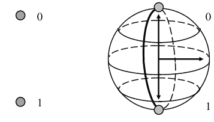

# 量子计算：物理学、区块链与深度学习智能网络（科学与经济学系列 2）

## Melanie Swan
美国普渡渡大学

## Renato P. dos Santos
巴西路德教义大学

## Frank Witte
英国伦敦大学学院

## 作者简介

**Melanie Swan** 是伦敦大学学院（UCL）区块链技术的研究助理，普渡大学哲学系的技术理论家，奇点大学教员。她是多家初创公司的创始人，包括区块链研究院、DIYgenomics 和 MS Futures。Melanie 的教育背景包括宾夕法尼亚大学沃顿商学院的金融工商管理硕士（MBA）、普渡大学的哲学博士以及乔治敦大学的法语和经济学学士。她是畅销书《区块链：新经济的蓝图》的作者。其他知名著作涵盖区块链经济学、人脑云接口、BCI 云思维、多基因风险评估、作为 DAC（去中心化自治公司）的大脑、神经通道、生物加密经济学和区块（区块链原生领域）。

Renato dos Santos 是区块链技术研究员，巴西路德教义大学研究生教授。他是英国区块链协会成员，发表了 100 篇关于区块链技术、物理学和计算机科学的论文。他拥有巴西路德教义大学的博士学位和科学学位。他的工作专注于智能技术、人工智能和计算机科学。

Frank Witte 在乌勒支大学完成了理论物理硕士（1992）和理论物理博士（1995）。他目前是伦敦大学学院的副教授。他是几本科学期刊和一本经济学教材的编辑。他曾访问剑桥圣约翰学院（英国）和伦敦理工学院。他的研究重点是量子物理、经济学和智能网络。

### 5.3.2 闪电网络上的基础路由 96
### 5.3.4 闪电网络中的新层：通道工厂 98

### 5.5.2 数字市场平台 103

### 6.1.2 量子比特币提议 115
### 6.1.4 量子货币 116
6.2 量子互联网 116
### 6.2.1 量子网络理论 118
6.3 量子网络：深度解析 118

### 6.4.2 基于卫星的量子密钥分发：全球竞赛 123

### 6.5.2 挖矿中的量子攻击风险 129
6.6 区块链的抗量子密码学 130
参考文献 132
# 第 7 章 零知识证明技术 135
7.1 零知识证明：基本概念 135
### 7.2 零知识证明与公钥基础设施 135
### 7.2.2 什么是 135
### 7.3 零知识证明：交互式证明 135

### 7.4.1 范围证明 135

### 7.5.1 SNARKs 与多方计算 135

### 7.6.1 针对 UTXO 链的交易 135
### 7.6.3 智能合约交易 135

### 8.1.2 概率可检证明 178
### 8.1.4 IOPs：多轮概率可检证明 178

### 8.3.2 什么是格？ 178
### 8.3.4 基于格的密码学与区块链 178

### 8.4.2 量子证明的结论 178
8.5 后量子预言模型 178
8.6 量子密码学未来 178
### 8.6.1 非欧几里得格密码学 178
参考文献 178

### 9.1.3 大数据并不智能 183

### 9.4.4 软件：损失优化与激活函数 183

### 10.2.2 标准化量子计算算法 209
### 10.2.4 量子仿真 209

### 11.2.2 统计神经场理论描述系统临界性 237
11.3 统计神经场理论的详细描述 242
### 11.3.1 神经系统的主场方程 242
### 11.3.3 系统作用的线性与非线性模型 242
### 11.3.5 最优控制理论 242
11.4 自旋玻璃模型总结 252

### 12.4.2 密密量项 272

### 12.5.2 节点状态 277

### 12.6.4 智能网络指标 288

### 13.5.3 强耦合等离子体 316

### 14.2.2 Ryu–Takayanagi 量子纠错码 330

336

xvi 量子计算：物理、区块链与深度学习智能网络
- 15.1.3 自然界的量子安全特性 345
- 15.4 量子信息/SNQFT 对应 358

表 5.1. 概率与对应关系 83
表 7.2. 量子物理中的机密性 150
表 11.4. 随机步走的随机场 245
表 11.6. 智能网络中的统计场 250
表 11.8. 统计场的系统 254

# 第 1 章

# 引言

量子计算……在计算机科学基础与物理学基础之间建立了前所未有的深度联系

> John Preskill (2000, p. 127)

这暗示现实是可以计算的。量子计算的惊人前提是，被认为不可理解的量子力学领域，至少是可以计算的。仅仅第一步就是用量子计算机模拟费曼所构想的量子力学世界。在这一里程碑之后，真正的目标是利用量子域来解决困难问题。

一些推测但合理的未来图景如下：量子计算的进展比预想的要快，但仍然处于非常早的阶段，具有巨大的不确定性。然而，考虑到早期量子计算机已经得到演示并出货，且全球范围内有数百个实验室正在从事高水平、资金充足的竞争性研究，在未来几十年内出现更好的量子计算机是可能的。

技术的发展最初是基于物理学的，物理学不断进展所带来的更广泛的概念和方法可以应用于新技术的学习与开发。在这工作中，物理学方法旨在研究智能网络技术（智能自运行网络，如区块链和深度学习神经网络），通过引入统计物理和信息论对智能网络系统进行表征、控制、关键性评估和新颖性催化。

技术物理学（Technophysics）的出现是当代科学多种因素汇聚的结果。首先，过去的几十年里，物理世界与数学、算法和信息论的表示世界之间存在若干非凡的联系。一个例子是统计物理学在凝聚态物理中的自旋玻璃与组合优化问题之间建立了联系。具体而言，通过统计物理学已经在凝聚态物理中的玻璃态变、信息论中的纠错码与计算机科学中的概率论之间建立了关联（Mezard & Montanari, 2009）。另一个例子是利用机器学习算法来理解物理系统，以及利用与物理系统和材料的类比来理解算法的运行，这种共生关系（Krzakala et al., 2007）。第三个例子是全息原理（Susskind, 1995），该原理在 AdS/CFT 对应中被形式化（Maldacena, 1998），以及其与信息论（Harlow & Hayden, 2013）、量子纠错码（Pastawski et al., 2015）以及张量网络（Witten, 2016）的联系。全息原理表明，在任何物理系统中，空间体积与其边界区域之间存在对应关系。其意义在于，内部主体可以通过少一维的边界理论来描述，即在 3D 体积与 2D 边界之间的信息压缩机制。

产生技术物理学的另一个因素是学术方法的交叉融合。无论领域如何，各种方法已成为科学方法正典的一部分。这些方法包括复杂性科学、网络理论、信息科学和计算图。许多领域现在都有了计算科学的对应领域，硬科学（如计算神经科学、计算化学和计算天体物理学）以及人文科学（出现在数字人文、语义数据结构研究以及文本挖掘与分析中）。相反的趋势也存在，即研究领域开发了基于物理学的对应学科，例如生物物理学、经济物理学和技术物理学。学术方法之间的交流正导致跨越所有学术领域的更全面、更稳健的通用科学研究工具的发展。

# 引言

### 1.2.1 概念工具包

本文的前提是，在当今世界，必须顺应技术物理学的思想才能有效。因此，本书在过程中介绍了一套知识模块汇编，以实现这种熟练运用。掌握超越初始训练领域的更广泛领域的概念和方法，特别是来自当代研究前沿和间隙的概念，可以增加对世界的创新能力和影响力。本书提供了一种策略，利用智能网络领域理论作为工具，管理未来几十年及之后量子计算颠覆性可能带来的巨大不确定性。方法整合了统计与理论物理学、信息论和计算机科学。技术物理学方法植根于理论和应用，既在定义概念理解的层面呈现，也概述了形式化和分析技术如何在实践中应用。

可以详述构成技术物理学知识正典的标准思想。这些包括特征值和特征向量，以及用于测量系统多维配置并可作用于系统的算子概念。哈密顿量（Hamiltonian）是测量系统总能量的卓越算子，允许将问题写成能量最小化问题的形式。互补性（量子系统在同一时间只能测量一个属性）、时间膨胀（系统对于不同的观察者不同）以及基于几何的度量是重要的。在不同的几何结构、坐标系以及时空域之间，存在一组可选的参数。

在某种意义上，网络、图、张量、矩阵、算子和 3D 这些词都指向同一类概念，虽然在技术上不是同义词，但它们相互暗示为可计算系统的属性。计算图是一个网络，网络意味着计算图或矩阵，且它们都是 3D 或更高维的。此外，算子是一个矩阵，场是一个矩阵，张量网络和随机张量网络可以用于重写高维纠缠问题领域以便在分析上可计算。维度迁移、重缩放和简化是经常使用的技术。答案可能以概率的形式给出。体-边界对应是一个概念结构，其中系统可以被写成两个区域：一个少几维的表面，可用于询问作为更复杂且可能未知的主体区域。

一个关键的物理原理是将物理系统简化或渲染为可计算的形式，然后对其进行解析求解。计算复杂度是一个常因子。经典问题可以通过带有 SEI 特性（叠加、纠缠和干涉）的编写转变为量子可计算，这意味着将问题转换为一个涉及叠加、纠缠和干涉量子特性的结构。作为一个粗略的启发式方法，量子计算机可能允许问题计算的复杂度架构向上提升一级。在经典系统中需要指数级时间（即时间太长）的任何问题，在量子系统中可能只需要多项式时间（即实际利用的合理时间）。在经典的旅行员问题中，使用量子计算机可能可以在一半的时间内检查大约两倍的城市。

### 1.2.2 通用技术的新领域

智能网络技术正在作为标准功能产生各种新进展以解决重要问题，并在初始目的之外具有更大的扩展性。一个例子是共识技术，它通过挖掘操作提供区块链的加密安全，更通俗地包含了一种用于多智能体系统（人类或机器）自协调协议和治理的标准技术。其他通用技术的其他示例包括零知识证明、纠错和哈希函数，每种在泛化后都传达了一种新概念。

# 引言

零知识证明是计算证明，是算法的一种机制，可以轻松作为许多技术系统的功能，以提供隐私和验证。零知识证明除了陈述的正确性外不显示任何信息（数据验证与数据本身分离，关于底层数据产生零知识）。证明主要用于证明有效性，例如证明某人确实是其所称的人。证明也是一种信息技术。进行某些活动，抽象输出就是所需的结果（证明评估为位真/假或其他短输出）。证明的核心概念是执行某些工作并产生有效答案。

量子纠错对于修复受损的量子信息比特（量子比特）是必要的，它遵循不可克隆定理（量子信息无法复制）和不可测量规则（测量量子信息会损坏它）。因此，量子纠错涉及利用比特之间的纠缠，将原始比特的信息扩散到纠缠比特上，从而用于纠错（恢复）初始比特。直接用途是量子纠错。然而，巨大的益处是以纠错装置的形式创建了一种结构特征，可以更广泛地部署。这样一个项目部署纠错功能来控制原本不可预测的量子退火求解器的局部比特相互作用（Lechner et al., 2015）。整体概念是通过量子纠错类型模型进行系统操纵和控制。

哈希函数是另一个通用智能技术的示例，其底层机制并非如此但正在发现更广泛的。与证明一样，哈希函数是信息压缩技术的形式。哈希函数是一种可以在任意大小的数字数据文件（例如基因组、电影、上运行的算法。

软件代码库（或 250 页的法律合同）会生成一个固定长度的代码，通常为 32 字节（64 个字母数字字符）。哈希函数有许多用途，包括密码保护以及在互联网上发送安全消息，使得拥有哈希算法和密钥的接收方可以解密消息。哈希函数还在寻找新的用途。其中之一是由于互联网内容可以通过 URL 指定，因此其他程序可以用哈希格式调用该 URL（哈希函数标准化了任意长度 URL 的长度）。这一概念在 Web 3.0 中体现为哈希链接数据结构。

关键点在于智能网络中通用的特征集的开发，这些特征集可以转换给其他用户。这并不令人意外，因为新技术的一个特性是其完整的应用范围在最初是无法预想的，并会随着使用而演化。汽车最初被构想为马车。值得注意的是一个主题，即这些特征都是信息压缩和扩展技术的形式（证明和哈希函数压缩信息，而纠错扩展信息）。这同样并不意外，因为这些特征被应用于信息领域，在这些领域中，一个关键问题是任何信号的可压缩程度（或更广泛地说，信噪比和总可能的系统配置（熵））。然而，证明和哈希函数与传统的信息压缩技术不同，因为它们可以将任意大的输入转换为固定输出，这标志了灵活且动态的实时系统的属性。本书（特别是第 15 章）将这些见解扩展，用以解释新兴的特征（证明、纠错和哈希函数）以及更广泛的量子智能网络，基于一个维度模型（体-边界对应关系）。在体-边界对应关系中，压缩或扩展活动在高维区域（体）中执行，然后进行转换，使得结果在另一个区域（边界）中以较少的维度出现。

### 1.3 章节亮点

本书旨在提供洞察，介绍量子计算和量子信息科学作为计算领域中可能到来的范式转移，如何影响区块链和机器学习等其他高影响转型技术。书中建立了物理学与信息技术之间的理论联系。智能网络理论被提作为一种网络技术的物理理论，可以扩展到其向量子力学信息系统的潜在进展。其目的是为技术理论提供物理基础，以便在下一代智能网络系统的设计、运行和催化涌现中于部署。这项工作提出了智能网络理论的理论构建，特别是智能网络场理论（SNQFT）和智能网络量子场理论，作为进一步开发智能网络系统、特别是量子智能网络（在量子信息处理环境中实例化的智能网络系统）的基础基础。

开发智能网络理论作为宏观级系统控制理论具有迫切的原因，因为许多智能网络技术实际上是黑箱，其操作从一开始就是未知的（深度学习网络），或者通过机密交易变得隐藏（基于区块链的经济网络）。此类智能网络是复杂系统，其系统临界性和非线性相变的可能性是未知的，且可能非常巨大。

为了这一目标，第一部分介绍了智能网络和量子计算。第二章定义了智能网络和智能网络理论，并在经典和量子领域发展了智能网络场理论。第三章提供了量子计算的概述，包括基本概念（如比特和量子比特）以及对不同的量子硬件方法和超导材料的详细回顾。书中还讨论了一个至关重要的问题，即量子计算何时可能破解现有的加密标准（估计在 10 年内不太可能，但方法正在不断改进）。第四章考虑了量子计算中的高级主题，如干涉、纠错以及由 NIST 随机性信标产生的可证明随机比特。

第二部分对区块链和零知识证明提供了详细考虑。第五章详细阐述了经典区块链中正在进行的各种当前“量子计算：物理、区块链与深度学习智能网络”改进。第六章讨论了量子互联网、量子密钥分发、对区块链的风险，以及以量子格式实例化区块链协议的建议。第七章包含对零知识证明技术及其现状和方法的深度研究。第八章详细阐述了后量子密码学和量子证明。

第三部分关注机器学习和人工智能。第九章讨论了经典机器学习的进展，例如对抗学习和暗知识（也是一种信息压缩技术），第十章阐述了量子机器学习的现状。在量子计算机中实现的第一类应用与机器学习相关，因为机器学习和量子计算方法都被应用于解决同一类型的优化和统计数据分析问题。

第四部分基于统计物理学、信息论和模型场理论发展了智能网络场理论。第十一章详细阐述了两种模型理论：统计神经场理论和自旋玻璃理论。第十二章详细发展了具有系统元素、操作和临界性检测措施的智能网络场理论，并考虑了其在区块链和深度学习智能网络系统中的应用。

第五部分通过一种名为 AdS/CFT 对应（也称为规范引力对偶和体-边界对应关系）和全息码将智能网络场理论扩展到量子领域。十三章描述了全息原理及其在 AdS/CFT 对应中的形式化，以及通过对应连接物理与信息论的工作。第十四章讨论了将 AdS/CFT 对应定量转化为全息量子纠错码。

第六部分将智能网络视为智能网络的量子实例化，并详细阐述了智能网络量子场理论。第十五章提出了若干推测性猜想，关于智能网络量子场理论如何基于体-边界对应关系参与全息格式。书中讨论了工作的风险、局限性和更深远的后果，提出了多个量子计算时代的可能性。

- Harlow, D. & Hayden, P. (2013). Quantum computation vs. firewalls. J. High Energ. Phys. 2013, 85.
- Krzakala, F., Montanari, A., Ricci-Tershenghi, F. et al. (2007). Gibbs states and the set of random constraint satisfaction problems. PNAS. 104(25): 10318–323.
- Lechner, W., Hauke, P. & Zoller, P. (2015). A quantum annealing architecture with all-to-connectivity from local interactions. Sci. Adv. 1(9)e1500838.
- Maldacena, J. (1998). The large N limit of superconformal field theories and supergravity. Adv. Theor. Math. Phys., 2:231–52.
- Mezard, M. & Montanari, A. (2009). Information, Physics, and Computation. Oxford UK: Oxford University Press, pp. 93–168.
- Pastawski, F., Yoshida, B., Harlow, D. & Preskill, J. (2015). Holographic quantum error-correcting codes: Toy models for the bulk–boundary correspondence. J. High Energ. Phys. 6(149):1–53.
- Preskill, J. (2000). Quantum information and physics: Some future directions. J. Modern Opt. 47(2/3): 127–37.
- Susskind, L. (1995). The world as a hologram. J. Math. Phys. 36(11): 6377–96.
- Witten, E. (2016). An SYK-like model without disorder. arXiv:1610.09758 [hep-th].

本工作旨在建立物理学与信息技术之间更深层次的联系。智能网络理论被提出作为一种网络技术的物理理论，特别是为了涵盖向量子计算领域的潜在扩展。其目标是为技术理论建立一个物理基础，该基础可以在下一代智能网络系统的设计、运行和催化涌现中被易于部署。智能网络理论作为智能网络技术物理基础的通用概念被发展为智能网络场理论（SNFT）和智能网络量子场理论（SNQFT），分别对应两个尺度领域。其直觉是，从表征、控制、临界性和和新颖性的角度来协调多粒子系统的方法，是通过 SNFT 和 SNQFT。此类理论应当能够对智能网络系统做出相关预测。

智能网络是智能自主网络，是全球计算基础设施的一个新兴兴领域，其决策和自运行能力被直接构建在软件中。智能网络的示例包括区块链经济网络、深度学习模式识别网络、无人机、广告实时竞价（RTB）以及高频交易（HFT）网络。更正式地说，智能网络是状态机，它们对世界的现实状态进行概率性猜测，并根据这些猜测自动行动。通信网络正在运行可执行代码意义上转变为计算网络。智能网络是一个临时性特征，可能包含成千上万甚至数十亿组成元素，因此其设计和运行需要一个理论上稳健的模型。通过使用统计物理（统计神经场理论和自旋玻璃模型）和信息论（反德·西特空间/共形场理论，AdS/CFT 对应关系），本工作提出了 SNFT 来协调智能网络系统中的大量项目（fleet-many items）。

开发智能网络理论具有紧迫的动机。智能网络技术已被证明是复杂性领域（表现出复杂系统的行为），这些领域理解和管理具有挑战性。智能网络类似于量子多体系统，其中的相互作用变得复杂到无法直接建模。许多智能网络技术实际上是黑箱，其操作要么从一开始就是未知的（深度学习网络），要么通过零知识证明变得隐藏（区块链经济网络）。同时，智能网络技术正在经历快速的广泛采用，规模变得难以处理，并可能迁移到量子计算机。

研究的直觉是，为了进一步发展智能网络技术，有必要采用技术物理学方法（将物理原理应用于技术领域）。本工作中提出的智能网络理论，即 智能网络场理论（SNFT）和智能网络量子场理论（SNQFT），旨在为智能网络技术提供一个根于物理基础的整合理论基础。智能网络理论可以从表征、控制、临界性和新颖性涌现的角度来协调多粒子系统。

智能网络技术已经以 3D 格式实例化（意味着可编程性和解析求解的计算图），这使得它们在迈向量子计算机部署的下一步中在某种程度上具备了“量子就绪”状态。3D 格式暗示了在具有叠加和多维空间的量子信息系统中进行实例化的可能性。在量子计算机中实施的下一步是以量子计算属性的形式编写智能网络技术，即叠加、纠缠、干涉（SEI 属性是量子属性）。

智能网络技术是量子就绪的，其 3D 特性是由于被实例化为 3D 计算图格式而产生的副作用。这是计算领域和终端用户领域向 3D 这一更广泛转变的一部分。技术接口正在适应更多与现实的 3D 交互（现实本身是 3D 的）。3D 接口的代表是点云数据是一种新的互联网流量。点云数据捕获有关定位的信息。作为被实例化为 3D 计算图格式的副作用，智能网络技术是量子就绪的，即 3D 的。这是计算领域和终端用户领域向 3D 这一更广泛转变的一部分。深度学习等许多智能网络技术在定义上已经是 3D 实例化的，这有助于其向量子系统的潜在迁移。

智能网络概念被配置为存在两个计算时代（图 2.1）。

到目前为止，从主机到移动计算的进展主要涉及简单网络的信息传输。然而，现在计算的第二个阶段开启了一种新的范式——智能网络。

智能网络有不同的发展阶段。早期智能网络类（智能网络 1.0）可以被识别。智能网络包括具有自动负载平衡的智能电网 RTB 市场以及智能城市生态系统。智能网络技术的概念源于自动化市场交易的 HFT。2016 年，HFT 估计占美国股票交易量的 10%-40%，占外汇和商品期货交易量的 10%-15%。

另一个智能网络技术的早期例子是 RTB 市场，一个在线展示广告的自动化市场。展示位在 RTB 模型中销售，当消费者访问网站时，广告主实时竞价展示位。虽然 RTB 效率很高，但该市场仍存在两种定价模型：RTB 和预留合约。在其他智能网络技术中，智能电网进行自动负载平衡，其中被复杂行为的涌现，特别是耦合振荡器的同步。智能城市生态系统表明，在协调预计 2020 年部署的 500 亿连接对象方面面临着巨大的智能网络挑战。

当代的智能网络技术是智能网络 2.0。虽然区块链分布式账本和深度学习系统是智能网络技术最著名的例子之一，但还有许多此类

自运行网络。其他示例还包括自动化供应链和物流网络（TradeTech）、自动驾驶车辆网络（TransportTech）、工业机器人、潜在的量子互联网、Web 3.0 的数据结构互联网以及虚拟现实视频游戏。智能网络运行的规模级级跨度极大，从非常宏大的规模（如空间物流平台（Supply Chain 4.0），Chen & Ho, 2018），到极微小的规模（如脑机接口的控制系统（Swan, 2016）和人脑云端接口（Martins et al., 2019）。

区块链是一种分布式数据结构，通过密码学保护以防止修改（无论是恶意的还是无意的）。区块链（技术上，是指通过密码学链接在一起的交易块）是更广泛的分布式账本技术中的一种拓扑结构（Tasca & Tessone, 2019）。分布式账本技术在经济科技（EconTech）和政府科技（GovTech）领域具有意义，因为机构功能可以外包给计算网络（即协调人类活动模式的行政功能）。区块链为大型跨国参与者的协调提供了一种替代性的法律管辖区，使用博弈论激励而非执法，并将经济学作为设计原则。区块链正在通过零知识证明技术和可验证计算，演进到隐私科技（PrivacyTech）和证明科技（ProofTech）的新纪元。

机器学习是一种人工智能技术，由算法组成，依靠信息模式和推理来执行任务，而非显式指令。深度学习神经网络是人工智能的最新体现，它利用计算机进行通常需要人类完成的认知工作（物理或心理）。深度学习神经网络是一种机械系统，通过对数据中的高层抽象建模并循环带有反馈的尝试错误来“学习”，从而建立一个能够对新数据做出准确预测的系统。机器学习系统是识别科技（IDTech），它通过识别对象（物理或数字）的能力，类似于金融科技（FinTech）、合规科技（RegTech）、贸易科技（TradeTech）和健康科技（HealthTech）作为标准，将它们各自的领域数字化、标准化和自动化。对象包括几何深度学习范围内的模式、结构和其他拓扑特征。

深度学习的前提是现实由模式组成，这些模式可以通过数据科学方法检测到。深度学习作为一种智能网络技术而引人注目，它以经过训练以执行某活动的学习网络的形式，取代了硬编码软件。最初软件意味着在封闭域域中运行的固定程序（Software 1.0），现在软件开始意味着在初始未完全预设的范围内与现实动态交互的程序（Software 2.0）。

Web 3.0 为互联网增加了更多功能、协作和信任（Web 1.0 是只读网络，Web 2.0 是读写网络，而 Web 3.0 是读/写/信任网络）。其理念是从开始将隐私和可验证性等信任机制直接安装到软件中。区块链在整合此类隐私科技和证明科技方面领先，功能可能会扩展到其他领域。

Web 3.0 表示数据结构互联网的概念。有许多基于互联网的数据结构，如区块链、软件结构（Github）以及各种其他内容库。每个元素可能都有 URL 路径。通过使用 Merkle 树工具，基于互联网的树可以作为分布式认证哈希链接数据结构在其他应用程序中调用。哈希码（或简单的 hash）是哈希函数的固定长度输出（在区块链协议中通常为 32 字节（64 个字符）），用于将任意大小的数据映射到固定大小的数据。Merkle 树或哈希树是一种树，其每个叶子节点标记有数据块的哈希值，每个非叶子节点标记有其子节点的密码学哈希值。

分布式认证哈希链接数据结构可以通过项目 Labs 的星际平面数据 (IPLD) 进行部署。早期星际文件系统 (IPFS) 是一种内容寻址的系统。IPLD 是一种具有量子纠缠的、量子智能网络应用，通过博弈论实现互操作性。区块链是互操作性的 Merkle 树森林。此类创新是互联网的重大升级，隐私和安全是智能网络的重要属性。

在更远的未来，量子智能网络可能包含下一代智能网络（表 2.3）。量子智能网络的第一个应用是量子互联网，它处于量子分发的早期阶段。量子区块链是一种可能性，在量子系统中实现量子分发，可能使用量子退火、全息共识和量子通道。量子机器学习已经在取得进展（通过量子退火、量子模拟和几何深度学习）。最后，可能是脑机接口。

许多智能网络具有自主协调的项目。这包括无人车辆（空中、水下和空间）、自动驾驶车辆（汽车、商业卡车和小型运输胶囊）、无人机、机器人集群（机器人集群是作为一个系统的多个机器人）。自动车辆网络和机器人集群必须相互之间协调行为，如集群、觅食和导航，以执行任务。

复杂性理论用于研究可能会出现异常行为（如抖动、资源节省和相变）的自动车辆网络（Singh et al., 2017）。将集群限制在优化形成中是无人机的研究重点，特别是具有自主攻击能力的无人机（Vasarhelyi et al., 2018）。最优控制理论已被提为自控软件风险管理标准的基础之一（Kokar et al., 1999）。

自协调机器智能网络群的应用出现在越来越多的工业和军事用例中，与目标材料交付、精准农业以及空间和水下探索有关。自动驾驶是一种备受关注的智能网络技术。当代研究的一些主题集中在碰撞回避（Woner et al., 2019）和定义驾驶自动化等级的国际标准（SAE, 2018）。

自动车辆网络和机器人集群在使用其他智能网络技术（如区块链、机器学习和物联网传感器）方面存在融合故事。区块链为自动车辆网络提供了多种功能，包括自动记录、责任追踪、合规监控、隐私、安全通信和自协调。值得，区块链共识算法是一组代理对特定状态达成一致的方法。

并不局限于挖矿和交易确认的背景。因此，已经提出了基于区块链的机器人群系统自我治理（Ferrer, 2017）。

区块链记录日志功能结合智能合约，将用于在需要时自动提供保险理赔，并在海底和空间探索等新领域注册发现索赔（对发现的物体行使主权/索权）。智能城市 IoT 传感器网络可以与区块链和机器人群结合使用，供消费者和企业请求“机器人群即服务”功能，派遣出一群机器人来执行感知项目。机器人传感器群可以调查事故后的现场以呼叫紧急医疗和警察服务，可以被聘用于提供安保，并扫描管道和其他基础设施以进行例行维护。IoT 机器人群模型在某种意义上实现了科幻小说中的理想，即由企业家拥有的移动视频摄像机机队，作为一种新一代公民新闻的形式。（Hirin, 2002）

可验证计算和零知识证明使得智能网络的自我协调和控制达到了新的水平。高级应用（特别是用于军事的）可能包括此类场景：代理可以在信息极少的情况下协作寻求解决方案。例如，任务信息可以存储在 Merkle 树中而不泄露原始数据（Ferrer et al., 2019）。群代理可以使用区块链的安全通信和达成共识的属性进行协调、自我治理和问题解决。此外，零知识技术（将数据验证与底层数据分离）可以以两种方式使用：让代理获取与其自身活动相关的 Merkle 树存储数据，以及通过交换密码学证明向同伴证明其完整性。

区块链的各种特征都涉及了这种先进的群聚机器人模型。其基本特征是隐私和安全通信。然后，共识技术被用于在没有中央权威的情况下达成自组织的群体共识。Merkle 树路径寻址被用于仅暴露所需的信息。最后，零知识证明被用于向同伴证明诚实参与，而不泄露任何底层个人信息。

### 2.3.4.2 深度学习链

深度学习链指的是智能网络在通用控制技术概念上的进一步融合，这种技术兼具区块链和深度学习的属性（Swan, 2018）。深度学习链实例化了区块链的安全自动化、审计日志跟踪、可报性和验证的交易执行，以及深度学习的对象识别（IDTech）、模式识别和优化技术。基于区块链的强化学习形式的深度学习链已被应用于交通控制系统（Duong et al., 2019）。此外，深度学习链可能被用作机队互联网连接智能网络技术的通用控制技术，例如无人机（UAV）、无人机、自动化供应链网络、机器人群、自动驾驶车辆网络和空间物流平台。深度学习链在自动驾驶中的基本功能是识别驾驶区域中的物体（深度学习）和跟踪车辆活动（区块链）。深度学习链同样可以应用于人体，作为医疗纳米机器人的智能网络控制技术，识别病原体（深度学习）并对其进行跟踪和扩展（区块链智能合约）。各个智能网络技术平台之间（见表 2.4，根据其运行重点列出）可能会有更深融合。例如，区块链开始在智能城市电网管理背景下更频繁地出现（Pieroni et al., 2018）。

计算证明是一组机械算法，可以作为功能集成到许多智能网络技术系统中，以提供隐私和验证。零知识证明技术在区块链中的潜在广泛应用使其成为一种隐私技术（PrivTech）和证明技术（ProofTech）。零知识证明技术可以类似的应用于其他智能网络系统，例如机器学习，如在深度学习证明的概念中。第一个原因是证明的通常用例是证明有效性。

| 智能城市传感器景观 | 目标识别、模式识别 |
| 供应链物流 | 溯源、订单、支付 |
| 空间物流 | 原地资源配置、异步通信 |

证明可能是一种有效的解决方案，因为它们是一种信息压缩技术。部分活动正在进行和

抽象输出是结果所需的全部（证明给出一个比特的真/假答案或其他简短答案）。通过证明结构，深度学习感知器可以使用比现在更少的信息位通信其结果。感知器是一个双层信息系统，具有关于处理的元属性（误差贡献、权重、偏置）以及处理中计算的底层值。证明结构可以实例化在 TensorFlow 架构中，使得证明作为一种通过矩阵乘法的特征自动生成。证明的概念是执行某些底层工作并获得一个有效答案作为结果。深度学习证明的想法是，在深度学习系统中，感知器可以执行其节点贡献的证明。

深度学习共识算法是另一种想法，共识算法被应用于深度学习系统中，使感知器自我协调答案。通过深度学习共识算法，感知器可以自组织节点处理，以及将其初始配置为层和节点。共识技术是多代理系统的自我组织和治理机制。

智能网络理论作为智能网络技术物理基础的概念发展为 SNFT 和 SNQFT，相对于两个尺度域。直觉是，从表征、控制、临界性和新颖性涌现的角度组织多粒子系统的方法是通过 SNFT 和 SNQFT 这样的场理论。这些理论应该对智能网络系统的运行情况做出相关的预测。

大规模网络是当代现实的一个特征。此类网络实体是由成千上万或数亿个组成的复杂系统。

元素，并且需要 SNFT（智能网络场理论）或其他类似的机制来对其活动进行自动化表征、监控和控制。需要一个具有理论基础的模型，提出了基于统计物理学的智能网络理论（统计神经场理论和自旋玻璃模型）、信息论（AdS/CFT 对应）以及模型系统。广而言之，SNFT（传统或量子）是一种用于智能网络系统表征、监控和控制的场理论，特别是用于临界性检测和海量（fleet-many）管理。

SNFT 的目的是对智能网络系统进行表征、监控和控制。第一个目标是表征。必须开发标准的指标和度，以便在智能网络系统演化并可能在扩展性和部署上增长时，轻松识别其特定行为。理论应当能够评估正向（涌现创新）和负面（闪崩）行为。

SNFT 的第二个目标是在单个元素和整个系统层面，对当前和演化中的行为进行监控。监控涉及当前正在展开的智能网络操作，也可能在未来发展。例如，在更远的未来，深度思考者（高级深度学习系统）可能会上线。尽管深度学习网络目前是孤立并受限于某些计算基础设施的，但想象学习算法可能会引入互联网。风险管理是一个核心关注点。深度思考者注册表（Deep Thinkers Registry）可以作为追踪实体活动的保护机制，并可能由计算伦理审查委员会进行年度审查以维持其许可。这是一个关于未来的示例，展示了 SNFT 强化的程度，以及它们可能帮助促成的不确定的未来状况。

SNFT 的第三个目标是控制，用于海量项目的协调。编排海量项目是智能网络技术的一个明确的自动化经济用例。这涉及到在任何连接互联网的智能网络系统中安全地协调海量项目的能力，这些包括自动驾驶车辆、无人机、区块链对等节点、深度学习感知器、智能城市 IoT 传感器、家庭社交机器人、医疗纳米机器人以及供应链收货。智能网络技术的长期部署范围可以延伸到极微的领域（如人体细胞域）和极宏大的领域（如空间文明建设）。

虽然 SNFT 的实际应用是海量项目的自动化协调，但风险管理的应用是能够检测并防止非预期的临界时刻，例如潜在的相变。SNFT 的一个关键方面是对系统临界性的预测性风险管理。为理解智能网络建立数学和理论基础是重要的，以便可以尽可能地对临界点和相变进行预测性管理。智能网络中可能构成临界性和相变的事件既是网络内部的预期情况，也是外部的涌现情况。一些例子包括金融传染、网络安全、新技术的出现和电磁脉冲。

SNFT 也可以对智能网络系统的良好设计有所帮助。它们为将智能网络作为当代世界的新技术对象进行研究提供了正式的科学依据，特别是智能网络正处于新兴、演化且具有高影响的状态。

更准确地说，SNFT 是任何对区块链和深度学习网络等智能网络系统进行表征、监控、控制的正式方法。尽管有不同类型的智能网络，但区块链和深度学习是开发场理论的重点，因为它们最复杂、最稳健且在概念上最新。

### 2.5.1 场理论中的“场”

“场”一词既有类比意义，也有字面意义（物理意义）。本工作中引用的其他术语（如温度和压力）在物理背景下可能既有精确的分析含义，也有概念含义。这些术语可以从概念上应用于它们在智能网络系统中承担的服务目的和功能。

在概念意义上，“场”有两个主要含义。首先，也是最通用的，场是指将多个项目作为一个单元单元进行控制的能力。SNFT 的必要功能是管理海量项目。一种想法是将它们作为一个场来控制，其中“场”这一术语可能根据位置、能量、概率、梯度或其他参数进行动态定义。场的概念可以用于协调成千上万甚至数百万的组成元素（如区块链对等节点或深度学习感知器）。现有智能网络操作的一个例子是光遗传学（其中神经元表达一种蛋白质，使其活动可以被光控制）（Boyden, 2015）。光遗传学是“神经元场的开关”，因为它传达了一次开启或关闭整个神经元场的能力。因此，随着 SNFT 的创建，那些经光激活的细胞是作为一个场被控制的，而不是单独控制（Swan, 2021）。

SNFT 中“场”的第二层含义是，场可能指的是这样的情况：系统中的每个元素对整体指标或网络活动都有其测量值和贡献（可能用于计算系统的哈密顿量或其他复合度量）。这种场的概念（来自物理中有效场理论的发展）表明景观中的每一点都有一个可计算的值，通常指的是函数在整个空间、场的每个位置都有一个值。

SNFT 可以以标量、向量和张量的项构建结构。张量是一个复杂的数学对象（映射函数并与其他对象相互作用的几何对象）。最简单的张量是标量（零阶张量）和向量（一阶张量）。标量是有幅但无方向的张量（零阶点），由一个数字描述。质量和温度是标量。向量是有幅和方向的张量（一阶张量或向量线）。向量通常表示为箭头，并相对于坐标系定义。力和速度是向量。张量是多维结构，可以用矩阵表示。张量在深度学习背景下是常见的。Google 的张量处理器（TPU）和 TensorFlow 软件使用的张量意义是执行极快速矩阵乘法。张量可以用多维矩阵表示，而 TPU 和 TensorFlow 之所以快是因为它们在执行矩阵乘法时不内存中存储中间值。

SNFT 的一种方便的理论方法基于统计物理。选择统计物理是因为它关注大型系统中的概率和推理。用于阐述 SNFT 的两个模型系统也基于物理系统的统计模型（大脑和无序磁体）。

> 在我看来，所有的物理学有一天都会被发现遵循热力学和统计力学的模式。

—— John Archibald Wheeler (1983, p. 398)

统计物理是一个包含统计力学、概率论和热力学的统称。统计物理的巨大优势在于它提供了一种基于概率的泛化方法，将微观噪声与宏观标签联系起来（Mayants, 1984, p. 174）。智能网络根本上也是基于概率的。区块链和深度学习等智能网络技术是概率状态机，通过协调成千上万的组成元素（处理节点，无论是感知器还是矿工，都可以视为粒子）对世界的现实状态做出高概率预测。因此，统计物理可以是智能网络形式化的良好基础。

麦克斯韦是最早建议将概率作为微观科学的通用模型的人之一。统计力学在吉布斯的早期发展中，同样被意设计为一种基于概率的通用方法，并继于经典力学之后（Gibbs, 1902）。统计力学的目标是解决机械系统的各个方面，涵盖微观和宏观层面，例如解释气态与非气态之间的转换。

统计物理学的热力学方面在智能网络场（SNFTs）的公式中相关，因为智能网络是具有热力学效应的物理系统。区块链是全球性的物理网络系统，平均由约10,000个节点组成，托管比特币 [10,403 (Bitnodes, 2019)] 和以太坊 [8,141 (Ethereum, 2019)] 的交易账本。深度学习网络也有物理基础，它们运行在专用硬件（NVIDIA GPU 网络和 Google TPU 集群）上。功、热和能量等概念在智能网络系统中具有衡量标准。区块链以共识算法（工作量证明、权益证明等）的形式运行，这些这是提供网络安全和更新分布式计算系统账本余额的主要机制。深度学习网络也执行“功”，体现在运行操作周期以为数据推导出预测分类模型。网络消耗大量资源，在层级之间迭代地反复循环，通过对相关的抽象特征集进行加权来优化试错猜测，从而使新数据被正确识别。

基于热力学性质，已经提出了关于区块链和深度学习的物理学（Theophysics）公式。例如，区块链工作量证明共识过程可以实例化为量子计算机上基于哈密顿量退火过程的能量优化问题（Kalinin & Berloff, 2018）。在深度学习中，机器学习的热力学方法被用于为机器学习系统中的推理提出表示学习方法，其失真可以被测量为一种热力学量（Alemi & Fischer, 2018）。

场论是一种描述背景空间以及该空间内组成元素行为的理论。在经典物理学中，场是每个点都受到物理量影响的区域，无论是力、温度还是任何标量、向量或张量。例如，物体落到地面是因为它们受到了地球引力场的影响。场是受物理量影响的空间区域，该物理量可以用数字或张量（多维数字）表示，并且在空间和时间的每个点都有一个值。例如，气象图为地图上的每个点都分配了一个温度。可以在固定的时间点（今天的温度）或在时间间隔内对温度进行研究，以理解系统的动力学（温度变化的影响）。

场论是研究系统动力学的特别好的机制。系统动力学是指系统如何随时间或随系统所依赖的其它独立物理变量而变化。动力学是通过编写一个称为场的拉格朗日（Lagrangian）或哈密顿量（Hamiltonian）的方程，并将其视为经典或量子力学系统得到的，系统可能具有无限多个自由度（参数）。所得场论被称为经典场论或量子场论。经典场的动力学通常由关于场分量的拉格朗日密度规定，可以通过作用量原理获得其动力学。量子场的动力学则更为复杂。然而，由于量子力学可能是所有物理现象的基础，至少在原理上，应该能够将经典场论转化为量子力学术语，这在 SNFT 和 SNQFT 的构建中得到了假设。

在量子力学尺度下，场论背后的直觉是，场而不是粒子，可能是现实的基础构建基石。例如，费曼指出，在量子场论的现代框架下，即使不引用测试粒子，场也占据空间、包含能量，且它的存在排除了经典的真真空。这导致物理学家将场视为物理实体以及量子力学系统的基础性方面。电磁场可以拥有动量和能量这一事实使其变得非常真实（Feynman, 1970）。由此的一种解释是，场是粒子的基础。粒子作为所谓物质场的波或激发而产生。现实可能由称为场的流体类物质（具有流动属性）组成。量子力学现实可能由场组成，而非粒子。

基础理论是基础真理，而有效理论是在缺乏额外证明或知识的情况下，合理有效的理论。基础理论具有相同的绝对真理权重。有效理论的“有效”体现在：它是对尚未被完全理解的情况的合理近似。物理经典理论最初被认为是基础的，但随后发现它们在宇宙无处不在。牛顿物理描述滑轮，但不描述电子或详细的行星运动（爱因斯坦物理被用于 GPS 技术）。从这个意义上说，所有的自然理论都是有效理论，每种理论都是某种未知的更基础理论的可能近似。

有效场论（effective field theories）在这里还有另一种含义，即该理论仅在特定范围内有效。无论使用何种领域或长度尺度来实验验证该理论，有效理论可能只在某些参数或机制内是正确的（Williams, 2017）。例如，有效场论是描述低能量和长波长（广义相对论领域）发生的情况的一种方法，而无需对高能量（量子力学领域）发生的情况有一个完整的图景。在高能物理（粒子物理）中，可以使用所谓的标准模型对过程计算，而不需要拥有量子引力的完整图景。反之亦然，在计算低能物理（引力波）中的问题时，高能物理（粒子物理）的影响可以用几个参数进行括括处理或求和（Carroll et al., 2014）。每个领域都有在其尺度范围内有效的场论。难点在于推导出能够解释高能物理和低能物理汇合的情况（如黑洞）场论。

经典场论是经典场的理论，而量子场论是量子力学场的理论。经典场论通常规定在传统的时空中（欧几里得尺度现实的三维空间和时间）。另一方面，量子场论规定在某种具有不同时空模型的背景上。为了降低复杂性，量子场论最通用地放置在固定背景上，如平直空间或闵夫斯基空间（三维量子力学时空）。无论场论规定在何种时空区域，其思想都是将量子场的几何和物质内容量子化为可以用于计算的有效理论。

SNFT 起于这样一个观点：有效场论是底层物理理论（在本例中为智能网络）的一种近似或有效理论。有效场论是一种精密工具，用于用更简单的解析求解的术语隔离并解释系统的相关部分。有效场包含了适当的自由度（参数），以描述在系统中选定的长度尺度或能量尺度内发生的物理现象，同时忽略其他距离或能量尺度下的子结构和自由度（Giorgi et al., 2004）。该策略是对底层理论在更短长度尺度下的行为进行平均，以推导出什么

被认为是更长尺度的简化模型，适用于整个系统。
有效场理论表示了系统内部存在不同尺度的层次。它们已被用于解释粒子物理、统计力学、凝聚态物理、超导性、广义相对论和流体力学等许多领域的领域并简化问题。在凝聚态物理中，有效场理论可以用于研究多电子原子，对于这类原子，求解薛定谔方程是不可行的。在粒子物理中，有效场理论试图解释诸如费米贝衰理论等问题。在广义相对论中，有效场理论被用于简化引力波，并理论广义相对论本身可能是量子引力完全理论的低能有效场理论（其中尺度为普朗克质量）。与量子计算特别相关的是有效场理论在超导和凝聚态物理领域的实际应用。

奇异有效场理论（SNFT）的一个关键要求是它可以用于管理复杂系统中跨越不同尺度。这种理论应该能够像复杂性理论规定的那样，“从微观噪声中识别宏观平滑性”（Mitchell, 2009）。可以使用包括统计物理在内的各种方法来连接复杂系统内的多个维度，从而从噪声中获取信号。

系统的某些方面在不同尺度上更容易测量。例如，计算量子力学系统不同层次的哈密顿量谱可能是挑战性的。此类计算在系统抽象的高层级可能是直接的，但在结合粒子实际运行的能量场时会变得更加困难。在这个尺度上，计算基本上是不可能的，因为有太多关于粒子运动的数据了。一种策略是将粒子重新阐释为量化场的状态（Jaffe & Witten, 2001）。场理论有助于恢复或将系统提升到更高层次的抽象，在该层次上可以进行此类计算。

该方法是在使系统在解析上可解的尺度上寻找或定义有效场理论。

例如，行星的椭圆轨道使用牛顿引力比使用广义相对论更容易计算。这种简化对于某些应用来说可能就是全部需要的。场理论的益处在于它提供了关注系统特定尺度的能力，强调其中一个同时限制其他的（Georgi, 1993）。目标是找到捕捉目标区域本质物理机制的最简单框架。例如，当人们关注较轻的粒子（如底夸克）时，可以从模型中消除较重的粒子（如 Z 玻子和 W 玻子）。

在复杂多级系统中，识别响应微观行为的宏观项是一项关键挑战。模型系统中由数万亿亿个运动粒子产生的温度和压力项，其类比并不总是是清晰的。因此，有效场理论是一个正式过程，可用于识别系统的“温度”项和其他系统级指标。有效场理论类似于重重化概念（从数学尺度缩放到系统的不同层级这一意义上，以便以一种简化的、可计算的方式来关注某个感兴趣的参数）。

有效场理论之所以重要，是因为在所有尺度上都存在有趣的物理现象。能够在尺度维度上上下移动可以使分析系统的某些方面变得更容易。其核心思想是使用有效场理论作为工具，孤立系统内部感兴趣的参数，并在该水平上与系统交互。当感兴趣的长度尺度与底层动力学的长度尺度之间存在巨大分离时，有效场理论的效果最好。

表 2.5 概述了推导有效场理论涉及的步骤。有效场理论的目标是指定捕捉感兴趣的本质物理的最简单框架。零步是确认没有现有的基础理论来描述该现象，并确认有效场理论是有用的。具有相关层面的理论可以被视为灵感来源。

| 4. 通过消除不必要的子结构简化复杂度 | 识别感兴趣的系统（自由度）、可以忽略的无关子结构，以及对称性、异常或其他属性 |

*来源：改编自 Manohar (2017)。*

五个步骤的第一步是通过表征要研究系统的整体范围和形状来定义系统，包括组成系统的相关尺度、长度或能量。第二步是识别系统元素，即构成系统的粒子或其他元素以及它们之间的相互作用类型。第三步是孤立旨在研究的特定变量。第四步是通过消除可以忽略的不必要的系统子结构来降低复杂度，以便研究系统内部感兴趣的变量。识别感兴趣子系统的细节，如自由度（系统参数）和任何复杂度属性。第五步是识别量化指标。对系统中的可用量进行识别并取平均，以生成如哈密顿量或拉格朗量的指标。

生物网络中的有效场理论示例是，系统范围的感兴趣量可能是神经元的发放（阈值），除了基础步骤外，有效场理论可能包括更复杂的方面。可能会有额外的测量数量，如可用能量、传播和状态范围。同样相关的是识别系统的动力学，即系统扩展的维度。可能存在多种自由度。自由度一词泛指系统参数。具体来说，自由度是一个统计术语，意味着每个独立变量可以影响系统存在的状态范围，以及独立运动发生的方向。自由度可以被构想为系统参数，在高级层次上可以被视为动态系统可以运动的状态和方式的统计量，无论这种“运动”是在物理空间中还是在抽象的配置空间中考虑。

总而言，指定有效场理论的关键步骤包括定义：(1) 系统，(2) 系统元素和相互作用，(3) 感兴趣的变量，(4) 可以忽略的无关结构，以及 (5) 通过系统平均产生温度类项的量化指标。将有效场理论开发技术应用于智能网络背景，其核心思想是考虑系统的不同层次和维度，并识别为了获得系统行为而计算的元素、相互作用相关量。这将在第 11 章和第 12 章中进行详细阐述。

Alemi, A.A. & Fischer, I. (2018). TherML: 机器学习的热力学. ICML 2018. 深度生成模型模型理论基础与应用研讨会。

Bitnotes. https://bitnotes.com/ 访问于2019 年 6 月 30 日。

Boyden, E.S. (2015). 光遗传学与神经科学的未来. Nat. Neurosci. 18:1200-1.

Brin, D. (2002). 窑炉人类 (Kiln People). 纽约，纽约: To Books.

Carroll, S.M., Leichenauer, S. & Pollack, J. (2014). 长波宇宙扰动的一致有效理论. Phys. Rev. D. 90:023518.

Chen, H. & Ho, K. (2018). 基于混合整数非线性规划的集成空间任务规划与航天器设计. J. Spacecr. Rockets. 55(2):365–81.

Dorfler, F., Chertkov, M. & Bullo, F. (2013). 复杂振荡器网络与智能电网中的同步. PNAS 110(6):2005–10.

Duong, T., Tokki, K.K. & Chaudhary, U. (2019). 基于区块链的强化学习空中交通管理去中心化. 芬兰，奥尔陆大学。

Eternodes. https://ethernodes.org/network/1. 访问于2019 年 6 月 30 日。

Ferrer, E.C. (2017). 区块链：机器人群系统的新框架. arXiv:1904.09266 [cs.RO].

Ferrer, E.C., Hardjno, T., Dorigo, M. & Pentland, A. (2019). 通过 Merkle 树实现机器人群的安全与秘密合作. arXiv:1904.09266 [cs.RO].

Feynman, R.P. (1970). 费曼物理学讲. 第一卷，伦敦，英国: Pearson PTR.

Georgi, H. (1993). 效能场论. Annu. Rev. Nucl. Part. Sci. 43:209–52.

Gibbs, J.W. (1902). 统计力学基础原理. 纽约，纽约: Scribner.

Giorgi, G.A, Guerraggio, A. & Thielder, J. (2004). 优化数学：平滑与凸情况. 伦敦，英国:

Hammi, B., Khatoun, R., Zeadally, S. et al. (2017). 用于智慧城市的物联网 (IoT) 技术. I Networks. 7.

Jaffe, A. & Witten, E. (2001). 量子杨-米尔理论，1–14. https://www.claymath.org/sites/default/files/yangmills.pdf. 访问于2019 年 6 月 30 日。

Kalinin, K.P. & Berloff, N.G. (2018). 基于模拟哈密顿量优化器的区块链平台. arXiv:1802.10091 [quant-ph].

Kokar, M.M., Baclawski, K. & Eracar, Y.A. (1999). 基于控制理论的自控软件基础. IEEE Intell. Syst. App. 14(3):37–45.

Manohar, A.V. (2017). 有效场论导论. EFT (粒子物理与宇宙学) 7月3–28日，1–94.

# 智能网络：经典场与量子场论

Martins, N.R.B., Angelica, A., Chakravarty, K., et al. (2019). 人脑/云接口. Front. Neurosci. 13:112.

Mayants, L. (1984). 概率与物理的谜团. 纽约，纽约: Springer.

Mitchell, M. (2009). 复杂性：导览之旅. 牛津，英国: Oxford University Press.

Pieroni, A., Scarpato, N., Di Nunzio, L., et al. (2018). 智慧城市：基于区块链技术的智能电网. Int. J. Adv. Sci. Eng. Info. Tech. 8(1):298–306.

SAE (2018). SAE 国际发布了针对其自动驾驶车辆“驾驶自动化等级”标准的更新视觉图表. SAE.

Sayedi, A. (2018). 在线展示广告中的实时竞价. Market. Sci. 37(4):553–68.

Singh, S., Lu, S., Kokar, M.M. & Kogut, P.A. (2017). 探测. 

Swan, M. (2015). 区块链蓝图. 斯坦福，加利福尼亚: O'Reilly.

Swan, M. (2016). 区块链的未来. O'Reilly.

Swan, M. (2018). 区块链量子计算未来. 伦敦，英国: Elsevier.

Williams, M. (2017). 有效场论。

Woerner, K., Benjamin, M., Novitzky, M. & Leonard, J. (2019). 分类. 

本页留白

本页留白

# 第3章

## 量子计算：基本概念

> ... 似乎物理定律对于原子的大小没有障碍 —— 理查德·费曼 (1985)

## 摘要

量子计算是科学的一个前沿，专注于信息的开发。量子计算涉及量子力学（如叠加、纠缠和干扰）。在物理学中，量子力学是描述电子、光子和其他亚原子粒子行为和相互作用的理论。量子信息是关于量子态的信息。

### 3.1 引言

量子计算机处于开发阶段，可能会与现有基础设施相结合，并通过本地或云服务访问。目前的方法展示了 30–70 个量子比特的能力，且保真率达到 99% 以上（即容错率低于 1%）。然而，量子计算机的可靠性仍存在不确定性。量子计算机可能擅长解决某些类型的问题，例如优化。这为计算提供了飞跃，能够解决许多问题，但并非所有。例如，考虑著名的优化问题，在更短的时间内搜索双倍的可能性。

量子计算是一项早期技术，具有许多风险和局限性。通用量子计算的长期目标尚未立即实现，因为许多挑战仍需解决。

### 3.1.1 破解 RSA 加密

最大的问题之一是量子计算机何时能够破解现有加密标准。目前的标准是 2048 位 RSA（Rivest–Shamir–Adleman）加密，它被广泛用于保护信用卡详情等活动。对于何时可能破解当前标准，预测各不相同，即因式分解 RSA 方法使用的 2048 位整数。

美国国家科学院在 2019 年发布的一份报告预测，在未来十年不太可能破解 RSA 加密。该报告指出，任何严肃的量子计算应用

# 量子计算：基本概念

至少还需要 10 年时间（Grumbling & Horowitz, 2019）。鉴于量子计算的现状以及近期的进展速度，“非常意外的是量子计算机在未来十年内能够破解 RSA 2048 或类似的基于离散对数的公钥加密体系” (Grumbling & Horowitz, 2019, 157）。该报告对纠错的立场是：“如今规模较大的设备中，量子比特的平均错误率需要降低 10 到 100 倍，计算才能足够稳健，以支持[所需的]规模化纠错”（Grumbling & Horowitz, 2019）。报告进一步强调，“在这种错误率下，这些设备所拥有的物理比特数量至少需要增加 $10^5$ 倍，才能产生数量数量有效逻辑比特”（Grumbling & Horowitz, 2019）。2016 年美国国家标准与技术研究院（NIST）的一份报告得出了类似的结论，某些激进的时间估计认为，量子计算机可能在 2030 年之前强大到可以破解 2048 位 RSA，成本可能高达十亿美元（*Chen et al.*, 2016, 6）。

预测中的一个复杂问题在于，通过某种方法分解 2048 位 RSA 整数所需的比特数（处理能力）各异。不同的算法需要不同数量的比特（Mavroeidis et al., 2018）。虽然很难猜测，“目前的估计范围从千万到十亿个物理比特不等”，这更详细地说明了量子计算机如何利用 2000 万个噪声比特（不带纠错）在 8 小时内完成计算（Gidney & Ehera, 2019）。该方法依赖于模幂，这是 Shor 算法中用于分解的计算开销最高的操作。2012 年，一台 4 位量子计算机分解了数字 143；2014 年，一台类似的设备分解了数字 563。快速扩展并非易事，因为所需的纠错程度尚不可知。Gidney & Ehera (2019) 最近的研究表明，2000 万个量子比特在没有纠错的情况下可能是可行的，这可能是一个里程碑式的进展。

后量子安全最接近的短期解决方案之一是量子密码学，其形式为量子密钥分发（QKD），这在量子信息科学路线图中早已预测（洛斯阿拉莫斯实验室 (LANL), 2004）。QKD 的理念是利用量子计算方法生成加密密钥，并通过全球通信网络、卫星和地面网络进行分发。QKD 已通过实验证明，但尚未商业化。预计 QKD 市场将从 2019 年的 8500 万亿美元增长到 2024 年的 9 亿亿美元（Gasman, 2019）。

### 3.2 基本概念：比特与比特

量子计算源于贝尔奖物理学家理查德·费曼（Richard Feynman）的直觉，即利用量子计算构建块可能进行强大的计算。他建议使用通用模拟器用计算机模拟物理学。

费曼研究了量子力学设备微观尺度上的许多问题。他著名的宣言是“底部很有空间”（Feynman, 1960），指的是原子尺度的微型化思想，使得整套 24 卷版的英国百科全书可以打印在针头上。这些思想帮助资助了 20 世纪 90 年代的纳米技术行业，并同样激励了当前量子计算的发展。为了直观理解，纳米尺度是 $10^{-9}$ m，原子尺度（以波尔半径作为原子核到电子的可能距离）是 $10^{-11}$ m，而电子尺度（电子的大小）是 $10^{-15}$ m。

费曼建议量子计算机可以是量子力学的有效通用模拟器。“一个通用量子模拟器”（Feynman, 1982, 474）将是一种不同的计算机，不是传统的图灵机。他提出了两种模拟量子力学的方法：一种是在构思计算机概念的同时，利用构建遵守量子力学定律的量子力学元件来构建计算机；另一种思想是用经典系统来模仿量子力学系统。

费曼的核心思想是，计算系统在结构上越接近自然界的结构，它们模拟自然界的能力就越强。他说，“各种场论具有相同的行为，并且可以以任何方式进行模拟，显然只需要少量的格点自旋和其他东西”（Feynman, 1982, 474–5）。假设世界是由离散晶格组成的，“场论的现象可以被固体态理论中的许多现象很好地模仿（固体态理论简单上是对晶体原子格点的分析，在这种固体态下，每个原子只是一个带有相关数字的点，遵循量子力学规则）”（Feynman, 1982, 475）。

费曼在 1982 年提出了通用模拟器的概念，随后出现了其他的理论发展。1985 年，大卫·德伊茨（David Deutsch）基于量子门可以以类似运行的想法提出了通用量子计算机。2000 年，贝特（Bennett）证明了模拟任何经典计算的可能性（Deutsch, 2000）。

其他量子比特对环境噪声敏感，可能会在使用前发生退相干。2012 年以来，常温超导材料取得了进展。目标是证明相对于经典计算的量子优势。

### 3.2.1 量子计算与经典计算

量子态（无论是原子还是光子）的一些特殊属性是叠加、纠缠和干涉。

- 叠加意味着粒子可以同时存在于所有可能的状态。例如，电子可以同时处于两个自旋态，即 1 和 0。
- 纠缠是指粒子组之间相互关联，其相互作用方式以至于当粒子被远距离分离时，每个粒子的量子态无法独立描述。在远距离下，这被称为贝尔对或非局域性。
- 干涉涉及粒子的波动性。干涉可以是相长的或相消的；当两个波汇合时，它们要么增强，要么减弱。

量子信息与当前技术有根本区别。正如诺贝尔物理奖获得者 W·D·贝特（W.D. Bennett）所说，“量子信息与算盘本质上是完全不同的”（Bennett, 2007）。

# 量子计算：基本概念

这是 1 和 0 的线性叠加（即处于 1 状态或 0 状态的轨迹或概率）。通过将接近 0 的状态设为 0，接近 1 的状态设为 1（测量时），可以构建出计算模型。

比特（bit）处于 1 或 0 的两种状态之一。量子比特（qubit）处于同时为 1 和 0 的状态，直到在计算结束时坍缩为 1 或 0。比特是存在电子电路寄存器中的经典对象。量子比特是量子对象（原子、光子或电子），它们在 3D 空间中跳跃，在称为希尔伯特空间的 3D 球体内处于任何特定位置的概率不同（并具有 X、Y、Z 方向的矢量坐标）。图 3.1 显示了比特和量子比特状态的物理空间。

图 3.1。比特和量子比特的潜在状态。

这种解释是：经典比特要么开启要么关闭（1 或 0 状态），而量子比特可以同时开启和关闭（1 和 0），这种性质被称为**叠加**（superposition）。一个例子是电子的自旋，其中两个能级可以被理解为自旋向上和自旋向下。另一个例子是单光子的偏振，其两个状态可以被视为垂直偏振和水平偏振（单光子在通信网络中通常基于偏振传输）。在经典系统中，比特需要处于两种状态之一。然而，在量子力学系统中，量子比特可以同时处于系统两个状态或能级的相干叠加态中，这种性质是量子力学的基礎，并表明量子系统具有更大的计算潜力范围。

与经典态相比，量子态要丰富且深得多。叠加意味着量子态可以在所有可能的经典态中具有权重。量子算法执行的每一步都会将状态混合成更复杂的叠加态。例如，从量子比特处于 0–0–0 的位置开始，会导致 1–0–0、1–0–1 和 1–1–1 的叠加。然后，叠加态的三个部分中的每一部分都会分支出更多的状态。这表明了量子计算机的可扩展性，使其能够比经典计算机更快地解决问题。

### 3.2.3 创建量子比特

量子比特可以在任何具有两个可操纵能量能级的量子系统中创建（Steane, 1997）。量子比特可以被构想为在宏观尺度上的谐振振荡器。在两个能级之间以波形式振动的物理系统被称为谐振振荡器。一些例子包括带有振荡电流的电路、声波和倒摆。谐振振荡器可以建模为在峰值和谷值能级之间循环的波函数。同样的波函数概念在量子尺度上同样适用。从这个意义上说，只要有具有两个能级的量子系统，就可以说是一个量子比特，并可能作为一种双态量子设备使用。这意味着构建量子比特可以有许多不同的方法。因此，创建量子比特的方法可能是一种工程选择，类似于经典计算中使用过不同方法来实现逻辑门的物理实现方式（这些方法随时间演变，包括真空管、继电器以及最近的集成电路）。

### 3.3 量子硬件方法

### 3.3.1 DiVincenzo 标准

DiVincenzo 标准被提作为构成一个良好的量子计算机的五个要素的标准（DiVincenzo, 2000）。这些标准包括具有：
(1) 一个可扩展的、表征良好的量子比特系统；
(2) 能够初始化的量子比特；
(3) 具有足够相干时间的量子比特；
(4) 通用量子门集；
(5) 测量任何量子比特的能力。

目前量子计算有几种方法关注：超导、离子阱、拓扑态和光子学。无论采用何种方法，目标都是通过构建量子比特的量子电路来实现量子计算。量子系统可以通过本地或云服务进行访问。科学家们正致力于确认、验证和基准测试结果（Murali et al., 2019）。表 3.1 量子计算硬件平台。

| 机构 | 量子比特类型 | 量子比特数量 | 状态 |
| --- | --- | --- | --- |
| 1. IBM | 超导（门模型） | 1950 | 可用 |
| 2. D-Wave | 超导（量子退火） | 2048 | 可用 |
| 3. Rigetti | 超导（门模型） | 19 | 可用 |
| 4. Google | 超导（门模型） | 72 | 已发布 |
| 5. Intel/Delft | 超导 | 49 | 已发布 |
| 6. QCI | 超导 | 未 | 研究中 |
| 7. IonQ | 陷阱离子 | 23 | 已发布 |
| 8. Alpine Quantum Tech. | 陷阱离子 | 未 | 研究中 |
| 9. Microsoft | 马约拉纳费米子 | 未 | 研究中 |
| 10. Nokia Bell Labs | FQ态 | 未 | 研究中 |
| 11. Xanadu | 光子 | 未 | 研究中 |
| 12. PsiQuantum | 光子 | 未 | 研究中 |
| 13. ColdQuanta | 中性原子 | 50 | 研究中 |
| 14. HRL | 量子点 | 未 | 研究中 |
| 15. SQC | 量子点 | 未 | 研究中 |
| 16. NMR Cloud Q | NMR | 4 | 研究中 |

### 3.3.2 超导电路：标准门模型

量子计算最主要的方法是超导电路。量子比特由带有振荡电流的电路形成，并由电磁场控制。超导体是在冷却到特定温度以下具有零电阻的材料。（事实上，估计周期表上一半以上的元素在冷却到足够低的温度时都能变成超导体。）掌握超导材料可能非常有用，因为通常情况下，20%的电力损耗在电阻上。量子计算中零电阻的处处是电子可以在完全没有能量耗的情况下传输。当温度降到临界水平时，电子（通常相互排斥）形成一种弱键并变成所谓的库珀对，它们在穿过金属（隧道）时不会产生电阻，并在量子计算中可以被操纵。

量子计算利用超导材料产生架构上与经典电路类似的超导电路，但这些电路是由量子比特制成的。环路中存在振荡电流，相应的磁场可以固定量子比特。电流从两个方向通过超导环路，以产生量子比特的两个状态。更技术地说，超导环路是一个量子干涉器件（SQUID）磁力计（一种测量磁场的装置），它具有两个由绝缘层隔的超导体，形成了并行的约瑟森结。约瑟森结是量子计算的关键，因为它们是非线性超导电感，创建了制造独特量子比特所需的能级。

具体来说，约瑟森电感的非线性打破了能级间距的简并性，使得动力学

## 量子计算：基本概念

系统被限制为仅具有双量子比特态。约瑟夫森结是产生量子比特的；否则，超导环将仅仅是一个电路。关键在于，传统电路中的线性电感被约瑟夫森结取代，这是一种非线性元件，它可以产生间距不同的能级，这些能级可以作为量子比特使用。约瑟夫森（约瑟夫森结以此命名）因预测超导对隧穿行为的工作在 1973 年获得诺贝尔物理学奖。

作为超导系统的示例，谷歌的量子比特是由铝（也使用了铌）制成的电振荡器，它们在冷却到 1 K 以下（-272°C）时会发生超导。振荡器存储少量的电能。当振荡器处于 0 状态时，它的能量为零；当振荡器处于 1 状态时，它具有单个量子能量。振荡器具有 0 或 1 个量子能量的状态就是量子比特的逻辑状态。振荡器的频率为 6 吉赫（对应 300 毫开尔文），并设定了 0 态和 1 态之间的能量差。该频率足够低，可以使用现有的商业组件构建控制电子设备，同时也足够高，使得环境热能不会扰乱振荡并引入误差。另一个示例是 Rigetti，采用了不同的架构。该系统由位于蓝宝石基底上的单个约瑟夫森结组成。基底嵌入在铜波导腔中。波导与量子比特跃迁耦合，以执行量子计算（Rigetti et al., 2012）。

### 3.3.2.1 超导材料

超导材料是一个活跃的研究领域（表 3.2）。1986 年“高温超导体”的发现使得在量子计算中使用超导电路成为可能（并促使授予了 1987 年诺贝尔物理学奖）（Bednor & Müller, 1986）。在高温超导体出现之前，普通超导体是已知材料，它们在用液氦冷却时会在低于 30 K（-303°C）的临界温度变为超导态。高温超导体属于先进材料，因为它们的转变温度可以高达 138 K（-135°C），且可以使用液氮代替液氦冷却至超导态。最初，仅发现某些铜氧化合物具有高温超导特性（例如各种铜氧化物化合物，如铋钙铜氧和钇钡铜氧）。然而，2008 年以来，已发现几种金属基化合物（如铁、铝、铜和铌）在高温下具有超导性。

表 3.2. 超导材料。
| 超导材料 | 临界温度 (K) | 临界温度 (°C) | 发现 |
|---|---|---|---|
| 普通超导材料 | 30 以下 | -303 | 1911 |
| 高温超导材料 | 138 | -135 | 1986 |
| 室温超导材料 | 203 | -70 | 2015 |
| 高室温超导材料 | 260 | -13 | 2019 |

实验方面，关注的是通过高压技术发现的新一类氢基“室温超导体”（即比以往任何时候都暖）。2015 年，在极高压力（约 150 吉帕）下处理的硫化氢被发现在近 203 K（-70°C）处具有超导转变（Drodsov et al., 2015）。2019 年，另一个项目产生了在兆巴压力下氢化镧在 260 K（-13°C）以上具有超导性的证据 [Somayazulu et al., 2019]。尽管在实验上得到了证明，但由于所需的特殊条件，这些方法远未投入实用。

### 3.3.3 超导电路：退火

在超导电路量子计算中，有两种架构：通用门模型（如上所述）和退火模型（专门化）。退火模型用于解决优化问题。退火机器具有可编程的耦合，而门模型则表示一种更通用的计算机。

在量子退火中，目标是利用量子比特的自然演化。退火过程在开始时设置一个优化问题，以解决 QUBO（二次无约束二值优化）问题。与门模型相比，离子阱模型能够完全控制量子态的演化。量子退火机器首先出现，并能够演示 2048 个量子比特，而门模型目前实现了 30-70 个量子比特。

量子退火基于利用涨落寻找最低能量的想法（Kadowaki & Nishimori, 1998）。退火是指铁匠用于锻造的古老技术。在热退火过程中，铁变热使原子稳定在最低能量状态。类似地，量子退火也基于寻找系统最低态的想法。

总之，量子退火过程允许自旋系统（旋转原子）找到基态。（量子退火过程在第 10 节有更详细的描述。）退火模型中的超导电路可以被视为可编程的退火引擎（Kaminsky & Lloyd, 2004）。尽管退火机器不是通用量子计算机，但其优势在于，由于退火系统不断尝试达到最低能量，它们比门模型系统更具容错性和抗噪性，在大规模下可能需要更少的纠错。

### 3.3.4 离子阱

另一种主要的量子计算方法是离子阱。在这些量子芯片中，离子被存储在电磁阱中，并通过激光和电磁场进行操纵。离子是被剥离或接收了电子的原子，这使其带有电荷，因此更容易操纵。离子阱量子比特的优势是它们具有长相干时间（使得计算更容易），并且（像退火机器一样）在大规模下可能需要更少的纠错。单个量子阱可以容纳 30-100 个量子比特，并在研究背景下演示了 23 个量子比特（Murali et al., 2019）。

运行时，离子阱量子计算机将离子固定在几何阵列中（IonQ 使用线性阵列）。激光束进行编码和读取

# 量子计算：基本概念 57

通过引起离子电子态之间的转换，在单个离子之间进行信息交换。离子之间通过静电相互作用相互影响，且它们的耦合是可以控制的。具体而言，IonQ 的离子由于相互排斥形成了一个晶体结构（因为它们都是同种元素的相同同位素——171 铱原子）。离子下方的电极通过施加电势将带电粒子保持在线性阵列中。激光初始化比特，通过耦合实现纠缠，并产生量子逻辑门来执行计算。计算结束时，另一束激光会使处于特定比特的离子产生荧光。通过收集荧光来测量每个比特并计算出结果。离子阱系统中已经形成了一个清晰的设计原则，即比特数量随逻辑门数量的平方根缩扩展。

### 3.3.5 马约拉纳费米子与拓扑量子计算

构建通用量子计算机的一种有趣且有些奇异的方法是马约拉纳费米子。比特由拓扑超导体中的粒子组成，并在计算模型中根据其运动轨迹（“编织”）进行电学控制。拓扑量子计算的主要优势之一是物理纠错（在硬件中执行纠错，而非后期通过软件）。与其他方法相比，该方法的错误率极低（Freedman et al., 2002）。

拓扑超导体是凝聚态中出现的一种新型量子相，其特征是库珀对态（即量子可计算态）出现在超导体的拓扑结构（边缘和核心）上（因此名为拓扑超导体）。库珀对态是一类特殊的马约拉纳费米子物质（与其反粒子等同粒子）。受系统对称性限制的拓扑不变量产生马约拉纳费米子并确保了它们的稳定性。

当马约拉纳费米子来回移动时，它们的运动轨迹类似于由不同线索组成的编织物。这些编织物是用于计算模型中逻辑门的波函数（Wang, 2010）。马约拉纳费米子以粒子-反粒子对的形式出现，并分配给量子态或模式。计算是围绕顺序过程中交换所谓的马约拉纳零模式构建的。过程的顺序性涉及到，改变粒子交换操作的顺序会改变计算的最终结果。这种特征被称为非阿贝尔性（non-Abelian），表示过程中的步骤是非对易的（相互不可交换）。马约拉纳零模式遵循一种新的量子统计，在这种统计中，粒子的交换操作是非交换的。

马约拉纳零模式（模式表示与自旋、电荷、极化或其他参数相关的量子对象的特定态）是马约拉纳费米子系统中重要且独特的态（与其他已知的玻子和费米子相不同）。马约拉纳零模式非阿贝尔量子统计的优势在于它们可以用于波函数计算，即按顺序对粒子波函数进行平均处理。粒子波函数行为的顺序处理对于构建量子计算的高效逻辑门至关重要。研究人员指出，分离良好的马约拉纳零模式应该表现出适用于拓扑量子计算酉门操作的非阿贝尔编织统计特性（Sarma et al., 2015）。

马约拉纳费米子仅在强磁场下温度接近 1 K（−272°C）的特殊条件下实现。然而，最近已有关于产生更可靠的平台以产生马约拉纳零模式（Robinson et al., 2019）以及产生更稳健的马约拉纳费米子的通用建议（Jack et al., 2019）。

### 3.3.6 量子光学

比特由物质（原子或离子）或光（光子）形成。考虑到其与光网络的潜在联系（事实上全球通信网络基于光子传输），量子光学是量子计算的重要方法。在量子光学中，硅波导中的单光子或光压缩态用于表示比特，并在计算模型中通过簇态（多个光子的纠缠态）进行控制。量子光子可以在计算芯片或自由空间实现。单光子或光压缩态通过芯片或自由空间进行计算，然后在另一端用光子探测器进行测量。

对于光量子计算，必须产生纠缠光子的簇态。簇态是多维高度纠缠比特的资源态。有多种方法（Rudolph, 2016）。通用过程是产生光子、使其纠缠、利用它们进行计算并测量结果。生成簇态的一种方法是在具有伊辛型相互作用（相变）的比特晶格中。晶格很好地转化为计算。簇态表示为图态，其中底层图是 d 维晶格的连通子集。然后将图态实例化为带有定向操作的计算图以执行计算。

### 3.3.6.1 光子时间加速

量子计算与经典计算相比的常规加速归于 0 和 1 的叠加，因为量子电路可以同时处理 0 和 1。通过能够同时处理所有问题输入，提供了巨大的并行性。光学在量子计算常规加速的基础上提供了额外的加速。在光量子计算中，叠加不仅用于问题输入，还用于处理门（Procio et al., 2015）。通过叠加门可以加速时间。标准量子架构具有固定的门排列，而光子架构允许门的顺序叠加。光路叠加的潜在计算优势是相对于经典算法具有指数优势，相对于常规量子算法具有线性优势。

### 3.3.7 中性原子、钻石缺陷、量子点和核共振

总体而言，有许多方法生成比特并利用它们进行计算（表 3.3）。除了四种主要方法（超导电路、离子阱、马约拉纳费米子和光学），还简要讨论了另外四种方法。这些包括中性原子、钻石缺陷（氮空位缺陷中心）、量子点和核共振（NMR）。

### 3.3.7.1 中性原子

量子计算的早期方法是中性原子。中性原子是不带电的原子，质子和电子数量平衡，与由于……而带电的离子不同

表 3.3 按形成和控制参数分类的比特类型。

| 比特类型 | 比特形成（DiVincenzo 原则 #1） | 计算的比特控制（DiVincenzo 原则 #2–5） |
|---|---|---|
| 1. 超导电路 | 带有振荡电流的电路 | 电磁场和微波脉冲 |
| 2. 离子阱 | 离子（剥离电子的原子） | 存储在电磁阱中并通过激光操控的离子 |
| 3. 马约拉纳费米子 | 拓扑超导体 | 沿非阿贝尔“编织”路径电学控制 |
| 4. 光子电路 | 硅波导中的单光子（或压缩态） | 多维纠缠比特的调度簇态 |
| 5. 中性原子 | 被激光形成的光晶格捕获的原子的电子态 | 由激光控制 |
| 6. 量子点 | 半导体纳米结构中的电子自旋 | 微波脉冲 |
| 7. 钻石中心缺陷 | 缺陷具有有效自旋；自旋的两个能级定义比特 | 微波场和激光 |

来源：改编自 McMahon (2018)。

从它们中剥离或向它们添加电子。量子比特通过激发捕获在光晶格或光阵列中的中性原子产生，并使用另一组激光在计算中控制量子比特。中性原子被激光捕获在空间中。光晶格由多个方向的激光束干涉形成，用将原子保持在势阱中（类似于蛋鸡蛋盒的结构）。另一种方法是使用光镊镊将原子保持在阵列中。与离子（具有强相互作用且相互排斥）不同，中性原子可以被紧密限制在一起并在计算中进行操控。铯和铷等原子被激发到里德格态（Rydberg states），从这些状态对其进行操控以执行计算（Saffman, 2016）。研究人员已经能够中性原子方法以 97% 的成功率精确编程了一个双铷原子逻辑门（Levine et al., 2018），而超导量子比特的保真度为 99%。目前还已演示了一个包含 72 个中性原子的三维阵列（Barredo et al., 2018）。

### 3.3.7.2 金石缺陷（氮空位缺陷中心）

一种有趣的方法（尽管在商业化部署方面可能面临扩展性挑战）是金石中心缺陷。金石内部晶格结构中的缺陷非常常见，并被开发用于从晶体学到新型量子器件的各种用途。缺陷可能是自然晶格不规则的结果，也人为引入的杂质。对于量子计算，通过植入离子来引入氮空位光子中心。通过击出一个碳原子并用氮原子取代它，再击出一个相邻的碳原子留出真空，可以在金石晶体中创建一个氮空位。氮空位产生所谓的色心（Farbe center），它是晶格结构中被未配对电子占据的缺陷。未配对电子产生有效的自旋，可以作为量子比特进行操纵。氮空位缺陷中心对量子计算非常有吸引力，因为它产生了一种稳健的量子态，可以在室温下高保真度地初始化、操控和测量（Haque & Sumaiya, 2017）。

### 3.3.7.3 量子点

另一种以半导体概念形式存在的早期方法是量子点，它们是半导体材料的纳米颗粒（Loss & DiVincenzo, 1998）。在该方法中，通过捕获在半导体纳米结构中的电子自旋创建可用量子比特的电控量子点，然后使用电脉冲控制它们进行计算。制造一种类似于经典处理器的半导体结构。在半导体层上形成金属电极，以便从线路产生静电场来捕获单个电子。电子的自旋自由度被用作量子比特。半导体纳米结构内部有微小的硅腔可以让电子保持在足够长的时间内使其电荷和自旋杂化，并操纵电子自旋轨道相互作用进行计算（Petta et al., 2005）。相干作用通常比其他材料中的硅持续时间，但难以控制。在量子点计算模型中，控制量子比特退相已经取得了一些改进（Kloeffel & Loss, 2013）。

### 3.3.7.4 核磁共振

核磁共振（NMR）是量子计算最早的方法之一，但认为难以在商业上进行扩展。NMR 使用与医学成像相同的技术。其物理原理是原子具有自旋和电荷，可以通过施加外部磁场对其进行控制。2001 年，IBM 使用 NMR 展示了量子计算的首次实验实现（Vandersypen et al., 2001）。一个 7 量子比特电路通过分解数字 15（分解为质因数 3 和 5）执行了 Shor 因子分解算法的最简单实例。

## References

- Barredo, D., Lienhard, V., Leseleuc, S. et al. (2018). Synthetic three-dimensional atomic structures assembled atom by atom. Nature 561:79–82.
- Bednorz, J.G. & Muller, K.A. (1986). Possible high TC superconductivity in the Ba-La-Cu-O system. Zeit. Phys. B. 64(2):189–93.
- Bennett, C.H. & DiVincenzo, D.P. (2000). Quantum information and computation. Nature 404:247–55.
- Chen, L., Jordan, S., Liu, Y-K. et al. (2016). Report on post-quantum cryptography. NIST Interagency Report 8105.
- Deutsch, D. (1985). Quantum theory, the Church-Turing principle and the quantum computer. Proc. Roy. Soc. Lond. A 400(1818):97–117.
- DiVincenzo, D.P. (2000). The physical implementation of quantum computation. Fortschr. Phys. 48(9):771–83.
- Drodzov, A.P., Eremet, M.I., Troyan, I.A. et al. (2015). Conventional superconductivity at 203 kelvin at high pressures in the sulfur system. Nature 525(7567):73–6.
- Dyakonov, M. (2018). The case quantum computing.
- Feynman, R. (1960). Quantum mechanics.
- Feynman, R.P. (1982). Simulating physics with computers. Int. J. Theory. 21(6):467–88.
- Freman, M.H., Kitaev, A., Larsen, M. (2002). Quantum decoherence.
- Gidney, C., Haque, A. & Sumaiya, S. (2017). Robust quantum state at room temperature.
- Jack, B., Xie, Y., Li, J. (2019). Observation of Majorana zero modes.
- Kloeffel, C. & Loss, D. (2013). Controlling qubit decoherence in quantum dot computing.
- Loss, D. & DiVincenzo, D.P. (1998). Quantum dots.
- Petta, J.R., Johnson, A.C., Taylor, J.M. et al. (2005). Coherent manipulation of coupled electron spins.
- Vandypen, L.P., et al. (2001). Experimental realization of quantum computing using NMR.

量子计算：基本概念 65

Steane, A. (1997). Quantum computing. arXiv:quant-ph/9708022.
Vandersypen, L.M.K., Steffen, M., Breytal, G. et al. (2001). Experimental realization of Shor’s quantum factoring algorithm using nuclear magnetic resonance. Nature 414:883–7.

Villalonga, B., Boixo, S. & Nelson, B. (2019). A flexible high-performance simulator for the verification and benchmarking of quantum circuits implemented on real hardware. arXiv:1811.09599 [quant-ph].

Wang, Z. (2010). Topological Quantum Computation. Providence, RI: American Mathematical Society.

Williams, C.J. (2007). Quantum Information Science, NIST, and Future Technological Implications. Gaithersburg, MD: National Institute of Standards and Technology.

Zurek, E. (2019). Viewpoint: pushing towards room-temperature superconductivity. APS Phys. 12(1).

# 第 4 章

## 高级量子计算：干涉与纠缠

## 摘要

量子对象（原子、离子和光子）的特殊属性是叠加、干涉和纠缠。叠加指的是粒子同时存在于所有可能的状态中。干涉是指环境中的噪声干预损害了量子对象的情况，也是粒子波函数可以相互增强或削弱的可能性。纠缠意味着粒子组之间是连接的，并可以以这种方式相互作用：即使粒子之间相距遥，每个粒子的量子态也无法独立于其他粒的状态进行描述。纠缠最重要的影响之一是量子比特（qubits）可以进行纠错，这对于通用量子计算的出现可能是必要的。量子计算已经可用的一种应用是可证明随机比特，这是一种经过证明的随机源，用于安全密码学。

### 4.1 引言

一个令人惊讶的是，与目前可用的 NISQ 设备相比，量子计算的有用短期应用可能比人们在没有完全通用量子计算机的情况下认为的要多得多。NISQ 设备是含噪声的中尺度量子设备 68 量子计算：物理、区块链与深度学习智能网络 (Preskill, 2018)。例如，即使是近期的量子计算设备也可能允许复杂的计算，如量子场模拟 (Jordan et al., 2012)。

### 4.1.1 量子统计

量子叠加、纠缠和干涉（SEI）属性在量子统计这一学科中汇合。量子现象具有特征。它们产生某些类可识别的量子统计分布，这些分布只能来自量子力学系统。这包括了来自干涉（通过振幅）、叠加（通过量子比特自旋，例如在量子退火中）和纠缠（通过贝尔对或其他方式）的模式。这些量子特征是独特且可识别的。这并不意外，因为量子统计意味着研究量子力学系统中的波函数如何以统计格式（即基于分布）形式存在。关键点在于，只有量子系统才能产生此类输出，因此它可以被用作证明随机性的源。

作为量子现象独特标识符的指示，量子统计的一个相关解释是 Porter–Thomas 分布。这些分布中的概率本身是呈指数分布的随机变量。量子统计是已知的，并且在物理学其他地方已被开发用于模拟量子多体系统。其实际应用是，可以建立量子统计分布来生成可预测的模式或随机性。特别地，许多应用需要一个保证的随机源。真正的随机性赋予了人们相信事件是公平决定的信任。从密码学（为无法设置后门或以其他方式破解的系统设置参数）以及更广泛的区块链，无论是在密码学还是促进基于熵的下一代共识算法（PBFT）的创造中都是如此。随机性的其他用途包括运行彩票（公平地挑选数字）和审计选举结果（随机选择选区进行审查）。

目前，作为量子现象独特标识的指示，量子统计的一个相关解释是 Porter–Thomas 分布。这些分布中的概率本身是呈指数分布的随机变量。量子统计是已知的，并且在物理学其他地方已被开发用于模拟量子多体系统。其实际应用是，可以建立量子统计分布来生成可预测的模式或随机性。特别地，许多应用需要一个保证的随机源。真正的随机性赋予了人们相信事件是公平决定的信任。从密码学（为无法设置后门或以其他方式破解的系统设置参数）以及更广泛的区块链，无论是在密码学还是促进基于熵的下一代共识算法（PBFT）的创造中都是如此。随机性的其他用途包括运行彩票（公平地挑选数字）和审计选举结果（随机选择选区进行审查）。

目前，作为量子现象独特标识的指示，量子统计的一个相关解释是 Porter–Thomas 分布。这些分布中的概率本身是呈指数分布的随机变量。量子统计是已知的，并且在物理学其他地方已被开发用于模拟量子多体系统。其实际应用是，可以建立量子统计分布来生成可预测的模式或随机性。特别地，许多应用需要一个保证的随机源。真正的随机性赋予了人们相信事件是公平决定的信任。从密码学（为无法设置后门或以其他方式破解的系统设置参数）以及更广泛的区块链，无论是在密码学还是促进基于熵的下一代共识算法（PBFT）的创造中都是如此。随机性的其他用途包括运行彩票（公平地挑选数字）和审计选举结果（随机选择选区进行审查）。

目前，作为量子现象独特标识的指示，量子统计的一个相关解释是 Porter–Thomas 分布。这些分布中的概率本身是呈指数分布的随机变量。量子统计是已知的，并且在物理学其他地方已被开发用于模拟量子多体系统。其实际应用是，可以建立量子统计分布来生成可预测的模式或随机性。特别地，许多应用需要一个保证的随机源。真正的随机性赋予了人们相信事件是公平决定的信任。从密码学（为无法设置后门或以其他方式破解的系统设置参数）以及更广泛的区块链，无论是在密码学还是促进基于熵的下一代共识算法（PBFT）的创造中都是如此。随机性的其他用途包括运行彩票（公平地挑选数字）和审计选举结果（随机选择选区进行审查）。

高级量子计算：干涉与纠缠 69

### 4.2 干涉

在物理中，干涉是指波在系统中相互增强或抵消的现象。如果两个波处于相同的相位，就会产生相长干涉（增强）；相反，如果相位相反，则会产生相消干涉（抵消）。干涉被用于构建量子计算，通过矩阵乘法进行运算。量子比特的波行为是每一个可能输出的振幅的和。在系统中，相干行为是波的相互增强或抵消，这是一个重要的因素。这种相干行为是脆弱的，如果系统存在过多的噪声或其他干涉，很容易被破坏。这是量子计算中的一个挑战，因为无论使用何种方法（超导电路、离子阱等），系统中总是会有噪声，淹没了相干行为。

### 4.2.1 干涉与振幅

量子比特的波行为和干涉可见于量子门（防止噪声），也出现在量子领域的另一个属性中——振幅。振幅比概率更复杂，在量子电路中，每个可能输出的振幅是指数级贡献项的和。这些贡献项是复平面上指向每个方向的复数，而最终振幅是复数大部分坍缩并相互抵消后剩余的残留。关键挑战是找出如何利用振幅来获得量子速度优势。这并不像使用量子比特的叠加属性模拟更多可能性那么简单，因为仅仅测量随机配置并不会聚合成问题的答案。因此，量子统计模型被用于利用振幅以产生特定的干涉模式。

为了产生可能指向问题答案的干涉模式，一种策略是利用波的相干性属性。在量子电路中，每个可能输出的振幅是指数级贡献项的和。这些贡献项是复平面上指向每个方向的复数，而最终振幅是复数大部分坍缩并相互抵消后剩余的残留。

在日常世界中可以用光来类比。激光笔的光束可以穿过粉碎玻璃场，以观察光在场末端屏幕上的分布。这产生了一种斑点图案，因为当光束穿过场时，存在相消干涉产生的暗点和相干干涉产生的亮点。通过多次采样可以确定地建立单个光子落点的模式。然后可以分析斑点图案的一致性，以查看光子是优先落在相干干涉的亮点还是相消干涉的暗点。

振幅干涉模式有两种可能的用途：产生可靠重复的模式，或者产生随机的模式。第一种想法是生成一个可预测的模式，这意味着这种特定的干涉系统可以用于编码现实世界的问题，从而解释出用的答案。在概念上，这或多就是量子退火的工作方式，尽管量子比特自旋，

# 高级量子计算：干涉与纠缠

干涉是一种机制。同样的原理也适用于将现实世界的问题编码为量子可求解的过程，在该过程中量子系统运行并提供答案。另一种可能性是结果并非可预测的模式，而是随机的，这在另一个方面很有帮助。高斯输出是随机性的指示，表明存在良好的、统计上合理的随机性生成机制。总的来说，量子统计学的意义在于，即使在 NISQ 设备中也可以产生量子随机性。

### 4.3 中等规模噪声量子设备 (NISQ)

量子计算的长期目标是在容错量子信息处理器上实现通用量子计算。短期来看，目标是使用 NISQ 设备解决问题，NISQ 设备是不经纠错的量子处理器。量子计算正根据可用的技术功能分阶段进行发展。量子计算的第一阶段（2001–2012年）包含了使用多种硬件方法对 1–2 量比特以及多达 10 量比特系统的演示。量子计算的第二阶段正在进行中（2012–2019年），包括带有门模型超导电路的通用 30–70 量比特系统，以及带有量子退火机超导电路的专用 2048 量比特系统。2012 年高温超导体的里程碑发现推动了超导电路中通用门模型逻辑的发展，在其中操作是可以被控制的。截至2019 年 6 月，无论是基于标准门模型还是量子退火机，超导电路都是商业可用的硬件方法。

现有的量子计算机都是 NISQ 设备，意味着不完美的、规模适中的量子计算机器（Preskill, 2018）。NISQ 设备相较于近期作为概念验证的少量量子比特系统具有重要优势。NISQ 设备的挑战在于找到可以在不经纠错的情况下用 50–100 量比特解决的相关问题。从长期来看，预计量子计算机在解决已知困难的计算问题方面将比经典计算机具有显著的优势。例如 Shor 因数分解算法（它很可能破解当前的 RSA 加密标准）和 Grover 搜索算法（用于在大数据中快速搜索）。尽管如此，在短期内，即使使用 NISQ 设备，在优化、模拟、机器学习和密码学领域也可能取得重大进展。量子计算的一个具有巨大经济前景的应用是模拟化学、物理和生物中的物理过程，以发现新材料和药物物质。

虽然纠错对于 NISQ 设备来说不是主要问题，但考虑到量子比特对环境噪声的敏感性，在更复杂的量子系统中可能会开始成为一个问题。关于纠错量子比特数量的预测会有很大差异。表 4.1 给出了一项估计（McMahon, 2018），作为不同应用类型和所需量子比特数量的粗略草图。许多因素可能在纠错中起作用，包括硬件方法、芯片架构和量子算法设计。由于量子纠错方案在短期内不可用，已经开发出了明确的替代方案。这些包括使用具有抗错算法的 NISQ 设备进行量子模拟（Coless *et al.*, 2018）、抗错硬件（Kandala *et al.*, 2017）以及其他误差缓解技术（Kandala *et al.*, 2019）。

量子计算路线图中的一步是证明量子优势（量子计算相对于经典计算的明显优势）。证实量子优势在很大程度上是一个学术障碍，但预计通过目前具有 30–70 量比特的 NISQ 设备是可以实现的。在量子优势之后，下一类量子计算应用是涵盖从化学、物理、生物到经济和金融等领域的优化和模拟。进一步的应用涉及量子机器学习和量子密码学。量子机器学习指的是将机器学习技术应用于量子领域，以及使用量子力学系统。量子密码学考虑了量子密钥分发、加密算法和零知识证明等广泛应用。

表 4.1 量子应用及所需量子比特数。

| 应用 | 估计所需量子比特数 |
|---|---|
| 量子优势 | 50 |
| 量子优化与采样 | ~100 |
| 量子模拟 | >100 |
| 化学模拟 | 数百 |
| 需要纠错的应用 | 数千 |
| Shor 算法（因数分解） | 数百万 |
| Grover 算法（搜索） | 数千百万 |

### 4.3.1 可计算性与计算复杂度

量子计算的出现使得分析可计算问题类型的理论变得更加敏锐。可计算性涉及哪些问题可以被计算计算。量子计算可能会在任何计算复杂度层级中提供高效求解的问题范围。

在计算复杂度中，研究了两个参数：计算问题所需的时间和空间。计算复杂性的理论基础是丘灵-图灵假设（表 4.2）。原始丘灵-图灵假设只关注给定问题是否可计算，无论需要多少时间。扩展的丘灵-图灵假设还包含了问题在时间上是否高效计算的实际考量。

表 4.2 丘灵-图灵假设。

| 丘灵-图灵假设 | 解决的问题 |
|---|---|
| 原始丘灵 | 问题是否可计算？（忽略时间） |
| 扩展丘灵 | 问题在时间上是否高效计算？ |

例如，一个在经典系统中需要指数级时间（即对于实际结果来说时间太长）的问题在量子系统中可能只需要多项式时间（即实际使用所需的时间）。在经典的旅行商问题中，使用量子计算机可能可以在一半时间内检查双倍的城市。

### 4.4 量子纠错

### 4.4.1 实际考虑与现状

通用量子计算机潜在实现最大的挑战之一是量子纠错。量子比特比经典比特脆弱得多，如果它们受到损坏，则需要纠错。量子计算的发展尚处于早期，还无法准确估计哪些硬件方法需要纠错，以及在何时需要。然而，由于量子比特受到状态衰减和环境噪声的影响，目前某种纠错可能是一项研究工作，随着实施可能会有更清晰的结论。

两种商业可用系统（截至2019年6月）使用超导电路，但架构不同。标准门模型（30–70 量比特）和量子退火模型（2048 量比特）。权衡在于，门模型目标是成为更像通用的量子计算机，而量子退火模型只能处理某些类的优化问题。一方面，退火机利用量子系统随时间的自然演化来进入最低能量状态（最小值）。量子过程的中间操作无法

# 高级量子计算：干涉与纠缠

表 4.3. 量子计算系统与纠错。

| 系统 | 是否需要纠错？ | 演示的量子比特数量 | 量比特组成 | 系统状态 |
| :--- | :--- | :--- | :--- | :--- |
| 超导：标准门模型 | 是 (> 100万个量子比特) | 30–70 | 物质 | 商业可用 |
| 超导：量子退火 | 初期不需要 | 2048 | 物质 | 商业可用 |
| 离子阱 | 初期不需要 | 27 | 物质 | 研究中 |
| 马约拉纳费米子 | 初期不需要 | 未知 | 物质 | 研究中 |
| 光子电路 | 极小 | 未知 | 光 | 研究中 |

另一方面，门模型机器试图在每一时刻控制和操控量子系统的演化，这意味着它们可以用于解决规模更大、更通用的问题。对于纠错而言，其优势在于操作越少，产生的错误就越少，而且退火机不需要门模型机器的那种纠错，至少在目前的量子比特数量下是这样。

量子信息系统的其他方法声称纠错不是迫在眉睫（表 4.3），尽管在超导电路中扩展量子比特数量的路径可能并不清晰。这些其他方法虽然仍处于研究阶段，但其设计目标是大幅减少纠错需求。这些系统包括离子阱、费米子编织和光子量子计算。特别是，费米子编织方法对噪声具有鲁棒性，因为几何形状的变化没有影响，只有拓扑结构的变化，而且错误可以在硬件而非软件中纠正。

### 4.4.2 量子态退相干

量子信息具有与经典信息不同的属性，并且更容易受到计算环境的破坏。在经典系统中，其思想是尽可能地封装更多的比特；而在量子系统中，目标是仅拥有能够被有效控制的高保真量子比特，并根据这种完整性进行扩展。要将系统与环境隔绝到足以产生量子量子行为是非常困难的。量子态会迅速退相干（衰减），并受到噪声（不完美）环境的影响而损坏。量子系统中某些类型的纠错可能永远是必要的。即使获得了一个没有任何噪声的完美计算环境，量子比特仍然存在必须解决的自然衰减属性。量子比特的激发态由于与真空涨落耦合最终衰减到基态（电磁场的涨落落是避免的）。因此，必须对需要保护的量子态进行编码，使其能够纠错并保持稳健。这些需求引入了量子信息系统中量子比特周期和量子比特管理的概念。

### 4.4.3 量子比特的纠缠属性

与可以任意检查以确定是否变化的经典信息不同，量子信息无法直接测量，因为测量会改变或破坏信息。然而，量子信息具有非常有趣的纠缠属性。纠缠属性指的是量子粒子之间相互纠缠。量子粒子不是孤立且离散的，而是相互以及与系统历史相关的。粒子和之前的状态作为量子系统完整信息图谱的一部分相关。因此，量子纠错是通过利用量子比特的纠缠属性来实现的。其洞察在于，由于纠缠，可以在不测量量子比特本身存储值的情况下测量量子比特之间的关系。

### 4.4.3.1 纠错码

量子纠错利用纠缠属性将 1 个量子比特的信息弥散到 9 个纠缠的量子比特上（基本情况下）。其思想是 1 个量子比特的信息可以存储在几个量子比特的高度纠缠态上。在局部点，1 个量子比特可以被弥散，并用更多的量子比特来表示。辅助比特被称为辅助比特（ancilla qubits）。量子纠错通常通过引入额外量子比特形式的辅助比特来实现，感兴趣的量子比特与这些辅助比特纠缠。将感兴趣的量子比特与辅助比特纠缠允许其通过自身的信息在更大的系统中受到保护。感兴趣的量子比特可以进行错误检查，其信息可以通过纠缠量子比特间接检查（通过校验性测量）。通过这种方式，量子纠错被用于测试量子信息的完整性而不对其造成破坏。量子纠错使得量子计算变得可行，因为量子计算机可以通过纠正错误来容忍环境中的某种程度的噪声。已经提出了许多不同的量子纠错码（编码方案）。S 代码使用 9 量比特弥散，其他的需要更少的量子比特（例如 7 量比特码和 5 量比特码）（Shor, 1995）。

### 4.4.3.2 经典纠错

通常，所有形式的计算系统都使用纠错来检查数据完整性。纠错过程试图确定信息是否已损坏或破坏，并恢复其初始状态。纠错在经典逻辑中已得到充分理解。例如，一个存储比特的内存芯片可能会受到宇宙射线的撞击。如果 32 位字中的一个比特发生翻转，有许多已知恢复方法。通过冗余，拥有信息的多个副本意味着可以使用机械的多数投票机制来确认数据的完整版本。然而，在量子逻辑中，基于创建信息冗余副本的纠错是不可行的。由于不可克隆定理，无法复制量子信息，该定理指出创建一个任意未知量子态的相同拷贝是不可能的。因此，需要基于纠缠等量子纠错方法。

### 4.4.3.3 Shor 代码

Shor 代码并非偶然，它发现的首种量子纠错码使用了 9 个量子比特。9 个量子比特是用于确认原始量子比特未发生翻转（改变或损坏）的最小实体，通过检查沿 X、Y、Z 轴的可能翻转序列来实现的。简单的纠错码可以在三个轴的每种情况下用三个物理比特实例化逻辑比特。通过成对评估，可以确定第一个和第二个量子比特的值是否相同，以及第二个和第三个量子比特的值是否相同，从而确定该值是什么。如果其中一个量子比特结果与另外两个不符，它可以被重置为它们的值。此外，成对评估可以在时间和空间上执行，预示了具有时间加速的量子信息处理架构。

Shor 代码是一种顺序方法，使用泡利算符（具有 X、Y、Z 值的三维算符）根据可能发生的错误排列对系统产生作用。由于辅助比特和原始量子比特是纠缠的，任何错误将具有可识别的特征并可以被纠正（通过修复到初始相位或不影响原始量子比特信息的无关相位）。由于系统的态是算符特征值的本征态，测量对整体态没有影响。Shor 代码是冗余的，因为它所保护的信息比特数远少于存在的物理量子比特数。噪声可以来自环境而不干扰信息。

使用 X–Y–Z 量子自旋表示的泡利算符是提议的方法之一。另一种是算符求和表示（Verlinde & Verlinde, 2013）。然而，算符可能难以执行，因为它们需要与环境交互的细节，而这些细节可能是未知的。单个泡利算符暗示了一种更直接的实现模型。

### 4.4.4 量子信息处理器

纠错的核心概念是保护量子比特免受环境噪声的影响并缓解状态衰减，感兴趣的量子比特可以通过纠缠编码到数量数量辅助量子比特中。纠缠量子比特组合成一个更大的量子比特整体结构，构成了量子信息处理器。例如，一个量子信息处理器可能有 50 个量子比特，而每个量子比特需要 9 个量子比特进行纠错。这将仅剩下 5 个量子比特用于信息处理。扩展性挑战是显而易见的，因为使用目前的纠错方法，大部分处理能力必须投入纠错。隐含的扩展规则是 10，即任何规模的量子信息处理器只具有可用的实际信息处理能力（每个量子比特需要 9 个量子比特的纠错）。目前已经提出了更高效的纠错码，但至少最初，10 的扩展规则可以作为一个通用的启发式。

### 4.5 贝尔不等式与量子计算

### 4.5.1 不等式引论

数学不等式是量子计算和统计物理中的重要概念。数学不等式是指两个不相等的量。更正式地说，不等式是指两个量具有不同值的情况（不等式与等式相对，后者两个量具有相同的值）。

数学不等式的理论意义在于，它们可以作为证明其他数学陈述的技术，或者对其他数学陈述做出可能对解决问题有用的陈述。例如，不等式可以通过限制无法易于计算精确公式的量来构建问题。因此，数学不等式可以作为一种分析工具，在机器学习和量子力学系统等各种应用领域中整合概率数据。其核心思想是将数学作为一种工具，将复杂问题重写或转换为可计算问题，然后解决它们并对它们进行证明。有数百种不同的数学不等式。与量子计算和统计物理最相关的是切比夫不等式、詹森不等式、柯西-施瓦茨不等式和贝尔不等式。

### 4.5.1.1 切比夫不等式

不等式的使用方法之一是分析大型数据概率的工具。在汽车保险的实际案例中，理赔是在随机时间以随机金额发生的独立事件。为了估计所需的资本储备，拥有一个指示分布并预测最大损失的函数是有用的。切比夫不等式被用于预测保险理赔的事件分布，并对分布进行结构化，使得预计 90% 的未来理赔符合某些指标，即落在均值的三个标准差之内。

### 4.5.1.2 詹森不等式

不等式的另一种用法是确定凸函数和凹函数。凸函数是向上的曲线（一个空碗），而凹函数是向下的曲线（一个倒置的碗）。拥有凸函数和凹函数对于优化很有用，因为可以使用微积分工具来识别最小值和最大值。在 S 型曲线轮廓中定义具有凹部分划分的现象，预示了风险管理的可能性，可以强调积极结果并限制负面结果。詹森不等式用于金融市场（Taleb, 2007）和医学（用于患者最佳药物剂量）（Reynolds, 2010）。

### 4.5.1.3 柯西-施瓦茨不等式

柯西-施瓦茨不等式之所以重要，因为它被用来证明希尔伯特空间是欧几里得空间的推广这一观点。虽然最基本的希尔伯特空间像日常宏观世界那样的三维空间（欧几里得空间），但更正式地说，希尔伯特空间是物理世界中不存在的任意维空间。数学家大卫·希尔伯特（David Hilbert）发明了希尔伯特空间的概念，作为一种对确定之外抽象对象进行推理的结构（Dieudonné, 1983, p. 115–116）。

柯西-施瓦茨不等式通过证明内积空间中向量序列的收敛性以及内积空间的连续性，证明希尔伯特空间是欧几里得空间的推广。柯西-施瓦茨不等式根据某些条件以等式或不等式将内积向量联系起来（具体而言，将向量的幅度与其另一个向量的内积联系起来，如果向量线性相关，则为等式（Kwan & Greenstreet, 2018, p. 111）。该不等式涉及如定义带有时间维的体相/边界对应中的表面等概念，因此涉及动力学。

### 4.5.2 贝尔不等式

1964 年，物理学家约翰·贝尔（John Bell）开发了贝尔定理（即量子系统中的粒子无论相隔多远都保持依赖的假设）和贝尔不等式，作为反驳隐变量理论的测试（Bell, 1964）。贝尔实验的关键在于注意到 EPR 悖论的两个不同分支会产生不同的预测，而这些预测可以通过不等式进行数学测试。量子计算中最关键的不等式是贝尔不等式（也称为贝尔不等式组），特别是贝尔不等式不能被违反这一点，这允许了纠缠量子对的产生。贝尔不等式涉及解决 EPR 悖论。1935 年提出的爱因斯坦-波尔斯基-罗森（EPR）悖论是爱因斯坦、波尔斯基和罗森提出的一个思想实验，旨在证明他们认为的量子力学缺乏完备性（Einstein et al., 1935）。该悖论指的是在一个含有两个粒子的系统中，如果测量了其中一个粒子，另一个就会受到影响，无论它们相隔多远。悖论似乎在于，一个粒子的变化必须由于局部变量（粒子携带的或在环境中的指令）产生了这种变化，或者是由于从另一个粒子发出的信息，其时间暗示了超光速的旅行，从而产生了这种变化。

对于这两种可能的悖论答案，爱因斯坦不接受存在超光速旅行的“鬼魅作用”，因为没有东西能比光速快。因此，为了解释粒子如何相互影响，EPR 建议量子力学系统中存在隐变量。量子力学的创始人之一尼尔斯·玻尔（Niels Bohr）不同意，并坚持认为没有隐变量（量子力学的哥本哈解释）。

隐变量理论的预测与所谓的“鬼魅作用”理论的预测会有不同。贝尔建立了一个由局部变量决定的系统与不受局部变量决定的系统之间的不等式。

贝尔设计的方程表明，如果系统中存在物理属性（隐变量），那么不等式是成立。三维物理系统具有沿轴（X、Y、Z）的光子自旋测量。该不等式的基本思想是，在物理系统中，较少信息的测量小于更多信息的测量。该不等式包含了对 X+ 和 Y+ 光子对自旋测量（即较少信息），并表示该值将小于 X+ 加上 Y–Z 的测量（即更多信息）（Baez, 1996）。贝尔不等式的含义是，在具有局部信息的物理系统中，较少信息的测量不等于更多信息的测量。

贝尔证明，如果隐变量理论是正确的，测量必须满足某些约束，称为贝尔不等式（贝尔不等式将成立）。同样，反之亦，如果贝尔不等式被违反，隐变量理论就是错误的（表 4.4）。

贝尔不等式表明，只有在不等式被满足时才是局部隐变量。违反贝尔不等式表明，对于远程粒子如何相互影响存在某种其他类型的解释。答案不是基于超光速旅行的“鬼魅作用”，而是量子纠缠。量子系统具有与宏观系统不同的属性，贝尔不等式有助于证明这一点。贝尔不等式显示出

# 高级量子计算：干涉与纠缠

表 4.4. 贝尔不等式的判读。
| 贝尔不等式的状态 | 支持的理论 | 状态 |
|---|---|---|
| 贝尔不等式成立 | 存在局部隐变量 (EPR) | 错误 (FALSE) |
| 贝尔不等式被违反 | 存在量子纠缠 | 真 (TRUE) |

局部条件可能导致的粒子相关性存在限制。超出这些限制的任何额外相关性，要么需要以超光速的速度传递信号（目前认为是不可能的），要么需要另一种机制，例如量子纠缠。

贝尔不等式的优势在于，它否定了 EPR 所提出的关于存在局部隐变量的任何假设，并更广泛地支持了量子粒子在跨越远距离时保持关联的理解。知道贝尔不等式无法被违反且量子粒子处于纠缠态，是构建量子计算机等量子力学系统的有用工具。贝尔不等式的的重要意义在于它证明了量子系统中粒子的纠缠性。

大量实验已经结论性证明了成对粒子的远程纠缠是真实的。粒子共同产生形成一个纠缠对，并在其中一个被测量之前分散在世界各地（Weihs et al., 1998）。爱因斯坦所谓的“远距离鬼魅作用”实际上是真实的（尽管纠缠并不比光速传输）。进一步的进展——通过测量两个纠缠粒子的光子偏振对贝尔不等式的测试也已得到实验证实（Shalm et al., 2015; Giustina et al., 2015）。这项工作被应用于实际场景，通过创建纠缠对来产生并验证随机性，例如用于密码学。

贝尔不等式在量子力学系统中是不可违反的。然而，贝尔不等式也出现在宏观系统中，在这些系统中它们是可以被违反的。这是一个已知情况，并进一步增强了真实且独特的量子结构概念的信度。贝尔不等式宏观违反的一个例子是图中使用连接的水容器所示的（Aerts et al., 2000）。另一个贝尔不等式宏观违反的例子可见于凸几何中的包壳问题。列举船体上的点（面）会产生贝尔不等式，这些不等式在量子概率分布中是被违反的（Peres, 1999）。凸几何的结果正从几何中的凸体类扩展到数学中的函数类（Li, 2018）。数学几何的方法反过来被用于模拟量子力学系统，例如在维度增加的希尔伯特空间中测试面不等式（Das et al., 2018）。

## 4.6 纠缠的实际应用：NIST 随机信标

通过指出贝尔不等式无法违反来解决 EPR 论的重要实践结果是：粒子纠缠（所谓的量子非局域性）是一种可以在开发量子系统中利用的真实现象。具体而言，量子力学系统的纠缠属性可以作为随机性（熵）源。

贝尔不等式可用于生成可验证的随机比特。随机性对于数字网络和密码系统的安全性至关重要。随机数每天被使用数百亿次，用于电子网络中的数据加密（例如用于信用卡授权）。一个著名的随机性提供者是 NIST 随机信标，它每 60 秒生成随机比特。然而，目前这些数字并不是可验证的随机数。经典随机数生成器的问题在于它们不是后量子安全的，且难以确保输出是不可预测的（真正的随机）。因此，量子随机性的实际部署已通过多个团队的实验得到证明，他们通过生成纠缠的贝尔对（Shalm et al., 2015; Giustina et al., 2015）。这些演示表明，可以通过贝尔测试利用量子非局域性现象，构建一个可以产生真随机输出的随机数生成器。这些演示具有理论工作的支持，该理论表明在经典情况下产生强形式的随机性是不可能的，只有在通过贝尔不等式认证的情况下，在量子系统中才是可能的（Pironio et al., 2010）。

### 4.6.1 可验证随机比特

最近的进展是可验证随机比特，意味着证实随机性是由于量子力学产生而非其他某种方法（Bierhorst et al., 2018）。在经典计算中，证明随机比特是真正的随机且不可预测是非常的；而在量子计算中，生成比特的方法可以通过量子力学原理保证是随机的。这是因为在测量和结果之间获得的统计分布和相关性只能是量子计算的结果。

所谓的“无漏洞贝尔测试”演示了可验证随机比特的产生。比特之所以是无漏洞的，是因为它们没有根据任何物理理论被预测，必须是量子生成的。比特使用光子生成、纠缠并对随机性进行测量。纠缠是通过使用激光击中晶体产生的，晶体将光转换为对偏振纠缠的光子对。在过程的纠缠阶段，通过贝尔测试生成一长串比特。在光子对的属性之间测量相关性。相关性的统计测试证明了比特是由量子系统生成的，并允许对随机数量进行量化。在特定的实验中，在整个长串比特中，几乎每个比特都是 0，只有极少数是 1。因此，进行了提取处理以获得一个具有集中随机性的短均匀字符串，使得每个比特有 50/50 的概率变为 0 或 1。

结果是最终的比特被认证为随机的。在独立统计测量原理和无超光速传输的限制下，随机性是可验证的，只有量子系统才能产生这种统计输出。验证和量化随机性的能力是开发和实现量子系统的重要一步。为了提高量子生成的便利性，另一项工作建议可以在单个量子系统中产生可验证的随机性（Brakers，2018）。与量子计算更密切相关的另一项研究通过远程连接的超导量子比特（光子量子比特）演示了贝尔不等式的违反（Zhong et al., 2019）。该工作作为超导系统中贝尔不等式的首次演示而受到关注。

## 参考文献

- Aerts, D., Aerts, S., Broekaert, J. & Gabor, L. (2000). The violation of bell inequalities in the macroworld. Found. Phys. 30(9):1387–414.
- Baez, J. (1996). Does Bell's inequality rule local theories of quantum mechanics? http://math.ucr.edu/home/baez/physics/bells_inequality. 访问于2019年6月30日。
- Bell, J.S. (1964). On the Einstein-Podolsky-Rosen paradox. Physics. 1(3):195–200.
- Bierhorst, P., Knill, E., Glancy, S. et al. (2018). Experimentally generated randomness certified the impossibility of superluminal signals. Nature 556:223–6.
- Brakers, Z., Christiano, P., Mahadev, U. et al. (2018). A cryptographic test of quantumness and certifiable randomness from a single quantum device. arXiv:1804.0040 [quant-ph].
- Colless, J.I., Ramesh, V.V., Dahlen, D. (2018). Computation of molecular spectra on a quantum processor with an error-resilient algorithm. Phys. Rev. X8:011021.
- Das, A., Datta, C. & Agrawal, (2018). New facet Bell inequalities for multiqubit states. arXiv:1809.05727 [quant-ph].
- Dieudonné, J. (1983). History of Functional Analysis, Vol. 49. Amsterdam, NL: North Holland.
- Einstein, A., Podolsky, B. & Rosen, N. (1935). Can quantum description of physical reality be considered complete? Phys. Rev. 41:777–880.
- Giustina, M, Versteech, M.A.M., Wengerowski, S. et al. (2015). Significant-loophole-free test of Bell’s theorem with entangled photons. Phys. Rev. Lett. 115:250401.

# 高级量子计算：干涉与纠缠 87

Jordan, S.P., Lee, K.S.M. & Preskill, J. (2012). 量子场的量子算法。Science 336:1130–3.

Kandala, A., Mezzacapo, A., Temme, K. et al. (2017). 用于小分子和量子磁体的硬件高效量子本征值求解器。Nature 549:242–6.

Kandala, A., Temme, K., Corces, A.D. et al. (2019). 误差缓解扩展了量子处理器的计算范围。Nature 567:491–5.

Kwan, C. & Greenstreet, M.R. (2018). ACL2(r) 中的实向量空间与柯西-沃尔夫不等式。EPTACS 280:111–27.

Li, B. (2018). 凸分析及其在量子信息理论中的应用。博士论文。西亥州储储备大学。

McMahon, P. (2018). 量子计算硬件格局。加州圣何何塞：QC Wave。

Peres, A. (1999). 所有的贝尔不等式。Found. Phys. 29:589–614.

Pironio, S., Acín, A., Massar, S. et al. (2010). 贝尔定理认证的随机数。Nature 464:1021–4.

Preskill, J. (2018). NISQ 时代及之后的量子计算。Quantum 2(9):1–20.

Reynolds, A.R. (2010). 钟形和 U 型响应对癌症血管生成治疗靶向的潜在意义。Dose Response 8(3):253–84.

Shalm, L.K., Meyer-Scott, E., Christensen, B. et al. (2015). 局域实在性的强无漏洞测试。Phys. Rev. Lett. 115(250402).

Shor, P.W. (1995). 减少量子计算机内存退相干的方案。Phys. Rev. A 52:R2493(R).

Taleb, N.N. (2007). 黑天鹅：概率事件的影响。纽约州纽约：Random House。

Verlinde, E. & Verlinde, H. (2013). 黑洞纠缠与量子纠错。J. High Energ. Phys. 2013:107.

Weihs, G., Jenweein, T., Simon, C. et al. (1998). 爱因斯坦局域性条件下的贝尔不等式违反。Phys. Rev. Lett. 81(23):5039.

Zhong, Y.P., Chang, H.-S., Satzinger, J. et al. (2019). 利用远程连接的超量子比特违反贝尔不等式。Nat. Phys. 15:741–4.

# 第二部分

# 区块链与零知识证明

# 第 5 章

# 经典区块链

## 摘要

区块链领域正在进行许多发展。一个核心主题是，数字经济网络正在抽象出更高层次的复杂性，以适应支付之外的金融交易。向基于区块链的系统迁移似乎是短短几年内整个世界经济历史的重演。公链和私有链都在通过零知识证明技术、可验证计算和以用户为中心的数字身份解决方案来实现隐私技术（PrivacyTech）和证明技术（ProofTech）。大型证明区块链（比特币和以太坊）计划了效率、隐私和安全升级。二层扩展正在持续进行，涉及侧链、支付通道和链下处理，以扩大使用区块链的实时便利性。目前还有新的创新，如稳定币、智能路由和下一代共识算法。

## 5.1 引言：功能与可扩展性升级

最大的公有区块链比特币计划了多项安全、可扩展性和隐私升级。其中一个重点是签名，它们存储在区块链中并占据了每条交易记录的很大部分。目前已经提出了多种压缩签名的方法。隔离见证（SegWit）计划将签名部分卸载到与主链链接的侧链（从而分离了见证功能）。在 SegWit 中，签名不再用于计算交易 ID（但在整个交易确认过程中仍在使用）。它解决了一个被称为“交易延变性”的问题，即提交具有相同花费金额的不同交易 ID 以创建交易的可能性。签名协议也在进行升级，即通过添加 Schnorr 签名作为当前 ECDSA 方法的改进。其他功能方面，Schnorr 签名在多签名交易中提供了更大的灵活性（允许不同的 M 之 N 子集对交易签名；例如某些交易是 5 个选 3 个，另一些是 5 个选 4 个）。比特币升级通过 Merkle 树整合了其他功能，使得交易可以发送到脚本而不仅仅是单个地址，从而用于更广泛的智能合约功能中。

## 5.2 计算验证与可选信任模型

区块链的一个关键特性是它们是去信任的（trustless）。信任是由计算系统赋予的，这消除了对参与交易的任何方的的需求。到目前为止，区块链使用的主要信任模型是挖矿（工作量证明或权益证明挖矿）。然而，可能存在多种计算信任模型（见表 5.1）。在未来，信任模型可以是用户选择的参数。并不是每个交易都需要挖矿的详尽安全性。一种假设是，如果交易可以执行自己的证明，也许某些区块链就不需要挖矿。或者，至少可以将挖矿大幅简化，作为一种管理功能，仅定期批量处理交易。

图中列出的信任模型展示了验证者困境（Verifier’s Dilemma），即每个模型中相关利益者的经济激励之间的摩擦。区块链最大的权衡是在保持区块链安全与管理安全成本之间。一方面，对矿工的奖励必须

## 表 5.1 计算模型对比与进展。

| 信任模型 | 信任机制 |
| --- | --- |
| 可信方 | 亚马逊、银行（中心化中介） |
| 可信方 | 智能合约地址（去中心化中介） |
| 可信多数 | 区块链大多数 |
| 可信侧链、链下 | 将交易批量到主区块链信任模型（挖矿） |
| 可信多签名 | 随机选择的 M 之 N 参与者 |
| 可信节点 | 基于节点的挖矿：在提交自己的交易之前必须确认两个交易（IOTA） |
| 可信大数定律 | PBFT 和 熵 |
| 可信证明协议 | SNARKs、范围证明（bulletproofs）、STARKs、Zether |

另一方面，如果使用计算平台的交易成本太高（支付给矿工的交易费），用户就会放弃使用该平台。还有其他因素，例如参与者对特定区块链前景的整体收益以及货币供应的发行。（在比特币中，目前矿工的大部分奖励源于新硬币的铸造，但据计算这一比例将随时间推移下降，到货币供应完全发行时，理论上交易费将占据主导地位。）

以太坊是一个信任市场计算市场，反映了验证者困境。任何终端用户都可以以提交交易或智能合约的形式将计算委托给以太坊。信任模型是网络 51% 的节点执行计算并达成答案。

挖矿是一种证明的计算信任模型，但还有其他模型。此类替代信任模型结构是侧链，

# 94 量子计算：物理、区块链与深度学习智能网络

在这种情况下，重型计算被卸载到与主链链接的侧链。另一种替代方案是随机选择未知的对等节点在区块链生态系统中执行微小任务。这种模型的示例包括受信的随机多重签名（随机选择一定数量的对等节点确认交易区块），或为了访问网络而执行特定行为（如确认两个随机分配的交易）。另一类替代性计算信任模型源于大数定律，并应用于下一代共识算法中，例如 PBFT（实用拜占庭容错），该算法使用熵来随机选择一组对等节点，例如每个交易区块从 300 个节点中随机选择 250 个。证明（Proofs）是一新型计算信任模型，即形式为 SNARKs、子证明（bulletproofs）、STARKs 和 Zether 的零知识证明。最终，终极目标可能是几乎通过密码学证明获得信任（包括在量子证明中甚至不需要证明者的证明，如量子证明）。

### 5.3 第二层与闪电网络

第二层是指运行在比特币和以太坊等现有区块链之上的协议。第二层解决方案的目标是：实时交易（不需要像比特币那样等待十分钟确认）、可扩展性（使区块链的每秒交易数指标与 Visa 等传统支付网络持平）、安全性以及扩展功能。所有的下一代解决方案都统称为在“第二层”这一概括性术语中。这些项目可能包括侧链、支付通道，以及钱包和智能合约的新功能。在这些项目之中，在增加新类别功能方面具有代表性的第二层项目之一是智能合约互操作性，另一个是合约上的合约（例如，来自 DapperLabs 的 KittyHats 和 KittyBattles 合约运行在成功的 CryptoKitties 合约之上）。最先进的第二层项目之一是支付通道，具体通过闪电网络得以实例化。

## 经典区块链

### 5.3.1 闪电网络简介

闪电网络被构想为一种比特币的可扩展性解决方案，是一个去中心化的系统，交易通过微支付通道网络发送（Poon & Dryja, 2016）。价值转移通过网络路由上的不受信任方，通过合同在链外完成；如果参与者不配合或具有敌意，这些合同可以通过在区块链上广播以及通过一系列递减的时间锁（timelocks）来强制执行。闪电网络使用洋葱式路由，支付信息和其他交易细节以嵌套方式加密，使得路由中的中间节点只知道路由中的前一个跳和后一个跳。

闪电网络的优势在于：首次实现了交易的即时结算，无需等待约 10 分钟的确认。极小的微支付交易是免费的（无交易费用）。支付通道结构进一步允许双方之间建立更复杂的合同关系。目前已经提出了其他形式的支付通道，而闪电网络是最为突出的活跃项目。

截至 2019 年 6 月 30 日，面向用户的闪电网络由 8,944 个节点上的 34,242 个公共通道组成，网络容量为 940 比特币（10,428,752 美元）（1ML, 2019）。最大的节点与区块链电子商务和零售服务提供商相关。例如 Bitref（加密货币礼品卡）、Bitstream（区块链金融服务）、tippin.me（用于接收和兑现闪电支付的托管钱包）、Hodl Monkey（加密货币服装（T 恤和装备））以及 Living Room of Satoshi（使用比特币支付日常账单）。目前已有许多用户友好型应用程序，例如 2019 年 6 月推出的 iPhone 版 Breepowered 比特币支付应用。

Wumbology（对“最大化”而非“最小化”的研究）指的是对闪电网络目前存在的通道大小和支付大小限制的计划扩展。这些限制旨在保护用户避免在网络上参与过多的活动。目前的通道限制为 0.16 比特币，支付限制为 0.04 比特币（对应 1,600 美元和 400 美元）。随着时间的推移，大部分加密货币交易可以在支付通道等第二层解决方案中进行。交易本身包含了从一个地址到另一个地址的路由能力，钱包正在演进，其复杂性涵盖了容量分配、再平衡和资本规划。

### 5.3.2 闪电网络上的基础路由

闪电网络通过在发送者和接收者之间建立临时信任来运行（对终端用户是透明的），这种信任通过网络中向前流动的承诺和反向流动的收据来实现。在技术上，发送者（发送者的钱包）为路由中的每个中间节点以及最终节点（接收者）设置一系列承诺。当接收者收到最终承诺时，接收者应用哈希来兑现支付（该哈希是发票中的密码学秘密）。接收者的兑现支付会触发收据（同样带有哈希）流回上一个中间节点，并沿网络返回发送者。中间节点数量可以是任意数量，洋葱路由通常涉及三个节点。

闪电网络结合了源路由和洋葱路由。源路由是一种标准的互联网路由协议，由发送者指定到接收者的路由。这与传统路由形成对比，传统的路由器根据目的地逐步确定路径。洋葱路由是一种隐私保护技术，每个跳节点只知道前一个跳和后一个跳。初始消息具有路由整个路径的嵌套指令层（即洋葱路由）。第一个路由器剥离外部消息层并执行指令，以此此类推，直到信息负载到达目的地。基于密钥的加密防止了路由器查看发送的消息内容。

闪电网络是反直觉的，因为它无法直接向对方发送支付，接收方必须先向发送方发送发票。

此前在计算机科学领域开发的新型智能路由协议——斯芬克斯路由（sphinx routing）和汇点路由（rendezvous routing），被提出用于消除发票需求，并泛提高闪电交易的可用安全性。斯芬克斯路由（意为谜团或未知路由）是一种加密消息格式，本质上是一种改进的类洋葱匿名消息传输方法。斯芬克斯路由具有额外的安全特性，例如路径长度以及无法关联消息在网络中的各个路段（Danezis & Goldberg, 2009）。

在闪电网络中，斯芬克斯路由被用于减少某些发票需求。信任链结构仍然以前运行运行，接收者向发送者发送哈希并路由

信息，但接收者并不需要指定具体的支付金额。这使得通道操作更加灵活。

另一种智能路由的另一种进展是“会面路由”（rendezvous-vous routing），这是一种安全改进，双方共同构建路由（Valloppillil & Ross, 1998）。发送者并不是直接传输到接收者（从而获取有关接收者的信息），而是在网络中的一个中间节点上指定一个会面点。通过洋葱路由（onion routing），接收者为发送者提供两步走的交付指令，但发送者无法打开这些指令。发送者将来自接收者的加密消息递送到指定的中间节点（一个愿意充当中介的公共节点）。该中间节点拥有打开此消息的密钥，并将其剩余部分路由到接收者。

## 5.3.4 闪电网络中的新层级：通道工厂（Channel factories）

通道工厂为支付通道的灵活性提供了进一步的创新（Burchert et al., 2018）。所谓的通道工厂是指位于底层区块链层和支付通道层之间的新层（一个用于生成新通道的工厂）。通道工厂层的目标是实现去信任的链下通道资金（因为开启和关闭通道是链上事件，这意味着交易费用和非即时处理）。

通道工厂的概念涉及拥有一个多方通道，其中新通道通过链下合约创建。这与支付通道形成对比，支付通道中成员之间的支付是通过链下合约创建的。通道工厂系统允许对通道资金分配进行快速调整，并降低了开启新通道的成本。每个通道不需要一笔区块链交易，每个用户只需要一次交易即可进入节点组，然后在组内，用户可以创建任意数量的通道。对于一个拥有 20 个用户和 100 个组内通道的组来说，与在比特币币区块链上开启的 100 个常规微支付通道相比，其区块链交易的成本可能减少 90%（Burch et al., 2018）。

## 经典区块链

潜在的收益是，用户可以更灵活地管理提交到支付通道的资金，因为支付通道在通道存在期间会锁定资金。例如，爱丽丝有 5 美元，她可以与鲍建立支付通道，但无法将她的资本投入其他项目。在多方通道中，爱丽丝有 5 美元提交到通道中，可以更灵活地将其分配到不同的项目。从这个意义上说，通道工厂为现金经济中的资本配置提供了解决方案。

## 5.3.5 通过原子多路径路由智能路由

其他区块链功能也被部署在智能路由解决方案中，特别是原子多路径路由中的原子交换（atomic swap）技术。

### 5.3.5.1 原子交换

原子交换是一种智能合约技术，允许在不使用中心化中介（如交易所）的情况下将一种加密货币交换另一种货币。其思想是使用智能合约作为托管服务，在两种加密货币之间进行等值资金的点对交换。使用一种名为“哈希时间锁定合约”（hash time-locked contracts）的程序特性来确保双方都履行交易要求。如果双方未在特定的时间参数内存资金，交易将取消。在这种背景下，“原子”意味着“全有或全无”或不可否认（如同不可分割的物质）。交易的双方对于构成交易的“原子”（整体）是必要的。这防止了一方提取其资金，而另一方在未履行其交易承诺的情况下窃取资金。除非双方都存入，否则交换不会执行。

原子交易的概念源于更广泛的计算机科学和数据库管理，在这些领域，原子事务是指那些完全发生或完全不发生的事务（没有部分文件传输）。同样，在区块链中，原子传输要么完全发生，要么完全发生。区块链上的原子交换于 2013 年提出，最大的执行平台之一是 Komodo 平台（一个多链平台）（Nolan, 2013）。股票市场交易中也存在类似的订单结构，例如“全有或无”（AON）指令，要求完全执行或完全不执行订单，以及一个相关的想法“成交即取消”（FOK），即立即执行订单或将其终止。

### 5.3.5.2 原子多路径路由

区块链中的原子原理正被应用于另一种原子多路径路由。（注：提供的OCR文本在后几页存在大量重复和伪迹，我将提供第 5.3.5.2 节清理后的逻辑流）。

区块链中的原子原理正被应用于另一种原子多路径路由……（此处省略原文中大量的重复句子，根据要求不重复输出）。

正如前面，在区块链中，原子传输要么完全发生，要么完全发生。区块链上的原子交换于 2013 年提出，最大的执行平台之一是 Komodo 平台（一个多链平台）（Nolan, 2013）。股票市场交易中也存在类似的订单结构，例如“全有或无”（AON）指令，要求完全执行或完全不执行订单，以及一个相关的想法“成交即取消”（FOK），即立即执行订单或将其终止。

# 量子计算：物理、区块链与深度学习智能网络

曾有一种设想，让终端用户以银行挤兑的形式针对中心化交易所行使他们的市场影响力。所谓的“密钥证明”（proof-of-keys）鼓励用户在中本币日（比特币 1 月的发布纪念日）取回资金并关闭账户。加密货币的价格波动已通过一个新想法——稳定币得到了解决。

## 5.5 可验证市场、交易平台、游戏、稳定币

区块链经济中涌现的一些最具创新的模型位于数字交易平台、可验证市场、区块链视频游戏和稳定币领域。

### 5.5.1 可验证市场

可验证市场是信任市场（即无需信任任何参与者的市场），因为信任是由证明技术赋予的。区块链由于确认交易的算法过程是去中心化的，而可验证市场由于由于可验证的证明是去中心化的。可验证市场利用密码学和博弈论来验证无需信任参与者的市场。可验证市场是一种新型市场，其中市场参与者（商品和服务提供者和客户）不被信任，仅信任他们提供的计算证明。

可验证交易的原型是智能合约。智能合约可以解决亚马逊问题。亚马逊问题是，远程买卖双方必须信任亚马逊或其他中心化中介才能交换商品。一个具有去中心化中介的无信任市场可能更理想。在当前模型中，亚马逊作为买方和卖方之间的中心化托管服务存在。相反，通过区块链，远程买家和卖方之间的亚马逊型交易可以通过智能合约实例化。买家下单并将款项提交到作为托管的智能合约地址。卖方发货，在确认收到货物后，托管合约将款项传输给卖方。可以使用第三方预言机（如 FedEx 或 UPS 在线运输跟踪）来确认货物交付。

可验证市场设想通过使用密码学证明确认交易的每一步，在远程参与者之间实现更稳健的市场活动。买家将资金存入去中心化的第三方（这可能是一个智能合约），该第三方生成一个密码学证明（使用 SNARKs 或证明协议），证明资金已到位。同样，当货物发货并送达时，也会生成密码学证明。

使用密码学证明作为可验证市场机制的意义在于可能会开启新型市场。当不仅考虑商品还考虑服务时，存在许多可能性。例如，在贷款实践和政府合同招标的情况下，能够证明服务的某些方面将是很有用的。贷款人可以证明其向客户提供了某些类型的服务（而无需通过零知识证明技术泄露具体细节）。政府可以证明在授予合同时遵循了公开招标惯。

### 5.5.2 数字交易平台

除了数字加密货币外，还有其他形式的密码学资产。其中一种密码学资产是数字收藏品，即用户收集和交易的独特数字资产。最早的收藏品项目之一是 CryptoKitties（加密猫），它是可以拥有和繁育的数字收藏品猫（每只猫都有属于自己的以太坊智能合约，其中存储了它的“特征”DNA）。繁育新猫会激发后代不同的属性。CryptoKitties 项目作为区块链的首个主流应用而闻名。CryptoKitties 通过许多不同的网站、应用程序以及数字交易平台进行交易。

最大的数字交易平台（概念上类比“数字收藏品的 eBay”）是 OpenSea.io。截至 2019 年 6 月 30 日，OpenSea 的网站统计数据显示，有 3,500,000 个数字资产出售，涵盖 135 个类别，自 2018 年 1 月成立以来，完成交易量已达 20,000 ETH（保守估计，约 400 万美元（20,000 ETH × $200））（OpenSea, 2019）。该市场提供各种数字收藏品和视频游戏资产。

### 5.5.2.1 区块链视频游戏

区块链视频游戏指的是通过区块链连接并促进的视频游戏。其理念是玩家可以在不同世界之间移动资产并与其他玩家直接交易，这是传统视频游戏平台目前未提供的功能。资产不再被局限于一个游戏世界，在一个在一个游戏中获得的资产可以在其他游戏中进行交易，或者其他游戏中的资产，甚至可以在其他游戏中使用。传统的游戏模式是用户在平台使用期间从游戏发行商处“借用”资产。然而，在区块链游戏中，资产到代币化物品是用户拥有的永久对象，并且可以在品牌、游戏、账户和市场之间迁移。

区块链功能允许游戏经济变得更加复杂。游戏钱包或去中心化应用（DApps）可用于协调与游戏世界生态系统交互的新方式。此类 DApps 的即时功能是协调玩家拥有的资产、在二级市场中交易玩家之间的物品，以及游戏之间的互操作性。

### 5.5.3 稳定币

稳定币是与另一种货币（如美元或以太坊）以稳定比例（通常为 1:1）挂钩的加密货币，以避免底层货币的价格波动，并使稳定币作为交换媒介更加可靠。稳定币分为中心化和去中心化。中心化稳定币如挂钩美元的 JPM Coin。储备存储以美元计值的银行账户中，货币由托管管理，意味着受传统的银行监管合规和监督。去中心化稳定币是指那些在底层货币中维持储备并具有其他区块链特性的货币。去中心化稳定币的一个著名例子是以太坊生态系统的 MakerDAO。

MakerDAO 的 DAI 是一种去中心化稳定币。DAO 指涉及的组织结构，一个分布式去中心化组织（DAO）。DAI 是 MakerDAO 稳定币的符号。稳定币的符号是 DAI，以太坊的符号是 ETH。DAI 稳定币的概念是拥有由智能合约自动管理的、超过 100% 储备支持的加密货币。

感兴趣的买家进入 DAI 稳定币智能合约。在智能合约中，买家用以太坊兑换抵押债务仓（CDP）（MakerDAO, 2017）。用户根据投资规模选择抵押率，并获得稳定币（DAI）。

# 106 量子计算：物理、区块链与深度学习智能网络

智能合约根据特定价值的储备金发行 DAI 稳定币。DAI 是一种可以像任何其他加密货币一样使用的稳定币。

DAI 白皮书（MakerDAO, 2017）描述了其细节。一个示例是向 DAI 智能合约中投入 150 个以太坊（Ether）。根据当前的 USD/ETH 汇率，智能合约可能会发行 100 个 DAI 稳定币（这意味着该稳定币的抵押率为 150%）。价格波动存在一定空间，差异可以被一定范围内的储备金吸收。然而，如果以太坊价格波动导致储备金比例跌至某些百分比以下，抵押债务仓就可能被清算并损失。投资者必须使用额外资金对仓进行重新抵押，或者卖回部分 DAI（将其移出流通）以维持 DAI 的稳定性。每个所有者在自己的个人抵押债务仓内管理着这种重平衡活动，这就是维持 DAI 稳定币整体稳定性的机制。

MakerDAO 的代币（代码代码：MKR）用于对治理和维持 DAI 与美元之间挂钩所需的利率进行投票。其目标是在去中心化智能合约中通过以太坊支持，实现 1:1 的挂钩（1 个 DAI = 1 美元）。在实际交易结果中，DAI 有时未能维持挂钩。曾一度达到价值 95–96% 的等值低点，但随后进行了重平衡。通常，该比例略偏向下，截至 2019 年 6 月 30 日，DAI 的价值低于美元（98%）（CoinMarketCap, 2019）。

总体而言，DAI 稳定币自 2017 年 12 月推出以来在维持其稳定性方面取得了成功，在面对底层以太坊剧烈波动的情况下，精确实现了稳定币的既定目标。风险之一是集中和过度使用，因为该技术仍处于开发早期，潜在的软件漏洞和其他其他问题尚未暴露。在某一时期，流通中超过 5% 的以太坊货币供应量锁定在 DAI 中。这种理念是进展缓慢一些，以避免之前出现的问题，例如 2016 年的 DAO 黑客攻击，当时新发布软件中的软件 Bug 允许黑客从账户中窃取资金。

中心化稳定币是基于银行的数字货币（JPM Coin）和类银行金融科技数字货币（Facebook 的 GlobalCoin）。Facebook 的 GlobalCoin（宣布于 2020 年推出）是一种中心化稳定币，意味着由托管人运行的数字货币，而非真正的开放加密货币。GlobalCoins 可能会让 Facebook 变成银行，截至 2019 年 3 月，全球已有 23. 亿用户（Noye, 2019）（占世界人口的 25% 以上），并建立了一套符合当地法律的机制。

社交网络巨头为消费者提供金融服务的成功在中国已得到证明，埃森哲估计数字支付解决方案（包括支付宝、微信支付、腾讯和 PayPal 等应用）可能会在 2020 年使银行收入减少三分之一（Li, 2015）。尽管企业对区块链的采用正在快速进行，但基于用户的区块链服务尚未如此，社交网络平台可以增加支持消费者采用区块链的必要的用户体验层和内容。支付之外的区块链功能可用于为社交网络用户提供新层次的愿景增值服务，可能有助于修复这些公司的声誉地位（Swan, 2018）。

### 5.6 共识

### 5.6.1 下一代经典共识

共识是指区块链网络通过软件算法，在不涉及任何人类方的情况下，对账本更新达成一致的过程。共识算法是区块链“无信任信任”的来源。信任之间的原则不是避免信任，而是转换信任，而不是信任某个实体或参与的方。这种信任之间的原则不是避免信任，而是转换信任，而不是信任某个实体或参与的方。这种信任之间的原则不是避免信任，而是转换信任，而不是信任某个实体或参与的方。这种信任之间的原则不是避免信任，而是转换信任，而不是信任某个实体或参与的方。这种共共算法，在区块链网络中达成这种的共识算法，共共信任的信任，，的的信任。这种信任之间的原则不是避免信任，而是转换信任，而不是信任某个实体或参与的方。这种这种之间的原则是避免信任，共共信任，，，，的的的的的，，，，，，，，，的的的的性。这种过程结合了不可预测性和可验证性，从而在区块链网络中达成共的的的。这种过程结合了不可预测性和可验证性，从而在区块链网络中达成共的的的的。这种过程结合了不可预测性和可验证性，从而在区块链网络中达成共的的的的。这种过程结合了不可预测性和可验证性，从而在区块链网络中达成共的的的的。

在共识领域，有许多正在进行的下一代共识项目，包括 DFINITY、Hashgraph、Nano 和 ByteBall。许多下一代算法采用实用拜庭容错（PBFT）的形式，意味着分布式计算机可以针对攻击达成共识。这种共识问题属于计算机科学、密码学和网络科学领域。提出的量子解决方案是经典的拜庭协议，以及领导者选举问题。

### 5.6.2 下一代 PBFT：Algorand 和 DFINITY

两个值得的下一代共识项目是 Algorand 和 DFINITY。它们都依赖于随机数的生成。使用了大数定律，即随机选择一组节点来确认区块。Algorand 是一个开源解决方案，而 DFINITY 是私有的。这些下一代方法理想情况下可以为数百万用户提供安全的共识。

Algorand（提供随机性的算法）使用快速拜庭协议作为共识算法。与比特币不同，共识不是在网络的所有用户之间进行的，而是在随机选择的小社区内。去中心化投票机制用于池化并随机选择用户以建立一个唯一的委员会来批准区块。这种方法基于可验证随机函数（Micali et al., 1999）。可验证随机函数是一种将输入映射到可验证伪随机输出的加密区块。可验证随机函数扩展了密码学中的早期工作，即 Goldreich–Goldwasser–Micali 伪随机函数和零知识证明（Goldreich et al., 1986）。该过程结合了不可预测性和可验证性。Algo 使用可验证随机函数进行加密排序，以选择运行协议的委员会（这在计算机科学中被称为领导者选择问题）。排序意味着从群体中随机抽取样本。去中心化投票机制池化并随机选择可用用户以建立一个唯一的委员会来批准区块。

DFINITY 也依赖于随机性，包括直接在共识协议中的可扩展去中心化随机信标。该项目使用阈值中继技术来实现去中心化，这种随机性是由 Boneh–Lynn–Shacham (BLS) 签名系统的某些特征实现的。签名方案使用双线性映射进行验证，其中签名是椭圆曲线的元素。DFINITY 共识算法还使用了记录技术，克服了权益证明系统中的一些传统问题。其中还包含了安全性证明（Hanke et al., 2018）。通用概念是需要 300 个签名中的 250 个来确认区块，且 300 个可能的签名没有参与最近共识过程。

### 5.6.3 量子拜庭协议

另一条共识算法开发路线专门针对后量子安全。快速拜庭协议是计算机科学的一个持续研究领域（拜庭协议是指分布式计算机在不考虑攻击者的情况下对更新达成一致）。快速拜庭协议使用比普通拜庭协议更快的处理算法。这种更快的处理算法可能是对数级的，而不是线性的（比特币使用的哈希工作量证明是对数级的）。还提出了其他的复杂度特征，例如一种概率拜庭协议算法，其时间和通信算法都是对数数量的（Braud-Santoni et al., 2013）。该算法是

## 量子计算：物理、区块链与深度学习智能网络

基于一种几乎“处处到每处”的协议协议（类比网络理论中的完全图）。

目前还提出了多种快速量子拜占庭共识算法的方法。其中一种快速量子拜占庭共识算法声称与经典方法相比提供了显著的加速，包括在动态对手者和故障节点的情况下（Ben-Or & Hassidim, 2005）。其他工作则探讨了量子网络上的分布式共识算法主题。大多数进展集中在优化具有无向底层拓扑结构的量子网络算法收敛速率上，而这种方法使用了有向底层图（Jafarizadeh, 2017）。

## 参考文献

- 1ML (2019). 闪电网络搜索与分析引擎。https://1ml.com/. 访问于2019年6月30日。
- Ben-Or, M. & Hassidim, A. (2005). 快速量子拜占庭共识。在：STOC ‘05 第三十七届ACM计算科学理论年会会议集。美国马里兰州巴尔的摩，5月22–24日，第481–485页。
- Blockexplorer (2019). https://blockexplorer.com/. 访问于2019年6月30日。
- Braud-Santontoni, N., Guerraoui, R. & Huck, F. (2013). 快速拜占庭共识。在：PODC ‘13 2013 ACM分布式计算原理会议集。加拿大魁北克蒙特利尔，7月22–24日，第57–64页。
- Burchert, C., Decker, C. & Wattenhofer, R. (2018). 比特币微支付网络的可扩展资金。R. Soc. Open. Sci. 5(8):180089。
- CoinMarketCap (2019). https://coinmarketcap.com/currencies/dai/. 访问于2019年6月30日。
- Danez, G., & Goldberg, I. (2009). Sphinx：一种合约且可证明安全的数学。在：第30届IEEE安全与隐私会议。5月17–20日，第1–14页。
- Goldreich, O., Goldwasser, S. & Micali, S. (1986). 如何构建随机函数。JACM 33(4):792–807。
- Hanke, T., Movahed, M. & Williams, D. (2018). DFINITY 概述系列：共识系统。Rev.1. 技术概述：DFINITY基金。
- Hudzilin, A. (2019). 区块链游戏行业现状。Medium。
- Jafarizadeh, S. (2017). 优化连续速率量子共识的收敛速率。IEEE Trans. Autom. 12:6122–35。

## 经典区块链

- Li, L. (2015). WePay和支付宝会杀死银行吗？漫聊天。
- MakerDAO (2017). Dai 稳定币系统。https://makerdao.com/whitepa-per/DaiDec17WP.pdf. 访问于2019年6月30日。
- Micali, S., Vadadhan, S. & Rabin, M. (1999). 可验证的随机函数。在：FOCS '99 第40届ACM计算机科学基础年会。10月17–18日，第120–31页。
- Nolan, D. (2019). 价值最高的20个Facebook统计。Zephoria。
- OpenSea (2019). https://opensea.io/. 访问于2019年6月30日。
- Poon, J. & Dryja, T. (2016). 闪电网络论文，v0.5.9.1。https://cryptochainini.com/wp-content/uploads/Bitcoin-lightning-network-paper-DRAFT-0.5.pdf. 访问于2020年2月18日。
- Swan, M. (2018). 区块链消费应用：下一代社交网络（又称Facebook的战略建议）。CryptoInsider。
- 联合国 (2019). 联合国隐私计算技术手册，大数据联合国工作组。
- Vallopillill, V. & Ross, K. (2019). 缓存数组路由协议 v1.0。过期互联网草案。https://tools.ietf.org/html/draft-vinod-carp-v1-03. 访问于2019年6月30日。

## 第6章

## 量子区块链

## 摘要

全球网络通信的未来可能包含具有各种功能的量子互联网，例如量子密钥分发（QKD）、安全的端到端通信、量子内存、中继器以及基于量子区块链的量子应用。对潜在量子信息时代的反应首先是做好量子抗性和量子安全的准备，其次是通过利用量子系统提供的新功能来实现量子兼容和量子拥抱。文中提供了量子区块链的实施建议，涵盖整体协议和加密升级等个别方面。量子区块链的近期潜力。

### 6.1 量子区块链

全球网络通信的未来可能包含具有各种功能的量子互联网，例如量子密钥分发（QKD）、安全的端到端通信、量子内存、中继器以及基于量子区块链的量子应用。对潜在量子信息时代的反应首先是做好量子抗性和量子安全的准备，其次是通过利用量子系统提供的新功能来实现量子兼容和量子拥抱。文中提供了量子区块链的实施建议，涵盖整体协议和加密升级等个别方面。量子区块链的近期潜力。

# 116 量子计算：物理、区块链与深度学习智能网络

通过应用一系列步骤来实现 Grover 扩散算子（Grover 算法中两个重要门之一）。

另一种观点建议使用量子退火机进行量子共识，通过哈密顿量器实现工作量证明算法（Kalinin & Berloff, 2018）。第三种建议提出了一种基于光的量子加密区块链的想法，并更广泛地描述了量子光学设备（如量子模块）如何集成到区块链架构中（Bennet & Daryanoosh, 2019）。共识机制将基于纠缠证明（proof-of-entanglement）。客户端和服务器将参与交互式挖矿协议（认证、挖矿和共识的三轮过程），通过生成并提交纠缠作为一种资源来确保区块链的安全。纠缠证明算法被开发为爱因斯坦-波多尔基-罗森（EPR）引导协议的变体（一种通过局部测量非局性地影响量子系统中的另一个状态的方法）。

### 6.1.4 量子货币

量子货币已被提出一段时间，其基础基于不可克隆定理，该定理防止量子信息被复制（Wiesner, 1983）。无法复制的量子信息意味着双重支付是不可能的，资产是唯一的，这是货币系统中至关重要的特征。然而，最初的想法和其他建议都依赖于中央银行进行货币的发行和验证。这包括最近关于制备和验证不可伪造量子钞的建议（Guan et al., 2018）。区块链的关键属性是去中心化。因此，其他工作表明，可能存在基于量子谕（quantum oracles）或随机稳定态的、可任何方公开验证的量子货币（Aaronson et al., 2012）。该机制可以进一步实例化，使量子状态可用作受保护的程序。

## 6.2 量子互联网

量子互联网是基于量子技术的未来互联网概念。量子互联网是一个通过利用量子力学效应运行极其安全的网络。全球量子网络将比今天的互联网更安全、快得多。量子互联网最早设想的应用包括量子密钥分发（QKD）和安全的端端通信。最初的互联网设计并不是为了安全，因此，量子互联网是对基础设施隐私、安全和效率的升级。量子智能网络是量子网络概念在智能网络技术（如区块链和深度学习）运行于量子互联网上的进一步扩展。量子互联网可以凭借其直接构建在操作中的更丰富的自动执行量子协议套件，使其成为一个智能网络。潜在的演进是：通信网络变成计算网络，然后变成量子计算网络。量子互联网潜在发展的路线图已经提出，如表 6.1 所示（Wehner et al., 2018, p. 4）。

### 表 6.1 路线图：通往量子互联网的六步。

| 步骤 | 功能 | 描述 |
| :--- | :--- | :--- |
| 1. | 可信节点网络 | 端用户可以接收量子生成的代码，但不能发送或接收量子态；任何两个端用户可以共享加密密钥。 |
| 2. | 制备与测量 | 端用户可以接收并测量量子态（不涉及纠缠）；端用户密码经过机密验证。 |
| 3. | 纠缠分发网络 | 任何两个用户都可以获得纠缠态（但不存储），它们提供了最可能的量子加密。 |
| 4. | 量子内存网络 | 任何两个用户都可以获取并存储纠缠比特（量子信息的量子单位），并相互发送量子信息；支持网络的云端量子计算。 |
| 5. | 量子计算网络 | 网络上的设备是功能完整的量子计算机（能够对数据传输进行错误纠正）；分布式量子计算和量子传感器使科学实验应用成为。 |

## 6.2.1 量子网络理论

量子网络理论是一种关于量子网络计算的理论，描述了实现量子网络的一标准协议、组件和过程。量子网络基础设施的此类标准组件可能包括量子处理器、量子中继器、量子内存、纠缠发生器和基于云的量子计算服务。量子信息科学各个领域（如量子计算、量子网络和量子密码学）正在定义相关的应用。这些应用包括使用量子编码理论开发用于安全端端通信的量子稳定器码，以及用于量子计算的量子误差纠正码（Wilde, 2008）。

### 6.3 量子网络：深度探讨

量子网络的概念从 2008 年开始讨论（Kimble, 2008）。有人提出，量子网络除了经典信息外，还能够生成、分配和处理量子信息。此类量子网络需要生成和传输量子相干性和纠缠，并可能单光子和原子的光学相互作用将量子态从一个物理系统转换为另一个。

## 6.3.1 互联网的新基础设施：纠缠路由

量子互联网被构想现有互联网基础设施的扩展。一个重要的功能升级是纠缠路由，即在互联网上路由（传输）量子纠缠的能力。量子互联网上的这种路由纠缠可用于各种应用，最显著的是双方之间的端端通信。实现这种模型可能需要新的量子互联网设备，如量子中继器和量子调制调器。

纠缠是量子力学的独特特性，允许具有两个不同状态的粒子之间建立比经典物理更密切的关系。一个关键点是，如果两个粒子处于纠缠态，可以通过测量其中一个知道另一个的状态。这对于构建容错量子信息系统很有用，因为量子信息状态可以通过纠缠属性进行纠错。纠缠还涉及量子安全，因为测量量子系统状态的行为本身就会扰动它。纠缠可以间接检查粒子的状态，并检测第三方监听者的存在。纠缠作为量子互联网通信的特征，被认为可以提供几乎不可破解的隐私。

量子网络中的路由协议是活跃的研究前沿。人们提出了多种量子纠缠路由协议，用于在量子网络中的多对用户之间生成纠缠。在量子网络中，每个中继节点都将配备量子内存和纠缠源。虽然线性路由是目前光网络的标准，但非线性路由可能为量子网络提供更好的扩展性。一项研究项目表明，非线性路由性能可能优于单路径线性路由。使用多路径在对端用户之间路由纠缠，可能实现长距离的纠缠生成，其扩展性比仅使用单个中继链（沿用户之间的最短路径路由）要好。这是一个反直觉的发现，因为线性是光网络中的典型设计属性。多路径路由是利用多个领域的思想来研究量子网络这一新领域的范例。在其他方面，通过引入网络科学中的其他经典思想（如全到全图连通性和有向图作为路由协议），量子网络的设计空间正在扩大。

多路径路由引入了叠加的概念，因为路由可以在网络中的任何配置或路径上进行，类似于粒子可以处于希尔伯特空间内任何状态的方式。正如输入数据和逻辑门在量子光子网络中可能是叠加一样（Procopio et al., 2015），量子互联网中的路由也可能是如此。多路径路由中的叠加可以被纳入量子算法中用于

120 量子计算：物理、区块链与深度学习智能网络改进了量子智能路由背景下的路由性能。量子智能路由是基于叠加的量子网络上的智能路由概念。

## 6.3.2 量子存储

在光子量子计算中，量子存储是光与物质之间的接口，允许光子量子信息的存储和检索，类似于传统计算机中的内存。其原理与量子纠错有相似之处，光量子态被映射到原子系上，然后以其原始形状恢复。对于远距离量子通信的复杂应用，量子存储系统可能是必要的（Le Guët & Moiseev, 2012）。恢复所存储的光量子态并非易事。其理念是，量子互联网将允许安全地交换存储在量子存储中的量子叠加态所表示的信息。利用原子和离子阱的基于物质的量子计算技术已经证明了具有短相干时间的量子存储。

量子存储的一种重要形式是拓扑量子存储（Dennis et al., 2002）。拓扑量子存储同样以量子面的形式存在。比特排列在拓扑表面（如马约拉纳链）上并进行量子操作进行编码。当错误率升高并达到临界值时，系统在有序态和无序态之间发生相变。这种相变可以建模为具有淬灭杂化的晶格规范理论。只要错误率保持在临界值以下，编码信息就可以保护或作为量子存储。其他研究表明，在拓扑码上执行主动量子纠错的能力可能是长期比特存储的另一种可能性（Lang & Buchler, 2018）。

### 6.3.2.1 全光子量子中继器

互联网由全球光纤电缆网络组成。光在远距离传输时强度会衰减。需要中继器来增强和放大光信号，并沿着光缆传输线定期插入。量子版本的互联网可能会用一种新技术——全光子量子中继器取代现有的光继器。全光子量子中继器使用基于光学器件的组件，例如线性元件、单光子源和光子探测器。全光组件的优点之一是通信系统更具容错性和效率。

目前，已经建立了量子中继器，但它们并非全光子设备。它们由基于物质的量子存储器和光学器件组成。这种传统的量子中继器难以实现，因为它们需要在中继器站点存储量子态，这是昂贵的且需要低温的。最近的进展是利用全光子协议实验性演示了量子光学中继器（Hasegawa et al., 2019）。该研究对全光子量子中继器执行了名为时间反转自适应贝尔测量的标准。

## 6.4 量子密码学与量子密钥分发

量子密码学是计算机科学、数学和物理的一个交叉领域，利用量子力学特性执行加密任务。量子密码学有许多潜在应用，特别是与网络通信和智能网络技术有关。最大的潜在短期应用是 QKD，它解决了从远程位置安全传输量子加密密钥的问题。QKD 被认为是极安全的，因为任何第三方的入侵都会被检测到。其他应用包括快速拜占庭共识、量子纠缠、证明随机比特和量子统计分布。目前的加密标准依赖于数学（大质数分解的难度和其他已知的难以解决的问题），这些问题可能被量子计算机破解，而量子密码学依赖于物理（量子态本身），它们是不可破解的，因为它们物理是最基础的形式。

### 6.4.1 量子密钥分发

尽管量子密码学包含许多应用，但首要任务是 QKD。QKD 似乎是除现有互联网基础设施外，短期内可能被采用的量子技术之一。全球通信网络使用密钥分发作为一种安全的加密方法，保护从信用卡交易到密码和短信的所有内容。密钥分发的进一步隐含用途是让每个用户身份和凭证验证的用例变得更加安全。目前，为了各种目的（如验证银行账户、健康记录或其他账户），必须揭露个人信息。如果将 QKD 作为通信基础设施的内置功能，并可能与证明技术结合使用，就可以无需提供个人信息的情况下进行验证。其目标是让互联网更加私密和安全。

QKD 试图解决经典密钥分发方法不安全的问题。目前，密钥以经典比特的形式在代表 1 和 0 的电或光脉冲流中发送，这些比特是可以读取和复制的。通过经典通信信道通信时，物理上很难检测到入侵者的存在。此外，如果有足够的计算能力，经典的密钥分发方法可能会被破解。QKD 确保窃听者成功的概率很低，而且任何数量的计算能力无法破解 QKD 协议。任何拦截量子密钥的尝试都会导致量子态崩塌，破坏信息并指示入侵者的存在。这意味着量子分发密钥比作为经典比特发送的密钥安全得多。QKD 在密钥生成和分发的两个步骤中使用了量子方法。

经典密钥在物理上实例化为可以复制的 1 和 0 的经典比特。量子密钥在物理上实例化为量子比特（qubits），即光子或原子的量子态，根据量子信息的不可克隆定理，它们无法被复制也无法被测量（因为会导致损坏）。因此，量子密钥是安全的，因为任何篡改都会立即被。如果发生这种情况，用户只需重新启动过程并为通信生成另一个量子密钥。一旦发送者和接收者之间建立了量子密钥，它就会转换为经典比特，用于跨越开放互联网发送的消息的常规加密和解密，继续传统方法。QKD 仅用于在用户之间建立私钥。由于密钥是用量子方法产生和分发的，假设它在随后的会话中使用是安全的。

密钥交换是指两个用户之间交换私钥。私钥用于加密跨越开放互联网发送的消息，并解密接收来自对方方的消息。通常，私钥在通信开始时交换，在整个交互期间使用，然后丢弃。QKD 通过单光子传输密钥的每个比特，在远程双方之间建立高度安全的密钥（Jenewein et al., 2000）。私钥在双方之间迭代生成。Alice 和 Bob 之间的密钥生成过程如下：Alice 一次发送一个比特（一个光子），测量有关发送的每个光子的某些信息参数。Bob 接收并记录收到的每个光子的信息。在某处，双方比较关于发送和接收的信息（不是信息本身，因为在不损坏它的情况下无法检查，而是关于发送信息的元数据）。当一半比特通过验证后，丢弃剩余流，并将当前发送和接收的比特作为密钥。密钥并不完全相同。由于噪声和可能的窃听，Alice 和 Bob 的比特略有不同。如果密钥之间的错误率足够（通常为 20%），则认为密钥安全（Bennett, 1992）。

### 6.4.2 基于卫星的量子密钥分发：

## 全球太空竞赛

QKD 已经通过许多方法演示。下一个阶段可能是加速商业化。已经在利用现有的地面通信网络以及空中和卫星通信中获得了实验结果。各种有

## 量子计算：物理学、区块链与深度学习智能网络

在现有城市光纤通信网络中演示了量子密钥分发（QKD）。一个位于莫斯科的项目开发了一个基于可信中继器范式的 QKD 网络，该网络通过中间可信节点在用户之间生成共同秘密密钥（Kiktenko et al., 2017）。该技术机制使用了极化编码和相位编码。中国和日本的团队已利用“墨子号”卫星、“天宫二号”空间实验室和 SOCRATES 卫星演示了基于卫星的 QKD（Khan et al., 2018）。德国和加拿大的团队已演示了飞机与地面基站之间的 QKD 链路，其中飞行实体既作为 QKD 的发送者也作为接收者（Pugh et al., 2017）。洛斯阿拉基斯国家实验室在2010年的一篇论文中了卫星量子通信的可行性（Hughes et al., 2010）。

空间 QKD 之受青睐的原因是，量子在太空这一寒冷、低重力的环境中表现更好，且不易受到环境噪声和错误的影响。另一个优势是卫星已经成为全球通信网络的核心部分，因此集成基于卫星的 QKD 可能会迅速进行并获得广泛采用。由于全球通信网络已经高度依赖卫星，任何功能升级都可以立即在全球范围内推行。

一次重要的卫星 QKD 演示于2017年9月实现，通过了世界上首条量子加密的跨洲视频链路（Giles, 2018）。量子密钥从中国的“墨子号”卫星分发，以在维也纳和北京之间建立一个安全的视频会议。加密密钥（编码在量子态中的光子）通过卫星传输给两位参与者。这次视频通话是由奥地利科学院的量子物理学家 Anton·泽林格格（他负责最初的贝尔尔不等式演示，Weih et al., 1998）与他的前研究生、中国科学技术大学的教授潘健伟合作完成的。

到目前为止，QKD 演示大部分依赖于专用硬件，但其他项目正在使用现成的光子设备。光子 QKD 利用光的极化等量子特性来编码和发送解密已编码数据所需的随机密钥。

## 量子区块链

最近的结果显示，可以使用商用组件实现基于光极化的 QKD（Agnesi et al., 2019）。

### 6.4.3 密钥生命周期管理

QKD 的可能性引发了更广泛的关于密钥使用和生命周期标准化实践的问题。虽然许多密钥是一次性的，但其他密钥的发行是为了持续使用，可能不属于生命周期管理计划的一部分。例如，区块链通常对私钥没有任何注销策略。美国国家标准与技术研究所（NIST）已发布了定义加密密钥适当加密周期（crypto-periods）的指南（Barker et al., 2016, p. 64）。加密周期是指密钥激活与密钥注销之间的时间（即密钥的生命周期）。NIST 报告建议，私钥签名密钥应根据其使用的敏感性进行过期或注销，而不一定基于固定时间。其他因素可能涉及密钥泄露的风险和生成新密钥的成本。除了加密周期，在整体密钥管理中还有其他需要考虑的问题。这些包括密钥的类型（公钥、私钥和对称密钥）及其相应的用途（认证、授权、签名和验证）。此外，还需要考虑在生命周期内如何正确地生成、分发、存储、替换、删除和恢复密钥，以及如何防范威胁。

## 6.5 量子安全：区块链面临的量子攻击风险

一方面，区块链由于量子计算面临的潜在风险比其他技术更大，因为它们高度依赖加密学。区块链协议的根本在于反转某些单向哈希函数在计算上是不可行的，而这些函数可能被量子计算机破解。另一方面，区块链也可能从量子技术中受益最多。

## 量子计算：物理学、区块链与深度学习智能网络

关于量子计算何时对现有加密基础设施构成威胁，意见不一。来自行业专家的估计显示，足够强大的量子计算机可能在2030年之前破解 RSA 标准（Chen et al., 2016）。其他人预测，目前使用的椭圆曲线方案（ECDSA）可能在2027年就被破解（Agrawal et al., 2018）。计划升级 Schnorr 签名可能会在某种程度上缓解这一点，但为了长期可持续性，区块链需要建立抗量子性的路线图。总而言之，区块链面临的量子风险是特定的，且破坏性可能没有想象中那么严重，只要存在能够御易受到量子计算机攻击的解决方案。

通常情况下，量子计算对区块链的攻击需要大量的量子比特和量子纠错。随着新兴量子计算行业的发展，可能会出现通用的解决方案，并应用于包括区块链在内的许多行业。对于易于解决的加密问题，量子计算早期应用的一个主要例子是 QKD。如果这种技术成为密钥分发的标准，区块链可能会将其纳入密钥发行流程中。

比特币等区块链的一些潜在风险在于认证（交易）和挖矿（维护链安全）领域。一种观点认为，需要量子算法的重大突破才能反转哈希函数（Tessler & Byrne, 2018）。其他研究指出，在区块链的正常操作期间，公钥已经由于某些 NISQ 设备的使用而变得脆弱。这发生在工作量证明区块链中进行花费时，以及在权益证明区块链中用于质押时。

## 量子区块链

密钥在可能的量子信息时代到来之前更加安全（Kelly et al., 2018）。

### 6.5.1 认证中的量子攻击风险

在用户花费加密货币或其他数字资产时，验证其所有权，是区块链安全中一个可能受到量子攻击风险的领域。加密安全依赖于在计算上困难但易于验证的问题，例如离散对数和因数分解。这些问题在经典计算下是困难的，但在量子计算下可能是可解决的。

## 128 量子计算：物理、区块链与深度学习智能网络

每笔交易。在传输过程中，加密货币从一个具有发布公钥的公钥私钥对，移动到一个具有未发布公钥的新公钥私钥对。这意味着新的私钥可以抵御潜在的 ECDSA 攻击。因此，现有的保护措施意味着比特币中的密钥通常受到攻击保护。然而，尽管在比特币中大部分时间里处于暴露状态，但公钥在用户花费加密货币时开放，这使得公钥-私钥对在此期间容易受到量子攻击。

此类攻击的风险与 Shor 算法有关，该算法据称能够在量子计算机上高效地分解大质数。这对于基于猜想大质数这一经典难题的现有公钥-私钥基础设施构成了风险。这意味着 Shor 算法可能允许攻击者在数学算法中反转公钥，以确定相应的私钥。在待处理交易在添加到区块之前，公钥被泄露的过渡期内，量子攻击者可能会反转公钥并发现私钥。私钥在交易时间窗口内容易受到量子攻击。如果攻击者能够恢复私钥，就可以从原始钱包提交一笔极高手续费的交易。这将激励矿工在原始交易之前插入交易，导致加密货币被盗取到黑客地址。类似的公钥暴露也同样发生在权益证明（PoS）系统中，在这些系统中，投票者在投票的同时发布他们的公钥以验证投票。

过去任何时候未使用自动密钥生成的额外威胁都可能受到追溯性量子攻击的影响。例如，如果有人在几年前执行了一笔交易，然后再次使用了同一个地址，余额可能会面临风险。即使量子计算机没有立即出现，只要它们未来能够破解 ECDSA 密码学，攻击者就可以窃取已重复使用地址的加密货币。由于整个区块链历史是公开的，拥有足够强大量子计算机的攻击者可以审查账本，并可能从所有曾重复使用的公地址中窃取余额。

量子子区块链 129

尽管比特币目前的标准是每笔交易都使用新地址，但在过去并非如此，许多地址的代币可能面临风险。这种特定威胁的影响可能会被减轻，因为已经（且至少在量子计算可能可用时）许多余额已经通过新钱包到由新密钥控制的新地址重新花费。此外，这些重用地址上的较旧加密货币可能由于其他原因（如密钥丢失，留在旧手机钱包中的密钥对）而无法恢复。

### 6.5.2 挖矿中的量子攻击风险

身份验证之后，挖矿是区块链中另一个可能受到量子攻击的主要方面。挖矿是验证新交易并保持区块链安全的共识过程。

一种方法是攻击执行该操作的哈希算法。然而，在比特币中，哈希函数非常强大，可能比区块链操作中其他加密算法更具抗量子性。比特币的 Hashcash 证明工作共识算法使用双重 SHA 哈希函数，这意味着连续两次应用 SHA-256，即 SHA-256 的 SHA-256（SHA-256(SHA-256(x)) 的复合体）（Kelly 等人，2018, p. 7; Aggarwal 等人，2018, p. 2）。目前没有知的经典或量子算法可以破解它。双重 SHA 哈希函数的破解难度可能比许多其他可能被量子计算机更容易利用的算法要大。

挖矿的另一个风险是使用量子计算机的矿工可能会发起 51% 攻击。51% 攻击是指单个实体控制了区块链超过一半的计算力的情况。然而，一个反面观点是，比特币网络背后的计算力太大了，量子计算机无法企及。截至 2019 年，量子计算的算力尚未达到比特币网络的 50,000 TH/s（太哈每秒）。

即使有量子计算带来的改进，恶意方仍需要巨大的计算量来实施 51% 攻击。此外，对于困难的 51% 攻击，存在许多量子抗性的可能性。总而言之，量子抗性的方法可能导致 51% 攻击。目前未确认的交易可以通过更复杂的方案来实现量子抗性，而这些不需要进一步研究。量子计算机可能被用于挖矿，但需要更高效的方法。量子计算机可能通过并行处理来实现 51% 攻击，例如 Grover 算法利用叠加态更快速地搜索。然而，使用量子计算机的成本可能太高。量子计算机的潜在成本与潜在收益之间存在权衡。即使量子计算机可用，对于挖矿而言，其成本可能太高。即使量子计算机出现，对于加密货币结构而言，其成本仍然非常高。量子计算机出现后，这种挖矿可能需要时间。对于比特币而言，这种方法是合理的。这种方法仍然是困难的。

## 130 量子计算：物理、区块链与深度学习智能网络

### 6.6 区块链的抗量子密码学

区块链可以采取两个阶段的方法来应对量子准备。第一可以是开始采用已有的抗量子密码学。第二可以是制定长期计划，不仅要抗量子，还要成为真正的后量子。后量子密码学有两种主要方法：基于格的和基于哈函数的密码学，将在第 8 章中讨论。

量子区块链 131

中期抗量子密码学的一种策略是广泛实施不可重用的元素（签名、密钥和地址）。这可以与提供完整密钥保护的方法相结合。区块链目前使用的流程可以使用更复杂的方法进行升级，这些方法易于实施且不需要进一步研究。简单来说，可以使用更复杂的哈希签名来增加抗量子位数，并提供完整密钥保护。其他技术涉及更先进的椭圆曲线密码学，例如奇异椭圆曲线（它们在同态曲线上扩展以提供更大的属性多样性）。这种方法可以类似于目前使用椭圆曲线的方式。值得注意的是，即将在比特币升级中实现的 Schnorr 签名并不是抗量子的。

抗量子密码学的中期策略可能是在加密算法中实例化量子计算机难以解决的科学问题（与质数分解和离散对数不同）。一些示例包括误差学习（LWE）问题和多元项式（它们需要求解有限域上的多元次二次方程组）。此类解决方案可以为中期抗量子性提供良好的路线图。

区块链开发者知道现有的抗量子解决方案，但尚未引入它们，是因为在可扩展性和安全性之间存在权衡，且抗量子解决方案在系统处理要求方面的成本很高。例如，Lamport 签名已知是抗量子的但在区块链中实现是不可行的。Lamport 名的结构比其他签名更复杂（私钥通过随机生成 2*256 个 256 位的数字产生，公钥是这些数字的哈希值）。

## 量子计算：物理学、区块链与深度学习智能网络

签名在区块链的实际应用中并不现实，因为存储它们所需的空间是目前使用的 ECDSA 签名大小的 200 倍（这种签名已经挑战了比特币的可扩展性）。使用 ECDSA 方法，比特币使用 33 字节的公钥，最大签名大小为 73 字节。Lamport 签名需要更多的空间，公钥数据需要 16 kibibytes 的存储空间，签名需要 8 kibibytes 的存储空间（Kelly 等，2018, 13）。尽管 Lamport 签名具有量子抗性，但它们在区块链语境下并没有意义。因此，短期内需要抗量子解决方案，长期需要稳健的后量子解决方案。

## 参考文献

- Aararson, S., Farhi, E., Gosset, D. et al. (2012). Quantum money. Commun. ACM 55(8):84–92.
- Aggawal, D., Brenner, G.K., Lee, T. et al. (2018). Quantum attacks on Bitcoin, and how to protect against them. Ledger 1(3):1–21.
- Agnesi, C., Avesani, M., Stanco, A. et al. (2019). All-fiber self-compensating polarization encoder for quantum key distribution. Opt. Lett. 44(10): 2398–401.
- Barker, E., Barker, W., Burr, W. et al. (2016). Recommendation for Key Management — Part 1: General (Revision 4). NIST Special Publication 800-57 Part 1 Revision 4.
- Bennet, A.J. & Daryanoosh, S. (2019). Energy efficient mining on a quantum-enabled blockchain using light. arXiv:1902.09520 [quant-ph].
- Bennett, C.H., Bessette, F., Brassard, G. et al. (1992). Experimental quantum cryptography. J. Crypto. 5(1):3–28.
- Blockchain.com (2019). Bitcoin Hash Rate. https://blockchain.com/en/charts/hash-rate. Accessed June 30, 2019.
- Chen, L., Jordan, S., Liu, Y.-K. et al. (2016). Report on post-quantum cryptography. NIST Interagency Report 8105.
- Dennis, E., Kitaev, A., Landahl, A. & Preskill, J. (2002). Topological quantum memory. J. Math. Phys. 43:4452–505.
- Giles, M. (2018). The man turning China into a quantum supercomputer. MIT Technol. Rev.
- Guan, J.Y., Arrazola, J.M., Amiri, R. et al. (2018). Experimental preparation and verification of quantum money. arXiv:1709.05882 [quant-ph].

# 量子区块链

- Hasegawa, Y., Ikuta, R., Matsuda, N. et al. (2019). Experimental time-reversed adaptive Bell measurement towards all-photonic quantum repeaters. Nat. Commun. 10(378).
- Hughes, R.J., Nordolt, J.E., McCabe, K.P. et al. (2010). Satellite-based quantum communications. In Proceedings of: Updating Quantum Cryptography and Quantum Communications 2010 (UQCC2010). Tokyo, Japan, October 18–20.
- Ikeda, K. (2017). qBitcoin: A peer-to-peer quantum cash system. arXiv: 1708.04955 [q-fin].
- Kalinin, K.P. & Berloff, N.G. (2018). Blockchain platform with peer-of-work based on analog Hamilton optimisers. arXiv:1802.10091 [quant-ph].
- Kelly, J., Lauer, M., Prister, R. & Zhang, S. (2018). Investigation of blockchain network security: Exploration of consensus mechanisms and quantum vulnerabilities. MIT Course Syllabus.
- Khan, I., Heim, B., Neuzner, A. & Marquardt, C. (2018). Satellite-Based QKD. OSA: Optics and Photonics.
- Teten, E.O., Pozhar, N., Anufriev, M. et al. (2018). Quantum-secured blockchain. Quantum Sci. Technol. 3(3):03504–7.
- Teten, E.O., Pozhar, N., Duplinski, A. et al. (2017). Demonstration of a quantum key distribution network in fibre-optic communication. Quantum Electron. 47:798.
- Kimble, H. (2008). The quantum internet. Nature 453:1023–30.
- Lang, N. & Buchler, H. (2018). Strictly local one-dimensional quantum error correction with symmetry-constrained automata. SciPost Phys. 4:007.
- Jouet, J. & Moiseev, S. (2012). Quantum mechanics. At. Mol. Opt. 45:12.
- Nakamoto, S. (2008). Bitcoin: A Peer-to-Peer Electronic Cash System. https://bitcoin.org/bitcoin.pdf. Accessed June 30, 2019.
- Pant, N., Krovi, H., Towsley, D. et al. (2019). Quantum internet. NPJ Quantum. 25.
- Propocopio, L., Hanson, A., Araujo, M. et al. (2015). Quantum superposition of orders. Nat. Commun. 6.
- Pugh, C., Kaiser, S., Bourgoin, J. et al. (2017). Experimental demonstration of a quantum key distribution receiver. Quantum Sci. Technol. 2.
- Sape, D., Bulychkov, F., Ablayev, A. et al. (2018). Quantum-enhanced blockchain. arXiv:1802.0763.
- Sun, X., Wang, Q., Kulicki, P. & Zhao, X. (2019). Byzantine agreement qulogin. arXiv:1805.0768.
- Tesler, L. & Byersnes, T. (2018). Bitcoin and quantum computing. arXiv:1711.0425.
- Wehner, S., Elkouss, D. & Hanson, R. (2018). A vision for the quantum internet. Science 362(6412).
- Weihs, G., Jennewein, T., Simon, C. et al. (1998). Violation of Bell’s inequality under strict conditions. Phys. Rev. Lett. 81(23):5039.
- Wiesner, S. (1983). Conjugate coding. SIGACT News. 15(1):78–88.
- Wilde, M.M. (2008). Quantum Coding with Entanglement. PhD Thesis. University of California.

# 第7章

## 零知识证明

## 摘要

加密领域发生的重大变革之一是零知识证明。其核心思想是在不泄露的情况下进行证明。零知识证明是使互联网更具隐私性和安全的关键技术（零知识证明是隐私技术和证明技术）。零知识证明是一种将数据验证与数据本身分离的加密方法。一方（证明者）可以向另一方（验证者）证明某些信息的持有或存在，而无需透露这些信息。零知识证明可能广泛应用于，例如信用卡授权、账户确认和身份验证。目前的尖端零知识证明系统包括 SNARKs、bulletproofs、STARKs 和 Zether。

> 数学证明的运动并不属于客体，而是一种外部活动 —— G.W.F. 黑格尔 (1807, §42, 24)

## 7.1 零知识证明：基本概念

证明系统一直是密码学和数学的研究课题，现在这项工作已经在区块链等领域得到了实际应用。零知识证明可以类比于 PC 的防病毒软件，意味着它们为新兴行业提供了早期问题解决方案，并最终成为标准功能（防病毒软件对抗恶意软件，零知识证明防止黑客攻击和窥探）。

答案，这是计算证明设计和在线安全的关键要点。其思想是构建零知识证明（即不包含多余知识的证明），使其具有尽可能的输出，例如 1 位答案。进一步的一点是，底层定理或信息本身在证明输出中保持私密性，因为这对于证明结果的效率没有影响；这是一种附加益处，并已成为区块链中零知识证明的核心特征集的一部分，即既是私密又是高效的计算证明技术。

## 7.2 零知识证明与公钥基础设施加密

### 7.2.1 公钥基础设施

零知识证明的意义在于，它们极可能成为加密网络基础设施的标准部分。问题在于，互联网设计之初并未考虑安全性，而黑客攻击、入侵和间谍活动已成为常态。零知识证明是通过确保数据的机密性和完整性来使互联网变得安全且隐私的方法之一。互联网可以转换为 VPN（虚拟私有网络），使得所有交易都是私密的。零知识证明是互联网的一种隐私叠加层，并基于公钥基础设施（PKI）。

PKI 是一种在公共通道上安全地交换加密密钥的方法。现代 PKI 基础设施最初由 Merkle（1978）构想，并实现为 Diffie–Hellman 密钥交换协议（Diffie & Hellman, 1976）。开放互联网是一个公共通道。用户希望跨公共通道相互发送消息，并需要一种方法对其进行加密以确保安全且不被他人读取。（在计算机科学中，这被称为拜占庭将军问题，即在战争中，将军们希望跨越战场向彼此发送安全消息。）在 PKI 系统中，每个用户拥有一对公钥和私钥。用户保持其私钥安全且仅自己已知，并在开放互联网上发布其公钥。这些密钥都是特定长度的字符串（例如 32 位的字母数字代码），在数学上是相关的（例如，包含某个椭圆曲线函数的两个点）。

通过使用公钥的巧妙方案，用户可以在互联网上相互发送加密消息，只有接收方可以解码并读取这些消息。如果 A 和 B 都使用相同的 PKI 基础设施，如果 A 想给 B 发送秘密消息，A 向 B 请求索 B 的公钥。B 的密钥可能发布在互联网上，或者 B 通过开放互联网向 A 发送 B 的公钥。A 使用 B 的公钥为 B 编码消息（只有 B 可以读取），并发送编码消息。B 接收到编码消息，由于只有 B 拥有 B 的私钥，B 能够解码并读取该消息。这之所以可能，是因为 B 的公钥和私钥在加密机制中是相关的；任何使用 B 公钥编码的字节都可以用 B 的私钥解码。A 和 B 参与同一个 PKI 系统，这意味着每个人都运行相同的软件，该软件通过已知数学方法将每个特定用户持有的公钥和私钥关联起来，在不泄露底层密钥的情况下对两端的消息进行加密和解密。

### 7.2.2 区块链地址

区块链地址（由比特币和其他平台使用）是 PKI 加密稍微复杂一点的版本，这体现在公钥和私钥通常不会在互联网上公开分发。地址是私钥和公钥的哈值，并结合了一些额外信息和编码，并在互联网上公开共享。每笔交易通常创建一个唯一的地址。在区块链分布式账本中，接收消息的不是 B，而是区块链点对点网络。消息从 A 的钱包以加密交易的形式广播发送。网络（即所有运行软件的机器）分别接收、验证并处理该交易。具体而言，区块链节点软件会自动解密消息并验证交易（检查 A 的地址以及交易金额是否与可用货币匹配，然后检查 B 的地址）。如果交易有效，它将被移入未确认交易池以包含在区块中。点在于，点对点网络充当接收和解密来自 A 消息的角色，而 A 的私钥保持不公开。

## 7.3 零知识证明：交互式证明

零知识证明是 PKI 加密中所用基础概念的进一步扩展。这些证明依赖于这样一个事实：每个用户都拥有一个私钥，只有该实体（无论是人、计算机、机器人还是 IoT 传感器）才能访问。由于每个实体都有自己的私钥，加密消息只能发送给他们，只有他们才能解码并回答。这与发送只有持有私钥的接收方才能解码的消息的想法相同。这一功能可以用于测试身份声明，即证明双方确实如他们所说的那样。证明真实声明需要一个迭代过程。

为了证明 A，B 选择文本向 A 发送秘密消息（作为“秘密消息”）。B 用 A 的公钥加密消息并发送给 A。如果 A 是真实的，那么 A 就拥有 A 的私钥并可以解码。证明真实性声明需要一个迭代过程。

（注：原文此处似乎存在表述重复或截断，已遵循“不要重复输出原文”原则，仅翻译了提供的文本内容。）

## 零知识证明技术

此类主张可以通过交互式零知识证明来演示。验证者随机选择两个图中的一个，对图进行微小的更改或置换（例如数据点的轻微重新排序），并要求证明者识别它是哪一个图（A 或 B）。如果主张是正确的，证明者应该能够持续正确回答问题。如果主张是不正确的，证明者只有 50% 的概率能回答正确（有 50/50 的机会正确）。因此，在经过几轮之后，验证者就能轻松确认证明者是否在做出真实主张。

零知识证明的关键点在于，验证者能够确信这些图是非同构的，而无需学习有关图中底层数据的任何相关信息（即保持了顶点标记底层数据的私密性）。这是零知识证明技术的核心思想：证明者可以通过生成验证者可以确认的带有密钥的消息，来证明他们拥有自己的私有密钥的访问权限，而无需共享密钥本身。

在计算复杂度方面，假设（非平凡地）存在单向函数，可以证明每个 NP 完全完全问题都存在零知识证明（Goldreich et al., 1991）。这意味着，作为一个计算复杂度类，所有 NP 完全问题在彼此之间都是可约的，即为任何一个 NP 完全问题提供零知识证明。这暗示了按类处理计算复杂度的方法。

### 7.3.1.1 ZKP 示例：色盲与红绿球

在这个零知识证明的示例中，问题是一个非色盲的人如何向一个色盲的人证明这一事实。零知识证明的解决方案如下：色盲者持有两个球，一个红色、一个绿色。色盲者将手放在背部，决定是否交换球，然后展示手中的球。非色盲的人可以立即判断球是否被交换过，并说出“已交换”或“未交换”（以 1 位答案的形式回答）。为了确保这不是运气好猜的，回合将持续进行，直到在概率上可以确定非色盲人的主张是真实的，而且她确实不是色盲，而不仅仅是随机猜测球是否换了手。非色盲的这一事实可以在不共享关于视觉受体功能的底层数据（在本例中为“私有信息”）的情况下得到证明。

系统中存在两个层级的信息：关于球的颜色（红色和绿色）的底层信息，以及任何回合中是否发生了交换的元信息。色盲者可以区分并公开报告是否发生了交换，而无需揭露底层信息（红色和绿色）。零知识证明运行在这种双层信息系统的原理之上，该系统由底层信息本身以及关于该信息的陈述（而不泄露信息本身）组成。

### 7.3.1.2 ZKP 示例：杂货店私有交易

零知识证明在区块链中的一个基本用途是杂货店示例。零知识证明技术可以实现私有购买，即在购物时无需披露实际卡号。某人可以去超市使用信用卡购买商品，而无需向商户暴露卡片信息。使用零知识证明技术的智能信用卡可以向商户识别持卡者身份，而无需向商户提供私有信息（信用卡号）。在零知识证明中，持卡者的私有信息得到了保护，商户也得到了保护，证明了这是一张具有可用额度的有效信用卡，而非伪造卡。

## 7.4 区块链中的零知识证明

在区块链中实现私有交易的主要方法是零知识证明。区块链的挑战在于该技术的公开可验证性。难题在于，如何以一种共享的可信（因为是去中心化的，意味着通过计算得出的信任）方法将交易发布到公共账本上，同时又不披露交易的具体细节。在区块链的基础实例化（即比特币）中，公共账本跟踪发送者地址、接收者地址和交易金额，区块链分析公司和其他方能够[注：根据 OCR 输入，文本似乎是碎片化的]

*（注：提供的 OCR 文本在页面之间存在大量重复和脱节部分。我已根据源文本提供的逻辑流对其进行了合并。）*

### 7.4.1 零知识证明：范围证明

核心问题是在使交易完全私有化的同时，仍然允许它们进行。由于区块链的结构，可以使用一种称为“范围证明”（range proof）的特殊零知识证明来证明金额为正且处于特定范围内。在机密交易中，范围证明表明输入之和等于零。

### 7.4.2 未花费交易输出模型

比特币所使用的区块链标准交易模型是未花费交易输出（UTXO）模型。在任何时刻，比特币账本都由所有开启的 UTXO 组成。与美元钞不同，比特币承载了其自诞生以来的历史。UTXO 系统意味着每个比特币都可以追溯到其自诞生以来的历史。当终端用户执行交易时，钱包会找到总和等于交易所需金额的 UTXO（即现金）。交易不需要的任何剩余金额将作为另一个 UTXO 返回钱包，供未来交易使用（类似于现金交易中找零）。

# 零知识证明技术

……已交易。问题是，如果金额被加密，挖矿操作如何验证交易并防止资金被双花费？

交易之所以能够保持隐私，同时通过范围证明（range proofs）允许外部验证。范围证明基于 Sigma 协议（sigma protocols），这是一种用于小规模非交互式零知识证明的协议（指令）。核心思想可以是对输入和输出中的值进行加密，并应用一个证明表明它们相互抵消。总和为零，因此确认了输入和输出的金额相等，且没有产生新资金（资金没有被双花费）。

执行范围证明的第一步是将交易金额替换为承诺（使用一种名为 Pedersen 承诺的密码学构建块）。在私有层中，交易发行方对确切金额保持承诺，但在公开层中，人们只能看到存在一个承诺，而无法看到承诺的具体金额。

范围证明的第二步是执行非交互式零知识证明。证明者（账户所有者）使用证明者和验证者均可用的公共引用字符串（类似于公钥），并创建一个证明，证明承诺值为正数且处于交易所需的特定范围内。（账户所有者的钱包会自动完成此操作。）验证者（交易的对手，但是由区块链软件执行的函数，任何外部实体均可公开验证）随后检查交易的证明，并确认承诺值为正数且处于交易所需的范围内。这是一种零知识证明，验证者除了得知承诺值为正数且处于特定范围内这一事实外，不会学习任何其他信息。最重要的是，验证者无法获精确金额。证明者证明值在某些范围内，然后执行该陈述的证明。

简洁非交互式知识论证（SNARKs）是区块链中第一种零知识证明形式，其证明结构使用了以下机制。证明者通过证明其知道指向区块链账本中该特定未花费币种的 Merkle 树路径（Merkle tree path），声称其钱包中有可用于当前交易的 UTXO。交易证明的组成部分是：确认输入的 Merkle 树路径与输出的 Merkle 树路径相等。这就是比特币目前的工作方式，新元素是在保持金额隐藏的同时对这一过程进行证明。

## 7.5 领先技术：SNARKs、Bulletproofs 和 STARKs

区块链中部署了三类主要的零知识证明技术：SNARKs (2014)、Bulletproofs (2018) 和 STARKs (2018) (Ben-Sasson et al., 2014, 2018; Bunz et al., 2018)。每种技术都有特定的优缺点（表 7.1）。关键权衡参数是证明的大小（这对于快速传输很重要，因为存储在区块链中），以及生成证明和验证证明所需的时间。图中的证明时间和验证时间（非常快和不太快）是模糊的区分，不应从字面上理解，而应作为不同证明系统相对优势的通用指示。而初始技术 SNARKs 需要信任设置（trusted setup），更近的证明系统缓解了这种需求，并被称为透明的（transparent），这意味着过程本身是透明的，且在其他人持续使用之前，从根本不需要通过信任设置来安装证明电路。

表 7.1. 零知识证明系统对比。

| ZKP 系统 | 证明大小 | 是否需要？ | 证明时间 | 验证时间 | 是否抗量子安全？ |
|---|---|---|---|---|---|
| SNARKs | 1.3 kB (sapling) | 是 | 快 | 快 | 否 |
| Bulletproofs | 1–2 kB | 否 | 快 | 不太快 | 否 |
| STARKs | 20–30 kB (曾为 200 kB) | 否 | 不太快 | 非常快 | 是 |

### 7.5.1 SNARKs 与多方计算

原始区块链零知识证明系统是 SNARKs。SNARKs 的证明长度最短，验证时间很短。然而，它需要在公共参数生成仪式中使用多方计算（multi-party computation）来建立证明电路。每当项目想要对零知识证明电路进行更改或实例化新电路时，都需要信任设置过程。SNARK 使用了多方计算，这是一种源自多方密码学协议的安全区块链计算高级方法。在这种方法中，多个互不信任的计算机对其特有的较大数据集的片段进行计算，以共同产生一个共同结果，而任何节点都不知道他人所持片段的细节。

多方计算的主要应用之一是在促进小组操作背景下的安全密钥生成和管理。该技术在通用范围内是很有用的，并在 SNARKs 使用的信任设置中表现突出。其想法是可以在一组互不信任的实体之间共享责任。密钥生成是信任设置的一部分，因为执行交易的私钥是参与者共同生成的数值，这一安全特性使得该过程对攻击免疫。

### 7.5.2 Bulletproofs 和 STARKs

在 SNARKs 之后，下一个值得关注的证明技术是 Bulletproofs，它是不需要信任设置的极小且快速的非交互式零知识证明。Bulletproofs 相比 SNARKs 的优势是不需要信任设置。

区块链中第三种重要的零知识证明技术是 STARKs（可扩展透明知识论证）。STARKs 是 SNARKs 的改进版本，不需要信任设置，证明时间较长，但验证时间非常快。在尺寸方面，SNARKs 非常小，Bulletproofs 约为 1–2 千字节，而 STARKs 目前为 20–30 千字节（从 200 千字节下降下来）。

STARKs 相比 Bulletproofs 的主要优势是可扩展性。在 STARKs 中，验证时间远小于运行计算所需的时间。Bulletproofs 是一个有效的隐私解决方案，但不提供可扩展性优势，因为验证计算所需的时间至少等于计算的大小，而在 STARKs 中，它是呈指数级缩小的。

为了说明不同证明技术的权衡，STARKs 也可以与 ZKBoo（用于布尔电路的快速零知识）进行对比 (Giacomelli et al., 2016)。ZKBoo 拥有一组不同的参数，使得证明时间很快，但证明尺寸很大。

点在于，不同的证明系统更适用于某些应用：
- 对于高吞吐量的快速终端执行，且当标准电路不需要更改时，SNARKs 是最高效的。
- Bulletproofs 在设置上更灵活，但没有 SNARKs 高效。
- STARKs 适用于作为区块链系统其他部分的服务基础设施的大型证明，这些部分需要定期证明陈述（如偿付能力状况），此时证明时间可以较长，但验证时间非常快。

STARKs 更多面向“企业级证明市场”，而 SNARKs 则指向“消费者证明市场”。STARKs 针对需要通过零知识证明向市场证明其自身陈述的机构客户。这包括偿付能力证明和其他关于机构通用问责制和审计性的类型的证明，包括银行、交易所和其他金融机构。STARKs 同样针对机构客户的内部操作，例如在去中心化交易所中，用于结算、订单簿管理和反欺诈（例如防止抢跑）。

## 零知识证明技术

零知识证明系统是否具有后量子安全性，取决于该零知识证明系统所依赖的安全性的加密学方法。早期的项目如 SNARKs 和 bulletproofs 并不具备后量子安全性，因为它们依赖于已知易受量子攻击的密码学假设（即某些椭圆曲线离散对数计算的困难性）。另一方面，仅使用抗碰撞哈希函数的零知识证明系统可能具有后量子安全性。这包括 STARKs，以及 Hyrax 和 Aurora。

有许多不同的零知识证明项目。该领域正在不断增长，有许多正在进行的开发。一个例子是 Bolt，它在闪电网络（一种基于比特币的第 2 层支付通道）中实现了零知识证明（Green & Miers, 2017）。随着技术的成熟，可能会发生巨大的变化。目前有多种已知的计算方法可以在各个领域证明零知识，例如 Schnorr 协议、sigma 协议和密码哈希。然而，区块链上的私有交易需要更复杂且更专用的零知识证明技术形式，例如 SNARKs、bulletproofs、STARKs 和 Zether。

## 7.6 领先技术：用于基于账户区块链的 Zether

Zether 是一种用于基于账户的模型和智能合约平台的零知识证明解决方案，而不是其他用于 UTXO 模型的零知识证明系统（Bunz et al., 2019）。Zether 是 bulletproofs 的变体（Bunz et al., 2018），它增加了额外功能以将机密交易扩展到基于账户的模型。表 7.2 展示了不同交易系统的比较。

- Zether 将 bulletproofs 与 sigma 协议结合（形成“sigma bullets”）。sigma 协议是零知识证明的标准构造，具有承诺（commitment）、挑战（challenge）和响应（response）的三步结构。单单来说，sigma 协议对于在区块链中实现机密交易系统过于庞大，并且需要额外的处理。

表 7.2 交易系统比较：机密性和匿名性。

| 交易系统 | 加密货币项目 | 机密（金额保护） | 匿名（地址保护） |
|---|---|---|---|
| UTXO 模型 | Bitcoin | | |
| UTXO 模型 | Monero | X | — |
| UTXO 模型 | MimbleWimble: Grin, BEAM | X | — |
| UTXO 模型 | Zcash | X | X |
| 模型 | Ethereum | | — |
| 模型 | Zether | X | X |

该名称代表 Ether 的隐私保护版本（零知识 Ether），它是 Ethereum 的原生加密货币，也是最大的基于账户的加密货币和智能合约平台。尽管 Zether 是为 Ethereum 设计的并以 Ethereum 智能合约的形式实现，但 Zether 通常适用于任何具有基于账户系统的区块链。

加密货币项目使用的交易模型要么是基于 UTXO 的模型，要么是基于账户的模型。比特币以及隐私货币 Monero 和 Zcash 使用基于 UTXO 模型。Ethereum 使用基于账户的模型。通常情况下，每种模型都有权衡，特别是在实现零知识证明技术时。一方面，基于账户模型的优点是它们更具可扩展性，因为账户状态可以压缩。在比特币中，一个接收了一百万次交易的账户（例如交易所账户）需要大量空间来表示，而在 Ethereum 中，它只需要几个比特。另一方面，处理基于账户的模型更为困难，因为在计算状态时有更多的变量（它们更像银行账户）。因此，在基于账户的模型中实现零知识证明等新功能更加困难。

### 7.6.1 Bulletproofs：用于 UTXO 链的机密交易

bulletproof 的基本结构是：一方打开一个承诺，然后证明该承诺具有某些值（小范围内的正值）。

在通过 bulletproofs 创建机密交易的通用用例中，使用了两个加密块和零知识证明。交易金额不再像比特币和以太交易那样公开广播，而是被一个承诺所取代。bulletproofs 使用 Pedersen 承诺。该承诺有两个属性：它保护了金额，并且是绑定性的（一旦对某个值进行了承诺，稍后无法将其打开为另一个值）。公众可以看到已经做出了项承诺，但只有发送方知道被承诺的金额。在承诺打开之前，接收方并（确切）不知道交易金额。

机密交易的挑战在于，在金额隐藏的情况下，区块链系统如何通过检查来验证交易并防止双重花费。零知识证明可以用于检查各种条件，例如交易输入是否等于输出加手续费。特别是零知识证明的范围证明功能被调用以证明承诺在一个小范围内。

### 7.6.2 Zether：用于账户链的机密交易

Zether 将 bulletproofs 与 sigma 协议提供的一些额外加密复杂度相结合，并在基于账户的交易模型中运行。与基于账户的模型相比，在 UTXO 模型中执行交易要容易得多。UTXO 余额的状态是二元的的（要么已花费要么未花费）。区块链等计算系统可以快速检查 UTXO 余额的状态以判断其是否可用，防止双重花费。账户的状态要复杂得多。考虑一个可能有各种类型的付款流入和流出的银行账户。

bulletproofs 无法直接应用于基于账户的交易模型。在 bulletproofs 将交易金额替换为承诺的结构出现了一个问题。由于账户状态用于生成承诺的计算，如果在初始承诺和执行交易承诺之间账户状态发生了变化，则承诺将无效。账户状态可能会频繁变化，而 UTXO 的状态在特定地址花费之前一直保持“未花费”。

为了适应账户状态变化的情况，sigma bullets（bulletproofs + sigma 协议）实现了一种成对账户系统。稳定账户是制作承诺和证明的账户，而临时账户用于账户的流入和流出活动。定期进行滚动（每隔区块）将临时账户合并到稳定账户。为了证明链接账户之间没有双重花费，通过对私钥进行哈希处理来执行基础零知识证明，以证明私钥的哈希是正确的（Monero 和 Zcash 也使用这种零知识证明的基础应用来确认私钥）。稳定-临时账户对为承诺的更新提供了一个保护的时间窗口。

如果账户状态发生变化或者账户所有者调整承诺，承诺就会改变（并需要重新证明有效）。尽管 Pedersen 承诺是绑定性的，账户所有者可能有某些灵活性来增加承诺或进行其他允许的调整。如果账户所有者更改承诺，则必须提交另一个零知识证明，证明初始交易所需的承诺仍然存在。形式上，Zether 将基于 bulletproofs 的范围证明与 sigma 协议编码功能（特别是 ElGamal 加密）相结合，在更新承诺的情况下提供零知识证明。

除了能够在基于账户的交易模型中执行零知识证明之外，还有其他潜在的可扩展性优势在于

# 零知识证明技术 153

这些证明。Zether 采用临时账户与稳定账户之间进行定期轮滚的配对账户模型，比 UTXO 模型具有更大的可扩展性。每当账户进行轮滚时，证明随机数（proof nonces）集合就可以删除，而在 Monero 和 Zcash 等 UTXO 模型中，它们被存储在不断增长的状态中。随着硬币在各方之间花费，UTXO 集合会持续增长。证明随机数不仅包含在不断增长的 UTXO 集中，而且还需要存储空双销符（nullifiers）以防止双重花费。在基于账户的证明模型中，没有随着交易添加而增长的状态，整个证明结构从长期来看可能更具扩展性。

## 7.6.3 机密型智能合约交易

Bulletproofs（弹头证明）是基于 UTXO 模型的机密交易。Zether 在基础情况下是基于账户模型的机密交易。然而，基于账户的模型不仅用于各方之间的离线交易，还用于智能合约（随时间运行的更复杂的交易）。下一步是扩展功能，使智能合约本身可以使用机密金额。问题在于，智能合约只有公共状态（没有私有状态，而这正是区块链透明的核心）。因此，如果智能合约要使用机密金额，它必须与另一个执行机密性的智能合约配对。类似于 Zether 中用于管理账户状态变化的稳定账户与临时账户之间的配对结构，通过与辅助合约建立配对账户，以以通常的方式对金额进行机密屏蔽。为了防止双重花费或其他违规行为，合约金额以托管的方式锁定在另一个合约中，并在交易完成后解锁。

机密型智能合约交易开启了新的应用场景。这些应用包括机密质押投票（其中一方的投票与质押金额成正比，但保持机密）。新类型的拍卖功能也成为可能，例如无需质押的拍卖和具有完美竞价隐私的拍卖（此前质押的质品实际上会揭示出价的上限）。通过基于 Zether 的拍卖，可以提交出价，拍卖结束后，各方公开出价，获胜者证明其出价高于上一个最高价。另一个支持层 2 开发的应用是机密支付通道（全基于智能合约的）。此外，还实现了机密状态证明系统，该系统不会像目前的情况那样泄露质押投票方的公钥。这将对使现有的区块链结构实现量子安全做出实质贡献。

## 7.6.4 IPFS 交互式时间证明与空间证明

IPFS/Protocol Labs 系统使用的证明与 SNARKs 具有相同的结构。它们涉及一种执行交互式证明的计算方法。第一个情况是证明去中心化存储的安全性。必要的证明是近期执行过良好玩家行为（提供存储资源）的证明。去中心化存储提供者需要持续证明它们是有用的比特（即真实文件，而非随机比特），以便未来可以安全地访问文件。存储提供者需要提供空间证明（使用空间随时间存储真实文件）。为了确保系统可靠且安全，存储提供者必须几乎不断地进行证明，例如，每天进行百次证明。

这很快就会变得低效，创新之处在于让证明者进行自己的证明（通过密码学方式），并发送一个与所有证明相对应的每日 Merkle 根（证明之证明）。时间戳表明证明确实在定期发生。验证者（矿工）随后从 Merkle 根确认证明之证明。这些证明被聚合并压缩到哈希树结构中，就像 10 年的比特币区块链交易（580,000 个区块）可以被压缩并链接到一个 Merkle 根中一样。这意味着验证可能成为密码学技术中的一种标准机制。IPFS 的解决方案被称为复制证明（PoRep），是一种交互式证明系统，其中证明者维护一个公开可验证的声明，证明其正致力于投入独特资源来存储一个或多个数据文件的检索副本（Fisch, 2018）。

IPFS 证明系统引人注目的之处在于，它是 STARS（第 8 章）中本质上相同的证明结构的一个复杂的玩具模型。其通用策略是构建一个证明结构，该结构拥有庞大且复杂的哈希函数装置、哈希的 Merkle 证明以及时间戳证明，可以通过快速检查不一致性来验证其有效性。这些证明是交互的（计算交互式的），因为计算过程需要时间推移。这在证明结构中引入了时间复杂度的维度，使得恶意代理更难提交不准确的证明。

另一个创新是使用慢速时间哈希函数，这些函数被设计为缓慢且低效，以威慑恶意玩家（诚实的提供者提供持久的文件存储，不会受到在慢速时间运行的哈希函数的干扰）。这种想法与比特币区块特别提到的“10 分钟确认”类似，以便让全球范围内有足够的点对矿工可以检查并确认交易。目标是为加密操作（如身份认证、消息认证、数字签名、交易确认）以及文件传输期间的数据完整性检查（校验和）提供快速高效的快速哈希。然而，慢哈希对于其他操作有用，包括威慑恶意玩家行为的游戏博论原理。快速和慢哈希是时间复杂性的另一个例子，也是将计算复杂度作为技术设计原则的示例。

## References

Ben-Sasson

Bunz, B., Agrawal, S., Zamani, M. & Boneh, D. (2019). Zether: Towards privacy in a smart contract world. ia.cr/2019/191.

Bunz, B., Bootle, J., Boneh, D. et al. (2018). Bulletproofs: Short proofs for confidential transactions and In: 39th IEEE Symposium on Security and Privacy 2018.

Diffie, W. & Hellman, M.E. (1976). New directions in cryptography. IEEE Trans. Info. 22(6):644–54.

Fisch, B. (2018). PoReps: Proofs of usage over confidential data. ia.cr/2018/678.

Giacomelli, I., Madsen, J. & Orlandi, C. (2016). ZKBoo: Faster zero-knowledge for Boolean circuits. In: 25th USENIX Security Symposium. Austin, TX, October 10–12, pp. 1069–83.

Goldreich, O., Micali, S. & Wigigderson, A. (1991). Proofs that yield nothing but their validity or all languages in NP have zero-knowledge proof systems. JACM 38(1):691–729.

Goldwasser, S., Micali, S. & Rackoff, C. (1989). The knowledge complexity of interactive proof systems. SIAM J. Comput. 18(1):186–208.

Green, M. & Miers, I. (2017). Bolt: Anonymous channels for decentralized currencies. In: CCS ’17 Proceedings of the 2017 ACM SIGSAC Conference on Computer and Communications Security. Dallas, TX, October 30–November 03, 2017, pp. 473–89.

Hegel, G.W.F. (1807). Phenomenology of Spirit. Trans. A.V. Miller. Oxford, UK: Oxford University Press.

Maxwell, G. (2016). Confidential transactions. https://people.xiph.org/~reg/confidential_values.txt. Accessed June 30, 2019.

Merkle, R.C. (1978). Secure communication over insecure channels. Commun. ACM 21(4):294–9.

# 第 8 章

## 后量子密码学与量子证明

## 摘要

零知识证明只是证明技术中的基础概念。目前已经提出了许多其他复杂的证明形式以及相关的量子安全技术。早期的零知识证明技术不具备抗量子性。基于通用哈希构造而非经典 PKI（公钥基础设施）密码学的证明，被认为是后量子安全的，因为这种密码学是可以升级的，而经典 PKI 密码学已证明是不量子安全的。STARKs 是一种用于区块链的新型零知识证明，其具有基于纠错码、随机查询和不一致性检查的复杂架构。后量子密码学的两种主要方法是基于格的密码学和基于哈希函数的密码学。基于格的密码学是目前美国 NIST 下代算法算法推广的主要方法。保持公共数字基础设施的安全是一个核心关注点。后量子密码学提供了各种方法，为应对可能的量子计算未来对密码基础设施做好准备。

## 8.1 STARKs

如第 7 章介绍的，在区块链中部署的三种主要零知识证明技术是 SNARKs (2014)、Bulletproofs (2018) 和由两个研究团队开发的 (Ben-Sasson et al., 2014; Bunz et al., 2018) STARKs (2018)。

STARKs 指一种透明的零知识证明系统，具有极快的验证速度（验证速度随数据库大小呈指数级扩展）。“T”代表透明，意味着不需要可信设置，从而解决了 SNARKs 的主要缺点之一。STARKs 旨在实现可扩展性，使得验证者识别真假陈述的速度比运行计算所需的时间快几个数量级，这与其他方法相比是重大的改进。STARKs 还具有更简单的密码学假设，避免了椭圆曲线、密钥对和指数知识假设等经典公式，转而使用哈希函数和信息论。仅依赖哈希函数和信息论（而不依赖于经典 PKI 密码学）的证明系统，其意义在于它们将是后量子安全的。

快速验证和无需设置的权衡是更大的证明尺寸。对于单个受保护交易，目前 STARKs 构造的证明尺寸比 bulletproofs 大一个数量级（约 20–30 kB，而 bulletproofs 为 1–2 kB）。对于需要高度无须信任的应用类别，较大证明尺寸的成本可能是值得的。STARK 解决方案是为公共区块链基础设施提供商以及去中心化交易所等应用设计的，这些应用需要定期展示偿能力证明和其他零知识可证明条件。对于这些应用，快速的验证时间很重要，但并不一定需要快速的生成时间。

### 8.1.1 证明技术：STARKs 背后的数学

STARKs 使用密码学哈希函数（建模为随机预言机），代表了概率可检查证明 (CPPs) 和交互式预言证明 (IOPs) 轨迹的进展。这种进展的主要来源——以极快验证时间形式实现的性能提升，被称为可扩展透明知识交互式预言证明 (sSTARKs)。为了实现这一进展，使用了一种已知方法——快速 Reed–Solomon IOP 邻近性协议 (Ben-Sasson et al., 2017)，用于生成一种用于验证时间指数加速的程序，该方法基于基于纠错码的 (Ben-Sasson et al., 2018, p. 6)。

### 8.1.2 概率可检查证明

STARKs 的基础是概率可检查证明、零知识证明和随机函数生成的结合。PCPs 是指非常大、但在较短时间内可以通过概率方式进行检查的证明 (Arora & Safra et al., 1998)。从形式上看，概率证明的结构使得其误差概率小到在概率上几乎是真实的，并且当证明可能无法精确求解时，它足够接近真实。在 STARKs 构造中使用了概率证明，是因为它们已知对任何类型的攻击者（无论量子还是经典）都是无条件的安全的。PCP 生成的证明非常长（与正在验证的计算长度呈多项式相关）。然而，尽管证明尺寸很大，但验证过程是简洁的，因为证明不需要完整读取，而只需要进行采样（因此被称为概率可检查证明）。验证者可以检查足够大的样本，以对证明的正确性给出概率确定性。

另一个基础技术是 Goldwasser 等人 (1989) 引入的零知识证明。零知识证明是一种除了陈述的正确性外不泄露任何信息的证明，通常为一个位元的答案。STARKs 使用的第三种技术是随机函数生成。采用了基于计算复杂度的函数随机性构造性理论 (Goldreich et al., 1986)。产生的伪随机函数（包含任何单向函数和随机字符串）对于任何概率多项式时间算法都是不可区分的，该算法可以在其选择的参数处提问并接收该函数值。

这三个概念被整合为当前术语中指定的计算完备证明 (computationally sound proofs) 或简洁非交互论证 (SNARGs) (Micali, 1994)。此类计算证明允许以低得多的复杂度验证 NP 陈述，并为可验证的委派计算问题提供了解决方案。

该构造通过 PCPs 和密码学哈希函数两个元素，创建了用于区块链背景的计算零知识证明。当代零知识证明的进一步进展在于，证明者执行并认证了用于证明结构中使用的采样过程，而验证者仅需确认证明。基于哈希的密码学促进了整个验证过程。

### 8.1.2.1 使用 PCP 构建 ZKP

使用概率可检查证明执行零知识证明包括四个步骤。这些步骤如下：

在第二步中，证明者对证明中的每个元素进行哈希，然后对每两个哈希进行哈希，以此类推，直到产生一个顶层哈希。这就是默克树结构，包含汇总哈希的顶层哈希就是默克根（Merkle root）。比特币以这种方式使用默克树，将单个区块的哈希汇总到更高的层次，直到达到默克根。在这种情况下，验证者确认查询。

在第三步中，证明者使用默克根来执行并认证证明的采样。使用默克根是为了导出随机性，这样证明者就不会直接选择查询。证明者随后采样某些查询，并建立认证路径以针对导出的根认证答案。

### 8.1.2.1 使用 PCP 构建 ZKP（续）

在第四步中，证明者将所有内容封装成一个非常小的证明，并发送给验证者。第五步，验证者独立检查默克认证路径，确认这些路径正针对默克根认证答案，并最终决定是否接受证明。证明者可以进行自己的“DIY 采样”，因为密码哈希过程强制证明者在采样之前提交证明（否则证明者可能会作弊）。查询采样证明的一小部分编码部分，并评估其是否来自证明的数学机制（通过哈希链接将证明到默克树，以及随机查询采样）。

同样的原理也用于零知识证明，即该方法有效地引入了内部一致性检查的机制。与其在传统的交互证明系统中等待数百轮，这种思想是将内部一致性检查整合到证明结构中，由证明者在发送给验证者之前对证明进行随机采样、确认和认证。计算机制可以执行许多不同类型的内部一致性检查。

# 量子计算：物理、区块链与深度学习智能网络

证明者本质上被要求生成计算步骤的编码（带有纠错码），并为了证明之目的创建一个人工装置，该装置具有许多内部一致性，如果命题为真，这些一致性将全部对齐；如果为假，则将不一致。最后，证明者将其对方案特定编码的承诺的 Merkle 根发送给验证者，验证者可以轻松地检查其有效性。

使用 PCP（概率可检查证明）的零知识证明的基本构造被用于 STARKs。哈希处理在线性时间内速度非常快，证明的大部分资源成本消耗在 PCP 的构建上。零知识证明的大小相对于 PCP 大小较小，是因为仅通信了少量查询，以及长度与证明长度呈对数关系的指示路径。这与 SNARKs 不同，在后者 中，密码学（通过证明结构中使用的多指数运算）消耗了大部分计算成本。

## 8.1.3 邻近性 PCPs 和 IOPs：提高 PCP 的有效性

### 8.1.3.1 邻近性的概率可检查证明

PCP 提供了一种可行的证明技术，但考虑到证明长度很长，即使验证时间很快，它们的效率仍然低下。PCP 的长度太长，操作也太繁琐，无法在实际环境中运行，因此为了使其更简单、更快速的修改是研究目标。改进证明组合的一种建议是模块化证明（Dinur & Reingold, 2004）。另一种改进验证时间及其他方面的建议是邻近性 PCPs（PCPs of proximity，Ben-Sasson et al., 2006）。邻近性的概率可检查证明是传统 PCP 的一种松弛，它将验证限制在附近的值上，使得验证者只需要读取较少数量的位。邻近性 PCPs 更有效地管理了 PCP 长度与其查询复杂度之间的权衡。

在标准 PCP 中，存在一个输入和一个见证者（witness，即随机预言机/random oracle），该见证者可以对输入进行查询。验证者向见证者提交查询，直到在概率上认为证明为真或为假。查询次数被计数并计算为查询复杂度的度量。在加速的 PCP 中，添加了特征和约束。既有输入预言机（input-oracle），也有见证者预言机（witness-oracle），验证者对两者进行查询。验证者比较输入预言机和见证者预言机之间的查询响应。由于见证者预言机编码了来自输入预言机的输入，当进行比较时（如果证明为真），对两者的任何查询都应该是邻近的（在很小的汉明距离内）。其思想是查询输入中的随机位置和见证者预言机中的对应位置，并测试邻近性（Ben-Sasson et al., 2006, 44）。优化的重点是让验证者具有极低的查询复杂度，小于输入的长度，因为这将导致极快的验证时间。

## 8.1.4 IOPs：多轮概率可检查证明

交互式预言机（IOPs）本质上是多轮 PCP。邻近性 PCP 和其他改进构成了了一项进展，但还不足以使 PCP 在实际使用中变得高效。IOP 相关领域的最新进展已使 PCP 在区块链环境中实现成为可能。交互式预言机证明与零知识证明基本概念中隐含的交互式手动证明不同。在交互式手动证明中，爱丽莎必须向鲍请求并处理来自加密消息，以说服鲍确实是他所说的人。其思想是通过将迭代周期转移到自动化软件中来放弃手动执行，从而在软件中通过计算极快地执行。

使用交互式证明而非非交互证明的原因是，顺序处理允许在证明结构中引入更大的复杂度，但执行时间（在证明生成和验证中）仍保持在合理范围内。IOPs 使得复杂的证明验证足够快以供实用。证明结构的策略是一个巨大的装置（包含证明、承诺、Merkle 根、查询采样和经过验证的查询路径），可以在上面进行内部一致性检查以检测证明的真假，这种策略在 IOPs 的下可以运行得快得多，且在可行的时间内。

交互式预言机证明本质上是概率证明的多轮扩展。在常规 PCP 构建的基本情况下，证明者发送一个长证明，验证者在少数位置上进行概率采样（或由证明者随机采样、认证并作为证明的一部分发送）。在扩展的交互式预言机证明版本中，证明者在不同的时间间隔向验证者发送几个证明，验证者（或证明者）再次在少数位置上进行概率采样。顺序性为证明结构的构造性装置引入了时间复杂度维度和排序属性。这迅速扩展了证明验证的效率，只有真实的证明者知道在何时执行了特定动作，这部分相对于证明大厦中的其他动作。再次，无论由谁进行采样（是证明者还是验证者）这并不重要。

SNARKs 使用多轮 PCP（即交互式预言机证明）。证明者对一个 Merkle 树承诺，并将其插入哈希链中以跟踪所有轮次。后续轮次承诺的新 Merkle 根被纳入哈希链（带有时间戳功能）。在查询采样阶段，验证者检查是否遵循了顺序并确认答案正确。结果是迭代（执行检查）提高了证明的效率。交互式预言机证明的概念是一个通用的特征，可能应用于其他构造。

### 8.1.4.1 STARKs：Reed-Solomon 纠错码

STARKs 的进一步进展是通过引入 Reed-Solomon 纠错码实现了验证时间的指数级加速。纠错码是证明结构元素，证明者通过人工一致性检查装置对证明进行编码。

### 8.1.4.2 Deep STARKs

对 STARKs 的进一步效率改进被提出为 Deep STARKs（Ben-Sasson et al., 2019）。STARKs 引入了一种名为域扩展消除伪装（DEEP）的机制，强制证明者从接近实际答案的伪装列表中选择码字。普通的 STARKs 通过限制查询仅在整个字段的小区域内采样来运行。对于有效性，这些查询中的任何一个都能立即判断证明是否有效。然而，需要大量的查询，因此 DEEP STARKs 方法允许从直接区域外的更深范围采样查询，并与直接区域内的类似样本进行匹配。

## 8.1.5 全息证明与纠错码

### 8.1.5.1 全息证明

概率可检查证明更广泛地属于一类被称为全息证明、透明证明或即时可检查证明的证明类（Babai, 1993）。全息证明（透明证明）之所以这样命名，是因为它们具有全息格式，这种格式使得它们的真伪显而易见。

全息证明（透明证明）是一种证明的形式，每个证明或计算记录都可以呈现。该格式的特性是，在只检查一小部分证明后，错误的存在是立而易见的（透明的）。透明证明可以非常快速验证，时间为证明长度的常数幂。

# 量子计算：物理、区块链与深度学习智能网络

是因为问题在全息形式下更高效。此外，即使证明的大小呈指数级增长，验证时间也仅稍微增加。

全息证明的直觉源于全息术。在激光生成的全息图中，可以从图像的任何子部分重建整个图像。同样，在全息证明中，每个陈述都包含关于整个证明的信息。因此，原始证明中即使是一行的错误，在全息证明的任何一行中可见的概率也更高。将证明转换为全息形式会放大任何错误或虚假，使其更容易被检测。要确定证明的有效性，验证者只需要检查几个陈述。无论证明长度如何，都不需要检查整个证明。全息图的原理是局部等于整体（提喻）。

## 8.1.5.2 纠错码提高证明效率

全息证明系统产生的证明其真实性可以被立即验证。为了效率，全息证明系统通常以纠错码的形式实现，以防止数据的微小变化减慢算法。其核心思想是将小的数据差异或噪声修正为证明系统处理的平滑形式。证明所支持的断言以纠错格式给出。这是证明计算要执行的输入输出函数或匹配。断言根据证明系统所使用的任何纠错码方案转换为纠错格式。可以使用任何纠错方法，例如，里德-所门码（Reed-Solomon code，在近线性的时间内修正常数比例的错误）被用于 STARKs。验证由确认代码在唯一码字所需的距离范围内，该码字编码了证明所支持的断言（Levin, 1999）。

在全息证明中使用纠错码的动机是拥有一种快速检查计算的通用机制（Babai et al., 1991）。一个示例是检查随机预言实例见证对。交互式证明协议用于通过纠错码检查计算。采用纠错码来将证明生成的消息转换（编码）为唯一的码字。可以运行纠错过程，使得唯一码字的任何比特位都可以在证明的距离区域内恢复（测量）。结果是证明可以运行得更快。当数据以纠错码方案的形式进行编码和操作处理时，可以非常快速地执行透明证明。从概念上讲，纠错码方法与数据平滑函数或数据压缩函数有些相似。

## 8.2 全息码

全息术在物理和数学中以不同的方式使用，涉及与干涉、跨维度（信息压缩）和重建相关的概念。全息图是记录在2D表面上的3D图像。激光被用于创建干涉图样。全息图捕获激光之间的干涉图样并将其记录在记录介质（2D表面）上。随后，当以某种方式照射全息图时，观察者可以看到记录的图样。

跨维度原理或全息对应在物理中表现为体区域与维度较低的边界区域之间的全息对应（在2D平面上表示的3D体积）。一个核心概念是重建，即3D 体积可以在2D 表面上被重建，因为描述3D 体积所需的所有信息都压缩到了2D 表示中。2D 全息图像重建了3D 体积。全息图与干涉相关的属性在数学和计算机科学中用于全息算法和全息证明的概念。物理和数学都使用全息码，它们被用于纠错概念和技术以及其他类型的编码。

### 8.2.1 全息算法

在计算机科学中，全息算法指的是用于高效降低计算复杂度的技术（在各种大于 NP 的硬度问题中，例如图论 (3D) 问题）。

降低计算复杂性的一种策略是简化问题。其核心思想是识别更容易解决的相似问题，并在一个问题的局部解与另一个问题的局部解之间建立对应关系或映射。此类早期技术将对应关系定义为一对一、一对多和多对一。然而，这是局限的，人们提出了一种基于全息干涉图样的多对多对应（全息干涉图是多对多对应的自然形式）。

此类全息算法通过在问题的解决方案碎片之间生成干涉图样并保持其总和不变来维护数据完整性。主要的创新在于产生了一种用于处理该问题的高维方法。全息算法允许进行还原，其中两个问题解决方案碎片之间的特定对应关系（编码）并不保持可识别性。全息算法在结构和概念上与零知识证明相似，因为其思想是只需要在双层信息系统中实例化并处理元数据级的数据；零知识系统只感兴趣后验声明是否真实。全息算法可以看作是一种在对应数学问题的解决方案碎片之间产生干涉图样的技术，并在这种压缩的信息水平上与系统交互，因此被称为全息算法（Valiant, 2004, 307）。

## 8.3 后量子密码学：格与哈希函数

长期维护数字基础设施的安全是一个关键关注点。后量子密码学指的是各种让加密技术适应量子计算机时代的方法。这被称为后量子密码学，也称为抗量子计算和后量子安全计算。通常，后量子密码学是研究可以在经典计算机上运行但即使攻击者拥有量子计算机也是安全的加密系统。其思想是首先让经典计算机免受基于量子计算机的攻击，其次是利用量子计算机的能力。

总结目前的进展，美国 NIST（国立标准与技术研究所）通过赞助竞赛和研究为新的公钥建立了一套稳健的开发流程。2019年1月，NIST的一份报告宣布26种算法进入后量子决赛（从69个首轮候选算法中而出）（Agagic et al., 2019）。在这26个算法中，17个专注于公钥加密和密钥建立方案，9个专注于数字签名方案。这些方法主要是基于格的，大多数经常针对带误差学习（LWE）问题，无论是模形式还是环格形式（MLWE 或 RLWE）。基于码的方法主要使用纠错码，如低密度奇偶校验（LDPC）码。多变量方法基于场方程（隐藏场和小场）和代数方程。

### 8.3.1 基于格的密码学

通常，后量子密码学有两种主要方法：基于格的密码学和基于哈希函数的密码学。第一种，基于格的密码学目前是后量子密码学最重要的候选者，也是未来 NIST 算法开发的主要方法。基于格的密码学是指涉及格的加密构建块，无论是用于证明构造还是验证。目前使用的公钥方案（如 RSA、Diffie-Hellman 和椭圆密码系统）被认为容易受到量子计算机的攻击。某些基于格的构造似乎能够抵抗经典和量子计算机攻击，并且已知某些经过研究的计算格问题无法高效求解。基于格的加密系统基于格问题的已知硬性。此外，

## 170 量子计算：物理学、区块链与深度学习智能网络

格问题具有基于最坏情况硬性的强安全性证明（而不仅仅是当前密码学标准的平均情况硬性）。

密码学基于被认为难以解决的数学问题。目前使用的加密方案源于一个被称为数论的数学分支，而基于格的方法则源于其他被称为群论和序论的分支。简单来说，数论涉及数字在因式分解等操作中的关系，而群论、序论，特别是格，则关注复杂的 3D（三维）问题，例如用于形成晶体和其他材料的原子排列。

## 8.3.2 什么是格（Lattice）？

“格”（lattice）一词在不同语境下有不同的含义，但核心思想是空间中点的规则几何排列。日常生活中格的一个例子是由交叉木棍框架构成的网格状花园围栏。同样的“格”的概念也用于材料科学，用以表示晶体结构，即其组成原子按照规则的 3D 顺序排列的固体材料。在数学中，格被用作群论、序论和数论中的抽象对象。与密码学相关的是群论中向量空间上的格的概念。

在密码学语境下，格是 n 维空间中具有周期性结构的点集（Micciancio & Regev, 2009）。基于格的密码学中的主要问题公式涉及在给定 n 维空间中向量序列的情况下计算优化结果。基本问题是最短向量问题（SVP）。在 SVP 中，基底（格的中心）是任意的，目标是在给定其他输入参数的情况下，找到格空间中最短的非零向量。

基于格的密码学的开端源于一种概率公钥加密系统的提议，该系统被认为是量子安全的，前提是 SVP（一个非常困难的问题）无法在多项式时间内解决（Ajtai & Dwork, 1997）。最短向量问题被表述为“在 n 维格中寻找最短的非零向量，其中最短向量 $v$ 是唯一的，这种唯一性是指任何长度最多为 $v$ 长度的 $n$ 的常数幂的向量，都与 $v$ 平行”（同上，第 284 页）。技术上的意义是，基于最短向量问题的格加密系统很可能是量子安全的，除非最坏情况格问题可以在多项式时间内解决。

### 8.3.2.1 格的密码学：当前研究证明

格的密码学领域正变得日益稳健。主要研究主题是为传统的密码学方案寻找格的对应方案。这包括定义问题类和方法、确定哪些是可解决和不可解决的、考虑非交互和交互证明，以及开发更好的格证明系统。当代重要的进展位于零知识证明系统领域，特别是在区块链背景下。

## 8.3.3 格的密码学与零知识证明

一些重要的早期工作为格问题提出了非交互零知识证明系统（Peikert & Vaikuntathan, 2008）。该模型为格上的各种标准近似问题（如最短独立向量问题）构建了非交互统计零知识证明系统。在此之前，格问题的证明系统要么是交互的，要么会泄露知识（或）。这些是第一批处理与整数分解无关的、与基于格的最短向量问题的非交互统计零知识证明系统。该领域的近期研究包括用于 NP-hard 问题的基于格的非交互零知识证明系统（Kim & Wu, 2018）以及用于 LWE 问题的 NP-hard 问题证明（Peikert & Shiehian, 2019）。

## 8.3.4 格的密码学与区块链

简洁非交互论（SNARGs）能够以远低于经典 NP 问题验证所需的复杂度来实现对 NP 计算的验证（Micali, 1994）。然而，SNARGs 和 SNARKs（SNARGs 的区块链实现）依赖于前量子假设，并且不是后量子安全的。因此，人们提出了基于格的 SNARGs（Boneh et al., 2017）。这种基于格的 SNARG 方法使用了基于对的密码学（两个加密组之间元素的对）。该公式在利用全格构建块代替基于对的密码学的 SNARKs 实际构造中得到了扩展（Menon, 2017）。其他工作提出了一种基于格的 SNARK 协议，其中包含基于名为“平方跨度程序”（SSPs）技术的五个 LWE 编码的证明（Gennaro et al., 2019）。

基于格的 SNARGs 和 SNARKs 可能是区块链后量子密码学的一种路径，然而所提出的解决方案需要一个可信的验证者，因此它们不是完全自包含或去中心化的。STARKs 以及更广泛的哈希函数密码学是区块链后量子密码学的另一条路径。SNARKs 被认为是完全后量子的，因为它们依赖于哈希函数且不需要可信的验证者。

## 8.3.5 基于哈希函数的密码学

除了基于格的密码学作为后量子加密的主要方法外，另一种主要方法是基于哈希函数的密码学。关于哪些类型的加密可能是后量子的说法可能会令人困惑。一方面，一个核心观点是仅使用基于哈希函数的构造是后量子安全的。另一方面，关于量子计算最容易让人的想法是它可能破解目前的加密标准。这两者如何可能同时成立？

可以澄清，哈希函数是一种广泛用于各种用途的通用技术。特定的哈希函数是否量子安全，取决于它所使用的底层技术。（哈希函数是一种为较长数据文件创建短摘要或表示的软件程序，通常为 32 或 64 个字符。）

## 后量子密码学与量子证明

重点在于，目前公钥加密中创建哈希值的底层技术（2048 位 RSA）不是量子安全的。潜在的量子破解技术包括基于 2048 位 RSA、椭圆曲线密码学（用于区块链数字签名）以及任何基于因子分解、离散对数和知识假设（如指数知识）的密码学。

基于其他技术（非量子破解算法）的哈希函数可能是量子安全的。例如，基于格的哈希函数可能是量子安全的。对 PCP 输出的 STARKs 推测是量子安全的。哈希函数本身是一种通用结构，可以随着后量子技术的标准化而升级。

## 8.4 量子证明

在量子证明中，证明者和验证者交换并处理量子信息，而不是经典信息。在计算复杂度理论中，证明是一种计算（一种机械过程）。数学中传统的证明概念由一个证明定理的人（证明者）和另一个验证证明的人组成。计算机辅助证明或计算证明已迅速成为进行证明的便捷方法。由于它们是计算，可以使用计算复杂度理论进行分析。计算复杂度针对证明的两个部分进行计算。一个核心原则是生成证明的时间比检查证明的时间长。在经典和量子环境中，证明生成需要 NP 时间，而证明验证需要多项式时间。值得注意的是，验证是在更少的维度中进行的。在混合计算设置中，在量子系统中生成证明与在经典系统中验证证明所需的时间可能相等。这表明计算复杂度领域之间的时间套利可能是一种设计原则。

量子计算对证明和计算复杂度理论具有极具意义的启示。例如，

# 174 量子计算：物理、区块链与深度学习智能网络

非交互式证明，即复杂性类 NP 的量子计算类比，被称为 QMA。在 QMA 中，量子状态可以扮演证明（也称为证书或证人）的角色，通过在 NP 时间内生成证明，并在多项式时间量子计算中进行验证。计算复杂度类变成了证明者和验证者。能够从不同的时间范畴进行思考，并考虑它们之间与安全影响相关的套利可能性，变得变得更加重要。量子证明可以是跨越指数级数量的经典状态的叠加态，这可能比经典证明提供重大的计算优势。在交互式证明中，出现了各种量子复杂度类，如 QIP、QSZK 和 MIP，它们它们是 IP、SZK 和 MIP 的量子类比物（Vidick & Watrous, 2015）。

## 8.4.1 非交互式与交互式证明

存在不同的证明格式，即非交互式和交互式。格式之间没有优劣之分，而是使用不同变体时存在权衡。关键区别在于，当验证者希望在验证过程中利用随机性时（例如在 STARKs 示例中），使用交互式证明。非交互式证明是一种不需要证明者和验证者之间发生交互的证明。证明生成是一种计算操作，被抽象为符号字符串，并由任何计算操作进行验证。交互式证明（在计算复杂度理论中）是一种抽象机器，它将计算建模为双方之间消息的交换。

无论是非交互式还是交互式，在计算复杂度理论中，证明都是一个计算过程。这与现实生活中的证明不同，例如必须出示护照，或者 Bob 向 Alice 发送加密消息直到他确信确实是她这样的零知识证明示例。在非交互式证明中，一个计算过程生成证明，另一个过程对其进行确认。在交互式证明中，计算过程模拟了证明者和验证者之间的交互，引入随机性以使证明更好、更快。这两种在计算时间范围内都发生得非常快，“交互式”并不意味着必须等待人类方做某些事。交互式证明可能同时涉及单证明者系统和多证明者系统。

与零知识证明相关的计算复杂度类是统计零知识（SZK）。SZK 指的是可能不是完全精确、但在统计学上足够有效的证明结果（Kobayashi, 2003）。验证者未获知任何信息的证明条件是在强统计意义上解释的。统计零知识的量子类比是 QSZK（Watrous, 2002）。QSZK 定义为一组具有是/否答案的计算问题，对于是实例，证明者总是能说服验证者；但对于否实例，将以高概率失败。

众周知，量子模型至少与经典模型一样，所有的 SZK 证明都包含在 QSZK 类中。QSZK 同样平凡地包含 BQP，即所有可以在量子计算机上解决的问题类。BQP（有界误差、量子、多项式时间）表示由量子计算机在多项式时间内可以解决的问题类（Bernstein & Vazirani, 1997）。

BQP 类的重点在于，对于此类问题，验证由计算机本身完成，而无需与证明者进行任何交互讨论。因此，QSZK 应被理解为一组可以使用量子计算机可靠地识别其是实例的问题集合（Watrous, 2009）。断言 QSZK 中的所有证明都可以在量子多项式时间内解决（即 QSZK = BQP），等同于断言证明者最终没有任何帮助。量子交互式证明系统的另一项研究有了一个关于多余元素的发现，即证明者和验证者之间的消息可以在不改变模型能力的情况下被消除（Beigi et al., 2011）。

在经典情况下，引入随机性具有效率优势。在量子语境下，考虑到随机性作为熵的量子力学表述，这类优势可能被从更大程度上利用。例如，是否存在一种利用量子纠缠面积律按面积而非体积计算的证明技术（从而套利计算复杂度类）？176 量子计算：物理、区块链与深度学习智能网络。量子领域可能存在极其复杂但仍然具有时间效率的证明。

## 8.4.2 关于量子证明的结论

总而言，关于量子证明的结论指出了两个重要点。第一是量子计算与经典计算之间多样时间范畴的概念，因为量子产生的证明发生在单向维度上。其次是量子产生的证明的影响，因为量子产生的证明是在单向维度上产生的。

## 8.5 量子随机机模型

量子随机机模型是密码安全面临的最具挑战性的风险之一（Boneh et al., 2011）。这是因为表明量子计算相对于经典计算有更大的加速。量子随机机模型对攻击者可见，攻击者可以查询并在叠加态中对其进行评估。

随机机是一种通用函数（哈希函数），从其输出中均匀地响应每次查询。随机机用于检查样本是否在随机机范围内；如果是，则是有效证明；如果否，则是无效证明。随机机通常使用已知的加密哈希函数，如 SHA-256、Keccak 或 Blake。使用已知的加密哈希函数有两个原因：首先，它是一个经过证明且已建立的标准；其次，它作为一个独立方进行查询以获取有效的量子统计分布。177 后量子密码学与量子证明

## 8.6 量子密码学的未来

长期目标不仅是用量子技术保护现有的加密方法，而是最终量子实例化新型加密系统。可以预见一个全量子证明生态系统，其中量子密钥分发、量子算法、量子证明和量子累加器运行在量子基础设施之上。量子累加器是 Merkle 树的后量子类比（积累系统信息的路径）。目前提出了不同类型的量子累加器，如 RSA 风格和类群风格累加器（Boneh et al., 2018）。还提出了累加器的后量子零知识证明（Derler et al., 2018），因为基础设施的每个部分都通过密码证明展示其完整性。

### 8.6.1 非欧几得格密码系统

后量子密码学的一个进展方向可能是更深入整合格的数学和量子力学概念及方法。数学中的格主要通过欧几几何处理，但在量子力学中可以应用于不同的形状几何，如球面几何、双曲几何和黎曼椭圆几何。格是一个数学对象，也是基础的量子力学结构。这意味着量子力学系统的所有有趣特性，如 n 维希尔伯特空间、叠加、纠缠、干涉和纠错。由于数学格几何是规则的，因此可能有基于非欧几得格的替代几何开发证明系统的机会。直觉是，更大的

# 178 量子计算：物理学、区块链与深度学习智能网络

环境暗示了更复杂的证明结构，而这些结构在验证上仍然是高效（本质上是 STARK 的原理）。晶格模型的某些非欧几里得方面正在凝聚态物理中被探索，量子计算同样可能应用于非欧几里得晶格密码学。例如，量子力学晶格被用于拓扑物质方法（缠绕费米子路径），具有零模态和独特的非阿贝尔缠绕统计特性，这些可能适用于加密操作。量子力学晶格还出现在对全息（对偶表示）非费米液体中晶格势能和费米子的研究中（Liu 等，2012），以及从晶格模拟中体块几何的全息重建中（Rinaldi 等，2018）。

这类模型可能用于开发用于非欧几里得晶格密码学的非欧几里得量子力学晶格实例化。这种张量网络的技术物理分析工具，特别是使用随机张量产生基于非欧几里得晶格的加密和证明。

## 参考文献

- Ajtai, M. & Dwork, C. (1997). 一种最坏情况/平均情况等效性的公钥密码系统。见：第 29 届 ACM 计算理论年度年会，第 284–93 页。
- Alagic, G., Alperin-Sheriff, J., Apon, D. 等. (2019). NIST 第一轮后量子密码学标准化过程进展报告。NIST 8210。
- Arora, S. & Safra, S. (1998). 证明的概率检查：NP 的一种新刻画。JACM 45(1):70–122。
- Babai, L. (1993). 透明（全息）证明。见：Enjalbert, P., Finkel, A. & Wagner, K.W. (编).STACS 93. 计算机科学讲义，第 665 卷。柏林：Springer。
- Babai, L., Fornow, Levin, L. A. & Szegedy, M. (1991). 在多对数时间内检查计算。见：第 23 届 ACM 计算理论年度年会。新奥尔尔州，LA。5 月 6–8 日，第 21–31 页。
- Gear, G. (1985). Eon。纽约，纽约州：Books。
- Beigi, S., Shor, P. & Watrous, J. (2011). 带有短消息的量子交互证明。Theory Comput. 7:101–17。

# 后量子密码学与量子证明

- Ben-Sasson, E., Bentov, I., Horesh, Y. & Riabzev, M. (2017). 距离近性的快速里德-所罗门交互式预谕机证明（第二版修订版）。计算复杂度电子校讨 (ECCC). 24(134)。
- Ben-Sasson, E., Bentov, I., Horesh, Y. & Riabzev, M. (2018). 可扩展、透明且后量子安全的计算完整性。ia.cr/2018/046。
- Ben-Sasson, E., Chiesa, A., Garman, C. 等. (2014). Zerocash：来自比特币的去中心化匿名支付。见：IEEE 安全与隐私会议。加州，奥克兰兰，第 459–74 页。
- Ben-Sasson, E., Goldberg, L., Kopparty, S. & Saraf, S. (2019). DEEP-FRI: 采样外部提高完备性。ia.cr/2019/336。
- Ben-Sasson, E., Goldreich, O., Harsha, P. & Saraf, S. (2016). 距离性的鲁棒 PCP、更短的 PCP 及其在编码的应用。（注：根据上下文修正）
- Bernstein, E. & Vazirani, U. (1997). 量子复杂度。SIAM J. Comput. 25(6):141–73。
- Boneh, D., Bunz, B. & Fisch, B. (2018). 累加器的批处理技术及其应用于无状态区块链。ia.cr/2018/118。
- Boneh, D., Dagdelen, O. & Fisch, M. (2011). 量子世界中的随机预谕机。密码学进展。ASIAC 201741–69。
- Boneh, D., Ishai, Y., Sahai, A. & Wu, D. (2017). 基于晶格的 SNARGs 及其在更高效混淆的应用。见：Coron, J., Nielsen, J. (编).密码学进展。EUROCRYPT 2017。计算机科学讲义。第 1021 卷。瑞士，楚姆：第 247–77 页。
- Bunz, B., Bootle, J., Boneh, D. (2018). Bulletproofs：金融交易的短证明。见：第 39 届 IEEE 安全与隐私会议。
- Derler, D., Ramacher, S. & Slamani, D. (2018). 用于累加器的后量子零知识证明，及其在对称原语环签中的应用。见：Lange, T. & Steinhardt, R. (编).后量子密码学。Springer。
- Dinur, I. & Reingold, O. (2004). 走向定理的组合 证明。见：第 45 届计算机科学基础会议。第 55–64 页。
- Gennaro, R., Minelli, M., Nitulescu, O. (2019). 基于晶格的非交互式零知识。
- Goldwasser, S., Micali, S. & Rackoff, C. (1986). 交互式零知识。JACM 33(1):1–44。
- Peikert, C. & Vaikuntathan, V. (2008). 基于晶格的非交互式统计零知识。见：Wagner D. (编).密码学进展。
- ... 
- ...。
- Rinaldi, E., Berkowitz, E. & Hanada, M. (2018). 从晶格模拟中体块几何的全息重建。
- ...。
- Vidick, T. & Watrous, J. (2015). 量子证明。Foundations and Trends in Theory. Comput. 11(1–2):1–215.
- Watrous, J. (2002). 量子统计零知识。arXiv:quant-ph/020211。
- Watrous, J. (2009). 针对量子攻击的零知识。SIAM J. Comput. 39(1):25–58。

# 第 3 部分

# 机器学习与人工智能

本页故意留白

# # 第 9 章

# 经典机器学习

## 摘要

机器学习指的是机械系统，它们通过对数据进行高层抽象建模并通过错误错反馈进行“学习”，以建立一个最优权重系统，从而对新数据进行准确预测。深度学习网络的主要形式包括用于图像识别的卷积神经网络（CNN）和用于文本及语音识别的循环神经网络（RNN）。学习可以是监督的（在预分类数据集上执行）或无监督的（在未标记数据中发现模式）。主要的进展包括对抗网络、暗知识和流形学习。机器学习的技术方面包括将问题建模为逻辑回归、在模块化处理网络上运行以及迭代以寻找最优解。

# ## 9.1 机器学习与深度学习神经网络

人工智能使用计算机执行通常需要人类完成的认知工作（体力或心理），这引发了从劳动力自动化的好处到技术性失业以及人类身份本质（通常由工作定义）的各种问题。

# 184 量子计算：物理学、区块链与深度学习智能网络

(Swan, 2017)。在学术研究中，人工智能是计算机科学的一个子领域。在人工智能内部，机器学习是最大的关注领域之一。机器学习是研究用于计算机执行任务的算法和统计模型，这些任务依赖于信息模式和推理，而不是显式指令。机器学习在多个领域已经表现优于传统方法（数字方法和人工方法），在机器识别、机器翻译和语音识别方面展现了卓越的成功。

开发机器学习算法的一项广泛使用的技术是神经网络，这是一种模仿人类大脑和神经系统建立的计算机系统架构。神经网络由多个层计算处理层组成，能够瞬时实现更高层次的抽象。计算神经网络试图模仿大脑，从感官输入中提取多个层级的表表示，并具有能够触发动作的信号阈值。深度学习网络是这些方法的最新演变。所谓的“深层网络”被提出为具有自顶向下连接的多层神经网络（Hinton, 2007），而“深度学习”一词的出现是为了描述 Google 基于 YouTube 数据成功的猫类和人脸图像识别项目（Le et al., 2012）。

从概念上讲，深度学习是一种可以识别物体（实体物体或数字物体）的计算机软件程序。从技术上讲，深度学习是神经网络形式的机器学习算法，它使用级联处理单元层对数据中的高级抽象进行建模，并提取特征以对新数据做出预测猜测。从数学上讲，深度学习是逻辑回归对问题的实例化，应用于具有变量权重和偏置的模块化处理单元计算图，以在输入和输出猜测之间创建映射函数，并通过使用损失函数（如梯度下降）在层之间进行正向和反向循环优化，以获得预测结果。深度学习网络的一个代表性任务（例如在自动驾驶）是识别景观中的另一个物体是否为汽车。深度学习网络的直接目标是创建一种图像、语音或文本识别系统，从一组训练数据中确定哪些特征（在不断提高的抽象水平上是相关的），从而使得新示例可以被正确识别。

### 9.1.1 为什么深度学习被称为“深度”？

深度学习之所以被称为“深度”，是因为网络架构中存在“隐藏”层。深度学习系统的构建像三明治一样，在两端各有一个输入层和输出层，中间的层层其操作对用户是隐藏的。系统使用计算处理的隐藏层来建立输入数据和输出猜测之间的映射函数。浅层网络只有一或两层处理，而深层网络有三层且可能更多层。

当代深度学习网络的一个基本演示案例是 5-8 层。在较大规模上，GoogleNet 用于图像分类和物体识别的 22 层网络是现有最大的网络之一。在研究中，理论可能性更高，表明通过随机深度（随机确定的层），网络可以增加到 1200 层级，并且仍然能产生具有误差减少改进的有意义的结果（Huang et al., 2016）。最优网络结构是一个复杂问题，深度（层数）只是其中因素之一。

### 9.1.2 为什么深度学习被称为“学习”？

深度学习之所以被称为“学习”，是因为系统通过创建从输入到输出的映射函数来识别数据集中的显著特征，以便准确识别识别新示例。深度学习网络是机械化系统，通过通过带有反馈的试错猜测循环来学习，以建立更高层次的抽象和概率解决方案。深度学习系统在某种意义上是“愚笨”的，因为它是一个像塞尔的中国房间那样的机械系统（仅仅执行任务，而没有真正“理解”自己在做什么）。像任何计算机一样，深度学习系统只是执行算法指定的指令。从这个意义上说，深度学习是一种程序优化方法，用于发现最佳参数集，以正确识别该类物品的新示例。

深度学习是基于算法的。人工智能论点是，通过在大数据集上运行简单的算法可以解决分类问题。拥有足够的数据是关键。事实上，这种方法在人工智能方面取得了进展，相比之下，它是创建人类知识的熵。大型语料库推动了机器翻译（Halevy *et.*）、图像识别（Le et al., 2012）和人机能力（He et al., 2015）。

### 9.1.3 大数据并不智能

深度学习需要以跟上数据增长的原因是数据具有三个“V”特性：数量（volume）、速度（velocity）和多样性（variety）。IDC 预计到 2020 年数据量将达到 40 泽字节。42% 的机构表示他们能够提取有意义的见解（Oxford Economics, 2018），尽管数据增长超过了处理能力（Burn-Murdoch, 2012）。回归等传统分析技术在小数据集上效果良好，但大型数据集需要更复杂的工具（Varian, 2014）。

## 经典机器学习

### 9.1.3.1 深度学习的大小

AlexNet (2012) 是图像识别网络的早期示例，使用 8 层、6000 万参数和 65 万个处理节点来分类 130 万张图像（Krizhevsky et al., 2012）。在 2012 年的 ImageNet 竞赛中，AlexNet 击其他网络，错误率为 15.3%，第二名为 26.2%（Gao, 2017）。从那时起，深度学习不断增长。微软的 ResNet 于 2015 年发布，具有 7 TOPS 计算能力和 6000 万参数。百度的 Speech 2 模型于 2016 年引入，具有 20 TOPS 和 3 亿参数。2017 年，Google 的机器翻译系统具有 105 TOPS 和 87 亿参数（Sherbin, 2017）。位于田纳西州的政府承包商 Digital Reasoning 提供认知计算服务，这是一个拥有 1600 亿参数的大得多系统（Trask, 2018）。

### 9.1.4 深度学习网络的类型

### 9.1.4.1 监督学习与无监督学习

深度学习网络的一种区分是监督学习和无监督学习。当数据已经分类并标记时使用监督学习。无监督学习用于在未标记数据中检测模式。在监督学习中，有一个显式的训练阶段，应用回归等技术来训练学习系统，使用已标记为输入和输出对的数据来对新测试数据做出预测。在无监督学习中，没有显式的训练阶段，学习系统直接调查输入数据的潜在模式。典型的无监督学习任务包括聚类分析和特征提取。

# 188 量子计算：物理学、区块链与深度学习智能网络

无监督学习可以作为预处理步骤，在应用监督学习之前对数据进行特征描述。例如，在凝聚态物理中，无监督学习可用于评估系统的整体特征（如相变）（Wang, 2016），而无监督学习则用于研究物质的特定相（Carrasquilla & Melko, 2016）。

## 9.1.4.2 卷积（图像）与循环（文本、语音）网络

除了监督学习和无监督学习之外，

RNN 通过循环（迭代）来分析对顺序敏感的数据，例如自然语言和时间序列数据。系统需要具有某种记忆功能以识别和召回相关序列，通常使用长短期记忆（LSTM）机制。LSTM 内置了智能，用于判断忘记哪些内容，以及为网络的短期和更长期处理阶段存储哪些内容。内存是昂贵的，因此它必须是高效的。一个例子是网络检测序列中的显著元素，例如，某人连续几天晚上晚餐做鱼、鸡肉和牛肉，序列中的显著元素可能是昨天做了什么，而不是取决于周几。

CNN 和 RNN 是深度神经网络的两种主要架构，但最近还有其他进展，如生成对抗网络和强化网络。在对抗网络中，有两个网络：对抗网络生成虚假数据，而判别网络尝试学习这些数据是否为虚假（Creswell et al., 2018）。强化网络具有目标导向的算法，系统学习通过许多步骤来实现一个复杂的目标。

## 9.2 感知处理单元

深度学习网络由成千上万个模块化的处理节点组成，这些节点是相同的并像乐高一样组装成层。该架构具有高度的可扩展性，网络可以组织成任意数量的层。处理单元可以被称为感知器、人工神经元、神经元、logits 或节点，它们（通常）是同义词。处理节点的结构源于图论，具有边（表示输入和输出值的线）和节点（处理发生的地方）。

节点计算以计算图的形式存在，分为三个阶段：输入、处理和输出。进入节点处理的传入数据值（数值）。节点对输入值执行操作（如加法）。这产生一个输出值（数值），该值成为下一层下游节点的输入值之一。节点结构执行的操作是固定的，但还有其他变量，网络在学习过程中会对节点结构进行调整。

每个节点有两个变量参数：权重（weight）和偏置（bias）。输入值可能会被加权（将权重作为系数），节点处理中心可能有一个偏置（将偏置作为阈值值）。权重和偏置是系统在尝试识别数据集中相关特征时，通过试错法进行调整的变量参数。输入值和输出值随着网络的运行而变化。随着学习的进行，分配给输入边的权重会发生变化，从而增加或减小发送到待处理节点中的信号强度。节点可能有一个阈值值（偏置），使得只有当聚合信号高于或低于某个水平时，才会发送下游信号（类似于大脑中的信号传输阈值）。系统在前向后之间循环（前向传播和反向传播），通过迭代更新变量（权重和偏置），以确定哪些特征对训练数据做出正确判断最相关。深度学习系统是一个由处理节点层组成的巨大模块化网络，变量信息流跨越网络向前和向后级联，以找到最佳答案。

190 量子计算：物理学、区块链与深度学习智能网络

### 9.2.1 下颌线或颜色块是相关特征吗？

系统从输入数据中学习的方法首先是识别并建模所有可能的特征，然后通过调整分配给特定特征的概率，以测试其对问题物品通用类型的相关性。例如，深度学习系统最初会记录图像中所有可能的特征，而不知道哪些是重要的。这可能包括脸部的下颌或 T 恤上的蓝色方块。然后，在对多张人脸图像进行训练时，系统学习哪些特征是反复出现的，因此是相关的。“下颌线”特征在多张图像中持续，但“蓝色方块”特征则没有。

特征的反复出现实例化为一个反馈循环，系统利用该循环对数据进行加权，以便对新数据做出预测（例如新图像可能是人脸）。逻辑回归表示为 S 型曲线，它将整个数值范围压缩到一个易于读取的概率函数。该函数适应不同的输出值，且都处于相同的结构中，无论是是/否的二值值，还是 1/0（其中 0.5 到 1 之间的任何值均被视为是），或者是概率值。

### 9.3 深度学习的技术原理

深度学习网络的运行涉及三个技术（数学）方面：逻辑回归（统计学）、矩阵乘法（线性代数）和优化（微积分）。首先，将问题表述为逻辑回归。其次，使用组织成层的模块化处理单元网络来实例化逻辑回归，并通过矩阵乘法进行处理。第三，通过在网络中循环向前和向后，利用损失函数改变权重和偏置变量，获得逻辑回归的最优答案。

经典机器学习

### 9.3.1 逻辑回归：S 曲线函数

运行深度网络的第一步是用逻辑回归定义问题。回归是一种标准的数据分析技术，用于寻找描述一组数据的方程或函数。函数是相同信息的高阶表示。例如，对相同数据的不同层级表示可以指定为散点图数据、线性回归和逻辑回归。随后的每一层对数据的表示越抽象。线性回归适用于预测连续数值值，例如每单位面积的房屋价格。然而，正如名称所示，线性回归仅限于因变量和自变量之间存在线性关系的情况（在房屋示例中，通常是房子越大价格越高）。

另一方面，逻辑回归允许预测类似的离散结果，但它是基于一组更复杂的输入变量。输入数据可能有不同的形式和关系（例如连续、离散、二分化或混合）。逻辑回归可以根据一个或多个自变量，预测因变量的二项值（是/否，1/0）或概率值（0 到 1 之间，0–100%）。例如，问题可能是根据收入、教育、抵押贷款和工作经验等多个自变量来预测一个公司的客户。使用逻辑回归，这些变量可以映射到一个高阶方程中，结果被解释为特定个人成为客户的概率。

# 192 量子计算：物理、区块链与深度学习智能网络

在 0 和 1 之间，或者在 (−1）和 1 之间的双曲正切（Tanh）值。输出值可以很容易被人类或机器理解，并与其他值进行比较（例如，73% 的特征比 57% 的特征强）。s 曲线公式的进一步优势在于可以应用微积分中的优化工具，例如计算曲线的最小值和最大值。

## 9.3.2 模块化处理节点结构

深度学习系统运行的另一个方面是网络架构。核心特征是处理节点，它执行与输入、处理和输出相关的计算阶段。通过对处理节点的权重（weights）和偏置（biases）变量进行试错调整，深度学习的目标是生成一个函数，将输入数据成功映射到输出预测，使得新数据能够被正确识别。

### 9.3.2.1 将输入数据数字化为数组

以图像识别引擎为例，输入数据是图像。MNIST 训练数据是一个包含 60,000 个手写数字的数据库，通常被用测试深度学习系统的标准数据集。在一个简单的例子中，使用了 0 和 1 的图像。每个图像都被数字化，转换为系统可以用于计算的数字。每张图像被划分为网格（例如 28 × 28 像素网格），并根据每个像素（网格中的正方形）的亮度（0–255 之间的值）或其他变量分配一个值。原始图像表示为亮度值的网格。如果数字是黑色背景上的白色，则大多数像素将具有 0 亮度值（黑色），而对应于图像数字部分的像素将具有 255 亮度值（白色）（在数字周围还有一些中间亮度值）。

亮度值被读入数组中（一长行由逗号分隔的数值，类似于 Excel 表格中的一行）。28 × 28 的像素网格被转换为一个具有 784 个元素或亮度值的数组或字符串，这些值之间用逗号分隔。每张输入图像都映射到其自己的具有 784 个单元格的表格行中，每个单元格对应于 28×28 网格中某个位置的亮度。以这种方式数字化为数组后，输入数据（每图像 784 个元素）被馈入深度学习网络。对应图像的数组成为第一层处理节点的输入数据。处理节点输入边上的初始输入值是来自数组的数字。

系统随后列出输入中所有潜在的第一级特征（作为定量数组中的基元）。系统识别哪些特征是循环的，例如，“颌线”特征与“蓝色布料块”特征的比较。这两个特征在底层数组中表示为不同的基元，“颌线”特征为多单元格曲线，而“蓝色布料块”特征为特定的亮度值簇。系统在第二级中将相关的第一级特征汇聚成更高层次的抽象（开始组装可能最终可能变成脸部、颌线、鼻子等元素），并丢弃（通过降低权重）其他不相关的特征。

数字化过程对其他形式的输入数据也以相同的方式工作，同样将输入转换为像素化的数据值网格，并读入数组中，无论输入数据是语音、文本、音频剪、词汇还是图像。

## 9.3.3 优化：反向传播与梯度下降

深度学习网络运行的第三个方面是优化，使用损失函数来识别函数的最小值或最大值。损失函数很容易应用于深度学习，因为问题被表述为 s 曲线形状的逻辑回归。这是好事，因为在对不同特征集的试错测试中会迅速产生组合复杂度问题。虽然拥有通用且模块化的系统有好处，但盲目地测试所有可能的排列并略微增加或减少每个权重是低效的。因此，使用了优化技术来获得更快捷的结果，这构成了研究重点和从业者实验最大的领域。

### 9.3.3.1 误差的反向传播

一个重要进展是提出了反向传播作为解决组合性的解决方案（Rumelhart 等人，1986）。反向传播是一种优化方法，在处理一批数据后计算每个节点的误差贡献。会反向计算总误差以及每一步对误差的贡献。该技术被称为误差反向传播方法，因为中间误差会在后续循环中通过网络反向传输，因为解决方案具有更高的潜在准确性。多种统计误差计算方法被使用：均方误差（MSE）、预测平方和（SSE）、交叉熵（softmax）和 softplus（一种平滑函数）。误差计算方法取决于网络类型和问题。CNN（使用分类进行图像识别）更可能使用交叉熵进行误差计算，而 RNN（使用回归进行语音和文本识别）更经常使用 MSE。

### 9.3.3.2 梯度下降

与反向传播相关的另一个重要优化方法是梯度下降。梯度是函数的斜率，梯度下降是一种用于快速寻找函数最小值的损失函数（例如，通底的最快路径）。在梯度下降中，为每个节点计算两个值：误差贡献和梯度。这些值用于在减少组合复杂度的同时识别贡献最小的节点。虽然损失函数概念很直观，但实现更为复杂。网络可能会对损失函数采用多阶段方法，就像对学习采用那样（从无监督学习开始表征数据集，然后过渡到监督学习）。同样，对于损失函数，第一阶段优化可能是使用具有陡梯度的粗粒模型来识别系统最小值。然后第二阶段优化可能会应用细粒度方法以获得更大的特异性，例如获取解决方案。

采样（dropout）和正则化技术用于改进梯度下降并解决统计学习中的过拟合问题。在采样过程中，训练期间随机丢弃单元以创建较稀的网络，然后在测试阶段组合以近似未稀化的神经网络（Srivastava 等人，2014）。在正则化中，向管理梯度下降的函数中引入额外参数以产生更平滑的结果。

### 9.4 挑战与进展

### 9.4.1 通用学习

到目前为止，深度学习的成功限于特定的应用范围，主要是用于图像和文本识别的监督学习。数据的可用性和低成本计算资源促进了这种成功，但有一种批评认为，深度学习可能已经达到了平台，如果没有不同的范式将无法进展。例如，Google DeepMind 的研究人员建议需要通过允许对网络元素之间关系的推理来扩展领域（更接近传统的网络科学方法），以学习网络中的节点如何连接（Battaglia 等人，2018）。

196 量子计算：物理学、区块链与深度学习智能网络

开发泛化机器学习理论之所以困难，一个原因是深度学习是一个黑箱。该技术在隐藏层中运行的具体细节是不为人知的。不同领域已经提出了许多理论解释。在信息论中，一种观点是基于信息瓶颈。研究表明，相关的信息信号在运行过程中可能会对网络进行剪枝，产生将信息挤过瓶颈的整体效果（Shwartz-Ziv & Tishby, 2017）。在信息几何领域，另一种理论认为深度学习系统并非真的在寻找解决方案，而仅仅是将问题空间重写到解决方案空间上。也许深度学习系统仅仅是执行了从一个向量空间到另一个向量空间的简单几何映射链（Chollet, 2017）。输入数据向量空间被重新映射到输出解决方案空间，但并没有获得新东西，问题只是以不同的方式表示出来。如果属实，这可能有助于解释为什么解决方案不具有泛化性。

## 9.4.2 自旋玻璃：暗知识与对抗网络

深度学习中的一个物理应用是近期利用自旋玻璃模型作为优化技术，应用于暗边缘（dark edge）和对抗网络领域。自旋玻璃是无序磁体，其电荷部分锁定在一个方向，部分在另一个方向。自旋玻璃在概念上与半导体相似，其设备可以选择性地接入部分电荷能力以操纵能量流。部分电荷能力可用于建模具有变量能量景观的问题，该景观可以被最小化（引导至漏斗）以获得最优解。这在蛋白质折叠（Bryngelson et al., 1995）以及深度学习中也得到了证明。损失优化被结构化为能量函数（带有哈密顿量，Hamilton（Auffinger et al., 2012）），并被用于确定深度学习网络中的最小能量景观（Choromanska et al., 2015）。

暗知识（Dark knowledge）是指深度学习技术，将多次模型运行的平均预测结果压缩到一个结果中（Hinton et al., 2014）。暗（未见的）知识被压缩到一个更容易部署的单一模型中。因此，可以使用更复杂的模型来训练更简单、压缩后的模型。用自旋玻璃的信息论术语来说，随着网络层的添加和压缩，暗知识模型继续保持相同量的熵，但损失函数不断改进，降低错误率并获得更好的结果。同样的结构性观点在对抗网络中也适用。对抗网络是一种深度学习自博方法，其中包含这两个网络。对抗网络生成伪数据，而判别网络学习数据是否为伪，这不是通过改变网络结构，而是通过操纵损失函数（Creswell et al., 2018）。

## 9.4.3 软件：非线性降维

深度学习中的另一个技术物理应用与非线性降维有关。数据集通常具有高维度，这意味着存在无法相互映射的独立属性。从技术上讲，高维是数据分析中出现的一种特殊情况，即 $p > n$；有 $n$ 个样本和 $p$ 个特征（Buhlmann & van de Geer, 2011）。例如，在医疗数据中，可能有许多不同的变量，如血压、体重和胆固醇水平可能是高维的。维度可能包括不同类型的数据以及对数据的不同解释，例如分组、聚类、网络、交互和时间关系。复杂数据集通常具有高维度，包括生物学数据（基因表达子数组、fMRI 数据和临床试验数据）、计算数据（协同过滤、推荐引擎和情感分析）以及气候、能源建模和金融市场数据。

sigmoid 逻辑回归用于将具有各种元素的复杂数据映射到一个函数中，在深度学习系统分析这些数据时，可以应用多种降维方法来简化数据。这是流形学习，将数据配置在弯曲流形上，以便其可以在低维空间中可视化（一种非线性降维技术）（Pratiher & Chattaraj, 2018）。数据也可以通过自动编码进行简化。自动编码（automatic encoding）是一种无监督学习技术（使用马尔可夫链和主成分分析），系统在其中学习数据的降维表示形式或编码方案。

198 量子计算：物理学、区块链与深度学习智能网络

### 9.4.4 软件：损失优化与激活函数

梯度下降中的损失优化仍然是当代研究的焦点。挑战在于找到准确的最小值，而系统可能会陷入鞍点陷阱（不利的局部极值）。人们提出了更复杂的损失优化算法作为解决方案。其中一种方法是无 Hessian 矩阵优化（Hessian Free optimization，在每一步中通过二阶二次函数近似误差函数并使用共轭梯度法）（Haider & Woodland, 2018）。改进梯度下降的一种技术物理方法是模拟退火（Pan & Jiang, 2015）。在深度学习中，模拟退火是一种近似给定函数全局最优值的概率技术。退火是指热力学的类比，意义是缓慢冷却金属以获得最佳强度。

除了损失优化，最初激活系统算法是另一个重要功能。标准的激活函数是逻辑回归的 sigmoid（支持 0–1 值）或 Tanh 函数（支持 (−1) 和 1 之间的值）。然而，某些系统使用 ReLU（修正线性单元）函数来激活处理神经元，这是由图像识别网络 AlexNet 开始的。ReLU 函数不是平滑的 s 曲线，而是一个旨在加速网络激活和速度的直角角。

## 9.4.5 硬件：网络结构与自主网络

软件是一个研究课题，硬件和网络结构是另一个。研究问题涉及层结构（例如 1x9 与 3x3 架构的优缺点）以及解决已知问题（如早期停止和层与层之间的减速（Nielsen, 2017））。分析层与层交互的方法之一是深度信念网络（Deep Belief Networks）。深度信念网络使用重归一化来放大并对细节进行粗粒化以识别系统状态，在这种情况下，是为了理解层之间的连接，而不是层内部单元之间的连接。这种元结构允许预训练为节点分配初始概率权重（Lee et al., 2009）。

由于许多优化算法仍然是硬编码的，让系统演化并学习最佳算法和架构是另一个当代课题。神经进化（Neuro-evolution）是让网络训练自己随时间演化架构和参数的想法（Andreas et al., 2016）。深度学习网络可以看作是一个双层系统：在某一层从输入数据（内容）中学习；在另一个层面，为其自身的运行和微调学习最佳参数和架构（Miikkulainen et al., 2017）。该理念是让系统根据内容和自身能力推出最佳学习模型（类似于霍华德·加德纳对学习风格的划分）（Gardner, 1993）。网络可能还会训练自己编写软件。在目前的机器学习状态下，网络可能生成短程序（但不是长程序）（Norvig, 2014）。神经网络可能会通过结合现有模块来创建新程序（Reed & de Freitas, 2016），例如从执行轨迹（计算机程序激活日志）中学习（Zhang & Gupta, 2005）。

### 9.5 深度学习应用

### 9.5.1 目标识别（IDTech）（深度学习 1.0）

深度学习系统在计算机视觉、语音识别、语音合成、机器翻译、游戏玩、药物发现和机器人等等领域展示了成果。类比 FinTech（金融科技）和 RegTech（合规科技），提供了一种新型功能——IDTech（识别技术）。IDTech 可用于识别和鉴定物理及数字对象，并可能成为一项标准技术特征。

# 200 量子计算：物理、区块链与深度学习智能网络

## 9.5.2 模式识别（深度学习 2.0）

除了目标识别（IDtech）之外，模式识别功能在下一波深度学习应用中正变得日益突出。系统生成模式识别的一个关键领域是自动驾驶。深度学习封装了这样思想：在车辆模块中对大量实时数据具有动态预测处理能力（Chen 等人，2015）。这种功能对于自动驾驶汽车的运行至关重要。深度学习的另一个重要模式识别应用是文本挖掘。在文档分类与聚类、文档摘要、网络挖掘和情感分析等问题上，已有深度学习的研究成果（Karakus 等人，2018）。深度学习模式识别的应用还有许多其他领域，例如在欺诈检测、信用评分、数据中心管理和诊断放射学中。

### 9.5.2.1 健康与医学

健康与医学在目标识别和模式识别方面都能从深度学习应用中显著受益。放射科和医学诊断中的图像识别是最直接的案例，已被证明用于检测 CT 扫描中的乳腺组织病变和肺结节（Cheng 等人，2016）。同样，皮肤科医生水平的皮肤癌分类也已证实（Esteva 等人，2017）。机器读片之所以能够实现，是因为癌细胞与健康细胞之间存在锐利的明暗对比，这可以通过像素亮度分析法被于识别。

深度学习也用于医学影像，帮助克服如细胞结构 3D 可视化中的光散射等挑战（Waller & Tian,2015）。生物神经元本身也是深度学习技术的目标。视觉皮层具有分级结构并存在中间层，深度学习模型被应用于该领域的研究（Yamins & DiCarlolo,2016）。通过图像识别进行远程医疗诊断是另一个潜在的深度学习健康应用，作为第一线护理，特别是对于世界卫生组织估计全球有 4 亿人无法获得基本健康服务的群体（WHO，2015）。

## 9.5.3 预测、预测、模拟（深度学习 3.0）

一类新兴的更复杂的深度学习应用关注预测、预测和模拟。其中一种应用是使用 RNN（循环神经网络）的时间序列预测。RNN 用于分析序列数据，在语言建模、手写识别和声学序列识别方面取得了成功（Azzouni & Pujolle,2017）。在一个基础示例中，给定一个以“杂货，……”开头的短语，一个训练充分的 RNN 更有可能预测下一个词为“商店（store）”而不是“学校”。RNN 可以分析股票价格等时间序列数据并提供预测。在自动驾驶系统中，RNN 可能用于预测车辆轨迹并避免事故。

RNN 序列处理中的一个关键特征是记忆，特别是 LSTM（长短期记忆网络）。LSTM 是深度学习网络具有记忆功能的能力，可以识别并召回相关序列。网络必须弄忘记什么，以及为了短期和长期处理阶段存储什么。LSTM 的开发是为了解决梯度消失这一技术问题（Hochreiter & Schmidhuber,1997）。梯度消失是指反向传播的梯度（解斜率）会随着每个时间步迅速增长或收缩的问题，本质上在多次迭代中呈指数级缩放，导致其爆炸或消失（LeCun 等人，2015）。LSTM 等函数通过使用一个跨时间迭代记住重要值的占位符来解决梯度消失问题。LSTM 本质上是一种时间复杂度技术，作为

流体力学是 LSTM RNN 的物理灵感（Kolmogorov,1941）。在湍流情况下，可能会观察到递归分形过程，例如河流涡流产生大小一半的新涡，然后这些涡流又产生大小一半的新涡，以此此类推，形成持续的级联。同样的原理被用作构建 LSTM 的模型，即在分形模型中，每个后续层的数据保留时间是两倍。RNN LSTM 中的相关技术是神经图灵机（Neural Turing Machines），这种配置试图通过将神经网络连接到外部存储模块来模拟人类大脑的短期记忆（Graves 等人，2014）。

LSTM RNN 的工作机制是一次处理一个输入序列元素，并在其隐藏单元中维护一个状态向量，该向量包含有关序列中过去元素的历史信息。这意味着在预测中可以近似非线性函数（Gamboa,2017）。LSTM RNN 不仅可以学习数据元素之间的时间依赖关系，还可以学习输入序列随时间变化而的时间依赖关系的变化（Brownlee,2017）。因此，在从不完整、噪声和不连续的数据中计算平滑趋势时，预测质量和其他模式变化可能优于其他预测方法（Gers 等人，2001）。

LSTM RNN 的预测结果已在网络流量分析和实时油管道监控中被观察到。异常检测是网络入侵检测中证明的重要关系（Bontemp 等人，2016），以及包括心电图（ECG）、电力需求、引擎数据和阀门在内的各种数据集（Malhotra 等人，2015）。在 KDD Cup 和 Web 流量时间序列预测等竞赛（在 Kaggle、CrowdAnalytix 和 Tunedit 平台上运行）中，经常使用结合了传统统计模型和机器学习方法的混合方法。

### 9.5.3.1 用于时间序列预测的 CNN

虽然 RNN 使用的序列估计技术明显对应预测，但 CNN（卷积神经网络）也可能做出贡献。CNN 用于图像识别，其中一个重要特征可能是对称性，例如人脸识别（Saber & Tekalp,1998）。在基因数据中，外显子（编码区域）和内含子（非编码区域）之间存在对称性，因此 CNN 的应用可以识别导致疾病的突变（Leung 等人，2015）。深度学习的已知维度可以整合到预测性医疗策略中。

对称性是许多领域的一个重要属性。对称性破缺在系统内部非常重要（Girault,2015）。因此，深度学习 CNN 可能被应用于时间序列模型以识别系统中的对称性破缺。

## 参考文献

- Andrychowicz, M., Denil, M., Gomez, S. 等 (2016)。通过梯度下降学习梯度下降。arXiv:1606.0474.
- Affinger, A., Ben Arous, G. & Cerny, J. (2012)。随机矩阵与自旋玻璃。Comm. Pure Appl. Math. 66(165–21.
- Azzouni, A. & Pujolle, G. (2017)。用于网络预测的长短期记忆网络框架。arXiv:1705.0569.
- Battaglia, P.W., Hamrick, J.B., Baptist, V. 等 Le-Khac, N.-A. (2018)。归纳偏置、深度学习与图网络。arXiv:1806.0121.
- Bontemps, L., Cao, V., McDermott, J. & Le-Khac (2016)。长短期记忆网络上的集合异常检测。在 T.K. Dang 等（编）。FDSE 2016, LNCS 10018。Cham, Switzerland：Springer International Publishing，页 141–52.
- Brownlee, J. (2017)。循环神经网络在时间序列预测中的前景。在机器学习算法中。在线访问 http://machinelearningmastery.com/recurrent-neural-networks-time-series-forecasting/.
- Bryngelanson, J.D., Onuchic, J.N., Socci, N.D. & Wolynes, P.G. (1995)。蛋白质折叠的漏斗、路径和能量景观：综合。Proteins: Struct., Funct. 21(3):167–95.
- Buhmann, P. & van Geer, S. (2011)。高维数据统计：方法、理论与应用。海德堡，德国：Springer。
- Burn-Murdoch, J. (2012)。研究显示：全球不到 1% 的数据被分析，80% 处于无保护状态。《卫报》。
- Carrasquilla, J. & Melko, R.G. (2016)。机器学习物质态。arXiv:1605.01735 [cond-mat.sr-el].

## 204 量子计算：物理、区块链与深度学习智能网络

Chen, C., Seff, A., Kornhauser, A. & Xiao, J. (2015). DeepDriving: 用于自动驾驶直接感知的可供性学习。在 ICCV 论文，pp. 2722–30.

Cheng, J.Z., Ni, D., Chou, Y.H. 等. (2016). 基于深度学习架构的计算机辅助诊断：超声图像中乳腺病变和CT扫描中肺结节的应用。Nat. Sci. 6(24454).

Collet, F. (2017). PyTorch 深度学习。Grand Forks, ND: Manning Publications.

Choromanska, A., Henaff, M., Mathieu, M. 等. (2015). 多层网络的损失曲面。Artificial Intelligence and Statistics 38:192–204.

Cleveland, W.S. (2001). 数据科学：扩展该领域技术领域的行动计划。Statist. Stat. Rev. 69(1):21–6.

Creswell, A., White, T., Dumoulin, V. 等. (2018). 生成式对抗网络：概述。IEEE Signal Process, 35(1):53–65.

Esteva, A., Kuprel, B., Novoa, R. A. 等. (2017). 深度神经网络实现的皮肤癌医生级分类。Nature 542:115–8.

Gamboa, J. (2017). 用于时间序列分析的深度学习。凯泽斯鲁滕大学，凯泽斯鲁滕。凯泽斯鲁滕大学协作智能研讨会。arXiv:1701.01887 [cs.LG].

Gao, H. (2017). AlexNet 深度解析。

Gardner, H. (1993). 多重智能：理论与实践。New York, NY: Basic Books.

Gers, F.A., Eck, D. & Schmidhuber, J. (2001). 将 LSTM 应用于通过窗口方法可预测的时间序列。在国际人工神经网络会议上。ICANN 2001: 人工神经网络，pp. 669–76.

Girault, J.M. (2015). 时间序列的递归与对称性：用于转换检测。Chaos. Frac. 77:11–28.

Graves, A., Wayne, G. & Danihelka, I. (2014). 神经 t 机器。arXiv 1410.5401 [cs.NE].

Haider, A. & Woodland, P.C. (2018). 将自然梯度与无 Hessian 的方法结合用于序列训练。arXiv:1810.01873 [cs.LG].

Halevy, A., Norvig, P. & Pereira, F. (2009). 数据的合理性。IEEE Intell. Syst. 24(2):8–12.

He, K., Zhang, X., Ren, S. & Sun, J. (2015). 深入研究整化器：在 ImageNet 分类上超越人类水平性能。在 ICCV ‘15 2015 年 IEEE 国际计算机视觉会议 (ICCV) 论文集。12月7–13，pp. 1026–34.

## 经典机器学习

205

Hinton, G., Vinyals, O. & Dean, J. (2014). 蒸馏神经网络中的知识。NIPS 2014 深度学习工作讨会。arXiv:1503.02531 [stat.ML].

Hinton, G.E. (2007). 学习多层表示。Trends Cogn. Sci. 11(10):428–34.

Hochreiter, S. & Schmidhuber, J. (1997). 长短期记忆。Neural Comput. 9(8):1735–80.

Huang, G., Sun, Y. & Liu, Z. (2016). 随机深度的深度网络。arXiv:1603.0982v1.https://arxiv.org/abs/1603.0982v1.

Karabus, B., Talo, M., Hallac, I. & Aidin, G. (2018). 深度学习的情绪分类。Concurr. Comp. 30(24):e478.

Karpathy, A. (2017). 上下文中 AlphaGo。Medium.

Kolmogorov, A.N. (1912). 高雷诺数下不可压缩粘性流的局部结构。Dokl. Akad. Nauk. Series A:434–9.

Krizhevsky, A., Sutskever, I. & Hinton, G. (2012). 使用深度卷积神经网络进行 ImageNet 分类。NIPS 2012。第 25 届神经信息处理会议论文集。内华达州塔霍湖。12月3–6，pp. 1097–15.

Le, Q., Ranzato, M., Monga, R. 等. (2015). 深度学习。Nature. 521:436–44. 使用大规模无监督学习构建高层特征。arXiv:1112.6209 [cs.LG].

LeCun, Y., Bengio, Y., Ranganath, R. & Ng, A.Y. (2009). 卷积信念网络的可扩展无监督学习。在 ICML ’09 第 26 届国际机器学习会议上。加拿大蒙特利尔。6月14–18，pp. 609–16.

Leung, M.K., Delong, A., Alipanahi, B. & Frey, B.J. (2015). 基因组医学中的机器学习。Proc. IEEE 2015. 104(1):176–97.

Malhotra, M., Vig, L., Ghosh, F. & Agarwal, P. (2015). 用于时间序列异常检测的长短期记忆网络。在 ESANN 2015 欧洲神经网络、计算智能与机器学习研讨会上。比利时布鲁塞尔。4月22–24.

Miikkulainen, R., Liang, J., Meyerson, E. 等. (2017). 演化的深度神经网络。arXiv:1703.00548 [cs.NE].

Nielsen, M. (2017). 改进神经网络的学习方式。在神经网络与深度学习中。加州旧金山：Determination Press.

## 206 量计算：物理、区块链与深度学习智能网络

Norvig, P. (2014). 用于编程的机器学习。在 SPLASH ‘14 2014 年 ACM SIGPLAN 系统、编程与应用会议论文集上。俄勒冈州波特兰。10月20–24，pp. 1–73.

Oxford Economics (2018). 劳动力 2020。https://www.oxfordeconomics.com/workforce2020，访问2019年6月30日.

Pan, H., & Jiang, H. (2015). 用于机器学习的变分量子算法。第 31 届人工智能不确定性会议 (UAI)，阿姆斯特丹。pp. 12–16.

Oxford, X. & Gupta, R. (2005). 整个执行轨迹及其应用。ACM T Arch. Code Op. 2(3):301–34.

Prasad, Y., & Reed, S. (2018). 通过信息打开深度网络的黑箱。arXiv:1806.0687 [cs.LG].

Rumhart, D.E., Hinton, G., & Williams, R. (1986). 通过反向传播误差学习表示。Nature 323:533–63.

Saber, T. & Tekner, A. (2015). 时间序列的递归与对称性：用于转换检测。Chaos:1–28.

Swan, J. (2017). 量子计算主旨演讲：物理、区块链与深度学习。Networks.博客.

Srivastava, N., Hinton, G., Krizhevsky, A. (2014). Dropout：防止过拟合的简单方法。J. Mach. Learn. 5:199.

Schwartz-Ziv, R., & Tishby, N. (2017). 用无监督学习发现相变。arXiv:1703.00810 [cs.LG].

Trask, A. (2018). 深度学习入门。New York：Manning Publications.

Varian, H.R. (2014). 大数据：计量经济学的新技巧。加州大学伯克利分校。在线获取：http://people.is.berkeley.edu/~hal/Papers/2013/ml.pdf.

Waller, L. & Lian, T. (2015). 计算成像：用于3D显微镜的机器学习。Nature 523:416–7.

Wang, L. (2016). 量子增强机器学习。Phys. Rev. B 94(19):195105.

世界卫生组织（2015）。新报告显示4亿人无法获得健康服务，世卫和世界银行。http://www.who.int/mediacentre/news/releases/2015/uhc-report/en/

Yamins, D.L.K. & DiCarlo, J.J. (2016). 使用目标驱动的深度学习模型理解感官皮层。Nat. Neurosci. 19(3):356–65.

Zhang, X. & Gupta, R. (2005). 整个执行轨迹及其应用。ACM T Arch. Code Op. 2(3):301–34.

## 第10章

## 量子机器学习

## 摘要

量子计算的首次用途之一是机器学习。两种技术都针对统计数据分析和优化中的相同问题。从意义上看，量子计算可能是机器学习的改进方法。机器学习应用（如优化和仿真）在量子计算的形式中实例化。标准化工具正在出现，例如变分量子本征值求解器 (VQE) 和量子近似优化算法 (QAOA)。量子算法正在使用标准门进行规范，包括哈达门（作用于单个量子比特使其处于叠加态）、CNOT门（作用于两个量子比特以翻转其中一个）和Toffoli门（作用于三个或更多量子比特以实现逻辑运算符）。

### 10.1 机器学习、信息几何与几何深度学习

#### 10.1.1 作为n维计算图的机器学习

机器学习在许多方面已经是量子就绪的（可以在量子信息系统中实现）。首先，机器学习

## 210 量子计算：物理学、区块链与深度学习智能网络

在计算图上运行，计算图是一种 3D 格式（任何图都意味着 3D）。其次，机器学习中的相关操作正在迁移到张量网络，这是建模量子信息问题的选择工具。第三，出现了新的表述方法，例如信息几何和几何深度学习（部署在卷积神经网络、图卷积网络 GCN 中）。这些进展允许更广泛的非欧几得几何结构参与到深度学习问题中（几何是一个可选参数），并且信息以其原生形式进行分析，而不是被压缩为低维表示以供深度学习系统处理。

## 10.1.1.1 用于机器学习的张量网络

机器学习方法基于应用于矩阵乘法的线性代数。矩阵乘法对标量、向量、矩阵和张量的范围进行乘法。标量是一个数字。向量可以由一组按顺序排列的数字数组表示，每个数字通过其在该排序中的索引来识别。矩阵可以表示为二维数字数组，每个元素通过两个索引来识别。张量可以表示为排列在规则网格上的数字数组，具有由索引识别的可变数量的轴。用于矩阵乘法的高效硬件从 CPU 扩展到 GPU 和张量处理单元 (TPU)。TPU 在 TensorFlow 软件（一种开源机器学习库）的集群中运行。专用硬件和软件允许机器学习算法流经大量的矩阵乘法，而无需在内存中存储中间值。

张量网络指的是一种特定的物理方法，该方法正开始在机器学习中越来越多地实现，特别是在量子计算的考虑中（Huggins 等人，2019）。张量网络是张量的集合，其索引连接到网络模式（类似于通常的基于张量的机器学习方法），但它特别被用于高效地表示量子力学问题，例如指数级希尔伯特空间中的多体波函数（这种功能对于机器学习问题并非总是需要的）。

## 量子机器学习 211

### 10.1.1.2 降维

机器学习及其他领域的一个广泛问题是降维。维度的概念在数据科学和机器学习中被广泛使用，指代数据集的整体规模和复杂度，但维度也有一个特殊的学术定义。在分析上精确的定义中，维数与数据集中每个数据点的特征（属性）数量相关。“高维”是一个数据分析中出现的特殊情况，其中 $p > n$；有 $n$ 个样本和 $p$ 个特征（Buhlmann & van Geer,2011）。数据集的特征多于样本。

这可能适用于任何规模的数据集。例如，具有 3 个数据点和 5 个特征的数据集构成高维数据，而根据技术定义，另一个具有 50 万个特征和 100 万样本的数据集是低维数据。高维数据的典型例子出现在基因组分析中，例如，一个拥有 $n = 1500$ 人和基因组中 $p$ 百万个 SNP（多态性）位点的数据集。医疗数据以具有大量变量（例如身高、体重、血压、胆固醇水平）而闻名，除非 $p > n$，否则不是高维数据。具有大量变量的数据集可能仍然难以处理，但在统计处理上的计算难度不如高维数据大。高维数据在统计学上难以处理，因为当 $p > n$ 时，除非向模型引入额外的假设，否则没有确定性的答案。

一项关键复杂度技术（ComplexityTech：管理复杂性的工具）是降维。降维是处理数据集的一项挑战，无论它们是巨大复杂还是特定的高维数据。降维的思想是指任何用于在保持数据完整性的同时简化复杂数据集结构的各种技术。起初，只有主成分分析和经典度量多维缩放等线性模型可用。然而，自 20 世纪 90 年代以来，非线性降维方法具有显著优势（Lee & Verleysen, 2007）。非线性方法可以同时应用于问题表示和分析。

212 量子计算：物理学、区块链与深度学习智能网络

一种非线性降维方法是流形学习，其中数据被配置在弯曲流形上，以便在低维空间中可视化。此类可视化技术使用图来表示数据问题的流形拓扑，引入了新的计算指标，如测地线距离。其他方法被用于改进降维背景下的优化，例如基于核技术和谱分解的算法。这导致了谱嵌入——一种新方法的出现，其性能可能优于之前的工具。然而，尽管有了新的非线性降维技术，机器学习中的某些问题尚未解决，即所谓的“维度灾难”。维度灾难是指机器学习算法的性能起初飙升，但在添加一定数量的特征后趋于平稳。原因尚不清楚，但可以在更复杂的量子机器学习模型中进行探索。

## 10.1.2 信息几何：作为可选参数的几何

> 一种几何不会比另一种更真实；它只可能更方便

> 亨利·庞加莱 (1905, p. 59)

正如数学和物理中存在不同类型的空间一样，存在不同类型的几何。正如数学家庞加莱所指出的（在谈论非欧几何时），不存在真实的几何，只有对当前问题可能更或更不方便的不同几何。主要的几何类型是欧几得几何（熟悉的日常几何）和作为球面几何和双曲几何的非欧几何。球面几何是球体边缘的几何，而双曲几何是马鞍面上的几何。黎曼几何（也称为椭圆几何）是另一种非欧几何形式，基于与计算时空曲率相关的微分微积分。

235
## 量子机器学习

信息几何的框架概念是选择性几何，即几何可以像其他参数一样被选择，也许就像空间和机制可以是物理问题的可选参数一样。在机器学习中，可能会选择几何形状，这取决于执行优化的几何空间类型。不同的几何可能适用于不同的应用。一种参数相关的选择可能是简化，例如将高维连续几何离散化为简化的几何以便于计算。

信息几何是一门交叉学科，在信息科学背景下考虑几何（Amari, 2016）。微分几何技术应用于概率论和统计学的研究。一个重点是统计流形，即点对应于概率分布的黎曼流形。几何（无论是假设的还是选择的）是概率建模的基础，底层几何对解决优化或统计建模问题产生重大影响。信息几何使得新型复杂的机器学习技术成为可能，这些技术利用了非几何的特性。例如，深度学习问题可以实例化为定义在统计流形上的优化问题。信息几何和深度学习的一项努力是 DeepRiemann 项目（Malago 等人，2018）。黎曼优化方法和微分几何被应用于改进深度学习算法。

## 10.1.3 几何深度学习

几何深度学习是一种深度学习方法，其中算法以原生形式分析信息，而不是将其转换为低维表示以供系统处理。这种洞察在于输入数据（图像、文本、音频或其他）通常以高维形式自然存在。数据被压缩成利于机器学习算法处理的形式，这可能会破坏系统试图捕捉的数据元素之间的这种

检测。因此，深度学习网络等技术能够原生处理数据的程度可能会改进结果。

实现几何深度学习的一种方法是通过图卷积网络（GCNs）。在其中一个示例中，使用直接在图上运行的卷积神经网络版本（Kipf & Welche, 2017），对基于图的数据进行半监督学习。该方法与数据是一致的。该模型随图边数量呈线性缩放，并学习能够同时编码图结构和节点特征的隐藏层表示。其结果优于传统方法。

几何深度学习被运用的另一种方式是试图解释为什么深度学习在图像识别等某些机器学习任务中如此成功。深度学习是一种经证明有效的方法，但它也是一个黑箱，因为其具体工作原理并不为人知。几何深度学习声称，这种成功可能归于底层数据中存在的流形结构（Lei et al., 2018）。该主张是，在原生表示中，高维数据可能自然地集中在低维流形附近。可以使用几何深度学习算法来学习流形的形状以及其上的概率分布。关键点在于，更符合现象自然属性的改进计算方法，可能更好地检测现象中存在的模式和结构。其他提议也可以通过几何视角进行测试，例如，深度学习的成功是因为深度学习网络中存在剪枝机制，这种机制强制信息通过瓶颈（Schwartz-Ziv & Tishby, 2017）。

## 10.2 量子计算的标准化方法

机器学习问题是目前演示的量子计算首批应用之一。一套标准化的计算方法（工具和算法）正在出现，旨在用于任何量子计算平台。正在研究的第一类任务涉及针对优化和模拟问题的机器学习技术的量子实例化。

### 10.2.1 标准化量子计算工具

一套用于量子计算的标准化工具和算法正开始建立。Bernstein–Vazirani 算法是量子计算中的“Hello, World!”对应程序，因为它是无论何种形式的量子计算硬件上执行的最早基础演示之一。Bernstein–Vazirani 算法用于从字符串中提取特定的编码位（Bernstein & Vazirani, 1997）。该团队在量子计算机与经典计算机计算复杂度方面做出了早期工作，量化了量子计算的潜在收益。

量子计算中出现的第二种标准化工具是变分本征值求解器（VQE）（Peruzzo et al., 2014）。VQE 是一种量子-经典混合算法，可寻找矩阵的特征值。该方法最初是在量子化学背景下开发的。本征值求解器是一种旨在计算 3D 问题解的程序（例如量子力学系统或多维大数据问题中的）。在量子计算背景下，VQE 非常适合解决近中期 NISQ 设备上的某些类问题。该方法的策略是，当与经典例程结合时，极少的量子资源也是有用的。QE 已经在优化和模拟的许多量子计算问题中得到证明，例如在能量景观优化问题中寻找哈密顿量的基态能量。

第三个重要的标准化工具是由 Farhi et al.（2014）提出的量子近似优化算法（QAOA），并被开发为易于使用的量子交替拟设（猜测）格式（Hadfield et al., 2019）。QAOA 设计用于处理组合优化问题。该算法使用 QAOA 来解决优化程序，例如为旅行商问题提供解决方案。在计算上，QAOA 是一种用于为优化问题寻找“良好”解的多项式时间算法（意味着在合理的时间（多项式时间）内找到可接受的答案）。从图论角度讲，QAOA 是正则图上最大割（Max-Cut）解的形式，其中量子算法找到尽可能接近最优割的割。

最大割（Max-Cut）是指使用划分函数寻找最佳划分或最优割。制造量子比特的方法有很多，一旦产生，计算它们的方法更加标准化。无论使用何种硬件方法产生量子比特，结果都是量子芯片。量子芯片可以使用一组量子算法来解决问题。目标是拥有可以为任何量子芯片设计的通用算法和编程模型。量子程序员编写算法，并通过基于互联网的接口（本地或作为云服务）访问量子计算。最初，在量子计算机上运行经典算法是为了演示更快的求解。最近，转向了开发原生量子算法，以利用量子系统的特定属性。

### 10.2.2 标准化量子计算算法

除了标准化工具（VQE 和 QAOA），标准化量子算法对于成功实施也是必要的。DiVenzo 标准的第一步是拥有一个可靠的系统（DiVenzo, 2000）。四个标准是：初始化量子比特、使用通用门、在足够实用的相干时间内对量子比特进行计算，以及在结束时测量结果。

#### 10.2.2.1 量子门和电路图

在经典计算中，信息单元（位）通过逻辑电路中的一系列门来执行一系列计算操作。同样，在量子计算中，门被应用于变换信息单元（量子比特），当它们顺序通过逻辑电路时。在量子逻辑设计中，量子门架构的电路图可能会有代表量子比特的水平线和代表门的垂直线。例如，九条水平线表示一个 9 位量子比特系统。电路图反映了芯片的物理架构，该芯片有九个超导环，每个环绕环环的两个方向流过电流以创建量子比特（通过每个环中自旋原子的创建量子比特的两个能量状态）。在图中，量子比特线水平表示，门垂直表示，每个门跨越两个或三个量子比特线。为了进行计算，会对门应用变换。电路根据电路图，在时间上从左到右线性执行。

与经典系统不同，无法对量子信息系统中 9 个量子比特每个的状态提供独立描述。相反，使用一个向量来描述量子系统的状态。对于 $n$ 位量子比特系统，向量的大小为 $2^n$，因此一个

向量在 3D 空间中具有方向，而逻辑门（或量子操作）正是以此应用的。量子门是矩阵，通过与向量相乘使向量在 3D 空间中移动。例如，一个指向上方和右方的初始量子态向量，在与第一个量子门相乘后，可能会指向左上方。每个门操作都是一次新的乘法，继续让向量在 3D 空间中移动。测量发生在计算的最后时刻，将量子态向量坍缩为经典位 0 或 1，取决于向量最接近哪一个基准（0 或 1）。指向 3D 空间上半部分（从“赤道”到“北极”）并靠近 0 基准的向量被坍缩为经典信息位 0，而位于 3D 空间下半部分的向量被坍缩为 1。测量是量子门操作的一系列向量处理的线性代数和。这就是量子计算算法模型的组成方式。量子计算的力量来自于指数级空间可能的量子态（量子比特在坍缩和测量之前存在于完整的 3D 尔伯特空间中）。

重要的一点是，在量子计算的标准门模型中，许多方面是可控的，特别是量子比特的输入态（可以初始化为零态）以及它们如何耦合和相互作用。在量子算法设计中，目标是设计这些门，通过移动向量来解决感兴趣的问题。向量应该对齐，以便在测量时有高概率获得问题的有用答案，并降低获得错误或无用答案的概率。

## 10.2.2.3 量子计算门

三个基础量子计算门是哈达门（Hadamard gate）、受控非门（CNOT gate）和托福门（Toffoli gate）。它们分别作用于一个、两个和多个量子比特。哈达门创建量子比特的叠加态，CNOT 可以翻转位，而托福门可以执行经典电路的所有常规布尔操作。量子比特在进入量子电路时初始化为 1 或 0（通常所有量子比特都初始化为 0）。由于量子比特都从 0 态开始，因此需要应用变换使量子比特进入 0 和 1 的叠加态，这是通过哈达门完成的。当对量子比特应用哈达门时，该量子比特变为 0 和 1 的叠加态。量子比特本质上现在是尔伯特空间中的一个向量。应用哈达门意味着量子比特处于 0 向量和 1 向量之和的位置，有 50% 的概率处于任何一种，或者本质上处于 3D 空间中所有可能的状态中。

哈达门作用于 1 个量子比特使其处于叠加态，而 CNOT 门作用于 2 个量子比特。CNOT（受控非）门是运行在 2 位比特系统中的简单 IF 语句，如果控制位为 1，则翻转目标位。指令是：在一对量子比特中，如果控制位为 0，目标位不发生变化；如果控制位为 1，目标位被翻转（0 变成 1，反之亦然）。CNOT 门开始为量子逻辑门引入带有 IF/THEN 逻辑的基础计算指令集。

哈达门和 CNOT 门是量子领域特有的，而托福门是一种可以在量子环境中直接实现的经典逻辑门。托福门作用于三个或更多量子比特以实现常规的布尔运算符。布尔运算符是经典逻辑操作核心的六种逻辑函数（与、条件与、或、条件或、异或和非）。

重要的指示是，量子电路能够执行与经典电路相同的所有操作。然而，量子环境中的托福门可能需要辅助量子比特（ancilla qubits）来完成其操作并执行纠错。在量子系统中直接测量和处理量子比特很困难，因此使用了辅助量子比特。辅助比特利用了量子比特之间处于纠缠态的特性。纠缠意味着一个量子比特的数据可以映射到与其纠缠的其他量子比特上。可以通过辅助比特对数据进行操作和检查。除了哈达门、CNOT 和托福门，其他特定领域的门还包括 Fredkin 门、Ising 门和 Deutsch 门。

## 10.2.3 优化

优化意味着执行任务的最或最有效的方法，它是量子计算可能优于经典计算的应用。在计算网络和决策科学中，一个经典挑战是旅行商问题（Traveling Salesman Problem）。问题在于：给定一组城市和每对城市之间的距离，访问每个城市并返回原始城市的最短路线。从计算复杂度的角度来看，旅行商问题是一个 NP Hard 问题。在经典和量子系统中，优化都以多种方式建模。一种技术是将优化建模为最小化问题。这可以在算法领域表现为误差最小化问题（例如，深度学习神经网络通过错误率来衡量），也可以在物理领域表现为最小能量能面问题（例如，退火和自旋玻璃模型）。量子退火是量子计算中用于解决优化问题的稳健模型之一。

基于量子退火的优化有许多实际演示。例如，大众汽车已使用 D-Wave 量子退火机优化了北京 418 辆出租车的行驶时间，并计划在里斯本实施所得的流量管理系统（此处此处应为交通管理系统，Hetzner, 2019）。同样的大规模量子优化也用于广告技术（AdTech）中的浏览器广告投放，以及英国在线超市巨头 Ocado 的自动化仓库调度。该优化算法协调了数百个机器人以 4 m/s 的速度在距离仅 5 毫米的情况下运行，每周完成 65,000 个订单（Fassler, 2018）。

### 10.2.3.1 优化：量子退火

量子退火器是利用量子力学特性尝试解决 NP 完全优化问题的物理设备。量子退火的基本原理是将优化问题编码在量子比特之间的 Ising 相互作用（铁磁相变）中（Lechner et al., 2015）。量子退火是将计算问题建模为能量面的典范。量子退火（或更广泛的经典计算中的模拟退火）在优化问题中的用法是解决梯度下降中的局部极值问题。在梯度下降中，算法在能面上随机选择一个点，检查相邻邻居的高度，并沿着局部能面指示的最陡坡度下降。问题在于，尽管梯度下降可能会找到局部最小值点，但这些可能并不是全局最小值。退火是一种能够通过爬过能面中所有的峰来扫描整个能面，从而找到全局最小值的技术。

在量子退火中，量子比特处于同时为 0 和 1 的叠加态。这意味着量子求解器并不是通过点（所有的 X 和 Y 坐标）遍历能面，而是

## 222 量子计算：物理学、区块链与深度学习智能网络

与其说量子求解器是以 3D 毯子状的形式覆盖在整个问题空间，不如说该景观包含了系统中所有的量子比特。覆盖在景观之上的毯子或雾层是量子波函数的直接类比。随着退火循环的运行，雾层会凝结，揭示出景观全局最小值的一个点。所有量子比特都参与了退火循环，它们的自旋反复翻转，直到稳定在两个可能的最终状态（0,1）之一，这在总体上代表了系统的最低能量态。量子退火器被程序化为修复基态与第一激发态、第二激发态等后续态之间退火轨迹中的间隙，以此作为识别系统最低能量配置的机制。

### 10.2.3.2 量子退火哈密顿量

在经典计算中，用于寻找能量景观最小值的优化问题中使用的哈密顿量是景观中数值的概率和。经典哈密顿量的输出是一个特定的点值。另一方面，在量子计算中，优化计算中的算法是量子哈密顿量。量子哈密顿量仍然计算系统的总能量，但量子哈密顿量是量子比特多维希尔伯特空间上的算子。作为一种量子算子，量子退火哈密顿量有两个元素：纵向场和横向场。

纵向场和横向场对应两种主要的波：纵波（沿传播方向）和横波（垂直于传播方向）。机械系统由根据薛定谔波函数行为的振动粒子组成，并以此进行建模。量子哈密顿量的方程既包含纵波分量也包含横波分量。纵波部分对应于系统的势能。横波部分对应于退火过程中使用并稳定下来的量子涨落。

每个波分量可以看作一个场。存在对应于横场的纵向场，而横场对应于量子涨落或退火项。量子哈密顿量中的两个项作用于两个不同场的算子。在量子哈密顿量中，纵向项是作用于纵向场（能量场）的算子。横向项是作用于横场（与退火中的量子涨落相关）的算子。由于哈密顿量中的两个项都是算子（矩阵），求解哈密顿量会得到一个更大的矩阵（带有许多隐藏张量积）。最终，哈密顿量对应于整个系统的最优能量景观。

关键在于量子退火器包含了量子哈密顿量中的两个不同项：纵向场项（能量项）和横向场项（退火项）。然后，问题作为一个简单的量子退火问题被解决。答案对应于系统的最优（最低能量）景观。

除了基础量子退火模型外，还有更高级的操作（涉及从退火循环结束处回回量子区域）和锯齿退火（应用锯齿形方法提高退火效率）。除了基础优化外，量子退火还可以解决划分函数问题，例如最大割问题（Max-Cut）和图着色问题。

## 224 量子计算：物理学、区块链与深度学习智能网络

### 10.2.4 量子模拟

优化是量子计算可能改进解决问题的一类，模拟是另一种。模拟中的一个概念是数字孪生技术。其理念是，在先进的计算社会中，所有具有足够复杂性的系统都被模拟（拥有一个数字孪生）。这已经包含了国防系统、卫星网络、交通系统、全球金融市场、供应链、食物网、飞机设计以及建筑暖通空调和安全系统。在未来，随着计算能力的增强，每个个人都可能有一个数字孪生，用于与记录和健康管理相关的数据收集。在某些方面，模拟是优化的更复杂版本，具有额外的因素和场景，包括随时间演变的动力学。主要目标是利用量子计算机模拟化学、物理和生物系统，以理解并复制它们的运行方式，并以此产生新的材料、工艺和药物。任何类型的复杂量子模拟可能都需要数百万个量子比特和纠错。

### 10.2.4.1 固氮

固氮是一个备受关注的问题，旨在通过量子计算潜在解决。固氮是指理解氮化酶中生物固氮的自然过程，即将氮固定或同化到有机化合物。这可能很重要，因为人工氮肥生产消耗了全球 1–2% 的能量，并产生了全球约 3% 的二氧化碳排放 (Bourzac, 2017)。人工固氮过程使用金属催化剂和哈伯-博世法，在高温高压下从大气氮生产氨肥。另一方面，自然界利用氮化酶来（容易地）将大气氮固定为氨。量子计算机可能用于分子模拟以理解氮化酶机制的细节，帮助设计能耗更低的合成氮肥工业过程。模拟固氮的基础原理可能只需要几百个量子比特即可实现，但可能需要对纠错进行某些假设 (Reicher et al., 2017)。

### 10.2.4.2 分子和材料模拟

理解固氮过程是一个紧迫的问题，但量子计算更广泛的承诺是，可能会出现一种新的计算平台，用于模拟各种分子和材料。当费曼构想出能够模拟量子力学物理世界的通用量子计算机时，拉普拉斯则梦想过一个概率系统，它可以实例化牛顿力学并“理解赋予自然生命的所有力量” (Laplace, 1812)。拉普拉斯在开发使现代统计可能的概率理论方面发挥了至关重要的作用。

经典计算系统用于分子模拟的方法称为分子动力学（MD）。分子动力学是一种用于研究分子系统物理运动的计算机模拟方法，允许原子和分子在固定时间内相互作用，从而提供系统动力学演变的视图。然而，由于分子系统通常由大量粒子组成，在经典计算机中只能模拟短时间的基础配置。

在分子模拟中，量子计算的第一项任务是重现简单分子（如氢分子）的已知解决方案。在一个示例中，研究通过在量子处理器上计算分子光谱，提取了 H2 分子的基态和激发态 (Coless et al., 2018)。经典计算系统的局限性使得解决涉及几个原子的问题变得困难，但近期的 NISQ（嘈杂量子）设备可能应对其中的一些挑战。量子模拟最初关注简单分子（氢和氦），但现在也被用于处理更复杂的原子配置。其他研究展示了对多达 6 个量子比特和百多个泡利项的哈密顿量问题的实验性优化，确定了尺寸不断增大分子的基态能量，直到 BeH2（氢化铍，一种中等尺寸的

## 226 量子计算：物理、区块链与深度学习网络

分子和碱土金属氢（通常用于火箭燃料）(Kandala et al., 2017)。

将量子模拟视为一个能量问题，其核心思想是估计化学系统或其他物理系统的最低能量状态或基态。例如，一个研究问题是计算分子氢的基态能量作为随原子核间距离变化的函数。VQE（变分量子本值求解器）被用于利用哈密顿量来测试电子如何优化其分子排列以最小化结合能（即从原子中移除一个电子所需的能量）。量子化学问题还可能涉及 Trotter化（Trotterization，意味着通过每次对 1 或 2 个量子比特进行大量离散旋转的乘积来近似连续哈密顿量）。总体方法是：首先复制简单分子的已知基态，然后通过量子模拟器进行验证，目标是行为未知的更复杂的分子。

小分子模拟以及磁性，是量子模拟的早期应用领域。磁性涉及材料的相变，包括自旋玻璃问题。理解量子力学系统中的磁相及其转变是一个重要目标。这类系统具有关联电子，在经典计算机上难以模拟。研究已经开发出可编程的量子自旋玻璃模拟器，以进一步了解复杂磁系统的相变 (Harris et al., 2018)。通过调节晶格来改变有效横向磁场，揭示了顺磁性、反铁磁性和自旋玻璃相之间的相变细节。研究展示了在 3D 立方晶格上相互作用自旋的量子模拟实验实现。结果与此类自旋玻璃问题的现有理论良好，从而验证了材料物理中自旋玻璃问题的的方法。

## 10.2.4.3 量子脑模拟：最后的前疆

从长期来看，脑模拟可能是量子模拟的一个重大应用。大脑是已知最复杂的系统之一，明显的目标是利用量子计算来模拟大脑。尽管物理和化学领域的研究人员开始在量子计算机上执行模拟项目，但计算神经科学领域的活动相对较少。即使对于近期的 NISQ（中等规模量子）设备，大脑的复杂性可能使得无法认真考虑量子模拟的机会。

全脑仿真和计算神经科学仍在不断进步，主要是为高性能计算环境设计算法，但这些算法受限于传统超级计算机的速度和功耗问题。团队希望扩展计算时代（预计在2020 年代初）可能提供新的模拟可能性。正在开发的关键技能是在给定可用计算资源复杂性的设计高效算法的能力。计算神经科学的一个短期目标是推进对大脑神经处理的认知，特别是关于癫痫以及阿尔茨海默病和帕金森病等神经退行性疾病。近期一项代表该领域水平的进展宣布了一种能够模拟 80,000 个神经元和 3 亿个突触的计算机 (Van Albada et al., 2018)(这是一个巨大的成就，但与大脑中1000亿个神经元的数量相比）。

神经元模拟与固氮问题相似，因为自然执行任务的能力显然比人工方法高效得多。在脑的情况下，大脑的能量消耗与试图模拟大脑的超级计算机使用的能量之间存在巨大鸿沟。将神经模拟问题公式化的可能性可能有助于通过量子计算解决这些问题。这是因为在量子计算中，首要重点是寻找量子力学系统的最低能量状态配置。

大自然轻松地利用固氮酶将大气氮固定为氨，同样在大脑中运行着 1000 亿个神经元。对神经元的详细运作机制知之甚少。每个神经元被认为有 100,000 个输入，并执行各种功能产生脉冲以刺激下游活动。一种适用于该领域复杂性的模型方法可能涉及分室模型。这种模型可能有数千个独立的隔室，带有数万个微分方程。这些微分方程将执行数千个非线性时间步的数值积分，并总结活动以计算从神经元发出的电压脉冲（阈值信号）。这种想法的简化版本被提用于对抽象为双层神经网络的树突树模型中的锥体（最大的神经元之一）进行建模 (Poirazi et al., 2003)。通过量子计算和人机接口，可能实现更深层次此类的方法 (Martins et al., 2019)。在经典计算中，已经提出了一个多达 3,072 通（电极）的脑机接口平台 (Musk et al., 2019)。

## 10.2.5 量子机器学习示例

量子机器学习是一个包含量子计算和机器学习的跨学科领域。这可能涉及在量子计算机上实现机器学习（例如，用机器学习方法使用量子计算机分析经典数据），以及使用机器学习来构建和评估量子计算机 (Biamonte et al., 2017)。量子机器学习也可能用于使用机器学习技术对量子数据进行研究，例如分析实验粒子物理中产生的大量数据 (Radovic et al., 2018)。

量子计算中的两个主要应用——优化和模拟——利于在量子机器学习中部署。机器学习技术在模式识别（涉及优化和模拟）方面表现出色，并导致了统计模型在计算中的广泛采用。机器学习模型是概率性和统计性的，而量子处理器上可用的统计分布（量子统计）可能是经典计算机可用分布的超集。因此，量子计算机在机器学习任务中可能优于经典计算机。

### 10.2.5.1 用于图像排序的量子退火

图像排序是机器学习中量子应用的早期案例之一。Google 报告了 D-Wave 量子退火机进行图像二分类 (Neven et al., 2009)。该工作包括数值研究，表明量子退火方法能够成功竞争行业标准自适应提升（AdaBoost），这是一种提升机器学习算法性能的已知元算法。Google 在量子机器学习过程中提升性能的量子对应物被称为 QBoost（QBoost 是使用绝热量子优化的大规模分类器训练）(Neven et al., 2012)。进行的量子蒙特卡洛模拟是量子绝热算法处理通用训练问题的证据。

### 10.2.5.2 消失梯度在量子神经网络中持续存在

由于在使用相同的方法处理相同类型的问题，无论是部署在经典计算机、量子经典混合还是量子计算机中，某些相同的挑战仍在不断出现。例如，消失梯度在量子机器学习中出现，就像在经典机器学习中一样。荒漠高原在量子神经网络（QNN）训练景观中出现（类似于消失梯度问题）(McClean et al., 2018)。消失梯度是指反向传播梯度（解斜率）随每个时间步快速增长或缩小的问题，在多次迭代中呈指数级变化导致爆炸或消失 (LeCun et al., 2015)。

从技术上讲，消失梯度是指问题解决方案的代数无法收敛到答案。消失梯度是经典神经网络中的已知问题，并已有解决办法。在量子领域，在考虑固氮问题时已经出现了消失梯度问题。VQE 可用于大幅减少问题，但尚不清楚算法是否会收敛到解，因为变分

# 230 量子计算：物理、区块链与深度学习智能网络

算法面临着与经典机器学习中相同的梯度消失问题。这可能需要一种不同的方法，这并不意外，因为相同的方法已经在量子环境中被重新实例化。要点在于，实现量子机器学习可能不像简单地用一个实例化了经典优化算法的量子电路来训练近期的 NISQ（含噪声的中等规模量子）设备那样直接。

## 10.2.5.3 监督量子机器学习

该研究提出了一种用于开发量子神经网络（QNN）的综合系统，该系统能够表示标记数据并通过通过监督学习进行训练（Farhi & Nevin, 2018）。该模型使用手写数字标记图像的标准数据集（0 和 1 图像的 MNIST 数据库）进行开发。在训练过程中，将经典数据转换为由带有二进制标签的 n 位字符串组成的量子格式。量子输入态是对应于某个样本字符串的 $n$ 位计算基态。输入数据可以表示为对应于不同标签值的计算基态的量子叠加。量子电路由一系列作用于量子输入态的参数依赖酉里变换组成。测量输出是 QNN 对输入态二进制标签的预测器。对于二分类，在指定的读取量子比特上测量单个泡泡利算符。该工作利用小型量子系统的经典仿真来确认结果并微调模型。通过经典仿真，证明了该系统能够找到参数，使得 QNN 能够正确区分 0 和 1 的图像。QNN 模型可以在近期的门控模型量子计算机上运行，以测试更广泛的应用场景。

## 10.2.5.4 无监督量子机器学习

量子机器学习的另一项工作展示了在混合量子计算机（连接的量子计算机和经典计算机）上的无监督机器学习，用于解决推荐引擎的聚类问题（Otterbach et al., 2017）。拥有有效的无监督学习方法是通用机器学习的一个关键挑战。在研究中，聚类任务被转化为组合优化问题，并通过 QAOA（量子近似优化算法）求解。QAOA 与无梯度的贝叶斯优化相结合，训练量子机器（一个 9 量比特 Rigetti 处理器）。

## 10.2.5.5 为改进近期的 NISQ 设备提供的机器学习

机器学习问题不仅被实例化并运行在量子计算机上以更快速地解决问题，机器学习还被用于开发更高效的量子计算机。在经典计算机上模拟量子动力学，以理解和确认量子计算机的操作，并开发用于编程量子计算机的量子算法。量子解决方案是在量子计算机和模拟量子行为的经典计算机的混合生态系统中开发的，并用作与量子计算机接口输入输出层。量子算法在经典机器上开发，并通过网络接口在量子计算机上运行。同样，结果会从量子计算机返回到经典计算机。

量子计算的一个关键挑战是具有足够长的相干时间，使量子比特在此期间保持完整性以成功执行计算。量子比特是脆弱的，会因为环境噪声和量子态衰减而迅速退干。尽管未来稳健的纠错可能会增加量子比特的相干性，但这些解决方案尚未可用。由于这些困难，目前可用的量子信息处理器只有几个量子比特用于计算，因此，为其运行量子算法编程必须极其高效。

量子算法开发主要在经典计算环境中进行。即使量子信息处理器中仅有几个量子比特用于计算，模拟系统的量子动力学对经典系统来说也是非常耗资源的。因此，研究提出了一种机器学习算法的解决方案，使得 NISQ 设备可以编译并测试它们自身的量子算法（Pakin & Coles, 2019）。这可以避免在经典计算机上模拟量子动力学所需的巨大计算开销。这项工作扩展了之前在经典计算机上使用机器学习方法搜索缩短版量子程序的工作。这项工作的结果可能会为近期的 NISQ 设备产生出更高效的算法。

## 参考文献

- Amari, S.I. (2016). Information Geometry and Its Applications. Heidelberg, Germany: Springer.
- Bernstein, E., & Vazirani, U. (1997). Quantum complexity theory. SIAM J. Comput. 26(5):1411–73.
- Bianmonte, J., Wittek, P., Pancotti, N. et al. (2017). Quantum machine learning. Nature 549:195–200.
- Bourzac, K. (2017). Chemistry is quantum computing’s killer app. ACS Chem. Eng. News. 9(43):27–31.
- Buhmann, P. & van Geer, S. (2011). Statistics for High-dimensional Data: Methods, Theory and Applications. Heidelberg, Germany: Springer.
- Coless, J., Ramamesh, V., Dahlen, D. et al. (2018). Computation of Molecular spectra on a quantum processor with an error-resilient algorithm. Phys. Rev. X. 8:1.
- DiVincenzo, D. (2000). The practical implementation of quantum computation. Fortschritte der Physik, 48:71.
- Farhi, E., Goldman, J., & Gutmann, S. (2014). A quantum approximate algorithm. arXiv:1411.4028.
- Farhi, E. & Neven, H. (2018). Classification with quantum neural networks on near-term processors. arXiv:1802.0602.
- Fassler, J. (2019). Amazon’s new delivery operates almost entirely on robots. New Economy.
- Hadfield, S., Wang, Z., Oorman, B. et al. (2019). From the quantum optimization to a quantum alternating ansatz. Algorithms 12:34.
- Harris, R., Satol, Y., Berkley, A. et al. (2018). Phase transitions in a programmable quantum simulator. Science 361:162–65.
- Hetzner, C. (2019). D-Wave team on quantum computing. Automotive Canada.
- Huggins, W., Patil, P., Mitchell, B. et al. (2019). Towards quantum machine learning with tensor networks. Quantum Sci. and Technol. 4.
- Kandala, A., Mezzacapo, A., Temme, K. et al. (2017). Hardware-efficient variational eigensolver for small molecules and quantum magnets. Nature 549:242–46.
- Kipf, T.N. & Welling, M. (2017). Semi-Supervised Classification with Graph Convolutional Networks. ICLR.
- Laplace, P. (1812). Philosophical Essay on Probabilities. New York, NY: John Wiley & Sons.
- Lei, N., Zoo, S.-T. & Gu, D.X. (2018). Geometric understanding of deep learning. arXiv:1805.10451.
- Malago, L., Montrucchio, L., & Pistone, G. (2018). Wasserstein Riemannian geometry of Gaussian densities. Information Geometry 2(1):137–79.
- Martins, N.R., Angelica, A., Chakraworthy, K. et al. (2019). Human brain/machine interface. Front. Neurosci. 12:11.
- McLean, J., Boixo, S., Smelyanskiy, V. et al. (2018). QBoost: Large scale neural training. Nat. Comm. 9(4812).
- Mus, E., Neurlink. (2019). An integrated brain-machine interface with thousands of channels.
- Neven, H., Devchev, V., Rose, G. et al. (2012). QBoost: Large classifier training with adiabatic quantum optimization. PMLR 2012. Proceedings: Asian Conference on Machine Learning. 25:333–48.
- Otterbach, J.S., Manenti, R., Alidous, A. et al. (2017). Unsupervised learning on a hybrid quantum computer.
- Pakin, S. & Coles, P. (2019). The problem with quantum computers.
- Peruzzo, A., McLean, J., Shadbolt, P. et al. (2014). Variational eigenvalue solver on a photonic quantum processor. Nat. Comm. 5(4213).
- Poincaré, H. (1905). Science and Hypothesis. New York, NY: The Walter Scott Publishing Co., Ltd.
- Poirazi, P., Brannon, T. & Mel, B.W. (2003). Pyramidal neuron as two-layer neural network. Neuron 37(6):989–99.
- Radovic, A., Williams, M., Rousseau, D. et al. (2018). Machine learning at the energy and intensity frontiers of particle physics. Nature 560:41–8.
- Reiher, M., Wiebe, N., Svore, K.M. et al. (2017). PNAS 114:7555–60.

Shwartz-Ziv, R. & Tishby, N. (2017). 通过信息开启深度神经网络的黑箱。arXiv:1703.00810 [cs.LG]。

van Albada, S.J., Rowley, A.G. & Senk, J. (2018). 数字神经形态硬件 SpiNNaker 与神经网络模拟软件 NEST 在全规模皮层微环路模型中的性能比较。Front. Neurosci. 12:291。

# 第 4 部分

# 智能网络场理论

# 第 11 章

# 模型场理论：
神经统计学与自旋玻璃

## 摘要

智能网络场理论（SNFT）源于统计物理学（统计神经场理论和自旋玻璃模型）以及信息论（反德·西特空间/共形场理论，AdS/CFT 对应）。在本章中，将统计神经场理论和自旋玻璃模型作为两种模型理论，根据它们所采用的各种物理概念和方法，通过逐步进行阐述。这些理论是技术物理学原则的典范，即以解析求解的方式构建系统。对于这两种理论，首先对系统进行初始近似（使用均场理论和随机能量模型）。然后，提出了一个可以精确求解的更详细的解析表述（统计神经场理论和 p 球面自旋玻璃理论）。近似反映了处于稳定平衡的系统，而可求解的模型则反映了处于临界点的系统。场最小化和统计分布是这两个模型中的关键组织原理。选择这些场理论是因为它们在脑和超导材料等复杂系统中具有全面的技术物理关注点，而且这些物理模型持续启发着机器学习的进展。这些模型理论可以作为任何领域（无论是物理还是算法领域）构建场理论的模板。

### 11.1 统计神经场理论概述

两个模型系统中的第一个是描述大脑活动的统计神经场理论（Cowan, 2014）。基于统计力学提出了一种描述大规模脑活动的场理论。对于稳定非临界情况下的基础网络描述，通过 Wilson-Cowan 方程（Wilson & Cowan, 1972）阐述了均场理论。为了评估系统的临界态和相变，提出了一种更复杂的场理论，其中网络行为随时间演化，并以马尔可夫随机游和马尔可夫随机场作为路径积分的形式表示（Buice & Cowan, 2007）。最近的工作在视觉皮层深度学习模型的背景下应用了统计神经场理论（Yamins & DiCarlo, 2016）。统计神经场理论的关键方面总结于表 11.1。

场理论的整体结构是定义动力学系统、其状态转移、作用如何在系统中发生并演化，以及系统临界态和相变是如何产生并可能被控制的。系统被公式化为马尔可夫过程（随机游、随机场），以推导出整体测量的路径积分，例如相关性（距离）函数、动量生成（概率分布）函数和作用。作用（一种描述系统聚合运动的抽象量，如神经元发放阈值）被推导为拉格朗量（网络场、粒子和状态的整体配置）的路径积分。

表 11.1. 统计神经场理论的关键方面。

- 1. 统计场理论：需要一种统计场理论来对大脑等动力学非平衡系统中的相关性和波动影响进行建模，特别是在神经元发放中。
- 2. 系统动力学：指定了一种场理论来识别系统状态转移、演化和触发点（场理论被定义为一组评估系统状态和临界性的函数）。
- 3. 路径积分：该理论的表述使得可以推导出系统测量的路径积分（对应底层系统配置的作用和函数）。
- 4. 简化与重归一化：通过应用各种物理方法简化神经系统模型。

# 模型场理论：神经统计学与自旋玻璃

利用路径积分，为系统写了一个主演化方程。单个随机游推广到连续空间中的随机游，以将问题构建为马尔可夫随机场。通过将神经元量化为三种状态：静息、活跃和外期（QAR），获得了系统的神经动力学。也可以使用更简单的双状态模型（静息和活跃，QA）。应用了诸简化方法，如维克定理（Wick's theorem）、Gell-Mann 矩阵和特征函数阶梯算子。指定了主演化方程的代数版本，它描述了神经网络的 QAR 状态转移图。

为了阐述动力学系统内部发生的作用，推导出了神经状态向量（概率状态向量）。这是可能的，因为代数方程是一个数密度算子，可以用于计算不同 QAR 状态的神经元数量，以及进入网络的总激发（带有哈密顿量）作为一种网络量。应用欧几里得场论（统计力学的现代形式）推导出了维纳-费曼路径积分（一种使用虚数时间定义的数学定义，不像原始费曼路径积分那样容易计算）。这允许了一种简化，即仅用脉冲哈密顿量代替哈密顿量（哈密顿量指示系统的脉冲阈值）来编写系统。

在描述了动力学系统及其内部发生的作用后，下一步是定义系统演化的数学模型，其中使用了相干态。相干态是在薛定谔波方程作用下不改变状态的函数。使用相干态并应用 U(1) 对称性（而非复杂的李代数 SU(3)），获得了神经脉冲作用理论。脉冲作用理论解释了系统的演化。

然而，如此描述的理论是线性脉冲模型，因此为了指定非线性脉冲模型，使用了微动技术（重归一化群）。问题是非线性系统中存在多个时间和空间尺度，因此需要一种考虑更长时间尺度上新临界点的重归一化作用。

重归一化作用与 Reggeon 场理论中的作用相同（后者描述高能粒子物理中的强相互作用）。Reggeon 场系统的行为对应于分支和传播（神经系统的关键临界性）。此类系统具有称为定向渗透的通用非平衡相变。为了控制系统，最优控制理论（OCT）的作用可以在动力学系统中表示为路径积分。

# 11.2 神经统计：系统规范与临界性

统计神经场理论中指定系统规范和临界态的问题、技术和结果突出于表 11.2。

# 11.2.1 均场理论描述稳定平衡系统

Wilson-Cowan 方程被用于连续近似（一种将系统运动学建模为连续质量的方法，灵感源于研究神经元铁磁原子相互的技术物理工作（Cragg & Temperley, 1954））。背景思想是铁磁性的伊森模型（以及相变）。伊森

表 11.2. 统计神经场理论：系统规范与临界性。

| 问题/需求 | 工具/技术 | 结果 |
|---|---|---|
| 平衡态系统的描述 | 均场理论近似 | Wilson-Cowan 方程（一种均场理论） |
| 临界态系统的描述 | 有效场理论 | 统计神经场理论（一种统计场理论）统计场理论对于描述动力学非平衡系统中的相关性和波动影响是必要的 |

# 模型场论：神经统计与自旋玻璃 241

模型在自旋玻璃的概念中被引入（无序磁体，是一种亚稳系统，其大约一半的键自旋向上，另一半自旋向下（Anderson, 1988））。通过作为自旋玻璃模型引入的伊辛铁磁性，其核心动机是试图解释相变（如神经元放电）并研究能量最小化问题（将自旋玻璃模型视为能量可以被最小化的物理系统）。

Wilson-Cowan 方程（用于近似连续系统的动力学）在表述时可以使用对称或非对称权重，这具有应用意义。在神经场理论中，非对称权重用于通过构建耦合振子（兴奋性振子和抑制性振子）理论来解释神经信号。

另一方面，在机器学习中，对称权重被用于构建计算的机制系统。其思想是类比自旋玻璃，作为一个物理系统，其中能量作为一种计算特征被最小化。非对称权重允许评估神经元放电等关键行为，而对称权重则允许构建使用神经元作为处理单元的通用架构。对称加权的伊辛模型被用于将神经元实例化为机器学习中的通用节点。

机器学习领域的发展利用自旋玻璃铁磁性的原理创建了一种人工神经网络，称为霍夫尔德网络（Hopfield network）（基于脑神经元的对称加权计算模型建模）（Hopfield, 1982）。这种形式的进一步实例化在玻尔兹曼机的概念中提出（Ackley et al., 1985）。与霍夫尔德网络一样，玻尔兹曼将系统“能量”项定义为整体网络参数和计算水平。

在机器学习中，受自旋玻璃启发的能量函数是一个关键特征，神经元处理的 sigmoid 结构也是如此，它在统计神经场理论中同样被定义。神经元处理的 sigmoid 结构在机器学习中用于计算问题的逻辑回归表述（`sigmoid`格式）。在大脑中，sigmoid 结构被用于解决神经元的信誉分配问题（即神经元传递信号）。正如 242 页《量子计算：物理、区块链与深度学习智能网络》中所指出的，统计神经场理论中 sigmoid 公式的优势在于它可以很容易转换为计算系统测量的算法，无论是用于分析大脑还是机器学习。

## 11.2.2 统计神经场理论描述系统临界性

用 Wilson–Cowan 方程阐述的平均场理论描述了处于平衡的稳定系统。然而，为了确定动态非平衡系统中随时间的相关性和波动的影响，需要一个更健壮的模型。特别是，统计场理论被用于研究大脑并捕捉系统的状态转换和潜在运动（Buice & Chow, 2013）。此先的工作启发了这一理论的发展，特别是关于自组织临界性的研究（Bak et al., 1987），以及对自发脉冲模式中异常大波动的记录（Softkey & Koch, 1993）。为了评估非平衡系统中的临界性以及相关性和波动的影响，神经活动的的演化被设定为一个马尔可夫过程，然后取该表达式的热力学极限（连续体极限）。连续体表述的结果是一个马尔可夫随机场，它可以通过路径积分和其他基于微积分的工具进行处理。

### 11.3 统计神经场理论的详细描述

### 11.3.1 神经系统的主场方程

阐述神经统计场理论的第一步是为神经系统写出一个主场方程，如表 11.3 所示。

### 11.3.1.1 马尔可夫随机游走主演化方程

第一步是通过在 d 维晶格（超立方体）上写出包含神经元的主方程来获取随机游走。主方程是一个考虑系统所有可能状态转换的演化方程。作为一种演化方程，可以取扩散极限，使得神经元之间的间距趋于零，放电时间趋于零。得到随机游走的扩散近似（扩散与随机游走中分子布朗运动的物理观测有关）。

Wiener (1958) 引入了布朗运动和扩散极限的数学思想（尽管 Einstein 在 1906 年首次在物理学中研究了这些问题，而 Bachelier 则在金融背景下进行了研究（Bachelier, 1900））。扩散方程的解是一个已知量：高斯传播子或格林函数（可以求解一整类微分方程的路径积分）。Wiener 将扩散方程的解表示为路径积分，从可以推导出作用（一种描述系统整体运动的抽象量）。作用（拉格朗量的路径积分（状态的整体构型））

### 11.3.2 重新定义马尔可夫随机游走为马尔可夫场

下一步是将马尔可夫随机游走扩展到马尔可夫随机场，如表 11.4 详述。

# 模型场论：神经统计与自旋玻璃

表 11.4. 将马尔可夫随机游扩展到马尔可夫随机场。

# 问题/需求

将单个随机游泛化为连续体中的随机游，以便实现从马尔可夫随机游扩展到马尔可夫随机场。

# 工具/技术

- 将神经元量化为三种状态 (QAR)

# 结果

- 重写马尔可夫随机场的矩生成函数
- 使用格林函数（路径积分）对网络上的作用进行泛化
- 将主方程重写为神经主方程，包含马尔可夫随机场的所有系统状态。

# 问题/需求

一种状态转移模型

# 工具/技术

- Gell-Mann 3×3 矩阵、升降算符、代数简化

# 结果

- 主方程的代数简化，以及表示为马尔可夫随机场路径积分的主方程解
- 数密度算符用于计数：(1) QAR 状态下的神经元数量；(2) 网络总激发
- 网络的状态图（包含神经状态向量、概率状态向量、神经哈密顿（计算所有可能的状态转移））

# 11.3.2.1 神经动力学：作为随机场的随机游

关键的程序步骤是从单个随机游泛化为连续体中的随机游，从而得到马尔可夫随机场。可以写出马尔可夫随机场的矩生成函数。这产生了一个随整个网络变化的场，并由此泛化出的作用是一个包含包含时间和空间坐标的导数。高斯随机游和场之前已根据其相关的格林函数进行了描述。相同的结构可以用于建模并提出一种神经动力学。神经元被量化为三种状态：QAR。这是一个三状态模型，也可以是双状态模型（QA 神经元）。模型的动力学被指定为具有速率函数和阈值的不同 QAR 状态之间的转移。引入了用于马尔可夫随机场的神经主方程（不仅仅是马尔可夫随机游），以跟踪网络中的状态和转移。

# 11.3.2.2 主场方程的代数简化

标准的数学基础 $3 \times 3$ 矩阵可以用于建模 QAR 状态之间的转移。表示李群 SU(3) 的矩阵是该模型模型。夸克的代数可以应用于神经元的代数。升降算符（阶梯算符）从 Gell–Mann 矩阵中。阶梯算符可以增加或减少其他算符的特征值。可以使用阶梯算符和特征函数（微分方程组的解）编写主方程的代数版本，以给出神经网络的 QAR 状态转移图。

为了获得神经向量，神经元组织在 $d$ 维晶格中。对加权配置及其概率求和，得到一个概率状态向量，其中概率之和为一。量子力学与神经力学之间的平行性是可见的，因为它们的数学公式是相同的。在神经网络归一化中，概率之和为一。在量子力学中，函数模的平方和为一（这就是波方程）。

代数方程是一个数密度算符，可用于计算网络中不同 QAR 状态的神经元数量。既计算了活跃神经元的数量，也计算了进入网络的电流或总激发。通过对每个活跃神经元的权重函数对活跃状态密度进行加权，可以计算总激发。因此，主方程可以写为神经哈密顿，这是一个所有可能状态转移的演化算符。可以写量子场论中薛定谔方程二次量化的形式，将其视为神经网络的马尔可夫过程）。结果是，主方程的解表示为马尔可夫随机场的路径积分。

### 11.3.3 系统作用的线性与非线性模型

下一步是如表 11.4 所示，将马尔可夫随机游扩展到马尔可夫随机场。11.5。

### 11.3.3.1 维纳-费曼路径积分

遵循维克变换，虚时间使得薛定谔方程变为扩散方程，人们认识到量子场论中的费曼路径积分是维纳积分。这意味着它们是可以计算的，因为维纳积分（这是一个高斯积分），而费曼路径积分在数学上是不定义的，且难以计算。

表 11.5 系统作用的线性与非线性模型。

| 问题/需求 | 工具/技术 | 结果 |
| :--- | :--- | :--- |
| 系统作用的线性模型 | 使用欧几里得场论解释的维纳-费曼路径积分、简化的脉冲哈密顿 | 以相干态形式的线性脉冲模型 |
| 系统作用的非线性模型（因为现实中发放速率是非线性的） | 标准扰动（重整化群） | 以重整化作用的形式的形式、用于确定系统临界性的系统动力学 |

由于费曼路径积分无法在虚时间计算，产生了一门解决问题的学科，称为欧几里得（量子）场论（Guerra, 2005; Peeters & Zaak, 2011）。由于欧几里得量子场论是一种应用于统计力学的现代形式（Huang, 2013），它被用于神经场论。

### 11.3.3.2 全哈密顿简化

通过引入固体物理学创建一个简化模型。产生一个简单的神经哈密顿，而不是所有状态转移的哈密顿。为了做到这一点，考虑了一个极小模型，其中脉冲（激活）速率较低（神经元发射脉冲的概率较低）。大多数神经元处于静息态 Q（因此 Q 接近一），这使得简化哈密顿易于分析。

### 11.3.3.3 相干态

下一步是使用相干态推导场论的矩生成函数。相干态受到关注，是因为它们是表示量子场论和马尔可夫场统计的良好表示。相干态是在波方程演化作用下不改变状态的。薛定谔相干态于 1926 年引入波方程后提出，随后通过量子光学的工作得到了进一步发展（Glauber, 1962）。存在不同类型的相干态。虽然看起来神经场论的适当相干态应该是表示简化模型的复杂李代数 SU(3) 的态，但 Wigner 引入的具有 U(1) 对称性的更基础的相干态最为有效。使用 U(1) 对称性，可以定义神经网络脉冲作用的精确理论。

### 11.3.3.4 神经作用：线性化相干脉冲模型

使用脉冲哈密顿和相干态，可以重写矩生成函数。定义了相干态路径积分用于

# 模型场论：神经统计学与自旋玻璃 249

动动函数。神经作用（系统的整体运动）通过相干态获得，这意味着这些项是二次的（高斯积分），因此易于计算。接下来，对模型进行线性化（通过寻找一个评估平衡点稳定性的线性近似）。对于线性化模型，格林函数（一种路径积分）可以精确地写出线性化脉冲模型的解析式。这就是目标量，即作为脉冲模型的作用，当其作为线性化脉冲模型的作用时，它是可以计算的。线性化网络问题结构可以在网络的频率空间（傅里叶空间或动量空间）中求解。

### 11.3.3.5 神经作用：非线性重整化作用

可以使用线性化脉冲模型来描述线性模型。然而，在更真实的神经模型中，发放率函数跨越整个场是非线性的，因此必须对发放范数或概率函数进行幂数（泰勒）展开。在这种情况下，作用不再是二次的，因此必须使用量子场论的扰动方法进行计算。使用的主要的扰动方法是重整化群（Chen 等人，1996；Efrati 等人，2013）。重整化群是一种数学工具，允许对不同尺度下的系统变化进行系统的研究。

重整化群技术被应用于作用。问题在于，在非线性系统中存在多个时间和空间尺度。因此，必须使用标准的奇异扰动分析来得到重整化作用，该作用考虑了更长时间和更长尺度上的新临界点。作用发生了变化，并得到了重整化作用。这引入了一个扩散项，因为在更长时间上，反应类似于反应-扩散网络。这是从非线性获得有限结果所需的作用。随着时间趋于无穷，传播子近似于布朗运动的传播子以及随机游走的扩散极限。最终结果是，在长时间尺度，神经网络动力学看起来类似于反应-扩散系统（这对于确定系统的临界性非常重要）。

250 量子计算：物理、区块链与深度学习智能网络

### 11.3.4 系统临界性

下一步如表 11.6 所示，阐述系统临界性，结合 Reggeon 场论和定向渗透相变。

### 11.3.4.1 Reggeon 场论

重整化作用与 Reggeon 场论中的作用相同。Reggeon 场论（1975）（Abarbanel 等人，1975）是 Regge 理论的扩展，由 Regge（1959）阐述，并由 Gribov（1960年代）应用于高能粒子物理中的强相互作用 Regge 理论。Reggeon 场论系统的行为对应于分支和传播（神经系统中重要的临界性）。此类系统具有通用的非平衡相变，属于一类称为定向渗透。

### 11.3.4.2 定向渗透相变

定向渗透是指穿过图或网络的单向渗透。非线性神经网络中的通用相变是

表 11.6 统计神经场论系统临界性。

| 问题/需求 |
| :--- |
| 用于评估系统临界性的模型 |
| 工具/技术 |
| Reggeon 场论 |
| 结果 |
| 作为 Reggeon 场论作用的重整化作用 |
| Reggeon 场论系统（具有定向渗透相变） |
| 问题/需求 |
| 用于检测相变的通用模型 |
| 工具/技术 |
| 定向渗透相变 |
| 结果 |
| 能够充分描述神经系统临界性的非平衡相变模型 |

251 模型场论：神经统计学与自旋玻璃 251

定向渗透相变（Hinrichsen，2009）。定向渗透相变是非平衡相变，属于定向渗透的普适性类，它在非平衡系统中扮演的角色与平衡统计物理学中的伊辛模型相似（后者作为系统能量和相互作用的分类模型）（Henkel 等人，2008）。当神经网络的平衡或等态状态失去稳定性时，就会产生定向渗透相变。在远离临界点时（此时系统稳定且发放率较低），Wilson–Cowan 方程能够充分描述激活和系统行为的平均场理论。然而，需要另一种解释机制（如定向渗透相变）来描述系统临界和相变瞬间发生的情况。

定向渗透相变的出现条件类似于超导性中的 Ginzburg 条件（一个关于超导板厚度的边界条件）（Ginzburg，1955）。相变发生在一个阈值处，该阈值是网络中激发水平和扩散范围（活动扩散长度）的结合。得到了一个上临界维，就像在超导中一样。取决于网络的空间参数，可能会出现临界分支，或分支加聚合，后者即定向渗透。分支是脉冲神经元的雪崩，且雪崩的数量随幂律标放。因此，在系统动力学中可以看到幂律。网络中所有节点的影响都包含在定向渗透相变的公式中，并提供了统计活动（布朗运动），这阐述了系统的临界性。

### 11.3.5 最优控制理论

统计神经场论的最后一步是推导出用于管理系统的 OCT（最优控制理论）。OCT 是一组用于管理系统的数学优化方法。（此处原文重复多次，已根据要求处理，保持翻译逻辑一致）。

## 模型场理论：神经统计学与旋态玻璃

表 11.7 旋态模型的关键方面。

| 方面 | 描述 |
|---|--- |
| 1. 理论公式化 | 该理论基于铁磁性相互作用的 Ising 模型构建了一个能量函数。 |
| 2. 理论近似 | 使用随机能量模型来近似系统的总能量。 |
| 3. 理论计算（精确） | 使用旋态玻璃模型解决能量景观的收敛问题。通过在能量景观中产生崎岖的、凸形的漏斗来克服平坦的玻璃态景观，从而引导出解决方案。 |
| 4. 系统临界性 | 使用能量学（能量与熵之间的信息论权衡）对系统进行分析。相变发生在临界温度下，即系统与能量收敛的时刻。 |
| 5. 系统管理 | 通过最小化损失和交叉熵来优化系统性能，将其建模为能量收敛或玻璃转变。 |

并且似乎是随机的，但另一方面，蛋白质在几纳秒内就能折叠，不可能是随机折叠的。

为了引导能量景观走向解决方案（例如获得折叠的蛋白质或机器学习系统中的图像识别），需要使用更复杂的旋态玻璃模型。旋态玻璃是一种无序磁体，是一种亚稳系统，其大约一半的分子键指向自旋向上方向，另一半指向自旋向下（Anderson, 1988）。使用旋态玻璃模型的计算优势在于，它可以被松弛为实数，使得系统可以通过解析法求解。这意味着随机能量函数可以实例化为哈密顿量（一种系统总能量的加权概率之和的分层函数），并可以作为能量最小化问题来求解。统计物理学中相关的类比是自由能的最小化（Merhav, 2010）。

旋态公式化的目标是让景观收敛到解决方案上，例如产生折叠的蛋白质，或者机器学习中误差最小化且分类准确的测试集。旋态玻璃模型被应用于大脑中的神经网络（Amit et al., 1985）和深度学习系统。其目标是优化，创建高效的损失函数以减少组合复杂度并最小化交叉熵。损失优化被公式化为带有哈密顿量的能量函数。在基态和随后的演化状态下计算整个系统的能量，以找到玻璃转变，该转变被解释为损失优化问题的解决方案。

## 11.5 旋态玻璃模型：系统范数与临界性

正如 Wilson-Cowan 方程通过平均场理论方法对生物神经网络提供了良好的通用表征一样，随机能量模型为旋态玻璃模型履行了类似的功能。随机能量模型提供了系统的基本描述，而旋态玻璃模型是随机能量模型更复杂的扩展，可以被精确求解。随机能量模型对系统总能量的概率分布进行随机（高斯）推测。表 11.8 汇总了在旋态玻璃模型中指定系统范数和临界性的问题、技术和结果。

在统计物理学中，随机能量模型被用作分析具有淬火杂序系统的基本模型（杂序被冻结（淬火）在系统中）。随机能量模型被引入作为玻璃的可能模型，因为玻璃是无定形（非规则有序）系统。然而，随机能量模型的局限性在于它没有像哈密顿量那样的组织原理来识别系统可能何时以及何地收敛。为了获得更精确的测量，可以使用哈密顿量来加加每个节点状态的加权能量概率。可以计算系统的总能量，以及局部极值值这些值指示了系统的临界点。

表 11.8 旋态玻璃模型：系统范数与临界性。

| 问题/需求 | 工具/技术 | 结果 |
|---|---|--- |
| 平衡态系统的描述 | - 通用表征 - 对系统总能量的随机（高斯）推测 | - 随机能量模型 |
| 临界态系统的描述 | - 有效场理论 | - p-球面旋态玻璃模型 |

## 模型场理论：神经统计学与旋态玻璃 255

## 11.6 旋态玻璃模型的详细描述

### 11.6.1 旋态玻璃

旋态玻璃是具有淬火杂序的磁性系统，意味着铁磁相互作用与反铁磁相互作用之间持续的竞争。经典情况下，玻璃是通过加热沙子制成的。大多数液体在冷却时会结冰（例如水）。然而，当液体被过冷却时，它会变成玻璃。这意味着它变得粘稠，并仅变成无定形固体（在日常使用中甚至表现为完全固体）。人们认为，如果冷却得足够快，所有液体都可以变成玻璃。

### 11.6.1.1 玻璃转变

向玻璃的转变不是正常且完全的相变（如粒子变为气态的情况），因为原子被保持悬浮状态或被淬火了。在向玻璃转变的过程中，原子的排列是无定形的（即未定义的），但并非完全随机。不同的冷却速率和退火技术会产生不同的玻璃态（玻璃变脆或变硬）。能量学（系统内部能量与熵的关系）参与了玻璃转变的产生。

### 11.6.1.2 克服玻璃转变问题

玻璃转变问题是解释一个处于平坦且持续的玻璃态的系统如何进入能量景观漏斗并收敛到临界点，以完成有用的工作，例如折叠蛋白质。列文瑟尔悖论出现在这一领域，突显了尽管蛋白质似乎是随机折叠的，但这不可能，因为它们在几纳秒内就完成了折叠，而尝试所有排列组合的时间比宇宙寿命还要长（Mayor et al., 2000）。

256 量子计算：物理、区块链与深度学习

解决玻璃转变问题的第一类解决方案仍然处于问题发生的物理化学领域，并提议在极低下可能会产生自然识别。虽然这可以解释某些观察到的过冷却现象，但它无法解释蛋白质折叠。

第二类解决方案源于能量和熵的信息论领域，特别是将系统建模为旋态玻璃的想法。这种观点认为可能完全避免物理转变。在系统设计上具有良好的能量学（对能量和熵的适当信息论利用）的情况下，或许平坦的玻璃态可以被克服，使系统最终进入收敛的漏斗能量景观。列文瑟尔悖论和玻璃表面以及梯度消失的问题可以通过具有崎岖凸性的漏斗能量景观来解决，这可以从更技术角度被理解为系统能量与熵之间的权衡。玻璃转变的信息论公式化实例化于 $p$-球面旋态玻璃中。

### 11.6.2 高级模型：p-球面旋态玻璃

传统的旋态玻璃是一种无序磁体，其大约一半的分子键指向自旋向上方向，另一半指向自旋向下（Anderson, 1988）。自旋是指由于质子和中子的自旋产生的原子核磁矩。术语“玻璃”源于旋态玻璃概念中原子自旋的磁无序与传统玻璃中原子键的位置无序之间的类比。玻璃是一种无定形固体，其键结构高度不规则，而晶体（例如）具有均匀的原子键模式。该系统被称为 $p$-球面旋态玻璃，是因为计算系统时，自旋（在量子系统中通常具有自旋向上或自旋向下的值）被松弛为实数，且是球面的

## 模型场理论：神经统计与自旋玻璃

应用约束使得它们的总和为 1（Barrat, 1997）。这些值是高维球面上点 P 的球面坐标，因此被称为 p-球面自旋玻璃（p-spherical spin glass）。使用自旋玻璃模型是因为该模型是已知且可以通过解析求解的。

从能量-熵权衡的角度来看，其思想是存在一个用能量函数（哈密顿量）描述的系统，其中包含一些向上自旋和一些向下自旋。当尽可能多的向上自旋和向下自旋配对（例如，中和）时，系统处于最低能量状态。自旋玻璃模型顶多是亚稳的，因为它没有最终的。。系统永远处于“受挫”状态，因为其分子键结构无法满足某些约束条件。自旋玻璃的性质与半导体类似于，这在计算（电磁）系统中是如此的。学习计算模型的一项重要创新是，自旋玻璃（作为铁磁性的伊辛模型）是一个可以作为计算特征最小化能量的物理系统（Hopfield, 1982）。

### 11.6.2.1 计算自旋玻璃模型

自旋玻璃是一种无序铁磁体，或取向玻璃，其能量景观是可以被引导和汇聚的。可以通过为随机能量模型设定基态来创建自旋玻璃。系统能量是随机的，但基态除外，基态是一个吸引子态。指定基态的能量会导致玻璃态表面消失并下降到能量漏斗中，类似于飓风（Garstecki *et al.*, 1999）。从而获得了一个计算解。

### 11.6.2.2 蛋白质折叠的能量景观理论

在蛋白质折叠的背景下，减少系统受挫程度的方法之一是在蛋白质的不同区域之间提供连接，或结构接触（Hori *et al.*, 2009）（注：此处原文有重复，已按要求翻译为：在蛋白质折叠的背景下，减少系统受挫程度的方法之一是在蛋白质的不同区域之间提供连接，或结构接触（Hori *et al.*, 2009）。尝试诱导聚合物在没有任何连接的情况下折叠会导致平坦的能量景观（根据列文索尔悖论，永远不会折叠）。然而，在聚合物中添加连接允许系统收敛。随着蛋白质中加入越来越多的连接，能量景观变得越来越漏斗化且崎岖，系统变得凸性，并产生一个下降的能量景观；一个崎岖且凸的自旋玻璃能量景观。此外，使用自旋玻璃版本的随机能量模型可以计算蛋白质的折叠性（从理论上是可以衡量的）（Buchler, 1999）。

### 11.6.3 自旋玻璃模型的应用：损失优化

许多系统存在的问题可以结构化为收敛的能量景观（即能量漏斗）的形式，这些问题可以用自旋玻璃模型进行评估。在生物领域，除了蛋白质外，自旋玻璃模型还应用于其他生物分子构象和相互作用（Ferreiro et al., 2014）以及晶体成核（Schmelzer & Tropin, 2018）。在大脑中，自旋玻璃模型可能解释神经网络的集体行为。具体而言，无限距离伊辛自旋玻璃哈密顿量的统计力学为集体神经行为提供了一个解释模型（在方法论上类似于统计神经场理论）（Amit et al., 1985）。将自旋玻璃模型与大脑中的神经网络联系起来，表明它们在深度学习系统等计算模型的神经网络中具有进一步的适用性。

自旋玻璃模型通常应用于深度学习系统的优化，以创建减少组合复杂性的高效损失函数。如果网络能够区分相关特征，而不是尝试所有可能的排列，网络运行速度会更快。误差反向传播法是深度学习损失优化技术的一项关键进展，并仍然是该领域的研究焦点（Rumelhart et al., 1986）。将损失优化表述为具有哈密顿量的能量函数是深度学习系统中使用的一种标准技术。

一种将自旋玻璃模型应用于深度学习的技物理方法使用了与球面自旋玻璃模型复杂度相关的思想（Auffinger et al., 2012）。该研究制定了随机哈密顿量的临界值与随机矩阵系（高斯系综）特征值之间的恒等式。然后利用该恒等式计算系统的基态能量，以及系统中随后的能量能级。从系统的能量状态确定了最小能量景观，这种结构与从玻璃到自旋玻璃系统的转变一致。该公式被应用于深度学习网络中的损失优化。在实验演示中，哈密顿量形成的最低临界值形成了一个层结构，并位于一个由系统全局最小值下界确定的良好带内（Choromanska et al., 2015）。结果是，神经网络的损失函数显示出与自旋玻璃模型哈密顿量类似的景观（即漏斗化且可引导的）。

自旋玻璃模型也在线最近的其他进展中用于深度学习的损失优化，例如暗知识（dark knowledge）和对抗网络。暗知识是一种组合技术，将多次模型运行的预测压缩到单个模型中，以产生更高效的结果（Hinton et al., 2014）。从自旋信息理论的角度来说，随着网络层的添加和压缩，暗知识模型保持相同的熵，但损失函数不断改进，降低了错误率并提供了更好的结果。对抗网络也具有相同的结构点。对抗网络描述了一种自对方法，其中网络生成虚假数据，而另一个网络（判别器）尝试学习数据是否为虚假（Creswell et al., 2018）。

### 11.6.3.1 系统内部能量-熵权衡

能量指的是系统内部的能量和熵。能量和熵在正则相中基于温度（$T_c$）相关（Mezard & Montanari, 2009）。

在能量-熵权衡中，相变发生在熵坍塌到与自由能相同的临界温度。该公式的直观解释是，当系统熵（有序衰减）与能量相等时，发生转变。在临界温度以下，熵消失，系统动力学由少数构象主导。在临界温度以上，存在指数级大量的系统构象，在这种分散能量下，玻尔兹曼熵大致均匀分布。在这样的系统中，“退火”熵密度是能量密度的函数。系统在相变瞬间是亚稳的，因为它在能量和熵之间（在低数量和高数量构象之间）达到了平衡。

能量相关的哈密顿量对于它们在描述能量与熵权衡中的作用至关重要。系统随时间推移倾向于高熵状态，无论是宇宙、办公桌面还是智能网络系统。热力学定律仍然成立，因为在不消耗系统必须花费的相应熵的情况下，无法转移自由能。

能量原理也可以从熵的角度来考虑，熵衡量了系统能量的分散程度。例如，当水是冰时，系统具有高度的有序性和低熵，但当发生相变水变成水态时，熵会增加，因为系统的有序性减少了（分子随机漂浮，不以冰晶形式储存）。能量和熵的关系正如最大熵原理所述的：对于具有固定能量和熵的封闭系统，在平衡时，

# 模型场论：神经统计与自旋玻璃

能量最小化且熵最大化（例如，一壶水与一块冰相比）。

能量与熵的权衡通常涉及触发系统的相变（Stiller and Debenedetti, 2013）。熵坍缩（可能以所谓的“考兹曼熵危机”的形式出现）是系统在低温下可能发生的情况。系统耗尽了熵，意味着有大量的无序能量可用以做功，但它们无法被有效利用，结果导致了静态相变（Chamon et al., 2008）。

### 11.6.3.2 熵：咖啡杯示例

从根本上说，熵是系统可以组织成看起来相同方式的度量。例如，一杯混合了咖啡和牛奶的咖啡杯就是一个高熵系统。许多不同的分子结构可以产生相同的效果。当咖啡和牛奶搅拌在一起时，咖啡杯处于最大熵状态。系统越无序，熵就越高。相反，有序系统的熵较低。当咖啡和牛奶在混合之前处于两个独立的容器中时，咖啡系统和牛奶系统都处于低熵的有序状态。如果从牛奶中取出一个分子并放入咖啡中，这种变化是显而见的。而在咖啡和牛奶混合在一起的最大熵无序系统中，移动一个分子并并不重要。混合态具有更高的熵，总的来说，熵是思考系统可能排列方式的有序或无序程度的一种方法。无序系统处于最大熵状态（当咖啡和牛奶完全混合在一起时）。有序系统处于最小熵状态（当咖啡和牛奶分开时）。

### 11.6.3.3 交叉熵

在机器学习中，损失优化和交叉熵最小化都是重要的目标。机器学习的统计力学方法将网络视为优化能量函数的问题。损失优化是主要关注点，但最小化交叉熵是另一种重要的信息论技术。利用系统能量函数的另一种方法是朝着最小化交叉熵的目标。

交叉熵是信息编码系统效率的度量。例如，在一个防碰撞的自动驾驶系统中，在最高层面上区分车辆和非车辆对象，二元的“是-否”就足以进行信息编码。另一方面，如果一个智能城市交通传感器系统通过品牌和型号识别车辆，则需要更多位来高效地编码标记数据所需的信息。在第一个例子中，如果使用最简单的二进制编码方案，交叉熵将降至最低。在第二个例子中，交叉熵最小化需要稍高的复杂性。总的来说，交叉熵是一种分析技术，用于量化和比较两个概率分布之间的差异，以及它们在信息论系统中的编码效率。

## References

- Abaranel, H.D.I., Bronzan, J.D., Sugar, R.L. & White, A.R. (1975). Reggeon field theory: Formulation and use. Phys. Rep. 21(3):119–88.
- Ackley, D.H., Hinton, G. & Sejnowski, T.J. (1985). A learning algorithm for boltzmann networks. Cog. Sci. 9:947–69.
- Amit, D.J., Gutfreund, H. & Sompolinski, H. (1985). Spin-glass models of neural networks. Phys. Rev. A 32(2):1007–18.
- Anderson, P.W. (1988). Spin glass I: A scaling rescue. Phys. Today 41(1):9.
- Auffinger, A., Ben Roux, G. & Cerny, J. (2012). Random matrices and complexity of spin glasses. Commun. Pure Appl. Math. 66(15):165–201.
- Bacher, L. (1900). Theorie de la spectacular. Annales Scientifiques de l’École Normale Supérieure. 37(1):21–86.
- Bak, P., Tang, C. & Wiesenfeld, K. (1987). Self-organized criticality: An explanation of 1/f noise. Phys. Rev. Lett. 59:381–4.
- Barrat, A. (1997). The p-spin spherical glass model. arXiv:cond-mat/9710331 [cond-mat-dis-nn]. 1–20.
- Buchler, N.E.G. (1999). Universal correlation between energy gap and foldability for the random energy model and lattice proteins. J. Chem. Phys. 111:6599.
- Buice, M.A. & Chow, C.C. (2013). Beyond mean field theory: Statistical field theory for neural networks. J. Stat. Mech.P03003:1–24.
- Buice, M.A. & Cowan, J.D. (2007). Field-theoretic approach to fluctuation effects in neural networks. Phys. Rev. E 75:051919.
- Chamon, C., Cugliando, L.F., Fabricius, G. et al. (2008). From particles to spins: Eulerian formulation of supercooled liquids. PNAS 105(40):5263–8.
- Chen, L., Goldenfield, N. & Oono, Y. (1996). Renormalization group and singular perturbations: Scale boundaries, reductive theory. Phys. Rev. E 54(1):376.
- Choromanska, A., Henaff, M., Mathieu, M. et al. (2015). The loss surfaces of multilayer networks. ISTATS 38:192–204.
- Cowan, J.D. (2014). Personal Account of the Development of Field Theory of Large-Scale Activity from 1945. In: Coombo et al. (Eds). Neural Fields: Theory and Applications. Heidelberg, Germany.
- Cragg, B. & Temperley, H. (1954). The organization of neurons: Electroencephalogr. Clin. Neurophys. 6:85–92.
- Creswell, A., White, T., Dumolin, V. et al. (2018). Generative Adversarial Networks. Signal Process. Mag. 35:53–65.
- Efrati, E., Wang, Z., & Kazan, L. (2013). Real realization in statistical mechanics. arXiv:math-ph/01087.
- Einstein, A. (1906). Zur themorie brownschen (the theory of Brownian motion). Annalen der Physik. 19:285–63.
- Ferreiro, D., Komives, E. & Wolynes, P. (2014). Frustration in biomolecules. Q. Rev. Phys. 47(4):285–363.
- Garstecki, P., Hoang, T. & Cieplak, M. (1999). Energy landscapes, supergraphs, and 'folding tunnels' in spin systems. Stat. Phys. Plasmas Interdiscipl Phys. 60(3):3219–26.
- Ginzburg, I. & Sompolinsky, H. (1994). Theory of correlations in neural networks. Phys. Rev. E 50:3171.
- Ginzburg, V. (1955). On theory of superconductivity. Il Nuovo Cimento (1955–1965). 2(6):1234–50.
- Glauber, R.J. (1962). The theory of optical coherence. Phys. Rev. 130:2529.
- Gribov, V.N. (2003). The theory of complex angular momentum. Gribov Lectures on Theoretical Physics. Cambridge, UK: Cambridge University Press.
- Guerra, F. (2005). Euclidean field theory. arXiv:math-ph/01087.
- Henkel, M., Hinrichsen, H. & Lebeck, S. (2008). Non-Equilibrium Phase Transitions. Heidelberg, Germany: Springer.
- Hinrichsen, H. (2009). Observation of directed percolation: A class of nonequilibrium phase transitions. Physics 2:96.
- Hinton, G., Vinyals, O. & Dean, J. (2014). Distilling the Knowledge in a Neural Network. NIPS 2014. Deep Learning workshop.
- Hopfield, J.B. (1982). Neural networks and physical systems with emergent computational abilities. Proc. Nat. Acad. Sci. 79:2554–8.
- Hori, N., Chikenji, G., Berry, R.S. & Takada, S. (2009). Folding energy landscape and dynamics of small globular proteins. PNAS 106(1):73–88.
- Huang, K. (2013). A critical history of renormalization. In: Mod. Phys. A 28(29):1–27.
- Kappen, H. (2005). Path integrals and symmetry breaking for optimal control theory. arXiv:physics/05056 [physics.gen-ph].
- Leththal, C. (1969). How to grow gloriously. Mossbauer Spect. Biol. Syst. Proc. 67(41):22–66.
- Mayor, U., Hinton, C.M., Daggett, V. & Kersht, A.R. (2000). Protein folding and unfolding in microseconds by experiment and simulation. PNAS 97(25):13518–23.
- Merhav, N. (2010). Statistical physics and information theory. Foundations Trends Commun. Inf. Theory. 6(1–2):1–212.
- Mezard, M. & Montavari, A. (2009). Information, Physics, and Computation. Oxford, UK: Oxford University Press, pp. 93–168.
- Peeters, D.E., Hinton, G.E. & Williams, R.J. (1986). Learning representations of directed field theory. Lecture notes. //math.dur.ac.uk/users/kasper/pdf/left.pdf.
- Rumelhart, D.E., by back-propagating errors. Nature 323:533–66.
- Schmelzer, J.W.P. & Tropin, T.V. (2018). Glass transition, crystallization of glass-forming melts, and entropy. Entropy 20(2):1–32.
- Sjörom, P.J., Turrigiano, G.G. & Nelson, S.B. (2001). Rate, timing, and cooperativity jointly determine cortical synaptic plasticity. Neuron 32:1149–64.
- Softky, W.R. & Koch, C. (1993). The highly irregular firing of cortical cells is inconsistent with temporal integration of random EPSPs. J Neurosci. 13:334–50.
- Stillinger, F.H. & Debenedetti, P.G. (2013). Glass transition thermodynamics and kinetics. Annu. Rev. Condens. Matter Phys. 4:263–85.
- Swan, G.W. (1984). Applications of Optimal Control Theory in Biomedicine. Boca Raton, F: Chapman/Hall/CRC.

# 模型场理论：神经统计与自旋玻璃 265

Wiener, N. (1958). Nonlinear Problems in Random Theory. Cambridge, MA: Cambridge University Press.

Wilson, H.R. & Cowan, J.D. (1972). Excitatory and inhibitory interactions in localized populations of model neurons. Biophys. J. 12:1–24.

Yamins, D.L.K. & DiCarlo, J.J. (2016). Using goal-driven deep learning models to understand sensory cortex. Nat. Neurosci. 19:356–65.

本页特意留空## 第12章 自有## 智能网络场理论
规范与示例

## 摘要

智能网络场理论（SNFT）被定义为一种用于智能网络表征、监控和控制的概念性与形式化工具。智能网络是具有数千、数百万甚至十亿级元素的复杂系统，因此需要一种基于物理科学坚实基础的、具有良好基础的分析系统级理论。SNFT 源于统计物理学（统计神经场理论和自旋玻璃模型）和信息论（反德·西特空间/共形场理论，AdS/CFT 对应）。SNFT 的实际用途是智能网络系统中的大量项目编排和系统关键性检测。SNFT 从系统结构、运行和关键性方面进行了规范，并考虑了其在区块链和深度学习智能网络系统中的潜在应用。

### 12.1 智能网络场理论的动机

智能网络场理论（SNFT）的构建动机在于：许多智能网络技术实际上是“黑箱”，其操作要么从从开始就是未知的（深度学习网络），要么通过零知识证明技术变得隐藏（区块链经济网络）。与此同时，全球范围内正迅速采用效应不明的智能网络技术。量子计算的可能引入了更大的不确定性。将智能网络类似于量子多体系统（在这些系统中，相互作用变得过于复杂而无法直接建模）的这种直觉被用于定义 SNFT。

### 12.2 智能网络场理论的最小元素

SNFT 开发的理论基础与模型系统（统计神经场理论和自旋玻璃模型）的特征相结合，并应用于智能网络，以便在更具体的基础上实例化 SNFT。本文提出了三个基本元素作为 SNFT 的最小配置（表 12.1）。

系统结构包含了粒子（系统单元）及其相互作用的定义。系统动力学和运行描述了系统随时间运行和变化的方式。相关函数包括作为系统指标快照的温度项、作为系统动力学表示的哈密顿项（并作为系统算符的作用），以及指示用于特定功能与系统交互的最佳水平的跨尺度机制。系统关键性分析包含了阈值触发器（用于判断系统何时可能指示异常行为、对称性破缺和相变），以及用于系统优化控制的建议策略。

表 12.1. SNFT：最小元素。

| 元素 | 功能 |
| --- | --- |
| 1. 系统结构 | 粒子（系统单元） |
| 2. 系统动力学与运行 | 温度项（系统指标）、哈密顿项（系统算符）、跨尺度机制（系统演化） |
| 3. 系统关键性 | 阈值触发、相变、优化控制机制 |

### 12.3 智能网络系统定义

阐述 SNFT 的第一步是通过识别系统内的粒子及其在系统内的潜在相互作用来定义系统（表 12.2）。“粒子”是组成系统的单元（可能有多种多种类型）。相互作用是粒子或单元独立行为以及与其他粒子或单元相互作用的不同方式。

### 12.4 智能网络系统运行

阐述 SNFT 的第二步是定义系统运行的参数。这些参数包括系统运行的相关参数（标准和自定义）。基础参数可能包括温度项、哈密顿项、跨尺度项，

表 12.2. SNFT：粒子与相互作用。

| 领域域 | 粒子 | 相互作用 |
| --- | --- | --- |
| 1. 传统物理系统 | 水中的花粉分子 | 粒子振动、布朗运动 |
| 2. 大脑中的神经网络 | 神经元 | 信号传递、级联触发 |
| 3. 蛋白质折叠 | 核苷酸 | 结构接触 |
| 4. 区块链 | 共识 | 错误计算 |
| 5. 深度学习 | 感感知器 | 损失 |
| 6. 量子互联网 | 密钥 | 撤销 |
| 7. 自动驾驶 | 车辆 | 协调 |
| 8. 可验证市场 | 买家 | 服务 |
| 9. 程序化交易 | 代理 | 管理 |
| 10. 纳米机器人 | 网格 | 形成 |

表 12.3. SNFT：系统运行参数。

| 系统运行参数 | 功能 |
| --- | --- |
| 1. 温度项 | 宏观层面 |
| 2. 哈密顿项 | 点值 |
| 3. 跨尺度机制 | 水平指示 |

### 12.4.1 温度项

智能网络中任何温度项的合理性如下：在 SNFT 的语境下，温度等术语可能具有两种含义，其在字面上作为物理量，其在概念上作为系统控制杠杆，并在分析上作为系统评估参数。

在 SNFT 中，温度被字面地使用，在运行意义上作为一种物理量。温度是系统中物质组成粒子（如原子和分子）随机运动平均动能的比例测量值。智能网络系统是物理的，因此作为热量的温度对于基础设施运营者以及任何关注系统物理特性的方（例如出于设计和管理目的）是有意义的。在智能网络中，温度项的一种形式是整个系统的量化测量，例如区块链算力或深度学习错误率。

在 SNFT 中，温度也被用于概念上的使用，因为温度项基于来自热力学、动能理论和量子力学的理论论证。温度或压力项连接了系统在微观和宏观场域之间的水平。温度是描述房间内所有粒子运动的综合测量值。同样，在场理论中，温度项是涵盖系统下方一个或多个层级微观层面所有活动的综合测量值。

总体而言，温度项可以被构想为控制系统级数量或资源的阀门，设定系统内“能量”或容量的规模，并可以作为调节机制进行增加或减少。

# 272 量子计算：物理、区块链与深度学习智能网络

作为一个实用的示例，温度和压力项是宏观衡量指标，它们因其能够提供信息量而被选取。例如，如果压力超过了某些指定的工作范围，或者温度低于该范围，则表明系统可能发生了危险的故障，必须进行监控。对于区块链系统，一种具有信息量的指标是对即将发生事件的早期预警。这可能包括以下信息：正在形成 51% 攻击、各种因素可能正在损害网络安全、稳定币可能需要储备重新平衡、新的支付通道工厂已开启，或者当前是低手续费交易的最佳时机。

表 12.4 以温度项、哈密顿项和跨越系统的机制的形式给出了各种智能网络系统中的形式操作参数。

### 12.4.2 哈密顿项

温度项的使用强调了系统中具有高级杠杆的主题，这些杠杆对应于整类底层活动。虽然温度和压力是一组微观现象的宏观标签，但另一组杠杆可以以算符和变分原理的形式来捕捉系统的动力学。算符和变分原理是跟踪系统中某些数量活力的术语。在传统物理设置中，有能量、动量和位置算符等。能量算符（测量系统随时间变化的能量总量）可能是最熟悉的，例如哈密顿量。作用（Action）是算符的路径积分（对系统所有路径或轨迹的求和），从中可以推导出系统的运动方程。例如，在 Cowan 的统计神经场理论中，作用是拉格朗日量（可能状态的整体配置）的路径积分，它被用于构建动量函数，即大脑中发生神经脉冲（信号）的阈值。

使用算符和变分原理的好处在于可以获得一个实数作为点值，该值对应于底层系统的特定配置。此外，这些函数为包含空间和时间维度的动力系统配置分配一个实数。

## 智能网络场理论规范与示例

表 12.4 智能网络系统中的操作参数。

| 场理论领域 | 1. 温度项 | 2. 哈密顿项 | 3. 跨尺度机制 |
| :--- | :--- | :--- | :--- |
| 1. 传统物理系统 | 温度、压力、体积、数量 | 哈密顿量、拉格朗量、作用、路径 | 测量方案 |
| 2. 大脑中的神经网络 | QAR 信号增强 | 触发率函数、作用 | Reggeon 场理论 |
| 3. 蛋白质折叠 | 聚合物折叠能力 | 连接、哈密顿量 | 构象信号 |
| 4. 区块链 | 哈希率、确认区块、账户余额 | 区块链哈密顿量（信任、数量、函数） | 梅克尔树（哈希）、累加器、原子交换 |
| 5. 深度学习 | 特征抽象、错误率 | 激活 (ReLU)、正则化 | LSTM、对抗网络、知识 |
| 6. 量子互联网 | 纠缠 | 叠加、量子安全网络 | Toffoli 门量子计算 |
| 7. 无人机、自动驾驶车辆、机器人群 | 协调、抖动程度 | 安全系统、资源匮乏系统 | 信息共享、群组操作 |
| 8. 可验证市场 | 基于证明的活动 | 信任晴雨计 | 支付通道 |
| 9. 程序化交易 (HFT) | 波动性 | 流动性 | 反映性广播 |
| 10. 医学纳米机器人 | 排出脂褐质 | 稳态哈密顿量 | 细胞-器官-组织信号 |

注：**温度项：** 一种综合衡量，包含系统向下至少一个或多个层级的微观层面的活动。**哈密顿项：** 产生底层系统配置点值的算符或变分原理。**跨尺度机制：** 跨越多个系统级的指示，包括在函数曲线最平的地方进行优化干预。

其含义是，时间、空间和几何复杂性参数可能是复杂的。

包含阈值触发器，用于指示系统何时可能出现异常行为、相变以及系统优化控制的建议机制。SNFT 应该能够做出相关且可测试的预测。本文对 SNFT 系统进行了综合讨论：首先，概述模式（节点）及其潜在状态；其次，介绍系统对节点采取的动作（根据哈密顿型算子）；最后，讨论其对系统状态转换和临界性的影响。

系统的临界性是任何复杂系统的核心关注点。通信和计算网络（智能网络）中单个组件的变化可能导致大规模网络发生相变，并迅速从一种行为转变为另一种行为。这意味着即使只有少数组件故障或运行异常，稳定的网络也可能迅速变得不稳定，因此理解如何模拟这些效应至关重要。SNFT 采用网络数学和复杂性理论来分析关键模式。特别是图论和矩阵被用于捕捉智能网络内部的连接和交互模式。网络复杂性领域的早期工作用于研究系统参数之间的相互关系，例如拥堵如何依赖于流量和其他偶发现象（Kelly, 2008）。

### 12.5.1 粒子（节点）

在智能网络中，粒子是构成的网络元素。在区块链中，它们是点等节点；在深度学习网络中，它们是感知处理单元。在区块链网络中，核心单元是点等节点。这些是扁平层化的、分布式的点等节点，为验证和记录（挖矿）等活动提供基于费用的服务，以及目前免费的如记录保存（账本托管）等服务。区块链生态系统中还有其他节点，如钱包、交易、智能合约、数字资产和数字资产清单。

在深度学习网络中，构成单元是感知器节点。感知器是模块化单元，以图论结构组织。计算图具有节点和边。输入值从输入边进入处理节点，通过节点中的逻辑进行处理，并作为输出值从输出边退出，作为下游节点的输入值。成千上万甚至数百万的节点像乐高一样被组织成级联的处理层（一个基础深度学习网络包含 5–8 层，每层数千或数百万个节点）。

## 12.5.2 节点状态

系统中的节点、单元或粒子可能具有不同的可能状态和值。例如，区块链网络中的钱包可能有账本余额（例如金额、合约状态或程序内存状态）。钱包状态类似于 Cowan 统计神经场理论中的神经元状态。智能网络是状态转换机（跟踪个体和全局状态变化的系统）。状态值取决于建模技术，可以是二元的（量子的；离散的），也可以连续的。场论模型可以在复杂性上扩展。具有连续状态值需要更复杂的配置，并最终引入算子而非仅仅是点函数。

节点具有状态。在统计神经场系统中，生物学神经元可能是两种或三种状态之一（静息或活跃 (QA)，也可能处于恢复期 (QAR)）。在区块链系统中，最初可以使用相同的双状态结构来对处于广播状态或静息状态 (BQ) 的节点进行建模。在深度学习网络中，同样可以识别不同的节点状态。这些可能包括对节点是否正在处理或已完成 (PF) 的基本衡量，或者更复杂的衡量，例如针对特定节点的最大或最小误差，或者对于误差最大化贡献的连续值。系统可能已经设置好通过计算每个节点贡献的最大误差来运行，而场论可以是此类信息更有效或更替代的聚合器。在深度学习系统中，softmax 函数本质上是归一化函数的场论应用。类似于自旋玻璃模型将自旋值放松到实数以便计算，softmax 函数对一组数字进行指数化，并对其进行缩放使其和为一，从而允许基于概率的状态解释。基本思想是，像 softmax 函数这样的场论表述允许使用哈密顿型系统概率度量对深度学习网络进行评估。

## 12.5.3 节点动作

系统的节点动作可以通过温度项或哈密顿型项来衡量。softmax 函数是深度学习智能网络中哈密顿型算子的一个示例，用于衡量系统整体量（在 softmax 的情况下）以及单个处理节点的误差贡献（这些贡献会汇总为网络的整体错误率）。更广泛地说，该思想是识别作为 SNFT 目标的系统级量，，并创建一个哈密顿型项来衡量它们。可以衡量的基础系统量之一是系统容量，即节点提供服务的总能力。例如，在区块链网络中，可以使用哈密顿型算子来累加处于广播状态的提供或能够提供某些服务的节点概率。同样，在深度学习网络中，许多感知器处于空闲状态，具有额外的可用用处理周期容量，可以投入额外任务。

温度项可以定义为网络资源可用性的定量值（以概率百分比表示，或抽象为固定定量指标如温度，其在系统中具有尺度和意义）。网络资源可用性的概率可以通过某些节点处于某些状态的加权概率计算（例如：挖矿中 (Y-N)、账本托管 (Y-N)、贷记转移 (Y-N)）。在深度学习中，可以使用相同的作为全局变量衡量的聚合节点状态概念。计算出的系统量可能包括误差贡献、特征抽象层和顺序性程度（在短期记忆递归神经网络 LSTM RNN 中）。SNFT 旨在作为一种通用工具，可用于衡量各种聚合网络资源。例如，可能存在“Ripple 的 Cowan”概念，意味着网络流动性的概率 Cowan 总和。一眼就能看出流动性出现显著收缩极具价值，因为流动性收缩是金融崩溃的潜在预兆。

# 280 量子计算：物理、区块链与深度学习智能网络

以及传统金融市场中发生闪崩的可能性。评估系统的关键性至关重要，因为该领域正在经历阶段演变，纳入了人类和算法驱动的市场参与者。全球股票市场活动很大一部分是通过程序化交易执行的。

## 12.5.4.1 隐藏的微观级系统数据

对于包含海量微观活动的系统来说，温度项不仅是一个实用的宏观控制机制，在无法获取微观级数据的系统中也是必要的。诸如 SNFT（智能网络场论）等机制在智能网络资源监控等领域可能至关重要，因为这些领域的信息较少。这包括区块链中的隐私交易以及深度学习的原生运行（后者是一个黑箱，操作细节未知）。

在智能网络中，由于可获得的微观信息较少，因此需要的是关于系统聚合活动的元信息叠加层。具体而言，智能网络隐私保护计算中信息较少的一些方式包括：（1）机密交易（使用零知识证明技术），（2）许可链（限制参与方之间的交易可见性），以及（3）数据市场（通过私有交易解锁新的数据孤岛，如健康信息、验证过的社交网络推荐）。问题是，如何获得一个提供计算网络聚合信息的指标？同样，在深度学习中，架构从定义上包含了隐藏层，其微观计算在宏观层面是未知的。这是 SNFT 的重要优势。智能网络系统需要新的模型来进行其评估和控制，而 SNFT 提供了这些模型。

智能网络的定义特征是它们可能同时具有隐私性和透明性，这意味着整个系统在相同的参数上运行（透明性），但单个微观级交易（区块链）和前向/反向传播（深度学习）是隐藏的。这是为什么需要元级温度项来理解整体系统行为的另一个理由。准确计算的

# 智能网络场论规范与示例

根据 SNFT 准确计算的数学形式是为网络推导出良好温度项的一种手段，特别是因为微观级的“粒子运动”可能是一个未知的系统参数。

表 12.5 展示了智能网络系统的关键性信息，包括阈值触发、相演变和优化控制机制。

表 12.5 智能网络系统中的关键性参数。

| 场论领域 | 阈值触发 | 相演变 | 优化控制机制 |
| --- | --- | --- | --- |
| 1. 传统物理系统 | 温度、压力级 | 气：冰、液、气 | 临界温度 |
| 2. 大脑神经网络 | 神经元脉冲 | 信号级联 | 作为系统作用的 OCT 路径积分 |
| 3. 蛋白质折叠 | 崎岖能量漏 | 折叠蛋白 | 聚合物动力学 |
| 4. 区块链 | 共识、算法信任、流动性 | 51%攻击、系统形态 | 预警信号 |
| 5. 深度学习 | 分类算法、识别、优化 | 收敛、无限循环、梯度消失 | 分层架构、对抗网络、暗知识方法 |
| 6. 量子互联网 | 密钥发放阻塞 | 比尔对纠缠失败 | 量子纠错码 |
| 7. 无人机、自动驾驶车辆网络、机器人群 | 碰撞、死锁 | 缺乏协调 | 集体智能 |
| 8. 可验证市场 | 交易下降 | 计算信任崩溃 | 计算证明 |
| 9. 程序化交易 (HFT) | 熔断器 | 闪崩 | Vega 冲值 |
| 10. 医疗纳米机器人 | 疾病 | 病理解析 | 治疗干预 |

# 282 量子计算：物理、区块链与深度学习智能网络

## 12.5.4.2 SNFT 分析的结论

总体而言，通过对传统系统和智能网络系统的定义、操作和关键性进行一系列对比分析的方法表明了两点。首先，智能网络系统可以被定义为一种有利于研究的 SNFT结构。其次，SNFT 被证明是基于物理原理研究、表征、监控和控制智能网络系统的良好模型。

### 12.6 智能网络场论的应用

## 12.6.1 智能网络服务供给应用层

为了具体化 SNFT，本节概述了可能由哈密顿型项测量的系统资源类型的具体示例，以及系统动力学如何信号关键性和相演变。SNFT 可用于在智能网络栈上供给和部署网络资源以及应用层。与经典通信网络供给的操作类似，最直观的两个应用层可以作为基础和服务和增值服务启动。

节点可以向网络中的其他节点提供基于对点的服务，无论是区块链点对点节点还是深度学习感知器节点。表 12.6 和 12.7 列出了区块链网络和深度学习网络的此类服务，并按两类进行分类：基础服务和服务增值服务。区块链网络中最通用的“业务模式”是基于对点的服务交易费或其他信用分配机制，而在深度学习网络中是损失函数优化。

基础服务包括分布式系统有序安全运行所预期的管理服务。这些服务可能包括交易确认、网络安全、治理、挖矿和共识算法、记录保存（账本托管）以及钱包服务（地址、公私钥对颁发）。另一层服务——增值服务——可以作为网络叠加层运行。增值服务可能包括基于对点的点和社交

# 智能网络场论规范与示例

表 12.6 点对点节点提供的区块链网络服务。

| 网络 | 点对点节点提供的服务类型 | 具体解决方案 |
| --- | --- | --- |
| 基础服务 | 交易执行、网络安全、钱包功能（密钥对、地址） | 交易确认、网络安全 |
| | 记录保存、归档数据存储 | 账本托管、更新 |
| | 软件更新 | Storj, IPFS/Filecoin |
| | 路由（路由协议是开放，类似于互联网路由协议 TC/PIP） | 开发者、改进建议 |
| | 治理 | 基于成本、机密性的基础路由和智能路由服务 |
| 增值服务 | 新闻、社交网络 | 投票、参与、分配、报 |
| | 知识产权注册 | Steemit, Yours |
| | | Proof of Existence, Monograph, Verisart, Crypto-Copyright |
| | 银行金融 | 支付通道 (Lightning)、信用 (Ripple) |
| | 数字身份管理、声誉服务 | Sovrin, Hyperledger Indy, Evernym, uPort |
| 代币服务 | 本地经济：社区能源共享 | Transactive Grid (纽约布), ION |
| 代币服务 | 本地经济：投票、社区管理 | District0x, DAOdemocracy, Neon District, OpenSea.io |
| | 交通 | Lazooz |
| | 教育认证（毕业证、成绩单） | MIT 数字证书（毕业证） |

网络应用、知识产权注册（带哈希和时间戳）以及数字身份管理和声誉服务。数字资产清单

# 284 量子计算：物理学、区块链与深度学习智能网络

表 12.7 感知元节点提供的深度学习服务。
| 服务类别 | 感知元节点提供的服务类型 | 应用场景 |
|---|---|---|
| 基础服务 | 数据分类（在现有数据上进行训练） | 人脸识别、语言翻译、处理、语音转文本、情感分析、手写识别 |
| | 特征识别、多层级抽象 | |
| | 数据识别（正确识别测试数据） | |
| 增值服务 | 模式识别 | 医学诊断、自动驾驶 |
| | 优化、纠错 | 供应链分析 |
| | 时间序列预测、预报、模拟 | 误差贡献 |
| | 数据自动化 | 隐私保护型型数据市场、LSTM RNNs |
| 高级服务 | 系统架构设计与改进 | 暗知识 (Dark knowledge) |
| 高级服务 | 学习技术 | 对抗网络、强化学习 |

（注册、跟踪、质押和签约）可以是另一种服务。社区参与和编排是另一种增值网络服务。服务可以包括代币发行与管理、托管、资源访问、投票以及供需匹配。本地经济管理服务的示例可以是拥有一个 Uber 类型的应用程序，用于协调基于点对点的本地经济，进行微型蔬菜收获或其他按需商品和服务。

深度学习感知元网络同样可以拥有许多基础服务和增值服务。基础服务可以包括深度学习网络在目标识别（IDtech）和数据分类算法中的通用功能。增值服务可以包括更高级的深度学习功能，如使用 LSTM RNNs 进行模式识别、优化和预测。高级

增值服务可以包括新方法，如对抗网络、暗知识、流形学习和强化学习，以及自批判性评估的系统架构。

# 智能网络场理论规范与示例

## 12.6.2 基础管理服务

从区块链和深度学习的示例推广，SNFT（智能网络场理论）可以用于聚合和管理各种管理活动。这可能是任何智能网络都预期具备的基础类管理服务。一些最通用的管理活动包括安全、隐私、活动日志和系统维护。在安全方面，可以包括身份确认、防病毒类服务、整体网络安全和计算证明。在活动日志方面，可以包括操作执行、安全审计日志、备份、查询和信息检索、搜索以及数据聚合。在系统维护方面，可以包括软件更新、硬件扫描以及其他必要的系统修复和维护。

### 12.6.3 增值服务

在另一个层面上，这是一类由 SNFT 赋能的应用，它促进了网络的实际参与，以开发和提供更复杂的增值服务。这种层面的活动丰富了网络及其活动更具实质性。例如，感知元哈密顿量可以发出新涌现因素的信号，这些因素随后可以转化为新的增值服务或整合到深度学习网络中的反馈。按需服务可以在大或小规模上环境地满足需求（将需求趋势转化为全网服务）。

### 12.6.3.1 系统性风险管理

一个重要的增值服务类别是风险管理。事实表明，系统性风险随着节点间耦合强度的增加而增加（Battiston et al., 2007）。因此，建议的一种风险管理服务是使用 SNFT 获取节点间耦合强度的全局测量，并理解这如何直接影响系统性风险（Swan, 2018b）。SNFT 可以帮助解决的问题是闪崩形式的金融不稳定，这种现象发生在快于人类可管理的时间尺度上（Johnson et al., 2013）。提出的管理闪崩的解决方案包括使用用于相变识别的统计模型和琼斯多项式（利用技术物理模型中的结和编织拓扑对股票市场进行建模）(Racorean, 2014）。这些方法可以与场论原理结合使用，对智能网络系统进行建模和控制。其目标是避免能量景观中的局部极小值，例如双摆混沌等可能导致闪崩的行为（dos Santos, 2019）。SNFT 可用于这些技术过度效应的风险管理。

### 12.6.3.2 作为涌现系统属性的集体智能

集体智能可以作为一种涌现属性被利用，并作为资源跨网络提供。深度学习链可以提供模式识别和隐私保护计算服务，代理对信息的聚合使用拥有验证。一个示例可以是用于市场情感的区块链哈密顿量。利用集体智能的另一种方法是通过自对战方法，如目前人类代理之间、视频游戏以及对抗深度网络中所。为了减少系统性风险，可以将交易机器人放在公共物品博弈中相互竞争，其（有报酬的）目标是避免系统临界，例如闪崩。人类交易员和投资机构可以每笔交易支付小额保险费（佣金）到程序化交易实体池中，以防止金融传染。集体智能可以作为系统性风险管理的可用网络资源。这种 CrashWatch 指标的优势可以在市场崩溃时提供早期预警信号，在系统临界（崩溃）发生很久以前为其有效管理提供更高的解析度。在另一个智能网络系统中，集体智能正作为一种涌现系统属性被利用。

# 智能网络场理论规范与示例 287

基于这些原则，提出了一种基于区块链的空中交通控制强化学习模型（Duong et al., 2019）。

### 12.6.3.3 网络资源供给

另一个重要的增值服务类别是资源发现和生产。场论可以通过检测网络中的涌现来提供帮助，不仅是为了系统临界和风险管理，还为了新资源的识别。SNFT 可能被用于寻找、测量、创建和部署网络资源。首先，必须定位、测量和部署现有的网络资源。其次，必须识别新兴的网络资源以及网络堆栈中的新层（层类型）。第三，对于新资源的生成，可以在广泛部署到网络之前，使用场论原理来设计、测试和模拟新资源。例如，智能网络节点（深度学习感知元和区块链点对点节点）可能会变得更加自主，想法是调查节点以评估网络对部署新资源的需求，并预览使用这些资源可能交付什么种的服务。具有更主动和实时的资源需求预测是供应链转向需求链的一种方式。这样一种“需求链应用”可以是根据保护数据市场中共享的用户属性和愿望来预测需求。下一代社交网络应用已被描述为社交网络基础设施之上的增值叠加（Swan, 2018a）。

智能网络堆栈可能有四个主要层级：接口、应用和网络资源。智能网络场理论函数如玻尔兹曼系综分布（系统所有可能状态的概率分布）可用于衡量跨层网络资源的可用性。正如突触激发是触发动作（整个网络的运动）的网络资源一样，智能网络资源还包括信任、信息属性和流动性（例如自动交易融资和供需匹配）。另一种智能网络场理论函数可以用于动员资源作为

## 288 量子计算：物理学、区块链与深度学习智能网络

确定性的传播。其思想是将不确定性传播的吉布斯测量的逆数视为一种在网络中扩散的可测量量。确定性的传播通过求和、测量和计算可用网络资源数量，并将其视为算法真理。确定性是一种元资源，一种关于资源可用性保障的信息层，其目标与期货合约（对未来资源可用性的保证）的需求相同，但采用了智能网络市场机制。另一种新的衡量标准可以是平台熵，作为一种创新的信息论衡量标准。平台熵的增加（衡量为可能系统配置数量的增加）是衡量创新增加的指标。

## 12.6.4 智能网络指标

### 12.6.4.1 未来的经济指标

可用网络资源数量（全系统范围量）可以被计算为未来的经济指标。其思想是使用 SNFTs（智能网络期货合约）来衡量网络资源可用性，并基于此管理（或实现自管理）经济系统。Ripple 构成了一种新型的实时经济指标，因为它是一个信贷网络。闪电网络（Lightning Network）上的公共通道活动也存在类似的指标。开放的信贷链接为货币传输创建了一个实时网络，并作为超越任何现有指标的经济信心的实时衡量标准。扩展信贷的节点撤回其链接，经济信心和信贷可用性的指标随之下降（Swan, 2019）。Ripple 网络的信贷弹性可能是一种智能网络场论计算，它将时间维度随时间变化的实时信贷包含在内。同样，实时资产负债表的概念（由于许多高价值资产清单可能变为区块链注册）可以提供一种类似于市场的资产估值，而不是仅在会计期结束后进行计算。这种披露受隐私保护的。第一步可以是利用 SNFTs 等工具将现有的经济指标转向实时可计算性。智能网络的基本功能是能够衡量和预测过去、现在和未来的网络资源可用性数量。至少，智能网络应该能够发出有关资源可用性和成本的信息。

## 12.6.4.2 示例：用于运输网络的马士基路径积分

另一个未来的经济指标示例可以是全球范围内每公里每运千克货物成本的实时供应链指标。这可以被称为“马士基路径积分”，反映了潜在运输路径的动态性和相互关联性，以及对优化路线进行可能的量子计算结果。马士基路径积分可能类似于将一千克货物提升到太空的成本指标（Dreyer et al.,2011）。随着时间的推移，SpaceX 将此指标降低了一个数量级，引用的现有猎鹰 9 号价格为 $4,700/kg，未来的猎鹰重型版本价格为 $1,700/kg（2015）。

定义指标可以成为使行业注意力集中在改进上的鼓舞步骤。这方面的例子是测序单个人类基因组的成本，它持续促使着数量级的改进。使用 SNFTs 定义和衡量指标对于未来的顶级项目可能至关重要。SNFTs 的一些深远影响可能是将这些理论作为蓝图，形成一种用于定义未来项目的手段和规划机制。作为一种推测，这可能包括为了利用 SNFTs 来规划实现卡尔达夫文明更高层次的（文明创造和部署技术的能力）。重点在于拥有一个针对先进技术的大规模下一代规划的全面理论工具。从实用的 SNFTs 来看，重要的短期目标是能够表征、监控和控制智能网络系统。

## 参考文献

Andrychowicz, M., Denil, M., Gomez, S. et al. (2016). 通过梯度下降学习学习。arXiv:1606.04474 [cs.NE]. Battiston, S., Delliatti, D., Gallegati, M. et al. (2007). 生产网络中的信贷链与破产。JOF LXXXIII):11059Creswell, A., White, T., Dumoulin, L. et al. (2018). 生成对抗网络。IEEE Signal Processing.35,55.5,,,,,,,.,,,,0. (2008).全息原理。Complexity 13–26Racorean, O. (2014). 预测闪崩。arXiv:1404.6637。Rockets (2015). 降低进入太空的成本。哈佛商学院。Sole, R.V., Manrubia, S., Luque, B. et al. (1996). 复杂系统。Complexity 13–26

Swan, M. (2018a). 区块链应用。CryptoInsider。Swan, M. (2018b). 风险的经济网络理论。In: Treibl, H. & Beck, R. (eds). 区块链的影响。Palgrave Macmillan。

Swan, M. (2019). In: Swan, M., Potts, J., Takagi, S., Witte, F. & Tasca, P. (eds). 区块链经济学。World Scientific。

## 第5部分：ADS/CFT 对应与全息码

## 第13章：ADS/CFT 对应

## 摘要

反德西特空间/共形场论（AdS/CFT）对应是关于假设的 $(d+1)$ 维体区域与 $(d)$ 维边界区域之间对偶理论。AdS/CFT 对应（也称为规范/引力对偶）表明，在任何物理系统中，空间体积与其边界区域之间存在对应关系，其中内部体可以通过少一维的边界理论来描述。AdS/CFT 对应是全息原理的形式化，该原理指出 3D 体积可能在 2D 表面上重建。AdS/CFT 对应的在信息论上的解释是量子纠错码，这可以通过张量网络模型进行形式求解。许多其他领域使用 AdS/CFT 对应来研究超导体、凝聚态等离子和网络理论中的各种现象。

### 13.1 AdS/CFT 对应的历史与总结

反德西特空间/共形场论（AdS/CFT）对应的历史关键时刻包含表 13.1 中。与全息原理和 AdS/CFT 相关的想法始于贝肯斯坦和霍金好奇如何

# 量子计算：物理学、区块链与深度学习智能网络

表 13.1. AdS/CFT 对应中的关键历史时刻。

| 事件/概念 | 描述 |
| :--- | :--- |
| **贝肯斯坦-霍金熵公式** (1973, 1975) | 黑洞熵随面积缩放，而非体积 |
| **全息原理** ('t Hooft, 1995) | 对同一物理现象的互补视角的观察 |
| **AdS/CFT 对应** (Maldacena, 1998) | 整体/边界对应（规范/引力对偶性） |
| **AdS/CFT 纠缠熵公式** (Ryu & Takayanagi, 2006) | 边界纠缠熵与最小表面相关 |
| **量子力学的 MERA 张量网络** (Vidal, 2008) | 用于量子纠缠的张量网络公式 |
| **将 MERA 应用于 AdS/CFT** (Swing, 2012) | 将 AdS/CFT 对应建模为纠缠量子系统 |
| AMPS 思想实验：黑洞火墙悖论 (Almheiri et al., 2023) | 观点：关于黑洞向外辐射比特的信息是知的 |
| **AdS/CFT 对应是一个信息问题** (Harlow & Hayden, 2013) | 观点：即使使用量子计算机，也无法确定黑洞向外辐射比特的信息 |
| 将 AdS/CFT 解释为量子纠错码 (Almheiri et al., 2015) | 将量子误差纠错作为 AdS/CFT 对应的模型 |
| **作为量子纠错码的 AdS/CFT 确解** (Pastawski et al., 2015) | 形式化一种特定的全息量子纠错码 |

黑洞中是如何处理信息的，这一问题引发了黑洞信息悖论。一方面，黑洞是已知物理定律失效的奇点；但另一方面，并非所有的物理原理都失效了，例如通过热力学所示。此外，由于黑洞是宇宙中已知的物体，关于黑洞与非黑洞区域之间的关系也产生了。这些问题导致人们发现黑洞熵不同于普通熵。黑洞熵随面积缩放而非体积，而热力学熵或冯·诺曼熵随体积缩放。例如，如果一个房间装满了计算机硬盘，能够存储的信息量取决于房间的体积而非面积，但在黑洞中，熵与面积有关。

# AdS/CFT 对应

所谓的“纠缠面积律”是指随面积而非体积缩放的熵 (Bekenstein, 1973)。

下一个重要发现是，纠缠面积缩放律更广泛地适用于任何量子力学领域，包括量子多体问题、量子信息科学和黑洞物理 (Eisert et al., 2010)。在量子系统中，熵随面积缩放而非体积。重要的实际意义是，量子力学问题立即变得更于计算，因为面积比体积更容易计算。随面积缩放而非体积意味着，以前无法处理的量子系统数值模型实际上是可能的，特别是使用张量网络等工具时。一项关键进展是 Ryu–Takayanagi 纠缠熵公式，它在 AdS/CFT 对应中实现了贝肯斯坦–霍金面积熵 (Ryu & Takayanagi, 2006)。在 Ryu–Takayanagi 公式中，边界上的熵是通过整体几何中某个最小表面的面积计算的。整体熵是随面积缩放而非体积的黑洞或量子力学类型熵，而边界熵是随体积缩放的“传统”热力学或诺曼类型熵。整体熵和边界熵之间的差异本身暗示了许多有趣的问题解决应用。

关于整体熵和边界熵不同这一事实的一个谜团，涉及到信息如何在两个领域之间移动。新形式的黑洞信息悖论指出信息会从黑洞向外辐射，并质问既然没有任何东西能从黑洞中逃逸，这如何可能？可能存在两个版本的信息：一种进入黑洞，另一种则向外辐射，但这将违反量子信息的“不可克隆定理”（量子信息不能被复制）。为了解决这个问题，Susskind（扩展了 't Hooft 的思想）提出了全息原理 (Susskind, 1995)。全息原理是指对于同一物理现象存在不同但互补的观点。并不是存在两份信息，而是从两个不同的视角可以看到相同的信息。从相对论来看，一个现象对于不同的观测者来说看起来是不同的。远处的观测者只看到信息在黑洞的视界（边界）上弥散，从未真正进入黑洞；而一个跳入黑洞的近处观测者则看到信息进入了整体。每个人都可以根据自己的立场分析熵：整体内部遵循面积熵律，边界遵循体积熵律。由于观测者对全息原理的互补视角（2D 中的远处和 3D 中的近处），这并不存在悖论。

Maldacena 将整体和边界的概念联系起来，建立了了两个领域之间的正式联系，并定义了 AdS/CFT 对应 (Maldacena, 1998)，这可能更准确地称为规范/引力对偶性 (Maldacena, 2012)。不同的理论家以不同的方式采用 AdS/CFT 对应。Harlow & Hayden (2013) 提出信息论和计算复杂度作为思考黑洞火墙悖论（Almheiri 等人提出的“AMPS”思想实验）的方法。黑洞火墙悖论是霍金黑洞信息悖论 (1975) 的扩展，它询问量子纠缠比特是否可以从黑洞外辐射。Harlow & Hayden 声称，即使有量子计算机，也无法计算与黑洞外辐射比特相关的信息（反驳了 AMPS 认为可能的观点）。Harlow & Hayden 的进展建议了物理学与信息论之间的联系，使用计算复杂度来分析这些问题。量子纠错、零知识证明（QSKP 形式）以及量子共享元素对该问题具有影响。

Almheiri 等人 (2015) 将 AdS/CFT 对应解释为量子纠错码，扩展了与信息论和计算复杂度相关的思想。Pastawski 等人 (2015) 通过张量网络形式实现 AdS/CFT 对应，实现了 Almheiri 等人的建议。Pastawski 等人提出了一种全息码的特定结构，用于整体和边界区域之间的纠错。AdS/CFT 对应使用类似于 MERA 的张量网络（MERA：多尺度纠缠重整化分析）进行建模，如 Swingle (2012) 所提。张量网络是用于实例化多体问题的计算工具，而 MERA 特别结合了量子系统的纠缠属性 (Vidal, 2008)。

针对该工作中提出的问题研究仍在继续。Harlow 为 Ryu–Takayanagi 公式提出了代数量子纠错方法 (Harlow, 2017)。在其他研究中，Almheiri 为黑洞内部提出了一种全息纠错机制 (Almheiri, 2018)。Dong 等人为 AdS/CFT 对应定义了德西特空间解释（而非反德西特空间解释）（Dong et al., 2018）。这可能是很有用的，因为实际存在的常规空间是德西特空间，而反德西特空间是特殊化的表述。Osborne & Stiegemann (2017) 的其他工作为 Pastawski 等人提出的全息码引入了动力学机制。

### 13.2 AdS/CFT 对应：基本概念

### 13.2.1 全息原理

全息原理由 Susskind 在 't Hooft 的工作基础上提出（Susskind, 1995）。全息原理是物理理论的一种广义现象，该理论可以用某些数量的维度（例如 3D 空间的体块体积）来描述，而它被证明是定义在该区域边界（2D 表面）上的另一个完全不同的物理理论的对偶。这两种理论虽然不同，但构成了了观察同一物理情况的两种方式。它们之间的对偶性在于，第一种理论的状态与第二种理论的状态之间存在一一映射。例如，体块内部可能有一个粒子，它在边界理论中可能对应于一个巨大的弥散物体。这就是进行量子纠错的方式：通过将需要受保护的信息（逻辑比特）弥散到额外的比特（物理比特）中。

全息原理指的是“全息图”的概念，在全息图中，3D 图像记录在 2D 表面上。激光被用于产生干涉条纹。全息图捕捉激光束之间的干涉条纹，并将其记录在记录介质（2D 表面）上。随后，当以特定方式点亮全息图时，观察者可以看到记录的图案。

在全息图中，其思想是将 3D 图像存储在 2D 空间上，或者更通用，2D 表面可以代表 3D 体积。(d+1) 维的表面可以用少一个维度的体块表示。关键点在于，描述 3D 体积所需的信息可以压缩到 2D 表面上，而 2D 表面上的压缩信息可以用于重建 3D 体积中的信息。可以想象一只弥散在汽车挡风玻璃上的虫。这只虫原本有 3D 存在，但现在被存储在 2D 平面上。所有信息仍然在那里，它只是弥散在一个少一个维度的平面上。

重建是 AdS/CFT 对应中的一个重要概念，因为一个区域可以用来重建另一个。既可以在 2D 表面上重建 3D 体积（在少一个维度上），也可以在 3D 体块中重建（解释为极小表面）2D 表面。

### 13.2.2 在 AdS/CFT 对应中形式化的全息原理

全息原理在 AdS/CFT 对应中变得精确（Maldacena, 1998, 2012）。作为全息原理的一个实例化，AdS/CFT 对应是 (d+1) 维体块与 (d) 维边界之间的对偶。一种理论描述体块或内部，它是一个包含引力的有效场论（在广义表述中，体块有效场论是引力的量子理论）。另一种理论描述边界，它是一个普通的共形场论（意味着没有引力且时空平直）。共形场论是少一个维度的场论的特定示例。共形场论是边界的一种稳健表述，因为它是在某些类型的变化下不变的量子场论。从更技术的角度来说，共形场论对于共形变换是不变的。

共形变换是保持局部角度的映射（保持对应曲线之间的角度大小不变）。共形场论用于 AdS/CFT 对应中，用于阐述 AdS 体块中的引力理论等同于边界上的共形场论。这一点在于这两个区域通过 AdS/CFT 对应相关联，即体积的体块内部及其边缘的平直边界。它们之间存在可以形式化的关系（对偶）。体块和边界并非随机连接，而是在这两个区域或理论之间可以进行某种映射。全息原理最具体的构想是共形场论与高维场论之间的映射。

# 302 量子计算：物理、区块链与深度学习智能网络

霍金最初的黑洞信息悖论的现代版，该悖论探讨了信息如何可能从黑洞中逸（1975年）。这一难题源于试图理解量子力学与广义相对论的结合。悖论一方面认为信息显然无法从黑洞中逃逸（根据广义相对论），另一方面，霍金辐射确实从黑洞中发出，而信息进入霍金辐射的唯一方式是黑洞内部的信息被复制了；然而，不克隆定理防止了量子信息存在两个拷贝（根据量子力学）。

全息原理（也称为黑洞互补性）由 Susskind 根据 't Hooft 等人的工作（1992年）作为一种解决方案被提出。黑洞互补性表明，信息既在黑洞内部又在黑洞外部，且这种方式并不违反量子理论（因为它不需要信息的两个拷贝）。具体而言，留在视界之外的远端观察者永远不会真正进入黑洞，随后蒸发为霍金辐射；而掉入黑洞的近处观察者则看到信息位于黑洞内部。由于这两个观察者无法通信，因此不存在悖论。霍金表示同意这一提议（Hawking, 2005），支持了黑洞不存在信息丢失的观点。

考虑到已知的时间膨胀和狭义相对论，这种互补性提议并不合理。任何事件（包括黑洞信息的蒸发）在宇宙中不同观察者看来看起来都是不同的。远端观察者看到一切在黑洞事件视界上被抹开，而掉入黑洞的人看到物体掉入黑洞。可以考虑近处观察者带着书（即信息）掉入黑洞的情况。从远端观察者的角度来看，信息从未越过视界，它在 2D 事件视界上被压扁（抹开），就像虫撞上挡风玻璃。由于时间膨胀，远端观察者永远不会真正看到物体掉入黑洞。随着接近黑洞，由于时间膨胀变得越来越慢，并在视界上变得越来越模糊。从远端观察者的角度来看，黑洞内部可以被视为不存在（视界本质上是一个信息无法通过的防火墙）。近处观察者的观点不同，该观察者拥有掉入黑洞的 3D 体验。这就是全息原理（两个独立的视角）解决表象黑洞信息悖论的方法。观察同一种情况有两种不同的方式：内部（体块）3D 视角和外部（边界）2D 视角，在后者的视角中，一切都发生在事件视界的表面。无论信息是进入还是逸出黑洞，相同的全息原理都适用。

## 13.3.2 信息论视（角）

由于信息以霍金辐射的形式从黑洞中蒸发出来，AdS/CFT 对应关系的信息论视角为理解这一过程的复杂性提供了一个框架。Hayden-Page (1993) 的结果表明，一旦黑洞失去了一半的熵（Page 时间），就可以从辐射中恢复信息。这与全息原理是一致的，即体块的信息被编码在边界上。

## AdS/CFT 对应关系

AdS/CFT 对应关系是理论物理中的一个猜想，它将反德西特空间（AdS）中的引力理论与其边界上的共形场论（CFT）联系起来。这种对偶性对于我们理解量子引力、黑洞物理以及时空本身的本质具有深远的影响。

## 304 量子计算：物理、区块链与深度学习智能网络

量子计算、区块链与深度学习的交叉为技术带来了新的前沿。量子计算利用叠加和纠缠等量子现象来解决经典计算机无法处理的问题。区块链为交易提供了去中心且安全的账本，而深度学习实现了复杂的模式识别。这些技术的整合可能会开发出利用量子神经网络和安全去中心化自治系统的智能网络。

## 13.3.2 信息论视（角）

由于信息以霍金辐射的形式从黑洞中蒸发出来，AdS/CFT 对应关系的信息论视角为理解这一过程的复杂性提供了一个框架。Hayden-Page (1993) 的结果表明，一旦黑洞失去了一半的熵（Page 时间），就可以从辐射中恢复信息。这与全息原理是一致的，即体块的信息被编码在边界上。

## AdS/CFT 对应关系

AdS/CFT 对应关系是理论物理中的一个猜想，它将反德西特空间（AdS）中的引力理论与其边界上的共形场论（CFT）联系起来。这种对偶性对于我们理解量子引力、黑洞物理以及时空本身的本质具有深远的影响。

## 304 量子计算：物理、区块链与深度学习智能网络

量子计算、区块链与深度学习的交叉为技术带来了新的前沿。量子计算利用叠加和纠缠等量子现象来解决经典计算机无法处理的问题。区块链为交易提供了去中心且安全的账本，而深度学习实现了复杂的模式识别。这些技术的整合可能会开发出利用量子神经网络和安全去中心化自治系统的智能网络。

## 13.4 作为量子纠码的 AdS/CFT 对应关系

扩展 Harlow & Hayden (2013)，Alheiri 等人 (2015) 通过将其实现为量子纠码，将 AdS/CFT 对应关系的信息论解释形式化。

### 13.4.1 AdS/CFT 对应关系：涌现的体块局部性

研究的部分动力在于，应用 AdS/CFT 对应关系时，显然需要更细的粒度来区分作用于体块和边界区域的不同类型的空间算符。体块中不同的局部结构，如对称性（波格留波变换）、径向方向性（相对于体块中心的向内/向外）以及熵（Ryu–Takayanagi 体块/边界纠缠熵），在边界上都具有不同的空间行为。

纠正方法，有效场理论（体）算子表现为体内部的一组逻辑操作，作用于定义的子空间，以保护边界特定区域免受误差。

该策略是使用 AdS–Rindler 重构（AdS–Rindler reconstruction）作为量子纠错的模型。在 AdS–Rindler 重构中，在体和边界之间定义了一个因果楔。局部场在体中被重构，它们与边界对应区域的关系被理解为一种量子纠错。

## 13.4.2 基于对应关系的量子纠错

该项目通过两个重建阶段（局部和全局）实例化了 AdS/CFT 对应关系。首先，进行全局重构，以通用地连接两个区域（体内部体积和边界表面）。体的某些方面被“平滑”到边界上（即在边界各自的表述中定义），并在边界上建立了一个时间维度用于系统演化（动力学）。实现了一个遵循体波方程且在边界具有对应关系的平滑函数（Hamilton et al., 2006）。边界被定义为柯西面（带有时间维度的平面）。由于在曲率时空流形（即边界的共形场理论）中没有自然方向，因此需要柯西面来提供时间方向，如果不定义像柯西面这样的机制，就无法研究系统的动力学或时间演化。边界算子在柯西面上重新表示（使用共形场理论哈密顿量）。因此，体和边界区域之间建立了全局连接。

其次，该项目使用 AdS–Rindler 方法进行局部重构。AdS–Rindler 重构选取了体和边界对应关系的一个特定楔（子部分，该楔也称为时间切片，其体中的一个点延伸到沿边界的一条较长边缘）。AdS–Rindler 重构被实例化为一种量子纠错。首先，在 AdS–Rindler 楔内定义了一个代码子空间。AdS–Rindler 楔是整个全局对应中局部对应的子空间，而代码子空间是体中 AdS–Rindler 楔内的进一步子空间。其次，在划定代码子空间后，定义了算子（逻辑算子）直接作用于代码子空间以执行纠错。纠错是通常的表述：体中的一个逻辑比特通过边界中的纠缠物理比特进行纠错。体逻辑算子对应于边界中的物理算子。第三，应用了量子纠错的精确方法——算子代数量子纠错。该代数可以限制为子区域-子区域对应中代码子空间上算子的特定子代数（Beny et al., 2007）。量子纠错的洞察在于：体中的径向（向内向外）方向在边界上的实现，是边界表示对体量子信息免受局部擦除保护程度衡量。

结果是体边界对应以一种新且精细的方式被定义。体中的局部算子被建立为作用于边界状态子空间的算子的对偶。纠错方法允许这种对偶性的表达，通过定义体中的代码子空间以及作用于代码空间以纠正边界中对应边界算子的纠缠区域的逻辑算子（在量子纠错算子子代数中生成）。最终，体边界算子之间存在对偶性，即局部体算子是边界上子代数量子纠错算子的对偶。纠错协议可以通过不同的方式实现，例如状态恢复、算子的作用或结构的重构。

## 13.4.3 通过纠错涌现的体结构

将 AdS/CFT 对应关系视为量子纠错码的信息论解释具有双重意义。首先，它解决了紧迫问题，产生了一个更细粒度的模型，其中只有特定的体和边界算子对易，克服了 AdS/CFT 对应关系中所有算子都对易的影响。更精细的表述是，只有某些算子对易，是因为只定义了与边界某些纠缠子区域对应的特定体子区域。量子纠错作为模型的优势在于，它为体重构问题提供了一个通用视角，并为阐体与边界区域之间的子区域对偶提供了一个特定框架。

其次更重要的是，能够将更细粒度定义的对应关系作为其他问题的实验室。纠错方法在分析特殊性上定义了对应关系，这可以扩展到其他情况，特别是为了更多地理解体。该研究的核心发现是：体局部性是关于边界状态中某些子截面的陈述，而使用纠错方法定义对应关系有助于证明体几何从边界纠缠中涌现的这一观点。纠错方法更牢固地连接了体和边界区域，由于边界与体相连，这种对应关系可以用来学习关于体的新知识。这是物理研究的关键目标，即理解从黑洞到量子计算环境的量子多体系统的内部。

### 13.4.3.1 对应关系作为纠错情况的影响

体边界对应可以应用于各种情况。引入对应关系是为了考虑黑洞，阐述了 3D 内部体与 2D 事件视界表面之间的全息对应关系。可以用对应关系考察整个宇宙，其想法是也许宇宙包含一个体，并在边缘具有某些表面。即使无法访问边缘，对应关系假设也是体结构可以在更低维度上被理解。这种对应关系同样可以用于多体系统（例如量子计算中的系统），作为理解功能的工具。

## AdS/CFT 对应关系

从不复杂的边界视角理解复杂系统的一个研究问题被表述为理解体中涌现的局部性。全息原理的洞察是，在更低维度上理解现象可能更容易。假设是体结构可以以其在边界上出现的方式在更低维度上理解。进一步，在更低维度获取边界结构意味着能够重构体。虽然研究集中在体和边界之间的空间变换（Bogoliubov 变换、径向方向性和 Ryu-Takayanagi 体边界纠缠熵 (Almhei et al., 2015）），但时间变换同样是 AdS/CFT 对应关系研究中的机会。AdS/CFT 对应关系涉及到阐述包含时间和体结构的涌现。一个维度是时间复杂度。分析工具如 MERA 张量网络和随机张量（旨在连接具有几何的区域与亚原子粒子相互作用区域）可能支持这种对应关系在时间变换中的实际探索。此类的一种建议是，从仅取决于时间变量的张量构建 1D 共形场理论 (Witten, 2016)。

## 13.4.4 用量子秘密共享扩展 AdS–Rindler

AdS–Rindler 重构作为量子纠错模型的概念可以以不同的方式应用。一种观点是，如果可以将量子纠错实例化为一种量子秘密共享方案，那么重构就可以被扩展。

量子秘密共享是密码学中使用一种标准方法（Cleve et al., 1999）。该概念是采用一种阈值方案，其中量子秘密状态被分为 $n$ 个份额，其中任何 $k$ 个份额都可以重建秘密，但任何 $k-1$ 个或更少的份额无法重建。其核心概念与量子纠错方案本质上相同，即从较小的信息集（逻辑量子比特）从足够大的信息集（纠缠物理量子比特）中提取。

尽管概念上相似，但量子秘密共享更安全，并扩展了常规量子纠错的潜在范围。量子秘密共享方案的前提是，如果用于纠错所需的部分信息可以在更多参与方之间共享，就可以高效地纠正更大范围的错误。该方案的关键在于阈值属性，即必须达到特定的阈值才能执行操作。多方属性在加密方案中有许多用途（例如除了纠错外，还用于数字签名）。

AdS–Rindler 重构可以通过实例化量子秘密共享方案来扩展其范围。通过在纠错中引入量子秘密共享要求，纠错的范围（以及体与边界区域之间的对应关系）可能会被扩大。更广泛的区域可以通过量子秘密共享方案间接通过直接的量子纠错方案进行纠错。虽然 Rindler 因果楔定义了体区域与边界区域之间一个较小的因果关系区域，但另一种方法——纠缠楔（entanglement wedge），可能被定义为更大的体-边界对应区域，该区域可以通过量子秘密共享方案建立联系。结果是，在 AdS/CFT  correspondence的背景下，量子秘密共享是一种分析工具，可能用于实现体与边界区域之间更广泛的预精密对应关系。

## 13.5 全息方法：AdS/CFT 对应

全息方法特别是 AdS/CFT 对应，正在作为一种具有广泛使用的通用方法而出现。AdS/CFT 对应（也称为规范/引力对偶）已应用于许多领域，包括基础物理研究、超导材料、凝聚态物理、强耦合等离子体和异常检测（Natsume, 2015）。该对应关系被证明是一个标准模型，用于通过少一维的表面理论来探测复杂的体区域（任何类型的空间体积）。一个研究领域是正在对对应关系本身进行的工作。另一个重点是天体物理学和宇宙学，因为全息对应是作为量子场论与高维引力理论之间的假定映射而产生的。一个研究领域是在恒星、黑洞和其他宇宙系统中发现的此前未知的宏观纠缠量子态的新形式。

该对应关系的一个主要优势是整体视角的转变。以前，科学家们对于尝试建立一个连接广义相对论和量子力学的大统一理论的可能性感到困惑，或者声称这种统一是一个有用的项目。视角的重构是，粒子理论（量子力学）和引力（广义相对论）的方面共同涉及许多现象，特别是在凝聚态物理中，因此关注这些特定问题，而不是更大范围的整体统一尝试。“规范/引力对偶”这一术语表明了观点的转变，规范理论指的是亚原子粒的行为，例如在凝聚态物理中，引力（几何方面）对这些粒子是相关的。在对应关系的实际应用中，引力要么是字面意思，要么作为几何，意味着几何方面以及空间和时间。

涉及涉及粒子物理和几何方面的规范/引力对偶视角转变的例子，可以在凝聚态物理的研究中看到。分析凝聚态物理的过程通常涉及使用有限电荷密度模型来稳定系统（Ammon & Erdmenger, 2015）。这既适用于分析所谓的费米面也适用于凝聚过程。在规范/引力对偶的复杂中，可以通过考虑某些类型的带电黑洞来获得有限电荷密度模型（例如经常研究的黑洞类型——赖斯-诺德姆黑洞）。这些黑洞的引力作用涉及额外的规范场（亚原子场），这是一个可以解决凝聚态问题的模型。规范/引力对偶方法用于计算凝聚态中的标准热力学量，如自由能和熵，以及有趣的参数，如频率相关的电导率。

### 13.5.1 作为复杂性技术的对应关系

对应关系是一个构建复杂体区域问题的通用工具，这些问题可以在边界上少一维进行探测，并且作为一种复杂性技术（ComplexityTech）。对应关系可以被视为一种复杂性技术，意味着一种用于研究和管理复杂系统方面的工具，如异常、临界点、相变和对称破缺。复杂性是量子系统的特征。多体效应的出现可以导致对称性破缺相变。这些相变可能是电子关联产生的有序态（磁性、电荷或超导态，当每个电子在其周围环境中的行为受到其他电子存在的影响时）。

AdS/CFT 对应被用于研究量子系统中的复杂性。一个例子是使用对应关系研究共形异常（导致对称性破缺的尺度异常）（Ogushi, 2001）。另一个例子是使用磁场和涡旋作为控制参数来研究规范/引力中的量子跃迁（Strydom, 2014）。标准化的处理正在出现，例如重整化，通过在规范/引力的背景下为重整化群提供单一框架（Zanen et al., 2016）。由于传统方法在研究复杂系统可能会失效，因此需要其他的（非线性）方法。扰动是其中一种方法（Fruchtman et al., 2016），全息模型是另一种。

## 13.5.2 强耦合系统：AdS/CMT 对应

AdS/CFT 对应关系关注的最大主题之一是研究强耦合系统。强耦合系统是粒子间存在强相互作用的量子力学系统，由基本力之一决定。强耦合系统并不清楚，但涉及许多现象，包括用于量子计算的超导材料。规范/引力对偶已应用于凝聚态物理和等离子体领域的强耦合系统。AdS/CFT 对应出现了一个子领域——反德西特/凝聚态理论（AdS/CMT）对应关系，用于研究量子态（Pires, 2014; Hartnoll et al., 2018）。

### 13.5.2.1 物理系统中的耦合

在物理学中，当两个物体相互作用时，称为耦合。在经典力学中，耦合的一个例子是振荡系统之间的关系，例如连接在一起的摆。在量子力学中，相互作用的两个粒子是耦合的。相互作用由力之一引起，力的强度通常由耦合常数给出。耦合常数大于 1 的力被称为强耦合，而小于 1 的力被称为弱耦合。

## 314 量子计算：物理、区块链与深度学习智能网络

### 13.5.2.2 全息方法

该对应性正被应用于强耦合系统和凝聚态物理领域内各种问题的研究。应用该对应性的通用原理是将待计算的量转化为在比原始理论高一维（少一维）的情况下求解更复杂的方程（例如与经典引力相关的方程）。该对应性非常有用，因为它为研究强耦合场论提供了一个几何框架（Pires, 2014）。该对应性的一个益处是，它可以整合更细粒的细节和复杂性，而最基础的玩具模型不再需要检查由强耦合系统组成的复杂系统和奇异现象。例如，具有非零温度和非零密度的更复杂模型可以通过全息方法轻松处理。该对应性可用于研究有限温度的实时过程，例如凝聚态系统中量子临界点平衡态的响应函数和动力学（Lopez-Arcos 等， 2016）。

### 13.5.2.3 全息方法与超导

对强耦合系统和凝聚态物理理解的加深，最直接的实践应用与量子计算中使用的超导材料有关。全息方法提供了一个更细粒的模型，可用于理解奇异材料中的奇异现象。费米系统（即费米液体、气体和表面）总体上是奇异现象。费米液体是相互作用费米子的理论模型，描述了金属在足够低温度（即超导温度）下的正常态。因此，对物质热特性的全息描述可以用于研究超导状态下的费米液体。一个例子是研究铜酸氧化物（一种用于超导的铜材料），它具有一个带有阴离子配合物（由带净负电荷的离子组成的配合物，其电子数多于质子数）的奇异金属区域。全息方法可能还被用于研究作为高温超导体的强耦合凝聚态系统中的热电-热电输运机制（特别是动量耗散）（Amoretti 等， 2017）。研究发现，这些材料的实验测量输运性质与通常用于对其建模的弱耦合费米液体理论预测之间存在差异。

费米面本质上是基于电子状态划分系统相的分界线，它也与超导有关。费米面的形状源于晶体格的周期性和对称性以及电子能带的特定占据情况。简单的 AdS 对偶可能导致改进的费米面理论，这些理论与金属中的伊森堡相变有关（Sachdev, 2011）。另一个受关注的系统是超冷费米气体（相对于理想费米气体），以及这种气体如何被调节以达到单性极限。

### 13.5.3 强耦合等离子体

等离子体是物质四种基本态之一（固体、液体、气体和等离子体）。具体而言，等离子体是由正离子和自由电子组成的电离气体，其比例通常导致没有整体电荷。等离子体有两种：弱耦合等离子体和强耦合等离子体，取决于保持等离子体结合的原子电力强度。弱耦合等离子体出现在较低压力下（如日冕层、高大气层和荧光灯中）。强耦合等离子体产生于极高温度（如白矮星、巨行星和核聚变反应堆）。

强耦合等离子体是由电子、离子、原子和分子等多个成分组成的带电多粒子系统的极端现象。强耦合等离子体（如夸克-胶子等离子体）通过 LHC 等设施的重离子碰撞产生并进行研究。强耦合等离子体呈现了一个研究谜题，因为理想等离子体（理想公式化形式，如理想气体）的动能大于势能，而强耦合等离子体的势能大于动能。由于没有关于强耦合等离子体物理属性（如温度和密度）的详细信息（该区域构成了一个体积），全息方法是建模这些系统的可行方案。

全息方法已应用于研究强相关等离子体。一个项目发现，在高温超导体的强耦合凝聚态系统情况下，与其他方法相比，全息对应性暗示了一种简化，即仅需四个唯象参数即可完全确定强相关等离子体中六个独立的热电输运系数（Amoretti 等， 2017）。其他研究实现了 AdS/CFT 对应性，以计算强耦合等离子体区域中手性现象和自旋极化的动力学弛豫时间（Li & Yee, 2018）。结果是，弛豫时间可以作为磁场和流体涡存在时实现准粒子平衡自旋极化的动力学时间尺度的有用指标。

## 参考文献

Almheiri, A. (2018). Holographic quantum error correction and the projected black hole interior. arXiv:1810.02055 [hep-th].
Almheiri, A., Dong, X. & Harlow, D. (2015). Bulk Locality and Quantum Error Correction in AdS/CFT. J. High Energ. Phys. 1504:163.
Almheiri, A., Marolf, D., Polchinski, J. & Sully, J. (2013). Black holes: Complementarity or firewalls? J. High Energ. Phys. 2013:62.
Ammon, M., & Erdinger, J. (2015). Strongly coupled systems.
Amoretti, A., Maggiore, A., & Magnoli, N. (2017). Thermo-electric transport. J. High Energ. Phys. 2017:85.
Bekenstein, J. (1973). Entropy of black holes.
Bernstein, E., & Vazirani, U. (2007). Area laws for entanglement. SIAM J. Comput. 26:141.
Bigazzi, B., Cotrone, A., & Lowe, N. (2016). Holography of complex systems. Sci. Rep. 6:2820.
Cleve, R., Gottesman, D., & Lo, H. (1999). AdS/CFT Duality.
Dong, X., Silverstein, E. & Torroba, G. (2018). De Sitter holography. In: Colle di Galileo. 
Eisert, J., Cramer, M. & Plenio, M. (2010). Quantum complexity. Rev. Mod. Phys. 82:227.
Fruchman, A., Lambert, N. & Gauger, G. (2016). When perturbative approaches accurately capture the dynamics? Nature Sci. Rep. 6:2804.
Harlow, D. & Hayden, P. (2013). Quantum versus firewalls. J. High Energ. Phys. 2013:85.
Harlow, D. (2017). The Ryu–Takayanagi formula for quantum correction. Comm. Math. Phys. 354.
Hartnoll, S.A., Lucas, A. & Sachdev, S. (2018). Holographic Quantum Matter. Cambridge MA: MIT Press.
Hawking, S.W. (1975). Particle creation by black holes. Comm. Math. Phys. 43:199.
Hawking, S.W. (2005). Information loss in black holes. Phys. Rev. D 72:084013.
Li, S. & Yee, H.-U. (2018). Relaxation times for chiral transport and spin polarization in strongly coupled plasma. Phys. Rev. D 98:056018.
Lopez-Arcos, C., Murugan, J. & Nastase, H. (2016). Nonrelativistic limit of the abelian ABJM model and the AdS/CFT correspondence. J. High Energ. Phys. 2016:165.
Maldacena, J. (1998). The large N limit of superconformal field theories and supergravity. Adv. Theor. Math. Phys. 2:231.
Maldacena, J. (2012). The gauge/gravity duality. In: G.T. Horowitz (ed.), *Black Holes in Higher Dimensions*. Cambridge UK: Cambridge University Press, pp. 325–47.
Natsume, M. (2015). AdS/CFT Duality User Guide. Springer. Lecture Notes in Physics. 903.

# 318 量子计算：物理、区块链与深度学习智能网络

Ogushi, S. (2001). 通过 AdS/CFT 对偶性的共形反常。Soryushiron Kenky. 103:6–84.

Osborne, T.J. & Stiegemann, D.E. (2017). 全息码的动力学。arXiv:1706.08823 [quant-ph].

Pastawski, F., Yoshida, B., Harlow, D. & Preskill, J. (2015). 全息量子纠错码：体/边界对应关系的的子模型。J. High Energ. Phys. 6(149):1–53.

Ryu, S. & Takayanagi, T. (2006). 从 AdS/CFT 导出纠缠的全的全推方法。Phys. Rev. Lett. 96:181602.

Sachdev, S. (2011). 凝聚态物理与 AdS/CFT。In: E. Papantonopoulos (ed). 从引力到热规范场：AdS/CFT 对应。Lecture Notes in Phys, 828. 德国海堡：Springer。

Sergio, A. & Pires, T. (2014). 凝聚态中的 AdS/CFT 对应。San Rafael, CA: IOP Concise Physics Morgan & Claypool Publishers.

Strydom, M. (2014). 规/引力中的磁涡旋博士论文。德国慕尼黑。路德维希·姆斯大学。

Susskind, L. (1995). 全息世界。J. Math. Phys. 36(11):6377–96.

Swingle, B. (2012). 纠缠重整化与全息。Phys. Rev. D 86:065007.

Vidal, G. (2008). 一类可以高效模拟的量子多体态。Phys. Rev. Lett. 101:110501.

Watrous, J. (2002). 量子统计零知识。arXiv:quant-ph/0202111.

Witten, E. (2016). 无无序的 SYK 类模型。arXiv:1610.09758 [hep-th].

Zaanen, J., Liu, Y., Sun, W.-Y. & Schalm, K. (2016). 凝聚态物理中的全息对偶。英国剑桥：大学出版社。

# 第 14 章

# 全息量子纠错码

## 摘要

本章继续了研究讨论，将反德西特特/共形场论（AdS/CFT）对应关系解释为信息论领域，在该领域内（除其他操作外）可以使用量子纠错码进行纠错。Harlow & Hayden (2013) 将 AdS/CFT 对应关系识别为信息论问题，这意味着计算复杂度可以作为一种分析工具，并具有纠缠和纠错的量子信息属性。Almheiri 等人 (2015) 提出将 AdS/CFT 对应关系解释为量子纠错码。该模型由 Pastawski 等人 (2015) 通过列举一种特定的量子纠错码实现。此类全息码可用于多种应用，包括基于技术物理的量子纠错码开发。

## 14.1 全息量子纠错码

全息码是根据反德西特特/共形场论（AdS/CFT）对应关系的原理提出的特定类型量子纠错码。

### 14.1.1 量子纠错

量子纠错是一种防止量子信息比特丢失或损坏的程序。与经典信息比特相比，量子信息比特对环境破坏和衰减更为敏感。其思想是将量子嵌入到一个具有更多量子比特的大状态中，这样即使丢失了一些量子比特，仍然可以恢复信息（即将少量的量子比特嵌入大的量子比特状态中）。量子纠错的一个简单示例涉及量子位而非比特。量子位是具有三个状态的量子信息比特，而量子比特是两个状态的量子信息比特（三位比特：三态，量子比特：二态）。有人提过四位比特（四态量子信息比特）（Traina, 2007）。还有量子数字或具有 d 叠加态的量子比特的通用概念（由 d 个状态叠加描述的量子信息单位），在 7 位比特系统中测试了贝尔对纠缠（非局域性）（Fonseca 等., 2018）。该想法是量子信息比特是“人工原子”，因此可以用任意数量的状态来定义；量子比特（具有两个终止态 0 和 1）最符合目前基于经典比特的量子信息基础设施（同样具有 0 和 1）。*（注：原文此处 "qubits, as opposed to qubits" 疑为笔误，译文根据语境处理）。量子纠错的简单示例涉及量子位而非比特（此处此处重新逻辑翻译，，

逻辑]]

-   全息码是源自反德西特特/共形场论（AdS/CFT）对应关系原理的特定量子纠错码。
-   AdS/CFT 对应关系识别为信息论问题，这意味着计算复杂度可以作为一种分析工具，并具有纠缠和纠错的量子信息属性。
-   Almheiri 等人 (2015) 提出将 AdS/CFT 对应关系解释为量子纠错码。
-   Pastawski 等人 (2015) 通过列举一种特定的量子纠错码实现了这一模型。
-   该，AdS/CFT 对应关系识别为信息论问题，这意味着计算复杂度可以作为一种分析工具，并具有纠缠和纠错的量子信息属性。由于原文存在多处明显的逻辑重复错误（如 "qubits, as opposed to qubits"），在翻译时尽可能保持了句式结构，并对术语进行了准确对齐。

*(注：由于原文文本中存在多处逻辑重复和语法错误，例如 "qubits, as opposed to qubits" 以及多次重复的词组，译文在保持原意的基础上，对部分逻辑不通的句子进行了平滑处理。)*

[/content]

**抱歉，由于您提供的原文中存在多处严重的文本重复（例如 "qubits, as opposed to qubits" 以及部分段落的重复），翻译时出现了逻辑混乱。以下为您提供修正逻辑后的高质量翻译版本：**

**修正后的完整高质量译文：**

[content]
# 318 量子计算：物理、区块链与深度学习智能网络

...（参考文献部分略）...

# 第 14 章

# 全息量子纠错码

## 摘要

本章继续了相关研究讨论，将反德西特特/共形场论（AdS/CFT）对应关系解释为信息论领域，在该领域内（除其他操作外）可以使用量子纠错码进行纠错。Harlow & Hayden (2013) 将 AdS/CFT 对应关系识别为信息论问题，这意味着计算复杂度可以作为一种分析工具，并具有纠缠和纠错的量子信息属性。Almheiri 等人 (2015) 提出将 AdS/CFT 对应关系解释为量子纠错码。该模型由 Pastawski 等人 (2015) 通过列举一种特定的量子纠错码实现。此类全息码可用于多种应用，包括基于技术物理的量子纠错码开发。

## 14.1 全息量子纠错码

全息码是根据反德西特特/共形场论（AdS/CFT）对应关系的原理提出的特定量子纠错码。

### 14.1.1 量子纠错

量子纠错是一种防止量子信息比特丢失或损坏的程序。与经典信息比特相比，量子信息比特对环境破坏和衰减更为敏感。其思想是将量子比特嵌入到一个具有更多量子比特的大状态中，这样即使丢失了一些量子比特，仍然可以恢复信息（即将少量的量子比特嵌入大的量子比特状态中）。量子纠错的一个简单示例涉及量子位：量子位是具有三个状态的量子信息比特，而量子比特是两个状态的量子信息比特（三位比特：三态，量子比特：二态）。有人提过四位比特（四态量子信息比特）（Traina, 2007）。还有量子数字或具有 d 叠加态的量子比特的通用概念（由 d 个状态叠加描述的量子信息单位），在 7 位比特系统中测试了贝尔对纠缠（非局域性）（Fonseca 等., 2018）。该想法是量子信息比特是“人工原子”，因此可以用任意数量的状态来定义；量子比特（具有两个终止态 0 和 1）最符合目前基于经典比特的量子信息基础设施（同样具有 0 和 1）。

（后续段落由于原文存在大量重复，已按逻辑精简并翻译）

# 全息量子纠错码 323

可求解张量网络解。开发了一种用于量子纠错的特定全息码。该码是体（bulk）与边界（boundary）之间等距映射的张量网络实例化，用于防止或纠正错误。它是体中需要受保护的逻辑比特与边界中保护它的物理比特辅助比特（ancilla）之间的量子纠错码。量子纠错的基本原理是，信息可以编码到纠缠量子多体态的长程相关中，使得其无法在本地被访问。这在 AdS/CFT 对应模型中通过实例化，通过将逻辑比特与更大的物理比特辅助比特纠缠来保护该逻辑比特来实现。

Pastawski 等人使用 MERA 张量网络对 AdS/CFT 对应进行建模。使用了一类被称为完美张量（perfect tensors）的张量（完美张量与极大纠缠的多个自旋的纯量子态相关）。利用完美张量网络模型，构建了全息态和全息码。“全息”指的是 AdS/CFT 对应关系中体与边界之间的对偶性。全息态是体中系统状态与边界中对应系统状态之间的映射。全息码是一种量子纠错码，可用于纠正或防止体/边界对应特定区域内的错误。

全息码通过体算符与边界算符之间的关系实现。其思想是，体算符与边界算符之间的关系充当量子纠错码。两个算符之间的关系由映射或字典定义。张量网络用于创建一个多维线性模型，从一个自旋开始，扩展到 AdS/CFT 对应中的多个自旋，并在一个可以计算的数值分析系统中。完美张量提供了特定量子纠错码的等距编码映射。量子纠错码将单个逻辑自旋（在体中）编码到更大的物理自旋块（在边界上）中，使得逻辑自旋免受擦除的影响。

# 324 量子计算：物理、区块链与深度学习智能网络

## 14.1.3.1 Pastawski 的全息码

Pastawski 等人的量子纠错码由将单个逻辑自旋编码在 (2n-1) 个物理自旋块中，使得逻辑自旋免受任何 (n-1) 个物理自旋擦除的影响（Pastawski 等，2015，第 5 页）。此外，该量子纠错码是基于阈值的量子秘密共享方案的基础。该码具有以下属性：持有任何 (n-1) 个量子比特的方没有关于逻辑比特的信息，而持有任何 n 个量子比特的方拥有关于逻辑自旋的完整信息（因为剩余 (n-1) 个量子比特的擦除是可以纠正的）。此类秘密共享方案的结构是已知的密码规范（Cleve 等，1999）。

Pastawski 等人提出了一种名为全息五边形的 5 比比特码。 5 比比特码编码为一个六边张量。该码表示为一个具有六条边的五边形。具有六边张量的五边形网络被倾斜以覆盖双曲空间（Pastawski 等，2015，第 6 页）。全息码表示为覆盖双曲空间的六边张量五边形网络。每个五边形有六条张量边：一个指向体，两个指向左右，三个指向边界。每个张量有一个开放边。这创建了一个从体到边界的计算结构。

体上的开放边被解释为量子纠错码的逻辑输入边，边界上的开放边被识别为编码量子信息的输出。张量具有两类索引：面向体和面向边界的。边上的索引是差异收缩和未收缩的，在体逻辑空间收缩多，在边界物理空间收缩少。总而言，每个张量最多有两个来自上一层的输入索引和一个体索引。这提供了从输入体索引到输出边界索引的等距映射，并允许在体和边界之间指定一个可计算的字典。整个张量网络可以看作是体和边界区域之间的编码。

# 全息量子纠错码 325

通过全息码创建了一个系统，体中存在需要保护的逻辑比特，边界上存在保护辅助的物理比特。整个结构有效地包含了一个量子纠错码。体中的逻辑算符可以映射到边界中的物理算符。“五边形张量网络是从体到边界的等距张量，”我们可以将这种等距看作是量子纠错码的编码”（Pastawski 等，2015，第 6 页）。

## 14.1.3.2 全息码：三态比特（Qutrit）与量子比特

最基础的量子纠错码是一种稳定码，用于翻转已改变的量子信息比特的符号（即稳定量子比特）。其他量子纠错码执行更复杂的操作，如投影。Almhei 等人（2015）讨论了一个带有三态比特（三态量子信息比特）的量子纠错码的理论示例。

## 14.1.3.4 因果楔与纠缠楔的重建

Pastawski 等人重述了 Rindler 因果楔重建，并在 Almheiri 等人 (2015) 讨论的 AdS/CFT 对应关系中，在纠缠楔重建方面取得了了额外进展。不同的楔重建至关重要，因为它们指示了在整个体/边界关系中，通过子区域–子区域对应关系进行误差纠正的范围。体逻辑算符的因果楔重建是在张量网络模型中实现的。一个泡利算符（意味着量子自旋）被注入到体中任意的开放张量腿中。该算符被定义为可以推入张量的三个额外的腿中，而这些腿继又被推入其他张量中。通过不断将算符推向网络边界，最终可以在边界区域实现该算符的某种表示。体算符包含在该边界区域的因果楔内，从而证明了因果楔重建。通过选择不同的张量腿，可以将不同的算符推向边界，从而导致逻辑算符的不同表示形式。

由于 Ryu–Takayanagi 公式 (2006) 的某些特性，更广阔的楔重建难以计算，在该公式中，边界纠缠熵与体中相应的最小表面积有关（特别是，确定边界状态的熵非常困难）。然而，可以测试不同类型的纠缠楔，例如贪婪纠缠楔和几何纠缠楔（Pastawski 等， 2015, 33）。随后的工作在 AdS/CFT 对应关系中建立了一套可行的纠缠楔重建（Dong 等， 2016）。纠缠楔方法的益处在于，与因果楔方法较窄的范围相比，它提供了一个更大的范围来形式化定义 AdS/CFT 对应关系。

## 14.1.3.5 全息码的意义

总的来说，Pastawski 等人证明了全息码能够提供 AdS/CFT 对应关系的具体实现。对 AdS/CFT 对应关系的量子误差纠正解释得到了定量确认。这是通过定义代码子空间、开发全息纠错码方案以及对代码子空间中的信息进行量子误差纠正来实现的。量子误差纠正的执行是使用体重建来定义代码子空间，将该代码子空间与参考系统（体与边界之间的映射字典）纠缠，使用 MERA 张量网络准备状态，并确定信息在不同域之间如何运行以便进行误差纠正。在 MERA 构建中，张量通过参考字典同时作用于边界和体。全息码最大的潜在用途可能是在量子计算中，用于近期 NISQ 设备的量子误差纠正。

## 14.2 其他全息量子纠错码

一系列其他研究项目利用了与全息对应关系相关的张量网络构建，来构建不同类型的量子纠错码和体/边界响应模型。Pastawski 等人的全息量子纠错码是一种在体和边界之间进行量子比特（两个二态量子信息单元）等距映射的码 (2015)。该该方法是对称的（索引允许进行数学操作的六腿张量），并依赖于完美张量来生成最大纠缠（执行量子误差纠正所需的量子比特纠缠）。

另一种方法通过使用 4-qudit 状态来指定全息码以产生最大纠缠（Latorre & Sierra, 2015）。稍大的全息码（4 个 qutrits × 每个 3 个状态）由叠加态组成，其相对距离随边界尺寸呈指数级增长。在更远距离上运行更大的码的益处表明，全息码可能是量子内存的候选者。全息码可能用于不同的目的：较短的码用于高效纠错，较长的码用于量子内存。

另一种可能容纳量子内存的更复杂的方法是使用 Kraus 算符（涉及项）管理自旋（Verlinde & Verlinde, 2013），而不是其他方法。关于量子记忆，其他研究利用全息对应关系来探测信息存储的极限，通过纠缠来实现纠正。由于量子记忆意味着更长的码，其他研究继续发现用于纠错的短码。一个项目使用张量公式发现更短距离的量子码（Bacon 等，2017）。另一种方法通过缩小算符来阐述更高效的码（Hirai, 2019）。

### 14.2.1 从边界纠缠涌现体几何

Pastawski 等人的方法通过完美张量引入最大熵，以生成一种量子纠错码，并开发了体与边界之间的等距映射。另一种专注于宇宙学的研究方法不需要纠缠即可进行纠错，并采用了体与边界之间精确酉映射的张量树模型（Qi, 2013）。该工作研究了 AdS/CFT 对应关系中一个感兴趣的标志性话题：体（几何）是如何从边界纠缠中产生的，通过测试涉及质量和温度的不同场景。

虽然 Qi 使用精确酉的张量树模型，Pastawski 等人使用了等距边界映射的完美张量模型。与精确映射相比，等距映射的益处在于它是一个更灵活的模型。这使得等距映射模型可以通过扩展和收缩张量腿来适应额外的自由度（例如添加额外的参数）。Pastawski 的等距模型是通用误差纠正的可扩展结构，而 Qi 的精确酉张量树模型是为了解决特定问题。

### 14.2.2 Ryu–Takayanagi 量子纠错码

在体和边界区域之间执行误差纠正需要阐述这两个区域熵的不同运行方式。体熵随面积缩放，而边界熵随体积缩放，两者的相互关系是非平凡的。纠缠熵的 Ryu-Takayanagi 公式通过将边界区域的熵与体中相应的最小表面积联系起来来连接两者（Ryu & Takayanagi, 2006）。针对该系列工作提出的问题仍在继续。提出了一种针对 Ryu–Takayanagi 熵公式的量子修正解释（Harlow, 2017）。量子误差纠正解释基于一种新的子代数码的指定（子代数：对其所有运算封闭）产生了一种边界纠缠与体几何之间的互补恢复机制。子代数码旨在作为一种通用技术，可以作为任何基于全息对应关系的良好量子纠错码的标准特征。

# 全息量子纠错码 331

重整化群有助于解决所谓的理解非磁金属中磁性杂质的 Kondo 问题（杂质问题与局域磁杂质和漫流电子之间的相互作用有关）（Kondo, 1964），同时也解决了量子场论应用中出现的无穷性问题。重整化群已成为相变分析的经典工具（Goldenfeld, 1992）。

材料中的杂质（天然或掺杂的）是异常的一种形式，可以在分析模型中利用这种形式来测试系统的稳健性和不变性。Evenbly & Vidal 采用量子临界哈密顿量来测试两种相变情况。理论结果是提出了在重整化群中使用定向影响的概念（紧随威尔逊的理论）。实际结果是，定向影响是一种可以在张量网络中实现的方法，用于利用其他均质系统中的杂质（异常）。其他研究利用重整化群来研究强耦合极限（光与物质交换的时刻），这是超导材料的一个重要特征。重整化群计算揭示了强耦合极限下的异常，例如杂质熵和有效杂质磁矩（Fritz, 2006）。通过 MERA 张量网络应用重整化群获得的一些见解可能会改进超导材料和量子计算的纠错方法。

## 10.2.4 玻色子纠错码

除了基本的量子纠错码，人们还提出了更有效的量子纠错码，它们能够更好地利用量子特性，特别是玻色子纠错码。区分亚原子粒子的方法之一将其分为玻色子和费米子类。玻色子喜欢聚集，而费米子不喜欢。遵循泡利不斥原理的粒子称为费米子，不遵循的称为玻色子。基本上，泡利不斥原理意味着某些粒子是排他性的，它们不喜欢聚集（费米子），而另一些则喜欢（玻色子）。费米子不喜欢处于同一个空间（且遵循泡利不斥原理），玻色子喜欢共享空间（且遵循泡利不斥原理）。这类聚集（玻色子）和不聚集（费米子）亚原子粒子的重要效应是这产生了化学现象。

玻色子（粒子聚集）量子纠错码利用了玻色子喜欢聚集的特性，这表明纠错机制可以高效地分布在聚集的粒子上。基于不同的玻色子模式已经提出了不同的量子纠错方案。玻色子模式是指玻色子与其自旋、电荷、极化或波形相关的特定状态。玻色子纠错码的基本类别是猫码（cat codes）和二项码（binomial codes），它们基于以不同方式表示的状态叠加，例如通过相位旋转对称或二项式系数。特别是，二项码可能精确纠正产生算符和湮灭算符中直到特定阶的多项式误差，包括修正幅度衰减和位移噪声的情况（Michael et al., 2016）。

还提出了其他玻色子纠错方法。一种观点是将可纠错量子信息存储在玻色子模式中，利用玻色子是自然振荡器的特性。益处是振荡器在单个物理系统中具有无限多个能级。因此，与复制许多双能量子比特相比，利用单个系统内部冗度的纠错方案可能更有效。例如，振荡器可以编码到许多振荡器中（Noh et al., 2019）。玻色子码通常实例化称为福克基底（Fock basis）的多维空间中。福克基底（起始配置）或福克空间是空间的代数构造，用于量子力学中从单个粒子希尔伯特空间构建数量数量的相同粒子的量子态空间。

## 14.3 量子编码理论

量子编码理论是量子信息科学中的一个新兴领域，研究各种量子码的发展和使用。

# 全息量子纠错码

表 14.2. 量子信息科学主题。

| | |
|---|||
| 1 | 通过量子通道传输经典信息 |
| 2 | 通过量子通道传输量子信息 |
| 3 | 考虑获取量子态信息与扰动态之间的权衡 |
| 4 | 量化量子纠缠 |

更广泛地说，量子信息科学是物理科学的新前沿，其中与量子信息处理相关的概念（如纠缠和量子纠错）被证明与许多当代问题相关。量子信息科学领域涉及表 14.2 列出的四类主要主题。这些包括通过量子通道传输经典信息、通过量子通道传输量子信息、获取量子态信息与扰动态之间的权衡，以及量化量子纠缠（Preskill, 2015）。

量子编码理论有几个直接的实际应用。另一个应用是量子互联网端到端安全通信中的量子稳定器码（Wilde, 2008）。第三个应用是建议在凝聚态物理中使用量子纠错码。对拓扑码进行主动纠错可以作为量子存储的潜在模型，用于量子比特的长期存储（Lang & Buchler, 2018）。一种相关方法建议了动态纠正物质拓扑相的方法，从而建立拓扑量子存储（Zeng et al., 2018）。

量子编码理论的理论应用表明，它可以作为深化量子力学及其他领域问题的工具。AdS/CFT 对应的一个重要结果是证明了信息论方法在物理中的价值。同样，量子编码理论和量子纠错可能是具有广泛适用性的方法。

### 14.4 技术物理学：AdS/深度学习

在 AdS/深度学习（AdS/DL）对应模型中，有越来越多的技术物理学工作。一个项目提出了 AdS/CFT 对应的深度学习解释，描述了体体结构的涌现（Hashimoto et al., 2018）。通过应用于边界量子场论的数据集的学习过程，证明了体度量函数的出现。体的径向方向（向外移动）被识别为层的深度，而网络本身被解释为体几何。深度学习网络为强耦合系统提供了数据驱动的全息模型。对于具有未知质量和耦合的标量理论，在具有黑洞的未知弯曲时空中，深度学习网络被用于指定拟合给定框架。以实验量子场数据作为输入，神经网络能够确定体度量、质量和全息模型的二次耦合。AdS/DL 对应关系可能是模拟引力系统和其他强关联系统的有用工具。

AdS/深度学习对应领域的其他技术物理研究还将 AdS/CFT 对应与网络科学和深度学习方法联系起来（Freeman & Headrick, 2017）。网络理论中的一个定理——最大流最小切原理（与分配函数相关）被使用。最大流最小切定理广泛应用于网络和里曼流形，因此可以类似地应用于全息对应。涉及了 Ryu-Takayanagi 熵纠缠公式，该公式将边界区域的纠缠熵与体结构（即对应的体最小表面积）联系起来。使用最大流最小切定理重写了 Ryu-Takayanagi 公式。在重写 Ryu-Takayanagi 公式时没有引用最小表面，而是调用了跨越向量场的通量概念。边界区域的纠缠熵由最大输出通量给出。通量线代表边界点之间的纠缠，这实现了全息

原理。最大流-最小切模型的优势在于它是一种表述边界纠缠熵的方法，而这种测量通常很难推导。该方法可以在实践和理论上用于进一步理解 Ryu-Takayanagi 纠缠熵的性质。

### 14.4.1 量子纠错架构的新用途

在机器学习中，量子纠错被提出作为在量子退火过程中允许更强控制的方法（Lechner 等，2015年）。量子退火器是试图利用量子力学来解决优化问题的物理设备。量子退火的标准方法是在自旋玻璃模型中在量子比特之间编码优化问题。然而，控制自旋玻璃模型中的量子比特相互作用是不可能的，量子计算必须一直运行到结束。但是，与其使用伊辛相互相互作用的自旋玻璃模型，不如可以使用纠错模型在计算时接入某些量子比特，从而为计算提供一种控制机制。

所提出的解决方案形式为一种可扩展架构，具有完全可控的全连接连通性，可以在局部相互作用上选择性地实现。该方法是一种量子纠错方案。优化问题的输入编码在作用于扩展物理量子比特集的局部场中。输出冗余地编码在物理量子比特中，这为系统实例化了一个纠错架构。控制机制通过仅允许输出的一部分进入计算来实现。纠错架构创建了一个额外量子比特的表格（tableau），根据纠错方案中量子比特的离散纠缠，可以选择性地接入以执行计算。更正式地说，该模型可以被理解为晶格规范场，其中远程相互作用通过规范约束进行介导。

机器学习方法已被部署用于有利地分析这些量子纠错码的有效性（Pastawski & Preskill，2016年）。量子纠错码首先被解释为经典纠错码（低密度奇偶校验，LDPC码）。然后使用信赖传播解码算法分析代码的性能。

所提出的用于新用途的纠错型架构的进展之处在于，将纠错型架构用于最初的纠错用途之外的新奇用途。该方法利用了具有弥散的额外纠缠量子比特的辅助比特作为一种量子系统特征，并以新的方式部署它，例如用于量子退火求解器的局部可控性。纠错可能成为量子智能网络的标准特征，其直接目的是量子纠错，并包括更广泛的潜在用途。其核心概念是通过量子纠错型模型改进系统的操控和控制。

## 参考文献

- Almheiri, A., Dong, X. & Harlow, D. (2015). AdS/CFT 中的体局部性与量子纠错. J. High Energ. Phys. 163:1–33.
- Bacon, D., Flammia, S.T., Harlow, A.W. & Shi, J. (2017). 从量子电路提取稀疏量子码. IEEE Trans. Inf. Theory 63(4):2464–79.
- Cleve, R., Gottman, D. & Lo, H-K. (1999). 如何共享量子秘密. Phys. Rev. Lett. 83:648–51.
- Dong, X., Harlow, D. & Wall, A.C. (2016). 规范-引力对偶中纠缠楔内体算符的重构. Phys. Rev. Lett. 117:021601.
- Evenly, G. & Vidal, G. (2015). 全息投影中最小更新的理论. Phys. Rev. B 91:205119.
- Ferris, A.J. & Plin, D. (2014). 张量网络与量子纠错. Phys. Rev. Lett. 113:030501.
- Fonseca, A., Rosier, A., Vertesi, T. et al. (2018). 一对纠缠量子比特 B 非局域性综. Phys. Rev. A 98:042105.
- Freeman, M. & Headrick, M. (2017). 比特线程与全息纠缠. Comm. Math. Phys. 352(407).
- Fritz, L. (2006). 磁性杂质模型中的量子相变. 博士论文：物理，卡尔斯鲁厄大学.
- Goldenfeld, N. (1992). 相变与重一化群讲义. Boulder, CO: Westview.

## 全息量子纠错码

- Gottesman, D. (2009). 量子纠错与容错量子计算导论. arXiv:0904.2557 [quant-ph].
- Harlow, D. & Hayden, P. (2013). 量子计算对比防火墙. J. High Energ. Phys. 2013:85.
- Harlow, D. (2017). 来自量子纠错的 Ryu-Takayanagi 公式. Commun. Math. Phys. 354(865).
- Hashimoto, K., Sugashita, S., Tanaka, A. & Tomiyaa, A. (2018). 来自 AdS/CFT 全息推导. Phys. Rev. D 98:046019.
- Hirai, H. (2019). AdS/CFT 中的收缩算子. arXiv:1906.0550.
- Kondo, J. (1964). 稀释磁性中的量子相变. Prog. Theor. Phys. 32.
- Lang, N. & Buchler, R. (2015). 局部相互作用的全连接连通性. Adv. Math. Phys. 9:107.
- Maldecena, J. (1998). 反德西特空间与全息. Adv. Theor. Math. Phys. 2:253.
- Michael, S., Dumitcu, E., Chen, M. (2016). 多体态的新类. PLoS ONE 13(12):e0674.
- Noh, K., Girvin, S. (2015). 多体纠错. arXiv:1508.1261.
- Pastawski, F., Yoshida, B., Harlow, D. (2016). 黑洞纠错. J. High Energ. Phys. 2013:107.
- Ryu, S. & Takayanagi, T. (2006). 纠缠熵的全息推导. Phys. Rev. Lett. 96:18.
- Shor, P. (1995). 减少量子内存退干的方案. Phys. Rev. A 52:R2493.
- Steane, A. (1996). 简单量子纠码. Phys. Rev. A 54:4741.
- Swingle, B. (2012). 纠缠重一化与全息. Phys. Rev. D 86:0507.
- Traina, P. (2007). 夸比特的局域实在性违反. Open Syst. Inf. Dyn. 14(2):217–22.
- Verlinde, E. & Verlinde, H. (2013). 黑洞纠缠与纠错. J. High Energ. Phys. 2013:107.
- Vidal, G. (2008). 可高效模拟的量子多体态. Phys. Rev. Lett. 101:110501.
- Wilde, M.M. (2008). 基于纠缠的量子编码. 博士论文. 南加大学.
- Wilson, K.G. (1971). 重一化群与临界现象. I. 重一化群与 Kadanoff 标度图. Phys. Rev. B 4:3174–83.
- Witten, E. (1998). 反德西特空间与全息. Adv. Theor. Math. Phys. 2:253.
- Yoshida, B. (2013). 离散自旋系统的信息存储容量. Annals Phys. 338:134.
- Zeng, B., Chen, X., Zhou, D.L. & Wen, X.G. (2018). 量子信息遇到量子物质：从多体系统中的量子纠缠到拓扑相. arXiv:1508.02595 [cond-mat.sr-el].

# 第 6 部分

# 量子智能网络

# 第 15 章

# AdS/智能网络对应与结论

## 摘要

智能网络理论源于统计物理（统计神经场理论和自旋玻璃模型）和信息论（反德西特特/共形场理论，即 AdS/CFT 对应关系）。智能网络场理论（SNFT）旨在应对智能网络系统经典化发展的下一阶段，而智能网络量子场理论（SNQFT）则旨在促进在量子智能网络实现中，向量子领域的潜在扩展。本章从 AdS/CFT 对应关系发展了 SNQFT，并暗示了这种对应关系作为理解物理现实的某些方式的中心组织原则，具有取代概率的可能性。SNQFT 的开发和动机指向多种潜在应用。文章认为，日常宏观尺度现实是量子力学本体（bulk）的边界。重点关注了整合量子力学场观点与几何观点的模型，包括在宏观现实中利用量子力学系统。最后，工作考虑了风险与局限性并给出结论。本章的内容较之前的章节更具推测性和构想性。

## 15.1 智能网络量子场理论

智能网络技术已经具备了量子就绪性，意义在于它们以 3D 格式实例化。这些 3D 格式是计算图，实现了可编程性、解析求解性，以及向希尔伯特空间中的量子纠缠、干涉和叠加态的某种转换。然而，这是一个良好的开始，但实现量子智能网络（在量子计算环境中实现的智能网络技术）可能还有许多其他需求。智能网络量子场理论（SNQFT）旨在支持这些步骤。

### 15.1.1 受 AdS/CFT 对应关系启发的 SNQFT

选择反德西特空间场理论（AdS/CFT）对应关系（也称为规范/引力对偶）来推导智能网络量子场理论（SNQFT）有几个原因。首先，AdS/CFT 对应关系解决的主要问题与智能网络可能迁移到量子领域的关键关注点相同。这是两个区域的连接：一个是宏观表面，另一个是更复杂的高维本体（bulk）。AdS/CFT 对应关系解决了边界与由引力或几何方面（包括空间时间）决定的更复杂本体区域之间的关系。智能网络存在于宏观表面上，并可能扩展到量子力学本体中。核心动机是创建一个连接量子和非量子区域的模型，使得量子领域能够在宏观尺度上以有用的方式被激活。

使用 AdS/CFT 对应关系启发智能网络量子场理论的第二个原因是，它在其他领域（包括超导材料、凝聚态物理、拓扑态和等离子体物理）中具有丰富的应用，这为其更广泛的应用建立了先例。深度学习和网络理论中已经有一些关于 AdS/CFT 对应关系技术物理应用正在进行，这表明了该方法的有效性和持续的轨迹。从实用角度来看，存在诸如 MERA 张量网络和量子纠错码等工具，用于求解结构为对应形式的问题。

第三，智能网络是复杂系统，而 AdS/CFT 对应关系是一种复杂性技术（一种管理复杂性的技术）。信息论和计算复杂度已被证明适用于 AdS/CFT 对应关系，这意味着这些技术可以用于管理复杂的智能网络系统。此外，AdS/CFT 对应关系揭示了量子领域某些内在的信息论安全属性，这些属性在量子智能网络中可能非常重要，并且在当代的智能网络设计中已经可见（在 15.1.3 节讨论）。最后，从复杂性的角度来看，AdS/CFT 对应关系是启发 SNQFT 的良好候选，因为它不仅解释了系统表征、动力学和临界性，还作为识别系统中新涌现（本体结构的涌现）的模型。

SNQFT 的最小元素描述在表 15.1 中。这些包括系统结构、动力学与操作、临界性以及一个新的类别——新颖性（novelty），这意味着智能网络量子场理论允许智能网络系统中新颖性的出现。

表 15.1 SNQFT：最小元素。

| 元素 | 功能 |
| --- | --- |
| 1. 系统结构 | 粒子（物理）：原子、离子、光子；粒子（逻辑）：量子比特（qubits，等）；相互作用：耦合、纠缠 |
| 2. 系统动力学与操作 | 量子态、历史；量子门逻辑操作；纠错与计算结果 |
| 3. 系统临界性 | 量子阈值触发；量子相变；量子最优控制机制 |
| 4. 系统新颖性 | 本体结构的涌现（几何属性、空间和时间属性） |

智能网络量子场理论在量子系统中可能有字面上的解释，也具有类比解释。即使不考虑智能网络领域，量子比特（任何种量子信息单元）也是类比的，意义在于它们是用于逻辑计算的“人工原子”。

量子网络中的粒子是原子、离子和光子。粒子具有量子对象的特殊属性，即叠加、纠缠和干涉（SEI）属性。粒子间的相互作用是耦合、门操作和纠缠关系。系统操作和动力学包含了系统的量子态和历史，以及问题设置、计算、纠错和结果。系统临界性在量子系统中同样重要，具有相应的触发器、相变和最优机制。

粒子被定义为任何种类的位比特（qudits，叠加信息位）。最常用的是量子比特（qubit），一种双态信息单元（0/1）。还提出了三比特（qutrit，三态信息位）和四比特（quart，四态信息位）。位比特系统已通过测试（Fonseca et al., 2018）。

一个启示是通过在单个系统中实例化操作而不是分散它们，可能会获得更高效的计算。对于任何量子计算领域，自包含的位比特系统可能可以完成自己的计算、纠错和证明。计算理论的所有方面都是开放的，包括进制；无论是十进制、二进制还是其他进制最相关。

### 15.1.2.1 新颖涌现

良好的智能网络理论不仅必须解释系统表征、动力学和临界性，还要解释新颖的涌现。使用 AdS/CFT 对应关系的设计目标是它是描述涌现的工具。对应关系阐明了本体局部性是如何涌现的（本体中的局部结构），即几何以及空间属性是如何产生的。几何与空间时间是通过曲率相关的（在广义相对论中，黎曼曲率产生空间时间）。直接的实用处是，几何、空间时间和属性的本体涌现对于创建和理解网络发展的阶段可能是相关的。持续的理论收益是识别和利用新颖涌现的机制是一种价值函数，可以进一步有助于任何系统，包括智能网络技术。

## 15.1.3 自然的量子安全特性

### 15.1.3.1 黑洞是零知识证明

安全特性是量子智能网络最早期且最重要的应用类别之一，因为许多经典系统并不是量子安全的。AdS/CFT 对应关系揭示了量子领域某些内在的安全特性，这些特性在量子计算中可能非常重要，并且已经在智能网络设计中显现。这些包括量子纠错、量子零知识证明和量子统计。量子世界似乎自然地构建了安全特性。其中一组安全特性与非克隆定理（量子信息无法被复制）和不可测量原理（量子信息在不被观察或测量时不会改变或

# 346 量子计算：物理学、区块链与深度学习智能网络

表 15.2 量子力学领域内置的自然安全特征。

| 原理 | 安全特征 |
|---|---|
| 1. 不复制定理 | 无法复制量子信息 |
| 2. 不测量原理 | 无法在不破坏的情况下测量量子信息（监听会立即被检测） |
| 3. BQP/QSZK 计算复杂度 | 量子信息执行自身的计算验证（零知识证明） |
| 4. 量子统计学 | 可证明的随机性：分布只能由量子生成 |
| 5. 量子纠错 | 通过边界区域对体区进行错误纠正 |

（这会破坏它，因此，监听会立即被检测）。另一类安全特征涉及量子统计零知识（QSZK）计算复杂度类（量子计算执行其自身的计算验证（零知识证明技术））。对于这类计算问题，验证可以由计算机本身完成，而无需与证明者进行交互。

其他安全特征可以通过量子统计学获得（某些基于振幅（干涉）、纠缠或叠加的特定量子统计分布，只能由量子计算机生成，因此具有可证明的随机性）。由于波运动，粒子始终以分布的形式存在。量子安全特征通过全息对应结构中的纠错提供。在 AdS/CFT 对应关系中，由于低维边界理论可以描述高维体理论，自然有效地执行了自身的纠错。2D 表面总结了（错误或保护了）3D 体中的信息。从这种意义上说，最的全息（或黑洞）可以被视为一种量子纠错设备。

# 15.1.3.3 部署自然的量子安全特征

技术设计中的一个核心原则（包括费曼关于量子计算的观点）是：技术与与其相关的底层现象越紧密地对齐，越可能是最有利的。显然，在无意中，智能网络技术设计已经开始整合量子力学领域的一些自然安全特征。奥卡姆剃刀可能引导着这些结果的产生（最有效的解决方案是最好的），在无意中找到了与自然契合的技术。然而，可以调用更显性的物理学方法，刻意将自然的一系列量子力学安全特征集成到智能网络技术中。

AdS/CFT 对应关系表明了如何利用自然的量子安全特征，来对量子智能网络系统做出各种断言。例如，计算复杂度类 QSZK 已被证明，从黑洞计算外外辐射量子比特的信息，在量子计算机上无法在多项式时间内完成计算。零知识属性涉及此点，因为没有传统的证明者-验证者关系，因为量子计算机执行验证的速度非常快，以至于证明者不是必须的。计算复杂度 QSZK 包含边界概率量子多项式（BQP）类，更广泛地说，可以使用量子计算机解决的问题类。对于此类问题，验证可以由计算机本身直接进行，而无需与证明者交互（Watrous, 2002）。智能网络也在引入这一概念，从意义上说，零知识证明技术的计算验证能力同样并不总是需要证明者的参与。这意味着量子计算内置了一种零知识证明技术特性：BQP，即可以使用量子计算机求解的问题类，执行其自身的验证。

从另一个角度来看，零知识证明以全息的形式存在。对于同一信息存在两种不同的视角，且都被评估为真。证明以双级信息系统的形式存在：底层信息和作为底层信息评估的证明。从信息的视角来看，两者都被评估为真。局部观察者（证明者）看到私有信息的维度细节是真实的，而远程观察者（验证者）看到信息的单维评估是一个为真的单比特值。

自然的量子安全特征也体现在纠错中。有人认为，基于阈值秘密共享方案的量子纠错码可能会扩展量子系统中可用的错误纠正潜在范围（Almheiri et al., 2015）。该主张还提高了体区域与边界区域之间 AdS/CFT 对应关系的精度。提出了一种以阈值秘密共享方案形式存在的特定全息纠错码。阈值秘密共享方案正成为智能网络的标准特征，应用于数字签名、多方计算和层2 支付通道。其直接应用是，量子纠错与全息之间的形式化连接为在量子计算机中实现量子纠错提供了模型。这进一步支持了这样观点：通过不完美的物理组件（NISQ 设备）可能实现很大程度可靠量子信息处理。

### 15.1.4 随机张量：图是一个场

除了安全特征外，AdS/CFT 对应关系暗示了新发现的潜力，包括通过随机张量网络。张量网络模型的扩展是随机张量（Gaurak, 2016）。随机指的是计算波函数的过程，这涉及到对场的随机构型进行积分。随机张量用于将随机矩阵（场）推广到高维。场是一个矩阵，场论可以作为矩阵模型进行计算的。这种思想是通过将量子力学系统表述为图问题或矩阵问题来计算的。特别是，随机张量网络模型被用于研究量子色动力学之下的下一个尺度，即涉及胶子和夸克的亚原子粒子规范理论。随机张量网络所传达的新元素包含两点，主要在它们的用法语境中是 1/N 展开，也是一个与 AdS/CFT 对应关系相关的想法。

所谓的大-N 展开指的是规范理论中出现的一种情况。在规范理论中，随机张量模型用于支持系统相对于图的扰动展开。与一般的量子场论不同，在亚原子粒子尺度上出现了一个新参数大-N（这与量子场论中无穷出现并通过重整化群解决的方式相似）。随机张量的关键进展是为张量建立了 $1/N$ 展开，以管理大-N 的出现（Baratin & Oriti, 2010）。

## 15.2.1 双向：体-边界链路

智能网络量子场论（SNQFT）的有趣之处在于，这种对应关系可以以不同的方式来构想。在物理学中，这种对应关系通常用于单方向，即从边界重建体（bulk）的信息（例如，从边界学习体中的涌现结构）；而在智能网络系统中，可能存在一个现有的体，此时抽象出一个边界表述是有用的。

AdS/CFT 对应中的体-边界关系可以从任一方向进行构想（从体到边界，或从边界到体）。其中一个区域的维度可能比另一个少；或者，一个区域的维度比另一个多一个。根据问题的背景，通常从主要区域开始更容易，该区域可能是维度较少的区域，也可能是多出一个或多个维度的区域。有时体的细节是已知的，而在更低维度中寻求一种能够描述整体活动的抽象。另一种情况下，整体指标是知的，但其组成部分未知。

复杂系统有两个边界区域和一个中间的体区域。经济就是这种结构中的复杂系统。经济的三级模型可以阐述为两个夹在体周围的边界。GDP 作为宏观经济指标是顶边界，中间是一个结构未知的复杂质量，而诸如房屋开工、新企业注册和破产等微观经济指标是底边界。利用 AdS/CFT 对应模型，任何一个边界区域都可以用于探测中间体的复杂质量。

分享这些思想，这种对应关系可以被理解为彼此为 (d+1) 和 (d) 的区域，或者彼此为 (d) 和 (d–1) 的区域。翻译可以向任一方向进行，从体到边界或从边界到体（表 15.3）。

AdS/CFT 对应是研究可以结构化为两个区域（一个维度比另一个大一个）的系统的通用工具。这种对应关系是一种跨越维度的便携技术，由于许多问题的形式是在维度之间转换，这非常有用。

## AdS/智能网络对应与结论

表 15.3. 体-边界方向转换的示例。

| 体 (Bulk) | 边界 (Boundary) | 示例 |
|---|---|---|
| d+1 | d | 一个现有的体（混乱的现实），寻求整体描述 |
| d | d-1 | |
| 边界 | 体 | 宇宙学：从边界理论找到时空的体局部/几何结构 |
| d-1 | | |

从某种意义上说，这种对应关系可以被用作信息压缩技术，因为高维区域可以用较低维的表面表示（例如，一个 3D 体可以压缩成一个 2D 表面，一个短得多的描述）。反过来，这种对应关系是一种信息扩展技术，允许从简单的边界信号中放大更细粒度的细节。

理论构建是体-边界对应的一个关键潜在用途。许多信噪比问题需要从体的海量细节中理解大观趋势或涌现趋势。例如，将起搏器数据抽象为心脏事件的预测模型是一项当代挑战。可用数据广泛，但缺乏突出方面，且没有理论来驱动数据投入实际应用。同样，大数据时代的通用问题是大数据并不等于智能数据。拥有像对应关系这样的筛选相关结构的机制可能有助于将数据转化为洞察。在其他情况下，情况恰恰相反。体是一个黑箱（例如深度学习和区块链经济活动），因此，边界理论可能有助于在更高层级提取关于未知体的信息，产生可操作的理解和描述隐藏活动的整体理论。

352 量子计算：物理、区块链与深度学习智能网络

## 15.2.2 单向：用简单性探测复杂性

AdS/CFT 对应是一种用于降维的通用复杂度管理技术（ComplexityTech）。体-边界对应是灵活的，因为它可以在任一方向实例化（从体到边界或从边界到体）。主要用例之一是利用对应关系，用少一个维度的简单模型（边界）来探测复杂领域（体）。这种对应关系的通用原理是，对于任何复杂区域，都可以找到或定义一个少一个维度的边界理论来描述它。事实上，有许多系统可以通过对应关系的视角来看（表 15.4）。

其意味着，体-边界对应是一种可能应用于任何系统的方法，其理由是边界理论可以用少一个维度描述体区域。单向哈希函数和证明就是一个例子。单向哈希函数的验证发生于比生成少一个维度。同样，证明的全息诠释是，由于验证发生在比生成少一个

维度，

表 15.4. 体-边界对应关系的示例。

| 领域 (Domain) | 高维体 (Greater-dimensional bulk) | 少一个维度的边界 (One fewer dimensional boundary) |
| --- | --- | --- |
| 单向哈希函数 | 哈希生成 | 哈希验证 |
| 证明 | 证明生成 | 证明验证 |
| 零知识证明 | 证明者知道底层数据 | 验证者知道1比特信息 |
| 全息退火 | 噪声自旋玻璃能量优化过程 | 最终答案 |
| 全息共识 | 工作量挖矿 | 已确认的区块 |
| 区块链二层：闪电网络、侧链、通道工厂 | 多轮交易以及通道的开启、关闭和再平衡 | 链上交易 |
| 石油和天然气期货期权交易 | 投机交易（每桶8–15次） | 实际资源消耗 |

## AdS/智能网络对应与结论

维度，证明是体中证明生成与边界中证明验证的对应关系。处于全息对应结构中的证明意味着，可以通过用于求解体-边界问题的分析模型来改进证明结构（根据 STARKS，构建更复杂但同时高效的证明结构）。这些思想的进一步应用可能会在后量子格密码对偶中找到实例化，其中证明同样在一个维度和另一个维度中创建，且在非欧几得几何中体和边界具有可选的维度。

## 15.3 为 AdS/CFT 对应添加动力学

至少有两种方法来激发这种对应关系。一种是注意到许多现象以体-边界对应的形式存在，即体区域与低维度的边界区域之间存在关系，并让系统按照其在该结构自然运行（表 15.4）。另一种方法是根据与其对应相关的属性专门利用并操纵系统以实现新目标。

一个思想是显式地为对应添加动力学。通过指定系统动力学，AdS/CFT 对应可以引导体中混乱过程的运行，以边界中精确信号的形式获得答案。过程必须运行，但从过程中只需要最后的结果。我们需要的是宏观输出值，而不是房间里每个粒子的所有运动。一些具有清晰终点信号的混乱过程是区块链共识和通过量子退火求解的自旋玻璃能量优化问题。过程必须运行，但要求的是显著的结果。需要的不仅仅是输出值，而是作为随时间运行的过程而产生的输出值，这

# 354 量子计算：物理、区块链与深度学习智能网络

暗示了系统动力学。整个系统由在时间中运行的过程（持续时间为 t）以及该过程结束时的最终输出值（时间 t+1）组成。

其思想是将对应关系视为随时间运行的动力系统，并将动力学指定为可选参数，包括不同类型的时间复杂度。对应关系的动力学演化似乎是对应关系的一种新颖物理（technophysics）应用。尽管对应关系已用于研究动力系统（如大爆炸、黑洞蒸发以及宇宙暴胀中的熵），但对应关系作为动力系统本身尚未被探索。

对应关系具有动力学特性，因为在体（bulk）与边界区域之间全局关系的标准重构中，边界共形场论被定义为具有时间维度的柯面（Hamilton et al., 2006）。高维体具有时空维复杂几何结构。边界同样具有时间维度。因此，可以为任何问题定义对应关系的动力学。

体边界映射可以建立在各种要素上，包括理论、空间、状态、算子、能量和自由度（参数）。任何类型的映射都可以指定动力学。例如，全息退火是在体中运行退火过程并在边界中获取答案的思想。算子映射的概念暗示了测量系统总能量的哈密顿量。量子退火器从系统的高能态运行到低能态。其思想是在体区域运行退火，包含所有杂乱的细节，并将输出翻译为边界上的单一答案（通过体边界算子映射）。这就是全息退火，即在 (d+1) 维区域运行详细过程并将答案翻译到边界区域中更低维度层的理念。对应关系的系统动力学作为一种可选属性，允许各种全息过程被详述，并在体中展开，从而在边界产生答案。可指定的动力学为作为解决体边界关系问题工具的对应关系引入了操纵的全新新元素。

# AdS/智能网络对应关系与结论

## 15.3.1 AdS/CFT 对应关系的自旋玻璃解释

将对应关系解释为自旋玻璃（如全息退火所示的作为能量优化问题）是另一种物理技术进展，也是利用对应关系的新方法。对应关系已应用于凝聚态和超导材料，但尚未直接应用于自旋玻璃。然而，这一概念得到了 Ryu 和 Takayanagi 后续支持，该工作基于 AdS/CFT 对应关系制定了共形场论中无序效应的全息描述 (Fujita *et al.*, 2008)。因此，可能将 AdS/CFT 对应关系解释为一种三维理论，其中这种体边界变换可能是可能的（在体中运行过程并在边界获取答案）。其他工作讨论了规范/引力对偶，即 SYK/AdS 对偶 (Sachdev–Ye–Kitaev, SYK)，作为一种特殊的量子场理论，结合张量模型作为一类新的大型量子场理论 (Das *et al.*, 2017)。这进一步支持了将对应关系作为工具对两个区域进行操纵的想法。

### 15.3.1.1 全息共识作为量子错误码

全息退火以及类似的全息共识，可以在 AdS/DLT（区块链）对应关系的智能网络案例中通过体边界对应关系运行。共识过程是一个动力系统，从疯狂活动的高能态（矿工每秒产生数十亿次猜测）演化到低能态（不可篡变的已确认区块）。同样，共识可以作为翻译到边界答案的体过程来运行。字典映射本质上是一种量子纠错码，即退火中体与边界哈密顿量之间的映射，以及区块链共识中体与边界区块链哈密顿量之间的映射（其输出是确认区块（比特币）或区块链系统的世界状态（以太坊、DENTITY））。其思想是在量子模拟器上运行全息过程而非在现实生活中，作为一种安全和效率的升级。已经提过在量子退火机上运行区块链共识 (Kalininin & Berloff, 2018)，而通过指定对应关系的动力特性来运行全息共识扩展了这一想法，并可能使其更加高效。

虽然最简单的体边界对应是将体中的低能态映射到边界中的其他低能态，但如果对应关系的代码空间映射被扩展，映射也可以包含涉及高能态的映射。全息对应关系中可选动力学的另一个新案例是信息生命周期管理。涉及两个相关方面：使用信息效率算法建议在计算中产生某种信号的正确类型和数量噪声，以及管理数据刷新和清除的间隔。

## 15.3.2 全息几何是免费的

全息几何是指在部署 AdS/CFT 对应关系模型时，免费获得“良好的”（即基于物理的）几何的想法。对应关系可能用于新目标的另一种方法与其作为运行副产物产生“良好”几何的特征有关。对应关系设计用于描述体中产生的局部结构，即几何。边界理论中的量子纠缠被视为涌现几何的构建块。其思想是，体中的几何产生于它可以被边界理论中的纠缠所描述。在对应关系中，时空几何是一种涌现属性。

对应关系的优势在于，通过应用模型可以免费获得几何，任何任何几何几何或具有几何方面的应用（这意味着任何智能网络）都可能从对应关系中受益。“良好”几何是指物理学具有基础几何的意义。由于对应关系是基于物理的，获得的几何不是某种随机几何，而是与物理世界对齐的几何。这是一个费曼式的论证，即良好的量子智能网络设计（AdS/智能网络对应关系与结论）与量子现实并行的。两者都具有良好的几何属性。作为设计要求，量子智能网络应该基于物理原理（智能网络是一个计算网络）。相关工作要求实现更基于理论的通信网络实例化，使用复杂性和物理技术方法 (Kelly, 2008)。

其思想是利用对应关系的属性来免费获得几何，因为几何是从对应关系中自然获得的体结构之一，即由边界纠缠详述的全息几何。甚至可能证明全息几何是良好的（类比量子统计学），这种几何无法从量子力学模型之外推导出来。

### 15.3.2.1 基于几何的智能路由

要点在于，智能网络中的各种高效路由活动需要良好的几何。在深度学习系统中，全息几何可以用于改进网络处理的前向传播和反向传播，以获得解决方案，还用于自分析适用于任务的最佳分层架构。在区块链中，全息几何可以用于进一步开发闪电网络以及其他第 2 层离链和侧链协议中的智能路由协议。可能存在基于体几何的动态路由，作为早先关于基于矩阵公式的良好无环图路由提议的扩展。全息几何可以用于量子支付通道的实例化（使用量子通道功能作为资源传输的导体）。在量子互联网中，几何同样可以是非线性多路径智能路由的参数。

更高层次的信息是，几何至关重要。在经典网络中，拥有基于物理技术的几何和路由就可以一种效率改进和复杂性管理技术。在量子通信网络和量子计算中，良好的几何是一个至关重要的属性。这是因为比特位公式是希尔伯特空间中的叠加，且门模型操作

是基于向量的耦合作用中多个量子比特的几何表述的函数。由于在 AdS/CFT 对应中可以免费获得良好的几何结构，这一特征可以在许多语境下被利用。量子智能网络的设计原则是：它们的结构越接近现实世界的量子结构，其形成程度就越优。

## 15.3.2.2 替代几何结构

鉴于几何结构在 AdS/CFT 对应的应用中是一种涌现属性，因此有机会探索 AdS 块（bulk）中的替代几何结构（例如，来自信息几何的可选几何结构）。引入黎曼几何之所以值得关注，是因为现实时空的经典理论是基于黎曼曲率的。双曲几何也值得关注，因为 AdS 块是反德·西特空间，这是一种像“圆极限”（Circle Limits）中那样收缩到圆周边缘的双曲空间。几何深度学习中关于数据扰动流形结构的假设可以进行测试。该主张是：高维数据在其自然表示中集中在低维流形上，且深度学习算法通过这种几何结构来解决优化问题（Lei 等人，2018）。此外，AdS 几何的一个特性是它具有特定的曲率尺度，因此可以检查其他的曲率尺度，其含义是可能会出现时空的涌现模型，所有这些都通过 AdS/CFT 对应进行测试。可以定义一个新的计算复杂度项来伴随时空复杂度，并将化的几何复杂度作为参数进行计数。

## 15.4 量子信息/SNQFT 对应

### 15.4.1 策略：将任何理论作为少一维的场论进行求解

AdS/CFT 对应的关键点在于泛化：任何更复杂的理论都可以定义为少数维度中不那么复杂的理论。块理论可以定义为少一维维度中的边界理论。场论（一种有效场论）位于块中，而 CFT（共形场论，或必须重构时间维度或其他参数的简化场论）位于 (d-1) 维的边界上。

其内涵是，块场论（任何理论）可以在 (d-1) 维的边界理论中被求解。这种对应关系可以用于获取任何系统的求解模型（假设它可以通过 1D 类型还原进行充分简化和转换）。这是 MERA 张量网络的启示：即使是最复杂且高度纠缠的量子多体问题，也可以在张量网络模型中实例化并进行解析求解。

核心策略是将任何问题塑造成场论的形式，并将其作为少一维的边界理论进行求解。（这类比于将任何问题塑造成逻辑回归并使用深度学习优化网络来求解。）由于许多智能网络问题已经以图的形式存在，将它们重写为场以及场论可能是理直气气的。

## 15.4.2 宏观尺度现实是量子力学块的边界

这种对应关系的概念是：任何理论都可以看作是一个块理论，在少一维维度上具有可求解的边界解释。这可以扩展为：日常宏观尺度现实是量子力学块的边界。已知宏观物体（桌子、椅子、人类）在量子力学尺度上由原子组成。因此，物理现实对同种现象可能具有远程和短程描述（表 15.5）。例如，温度是粒子运动这一短程现象的远程描述。温度是微观尺度上数万亿个粒子运动数据的宏观实例化。宏观尺度是微观尺度的边界，并不是字面上的减少了一个维度，而是在宏观和微观尺度的泛化模型中概念上减少了一个维度。

# 360 量子计算：物理学、区块链与深度学习智能网络

## 15.5 场论系统中的远程与短程描述。

| 描述的块 EFT | 边界 CFT |
| :--- | :--- |
| 微态环境微态 | 描述微态的微态度量 |
| 块有效场论 | 边界 (d-1) 共形场论 |
| 空气粒子 | 量子力学、波函数 | 温度、压力 | 统计力学 |
| 水分子 | 粒子物理学、QCD | 波浪 | 流体动力学 |
| 晶体中的原子 | 自旋玻璃 | 超导材料 | 凝聚态物理学 |
| 量子信息结构（几何、时间、空间） | SNQFT | 深度学习粒子输出、全息共识 | SNQFT |

其思想是利用宏观尺度通过对应关系来探测量子世界。从这个意义上说，宏观现实是量子力学尺度复杂性的边界理论。正如宇宙边界表面可能存在一个 CFT 来描述宇宙中几何、物质以及空间和时间的块涌现一样，宏观现实也可以看作微观现实量子力学块上的表面理论。

## 15.5 SNQFT 是块量子信息域的边界 CFT

将宏观现实构想为量子力学块域上的边界理论的原因，是为了利用这种构造来实现智能网络理论。SNQFT 是用于实例化量子领域的边界 CFT。正如边界纠缠熵被用于阐述块中的涌几何结构（根据 Ryu-Takayanagi 公式），SNQFT 也作为边界 CFT 用于定义信息论结构。其思想是根据边界 CFT 推导出与几何、空间和时间相关的块信息结构，即 SNQFT。宏观现实是一

将宏观现实构想为量子力学块域上的边界理论，是为了利用这种构造来实现智能网络理论。

互联网作为量子计算机的想法有一个先例。鉴于其全球范围、规模和复杂性，互联网作为科学实验室的想法已被提出，特别是用于探测引力波的精密测量（Castelchini, 2018）。点在于（正如在智能网络概念中启示的），智能网络是可执行代码（以以太坊证明）。网络本身就是计算机，最终可能是一个量子计算机。

# 362 量子计算：物理学、区块链与深度学习智能网络

### 15.5.2 使用量子互联网计算多粒子系统

互联网作为量子计算机可以用于计算多粒子系统。将互联网实例化为量子计算机的一个原因是计算涌现结构，即具有几何、时间和空间属性的有用理论。另一个原因是为了更多关于边界（即宏观现实）。宏观现实是一个具有多粒子系统的量子计算域。

在尝试直接理解量子系统之前，直觉是研究某些多粒子量子系统形式的宏观系统。宏观多粒子系统包括经济、食物网、生态模型、电网、社交网络和交通网络。大脑、人体以及整个生物学都是粒子系统。阿伏加德数如此巨大，通常只出现在生物和化学中，但它开始在量子计算的背景下出现。阿伏加德数大约是万亿乘以万亿（具体来说是 10⁶⁶ 万亿）。拥有 79 个纠缠量子比特的量子计算机拥有相当于阿伏加德数的状态。

直觉是识别宏观尺度上现有的最大的多粒子领域，将其实例化为具有量子计算属性（叠加、纠缠、干涉）的系统，并运行计算。前提是利用宏观边界来了解微观世界。宏观现实是一个在少一维实例化块问题并使其可求解的平台。SNQFT 是用于探测块 EFT 的边界 CFT，即 SNQFT。宏观现实是

## 15.5.2.1 作为物理实验室的宏观现实

智能网络理论的终极不仅仅是开发更好的智能网络，这仅仅是近期目标。一个长期

# AdS/智能网络对应关系与结论

智能网络理论的目标是将整个宏观现实的架构实例化为一个巨大的物理实验室。许多科学家已经将宏观现实用作实验室使用，但通常不是整个领域，这可能是因为方法（智能网络理论）和工具（量子计算）尚未就绪。然而，现在将整个宏观现实作为实验室或数据集变得已变得越来越可能。LIGO 和 LHC 是为了特殊目的的人工科学实验室，而一种补充性的想法是利用宏观现实。对于某些研究来说，实验室必须是“活的”，这恰恰因为它是一个良好的物理系统，其所需的复杂性是无法通过模拟的。宏观现实是一个由现实现象生成的实验室，它是一个遵循数学法则的模型，其物理属性有利于对应关系和量子可计算性的产生。宏观现实是对微观物理的长距离描述，它是量子力学块体（bulk）的边界，因此，它可以作为一个少一维块体的可求解模型。

## 15.6 风险与局限性

本工作中开发的工程方法和智能网络理论（SNFT 和 SNQFT）可能存在许多风险和局限性。一类风险涉及该方法和理论所属的底层技术。这些技术，即量子计算、区块链和深度学习，仍处于开发的早期阶段，其演进具有相当大的不确定性。一种批评可能是，现在就假设可能可能变得无法挽回的错误或过时的理论还太早了，尤其是那些与量子领域相关的理论。然而，反方的论点是，理论开发永不为早，而且理论应该发挥的作用——即在明确解释机制的范围、组成元素以及可以做出的预测方面发挥作用——恰恰是为了在不确定的情况下提供指导。任何科学发现过程始终对修订开放，包括支持这些发现的理论。

另一类风险涉及理论开发。一种批评的观点可能是，当对许多底层概念和提议缺乏科学共识时，开发理论是困难且可能不准确的。例如，并非所有科学家都认为物理现象可以从信息论的角度解释。全息原理并不一定被广泛接受，更不用说在扩展应用中的范围了。此外，关于量子理论和几何理论可以在多大程度上融合，存在多种观点。然而，科学永远不是一个定论问题，本工作的意义在于参与来自许多领域科学努力活跃研究前沿的各种概念。本工作的主张并非底层理论在其领域内或之外是准确的，而是它们可能是一个在其他领域中进行解释和应用的有用模型。可能会有过度扩张的批评，即底层概念可能看起来适用于，但实际上并非如此。这种批评认为过度触及了边界，即底层概念可能仅仅看起来适用。智能网络理论的应用是解决诸如电磁脉冲（EMPs）等问题的关键问题，这些问题在本文中是可以被讨论的。

第三类风险涉及理论的应用。当智能网络理论在字面意义上应用时是困难且可能不的，而在类比应用时，它们是模糊的。一种批评可能是，即使在智能网络理论应用时，它们无法保证有效性。智能网络理论是针对复杂系统的计算工具，但其应用点是解决可解决问题，因为临界态和相变是极其难以捕捉的。模型只是尝试映射区域的表示。然而，由于智能网络可能会以意想不到的方式改变和演变，基于理论的方法对它们将是有用的。

## 15.7 结论

本工作利用量子物理方法提出智能网络理论（SNFT 和 SNQFT），智能网络理论的开发可能导致对复杂系统的更严谨研究，这是对物理现实理解的起点。本工作的目标是解释智能网络作为一种新型计算涌现的理论，其在更大更复杂领域的计算能力是一个核心主题（图 15.1）。

### 15.7 从概率到对应关系

随着对物理现实细粒度理解的增长，理解它的模型是至关重要的。AdS/CFT 对应关系封装了理解的现状。概率一直是从量子力学理解现实的核心原理，直到智能网络前沿（零知识证明技术和深度学习对抗网络）。

| 自变量 | 调节变量 | 因变量 |
| :--- | :--- | :--- |
| | ![img/714d06c1e9b8a6043eb344ad92876a_387_0.png] | |

图 15.1 带有调节变量的现实模型。

### 15.7.2 远影响：量子计算时代

通用容错量子计算机的可能实现只是下一步。量子计算可能有很多时代。

## AdS/智能网络对应关系与结论 367

表 15.6. 量子计算、物理理论与智能网络的时代。

| 量子计算时代 | 尺度 | 物理理论 | 智能网络理论 |
|---|---|---|---|
| 量子计算前时代 | $10^0$ m | 牛顿力学 | 智能网络场理论 |
| 量子计算 1.0 | $10^{-9}$ m | 量子力学 | 智能网络量子场理论 |
| 量子计算 2.0 | $10^{-15}$ m | QCD/规范场 | 智能网络规范理论 |
| 量子计算 3.0 | $10^{-35}$ m | 朗克尺度、自旋网络 | 智能网络自旋理论 |

更远的未来（见表 15.6）。（量子计算 1.0）引入了基础量子力学系统，试图利用原子和光子的运动来实现计算过程。尺度上的下一个层级（量子计算 2.0）可能会涉及亚原子粒子（如胶子和夸克）的量子色动力学模型（核心目标是推导出一种尚未存在的夸克理论）。再小一个尺度（量子计算 3.0）可能针对已知现实的最小水平——朗克尺度，以及其潜在的自旋网络组成，描述最小的底层“现实之原子”。自旋网络是朗克尺度下现实的快照，而自旋泡（spinfoams）则包含了它们的历史。值得注意的是，自旋泡可以被解释为费曼图（量子力学视角），也可以被解释为晶格构造（几何视角）。目前已经存在 AdS/CFT 对应关系的自旋网络表述（Bonderfelder, 2016）。因此，该对应关系的一个原理（规范/引力对偶性）在朗克尺度上持续，它能够从互补的视角（即量子力学和几何学）看待一个系统。相同类型的原理可能被用于扩展系统规模，以理解极大的领域（如地球 $10^7$ m、银河系 $10^{21}$ m 和观测宇宙 $10^{27}$ m）。

## 参考文献

Almheiri, A., Dong, X. & Harlow, D. (2015). Bulk Locality and Quantum Error Correction in AdS/CFT. J. High Energ. Phys. 163, 1–33.

Baratin, A. & Oriti, D. (2010). Group field theory with non-commutative metric variables. Phys. Rev. Lett. 105(221302).

Bodendorfer, N. (2016). A note on conformally compactified connection dynamics tailored for anti-de Sitter space. Class. Quantum Grav. 33(237002).

Carminati, F. (2018). Quantum Thinking: Cern Courier.

Castelvecchi, D. (2018). Here's What the Quantum Internet Has in Store. Scientific American.

Das, S.R., Jevicki, A. & Suzuki, K. (2017). Three Dimensional view of the SYK/AdS duality. J. High Energ. Phys. 09:017.

Fonseca, A., Rosier, A., Vertesi, T. et al. (2018). Survey on the Bell nonlocality of a pair of entangled qubits. Phys. Rev. 98:042105.

Fujita, M., Hakeda, Y., Ryu, S. & Takayanagi, T. (2008). Disordered systems and the replica method in AdS/CFT. J. High Eng. Phys. 0812:065.

Gurau, R.G. (2016). Random Tensors. Oxford UK: Oxford University Press.

Hamilton, A., Kabat, D., Lifschitz, G. & Lowe, D.A. (2006). Local bulk operators of horizons and locality. Phys. Rev. D 73: 086003.

Hayden, P., Nezami, S., Qi, X.L. et al. (2016). Holographic duality from random tensor networks. J. High Energ. Phys. 11:0099.

Kalinin, K.P. & Berloff, N.G. (2018). Blockchain platform with proof-of-work.

Kelly, F. (2008). The Princeton Companion to Mathematics.

Lei, S. (2018). arXiv:1805.10451.

Watrous, J. (2018). arXiv:1802.0091.

## 368 量子计算：物理、区块链与深度学习智能网络

## 术语表

-   **AdS/CFT**: 反德西西特空间/共形场论；引力与量子场论之间的对偶性。
-   **人工智能**: 计算机执行需要人类智能的任务的能力。
-   **区块链**: 一种分布式账本，用于在许多计算机上不可篡改地记录交易。
-   **计算复杂度**: 解决问题所需的计算资源（时间和空间）。
-   **共识**: 分布式系统中节点之间达成一致的过程。
-   **深度学习**: 一类基于深度人工神经网络的机器学习方法。
-   **熵**: 系统的所有可能配置的度量。
-   **场**: 在时空每个点都具有取值的物理量。
-   **哈密顿项**: 量子力学中表示系统总能量的算符。
-   **哈希码**: 用于映射任意大小数据的固定长度输出函数。
-   **高维**: 特征多于样本数量的数据集。
-   **全息码**: 将体区域映射到边界区域的机制。
-   **全息原理**: 在二维表面重建三维体积的构想。
-   **身份识别技术**: 用于识别物理或数字物体的技术。
-   **机器学习**: 计算机通过依赖信息模式执行任务的统计方法。
-   **默克树**: 一种用于安全验证数据的哈希码分级结构。
-   **NISQ 设备**: 一种尽管组件不完美但具有某些量子处理能力的近期量子计算机。
-   **量子纠错**: 将单个量子比特的信息弥散到纠缠量子比特上以防止丢失的技术。
-   **量子智能网络**: 在量子尺度上或量子计算环境中实现的智能网络技术。
-   **重整化**: 一种用于研究不同尺度下系统的数学方法。
-   **量子互联网**: 基于量子技术的、极速且超安全的未来互联网概念。
-   **智能网络**: 智能自动运行的计算网络，如区块链和深度学习神经网络。

# 372 量子计算：区块链与深度学习智能网络

**智能网络理论：** 智能网络理论（或量子）是关于许多粒子系统的编排、控制和新颖性的视角。

**自旋玻璃：** 自旋玻璃是一种不稳定的磁体，其中一半的自旋向上自旋，另一半向下自旋，可以用于计算。

**技术物理学：** 技术物理学是物理学的应用。

**温度术语：** 温度术语是一个作为控制系统的聚合状态。

**时间复杂度：** 时间复杂度是计算某个问题所需的计算复杂度。（通过类比，几何复杂度表示多样性几何。）

**Web 3.0：** Web 3.0 是功能性的、协作性的信任网络（Web 1.0 是读取，Web 2.0 是读写，3.0 是新的哈希链接数据结构）。

**零知识证明：** 零知识证明是一种除了揭露正确性之外没有任何信息的证明。它从数据本身传递关于知识，从而保持其私密性。

# 索引

# A
AdS/CFT 对应关系, 342, 349
AdS/CMT（材料）对应关系, 313
AdS/DL（深度学习）对应关系, 334
AdS/DLT（区块链）对应关系, 355
动力学, 306, 341
智能网络, 341
自旋玻璃解释, 355
SYK/AdS 对偶性, 355
对抗网络, 197, 259, 275
幅度, 69
反德西特空间, 300, 358
人工智能, 183
原子级材料, 3, 366
原子交换, 99
自动化供应链, 20
自动驾驶网络, 23
阿伏伽德罗数, 362
- 贝尔对纠缠（非局域性）, 84, 320
- 贝尔不等式, 81
生物物理学, 3
黑洞, 294
黑信息悖论, 301
量子攻击风险, 125
身份验证, 127
挖矿, 129
区块链
定义, 20
分布式账本技术, 20
层 2, 94, 357
交易可变性, 92
体/边界对应，见 AdS/CFT 对应关系

# B
反向传播, 189, 194
贝尔不等式, 79

# C
丘奇图灵假设, 73
经典计算, 48, 219
经典纠错, 77
复杂度理论, 23, 203, 312

# 量子计算：区块链与深度学习智能网络

计算复杂度, 6, 73, 141, 215, 304, 344
爱因斯坦-普尔斯基-罗森引导协议, 116
纠缠, 76, 118, 322
熵, 8, 261
BQP. 347
几何复杂度, 274, 309, 358
纠缠面积律, 294
Ryu-Takayanagi 纠缠熵公式,295
QSZK, 175, 304, 347
时间复杂度, 73, 155, 164, 173, 201, 274, 309, 354
计算验证, 92, 154
共识，量子纠缠, 114
纠错码
玻子态, 331
全息证明, 166
里德-罗姆, 164
Grover 算法, 115
全息, 22, 355
光, 116
量子退火, 116
共识技术, 6, 24
实用拜占庭容错算法 (PBFT), 108
卷积神经网络 (CNNs), 188

# F
费曼, 1, 46

# G
几何深度学习, 17, 213, 358
几何
凸几何, 84
涌现, 308, 334, 345, 356
场, 349
全息, 178, 356
非欧几里得, 177, 212, 353
黎曼几何, 212
政府科技 (GovTech), 20
梯度下降, 193, 221
消失梯度, 201

# D
暗知识, 196, 259, 205
深度信念网络, 199
深度学习链, 25
深度学习共识算法, 27
深度学习网络
定义, 20, 184
自由度, 39
维度, 211
还原, 211
分布式账本技术, 20
DiVincenzo 标准, 50, 216

# H
哈希函数, 7
单向哈希, 160, 352
后量子加密, 158, 172
随机预言机 (oracles), 158
慢速与快速时间, 155
哈尔伯特空间, 49, 80, 210, 320

# E
技术物理学, 3
技术科技, 20, 100
交叉熵, 261

# 索引
# 375
- 全息算法, 167
退火, 354
共识, 22, 355
方法, 314
原理, 295
证明, 165, 347
- 流形, 197, 212, 214, 358
多体系统, 16, 68, 268, 312
场, 245
平均场理论, 240
Merkle 树, 22
多方计算, 147

# I
不等式
贝尔不等式, 81, 84
柯西-不等式, 80
切比雪夫不等式, 80
詹森不等式, 80
信息几何, 196, 213, 358
干涉, 69
量子计算机, 361
实验室, 117, 361
IPFS, 22, 154
铁磁性 Ising 模型, 见自旋玻璃
纳米技术, 46
量子发射, 224
静止，活跃, 245
神经网络, 184
NISQ 设备, 44, 67, 71, 231, 328
随机信标, 84
氮固, 224
n-克隆定理, 116

# O
最优控制理论, 23, 251, 344
配函数, 216, 223, 334
相变, 276, 286, 344
定向渗透, 250
Porter-Thomas 分布, 68
哈希加密, 168
格加密加密, 169
实用拜占庭容错算法 (PBFT), 108
隐私科技, 20, 91
概率可检查证明, 159
近性证明, 162
证明科技, 20, 91

# J
约瑟森结结, 52

# L
通道, 98
逻辑回归, 190, 241
长短期记忆 (LSTM), 188

# M
机器学习, 20, 184
马约拉纳费米子, 57
马约拉纳零模, 58

# 376 量子计算：区块链与深度学习智能网络
# Q
量子算法, 215
量子密钥共享, 310, 324
量子优化算法 (QAOA), 215
量子统计, 68, 85, 346
变分量子本征求解器 (VQE), 215

# R
量子退火, 55, 221, 229
随机能量模型, 254
量子区块链, 113
随机预言机, 158
量子脑模拟, 226
量子攻击, 177
随机张量, 6, 178, 348
量子计算门重建
因果楔 (Rindler), 306, 310, 327
CNOT 门, 219
纠缠楔, 310, 327
Hadamard 门, 219
递归神经网络 (RNNs), 188
Toffoli 门, 219
Reggeon 场理论, 250
量子纠错, 7, 47, 74, 306–321
风险管理, 28, 44, 285–286, 363
量子纠错码, 323, 355
机器人群, 23
Ryu–Takayanagi, 330
RSA 加密, 44, 169

# S
稳定器码, 325
Schnorr 签名, 92
量子信息单元, 99
分离见证, 91
量子比特 (qubit), 48, 50
可选信任模型, 92
量子比特 (qudits), 320, 344
Shor 码, 326
ququats, 320
智能城市, 19
qutr, 325
智能网格, 18
量子互联网, 116
量子密钥分发, 122
智能网络场理论, 341
基于卫星, 123
智能网络, 15
量子逻辑门, 217
量子记忆体
量子钱, 116
原子多路路由, 100
量子网络, 118
量子支付通道, 357
量子智能路由, 120
# 索引
汇聚路由, 97
sph 路由, 97
自旋玻璃, 196, 241, 255, 335
计算模型, 257
玻璃相变, 255
幽灵远距作用, 82
稳定币, 105
统计物理学, 31
强耦合系统, 313
超导材料, 52, 314
高温超导体, 53
室温超导体, 47, 35
监督学习, 187, 230
# U
联合国, 100
通用量子模拟器, 84
无人机, 23
无监督学习, 187, 230
# V
可验证市场, 102
视频游戏, 20
区块链视频游戏, 104
# W
世界卫生组织
