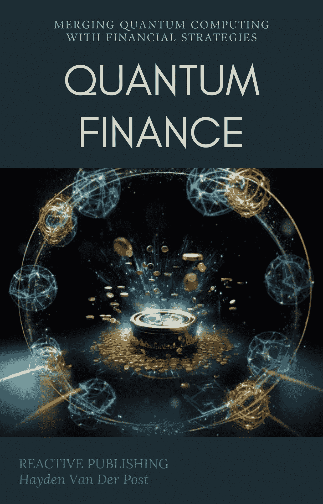

# 量子金融：量子计算与金融策略的融合：利用量子实力解锁金融未来

# 第一章：量子计算与金融导论

## 金融模型的演变

金融模型在过去的几个世纪里经历了巨大的转型。这些量化和预测工具已从原始的账目分录，演变为驱动当今全球经济决策的复杂算法。这一演变的核心在于对精度的追求，即预测和应对市场不可预测本质的能力。

在早期，金融模型仅仅是用于跟踪商业和贸易的简单会计工具。随着经济扩张和金融交易复杂性的增加，这些模型开始采用更具分析性的方法。20 世纪 50 年代，哈里·马科维茨（Harry Markowitz）引入了现代投资组合理论（`MPT`），标志着一个关键时刻。`MPT`提出了一种优化的投资组合选择方法，重点通过多元化在给定的风险水平下实现收益最大化。

随后的几年见证了资本资产定价模型（`CAPM`）和有效市场假设（`EMH`）的发展，这进一步深化了我们对风险和收益的理解。70 年代初引入的`Black-Scholes`模型彻底改变了期权定价，并为衍生市场开辟了新视野。这些传统金融模型高度依赖于市场有效性和理性行为的假设。

然而，由于市场受人类行为影响的复杂系统，这些模型面临着挑战。金融危机和市场异常凸显了对市场动态进行更细致理解的必要性。行为金融应运而生，将心理学洞察融入金融模型中，以解释市场中的非理性行为和异常。

随着强大的计算机和互联网的出现，计算金融开始占据中心位置。该领域利用数值方法和计算机模拟来解决复杂的金融问题，如期权定价和风险管理。`Monte Carlo` 模拟和随机积分的使用允许对跨一系列可能结果的情景进行建模，为风险评估提供了一种更具动态的方法。

今天，我们正处于另一个重大转变的边缘，量子金融正在出现。量子计算凭借其以以前未有的速度执行复杂计算的能力，有望重新定义金融建模的格局。量子算法可以优化投资组合管理，更准确地评估风险，并识别出以前超出我们分析能力的市场机会。

量子金融并不仅仅旨在提高现有模型的计算速度；它渴望从根本上改变我们构想金融市场的方式。通过利用量子力学原理，我们可以构想出更真实地捕捉市场概率性和互联性本质的模型。

未来的金融模型可能是经典理论与量子理论的混合体。它们必须是稳健的、透明的，并且适应瞬不断变化的市场条件。随着这些量子增强模型的演进，它们将在投资者、金融机构和政策制定者的决策过程中发挥至关重要的作用，预示着金融洞察和远见的新时代。

## 量子计算的基本原理

量子计算代表了我们计算能力的一次飞跃，其意义可能与轮的发明或电的发现一样重大。量子计算的核心在于它通过利用量子力学中奇异且往往违背直觉的原理，背于经典计算。

经典计算机以二进制位（0 和 1）处理信息，构成了所有现代计算的基础。这些比特就像海量开闭状态阵列中的开关，引导着从简单计算到复杂模拟的一切切。然而，量子计算引入了量子比特，即 `qubit`。与经典比特不同，`qubit`可以处于叠加态，同时体现了 0 和 1 的本质。这类似于在空中旋转的硬币，不受限于正面或反面的二进制状态，而是涵盖了一系列连续的可能。

纠缠是量子计算的另一个基石，这种现象是指 `qubits` 之间的内在联系如此紧密，以至于一个的状态会瞬间影响另一个的状态，无论它们之间的距离有多远。这一原理违背了经典的空间和因果关系概念，允许实现经典比特无法实现的互联性水平。

量子叠加和纠缠是赋予量子计算巨大并行性和速度潜力的双引擎。当经典计算机顺序处理问题时，量子计算机可以同时导航多条路径，并行探索多种解决方案。

量子原理延伸到量子门和量子电路，这些是量子计算机的操作组件。它们类似于经典计算机的逻辑门，但在量子力学的概率领域内运行。设计在这些电路上运行的量子算法利用叠加和纠缠的细微差别，以经典对手无法比及的速度进行计算。

最著名的量子算法之一是`Shor's algorithm`，它是为了高效分解大数而设计的——这是一项对密码学和网络安全具有深远影响的任务。另一个 `Grover's algorithm` 则极大地提高了在未排序数据库中搜索的效率，可能彻底数据分析和信息检索。

尽管前景广阔，量子计算仍面临着重大挑战。`Qbits` 非常脆弱，容易受到外部影响的扰动，这个问题被称为退相干。维持 `qubits` 的稳定性需要一个精细控制的环境，通常接近绝对零度温度。由于量子态的概率性质，量子系统中的纠错也是一项极其复杂的性程。

量子计算硬件的开发是一个高强度研究领域，人们正在探索不同的方法，包括`superconducting qubits`、`trapped ions` 和`topological qubits`。这些技术各有优缺点，寻找可扩展、可靠量子计算机的最可行路径竞争正在进行中。

当我们深入探索量子计算的基本原理时，我们开启的不仅仅是理解，还有彻底改变整个行业的潜力。金融部门将从这些进步中受益匪浅，获得诸如实时风险分析、优化投资组合管理以及经典计算几乎无法触及的复杂衍生品等前景。

量子计算不仅仅是增量式的改进，而是一种范式转移。它迫使我们重新思考计算的边界以及金融决策的本质结构。

# 计算金融的历史视角

计算金融的历史既充满传奇色彩，又具有启发性，它生动地描绘了人类在掌握经济预测和管理艺术方面永不懈的追求。在萌芽阶段，计算金融只是一门新兴的学科，是数学、经济学和计算机科学的交叉领域。它的根可以追溯到文艺复兴时期商人的账本、古代交易者的算盘，以及早期交易所复杂的金融工具。然而，是数字时代的到来真正催化了它的演变。

在二战后的激荡岁月，第一批数字计算机问世，它们的真空管和磁带卷旋转处理着曾经需要人类“计算机”花费数周才能完成的计算。这种算术的机械化为金融分析开辟了新视野。20 世纪 50 年代和 60 年代见证了现代投资组合理论和资本资产定价模型的崛起，这些框架试图在快速工业化的世界量化风险和回报。这些模型虽然具有基础性，但仍建立在正态分布和线性相关性的简化假设之上——这些假设后来被计算技术的进步所挑战。

随着 20 世纪 70 年代的到来，布莱克舒尔斯-梅顿模型（Black-Scholes-Merton model）利用随机微积分彻底改变了期权定价。这一也见证了有效市场假说的诞生，该假设认为资产价格反映了所有可用信息，从而使市场变得“有效”。然而，随着计算能力的增长，这一假设将受到审查和测试。

20 世纪 80 年代和 90 年代开启了个人电脑革命，使计算工具民主化。电子表格软件和统计软件包让分析师和交易员能够以以前所未有的速度和灵活性测试理论和策略。金融部门痴迷于定量分析，“量化师”成为了华尔街的炼金术士，因将数字转化为财富的能力而备受追捧。

然而，世纪的交替带来了一个清醒的认识：这些过度依赖过去数据和传统统计学的金融模型无法应对全球市场的动态性和复杂性。互联网泡沫的破灭和 2007-2008 年金融危机的爆发，暴露了经典金融模型的局限性。这些危机凸显了市场非线性和往往是非理性的行为，挑战着行业去寻求更稳健、适应性的工具。

进入机器学习和大数据分析时代，算法从海量信息中学习，发现人类观察者无法理解的模式和相关性。这些方法推动了计算金融向前发展，提供了更细致的风险评估、算法交易和个性化金融建议。如今的计算金融是人工智能、高频交易和预测性分析构成的丰富马锦。

当我们站在量子革命的边缘时，我们正准备再次重新定义计算金融的可能性。量子计算有望打破经典计算的枷锁，为曾被认为不可解决的问题提供解决方案。在这种环境下，计算金融的历史视角不仅是对过去成就的记录，更是对过去成就的总结。

# 通俗易懂的量子力学

对于初学者来说，量子力学看起来像是一个科幻领域，但它是现代技术的基石。其核心是处理极微粒子的行为——这些粒子并不遵循我们所看到的宏观世界的规则。在量子世界中，它们以粒子和波的形式同时存在，这种二象性令人困惑。

量子力学最引人注目且反直觉的特征之一是叠加原理。该原理规定，粒子可以同时存在于所有可能的状态中。想象一下，一枚硬币在落地之前在空中旋转。在旋转时，它既不是正面也不是反面，而是两者的模糊结合。只有当它落地时（类似于被观察时），它才变成确定的正面或反面。

量子纠缠是另一个迷人的概念，其中两个粒子变得联系在一起，一个一个的状态会瞬间影响另一个的状态，无论它们之间的距离有多远。这种现象是如此奇异，以至于爱因斯坦曾著名地将其称为“远距离的灵鬼作用”。

量子力学的概率本质是与物理学的另一个背离。虽然经典力学允许我们在拥有足够信息的情况下确定地预测系统的未来行为，但量子力学告诉我们，我们做的最好就是计算概率。我们只能谈论发现粒子处于特定状态的概率，而不是确定。

所有这些概念似乎离现实世界很远，但它们具有非常真实的影响，特别是在量子计算领域。在经典计算机中，数据以位（bits）处理，位是二进制的，作为 0 或 1 存在。量子计算使用量子位（qubits），得益于叠加态，它们可以同时作为 0、1 或同时作为 0 和 1 存在。这种能力允许量子计算机以经典计算机无法比拟的速度处理海量数据并执行复杂的计算。

量子力学可能植根于抽象和微观世界，但它具有对我们的宏观世界产生巨大影响的潜力。随着我们继续探索和利用这些量子现象，我们正在接近突破性的应用，这不仅可能重新定义金融，还可能重新定义我们经济体系的本质。

# 量子金融的起源

量子金融的起源可以追溯到经济理论中对更准确模型的永恒追求，以及利用量子力学独特力量的渴望。这是一种基于必然的结合，因为传统的金融模型在面对金融市场复杂且往往是混乱的本质时，经常显得捉襟从肘。经济学家和金融家在追求精确和远见的同时，开始将目光投向量子物理学神秘且纹丰富的景观。

量子金融的诞生可以追溯到先驱精神者们最初的好奇心，他们敢于看到经典经济理论中高斯曲线和布朗运动之外的广阔。他们提出了一个引人入胜的问题：量子力学的概率性和非确定性本质是否能为捕捉金融市场的行为提供一个更自然的框架？

## 早期探索与量子概率

对这一新颖跨学科领域的早期探索侧重于量子概率理论的应用。这种方法为不确定性和市场参与者的行为提供了一个全新的视角，这些参与者就像量子粒子一样，并不总是以可预测的方式行动。量子概率允许创建此类模型：市场运动可以被理解为不仅是随机游走，而是受集体“测量”（即市场参与者的行动和观察）影响现象。

## 纠缠与互连性

对纠缠在金融中潜在相似性的认识是量子金融的另一个基石。正如纠缠粒子表现出超越空间的连接一样，金融市场也表现出深层的互连性，全球某一个角落的事件可以瞬间影响数大陆之外的资产和市场。研究这些相关性，并尝试使用量子启发的算法对其建模，为投资组合优化和风险评估提供了新方法。

## 量子计算时代

随着量子计算技术的出现，量子金融开始呈现出具体的形态。利用量子计算机以以前无法想象的速度进行计算的潜力变成了一个极其迷人的前景。它开启了实时复杂金融建模的可能性，包括衍生品的估值以及以量子精度执行高频交易策略。

随着量子计算的发展，金融领域的应用也随之进步。理论研究开始得到实践实验的补充。金融机构开始投资量子计算项目，探索其解决经典计算机无法处理的问题的潜力。例如，用于期权定价的量子算法的发展证明了对金融工具进行更准确、更细粒评估的可能性。

## 安全与密码学

考虑到网络攻击日益增长的威胁，量子金融也开始应对金融交易对强大性的的需求。量子密码学作为一种抵御此类威胁的不可破盾应运而生，它利用量子力学原理创建了理论上可以防止任何形式窃听的通信通道。

因此，量子金融的起源是一个分水岭，标志着大胆进入了一个领域，在该领域中，量子力学定律被用来应对经济系统的复杂性。它预示着一场变革性之旅的开始，这趟行程有望重新定义我们理解、互动以及在金融世界中创新的方式。该领域仍处于幼年，许多潜力尚未开发，但显而易见的是，这种量子飞跃的影响将在未来几十年里在金融机构的走廊中回响，塑造经济战略和政策的未来。

# 常见金融策略概述

深入经济思想的传统堡垒，我们发现了几十年来作为投资和风险管理基石的金融策略。这些策略是投资者和金融分析师不可或缺的工具，引导他们在追求收益最大化和风险最小化的做出决策。它们的范围从基本面分析到技术分析，从多元化到资产配置，从对冲到套利。每种策略都有其自身的原则、方法和指标，这些都是通过多年的市场经验和学术研究磨练出来的。

## 基本面分析

例如，基本面分析涉及分析公司的财务报表、市场地位和增长前景以确定其内在价值。采用这种策略的投资者类似于侦探，筛选资产负债表、损益表和现金流量表的细微之处。他们超越股票价格转瞬即逝的波动来衡量业务的真实价值，并且通常具有长期投资视野。

## 技术分析

在光谱的另一端，技术分析植根于一种信念：历史价格模式和市场趋势是开启未来市场运动的关键。这种策略的实践者——通常被称为图表师——部署了一系列图表、指标和统计工具，以识别其交易的潜在入场和退出点。他们生活在移动平均线、支撑和阻力位以及动量指标的世界，寻求从短期价格波动中获利。

## 多元化与资产配置

多元化是“不把所有鸡蛋放在同一个篮子里”的古老格言，仍然是风险管理的基石。通过将投资分散在不同的资产类别、行业和地理区域，投资者旨在减轻任何单一不利事件的影响。其原理是不同的投资会对市场状况做出不同的反应，从而平滑投资组合的整体表现。

资产配置将多元化更进了一步，根据投资者的风险承受能力、财务目标和投资期限，系统地确定投入在每个资产类别中的资金比例。无论是平衡股票、债券、房地产或大宗商品之间的组合，资产配置都是动态的过程，需要定期重新平衡以适应变化的市场状况和人生阶段。

## 对冲与套利

对冲是另一种旨在保护投资组合免受潜在损失的策略方法。通过使用期权、期货和掉期等金融工具，投资者可以创建保护机制，当其主要投资出现不利波动时，这些机制会产生收益。对冲可以比作保险——它涉及成本，但它提供了一个安全网，让人在动荡的市场中获得安心。

套利是利用不同市场或工具之间的价格差异的艺术，是金融领域中更有投机性和资源丰富的玩家所青睐的策略。套利者是金融世界的炼金术士，不断寻找由于定价不匹配而产生的无风险利润，无论这种差异出现在汇率、证券、商品还是衍生品中。

这些策略在金融史范围内都扮演了重要角色，引导着投资决策并塑造了个人和机构的财富。然而，当我们转向量子金融时代时，必须重新评估这些传统原则。量子计算有望增强、精炼并可能从根本上变革这些常见的金融策略。增加的计算能力可以挖掘新的相关性，以前所未有的方式优化资产配置，并以量子速度执行套利——在此过程中重新定义金融策略的本质结构。

在这一量子增强的格局下，基本面分析师和技术分析师可能会发现更深层次的洞察和更细致的预测。多元化和资产配置可能变得更加复杂，量子算法将筛选海量变量以定制精细的投资组合。对冲策略可能会演变为并包含量子衍生品，提供缓解风险的新颖方法。套利则可能达到效率的新高度，量子计算机可以在眨眼之间识别并利用价差。

# 量子计算对金融的潜在影响

想象这样一个世界：金融市场凭借其固有的复杂性和持续的波动，将以以前所未有的精度进行导航。这就是量子计算有可能实现的世界——在这个领域，`qubits` 的计算能力超越了经典计算机的二进制限制，提供了无与伦比的深度和广度的洞察。

量子计算处于范式转移的边缘，准备通过其处理海量数据集并以传统计算系统无法比拟的速度解决复杂问题的能力来颠覆金融业。这一技术飞跃的影响是多方面的，有望触及金融的每一个方面，从我们评估风险和优化投资组合的方式，到我们用于保障交易安全和预测市场趋势的机制。

量子计算最深刻的影响之一在于其在优化方面的专长。金融机构经常应对复杂的优化问题，无论是在资产配置还是执行策略中。量子算法，特别是专为优化设计的算法，可以筛选无数种潜在场景和变量，以经典计算几乎无法比拟的精细度识别出成本最小化和收益最大化的解决方案。

风险评估和管理是金融决策的关键组成部分，也可能因量子计算的出现而发生变革。用于建模和理解各种场景下市场行为的 `Monte Carlo` 模拟可以被量子算法赋能。这将允许进行更准确、更细粒度的风险分析，考虑到更广泛的因素和相互作用，这些因素目前由于计算量太大而无法被充分考虑。

在毫秒可以意味着百万的算法交易领域，量子计算可以提供终极竞争优势。量子算法处理市场信息和执行订单的速度之快，足以创造出新的套利机会和高频交易策略。市场趋势和交易信号的细微之处将以目前技术无法实现的速度和精细程度被解读。

量子计算还预示着金融交易安全的新时代。`Quantum cryptography` 作为一种基于量子力学原理的应用，有望加强通信渠道抵御最复杂的网络威胁。随着金融网络犯罪的兴起，创建防篡加密的能力可以保护敏感的金融数据和交易，增强对数字金融系统的信任水平。

从更广泛的尺度来看，量子计算对金融的潜在影响延伸到宏观经济建模和政策制定。利用量子算法分析复杂经济系统的能力可以带来更科学、有效的经济政策和干预。中央银行和政府机构可以获得对经济的清晰认知，这种认知目前被经典模型的计算限制所模糊。

然而，能力越大责任越大。金融部门必须准备量子计算将释放的破坏性力量。现有的金融模型和策略可能需要从头开始重新构，以充分利用量子计算的潜力。此外，治理金融市场的伦理和监管框架需要适应量子技术带来的新挑战和新能力。

量子计算对金融的潜在影响既令人生畏又令人兴奋。它承诺重新定义金融分析、策略和安全的本质。当我们站在这场量子革命的边缘时，我们——即金融专业人士、监管者、技术人员和学者——有责任带着谨慎、好奇和对创新的不懈追求探索这些未知领域。金融的量子未来并非遥远的梦想；它是一个迫在眉睫的现实，召唤着那些胆于迎接挑战的人。

# 第二章：量子金融的基本概念

在市场复杂的舞动中，概率概念是预测和决策的支柱。然而，当我们深入量子领域时，经典的概率规则开始以意想不到的方式发生扭转。`Quantum probability` 是一个从量子力学和概率论融合产生的新兴领域，提供了一个观察金融不确定性的新视角。

量子概率的核心是 `superposition` 概念——即量子系统在被测量之前可以同时存在多个状态。这一原理挑战了我们的经典直觉，在经典直觉中，概率被分配给互斥的结果。然而，在量子世界中，结果之间的相互作用违背了经典概率的直接应用。

对于金融策略而言，量子概率的影响是深远的。想象一个投资组合，类似于量子系统，它不仅仅代表一组具有界定盈亏概率的资产集合，而是处于一种 `superposition` 状态，体现了反映市场变量相互关联的可能结果频谱。量子概率允许我们以比传统模型更复杂的程度对这种复杂的可能性网进行建模。

量子概率可以产生重大影响的一个领域是衍生品定价。例如，期权定价高度依赖于对未来场景的评估。通过量子概率，定价模型可以考虑到更广泛的市场状况以及它们之间非经典的相关性从而产生更准确的定价和对冲策略。

此外，量子概率的金融影响延伸到风险评估。在经典金融中，风险通常使用基于历史数据的概率分布进行量化。然而，这些分布无法捕捉市场行为的真实复杂性，特别是在动荡时期。量子概率允许`superposition`和`entanglement`，使我们能够创建更健壮的模型来反映市场的内在复杂性和相互依赖性。

另一个潜在应用是在消费金融和信用评分领域。目前的模型基于违约的经典概率分布来评估贷款风险。量子概率可以通过考虑更广泛的行为模式和经济状况来完善这些模型，从而可能导致更细致的信誉评估。

向量子概率的转变也正召唤着金融行业重新思考不确定性本身。黑天鹅事件——那些罕见、不可预测且后果极其严重的事件——可能通过量子透镜得到更好的理解。通过意识到看似无关的事件会以非直觉的方式产生相互关联的结果，金融机构可以开发出对这类异常情况更具韧性的策略。

然而，将量子概率整合到金融领域的道路并非一帆风顺。金融专业人士将需要熟悉量子现象违背直觉的本质。必须开发新的计算工具和算法，以便在实际应用中利用量子概率的力量。此外，随着这些方法区别于经典方法，该行业将需要为它们的使用建立新的基准和标准。

量子概率预示着金融建模和策略的新纪元。它揭示市场事件及其结果复杂概率的潜力，可能会带来更复杂、更具韧性的金融实践。当我们站在量子力学与经济理论的交汇点时，金融世界必须准备迎接一个未来，在这个未来中，不确定性不仅是一个需要管理的挑战，而是一个等待探索的充满可能的织锦。

## 纠缠与投资组合优化

在掌握金融波诡云谲大海的道路上，投资组合优化的艺术长期以来类似于在风暴中寻找灯塔。然而，量子纠缠的创新概念有望以以前无法想象的方式照亮这一追求。纠缠的核心是一种奇特的量子现象，其中粒子对或粒子组变得相互连接，以至于无论它们之间相距多远，如果不考虑其他粒子，就无法完全描述其中一个的状态。

将其转化为金融语境，纠缠为多元化提供了一个新视角——这是投资组合优化的基石。经典金融理论认为，多元化通过将投资分散到各种资产来降低风险，从而最大限度地减少单一资产表现对组合整体回报的影响。然而，纠缠迫使我们承认，资产之间的关系可能比这种传统观点所示的复杂得多。

考虑这样一个投资组合：资产不仅仅是独立实体的集合，而是纠缠在经济、地缘政治和社会因素构成的复杂网络中。这种纠缠态资产可能表现出挑战经典统计分析的关联性，为优化带来挑战和机遇。例如，世界上某处商品价格看似随机的波动，可能与另一个大陆某科技公司的股票表现紧密相关，这种连接在没有量子视角的情况下可能是无法察觉的。

纠缠在投资组合优化中的潜力在于其能够捕捉这些深层的、非经典的关联性。量子计算算法利用纠缠的概念，可以处理海量市场数据以识别资产之间的隐藏关系。通过这种方式，它们可以优化投资组合，不仅能使风险降至最低，还能使潜在收益最大化。

在投资组合优化中利用纠缠的一种很有前景的方法是通过`quantum annealing`（量子退火）——这是一种利用量子涨落寻找系统最低能量状态的过程，类似于发现最稳定且高效的投资组合配置。`Quantum annealers`（量子退火器）比经典计算机更有效地引导潜在投资组合分配的格局，识别出传统优化方法无法实现的解决方案。

另一种途径是使用量子机器学习算法，这些算法可以实时学习并适应新的市场状况。这些算法可以识别资产之间微妙的纠缠模式，随着市场条件的演变动态调整投资组合，以保持最佳平衡。

纠缠对衡量系统性风险也有其意义。金融系统是相互依赖的机构和工具的网络。纠缠视角可能通过展示单个实体的失败如何对整个网络产生连锁反应，揭示隐藏的系统性风险。通过理解这些量子关联，金融经理可以制定策略，保护投资组合免受级联故障。

尽管量子纠缠在投资组合优化方面具有前景，但必须注意的是这项技术仍处于起步阶段。目前的量子计算机虽然进展迅速，但仍处于开发的早期。投资组合优化的实际应用将需要量子硬件能力的进一步增长，以及针对金融数据开发的新算法。

将纠缠整合到投资组合优化中不仅仅是一项技术升级——它是一场范式转移。它邀请我们重新思考金融市场的结构，考虑那些将资产结合在一起的无形丝线。通过这种方式，它不仅具有优化投资组合的潜力，还可能重新定义量子时代风险与收益的本质。

## 量子算法及其用途

深入量子计算的核心，我们挖掘了量子算法的强大力量，这是这一技术奇迹的命脉。这些算法并非简单的代码字符串，而是炼金术士的咒语，将量子学的原始潜力转化为计算领域实实的优势。它们运行在一个比特被`qubits`（量子比特）取代的领域，这些实体能够通过叠加属性同时存在多种状态。

量子算法的用途如夜空中的星辰般广阔，每种应用都是金融多元图景中可能性的灯塔。量子计算中最具突破性的算法之一是著名的`Grover's algorithm`（格罗弗算法）。该算法以其搜索非结构化数据库的能力而闻名，其速度比任何经典对应算法快平方倍。在金融背景下，`Grover's algorithm`可以从根本上增强识别套利机会、优化资产配置以及扫描市场价格数据中异常或模式的速度。

量子皇冠上的另一颗宝石是`Shor's algorithm`（舒尔算法），它因能够高效分解大数分解而闻名——这项任务对经典计算机构成了巨大挑战。虽然它对密码学的影响众所周知，但在金融领域，`Shor's algorithm`可以通过快速将金融工具分解为其主要的风险因子，从而彻底改变风险管理，为各种金融衍生品提供更精确、更快速的计算。

此外，量子算法有望在机器学习领域取得重大进展。量子机器学习算法能够以以前所未有的速度处理和分析数据，揭示隐藏的模式和洞察。在金融领域，这些算法可以改变信用评分、市场预测和客户细分等活动，为理解市场动态和消费者行为提供更细致的理解。

当量子算法应用于蒙特卡洛模拟时，其真正的力量会释放出来——这是一种用于模拟金融过程中不同结果概率的技术。量子蒙特卡洛模拟可以以经典模拟无法比拟的精度和速度计算这些概率，从而对市场波动、复杂金融期权定价以及压力测试进行更复杂的评估。

然而，量子算法的用途不仅限于原始的计算能力。它们引入了预测的精妙性，一种考虑了金融市场概率特性的深层次分析。通过能够考虑到这些市场固有的全方位风险和不确定性的模拟，量子算法使金融专家能够为更广泛的情景做好准备，增强金融的稳定性和预见性。

量子算法在金融领域的潜力才刚刚开始实现。当我们站在这一新计算纪元的边缘上时，我们不仅要赞叹量子算法的技术精尖程度，还必须意识到它们为全球金融行业带来的变革。随着量子硬件的不断成熟，以及金融机构对量子研发的投入，我们可以预计创新应用的激增，这些应用将重新定义金融领域计算可行性的边界。

## 金融决策中的叠加态

在量子领域，叠加态现象是一个基石——它允许`qubit`同时存在于多个状态中，具化了在空中旋转硬币的量子版本，既是正面又是反面。将这一概念应用于金融决策，类似于观察许多可能的市场状态和结果在一种微妙的平衡中共存，等待着决定性的测量，这种测量将把这些概率坍缩为单一的现实。

叠加态原理对金融决策具有深远的影响。它使量子计算机能够并行评估大量的金融情景和结果，这是经典计算无法实现的壮举。这种并行处理能力允许在投资组合构建、风险评估和战略规划中实现极水平的多样化。

考虑复杂的投资组合优化过程，其目标是在最小化风险的同时实现收益最大化。传统上，这涉及筛选大量的资产组合，每种资产都有自己的预期收益和相关风险。叠加态使量子计算机能够同时分析这些组合，快速识别出在风险和回报之间取得最佳平衡的投资组合。

在金融衍生品的背景下，叠加态允许对取决于多个底层变量的复杂期权和其他产品进行定价。通过利用状态的叠加，量子计算机可以执行考虑资产价格可能采取的所有路径的计算，不是顺序，而是同时进行。这种处理能力的量子飞跃可以大幅缩短衍生品定价所需的时间，为目前可能需要数小时或几天的过程带来近实时的准确性。

此外，叠加态的概念可以增强我们处理金融不确定性的方式。面对模糊信息和不可预测的市场波动时，决策者往往依赖概率模型来预测未来事件。量子叠加自然地封装了这种概率思维，为预测和情景分析提供了一种更丰富、更细粒度的方法。金融战略规划师可以利用这些洞察来准备更稳健的应急计划，以敏捷和精准的适应市场变化。

在算法交易中，在叠加态下计算并响应潜在市场变动的能力可以提供显著优势。交易者可以在瞬间跨越不同的市场条件模拟多种交易策略。

尽管如此，将叠加态整合到金融决策并非没有挑战。量子态的深奥性质需要一批精通量子理论的新型金融分析师。此外，`qubits`的退相干——由于与环境交互导致其量子特性的丢失——构成了必须克服的技术障碍，以维持稳定性和可靠性。

随着技术的进步和量子计算变得更加易普及，叠加态可能会成为金融部门的变革性工具。它将实现一种更细致、更强大的决策方法，其中多种可能性都被考虑在内。

## 金融安全的量子密码学

在金融行业中，安全性至关重要；它是抵侵蚀金融系统信任和完整性的网络威胁潮的堡垒。量子密码学代表了金融数据安全的下一次演进，利用量子力学原理创建在理论上无法被破解的加密协议。

量子密码学的基石是`QKD`，双方通过这种方法生成一个共享的随机密钥，用于加密和解密消息，任何倾听尝试不可避免地被检测到。这是通过利用量子纠缠属性和观测量子系统带来的不确定性实现的，这些属性共同确保任何截获的通信无法在不留痕迹的情况下秘密读取或复制。

想象这样一个场景：金融机构向另一方传输敏感交易数据。采用`QKD`，他们将加密密钥编码到粒子（如光子）的量子态中。当这些粒子传输到接收者处时，入侵者测量其状态的任何尝试都会干扰它们，提醒通信双方入侵的存在以及密钥可能被泄露。

在金融交易中实施`QKD`不仅加强了数据传输的机密性，还起到了对网络攻击的震慑作用。知道拦截可以被检测，恶意行为者不太可能尝试突破量子安全通道，从而维护了金融通信的神圣性。

量子密码学超越了安全密钥交换，扩展到量子安全签名领域，在该领域，可以在不泄露内容的情况下验证文档或交易的真实性。这在隐私至关重要但需要验证的情景中特别具有优势。例如，在高额合同签约或大规模金融转账的验证中，量子签名可以提供目前经典数字签名无法实现的额外安全层。

然而，尽管量子加密具有巨大潜力，它在金融领域尚未被广泛采用。该技术仍处于成熟阶段，实际应用面临着重大挑战。例如，量子密钥分发目前需要专门的设备，并且受到安全传输密钥距离的限制。此外，将`quantum cryptography`集成到现有的金融基础设施中需要大量的投资以及安全协议的范式转变。

在我们考虑将量子加密集成到金融安全中时，我们也深入探讨了其对监管合规的潜在影响。量子安全交易可能会改变数据审计和合规监控的动态机制，因为除了预期接收者之外，任何人都无法访问加密信息。这引发了关于不可破解的安全性与监管需求之间如何平衡的问题。

尽管存在这些障碍，量子加密的动力正在不断积累。金融机构开始启动试点项目，与量子研究人员的合作也在增加。在日益数字化和互联的金融金融生态系统中，绝对安全的承诺过于吸引人而无法忽视。

在未来，我们可能会见证一个由量子加密重新定义的全球金融系统，届时交易将以以前所未有的安全性流动，网络犯罪的阴影将显著减少。

# 量子与经典金融模型

经典金融模型是行业的的中砥柱，它们是基于数学和统计方法的久经考验的框架，经过数十年的磨练。这些模型包括著名的用于期权定价的`Black-Scholes`、用于评估风险和回报的`Capital Asset Pricing Model (CAPM)`以及用于投资组合优化的`Markowitz's Modern Portfolio Theory (MPT)`，一直是金融分析和决策的支柱。它们依赖于有效市场假设、理性行为者假设以及资产收益的正态分布假设。

然而，经典模型的内在局限性正变得日益明显。它们通常取决于简化处理，而这些简化无法完全涵盖金融市场的复杂性——非线性动力学、市场情绪以及导致 2008 年金融危机等事件的肥尾风险。经典计算能力也限制了这些模型，因为在计算需求变得无法处理之前，它们只能解决特定复杂性范围内的问题。

量子金融模型登场了——这些创新的构型利用量子力学原理为复杂的金融问题提供了新解决方案。量子领域引入了如`superposition`和`entanglement`等概念，允许量子计算机同时处理海量信息，并以前所未有的速度解决极其复杂的问题。

量子金融模型利用这些能力，为金融市场的概率本质提供了全新的视角。量子算法允许以反映市场真实随机性的方式对金融系统进行建模，对风险和相关性提供更细致的理解。通过这种方式，它们承诺将完善资产定价模型，以更高的精度优化投资组合，并更准确地模拟市场动态。

例如，由于`superposition`，量子增强模型可以同时评估许多潜在的市场场景，这是经典`Monte Carlo simulations`无法实现的成就。这种能力能够对风险进行更稳健的评估，考虑了更广泛的潜在结果，包括经典模型经常低估的概率分布尾部结果。

量子计算还提供了以经典算法无法达到的效率解决优化问题的可能。在投资组合管理中，这意味着确定最佳资产配置以在最大化收益的同时最小化风险，且其速度能跟上市场的快速波动——在一个毫秒可以等同于数百万的世界里，这是一个巨大的优势。

量子与经典金融模型之间的对比还延伸到了它们的理论基础。经典模型基于`Boolean logic`，而量子模型在`quantum logic`的框架内运行，该系统允许不确定性和事件之间的关联性——这些条件更接近金融市场的现实。

尽管具有潜在优势，但从经典金融模型向量子金融模型的过渡并非没有挑战。量子计算技术的初级阶段意味着，目前量子金融模型的广泛应用仍处于远景阶段。对于可解释性以及金融专业人士需要理解并信任量子模型的输出，也存在疑问——这与其经典对应模型的透明计算相比是一个巨大的转变。

前前的道路是一条汇聚的道路，传统的金融基础设施将逐渐整合量子计算提供的创新解决方案。这是一段充满期待与谨慎的旅程，因为我们正寻求利用量子力学的力量来释放金融市场中的潜能。

# 量子比特与量子门简介

开始理解量子计算的基础知识：量子比特，或`qubit`，以及量子门，这些新兴技术的构建基石。这些元素之于量子计算，正如二进制位（`bits`）和逻辑运算之于经典计算，但其能力远超经典计算框架中可能的任何东西。

在经典领域，`bits`是数据最简单的形式，取`0`或`1`的值。相比之下，`quubits`要通用得多。它们利用量子力学原理运行，存在于涵盖了同时为`0`和`1`可能的状态中，这种现象被称为`superposition`。这种双重潜力允许单个`qubit`同时执行多次计算，随着更多`qubits`被纠缠在一起，计算能力会大幅增加。

`entanglement`概念是量子力学的另一个奇迹。当`qubits`变得纠缠时，一个`qubit`的状态会瞬间影响另一个的状态，无论它们之间的距离如何。这种关联性是量子计算中的强大资产，因为它允许创建复杂的多维态，并以经典计算机无法比拟的熟练度解决问题。

`Quantum gates`是操纵`qubit`状态的操作工具，作为经典逻辑门的量子模拟。它们是变化的催化剂，通过协调`qubits`的`entanglement`和`superposition`来执行算法。与经典对应物不同（后者限于产生`0`或`1`的确定操作），`quantum gates`作用于`qubit`状态的概率。这种操作允许更丰富的指令集和结果。

最简单的量子门之一是`Pauli-X gate`，它通常被比作经典的`NOT gate`，但具有量子属性。它将`qubit`的状态从`0`翻转为`1`，反之亦然。然而，当应用于处于`superposition`的`qubit`时，它会在`Bloch sphere`上绕`X-axis`旋转`qubit`，这是`qubit`状态在三维空间中的图形表示。

其他基础量子门还包括`Hadamard gate`（将`qubit`置于叠加态）和`CNOT gate`（一种纠缠`qubits`的双量子比特操作），使得`entanglement`这一基本的量子特性能够在量子算法中被利用。

当量子门被成序列使用并形成量子电路时，它们的威力才得以充分发挥。这些电路是量子算法的结构框架，决定了一系列操作，这些操作可以将一组输入比特转换为新的量子态，而对该态的测量则提供了问题的解决方案。

在量子金融的背景下，理解`qubits`和`quantum gates`至关重要。它们是我们编码金融数据并执行复杂模拟、优化和分析的工具，能够以前所未有的细节和速度完成任务。当`quantum gates`操纵`qubits`来探索多种金融场景时，它们使我们能够以经典模型无法实现的精度揭示微妙的关联性并预测市场波动。

然而，进入`qubits`和`quantum gates`领域的旅并非一帆风顺。`qubit`状态的脆弱性需要复杂的纠错技术来维持长时间相干性，而`quantum gates`的物理实现必须克服能够迅速退化存储在`qubits`中信息的环境干扰。

`quantum gates`的开发和`qubits`的稳定性是迈向量子霸权的核心——即量子计算机能够执行最强大的经典超级计算机无法完成的任务的节点。随着这些技术的成熟，量子金融的应用也将随之发展，为可能重新定义金融格局的策略和洞察开启大门。

# 第 3 章：金融领域的量子算法

## Grover 算法与非结构化数据搜索

在不断扩张的金融数据海洋中，快速高效地导航非结构化信息的能力至关重要。`Grover’s algorithm`犹如是一座量子智慧的灯塔，为经典计算中最艰巨的任务之一——非结构化数据搜索提供了解决方案。

这一量子算法由`Lov Grover`于 1996 年开发，它通过平方级减少在非结构化数据库中寻找特定项目的时间复杂度，彻底改变了搜索过程。在经典术语中，对`N`个项目进行搜索，平均需要`N/2`次尝试才能找到所需的元素。而`Grover’s algorithm`通过量子力学的力量，在大约仅需`√N`次操作中即可完成这一壮举，代表了效率的巨大飞跃。

这对金融领域的影响是巨大的。考虑一个包含市场交易、客户记录或潜在投资的海量数据库，这些数据均未经过排序或索引。`Grover’s algorithm`使量子计算机能够切入这种混乱，以经典手段无法达到的敏捷性识别关联、异常或特定的数据点。

`Grover’s algorithm`的机制根于叠加和干涉的量子特性。该算法开始将所有可能的搜索项目置于叠加态中，允许量子计算机同时检查所有项目。随后，它利用一系列`quantum gates`放大正确项目的概率幅，同时抵消错误项目的概率幅——这一过程类似于波动力学中的相干性干涉和破坏性干涉。通过重复应用这一过程，测量到正确项目的概率会增加，直到它主导概率分布。

当目标项目的概率变得如此显著，以至于测量极有可能会坍缩量子态并揭示它时，`Grover's algorithm` 达到了高潮。这是量子搜索最优雅的形式——将量子力学原理与算法精确性相结合，照亮通往所需数据的道路。

在金融领域，`Grover's algorithm` 的应用非常广泛。风险经理可以使用它从海量历史数据中筛选出潜在风险因素，耗时仅为目前的一小部分。交易员可以部署它从无数的市场变量中寻找套利机会。分析师可以利用它从影响金融市场的经济指标、新闻报告和社交媒体热点中提取有意义的模式。

此外，`Grover's algorithm` 在搜索非结构化数据方面的效率对金融世界的数据安全具有更广泛的影响。它迫使加密技术进行重新校准，因为传统加密可能会受到量子能力搜索的攻击。这使得必须转向抗量子加密，以保护敏感信息免受诸如 `Grover's` 等算法强大能力的威胁。

`Grover's algorithm` 在金融领域的变革潜力很大程度上取决于量子硬件的进展。实现 `Grover's algorithm` 所需的 `qubits` 数量、纠错方法和系统稳定性仍处于开发中。然而，随着量子突破的承诺，`Grover's algorithm` 将成为量子金融家工具箱中的必备。

当我们深入探索量子领域时，让我们欣赏 `Grover's algorithm` 对金融的深远贡献。它不仅是人类智慧的证明，更是一个新金融时代的预言，在这个时代，量子搜索将照亮洞察与机遇。

## Shor 算法与金融加密

进一步进入量子领域，会遇到一种具有如此颠覆潜力的算法，它在加密领域乃至更远的地方引起了震荡——Shor 算法。由 `Peter Shor` 于 1994 年提出的这一同名量子算法从根本上重新定义了加密格局，这是现代金融赖以存在的基石。

`Shor's algorithm` 的核心在于能够以远快于已知经典算法的速度对大整数进行分解。在经典计算中，对数百位数字进行分解的复杂度呈超多项式增长，这在实践上是不可行的，因此形成了广泛用于保护数字交易的 RSA 加密基础。

形成强烈对比的是，`Shor's algorithm` 利用量子力学原理以惊人的速度执行质因数分解，使得曾经认为安全的加密变得令人担忧地脆弱。RSA 以及类似加密系统的安全性取决于质因数分解的不可计算性，而 `Shor's algorithm` 轻而易举地回避了这一点。

金融高度依赖加密来进行安全通信、交易处理和数据保护，`Shor's algorithm` 的出现面临范式转移。能够运行该算法的量子计算机能够破解敏感金融信息、入侵安全通信，并可能瓦解金融机构运营的基础。

想象这样一个场景：一个拥有运行 `Shor's algorithm` 的量子计算机的实体可以破坏金融交易的完整性，使市场面临前所未有的风险和波动。其影响范围将超出金融损失，动摇支撑全球贸易的数字系统的信心。

然而，这种迫在眉睫的威胁也预示了加密创新的新时代，被称为后量子加密。该领域致力于开发能够抵抗量子计算机能力的加密算法，以确保在量子未来持续保护数据。美国标准与技术研究院 (NIST) 正在领先行动，评估并标准化抗量子加密算法，以固化我们的数字防御。

金融行业必须主动拥抱后量子加密，以防御未来 `Shor's algorithm` 的部署。向抗量子加密的过渡将涉及整个系统的全面重构，从在线银行平台到全球网络中金融数据的安全交换。这是一项艰巨的任务，但对于维持未来金融体系的信任、稳定和安全至关重要。

此外，`Shor's algorithm` 的存在本身促使金融机构重新评估其数据安全策略，并投资于量子安全解决方案。处于这一转型前沿的公司可能会获得竞争优势，将自己定位为量子计算塑造的韧性金融格局中的先驱。

`Shor's algorithm` 对密码学具有深远影响，它不仅是对我们当前系统脆弱性的警示哨兵，更是量子金融领域增长与创新的催化剂。它迫使我们放眼远方，准备迎接一个量子韧性不仅是战略优势、更是基本生存必然的未来。

# 量子蒙特卡洛模拟

蒙特卡洛模拟是金融分析师工具箱中一种经典的计算支柱，用于对由于随机变量干预而难以预测的过程中的不同结果概率进行建模。它们是现代风险管理和衍生品定价的基石，允许分析师为资产价格、利率和其他关键金融指标构建成千上万种假设场景。

然而，经典的蒙特卡洛模拟有其局限性。大规模模拟的计算成本高昂且耗时巨大，即使是对最先进的经典计算机也会考验其耐心和处理能力。在各种场景下模拟复杂的、多维金融工具和市场时，这些局限性变得尤为突出。

然而，量子蒙特卡洛模拟利用了量子计算固有的叠加和纠缠现象。这些模拟利用 `qubits` 的力量来同时表示和评估多个状态，超越了经典二进制计算的边界。结果是可并行分析的潜在未来状态数量呈指数级增长，从而对可能的市场轨迹提供了更细粒度、更全面的探索。

考虑一台正在执行蒙特卡洛模拟以评估投资组合风险的量子计算机。系统每增加一个 `qubit`，就可能使同时评估的场景数量翻倍。足够强大的量子计算机可以在经典计算机费力处理几千条路径的时间内，评估金融模型中的数百万条路径。

这对金融策略的影响是深远的。通过量子蒙特卡洛模拟，投资组合经理不仅能更好地理解投资选择中固有的风险，还能识别出可能在经典计算的概率迷雾中被掩盖的机会。

此外，这些模拟可以用于评估极罕见但具有灾难性的事件——即所谓的“黑天鹅”事件。通过在更广泛的条件（包括极端异常值）下模拟金融系统，量子蒙特卡洛模拟为压力测试提供了一个更稳健的框架，让金融能够更好地应对潜在危机。

然而，量子模拟的优势并非没有挑战。量子计算目前处于萌芽阶段，量子蒙特卡洛模拟所需的算法和硬件仍在开发中。金融机构必须投资研究并与量子技术供应商建立合作伙伴关系，以利用这一潜力。

此外，量子蒙特卡洛模拟的输出可能与计算一样具有挑战性。金融分析师需要调整其方法论，以理解量子计算揭示的复杂概率分布和相关性。

量子蒙特卡洛模拟处于金融分析新纪元的边缘，在这个时代，市场预测的模糊性被量子计算的敏锐清晰所洞穿。随着我们不断完善这些工具，金融行业正向一个未来迈进——在那里，风险不仅被管理，而且在量子技术的预测能力支撑下被完全掌握。

# 量子优化算法

优化位于金融的核心，对资源最有效配置的追求，就像在经济决策的交响乐中寻求完美的和谐。量子优化算法是这一交响乐事业中的前卫指挥家，协调金融决策以在风险和收益之间达到最佳平衡。

金融领域中的传统优化问题，如投资组合优化、贷款调度或资产配置，通常被表述为复杂的数学难题。它们涉及在给定的约束条件下寻找 `function` 的最大值或最小值——随着 `variables` 数量的增加，任务可能变得极其消耗资源。

经典计算机凭借其顺序处理能力，在导航这些优化问题中的组合爆炸时可能显得力不从心。传统算法可能会陷入局部最优，无法判断在计算视界之外是否存在稍优的解决方案。

受量子力学赋能的量子优化算法提供了逃离局部最优陷阱的方法。这些算法利用了量子叠加原理（量子系统可以同时处于多个状态）和量子纠缠原理（一个粒子的状态无论彼此距离多远，都会瞬间影响另一个粒子的状态）。

其中一种算法是量子近似优化算法（`QAOA`），它旨在解决经典计算机处理极其困难的组合优化问题。`QAOA` 的工作原理是将优化问题编码到 `qubits` 系统的量子态中。通过一系列被称为 `gates` 的量子操作，算法迭代调整这些 `gates` 的参数，将系统推向代表最优解的状态。

`QAOA` 和其他量子优化算法展现了并行性的潜力，远超经典计算所实现的水平。它们同时探索多个解决方案，以经典方法难以企及的速度和效率收敛于全局最优。这使得它们特别适用于金融行业，该行业运行在变量复杂的环境中，通常需要实时决策。

想象将量子优化应用于资产配置。通过量子计算机，投资组合经理可以并行评估无数可能的资产组合，以前所未有的速度在给定风险水平下识别出收益最大化的投资组合。这对战略资产管理的影响是革命性的，承诺了投资组合不仅在市场波动面前保持稳健，而且根据个人投资者的细微偏好和约束进行独特定制。

然而，量子优化在金融领域的部署并非没有技术和物流方面的障碍。量子硬件仍处于开发的早期阶段，而且量子算法的执行对量子态的精度的控制提出了极高要求，这在目前是非常挑战性的。此外，将金融优化问题转化为量子算法是一项复杂的任务，需要对量子力学和金融数学都有深入的理解。

尽管存在这些挑战，金融部门有望成为量子优化进展的主要受益者之一。机构和投资者正开始与量子计算公司建立合作伙伴关系，寻求在技术成熟时获得竞争优势。

量子优化算法代表了金融策略制定领域进步的灯塔。随着这些算法变得更加精炼和易于获取，它们将无疑改变金融格局，在对最优经济结果的长期追求中，提供效率和精度的新范式。

# 用于风险分析的变分量子本征求解器 (VQE)

金融风险分析的核心在于理解并量化可能影响投资价值的不确定性。这一过程通常涉及对复杂金融衍生品的评估，这些衍生品的价值取决于底层资产的波动。评估此类衍生品的传统方法通常依赖于蒙特卡洛模拟，这种方法虽然强大，但在计算上要求巨大且耗时，特别是在处理大型多维系统时。

VQE 提供了一种极具吸引力的替代方案，利用量子计算的初级力量来更有效地应对计算复杂金融系统属性的挑战。该算法属于量子-经典混合方法，这意味着它通过协同利用量子和经典计算资源来运行。

VQE 的运行原理是变分法，这是量子力学中用于寻找量子系统能级下限的技术。在风险分析的背景下，VQE 被用于估计金融系统的基态（或最低能量态），这对应于给定风险模型的最优解。

VQE 的独特之处在于它对量子噪声的韧性，以及与当前一代量子硬件（即嘈杂中尺度量子设备，称为 NISQ）的兼容性。该算法从在量子处理器上准备一个试验量子态开始，这是基于初始参数对基态的猜测。然后它测量该态的能量，并使用经典计算机调整参数以使能量最小化。

这种迭代过程持续进行，量子计算机准备状态，经典计算机对其精炼，直到能量收敛到最低可能值（理想情况下对应于基态）。最终的量子态及其能量为所研究金融系统的风险概况提供了关键的见解。

例如，当应用于风险分析时，VQE 可以帮助金融分析师更准确地为期权和期货等复杂金融工具定价，从而带来更稳健的风险评估和对冲策略。计算这些工具的预期收益和风险概况时精度的提高，允许对金融投资组合进行更明智、更细致的管理。

此外，VQE 在分析非线性路径依赖型金融衍生品方面可能特别有效，这些衍生品对市场变化和波动风险特别敏感。通过捕捉这些复杂工具的细微之处，VQE 提供了更深层次的理解，可能会彻底改变金融实体处理风险的方式。

尽管前景良好，但 VQE 在风险分析中的实际应用仍处于胚胎阶段，因为量子计算本身是一项新兴技术。然而，随着量子处理器的日益先进以及像 VQE 等算法的进一步开发，金融业正处于风险分析演变的边缘，这可能会极大地增强预测能力。金融机构逐渐意识到量子计算的潜力，并开始投资研究和合作，以使他们能够利用其力量。

# 算法交易中的量子机器学习

算法交易——即通过计算机根据预定义标准以高速度和大量交易进行交易——改变了金融市场，推动了效率和流动性。然而，量子机器学习的到来预示着这一自动化交易领域的一个新纪元，承诺通过此前仅限于理论构想的能力为算法注入强大动力。

量子机器学习将量子计算的概率性质与机器学习的自适应能力相结合。这种融合具有解决目前经典算法无法处理问题的潜力，特别是在模式识别和预测分析领域。

在金融交易所繁忙的数字市集中，经典机器学习模型（如深度学习和神经网络）使交易员能够筛选海量数据以识别盈利机会。这些模型从历史数据中学习以预测未来的市场走势，并在最佳价格、时间和数量执行交易。然而，它们往往受到金融数据巨大规模和市场动态复杂性的限制。

量子机器学习进入了，它得益于叠加现象，运行在可以同时存在多个状态的比特上。比特的这种属性允许量子机器学习模型比其经典对应品高效得多处理和分析大型数据集。

## 应用与前景

量子机器学习在算法交易中最深远的应用之一是特征提取和选择。在经典交易算法中，识别数据中哪些特征对市场运动最具预测性是一项异常艰巨的任务，需要大量的计算资源。量子机器学习可以通过并行评估更大量的特征来增强这一过程，发现经典算法可能无法察觉的细微相关性和模式。

此外，量子机器学习可以通过采用量子版本的强化学习来优化交易策略——强化学习机器学习，算法通过试错来学习做出一系列决策，并接收来自环境的反馈。在交易背景下，量子强化学习算法可能会评估无数策略变体，以追求最丰利的交易策略，并以前所未有的敏捷性适应市场变化。

另一个有前景的领域是量子支持向量机 (`QSVM`)，这是一种可以对高维数据进行分类的算法，金融数据集的典型特征。`QSVM` 允许交易员通过量子速度处理复杂的市场数据，从而更好地确定股票价格的未来方向或识别套利机会。

量子机器学习在算法交易中的影响是巨大的。它能够显著降低延迟，在几分之一秒之差就等同于数百万美元的环境中，延迟是一个至关重要的因素。它还掌握着更准确预测模型的关键，这可以增强交易公司的竞争优势，并可能通过预测和缓解异常市场行为来稳定市场。

尽管潜力巨大，但量子机器学习在现实世界中的应用尚处于起步阶段，因为实用的量子计算机仍在开发中。然而，金融机构和金融科技公司正在大力投资量子研究，预计这些革命性的量子机器学习算法将成为他们交易武器库中强大的工具。

随着量子硬件的不断演进，发生革命性变化的不仅是交易执行的速度，更是金融决策的底层结构。算法交易策略可能很快就会注入某种复杂程度，镜像其灵感来源复杂量子系统，预示着一个新纪元的到来——在这个领域里，曾经不可破解的市场波动之谜将通过量子的清晰度被解码。

## 期权定价的量子算法

期权定价模型是现代金融工程的基石，为在风险管理和投机交易中起着至关重要作用的衍生品提供了估值框架。`Black-Scholes model` 是 20 世纪 70 年代引入的一项突破性公式，它通过提供一种理论上的期权定价方法彻底改变了该领域。然而，随着金融市场复杂性的增加，`Black-Scholes` 等经典模型的局限性变得日益明显。

在蓬勃发展的量子计算时代，一组新的算法有望重新定义期权定价的格局。这些量子算法利用量子力学的反直觉特性，来执行对于经典计算机来说耗时长到无法接受的计算。

期权定价的核心挑战在于准确地对资产价格波动的随机过程进行建模，考虑波动率、利率和到期时间等变量。经典计算方法需要通过离散步骤来模拟这些随机过程，随着变量数量和金融工具复杂性的增加，这会变得计算密集型。

相比之下，量子计算可以通过被称为 `amplitude amplification`（振幅放大）的现象加速这一过程，它允许在概率分布中进行更高效的搜索。这是 `Grover's algorithm` 等量子算法的基础原理，它可以以平方级加速对无序数据库的搜索——这适用于金融市场中经常遇到的非结构化数据集。

期权定价最有前景的量子算法之一是 `Quantum Monte Carlo (QMC)`（量子蒙特卡洛）。蒙特卡洛模拟广泛应用于金融领域，对由于随机变量干预而难以预测的过程中的不同结果概率建模。`QMC` 利用量子叠加和纠缠在量子尺度上执行这些模拟，大大减少了得出准确定价模型所需的计算路径数量。

另一个尖端方法是 `Quantum Fourier Transform (QFT)`（量子傅里叶变换），它被用于量子算法中分析数据集内部周期性，例如金融工具的周期模式。对于期权定价，`QFT` 可能在将市场数据的复杂波形分解为简单组件方面发挥关键作用，使其更容易预测在各种市场条件下期权的定价动态。

此外，量子算法还带来了期权实时动态定价的潜力。经典方法通常依赖于收盘价，无法随着市场状况在整个交易日内的变化持续更新定价模型。量子算法可以实时处理市场波动，为交易员和风险经理提供更准确地反映当前市场环境的最新评估。

尽管取得了理论上的进展，但量子算法在实际金融应用中的实现仍处于婴儿阶段。现有的量子硬件尚未达到处理金融市场复杂性所需的精密程度。尽管如此，基础工作正在奠定，量子金融领域的研究正在快速进展。

期权定价量子算法的演变不仅是数量上的飞跃，更是质变。金融行业正处于范式转移的边缘，传统的估值方法可能让位于提供更深层次见解和更高精度的量子模型。随着量子计算越来越接近实用化，期权和其他金融衍生品使用量子算法进行常规定价的那天日益临近，标志着金融创新史上的新篇章。

# 第 4 章：量子计算硬件与金融应用

## 量子计算机的现状

在通往量子霸权的不断加速的竞争中，量子计算机的现状代表了开拓精神与严谨科学的汇聚。这些通过操控 `qubits`（量子比特）来执行计算的新生机器处于技术复兴的前沿，有望超越即使是最强大的经典超级计算机的能力。

`qubit`（或量子比特）是经典二进制位在量子计算中的等价物。然而，与经典比特不同（经典比特必须是 `0` 或 `1`），`qubit` 可以存在于 `superposition`（叠加）状态，同时体现 `0` 和 `1` 状态的一系列概率谱。这一特性加上 `entanglement`（纠缠）——`qubits` 之间的连接，允许一个的状态瞬间影响另一个，无论距离多远——为量子计算机提供了以前所未有的速度处理海量信息的潜力。

今天的量子计算机在很大程度上处于实验阶段，全球的公司和研究机构不断迭代设计并增加 `qubit counts`（量子比特数量）。主要的科技公司已领先，如 `IBM`、`Google` 和 `Intel` 等在 `qubit` 的开发和稳定性方面取得了重大进展。

例如，`IBM` 已通过云服务向公众开放其量子处理器，允许研究人员和爱好者在真实的量子硬件上运行实验。与此同时，`Google` 在 2019 年声称实现了名为“量子霸权”的里程碑，他们的 `53-qubit processor`——`Sycamore` 在 200 秒内完成了一项计算，他们估计这项计算经典超级计算机大约需要 10,000 年才能完成。尽管这一说法在科学界引起了审查和辩论，但它凸显了该领域的快速发展和竞争性。

然而，这种进展并非没有挑战。量子计算机对环境噪声极其敏感，需要 `error-correction methods`（纠错方法）来维持足够长的 `qubit coherence`（量子比特相干性）以执行计算。目前的错误率虽然正在提高，但阻碍了扩展到广泛实际应用所需的更大 `qubit systems` 能力。

该领域的进展以 `error-correction codes`（纠错码）的发展以及对各种 `qubit technologies` 的探索为标志，例如 `superconducting circuits`（超导电路）和 `trapped ions`（离子阱）。每种方法都有自己的优势和挑战，从 `superconducting qubits` 相对易于集成和运行快速，到 `trapped ions` 表现出的更长相干时间不一。

另一个很有前景的途径是量子退火（quantum annealing），它被`D-Wave Systems`等公司利用，这些公司专门从事特定类型问题的优化，并已在金融、物流材料科学领域得到了应用。虽然它与其他人所追求的通用量子计算不同，但量子退火代表了一种利用量子效应解决复杂优化问题的实用方法。

至于量子计算的可用性，由于维护和运行这些机器需要大量的资源，它目前在很大程度上仍处于大型企业和研究机构的范围内。量子计算机需要在极低温度下运行，通常仅比绝对零度高出几分之一度，并安置在旨在最小化干扰的特制实验室中。

在金融领域，量子计算的采用仍处于实验阶段，少数领先企业正与科技公司合作，探索潜在的应用。随着技术的成熟和变得更加易于获取，这些合作正为更广泛的采用奠定基础。

量子计算的前景令人向往，它具有解决目前经典计算机无法处理的问题的。虽然该领域仍处于起步阶段，面临着许多技术障碍需要克服，但其进展速度表明，未来几年量子计算机的性能和实用性将显著提升。在金融背景下，其影响是深远的，预示着量子计算可能从根本上改变从风险管理到算法交易的一切未来。

## 超导量子比特及其相关性

深入探索量子森林，我们遇到了超导量子比特，这是量子工程的一项奇迹，已成为构建可扩展量子计算机竞争中的佼佼者。超导量子比特与量子金融的相关性既重要又复杂，有望促进金融世界中曾被认为是不可能实现的计算。

超导量子比特由某些材料制成，这些材料在冷却到极低温度时表现出超导性——具有零电阻电阻。这些量子比特使用`Josephson junctions`制成，其结构本质上是由一个薄绝缘层隔的两个超导体。当超流穿过这些结时，它们会产生作为超导量子比特核心的量子现象。

超导量子比特最令人迷人的特征之一是其可扩展性。与其他形式的量子比特不同，超导量子比特可以使用传统硅基电子设备类似的熟悉的制造技术生产。这一特性为量子处理器与现有技术基础设施集成提供了一条潜在途径，这是金融行业采用量子计算的关键步骤。

此外，超导量子比特已展现出较长的相干时间——它们保持量子状态的持续——同时仍以有利于实际计算的速度运行。速度与稳定性之间的平衡是其相关性的一个关键方面，因为金融计算通常需要快速处理和高水平的精度。

考虑投资组合管理中的复杂优化问题，其中必须计算大量的变量和约束以确定资产的最优配置。超导量子比特凭借其同时存在多个状态的能力，可以以经典计算机无法比拟的灵活性处理这一高维空间，可能导致更稳健、更有利性的投资策略。

此外，超导量子比特领域见证了各种架构的发展，每种架构对于不同类型的量子算法都有其优势。例如，以对某些类型错误具有韧性的特征的`transmon qubits`，以及以对磁场敏感而闻名的`flux qubits`（通量量子比特），代表了可以针对特定金融应用定制的不同方法。

当金融机构应对全球市场的复杂性时，快速分析和适应新信息的能力至关重要。超导量子比特通过集成到量子处理器中，可能很快提供在细粒度上模拟市场动态的计算能力，帮助以目前无法触及的精度预测趋势和对冲风险。

尽管前景广阔，挑战依然存在。超导量子比特需要不受电磁干扰的运行环境，即使是温度或宇宙射线的微小波动也会引入错误。对这种严格条件的需求推动了低温技术和错误纠正技术的进步，推向技术可行性的边界。

超导量子比特与金融部门的相关性不仅在于它们彻底改变现有实践的潜力，还在于它们解锁此前受计算限制限制的新方法和新市场的能力。随着这些量子设备的演进，它们为金融分析和决策的新范式开启了大门，而这种范式是以量子计算强大的能力为基础的。总之，超导量子比特代表了希望与挑战的汇汇。它们的发展标志着一个未来，量子金融可能成为常态，通过每一次量子飞跃重塑金融格局。在这个领域，算法不仅被编写，而且被织入金融宇宙的肌理中，超导量子比特作为进步的灯塔，引导我们迈向那个量子视线。

## 陷阱离子技术

陷阱离子技术是量子竞赛中的另一个开拓性竞争者，其独特属性使其成为金融量子计算应用吸引人的平台。这项技术的本质在于使用带电原子——`Ions`（离子），这些原子通过电磁场被限制并悬浮在自由空间中。在这里，离子被冷却到接近绝对零度，并使用精确激光束操纵它们的量子状态以执行计算。

金融领域对精度和速度的不懈追求，将从陷阱离子技术的进步中受益匪浅。离子的固有特性，例如远超其他物理系统的长相干时间，使其成为实现需要长时间计算且不丢失量子信息的复杂算法的理想选择。

此外，陷阱离子的特点在于它们可以通过库仑力相互作用，这使得量子门——量子电路的基础构建块得以实现。这些相互作用是高度可控的，陷阱离子系统中量子门的保真度是任何量子计算平台中已实现的最高水平之一，这是执行无法承受错误的金融计算时的一个关键因素。

人们可以想象这样一天：陷阱离子技术被用于模拟利率衍生品，这是金融工程的基石。在各种场景和时间范围内模拟这些金融工具行为的能力，可以为银行和投资者提供目前经典计算机无法实现的市场动态洞察。

陷阱离子还提供了量子比特之间增强连接性的可能，这一特性对于模拟金融市场广阔互联性的算法至关重要。这种特质对于定义现代金融的资产和衍生品复杂网络至关重要，能够使在全球范围内评估风险和优化投资组合的能力实现跨越式飞跃。

陷阱离子可以被单独寻址和测量的潜力增加了另一层灵活性，为稳健且可扩展的量子纠错铺平了道路。这意味着随着金融模型的日益复杂，陷阱离子系统可以扩展以满足这些需求，而不会成比例地增加错误。

在量子金融领域，陷阱离子技术可能成为高频交易的规则改变者。陷阱离子在处理量子算法方面的速度和准确性可以使交易员以传统计算机无法比拟的时间尺度和复杂程度执行策略，瞬间之间识别出盈利机会。

尽管前景广阔，但在陷阱离子广泛应用于金融的道路上仍面临重障碍。陷阱离子系统需要超高真空和复杂的激光装置来维持离子的量子态，这构成了重大的工程挑战。尽管如此，这些障碍并非不可逾越，它们激励了该领域的持续创新。

量子金融格局正处于变革边缘，陷阱离子技术处于前沿，提供的不仅是渐进的改进，更是对金融数据处理和分析方式的彻底重构。随着我们离实现量子计算潜力越来越近，陷阱离子可能成为支撑量子金融新大厦支柱之一，重塑行业并增强其解决目前仍是难题的问题的能力。

从本质上说，陷阱离子技术体现了量子金融的精髓：端物理与复杂金融世界的融合，预示着一个前所未有的计算能力时代，这一时代可能重新定义行业的未来。

## 量子退火及其金融应用

量子退火代表了计算策略的范式转变，这种方法利用量子力学原理来寻找复杂函数的全局最小值——这一过程类似于在物理系统中寻找最低能量状态。这种技术特别适用于解决优化问题，而许多金融问题都属于这一类。

量子退火的核心是利用量子系统寻求其基态的自然倾向，即使面对充满山峰和低谷的景观（这就像市场风险和收益的地形）也是如此。通过精心设计系统参数以镜像金融优化问题，量子退火器可以以经典计算机难以实现的方式遍历这些景观，可能在投资组合管理和交易策略中产生更稳健的解决方案。

考虑资产配置的复杂问题。金融经理努力将投资分配到各种资产，以实现收益最大化和风险最小化——随着资产的增加，这项任务的复杂度呈指数级增长。量子退火可以探索资产之间无数可能的组合和相关性，以经典算法难以比拟的精细度对其进行筛选。

这种量子投资组合优化的方法不仅仅是迭代选项，而是让整个系统演变为一个考虑了无数约束和相互依赖关系的解决方案。它是通过允许名为`tunneling`（隧道穿效应）的量子特性来实现的，系统本质上可以跳过高能垒，避免可能陷阱经典方法的局部最小值。

在高风险的套利世界中，微秒之间可能意味着利润与亏损的区别，量子退火快速收敛到最优解的能力可以为交易员提供关键优势。通过分析跨大量金融工具和市场的价格差异，量子退火器可以识别出传统计算方法实际上不可见的转瞬即逝的套利机会。

风险管理也可以量子退火的强大功能中受益。金融机构面临着模拟复杂经济场景以对其持仓和策略进行压力测试的挑战。量子退火可以极大地加快这一过程，为金融产品生成更准确的风险评估，从而实现更明智的决策。

然而，量子退火在金融中的实施并非没有挑战。目前的硬件限制意味着只能处理特定规模和复杂程度的问题。此外，将金融问题转换为适用于量子退火器的形式需要对金融和量子物理都有深厚的专业知识——这种综合目前是罕见的。

尽管存在这些障碍，量子退火变革金融部门的潜力是显而易见的。随着技术的成熟和更多量子退火器的出现，我们可能会见证金融模型构建和执行方式的地震式变化。这一承诺意味着更高的效率、增强的精度以及金融分析和决策领域新边界的开启。

量子退火不仅是一个工具，更是一个灯塔，预示着一个未来：量子领域赋能金融专业人士以以前未有的清晰度应对市场的不确定性。它开启了一个愿景，金融部门不仅应对复杂性，而且在复杂性中蓬勃，利用量子力学反直觉的特性，在日益互联的世界经济中促进稳定与繁荣。

在更广泛的量子金融格局中，量子退火是计算创新织锦中一根充满活力的丝线，这根丝线可以在金融策略的结构上编织出理解和能力的新模式。

## 31.0.31b) 拓扑量子计算机与容错

量子计算的一个新前沿在于拓扑量子计算机的理论构想。这些设备很大程度上仍处于研究阶段，有望缓解量子计算中最重大的挑战之一：容错。在精度和可靠性至关重要的金融领域，容错量子计算机的发展可能标志着巨大的飞跃。

拓扑量子计算机基于拓扑量子纠错原理运行，其中信息存储在纠缠量子态的全局属性中——这些属性天生具有抵抗局部错误的能力。这类似于将数据存储在不可破坏的结纽带中，而不是易于磨损的脆弱单根线中。

拓扑量子计算的核心是对被称为`anyons`（任意子）的准粒子进行操控。这些任意子表现出编织行为，在它们所处的二维空间内，这种行为以一种方式编码量子信息，从上免受困扰传统量子比特的退干类型的影响。想象一种金融账本不仅经过数字加密，而且编织在时空之中，使其在防止腐败或意外更改方面具有指数级的安全性。

`拓扑量子计算在金融领域的应用`可能会改变金融运营的格局，特别是在风险管理和安全交易领域。想象这样一个金融系统：合同和交易不仅能以以前所未有的速度执行，而且免受量子层面的黑客攻击和欺诈的威胁。拓扑量子计算机对错误的容错性将为金融交易提供目前经典系统无法实现的安全水平。

容错性的扩展并不仅限于单纯的数据安全。在复杂的金融模拟中（例如预测市场行为或评估系统性风险的模拟），结果的完整性取决于计算的准确性。即使是微小的量子错误也可能导致结果与真实情况产生巨大偏差，可能引发策略失误或灾难性的财务误判。拓扑量子计算机从其本质上将极大地降低这种风险，为决策提供更可靠的基础。

正与任何突破性技术一样，将拓扑量子计算机整合到金融领域中的道路充满了技术和概念上的挑战。任意子（anyons）的产生以及操纵它们的系统工程化需要目前难以实现的条件，例如极低温和对量子环境的精确控制。金融模型本身也必须重新思考和重新构建，以利用拓扑计算方法的优势。

尽管如此，拓扑量子计算机所含的承诺是巨大的。它召唤了一个未来：金融机构可以在稳健的量子框架内运行，这个框架不仅加速了计算，还提升了安全和可靠性的标准。随着研究的进展以及这些系统逐渐现实，金融行业必须为数据处理、保护以及最终价值创造和交换方式的变革性转变做好准备。

金融领域拓扑量子计算的愿景并非遥不可的梦想，而是引导当前研究和投资的灯塔。它象征着一种金融系统的潜力：既能免疫量子威胁，又受量子能力的增强；在这个系统中，粒子间的纠缠反映了全球经济的互联性，为所有参与者营造一个更加安全、高效且公平的金融未来。

# 量子霸权与金融的未来

量子霸权（Quantum supremacy）是一个了科技界及其他领域想象力的术语。它指的是量子计算机能够执行即使是最强大的经典超级计算机也无法完成的任务。这一里程碑不仅仅是一个理论基准；它具有实际影响，并将波及到各个行业，包括金融业。

金融业依赖速度、准确性和安全性，有望成为量子霸权的主要受益者之一。这一新计算时代的黎明将开启目前我们无法及的能力，重塑金融服务和策略的格局。

## 对交易与分析的影响

量子霸权在金融领域最直接的影响之一将是对高频交易（`HFT`）。在这个毫秒即可意味着数百万美元的领域，量子计算机可以以今天无法想象的速度处理海量市场数据，以一种将重新定义市场时机概念的节奏和精细水平执行交易。

除了交易之外，量子霸权将全面提升分析能力。风险评估对金融稳定至关重要，它将发生革命性变化，因为量子计算机将以以前所未有的复杂和细微差别模拟市场场景和压力测试。这些模拟将包含比当前模型多得变量和可能的结果，为潜在风险提供细粒度的视图，有助于在金融危机发生前将其避免。

## 安全与优化

量子霸权的到来带来了一把双刃剑。量子计算机将有能力破解目前保护金融数据的许多加密系统。然而，它们也将实现量子抗算法和量子密钥分发系统的部署，从而引发金融世界数据安全的新标准。

量子霸权将留下印的另一个重要领域是资产定价和投资组合优化。以更高准确度分析和预测市场运动的能力将赋予投资者做出更明智决策的力量，可能导致更稳定、更有盈利能力的投资策略。

## 全球影响

量子霸权的概念对应对全球金融的复杂性也充满希望。量子计算可以对跨国经济指标进行实时分析，提供对全球金融系统的动态理解。这种能力可能导致更加同步和合作的经济政策，减少区域或全球金融冲击的可能性。

当我们接近量子霸权的门槛时，金融行业必须预测并适应这些巨大的变化。这不仅意味着投资量子计算研究和基础设施，还要投资开发和利用这些新工具的人力资本。量子计算技能以及对其对金融影响的深度理解将成为未来劳动力中无价的资产。

量子霸权将挑战金融业，在量子计算不再是遥远可能而是眼前现实的世界中重新思考其基础和策略。它预示着一个变革性时期，传统金融计算的边界被超越，诞生了一个以非凡速度、精度以及对不确定性和风险管理的重新理解为标志的新时代。

在迈向量子霸权的竞争中，金融行业必须处于前沿，拥抱机遇并应对挑战。量子时代的金融未来不仅关乎拥抱新技术，更关乎培养一种创新文化，能够利用量子计算创造出一个更稳健、高效、安全的、惠及所有参与者的金融格局。

# 金融领域的量子计算服务提供商

在蓬勃发展的量子金融领域，服务提供商是连接量子计算奥秘世界与金融领域具体需求的纽带。这些实体并非仅仅的技术传导；它们是新数字基础设施的架构师和守护者，这一基础设施正准备重新定义金融服务的格局。

量子计算服务提供商是一个多元化的群体，从拥有尖端方法的初创公司到将其业务组合扩展到量子领域的成熟科技巨头。这些公司旨在利用`qubits`和量子算法的力量，为金融机构提供计算能力的量子飞跃。

该领域的领先者是`IBM`，其拥有`IBM Quantum Experience`。该公司提供基于云的量子计算服务，允许金融机构在不需要拥有自己的量子硬件的情况下尝试量子算法。这种可用性对于消除量子计算的神秘感并鼓励其在金融领域的应用至关重要。

另一个关键者是`Google`，它因声称实现量子霸权而轰动。Google量子AI实验室正在探索包括金融在内的其他领域，通过开发未来可能用于更高效市场分析和风险评估的量子算法。

`D-Wave Systems`以其专注于量子退火而脱颖而出，量子退火是一种特别适用于优化问题的量子计算，这也是金融行业常见的挑战。`D-Wave`的量子退火机旨在处理投资组合优化等复杂任务，并比经典计算机更快地得出解决方案。

`Rigetti Computing`是量子领域的一初创公司，提供基于云的量子计算平台，并积极寻求与金融机构合作，以探索在交易策略、资产定价和风险建模方面的应用。

量子计算并非没有挑战。微软的`Azure Quantum`为金融领域的开发者提供了一个稳健的生态系统来探索量子解决方案，利用其拓扑量子比特设计，这种设计有望更高的稳定性和扩展性。

另一个著名的贡献者是英特尔（`Intel`），它虽然以经典计算领域的实力闻名，但正通过其硅基量子比特处理器在量子领域取得进展，这些处理器有望与现有的数字基础设施集成。

这些量子计算服务供应商识别到了金融行业的特定需求：对速度、精度和安全的需求。他们正致力于定制其产品以满足这些需求，为复杂的金融计算、加密和数据分析提供量子驱动的解决方案。

与学术机构和实验室的合作进一步增强了这些服务提供商的能力，确保量子算法和硬件的进步能够迅速转化为金融业的实用工具。

这些服务提供商的出现证明了量子金融创新的协作本质。这是一个共生生态系统，其进步得益于量子物理学家、算法开发人员、金融分析师和尖端科技公司之间的动态互动。

随着量子计算的不断成熟，我们可以预计这些服务提供商将发挥日益关键的作用。他们不仅仅是提供了一种新的计算能力，而且在重塑金融计算和策略的底层结构。

金融部门与量子计算服务供应商之间的伙伴是一场可能性的舞蹈，是一项战略联盟，有望解锁金融分析、安全和决策的新维度。正是通过这种合作，量子金融的全部潜力将实现，开启一个新纪元，在这个纪元，最晦涩的金融挑战将通过量子精度和智慧得到解决。

# 第 5 章：数据安全与量子加密

## 量子加密基础

深入研究量子加密的基础要素，这是一个引人入胜的领域，在该领域中，量子力学保护着金融世界信息的神圣性。粒子之间复杂的舞蹈使得传统的破解战术失效，预示着一个不可破解通信的新时代。

量子加密的核心依赖于量子力学的原理来创建安全的通信通道。与经典加密依赖于某些数学问题的感知困难程度不同，量子加密利用量子粒子的物理属性（如光子）来对信息进行编码和传输，这种方式在本质上是防范窃听的。

量子加密在金融领域最著名的应用是量子密钥分发（QKD）。`QKD`利用量子特性（如不可克隆定理和海森堡不确定原理）来确保任何拦截尝试都会被通信的合法方检测到。这是因为测量量子系统不可避免地改变其状态，从而暴露了窃听者的存在。

想象两家金融机构，Alice公司（Alice Corporation）和Bob有限公司（Bob LLC），希望通信敏感的交易数据。通过`QKD`，他们可以在光纤上共享编码在粒子量子态中的秘密密钥。当这些粒子传输时，窃听者的任何干扰都会不可挽回地改变它们的量子态。这种扰动对Alice和Bob来说是显而易见的，他们随后就会知道密钥交换已被破解。

量子加密的潜力远超安全的密钥交换。在数据泄露可能导致灾难性后果的金融领域，量子加密提供了一座安全堡垒。例如，量子安全的区块链可能会彻底改变金融资产的交易和存储方式，量子算法确保账本即使面对最复杂的网络攻击也能够保持完整性。

此外，量子加密可以保护多方计算，即多个实体（如银行和监管机构）可以在不向对方披露数据的情况下，对其数据输入计算函数。这种技术可以允许保护的审计和风险分析，彻底改变金融信息的共享和处理方式。

然而，量子加密的实施并非没有挑战。它需要专门的硬件，目前`QKD`的传输距离受到光纤中光子损耗的限制。这对于作为现代金融骨干的长距离和全球金融交易构成了挑战。但随着量子中继器和卫星量子通信的快速进步，这些限制正在迅速得到解决。

量子加密有望成为金融安全的基石，为抵御今天和未来的网络威胁提供盾牌。这是一个量子物理的抽象奇迹结成切实安全措施的领域，确保流经全球经济的金融交易受到前所未有的稳健保护。

当我们站在金融量子时代的边缘时，显而易见，量子加密将在加强金融数据免受日益互联的世界脆弱性影响方面发挥核心作用。它不仅是一种工具，更是一种范式转变，预示着未来金融通信的机密性不再是担心，而是理如此，受到量子力学坚定法则的保障。

## 量子密钥分发 (QKD) 与金融交易

在金融交易的高风险领域，确保通信安全不仅是保护资产的问题；它关乎维护对金融体系本身的信任。量子密钥分发（`QKD`）作为安全的典范出现，利用量子力学的特性确保解密敏感信息的密钥以不可侵犯的隐私性进行共享。

`QKD` 的独特美之处在于它对困扰经典加密方法的漏洞具有免疫力。经典加密通常依赖于大数分解等问题的计算困难性，而量子计算机可能会以惊人的效率执行此类任务，使传统的加密方法变得脆弱。然而，`QKD` 运行在不同的光谱上，一个由量子本身定义的频谱。

考虑金融交易背景下的 `QKD` 系统过程。两个实体，我们称之为 Alpha 投资和 Omega 银行，决定进行需要交换敏感数据的交易。为了创建安全的通信通道，他们采用了 `QKD`，这可以分解为几个关键阶段：

1. **光子传输**：Alpha 投资向 Omega 银行发送一系列光子。每个光子携带一个比特位的信息，代表 0 或 1，并偏化在两个共轭基之一——直交基或对角基中。这些基的选择是随机的，确保了密钥的不可预测性。

2. **基准选择与测量**：接收后，Omega Banking 使用随机选择的基准来测量入射光子的偏振态。测量完成后，Omega Banking 公开通信用于每个光子的使用的基准，但不公开测量结果。

3. **密钥筛选**：随后，Alpha Investments 揭示准备每个光子时使用的基准。在基准匹配的地方，对应的比特形成安全密钥的一部分。其余部分被丢弃。

4. **错误率与窃听检查**：双方比较密钥的子集以评估错误率。由于测量量子态的行为会改变其状态，传输过程中的任何窃听尝试都会引入异常，并通过错误率增加被检测出来。

5. **隐私放大与纠错**：最后，通过纠错和隐私放大技术的结合，Alpha Investments 和 Omega Banking 获得了一个较短但无错误且安全的密钥。

由此产生的量子密钥用于通过对称加密方案加密交易数据，该方案要求加密和解密使用相同的密钥。这种安排的妙之处在于，`QKD` 的安全性并不基于数学假设，而是基于物理学的基本定律，这些定律规定观测量子系统本质上会改变它。因此，即使是配备了量子计算机的攻击者，任何拦截尝试也无法遁形。

在金融领域，`QKD` 可以保护银行间的通信、保护贸易机密并维护客户的个人和交易数据。它还可以集成到现有的基础设施中（如 `SWIFT` 网络），在不影响交易流的情况下增强安全性。

然而，`QKD` 在金融领域被广泛采用的道路并非没有障碍。目前对直接光链路的需求限制了 `QKD` 的实用性，长距离维持量子态完整性的需求也是如此。尽管如此，量子中继器和基于卫星的 `QKD` 等创新正在为距离不再是障碍的未来铺平道路。

在一个金融系统既全球化又数字化的世界上，`QKD` 代表了安全的下一个前沿。它是量子力学变革力量的证明，将曾被认为不可逾越的安全挑战变成了金融版图中信任与稳定的基石。随着我们迈向量子计算时代，`QKD` 像一个哨兵，承诺在不断演变的金融交易领域提供一个机密堡垒，确保金融世界在量子巨头的阴影下继续繁荣发展。

# 后量子金融：威胁与解决方案

当我们站在量子计算革命的边缘时，金融格局面临着前所未有的机遇与生存风险的双重性。量子的地平线闪烁着计算飞跃的承诺，但它也为当前金融安全的加密基石投下了阴沉的影子。在被称为“后量子金融”的时代，保护我们数字交易的算法可能会在量子处理器的威力面前崩溃。这是一个需要警惕的时刻，要预先用量子抗性的丝线织成我们金融防御的结构。

后量子困境的核心在于广泛使用的加密协议（如 `RSA` 和 `ECC`）对量子攻击的敏感性。一台拥有 `Shor's algorithm` 的足够强大的量子计算机在理论上可以以惊人的速度对大数进行分解或计算离散对数，将我们的数字保险箱变成简单的纸信封。这对金融的影响是巨大且令人胆寒的：个人数据泄露、市场完整性受损以及对金融机构信任的动摇，仅仅是量子攻击世界的少数预兆。

准备应对此类事件的使命落在了密码学家、金融家和监管机构的共同肩上。我们的武器库必须补充后量子加密（`PQC`）算法——对量子计算机的掠夺免疫的密码。美国国家标准与技术研究所（`NIST`）已经在领导一项倡议，旨在标准化 `PQC` 算法，以便在量子威胁变成现实之前将其集成到我们的数字基础设施中。

针对量子威胁的防御策略是多层，将技术创新与战略远见交织在一起：

1. **算法迁移**：金融机构开始探索并采用 `PQC` 算法，确保今天的加密数据面对未来的量子计算机时依然保持安全。

2. **混合加密**：在过渡期间，结合经典算法和量子抗性算法的混合系统为通完全的后量子安全状态提供了务实的桥梁。

3. **量子风险评估**：银行和金融实体正在进行量子风险评估，评估它们面临量子攻击的暴露程度，并优先保护其最脆弱的资产。

4. **员工教育**：金融领域的从业人员必须对量子风险进行认知，培养一种超越当前加密范式的安全文化。

5. **监管框架**：全球金融监管机构被赋予制定强制采用 `PQC` 标准政策的任务，以确保应对量子威胁的统一盾牌。

6. **量子密钥分发 (QKD)**：虽然 `QKD` 不是万灵药，但它确实提供了一层防御，特别是对于那些值得投入量子安全通信通道成本和复杂性的高价值交易。

7. **冗余与多样化**：鼓励金融系统采用多层安全措施，创建一个足够强韧且多样化的生态系统，即使是量子计算机也难以渗透。

当我们在后量子金融的危险水域中航行时，我们的航程必须充满谨慎和准备。向量子抗性加密的转型不仅是技术升级，更是对我们安全格局的根本性重构。它号召创新者金融守护者在加密演变的旗帜下团结。

在接下来的章节中，我们将深入探讨竞争加密未来职位的特定量子抗性算法。我们将探索基于格、基于哈希、基于码和多元加密算法，每种算法都有其独特的优点和挑战。我们的对话将延伸到这些算法在金融场景中的实际应用，从交易数据的加密到跨中心化账本的通信保护。

后量子金融不是乌托邦式的命运，而是一个等待被掌握的挑战。它召唤我们成为稳健金融建筑的积极规划师，使其能够在量子的冲击面前屹立不倒。这是人类智慧的证明，即便在我们开启量子领域力量的同时，我们已经在播下数字避难所的种子，确保金融世界在量子巨头的阴影下继续繁荣。

## 区块链与量子抗性账本

在向量子计算的时代转变中，作为现代金融核心的区块链技术面临着它自己的量子困境。区块链凭借其分布式账本和加密保证，被誉为安全和透明的堡垒。然而，量子能力的即将到来威胁着支撑这些系统的加密脚手架。这是一个悖论：不可变的变得可变，安全的变得脆弱。

确保区块链交易完整性的共识机制，依赖于本质上对量子敏感的加密函数。量子计算机能够以经典机器无法比拟的速度解决复杂的数学问题，这可能会破解区块链用于生成数字签名的公钥加密技术。这种漏洞可能允许具备量子能力的攻击者伪造交易、破坏智能合约，甚至对加密货币进行双重花费攻击。

因此，对抗量子账本的强烈号召既具有紧迫性，也具有创新性。金融部门以及更广泛的区块链社区正致力于开发能够抵御量子威胁的工程解决方案。这些下一代账本正在通过后量子加密协议进行加固，设计旨在抵抗量子处理器的暴力破解能力。

向抗量子区块链的过渡涵盖几个关键策略：

1. `Lattice-Based Cryptography`（基于格的密码学）：这种加密方法的安全性基于格问题的困难性，而这些问题对于经典和量子计算机来说都是不可解决的。基于格的加密方案（如 `NTRU`）正成为保护区块链免受量子解密非常有前景的选择。

2. `Hash-Based Signatures`（基于哈希的签名）：哈希函数将输入数据转换为固定长度的字符字符串，目前被认为能够抵抗量子攻击。采用基于哈希签名的区块链系统可以为交易验证提供一种量子安全的方法。

3. `Stateful Signatures`（有状态签名）：虽然管理较复杂，但有状态签名方案为区块链交易提供了量子安全的替代方案。然而，它们需要仔细的实施，以确保签名密钥不被重用。

4. `Multivariate Polynomial Cryptography`（多变量多项式加密）：这种形式的加密使用多个变量的方程为量子计算机求解一个复杂的问题。虽然不如其他方法那样成熟，但它为抗量子区块链密码学提供了一条有趣的途径。

5. `Quantum Key Distribution (QKD)`（量子密钥分发）：在底层基础设施支持的情况下，`QKD` 可以通过分发具有量子安全的加密密钥来增强区块链网络的安全性。

6. `Decentralized Post-Quantum Algorithms`（去中心化后量子算法）：区块链协议正在探索集成去中心化的后量子算法，这些算法可以由社区动态更新和维护，以确保不断变化的量子威胁。

7. `Transition Plans`（过渡计划）：区块链平台正在制定清晰的路线图，以将现有系统过渡到抗量子状态，包括将现有资产和智能合约迁移到升级后协议的机制。

实施抗量子区块链的性不言而喻。它不仅保护了金融系统不受潜在的颠覆，还维护了去中心化金融的基础原则——分布式数字经济中的信任、自主和安全。

为了让区块链在金融领域保持其革命性作用，它必须进化并与未来共存。区块链技术的韧性体现在，其守护者已经在重新调整其架构，确保这些账本——不仅仅是我们过去和现在的记录——成为我们后量子未来不可篡的账本。

# 量子金融系统中的安全多方计算

在金融创新的核心，安全多方计算（`SMC`）成为量子金融系统时代的关键组件。这种加密协议允许各方在保持输入私密的同时共同对输入进行函数计算。在量子领域，`SMC` 成为了一种不可或缺的工具，不仅是为了隐私，更是作为协作且安全的金融处理的屏障。

`SMC` 的本质在于它能够在不需要信任第三方的情况下促进交易和合同协议。在传统金融中，这适用于诸如联盟数据分析等场景，即多个实体希望在共享见解而不泄露其专有信息的情况下进行合作。在量子金融领域，`SMC` 承担了更为关键的角色，允许量子算法在跨不同量子系统的加密数据上执行。这确保了即使在量子计算机可以破解传统加密的世界里，金融计算也可以在保持机密的情况下进行。

在量子金融系统中实施 `SMC` 涉及多种复杂的量子加密技术：

1. `Quantum Oblivious Transfer`（量子不经意传输）：这种协议允许发送者向接收者传输多个可能信息中的一个，但不知道传输了什么信息。这种量子版本确保了传输能够抵抗量子攻击，为更复杂的 `SMC` 协议提供了基础。

2. `Quantum Homomorphic Encryption`（量子同态加密）：与其经典对应类似，量子同态加密允许在加密的量子数据上进行计算，而无需将其解密。这对于维护量子金融计算中的隐私至关重要，特别是将工作外包给量子云时。

3. `Quantum Secret Sharing`（量子秘密共享）：经典秘密共享方案的扩展，将秘密分成若干部分，每个参与者持有一部分。在量子版本中，复杂性和安全性提高，确保只有集体才能重构秘密，这在在不泄露个人输入的情况下执行联合金融操作至关重要。

4. `Quantum Multiparty Entanglement`（量子多方纠缠）：通过纠缠涉及各方的量子态，建立起高水平的关联，这是联合量子计算的基础。量子纠缠还可用于在不同的量子系统之间同步操作，而不泄露底层数据。

5. `Zero-Knowledge Proofs in Quantum Systems`（量子系统中的零知识证明）：这些方法允许一方向另一方证明某个陈述是真实的，而不传递任何额外信息。量子增强的零知识证明提供了更强的安全保障，使其适用于量子金融系统中验证交易和合同，而不会泄露敏感数据。

在量子金融中整合 `SMC` 的挑战不仅是技术性的，也是规模性的。金融市场基于海量数据和交易运行，要求量子 `SMC` 协议不仅安全，而且具有高效性和可扩展性。研究人员正在开发新的算法和优化技术来解决这些扩展性问题，旨在使量子 `SMC` 在现实金融应用中可行。

除了技术方面，量子金融中的 `SMC` 还引发了复杂的监管问题。随着金融机构开始采用量子技术，监管框架需要演进，以处理量子计算和密码学的细微差别。这包括确保 `SMC` 协议符合全球数据隐私法规、反洗钱标准和其他合规性要求。

随着我们进一步探索金融的未来，`SMC` 成为了一项突出的基石技术。它有望构建安全、协作的金融生态系统，这些系统能够在量子威胁的阴影下运行。`SMC` 在金融系统中的开发不仅是针对潜在攻击的防御措施，更是迈向金融运营新范式的积极一步——在这种范式中，安全、隐私和效率不仅是目标，更是织入行业基础架构的准则。

# NIST 在定义量子安全标准中的作用

在快速发展的金融领域，建立量子安全标准的重要性至关重要。美国国家标准与技术研究院（`NIST`）作为标准化领域备受推崇的机构，处于这项关键任务的前沿。NIST 的作用超越了指南的制定；它还是引导向抗量子系统过渡的灯塔。

量子安全标准对于保护金融信息免受量子计算机强大计算能力的至关重要，因为这种能力威胁着传统的加密防御。NIST 在此背景下的使命是多方面的：

1. `Research and Development`：`NIST` 积极参与前沿研究，以理解潜在的量子威胁并开发能够抵抗量子攻击的加密算法。这种持续的研究对于保持在不断变化的量子格局中的领先地位至关重要。

2. `Cryptographic Standards`：通过其后量子加密（`PQC`）项目，`NIST` 正在引领识别并标准化抗量子算法。该机构严谨的筛选过程包括公开竞赛，鼓励全球密码学家参与，确保了创新和审查的广泛来源。

3. `Implementation Guidelines`：`NIST` 提供了关于如何实施量子安全加密的全面指南。这些指南为金融机构和技术提供者提供了蓝图，使其能够有效采用抗量子措施。

4. `Testing and Certification`：`NIST` 开发了评估抗量子算法性能和安全性的测试。通过 `NIST` 的认证确保利益相关者其加密系统的稳健性。

5. `Educational Outreach`：考虑到可能阻碍量子安全标准采用的知识差距，`NIST` 致力于教育推广。该学院提供资源、研讨会出版物，向包括金融专业人士、监管机构和政策制定者在内的更广泛读者解释量子安全加密的复杂性。

6. `Collaboration with Industry and Government`：`NIST` 促进工业、学术界和政府机构之间的合作，以协调量子安全标准。这种协作方法确保了标准是实用的、广泛接受的，并符合国际法规。

7. `Global Influence and Interoperability`：作为标准化领域受尊敬的权威机构，`NIST` 的量子安全标准可能会影响全球加密实践。该学院积极参与国际讨论，以确保其标准与其他国家和其他国际机构开发的标准具有互操作性。

鉴于金融市场的国际性质，`NIST` 在定义量子安全标准中的作用至关重要。随着量子技术变得日益普及，`NIST` 制定的标准将在塑造金融部门安全基础设施方面发挥着工具性作用。它们将为安全的量子金融交易、数据存储和通信提供基础，帮助缓解量子计算给全球经济体系带来的风险。

量子计算的现状呈现出一种悖论。虽然它为金融业提供了非凡的机遇，但也给安全框架引入了前所未有的挑战。`NIST` 在建立量子安全标准方面的积极方法是应对这些挑战的关键一步。通过构建稳健的加密基础设施，`NIST` 不仅在加强金融部门抵御量子威胁的能力，还使其能够充满信心地地利用量子计算的全部潜力。

因此，鼓励金融机构密切关注 `NIST` 的进展，并为整合量子安全标准做好准备。

## 向量子安全基础设施转型

在一个量子计算不再是遥远幽灵，而是日益蓬勃发展的现实的时代，金融部门面临着关键的转型。过渡到量子安全金融基础设施不仅是一项预防措施，更是保护未来的必然要求。这种迁移涉及对现有系统进行全面改造，以抵抗量子机器的强大力量。

1. `Assessment of Current Cryptographic Footprint`：金融机构必须首先评估其现有的加密系统。这包括对所有依赖加密保护的数字资产、传输中数据和静态数据进行清单。了解当前的加密足迹对于规划转型至关重要。

2. `Strategic Planning`：向量子安全基础设施转型是一个复杂的项目，需要战略规划。这涉及设定明确的目标、时间表和里程碑。机构必须为研究、开发和培训分配资源，以确保转型顺利且全面。

3. `Adoption of Quantum-Resistant Algorithms`：一旦 `NIST` 确定了抗量子算法的选择，金融机构必须采用这些算法。采用过程并非简单的旧算法替换；它需要严谨的测试和验证，以确保新算法与现有系统无缝集成。

4. `System Upgrades and Retrofits`：现有的硬件和软件可能与抗量子算法不兼容。金融机构可能需要升级或改造其系统以支持增强的加密措施。

5. `Policy and Procedure Updates`：在技术变化的同时，金融机构必须更新其政策和程序。这包括修订风险评估、应急响应计划和连续策略，以考虑量子背景。

6. `Staff Training and Awareness`：必须对员工进行量子威胁和新安全措施的教育。培训计划将确保员工精通量子安全系统的操作和维护。

7. `Collaboration with Vendors and Partners`：金融机构并非独立运行。它们必须与供应商、合作伙伴和客户合作，以确保整个金融生态系统转型到量子安全标准。这需要协调和协作，以升级相互连接和接口。

### 持续的警惕与适应

向量子安全基础设施转型并非一次性事件，而是一个持续的过程。随着量子计算的演进，金融机构必须保持警惕并适应新发展。它们必须准备好根据量子技术的进步和潜在的新漏洞来更新其量子安全措施。

### 监管合规

金融机构必须确保向量子安全基础设施的转型符合当地及国际的监管要求。他们应该与监管机构合作，以理解其预期，并展示他们对量子安全实践的承诺。

向量子安全金融基础设施的转型是一项巨大的任务，需要远见、投资和坚定不移的承诺。这是一场将重新定义金融部门韧性和稳健性的旅程。尽管这项任务看起来可能艰巨，但它也是一个机会——一个基于预测并中和量子威胁的原则重新构建金融安全基石的机会。

开启这段旅程的金融实体不仅能够保护自己免受未来的不利，还将将自己定位为新量子金融格局的先驱和领导者。最终目标是建立一个在量子安全基础设施上蓬勃发展的金融行业，其特征是信任、稳定和创新能力，准备好面对量子时代的挑战并利用机遇。

# 第 6 章：金融领域中的量子机器学习

## 现代金融中的机器学习

在现代金融的核心地带，机器学习技术正推动着一场无的革命。随着市场每一次跳动产生海量数据，金融专业人士已转向机器学习，以提取传统分析无法捕获的有意义模式和洞察。这种将原始数据转化为黄金洞察的现代炼金术，正在重塑金融部门的格局。

机器学习算法在历史和实时数据的驱动下，现在正驱动着复杂的决策过程。这些算法擅长识别趋势和异常，为支持投资策略、风险管理、客户服务增强和欺诈检测的预测分析提供支持。

让我们深入探讨机器学习在金融行业中变革的特定领域：

1. **信用评分**：传统的信用评分方法正在被机器学习模型所补充，这些模型利用了更广泛的数据点。这包括非传统变量，如购物习惯、社交媒体活动，甚至用于申请信用的设备。机器学习处理这些多样化数据的能力能够更精细、更个性化的信用风险评估。

2. **算法交易**：机器学习算法通过分析大型数据集对市场走势做出预测，彻底改变了复杂交易策略的执行。这些算法可以在最佳时间执行交易（通常在几分之一内），以实现收益最大化或损失最小化。

3. **欺诈检测**：金融机构利用机器学习通过识别指示欺诈活动的模式，来有效对付欺诈。系统可以从历史欺诈数据中学习，使其在标记可能需要进一步调查的异常交易时变得日益复杂。

4. **风险管理**：在风险管理领域，机器学习模型可以预测潜在的市场低迷，并计算投资组合的风险价值。它们考虑了诸许多因素，包括市场波动性和全球经济指标指标，以提供动态的风险评估。

5. **个性化银行服务**：银行和金融科技公司使用机器学习提供个性化的财务建议和产品推荐。根据客户的交易历史和行为，算法可以建议最合适的金融产品或服务，增强客户体验。

6. **机器人与 AI 助手**：具备自然语言处理能力的 AI 驱动聊天机器人和虚拟助手提供客户支持和财务指导。这些工具在互动中学习并变得日益精进。

7. **监管合规**：机器学习通过跟踪法规的变化并帮助金融机构调整其运营来协助监管合规。它还可以监控可能需要报告的交易。

金融领域对机器学习的拥抱并非没有挑战。对数据隐私的担忧、算法决策的不透明性（`black box`）以及对强大数据基础设施的需求必须得到解决。尽管如此，机器学习在提供深层洞察、提高效率和创造新金融产品方面的潜力是巨大的。金融的未来是机器学习无处不在的——它是分析师和策略家信赖的伴侣，赋予他们增强的能力。随着这些技术的不断成熟，它们的影响只会不断增长。

## 量子神经网络简介

量子神经网络代表了量子计算与机器学习的前沿融合，量子领域为神经网络架构注入了新的生命力。

在核心上，量子神经网络（`QNNs`）是一类机器学习模型，它们利用量子力学原理以经典神经网络无法实现的方式处理信息。通过利用叠加和纠缠等量子现象，`QNNs` 可以更高效地执行复杂的计算，并可能以空空前的速度解决某些问题。

1. **叠加**：与代表 0 或 1 的经典比特不同，量子比特（`qubits`）可以存在叠加态中，同时持有这两个值。这允许 `QNN` 并行处理大量的潜在输入和权重，可能导致更强大的模式识别能力。

2. **纠缠**：纠缠是一种典型的量子属性，允许纠缠的量子比特即使在巨大的距离下也保持高度相关。这种现象可以为 `QNNs` 提供一种捕捉数据内部关系的独特方式，可能彻底改变聚类和分类等任务。

3. **量子门**：在经典神经网络中，神经元通过突触连接，突触调节连接的强度。同样，在 `QNNs` 中，量子门操纵 `qubits` 的状态。这些门作为网络的操作单元，类似于经典网络中的神经元。

4. **干涉**：量子干涉可以放大或减少量子比特状态的概率。这可以被利用于 `QNNs`，以增强某些路径（解决方案）同时抵消其他路径，从而完善网络做出准确预测或分类的能力。

5. **量子退火**：某些 `QNNs` 利用量子退火（这是一种寻找系统最低能量状态的过程）来解决优化问题。这在寻求最佳投资组合配置或定价模型的金融应用中特别具有优势。

6. **混合模型**：许多当前的 `QNNs` 实现是结合了经典和量子处理的混合系统。这些模型可能使用经典方法对数据进行预处理，并使用量子系统执行从量子加速中受益的特定任务，例如特征提取或优化。

7. **适应性**：`QNNs` 的设计能够动态调整其结构，类似于人类大脑的重新布线。这允许创建更具韧性的金融模型，能够根据变化的市场状况进行实时调整。

量子神经网络的发展仍处于处于阶段，但其对金融领域的影响是深远的。通过 `QNNs`，金融机构可以以全新的效率和准确性处理计算密集型任务，例如实时风险分析或欺诈检测。

量子神经网络有望不仅能够增强现有的金融模型，还将为数据分析和决策开创完全全新的策略。随着量子硬件的不断演进，量子计算与神经网络的融合可能会为创新开启无限可能，巩固其在金融技术进步前沿的地位。

## 量子增强的特征提取

特征提取领域是机器学习格局中的基石，这一过程将原始数据转换为更便于算法审查的形式。量子增强的特征提取开启了这一关键步骤的新纪元，承诺了一种范式：金融数据集不再仅仅是被机械处理，而是通过量子洞察力进行辨别。

在模式识别和预测的复杂舞蹈中，从数据中提取的特征质量决定了算法性能的优劣。量子增强特征提取的关键在于其能够利用量子态的内在优势（如叠加和纠缠）来识别经典方法可能会忽略的细微相关性和模式。

让我们深入探讨量子增强特征提取的机制和潜在收益：

1. **高维数据**：金融市场产生海量高维数据，这些数据通常充满了噪声和非线性关系。由于状态空间随每个比特的增加呈指数级增长，量子计算可以自然地处理高维空间。这种能力允许对复杂的金融数据集进行更细致的分析。

2. **量子傅里叶变换**：量子傅里叶变换 (`QFT`) 是经典快速傅里叶变换的量子模拟，其速度快几个指数级。通过应用 `QFT`，量子算法可以高效提取频域特征，这对于识别时间序列数据（如股票价格或经济指标）中的周期性至关重要。

3. **核方法**：量子计算可以增强机器学习中的核方法，这些方法用于将数据映射到高维特征空间，从而在该空间中更容易进行分离。量子算法可以计算在经典状态下无法处理的复杂核，为分类和回归任务提供更丰富的特征集。

4. **量子纠缠**：通过利用纠缠，量子增强的特征提取可以捕捉金融数据集内部复杂的相关性。纠缠比特可以代表复杂的状态，反映各种市场因素之间的相互依赖关系，这可能导致更稳健的风险评估和资产定价模型。

5. **用于特征选择的量子退火**：可以使用量子退火来优化特征选择，即识别哪些特征对预测准确性的贡献最大过程。这可以产生更精简、更高效的模型，专注于影响力最大的数据，从而减少计算开销并增强模型的可解释性。

6. **量子距离度量**：距离度量的计算（如量子汉明距离或量子 Jaccard 指数）可以使用量子计算进行加速。这种加速通过快速定位金融数据集内部的相似性或差异，有助于聚类和分类任务。

7. **降噪**：量子算法可以帮助过滤掉金融数据中的噪声，增强机器学习模型所依赖的信号。这在金融时间序列分析中尤为关键，因为信噪比通常决定了模型的预测能力。

量子增强的特征提取正处于金融数据分析新前沿的边缘。通过超越经典计算的局限性，它为从数据中提取更有意义的特征提供了可能——这些特征可能会重新定义金融模型的准确性和效能。随着量子硬件的成熟和算法变得日益复杂，金融行业将获得一种前所未有的强大工具，能够揭示其试图导航的市场中细微差别和内在复杂性。

凭借这些量子驱动的洞察，金融策略师可能以更高的精度预测市场波动，更准确地识别风险，并开发更具韧性的投资策略，所有这些都凸显了量子增强特征提取在金融领域的变革潜力。

## 量子机器学习中的核方法

核方法是机器学习技术的主流，为模式分析和预测建模提供了稳健的框架。核方法的威力在于能够隐式地将输入数据映射到高维特征空间，而无需直接计算数据在该空间中的坐标。这是通过核函数实现的，核函数计算特征空间中数据对之间的内积。量子机器学习利用这一概念来解锁可能具有变革性的计算效率和能力。

量子计算与核方法的交叉点燃了潜力的火花，可以极大地增强机器学习算法的性能。量子领域进入了核方法的新时代，在这个时代，经典处理的计算瓶颈被量子力学原理所颠覆。

以下是量子计算为机器学习中的核方法带来的增强的详细审视：

1. **量子核估计**：量子核是两个量子态之间相似性的度，类似于数据空间中的经典核。通过量子特征映射，数据被编码到量子态中，然后在量子计算机上直接计算内积。这一过程可以利用量子并行性的优势高效估计复杂核。

2. **量子增强的特征空间**：量子计算机以经典计算机无法的方式表示和处理信息，这允许它们构建经典无法处理的特征空间。这些特征空间可以揭示经典核方法可能会忽略的数据视角，从而可能产生更准确、更有洞察力的模型。

3. **核计算的加速**：核矩阵的经典计算开销巨大，特别是对于大型数据集或复杂的核函数。量子计算承诺通过利用量子算法来加速这一过程，这些算法可以用极短的时间完成此类计算，例如量子内积估计。

### 4. 非线性模式发现

量子核方法在发现数据中的非线性模式方面可能特别强大。量子力学固有的属性（如叠加和纠缠）可以被利用，识别数据中通过经典线性方法无法察觉的复杂关系。

### 5. 量子支持向量机 (QSVM)

支持向量机（`SVM`）是一类基于核的流行算法。它们的量子对应物 `QSVMs` 利用量子增强核，以量子加速的方式对数据进行处理和分类。`QSVMs` 有望以更高的准确率解决分类问题，并在训练和推理阶段显著节省时间。

### 6. 可扩展性挑战

尽管量子核方法提供了显著的理论优势，但由于量子比特数量和相干时间的限制，目前的量子硬件面临着可扩展性的挑战。随着量子计算领域的发展，预示着*这些障碍将会减少，为量子核方法的实际应用铺平道路。

### 7. 混合量子-经典处理方法

为了弥补当前量子硬件水平与量子核方法理论前景之间的差距，研究人员正在探索混合方法。这些方法使用量子计算机来计算核矩阵或执行受益于量子加速的其他子程序，而机器学习算法的其他部分则在经典计算机上运行。

量子机器学习中的核方法代表了两个先进领域之间令人兴奋的融合，让我们窥见了未来：在未来，金融建模、风险评估和市场分析可能会发生性变革。随着量子计算技术的演进，金融行业可以期待一套全新的数据分析工具，它们能够以前所未有的精度和速度穿透金融系统的复杂性。量子计算与核方法的协同作用邀请我们重新想象金融领域可能性的边界，预示着一个数据理解深度达到曾无法想象的高度的时代的到来。

## 用于预测的量子支持向量机

预测建模的领域非常广阔，包含了许多旨在从历史数据中识别模式并预判未来结果的技术。在这些技术中，支持向量机（`SVMs`）已成为强大的工具，因其在分类任务中的有效性而备受推崇。量子计算在这一领域的引入诞生了**量子支持向量机（`QSVMs`）**，它们有望重新定义预测准确性和计算效率的界限。

量子支持向量机利用量子力学原理执行 `SVM` 算法，这种方式在大规模和复杂数据集上具有超越经典计算机的潜力。通过利用量子叠加和纠缠的原理，`QSVMs` 旨在加速训练阶段，并以经典 `SVMs` 无法复制的复杂性提高新数据点的分类。

以下是对 `QSVMs` 在预测能力和优势的深度探索：

### 1. 量子增强特征映射

`QSVMs` 利用了量子计算机自然表示和处理高维特征空间的能力。这种量子增强特征映射允许不同类别数据之间进行更复杂的分离，可能导致更准确的预测。

### 2. 高效大间隔分类

`SVMs` 以及扩展的 `QSVMs` 的核心思想是找到一个使不同类别之间的间隔最大化的超平面。量子计算机能够比经典计算机更高效地找到这个最优超平面，特别是当数据维度增加时。

### 3. 带有量子加速的核技巧

“核技巧”是 `SVMs` 使用的一种方法，将线性不可分的数据转换为更高维，在那里它变得可分。`QSVMs` 通过使用量子态来表示数据更进一步，可能在计算中提供显著的加速。

### 4. 资源减少

`QSVMs` 的主要理论优势之一是大幅减少资源的潜力。通过量子并行性，`QSVMs` 可以在与经典对应物相同的时间范围内处理指数更大的数据集，提供一种可扩展的解决方案。

### 5. 量子噪声与纠错

`QSVMs` 实际实现中的一个重要挑战是量子噪声问题以及纠错的需求。量子态的脆弱性质需要复杂的技术来保持计算的完整性。

### 6. 实际考虑与局限性

尽管具有令人兴奋的理论属性，但 `QSVMs` 的实用性受限于量子计算的早期阶段。量子比特相干性、错误率以及量子处理器上可用量子比特数量等问题在 `QSVMs` 完全实现之前必须得到解决。

### 7. 连接理论与实践

虽然 `QSVMs` 的理论基础已经建立，目前的研究重点是开发与当前量子硬件兼容的算法。混合量子-经典算法（将某些任务交给量子处理器）是通往全量子模型的阶。

## 用于自适应投资组合的量子强化学习

在一个金融市场以动荡和动态为特征的世界里，自适应投资组合是寻求在这些波涛中航行的投资者的希望之光。强化学习（`RL`）作为机器学习的一个子集，在创建自适应投资组合方面发挥了至关重要的作用，这些组合根据其与市场环境交互获得的奖励或惩罚进行调整和进化。量子计算的出现为这一领域带来了令人兴奋的增强：量子强化学习（`QRL`）。

1. **学习算法中的量子加速**：`QRL` 算法利用量子叠加和纠缠来同时评估许多可能的行动，这是经典计算机无法实现的。。这种量子加速使得算法能够更快地收敛于最优策略，这在瞬息变化的金融世界中是一个至关重要的特征。

2. **增强的状态空间探索**：在 `RL` 中，状态空间的探索对于发现最优行动至关重要。量子计算提供了对该空间进行更全面探索的潜力，从而产生更稳健的策略，考虑到更广泛的市场状况。

3. **复杂的金融建模**：金融市场是具有无数变量的复杂自适应系统。`QRL` 能够以前所未有的规模和深度模拟这些复杂性，产生更精细、复杂的自适应投资组合，能够预测并应对市场异常和趋势。

4. **量子振幅放大**：源自 `Grover's algorithm` 的技术——量子振幅放大可以应用于 `QRL` 以放大目标状态的概率幅。这使得 `QRL` 算法更有可能通过更少的迭代找到最优组合策略。

5. **噪声与误差缓解**：在现实场景中实施 `QRL` 需要克服量子噪声和误差率的挑战。对纠错码和抗噪声量子算法的研究对于确保 `QRL` 履行其理论承诺至关重要。

6. **量子-经典混合方法**：鉴于目前的量子技术水平，研究人员正在探索将经典 `RL` 与量子计算相结合的混合方法。这些混合模型允许利用当的量子处理器实现 `QRL` 的实际应用，为逐步过渡到完全量子解决方案奠定了基础。

7. **实际实施与未来前景**：自适应投资组合中 `QRL` 的完全实现取决于量子硬件的进展。随着量子处理器变得越来越强大且更具容错性，金融行业可以期待部署重新定义投资组合管理的 `QRL` 算法。

量子强化学习在构建自适应投资组合方面的潜力是巨大的。它有望创建出流动的、灵敏的从本质上契合全球金融市场节奏的投资策略。通过利用量子世界奇异而强大的特性，`QRL` 可能为投资者提供必要的工具，使其在不可预测的经济潮汐中不仅能够生存，而且蓬勃发展。

在此期间，随着量子技术的不断演进，经典方法与量子方法的协同将成为通向这种革命性投资组合管理的桥梁。`QRL` 的变革力量在于其能够将金融市场海量且看似混乱的数据提炼成连贯、可操作的策略，并不断地学习、适应和进化。

通过量子强化学习，我们正站在一个未来的边缘，在这个未来，自适应投资组合不仅是对过去做出反应，而且主动塑造一个更有盈利且更具韧性的金融明天。

## 用于金融数据的量子生成模型

在金融领域，生成真实合成数据的能力具有巨大的价值。它可以用于压力测试、场景分析，并克服由于稀有事件的现实世界数据匮乏带来的局限。量子生成模型作为量子机器学习的一个新兴前沿，为生成金融数据提供了新方法，这些方法可能超越经典算法的能力。

量子生成模型利用量子力学原理模拟和产生复杂的数据分布。这些模型利用量子计算机同时占据多个状态的能力（量子叠加）以及粒子相互依赖的现象（量子纠缠）来捕捉金融数据集内部复杂的关联性。

让我们深入探讨量子生成模型在金融数据背景下的变革潜力：

1. **量子电路玻尔兹曼机 (QCBMs)**：`QCBMs` 是量子量子生成模型，使用参数化量子电路来学习和模仿数据分布。通过调整参数，`QCBMs` 可以被训练为反映金融市场统计特性的样本，有助于开发更先进的风险评估工具。

2. **量子玻尔兹曼机 (QBMs)**：`QBMs` 是经典玻尔兹曼机的量子模拟物，擅长捕捉金融系统特征的复杂随机过程。它们能够以经典机器难以实现的深度对资产收益或市场行为的概率分布进行建模。

3. **量子生成对抗网络 (QGANs)**：在 `QGANs` 中，两个量子电路——生成器和判别器——相互竞争。生成器创建合成金融数据，而判别器评估其真实性。这种对抗过程使得生成器产生的对金融数据的表征变得愈发准确。

4. **训练与优化**：训练量子生成模型涉及找到正确的电路参数，以准确反映所需的数据分布。量子优化算法（如`量子近似优化算法` (`QAOA`)）在高效调节这些参数方面起着至关重要的作用。

5. **数据隐私与量子加密**：量子生成模型通过生成合成数据集来确保数据隐私，这些数据集在不泄露单个数据点的情况下保持敏感金融数据的统计特性。结合量子加密技术，它们为安全的数据增强和共享提供了路径。

6. **量子增强特征空间**：量子计算可以将经典数据映射到高维量子特征空间，使生成模型能够捕捉金融数据集内部复杂的非线性关系。这种能力对于金融时间序列的复杂模式建模特别有益。

7. **现实应用与局限性**：量子生成模型在金融数据中的应用仍处于起步阶段，受限于目前量子计算机的可扩展性和相干时间。然而，随着硬件的改进，这些模型有望变革期权定价、资产估值和经济预测等任务。

量子生成模型代表了合成金融数据的前端方法，让我们窥见了未来：金融分析师和经济学家将利用量子计算的力量获得更深层的洞察并做出更明智的决策。这些模型能够捕捉金融市场的细微差别，可能会带来更稳健、更具韧性的金融策略。

随着我们进一步探索量子技术的发展，对量子生成模型实现的期待带来了金融分析向更高新水平提升的承诺。量子时代正在召唤，随之而来的工具将塑造一个信息丰富、战略合理且从本质上更符合全球金融随机织锦的金融格局。

# 第 7 章：投资组合优化与资产定价

## 用于投资组合管理的量子增强模型

投资组合管理量子增强模型的黎明，标志着金融行业向以前所未有的效率和精细化迈的转折点。

投资组合管理是一门复杂的艺术，它在追求收益与规避风险之间寻求平衡。它不仅要求对单个资产有深入理解，更要求对资产之间的相互作用进行如同交响乐般的编排。在这里，量子增强模型犹如一位指挥家，以精准且富有风采的挥动指挥棒，承诺带来一场经典计算难以主持的合奏演出。

让我们来探索量子增强投资组合管理的关键特征：

1. **优化资产配置**：量子计算以经典计算机无法比拟的速度处理海量且复杂的数据。量子算法，例如`Quantum Approximate Optimization Algorithm`（`QAOA`），正在开发中，旨在通过快速遍历资产配置的组合可能性来优化投资组合，可能揭示那些在庞大的金融数据空间中可能一直未被发现的最优投资策略。

2. **用量子精度管理风险**：风险评估是投资组合管理的基石。量子增强模型可以以更高的精度评估各种市场场景的概率，并纳入大量的风险因素及其相关性。这种精度的提升允许对潜在风险有更细致的理解，从而构建出具有更稳健的风险收益特征的投资组合。

3. **动态投资组合调整**：金融市场是动态的生态系统，不断变化中。量子增强模型可以快速适应变化的市场状况，实时调整投资组合。这种灵活性允许投资者捕捉转瞬即逝的机会并及时减轻损失，保持投资组合与投资者的目标及风险承受能力保持一致。

4. **量子蒙特卡洛方法**：量子蒙特卡洛模拟可以使用量子叠加同时探索多条路径，预测投资组合在不同市场下的未来表现。这种方法为潜在结果提供了更丰富、更全面的预测，有助于长期投资的战略规划。

5. **量子规模的多元化**：多元化原则是缓解风险的基本。量子增强模型可以分析更广泛的资产，包括具有非传统风险收益特征的资产，以创建不仅覆盖面广、而且深度集成的多元化投资组合，利用了经典算法可能无法察觉的细微相关性。

6. **尾部事件建模**：金融危机往往是由罕见、极端事件——即尾部事件引发的，而传统模型可能无法预见这些事件。量子增强模型可以更有效地模拟这些尾部事件，针对极端市场波动对投资组合进行压力测试，并帮助制定能够抵御金融冲击的策略。

7. **可持续性与伦理投资**：随着社会价值观转向可持续和伦理投资，量子增强模型可以将环境、社会和治理（`ESG`）标准整合到投资组合管理中，将财务目标与伦理考虑相结合。量子算法可以以粒度级的精度筛选`ESG`数据，识别符合这些标准且不损害性能的投资机会。

迈向量子增强投资组合管理并非没有挑战。量子计算技术仍在演进中，量子比特相性和错误率等问题仍是活跃开发领域。然而，量子增强模型奠定的理论基础是未来金融策略的灯塔，为寻求以优雅和敏捷姿态应对复杂市场的投资组合经理们承诺了更加先进的工具。

通过拥抱量子优势，投资组合管理进入了一个新时代。在这个时代，风险、收益和投资者价值的智能合成塑造了一个动态、韧性且适应不断变化的世界之细微差别的金融版图。因此，量子增强模型已准备好重新定义投资地平线，让我们窥见未来——在未来，金融敏锐度将通过量子技术强大的计算能力得到放大。

# 使用量子算法进行资产定价

在通过量子算法视角对资产定价的审查中，我们发现了量子计算如何重新定义我们传统估值模型的新颖复杂性。量子算法处于前沿，准备彻底改变我们感知和计算金融资产价值的方式。

资产定价是构建金融大厦的基石；它是确定证券最准确价值的过程。传统上，这涉及许多因素，包括宏观经济趋势、市场动态以及资产本身的内在特质。传统的资产定价模型，如`Capital Asset Pricing Model`（`CAPM`）和`Black-Scholes`模型，一直作为估值的基石。然而，这些模型由于其假设和经典系统的计算限制而具有内在局限性。量子算法应而生。

量子算法具有解决这些局限性的潜力，提供了与金融市场本身相似的微妙复杂性。让我们探讨这种量子资产定价法的方面：

1. **复杂性与量子计算**：金融资产存在于相互依赖和随机行为的网络中，这对于经典计算可能是难以负担的。相比之下，量子算法在复杂中蓬勃。它们可以通过量子并行性考虑大量的变量及其概率交互，从而对资产价值进行更全面准确的表示。

2. **量子振幅估计**：这种量子算法可以加速蒙特卡洛模拟，这是资产定价中常用的方法。通过利用量子叠加和干涉的原理，振幅估计指数级地提高了模拟效率，减少了所需的计算步骤，从而提供更快且可能更准确的定价见解。

3. **期权定价的量子加速**：作为期权定价支柱的`Black-Scholes`模型可以从量子算法中获得显著提升。通过重构模型的数学基础以适应量子计算，可以使用量子 Fourier 变换等算法以经典计算机无法实现的速度计算期权价格，允许在快速变化的市场中进行实时调整。

4. **套利机会**：量子算法可以扫描海量数据集，以识别经典算法可能无法察觉或转瞬即逝的套利机会。这种能力可能从根本上改变市场动态，因为套利窗口可能会缩小，从而导致更高的市场效率和更准确的资产定价。

5. **资产定价中的量子退火**：量子退火是一种用于寻找函数全局最小值的方法，在景观崎岖且全局最小值难以发现的资产定价问题中特别有用。通过导航市场数据的复杂地形，量子退火有助于发现资产的真实价值，考虑到更广泛的因素及其相互作用。

### 6. 适应市场状况

量子算法能够以以前未有的灵活性适应不断变化的市场状况。这种灵活性允许动态资产定价策略，通过考虑最新的市场新闻、情绪分析和经济指标进行实时更新，确保资产价值能够反映瞬息万变的市场现状。

### 7. 用于预测性分析的量子机器学习

通过将量子算法与机器学习技术相结合，可以增强资产定价的预测模型。量子机器学习可以处理并从海量数据集中学习，以预测价格走势和趋势，提供可能重新定义资产定价策略的洞察。

量子算法预示了这样一个未来：资产定价不再仅仅是对历史数据的费力外推，而是一个前瞻性的、动态的过程。它们为金融分析师配备了工具，这些工具不再受过去线性简化假设的束缚，能够应对市场的全部复杂性。

然而，我们正处于资产定价领域量子驱动复兴的门槛上。这些算法的实际实施取决于量子计算硬件的持续进步，以及针对金融应用定制的新型、高效量子算法的开发。尽管这一领域处于起步阶段，但其理论意义是深远的，预示着我们在量子金融时代理解和确定金融资产价值的方式将发生根本性转变。

### 风险评估与量子仿真

风险评估是金融领域的一项至关重要的工作，旨在预测并减轻投资组合中的潜在损失。通过研究市场变量错综复杂的互动以及金融系统不可预测的本质，传统的风险评估模型努力量化投资者可能面临的不确定性。当我们进入量子仿真的领域时，我们开启了预测能力和精度的新维度，为风险评估方法论提供了一种变革性的方法。

风险评估传统上依赖统计模型来评估不利事件对资产价值的概率和影响。`Value at Risk`（`VaR`）和`Conditional Value at Risk`（`CVaR`）等技术是该领域的基石。然而，金融工具日益增加的复杂性和全球市场的互联性要求使用更先进的仿真方法，以捕捉更广泛的风险因素及其概率性质。

量子仿真在这一背景下成为了进步的灯塔，预示着风险分析新纪元的到来：

1. **量子蒙特卡洛模拟**：蒙特卡洛模拟的量子变体可以极大增强风险评估过程。通过利用量子叠加，这些模拟可以同时评估大量可能的市场情景，而不是像经典计算机那样进行顺序处理。这允许对潜在风险因素及其相关性提供更全面、更细致的描述，从而提高风险预测的准确性。

2. **压力测试**：金融机构进行压力测试以确定其投资组合在极端市场条件下的韧性。量子仿真可以以更大的深度和广广度模拟复杂的不利情景，检查同时发生的关联市场冲击的影响，而这些冲击在经典仿真中在计算上可能是无法实现的。这可以显著提高压力测试的稳健性，为对系统性脆弱性提供更清晰的理解。

3. **交易对手风险评估**：在复杂的金融交易网络中，交易对手风险（与对方未能履行义务相关的风险）的评估变得至关重要。量子仿真可以更有效地对交易对手行为及其在金融网络中的连锁反应建模，从而对潜在违约及其传染效应构成的风险进行更准确的评估。

4. **流动性风险分析**：流动性风险涉及资产在不显著影响其市场价格的情况下出售的不确定性。量子仿真可以协助模拟各种条件下的市场流动性，允许预判潜在的流动性危机并提供缓解策略。

5. **资产负债管理**：机构资产与负债之间的平衡动作通常涉及复杂的随机模型。量子仿真可以以更精细的方式处理这些概率模型，考虑更广泛的风险因素和时间动态，从而增强资产负债管理实践的真实性。

6. **实物期权估值**：可以用量子仿真处理实物期权估值，能够在不确定性下探索战略投资决策。这包括评估延迟、扩大或放弃项目的价值。量子仿真可以探索情景和选项的巨大组合空间，为决策提供更丰富的框架。

7. **情景分析**：量子仿真可以在多个风险维度上探索“假设会怎样”的情景，为特定经济事件的潜在连锁反应提供洞察。这种跨越不同时间尺度和市场状况的多变量仿真可以导致一种更具战略性的风险管理方法。

因此，量子仿真代表了风险评估的范式转变，从经典计算的限制转向量子增强的图景，在这一图图中，概率、相关性和市场动态将以以前无法实现的精度和深度进行探索。它所蕴含的承诺不仅在于风险评估过程的渐进式改进，更在于从根本上重新构想我们在量子时代如何感知和应对金融风险。

金融量子计算的出现是一场初级但具有开创性的旅程，随着我们继续开发和完善量子算法及硬件，其在风险评估中的潜在应用将不断扩展。未来的道路充满了挑战与机遇，需要金融专业、量子物理学家和计算机科学家之间的共同努力，以充分利用量子仿真在风险管理中的变革力量。

### 量子范式下的多因子模型

在金融市场充满活力的生态系统中，多因子模型是基石，为投资者和投资组合经理提供了评估证券的结构化方法。这些模型将影响资产价格的各种因素拆解为不同的因子（如市值、价值、动量和波动率），以预测收益并指导投资决策。当我们跨越到量子范式时，这些多因子模型正准备着一次变革性的飞跃，即利用量子力学的特性来增强预测性分析和投资组合构建。

### 1. 量子叠加与因子分析

在量子计算中，叠加原理允许同时表示多个状态。通过将金融因子映射到量子态，投资者可以一次性分析海量的因子组合，而不是孤立地研究每个因子。这种因子的量子叠加可能会揭示出经典计算手段无法检测的新相关性与相互作用。

### 2. 投资组合多元化中的量子纠缠

纠缠是一种独特的量子现象，粒子之间变得关联，以至于即使相隔遥远，一个粒子的状态无法独立于另一个粒子进行描述。在多因子模型背景下，量子纠缠可以模拟各种市场因子与资产之间的深层联系。这可能导致新颖多元化策略，即优化组合资产的集体行为，而不仅仅是单个证券。

### 3. 加速优化

量子计算可以加速多因子模型的优化。因子协方差矩阵的特征值——归因于每个因子的收益方差衡量——可以使用量子算法以指数级速度进行计算。这意味着多因子模型的迭代和精炼将更快，从而能够在瞬息万变的市场中进行实时调整。

### 4. 用于投资组合构建的量子退火

量子退火是一种寻找给定函数全局最小值的方法，可以应用于遵循多因子模型的投资组合构建。通过将投资组合优化视为一个能量最小化问题，量子退火可以高效地遍历潜在投资组合的复杂格局，根据所选因子识别出平衡预期收益与风险的最优资产配置。

### 5. 降维

金融数据通常是高维的，这使得识别影响资产收益的最相关因子具有挑战性。量子算法可以帮助降维，将海量数据集提炼为最具信息量的分量。这一过程类似于主成分分析，但是在量子尺度上进行的，通过关注真正重要的因子，可以构建出更高效、更有效的多因子模型。

### 6. 量子机器学习集成

量子机器学习算法可以与多因子模型相结合，以增强其预测能力。通过在历史数据上进行训练，量子算法可以发现经典机器学习可能错过的因子与收益之间复杂的非线性关系。这可以产生能够随市场动态自适应和演化的多因子模型，为资产定价提供一种更具动态性和预测性的方法。

### 7. 探索非线性因子相互作用

量子领域的多因子模型可以超越线性关系的假设。量子计算可以促进因子之间非线性相互作用的探索，这些相互作用更能反映真实的市场行为。这允许创建更复杂的模型，以捕捉资产价格波动的细微差别，并对市场驱动因素提供更丰富的理解。

当我们把量子计算整合到金融分析的架构中时，变革多因子模型的潜力是巨大的。量子范式为创新提供了肥沃土壤，超越了数据处理和分析的传统边界，在追求卓越投资的道路开启了新的维度。

随着量子计算的不断成熟，前方的道路充满了发现与挑战。金融专业人士必须保持敏锐，接受新的量子工具和技术来精炼他们的多因子模型。这种对金融市场理解和预测的追求不仅是一项学术活动；它是在日益复杂和互联的世界中迈向更有见地的投资决策和稳健金融系统的旅程。

# 用于指数跟踪和 ETF 的量子计算

在金融行业追求精化的过程中，指数跟踪是被动投资策略的标杆，为投资者提供了一种低成本途径，以镜像特定基准指数的表现。特别是交易型基金（ETF）日益流行，通过复制指数投资组合的可交易证券体现了指数跟踪的原理。量子计算的到来开启了一个新时代，指数跟踪的艺术可能会被显著完善，承诺在指数复制方面实现前所未有的准确性和效率。

指数跟踪的核心在于构建一个紧密跟随所选指数收益的投资组合。这涉及对单个资产进行选择和加权，其方式要度地减少跟踪误差——即跟踪组合的表现与实际指数之间的偏差。量子计算凭借其强大的实力，注将重新定义这一投资世界的基石：

### 1. 用于资产权重的量子优化

指数跟踪中最为关键的任务之一是确定`ETF`组合内资产的精确权重。量子优化算法可以利用量子叠加和量子纠缠同时分析多个可能的权重，从而加速这一过程。这种量子辅助的优化可以更高效地锁定使跟踪误差最小的最优资产组合，即使对于包含数千种证券的指数也是如此。

### 2. 实时平衡

指数是动态的，其组成和单个权重会随市场波动、公司行为和定期审查而变化。`ETF`商必须频繁平衡其投资组合以保持与指数一致。量子计算可以实现近乎瞬时的平衡，以经典计算完全无法实现的速度响应变化，从而确保跟踪误差始终保持在最低水平。

### 3. 量子增强采样

某些`ETF`使用采样策略来跟踪指数，特别是在由于底层证券的规模或流动性限制导致直接复制不可行的情况下。量子算法可以分析整个指数收益结果的概率分布，以识别出最具代表性的证券子集。这种量子增强的采样方法可以在持仓数量减少的情况下，提高`ETF`对其基准的保真度。

### 4. 降低交易成本

交易成本会侵蚀`ETF`的表现并导致跟踪误差。量子计算可以优化交易策略以降低这些成本。通过在量子框架中模拟多种交易情景，可以确定执行交易的最具效益的时间和方法，从而在保持低费用的同时保留`ETF`的收益特征。

### 5. 处理复杂的公司行为

指数成分股会经历各种公司行为——如合并、收购或拆股——这些可能会使复制过程复杂化。量子计算可以快速处理这些行动的无数结果和影响，调整`ETF`投资组合以保持与指数结构和方法的一致，即使在市场复杂性之中。

### 6. 用于预测分析的量子机器学习

量子机器学习可以被用于预测指数成分在发生前的变化，从而允许对`ETF`持仓进行主动调整。通过分析历史指数修订和市场数据的模式，量子算法可以预测指数中可能增加或剔除的标的，为`ETF`管理师在进行再平衡工作时占据先机。

### 7. 通过量子相关性分析增强多元化

量子计算可以对指数的所有组成部分进行深度相关性分析，识别证券之间微妙的关系。这种洞察力可用于构建一个不仅跟踪指数而且最大化多元化的`ETF`投资组合，从而为投资者带来更佳的风险调整后收益。

量子计算有望彻底改变指数跟踪和`ETF`的运营，提供一条通往无与伦比的精确度和运营效率的路径。当我们站在飞跃的边缘时，`ETF`供应商和投资者正准备从这种精细被动投资方法中受益——这种方法可能会重新定义跟踪准确性、成本效益和投资者满意度的标准。

然而，这条道路并非没有挑战；量子未来需要一种新型金融专业人才，他们需要具备利用量子计算能力的技能。随着这项新技术的出现，有望带来`ETF`性能的提升、投资机会的民主化，以及迈向被动投资策略最佳执行的重要一步。

在拥抱量子革命的过程中，金融部门发现自己正处于一个新时代的黎明，精密的指数跟踪科学与量子力学的无限潜力在此汇。随着我们不断前进，当行业寻求将量子计算的深远能力转化为全球投资者的切实利益时，其适应能力和创新的承诺将面临考验。

## 基于量子方法的实物期权估值

在公司金融和投资分析领域，实物期权估值是评估投资机会的一种高级策略。将投资决策类似于金融期权，这种方法考虑了在不确定性下管理决策中固有的灵活性。在评估具有多个可能的未来结果和路径的项目（例如研发计划或自然资源勘探）时，实物期权估值尤为相关。

量子计算的出现有望彻底这一学科，为其注入前所未有的计算能力：

1. **用于场景分析的量子仿真**：通过模拟无数潜在的市场状况和项目结果，量子计算机可以对实物期权提供更细致、更细粒度的分析。量子优势在于其执行这些模拟的速度比经典计算机快指数级，从而能够更彻底地探索支撑实物期权估值的复杂决策树。这可能导致更明智的战略决策，根据其带来的风险和不确定性，优化投资的时机和规模。

2. **增强的随机建模**：实物期权的估值往往依赖随机模型来表示商品价格或利率等底层变量中固有的随机性。量子计算机可以以经典计算方法难以比拟的效率精度求解随机微分方程并执行蒙特卡洛模拟。这种增强的能力允许创建更准确、更稳健的模型，这对于捕捉实物期权估值中所有可能的结果范围至关重要。

3. **优化战略决策**：量子优化算法可以应用于实物期权分析中固有的决策过程中，例如执行扩张、延迟或放弃项目的最佳时机。这些算法可以考虑广泛的因素和限制条件，以整体的方式处理它们，以产生最优的投资策略。

4. **改进复杂期权的估值**：许多实物期权场景涉及复合期权——即期权的期权，例如推迟投资的期权，而投资本身是另一个扩张期权的前身。此类场景的复杂性对于传统计算方法来说可能是令人生畏的。然而，量子计算可以更有效地评估这些嵌套期权，为与每层决策相关的价值和风险提供更清晰的洞察。

5. **用于概率分布的量子振幅估计**：量子振幅估计技术可以估计实物期权潜在收益的概率分布，提供更准确的预期收益图景。这种量子增强的方法提高了概率评估的精确性，这对于确定期权的公价值至关重要。

6. **动态对冲策略**：实物期权估值不仅关于评估价值，还涉及管理风险的策略开发。可以利用量子计算开发实时适应不断市场变化的动态对冲策略，从而有效管理与实物期权底层资产相关的风险。

7. **用于预测洞察的量子机器学习**：量子增强机器学习算法可以发现海量数据集中影响实物期权估值的模式和相关性。这些预测性洞察对于预测市场趋势、竞争对手行动以及消费者行为的变化至关重要，这些变化影响着支撑实物期权的战略决策。

将量子计算方法整合到实物期权估值中，有望为金融专业人士提供此前无法想象的力量工具，使他们能够剖析并理解最复杂的投资场景。潜在收益是巨大的——从更敏锐的投资决策和更精细的风险管理，到释放在传统分析下可能看似不可行的项目中的价值。

尽管如此，向量子驱动的实物期权估值过渡不会没有障碍。它要求在技术基础设施和金融专业人员的技能方面发生范式转变。随着量子计算的不断进化，组织必须准备利用其能力，培养新一代具备量化能力的战略家，他们能够敏捷且远见地应对量子格局。

在对实物期权进行更深层次理解和估值的过程中，量子计算是进步的灯塔。它预示着金融与技术融合的激动篇章，投资决策的概率性质与量子算法的精确性在此汇，照明了价值创造和战略优势的道路。

## 量子时代的动态对冲

动态对冲是投资者和公司用于降低财务风险的策略，它在市场中变成了一种复杂的舞蹈，必须不断调整头寸以维持对市场波动的中立状态。传统上，这涉及复杂的数学模型和对底层资产的持续监测，并在市场波动时重新校准对冲。其目标是保护投资组合或投资的价值免受不利价格变化的影响，实质上是“锁定”财务结果并提供一种保险。

在蓬勃发展的量子时代，在量子计算固有的增强计算能力算法的推动下，动态对冲的格局正面临着一场变革：

1. **实时市场分析**：量子计算以经典计算机无法比及的速度处理海量数据的能力，使得对市场状况进行实时分析成为可能。这种快速的数据分析可以对对冲头寸进行更及时、更精确的调整，确保其在最新市场信息下始终处于最优状态。

2. **复杂衍生品定价**：衍生品的估值涉及复杂的计算，量子计算能够显著提升定价效率和准确性。通过处理复杂的市场变量，金融机构可以更精准地捕捉风险，从而优化对冲策略。

3. **量子投资组合优化**：在复杂的投资组合调整中，量子优化算法擅长在巨大的范围内寻找最优解。在动态对冲的背景下，这种能够平衡风险与收益，实现更高效的资产配置。

4. **机器学习预测对冲**：量子增强的机器学习能够更敏锐地识别细微的市场模式。这种预测能力可以应用于对冲领域，帮助交易者预判市场趋势并应对未知的风险。

5. **减少滑点与交易成本**：量子计算的优势能够减少交易过程中的滑点，并降低交易成本。通过优化执行路径，动态对冲可以确保在市场波动中获得最大收益。

6. **量子风险分析**：通过先进的蒙特卡洛模拟，量子风险分析可以更深入地理解风险敞口。这对于在极端市场条件下维持金融资产的稳定性至关重要。

7. **监管合规与实时报告**：量子计算能够实时处理合规数据，帮助金融机构满足日益严格的监管要求。这确保了动态对冲策略在合规框架内平稳运行。

随着量子技术的成熟，金融行业能够更广泛地应用量子算法来解决问题。这种技术进步将为动态对冲的演进提供前所未有的深度支持。通过量子计算的视角，动态对冲正从被动防御转向主动战略。

随着量子时代的到来，金融市场的模拟将重新定义风险管理。这种变革能够帮助金融系统应对不可预测的系统性风险。

# 第 8 章：市场模拟与风险分析

## 金融市场的量子模拟

金融市场是一个复杂的适应系统，具有非线性动态特征和高度的不确定性。传统的市场模拟往往难以捕捉极端条件下的市场行为。随着我们开启量子革命，量子模拟将提供一种变革性的方法，用于深度模拟并理解金融市场：

1. **高保真建模**：量子模拟能够以比经典模拟更高的保真度呈现金融市场。利用叠加和纠缠原理，这些模拟可以同时处理多种市场状态，为市场演变提供多维视角。

2. **压力测试与场景分析**：金融机构通过压力测试来评估投资组合在不利条件下的表现。量子模拟可以在极短时间内探索更广泛的场景，深入金融系统应对极端市场波动和系统性冲击的弹性。

3. **尾部事件预测**：预测并准备尾部事件（罕见但影响巨大的市场波动）对于风险管理至关重要。量子模拟可以更准确地评估这些事件的概率及其潜在影响，助力开发稳健的对冲和风险缓解策略。

4. **市场流动性分析**：流动性是金融市场的关键环节，影响着资产的买卖易性。量子模拟可以分析各种条件下的市场流动性，深入理解流动性如何演变，并在流动性危机发生前识别风险。

5. **相关性与因果洞察**：在市场数据中区分相关性与因果关系是一项挑战。量子模拟有助于揭示不同金融工具或市场指标之间的内在因果关系，从而做出更明明的投资决策和政策制定。

6. **市场微观结构**：金融市场的微观结构（交易执行方式和价格形成）可能产生巨大的宏观影响。通过模拟交易者之间的微观交互，量子模拟可以揭示闪崩或群体行为等市场现象的产生。

7. **算法交易策略**：交易者使用算法策略根据预设标准执行订单。量子模拟可以在广泛的市场条件下测试这些策略，优化其性能并发现可能被其他市场参与者利用的弱点。

8. **清算与结算流程优化**：清算与结算是金融市场的关键流程，确保交易的成功完成。量子模拟可以通过识别最快、成本效益最高的交易路径来优化这些流程，从而降低交易对手风险并提高市场效率。

金融市场的量子模拟代表了计算金融领域的飞跃，有望开启市场分析和风险评估的新维度。配备了量子模拟的金融分析师能够更有信心地应对市场动态的复杂性，准备利用此前无法触及的洞察来行动。

尽管这些前景令人振奋，但仍有障碍需要克服。开发专为金融模拟定制的量子算法、构建可靠的量子硬件，以及培养既通量子技术又精通金融的技能人才，对于在金融领域成功实施量子模拟至关重要。

随着我们进入量子计算变得日益主流的时代，金融市场正成为验证量子模拟力量和潜力的试验场。这些先进模型将使市场参与者能够预测并应对从平凡到非凡的所有市场状况，以崭新的精度和洞察力在波诡云谲的金融海洋中开辟航。

# 使用量子计算进行市场微观结构建模

深入探索金融世界的细微之处，我们研究了市场微观结构——即金融市场命脉的交易机制复杂网络和执行框架。正在这个领域，量子计算具有揭示市场复杂网络中阴影的潜力，在那里，即使是极微小的变化也可能引发重大的经济后果。

量子计算允许我们以经典计算机无法比拟的精度和深度对市场微观结构进行建模：

1. `Trade Execution`：在量子层面，交易执行的细节可以用独特的保真度建模。量子算法考虑了订单类型、交易成本和时机等因素，模拟交易在繁忙的市场生态系统中如何执行，并识别出最小化市场影响和滑点的策略。

2. `Price Formation`：价格形成过程是市场微观结构的核心。量子模型可以剖析影响价格变化的无数因素，例如订单流、流动性和交易者行为。这种量子透镜为价格如何起源和波动提供了更清晰的图像，支持更明智、更有效的交易策略。

3. `Market Making`：做市商通过提供买卖资产在维持流动性方面发挥着关键作用。量子计算可以模拟做市商的决策，考虑库存管理、买卖差差和对抗策略等方面，从而对市场中的流动性提供产生更稳健的理解。

4. `High-Frequency Trading (HFT)`：在高频交易领域，毫秒可以等同于数百万，量子计算可以模拟超快速决策过程，并在速度至关重要的市场中预测最佳执行战术。

5. `Limit Order Books (LOBs)`：LOB 是记录资产所有所有未执行订单的动态数据集。量子计算可以极高粒度分析 LOB 的演变，提供市场深度、订单流模式以及大交易对市场稳定性潜在影响的见解。

6. `Information Asymmetry`：市场的繁荣或衰败取决于信息。通过建模某些交易者拥有比他人更多信息的情况，量子计算可以揭示信息不对称对市场效率和资产定价的影响。

7. `Strategic Trading and Game Theory`：量子模型可以探索交易者之间的策略互动，利用博弈论的概念预测市场内的行动和反应，从而帮助开发优于传统方法的策略。

8. `Regulatory Compliance and Surveillance`：监管机构旨在确保市场完整性并保护投资者。量子计算可以模拟交易行为以检测指示市场滥用的模式（例如虚假欺骗或自售交易），允许更高效、更主动的合规和监管工作。

市场微观结构建模的量子方法不仅是渐进式的改进，更是我们分析能力的根本性增强。此类使用量子算法构建的模型使我们能够深入核心。进入市场微观结构量子领域的旅程并非没有挑战。它不仅需要先进的量子硬件和算法，还需要对市场理论进行根本性的重新。随着这项技术的成熟并整合到金融实践中，它有望重新定义金融市场运行的石。在这个充满希望的未来，市场分析师、交易员和监管机构。

# 使用技术技术进行系统性风险评估

开始分析系统性风险——那种可能在金融系统中级联并引发大范围经济动荡的风险——我们进入了一个传统分析工具往往力不从心的领域。正在这里，量子技术作为希望之光出现，其处理复杂系统的能力。

系统性风险的量子视角具有几个开创性方法的特征：

1. `Quantum Network Theory`：金融系统可以表示为机构和合约的巨大互联网络。量子网络理论超越了经典图论，允许对这些连接进行更细致的表示，包括状态的叠加和实体之间的纠缠。这种量子网络建模对冲击如何在金融系统中传播产生了多层层次的理解。

2. `Stress Testing`：传统的压力测试方法通常依赖于简化处理，无法捕捉潜在危机的全貌。相比之下，量子计算可以模拟具有高维复杂的金融场景，纳入更广泛的变量及其相互作用。这使得压力测试能够更好地预测金融系统的不同部分如何应对极端事件。

3. `Portfolio Contagion Models`：投资组合传染模型研究一个资产的违约如何影响组合中的其他资产。量子计算可以更有效地评估这些传染效应，不仅考虑直接相关性，还考虑间接相关性，这些相关性通常是非性的，对经典计算机处理具有挑战。

4. `Liquidity Crisis Simulation`：流动性危机发生在金融机构无法履行短期义务，通常会导致抛售和市场恐慌。量子技术可以同时模拟跨机构的流动性动态，考虑到现金流的概率性质和交易对手风险。

5. **相关性动态**：资产之间的相关性不是静态的；它们在市场压力时期可能会发生迅速变化。量子算法能够以更高的准确性跟踪并预测这些变化，帮助预测多元化策略可能失效的情况。

6. **尾部风险分析**：尾部风险代表概率低但影响巨大的极端事件。量子技术允许对尾部风险指标进行精确计算，例如`Value at Risk` (`VaR`) 和 `Conditional Value at Risk` (`CVaR`)，并整合大量的风险因素及其复杂的相互依赖关系。

7. **宏观金融模型**：量子技术可以增强将金融与更广泛经济联系起来的宏观金融模型。通过量子计算，我们可以以细粒度的规模模拟经济体，捕捉经济政策和金融系统冲击如何相互影响的细微差别。

8. **监管审查**：监管机构可以使用量子技术监控整个金融格局的系统性风险，识别脆弱环节并预先采取行动降低风险。量子计算可以处理来自各种来源的海量数据，以检测系统性压力的早期预警信号。

通过利用量子计算的强大能力，我们不仅可以预测，还可能阻止系统性危机的发生。量子技术为金融相互依赖的复杂结构提供了前所未有的细节水平和洞察，为构建更具韧性的金融生态系统提供了可能。

然而，这种量子飞跃并非没有挑战。它要求硬件和算法取得重大进展，并且金融行业对拥抱和整合这些新工具做好准备。此外，它要求重新构思风险管理框架，以充分利用量子技术在评估系统性风险方面的潜力。

当我们站在金融分析新纪元的边缘时，系统性风险的量子方法提供了一个承诺——一个不仅能抵御冲击还能在冲击中蓬勃发展的金融系统，并受到只有量子领域才能提供的深层洞察的加固。这是一种建立在假设的沙堆之上，而是建立在量子现实基石上的稳定性愿景。

# 基于量子系统的信贷风险建模

在复杂的金融世界中，信贷风险是机构面临的核心关注点之一。它体现了还款的不确定性和潜在的损失，是一个徘徊在世界各地银行和贷款机构走廊里的幽灵。传统的信贷风险模型虽然稳健，但在模拟各种场景下的信贷事件的计算复杂性方面往往力不从心。量子系统凭借其强大的计算能力介入，它们为信贷风险建模提供了一种变革性的方法，可能会重新定义金融安全的结构。

量子系统在信贷风险建模中的出现预示着几项突破性进展：

1. **量子幅度估计 (QAE)**：量子系统的核心在于执行幅度估计的能力，这一过程可以显著加速与信贷事件相关的概率计算。`QAE` 能够以前所未有的精度估计违约概率，为潜在损失及其对投资组合的影响提供更准确的评估。

2. **量子蒙特卡洛 (QMC)**：`Monte Carlo` 方法是风险分析世界的支柱，利用随机采样来理解复杂系统的行为。`量子蒙特卡洛` 利用叠加和纠缠原理，以经典计算机无法实现的速度进行这些模拟，从而提高信贷风险评估的准确性。

3. **组合信贷风险**：量子系统可以应对组合信贷风险的巨大挑战，这涉及计算大量信贷资产的组合的损失分布。量子算法可以高效处理可能的信贷事件及其相关性的组合性爆炸，提供更全面的风险图景。

4. **资产相关性建模**：理解资产之间的相关性对于评估系统性信贷风险至关重要。量子计算可以轻松处理复杂的高维相关性矩阵，允许更深入地理解资产相关性如何在不同经济条件下演变。

5. **抵押要求的优化**：抵押管理是降低信贷风险的关键策略。量子优化算法可以帮助机构确定所需的最佳抵押水平，在最小化风险的同时最大化流动性，从而确保资源的高效利用。

6. **交易对手风险评估**：在衍生交易中，交易对手风险是一个基本关注问题。量子计算能够模拟多种场景下的交易对手行为和潜在未来敞口，有助于创建更具韧性的合同和对冲策略。

7. **违约概率校准**：量子系统可以完善违约概率的校准，考虑到各种宏观经济指标及其复杂的相互作用。这允许对信贷风险模型进行动态调整，快速响应变化的市场状况。

8. **监管资本优化**：金融机构必须持有一定数量的监管资本以防信贷风险。量子计算可以优化资本配置，确保机构不会资本过剩或资本不足，从而维持合规性和运营效率。

量子系统在信贷风险建模中的革命性潜力不仅在于其计算速度，更在于其捕捉金融行为细微差别和非线性的能力。它们代表了向能够镜像信贷市场真实复杂性的模型跨越，为金融机构提供了远见灵活性。

然而，将量子系统整合到现有的信贷风险管理框架中并非没有挑战。它需要风险评估、模型开发和数据分析的范式转变。机构必须愿意投资量子技术以及有效运用该技术所需的专业知识。

量子计算在信贷风险建模中的承诺是韧性和远见，一个不仅能稳健地抵御违约冲击，还能适应不断变化的信贷市场格局的金融景观。在这个未来，资产与负债之间复杂的交舞将通过量子的精确性编排，每一步都通过只有量子系统才能提供的清晰度进行计算。

# 资产负债管理与量子解决方案

资产负债管理 (`ALM`) 是一个需要精密平衡的动态过程。金融机构努力调整资产和负债，使其能够在满足财务义务的同时，利用增长机会。这种微妙的平衡取决于预测现金流、利率和市场变化的能力——这是一项艰巨的任务，通过引入量子解决方案可以得到极大增强。

1. **利率建模**：量子算法能够模拟利率路径，其复杂程度是经典计算难以比拟的。通过利用量子力学的概率性本质，这些模型可以以更高的精度和速度处理利率和收益率曲线的随机区域，提供更符合市场现实的洞察。

2. **现金流优化**：资产负债管理（ALM）的本质是管理现金流，以便在不牺牲资产性能的情况下满足负债需求。量子优化算法可以筛选大量的现金流场景，识别出能够增强财务稳定性和资产利用率的最优策略。

3. **流动性风险评估**：流动性风险是指机构无法履行短期义务的风险，是 ALM 中的核心关注点。量子系统可以评估各种市场条件下的流动性需求，帮助机构制定稳健的应急资金计划，以确保其偿债能力。

4. **策略性投资多元化**：多元化是降低资产组合风险的基本策略。量子计算可以评估海量资产及其各自的风险和收益，揭示出经典方法可能由于计算限制而忽略的多样化策略。

5. **动态对冲**：对冲是管理资产和负债相关风险的关键工具。量子算法可以实时调整对冲头寸，考虑到市场变量的相互作用，从而实现更具响应性且有效的风险管理策略。

6. **复杂金融工具定价**：机构组合中的许多资产（如衍生或或结构化产品）难以定价。量子计算具有破解这些定价复杂性的潜力，提供反映这些工具真实风险和收益概况的实时估值。

7. **场景模拟与压力测试**：金融机构必须定期进行压力测试，以评估其应对假设性不利场景的韧性。量子计算可以模拟范围更广、更复杂的场景，为资产负债矩阵中潜在的漏洞提供更全面的视角。

8. **监管合规与资本充足性**：监管机构要求机构保持足够的资本以涵盖各种风险敞口。量子解决方案可以优化不同风险类别之间的资本配置，在确保符合监管标准的同时提高资本使用效率。

将量子解决方案整合到 ALM 中，将彻底改变金融机构处理平衡事务的方式。它赋予了他们剖析和合成海量数据的计算能力，能够以清晰的洞察预测金融未来，为更明智的战略性决策提供支持。

对于 ALM 从业者来说，量子飞跃并不是要取代人类判断，而是用能够解析金融市场细微差别的计算智能来增强判断。这是为了给他们提供工具，使其能够随市场潮汐转动，并以匹配变化速度快速调整策略。

ALM 中的量子解决方案代表的不是计算能力的升级，更是对金融管理的重新想象。它们提供了一条通往未来的道路，在那个未来里，资产与负债的平衡不再是一个静态的理想，而是一种动态的和谐，根据永不睡眠的市场节律进行调整——而这个市场正如量子领域本身一样流体且不可预测。

## 流动性分析与量子评估

流动性分析是市场和单个机构财务健康的基石。以最小的价值损失将资产转换为现金的能力，是一个组织稳健性和适应能力的重要迹象。市场同样依赖流动性来确保效率和稳定。这正是量子计算的威力所在：通过其无与伦比的计算实力，重新定义流动性分析和评估的潜力。

在量子计算的框架内，流动性分析变成了一个多维谜题，每个碎片代表一个市场参与者、一项资产或一个外部事件。量子算法可以同时处理这些无数碎片，理出定义市场流动性的复杂相互依赖关系：

1. **市场深度与广度**：量子评估可以通过模拟不同价格水平的买卖订单来剖析市场深度，揭示市场对大型交易的韧性。此外，它可以通过评估资产的多样性和分布的均匀性来评估市场广度，从而确定市场的吸收能力。

## 高频交易动态

量子计算可以紧密监控具有高频交易（`HFT`）特征的快速交易，捕捉这些交易对流动性产生的细微影响。通过模拟 `HFT` 策略，量子算法可以预测流动性波动，并对其短期和长期影响提供洞察。

## 交易成本分析

量子解决方案可以准确计算与不同流动性场景相关的交易成本。这包括佣金等直接成本以及价格影响和机会成本等间接成本，对真实的交易成本提供更细致的理解。

## 实时流动性监控

流动性的动态性质需要时刻警惕。量子评估可以实时跟踪流动性指标，使能够对市场状况的变化做出快速响应并调整头寸以风险降至最低。

## 压力测试与场景分析

通过操纵模拟市场条件下的变量，量子计算可以进行更复杂、更具揭示性的压力测试。它可以复制极端市场流动性场景（如闪崩），帮助机构准备并缓解潜在的危机。

## 预测性流动性建模

量子算法可以识别历史流动性数据中的模式和相关性以预测未来状态。这种预测能力可以为主动措施提供参考，允许机构采取有利定位或应对即将的流动性挑战。

## 流动性风险管理

通过将流动性分析与其他风险管理框架相结合，量子计算可以提供机构风险状况的整体视图。这种集成方法能够优化资产配置，确保流动性风险不会损害整体财务策略。

## 监管合规

量子评估可以协助机构遵守要求某些流动性阈值的规定。量子算法可以优化资产负债表，在保持运营效率和盈利的同时确保合规。

本质上，通过量子评估进行的流动性分析预示着金融智能的新时代，在这个时代，市场流动性的波动不仅是被观察，更是通过战略远见被预测和引导。量子计算赋予金融机构利用流动性复杂特性，将其从一种潜在的漏洞转变为一种战略资产。

量子评估不仅是一项技术进步，更是一场有望重新定义流动性格局的革命。它为市场参与者提供了工具，使其深入量子深度；在那里，流动性的暗流可以被精确测绘，金融海洋曾经晦暗的方面在量子计算的敏锐洞察下变得明朗。

# 量子框架下的压力测试与场景分析

金融世界宛如一片汪洋，表面平静得具有欺骗性，而在之下，强流和突如其来的风暴可能让毫无防备者遭遇灾难。在这个不可预测的环境中，压力测试和场景分析是金融机构不可或缺的工具，类似于海员的导航图和天气预报。它们允许组织预测并准备应对金融风暴，确保其生存与繁荣。量子框架凭借其宏大的计算能力，正处于变革这些关键流程的边缘。

传统形式的压力测试是一个模拟不利经济情景的过程，以评估金融实体如何承受这些情景。场景分析更进一步，探索了罕见但可能的事件对投资组合和系统的影响。这两项实践都是审慎财务规划的支柱，为潜在危机提供了安全网。

现在，让我们深入探讨量子计算在这一背景下的转型潜力，探索其增强压力测试和场景分析的几个方面：

1. **复杂经济模拟**：量子计算能够模拟考虑了无数变量的复杂经济模型。这些模型可以模拟全球经济活动之间复杂的相互作用，提供对潜在漏洞更深层次的理解。

2. **互联性与相关性**：金融市场是一个相互依赖的网。量子算法可以在粒度层面上分析这些连接，识别出微妙的相关性和隐藏的断层线，这些因素可能会放大某一区域的压力，并在整个金融系统中产生波动。

3. **计算速度**：量子计算以以前未有的速度处理海量数据集的能力，允许对不同场景下的风险敞口进行瞬时重新计算。这种快速分析有助于机构对不断变化的状况做出迅速反应。

4. **概率场景生成**：利用量子计算，机构可以根据概率结果生成更广泛的场景，而不是限于少数确定性的预测。这描绘了一幅更细腻的未来画面，反映了金融系统固有的不可预测性。

5. **尾部事件分析**：量子增强计算可以更有效地建模和理解“尾部”事件——那些传统模型往往低估的罕见但灾难性的事件。量子框架可以对隐藏在概率分布尾部的“黑天鹅”事件提供更清晰的洞察。

6. **资本配置优化**：通过量子计算，金融实体可以优化资本配置，以确保它们对一系列不利情景具有健性。这种基于量子信息的策略导致了更具韧性的金融结构，能够在保持运营流动性的同时承受冲击。

7. **监管合规**：监管机构要求压力测试以确保金融稳定。量子计算可以确保这些测试不仅符合监管标准，而且在深度和广度上超过标准，从而培养出更稳健的金融部门。

8. **面向未来**：随着金融工具和市场的演变，用于评估和管理风险的方法也必须不断演进。量子计算提供了进化这些方法的路径，确保它们在不断变化的格局中保持相关性和有效性。

在金融领域，转向量子框架进行压力测试和场景分析不仅是渐进的改进——它代表了范式的转移。这是使用六分仪和海图航行危险金融水域，与使用量子定位系统的区别，后者能够以透视眼看穿波动的市场深度。它赋予了机构在动荡的经济不确定性海洋中不仅生存而且繁荣的能力，以信心和韧性规划穿越风暴的航线。

通过量子透镜，压力测试和场景分析不仅是安全保障措施，更是远见和创新的战略工具，引导金融部门迈向未来——在未来，风险不再是令人恐惧的幽灵，而是需要解决的难题。这就是量子金融的承诺：在这个领域，风险与机会之间复杂的舞蹈通过量子算法的精确性进行编排，上演了一场计算交响乐，预示着金融洞察与稳定新时代的到来。

# 第 9 章：高频交易中的量子策略

## 高频交易的本质

高频交易（`HFT`）类似于现代金融市场的高燃油脉动，是一场速度的交响乐，毫秒可能意味着利润与亏损的区别。在这个领域，算法——这些看不见的指挥家——引导着快速火般的交易，决定了全球金融格局中流动性的涨落。让我们揭开高频交易的复杂结构，以理解其本质以及它在当今交易生态系统织锦中所扮演的角色。

高频交易的核心是以极快的速度执行复杂的算法，通常在几分之一秒内执行订单。这些算法旨在识别并利用不同交易场所之间微小的价格差异，这种做法被称为套利。高频交易的本质不仅在于“快”，更在于“最快”，即使是微秒级的优势也可以被利用以获得巨额收益。

高频交易的关键方面包括：

1. **算法精度**：高频交易依赖于复杂的算法，这些算法可以分析大量的市场数据、识别模式并精确地执行交易。这些算法由交易公司精心制作、不断完善，并受到严密保护。

2. **低延迟**：在高频交易的世界里，延迟是敌人。交易执行的速度至关重要，公司投入大量资金用于技术和基础设施（如托管服务），以最大限度地减少订单传输和接收的延迟。

3. **市场流动性**：高频交易者通常充当市市者，通过随时准备买入或卖出提供流动性。这种流动性对于市场的顺运行至关重要，允许资产进行有效定价并有助于增加市场深度。

4. **短期持仓**：高频交易策略通常不涉及长期投资。持仓时间非常短——有时只有几秒钟——然后被平仓。目标是从大量交易中的微小价格波动中获利。

5. **监管审查**：高频交易闪电般的性质及其对市场动态的影响引起了监管机构的关注。关注范围从潜在的市场操纵风险，到加剧金融波动性和系统性风险等。

6. **技术军备竞赛**：高频交易公司正处于持续的技术军备竞赛中，计算能力、数据分析和网络速度最新进展可以带来竞争优势。这种对速度的无情追求导致了渗透到金融其他领域的创新。

## 定量专家

高频交易（`HFT`）算法的复杂性需要数学、统计学和计算机等领域的专业知识。“量化”团队被用于完善这些算法并管理驱动高频交易运行的复杂系统。

## 对传统交易的影响

高频交易的存在重塑了交易格局，影响了从传统投资者的策略到交易所结构和运营的所有方面。它的影响无处不在，影响着市场参与者为了保持竞争力而必须采用的策略和工具。

在量子计算的背景下，高频交易正处于另一次演变的边缘。量子算法有望比经典计算机更快速地处理复杂计算，为进一步降低延迟和增强交易策略的稳健性开启可能。高频交易的量子飞跃可能会重新定义市场的速度概念，使今天的尖端系统成为较慢时代的陈旧遗迹。

然而，随着这种加速而来的是一系列新的考量。必须解决这种量子力量驱动的高频交易世界的伦理影响，以确保市场保持公平和稳定。此外，必须在速度上的量子优势与自动化高速交易可能引发的闪崩和其他市场异常风险之间取得平衡。

当我们通过量子棱镜审视高频交易的未来时，很显然，金融格局正处于变革的边缘，这种变革有望重新定义交易的本质。这是一个受到量子速度吸引召唤的未来，但需要保持谨慎，以明智地导航这些未知的领域。随着每一个量子增强算法的出现和每一个皮秒交易时间的缩短，金融世界正以前所未有的效率与审慎治理的需求之间的界线上小心履行。

## 通过量子计算降低延迟

在高频交易（`HFT`）领域，对降低延迟的无懈追求是圣杯，因为在这里，速度等同于成功。当金融前沿遇到技术先锋时，量子计算作为一种革命性的力量脱颖而出，具有重新定义市场延迟本质的潜力。

在高频交易的语境下，延迟是指从启动到完成一项金融交易所需的时间。这包括了分析市场数据、做出交易决策以及传输和成交订单所需的时间。这段旅程的每个路段都是高频交易公司的战场，他们不断寻求缩短这些时间间隔以获得竞争优势。

进入量子领域，传统的二比特计算让位于量子比特的概率性质。量子计算利用叠加和纠缠的奇特现象同时执行海量计算。这种并行性是量子加速的关键，它承诺将延迟降低到近乎瞬时的水平。

以下是量子计算如何有助于降低延迟的：

1. `并行处理`：与一次处理一个操作的经典计算机不同，量子计算机可以并发评估多个路径。这种固有的并行性意味着优化问题（例如寻找最佳交易执行路径）可以以指数级快的速度解决。

2. `量子算法`：特定的量子算法（如 `Grover's` 和 `Shor's`）旨在比其经典对手更高效地搜索非结构化数据库并对大数分解。在高频交易中，这些算法可以应用于加速订单匹配、市场扫描和套利机会识别。

3. `网络优化`：量子计算可用于优化网络路由，缩短信息在节点之间传输的时间。通过量子算法找到最优路径，数据可以以最小延迟在全球金融网络中传输。

4. `实时数据处理`：量子计算机具有实时处理流式数据的潜力，允许交易者对市场变化做出瞬时反应。这种能力可以改变高频交易中的决策过程，因为在新信息上第一个行动至关重要。

5. `量子通信`：量子通信技术（如量子密钥分发 `QKD`）的发展为安全、高速数据传输开启了大门，通过确保直接且高效的通信通道可以进一步降低延迟。

6. `纠错`：正在开发量子纠错方法以确保量子计算的可靠性。随着这些技术的成熟，它们将支持量子系统的持续运行，消除停机时间并进一步降低延迟。

将量子计算整合到高频交易运营中并非挑战。量子计算机仍处于处于阶段，量子比特相干时间和错误率等问题是重大障碍。此外，从经典系统到量子系统的过渡需要交易算法在开发和实施方面的范式转变。

尽管存在这些障碍，量子进步的轨迹预示了一个地平线，在那里延迟不再以毫秒衡量，而是以量子状态衡量——在那里，光速不再是限制，而是起点。当我们向这个未来跃迁时，金融行业必须准备好其基础设施、员工和伦理框架，以负责任地利用延迟降低量子飞跃。

当我们思考将量子计算整合到高频交易中，这不仅关乎交易的加速，更关乎进步的加速。这关乎超越经典计算的局限性，进入一个新时代，在这个时代，时间不再是障碍，而是要用量子敏捷性导航的维度。未来的旅程既令人兴奋又前所未有，它号召我们带着抱负和谨慎共同前进，因为量子延迟降低领域是一个强大的力量，必须明智地运用。

## 用于订单执行的量子算法

在金融市场高风险的剧场中，订单执行是一场时机和精准扮演主角的表演。传统算法勤奋地执行着这场买卖单的交响乐，但量子算法正准备将这种表演提升为无法想象的精细和速度的艺术。

订单执行不仅涉及实际交易，还涉及一系列决策：订单的时机、价格和数量，以及最小化市场影响和滑点的策略。量子算法可以以经典方法几乎无法想象的复杂程度来应对这些多方面的挑战。

量子算法利用量子力学原理来应对金融市场的概率性质。它们可以同时考虑大量的潜在市场情景，评估复杂的风险因素，并以前所未有的速度和准确性识别最优执行策略。

1. `最优交易拆分`：量子算法可以确定将大订单拆分成较小订单的最佳方式，以最小化市场影响。这涉及解决复杂的优化问题，这些问题考虑了市场的动态性质，在执行成本和价格变动风险之间取得平衡。

2. `动态策略调整`：市场在不断变化，量子算法可以实时适应。通过评估潜在的未来市场状态，这些算法可以动态地调整其执行策略，根据需要进激进和被动战术之间切换。

### 市场流动性分析

量子计算可以分析海量数据集以评估市场流动性，并在最合适的时机执行订单。这有助于最小化滑点——即交易的预期价格与实际执行价格之间的差异。

### 价格预测

虽然没有任何算法能百分之百准确预测市场波动，但量子算法可以在更复杂的深度上处理更多变量，提供更精细的价格预测。这可以为何时执行订单以获得最佳价格提供决策支持。

### 降低交易成本

通过优化执行策略，量子算法可以帮助降低交易成本。较低成本直接转化为更高的利润，这在利润空间极其微薄的市场中尤为重要。

### 风险评估

量子算法可以处理并分析与不同订单执行策略相关的风险因素。这种全面的风险评估使交易员能够做出更明智的决策，以符合其风险容忍能力和投资目标。

### 算法韧性

在交易算法可能被无常市场行为干扰的世界里，量子算法提供了增强的韧性。它们处理复杂场景的能力使其在面对市场异常和波动时保持稳健。

实施用于订单执行的量子算法并非易事；它要求量子计算专业知识与金融敏锐度的深度融合。目前的量子技术仍处于发展阶段，实用的、可扩展的量子计算机已指日可见。然而，随着量子硬件的持续进步，金融行业必须为无缝过渡到`quantum-enhanced trading environments`奠定基础。

尝试量子算法的金融机构是金融新纪元的先锋。通过投资研发、构建量子就绪的基础设施以及培养具备量子知识的员工队伍，他们正在为一个订单执行超越当前局限性的未来奠定基石。

量子驱动订单执行的黎明不仅仅是简单的技术升级；它是一场重新定义金融市场“可能之艺术”的范式转移。当我们站在这一量子飞跃的边缘时，这种期待是溢于言表的。金融行业必须以远见和敏捷性应对这一转型，确保订单执行的量子未来能够造所有市场参与者的利益。

# 具有量子加速的套利机会

金融市场错综复杂的走廊里低语着被称为“套利”的转瞬即逝的机会的秘密。这是交易员的圣杯，只要他们能以足够的速度和机谋行动，这就是可以获得无风险利润的窗口。在这里，在量子领域，蕴含着一种如此深刻的加速承诺，可以将套利转变为一种完全全新的物种。

套利利用不同市场或交易所之间同一资产的价差。这是一场与时间的赛跑，因为这些差异往往转瞬即逝，消失的速度和出现时一样快。量子计算在识别和利用这些机会方面引入了剧性的加速，我们正准备好探索这一现象：

### 量子模式识别

量子算法能以前与伦比的速度检测市场数据中的模式和相关性。这种增强的识别能力允许在全球范围内各种金融工具和交易所快速发现套利机会。

### 实时数据分析

为了发现套利机会必须筛选的数据量大得惊人。量子计算可以实时处理和分析这一海量信息库，确保不会因为延迟而错过任何机会。

### 同步市场评估

量子计算机可以利用叠加原理同时评估多个市场。这种能力意味着`quantum-enhanced trading system`可以同时监控并比较所有市场的价格，而这项任务对于经典系统是不可想象的。

### 减少滑点

在执行套利策略时，识别机会与采取行动之间的时间延迟会导致滑点。量子加速可以显著缩短这种延迟，从而最小化滑点并最大化利润潜力。

### 复杂套利策略

除了简单的价格套利外，量子计算机还可以发现复杂的多资产和多市场套利机会。这些可能涉及许多交易，每笔交易都取决于一系列因素，量子算法可以以敏捷的精准度应对这些因素。

### 跨资产套利

量子计算擅长处理跨资产套利，即不同资产类型（如股票、货币和衍生品）之间的复杂关系。量子算法可以揭示这些关系网。

### 套利寿命预测

量子信息计算不仅可以识别套利机会，还能预测其寿命，允许交易员就何时入场和退出做出更有策略性的决策。

## 预测市场反应

量子增强预测分析不仅可以预测市场趋势，还能预测其他交易员对新闻和事件的反应。这种预见性洞察使高频交易（`HFT`）算法能够提前调整仓，在市场其他部分反应之前获得优势交易。

## 缓解逆向选择

在高频交易中，当交易员在不知情的情况下与信息优势方交易时，就会发生逆向选择，通常会导致损失。量子预测可以通过更好地评估市场参与者之间的信息不对称来降低逆向选择的风险。

## 优化订单执行

订单的时机和位置在高频交易中至关重要，量子预测可以通过预测短期价格波动来优化这些因素。这使得订单执行更加精确，能够最大限度地减少对市场的影响，并提高有利交易的概率。

## 风险管理

量子计算能够在经典计算机所需时间的范围内模拟无数市场场景。通过这种方式，它为交易员提供了稳健的风险评估，考虑了大量的潜在结果，从而增强了他们管理高频交易固有风险的能力。

## 算法策略完善

驱动高频交易的算法在不断进化，而量子预测分析可以加速这种演变。通过分析过去的表现和市场状况，这些量子增强算法可以完善其策略，以无与伦比的速度进行学习和适应。

预测分析中的量子范式转变有望重新定义高频交易的格局。它具有赋予交易员预知优势的潜力，将云诡诡的市场变成棋盘，其中的行动可以根据先知的准确性被预测和反制。

然而，这种量子飞跃也带来了深层次的问题。必须仔细考虑此类预测能力的伦理影响。市场的繁荣依赖信息的公平分布，而量子预测分析可能会打破这种平衡，创造出一个少数拥有量子能力的人可以主导大多数人的环境。

此外，监管框架必须跟上这些进步的步伐，确保公平竞争并防止市场滥用。当我们站在这一新纪元的边缘时，我们不仅必须拥抱量子计算的技术奇迹，还必须将行动锚定在透明、公平和责任的原则之上。在预测分析引导下的高频交易未来不仅关乎利润的加速，更关乎整个市场的进步，营造一个创新与诚信并存的环境。

## 量子计算与限价订单簿

在证券交易所繁忙的世界里，限价订单簿（`LOB`）是中枢神经系统，是一个记录等待执行的买卖订单的动态账本。`LOB` 是市场参与者的关键组成部分，反映了资产的即时供需，并直接影响价格发现和流动性。通过量子计算的视角，`LOB` 不仅仅列表，而是一个复杂的、活跃的实体，能够在细粒度水平上被理解和影响。

在这里我们探索量子计算与 `LOB` 之间的共生关系，前者彻底改变了我们处理后者的方式：

### 市场深度的实时分析

量子计算允许我们实时处理 `LOB` 的海量数据，对市场深度提供前所未有的理解。交易员可以洞察不同价格水平的流动性以及买卖订单的权重，从而实现更具策略性的决策。

### 增强的价格预测

`LOB` 是预测短期价格波动的信息宝库。通过量子计算，对这些数据的分析超越了经典计算方法的速度和深度，允许交易员以更准确、更敏捷的方式预测价格变化。

### 订单匹配优化

量子算法可以优化订单匹配过程，这是 `LOB` 功能的基础。通过探索和评估各种匹配可能性，量子计算可以提高交易执行的效率，导致更有效的价格形成并减少滑点。

### 4. 量子博弈论

`LOB` 可以被视为一种策略性游戏，市场参与者是玩家，每个玩家都有自己的策略和收益。量子计算使得量子博弈论的应用成为可能，从而更好地理解和预测这些玩家的行动，可能导致更具利润的交易策略。

### 5. 异常模式检测

`LOB` 中的异常模式（如虚假欺骗 `spoofing` 或分层挂单 `layering`）可能是操纵交易行为的征象。量子计算增强的模式识别能力可以更快地检测此类异常，协助市场监控并维护市场完整性。

### 6. 用于 LOB 动力学的量子机器学习

量子机器学习算法可以在历史 `LOB` 数据上进行训练，以揭示通过经典分析无法发现的复杂动态性。这种训练可以产生更细致的市场行为模型，并为交易员提供更好的预测工具。

### 7. 减少市场影响

大额订单在下单时会对市场产生显著影响，通常对订单发起者不利。量子计算可以帮助分析和预测通过 `LOB` 的最佳执行路径，从而制定策略以最大限度地减少市场影响。

### 8. 量子辅助风险管理

评估与仓位相关的风险需要对 `LOB` 的潜在未来状态有深入了解。量子计算可以加速模拟许多可能的未来场景，允许对订单簿相关风险进行更全面的评估。

量子计算与限价订单簿之间的相互作用有望将金融市场推向效率和洞察的新维度。通过利用量子领域巨大的计算能力，`LOB` 不仅仅是一个静态的订单列表，而是一个动态、预测性和有响应的框架，能够更好地为其参与者服务。

这种量子-`LOB` 纽带的影响是深远的。随着金融业向这一新范式转型，市场运作方式、策略制定方式以及参与者之间互动的方式将发生重大变化。然而，在这一转型过程中，我们必须对伦理和监管挑战保持警惕，确保这一量子飞跃是为了金融生态系统的整体利益而进行的。

## 量子高频交易的监管与伦理考量

高频交易（`HFT`）是一种以算法光速执行交易为特征的行为，长期以来一直处于金融市场演变的前沿。现在，随着量子计算的黎明在地平线上升起，量子高频交易进一步加速交易速度和复杂性的潜力是令人震惊的。然而，这种力量也产生了一种对严格监管以及对其周围伦理格局进行深刻理解的需求。

监管、伦理与量子增强高频交易之间的多维度交叉：

1. **公平的市场准入**：量子高频交易（`Quantum HFT`）可能会导致市场准入的不平等。由于量子技术的成本和复杂性可能令除资金最充足的公司之外的所有公司都难以负担，监管机构必须面对双层市场系统的风险，并致力于确保公平准入。

2. **市场稳定性**：量子高频交易极快的速度和决策能力可能会放大系统性风险。监管机构必须调整现有的压力测试框架以适应量子范式，确保市场能够承受量子高频交易快速执行和信息处理所带来的扰动。

3. **信息不对称**：量子高频交易可能会加剧信息不对称问题，某些特定参与者因技术优势而拥有显著优势，导致对市场信任的潜在侵蚀。监管机构必须考虑如何平衡创新收益与维护公平竞争环境之间的需求。

4. **闪崩风险**：过去臭名昭著的闪崩提醒我们，不受约束的自动化交易是危险的。将量子计算整合到`HFT`算法中，要求重新审视针对此类事件的防护措施，并实施稳健的断路机制和其他保护措施。

5. **监控与监测**：量子高频交易可能使传统的市场监管机制失效。监管机构必须投资量子就绪的工具，以检测并防止可能被量子技术进一步掩盖或放大的市场操纵和滥用交易行为。

6. **伦理交易行为**：利用此类先进技术获利的伦理问题必须经过审查。这里存在内在的责任，确保量子高频交易不仅符合法律条文，而且符合市场诚信和公平的广泛原则。

7. **透明度与披露**：量子高频交易公司可能被要求披露其量子技术的使用以及对市场的潜在影响。这种透明有助于减轻恐惧和误解，确保所有市场参与者都了解新的技术格局。

8. **教育倡议**：随着量子高频交易变得日益普遍，越来越需要教育计划来帮助监管机构和市场参与者理解并适应量子金融环境。这将有助于制定明智政策并开发最佳实践。

9. **全球协作**：量子计算跨越国界，治理其在金融领域应用的监管努力也必须如此。国际合作对于建立一致的标准和实践至关重要，以防止监管套利并确保全球市场稳定。

10. **伦理标准与行为准则**：行业机构和金融机构必须制定针对量子高频交易独特伦理考虑的标准和行为准则。这些指南应促进负责任的创新，并利用量子技术促进整个金融市场的完善。

随着量子高频交易的出现，技术实力与伦理及监管考量之间的交织变得日益复杂。这需要一种主动且协作的方法，让监管机构、行业参与者和伦理学家共同努力，应对这一充满量子色彩的新格局。

量子高频交易的承诺不仅在于它赋予少数人的能力，更在于它对全球金融市场效率和稳健性的贡献。在我们利用这种变革性力量时，审慎的监管、伦理的反思以及对公平透明市场原则的承诺必须是指路之星。`HFT` 的量子跃迁已经到来；让我们确保这是一个为了集体利益的跃迁，为后世维护我们金融系统的完整。

# 第 10 章：合规、监管与量子金融

## 金融领域的监管格局

当我们深入量子金融的奥秘世界时，将探索锚定在金融监管格局框架内是至关重要的，这是一个确保全球市场诚信和稳定的复杂马赛克。在创新的洪流中，监管是抵御混乱的堡垒，证明了金融部门对秩序和信任的承诺。

1. **全球监管机构**：在全球范围内，诸如国际货币基金（`IMF`）、世界银行和金融稳定委员会（`FSB`）等机构提供了塑造金融体系的监督和准则。这些组织致力于促进全球金融稳定并促进跨国间的合作，为管理市场的原则奠定基础。

2. **国家监管**：主权国家通过各自的监管机构，如美国的证券交易委员会（`SEC`）、英国的金融行为监管局（`FCA`）和欧盟的欧洲证券及市场管理局（`ESMA`）执行法规，以保护投资者，维护公平、有序且高效的市场，并促进资本形成。

3. **监管框架**：金融监管的复杂织锦由各种线条编织而成——法律、指令、准则和政策。这包括但不限于《多德-弗兰克法案》、`MiFID II`、《巴塞尔协议 III》和《萨班斯-奥克斯利法案》，每项法案都旨在解决金融生态系统的特定方面，从系统性风险到公司问责。

4. **合规与执法**：金融机构必须遵守大量法规，这需要拥有稳健的合规部门，并配备复杂的工具来监控和报告交易。不合规可能导致严重后果，包括巨额罚款、声誉损害，在极端情况下，对个人或实体提起刑事指控。

5. **消费者保护**：监管伦理的核心是保护消费者。诸如《消费者保护法》和各种反欺诈措施确保个人受到金融机构的公平对待，保护其资产并在发生不当行为时提供救济。

6. **反洗钱（`AML`）与了解客户（`KYC`）**：为了打击金融犯罪，监管机构执行严格的`AML`和`KYC`要求。这些协议强制金融机构核实客户身份、监控交易并向当局报告可疑活动。

7. **市场监管**：监控系统是市场的眼睛，不断扫描可能指示市场滥用或操纵的异常模式。技术（包括量子计算）的进步将彻底改变这些系统，提供检测和防止非法活动的前所未有的能力。

8. **金融创新监管**：随着新产品和技术的出现，监管机构必须适应和演进。加密货币、数字资产以及现在量子金融的崛起挑战了现有的监管框架，促使重新评估规则以在适应这些创新的同时缓解相关风险。

9. **国际合作与统一**：在互联的全球经济中，一个国家的监管行动可能会产生深远影响。跨司法辖区的监管统一对于防止监管套利至关重要，防止实体利用不同法律体系之间的差异。

## 面向未来的监管政策

技术变革的快速发展要求监管机构不仅要应对现状，还要预见未来。这涉及建立灵活且具有适应性的监管环境，以便在维护市场完整性和保护核心原则的同时，能够快速纳入新的发展成果。

金融领域的监管格局是一幅不断演变的织锦，每一根丝线都代表着保护金融系统免受变革风潮和危机冲击的承诺。当我们站在量子革命的边缘时，确保这一框架足够稳健且敏捷，以拥抱未来且不牺牲作为全球市场基石的信任与稳定，至关重要。

## 量子计算与数据隐私法

量子计算的出现预示着数据处理能力将发生巨大变化，这自然延伸到了数据隐私领域。当我们探索这一新兴技术的深度时，考虑它对环绕全球的复杂数据隐私法律网的影响至关重要，这些法律被设计为守卫个人信息神圣性的哨兵。

### 1. 数据隐私的困境

传统的加密方法是数据隐私的堡垒，它们以这种方式保护信息，使其免受未经授权的访问。然而，量子计算的力量威胁要使当前的加密标准过时，因为其前所未有的速度处理信息的能力，可能会破解曾被认为不可破解的加密数据。

### 2. GDPR 与量子韧性

《通用数据保护条例》（`GDPR`）在数据隐私领域树立了金标准，赋予了个人对其个人数据的控制权，并强制组织严格保护这些数据。量子计算的引入带来了数据保护策略对“量子韧性”的需求，使得必须开发和采用能够抵抗量子解密能力攻击的抗量子算法。

### 3. 后量子密码学（`PQC`）

为了预见量子计算的影响，密码学家正积极开发`PQC`。这套加密协议旨在防御量子计算机和经典计算机的攻击，确保在量子时代实现无缝过渡并持续符合数据保护法。

### 4. 量子军备竞赛

各国和企业正处于军备竞赛中，不仅是为了开发量子计算能力，还为了加固其数据以应对量子威胁。这种双重努力延伸到了遵守数据隐私法，而这些法律本身也在演变，以包含应对量子计算挑战的条款。

### 5. 跨境数据流

数据隐私法经常处理数据的跨国性质。量子计算具有实时处理海量数据集的潜力，可能会放大围绕跨境数据传输和存储的担忧，因此有必要重新审查国际协议（如`Privacy Shield`）或监管国家间数据交换的充分性决定。

### 6. 数据泄露通知

量子计算可能会改变数据泄露检测和通知的格局。现行法律要求及时报告数据泄露，但有了量子计算，泄露发生的速度和细微程度可能需要更即时、更复杂的检测和响应机制。

### 7. 量子就绪执法框架

组织必须开始为量子未来做准备，将量子就绪织入其合规框架中。这种准备不仅涉及技术升级，还涉及符合数据隐私法律的程序增强。

### 8. 伦理影响

除了法律合规之外，量子计算在数据隐私背景下的伦理维度也不容忽视。在隐私可能被量子效率破坏的时代，对个人数据的管理引发了社会必须面对的深刻伦理问题。

### 9. 公众意识与辩论

随着量子计算变得更加主流，关于其对数据隐私潜在影响的讨论将变得越来越重要。法律往往是社会价值观的反映，知情的辩论将是塑造引起共鸣的监管政策的关键。

### 10. 协作监管开发

抗量子数据隐私法的开发将需要政府、行业专家和学术界之间的协作。只有通过共同努力，才能制定出在面对量子干扰时提供稳健数据保护的法规。

在量子计算的背景下，数据隐私法不仅是一套必须遵守的规则，更是一个需要远见和适应来导航的动态格局。作为个人数据的守护者，我们必须迎接挑战，确保数据免受强大的量子计算威胁，从而维护数字时代基石的信任和信心。

## KYC/AML 流程与量子技术

在金融合规复杂的芭蕾中，了解客户（`KYC`）和反洗钱（`AML`）流程是编舞中的基本步骤，通过防止欺诈活动维护金融系统的完整性。量子技术凭借其改变范式的潜力，准备重新定义这种舞蹈，带来既需要细致分析的机遇和挑战。

### 1. 提升 KYC/AML 效率

将量子计算整合到`KYC`/`AML`操作中预示着效率的飞跃。量子算法具有快速分析复杂层次交易数据的潜力，剥开模糊层层以揭示欺诈方案的核心，而这些方案原本需要大量的人工时来调查。

### 2. 增强的检测能力

量子技术可以增强金融数据集中的模式识别能力。这种对异常情况的高度敏感性使金融机构能够以更高的精密度识别潜在的非法活动，确保异常情况在海量合法交易中不被忽视。

### 3. 量子安全身份验证

作为`KYC`程序的基石，身份验证过程可以通过量子密码学进行加强。量子密钥分发（`QKD`）机制的部署确保了敏感个人身份信息的安全传输，防止恶意攻击者的拦截。

### 4. 实时 AML 监控

量子计算适用于实时交易监控，这是`AML`策略的关键组成。其计算速度和容量能够对交易流进行即时分析，在可疑行为发生时立即标记，而不是事后，从而收紧对洗钱活动的绞索。

### 5. 量子数据融合

融合异地数据集的能力对于`KYC`/`AML`流程至关重要。量子技术促进了各种数据源（从交易历史到公共记录）的整合，提供了比以往任何时候都更全面的客户多维度视图。

### 6. 风险评分与量子机器学习

量子增强的机器学习模型可以通过前所未有的方式彻底筛选复杂的风险因素，优化风险评分机制。这些模型可以识别经典计算机无法察觉的细微关联，分配更准确反映恶意意图概率的风险评分。

### 7. 全球 KYC/AML 标准与量子就绪

随着量子技术日益成为`KYC`/`AML`流程不可或缺的一部分，建立量子就绪的全球标准迫在眉睫。这确保了金融合规方法的协调一致，并预先应对了跨境采用量子技术带来的挑战。

### 8. 抗量子账本技术

区块链和分布式账本技术（`DLT`）通常被认为是增强`KYC`/`AML`流程的解决方案。量子计算要求必须开发这些技术的抗量子版本，以防止未来支撑`KYC`/`AML`框架的账本出现漏洞。

### 9. 监管机构对量子创新的适应

监管机构必须适应`KYC`/`AML`流程中的量子飞跃，确保法规不仅是事后反应，而且在引导量子技术的使用方面具有主动性。这种适应可能涉及建立新的监管方法，利用量子计算进行审计和执法。

### 10. 培训与劳动力开发

量子技术与金融合规的交汇需要一种新型的专业人才。投资于培养合规人员量子素养的培训计划，对于组织充分利用量子进展在`KYC`/`AML`流程中的潜力至关重要。

量子技术与`KYC`/`AML`流程的汇流代表了可能的前沿，合规操作的加速和安全措施的增强在此汇聚。金融机构和监管机构都必须以战略性的眼光导航这一前沿，确保技术的量子飞跃转化为打击金融犯罪的巨大跨越。

## 报告要求与量子数据分析

在复杂的金融监管网络中，报告要求是透明度和问责制的支柱。量子数据分析作为一种具有颠覆传统方法潜能的新兴力量，为重新想象这些报告结构提供了前所未有的机会。

### 1. 变革监管报告

得益于量子数据分析，错综复杂的监管报告世界正处于一场地震式转变的边缘。量子系统以惊人速度处理和分析数据的能力可能会彻底改变金融机构管理其报告义务的方式。复杂交易通常跨越多个司法辖区并纠结在复杂的合同结构中，现在可以用传统计算系统难以比拟的速度和准确性进行解读和报告。

### 2. 量子增强的报告准确性

报告的准确性对于监管合规至关重要。量子计算提供了减少人为错误和计算不准确的诱人前景。通过利用叠加和纠缠的力量，量子计算机可以同时进行大量计算，提供多层分析，能够定位海量数据集中的不一致和错误——这项任务对于经典计算机来说是极其艰巨的。

### 3. 实时合规

金融市场的动态性通常意味着，报告在审查时已是过去金融版图的快照。量子计算可以将这种范式转向实时合规监控，其中数据不仅被报告，而且在创建时就会被分析并采取相应行动。这种实时方法承诺了在监管合规中采取主动姿态，可能在危机发生前将其避免。

### 4. 预测分析与预警性报告

量子计算可以将预测分析推向新高度，允许金融机构在潜在合规问题发生之前进行预测。通过量子算法，可以同时计算海量的影响因素，为未来的报告期提供预测视角，并使机构能够相应调整策略，确保持续合规。

### 5. 简化跨境报告

在日益全球化的金融环境中，跨境报告充满了复杂性。量子数据分析可以简化这一过程，整合来自各个国际监管机构的数据，并将其合成成满足多个司法辖区的连贯报告，从而轻松且精准地应对国际金融的迷宫。

### 6. 量子计算与数据隐私

随着量子计算重塑金融报告的格局，对数据隐私和保护的担忧跃到了前沿。量子算法虽然强大，但必须在仔细考虑隐私法律和法规的情况下使用。量子加密方法（如`QKD`）为确保敏感金融数据的安全提供了路径，同时保持对严格隐私标准的遵守。

### 7. 增强的欺诈检测

欺诈活动在复杂性上不断进化，对金融市场的完整性构成了重大风险。量子数据分析具有细致的模式识别能力，可以检测表明欺诈的异常行为，为监管机构提供可操作的情报。这种量子警觉在报告生态系统中嵌入了一层坚固的安全保障。

### 8. 为量子能力调整报告框架

现有的报告框架设计于量子时代之前，需要调整以利用量子能力。监管机构和金融机构必须协作重新定义标准，以容纳量子数据分析所提供的深度见解，确保框架不仅是量子兼容的，而且针对量子未来进行了优化。

### 9. 量子精通报告的培训

量子时代报告要求的演变需要能够精通量子技术的劳动力。随着金融部门将量子计算整合到其报告流程中，必须建立专门的培训计划，为专业人员提供导航和利用量子增强报告格局所需的技能。

量子数据分析预示着金融报告领域的变革，这要求创新、适应和警觉的和谐融合。当量子计算的能力应用于复杂的金融监管世界时，准确性、速度和透明度的原则将被重新定义，为金融部门的监管报告设定新的行业金标准。

## 监管机构在监督量子金融中的作用

在迈向金融技术巅峰的过程中，量子金融作为一种先锋出现，挑战着监管机构去管理一个充满希望与危险的领域。对量子金融的监督需要远见、灵活性以及对量子力学对金融系统影响的深刻理解的结合。

### 1. 制定量子就绪的法规

监管机构是治理量子金融的规则建筑师。他们承担着制定既足够稳健以保护金融系统、又足够灵活以促进创新的法规责任。这种微妙的平衡需要前瞻性的方法，预判量子技术的未来发展并预先应对潜在风险。

### 2. 确保市场公平与诚信

随着量子金融的发展，市场动荡的潜力是巨大的。监管机构必须确保，随着量子工具的日益普及，它们不会导致市场操纵或不公平优势。这涉及对交易、资产管理和风险评估中量子算法的使用进行监控，以为所有市场参与者维持公平的竞争环境。

### 3. 量子风险评估

量子计算的预测能力引入了监管机构必须评估的新型风险因素。量子算法与金融模型的相互作用可能导致新形式的系统性风险，监管机构必须识别并缓解这些风险。他们必须开发量子风险评估方法，以跟上量子技术的快速演进。

### 4. 数据安全监管

量子计算具有双重能力：既能通过量子加密增强数据安全，又可能通过破解传统加密方法对其构成威胁。监管机构必须监督向抗量子加密标准的过渡，以保护敏感金融数据免受新兴量子威胁的侵害。

### 5. 监控金融领域的量子研发

监管机构还必须密切关注量子金融领域的研发。这包括了解研究趋势、新量子算法的潜在应用以及它们对金融市场的影响。一个信息丰富的监管机构可以引导研发工作朝着有益的结果发展，同时防止有害或不伦理的行为。

### 6. 与利益相关者的教育与协作

在量子金融这样一个复杂的领域，教育是有效监管的基石。监管机构应积极引导利益相关者，了解量子计算在金融领域的影响。与学术机构、行业专家和政策制定者的合作对于建立共同理解和连贯的监管框架至关重要。

## 国际合作与标准

由于金融市场是全球互性的，量子金融的影响超越了国界。监管机构必须参与国际合作，制定通用标准和实践。这种协作确保了量子金融的收益可以在全球范围内利用，同时最大限度地减少监管套利的风险。

## 调整合规机制

量子计算的特性要求对传统的合规机制进行重新评估。监管机构必须调整这些机制，以有效监控和审计量子化的金融活动。这包括利用量子技术本身来增强监管能力。

## 公共政策与伦理指南

除了技术层面，监管机构在塑造量子金融的公共政策和伦理指南方面也起着关键作用。他们必须解决隐私、公平以及潜在的广泛社会影响等问题，确保量子金融的进步符合公共利益和伦理规范。

在量子金融时代，监管机构的角色既充满挑战又至关重要。这些机构是金融稳定和伦理实践的守护者，承担着航行于未知海域的任务。他们的监管必须是动态的、知情的且协作的，确保金融业在迈向量子时代时，是以诚信、安全和对更大利益的承诺在迈进。

## 全球标准与量子金融互操作性

当我们站在由量子计算塑造的新金融时代的门槛上时，标准和互操作性这一紧迫问题已到了前沿。全球金融系统是一个由相互连接和依赖组成的复杂网络，现在面临着量子技术这种形式的变革性力量。让我们深入探讨在量子金融领域制定全球标准和确保互操作性的复杂过程。

### 建立通用量子金融协议

实现互操作性的第一步是建立通用协议，这些协议作为量子金融系统的共同语言。这些协议定义了量子金融应用如何通信、交换数据，并确保交易在不同平台和国界之间顺畅进行。标准化量子信道将有利于与现有金融基础设施的无缝整合。

### 设计跨跨量子金融系统

在日益全球化的世界中，金融活动不受地理边界的限制。因此，量子金融系统的设计必须考虑跨国交易和监管。建立互操作系统能够使资本在各国间不受阻地流动，从而加强国际贸易和投资。

### 创建互操作的抗量子加密

随着量子计算的出现，对当前加密标准的威胁迫在眉睫。开发可以全球通用的抗量子加密对于保护金融交易免受潜在量子攻击至关重要。此类加密标准必须在全球范围内不同的金融机构和系统之间具有互操作性。

### 对齐监管框架

为了促进全球互操作性，不同司法管辖区的监管框架必须保持一致。这种对齐涉及协调有关量子金融技术的法规，确保监管的一致性，并促进监管机构之间的国际合作。

### 量子计算性能基准

为了使量子金融具有全球互操作性，必须建立量子计算性能的基准。这些基准为金融机构提供了参考，以评估其量子系统在全球金融生态系统中的准备程度和兼容性。

### 量子金融认证与合规

认证在建立量子金融产品和服务质量安全的信任方面起着至关重要的作用。全球认证体系将验证量子金融技术对既定标准的遵循情况，确保参与者之间的信任并促进广泛采用。

### 促进技术交流与协作

通过促进各国之间的技术交流和协作倡议可以进一步增强互操作性。共享研究结果、量子金融用例和技术专业知识，有助于形成更具凝聚力的全球方法来采纳和整合量子金融技术。

### 处理知识产权

量子金融的发展带来了围绕知识产权（`IPR`）的复杂问题。建立受国际认可的清晰 `IPR` 指南对于鼓励创新至关重要，同时也确保发明者和开发者获得对其贡献的公平的回报。

### 开发教育与培训计划

精通量子金融的 workforce 对于全球系统的互操作性至关重要。国际教育和培训计划可以为专业人员提供必要的技能，以有效操作和管理量子金融技术。

## 确保伦理与包容性标准

最后，当我们为量子金融的全球互操作奠基础时，必须考虑伦理影响并努力实现包容。标准不仅必须在技术上可行，还必须促进不同地区和社会经济群体公平地获得量子金融的收益。

对全球标准和量子金融互操作性的追求是一项多维度挑战，需要技术人员、监管机构和金融领者的共同努力。这项挑战蕴含着前所未有的效率提升和金融创新的潜力。当我们齐力开辟全球路径时，我们正在为一个更具互联性、弹性且能够充分利用量子计算潜力的金融未来铺平道路。

## 为金融合规中的量子冲击做好准备

在金融领域，合规通过执行保护投资者和维护公平实践的法规，来确保市场的完整性和稳定性。随着量子计算的快速发展，它带来的颠覆使我们有必要重新评估合规框架。在这里，我们将剖析金融合规应对量子冲击所需的准备工作，确保随着量子能力的演进，它们能够加强而非损害金融生态系统。

### 预判量子计算能力

金融机构必须从预判量子计算能力开始，特别是其破解当代加密协议的潜力。这种远见性将能够主动开发抗量子措施，以确保通信安全并保护敏感金融数据。

### 量子风险评估

必须建立一个量子风险评估框架，评估与量子计算冲击相关的风险。这包括评估当前合规工具对量子攻击的脆弱性，以及开发缓解策略。

### 监管量子任务组

为了应对量子转型，监管机构应该建立专门的量子任务组。这些任务组将负责跟进量子发展及其对合规的影响，并根据量子进展草拟新法规。

### 法律框架的量子化保护

必须对管理金融交易和数据保护的法律框架进行审查和更新，以考虑到量子计算的影响。对这些框架进行“量子化保护”包括包含对量子安全加密的要求，并确保合规措施能够适应量子技术。

### 开发量子合规工具

金融机构将需要开发能够在量子计算环境中运行的新合规工具。这些工具的设计必须能够监控交易、检测异常，并使用抗量子算法提供报告。

### 量子合规的国际合作

量子计算是一个全球性问题，因此国际合作对于开发统一的量子合规方法至关重要。通过国际论坛和协议，监管机构可以合作制定全球标准，并分享量子就绪状态的良好实践。

### 投资量子韧性基础设施

金融机构应该投资于对量子冲击具有韧性的基础设施。这包括升级`IT`系统、采用量子安全加密方法，并确保硬件能够集成抗量子技术。

### 量子合规的培训与发展

负责合规的员工需要接受有关量子计算影响的培训。这不仅涉及理解技术本身，还涉及如何实施和执行新的量子合规监管措施。

### 公私营部门合作伙伴关系

公共部门和私营部门之间的合作可以加速应对量子冲击的准备。合作伙伴关系可以促进量子合规解决方案的研究、开发和测试，确保它们在大规模实施之前是稳健且有效的。

### 场景规划与测试

金融机构和监管机构应该参与场景规划和测试，以理解量子计算将如何影响合规。通过模拟各种量子冲击场景，他们可以识别潜在的弱点并创建响应策略。

### 量子合规中的伦理考量

与所有技术进步一样，量子计算也带来了伦理考量。合规框架必须考虑量子技术的伦理使用，特别是在金融运营的隐私、公平性和透明度方面。

### 持续监控与适应

量子格局正在快速演变，合规措施必须同样具有动态性。持续监控量子计算趋势并定期更新合规框架对于领先于潜在冲击至关重要。

为金融合规中的量子冲击做好准备是一个复杂且持续的过程。它需要前瞻性的策略和跨部门协作，以确保金融业在量子时代保持稳健和信任。通过现在奠定基础，我们预见的不仅是挑战，还有量子计算为增强金融合规措施的效力和范围带来的无限机会。

# 第 11 章：案例研究：金融领域的量子计算

## 量子金融技术的早期采用者

量子金融技术的先锋是一些精选但不断增长的金融机构，他们本身就是远见者，率先利用量子计算的潜力来变革行业。这些先驱不仅仅是在量子领域中试水；他们正一头扎进计算能力未开发的探索深渊，寻求获得竞争优势并塑造金融的未来。

### 领先的量子基金

最早拥抱量子技术的是对冲基金，他们将量子计算视为开发复杂交易算法的关键工具。这些基金投资于量子研究并与科技公司合作，押注于更快、更准确的市场预测的前景。

### 具有量子愿景的银行

全球银巨头也紧随其后。几家银行已经建立了量子研究部门，探索从风险评估到投资组合优化的各种应用。这些银行与量子硬件制造商通力合作，旨在释放量子在大规模金融计算中的潜力。

### 量子增强型资产管理

资产管理公司也进入了量子领域。通过采用量子计算，他们精精投资策略、增强资产配置模型并以无与伦比的精度优化投资组合。

### 量子敏锐保险公司

保险业正利用量子计算进行复杂的风险建模，并更有效地处理海量数据集，从而以一种新方法预测和定价保险产品，这可能会重新定义他们的业务模式。

### 量子领先的交易所

金融交易所正在试验量子技术以开发下一代交易平台。这些平台可以大幅减少交易系统的延迟，在一个微秒即可等同于百万美元损益的世界中提供显著优势。

### 量子研发的战略合作伙伴

早期采用者通常参与战略合作伙伴关系，与量子计算初创公司、大学和研究实验室建立联盟。通过这些合作伙伴关系，他们投资了量子金融的研发，共享风险与收益。

### 金融领域的量子计算咨询公司

一种专门从事金融量子计算的新型咨询公司已经涌现。这些公司为寻求探索和实施量子解决方案但缺乏内部能力的金融机构提供必要的专业知识。

### 监管参与

早期采用者理解，应对监管格局至关重要。他们与政策制定者和监管机构互动，塑造围绕量子金融的对话，并主动解决合规性问题。

### 量子技术孵化器

一些金融机构建立了专注于量子技术的孵化器和加速器。这些孵化器是创新的温床，培养可能为量子金融提供下突破的初创公司。

### 教育创业

考虑到需要既精通金融又熟悉量子计算的熟练人才，早期采用者经常资助并与学术机构合作。他们培养了结合金融、计算机科学和量子物理的教育计划。

### 量子用例的公开展示

为了建立对量子金融技术的信心，早期采用者公开展示了他们的成功案例。通过展示量子计算的实际益处，他们旨在激发广泛的行业采用。

量子金融技术的早期采用者不仅是市场的参与者；他们还是市场的架构师，为未来成为金融服务新常态奠定了基础。他们对量子计算的大胆尝试起着灯塔的作用，标志着这项技术的变革力量，并为其在整个金融领域不可避免的普及铺平道路。随着这些机构不断迈进，他们不仅在预测未来，而且在积极创造未来，通过每一次量子飞跃验证了量子金融的承诺。

# 资产管理公司中的量子金融

量子金融在资产管理公司内部整合标志着一种范式转变，这是一个变革性的时刻，量子计算开始重新定义资产管理的整个格局。让我们深入探讨这些公司如何利用量子计算的初生力量，将它们的策略和运营推向所未有的高度。

### 投资组合构建的创新

资产管理公司正在利用量子算法优化其投资组合构建。量子计算允许评估大量可能的资产组合和市场场景，这远超经典计算机的能力，使公司能够识别出最有效的资产配置。

### 高级风险分析

通过利用量子蒙特卡洛模拟，这些公司可以更准确地模拟各种条件下的市场风险，对潜在波动以及不同风险因素在粒度层面的相互作用提供细致的理解。

### 增强的预测分析

量子金融引入了预测分析的新工具，使资产经理能够处理海量数据集并识别出以前无法察觉的细微模式。这可以导致对市场趋势和资产价格波动做出更明智的决策。

### 动态资产定价模型

量子计算促进了动态资产定价模型的发展，这些模型可以更快地适应市场变化。这使得资产经理能够保持领先，更准确、更有响应地对资产定价。

### 量子赋能的多元化策略

量子金融赋予资产经理制定比以往任何时候都更复杂的多元化策略。通过考虑资产之间更广泛的关联性和依赖关系，公司可以构建出针对韧性真正优化的投资组合。

### 加速计算任务

量子计算极大地加速了投资策略回测和进行复杂金融分析等任务。这种效率使资产经理能够更快地迭代和完善他们的方法。

### 量子机器学习整合

资产管理公司开始探索量子机器学习，以增强其预测能力。量子增强算法可能可以从金融数据中发现目前经典机器学习方法无法获取的洞察。

### 量子计算试点计划

许多资产管理公司已经启动了试点计划，以测试量子计算在现实场景中的有效性。这些试点计划对于理解量子金融的实际应用以及建立通往全面实施的路线图至关重要。

### 与量子硬件提供者的合作

为了确保处于行业尖端，资产管理公司通常与量子硬件供应商紧密合作。这些合作确保了公司能够获得最新的量子技术和专业知识。

### 员工教育与培训

考虑到对量子人才的需求，资产管理公司正在投入员工教育和培训。这种技能提升对于培养能够充分利用量子计算优势的员工至关重要。

### 量子策略任务组

一些公司建立了专门的任务组来制定长期量子策略。这些团队评估量子计算对当前实践的影响，并为量子流程整合到公司运营制定计划。

### 量子金融的伦理考量

随着资产管理公司采用量子技术，他们也在应对其引发的伦理考量。这包括数据隐私、市场公平以及可能加剧系统性风险的担忧。

资产管理公司不仅是在适应量子金融的出现；它们还在积极塑造其轨迹。通过投资量子计算能力，这些公司正在为资产管理方式和投资成功实现的地震性变革铺平道路。他们站在金融革命的前沿，这场变革有望重新定义资产管理领域的优化、风险管理和战略远见。

# 量子计算在银行的应用

银行业长期以来以谨慎和稳健的监管框架著称，现在正处于量子飞跃的边缘。量子计算在银行中的潜在应用触及运营的各个方面，从优化资产配置到彻底网络安全。

### 算法交易

量子算法提供了快速处理海量市场数据的能力，使银行能够以前未有的速度和效率执行算法交易策略。量子计算机可以实时分析市场状况，帮助银行捕捉经典计算方法无法检测到的瞬时套利机会。

### 信用评分与贷款优化

银行正在利用量子计算完善信用评分模型，这可以更准确地评估借款人风险。此外，量子优化可用于个人客户定制贷款产品，在风险与潜在回报之间达成以前无法做到的平衡。

### 欺诈检测

量子计算通过实时评估海量数据集中的交易模式，增强了银行检测欺诈活动的能力。量子欺诈检测不仅速度更快，而且更加细致，能够识别出可能规避传统检测手段的复杂欺诈方案。

### 风险管理

量子计算正在彻底改变风险管理。它为银行提供了模拟经济场景和压力测试的工具，其细节复杂程度比目前的水平高几个数量级。这使得银行能够做好更好的准备，金融系统更加稳健。

### 投资组合优化

银行开始探索利用量子计算进行动态投资组合优化，考虑了比以往多多的变量和约束条件。结果是投资组合不仅针对收益进行了优化，还考虑了流动性、波动性和监管考量在内的多种因素。

### 量子密码学

随着网络安全成为日益紧迫的问题，银行正转向量子密码学来保护金融数据。例如，量子密钥分发（`QKD`）提供了一种理论上免疫破解的安全性，即使是其他量子计算机也无法破解。

### 合规性

银行面临着日益增长的合规压力，量子计算可以帮助更有效地管理这些压力。量子算法可以用极短的时间处理和分析合规所需的海量数据，确保银行更高效地履行义务。

### 客户服务

通过量子机器学习，银行可以提供高度个性化的客户服务。通过分析客户数据，银行可以预测客户需求并主动提供服务，提升客户关系和留存率。

### 资产负债管理（`ALM`）

量子计算使银行能够执行更复杂的`ALM`，实时考虑随机利率和变化的流动性状况等因素，确保银行保持最佳的资产负债表。

### 量子辅助研究

银行正在利用量子计算进行金融研究，开发更先进的经济模型。这些模型可以考虑许多相互相关的变量，从而对市场动态和经济预测产生更深层次的见。

### 全球支付与结算

量子计算可以优化跨境支付和结算的复杂过程，减少与交易相关的时间和成本，改善全球金融的流动。

### 量子技术战略投资

意识到量子计算的战略重要性，银行正在投资量子技术，与初创公司合作并参与研究倡议，以保持领先。

银行正处于量子革命的边缘，这场革命有望深刻地增强其金融运营和服务交付。通过战略性地整合量子计算应用，银行不仅在为下一波金融创新做准备，还为量子技术成为未来关键竞争差异化因素的未来奠定了基础。量子时代正在召唤，银行已经跨入大门，准备好迎接量子注入的金融未来。

# 保险行业与量子韧性

保险业在不确定性的原则上运行，以精密的时钟般的精度计算风险和保费。然而，面对量子计算，该行业发现自己正处于一个转折点，必须重新定义和校准韧性。量子计算正将改变保险公司评估风险、对灾难建模以及保护敏感客户信息的方式。在这里，我们探讨量子计算如何通过一种新型韧性来增强保险部门。

### 灾害建模

保险公司正在利用量子计算来增强灾害模型，允许他们以前所未有的速度处理数据。

### 风险评估

量子计算正在精炼风险评估，使保险公司能够同时更准确地评估众多因素。

### 量子安全通信

信息的安全交换对保险公司来说至关重要。量子密钥分发（`QKD`）提供了一种可能使通信免受倾听的解决方案。

### 欺诈检测

量子计算通过超越传统能力的速度筛选海量数据，协助防范保险欺诈。

### 定价算法

保险公司正在探索优化定价的量子算法，考虑了从人口统计学数据到季节性趋势的各种因素。

### 理赔处理

量子计算可以通过快速分析并交叉比对理赔数据与保单详情，显著简化理赔处理，从而实现更快的结算并提高客户满意度。

### 量子机器学习

通过将量子机器学习应用于海量数据集，保险公司可以发现有关客户行为、偏好和需求的深度见解，使他们能够无比拟的针对性定制产品和服务。

### 精算科学

量子计算具有彻底改变精算科学的潜力。通过处理复杂的随机模型预测寿命和健康趋势，精算师可以为保险产品的开发和定价提供更精确的数据。

### 抗网络威胁韧性

量子计算的兴起预示着新类型的网络威胁，这些威胁可能会危及传统的加密方法。保险行业正积极投资抗量子加密，以保护其数字资产免受未来量子攻击的侵害。

### 运营效率

量子优化算法可以应用于增强运营效率，从资源分配到工作流管理，确保保险公司在降低运营成本的同时保持最高效率。

### 战略投资

考虑到量子技术的变革潜力，保险公司正在战略性地投资量子计算初创公司和研究，将自己置于创新的前沿，并在新的量子生态系统中占据优势地位。

# 金融科技初创公司与量子创新

一种被称为金融科技初创公司（fintechs）的新兴企业正在利用量子计算的新力量，打造有望重新定义金融格局的创新。作为敏捷且具有前性的实体，这些初创公司运营于金融与尖端技术的交汇点，不受通常困扰大型成熟金融机构的惯性影响。

1. **算法交易**：金融科技初创公司正在开发量子算法以进行高频交易，其速度令经典算法望尘莫及。通过利用量子叠加和纠缠，这些初创公司旨在以某种规模和速度执行交易，捕捉传统计算无法渗透的转瞬即逝的市场机会。

2. **风险分析**

这些灵活的初创公司使用量子计算来剖析并应对金融风险迷宫。通过应用量子驱动的模拟，他们能够以传统风险分析工具无法实现的细节和远见性预测市场波动和相关性，从而为客户提供更复杂的风险缓解策略。

3. **量子增强安全**

金融科技初创公司处于实施量子加密以保护数字交易的前沿。考虑到当前加密方法在未来量子攻击面前的脆弱性，这些初创公司正在投资抗量子算法以保护客户的财务数据，建立信任并确保长期安全。

4. **信用评分**

通过利用量子计算机的并行处理能力，金融科技初创公司正在信用评分领域创新。他们能够评估来自不同来源的海量数据集，从而生成更细致、个性化的信用评分，可能为银行服务不足的人群扩大信贷范围。

5. **优化支付网络**

量子计算允许金融科技初创公司通过分析交易流和识别最高路径来优化支付处理网络。这缩短了处理时间和成本，增强了用户体验并促进了数字支付方法的普及。

6. **个性化金融产品**

金融科技初创公司利用量子机器学习解析海量的消费者数据，允许创建高度个性化的金融产品和服务。这些定制化的提议与客户独特的财务状况和偏好产生共鸣，培养了忠忠满意度。

7. **监管合规**

量子计算可以通过快速适应监管框架的变化并高效管理海量合规数据，简化对金融法规的合规。金融科技初创公司正在部署量子算法，确保其运营处于不断变化的法律要求的范围内。

8. **智能合约**

利用量子技术，金融科技初创公司正在开发更安全、更高效的智能合约平台。这些量子增强合约在满足特定条件时会自动执行，无需中介，从而减少了纠纷和欺诈的可能。

9. **量子融资平台**

金融科技初创公司正在建立众筹和点对点贷款平台，利用量子计算最有效的方式将贷款人与借款人匹配，考虑到复杂的风险状况和资金需求。

10. **互操作性解决方案**

通过采用量子计算，金融科技初创公司正在创建实现不同金融系统和平台之间互操作的解决方案。这促进了跨国跨货币无无交易，营造了一个更加互联和高效的全球金融生态系统。

金融科技初创公司的创业精神结合量子计算的破坏性潜力，为金融革命奠定了基础。这些初创公司不仅仅是在适应量子未来；他们正在积极构建它，一砖一瓦地用量子砖块。他们创新和快速转型的能力使其成为量子金融的先驱，打造出可能很快成为行业标准的工具和服务。随着他们继续推向可能的边界，金融科技初创公司不仅是量子时代的参与者——他们更是其架构师，正在构建未来几十年为经济提供动力的金融基础设施。

# 量子对衍生品市场的影响

衍生品市场具有复杂的金融工具和复杂的风险状况，随着量子计算的出现，正处于变革性飞跃的边缘。这些合约价值源于股票、债券、货币和商品等基础资产的市场，是价格发现和风险管理的熔炉。然而，它们也充满了源于建模众多变量的巨大计算性和实时数据处理艰巨任务的挑战。

1. **金融衍生品建模**

衍生品的估值通常依赖于复杂的数学模型，例如 `Black-Scholes equation`，这些模型计算量量很大。量子计算带来了比经典计算机快得多的处理这些复杂计算的能力，能够对衍生产品进行更准确的定价，并对其风险状况有更深入的理解。

2. **组合优化**

持有衍生品组合的投资者需要在收益目标和风险限制之间平衡。量子计算允许同时考虑大量的潜在场景和限制，实现经典手段无法实现的组合优化水平。这产生了更稳健的投资策略，可以动态适应市场变化。

3. **实时套利**

衍生品市场是套利机会的肥土，交易员在其中从相关金融工具之间的价格差异中获利。量子算法（如 `Grover's algorithm`）可以跨多个市场快速识别这些机会，使交易员在市场调整和窗口关闭之前执行获利交易时获得优势。

4. **交易对手风险评估**

在衍生品世界中，合约一方可能无法履行其财务义务的风险是一个重大关注的问题。量子计算有助于评估交易对手风险所需的复杂计算，包括违约概率和潜在敞口，其速度和准确性远高于经典系统。

5. **市场模拟**

模拟市场的能力对于衍生品交易至关重要。`Quantum Monte Carlo methods` 允许进行考虑市场市场变量及其相互作用的模拟。这种量子驱动的方法为交易员和风险管理人员提供了对潜在市场变动和价格演变的更细致视角。

6. **期权定价**

期权是衍生品的一种，赋予持有者以预定价格购买或出售资产的权利而非义务。量子计算促进了期权定价模型的快速评估，考虑了波动率、利率和时间衰减等因素，从而增强了期权市场的效率。

7. **合规性**

衍生品交易受到严格的监管审查，要求公司计算并报告各种风险指标。量子计算能够以极快的速度处理相关数据并执行必要的计算，使合规成为运营中无缝衔接的一部分，而非瓶颈。

8. **结算时间**

衍生品合约的结算是一个耗时的过程，涉及许多验证步骤和计算。量子计算具有简化结算流程的潜力，可以将时间跨度从几天缩短至几分钟甚至几秒钟，从而显著增强了流动性并降低了交易方风险。

9. **量子对冲策略**

对冲是一种用于抵消衍生品交易中潜在损失的风险管理策略。量子计算通过快速计算缓解风险所需的衍生品最佳组合（并考虑多种市场状况和资产相关性），能够制定复杂的对冲策略。

10. **算法差分**

为了管理与衍生品相关的风险，金融机构采用算法差分来评估对各种市场因素的敏感性。量子计算极大地加速了这一过程，允许对交易策略和风险管理实践进行实时调整。

衍生品市场正准备经历一场量子革命，这场革命将重新定义金融交易和风险管理的基石。量子计算机卓越的计算能力有望开启市场效率、透明度和韧性的新维度。随着量子技术的不断演进并整合到金融体系中，衍生品市场可能会变得更加流动、更加复杂，并更贴合全球经济的复杂性和互联性。

## 现实中的量子金融项目成果

在对现实量子金融项目成果的探索中，我们关注了先驱量子金融倡议取得的切实成就和教训。在全球范围内，金融机构和研究中心启动了利用量子计算潜力的项目，为金融领域的实际应用开辟了道路。在这里，我们分析了几个案例研究，凸显了量子计算在金融领域的现实影响和变革力量。

1. **量子资产配置**

一家领先欧洲银行开展的里程碑式项目展示了利用量子算法优化资产配置。通过采用量子启发技术，该银行能够处理复杂的高维数据集，设计出优传统方法的资产配置策略。该项目展示了量子计算增强投资管理决策能力的能力，为资产配置的未来提供了洞见。

2. **量子衍生品定价**

另一个关键项目专注于复杂衍生品的定价。由金融公司和量子研究人员组成的财团开发了一种量子算法，能够以经典计算机无法比拟的速度和精度评估多资产衍生品。该项目的成功说明了量子计算在加速衍生品定价和增强市场效率方面的巨大优势。

3. **风险管理与量子模拟**

在迄今为止最具雄心的项目之一，一家跨国投资银行利用量子蒙特卡洛模拟来评估信用风险。该银行的量子计算平台执行了考虑大量经济变量及其相关性的模拟，带来了更准确的风险评估。该项目强调了量子计算通过提供对复杂金融网络的更深层洞察，彻底改变风险管理实践的潜力。

4. **量子优化交易**

北美某对冲基金的一个知名项目将量子算法集成到其交易系统中。利用量子计算卓越的优化能力，该基金改进了其交易策略，特别是在高频交易领域，在那里微秒之差可能等于数百万美元。该基金报告了执行速度的提升和滑点的减少，强调了量子计算对交易业务的转型影响。

5. **量子增强安全**

一家金融科技初创公司与量子计算公司合作，开发了一种用于保护金融交易的抗量子加密协议。该项目旨在预防量子计算机对当前加密标准构成的潜在威胁。该协议的成功开发和实施标志着确保金融数据长期安全性和完整性迈向前。

6. **量子启发经济预测**

一家中央银行参与了一个将量子算法整合到其经济预测模型中的项目。该倡议实现了对经济指标更细致、更快速的预测，使银行能够做出更有信息的政策决策。该项目不仅证明了量子计算在宏观经济分析中的实际应用，还为全球央行树立了先例。

7. **合作量子金融企业**

学术界、科技公司和金融机构之间的几项合资企业促进了量子金融的应用。这些合作产生了一系列成果，从用于做市的量子算法到保险承保的量子启发模型。这些企业证明了将量子金融从理论概念转化为行业所需的协作努力。

8. **金融量子计算服务**

量子计算服务（`QCaaS`）的出现使金融公司能够在无需内部硬件的情况下访问量子处理能力。一个著名的项目涉及领先的量子计算服务提供商为投资公司提供 `QCaaS` 用于复杂的金融计算。该项目证明了 `QCaaS` 作为寻求利用量子计算能力的机构的可扩展且具有成本效益的解决方案的可行。

这些现实项目代表了量子金融的前沿，为未来的努力提供了宝贵的见解并设定了基准。其结果说明了量子计算对金融模型、交易策略、风险管理、安全和经济预测的变革性影响。随着量子技术的不断成熟，这些早期成功无疑为金融领域内更广泛的采用和创新铺平。

# 第 12 章：量子金融的未来

## 预测量子计算在金融领域的增长

金融服务业正处于量子革命的边缘。量子计算仍处于起步阶段，有望重新定义金融领域中数据处理和战略规划的范式。

## 加速计算能力

量子计算在金融领域最直接的影响是计算能力的指数级增长。量子计算机能够以经典计算机无法比拟的速度进行计算，预计将处理从实时风险分析到即时经济预测的复杂金融问题。随着量子硬件变得更加易于获取，预计金融机构将把计算密集型任务迁移到量子平台上运行，从而实现更高效的运营并增强竞争优势。

## 算法开发中的量子突破

为金融应用量身定制的量子算法的发展，是金融量子计算增长的关键驱动力。研究人员正在不断设计利用叠加和纠缠等量子现象来解决特定金融问题的算法。预计未来十年将看到定制化量子金融算法的激增，使量子计算进一步深植于金融行业的结构之中。

## 战略伙伴关系与合作

金融量子计算的增长还受到金融机构、量子技术公司和学术研究中心之间战略合作伙伴关系的推动。这些合作旨在加速量子计算在金融领域的实际应用。随着这些伙伴关系的成熟并取得成果，预计金融部门将见证量子金融项目和倡议的兴起。

## 监管适应与标准化

预计监管环境将演变，以适应金融量子计算的到来。监管机构预计将制定框架和标准，确保量子技术在金融操作中安全且符合伦理的使用。这将包括量子数据安全指南、量子计算合规性，以及量子金融报告标准的建立。

## 与现有金融技术的集成

量子计算预计将与区块链和人工智能等现有金融技术无缝集成。量子算法与这些技术之间的协同效应可能会解锁金融交易、智能合约和算法交易中更高水平的效率和安全性。预计这种集成不仅将增强当前的技术栈，还将激发新的量子启迪型金融科技解决方案的开发。

## 人力资本与量子素养

随着量子计算在金融领域日益凸显，预计将具备量子素养的人才。金融专业人士（包括分析师、交易员和风险经理）需要理解量子计算的原理和应用。教育机构和企业培训计划预计将在培养量子素养方面发挥关键作用，确保金融行业拥有的人力资本来充分利用量子计算的潜力。

## 经济影响与市场动态

量子计算的采用预计对金融部门产生深远的经济影响。量子增强型金融可能带来更准确的定价模型、更低的交易成本和改进的市场流动性。市场动态可能会发生转变，有利于那些成功将量子计算整合到运营中并适应了该技术带来的快速变化的企业。

## 全球量子金融基础设施

在更大规模上，金融量子计算的增长预计导致全球量子金融基础设施的建立。该基础设施将涵盖量子通信网络、量子数据中心和国际量子计算交易所。这种全球网络将促进量子处理过的金融信息的跨境流动，促进整个业的协作与创新。

在预测金融量子计算的增长时，承认潜在的挑战和采用障碍是重要的，例如量子硬件目前的局限性、对稳健的抗量子加密的需求，以及这种强大计算工具的伦理影响。然而，随着这些问题的解决，未来的道路是清晰的：量子计算注将成为金融行业的基石，在未来几年中驱动创新、效率和增长。

## 量子金融职业所需的技能

随着量子金融黎明的到来，日益显而的是，渴望在这个新兴领域蓬勃发展的专业人士将需要一套独特的技能。这些技能桥接了金融与量子计算领域，使个人能够利用量子技术的力量来解决复杂的金融问题。本节探讨了在量子金融转型性格局中取得成功所需的胜任能力和知识储备。

### 量子计算知识

对量子力学和量子计算原理的基础性理解至关重要。有志的量子金融专业人士必须掌握比特（qubits）、叠加、纠缠和量子算法等概念。熟悉量子门的操作和量子纠错的细微差别可以提供显著的优势。这些知识使个人能够理解量子计算如何应用于金融模型和策略。

### 高级数学素养

量子金融要求高水平的数学技能。这不仅包括传统的金融数学，还包括线性数数、概率论和复杂系统等高级课题。这种专业知识对于开发和分析支撑金融应用的量子算法至关重要。深厚的数学背景使专业人士能够理解并改进量子增强型金融模型。

### 编程与模拟技能

精通量子计算中常用的编程语言（如 `Qiskit` 或 `Cirq`）是至关重要的。专业人士应该擅长在经典计算机和量子计算机上编写算法代码并运行模拟。在量子编程环境中工作并模拟量子电路的能力，对于在将金融应用部署到实际量子硬件之前进行测试和验证至关重要。

### 金融科技敏锐度

需要深入理解当前的金融技术和系统，以有效集成量子计算解决方案。对区块链、人工智能、机器学习和数据分析的知识是有价值的，因为这些技术可能会与量子金融融合。专业人士应该理解如何利用量子计算来增强现有的金融科技解决方案，并创造创新的金融产品。

### 风险管理与金融建模

量子金融职业需要风险评估、定价模型和投资组合优化方面的专业知识。理解资产定价、金融衍生品和风险管理策略的原理是基础。专业人士必须能够将量子计算用于开发更复杂的风险模型，并以前所未有的精度优化金融投资组合。

6. **跨学科沟通**

能够以清晰且易于理解的方式向没有量子背景的利益相关者解释复杂的量子概念，是一项关键技能。有效的沟通桥接了技术量子计算团队与金融决策者之间的鸿沟。专业人士应该能够将量子金融的发展转化为战略性的业务洞察和机会。

7. **持续学习与适应能力**

鉴于量子计算和金融领域飞速演变的本质，致力于终身学习是至关重要的。量子金融领域的专业人士必须具备适应性，愿意随着新进展的出现不断更新自己的知识和技能。好奇心和对创新的开放态度将是该领域领军者的标志。

8. **伦理与监管意识**

由于量子金融将面临复杂的合规监管和伦理考量环境，专业人士必须精通这些领域。了解数据隐私法、金融法规以及量子技术的伦理使用，对于应对量子金融的法律和道德维度至关重要。

量子金融领域职业所需的技能组合是跨学科的，要求量子计算技术专业知识、数学造诣和金融敏锐度的结合，并辅以强大的编程、沟通和伦理推理能力。随着量子金融行业的成熟，具备这些技能的人才将发现自己处于金融业新时代的前沿，推动创新并塑造金融的未来。

# 学术界在量子金融教育中的作用

在量子金融蓬勃发展的领域，学术界是塑造下一代金融先驱的熔炉。大学和研究机构是这一跨学科领域知识的门户，在这里，量子物理学的奥秘世界与金融的务实宇宙交汇。

1. **课程开发**

学术机构在开发满足量子金融新兴需求的课程方面处于领先地位。通过设计将量子力学与金融理论融合的课程，他们为学生创造了肥沃的学习土壤。这些课程通常包括量子算法、金融数学和计算机科学的模块，以及让学生在量子计算机上模拟量子金融模型的实战工作坊。

2. **研究与创新**

大学处于量子金融研究的前沿。在这里，理论框架诞生、测试并完善。通过博士研究计划和合作项目，学术研究人员不断突破量子计算在金融领域可能的边界。他们发表论文、为学术期刊做贡献并在会议上进行演讲，传播新知识并激发该领域的进一步创新。

3. **跨学科协作**

学术界营造了一个物理学家、计算机科学家和经济学家可以自由协作的环境。这种跨学科团队对于应对量子金融的复杂挑战至关重要。通过打破传统的部门隔垒，这些协作加速了实用的量子金融应用的发展，并促进了对量子技术与金融市场之间相互作用的全面理解。

4. **产学合作**

为了确保理论知识符合实际应用，学术机构经常与金融公司和量子计算公司合作。这些伙伴关系促进了实习、合作培养计划和联合研究倡议。它们让学生获得实践经验，而企业则能从获取前沿研究和精通量子金融细节的人才池中受益。

5. **人才培养**

学术界在识别和培养人才方面发挥着至关重要的作用。通过竞争性计划和严格的培训，机构培养了既精通量子知识又具备金融素养的学生。他们提供指导、人脉机会和职业服务，帮助毕业生过渡到量子金融劳动力市场，准备好用量子视角解决现实问题。

6. **公众教育与外**

在大学校园之外，学术界在提高公众对量子金融的意识方面起着作用。通过开放课程、研讨会和在线内容，他们为更广泛的受众揭开该主题的神秘面。通过让公众具备对量子金融的基础理解，他们确保社会能够更好地准备来应对和适应这一领域有望带来的深刻变革。

7. **制定伦理与监管框架**

认识到量子金融的深远影响，学术伦理学家和法律学者对于塑造管理该领域的伦理和监管框架至关重要。他们探究伦理困境，并倡议制定维护金融市场完整性的政策，确保量子技术的负责任使用。

从本质上说，学术界在量子金融教育中的作用是多方面且不可或缺的。它是知识创造、技能开发和伦理话语的基础，培养了一支能够应对量子增强金融景观复杂性的劳动力。随着学术界继续响应金融和量子计算的快速进步而不断适应和演进，它将始终是引导通往量子金融未来之旅的灯塔。

# 广泛采用量子金融的潜在经济影响

在全球金融错综复杂的网络中，量子计算的采用是一项变革性力量，具有重构经济格局的潜力。随着量子金融从理论论述走向现实，它承诺催生具有深远经济影响的范式转变。

1. **效率提升**

量子计算与金融的整合预计将极大地提高计算效率。量子算法可以大幅缩短期权定价、风险分析和投资组合优化等复杂计算所需的时间。这种加速允许金融机构以以前所未有的速度处理海量数据，从而做出更明智的决策并可能获得更高的投资回报。

2. **市场动态**

量子金融可能会改变金融市场的内在动态。通过量子增强型模型，分析和预测市场行为的能力可能会得到提高，可能导致市场更加稳定和高效。然而，也存在出现新形式市场扭真的真的可能，因为能够接触量子技术的人可能会获得不当优势，从而引发对公平和透明度的担忧。

3. **增加创新**

在金融领域采用量子计算可能会刺激创新，鼓励新型金融产品服务的开发。量子驱动的模拟可能能够测试目前超出我们计算范围的复杂投资策略，从而带来更多多样化、更复杂的投资机会。

4. **风险管理**

量子计算提供了更准确、更全面的风险评估的前景，这可能会彻底改变金融机构管理和对冲潜在损失的方式。量子模拟允许对整个金融系统进行建模，捕捉经典计算机错过的细微之处，从而减少系统性风险并增强金融稳定性。

## 5. 经济建模与预测

量子金融可以极大地提高经济模型和预测的精确性。利用量子算法分析海量经济数据集的能力意味着预测将变得更加可靠，帮助决策者和投资者进行决策，并有助于实现更稳健的经济规划和增长。

## 6. 劳动力市场与技能组合

量子金融的兴起可能会对劳动力市场产生重大影响，这需要一支同时精通金融和量子技术的队伍。虽然这种转变可能会在量子金融领域创造高价值的工作，但那些因量子进步而变得自动化或过时的行业也存在职业流业的风险。

## 7. 全球经济不平等

正如任何技术革命一样，量子金融的收益可能分配不均。能够投资量子技术的发达国家和大型公司可能会扩大与发展中国家及小型企业之间的经济差距。因此，必须仔细管理量子金融的全球经济影响，防止加剧现有的不平等。

## 8. 网络安全与经济间谍活动

量子金融在网络安全方面带来了新的挑战。量子计算机破解现有加密方法的可能性可能导致经济间谍活动和新形式的网络攻击，对国家和全球经济都产生严重影响。预先开发抗量子加密和国际网络安全合作对于缓解这些风险至关重要。

## 9. 监管与伦理考量

量子金融的经济影响将要求重新评估现有的金融监管和伦理标准。监管机构需要跟上量子技术的快速发展，以确保金融市场的完整性和公平性，并需要建立伦理准则来应对这一强大技术对社会的影响。

总之，广泛采用量子金融的潜在经济影响是巨大且多层。它承载着提高效率、创新和改进风险管理的希望，但在市场动态、职业流业、全球不平等、网络安全和监管方面也带来了重大挑战。当我们站在金融领域这一量子飞跃的边缘时，工业界、学术界和决策者必须合作，以利用量子金融的积极潜力，同时严谨地应对其挑战，确保量子未来能够惠及社会的所有阶层。

# 量子金融及其在全球经济中的地位

量子金融的出现是一座现代性的灯塔，其影响将渗透全球经济。它是变革的预示者，着金融领域将迎来一场复兴，其触角将远超华尔街的局限，深入全球经济活动的核心。

## 1. 全球金融市场

量子金融将对全球金融市场产生深远影响。通过增强金融分析师和交易员可用的计算能力，量子计算能够实时处理复杂的多变量经济场景。这具有更紧密同步全球市场的潜力，因为信息差异和分析时间滞后将会减少。结果是，市场可能会更加整合，资本跨国界流动将更加自由，增强全球市场流动性并可能降低波动性。

## 2. 跨境金融服务

量子计算能力的加速可能使金融机构能够提供更高效的跨境服务。量子增强算法可能会简化汇率兑换、国际结算和汇款，降低消费者和企业的成本，促进更互联的全球贸易。

## 3. 国际贸易与投资

量子金融可能剧地重塑国际贸易和投资实践。凭借快速分析和解释复杂数据集的能力，跨国公司可能会优化供应链和投资策略，纳入量子计算的风险和机会。这可能导致资本和资源的更战略性的部署，从而加强全球贸易和投资流。

## 4. 经济发展

通过开启金融建模和风险评估的新领域，量子金融具有帮助新兴市场经济发展的潜力。量子驱动的洞察可以帮助识别具有投资价值的项目和行业，更有效地引导资金，并为传统上缺乏尖端金融工具的地区贡献于可持续增长。

## 5. 货币政策与中央银行

全球中央银行可以利用量子计算来精炼其货币政策工具。以量子精度模拟经济的能力可能导致更细致、更具针对性的干预，从而可能稳定经济并促进持续增长。此外，量子金融的到来可能为新型形式的数字货币和量子安全区块链技术铺平道路，彻底改变货币系统的底层架构。

## 6. 国际金融监管

随着量子金融技术渗透全球经济，国际金融监管将需要适应。监管机构将承担建立涵盖量子金融复杂性的框架的任务，确保其部署是安全、公平并对国际金融体系有益的。

## 7. 新兴经济体与数字鸿沟

量子金融整合进全球经济对新兴经济体而言是一把双刃剑。虽然它提供了前所未有的增长机会和参与机会，但也威胁到扩大数字鸿沟。获取量子技术可能成为经济差异的下一个前沿，需要采取积极措施确保新兴市场不被抛弃。

## 8. 环境、社会与治理（ESG）考量

量子金融在解决环境、社会和治理（ESG）问题方面可能发挥关键作用。通过增强对 `ESG` 相关数据的分析，量子计算可以为更可持续的投资策略提供支持，并帮助量化 `ESG` 因素对财务表现的影响，从而加强对负责任投资实践的支持。

## 9. 国际协作努力

量子金融在全球经济中的全部潜力可能通过超越国界的协作努力来实现。共享知识、建立合资企业和促进国际研究倡议对于使量子金融收益民主化以及应对其带来的全球挑战至关重要。

本质上，量子金融及其在全球经济中的地位代表了机会与责任的交汇。它重塑金融格局的承诺受到审慎管理的需要的制约。当我们引导这一量子演变时，迫切需要培养一种包容性的方法，考虑全球经济所有参与者的多样需求和愿望，确保量子金融成为集体进步和繁荣的力量。

# 金融领域量子计算的伦理考量

在金融界的宏伟殿堂内，随着量子计算力量的萌动，一种全新的伦理图景正在形成。量子金融的兴起伴随着极其深远的伦理影响，我们必须审慎且具有远见地应对这些影响。

## 1. 数据隐私与安全

量子计算以以前未有的速度处理海量数据的能力，也引发了对数据隐私和安全的严重关注。金融机构将拥有解密此前安全通信并访问敏感信息的能力，这对个人隐私权构成了威胁。量子金融的伦理治理将涉及严格措施，保护个人和公司数据，并确保量子加密技术的进步能够保护量子时代的隐私。

## 2. 市场公平性与可访问性

量子计算可能导致市场准入的失平衡，资源丰富的机构可能比较小的实体获得不成比例的优势。伦理考量要求采取措施，防止量子增强型金融策略加剧不平等现象并扭曲市场公平性。确保广泛获取量子工具和技术已成为维护公平竞争环境的迫切需求。

## 3. 内幕交易与市场操纵

量子计算的预测能力为内幕交易和市场操纵提供了新途径。配备量子算法的金融专业人士可以极其精确地预见市场走向，以至于模糊精明交易与不公平优势之间的界限。量子金融运行的伦理框架必须进化，以应对这些新形式的潜在金融不当行为。

## 4. 社会经济影响

量子计算对金融劳动力及更广泛经济的破坏性影响不容忽视。自动化和量子增强分析将重塑金融部门的就业格局，产生重大的社会经济影响。伦理量子金融需要主动策略来对工人进行再培训，并减轻对工作的影响，以确保向量子驱动金融的转型尽可能地具有包容性。

## 5. 全球差异

量子金融的出现可能会扩大不同国家之间经济能力的差距。拥有利用量子计算所需的技术基础设施和专业知识的国家可能会遥遥领先，而另一些国家则落后。促进国际合作并在量子技术上提供援助成为一种伦理上的使命，以避免产生加剧全球不平等的的新鸿沟。

## 6. 算法偏见与歧视

量子金融算法与其经典前身一样，存在延续并放大训练数据中所示偏见的风险。伦理量子金融必须优先开发透明、可负责且无歧视性偏见的算法，确保这些强大的工具不会无意中强化社会和经济差异。

## 7. 长期社会结果

量子计算在金融领域的伦理考量还涵盖了其应用的长期社会结果。量子金融在影响宏观经济稳定、影响财富分配以及在全球范围内改变权力动态方面的潜力，要求我们采取具有前瞻性的伦理方法，考虑这项技术对社会更广泛的影响。

## 8. 监管就绪性

随着量子金融开始成形，监管机构必须跟上其带来的伦理挑战。一个主动且具有预见性的监管环境对于应对金融科技产生的伦理忧虑至关重要。监管机构需要建立准则，确保伦理实践嵌入到量子金融解决方案的开发和部署中。

## 9. 公众信任与透明度

量子计算的复杂性使其成为公众难以理解的挑战概念。在金融系统采用量子技术时，维持公众的信任将需要对透明度和开放交流做出承诺。伦理量子金融需要对其运作去神秘化，并与公众互动，以培养对这些革命性进展的理解和信任。

量子计算在金融领域的伦理考量构成了一幅引人胜目的挑战与义务织锦。当我们迈向一个金融日益由量子驱动的未来时，专业人士、监管机构和整个社会有责任确保伦理原则处于这一转型历程的核心。量子金融的治理必须以道德指南针为引导，引领行业走向公平的结果并维护金融系统的完整性。只有通过勤勉和远见地应对这些伦理考量，量子金融才能履行其作为金融领域积极变化催化剂的承诺。

## 量子金融的未来趋势与研究方向

金融未来的量子飞跃并非遥不可及的梦想，而是既充满希望又带有挑战的临近现实。当我们站在这一新纪元的边缘时，前瞻未来并识别量子金融在未来几年可能开辟的路径变得至关重要。

### 1. 混合量子-经典模型

短期内，金融行业可能会见证融合量子计算和经典计算的混合模型的出现。这种方法将利用两种范式的优势，利用量子计算处理受益于其优越性的特定任务，而对其他任务则依赖经典系统。研究将集中于优化这些混合框架，确保它们的稳健性、高效性和可扩展性。

### 2. 用于预测分析的量子机器学习（QML）

量子机器学习注将彻底改变金融领域的预测分析，为模式识别和数据分析提供更强大的能力。`QML` 算法的研究将集中于开发比其经典对应模型更准确、更快速处理复杂金融数据集的模型。这将实现更细致的预测和更明智的决策。

### 3. 用于资产配置的量子优化

资产配置和投资组合管理中固有的复杂优化问题是量子解决方案的理想候选者。研究将继续进化量子优化算法，这些算法能够在考虑多种因素和约束的情况下识别最佳资产组合，从而提供比传统方法更优越的结果。

### 4. 抗量子加密

由于量子计算具有破解现代加密的潜力，金融部门必须过渡到抗量子加密方法。后量子加密的研究将加强，开发能够抵御量子算法力量的新标准和加密协议，确保金融交易和数据的持续安全。

### 5. 服务的量子计算（QCaaS）

由于量子硬件仍然昂贵且专业化程度，“作为服务的量子计算”将成为一种流行趋势，允许金融机构通过云平台访问量子计算能力。研究将聚焦于提高 `QCaaS` 的可用性、可靠性和用户界面，使量子计算的收益在整个金融领域民主化。

### 6. 量子金融监管框架

量子计算的独特能力将使新型监管框架变得必要。研究将侧于理解量子金融的影响，并制定全面的指南，在保护市场和消费者的同时，不扼杀创新灵活性。

### 7. 伦理人工智能与量子金融

随着算法变得日益复杂和强大，金融领域人工智能的伦理维度变得愈发至重要。未来的研究需要应对量子增强型人工智能带来的挑战，确保算法的运行透明且公平，而不会加剧偏见或对某些群体产生不利影响。

### 8. 量子金融教育与人才培养

对精通量子计算和金融的专业人才的需求将呈指数级增长。研究将扩展到教育计划和资源，旨在培养新一代量子金融人才，使他们具备胜任这一新兴领域所需的知识和技能。

### 9. 跨学科协作

量子金融的多面化性质将促进物理学家、计算机科学家、金融分析师和伦理学家之间更紧密的合作。研究将变得越来越具有跨学科性，弥补知识鸿沟，并促进量子金融技术开发与应用的整体性方法。

### 10. 国际合作与竞争

随着各国竞相在量子技术领域建立主导地位，国际合作与竞争将塑造量子金融研究的格局。协作努力可能会在标准和方法上取得突破，而竞争驱动则可能加速创新与应用。

在综合这些未来趋势和研究方向时，显而易见，量子金融领域充满了探索与增长的机会。通过在这些方向引导研究工作，金融行业可以充分利用量子计算的潜力，不仅改变我们理解和与金融市场互动的方式，还将负责任且公平的技术进步树立先例。量子金融的未来虽然充满挑战，但在开启经济繁荣与稳定新维度的承诺下，闪闪发光。
