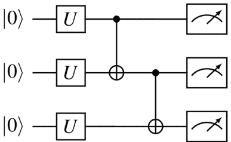
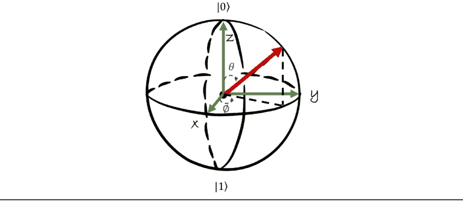
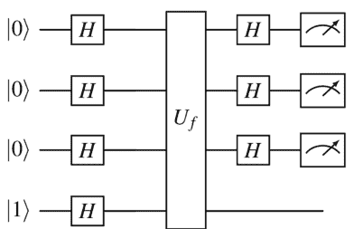
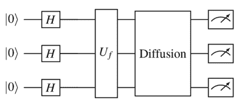
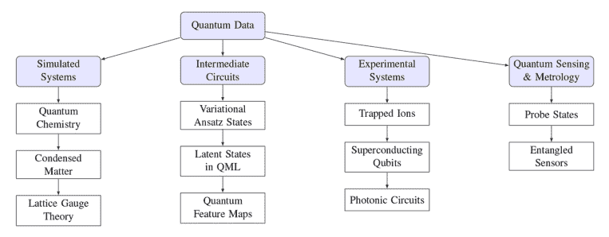
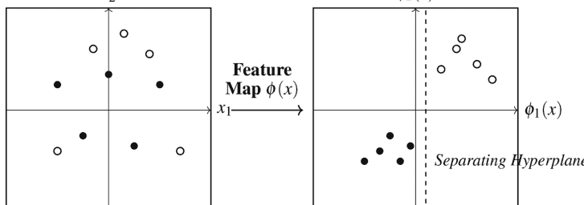
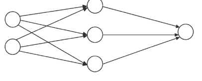
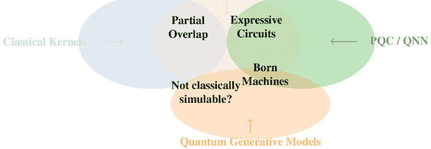
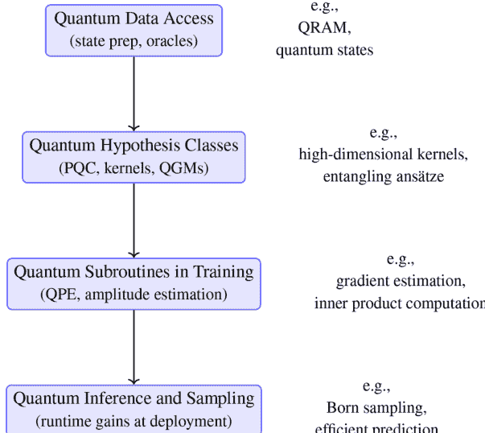

# 量子机器学习：概念与可能性

Andrea Delgado

Kathleen E Hamilton


# 关于系列丛

IOP 量子系列丛致力于汇集量子科学及其技术应用新兴领域的最前沿文本和参考书。该系列由领先专家编写，旨在面向已从事该领域或打算扩展该领域的研究生和研究人员。该系列寻求涵盖（但不限于）以下主题的出版：

Andrea Delgado

橡树奇国家实验室物理部，田西纳西州橡树奇，美国

Kathleen E Hamilton

计算科学与工程部，橡树奇国家实验室，

田西纳西州橡树奇，美国

Andrea Delgado 和 Kathleen E Hamilton 根据 1988 年《版权、设计与专利法》第 77 条和第 78 条声明其作为作品作者的身份权利。

- 前言 x

# 前言

量子计算与机器学习是当今最活跃、扩展最快的研发领域之一。量子机器学习近年来已发展为量子计算的一个分支学科，探索如何利用量子计算机执行机器学习任务——换句话说，即量子计算机如何从数据（量子数据或经典数据）中学习。量子机器学习是一个令人兴奋的领域，因为它含着加速经典机器学习算法的希望。

本书将展示日益增多的量子机器学习算法及其实际应用。从在量子设定下重构学习理论的基础方法开始，本书将重点介绍在寻找能够在计算复杂度上加速机器学习的量子算法 way最新努力。书中还将涵盖针对中等规模噪声量子（NISQ）设备的新型机器学习应用，从短期或协同设计的视角探讨量子经典混合方法。本书的目的是帮助读者清晰地理解当前机器学习的潜力与局限性，并帮助他们为这一令人兴奋领域的未来研究确定方向。我们首先从实现量子计算的量子力学原理开始，帮助读者对如何利用这些量子力学特性加速某些计算任务建立直觉。随后，我们向读者介绍一些用于开发更复杂算法的基础量子算法。之后，我们探索量子机器学习中不同的研究领域，这些领域与算法的选择以及是在量子数据还是经典数据上运行有关。最后，我们描述了最先进的量子机器学习算法，包括监督学习和无监督学习，讨论了它们在短期设备上实现的应用和局限性。

量子机器学习是一个正在形成的学科，在短期和长期应用方面具有无限可能。然而，为了发现量子机器学习能提供什么，首先必须由科学家和量子计算爱好者组成的跨学科社区来探索其众多途径。我们希望本书能成为这段旅程的可能起点，因为它旨在介绍量子机器学习研究最初几年产生的一些关键概念、思想和算法。我们的目标是提供全面的文献综述，并总结量子机器学习中经常出现的主题，将其置于背景中并让广泛的读者能够理解，从而促进未来的研究与应用。

# 作者简介

# Andrea Delgado 博士

Andrea Delgado 博士是橡克里奇国家实验室物理学部的研究科学家。她的研究专注于量子计算在高能物理中的应用，重点是开发用于大型粒子物理实验（如大型亥子对撞机）数据分析和仿真的新型算法。她因在量子信息科学与基础物理交叉领域的开创性工作荣获殊誉的欧根·维格纳学金（Eugene Wigner Fellowship）。Delgado 博士担任 IBM/CERN 高能物理量子计算工作组指导委员会成员，并自 IEEE 量子周创办以来一直发挥着领导作用，多次担任技术程序主席。她还是《IEEE Transactions on Quantum Engineering》杂志的副编辑。Delgado 博士在德克萨斯A州立大学获得物理学博士学位，专攻新物理搜索。她目前的工作探索了量子机器学习、量子生成模型以及混合量子经典算法，旨在推进高能物理和核物理领域的发现。

# Kathleen E Hamilton 博士

Kathleen E Hamilton 博士是橡克里奇国家实验室量子科学小组组的研究科学家。她的研究兴趣涵盖量子计算下一代处理器的基准与算法开发。她在机器学习方面的工作包括自然语言处理、储层计算以及使用机器学习工作流对短期量子设备进行基准测试。她曾于 2019 年至 2021 年担任神经形态系统国际会议（ICONS）的程序委员会，并自 2020 年起组织 IEEE 量子周的人工智能研讨会。她在加州河分校获得博士学位。

Andrea Delgado 与 Kathleen E Hamilton

# 第1章 引言

## 1.1 动机与范围

量子技术的加速发展为计算、通信和传感开启了新的前沿。最有前景的方向之一是**量子机器学习 (`QML`)**。

量子机器学习旨在探索量子资源以及如何增强学习任务、提高模型表达能力或加速训练和推理。它结合了量子力学原理与机器学习，探索处理、分析和生成数据的新方法。

本书介绍了 *`QML`* 的核心思想、算法和挑战，展示了针对当前和短期量子设备的理论基础。本书的结构旨在作为一本自自的教材，适用于具有量子计算工作知识和通用机器学习背景的研究生或研究人员。

### 学习中的量子加速

量子机器学习的动力源于相对于经典算法实现*计算加速*的潜力[1]。但“加速”泛泛意味着什么？当一个量子算法以比已知算法更低的资源消耗（例如时间、查询或样本）解决问题时，该算法表现出*量子加速*[2]。这些加速以多种形式存在：

- **多项式加速**：当量子算法将运行时间从 `$O(n^k)$` 减少到 `$O(n^m)$` 且 `m < k` 时发生。例如：用于无结构搜索的 Grover 算法[3]实现了平方级加速（从 `$O(N)$` 到 `$O(\sqrt{N})$`）。

- **指数级加速**：当量子算法在多项式时间内解决某个任务，而经典解决方案需要指数级时间时发生。例如：Shor 因数分解算法[4]。

查询复杂度中的超多项式加速：在某些学习理论设定下，某些概念类可以通过量子学习者以指数级更少的查询次数进行学习。例如，某些奇偶函数在量子计算机上可以以指数级更少的查询次数进行学习 [5, 6]。

在学习理论中的应用：让我们考虑在学习背景下量子加速已被证明或猜想的几种场景：

- *PAC 学习*：在概率近似正确（PAC）框架下，当提供量子示例时，量子学习者可以提高样本复杂度或访问更丰富的假设类 [7, 8]。

- *傅里叶采样*：量子算法比经典算法更高效地访问布尔函数的傅里叶系数 [9, 10]。这为特定的函数类（如 juras 函数或奇偶函数）带来了指数级加速。

- *量子核函数估计*：在经典世界上不可计算的核（例如基于量子态重叠的核）可以在量子计算机上被高效地估计，从而实现量子增强的分类 [11–16]。

- *量子生成模型*：在生成建模 [17] 中，量子电路表示了经典上难以采样或描述的分布，这表明了一种表达能力优势 [18]。

**关键示例：** 学习 DNF 公式。析取归范式（DNF）公式类被认为在 PAC 模型中在经典上难以学习，但在某些假设下，访问量子示例的量子学习者可以获得更好的样本效率 [19]。

## 1.2 量子机器学习的前景

机器学习已成为科学、技术和工业领域不可或缺的工具，推动了从医学诊断到高能物理等多个领域的进展。尽管如此，许多学习任务仍受限于经典计算资源的限制，特别是在处理高维特征空间、大规模生成模型或不可处理的优化景图时。量子计算引入了从根本上不同的计算原理，为克服这些局限性提供了新的可能性。通过利用叠加、纠缠和量子推理，量子计算机能够以经典无法比拟的方式表示和处理信息。

量子机器学习（QML）的核心承诺在于，量子算法有望为特定任务提供加速、改进表达能力或更高效的数据编码。在某些情况下，量子算法可能会降低学习任务的复杂度，从而解决其他情况下无法实现的问题。在其他情况下，量子增强方法探索了更丰富的假设空间，或学习了经典资源难以模拟的数据分布。这些可能性的交汇处是一个快速发展的领域，它通过量子计算的视角重新构想了学习理论的工具和目标。

### 量子机器学习

在某种程度上，QML 的潜力不仅限于实现运行时间的改进。量子原生模型（直接在量子数据上运行或在量子系统中运行的算法）的发展为信息处理提供了新的范式。这些模型并非仅仅是经典算法的量子模拟版，它们往往涉及新的方法，利用量子力学的结构来重新定义学习的含义。本书的其余部分将探索这些方法的理论基础和实际实现，并关注它们为近期及未来量子硬件带来的机遇和局限性。

### 量子模型在何时以及为何可能有所帮助

由于量子模型在某些设定下比经典模型更高效地表示、操纵和采样高维空间，它们在机器学习中具有潜在优势。与经典模型不同，量子算法使用编码了丰富几何结构的复振幅和模式。QML 可能通过以下一种或多种方式提供帮助：

- **计算速度**：某些子程序——例如求解线性组 [20]、估计核函数 [11] 或采样分布——可以在量子计算机上更高效地执行。

- **模型表达能力**：量子电路表示了经典模型难以或无法高效模拟的概率分布和函数 [21]。

- **紧凑数据编码**：通过振幅 [22] 或哈密顿编码 [15]，量子态可以表示指数级巨大的特征空间 [11, 12]，可能允许从更少的物理资源中获得更好的泛化。

- **量子数据上的量子优势**：对于涉及固有量子数据的任务（例如来自传感器或模拟器的量子态），量子模型提供了一个没有经典类比的自然计算框架 [23]。

请注意，这些潜在的收益取决于持续的研究。并非所有的学习问题都能受益于量子模型，实际性能取决于硬件限制、数据结构以及算法设计。本书的目标是探索何时以及如何实现此类优势

## 1.3 量子计算：复习

为了理解如何利用量子力学来实现学习任务，回顾量子计算的基本原理将会有帮助。量子信息的的基本单元是量子比特（qubit），与经典比特不同，它可以处于状态的叠加。量子比特被描述为二维希尔伯特空间中的复值单位向量，并通过应用酉变换进行操作。这些酉操作使用量子门实现，操纵单个量子比特或对，并遵循薛定谔方程的确定性动力学。

### 量子机器学习



图1.1。展示量子计算基本结构的简单电路。电路从 `|0\rangle` 状态开始，经过一系列门操作，最后以计算基下的测量结束。

量子系统的基本特征是纠缠，这是一种非经典的相关性，使得多个量子比特的联合态能够编码无法分解为独立部分的信息。纠缠在许多算法算法中起着关键作用，并通常被视为一种实现量子优势的资源。在实践中，量子计算通过组合电路来实现，测量根据波恩规则将量子态投影到经典结果上，即使演化是完全确定的也会产生概率行为（见图1.1）。

量子算法利用量子力学的独特结构来解决经典计算无法解决的问题。这类算法的发展（如格罗夫搜索或肖尔分解算法）为构建量子硬件提供了理论见解和实践动力。这些基础算法也作为更复杂流程的构建模块，包括用于 QML 的算法。

## 1.4 机器学习基础

机器学习是一个广阔且快速发展的领域，旨在开发能够识别模式、做出预测或从示例生成新数据的模型。从核心而言，机器学习涉及使用从未知过程采样的数据集来近似函数或分布。这通常通过选择一个假设类（例如神经网络 `NNs`）并优化模型参数，以最小化相对于训练数据的某种损失或误差来实现。

在监督学习和无监督学习之间存在标准的区分。在监督学习中，模型在有标签的示例上进行训练，目标是超越观测到的输入进行泛化，以正确预测未见的输出。在

表 1.1. 经典机器学习与量子机器学习术语的对应关系。经典模型在向量和实值函数上运行，而量子模型则使用参数化电路和观测量来操纵量子态。

| 经典机器学习 | 量子机器学习 |
|---|---|
| 数据 | 量子态 |
| 模型 | 参数化电路 |
| 特征映射 | 数据编码 |
| 损失函数 | 观测量 |
| 训练 | 优化 |

相比之下，无监督学习寻求在没有显式标签的情况下，通过识别聚类、降维或学习生成式表示来揭示数据中隐藏的结构。在两种设定中，泛化、过拟合和正则化的概念对于理解模型在未见数据上的性能上都是至关重要的。这些挑战的出现是因为学习者必须在灵活性和归纳偏差之间取得平衡——选择一个足够丰富以捕捉相关模式，但又有足够的约束以避免拟合噪声。

训练过程通常被建模为一个优化问题。代价函数（或损失函数）量化了模型预测与预期结果之间的差异，并使用梯度下降或其变体等优化算法迭代地调整模型参数。在深度学习中，假设类通常是具有数百万参数的高度非线性、分层函数组合。请参见表 1.1 中经典机器学习与量子机器学习术语的对应关系。考虑到此类模型的复杂性，经验证据表明，只要优化后的景观良好且模型容量足够，它们在大规模数据集上训练时可以表现得非常好。

当我们探索用于学习的量子模型时，这些基础思想将在贯书中反复出现。许多概念——如模型选择、泛化和优化——都适用于量子领域，但必须根据量子约束进行重新考虑，例如测量诱导的噪声、电路深度限制以及量子态制备和推理的概率性质。量子机器学习（QML）的挑战与前景在于识别经典框架中的哪些元素可以被量子机制增强或替换，并理解这种替换何时能产生实际收益。

## 1.5 量子机器学习分类

量子机器学习涵盖了广泛的算法策略，这些策略由数据与所用模型之间的相互作用塑造。其核心在于量子资源在分类、采样或生成建模等任务中是否优于经典方法。然而，并非所有机器学习算法都以相同的方式与量子力学接触。量子力学的利用程度不仅取决于算法是否在量子设备上运行，还取决于输入数据的性质。

一些量子机器学习方法旨在完全处理经典数据，将量子电路作为具有优势表达或可训练性的模型。另一些为量子原生任务设计的，例如从物理系统产生的量子态中学习。还有一些介于之间，使用经典输入但依赖子程序（如状态估计或核计算）来加速学习过程的特定部分。这种多样性导致需要一个统一的框架来区分机器学习的不同模式。为了对这些进行分类，以下分类根据两个正交标准提出了机器学习方法：学习的数据类型和执行学习的模型类型。这种分类不仅为读者提供了领域的地图，还强调了每种方法的假设、局限性和机会。

### 机器学习方法分类

机器学习算法可以根据两个特征进行粗分类：数据的性质和模型。

| 数据类型 | 模型类型 | 示例案例 |
|---|---|---|
| 经典 | 经典 | 标准 `SVM`、`CNN`、高斯混合、梯度提升 |
| 量子 | 量子 | 变分分类器、量子核方法、在经典数据集上训练的量子电路 |
| 量子 | 经典 | 影子层析、量子测量数据分类、量子传感器输出的经典后处理 |
| 量子 | 量子 | 全量子生成模型、量子自动编码器、量子态确定、量子增强测量 |

备注：

- 经典数据 + 量子模型类别最适用于使用混合量子经典算法的应用。

- 量子数据 + 量子模型适用于量子原生任务，例如量子纠错、状态分类或纠缠传感器网络。

- 某些算法（例如 `QAN`）根据生成器、判别器和数据编码的结构跨越多个类别。

本章通过概述动机、范围和书籍结构，为探索量子机器学习奠定了基础。我们介绍了驱动该领域的核心问题：量子计算如何在计算效率、模型表达或数据表示方面增强或重新学习任务。为了引导读者，我们回顾了量子计算和经典机器学习的关键原理，识别了指导后续章节的概念相似之处和差异。

本章的一个关键部分是根据输入数据和模型的性质对机器学习方法进行分类，这种分类为读者提供了一幅概念地图，帮助其在统一框架内定位各种算法、技术和应用。

在本章结束时，读者应该准备好应对量子与经典范式之间的交互，理解编码选择的重要性，并欣赏机器学习工作流的高级设计空间。书的剩余部分将在此基础上构建，从对量子原语和经典学习理论的详细检查开始，逐步迈向先进模型和领域的开放挑战。

## 参考文献

- [1] Biamonte J, Wittek P, Pancotti N, Rebentrost P, Wiebe N and Lloyd S 2017 Quantum machine learning Nature 549 195–202

- [2] Montano A 2016 Quantum algorithms: an overview npi Quantum Inf. 2 150233

- [3] Grover L K 1996 A fast quantum mechanical algorithm for database search Proc. 28th Annual ACM Symp. on Computing pp 212–219

- [4] Shor P W 1997 Polynomial-time algorithms for prime factorization and discrete logarithms on a quantum computer SIAM J. Comput. 26 1484–509

- [5] Cross A W, Smith G and Grolmal J 2015 Quantum learning robust against noise noise Phys. Rev. 92 012327

- [6] Rist D, da Silva M P, Ryan C A, Cross W A, Cócoles D, Smolin J A, Gambetta J M, Chow J M and Johnson B R 2017 Demonstration of quantum advantage in machine learning any Quantum Inf. 3 16

- [7] Tucanasalam S and de Wolf R 2017 Guest column: A survey of quantum learning theory ACM SIGACT News 48 41–67

- [8] Servideo R A and Gottler S J 2004 Equalities and separations between quantum and classical learnability SIAM J. Comput. 33 1067–92

- [9] Bernstein E and Vazirani U 1997 Quantum complexity theory SIAM J. Comput. 26 1411–73

- [10] Aci A and Servideo R 2007 Quantum algorithms for learning and testing quantum Quantum Inf. Process. 6 323–48

- [11] Havlíček V, Cócoles A D, Temme K, Harrow A W, Kandala A, Chow J M and Gambetta J M 2019 Supervised learning with quantum-enhanced feature spaces Nature 567 209–12


- [12] Schuld M and Killoran N 2019 Quantum machine learning in Hilbert spaces Phys. Rev. Lett. 122 040504

[13] Mitarai K, Negoro M, Kitagawa M and Fuji K 2018 Quantum circuit learning *Phys. Rev. A 98* 032309

[14] Rebentrost P, Mohsen M and Lloyd S 2014 Quantum support vector machine for big data classification *Phys. Rev. Lett. 113* 130503

[15] Schuld M, Sweke R and Meyer J 2021 Effect of data encoding on the expressive power of variational quantum-machine learning models *Phys. Rev. A 103* 032430

[16] Kübler M, Buchholz S and Schölköpf B 2021 The inductive bias of quantum kernels arXiv: 2106.03747

[17] Benedetti M, Garcia-Pintos D, Perdomo O, Leyton-Ortega V, Nam Y and Perdomo-Ortiz A 2019 A generative modeling approach for benchmarking and training shallow quantum circuits *npj Quantum Inf. 5* 45

[18] Lloyd S and Weedbrook C 2018 Quantum generative adversarial learning *Phys. Rev. Lett. 121* 040502

[19] Bshouty N H and Jackson C 1998 DNF over the uniform distribution using a quantum example oracle *SIAM J. Comput. 28* 1136–53

[20] Harrow A W, Hassid M and Lloyd S 2009 Quantum algorithm for linear systems of equations *Phys. Rev. Lett. 103* 150502

[21] Du Y, Hisch M-H, Liu T and Tao D 2020 Expressive power of parametrized quantum circuits *Phys. Rev. Res. 2* 033125

[22] Schuld M, Bocharov A, Svore K M and Wiebe N 2020 Circuit-centric quantum classifiers *Phys. Rev. A 101* 032308

[23] Huang H-Y et al 2022 Quantum advantage in learning from experiments *Science 376* 1182–6

概念与可能性

**Andrea Delgado 和 Kathleen E Hamilton**

# 第2章

## 量子信息处理

量子信息理论是物理学和计算机科学的一个分支，涉及量子层级上信息的行为和操纵。它基于量子力学原理，量子力学是描述原子和亚原子尺度下物质和能量行为的基础理论。

在经典信息理论中，信息由位（bits）表示——即可以取值为 0 或 1 的基本单位。相比之下，量子信息由**量子比特**（quantum bits），或**qubits**表示，它们可以处于态的叠加中，从而实现更复杂的并行计算。

量子信息理论在量子计算、量子通信、量子加密和量子计量中具有广泛的应用。关键概念包括纠缠、量子隐传态和量子纠错。纠缠描述了量子系统之间无法用经典理论解释的相关性。量子隐传态允许通过经典通信和纠缠来传输态。量子纠错确保了量子信息在存在噪声时的稳健性。

本章引入了与计算相关的量子力学核心原理，包括量子比特态、门和基于电路的算法。最后一节提供了对**量子力学公理**的概述，并引入了经典算法，如**Deutsch-Jozsa 算法**和**Grover 算法**，为后续的量子机器学习（QML）讨论奠定。

### 2.1 量子计算

量子计算利用量子力学的原理——叠加、纠缠和干涉来执行计算。由于叠加态的存在，一个**qubit**（比特）可以同时是 0 或 1，其态在二维希尔伯特空间 $\mathcal{H} \cong \mathbb{C}^2$ 中表示。

量子比特的态 $|\psi\rangle = \alpha|0\rangle + \beta|1\rangle$，其中 $\alpha, \beta \in \mathbb{C}$ 且 $|\alpha|^2+\|\beta|^2=1$，描述了布洛赫球面上的单位向量。测量将态投影到由二维向量表示的 $|0\rangle$ 或 $|1\rangle$：

$$|0\rangle = \begin{bmatrix} 1 \\ 0 \end{bmatrix}, |1\rangle = \begin{bmatrix} 0 \\ 1 \end{bmatrix} \quad (2.1)$$

概率为 $|\alpha|^2$ 和 $|\beta|^2$。量子系统还表现出纠缠，这是一种非域相关，允许多比特态表现出经典系统无法复制的联合特性。

量子比特

量子比特（quantum bit）或 `qubit` 是量子信息的根本单位。与经典比特只能处于两个确定态（0 或 1）之一不同，`qubit` 可以同时处于这两种态的叠加态中：

$$|\psi\rangle = \alpha|0\rangle + \beta|1\rangle$$，其中 $|\alpha|^2+\|\beta|^2=1. \quad (2.2)$

这个抽象的二级系统可以代表广泛的物理实现，例如计算基中的态 (0) 和 (1)，或者自旋为 1/2 粒子的 $-\frac{1}{2}$ 和 $\frac{1}{2}$。

- 量子比特在进行测量之前一直保持“叠加”态。测量会坍缩叠加态，将量子比特投影到其中一个态。量子系统的行为由一组被称为公理的少量规则支配。

- 态空间：量子系统是希尔伯特空间中的单位向量 $|\psi\rangle$。

- 演化：在没有测量的情况下，量子态根据酉变换 `U` 演化。

- 测量：观测量对应于厄算符。测量时，系统坍缩为观测量的本征态，概率由波规则给出。

- 复合系统：复合系统的态空间是张积。当态无法分解时，就会产生纠缠。

### 2.2 狄拉克符号

狄拉克符号是量子力学中描述量子态的一种形式。在狄拉克符号中，向量 `v` 表示为 `|v⟩`。它基于 bra-ket 符号，ket 表示列向量，bra 是其共轭转置。因此，量子比特处于态 0 和态 1 的叠加中：

$$|\psi\rangle = \alpha|0\rangle + \beta|1\rangle$$

系数 $\alpha$ 和 $\beta$ 是复数 $(\alpha, \beta \in \mathbb{C})$。bra 和 ket 表示二维希尔伯特空间中的向量，其中 $|0\rangle$ 和 $|1\rangle$ 构成正交基。bra-ket 符号允许以简洁直观的方式表示内积、外积以及对这些态的其他操作。例如，在这个正交基中，我们可以将 $|\psi\rangle$ 写为

$$|\psi\rangle = \begin{bmatrix} \alpha \\ \beta \end{bmatrix}$$

$\alpha$ 和 $\beta$ 的物理含义是在测量后发现态处于 $|0\rangle$ 或 $|1\rangle$ 的概率 $|\alpha|^2$ 或 $|\beta|^2$。此外，这些概率归一化为1。最后，在狄拉克符号中，bra-ket 符号用于表示量子态和算符。例如，量子态 $|\psi\rangle$ 可以表示为 ket，算符 `A` 可以表示为 bra-ket 对 $\langle\psi|A|\psi\rangle$。

### 2.3 布洛赫球面

布洛赫一直是二级系统（如 `qubit`）态的图形表示。布洛赫球面是一个单位球面，北极代表态 $|0\rangle$，南极代表态 $|1\rangle$。任何态都是布洛赫球面上的一个点。例如，态 $|+ \rangle$ 是 $|0\rangle$ 和 $|1\rangle$ 的叠加，由赤道上位于南北极中间的点表示。

布洛赫球面

布洛赫球面上的任意点都代表二级系统的态。

这种态的推广可以通过参数 $\gamma, \theta, \phi$ 来表示：

$$|\psi\rangle = e^{i\frac{\phi}{2}}(\cos\frac{\theta}{2}|0\rangle + \sin\frac{\theta}{2}e^{i\phi}|1\rangle)$$

分量 $e^{i\phi}$ 是一个无法通过实验检测到的全局因子，通常会被舍忽略，从而将描述布洛赫球上任意点所需的参数数量减少到两个。



布洛赫球是可视化和理解量子态属性及其可以执行的操作的有用工具。它对于理解量子门行为特别有用，量子门是在量子比特（`qubit`）上执行以改变其状态的操作。它还可以表示量子纠错背景下的二能系统态，用于识别并纠正量子态中发生的错误。在这种背景下，布洛赫球被称为量子纠错码的布洛赫球表示。

### 2.4 哥哈堡解释

尽管布洛赫球上有无限多个点，每个点都对应量子比特的一个可能状态，量子力学规定在测量后，描述量子系统的波函数会坍缩到两个基矢之一，$|0\rangle$ 或 $|1\rangle$。此外，对系统进行的后续测量也将产生相同的结果。

这一现象是在由尼尔斯·波尔 [3] 和维尔纳·海森堡 [4] 开发的哥哈堡解释背景下被理解的。这一理解量子力学的框架基于这样一个观点：量子粒子本质上是不不确定的，无法被确定地进行预测。相反，哥哈堡解释提出，测量或观测的行为会导致量子系统“坍缩”，从而产生一个确定的结果。

根据哥哈堡解释 [1, 5]，量子系统在被测量或观测之前没有确定的属性，而测量行为本身决定了结果。这意味着量子粒子的行为从根本上是不可预测的，无法用经典的因果概念来描述。相反，它必须使用概率和统计方法进行描述。

给定系统的初始状态和应用在其上的变换序列，在测量诱导的坍缩之前的任何时刻，都可以精确地确定量子态。这一原理是量子计算的基础。量子算法用于将量子态从已知的初始态演化，以操纵变换态的概率分布，使其朝着有利的结果演变。

### 2.5 量子门与电路

在经典计算领域，门被用于处理二进制数据。如与门（AND）、或门（OR）和非门（NOT）等门根据定义良好的逻辑操作将输入位转换为特定的输出位。当过渡到量子领域时，我们需要一套新的工具来对我们的量子数据——量子比特执行操作。这些工具以量子门的形式出现。

#### 2.5.1 量子门

量子门是允许在量子计算机中操纵量子比特的基本操作。与经典对应物一样，这些门决定了系统的行为。然而，与处理确定 0 和 1 的经典门不同，量子门处理的是量子比特，它可以处于 0 和 1 态的叠加态。

经典门的操作是确定性的，当你确切知道输出将是什么。相反，量子门在量子力学的概率领域中运行。它们的动作是非破坏性的；量子门不是将量子比特设置为特定状态，而是通过方式变换量子比特，使其状态在可能量子态的复空间中演化。例如，经典非门会将位从 0 翻转为 1 反之亦然，而它的量子对应物在量子比特处于叠加态时，结果变得不那么可预测。

在数学上，量子门由酉矩阵表示。在量子力学中，酉变换是关重要的，因为它们保持了状态空间中向量的长度，确保概率之和为一。这确保了计算过程中量子信息的守恒，符合量子力学的核心原理之一。量子门包括单量子比特门（`X`, `Y`, `Z`, `H`, `S`, `T`）和多量子比特门（`CNOT`, `Toffoli`, `SWAP`）。见表 2.1。

通用门集

任何量子计算都可以使用 Clifford + T 门集进行近似。该集合将由哈达达门（`H`）、相位门（`S`）和受控非门（`CNOT`）生成的 Clifford 群与非 Clifford T 门（或 $\pi/8$ 门）结合起来。仅凭 Clifford 门可以在经典计算机上进行高效模拟，但添加 T 门后就提升到了通用性，任何酉变换都可以以任意精度进行近似。Solovay-Kitaev 定理 [6] 保证了可以分解为通用集。

#### 表 2.1. 包括单比特、双比特和多比特量子门的总结。

| 门名称 | 矩阵表示 | 图示 | 描述 |

| --- | --- | --- | --- |

| Pauli-$X$ (NOT) | $\begin{pmatrix} 0 & 1 \\ 1 & 0 \end{pmatrix}$ | X | 翻转门 |

| Pauli-$Y$ | $\begin{pmatrix} 0 & -i \\ i & 0 \end{pmatrix}$ | Y | 结合位翻转与相位翻转 |

| Pauli-$Z$ | $\begin{pmatrix} 1 & 0 \\ 0 & -1 \end{pmatrix}$ | Z | 相位翻转门 |

| Hadamard (H) | $\frac{1}{\sqrt{2}}\begin{pmatrix} 1 & 1 \\ 1 & -1 \end{pmatrix}$ | H | 创建叠加态 |

| Phase (S) | $\begin{pmatrix} 1 & 0 \\ 0 & i \end{pmatrix}$ | S | 引入 $\pi/2$ 相位 |

| $T$-gate | $\begin{pmatrix} 1 & 0 \\ 0 & e^{i\pi/4} \end{pmatrix}$ | T | 引入 $\pi/4$ 相位 |

| CNOT | $\begin{pmatrix} 1 & 0 & 0 & 0 \\ 0 & 1 & 0 & 0 \\ 0 & 0 & 0 & 1 \\ 0 & 0 & 1 & 0 \end{pmatrix}$ | | 受控非门 |

| SWAP | $\begin{pmatrix} 1 & 0 & 0 & 0 \\ 0 & 0 & 1 & 0 \\ 0 & 1 & 0 & 0 \\ 0 & 0 & 0 & 1 \end{pmatrix}$ | | 交换量子比特 |

| Toffoli (CCX) | $\begin{pmatrix} 1 & 0 & 0 & 0 & 0 & 0 & 0 & 0 \\ 0 & 1 & 0 & 0 & 0 & 0 & 0 & 0 \\ 0 & 0 & 1 & 0 & 0 & 0 & 0 & 0 \\ 0 & 0 & 0 & 1 & 0 & 0 & 0 & 1 \\ 0 & 0 & 0 & 0 & 1 & 0 & 0 & 0 \\ 0 & 0 & 0 & 0 & 0 & 1 & 0 & 0 \\ 0 & 0 & 0 & 0 & 0 & 0 & 0 & 1 \\ 0 & 0 & 0 & 0 & 0 & 0 & 1 & 0 \end{pmatrix}$ | | |

#### 2.5.2 量子电路模型

量子电路模型是设计量子算法的常用框架。在量子电路中，量子比特表示为水平线，时间从左向右流动。作用于量子比特的门表示为符号。

### 2.6 Deutsch–Jozsa 算法

Deutsch-Jozsa 算法是第一个展示出优于经典计算的量子算法。它在量子计算机上通过单次评估解决了一个在经典情况下呈指数级的问题。

#### 2.6.1 问题描述

设 `f: {0, 1}^n → {0, 1}` 为布尔函数，承诺为恒定的（所有输入的输出相同）或平衡的（一半输入输出 0，另一半输出 1）。任务是确定它是哪一种。

在经典情况下，最坏的情况必须对 $2^{n-1} + 1$ 个输入评估 `f`。Deutsch-Jozsa 算法通过单次调用量子算器解决了这个问题（见图 2.1）。



#### 2.6.2 算法概述

- 1. 初始化一个状态为 `|0⟩^{⊗ n} |1⟩` 的 $(n+1)$ 量比特系统。

2. 对所有 `n+1` 个比特应用 Hadamard 门以创建叠加态。

3. 调用算谕 `U_f`，它将 `|x|y⟩` 映射到 `|x|y ⊕ f(x)⟩`。

4. 对前 `n` 个比特应用 Hadamard 门。

5. 测量前 `n` 个比特。

#### 2.6.3 结果解释

- 如果输出是 `|0⟩^{⊗ m}`，则 `f` 是常数函数。

- 否则，`f` 是平衡函数。

#### 2.6.4 意义

该算法展示了量子并行性和干涉的威力。通过对叠加态中的所有输入进行评估，并通过相长干涉或相消干涉，Deutsch–Jozsa 算法在查询复杂度上实现了指数级加速。

### 2.7 Grover 算法

Grover 算法 [8] 为无结构搜索问题提供了一种量子解决方案，相比经典暴力破解法提供了二次方加速。

#### 2.7.1 问题描述

给定一个包含 `N=2^n` 个条目的无结构数据库以及一个算谕函数 `f: {0, 1}^n → {0, 1}`（该函数仅对目标项返回 1，其他返回 0），找到一个输入 `x_0` 使得 `f(x_0) = 1`。在经典情况下，这需要 `O(N)` 次评估。Grover 算法在大约 `O(√N)` 步内实现了这一点（见图 2.2）。




**图 2.2.** 三量子比特的 Grover 算法量子电路。初始的 Hadamard 门准备了所有可能输入的均匀叠加态。算谕 `U_f` 翻转标记态的相位。扩散操作（也称为均值反转）放大了标记态的概率幅。在经过一次算谕和扩散迭代后，测量将高概率显示目标态。

在 Deutsch-Jozsa 算法中，算谕 `U_f` 编码了一个*黑盒*函数 `f: [0, 1]^n → [0, 1]`。在物理上，它是一个相干地查询该函数的酉变换，这意味着由于量子叠加，它同时在所有可能的输入 `x` 上评估 `f(x)`。算谕作用于两个量子寄存器：

```
$|x\rangle$
```

其中 `x` 是持有函数参数的 `n` 位输入，`y` 是存储结果的比特寄存器。符号 `⊕` 表示模 2 加法。

在此映射中，第一个寄存器 `|x⟩` 保持不变，而仅当 `f(x) =1` 时，第二个寄存器会被翻转。这种控制翻转可以被解释为经典逻辑门的可逆实现。例如，当 `f(x)` 对应于布尔表达式时，`U_f` 的作用类似于经典电路的量子版本，能够在不破坏叠加态的情况下计算 `f(x)`。

这意味着 `U_f` 相干地将函数值 `f(x)` “写入”到量子态的相位或幅度中，从而允许后续的干涉模式揭示 `f` 的全局属性。

### 2.7.2 算法概述

- **初始化**一个状态为 `|0⟩^{⊗ n}` 的 `n` 量比特系统，并应用 Hadamard 门创建等叠加态。
- **重复** Grover 迭代 `O(√N)` 次：
    - **算谕步**：应用 `U_f`，翻转标记项的相位。
    - **扩散算子**：围绕平均幅度反射状态。
- **测量** 最终态以以高概率获得 `x_0`。

### 2.7.3 数学见解

设 `|s⟩ = 1/√N ∑_{x=0}^{N-1}|x⟩` 为初始叠加态。Grover 迭代通过在 `|x_0⟩` 和 `|s_0⟩` 跨出的二维子空间内将量子态向 `|x_0⟩` 旋转，从而放大标记态的幅度。

### 2.7.4 意义

Grover 算法在量子设置下的无结构搜索是最优的，展示了二次方加速。它广泛应用于优化、满足性和机器学习任务，在这些任务中，检查解决方案很容易，但找到解决方案是很困难的。

## 2.8 总结

本章介绍了量子信息处理的基础元素，对于理解量子机器学习至关重要。我们从对比信息的经典表示和量子表示开始，强调了量子比特的作用及其独特属性——叠加、纠缠和测量。

量子理论的正式结构通过狄拉克符号、布洛赫球以及量子力学公理引入，这些公理规定了量子系统的行为，包括态如何演化以及如何获取测量。基于这些概念，我们探索了量子电路模型和关键量子门，为设计量子算法建立了语言。本章以详细介绍两种经典算法作为终结：Deutsch–Jozsa 算法为承诺问题提供了指数级加速，而 Grover 算法为无结构搜索提供了二次方加速。

这些主题为书中其余部分讨论的量子算法和机器学习模型提供了基本的计算原语和概念基础。

## 参考文献

- [1] Sakurai J J and Napolitano J 2010 Modern Quantum Mechanic 2nd edn (San Francisco, CA: Addison-Wesley)
- [2] Ballentine L E 1998 Quantum Mechanics: A Modern Development. (Singapore: World Scientific)
- [3] Bohr N 1987 The Philosophical Writings of Niels Bohr, Vol. I-III 1–3 (Woodbridge, CT: Ox Press)
- [4] Heisenberg W 1958 Physics and Philosophy: The Revolution in Modern Science. (New York: Harper and Brothers)
- [5] Jenner M 1974 The Philosophy of Quantum Mechanics (New York: Wiley)
- [6] Kitaev A Y 1997 Quantum computations: algorithms and error correction R. Math. Surv. 52 111–249
- [7] Deutsch D and Jozsa R 1992 Rapid solution of problems by quantum computation Proc. R. Soc. Lond. A 439 553–8
- [8] Grover L K 1996 A fast quantum algorithm for database search Proc. 28th Annual ACM Symp. on Theory of Computing pp 212–9

## 3.1 桥接计算领域

在经典数据与量子系统接口的领域，促进信息流的关键枢纽是经典到量子的编码。这一至关重要的通道使得具有固有量子特性的量子处理器能够理解并操纵源自经典领域的数据。在本节中，我们将深入探讨这一转换过程的复杂性，探索各种方法并考虑它们的影响。

在经典学习中，数据表示对于决定学习算法的性能起着核心作用。考虑数据集 `𝒟 = {(x_i, y_i)}_{i=1}^n`，其中 `x_i ∈ ℝ^d` 是输入特征，`y_i ∈ ℝ` 是对应的标签。量子机器学习（QML）的一种常用方法是使用量子特征映射 `Φ: ℝ^d → ℱ` 变换输入空间，其中 `ℱ` 是高维特征空间（例如希尔伯特空间）。这种变换使得能够在 `ℱ` 中应用线性方法来捕捉原始输入空间中的非线性特征。

量子编码的经典类比可以在核方法中找到，其中数据通过核函数 `k(x, x') = ⟨φ(x), φ(x')⟩` 进行隐式映射。常见的特征映射包括多项式和径向基函数（RBF），它们有效地编码了关于数据结构和任务的先验假设。

### 特征映射

考虑标记为 `ℋ` 的希尔伯特空间，称为特征空间。设 `χ` 和 `x` 代表该输入集中的单个样本。在此背景下，**特征映射**是一个标记为 `φ` 的函数，它作用于集合 `χ` 中的输入，并将它们映射到希尔伯特空间 `ℋ` 内的向量。

`φ: χ → ℋ`

使得随后量子模型构建一个函数：

`f(x) = ⟨0|U†(x) M U(x)|0⟩ ⊗_n` (3.1)

其中 `ℳ` 是一个赫尔米特观测器。这种表示允许通过量子核进行基于方法：

`k(x, x') = ||⟨φ(x), φ(x')⟩||^2,` (3.2)

这已经在量子支持向量机（QSVMs）[8] 以及其他学习模型中得到了研究。

通过使用一系列量子门来诱导叠加和纠缠，量子特征映射生成复杂的量子态，这些态能够有效地表示底层数据。这些态应用于量子核方法和许多其他 QML 算法。

**图 3.1.** 不可分离数据的示例。我们将原始空间转换到希尔伯特空间。特征映射的设计旨在使得原始空间中的不可分离点在特征空间中变得可分离。这一思想与经典 SVM 中的核技巧（kernel-trick）非常接近。

如图 3.1 示例所示，我们展示了将二阶量子特征映射应用于由两个同心圆组成的不可分离数据集的效果（图 3.1 左侧）。量子特征映射 `U_φ(X)` 包含了三个算符 `U1_φ(x1)`、`U1_φ(x2)` 和 `U1_φ(x_1, x_2)`，并混合了哈达玛门和 CNOT 门。这里 U1 是一个相移门，

```
$U_φ = \begin{bmatrix} 1 & 0 \\ 0 & e^{iφ} \end{bmatrix}$ (3.3)
```

函数 `φ` 定义为：

```
$$\phi = \begin{bmatrix} \phi(x_1, x_2) = x_1, \ \phi(x_1, x_2) = \pi x_1 x_2 \end{bmatrix}$$ (3.4)
```

我们测量 `σ^z σ^z` 算符的值，其中 `σ^z` 是泡利 Z 算符。

```
$$\sigma^z\sigma^z = ZZ = \begin{bmatrix} 1 & 0 \\ 0 & -1 \end{bmatrix} \otimes \begin{bmatrix} 1 & 0 \\ 0 & -1 \end{bmatrix} = \begin{bmatrix} 1 & 0 & 0 & 0 \\ 0 & -1 & 0 & 0 \\ 0 & 0 & -1 & 0 \\ 0 & 0 & 0 & 1 \end{bmatrix}$$ (3.5)
```

应用特征映射后，我们可以看到数据集被提升到一个特征空间，在该空间中是可分的（图 3.1 右右）。然而，值得注意的是，设计高效且实用的特征映射可能是一项艰巨的任务。过度复杂的映射在后续提取价值信息的测量阶段也可能带来挑战。

另一个引人入胜的方面是量子嵌入（quantum embeddings），其目的是提供经典数据的深度表示。类似于捕捉复杂数据模式的深度学习嵌入，量子嵌入试图使用量子态来表示经典数据。这种方法寻求数据内部内在的关系和结构。通常，数据首先使用经典技术进行转换，然后输入到量子电路中生成特定的量子态。这个过程通常涉及幅度编码和相位编码等方法。然而，值得注意的是，类似于深度学习嵌入，量子嵌入有时会模糊可解释性，使得难以理解为什么会做出某些预测或分类。

编码方法的选择很大程度上取决于数据的性质以及所处的特定量子机器学习任务。每种方法都有其独特的优势和挑战，理解它们的细微差别对于在经典数据处理和分析中有效利用量子系统的力量至关重要。图 3.2 显示了涉及经典数据的 QML 通用工作流。

**图 3.2.** 涉及经典数据的端到端量子学习工作流。经典数据通过参数化编码映射到量子态。结果态由量子模型处理并通过测量获得结果。

当我们深入 QML 的海洋时，我们遇到的一个基本方面是为 QML 定制的各种编码方案。这些方案对于如何高效、有效地使用量子算法处理经典数据起着至关重要的作用。

在量子设置中，经典向量通过参数化编码映射到量子态。结果态由量子模型处理，并通过测量获得结果。

### 3.2.1 幅度编码

在其核心，幅度编码围绕使用量子态的振幅展开。想象一个强度在黑白之间变化的灰度图像。

### 3.2.2 角度/参数编码

这种方法采用了不同的途径，使用量子态的相对相位来携带信息。本质上，数据被编码在角度中。

### 3.2.3 基编码

在基编码中，每个经典数据点对应于计算基中的特定量子态。例如，经典二进制数据 01 可以直接映射到量子态。

### 3.2.4 哈密顿量编码

哈密顿编码指的是一类量子嵌入策略，其中经典或结构化的输入 `(x)` 被用于定义哈密顿量 `H(x)`，量子态通过其酉正演化来制备。

Trotter-Suzuki 分解或乘公式，特别是当哈密顿量中的项彼此对易或可分组为对对易子集时。

**示例：** 图编码。

考虑一个具有邻接矩阵 `(A)` 的图 `G=(V, E)`。可以定义一个哈密顿量 `H_G = ∑_{(i,j) ∈ E} Z_i Z_j`，其中作用于 `(i)` 的算符为 Pauli`(Z_i)`。则编码变为 `U_G = e^{-iθ ∑_{(i,j) ∈ E} Z_i Z_j}`，图结构被嵌入演化量子态的纠缠模式中。此类编码用于基于图的学习任务或基于建模的系统。

- **属性**。
- **数据类型**：结构化数据（例如图、分子），或映射到 Pauli 系数的实值向量。
- **电路需求**：取决于系统 `(n)`；通常为中等到高。
- **电路深度**：可变；取决于哈密顿量和模拟方法（例如 Trotter 化、硬件原生门）。
- **噪声容忍性**：中等。虽然表达能力高，但长时间的模拟或深度电路可能会引入退干。
- **表达能力**：哈密顿量编码可以表示复杂的相关性和纠缠模式。

**应用**。

哈密顿量编码已应用于量子核方法（例如数据重上传模型）、量子生成学习和相位分类任务。它也自然地出现在量子模拟工作流中，其中学习应用于物理模型生成的时间演化数据或基态数据。表 3.1 比较了主要的编码方案。

表 3.1 量子数据编码策略比较。每种策略在电路需求、电路复杂度、噪声容忍性以及对数据类型的适用性之间取得了平衡。

| 编码策略 | 数据类型 | 要求 | 电路深度 | 噪声容忍性 | 示例 |
|---|---|---|---|---|---|
| 基础编码 | 二进制字符串 | `n` | 低 | 高 | `X, I` |
| 角度编码 | 实值特征 | `n` | 低到中等 | 高 | `R_y(x_i), R_z(x_i)` |
| 振幅编码 | 归一化实向量 `x ∈ 𝕕` | `log_2 d` | 低 | 低 | 态准备电路 |
| 基于哈密顿量的编码 | 结构化输入（如图、分子） | 取决于问题 | 可变 | 中等 | `e^{-itH(x)}` |

自动编码器 [9, 10] 是一种用于学习数据高效低维表示的机器学习模型。在经典设置中，自动编码器由一个编码器 `E: ℝ^d → ℝ^d` 和一个解码器 `D: ℝ^d → ℝ^d` 组成，联合训练以最小化重构损失：

`ℒ(x) = ||D(E(x)) - x||^2` (3.9)

学习到的表示 `z = E(x)` 理想情况下以压缩格式捕捉输入数据中最显著的特征。量子自动编码器 (QAE) [11] 将此概念扩展到量子数据（比较表 3.2 经典和量子自动编码器），旨在将量子态压缩到希尔伯空间的同时保留关键信息。设 `|ψ⟩_{in} ∈ ℋ_A ⊗ ℋ_B`，其中 `dim(ℋ_A) = 2^n` 且 `dim(ℋ_B) = 2^m`。QAE 寻求一个酉算符 `U`，使得：

`U|ψ⟩ ≈ |ψ⟩_A ⊗ |0⟩_B,` (3.10)

其中 `|ψ⟩_A` 编码压缩后的信息，`|0⟩_B` 是丢弃子系统的固定参考态。变分量子自动编码器 (VQAE) [12] 中使用的损失函数通常形式为

`ℒ_{QAE} = 1 - Tr[ρ_B|0⟩⟨0|]` (3.11)

其中 `ρ_B = Tr_A[|ψ⟩⟨ψ|U†]` 是丢弃子系统的还原密度矩阵。当丢弃子系统去纠缠并处于参考态时，损失最小，从而实现成功的压缩。

### 3.3.1 电路构建

VQAE 通过一个参数化电路 `U(θ)` 实现，该电路在输入态集合 `|ψ_i⟩` 上进行训练。优化后，`U(θ*)` 将关键自由度编码到量子比特子集中，同时将剩余量子比特映射到 `|0⟩`。解码器由 `U*(θ*)` 给出，它恢复了原始态的近似：

`|ψ_j⟩ ≈ U*(θ*)(|φ_j⟩_A ⊗ |0⟩_B).` (3.12).

表 3.2 经典与量子自动编码器的比较。

| 方面 | 经典自动编码器 | 量子自动编码器 |
| --- | --- | --- |
| 输入 | 实值向量 `x ∈ ℝ^d` | 量子态 `|ψ⟩ ∈ ℋ_{in}` |
| 隐空间 | `ℝ^{d'}`，其中 `d' < d` | 子系统 `ℋ_A ⊂ ℋ_{in}` |
| 编码器 | 神经网络 `E(x)` | 参数化酉算符 `U(θ)` |
| 解码器 | 神经网络 `D(z)` | `U*(θ)` |
| 损失函数 | 重构误差 `||D(E(x)) - x||^2` | 投影保真度 `1 - Tr[ρ_B|0⟩⟨0|]` |
| 应用 | 降维、去噪 | 态压缩、误差缓解、量子道容量 |

### 3.3.2 应用与相关性

QAE 是量子机器学习 (QML) 广泛框架内强大且灵活的组件。QAE 的核心设计目标是将量子态压缩到较小的子空间，同时保留下游任务所需的关键信息。这种减少量子态维度的能力对实际应用和理论研究具有深远影响。在内存、相干时间或量子比特可用性等量子资源有限的背景下，QAE 为更有效地利用这些资源提供了途径。它们能够用更少的量子比特表示复杂的量子数据，这一点尤为重要。

量子数据的概念是指本质上是量子的信息，与由确定或概率赋值组成的经典字符串不同。量子数据编码在系统的态中，数学上由复希尔伯空间中的向量（纯态）或密度矩阵（混合态）描述。量子数据自然出现在许多科学领域，包括量子物理、化学和计量学。

### 3.4.1 定义与表示


形式上，量子数据对应于 $\rho \in \mathcal{D}(\mathcal{H})$，其中 $\mathcal{D}(\mathcal{H})$ 表示希尔伯空间 $\mathcal{H}$ 上的密度算符。纯量子数据由 $|\psi\rangle \in \mathcal{H}$ 描述，而混合量子数据则可能代表了经典不确定性或与环境的纠缠。这些态可以通过实验制备或产生量子电路。从信息论的角度来看，由于以下特性，量子数据与经典数据有本质区别：

- **叠加**：量子态可以编码连续的幅度，从而具有丰富的表达能力。
- **纠缠**：量子数据在子系统间表现出非经典相关性，可以编码结构化的全局信息。
- **不可克隆**：量子数据通常无法在不受到干扰的情况下进行复制，这限制了监督学习语文中对训练样本或标记数据的访问。
- **测量导致坍缩**：从量子数据提取经典信息在本质上是概率性和破坏性的。

### 3.4.2 量子数据的来源

量子数据可以产生于来源，取决于应用领域：

- **模拟系统**：通过经典或量子算法模拟的凝聚态、晶格规范理论或分子系统的量子态。
- **实验系统**：从量子光学、超导电路、离子阱或其他量子硬件收集的数据。
- **中间量子电路**：在量子算法中间阶段产生的量子态，例如变分量子算法中的拟态或生成模型中的隐态。
- **传感器网络与计量学**：编码感兴趣物理参数（如场、力或时间间隔）的量子态，用于精密测量任务。



**图 3.3.** 与量子机器学习相关的量子数据来源和类型。量子数据可能源于模拟物理系统、中间电路、实验硬件或量子增强传感设备。

## 3.4.3 从量子数据中学习

从量子数据中学习涉及从训练集 $\{\rho_i, y_i\}$ 估计函数、决策边界或生成模型，其中 $\rho_i$ 是量子态，$y_i$ 是经典或量子标签。目前已经探索了若干设定：

- **量子分类：** 通过量子测量策略或变分电路从未知的量子态 $\rho$ 确定标签 $y$ [18–20]。
- **量子回归：** 学习从量子态到实值观测值或期望值的映射 [21]。
- **量子生成式建模：** 学习生成量子态的分布或重现量子数据的统计特性 [22]。

该领域的一个挑战是可访问性：量子数据无法被自由复制，且只能通过量子门谕或实验运行获取。量子态层析等技术在扩展性方面存在局限 [23, 24]，这促使人们需要*信息论*高效的学习方法，只需要少量副本或间接观测值。最近的工作还探索了学习量子测量，即优化算符值测量（POVMs）[25]——其测量值是希尔伯特空间中的正半定算符。

## 3.4.4 对编码的影响

量子数据的编码在概念上与经典数据的编码不同。在经典情况下，数据必须首先通过酉变换或态制程序嵌入到量子态中。相比之下，对于量子数据，挑战在于设计能够保留并利用输入量子态结构的量子机器学习模型，且通常带有破坏性测量。

此外，经典学习理论中的标准假设（如 i.i.d. 采样或对数据的无限制访问）无法直接应用于量子设定。新的理论框架，如量子样本的 PAC 学习、量子统计学习和量子泛化边界正在积极开发，以弥补这一差距。

在量子计算领域，理论的优雅性必须与实际实现的限制之间进行仔细平衡。量子编码是将经典数据翻译为量子领域的复杂过程，是这两个领域之间一个特别敏感的交叉点。虽然各种编码策略在表达能力和性能方面具有独特优势，但它们的有效性最终取决于它们在多大程度上与当前量子硬件的限制以及输入数据的性质相匹配。最直接的限制之一源于硬件局限。当代量子处理器（通常被称为 NISQ 设备）提供的量子比特数量有限，且受到高错误率的影响。一个在理论上是最优的编码方案，如果可用比特数需要易于退相干的深层电路，它仍然可能是不可行的。例如，振幅编码（amplitude encoding）在比特使用方面是高效的，但通常会产生显著的电路深度，使其对于短期设备来说不那么实用。

错误率是一个主要关注的问题。与经典操作不同，量子门本质上是概率性的，并受到各种噪声源的影响，包括环境相互作用、门缺陷和读取误差。放大对此类噪声敏感性、或未能纳入错误感知设计原则的编码方案，可能会降低编码量子态的保真度。在这种背景下，对噪声的鲁棒性成为评估编码方法可行性的关键指标。

数据的结构和复杂性在选择合适的编码策略也起着核心作用。现实世界的数据跨越了广泛的光谱——从简单的二进制特征到图像、音频信号或图结构数据等高维对象。某些编码方案（如基编码适用于离散二进制输入，但难以高效地表示连续或结构化数据。选择一种尊重数据几何和统计特性的方法对于在编码过程中保留信息至关重要。

另一个关键因素与编码相关的计算开销——如果准备量子态所需的时间和经典预处理超过了通过量子计算获得的收益，那么量子方法的优势就会被破坏。这对于混合量子-经典算法尤为相关，因为数据在每次训练迭代或推理步骤都需要加载和编码。因此，高效、可扩展的编码程序对于实现现实世界的加速是不可缺的。

最后，可逆性是量子处理中一个独特且经常被低估的限制。由于量子操作是酉的因此是可逆的，编码过程理想上应该保留这一特性。当目标不仅是处理数据而且还要在经典背景下解释量子输出时，可逆性变得尤为重要。确保编码可以反转允许下游任务，如数据重建、调试和混合工作流中的可解释性。

总结来说，量子编码并非纯粹的理论练习，而是与硬件能力、抗噪性、数据结构和计算效率深度交织的设计。开发平衡这些考虑的编码策略对于实现量子机器学习和量子增强数据处理的实际承诺至关重要。随着该领域越过 NISQ 时代，这些务实限制将继续指导量子算法和硬件的设计。

本章探讨了信息编码在量子机器学习中的基础性作用，强调了它的理论基础和实际影响。将经典或量子数据编码为量子态是任何量子学习流水线中的关键一步，因为它决定了结果算法的假设类可访问性、表达能力和计算效率。

我们首先回顾了特征表示和核学习的经典方法，然后通过多比特系统上的参数化单元将它们的量子对应物形式化。介绍了几种编码策略，包括基编码、振幅编码、角度编码和哈密顿编码，它们在量子效率、电路深度和与当前硬件的兼容性方面具有不同的权衡。

随后，我们研究了量子自动编码器的概念，它们学习将量子态压缩到较小的子空间的同时保留信息。这些模型展示了编码是如何被学习的，而不是手动指定的，为特定任务或数据驱动的量子表示开启了大门。它们的应用跨越了量子态表示压缩、误差缓解和生成建模。

本章还引入了量子数据本身的概念，它不仅仅是编码输入，而且产生于物理过程、模拟或量子电路的量子态。这种区分为无克隆定理和测量破坏性等现实限制下的访问、标记和从量子数据中学习带来了新挑战。

最后，我们讨论了设计编码方案的系列实际考虑因素。这些包括硬件限制（比特数、噪声）、经典数据的复杂性、编码电路的开销以及对可逆操作的需求。随着该领域向更复杂、可扩展的量子系统发展，编码仍然是设计既有表达力又可在设备上实现的量子算法的核心关注。

总之，信息编码桥接了量子理论的数学形式与量子计算实际需求之间的差距。对编码策略的细致理解对于开发有效高效的量子学习应用至关重要。

[1] Coppersmith D 2002 用于量子因子分解的近似傅里叶变换 arXiv:quantum-ph/0201067

[2] Schuld M and Petruccone F 2018 量子计算机的监督学习 (Champer: Springer International)

[3] Schuld M, Bocharov A, Svore K M and Wiebe N 2020 电路电路量子分类器 Phys. Rev. A 101 032308

[4] Pérez-Salinas A, Cervera-Lierto A, Gil-Fester E and Latore J I 2020 通用量子分类器的数据重载 Quantum 4 226

[5] Grover L and Rudolf T 2002 创建对应于积概率分布的叠加态 arXiv:quantum-ph/0208112

[6] McClean J R, Boixo S, Sleviansky V N, Babush R and Neven H 2018 量子神经网络训练景观中的障碍平坦区 Nat. Commun. 9 4812

[7] Schuld M and Kill N 2019 特征希尔伯特空间的量子机器学习 Phys. Rev. Lett. 122 040504

[8] Reichrost P, Molsheni M and Lloyd S 2014 用于大数据分类的量子支持机分类器 Phys. Rev. Lett. 113 130503

[9] Rumhardt D E, Hinton G E and Williams R J 1986 误差传播的国际内部表示 并行分布处理：探索认知的微观结构：基础 (Cambridge, MA: MIT Press) pp 38–62

[10] Bank D, Koenigstein N and Giryes R 2023 数据科学量子机器学习手册: 挖掘与知识发现 (Cham: Springer International) pp 353–74

[11] Romero J, Olson P and Aspuru-Guzik A 2017 用于量子数据高效压缩的量子自动编码器 Quantum Sci. Technol. 2 045001

[12] Khosman A, Vinci W, Denis B, Andriyash E, Sadeghi H and Amin M H 2018 变分自动编码器 Quantum Sci. Technol. 4 014001

[13] Wan K H, Dahlsten O, Kristansson H, Gardner R and Kim M S 2017 使用量子 npi 的前馈网络量子泛化 Phys. Inf. 3 36

[14] Mangini S, Aruzzaro A, Plantamagna M, Gerace D, Bajoni D and Macchiavello C 2022 应用于工业案例研究的量子神经网络自动编码器和分类器 Quant. Mach. Int. 4 13

[15] Najarbans S, Spannowsky M and Takeuchi M 2022 使用量子自动编码器的高能物理中的异常检测 Phys. Rev. D 105 095004

[16] Zhang X-M, Kong W, Farooq M, Yung M-H, Guo G and Wang X 2021 使用量子自动编码器的通用误差检测误差缓解 Phys. Rev. A 103 L043044

[17] Pazem J and Arans M H 2023 使用 brainbox 自动编码器的纠缠态误差缓解 Sci. Rep. 15 22257

[18] Sentis G, Montoraz A, Muhoz Tapia R, Calsamigria J and Bagan E 2019 量子数据的无监督分类 Phys. Rev. X 9 041029

[19] Wang Y and Cao L 2025 通过量子支持向量机检测量子相变 Quantum Sci. Technol 10 015043

[20] Xia Y, L Wi, Zhuang Q and Zhang Z 2021 使用变分纠缠传感器网络进行量子增强数据分类 Phys. Rev. X 11 021047

[21] Kardashian A, Balkykev B, Palyunin V V and Antikin K 2025 在量子计算机上回归预测量子系统的属性 Phys. Rev. 7 013201

量子机器学习

- [22] Zoufal C 2021 生成式量子机器学习 arXiv: 2111.12738
- [23] O'Donnell R and Wright J 2015 高效量子层析术 arXiv: 1508.01907
- [24] O'Donnell R and Wright J 2017 高效量子层析术 II 第49届年度 ACM SIGACT 计算理论研讨会 pp 899-912
- [25] Garcia-Pérez G, Rossi M A C, Sokolov B, Tacchino F, Barkoutsos P K, Mazzola G, Tavernelli I and Maniscalco S 2021 学习测量：用于量子算法的自适应信息完全泛义测量 PRX Quantum 2 040342

概念与可能

Andrea Delgado 和 Kathleen E Hamilton

监督学习是经典机器学习中的核心范式，模型利用标记数据学习从输入到输出的映射。从图像分类到垃圾邮件检测，监督学习算法广泛用于从数据中提取模式并对未见示例做出可靠的预测。这些方法的核心是模型（通常是线性的或非线性的），它们根据训练数据学习决策边界，以及特征映射和核等工具，这些工具增强了模型在高维空间中捕捉复杂关系的能力。

随着量子计算的出现，研究人员开始探索如何利用量子力学原理来增强推理算法的性能。量子计算机通过在指数级维度的希尔伯空间中运行，为表示和处理信息提供了新的基质。特别是，量子机器学习通过用量子对应物替换经典组件（如特征映射或内积），为监督学习引入了一种新方法。这包括将经典数据编码为量子态的量子特征映射，以及通过量子电路评估数据点相似性的量子核。

关键洞察是，某些量子特征映射可以隐式地将数据嵌入极高维空间中，在这些空间中，学习任务可能变得更容易，而经典计算机难以计算相应的内积。这为量子增强推理提供了可能，至少在原理上，量子电路可以帮助从数据中提取模式，且这种方式比经典模型更具表现力或更高效。

在本章中，我们从推理的角度探讨了量子计算在监督学习中的作用。我们首先对经典推理、特征映射和核进行简要回顾。然后，我们引入了映射的概念，以及它们如何作为支持向量机（SVM）等基于核的学习算法。我们还讨论了参数化量子电路（PQCs），它们作为希尔伯特空间中的线性模型，可用于分类任务。

在此过程中，我们对量子推理模型的理论动机和实际实现提供了见解，包括量子优势的讨论。在本章结束时，读者将对量子设备如何用于监督学习有基础性的理解，它们可能提供的优势以及必须克服的挑战。

## 4.1 量子推理的基础

为了理解量子计算如何帮助推理任务，我们必须首先回顾监督学习的经典框架和基于的模型。这些基础不仅引导量子算法的设计，还作为评估量子方法性能的基准。

### 4.1.1 监督学习基础

监督学习是指根据标记示例学习输入到输出映射的过程。形式上，我们给定一个训练数据集

$$\mathcal{D} = \{(x_i, y_i)\}_{i=1}^n$$ (4.1)

其中 $x_i \in \mathbb{R}^d$ 是特征向量，$y_i \in \mathcal{Y}$ 是相应的标签。对于分类问题，标签集是有限的，通常为 $\mathcal{Y} = \{1, \dots, n\}$，而对于回归问题，$\mathcal{Y} = \mathbb{R}$。

学习算法旨在从选定的假设类 $\mathcal{H}$ 中寻找假设 $h: \mathbb{R}^d \to \mathcal{Y}$，使得模型对新的未见数据泛化良好。泛化能力通常通过损失函数 $\mathcal{L}(h(x), y)$评估，例如分类的 0-1 损失或回归的平方损失。经验风险（或训练误差）定义为

$R(h) = \frac{1}{n} \sum_{i=1}^n \mathcal{L}(h(x_i), y_i),$ (4.2)

经典监督学习的一个根本挑战是平衡偏差和方差：过于简单的模型可能会拟合不足（高偏差），而过度复杂的模型会过拟合（高方差）。正则化、交叉验证和模型选择技术通常用于处理这种权衡。

### 4.1.2 经典机器学习中的特征映射和核

许多学习任务受益于将数据转换到新空间，在该空间中结构更有利于线性分离。这种转换由特征映射完成：

$$\phi: \mathbb{R}^d \to \mathcal{F}$$ (4.3)

# 原始输入空间

### 映射后的特征空间



**图 4.1.** 核的示意图：非线性变换 $\phi(x)$ 将输入空间中不可分的数据映射到高维特征空间，在特征空间中它们变得线性可分。

其中 $\mathcal{F}$ 是一个（可能是高维或无限维的）特征空间。特征空间中的简单线性模型由：

$h(x) = (w, \phi(x)) + b,$

其中 $w \in \mathcal{F}$ 且 $b \in \mathbb{R}$。如果 $\phi$ 选择得当，线性模型就可以捕捉输入空间中的非线性模式（见图 4.1）。

### 4.1.3 核方法

*核方法*并不是显式地计算 $\phi(x)$，而是使用*核函数*在特征空间内评估内积：

$k(x, x') = \langle\phi(x), \phi(x')\rangle.$

这种技巧被称为*核*（kernel），允许在高维空间中进行高效计算。一个流行的例子是径向基函数（RBF）核：

$k(x, x') = \exp\left(\frac{|x - x'|^2}{2\sigma^2}\right),$

它对应于无限维的特征空间。

SVM 等核方法使用核函数来构建具有强泛化属性的分类器。SVM 优化问题的对偶形式仅取决于核的评估，这使得在不显式构建特征向量的情况下学习复杂的决策边界成为可能。

### 4.1.4 理论保证

核方法的使用基于于*表示器定理*（representer theorem），该定理确保了一大类正则化经验风险最小化问题的解位于训练集上核评估的张空间内。此外，*Mercer定理*（Mercer’s theorem）保证任何连续、对称、正定的核都对应于某个希尔伯特空间中的一个内积。

### 核技巧

给定一个映射 $\phi: \mathbb{R}^d \rightarrow \mathcal{F}$，核技巧允许我们在不显式构建 $\phi(x)$ 的情况下计算 $\mathcal{F}$ 中的内积。也就是说，

$$k(x, x') = \langle\phi(x), \phi(x')\rangle \quad (4.7)$$

可以直接在输入空间中进行计算。这导致了强大的算法，这些算法在高维甚至无限维的特征空间中运行，其计算成本仅取决于数据集的大小。


这些经典技术为量子对应物提供了启发。通过将经典特征映射和内积替换为量子态和重叠幅，可以定义**量子核**（quantum kernels）和**量子增强推理模型**。接下来的章节将探索量子计算如何实现这些思想，并具有指数级表达能力计算优势的潜力。

## 4.2 量子特征映射

在监督学习中利用量子计算最有前景的途径之一是**量子特征映射**。这些映射将经典数据嵌入到高维量子态中，开启了使用量子硬件隐式访问经典计算机上无法模拟的大型希尔伯特空间的可能性。量子态之间的内积是**量子核方法**和其他量子增强推理算法的基础。

### 4.2.1 量子态作为特征

让我们回顾经典特征映射 $\phi: \mathbb{R}^d \rightarrow \mathcal{F}$ 的概念，其中 $\mathcal{F}$ 是高维特征空间。在量子设置中，$\phi(x)$ 的角色由量子态 $|\phi(x)\rangle$ 承担，该态由编码经典数据 `x` 的量子电路制备。

形式上，*量子特征映射*是一个映射：

```
$x \rightarrow |\phi(x)\rangle \in \mathcal{H}, \quad (4.8)$
```

其中 $\mathcal{H}$ 是与n比特量子系统相关的希尔伯特空间，即 $\mathcal{H} \simeq (\mathbb{C}^2)^{\otimes n}$。制备 $|\phi(x)\rangle$ 的量子电路通常表示为 `U_{\phi}(x)`，使得

```
$|\phi(x)\rangle = U_{\phi}(x)|0\rangle^{\otimes n}. \quad (4.9)$
```

编码电路 `U_{\phi}(x)` 可能包含依赖数据的门如 `R_y(x)`，编码的选择影响量子算法的性能。

### 4.2.2 特征映射的数据编码

引入了几种编码方式。在这里，我们简要回顾它们在量子方法中的相关性：

- **基础编码 (Basic encoding)**：将字符串直接编码到特征空间。

- **幅度编码 (Amplitude encoding)**：将 `x` 表示为量子态：

```
$|\phi(x)\rangle = \sum_{i=1}^{2^n} x_i |i\rangle \quad (4.10)$
```

- **角度编码 (Angle encoding)**：将 `x` 映射到旋转：

```
$|\phi(x)\rangle = \bigotimes_{j=1}^n e^{i x_j Z_j} |+\rangle. \quad (4.11)$
```

- **哈密顿编码 (Hamiltonian encoding)**：将作用演化 `e^{-iHt}` 应用于数据。

### 4.2.3 量子特征映射的属性

量子特征映射的设计目的是：

- **表达能力强 (Expressive)**：捕捉希尔伯特空间中的复杂关系。

- **经典上难以模拟 (Hard to simulate classically)**：由于希尔伯特空间的指数级大小。

- **隐式高维的 (Implicitly high-dimensional)**：在比特数 `n` 方面。

**表 4.1.** 经典与量子特征映射的比较。

| 特性 | 经典特征映射 $\phi(x)$ | 量子特征映射 $|\phi(x)|$ |
| :--- | :--- | :--- |
| 域 | $\mathbb{R}^d \rightarrow \mathcal{F}$ | $\mathbb{R}^d \rightarrow (\mathbb{C}^2)^{\otimes n}$ |
| 表示 | 显式向量 | 电路制备的量子态 |
| 维度 | 通常为无限（如 RBF） | 是比特数的指数级 |
| 内积 | $\langle\phi(x), \phi(x')\rangle$ | $|\langle\phi(x)|\phi(x')\rangle|^2$ |
| 潜在优势 | 提高可分性 | 紧凑且高表达力的嵌入 |

这些属性使得量子特征映射成为机器学习的核心。在表4.1中，我们展示了对比以突出相似性。下一节将量子特征映射如何导出量子核。

## 4.3 量子核与核方法

核的概念是许多推理算法的核心，特别是对于 SVM 和高斯过程。当数据通过量子特征映射 `x \mapsto |\phi(x)|` 编码为量子态时，这些态之间的内积定义了*量子核*。量子核提供了经典方法向量子领域的自然扩展，具有表示经典上难以计算的高表达相似性的潜力。

### 4.3.1 量子核定义

给定量子特征映射 `|\phi(x)|`，相关的量子核定义为：

```
$\kappa(x, x') = |\langle\phi(x)|\phi(x')\rangle|^2 \quad (4.12)$
```

### 量子机器学习

### 4.3.2 评估量子核

在实践中，量子核 `$\kappa(x, x')$` 通过量子电路进行评估。两种常用的策略有：

- 交换测试（swap test）：一种通过辅助比特（ancilla qubit）与两个量子态进行干涉来估计重叠度 `$|\langle\phi(x)|\phi(x')\rangle|^2$` 的电路。这需要控制交换门（controlled-swap gates）和多个态副本。

- 直接保真度估计（Direct fidelity estimation）：如果两个态 `$|\phi(x)\rangle$` 和 `$|\phi(x')\rangle$` 都在设备上准备好，可以通过准备态 `U_\delta(x)^\dagger U_\delta(x')|0\rangle` 并测量得到全零态的概率来估计保真度。

在训练集上计算两对核值后，得到核矩阵 `K`，其中 `K_{ij} = \kappa(x_i, x_j)`。该矩阵随后作为经典核方法（如 SVM）的输入，产生量子经典学习流水线。

### 4.3.3 使用量子核进行训练

一旦计算出核矩阵，训练过程遵循标准的经典核方法。例如，在 SVM 分类器中，优化问题涉及求解一个二次型：

```
$$\min_{\alpha} \frac{1}{2}\sum_{i,j} \alpha_i\alpha_j\kappa(x_i, x_j) - \sum_i \alpha_i y_i, \quad (4.14)$$
```

受限于约束 `0 \le \alpha_i \le C` 和 `$\sum_i \alpha_i y_i = 0$`，其中 `$\alpha_i$` 是对偶变量，`C` 是正则化参数。

重要的是，这一过程是在经典计算机上完成的。量子设备仅用于计算核矩阵 `K`，该矩阵捕捉了数据在希尔伯特空间中的几何结构。

### 4.3.4 泛化与表达能力

量子计算中的一个关键问题是量子核是否比经典核具有统计或计算优势。近几年通过以下视角分析了这一问题：

- 核对齐（Kernel alignment）：衡量量子核矩阵与分离数据的理想核之间的对齐程度。对齐较差可能导致性能低于经典核。

- 归纳偏差与再生核希尔伯特空间（RKHS）：每个正定核都定义了一个 RKHS。量子核方法的假设类受限于与 `$\kappa(x, x')$` 相关的 RKHS，这决定了可以学习的函数类型。

- 经典近似的困难性：如果 `$\kappa(x, x')$` 在经典上难以近似（例如，与随机电路采样或瞬时量子多项式 (IQP) 模型等问题相关），量子核可以提供相对于经典方法的区分度。

| 量子核的优缺点 | |
| :--- | :--- |
| **优点：** | - 可以隐式将数据嵌入到指数级巨大的希尔伯特空间中。<br>- 在复杂度理论假设下，可能难以进行经典模拟。<br>- 自然兼容现有的经典核学习框架。 |
| **缺点：** | - 核估计需要多次量子电路评估（采样）。<br>- 对噪声的敏感会降低保真度估计。<br>- 核对齐差可能导致次优的性能。 |

在下一节中，我们将超越超越固定特征的核模型，探索线性量子模型。在这些模型中，假设类被直接编码到参数化量子电路（PQC）中，其参数在训练期间被学习。

## 4.4 线性量子模型

量子核依赖于固定的量子特征映射和经典优化。相比之下，线性量子模型将训练参数直接引入量子电路。这些模型代表了线性分类器（如逻辑回归或感知器）的量子模拟，但在高维希尔伯特空间中运行，其中特征空间由量子电路的结构定义。

最常用的方法涉及参数化量子量子电路（也称为变分电路），其中某些门带有可调角度。这些参数使用经典例程进行优化，使得整个学习架构成为量子经典混合模型。

### 4.4.1 用于分类的参数化量子电路

参数化量子电路是一种门依赖于参数向量 `$\theta$` 的量子电路。在分类背景下，典型的电路结构包括：

- 量子特征映射 `U_{\phi}(x)`，将经典输入 `x` 编码为量子态。

- 可训练的酉变换 `U(\theta)`，在编码后应用，代表模型的假设。

- 在计算基下进行测量以提取输出。

该电路准备了一个态

```
$$\psi(x; \theta)\rangle = U(\theta)U_{\phi}(x)|0\rangle^{\otimes n}, \quad (4.15)$$
```

预测标签通过测量一个或多个比特并对结果进行后处理获得。例如，在二分类中，可以定义为

```
$f(x; \theta) = \langle\psi(x; \theta)|M|\psi(x; \theta)\rangle, \quad (4.16)$
```

其中 `M = Z \otimes I \otimes \dots \otimes I` 是作用在第一个比特上的泡利算符。随后应用决策规则，例如如果 `f(x; \theta) > 0` 则分类为类别 1。

### 4.4.2 训练策略

通过最小化训练数据集上的代价函数 `$\mathcal{L}(\theta)$`（如交叉熵）来优化模型参数 `$\theta$`。通常使用经典算法。

优化有两种主要方法：

- **基于梯度的优化**：使用参数移动规则（parameter-shift rule）计算解析梯度，允许通过额外的电路评估获取导数估计。

- **无梯度优化**：包括 COBYLA、Nelder-Mead 或遗传算法等。这些方法对噪声更稳健，但收敛较慢。

代价景观可能会出现*荒平坦*（barren plateaus）——即梯度极小的区域，特别是在深度或表达能力强的电路中。这使得电路架构的选择和初始化对于成功训练至关重要。

### 4.4.3 示例：变分量子分类器

线性模型的一种常见实现是变分量子分类器（VQC）。它通常遵循以下架构：

1. 应用角度编码 `U_x(x)` 将输入 `x` 映射到量子态。

2. 应用由单比特旋转和纠缠门层组成的参数化电路 `U(\theta)`。

3. 在 `Z` 基下测量部分比特。

4. 使用测量结果（或期望值）作为模型输出。

关于变分电路的备注：

- PQC 的表达能力取决于其深度、纠缠门的选择以及比特间的连接性。

- 浅层电路可能会欠拟合，而深层电路容易出现荒平坦。

- 测量策略会影响训练效率和结果的可解释性。

线性量子模型为固定特征的量子核提供了可训练的替代。核方法依赖于评估量子重叠，而变分模型尝试通过调整参数直接在希尔伯特空间中学习映射。在下一节中，我们将比较量子模型（基于核的和变分的）在基准任务上的性能。

受限于量子比特数量、电路深度限制以及硬件噪声 [15]。

- 混合工作流 [16, 17] 将量子子程序（例如核估计）与经典优化（例如 SVM 训练）相结合，在经过适当正则化后 [18] 表现出更强的鲁棒性和可扩展性。

基准测试研究中的评估量指标通常包括：

- 在留出集上的准确率和泛化能力。

- 数据效率：衡量性能随训练集大小变化的函数。

- 对噪声的鲁棒性：评估量子电路在硬件错误下的表现。

- 训练效率：评估所需的电路评估次数。

## 4.5. 鲁棒性与噪声考虑

NISQ（中等规模量子）设备上的量子推理面临着若干物理和算法挑战：

- 退相和门控误差减少了有效电路深度，限制了实践中可以训练的模型复杂性。

- 散噪声由于概率测量引入了统计波动。期望值的准确估计通常需要数千次重复测量，这增加了运行时间。

- 误差缓解技术（如零开销外推和读出纠正）可以帮助，但会增加计算开销且可能扩展性不。

为了解决这些局限性，研究人员通常在训练期间模拟噪声，或在将电路部署到硬件之前在经典端预训练参数。某些方法通过在代价函数中显式建模噪声来优化量子计算。

总之，目前还没有可用量子硬件在真实世界数据集上实现监督学习量子优势的结论性实验证据。某些理论构建表明，在人工或最坏情况分布中存在潜在的量子经典分离，通常通过难以模拟的量子核实现。在实践中，量子优势更有可能出现在与特定应用约束和误差缓解策略协同设计的混合工作流中。

## 4.6. 案例研究与应用

虽然理论和基准研究提供了对量子推理模型能力和局限性的见解，但其其实际价值通过特定领域的应用得到了很好的理解。本节介绍了若干案例研究，说明了量子核方法和变分量子分类器如何应用于来自各种科学和工业领域的真实世界数据。这些示例有助于识别近期部署的机会，以及实现该量子优势所仍面临的挑战。

### 4.6.1 药物发现与分子属性性预测

量子推理方法在制药行业已找到早期应用，特别是用于预测分子属性，如溶解度、毒性和生物活性。这些任务通常被设定为二分类或多分类问题，其中输入是分子描述符或基于图的编码，输出是指示化学或生物属性的标签。

量子核已应用于 QM7 和 QM9 数据集（量子化学基准测试），其中量子电路对分子指纹编码并通过基于保真度的核计算相似性。研究表明，在进行定期的正则化和噪声缓解后 [19]，其性能与经典核相当。

变分量子分类器在涉及分子数据集的二分类任务中（例如预测 HIV 抑制）上进行训练，并使用角度编码特征。这些方法在 NISQ 硬件上的可行性已证明，但仍受限于电路深度和表达能力 [20, 21]。

尽管目前与经典深度学习模型之间存在性能差距，但这些研究展示了量子模型作为更大型量子化学工作流中子程序的潜力，特别是在量子结构可以直接编码的情况下。

### 4.6.2 高能物理

在实验性高能物理（HEP）中，机器学习被广泛用于分类对撞器实验中的粒子信号。量子推理模型已被用作经典分类器的替代或补充，例如在大型强子对撞机（LHC）事件的喷流标记中，量子模型根据高维事件特征将喷流分类为源自特定粒子 [22]。

量子核方法 [23, 24] 和在模拟 HEP 数据集上训练的变分分类器显示出与浅模型相当的性能，特别是在通过预处理或主成分分析（PCA）降低输入维度时 [25]。

HEP 应用特别具有吸引力，因为它们涉及高维、结构化的数据，提供了利用量子模型优势的机会。然而，由于该领域经典流水线的成熟度问题，实现最端性能仍具有挑战性。

### 4.6.3 金融

在金融领域，量子核方法被提出通过计算客户画像之间基于保真度的相似性评分来检测交易网络中的异常 [26]。

这些应用受益于量子模型捕捉噪声、结构化数据集中非线性相关性的能力。然而，由于严格的性能要求和监管考量，部署仍处于概念阶段。

### 应用的共同特征

- 由于严格的性能要求和监管考量，部署仍处于概念阶段。

- 大多数实现仍受限于电路深度和表达能力。

- 这些方法在 NISQ 硬件上的可行性仍受限于电路深度和表达能力。

- 量子优势尚未在硬件上得到证实。

## 4.7. 开放挑战与未来方向

量子推理是量子计算与机器学习交叉领域的一个快速发展的领域。虽然早期结果已经证明了潜力，但存在重大的硬件相关挑战。

### 4.7.1 可扩展性与资源限制

大规模部署量子模型的最直接障碍是量子硬件有限的和保真度。目前的设备受到：

- **量子比特数量**：许多数据集所需的输入特征远超量子比特的数量。

- **电路深度**：需要深电路来实现量子特征映射和变分拟设，但由于噪声通常不可行。

- **采样成本**：估计期望值需要多次重复（采样），特别是对于小的信噪比。这增加了训练时间。

### 4.7.2 量子特征映射的设计

量子特征映射的选择对基于核的模型和变分模型的性能都有关键影响。然而，目前没有通用的方法来构建保证良好泛化的特征映射。开放性问题包括：

- 不同的编码如何影响希尔伯空间的几何结构和目标函数的可学习性。

- 是否可以系统地设计具有优于经典优势的量子特征映射？

- 哪些类型的问题从量子特征空间受益最多？

### 4.7.3 噪声鲁棒性与误差缓解

用于推理的量子电路本质上是有噪声的，即使是浅电路也会受到退相、门和读读错误的影响。虽然某些方法（例如零噪声外推、随机编译）可以减少这些影响，但它们增加了计算开销，且尚未标准化。关键方向包括：

- 开发对随机损失景观鲁棒的噪声感知训练算法。

- 明确噪声对泛化边界和学习保证的影响。

- 探索针对推理任务的混合或变分误差缓解方法。

### 4.7.4 学习理论与泛化边界

尽管在基准测试和实验评估方面取得了进展，但缺乏量子模型的严格理论。开放性理论问题包括：

- 量子分类器的样本复杂性和泛化边界是什么？

- 量子模型能否证明可以减少实现给定准确率所需的训练示例？

- 在什么情况下可以认为量子模型比经典模型学习得更有效？

### 4.7.5 量子-经典混合工作流

通过将量子和经典组件结合到混合学习流水线，已经取得了许多极具前景的结果。然而，协同设计的最佳实践仍在建立中。在量子模块与经典模块之间的高效工作分工、与现有经典机器学习流水线（包括预处理和后处理步骤）的集成，以及针对混合模型的元学习和自动化架构搜索方面，仍需进行研究。这些努力将指导量子推理系统的开发，使其能够在真实的机器学习场景中与经典工具协同工作。

## 4.8 总结

在本章中，我们探索了如何将量子计算应用于监督推理任务，该任务的目标是从标记数据中学习模型，并使其能够泛化到未见的输入上。通过与经典机器学习进行类比，我们引入了关键量子组件——如量子特征映射、量子核和变分量子电路，并研究了如何使用这些组件来构建强大的推理模型。

我们首先回顾了推理的经典基础，强调了特征映射和核方法在构建捕捉复杂模式的模型中的作用。这些想法自然地启发了量子模拟物：将数据编码为量子态的特征映射，以及通过希尔伯特空间中的内积来测量这些态之间相似性的量子核。

- **量子核方法**，使用固定的量子特征映射来为支持向量机 SVM 等经典学习算法定义核矩阵。

- **线性量子模型**，包括变分量子分类器，其决策函数直接通过可训练的量子电路实现。


随后，我们研究了监督学习的两种主要量子方法。核方法具有可解释性且与经典理论良好集成，而变分模型提供了更大的灵活性和适应性，特别是在数据和任务要求尚不完全明确的情况下。

在合成数据集和真实数据集上的实证基准表明，量子推理模型在特定情况下可以匹配或略优于经典基准，但尚未在大规模上证明优势。实际部署仍受到 `NISQ`（中等规模无量子）时代硬件的深度、噪声和可扩展性。

尽管如此，我们还回顾了几个应用案例研究——包括药物发现、高能物理和金融建模，在这些领域，量子模型正在被积极探索和测试。这些努力凸显了量子推理作为混合计算策略部分的潜力，特别是在数据稀缺或高维的场景下。

### 量子机器学习

最后，我们反思了开放的挑战和研究方向，从更好的量子特征映射设计到对量子设置下泛化和学习复杂性的深层理论理解。

## 参考文献

- [1] Schuld M and Petruccione F 2018 Supervised Learning with Quantum Computers (Cham: Springer International)
- [2] Havíček V, Coréles A, Demme K, Harrow AW, Kandala A, Chow J M and Gambetta J M 2019 Supervised learning with quantum-enhanced feature spaces Nature 567 209–212
- [3] Schuld M and Killoran N 2019 Quantum machine learning in Hilbert spaces Phys. Rev. Lett. 122 040504
- [4] Lloyd S, Schuld M, Thomsen A, Sutter D and Woerner S 2024 Quantum embedding for machine learning arXiv:2001.03622
- [5] Gentetta G, Thomas D and Woerner S 2024 The complexity of quantum support vector machines Quantum 8 1225
- [6] Giul-Fuster E, Eisert J and Duko V 2020 On the expressivity of embedding quantum kernels Mach.Learn. Sci. Tech. 5 025003
- [7] Wierch D, Izaac J, Wang C and Yen-Yu Lin C 2022 General parameter-rule shifts for quantum gradients Quantum 66 677
- [8] Schuld M, Bergholt V, Gogolin C, Izaac J and Killoran N 2019 Evaluating algorithms on quantum hardware Phys. Rev. A 99 032331
- [9] R N and Kumar S 2025 Enhanced quantum ensemble classification with shallow circuit and parallelism mechanism Concurr. Comput.: Pract. Exp. 37 e70166
- [10] Suzuki Y, Yano H, Gao Q, Uno S, Tanaka A, Akiyama M and Yamamoto N 2020 Analysis and synthesis of feature map for kernel-based quantum classifier Quant. Mach. Intell. 29
- [11] Schuld M, Fingeruther M and Petruccione F 2017 Implementing a distance-based classifier with a quantum interference circuit Europhys. Lett. 119 600002
- [12] Sen P, Bhatia A S, Bhangu K S and Elbgeti A 2022 Variational quantum classifiers through the lens of the hessian PLoS One 17 e062346
- [13] Hur T, Lim K and Park D 2022 Quantum convolutional neural network for classical data classification Quant. Mach. Intell. 4 3
- [14] Butmatharajaya S, Buesamae N and Taagragol U 2023 MNIST quantum classifier models implementations and benchmarking AI Conf. Proc. 2006 070002
- [15] Wang H, Ding Y, Gu J, Lin Y, Pan D, Chong FT and Han S 2022 QuantumQAS: noise-adaptive search for robust quantum circuits (HPCA) 2022 IEEE Int. Symp. on High-Performance Computer Architecture pp 692–708
- [16] Şkar S 2024 Quantum transfer learning for MNIST classification using a hybrid-classical approach arXiv:2408.03531
- [17] Ranga P, Rajapat A, Kumar P and Vasilakos A V 2024 Hybrid-classical neural networks for efficient MNIST binary image classification Mathematics 12 3684
- [18] Grant E, Benedetti M, Cao S, Hallam, Lockhart J, Stojevic V, Green A G and Severini S 2018 Hierarchical quantum classifiers npi Quantum Inf. 4 65
- [19] Khan D, Disenhof S and von Lindenfeld O 2023 Kernel-based quantum machine learning at recorded rate; many-body distribution functions as quantum representations J. Chem. Phys. 159 034106
- [20] Sathan D and Baicho S 2024 Drug target interaction prediction using variational quantum classifier 2024 Int. Conf. on Next Generation Computing Applications (NextComp) (Piscataway, NJ: IEEE) pp 1–7.
- [21] Paliwal D, Koteswara S N, Gudhanti R, Yadav D and Raj P 2024 Insight into quantum computing and deep learning approach for drug design Lett. Drug Des. Discov. 21 1632–1651
- [22] Gianelle A, Koppenberg P, Lucchesi D, Nicortra D, Rodrigues E, Sestini L, de Vrites J and Zuliani D 2022 Quantum machine learning for b-jet charge identification J. High Energy Phys. 2022 14
- [23] Wu S L et al 2021 Application of quantum machine learning using the quantum kernel algorithm on high energy physics at the LHC Phys. Rev. Res. 3 032221
- [24] Incudini M, Bosco D, Martini F, Grossi M, Serra G and Pierro A D 2024 Automatic and effective discovery of quantum kernels IEEE Trans. Emerg. Top. Comput. Intell. 1–10
- [25] Meglio A D et al 2024 Quantum computing for high-energy physics: state of the art and challenges PRX Quantum 5 037001
- [26] Miyabe S et al 2023 Quantum multiple kernel learning in financial tasks arXiv:2312.00260

其动力显而易见：由于希尔伯特空间随系统规模指数级增长，量子化学是经典计算机要求最高的应用领域之一。即使是中等分子，使用精确对角化或经典近似方案进行模拟也面临挑战。相比之下，量子计算机表示这些状态，而变分算法提供了一种可行路径，利用相对浅的电路来导航指数巨大的量子态空间。

`VQE` 之后，变分方法迅速引发了一波算法创新，导致了泛化拟态，例如用于更高效求解问题的`幺正耦合簇 (UCC)`，以及扩展到更广泛的问题类别，如使用`量子近似优化算法 (QAOA)` 进行组合优化。如今，变分算法已成为大多数实际量子应用的核心，涵盖了从化学、材料科学到金融和机器学习的多个领域。

## 5.1 模型描述

变分量子算法的工作原理是将问题编码到代价函数中，该函数可以在量子设备上进行评估，并通过经典优化进行最小化。变分算法的基本组成部分包括参数化量子电路（拟态）、用于评估代价的量子测量程序，以及更新参数的经典优化循环。这种混合反馈机制使得在硬件限制存在的情况下高效探索量子态成为可能。

设 $|\psi(\theta)\rangle = U(\theta)|\psi_0\rangle$ 表示由电路 $U(\theta)$ 准备的量子态，其中 $|\psi_0\rangle$ 是初始参考态。变分算法的目标是寻找参数 $\theta$ 以最小化特定问题的代价函数（通常是哈密顿算符 $H$ 的期望值），评估方法为：

$E(\theta) = \langle\psi(\theta)|H|\psi(\theta)\rangle$ (5.2)

该代价通过测量哈密顿分解中的项（通常是泡泡利算符之和）并在经典端进行组合来计算。

变分算法的两个主要子类——`VQE` 和 `QAOA`——说明了该框架在连续和离散优化设置中的灵活性。

### 5.1.1 变分量子本征求解器

`VQE` 作为一种实用的量子-经典混合算法被引入，用于估计量子哈密顿量的基态能量。其动力直接来源于量子力学中的变分原理：对于任何试探态 $|\psi\rangle$，量 $\langle\psi|H|\psi\rangle$ 是基态能量 $E_0$ 的上界。试探态越接近真实的基态，期望值就越低。

在 `VQE` 中，哈密顿量 $H$ 通常代表分子的电子结构，使用二量子化形式通过费米子产生符和湮灭算符表示。这些算符通过 Jordan-Wigner [4] 或 Bravyi-Kitaev [5] 等映射转换为比特算符。生成的比特哈密顿量是泡泡利矩阵张量积的加权和：

$H = \sum_{i \in \mathbb{R}} c_i P_i, \quad (5.3)$

其中 $P_i \in \{I, X, Y, Z\}^{\otimes n}$，$c_i$ 是由问题哈密顿量定义的系数。为了估计能量 $E(\theta)$，必须在量子硬件上测量每个项 $\langle \psi(\theta)|P_i|\psi(\theta)\rangle$ 并根据 $c_i$ 加权。所需的测量次数可能非常多，这促成了诸如测量分组 [6-8]、经典影子 [9, 10] 和基旋转分组 [11] 等策略，以减少测量开销。

拟态 $U(\theta)$ 在 `VQE` 的性能中起着核心作用。常见的选择包括：

- `硬件高效拟态 [12]`，它们使用原生门操作和纠缠层。
- `受问题启发的拟态`，例如化学中的 `UCC [13]` 拟态。
- `自适应拟态`，例如 `ADAPT-VQE [14]`，它根据算符梯度增长电路。

经典优化器可以是无梯度的（例如 `COBYLA [15]`, `Nelder-Mead [16]`）或基于梯度的（例如 `Adam [17]`, `L-BFGS [18]`），取决于取决于是否存在可用或可估计的解析梯度。

### 5.1.2 量子近似优化算法

`QAOA [19]` 是一种用于解决组合优化问题的变分算法。`QAOA` 通过将问题编码到经典代价函数 $C(z)$ 来工作，其中 $z \in \{0, 1\}^n$ 代表位串，并构造代价哈密顿量 $H$，其特征值对应于不同解的代价值。

为了探索解空间，`QAOA` 通过交替使用代价哈密顿量和混合哈密顿量 $H_M$ 生成的幺正变换定义参数化量子态，$H_M$ 通常选择为：

$H_M = \sum_{j=1}^n X_j, \quad (5.4)$

这诱导了位串之间的转换。`QAOA` 态定义为：

$|\psi(\gamma, \beta)\rangle = \prod_{j=1}^p e^{-i\beta_j H_M} e^{-i\gamma_j H_C}|\psi_0\rangle, \quad (5.5)$

其中 $p$ 是深度或 `QAOA` 层数，$\gamma, \beta \in \mathbb{R}^p$ 是变分参数。初始态 $|\psi_0\rangle$ 通常是所有位串的叠加，通过对每个比特应用哈达玛门制备。最终量子态 $|v(\gamma, \beta)\rangle$ 编码了解的概率分布，目标是通过最小化期望值来最大化代价函数

$\langle v(\gamma, \beta)|H_c|v(\gamma, \beta)\rangle.$ (5.6)

## 5.2 案例研究与应用

变分算法的灵活性和混合结构使其能够在广泛的领域中应用。这些应用利用了算法近似复杂量子态或优化代价函数的能力。两个最著名的领域——量子化学和组合优化——分别是 `VQE` 和 `QAOA` 的动机问题。自此以后，变分算法的应用显著扩大，包括量子机器学习、量子控制和量子误差消除。

### 5.2.1 量子化学与材料科学

变分算法最具影响的短期应用可能在于模拟分子系统。`VQE` 已用于估计小分子的基态能量，如 `H2` [24]、`LiH` [25]、`BeH` [26] 和 `H2O` [27]，为早期量子硬件提供了基准。在这些问题中，分子哈密顿量从第一性电子结构理论推导出来，然后通过 Jordan-Wigner 或 Bravyi-Kitaev 等映射转换为比特表示。

这些量子模拟特别有前景，因为具有此类配置作用（`FCI`）的经典方法随系统规模指数级增长。`VQE` 提供了一种多项式缩放的替代方案，前提是能够找到并训练合适的拟态。在最近的工作中，自适应方法和受拟态启发的 `UCC` 等构造提高了准确性同时减少了电路深度。材料科学应用（例如建模配合物或强关联系统）也在探索中，尽管它们需要更高保真度的设备和更深的电路，而目前在大多数硬件上是不可行的。

### 5.2.2 组合优化

`QAOA` 专门为解决经典的组合优化问题设计，这些问题在计算机科学、运筹学、物流和金融领域无处不在。这些问题通常涉及在约束条件下对离散变量的代价函数进行优化。示例：

#### 量子机器学习

- `最大割切（MaxCut）`：寻找图的划分方式，使得两个划分区域之间的边边数量最大化 [20, 28]。
- `最大独立集（Maximum independent set）`：识别图中最大的互相邻节点集合 [22]。
- `顶点染色与图染色（Vertex color and graph coloring）`：与资源分配和调度相关 [29, 30]。
- `旅行推员问题（Traveling salesman problem）`：经典的路线优化问题 [31, 32]。

在这些应用中，问题被编码进对角哈密顿量 $H_c$ 中，而 `QAOA` 通过交替应用 $H_c$ 和混合哈密顿量 $H_d$ 生成参数化的量子态。随后使用经典后处理来提取与候选解相对应的结果。

尽管 `QAOA` 必须在现实基准测试中优于经典算法，但它在小型问题实例上展示了潜力，特别是在可以使用问题特定结构或初始化策略的设置下。针对热启动 `QAOA`、逐层训练和优化景图分析的持续研究旨在提高其可扩展性和训练性。

### 5.2.3 量子机器学习

变分框架已扩展到机器学习任务中，其目标不再是寻找基态，而是训练量子模型来执行分类、回归或生成建模。在这种背景下，变分电路充当可训练模型——类似于神经网络——通过更新其参数来最小化定义在经典或量子数据上的损失函数。

另一个极具前景的方向是构建量子分类器，通过训练变分电路来对经典或量子输入进行标记。这些分类器可以被视为神经网络的量子模拟，其参数化门门层和纠缠操作作为非线性变换。量子神经网络的架构和训练将是下一章（第6章）的主题，在该章中我们将讨论它们的结构、表达能力以及在量子学习理论中的作用。

另一个应用是量子生成建模，通过训练变分电路来产生目标分布的统计特性。这些方法特别适用于量子硬件，因为生成过程本质上是概率性的。我们将在随后的第 7 章中详细探索这些模型，该章节将关注量子机器学习中的生成建模。


最后，变分电路还支持量子核方法，其中参数化的特征映射用于将数据嵌入到高维希尔伯特空间。嵌入态之间的内积定义了核函数，该函数可以在量子设备上评估，并用于支持分类等经典学习任务。这些方法，包括量子特征映射的变分设计，在前一章第 4 章关于信息编码和基于核的量子机器学习中进行了详细讨论。

### 量子机器学习

这些方法共同证明了变分量子算法的灵活性，能够在量子电路框架内编码模型结构和数据表示。

### 5.2.4 量子控制与计量学

变分优化也用于量子控制问题，其目标是寻找控制参数以优化量子系统的性能。例如，变分电路可设计脉冲序列，以制备所需的态或在量子计量`set`中最大化灵敏度。这些应用使用了随时间变分原理（`TDVP`）[33] 或其他物理启发的代价函数，并受益于 `VQE` 和 `QAOA` 核心的电路-优化循环。

在量子计量学中，已经提出利用变分电路来优化量子传感器的灵敏度 [34]，特别是在存在噪声或退干的情况下。变分框架的灵活性使得根据特定的硬件限制或环境定制传感策略成为可能。

### 5.2.5 量子模拟与动力学

除了基态能量等静态属性外，变分算法现在被应用于模拟量子系统的实时动力学。变分量子模拟框架使用随时间变分原理来近似给定哈密顿量下量子态的演化。这对于研究多体物理中的非平衡现象特别有用，因为这些现象在经典上是不可行的。

该类别的应用包括晶格规范理论的模拟 [35]、量子自旋模型 [36] 和耗散系统。这些任务对于近期量子硬件特别有前景，因为它们可能只需要适中的电路深度，同时仍提供经典范围之外的见解。

## 5.3 面临的挑战与未来方向

尽管变分量子算法具有前景且具有较高的硬件效率，但它们面临着许多基础性和实操性的挑战，限制了它们的可扩展性和性能。这些挑战源于量子硬件限制以及变分方法本身的算法结构。

最显著的障碍之一是优化景图中的贫高原（`barren plateau`）[37]。贫高原是指参数空间中的某些区域，其中代价函数的梯度随比特数的数量呈指数级消失。在这些区域中，优化器几乎接收不到关于更新参数方向的信息，严重阻碍了训练过程。这种现象已在于随机初始化的硬件高效拟设（`ansätze`）[38] 以及某些结构化电路中，特别是使用全局代价函数时 [39]。减轻贫高原的策略包括使用局部代价函数、浅层电路以及保留某种局部性或问题结构的拟设。在 `QAOA` 中，变分参数通常遵循类似于 Trotter 化绝热演化的模式，这种结构已被证明有助于缓解贫高原。这种联系在文献 [40, 41] 中有详尽记录，还包括相关的策略如参数传递和参数集中 [42]，这些策略允许在问题实例之间复用优化的参数——进一步减少了对大量训练的需求，并帮助避免优化景图中的平坦区域。

另一个关键问题是拟设的选择和表达能力 [43, 44]。拟设必须具有足够的表达能力来近似目标态，同时要有足够的结构化，以便在 `NISQ` 设备上实现。过于简单的拟设可能在其可及子空间内不包含基态，导致对最优值的系统性低估。相反，表达能力极强或随机初始化的电路可能会遭受过参数化的影响，并导致泛化能力差。因此，设计有效的拟设在化学应用中，`UCC` 拟设提供了高度启发的结构，尽管其实现通常需要深度电路。硬件高效拟设虽然更实用，但可能缺乏归纳偏差。

经典优化步骤也面临巨大困难。由于有限采样和硬件缺陷，在量子硬件上评估的代价通常带有噪声。这增加了基于梯度的优化器的难度，并可能导致不稳定或无效的参数更新 [45]。此外，优化景图通常是非凸的，且充满了局部最小值、鞍点和平坦区域，这些区域可能会捕获经典优化器并导致次优解。优化器的选择及其超参数（如学习率或置信半径）对算法性能有显著影响。实践中常用无导数方法如 `COBYLA` 或 `Nelder-Mead`，但它们的性能可能随维度增加而下降。

另一个重大挑战是评估代价函数所需的测量开销。在 `VQE` 中，哈密顿量被分解为泡利算符之和，每一项必须通过重复量子测量单独估计。由于项数随系统规模呈多项式或指数级增长——估计能量所需的测量次数也随之增加。由于量子测量是概率性的，这一问题变得更加严重，需要多次重复（次数）才能获得统计学意义的结果。目前已开发了测量分组、项聚类和经典影子等方法来减轻这种负担，但开销在实践中仍然是一个瓶颈。

最后，退干是 `NISQ` 设备固有的特性，会显著影响变分算法的准确性 [46, 47]。量子门并非完美实现，量子比特会受到弛豫和相位退干的影响，特别是在长时间或深度执行期间。这些效应在态制备和测量中引入了误差，导致代价估计偏差并最终导致性能下降。尽管认为变分算法由于其混合结构具有某些内在抗噪性，但在实践中，硬件噪声的累积效应会限制电路的深度和保真度。

可以被有效使用。减轻这些影响的努力包括硬件感知拟态（`ansatz`）、噪声感知优化以及诸如零噪声外推和概率误差消除在内的各种误差技术。

这些挑战共同构成了一个重大的研究前沿。理解并克服这些挑战是为了充分实现变分量子算法在量子化学、组合优化和机器学习中的潜力。

虽然变分量子算法在实际部署中面临着障碍，但它们也提供了广阔的机遇——无论是在算法创新还是现实应用方面。随着研究人员对 `NISQ`（中等规模噪声量子）硬件局限性和参数化量子电路表达能力的理解更深层楼，新的方向不断涌现，可能解锁可扩展的量子优势。

一个特别的机会在于开发问题启发的拟态设计，而不是依赖于通用或硬件高效的结构；针对特定问题的设计可以利用所模拟物理系统的对称性、结构或先验知识。例如，在量子化学中，`UCC` 拟态基于经典电子结构理论中成熟的方法，能够编码轨道之间有意义的相关性。`UCC` 的精确实现对于目前的电路来说通常太深，而 Trotter 变体则提供了可行的近似。在组合优化中，引入绝热项（`diabatic terms`）以提高收敛，以及显式强制约束的混合算符修改也是机会所在。这些约束在保持可行性的有效地引导优化 [48, 49]。

除了固定的拟态，自适应变分算法提供了一种动态电路构建方法。诸如 `ADAPT-VQE` 和基于算子的扩展方法从最小拟态开始，根据梯度信息或能量启发式迭代添加算子。这些自适应框架在发现针对特定问题实例的紧凑、高表达电路方面具有巨大前景，可能避免与高表达力或随机初始化电路相关的开销。此外，通过仅在需要时扩展电路，自适应方法缓解了荒漠高原（`barren plateaus`）和参数过度的问题。

变分算法也是量子感知优化策略进展的沃土。与计算高效的传统机器学习场景不同，变分量子算法必须应对噪声评估和随机梯度。这促使了对量子噪声稳健的优化策略的发展，例如随机偏移估计器 [50]、稳健梯度下降 [51] 和贝叶斯优化 [52]。进一步的机会存在于探索量子感知优化器调度中，其中超参数根据噪声或信号强度动态调整，以及将经典代理模型与量子评估相结合以加速收敛。

另一个重要机会在于变分电路中表达力和纠缠的强度。越来越多的理论工作正寻求理解电路表达力、训练性和泛化能力之间的权衡 [53, 54]。

诸如表达力（衡量拟态探索希尔伯特空间的程度）、纠缠熵和费舍尔信息几何等指标为设计更好的变分形式提供了见解 [55]。这一研究方向为更有原则的构建打开了大门，使设计者能够根据问题规模和噪声容差使用表达力。

与此同时，为变分算法定制的**误差缓解任务**所需的重复测量显示出巨大潜力。这些算法依赖统计估计，可以从误差缓解策略中受益，如零噪声外推 [56]、测量误差修正 [57, 58]、虚拟蒸馏 [7] 和 Clifford 数据回归 [59]。这些方法某些特别适用于变分工作流，因为它们利用了重复电路的结构并可以嵌入训练循环中。

最后，也许最令人兴奋的是**变分技术在能量最小化之外的扩展**。尽管最初设计用于寻找量子化学中的基态，但变分范式此后被广泛应用于，包括量子建模、核估计、量子分类器甚至量子控制。变分框架的灵活性允许其扩展到监督学习、无监督聚类和强化学习任务——代价函数可以在量子电路上进行评估。这些发展表明，变分算法可能成为近期量子机器学习和科学计算的基础。

随着领域的成熟，量子电路设计、经典优化、噪声感知方法和特定特定建模的收融合可能会推向变分算法所实现的边界。这些算法并不是 `NISQ` 局限性的临时补救，而是可能会演变成一种通用的量子计算范式，解锁跨学科的新见解。

## 5.4 总结

变分算法的多功能性使其成为 `NISQ` 时代量子计算的核心支柱。从量子化学到离散优化，从机器学习到量子控制，它们的应用跨越了广泛的计算需求。虽然这些应用中的许多处于概念证明阶段，但电路设计、优化和噪声缓解方面的持续改进正在快速扩大理论与实用之间的边界。

## 参考文献

- [1] Byrd R, et al. 2021 Variational algorithms, Rev. Phys. 3

- [2] Preskill J. 2018 Quantum computing in the NISQ era

- [3] Farhi E, et al. 2014 A quantum approximate optimization algorithm, arXiv:1411.4028

- [4] Guttman S, et al. 2019 A quantum approximate optimization algorithm for maximum independent set, Phys. Rev. A 97

- [5] Yang M, et al. 2021 A tutorial on quantum approximate optimization algorithm

- [6] Powell J A and Maed R. 1965 A method for function minimization, Comput. 7

- [7] Peruzzo, A, et al. 2017 Variational algorithms for finding ground states, Nature. 549

- [8] Jordan M, et al. 2019 Minimizing phase using unitary transformations, arXiv:1907.1362

- [9] Huang H, et al. 2020 Predicting many properties of a quantum system from few measurements, Nature. 5

- [10] Gonzalez Z, et al. 2023 Detecting improvements of quantum chemistry using generative operators, Quantum Inf. 9

- [11] Kandala A, et al. 2018 Hardware-efficient variational eigensolver for small molecules, Nature. 5

- [12] Arnold A, et al. 2019 An variational algorithm for exact molecular simulations on a quantum computer, Chem. Soc. Rev. 51

- [13] Grimsley H, et al. 2019 An variational algorithm for exact molecular simulations on a quantum computer, Nat. Comm. 10

- [14] Powell M D. 1994 A direct search optimization that models the objective and constraint functions by linear interpolation, Advances in Optimization and Numerical Analysis

- [15] Byrd R H, et al. 1995 A memory algorithm for constrained optimization, SIAM J. Sci. Comput. 16

- [16] Wang Z, et al. 2018 A quantum approximate optimization algorithm for MacCut: a fermionic view, Phys. Rev. A 97

- [17] Mandel A, et al. 2022 Amplitude amplification-inspired QAOA: improving the success probability for solving 3SAT, Quantum Sci. Technol. 9

- [18] Choi J, Oh S and Kim J. 2004 Quantum approximation for wireless scheduling, arXiv:2004.11229

[24] Singh D, Mehendale S, Arvind A 和 Jordan K 2024 使用变分量子特征值求解算法在 NMR 量子模拟器上对 H2 分子的基态和激发态能量进行计算 arXiv: 2407.01000

[25] Avramidis B, Paudel H P, Alfonso D, Duan Y 和 Jordan K D 2024 使用 IBM Qiskit 量子模拟器计算 LiH 复合物的量子基态性质 AIP. 14 035047

[26] Swain K R, Pranas V V, Siskais K and Kas D P 2023 电偶矩：使用相对论 VQE 算法从轻分子到重分子 arXiv: 2211.09607

[27] Kim K, Lim S, Shin K, Lee G, Jung Y, Kyoung W, Kevin Ree J-K 和 Min Ree Y 2024 带有非玻色子修正的闭壳模型变分量子特征值求解器 Phys. Chem. Chem. 26 8390-6

[28] Zhou Z, Du Y, Tian X 和 Tao D 2023 QAOA-in-QAOA：在小型量子机器上求解大规模 MaxCut 问题 Phys. Rev. 19 024027

[29] Tabi Z, El-Safty H K, Kallus Z Haga P, Kozsik T, Glas A 和 Zimboras Z 2020 空间高效嵌入的着色问题量子优化 2020 IEEE Int. Conf. Quantum Computing Engineering (QE) (Pascatay, NJ: IEEE) pp 56-62

[30] Brysley S, Skliesch A, Koenig R 和 Tang E 2022 用于近似图着色的混合量子-经典算法 6 678

[31] Ramamezi L, Shokhimmar M, Moradi M 和 Bahpour R 2024 用量子计算机将旅行商问题的量子比特数从 n 减少到 nlog(n)：在 NISQ 时代演示量子退火的建议 arXiv:2402.18530

[32] Qian W, Basili R A M, Eshaghian-Wilner W M, Khokhar A, Luecke G 和 Vary J P 2023 旅行商问题量子优化算法变体的比较研究 Entropy 25 12538

[33] Kramer P 2008 时间依赖变分原理的综述 J. Phys. Conf. Ser. 99 012009

[34] Kaubegger R, Vasiliev V, Schulte M, Hammerer K 和 Zoller P 2021 赛干涉和原子钟的量子变分优化 Phys. Rev. X 11 041045

[35] Bauer C W, Yu K, Sham M, Kabir L M 和 Sufan R 2023 用于高能物理的量子模拟 PR Quantum 4 027001

[36] Chowdury T A, Tanhasip S, Wang S, Sharma K, Biamonte J, Coles P C, Cincin L, McClean J R 增强量子效用：在超导量子计算机上模拟大规模量子链 Phys. Rev. 6 033107

[37] Larocca M, Oliveira S F E, Cincio L 和 Cerozo M 2024 关于硬件高效退火器的实际实用性 Nat. Phys. 7 174-89

[38] Cerozo M, Sone A, Volkoff T, Cincin L 和 Coles P J 2021 小型参数化量子电路中的泛依赖屏垒平坦 Nat. Commun. 12 1791

[40] Sack S H 和 Serbyn M 2021 量子退火

[41] Boulene S, Sudain, Rayleigh R 2025 针对夏灵-柯里克克模型的线性量子退火 Quantum Machine Learning

[42] Shayd R, Lotshaw C, Larson J, Humble T 2023 用于加权 maxcut 优化的参数传递 ACM Trans. Comput.

[43] Du, Tu, Yuan X 和 Tao D 2022 用于量子可表达性的高效方法 Phys. Rev. Lett. 128 08056

[44] Funcke L, Hartung T, Jansen K, Kühn S 2021 参数化量子电路的维度分析 Quantum

[45] Larson J, Mickelly M, Shi J 2023 一种噪声感知量子优化器 INFORMS J. Comput. 37 63

[46] Ito K, Mizutuki W 和 Fujii K 2023 量子物理中的通用噪声精度关系 Phys. Rev. D 107 03245

[47] Wang S, Fontana E, Cerezo M, Sharma K, Cino L 和 Coles P 2021 变分量子算法中的噪声导致的荒坦化 Nat. Comput. 12 691

[48] Chandar P, Hegade N, Paul K, Albar, Solano E, del Campo A 和 Chen X 2022 数字化量子退火 Phys. Rev. A 106 03141


[49] Hadfield S, Wang Z, O’Gorman B, Rieffel EG, Venturri D 和 Biswas R 2019 变分量子特征值求解器的变分量子特征值求解器 12 34

[50] Bench L 和 Cree G E 2021 使用随机梯度法测量量子演化 Quantum 5 386

[51] Stokes J, Izaac J, Killoran N 和 Carello G 2020 量子自然梯度 Quantum 4 269

[52] Dai Z, Ruey Lau K, Verma A, Hyong L B 和 Pailet J 2023 量子贝叶斯优化 arXiv:2310.0537

[53] Nakhl A, Quella T 和 Usman M 2024 校准纠缠对变分量子的作用 Phys. Rev. A 109 032

[54] Hadfield S, Wang Z, O’Gorman B, Rieffel EG, Venturri D 和 Biswas R 2019 变分量子特征值求解器的变分量子特征值求解器 12 34

[55] Bench L 和 Cree G E 2021 使用随机梯度法测量量子演化 Quantum 5 386

[56] Tabi Z, El-Safty H K, Kallus Z Haga P, Kozsik T, Glas A 和 Zimboras Z 2020 空间高效嵌入的着色问题量子优化 2020 IEEE Int. Conf. Quantum Computing Engineering (QE) (Pascatay, NJ: IEEE) pp 56-62

[57] Kaubegger R, Vasiliev V, Schulte M, Hammerer K 和 Zoller P 2021 赛干涉和原子钟的量子变分优化 Phys. Rev. X 11 041045

[58] Bauer C W, Yu K, Sham M, Kabir L M 和 Sufan R 2023 用于高能物理的量子模拟 PR Quantum 4 027001

[59] Chowdury T A, Tanhasip S, Wang S, Sharma K, Biamonte J, Coles P C, Cincin L, McClean J R 增强量子效用：在超导量子计算机上模拟大规模量子链 Phys. Rev. 6 033107

### 量子机器学习

(0) (1) (2)



**图 6.1.** 一个简单的前馈神经网络架构，其输入层位于 $\mathbb{R}^2$，隐藏层位于 $\mathbb{R}^3$，输出层位于 $\mathbb{R}^1$。每个节点代表一个人工神经元，箭头表示信息通过加权连接的流向。该结构解释了经典神经网络如何通过逐层变换计算从输入到输出的非线性映射。

通过堆叠多个层，网络能够学习数据的层次化表示。例如，在分类任务中，初始层可能会学习边缘和纹理，而深层则学习形状和物体类别。

在训练过程中，会调整网络参数 `θ = {W, b}` 以最小化损失函数 `L(f(x; θ), y)`，该函数量化了预测输出与真实标签之间的误差。这通常通过**梯度下降**、随机梯度下降或其许多变体之一来实现。梯度是使用**反向传播**计算的，这是微积分链式法则在网络各层中的递归应用。

神经网络是**通用函数近似器** [6, 7]；一个具有单个隐藏层和足够单元的前馈网络在给定正确参数的情况下，可以逼近紧致定义域上的任何连续函数。这一强大的理论基础，结合高效的训练方法和硬件加速（例如 GPU），推动了深度学习在许多领域的兴起，包括计算机视觉、自然语言处理和科学数据建模。针对更深层的神经网络架构，已经推导出了通用近似定理 [8]。

## 6.1.2 作为学习模型的参数化量子电路

如上一章介绍的，参数化量子电路 (PQC) 或变分量子电路 (VQC) 由一组任意量子门组成，这些量子门由一组决定电路结果的控制参数进行参数化。PQC 的一种特定类型是所谓的量子神经网络 (QNN)，其中在给定的数据集上学习适用于任务的合适参数集，这类似于经典神经网络的训练 [9–11, 13, 37]。

经典神经网络为变分量子模型提供了架构和概念蓝图。理解经典神经网络为欣赏它们的量子对应物奠定了基础。量子电路像神经网络一样，由对输入应用的顺序变换组成，随后是非线性输出过程（在本例中为测量）。这些门可以是固定的（例如 Hadamard、CNOT），也可以是参数化的（例如 `R_X(θ), R_Y(θ), R_Z(θ)`），它们的结构定义了*拟态* (*ansatz*)，即模型的表达能力。VQC 分类器的通用工作流如下：

1. **状态准备**（*数据编码*）：使用*编码电路* `U_enc(x)` 将经典输入数据 `x ∈ ℝ^d` 编码为量子态 `|ψ(x)⟩`。该电路将数据映射到 `n` 个量子比特的希尔伯特空间。

2. **参数化量子变换**：将由具有可调参数 `θ = (θ_0, θ_1, …, θ_l)` 的门组成的参数化量子电路 `U(θ)` 应用于最终态。这是经典神经网络中可学习权重的量子类比。

3. **测量与输出**：在应用变分电路后，在选定的基（计算基）中进行测量。分类器的输出源于测量算符 `M` 在最终态上的*期望值*，

```
$f(x; θ) = ⟨ψ(x; θ)|M|ψ(x; θ)⟩,  (6.2)$
```

或者显式用电路单元表示：

```
$f(x; θ) = |0⟩ U†_enc(x) U†(θ) U(θ) U_enc(x)|0⟩.  (6.3)$
```

测量结果可以根据分类任务有不同的解释方式：

- *二分类*：测量单个比特的观测值（例如 Z）

训练循环类似于经典训练，但在前向步骤中带有量子评估，并使用专门技术（例如参数位移规则）来计算梯度。测量前的最终态：

```
$|ψ(x; θ)⟩ = U(θ) U_enc(x)|0⟩^{⊗ n}.  (6.4)$
```

这种混合结构*经典输入* → *量子嵌入* → *参数化量子演化* → *经典输出*构成了量子分类模型的主干。

类似于神经网络，VQCs 可以进行堆叠、通过数据上传层进行扩展，并与经典层相结合。然而，它们的训练动力学和表示能力显著不同，这激发了新的理论和实证分析。

## 6.2 量子模型中的反向传播和梯度估计

训练变分量子分类器需要对**观测相对于电路参数的期望值**求导。与经典神经网络不同（反向传播通过微分原语图流动），量子硬件只返回**测量结果的样本**，因此梯度必须通过**硬件兼容的规则**进行估计。在混合模型中，这些量子梯度随后被整合进更大的*端到端*自动微分流水线中。下面我们回顾了主要技术、它们的假设、成本以及何时使用它们。

### 6.2.1 混合计算图上的自动微分

在现代机器学习中，自动微分 (autodiff) [14] 是高效基于梯度的训练骨干。无论是在 PyTorch [15]、TensorFlow [16] 还是 JAX [17] 中，自动微分都能通过遍历**计算图**无缝计算导数。在量子机器学习的背景下，混合模型（将量子电路嵌入经典学习架构中）的引入了一个关键问题：我们如何通过一个包含量子电路的模型传播梯度？

答案在于混合计算图，它将自动微分范式扩展到量子节点。这些节点封装了量子操作（状态准备、变分演化和测量），并向外暴露了*自定义梯度规则*，以便经典优化器跨越量子-经典边界更新参数。

### 混合量子图结构

一个典型的模型包含：

- **经典节点**：特征预处理、全连接层和损失函数。

- **量子节点**：作用于输入编码态的参数化量子电路，返回期望值或样本统计数据。

这些节点在计算图中连接，其中数据流在评估期间向*正向*流动，而梯度在训练期间*反向*流动。整体架构类似于深度学习流水线，但变分电路承担了非线性变换的角色。

形式上，令 `x ∈ ℝ^d` 为 `d` 维经典特征向量，令 `ψ(x; θ)` 为由角度向量 `θ` 参数化的量子电路准备的状态。量子电路的输出为 `f(x; θ)`——例如，如果输出是 `M` 的期望值：

```
$f(x; θ) = ⟨ψ(x; θ)|M|ψ(x; θ)⟩.  (6.5)$
```

输出是一个限制在 `[-1, 1]` 之间的标量值，提取自标签 `f̂(x; θ)`。标签提取的示例包括使用经典偏置参数作为二标签，或将 `[-1, 1]` 的值重缩到 `[0, 1]`。然后使用真实标签 `y` 计算经典损失 `L^C(y, f̂)`。相对于参数的梯度为

```
$∇_θ L(f(x; θ), y) = ∂L/∂f ∂f/∂θ  (6.6)$
```

这里，`∂f/∂θ` 是经典计算的，而必须使用兼容量子的方法（如参数位移规则）进行估计。

### 量子机器学习

若干量子机器学习框架为混合自动求分提供了基础设施：

- **PennyLane [18]** 实现了全可微的量子-经典混合图，支持 PyTorch、TensorFlow 和 JAX 后端。它暴露了带有内置梯度的*量子节点*，并支持使用优化器进行端到端优化。

- **Qiskit Machine Learning [19]** 通过自定义的 `TORCHCONNECTOR` 模块与 PyTorch 集成，并在 IBM 后端或模拟器上支持参数移位梯度或有限差分估计器。

- **TensorFlow Quantum [20]** 支持与经典 TensorFlow/Keras 流水线集成的可微量子层。它在仿真中使用伴随微分，并使用基于采样的梯度规则。

这些框架会自动跟踪图中哪些部分是量子的，哪些是经典的，并据此调用正确的梯度规则。

**混合训练循环**

考虑一个模型，其中量子电路产生一个实值输出 `f(x; 0)`，用于逻辑回归任务。损失函数可能是：

$L(f, y) = -y log(f) - (1 - y) log(1 - f).$ (6.6)

- 在训练期间：

  - **前向传播**在输入 `x` 上评估量子电路，测量观测量并计算结果，存储在图中。

  - 损失 `L` 使用标量输出 `f`。

  - **反向传播**从 `∇_f L` 开始，使用量子梯度规则评估 `∇(f)`，并应用链式法则计算 `∇_x L`。

  - 经典优化器（例如 Adam）更新参数 `θ`。

整个过程对用户是透明的，用户只需像构建经典神经网络一样以声明的方式定义模型和损失。

## 实践中的可微性

跨量子-经典边界的可微性之所以可能，是因为在给定门和观测量的情况下，量子电路可以表示为期望值函数。然而，由于采样噪声、贫瘠高原（barren plateaus）和硬件限制，**可微性并不意味着可分析性**；必须采样以确保梯度具有信息量且可靠。

尽管如此，混合自动求分已使变分量子模型变得实用。它允许量子模块集成到大规模机器学习系统中，促进了在量子计算发挥重要且可训练作用的架构上的实验。

### 6.2.2 参数移位规则

使能够在量子硬件上训练变分量子电路的主要突破口之一是参数移位规则（PSR）[21]。该规则允许我们仅通过在参数移位值处对量子电路进行评估，计算期望值相对于电路参数的梯度，这意味着不需要访问内部量子态或波函数。这使得 PSR 成为一种在 NISQ 设备上计算梯度的硬件友好型且在解析上精确的方法。

### 数学推导

假设我们有一个由门组成的参数化量子电路 `U(θ)`，其中特定门 `R(θ)` 的形式为：

$R(θ) = e^{-iθ G},$

其中 `G` 是一个海尔米特算子，具有两个不同特征值 `± r`（常见情况：`r=1/2`，如 Pauli 旋转）。

令电路准备量子态：

$|ψ(θ)⟩ = U(θ)|ψ_0⟩,$

并令输出为某些观测量 `M` 的期望值：

$f(θ) = ⟨ψ(θ)|M|ψ(θ)⟩,$

那么参数移位规则规定：

`∂f/∂θ = 1/2 [f(θ+π/(4r)) - f(θ-π/(4r))],`

其中 `s=π/(4r)`。

对于常见情况 `G=1/2 Z`（即单比特旋转门，如 `R_X, R_Y, R_Z`），它简化为：

`∂f/∂θ = 1/2 [f(θ+π/2) - f(θ-π/2)],`

此结果是精确的，不涉及有限差近似或对波函数的认知，只需在不同的参数值下评估同一个电路。

### 直觉

在变分电路中，参数化门通常是绕 (X, Y 和 Z) 轴的单比特旋转：

- `R_X(θ) = e^{-iθ X/2}`，

- `R_Y(θ) = e^{-iθ Y/2}`，

- `R_Z(θ) = e^{-iθ Z/2}`。

### 量子机器学习

参数移位规则告诉我们，改变 `θ` 对测量结果的影响可以通过在两个对称移位点处评估电路来捕捉。这特别有利，因为即使电路运行在噪声量子设备上它也有效。

### 实际实现

为了计算损失函数相对于参数 `θ` 的梯度，必须：

1. 将 `θ` 向前移动 `π/2`，评估电路并记录结果。

2. 将 `θ` 向后移动 `π/2`，再次评估电路。

3. 取差，除以 2，并与损失函数链式。

这导致**每个可训练参数对应两次前向传播**。

示例：参数移位规则

假设我们正在应用旋转 `R_y(θ)` 后在 `Z` 基底上测量一个量子比特。期望值为：

`∂f/∂θ = 1/2 [f(θ+π/2) - f(θ-π/2)],` (13)

### 局限性

参数移位规则仅适用于具有**两个特征值**的门。当生成器具有多两个特征值时，计算开销较大。对于具有 `p` 参数的电路

### 6.2.3 广化参数移位规则

标准 PSR 适用于具有两个特征值的生成器，但许多量子操作涉及多两个特征值的生成器。广化 PSR [22] 为任意形式的门计算期望值提供了框架：

`U(θ) = e^{-iθ G},` (15)

### 梯度的通用形式

给定准备态 `|ψ⟩ = U(θ)|ψ_0⟩` 的量子电路和观测量 `M`，期望值为：

$f(θ) = ⟨ψ(θ)|M|ψ(θ)⟩,$ (16)

那么，在适当条件下（例如 `G` 具有离散谱），导数 `f(θ)` 可以表示为在多个参数值处电路评估的有限和：

`∂f/∂θ = Σ_s c_s f(θ + s).` (17)

其中：

- `s ∈ ℝ` 是一组移位值

- `c_s ∈ ℝ` 是取决于 `G` 谱的系数

### 主要观察

- 移位的数量取决于 `G` 的**不同特征值的数量**。对于 Pauli 生成器（两个特征值），需要两次移位；对于复杂的门，所需的移位相应增加。

- **多比特门**（如控相位或控旋转门）生成器通常具有四个或更多特征值。在这种情况下，可能需要四、六甚至更多电路评估来估计单个参数的梯度。

- **对角生成器**（例如投影或块对角形式的哈密顿量）通常可以进行解析分解，有利于高效的广化 PSR 公式。

示例：三特征值生成器

假设 `G` 具有特征值 `(-1, 0, +1)`。那么广化 PSR 产生：

`∂f/∂θ = Σ_k c_k f(θ + s_k),` (18)

其中移位值 `s_k ∈ {±π/2, ±π/4}`，且系数 `c_k` 计算计算以匹配 `f` 的导数。

### 权衡

尽管泛化 PSR 保留了原始规则的许多优势——例如无辅助算符（acillae）、硬件兼容性和无偏估计——但它也引入了一些复杂性：

- **成本增加**：每个参数的评估次数随着生成器中唯一特征值的数量增加而缩放。在最坏的情况下，这可能会变得不切实际。

- **复杂的预计算**：系数 `c_i` 和位移 `s` 取决于模型，且必须为每个生成器进行推导。

- **在实践中较少见**：最邻应用仍然由 Pauli 旋转门和受控非门（CNOT）组成的电路主导，在这些情况下，标准 PSR 就足够了。

然而，随着量子比特的表达能力增强并结合了更多样化的集合（例如，在模拟量子计算或哈密顿量模拟中），泛化 PSR 可能会变得越来越重要。

### 替代方案：门分解

在实践中，与其直接应用泛化规则，不如将复杂集合分解为具有已知参数位移规则的标准门通常更为优越。例如：


受控旋转门可以分解为基础 Pauli 旋转加 `CNOT` 门。

多轨道酉算子可以分解为通用门集（例如 `Clifford` + `T`），从而能够使用基础的 `PSR`。

这种策略减少了为每个新门开发位移规则的负担，但代价是增加了电路深度。

## 6.2.4 有限差分与同步扰动随机近似

虽然 `PSR` 在特定条件下能提供精确的、与硬件兼容的梯度，但在某些情况下，某个门的谱是复杂的或是未知的。

- 门的生成器具有复杂的谱或是未知。
- 门是非解析的或特定于设备的。
- 每个参数进行多次电路评估的成本太高。

在这种情况下，*黑盒梯度估计器*如*有限差分和同步扰动随机近似（`SPSA`）* [23] 提供了实用的替代方案。这些方法不依赖于电路结构或谱属性，可以用于训练任何可微或不可微的函数近似器，包括噪声的或专有的量子硬件。

### 6.2.4.1 有限差分估计器

有限差分法通过在邻近点评估函数并计算差分商来估计函数的梯度。对于标量函数 `$f(\theta)$`，**中心有限差分**估计为

$$\frac{\partial f}{\partial \theta} \approx \frac{f(\theta+\varepsilon)-f(\theta-\varepsilon)}{2\varepsilon} (6.19)$$

这在概念上是简单的且与模型无关的。它每个参数只需要两次前向评估，且不需要对 `$f$` 的函数形式做任何假设。在向量值模型中，梯度是**逐参数**估计的，这使得成本随参数数量线性增长。

优点：

- 极易实现。
- 适用于任何可微甚至不可微的模型。
- 仅需访问前向评估（黑盒兼容）。

缺点：

- 引入了由步长 `$\varepsilon$` 控制的偏差；较小的 `$\varepsilon$` 会减少偏差，但由于噪声的影响会增加方差。
- 计算成本随参数数量的增长效果较差。
- 对硬件噪声和采样波动敏感。

### 6.2.4.2 同步扰动随机近似

`SPSA` 是一种随机梯度近似算法，它无论参数数量有多少，都**仅需两次评估**即可估计全梯度。这是通过沿着随机方向同时扰动所有参数，并通过有限差分商估计梯度来实现的。

设 `$\theta \in \mathbb{R}^p$` 为参数向量。在每次迭代 `$k$` 中，我们采样随机方向 `$\Delta_k \in \{-1, +1\}^p$`，然后在以下处评估函数 `$\theta$`：

$$\theta^k = \theta \pm c_k \Delta_k, (6.20)$$

并估计梯度

$$\hat{g}_k = \frac{f(\theta^+) - f(\theta^-)}{2c_k(\Delta_k)} (6.21)$$

关键特征：

- 每个参数需要两次电路评估。
- 不依赖电路结构或谱属性，可用于训练任何可微或不可微的函数近似器，包括噪声的或专有的量子硬件（注：此处原文逻辑与前文重复，已按意翻译）。

优点：

- 无论参数数量，仅需两次电路评估。
- 适用于噪声的量子硬件。
- 对噪声具有鲁棒性。

缺点：

- 梯度具有高方差。
- 收敛速度取决于 `$c_k$`。

### 6.2.4.3 实用考虑

- 当 `PSR` 不可用且需要精确梯度时，使用有限差分。
- 当处理噪声的或专有的硬件时，使用 `SPSA`。

这两种策略的代价是增加电路深度，但减少了开发规则的负担（注：此处原文似乎存在逻辑重复）。它们都适用于无梯度优化器（如 `COBYLA`, `Nelder-Mead`, `CMA-ES`）。

### 6.2.4.4 与位移法的比较

表 6.1 显示了本节讨论的梯度估计方法在评估次数方面的对比，以及在选择方法时需要考虑的一些注意事项。

| 方法 | 每个参数评估 | 总评估次数 | 维度无关 | 备注 |
| :--- | :---: | :---: | :---: | :---: |
| 位移 (Parameter-shift) | 是 | `2p` | 否 | 适用于精确梯度 |
| 有限差分 (Finite-difference) | 否 | `2p` | 否 | `$\epsilon$` 敏感 |
| `SPSA` | 否 | 2 | 是 | 具有方差 |

## 6.2.5 伴随微分（仅限模拟器）

伴随微分 [24] 也称为反向模式微分，是一种精确的梯度计算技术，但它仅适用于模拟器。与通过多次执行电路来估计梯度的 `PSR` 不同，伴随方法通过门反向传播导数。

这种方法与量子硬件不兼容，因为它需要访问完整的量子态，而由于克隆定理和测量坍缩，这在硬件上是不可行的。

### 6.2.5.1 概念概述

设量子电路 `U(\theta)` 准备态：

$$|\psi(\theta)\rangle = U(\theta)|0\rangle^{\otimes n}, (6.22)$$

模型输出为海尔米算符 `M` 的期望值：

$$f(\theta) = \langle\psi(\theta)|M|\psi(\theta)\rangle. (6.23)$$

目标是计算梯度 `$\nabla_\theta f$`。使用伴随微分，这通过反向传播来实现。这种方法利用了门的链式法则，并计算参数 `$\theta_i$` 的偏导数：

$$\frac{\partial f}{\partial \theta_i} = 2 \Re \langle\frac{\partial\psi(\theta)\rangle}{\partial\theta_i}|M|\psi(\theta)\rangle. (6.24)$$

关键在于，`$\partial\psi(\theta)\rangle/\partial\theta_i$` 不是估计的，而是通过反向传播计算的。

### 6.2.5.2 效率与扩展性

伴随微分的优势之一是其计算效率。对于具有 `G` 个门和 `p` 个参数的量子电路，全梯度可以在 `O(G)` 时间和内存内计算，而不是像位移法那样需要 `O(p)` 次评估。这使得它对以下情况特别有吸引：

- 具有大量参数的可变电路
- 模型原型阶段的批量优化
- 需要快速梯度的架构搜索和超参数扫描。

### 6.2.5.3 局限性

尽管有用，伴随微分在硬件上无法使用。它需要：

- 访问完整的量子态，这随比特数呈指数级增长。
- 门的可逆模拟，包括完整的复幅。
- 后选择或重叠测量，这在不进行克隆或层析的情况下无法实现。

此外，内存占用随门数量线性增加（由于通过反向传播需要缓存状态），在实践中无法扩展到 30-40 个比特。

## 6.2.6 量子自然梯度与量子几何张量

虽然传统的梯度下降在经典和量子机器学习中被广泛使用，但它并不是优化的最优路径。

### 量子机器学习

这在量子模型中尤为真实，由于量子态的几何结构，参数空间通常是弯曲的。在这种情况下，标准梯度可能与状态空间变化的自然方向不一致，导致收敛性差。

**量子自然梯度 (QNG)** [25] 通过考虑量子态流形的黎曼几何来纠正这一点——这种几何在统计学习中用于通过调整曲率来提高收敛——它引入了源自信息几何的量子特定度量。

### 6.2.6.1 从欧几里得几何到黎曼几何

在普通梯度中：

```
$$\theta = \theta - \eta \nabla_{\theta} \mathcal{L},\quad (6.25)$$
```

其中 `$\eta$` 是学习率，梯度是相对于参数空间的欧几里得几何取的。

然而，这种方法没有考虑到参数的变化如何影响量子态，它忽略了两次更新可能会导致底层态 `$|\psi(\theta)\rangle$` 产生截然不同的变化幅度。

量子自然梯度通过使用量子费尔信息度量的逆 [26, 27] 对梯度进行重标定，修改更新规则以遵循量子态的测地线，这等于量子几何张量 (QGT) 的实部：

```
$$\tilde{\theta} = -\eta F^{-1}(\theta) \nabla_{\theta} \mathcal{L},\quad (6.26)$$
```

### 6.2.6.2 量子几何张量

`QGT` `$F_{\theta}$` 捕捉了量子态对参数变化的敏感性。它的定义为：

```
$F_{\theta}(\theta) = \langle\psi|\partial_{\theta}\partial_{\theta}|\psi\rangle - \langle\partial_{\theta}|\psi\rangle\langle\psi|\partial_{\theta}\rangle,\quad (6.27)$
```

该量的的**实**部定义了**费尔信息矩阵**，它被用于 `QNG` 中：

```
$Re[F_{\theta}] = \mathbf{Cov}\left(\frac{\partial}{\partial\theta_i}, \frac{\partial}{\partial\theta_j}\right),\quad (6.28)$
```

`QGT` 的行为类似于一个**局部度量张量**，衡量了微小参数变化在 **Fubini-Study 度量**（控制投影希尔伯特空间中的距离）中移动量子态的远程度。

### 6.2.6.3 为什么很重要

- 在量子态对参数变化**不敏感**的参数区域（即景观是平坦的），自然梯度会**增强更新**。
- 在态**高度敏感**的区域，更新会被缩小以防止过冲。

这种感知几何的学习导致了：

- 更快的收敛
- 更稳定的优化，特别是在存在荒漠高原（barren plateaus）的情况下，以及
- 在高参数冗余电路中更好的条件数。

### 6.2.6.4 计算与实现

在实践中，计算 `$F^{-1}(\theta)$` 可能是昂贵的的：

- `QGT` 是一个 `$p \times p$` 矩阵，`$p$` 是参数的数量。
- 每个条目都需要评估量子态导数之间的重叠。

为了解决这个问题，常见的策略包括：

- 使用对角线或块对角近似，
- 用低秩更新（例如来自最近参数的历史）替换 `$F^{-1}$`，
- 在训练数据的子集上估计 `$F$` 或使用经验费尔近似。

一些量子软件库（如 `PENYLANE` 和 `QISKIT`）提供了计算或近似 `QGT` 的工具，通常通过 `QGT` 条目的参数移位规则（parameter-shift rules）来实现。

## 6.2.7 与经典自然梯度的比较

表 6.2 从特征方面强调了经典和量子自然梯度方法在量子电路优化中的区别。

表 6.2 用于优化的经典与量子自然梯度方法对比。

| 特性 | 经典自然梯度 | 量子自然梯度 |
|---|---|---|
| 度量 | 费尔信息（概率分布） | 量子费尔信息（`QGT`） |
| 几何 | 参数空间中的欧几里得 | 希尔伯特空间中的 Fubini-Study |
| 场景 | 深度学习、变分推理 | 变分量子电路、QML |
| 计算成本 | 中等 | 高（逆运算+估计） |
| 可扩展性 | 对大规模 ML 模型有效 | 对大型量子电路具有挑战性 |
| 实现 | 许多 ML 库支持 | 在某些 QML 工具包中可用（如 `PennyLane`, `Qiskit`） |

## 6.2.8 混合态、噪声通道与开放系统的动力学

到为止，我们讨论了量子计算涉及纯态演化的假设下的梯度。然而，真实世界的量子系统是开放的，通过噪声与环境相互作用。此外，某些应用（如开放系统模拟或误差缓解量子学习）显式涉及量子通道和混合态。

在本节中，我们探索当输出态是混合的或在非酉变映射下演化时如何估计梯度，以及标准技术在这种情况下如何被扩展或替换。

### 6.2.8.1 混合态与 Kraus 算符

混合态由密度矩阵 `$\rho(\theta)$` 描述，其演化可以使用量子通道 `$\varepsilon$` 进行建模，这些通道是完全正且保迹（CPTP）映射。

但我们只能通过量子设备上的**基于采样的采样（shot-based sampling）**访问它。如果 `M` 的特征值在 `[-1, 1]` 之间，则 `N` 次采样的样本均**标准差**为：

$$\text{Std}[\hat{\gamma}] = \frac{\sqrt{\text{Var}(M)}}{\sqrt{N}} \le \frac{1}{\sqrt{N}}$$

(6.36)

因此，为了将估计误差缩小 10 倍，必须将采样次数增加 100 倍。这种统计噪声被称为**采样噪声（shot noise）**，它影响：

- 模型输出的**前向评估**，
- **梯度估计**，特别是在使用参数移位规则（parameter-shift rule）时，以及
- **损失值**，噪声输出通常是非线性函数。

## 6.2.9.2 梯度方差与信噪比

设 `$\hat{g}_i$` 为参数 `$\theta_i$` 的估计梯度。该估计的方差随以下因素变化：

- 采样次数，
- 电路的函数灵敏度，以及
- 门的参数化程度。

当梯度较小时（例如，在平坦区域或贫瘠高原 barren plateaus 中），**采样噪声可能会占据主导地位**，使得信号与噪声无法区分。这导致了：

- 不稳定的优化步
- 收敛效果不佳或停滞，以及
- 测量误差导致的梯度方向偏差。

在实践中，量化梯度的**信噪比（SNR）**至关重要。**费舍尔信息**或**梯度范数**可以作为何时调整采样次数或学习率的代理指标。

## 6.2.9.3 自适应采样分配

为了减轻采样噪声的影响：

- **自适应采样策略** [29, 30]：对高梯度方差的参数或数据点分配更多采样次数。
- 在训练期间**估计每个参数的方差**并动态调整测量预算。
- **方差还原估计器**，例如，对对称电路取平均值、参数镜像或对向采样（antithetic sampling）。
- 这些技术可以在保持有效收敛的同时减少总采样次数，特别是在硬件受限的设置下。

## 6.2.9.4 数据的小批量处理

如果训练数据集 `$\{(x_i, y_j)\}$` 很大，可以通过对大小为 `B` 的**小批量（mini-batches）**进行梯度取平均来进一步减少方差：

$$\mathcal{L}^B = \frac{1}{B} \sum_{i=1}^{B} \nabla_0 L(x_i; \theta, y_i). \quad (6.37)$$

小批量处理：

- 平滑单个样本的梯度波动，
- 与采样噪声平均兼容，
- 允许在量子电路或设备之间进行并行化。

然而，如果必须单独测量 `f(x_i)`，小批量处理会增加电路评估次数。因此，必须联合调整批大小和采样次数，以平衡运行时间和和统计稳健性。

## 6.2.9.5 实践技巧

- 从低次数开始（例如 100–500），然后随着训练的进行自适应增加
- 监控梯度范数和损失平台，以检测受采样限制的训练。
- 应用梯度裁剪（gradient clipping），防止噪声更新破坏学习的稳定性。
- 使用基于动量的优化器（例如 `Adam`）来平滑短期波动。

## 6.2.10 损失景观与贫瘠高原

训练量子电路面临的根本性挑战之一是贫瘠现象（barren phenomenon）。贫瘠高原是指参数空间中的某些区域，那里损失函数的梯度呈指数级极小，使得通过梯度下降进行训练失效。理解何时以及为何出现这些平坦景观，对于设计有效且可扩展的量子学习模型关重要。

## 6.2.11 贫瘠高原背后的直觉

在经典优化中，损失景观中的平坦区域会减慢训练，因为梯度幅度太小，无法引导有的更新。在量子电路中，由于希尔伯特空间的指数级增长，这种情况可能严重得多 [1]。

当变分电路的表达能力过强时，它近似于 2-design，这意味着它在希尔伯特空间内均匀地打乱了输入。结果：

- 任何观测量的期望梯度变为零。
- 梯度的方差随着比特数的增加呈指数级缩小。

从数学上讲，这导致了：

$$\left[\frac{\partial \mathcal{L}}{\partial \theta_0}\right] = 0, \quad \text{Var}\left[\frac{\partial \mathcal{L}}{\partial \theta_0}\right] \in \mathcal{O}\left(\frac{1}{\text{poly}(n)}\right) \quad (6.38)$$

或者更差，取决于 ansatz 和代价函数，达到 `$\mathcal{O}(e^{-n})$`。

## 6.2.1 什么时候会出现贫瘠高原？

贫瘠高原并非普遍存在，它们取决于特定的电路选择和代价函数。主要发现包括：

- **全局代价函数**（例如全状态之间的保真度）更容易产生。
- **深度随机电路**（或近似 2-designs 的电路）显示出指数梯度衰减。
- 表达能力过强的**无结构拟态（ansatze）**比特定任务电路遭受更多。
- **问题无关的初始化**（例如全零角）通常直接落在平坦区域。

最近的研究形式化了这些结果，并确定了产生贫瘠高原的若干条件。

## 6.2.11.2 避免贫瘠高原

已开发出几种策略来减轻这种现象：

- **局部代价函数**。依赖于少数比特的观测值（例如局部哈密顿量项）。
- **逐层训练**。在训练期间逐渐增加电路深度 [33]。
- **问题启发的拟态（ansatze）**。根据物理系统开发的架构（例如 `QAOA` 电路）[34, 35]。
- **参数初始化方案**。使用初始化打破对称 [36]。
- **量子梯度方法**。引入曲率信息以有效穿越高原。

$$\mathcal{L} = \langle Z_{i} Z_{i+1} \rangle.$$

这避免了对状态的平均。这些见解有助于设计电路和训练程序以避免不可训练区域，这对于扩展到更大的量子系统特别重要。

## 6.3 架构变体：QCNN 和基于图的模型

变分量子分类器可以通过多种架构实现，每种架构引入了不同的偏差和能力。超越简单 ansatz 的两类模型是**量子卷积网络（QCNN）** [37] 和**基于图的模型**，例如**量子图网络（QGNN）** [38]。

### 6.3.1 量子卷积网络

`QNN` 是受经典卷积网络（CNN）启发的变分架构，CNN 在处理结构化数据已被证明非常有效。`QNN` 将此原理引入量子领域，通过局部操作和池化提取层次特征。

一个 `QCNN` 由三个关键部分组成的电路：量子层：这些层在比特集上应用参数化的局部操作。其排列是平移不变的，类似于卷积核应用于图像。通常，量子层包括：

- 双或三比特纠缠门（例如 `CZ`, `CNOT`, `CRY`）。


### 单比特旋转
随后是单比特旋转（例如 `RY`, `RZ`）。

这些操作在整个寄存器上重复进行，捕捉局部相关性和对称特征。

### 池化层（量子下采样）
为了减少活跃比特数并聚合信息，QNN 通过以下方式实现池化：

- 测量并丢弃：测量某些比特，并根据结果条件更新其他比特（非酉，需要经典反馈）。
- 幺正池化：学习单元解缠并隔离部分量子比特，然后将其忽略或移除。

池化减少了电路宽度，实现了对数深度扩展，有利于在 NISQ 硬件上实现。

### 全连接或读出层
在最后阶段，剩余的少数量子比特用于计算模型的输出。对指定比特的最终测量（通常在 Z 基下）产生分类结果。

# 表 6.3. QCNN 关键架构与实现优势总结。

| 属性 | 说明 |
| --- | --- |
| 分层级特征提取 | 通过捕获多尺度上的局部相关性来模拟经典 CNN。 |
| 对数深度缩放 | 池化操作减少了活跃量子比特，保持电路的浅层。 |
| 噪声抗性 | 较短的深度和更少的参数提高了对退相干的鲁棒性。 |
| 物理启发的结构 | 匹配多体系统和平移不变数据的对称性。 |
| 硬件适配 | 适用于具有最近邻耦合的 1D 链结构。 |

## 6.3.2 量子图神经网络

**量子图神经网络 (QGNN)** 将变分量子电路推广到图结构化数据领域。灵感来自经典图神经网络 (GNNs)，QGNN 能够捕获定义在节点和边上的数据集的拓扑和关系结构，例如分子、社交网络、粒子相互作用以及物理中的离散化区域。QGNN 的核心见解是，量子纠缠可以自然地编码跨越图边的相关性，而量子干涉可以放大或抑制从局部相互作用产生的全局属性。

在经典 GNN 中，消息传递操作通过聚合邻居节点的信息来更新节点特征。QGNN 试图使用量子操作重现或扩展这种能力，通过将图编码到量子电路，或将节点和边的属性嵌入到受图结构影响的量子态中。

目前还没有一种公认的 QGNN 架构，但大多数提议提供了两种范式之一：

- **静态 QGNN:** 量子电路布局镜像了输入图的拓扑结构。每个节点对应一个量子比特或一组量子比特寄存器，边则通过纠缠门定义相互作用。这种方法在概念上很简单，但需要灵活的编译流水线，特别是对于不规则的图。
- **动态 QGNN:** 将图完全嵌入或编码到固定大小的量子态中，并使用通用变分电路来处理该状态。关于图结构的信息通过参数初始化、门门放置或特征重新加载来引入。这种方法将电路拓扑与输入拓扑解耦，但可能会丢失一些归纳偏置。

QGNN 的一个常见组件是使用**边条件门**，其中特征或门的存在通过边权重或特征进行调制。例如，量子比特 $i$ 和 $j$ 之间的纠缠门 $U_{ij}$ 只有在 $i$ 和 $j$ 在输入图中连接时才会被激活。

表 6.4 总结了与 QGNN 相关的架构原理和实现优势。这些模型专门为处理图结构化数据而设计。

# 表 6.4. QGNN 关键架构与实现优势总结。

| 属性 | 说明 |
|---|---|
| 图感知建模 | QGNs 将图拓扑直接整合到电路设计中，允许学习数据点之间的关系和结构依赖性。 |
| 边上的纠缠 | 边条件纠缠门捕获由输入图决定的相关性，增强了优于经典消息传递的表示能力。 |
| 通过稀疏性实现扩展性 | 稀疏图转化为具有较少纠缠操作的浅电路，使得在 NISQ 设备上的实现变得可行。 |
| 置换与对称不变性 | QGNs 可以设计为尊重图的对称性（例如节点置换），提高泛化能力并减少学习中的冗余。 |
| 灵活的架构设计 | 支持静态（图形状电路）和动态（依赖输入的嵌入）模型，可适应不同的量子硬件限制。 |

# 表 6.5. 变分量子分类器架构变体的比较。

| 架构结构 | 优势 | 局限性 |
|---|---|---|
| QCNN | 网格/晶格数据 | 分层特征提取；由于深度浅而具有抗性 | 不适用于任意图数据或非结构化输入 |
| QGNN | 任意图 | 对于分子和拓扑数据是自然的；通过纠缠门建模相关性 | 映射到硬件拓扑可能很复杂；随图大小扩展性受限 |

如表所示，QGNs 在应用于稀疏或对称图时得益于其固有的扩展性，在这些情况下，电路深度和参数数量可以保持在低水平。它们的灵活性允许静态和动态的表化，取决于在表达能力和复杂时间复杂度之间所要求的权衡。此外，QGNs 很好地适用于涉及关系推理的任务（例如分子属性预测），而经典 GNN 已经表现出强有性能。QGNs 在纠缠态中编码图相关性的能力使其成为非欧几里得数据量子增强学习的有前景候选者。

为了帮助读者理解基于电路的量子分类器的多样性，表 6.5 提供了主流架构变体的比较概述。每个模型都根据结构特征（如深度、连通性和模块化）、可训练性考虑以及与当前量子硬件的兼容性进行了评估。这包括 QCNNs 和 QNNs。表强调了表达能力与实现可行性之间的权衡，有助于明确哪些架构更适用于不同的数据模态或任务。

## 6.4 开放性挑战与未来方向

尽管具有理论上的吸引力和表达潜力，但变分量子分类器和神经网络在实践中未能实现扩展和部署。本节概述了该领域面临的一些核心挑战，并识别了未来研究和硬件软件协同设计的几个有前景的机会。

### 6.4.1 可训练性与优化

训练变分分类器最紧迫的挑战之一是贫瘠高原（barren plateaus）的出现，即参数空间中梯度随系统规模指数级消失的区域。这些区域阻碍了优化器有效探索景观的能力，导致收敛缓慢或停滞。这个问题在深度电路、随机初始化的 ansatz 或全局代价函数中尤为严重。虽然初始化策略、局部代价函数和保持对称的架构（如 QCNNs 或 QNNs）提供了部分缓解，但关于训练性的系统理论仍然是一个开放的研究前沿。

此外，有限采样导致的噪声梯度估计在训练过程中引入了巨大的方差，特别是当通过参数移动规则计算梯度时。这种效应随着电路深度和参数数量的增加而复合，使得在真实硬件上的训练耗时且易出错。自适应批处理、动量感知优化器梯度方差减少技术的最新进展显示了前景，但它们与量子电路的集成仍在积极开发中。

### 6.4.2 编译资源开销

机会在于硬件感知的 ansatz 设计，其中电路结构根据物理量子比特布局进行定制，以及在不牺牲表达能力的情况下最小化量子比特数量的高效率编码策略。利用张量网络启发的架构，或利用中途测量和反馈等量子硬件原语，有助于突破资源瓶颈。

### 6.4.3 泛化性与归纳偏置

与经典深度学习模型不同，量子分类器仍然缺乏完善的泛化理论。实验结果表明，量子电路可以高保真地拟合训练数据，但其对未见示例的推断能力尚不清楚 [39–41]。由于量子模型并不总是依赖组合或平移不变的表示，编码适当归纳偏置（特别是对于结构化数据）至关重要。

开发混合训练协议具有丰富的机会，可以将经典架构（例如卷积或注意力层）与作为非线性内核或特征变换器的量子子程序相结合。这些方案在向量子模型引入结构的同时，利用了它们的表达能力。同样，对称性信息架构（如等变 QNN）通过在电路中强制执行不变性提高了泛化能力。

### 6.4.4 基准测试与表达能力分析

该领域一个持续的瓶颈是缺乏针对混合和变分模型的稳健基准和评估标准。大多数演示仍然依赖于合成任务或易求解的低维数据集。虽然这些对于概念验证是必要的，但限制了我们在真实条件下评估量子优势的能力。解决这一差距需要创建领域相关的基准，特别是化学、材料科学和高能物理等领域。此外，表达能力指标（如纠缠能力、有效维度或费雪信息）的发展有助于量化变分模型的表示能力，并指导 ansatz 设计。

### 6.4.5 协同设计的机会

也许最令人兴奋的前沿在于量子模型与硬件架构的协同设计。随着量子硬件的不断演进，定义既对硬件高效又在算法上强大的模型变得越来越可行。在此方面，QCNN 和 QNN 等模型不仅是方便的近似，更是为 NISQ 设备的限制和对称性量身定制的。

## 6.5 总结

在本章中，我们探索了变分量子分类器及其与混合量子经典神经网络模型的集成。基于上一章介绍的变分优化框架，我们展示了如何将参数化量子电路训练为学习模型

### 量子机器学习
...监督分类任务。从概述经典神经网络及其核心数学结构开始，我们介绍了它们对应的量子版本，并探讨了它们如何被嵌入到经典计算与量子计算之间交替的混合工作流中。

随后，我们关注了实现此类混合模型训练的技术，包括基于梯度的优化，通过参数移动规则（`parameter-shift rules`）和伴随微分（`adjoint differentiation`）实现反向传播。特别关注了梯度方差的来源（例如散粒噪声 `shot noise` 和随机装袋法 `stochastic bagging`），以及这些因素对实际训练循环中收敛性和鲁棒性的影响。

对包括 QCNN 和 QNN 在内的架构变体的归纳偏置、深度效率以及对结构化数据的适用性进行了分析。章节最后讨论了协同设计策略、表达能力理论以及特定领域量子模型架构所带来的挑战。这些讨论为将量子网络不仅视为理论构筑，而且视为近期量子机器学习中的实用工具奠定了基础。

## 参考文献

- [1] McCulloch W S and Pitts V 1943 A logical calculus of the ideas immanent in nervous activity Bull. Math. Biophys. 5 115–33
- [2] Altaisky M V 2001 Quantum neural network arXiv: quant-ph/0107012
- [3] Schuld M, Sinayskiy I and Petruccione F 2015 Simulating a perceptron on a quantum computer Phys. Lett. A 379 660–6
- [4] Kak S 1995 On neural network computing Inf. Sci. 83 43–60
- [5] Pérez-Sáinas A, Cervera-Lierta A, Gil E and Latorre J I 2020 Data reuploading of a universal quantum classifier Quantum 4 226
- [6] Cybenko G 1989 Approximation by superpositions of a sigmoidal function Math. Control Signals Syst. 2 203–14
- [7] Hornik K 1991 Approximation capabilities of multilayer feedforward networks Neural Networks 4 251–57
- [8] Schäfer M A and Zimmermann H 2006 Recurrent neural networks are universal approximators Artificial Neural Networks–ICANN 2006 Lecture Notes in Computer Science vol 411 (Berlin/Springer) pp 63–72
- [9] Grant E, Benedetti C, Cao S, Haller A, Lockhart J, Stojevic V, Green A and Severini S 2018 Hierarchical quantum classifiers npi Quantum Int 4 65
- [10] Chen H, Lovacchi S, Severini N E and Mohsen M 2020 Universal discrimination quantum neural networks Quant. Math. Inter. 3 1
- [11] Mitarai T, Karogo M, Kitagawa M and Fujii K 2018 Quantum circuit learning Phys. Rev A 98 032309
- [12] Cong I, Choi S and Luk M D 2019 Quantum convolutional neural networks Nats. Phys. 15 123–8
- [13] Wan K H, Dahlsten O, Järansson G, Gardner R and Kim M S 2017 Quantum generalisation of feedforward neural networks npi Quantum Int 3 36
- [14] Baydin A G, Pearlmutter B A, Radul A A and Siskind J M 2018 Automatic differentiation in machine learning: a survey J. Mach. Learn. Res. 18 1–43
- [15] Paszke A et al 2019 Pytorch: An imperative style, high-performance deep learning library arXiv: 1912.01703
- [16] Abadi M et al 2016 Tensorflow: a system for large-scale machine learning Proc. 12th USENIC. on Operating Systems Design and Implementation pp 265–83
- [17] Lin M 2024 Automatic functional differentiation in JAX arXiv: 2311.18727
- [18] Bergman V et al 2022 PennyLane: automatic differentiation of hybrid-classical quantum computations arXiv: 1811.04968
- [19] Emre Sahin M, Altamura E, Wallis O, Wood S P, Dekasar A, Miller D A, Imamichi T, Matsuo A and Mensa S 2021 Quantum Learning: an open-source library for quantum machine learning tasks on quantum hardware and classical simulators arXiv: 2505.17756
- [20] Broughton M et  2021 Tensorflow quantum: a software framework for quantum machine learning arXiv: 2003.02989
- [21] Schilled K and Molnar N 2019 Quantum machine learning in Hilbert spaces Phys. Rev. Lett. 122 040504
- [22] Wierisch D, Isaac J, Wang C and Yen-Yu Lin C 2022 General parameter-rule shifts for quantum gradients Quantum 6 677
- [23] Sall J C 1992 Multivariate stochastic approximation using a simultaneous perturbation gradient IEEE Trans. Automatic Control 37 332–41
- [24] James T and Gacon 2020 Efficient calculation of gradients in classical simulations of variational quantum algorithms arXiv: 2009.02823
- [25] Stokes J, Isaac J, Killoran N and Carleo G 2020 Variational natural gradient Quantum 4 269
- Reblatt S L, Caves CM and Milburn G 1994 Statistical analysis and the geometry of quantum states Phys. Rev. 72 3439–43
- Reblatt S L, Caves CM and Milburn G 2019 Generalized uncertainty relations: theory, examples, and Lorentz invariance Ann. Phys. 247 135–53
- [26] Meyer J J, Borregard J and Eijert J 2021 A variational toolbox for quantum multi-parameter estimation np Quantum Inf. 7 89
- [27] Gu A, Lowe D, Bab A, Coles P J and Arrasmith A 2021 Adaptive shot allocation for fast convergence in variational quantum algorithms arXiv: 2108.10434
- [28] Kübler J M, Arrasmith A, Cinc L and Coles P J 2020 An adaptive optimizer for measurement-fractional variational algorithms Quantum 4 263
- [29] McClean J, Roy S, Smolensky V N, Babush R and Neven H 2018 Barrier plateaus in quantum
Cerezo M, A, Volkopf T, Cinc L and Coles P J 2021 Cost function dependent barren plateaus in any depth Nat. Commun. 12


Verdon G, McCourt T, Luzhnica E, Singh V, Leichenauer S and Hidary J 2019 Quantum graph neural networks arXiv: 1909.12264

Caro M, Huang H-Y, Cerezo M, Sharma K, Sornborger A, Cinc L and Coles P J 2022 Generalization in quantum machine learning from few data Nat. Commun. 13 4919

Wang Y and Qi B 2023 Enhanced generalization of variational quantum learning under reduced-domain initialization 2023 Chin. Control Conf. (CCC) pp 6771

Banchi L, Pereira J and Pirandola S 2021 Generalization in quantum machine learning: a quantum information standpoint PRX Quantum 2 04021

对于理解这些模型的优势和局限性至关重要。最后，我们强调了量子生成模型开发和部署面临的挑战以及开放的研究方向。

在本章中，我们的目标是平衡概念的清晰性与技术的严谨性，为在量子机器学习流水中理解、评估和实现生成模型提供所需的工具。无论是用于量子数据建模还是增强经典任务，量子生成模型（QGMs）都为利用量子计算处理学习任务的努力提供了一个充满前景的前沿领域。

## 7.1 经典生成模型

经典生成模型是概率模型，可以是参数化的也可以是非参数化的。它们被用于表示数据集 `(X)` 的概率分布，该数据集由观测值 `(x)` 组成，可能包含也包含标签 `(y)`。生成模型学习联合分布 `$p(x,y)$` 或边缘分布 `$p(x)$`，训练后的模型可以生成与原始数据相似的新样本、估计似然性或推断缺失的隐变量，对于涉及合成、完成和无监督学习的任务非常理想。

参数模型由有限数量的参数定义，并假设观测值根据特定的分布族生成。例如，高斯混合模型 `(GMMs)` 假设观测值是从一个过程中产生的，该过程可以由几个基分布的加权组合表示，这些基分布被假设为具有未知参数（权重、均值和标准差）的高斯分布。混合模型也可以使用其他分布构建。另一个隐马尔可夫模型 `(HMMs)`，它们假设观测值 `x` 是顺序生成的，或者假设系统在隐状态中遵循马尔可夫过程。

这些模型可以在概率图模型 `[4]` 下进行泛化。优化此类模型通常采用期望最大化算法 `[5]` 或信念传播 `[6]` 等技术。这些模型对于低维或结构化问题具有可解释性且计算上可行，但由于其表示能力有限，它们在处理高维复杂数据集时较为困难。

非参数模型依赖于无限数量的参数。包括基于能量的模型、贝叶斯模型以及利用神经网络的深度学习模型。

### 7.1.1 玻尔兹机与基于能量的模型

玻尔兹机 `(BMs)` `[1]`、其受限变体 `(RBMs)` `[7]` 以及推广到深度信念网络 `(DBNs)` 是生成模型，其中数据样本对应于由全局能量函数描述的系统的低能配置。从结构上看，这些模型是神经网络，其中神经元被划分为可见变量 `(v)` 和隐变量 `(h)`。`BM` 是全连接循环网络，而 `RBM` 和 `DBN` 将加权连接限制在二分图中（可见变量或隐变量之间不存在直接连接）。

经典玻尔兹机通过将每个配置 `x`（包括可见单元和隐单元）与能量值相关联，定义了在可见变量上的概率分布。该模型通过最小化高概率配置的能量和最大化低概率配置的能量来学习。可见配置 `v` 的概率通过对隐变量 `h` 进行边缘化处理给出：

```
$p(v) = \frac{1}{Z} \sum_{h} e^{-E(v, h)}, \quad (7.1)$
```

其中能量函数定义为：

```
$E(v, h) = -\mathbf{v}^T W \mathbf{h} - \mathbf{b}^T \mathbf{v} - \mathbf{c}^T \mathbf{h}, \quad (7.2)$
```

而配分函数 `Z` 确保了归一化：

```
$Z = \sum_{v,h} e^{-E(v, h)}, \quad (7.3)$
```

配分函数中对所有可见和隐单元对的求和使得 `BMS` 的训练变得困难。对比散度算法 `[9]` 在训练 `RBMs` 方面取得了成功。由于不允许层内连接，隐节点或可见节点的状态是迭代更新的，而随机采样提供了一种可行的替代方案，并在深度学习流水线中被广泛使用，例如作为 `DBNs` 的预训练层。

`BMs` 在概念上非常有吸引力，因为它们通过学习到的图谱编码了相关性，并可以与热平衡态物理系统联系起来。这种联系使得它们成为推广到量子领域的理想候选人，特别是对于受统计物理学启发的学习具有吸引力，并为用量子哈密顿量替代经典能量函数的量子扩展奠定了舞台。

`RBMs` 在 21 世纪初作为 `DBNs` 的构建模块而流行起来，并用于降维、协同过滤和深度网络的预训练。随着深度学习的出现，基于能量的模型 `[10]` 已将其他深度神经网络架构整合到通过无监督学习训练的非参数模型中。

### 7.1.2 深度生成模型

现代深度生成模型极大地扩展了生成模型在高维数据（包括图像、文本和音频）中的适用性。著名的例子包括：

- 变分自动编码器 `(VAEs)` `[11]`: 使用编码器-解码器架构学习概率隐空间，优化数据似然的变分下界。
- 生成对抗网络 `(GANs)` `[12]`: 由生成器和判别器组成，在极小极大博弈中训练，导致高度真实的生成结果。

表 7.1 经典生成模型一览。

| 模型类型 | 示例 | 关键机制 | 优势 | 局限性 |
|---|---|---|---|---|
| 概率模型 | GMM, HMM | 参数估计 | 可解释性，研究充分 | 在高维下受限 |
| 基于能量的模型 | RBM | 低能采样 | 物理启发，灵活 | 配分函数不可计算 |
| 隐变量模型 | VAE | 变分推理 | 概率解码 | 样本模糊 |
| 对抗模型 | GAN | 生成器-判别器博弈 | 输出锐利、真实 | 训练不稳定，模式崩溃 |
| 可逆模型 | 归一化流 | 从先验的双射映射 | 精确似然 | 需要特定的架构设计 |

- **归一化流** `[13]`: 学习从简单分布到复杂分布的可逆变换。

这些模型为生成、表示学习和模拟提供了强大的工具，但也存在（局限性。

## 7.2 量子生成模型

量子生成模型 `(QGMs)` 已经开发为硬件无关的理论模型，或者通过量子处理器的协同开发。许多技术用于量子处理器，量子退火使用量子系统的绝热演化 `[14]`，而数字量子计算机使用酉变换演化。`QGMs` 的能力正在不断进步。一个 `QGM` 通常由以下三个组件定义：

- **量子电路** `$U(\theta)$`，带有参数 `$\theta$`，作用于初始态；
- **测量方案**，通常在计算基下进行；
- **训练目标**，例如使输出分布 `$p_{\theta}(x)$` 匹配目标分布 `$p_{\text{data}}(x)$`。

输出分布定义为：

```
$p_{\theta}(x) = |\langle x|U(\theta)|0^{\otimes}\rangle|^2$.
```

训练通过调整 `$\theta$` 以最小化散度或距离度量、对抗损失来进行。根据任务的不同，`QGMs` 可用于：

- **量子数据生成**：即产生量子态或测量统计数据；
- **经典数据建模**：即使用量子电路近似经典数据的分布；
- **混合应用**：经典和量子组件在训练或推理期间相互作用。

### 7.2.1 量子玻尔兹机

玻尔兹机的动力：量子玻尔兹机 `(QBMs)` `[15]` 通过伊辛自旋哈密顿量替代经典能量函数来扩展经典 `BM`。`QBMs` 不直接建模概率分布，而是在希伯特空间中制备热态。通过投影测量，可以从制备态的密度矩阵中采样：

$$\rho = \frac{e^{-\beta H}}{\text{Tr}(e^{-\beta H})} = \sum_i |\psi_i\rangle\langle\psi_i|，$H$ 是编码量子比特间相互作用的哈密顿量，$\beta$ 是反温度（$1/k_B T$），$|\psi_i\rangle$ 表示单个态向量。横场伊辛模型是一个广为人知的玻尔兹机系统，其哈密顿量由近邻相互作用以及位点电势和外场组成：

```
$H_{\text{ISING}} = -\sum_{\langle i,j\rangle}\sigma_i\sigma_j - \sum_i h_i\sigma_i$
```

该系统表现出这种变迁：单个自旋（即神经元或二进制变量）可以与近邻对齐或反对齐，也可以与外场对齐或反对齐。这些相互作用由单个项 `J_{ij}` 的幅度和符号控制，以及位点电势和外场 (`h_i`)，并导致长程相干模式或随机的挫折自旋配置。

训练该模型通过优化 `H_{\text{ISING}}` 的参数 `(J_{ij}, h_i)` 来近似目标分布。

> `k_B` 是玻尔兹曼常数。

`$p(\mathbf{v}) = \langle\mathbf{v}|\mathbf{v}\rangle = \frac{\langle\mathbf{v}|e^{-\beta H}|\mathbf{v}\rangle}{\text{Tr}(e^{-\beta H})}. \quad (7.7)$`

尽管在概念上非常强大，但量子玻尔兹曼机（`QBMs`）面临许多挑战。需要高效的热态准备方法来确保候选状态可以被制备，并且足够稳定能够在噪声硬件上提取足够的样本。或者，如果通过经典模拟或仿真生成样本，则需要高效的蒙特洛方法。最后，理解优化景观对于构建能够在噪声（包括硬件和随机噪声）下收敛到良好解的训练方法至关重要。一个例子是使用量子退火来导航崎岖的优化景观 `[16]`。

尽管如此，`QBMs` 构建了真正的量子生成模型，利用量子统计机器的形式来表示和学习复杂分布。表 7.2 总结了 `RBM` 及其量子对应物在概念和操作上的差异。`RBM` 在经典二进制变量上运行，并在定义在隐藏节点上的能量函数上操作；而 `QBMs` 则受哈密顿量控制并通过热密度矩阵描述的量子态运行。该表对比了它们各自的采样策略、表达能力和训练挑战，突出了量子模型可能如何克服经典基于能量的方法固有的局限性。值得注意的是，`QBMs` 能够利用量子相干和纠缠来模拟更复杂的相关性，尽管这是以增加复杂性和硬件要求的代价代价。

除了基于能量的模型框架外，量子生成模型（`QGMs`）利用叠加、纠缠和干涉的量子力学特性来模拟概率分布。通过参数化酉门，`QGMs` 对了从复杂数据分布采样或近似的生成过程。这些模型

表 7.2. `RBM` 与 `QBM` 的比较。`QBMs` 通过将经典能量函数替换为量子哈密顿量泛化了 `RBM`，允许通过叠加和纠缠等量子效应增强表示能力。

| 特性 | 经典 RBM | 量子玻尔兹曼机 |
| --- | --- | --- |
| 能量函数 | `$E(v, h)$` | 量子哈密顿量 `$H$` |
| 状态 | 二进制向量 | 量子密度矩阵 `$\rho$` |
| 表示 | | |
| 采样 | 吉布斯采样/对比散度 | 量子热态采样 |
| 表达能力 | 受限于架构 | 通过量子相干和纠缠增强 |
| 训练挑战 | 近似梯度估计 | 难以处理的分配函数，需要硬件 |

### 量子机器学习

可以被训练以匹配经典数据分布、生成量子态，甚至学习跨经典和量子领域的混合分布。

在接下来的章节中，我们概述了量子生成的通用非参数框架，并介绍了一些最常用的 `QGM` 架构，这些架构基于参数化量子电路（`PQCs`），其表示和表达能力依赖于可训练参数的数量。`PQCs` 由单量子比特旋转门和分层或重复模式的纠缠门组成，并通过经典优化循环进行训练以近似目标分布。我们现在探索主要的模型架构，在

## 7.2.2 量子电路波恩机器

`$p_{\theta}(x) = |\langle x|U(\theta)|0^{\otimes n}\rangle|^2$`。

`QCU($theta$)` 通过单轴旋转（`$R_{x}(\theta)$`，`$R_{y}(\theta)$`，`$R_{z}(\theta)$`）的重复模式，或使用通用的欧拉旋转 `$U_{z}(\theta, \phi, \lambda)$` 以及纠缠门、多量子比特门构建。通常 `PQCs` 设计为利用硬件原生门（例如，多控制或多酉操作上的双量子比特门 `CNOT` 或 `CZ`），并依赖于与近期硬件中稀疏连接匹配的交互（例如线性或循环最近邻连通性）。

我们将 `QG` 与基于能量的模型区分来，事实是电路设计不是由底层的系统哈密顿量驱动的。在训练期间，`QCBM` 不是通过最小化能量函数，而是通过最小化损失函数 `$L(p_{data}, p_{\theta})$` 来训练的。这在两个分布之间进行评估：目标分布 `$p_{data}$` 和从 `QCBM` 中提取样本的分布。

有很多函数可以用于训练。首先，损失函数可以比较从目标和 `QCBM` 中提取的样本，并通过统计测试来评估相似性。`[20]` 使用核函数来比较多维样本之间的相似性。最大均值（`MMD`）二类损失函数源于散度族`[21]`。`Bregman`、`Renyi` 或通用 `f` 散度收敛于库尔贝克-莱布勒（`KL`）散度、`Jensen-Shannon`（`JS`）散度和总变异距离（`TVD`）。

在从量子电路采样估计 `$p_{\theta}(x)$` 后，训练是混合的，经典优化器根据所选的损失更新参数 `$\theta$`。为了模拟三个比特的奇偶性分布（只有偶校验位具有非零概率），`QCBM` 的训练直到

`$p_{\theta}(000) \approx p_{\theta}(011) \approx p_{\theta}(110) > 0$` 且 `$p_{\theta}(oddparity) \approx 0$`。

### 量子机器学习

电路的表达能力（层数和量子比特数）决定了量子可以学习哪些分布。

## 7.2.3 量子生成对抗网络

量子生成对抗网络（`QGANs`）`[22]` 将经典 `GAN` 框架 `[12]` 适配到量子设置，具有量子生成器和经典或量子判别器。目标是生成器产生与目标数据分布不可区分的量子态。

生成器制备量子态：

`$|\psi_g(\theta)|0^{\otimes n}\rangle$`

其或是：

- 测量以生成经典数据，
- 保留为量子态。

判别器区分真实数据和生成数据。对抗目标为：

`$\min_{\theta}\max_{\phi}\mathbb{E}_{P_{data}}[D(x)]-\mathbb{E}_{P_{\theta}}[D(g)]$`

## 7.2.4 量子变分编码器

量子变分编码器（`QVAE`）`[23]` 使用量子电路扩展了经典 `VAE`。基本思想是将映射到隐变量：

- **编码器**：将数据 `x` 映射到量子态。
- **解码器**：参数化量子电路 `$U_d(\theta)$` 将其映射回来。训练目标是证据下界（`ELBO`）：

`$\mathbb{L}_{ELBO} = \mathbb{E}_{q(z|x)}[\log p(x|z)] - KL[q(z|x) || p(z)]$`

## 7.3 表达能力和学习能力

使用量子电路的关键动力之一是其**表达能力**，即紧凑且准确表示复杂概率分布的能力。

### 7.3.1 定义表达能力

量子模型的表达能力是指其表示广泛且复杂类分布的能力。在基于电路的模型（如 `QCBM`）中，这一概念通过参数化量子态的导出分布的形式化。

令 `$U(\theta)$` 为作用于 `n` 量子比特基态 `|0^{\otimes n}` 的参数化量子电路。位串 `x \in \{0, 1\}^n` 的输出概率分布给出：

`$p_{\theta}(x) = |\langle x|U(\theta)|0^{\otimes n}\rangle|^2$`

导出分布 `$p_{\theta}$` 定义了模型的输出。与执行输出函数的经典神经网络不同，`QCBM` 定义了一个概率分布

### 7.3.2 影响表达能力的因素

`QGM` 的表达能力取决于多个方面：

- 电路深度和门集：更深且具有通用门的电路可以近似任意酉变换。

### 量子机器学习

- 纠缠结构：生成高纠缠态的模型往往具有更强的表达能力。
- 参数化：冗余或不可训练的参数会降低有效表达能力。
- 测量方案：测量基底的选择会影响输出中哪些特征是观测的。

一个有用的指标是框架势（`frame potential`）`[28, 29]`，它衡量了一组电路覆盖酉变换群的程度。框架势低的电路族更接近于形成酉变换 2-设计（`unitary 2-design`），这通常被用作高表达能力的代理。

## 7.3.3 与可训练性的权衡

- 高表达能力可能是一把双刃剑。虽然高表达模型能够学习复杂的分布，但它们也可能导致：
- 小数据集上的过拟合
- 贫瘠高原（`Barren plateaus`），即梯度随系统尺寸呈指数级消失`[30, 31]`；以及
- 当过多参数进行非线性相互作用时出现优化不稳定不稳定

因此，在设计量子生成电路时，平衡表达能力、归纳偏置与训练可行性至关重要。

## 7.4 训练量子生成模型

训练量子生成模型涉及优化量子电路的参数，使得由测量结果诱导的分布近似目标分布。虽然在概念上与训练经典生成模型类似，但量子设定引入了独特的挑战和机遇，特别是由于测量的随机性、不可微微性以及硬件限制。

本节概述了典型的训练循环、常见的损失函数、梯度估计技术以及优化过程中遇到的特定困难。

### 7.4.1 优化循环

- 大多数量子生成模型遵循混合量子-经典训练循环：
- 为量子电路 `$U(\theta)$` 初始化参数 `$\theta$`。
- 通过在计算基下测量从电路中生成样本，得到结果 `x ~ p_\theta(x)`。
- 估计比较 `$p_\theta$` 与目标分布 `$p_{data}$` 的损失函数。
- 使用经典优化器（例如梯度下降、`Adam` 或 `SPSA`）更新参数。
- 重复此过程直到收敛。

该循环与模型无关，适用于 `QCBMs`、`QGANs`、`QVAEs` 以及其他量子生成框架。

## 7.4.2 损失函数

损失函数引导模型更好地近似目标分布。常见的选择包括：

- KL 散度 `[32]`：

`$D_{KL}(p_{data} || p_{\theta}) = \sum_{x} p_{data}(x) \log \frac{p_{data}(x)}{p_\theta(x)}. \quad (7.14)$`


需要知道两个分布，且如果 $p_\theta(x)$ 消失，则可能是不稳定的。

- 最大差异（MMD） [33]：

$L_{MMD} = E_{x,x' \sim p_{data}}[k(x, x')] + E_{y,y' \sim p_{data}}[k(y, y')] - 2E_{x \sim p_{data}, y \sim p_{data}}[k(x, y)], \quad (7.15)$

其中 $x, x' \sim p_{data}$，$y, y' \sim p_{data}$，且 $k$ 是核函数（例如高斯）。`MMD` 在 `QCBMs` 中很流行，因为它具有基于样本且无梯度的特性。

- 对抗损失：用于 `QGANs`，其中同时训练判别器来区分真实的生成数据。

- 重建 + 正则损失：用于 `QVAEs`，将负对数似然与隐变量上的 KL 散度结合。

### 7.4.3 梯度估计

与经典神经网络不同，量子模型中的梯度不是通过自动微分获得的。相反，使用的是参数移动规则（`parameter-shift rules`）和有限差估计器。

对于出现在形式为 $e^{-iG\theta}$ 的门中的参数 $\theta$，其中 $G$ 具有两个不同的特征值 $\pm\lambda$，期望值 $(O)$ 的导数可以计算为：

$\frac{\partial(O)}{\partial\theta} = \frac{1}{2}\left(\langle O_{\theta+\frac{\pi}{2}}\rangle - \langle O_{\theta-\frac{\pi}{2}}\rangle\right). \quad (7.16)$

这允许仅通过在偏移参数值处的电路评估来计算梯度。

对于不可微的目标（例如离散输出、基于样本的损失如 `MMD`），使用无梯度的优化器。这些优化器对噪声具有鲁棒性，但可能需要更多迭代才能收敛。

## 7.4.4 训练挑战

`QGMs` 在训练过程中面临着与其他变分算法类似的障碍：

- 散子噪声和统计误差：仅基于量子硬件的有限采样估计损失和梯度，这会引入方差。

- 贫瘠高原：变分电路在高维希尔伯空间中可能会表现出指数级消失的梯度，特别是使用随机或深度拟设（`ansätze`）时。

- **模式崩溃**：在对抗训练中特别相关，即生成器未能捕捉数据分布的多样性。这可能由于优化景观中伪极小值的普遍而出现。

- **硬件限制**：真实的量子设备具有有限的量子比特数量、门保真度和相干时间，这限制了电路复杂性和批量大小。

## 7.5 案例研究与应用

`QGMs` 为学习量子分布提供了灵活的框架。在本节中，我们重点介绍 `QGMs` 在物理学、机器学习和优化领域的成功案例，并讨论其表示难以表示的分布。

### 7.5.1 学习经典分布

主要研究路线集中于使用 `QCBMs`、`QGANs` 和变分自动编码器学习结构化数据，包括：

- 具有复杂性的二进制图像

- 统计物理中的相关模式

- 具有可控复杂性的表格数据

由于 `QGMs` 直接在量子振幅中编码分布，它们在表示经典模型难以处理的纠缠分布方面具有天然优势。例如，在最近的一个研究 [34] 中，`QCBMs` 被用于学习高能物理中的事件分布，这展示了其潜力。

### 7.5.2 量子态学习

`QGMs` 可用于学习和重建未知的量子态，其架构性目标是训练一个参数化电路 $U(\theta)$，使其输出匹配目标态 $\rho_{target}$，通过保真度损失：

$L_{fidelity} = 1 - F(\rho_\theta, \rho_{target}), \quad \text{where} \quad F(\rho, \sigma) = (\text{Tr}\sqrt{\rho}\sigma\sqrt{\rho}})^2. \quad (7.17)$

这种方法跳过了全态层析，已被证明在高维系统中具有扩展性。

### 7.5.3 数据压缩

`QGMs` 近似任意分布或态的能力也适用于数据压缩应用。例如，一旦通过 `QVAE` 学习了量子态，就可以提取出低维或更高效的隐表示。在这种背景下：

- 编码器将态映射到隐空间

- 解码器从更少的量子资源重建该态

这可以用于压缩变分算法的输出 [36]，或将深度电路重新编译为性能类似的浅层电路 [37]。

### 7.5.4 异常检测

`QGMs` 的一个新兴应用是异常检测，其中模型通过学习基准分布（无论是量子还是经典），并利用偏离来标记稀有或意外输入。这些包括：

- 量子噪声或硬件错误

- 实验数据中的新事件（例如粒子物理中）

- 经典数据流中的分布外检测

基于保真度的指标、观测量的期望值或隐空间距离均可用作异常评分。例如，`QGANs` 已在高能物理的异常检测中通过测试，量子资源可能通过更少的样本区分细微特征。

### 7.5.5 物理模拟与采样

`QGMs` 还被提用于量子蒙特卡洛方法中的变分采样器，或在哈密顿模拟中准备输入分布。应用包括：

- 从吉布斯或玻尔兹曼分布中采样

- 准备物理哈密顿量的基态

- 通过 `QCBMs` 或量子流模拟时间演化态

最近的工作 [39] 显示，**量子相位估计**（`QPE`）可以重新解释为用于采样多体系统**动力响应函数**的量子生成模型。通过将谱密度编码到量子电路中，可以有效地从代表动力学结构因子、光学电导率和核磁共振（`NMR`）光谱的分布中进行采样。

### 量子机器学习

表 7.3. 量子生成模型在经典和量子领域的代表性应用。模型包括 `QBMs`、`QGANs`、`QVAE` 和量子流（`quantum flows`）。

| 应用领域 | 模型类型 | 任务 | 量子优势潜力 |

| :--- | :--- | :--- | :--- |

| 经典数据建模 | `QBM`, `QGAN`, `QVAE` | 重现 $p_{data} (x)$ | 中等（纠缠、效率） |

| 量子状态学习 | `QGAN` | 匹配 $p_{target}$ | 高（量子原生、可扩展） |

| 量子电路压缩 | `QVAE` | 减少电路深度/潜变量编码 | 高（资源高效） |

| 异常检测 | `QBM`, `QGAN` | 检测与学习得的先验分布的偏离 | 中等（样本效率） |

| 量子模拟与采样 | `QBM`, `QBM` | 变分采样/分布仿真 | 高（适用于复杂物理模型） |

任务。它还基于当前文献和缩放行为，对量子优势潜力进行了定性评估。

## 7.6 开放挑战与未来方向

量子生成建模既展现了令人兴奋的前景，也面临着巨大的技术障碍。作为量子计算、概率建模和优化领域快速发展的交叉学科，它处于量子计算的交汇点。本节讨论了目前限制量子生成模型可扩展性和实用性的**开放挑战**，随后总结了从理论和实验两方面推动该领域发展的**机会**。

### 7.6.1 挑战

训练量子生成模型通常需要优化非凸、高维的景观（`landscape`）。特别是在变分设置中，特别是使用深度或不确定的赋值（`ansatz`）时，梯度会随着比特数的增加而呈指数级消失。这限制了随机初始化或缺乏先验知识的电路的可扩展性。理解电路架构、表达能力和可学习性之间的关系仍然是一个开放的研究领域，特别是在针对困难分布进行建模时。

**`QGANs`** 也不能免于经典生成模型所遇到的失败模式。例如，`QGANs` 和 `QBMs` 可能会遭受**模式崩溃**（`mode collapse`），即模型学习到仅生成目标分布支持的一个子集。浅层电路表达能力的有限、纠缠策略不佳，以及某些训练目标无法完全惩罚退化，都加剧了这个问题。

此外，量子硬件上的梯度估计依赖于参数移动规则（`parameter-shift rules`）或有限差分近似，者都需要大量的电路评估，并且对噪声和采样误差敏感。

`QGMs` 与许多基于 `PQC` 的模型一样，容易硬件噪声的影响，包括门不保真、读取误差和退相。即使硬件保真度不断提高，对有限样本的依赖会导致训练统计数据的不稳定，或在低样本区域产生偏置估计。散粒噪声（`Shot noise`）影响损失估计、梯度方向和模型收敛。总体，这些效应扭曲了输出分布并使训练效率低下，特别是在量子状态学习或异常检测等需要高精度的任务中。

### 7.6.2 评估指标与基准

与经典模型不同，量子分布并不总是容易解释或评估。标准指标如 KL 散度、起始分数（`inception score`）或 Frechet 起始密度可能不再适用或难以处理。保保真度（`Fidelity`）、迹距离（`trace distance`）和基于可观测量的指标是有用的，但通常需要访问完整的目标分布或理想输出状态。

此外，在量子环境下认证生成模型的性能仍然具有挑战性，特别是当数据和模型都无法通过经典方式模拟时。这限制了模型之间的交叉比较，并减慢了特定领域技术（如量子化学、凝聚态或高能物理）的发展。

虽然几项概念验证研究已经了 `QGM` 在许多问题上的训练，但仍缺乏针对量子学习任务定制的标准化基准和真实世界数据集。`QGMs` 非常适合解决生成方法难以应对的利基领域，例如来自核物理、晶格规范理论、传感器网络或量子断层学的稀疏结构化数据。然而，在这些背景下，噪声与量子归纳偏置之间的平衡必须仔细控制——它可能会产生更高效的数据或更符合物理事实的模型，也可能因为精度不足而抑制整个训练。

### 7.6.3 机会

尽管存在这些挑战，量子生成建模为理论进展和实验提供了许多前景。尽管存在这些挑战，量子生成建模为理论进展和实验提供了极具前景的方向。

目前活跃的研究集中在设计具有表达力、可训练且硬件高效的赋值，包括量子卷积电路、自回归模型和多尺度纠缠结构。这些架构旨在平衡深度、可训练性和表达能力，同时与真实设备兼容。

量子物理中的若干任务——例如从谱函数采样、学习多体波函数或从可观测量采样——可能提供证明或实际量子优势。这些设置特别适用于 `QGMs`，因为采样任务本身是量子原生且经典难以实现的。

新的训练范式包括混合量子经典工作流和非对抗损失函数（例如基于保真度、得分匹配或基于内核），比对抗方案具有更稳定的收敛。它们还可以更好地利用经典计算进行参数更新和梯度平滑。此外，在训练循环中引入噪声模型可以产生对噪声的量子模型。噪声外推、概率误差消除和鲁棒优化等噪声缓解方法有助于训练。再次，这为构建高效的工作流提出了挑战。

## 7.7 总结

`QGMs` 为概率建模提供了一种迷人的方法，利用量子力学的独特能力来表示和学习复杂分布。从 `QCBMs` 到 `QGANs` 以及混合变分自动编码器，多样化的架构已经出现，具有独特的优势、训练方法和应用场景。

在本章中，我们首先追溯了生成建模的经典根源，特别是通过波尔兹曼机和通用能量模型，并展示了这些电路如何通过波尔律编码概率分布，探索了从经典数据生成到量子状态学习和采样的不同模型类。

全章的一个核心主题是表达能力：量子电路比其经典对应更有效地表示复杂分布的能力。我们回顾了表达能力的正式表征，并将其与电路深度、纠缠架构设计联系起来。我们还研究了训练这些模型的实际考虑，包括损失函数、梯度估计以及散粒噪声和硬件限制的作用。

通过各种应用和案例研究，我们强调了 `QGMs` 如何用于异常检测、电路压缩和物理启发采样等领域。这些示例说明了 `QGMs` 在部署于当前或未来量子硬件时的应用前景和近期可行性。

同时，我们预见到持续的挑战仍然是扩展性的关键障碍。然而，该领域正在快速发展，噪声感知训练、混合优化和高表达力电路设计领域的新兴技术不断突破边界。

展望未来，我们预计生成建模将在机器学习和模拟中发挥基础性作用。最终，`QMS` 体现了量子学习的混合范式：利用生成建模的统计能力以及量子电路的表达和计算资源。它们的开发对于实现实际的量子优势至关重要。

## 参考文献

- [1] Sherrington D and Kirkpatrick S 1975 Solvable model of a spin-glass Phys. Rev. Lett. 35 1792–6

- [2] Hinton GE and Sejnowski TJ J 1983 Optimal probabilistic inference Proc. IEEE Conf. on Computer Vision and Pattern Recognition 448 (Washington, DC) pp 48–53

- [3] Ackley D H, Hinton GE and Sejnowski TJ J 1985 A learning algorithm for Boltzmann machines Cogn. Sci. 9 97–69

- [4] Koller D and Friedman N 2009 Probabilistic Graphical Models: Principles and Techniques (Cambridge, MIT Press)

- [5] Dempster A, Lair N M and Rubin B 1977 Maximum likelihood from incomplete data via the EM algorithm J S Stat. Soc. 39 1–38

- [6] Pearl J 2022 Reverend Bayes on inferences: a distributed hierarchical approach Probability and Causality: The Works of Judea Pearl (New York: Association for Computing Machinery) pp 29–38

- [7] Hinton GE 2012 A practical guide to training restricted Boltzmann machines Networks: Tricks of the Trade 2nd ed (Berlin: Springer) 599–699

- [8] Hinton GE, Osindero S and Teh Y-W 2006 A fast learning algorithm for deep nets Neural Comput. 18 1527–549

- [9] Hinton GE 2002 Training products of experts by minimizing contrastive divergence Neural Comput. 14 1711–800

- [10] Teh Y W, Wells M 2019 Energy-based models for sparse overcomplete completions J. Mach. Learn. 22 2617–80

- [11] Goodfellow I, Bengio Y and Mirza M 2016 Deep Learning (Cambridge, MA: MIT Press)

- [12] Goodfellow J I, Pouget-Abadie J, Mirza X, Ward-Farley D, Ozair Courville A and Bengio Y 2014 Generative adversarial networks arXiv:1406.2661

- [13] Papamakaros G, Nalisnick E, Rezende D J, Mohamed S and Lakshminarayanan B 2021 Normalizing flows for probabilistic modeling and inference J. Mach. Learn. 22 2617–80

- [14] Das A and Chakrabarti B K 2008 Colloquium: quantum annealing and analog quantum computation. Phys. Rev. 80 106–181

- [16] Lloyd J J, Yurkit S, Raymond M, Ordizan I, King A D, Nevisi M M, Hinton J P and McGeoch C K 2019 Quantum adversarial learning amount residual reduction and good fractions J. Phys. Soc. J. 88 061007

- [17] Benedetti M, Garcia-Pintos D, Perdomo O, Leyton-Orange V, Nam Y and Perdomo-Ortiz A 2019 A generative modeling approach for benchmarking and shallow quantum circuits npj Quantum 5 45

- [18] Liu J-G and Wang L 2018 Differentiable learning of quantum circuit Born machines Phys. Rev. A 98 062324

- [19] Coyle B, Milos D, Kashei E 2020 The Born supremacy: quantum advantage and training of an is born machine npj Quantum Inf. 6 60

- [20] Gretton A, Borgvard K M, Rasch M, Schölköpf B and Smola A 2012 A kernel-sample test J. Mach. Learn. 13 723–77

- [21] Mohamed S and Lakshminarayanan B 2016 Learning in implicit generative models arXiv:1610.03483

### 量子机器学习

- [22] Dallaire-Demers P-L and Killoran N 2018 Quantum generative adversarial networks Phys. Rev. A **98** 012324

- [23] Romero, J, Olson J P and Auzik G 2017 Quantum autoencoders for efficient compression of quantum data Quantum Sci. Technol. **2** 045001


- [24] Larocca M, Thanaslip S, Wang S, Sharma B, Biamote J, Coles P J, Cincio L, McClean J R, Holmes Z and Cerezo M 2025 Barren plateaus in quantum computing Nat. Rev. Phys. **7** 174–89

- [25] Pirnay N, Sweke R, Eijert J and Seifert J-P 2023 Superconducting quantum-classical separation for density modeling Phys. Rev. A **107** 042416

- [26] Simon J, Johnson P D and Auru-Guzik G 2019 Expressibility and entanglement capability of parameterized quantum circuits for hybrid quantum-classical algorithms Quantum Technol. **2** 1900070

- [27] Du Y, Sih M-H, Liu T and Tao D 2020 Expressive power of parameterized quantum circuits Phys. Rev. A **2** 033125

- [28] Renes J M, Blume-Kohout R, Scott A and Caves C 2004 Symmetric informationally complete quantum measurements J. Math. Phys. **45** 2171–81

- [29] Gross D, Audenaert K and Eijert J 2007 Even distributed unitaries: on the structure of unitary devices J. Math. Phys. **48** 052104

- [30] Delgado A, Rios F and Kohman K 2023 Identifying overparameterization in born machines arXiv:2307.0329

- [31] Zoufal C 2021 Quantum machine learning arXiv:2111.1273

- [32] Csiszar 1975 divergence of probability distributions Ann. Prob. **3** 146–58

- [33] Gretton A, Borgvard K, Rach M, Schkolkopf B and Smola A 2008 A kernel method for the two-sample problem arXiv:0805.2368

- [34] Delgado A and Kohman K 2022 Unsupervised quantum circuit learning in high energy physics Phys. Rev. D **106** 09606

- [35] Innan N, Siddiqi O, Arora S, Koçak Y, Galib A, Bennai M 2024 Quantum state tomography using machine learning Quant. Mach. Intel **6** 28

- [36] Huang C, Ma H, Yin Q, Tang J, Dong C, Li-F and Guo G 2020 Recognition of a quantum autoencoder for lossless compression of quantum data Phys. Rev. A **102** 032412

- [37] Quietsch N, Kif J, Wol M A, Riof C, Burholzer L and Wille R 2024 Towards application-aware quantum circuit compilation arXiv:2404.1243

- [38] Bermot E, Zoufal C, Grossi M, Schuchacher J, Tacchino F, Vallecors S and Taverelli I 2023 Quantum generative networks for anomaly detection in high energy physics IEEE. Conf. Quantum Comput. Eng. (QCE) (Piscataway, NJ: IEEE) pp 331–41

- [39] Sels D and Demler E 2021 Quantum generative model for sampling many-body spectral functions Phys. Rev. B **103** 01430

# 量子机器学习的概念与可能性

Andrea Delgado 和 Kathleen E Hamilton

## 第8章：理论、表达能力与学习边界

机器学习理论为我们提供了语言，用于推理模型可以表示什么（表达能力）、需要多少样本（样本复杂度）、在未见数据上的表现如何（泛化）以及基本的局限性。量子机器学习继承了这些问题并使其变得复杂：假设类在指数级希尔伯空间中增长，训练动力学可能由量子费量度量而非欧几里得度量控制，对数据的访问（经典与量子态、标记与未标记样本）会极大影响学习结果。本章开发了一个自包含的框架来解决以下问题：

1. **表达能力**。我们将量子假设类形式化（例如变分量子电路、量子内核、量子生成模型），并使用伪维度、覆盖数、Rademacher复杂度、有效维度/内核特征值衰减、纠缠容量、电路深度/设计以及诱导映射的秩等指标与经典对应物进行比较。

2. **学习边界**。我们将适当正确（PAC）和不可知学习概念适配到量子设置（包括经典数据和量子数据），并已知样本复杂度和泛化误差的上界和下界。我们强调了量子样本（标记样本的量子叠加）何时改变渐近性，并区分了信息论优势和计算优势。

3. **量子学习结果**。我们总结了以下结果：(i) 在PAC样本复杂度上不存在超多项式归约（常数/低阶因子外）；(ii) 特定概念类或某些数据属性的查询或时间存在量子加速；(iii) 在经典上模拟指数困难的量子内核或特征映射构造，以及它们的泛化分析。

4. **局限性与否定定理**。我们讨论了训练困难性、若干线性代数量子学习算法的去量子化、荒漠（barren plateaus）、表达能力与训练性的权衡、噪声下的稳定性/鲁棒性限制以及有限的测量预算。

5. **开放问题**。我们以研究议程结束：针对变分电路的更紧、感知噪声泛化边界；量子假设类的统一复杂度理论分类；用于量子机器学习的PAC-Bayes、压缩和算法稳定性框架；以及将纠缠结构、内核谱和训练性联系起来性方法。

我们假设读者熟悉量子计算（态、算符、度量——第2章）、基础统计学习理论（PAC学习、Vapnik-Chervonenkis (VC)维度、泛化边界）以及元素函数分析。本章的其他部分也是自包含的，并提供了快速定义的定义的定理。

### 表达能力的定义与框架

本节为比较经典和量子假设类的表达能力建立了严密的基础。通过阐述用于量化模型复杂性和表示能力的定义和指标，我们为理解量子学习模型的理论性能和局限性奠定了基础。

#### 8.1.1 假设类

在统计学习理论中，假设类 **H** 是映射输出的函数集合。在经典机器学习中，常见的假设类包括神经网络、决策树、线性分类器和基于内核的方法。这些模型运行在经典计算范式中，其表达能力通常由参数表征，例如层和神经元的数量（神经网络）、树深（决策树）或范数边界和内核选择（基于内核的方法）。

相比之下，量子假设类由作用于量子态并根据某些观测值测量的量子电路定义。假设类的量子类比通常使用参数化量子电路（PQC）或变分量子电路构建，该电路将经典数据编码为量子态，通过酉变换进行处理，并进行测量产生输出预测。

##### 量子假设类

设 `mathcal{Q}_0` 为一类量子假设，定义为：

$$\mathcal{Q}_0 = \{h_\theta(x) = \mathbb{E}[M \mid U_\theta U_{enc}(x)] : \theta \in \Theta\}$$

其中，`U_{enc}(x)` 是经典输入 `x` 的酉算符，`U_{\theta}` 是由 `theta` 参数化的变分量子电路，而 `M` 是对应于投影或正值值测量（POVM）测量的亥米特算符。输出 `h_{\theta}(x)` 是观测量 `M` 对于量子态 `U_{\theta} U_{enc}(x)` 的期望值。

这种表述形式涵盖了多种量子机器学习模型，包括变分分类器（第 6 章）、量子生成模型（第 7 章）和量子核方法（第 4 章）。`U_{\theta}` 的精确结构和测量核 `M` 的选择决定了假设类的表达能力和可学习性。

#### 8.1.2 量化表达能力

为了以原则的方法比较经典模型和量子模型，我们需要表达能力的量化指标。这些指标通常反映了假设类 `mathscr{H}` 近似各种函数的丰富程度或能力。存在多种框架来捕捉这一概念，包括复杂度理论、几何和谱指标。

##### 8.1.2.1 经典复杂度度量

在经典学习理论中，以下概念被广泛使用：

- **Vapnik–Chervonenkis (VC) 维度** [1]，用于衡量假设类能够“打散”（即以所有可能的方式正确标记）的最大点点数。

- **伪维度（pseudo-dimension）** [2]，VC 维在实值函数上的扩展。

- **Rademacher 复杂度（Rademacher complexity）**，量化假设类拟合随机噪声的能力。

- **覆盖数（Covering numbers）**和**胖破碎维度（fat-shattering dimension）**，描述函数类的度量熵和粒度。

- **压缩方案（Compression schemes）**和**算法稳定性（algorithmic stability）**，与界定泛化误差相关。

##### 8.1.2.2 基于核的指标

对于核机器（包括量子核方法），一种广泛使用的指标是**有效维度（effective dimension）**

###### 有效维度

设 `K \in \mathbb{R}^{n \times n}` 是与假设类相关的核矩阵，`lambda > 0` 为正则参数。有效维度定义为：

$$d_{\text{eff}}(\lambda) = \text{Tr}(K+\lambda I)^{-1}$$

该量作为容量度量，通常在核化学习界限中取代 VC 维度。它依赖于 `K` 的谱衰减，并刻画了模型的样本复杂度。

对于量子核，`K` 可以使用量子特征映射 `phi(x) = U(x)|0\rangle` 构建，导致项 `K_{ij} = |\langle\phi(i)|\phi(j)\rangle|^2`。当 `K` 的特征值衰减很快时，有效维度保持较小，使得尽管处于高维希尔伯特空间也能实现泛化。

##### 8.1.2.3 量子特有的表达能力指标

量子模型增加了经典设置中不存在的额外指标：

- 纠缠（Entangling）：高纠缠态通常会扩展模型的表达能力，但可能更难优化和泛化。

- 接近酉设计（Proximity to a unitary-design）：例如，接近 2-design 的电路表现出测度集中现象。

- 量子费舍尔信息矩阵（QFIM），控制量子态对参数变化的局部敏感性。其秩和条件数可用于估计有效模型流形的维度。

- 电路深度和局部性，限制了模型能够表达的相关性类型。低连通性电路的表达能力有限。

图 8.1 展示了经典和量子假设类的概念图谱。椭圆代表机器学习中使用的不同模型族，包括经典核方法、量子核、变分电路（QCs）或量子神经网络（QNNs），以及诸如 Born 机器的量子生成模型。重叠区域反映了表示能力，而不同区域指示了其他模型类型可能无法访问的表达能力。

标记的交叉区域（例如“Born 机器”）突出了这些区域：在合理的复杂度理论假设下，量子模型的表达能力被认为（尽管并不总是被严格证明）超过了经典模型。

#### 8.1.3 表达能力与训练性

虽然高表达能力对于表示复杂函数通常是理想的，但它可能对训练性产生负面影响。这种张力在量子模型中尤为明显，维度灾难和梯度消失会阻碍优化。

这个问题的一个表现是**荒漠高原现象（barren plateau phenomenon）**，损失函数的梯度方差随量子比特数的增加呈指数级下降。这使得训练深度或高表达能力的变分电路变得极其困难，因为微小的梯度很快会被噪声或有限采样误差所淹没。

##### 荒漠高原定理（概述）

设 `U(theta)` 为一个从近似酉 2-design 的分布初始化的变分电路。那么对于作用于 `n` 个比特的深度为 `d` 的随机初始化电路，损失函数 `L` 相对于 `theta` 的梯度方差满足：

$$\text{Var}(\nabla_\theta L) = \mathcal{O}(2^{-n})$$

这一结果意味着梯度随系统规模增大而消失，使得基于梯度的优化变得不可行。目前已经提出了几种缓解策略，但设计在表达能力和训练性之间取得正确平衡的模型仍然是一个核心挑战。

## 量子核



**图 8.1.** 经典和量子假设类的概念图。量子核方法和变分量子电路（PQC/QNN）可以表示经典之外的函数。如 Born 机器等量子生成模型可能会进一步推表达能力的边界。

## 8.2 性能衡量：样本复杂度与泛化

本节研究具有表达能力的量子假设如何转化为可学习的模型。我们开发了样本复杂和泛化的界限，将经典学习理论概念引入量子设置中，并总结了已知结果。

### 8.2.1 PAC 与不可感知学习

在可能正确（PAC）学习模型 [3, 4] 中，学习者的目标仅使用有限的训练样本找到误差较低的假设。设 `mathcal{H}` 为一个将输入 `x \in \mathcal{X}` 到标签 `y \in \{0, 1\}` 或回归中的实值的假设类。学习者可以访问数据集 `mathcal{S} = \{(x_i, y_i)\}_{i=1}^n \sim \mathcal{D}`，目标是找到 `h \in \mathcal{H}` 使得总体风险 `R(h)` 尽可能接近 `mathcal{H}` 下的最小风险：

$$R(h) = \mathbb{E}_{x,y \sim \mathcal{D}} [l(h(x), y)]$$

在不可感知学习（agnostic learning）模型中，我们不假设数据标签与 `mathcal{H}` 中的任何假设一致。学习者与类中最好的假设竞争。量子模型可以通过微调在这一框架下进行分析。假设 `h_0` 现在源于对量子电路的测量：

$$h_0(x) = \mathbb{E}[M|U_0 U_{enc}(x)|0]$$

其中期望是根据多次重复的 Born 规则取值的。训练数据集可以是经典的（`(x_i, y_i)` 列表），也可以是量子的，由编码数据-标签对的纯态或混合量子态组成。通常考虑两种量子数据模型：

- 经典访问：学习者接收来自 `mathcal{D}` 独立同分布的 `(x_i, y_i)`。

- 量子示例：学习者可以访问量子叠加态：

$$|\psi_y\rangle = \sum_{x} \sqrt{p(x, y)}|x, y\rangle$$

可能还伴有相关的 Oracle操作。

在两种访问模型下的 PAC 学习保证通常具有相似的形式，依赖于如 VC 维度或有效维度等复杂度指标。

量子机器学习

PAC 学习界限（经典）

设 `mathcal{H}` 为具有有限 VC 维度 `d` 的假设类，令 `delta \in (0,1)`。那么，对于从 `mathscr{D}` 中独立同分布（i.i.d.）采样的 `m` 个训练样本，以至少 `1-delta` 的概率，每个假设 `h \in \mathcal H` 满足

$$R(h) \leq \hat{R}_S(h) + \Theta\left(\frac{d \log(m/d) + \log(1/\delta)}{m} \right)$$

其中 `hat{R}_S(h)` 是样本 `S` 上的经验风险。当假设类适当限制（例如有限精度、有界输出）且损失是通过有限次数测量来估计的时，这些界限可以扩展到量子学习器。

### 8.2.2 量子样本复杂度

一个自然的问题是，量子学习模型是否在样本复杂度上提供了改进，即它们是否需要更少的训练样本来实现相同的泛化误差？答案很大程度上取决于数据访问模型。

在具有经典样本的标准 PAC 模型中，众认为量子模型的样本复杂度并不优于经典模型。也就是说，学习一个类 `mathcal{H}` 达到误差 `epsilon` 所需的样本数量下限为 `Omega(d/epsilon^2)`，其中 `d` 是 `mathcal{H}` 的 VC 维度或有效维度。

然而，当学习器可以访问量子样本时，它们在样本复杂度上可能会获得常数因子级的改进，或者在基于样本查询机（sample oracle）的任务中获得更强的查询复杂度归约。这些改进并没有违反经典 PAC 学习中的已知下界，但代表了计算模型之间的分离。

### PAC 可学习性结果

设 `mathcal{H}` 为经典 PAC 模型中样本复杂度为 `m(epsilon, delta)` 的概念类。那么，在访问量子样本 `{\psi_x}` 的情况下，`mathcal{H}` 保持 PAC 可学习，样本复杂度为

$$m_Q(\epsilon, \delta) = \mathcal{O}(m(\epsilon, \delta)),$$

取决于概念类，可能存在常数因子级的改进。然而，在标准假设下，样本复杂度上不存在超多项式的分离。

当概念类被赋予量子成员查询或评估查询机时，若干概念类在查询复杂度上表现出可证明的分。例如：


- 用更少的查询学习布尔连接（Boolean juntas）[5]。
- 傅里叶稀疏函数[6]。
- 带有噪声的奇偶函数[7]。

## 8.2.3 量子模型的泛化界限

泛化界量化了在有限数据上训练的模型在未见数据上的表现性能。对于量子模型，经典学习理论提供了蓝图，但必须进行调整以考虑以下因素：

- 量子假设空间的性质（例如，变分电路、核诱导希尔伯特空间）
- 有限采样的读取噪声（Shot noise）
- 非欧几里得优化几何

### 8.2.3.1 量子核模型

对于量子核方法，泛化误差由有效维度 `$d_{eff}(\lambda)$` 决定，它取决于核矩阵的谱。具体而言，对于正则化的经验风险最小化（例如核岭回归），以下界限成立。

> 通过有效维度的泛化界

设 `$K$` 为在 `$m$` 个训练样本上的量子核矩阵，`$\lambda > 0$` 为正则化参数。训练预测器的额外风险满足：

$$R(h) - R(h^*) \le \mathcal{C}\left(\frac{d_{eff}(\lambda)}{m}\right) + \mathcal{C}(\lambda|f^*|^2)$$

其中 `$f^*$` 是再生结核希尔伯特空间（RKHS）中的目标函数，且

$$d_{eff}(\lambda) = \text{Tr}(K(K+\lambda I)^{-1})$$

这一结果揭示了高维量子特征映射不会自动导致过拟合，泛化取决于核的谱衰减。

### 8.2.3.2 变分量子电路

对于变分模型，泛化可以使用以下方法进行限制：

- 训练算法的均匀稳定性。
- 经典测量后分布的 PAC-Bayes 界限。
- 用于评估对参数敏感性的量子信息几何。

表 8.1 总结了跨越经典和量子学习方法的代表性泛化界。对于经典和量子核方法，泛化性能由有效维度 `$d_{eff}(\lambda)$` 控制，该维度通过其谱捕捉了核矩阵的复杂性。当核特征值衰减迅速时，这些模型即使在高维希尔伯特空间中也能良好泛化。

## 表 8.1. 经典和量子假设类的代表性泛化界。量子模型在谱良好或训练动力学稳定的情况下继承了类似的复杂度行为，但某些变分模型受到贫瘠高原（barren plateaus）的影响，阻碍了泛化。

| 模型类型 | 复杂度度量 | 泛化界 | 参考文献 |
|---|---|---|---|
| 经典核（岭） | 有效维度，`$d_{eff}(\lambda)$` | `$e(\frac{d_{eff}(\lambda)}{m})$` | Steinwart 等人 [8] |
| 量子核 | `$d_{eff}(\lambda)$`，谱衰减 | `$e(\frac{d_{eff}(\lambda)}{m})$` | Schult 等人 [9] |
| PQC/QNN（随机训练） |  |  |  |
| 变分量子电路 |  |  |  |

# 样本复杂度与压缩：

- 在混合量子-经典训练方案中，生成式模型可以将结构化数据压缩为低参数量子电路，这些电路仍然对目标分布具有良好的覆盖率。

# 经典模拟的可证明硬性：

- 根据预测，从特定的量子变分块（`QCBM`）的输出中采样（例如瞬间量子多项式时间或具有特定深度和纠缠结构的随机电路）在合理的假设（如反集中性和平均情况硬性）下在经典上是困难的。

这种表达能力、紧凑性和复杂度理论硬性的结合支持了这样观点：量子生成模型在适当的任务中可能优于经典模型，例如模拟量子分布或在变分电路中压缩大型数据集。

图 8.2 展示了一个概念流程图，概述了量子机器学习可能出现量子优势的不同阶段。该图始于对数据的量子访问，包括准备等任务：



**图 8.2.** 示意流程图，显示了学习流水中量子优势可能出现的位置：从访问量子数据，通过具有表达力的模型类和量子加速的训练程序，到部署阶段的推理或采样优势。

### 量子机器学习

编码经典输入的量子态，或访问神谕（oracle）量子信息。这是基础层，使得量子机器学习能够在超越经典能力的范围内运行。

第二阶段强调了量子增强假设类的作用，例如变分量子电路（`PQCs`）、量子核模型和量子生成式模型（`QGMs`）。相对于经典模型，这些类可能具有更优越的表达能力，可能允许它们捕捉经典模型中难以建模的模式或分布。

第三层识别了训练中量子子程序的机会，诸如量子相位估计（`QPE`）或振幅估计等算法可以加速计算、梯度求值或内积计算。子程序可以在模型拟合期间产生计算开销的节省，特别是在评估模型或数据的全局属性时。

最后，流程图的底部代表量子推理或采样，其中量子电路被用于部署，以便以比任何经典方法更高效的方式生成产物或样本。例如，玻恩机（Born machines）可以从证明在经典上难以模拟的分布中生成样本，从而在生成建模任务中提供明显的优势。

这四层共同说明，机器学习中的量子优势并不局限于某一个方面，而是跨越了数据访问、模型类、训练动态和推理，取决于算法和应用。

## 8.4 局限性、无定理与量化

尽管量子机器学习具有广阔前景，但也存在重要的理论和实践限制。本节通过讨论已知的下界、变分电路的结构性限制、量化结果以及量子模型在噪声和有限测量下的脆弱性，提供了一个平衡的。

### 8.4.1 样本复杂度下界

在经典学习理论中，样本复杂度的下界通常以 VC 维、Rademacher 复杂度或覆盖数的形式表示。在量子设置中，许多下界是通用的，特别是在经典数据访问甚至是量子示例的情况下。

特别是，已有研究表明 [3]：

- 对于通用概念，访问量子示例在渐近上并不能通过对数或常数因子改进来降低 PAC 样本复杂度。
- 当相对于概念类的 VC 维度衡量时，量子 PAC 学习的下界与经典学习者相似。

因此，虽然量子访问可能有助于查询效率或运行时间，但它并不能避免对足够样本的根本需求。

### 8.4.2 贫瘠高原与优化障碍

变分算法的一个重要局限是贫瘠高原（barren plateaus）的出现，即参数空间中的某些区域，代价函数的梯度随量子比特数量呈指数级消失。已知几种类型的贫瘠高原：

- **深度引发的贫瘠高原**：出现在来自近似 2-设计的深度非结构化 ansatz 中 [11]。
- **噪声引发的贫瘠高原**：由退干和有限采样效应引起，即使在浅层电路中也是如此 [13]。
- **问题引发的贫瘠高原**：当代价函数具有不利的景观时发生，即使对于结构化的 ansatz 也是如此 [14]。

QC 中的梯度方差衰减

设 `U(\theta)` 为在 `n` 个量子比特上深度为 `d` 的参数化量子电路。如果 `U(\theta)` 构成近似 2-设计且 `M` 是局部观测器，则：

$$\text{Var}(\nabla_\theta E[M]) = \frac{1}{\text{poly}(2^n)}$$

这意味着梯度随量子比特数量呈指数级消失。

这些高原使得优化变得具有挑战性，并在没有架构感知设计或无梯度方法的情况下，对变分量子电路的可扩展性造成了实际限制。

### 8.4.3 去量化结果

若干最初作为量子增强提出的算法后来被证明在稍微修改的假设下允许高效的经典类比。这一过程被称为去量化。示例包括：

- **HHL 算法**：在数据访问假设（行查询或采样访问）下的量子线性方程求解器，经典求解器可以实现类似的性能。
- **量子识别系统**：Tang [15] 提供了一种与基于线性基础的量子识别算法性能相似的经典算法。
- **核方法**：使用经典可标记电路特征图的量子核通常可以通过经典方法模拟而不会产生显著开销。

这些去量化结果强调了在声称量子加速时，明确说明访问模型和复杂度假设的重要性。

### 8.4.4 健壮性与噪声敏感性

在实际量子机器学习实现中，噪声和有限测量构成了巨大的限制：

- **散粒噪声（Shot noise）**：有限采样导致梯度和损失估计的不确定性，特别是在使用深层电路或许多参数时。
- **SPAM 错误**：态制备和测量误差会偏置结果并破坏训练。
- **表达力对比**：高表达力的量子模型可能对噪声更敏感，当模型复杂度未经过良好正则化时，其泛化能力较差。

## 8.5 开放问题与未来方向

量子机器学习的理论基础正在快速演变，许多重要问题悬而未决。本节强调了未来研究的有前景方向，旨在深化我们对量子模型表达能力、泛化和优化的理解。

一个关键前沿是噪声感知泛化理论的发展。现有边界假设无噪声测量和完美制备等理想条件，真实的量子硬件引入了各种不完美性。有限次采样、门错误以及态制备和测量（`SPAM`）噪声影响学习的准确性和理论保证的有效性。解决这一差距需要能够考虑测量方差、整合量子噪声模型并将基于稳定性和 PAC-Bayes 方法扩展到现实场景的泛化边界。

一个主要挑战是缺乏量子假设类的统一分类法。不同于 VC 维和覆盖数等成熟指标的经典学习理论，量子模型跨越了广泛的电路和特征图，其中许多在经典可模拟性或学习复杂度方面尚不明确。识别量子核、PQ 与经典类比之间的关系，对于描述量子模型可以高效学习的内容以及它们在表达能力上的差异至关重要。

另一个引人注的方向是优化几何的研究。变分量子电路表现出受非欧几得几何支配的景观，特别是由 QIM 导出的结构。探索这种几何可能会带来更好的优化算法（例如量子自然梯度方法），并可能为变分模型的泛化属性提供见解。

与此相关的问题是量子模型是否可以接受 PAC-Bayes 类型的泛化边界。经典模型受益于基于组合或假设类概率先验的强性能保证。将这些技术扩展到量子电路需要对参数化幺正定义先验，并界定量子之间的散度。

### 量子机器学习

测量分布。此类工作也可以指导具有鲁棒泛化特性的量子经典混合学习器的开发。

高表达能力量子模型面临的一项关键挑战是“贫瘠高原”（barren plateaus）的出现。这引发了关于表达能力与可训练性之间权衡的根本性问题。高表达能力的模型可能具有足够的容量来学习分布，但如果没有架构限制，它们可能无法训练。需要研究来识别高表达模型在何种条件下保持可训练性，并设计平衡电路深度、纠缠和梯度流的拟态（ansatz）格式。

除了经典数据外，量子学习理论还必须处理从量子物理和信息处理中产生的量子数据、状态和测量中学习的任务。层成像（tomography）和随机测量协议等理论工具为这种环境下的学习提供了途径，但需要对量子数据层的样本复杂度、泛化和可训练性进行更严谨的理解。

最后，大多数现有理论集中在最坏情况保证上。然而，实际的量子学习应用通常是结构化的，现实数据为依赖分布的分析、平滑复杂度边界和平均情况泛化提供了机会。开发此类理论可以弥补原理上的量子优势与实践之间的鸿沟。

## 参考文献

- [1] Vavnik N and Cheronenkis Y 1971 On the uniform convergence of relative frequencies of events to their probabilities Probab. - Its Appl. 16 264-80
- [2] Pollard D 1984 Convergence of Stochastic Processes (New York: Springer)
- [3] Arachunalam S and de Wolf R 2017 Guest column: A survey of quantum learning theory ACM SIGACT News 48 41-67
- [4] Servedio R A and Gortler J 2004 Equivalences and separations between quantum and classical learning SIAM J. C. 33 1067-92
- [5] Auci A and Vazirani R 2007 Quantum algorithms for learning and testing quantum Quantum Inf. Process. 6 323-48
- [6] Bernstein E and Vazirani U 1997 Quantum learning theory SIAM J. Comput. 26 1411-73
- [7] Cross A, Smith G and Smolin J 2015 Quantum learning robust against noise Phys. Rev. A 92 0125327
- [8] Stubert I and Christmann A 2008 Support Vector Machines (New York: Springer)
- [9] Schheld M and Killaran R 2019 Quantum learning feature in Hilbert spaces Phys. Rev. Lett. 122 040504
- [10] Abbas A and Andropopoulos Y 2022 PAC-Bayesian bounds on rate-efficient classifiers Proc. Machine Learning 162 1-9
- [11] McLean J, Boixo S, Smelyanski V N, Babbush R and Neven H 2018 barren plateaus in quantum network training landscapes Nat. Commun. 9 4812
- [12] Benedetti M, Garcia-Pintos D, Perdomo O, Leyton-Ortega V, Nam Y and Perdomo-Ortiz A 2019 a generative modeling approach for benchmarking and training shallow quantum npj Quantum Inf. 5 45
- [13] Wang S, Fontana E, Cerezo M, Sharma K, Sone A, Cincio L and Coles P J 2021 Noise-induced barren plateaus in variational quantum algorithms Nat. Commun. 12 6961
- [14] Cerezo M, Sone A, Volkoff T, Cincio L and Coles P J 2021 Cost function dependent barren plateaus in shallow parametrized quantum circuits Nat. Commun. 12 1791
- [15] Tang E 2019 A quantum-inspired classical algorithm for recommendation systems Proc. 51st Annual ACM SIGACT Symp. on Theory of Computing, STOC 2019 (New York: Association for Computing Machinery) pp 217–28
