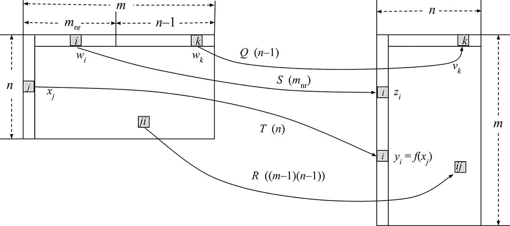
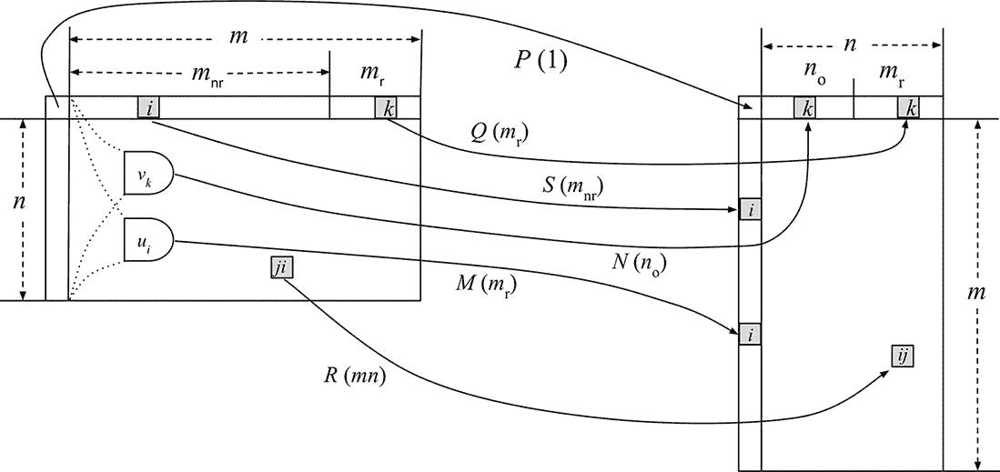
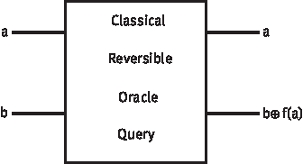
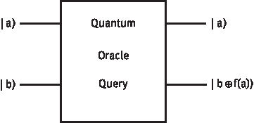
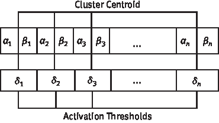
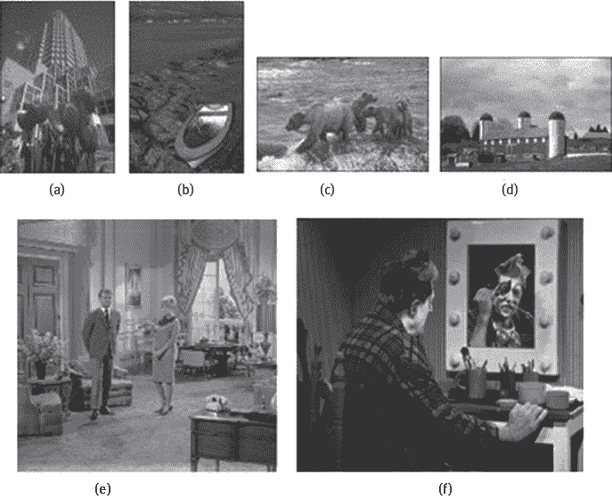

# 量子机器学习 (计算智能前沿) (de Gruyter 计算智能前沿, 6)

## 概览

1.
2. 正文

1. V
2. VI
3. IX
4. X
5. XI
6. XII
7. XIII
8. XIV
9. 1
10. 2
11. 3
12. 4


13. 5
14. 6
15. 7
16. 8
17. 9
18. 11
19. 12
20. 13
21. 14
22. 15
23. 16
24. 17
25. 18
26. 19
27. 20
28. 21
29. 22
30. 23
31. 24
32. 25
33. 26
34. 27
35. 28
36. 29
37. 30
38. 31
39. 32
40. 33
41. 34
42. 35
43. 36
44. 37
45. 39
46. 40
47. 41
48. 42
49. 43
50. 44
51. 45
52. 46
53. 47
54. 48
55. 49
56. 50
57. 51
58. 52
59. 53
60. 54
61. 55
62. 56
63. 57
64. 58
65. 59
66. 60
67. 61
68. 62
69. 63
70. 64
71. 65
72. 67
73. 68
74. 69
75. 70
76. 71
77. 72
78. 73
79. 74
80. 75
81. 76
82. 77
83. 78
84. 79
85. 80
86. 81
87. 82
88. 83
89. 84
90. 85
91. 86
92. 87
93. 89
94. 90
95. 91
96. 92
97. 93
98. 94
99. 95
100. 96
101. 97
102. 98
103. 99
104. 100
105. 101
106. 102
107. 103
108. 104
109. 105
110. 106
111. 107
112. 108
113. 109
114. 110
115. 111
116. 112
117. 113
118. 115
119. 116
120. 117
121. 118

Siddhartha Bhattacharyya 希望将本书献给 Pulawama 事件中牺牲的士兵的纪念。

Indrajit Pan 希望将本书献给他的研究导师 Prof. (Dr.) Hafizur Rahaman 和 Dr. Tuhina Samanta，他们在他的博士研究期间一直指导着他。

Ashish Mani 希望将本书献给最受尊敬的 Prof. Prem Saran Satsangi，印度 Dayalbagh 教育机构教育咨询委员会名誉主席。

Sourav De 希望将本书献给他的挚爱妻子 Debolina Ghosh 和心爱的儿子 Aishik De。

Elizabeth Behrman 希望将本书献给 EJB、JFB 和 JPK；以及 CFB 的纪念。

Susanta Chakraborti 希望将本书献给他的父亲已故的 Santosh Kr. Chakraborty。

# 贡献者名单

**Siddhartha Bhattacharyya**

计算机科学与工程系

CHRIST（被视为大学）

班加罗尔，印度

dr.siddhartha.bhattacharyya@gmail.com

**Arit Kumar Bishwas**

AIIT，阿米蒂大学，诺伊达

北方邦，印度

aritkumar.official@gmail.com

**Amlan Chatterjee**

计算机科学

加州州立大学

多明格斯山，美国

achatterjee@csudh.edu

**Sourav De**

计算机科学与工程系

Cooch Behar 政府工程学院

Cooch Behar，西孟加拉邦，印度

dr.sourav.de79@gmail.com

**Alokananda Dey**

RCC 信息技术学院

加尔各答，西孟加拉邦，印度

alokananda_22@yahoo.co.in

**Sandip Dey**

计算机科学系

Sukanta Mahavidyalaya，Sukanta Nagar

Dhupguri，Jalpaiguri，西孟加拉邦，印度

dr.ssandip.dey@gmail.com

**Bruce J. MacLennan**

田纳西大学诺克斯维尔分校

田纳西州，美国

maclennan@utk.edu

**Ashish Mani**

ASET，阿米蒂大学北方邦分校

诺伊达，北方邦，印度

amani@amity.edu

**Vasile Palade**

考文垂大学工程学院和计算学院

考文垂，英国

vasile.palade@coventry.ac.uk

**Jan Platos**

VSB 俄斯特拉发理工大学

捷克共和国

jan.platos@vsb.cz

**Vaclav Snasel**

VSB 俄斯特拉发理工大学

捷克共和国

vaclav.snasel@vsb.cz

# 前言

赋予机器智能一直是一条充满挑战的道路。多年来，随着软计算范式的出现，人们发明或提出了几种智能工具来处理人类遇到的不确定性。然而，人们发现即使是软计算工具在实时提供可靠合理的解决方案方面也常常力不从心。因此，科学家们采用了混合智能技术，结合多种软计算工具来克服这些不足。


量子计算源于费曼和德意志对量子领域高效搜索技术的研究。这些搜索技术在时间和空间上均优于经典技术。受此启发，研究人员热衷于将现有的软计算工具与量子计算范式相结合，以发展更稳健、更高效的智能算法。由此产生的算法在解决多个科学和工程问题方面具有极大用处，包括数据处理和分析、机器视觉、社会网络、大数据分析、流水车间调度问题等。

量子机器学习是一个新兴的跨学科研究领域，其运用量子物理学原理应用于机器学习。量子机器学习算法通过利用量子计算提供的优势来改进机器学习的经典方法。鉴于量子计算特性所提供的固有并行性，研究人员已发展出不同更稳健、性能更高效的智能工具和技术。

量子增强机器学习是指解决机器学习任务的量子算法，从而改进经典机器学习方法。此类算法通常需要将给定的经典数据集编码到量子计算机中，以便使其可用于量子信息处理。之后，可应用量子信息处理程序，并通过测量量子系统读取量子计算结果。例如，量子比特测量的结果可能揭示二元分类任务的结果。虽然许多量子机器学习算法的提议仍纯属理论，需要全尺寸通用量子计算机进行测试，但其他算法已在小型或专用量子设备上实现。

本书由六章组成，作者均为领先的量子机器学习研究人员。

第 1 章概述了量子机器学习的基本概念和原理。除阐明量子算法的不同方面外，本章还对量子强化学习和量子退火的原理进行了概览。量子神经网络的发展，特别是该方向的开创性工作也被提及，以启发读者。

大脑中最常见的资讯表征之一是地形或计算图，其中神经元根据其所代表的值系统排列。通过空间表示定量关系，计算图使大脑能够以所需的精度计算复杂非线性函数。第 2 章提出了两种利用地形表征进行机器学习的量子计算方法。它展示了如何构建可在量子计算机上实现的幺正算子，通过计算图实现任意（包括非线性）函数。

机器学习技术的训练通常需要解决一个困难的优化问题，这是整个模型构建过程及其应用中最昂贵的步骤。在不久的将来，减少机器学习技术训练过程执行时间的一种可能解决方案是将其在量子计算机而非经典计算机上实现。第 3 章讨论了一种基于绝热量子计算（AQC）的全局优化技术，用于在不限制其结构和所学习底层模型的情况下求解损失函数的最小化。此外，还表明在所提出的框架中，基于 AQC 的方法在解决全局优化问题方面将优于基于电路的方法。

第 4 章中，作者讨论了从经典机器学习到量子机器学习（QML）的转变，并探讨了该领域的最新进展。QML 不仅与开发可在量子计算机上运行且性能显著提升的高性能机器学习算法相关，而且在其他方面也有非常多样化的含义。本章也试图简要涉及这些方面，但主要重点在于开发可在量子计算机上运行的机器学习算法领域的进展。

第 5 章旨在介绍两种基于量子启发框架的图像数据集自动聚类技术，采用两种不同的元启发式算法，即遗传算法（GA）和蝙蝠算法（BA）。这项工作提供了两种新颖的技术，可自动识别图像数据集中存在的最佳聚类数，并对量子启发遗传算法（QIGA）和量子启发蝙蝠算法（QIBA）进行了比较研究。还对这些量子启发算法与其经典对应算法进行了比较。实验期间观察到，量子启发技术优于其经典对应技术。比较是基于适应度的均值、聚类有效性指数计算适应度的标准差、标准误差以及最佳计算时间制定的。最后，通过统计优越性检验（t 检验）计算得到的 p 值验证了算法的优越性，并通过 Friedman 检验得出所提方法的排名。在计算过程中，适应度的改进由一个众所周知的聚类有效性指数——DB 指数来评判。实验在四个伯克利图像和两个真实灰度图像数据集上进行。

第 6 章总结了本书所能实现的内容。本章还阐明了涉及多级量子系统的量子机器学习的未来趋势。

编辑认为本书对计算机科学、信息科学和电子工程的本科生和研究生课程将大有裨益。编辑还借此机会向同意出版本书的 De Gruyter 出版社表示衷心的感谢。

Bangalore, Kolkata, New Delhi, Kansas

November, 2019

Siddhartha Bhattacharyya

Indrajit Pan

Ashish Mani

Sourav De

Elizabeth Behrman

Susanta Chakrabarti

# 1 量子机器学习导论

Sandip Dey 计算机科学系, Sukanta Mahavidyalaya, Jalpaiguri, West Bengal, India Sourav De 计算机科学与工程系, Cooch Behar Government Engineering College, Cooch Behar, West Bengal, India Siddhartha Bhattacharyya CHRIST (Deemed to be University), 计算机科学与工程系, CHRIST (Deemed to be University), Bangalore, India, Hosur Road, 560029, Kolkata, Bangalore, Karnataka, India

## 摘要

量子机器学习（QML）通常被认为是将量子物理学（QP）和机器学习（ML）相结合的整合方法。本章概述了与量子机器学习相关的基本思想和特征。本章讨论了量子算法的不同方面。此外，本章还提供了量子强化学习和量子退火的基本特征。最后，本章讨论了量子神经网络的进展，以阐明 QML 的方向。

关键词: machine learning, Grover’s Search Algorithm, reinforcement learning, quantum annealing, quantum neural networks,

## 1.1 量子机器学习


机器学习已成为近期技术中一个新兴学科。它可用于多种领域，例如计算生物学、计算机视觉、计算机安全等。数据分析（`DA`）是现代工业中同样重要的一部分。`ML` 和 `DA` 通过应用统计方法分析数据，并基于对观测数据的分析为计算机提供学习能力。根据学习方式，机器学习算法（`MAA`）基本上可分为不同的组，即监督学习（`SL`）、无监督学习（`UL`）和半监督学习（`SSL`）。使用 `ML` 技术的主要缺点通常被认为是计算时间和存储，尤其涉及大量数据时。除此之外，当使用当前深度学习算法时，训练时间可能变得更长。在下一代中，研究人员通过利用量子计算机方法获得了可行的替代方案，该方法足以智能地减少上述提到的存储和计算时间。

许多 `ML` 问题使用线性代数通过将数据表示为矩阵来计算矩阵运算。量子计算（`QC`）能够使多种线性代数计算更快，从而无保留地改进经典 `ML` 任务 [1, 2]。数值优化方法是一个备受推崇的研究领域，其旨在改进所述优化程序的计算。与经典优化类似，量子优化作为 `QC` 的一个分支，试图进一步改进所述技术。这类著名的两种方法是量子梯度下降（`QGD`）[3] 和量子近似优化算法（`QAOA`）[4]。这些方法被有效地应用于量子神经网络（`QNN`），例如量子玻尔兹曼机 [5]。

近来，量子机器学习这一非常新的新兴跨学科研究领域已出现，其目标是将机器学习理论与量子计算的特性融合在一起。量子机器学习（`QML`）旨在通过应用量子叠加和量子纠缠等量子特性以高效率解决不同问题，在量子环境（系统）中实现机器学习算法（`MLLs`）[6]。基本上，`QML` 被认为是一个量子信息处理研究的子学科，其目标是引入通常从数据中学习的量子算法，以改进 `ML` 中的现有方法。因此，目的是开发各种 `MLLs` 的量子应用，同时具有量子计算机的影响以及 `MLLs` 的灵活性和学习能力。

已为多种机器学习模型引入了若干量子算法，其中包括神经网络（`NN`）、图形模型、支持向量机（`SVM`）等等。`QML` 从量子视角探索关于学习的更基本问题。在某些情况下，研究人员广泛地将 `QML` 定义为将 `ML` 应用于量子信息。

除了 `QML` 中使用的隐式方法外，还存在几种经典 `ML` 算法的量子版本。量子支持向量机（`QSVM`）[1]，主要用于线性分类，是此类流行的例子。此外，量子主成分分析（`QPCA`）[7]是一种流行的降维方法，量子高斯混合模型 [8]是另一种用于估计聚类和密度的著名方法。`ML` 的一个新兴子学科称为深度学习（`DL`）。近日，量子计算机被用于涉及大量存储和时间的 `DL` 应用。这些应用的一些流行示例是量子玻尔兹曼机 [5]、量子生成对抗网络 [9]、量子卷积神经网络 [10] 和量子变分自编码器 [11]。此外，`ML` 内部一个更先进的领域被称为强化学习（`RL`）。`RL` 可以描述为通过探索环境随着时间的推移而学习。

## 1.2 Grover 搜索算法

Grover 搜索算法（`GAA`）是一种非常流行的量子搜索算法 [12]。该算法找到满足特定条件的一组元素。为执行此任务，通常称为预言机的黑盒具有识别元素的能力，必须满足所需找到的标准。假设该组有 `N` 个元素，对于经典计算，预言机被调用 `O(M)` 次以获取满足上述标准的所有元素。利用量子力学，该算法能够通过使用 $O(\\sqrt{M)}$ 次对预言机的调用获得相同结果。

该算法能够通过利用量子计算的特殊特性——称为并行处理——同时对预言机进行多次调用。假设搜索列表有 `N` 个元素。`GAA` 使用维度为 `N` 的希尔伯特空间来表示它们，这可以通过 `n = logM`（以 2 为底）的量子比特实现。每个 `el`∈`N` 的元素，其索引为 `y`，在量子比特的状态空间中由一个正交归一向量表示，称为 `|y⟩`。目标是识别满足给定搜索标准的特定元素的索引 `z`。

起初，预言机被使用，其中一个酉操作具有以下特征

(1.1a)1.  `if` `y` = `z`, `U[z]`|`y`⟩=−|`y`⟩ (1.1b)2.  `if` `y` ≠ `z`, `U[z]`|`y`⟩=|`y`⟩

式 (1.1a) 和 (1.1b) 也可以表示如下：

(1.2)`U[z]` = `I` − 2|`z`⟩⟨`z`|

其中，`I` 表示恒等算子。`GAA` 同时使用最后的预言机算子和 Grover 扩散算子，定义为

(1.3)`U[p]` = 2|`p`⟩⟨`p`| − `I`

其中，$|p\\rangle = \\frac{1}{\\sqrt{N}}\\sum\_{y = 1}^{N}y$。式 (1.2) 和 (1.3) 的使用如下。

初始时，量子比特的状态被初始化为 `|p⟩` 状态。此后，`U[z]` 和 `U[p]` 被连续迭代应用 `r(N)` 次。之后，对系统进行评估，这提供了特征值（`λ[z]`），可能得出所述索引（`z`）。

## 1.3 量子强化学习


除了监督学习和无监督学习之外，强化学习（`RL`）也是一个流行的学习方法类别。与 `SL` 和 `UL` 相比，`RL` 采用称为奖励的标量值来评估输入-输出对，并使用试错策略与环境交互以学习从状态到动作的映射。自 1980 年以来，`RL` 逐渐成为 `ML` 的重要方法 \[5\]。迄今为止，它已广泛应用于人工智能（`AI`），特别是在机器人技术中 \[13, 14, 15, 16, 17\]。这是因为它在线自适应方面表现出优异性能，并且对任何复杂非线性系统都具有普遍的学习能力。

在处理实际应用时可能会出现一些复杂问题，例如探索策略、学习速度慢；特别是处理复杂问题。尤其可以观察到，当状态-动作空间变得巨大且随着维度的增加需要学习的参数数量呈指数增长时。迄今为止，近年来已引入了几种方法来应对这种情况。

不同学习范式被联合用于优化 `RL`。Smith \[18\] 提出了一种新颖的模型，用于基于自组织映射（`SOM`）和基准 `Q-learning` 在无模型 `RL` 中进行表示和泛化。此外，为了使模糊推理系统适应 Watkins 的 `Q-learning` 以解决具有大/连续状态-动作空间的问题，也提出了相关方法 \[17, 19, 20\]。不同的 `RL` 方法在实践中得到了改进 \[21, 22, 23, 24\]。

两个重要的量子算法，即 `Shor algorithm` \[25, 26\] 和 `Grover algorithm` \[27, 28\]，已被引入。Rigatos 和 Tzafestas \[29\] 应用量子计算理论以获得模糊逻辑控制算法（`FCA`）并行化的益处，其目标是加快模糊推理。量子启发式进化算法（`QIEA`）已被开发以增强现有进化算法（`EA`）的性能 \[30\]。后来，Hogg 和 Portnov \[31\] 引入了一种量子算法来解决具有过度约束可满足性和不对称旅行商问题的组合优化问题。最近，量子搜索方法已应用于动态规划 \[32\]。考虑到计算的精神，Dong 等人 \[33\] 受量子计算的基本概念，即态叠加原理和平行性启发，发展了量子强化学习（`QRL`）的概念。`QRL` 被开发用于加速学习，并在模拟实验过程中实现 `RL` 的探索与利用之间的权衡。

## 1.4 量子退火

在统计力学中，应用于量子力学涨落领域的量子退火（`QA`）是模拟退火（`SA`）的量子版本 \[34, 35\]。它也被称为量子随机优化算法。与 `SA` 一样，量子退火也成功应用于解决困难的优化问题。它基于量子计算活跃领域的量子绝热演化原理运作，并且是经典与量子技术之间有利的混合。`QA` 应用于不同领域，如计算机科学 \[36\]、机器学习 \[37, 38\]、图论 \[39\]、通信 \[40, 41, 42\]、金融 \[43\]、航空航天 \[44\] 以及其他任何现实世界问题。

在模拟退火 \[45\] 中，统计力学系统的温度依赖随机游走被用作给定优化问题的代价函数。该函数决定了解决方案空间的势能分布，热涨落避免探索陷入局部最小值 \[46\]。期望系统在时间演化过程中保持接近热平衡。如果温度下降速率足够慢，就会发生这种情况，最终导致零温平衡态，即最低能量态 \[47\]。由于通用适用性、合理的性能以及在大多数情况下相对容易实现，`SA` 在许多现实生活应用中被有效采用。当保持系统接近热平衡需要无限长的时间来得出精确解时，`SA` 被用于在可测量的计算时间内获得近似解。`QA` 中的量子涨落通过引入人工的量子特性自由度、非对易算符而被诱导。通过缓慢降低温度来控制量子涨落的强度以达到基态。

如同优化问题的代价函数最小化问题，它可以被视为寻找经典 Ising 哈密顿量 `H0` 的基态 \[48\]。不同类型的实际问题具有大量局部最小值的代价函数。同样，Ising 哈密顿量让人联想到经典自旋玻璃 \[49, 50\]。对于这些特征，经典算法很难找到全局最小值。这一问题可以通过将经典 Ising 哈密顿量 `H0` 提升到量子域的想法来克服。基于量子力学的绝热定理，经典 Ising 模型的基态可以通过使系统处于某个初始哈密顿量 `H1` 的基态来推导 \[51, 52\]。它在理论上和实验上都很容易发展。`H1` 的选择方式使其不与 `H0` 对易。随着系统参数的足够缓慢改变，哈密顿量从 `H1` 逐渐变化到 `H0`。


## 1.5 量子神经网络

量子神经网络（QNNs）是体现量子力学原理的神经网络模型的化身。从计算角度来看 [53, 54]，一类量子神经网络结合人工神经网络模型并在内部嵌入量子计算的特征，以演化出更稳健高效的模型。这些努力背后的基本哲学是通过利用量子并行性、干涉和纠缠的特征，来规避经典神经网络在处理大数据方面的局限性。然而，大多数 QNN 模型试图用体现量子力学原理的量子比特（也称为“qurons”）取代经典的二元或 McCulloch-Pitts 神经元。

1995 年，Subhash Kak [55] 和 Ron Chrisley [56] 通过建立神经激活函数与量子力学本征值方程的相似性，提出了量子神经模型的想法。Ajit Narayanan 和 Tammy Menneer 引入了一种量子神经网络的光子实现，使用多宇宙理论，该理论在量子测量作用下坍缩为期望状态 [57]。此后，投入了大量努力来寻找感知器的量子版本。然而，这一方向的进展受到了阻碍，因为由于量子系统固有的线性运算，特征性的神经非线性激活函数很少遵循量子理论的数学结构。经过大量努力，Schuld、Sinayskiy 和 Petruccione 使用量子相位估计算法 [58] 来实现激活函数。除此之外，许多受量子启发的模型也出现了，用于实现基于模糊逻辑的神经网络 [59]。

Elizabeth Behrman 和 Jim Steck [60] 提出了一种新型量子计算装置，包含若干具有可调相互作用的量子比特。在他们的模型中，相互作用强度根据期望的输入-输出关系训练集，按照经典反向传播算法进行更新，从而使量子网络能够学习算法。

量子联想记忆由 Dan Ventura 和 Tony Martinez 于 1999 年提出 [61]。作者提出了一种算法，用于在基于电路的量子计算机上模拟联想记忆。在此算法中，记忆状态被设想为量子态的叠加。然后使用量子搜索算法检索最接近给定输入的记忆状态。这种模拟有望实现记忆状态的指数级存储容量。

## 1.6 结论

本章概述了与量子机器学习相关的基本概念和原理。除了阐明量子算法的不同方面外，本章还对量子强化学习和量子退火的原理进行了概览。量子神经网络的演进，尤其是这一方向的开创性工作，也被提及以启发读者。

## 参考文献

[1]Harrow, A. W., Hassidim, A., & Lloyd, S. 求解线性方程组的量子算法. Physical review letters. 2009, 15(103), 150502. a, b

[2]Rebentrost, P., Mohseni, M., & Lloyd, S. 用于大数据分类的量子支持向量机. Physical review letters. 2014, 113(13), p. 130503. →

[3]Kerenidis, I., & Prakash, A. 线性系统和最小二乘的量子梯度下降. 2017. arXiv:1704.04992 [quant-ph]. →

[4]Farhi, E., Goldstone, J., & and Gutmann, S. 一个量子近似优化算法. 2014. arXiv:1411.4028 [quant-ph]. →

[5]Amin, M. H., Andriyash, E., Rolfe, J., Kulchytskyy, B., & Melko, R. 量子玻尔兹曼机. Physical review letters. 2018, 8, 021050. a, b, c

[6]Schuld, M., Sinayskiy, I., & Petruccione, F. 量子机器学习导论. Contemporary Physics. 2015, 56(2),172–185. →

[7]Lloyd, S., Mohseni, M., & Rebentrost, P. 量子主成分分析. Nature Physics. 2014, 10(9),631–633. →

[8]Rahman M., & and Geiger, D. 量子聚类和高斯混合. 2016. arXiv:1612.09199v1 [stat.ML]. →

[9]Lloyd, S., & Weedbrook, C. 量子生成对抗学习. Physical review letters, 2018, 040502. →

[10]Cong, I., Choi, S., & Lukin, M. D. 量子卷积神经网络. 2018. arXiv:1810.03787v1 [quant-ph]. →

[11]Khoshaman, A., Vinci, W., Denis, B., Andriyash, E., & Amin, M. H. 量子变分自编码器. 2018. arXiv:1802.05779v1 [quant-ph]. →

[12]Lavor, C., Manssur, L. R. U., & Portugal, R. 格罗弗算法：量子数据库搜索. 2003. arXiv:quant-ph/0301079. →

[13]Beom, H. R., & Cho, H. S. 使用模糊逻辑和强化学习的移动机器人传感器导航. IEEE Transactions on Systems, Man, and Cybernetics. 1995, 25(3),464–477. →

[14]Connolly, C. I. 调和函数与碰撞概率. Int. J. Rob. Res. 1997, 16(4),497–507. →

[15]Smart, W. D., & Kaelbling, L. P. 移动机器人的有效强化学习. Proceedings – IEEE International Conference on Robotics and Automation. 2002, 3404–3410. →

[16]Kondo,T., & Ito, K. 用于自主移动机器人控制的具有进化状态招募策略的强化学习. Robotics and Autonomous Systems. 2004, 46(2),111–124. →

[17]Tzafestas, S. G., & Rigatos, G. G. 机器人操作器的顺从任务的模糊强化学习控制. IEEE Transactions on Systems, Man, and Cybernetics, Part B (Cybernetics). 2002, 32(1),107–113. a, b

[18]Smith, A. J. 自组织映射在强化学习中的应用. Neural Netw. 2002, 15(8/9), 1107–1124. →

[19]Glorennec, P. Y, & Jouffe, L. 模糊 Q 学习. Proceedings of 6th International Fuzzy Systems Conference. 1997, 659–662. →

[20]Er, M. J, & Deng, C. 使用动态模糊 Q 学习在线调优模糊推理系统. IEEE Transactions on Systems, Man, and Cybernetics, Part B (Cybernetics). 2004, 34(3),1478–1489. →

[21]Chen, C. L., Li, H. X., & Dong, D. Y. 机器人导航的混合控制：一种分层 Q 学习算法. IEEE Robotics & Automation Magazine. 2008, 15(2),37–47. →

[22]Whiteson, S., & Stone, P. 强化学习的进化函数逼近. Journal of Machine Learning Research. 2006, 7, 877–917. →


\[23\]Kaya, M., & Alhajj, R. 多智能体强化学习的一种新方法：利用 OLAP 挖掘进行学习过程。 IEEE 系统、人与控制论学报，C 部分（应用与综述）。 2005, 35(4),582–590. →

\[24\]Vengerov, D., Bambos, N., & Berenji, H. 无线发射器功率控制的模糊强化学习方法 IEEE 系统、人与控制论学报，B 部分（控制论）。 2005, 35(4),768–778. →

\[25\]Shor, P. W. 量子计算算法：离散对数与分解。 第 35 届计算机科学基础年度研讨会论文集。 1994, 124–134. →

\[26\]Ekert, A., Jozsa, R. 量子计算与 Shor 分解算法。 现代物理评论。 1996, 68(3),733–753. →

\[27\]Grover, L. K. 数据库搜索的快速量子力学算法。 第二十八届 ACM 计算理论研讨会论文集。 1996, 212–219. →

\[28\]Grover, L. K. 量子力学有助于在干草堆中寻找针。 物理评论快报。 1997, 79(2),325–327. →

\[29\]Rigatos, G. G., & Tzafestas, S. G. 使用量子计算并行化模糊控制算法。 IEEE 模糊系统学报。 2002, 10(4),451–460. →

\[30\]Sahin, M., Atav, U., & Tomak, M. 多电子量子点的自洽电子结构计算中的量子遗传算法方法 现代物理学国际期刊 C。 2005, 16(9),1379–1393. →

\[31\]Hogg, T., & Portnov, D. 量子优化。 信息科学。 2000, 128(3),81–197. →

\[32\]Naguleswaran, S., White, L., & Fuss, I. 随机规划中的量子搜索。 第十六届国际自动化规划与调度会议论文集。 2005, 34–45. →

\[33\]Dong, D. Y., Chen, C. L., & Chen, Z. H. 量子强化学习。 第一届国际自然计算会议论文集。 2005, 3611, 686–689. →

\[34\]Matsuda, Y., Nishimori, H., & Katzgraber, H. G. 退火算法的基态统计：量子与经典方法。 2009. arXiv:0808.0365. →

\[35\]Santoro, G. E., Martonak, R., Tosatti, E., & Car, R. 伊辛自旋玻璃量子退火理论。 科学。 2002, 295(5564),2427–2430. →

\[36\]Choi, V. 用于 NP-完全最大权重独立集、精确覆盖和 3SAT 问题的绝热量子算法。 2010. [`arxiv.org/abs/1004.2226`](http://arxiv.org/abs/1004.2226). →

\[37\]Adachi S. H., & Henderson, M. P. 量子退火在深度神经网络训练中的应用。 2015. [`arxiv.org/abs/1510.06356`](https://arxiv.org/abs/1510.06356). →

\[38\]Amin, M. H., Andriyash, E., Rolfe, J., Kulchytskyy, B., & Melko, R. 量子玻尔兹曼机。 2016. [`arxiv.org/abs/1601.02036`](https://arxiv.org/abs/1601.02036). →

\[39\]Vinci, W., Markström, K., Boixo, S., Roy, A., Spedalieri, F. M., Warburton, P. A., & Severini, S. 使用可编程超导通量退火器聆听伊辛模型的形状。 科学报告。 2014, 4(5703). doi:10.1038/srep05703. →

\[40\]Chancellor, N., Szoke, S., Vinci, W., Aeppli, G., & Warburton, P. A. 使用可编程退火器的最大熵推断。 科学报告。 2016, 6(22318). doi: 10.1038/srep22318. →

\[41\]Otsubo, Y., Inoue, J. I., Nagata, K., & Okada, M. 量子涨落在纠错码中的效应。 物理评论 E。 2012, 86(051138). doi:10.1103/PhysRevE.86.051138. →

\[42\]Otsubo, Y., Inoue, J. I., Nagata, K., & Okada, M. 利用量子涨落的码分多址多用户解调器。 物理评论 E。 2014, 90(012126). doi:10.1103/PhysRevE.90.012126. →

\[43\]Marzec, M. 投资组合优化：量子计算中的应用。 社会科学研究网络技术报告。 2014. doi:10.2139/ssrn.2278729. →

\[44\]Coxson, G. E., Hill, C. R., & Russo, J. C. 用于寻找低峰值旁瓣码的绝热量子计算。 IEEE 高性能极端计算会议。 2014, 3910–3916. doi:10.1039/b509983h. →

\[45\]Kirkpatrik, S., Gelatt Jr., C. D., & Vecchi, M. P. 模拟退火优化。 科学。 1983, 220, 671–680. →

\[46\]de Falco, D., & Tamascelli, D. 量子退火导论 RAIRO – 理论信息学与应用。 2011, 45, 99–116. →

\[47\]Morita, S., & Nishimori, H. 量子退火的数学基础。 2011. [`arxiv.org/abs/0806.1859v1`](https://arxiv.org/abs/0806.1859v1). →

\[48\]Lucas, A. 许多 NP 问题的伊辛表述。 物理学前沿。 2014, 12(5). →

\[49\]Young, A. P. (Ed). 自旋玻璃与随机场。 新加坡: 世界科学出版社。 1998. →

\[50\]Nishimori, H. 自旋玻璃与信息处理的统计物理：导论。 牛津大学出版社, 2001. →

\[51\]Amin, M. H. 物理评论快报。 102, 220401, ISSN 0031-9007. →

\[52\]Jansen, S., Ruska, M. B., & Seiler, R. 数学物理学报。 2007, 48, 102111, ISSN 00222488. →

\[53\]da Silva, A. J., Ludermir, T. B., & de Oliveira, W. D. 在量子计算机中基于域的量子感知器与神经网络架构选择。 神经网络。 2016, 76, 55–64. →

\[54\]Panella, M., Martinelli, G. 具有量子架构和量子学习的神经网络。 电路理论与应用国际期刊。 2011, 39, 61–77. →

\[55\]Kak, S. 关于量子神经计算。 成像与电子物理学进展。 1995, 94(259). →

\[56\]Chrisley, R. 量子学习。 认知科学新方向：国际研讨会论文集，Saariselka，1995 年 8 月 4–9 日，芬兰拉普兰。 Pylkkänen, P., & Pylkkö, P. (Eds). 芬兰人工智能协会，赫尔辛基。 1995, 77–89. →

\[57\]Narayanan, A., & Menneer, T. 量子人工神经网络架构与组件。 信息科学。 2000, 128, 231–255. →

\[58\]Schuld, M., Sinayskiy, I., & Petruccione, F. 在量子计算机上模拟感知器。 2014. ArXiv:1412.3635. →

\[59\]Purushothaman, G., & Karayiannis, N. 量子神经网络（QNN）：固有模糊前馈神经网络。 IEEE 神经网络学报。 1997, 8(3),679. →

\[60\]Behrman, E. C., Steck, J. E., Kumar, P., & Walsh, K. A. 使用动态学习设计量子算法。 量子信息与计算。 2008, 8(1&2),12–29. →


\[61\]Ventura, D., & Martinez, T. 基于 Grover 算法的量子关联记忆。国际人工神经网络与遗传算法会议论文集。1999, 22–27. →

# 2 量子机器学习的地形表示

Bruce J. MacLennan 田纳西大学电气工程与计算机科学系，1520 Middle Dr., 37996, Knoxville, Tennessee, USA

## 摘要

大脑中最常见的信息表示之一是 *地形* 或 *计算图*，其中神经元根据其所代表的值系统地排列。通过将定量关系空间化，计算图使大脑能够以所需的精度计算复杂、非线性函数。本章提出了两种利用地形表示进行机器学习的量子计算方法。它展示了如何构造可在量子计算机上实现的幺正算子，通过计算图实现任意（包括非线性）函数。

关键词: 计算图, 神经网络, 量子计算, 量子机器学习, 量子神经网络, 地形图, 地形表示,

## 2.1 引言

本章提出了一种受大脑启发的量子机器学习方法，旨在规避其他方法的许多复杂性。量子过程的幺正性既带来机遇也带来挑战。主要机遇之一是可以在线性叠加中并行进行大量计算，即量子并行。量子计算当然存在许多技术挑战，但量子机器学习中的主要理论挑战在于量子过程是线性的，而大多数机器学习方法都至关重要地依赖于非线性操作。人工神经网络尤其需要非线性激活函数，例如逻辑 sigmoid 函数，才能进行非平凡的机器学习。幸运的是，情况并非无望，因为我们知道非线性过程可以嵌入到幺正过程中，这在量子计算的电路模型中很熟悉 \[1\]。

尽管量子机器学习存在复杂性，它仍为在后摩尔定律技术时代实现大规模机器学习提供了一种诱人的方法。然而，机器学习的方法有很多，量子计算的方法也有几种（例如，电路模型、退火），并且并非明显哪种组合最有可能成功。Schuld、Sinayskiy 和 Petruccione \[2, 3\] 提供了一些关于量子神经网络以及更广泛的量子机器学习方法的最新综述。他们得出结论，没有任何量子神经网络的提议成功地结合了人工神经网络和量子计算的优势。他们认为涉及与环境耗散相互作用的开放量子系统是最有前景的方法。此外，很少有提议包含真正的量子机器学习理论。

本章探讨了一种量子实现机器学习的方法，涉及对以地形方式表示的信息进行非线性函数操作，这在神经皮层中很常见。然而，神经计算，即受大脑启发的计算，有许多方法，其中一些可能比其他方法更适合量子实现，因此我们必须对替代方案说几句话。因为大脑可以在许多不同层次上建模，并且每个层次上的模型都可能为机器学习提供基础。例如，近年来，脉冲神经网络模型再次变得流行，主要是由于它们在硬件实现时的功耗优势 \例如，[4, 5\]。此类模型模仿生物神经元的“全或无”动作电位产生，而不涉及动作电位的详细动力学。另一方面，当代人工神经网络的大多数应用，包括深度学习中使用的应用，都使用更高层次的基于速率的模型。也就是说，在单元（神经元类似物）之间传递的实值表示神经尖峰的速率而不是单个尖峰。有人认为这是建模神经信息处理的适当层次，因为动作电位的产生和接收存在许多随机效应，并且信息处理的基本单元是包含约 100 个神经元的 *微柱* \\[[6\], 第 2 章\]。因此，最有成效的是将神经计算视为大规模并行模拟计算的一种形式。由于量子计算本质上使用复值概率幅，因此将其视为模拟计算的一种形式也很有成效，因此模拟信息表示提供了量子计算与人工神经网络之间的一个接触点 \[7\]。

## 2.2 大脑中的地形表示

大脑中信息处理与大多数人工神经网络模型不同的另一个方面是生物神经网络在空间上组织，连接依赖于空间组织。虽然人工神经网络通常按层组织，但各层中神经元之间通常没有空间关系；¹

大脑使用的一种最常见的空间信息组织是 *地形表示* 或 *计算图*。在这种表示中，抽象空间 `𝒳` 中不同的点 `x` 系统地映射到皮层二维区域中的物理位置 `r = µ(x)`；也就是说，神经元之间的空间关系与抽象空间中的拓扑关系相关。这些图在运动区 \[8\] 和感觉区 \\[[6\], 第 6 章\] 中尤其常见。例如，音调拓扑图使对不同音高有反应的神经元按音高顺序排列。视网膜拓扑图具有与视网膜和视野组织相镜像的空间组织。初级视觉皮层中对边缘有反应的神经元根据边缘的方向系统地排列。大脑中还有许多其他例子，这或许是脑部使用最常见的信息表示。

在这些地形图中，特定值 `x` 由相应皮层位置 `µ(x)` 中的活动峰值表示。活动的强度反映了该值的存在程度、重要性或概率。此外，具有不同相对强度或概率的多个同时值由多个同时活动峰值以不同的振幅表示。因此，这样的皮层图可以表示具有各自振幅的值的叠加。


地形图提供了人工神经网络与量子计算之间的另一个接触点，因为大脑中的计算图足够大且密集，可以在数学上被有用地视为 *场*，即连续量的连续分布 \[9\]。此类表征让人联想到量子力学波函数，后者也是连续量的连续分布（复概率幅）。在这两种情况下，这些场在数学上都被视为连续域上的连续函数，而希尔伯特空间提供了描述它们的数学框架 \[7\]。在本章中，我们利用这一类比来实现受大脑启发的量子机器学习方法。

由于其对值的空间表征，地形图可用于在大脑中实现任意函数，本质上是一种查表。假设大脑需要实现一个（可能是非线性的）变换，`y = f(x)`。这可以通过从输入图中的位置 `r = µ(x)` 到表示结果空间的输出图中的对应位置 `s = μ'(y) = μ'[f(x)]` 的神经连接来实现。因此，输入图中代表 `x` 的活动将导致输出图中代表 `y` 的相应活动。此外，输入值的叠加将导致输出值的相应叠加。因此，地形表征允许在线性叠加中计算非线性函数 \[9, 10, 11, 12, 13\]，这表明了它们在量子计算中的有用性 \[7\]。另一方面，地形图对表征资源的利用相对低效，因为每个被表征的值都必须在图中有一个位置 \尽管这可以通过 *粗编码* 来缓解，通过这种方式，精确值由具有重叠感受野的宽调谐神经元群体来表征 \[[14, 15\]\]。因此，使用地形表征需要相当可扩展的量子计算技术。本章我们探讨两种地形量子计算方法，重点关注机器学习。

## 2.3 地形基映射

在大脑中，地形图的状态是一个定义在（通常是二维）空间 Ω 上的实值函数。为了将这些思想应用于量子计算，我们考虑一个量子态 |*ψ*⟩，其中位置 **r** ∈ Ω 处的概率幅 *ψ*(**r**) 通过对应关系 **r **\= *µ*(**x**) 表示值 **x** 的幅值（存在、重要性等）。这里 **r** ∈ Ω 可以是一个连续指标，表示例如空间位置，或离散量子态的指标，如波长或量子比特寄存器的状态。态 |*r*⟩ 构成了输入和输出量子态的离散基或连续伪基。在连续情况下，输入值 **x** 由连续基态 |*μ*(**x**)⟩ 表示，它是 **r **\= *µ*(**x**) 处的狄拉克单位脉冲，即 |**r**⟩ = *δ***[r]**，其中 *δ***[r]**(**s**) = *δ*(**s **− **r**)。类似地，输出值 **y** 由连续基态 |*μ*^′(**y**)⟩=|*μ*^′\[*f*(**x**)\]⟩ = *δ*[*μ*^′(**y**)] 表示。我们称这种表征（无论是离散还是连续）为 *地形基映射*。

对于这样的连续基，我们可以定义一个希尔伯特-施密特线性算子：

$T\_{f} = \\int\\limits\_{\\mathcal{X}}^{}d\\mathbf{x}\\left| {\\mu^{\\prime}\\left\\lbrack {f\\left( \\mathbf{x} \\right)} \\right\\rbrack} \\right.\\rangle\\langle\\mu\\left( x \\right)|,$

其中 𝒳 是输入值的空间。（当 *f* 在上下文中明确时，我们写 *T *\= *T[f]*。）该算子具有期望的行为：*T*|*μ*(**x**)⟩=|*μ*^′\[*f*(**x**)\]⟩ 对所有 **x** ∈ 𝒳 成立。以这种方式，线性算子 *T* 通过计算图计算非线性函数 *f*。我们称这样的算子为 *图核*，因为它使用 *f* 的显式 *图* \[即所有 **x** ∈ 𝒳 的成对集合 (*μ*^′\[*f*(**x**)\]， *μ*(**x**))\] 来进行一种查表。²

请注意，如果输入图是输入值的叠加，|*ψ*⟩=*a*|*μ*(**x**)⟩ + *b*|*μ*(**x**^′)⟩，那么输出图将是相应结果的叠加：*T*|*ψ*⟩=*a*|*μ*^′\[*f*(**x**)\]⟩ + *b*|*μ*^′\[*f*(**x**^′)\]⟩。因此，连续地形基映射允许在线性叠加中计算非线性函数（量子并行）。这是迈向量子计算的一步，但 *T* 可能不是幺正的，我们还有更多工作要做。

读者可能会质疑使用连续基。首先，注意对于可分希尔伯特空间，连续基始终可以用无限离散基代替，例如用适当维度的正弦或复指数的离散序列。其次，无限离散基可以用有限离散基来近似，例如用带限正弦或复指数。这种近似对于神经网络机器学习尤其合适，后者只需要低精度计算。

### 2.3.1 双射

我们继续展示通过量子计算图执行的若干非线性计算示例，从简单情况开始，逐步过渡到更复杂的情况。为简单起见，我们将忽略表示映射 *µ* 并考虑从一个量子态到另一个量子态的计算。我们同时考虑一维连续域，*Ω* = \[*x*[*l*], *x*[*u*]\] 和离散域，*Ω* = {*x*[1],…, *x*[*n*]}。通常值是均匀间隔的，例如，*Ω* = {0,*Δ**x*,2*Δ**x*,…, (*n*−1)*Δ**x*}，但这不是必需的，其他间隔，如对数，可能也有用。（对数映射存在于皮层某些感觉区域。）在这两种情况下，向量 {|*x*⟩| *x*∈𝒳} 都是一个标准正交基（离散情况下由 ℂ^(*n*) 中的单位向量组成，连续情况下由 ℒ²(*Ω*) 中的δ函数组成）。例如，在离散情况下，值 *x*[1]*, …, x[n]* 可以由 *N*\-量子比特寄存器的复合态表示，其中 *n *\= 2*^N*。这似乎需要大量量子比特，但即使没有粗编码，七个量子比特也足以以 1% 精度表示值，这对于许多机器学习应用来说已经足够。

我们从双射标量函数 *f* : *Ω* → *Ω* 开始，其中 *Ω* = \[−1,1\]。双曲正切（适当限制），³

(2.1)$T = \\!\\!\\int\\limits\_{\\Omega}^{}dx|f\\left( x \\right)\\rangle\\langle x|.$

由于 *f* 是双射的，*T* 的伴随算子为

(2.2) $T^{\\dagger} = \\int\\limits\_{\\Omega}^{}dx|x\\rangle\\langle f\\left( x \\right)| = \\int\\limits\_{\\Omega}^{}dy|f^{- 1}\\left( y \\right)\\rangle\\langle y|.$

然后很容易证明 *T* 是幺正的，因此适合量子计算。一般来说，我们有：

#### 命题 1

连续双射 *f* : *Ω* → *Ω*^′ 的图核 *T* 是幺正的。

#### 证明：

代入 式 (2.1) 和 (式 (2.2))，可得：


$\\begin{matrix} {T^{\\dagger}T} & {= \\left( {\\int\\limits\_{\\Omega^{\\prime}}\\left| {f^{- 1}\\left( y \\right)\\rangle\\langle y} \\right|dy} \\right)\\left( {\\int\\limits\_{\\Omega}\\left| {f\\left( x \\right)\\rangle\\langle x} \\right|dx} \\right)} \\\\ & {= \\int\\limits\_{\\Omega}^{}\\int\\limits\_{\\Omega^{\\prime}}^{}\\left| {f^{- 1}\\left( y \\right)\\rangle\\langle y|f\\left( x \\right)\\rangle\\langle x} \\right|\\ dydx} \\\\ & {= \\int\\limits\_{\\Omega}^{}\\int\\limits\_{\\Omega^{\\prime}}^{}\\left| {f^{- 1}\\left( y \\right)\\rangle\\langle y|f\\left( x \\right)\\rangle dy\\rangle dy\\langle x} \\right|dx} \\\\ & {= \\int\\limits\_{\\Omega}^{}\\left| {f^{- 1}\\left( {f\\left( x \\right)} \\right)\\rangle\\langle x} \\right|dx} \\\\ & {= I\_{\\Omega}.} \\\\ \\end{matrix}$

第四行源于狄拉克δ的“筛选”性质：$\\int\\limits\_{\\Omega^{\\prime}}^{}\\left| {{F\\left( y \\right)\\rangle\\langle y|a}\\rangle} \\right.dy = \\left| {F\\left( a \\right)\\rangle} \\right.$。同理，

$\\begin{matrix} {TT^{\\dagger}} & {= \\left( {\\int\\limits\_{\\Omega}^{}|f\\left( x \\right)\\rangle\\langle x|dx} \\right)\\left( {\\int\\limits\_{\\Omega^{\\prime}}^{}\\left| {f^{- 1}(y)\\rangle\\langle y} \\right|dy} \\right)} \\\\ & {= \\int\\limits\_{\\Omega^{\\prime}}^{}\\int\\limits\_{\\Omega}^{}\\left| {f\\left( x \\right)\\rangle\\langle x|f^{- 1}\\left( y \\right)\\rangle\\langle y} \\right|\\ dxdy} \\\\ & {= \\int\\limits\_{\\Omega^{\\prime}}^{}|f\\left( {f^{- 1}\\left( y \\right)} \\right)\\rangle\\langle y|dy = I\_{\\Omega^{\\prime}}.} \\\\ \\end{matrix}$

因此 `T` 是幺正的。

在离散基情形下，令 `y[i]` = `f` (`x[i]`)，其中 `f` 是双射的。单位向量 |`x`[`i`]`⟩ 是 ℂ^(`n`) 的一个基，单位向量 |`y`[`i`]`⟩ 也是 ℂ^(`n`) 的一个（可能不同）基。图核为

(2.3)$T = \\sum\\limits\_{i = 1}^{n}|y\_{i}\\rangle\\langle x\_{i}| = \\sum\\limits\_{i = 1}^{n}|f\\left( x\_{i} \\right)\\rangle\\langle x\_{i}|,$

它也很容易被证明是幺正的。更直接地，我们可以观察到 `T` 在基元素上是一个置换矩阵，因此是正交的。

如果输入是值的加权叠加，|`ψ`⟩ = ∫[`Ω`]^()*d*`x` *p*(`x`) |`x`⟩，则应用核 [式 (2.1)] 将给出输出的相应叠加：`T` |`ψ`⟩ = ∫[`Ω`]^()*d*`x` *p*(`x`) |`f`(`x`)⟩。当然，这在离散情形下也适用。此外，由于图核是幺正的，其伴随算子计算逆函数。因此，如果 |`ϕ`⟩ = ∫[`Ω`^′]^()*d*`y` *q*(`y`) |`y`⟩，则 `T`^† |`ϕ`⟩ = ∫[`Ω`^′]^()*d*`y` *q*(`y`) |`f`^(−1)(`y`)⟩。也就是说，对输出的叠加应用伴随算子将计算相应的输入叠加。

### 2.3.2 非满单射

作为通过计算映射实现任意函数量子计算的进一步步骤，我们考虑一个相对简单的情形：非满单射（即一一对应但非满射的函数）。我们将注意力限制在有限的定义域和值域上。因此，令 `Ω` = {`x`[1],…,`x`[`n`]} 且 `Ω`^′ = {`y`[1],…,`y`[`m`]}，其中 `n` < `m`，并考虑单射 `f` : `Ω` → `Ω`^′。输入映射将在 `n` 维希尔伯特空间 ℋ(`Ω`) 中，输出映射将在 `m` 维希尔伯特空间 ℋ(`Ω`^′) 中。由于 `n` < `m`，需要从空间 ℋ[`C`] 提供辅助常数，因此完整的输入空间将在 ℋ(`Ω`) ⊗ ℋ[`C`] 中。我们的实现还将在空间 `H`[`G`] 中产生“垃圾”输出，因此完整的输出空间将在 ℋ(`Ω`^′)⊗ ℋ[`G`] 中。输入和输出维度必须相等，最简单的方法是使 ℋ[`C`] 为 `m` 维且 ℋ[`G`] 为 `n` 维，这样我们的算子就是 `mn` 维的希尔伯特空间变换。设 {|`w`[1]⟩,…,|`w`[`m`]`⟩} 为 ℋ[`C`] 的一个标准正交（ON）基，设 {|`v`[1]⟩,…,|`v`[`n`]`⟩} 为 ℋ[`G`] 的一个 ON 基。（实际上我们可以使用 ℋ(`Ω`^′) 基作为 ℋ[`C`] 以及 ℋ(`Ω`) 基作为 ℋ[`G`]，但这里我们推导一个更一般的结果。）

我们的目标是定义一个幺正算子 `U`，使得 `U` |`x`⟩ |`w`[1]⟩ = |`f`(`x`)⟩ |`γ`⟩，其中 |`w`[1]⟩ 是辅助常数，|`γ`⟩ 是垃圾。如我们将看到的，`U` 可以通过输入基到输出基的适当置换来实现，可表示为若干算子的和：

(2.4)$U\\overset{def}{=}{T + S + R + Q}.$

函数 `f` 的工作由 `T` 分量完成，它将 |`x`[`j`]`⟩ 映射到 |`f`(`x`[`j`])`⟩：

(2.5)$T\\overset{def}{=}\\sum\\limits\_{j = 1}^{n}\\left| {f\\left( x\_{j} \\right)\\rangle} \\right|v\_{1}\\rangle\\langle x\_{j}|\\langle w\_{1}|.$

注意 `T` |`x`[`j`]`⟩ |`w`[1]⟩ = |`f`(`x`[`j`])⟩ |`v`[1]⟩ 且 `T` 是 `n` 维子空间 ℋ(`Ω`) ⊗ ℋ({|`w`[1]⟩}) 的双射。然而，`T` 不是幺正的，因为它不是满射。参见 图 2.1。



图 2.1：实现非满单射的基向量置换。在核的每个分量之后，它映射的基向量数量用括号标出；例如，`R` 映射 (`m`−1)(`n`−1) 个基向量。`T` 将函数输入映射到输出，`S` 将零振幅映射到非值域的余域元素，而 `R` 和 `Q` 双射地映射剩余的基元素。

`S` 分量确保余域的非值域元素在定义域中有原像。因此，令 `m[nr]` 为不在 `f` 值域中的余域元素个数，即 `m[nr]` = |`Ω`^′ ∖ Im `f`| = `m` − `n`。称这些非值域余域元素为 {`z`[1],…,`z`[`m[nr]`]} ⊂ `Ω`^′。则 `S` 分量定义为：

(2.6) $S\\overset{def}{=}\\sum\\limits\_{i = 1}^{m\_{nr}}\\left| {z\_{i}\\rangle} \\right|v\_{1}\\rangle\\langle x\_{1}|\\langle w\_{i + 1}|.$

因此，`S` 是 `m[nr]` 维子空间的双射，且每个非值域元素 |`z`[`i`]`⟩ |`v`[1]⟩ 都有唯一的原像 |`x`[1]⟩ |`w`[`i` + 1]⟩。

注意 `T` 变换 `n` 个基向量（第二寄存器为 |`w`[1]⟩ 的那些），`S` 变换 `m[nr]` 个基向量（第一寄存器为 |`x`[1]⟩ 且第二寄存器为 |`w`[2]⟩,…,|`w`[`m[nr]` + 1]⟩ 中的一个的那些），总计 `n` + `m[nr]` = `m` 个基元素，但输入空间总共有 `mn` 个基元素，剩余部分必须双射映射。因此，为完成幺正算子，我们添加以下附加分量：

(2.7) $R\\overset{def}{=}\\sum\\limits\_{i = 2}^{m}\\sum\\limits\_{j = 2}^{n}\\left| {y\_{i}\\rangle} \\right|v\_{j}\\rangle\\langle x\_{j}|\\langle w\_{i}|,$ (2.8)$Q\\overset{def}{=}\\sum\\limits\_{j = 1}^{n - 1}\\left| {y\_{1}\\rangle} \\right|v\_{j + 1}\\rangle\\langle x\_{1}|\\langle w\_{m\_{nr} + j}|.$

`R` 映射 (`m`−1)(`n`−1) 个基元素：`i` ≠ 1 且 `j` ≠ 1 的那些，即第一寄存器中没有 |`x`[1]⟩ 且第二寄存器中没有 |`w`[1]⟩ 的那些。`Q` 映射剩余的 `n` − 1 个基元素：第一寄存器具有 |`x`[1]⟩ 且第二寄存器从 |`w`[`m[nr]` + 1]⟩ 到 |`w`[`m[nr]` + `n`]`⟩ 的那些（recall that `m` = `m[nr]` + `n`）。


注意 `U` 将每个输入基向量映射到恰好一个输出基向量，反之亦然（参见图 2.1）。对 `T, S, R, Q` 的基向量二元组的数量求和得到：

`n + m[n r] + (m-1)(n-1) + (n-1) = m + (m-1)(n-1) + n - 1 = m n`.

#### 命题 2
设 `Ω` 和 `Ω`′ 为有限集合，其中 `n` = |`Ω`| , `m` = |`Ω`′| ，且 `m` > `n`。设 `f` : `Ω` → `Ω`′ 为非满射单射。设 `ℋ[C]` 和 `ℋ[G]` 分别为维数为 `m` 和 `n` 的希尔伯特空间（分别表示辅助常数输入和垃圾输出）。设 |`ω`⟩ 为 `ℋ[C]` 的一个固定基向量，|`υ`⟩ 为 `ℋ[G]` 的一个固定基向量。则存在酉算子 `U` ∈ `ℒ[ℋ(Ω) ⊗ ℋ[C], ℋ(Ω′)⊗ ℋ[G]]` ，使得对所有 `x` ∈ `Ω`，

```
(2.9) U(|x⟩⊗|ω⟩) = |f(x)⟩⊗|υ⟩.
```

#### 证明：
该命题由前述构造得出。
如果 `U` 的输入是（归一化的）叠加态，|`ψ`⟩ = ∑[k] `p`[k] |`x`[k]⟩，则输出将是对应函数结果的叠加态：`U` |`ψ`⟩ |`ω`⟩ = ∑[k] `p`[k] |`f(x[k])`⟩ |`υ`⟩。
该实现的输入和输出空间的维数为 `mn`。更节省资源但也更复杂的实现作用于维数为 `L C M(m, n)` 的空间。原理相同：基向量的置换。

### 2.3.3 非单射满射
接下来我们考虑函数 `f` : `Ω` → `Ω`′，它们是满射但不是单射；也就是说，`f` 映射到 `Ω`′ 但可能不是一一对应的。这包括许多有用的函数，例如非单射的压缩函数和高斯函数，但也包括加法和乘法等二元函数（如后所述）。
非单射函数会丢失信息，因此在量子计算中它必须嵌入到更大的单射函数中，而且该函数必须是酉的。特别地，如果 `f` 是非单射的（例如，对某些 `x` ≠ `x′` 有 `f(x)` = `f(x′)`），则对应的图核也将是非单射的：`T` |`x`⟩ = |`y`⟩ = `T` |`x′`⟩ 对于 |`x`⟩ ≠ |`x′`⟩。因此 `T` (|`x`⟩ − |`x′`⟩) = 0，这意味着 |`x`⟩−|`x′`⟩ 位于 `T` 的零空间，我们记为 `𝒩(T)`。因此，零空间的正交补 `𝒩(T)`⊥ 与算子的值域 Im `T` 之间存在双射。故我们将通过将输入 |`ψ`⟩ 分解为正交分量 |`ψ`⟩ = |`μ`⟩ + |`ν`⟩ 来实现非单射运算，其中 |`μ`⟩ ∈ `𝒩(T)`⊥ 且 |`ν`⟩ ∈ `𝒩(T)`。|`μ`⟩ 分量足以确定输出，因此存在双射 |`μ`⟩ ↦ `T` |`ψ`⟩，而 |`ν`⟩ 分量保留了区分映射到该输出的输入所需的信息。
为了说明这种分离如何实现，我们考虑有限维情形，但它很容易推广。设 `Ω` = {`x`[1],…, `x`[`n`]} 且 `Ω`′ = {`y`[1],…, `y`[`m`]}；由于 `f` 是满射，`m` ≤ `n`。
所需算子 `T` 属于 `ℒ(ℋ, ℋ′)` ，其中 `ℋ` = `ℋ(Ω)` 是一个 `n` 维希尔伯特空间，其基为 { |`x`[1]⟩,…, |`x`[`n`]⟩ }。输出空间 `ℋ′` 也是 `n` 维的，其 `m` 个基向量 { |`y`[1],…, |`y`[`m`] } 用于表示函数的陪域（也是其值域）的地形图，Im `f` = `Ω`′ = {`y`[1],…,`y`[`m`]}。因此 `ℋ(Ω′)` 是 `ℋ′` 的子空间。设 { |`w`[1]⟩,…, |`w`[`n` − `m`]⟩ } 为 `ℋ(Ω′)`⊥ 的一组基，即 `ℋ(Ω′)` 在 `ℋ′` 中的正交补。（该子空间将表示“垃圾”，在计算上无关紧要。）
我们将定义 { |`u`[1]⟩,…, |`u`[`m`]⟩ } 为 `𝒩(T)`⊥ 的任意 ON 基（`T` 的行空间），其中 `m` 为 `T` 的秩，并将定义 { |`v`[1]⟩,…, |`v`[`n[o]`]⟩ } 为 `𝒩(T)` 的任意 ON 基，其中 `n[o]` = `n` − `m` 为 `T` 的零度。这些基将决定任意输入被分离成的正交分量 |`μ`⟩ ∈ `𝒩(T)`⊥ 和 |`ν`⟩ ∈ `𝒩(T)`。
一个例子会使这一点更清晰。设 `Ω` = {`k Δ x` | −`N` < `k` < `N`} 且 `Ω`′ = {`k Δ x` | 0 ≤ `k` < `N`}。设 `abs` : `Ω` → `Ω`′ 为绝对值函数（这两个集合之间的非单射满射）。非零空间 `𝒩(T)`⊥ 的一组基由 |`u`[0]⟩ = |0⟩ 和向量 `|u_k⟩ = (|{-kΔx⟩} + |{kΔx⟩})/√2` 组成（对于 `k` = 1,…, `N` − 1）。（注意，对于 `k` ≠ 0，|−`k Δ x`⟩ 和 |`k Δ x`⟩ 是正交向量。）这 `N` 个基向量与陪域元素 |`k Δ x`⟩（对于 `k` = 0,…, `N` − 1）之间存在一一对应关系。零度为 `n[o]` = (2`N`−1) − `N` = `N` − 1，零空间的基向量为：

```
|v_k⟩ = (|kΔx⟩ - |-kΔx⟩)/√2   (for k = 1,…,N - 1).
```

投影到该空间保留了区分映射到给定输出的具体原像所需的信息。在这种情况下，它记住输入的符号：注意 ⟨`v_k`|`kΔx`⟩ = +1/√2 且 ⟨`v_k`|-`kΔx`⟩ = -1/√2。因此，对于输入 |`k Δ x`⟩，正交分量为 |`μ`⟩ = |`u_k`⟩/√2 且 |`ν`⟩ = |`v_k`⟩/√2；对于输入 |−`k Δ x`⟩，它们为 |`μ`⟩ = |`u_k`⟩/√2 且 |`ν`⟩ = - |`v_k`⟩/√2。这完成了示例，我们返回到任意非单射满射的构造。
对于每个 `y`[`i`] ∈ `Ω`′，设 `f^(-1){y[i]}` = {`x` | `f(x)` = `y[i]`} 为 `y[i]` 的原像；这些是定义域 `Ω` 的不相交子集，对应于 `ℋ` 的正交子空间。设 `n[i]` = |`f^(-1){y[i]}`| 为 `y[i]` 的原像重数，其中 `n` = `n`[1] + … + `n`[`m`]。由于不同的 `y[i]` ∈ Im `T` 具有不同的原像重数，将 `f` 分解为 `m` 个常值函数 `f[i]` : `f^(-1){y[i]}` → {`y[i]`} 将很方便，对应的图核为：

```
(2.10) T_i = 1/√n_i Σ_{x_j ∈ f^{-1}{y_i}} |y_i⟩⟨x_j| = |y_i⟩ 1/√n_i Σ_{x_j ∈ f^{-1}{y_i}} ⟨x_j| = |y_i⟩⟨u_i|,
```

其中我们定义了 `𝒩(T)`⊥ 的以下归一化基向量：

```
(2.11) |u_i⟩ = 1/√n_i Σ_{x_j ∈ f^{-1}{y_i}} |x_j⟩,   i = 1,…,m.
```

常值映射 `T[i]` 在 `ℋ` 的正交子空间上独立作用。
注意 ⟨`u[i]`|`x[j]`⟩ ≠ 0 当且仅当 `y[i]` = `f(x[j])`，此时 `T[i]` |`x[j]`⟩ = `n[i]^(-1/2)` |`y[i]`⟩。（`n[i]^(-1/2)` 因子是为了归一化 |`u[i]`⟩ 所需。）显然 { |`u`[1]⟩,…, |`u`[`m`]⟩ } 是一个 ON 集合，因为其元素是基向量不相交集合的归一化线性组合。因此，输出向量 |`y[i]`⟩ 与 `𝒩(T)`⊥ 的基向量 |`u[i]`⟩ 之间存在一一对应关系。
接下来我们刻画 `𝒩(T)` 和 `𝒩(T)`⊥。注意 |`ψ`⟩ ∈ `𝒩(T[i])` 当且仅当 0 = `T[i]` |`ψ`⟩ = |`y[i]`⟩ ⟨`u[i]`|`ψ`⟩，即当且仅当 ⟨`u[i]`|`ψ`⟩ = 0。因此，`𝒩(T[i])` 是与 |`u[i]`⟩ 正交的 `n` − 1 维子空间，而 `𝒩(T[i])`⊥ 是由 { |`u[i]`⟩ } 张成的一维子空间。因此 `𝒩(T)`⊥ 由 { |`u`[1]⟩,…, |`u`[`m`]⟩ } 张成。
算子 `T` 的实现分为两部分，一部分处理表示零空间的分量，另一部分处理表示其正交补、非零空间的分量。第一部分产生“垃圾”，但这是操作可逆从而酉所必需的；第二部分完成计算 `f` 的工作。


我们有 |*v*[*j*]⟩ ∈ ℋ，是域的 𝒩(`T`) 子空间的基向量，其维度为 *n*[*o*] = *n* − *m*。令 {|*w*[*j*] ⟩ |*j*=1,…,*n*[*o*]} 为 ℋ(`Ω`^′)^⊥ 的任意基，即 ℋ(`Ω`^′) 在 ℋ^′ 中的正交补，其维度也为 *n* − *m*。我们定义 `N` ∈ ℒ(ℋ, ℋ^′) 将零空间分量映射到这个 *n[o]* 维子空间：

(2.12)
```
N\overset{def}{=}\sum\limits_{j = 1}^{n_{o}}|w_{j}\rangle\langle v_{j}|.
```

由于基向量 |*u*[*i*]⟩ 与输出向量 |*y*[*i*]⟩ 之间存在一一对应关系，我们通过算子 `M` ∈ ℒ(ℋ, ℋ^′) 实现函数 `f`，定义为：

(2.13)
```
M\overset{def}{=}\sum\limits_{i = 1}^{m}|y_{i}\rangle\langle u_{i}|.
```

将 *n* 维输入映射到 *m* 维输出子空间。因此算子

(2.14)
```
T = M + N ∈ ℒ(ℋ, ℋ^′)
```
将输入 |*x*⟩ 映射到正确的输出 |*f*(*x*)⟩，但带有尺度因子和额外的“垃圾”。具体而言，对于 *x[j]* ∈ *f* ^(−1){*y[i]*},

(2.15)
```
T|x[j]⟩ = (M+N)|x[j]⟩ = M|x[j]⟩ + N|x[j]⟩ = n[i]^(−1/2)|y[i]⟩ + |γ[j]⟩.
```
其中 |*γ*[*j*]⟩ = `N`|*x*[*j*]⟩ 且 ‖|γ_j⟩‖ = sqrt((n_i - 1)/n_i)。请注意，垃圾 |*γ*[*j*]⟩ 叠加在期望的输出之上。后续计算在 ℋ(`Ω`^′) 子空间上进行，并忽略正交子空间，而该子空间包含垃圾（尽管必须保留，因为它与计算结果纠缠）。

`T` 算子只是从基 {|*x*[1]⟩,…,|*x*[*n*]⟩} 到基 {|*y*[1]⟩,…,|*y*[*m*]⟩,|*w*[1]⟩,…,|*w*[*n* − *m*]⟩} 的变换，显然是幺正的：

```
(M+N)†(M+N) = M†M + N†M + M†N + N†N = I[𝒩(T)⊥] + 0 + 0 + I[𝒩(T)] = I[ℋ],
(M+N)(M+N)† = MM† + NM† + MN† + NN† = I[ℋ(Ω′)] + 0 + 0 + I[ℋ(Ω′)⊥] = I[ℋ′].
```

由于 `T` 算子是幺正的，它可以用 `H`（Hadamard）、`CNOT`（受控非）和 `T`（π/8）门 [[1]] 的组合、§4.5，或任何其他通用量子门集合任意逼近。

不幸的是，输出向量 |*y*[*i*]⟩ 的振幅取决于其原像重数。也就是说，如果 *y*[*i*] = `f`(*x*[*j*])，则 `T`|*x*[*j*]⟩ = *n*[*i*]^(−1/2)|*y*[*i*]⟩ + |*γ*[*j*]⟩，并且我们得到不同的尺度因子 *n*[*i*]^(−1/2)，取决于原像重数。对于 *y*[*i*] = `f`(*x*[*j*])，我们定义 s_i ≜ n_i^{-1/2} 为该尺度因子，使得 `T`|*x*[*i*]⟩ = s[*i*]|*y*[*i*]⟩ + |*γ*[*j*]⟩。我们希望使不同的振幅相等，但似乎没有幺正的方法来实现这一点。

看起来可以用类似 `Grover` 迭代 [[16]] 的方法将状态向量从 s[*i*]|*y*[*i*]⟩+|*γ*[*j*]⟩ 旋转到 |*y*[*i*]⟩，但不同的 s[*i*] 需要不同的迭代次数。可以使用类似具有未知解数目的 Grover 算法，但这需要尝试多次旋转。因此，似乎最好接受不需要的尺度因子并与之共存。这意味着任何具有正振幅的 |*y*[*i*]⟩ 都被视为计算的输出，因此所有正振幅都被同等对待。

如果我们忽略正振幅的相对大小，则量子态 |*ψ*⟩ = ∑[*j*]*p*[*j*]|*x*[*j*]⟩（其中 *p*[*j*] ≥ 0）可以解释为表示所有具有正振幅的 *x*[*j*] 的集合：{*x*[*j*]∈`Ω` | *p*[*j*]>0}，其中我们当然假设 ∑[*j*]*p*[*j*]² ≤ 1。此外，和严格小于一只有在存在额外的辅助态来弥补差值时才可能（例如前例中的 |*γ*[*j*]⟩）。对这种态应用 `T` 计算出表示输入集合像的态。也就是说，`T`|*ψ*⟩ = ∑[*j*]*p*[*j*]*s*[*j*]|*f*(*x*[*j*])⟩，它表示集合 {*f*(*x*[*j*])∈`Ω`|*p*[*j*]>0}。如果 `S` ⊆ `Ω` 是由 |*ψ*⟩ 表示的集合，则 `T` |*ψ*⟩ 表示其像 `f`[*S*]。由于零振幅始终映射为零振幅，正振幅始终映射为正振幅，集合成员关系将从定义域适当映射到值域。上述构造给出：

### 命题 3

设 `Ω` = {*x*[1],…,*x*[*n*]} 且 `Ω`′ = {*y*[1],…,*y*[*m*]} 为有限集合，且 *n* ≥ *m*。假设 {|*x*[1]⟩,…,|*x*[*n*]⟩} 是希尔伯特空间 ℋ 的一个 ON 基，而 {|*y*[1]⟩,…,|*y*[*m*]⟩} 是 ℋ 的子空间 ℋ(`Ω`′) 的一个 ON 基。对于任意满射函数 `f`: `Ω`↠`Ω`′，存在一个幺正算子 `T` ∈ ℒ(ℋ, ℋ) 使得对任意 *x* ∈ `Ω`，

(2.16)
```
T|x⟩ = 1/√(n_x) |f(x)⟩ + |γ⟩,
```
其中 *n*[*x*] = |*f*^(−1){*f*(*x*)}|，|*γ*⟩ ∈ ℋ(`Ω`′)^⊥，且 ‖|γ⟩‖ = sqrt((n_x - 1)/n_x)。

#### 证明

如前所示 [[eqs. (2.12)–(2.14)]]，该算子显式给出为

```
T = Σ_{i=1}^{m} |y_i⟩⟨u_i| + Σ_{k=1}^{n-m} |w_k⟩⟨v_k|,
```
其中 |u_i⟩ ≜ 1/√(n_i) Σ_{x_j ∈ f^{-1}{y_i}} |x_j⟩，*n*[*i*] = |*f*^(−1){*y*[*i*]}|，|*v*[*k*]⟩ 是由 |*u*[*i*]⟩ 张成的空间正交补的一个 ON 基，而 |*w*[*k*]⟩ 是 ℋ(`Ω`′)^⊥ 的一个 ON 基。

### 2.3.4 任意函数

在前文中，我们为方便起见假设函数要么是非单射的，要么是非满射的，但不是两者兼有。解很容易推广到任意函数，因为每个函数都可以分解为一个单射和一个满射的复合。更直接地，我们可以将命题 3 与命题 2 结合起来，用命题 3 实现到其值域的满射，用命题 2 将其值域注入到其值域中。

设定义域 `Ω` = {*x*[1],…,*x*[*n*]}，其中 *n* = |`Ω`|，且令 {|*x*[1]⟩,…,|*x*[*n*]⟩} 为 ℋ(`Ω`) 的标准基。设 *x*[0]∉Ω 为一个附加值并定义扩展定义域 `Ω`^∘ = {*x*[0]} ∪ `Ω`。则 ℋ(`Ω`^∘) 有基 {|*x*[0]⟩,|*x*[1]⟩,…,|*x*[*n*]⟩}。（例如，ℋ(`Ω`^∘) 可能是 *N* 个量子比特的状态空间，其中 *n* + 1 = 2^N。）附加的 *x*[0] 输入维度将携带来自先前计算的零空间“垃圾”。类似地，设值域 `Ω`′ = {*y*[1],…,*y*[*m*]}，其中 *m* = |`Ω`′|，且令 {|*y*[1]⟩,…,|*y*[*m*]⟩} 为 ℋ(`Ω`′) 的标准基。设 *y*[0] ∉ `Ω`′ 为一个附加值并定义扩展值域 `Ω`^(*) = {*y*[0]} ∪ `Ω`′。则 ℋ(`Ω`^(*)) 有基 {|*y*[0]⟩,|*y*[1]⟩,…,|*y*[*m*]⟩}。*y*[0] 分量携带输出态中的垃圾。

设 {r_1,…,r_{m_r}} ≜ Im f 且 {z_1,…,z_{m_nr}} ≜ `Ω`′ \ Im f 分别为 `f` 的值域及其补集；由于每个值域元素要么是值域元素要么不是，*n* = *m*[*r*] + *m*[*n*r*]。如前所述，*n* 维输入 |*x*[*j*]⟩ 将被投影到正交子空间（非零空间和零空间）中，维度分别为 *m*[*r*] 和 *n*[*o*] = *n* − *m*[*r*]，基向量分别为 |*u*[*i*]⟩，*i* = 1,…, *m*[*r*]，和 |*v*[*k*]⟩，*k* = 1,…, *n*[*o*]，分别。


将使用一个额外的输入量子寄存器来为非满射函数的非值域元素提供常数零振幅。为了方便起见，该辅助寄存器的 `m` + 1 维态位于 `ℋ[C]` = `ℋ(Ω*)`，基为 {`|y[0]⟩`,`|y[1]⟩`, …, `|y[m]⟩`}。还将有一个额外的输出量子寄存器来保存非单射函数的零空间垃圾。为了方便起见，其 `n` + 1 维态位于 `ℋ[G]` = `ℋ(Ω∘)`，基为 {`|x[0]⟩`,`|x[1]⟩`, …, `|x[n]⟩`}。请注意，输入空间和输出空间的维度均为 (`m`+1)(`n`+1)。这是因为辅助输入寄存器与常规输出寄存器处于同一空间，而辅助输出寄存器与常规输入寄存器处于同一空间。这可能会令人困惑，因为如后所述，我们将额外的输出向量 `|y[0]⟩` 作为常数用于辅助输入寄存器，而额外的输入向量 `|x[0]⟩` 出现在辅助输出寄存器中。

我们的目标是定义酉算子 `U` ∈ `ℒ[ℋ(Ω∘) ⊗ ℋ[C], ℋ(Ω*) ⊗ ℋ[G]]`，使得

(2.17)`U[(s|x[j]⟩ + t|x[0]⟩) ⊗ |y[0]⟩]` = `(s′|f(x[j]⟩) + t′|y[0]⟩) ⊗ |γ⟩`,

对于标量 `s`, `s′`, `t`, `t′` 以及 `|γ⟩` ∈ `ℋ[G]`。也就是说，输入寄存器初始化为输入 `|x[j]⟩`，具有某个正振幅 `s`，可能叠加有振幅为 `t` 的垃圾；辅助输入寄存器初始化为常数 `|y[0]⟩`。计算后，输出寄存器将包含函数的值 `|f(x[j])⟩`，具有某个正振幅 `s′`；并叠加有振幅为 `t′` 的垃圾。辅助输出寄存器也可能包含垃圾。换句话说，`f` 的自变量位于第一个输入寄存器 [对应于 `ℋ(Ω∘)`]，其结果位于第一个输出寄存器 [对应于 `ℋ(Ω*)`]，可能在输入 `|x[0]⟩` 分量和输出 `|y[0]⟩` 分量中均有垃圾。输入辅助寄存器初始化为常数 `|y[0]⟩`。

计算 `f` 的工作由图核 `M` 完成，它将 `|u[i]⟩|y[0]⟩` 向量映射为输出空间 `ℋ(Ω*) ⊗ ℋ[G]` 中相应的 (`m`+1)(`n`+1) 维结果向量 `|r[i]⟩|x[0]⟩`。 （需要辅助 `|x[0]⟩` ∈ `ℋ[G]` 输出以使输入和输出空间具有相同的维度。）为实现此映射，定义 `M` 如下：

(2.18)`M ≜ Σ_{i=1}^{m_r} |r_i,x_0⟩⟨u_i,y_0|`.

它将 `ℋ(Ω∘) ⊗ ℋ[C]` 的 `m[r]` 个基向量映射到 `ℋ(Ω*) ⊗ ℋ[G]` 的 `m[r]` 个基向量（参见 图 2.2）。具体来说，它是 `ℋ(Ω∘) ⊗ ℋ({|y[0]⟩})` 的非零子空间与 `ℋ(Ω*) ⊗ ℋ({|x[0]⟩})` 的输出子空间之间的一一映射。



图 2.2：置换基向量以实现任意函数。 在核的每个分量之后，它映射的基向量的数量用括号表示。 例如，`R` 映射 `mn` 个基向量。 标记为 `u[i]` 和 `v[k]` 的形状分别表示对非零空间和零空间的基向量的投影。

变换的另一个分量将输入空间的 `m` + 1 维 `|y[0]⟩` 子空间的 `n[o]` 个零空间基向量 `|v[k]⟩|y[0]⟩` 映射：

(2.19)`N ≜ Σ_{k=1}^{n_o} |y_0,x_k⟩⟨v_k,y_0|`.

它将它们映射到输出空间的 `m` + 1 维 `|y[0]⟩` 子空间的 `n[o]` 个基向量 `|y[0],x[k]⟩`。 `M` 和 `N` 一起通过映射 `m[r]` + `n[o]` = `n` 个基向量来处理非单射函数。

对于非满射函数，零振幅从辅助寄存器 `|x[0]⟩|y[i]⟩` 复制到适当的非值域余域分量 `|z[i]⟩|x[0]⟩`：

(2.20)`S ≜ Σ_{i=1}^{m_nr} |z_i,x_0⟩⟨x_0,y_i|`.

这是输入和输出空间的 `|x[0]⟩` 子空间之间 `m[nr]` 个基向量的映射。三个算子 `M`、`N`、`S` 处理 `f` 的映射（以及零空间的处置）。

然而，我们必须小心处理所有的 `|x[0]⟩|y[i]⟩` 基向量，因为 `m[nr]` 可能小于 `n`（参见 图 2.2）。我们将未在 `S` 映射中使用的 `|x[0]⟩` 子空间的剩余基向量映射到未被 `N` 填满的 `|y[0]⟩` 子空间的分量：

(2.21)`Q ≜ Σ_{k=1}^{m_r} |y_0,x_{n_o + k}⟩⟨x_0,y_{m_nr + k}|`.

请注意 `n[o]` + `m[r]` = `n` = `m[nr]` + `m[r]`，因此所有这些向量都被双射映射。

其余的是以酉方式处理输入空间的其他基向量。前述映射在输入寄存器中具有 `|x[0]⟩` 或 `|y[0]⟩`，但不是两者。 `R` 算子将既无其一的 `m n` 个基向量 `|x[j]⟩|y[i]⟩`，对于 `i`、`j` ≠ 0，映射为其反转：

(2.22)`R ≜ Σ_{i=1}^{m} Σ_{j=1}^{n} |y_i,x_j⟩⟨x_j,y_i|`.

态 `|x[0]⟩|y[0]⟩` 保持不变，并映射为其反转：

(2.23)`P ≜ |y_0,x_0⟩⟨x_0,y_0|`.

总之，`M` 双射映射 `m[r]` 个基向量，`N` 映射 `n[o]` 个基向量，`S` 映射 `m[nr]`，`R` 映射 `mn`，`Q` 映射 `m[r]`，`P` 映射一个基向量，这涵盖了全部的 (`n` + 1)(`m` + 1) 个基向量（参见 图 2.2）：

```
m_r + n_o + m_nr + mn + m_r + 1 = (m_r + n_o) + (m_nr + m_r) + mn + 1
= n + m + mn + 1 = (m + 1)(n + 1).
```

计算 `f` 的酉算子是这些线性映射的和 [[eqs. (2.18)–(2.23)]]：

(2.24)`U ≜ M + N + S + R + Q + P`.

### 命题 4

设 `f`: `Ω` → `Ω′`。令 `n` = |`Ω`| 且 `m` = |`Ω′`|。令 `ℋ(Ω∘)` 为 `n` + 1 维希尔伯特空间，基为 {`|x[0]⟩`,…,`|x[n]⟩`}，且令 `ℋ(Ω*)` 为 `m` + 1 维空间，基为 {`|y[0]⟩`,…,`|y[m]⟩`}。则存在一个酉算子 `U` ∈ `ℒ[ℋ(Ω∘) ⊗ ℋ(Ω*), ℋ(Ω*)⊗ℋ(Ω∘)]`，使得对于标量 `s`、`t`（满足 |`s`|² + |`t`|² = 1）以及 `x` ∈ `Ω`：

(2.25)`U[(s|x⟩+t|x[0]⟩)⊗|y[0]⟩]` = `s s′|f(x), x[0]⟩` + `t′|y[0], γ⟩`,

其中 `s′ ≜ n_x^{-1/2}`，其中 `n[x]` = |`f^{−1}{f(x)}`|，且 |`s s′`|² + |`t′`|² = 1。

### 证明：

由构造 [[eqs. (2.18) and (2.19)]] 我们知道：


$\\begin{matrix} {U\\left| {{x\_{j},y\_{0}}\\rangle} \\right.} & {= \\left( {M + N} \\right)\\left| {{x\_{j},y\_{0}}\\rangle} \\right.} \\\\ & {= \\left( {\\sum\\limits\_{i = 1}^{m\_{r}}\\left| {r\_{i},x\_{0}\\rangle} \\right.\\langle\\left. {u\_{i},y\_{0}} \\right|} \\right)\\left| {x\_{j},y\_{0}\\rangle} \\right. + \\left( {\\sum\\limits\_{k = 1}^{n\_{o}}\\left| {y\_{0},x\_{k}\\rangle\\langle} \\right.\\left. {v\_{k},y\_{0}} \\right|} \\right)\\left| {x\_{j},y\_{0}} \\right.\\rangle} \\\\ & {= \\left| {f\\left( x\_{j} \\right),x\_{0}} \\right.\\rangle\\langle u\_{i}|x\_{j}\\rangle + \\left| {y\_{0}\\rangle} \\right.\\sum\\limits\_{k = 1}^{n\_{o}}\\left| {x\_{k}\\rangle\\langle} \\right.v\_{k}|x\_{j}\\rangle} \\\\ & {= s\_{j}\\left| {f\\left( x\_{j} \\right),x\_{0}\\rangle} \\right. + \\left| {y\_{0},\\gamma\\rangle} \\right.,} \\\\ \\end{matrix}$ 
其中 $\\left| {\\gamma\\rangle} \\right. = \\left( {\\sum\_{k = 1}^{n\_{o}}|{x\_{k}\\rangle\\langle\\left. v\_{k} \\right|}} \\right)\\left| {x\_{j}\\rangle} \\right.$ 且 $||\\,|y\_{0},\\gamma\\rangle|| = \\sqrt{n\_{j} - 1}/\\sqrt{n\_{j}}$。此外，根据公式 (2.23)，
`U`|`x`[0], `y`[0]⟩ = `P`|`x`[0], `y`[0]⟩ = |`y`[0], `x`[0]⟩。
因此，在输入寄存器为 `s`|`x`[`j`]|⟩ + `t`|`x`[0]|⟩（其中 |`s`|² + |`t`|² = 1）的一般情况下，我们有：
$\\begin{matrix} {U\\left\\lbrack {\\left( {s\\left| x\_{j} \\right.\\rangle + t\\left| x\_{0} \\right.\\rangle} \\right) \\otimes \\left| {y\_{0}\\rangle} \\right.} \\right\\rbrack} & {= sU\\left| {x\_{j},y\_{0}} \\right.\\rangle + tU\\left| {x\_{0},y\_{0}} \\right.\\rangle} \\\\ & {= s\\left( {s\_{j}\\left| {f\\left( x\_{j} \\right),x\_{0}\\rangle} \\right. + \\left| {y\_{0},\\gamma\\rangle} \\right.} \\right) + t\\left| {y\_{0},x\_{0}\\rangle} \\right.} \\\\ & {= ss\_{j}\\left| {f\\left( x\_{j} \\right),x\_{0}\\rangle} \\right. + \\left| {y\_{0}\\rangle} \\right.\\left( {s\\left| {\\gamma\\rangle} \\right. + t\\left| {x\_{0}\\rangle} \\right.} \\right).} \\\\ \\end{matrix}$ 
因此，我们想要的结果位于第一个 \[ℋ(`Ω`^(\*))\] 量子寄存器中，但其 |`y`[0]⟩ 分量是垃圾，应在后续计算中忽略。此外，所期望结果的振幅会在连续的计算阶段中因连续的 $1/\\sqrt{n\_{j}}$ 因子衰减而减小。
如前所述，具有正振幅的 |`x`[`j`]|⟩ 分量的量子态表示对应的 `x`[`j`]（`j` ≠ 0）的集合。对此类态应用 `U` 会产生具有对应 |`f`(`x`[`j`])⟩ 正振幅的量子态，这表示对应的输出 `f`(`x`[`j`]) 的集合。因此，`U` 可以以量子并行的方式应用于（清晰的）值集合。

## 2.4 Topographic qubit maps

### 2.4.1 Representation

为了进一步探索基于地形图的量子计算，本节介绍地图的另一种表示方法以及在有限域上任意函数的基于电路的实现。在这些 `topographic qubit maps` 中，每个定义域值 `x`[`j`] ∈ `Ω` = {`x`[1],…,`x`[`n`]} 或值域值 `y`[`i`] ∈ `Ω`^′ = {`y`[1],…,`y`[`m`]} 被分配一个独立的量子比特，其状态例如 |`ψ`[`j`]|⟩ = `p`[`j`]^′|0⟩ + `p`[`j`]|1⟩，其中 |`p`[`j`]^′|² + |`p`[`j`]|² = 1，通过振幅 `p`[`j`] 表示神经元 `x`[`j`] 的活动水平。这种地形表示可以与 Chen、Wang 和 Charbon 提出的 \[17\] 等二进制表示形成对比。我们的 one-out-of-`n`（或“one-hot”）表示似乎不切实际地低效，但 (1) 我们假设可扩展的量子比特实现，允许数千个量子比特的阵列，且 (2) 神经计算通常只需要低精度 \在大脑中可能仅为一位：\[[18\]\]。因此，一个量可以用几十个量子比特表示；也就是说，我们的 `m` 和 `n` 通常很小（`m, n < 100`）。
与地形基图类似，这些地形量子比特图也可以视为定义域子集的表示；对于 `S` ⊆ `Ω`：
$\\left| {S\\rangle} \\right. = \\sum\\limits\_{x\_{j} \\in S}\\left| {1\\rangle}\_{j} \\right. + \\sum\\limits\_{x\_{j} \\notin S}\\left| {0\\rangle}\_{j} \\right..$ 
也就是说，如果 `x`[`j`] 在 `S` 中，则 `x`[`j`] 量子比特处于 |1⟩ 态，否则处于 |0⟩ 态。因此我们使用记号 |{`x`[`j`]}⟩ 表示仅代表数字 `x`[`j`] 的地形图。所有可能子集的表示集合则是这些量子比特的 2*^n*\-维希尔伯特空间的一个 ON 基。该基可以写为：
{|`k`⟩|`k`∈2^(`n`)} = {|`S`⟩|`S`⊆2^(`Ω`)}, 
其中左侧的 **`2`***^n* 是 *n*\-位二进制字符串的集合，右侧的 **`2`**^`Ω` 是 `Ω` 的幂集。因此，集合是基态，其结果是地形量子比特图允许 `multiple` 集合在量子叠加中被处理。此外，由于集合由计算基向量表示，它们可以在不违反不可克隆定理的情况下被复制。
通过使用 0 和 1 以外的振幅，我们可以表示模糊集合。假设 `S` 是一个具有隶属函数 `µ`: `S` → \[0, 1\] 的模糊集合，且令 `m[j]` = `µ`(`x[j]`)。则 `S` 由地形量子比特图表示
$|S\\rangle = \\sum\\limits\_{j = 1}^{n}m\_{j}|1\\rangle\_{j} + \\sqrt{1 - m\_{j}^{2}}\\ |0\\rangle\_{j}.$ 
模糊集合通常不能被复制（清晰集合的任意叠加也不能）。
采用地形量子比特表示时，计算图之间的变换将由量子电路模型实现，因此有人可能会问是否更简单地实现普通的二进制数字量子计算。答案是地形图上的计算可以用几个相对简单的操作来实现（在以下小节中描述），因此计算图以更大的表示开销（量子比特数）为代价换取更简单的量子实现。我们期望地形量子计算比全尺寸数字量子算术逻辑单元更容易实现。

### 2.4.2 Unary functions

一个示例将说明如何通过地形量子比特图上的幺正算符实现任意有限函数 `f`: `Ω` → `Ω`^′。对于不在 `f` 值域中的任何 `y`[`i`]，我们将其状态 |`ϕ`[`i`]|⟩ 设为 |0⟩ 作为辅助比特提供。如果 `y`[`i`] 在 `f` 的值域中，则它可能是单个定义域元素 `x`[`j`] 的像，即 `y`[`i`] = `f`(`x`[`j`])，在这种情况下我们直接实现 |`ϕ`[`i`]|⟩ = |`ψ`[`j`]|⟩，将输入量子比特 `j` 的状态 |`ψ`[`j`]|⟩ 转移到输出量子比特 `i`。如果有两个定义域值映射到 `y`[`i`]，例如 `f`(`x`[`j`]) = `y`[`i`] = `f`(`x`[`k`])，则我们使 |`ϕ`[`i`]|⟩ 为 |`ψ`[`j`]|⟩ 和 |`ψ`[`k`]|⟩ 的逻辑或。这是通过双输入 `OR[2]` 门实现的：
(2.26)`OR_2`$$\overset{def}{=}{CCNOT}\\left( {X\\, \\otimes \\, X\\, \\otimes \\, I} \\right),$$ 
其中 `CCNOT` 是条件-条件-非或 Toffoli 门。对输入态进行或操作的结果是：
(2.27)`OR[2]`(|`ψ`[`j`]|⟩ ⊗ |`ψ`[`k`]|⟩ ⊗ |1⟩) = `X`|`ψ`[`j`]|⟩ ⊗ `X`|`ψ`[`k`]|⟩ ⊗ |`ϕ`[`i`]|⟩. 
|1⟩ 输入是一个常数辅助比特。或操作的结果位于第三个输出量子比特中，而第一、第二个输出量子比特中保留了取反的输入，被视为垃圾。如果 |`ψ`[`j`]|⟩ = `p`^′|0⟩ + `p`|1⟩ 且 |`ψ`[`k`]|⟩ = `q`^′|0⟩ + `q`|1⟩，则 `OR[2]` 按如下方式转移概率振幅：


$\\begin{matrix} {OR\_{2}\\left| \\psi\_{j} \\right.\\rangle\\left| {\\psi\_{k}\\rangle} \\right.\\left| {1\\rangle} \\right.} & {= OR\_{2}\\left( {p^{\\prime}\\left| {0\\rangle} \\right. + p\\left| {1\\rangle} \\right.} \\right)\\left( {q^{\\prime}\\left| {0\\rangle} \\right. + q\\left| {1\\rangle} \\right.} \\right)\\left| {1\\rangle} \\right.} \\\\ & {= \\ p^{\\prime}q^{\\prime}OR\_{2}\\left| {001\\rangle} \\right. + p^{\\prime}qOR\_{2}\\left| {011\\rangle} \\right. + pq^{\\prime}OR\_{2}\\left| {101\\rangle} \\right. + pqOR\_{2}\\left| {111\\rangle} \\right.} \\\\ & {= \\ p^{\\prime}q^{\\prime}|110\\rangle + p^{\\prime}q|101\\rangle + pq^{\\prime}|011\\rangle + pq|001\\rangle.} \\\\ \\end{matrix}$ 

因此，第三个输出量子位是前两个输入量子位的 OR，其振幅如所示。如果我们将振幅的平方解释为概率，则 `OR[2]` 可为第三个输出量子位计算正确的概率。前两个输出量子位被视为垃圾，但必须保留，因为它们与第三个输出纠缠。

如果超过两个定义域值映射到单个值域值，则我们使用多参数 `OR*[n]`，它可以用 `OR[2]` 递归定义：

(2.28)$OR\_{n}|\\psi\_{1}\\rangle\\cdots|\\psi\_{n}\\rangle|1\\rangle^{\\otimes {({n - 1})}}\\overset{def}{=}OR\_{n - 1}\\left\\lbrack {\\left( {OR\_{2}|\\psi\_{1}\\rangle|\\psi\_{2}\\rangle|1\\rangle} \\right) \\otimes |\\psi\_{3}\\rangle\\cdots|\\psi\_{n}\\rangle|1\\rangle^{\\otimes {({n - 2})}}} \\right\\rbrack\\quad(n > 2).$ 

为完整起见，我们定义 $OR_{1}\overset{def}{=}I$。

在前述动机下，我们可以给出通过地形量子位映射计算任意有限函数的构造：

### 命题 5

假设 `f`: `Ω` → `Ω′`，其中 `Ω` = `{x[1],…,x[n]}` 且 `Ω′` = `{y[1],…,y[n]}`。设 $m_{nr}\overset{def}{=}n - \left| {{Im\,}f} \right|$ 为不在 `f` 值域中的陪域元素的数量。设 `n[b]` 为单射定义域元素的数量，且设 $n_{n}\;\overset{def}{=}\; n - n_{b}$ 为非单射定义域元素的数量。设 $m_{n}\overset{def}{=}\left| {{Im\,}f} \right| - n_{b}$ 为非单射值域元素的数量（即是两个或多个定义域元素的像的那些）。那么存在一个 2*n*[n] + *n*[*b*] + *m*[*n**r*] − *m*[*n*] 维的酉算子 `U[f]`，它通过地形量子位映射计算 `f`，如下所示：

(2.29)*U*[*f*] |{*x*}⟩ |0⟩^( ⊗ *m*[*n**r*]) |1⟩^( ⊗ (*n*[*n*] − *m*[*n*])) = |{*f*(*x*)}⟩|*γ*⟩, 

其中 |*γ*⟩ 是 2(*n*[n] − *m*[n]) 个量子位的垃圾。

#### 证明：

输入为输入映射的 *n* 个元素、*m*[nr] 个常数 |0⟩ 辅助量子位（用于非像元素），以及用于将多个定义域元素映射到同一值域元素的 `OR[2]` 门的 *n*[n] − *m*[n] 个常数 |1⟩ 辅助量子位。后者是必需的，因为每个非单射值域元素所需的 `OR[2]` 门数量比其原像的数量少一个；因此 *m*[*n*] 个非单射值域元素需要 *n*[n] − *m*[n] 个 `OR[2]` 门。因此存在

*n* + *m*[*n**r*] + *n*[*n*] − *m*[*n*] = (*n*[*b*]+*n*[*n*]) + *m*[*n**r*] + *n*[*n*] − *m*[*n*] = 2*n*[*n*] + *n*[*b*] + *m*[*n**r*] − *m*[*n*] 

输入量子位。*m*[nr] 个常数 |0⟩ 直接传递到非像陪域元素的输出量子位。用于单射输入的 *n*[b] 个量子位传递到相同数量的输出量子位，按需要置换。OR 的输出投影到表示具有多个原像的值域值的 *m*[n] 个量子位上。每个 `OR[2]` 还产生两个垃圾量子位，总共 2(*n*[n] − *m*[n])。因此输出量子位的总数为

*m*[*n**r*] + *n*[*b*] + *m*[*n*] + 2(*n*[*n*]−*m*[*n*]) = 2*n*[*n*] + *n*[*b*] + *m*[*n**r*] − *m*[*n*], 

这等于输入量子位的数量，正如它应有的那样。接下来我们将 `U[f]` 明确定义为三个算子的张量积：

(2.30)$U_{f}\;\overset{def}{=}\; U_{b} \otimes U_{nr} \otimes U_{n}.$ 

我们将使用记号 |1⟩[*q*] 表示量子位 *q* 中的 |1⟩ 状态，以及 |0⟩[*q*] 表示量子位 *q* 中的 |0⟩ 状态。

`U[nr]` 算子是将常数 |0⟩ 辅助量子位复制到不在 `f` 值域中的陪域元素中的恒等操作。因此，设 {*c*[1],…, *c*[*m*[*n**r*]]} ⊆ *Ω*^′ − *I**m* *f* 为此子集，并设 |*z*[*i*]⟩ 为提供常数 |0⟩ 的辅助量子位。则 `U[nr]` ∈ ℒ(ℋ^(*m*[*n**r*]),ℋ^(*m*[*n**r*])) 定义为：

(2.31)$U_{nr}\;\overset{def}{=}\;\sum\limits_{i = 1}^{m_{nr}}\left| {0\rangle} \right.\_{c_{i}}\langle 0|\_{z_{i}} + \left| {1\rangle} \right.\_{c_{i}}\langle 1|\_{z_{i}}.$ 

也就是说，*z*[*i*] 输入量子位（ intended to be |0⟩）的状态被转移到 *c*[*i*] 输出量子位。该算子可以用以下括号记号缩写：

(2.32)$U_{nr}\overset{def}{=}\left\lbrack {c_{1},\ldots,c_{m_{nr}}} \right\rbrack\leftarrow\left\lbrack {z_{1},\ldots,z_{m_{nr}}} \right\rbrack.$ 

它只是量子位的置换，可以通过量子位 SWAP 操作实现。

`U[b]` 算子处理映射到其像的单射定义域元素。因此，设 {*v*[1], …, *v*[*n*[*b*]]} ⊆ *I**m* *f* 为单射定义域元素，并设 *u[i] *\= *f* (*v[i]*) 为相应的值域元素。则 `U[b]` ∈ ℒ(ℋ^(*n*[*b*]),ℋ^(*n*[*b*])) 是地形映射元素的该子集的置换：

(2.33)$U_{b}\overset{def}{=}\left\lbrack {u_{1},\ldots,u_{n_{b}}} \right\rbrack\leftarrow\left\lbrack {v_{1},\ldots,v_{n_{b}}} \right\rbrack.$ 

对于 `U[n]`，我们必须对对应于具有多个原像的每个值域元素的定义域元素进行 OR。因此我们将 `U[n]` 定义为每个此类值域元素的算子的张量积：

(2.34)$U_{n}\;\overset{def}{=}\; \otimes \,_{i = 1}^{m_{n}}V_{i}\left( {y_{i},f^{- 1}\left\{ y_{i} \right\}} \right),$ 

其中这些 *y*[*i*] 各自具有多个原像元素；例如，*f*^( − 1){*y*[*i*]} = {*x*[1],…, *x*[*n*[*i*]]}，其中 *n*[*i*] = |*f*^( − 1){*y*[*i*]}| ≥ 2。如此值域元素的输出状态 |*ψ*[*i*]⟩ 是其原像元素的输入状态 |*ξ*[*j*]⟩ (*j* = 1, …, *n*[*i*]) 的 OR：

|*ψ*[*i*]⟩|*γ*⟩ = *O**R*[*n*[*i*]]|*ξ*[1]⟩⋯|*ξ*[*n*[*i*]]⟩|1⟩^( ⊗ (*n*[*i*] − 1)), 

其中 *O**R*[*n*[*i*]] 是 *n*[*i*] − 1 个 *O**R*[2] 门的级联，且 |*γ*⟩ 是 2(*n*[*i*] − 1) 维垃圾。这由算子 `V[i]`(*y[i]*,{*x*[1],…, *x*[*n*[*i*]]}) ∈ ℒ(ℋ^(2*n*[*i*] − 1),ℋ^(2*n*[*i*] − 1)) 实现：

(2.35)$V_{i}\left( {y_{i},\left\{ {x_{1},\ldots,\ x_{n_{i}}} \right\}} \right)\overset{def}{=}\left\lbrack {y_{i},\gamma_{1},\ldots,\ \gamma_{2{({n_{i} - 1})}}} \right\rbrack\leftarrow OR_{n_{i}}\ \left\lbrack {x_{1},\ldots,\ x_{n_{i}};\\ o_{1},\ldots,\ o_{n_{i} - 1}} \right\rbrack,$ 

其中 *o*[1], …, *o*[*n*[*i*] − 1] 是为 OR 提供辅助 |1⟩ 的量子位，而垃圾输出 *γ*[1], …, *γ*[2(*n*[*i*] − 1)] 接收取反的输入和中间 OR 输出。括号记号标识 *O**R*[*n*[*i*]] 的输入和输出量子位。这完成了 `U[f]` 的构造 [式 (2.29)]。

存在更高效的计算 `U[f]` 的方法，但上述构造更容易理解。这种基本方法可用于近似神经网络中有用的各种一元函数，例如 sigmoid 函数，包括非单射、非满射的压缩函数。然而，神经网络还需要加法和乘法等非一元函数，我们现在转向这些函数。

### 2.4.3 二元函数


在感觉皮层区域存在许多地形图，它们表示刺激的两个或多个维度（例如视网膜位置和边缘方向）；这些图中的局部活动表示这些维度上的值的联合。类似地，量子计算图可以将值的联合表示为函数的输入或输出。

假设我们想计算一个函数 `f` : `Ω` × `Ω` → `Ω′`，其中 `Ω` = {`x[1]`,…, `x[n]`} 且 `Ω′` = {`y[1]`,…, `y[n]`}。我们将用每个 (`x[j]`, `x[k]`) 对的二维量子比特数组来表示函数的输入。（只要对每个值对都有一个量子比特，它们不必物理上排列成二维数组。）这需要 `n²` 个量子比特，但我们假设 `n` 很小，因为神经网络只需要低精度。因此我们预计二维图通常包含数千个量子比特。表示 (`x[j]`, `x[k]`) 对的量子比特随后通过 `Prop. 5` 中描述的方法映射到表示输出 `f(x[j], x[k])` 的量子比特。

`n²` 个联合由 `n²` 个 `CCNOT` 门计算，每个门需要一个 `|0⟩` 辅助位并在联合之外生成两个额外的量子比特（包含输入）。然而，这些额外的量子比特沿行和列传递以用于其他联合，因此总垃圾量子比特只有 `2n` 个。综上所述，共有 `2n` + `n²` 个输入量子比特（包括 `n²` 个辅助位）和 `n²` + `2n` 个输出量子比特（包括 `2n` 个垃圾）。也就是说，如果 `|ϕ[j]⟩` 是一个输入图的第 `j` 个元素的态，且 `|ψ[k]⟩` 是另一个输入图的第 `k` 个元素的态，则二维图中元素 (`j, k`) 的态 `|χ[jk]⟩` 由以下式计算

```
(2.36) |ϕ[j]⟩|ψ[k]⟩|χ[jk]⟩ = CCNOT |ϕ[j]⟩|ψ[k]⟩|0⟩.
```

`If` `|ϕ[j]⟩` = `p′|0⟩` + `p|1⟩` 且 `|ψ[k]⟩` = `q′|0⟩` + `q|1⟩`，则 `CCNOT` 的结果为

```
|ϕ[j]⟩|ψ[k]⟩|χ[jk]⟩ = p′q′|000⟩ + p′q|100⟩ + p q′|010⟩ + p q|111⟩.
```

量子比特是纠缠的，但如果我们把振幅的平方解释为概率，则联合计算出类似概率的振幅。

基于以上内容，我们在 `n² + 2n` 维希尔伯特空间上定义一个幺正算符 `U[OP]`，它在两个一维图上执行相当于外积的操作以计算二维图：

```
(2.37) |φ⟩|ψ⟩|χ⟩ = U[OP] |φ⟩|ψ⟩|0⟩^(⊗ n²),
```

其中输入 `|φ⟩` 和 `|ψ⟩` 为 `n` 维，输出 `|χ⟩` 为 `n²` 维并由 式 (2.36) 计算得出。

为了说明计算图实现二元运算的用法，我们将使用一个简单且有用的函数——加法。我们希望定义 `sum` : `Ω` × `Ω` → `Ω′` 使 `sum(x, y)` = `x + y`，但我们有一个问题，因为 `x + y` 的最大值大于 `x` 和 `y` 的最大值。由于我们图所表示的数值的范围相当有限，这比二进制加法中的溢出问题更严重。一个解决方案是使值域图足够大；例如，如果 `Ω` = {0, `Δx`, 2`Δx`,…, (`n`−1)`Δx`}，则令 `Ω′` = {0, `Δx`, 2`Δx`,…, 2(`n`−1)`Δx`}。一般来说，更方便的是让值域图与定义域图相同，因为这有助于函数复合。因此，另一个解决方案是对输入或输出进行缩放，以便例如计算 `h sum(x, y)` = (`x`+`y`)/2；如果我们知道最终会缩放这些量，这通常很有用。第三种选择是将加法与压缩函数复合，以便例如计算截断的 `tsum(x, y)` = min(`x`+`y`, `x[n]`)，其中 `x[n]` = max `Ω`。这就是我们将用于说明的解决方案。

如果 `Ω` = {0, `Δx`,…, (`n`−1)`Δx`}，则二维量子比特图的 (`j, k`) 元素将表示输入对 ((`j`−1)`Δx`, (`k`−1)`Δx`)。如果 `j` + `k` − 2 < `n` − 1，它将被映射到和 (`j`+`k`−2)`Δx`，否则映射到最大值 (`n`−1)`Δx`。因此，位于 `j` + `k` = `n` + 1 反对角线之上的常数 `j` + `k` 反对角线各自映射到一个值，(`j`+`k`−2)`Δx`，它是 (`j`−1)`Δx` 与 (`k`−1)`Δx` 的和。`j` + `k` = `n` + 1 反对角线之下的元素全部映射到相同的 (`n`−1)`Δx` 值，因为和超过了地形图中的最大可表示值。

`Proposition 5` 展示了如何实现截断加法，但它将其视为 `n²` 维空间上的一个元函数，这很浪费，因为预期输出（和）是 `n` 维的，而剩余的 `n²` − `n` 个元素是垃圾。因此，我们实现一个幺正算符，直接将输入对映射到相应的输出。

为了计算外积，我们需要 `n²` 个常数 `|0⟩` 辅助位，并且该计算还将两个 `n` 维输入作为垃圾输出传递。表示 (0, 0) 的量子比特双射地映射到表示 0 的输出量子比特 `y[1]`。其余 `n` − 1 个输出量子比特 `y[i]`（`i` = 2,…, `n`）各有两个或多个定义域对映射到它。如前所述，令 `n[i]` 为输出 `i` 的原像重数，并注意 `∑_{i = 1}^{n} n_i = n²`。每个非单射输出都从 `OR[n[i]]` 操作接收其值，该操作需要 `n[i]` − 1 个输入 `|1⟩` 辅助位并生成 `2n[i]` − 2 个输出垃圾量子比特（`n[i]` 个用于取反输入，`n[i]` − 1 个用于中间析取）。因此，`|1⟩` 辅助位的总数为

```
∑_{i = 2}^{n} (n_i - 1) = ∑_{i = 2}^{n} n_i - (n - 1) = (n² - 1) - n + 1 = n² - n.
```

此外，完整的输入维度为 `2n` + `n²` + `n²` − `n` = `2n²` + `n`。

这也是完整的输出维度，因为我们有 `n` 个量子比特用于函数值，`2n` 个量子比特用于传递的输入参数（垃圾），以及来自 `OR` 门的垃圾输出，其为：

```
∑_{i = 2}^{n} (2n_i - 2) = 2(n² - n).
```

也就是说，完整的输出维度为 `3n` + `2(n² - n)` = `2n²` + `n`。

总之，存在一个幺正算符 `U[tsum]` ∈ `ℒ(ℋ^{2n² + n}, ℋ^{2n² + n})` 使得

```
(2.38) U[tsum] |{x}⟩ |{y}⟩ |0⟩^(⊗ n²) |1⟩^(⊗ n(n - 1)) = |{tsum(x, y)}⟩ |{x}⟩ |{y}⟩ |γ⟩,
```

其中垃圾 `|γ⟩` 的维度为 `2n(n - 1)`（传递的输入也可以视为垃圾）。

基于此示例，我们陈述一个更一般的结果。

### 命题 6

设 `f` : `Ω` × `Ω` → `Ω`，且令 `n` = |`Ω`|。令 `m_nr` ≜ `n - |Im f|` 为不在 `f` 值域中的值域元素的数量。则存在一个幺正算符 `U[f]` ∈ `ℒ(ℋ, ℋ)`，其中 `ℋ` 是 `2n² + n + 2m[nr]` 维希尔伯特空间，使得：

```
(2.39) U[f] |{x}⟩ |{y}⟩ |0⟩^(⊗ (n² + m[nr])) |1⟩^(⊗ (n² - n + m[nr])) = |{f(x, y)}⟩ |{x}⟩ |{y}⟩ |γ⟩,
```

其中垃圾 `|γ⟩` 的维度为 `2(n² - n + m[nr])`（`2n` 个传递的输入也可以视为垃圾）。

### 证明：


### 2.4.4 算符构造与垃圾分析

算符的构造与 `U[tsum]` 非常相似，但我们还必须考虑非满射函数中非值域的余域元素，而在那种情况下并未出现。如前所述，外积的计算将需要 `n`² 个辅助 `|0⟩` 输入，并且会生成包含透传输入的 2`n` 个量子比特。我们可以考虑余域的不相交子集。余域中不在 `f` 值域内的元素需要发送一个 `|0⟩` 状态，为此我们需要额外的 `m[nr]` 个辅助 `|0⟩` 输入。令 `n[b]` 为映射为一一对应的输入对的数量；它们既不需要辅助常数也不产生垃圾。剩余的余域元素是值域元素且 `n[i]` ≥ 2；令 `m[n]` = `n` − `m[nr]` − `n[b]` 为其数量。这些元素中的每一个都将接收相应的（原像）定义域元素的 OR。如前所述，`OR[n[i]]` 操作需要 `n[i]` − 1 个辅助 `|1⟩` 量子比特并产生 2`n[i]` − 2 个量子比特的垃圾。因此，映射到 `m[n]` 个非单射映射值域元素的 `n`² − `n[b]` 个输入对所需的 `|1⟩` 量子比特总数为：

(2.40)$\\sum\\limits\_{i = 1}^{m\_{n}}\\left( {n\_{i} - 1} \\right) = \\sum\\limits\_{i = 1}^{m\_{n}}n\_{i} - m\_{n} = n^{2} - n\_{b} - m\_{n} = n^{2} - n + m\_{nr},$

由于 `m[n]` = `n` − `m[nr]` − `n[b]`。OR 产生的垃圾为

(2.41)$\\sum\\limits\_{i = 1}^{m\_{n}}\\left( {2n\_{i} - 2} \\right) = 2\\left( {n^{2} - n + m\_{nr}} \\right).$

完整的输入维度为 2`n`（参数）+ (`n`² + `m[nr]`)（用于 `|0⟩` 辅助）+ (`n`² − `n` + `m[nr]`) 用于 `|1⟩` 辅助，[公式 (2.40)] = 2`n`² + `n` + 2`m[nr]`。输出维度为 3`n`（参数和结果）+ 2(`n`²−`n`+`m[nr]`) 垃圾，[公式 (2.41)] = 2`n`² + `n` + 2`m[nr]`。

同样的方法可用于具有两个以上参数的操作，但量子比特数会随参数数量呈指数增长。

## 2.5 表示之间的转换

普通二进制表示可以通过幺正解复用器 `U[demux]` 转换为地形量子比特图，该解复用器作用于 `m` 量子比特的二进制数 `|k⟩` 并将一个 `|1⟩` 量子比特导向 `n` = 2^`m` 个输出量子比特中的第 `k` 个（其余接收 `|0⟩`）。令 `|{k}⟩` 为由此产生的计算量子比特图。则：

(2.42)`U[demux]`|`k⟩`|`1⟩`|`0⟩`^(⊗ (`n` − 1)) = `|k⟩`|`{k}⟩`.

`U[demux]` 作用于 `m` + `n` = `m` + 2^(`m`) 维的希尔伯特空间。解复用器可以用 `CSWAP` (`Fredkin`) 门实现 [19]。

相反的转换，从计算图到二进制表示更为复杂。首先，我们必须决定它想要做什么，因为一般来说地形量子比特图用不同振幅表示多个值， `$|{\psi\rangle = \otimes_{j = 1}^{n}({p_{j}^{\prime}\left| {0\rangle} \right. + p_{j}|{1\rangle}})$`，其中 `|p[j]′|`² + `|p[j]|`² = 1。它应该产生哪个 `x[j]`？是振幅最大的那个吗？（如果有几个振幅相同最大怎么办？）是基于 `|p[j]|`² 概率选择的 `x[j]` 吗？加权平均值的二进制表示，`n^{-1}\sum_{j = 1}^{n}p_{j}x_{j}`？所有值的归一化叠加？答案并不明显，所以我们将这个问题留待开放。⁴

## 2.6 应用于量子机器学习

鉴于通过地形量子比特图计算非幺正甚至非线性函数这一通用能力，可以执行机器学习中有用的操作，例如内积和 sigmoid 非线性。例如，`N` 维向量的内积需要 `N` 次乘法和 `N` − 1 次加法。如果 `|Ω|` = `n`，则每次乘法和加法大约需要 2`n`² 个量子比特（`Prop. 6`），总计大约为 2`N`²`n`²。

对于神经网络的一层，假设有 `N` 个神经元通过 `M` × `N` 权重矩阵投影到 `M` 个神经元，我们必须对输入执行 `M` 次内积。由于清晰集合由计算基中的基向量表示的计算图表示，因此它们可以被复制。因此，`N` 维输入向量可以被复制 `M` − 1 次以执行 `M` 次内积。（这需要 `M` − 1 个 `CNOT` 门和 (`M`−1)`n` 个辅助 `|0⟩` 量子比特。总的来说，一层大约需要 2`M``N`²`n`² 个量子比特用于计算（不包括辅助量子比特）。

## 2.7 结论

地形（计算）图在脑中被广泛用于对多个输入实现同时的非线性向量变换。在本章中，我们探讨了两种量子地形计算方法，重点关注受大脑启发的机器学习应用。第一种称为地形基图，将图中的位置分配给量子希尔伯特空间的连续或离散基中的态向量。此类图上可以实现任意函数，可解释为表示输入的清晰集合，但结果相对于“垃圾”状态存在不可避免的数据相关衰减，且难以避免。第二种方法称为地形量子比特图，为图中的每个位置分配一个单独的量子比特，并使用 `|1⟩` 和 `|0⟩` 状态的相对振幅来表示图中表示的（清晰或模糊）集合中值的存在。这些图上的任意函数由众所周知的量子逻辑门实现。特别是，计算图使得能够实现人工神经网络中常用的函数。

## References

\[1\]Nielsen, M. A. and Chuang, I. L. 2010. *量子计算与量子信息* (第 10 周年纪念版). Cambridge, UK: Cambridge Univ. Press. a, b

\[2\]Schuld, M., Sinayskiy, I., and Petruccione, F. 2014. 量子神经网络的探索. *量子信息处理* 13:2567–2586. [`doi.org/10.1007/s11128-014-0809-8`](https://doi.org/10.1007/s11128-014-0809-8) →

\[3\]Schuld, M., Sinayskiy, I., and Petruccione, F. 2015. 量子机器学习的介绍. *当代物理* 56:172–185. [`doi.org/10.1080/00107514.2014.964942`](https://doi.org/10.1080/00107514.2014.964942) →

\[4\]Furber, E. F., Lester, D. R., Plana, L. A., Garside, J. D., Painkras, E., Temple, S., and Brown, A. D. 2013. SpiNNaker 系统架构概述. *IEEE 计算机汇刊* 62:2454–2467. [`doi.org/10.1109/TC.2012.142`](https://doi.org/10.1109/TC.2012.142) →

\[5\]Neftci, E., Binas, J., Rutishauser, U., Chicca, E., Indiveri, G., and Douglas, R. J. 2013. 神经形态电子系统中的认知合成. *美国国家科学院院刊* 110:E3468–E3476. [`dx.doi.org/10.1073/pnas.1212083110`](http://dx.doi.org/10.1073/pnas.1212083110) →

\[6\]O’Reilly, R. C., Munakata, Y., Frank, M. J., Hazy, T. E., and contributors. 2014. *计算认知神经科学* (第 2 版). [`ccnbook.colorado.edu/`](http://ccnbook.colorado.edu/) (访问于 2019 年 1 月 12 日) a, b


\[7\]MacLennan, B. J. 2017. 域计算：量子启发计算的框架。载于 *量子启发计算智能：研究与应用*，编者 S. Bhattacharyya、U. Maulik 和 P. Dutta，第 85–110 页。Cambridge, MA: Morgan Kaufmann / Elsevier. a, b, c

\[8\]Morasso, P. G., and Sanguineti, V. 1997. *自组织、计算映射与运动控制*。Amsterdam: North-Holland. →

\[9\]MacLennan, B. J. 1999. 自然智能和人工智能中的域计算。*信息科学* 119:73–89。 a, b

\[10\]Eliasmith, C., Stewart, T. C., Choo, X., Bekolay, T., DeWolf, T., Tang, Y., and Rasmussen, D. 2012. 大规模的功能性大脑模型。*科学* 338:1202–1205。 [`doi.org/10.1126/science.1225266`](http://doi.org/10.1126/science.1225266) →

\[11\]MacLennan, B. J. 1997. 运动控制中的域计算。载于 *自组织、计算映射与运动控制*，编者 P. G. Morasso 和 V. Sanguineti，第 37–73 页。Amsterdam: North-Holland. →

\[12\]MacLennan, B. J. 2009. 自然智能和人工智能中的域计算。载于 *复杂性与系统科学百科全书*，编者 R. Meyers 等，第 6 章，条目 199，第 3334–3360 页。New York: Springer. →

\[13\]MacLennan, B. J. 2014. 模拟计算的承诺。*国际通用系统期刊* 43:682–696。 →

\[14\]Rumelhart, D. E., McClelland, J. L., and PDP Research Group. 1986. *并行分布式处理：认知微结构的探索，第 1 卷：基础*。Cambridge, MA: MIT Press. →

\[15\]Sanger, T. D. 1996. 用于神经群体编码解释的概率密度估计。*神经生理学杂志* 76:2790–2793。 →

\[16\]Høyer, P. 2000. 量子振幅放大中的任意相位。*物理评论 A* 62:052304。 [`doi.org/10.1103/PhysRevA.62.052304`](https://doi.org/10.1103/PhysRevA.62.052304) →

\[17\]Chen, J., Wang, L., and Charbon, E. 2017. 一种可量子实现的神经网络模型。*量子信息处理* 16:245。 [`doi.org/10.1007/s11128-017-1692-x`](http://doi.org/10.1007/s11128-017-1692-x) →

\[18\]McClelland, J. L., Rumelhart, D. E., and PDP Research Group. 1986. *并行分布式处理：认知微结构的探索，第 2 卷：心理与生物模型*。Cambridge, MA: MIT Press. →

\[19\]Fredkin, E. F. and Toffoli, T. 1982. 保守逻辑。*理论物理国际期刊* 21:219–253。 →

## Notes

# 3 机器学习中的量子优化

Ashish Mani ASET, Amity University UP, EEE, ASET, G012A, E-I Block, Sector 125, 201303, Noida, Uttar Pradesh, India Siddhartha Bhattacharyya 计算机科学与工程系，CHRIST（被视为大学），Hosur Road，班加罗尔，卡纳塔克邦，印度 Amlan Chatterjee 加州州立大学多明格斯山分校，计算机科学，加州州立大学，1000，E Victoria，90747，多明格斯山，加利福尼亚，美国

## Abstract

机器学习是人工智能的一个分支，旨在使机器从数据中学习。它正被应用于解决具有海量数据的大量现实世界问题。尽管机器学习得到广泛接受，然而执行时间是机器学习技术实际应用中的主要关注点之一。它主要包括一套通过减少期望或实际结果与估计或预测结果之间的误差来训练模型的技术，该误差通常称为损失函数。因此，机器学习技术的训练通常需要解决一个困难的优化问题，这是整个模型构建过程及其应用中最昂贵的步骤。在不久的将来，减少机器学习技术训练过程执行时间的一种可能解决方案是将其在量子计算机上实现，而不是在经典计算机上实现。人们推测，量子计算机在解决涉及矩阵运算的问题时可能比经典计算机快呈指数级。一些机器学习技术，如支持向量机，大量使用矩阵，通过在量子计算机上实现可以使其更快。然而，它们的有效实现并非易事，并且需要量子存储器的存在。因此，近期另一个可能的解决方案是使用经典量子混合方法，其中机器学习模型在经典计算机上实现，但在训练期间损失函数的优化是在量子计算机上执行，而不是在经典计算机上执行。近年来提出了几种量子优化算法，可分为基于梯度和无梯度优化技术。基于梯度的技术要求所解决的优化问题的性质为凸、连续且可微，否则如果问题是非凸的，则它们只能找到局部最优，而无梯度优化技术即使在非连续、非线性和非凸优化问题上也能很好地工作。本章讨论了一种基于绝热量子计算（AQC）的全局优化技术，用于在不对损失函数的结构和所学习的底层模型施加任何限制的情况下求解损失函数的最小化。此外，还表明在所提出的框架中，基于 AQC 的方法在解决全局优化问题方面将优于基于电路的方法。

Keywords: 人工智能，量子计算，非凸优化，

## 3.1 Introduction

人类自上个世纪可编程电子计算设备出现以来就对创造人工智能机器着迷。1956 年，在达特茅斯举办的工作坊中，‘人工智能’一词被创造出来用于‘思考机器’ \[1\]。已经提出了许多使机器智能行为的建议 \[2\]，但其中大多数都因缺乏有效实现所需的技术而受阻。学习被认为是智能行为的表现，因此能够学习困难任务的机器至少会被视为人工智能。处理涉及数据的学习技术的学科称为机器学习。它试图使计算机从以数据形式表示的过去经验中学习并据此做出可靠的决策。这些技术可以随着新经验的积累而微调其性能。它有助于构建数据驱动模型而非静态精确模型，并在分类、聚类和模式识别等领域得到广泛应用。它在金融服务 \[3\]、健康服务 \[4\]、营销和销售 \[5\]、社交网络分析 \[6\] 和虚拟个人助理 \[7\] 等现实世界领域得到广泛应用。


# 机器学习算法与项目概述

一些流行的机器学习算法有人工神经网络（`ANN`）\[8\]、支持向量机（`SVM`）\[9\]、`K-means` 聚类 \[10\]、回归 \[11\]、决策树 \[12\] 等。任何机器学习项目中涉及的通用步骤如下：

## 任何机器学习项目中的通用步骤

### 数据收集
本步骤涉及收集与待解决的问题相关的数据。数据应具有高质量，这对于高质量的模型是必要的。评估数据质量有多种衡量标准 \[13\]。数据质量低通常会导致模型质量低，进而影响预测或决策。

### 模型选择
本步骤涉及选择特定的技术，如 `ANN` 或 `SVM` 等。此外，还涉及选择模型的结构，即在 `ANN` 的情况下，隐藏层的数量、每层隐藏层的神经元数量、激活函数等。

### 训练
在此步骤中，模型的参数被确定，即在 `ANN` 和 `SVM` 的情况下，使用某种损失函数确定权重，即表示模型在训练数据集上性能的损失函数被用来搜索/计算权重。

### 验证
在此步骤中，确定模型在测试数据集上的性能并与其他现有模型进行比较。

### 部署
最后，模型被部署，以便在实际情况下用于做出预测或决策。

第一步特定于使用机器学习解决的问题，但在大多数情况下可以实现自动化，以使数据收集过程可靠、快速且廉价。第二步模型选择通常需要过去的经验和试错方法，这可以转化为启发式 \[13\]。模型的选取通常会进行多次，并且通常基于关于模型性能的经验证据，而该证据在验证后才知道。第三步训练通常是所有其他步骤中最耗计算的步骤，并且取决于模型的复杂性，如果底层过程是线性的，则其建模会产生表现良好的损失函数，即损失函数在感兴趣区域内是凸的、连续的且可微的。然而，大多数损失函数通常表现不佳，这是由于生成数据的底层非线性过程所致，在这种情况下，损失函数的优化成为机器学习技术成功实现的关键挑战。经常有经验表明，当损失函数表现良好时，模型的有用性较低 \[14\]，而当损失函数难以优化时，所得到的模型更强大 \[15\]。验证和部署通常在计算上花费较少，因为训练好的模型接收输入并以预测或决策的形式给出输出。在本章中，我们将主要关注通过量子优化使机器学习中的训练更高效。

## 机器学习中的优化

优化常规应用于几乎所有类型的机器学习技术及其应用中。Chambers 词典将优化描述为“使任何事物变得最优或最好”的行为。因此，在机器学习训练阶段执行优化意味着找到模型最合适或最佳的参数。存在像线性 `SVM` 这样的机器学习模型，其权重可以通过矩阵求逆技术确定 \[16\]，该技术在量子计算的门模型中可以高效实现，从而显示出指数级加速。然而，这类技术通常需要量子 RAM \[17\] 的存在以及数据由低噪声的线性过程生成。在现实世界问题中，线性假设经常被违反，因此最流行的技术是非线性的，并且凸性无法保证。如果优化问题是凸的，则基于梯度的技术无论初始化如何都能保证找到全局最优 \[18\]。因此许多优化技术试图简化问题，使其看起来是线性的或凸的 \[13\]。或者，它们尝试通过使用诸如 `stochastic gradient descent` \[19\] 之类的技术近似求解问题，这些技术是迭代的，而不是期望的单次技术。因此，这些技术通常计算耗时，因为它们试图解决的问题本质是非线性、不可微、分维、多峰和随机的。已经提出了几种量子增强方法来解决机器学习中的计算问题，其中使用绝热量子计算 (`AQC`) 的全局优化是一种有前景的技术，特别适用于非线性、不可微、分维和多峰的问题。人们也努力在 `AQC` 模型上解决二次无约束二元优化问题 \[20\]。在本章中，我们提出了一种基于绝热量子计算的迭代全局优化器，用于最小化机器学习技术的损失函数，这在优化问题是非线性、不可微、分维和多峰时很有用，在这种情况下，像 \[19\] 这样的基于梯度的技术和单次技术 \[21\] 在计算上效率不高或不相关。此外，还有一些变分量子计算的提案，其中它们专注于在近期量子计算设备上实现函数求值，并在经典计算机上实现传统的无梯度优化技术，如 `Nelder-Meads` 方法 \[19\]，然而，我们的提案与此类提案不同，因为整个优化步骤将在未来的绝热量子计算机上运行。本章的进一步组织如下：关于 `AQC` 基于算法发展的相关工作在 第 3.2 节 中讨论。绝热量子计算的理论基础在 第 3.3 节 中讨论。第 3.4 节 介绍了 `Grover’s Adaptive Search` 的发展。问题表述在 第 3.5 节 中描述。第 3.6 节 介绍了基于 `AQC` 的量子搜索。基于 `AQC` 的最小值查找算法在 第 3.7 节 中描述。第 3.8 节 讨论了基于 `AQC` 的量子优化算法实现的框架。结论和一些未来工作的方向在 第 3.9 节 中提出。

## 3.2 相关工作


# 绝热量子算法

绝热量子算法由 Farhi 等人 \[22\] 提出，基于由 Folk 定理推导出的绝热条件。这些算法具有为所求解问题构建的哈密顿量，被称为问题哈密顿量 (`H[fin]`)。`H[fin]` 的基态可以表示为问题的最优解。此外，系统最初被制备在易于构建的初始哈密顿量的基态中。随后，初始哈密顿量逐步改变趋向于 `H[fin]`，使得在演化结束时找到解的概率很大。然而，从初始哈密顿量到最终哈密顿量即 `H[fin]` 的变化不能是瞬时的，甚至不能小于绝热定理要求的最小时间。如果系统演化得足够缓慢，则绝热定理保证系统将保持在瞬时哈密顿量的基态中，因此从初始到问题的哈密顿量变化的演化时间是基于 AQC 的算法复杂度的度量。若干约束满足问题以及优化问题可以用一组聚合的局部哈密顿量 `H = ∑i H i` 表示，其中 `H i` 表示一个局部约束。`H` 的基态将满足尽可能多的此类约束，并在多峰问题（即具有一个以上最优解的问题）的情况下代表其他可能最优解中的期望最优解。系统保持在演化哈密顿量的瞬时基态，因为只要从初始到 `H[fin]` 的哈密顿量变化率保持在绝热定理规定的界限内，它就会保持接近基态。演化时间的界限取决于初始和问题哈密顿量的能量以及瞬时哈密顿量 `H(t)` 的能隙的倒数。哈密顿量的基态与其第一激发态之间的能量差代表哈密顿量的能隙。也就是说，当哈密顿量表示为矩阵时，能隙是哈密顿量最小和第二小特征值之间的差。Farhi 等人 \[22\] 提出了并研究了针对 `3SAT` 等 NP-完全问题的基于 AQC 的算法。然而，基于 AQC 的算法解决特定问题的关键挑战是哈密顿量能隙的解析计算，目前大多数问题的能隙尚不清楚。另一种方法是数值模拟系统，但用经典计算机模拟量子力学系统的计算成本非常昂贵，因此数值模拟中的量子比特数有限。然而，\[22\] 中对小规模问题进行的数值模拟确实显示，解决 NP-完全问题所需的时间仅随问题规模多项式增长。但后来的工作 \[23\] 对 \[22\] 中显示的基于 AQC 算法的加速提供了强烈的负面证据。研究表明，绝热算法的性能甚至对初始哈密顿量的选择很敏感，如果初始哈密顿量的选择未根据问题的结构进行，算法可能会失败 \[23\]。此外，在 \[24\] 中通过将 `3-SAT` 的某些实例的 `H[fin]` 映射到 Ising 模型进行了一些研究，并表明在某些问题实例中哈密顿量能隙呈指数级小。此外，在 \[25\] 中还构造了一些 `3-SAT` 的特殊实例，这些实例对基于 AQC 的算法很困难。随后，在 \[26, 27\] 中表明，某些优化问题的局部最小值会导致哈密顿量谱中出现非常小的能隙。这些研究设计了难题实例以突出基于 AQC 算法的弱点。但在 \[28\] 中，使用了 NP-完全问题 Exact Cover 3 (`EC3`)（也称为 `1-in-3 SAT`）的随机生成实例来测试基于 AQC 的算法，并表明基于 AQC 的算法的失败概率很高。Altshuler 等人认为他们的研究为绝热量子优化提供了强有力的反证，即 NP-完全问题的难题实例对基于 AQC 的算法很困难，但这一结论的基础取决于其他 NP-完全问题（如 `3-SAT`）共有的一些特性。然而，最初 Choi \[29\]，后来 Dickson 和 Amin \[30\] 对 \[28\] 中的反 AQC 论点提出了质疑。Choi 认为，基于 AQC 的算法的特定实例的失败不足以得出该问题对绝热量子计算/优化普遍困难的结论。基于 AQC 的算法包含三个可变组成部分，即初始哈密顿量、问题哈密顿量和演化路径。因此，设计基于 AQC 的算法时，这三个组成部分存在许多可能的组合。他进一步认为，如果要证明绝热量子计算即使对特定问题也是低效的，则必须证明该问题不存在多项式时间的绝热量子算法，这需要测试设计基于 AQC 算法时所有可能的组合，而不仅仅是少数实例。此外，Dickson 和 Amin \[30\] 解析地证明了对于 NP-困难的最大独立集问题，始终存在绝热路径，沿此路径最终哈密顿量的局部最小值与其全局最小值之间不会发生此类交叉，因此哈密顿量能隙不必趋于零，从而可以设计高效的基于 AQC 的算法。因此，要证明绝热量子优化对任何 NP-完全问题都失败，必须证明在多项式时间内不可能找到此类路径以及初始和问题/最终哈密顿量的组合。因此，AQC 是否能高效解决 NP 完全问题仍然是一个开放问题。然而，越来越清楚的是，可能不存在一条唯一路径来解决所有 NP 完全问题。

## 量子无结构搜索

Farhi 等人 \[31\] 已绝热地实现了量子无结构搜索。该实现基于全局演化模型，其计算复杂度为 `O(N)`，其中 `N` 是数据库的大小。后来 Roland 和 Cerf 表明，通过连续调整初始哈密顿量切换到最终哈密顿量的速率，仅在局部满足绝热性条件，也可以在绝热版本中实现二次加速 \[32\]。绝热量子搜索已被 Rezakhani 等人 \[33\] 严格研究，其中确定了与基于 AQC 算法的精度和运行时间相关的结果。还已证明，基于 AQC 的算法在误差方面表现出两个可区分的区域，即在相当一般的条件下，误差在短时间内呈指数下降，然后在较长时间内呈多项式下降。


在 \[34\] 中，证明了量子线路模型上的部分绝热搜索算法可以实现，并且通过研究系统哈密顿量的第一激发态与基态之间的最小能量间隙，该算法的性能与单元素被标记即 `M = 1` 的情况的局部绝热算法相同。此外，该算法在从初始到最终/问题哈密顿量的演化过程中仅在很小的时间间隔内全局演化，从而保持了全局绝热算法的优点，同时不损失局部绝热搜索算法的加速。

在 \[22\] 中，证明了量子线路模型可以高效模拟任意基于 AQC 的算法。随后，在 \[35\] 中也证明了适当的基于 AQC 的算法可以高效模拟任何量子线路模型。此外，Mizel 等人 \[36\] 提供了绝热量子计算与线路模型量子计算之间等价性的简单证明。因此，AQC 和量子线路计算模型本质上是等价的，这意味着量子算法可以在两种模型中的任一种中设计以解决困难问题。Brady 和 Van Dam 还研究了基于 AQC 优化所需的运行时间 \[37\]，并表明非绝热加速在一般情况下不会发生，而只在特殊情况下发生。最近，量子近似优化算法（QAOA）\[38, 39\] 和变分量子本征求解器 \[40\] 分别被提出用于解决经典组合优化和量子化学问题。

本章中，基于绝热量子计算求解全局优化问题的框架已在 第 3.4 节 中提出。，这将有助于训练机器学习技术，该技术模拟非线性过程，而与计算高效的对应方法不同。此外，使用 AQC 的约束优化在 \[41\] 中进行了讨论。

## 3.3 绝热量子计算

绝热量子计算 \[42\] 是量子计算的一种替代方法，已被证明等价于量子线路模型，但似乎在某些方面优于线路模型 \[31\]。它基于量子力学中一种众所周知的技术，即绝热近似 \[43\]。它用于在系统的哈密顿量随时间缓慢变化的条件下确定薛定谔方程的近似解。这意味着如果量子系统被制备在其第 n 个本征态中，则在邻近能量间隙足够大且其哈密顿量变化足够缓慢的情况下，它将在整个演化过程中保持在第 n 个本征态。

设量子系统处于状态 `|φ〉`，根据薛定谔方程演化：

(3.1)$i\\hslash\\frac{d}{dt}|\\Phi\\left( t \\right)\\rangle = {}H\\left( t \\right)|\\Phi\\left( t \\right)\\rangle$

其中 `H(t)` 是量子系统的哈密顿量，而 `ħ` 是约化普朗克常数 \[31\]。设 `H[ini]` 为系统在其初始状态即 `t = 0` 时的哈密顿量，而 `H[fin]` 为系统在其最终状态即 `t = T` 时的哈密顿量，其中

(3.2)`H(t) = (1 - s(t)) H[ini] + s(t) H[fin]`

其中 `s(t)` 是一个连续函数，且 `s(0) = 0` 且 `s(T) = 1`。与 `H[i]` 相关的瞬时本征态用 `|ψ[i]⟩` 表示。一般而言，设 `H(t)` 的本征态为 `|ψk⟩`，使得：

(3.3)`H(t) |ψk⟩ = Ek |ψk⟩`

其中 `Ek` 为相应的本征值，且 `k` 标记本征态（`k = 0` 表示基态）。

最低两个本征值之间的最小间隙定义如下：

(3.4)$g\_{min} = \\min\\limits\_{0 \\leq t \\leq T}\\lbrack E\_{1}\\left( t \\right) - E\_{0}\\left( t \\right)\\rbrack$

`dH/dt` 在两个相应本征态之间的矩阵元的最大值由下式给出：

(3.5)$D\_{max} = \\max\\limits\_{0 \\leq t \\leq T}\\left| \\left\\langle \\frac{dH}{dt} \\right\\rangle\_{1,0} \\right|$

其中 `⟨ dH/dt ⟩_{1,0} = ⟨ψ1(t) | dH/dt | ψ0(t)⟩`

绝热定理指出，如果系统在时间 `t = 0` 时处于其基态 `|ψ[ini]⟩ = |ψ0⟩`，并在哈密顿量 `H(t)` 下演化，则

(3.6)`|⟨ψ0 | Φ(T)⟩| ≥ 1 - ε²`

前提是：

(3.7)$\\frac{D\_{max}}{g\_{min}^{2}} \\leq \\varepsilon$

其中 `0 < ε ≪ 1`，

并且

(3.8)$\\left| \\frac{\\langle\\psi\_{1}\\left( t \\right)\\left| \\frac{dH}{dt} \\right|\\psi\_{0}\\left( t \\right)\\rangle}{\\left\\lbrack {E\_{1}\\left( t \\right) - E\_{0}\\left( t \\right)} \\right\\rbrack^{2}} \\right| < \\varepsilon,t\\ \\epsilon\\ \\left\\lbrack {0,T} \\right\\rbrack.$

其中 `ε ≪ 1`。

上述绝热计算的条件基于 Folk 定理，该定理最近受到批评 \[44\]。这些条件不能保证绝热近似的普遍适用性。人们已做出多次尝试来严格研究绝热定理并为绝热近似的通用适用性提供新的条件 \[45\]。Tong 等人还提出了一组条件，足以验证绝热近似的有效性 \[46\]。这些是三个条件：

(3.9) $\\!\\!\\!\\! I.\\quad\\quad\\left| \\frac{\\langle\\psi\_{n}\\left( t \\right)|\\psi\_{\\!\\! m}^{\\prime}\\left( t \\right)\\rangle}{E\_{n}\\left( t \\right) - E\_{m}\\left( t \\right)} \\right| \\ll 1,{}t\\ \\epsilon\\ {}{}\\left\\lbrack {0,T} \\right\\rbrack$ (3.10) ${II}.\\quad\\;\\;\\int\\limits\_{0}^{T}\\left| {\\left( \\frac{\\langle\\psi\_{n}\\left( t \\right)|\\psi\_{\\!\\! m}^{\\prime}\\left( t \\right)\\rangle}{E\_{n}\\left( t \\right) - E\_{m}\\left( t \\right)} \\right)^{\\prime}} \\right|dt \\ll 1$ (3.11) $\\quad\\quad\\quad\\quad\\;{III}.\\quad\\int\\limits\_{0}^{T}\\left| \\left( \\frac{\\langle\\psi\_{n}\\left( t \\right)|\\psi\_{\\!\\! m}^{\\prime}\\left( t \\right)\\rangle}{E\_{n}\\left( t \\right) - E\_{m}\\left( t \\right)} \\right)^{\\prime} \\right|\\left| {\\langle\\psi\_{n}\\left( t \\right)|\\psi\_{l}\\!^{\\prime}\\left( t \\right)\\rangle} \\right|dt \\ll 1$

其中 `m ≠ l`，`n ≠ m`，`T` 为总演化时间，`|ψk⟩` 和 `Ek` 为时间 `t` 时 `H` 的特征向量和相应特征值，`k = 1,…,N`（`N` 为系统的状态空间大小，其中包括 `l`、`m` 和 `n`）。`ψ′[m]` 是 `ψ[m]` 的一阶导数。


已对绝热近似在 AQC 框架下 Grover 量子搜索情况下基于这三个条件的适用性进行了严格研究，见 [46]。发现最初由 Folk 定理得到的结论仍然有效。由于本章主要使用 Grover 搜索，因此本章其余部分将应用 Folk 定理的结果。

Grover 量子搜索算法 [47]及其变体可作为子程序用于设计求解优化问题的算法。Grover 搜索算法的变体，如不需要预先知道目标实体数量的 Boyer 的提议 [48]和不动点方案 [49]，尤其适用于此类问题。Durr 和 Høyer 在 [50]中提出了一种算法，用于在数据库中寻找最小值，该算法采用 [48]中提出的算法作为子程序。

用于定位最小值的量子算法在未排序的表‘`D`’中搜索最小项，`D`包含 `K` 个项目，每个项目的值属于一个有序集合。量子最小值搜索算法的伪代码如下：

1. 随机选择阈值索引 `J[in]` ∈ [0,`K`−1]。
2. 重复直到总运行时间超过 22.5√`K` + 1.4 lg² `K`。
    1. 应用 Boyer 等人的量子搜索算法 \[48\]。
    2. 观测第一个寄存器：令 `D`[`J[in′]`] 为结果。
    3. 如果 `D[J[in′]]` < `D[J[in]]`，则将阈值索引 `J[in]` 设置为 `J[in′]`。
3. 返回 `J[in]`。

量子最小值搜索算法找到最小值的索引，并为进一步开发优化算法和启发式方法提供了灵感，因此在某种程度上是开创性的研究。

### 3.3.1 预言机

函数 `f(x)` 的经典预言机可以像 图 3.1 所示那样可逆地实现。类似地，正则量子预言机可以像 图 3.2 所示那样实现 [51]。然而，它与可逆预言机不同，因为它可能以基态的某种叠加作为输入，并产生可能纠缠且处于基态某种叠加的输出。



图 3.1：经典预言机的可逆实现。



图 3.2：量子预言机。

## 3.4 Grover 自适应搜索

Baritompa 等人将量子最小值搜索算法推广用于求解有限全局优化问题，其表述如下 [52]：

(3.12) *优化* `f`(`α`), `α` ∈ `A`

其中 `f` 是有限集 `A` 上的实值函数。

设集合 `A` 的基数为 `N`。设 `a[1]` < `a[2]` < `a[3]` … < `a[L]` 为所有 `α` ∈ `A` 的目标函数 `f`(`α`) 的 ‘`L`’ 个不同取值。因此，`L` 应小于或等于 `N`，即如果 `L` 等于 `N`，则集合 `A` 中每个 `α` 值都有 `f` 的不同目标函数值。设 `A` 上存在均匀概率测度 `λ`，使得 `ϒ` 为由 `f` 诱导的随机向量 (`ϒ[1]`, `ϒ[2]`, …, `ϒ[L]`) 给出的范围测度，使得 `ϒ[j]` = |`f^(−1)`(`a[j]`)|/`N`，其中 `j` = 1, 2, …, `L`。设 `P[j]` = $\\sum\_{i = 0}^{j}\\Upsilon\_{j}$，即随机点取值小于或等于 ‘`a[j]`’ 的概率，即 `P[L]` = 1。因此，存在一个改进区域，对应于目标函数 `f`(`α`) 的所有取值，该取值属于 `A` 的子集，其中 `f`(`α`) 具有严格更好的值 [52]。`λ` 下改进区域的测度记为改进分数 `P`。因此，如果我们为目标函数选择一个特定值，例如 ‘`θ`’，则改进区域将包括所有目标函数值优于 ‘`θ`’ 的点的集合。

Baritompa 等人提出的算法被称为 Grover 自适应搜索（GAS），它以旋转次数序列和目标函数值阈值作为输入。其伪代码如下 [52]：

1. 在 `A` 中选择 `α[1]`，并设 `θ[1]` = `f`(`α[1]`)。
2. 设计数 `nc` = 1。
3. 当终止条件未满足时
* {
* a. 对 `f` 执行 `r[nc]` 次旋转的 Grover 搜索，阈值为 `V[nc]`，并用 `α` 和 `θ` 表示输出。
* b. 如果 `v` < `V[nc]`，则设 `θ[nc+1 ]` = `α` 且 `V[nc +1 ]` = `v`；否则，设 `θ[nc+1 ]` = `θ[nc]` 且 `V[nc +1 ]` = `V[nc]`。
* c. `nc` = `nc` + 1。
* }

GAS 已使用 [53, 54, 55] 中开发的自适应搜索框架进行研究，该框架已应用于使用随机全局搜索的优化方法的收敛性质的理论分析。自适应算法的基本假设之一是搜索可以在一定成本下找到更好的“改进”解。GAS 基于一个预言函数，该函数在每次迭代中以有限概率找到比当前解更好的解，如果存在的话。该预言机接收输入字符串 `α` ∈ `A`，计算 `f`(`α`)，将 `f`(`α`) 与当前阈值进行比较，并根据比较结果和所求解的优化问题的类型，即是最小化还是最大化问题，输出零或一。此类预言机可使用可逆/量子电路实现，如 第 3.3.1 节 所示。

因此，GAS 生成一系列域解，这些解在前一解的改进区域中均匀分布。此外，根据 [54] 中给出的定理 1 和推论 6，这样的序列会迅速收敛到全局最优解；例如，在期望情况下，在大小为 `K` 的域中，唯一的最优解可以在 1 + ln(`K`) 次改进后定位 [54]。

定理 1 [54]。*求解由* 式 (3.12) *描述的有限优化问题所需的迭代次数 I 的期望值为：*

1. $I = 1 + \\sum\\limits\_{i = 2}^{N}\\frac{\\Upsilon\_{i}}{P\_{i}}$ *用于强纯自适应搜索。*
2. $I = 1 + \\sum\\limits\_{i = 2}^{N}\\frac{\\Upsilon\_{i}}{P\_{i - 1}}$ *用于弱纯自适应搜索。*

其中强纯自适应搜索意味着搜索算法的每次迭代都应从严格改进区域采样目标函数值。弱自适应搜索意味着搜索算法的每次迭代应采样目标函数值，该值相等或更好。

### 推论 6

[54]。*求解由* 式 (3.12) *描述的有限全局优化所需的迭代次数 I 的期望值，在目标函数值上给定均匀分布时，为：*

1. *强纯自适应搜索的上界为 1 + log`N`。*
2. *弱纯自适应搜索的上界为 2 + log(`N`−1)。*


## Grover 自适应搜索
`GAS` 对应于 `Pure Adaptive Search` 的较弱版本，因为在应用 `Grover Search` 之后无法保证能找到严格更好的解。可以认为 `Grover Search` 可能返回一个小于阈值的目标函数值，因此它并不对应于 `Pure Adaptive Search Framework`，但在这种情况下，较差的值将被丢弃，并且当前阈值将被视为该迭代中算法的输出。因此，整体的 `GAS` 对应于 `Pure Adaptive Search` 的较弱版本。

### 旋转次数序列
`Grover's Adaptive Search` 的一个重要设计决策是旋转次数序列的确定。只要有关于域的改进分数 `P` 的信息，就有可能为 `GAS` 的每次迭代确定最佳旋转次数 `r`。因此，如果在 `Grover's Search` 的每次运行中都使用最佳旋转次数，那么在 `GAS` 的每次迭代中几乎肯定会找到更好的（改进的）解。然而，在实际问题中，改进分数 `P` 通常是未知的。通过利用迭代结束时可获得的所有信息并考虑问题的性质，始终可以对改进分数 `P` 进行估计。也就是说，可以通过在每次迭代中跟踪改进分数的后验分布序列来应用贝叶斯方法，该序列随后将用于在特定迭代中选择旋转次数。然而，这种方法可能非常复杂且繁琐 [56]。因此，已经设计了其他方法来在实现简易性和旋转次数选择的优化性之间取得平衡，其中包括基于 Boyer 等人 [48] 的方法，由 Durr 和 Hoyer 使用并在 [50] 中说明。

### 收益-成本启发式
Baritompa 等人提出的另一种方法基于最大化启发式中参数 `b` 表示的收益成本比 [52]。收益被认为是域的改进分数的预期减少，这在不知道所解决问题的性质的情况下难以确定。成本取决于旋转次数。启发式的伪代码如下：
```
1. Initialize u0 = Ω // u[0] is a polynomial
2. For i = 1, 2, …, do: // Generating rotation count r for ith iteration
   1. E[u_i] = 1 − ∫[0]¹ ui dΩ
   2. β = 0
   3. For r = 0, 1, … , until E[u_i]/(r+1) < 2β, do:
      1. v(Ω) = u_i(Ω) + Ω ∫_Ω¹ g_r(P)/P du_i(P) // g_r(P) = sin²((2r + 1) sin⁻¹√P)
      2. E[v] = 1 − ∫[0]¹ v(Ω) dΩ
      3. b = (E_ui - E_v)/(r + 1)
      4. If b > β, then
         1. ȓ = r
         2. β = b
         3. ui+1 = v(Ω)
   4. Output ȓ
```
该启发式产生的旋转次数序列与特定的优化问题无关，前 33 个条目如下 [52]：
`0, 0, 0, 1, 1, 0, 1, 1, 2, 1, 2, 3, 1, 4, 5, 1, 6, 2, 7, 9, 11, 13, 16, 5, 20, 24, 28, 34, 2, 41, 49, 4, 60, …`.

### 动态旋转计划
最近，上述启发式方法已被 Liu 和 Koehler 进一步研究和改进 [56]。一项改进是采用 Chebyshev 多项式来简化计算分布时涉及的计算，从而大大减少了计算时间。另一项改进是将上述启发式转换为动态启发式，该启发式考虑了特定迭代中 Grover 搜索是否成功。这是通过使用贝叶斯定律根据找到更好解的成功或失败来更新一次完整的 Grover 搜索后的分布而实现的。计算动态旋转计划的启发式如下：
```
1. Initialize u0 = Ω
2. For i = 1, 2, …, do: // Generating rotation count r for ith iteration
   1. E_ui = 1 - ∫_0¹ u_i(Ω) dΩ
   2. β = 0
   3. For r = 0, 1, … , until E[u_i]/(r+1) < 2β, do:
      1. b = ∫_0¹ P g_r(P) du_i(P)
      2. If b > β, then
         1. ȓ = r
         2. β = b
   4. Output ȓ
   5. If Search_outcome = Success
      u_{i+1}(Ω) = [∫_0^y g_r(P) du_i(P) + ∫_y¹ y/P g_r(P) du_i(P)] / ∫_0¹ g_r(P) du_c(P)
      Else
      u_{i+1}(yΩ) = [u_i(Ω) - ∫_0^y g_r(P) du_i(P)] / [1 - ∫_0¹ g_r(P) du_c(P)]
```
Liu 和 Koehler 报告称，由 Durr 和 Hoyer [50]（基于 Boyer 等人算法 [48]）、Baritompa 等人 [52] 及其改进的动态版本 [56] 的用于全局优化的量子算法提案所需预期时间的正式推导是困难的。这是由于用于搜索的基本子程序需要了解改进分数的分布函数。因此，已使用数值模拟来比较这些方法。然而，这样的模拟研究在计算上非常昂贵，因为它们需要数字计算机来模拟量子计算机。因此，这类算法的性能只能在规模很小的问题上进行研究，这些问题没有多大实际意义。

本章指出上述全局优化算法中的基本问题是由于基本搜索子程序依赖于改进分数来确定特定迭代中的旋转次数。这个问题可以通过将量子计算模型从量子电路模型更改为绝热量子计算 (`AQC`) 模型来解决。

`AQC` 在 Grover 搜索方面比量子电路模型具有明显的优势，即它消除了过冲问题。这是可能的，因为解被编码为问题哈密顿量的基态，因此，即使系统演化的时间超过所需时间，系统仍保持在问题哈密顿量的基态。`AQC` 的这一特性使得能够正式推导出基于 `AQC` 的全局优化算法的预期运行时间。

## 3.5 问题表述
在机器学习和工程领域中经常解决的优化问题大多在连续域中。这类问题被归类为无约束和有约束的全局优化问题。连续变量中的无约束全局优化问题 (`UCOP`) 通常表述如下：
优化 `f(x)`，其中 `x` = (`x[1]`, `x[2]`, ...., `x[E]`) ε `R^(E)`，
(3.13)
```
\begin{matrix}
  & {Such\, that:} \\
  & {x_{il} < x_i < x_{iu};\, where} \\
  x_i{ is the} \\
  i^{th} {variable with} \, x_{il} \,{and} \, x_{iu} \\
  {as its lower and upper limits}. \\
\end{matrix}
```


目标函数 `f(x)` 以及不等式和等式约束通常是非线性的、非凸的、不可微的、多峰的且维度很高。因此，像梯度法和穷举搜索这样因其确定性而高效的优化技术，在解决此类定义不明确的问题时往往失效 [57]。基于微积分的方法通常利用搜索空间域信息如局部梯度进行局部优化 [58]。枚举策略受制于维度灾难，即运行时间复杂度随问题维度呈指数增长 [59]。

在 第 3.4 节 中已表明，量子全局优化算法可用于求解有限搜索域问题。任何实变量问题的搜索域都是无限的。为了克服量子算法的这一局限，[60] 中的实变量搜索空间已被离散化。即一个变量由有限数量的量子比特表示，这决定了解析度和离散化水平。例如，连续域中的决策变量 `x[i]` 由 `x[il]` 和 `x[iu]` 限制。通过取 `n[i]` 个量子比特，可以对变量 `x[i]` 的搜索空间进行离散化，从而在 `[x[il], x[iu]]` 范围内有 `2^(n[i])` 个不同的 `x[i]` 值可供选择。最大离散化误差 `Δe[i]` 如下：
```
(3.14)*Δ**e*[*i*] = (*x*[*i**u*]−*x*[*i**l*])/2^((*n**i* + 1))
```
这种离散化误差即使在经典数字计算机执行的计算中也存在。映射离散化解空间所需的量子比特总数 `nq` 如下：
```
(3.15)*n**q* = ∑[*i*]*n*[*i*]
```
量子比特数量越大，精度越高，然而它也会增加量子算法的运行时间。因此，精度和计算时间之间存在权衡。还需要一个输出或辅助量子比特，其演化根据可逆电路实现的客观函数计算结果而定 [52]。

## 3.6 基于 AQC 的量子搜索

绝热量子计算是离散门量子计算的模拟类比，它是一个依赖于哈密顿量和绝热定理的通用框架 [31]。为所求解的问题设计一个问题哈密顿量 (`H[fin]`)，使其为时间无关哈密顿量，且 `H[fin]` 的基态 `|ψ[fin]⟩` 表示问题的解。量子系统由时间相关哈密顿量 `H(t)` 演化。`H(0)` 对应于一个时间无关哈密顿量，称为初始哈密顿量 (`H[ini]`)，其基态易于构造。哈密顿量 `H(t)` 随时间变化并支配系统的演化，它根据绝热定理给出的界限从 `H[ini]` 变化到 `H[fin]`，使得量子系统在达到 `H[fin]` 之前始终接近瞬时哈密顿量 `H(t)` 的基态。因此，绝热量子算法具有以下主要步骤：
1. 确定在量子系统中表示问题所需的量子比特数 `nq`。
2. 找到一个易于构造的初始基态并构造其对应的 `H[ini]`。
3. 根据所求解的问题设计 `H[fin]`。
4. 构造时间相关哈密顿量 `H(t)`，它将在时间 `T` 内支配系统的演化：
```
*H*(*t*) = *H*[*i**n**i*] \* (1−*t*/*T*) + *H*[*f**i**n*] \* (*t*/*T*)
```
or,
```
(3.16)*Ĥ*(*s*) = *H*[*i**n**i*] \* (1−*s*) + *H*[*f**i**n*] \* (*s*)
```
其中 `s = t/T` 且 `s(0) = 0` 且 `s(T) = 1`。
5. 估计总演化时间 `T`。
6. 根据薛定谔方程在时间 `T` 内演化量子系统：
```
(3.17)$i\\hslash\\frac{d|\\psi\\left( t \\right)\\rangle}{dt} = H\\left( t \\right)|\\psi\\left( t \\right)\\rangle$
```
其中 `ħ = 1`。
7. 在时间 `T` 后对量子系统进行测量以获得问题的解。

Farhi 等人在 [31] 中也尝试使用绝热定理的全局版本在包含 `N[e]` 个元素的无结构数据库中搜索标记元素，用于其量子算法。这导致运行时间为 `N` 量级，即 `O(N)`，与经典算法相比并无优势。Roland 和 Cerf 通过使用局部绝热演化方法改进了该问题的绝热量子算法性能 [32]。因此，Grover 搜索的绝热版本也具有与电路模型相同的复杂度。本章采用 Roland 和 Cerf 在 [32] 中提出的绝热演化的局部版本用于 Grover 搜索，以设计求解连续域优化问题的量子算法。

该算法以初始态 `|φ[0]⟩` 开始，它是所有基态的等叠加，`N[e]`（`j` 表示无序数据库中元素的索引）：
```
(3.18)$\\left| \\phi\_{0} \\right.\\rangle = \\frac{1}{{\\sqrt{N}}\_{e}}\\sum\\limits\_{j = 0}^{Ne - 1}|j\\rangle$
```
系统的初始哈密顿量 `H[ini]` 选择为：
```
(3.19)*H*[*i**n**i*] = *I*− |*ϕ*[0]⟩⟨*ϕ*[0]|
```
其中 `I` 是单位矩阵，且 `|φ[0]⟩` 是其零能量的基态。因此，量子搜索算法的 `H[ini]` 与问题无关。假设存在一个可表示如下的问题哈密顿量 `H[fin]`：
```
(3.20)$H\_{fin} = I - \\sum\\limits\_{M \\in m\_{e}}\\left| {\\phi\_{M}\\rangle\\langle\\phi\_{M}} \\right|,$
```
其中 `m[e]` 是解的集合，且 `|φ[M]⟩` 表示基态，也是解。`H[fin]` 可以在不显式知道 `|φ[M]⟩` 的情况下通过使用预言机来判断是否找到解而应用。其实现如下：
```
(3.21)*H*[*f**i**n*]|*ϕ*[*i*]⟩ = *f**p**b*(*ϕ*[*i*])|*ϕ*[*i*]⟩
```
其中函数 `fpb(φ[i])` 实现如下：
```
*I**f*(|*ϕ*[*i*]⟩ ∈ {|*ϕ*[*M*]⟩}) *f**p**b*(*ϕ*[*i*]) = 0
else
*f**p**b*(*ϕ*[*i*]) = 1
```
也就是说，如果 `|φ[i]⟩` 是标记态，则 `fpb(φ[i])` 等于零，对应基态，即最低能量；如果 `|φ[i]⟩` 不是标记态，则 `fpb(φ[i])` 等于一，即能量水平高于基态。`fpb(φ[i])` 可以通过使用与 第 3.3.1 节 中对预言机描述的相同技术可逆地实现。

将系统从初始哈密顿量演化到最终哈密顿量的时间相关哈密顿量如下：
```
(3.22)*H*(*t*) = (1 − *s*(*t*)) *H*[*i**n**i*] + *s*(*t*)*H*[*f**i**n*]
```
其中 `s(t)` 是一个连续函数，且 `s(0) = 0` 且 `s(T) = 1`。设 `H(t)` 的本征态为 `|ψk⟩`，满足：
```
(3.23)$\\begin{matrix} & {{fpb}\\left( q \\right){= 0;}} \\\\ & {{fpb}\\left( q \\right){= 1;}} \\\\ \\end{matrix}$
```
其中 `Ek` 为相应的本征值，且 `k` 标记本征态（`k = 0` 表示基态）。

最低两个本征值 `E[0]` 和 `E[1]` 之间的能隙由以下方程描述 [32]：
```
(3.24)$g\\left( s \\right) = \\sqrt{1 - 4\\left( {1 - \\frac{m\_{e}}{N\_{e}}} \\right)s\\left( t \\right)\\left( {1 - s\\left( t \\right)} \\right)}$ $g\_{min} = \\ \\sqrt{}\\left( {m\_{e}/N\_{e}} \\right){\\, and\\, occurs\\ at\\, s = 1/2}.$
```


The matrix element of `dH/dt` in 式 (3.5) can be alternately expressed as follows:
(3.25)${\\langle\\frac{dH}{dt}\\rangle\_{1,0}} = \\frac{ds}{dt}{\\langle\\frac{d\\widetilde{H}}{ds}\\rangle\_{1,0}}$
Using 式 (3.5) and (3.25), for all times `t`, we get new condition
(3.26)$\\left| \\frac{ds}{dt} \\right| \\leq \\varepsilon\\frac{g^{2}\\left( s \\right)}{\\left| {\\langle\\frac{d\\widetilde{H}}{ds}\\rangle}\_{1,0} \\right|}$
Using 式 (3.26) and bounding $|{\\langle\\frac{d\\widetilde{H}}{ds}\\rangle}\_{1,0}| \\leq 1$, the Hamiltonian `H(t)` is evolved at a following rate:
(3.27)$\\frac{ds}{dt} = \\varepsilon g^{2}\\left( s \\right) = \\varepsilon\\left\\{ {1 - 4\\left( {1 - \\frac{m\_{e}}{N\_{e}}} \\right)s\\left( {1 - s} \\right)} \\right\\}$
After integration, we get:
(3.28)$t = \\frac{1}{2\\varepsilon}\\left\\{ \\frac{N\_{e}}{\\sqrt{m\_{e}(N\_{e} - m\_{e}}} \\right\\}\\left\\lbrack {\\tan^{- 1}\\left\\{ {\\left( \\sqrt{\\frac{N\_{e} - m\_{e}}{m\_{e}}} \\right)\\left( {2s - 1} \\right)} \\right\\} + \\tan^{- 1}\\left( \\sqrt{\\frac{N\_{e} -}{m\_{e}}} \\right)} \\right\\rbrack$
And from the above 式 (3.28), `s(t)` can be obtained as follows:
(3.29)$s\\left( t \\right) = \\frac{1}{2}\\left\\{ {\\left( \\sqrt{\\frac{m\_{e}}{N\_{e} - m\_{e}}} \\right)\\tan\\left\\lbrack {2\\varepsilon\\left\\{ \\frac{\\sqrt{m\_{e}\\left( {N\_{e} - m\_{e}} \\right)}}{N\_{e}} \\right\\} t - \\tan^{- 1}\\left( \\sqrt{\\frac{N\_{e} - m\_{e}}{m\_{e}}} \\right)} \\right\\rbrack + 1} \\right\\}$
Therefore, the total computation time `T` can be calculated by equating `s = 1` in 式 (3.28), we get:
(3.30)$T = \\frac{1}{\\varepsilon}\\left\\{ \\frac{N\_{e}}{\\sqrt{m\_{e}\\left( {N\_{e} - m\_{e}} \\right)}} \\right\\}\\tan^{- 1}\\left( \\sqrt{\\frac{N\_{e} - m\_{e}}{m\_{e}}} \\right)$ (3.31)$\\max\\left\\{ {\\tan^{- 1}\\left( \\sqrt{\\frac{N\_{e} - m\_{e}}{m\_{e}}} \\right)} \\right\\} \\leq \\;\\frac{\\pi}{2}\\,\\forall\\; N\_{e} > m\_{e}$ (3.32)$\\left\\{ \\frac{N\_{e}}{\\sqrt{m\_{e}\\left( {N\_{e} - m\_{e}} \\right)}} \\right\\} \\leq \\left\\{ {\\sqrt{2}\\left( \\sqrt{\\frac{N\_{e}}{m\_{e}}} \\right)} \\right\\}\\;\\forall\\; m\_{e} \\leq \\frac{N\_{e}}{2}$
Using above three equations i.e. from (3.30) to (3.32), we can conclude that
(3.33)$T \\leq \\frac{\\pi\\sqrt{2}}{2\\varepsilon}\\left( \\sqrt{\\frac{N\_{e}}{m\_{e}}} \\right)\\;\\forall\\; m\_{e} \\leq \\frac{N\_{e}}{2}$
The above result is very useful from the point of quantum search based on AQC for solving optimization problems, which have been attempted in \[52\]. Further, the result in \[32\] was derived for cases in which `m[e] ≪ N[e]`. Thus, the bounds provided here are applicable to more generic cases.
One observation, which shows that AQC is a better model than Quantum Circuit model for implementing canonical Grover’s search is that, it does not overshoot the marked element if the system is evolved for time longer than required i.e. if the rate of evolution given by 式 (3.27) is slower than necessary, there is no overshooting involved as the system remains in the eigenstate of the final Hamiltonian. That is if the system is evolved at `g[min] = 1/√N[e]` instead of `g[min ]= √(m[e]/N[e])`, where `m[e] > 1`, then it just takes more time to evolve than necessary, but the solution is still reached, unlike Grover’s search on circuit model in which if more rotations than required are given to the state vector, then it overshoots the target state. However, in such cases, the overall computational complexity is `O(√N[e])` instead of `O(√(N[e]/m[e]))`, which when `m[e]` is large would be a substantial slow down.

## 3.7 基于 AQC 的最小值搜索算法
The algorithm presented by Durr and Hoyer \[50\] on quantum circuit model can be modified to fit into AQC framework as follows:
1. Set `m[e] = N[e]/2` and termination counter `I = 0`.
2. Select the initial threshold, `Yth`, by randomly taking a sample.
3. Initialize `H_ini` as given in 式 (3.19).
4. Let `H_fin` be as given by 式 (3.20).
where function `fpb(ϕ[i])` has been implemented as follows:
```
If(D[ϕ[i]] < Yth) // D is the table fpb(ϕ[i]) = 0
else
fpb(ϕ[i]) = 1
```
5. Employ Hamiltonian `Ĥ(s) = (1-s(t))*H_ini + s(t)*H_fin`, where `s(t)` is as given 式 (3.29).
6. Perform evolution of the system for time `T` as per 式 (3.1). The time `T` is given by 式 (3.33).
7. Measure the qubits in `|Ψ(T)〉` to find the solution of the problem and present result by classical evaluation as objective function value, `y`.
8. If `D[y]` is less than threshold `Yth`, then
`Yth = D[y]`
9. If `I > T_tot`, then Stop
10. `I = I + T`
11. `m[e] = m[e]-1`
12. Go to c.

### 定理 1
The above algorithm finds the minimum in a database in `O(√N[e])` time with error probability `ε²` in expectation.

### 证明
Let us rank all the elements in the database with rank 1 assigned to the element with minimum value and rank `N[e]` assigned to the element with maximum value. All other elements are also ranked according to their position, if there are several elements with same value, then rank them sequentially as they appear without breaking order with elements having different values.
The above algorithm would move through a succession of points before finding the minima, therefore, assume that it starts with the element as threshold, whose rank is `N[e]/2`, (which can be found by either randomly choosing the threshold by sampling the database a few times) then the total running time, `T_tot`, of the algorithm is as follows;
(3.34)$T\_{tot} = \\sum\\limits\_{r = 1}^{N/2}\\left\\{ {P\\left( {N\_{e},r\_{n}} \\right)T\\left( {N\_{e},r\_{n} - 1} \\right)} \\right\\}$
where `P(N[e],r[n])` is the probability of the element with rank `r[n]` ever being selected and `T(N[e],r[n]-1)` is the expected time required to evolve the system for finding an element with a better rank than `r[n]`.
The `P(N[e],r[n])` has been shown to be independent of the database size in lemma 1 of \[50\] and is dependent only on its rank `r[n]`.
`P(N[e],r[n]) = 1/r[n]`
The `T(N[e], r[n]-1)` can be found by inserting the value of `r[n]` in 式 (3.33):
(3.36)$T\\left( {N\_{e},r\_{n} - 1} \\right) = \\frac{\\pi\\sqrt{2}}{2\\varepsilon}\\left( \\sqrt{\\frac{N\_{e}}{r\_{n} - 1}} \\right)$
Therefore,
(3.37)$T\_{tot} = \\sum\\limits\_{r\_{n} = 2}^{\\frac{N\_{e}}{2}}\\left\\lbrack {\\frac{1}{r\_{n}}\\left\\{ {\\frac{\\pi\\sqrt{2}}{2\\varepsilon}\\left( \\sqrt{\\frac{N\_{e}}{r\_{n} - 1}} \\right)} \\right\\}} \\right\\rbrack = \\left( \\frac{\\pi\\sqrt{2}}{2\\varepsilon} \\right){\\sqrt{N}}\_{e}\\sum\\limits\_{r\_{n} = 1}^{\\frac{N\_{e}}{2}}\\left\\lbrack {\\left( \\frac{1}{r\_{n} + 1} \\right)\\left( \\frac{1}{{\\sqrt{r}}\_{n}} \\right)} \\right\\rbrack$ (3.38)$T\_{tot} = \\left( \\frac{5\\pi\\sqrt{2}}{4\\varepsilon} \\right){\\sqrt{N}}\_{e}$
Thus, the AQC based minimum finding algorithm can be analyzed analytically and has a better running time in expectation.

## 3.8 绝热量子优化算法


The Adiabatic quantum optimization algorithm has been developed for solving unconstrained optimization problems, which have been described in 第 3.5 节. The AQC based minimum finding algorithm has been used as the underlying framework for developing the optimization algorithm.

The unconstrained optimization problems in continuous domain can be converted into a finite global optimization problem as shown in 第 3.5 节. Each domain point can be ranked on the basis of its objective function value i.e. the point with best objective function value can be assigned RANK 1 and the point with worst objective function value can be assigned RANK `N[e]`. The rest of points can similarly be assigned a suitable rank. If two or more points have same objective function value then they would be assigned different ranks, randomly chosen within the range, while maintaining their relative position with rest of the points. Thus, the points are now analogues to the index of the database, so, the optimization algorithm can be designed on the same framework as the minimum finding algorithm described in 第 3.5 节.

### 3.8.1 用于无约束全局优化的绝热量子优化算法

Adiabatic quantum optimization algorithm for solving Unconstrained Global Optimization problem is as follows:

1. Set `m[e] = N[e]/2` and termination counter `I = 0`.
2. Compute `Yth` by taking a random sample of domain point `x`.
3. Construct Beginning Hamiltonian `H[ini]`, which would be same for all the UCOP problems.

`H[ini] = Σ H[ini_i]`，其中
`H[ini][i] = I - |ψ[i]⟩⟨ψ[i]|`，其中
`|ψ_i⟩ = (1/√2) * (0⟩ + (1/√2))`

d. 
Make Problem Hamiltonian `H[fin]`, which is specific to the particular UCOP, however the structure would remain same irrespective of the UCOP.

`H[fin]|q[1]q[2]q[3]…q[n]⟩ = fpb(q[1]q[2]q[3]…q[n]) |q[1]q[2]q[3]…q[n]⟩`

where `fpb(q[1]q[2]q[3]…q[n])` is a Boolean function, which models the problem and can be constructed reversibly as follows:

如果 (`f(q) ≥ Yth`) … … 用于最小化
`fpb(q) = 0;`
else
`fpb(q) = 1;`

where `|q[1]q[2]q[3]…q[n]⟩` are `n` qubits representing the decision variables of the UCOP being solved given eq. (3.13) and `q = q[1]q[2]q[3]…q[n]`. The `fpb(q)` would be implemented in an Oracle and so its outcome would be reflected in the state of ancilla qubit, `qo`. `Yth` is the threshold value computed from the objective function of the UCOP being solved. The first value of `Yth` may be assigned randomly or seeded by meta-heuristics techniques [57].

1. Employ Hamiltonian `Ĥ(s) = (1-s(t))*H[ini] + s(t)*H[fin]`, where `s(t)` is as given 式 (3.29).
2. Perform evolution of the system for time `T` as per 式 (3.1). The time `T` is given by 式 (3.33).
3. Measure the qubits in `|Ψ(T)⟩` to find the solution of the problem and present result by classical evaluation as objective function value, `y`.
4. If `y` is less than threshold `Yth`, then
`Yth = y - Δy` where `Δy ≥ 0` for minimization problem

i. 
If `I > T[tot]`, then Stop, where `T[tot]` is given by 式 (3.38)

j. 
`I = I + T`

k. 
`m[e] = m[e] - 1`

l. 
Go to c.

### 3.8.1 讨论

The nucleus of the proposed algorithm is a search routine designed on AQC framework to find optimal value. It adapts the evolution rate to local adiabatic condition based on local adiabatic evolution, which has `O(√N[e])` run-time complexity and is asymptotically optimal as shown in [32].

The termination of the run of algorithm for solving a particular instance of the problem is also supported by the laws of Quantum mechanics (i.e. Adiabatic Theorem) that is if no improvement is made even after considering `m[e] = 1`, then the search can be terminated with conclusion that no better points exists with probability `1-ε²`, where `ε ≪ 1`. This consideration makes the proposed algorithm a global optimizer.

The working of the algorithm is further illustrated with the help of an example. Let us Minimize `f(x) = x²` such that `-1.0 < x < 1.0`

The variable `x` is discretized between `[-1.0, 1.0]` by using 10 qubits i.e. `n = 10`.

The total number of domain points in search space, `N = 2^n = 2¹⁰ = 1024`.

For first iteration: Let `ε = 0.707`, `x = 0.5`; `Y[th] = (0.5)² = 0.25`, `m[e] = 512`, therefore `T = 2.22` time units. If the run is successful, a new threshold would be found or else with the earlier threshold, and after reducing `m[e]` by 1, the second iteration would be executed, so on and so forth. Subsequently, say, after 256 iterations, if `|x| > 0.25`, then it would have a high chance of success run as `T` for which it would be evolved is larger than required, whereas if `|x| < 0.25`, then `T` is less than required but in next few iterations, the `T` would become equal or larger (as `m[e]` is reduced) than required for a success run. Moreover, when `|x| < 0.25`, the performance of the algorithm is better than expected. Therefore, if the algorithm fails, it is because its performance is better than expected otherwise it is almost guaranteed to produce a good result. Thus, after running the algorithm for `T[tot]` time, it can be re-run for `m[e] = 1` and if no improvement is found in threshold then it can be said that global optimal has been found with failure probability at most `ε²`.

The actual running time of the algorithm can be improved further by doing some additional processing like counting the successful and unsuccessful iterations and for updating the value of `m[e]` as the 式 (3.38) gives an average case result. However, the analytical analysis of such adaptive schemes would be difficult and is left for future studies.

AQC optimization algorithm is better than the Quantum circuit implementation of Grover Adaptive Search as the rotation count is no longer required to be guessed or randomly / heuristically assigned. Further, even if the quantum system were evolved for time duration larger than the minimum time, the system would only get closer to the ground state and would not overshoot the marked state containing the solution.

## 3.9 结论

Machine learning is a branch of Artificial intelligence, which tries to develop techniques that have ability to learn from experiences. These experiences are articulated as data generated from underlying models. The goal of any machine learning technique is to abstract the underlying model reliably for specific tasks like prediction and decision making. Optimization problems are ubiquitous in machine learning and other domains like engineering and a number of specialized techniques for efficiently solving specific problems have been developed. However, general purpose techniques like enumerative strategies have run time complexity of `O(N)`, where `N` is the number of domain points. Grover’s quantum search algorithm provides quadratic speed up over its classical counter parts. Baritompa et al. integrated ideas from Grover’s search into the framework of Pure adaptive search and called the new framework as Grover Adaptive search. It was further improved by Liu and Koehler. However, GAS was essentially an optimization heuristic due to which analytical analysis was difficult.


基于绝热量子计算框架的一种新型量子优化算法，该算法采用局部演化而非全局演化，已被提出。它还受到了 Grover 搜索算法在数据库中寻找最小解应用的启发，然而，所提出的算法解决的是实际领域的优化问题，这些问题通常在机器学习算法中被解决。此外，所提出的算法已进行了分析性分析，并被证明具有与 Grover 搜索算法相同的二次加速特征。Baritompa 等人曾在基于门的量子计算模型上为解决无约束全局优化问题做过类似的尝试。然而，所提出的基于 AQC 的算法在概念上优于基于门的模型，因为不存在超调最优解的风险，而这是在事先不知道最优解数量的情况下基于门模型的主要担忧，而最优解被编码为问题哈密顿量的基态。基于门模型的超调问题可能会进一步增加实际实现中的收敛时间。

今后，我们希望开发一个混合经典与绝热量子计算机的模拟器和架构，以便在该平台上演示我们提出的用于机器学习技术的量子优化算法的操作，这将需要解决若干具有挑战性的问题，例如在量子计算机上实现损失函数以及学习机制中的权重更新。

## 参考文献

\[1\]Kline, R. R. 赛伯涅蒂学、自动机研究与达特茅斯人工智能会议。IEEE Annals of the History of Computing, October–December, 2011, IEEE Computer Society. →

\[2\]Russell, S., & Norvig, P. 人工智能：一种现代方法, 3rd ed. Prentice Hall Press Upper Saddle River, NJ, USA, 2009. →

\[3\]Columbus, L. 为什么人工智能是金融服务的未来。August, 2019. [`www.forbes.com/sites/louiscolumbus/2019/08/15/why-ai-is-the-future-of-financial-services/#452381ba3847`](https://www.forbes.com/sites/louiscolumbus/2019/08/15/why-ai-is-the-future-of-financial-services/23%452381ba3847) →

\[4\]Insight Team. 人工智能与医疗保健：一个巨大的机遇。Februrary, 2019. [`www.forbes.com/sites/insights-intelai/2019/02/11/ai-and-healthcare-a-giant-opportunity/#35e679924c68`](https://www.forbes.com/sites/insights-intelai/2019/02/11/ai-and-healthcare-a-giant-opportunity/23%35e679924c68) →

\[5\]Grühn, B., Kässer, M., Köstring, J., Padhi, A., & Tschiesner, A. 使用人工智能在营销和销售中赢得明天的汽车买家。February, 2019. [`www.mckinsey.com/industries/automotive-and-assembly/our-insights/winning-tomorrows-car-buyers-using-artificial-intelligence-in-marketing-and-sales`](https://www.mckinsey.com/industries/automotive-and-assembly/our-insights/winning-tomorrows-car-buyers-using-artificial-intelligence-in-marketing-and-sales) →

\[6\]Teich, D. A. 人工智能可以应对社交媒体的风险和回报。March, 2019. [`www.forbes.com/sites/davidteich/2019/03/27/artificial-intelligence-can-address-social-media-risks-and-rewards/#295c4dc9686c`](https://www.forbes.com/sites/davidteich/2019/03/27/artificial-intelligence-can-address-social-media-risks-and-rewards/23%295c4dc9686c) →

\[7\]Hoy, M. B. Alexa, Siri, Cortana, and More: An Introduction to Voice Assistants. 语音助手简介。Medical Reference Services Quarterly. 2018, 37(1),81–88. doi:10.1080/02763869.2018.1404391. PMID 29327988 →

\[8\]Zhang, G., Patuwo, B. E., & Hu, M. Y. 使用人工神经网络进行预测：现状。International Journal of Forecasting, 1998, 14(1),35–62, ISSN 0169-2070. https://doi.org/10.1016/S0169-2070(97)00044-7 →

\[9\]Chang, C., & Ling, C. LIBSVM: 支持向量机库。ACM Transactions on Intelligent Systems and Technology. 2011, 2(3). 10.1145/1961189.1961199 →

\[10\]Jain, A. K. 数据聚类：超越 K-means 的 50 年。Pattern Recognition Letters. 2010, 31(8),651–666, ISSN 0167-8655. https://doi.org/10.1016/j.patrec.2009.09.011 →

\[11\]Liu, H., Miao, E. M., Wei, X. Y., & Zhuang, X. D. 基于岭回归算法的数控机床热误差鲁棒建模方法。International Journal of Machine Tools and Manufacture. 2017, 113, 35–48, ISSN 0890-6955. https://doi.org/10.1016/j.ijmachtools.2016.11.001 →

\[12\]Garg, P., Neider, D., Madhusudan, P., & Roth, D. 使用决策树和蕴含反例学习不变量。Proceedings of the 43rd Annual ACM SIGPLAN-SIGACT Symposium on Principles of Programming Languages (POPL ‘16). ACM, New York, NY, USA, 2016, 499–512. [`doi.org/10.1145/2837614.2837664`](https://doi.org/10.1145/2837614.2837664) →

\[13\]Tangirala, A. K. 系统辨识原理：理论与实践 1st Edition. CRC Press, 2014. a, b, c

\[14\]LeCun, Y., Bengio, Y., & and Hinton, G. 深度学习。Nature. 2015, 521, 436–444. →

\[15\]Poplin, R., Varadarajan, A. V., Blumer, K., Liu, Y., McConnell, M. V., Corrado, G. S., Peng, L., & Webster, D. R. 通过深度学习从视网膜眼底照片预测心血管风险因素。Nature Biomedical Engineering. 2018, 2, 158–164. →

\[16\]Rebentrost, P., Mohseni, M., & Lloyd, S. 用于大数据分类的量子支持向量机。Phys. Rev. Lett. 2014, 113, 130503. →

\[17\]Giovannetti, V., Lloyd, S., & Maccone, L. 量子随机存取存储器。Phys. Rev. Lett. 2008, 100, 160501. →

\[18\]Optimization for Machine Learning. 机器学习的优化。Sra, S., Nowozin, S., & Wright, S. J. (Eds). The MIT Press, 2011. →

\[19\]Rebentrost, P., Schuld, M., Wossnig, L., Petruccione, F., & Lloyd, S. 量子梯度下降与约束多项式优化的牛顿法。New J. Phys. 2019, 21, 073023. a, b, c

\[20\]Klymko, C., Sullivan, B. D., & Humble, T. S. 绝热量子编程：带硬故障的次要嵌入。Quantum Inf Process. 2014, 13(709). https://doi.org/10.1007/s11128-013-0683-9 →

\[21\]Harrow, A. W., Hassidim, A., & Lloyd, S. 线性方程组的量子算法。Phys. Rev. Lett. 2009, 103, 150502. →

\[22\]Farhi, E., Goldstone, J., Gutmann, S., Lapan, J., Lundgren, A., & Preda, D. 应用于 NP 完全问题随机实例的量子绝热演化算法。Science. 2001, 292(5516),472–476. a, b, c, d, e

\[23\]Farhi, E., Goldstone, J., Gutmann, S., & Nagaj, D. 如何使量子绝热算法失效。International Journal of Quantum Information. 2008, 6(503). a, b


# 参考文献

\[24\]Reichardt, B. 量子绝热优化算法与局部极小值. 第 36 届计算理论年会论文集（IEEE）. 计算机学会出版社, 纽约, 2004, 279–287. →

\[25\]van Dam, W., Mosca, M., & Vazirani, U. 绝热量子计算有多强大？ 第 42 届 IEEE 计算机科学基础年会论文集. 2001, 279–287. →

\[26\]Amin, M. H. S. 局部极小值对绝热量子优化的影响. 物理评论快报. 2008, 100, 130503. →

\[27\]Farhi, E., Goldstone, J., Gutmann, S., Meyer, H. B., & Shor, P. 量子绝热算法、小能隙与不同路径. 2009. arXiv:0909.4766v2 \[quant-ph\] →

\[28\]Altshuler, B., Krovi, H., & Roland, J. 安德森局域化使绝热量子优化失效. 美国国家科学院院刊. USA, 2010, 107(28),12446–12450. a, b

\[29\]Choi, V. 用于 NP 完全精确覆盖和 3SAT 问题的不同绝热量子优化算法. 2011. arXiv:1010.1221v3 →

\[30\]Dickson, N. G., Amin, M. H. S. 绝热量子优化对 NP 完全问题真的失效吗？ 2011. arXiv:1010.0669 a, b

\[31\]Farhi, E., Goldstone, J., Gutmann, S., & Sipser, M., 通过绝热演化的量子计算. 2000. arΧiv:quant-ph/0001106v1 a, b, c, d, e

\[32\]Roland, J. & Cerf, N. 通过局部绝热演化的量子搜索, 物理评论 A. 2002, 65(4),042308. a, b, c, d, e, f

\[33\]Rezkhani, A. T., Pimachev, A. K., & Lidar, D. A. 绝热量子搜索中的精度与运行时间. 物理评论 A. 2010, 82, 052305. →

\[34\]Zhang, Y.Y & Lu, S.F. 通过部分绝热演化的量子搜索. 物理评论 A. 2010, 82, 034304. →

\[35\]Aharonov, D., Dam, W. van Kempe, J., Landau, Z., Lloyd, S., & Regev O. 绝热量子计算等价于标准量子计算. 第 45 届 IEEE 计算机科学基础年会论文集. 2004, 42–51. →

\[36\]Mizel, A., Lidar, D. A., & Mitchell, M. W. 绝热量子计算与电路模型等价性的简单证明. 物理评论快报. 2007, 99, 070502. →

\[37\]Brady, L. T. & van Dam, W. 量子优化中必要的绝热运行时间. Phys. Rev. A 2017, 95, 032335. →

\[38\]Guerreschi, G. G. & Matsuura, A. Y. Max-Cut 的 QAOA 需要数百个量子比特才能实现量子加速. 科学报告. 2019, 9, 6903. →

\[39\]Farhi, E., Goldstone, J., & Gutmann, S. 一种量子近似优化算法. 2014. [`arxiv.org/abs/1411.4028v1`](http://arxiv.org/abs/1411.4028v1) →

\[40\]McClean, J. R., Romero, J., Babbush, R., & and Aspuru-Guzik, A. 变分混合量子-经典算法理论. 新物理学杂志. 2016, 18, 023023. →

\[41\]Mani, A. & and Patvardhan, C. 使用绝热量子计算求解约束优化问题的一些研究. 2011 年第八届信息技术：新一代国际会议. 拉斯维加斯, NV, 2011, 1101–1102. doi:10.1109/ITNG.2011.218 →

\[42\]Albash, T. & Lidar, D. A. 绝热量子计算. 现代物理评论. 2018, 90, 015002. →

\[43\]Kato, T. 量子力学中的绝热定理. 日本物理学会杂志. 1950, 5(6),435–439. →

\[44\]Marzlin, K. P. & Sanders, B. C. 绝热定理应用中的不一致性. 物理评论快报. 2004, 93, 160408. →

\[45\]Amin, M. H. S. 绝热定理的一致性. 物理评论快报. 2009, 102, 220401. →

\[46\]Tong, D. M., Singh, K., Kwek, L. C., & Oh, C. H. 绝热近似有效性的充分判据. 物理评论快报. 2007, 98, 150402. a, b

\[47\]Grover, L. K. 量子力学有助于在干草堆中寻找针. 物理评论快报. 1997, 78(2),325–328. →

\[48\]Boyer, M., Brassard, G., Hoyer, P., & Tapp, A. 量子搜索的紧界. 物理进展. 1998, 46, 493–506. a, b, c, d

\[49\]Tulsi, T. A., Grover, L. K., & Patel, A. 固定点量子搜索的新算法. 量子信息与计算. 2006, 6, 483–494. arXiv: quantph/0505007 →

\[50\]Dürr, C. & Hoyer, P. 寻找最小值的量子算法. [`lanl.arxiv.org/abd/quant-ph/9607014`](http://lanl.arxiv.org/abd/quant-ph/9607014) a, b, c, d, e

\[51\]Kenigsberg, D. Grover 量子搜索算法与混合态. 硕士论文. 以色列理工学院, 2001 年 10 月. →

\[52\]Baritompa, W. P., Bulger, D. W., & Wood, G. R. 应用于全局优化的 Grover 量子算法. SIAM 优化期刊. 2005, 15(4),1170–1184. a, b, c, d, e, f, g, h

\[53\]Zabinsky, Z. B. & Smith, R. L. 全局优化中的纯自适应搜索. 数学规划. 1992, 53, 323–338. →

\[54\]Zabinsky, Z. B, Wood, G. R., Steel, M. A., & Baritompa, W. P. 有限全局优化的纯自适应搜索. 数学规划. 1995, 69, 443–448. a, b, c, d, e

\[55\]Bulger, D. W., Alexander, D. L. J., Baritompa, W. P., Wood, G. R., & Zabinsky, Z. B. 回溯自适应搜索的期望命中时间. 优化. 2004, 53, 189–202. →

\[56\]Liu, Y., Koehler, G. J. 使用 Grover 搜索算法的修改进行量子全局优化. 欧洲运筹学杂志. 2010, 207(2),620–632. a, b, c


\[57\]Michalewicz, Z. 遗传算法 + 数据结构 = 进化程序. 第 3 版, Berlin, Springer-Verlag, 1996. a, b

\[58\]Goldberg, D. 遗传算法在搜索、优化和机器学习中的应用. Addison-Wesley Publishing Company, Inc., NY, USA, 1989. →

\[59\]Bellman, R. 自适应控制过程：导览, Princeton University Press, 1961. →

\[60\]Protopopescu, V., Barhen, J. 连续全局优化的量子算法. 第 34 届优化与控制及其应用研讨会论文集, Erice, Sicily, July 9–17, 2001. →

# 4 从经典到量子机器学习

Arit Kumar Bishwas AIIT, Amity University, 信息技术, Noida, Uttar Pradesh, India Ashish Mani EEE, ASET, Amity University, EEE, ASET, G012A, E-I Block, Sector 125, 201303, Noida, Uttar Pradesh, India Vasile Palade Coventry University, 工程与计算学院, Coventry University, Coventry, UK

## Abstract

近年来，机器学习（ML）已开始普遍应用于几乎所有人类活动领域。尽管传统或经典机器学习（CML）方法在解决许多复杂任务方面很有用，但此类方法仍面临许多挑战。一个问题是当前基于硅技术的计算机处理速度的限制，这促使研究人员转向基础的量子理论原理并尝试运行复杂的量子计算实验。未来，为了开发更复杂的人工智能系统，我们必须高速处理海量数据，而现有的经典计算可能无法很好地满足这一目的，原因是硅技术限制。需要一种能够处理海量数据且速度快的不同的技术。近年来，量子计算研究的进展似乎为克服速度处理瓶颈提供了 hopeful 答案。这对于许多计算密集型机器学习模型的训练非常重要。量子技术的最新进展似乎很有前景，可以整体推动机器学习领域的发展。在本章中，我们讨论从经典机器学习到量子机器学习（QML）的转变，并探讨该领域的最新进展。QML 不仅与开发可在量子计算机上运行且性能显著提升的高性能机器学习算法相关，而且在其他方面也有非常多样化的含义。本章也试图简要涉及这些方面，但主要重点是开发将在量子计算机上运行的机器学习算法领域的进展。

Keywords: 量子算法, 量子随机存取存储器（QRAM）, 量子深度学习, 量子计算,

## 4.1 Introduction

机器学习是当今一个重要且热门的研究领域，因为人工智能和智能算法已融入我们的日常生活。机器学习模型使用一些基于数学和统计的算法，利用大量数据进行训练。机器学习算法可分为两大类——监督学习算法和无监督学习算法。在监督学习中，数据以标记数据的形式提供。在无监督学习的情况下，数据集未标记。近年来，机器学习在许多现实生活的重要领域的应用中展现出巨大的可见性和影响力，例如医学图像处理、在线产品推荐系统、金融建模与预测、风险评估、人类语言处理等。深度学习研究的最新进展为解决复杂问题开辟了更多可能性。在机器学习中，数据发挥着至关重要的作用。有些问题可以用较少的数据很好地解决，但深度学习需要海量数据。除了大数据集可用性的问题外，系统的处理和学习速度是另一个关键因素。深度学习算法计算量非常大。尽管使用 GPU 和高性能计算系统可以某种程度上缓解这一问题，但在大数据上进行机器学习（尤其是深度学习）仍然需要很长时间。经验法则是，为了用更多数据进行训练，我们需要更强的处理能力。为了开发处理海量数据的更复杂未来的人工智能系统，现有的经典计算技术可能不足以满足需求，原因是与基于硅的技术相关的限制。我们需要一种不同的技术，能够处理处理速度问题并处理海量数据。经典计算机现在是我们生活的一部分，帮助我们解决复杂问题，但仍然存在一些问题的巨大挑战（例如优化问题），其计算复杂度会随着输入的微小增加而以非常高的比例增长。这类问题对于经典计算机来说非常困难或无法解决。量子计算是克服这些处理问题的答案。量子计算机的计算能力随着系统规模的增长而显著提升，这是由于其独特的属性，这些属性在经典系统中找不到，其中两个最重要的属性是——叠加 & 纠缠。第 3 节详细讨论了这些属性。

术语量子机器学习（QML）主要指可在量子计算机上运行的经典机器学习算法 [1, 2]。这主要涉及研究人员致力于开发经典机器学习算法的量子版本，主要关注训练过程的加速因素。除此之外，术语 QML 也有更一般的含义。开发功能齐全的商用量子计算机是一个非常活跃的领域，但目前尚不清楚我们是否能在近期拥有可用的设备。近期，研究人员专注于开发小型量子子程序/设备，这些设备可以与经典机器学习方法结合，以在一定程度上获得量子优势 [3]。这些量子子程序/设备可以设计用于解决在经典领域计算困难的一些复杂任务 [4, 5, 6]。

一些最新研究也表明，通过使用量子算法我们可以分析量子态 [7]。术语 QML 也与分析量子实验生成的数据相关联。将机器学习应用于分析量子相变是这一点的经典例子 [8, 9, 10, 11]。


另一个活跃的研究领域是 `QML`，旨在理解某些物理系统与深度学习之间的结构和操作相似性。深度学习使用受量子表述启发的某些数学和数值技术，同样，深度学习探索了与量子系统在结构和程序上的一些等价性 \[12, 13, 14\]。
像 `D-Waves` \[15\]、 `IBM` \[16\] 和 `Google` \[17\] 这样的大公司在构建量子计算机方面展示了一些进展。这里，D-Wave 的模型基于绝热量子过程 \[18\]，而 `IBM` \[16\] 主要在研究非绝热模型。`IBM` 发布了 `IBM-Q` 量子计算机供自由访问和使用（当时限制为 5 量子比特系统访问）。除了量子硬件方面的进展外，在量子算法开发领域也有非常活跃的研究。其中一些最著名的量子算法是 `Grover’s search` \[10\]、 `Shor’s algorithm` \[19\]、 `HLL` \[20\] 等，它们在解决计算问题方面展示了显著的速度提升。近年来，量子技术的进步涉及了一些最先进的机器学习方法 \[21, 22, 23, 24, 25\]。这些量子机器学习算法比其经典对应算法快呈指数级。
在本章中，我们的重点将放在一类可以在量子计算机上运行的经典机器学习算法上。首先，我们简要讨论量子计算基础，包括一些有助于量子机器学习算法发展的知名技术，随后介绍量子机器学习算法领域的最新进展。

## 4.2 量子计算概述

### 4.2.1 希尔伯特空间与狄拉克符号

`Hilbert space` `ℂ^(*n*)` 是一个抽象向量空间，非常适用于表示量子系统。`Dirac notation` \[26\] 是在希尔伯特空间中定义向量的非常便捷的方式，以诺贝尔奖获得者保罗·狄拉克命名。在狄拉克符号中，向量 `V` 表示为：
(4.1)$V = \\begin{bmatrix} v\_{0} \\\\ v\_{1} \\\\ \\vdots \\\\ v\_{n} \\\\ \\end{bmatrix} = |V\\rangle$
这里，`|V⟩` 被称为“ket `V`”。在同一语境下，`|V⟩` 的对偶向量被称为“bra `V`”并表示为：
(4.2)$\\langle V| = \\left\\lbrack {\\overset{‾}{v\_{0}}\\ \\overset{‾}{v\_{1}}\\ldots\\overset{‾}{v\_{n}}} \\right\\rbrack = \\overset{‾}{V^{T}}$
我们在狄拉克符号中定义向量 `U` 和 `V` 的内积为：
(4.3)$\\langle U|V\\rangle = \\left\\lbrack {\\overset{‾}{u\_{0}}\\ \\overset{‾}{u\_{1}}\\ldots\\overset{‾}{u\_{n}}} \\right\\rbrack\\begin{bmatrix} v\_{0} \\\\ v\_{1} \\\\ \\vdots \\\\ v\_{n} \\\\ \\end{bmatrix} = \\ \\overset{‾}{U^{T}}V$
此外，希尔伯特空间中向量的长度，称为“`Norm`”，定义为：
(4.4)${\\parallel {|V\\rangle} \\parallel} = \\sqrt{\\langle V|V\\rangle}$
同样，外积可以用狄拉克符号如下定义：
(4.5)$\\left| {V\\rangle\\langle U} \\right| = \\begin{bmatrix} v\_{0} \\\\ v\_{1} \\\\ \\vdots \\\\ v\_{n} \\\\ \\end{bmatrix}\\left\\lbrack {\\overset{‾}{u\_{0}}\\ \\overset{‾}{u\_{1}}\\ldots\\overset{‾}{u\_{m}}} \\right\\rbrack = \\begin{bmatrix} {v\_{0}\\overset{‾}{u\_{0}}} & \\cdots & {v\_{0}\\overset{‾}{u\_{m}}} \\\\ \\vdots & \\ddots & \\vdots \\\\ {v\_{n}\\overset{‾}{u\_{0}}} & \\cdots & {v\_{n}\\overset{‾}{u\_{m}}} \\\\ \\end{bmatrix}$

### 4.2.2 量子比特与门

在经典计算中，任何计算构建块的基本单元是 `bit`。在同一语境下，任何量子计算的基本组成部分被称为 `qubit`。在经典计算中，一个称为 `bit` 的二进制数可以是 0 或 1，但 `qubit` 可以同时处于 0 和 1 两种状态。数学上我们将 `qubit` 表示为 `ℂ²` 中的二维状态空间，具有正交基向量 `|0⟩` & `|1⟩`，如下所示，
(4.6) `|ψ⟩` = `a[0]` `|0⟩` + `a[1]` `|1⟩`; |`a[0]`|² + |`a[1]`|²\= 1
状态 `|0⟩` & `|1⟩` 处于 `superposition`（这将在 下一节 中详细介绍）而复标量振幅 `a[0]`  &  `a[1]` 分别是测量时获得值 `|0⟩` & `|1⟩` 的概率。
单个 `qubit` 用处不大，但一堆量子比特可以具有更实际的可用性。如同经典计算机一样，`quantum register` 是量子比特的集合。在量子寄存器中，寄存器中的量子比特可以处于 `|0⟩` & `|1⟩` 的叠加态，并在测量时坍缩为 `bit`。因此，如果有一个 `n` 个量子比特的寄存器，则会有 2^(`n`) 个可能的叠加态。例如，假设我们有一个 3 个量子比特的寄存器，则会有 2³ = 8 个叠加态，如下所示：
(4.7)$\\begin{matrix} & {|\\psi\_{3}\\rangle = \\sum\\limits\_{i = 0}^{2^{3} - 1}a\_{i}|i\\rangle = a\_{0}|000\\rangle + a\_{1}|001\\rangle + a\_{2}|010\\rangle + a\_{3}|011\\rangle + a\_{4}|100\\rangle + a\_{5}|101\\rangle} \\\\ & {\\,\\,\\,\\,\\,\\,\\,\\,\\,\\,\\,\\,\\,\\,\\,\\,\\,\\,\\,\\,\\,\\,\\,\\,\\,\\,\\,\\,\\,\\,\\,\\,\\,\\,\\,\\,\\, + a\_{6}|110\\rangle + a\_{7}|111\\rangle} \\\\ \\end{matrix}$
与经典计算类似，我们也有量子门，用于对量子比特和寄存器执行某种操作。以下是一些最重要的量子门：
* a.`Hadamard gate` (`H`) – 这是一个非常重要的量子门。哈达玛门将量子比特变换为量子比特的叠加态，如下所示：
* (4.8)$H|0\\rangle = \\frac{|0\\rangle + |1\\rangle}{\\sqrt{2}}$
* (4.9)$H|1\\rangle = \\frac{|0\\rangle - |1\\rangle}{\\sqrt{2}}$
* b.`Pauli-X` quantum gate (`X`) – 泡利-X 是经典 NOT 门的量子等价物。它交换 `|0⟩` & `|1⟩` 的振幅。
* c. `Pauli-Y` quantum gate (`Y`) – 它交换 `|0⟩` & `|1⟩` 的振幅，将每个振幅乘以 `i`，然后否定 `|1⟩` 的振幅。
d.`Pauli-Z` quantum gate (`Z`) – 当对量子比特应用泡利-Z 量子门时，如果它是 `|1⟩`，则否定该量子比特的振幅，否则如果量子比特是 `|0⟩`，则不执行任何操作。

### 4.2.3 叠加

量子 `superposition` \[27\] 是量子世界中量子粒子似乎同时存在于多个状态的现象。它是量子力学的基本原理。当处于叠加态的粒子被测量时，叠加态会坍缩并结果对应于仅一个可能的状态。
因此，在任何时刻，`qubit` 可以同时处于 `|0⟩` 和 `|1⟩` 两种状态的 `superposition` 中，例如：
(4.10)$\\left| {W\\rangle = a} \\right|0\\rangle + b|1\\rangle = \\begin{pmatrix} a \\\\ b \\\\ \\end{pmatrix}$
其中系数 `a` 和 `b` 是复数，分别是分量 `|0⟩` 和 `|1⟩` 的振幅，具有以下性质：
(4.11)|`a`|² + |`b`|² = 1

### 4.2.4 纠缠


量子纠缠 \[28\] 是量子力学中一个非常重要的性质，其中量子比特通过一种未知的、不限于光速的通信方式瞬时相互作用，而与它们之间的距离无关。只要相关粒子保持隔离，无论它们之间的距离如何，仍保持纠缠。

如果我们无法将多量子比特态分解为每个量子比特各自的确定态的直积，则该态是纠缠的。因此，一对量子比特 `A` 和 `B` 纠缠当且仅当我们无法将联合态 |`ψ`[`A``B`]?⟩ 写成量子比特 A 的态与量子比特 B 的态的乘积，即当且仅当 |`ψ`[`A``B`]?⟩=|`ψ`[`A`]?⟩ ⊗ |`ψ`[`B`]?⟩ 对任意态 |`ψ`[`A`]?⟩ 和 |`ψ`[`B`]?⟩ 都不成立。

我们考虑两个非相互作用的系统 `A` 和 `B`，关于有限维希尔伯特空间 `H`[`A`] 和 `H`[`B`]。

`H`[`A`] ⊗ `H`[`B`] 是希尔伯特空间中复合系统的张量积。复合系统的态为 |`ψ`[`A`]?⟩ ⊗ |`ψ`[`B`]?⟩，其中第一个系统处于态 |`ψ`[`A`]?⟩，第二个处于态 |`ψ`[`B`]?⟩。

上述表示的复合系统态是可分离态。但一般来说，并非所有态都是可分离态。

通过固定 `H`[`A`] 的基 |`i`[`A`]?⟩ 和 `H`[`B`] 的基 | `j`[`B`]?⟩，`H`[`A`] ⊗ `H`[`B`] 中最一般的态形式为：

(4.12)$|\\psi\_{AB}\\rangle = \\sum\\limits\_{i,j}c\_{ij}\\left| {i\_{A}\\rangle\\; \\otimes \\;} \\right|j\_{B}\\rangle$

该态可分离的条件为

(4.13)*c*[*i**j*] = *c*[*i*]^(`A`)*c*[*j*]^(`B`)

由此得到：

(4.14)$|{\\psi\_{A}\\rangle = \\sum\\limits\_{i,j}c\_{i}^{A}|{i\_{A}\\rangle\\;{and}}\\;|\\psi\_{B}\\rangle = \\sum\\limits\_{j}c\_{i}^{B}}|j\_{B}\\rangle\\ $

如果

(4.15)*c*[*i**j*] ≠ *c*[*i*]^(`A`)*c*[*j*]^(`B`)

如果一个态不可分离，则称为纠缠态。

例如，下述复合态是纠缠态：

(4.16)$\\frac{1}{\\sqrt{2}}\\left( {\\left| {0\_{A}\\rangle\\; \\otimes \\;} \\right|1\_{B}\\rangle - \\left| {1\_{A}\\rangle\\; \\otimes \\;} \\right|0\_{B}\\rangle} \\right),$

其中 |0[`A`]?⟩ & |1[`A`]?⟩ 是 `H`[`A`] 的两个基向量，而 |0[`B`]? & |1[`B`]? 是 `H`[`B`] 的两个基向量。

### 4.2.5 量子绝热模型

如果量子系统处于哈密顿量 `H` 的基态，则系统保持在此态。根据绝热定理 \[18\]，只要变化足够缓慢，系统仍会接近基态。设 |`E`[0]; `t`⟩ & |`E`[1]; `t`⟩ 为哈密顿量 `H`(`t`) 的基态和第一激发态，其中 `E`0 和 `E`1 分别对应基态和第一激发态的能量。我们将这两个本征值之间的最小能隙定义为：

(4.17)$g\_{min} = \\min\\limits\_{0 \\leq t \\leq T}\\left\\lbrack {E\_{1}\\left( t \\right) - E\_{0}\\left( t \\right)} \\right\\rbrack$

因此，当我们在时间 `t` = 0 时将系统制备在其基态 |`E`[0]; 0 并使其在哈密顿量 `H`(`t`) 下演化时，我们得到：

(4.18)|⟨`E`[0];`T`|`ψ`(`T`)⟩|² ≥ 1 − `ε`²

其中 $1 \\gg \\varepsilon \\geq \\frac{\\max\\limits\_{0 \\leq t \\leq T}\\left| \\left\\langle \\frac{dH}{dt} \\right\\rangle\_{1,0} \\right|}{g\_{min}^{2}}$, 且 $\\left\\langle \\frac{dH}{dt} \\right\\rangle\_{1,0} = \\left\\langle {E\_{1};\\, t|\\frac{dH}{dt}|E\_{0};\\, t} \\right\\rangle$

### 4.2.6 SWAP 测试

`SWAP-test` 在给定两个输入量子态 |`ψ`[1]⟩ 和 |`ψ`[2]⟩ 时估计 |⟨`ψ`[1]|`ψ`[2]⟩|²，其精度为 $O\\left( \\frac{1}{\\sqrt{M}} \\right)$，其中 `M` 为测量的次数。

### 4.2.7 量子算法

量子算法是专门为在量子计算机上运行而编写的特殊类型的算法。这些算法基于量子力学的原理。这是目前非常活跃的研究领域，最近的研究工作表明，许多经典算法的量子版本在计算复杂度方面效率更高，其中一些比经典对应算法快呈指数级。一些最著名的量子算法是 Grover 搜索算法 \[10\]、Shore 算法 \[19\]、量子支持向量机 \[21, 23, 24\] 以及 HHL 算法 \[20\]。

## 4.3 构建量子机器学习框架的基本基础

本节讨论开发量子机器学习算法的基本基础。这些基础概念非常重要。单一概念无法用于开发量子机器算法，不同的概念用于培养不同的算法。本节解释了一些非常关键的基础概念，它们为构建量子机器学习算法提供支持。我们在第 4.4 节和 4.5 中讨论了不同方法如何使用这些概念来阐述各种量子机器算法。

### 4.3.1 Grover 搜索算法

Grover 搜索算法 \[10\] 是一种量子搜索算法，可在无序的 `N` 个项目集合中搜索唯一项目，运行时间复杂度为 $O(\\sqrt{N})$。最佳对应的经典搜索算法的运行时间复杂度为 `O`(`N`)。该算法如下 \[29\]：

### 算法 1：Grover 搜索算法

1. 初始化量子态 |0⟩^( ⊗ `n`)

2. 对所有量子比特应用哈达玛变换

$|\\psi\\rangle = H^{\\otimes n}|0\\rangle^{\\otimes n} = \\frac{1}{\\sqrt{2^{n}}}\\sum\\limits\_{y = 0}^{2^{n} - 1}|y\\rangle$

1. 应用 Grover 迭代函数 `R` $\\approx \\frac{\\pi}{4}\\sqrt{2^{n}}$ 次

\[(2|`ψ`⟩⟨`ψ`|`−`I`)𝒪\]^(`R`)|`ψ`⟩≈|`y`[0]

1. 执行测量以输出 `y`[0]

### 4.3.2 量子随机存取存储器

量子随机存取存储器 (`QRAM`) \[30\] 是量子范式中的随机存取存储器。它包含由量子比特组成的输出和地址寄存器。`QRAM` 允许以量子力学方式访问数据，并在相干量子叠加中访问存储器。地址寄存器包含地址的叠加。数据寄存器 `D`R 将 `QRAM` 的输出存储为与地址寄存器 `R`[`A`D`R`] 相关联的数据叠加，

(4.19)∑[`j`]`ψ`[`j`]|`j`⟩[`R`[`A`D`R`]]→ ∑[`j`]`ψ`[`j`]|`j`⟩[`A`D`R`]|`D`[`j`]⟩[`D`R]

其中 `R`[`A`D`R`] 保持地址的叠加 ∑[`j`]`ψ`[`j`]|`j`⟩[`R`[`A`D`R`]]，而 `D`[`j`] 是第 `j`^(`t`h) 个存储单元的内容。从 `QRAM` 重构任意量子态需要 `O`(`l`o`g` `N`) 步，其中 `N` 为复向量维数。

### 4.3.3 量子点积


我们讨论一种基于量子的方法来计算点积 [31]，针对两个训练输入（归一化），∥ `X⃗[i]`⟩ & ∥ `X⃗[j]`⟩（在量子排列中），在线性核中。对于 ∥ `X⃗[i]`⟩ & ∥ `X⃗[j]`⟩ 的点积计算，首先，我们使用一个辅助变量生成两个量子态 ∥ `ψ`⟩ 和 ∥ `ϕ`⟩。接下来，我们估计两个训练输入的平方范数之和，设参数 `Z` = |`X⃗[i]`|² + |`X⃗[j]`|²。最后，我们执行 `swap test` 对仅辅助量子比特进行投影测量。

首先，通过查询 `QRAM`，我们构造量子态 |`ψ`⟩：

(4.20)$|\\psi\\rangle = \\frac{1}{\\sqrt{2}}\\left( {\\left| {0\\rangle} \\right|{\\overrightarrow{X}}\_{i}\\rangle + \\left| {1\\rangle} \\right|{\\overrightarrow{X}}\_{j}\\rangle} \\right)$

让我们假设另一个量子态：

(4.21)$|\\xi\\rangle = \\left( {\\frac{1}{\\sqrt{2}}\\left( {\\left| {0\\rangle -} \\right|1\\rangle} \\right)\\; \\otimes \\;|0\\rangle} \\right)$

我们对态 |`ξ`⟩ 施加幺正变换 [32] `e`^( − `i` `H` `t`)，其中 `H` = ((∥ `X⃗[i]` ∥ |0⟩⟨0| + ∥ `X⃗[j]` ∥ |1⟩⟨1|) ⊗ `σ[x]`) 是一个哈密顿量。这得到以下态，

(4.22)$\\begin{matrix} & \\left\\lbrack {\\frac{1}{\\sqrt{2}}\\left( {cos\\left( {{\\parallel {\\overrightarrow{X}}\_{i} \\parallel}t} \\right)\\left| {0\\rangle - cos\\left( {{\\parallel {\\overrightarrow{X}}\_{j} \\parallel}t} \\right)} \\right|1\\rangle} \\right) \\otimes |0\\rangle} \\right\\rbrack \\\\ & {\\,\\,\\,\\,\\,\\,\\,\\,\\,\\,\\,\\,\\,\\,\\,\\,\\,\\,\\,\\,\\,\\,\\,\\,\\,\\,\\,\\,\\,\\,\\,\\,\\,\\,\\,\\,\\,\\,\\,\\,\\,\\, - \\left\\lbrack {\\frac{i}{\\sqrt{2}}\\left( {sin\\left( {{\\parallel {\\overrightarrow{X}}\_{i} \\parallel}t} \\right)\\left| {0\\rangle - sin\\left( {\\parallel {\\overrightarrow{X}}\_{j} \\parallel} \\right)} \\right|1\\rangle} \\right) \\otimes |1\\rangle} \\right\\rbrack} \\\\ \\end{matrix}$

在适当选择 `t` 后，我们现在测量辅助比特，其中 `X⃗[i]` `t`, `X⃗[j]` `t` ≪ 1，这得到态：

(4.23)$|\\phi\\rangle = \\frac{1}{\\sqrt{\\left( {{\\parallel {\\overrightarrow{X}}\_{i} \\parallel}^{2} + {\\parallel {\\overrightarrow{X}}\_{j} \\parallel}^{2}} \\right)}}\\left( {{\\parallel {\\overrightarrow{X}}\_{i} \\parallel}\\left| {0\\rangle - {\\parallel {\\overrightarrow{X}}\_{j} \\parallel}} \\right|1\\rangle} \\right),$

概率为 $\\frac{1}{2}{\\lbrack{({{\\parallel {\\overrightarrow{X}}\_{i} \\parallel}^{2} + {\\parallel {\\overrightarrow{X}}\_{j} \\parallel}^{2}})t}\\rbrack^{2}}$。

这使得可以估计 |`X⃗[i]` ⟩ & |`X⃗[j]`⟩ 的平方范数之和。通过应用 `quantum counting`，我们可以估计 (∥ `X⃗[i]`∥² + ∥ `X⃗[j]`∥²) 并以精度 `ϵ` 生成量子态 |`ϕ`⟩。复杂度为 `O`(`ϵ`^( − 1))。使用仅辅助量子比特，我们随后用态 |`ψ`⟩ & |`ϕ`⟩ 执行 `swap test`。如果 |`ψ`⟩ & |`ϕ`⟩ 相等，则测量结果为零。因此，考虑 `QRAM` 访问 [30]、估计 (∥ `X⃗[i]`∥² + ∥ `X⃗[j]`∥²) 以及构造量子态 |`ϕ`⟩ 时，评估训练实例的单个点积的总体复杂度为 `O`(`ϵ`^( − 1) `log` `N`)。

### 4.3.4 The HHL algorithm

Harrow, Hassidim, and Lloyd [20] 开发了 `HHL` 算法，该算法在量子力学中求解线性方程组。该算法是最重要和最基本的量子算法之一，也是构建许多 QML 算法的基础。该算法旨在量子计算机中求解方程组 `A` `x⃗` = `b⃗`。在量子力学中表示为 `A`|`x`⟩ = |`b`⟩，其中 `A` 是厄米矩阵。`b⃗` 表示为量子态 |`b`⟩ = ∑[n] `b`[n] |`E`[n]⟩，在 `log`[2] `N` 个量子比特上，其中 `E`[n] 是 `A` 的特征向量，对应特征值 `λ`[n] ≥ `Λ`，而 `x⃗` 表示为 |`x`⟩。该算法旨在求解 |`x`⟩ = `A`^( − 1) |`b`⟩，其中 `A`^( − 1) 是 `A` 的逆。我们随后通过应用 `phase estimation` 计算 `λ`[n]。通过反计算 `phase-estimation`，我们得到 $\\sum\_{n}b\_{n}|E\_{n}\\rangle\\left( {\\frac{\\Lambda}{\\lambda\_{n}}|1\\rangle + \\sqrt{1 - \\frac{\\Lambda^{2}}{\\lambda\_{n}^{2}}}|0\\rangle} \\right)$，其中 $\\frac{\\Lambda}{\\lambda\_{n}}$ 是通过该 ancillary 量子比特旋转的 arcsin 的角度。为了成功，我们在应用 `amplitude amplification` 后应用 `O`(`||A||`/`Λ`) 次态制备电路。

与经典对应方法相比，该算法在某些问题陈述下声称具有指数级加速增益。该算法输出 `O`(( `log` `N`)²) 个量子态，而经典计算机输出需要 `O`(`N` `log` `N`) 步。

### 4.3.5 Quantum principal component analysis

主成分分析 (`PCA`) [33] 是一种非常重要的降维技术。更正式地说，我们可以定义 `PCA` 通过对数据协方差矩阵 `C` = ∑[j] `v⃗` `v⃗`[j]^(`T`) 进行对角化来操作，其中 `T` 是转置操作。协方差矩阵封装了数据不同分量之间的相关性。协方差矩阵以特征向量和特征值的形式可以表示为 `C` = ∑[k] `e`[k] `c⃗`[k] `c⃗`[k]^†，其中 `e`[k] 是对应于 `C` 的特征向量 `c⃗`[k] 的特征值。与其余相比较大的几个特征值被称为主成分。每个主成分随后被视为新的特征向量。`PCA` 的经典算法在 `O`(`d`²) 运行时间复杂度下工作，其中 `d` 是希尔伯特空间的维度。在量子 `PCA` [33] 中，随机选择的数据向量使用 `QRAM` [30] 映射到量子态。所得态具有密度矩阵 $\\rho = \\frac{1}{N}\\sum\_{j}\\left| {v\_{j}\\rangle\\langle v\_{j}} \\right|$，其中 N 是数据向量集合的基数。使用 `density matrix exponentiation` [34] 与 `quantum phase estimation algorithm` [35]，并重复数据采样，可以将数据向量分解为主成分。量子 `PCA` 算法在 `O`(( `log` `d`)²) 运行时间复杂度下工作。

## 4.4 Quantum machine learning approaches

### 4.4.1 HHL or quantum amplitude based approaches


基于幅度编码的机器学习算法的目标 \[9, 11, 20, 33, 36, 37, 38, 39, 40\] 是构建量子机器学习算法，其资源随 `n` 个量子比特呈多项式运行时间增长，并随幅度以及输入维度呈对数增长。许多基于该方法的 `QML` 算法通过量子力学求解线性方程组来利用加速优势 \[20\]。量子矩阵求逆是求解线性方程组比经典方法快指数级的核心过程之一。基于幅度编码方法的一些著名量子机器学习算法是 `quantum support vector machine` \[21, 22, 23\] 和 `least-square linear regression` \[37, 38\]。

### 4.4.2 基于 Grover 搜索的方法
基于 `Grover` 搜索算法的机器学习算法，使用 `amplitude amplification` 技术以二次运行时间加速展开无结构搜索问题，将 Grover 搜索子程序应用于解决更大问题。 `Quantum K-Means` \[25\]、 `K-Median` \[41\] 和 `k-nearest neighbors` \[42\] 是一些使用 Grover 搜索算法作为子程序来解决机器学习任务的机器学习算法。Grover 搜索子程序的另一个最新用途是在训练 `perceptron` \[43\] 中。

### 4.4.3 基于量子退火的方法
最近，一些基于 `quantum annealing` \[44\] 的实验已经完成。在这项工作中，研究人员使用量子退火机对转录因子结合进行分类和排序，以研究蛋白质（在基因中）如何识别并特异性结合其 DNA 靶点。研究人员使用 `D-Wave` 系统来实现量子退火算法。在这里，机器学习技术已成为揭示基因水平相互作用机制的有效工具。

## 4.5 量子机器学习算法的最新进展
近年来，开发量子机器学习算法的研究呈指数级增长，日复一日地发布新的有趣量子机器学习算法。在这里，我们涵盖了与经典方法相比表现出显著最先进性能的最具突破性和流行的算法。

### 4.5.1 量子二值最小二乘支持向量机
`quantum binary least square support vector machine` 是 `QML` 领域的突破，作者 Rebentrost 等 \[21\] 在支持向量机公式中展示了指数级加速增益。
在最小二乘 `SVM` 中，优化问题被转化为包含 `kernel matrix` 的线性方程组以求解优化问题。我们通过求解最小二乘公式并加速核矩阵计算，以更快的速度求解线性方程组。以下领域我们利用量子优势来提高 `SVM` 的性能：
1. 使用量子随机存取存储器进行数据准备 (`QRAM`) – 量子机器学习中的一项具有挑战性的任务是为处理准备数据集以输入量子系统。 `QRAM` 有助于将经典数据集制备成量子形式。 `QRAM` 需要 `O(log[2] d)` 步来从内存中查询信息以重构状态，其中 `d` 是特征向量的维度。
2. 核矩阵计算 – 点积评估在核矩阵计算中起主要作用。因此，如果我们在量子公式中获得点积评估的加速优势，则意味着核矩阵计算的整体加速增益。在 \[35\] 中，作者讨论了在量子特性的帮助下更快地进行点积计算的方法。此外，归一化核矩阵 `K^(-1)` 的逆的指数化在量子范式中执行。如我们之前讨论的， `QRAM` 只需 `O(log[2] d)` 步即可查询以重构状态，因此使用 `QRAM` 的单个点积需要 `O(ϵ^(-1) log[2] d)` 步，其中 `ϵ` 是精度。
3. 最小二乘公式 – 在训练阶段，由于在非稀疏密度矩阵 \[35\] 中指数更快本征向量公式的量子力学实现、稀疏矩阵模拟 \[45\] 以及矩阵求逆算法 \[35\]，加速增益是可能的。
least square `SVM` 表示为以下公式：
```
(4.24)$\widehat{F}(\left| {b,\ \overrightarrow{\alpha}\rangle) =} \right|\overrightarrow{y}\rangle,\ \widehat{F} = \begin{bmatrix} 0 & 1^{T} \\ 1 & {K + \gamma^{- 1}I} \\ \end{bmatrix},$
```
其中 `\widehat{F} = \frac{F}{trF}` 是归一化的 `F`，而 `trF` 是 `F` 的迹。目标是求解优化问题 `F̂(|b, α⃗⟩)=|y⃗⟩`，以获得参数 `b` 和 `α⃗`。这里， `K` 是核矩阵。

### 4.5.2 量子多类支持向量机
`SVM` 是二分类算法。要处理多类分类，我们使用 `one-against-all` 和 `all-pair` 算法。量子多类支持向量机 (`SVM`) 是量子二值 `SVM` 的广义版本。在 \[23\] 中，作者讨论了两种技术： `one-against-all` 的量子版本以及 `all-pair` 算法的量子版本。在 `one-against-all` 中，我们首先构建并训练 `k` 个二分类器，然后这些分类器各自对给定的未知输入进行分类。对应分类器的概率置信度得分最高的类别被选为预测类别。在 `all-pair` 中，我们构建 `k(k-1)/2` 个分类器。每个分类器使用包含一个主要类别数据和另一个类别的其余数据的数据集进行训练，即我们制作成对数据集并训练分类器，从而得到 `k(k-1)/2` 个总分类器。当需要预测未知输入时，这全部 `k(k-1)/2` 个分类器预测给定输入的类别，并通过应用投票机制选择要预测的类别。以下算法展示了这两种方法的量子版本，详细解释请参阅 \[22, 23\]。

#### 算法 2：
`Quantum One-Against-All Algorithm`


### 算法

1. 初始化索引 `I[index]` = 任意随机元素，1 ≤ `I[index]` ≤ `k`
2. 初始化 `|V[qn]⟩` 为 QRAM 中所有分类类别概率的向量
3. 当 (`P[m]` < `P[threshold]`) 时
4. 将内存初始化为 `|Ψ⟩ = 1/√k Σ_r |r⟩|I_index⟩`
5. `GROVER-QUANTUM-SEARCH` (`|Ψ⟩`, `|V[qn]⟩`, `I[index]`)
6. 如果 (`|V[qn]⟩[I[index_new]]` > `|V[qn]⟩[I[index]]`)
7. `I[index]` = `I[index_new]`
8. 返回 `I[index]`

### 算法 3：量子全对算法

1. 初始化 `class` = 任意随机元素，1 ≤ `class_index` ≤ `k`
2. 初始化 `|V[q]⟩` 为所有分类类别的向量
3. 用任意很小的值初始化频率估计 `s[class_index]`
4. `INITIAL-FREQUENCY-COUNT` (`class_index`, `s[class[index]]`)
5. 当 (`total running time` < `O(log k)`) 时
6. 初始化内存 `|C[i]⟩` = Σ_j `β[i,j]` `|j⟩`
7. 将内存初始化为
```
|ψ_c⟩ = Σ_{i = 0}^{k - 1} |i⟩|C_i⟩|class_index⟩|s_class_index⟩
```
8. `GROVER-QUANTUM-SEARCH` (`|ψ[c]⟩`, `|V[q]⟩`, `class_index`, `s[class_index]`)
9. `MEASURE-REGISTER` (`|ψ[c]⟩`)
10. 如果 (`s_class_index_new` > `s_class_index` + `ε/(2k)`)
11. `class_index` = `class_index[new]`
12. `s[class_index]` = `s[class_index_new]`
13. 返回 `|V[q]⟩[class_index]`

### 4.5.3 量子 K-means 聚类

聚类是机器学习中一个非常重要的问题，更一般地属于无监督学习。聚类算法根据相似特征将未标记的数据集分组到多个类别中。`K`-Means 聚类算法是一种非常流行且简单的聚类算法。`K`-Means 将未标记的数据集分组为 `k` 个类别，然而，我们必须提前指定 `K`。在 [[25]] 中，作者展示了 `K`-Means 聚类算法在量子范式中的表述。在量子 `K`-Means 中，最接近的质心是像经典版本一样计算的，但使用的是 Grover 搜索 [[10]]。与经典对应方法相比，`k`-Means 的量子版本被认为在运行时间复杂度上具有指数级加速。量子 `K`-Means 基于绝热量子过程。

假设量子 `K`-Means 聚类算法的输出处于以下量子态：

(4.25) `|ξ⟩ = M^{-1/2} Σ_l |c_l⟩|l⟩ = M^{-1/2} Σ_{c,l ε c} |c⟩|l⟩`

我们用 `O(ε^{-1} K log(KMN))` 的运行时间复杂度构造上述输出量子态，其中 `ε` 为精度，并且在聚类良好分离时用 `O(^{-1} log(KMN))` 的运行时间复杂度。在这种情况下，绝热间隙为 `O(1)`。

首先让我们选择 `K` 个带有标签 `i[c]` 的对象作为初始种子。我们从以下态开始：

(4.26) `{(MK)^{-1/2}} Σ_{c' l} |c'⟩|l⟩ {(K^{-1/2}) Σ_c |c⟩|i_c⟩}^{⊗ D}`

这里，`D` 份态允许我们在 `c' l` 超位置分量中评估距离 `|x⃗[l] − x⃗[i[c']]|²`。通过应用具有初始哈密顿量的绝热算法

(4.27) `H_0 = 1 - |φ⟩⟨φ| , |φ⟩ = K^{-0.5} Σ_{c'} |c'⟩`

初始聚类为：

(4.28) `|ψ_1⟩ = M^{-1/2} Σ_{c,l ε c} |c⟩|l⟩`

我们将初始哈密顿量 `H[0]` 缓慢演化到哈密顿量：

(4.29) `H_2 = Σ_{c' l} { |x⃗_l - x⃗_{i_{c'}}|² } |c'⟩⟨c'| ⊗ |l⟩⟨l|`

我们可以构造单独的聚类 `|ϕ_1^(c)⟩ = M^{-0.5} Σ_{l ε c} |l⟩`，假设我们有 `D` 份 `|ψ_1⟩`。现在我们可以估计聚类 `c` 中量子态的数量 `M[c]`。结合 `D` 份 `|ψ_1⟩` 和聚类 `|ϕ_1^(c)⟩`，我们评估 `x[l]` 与单个聚类均值之间的平均距离

(4.30) `|x⃗_l - (M_c)^{-1} Σ_{K ε c'} x⃗_K|² = |x⃗_l - x⃗_c|²,`

通过使用以下哈密顿量对超位置的每个分量 `|c'|l⟩` 施加相位 `e^{-i|x⃗[l] - x⃗[c']|² δt}`，

(4.31) `H_F = Σ_{c' l} { |x⃗_l - x⃗_{c'}|² } |c'⟩⟨c'| ⊗ |l⟩⟨l| ⊗ I^D`

在基态下具有初始哈密顿量 `H[0] = 1 − |ϕ⟩⟨ϕ|`，我们在态 `{(MK)^{-0.5}} Σ_{c', l} |c'|l⟩|Ω_1⟩^{⊗ D}` 上启动绝热演化，其中 `|ϕ⟩ = K^{-0.5} Σ_{c'} |c'⟩` 是聚类质心的超位置。我们得到最终态：

(4.32) `{(M)^{-0.5} Σ_{c' l ∈ c'} |c'⟩|l⟩} |Ω_1⟩^{⊗ D} = |Ω_2⟩ |Ω_1⟩^{⊗ D}`

通过重复最终态 `D` 次，我们构造 `D` 份 `|Ω_2` 并不断迭代聚类分配过程，直到收敛到 `|ξ⟩`。

### 4.5.4 量子深度学习

深度学习 `DL` 以其在大量应用领域中的性能革新了机器学习世界。`DL` 是机器学习建模的一种高效有效的工具。随着 GPU 的发展，使用深度学习开发高度复杂的机器学习模型变得非常广泛，而在没有大量高性能计算可用之前这是不可能的。深度学习需要大量的训练数据。处理如此庞大的数据集是一个计算复杂任务，这激发了对 `DL` 算法量子优势的探索。在可编程光子电路和量子退火器 [[46], [47], [48]] 方面的最新进展为开发深度学习算法的量子框架提供了可能性。

关于量子范式中玻尔兹曼机表述的最新研究 [[49]] 展示了迈向量子深度学习的坚实步伐。当前的研究结果侧重于开发不需要完全功能量子计算机的量子深度学习算法。这些量子 `DL` 算法可以用量子退火器运行，量子退火器是专用量子信息处理器，与更大的量子计算机相比它们非常容易构建。

## 4.6 量子机器学习实现的最新进展


我们在此讨论一些关于量子机器学习算法实现的重要进展。

2003 年[50]，一群研究人员讨论了图像数据可以非常高效地编码在量子态中。这可能会将执行某些特定且具有挑战性的图像处理任务所需的资源降低几个数量级。2009 年[51]，D-Wave 利用其绝热 D-Wave 量子系统展示了一些显著的成果。利用正则化提升和非凸目标函数，研究人员在 D-Wave 系统中进行了实验以识别图像中的汽车。同年（2009 年），另一研究小组展示了使用绝热量子计算的量子 Hopfield 网络将输入数据映射并用哈密顿量记忆数据[52]。

自 2013 年以来[53, 54]，NASA、Google 研究团队以及大学空间研究协会一直在探索使用 D-Wave 量子计算机解决复杂优化问题，这可能有助于利用量子特性带来的优势解决部分机器学习算法。2015 年，研究人员通过在液态量子计算机上使用核磁共振（Nuclear magnetic resonance）技术实现量子支持向量机算法，演示了数字‘6’与‘9’之间的分类[55]。同年 2015 年，另一项重要成果是研究团队使用非线性光子学实现了一种全光学线性分类器[56]。

近期，IBM 推出了一个在线框架以访问其量子计算机（名为 IBM Q），该系统支持约 32 + 个量子比特进行操作。他们允许免费使用最多 5 个量子比特在真实量子计算机上工作。我们可以在该系统中运行特定小型量子例程（例如，Grover’s search、Hadamard gate、quantum SWAP test 等），这有助于通过使用这些特定小型量子子例程的输出来解决复杂的机器学习用例[16]。通过在量子动力学中实现非线性相互作用，可以实现完全功能的量子神经网络，这一说法最近由 2016 年的一个研究团队提出[57]。

非常近期的 2017 年[58]，研究人员证明了他们的模型能够生成手写数字。该模型是一种基于任意成对连接的概率生成模型。也在 2017 年，研究人员在量子系统中用量子图像编码图像信息并讨论了该主题上的一些有趣挑战[59]。2017 年，Yao et.al. 的一项非常有趣的研究工作讨论了量子图像处理及其在边缘检测中的应用[60]。

2018 年 7 月，Google 在首届量子软件与量子机器学习国际研讨会（QSML）上宣布了 Cirq 的首个公开 alpha 版，这是一个开源框架。这将使开发人员能够构建量子算法，其中可能包括使用小规模数据集的简单量子机器学习算法，而无需量子物理背景[61]。2020 年，Google 宣布了 TensorFlow Quantum，这是一个用于快速原型设计混合量子-经典 ML 模型的量子机器学习库 [62]。

## 4.7 结论

量子机器学习是一个快速新兴的研究领域，为基于人工智能的研究和应用开辟了新的视野。我们正在看到该领域的积极研究进展，随着量子计算机和量子设备的进步，它可能解决一些用经典机器学习难以在合理时间内解决的最具挑战性的问题，如使用大数据进行聚类和分类训练。深度学习的最新进展帮助我们借助 GPU 和高性能计算训练复杂的机器学习模型，展示了显著的加速和提高的准确性。更复杂的机器学习问题需要大量数据和巨大的计算能力，并且由于硅基芯片技术的局限性，我们在计算能力的上限方面存在显著限制。与经典系统相比，基于量子的系统有望在加速因子方面实现显著改进。一些量子机器学习算法，如量子二元/多类 SVM、量子 K-Means 聚类和量子玻尔兹曼机，在大数据上显示出实质性的性能改进。然而，我们有重要挑战需要解决，以便实现有效且高效的量子机器学习算法，例如：如何以非常高效的方式将经典大数据转换为量子形式；运行此类量子算法的硬件仍处于开发的初始阶段，因此对这些理论量子机器学习模型的适当测试和验证仍然是一个问题。此外，QML 为探索其他领域开辟了新的大门，如理解基于神经网络的算法（如深度学习）的处理，理解用经典机器学习进行量子实验数据分析。与完全功能的量子计算机相比，小型量子设备更容易开发。据信，这些小型特定量子设备可以加速量子术语和方法与机器学习术语和方法的融合，并在混合框架中解决许多特定领域的复杂问题，在该框架中，这些小型量子设备用于解决大复杂问题域中的小型复杂任务。

## 参考文献

[1]Alpaydin, E. 机器学习导论. Adaptive Computation and Machine Learning. MIT Press, Cambridge, MA, 2004. →

[2]Wikipedia, 引用注释 5-2. →

[3]Schuld, M., Sinayskiy, I., & Petruccione, F. 量子机器学习导论. Contemporary Physics. 2014, 56(2),172–185. →

[4]Benedetti, M., Realpe-Gómez, J., Biswas, R., & Perdomo-Ortiz, A. 硬件嵌入概率图模型的量子辅助学习. Physical Review X. ISSN 2160-3308. 2017, 7(4),041052. arXiv:1609.02542. doi:10.1103/PhysRevX.7.041052 →

[5]Farhi, E. & Neven, H. 近期处理器上使用量子神经网络的分类. 2018-02-16. arXiv:1802.06002. →

[6]Schuld, M., Bocharov, A., Svore, K., & Wiebe, N. 电路中心量子分类器. 2018-04-02. arXiv:1804.00633. →

[7]Yu, S., Albarran-Arriagada, F., Retamal, J. C., Wang, Y. -T., Liu, W., Ke, Z.-J., Meng, Y., Li, Z.-P., and Tang, J.-S. 使用量子强化学习重建光子量子比特态. 2018-08-28. →

[8]Broecker, P., Assaad, F. F., & Trebst, S. 通过无监督机器学习的量子相识别. 2017-07-03. arXiv:1707.00663 →


# 参考文献

\[9\]Huembeli, P., Dauphin, A., & Wittek, P. 利用对抗神经网络识别量子相变. 物理评论 B. 2018, 97(13),134109. arXiv:1710.08382. doi:10.1103/PhysRevB.97.134109. ISSN 2469-9950 a, b

\[10\]Grover, L. K. 用于数据库搜索的快速量子力学算法. 会议录，第 28 届 ACM 计算理论年会. May 1996, 212. a, b, c, d, e

\[11\]Melnikov, A. A., Nautrup, H. P., Krenn, M., Dunjko, V., Tiersch, M., Zeilinger, A., & Briegel, H. J. 主动学习机器学会创建新的量子实验. 美国国家科学院院刊. ISSN 0027-8424. PMC 5819408. PMID 29348200. 2018. 115(6),1221–1226. arXiv:1706.00868. doi:10.1073/pnas.1714936115 a, b

\[12\]Huggins, W., Patel, P., Whaley, K. B., & Stoudenmire, E. M. 利用张量网络迈向量子机器学习. 2018. arXiv:1803.11537 →

\[13\]Carleo, G., Nomura, Y., & Imada, M. 利用深度神经网络构建量子多体系统的精确表示. 2018-02-26. arXiv:1802.09558 →

\[14\]Bény, C. 深度学习与重整化群. 2013-01-14. arXiv:1301.3124 →

\[15\][`www.dwavesys.com/quantum-computing`](https://www.dwavesys.com/quantum-computing) →

\[16\][`quantumexperience.ng.bluemix.net/qx/experience`](https://quantumexperience.ng.bluemix.net/qx/experience) a, b, c

\[17\][`ai.google/research/teams/applied-science/quantum-ai/`](https://ai.google/research/teams/applied-science/quantum-ai/) →

\[18\]绝热量子计算. 绝热量子计算，维基百科，自由百科全书，2016-06-20. a, b

\[19\]Shor, P. W. AT&T 研究. arxiv.org/abs/quant-ph/9508027 a, b

\[20\]Harrow, A. W., Hassidim, A., & Lloyd, S. 线性方程组的量子算法. 物理评论快报. 2009, 103, 150502. a, b, c, d, e

\[21\]Rebentrost, P., Mohseni, M., Lloyd, S. 用于大数据分类的量子支持向量机. 2014. arXiv:1307.0471v3 a, b, c, d

\[22\]Bishwas, A. K. 利用量子多类 SVM 和量子一对全方法进行大数据分类. IEEE 第 2 届当代计算与信息学国际会议会议录. 2016. DOI: 10.1109/IC3I.2016.7918805 a, b, c

\[23\]Bishwas, A. K. 利用量子 SVM 进行大数据多类分类的全对方法. Springer Nature《量子信息处理》期刊. September 2018. doi.org/10.1007/s11128-018-2046-z a, b, c, d, e

\[24\]Bishwas, A. K. 用于大数据的量子监督聚类算法. IEEE 2018 年第三届技术融合国际会议. April 2018. DOI: 10.1109/I2CT.2018.8529799 a, b

\[25\]Lloyd, S., Mohseni, M., Rebentrost, P. 用于监督和无监督机器学习的量子算法. 2013. arxiv.org/abs/1307.0411 a, b, c

\[26\][`en.wikipedia.org/wiki/Bra%E2%80%93ket\_notation`](https://en.wikipedia.org/wiki/Bra%25E2%2580%2593ket_notation) →

\[27\][`en.wikipedia.org/wiki/Quantum\_superposition`](https://en.wikipedia.org/wiki/Quantum_superposition) →

\[28\][`en.wikipedia.org/wiki/Quantum\_entanglement`](https://en.wikipedia.org/wiki/Quantum_entanglement) →

\[29\][`people.cs.umass.edu/~strubell/doc/quantum\_tutorial.pdf`](https://people.cs.umass.edu/~strubell/doc/quantum_tutorial.pdf) →

\[30\]Giovannetti, V., Lloyd, S., Maccone, L. 量子随机存取存储器. 物理评论快报. 2008, 100, 160501. arXiv: 0708.1879 a, b, c

\[31\][`peterwittek.com/understanding-quantum-svms.html`](https://peterwittek.com/understanding-quantum-svms.html) →

\[32\]Schuster, D. I., Sears, A. P., Ginossar, E., DiCarlo, F., Frunzio, L., Morton, J. J. L., Wu, H., Briggs, G. A. D., Buckley, B. B., Awschalom, D. D., & Schoelkopf, R. J. 电子自旋系综与超导腔的高协同耦合. 物理评论快报. 2019, 105, 140501. →

\[33\]Lloyd, S., Mohseni, M., Rebentrost, P. 量子主成分分析. 2013. arxiv.org/abs/1307.0401 a, b, c

\[34\]Lloyd, S., Mohseni, M., Rebentrost, P. 量子主成分分析. 自然物理. 2014, 10(631). →

\[35\]Harrow, A. W., Hassidim, A., & Lloyd, S. 线性方程组的量子算法. 物理评论快报. 2009, 103, 150502. a, b, c, d

\[36\]Krenn, M. 新量子实验的自动化搜索. 物理评论快报. PMID 26991161. 2016, 116(9),090405. arXiv:1509.02749. Bibcode:2016PhRvL.116i0405K. doi:10.1103/PhysRevLett.116.090405 →

\[37\]Wiebe, N., Braun, D., & Lloyd, S. 数据拟合的量子算法. 物理评论快报. PMID 23006156. 2012, 109(5), 050505. arXiv:1204.5242. Bibcode:2012PhRvL.109e0505W. doi:10.1103/PhysRevLett.109.050505 a, b

\[38\]Schuld, M., Sinayskiy, I., & Petruccione, F. 量子计算机上的线性回归预测. 物理评论 A. 2016, 94(2), 022342. arXiv:1601.07823. Bib-code:2016PhRvA.94b2342S. doi:10.1103/PhysRevA.94.02234 a, b

\[39\]Zhao, Z., Fitzsimons, J. K., & Fitzsimons, J. F. 量子辅助高斯过程回归. 2015. arXiv:1512.03929 →


\[40\]Berry, D. W., Childs, A. M., & Kothari, R. 哈密顿模拟在所有参数上具有近乎最优的依赖性。 第 56 届计算复杂性理论基础研讨会。 IEEE. 2015, 792–809. arXiv:1501.01715. doi:10.1109/FOCS.2015.54 →

\[41\]Aïmeur, E., Brassard, G., & Gambs, S. 量子加速无监督学习。 Machine Learning. ISSN 0885-6125. 2013, 90(2),261–287. doi:10.1007/s10994-012-5316-5 →

\[42\]Wiebe, N., Kapoor, A., & and Svore, K. 用于监督学习和无监督学习的最近邻方法的量子算法。 Quantum Information & Computation. 2014, 15(3),0318–0358. arXiv:1401.2142 →

\[43\]Wiebe, N., Kapoor, A., & Svore, K. M. 量子感知器模型。 Advances in Neural Information Processing Systems. 2016, 29, 3999–4007. arXiv:1602.04799 →

\[44\][`www.nature.com/articles/s41534-018-0060-8`](https://www.nature.com/articles/s41534-018-0060-8) →

\[45\]Berry, D. W., Ahokas, G., Cleve, R., Sanders, B. C. 模拟稀疏哈密顿量的高效量子算法。 Communications in Mathematical Physics. 2007, 270, 359–371. →

\[46\]Adachi, S. H., Henderson, M. P. 将量子退火应用于深度神经网络的训练。 2015. arXiv:1510.06356 \[quant-ph\] →

\[47\]Denil, M., de Freitas, N. 朝向量子受限玻尔兹曼机的实现。 NIPS Deep Learning and Unsupervised Feature Learning Workshop. 2011, 5. →

\[48\]Dumoulin V., Goodfellow, I. J., Courville, A., Bengio, Y. 关于 RBM 物理实现的挑战。 2013. arXiv:1312.5258 \[stat.ML\] →

\[49\]Amin, M. H., Andriyash, E., Rolfe, J., Kulchytskyy, B., Melko, R. 量子玻尔兹曼机。 2016. arXiv:1601.02036 \[quant-ph\] →

\[50\]Wadcock, J., Allen, E., Day, M., Frick, S., Hinchliff, J., Johnson, M., Morley-Short, S., Pallister, S., Price, A., & Stanisic, S. 量子机器学习的进展。 2015. arXiv:1512.02900 →

\[51\]Neven, H., Denchev, V., Drew-Brook, M., Zhang, J., & Macready, W. NIPS 2009 演示：使用量子退火硬件实现的二元分类。 2010. →

\[52\]Neigovzen, R., Neves, J. L., Sollacher, R., & Glaser, S. J. 使用液态核磁共振的量子模式识别。 Physical Review A. 2009, 79(4), 042321. arXiv:0802.1592. doi:10.1103/PhysRevA.79.042321 →

\[53\]Google Quantum A.I. Lab Team. Google Plus. 31 January 2017. →

\[54\]NASA Quantum Artificial Intelligence Laboratory, NASA. 31 January 2017. →

\[55\]Li, Z., Liu, X., Xu, N., & Du, J. 量子支持向量机的实验实现。 Physical Review Letters. PMID 25910101. 2015, 114(14), 140504. arXiv:1410.1054, doi:10.1103/PhysRevLett.114.140504 →

\[56\]Tezak, N. & Mabuchi, H. 用于全光学学习的相干感知器。 EPJ Quantum Technology. 2015, 2. arXiv:1501.01608. doi:10.1140/epjqt/s40507-015-0023-3 →

\[57\]Li, Y., Holloway, G., Benjamin, S., Briggs, G. Baugh, J., & Mol, J. 一个简单而稳健的量子忆阻器。 Physical Review B. 2017, 96(7),075446. arXiv:1612.08409. doi:10.1103/PhysRevB.96.075446 →

\[58\]Benedetti, M., Realpe-Gómez, J., Biswas, R., & Perdomo-Ortiz, A. 具有任意成对连接的图形模型的量子辅助学习。 Physical Review X. 2017, 7(4), 041052. arXiv:1609.02542. doi:10.1103/PhysRevX.7.041052 →

\[59\]Yan, F., Iliyasu, A., & Le, P. 量子图像处理：其安全技术进展综述。 International Journal of Quantum Information. 2017, 15(3), 1730001. →

\[60\]Yao, X. W., Wang, H., Liao, Z., Chen, M. C., Pan, J., Li, J., Zhang, K., Lin, X., Wang, Z., Luo, Z., Zheng, W., Li, J., Zhao, M., Peng, X., & Suter, D. 量子图像处理及其在边缘检测中的应用：理论与实验。 Physical Review X. 2017, 7(3), 031041. arXiv:1801.01465 →

\[61\][`ai.googleblog.com/2018/07/announcing-cirq-open-source-framework.html`](https://ai.googleblog.com/2018/07/announcing-cirq-open-source-framework.html) →

\[62\][`www.tensorflow.org/quantum`](https://www.tensorflow.org/quantum)

# 5 量子启发式自动聚类算法：遗传算法与蝙蝠算法的比较研究

Alokananda Dey RCC Institute of Information Technology, Canal South Road, Beliaghata, 700015, Kolkata, West Bengal, India. Sandip Dey Sukanta Mahavidyalaya, Jalpaiguri, West Bengal, India. Siddhartha Bhattacharyya CHRIST (Deemed to be University), RCC Institute of Information Technology, Department of Computer Science and Engineering, Hosur Road, 560029, Bangalore, Karnataka, India. Jan Platos VSB Technical University of Ostrava, Ostrava, Czech Republic. Vaclav Snasel VSB Technical University of Ostrava, Ostrava, Czech Republic.

## Abstract

本文旨在介绍两种基于量子启发式框架的图像数据集自动聚类技术，采用两种不同的元启发式算法，即遗传算法 (`GA`) 和蝙蝠算法 (`BA`)。本工作提供了两种新颖的技术来自动找出图像中存在的最优聚类，并对量子启发式遗传算法 (`QIGA`) 和量子启发式蝙蝠算法 (`QIBA`) 进行了比较研究。还对这些量子启发式算法与其对应的经典算法进行了比较。在实验中发现，量子启发式技术优于其经典技术。比较是基于聚类有效性指数计算适应度的均值、标准差、标准误差以及最优计算时间。最后，算法的优越性通过 `t-test`（统计优越性检验）计算得到的 `p` 值来验证，所提方法的排名由 Friedman 检验得出。在计算过程中，适应度的改善由一种众所周知的聚类有效性指数 `DB` index 判断。实验在四幅伯克利图像和两幅真实灰度图像上进行。

Keywords: 自动聚类, 量子计算, 元启发式算法, 遗传算法, 蝙蝠算法, `DB` Index, 统计检验 (`t-test`), Friedman 检验,

## 5.1 Introduction

Clustering [1, 2] 是将不同类型对象的异构数据集分离为有意义的同质对象集合的过程。数学上聚类可描述如下。包含 `K` 个点的 数据集 `D_S` 可表示如下。

`D_S` = {`d_p`[1], `d_p`[2], `d_p`[3],…, `d_p`[`K`]}, 其中，每个 `d_p`[`i`] 表示特定数据集 `D_S` 的一个点，其中 `i` = {1, 2,…, `K`}。现在，为了将数据集 `D_S` 成功聚类为 `p` 个分区，即 {`C`[`N`][1], `C`[`N`][2],…, `C`[`N`][`p`]}，必须满足以下性质。


`C`[`N`][`i`] ≠ ∅, ∀`i` = {1, 2,…, `p`}. `C`[`N`][`i`] ∩ `C`[`N`][`j`] = ∅, ∀`i`, `j` = {1, 2,…, `p`} and `i` ≠ `j`. $\\sum\_{i = 1}^{p}{C\_{N}}\_{i} = DS.$

聚类可以通过多种方式实现，研究人员致力于设计多种成功的聚类方法，例如，K-means \[3\]、分区方法 \[4\]、层次聚类 \[5\]、基于模型聚类 \[6\]、模糊聚类 \[7\]、基于密度的聚类 \[8\] 等。可以看出，在这些方法中，K-means \[3\] 优于其他方法。在 K-means 算法的情况下，始终需要 `apriori` 知识来了解数据集中存在的聚类数量。另一方面，可以开发自动聚类技术来发现数据集中存在的最佳聚类数量，尽管对检查的数据集了解很少或没有任何信息，这可能有助于解决分割以及分类问题的目的，这促使研究人员探索具有自动化的聚类领域。

自然启发的元启发式算法对于在最短的时间内为简单或复杂的优化问题提供最优解非常有用。一些著名的自然启发式种群型元启发式算法是遗传算法 (GA) \[9\]、粒子群优化 (PSO) \[10\]、差分进化 (DE) \[11\]、细菌觅食优化 (BFO) \[12\]、蚁群优化 (ACO) \[13\]、蝙蝠算法 \[14, 15\] 等。文献中已有一些用于自动聚类技术的自然启发式元启发式算法 \[16, 17, 18, 19, 20\]。尽管这些算法能够在最短时间内从种群中识别出解决方案，但仍可能遭受早熟收敛。为了解决早熟收敛问题，研究人员非常有兴趣将自然启发式元启发式算法与量子计算的静默特征相结合，这使得量子启发式技术日益繁荣。利用不同量子力学现象的效果可以解决各种计算问题，这些现象在 \[21\] 中有所介绍。至今已发明了与各种元启发式算法相关的多种量子启发式技术，并且量子启发式技术相对于其相应的经典对应技术的效率已根据收敛、适应度优越值和其他相关参数建立 \[23, 24, 25, 26, 27, 28, 29, 30, 31, 32, 33\]。这类量子启发式算法是为解决各种优化问题而开发的，例如数学函数优化 \[34\]、组合优化问题（背包问题） \[35\]、多级图像阈值处理 \[23, 24, 25, 26, 27\]、图像分析 \[22\]、自动聚类 \[28, 29, 30, 31, 32\] 和分布式系统中的任务调度 \[36\]，仅举几例。

本文中，提出了两种不同的量子启发式元启发式算法，即 QIGA 和 QIBA，用于图像数据集的自动聚类技术，并且还对两种不同的经典算法，即经典遗传算法和经典蝙蝠算法与其相应的量子影响对应算法进行了比较。适应度均值、该适应度的标准差、该适应度的标准误差以及最小计算时间是衡量这些量子启发式技术相对于其类似经典对应技术的有效性的标准。尽管实验结果有利于量子启发式技术，但仍进行了统计优越性检验，即非配对 `t-test` \[37\]，并且相应的评估 `p` 值确立了这些量子启发式技术的有效性。最后，在所有提出的程序之间进行了 Friedman 检验 \[38, 39\] 以判断一个程序相对于另一个程序的优越性。聚类有效性指数即 DB 指数 \[40\] 被用作计算聚类有效性的目标函数。

本文其余部分组织如下。遗传算法概述和蝙蝠算法概述分别在 第 5.2 节 和 5.3 中总结。量子计算的基本思想在 第 5.4 节 中讨论。第 5.5 节 介绍了聚类有效性指数（DB-Index）的概述。所提出的量子启发式遗传算法和量子启发式蝙蝠算法所涉及的步骤分别在 第 5.6 节 和 5.7 中介绍。实验结果和分析在 第 5.8 节 中讨论。最后，在 第 5.9 节 中得出结论。

## 5.2 遗传算法概述


# 遗传算法 (GA)

著名的受自然启发的元启发式算法名为遗传算法 (`GA`) 是一种基于达尔文进化论概念的进化算法。约翰·霍兰德被认为是 `GA` 的发明者，他于 1975 年提出该算法 [9]。

`GA` 是一种非常有用的基于种群的自适应搜索过程，其中种群中的每个个体称为染色体。为了获得最优解，`GA` 基本上会探索整个搜索空间。在搜索过程中，当前种群通过应用三种遗传操作，如选择、交叉和变异，进化为相同规模的下一代种群。在后续迭代中，从上一代池中参与的染色体中选择最佳染色体，选择取决于其计算的适应度值。选择目的可使用多种方法，如 Boltzmann 选择、轮盘赌选择、排序选择、锦标赛选择等。交叉操作用于通过组合两个或多个随机选择的父染色体的部分来产生一对新染色体，从而通过用新染色体替换父染色体来产生种群。在交叉操作期间，可以从种群中的每个个体中选择一个或多个点作为分割点。为了确保种群的遗传多样性，会进行变异操作，其中随机选择的染色体的随机选择位置会根据预定义的值即变异概率而改变。这种改变可以在种群中一个或多个随机选择的个体的单点或多点上执行。为了实现更快的收敛，建议在每一代执行精英主义。`GA` 已成功应用于许多应用，如数据聚类 [17, 18]，投资组合管理 [41]，图像处理 [42] 等等。

## 遗传算法的基本步骤

遗传算法涉及的基本步骤如下。
1. 染色体种群被随机初始化。
2. 评估每个染色体的适应度。
3. 对下一代进行染色体选择。
4. 重复以下步骤直到满足终止条件。
5. 根据预定义的交叉概率，在一对随机选择的父染色体之间进行交叉以获得子染色体。
6. 根据预定义的变异概率，对随机选择的后代/染色体应用变异以在种群中引入多样性。
7. 进行选择以生成下一代种群。
8. 结束循环。

## 5.3 蝙蝠算法概述

在 2010 年，一种高效的受自然启发的基于种群的元启发式算法，即蝙蝠算法，该算法最初由 Yang 开发 [14]。该算法能够从给定的问题中识别出最优解或近似最优解，该问题可以是简单或复杂类型的优化问题。蝙蝠通常使用回声定位来感知猎物并在黑暗中识别它们的栖息裂缝。它们也可以通过回声定位避免即将到来的障碍。一般来说，蝙蝠能够产生非常响亮的声音脉冲并聆听来自周围环境的反射回声。根据响应的响度和从发射到反射的时间延迟，它们可以了解猎物的形状、大小和速度，并据此导航。众所周知，高频发射的声音脉冲使它们能够获得有关其近距离环境的详细信息的，从而能够精确地探测猎物的位置并允许它们移动较短的距离。但是，如果发射的声音脉冲频率较低，则它们会传播更远的距离并提供有关其周围环境的粗略信息。此外，回声定位的响度值越高，表明它们离猎物越近，并且会更快地产生声音脉冲。以下过程描述了蝙蝠狩猎策略中涉及的基本步骤。
1. 所有蝙蝠都能够通过使用回声定位特性来探测猎物/食物与其周围障碍物之间的距离。
2. 蝙蝠能够从位置 `P[i]` 以速度 `V[i]`、固定频率 `F[min]`、变化的波长 `λ` 和响度 `L[0]` 随机飞行以搜索猎物。
3. 它们的响度可以从一个大数值 `L[0]` 改变到最小常数 `L[min]`，频率也可以从 `F[min]` 变化到 `F[max]`。

假设在搜索空间中，`n` 只蝙蝠随机飞行。在时间戳 `t`，它们从位置 `P[i]` 开始搜索，具有初始速度 `V[i]`、频率 `F[min]`、脉冲率 `r[i]` 和响度 `L[0]`。在时间戳 `t + 1`，它们可能会使用以下方程改变其下一个位置和速度。

`(5.1) F[i] = F[min] + (F[min] - F[max]) * β`
`(5.2) V[i]^(t + 1) = V[i]^(t) + (P[i]^(t + 1) - P[best]) * F[i]`
`(5.3) P[i]^(t + 1) = P[i]^(t) + V[i]^(t + 1)`

其中，`β ∈ [0, 1]`。最小和最大频率分别为 `F[min] = 0` 和 `F[max] = 2`。这里，`P[best]` 表示当前种群中 `n` 只蝙蝠位置中的全局最佳蝙蝠的位置。在评估种群中所有解的适应度后，其中最佳解的位置被确定为全局最佳位置。现在，需要通过它们的脉冲率来检查蝙蝠是远离猎物还是靠近猎物。低脉冲率 `r[i]` 伴随高概率 (`rand[1] > r[i]`) 表明蝙蝠将在进行短暂随机飞行之前飞向当前更优的蝙蝠附近。否则，认为蝙蝠更接近猎物，它们将在当前位置周围进行随机飞行。这里，`rand[1]` 是 [0, 1] 之间的均匀分布随机数。以下方程用于表示蝙蝠的新位置。

`(5.4) P[new] = P[old] + ε * L^(t)`

其中，`ε ∈ [-1, 1]`，在时间戳 `t`，`n` 只蝙蝠的平均响度由 $L^{t} = \\frac{1}{n}\\sum\_{i = 1}^{n}L\_{i}^{t}$ 计算。随机飞行后，如果一只蝙蝠能够达到比当前全局最佳位置更好的位置，并且其发出的声音足够响亮并且也优于一个随机数 (`rand[2] < L[i]`)，则认为蝙蝠将飞向此新位置，并且当前全局最佳位置值将用新生成的位置值更新。这里 `rand[2]` 是在 [0, 1] 之间均匀分布的随机数。现在，蝙蝠的脉冲率 (`r[i]`) 增加，同时蝙蝠的响度 (`L[i]`) 减小，由以下方程同时进行。

`(5.5) r[i]^(t + 1) = r[i]⁰ * (1 - e^(-γ t))`
`(5.6) L[i]^(t + 1) = α * L[i]^(t)`

其中，`r[i]⁰ ∈ [0, 1]` 表示初始脉冲率，其中 `γ` (0 < `γ` < 1) 和 `α` (0 < `α` < 1) 为常数。现在，通过计算所有蝙蝠的适应度来选择当前的 `P[best]`。

## 蝙蝠算法的基本步骤

蝙蝠算法涉及的基本步骤如下。
1. 蝙蝠种群 `𝒫` 被随机初始化。
2. 每个个体的脉冲频率 (`ℱ`)、速度 (`𝒱`)、脉冲率 (`r[i]`) 和响度 (`ℒ[0]`) 被初始化。


3. 每个个体的适应度 `f[n]` 被计算。
4. 重复以下步骤，直到迭代次数 (`J[n]`) 达到指定的最大迭代次数 (`MaxJ`)。
5. 通过调整每个个体的频率 (`ℱ[n]`) 和速度 (`𝒱[n]`) 生成新的蝙蝠种群 `𝒫[n]`。 (式 (5.1)–(5.3))。
6. `if` (`rand` > `r[i]`) `then`
7. 在所有最佳解中，选择一个解，并在该选定解（最佳解）周围产生一个局部解。 (式 (5.4))
8. `end if`
9. 通过产生随机飞行，生成一个新解。
10. `if` (`rand` < `ℒ[0i]` `and` `fn` < `fn`) `then`
11. 新解被接受。
12. 脉冲率 (`r[i]`) 被增加。 (式 (5.5))
13. 响度 (`ℒ[0i]`) 被降低。 (式 (5.6))
14. `end if`
15. 确定当前最佳蝙蝠。
16. `end loop`

## 5.4 量子计算的基本思想

经典计算机一次只能保存一个二进制位 0 或 1。与经典计算机不同，量子计算机能够存储一个称为量子位或 `qubit` 的信息单元，其中单个 `qubit` 能够在同一时刻存储数字零 (0) 和一 (1)，这在量子计算中被称为叠加态 \[24, 25, 26\]。已知 `qubits` 能够同时完成大量过程，从而实现最快的执行。在二维希尔伯特空间中，`qubit` 由单位向量表示，并被视为一种双态量子力学现象。在 QC 中，基态的叠加由以下方程表示。

$|\Psi\rangle = \sum\limits_{i = 1}^{n}\mathcal{C}_{i}|\mathcal{V}_{i}\rangle$ (5.7)|*Ψ*⟩ = 𝒞[1]|𝒱[1]⟩+ 𝒞[2]|𝒱[2]⟩ + …+ 𝒞[*n*]|𝒱[*n*]⟩

其中，𝒱[*i*] 是第 *i*^(*t**h*) 个量子态，𝒞[*i*] ∈ ℂ。对于双态量子位或量子位，式 (5.7) 可以表示为线性叠加 |*Ψ*⟩=𝒞[1]|0⟩ + 𝒞[2]|1⟩，其中，态 |0⟩ 被认为是“基态”，|1⟩ 被认为是“激发态”，且 𝒞[*i*] 属于复数集合，应满足以下归一化条件。

(5.8)$\sum\limits_{i = 1}^{n}|\mathcal{C}_{i}|^{2} = 1$

在 QC 中，存在两个显著特征，即相干性和退相干。相干性由基态的线性叠加 (|*Ψ*⟩) 表示，而退相干则发生在先前定义的线性叠加受到强制破坏时发生。量子计算通常使用量子逻辑门作为硬件设备。

预定义的酉算子用于在固定时间段内更新 `qubits`。从数学上讲，酉 `U` 算子量子门满足关系 `U†` = `U^(-1)` 且 `U U†` = `U† U` = `I`。

在量子计算机中，`n` 个量子位的量子寄存器能够同时存储 2^(`n`) 个状态。例如，八个状态 |000〉、|001〉、|010〉、|011〉、|100〉、|101〉、|110〉 和 |111〉 需要三个量子寄存器，其中三量子位系统可以表示为 $\left\lbrack {\begin{matrix} \alpha_{1} \\ { \beta_{1}\ } \\ \end{matrix}\ \begin{matrix} \alpha_{2} \\ { \beta_{2}\ } \\ \end{matrix}\begin{matrix} \alpha_{3} \\ { \beta_{3}\ } \\ \end{matrix}} \right\rbrack$ 其中 `α[i]`² + `β[i]`² = 1，`i` = 1, 2, 3。

但在经典计算机的情况下，为了存储这八个状态需要八个寄存器。

存在多种量子门，例如旋转门、Pauli – X 门或 NOT 门、C-NOT 门、Toffoli 门、Fredkin 门和 Hadamard 门 \[24, 25, 26\] 等，它们可以在不同类型的问题中以多种方式使用。

旋转门策略可用于通过以下方程更新第 `i`^(*t**h*) 个量子位的 (`α[i]`, `β[i]`) 值。

(5.9)$\begin{pmatrix} \alpha_{i}^{\prime} \\ \beta_{i}^{\prime} \\ \end{pmatrix} = \ \left( {\begin{matrix} {\cos\theta_{i}} \\ {\sin\theta_{i}} \\ \end{matrix}\ \begin{matrix} {- \sin\theta_{i}} \\ {{cos}\theta_{i}} \\ \end{matrix}} \right)\ \begin{pmatrix} \alpha_{i} \\ \beta_{i} \\ \end{pmatrix}$

这里，每个 `qubit` 的旋转角度由 `θ[i]` 表示，其根据具体问题选择。如果 `α[i]` 和 `β[i]` 表示旋转前 `qubit` 的概率幅，则旋转后它们分别变为 `α[i]′` 和 `β[i]′`，可通过以下方式实现。

(5.10) $\begin{pmatrix} \alpha_{i}^{\prime} \\ \beta_{i}^{\prime} \\ \end{pmatrix} = \ \begin{pmatrix} {\cos\left( {\theta + \ \delta} \right)_{i}} \\ {\sin\left( {\theta + \ \delta} \right)_{i}} \\ \end{pmatrix}$

其中 $\begin{pmatrix} \alpha_{i} \\ \beta_{i} \\ \end{pmatrix} = \begin{pmatrix} {\cos\delta_{i}} \\ {\sin\delta_{i}} \\ \end{pmatrix}$

## 5.5 聚类有效性指数

1979 年，David L. Davies 和 Donald W. Bouldin 提出了一种高效的聚类有效性指数，名为 Davies-Bouldin (DB) 指数 \[40\]，本文将其用作计算每个个体适应度的目标函数。给定数据集中最优的聚类数由计算得到的 `DB` 指数值 \[40\] 决定，其中考虑 `DB` 指数 \[40\] 的最小值。它可以被视为簇内离散总和与簇间分离之比的函数。设 `CM[ij]` 为两个不同簇 `Cl[i]` 和 `Cl[j]` 之间的簇相似度度量。其由下式给出：

(5.11)$ CM_{ij} = \frac{dM_{i} + \ dM_{j}}{d_{ci\_ cj}}$

这里 `dM[i]` 为第 *i*^(*t**h*) 个簇的离散度度量，表示为

$dM_{i} = \left\lbrack {\frac{1}{tn\_ o_{i}}\sum_{k = 1}^{tn\_ o_{i}}{\parallel {Dp_{k}^{(i)} - Cc_{i}} \parallel}^{2}} \right\rbrack^{\frac{1}{2}}$

其中，`tn_o[i]` 表示对象的总数，`Cc[i]` 表示簇 `Cl[i]` 中第 `i`^(*t**h*) 个簇中心，且 ∀`Dp[k]^(i)`∈ `Cl[i]`。

簇 `Cl[i]` 与 `Cl[j]` 之间的距离可以定义为

`d[ci_cj]` =  ∥ `Cc[i]` − `Cc[j]`∥.

以下方程用于定义 Davies – Bouldin (DB) 指数 \[40\]。

(5.12)$DB\_ I = \frac{1}{no_{c}}\sum_{i = 1}^{no_{c}}H_{i}$

其中 $H_{i} = \max\limits_{j = 1,2,\ldots,no_{c},\; i \neq j}\left( {CM_{ij}} \right),\; i = 1,2,\ldots,\; no_{c}$

## 5.6 受量子启发的遗传算法

### 5.6.1 QIGA 的提出方法论

本节讨论了受量子启发的 GA 算法的操作策略。为了识别图像中存在的最优聚类数，所提出的方法在图像数据集上进行了实验。


# 用于自动聚类的量子启发遗传算法

## 概述

首先，一个种群 (`P_c`) 被初始化为 `N` 个染色体。种群中每个染色体的长度为 `L_n`，被视为问题的解。(第 1 行)。
现在，种群 (`P_c`) 被编码以产生量子态 `Q^(s)`。编码过程如下所述。
最初，对于种群中的每个染色体，随机创建了一个状态 `θ[i,j]^(s)` (0≤`θ[i,j]^(s)`≤2π)。利用 `θ[i,j]` 的值创建了量子态 `Q^(s)`。对于特定的 `t^(t h)` 代，量子态 `Q^(s)(t)` 表示如下。`Q^(s)(t)` = {`q[1]^(s t)`, `q[2]^(s t)`, …, `q[N]^(s t)`},
其中，`q[i]^(s t)` (`i`=1,2,…,`N`) 表示 `Q^(s)(t)` 的任意元素，可表示为

```
$q_{i}^{st} = \\begin{bmatrix} {\\alpha_{i,1}^{st}\\left| {\\alpha_{i,2}^{st}\\left| \\ldots \\right|\\alpha_{i,m}^{st}} \\right|} \\\\ {\\beta_{i,1}^{st}\\left| \\beta_{i,2}^{st} \\right|\\ldots\\left| \\beta_{i,m}^{st} \\right|} \\\\ \\end{bmatrix}\\,\\,,\\, here\\, m = Ln$
```

并且 `α[i,j]^(s t)` = cos `θ[i,j]^(s t)` 和 `β[i,j]^(s t)` = sin `θ[i,j]^(s t)` 由 `θ[i,j]^(s t)` 的随机值计算得出，其中 `i` = {1,2,…,`N`} 且 `j` = {1,2,…,`L_n`}。(第 2 行)。
现在，为了生成活跃的聚类点，对种群应用了选择过程，选择过程由状态 `Q^(s)(t)` 引导以产生二进制解 `B_c(t)`。二进制解 `B_c(t)` = {`b_c[1]^(t)`,`b_c[2]^(t)`,…,`b_c[N]^(t)`} 是通过在初始代 `t` = 1 时观测状态 `Q^(s)(t)` 产生的。
每个二进制解 `b_c[i]^(t)` 生成如下。

```
$bc_{i,j}^{t} = \\{\\begin{matrix} {1,\\ If\\ \\beta_{i,j}^{st} > \\ \\alpha_{i,j}^{st}} \\\\ {\\ 0,\\ Otherwise} \\\\ \\end{matrix},\\ s.t.\\ i = \\left\\{ {1,\\ 2,\\ldots,\\ N} \\right\\}\\ and\\ j = \\left\\{ {1,2,\\ldots,\\ Ln} \\right\\}.$
```

标准 `b_c[i,j]^(t)` = 1 用于识别 `t^(t h)` 代种群 `P_c(t)` 中的激活聚类点，其中 `i` = {1,2,…,`N`} 且 `j` = {1,2,…,`L_n`}。(第 3–8 行)。
现在，量子种群中每个个体染色体的适应度由目标函数计算得出（DB 指数 [40] – 式 (5.12))。
从量子种群中选择最佳染色体以生成下一代种群。(第 9 行)。
现在，使用量子旋转门 `G_s[i,j]^(t)(ϕ)` 更新每个量子态 `Q^(s)(t)`，可表示如下。

```
$Gs_{i,j}^{t}\\left( \\phi \\right) = \\left\\lbrack {\\begin{matrix} {\\cos\\phi_{i,j}^{st}\\ } \\\\ {\\sin\\phi_{i,j}^{st}} \\\\ \\end{matrix}\\begin{matrix} {- {sin}\\phi_{i,j}^{st}} \\\\ {\\cos\\phi_{i,j}^{st}} \\\\ \\end{matrix}} \\right\\rbrack,$
```

其中，旋转角度 `ϕ[i,j]^(s t)` 在 (−0.5, 0.5) 之间随机选择。
更新后的量子态 `Q^(new)(t)` 由 式 (5.10) 确定。(第 11 行)。
在量子启发遗传算法中，量子比特的概率幅 (`α`, `β`) 用于编码染色体。之后使用量子旋转门更新 (`α`, `β`)，从而实现生成后代的遗传操作，而不是像染色体处于叠加或纠缠态时那样由其父代确定。一般而言，旋转使搜索空间得以扩展，因为它能够从 n 个量子比特染色体产生 2^(n) 个状态。(`α`, `β`) 的不同值负责生成状态 (第 12–18 行)。
预定义的变异概率用于执行量子变异操作。当预定义的变异概率大于 (0,1) 之间的随机数时，概率幅 `α` 将转换为 `β`，而 `β` 将转换为 `α`。以下量子 NOT 门策略用于将概率幅 (`α`, `β`) 改为 (`β`, `α`)。

```
$\\!\\!\\!\\!\\!\\!\\!\\!\\!\\!\\!\\!\\!\\!\\!\\!\\!\\!\\!\\!\\!\\!\\!\\!\\!\\!\\!\\!\\!\\!\\!\\!\\!\\!\\!\\!\\!\\!\\!\\!\\!\\!\\!\\!\\!\\!\\!\\!\\!\\!\\!\\!\\!\\!\\begin{bmatrix} 0 & 1 \\\\ 1 & 0 \\\\ \\end{bmatrix}\\ \\begin{bmatrix} \\alpha_{i,j} \\\\ \\beta_{i,j} \\\\ \\end{bmatrix}$\=$\\begin{bmatrix} \\beta_{i,j} \\\\ \\alpha_{i,j} \\\\ \\end{bmatrix}$
```

```
$\\begin{bmatrix} 0 & 1 \\\\ 1 & 0 \\\\ \\end{bmatrix}\\ \\begin{bmatrix} {\\cos\\theta_{i,j}} \\\\ {\\sin\\theta_{i,j}} \\\\ \\end{bmatrix}$\=$\\begin{bmatrix} {\\sin\\theta_{i,j}} \\\\ {\\cos\\theta_{i,j}} \\\\ \\end{bmatrix}$ (Lines 19–26).
```

代数 `t` 通过 `t` = `t` + 1 更新，并对预定义数量的代或直到满足停止准则执行上述过程。(第 10–27 行)。
最佳染色体被识别并连同其适应度和聚类数一起保留。(第 28 行)。

## 算法

### 用于自动聚类的量子启发遗传算法

**输入参数：**
最大代数：`M_x_G`
种群大小：`N`
变异概率：`μ`

**输出参数：**
最优聚类数：`𝒪_𝒩[𝒞]`
最优适应度值：`𝒪_ℱ[𝒯]`

```
1. At the beginning, a population P_c was created randomly from an image dataset with N number of chromosomes where each chromosome was considered as a solution of the problem. During this process, the intensity value of each pixel of the input image was normalized. The length of each chromosome was taken as L_n. The maximum pixel intensity value of the input image first passed through the square root function then was assigned to L_n. The image was also normalized between 0 & 1 and named it as I[norma l].
2. Now quantum state Q^(P)(t) was created and each chromosome of P_c was encoded to produce P^(α) and P^(β) using the information of the quantum state.
3. for i = 1 to N do
4. for j = 1 to L_n do
5. 𝒩[𝒞][i] numbes of active cluster centers were created from P_c[i] by using the condition P[i j]^(β) > P[i j]^(α) and stored the cluster centers in C_P[i].
6. Now, the fitness ℱ[𝒯][i] was computed from C_P[i] with the help of a cluster validity index, named, D_B − I_n_d_e_x. [eq. (5.12)]
7. end for
8. end for
9. The best chromosome was identified and preserved along with its fitness value ℱ[𝒯] ∈ ℱ[𝒯][i], ∀i ∈ N and its corresponding number of cluster point 𝒩[𝒞].
10. for t = 1 to M_x_G do
11. The quantum state Q^(N)(t) was created by applying the rotation gate on Q^(P)(t).
12. Continued step – 2 for the newly created quantum state Q^(N)(t).
13. Continued steps- (3–8) for identifying the best chromosome.
14. If the best chromosome was identified in the population for the quantum state Q^(N)(t) then
15. The value of the quantum state was updated by Q^(N)(t)
16. Otherwise
17. The previous value of the quantum state Q^(P)(t) was preserved
18. end if
19. for i = 1 to N do
20. If the current chromosome was not the best chromosome then
21. j = rand(0, L_n)
22. If μ > rand(0,1) then
23. Exchanged P[i j]^(α) and P[i j]^(β)
24. end if
25. end if
26. end for
27. end for
```


28. 最后，算法生成并报告了最优聚类数 𝒪_𝒩[𝒞] 及其对应的适应度值 𝒪_ℱ[𝒯]。

## 5.7 量子启发蝙蝠算法

### 5.7.1 QIBA 的提出方法

如今，蝙蝠算法被广泛应用于多种复杂优化问题，因为其实现机制简单且收敛速度快，但有时会导致过早收敛。过早收敛可能由多种原因引起，例如蝙蝠多样性下降导致蝙蝠陷入局部最优，或最有希望的蝙蝠陷入局部最优，进而影响其他所有蝙蝠跟随相同的轨迹，因为其他蝙蝠被指示跟随当前最优解，而且在蝙蝠算法中没有明确的方法摆脱局部最优。为了解决这个问题，本文提出了一种量子启发的蝙蝠算法。蝙蝠种群的多样性通过量子旋转门实现，这有助于所提算法避免过早收敛而不影响收敛速度，尽管所提算法在计算时间方面的效率得到了保证 [43]。

预期算法建立在蝙蝠算法框架之上，并带有量子计算的特色。为了控制开发和探索，使用参数 `ℬ*R*` 和 `ℬ*A*` 并对其进行更新以指导局部和全局搜索过程。然而，每个候选者的新速度和位置通过以下方程更新。

(5.13)$V_{i}^{t + 1} = \\left\\{ \\begin{matrix} {V_{i}^{t},if(\\delta{}_{i},\\delta{}_{best}) = \\left( {0,0} \\right)} \\\\ {V_{i}^{t} + \\left( {P_{i}^{t + 1} - P_{best}} \\right),if(\\delta{}_{i},\\delta{}_{best}) = \\left( {1,1} \\right)} \\\\ {V_{i}^{t} + \\left( {P_{i}^{t + 1} - P_{best}} \\right)rand,if(\\delta{}_{i},\\delta{}_{best}) = \\left\\{ {\\left( {1,0} \\right)or\\left( {0,1} \\right)} \\right\\}} \\\\ \\end{matrix} \\right.$ (5.14)*P*[*i*]^(*t* + 1)\= *P*[*i*]^(*t*)+ *V*[*i*]^(*t* + 1)

其中 `δ[i]` 和 `δ[best]` 分别表示当前蝙蝠和局部最优蝙蝠的量子态，而 `rand` 是 0 到 1 之间的随机数。如果当前蝙蝠和最佳蝙蝠的状态均为 0，则表示该当前蝙蝠在此时间点不会影响搜索过程，因此无需改变该位置的速度。如果当前蝙蝠和最佳蝙蝠的状态均为 1，则表示该当前蝙蝠将很大程度上影响搜索过程，因为它接近当前最优解，因此它将利用当前最优位置的信息改变其当前速度。如果当前蝙蝠的状态值与最佳蝙蝠的状态值正好相反，则表示它远离当前最优解，因此它会倾向于在当前最佳解附近进行随机飞行，并利用当前最优解的信息以及 0 到 1 之间的随机值更新其速度。最后，当前蝙蝠的新位置是利用其新生成的速度计算得出的。

在搜索过程中，每只蝙蝠的位置按如下方式更新。

(5.15) $P_{new} = {}\\{\\begin{matrix} {P_{old} + \\varepsilon AL^{t}\\,\\,\\,\\, if\\,\\, rand > p} \\\\ {P_{old} + \\varepsilon\\left( {AL^{t} - P_{old}} \\right)\\,\\,\\, otherwise} \\\\ \\end{matrix}{}$

其中，`ε` ∈ [−1, 1]，在时间戳 `t` 时，$AL^{t} = \\frac{1}{n}\\sum_{i = 1}^{n}AL_{i}^{t}$ 表示 `n` 只蝙蝠的平均响度，而 `pτ` 表示脉冲速率。

如果脉冲速率 `pτ` 低于某个概率（`rand` > `pτ`），则表示蝙蝠将在执行短暂随机飞行之前飞向当前更优的蝙蝠附近。否则，认为蝙蝠更接近猎物，它们将在当前位置周围进行随机飞行。这里 `rand` 是一个均匀分布的随机数，在计算过程中取值范围为 [0, 1]。

脉冲速率 (`pτ[i]`) 的增加和蝙蝠的响度 (`AL[i]`) 的减小由以下方程给出。

(5.16) *p*τ[*i*]^(*t* + 1) = *p*τ[*i*]⁰(1−*e*^( − *γ**t*)) (5.17)*A*L[*i*]^(*t* + 1) = *α* *A*L[*i*]^(*t*)

其中，常数项 `γ` 和初步脉冲速率 `pτ[i]⁰` 均在 0 到 1 之间选取。随后，估计每只蝙蝠的适应度值并选择当前的 `P[best]`。这里 `α` 被视为收缩-扩张，可定义如下。

(5.18) $\\alpha = \\ \\alpha_{i} - \\frac{\\alpha_{i} - \\ \\alpha_{\\ell}}{\\mathcal{T}}\\ t$

这里 `α[i]` 定义 `α` 的初始值，而 `α[ℓ]` 定义 `α` 的最后值。最大迭代次数用 `𝒯` 表示。在执行过程中，`α[i]` = 1 且 `α[ℓ]` = 0.5 被设定以提高算法性能 [43, 44]。

本节描述了通过量子启发 BAT 算法识别图像数据集所属的最优聚类数的过程。

最初，蝙蝠种群 `P_BAT` 被初始化，种群大小为 `Psize`，其中每个解的长度为 `BLn`，种群中的每个解都被视为问题的解。初始化采用输入图像的归一化像素强度值，该值是随机选择的。输入图像的最大强度值首先经过平方根函数处理，然后被视为每个粒子的长度（`BLn`）。另一个变量 `Inormal` 用于存储输入图像每个像素强度的归一化值（介于 0 和 1 之间）（第 1 行）。

现在，为 `P_BAT` 的每个元素创建了量子态 `Q^(ℬAT)`。并且 `P_BAT` 由 `P_BAT^(α)` 和 `P_BAT^(β)` 编码，式 (5.8) 应得到满足。编码过程如下所示。

最初，为种群解的每个粒子随机创建 `θ[i,j]`（0≤`θ[i,j]`≤2`π`），用于生成量子态，即 `Q^(ℬAT)`。对于特定的 `t^(th)` 代，量子态 `Q^(ℬAT)(t)` 表示如下。

`Q^(ℬAT)(t)` = {`q[1]^(ℬATt)`, `q[2]^(ℬATt)`, …, `q[N]^(ℬATt)`}，其中 `q[i]^(ℬATt)`（`i`=1, 2,…, `Psize`）表示 `Q^(ℬAT)(t)` 的任意元素，可表示为

$q_{i}^{\\mathcal{B}ATt} = \\ \\begin{bmatrix} {\\alpha_{i,1}^{\\mathcal{B}ATt}\\ \\left| {\\ \\alpha_{i,2}^{\\mathcal{B}ATt}\\ \\left| \\ldots \\right|\\alpha_{i,m}^{\\mathcal{B}ATt}} \\right|} \\\\ {\\ \\beta_{i,1}^{\\mathcal{B}ATt}\\left| {\\ \\beta_{i,2}^{\\mathcal{B}ATt}\\ } \\right|\\ldots\\left| {\\ \\beta_{i,m}^{\\mathcal{B}ATt}} \\right|} \\\\ \\end{bmatrix},\\ \\left( {s.t.\\ m = BLn} \\right)$

这里，`α[i,j]^(st)` 和 `β[i,j]^(st)` 的每个值由下式计算

$\\begin{pmatrix} \\alpha_{i,j}^{\\mathcal{B}ATt} \\\\ {\\ \\beta_{i,j}^{\\mathcal{B}ATt}} \\\\ \\end{pmatrix} = \\begin{pmatrix} {\\cos\\theta_{i,j}^{\\mathcal{B}ATt}} \\\\ {\\sin\\theta_{i,j}^{\\mathcal{B}ATt}} \\\\ \\end{pmatrix},\\ {where}\\ i = \\left\\{ {1,2,\\ldots,P\\, size} \\right\\}\\ and\\ j = \\left\\{ {1,2,\\ldots,BLn} \\right\\}$

并且它们对应的值分别保存在 `P_BAT[i,j]^(α)` 和 `P_BAT[i,j]^(β)` 中。（第 2 行）。


频率（`ℬℱ[*i*]`）和速度（`ℬ𝒱[*i*]`）、脉冲率（`ℬ*R*[*i*]`）和响度（`ℬ*A*[*i*]`）为量子种群内部的每个量子解初始化（第 3–4 行）。

现在，为了生成活动聚类点，对种群应用了选择过程，选择过程由量子态 `Q^(BAT)(t)` 引导以产生二进制解 `Bs(t)`。二进制解 `Bs(t)` = {`bs[1]^(t)`, `bs[2]^(t)`,…, `bs[N]^(t)`} 是通过在初始代 `t` = 1 中感知状态 `Q^(BAT)(t)` 产生的。

每个二进制解 `bc[i]^(t)` 如下生成。

```
$bs_{i,j}^{t} = \\left\\{ \\begin{matrix} {1,\\,\\, IfP\\\_ BAT\\_{ij}^{\\beta t} > P\\\_ BAT\\_{ij}^{\\alpha t}} \\\\ {0,Otherwise} \\\\ \\end{matrix} \\right.,\\,\\, st.i = \\left\\{ {1,2,\\ldots,P\\, size} \\right\\}\\,\\, and\\,\\, j = \\left\\{ {1,2,\\ldots,BLn} \\right\\}$
```

判定条件 `bs[i, j]^(t)` = 1 用于从种群 `P_BAT(t)` 中识别激活的聚类点（图 5.1）对于第 `t^(th)` 代，其中 `i` = {1,2,…,`Psize`} 且 `j` = {1,2,…,`BLn`}。认为激发态受到影响以从种群的每个解中形成活动聚类质心，并用 `𝒩[C][i]` 表示种群的每个解。激活的唯一聚类点的数量 `𝒩[C][i]` 被存储在 `ℬCP[i]` 中。


图 5.1：聚类质心表示方案。

现在，从 `ℬCP[i]` 出发，每个解的适应度（`ℱ[T][i]`）借助聚类有效性指标即 `DB-Index` 进行评估。[式 (5.12)]。（第 5–10 行）。

现在，从所有计算的适应度值（`𝒪_ℱ[T][i]`）中识别出最佳适应度值 `𝒪_ℱ[T]`，并连同相应的聚类点数 `𝒪_𝒩[C]` 一起保存。（第 11 行）。

使用旋转门（式 (5.10)）策略创建了另一组种群 `P_BAT[new]^(α)` 和 `P_BAT[new]^(β)`。根据最佳适应度值，使用其先前的值或最近创建的值 `P_BAT[new]^(α)` 和 `P_BAT[new]^(β)` 来更新 `P_BAT^(α)` 和 `P_BAT^(β)` 的值。现在，如果最近创建的值无法产生更好的适应度值，则当前值集被拒绝，种群中保留旧值集，否则接受新值集。现在可以创建新的量子种群，因为它在解空间中产生多样性（第 12 行）。

应用了旋转门更新过程，该过程产生了最佳适应度值（`ℬℱ[T]`），相应的聚类点被保存在 `ℬCP` 中，而 `ℬnc` 保存了聚类点的总数（第 13 行）。

在主循环的每次执行期间，量子位置和速度由 式 (5.13) 和 (5.14) 更新（第 16 行）。

旋转门策略负责最佳量子解的改进（第 17 行）。

根据更新位置计算的适应度选择最佳解，并使用 式 (5.15) 生成局部解。（第 18–20 行）。

接下来，估计新的量子解，并通过应用旋转门策略更新状态 `Q^(BAT)(t)[J]`、`P_BAT[J]^(α)` 和 `P_BAT[J]^(β)` 的每个值。（第 21–22 行）。

现在接受新解，并通过 式 (5.16) 和 (5.17) 增加每只蝙蝠的脉冲率并降低每只蝙蝠的响度。（第 23–26 行）。

最佳量子解被确定并保存（第 27 行）。

为了获得最佳解，主循环继续执行预定义次数（第 14–29 行）。

最后，确定了最佳量子解，并确定了其相关的适应度值的最优聚类数。（第 30 行）。

QIBA 的工作原理如下所述。

### 算法
Quantum Inspired Bat Algorithm for automatic clustering

输入参数：
最大迭代次数：`MI`
种群大小：`Psize`

输出参数：
最优聚类数：`𝒪_𝒩[C]`
最优适应度值：`𝒪_ℱ[T]`

```
1. A population P_BAT having Psize number of particles (bat) was initialized.
2. Quantum state Q^(BAT)(t) was created for each of the elements of P_BAT. And in order to encode P_BAT the information of the quantum state was used and produce P_BAT^(α) and P_BAT^(β).
3. The frequency (ℬℱ)[i] and velocity (ℬ𝒱[i]) were initialized for every solution of the population.
4. The loudness (ℬA[i]) and the pulse rates (ℬR[i]) were also initialized.
5. for i = 1 to Psize do
6. for j = 1 to BLn do
7. 𝒩[C][i] numbers of cluster points from P_BAT[i] were created by satisfying the condition P_BAT[ij]^(β) > P_BAT[ij]^(α) and the cluster points were stored in ℬCP[i].
8. Now, the fitness ℱ[T][i] was evaluated from ℬCP[i] by using the cluster validity index (DB-Index).
9. end for.
10. end for.
11. The best solution in terms of the best fitness value 𝒪_ℱ[T] was identified.
12. Now, the quantum state Q^(BAT)(t) was updated by using quantum rotation gate to generate new set of values of P_BAT^(α) and P_BAT^(β).
13. The steps 5 to 12 were continued until a predefined condition was satisfied in order to identify the best fitness value ℬℱ[T].
14. for I = 1 to MI do
15. for J = 1 to Psize do
16. The velocity and location of every particles in P_BAT[J] were modified by using the eqs. (5.13) and (5.14).
17. Each value of the state Q^(BAT)(t)[J], P_BAT[J]^(α) and P_BAT[J]^(β) were updated using the rotation gate strategy in order to achieve a better solution from the population.
18. if (Rand(0,1)>ℬR[ij]) then
19. The best solution was selected after calculating the fitness of all bats from their updated positions and a native solution was generated with the help of the eq. (5.15).
20. end if.
21. Now, new solution was evaluated.
22. Each value of the state Q^(BAT)(t)[J], P_BAT[J]^(α) and P_BAT[J]^(β) were updated by using the rotation gate strategy in order to achieve a better solution from the population.
23. if (Rand(0,1)<ℬA[i]&ℬℱ[T][new]<ℬℱ[T][Best]) then
24. New solution was accepted.
25. ℬR[i] was increased and ℬA[i] was decreased by using the eqs. (5.16) and (5.17).
26. end if.
27. The best solution was chosen.
28. end for.
29. end for
30. Finally, the algorithm produced and reported the optimal number of cluster points 𝒪_𝒩[C] with its associated fitness value 𝒪_ℱ[T].
```

## 5.8 实验与结果分析


本文的目的是提出两种不同的量子启发式算法，结合两种不同的元启发式算法的工作流程，即遗传算法和蝙蝠算法，以识别给定图像中存在的最优聚类数。为了完成实验，DB-Index [40] 被用作目标函数。最优结果是在计算得到的最小时值下实现的。以下小节展示了实验得到的结果。

### 5.8.1 聚类中心的表示方案

给定图像数据集中的聚类中心被用于自动识别该数据集中存在的最优聚类点数。在该过程执行期间，使用以下方程来选择聚类中心。

```
(5.19)$\\ \\delta_{i} = \\ \\{\\begin{matrix} {1\\ if\\ \\beta_{i} > \\ \\alpha_{i}\\ } \\\\ {0\\ Otherwise} \\\\ \\end{matrix}$
```

其中，`δ[i]`（`1` < `i` < `n`）为激活阈值。通过观察 `δ[i]` 的值，聚类中心是从单一解中选择的。这里 `α[i]` 和 `β[i]` 为复系数，且 `δ[i]` 被认为类似于量子比特的状态。`δ[i]` 的值为 1 表示聚类中心被激活，这意味着量子比特处于激发态，否则处于基态。以下 图 5.1 显示了聚类中心表示方案。

### 5.8.2 实验结果分析

本文提出了两种不同的基于种群的量子启发式元启发式算法，即量子启发式遗传算法和量子启发式蝙蝠算法。实验在四张伯克利图像和两张真实生活图像上进行。任何元启发式算法的性能在很大程度上取决于参数的设置，即，适当的参数选择可以极大地影响元启发式算法的收敛速度。

QIGA 的参数选择为：世代数取值范围为 100 至 500；种群大小取自 25 至 50。变异概率选为 0.01。对于 CGA，世代数取值范围为 100 至 500。种群大小取自 25 至 50。交叉和变异概率分别选为 0.9 和 0.01。QIBA 和 CBA 的参数选择为迭代次数 100 至 300，种群大小取自 25 至 50，`γ` = `α` = 0.5，初始脉冲率可表示为 `r[i]⁰` ∈ `[0, 1]`，波长范围为 [`λ[min]`, `λ[max]`] = `[0, 1]`，频率范围为 [`F[min]`, `F[max]`] = `[0, 1]`，且响度 `L[0]` = 0.5。

在实验过程中发现，量子启发式方法可以在没有比其对应的经典方法更大的种群或更多的迭代次数的情况下产生良好的结果。由于量子比特的概率幅值（`α`, `β`），单一解可能产生多个解，这可能导致小种群规模的增加。因此，在量子启发式方法中，搜索可以从较小的种群开始。对于每种特定的参数设置，每个过程均运行 30 次。适应度的均值由多次运行计算得出。多次运行计算得到的值在以下表格中呈现。

所有实现算法如 QIGA、CGA、QIBA 和 CBA 的最优聚类数及其相关的最优适应度值在 表 5.1 中呈现。从 表 5.1 可以看出，方法 QIBA 计算出的适应度值在所有其他实现方法中为每种图像数据集提供了最佳适应度值（最小值），并且还发现量子启发式方法比其经典对应方法获得了更好的适应度值。在 表 5.2 中呈现了所有实现方法的最佳执行时间，这表明量子启发式方法比其经典对应方法花费的时间更少，且 QIBA 的处理时间在其他方法中为最小。表 5.3 提供了 QIGA 和 CGA 计算得到的均值、标准差和标准误差。这里可以看出，在均值、标准差和标准误差方面，QIGA 比 CGA 提供了更有前景的结果。同样，QIBA 比 CBA 提供了更有前景的结果，这在 表 5.4 中呈现。从这两个表格可以看出，QIBA 在所有其他方法中具有最小误差。名为 unpaired `t-test` 的统计优越性检验在 QIGA 与 CGA 之间以及 QIBA 与 CBA 之间进行，这在 表 5.5 中呈现。从 表 5.5 可以看出，在 QIGA 与 CGA 的比较中，六个结果中有三个结果极显著，其余三个结果非常显著。而对于 QIBA 和 CBA，六个结果中有四个极显著，一个非常显著，一个显著。该分析表明量子启发式方法远优于其经典对应方法。最后，QIGA、CGA、QIBA 和 CBA 的 Friedman 检验结果在 表 5.6 中呈现。根据排名，QIBA 是最优选的方法，因为它获得了第一名。

表 5.1：聚类数目的最优值（𝒪\_𝒩[𝒞]），最优适应度值（𝒪\_ℱ[𝒯]） for QIGA, CGA, QIBA and CBA.

| 数据集  || QIGA  || CGA  || QIBA  || CBA  |

| --- | --- | --- | --- | --- |

|  || *O*\_**N**[*C*]  || 𝒪**\_**ℱ[𝒯]  || 𝒪**\_**𝒩[𝒞]  || 𝒪\_ℱ[𝒯]  || 𝒪\_𝒩[𝒞]  || 𝒪\_ℱ[𝒯]  || 𝒪\_𝒩[𝒞]  || 𝒪\_ℱ[𝒯]  |

| **#86000**  || 4  || 0.241241  || 3  || 0.310025  || 5  || 0.202196  || 5  || 0.239741  |

| --- | --- | --- | --- | --- | --- | --- | --- | --- |

| **#92059**  || 4  || 0.225393  || 4  || 0.297862  || 4  || 0.191752  || 4  || 0.226332  |

| **#94079**  || 4  || 0.250224  || 5  || 0.319232  || 4  || 0.222669  || 5  || 0.241601  |

| **#97017**  || 5  || 0.307631  || 3  || 0.350092  || 5  || 0.300434  || 5  || 0.337940  |

| **couple**  || 5  || 0.146938  || 5  || 0.197734  || 5  || 0.119231  || 5  || 0.148203  |

| **clown**  || 6  || 0.244835  || 5  || 0.244303  || 6  || 0.185826  || 6  || 0.209202  |

表 5.2：QIGA, CGA, QIBA 和 CBA 的最优执行时间（𝒪\_𝒯[ℰ]）以秒为单位。

| 数据集 || QIGA (𝒪\_𝒯[ℰ]) || CGA  (𝒪\_𝒯[ℰ]) || QIBA (𝒪\_𝒯[ℰ]) || CBA (𝒪\_𝒯[ℰ]) |

| --- | --- | --- | --- | --- |

| **#86000** || 49.83 || 74.17 || 12.66 || 38.91 |

| --- | --- | --- | --- | --- |

| **#92059** || 55.56 || 102.89 || 22.36 || 63.87 |

| **#94079** || 53.81 || 97.95 || 21.18 || 49.77 |

| **#97017** || 56.22 || 111.31 || 17.45 || 40.33 |

| **couple** || 123.09 || 238.87 || 68.23 || 97.29 |

| **clown** || 130.11 || 251.69 || 72.37 || 95.82 |

表 5.3：QIGA, CGA 的适应度均值（ℱ[*μ*]），适应度标准差（ℱ[*σ*]）和适应度标准误差（𝒮[ℰ]）。

| 数据集  || QIGA  || CGA  |

| --- | --- | --- |

|  || ℱ[*μ*]  || ℱ[*σ*]  || 𝒮[ℰ]  || ℱ[*μ*]  || ℱ[*σ*]  || 𝒮[ℰ]  |

| **#86000**  || 0.259923  || 0.031113  || 0.007723  || 0.318324  || 0.061119  || 0.102001  |

| --- | --- | --- | --- | --- | --- | --- |

| **#92059**  || 0.248769  || 0.043454  || 0.009898  || 0.301971  || 0.054612  || 0.009933  |


| `#94079` || 0.280010 || 0.048452 || 0.009336 || 0.335100 || 0.052379 || 0.006150 |
| `#97017` || 0.322167 || 0.062244 || 0.008253 || 0.374516 || 0.074216 || 0.012001 |
| `couple` || 0.156938 || 0.056512 || 0.012636 || 0.214296 || 0.069995 || 0.017591 |
| `clown` || 0.259843 || 0.034047 || 0.009269 || 0.276215 || 0.045183 || 0.013615 |

表 5.4：`QIBA` 和 `CBA` 的适应度均值（`ℱ[*μ*]`）、适应度标准差（`ℱ[*σ*]`）和适应度标准误差（`𝒮[ℰ]`）。

| 数据集 || `QIBA` || `CBA` |
| --- | --- | --- |
|  || `ℱ[*μ*]` || `ℱ[*σ*]` || `𝒮[ℰ]` || `ℱ[*μ*]` || `ℱ[*σ*]` || `𝒮[ℰ]` |
| `#86000` || 0.217982 || 0.022745 || 0.006546 || 0.287976 || 0.027456 || 0.007126 |
| --- | --- | --- | --- | --- | --- | --- |
| `#92059` || 0.221745 || 0.025513 || 0.008571 || 0.293700 || 0.036889 || 0.009193 |
| `#94079` || 0.228774 || 0.045474 || 0.007238 || 0.277012 || 0.064098 || 0.010117 |
| `#97017` || 0.315692 || 0.038725 || 0.007321 || 0.371454 || 0.047451 || 0.009676 |
| `couple` || 0.116231 || 0.043081 || 0.009347 || 0.165203 || 0.048741 || 0.014862 |
| `clown` || 0.199537 || 0.024239 || 0.005364 || 0.214552 || 0.025914 || 0.006518 |

表 5.5：`QIGA` 与 `CGA` 之间以及 `QIBA` 与 `CBA` 之间未配对 `t-test`（`𝒫-value`）的结果。

| 数据集 || `QIGA` & `CGA` || `QIBA` & `CBA` |
| --- | --- | --- | --- | --- |
|  || `𝒫-value` || 显著性水平 || `𝒫-value` || 显著性水平 |
| `#86000` || <0.0001 || 1 || <0.0001 || 1 |
| --- | --- | --- | --- | --- |
| `#92059` || 0.0002 || 2 || 0.0451 || 3 |
| `#94079` || 0.0001 || 2 || 0.0001 || 2 |
| `#97017` || <0.0001 || 1 || <0.0001 || 1 |
| `couple` || 0.0016 || 2 || <0.0001 || 1 |
| `clown` || <0.0001 || 1 || <0.0001 || 1 |
| 显著性水平：1 – 极显著，2 – 很显著，3 – 显著 |

表 5.6：`QIGA`、`CGA`、`QIBA` 和 `CBA` 的 Friedman 检验结果。每个方法的排名显示在括号内。

| 数据集 || `QIGA` || `CGA` || `QIBA` || `CBA` |
| --- | --- | --- | --- | --- |
| `#86000` || 0.24 (3) || 0.31 (4) || 0.20 (1) || 0.23 (2) |
| --- | --- | --- | --- | --- |
| `#92059` || 0.22 (2.5) || 0.29 (4) || 0.19 (1) || 0.22 (2.5) |
| `#94079` || 0.25 (3) || 0.31 (4) || 0.20 (1) || 0.24 (2) |
| `#97017` || 0.30 (1.5) || 0.35 (4) || 0.30 (1.5) || 0.33 (3) |
| `couple` || 0.14 (2.5) || 0.19 (4) || 0.10 (1) || 0.14 (2.5) |
| `clown` || 0.24 (3.5) || 0.24 (3.5) || 0.18 (1) || 0.20 (2) |
| 平均排名 || 2.66 || 3.91 || 1.08 || 2.33 |

### 5.8.3 工作仿真

`Python` 环境用于执行实验过程。实验在四张伯克利图像上进行，其中两张尺寸为 80 × 120，另外两张尺寸为 120 × 80，以及两张真实生活图像，尺寸为 512 × 512。开发环境由 Windows 7 组成，配置为 DELL Intel(R) Core(TM) i3、2.00 GHz 和 4.00 GB RAM。

所建议方法相对于其经典对应方法的效率取决于计算得到的适应度均值、标准差、标准误差和最小计算时间得以证明。此外，通过执行 `t-test`（统计优越性检验）证明了量子启发算法相对于其经典算法的能力。所有算法（`QIGA`、`CGA`、`QIBA` 和 `CBA`）的最优聚类数（`𝒪_𝒩[𝒞]`）及其相关最优适应度值（`𝒪_ℱ[𝒯]`）已在 表 5.1 中报告。所有算法（`QIGA`、`CGA`、`QIBA` 和 `CBA`）的最优执行时间（`𝒪_𝒯[ℰ]`）以秒为单位显示在 表 5.2 中。算法 `QIGA` 和 `CGA` 的适应度均值（`ℱ[*μ*]`）、标准差（`ℱ[*σ*]`）和标准误差（`𝒮[ℰ]`）已在 表 5.3 中展示，算法 `QIBA` 和 `CBA` 的相同指标已在 表 5.4 中展示。最后，`t-test` 的结果 [37] 已在 表 5.5 中呈现，该检验以 95% 置信水平进行。在检验过程中，会检查 `𝒫-value`。如果它小于 0.05，则原假设被认为应被拒绝而支持备择假设。最后，对参与的方法进行了 Friedman 检验 [38, 39]，并列于 表 5.6 中。所提出算法 `QIGA`、`CGA`、`QIBA` 和 `CBA` 获得的排名分别为 2.66、3.91、1.08 和 2.33。根据排名值，`QIBA` 可被视为优越的算法，因为它具有最小的排名值。

### 5.8.4 使用的数据集

以下图像（图 5.2）在实验中使用，并且在处理过程中，图像的归一化值被考虑在 (0,1) 之间。



图 5.2：测试图像：（a）`#86000` 大小为 80 × 120，（b）`#92059` 大小为 80 × 120，（c）`#94079` 大小为 120 × 80，（d）`#97017` 大小为 120 × 80，（e）`couple` 大小为 512 × 512，（f）`clown` 大小为 512 × 512。

## 5.9 结论

本文设想了一种自动聚类技术，用于识别图像数据集中存在的最优聚类点数，该技术展示了一种将量子计算的特性与两种不同的元启发式算法，即遗传算法和蝙蝠算法相结合的新方法。这些提出的技术的优越性超过了其经典对应方法，因为它们在显著较短的时间范围内自动识别图像数据集中存在的最优聚类点数方面优于相应的经典对应方法。此外，量子启发算法的有效性根据计算得到的最优适应度值、适应度均值、适应度标准差、适应度标准误差以及统计优越性检验 `t-test` 计算得到的 `p-value` 来判断并呈现。最后，进行了 Friedman 检验以识别量子启发版本与其经典版本之间的优越技术。此外，量子启发蝙蝠算法被发现是其他方法中表现最好的方法。所有计算结果均在前面的表格中呈现，以证明量子启发方法相对于其经典对应方法的有效性以及证明 `QIBA` 的优越性。到目前为止，仅使用灰度图像用于实验目的，所提出的技巧仅用于一次满足一个目标。

目前作者正在探索量子计算领域，以在较短的时间范围内有效高效地解决相关多目标优化问题，并尝试为该研究方向处理真彩色图像。

## 参考文献

[1]Jain, A., & Dubes, R. Algorithms for Clustering Data. Prentice Hall, 1988. →

[2]Jain, A. K., Murty, M. N., & Flynn, P. J. Data clustering: A review. ACM Computing Surveys. 1999, 31(3),264–323. →


# 参考文献

\[3\]Yadav, J. & Sharma, M. K-均值算法综述。国际工程趋势与技术杂志 (IJETT)。2013 年 7 月，4(7)。 a, b

\[4\]Saket, S., Pandya, J, S. 聚类技术中划分算法概述。计算机工程与技术先进研究国际杂志 (IJARCET)。2016 年 6 月，5(6)。 →

\[5\]Pestunov, I., Rylov, S. A., & Berikov, V. 多光谱图像分割的层次聚类算法。光电子学、仪器与数据处理。2015，51，329–338。 →

\6Wehrens, R., Buydens, L., Fraley, C., & Raftery, A. 基于模型的聚类用于通过采样进行图像分割和大数据集。分类杂志。2004，21(2)，231–253。 [→

\[7\]Chen, M. & Ludwig, S. A. 使用模糊 C 回归模型的彩色图像分割。Hindawi 模糊系统进展。2017，4582948，15。 →

\[8\]Ye, Q., Gao, W, & Zeng, W. 使用基于密度的聚类的彩色图像分割。2003 年多媒体与博览会国际会议。ICME ‘03。论文集。美国马里兰州巴尔的摩，2003，03TH8698，II–401。 →

\[9\]Holland, J. 自然与人工系统中的适应：生物学、控制和人工智能应用的初步分析。密歇根大学出版社，1975 年 8 月，53。 a, b

\[10\]Hui-liana, F. & and Xian-lib, L. 基于邻域的 TSP 离散粒子群优化。计算机应用研究。2011，2，030。 →

\[11\]Storn, R. & Price, K. 微分进化 – 连续空间上全局优化的简单高效启发式方法。技术报告 TR-95-012，ICSI，1995。 →

\[12\]Passino, K. M. 细菌觅食优化。群体智能应用的创新与发展。2012，219–233。 →

\[13\]Odili, J. B., Deng, H., Yang, C., Sun, Y., et al. 蚁群优化在旅行商问题求解中的应用。电气与电子工程科学杂志。2013，2013。 →

\[14\]Yang, X.-S. 一种新的元启发式蝙蝠算法。计算智能研究。2010，284，65–74。 a, b

\[15\]Alihodzic, A. & Tuba, M. 用于全局数值优化的改进混合蝙蝠算法。第 16 届 IEEE 计算机建模与仿真国际会议论文集 (UKSim-AMSS ‘14)。2014 年 3 月，57–62。 →

\[16\]Liuabcd, Y., Wud, X., Shenb, Y. 使用遗传算法的自动聚类。应用数学与计算，2011 年 10 月 15 日，218 (4)，1267–1279。 →

\[17\]Raposo, C., Antunes, C. H., Barreto, J. P. 使用具有新解编码和算子的遗传算法的自动聚类。使用具有新解编码和算子的遗传算法的自动聚类。Murgante, B. et al. (Eds.)。计算科学及其应用 – ICCSA 2014。计算机科学讲义，Springer，2014，8580。 a, b

\[18\]Garai, G., Chaudhuri, B. B. 一种用于自动聚类的新型遗传算法。模式识别快报期刊档案。Elsevier Science Inc. 美国纽约，2004 年 1 月 19 日，25(2),173–187。 a, b

\[19\]Das, S., Ajith, A., & Konar, A. 使用改进的微分进化算法的自动聚类。系统、人与控制论，第 A 部分：系统与人类，IEEE 汇刊，2008，38，218–237。10.1109/TSMCA.2007.909595 →

\[20\]Abubaker, A., Baharum, A., Alrefaei, M. 使用多目标粒子群和模拟退火的自动聚类。2015 年 7 月 1 日，10(7)，e0130995。doi: 10.1371/journal.pone.0130995 →

\[21\]McMohan, D. 量子计算解释。John Wiley & Sons, Inc.，新泽西州霍博肯，2008。 →

\[22\]Dey, S., Bhattacharyya, S., & Maullik, U. 用于图像分析的量子行为群体智能技术：详细综述。群体智能工程研究手册。2015。 →

\[23\]Dey, S., Saha, I., Bhattacharyya, S., & Maulik, U. 使用量子启发式元启发式的多级阈值处理。基于知识的系统。2014，67，373–400。 a, b

\[24\]Dey, S., Bhattacharyya, S., & Maullik, U. 使用量子启发式遗传算法的灰度图像最优阈值处理。混合智能技术与应用的先进研究。2015，201。 a, b, c, d

\[25\]Dey, S., Bhattacharyya, S., & Maullik, U. 使用基于混沌映射模型干扰的量子启发式遗传算法和粒子群优化进行灰度图像阈值处理。群体与进化计算。2014，15，38–57。 a, b, c, d

\[26\]Dey, S., Bhattacharyya, S., & Maullik, U. 用于多级真彩色图像阈值处理的量子启发式元启发式。应用软计算。2017，56，472–513。 a, b, c, d

\[27\]Dey, S., Bhattacharyya, S., & Maullik, U. 用于多级彩色图像阈值处理的新量子启发式元启发式技术。应用软计算。2016，46，677–702。 a, b

\[28\]Dey, S., Bhattacharyya, S., & Maullik, U. 用于多级图像阈值处理的量子启发式自动聚类。国际计算智能与通信网络会议论文集 (ICCICN 2014)，RCCIIT，印度加尔各答。2014，247–251。 a, b

\[29\]Dey, S., Bhattacharyya, S., & Maullik, U. 用于多级图像阈值处理的量子启发式自动聚类。国际计算智能与通信网络会议论文集 (ICCICN 2014)，RCCIIT，印度加尔各答。2014，242–246 a, b

\[30\]Dey, S., Bhattacharyya, S., Snasel, V., Dey, A., & Sarkar, S. 基于 PSO 和 DE 的新型量子启发式自动聚类技术。2017，285–290。10.1109/ICRCICN.2017.8234522 a, b


\[31\]Dey, A., Dey, S., Bhattacharyya, S., Snasel, V., & Hassanien, A. E. 基于模拟退火的量子启发式自动聚类技术。Hassanien, A., Tolba, M., Elhoseny, M., Mostafa, M. (Eds.). 国际先进机器学习技术与应用会议 (AMLTA2018)。《智能系统与计算进展》。Springer, Cham, 2018, 723. a, b

\[32\]Dey, S., Bhattacharyya, S., & Maullik, U. 使用蚁群优化算法的量子启发式自动聚类技术。用于多媒体数据分析的量子启发式智能系统。2018. 10.4018/978-1-5225-5219-2.ch002 a, b

\[33\]Narayanan, A. & Moore, M. 量子启发式遗传算法。Proc. IEEE 进化计算。1996, 61–66. →

\[34\]Yang, Y., Kuo, S., Lin, F., Liu, I., & Chou, Y. 求解函数优化问题的改进量子启发式禁忌搜索算法。2013 IEEE 系统、人与控制论国际会议, Manchester。2013, 823–828. →

\[35\]Han, K.-H., & Kim, J.-H. 一类组合优化问题的量子启发式进化算法。IEEE 进化计算汇刊。2002 年 12 月, 6(6),580–593. →

\[36\]Alam, T., Gandhi, T., & Nitin, N. 用于分布式系统依赖任务调度的带旋转角度细化的量子遗传算法。2017. 10.1109/IC3.2017.8284295 →

\[37\]Flury, B. 多元统计学入门课程。Springer-Verlag, Berlin, Germany, 1997. a, b

\[38\]Friedman, M. 利用秩避免方差分析中隐含的正态性假设。美国统计协会期刊。1937, 32, 674–701. a, b

\[39\]Friedman, M. 关于 m 个排序问题的显著性检验的比较。数学统计年刊。1940, 11, 86–92. a, b

\[40\]Maulik, U., & Bandyopadhyay, S. 一些聚类算法和有效性指标的性能评估。IEEE PAMI。2002, 24, 1650–1654. a, b, c, d, e, f, g

\[41\]Aranha, C. 具有误差建模的遗传算法投资组合管理。信息科学。2007, 459–465. →

\[42\]Paulinas, M., & Usinskas, A. 遗传算法在图像增强和分割中的应用综述。信息技术与控制。2007, 36, 278–284. →

\[43\]Dey, A., Bhattacharyya, S., Dey, S., Platos, J., & Snasel, V. 用于灰度图像自动聚类的量子启发式蝙蝠优化算法。信号与图像处理最新趋势。2019, 89–101. 10.1007/978-981-13-6783-0\_9 a, b

\[44\]Sun, J., Fang, W., Wu, X., Palade, V., & Xu, W. 量子行为粒子群优化：个体粒子行为分析与参数选择。进化计算。2012 年 9 月, 20(3),349–393. →

# 6 结论

Siddhartha Bhattacharyya

机器学习是人工智能的一个分支，它试图开发具有从经验中学习能力的技术。这些经验被表述为由底层模型生成的数据。任何机器学习技术的目标都是可靠地抽象出底层模型，以用于预测和决策等特定任务。受量子力学多功能性的吸引，科学家们开始基于量子力学原理发展机器学习算法。因此，不同形式的经典机器学习算法已在量子计算机制中出现。本书旨在揭示这一方向的一些最新进展。

本书首先向读者介绍量子机器学习的基础知识，参考了众所周知的量子算法的形式，如格罗弗搜索算法 \[1\]、量子强化学习 \[2, 3, 4, 5, 6\] 和量子退火 \[7, 8\]。还呈现了量子神经网络演进的概览 \[9, 10, 11, 12, 13, 14, 15, 16, 17\]。量子算法的信息处理能力取决于涉及非线性函数的机器学习算法的量子实现，这些函数作用于以地形方式表示的信息，如神经皮层中常见的情况。已提出了几种通过地形表示进行机器学习量子计算的方法。这些方法展示了构建可单元算子的方式，可在量子计算机上实现，并通过计算映射实现任意（包括非线性）函数。

优化问题在机器学习和其他领域如工程中无处不在，并且已经开发了许多专门技术来高效解决特定问题。一种基于绝热量子计算的新的量子优化算法，通过局部演化并受格罗弗搜索算法思想 \[1\] 的启发，可以用于寻找最小值并应用于求解无约束优化问题。

作为从经典范式向量子范式的过渡，几位研究人员参与开发量子启发式算法以弥合两者之间的差距。其中值得注意的是能够实时输出的量子启发式元启发式算法。归功于科学家的不懈努力，量子启发式元启发式算法的不同形式已出现。这些算法足以通过在经典计算机上模拟量子力学原理来获得稳定输出。在大多数情况下，发现量子启发式版本的元启发式算法优于其经典对应算法。

尽管大多数量子机器学习算法基于双能级量子比特，但最近，使用多能级量子系统（使用 qutrits 或 qudits）的工作正在进行中，这有望提高效率。

## 参考文献


\[1\]Lavor, C., Manssur, L.R.U., & Portugal, R. 格罗弗算法：量子数据库搜索. arXiv:quant-ph/0301079. a, b

\[2\]Beom, H. R., & Cho, H. S. 基于模糊逻辑和强化学习的移动机器人传感器导航. IEEE Transactions on Systems, Man, and Cybernetics. 1995, 25(3), 464–477. →

\[3\]Connolly, C. I. 调和函数与碰撞概率. The International Journal of Robotics Research. 1997,16(4), 497–507. →

\[4\]Smart, W. D., & Kaelbling, L. P. 移动机器人的有效强化学习. Proceedings – IEEE International Conference on Robotics and Automation. 2002, 3404–3410. →

\[5\]Kondo, T., & and Ito, K. 用于自主移动机器人控制的具有进化状态招募策略的强化学习. Robotics and Autonomous Systems. 2004, 46(2),111–124. →

\[6\]Tzafestas, S. G., & Rigatos, G. G. 用于机器人操作器顺从任务的模糊强化学习控制. IEEE Transactions on Systems, Man, and Cybernetics. 2002, 32(1),107–113. →

\[7\]Matsuda, Y., Nishimori, H. & Katzgraber, H. G. 来自退火算法的基态统计：量子与经典方法. 2009. arXiv:0808.0365. →

\[8\]Santoro, G. E., Martonak, R., Tosatti, E. & Car, R. 伊辛自旋玻璃量子退火理论. Science. 2002, 295(5564),2427–2430. →

\[9\]da Silva, A. J., Ludermir, T. B., & de Oliveira, W. R. 量子计算机上的场上量子感知器与神经网络架构选择. Neural Networks. 2016, 76, 55–64. →

\[10\]Panella, M., & Martinelli, G. 具有量子架构和量子学习的神经网络. International Journal of Circuit Theory and Applications. 2011, 39, 61–77. →

\[11\]Kak, S. 关于量子神经计算. Advances in Imaging and Electron Physics. 1995, 94, 259. →

\[12\]Chrisley, R. 量子学习. New directions in cognitive science: Proceedings of the international symposium, Saariselka, 4–9 August 1995, Lapland, Finland. Pylkkänen, P. & Pylkkö, P. (Eds.). Finnish Association of Artificial Intelligence, Helsinki, 1995, 77–89. →

\[13\]Narayanan, A., & Menneer, T. 量子人工神经网络架构与组件. Information Sciences. 2000, 128, 231–255. →

\[14\]Schuld, M., Sinayskiy, I., & Petruccione, F. 在量子计算机上模拟感知器. 2014. ArXiv:1412.3635. →

\[15\]Purushothaman, G., & Karayiannis, N. 量子神经网络（QNN）：本质上模糊的前馈神经网络. IEEE Transactions on Neural Networks. 1997, 8(3), 679. →

\[16\]Behrman, E. C., Steck, J. E., Kumar, P., & Walsh, K. A. 使用动态学习的量子算法设计. Quantum Information and Computation. 2008, 8(1&2), 12–29. →

\[17\]Ventura, D., & Martinez, T. 基于格罗弗算法的量子联想记忆. Proceedings of the International Conference on Artificial Neural Networks and Genetics Algorithms. 1999, 22–27. →

# Index

*   *   绝热

    *   振幅

    *   模拟计算

    *   分析

    *   辅助量子位

    *   自动聚类

*   *   蝙蝠算法

    *   伯克利图像

    *   脑启发计算

*   *   CCNOT Toffoli 门

    *   染色体

    *   经典对应物

    *   聚类中心

    *   聚类有效性指数

    *   CNOT

    *   粗编码

    *   相干性

    *   计算映射地形图

    *   收敛

    *   明确集

    *   交叉

    *   CSWAP Fredkin 门

*   *   DB 指数

    *   去相干

    *   深度学习

    *   解复用器

    *   狄拉克δ

    *   狄拉克符号

    *   多样性

*   *   回声定位

    *   纠缠

    *   进化

*   *   场计算

    *   适应度

    *   Fredkin 门 CSWAP

    *   频率

    *   Friedman 检验

    *   模糊聚类

    *   模糊集

*   *   门

    *   代

    *   遗传算法

    *   图核

    *   Grover 迭代

    *   格罗弗算法

    *   格罗弗搜索

*   *   哈达玛门

    *   哈密顿量

    *   异构

    *   HHL 算法

    *   希尔伯特空间

    *   希尔伯特-施密特线性算子

    *   均质

*   *   图像数据集

    *   强度

*   *   K-Means

*   *   最小二乘 SVM

    *   响度

*   *   机器学习

    *   均值

    *   元启发式

    *   方法

    *   变异

*   *   自然启发

    *   神经网络、量子神经网络、脉冲神经网络

    *   归一化

*   *   最优数量

*   *   泡利

    *   种群

    *   精度

    *   原像

    *   原像重数

    *   猎物

    *   主成分分析

    *   概率

    *   脉冲

*   *   量子算法

    *   量子退火

    *   量子近似优化算法

    *   量子玻尔兹曼机

    *   量子计算

    *   量子计算

    *   量子深度学习

    *   量子生成对抗网络

    *   量子梯度下降算法

    *   量子启发

    *   量子机器学习

    *   量子矩阵求逆

    *   量子多类支持向量机

    *   量子神经网络

    *   量子 NOT 门

    *   量子并行叠加

    *   量子随机存取存储器

    *   量子寄存器

    *   量子态

    *   量子支持向量机

    *   `Qubit`

*   *   随机

    *   强化学习

    *   结果

    *   旋转角度

    *   旋转门

*   *   搜索

    *   选择

    *   集合 明确集、模糊集

    *   Shor 算法

    *   脉冲神经网络

    *   标准差

    *   标准误

    *   统计

    *   叠加

    *   有监督学习

    *   支持向量机

*   *   表

    *   时间

    *   Toffoli 门 CCNOT

    *   地形基图

    *   地形图 地形基图、地形量子位图、计算映射

    *   地形量子位图

    *   地形表示 地形图

*   *   无监督学习

*   *   向量空间

*   *   波函数

* * *

1.   
它们当然是按数字索引的，但在学习前的连接模式方面是可以互换的。↩

2.   
它与应用于图论的机器学习中使用的图核不同。↩

3.   
例如，`f(x)` = \[*t**a**n**h* *x*/*t**a**n**h* 1\]|[\[ − 1, 1\]].↩

4.   
然而，很容易在映射中产生最大或最小数值的二进制表示，使其具有单位振幅（`p[j]` = 1, `p[j]'` = 0）。↩

