# 量子机器学习

## 编辑

### 博士 Karthikeyan Saminathan

博士 Karthikeyan Saminathan 目前担任印度卡纳塔克邦班加罗尔 Sri Venkateshwara 工程学院网络安全系的研究副教授，并担任 Bluechip CyberTech Services 的助理副总裁，该公司是班加罗尔 Bluechip Services International Pvt Ltd 的分支机构。他是 AI Quantalytics 初创公司的创始人兼首席执行官，主要专注于面向人工智能驱动解决方案和云创新的 IT 咨询和产品开发。他的教育背景包括于 2010 年在金奈安娜大学获得 B.E-CSE 学位，于 2012 年在金奈安娜大学获得 M.E-软件工程学位。他在安得拉邦 VIT 大学获得云和大数据分析博士学位。他的研究兴趣包括人工智能和机器学习、高性能计算、云和大数据分析以及数据科学。他在知名期刊上发表了 60 多篇论文、七章书籍和 12 多项专利。他已向各学术机构和行业举办了 100 多场技术讲座。此外，他还担任 NASSCOM Prime 品牌大使。他是 ISTE、IAENG、ISRD 和 IFERP 等国际专业机构的终身会员，也是 IEEE 的高级会员。

### 博士 M. Akila

博士 M. Akila 是印度金奈 Metasage Alliance Consulting Expert Pvt Limited 的首席执行官。她还具有对持续学习和教学的 insatiable 渴望，是一个慈善领袖、勤勉的研究者以及经验丰富且富有洞察力的学者。拥有 27 年经验，她的使命是通过提供与学术机构核心价值观相符的优秀、巧妙的学习环境来提升教育标准。

博士 Akila 的主要研究兴趣是机器学习在计算机视觉和数据科学中的应用，但她也对工程问题中优化算法的高效实现感兴趣。是一位鼓舞人心、富有激励性且尽职的 CSE 教授，她积极参与 IET 和 IEEE 等专业组织，并在绿色工程师学会担任额外秘书。她已发表三项专利，并在各研究所举办了 32 场特邀讲座。博士 Akila 于 2018 年获得 Kalam 2020 绿色技术服务奖，并获得剑桥国际教师和培训师证书以及 IGEN 的成就证书。此外，她还是神经计算、IET 生物识别、IET 图像处理和 IET 电子学通讯的知名审稿人。

### 博士 D. Sumathi

博士 D. Sumathi 目前担任安得拉邦 VIT-AP 大学教授 Grade 1-SCOPE。她于 1994 年在 Bharathiar 大学获得计算机科学与工程 BE 学位，于 2006 年在金奈 Sathyabama 大学获得计算机科学与工程 ME 学位。她在金奈安娜大学完成了博士学位。拥有总计 23 年经验，其中 6 年在行业，17 年在教学领域，她还额外担任软件开发细胞助理主任，该细胞自动化了各种校园维护功能。

博士 Sumathi 在任期内承担了各种行政角色。她的研究兴趣涵盖云计算、网络安全、数据挖掘、自然语言处理、机器学习、深度学习以及计算机科学理论基础。她在知名国际期刊和会议上发表了大量论文。此外，她还组织了多个国际会议，担任技术主席和教程演讲者。博士 Sumathi 是 ISTE 的终身会员，并在 CRC Press、IGI Global、Springer、IET 以及 CRC 和 Wiley 等出版商的编辑书籍中发表了书籍章节。此外，她还拥有与健康部门相关的专利。她关于机器学习、深度学习和大数据分析领域的特邀演讲激励了 budding 研究者从事深思熟虑的研究工作和问题陈述。目前，她正在指导五名研究学者从事生物医学应用领域的研究。

### 博士 T. Poongodi


T. Poongodi 教授目前在印度卡纳塔克邦班加罗尔的 Dayananda Sagar 大学计算机科学与工程系担任教授。她获得信息技术（信息与通信工程）博士学位，毕业于印度泰米尔纳德邦的 Anna University。她的当前研究兴趣包括网络安全、无线自组织和传感器网络、物联网（IoT）、数据科学，以及新兴通信网络的区块链技术。她持有 CISCO、Oracle Academy 和结构化查询语言认证。Poongodi 教授是 50 多章书籍的作者，包括与 Springer、Elsevier、IET、Wiley、De-Gruyter、CRC Press、IGI Global 等知名出版商合作，以及 30 多篇国际期刊和会议论文。她在物联网、数据分析、区块链技术、人工智能、机器学习和医疗保健信息学领域出版了 15 多本专著/编著书籍，由 Springer、IET、Wiley、CRC Taylor & Francis 和 Apple Academic Press 等知名出版商出版。她在学术和研究工作中采用普遍性和人本主义的方法。在她的研究中，她对网络学科的新兴问题进行了细致的科学研究。她在教学和多学科研究方面拥有超过 17 年的学术工作经验。她获得了奖项，即 Research and Innovation Award（2019、2020、2021 年），以及 Galgotias University 颁发的在 Research and Innovation/Academic Excellence/Extension Activities 方面的 Excellence 奖（2018–2019、2019–2020）。Poongodi 教授还受邀作为主题演讲嘉宾在国际会议上发言。她是国际期刊和会议的审稿人，并拥有五项印度专利。

# 贡献者

Indhuja Anandan
SNS College of Technology
印度

Reethika Anandan
Sri Ramakrishna Engineering College
印度

Ramathilagam Arunagiri
PSR Engineering College
印度

David Samuel Azariya
Sona College of Technology
印度

Gomathy Balasubramanian
PSG Institute of Technology and Applied Research
Coimbatore, 印度

Soham S. Bhoir
KJ Somaiya College of Engineering
印度

Mani Deepak Choudhry
SRM Institute of Science and Technology
Kattankulathur, 印度

Harshal H. Dave
KJ Somaiya College of Engineering
印度

Nirmala Ganapathy
RMD Engineering College
印度

Iniyan Shanmugam
SRM Institute of Science and Technology
印度

Akshya Jothi
SRM Institute of Science and Technology
Kattankulathur, 印度

Sathya Karunanidhi
Vellore Institute of Technology
印度

Akila Krishnamoorthy
SRM Institute of Science and Technology
Vadapalani, Chennai, 印度

Pranav Manikandan
SASTRA Deemed to be University
印度

Sundarrajan Munusamy
SRM Institute of Science and Technology
Kattankulathur, 印度

Ganesh Kumar Natarajan
GITAM University
印度

Ratna Kumari Neerukonda
SRM Institute of Science and Technology
印度

Durgadevi Palani
SRM Institute of Science and Technology
Vadapalani, Chennai, 印度

Kanaga Priya Palanisamy
Sri Eshwar College of Engineering
印度

Ponnuviji Namakkal Ponnusamy
RMK College of Engineering and Technology
印度

Thiruselvan Palusamy
PSR Engineering College
印度

Mangalraj Poobala
GITAM University
印度

Prianka Ramachandran Radhabai
New Horizon College of Engineering
印度

Ramani Ramasamy
PSR Engineering College
印度

Devi Priya Rangasamy
KPR Institute of Engineering and Technology
印度

Akshay Bhuvaneswari Ramakrishnan
SASTRA Deemed to be University
印度

Anupama Cholanayakanahalli Govinda Reddy
SRM Institute of Science and Technology
印度

Lalith Prem Ravi
Informatics Software and Hardware
印度

Savitha Selvi Jagathiswaramoorthi
Sri Ramakrishna Institute of Technology
印度

Karthikeyan Saminathan
MINE
Bengaluru, 印度
&
Sri Venkateshwara College of Engineering
Bengaluru, 印度

Thanga Revathi Shanmugakani
SRM Institute of Science and Technology
印度

Jeevanandham Sivaraj
Sri Ramakrishna Engineering College
印度

Shreyanth Srikanth
Birla Institute of Technology and Science
印度

Nisha Soms
KPR Institute of Engineering and Technology
印度

Indra Priyadharshini Sundar
VIT-Chennai
印度

Hariharan Bagavathi Thevar
SRM Institute of Science and Technology
印度

Justin Vargese
GITAM University
印度

Siva Rathinavelayutham
SRM Institute of Science and Technology
印度

Mohanraj Vijayakumar
Sona College of Technology
印度

# 第一部分 统计与量子学习导论

## 1 统计学基础

Mani Deepak Choudhry
SRM Institute of Science and Technology, 印度

Sundarrajan Munusamy
SRM Institute of Science and Technology, 印度

Jeevanandham Sivaraj
Sri Ramakrishna Engineering College, 印度

Akshya Jothi
SRM Institute of Science and Technology, 印度

DOI: [10.1201/9781003429654-2](https://dx.doi.org/10.1201/9781003429654-2)

### 1.1 统计及其类型

#### 1.1.1 统计的定义

本章首先探讨统计学的基本概念及其重要性。深入阐述了为何在各个领域中学习统计学至关重要。后续章节涵盖了构成统计分析基础的一系列重要主题。这些主题涵盖了理解和开展统计研究的基础关键原则。每个部分都是统计学研究中的一个构建模块，为其原理和应用提供了全面的理解。本章旨在为读者提供必要的知识，以便有效参与统计分析并基于数据做出明智的决策。

统计学是数学的一个分支和一门科学学科，涵盖信息的获取、检查、理解、展示和整理，同时确保完全原创且无抄袭。它提供工具和技术来理解庞大而复杂的数据集，使我们能够发现数据中的模式、趋势和关系。通过采用统计方法，我们可以在包括商业、经济、社会科学和医疗保健在内的各个领域得出可靠的结论并做出明智的决策。统计学的学习包含数学计算和数值分析，但同样也非常强调选择适当数据和解释所得统计数据的过程。


统计学超越了原始数据和数值的范畴，因为它涵盖了更广泛的方法论和流程，旨在利用收集到的信息进行评估、呈现、赋予并构建明智的判断。在最广义上，“统计学”一词指的是支持在各个领域理解和利用数据的整个框架。统计学为处理数据提供了一种系统化的方法，使研究人员和分析师能够从复杂的数据集中提取有意义的见解。它涉及采用统计方法和工具来探索、汇总数据并从中得出结论，最终促进基于证据的决策。数据分析过程涉及利用统计方法来检测数据集中存在的内在轮廓、倾向和关联。这些方法论涵盖了广泛的统计指标，有助于理解和汇总数据。其中包括集中趋势指标，例如 `mean` 和 `median`，它们提供了对数据集典型或中心值的洞察。统计模型和算法用于揭示数据中的潜在结构和关联，从而实现更深入的探索和理解。数据解释是统计学的一个关键方面，因为它涉及在所研究的研究问题或问题的背景下理解统计结果。该过程需要领域知识以及对调查或实验的批判性思考。数据收集过程对于确保统计分析的可靠性和有效性至关重要。各种抽样技术被用于从感兴趣的总体中选择具有代表性的样本，最小化偏差并确保结果的普遍适用性。

数据指的是经过收集、分析和汇总的事实信息和数值，有助于解释和呈现过程。数据的两个广泛类别是定量和定性。定量数据涉及对特定属性的“多少”或“多少个”的测量，而定性数据则涉及为相似项目的类别分配标签或名称 \[2, 3 and 4\]。

作为例证，让我们考察一项研究，该研究关注 100 个个体中 `oldness`、`gender`、`wedded status` 和 `yearly pay` 等特征。这些特征被称为变量，每个个体都与每个变量的具体数据值相关联。例如，一个 28 岁、男性、单身且年收入为 $30,000 的个体，其统计值将被记录为 28、男性、单身和 $30,000。考虑到有 100 个个体和 4 个变量，数据集将包含总共 400 个独立数据项（100 × 4）。在这里，定量变量是 `oldness` 和 `yearly revenue`。另一方面，`gender` 和 `wedded status` 是经验变量。

通过理解定量和定性数据的性质，研究人员可以适当分析并解释数据，从而获得有价值的见解和明智的决策。

一旦数据收集完成，就会采用统计分析技术来提取有意义的见解。描述性统计总结并描述数据的主要特征，包括集中趋势指标和离散指标。另一方面，推断性统计使用样本事实来做出推断或得出假设，使研究人员能够将研究结果推广到超出即时样本之外。这些推断涉及估计总体参数、检验理论并计算与研究结果相关的不确定性水平。这涉及假设检验、估计以及确定结果的置信水平。

统计解释在理解分析的含义方面发挥着关键作用。它涉及在所解决的研究问题或问题的背景下从统计结果中推导出意义。这一过程使研究人员能够得出有意义的结论，识别模式或趋势，并深入了解数据中的潜在关系。统计解释允许对分析的实际意义和现实世界影响进行深入考虑 \[5, 6 and 7\]。这一步骤需要批判性思维和领域知识来确定统计结果的意义和实际影响。它还涉及考虑分析中的潜在局限性和误差来源。

统计过程中的最后一步是研究结果的呈现和组织。这包括使用图表、表格和报告来有效传达结果。数据的可视化表示可以帮助理解和解释复杂的统计信息。此外，诸如 `R`、`Python` 和 `Excel` 等统计软件工具促进了数据的分析和可视化，使统计技术更易于更广泛的受众使用。

#### 1.1.2 统计的重要性

统计学的主要重要性以及为何需要它如下所述 \[8, 9 and 10\]:

*   统计学使研究人员和分析师能够理解大型和复杂的数据集。
*   它为决策提供了定量基础并有助于最小化不确定性。
*   统计学有助于识别数据中的模式、趋势和关系，从而获得有价值的见解。
*   它有助于有效研究和实验的设计与实施。
*   统计学在循证政策制定和项目评估中发挥着关键作用。
*   它有助于识别和理解总体特征和行为。
*   统计学通过分析历史数据模式来促进预测。
*   它为检验假设和得出有效结论提供了框架。
*   统计学支持各行业的风险评估和管理。
*   它使来自不同来源和背景的数据能够进行比较。
*   统计学有助于监测和跟踪实现目标和指标的进展。
*   它为抽样技术提供了基础，使研究人员能够将研究结果推广到更大的总体。
*   统计学有助于识别和解决数据收集和分析中的偏差。
*   它通过分析生产数据支持质量控制和流程改进。
*   统计学有助于资源分配和优化，提高效率。
*   它在财务分析和投资决策中发挥着关键作用。


* 统计学支持市场研究并帮助企业了解消费者行为。
* 它有助于识别医疗数据中的趋势和模式，以改善患者治疗效果。
* 统计学在社会科学中至关重要，用于分析社会、经济和人口趋势。
* 它在环境研究和政策制定中发挥着至关重要的作用。
* 统计学有助于分析调查数据和民意研究。
* 它支持变量之间相关性的识别和评估。
* 统计学有助于研究干预措施和治疗方法的效果。
* 它为统计软件开发和数据分析工具提供了基础。
* 统计学使数据驱动的决策成为可能，从而在各个领域提高效率和有效性。

#### 1.1.3 统计学中的基本术语
* `Complete set:` 在统计学中，总体指的是可以收集和分析数据的全部个体、对象或元素的集合。它代表研究人员或分析师感兴趣的完整群体。总体规模可能各不相同，从小型群体到大型社区不等，并且可以涵盖各种实体，如人类、动物、植物或无生命物体。
* *例如*: 假设一位学者需要调查某城市青少年饮食习惯。在这种情况下，总体将是该市所有居住的青少年。通过准确定义感兴趣的总体并仔细选择具有代表性的样本，研究人员可以收集见解并得出有意义的结论，从而为旨在改善该市青少年饮食习惯的公共卫生举措、营养教育项目或政策决策提供信息。
* `Sample:` 故意挑选并用于数据抽样和推断统计中以做出预测并得出与整个总体相关的有效结论的总体的一部分被称为“样本”。
* *例如*: 让我们考虑一个例子来说明样本与总体的概念。假设一位研究人员有兴趣研究大学学生的典型身高。在这种情况下，总体将是该大学所有在校学生。在此示例中，总体包括大学里的所有学生，而样本代表随机挑选的 200 名学生子集。通过研究样本，研究人员可以对整个学生总体的平均身高做出预测并得出结论，而无需对整个总体进行测量，从而提供见解。
* `Variable:` 在统计学领域，变量是可被约束或计算的值、特征或程度。它代表总体或样本中个体、对象或事件之间可能变化的属性或特性。变量可以采用不同的形式，例如数值或分类标签，并且是数据分析和统计研究的构建基块。每个变量代表一个数据点，有助于对特定现象或研究问题的整体理解和分析。
* *例如*: 为了说明变量的概念，让我们探讨一项旨在考察锻炼时长与心脏健康之间相关性的调查示例。在此情景中，两个感兴趣的变量将是“每周锻炼小时数”和“心脏健康状况”。变量“每周锻炼小时数”表示一个可量化且可测量的数值。在此示例中，变量“每周锻炼小时数”和“心脏健康状况”代表样本中个体之间可能变化的独特特征。这些变量作为数据点，有助于理解锻炼习惯与心脏健康结果之间的关联。
* `Probability distribution:` 用于量化实验或随机事件不同可能结果的可能性或概率的基本数值概念是“概率分布”。它为理解不同结果发生的相对机会或概率提供了一个系统化和结构化的框架。
* `Statistical parameter:` 统计或总体参数是指作为特定总体或概率分布的指标或特征的数值量。这些参数为分布的中心趋势、形状和其他重要特征提供了宝贵的见解。这些参数捕捉了总体分布的重要方面，并有助于概括其整体行为。

#### 1.1.4 统计学的职能与范围
统计学是一个定义明确的研究分支，涵盖开发和应用技术以有效收集、组织、呈现、分析和解释数据。其主要目标是通过使用概率陈述来评估结论的可靠性 \[11\]。
通过利用统计方法和流程，企业可以发挥庞大数字事实的力量。这些方法使企业能够揭示数据中隐藏的潜在故事和见解。每个数字代表的不仅仅是一个数值；它承载着一个叙述，可以为决策提供信息，推动战略规划，并促进业务发展。
统计学在企业中的作用至关重要，因为它提供了一个系统框架来从数据中提取有意义的信息。这涉及各个阶段，从数据的收集和组织开始，然后以便于分析的格式呈现其数据。随后采用统计技术来揭示数据中的模式、关系和趋势，从而产生宝贵的见解和可操作的知识。
对统计研究结果的解释对企业至关重要，因为它包括考虑结果的含义和实际后果。这需要熟练的分析师，能够在业务目标和行业动态的背景下批判性地评估统计结果。通过分析和解释数据，企业可以做出明智的决策，确定改进领域，并制定优化运营的策略。
统计结论的可靠性是使统计学区别于科学学科的一个基本方面。使用概率陈述使企业能够量化与从数据中得出的结论相关的不确定性。这种方法提供了一个置信度衡量标准，使决策者能够评估从统计分析中得出的见解的可靠性。

##### 1.1.4.1 统计学的关键职能
下文概述了统计学的一些关键职能。
1. 压缩
    * 统计学为将大量数据压缩为简洁而有意义的信息提供了宝贵工具。
    * 通过利用统计技术，可以有效地汇总各种类型的数据，例如汇总销售预测、像 BSE 这样的股票市场指数或 GDP 增长率。
    * 这种压缩使决策者能够以更易于管理和高效的方式把握基本见解并做出明智判断。
    * 使用财务比率的优势在于其简单性和可解释性。它们可作为评估公司财务健康状况和绩效的有意义基准。
    * 决策者可以轻松地将比率与行业标准、历史趋势或竞争对手基准进行比较，以获得宝贵的见解。
    * 财务比率能够实现快速比较和评估，节省时间并提供公司盈利能力和财务状况的清晰快照。


虽然财务比率提供了宝贵的见解，但它们应与其他情境因素以及对业务动态的全面理解一起考虑，以便做出明智的决策。

## 2. 比较
统计学在促进不同数量的比较方面发挥着至关重要的作用，使有意义的评估和明智的决策成为可能。
通过利用统计方法，研究人员和分析师可以建立比较变量、群体或总体的框架，从而更深入地理解关系、差异和相似性。例如，考虑一项比较两种不同营销方法在推广产品方面的有效性的研究。通过采用统计技术，研究人员可以收集每个策略的关键指标数据，例如销售额、客户参与度或品牌知名度。然后他们可以使用适当的统计检验分析数据，以确定一种策略是否优于另一种，或其有效性是否存在显著差异。
此外，统计学还允许对不同的群体或总体进行比较。例如，一位学者可能关注比较不同行业员工的平均收入水平。通过收集每个行业员工代表性样本的收入数据，可以应用统计分析来判断各组之间平均收入是否存在显著差异。
统计中的比较不仅限于数值数量。分类变量也可以使用统计方法进行比较。例如，研究人员可能会考察性别（一个分类变量）与购买特定产品的可能性之间的关联。
统计学是比较不同数量的强大工具，无论是数值、群体还是分类变量。
通过统计分析，研究人员可以评估差异的显著性，识别关系，并做出有意义的比较，从而加深对数据的理解。
这些比较支持在各个领域的循证决策，从市场营销和商业到医疗保健和社会科学。

## 3. 预测
统计学通过考察变量的趋势和模式在预测中发挥着关键作用。它是有效规划和决策的重要工具。依赖直觉或猜测进行预测可能导致企业出现灾难性后果，这凸显了统计预测的重要性。
为了说明，让我们考虑决定汽车制造厂生产能力的场景。在做出重大投资之前，预测未来五到十年内产品组合的未来需求、零部件的可用性、人力成本以及竞争对手的策略至关重要。
通过采用统计预测技术，研究人员和分析师可以分析销售量、市场趋势、经济指标和客户偏好等变量的历史数据。这些技术可以识别数据中的潜在模式、季节性和趋势，为未来需求和市场状况提供宝贵的见解。
例如，时间序列分析可用于分析历史销售数据并识别模式，例如反复出现的季节性波动或长期趋势。这些模式可用于预测不同产品变体或细分市场的未来需求。此外，回归分析可以帮助评估竞争对手策略或经济指标等各种因素对汽车需求的影响。
通过整合多个数据源并应用统计模型，研究人员可以生成预测信息，以指导有关生产能力的决策。这些预测使企业能够使其资源、劳动力和生产计划与预期需求保持一致，并优化其运营。
利用统计预测可以最大程度地降低基于直觉或主观意见的不准确预测所带来的风险。通过依赖数据驱动的洞察，企业可以做出明智的决策并有效分配资源。统计预测使组织能够适应不断变化的市场条件，预测客户需求并领先于竞争对手。

## 4. 假设检验
假设是研究人员关于总体参数的重要陈述，其基于文献得出的现有知识。这些假设作为命题，研究人员旨在检验其有效性并在新信息或数据的基础上进行审视。通过提出假设，研究人员可以调查总体内的特定关系、效应或差异。
当基于样本估计对总体进行推断时，存在固有的风险。这是因为样本虽然代表总体，但可能无法捕捉到更广泛总体中存在的全部变异性或特征。换句话说，样本可能无法完全反映总体参数的真实值。
在假设检验过程中，研究人员收集和分析样本数据以对总体做出假设。假设检验利用统计技术来评估在零假设为真的前提下观察到所获得样本结果的概率。这有助于分析人员评估假设的有效性并就其接受或拒绝做出明智的决策。
然而，由于样本规模和范围有限，推断过程中始终存在犯错误的风险。为了最大程度地降低这些潜在风险，研究人员采用置信区间和 p 值等策略。
必须认识到，假设检验和从样本中推断涉及在接受固有风险和确保结论有效性之间取得平衡。研究人员通过精心设计研究、使用适当的统计方法并在适当背景下解释结果来努力最大程度地减少错误和不确定性。

## 5. 精确性
统计学是可视化和以精确和定量形式呈现事实的强大工具。它使研究人员和分析师能够使用数值数据传达信息，与定性数据相比，数值数据往往具有更大的分量和说服力。定量信息提供了事实的清晰和客观表述，增强了所呈现研究结果的可信度和说服力。
例如，考虑一项研究该新药在治疗特定医疗状况方面的有用性的研究。通过对临床试验数据进行定量分析，研究人员可以以统计格式呈现结果。他们可能会展示症状改善的患者百分比、症状平均持续时间的减少，或与安慰剂相比药物疗效的统计显著性。这些定量指标提供了药物有效性的具体证据，可以更有说服力地影响医疗从业者或政策制定者采用该治疗方法。


当信息以定量形式呈现时，与定性数据相比，它具有诸多优势。首先，定量数据允许进行更精确的比较和测量。例如，与其将产品描述为“好”或“坏”，可以使用数值评分或绩效指标来客观地传达其质量或有效性。这些可量化的指标为理解和比较不同实体或现象提供了一种标准化和精确的方式。

此外，定量数据促进了数据驱动的决策。统计分析的使用使研究人员能够识别数据中的模式、趋势和关系。通过量化这些见解，决策者可以基于客观证据做出明智的判断，而非仅依赖主观意见或定性观察。

 moreover，统计方法的使用增强了研究的再现性和透明度。定量数据使其他研究人员能够复制和验证研究结果，从而提高信息的可靠性和可信度。统计分析为假设检验、显著性判定以及置信区间的报告提供了框架，所有这些都有助于研究结果的稳健性和可重复性。

然而，必须注意的是，定量信息的价值并不削弱定性数据在某些情境中的重要性。定性数据，例如访谈或开放式调查问卷的回答，可以提供有关个人观点、经历或动机的宝贵见解。这些定性见解可以补充和丰富定量研究结果，为复杂现象提供更全面的理解。

## 6. 预期

统计学是制定明确计划和政策的基础构建块。它通过评估各种情况下的预期结果，为做出明智的决策提供了必要的框架。例如，确定一年内进口原材料的数量、产能扩大的程度或所需招聘人数，都依赖于统计分析和预测。

让我们举一个例子来说明这一概念。设想一家生产电子设备的制造公司。管理团队希望制定原材料采购和生产能力的计划，以满足未来一年的预期需求。通过采用统计技术，分析师可以检查过去的销售数据、评估市场倾向并考虑其他相关因素，以对即将到来的需求做出预测。

基于统计分析，团队可以估计不同情景下结果的期望值。他们可以评估潜在的需求波动、季节性模式和市场动态，以确定适当的原材料进口数量，同时考虑交货时间、生产时间表和库存管理等因素。

同样，统计分析可以帮助与产能扩张相关的决策。通过检查历史生产数据和分析趋势，管理团队可以识别增长模式并评估增加产能的潜在需求。统计预测技术可以被采用来估计不同扩张情景下的预期结果，同时考虑市场需求、市场份额目标和生产效率等因素。

此外，统计模型可以帮助根据预计的生产量和其他运营考虑因素确定所需劳动力。通过分析历史生产数据、工作量模式和生产率指标，团队可以估计满足生产目标所需的员工数量，同时考虑劳动力成本、技能要求和班次等因素。

在所有这些情景中，统计学提供了分析数据、做出预测并评估各种决策预期结果所需的工具。通过采用统计技术，组织可以制定基于证据并由定量分析指导的明确计划和政策。这使企业能够优化运营、高效分配资源并适应不断变化的市场条件。

##### 1.1.4.2 统计学的范围

下面讨论了统计学范围内的重大能力。统计学可以：

1. 以数字形式呈现事实
   将给定问题以数值形式呈现是统计学的一个关键原则。
   通过将问题或情况转换为数值，统计学为更好地理解手头问题的性质和特征提供了一个结构化和定量的框架。
   这种数值呈现方式在清晰度、精确性和客观性方面提供了若干优势。

2. 以简化形式呈现复杂事实
   统计学有能力以简短且易于理解的方式呈现复杂事实和信息。
   统计学在探索和研究不同现象之间的关系方面发挥着至关重要的作用，例如收入与消费、需求与供给等，从而使研究人员能够发现有价值的见解并理解潜在的联系。

3. 帮助政策的制定
   在各种经济、商业和政府活动中利用统计分析是政策制定的基础。
   通过统计技术，组织可以深入了解消费者的口味和偏好，从而相应地调整产品供应并做出明智的决策以满足市场需求。

#### 1.1.5 统计类型

下文将更详细地描述图 1.1 所示的统计学的常见类别。

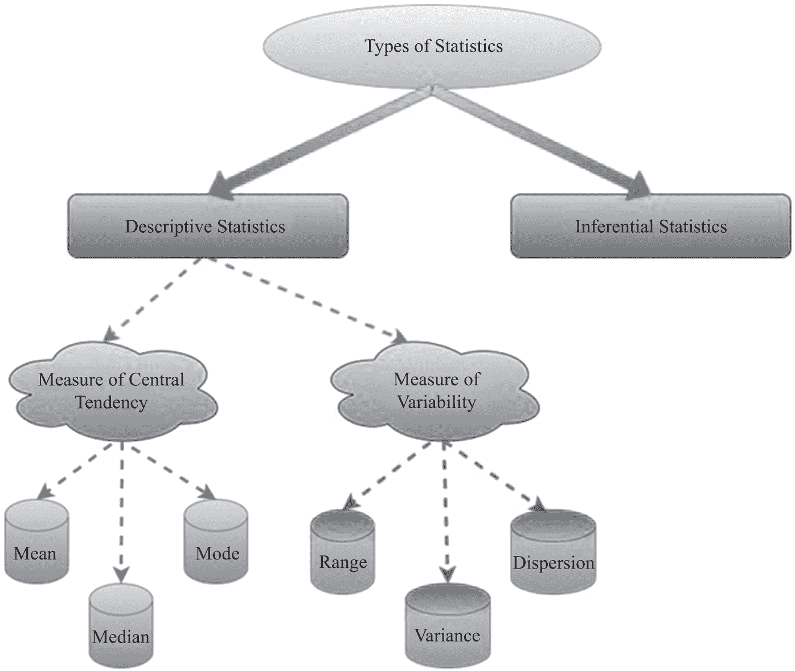

图 1.1 统计类型。

##### 1.1.5.1 描述性统计

描述性统计是一个基本概念，它通过数值度量和图形表示使数据的分析、汇总和组织成为可能。它提供了一种系统的方法，将原始观察结果转换为易于理解和解释的有意义的信息[12]。

通过描述性统计，数据被转换为各种格式，如数字、图表、条形图、直方图和饼图。这些视觉表示为研究人员和分析师提供了深入了解数据分布、模式和独特属性的机会。

标准差和集中趋势等度量在描述性统计中常用。集中趋势度量总结数据的典型或中心值，有助于识别观察值围绕其分布的代表值。

通过利用描述性统计，研究人员可以全面了解现有数据。它有助于数据探索和发现过程，使其能够识别数据集中的异常值、偏度或其他显著特征。此外，它还促进了不同组别或类别之间数据的比较，使研究人员能够识别相似之处或差异。

描述性统计为进一步的分析和解释奠定了基础。它提供了简洁而信息丰富的摘要，使研究人员能够有效地向更广泛的受众传达研究结果和见解。此外，它通过提供数据集的清晰概览并基于观察到的模式和趋势做出明智判断来协助决策[12]。


描述性统计在数据分析中发挥着至关重要的作用，它将原始观测值转化为有意义且可解释的信息。它允许研究人员使用数值度量和视觉表示来总结数据，提供对数据分布、中心趋势和变异性的洞察。描述性统计为基于观察到的模式和数据集特征的进一步分析、沟通和决策提供了基础。

##### 1.1.5.2 中心趋势度量

汇总统计是中心趋势度量的另一个术语，是一种用于描述给定数据集或样本的中心或代表值的统计原理 \[13, 14\]。它提供了一个单一指标，概括了数据的分布，并有助于识别观测值聚集的中心点。

#### 均值
* 中心趋势的度量，表示样本集中所有值的总和除以值的总数，提供数据的典型值或平均值的度量，也称为算术平均值 \[14\]。
* 计算包含 `n` 个值的样本集均值 (`μ`) 的方程为：
(1.1)
$$\\mu = \\frac{x\_{1} + x\_{2} + x\_{3} + \\cdots + x\_{n}}{n}\\ $$
* 公式 (1.1) 给出了均值计算，其中 `x[1]` + `x[2]` + `x[3]` + … + `x[n]` 表示样本集中的各个值，`n` 表示值的集合计数，`μ` 为均值。

#### 中位数
* 中位数作为样本集中中心值的度量，其确定方法是按升序排列数据集并识别确切的中间值。它表示将有序数据集的上半部分与下半部分分隔开的值 \[14\]。
* 查找具有奇数个值的样本集的中位数的方程为：
(1.2)
$$M = \\frac{n + 1}{2}$$
其中 `n` 表示样本集计数。
* 偶数个数据集的方程为：
(1.3)
$$M = \\frac{\\left( x\\left\\lbrack \\frac{n}{2} \\right\\rbrack + x\\left\\lbrack \\left( \\frac{n}{2} \\right) + 1 \\right\\rbrack \\right)}{2}$$
其中 `x` 表示样本集中的各个值。

#### 众数
* 众数表示在样本集中出现频率最高的值。它对应于重复次数最多的数据，突出了数据中心集中最常见的观测值 \[14\]。例如：
`[2,3,4,2,4,6,4,7,7,4,2,4]`→众数为 4

##### 1.1.5.3 变异程度

变异程度，也称为离散程度，是一种用于描述样本或完整集合内数据范围或分布程度的统计原理。在统计学中，极差、方差和标准差是三种常用的变异性度量。

#### 极差
* 极差量化了样本或数据集中值之间的离散程度。它是通过确定集合中高值和低值之间的差异来计算的，从而表示数据的总体跨度或离散程度。
(1.4)
`Range = maximum value − minimum value`

#### 方差
* 方差作为统计度量，描述随机变量与其预期值偏离的程度。它是通过对每个值与预期值之间的平方差取平均值来计算的，提供数据所表现出的总体变异性或离散性的数值度量。
(1.5)
$$S^{2} = \\sum\_{i = 1}^{n}\\mspace{6mu}\\left\\lbrack \\left( x\_{i} - \\underset{\\\_}{x} \\right)^{2} \\div n \\right\\rbrack$$
在此公式中，`n` 为数据点计数，`x̄` 为均值，`x[i]` 为不同的数据点。

##### 1.1.5.4 推断统计

推断统计涵盖了通过利用从该完整集合收集的数据样本，对整个完整集合进行结论得出和预测的过程。
* 它通过利用概率理论来得出有意义的结论，将较小的样本的发现扩展到较大的完整集合。
* 推断统计作为描述性统计的补充工具，有助于分析和解释结果，以便做出明智的决策并得出有意义的结论 \[15\]。
* 其关键应用之一是假设检验，其主要目标是评估并可能拒绝原假设。

进行推断统计的过程涉及以下几个必要的步骤，以得出有意义的结论并做出预测：
1. 该过程始于获得作为研究基础的理论。从那里，生成研究假设，说明变量之间预期的关系或差异。变量被操作化或以可测量的形式定义，以便于数据收集和分析。
2. 随后，进行对研究结果可以推广到的完整集合的识别或确定。基于该完整集合，制定原假设，假设变量之间没有显著的关系或差异。然后从完整集合中收集样本，通常使用适当的抽样方法，并进行研究。
3. 在数据收集后，进行统计检验以评估在说明中观察到的特征是否与原假设下可能的情况显著不同。这些试验有助于阐明有意义的关系或差异的存在，并提供证据以拒绝或未能拒绝原假设。
4. 进行统计检验的目标是评估仅凭偶然获得实验结果的概率。通过将获得的结果与原假设下的预期结果进行比较，研究人员可以确定统计显著性的程度并对研究假设得出有根据的结论。

在整个过程中，保持方法学的严谨性、考虑偏差并使用适当的统计技术以保证研究结果的合法性和可靠性非常重要。

推断统计的类型包括：
* 置信区间：范围
* 假设检验：显著性
* 回归分析：预测
* 方差分析（ANOVA）：比较
* 卡方检验：关联
* T 检验：差异
* 相关分析：关系

### 1.2 数据类型

在统计学领域，数据可以根据其固有性质和定义特征分为不同的类型 \[16\]。一些被广泛认可的数据类型包括：
* **名义数据：** 名义数据是指表示不同类别或组的分类变量，缺乏任何固有的数值或顺序。名义数据的实例包括刻板印象、婚姻状况或汽车类型（轿车/SUV/掀背车）。
* **顺序数据：** 顺序数据与名义数据类似，表示类别或组；然而，它们在这些类别内具有固有的顺序或等级。这意味着值可以以有意义的方式进行排序或排序。例如，顺序变量可能包括排名如“高”、“中”、“低”或评级如“强烈同意”、“同意”、“中立”、“不同意”和“强烈不同意”。


### 1.2 数据类型
* **区间数据：** 这些是数值变量，其中数值之间的差异具有意义，但不存在绝对零点。这些数据可以进行加法、减法和平均运算。区间数据的例子包括摄氏或华氏温度测量，以及用数值表示的年份（例如，2000、2001、2002）。
* **比率数据：** 比率数据是具有真实零点的数值变量，表示所测属性的缺失。这些数据允许进行所有算术运算，包括乘法和除法。例子包括体重、身高、年龄或收入。
* **离散数据：** 离散数据只能取特定、分离且不同的数值。它们通常源于计数或枚举过程，没有分数或中间值。区间数据的例子包括家庭中儿童的数量，或停车场中汽车的数量。
* **连续数据：** 这些可以在给定范围内取任何数值。它们可以包括分数或小数，提供高精度的测量灵活性和准确性。例子包括身高、体重或时间。

了解数据类型至关重要，因为它决定了适当的统计技术和分析方法。不同类型的数据需要不同的汇总、分析和得出有意义结论的方法。

### 1.3 完全总体度量
在统计学中，完全总体指研究者关注并对研究感兴趣的个体、对象或事件的完整集合或全部 [12]。
* 完全总体是具有共同感兴趣特征或属性的单位的完整集合。
* 它可以根据研究背景而变化，可以具体到某所学校的学生群体，也可以宽泛到一个国家的所有居民。
* 完全总体的概念在统计学中是基础性的，因为它为基于从称为样本的较小子集收集的信息对较大群体进行推断和概括提供了基础。
* 在研究人口特征时，研究者的目的是获得洞察并对更广泛的目标群体得出结论。
* 完全总体可以是有限的或无限的。**有限完全总体**由固定数量的元素组成，例如教室中统计的学生，或制造商在特定年份生产的汽车。另一方面，**无限完全总体**具有无限或未知的元素数量，例如一个国家所有个体的身高。
* 完全总体度量，也称为完全总体参数，是描述统计中完全总体特定特征的数值。这些度量提供了完全总体的浓缩表示，并用于基于样本收集的数据对完全总体进行结论和推断。一些常用的完全总体度量包括：
  * ***完全总体均值 ( `μ`)：*** 完全总体中特定变量的算术平均值。它代表完全总体的集中趋势。
  * ***完全总体中位数：*** 完全总体中观测值有序序列中的中心值。它充当区分完全总体上半部分和下半部分的中心值。
  * ***完全总体众数：*** 这表示在完全总体或数据集中出现频率最高的数值。它对应于数据点中出现次数或频率最大的值。
  * ***完全总体方差 (`σ²`)：*** 这量化了个体信息事实与完全总体均值的平均平方偏差，提供了完全总体离散程度或分布范围的度量。
  * ***完全总体标准差 (`σ`)：*** $\sqrt{\sigma^{2}}$ 用于量化数据点与完全总体均值的平均偏差。
  * ***完全总体比例 (`σ`)：*** 完全总体比例是完全总体中特定类别或属性相对频率的度量。它表示为比率或百分比。

这些完全总体度量提供了有关完全总体特征和分布的宝贵见解。然而，直接获得真实的完全总体度量通常具有挑战性或不切实际。相反，统计技术用于基于样本收集的信息来估计这些参数。

### 1.4 抽样
抽样是统计学中一种有价值的方法，使研究人员能够通过研究代表性子集或试验来收集信息，而无需检查每个个体单位。这种方法提供了一种实用高效的方式，在最大限度降低成本和时间限制的同时，对更大的完全总体进行结论和推断 [12]。

图 1.2 说明了抽样过程。为了更好地理解抽样的概念，让我们考虑一个说明其直观性的例子。想象一家公司想要评估员工的工作满意度。不是调查每位员工，这可能耗时且成本高昂，他们决定选择代表不同部门和职位的员工随机试验。通过收集该样本的回复，他们可以在合理置信水平下推断整个员工队伍的总体工作满意度，而无需对每位员工进行单独调查。这个例子展示了抽样如何使我们能够通过研究子集来了解完全总体，使数据收集更可行并为决策过程提供有价值的信息。

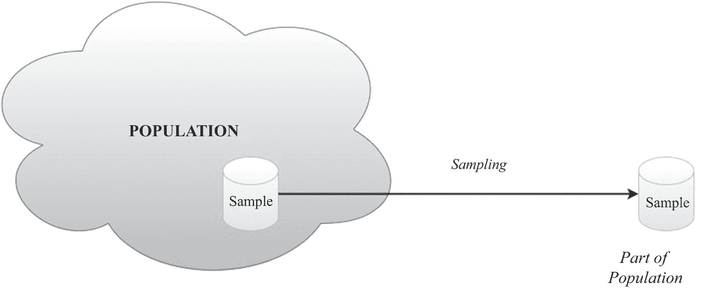

图 1.2 抽样过程。

#### 1.4.1 抽样的原因
* **实用性和效率：** 当感兴趣的完全总体很大或无法访问时，研究每个个体或元素可能不切实际或不可能。抽样使研究人员能够通过研究较小的子集来获得有关完全总体的代表性信息，使数据收集更可行、高效且经济。
* **可推广性：** 设计良好且具有代表性的样本可以提供有关更大完全总体的可靠估计和含义。通过确保样本准确代表完全总体的特征，研究人员可以推广其研究结果并对整个目标群体做出有效结论。
* **时间和资源限制：** 对整个完全总体进行全面研究可能需要过多的时间、精力和资源。抽样使研究人员能够在可行的时间框架和预算限制内收集足够的数据，使研究更可行、实用和可实现。
* **精确性和准确性：** 抽样在正确执行时可以产生精确和准确的结果。通过使用统计技术，研究人员可以估计与样本估计相关的不确定性程度。
* **伦理考虑：** 在某些情况下，研究整个完全总体可能会引发伦理问题，例如侵犯隐私或使个人面临潜在伤害。抽样提供了一种在保持科学严谨性的同时，通过从较小组收集信息来尊重隐私并最大限度降低潜在风险的方法。


**数据收集的可及性和可行性：** 某些总体或现象可能难以获取或全面研究。例如，研究罕见疾病或高度专业化的总体可能需要大量的努力和资源。抽样使研究人员能够通过研究更容易获得且切实可行的子集来获得有意义的见解。

抽样是统计研究的重要组成部分，因为它使研究人员能够在克服后勤挑战和资源限制的同时，对总体做出实用、可推广且准确的推断。通过选择具有代表性的样本并采用适当的统计技术，研究人员可以获得有价值的信息，有助于指导决策、政策制定和进一步的研究工作。

#### 1.4.2 抽样过程

图 1.3 说明了抽样过程中涉及的步骤。

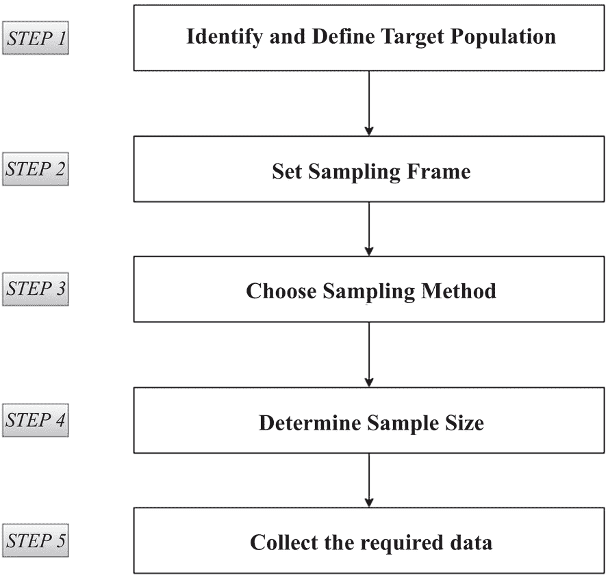

图 1.3 抽样涉及的步骤。

### 1.5 变量之间的相关性

变量之间的相关性是一种统计指标，可对两个变量之间的相互联系进行定量评估。当变量彼此呈现线性关联时，该指标特别有用。为了直观表示数据的拟合程度，可以采用散点图。通过检查散点图，我们可以深入了解变量之间的关系并确定其相互关系。此过程使我们能够评估相关性的强度和方向，从而更深入地理解变量之间的联系。

### 1.6 概率

在统计学中，概率是一个基本概念，用于评估事件发生的概率或可能性。它量化了与实验或观察结果相关的不确定性程度。概率用于分析和理解数据的随机性，并为对值的结论提供数学框架 \[17\]。

概率通常表示为介于 0 到 1 之间的数值。概率为 0 表示不可能事件，而概率为 1 表示必然事件。介于 0 到 1 之间的概率反映了给定事件发生的可能性。

概率在各种统计分析中发挥着关键作用，例如假设检验、置信区间和回归分析 \[18\]。它有助于做出明智的决策、建模不确定性以及评估统计结果的可靠性。

公式 1.6 给出了事件概率公式：

(1.6)

$$\text{概率}\mspace{6mu}\left( \text{事件} \right) = \frac{\text{有利结果}\mspace{6mu}\ \left( x \right)}{\text{总结果}\mspace{6mu}\left( n \right)}$$

#### 1.6.1 概率中的术语

*   ***实验*：** 在概率中，实验是指产生结果或结果集合的过程或活动。它是在特定条件下进行以观察、测量或研究特定事件或结果发生的受控程序。实验用于分析和理解与不同结果相关的概率。

*   ***样本空间*：** 在概率论领域，这是指包含给定试验或随机事件所有潜在结果的集合。它用符号 Ω 表示，代表可能发生的潜在结果的完整范围。

*   ***有利结果*：** 在概率论中，有利结果是指引起兴趣或满足特定指定标准的結果或事件。它代表给定情况下期望或成功的結果。

例如：掷骰子时得到 5 的概率。

得到小于 5 的数字的概率

给定：样本空间，`S` = {1, 2, 3, 4, 5, 6}

因此，`n(S)` = 6

设 `A` 为得到小于 5 的数字的事件。

那么，`A` = {1, 2, 3, 4}

所以，`n(A)` = 4

使用概率方程：

`p(A)` = (`n(A)`)/(`n(S)`)

(1.7)

`p(A)` = 4/6

`m` = 2/3

得到小于 5 的数字的概率为 2/3。

### 1.7 概率分布

在统计学中，概率分布是指用于描述指定数据集或总体中各种结果或事件发生的概率的数学函数或模型。它提供了一种结构化的方法，将概率分配给随机变量可能取的每个潜在值或值范围。

概率分布总结了各种结果的概率，并提供了对这些结果相对频率或可能性的见解。它是统计分析中的基本工具，使研究人员能够量化不确定性、做出预测并基于观察数据得出结论 \[19\]。

#### 1.7.1 分布类型

1. **离散概率分布：** 当随机变量只能取有限个不同点或可数个值时适用。它为每个可能值分配概率，形成概率质量函数（PMF）。离散概率分布的例子包括 *二项分布、泊松分布* 和 *几何分布*。

    *   *二项分布*：这在众多领域中得到广泛应用，作为在预定次数试验中成功或失败次数结果的模型。例子包括硬币翻转序列中获得的正面次数或产品批次中缺陷物品的次数。必须认识到二项分布依赖于试验独立性的假设。遵守这些假设对于二项分布的准确使用至关重要。

    *   *泊松分布*：这在各个领域中常用於建模事件，例如特定时间段内电话亭接到的来电数量、某一天内的事故数量或服务点的到达次数。需要注意的是，泊松分布假设事件之间相互独立且在整个区间内发生率恒定。此外，当事件的平均发生率较低且事件较少见时，其准确性最高。本质上，泊松分布是预定区间内发生事件次数的概率分布。泊松分布特别适用于建模罕见事件或事件随机且独立发生的情况。

    *   *几何分布*：这在各个领域中常用於建模事件，例如获得第一个正面所需的抛硬币次数、成功销售所需的尝试次数或在达到期望结果之前失败的次数。需要注意的是，几何分布假设试验之间相互独立且在整个试验过程中成功概率恒定。此外，假设试验会重复进行直到第一次成功为止。综上所述，几何分布特别适用于建模成功在不同次数试验后取得的情况。


### 2.2 连续概率分布

这适用于随机变量有可能取特定区间或范围内的任意值时。其特征在于概率密度函数（`PDF`），它表示变量取特定值的可能性。与离散分布不同，连续分布不会为每个值分配单独的概率，而是描述整个范围内的分布模式。连续概率分布的例子包括 *正态（高斯）分布、指数分布* 和 *均匀分布*。

### 高斯分布

`Gaussian distribution` 在统计学和概率论中被广泛使用。它以钟形曲线而闻名，并在其均值周围表现出对称性。它通常用于模拟现实世界现象，这些现象倾向于围绕中心值聚集，并且随着数值远离均值，概率对称递减。许多自然和社会现象遵循此分布，例如个体的身高和体重、测量误差以及智商分数。`Gaussian distribution` 的性质，例如中心极限定理，使其成为统计推断中的基本工具。它允许在各种统计分析中计算概率、置信区间和假设检验。总之，由于其数学性质以及在现实世界数据中的普遍性，`Gaussian distribution` 在统计分析和推断中发挥着至关重要的作用。

### 指数分布

这表示泊松过程中事件之间的时间持续时间。它经常被用于分析事件发生所需的时间，例如顾客在队列中的等待时间或呼叫中心之间电话呼叫的间隔。

### 均匀分布

这模拟了给定区间内所有值同等可能出现的结果。当范围内没有对任何特定值的特殊偏好或偏见时，通常会使用它。`Uniform distribution` 通常用于事件或值在指定范围内同等可能发生的情况。例如，它可用于模拟在 `a` 和 `b` 之间选择随机数的概率，其中每个数字被选中的机会相等。`Uniform distribution` 在模拟研究、生成随机数以及作为比较其他概率分布的基线方面也很有用。总之，`uniform distribution` 指的是定义区间内的所有值具有相同的出现概率。其特征在于下界和上界，并且其概率密度在区间内是恒定的。`Uniform distribution` 通常用于各种应用，例如随机数生成和模拟研究。

概率分布提供了多个重要特征和属性，有助于总结数据的集中趋势、离散程度和形状。这些属性源自分布的具体形式和参数。统计学家和研究人员经常使用概率分布来模拟现实世界现象、做出预测并进行统计推断。通过将观测数据拟合到合适的概率分布，他们可以估计参数、评估某些事件的可能性、计算概率并进行假设检验。概率分布是一个数学函数，它为随机变量的各种结果或值分配概率。它为分析不确定性、做出预测以及基于观测数据得出结论提供了一个框架。概率分布在统计分析、模拟现实世界现象以及促进各领域的明智决策中发挥着至关重要的作用。

### 1.8 各种样本统计量

样本统计量是数值度量，用于总结和描述样本的特征，样本是更大总体集的子集 \[20\]。它们为数据提供有价值的见解，并有助于对总体集做出推断。以下是一些常用的样本统计量：

* **样本均值** (`x̄`)：样本中所有值的平均值，并为总体集均值提供估计。
* **样本中位数**：中位数对应于排序数据集合中的中心值，有效地将数据分为两半，其中 50% 的值位于其下方，50% 的值位于其上方。它对极端值的敏感度低于均值。
* **样本众数**：样本中出现频率最高的值或值。它提供了数据集中趋势的见解，对于分类或离散数据特别有用。
* **样本方差** (`s²`)：方差量化了所表现出的离散程度或分散程度。
* 样本标准差 (`s`)：$\\sqrt{s^{2}}$
* **样本范围**：`Max` − `Min`。它是对数据中存在的离散程度或变异程度的直接度量。
* **样本四分位数**：四分位数将数据划分为四个相等部分，表示第 25、50（中位数）和 75 百分位数。它们提供了对数据分布的有价值见解，使其特征得到更深入的理解。

这些只是统计分析中常用的样本统计量的几个例子。每个统计量都提供了关于样本数据的独特信息，有助于理解其特征并对总体集做出推断。

### 1.9 估计统计学

估计统计学是指统计学的一个分支，涉及基于样本数据估计未知总体集参数。它涵盖了利用样本统计量对总体集参数得出结论并衡量与这些估计相关的不确定性。

统计学中主要有两种估计类型：

* **点估计**：这包括估计单一值（称为点估计）的过程，该值作为未知总体集参数的最合适近似。点估计量的常见示例包括样本均值、样本比例或样本方差。点估计提供单一值作为估计值，但不指示估计值相关的变异性或误差幅度。
* **区间估计**：这涉及创建一个范围（称为置信区间），预计以指定的置信水平包含总体集参数。它表示与估计值相关的不确定性程度，并提供了其精度的度量。置信区间通常通过考虑抽样分布的特征和期望的置信水平来构建。

估计过程涉及选择合适的估计方法、从总体集中收集代表性样本、计算样本统计量，然后使用这些统计量来估计未知总体集参数。估计方法的选择取决于各种因素，包括数据类型、研究问题以及估计技术所依据的假设。

估计统计学在市场研究、社会科学、公共卫生和经济学等各个领域具有极其重要的意义。它使研究人员即使在样本数据有限的情况下也能做出明智的决策并得出关于总体集参数的结论。然而，必须认识到估计需要假设，并且估计的准确性依赖于样本的质量和代表性。


综上所述，估计统计涵盖了利用样本数据估计总体参数的过程。它包括点估计，其中单一值作为估计值，以及区间估计，其中一系列值表示相关的不确定性。估计在基于有限样本数据进行推断和得出结论方面发挥着至关重要的作用，但重要的是要考虑所使用估计方法的假设和局限性。

### 1.10 样本比例

样本比例是表示样本中具有某种特征或表现出特定行为的个体比例或百分比的统计量。它通常用于估计总体比例。其计算方法是样本中具有所需特征或行为的个体数量除以总样本量。

样本比例公式（1.8）用于计算样本中具有某种特征或表现出特定行为的个体比例或百分比。它用符号 `p̂` 表示。

(1.8)

$$\widehat{p} = \left( \frac{x}{n} \right)$$

* `p̂` 表示样本比例。
* `x` 表示个体的所需特征
* `n` 是总样本量。

例如，如果要找出某市支持某位政治候选人的成年人的比例，则从总体中抽取任意样本 500 名成年人，发现样本中有 250 名个体表示支持该候选人。支持该候选人的成年人的样本比例为 250/500 = 0.5 或 50%。

样本比例的性质有助于评估估计的精确度和变异性。必须认识到样本比例受抽样变异的影响，这意味着从同一总体中抽取的不同样本很可能产生略有不同的估计值。

综上所述，样本比例作为表示样本中具有特定特征或表现出特定行为的个体比例或百分比的统计量。计算涉及将具有所需特征的个体计数除以总样本量。样本比例能够估计总体比例，并基于样本数据对总体进行推断。

### 1.11 卡方统计量 (`χ²`)

卡方统计量是统计学中用于评估分类变量之间独立性或关联性的重要度量。它依赖于卡方分布，该分布描述了标准正态偏差平方和的分布。

计算卡方统计量涉及将观测频数与期望频数进行比较。它确定观测频数是否显著偏离在变量独立时所预期的期望频数。

计算卡方统计量的公式取决于所执行的特定分析类型。以下是两种常见情况：

1. **拟合优度检验：** 在此情况下，卡方统计量用于检验单一分类变量中的观测频数是否与基于指定分布的期望频数存在显著差异。在这种情况下，卡方统计量的公式为：

(1.9)

`χ²` = `Σ` [(观测频数−期望频数)²/期望频数]

其中 `Σ` 表示对所有类别求和。

2. **独立性检验：** 在此情况下，卡方统计量用于评估两个分类变量之间的关联。在这种情况下，卡方统计量的公式为：

(1.10)

$$\chi^{2} = \Sigma \left[ \frac{\left( \text{Observed Frequency} - \text{Expected Frequency} \right)^{2}}{\text{Expected Frequency}} \right]$$

其中 `Σ` 表示对列联表的所有单元格求和。

卡方（`χ²`）统计量是检验分类变量独立性的有价值工具。通过评估偏离程度，卡方统计量有助于确定观测差异是否具有统计学意义。该检验广泛应用于社会科学、市场研究、生物学等领域，以评估分类变量之间的关系并深入了解其依赖性或独立性。

例如，考虑抛掷 100 次公平硬币的例子。假设结果为 50 次正面和 50 次反面。然而，实际结果可能偏离这一期望，例如出现 60 次正面和 40 次反面，或 90 次正面和 10 次反面。卡方检验使我们能够衡量观测结果与公平硬币的理论期望的一致程度。如果观测结果与预期结果存在显著差异，则表明硬币可能不公平。

总之，卡方统计量是检验分类变量之间独立性或关联性的有价值度量。卡方检验在统计分析中被广泛采用，可提供有关分类数据之间关系和依赖性的见解。

### 1.12 中心极限定理

中心极限定理（CLT）是统计学中的一个关键概念，概述了从任何总体中得出的样本均值或总和的行为，而与基础分布无关。它断言，随着样本量的增加，样本均值或总和的分布会趋向于正态分布，而与总体分布的形状无关。

从数学上讲，中心极限定理可表述如下：

`X[1]`, `X[2]`…, `X[n]` — 总体随机变量
`μ` — 均值
`σ` — 标准差
`n` — 样本量

为了说明，让我们考虑总体中个体的身高。总体分布可能不遵循正态分布。然而，如果我们收集身高的随机样本并计算每个样本的均值，则这些样本均值的分布将表现出对正态分布的接近近似。

中心极限定理对统计推断和假设检验具有重要意义。此外，它构成了构建置信区间和进行假设检验的基础。

该定理在各种统计应用中被广泛使用。考虑：

* 在市场研究中，中心极限定理用于根据消费者评分样本估计产品的平均评分。
* 在质量控制中，它用于评估产品测量的变异性并确定控制限。

CLT 在统计学中是一个重要概念，因为它允许我们基于样本数据对总体参数做出可靠的推断。它在总体特征与样本的统计特性之间架起了一座桥梁，使得诸如假设检验和置信区间估计等强大技术的使用成为可能。

总之，CLT 是统计学中的基本概念，为对总体参数进行推断提供了基础。该定理在各种统计应用中被广泛用于分析数据并得出有意义的结论。

### 1.13 总结

总之，统计学通过提供分析和解释数据的工具和技术，在各个领域和学科中发挥着至关重要的作用。它使研究人员和决策者能够基于证据和可量化信息做出明智的决策。本章提供了对统计学的全面概述和理解。


# 引言
统计的重要性在于其揭示数据中模式、关系和趋势的能力，使我们能够进行预测、检验假设并得出有意义的见解。无论是估计总体参数、评估差异的显著性还是进行预测，统计学都为分析数据和做出基于证据的决策提供了一个严谨的框架。它有助于理解数据固有的变异性和不确定性，并提供量化并考虑这些不确定性的方法。

总体而言，统计学是研究人员、企业、政策制定者和个人等都可使用的强大工具。它使我们能够探索和理解复杂信息，对总体做出可靠的推断，并在广泛的领域指导决策。随着世界不断产生海量数据，统计学的作用只会变得越来越重要，提供宝贵的见解并促进知识和理解的进步。

## 参考文献
1. 在线统计教育。一个多媒体课程（[`onlinestatbook.com/`](http://onlinestatbook.com/)）。项目负责人：David M. Lane, Rice University。
2. He, Xuming, and Xihong Lin。“统计与数据科学中的挑战与机遇：十个研究领域。”哈佛数据科学评论 2.3 (2020): 1–8。
3. Gupta, S. C., and V.K. Kapoor。《数学统计学基础》。Sultan Chand & Sons, 2020。
4. Lauritzen, Steffen。《数学统计学基础》。CRC Press, 2023。
5. Grami, Ali。《概率、随机变量、统计学和随机过程：基础与应用》。John Wiley & Sons, 2019。
6. Lock, Robin H., et al.《统计学：释放数据的力量》。John Wiley & Sons, 2020。
7. Johnson, Richard A., and Gouri K. Bhattacharyya。《统计学：原理与方法》。John Wiley & Sons, 2019。
8. Coolidge, Frederick L.《统计学：温和入门》。Sage Publications, 2020。
9. Adams, Kathrynn A., and Eva K. McGuire。《研究方法、统计学与应用》。Sage Publications, 2022。
10. Riemann, B.L., and Lininger, M.R. “统计学原理：运动医学专业人员需要了解的内容。”《运动医学诊所》37.3 (2018 年 7 月): 375–386。doi: [10.1016/j.csm.2018.03.004](http://dx.doi.org/10.1016/j.csm.2018.03.004)。PMID: 29903380。
11. Beyer, William H.《概率与统计表手册》。CRC Press, 2019。
12. Kaliyadan, Feroze, and Vinay Kulkarni。“变量类型、描述性统计和样本量。”《印度皮肤病学在线期刊》10.1 (2019): 82。
13. Bakker, Caitlin。“图书馆员统计学导论（第二部分）：频数分布与集中趋势度量。”《Hypothesis: 健康信息专业人员研究期刊》35.1 (2023): 1–5。
14. Alnemrawy, Ziad。“约旦八年级学生在集中趋势度量（均值、中位数和众数）中的统计思维水平。”《物理学会议系列期刊》80.80 (2020): 1215–1245。
15. Amrhein, Valentin, David Trafimow, and Sander Greenland。“推断统计作为描述性统计：如果我们不期望重复，就不存在可重复性危机。”《美国统计学家》73.sup1 (2019): 262–270。
16. Campbell, Michael J., and Richard M. Jacques。《二次方统计学》。John Wiley & Sons, 2023。
17. Ross, Sheldon M.《工程师与科学家概率与统计导论》。Academic Press, 2020。
18. Baron, Michael。《计算机科学家概率与统计》。CRC Press, 2019。
19. Kounev, Samuel, et al. “基础概率与统计综述。”《系统基准测试：面向科学家和工程师》1 (2020): 23–44。
20. Lohr, Sharon L.《抽样：设计与分析》。CRC Press, 2021。

## 2 量子机器基础
Soham S. Bhoir and Harshal H. Dave

KJ Somaiya 工程学院，印度

Devi Priya Rangasamy

KPR 工程学院与技术学院，印度

DOI: [10.1201/9781003429654-3](https://dx.doi.org/10.1201/9781003429654-3)

### 2.1 量子机器导论
量子机器代表了计算领域一场开创性的范式转变，开启了无限可能的时代。利用量子力学错综复杂的原理，它们承诺了计算能力的无与伦比的飞跃。与依赖于二进制经典比特的经典对应物不同，量子机器利用了量子比特的神秘力量：量子比特具有非凡的特性。量子比特可以处于叠加态，使其能够同时表示多个值，这在经典计算中是不可想象的现象。此外，纠缠现象——量子比特相互连接并瞬间相互影响——揭示了计算能力全新的维度。叠加与纠缠的结合构成了量子算法的基石，能够以指数级加速解决复杂问题，解锁曾经看似不可逾越的解决方案。量子计算的曙光有望重新定义我们在从密码学到材料科学等领域所能实现的目标的边界，革新行业并推动科学突破。

开发量子机器的动机在于应对超出经典计算机能力的计算挑战。传统计算机在面对复杂优化问题、量子系统模拟和质因数分解等挑战时遇到困难。量子机器凭借其同时操纵大量信息的能力，有着彻底革新这些领域并开辟新的科学和技术探索途径的巨大潜力。

#### 2.1.1 与经典机器的比较
对量子机器与经典机器之间区别的深刻理解为辨别前者所提供的独特优势奠定了基础。经典机器运行于经典比特上，经典比特处于 0 或 1 的二进制状态。形成鲜明对比，量子比特具有在叠加态中存在的非凡能力，使其能够同时体现多种可能性。这种固有的并行性赋予量子机器指数级的计算能力提升，使其能够解决令经典系统困惑的极其复杂的问题 [1]。

将量子机器提升到经典对应物之上另一个显著标志是迷人的纠缠现象。在迷人的量子物理领域中，量子信息的基本单元——量子比特——形成了超越空间边界的复杂关联。这种迷人的相互连接赋予量子机器以高度同步和交织的方式执行计算的独特能力。就好像这些量子比特能够瞬间通信，违背时空的限制。量子系统的这一非凡属性为各个领域打开了诱人的前景之门。从加强密码协议的安全性，到革新超安全通信系统，甚至增强优化算法，纠缠成为推动我们实现科学和技术前所未有的进步的强大工具 [2]。


当我们踏上这段启发性的旅程时，请注意，接下来的章节将深入探讨量子计算的复杂性，并以细致的关注聚焦于基础概念、理论基础和实际应用。

### 2.2 量子计算的量子力学

量子力学是现代物理学的基础理论，彻底改变了我们对微观世界的理解，提供了描述量子水平下粒子行为的数学框架。这一在 20 世纪早期发展起来的卓越理论构成了量子计算的基石，通过利用量子现象释放出指数级强大计算的潜力。

“量子力学的奠基人”维尔纳·海森堡在塑造这一领域中发挥了关键作用。1925 年，海森堡与马克斯·玻恩和帕斯库尔·约当一起提出了量子力学的革命性数学形式体系，即矩阵力学。海森堡的开创性工作引入了不确定性原理，该原理指出某些物理性质对，如位置和动量，不能同时以任意精度进行测量。这一原理挑战了经典决定论观念，并为量子现象的概率本质奠定了基础。

海森堡的不确定性原理与埃尔温·薛定谔、保罗·狄拉克和尼尔斯·玻尔等其他杰出人物的开创性贡献相结合，导致了波力学的[content]
当我们踏上这段启发性的旅程时，请注意，接下来的章节将深入探讨量子计算的复杂性，并以细致的关注聚焦于基础概念、理论基础和实际应用。

# 2.2 量子计算的量子力学

量子力学是现代物理学的基础理论，彻底改变了我们对微观世界的理解，提供了描述量子水平下粒子行为的数学框架。这一在 20 世纪早期发展起来的卓越理论构成了量子计算的基石，通过利用量子现象释放出指数级强大计算的潜力。

“量子力学的奠基人”维尔纳·海森堡在塑造这一领域中发挥了关键作用。1925 年，海森堡与马克斯·玻恩和帕斯库尔·约当一起提出了量子力学的革命性数学形式体系，即矩阵力学。海森堡的开创性工作引入了不确定性原理，该原理指出某些物理性质对，如位置和动量，不能同时以任意精度进行测量。这一原理挑战了经典决定论观念，并为量子现象的概率本质奠定了基础。

海森堡的不确定性原理与埃尔温·薛定谔、保罗·狄拉克和尼尔斯·玻尔等其他杰出人物的开创性贡献相结合，导致了波力学的[content]
当我们踏上这段启发性的旅程时，请注意，接下来的章节将深入探讨量子计算的复杂性，并以细致的关注聚焦于基础概念、理论基础和实际应用。

# 2.2 量子计算的量子力学

量子力学是现代物理学的基础理论，彻底改变了我们对微观世界的理解，提供了描述量子水平下粒子行为的数学框架。这一在 20 世纪早期发展起来的卓越理论构成了量子计算的基石，通过利用量子现象释放出指数级强大计算的潜力。

“量子力学的奠基人”维尔纳·海森堡在塑造这一领域中发挥了关键作用。1925 年，海森堡与马克斯·玻恩和帕斯库尔·约当一起提出了量子力学的革命性数学形式体系，即矩阵力学。海森堡的开创性工作引入了不确定性原理，该原理指出某些物理性质对，如位置和动量，不能同时以任意精度进行测量。这一原理挑战了经典决定论观念，并为量子现象的概率本质奠定了基础。

海森堡的不确定性原理与埃尔温·薛定谔、保罗·狄拉克和尼尔斯·玻尔等其他杰出人物的开创性贡献相结合，导致了波力学的[content]
当我们踏上这段启发性的旅程时，请注意，接下来的章节将深入探讨量子计算的复杂性，并以细致的关注聚焦于基础概念、理论基础和实际应用。

# 2.2 量子计算的量子力学

量子力学是现代物理学的基础理论，彻底改变了我们对微观世界的理解，提供了描述量子水平下粒子行为的数学框架。这一在 20 世纪早期发展起来的卓越理论构成了量子计算的基石，通过利用量子现象释放出指数级强大计算的潜力。

“量子力学的奠基人”维尔纳·海森堡在塑造这一领域中发挥了关键作用。1925 年，海森堡与马克斯·玻恩和帕斯库尔·约当一起提出了量子力学的革命性数学形式体系，即矩阵力学。海森堡的开创性工作引入了不确定性原理，该原理指出某些物理性质对，如位置和动量，不能同时以任意精度进行测量。这一原理挑战了经典决定论观念，并为量子现象的概率本质奠定了基础。

海森堡的不确定性原理与埃尔温·薛定谔、保罗·狄拉克和尼尔斯·玻尔等其他杰出人物的开创性贡献相结合，导致了波力学的[content]
当我们踏上这段启发性的旅程时，请注意，接下来的章节将深入探讨量子计算的复杂性，并以细致的关注聚焦于基础概念、理论基础和实际应用。

# 2.2 量子计算的量子力学

量子力学是现代物理学的基础理论，彻底改变了我们对微观世界的理解，提供了描述量子水平下粒子行为的数学框架。这一在 20 世纪早期发展起来的卓越理论构成了量子计算的基石，通过利用量子现象释放出指数级强大计算的潜力。

“量子力学的奠基人”维尔纳·海森堡在塑造这一领域中发挥了关键作用。1925 年，海森堡与马克斯·玻恩和帕斯库尔·约当一起提出了量子力学的革命性数学形式体系，即矩阵力学。海森堡的开创性工作引入了不确定性原理，该原理指出某些物理性质对，如位置和动量，不能同时以任意精度进行测量。这一原理挑战了经典决定论观念，并为量子现象的概率本质奠定了基础。

海森堡的不确定性原理与埃尔温·薛定谔、保罗·狄拉克和尼尔斯·玻尔等其他杰出人物的开创性贡献相结合，导致了波力学的[content]
当我们踏上这段启发性旅程时，请注意后续章节将深入探讨量子计算的复杂性，重点关注基础概念、理论基础和实际应用。

# 2.2 量子计算的量子力学

量子力学是现代物理学基础理论，彻底改变了对微观世界的理解，为描述量子尺度粒子行为提供了数学框架。这一 20 世纪早期发展起来的理论是量子计算的基石，通过利用量子现象实现指数级强大计算。

“量子力学之父”维尔纳·海森堡在该领域发挥关键作用。1925 年，海森堡与马克斯·玻恩、帕斯库尔·约当共同提出量子力学的革命性数学形式体系——矩阵力学。海森堡的工作引入了不确定性原理，指出位置和动量等某些物理性质对不能同时被任意精确测量。该原理挑战了经典决定论，为量子现象的概率本质奠定基础。

海森堡不确定性原理结合埃尔温·薛定谔、保罗·狄拉克、尼尔斯·玻尔等人的开创性贡献，导致了基于波函数概念的波力学这一量子力学替代表述。薛定谔于 1926 年提出的波动方程提供了描述量子系统时间演化和计算其波函数的方法。

#### 2.2.1 量子态与波函数

在量子力学中，量子态是量子系统的基本描述，概括了系统的性质和潜在结果，为后续计算和预测奠定基础。为理解量子态的复杂性，我们转向波函数这一数学表征。波函数记为 `|ψ⟩`，包含量子系统状态的完整信息。它是在希尔伯特空间框架下定义的复值函数，该数学结构为量子力学提供了严格基础。在此形式体系中，量子态由希尔伯特空间中的向量表示，其随时间演化受幺正变换原理支配。数学上，波函数 `|ψ⟩` 可表示为基态的线性组合，记为 `|ψ⟩ = Σ_i α[i] |Φ[i]⟩`，其中 `α[i]` 为复系数，`|Φ[i]⟩` 为正交归一基态。这些系数即概率幅，决定测量时获得各种测量结果的概率 [3]。

归一化条件确保所有可能测量结果的概率之和为 1。它要求波函数绝对值平方在整个空间上的积分等于 1：

(2.1)

∫ |`ψ`(`x`)|² d`x` = 1

该条件保证量子系统处于任何可能状态的总概率守恒 [4]。

例如，考虑长度为 `L` 的一维盒中粒子。表示粒子状态的波函数可表示为：

(2.2)

$$\\psi\\left( x \\right) = \\sqrt{\\frac{2}{L}\\sin\\mspace{6mu}\\ \\left( \\frac{\\mathit{n\\pi x}}{L} \\right)}$$

其中 `n` 为整数，表示粒子的能级。通过归一化该波函数，我们确保在盒内找到粒子的概率为 1。

叠加概念是量子力学的标志，进一步探讨以加深理解。量子系统可同时存在于多个状态的线性组合中，数学上表示为：

(2.3)

$$\\left. \\mid \\psi \\right\\rangle\\left. = \\sum\\limits\_{i}\\alpha\_{i} \\mid \\Phi\_{i} \\right\\rangle$$

其中 `α[i]` 为复系数，`|Φ[i]⟩` 为正交归一基态。叠加特性导致了著名的薛定谔猫思想实验，其中猫可在既活又死的状态叠加中存在，直至被观测 [4, 5]。

量子力学中的测量过程会使波函数坍缩到其可能本征态之一，对应确定的测量结果。获得特定测量结果的概率由玻恩规则给出，该规则指出测量系统处于状态 `|Φ[i]⟩` 的概率等于系数 `α[i]` 的模平方：

(2.4)

`P(Φ[i]) = |α[i]|²`

量子力学的这种概率性与经典物理不同，后者系统性质可确定地确定。在量子力学中，测量仅给出概率结果，只有对相同制备的系综进行重复测量才能揭示统计行为。量子态还表现出另一种奇特特性——纠缠。当两个或多个量子系统纠缠时，其各自波函数不再能独立描述。相反，纠缠系统由联合波函数描述，考虑系统间的关联。这种纠缠可导致非局域关联，由爱因斯坦、波多尔斯基和罗森在其 EPR 佯谬中著名描述。此外，量子态随时间演化由薛定谔方程描述，这是量子力学中的核心方程。薛定谔方程规定量子系统波函数如何响应其哈密顿量而变化，后者代表系统的总能量 [3, 4 and 5]。

其定态形式为：

(2.5)

`Ĥ|ψ⟩ = E|ψ⟩`

其中 `Ĥ` 为哈密顿算符，`E` 为与状态 `|ψ⟩` 相关的能量本征值。求解薛定谔方程可确定量子系统的允许能级和相应波函数。

量子力学中的可观测量概念与量子态密切相关。可观测量是可以测量的物理量，如位置、动量、能量和自旋。在量子力学中，可观测量由相应算符表示，作用于波函数以产生测量结果。算符的本征值表示可能的测量结果，而本征态对应测量确定的状态。例如，粒子的位置由位置算符 `x̂` 表示，其动量由动量算符 `p̂` 表示。作用于波函数时，这些算符分别给出位置和动量测量结果。获得特定测量结果的概率由波函数展开中相应系数的模平方给出。需要注意的是，量子力学中的测量行为可导致波函数坍缩到所测可观测量的本征态。这种坍缩是非决定性过程，测量结果本质上是不确定的。该特性通常被称为量子力学中的测量问题，一直是哲学争论和解释的主题。


量子态和波函数的概念并不局限于单个粒子。它扩展到具有多个粒子的系统，例如原子、分子，甚至宏观物体。多粒子系统的波函数由多变量函数描述，该函数包含所涉及所有粒子的位置或其他相关变量。它还构成了各种量子现象和应用的基础。源自叠加和纠缠原理，量子计算、量子通信和量子密码学已成为前景广阔的领域。量子态及其操纵使得能够开发出量子算法，这些算法能够比经典算法更高效地解决某些问题。

### 2.3 量子比特与状态

量子计算利用量子力学原理以超越经典计算能力的方式处理和操纵信息。量子计算的核心是量子比特，或 `qubits`，它们充当信息的基本单位 \[6\]。在本节中，我们探讨 `qubits` 的概念、其表示形式及其独特属性。此外，我们深入研究量子态的概念及其数学描述，这些描述构成了量子计算的基础。

#### 2.3.1 量子比特：量子计算的构建模块

在经典计算中，信息的基本单位是经典比特，它可以存在于两种状态之一：0 或 1。另一方面，量子计算引入了 `qubits` 作为信息的基本单位。`Qubits` 是量子系统，可以同时以 0 和 1 状态的叠加存在，从而实现更丰富、更强大的信息表示。`qubit` 的物理实现可以根据底层技术而有所不同。例如，`qubits` 可以使用囚禁离子、超导电路或量子点来实现。无论物理实现如何，`qubits` 必须表现出两个关键属性：`superposition` 和 `entanglement` \[7\]。

#### 2.3.2 叠加

`Superposition` 是 `qubits` 的基本属性，使其能够同时以多个状态的相干组合存在。换句话说，`qubit` 可以处于同时表示 0 和 1 的状态，每个状态的具体概率由其量子态向量中的系数决定。

在数学上，处于 `superposition` 的 `qubit` 可以表示为：

(2.6)

`∣ψ⟩=α∣0⟩+β∣1⟩`,

其中 `α` 和 `β` 是复概率幅，而 `∣0⟩` 和 `∣1⟩` 表示 `qubit` 的基态。系数 `α` 和 `β` 必须满足归一化条件 `∣α∣² + ∣β∣² = 1`，以确保测量 `qubit` 处于任一状态的总概率保持不变。

`Superposition` 使 `qubits` 能够同时探索多个计算路径并并行执行计算，从而在某些算法中提供显著加速的潜力 \[7\]。

#### 2.3.3 纠缠

`Entanglement` 是 `qubits` 的另一个关键属性，即使在物理分离的情况下，也允许多个 `qubits` 之间存在强关联。当 `qubits` 纠缠时，它们的量子态变得相互依赖，一个 `qubit` 的测量结果可以瞬间影响另一个 `qubit` 的状态，而与它们之间的距离无关。这种现象通常被称为“spooky action at a distance”，违背了经典直觉，但却是量子力学的一个基本特征。纠缠的 `qubits` 由联合量子态描述，该态无法分解为单个 `qubit` 态。两 `qubit` 纠缠系统的状态可以表示为：

(2.7)

`∣ψ⟩=α∣00⟩+β∣01⟩+γ∣10⟩+δ∣11⟩`,

其中 `α`、`β`、`γ` 和 `δ` 是复概率幅。`qubits` 之间的 `entanglement` 允许表示高度相关的信息，并使诸如量子隐形传态和量子纠错等量子算法成为可能。`Entanglement` 是量子计算中的宝贵资源，因为它能够利用并行性并实现超越经典系统的全新计算能力 \[7\]。

#### 2.3.4 量子态及其数学描述

量子态提供了量子系统的数学描述，并编码了量子计算所需的信息。量子态由复向量空间中的向量表示，该空间称为 `Hilbert space`。量子态随时间的演化受 `unitary transformations` 原理支配。

在数学上，量子态可以表示为：

(2.8)

$$\\left. \\mid \\psi \\right\\rangle\\left. = \\sum\\limits\_{i}\\alpha\_{i} \\mid \\phi\_{i} \\right\\rangle,$$

其中 `α_i` 是复概率幅，而 `∣ϕ_i⟩` 是张成 `Hilbert space` 的正交归一基态。系数 `α_i` 决定了测量量子系统时获得各种测量结果的概率 \[8, 9\]。

归一化条件确保所有可能测量结果的总概率之和为 1。它要求量子态与其自身的内积等于 1：

(2.9)

$$\\left\\langle \\psi\\mspace{2mu} \\mid \\psi \\right\\rangle = \\sum\\limits\_{i}{\\mid \\alpha\_{i} \\mid}^{2} = 1.$$

该归一化条件保证了概率守恒，并确保量子系统处于有效状态 \[7, 8\]。

量子态的数学描述允许使用各种量子操作对态向量进行操纵和变换。由矩阵表示的 `Unitary operators` 对量子态执行变换，而不改变归一化或内积。这些 `unitary transformations` 对应于量子系统在诸如 `quantum gates` 和测量等不同操作下的演化。量子态随时间的演化由 `Schrödinger equation` 描述，后者是量子力学中的基本方程。它支配着量子系统的动力学，并决定量子态如何响应系统的哈密顿量而变化。在量子计算中，`quantum algorithms` 通过一系列量子操作操纵量子态，以高效执行特定的计算任务。通过利用 `superposition` 和 `entanglement` 的特性，`quantum algorithms` 可以比经典算法快指数级地解决某些问题。

### 2.4 理解量子计算

#### 2.4.1 量子门与操作

在经典计算中，逻辑门构成了数字电路的构建模块，并使经典比特的操纵成为可能。同样，在量子计算中，`quantum gates` 充当操纵 `qubits` 的基本操作。`Quantum gates` 是 `unitary operators`，它们变换一个或多个 `qubits` 的量子态。`quantum gates` 的选择和排列决定了对量子态执行的计算操作。这些门可以组合起来创建量子电路，以实现特定算法或执行所需计算 \[6\]。

#### 2.4.1.1 单量子比特门

单 `qubit` 门作用于单个 `qubits`，并允许操纵其量子态。一些常用的单 `qubit` 门包括：

* `Pauli-X Gate` (`X gate`)：`Pauli-X Gate` 类似于经典的 `NOT gate`，它将 `qubit` 的状态从 `∣0⟩` 翻转为 `∣1⟩`，反之亦然。在数学上，它可以表示为：

(2.10)

```
X = \begin{bmatrix} 0 & 1 \\ 1 & 0 \\ \end{bmatrix}.
```


### 2.4.1.1 单量子比特门

* `Pauli-Y Gate (Y gate)`: `Pauli-Y` 门是另一个单量子比特门，它在基态之间引入相位偏移。它使量子比特的状态绕布洛赫球的 `y-axis` 旋转。在数学上，它可以表示为：

(2.11)

$$Y = \\begin{bmatrix} 0 & {- i} \\\\ i & 0 \\\\ \\end{bmatrix}.$$

* `Pauli-Z Gate (Z gate)`: `Pauli-Z` 门对量子比特状态施加相位翻转，使 `∣ 0〉` 不变并翻转 `∣ 1〉` 的符号。在数学上，它可以表示为：

(2.12)

$$Z = \\begin{bmatrix} 1 & 0 \\\\ 0 & {- 1} \\\\ \\end{bmatrix}.$$

* `Hadamard Gate (H gate)`: `Hadamard` 门是一种多功能门，通过将 `∣ 0〉` 变换为 `∣ 0〉` 和 `∣ 1〉` 的等量叠加来创建叠加态。它还引入相位偏移，使状态绕布洛赫球的 `x-axis` 旋转。在数学上，它可以表示为：

(2.13)

$$H = \\frac{1}{\\sqrt{2}}\\mspace{6mu}\\begin{bmatrix} 1 & 1 \\\\ 1 & {- 1} \\\\ \\end{bmatrix}.$$

这些单量子比特门可以组合并顺序或并行应用，以对量子态执行复杂操作 [10, 11]。

### 2.4.1.2 多量子比特门

多量子比特门允许多个量子比特之间进行相互作用和纠缠，从而实现量子算法的实现。一些常用的多量子比特门包括：

* `Controlled-NOT Gate (CNOT gate)`: `CNOT` 门，也称为受控-`X` 门，是一种双量子比特门，根据控制量子比特（第一个量子比特）的状态，对目标量子比特（第二个量子比特）执行 `X` 门操作。它可以表示为：

(2.14)

$$\\text{CNOT} = \\begin{bmatrix} 1 & 0 & 0 & 0 \\\\ 0 & 1 & 0 & 0 \\\\ 0 & 0 & 0 & 1 \\\\ 0 & 0 & 1 & 0 \\\\ \\end{bmatrix}.$$

`CNOT` 门对于在量子比特之间创建纠缠和执行量子计算至关重要。

* `Toffoli Gate (CCNOT gate)`: `Toffoli` 门是一种三量子比特门，充当受控-受控-非门。它根据两个控制量子比特（第一个和第二个量子比特）的状态，对目标量子比特（第三个量子比特）执行 `X` 门操作。它可以表示为：

(2.15)

$$\\text{CCNOT} = \\begin{bmatrix} 1 & 0 & 0 & 0 & 0 & 0 & 0 & 0 \\\\ 0 & 1 & 0 & 0 & 0 & 0 & 0 & 0 \\\\ 0 & 0 & 1 & 0 & 0 & 0 & 0 & 0 \\\\ 0 & 0 & 0 & 1 & 0 & 0 & 0 & 0 \\\\ 0 & 0 & 0 & 0 & 1 & 0 & 0 & 0 \\\\ 0 & 0 & 0 & 0 & 0 & 1 & 0 & 0 \\\\ 0 & 0 & 0 & 0 & 0 & 0 & 0 & 1 \\\\ 0 & 0 & 0 & 0 & 0 & 0 & 1 & 0 \\\\ \\end{bmatrix}.$$

`Toffoli` 门是一种通用门，这意味着任何量子计算都可以用 `Toffoli` 门和单量子比特门的组合来表达。

* `Swap Gate`: `Swap` 门交换两个量子比特的状态，有效地交换它们的信息。它可以表示为：

(2.16)

$$\\text{SWAP} = \\begin{bmatrix} 1 & 0 & 0 & 0 \\\\ 0 & 0 & 1 & 0 \\\\ 0 & 1 & 0 & 0 \\\\ 0 & 0 & 0 & 1 \\\\ \\end{bmatrix}.$$

`Swap` 门在量子算法和量子纠错中特别有用。

这些多量子比特门与单量子比特门结合在一起，提供了对量子态执行各种计算和变换所需的工具 [6, 10, 11]。

### 2.4.1.3 量子电路示例

为了更好地理解量子门的使用，让我们考虑一个量子电路的简单示例。假设我们有两个量子比特，最初制备在状态 `∣00〉`。我们希望对第一个量子比特应用 `Hadamard` 门，然后应用以第一个量子比特为控制、第二个量子比特为目标的 `CNOT` 门。所得到的量子电路可以表示为：

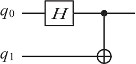

分析该电路中量子态的演化：

1. 最初，两个量子比特制备在状态 `∣00〉`，表示为：

(2.17)

$$\\left. \\mid 00 \\right\\rangle = \\begin{bmatrix} 1 \\\\ 0 \\\\ 0 \\\\ 0 \\\\ \\end{bmatrix}$$

2. 对第一个量子比特应用 `Hadamard` 门（`H` 门）。这将状态变换如下：

(2.18)

$$\\frac{1}{\\sqrt{2}}\\left( \\mid 0 \\right\\rangle\\left. \\mspace{6mu} + \\mspace{6mu} \\mid 1 \\right\\rangle)\\left. \\mspace{6mu} \\otimes \\mid 0 \\right\\rangle = \\frac{1}{\\sqrt{2}}\\left( \\mid 00 \\right\\rangle\\left. \\mspace{6mu} + \\mspace{6mu} \\mid 10 \\right\\rangle).$$

3. 应用受控非门（`CNOT` 门），以第一个量子比特为控制，第二个量子比特为目标。该门在控制量子比特（第一个量子比特）处于状态 `∣ 1〉` 时翻转目标量子比特（第二个量子比特）的状态。所得状态为：

(2.19)

$$\\frac{1}{\\sqrt{2}}\\left( \\mid 00 \\right\\rangle\\left. \\mspace{6mu} + \\mspace{6mu} \\mid 11 \\right\\rangle).$$

应用 `Hadamard` 门和 `CNOT` 门后的量子态表示纠缠态，其中两个量子比特相关且无法独立描述 [12]。

这个简单示例展示了量子门在操纵量子态和在量子比特之间创建纠缠方面的应用。由各种门组成的量子电路能够执行量子算法和计算。

## 2.4.2 量子应用

量子计算有潜力通过解决经典计算机在计算上不可行的难题来彻底改变各个领域。本节我们探讨一些值得注意的量子应用及其基本原理。

### 2.4.2.1 量子模拟

量子模拟旨在利用量子计算机模拟和研究经典方法难以分析的量子系统。通过利用叠加和纠缠等固有量子特性，量子模拟可以提供对复杂分子、材料和物理现象行为的见解。例如，模拟分子的电子结构在药物发现和材料科学中起着至关重要的作用。量子模拟方法允许对分子系统进行更准确和高效的表示，使研究人员能够探索潜在的药物候选物并优化材料性能 [13, 14]。

### 2.4.2.2 优化

优化问题在各个领域普遍存在，从物流和金融到供应链管理和机器学习。量子计算机有潜力通过利用量子近似优化算法（`QAOA`）和量子退火算法（`QAA`）等量子算法，在解决优化问题时超越经典算法。量子优化算法利用量子效应高效地在大搜索空间中搜索最优解。它们利用量子力学中的概念，如量子叠加和量子干涉，同时探索多个潜在解，并比经典方法更有效地收敛到最优解 [15]。

### 2.4.2.3 密码学


密码学对于确保安全通信和数据保护至关重要。经典密码系统，例如广泛使用的 RSA 加密，依赖于大数分解的困难性和某些数学问题的硬度来保证其安全性。然而，Shor 算法对这些经典密码系统构成了重大威胁。量子计算通过利用量子算法提供的加速，有可能破解经典密码系统。抗量子密码学，也称为后量子密码学，旨在开发能够抵抗量子计算机攻击的加密方案和密码协议。探索和开发后量子密码算法对于确保后量子时代的安全通信至关重要 \[16\]。

这些只是量子计算潜在应用的几个例子。随着该领域的不断发展，我们可以期待量子计算机影响各个领域，革新计算能力并为科学探索和技术进步解锁新的可能性。

#### 2.4.2.4 机器学习
机器学习是一个快速发展的领域，依赖于计算能力来训练复杂模型并进行预测。量子计算有可能增强机器学习算法并实现对大型数据集的更高效处理。量子机器学习算法，例如量子支持向量机和量子神经网络，利用量子计算机的强大功能来处理和分析量子态中的数据。这些算法有可能为某些机器学习任务提供指数级加速，例如模式识别和模型参数优化。量子机器学习还探索在经典计算机上使用受量子启发的算法。这些算法受量子力学原理启发，旨在利用某些类量子效应来提高经典机器学习算法的性能 \[17\]。

#### 2.4.2.5 化学与材料科学
量子计算在化学和材料科学领域提供了有前景的机会，在这些领域，理解分子和材料在量子层面的行为至关重要。量子计算机可以高效地模拟分子的电子结构，从而实现对化学反应和性质的准确预测。量子系统的模拟可以实现具有定制属性的新材料发现，用于各种应用，例如能量存储、催化剂和药物开发。量子算法，例如变分量子本征求解器（VQE）和量子相位估计（QPE）算法，为比经典方法更高效地解决复杂的量子化学问题提供了途径 \[18\]。

#### 2.4.2.6 金融建模与投资组合优化
金融建模和投资组合优化是金融和投资管理中的基本任务。量子计算可以在分析投资组合、风险管理和期权定价的优化方面提供优势。量子算法，例如量子振幅估计（QAE）算法和量子蒙特卡洛方法，可以提高金融模拟和优化过程的准确性和速度。这些算法利用量子计算的强大功能高效地探索大量可能的投资情景，从而实现更明智的决策和投资组合管理 \[19\]。

#### 2.4.2.7 运输与物流
运输和物流涉及复杂的优化问题，例如路线规划、调度以及资源分配。量子计算可以通过实现更快、更高效的搜索算法来为这些问题提供解决方案。量子算法，例如量子近似优化（QAOA）算法和量子旅行商问题（QTSP）算法，有望在比经典方法更短的时间内找到最优或接近最优的解决方案。这可以带来运输和物流运营中改进的路线规划、成本降低以及更高效的资源分配。这些只是量子计算在各个领域潜在应用的几个例子。随着量子计算领域的不断发展，我们可以期待看到更多创新应用的出现，改变行业并推动新的发现和突破 \[15\]。

## 2.5 量子协议与量子算法
量子计算通过提供前所未有的计算能力和比经典计算机更高效地解决复杂问题的能力，彻底改变了信息处理领域。在本节中，我们探讨各种量子协议和算法，它们利用量子系统的独特属性来实现卓越的计算成就。

### 2.5.1 量子协议
量子协议是一系列技术和方法，利用量子系统的独特属性在通信、密码学和模拟等各个领域实现卓越成就。这些协议利用叠加、纠缠和干涉等现象，实现超越经典系统局限性的进步。在本节中，我们将研究一些重要的量子协议及其应用。

#### 2.5.1.1 量子通信协议
量子通信协议利用量子系统的强大功能促进安全高效的信息交换。它们采用量子力学原理来实现安全密钥分发并建立可靠的通信通道：
1. 量子密钥分发（QKD）
量子密钥分发（QKD）协议通过利用量子力学的根本原理在安全通信中发挥关键作用。在典型的 QKD 场景中，Alice 和 Bob 希望建立一个共享的秘密密钥，同时警惕任何潜在的窃听者 Rudy。QKD 协议的安全性基于量子力学的规律，确保 Rudy 拦截量子信号的任何尝试都会被检测到。
BB84 协议由 Bennett 和 Brassard 于 1984 年提出，是一个被广泛研究的 QKD 协议。它涉及以两种互补基编码的量子比特的传输，通常表示为计算基（∣ 0〉 和 ∣ 1〉）和哈达玛基（∣ + 〉 和 ∣ − 〉）。Alice 随机选择其中一个基并据此编码她的比特值。Bob 也随机选择一个测量基。传输后，Alice 和 Bob 公开宣布他们选择的基并丢弃在不同基上进行的测量。通过经典通信，他们比较剩余测量的一个子集以检测任何差异，这表明窃听尝试。然后将剩余的相关测量用于生成安全的共享密钥 \[1\]。
2. 量子安全直接通信（QSDC）
量子安全直接通信（QSDC）协议允许在无需建立共享密钥的情况下在各方之间进行安全通信。在典型的 QSDC 场景中，Alice 希望直接向 Bob 发送秘密消息，而 Rudy 无法获得有关该消息的任何信息。量子纠缠在 QSDC 协议中发挥着关键作用。


### 2.5.1.1 Ping-Pong 协议
Ping-Pong 协议由 Deng 和 Long 于 2003 年提出，是 QSDC 协议的一个例子。它利用 Alice 和 Bob 共享的纠缠态，例如 Bell 态 $\\left( \\mid \\Phi^{+} \\right\\rangle = \\frac{1}{\\sqrt{2}}\\left( \\mid 00 \\right\\rangle\\left. \\mspace{6mu} + \\mspace{6mu} \\mid 11 \\right\\rangle)).$ Alice 将她的秘密信息编码到纠缠态的粒子上并发送给 Bob。Bob 执行特定的一组操作来检索信息，而缺乏纠缠态的 Rudy 无法获得任何信息。Bob 成功检索到信息确保了 Alice 和 Bob 之间的安全通信 [20]。

### 2.5.1.2 量子密码学协议
量子密码学协议旨在通过结合量子原理来增强经典密码方案的安全性。这些协议通过利用量子力学的规律提供不可破解的加密和安全通信通道。
1. 量子硬币翻转
量子硬币翻转协议使两个参与方 Alice 和 Bob 即使在存在不可信第三方 Rudy 的情况下也能建立硬币翻转的公平结果。目标是确保 Alice 和 Bob 都无法操纵结果，且结果无偏。
该协议由 Blum 于 1981 年提出，利用量子系统的特性实现公平硬币翻转。它涉及 Alice 和 Bob 共享纠缠粒子，每一方随机选择测量基。在执行测量后，Alice 和 Bob 公布其测量结果，并进行公平性测试以确定硬币翻转是否确实公平。如果公平性测试通过，则硬币翻转的结果将被揭示 [21]。

### 2.5.1.3 量子模拟协议
量子模拟协议利用量子计算机模拟使用经典计算方法难以研究的复杂量子系统。这些协议提供了对量子物质、量子化学和凝聚态物理行为的见解，为各个科学学科的进步铺平道路。量子模拟协议涉及针对研究系统的精心设计的量子电路和量子算法。通过将目标系统的属性编码到量子态中并利用量子操作，科学家可以模拟复杂量子系统的动力学和属性。示例包括模拟相互作用粒子的行为、探索分子的电子结构以及研究量子相变 [22]。

## 2.5.2 量子算法
量子算法构成了量子计算的核心，利用量子系统的力量以显著的效率解决计算问题。这些算法利用量子位（qubits）的独特属性，如叠加和纠缠，来并行执行计算并同时探索多种可能性。在本节中，我们探讨了几个著名的量子算法及其在不同领域的应用。

### 2.5.2.1 Deutsch-Jozsa 算法
Deutsch-Jozsa 算法由 David Deutsch 和 Richard Jozsa 于 1992 年提出，是展示量子计算威力的量子算法的开创性示例。它旨在解决一种特定类型的问题，即 Deutsch-Jozsa 问题，该问题涉及确定给定函数是常数还是平衡 [23]。

### 2.5.2.2 问题
考虑一个函数 `f`: {0, 1}^(`n`) → {0, 1}，它接受一个 `n`-bit 字符串作为输入，并对所有可能的输入产生恒定输出（0 或 1）或平衡的输出分布，即一半的输入产生 0，另一半产生 1。Deutsch-Jozsa 算法的目标是以对函数的单次查询来确定函数的性质（常数或平衡）。

### 2.5.2.3 经典方法
在经典情形下，解决 Deutsch-Jozsa 问题涉及对不同输入值评估函数 `f` 以确定其是常数还是平衡。经典解需要多次函数评估才能获得较高的正确概率 [23]。
让我们考虑示例函数 `f`：
(2.20)
`f(00) = 0`,
(2.21)
`f(01) = 1`,
(2.22)
`f(10) = 0`,
(2.23)
`f(11) = 1`.
要经典地确定函数是常数还是平衡，可以对不同输入值评估函数。函数的一般形式如下：
(2.24)
`f(00) = 0`,
(2.25)
`f(01) = 1`,
(2.26)
`f(10) = 0`,
(2.27)
`f(11) = 1`.
从这些评估中，我们可以观察到函数产生 0 和 1 两种输出，表明它是平衡的。然而，一般来说，我们需要对 2^(`n`-1) + 1 个输入值评估函数才能确定其是常数还是平衡。
解决 Deutsch-Jozsa 问题的经典方法涉及对不同输入值顺序评估函数，因为经典位只能存在于状态 0 或 1 中。这种顺序评估限制了经典解的效率。

### 2.5.2.4 量子方法
Deutsch-Jozsa 算法利用量子计算中的叠加和干涉原理，以对函数的单次查询解决该问题 [23]。

### 2.5.2.5 量子电路
该算法采用由以下步骤组成的量子电路：
1. 第 1 步：初始化
创建一个 `n`-qubit 量子寄存器处于状态 ∣0^(`n`)〉，其中 ∣0^(`n`)〉 表示全零态。
2. 第 2 步：叠加
对所有量子位应用 Hadamard 门 (`H`) 以创建所有可能输入态的相等叠加：
(2.28)
$$\\left. \\mid \\psi_{1} \\right\\rangle\\left. = \\frac{1}{\\sqrt{2^{n}}}\\sum\\limits_{x} \\mid x \\right\\rangle,$$
其中 ∣`x`〉 表示一个 `n`-bit 二进制字符串。
3. 第 3 步：函数评估
对量子寄存器应用 oracle 变换 `U[f]`，它将函数 `f` 编码为酉算子。该 oracle 对输入和输出量子位的作用如下：
(2.29)
`U[f]|x, y> = |x, y ⊕ f(x)>`,
其中 ⊕ 表示模 2 按位加法，且 `y` 是初始处于状态 ∣ 1〉 的辅助量子位。
4. 第 4 步：干涉
再次对输入量子位应用 Hadamard 门：
(2.30)
$$\\left. \\mid \\psi_{2} \\right\\rangle\\left. = \\frac{1}{\\sqrt{2^{n}}}\\sum\\limits_{x}\\left( - 1 \\right)^{f(x)} \\mid x \\right\\rangle.$$
5. 第 5 步：测量
测量输入量子位。如果测量结果为全零态，则函数为常数。否则，它是平衡的。

### 2.5.2.6 算法执行
为了理解 Deutsch-Jozsa 算法的工作原理，让我们考虑一个简单的例子。假设我们有一个 2-bit 函数 `f`，定义如下：
(2.31)
`f(00) = 0`,
(2.32)
`f(01) = 1`,
(2.33)
`f(10) = 0`,
(2.34)
`f(11) = 1`.

### 2.5.2.7 初始化
我们首先准备一个处于状态 ∣00〉 的量子寄存器。

### 2.5.2.8 叠加
对输入量子位应用 Hadamard 门，以创建叠加：
(2.35)
$$\\left. \\mid \\psi_{1} \\right\\rangle = \\frac{1}{2}\\left( \\mid 00 \\right\\rangle\\left. \\mspace{6mu} + \\mspace{6mu} \\mid 01 \\right\\rangle\\left. \\mspace{6mu} + \\mspace{6mu} \\mid 10 \\right\\rangle\\left. \\mspace{6mu} + \\mspace{6mu} \\mid 11 \\right\\rangle)$$

### 2.5.2.9 函数评估
接下来，我们将函数 `f` 编码到量子电路中。oracle 变换 `U[f]` 作用如下：
(2.36)
`U[f]|x, y> = |x, y ⊕ f(x)>`.
在我们的示例中，oracle 将状态变换为：


(2.37)

$$\\begin{array}{l} {\\left. U\_{f} \\mid \\psi\_{1} \\right\\rangle = \\frac{1}{2}\\left( \\mid \\mspace{2mu} 00 \\oplus 0 \\right\\rangle\\left. \\mspace{6mu} + \\mspace{6mu} \\mid \\mspace{2mu} 01 \\oplus 1 \\right\\rangle\\left. + \\mid \\mspace{2mu} 10 \\oplus 0 \\right\\rangle\\left. + \\mid \\mspace{2mu} 11 \\oplus 1 \\right\\rangle)} \\\\ {\\mspace{54mu} = \\frac{1}{2}\\left( \\mid \\mspace{2mu} 00 \\right\\rangle\\left. \\mspace{6mu} + \\mspace{6mu}\\ \\mid \\mspace{2mu} 01 \\right\\rangle\\left. \\mspace{6mu} + \\mspace{6mu}\\ \\mid \\mspace{2mu} 10 \\right\\rangle\\left. \\mspace{6mu} - \\mspace{6mu}\\ \\mid \\mspace{2mu} 11 \\right\\rangle)} \\\\ \\end{array}$$

### 2.5.2.10 干涉

再次对输入量子比特应用哈达玛门，我们得到：

(2.38)

$$\\begin{array}{l} {\\left. \\mid \\psi\_{2} \\right\\rangle = \\frac{1}{2}\\left( \\left( \\mid 00 \\right\\rangle\\mspace{6mu} + \\mspace{6mu} \\mid 01 \\right\\rangle\\left. \\mspace{6mu} + \\mspace{6mu} \\mid 10 \\right\\rangle\\left. \\mspace{6mu} - \\mspace{6mu} \\mid 11 \\right\\rangle) + \\left( \\mid 00 \\right\\rangle\\left. \\mspace{6mu} - \\mspace{6mu} \\mid 01 \\right\\rangle\\left. \\mspace{6mu} + \\mspace{6mu} \\mid 10 \\right\\rangle\\left. \\mspace{6mu} + \\mspace{6mu} \\mid 11 \\right\\rangle)} \\\\ {\\mspace{42mu} + \\mspace{6mu}\\left( \\mid 00 \\right\\rangle\\left. \\mspace{6mu} + \\mspace{6mu} \\mid 01 \\right\\rangle\\left. \\mspace{6mu} - \\mspace{6mu} \\mid 10 \\right\\rangle\\left. \\mspace{6mu} - \\mspace{6mu} \\mid 11 \\right\\rangle) - \\left( \\mid 00 \\right\\rangle\\left. \\mspace{6mu} - \\mspace{6mu} \\mid 01 \\right\\rangle\\left. \\mspace{6mu} - \\mspace{6mu} \\mid 10 \\right\\rangle\\left. \\mspace{6mu} + \\mspace{6mu} \\mid 11 \\right\\rangle)).} \\\\ \\end{array}$$

简化此表达式，我们得到：

(2.39)

$$\\left. \\mid \\psi\_{2} \\right\\rangle = \\frac{1}{2}\\left( 2 \\mid \\mspace{2mu} 00 \\right\\rangle\\left. \\mspace{6mu} - 2 \\mid \\mspace{2mu} 11 \\right\\rangle)\\left. \\mspace{6mu} = \\mspace{6mu}\\ \\mid 00 \\right\\rangle\\left. - \\mspace{6mu} \\mid 11 \\right\\rangle\\ $$

使用电路图对 Deutsch-Jozsa 算法的可视化显示在 图 2.1，该图描绘了算法中涉及的量子电路。

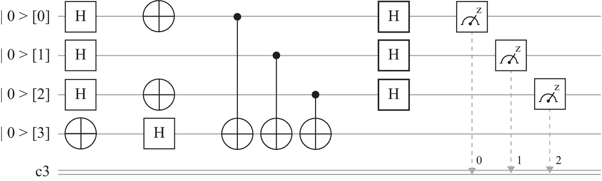

图 2.1 Deutsch-Jozsa 算法的电路可视化。

### 2.5.2.11 测量

最后，我们测量输入量子比特。如果我们得到状态 ∣00〉（全零），则函数是常数。相反，如果我们得到状态 ∣11〉（全一），则函数是平衡的。

### 2.5.2.12 算法分析

Deutsch-Jozsa 算法与经典方法相比提供了显著的加速。经典情况下，确定函数的性质对于平衡函数平均需要 2^((`n`−1)) + 1 次求值。相比之下，Deutsch-Jozsa 算法只需一次查询即可解决该问题。这种指数级改进源于量子叠加中的干涉。如果函数是常数，则振幅的干涉确保了破坏性干涉，导致测量结果为 ∣00〉。相反，如果函数是平衡的，则振幅发生建设性干涉，导致测量结果为 ∣11〉 [23]。

### 2.5.2.13 实现考虑

实现 Deutsch-Jozsa 算法需要仔细构建预言机变换 `U[f]`，它将函数编码到量子电路中。`U[f]` 的设计取决于要评估的具体函数。在实践中，这可以通过各种量子门操作实现。Deutsch-Jozsa 算法展示了量子计算在解决特定类型问题时比经典方法快指数级的威力。虽然该算法可能没有直接的实际应用，但它作为理解量子计算潜力的基础算法。利用叠加和干涉原理，Deutsch-Jozsa 算法体现了量子计算的能力，并为具有实际意义的更先进的量子算法铺平了道路 [23]。

### 2.5.2.14 Bernstein-Vazirani 算法

Bernstein-Vazirani 算法是一种量子算法，可高效解决经典的隐藏字符串问题。该算法由 Ethan Bernstein 和 Umesh Vazirani 于 1993 年提出，展示了量子计算在解决某些类型问题时相比经典算法具有显著加速的能力。本节我们深入探讨 Bernstein-Vazirani 算法的原理，并提供全面的解释以及必要的数学细节 [24]。

### 2.5.2.15 问题

隐藏字符串问题涉及通过查询提供对隐藏字符串位访问的预言机来确定未知位串。目标是通过尽可能少的查询找到隐藏字符串。数学上，给定隐藏字符串 `s` ∈ {0, 1}^(`n`) 和预言机函数 `f[s]`: {0, 1}^(`n`) → {0, 1}，任务是使用最少的对预言机 `f[s]` 的查询次数找到 `s` [24]。

### 2.5.2.16 预言机函数

在 Bernstein-Vazirani 算法的上下文中，预言机函数 `f[s]`: {0, 1}^(`n`) → {0, 1} 是一个关键组件。它代表算法旨在解决的未知函数或问题。预言机函数以 `n` 位字符串作为输入并返回单个位，从而提供对隐藏字符串 `s` 的访问。

预言机函数 `f[s]` 定义如下：

(2.40)

`fs` = `s` ⋅ `x` (mod 2)

其中 `x` 是一个 `n` 位字符串，`s` 是我们旨在确定的隐藏字符串，· 表示按位点积，而 (mod 2) 确保输出为单个位。

预言机函数计算隐藏字符串 `s` 与输入字符串 `x` 的按位点积。点积是通过对 `s` 和 `x` 的对应位执行按位 AND 操作，然后对结果求和来计算的。通过使用精心选择的输入字符串查询预言机，算法可以高效地提取整个隐藏字符串 `s`。最后，结果取模 2 以获得单个位。

Bernstein-Vazirani 算法的威力在于它能够在对预言机进行一次查询的情况下确定隐藏字符串 `s`，无论 `n` 的大小如何。这是通过利用量子叠加和干涉的特性实现的，使算法能够同时获得有关 `s` 的所有位的信息。

通过使用精心选择的输入字符串集查询预言机函数，Bernstein-Vazirani 算法可以以显著的效率揭示隐藏字符串 `s`，展示了量子计算在解决某些类型问题时相比经典方法具有显著加速的能力。

### 2.5.2.17 经典方法

在经典情况下，确定隐藏字符串通常需要对每个位单独查询预言机，导致 `n` 次查询。由于需要单独访问每个位，经典方法无法用更少的查询解决此问题 [24]。因此，经典算法需要线性数量的查询，对于大规模问题实例来说耗时较长 [24]。

### 2.5.2.18 量子方法

Bernstein-Vazirani 算法利用量子计算以一次查询解决隐藏字符串问题，与经典算法相比提供了指数级加速。该算法包括以下步骤：

1. 步骤 1：初始化


准备一个 `n` 个量子比特的量子寄存器处于状态 ∣0^(`n`)〉，以及一个处于状态 ∣ 1〉 的额外量子比特。

### 第 2 步：叠加
对量子寄存器中的每个量子比特应用哈达玛门 (`H`)，创建所有可能输入状态的叠加：
(2.41)
$$\\left. \\mid \\psi\_{1} \\right\\rangle\\left. = \\frac{1}{\\sqrt{2^{n}}}\\sum\\limits\_{x} \\mid x \\right\\rangle,$$
其中 `x` 表示长度为 `n` 的二进制字符串。

### 第 3 步：Oracle 查询
通过在寄存器中的每个量子比特与额外量子比特之间执行受控-NOT (`CNOT`) 操作来将 oracle 函数 `f[s]` 应用于量子寄存器，其中隐藏字符串 `s` 作为控制位。此步骤将隐藏字符串信息编码到量子寄存器中。

### 第 4 步：测量
对量子寄存器中每个量子比特（排除额外量子比特）应用哈达玛门 (`H`)。然后，对寄存器中的每个量子比特进行测量。

### 第 5 步：提取
测量结果给出隐藏字符串 `s`，它由量子寄存器中量子比特的观测值决定。

### 2.5.2.19 算法执行
为了更好地理解 Bernstein-Vazirani 算法的原理，让我们考虑一个使用 4 个量子比特的量子寄存器寻找隐藏字符串 `s` = “1101” 的示例。

### 2.5.2.20 初始化
我们将一个 4 个量子比特的量子寄存器初始化为状态 ∣ 0000〉，并将额外量子比特初始化为状态 ∣ 1〉。

### 2.5.2.21 叠加
对量子寄存器中的每个量子比特应用哈达玛门，我们创建所有可能输入状态的叠加：
(2.42)
$$\\left. \\mid \\psi\_{1} \\right\\rangle = \\frac{1}{2^{2}}\\left( \\mid 0000 \\right\\rangle\\left. + \\mspace{6mu} \\mid 0001 \\right\\rangle\\left. \\mspace{6mu} + \\mspace{6mu} \\mid 0010 \\right\\rangle\\left. \\mspace{6mu} + \\mspace{6mu}\\cdots\\mspace{6mu} + \\mspace{6mu} \\mid 1111 \\right\\rangle).$$

### 2.5.2.22 Oracle 查询
我们通过执行受控-NOT (`CNOT`) 操作将 oracle 函数 `f[s]` 应用于量子寄存器。在此情况下，oracle 将隐藏字符串 `s` = “1101” 编码到量子寄存器中。

### 2.5.2.23 测量
对量子寄存器中每个量子比特（排除额外量子比特）应用哈达玛门，我们得到最终状态：
(2.43)
$$\\left. \\mid \\psi\_{2} \\right\\rangle = \\frac{1}{2^{2}}\\left( \\mid 0 \\oplus s\_{0} \\right\\rangle\\left. + \\mid 0 \\oplus s\_{1} \\right\\rangle\\left. \\mspace{6mu} + \\mid 0 \\oplus s\_{2} \\right\\rangle\\left. + \\mid 0 \\oplus s\_{3} \\right\\rangle)$$
其中 ⊕ 表示模 2 的按位加法。
$$\\text{Measuring\\ each\\ qubit\\ in\\ the\\ quantum\\ register\\ yields\\ the\\ hidden\\ string}\\; s = {}^{\`\`}1101^{"}.$$
Bernstein-Vazirani 算法的可视化使用电路图说明 Bernstein-Vazirani 算法的实现，显示在 图 2.2 中，表示求解隐藏字符串问题的量子电路。
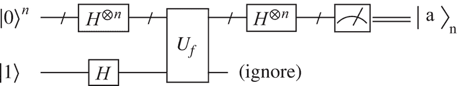
图 2.2 Bernstein-Vazirani 算法的电路图。

### 2.5.2.24 数学表示
为了在数学上表示 Bernstein-Vazirani 算法的步骤，我们可以将量子寄存器的初始状态表示为 ∣`ψ[0]`〉 = ∣0^(`n`)1〉，其中 ∣0^(`n`)〉 表示所有量子比特都初始化为 ∣ 0〉 的 `n` 量子比特状态，而 ∣ 1〉 表示处于状态 ∣ 1〉 的额外量子比特 [24]。应用哈达玛门后的叠加态表示为：
(2.44)
$$\\left. \\mid \\psi\_{1} \\right\\rangle\\left. = \\frac{1}{2^{n/2}}\\sum\\limits\_{x} \\mid x \\right\\rangle$$
其中 ∑[`x`] 表示对长度为 `n` 的所有二进制字符串 `x` 的求和。Oracle 查询可以表示为：
(2.45)
$$\\left. \\mid \\psi\_{2} \\right\\rangle\\left. = \\frac{1}{2^{n/2}}\\sum\\limits\_{x}\\left( - 1 \\right)^{(s \\cdot x)} \\mid x \\right\\rangle$$
其中 表示 `s` 和 `x` 之间模 2 的按位点积。

### 2.5.2.25 示例应用
为了说明 Bernstein-Vazirani 算法的概念，让我们考虑一个涉及三个人：Alice、Bob 和 Rudy 的场景。
Alice 拥有一个隐藏字符串 `s` = “1010”。Bob 和 Rudy 想通过查询 Alice 来确定隐藏字符串，但他们只能通过量子信道通信。
使用 Bernstein-Vazirani 算法，Bob 只需查询一次 Alice 的量子 oracle 即可获得隐藏字符串。该算法将隐藏字符串信息编码到量子寄存器中，Bob 可以通过对量子比特进行测量来提取隐藏字符串。
通过遵循算法的步骤，Bob 成功确定了隐藏字符串 `s` = “1010”，而无需多次查询 Alice 的 oracle。

### 2.5.2.26 总结
Bernstein-Vazirani 算法展示了量子计算在单次查询中解决隐藏字符串问题的能力，与经典算法相比提供了指数级加速。通过利用量子叠加和干涉，该算法有效地从量子寄存器中提取隐藏字符串信息。该算法的数学框架和步骤说明了量子计算的基本原理及其解决复杂问题的潜力。

## 2.5.3 Grover 算法
Grover 算法由 Lov Grover 于 1996 年提出，是一种开创性的量子算法，可为无序数据库搜索提供二次加速。通过利用量子叠加和干涉的原理，Grover 算法为搜索问题提供了高效的解决方案。与需要逐一检查每个项目的经典搜索算法不同，Grover 算法可以快速定位目标项目，其复杂度为 $O\\left( \\sqrt{N} \\right),$ 其中 `N` 是数据库的大小。该算法在数据库搜索、优化和密码学等各个领域具有深远的影响，展示了量子计算的卓越能力 [25]。

## 2.5.4 问题
在信息检索领域，高效的搜索算法在大型无序数据库中定位特定项目方面发挥着至关重要的作用。经典搜索方法，如线性搜索或二分搜索，需要顺序检查每个项目，导致大小为 `N` 的数据库的时间复杂度为 `O(N)`。然而，随着数据库规模呈指数级增长，这些传统方法变得越来越低效和耗时。
为克服这一挑战，迫切需要一种突破性算法来在搜索过程中提供显著加速。Grover 算法是一种卓越的量子算法，为此问题提供了一个引人注目的解决方案。通过利用量子力学的原理，Grover 算法展示了通过提供比经典算法二次加速来革新信息检索的潜力。当前的问题是设计和实现 Grover 算法，以高效地搜索无序数据库并以最佳时间复杂度识别目标项目。这需要开发一个量子电路，利用量子叠加和干涉来放大找到目标项目的概率。通过探索 Grover 算法的数学基础、量子电路设计和潜在应用，我们旨在释放量子计算在信息检索中的变革力量 [25]。


Grover 算法的成功实现将在数据库管理、优化问题和密码密钥搜索等多样化领域产生深远影响。通过解决经典搜索算法的局限性并利用量子力学的力量，Grover 算法为提高搜索效率和加速信息检索过程提供了有前景的途径。

### 2.5.5 经典方法
传统上，在未排序数据库中搜索特定项目依赖于依次检查每个元素的经典算法。最基本的方法是线性搜索，它从第一个项目开始，依次遍历数据库，直到找到匹配项或到达末尾。该方法的时间复杂度为 `O(N)`，其中 `N` 表示数据库的大小。为了提高效率，当数据库已排序时可采用二分搜索。二分搜索将数据库分为两半，并将目标项目与中间元素进行比较，每次迭代消除一半的剩余搜索空间。该方法达到时间复杂度 `O(log N)`，对于大型数据库而言，这比线性搜索快得多。

然而，线性搜索和二分搜索算法在面对未排序数据库时都表现出局限性。线性搜索需要检查每个项目，导致最坏情况下必须搜索整个数据库。另一方面，二分搜索依赖于数据库已排序，这可能并不总是成立。随着数据库规模持续指数级增长，这些经典搜索方法变得越来越低效和耗时。因此，迫切需要一种替代方法，能够提供显著的加速并克服经典算法在未排序数据库中的局限性 [25]。

### 2.5.6 量子方法
Grover 算法为搜索未排序数据库问题提供了一种革命性的量子方法。通过利用量子叠加和干涉的力量，该算法能够以相对于经典算法的二次加速高效地定位目标项目。Grover 算法的核心思想是利用量子并行性同时探索多个数据库条目，从而实现更高效的搜索过程。Grover 算法的核心在于量子振幅放大的原理。它利用量子系统能够同时处于多个状态叠加的能力。通过应用一系列量子操作，包括量子预言机和量子扩散算子，Grover 算法放大目标项目的振幅并抑制非目标项目的振幅。

实现 Grover 算法将数据库中的项目编码为量子态。这种编码通常通过一种称为振幅编码的过程实现，该过程将每个项目映射到具有特定振幅的量子态。目标项目被赋予更高的振幅，而非目标项目具有较低的振幅。该编码方案对 Grover 算法的成功至关重要。量子预言机被构造为标记目标项目。预言机对目标项目的振幅执行相位反转操作，有效地翻转其符号。这种变换增强了目标项目的振幅，使其与数据库中的其他项目区分开来。在标记目标项目后，采用量子扩散算子将振幅扩散到所有数据库条目。该算子用于增加非目标项目的振幅并降低目标项目的振幅。通过迭代应用量子预言机和量子扩散算子，Grover 算法收敛于目标项目 [25]。

### 2.5.7 算法执行
Grover 算法的执行涉及一系列步骤，利用量子并行性和干涉高效地在未排序数据库中搜索目标项目。让我们详细探讨每个步骤。

### 2.5.8 初始化
将 `n` 个量子比特的量子寄存器初始化为状态 `|ψ⟩` = `|0⟩`^(⊗`n`)，其中 `|0⟩` 表示基态，表示大小为 `N` = 2^(`n`) 的搜索空间。

### 2.5.9 叠加
对量子寄存器中的每个量子比特应用哈达玛门 (`H`) 以创建所有可能状态的叠加：

(2.46)

$$\left. \mid \psi_{1} \right\rangle\left. = \frac{1}{\sqrt{2^{n}}}\sum\limits_{x} \mid x \right\rangle.$$

### 2.5.10 预言机查询
预言机函数标记数据库中的目标项目。它充当黑箱，反转目标项目的相位，同时保持其他项目不变。构造一个标记所需解的预言机函数。预言机将目标项目(s)的振幅变换为 −1，同时保持其他项目不变。预言机函数可以表示为 `U[f] |x⟩ = (-1)^(f(x)) |x⟩`，其中 `f(x)` = 1 如果 `x` 是目标项目且 `f(x)` = 0 否则。

### 2.5.11 振幅放大
应用振幅放大算子 (`A`) 以增强叠加中目标项目的振幅。放大过程涉及重复关于均值的反转 (`I`) 和预言机查询 (`U[f]`) 操作 `sqrt(N)` 次，其中 `N` 是数据库的大小。每次迭代包括两个步骤：关于均值的反射和预言机函数的应用。

### 2.5.12 关于均值的反射
执行关于均值态的反转操作，记为 `D = 2|s⟩⟨s| - I`，其中 `I` 是单位矩阵。该反射将振幅围绕均值翻转，有效地集中目标项目(s)的概率振幅。在数学上，反射操作可以表示为 `D = 2|s⟩⟨s| - I`。

### 2.5.13 预言机函数
应用预言机函数 `U[f]` 用相位反转标记目标项目(s)。该操作有效地在后续迭代中增强目标项目(s)的概率振幅。在数学上，预言机函数的应用可以表示为 `U[f] = I - 2|w⟩⟨w|`，其中 `|w⟩` 是解态。

### 2.5.14 测量
测量量子寄存器中的量子比特。由于放大过程，获得目标项目索引的概率显著增加。重复算法 `O(sqrt(N))` 次可提高以高概率获得正确结果的机会。使用电路图对 Grover 算法的可视化显示在 图 2.3 中，表示搜索未排序数据库的量子电路。

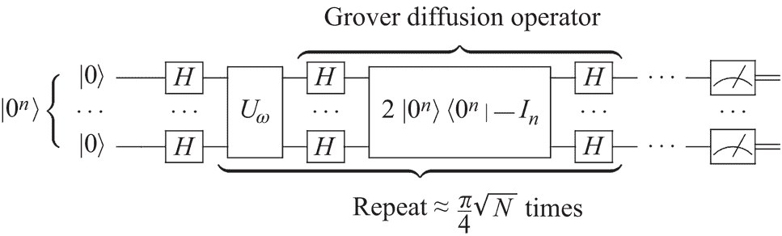

图 2.3 Grover 算法的电路图。

### 2.5.15 示例应用
为了说明 Grover 算法的工作原理，让我们考虑一个涉及三个人：Alice、Bob 和 Rudy 的场景。Alice 心中有一个秘密数字，Bob 的任务是通过提问 yes-or-no 问题来猜测该数字。另一方面，Rudy 将使用 Grover 算法协助 Bob 找到正确的数字。


在经典方法中，Bob 需要一个接一个地提问，直到偶然找到正确答案。例如，他可能会先问这个数是否小于五，Alice 会回答“否”。Bob 会继续提问，缩小可能性范围，直到最终得出正确的数字。现在，让我们引入 Grover 算法。Rudy 建立了一个量子系统来表示所有可能的数字，每个数字都编码为一个量子态。最初，所有这些态都处于叠加态，意味着它们同时存在。目标是放大代表 Alice 秘密数字的态的振幅，同时减小其他态的振幅。

Rudy 首先对量子系统应用一系列量子操作，包括关于均值的反射和一个 oracle 函数。关于均值的反射将振幅围绕平均值翻转，使目标态的概率振幅集中。oracle 函数通过相位反转标记 Alice 的秘密数字，增强其概率振幅。通过多次迭代应用反射和 oracle 函数，Rudy 提高了测量到 Alice 秘密数字的概率。最终，在足够多次迭代后，Rudy 对量子系统进行测量。当 Bob 收到测量结果时，他有很高的概率得到 Alice 的秘密数字，这要归功于 Grover 算法。这种量子方法与经典方法相比提供了显著的加速，因为到达正确答案所需的提问更少。

### 2.5.16 摘要

Grover 算法是一种强大的量子搜索算法，相较于经典搜索方法提供了二次加速。通过利用量子力学的原理，它为在未排序数据库中查找目标项提供了一种高效的解决方案。该算法通过采用量子叠加和干涉来实现这一点，从而显著降低了时间复杂度。

Grover 算法的时间复杂度约为 $O\left( \sqrt{N} \right),$ 其中 `N` 表示搜索空间的大小。与通常需要 `O(N)` 次操作的经典对应方法相比，这是一个实质性的改进。因此，Grover 算法提供了显著的加速，尤其是在大型数据库中。与经典搜索方法相比，Grover 算法的空间复杂度保持不变，需要 `O(n)` 个量子比特来表示大小为 `N` = `2^(n)` 的搜索空间。这种空间需求对于中小规模问题是可行的，但对于更大的搜索空间而言，由于量子硬件的物理限制，可能会变得具有挑战性。

Grover 算法的一个局限性是它并不能直接解决优化问题或具有复杂约束的问题。它主要设计用于未排序数据库中的搜索问题。此外，该算法依赖于准确的 oracle 函数来高效标记目标项，这在某些问题领域中可能带来挑战。

尽管存在局限性，Grover 算法在各个领域仍具有实际应用。例如，它可用于数据库中的数据搜索和模式匹配任务、密码学应用（如密钥搜索和暴力攻击），以及需要找到全局最小值或最大值的优化问题。

### 2.5.17 Shor 算法

Shor 算法由 Peter Shor 于 1994 年提出，是一种开创性的量子算法，能够高效地分解大合数，挑战了经典计算机的局限性。该算法对密码学具有重要意义，因为许多加密方案都依赖于分解大数的难度。Shor 算法展示了量子计算在解决复杂数学问题上超越经典计算机的潜力 \[26\]。

### 2.5.18 问题

Shor 算法解决的问题是大合数的分解，即找到相乘后得到给定数的素因子。分解对于经典计算机来说被认为是一个困难问题，因为最好的经典算法具有指数时间复杂度。这个问题支撑了许多密码系统的安全性，因为分解的难度被利用在密钥交换协议中。Shor 算法旨在利用量子计算高效分解大合数，从而威胁到经典密码系统的安全性 \[26\]。

### 2.5.19 经典方法

在分解的经典方法中，通常采用试除法、费马分解和 Pollard rho 算法等方法。这些经典算法适用于小数字，但在待分解数字的大小增长时效率会越来越低。它们具有指数时间复杂度，使得分解大数变得不切实际。

在这些经典算法中，通用数域筛法 (`GNFS`) 是分解大合数最有效的方法。`GNFS` 的亚指数时间复杂度为 $O\mspace{6mu}\ \left( \exp\mspace{6mu}\ \left( \left( \frac{64}{9} \right)^{1/3}\left( \ln N \right)^{1/3}\left( \ln\mspace{6mu} N \right)^{2/3} \right) \right),$ 其中 `N` 表示待分解的数字。这使得 `GNFS` 对于大数而言比其他经典算法显著更快。

`GNFS` 结合了多种数学技术，包括筛法、线性代数和试除法，以识别合数的素因子。它首先进行筛法步骤，其中检查一大范围的整数以识别可能与目标数字共享公因子的值。筛法过程依赖于找到光滑数，即具有小素因子的整数。这些光滑数随后在随后的线性代数步骤中用于求解线性方程组并找到行之间的线性依赖关系。线性代数步骤之后，`GNFS` 应用平方根技术来找到揭示素因子信息的同余关系。最后，对剩余因子进行试除以验证其素性并完成分解过程。虽然 `GNFS` 相较于更早的经典算法是一个显著改进，但对于大数而言它仍然计算成本高昂。亚指数时间复杂度意味着 `GNFS` 随输入规模增长的速度快于多项式但慢于指数。因此，随着待分解数字大小的增加，`GNFS` 会变得越来越不切实际。

相比之下，Shor 算法是一种用于分解大数的量子算法，与经典方法相比提供了显著的加速。Shor 算法可以在量子计算机上高效分解大数，利用量子力学的原理，如叠加和纠缠。分解大数的这种指数级加速是量子计算机对经典密码学构成重大威胁的原因之一 \[26\]。

### 2.5.20 量子方法


The quantum approach in Shor’s algorithm consists of several key steps. It begins with the initialization of quantum registers to store the input number and an auxiliary register. The input register is prepared in a superposition of all possible inputs, allowing for simultaneous exploration of solutions. Modular exponentiation is then performed using a unitary operator, followed by the application of the quantum Fourier transform (`QFT`) to the input register. Measurement is performed, and the measurement outcome is subjected to the continued fraction algorithm, revealing the factors of the input number. The significance of the quantum approach in Shor’s algorithm lies in its potential to break classical cryptographic systems that rely on the difficulty of factoring large numbers. If successfully implemented, it could compromise widely used encryption methods and have far-reaching implications for data security. However, there are significant challenges in practical implementation, including the requirement for error-corrected qubits and fault-tolerant quantum operations, as well as the scalability of the algorithm to factor significantly larger numbers.

This approach in Shor’s algorithm consists of several key components that work together to factor large numbers. The algorithm begins by initializing two quantum registers: the input register and an auxiliary register. The input register represents the number to be factored and is prepared in a superposition of all possible inputs, allowing for simultaneous exploration of multiple solutions \[26\].

The next step involves modular exponentiation, where a unitary operator performs exponentiation on the input register in a modular arithmetic framework. This step extracts periodicity information from the quantum state, crucial for finding the factors efficiently. Following modular exponentiation, the `QFT` is applied to the input register. The `QFT` is a quantum analog of the classical Fourier transform and enables the transformation of the quantum state into a representation that reveals the periodic structure of the input number. After the `QFT`, a measurement is performed on the quantum state, collapsing it into a classical state and providing a specific outcome. This outcome is essential for determining the factors of the input number. The final step involves subjecting the measurement outcome to the continued fraction algorithm. This algorithm analyzes the measurement result using mathematical techniques, such as continued fraction expansions, to efficiently extract the factors of the input number.

### 2.5.21 算法执行

#### 2.5.21.1 Initialization

To begin the algorithm, we prepare two quantum registers: the input register and the auxiliary register. The input register contains the number to be factored, denoted as `N`. The auxiliary register is initialized to the state ∣ 0〉. We can represent the initial state of the input register as ∣`ψ`〉 = ∣1〉.

#### 2.5.21.2 Superposition

In this step, we create a superposition of all possible inputs in the input register. We achieve this by applying a series of Hadamard gates to the input register. The Hadamard gate, denoted as `H`, transforms the basis states as follows: $\\left. H\\mspace{2mu} \\mid 0 \\right\\rangle = \\frac{1}{\\sqrt{2}}\\left( \\mid 0 \\right\\rangle\\left. + \\mid 1 \\right\\rangle)$ and $\\left. H\\mspace{2mu} \\mid 1 \\right\\rangle = \\frac{1}{\\sqrt{2}}\\left( \\mid 0 \\right\\rangle\\left. - \\mid 1 \\right\\rangle).$ Applying the Hadamard gate to the input register, we obtain the superposition state:

$$\\left. \\mid \\psi \\right\\rangle\\left. = \\frac{1}{\\sqrt{M}}\\sum\\limits\_{x = 0}^{M - 1} \\mid x \\right\\rangle,$$

where `x` ranges from 0 to `M` − 1 and `M` = 2^(`n`), with `n` being the number of qubits in the input register.

#### 2.5.21.3 Modular Exponentiation

Modular exponentiation is a crucial step in Shor’s algorithm that involves raising a base, denoted as “`a`,” to the power of an exponent, denoted as “`x`,” and then computing the result modulo `N`. The goal is to efficiently calculate the value of (`a`^(`x`)) mod `N`.

The modular exponentiation step is implemented using a unitary operator called `U`[*f*], which performs the mapping ∣`x`〉∣`y`〉 → ∣`x`〉∣`a`^(`y`) mod `N`〉. Here, ∣`x`〉 represents the state of the input register, ∣ `y`〉 represents the state of the auxiliary register, and “`a`[`y`] mod `N`” represents the modular exponentiation of “`a`” raised to the power of “`y`” modulo `N`.

To understand the implementation of modular exponentiation, we can consider a simple example. Let’s assume we want to calculate (3⁷) mod 10. Here, the base “`a`” is 3, the exponent “`x`” is 7, and `N` is 10.

#### 2.5.21.4 Applying the Unitary Operator `U`[*f*]

To perform modular exponentiation, we apply the unitary operator `U`[*f*] to the state ∣`x`〉 ∣ `y`〉. In this case, `Uf` maps ∣`x`〉 ∣ `y`〉 to ∣`x`〉 ∣ `a`^(`y`) mod `N`〉.

For our example, let’s consider the value of “a” as 3. Applying `U`[*f*], we get:

`U`[*f*]:  ∣`x`⟩ ∣`y`⟩→ ∣`x`⟩ ∣ (3^(`y`))  mod10⟩.

The auxiliary register gets updated based on the modular exponentiation of “`a`” raised to the power of “`y`” modulo `N`.

Visualization of the Shor’s algorithm using a circuit diagram is shown in Figure 2.4, representing the quantum circuit for factoring large composite numbers.

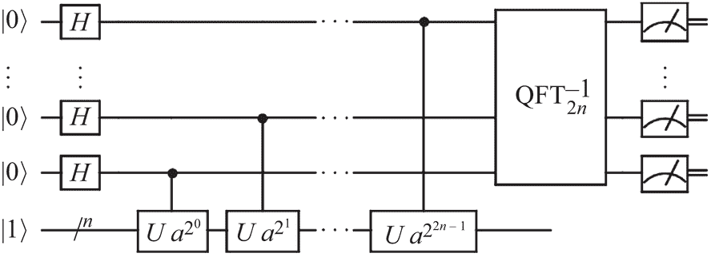

Figure 2.4 Circuit diagram of Shor’s algorithm.

#### 2.5.21.5 Quantum Fourier Transform (`QFT`)

The quantum Fourier transform (`QFT`) is a fundamental component of Shor’s algorithm. It is a quantum analogue of the classical discrete Fourier transform (`DFT`) and plays a crucial role in identifying the periodicity of the modular exponentiation function.

The `QFT` operates on an input register of `n` qubits, where the qubits are in a superposition state ∣`x`〉. The goal of the `QFT` is to transform the input register from the computational basis to the Fourier basis, allowing for efficient analysis of the periodicity introduced by the modular exponentiation step \[27\].

The `QFT` can be defined mathematically as follows:

(2.47)

$$\\left. \\left. {QFT}:\\mspace{6mu}\\ \\mid x \\right\\rangle\\rightarrow\\frac{1}{\\sqrt{2^{n}}}\\sum\\limits\_{y = 0}^{2^{n} - 1}\\exp\\left( \\frac{2\\textit{πixy}}{2^{n}} \\right)\\left. \\mspace{12mu} \\mid y \\right\\rangle. \\right.$$

Let’s break down the mathematical expression and understand its significance:

∣`x`〉 represents the input state of the qubits in the computational basis. It is a superposition of all possible values of `x`, where `x` ranges from 0 to 2^(`n`) −1. ∣ `y`〉 represents the transformed state of the qubits in the Fourier basis. It is a superposition of all possible values of `y`, where `y` ranges from 0 to 2^(`n`) − 1. The term $\\frac{1}{\\sqrt{2^{n}}}$ normalizes the state to ensure that the total probability of all possible outcomes sums to 1.

The term $\\exp\\mspace{6mu}\\ \\left( \\frac{2\\textit{πixy}}{2^{n}} \\right)$ is the phase factor applied to each basis state. It introduces the phase shift necessary to perform the Fourier transformation. The summation symbol ∑[`y`] indicates that the transformation is applied to all possible values of `y`.

In practical terms, the `QFT` is implemented using a series of controlled rotations. Each qubit in the input register is subjected to a series of controlled rotations, where the angle of rotation depends on the position of the qubit and the desired output state. The `QFT` provides a powerful tool for identifying the periodicity introduced by the modular exponentiation step. By transforming the input register to the Fourier basis, the `QFT` allows for the extraction of information about the period of the function, which is crucial in determining the factors of the number being factored.


### 2.5.21.6 测量与连分数算法

在对模指数运算步骤的输出应用 QFT 后，我们得到叠加态。为了从该叠加态中提取有用信息，我们需要对量子态进行测量，得到经典结果。测量结果是一个特定值，用 `y` 表示，它代表在傅里叶基底中的测量结果。该测量是关键步骤，因为它为我们提供了确定数 `N` 的因子所需的信息。

接下来，我们采用连分数算法来分析测量结果。目标是获得有理逼近，以揭示测量值的周期，进而得到 `N` 的因子。连分数算法迭代构造一系列分数，每个分数代表原始测量结果 `y` 除以可能结果总数 `M` 的逼近。该序列以分数 $\\frac{y}{M}$ 开始 \[28\]。

### 2.5.21.7 示例应用

Alice 和 Bob 是好朋友，他们正在合作对一个大数 `N` 进行因式分解。以下是他们的合作方式：

1. Step 1: Preparation
Alice 选择她想要因式分解的数 `N`。在本例中，假设 `N` = 35。

2. Step 2: Quantum Circuit Preparation
Alice 和 Bob 共同设计 Shor 算法所需的量子电路。他们确定了针对所选 `N` 值所需的模指数运算步骤、量子傅里叶变换和测量操作。

3. Step 3: Modular Exponentiation
Alice 指示 Bob 执行模指数运算步骤。他们选择一个与 `N` 互质的随机底数 `a`。假设他们选择 `a` = 2。Bob 通过应用幺正算符 `Uf` 实现模指数运算电路，该算符将 ∣`x`〉 ∣ `y`〉 映射到 ∣`x`〉 ∣ (`a`^(`y`) mod `N`)〉。这涉及执行模乘法，将 `a` 提升到模 `N` 的各种幂次。

例如，如果 Bob 测量辅助寄存器并得到结果 ∣`y`〉 = 3，他计算 (`a`^(`y`) mod `N`) = (2³ mod 35) = 8 mod 35。Bob 将此结果 8 传回给 Alice。

4. Step 4: Quantum Fourier Transform
Alice 指示 Bob 对输入寄存器 ∣`x`〉 应用量子傅里叶变换（QFT）。QFT 将输入寄存器的状态从计算基底变换到傅里叶基底，从而能够高效分析模指数运算步骤中引入的周期性。

例如，如果 QFT 后的测量结果为 ∣`x`〉 = 6，它代表可能值的叠加，每个值都与 `N` 的因子相关的不同周期性相关联。

5. Step 5: Measurement and Continued Fraction Algorithm
Alice 指示 Bob 测量 QFT 的输出。他们得到一个测量结果，假设为 ∣`x`〉 = 6。然后 Alice 和 Bob 应用连分数算法来逼近 `y`/`M` 的值，其中 `y` 表示测量结果，`M` 是可能结果的总数。

使用连分数算法，他们发现 `6`/`M` 的有理逼近为 1/6。该逼近揭示了测量结果中隐藏的周期性，这对于确定 `N` 的因子至关重要。

6. Step 6: Factors Extraction
Alice 和 Bob 共同利用连分数算法获得的信息提取 `N` 的因子。在本例中，1/6 的连分数逼近指示了一个对应于因子 5 和 7 的周期性。Bob 将因子传回给 Alice，后者对其进行验证。他们已成功将大数 `N` = 35 因式分解为其素因子：5 和 7。

### 2.5.21.8 总结

Shor 算法是一种开创性的量子算法，它革新了因式分解领域，并在密码学和数论方面具有深远影响。通过利用量子计算的强大功能，Shor 算法与经典算法相比提供了指数级加速，能够高效地对大数进行因式分解。

Shor 算法对密码学具有重大影响。广泛使用的加密协议（如 RSA）的安全性依赖于因式分解大数的难度。Shor 算法对这些加密系统构成重大威胁，因为它可以高效地因式分解大数。这导致了对后量子密码学的兴趣增加，后量子密码学专注于开发抗量子计算机攻击的新加密方案。Shor 算法在计算数论和优化等其他领域也有实际应用。它可用于解决与因式分解内在相关的问题，例如寻找周期函数的周期和求解某些类型的丢番图方程。尽管 Shor 算法具有开创性能力，但需要注意其局限性。主要局限性在于执行该算法高效运行需要一个功能完备、经过纠错的量子计算机。目前，在大规模构建和维护此类量子计算机仍然是一个重大的技术挑战。

Shor 算法的时间复杂度可表示为 `O((log N)³)`，其中 `N` 是待因式分解的数。该时间复杂度明显优于已知的最佳经典算法，后者具有指数时间复杂度。Shor 算法提供指数级加速，使得能够高效因式分解用经典方法不可行的数。提及的时间复杂度假设存在功能完备、经过纠错的量子计算机。然而，在当前可用的量子硬件上对 Shor 算法的实际实现面临各种挑战，包括退相干、噪声和有限的量子比特资源。因此，Shor 算法的当前实现仍限于相对较小的数。

## 2.6 结论


本章深入探讨量子计算的变革性领域，展示其从根本上重塑计算能力的潜力。从对量子机器及其独特特征的介绍开始，叙述逐步深入探讨量子计算的基本概念，如量子比特、叠加和纠缠，阐明量子门和操作在构建量子电路中的基础作用。对量子力学进行全面理解，包括量子态、波函数和测量过程，对于发挥量子计算的威力至关重要。本章阐明了量子比特和量子态的表示与记法，并深入探讨希尔伯特空间和布洛赫球用于可视化。量子门和电路，包括单量子比特门和双量子比特门，均被审视，重点在于其在量子电路设计中的意义。探索最终 culminates 在对知名量子算法的深入分析中，包括 Deutsch-Jozsa 算法、Bernstein-Vazirani 算法、Grover 算法和 Shor 算法，并提供逐步实现指南。通过奠定这一基础，本章为量子算法的未来研究和应用设定了舞台，预见其在密码学、优化和数据搜索等领域实现革命的潜力，随着量子计算威力的不断释放，为复杂问题的有效解决方案打开前所未有的可能性。在未来研究方向的领域，量子计算正准备引领计算科学的变革时代。随着该领域的不断发展，一个有前景的方向是容错量子计算机的开发。减轻量子错误的影响并实现容错是研究人员正在积极解决的关键挑战，因为这将为更可靠和可扩展的量子处理器铺平道路。

## 参考文献
1. 安德鲁·斯蒂恩. 量子计算. Reports on Progress in Physics, 61(2):117, 1998.
2. 马里乌斯·纳吉和塞利姆·G·阿克尔. 量子计算：超越传统计算的极限. The International Journal of Parallel, Emergent and Distributed Systems, 22(2):123–135, 2007.
3. 阿尔贝·梅西亚. 量子力学. Courier Corporation, 2014.
4. 弗里曼·J·戴森和大卫·德伯斯. 高级量子力学. World Scientific, 2011.
5. 尤利·V·纳扎罗夫和耶伦·达农. 高级量子力学：实用指南. Cambridge University Press, 2013.
6. 关如峰、达伟·卢、军·李、涛·辛和贝·曾. 量子计算：原理与应用. *arXiv 预印本 arXiv:2310.09386*, 2023.
7. 普拉多什·K·罗伊. 量子计算基础 第一部分. 2020. DOI:[10.13140/RG.2.2.34231.14242](http://dx.doi.org/10.13140/RG.2.2.34231.14242)
8. 马特奥·GA·巴黎. 量子力学的现代工具：量子态、测量和操作的教程. The European Physical Journal Special Topics, 203(1):61–86, 2012.
9. 贝尔纳·齐格尔曼. 量子计算和信息学入门. Springer, 2018.
10. 大卫·P·迪文琴佐. 量子门和电路. Proceedings of the Royal Society of London. Series A: Mathematical, Physical and Engineering Sciences, 454(1969):261–276, 1998.
11. 科林·P·威廉姆斯和科林·P·威廉姆斯. 量子门. Explorations in Quantum Computing, pp. 51–122, 2011.
12. 朱利奥·奇里贝拉、G·毛罗·达里亚诺和保罗·佩里诺蒂. 量子电路架构. Physical Review Letters, 101(6):060401, 2008.
13. 凯瑟琳·L·布朗、威廉·J·芒罗和维维安·M·肯登. 使用量子计算机进行量子模拟. Entropy, 12(11):2268–2307, 2010.
14. 安德鲁·J·戴利、伊曼纽尔·布洛赫、克里斯蒂安·科凯尔、斯图尔特·弗兰尼根、娜塔莉·皮尔逊、马蒂亚斯·特罗耶和彼得·佐勒. 量子模拟中的实用量子优势. Nature, 607(7920):667–676, 2022.
15. 安德烈亚斯·拜尔施塔德勒、吉约姆·贝克温、朱莉娅·宾德、蒂埃里·博特、汉斯·埃姆、托马斯·埃默、马文·埃尔德曼、诺伯特·高斯、菲利普·哈巴赫、马克斯米利安·赫斯等. 行业量子计算应用. EPJ Quantum Technology, 8(1):25, 2021.
16. 纳亚-普拉森西亚·玛丽亚. 后量子对称密码学. Symmetric Cryptography, Volume 2: Cryptanalysis and Future Directions, p. 203, Wiley, 2024.
17. 克劳迪奥·孔蒂. 量子机器学习：量子科学与量子计算神经网络模型的思考与探索. Springer Nature, 2024.
18. 贝拉·鲍尔、谢尔盖·布拉维、马里奥·莫塔和加内特·金-利·陈. 量子化学和量子材料科学的量子算法. Chemical Reviews, 120(22):12685–12717, 2020.
19. 安舒尔·萨克塞纳、哈维尔·曼西利亚、伊赖茨·蒙塔尔班和克里斯托夫·佩雷. 使用量子计算进行金融建模：为金融分析和决策设计和管理量子机器学习解决方案. Packt Publishing Ltd, 2023.
20. 余博胜、兰周和桂路·隆. 一步量子安全直接通信. Science Bulletin, 67(4):367–374, 2022.
21. 奥克泰·K·帕沙耶夫. 量子硬币翻转、量子比特测量和广义斐波那契数. Theoretical and Mathematical Physics, 208(2):1075–1092, 2021.
22. 弗朗切斯科·塔奇诺、亚历山德罗·基耶萨、斯特凡诺·卡雷塔和达里奥·杰拉塞. 量子计算机作为通用量子模拟器：现状与展望. Advanced Quantum Technologies, 3(3):1900052, 2020.
23. 安东尼奥·N·奥利维拉、埃斯塔沃·VB·德·奥利维拉、阿兰·C·桑托斯和塞尔索·J·维拉斯-博阿斯. IBMQ 体验中的量子算法：Deutsch-Jozsa 算法. *arXiv 预印本 arXiv:2109.07910*, 2021.
24. 徐周、道文·丘和勒·卢. 分布式精确量子算法用于 Bernstein-Vazirani 和搜索问题. *arXiv 预印本 arXiv:2303.10670*, 2023.
25. 比克拉姆·卡纳尔、帕布罗·里瓦斯、哈维尔·奥尔杜兹和阿里别克·扎库巴耶夫. 量子机器学习：Grover 算法的案例研究. In *2021 International Conference on Computational Science and Computational Intelligence (CSCI)*, pp. 79–84. IEEE, 2021.
26. 希乌·永·黄. Shor 算法. In Introduction to Quantum Computing: From a Layperson to a Programmer in 30 Steps, pp. 289–298. Springer, 2023.
27. YS·南和莱因霍尔德·布吕梅尔. 采用带状量子傅里叶变换的 Shor 算法的标度律. Physical Review A, 87(3):032333, 2013.
28. 约翰娜·巴尔岑和弗兰克·莱曼. Shor 算法中的连分数和概率估计：详细且自洽的论述. Applied Mathematics, 2(3):393–432, 2022.

# 第二部分 量子机器学习导论
## 3 监督量子模型机器学习
尼莎·索姆斯
KPR 工程与技术学院，印度
大卫·萨缪尔·阿扎里亚
索纳科技大学，印度
萨维塔·塞尔维·贾加提斯瓦拉莫尔蒂
斯里拉马克里希纳理工学院，印度
莫汉拉杰·维贾亚库马尔
索纳科技大学，印度
DOI: [10.1201/9781003429654-5](https://dx.doi.org/10.1201/9781003429654-5)

### 3.1 引言


机器学习（ML）与监督式量子模型相结合是一个前沿领域，它将 ML 算法的强大功能与量子计算的潜力结合起来。这种方法旨在利用量子系统的独特属性来增强监督学习任务的性能。在这种范式中，量子模型被用作数据处理和分析的基础框架。通过利用叠加和纠缠原理，这些模型能够比经典对应物更高效地处理复杂计算。这为在各种领域解决复杂问题开辟了新的可能性，例如优化、模式识别和数据分类。

通过使用监督式量子模型，量子系统可以被训练以从标记数据集中学习并对尚未观察到的数据生成精确预测。通过将经典 ML 方法与量子算法相结合，可以提高模型的学习潜力和预期准确性。必须牢记，监督式量子机器学习仍处于起步阶段，并且仍在努力解决量子系统中的噪声和纠错等问题。尽管如此，在量子计算与机器学习交叉点最近发现的、令人着迷的量子机器学习领域 \[1\] 将推动现有的机器学习方法并改善困难问题的管理。本章全面回顾了几种量子机器学习方法的优势、挑战和关键概念。

## 3.2 量子机器学习概述

在广泛的行业中，ML 算法已显示出卓越的性能。然而，许多困难问题的高计算复杂性仍然需要采用传统方法。通过使用并行量子处理和量子计算，量子机器学习 \[2\] 提供了超越这些限制的能力。

### 3.2.1 主要目标

量子 ML 算法的主要目标包括：

*   通过利用量子并行 \[4\] 和量子叠加 \[5\] 提高经典 ML 算法 \[3\] 的有效性。

*   利用量子算法和原理解决固有的量子问题，例如量子态分类或数据分析。

*   开发混合算法，利用经典机器学习和量子计算各自的优势，同时探索其协同作用。

### 3.2.2 优势

*   ***计算加速*:** 与经典对应物相比，量子计算机在某些计算中具有指数级加速的潜力。量子机器学习算法旨在利用这种加速来更高效地执行计算，尤其适用于具有大型数据集或复杂特征空间的问题。

*   ***增强的数据处理*:** 量子机器学习算法可以利用量子态和量子操作更有效地处理和分析数据，从而实现更准确的预测和洞察。

*   ***量子特征空间*:** 量子机器学习引入了量子特征空间 \[6\] 的概念，允许更丰富的数据表示，并在解决具有挑战性的问题中提供可能的益处。

### 3.2.3 挑战

*   ***量子硬件限制*:** 量子机器学习技术的发展始终与量子技术的可访问性和可扩展性相关联。目前对量子比特数量和量子操作质量的限制使得扩展和运行量子算法变得困难。

*   ***噪声和纠错*:** 这些系统容易出现的噪声和错误可能会影响量子机器学习技术的可靠性和准确性。为了解决这些问题，必须开发纠错和容错量子计算方法。

*   ***混合方法*:** 将量子算法与经典机器学习技术集成在算法设计、数据预处理和模型优化方面带来挑战。仍在研究有效混合方法，以结合传统和量子系统的最佳特性。

## 3.3 量子机器学习算法概述

量子机器学习算法是一类应用量子计算原理以增强传统机器学习方法性能的算法。这些算法旨在利用量子系统的独特属性，例如叠加和纠缠，来加速计算，并或许在经典计算机上解决困难的复杂问题。以下是一些知名量子机器学习算法（见 图 3.1）。

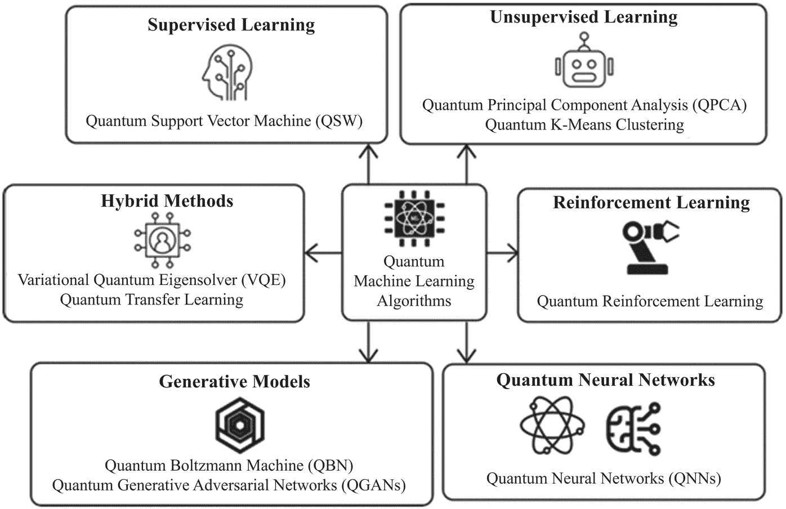

图 3.1 量子机器学习算法。

如上所述，量子 ML 算法可以根据其底层原理和技术分为不同的组。分类如下：

1.  **监督学习：** 量子支持向量机（`QSVM`）算法属于此类。它专注于通过找到最佳超平面来分离数据点以执行分类任务。

2.  **无监督学习：** 此类别包括量子主成分分析（`QPCA`）和量子 `K-means` 聚类技术。量子 `K-means` 聚类使用量子电路组合相似的数据点，而 `QPCA` 使用量子态映射从高维数据中提取最重要的特征。

3.  **生成模型：** 量子玻尔兹曼机（`QBM`）和量子生成对抗网络（`QGANs`）属于此类。`QBM` 是一种生成模型，它学习训练数据的底层分布并生成新样本。此外，`QGANs` 由生成器和判别器网络组成，以创建逼真的数据样本。

4.  **强化学习：** 量子计算与强化学习的领域被称为量子强化学习。它使决策过程中的探索和利用更加有效。

5.  **混合方法：** 变分量子本征求解器（`VQE`）和量子迁移学习算法属于此类。为了确定给定哈密顿量的最低本征值，`VQE` 使用混合量子-经典方法。量子迁移学习利用在经典数据上预训练的模型来增强量子数据上的学习性能。

6.  **量子神经网络（`QNNs`）：** 这些利用量子电路作为各种机器学习任务的构建模块。

通过对这些算法进行分类，我们可以更好地理解其目的和所采用的具体技术。这种分类为探索和开发量子 ML 算法及其在不同领域的应用提供了一个框架。因此，本章剩余部分描述了每种算法的工作原理、特征、优势和应用。

### 3.3.1 量子支持向量机（`QSVM`）

量子支持向量机（`QSVM`）是一种混合算法，通过结合经典和量子组件来执行分类。它利用量子计算原理来增强数据的处理并提高分类准确性。`QSVM` 旨在在一个高维量子特征空间中找到一个最大化分离不同类别的最佳超平面。


多个 QSVM 过程在 图 3.2 的功能示意图中被描绘。经典特征映射函数 `ϕ(x[i])`，表示为 `|ϕ(x[i])⟩`，用于首先将经典数据点 (`x[i]`) 映射到更高维的特征空间。然后使用量子特征映射 (`Uϕ`) 将特征向量编码为量子态。特征向量随后使用量子特征映射 (`Uϕ`) 编码为量子态。量子电路 (`U`) 用于编码后的量子态上执行量子计算。然后对量子电路进行测量以获得经典结果。基于测量结果训练经典 SVM 模型以对新数据点进行分类并产生预测输出。

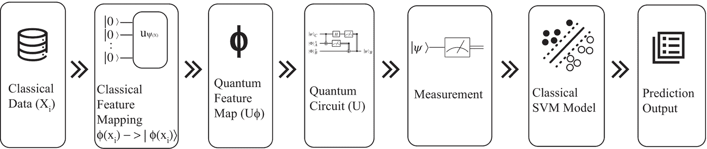

图 3.2 量子支持向量机的功能示意图。

为了透彻掌握这种方法，深入了解 QSVM 的底层算术、方程和描述非常重要 [7]。

#### 3.3.1.1 数学符号和方程
1. **数据表示：**
   * 设我们考虑一个包含 N 个数据点的数据集：{`xᵢ`, `yᵢ`}，其中 `xᵢ` 表示第 `i` 个数据点的特征，`yᵢ` 表示其对应的类别标签。类别标签可以是二元（+1 或 −1）或使用 one-hot 编码的多类编码。
2. **量子特征映射：**
   * QSVM 使用量子特征映射将经典数据转换为量子特征空间 [8]。使用一种称为量子特征映射或 QFM 的量子电路 `ϕ(x)`，将经典数据 `x` 编码为量子态 `|ϕ(x)⟩`。
3. **核矩阵：**
   * 使用量子特征向量计算核矩阵 `K`。
   `K(x,x′)=⟨ϕ(x)|ϕ(x′)⟩`。
4. **支持向量分类：**
   * 给定核矩阵 `K`，QSVM 算法找到支持向量，即最接近决策边界的数据点。
5. **决策函数：**
   * QSVM 中的决策函数由下式给出：
   `f(x)=sign(∑[i] α[i] y[i] K(x[i],x)+b)`，
   其中 `b` 是偏置项。

#### 3.3.1.2 QSVM 算法描述
以下数学符号可用于描述 QSVM 算法。
1. **步骤 1：** 对于每个经典数据点 `x[i]`：
   * 应用量子特征映射将 `x[i]` 编码为量子特征向量 `|ϕ(xᵢ)⟩`。
2. **步骤 2：** 使用量子特征向量 `|ϕ(xᵢ)⟩` 计算核矩阵 `K`：
   `K(x[i],x[j])=⟨ϕ(x[i])|ϕ(x[j])⟩`。
3. **步骤 3：** 找到支持向量并计算定义决策函数的系数 `αᵢ`：
   * 在 `x[i]` 数据点中发现最接近决策边界的支持向量。
   * 使用支持向量和类别标签 `yᵢ` 计算系数 `α[i]`。
4. **步骤 4：** 确定偏置项 `b`：
   * 使用系数 `α[i]` 和类别标签 `yᵢ` 计算偏置项 `b`。
5. **步骤 5：** 给定一个新数据点 `x`，使用决策函数预测其类别标签：
   * 计算决策函数：
   `f(x)=sign(∑[i] α[i] y[i] K(x[i],x)+b)`。
   * 根据决策函数的方向，预测新数据点 `x` 的类别标签 `y[pred]`。

通过应用量子计算，QSVM 可以提升分类任务。理解 QSVM 背后的基本思想将使研究人员和从业者能够使用它来解决困难的分类问题并利用量子计算在机器学习中的能力。

### 3.3.2 量子神经网络（QNN）
传统神经网络通过提供强大的模式识别和决策工具彻底改变了机器学习。量子神经网络（QNNs）旨在利用量子系统的计算能力进一步增强数据的学习和处理。在 QNNs 中应用量子力学原理 [9] 以改善数据的表示和处理。此外，QNNs 将经典神经网络架构与量子电路模型相结合，创建混合框架。它们利用量子态和量子操作来表示和操纵数据，在解决复杂优化问题和学习任务方面提供潜在优势。本章探讨 QNNs 的数学符号、方程和描述，突出其独特特征和潜在应用。

在 QNNs 中，量子神经元充当基本处理单元。它们由量子态表示并实现量子操作以转换输入数据。量子神经元可以使用量子电路或其他量子计算模型实现。在 QNN 中，量子层是一组按特定拓扑连接的量子神经元。每个神经元接收输入数据，执行量子计算并产生输出数据。量子层堆叠以创建更深的架构，使数据中更复杂模式和关系的表示成为可能。

图 3.3 中的功能示意图说明了 QNN 中涉及的不同步骤。量子特征映射 `|ϕ(x)⟩` 首先用于将经典输入 (`x`) 编码为量子态 `|x⟩`。编码后的量子态经历由量子电路 (`Uθ`) 表示的量子计算，该电路由可训练参数集 `θ` 参数化。对量子电路进行测量以获得测量结果，然后用于生成经典输出。经典输出代表 QNN 的预测或结果。

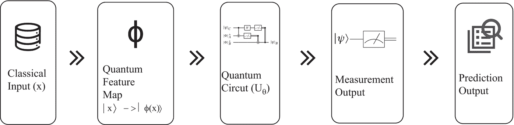

图 3.3 量子神经网络的功能示意图。

通常，QNNs 在训练时采用参数化量子电路，其中训练过程用于优化量子门的程序化参数。这些参数决定了量子神经元应用的变换，并被学习以最小化合适的损失函数。否则，QNNs 使用另一种重要方法进行训练，称为量子反向传播 [10, 11]。它涉及通过参数化量子电路计算梯度，从而允许使用常规优化程序优化电路参数。

#### 3.3.2.1 量子神经网络（QNN）算法
1. **步骤 1**：对于每个经典数据点 `xᵢ`：
   * 应用量子特征映射将 `xᵢ` 编码为量子特征向量 `|ψ(xᵢ)⟩`。
2. **步骤 2**：对于每个量子层 `l`：
   * 将参数化量子电路 `U(θ[l])` 应用于量子特征向量 `|ψ(xᵢ)⟩`。
   * 将变换后的量子态 `|ψ′(xᵢ)⟩` 作为输出获得。
3. **步骤 3**：为参数化量子电路初始化参数 `θ`。
4. **步骤 4**：迭代以下步骤直至收敛：
   * 前向传播：
     * 对于每个训练数据点 (`xᵢ`, `yᵢ`)：
       * 为获得量子特征向量，应用量子特征映射 `|ψ(x[i])⟩`。
       * 应用量子层以获得变换后的量子态 `|ψ′(xᵢ)⟩`。
     * 基于变换后的量子态 `|ψ′(x[i])⟩` 计算输出预测。
   * 反向传播：
     * 计算损失函数 `L` 相对于变换后的量子态 `|ψ′(xᵢ)⟩` 的梯度 `∂L/∂|ψ′(xᵢ)⟩`。
     * 使用计算得到的梯度更新参数 `θ`。


5. **步骤 5**：使用优化后的参数 `θ` 得到训练好的 QNN 模型。

6. **步骤 6**：使用量子特征映射将新的数据点 `x` 编码为量子特征向量 `|ψ(x)⟩`。

7. **步骤 7**：应用来自已学习 QNN 模型的參数化量子电路，得到转换后的量子态 `|ψ′(x)⟩`。

8. **步骤 8**：基于转换后的量子态 `|ψ′(x)⟩` 进行类别标签预测 `y[pred]`。

#### 3.3.2.2 QNNs 的应用
* ***量子增强模式识别***：通过利用其快速计算和高维数据表示能力，QNN 可用于模式识别应用，例如图像分类或音频识别。
* ***优化与组合问题***：QNN 通过利用叠加和纠缠等量子特性，在解决优化和组合问题方面具有优势。它们可用于投资组合优化、车辆路径规划或蛋白质折叠等任务。
* ***量子生成建模***：QNN 通过识别输入的潜在概率分布，帮助对需要生成学习建模的任务进行建模。因此，可以创建与训练集具有相似特征的新样本。

#### 3.3.2.3 实现 QNN 的设备
* ***基于门的量子计算机***：量子神经网络 QNN 可以使用基于门的量子计算机实现。这些计算机利用量子门来操纵量子比特并执行量子操作。这些基于电路模型的计算机允许执行参数化量子电路并实现训练和推理过程。要在基于门的量子计算机上实现 QNN，需要设计代表神经网络架构的量子电路。这涉及将神经网络的层、神经元和连接映射到量子计算机的量子比特和门上。然后应用量子门来执行计算并更新量子比特的量子态。

然而，基于门的量子计算机目前面临诸如量子比特相干时间有限、错误率较高以及需要纠错等挑战。这些限制会影响基于门的量子计算机上 QNN 的性能和可扩展性。尽管如此，量子计算技术的持续研究和进步旨在解决这些挑战并提高使用基于门的量子计算机实现 QNN 的可行性。

* ***变分量子电路 (VQC)***：变分量子电路 VQC 是实现 QNN 的一种有前景的方法，因为它们结合了经典和量子计算来训练和优化量子电路的参数。在 QNN 的背景下，VQC 可用于表示神经网络架构并对量子态执行计算。使用经典优化程序，量子电路的参数会迭代修改，以减少通常与 QNN 训练目标相关的成本函数。

VQC 为 QNN 提供了若干优势。它们可以在现有的基于门的量子计算机或模拟器上实现，使其可用于实际应用。此外，VQC 可以利用量子并行的强大功能，并在某些情况下相对于经典神经网络提供计算优势。然而，需要注意的是，VQC 也面临挑战。优化过程可能计算密集，需要大量迭代才能找到最佳参数值。此外，VQC 的性能会受到量子硬件中的噪声和错误影响。尽管存在这些挑战，VQC 仍有望用于 QNN，并且是研究的活跃领域。正在进行的努力旨在提高 VQC 的性能和可扩展性，使其成为在量子计算平台上实现 QNN 的可行选择。

其他可用于实现 QNN 的设备有量子退火器、光子量子计算机和量子模拟器。此外，还有多个量子计算平台可用于实现 QNN。一些热门平台包括 IBM Quantum、Google Quantum Computing、Microsoft Quantum Development Kit 和 Rigetti Forest。这些平台提供量子硬件和软件工具，用于开发和运行 QNN。

### 3.3.3 变分量子本征求解器 (VQE)
为解决量子化学和优化问题，变分量子本征求解器 VQE 被认为是一种有效的量子机器学习技术 [12]。使用一种称为 VQE 的量子方法来计算哈密顿量的基态能量。它对于解决量子化学和材料科学问题特别有益，并且是一种有前景的方法，用于解决由于指数级复杂性而难以用传统计算机解决的问题。但需要注意的是，VQE 的性能目前受现有量子硬件的噪声和错误率限制。

在使用 VQE 算法确定基态能量时，哈密顿量在 VQE 中代表量子系统的总能量，极其重要。在 VQE 中，哈密顿量通常分解为两个部分：经典部分，表示系统的经典能量；量子部分，表示系统的量子能量。量子部分通常表示为一系列项的总和，每一项对应于系统的特定相互作用或属性。

图 3.4 中的功能图说明了 VQE 涉及的不同步骤。量子电路 (`U`) 表示用于制备态 `|ψ(θ)⟩` 的参数化量子电路，其中 `θ` 表示可训练参数的集合。对该态执行测量以获得测量结果。这些测量结果用于评估目标函数 `E(θ)`，该函数通常表示目标量子系统的哈密顿量期望值。之后，使用传统求解器或优化技术来最小化目标函数。在优化过程中，量子电路的参数 (`θ`) 会迭代更新，直到达到所需结果。

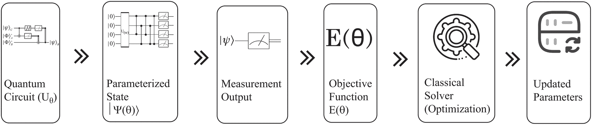

图 3.4 变分量子本征求解器的功能图。

#### 3.3.3.1 数学符号与方程
1. **问题表述**：
   * 考虑一个由哈密顿算符 `H` 描述的量子系统。VQE 技术寻求识别具有最低本征值（基态能量）的 `H` 本征向量，这可能提供有关系统属性和行为的重要信息。

2. **变分原理**：
   * 根据 VQE 方法使用的变分原理，对于每个依赖于参数集 `θ` 的试探波函数 `Ψ(θ)`，哈密顿算符 `H` 的期望值是系统基态能量的上界。

`E(θ)=⟨Ψ(θ)|H|Ψ(θ)⟩≥E[0]`, 其中 `E[0]` 是系统的实际基态能量。

3. **参数化量子电路**：
   * VQE 方法使用由 `U(θ)` 表示的参数化量子电路来制备试探波函数 `Ψ(θ)`。该量子电路由一系列作用于初始态的量子门组成，通常是全零态 `|0⟩`。

4. **能量估计**：
   * 为了估计期望值 `E(θ)=⟨Ψ(θ)|H|Ψ(θ)⟩`，VQE 算法使用对由 `U(θ)` 制备的量子态进行的量子测量。通过对制备态进行 `H` 的测量，可以估计能量期望值。

5. **优化循环**：


VQE 方法使用优化循环来识别使能量期望值最小化的参数集合。此优化过程经常使用梯度下降或贝叶斯优化等经典优化技术来更新参数并降低能量。

### 收敛准则
VQE 算法的收敛性由预定义的收敛准则决定。此准则可以基于连续迭代之间的能量差或参数更新的收敛性。

### 应用：量子化学
VQE 在量子化学中有重要用途，可用于计算系统的基态能量。通过将分子哈密顿量编码到 VQE 框架中，可以获得有关化学性质、键长、反应速率等方面的见解。

### 扩展：混合经典-量子优化
在某些情况下，VQE 算法可以与经典优化技术结合以解决更大规模的问题。这种混合方法利用了经典优化算法的优势，同时受益于 VQE 算法的量子计算优势。

### 3.3.3.2 变分量子特征求解器（VQE）算法
VQE 算法可以描述如下：

因此，通过应用上述算法，可以估计给定哈密顿算子的最小特征值及其对应的特征向量。该方法不仅使用参数化量子电路和经典优化来识别使能量期望值最小化的理想参数，而且通过迭代调整参数而接近量子系统的基态能量。

## 3.3.4 量子玻尔兹曼机（QBM）
经典玻尔兹曼机为量子玻尔兹曼机（QBM）提供了灵感；一种量子神经网络形式[13]。量子力学（QM）是进行概率建模和学习问题的方法，QBM 是由连接的节点组成的网络，在量子计算的情况下为量子比特，类似于经典玻尔兹曼机。这些量子比特通过量子门相互作用，使得探索复杂概率分布成为可能。

QBM 利用叠加和纠缠等量子效应来增强其计算能力。通过利用这些量子特性，QBM 在计算能力和效率方面可能比经典玻尔兹曼机具有优势。

功能图 图 3.5 说明了 QBM 算法中涉及的关键步骤。经典数据点 `x[i]` 最初作为输入提供。这些经典数据点随后使用量子特征映射编码为量子特征向量，表示为 `ϕ(x[i])`。量子特征向量用于计算量子核矩阵，表示为 `K(x[i], xⱼ)`，它捕捉量子特征向量之间的相似性。从量子核矩阵生成量子玻尔兹曼分布 `p(x)`。然后从该分布中抽取样本，表示为 `x[i]'`，用于通过经典数据更新步骤 `x[i] ← x[i]'` 更新经典数据点。此迭代过程持续进行，直到收敛或满足期望的停止准则。

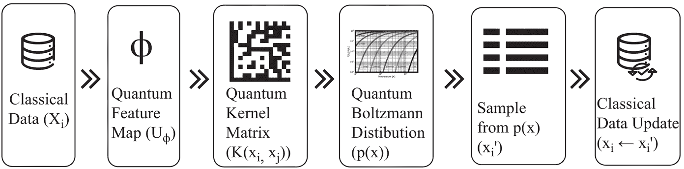

图 3.5 量子玻尔兹曼机的功能图。

### 3.3.4.1 量子玻尔兹曼机（QBM）的特性
经典玻尔兹曼机（CBM）为 QBM 提供了灵感。CBM 是一种随机生成模型，由通过加权连接连接的二进制单元（也称为神经元）组成。它通过称为吉布斯采样（Gibbs sampling）的过程调整权重来学习训练数据的潜在分布。QBM 将 CBM 的概念扩展到量子计算领域。它用量子位或量子比特替换 CBM 中的二进制单元，并用量子门替换加权连接。QBM 利用量子叠加和纠缠来执行经典计算机难以处理的计算。

* 在 QBM 中，量子比特状态与训练数据之间的兼容性由能量函数表示。它由哈密顿算子定义，表示为 `H`。哈密顿量同时编码数据和量子比特之间的相互作用项。
* QBM 利用吉布斯态，也称为热平衡态，来模拟量子比特的概率分布。
* 配分函数，表示为 `Z`，对概率进行归一化，并且对于计算期望值至关重要。
* QBM 的训练包括识别降低量子比特能量的理想权重和偏置。通常使用变分优化或梯度下降等方法来实现此目的。目标是发现能够捕捉训练集统计特性的训练集表示。
* QBM 可用于生成建模，从而允许从学习到的分布中生成新样本。通过从 QBM 的量子态采样，可以生成与训练数据相似的新数据点。
* QBM 支持降维和聚类等无监督学习任务。通过理解数据的潜在分布，QBM 可以捕捉有助于数据分析和表示的潜在特征和模式。
* QBM 可用于优化问题，利用量子退火技术。通过将优化问题映射到 QBM 的能量景观，可以利用量子退火高效地搜索最优解。

### 3.3.4.2 量子玻尔兹曼机（QBM）算法
QBM 算法通过吉布斯采样、量子态更新和参数更新迭代优化 QBM 参数。通过最小化 QBM 的能量，它学习训练数据的潜在分布。训练后，QBM 可用于各种任务，包括生成建模、无监督学习和优化。

## 3.3.5 量子主成分分析（QPCA）
量子机器学习算法近年来因其在某些任务中可能优于经典机器学习技术的潜力而受到广泛关注。其中一种算法是量子主成分分析（QPCA）[14]，它结合了量子计算的原理和主成分分析（PCA）的数学框架。量子主成分分析旨在从数据集中提取最具信息量的特征或主成分，实现高效的降维和数据分析。

功能图 图 3.6 使用数学符号说明了 QPCA 中涉及的关键步骤。经典数据矩阵 `X` 作为输入提供。经典数据点 `x[i]` 然后使用量子特征映射编码为量子特征向量 `|ϕ(x[i])⟩`。QPCA 算法应用于量子特征向量以提取量子特征向量（`|vk⟩`），它们代表主成分。这些量子特征向量然后用于执行经典投影步骤，其中经典数据矩阵 `Y` 通过将 `X` 投影到量子特征向量上获得（`Y = V†X`）。 resulting classical data matrix `Y` 表示 QPCA 空间中的变换数据。

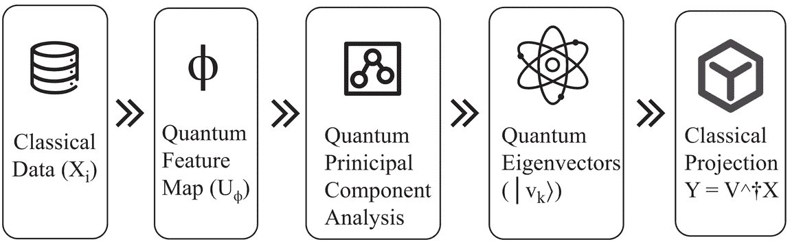

图 3.6 量子主成分分析的功能图。

### 3.3.5.1 QPCA——数学符号与预备知识


## 量子主成分分析符号

为了理解 QPCA，建立了以下数学符号：

* 设 `X` 为具有 `d` 维特征向量的经典数据集：`X = {x[1], x[2], x[3]…, x[n]}` ，其中每个 `xᵢ ∈ ℝ^(d)` 。
* 设 `|ϕ(x)⟩` 表示与经典数据点 `x` 对应的量子态。
* 设 `U(x)` 为量子特征映射，将经典数据点 `x` 编码为量子态：`|ϕ(x)⟩ = U(x)|0⟩` 。
* 设 `|Ψ⟩` 表示与整个数据集对应的量子态：`|Ψ⟩ = Σᵢ|ϕ(xᵢ)⟩` 。

### A. 量子特征映射

QPCA 的关键组成部分是量子特征映射。它利用量子电路将经典数据点转换为量子态。该变换可以表示为：

`|ϕ(x)⟩ = U(x)|0⟩`

其中 `|0⟩` 表示初始态，`U(x)` 是对应于量子特征映射的酉变换。量子特征映射的选择取决于具体问题，可以从简单的旋转到更复杂的电路不等。

### B. 量子奇异值估计

QPCA 算法涉及估计量子特征矩阵的奇异值。量子特征矩阵是通过将量子特征映射应用于经典数据集构造而成的。奇异值可以使用量子算法和技术进行估计，例如量子相位估计。这些估计提供了对每个主成分重要性的洞察，并指导降维过程。

### C. 主成分选择

一旦估计出奇异值，下一步就是根据相应的奇异值选择顶部主成分。数据集最大方差的方向由主成分捕获，主成分还提供了数据的压缩表示。顶部主成分的选择可以使用各种方法进行，例如阈值处理或保留总方差的特定百分比。

### D. 主成分重建

使用所选的主成分，可以使用 QPCA 技术重建数据集。原始数据集可以投影到所选的主成分上以创建重建数据集。重建过程可以描述为：

`X′ = ΣjX`

其中 `X′` 是重建的数据集，`σⱼ` 是对应于所选主成分的奇异值，`|uⱼ⟩` 是相应的特征向量。

### 3.3.5.2 量子主成分分析算法

## 3.3.6 量子 K-Means 聚类 (QK-Means)

众多应用，包括数据分析、模式识别和优化，对量子 K-means 聚类 (QK-Means) 显示出巨大潜力 [15]。与经典方法相比，它可以利用量子叠加和量子并行性，从而产生更有效、更精确的聚类结果。

图 3.7 中的功能图说明了使用数学符号的 QK-Means 聚类所涉及的关键步骤。经典数据矩阵 `X` 作为输入提供。然后，经典数据点 `xᵢ` 使用量子特征映射编码为量子特征向量 `|ϕ(x[i])⟩`。QK-Means 算法应用于量子特征向量以确定量子质心 `|cₖ⟩`。执行经典分配步骤，将每个数据点分配给最近的量子质心，从而得到经典分配向量 `r[i]`。最后，根据分配的数据点计算经典质心 `cₖ`。所得的经典质心代表通过 QK-Means 聚类获得的最终聚类。

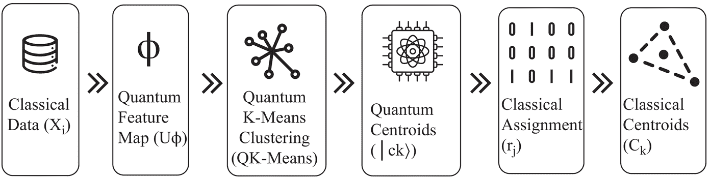

图 3.7 量子 K-means 聚类的功能图。

### 3.3.6.1 量子 K-Means 聚类算法

该算法阐述了如何执行量子 K-means 聚类。它首先采用量子特征映射将经典数据点编码为量子态。从量子态中，初始质心随机选择。然后确定质心与数据点之间的量子距离。基于量子距离，将数据点分配给最近的质心。通过对分配的数据点取平均值，更新质心。在重复这些阶段直到收敛或达到最大迭代次数后，返回最终的聚类质心。

### 3.3.6.2 量子 K-Means 聚类 (QK-Means) 中的挑战

量子 K-means 聚类提供了一种受量子启发的数据聚类方法，利用量子系统的计算能力。随着量子硬件的不断发展，预计 QK-Means 聚类算法将在需要高级数据分析和模式识别的各个领域发挥重要作用。然而，在实现 QK-Means 聚类时存在若干挑战和考虑因素。这些包括：

1. **量子硬件限制：** 量子计算机仍处于发展的早期阶段，具有有限的量子比特数、噪声和错误率。这些限制影响了 QK-Means 聚类算法的可扩展性和准确性。

2. **量子特征映射设计：** 选择合适的量子特征映射 `ϕ(x)` 对成功聚类至关重要。特征映射的选择会显著影响数据在量子态空间中的表示和可分离性。

3. **距离度量算子：** 设计有效的距离度量算子 `Mⱼ` 对于准确计算数据点与质心之间的量子距离至关重要。距离度量的选择影响并决定了聚类性能。

4. **量子电路深度：** 用于编码和距离计算的量子电路的深度会影响算法的运行时间和量子态的相干性。最小化电路深度对于减轻错误和保持量子相干性至关重要。

尽管存在这些挑战，QK-Means 聚类作为量子机器学习算法仍显示出潜力。研究人员正在积极探索新颖技术，例如变分量子算法和混合经典-量子方法，以提高其性能和可扩展性。

## 3.3.7 量子生成对抗网络 (QGANs)

QGANs 是一个强大的框架，它在量子计算领域结合了生成建模和对抗学习的概念 [16]。量子模拟、量子化学和量子机器学习都可能从使用 QGANs 生成逼真的量子数据分布中受益。生成器网络和判别器网络是生成对抗网络 (GANs) 这一深度学习模型的两个主要部分。训练数据集将被用于为 GANs 分析创建新的数据样本。根据基于对抗框架的 GANs 架构，生成器和判别器网络以竞争方式进行训练。


功能图在 图 3.8 中表示了量子生成对抗网络（QGANs）的关键组件，使用数学符号。真实数据分布 `P[data]` 作为生成逼真数据的参考。生成器 `G[θ]` 产生模仿真实数据分布的量子数据样本。量子判别器 `Dϕ` 评估生成的 数据分布 `P[G]` 并区分真实数据和生成数据。判别器损失 `L[D]` 衡量判别器预测与真实标签之间的差异。生成器损失 `L[G]` 量化生成器欺骗判别器的能力。优化过程旨在最小化 `L[D]` 和 `L[G]`，使生成器能够生成逼近真实数据分布的逼真数据样本。

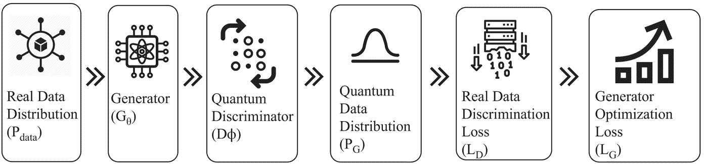

图 3.8 QGANs 的功能图。

### 3.3.7.1 量子生成对抗网络（QGANs）的架构

QGAN 架构结合了经典和量子组件以生成和学习量子数据分布。通过使用量子资源和技术，QGANs 旨在克服经典生成模型的局限性，并在各种量子应用中实现量子数据的生成和分析，例如量子机器学习和量子模拟。

在 QGANs 的背景下，量子纠缠在生成和学习量子数据分布中发挥着关键作用。QGANs 中量子纠缠的相关性可从两个关键方面理解：

1.  **量子数据生成：** 在 QGAN 中，生成器网络旨在生成与目标量子分布相似的量子数据样本。量子纠缠允许生成器创建纠缠态，这些纠缠态可以表现出目标分布所特有的复杂关联和相干特性。通过利用纠缠，QGANs 旨在生成能够更准确地捕捉目标分布统计特性的量子态。

2.  **量子判别：** QGANs 中的判别器网络负责区分真实量子数据样本和生成器生成的合成数据样本。量子纠缠使判别器能够利用纠缠量子数据样本中存在的非局域关联，从而更好地区分真实数据和生成数据。这可以增强判别器学习和捕捉目标分布区分特征的能力。

通过利用纠缠的力量，QGANs 旨在克服经典生成模型的局限性并实现量子数据的生成和操控。量子纠缠为 QGANs 提供了一种独特的资源，用于生成逼真的量子态并捕捉量子分布的统计特性，这对系统的实际基态能量至关重要。

QGAN 架构的高层概述描述如下：

1.  **量子生成器：** 量子生成器负责生成模仿目标量子分布的量子数据样本。它以一组量子参数作为输入，通常表示为一组量子门或电路。生成器将这些量子操作应用于初始态，例如量子寄存器或量子电路，并生成代表合成数据样本的量子态。生成器旨在产生与目标分布统计特性相似的量子态。

2.  **量子判别器：** 量子判别器的作用是区分来自目标分布的真实量子数据样本和生成器生成的合成数据样本。它以量子态作为输入并对其执行测量或其他量子操作。判别器旨在准确分类输入量子态是真实的还是由生成器生成的。

3.  **量子训练：** 与经典 GAN 类似，QGANs 使用对抗训练过程来优化生成器和判别器。对生成器和判别器进行迭代对抗训练。训练过程在两个阶段之间交替：
    *   ***生成器训练*：** 生成器接收量子参数并生成合成量子数据样本。判别器随后接收这些生成样本并提供其真实性的反馈。生成器旨在调整其参数以生成能够欺骗判别器将其分类为真实的量子态。
    *   ***判别器训练*：** 判别器接收来自目标分布的真实量子数据样本以及生成器生成的样本。它试图通过优化其自身的量子操作或测量来正确地将输入量子态分类为真实或生成。

4.  **量子损失函数：** 量子损失函数用于指导 QGANs 对判别器和生成器的训练。这些损失函数的目标通常是衡量真实量子数据样本与合成量子数据样本的统计特征之间的差异或差距。基于保真度的度量、量子散度度量或量子可区分性度量是量子损失函数的一些示例。

5.  **量子资源：** 为了创建和分析量子数据，QGANs 使用量子门、量子电路和量子测量等量子资源。具体实现和所需量子数据分布的特性决定了量子资源的选择。利用这些资源，QGAN 能够通过利用量子系统的特殊特性来创建和控制量子态。

### 3.3.7.2 QGANs 的算法

## 3.3.8 量子迁移学习（QTL）

在传统机器学习中，迁移学习是一种强大的技术，使为一项任务开发的模型能够被修改并应用于相关任务。然而，量子计算的引入提供了一个机会来研究如何利用量子能力进行迁移学习。本章探讨了量子迁移学习的思想，它试图通过利用量子特征来改善任务之间的知识迁移。

功能图在 图 3.9 中使用数学符号表示了量子迁移学习的关键组件。源任务涉及一个预训练的量子模型 `Ms`，它捕获了来自先前任务的知识。经典知识迁移过程 `T` 促进了从源任务到目标任务的相关信息的迁移。目标任务需要一个量子模型 `Mt`，它使用迁移的知识进行初始化。微调 `F` 通过调整其参数来使迁移的模型适应目标任务。最终结果是迁移的量子模型 `Mt′`，它已针对目标任务进行了微调和优化。

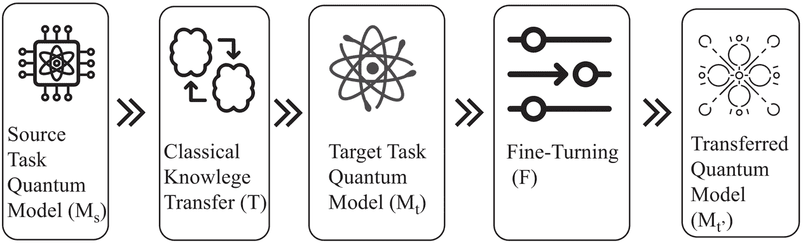

图 3.9 量子迁移学习的功能图。

### 3.3.8.1 量子迁移学习框架

称为量子迁移学习（QTL）的框架利用先前学习的量子模型和知识迁移策略来促进新颖量子任务的学习和性能。\[17\]。以下是 QTL 框架中关键组件的描述：

1.  **预训练量子模型：** QTL 框架从一个在源任务或数据集上训练过的预训练量子模型开始。该预训练模型作为知识来源，并提供了学习到的量子特征和参数的基础。


#### 2. 目标量子任务
目标量子任务是 `QTL` 框架旨在提高性能的新任务或数据集。它可能与源任务不同但相关，或者可能涉及不同的量子数据表示或编码。

#### 3. 特征提取
在 `QTL` 框架中，特征提取使用预训练的量子模型进行。预训练模型用于从目标量子数据中提取相关的量子特征或表示。这些特征通过捕获源任务中获得的知识来改善目标任务的学习过程。

#### 4. 迁移学习
为了将源任务中获得的知识迁移到目标任务，使用迁移学习技术。这涉及将预训练的量子模型或其特征适配到目标任务。可以采用各种迁移学习策略，例如微调模型的参数、冻结某些层，或在保留共享特征的同时学习任务特定的层。

#### 5. 任务特定学习
在迁移学习阶段之后，`QTL` 框架在目标量子任务上进行任务特定学习。这通常涉及进一步训练适配后的模型或微调学习到的特征以优化目标任务上的性能。模型的参数可以使用来自目标任务的额外量子数据进行调整，这将提高模型完成任务的能力。

#### 6. 评估与性能
`QTL` 框架的性能通过在目标任务上评估适配后的模型来评估。评估指标可以根据具体的目标任务而变化，例如准确率、错误率或其他任务特定的性能度量。

总体而言，`QTL` 框架通过允许从预训练的量子模型向新的目标量子任务转移知识和特征，从而增强目标任务上的学习效果和性能。源任务和目标任务的性质以及所选的迁移学习方法可能会影响 `QTL` 框架的具体实现和架构。

#### 3.3.8.2 量子迁移学习（QTL）算法

### 3.3.9 量子强化学习（QRL）

量子强化学习（`QRL`）结合了强化学习和量子计算的原理来解决复杂的决策问题 [18]。通过利用量子系统的独特属性，`QRL` 旨在提高强化学习算法的效率和可扩展性。本节我们探讨 `QRL` 的基础、其数学符号以及量子增强强化学习的算法框架。

图 3.10 中的功能图使用数学符号表示 `QRL` 的关键组件。量子环境 `E` 与量子智能体 `A` 交互，后者基于当前量子态 `|ψ⟩` 采取由幺正算符 `U(θ)` 表示的动作。由此产生的量子奖励 `r` 作为反馈从环境中获得。此反馈用于更新量子智能体的参数，优化其行为。此更新过程通过量子操作和经典计算执行。随着量子智能体与环境交互、从奖励中学习并更新其参数以随着时间的推移提高性能，循环持续进行。

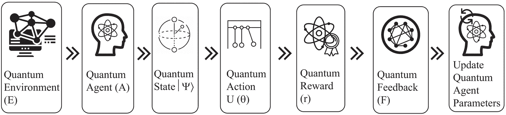

图 3.10 量子强化学习的功能图。

#### 3.3.9.1 量子强化学习（QRL）框架

量子强化学习（`QRL`）框架是经典强化学习技术的扩展，利用量子资源和原理来解决强化学习问题。`QRL` 框架将量子计算和量子力学的概念与强化学习算法相结合，以应对挑战并探索某些领域中的潜在优势。以下是 `QRL` 框架的总体概述：

#### 1. 量子状态表示
在 `QRL` 中，环境的 state 使用量子态表示。这可能涉及将状态信息编码到量子寄存器中或使用量子电路来表示状态。与经典表示相比，量子状态表示提供了增强信息处理和更丰富表示的潜力。

#### 2. 量子动作与量子动力学
`QRL` 引入了量子动作，而不是经典动作，量子动作是对量子态执行的以影响环境的操作或变换。这些动作可以用量子门或量子电路表示。量子动力学描述了量子态如何基于所选的量子动作和环境的底层物理学演化。

#### 3. 量子奖励与量子可观测量
`QRL` 包含量子奖励，即与量子态相关联的测量或可观测量。这些奖励捕获环境的量子方面，可用于指导学习过程。在 `QRL` 中，Q 值表示为 `Q(s, a)`，表示在状态 `s` 中采取动作 `a` 的预期累积奖励。这些 Q 值可以用量子态表示，例如量子位，其中振幅编码每个动作的 Q 值。量子态通过量子操作演化，量子位的测量为决策提供 Q 值。量子可观测量可以提供有关状态或环境的额外信息，并可影响智能体的决策。

#### 4. 量子策略与量子价值函数
与经典强化学习类似，`QRL` 涉及使用量子策略和量子价值函数。量子策略定义智能体的行为，并根据当前量子态确定选择哪些量子动作。量子价值函数估计在给定量子态中采取特定量子动作的价值或效用。

#### 5. 量子 Q 学习与算法
`QRL` 算法旨在通过基于强化学习原理的迭代更新找到最优的量子策略和价值函数。这些算法根据来自环境的反馈（包括量子奖励和观测）调整量子动作和策略。量子 Q 学习是 `QRL` 中常用的算法，但也可以采用其他变体和经典 RL 算法的量子对应物。

#### 6. 量子空间中的探索与利用
`QRL` 中的探索-利用策略涉及搜索和利用量子动作空间以最大化奖励。这可能涉及量子探索技术，例如量子随机化或量子叠加，以探测不同的量子动作并在量子域中学习最优策略。

#### 3.3.9.2 量子强化学习（QRL）算法

## 3.4 结论


量子机器学习算法通过利用量子资源来解决复杂问题大有可为。这些算法旨在利用量子系统的独特属性来增强数据处理、优化和模式识别任务。从量子支持向量机到量子神经网络和变分量子分类器，研究人员正在探索各种方法。虽然仍处于早期阶段，但量子机器学习有潜力革新药物发现、优化和量子信息处理等领域。硬件和算法开发的持续进步将进一步推动量子机器学习的能力，为未来激动人心的应用和发现铺平道路。本章中，我们对量子机器学习进行了总体概述，讨论了动机、优势、挑战和关键概念。通过探索该领域的算法和概念，研究人员和从业者可以深入了解量子机器学习的潜力，并为这一令人兴奋的领域的发展做出贡献。

## 参考文献
1.  Huang, H.Y., et al. 量子机器学习中数据的力量. Nature Communications 12, 2631 (2021). [`doi.org/10.1038/s41467-021-22539-9`](https://doi.org/10.1038/s41467-021-22539-9)
2.  Vedran, Dunjko, Jacob M. Taylor, and Hans J. Briegel. 量子增强机器学习. Physical Review Letters 117 (13), 130501 (2016). [`doi.org/10.1103/PhysRevLett.117.130501`](https://doi.org/10.1103/PhysRevLett.117.130501)
3.  Havenstein, Christopher, Damarcus Thomas, and Swami Chandrasekaran. 量子与经典机器学习性能比较. SMU Data Science Review 1 (4), 11 (2018).
4.  Djordjevic, Ivan B. 第 3 章——量子信息处理基础, 量子通信、量子网络和量子传感, Academic Press (2022), 89–124, ISBN 9780128229422, [`doi.org/10.1016/B978-0-12-822942-2.00008-X`](https://doi.org/10.1016/B978-0-12-822942-2.00008-X)
5.  Szczepanik, Dariusz W., Emil Zak, and Janusz Mrozek. 从量子叠加到轨道通信. Computational and Theoretical Chemistry 1115, 80–87 (2017). ISSN 2210-271X, [`doi.org/10.1016/j.comptc.2017.05.041`](https://doi.org/10.1016/j.comptc.2017.05.041)
6.  Havlíček, V., Córcoles, A.D., Temme, K., et al. 具有量子增强特征空间的监督学习. Nature 567, 209–212 (2019). [`doi.org/10.1038/s41586-019-0980-2`](https://doi.org/10.1038/s41586-019-0980-2)
7.  网站： [`qiskit.org/documentation/stable/0.24/tutorials/machine_learning/01_qsvm_classification.html`](https://qiskit.org/documentation/stable/0.24/tutorials/machine_learning/01_qsvm_classification.html)
8.  Hossain, M.M., et al. 利用量子支持向量机分析特征映射技术与电路深度在量子监督学习中的影响, *2021 第 24 届计算机与信息技术国际会议 (ICCIT)*, Dhaka, Bangladesh, 2021, 1–5, [`doi.org/10.1109/ICCIT54785.2021.9689853`](https://doi.org/10.1109/ICCIT54785.2021.9689853)
9.  Ezhov, Alexandr A., and Dan Ventura. 量子神经网络. Future Directions for Intelligent Systems and Information Sciences: The Future of Speech and Image Technologies, Brain Computers, WWW, and Bioinformatics *1*213–235 (2000).
10.  Verdon, Guillaume, Jason Pye, and Michael Broughton. 量子深度学习的通用训练算法. arXiv preprint arXiv:1806.09729 (2018).
11.  Gonçalves, Carlos Pedro. 量子神经机器学习——反向传播与动力学. arXiv preprint arXiv:1609.06935 (2016).
12.  Tilly, Jules, et al. 变分量子本征求解器：方法与最佳实践综述. Physics Reports 986, 1–128 (2022), ISSN 0370-1573, [`doi.org/10.1016/j.physrep.2022.08.003`](https://doi.org/10.1016/j.physrep.2022.08.003)
13.  Song, Hai-Jing, and D.L. Zhou. 量子玻尔兹曼机上的群论. Physics Letters A 399, 127298 (2021), ISSN 0375-9601, [`doi.org/10.1016/j.physleta.2021.127298`](https://doi.org/10.1016/j.physleta.2021.127298)
14.  Lloyd, S., Mohseni, M., and Rebentrost, P. 量子主成分分析. Nature Physics 10, 631–633 (2014). [`doi.org/10.1038/nphys3029`](https://doi.org/10.1038/nphys3029)
15.  Di Adamo, Stephen, et al. 实用量子 k-means 聚类：性能分析及在电网分类中的应用. IEEE Transactions on Quantum Engineering 3, 1–16 (2022).
16.  Dallaire-Demers, Pierre-Luc, and Nathan Killoran. 量子生成对抗网络. Physical Review A 98 (1), 012324 (2018).
17.  Mari, Andrea, et al. 混合经典-量子神经网络中的迁移学习. Quantum 4, 340 (2020).
18.  Dong, Daoyi, et al. 量子强化学习. IEEE Transactions on Systems, Man, and Cybernetics, Part B (Cybernetics) 38 (5), 1207–1220 (2008).

# 4 使用无监督量子模型的机器学习
Prianka Ramachandran Radhabai
新地平线工程学院，印度
Sathya Karunanidhi
维洛尔理工学院，印度
Shreyanth Srikanth
比拉理工学院和科学学院，印度
DOI: [10.1201/9781003429654-6](https://dx.doi.org/10.1201/9781003429654-6)

## 4.1 引言
机器学习 (`ML`) 是训练机器分析并从提供的数据中学习的过程。它可分为三大主要类型：监督学习、无监督学习和强化学习。
无监督学习是一种方法，它允许在无需额外信息或标记目标的情况下发现数据中的潜在模式，它揭示了给定数据集中隐藏的模式，但缺乏相关的标签或类别。无监督技术在探索数据和理解大型数据集中人类难以识别的复杂行为方面特别有用。它们在各个领域都有应用，例如文本分类（如新闻文章）、异常检测、卫星和空间图像处理、医学图像分析、客户细分和推荐引擎。
*   无监督学习主要服务于三大任务：聚类、关联和降维。聚类是一种技术，可根据其固有特征自动将相似样本分组在一起。
*   关联是一种用于发现数据集中不同特征之间关系的技术。
*   降维是一种用于减少数据集中特征数量的技术，尤其是在处理高维数据时。

## 4.2 `K-Means` 和 `K-Medians` 聚类
`K-Means` 聚类是一种广泛使用的基于质心的<|message|> 方法，可将数据点划分为 `k` 个预定义簇。每个数据点都被分配给由最近质心表示的簇。质心通过计算每个簇中数据点的均值来迭代更新。过程持续进行直至收敛，产生基于数据点与质心接近度的 `k` 个簇。它常用于各种领域的数据分割和模式识别（图 4.1）。

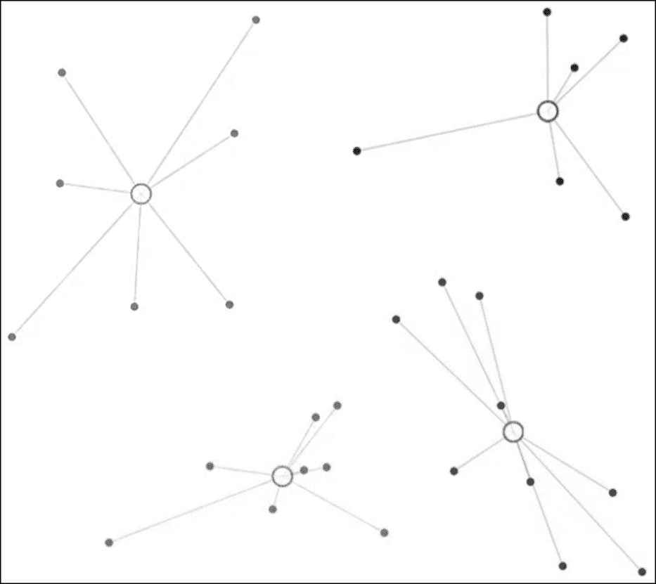

图 4.1 K-means 聚类。


## 4.2 K-Means 聚类

K-Means 聚类将数据点分配给最近的质心，在图像中表示为较大的圆标记。每个聚类的质心计算为其数据点的均值。该算法迭代地最小化距离，将数据分组为 `k` 个聚类。

(4.1)

$$C = \\frac{1}{\\mathit{Nc}}\\sum\_{\\mathit{xj} = 1}^{\\mathit{Nc}}\\ \\mathit{xj}$$

其中 `Nc` 是子集中向量的数量。在机器学习中，成本函数的评估有助于估计模型预测中的误差。

改进模型的性能涉及最小化该函数以实现最佳结果。在聚类的上下文中，成本函数衡量聚类内部的失真总和。在机器学习中，成本函数的评估有助于估计模型预测中的误差。对于聚类，成本函数衡量聚类内部的失真总和。具体来说，在 K-Means 聚类中，失真指的是数据点与其最近聚类中心之间的平方欧几里得距离。最小化该函数对于实现最佳聚类至关重要。

为了在 K-Means 算法中最小化成本函数 `J`，迭代执行两个主要步骤：
1. 在保持质心固定的同时，将数据点分配更新到最近的质心。
2. 在保持分配固定的同时，根据新分配的数据点更新质心。

该算法的 K-Median 变体使用曼哈顿距离（L1 距离）而不是欧几里得距离。曼哈顿距离衡量质心坐标与数据点之间的绝对差值之和。K-Means 和 K-Median 算法都旨在通过迭代更新数据点分配和质心位置来最小化成本函数，其中 K-Median 使用曼哈顿距离进行距离计算。

### 4.2.1 K-Means 算法

K-Means 算法，也称为 Lloyd 算法，可以总结为以下步骤：
1. *步骤 1：* 为每个 `k` 个聚类随机初始化质心。
2. *步骤 2：* 将每个数据点分配给最近的质心以形成初始的 `k` 个聚类。
3. *步骤 3：* 通过计算每个 `k` 个聚类中所有数据点的平均值来重新计算质心。重新计算质心后，数据点会被重新分配到最近的质心。
4. *步骤 4：* 重复步骤 3（重新计算质心并重新分配数据点），直到数据点停止更换聚类。

**Scikit-Learn 中 K-Means 的实现具有以下关键超参数：**
1. `n_clusters`: 用户提供期望的聚类数量。
2. `init`: 质心要么随机初始化，要么使用 K-Means++ 技术以获得更好的结果进行初始化。
3. `n_init`: 算法使用不同的质心种子多次运行，以避免稀疏数据的聚类不平衡，并根据惯性（聚类性能指标）选择最佳结果。
4. `max_iter`: 允许质心重新计算的最大迭代次数，有助于控制处理时间。
5. `algorithm`: 在 Lloyd 算法或 Elkan 算法之间进行选择。Lloyd 算法通常用于 K-Means，建立质心并将数据点划分为聚类。

**现在，让我们来看一下训练可用的关键属性：**
1. `Cluster_centers_`: 包含质心（聚类中心）坐标的数组。
2. `Labels_`: 包含分配给每个数据点的标签的数组，表示它们所属的聚类。
3. `Inertia_`: 衡量聚类形成好坏的指标，计算为每个样本到其最近聚类中心的平方距离之和。

*注*: K-Means 是一个无监督学习模型，仅在训练数据上拟合。K-Means 的 `fit`、`fit_transform` 和 `fit_predict` 方法仅接受一个参数，即待观察和聚类的数据集（图 4.2）。

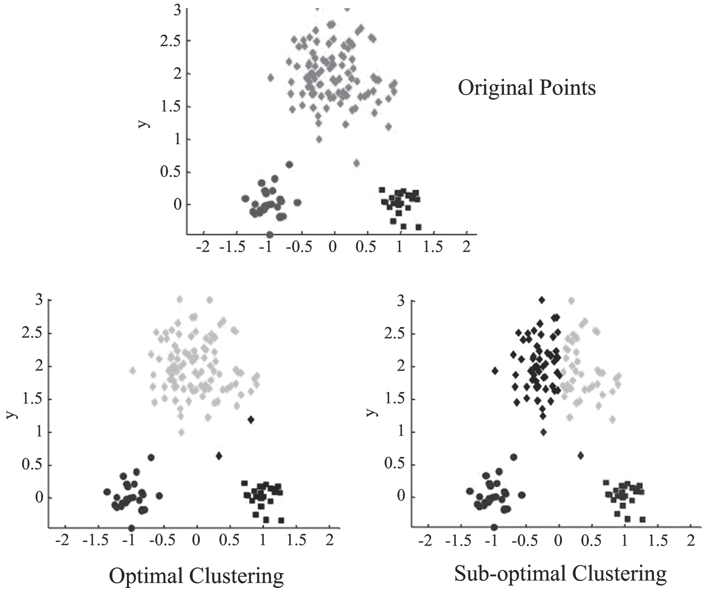

图 4.2 K-means 聚类的不同类型。

> **问题：** 给定 `d` 维空间中 `n` 个点的集合 `X` 和整数 `k`，目标是将点分组为 `k` 个聚类 `C` = {`C1`, `C2`, …, `Ck`}，使得：
> **(4.2)**
> $$\\text{Cost}\\left( C \\right) = \\sum\\limits\_{i = 1}^{k}\\sum\\limits\_{x \\in C\_{i}}\\ \\textit{dist}\\left( x,c \\right)$$
> 被最小化，其中 `ci` 是聚类 `C[i]` 中点的质心。
> 最常见的定义是使用欧几里得距离，最小化平方误差和（SSE）函数。
> **问题：** 给定 `d` 维空间中 `n` 个点的集合 `X` 和整数 `k`，任务是将点分组为 `k` 个聚类 `C` = {`C1`, `C2`, …, `Ck`}，使得：
> **(4.3)**
> $$\\text{Cost}\\left( C \\right) = \\sum\\limits\_{i = 1}^{k}\\sum\\limits\_{x \\in C\_{i}}\\left( x - c\_{i} \\right)^{2}$$
> 被最小化，其中 `ci` 是聚类 `C[i]` 中点的均值。

### K-Means 的优点

1. *简单易实现*: K-Means 算法易于理解和使用，使其成为聚类任务的热门选择。
2. *快速高效*: K-Means 计算效率高，适用于高维的大型数据集。
3. *可扩展性*: K-Means 可以处理包含大量数据点的大型数据集，并且可以轻松扩展以处理更大的数据集。
4. *灵活性*: K-Means 多功能且可适应不同的应用，允许使用各种距离度量和初始化方法。

### K-Means 的缺点

1. *对初始质心的敏感性*: K-Means 可能收敛到次优解，因为它对质心的初始选择敏感。
2. *需要指定聚类数*: K-Means 需要事先知道聚类数（`k`），在某些应用中这可能难以确定。
3. *对异常值敏感*: K-Means 受异常值影响，其存在可能导致偏斜或不准确的聚类分配。

### K-Means 聚类的应用

K-Means 聚类在现实生活中的各种示例或业务案例中使用，例如：
1. *学业表现:* K-Means 可用于学生成绩分析和根据学生的学业成绩或学习模式对学生进行分组。
2. *诊断系统:* 在医疗应用中，K-Means 可用于疾病诊断，根据患者的症状和医疗数据对患者进行聚类。
3. *搜索引擎:* K-Means 可帮助搜索引擎进行文档聚类，将相似文档分组以增强搜索结果。
4. *无线传感器网络*: K-Means 用于在无线传感器网络中组织传感器数据，以实现高效的数据处理和分析。

## 4.3 层次聚类和基于密度的聚类

### 4.3.1 层次聚类

层次聚类是一种灵活的方法，可在不需要预先固定聚类数量的情况下形成聚类的层次结构（树状图）。当聚类数量增加时执行分裂聚类，其中所有数据实例从一个聚类开始，并在每次迭代中分裂，从而形成聚类的层次结构。该算法包括单链接、完全链接、平均链接和 Ward 方法，它们形成一组嵌套聚类，按层次树组织。


## 4.3.1 层次聚类

层次聚类算法有两种类型。凝聚层次聚类 (`AGNES`) 是一种根据数据点之间的成对距离度量对数据点进行分组的算法。它首先将每个数据点视为单独的簇，然后逐步合并最接近的簇对，直到只剩下一个簇。簇间距离可使用多种方法计算，包括单最近距离（单链接）、完全最远距离（完全链接）、平均距离（平均链接）、质心距离以及 Ward 方法（最小化平方欧氏距离之和）。相反，分裂法 (`DIANA`) 从一个包含所有数据点的簇开始，并迭代地将其划分为更小的簇。这两种方法均用于层次聚类以构建树状图并确定最优聚类数。

### 4.3.1.1 凝聚层次聚类

凝聚层次聚类 (`AGNES`) 在数据分组进行直至只形成一个簇。为了确定合适的聚类数，树状图会根据特定标准进行分析。值得注意的是，`AGNES` 是一种凝聚方法，它从单个数据点开始并将其合并为更大的簇。

凝聚层次聚类的算法步骤：

设 `X = {x1, x2, x3, …, xn}` 为数据点集合。

### 4.3.1.2 分裂层次聚类

分裂层次聚类 (`DIANA`) 是 `AGNES` 的逆过程，前者从一个大簇开始并在每次迭代中将其划分为更小的簇，而后者从单个数据点开始并逐步将其合并为更大的簇。

分裂层次聚类是一种层次方法，它从一个包含所有数据点的单一簇开始，然后迭代地将其划分为更小的簇。该过程涉及的步骤如下：

1. 从标记为 `m = 0` 且层级为 `L(0) = 0` 的单一簇开始。
2. 识别当前聚类中数据点之间距离最大的两个簇，表示为对 (`r`) 和 (`s`)，基于 `d[(r), (s)] = min d[(i), (j)]`，其中最小值是在当前聚类中所有簇对上取的。
3. 增加序列号：`m = m + 1`。将簇 (`r`) 和 (`s`) 分开以创建两个独立的簇，形成标记为 `m` 的下一个聚类。将此聚类的层级设为 `L(m) = d[(r), (s)]`。
4. 更新距离矩阵 `D`，通过删除对应簇 (`r`) 和 (`s`) 的行和列，并为新形成的簇添加一行一列。新簇表示为 (`r`, `s`) 与旧簇 (`k`) 之间的距离定义如下：`d[(k), (r, s)] = min(d[(k), (r)], d[(k), (s)])`。
5. 如果所有数据点现在都位于不同的簇中，则停止过程。否则，从步骤 2 重复。

### 层次聚类的优点

1. 无需事先了解聚类数。
2. 实现简单，在某些情况下可获得最优结果。

分裂层次聚类从一个包含所有数据的单一簇开始，逐步拆分簇，直到每个簇包含单个数据点（或指定的聚类数 `k`）。它使用相似性或距离矩阵来确定簇的相似性。该算法迭代地合并或拆分簇，创建一种称为树状图的层次树结构。该树状图记录合并或拆分的序列，提供聚类过程和嵌套簇的可视化（图 4.3）。

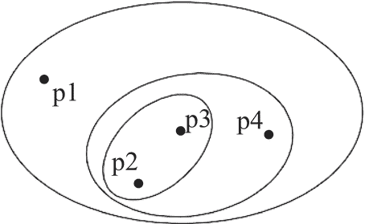

图 4.3 传统层次聚类。

我们不必假设任何特定的聚类数：

* 可以通过在适当层级“剪切”树状图（参见 图 4.4）获得任意期望的聚类数。

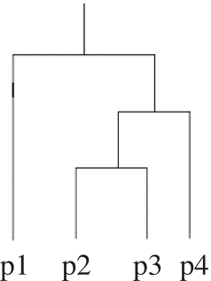

图 4.4 传统树状图。

* 簇可能对应有意义的分类法。
* 生物科学中存在许多例子（例如，动物界、系统发育重建等）

最流行的层次聚类技术：

1. 计算邻近矩阵：计算所有数据点之间的距离。
2. 将每个数据点视为单独的簇：从每个数据点作为自己的簇开始。
3. 合并两个最近的簇：反复合并距离最小的两个簇。
4. 更新邻近矩阵：重新计算新合并簇与剩余簇之间的距离。
5. 重复步骤 3 和 4 直到只剩下一个簇：继续合并簇直到所有数据点都在一个簇中。
6. 关键操作是计算两个簇的邻近度。定义簇间距离的不同方法区分了不同的算法（图 4.5 和 4.6）。

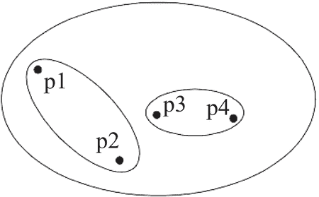

图 4.5 非传统层次聚类。

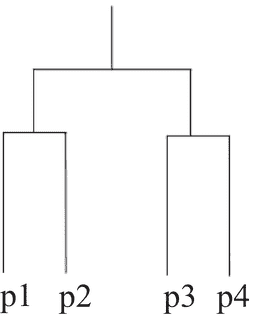

图 4.6 非传统树状图。

## 4.3.2 基于密度的聚类

基于密度的聚类是一种聚类算法，它将簇识别为数据空间中的密集区域，由较低对象密度的区域分隔。簇被定义为密度连接点的最大集合，使算法能够发现任意形状的簇。最广泛使用的基于密度的算法是带噪声的基于密度的空间应用聚类 (`DBSCAN`)。`DBSCAN` 算法利用密度可达性和密度连接性的概念，根据数据密度找到非线性形状的结构。该方法在识别具有不同密度的数据集中的簇方面发挥了重要作用，并且特别有效地处理噪声数据点（图 4.7）。

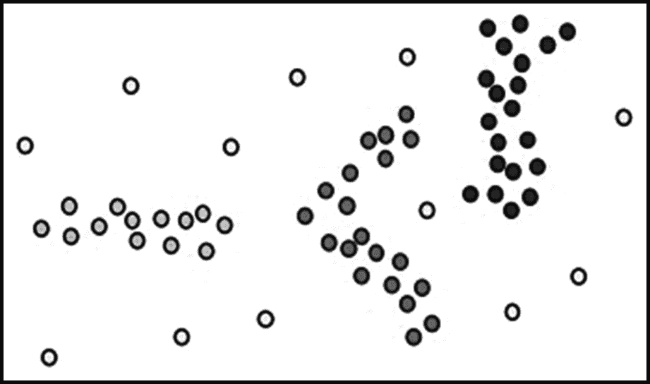

图 4.7 基于密度的空间聚类。

### 4.3.2.1 密度定义

`ε-Neighborhood` – 距离对象 `ε` 半径范围内的对象。

(4.4)

`Nε : {q | d(p,q) ≤ ε}`

“高密度” – 对象的 `ε-Neighborhood` 包含至少 `MinPts` 个对象（图 4.8）。

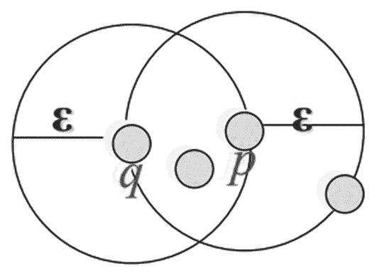

图 4.8 密度定义。*ε-*邻域 of *p* *ε-*邻域 of *q* *p* 的密度为“高” (MinPts = 4) *q* 的密度为“低” (MinPts = 4)

### 4.3.2.2 密度可达性

如果满足以下条件，则点 `p` 被认为是从点 `q` 密度可达的：

1. 点 `p` 在指定距离 `ε`（epsilon）范围内。
2. 点 `q` 在其 `ε-Neighborhood` 中有足够多的点（即在距离 `q` 为 `ε` 范围内）。

换句话说，要使点 `p` 从 `q` 密度可达，`q` 应该在 `ε` 距离内有足够的邻近点，表明这是一个更高密度的区域。这种密度可达性的概念使算法能够识别数据空间中连接且密集的簇，即使簇具有不规则形状或不同的密度（图 4.9）。


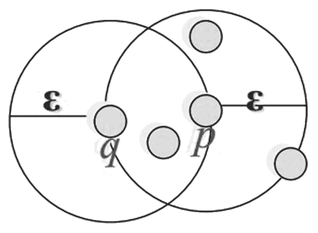

图 4.9 密度可达性。其中，“`q`”可直接从“`p`”密度可达。`MinPts = 4` `p` 不能直接从 `q` 密度可达 密度可达性是不对称的

### 4.3.2.3 密度连接性

两个点“`p`”和“`q`”如果满足以下条件则被认为密度连接：

1. 存在一个点“`r`”，其 `ε-neighborhood` 中有足够数量的点。
2. 两个点“`p`”和“`q`”都在距离“`r`” `ε` 范围内。

此过程通常被称为链式连接，其中密度连接的点形成邻近点的链或路径。因此，如果点“`q`”是点“`r`”的邻居，“`r`”是点“`s`”的邻居，“`s`”是点“`t`”的邻居，且“`t`”是点“`p`”的邻居，则意味着“`q`”也是点“`p`”的邻居。这种链式过程确保密度连接的点属于同一簇，有助于基于密度的算法识别数据中形状和大小各异的簇。

### 4.3.2.4 DBSCAN 聚类的算法步骤

DBSCAN 需要两个参数：`ε` (`eps`) 和形成簇所需的最少点数 (`minPts`)。

1. 从任意一个未访问的点开始。
2. 使用 `ε` 形成该点的邻域（包括 `ε` 距离内的所有点）。
3. 如果邻域包含足够多的点，则开始聚类过程，将该点标记为已访问，否则将其标记为噪声（以后可能加入簇）。
4. 如果一个点属于簇，则其 `ε-neighborhood` 也属于该簇，并且过程从第 2 步开始对所有 `ε-neighborhood` 点重复。直至确定簇中的所有点为止。
5. 检索并处理一个新的未访问点，从而发现另一个簇或噪声。
6. 继续该过程，直到所有点都被标记为已访问。

DBSCAN 的优点：

1. 无需事先指定簇的数量。
2. 可以检测并将噪声数据标记为异常值。
3. 可以找到各种形状和大小的簇。

DBSCAN 的缺点：

1. 不适用于具有不同密度簇的数据集。
2. 在“颈状”数据集上表现不佳。
3. 在高维数据上性能可能下降。

## 4.4 模糊 C 均值聚类

模糊 C 均值聚类是 K-Means 聚类的扩展。与 K-Means 不同，后者中每个数据点只属于一个簇，模糊 C 均值允许数据点以 0 到 1 之间的隶属度（概率）分配给多个簇。在模糊 C 均值聚类中，数据点可以以一定的权重属于每个簇，表示其隶属强度。算法根据数据点与簇中心之间的距离分配隶属值。每次迭代后，隶属度和簇中心都会更新，该过程持续进行直至收敛，提供更灵活的聚类并处理数据中的不确定性。

(4.5)

$$
\mu_{ij} = 1/\sum\limits_{k = 1}^{c}\left( d_{ij}/d_{ik} \right)^{(2/m - 1)}
$$

(4.6)

$$
v_{j} = \left( \sum\limits_{i = 1}^{n}\left( \mu_{ij} \right)^{m}x_{i} \right)/\left( \sum\limits_{i = 1}^{n}\left( \mu_{ij} \right)^{m} \right),\forall j = 1,2,\ldots c
$$

其中，“`n`”是数据点的数量。“`v[j]`”表示第 `j` 个簇中心。“`m`”是模糊指数 `m` € \[1, ∞\]。“`c`”表示簇中心的数量。“`μ[ij]`”表示第 `i` 个数据对第 `j` 个簇中心的隶属度。“`d[ij]`”表示第 `i` 个数据与第 `j` 个簇中心之间的欧几里得距离。

模糊 C 均值算法的主要目标是最小化：

(4.7)

$$
J\left( U,V \right) = \sum\limits_{i = 1}^{n}\sum\limits_{j = 1}^{c}\left( \mu_{ij} \right)^{m}\left\| x_{i} - v_{j} \right\|^{2}
$$

其中，“`||x[i] − v[j]||`”是第 `i` 个数据与第 `j` 个簇中心之间的欧几里得距离。

### 4.4.1 模糊 C 均值聚类的算法步骤

设 `X` = {`x1`, `x2`, `x3` …, `xn`} 为数据点集合，`V` = {`v1`, `v2`, `v3` …, `vc`} 为中心集合。

1. 首先随机选择“`c`”个簇中心。
2. 使用以下公式计算模糊隶属度“`μ[ij]`”：

(4.8)

$$
\mu_{ij} = 1/\sum\limits_{k = 1}^{c}\left( d_{ij}/d_{ik} \right)^{(2/m - 1)}
$$

3. 使用以下公式计算模糊中心“`v[j]`”：

(4.9)

$$
v_{j} = \left( \sum\limits_{i = 1}^{n}\left( \mu_{ij} \right)^{m}x_{i} \right)/\left( \sum\limits_{i = 1}^{n}\left( \mu_{ij} \right)^{m} \right),\forall j = 1,2,.\ldots.c
$$

4. 重复步骤 2 和 3，直到达到最小“`j`”值或 `||U(k + 1) − U(k)|| < β`。

其中，
* “`k`”是迭代步。
* “`β`”是 \[0, 1\] 之间的终止准则。
* “`U = (μ[ij])n*c`”是模糊隶属度矩阵。
* “`j`”是目标函数（图 4.10 模糊 C 均值聚类的结果。）。

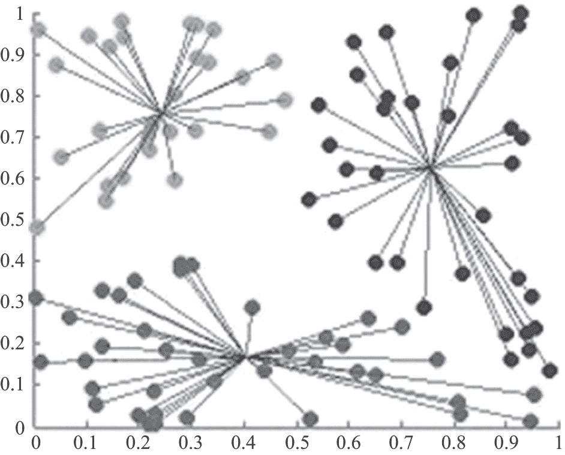

图 4.10 模糊 C 均值聚类的结果。

模糊 C 均值聚类的优点：

1. 对于重叠数据集提供更优的结果，并且在这种情况下通常优于 K-Means 算法。
2. 允许数据点被分配到多个簇中心的隶属度，适应数据点可能属于多个簇的情况。

模糊 C 均值聚类的缺点：

1. 需要事先指定簇的数量。
2. 使用较低的 `β` 值获得更好的结果可能导致迭代次数增加，影响计算效率。
3. 欧几里得距离度量可能无法同等权衡潜在因素，从而可能影响聚类结果的准确性。

### 4.4.2 聚类算法应用

#### 4.4.2.1 聚类算法在识别癌症数据中的应用

聚类算法可有效用于识别癌症数据集。该过程涉及获取已知的癌症和非癌症数据的样本并相应地标记它们。这些标记的样本随后被随机混合以创建组合数据集，并在学习阶段对该混合数据集应用各种聚类算法。

在学习阶段，将聚类结果与原始样本的已知标签进行比较，以确定获得的正确结果数量。这使我们能够计算每种算法所达到的正确结果百分比。基于此分析，我们可以确定最适合我们数据样本的聚类算法。

一旦确定了性能最佳的算法，就可将其应用于新的任意数据样本，以期望获得与学习阶段相同的正确结果百分比。对于癌症数据集，通过实验观察到无监督非线性聚类算法产生最佳结果。这一发现表明癌症数据的非线性性质，强调了无监督非线性聚类技术在癌症数据分析中的重要性。

#### 4.4.2.2 聚类算法在搜索引擎中的应用


聚类算法构成了搜索引擎的基础。它们将相似的对象归为一组并将不相似的对象分开，使搜索结果更相关、更有用。搜索引擎中使用的聚类算法的质量极大地影响搜索结果的呈现方式。良好的聚类算法可以提高在首页获得期望结果的机会。为了获得更好的搜索结果，定义确定相似对象的标准至关重要。此过程需要头脑风暴和仔细考虑。相似对象的定义在搜索引擎性能中发挥着至关重要的作用。定义越好，搜索结果就越准确、越相关。

### 4.4.2.3 学术中的聚类算法
能够监控学生学业表现进展的能力一直是高等教育学术界的关键问题。聚类算法可用于监控学生的学业表现。根据学生的成绩，他们被分为不同的簇（使用 `K-Means`、`Fuzzy C-Means` 等），其中每个簇表示不同的表现水平。通过了解每个簇中的学生数量，我们可以了解整个班级的平均表现。

### 4.4.2.4 基于无线传感器网络应用中的聚类算法
聚类算法在无线传感器网络 (`WSN`) 应用中很有效，例如地雷探测。在地雷探测中，聚类算法有助于识别负责在其各自簇内收集数据的簇头（或聚类中心）。`WSN` 中的簇头能高效地组织数据收集，减少通信开销并优化能耗。通过使用聚类算法，`WSN` 可以提高识别潜在地雷位置的准确性和可靠性，使其在地雷探测等关键任务中更有效。

## 4.4.3 示例问题
活动：
* 解释 `Fuzzy C-Means Clustering` (`FCMC`) 技术
* 尝试使用 `FCMC` 技术将数据点聚类到模糊簇中

给定一组数据，聚类技术用于将一组数据划分为多个组，确保组内关联强、不同组数据点之间关联弱。经典的清晰聚类技术创建清晰划分，其中每个数据点只属于一个簇。其说明如图 图 4.11 所示，其中六个数据点被聚类为两个不同的簇。在此示例中，数据具有两个维度，意味着它存在于二维特征空间中（图 4.11）。

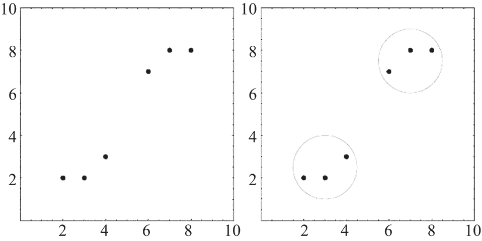

图 4.11 清晰聚类的简单示例。

与清晰聚类相反，模糊聚类允许数据点属于多个组，从而产生模糊划分。每个簇都与一个隶属函数相关联，该函数量化单个数据点在簇内的隶属程度。在各种模糊聚类方法中，`Fuzzy C-Means clustering` (`FCMC`) 在学术和工业应用中被最广泛使用和研究 [1]。其成功和流行使其成为文献中的主要技术。

活动：
* 观察聚类数应预先给定。
* 观察 `FCMC` 算法中的迭代性。

`Fuzzy C-Means clustering` 通过迭代搜索一组模糊簇及其相关联的聚类中心来进行聚类，这些聚类中心能最好地代表数据的结构。用户需要指定要聚类的数据集中存在的聚类数 (`c`)。`FCMC` 然后将数据 `X` = {`x1`, `x2`, …, `xn`} 划分为 `c` 个模糊簇，通过最小化如下的组内平方误差和目标函数：

(4.10)

$$J\_{m}\\left( U,V \\right) = \\sum\\limits\_{k = 1}^{n}\\sum\\limits\_{i = 1}^{c}\\left( U\_{\\mathit{ik}} \\right)^{m}\\left\\| x\_{k} - v\_{i} \\right\\|^{2},1 \\leq m \\leq \\infty$$

其中 `J``m` 表示由隶属矩阵 `U` 和相关联的聚类中心 `V` 表示的模糊簇集合的平方误差和。记号 ∣∣.∣∣ 表示特定的内积诱导范数。在此上下文中，∥`x`[`k`] − `v`[`i`]∥² 表示数据点 `x`[`k`] 与聚类中心 `v`[`i`] 之间的距离。平方误差用作性能指标，衡量聚类中心与相应模糊簇中元素之间的距离加权和。参数“`m`”控制隶属度在性能指标中的影响。随着“`m`”的增加，划分变得更模糊。已证明 `FCMC` 算法对于 (1, ∞) 范围内的任何“`m`”值都收敛。

在 `FCMC` 算法的每次迭代中，矩阵 `U` 被计算并且相关联的聚类中心被计算为式 (4.6)。随后计算式 (4.5) 中的平方误差。当误差低于某个容差值或其相对于前一次迭代的改进低于某个阈值时，算法停止。聚类过程使用三个簇显示在 图 4.12（初始状态）和 图 4.13（最终状态）。

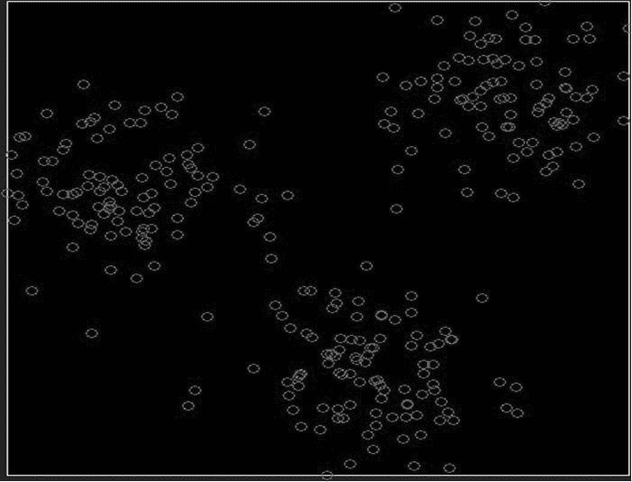

图 4.12 聚类过程（初始状态）。

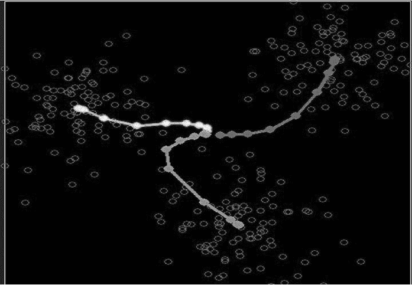

图 4.13 聚类过程（最终状态）。

活动：
* 查看不同类型的聚类算法，注意其优点。多年来，提出了许多 `Fuzzy C-Means clustering` (`FCMC`) 的扩展和变体。通过在式 (4.5) 中使用不同的距离函数或对目标函数进行轻微修改，这些聚类算法能够检测不同类型的簇。

当 `FCMC` 使用欧几里得距离时，它在检测近似大小相似的球形簇方面很有效。Gustafson 和 Kessel 引入了 `GK` 聚类算法 [2]，它使用变换的马哈拉诺比斯距离。这种修改使 `GK` 聚类能够检测近似相同大小的圆柱形正态簇。`GK` 聚类技术的有效性已在 [3] 中分析并与其他聚类方法进行比较。`GK` 聚类算法中使用的距离公式由式 (4.8) 给出，其中 `C`[`i`] 表示第 `i-` 个簇的协方差矩阵，`C`[`i`] − 1 表示协方差矩阵的逆，`d` 是维度数，且 `ρ`[`i`] = 1 为常数。

# 4.5 量子计算中的主成分分析
主成分分析 (`PCA`) 是一种强大的降维方法，在包括量子计算在内的众多行业中都有应用。处理高维量子数据是量子计算这一快速扩展领域的常见困难。然而，`PCA` 提供了提取关键特征并降低量子数据集复杂性的有效方法，从而实现更好的量子算法和分析。

在量子计算的上下文中，`PCA` 涉及确定量子态或量子数据的主要成分。这些主要成分描述了量子特征空间中数据变化最显著的方向。通过将量子数据投影到这些主成分上，我们可以在保留其关键信息的同时最小化数据的维度。


## 4.5 量子计算中的 PCA
`PCA` 在量子计算中的数学根源基于线性代数原理，如特征值分解和奇异值分解（`SVD`）。密度矩阵可用于表示量子态或量子数据，其协方差矩阵可以构建以提取主要成分。

量子 `PCA` 方法的实现各不相同，其中一些使用变分量子电路来发现近似答案，其他则使用 `SVD` 技术的量子版本。这些方法为量子数据处理开辟了新的途径，例如量子态压缩、噪声降低和量子机器学习。

`PCA` 在量子计算中的关键优势之一是其有助于量子误差缓解的能力。它可以通过降低量子数据的维度来帮助发现和缓解错误，从而提高量子计算的整体可靠性和性能。

此外，量子 `PCA` 用于量子化学和材料科学中，在这些领域经常遇到高维量子态。研究人员可以通过使用 `PCA` 高效地表达这些态，更深入地了解复杂的量子系统，并获得更好的量子算法来模拟化学相互作用和材料特性。

尽管有其优势，量子 `PCA` 仍存在局限性。当量子数据集的数量增长时，计算 `PCA` 的经典模拟变得困难，因为所需的计算资源呈指数级扩展。此外，量子噪声和受限的量子比特相干性使得在量子硬件中估计主成分变得困难。

### 4.5.1 变分量子主成分分析
变分量子主成分分析（`VPCA`）基于一种变分技术，该技术使用量子电路来近似量子态或量子数据集的主要成分。量子并行的能力被用来高效地搜索量子特征空间并找到捕捉数据中最重要变异性的路径。

`VPCA` 算法首先将量子数据转换为量子态，随后由参数化量子电路处理。经典优化技术被用来迭代调整电路的参数，以最小化成本函数，该函数量化了输入量子数据与使用所选主要成分重建的量子态之间的差异。

`VPCA` 的主要优势之一是其能够在近期量子设备上实现，而在硬件限制下，全规模量子算法可能尚不实用。即使在量子硬件存在噪声和缺陷的情况下，`VPCA` 也是量子数据分析和特征提取的有用工具。

此外，`VPCA` 对于量子机器学习应用具有很大的前景。它通过降低量子数据的维度，使高效有效的聚类、分类和其他量子数据驱动任务成为可能，从而为量子增强机器学习研究开辟了新的途径。

然而，认识到 `VPCA` 的问题和局限性至关重要。其作为近期量子算法的有效性在很大程度上取决于当前量子硬件的能力和稳定性。在量子系统中，噪声和退相干会降低所推导主成分的准确性，需要有效的误差缓解技术。

### 4.5.2 量子奇异值分解
量子奇异值分解（`QSVD`）是量子计算领域的一项关键成就，并在题为“`PCA` in Quantum Computing”的章节中发挥重要作用。它是传统奇异值分解（`SVD`）算法的量子启发变体，该算法在经典计算中常用于主成分分析（`PCA`）。

在传统的 `PCA` 中，奇异值分解（`SVD`）用于将矩阵分解为三个分量矩阵，从而提取主成分及其相关的奇异值。同样，`QSVD` 以量子启发的方式分解量子数据，从而识别重要的量子特征和模式。

`QSVD` 算法通过利用叠加和纠缠的量子特性工作。它可以高效处理量子态和量子数据集，即使在高维区域也是如此。通过利用量子并行性，`QSVD` 在应用于量子数据时在速度上超越了经典 `SVD`，这对于处理大数据集的量子算法尤其有帮助。

在本书章节的背景下，将 `QSVD` 实施到量子计算的 `PCA` 中具有巨大的前景。它可用于降低量子态的维度，使其更易于分析和操作。此外，使用 `QSVD` 获得的奇异值可以帮助近似量子态，从而实现量子态压缩和噪声降低。

然而，在实际应用中，认识到 `QSVD` 的局限性至关重要。量子硬件中的噪声、错误和退相干都可能影响 `QSVD` 算法的准确性。为了在量子计算应用中获得准确的结果，需要对误差缓解策略和量子误差模型有详细的理解。

## 4.6 使用量子技术进行异常检测
通过异常检测可以找到与典型数据模式不同的数据。其在传统数据上的应用在许多关键领域具有广泛用途，包括欺诈检测、医学诊断、数据清洗和监控。量子技术的出现可能导致量子应用的发展，这些应用严重依赖于以量子态形式存在的量子数据的异常检测。对于某些问题，包括因式分解和在非结构化数据库中搜索，量子计算已成功开发出比其经典对应算法更快的算法。它使用诸如振幅放大、量子矩阵求逆和量子相位估计等方法。近来，这些技术已用于机器学习量子算法。

异常检测是量子计算可能彻底改变的众多行业之一。虽然异常检测任务可以用经典计算机完成，但量子计算在计算能力和同时处理大量数据的能力方面具有潜在优势。

量子机器学习技术是量子计算在异常识别中的潜在用途之一。这些算法通过利用量子系统的特殊特性，比其经典等价物更快地进行复杂计算。

量子机器学习算法可以通过提高数据分析的精度和速度来增强异常检测。例如，通过将输入数据转换为更高维的特征空间并识别划分两个类别的理想超平面，量子支持向量机（`QSVMs`）可用于将数据点分类为正常或异常。这些高维映射计算可以利用量子方法加速，并优化分类过程。

为了解决优化问题，量子计算对于异常检测也可能有用。许多异常检测方法依赖于特定目标函数的优化来发现异常。与传统优化技术相比，量子算法，如量子退火或量子启发算法，可能能够更快、更有效地解决这些优化问题。


必须牢记，量子计算仍处于起步阶段，具备足够量子比特数和纠错能力的实用量子机器目前仍难以获得。因此，量子计算在异常检测中的应用仍主要停留在理论和实验阶段。异常检测只是研究人员积极研究量子算法并创建利用量子计算能力的方法的众多应用之一。

机器学习异常检测方法有多种不同的形式。每种方法可分为三个类别。根据数据类型等变量，每种方法都会采用特定的离群点检测和分析算法和方法。每种技术的总体前提是异常情况不常见，并且与典型数据点的特征明显不同。以下是机器学习异常检测的典型方法：
1. 无监督异常检测。
2. 有监督异常检测。
3. 半监督异常检测。

### 4.6.1 无监督异常检测
在没有标签数据或对异常的先验知识的帮助下，在数据集中定位异常模式或离群点的实践被称为无监督异常检测。当没有预先存在的样本或标签可用于训练有监督异常检测模型时，这是一种有益的策略。
无监督异常检测可以通过多种方式实现。
* *基于统计的方法*: 这些方法假设正常数据点遵循特定的统计分布，例如高斯分布。然后，显著偏离预测分布的数据点被识别为异常。`Z-scores`、百分位数和像 `Mahalanobis distance` 这样的多元统计方法就是统计程序的几个例子。
* *基于密度的方法*: 这些技术旨在在数据密度低的区域寻找异常。异常是位于数据集稀疏区域的数据点。`DBSCAN`（Density-Based Spatial Clustering of Applications with Noise）算法是一种众所周知的基于密度的算法。
* *基于聚类的方法*: 异常是属于任何聚类的数据点或仅属于小聚类的数据点。这些方法试图将相似的数据点排列成聚类。`k-means` 算法是一种用于异常识别的流行聚类算法。
* *自编码器神经网络模型*: 称为 `autoencoders` 的模型被训练以发现输入数据的压缩表示。通过对比自编码器的重构误差，可以找到异常。重构误差越高，数据点异常的可能性越大。
* *隔离森林*: `Isolation Forest` 是一种基于集成的方法，它递归地划分特征空间并随机隔离数据点。需要更少划分即可被隔离的数据点被检测为异常，突出了其独特性。
需要注意的是，无监督异常检测方法可能存在缺点，例如无法明确定义异常检测阈值或出现误报的可能性。因此，为了提高无监督异常检测系统的精确性和可靠性，通常有必要集成不同的算法或加入领域知识。

### 4.6.2 有监督异常检测
利用标签数据或对异常的先验知识在数据集中定位异常模式或离群点的实践被称为有监督异常检测。它涉及使用在包含明确识别或标记异常的标签数据集上训练的模型来将新的、未预见的数据点分类为异常或正常。通常，有监督异常检测涉及以下步骤：
1. *数据收集和标记*: 编译包含典型和不寻常情况的数据集。异常可以通过人工检查、历史数据或专业知识进行分类。数据集需要反映异常检测算法将应用于的实际环境因素。
2. *特征选择和提取*: 找到数据中相关的特征或属性，可用于区分预期和意外模式。在此阶段，原始数据被转换为异常检测模型可使用的特征表示。
3. *使用标签数据集训练有监督学习模型，例如二元分类器*: 基于标记的实例，模型学习区分典型和异常模式。`Support vector machines`（`SVMs`）、`random forests` 或 `neural networks` 是经常用于异常识别的有监督学习技术。
4. *验证和模型评估*: 使用评估指标，例如准确率、精确率、召回率或 F1 分数，来评定训练模型的性能。为了确保模型能够泛化，可以使用交叉验证方法。
5. *部署和推理*: 模型训练并评估后，可用于预测未观察数据中的异常。基于训练期间获得的专业知识，模型将每个数据点标记为正常或异常。
使用标签数据或对异常的先验知识可以帮助有监督异常检测。然而，它假设带标签的样本充分描绘了实际数据中出现的异常。此外，训练数据中包含的异常类型可能是模型性能的限制。随着新异常的出现或现有异常的变化，定期重新评估和更新模型至关重要。

### 4.6.3 半监督异常检测
一种包含有监督和无监督异常检测方面策略被称为半监督异常检测。为了训练能够在未观察数据中发现异常的模型，它使用少量标记的异常数据以及大量未标记数据。半监督异常检测通常涉及以下步骤：
1. *标记数据收集*: 编译少量被识别为异常的带标签数据点。这些标记的异常可能通过人工检查、历史文档或专业知识发现。
2. *收集更大组的未标记数据点*: 这些未标记数据点缺乏明确说明其是否正常或异常的标签。它们表示数据集中典型的模式或行为。
3. *特征提取和选择*: 从标记和未标记数据点中提取和选择相关特征。这些特征应反映区分异常与常规模式的特征。
4. *模型训练*: 使用标记的异常和未标记的正常数据构建半监督学习模型。该模型通过从标记的异常中泛化来学习检测未标记数据中的异常。`Self-training`、`co-training` 以及像 `autoencoders` 这样的生成模型是用于异常识别的常见半监督学习算法。
5. *模型评估*: 使用合适的评估指标来衡量训练模型的性能。由于未标记数据缺乏明确标签，评估可能涉及将模型的异常排名或分数与专家领域知识进行比较，或采用异常检测评估方法，如给定召回率下的精确率。


半监督异常检测的好处在于它可以在未标记数据中识别异常，同时利用有限数量的标记数据来指导学习过程。在获取标记异常数据成本高、耗时或不易获得的情况下，此方法可能很有帮助。

必须记住，标记异常和未标记正常数据的质量和代表性对半监督异常检测的成功至关重要。模型的泛化到隐藏异常的能力可能受不完整或有偏的标记数据的限制。为了获得最佳结果，在标记数据和未标记数据的选择和平衡上应谨慎使用。

异常检测算法的类型如下：

* `Classification-based anomaly detection algorithms`
* `Spectral theory-based anomaly detection algorithms`
* `Nearest neighbor-based anomaly detection algorithms`
* `Cluster-based anomaly detection algorithms`
* `Statistical techniques anomaly detection algorithms`
* `Information-theoretic techniques anomaly detection algorithms`

### 基于分类的异常检测算法

基于分类的异常检测算法旨在通过在标记数据上训练分类模型，将数据点分类为正常或异常。以下是一些流行的基于分类的异常检测算法：

* `Support Vector Machines (SVMs)`: `SVMs` 可用于二元分类，包括异常检测。模型学习一个超平面，根据其特征表示将正常和异常数据点分开。
* `Random Forest`: `Random Forest` 是一种集成学习方法，构建多个决策树。异常可以根据集成预测来识别，其中偏离常态的数据点被分类为异常。
* `k-Nearest Neighbors (k-NN)`: 在 `k-NN` 中，数据点的类别是通过考虑其 `k` 个最近邻居的类别标签来确定的。异常被识别为在定义距离内具有相同类别邻居数量较少的数据点。
* `Neural Networks`: 深度学习模型，例如多层感知器（`MLP`）或卷积神经网络（`CNN`），可以用于异常检测训练。模型学习数据中的复杂模式，并根据与正常模式的偏差区分异常。
* `Naive Bayes`: `Naive Bayes` 是假设特征之间独立的概率分类器。它可通过估计数据点属于正常类的概率并将低概率实例识别为异常来用于异常检测。
* `One-Class Support Vector Machines (OC-SVM)`: `OC-SVM` 是 `SVM` 的扩展，专为无监督异常检测设计。它学习一个超平面，在特征空间中包围正常数据点，而位于该边界之外的数据点被视为异常。
* `Logistic Regression`: `Logistic Regression` 模拟输入特征与数据点属于正常类的概率之间的关系。可以应用阈值将低概率实例分类为异常。

这些基于分类的算法需要带有明确识别异常的标记训练数据。它们学习区分正常和异常模式，并根据学习到的知识对未见数据点进行分类。性能评估通常使用准确率、精确率、召回率或 F1 分数等指标进行。

需要注意的是，最合适的基于分类的异常检测算法的选择取决于数据的特征、异常的性质以及应用的具体要求。可能需要进行实验和评估以确定特定场景的最佳算法。

### 基于谱理论的异常检测算法

基于谱理论的异常检测算法利用数据的谱特性来检测异常。这些算法通常分析从数据派生的某些矩阵的特征值或特征向量以识别异常模式。以下是一些基于谱理论的异常检测算法：

* `Principal Component Analysis (PCA)`: `PCA` 是一种流行的技术，通过将数据投影到由主成分张成的低维空间来降低数据的维度。异常可以根据其在低维空间中的位置或投影回原始空间时的重建误差来识别。
* `Singular Value Decomposition (SVD)`: `SVD` 将矩阵分解为三个分量：`U`、`Σ` 和 `V`，其中 `Σ` 包含奇异值。基于 `SVD` 的谱异常检测方法分析奇异值以识别异常。与预期奇异值分布的较大偏差可能表示异常。
* `Eigenvalue Decomposition`: `Eigenvalue Decomposition` 用于将矩阵分解为特征向量和特征值。基于特征值分解的谱异常检测技术检查特征值以识别异常。异常通常以偏离预期谱的较大特征值为特征。
* `Graph Laplacian`: `Graph Laplacian` 是一个表示图中数据点连接性的矩阵。基于 `Graph Laplacian` 的谱异常检测方法分析拉普拉斯矩阵的特征值和特征向量以检测异常。与预期特征值分布或特征向量模式的偏差可能表示异常。
* `Local Outlier Factor (LOF)`: `LOF` 是一种基于谱的异常检测算法，衡量数据点相对于其邻居的局部密度。它根据数据点局部密度与其邻居的比率为每个点计算 `LOF` 分数。`LOF` 分数较低的点被视为异常。

这些基于谱理论的算法可以通过捕捉数据中的潜在结构或模式来发现异常。它们通常利用异常与正常模式相比表现出不同谱特性的思想。然而，这些算法的有效性取决于对数据所做的假设以及所选谱分析技术的适用性。

需要注意的是，基于谱理论的异常检测算法可能需要参数调优或阈值设置才能获得令人满意的结果。在特定数据集上进行实验和验证对于确定这些算法是否适用于给定的异常检测任务至关重要。

### 基于最近邻的异常检测算法

基于最近邻的异常检测算法使用邻近概念来识别异常。它们比较数据点之间的距离或相似性以确定某点是否正常或异常。以下是一些基于最近邻的异常检测算法：

* `k-Nearest Neighbors (k-NN)`: 在 `k-NN` 中，数据点的类别标签由其 `k` 个最近邻居的类别标签决定。异常可被识别为在定义距离内具有相同类别邻居数量较少的数据点。
* `Local Outlier Factor (LOF)`: `LOF` 衡量数据点相对于其邻居的局部密度。它计算 `LOF` 分数，即数据点局部密度与其邻居平均局部密度的比率。`LOF` 分数明显低于邻居的点被视为异常。
* `Distance-Based Outlier Detection (DOD)`: `DOD` 根据数据点与其 `k` 个最近邻居的距离为每个数据点分配异常分数。异常被识别为异常分数高的点，表示它们远离邻居。


### 基于最近邻的异常检测算法
- `Angle-Based Outlier Detection (ABOD)`: `ABOD` 衡量数据点与其邻居之间连接向量的角度。异常点被识别为与邻居的角度相比角度变化较大的点。
- `Local Distance-Based Outlier Factor (LDOF)`: `LDOF` 将数据点邻居的距离信息与密度信息结合。它通过同时考虑距离和局部密度来计算局部距离异常因子。具有高 `LDOF` 分数的点被视为异常。

这些基于最近邻的算法使用邻近性的概念来区分正常数据点和异常数据点。通过检查数据点之间的关系和距离，它们可以识别出与数据主体显著偏离的离群点。

需要注意的是，基于最近邻的异常检测算法需要仔细选择参数，例如选择合适的邻居数量 (`k`) 或定义距离度量。此外，像特征缩放或降维这样的预处理步骤可能有必要以提高这些算法的有效性。在特定数据集上进行实验和评估对于确定这些算法的最佳配置和性能至关重要。

### 4.6.3.4 基于聚类的异常检测算法
基于聚类的异常检测算法根据数据的聚类结构识别异常。这些算法旨在将数据划分为簇，异常被识别为不属于任何簇或属于小型或稀疏簇的数据点。以下是一些基于聚类的异常检测算法：
- `DBSCAN (Density-Based Spatial Clustering of Applications with Noise)`: `DBSCAN` 是一种流行的基于密度的聚类算法。它将彼此靠近的数据点分组，并将不属于任何簇的噪声点识别为异常。
- `OPTICS (Ordering Points to Identify the Clustering Structure)`: `OPTICS` 是 `DBSCAN` 的扩展，以层次方式捕捉数据的基于密度的聚类结构。异常可以根据低密度或噪声簇来识别。
- `K-Means`: `K-Means` 是一种广泛使用的基于质心的聚类算法。异常可以检测为在任何簇中拟合不佳或远离其分配簇质心的数据点。
- `Local Outlier Factor (LOF)`: `LOF` 先前被提及为基于最近邻的算法，也可归类为基于聚类的算法。它根据数据点相对于其邻居的局部密度来识别异常，考虑数据的聚类结构。
- `Isolation Forest`: `Isolation Forest` 是一种基于集成的方法，创建隔离树来划分数据。异常被识别为需要更少划分即可隔离的数据点，表明其在特征空间中的独特性。
- `Gaussian Mixture Models (GMM)`: `GMM` 是一种概率模型，将数据表示为高斯分布的混合。异常可以根据其低概率或由 `GMM` 生成的低似然性来识别。

这些基于聚类的异常检测算法利用数据的固有聚类结构来识别异常。它们识别出偏离数据主体或在任何簇中拟合不佳的数据点。参数选择，例如确定簇的数量或密度阈值，对这些算法的有效性很重要。

值得注意的是，最合适的基于聚类算法的选择取决于数据的特定特征和所针对的异常的性质。在特定数据集上进行评估和实验对于确定给定异常检测任务的最合适的算法及其参数设置至关重要。

### 4.6.3.5 基于统计技术的异常检测
统计技术通过利用各种统计属性和模型来识别异常，在异常检测中发挥着至关重要的作用。以下是一些常用的统计异常检测技术：
- `Z-Score` or `Standard Score`: `z-score` 衡量数据点与均值的标准差距离。异常可以识别为 `z-scores` 超过某一阈值的数据点。
- `Percentile-Based Methods`: 这些方法根据数据点相对于整个数据集的排名或百分位来识别异常。异常可以定义为低于或高于特定百分位的数据点。
- `Boxplots`: `Boxplots` 提供数据的分布可视化表示，并有助于识别离群值。异常可以识别为落在箱线图须线之外的点。
- `Grubbs’ Test`: `Grubbs’ Test` 是一种统计检验，用于检测单变量数据集中的单个离群值。它通过检验数据集中最大或最小值是否显著偏离均值来识别离群值。
- `Dixon’s Q Test`: `Dixon’s Q Test` 是一种统计检验，用于检测单变量数据集中的一个或多个离群值。它比较极值与最近值之间的差异以识别潜在离群值。
- `Mahalanobis Distance`: `Mahalanobis Distance` 衡量数据点与分布质心之间的距离，同时考虑数据的协方差结构。异常可以根据 `Mahalanobis Distance` 的阈值来识别。
- `Time-Series Analysis`: 时间序列数据通常需要专门的统计技术进行异常检测。这些技术可能包括诸如变化点检测、基于预测的方法或使用自回归模型对时间序列建模等。
- `Control Charts`: `Control Charts` 是用于质量控制监控过程的统计工具。异常可以根据控制限之外的数据点或表现出异常模式来检测。

这些统计技术通过分析数据的统计属性为异常检测提供了基础。它们通常简单、可解释且适用于各种数据类型。然而，重要的是要考虑每种技术的假设和局限性，并将其适应数据的特定特征和异常检测问题的上下文。

### 4.6.3.6 基于信息论技术的异常检测算法
异常检测中的信息论技术利用信息和熵的度量，根据与预期模式的偏差来识别异常。以下是异常检测中使用的一些信息论技术：
- `Shannon Entropy`: `Shannon Entropy` 衡量随机变量中的平均信息量或不确定性。异常可以识别为表现出显著高于或低于预期范围的熵的数据点。
- `Kullback-Leibler Divergence`: `Kullback-Leibler` (`KL`) 散度衡量两个概率分布之间的差异。异常可以通过计算数据点与参考分布之间的 `KL` 散度并识别散度值较大的点来检测。
- `Mutual Information`: `Mutual Information` 量化两个随机变量之间的共享信息量。异常可以通过将数据点的互信息与数据集的预期互信息进行比较来识别。
- `Kolmogorov Complexity`: `Kolmogorov Complexity` 衡量数据点的最小描述长度。异常可以根据其高复杂度来检测，表明它们无法被数据集的其余部分有效描述。


`Minimum Description Length (MDL)`: `MDL` 是一个信息论原理，在数据压缩与用于表示数据的模型复杂性之间取得平衡。异常可以通过评估数据点的 `MDL` 分数并将其与数据集中其余部分的 `MDL` 分数进行比较来识别。

`Information Gain`: `Information gain` 衡量基于特定属性或特征拆分数据集所实现的熵的减少。异常可以通过选择提供最高 `information gain` 的特征并识别偏离预期 `information gain` 值的数据点来检测。

这些信息论技术提供了一个量化数据中信息量和不确定性的框架，使能够基于与预期信息模式的偏差检测异常。然而，在异常检测中信息论技术的实际应用通常需要仔细考虑特定上下文、数据特征以及分析过程中所做的假设。

## 4.7 量子计算的 Apriori 算法

The `Quantum Apriori algorithm` (`QAA`) 是标准 `Apriori` 方法的量子计算变体，专为频繁项目集挖掘而设计。`QAA` 通过利用叠加和纠缠等量子特性在量子态中处理和操作数据。将事务数据库编码为量子态，使用诸如振幅或二进制编码等技术是 `QAA` 方法的一部分。为完成 `Apriori` 算法步骤，使用了诸如用于叠加的 `Hadamard` 门、用于逻辑操作的受控门以及测量等量子门。该程序通过构建所有可能项目集的叠加并使用量子 OR 和 AND 操作来识别频繁项目集。`QAA` 通过利用 `Grover`’s 搜索算法提高效率，与传统方法相比，该算法在搜索频繁项目集时提供二次加速。量子并行性用于同时处理多个项目集，从而最大限度地减少所需的迭代次数。量子振幅估计方法可靠地估计项目集振幅，有助于支持度计算。其他策略包括使用量子数据结构如量子哈希表以及应用量子优化算法如 `QAOA`。量子机器学习技术如量子支持向量机和量子神经网络用于提高 `QAA` 的性能。`QAA` 的实现需要量子计算技能、对量子算法的理解以及访问量子计算平台或模拟器。

### 4.7.1 用于准确支持度计算的量子振幅估计

将 `Apriori` 算法适配到量子计算的关键要素之一是精确确定项目集的支持度。`Quantum amplitude estimation` (`QAE`) 是一种在量子计算机上更高效地执行此工作的技术。`QAE` 使用 `Quantum phase estimation` 技术来估计量子态中某些项目集的振幅。项目集的支持度是通过估计振幅计算得出的，振幅表示项目集在事务数据库中出现的频率。量子振幅估计过程涉及以下步骤：

* `Preparing for a Quantum State`: 使用适当的编码技术将事务数据库编码为量子态，并初始化辅助量子位以帮助振幅估计。
* `Estimating the Quantum Phase`: 为估计感兴趣项目集相关的相位，使用量子相位估计程序。估计的相位提供了相关项目集振幅的信息。
* `Post-processing and Measurement`: 为获得估计的相位，对辅助量子位进行测量。为将计算的相位转换为振幅估计，使用诸如振幅估计算法等后处理技术。

设 `|I⟩` 为对应于项目集 `I`（我们感兴趣的特定项目集）的量子态，`|S⟩` 为表示数据库中所有项目集的态（所有项目集的叠加）。使用 `QAE` 估计 `|I⟩` 的振幅的成功概率 `P_Success` 由下式给出，

$$P_{\text{Success}} = \frac{{\mid A \mid}^{2}}{\sum_{i}{\mid A_{i} \mid}^{2}}$$

其中，`|A|` 是我们想要估计的量子态 `|I⟩` 的振幅。`|A_i|` 是数据库中对应于项目集 `i` 的量子态的振幅。`QAE` 的目标是最大化成功概率 `P_Success`。较高的成功概率表明对项目集 `I` 的振幅估计更准确，这对于确定项目集的支持度和更准确地识别频繁项目集很有用。

所获得的振幅估计可用于计算准确的支持度。通过将振幅估计与预定阈值进行比较可以找到频繁项目集。该技术利用叠加和纠缠的量子特性，从而在支持度计算和频繁项目集挖掘操作中实现量子加速。

表 4.1 将振幅估计与预设阈值进行比较。阈值决定项目集是否频繁。在此情况下，项目集 A、C 超过阈值并被指定为频繁项目集。

表 4.1 频繁项目集的阈值比较

| 项目集 || 振幅估计 || 阈值 || 支持度（频率） |
| --- | --- | --- | --- |
| {A, B} || 0.123 || 0.2 || 否 |
| --- | --- | --- | --- |
| {A, C} || 0.987 || 0.6 || 是 |
| {B, C} || 0.543 || 0.4 || 否 |

表 4.2 比较了各种项目集的经典与量子技术之间的支持度计算。支持度（经典）列包含使用经典方法计算的支持度值，而支持度（量子）列包含使用量子振幅估计计算的支持度值。

表 4.2 支持度计算与频繁项目集

| 项目集 || 支持度（经典） || 支持度（量子） || 频率 |
| --- | --- | --- | --- |
| {A, B} || 0.15 || 0.123 || 否 |
| --- | --- | --- | --- |
| {A, C} || 0.25 || 0.987 || 是 |
| {B, C} || 0.18 || 0.543 || 否 |
| {A, B, C} || 0.1 || 0.327 || 否 |
| {A, B, D} || 0.12 || 0.512 || 否 |
| {A, C, D} || 0.2 || 0.876 || 是 |
| {B, C, D} || 0.15 || 0.421 || 否 |
| {A, B, C, D} || 0.05 || 0.213 || 否 |

我们通过比较支持度值来确定项目集是否频繁。在本例中，将项目集分类为频繁的指定阈值为 0.3。支持度值大于或等于 0.3 的任何项目集在频率列中记录为“是”，而所有其他项目集标记为“否”。

在量子方法中，例如，项目集 A、C 的支持度值为 0.987，超过了阈值并被指定为频繁项目集。另一方面，项目集 A、B 在量子方法中的支持度值为 0.123，低于阈值并被分类为非频繁。

借助量子振幅估计，量子计算机上的支持度计算得以更高效地进行，从而可靠地识别频繁项目集并有助于在大型事务数据库中挖掘有用模式。

### 4.7.2 用于高效搜索频繁项目集的 Grover 搜索算法


# Grover 搜索方法用于频繁项集挖掘

Grover 搜索方法是一种复杂的量子方法，用于在与量子计算的 `Apriori` 算法结合使用时改进频繁项集的搜索。 `Grover’s Search` 算法通过利用量子计算特性，在经典搜索算法上提供二次加速，从而大幅降低所需的迭代次数。 `Grover’s Search` 算法在频繁项集挖掘的上下文中使用，以高效地发现具有高支持度的所需项集。它通过迭代增加目标项集的振幅同时降低非目标项集的振幅来实现这一点。

## 目标函数

让我们将目标函数 `F` 定义为在 `t` 次 Grover 迭代后找到标记态的成功概率：

`F(t)` = |⟨marked|ψ(t)⟩|²

其中，|⟨marked 是表示标记项集的量子态，|ψ(t)⟩。 Grover 搜索的目标是找到最优迭代次数 `t*`，使得成功概率 `F(t*)` 最大化。算法理解如下，

### 初始化

准备将编码项集的量子态并使所有项集处于叠加态，使用 Hadamard 变换。 从所有量子态的均匀叠加开始：

$$
\left. \mid \psi_{0} \right\rangle\left. = \frac{1}{\left. \sqrt{}N \right.}\sum_{i = 1}^{N} \mid i \right\rangle
$$

其中 `N` 是量子态的数量，即数据库中编码的项集数量。

### 量子预言机目的

量子预言机是一个量子门，用于标记对应于频繁项集的量子态。它翻转标记态振幅的符号。 创建一个量子预言机函数来识别目标项集并增强目标项集的振幅，该预言机函数应用于量子态，

$$
\left. \mid \psi_{1} \right\rangle\left. = \text{Oracle} \mid \psi 0 \right\rangle\left. = \frac{1}{\left. \sqrt{}N \right.}\sum_{i = 1}^{N}\left( - 1 \right)^{f(i)} \mid i \right\rangle
$$

其中 `f(i)` 如果 `i-th` 态表示频繁项集则为 1，否则为 0。

### 振幅放大（扩散）

振幅放大步骤放大标记态的振幅，同时使非标记态相对不受影响。 执行设定数量的 Grover 迭代。 每次迭代都涉及使用预言机函数和对平均振幅的反射。 它涉及 Grover 扩散算子，可以表示为，

`D` = 2|H⟩⟨H| − I

其中，|H⟩ 是 Hadamard 变换后的态，`I` 是恒等算子。 Grover 扩散算子可以表示为门，

`D` = H^(⊗ n)(2|0⟩⟨0| − I)H^(⊗ n)

其中 `n` 是用于编码量子态的量子比特数。

### 成功概率

在 `t` 次 Grover 迭代后，通过交替应用 Oracle 和振幅放大 t 次得到量子态 |ψ(t)⟩，

|ψ(t)⟩ = D ⋅ Oracle ⋅ D ⋅ Oracle ⋯ D ⋅ Oracle ⋅ D ⋅ |ψ0⟩

现在，我们想要计算成功概率 `F(t)`，即在 `t` 次 Grover 迭代后测量到标记态的概率。 为了计算 `F(t)`，我们需要找到态 |ψ(t)⟩ 中标记态 |marked⟩ 的振幅。 态 |marked⟩ 可以表示为，

$$
\left. \mid \text{marked} \right\rangle\left. = \frac{1}{\left. \sqrt{}M \right.}\sum_{i\ \text{marked}} \mid i \right\rangle
$$

其中 `M` 是标记态的数量，求和遍历所有标记态。 为了计算振幅 ⟨marked|ψ(t)⟩，我们对 |marked⟩ 和 |ψ(t)⟩ 执行内积，

$$
\left\langle \text{marked}\ \mid \psi\left( t \right) \right\rangle = \frac{1}{\left. \sqrt{}M \right.}\sum_{i\ \text{marked}}\left\langle i\ \mid \psi\left( t \right) \right\rangle
$$

### 数据提取与测量

为了检索最终的项集，对量子态进行测量，然后基于测量结果提取频繁项集。

量子计算的 `Apriori` 算法通过采用 `Grover’s Search` 算法，大幅减少了定位频繁项集所需的迭代次数。 这一进步显著减少了总计算时间，使频繁项集挖掘在量子计算机上更高效。

## 事务数据库

表 4.3 事务数据库包含与每个项集关联的子集函数。 每个函数取两个变量（`x` 和 `y`）并在集合内执行数学运算。

### 表 4.3 具有其子集函数的事务数据库

表 4.3 具有其子集函数的事务数据库

| 交易 ID | 项 | 函数 |
| --- | --- | --- |
| 1 | A, B, C | `f(x, y) = x² + y²` |
| 2 | A, B, D | `g(x, y) = x³ − y³` |
| 3 | A, C, D | `h(x, y) = sin(x) + cos(y)` |
| 4 | A, B, C, D | `k(x, y) = e^(x) + log(y)` |
| 5 | B, C, D | `l(x, y) = √x − √y` |

## 函数平均值

表 4.4 展示了频繁项集及其支持计数。 Function Average 列表示将相应子集函数应用于项集后获得的平均值。 初始函数平均值计算为，

### 表 4.4 每个频繁项集的函数平均值

表 4.4 每个频繁项集的函数平均值

| 项集 | 支持计数 | 函数平均值 |
| --- | --- | --- |
| A | 4 | `avg(f(x, y)) = 3.61` |
| B | 4 | `avg(g(x, y)) = −0.61` |
| C | 3 | `avg(h(x, y)) = −0.72` |
| D | 3 | `avg(k(x, y)) = 3.74` |
| A, B | 3 | `avg(l(x, y)) = 1.73` |
| A, C | 2 | `avg(m(x, y)) = −0.12` |
| B, C | 3 | `avg(n(x, y)) = 0.42` |
| B, D | 3 | `avg(o(x, y)) = 3.01` |
| C, D | 3 | `avg(p(x, y)) = 1.85` |
| A, B, C | 2 | `avg(q(x, y)) = −0.67` |
| A, B, D | 2 | `avg(r(x, y)) = 3.57` |
| B, C, D | 3 | `avg(s(x, y)) = 1.91` |

`Function Average = 1/N * sum(f(x,y))`

其中，Function Average 是应用于项集的复杂函数的平均值。 `N` 是数据集中事务或实例的总数量，`f(x, y)` 是将变量 `x` 和 `y` 作为输入的复杂函数。

现在，让我们考虑项集的函数值之和（Σ(`f(x, y)`))。 将该和除以实例总数（`N`）得到平均值。 因此，函数平均值公式由项集的函数值之和消耗，其平均值如下，

`Σ(f(x,y)) = f(x[1],y[1]) + f(x[2],y[2]) + f(x[3],y[3]) + ⋯ + f(x[n],y[n])`

### 4.7.3 用于高效存储和查询的量子数据结构

量子数据结构在量子计算环境中对于优化存储和查询活动至关重要，包括 `Apriori` 算法的适配。 这些数据结构利用量子系统的独特特性来实现更高效的数据操作。 在本节中，我们将研究两种量子数据结构：量子哈希表和量子数据库。


## 量子哈希表

量子哈希表利用量子特性，如叠加和纠缠，来促进高效的数据存储和检索。传统哈希表中的数据使用键值对进行存储和访问。这一概念通过量子哈希表扩展到量子系统。键值对被编码为量子态，这些量子态使用键产生所有可能哈希值的叠加。哈希值通过量子傅里叶变换和受控操作等量子操作计算并存储为纠缠态。这使得能够同时存储和检索与不同键关联的多个值。

## 量子数据库

量子数据库寻求通过利用量子并行性和量子干涉来提高查询效率。不是将数据存储在传统数据库表中，量子数据库使用叠加和纠缠的原理来存储和分析数据。量子态或量子比特用于在量子数据库中表示数据。数据态的叠加上的查询可以使用量子门和操作并发执行。量子干涉使得在查询过程中利用干涉模式成为可能，其中不需要的状态相互抵消，而期望的状态相互增强，从而提高查询结果的准确性。

如下面所示，考虑用量子结构代替个体选择，我们得到，

### 量子态编码

给定一个键或交易 ID，例如 `T1`，量子态编码可以表示为 `∣T1⟩`。这里，`∣⟩` 表示量子态键。

### 哈希函数

量子哈希函数应用一系列量子操作来生成哈希值。假设一个简单的哈希函数，为每个交易 ID 分配一个唯一的基态。例如，`∣T1⟩` 可以映射到基态 `∣00⟩`，`∣T2⟩` 映射到 `∣01⟩`，`∣T3⟩` 映射到 `∣10⟩`，`∣T4⟩` 映射到 `∣11⟩`，而 `∣T5⟩` 映射到 `∣12⟩`。

### 哈希值的叠加

在量子哈希表中，叠加被用于同时存储和检索多个值。哈希值的叠加可以表示为：`α∣00⟩ + β∣01⟩ + γ∣10⟩ + δ∣11⟩ + ε∣12⟩`，其中 `α`、`β`、`γ`、`δ` 和 `ε` 是振幅。

### 受控操作

受控操作被应用于根据期望的查询对量子态执行操作。例如，受控非 (`CNOT`) 门用于执行查询以查找包含项目 `A` 的所有交易。应用 `CNOT` 门，将目标量子比特作为表示项目 `A` 的量子比特，控制量子比特作为哈希值量子比特，可以选择性地操纵量子态。

每个交易 ID 作为键，与每个交易关联的相应项目是存储在量子哈希表中的值。哈希值表示为量子态，量子哈希表包含键为项目集，值为支持计数。每个交易和处理的步骤如下，

### 量子哈希表构建步骤

1. 步骤 1：初始化量子哈希表（表 4.5）并处理交易数据库。

表 4.5 交易前的量子哈希表

| 项目集 || 支持计数 |
| --- | --- |
| 000 || 0 |
| --- | --- |
| 001 || 0 |
| 010 || 0 |
| 011 || 0 |
| 100 || 0 |
| 101 || 0 |
| 110 || 0 |
| 111 || 0 |

2. 步骤 2：交易 `T1`: `{A, B, C}`

计算 `{A, B, C}` 的哈希值：`Hash Value = H(A) ⊕ H(B) ⊕ H(C) = 001 ⊕ 010 ⊕ 011 = 000`

将键 `000` 的支持计数增加 1。

3. 步骤 3：交易 `T2`: `{A, B, D}`

计算 `{A, B, D}` 的哈希值：`Hash Value = H(A) ⊕ H(B) ⊕ H(D) = 001 ⊕ 010 ⊕ 100 = 111`

将键 `111` 的支持计数增加 1。

4. 步骤 4：交易 `T3`: `{A, C, D}`

计算 `{A, C, D}` 的哈希值：`Hash Value = H(A) ⊕ H(C) ⊕ H(D) = 001 ⊕ 011 ⊕ 100 = 110`

将键 `110` 的支持计数增加 1。

5. 步骤 5：交易 `T4`: `{B, C, D}`

计算 `{B, C, D}` 的哈希值：`Hash Value = H(B) ⊕ H(C) ⊕ H(D) = 010 ⊕ 011 ⊕ 100 = 001`

将键 `001` 的支持计数增加 1。

6. 步骤 6：交易 `T5`: `{A, B, C, D}`

计算 `{A, B, C, D}` 的哈希值：`Hash Value = H(A) ⊕ H(B) ⊕ H(C) ⊕ H(D) = 001 ⊕ 010 ⊕ 011 ⊕ 100 = 000`

将键 `000` 的支持计数增加 1。

7. 步骤 7：更新后的量子哈希表（表 4.6）。

哈希值是通过项目集中每个项目相关联的量子态（由 `H()` 表示）之间的按位 XOR 操作（`⊕`）获得的。而支持计数随后根据计算出的哈希值递增。

`Hash Value = H(Item[1]) ⊕ H(Item[2]) ⊕ … ⊕ H(Item[n])`

`Support Count[key] = Support Count[key] + 1`

表 4.6 交易后的量子哈希表

| 项目集 || 支持计数 |
| --- | --- |
| 000 || 2 |
| --- | --- |
| 001 || 1 |
| 010 || 0 |
| 011 || 0 |
| 100 || 0 |
| 101 || 0 |
| 110 || 1 |
| 111 || 1 |

### 4.7.4 用于频繁项集预测和细化的深度学习

深度学习技术用于改进 Apriori 量子计算过程中频繁项集的预测和细化。深度学习技术通过采用具有多个隐藏层的神经网络来捕捉交易数据库中的复杂模式和依赖关系。这些模型学习以高精度预测频繁项集，最小化算法迭代所需的次数。深度学习算法还通过发现更有意义和相关的模式来改进输出项集。将深度学习集成到 Apriori 量子计算技术中可提高其性能，并允许更高效、更有效地挖掘频繁项集。

#### 4.7.4.1 在量子计算中为 Apriori 算法训练深度学习模型

深度学习模型训练是在量子计算领域实现 Apriori 方法的关键组成部分。深度学习模型用于提高 Apriori 算法的性能和效率，使其更适合量子计算环境。然而，这些模型必须适应和优化以适应量子计算的特定特征和要求。

开发量子计算中 Apriori 算法的深度学习模型的过程涉及多个关键步骤。首先，根据输入的性质和算法的具体目标，选择合适的架构，例如前馈网络或卷积神经网络（`CNNs`）或循环神经网络（`RNNs`）。

我们在 表 4.7 中研究了量子 Apriori 算法的多个深度学习模型。进行了六次实验，每个模型都使用不同的量子编码技术和超参数进行训练。结果显示 `GNN` 表现良好，准确率最高（93.2%）。这些发现阐明了深度学习算法在量子计算环境中频繁项集挖掘的能力。

表 4.7 量子 Apriori 算法深度学习模型的性能

| 深度学习模型 || 量子编码技术 || 训练时间（秒） || 学习率 || 批大小 || 隐藏单元 || 精度（%） |
| --- | --- | --- | --- | --- | --- | --- |
| 前馈神经网络 (`FFNN`) || 振幅编码 || 120 || 0.001 || 32 || 128 || 85.2 |
| --- | --- | --- | --- | --- | --- | --- |
| 卷积神经网络 (`CNN`) || 二进制编码 || 180 || 0.01 || 64 || 256 || 91.8 |
| LSTM 神经网络 || 量子态向量 || 240 || 0.005 || 128 || 64 || 79.5 |
| Transformer 网络 || 量子傅里叶变换 || 300 || 0.001 || 32 || 256 || 88.6 |
| 图神经网络 (`GNN`) || 量子相位估计 || 150 || 0.005 || 64 || 128 || 93.2 |


| 循环神经网络 (`RNN`) || 量子电路编码 || 200 || 0.01 || 128 || 128 || 86.7 |

随后，必须通过编码表示交易数据库的量子态来准备训练数据集。为了在量子态中正确表示数据，使用了各种编码技术，例如 `amplitude encoding` 或 `binary encoding`。随后使用编码后的数据集对深度学习模型进行训练。

在训练阶段，使用诸如 `backpropagation` 和 `gradient descent` 之类的优化技术来迭代更新模型的参数。目标是在提高模型预测频繁项集的准确性的同时降低损失函数。然后通过编码交易项及其对应的标签（频繁或非频繁项集）生成训练样本。

使用第二个测试数据集来衡量训练模型的准确性和泛化能力。这有助于评估模型在量子计算场景中识别常见项集和进行预测的能力。

### 4.7.4.2 预测频繁项集

使用 `Apriori` 算法进行量子计算以预测频繁项集意味着使用训练好的深度学习模型根据输入交易识别可能的频繁项集。该方法使用量子计算和深度学习来提高项集预测过程的准确性和效率。

交易数据库首先使用诸如振幅或二进制编码之类的技术编码为量子态。然后使用量子门和操作处理量子态以提取重要模式。

训练好的深度学习模型应用于量子态，基于其获得的知识和参数进行预测。模型检查编码后的交易并为每个项集生成概率分布。该分布揭示了每个项集成为频繁项集的可能性。

为了高效处理和评估编码输入，深度学习模型利用了量子计算特性，例如 `superposition` 和 `parallelism`。通过集成量子特性，模型可以处理更大的交易数据库并更正确地检测可能的频繁项集。

深度学习模型的概率分布指导后续决策过程，允许根据项集变得常见的预期可能性采取有针对性的行动。这种预测能力在各种应用中很有用，包括市场篮子分析、推荐系统和异常检测。

此外，项集上的概率分布（表 4.8）使从业者能够更好地优先考虑工作并管理资源。通过专注于更可能频繁的项集，计算资源得到更高效利用，从而实现更快、更准确的评估。

表 4.8 基于深度学习的量子计算中项集的概率分布和置信度

| 项集 || 概率 || 置信度 |

| --- | --- | --- |

| 量子纠缠器 || 0.85 || 0.90 |

| --- | --- | --- |

| 超位置探索者 || 0.60 || 0.75 |

| 量子比特预言机 || 0.45 || 0.60 |

| 量子门守卫 || 0.70 || 0.80 |

| 纠缠态匹配器 || 0.55 || 0.70 |

在预测频繁项集时，量子计算与深度学习的结合提供了各种优势。量子计算的固有并行性和同时分析大量数据的能力使得高效发现未来项集成为可能。深度学习通过捕捉数据中的复杂模式和关系来提高模型的预测能力。

然而，该策略存在某些缺点。量子计算的深度学习模型训练需要仔细考虑模型结构、优化方法和量子数据集的可用性。此外，深度学习与量子计算的结合是一个备受争议的话题，需要更多进展才能充分实现其协同潜力。

## 参考文献

1. Schuld, M., M. Fingerhuth, and F. Petruccione, 使用量子干涉电路实现基于距离的分类器, Europhys. Lett. (2017) 119(6). [`doi.org/10.1209/0295-5075/119/60002`](https://doi.org/10.1209/0295-5075/119/60002)

2. Grover, Lov K., 一种用于数据库搜索的快速量子力学算法。载于 *第二十八届 ACM 计算理论研讨会论文集 (STOC ’96)*。Association for Computing Machinery, New York, NY, (1996) 212–219. [`doi.org/10.1145/237814.237866`](https://doi.org/10.1145/237814.237866)

3. Brassard, Gilles et al., 量子幅度放大与估计。Samuel J. Lomonaco, Jr. (editor), AMS Contemp. Math. (2000) 305, 53–74. [`doi.org/10.1090/conm/305/05215`](https://doi.org/10.1090/conm/305/05215)

# 5 人工神经网络

Akshay Bhuvaneswari Ramakrishnan and Pranav Manikandan

SASTRA Deemed to be University, 印度

Karthikeyan Saminathan

MINE, 班加罗尔, 印度

Sri Venkateshwara College of Engineering, 班加罗尔, 印度

DOI: [10.1201/9781003429654-7](https://dx.doi.org/10.1201/9781003429654-7)

## 5.1 引言

机器学习 (`ML`) 已迅速成为一项关键技术，正在改变金融、医疗保健、交通运输等各个行业。凭借分析大型数据集、发现模式和洞察力以及以前所未有的准确性进行预测的能力，`ML` 正在成为决策和创新的宝贵工具 [1]。然而，传统的 `ML` 方法受限于经典计算机的处理能力，后者只能顺序执行计算。随着数据集规模和复杂性的不断增长，传统计算方法变得越来越缓慢且不切实际。这导致了更先进的计算技术的发展，包括量子计算，后者有可能克服经典计算机的局限性并革新 [2] `ML` 领域。量子计算是一种新的计算范式，利用量子力学原理以比经典计算机快指数级的方式执行某些类型的计算。通过利用量子系统的特性，量子计算机可以解决经典计算机上难以处理的难题，例如整数分解和搜索未排序数据库。

量子计算与机器学习的交叉被称为量子机器学习 (`QML`)，它结合了两个领域的优势，以开发更强大、更高效的数据分析和预测算法。量子机器学习有可能克服经典机器学习的局限性，例如“维度灾难”和对大量训练数据的需求。此外，`QML` 提供了发现经典 `ML` 方法无法获得的新模式和洞察的可能性。在本章中，我们将首先讨论感知器、激活函数、量子隐藏层、反向传播以及各种类型的神经网络 [3] 与量子机器学习的关系。我们还将讨论 `QML` 在各个行业和研究领域中的潜在应用，包括量子化学和量子纠错。


总体而言，本章全面概述了 `QML` 基础的原理和技术，强调了其克服经典机器学习局限性并推动各领域创新的潜力。通过结合量子计算和机器学习的优势，`QML` 为开发更强大、更高效的数据分析和预测算法提供了令人兴奋的可能性。

## 5.2 人工神经网络简介

人工神经网络（`ANN`）是人类大脑的计算机模拟。自然大脑能够学习新事物并适应不断变化的环境。大脑具有分析不完整、模糊和不精确信息并形成自身结论的卓越能力。例如，我们能够理解他人的手写，即使他们的书写风格与我们完全不同。一个孩子可以认识到球和橙子的几何形状都是圆形。仅出生几天大的婴儿就能通过触觉、声音和气味辨认出自己的母亲。我们可以从模糊的照片中认出熟悉的人。因此，`ANNs` 由网络节点组成，每个节点的功能都类似于人类大脑中的生物神经元。神经元通过连接相互链接，这使它们能够相互通信。节点能够接收数据作为输入并对该数据执行基本操作。这些计算的结果会被传达给后续神经元。每个节点输出的值被称为该节点的激活值。每个单独的链接都连接着一个权重 \[4\]，而 `ANNs` 具有学习能力，这通过调整权重值来实现。图 5.1 中的流程图展示了 `ANN` 架构的简单表示。


图 5.1 人工神经网络的简单结构。

当应用于 `QML` 领域时，`ANNs` 有潜力被修改和扩展以利用量子计算的基本原理。量子神经网络，通常称为 `QNNs`，是一类利用量子系统执行计算的模型。与经典神经网络相比，`QNNs` 可能能够更快地完成某些任务。

## 5.3 神经网络

神经元是构成神经网络的处理单元，并且它们相互连接。这些神经元按层排列，包括输入层、一个或多个隐藏层以及输出层。也可能有更多隐藏层。每个神经元都有与其关联的偏置，以及与神经元之间每个连接关联的权重。尽管多年来人们多次尝试将类神经网络模型编码到量子系统 \[5\] 中，但这些尝试都没有成功地明确地为自己宣称“量子神经网络”的称号。近来，“量子神经网络”这一短语越来越多地被用来指代更通用的概念，例如可由经典协处理器优化或训练的参数化量子和混合算法。这一趋势相对较近才开始。在这些模型中，对神经网络结构的遵循被放宽，特别是在为了更好地匹配不久的将来可用的设备的硬件限制。“神经网络”一词指的是电路具有许多可训练参数，并且在某些情况下，使用重复的（或“分层”）量子电路构建模块来产生更大的计算。该术语还强调了电路包含许多可训练参数这一事实。

## 5.4 感知器

单层神经网络被称为 `perceptron`，而神经网络指的是多层神经网络。`perceptron` 是一个线性分类器（二元）。此外，它用于监督学习过程中。它有助于对输入的数据进行分类。它对所有输入进行加权求和计算，然后应用阶跃函数对其进行阈值处理。从几何角度来看，这表明 `perceptron` \[6\] 可以使用超平面来划分其输入空间。这是 `perceptron` 只能分离线性可分问题的想法的起源。`perceptron` 模型首先将所有输入值与其各自的权重相乘，然后将这些值全部相加形成所有输入值的加权总和。之后，激活函数“`f`”被赋予该加权和以便产生所需的输出。该激活函数，也可称为阶跃函数，在数学符号中用字母“`f`”表示。利用量子门可以对输入量子态执行计算，这使得 `perceptron` 的量子版本得以实现。为了处理量子数据并产生量子输出态，量子 `perceptrons` 将量子数据作为输入，然后对数据执行各种量子操作，例如旋转和纠缠。

## 5.5 激活函数

激活函数是在人工神经网络中执行的一种特定操作，用于将输入信号转换为输出信号。该输出信号随后用作堆栈中下一层的输入。在人工神经网络中，给定层的输出是通过首先计算输入与其相关权重的乘积之和，然后对结果应用激活函数 \[7\] 获得的。结果随后用作后续层的输入。激活函数促进了非线性在量子计算中的引入，在 `QNNs` 的运行中发挥着关键作用。量子神经网络能够通过对量子神经元的输出应用激活函数来模拟复杂关系。这使得 `QNNs` 能够从量子数据中高效学习。如果神经网络不使用激活函数，输出信号将只是一个简单的线性函数，等价于一次多项式。线性方程的复杂性有限，它们无法学习和检测数据中的复杂映射。尽管线性方程简单易解，但它们存在一定的局限性。

## 5.6 隐藏层


在 `ANN` 中，位于输入层和输出层之间的层被称为隐藏层。在该层中，人工神经元接收一组加权输入，并通过激活函数产生输出。它是几乎所有神经网络中都常见的典型组件，其目的是让工程师能够模拟人类大脑中发生的各种活动。隐藏层是 `QNNs` 的重要组成部分，它们对于网络能够学习并准确表示源自量子输入的复杂模式是必要的。在 `QNN` \[8\] 中，隐藏层是位于输入层和输出层之间的中间位置的层。隐藏层负责从输入数据中提取特征，并利用这些特征建立特定输入与期望输出之间的关联。人脸识别是一项具有挑战性的任务，因为它要求计算机自行训练以识别人脸。这是一个众所周知的问题。人脸是一个复杂的事物；它必须包含眼睛、鼻子和嘴巴，并且必须呈圆形。在计算机上表示人脸需要大量不同颜色的像素组成各种各样的模式。为了使计算机能够判断图片是否包含人脸，它必须首先识别所有这些其他项目。我们的输入图像将被隐藏层分解，以便我们可以识别图像中已存在的特征。

## 5.7 反向传播
在神经网络中，反向传播算法或许是最重要的构建模块。通过采用一种称为链式法则的技术，可以借助该算法训练出有效的神经网络。通俗地说，反向传播在每次网络前向传播后执行一次网络的反向传播，同时修改模型的參數（`weights` 和 `biases`）。换句话说，反向传播的目标是通过修改网络的 `weights` 和 `biases` 来降低代价函数的值。代价函数相对于这些因素的梯度决定了应进行修改的程度 \[9\]。反向传播已被修改，使其可在 `QML` 中与量子电路一起使用。在此实现中，量子门执行参数化函数的作用，而梯度则通过量子梯度估计技术计算得出。反向传播通过反复、递归且高效的过程计算更新后的权重以增强网络，直到它无法执行其被训练的任务为止，这是反向传播的主要方面。反向传播是神经网络学习算法的一个例子，并且需要在网络设计期间已知激活函数的导数。

## 5.8 前馈神经网络
前馈神经网络是一种人工神经网络，其中节点以环形模式连接。前馈神经网络是循环神经网络的对立面。在前馈神经网络中，部分路径会被重复。由于输入仅在一个方向上处理，前馈模型是神经网络最简单的形式。尽管数据可能通过多个隐藏节点传输，但它永远不会向相反方向传输，始终向前推进。在数据流过程中，输入节点负责接收数据，然后数据经过多个隐藏层后到达输出节点。网络中没有可以利用输出节点向网络中其他节点中继信息的链接。关联到量子计算，模糊神经网络（`FNNs`）利用量子门来实现非线性并提高模型的表达能力 \[10\]。构成每一层的量子神经元通过利用量子态进行计算，而这些计算的结果随后被发送到下一层以便进一步处理，直到产生最终输出。量子优化算法，例如 `QNN` 和量子近似优化算法（`QAOA`），可用于训练 `FNNs`。

## 5.9 隐马尔可夫模型
隐马尔可夫模型，或 `HMM`，是一种统计马尔可夫模型。在这种模型中，被描述的系统被假定具有具有隐藏状态的马尔可夫过程。在 `QML` 领域已做出努力，以研究和修改 `HMMs`，以利用量子原理和量子计算。量子隐马尔可夫模型，也称为 `QHMMs`，是经典 `HMMs` 的量子类似物。这些模型利用量子态和量子操作来以更有效和高效的方式建模序列数据。由于其在底层系统或生成数据的过程未知或隐藏的情况下经常应用，该模型被命名为“隐马尔可夫模型”。因为它基于生成数据的底层隐藏过程，所以可用于对序列进行分类并预测未来观测。简而言之，`HMM` 算法包括以下步骤：定义状态空间、观测空间以及状态转移概率和观测似然的参数；利用 `Baum-Welch` 算法或 `forward-backward` 算法训练模型；利用 `Viterbi` 算法解码最可能的隐藏状态序列；以及评估模型的性能。

## 5.10 案例研究
研究人员开展了一项开创性的案例研究，其中他们采用了 `QML` 的基本原理以提高 `ANNs` 的功能。他们通过在传统 `ANNs` 的隐藏层中添加量子神经元和量子门而提出了一种混合策略，从而开发出 `QNNs`。与经典 `ANNs` 相比，`QNN` 在训练和推理任务中显示出显著的加速。这是通过利用量子并行性和纠缠实现的。这些在量子位上工作的量子神经元有效地编码和处理数据中的复杂模式，从而使更准确的预测成为可能。该研究证明了量子增强 `ANNs` 在解决量子特定问题和执行量子数据分析任务方面的实用性。该案例研究构成了探索经典和量子计算范式协同作用以加速机器学习任务的里程碑。尽管实现受制于当前量子硬件的限制，但该案例研究本身就是一个里程碑。预计随着量子技术不断取得进展，`QML-ANN` 混合体的进一步改进将改变多个行业。这些领域包括量子化学、优化和量子数据分析。

## 5.11 结论与未来工作


总之，利用 QML 改善人工神经网络（ANNs）的案例研究凸显了利用量子计算概念改善机器学习活动的潜力。量子神经网络是一种 ANN，通过在隐藏层中引入量子神经元和量子门，在训练和推理方面表现出潜在的加速。这展示了量子并行性和纠缠用于编码和分析数据中复杂模式的强大功能。该研究强调了经典计算范式与量子计算范式之间早期阶段的协同作用。这为量子增强机器学习的可能性提供了一个窗口。然而，未来仍有大量工作需要完成。首先，量子硬件的发展以及纠错方法对于克服当前存在的限制至关重要，并将 QML-ANN 混合系统扩展到更大规模的网络和更困难的任务。开发针对量子数据定制的新的量子算法和激活函数在科学领域仍有大量工作要做。此外，研究量子-经典混合优化方法和数据编码策略是进一步提高量子神经网络（QNNs）性能和适用性的另一种方式。此外，为了充分释放 QML 在各种现实世界应用中的潜力，有必要解决与量子数据的收集、准备和预处理相关的难题。量子机器学习的未来将由量子物理学家、计算机科学家和机器学习专家的合作塑造。这将为量子计算和人工智能的变革性进步铺平道路。

## 参考文献
1. Litvaj I, Ponisciakova O, Stancekova D, Svobodova J, Mrazik J. 决策制定程序及其与知识管理与质量管理的关联。 Sustainability. 2022 Jan 5;14(1):572.

2. Gyongyosi L, Imre S. 关于量子计算技术的综述。 Computer Science Review. 2019 Feb 1;31:51–71.

3. Liu CY, Chen C, Chang CT, Shih LM. 基于 Grover 学习法的单隐层前馈量子神经网络。 Neural Networks. 2013 Sep 1;45:144–150.

4. Akbar S, Saritha SK. QML 基于的社会网络分析领域的社区检测。 In *2020 第 11 届计算、通信与网络技术国际会议 (ICCCNT)* 2020 Jul 1 (1–7). IEEE.

5. Schetakis N, Aghamalyan D, Griffin P, Boguslavsky M. 对一些现有 QML 框架以及用于嘈杂数据集二元分类的新型混合经典-量子神经网络的综述。 Scientific Reports. 2022 Jul 13;12(1):11927.

6. Gallant SI. 基于感知器的学习算法。 IEEE Transactions on Neural Networks. 1990 Jun 1;1(2):179–191.

7. Nwankpa C, Ijomah W, Gachagan A, Marshall S 激活函数：深度学习实践与研究趋势的比较。 arXiv preprint arXiv:1811.03378. 2018 Nov 8.

8. Xie Y, Wang S, Zhang G, Fan Y, Fernandez C, Blaabjerg F. 优化的多隐层长短期记忆建模和次优衰减扩展卡尔曼滤波策略用于锂离子电池合成荷电状态估计。 Applied Energy. 2023 Apr 15;336:120866.

9. Dampfhoffer M, Mesquida T, Valentian A, Anghel L. 深度脉冲神经网络的基于反向传播的学习技术：综述。 IEEE Transactions on Neural Networks and Learning Systems. 2023 Apr 7;1:1–16.

10. Konar D, Sarma AD, Bhandary S, Bhattacharyya S, Cangi A, Aggarwal V. 用于抗噪图像分类的浅层混合经典-量子脉冲前馈神经网络。 Applied Soft Computing. 2023 Mar 1;136:110099.

# 第三部分 量子模型

## 6 量子信息科学：弥合经典与量子世界之间的差距

Ramani Ramasamy, Thiruselvan Palusamy, and Ramathilagam Arunagiri

印度 PSR 工程学院

DOI: [10.1201/9781003429654-9](https://dx.doi.org/10.1201/9781003429654-9)

### 6.1 章节描述：QML

机器学习与量子计算的融合是一个被称为量子机器学习（QML）的研究领域。它有潜力超越传统的机器学习算法，利用量子技术分析信息。在量子机器学习中，任何可以用量子力学方式表示的信息都被称为量子数据，并且已使用混合量子-经典模型来训练算法。量子机器学习旨在利用量子计算机的处理能力来改进机器学习（ML）和数据分析 [8]。通过使用运行在量子计算机上的量子机器学习算法分析经典数据，可以实现新型且更有效的数据分析和处理方式。

将量子算法纳入机器学习程序中最常用于量子增强机器学习，该方法使用机器学习算法对常规数据进行分析。虽然机器学习技术用于计算海量数据 [1]，但量子机器学习使用量子比特、量子过程或专用量子系统来加速程序中算法执行的处理和信息存储。使用了几种混合技术来结合经典和量子计算，将数学上要求苛刻的子例程外包给量子机器。在量子计算机上，所有操作都可以更快、更复杂地执行。此外，量子算法可以用作评估量子状态，而非使用经典数据。此外，除了量子计算之外，“量子机器学习”一词还指将典型 ML 技术应用于从量子研究中获得的信息，例如发现量子系统的相变或开发新的量子实验 [1] (图 6.1)。

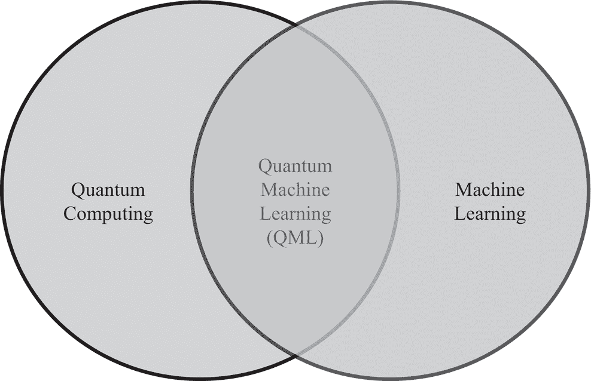

图 6.1 量子机器学习（QML）。

量子计算和深度学习在未来都具有显著进步的潜力，从处理海量数据到推动革命性技术发展。尽管量子机器学习仍处于早期阶段，但专家和学者目前正在大量使用它。其应用包括以下内容：

* 构建新型机器学习技术。
* 增强当前使用的机器学习技术。
* 使用量子增强强化学习，这是一种计算机算法通过与量子环境交互的经验进行学习的技术。
* 开发能够更快处理信息且输入输出更少的神经量子网络。


## 6.1 量子机器学习
量子信息和混合量子-传统模型是 `QML` 的构建基块。由于量子数据中的叠加和纠缠，使用传统计算资源可能需要表示或存储指数级的信息量。执行传统代码和量子代码的程序被称为混合程序。在此上下文中，应用于量子设备（或量子处理单元 `QPU`）上一个或多个量子比特的一系列量子门被称为量子代码。经典程序是指用任何编程语言创建并能够使用标准计算机运行的程序。核心概念是利用量子系统包括叠加、纠缠和干涉的特殊特性，比经典计算机更快地完成某些操作。通过实现更快速、更精确的预测和估计，`QML` 有潜力改变包括金融、医疗保健和材料研究在内的行业。

`QML` 算法的设计意味着纳入量子计算方法来解决机器学习挑战。基本上，机器学习涉及通过示例学习适当的输入-输出相关性，而量子机器学习在此基础上更进一步，采用量子计算设备来执行可能对实现这一目标至关重要的某些计算。经典数据可以使用量子增强算法进行分析，此外，混合量子-传统模型用于结合传统和最先进的量子计算技术。量子机器学习可以极大地增强特定的机器学习操作并为复杂数据集提供新颖的视角 \[2\]。`Python`、`Qiskit`、`Ocean` 和 `Q#` 等编程语言可用于 `QML`。量子机器学习中使用最广泛的编程语言是 `Python`，而 `Qiskit` 是一个广受欢迎的开源编程环境，用于构建量子算法和应用程序。微软设计了一种名为 `Q#` 的编程语言，主要用于开发量子模型。

```
import pennylane as qbit
from pennylane import numpy as num
 dev = qbit.device("Defalut - Qubit", w=3) // w=wires
 @qbit.qnode(dev)
def quantum_circuit(d, z):
    ------Encoding------------
    qbit.RY(d[0], w=0)
    qbit.RY(d[1], w=1)
    qbit.RY(d[2], w=2)
    ------Variational-----------
    qbit.RY(z[0], w=0)
    qbit.RY(z[1], w=1)
    qbit.RY(z[2], w=2)
    qbit.CNOT(w=[0, 1])
    qbit.CNOT(w=[1, 2])
    qbit.CNOT(w=[0, 2])
    return qbit.expval(qbit.PauliZ(0))
def predict(z, d):
    return quantum_circuit(d, z)
z = num.array([0.1, 0.2, 0.3]) //params
d = num.array([0.4, 0.5, 0.6]) // features
prediction = predict(z, d)
```

在此示例中，通过使用 `PennyLane`，设计了一个相对简单的三量子比特量子电路，可用于二分类问题。电路以编码阶段开始，该阶段使用 `RY` 门将输入特征转换为量子比特。接下来，应用一个包含三个 `RY` 门和三个 `CNOT` 门的可变电路。这些门的特征在训练过程中被训练。最后，为了对二分类问题进行预测，会测量第一个量子比特的 `PauliZ` 算子的期望值。这并不是唯一的示例；还有许多使用量子机器学习的量子电路，可能用于疾病预测。具体的应用和数据集将决定要使用的电路和超参数。尽管类似的方法也可用于多类分类或各种类型的预测问题，但此示例专门针对二分类情况。

以下是量子机器学习的一些优势：
1. 一些类型的机器学习模型可以通过量子算法更快地训练，从而更有效地利用时间和资源并改善训练时间。
2. 传统机器学习模型难以或无法处理复杂的网络拓扑。然而，QML 模型可能能够做到这一点。
3. 提高准确性：潜在地，QML 模型可以为某些类型的问题提供更准确的预测，从而总体上获得更好的结果。
4. QML 算法可能能够对某些问题做出预测，这些预测可能更准确，从而总体上获得改进的解决方案 \[1\]。
5. 由于量子计算技术能够提供显著的可扩展性，更大、更复杂的机器学习模型可以无问题地执行。
6. 与传统机器学习算法相比，基于量子的机器学习算法能够从稀疏数据中提取显著更多信息，从而提高数据处理的效率。

## 6.2 引言
量子信息科学 (`QIS`) 是研究操纵、存储和传输编码在量子系统中的信息，并应用于计算、密码学和模拟。它融合了软件工程、信息理论和量子物理等多个学科的概念。量子信息的研究仍处于早期阶段，关注量子力学系统在处理、传输和信息存储中的应用。它试图在量子理论概念如叠加和纠缠等特性的支持下，开发使用经典技术无法实现的新型数据处理和交互方式。该研究领域对计算、模拟、通信和密码学具有重大影响。

为了创建计算、通信和控制的新技术，量子信息科学 (`QIS`) 整合了量子力学和信息理论的思想。它由多个领域组成，每个领域都关注量子数据的不同要素，例如量子计算、量子通信和量子控制。`QIS` 的关键目标是理解并利用量子系统的特殊特性，如叠加和纠缠，以比经典系统更快、更安全地处理和传输信息。它是一个研究和发展领域，在模拟、传感器和密码学方面具有大量潜在应用。

与经典信息不同，量子信息使用量子比特，即量子位。量子信息系统使用具有两种状态的量子比特，根据量子力学概念存储和处理数据。除其他潜在用途外，这些设备可以实现安全通信、增强计算能力并改进密码学。这些可以包括量子计算在密码学和安全通信方面的应用，利用量子力学比传统计算更快地执行某些计算。量子信息系统也在被研究其模拟复杂系统以及建模化学和基础物理的能力。超密编码和量子隐形传态也是可以使用的进一步应用。总体而言，量子信息系统在科学和技术的许多不同领域中得到保证。

量子信息在四个关键领域具有潜力：
1. 量子计算。
2. 量子通信。
3. 量子传感。
4. 量子密码学。

### 6.2.1 量子计算


量子计算是计算机科学中一个新兴领域，它利用量子力学执行经典计算机无法完成的操作。量子计算机使用量子位，或 `qubits`，而不是传统位来维护和处理数据。量子物理学调节 `qubits` 的行为，使它们能够同时存在于多个状态，并与其他 `qubits` 相耦合。这意味着某些类型的问题，包括在经典计算机上具有挑战性或不可能执行的因式分解和优化问题，特别适合量子计算机。包括医疗护理、材料科学和数据加密在内的许多领域都将从量子计算中受益。量子计算机不以位的形式存储数据。相反，它使用 `qubits`。除了 1 或 0 之外，每个 `qubit` 都可以同时调谐为 1 和 0。

### 6.2.2 量子通信
在量子通信中，量子信息或量子位 (`qubits`) 借助量子纠缠和密码学从一个位置移动到另一个位置。为了建立防窃听和黑客攻击的安全通道，量子通信利用了量子力学的特殊特性，例如叠加和纠缠。量子隐形传态、量子网络和量子密钥分发是量子通信的几个重要应用。高性能计算和信息安全是两个可能因有效量子通信技术的发展而发生革命的领域。

图 6.2 显示的利用量子物理概念传输和处理数据的通信网络被称为量子网络。量子网络有能力增强多个领域，包括分布式量子计算、安全通信和密码学。然而，由于量子态对外界干扰（退相干）的敏感性，以及在长距离上纠缠和操纵 `qubits` 的困难，创建和维护量子网络都面临着重大的技术挑战。在量子纠缠和不可克隆定理的帮助下，可能能够完成目前通信技术无法实现的工作。安全密钥分发 between 两个远程用户到目前为止主要被研究，现在已准备好投入使用，为量子通信创造了更大的潜力。例如，量子媒体传输使得分布式量子计算、极高密度编码和多方密码协议成为可能。

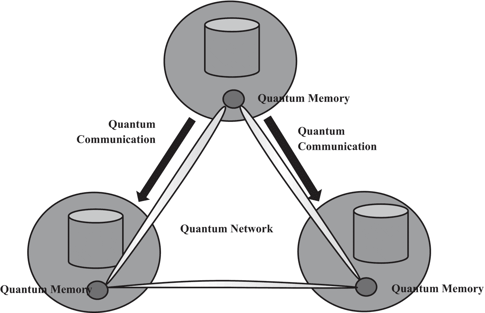

图 6.2 量子网络。

### 6.2.3 量子传感
量子传感一词指的是使用量子系统、量子现象或量子特征测量物理量的过程。它是一种尖端的传感器技术，能够识别旋转、温度、电磁场、运动和其他物理特征的变化。量子传感器通过利用原子和光的基本特性进行极其精确的观测，有可能改变导航、矿物开采和医学成像等领域。原子磁力计、光机械传感器以及金刚石中的氮空位 (`NV`) 中心只是量子传感应用的几个例子。

### 6.2.4 量子密码学
量子密码学是指研究将量子力学特征应用于密码操作，利用这些特性以高度安全的方式传输和保护数据的研究。它也被称为量子密钥分发 (`QKD`)，并根据量子纠缠概念运行，该概念允许在两个粒子相关联时生成密钥。为了确保无法被访问或干扰的安全通信，量子密码学试图开发无法被算法破解的加密技术。与传统密码系统相比，量子密码学在安全范式的基本组成部分中更强调物理学而非数学。在这种情况下，密钥被转换为光子序列，在希望共享秘密的双方之间传输。根据海森堡不确定性原理，攻击者无法在不导致这些光子发生变化或消失的情况下观察它们（图 6.3）。

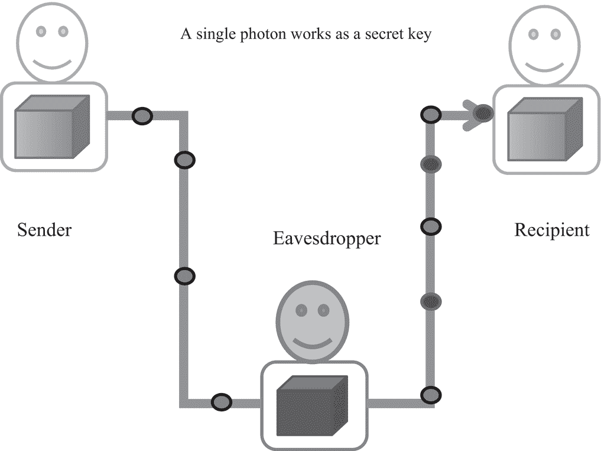

图 6.3 量子密码系统。

## 6.3 量子信息
与量子系统相关联的信息被称为量子信息。它是量子信息理论研究的基石，并应用于量子计算 [3]。同时存在于多种状态的能力以及纠缠的能力——即一个粒子的状态取决于另一个粒子的状态——是量子信息与经典信息不同的两种方式。因此，量子信息的研究是解决使用传统计算无法或难以处理的问题的一个令人兴奋的领域。在量子计算中，量子信息的基本构建块被称为 `qubit`，它类似于经典计算中使用的位。它使用双态量子系统表示，例如光子的偏振或电子的自旋，是传统位的量子力学等价物。`qubit` 能够同时处于两种状态的组合中，而传统位只能表示 0 或 1，这使得计算更加复杂和强大。

基本态 [2] `∣0⟩` 和 `∣1⟩` 呈线性组合，可用于表示量子位的态。这可以科学地写成：

(6.1)

`∣ψ⟩=α∣0⟩+β∣1⟩`

其中 `∣α∣²` 和 `∣β∣²` 分别表示测量 `qubit` 处于态 `∣0⟩` 和 `∣1⟩` 的概率，而 `α` 和 `β` 指的是复数值，使得 `∣α∣² + ∣β∣² = 1`。

这被称为叠加原理，是量子力学的主要特性。它使量子计算机能够比传统计算机更快地执行某些计算，因为它允许 `qubit` 以经典态 `∣0⟩` 和 `∣1⟩` 的线性组合的状态存在 [3, 4]。叠加是系统同时存在于多个状态或点的能力。尽管在量子力学中的解释可能与经典对应物有很大不同，但这仍然是经典物理和量子物理中的基本原理。在量子力学中，叠加是指粒子在被测量或观察之前能够同时存在于多个状态的能力。在经典物理学中，叠加是指波能够与其他波相加或相消的能力（图 6.4）。

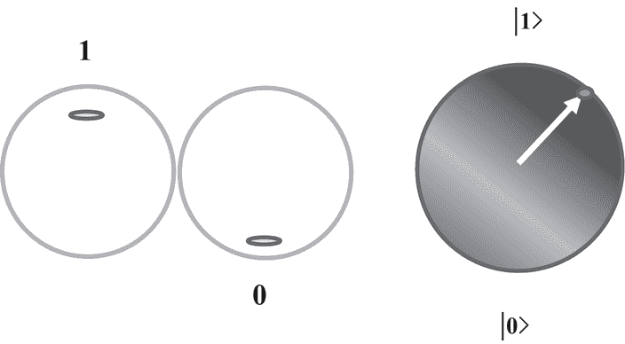

图 6.4 量子计算中数据的表示（量子位）。

根据叠加原理，系统对多个输入的总体响应等于其对每个单独输入的响应的总和。

从数学上讲，这一原理可以用方程表示：

(6.2)

`y(t)=αx1(t)+βx2(t)`


其中 `y(t)` 表示系统的总响应，`x1(t)` 表示由于第一个源馈入系统的信号，`x2(t)` 是由于第二个源的输入信号，而 `α` 和 `β` 是决定每个输入信号对总响应贡献幅度的常数。

该方程基于系统是线性的假设，这意味着其对输入信号的响应与其信号本身之间的关系是线性的。换句话说，叠加使我们能够将每个输入信号视为一个独立的构建块，以便了解系统对每个输入的单独反应。然后可以通过将这些单独的响应相加来确定系统对所有输入共同作用的总体反应。

当两个粒子纠缠时，即使它们相隔很远，它们的态也不能彼此独立地定义。这种现象被称为纠缠，存在于量子力学中。换句话说，两个粒子的量子态开始以超出经典物理定律的方式相关联。这使得许多 remarkable 特征成为可能，包括通过观察另一个粒子而快速改变一个粒子态的能力，而不管它们的空间分离。由于更快计算和更安全通信的潜力，纠缠在量子信息论和量子计算中都是一个非常重要的领域。

量子物理中纠缠的基本思想是通过一系列方程来解释。一些例子包括：

1. `The Bell Inequality`：物理学家 John S. Bell 发展了这个方程，它经常用于检查纠缠。它说对于每种局域隐变量理论，两个纠缠量子粒子之间的关联都有一个限制。如果它们之间的测量关联大于此阈值，则认为粒子是纠缠的。
2. `The Schrödinger Equation`：这个方程是量子力学的基石，解释量子态如何随时间变化。两个纠缠粒子将具有一个独特的波函数来解释它们的纠缠状态。
3. `The Entanglement Entropy`：这个方程用于测量两个量子系统之间的纠缠量。它测量一个系统的状态与另一个系统的状态关联的程度。当两个系统最相互交织时，纠缠熵最大。
4. `The Density Matrix`：混合态，即并非纯纠缠的量子态，可以由这个方程定义。它考虑了系统可能处于的每个单独状态的可能性，以及各种状态之间的关系。

总体而言，量子信息有可能对包括军事制造、建筑和金融建模在内的许多科学、工程和技术应用产生深远影响。

```
from qiskit import QuantumCircuit, exe, x
q = QuantumCircuit(1, 1)
# 应用 Hadamard 门创建叠加态
q.h(0)
# 评估量子比特并将结果存储在经典比特中
q.measure(0, 0)
# 实现电路并获取结果
simulator = x.get_backend('Gasm_Simulator')
result = execute(q, simulator).result()
# Publish the measurement value is result
print(result.get_counts(q))
```

该电路创建了一个处于 0 和 1 态叠加中的单个量子比特，然后对其进行测量并将结果记录在传统比特中。测量的结果将被打印出来。尽管这只是一个简单的示例，但 `Qiskit` 用于展示量子电路的基本布局。

## 6.4 熵：经典与量子

与在相空间中定义的经典熵相比，量子熵似乎是对扩展希尔伯特空间上频率的度量。在信息论中，量子熵处理纯和混合二分量子态的形成纠缠，而经典熵对应于收集、传输和处理信息的学习 [9]。熵是热力学中用来描述系统中无序或不可预测程度的术语。在经典系统中，熵总是非负的，经典热力学规则适用。量子热力学的定律比经典热力学更复杂，因为在量子物理中熵可以为负。本质上，区分经典熵和量子熵的是基本数学结构和潜在物理原理。

信息论和熵研究中使用的概念包括香农熵和冯·诺依曼熵 [9]。随机变量或概率分布中的不确定性度量称为香农熵，以克劳德·香农命名。它被称为确定随机变量值的平均数据量。香农熵的公式如下：

(6.3)

`H(X) = - Σ[p(x) log2 p(x)]`

约翰·冯·诺依曼提出了冯·诺依曼熵这一术语来描述量子态的不可预测性。它被称为密度矩阵的熵，并用于量子信息的研究。这是熵方程：

(6.4)

`S(ρ) = - Tr(ρ log2 ρ)`

尽管这两个概念的数学公式相似，但它们应用于不同的情况。在研究量子现象期间，可以使用冯·诺依曼熵来测量量子态的熵。香农熵通常用于经典信息论中来测量不确定变量或概率分布的熵。

### 6.4.1 经典信息论

经典信息论是关于信息处理（如信息的传输和存储）的数学理论，由克劳德·香农在 1940 年代和 1950 年代建立。该理论主要涉及经典信息的量化、压缩和传输，或以比特集表示的信息，如数字通信系统。经典信息论的主要关注点是通过各种信道以及具有不同噪声或失真水平的信息传输的基本限制。电信、计算机科学、密码学和数据压缩等众多行业都广泛使用它。经典信息论中应用了各种数学方程和公式，因此没有单一的方程可以描述它全部。

然而，香农熵方程提供了以比特为单位的熵（每符号），是经典信息论中最著名的方程之一。它写成如下：

(6.5)

`H(X) = - Σ p(x) log[2] p(x)`

其中 `p(x)` 指符号 `x` 的概率，而 `log[2]` 是以 2 为底的对数。

香农信道容量方程提供了在具有任意最小误差概率的不确定通信路径上传输数据的最高速度，是另一个常用方程。它写成如下：

(6.6)

`C = B log2`

其中 `C` 指信道容量，`B` 表示信道带宽，`S` 是平均信号功率，`N` 是平均噪声功率，而 `log[2]` 是以 2 为底的对数。根据具体问题，经典信息论采用了许多其他方程和公式。

经典信息论是一个成熟的领域，研究信息的量化和传输。给定信道的容量和噪声水平，它提供了一个评估可以通过它传输多少数据的框架。


以下是经典信息论的一些例证：

1.  *信道容量定理*：该定理提供了在嘈杂信道上传输的数据速率的上限。

2.  *熵*：随机变量的熵可用于衡量其不可预测性。例如，两面概率相似的抛硬币，其熵为 1 bit。

3.  *纠错码*：在传输过程中，这些代码旨在检测和纠正错误的发生。为了提高数据传输的准确性，它们是当代通信系统的常见组成部分。

4.  *信息源编码*：以这种方式压缩数据，以减少需要通信的数据量。例如，照片和视频经常被压缩以使文件更小。

5.  *信道编码*：这是将冗余纳入数据以提高其对传输错误抵抗力的方法。

知识从发送者到接收者的传输以及能够通过通信媒介可靠传输的信息量是经典信息论的主要主题。关于骰子和硬币，经典信息论可用于计算表示骰子或抛硬币结果所需的信息量。

```
import math
 # Assuming a fair 6-sided dice
PossibleOutcomes = 6
 # Calculate the amount of bits required to symbolize the outcome
BitsRequired = math.ceil(math.log2(PossibleOutcomes))
 print(“The roll of a dice requires {BitsRequired} bits to represent.”)
```

### 6.4.2 量子信息论

基于量子力学的量子信息处理技术的研究被称为量子信息论。为了考虑量子系统的特殊特性，例如纠缠和叠加，它扩展了经典信息论。为了评估量子系统的纠缠程度并评估量子数据传输和计算协议的效率，量子信息论领域的核心概念冯·诺依曼熵被使用。香农熵是衡量传统系统中随机性或不确定程度的指标，例如抛硬币或一组骰子。另一方面，冯·诺依曼熵充当确定量子力学框架内随机性或不确定程度的标准。

在经典系统中，使用各种结果的概率来计算香农熵。它由公式 `H` = −Σ`p[i]` log[2] `p[i]` 定义，其中 `p[i]` 是第 *i* 个结果的概率。最终结果是一个非负数，在没有歧义的情况下（即只有一个可能结果时）为零，在不确定性增加时更大。另一方面，使用量子力学系统的密度矩阵来确定冯·诺依曼熵。它由公式 `S` = −`tr`(`ρ` log[2] `ρ`) 定义，其中 `ρ` 指系统的密度矩阵。结果是一个非负值，在纯态（即情况明确时）为零，在混合态（即情况不明确时）更高。

根据传统信息论，抛硬币的结果可能是正面或反面。然而，在量子力学中可能存在多种结果。例如，在被检测或测量之前，量子硬币可能同时处于正面和反面的组合中，直到它坍缩为特定的物质状态。同样，在量子骰子的情况下，可能有超过六种可能的结果。这是由于量子骰子在被测量之前可以处于多个状态的叠加中。

```
from qiskit import QuantumCircuit, exe, a
from qiskit.visualization import p_histogram

# Define circuit of quantum for a dice roll simulation
circuits = QuantumCircuit(3, 3)
circuits.h([0,1,2]) # Put qubits in superposition
circuits.measure([0,1,2], [0,1,2]) # Measure qubits

# Define quantum circuit for a coin flip simulation
coin_circuit = QuantumCircuit(1, 1)
coin_circuit.h(0) # Put qubit in superposition
coin_circuit.measure(0, 0) # Measure qubit

# Simulate dice roll experiment and results of plots
simulator = a.get_backend(‘qasm_simulator’)
result = execute(circuits, backend=simulator, shots=1000).result()
counts = result.get_counts()
p_histogram(counts)

# Simulate coin flip experiment and plot results
coin_result = execute(coin_circuit, backend=simulator, shots=1000).result()
coin_counts = coin_result.get_counts()
p_histogram(coin_counts)
```

在此代码中，定义了两个独立的量子电路：一个用于模拟掷骰子，另一个用于模拟抛硬币。掷骰子电路使用三个量子位来表示掷标准六面骰子的可能结果 \[7\]。该电路使这些量子位处于叠加态以模拟掷骰子的概率分布，然后测量量子位以获得对应于 0 到 5 之间数字的随机结果。抛硬币电路中的单个量子位表示抛硬币的潜在结果。该电路通过使其叠加来复制公平抛硬币的概率分布，然后测量量子位以产生指示正面或反面的随机结果。然后它使用 Qiskit `execute` 函数模拟每个实验，并使用 `p_histogram` 函数绘制所得的概率分布。这提供了每个结果概率的可视化表示。

## 6.5 量子并行性和函数求值

当函数针对多个输入进行求值并且利用量子叠加同时进行大量计算时，这被称为量子并行性 \[6\]。这与传统计算机不同，传统计算机一次只能执行一个计算。量子存储寄存器能够处于基态的叠加中，从而使量子位能够同时考虑所有潜在输入，由此产生量子并行性。由于这一特性，某些量子算法可以比经典算法快得多地解决难题。格罗弗算法和肖尔算法是利用量子并行性的两种量子算法示例。

可以使用格罗弗方法，一种由 Lov K. Grover 于 1996 年创建的量子技术，在 `O(N/2)` 时间内和 `O(log N)` 存储空间内搜索包含 `N` 个条目的未排序数据库。与传统方法相比，它提供了二次加速。该方法创建所有潜在数据库条目的量子叠加，然后使用格罗弗迭代放大标记条目的振幅，同时抑制其余条目，直到以高概率找到解决方案。格罗弗算法是一种算法，与经典技术相比，可以以二次加速搜索未排序数据库。在搜索大小为 `N` 的数据库以识别标记项时，格罗弗方法仅需 `O(sqrt(N))` 时间，而传统算法则需要更多时间，这是一个用于说明该算法的常用示例。

对于在大小为 2 的数据库中搜索标记项的特定情况，可将其视为抛硬币或掷骰子，算法如下进行：

1.  将两个量子位初始化为状态 ∣00⟩，表示两种可能的结果。

2.  对每个量子位应用哈达玛门以形成两种结果的叠加：(∣00⟩ + ∣01⟩ + ∣10⟩ + ∣11⟩)/2。

3.  对对应于标记项的状态应用相位翻转：(∣00⟩ + ∣01⟩ – ∣10⟩ + ∣11⟩)/2。


4. 应用 `Grover` 迭代，它包含两个步骤。首先，应用 `oracle`（在这种情况下，是步骤 3 中的相位翻转）来标记与标记项等价的状态。其次，应用 `diffusion operator`，它将标记事物的频率关于所有对象的平均频率进行反射。这是通过对每个量子比特应用 `Hadamard` 门、对每个量子比特应用 `Pauli X` 门，然后再次对每个量子比特应用 `Hadamard` 门来实现的。

5. 重复步骤四次，这会增加标记事物的频率并降低未标记对象的频率。

6. 测量这两个量子比特，这会使状态坍缩为 `∣00⟩` 或 `∣01⟩`。如果状态是 `∣01⟩`，则已找到标记项。

```
# Import necessary libraries
from qiskit import QuantumCircuit, exe, a
from math import sqrt
 # Define the number of qbits required for the experiment
qbits = 1
 # Define the number of periods to run the Grover’s algorithm
nter = 1
 # Define the circuit
coinFlip = QuantumCircuit(nqubits, nqubits)
 # Create a superposition of the qubits
coin_flip.h(0)
 # Oracle for flipping the coin
coin_flip.z(0)
 # Inversion operator
coin_flip.h(0)
coin_flip.z(0)
 # Measure the qubit and save the outcome to the standard list
coin_flip.measure(0, 0)
 # implement the circuit on a local simulator
simulator = Aer.get_backend(“Gasm_Simulator”)
result = execute(coin_flip, simulator, shots=1024).result()
 # Print the results
counts = result.get_counts(coin_flip)
print(counts)
```

该代码创建的量子电路由一个量子比特和一个经典比特组成，测量结果存储在其中。电路使用 `Hadamard` 门对量子比特进行叠加，然后使用 `oracle` 以 1/2 的概率翻转它。随后使用 `inversion operator` 增加初始状态下量子比特的振幅。电路随后测量量子比特并将结果保存到常规比特中。通过反复运行该电路，算法会增加测量目标状态（0 或 1）的可能性，并降低测量任何其他状态的概率。结果是通过跟踪每个状态被测量的频率来确定的。该代码对状态 0 和 1 提供的分布大致各为 50%，这相当于抛硬币的结果。

使用 `Shor’s algorithm` 这种量子方法，可以快速将大合数分解为其质因数。它还可以用于解决有限域中的离散对数问题，而该问题构成了众多加密技术的基石。为了将 `Shor’s algorithm` 应用于掷骰子问题，使用相位估计技术的量子版本来计算将骰子点数转换为抛硬币结果的函数的周期。量子态用于表示掷骰子和抛硬币的可能结果。总共 7 个量子比特，其中 6 个量子比特用于表示可能的骰子点数，1 个量子比特用于表示硬币翻转。

接下来需要定义将骰子点数转换为硬币翻转的函数。使用受控非门（`CNOT`）如果骰子点数大于或等于 4 则翻转硬币量子比特，也可以使用幺正算符实现这一点。一旦输入函数被定义，就应用量子相位估计方法以评估函数的周期。输入态由一系列受控幺正操作处理，随后进行 `quantum Fourier transform`。利用结果态中包含的函数周期信息，以高概率找到硬币翻转的结果。当两个粒子被置于单一量子态并为量子并行性做好准备时，当一个粒子被观察到处于特定状态时，它们将始终处于相同状态。在这里，该思想通过抛掷两枚硬币来演示。在传统计算中，翻转两枚硬币需要两种不同的计算。然而，量子并行性允许量子计算机同时计算两种硬币翻转结果，从而可能节省时间和处理能力。

### 6.5.1 量子并行性的未来应用与挑战

量子并行性包括改变广泛行业的机遇，包括机器学习、药物开发、数据加密和密码学。在优化领域，量子计算机可以应用于解决经典计算机难以处理的复杂优化问题，量子并行性具有许多有趣的应用。例如，量子并行性已被用于改进金融投资组合、航空时间表，甚至量子算法本身的开发。量子并行性还用于量子系统的模拟，这对于学习分子、材料和其他量子系统的行为至关重要。量子并行性可能使更准确、更高效地复制复杂量子系统成为可能，这可能导致化学、材料科学和物理学领域的改进。大型量子系统对经典计算机来说难以建模，然而量子并行性可能能够做到这一点。

在完全理解量子并行性之前，仍有一些重要障碍必须克服。退相干是主要困难之一，它发生在量子系统与其环境相互作用时，导致其失去量子相干性并与其纠缠。退相干限制了量子计算可以在错误变得过大之前进行的时长，它是量子计算错误的关键来源。创建和维持量子并行性所需的 large-scale 纠缠态 [7] 是另一个挑战。随着量子比特数量的增加，保持量子比特的相干性和纠缠，并在不引入错误的情况下对其进行操作变得更加困难。这需要创建量子控制、容错和纠错的新方法。

另一个困难是创建可以从量子并行性中受益的新算法和应用。由于该领域刚刚起步并且发展迅速，目前尚不清楚哪些算法和应用对量子计算机最有益或最有效。这需要持续的研究和测试，以及来自多个学科的研究人员之间的互动。尽管存在这些困难，许多科学家认为量子计算机很快就会成为现实，因为量子并行性在未来可能非常有用。通过利用量子并行性的强大功能，我们有可能解决当前无法解决的挑战并获得有关宇宙本质的新知识。

## 6.6 量子计算系统

使用量子力学进行计算的计算机被称为量子计算系统。这些系统旨在解决常规计算机难以处理的难题 [1]。量子计算机使用纠缠和叠加这两种量子力学现象来进行计算。尽管它们仍处于研究的早期阶段，量子计算机已在解决传统计算机认为具有挑战性或不可能的问题方面显示出潜力。`D-Wave` 平台、`IBM quantum Systems` 以及最近发布的 `IBM Quantum System One` 只是量子计算平台的几个例子 [5]。世界上最知名和强大的量子计算平台之一的 `IBM quantum systems` 允许程序员开发解决问题的创新方案。


# 量子计算

量子计算机通过利用量子力学中的特殊特性，如叠加和纠缠，来提高某些复杂计算的性能（表 6.1）。

表 6.1 处理信息的两种绝对不同的机制：经典计算和量子计算 [10]

| 方面 || 经典计算 || 量子计算 |
| --- | --- | --- |
| 关键单元 || `Bits` =>（0 或 1）|| `Qubits` =>（0 和 1 的叠加） |
| --- | --- | --- |
| 数据处理 || 二进制算术和逻辑运算 || 量子门和纠缠 |
| 计算模型 || 确定性模型（参数和起始值完全定义模型的输出）|| 概率模型（由于叠加和纠缠，随机性被纳入整个过程） |
| 时间复杂度 || 所用时间 `2^(T)`（平均而言，多项式/指数）|| 所用时间 `T`（对于特定问题可能具有指数速度） |
| 速度 || 某些可并行化操作的最小速度 || 一些量子技术的指数速度 |
| 问题范围 || 对各种常见问题有用 || 设计用于解决特定问题 |
| 错误敏感性 || 具有容错性；使用纠错技术 || 易受不准确影响；需要纠正 |
| 可扩展性 || 可扩展到更困难和资源密集的问题 || `Qubit` 相干性给可扩展性带来困难。 |
| 硬件要求 || 经典晶体管处理器架构 || `Qubits` 和专用量子处理器 [7] |
| 成熟度 || 成熟的技术 || 发展的早期阶段 |
| 功耗 || 通常更节能 || 量子计算通常需要特别低的温度 |

虽然纠缠是一个过程，其中两个或多个粒子可以变得纠缠，意味着它们的量子态以超越常规相关性的方式关联，叠加指的是量子对象同时处于一个以上状态的能力（图 6.5）。

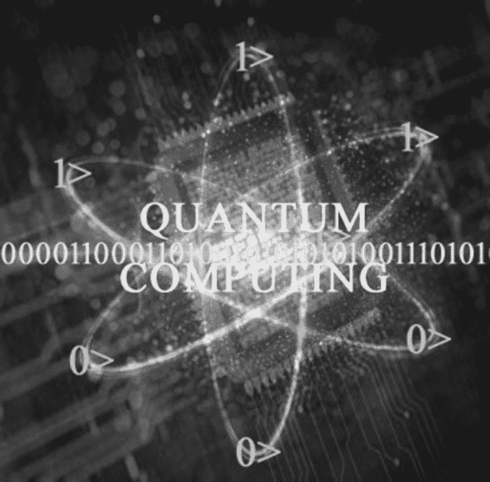

图 6.5 量子计算。

`Qubits`，即经典计算中使用的传统比特的量子模型，被用于量子计算系统以利用这些特性。多个 `qubits` 可以纠缠并同时存在于 0 和 1 的叠加状态，从而实现大量数据的同时处理。即使这些特性使量子计算系统在某些任务上比经典系统更有效，例如对经典计算机具有挑战性的因式分解问题，开发和扩展量子计算机供使用仍然存在重大挑战。

### 6.6.1 量子比特

一个 `qubit`，相当于经典计算中的传统二进制位，是基本量子信息单元。它可以表示零、一或这两种状态的任何叠加。它是比特的量子等价物。叠加和纠缠使 `qubits` 能同时处于多种状态，而与只能始终处于 0 或 1 状态的经典位不同。电子的自旋，具有可解释为自旋向上和自旋向下的两个能级，是一个 `qubit` 的实例（表 6.2）。

表 6.2 显示单量子比特与多量子比特之间的差异

| 方面 || 单量子比特 || 多量子比特 |
| --- | --- | --- |
| 关键单元 || 一个量子位（`qubit`）|| 两个或多个 `qubits`（纠缠或不纠缠） |
| --- | --- | --- |
| 状态表示 || 由 `Bloch sphere` 表示 || 由多量子比特态矢量表示 |
| 量子门 || `Hadamard`、`Pauli-X`、`Pauli-Y`、`Pauli-Z` 等 || `Controlled-NOT`、`SWAP`、`Toffoli` 等 |
| 纠缠 || 不适用 || 对量子计算至关重要 |
| 量子并行 || 单量子比特操作存在限制 || 在某些情况下允许指数级加速 |
| 测量 || 给出典型的位结果 0 或 1 || 给出多量子比特态结果 |
| 量子纠错 || 不直接涉及 || 需要保持量子比特相干性 |
| 量子算法 || 局限于特定算法 || 执行高效算法的能力 |
| 通信和复杂性 || 在通信任务中的使用被最小化 || 解决具有挑战性问题的可能性 |
| 量子霸权 || 不适用 || 可能允许量子霸权 |
| 可扩展性 || 简单处理 || 更多的量子比特导致更高的复杂性 |

总之，量子信息的根本构建块是单 `qubits`，它们可以存在于叠加态中。然而，许多 `qubits` 是一种更强大的计算资源，因为它们可以存在于复杂的纠缠态中并利用量子并行性。利用随 `qubits` 数量增加而呈指数增长的计算能力，多量子比特系统和量子算法经常被用于量子计算以解决复杂问题。

### 6.6.2 叠加

叠加是量子力学中的一个关键概念，描述了量子系统在被测量之前如何同时存在于多种状态或位置。与经典力学相比，在经典力学中位置和动量等概念总是明确定义的，在量子计算中，`qubit` 是任何能够同时存在于量子态 0 和 1 的量子系统。叠加是量子计算的关键方面，使大规模并行数据处理成为可能。换句话说，量子计算机通过利用叠加可以比经典计算机快十倍地执行某些操作。叠加通过允许量子事物同时存在于多个状态或位置，使复杂计算成为可能，而这些计算对于传统计算机是不可能的。

量子叠加是量子系统在被测量之前能够同时存在于几种状态的能力。所有这些情况的组合，加上一个复数定义每个配置中的幅度，形成了最一般的情况。但除了正面和反面之外，量子硬币还具有一个额外的特征，称为量子相位。硬币在量子相位中仍可以是正面或反面，但也可以同时处于正面和反面的叠加态。经典抛硬币不涉及量子相位或叠加。传统的抛硬币开始时正面或反面朝上，根据执行者翻转若干次，然后以正面或反面朝上落地。因此，通过仔细测量所有这些经典行为，可以以任意精度预测经典决策（图 6.6 和 图 6.7））。

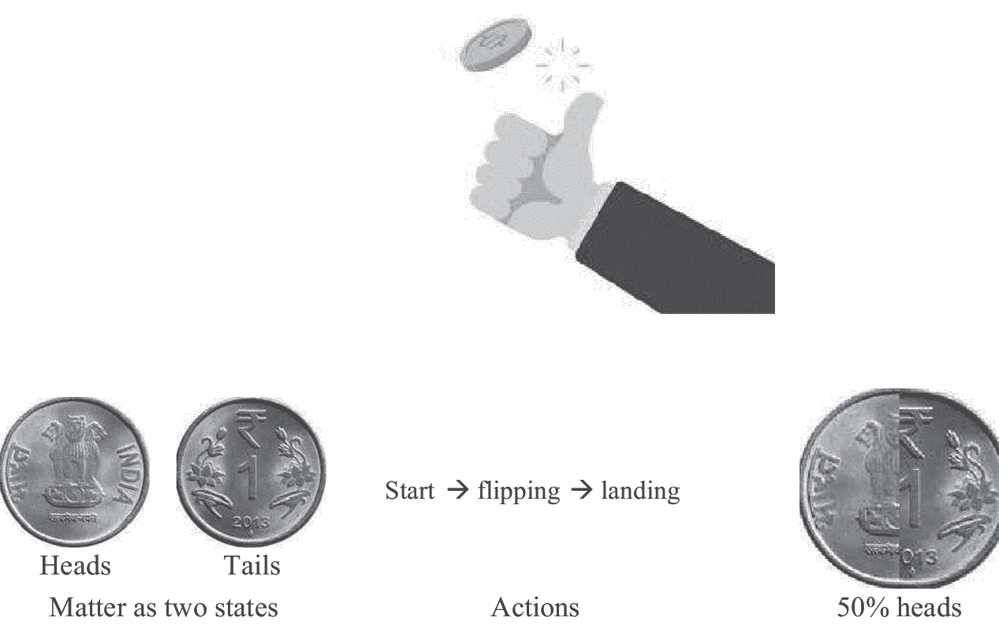

图 6.6 经典抛硬币。

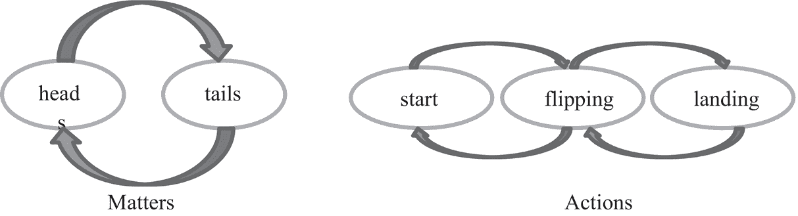

图 6.7 量子抛硬币。


然而，任何大量的经典行为也总会涉及一些量子行为。这是因为微观宇宙并非经典的，而是量子且不可预测的。直到宏观硬币落定为正面或反面为止，退相干的量子硬币将一直处于微观叠加态中。与能够做到这一点的精确经典测量相比，没有任何测量能够比 50% 更准确地预测来自叠加态的量子抛硬币结果。在我们这个量子真实世界中，传统的抛硬币实际上并不存在。相反，许多传统的宏观活动，例如抛硬币，最终会涉及量子相位噪声的若干微观量子后果。物理现实中潜在的微观量子相位噪声，作为混沌的经典随机噪声的有用宏观模板。

请记住，除了量子硬币之外，开始、翻转和着陆的量子行为的叠加态也存在。量子相位噪声也会被多次操作所纠缠，例如翻转或神经冲动，因此将受到量子知识不确定性水平的约束。由于它永远无法准确地知道某事先于另一事发生，或预测随后出现的感受，因此很难理解自由意志和自由选择的概念。

### 6.6.3 纠缠

纠缠是量子计算系统的重要组成部分。在量子计算中，量子位可以同时处于许多不同的状态，因为它们可以处于一种称为叠加的状态。然而，为了执行量子操作，量子位需要相互纠缠。由于纠缠，量子位即使相距遥远也能完全相关。以这种方式，纠缠的量子位可以执行传统计算机无法完成的量子计算。

想象一下，同时用双手各持一枚硬币，将它们同时抛向空中旋转。左边硬币正面朝上的概率为 ½。右手硬币正面朝上的概率也是 ½。换句话说，两枚硬币同时正面朝上的概率为 ½ × ½ = ¼。许多人可能没有意识到，由于这个故事众所周知，这只能在每枚硬币的行为相互独立时发生。相反，想象一下两枚硬币的行为完全相互依存。例如，想象一下当左手硬币正面朝上时，右手硬币也是正面朝上（反之亦然），这就形成了可以描述为两枚硬币之间纠缠关系的情形。由于只有两种可能的結果，即两枚都为正面或两枚都为反面，在这种情况下得到两个正面的概率为 ½（图 6.8 和 6.9）。


图 6.8 独立硬币。


图 6.9 纠缠硬币。

下面的示例代码显示，首先使用两个量子位和两个传统位来构建量子电路。

```
# Import necessary libraries
from qiskit import QuantumCircuit, a, exe
from qiskit.visualization import plot_histogram
 # Build a quantum circuit having two Calssical_bits and two qubits
dice_coin_circuit = QuantumCircuit(2, 2)
 # Put them in superposition by apply a Hadamard gate to both qubits
dice_coin_circuit.h(0)
dice_coin_circuit.h(1)
 # Applying a CNOT gate and form entanglement between the qubits 
dice_coin_circuit.cx(0, 1)
 # Qubit is evaluated and store the results in a conventional bit
dice_coin_circuit.measure([0, 1], [0, 1])
 # Execute the circuit by used QASM simulator at the backend to display the result
simulator = a.get_backend(“qasm_simulator”)
result = exe(dice_coin_circuit, simulator, shots=1024).result()
 # Histogram of results
plot_histogram(result.get_counts(dice_coin_circuit))
```

然后，在使用 `Hadamard` 门将两个量子位都置于叠加态之后，使用 `CNOT` 门在两个量子位之间建立纠缠。在测量量子位后，所有数据随后被记录在相应的经典位上。最后，使用量子汇编语言模拟器（`QASM`）后端执行电路并获得结果。研究结果显示了每种潜在情况的可能性，模拟了在叠加态下抛硬币和掷骰子的结果。

只能存在于两种状态之一、`0` 或 `1` 的位是传统信息系统的基本构建块。量子位是双能级量子力学器件，可以同时以 `0` 和 `1` 的叠加态存在，是量子信息系统的核心组件，用于存储信息。由于这种叠加特性，量子系统可以比经典系统快十倍地执行某些计算（图 6.10 和 图 6.11）。

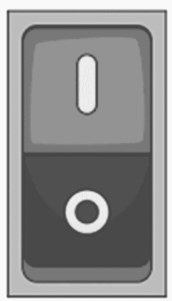

图 6.10 经典位。

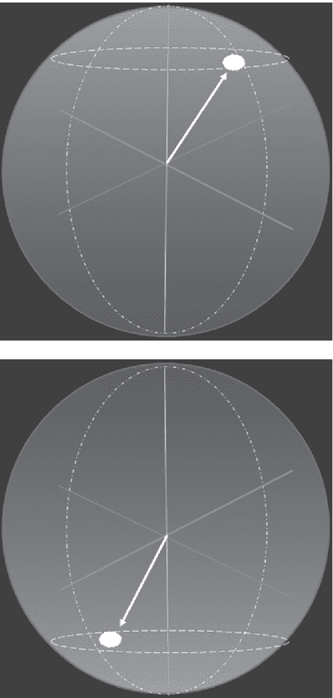

图 6.11 量子位。

纠缠是量子信息系统的特征，它允许两个或多个量子位以一种方式连接，使得一个量子位的状态取决于其他量子位的状态。这一方面的多种可能应用包括量子计算和量子通信。然而，量子信息系统也比经典系统更强大，并暴露于外界的干扰和噪声之下。量子系统的状态也可以通过测量以经典系统中不可行的方式发生变化。在开发和管理量子信息系统时，必须考虑此类因素。计算可以在量子计算机上同时执行（图 6.12 和 图 6.13）。


图 6.12 经典布尔逻辑。

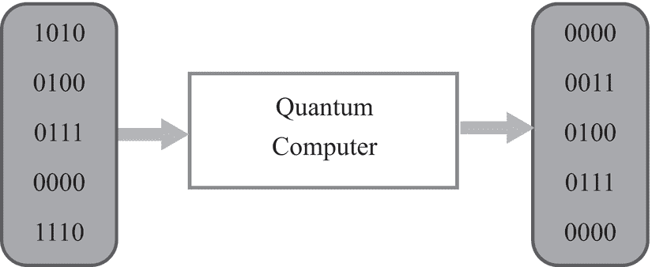

图 6.13 量子逻辑。

通过应用量子密码学，可以使量子信息系统更安全，量子密码学使用量子物理定律对数据进行编码，这种方法可能难以破解。尽管经典和量子信息系统都可以存储和传输信息，但量子信息系统具有特殊特性，在特定情况下可能比经典系统具有重要优势（图 6.14）。

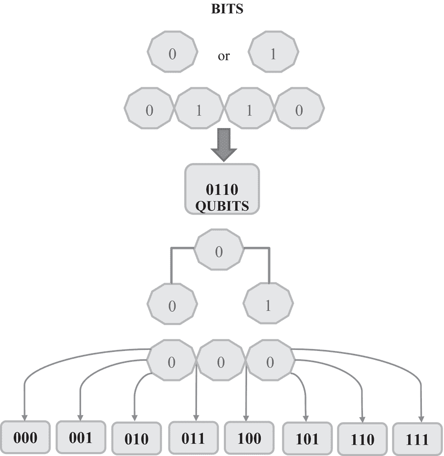

图 6.14 量子位存储信息的指数容量。

使用经典计算复制掷骰子或抛硬币所需的时间取决于所需的试验或模拟次数。单次抛硬币得到正面或反面的可能性为 0.5。这可以在传统计算机上使用 `Boolean` 翻转来复制，完成所需时间非常短（纳秒或更少）。模拟大量掷骰子或抛硬币的计算成本可能会增加。例如，如果你想模拟掷两枚骰子 1000 次，你必须模拟掷两枚骰子 1000 次并累加点数。在常规计算机上，这仍然可以相当快速地完成，并且仅需要几毫秒或更少，具体取决于执行的模拟数量。一项测量已执行试验数量的研究发现，经典计算在执行概率实验时通常比量子计算花费更多时间。

## 6.7 总结与未来展望


量子信息科学的未来前景令人难以置信地充满希望。量子计算将革新各行各业，解决密码学、材料科学和药物发现等领域的复杂问题。量子通信通过量子密钥分发等技术，将在日益互联的世界中增强安全性和隐私性。量子传感器将为导航、医疗保健和基础物理等应用提供超高精度的测量。量子机器学习将加速数据分析和优化任务，而量子模拟将加深我们对量子系统的理解，影响材料设计和药物开发。开发容错量子硬件和算法将使量子计算更具实用性。量子教育和政策举措将应对对熟练专业人员日益增长的需求以及伦理考量。总体而言，量子信息科学的未来将在各个领域实现变革性进步，重塑技术、研究和日常生活。

## 参考文献
1.  Manjunath, T.N. et al. 2022, “利用量子计算的机器学习技术综述”, *第四届电子、计算机科学和技术新兴研究国际会议 (ICERECT)*, [`doi.org/10.1109/ICERECT56837.2022.10059764`](https://doi.org/10.1109/ICERECT56837.2022.10059764)

2.  Pattanayak, Santanu 2021, 使用 Python 的量子机器学习, Springer Science and Business Media LLC, [`doi.org/10.1007/978-1-4842-6522-2`](https://doi.org/10.1007/978-1-4842-6522-2)

3.  Kasirajan, Venkateswaran 2021, 量子计算基础, Springer Science and Business Media LLC, [`doi.org/10.1007/978-3-030-63689-0`](https://doi.org/10.1007/978-3-030-63689-0)

4.  Heusler, Stefan et al. 2022, “经典物理和量子物理中的熵的方面”, Journal of Physics A: Mathematical and Theoretical, Volume 55, Number 40, [`doi.org/10.1088/1751-8121/ac8f74`](https://doi.org/10.1088/1751-8121/ac8f74)

5.  Córcoles, Antonio D. et al. 2020, “近期量子计算系统的挑战与机遇”, IEEE Explore, Volume 108, Issue 8, [`doi.org/10.1109/JPROC.2019.2954005`](https://doi.org/10.1109/JPROC.2019.2954005)

6.  Hofmann, Holger F. 2005, “受控非门操作的量子并行性：评估设备性能的实验标准”, Physical Review A, Volume 101, Issue 12, [`doi.org/10.1103/PhysRevLett.101.12050`](https://doi.org/10.1103/PhysRevLett.101.12050)

7.  Chi, Y. et al. 2022 “可编程的基于 qudit 的量子处理器”, Nature Communications, Volume 13, Issue 1166, [`doi.org/10.1038/s41467-022-28767-x`](https://doi.org/10.1038/s41467-022-28767-x)

8.  Schade, Robert et al. 2022, “在嘈杂中等规模量子计算机上的并行量子化学”, Physical Review Research, Volume 4, Issue 3, [`doi.org/10.1103/PhysRevResearch.4.033160`](https://doi.org/10.1103/PhysRevResearch.4.033160)

9.  Zhou, X. 2023, “多量子位系统在噪声量子信道下量子关联熵的动力学行为”, International Journal of Theoretical Physics, Volume 62, Issue 23, [`doi.org/10.1007/s10773-022-05270-z`](https://doi.org/10.1007/s10773-022-05270-z)

10.  Pizzi, Andrea 2022, “弥合经典与量子多体信息动力学之间的差距”, Physical Review B, Volume 106, Issue 21, [`doi.org/10.1103/PhysRevB.106.214303`](https://doi.org/10.1103/PhysRevB.106.214303)

11.  Yuan H.N. et al. 2022, “量子磁子学：当磁子自旋电子学遇见量子信息科学”, Physics Reports, Volume 965, [`doi.org/10.1016/j.physrep.2022.03.002`](https://doi.org/10.1016/j.physrep.2022.03.002)

# 7 量子机器学习方法

Mangalraj Poobala 和 Ganesh Kumar Natarajan

印度 GITAM 大学

Iniyan Shanmugam

印度 SRM 科学技术学院

Justin Vargese

印度 GITAM 大学

DOI: [10.1201/9781003429654-10](https://dx.doi.org/10.1201/9781003429654-10)

## 7.1 量子复杂性

量子复杂性是识别与量子计算相对应的任何问题的复杂性的基本概念 [1]。评估问题的复杂性时，会考虑时间、空间和操作等多个参数资源。量子机制允许机器同时运行于多个状态。这种同时进行的过程需要在目标机器上进行量子叠加以实现有效执行 [2]。评估经典计算和量子计算复杂性的显著区别在于识别并行性以及执行线程之间的关系。

量子叠加特性使复杂计算更高效，并且已实现多种量子算法来执行此类计算 [3]。量子算法有助于以更快的速度解决复杂问题，与经典算法相比。纠缠是量子计算中另一个令人兴奋的概念，它揭示了整体部分之间的关联 [4]。诸如 `P` 和 `NP` 等任何复杂问题的量子复杂性将由有界误差量子多项式时间 (`BQP`) 有效计算。`BQP` 计算与量子操作相对应的有界误差概率 [5]。量子复杂性使开发人员能够理解量子计算的利弊。

## 7.2 特征映射

在特征映射的帮助下，将实际数据从全局空间映射到特征空间可以改进或解决任何非线性问题。特征映射旨在将不可分离的输入数据映射为可分离的特征以实现更好的训练目的，如 图 7.1 所示

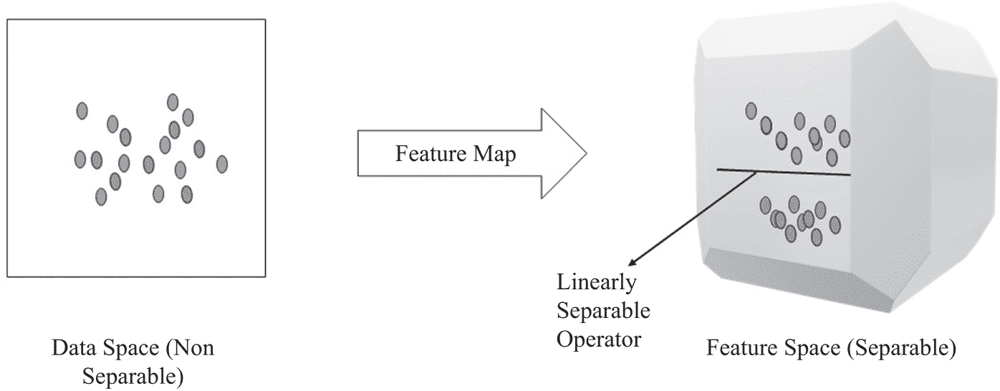

图 7.1 常规特征映射利用。

传统上，特征映射是数学函数，有助于将输入数据映射到 n 维特征空间，其中特征可以线性可分 [6]。分隔符可以是线性的，也可以是非线性的，但特征点是可分离的 [7]。编码操作生成输入的状态，并将通过量子叠加特性通过布洛赫球表示。如前所述，纠缠特性有助于识别数据点之间的相关性，并且增强的特征映射将如 图 7.2 所示生成 最后，量子硬件用于处理映射的特征点，作为输入到经典机器中以训练机器学习算法 [8]。图 7.2 中的示意图描述了量子特征映射在实时中的整体利用。

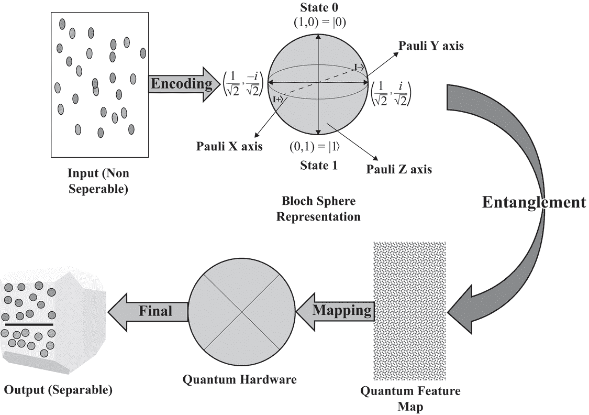

图 7.2 量子特征映射利用的工作流示意图。

在 图 7.2 中，输入的不可分离数据点已被解析到量子计算工作流程中，并且过程解释如下：


1. 输入数据点根据 `bloch sphere` 中的变量状态进行编码以实现叠加。`bloch sphere` 是量子位在三维平面中的表示，其中量子位通过改变状态放置在 `Pauli X` 轴上。`Pauli Z` 轴表示状态 0 和状态 1，以了解量子位是否属于这些状态中的任何一个。`Pauli Y` 轴提供与量子位状态相关联的复数值 [9]。
2. 将数据点叠加到 `bloch sphere` 之后，纠缠阶段开始。在纠缠中，一对量子位通过共同的 `NOT Gate` 共享共同信息。两个量子位之间的共同性为输入数据生成新的特征向量 [10]。
3. 一旦为输入生成特征向量，量子计算的特征映射将被生成。量子特征映射是特征向量和量子态的组合。
4. 特征映射通过量子硬件进行编码和处理，以实现更快的处理和精确的结果。
量子复杂性始终依赖于纠缠和量子硬件处理；然而，许多复杂问题可使用量子计算有效处理。

## 7.3 量子嵌入
量子嵌入被定义为通过特征映射解析输入，将经典数据点或数据表示为量子态的过程 [11]。嵌入可以通过两种不同方式进行：
1. 基本嵌入
2. 振幅嵌入

### 7.3.1 基本嵌入
基本嵌入中，数据将直接转换为量子态 [12]。量子态将由 `|Ψ[x]⟩` 表示，转换如方程 (7.1) 所示。

(7.1)
`X{x1,x2,x3…,xn}=|Ψx1⟩,|Ψx2⟩,……,|Ψxn⟩`
假设用于表示数据集中一个示例的位数总数为 `N`，则量子子系统的数量将等于 `N`。样本总数由 `M` 表示。方程 (7.1) 将重写为

(7.2)
```
\left. \mid \textbf{Data} \right\rangle\left. = \frac{1}{\sqrt{M}}\sum_{m = 1}^{M} \mid x^{m} \right\rangle
```
图 7.3 以简单的方式提供了对量子嵌入的更好理解。
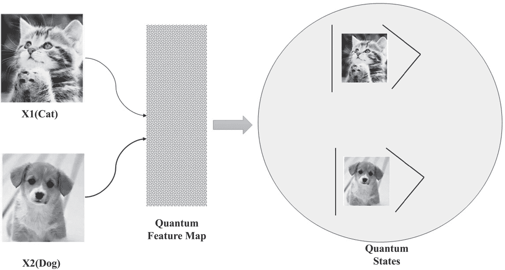
图 7.3 经典数据到量子态的基本嵌入。

### 7.3.2 振幅嵌入
每个状态的振幅都被嵌入以在希尔伯特量子空间中生成量子态。基于振幅的嵌入通过方程 (7.3) 描述。

(7.3)
```
\left. \mid \textbf{Data} \right\rangle\left. = \sum_{m = 1}^{2M}a_{m} \mid m \right\rangle
```
其中，`a[m]` 是归一化连接数据，而 `m` 是计算基态。
还有类似的最新嵌入可用，例如 `angle encoding`、`rotation encoding`、`Qsample encoding`，以及 `divide`、`Conquer encoding` 等 [13]。

## 7.4 量子主成分分析 (qPCA)
一种称为量子主成分分析 (`qPCA`) 的量子方法利用量子计算来减少数据集中维度的数量并确定最重要的特征。对于传统机器学习应用中的信息分析和压缩，`PCA` 仍然是一种广泛采用的方法。在传统的 `PCA` 中，该方法识别出一组主成分，即轨道流形方向，导致数据变化最大。这些元素通过捕获每个数据集的重要信息来实现降维和特征提取。
量子 `PCA` 试图通过利用量子计算的潜在优势来加速 `PCA` 计算。与使用传统 `PCA` 方法相比，使用这种方法可以更快地处理海量数据集 [14]。这些数据集中包含的变量数据值随后被转换为 `X n` 相关矩阵，其中 `n` 是变量的总数。主成分代表向量的累积，这些向量是单位向量，包含一个相对于初始 `i - 1` 向量正交的第 `i` 个向量，提供相关矩阵 [15]。有 `d` 个向量对应于 `d` 个维度。单个点与一个向量之间的中位数平方距离最小，因为该向量具有确保最佳拟合到数据集的属性。指定数据集合中的特征向量对应于这些向量。较高的特征值表示相关向量之间存在显著变化。由于方差较小，较低特征值向量可能不予考虑。不幸的是，突破性的量子主成分分析 (`qPCA`) 仍存在几个潜在问题 [16]。首先，过程必须使用大量量子门，其次，近似可能导致精度下降。
该算法已被多位研究人员检验并发现为精确算法，这意味着使用该技术时，它会产生精确的结果而不是低复杂度的估计结果。这一属性使其比基于量子奇异值阈值 (`qSVT`) 的当前研究中一些学者工作中解释的技术更有效。只有这两种方法独立于受控操作以及初始化矩阵 [17]。低复杂度 `qPCA` 算法的操作阶段如下：
1. 相位估计：在此阶段，特征值被抽象到量子寄存器。
2. 幺正操作：在此阶段，平凡特征值从量子寄存器中分离出来。
3. 幺正受控操作：在此阶段，使用幺正受控操作和辅助量子位来确定观测量子位特征值是否属于主成分。
4. 幺正逆操作：在此阶段，认为多余的值存储寄存器被移除。
5. 测量：此阶段量化量子位。
6. 第二次相位估计：在此阶段，可以获得量子态。

## 7.5 机器学习中的量子线性模型
线性回归模型已被广泛用于根据预测因子预测目标。`x` 和 `y` 变量的线性相关性可如方程 (7.4) 所示识别。

(7.4)
`y = a x + b`
其中 `a` 和 `b` 表示由 `x` 和 `y` 变量相关性得出的线性模型的斜率和截距 [18]。然而，当数据量增大时，确定 `a` 和 `b` 的最优值总是很繁琐。量子线性模型在解决在更大数据集中识别最佳最优值的问题方面表现出色。为了更好地理解，图 7.4 描述了线性模型与量子线性模型。
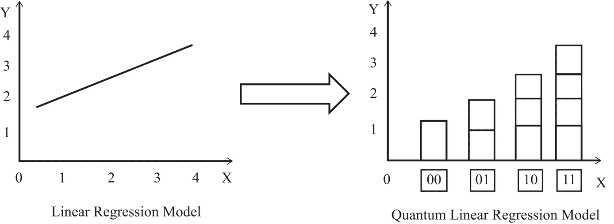
图 7.4 量子回归模型。
概念上，量子线性回归结合了每个量子位的状态，并在 图 7.4 中绘制为离散映射。因此，数学上，`x` 和 `y` 已转换为量子位并且可以如方程 (7.5) 所示进行归一化：

(7.5)
```
\left. \mid y \right\rangle = \frac{1}{C_{y}}y
```


在公式 (7.5) 中，$\\frac{1}{`C_y`}$ 被视为归一化因子。均方误差被降低以在最终模型中获得更高的精度 [19]。成本函数降低均方误差。然而，不同的研究人员提出了许多方法来估计量子线性回归的成本函数 [20]。多项式实现了基于高阶拟合的扩展量子回归技术。

## 7.6 量子聚类
参考文献 \[8\] 聚类被认为是无监督学习算法，主要用于识别输入数据流中的潜在模式。模式主要用于根据数学概念和统计推断确定数据流的行为，在某些情况下，它被用作混合建模的降维技术 [21]。聚类的基本原理是确定数据或示例之间的相似性。然而，当数据流庞大时，经典机器上的冗余计算无法取得最佳结果 [22]。量子计算通过其对大规模数据流的聚类算法的硬件实现解决了这些问题。接下来使用传统的 `K-Means` 和 `K-Median` 聚类来解释和讨论量子聚类的实现以及算法的有效性。

### 7.6.1 量子 K-Means 聚类
量子 `K-Means` 聚类在训练数据和测试数据上执行，并识别每个向量之间的对应关系以获得最佳精度 [23]。相比之下，在经典 `K-Means` 聚类中，训练输入数据被用于确定测试精度。图 7.5 中的流程图详细描述了 `K-Means` 聚类的过程。

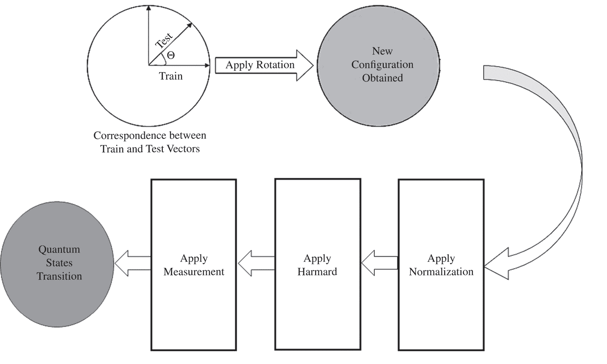

图 7.5 量子聚类过程。

在对训练向量和测试向量执行量子嵌入后，训练向量和测试向量之间的对应关系根据位置程度建立 [24]。执行旋转操作以从原始向量获得新向量并获得输入向量之间更好的对应关系。获得新配置的 `Qubits` 后，对向量进行归一化 [25]。在最高有效量子位上对归一化向量执行 `Hadamard` 操作。执行测量操作以识别量子态的概率。整个过程重复以识别量子态的相对差异，最终通过推断变分态获得准确的聚类结果。

### 7.6.2 量子 K-Median 聚类
`K-Median` 是一种传统的聚类技术，其中 `K` 表示从输入数据中所需的聚类数量。一旦执行开始，选择 `K` 个点，并计算数据点与质心的接近程度并形成聚类。此过程将递归重复直到达到稳定的质心。该过程的递归性质耗时，且当数据规模增大时复杂度呈指数增长。为了有效地处理大型数据集，量子 `K-Median` 实现有助于更快收敛并降低复杂度 [26]。已引入了多个版本的 `K-Median` 聚类，其中最著名的是由 Aïmeur 等人开发的 Diffie-Hellman 算法 (`DH`) 算法 [27]，该算法被广泛用于缓解 `K-Median` 聚类中的最小化问题。

### 7.6.3 量子层次聚类
量子层次聚类是用于聚类和识别数据最突出特征的领先方法之一。层次聚类通过每一层的接近度递归识别训练数据之间的相关性 [28]。层表示数据的突出特征，有助于识别聚类。接近度使用基于距离的方法计算。层次聚类在 图 7.6 中显示。

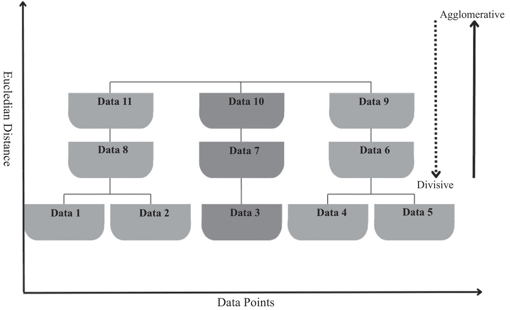

图 7.6 层次聚类。

层次聚类以两种不同的方式进行。一种是凝聚方法（自底向上方法），另一种是分裂方法（自顶向下方法）。数据点之间的欧几里得距离被考虑用于聚类目的。在分裂方法中，数据集被分类为多个聚类，而在凝聚方法中，多个聚类形成单个聚类。层表示数据集所具有的重要属性。在 图 7.6 中，我们注意到数据点 (11, 8, 1 和 2) 形成聚类 1，(10, 7 和 3) 形成聚类 2，(9, 6, 4 和 5) 形成聚类 3。每个层表示属性值，并基于将形成的聚类的值。然而，当数据集规模增大时，寻找数据点之间的最佳距离度量是一个繁琐的过程。为了识别数据点之间的最佳距离以获得更好的收敛性，采用了量子计算 [29]。下面讨论了使用量子硬件实现层次聚类。在量子层次聚类中应用了与 图 7.5 所示相同的量子聚类过程概念。

## 7.7 Harrow–Hassidim–Lloyd (`HHL`) 算法
求解任何线性系统在工程领域非常重要。本质上，线性系统没有解、多个解或唯一解。无解的线性系统称为不一致，多解的线性系统称为一致且相关，因为解依赖于其他解，而单解的线性系统称为一致且独立，因为解独立于任何输入或影响 [30, 31]。所有线性系统都遵循齐次原理，如公式 (7.6) 所示。

(7.6)
```
\[*a**y*1(*t*)+*b**y*2(*t*)\] = *T*\[*a**x*1(*t*)+*b**x*2(*t*)\] = *a**T*\[*x*1(*t*)\] + *b**T*\[*x*2(*t*)\]
```

由于求解线性系统在经典计算中存在严重的复杂性问题，量子计算机在求解线性系统以获得一致且独立的输出方面更为成功。科学家 Hassidim、Harrow 和 Lloyd 开发了一种有效求解线性系统的算法，称为 `HHL` 算法。

## 7.8 二次无约束二值优化 (`QUBO`)
二次无约束二值优化 (`QUBO`) 方法广泛用于解决各个领域的组合优化问题。`QUBO` 方法是统一的建模框架，用于解决网络流、调度以及 NP-Hard 问题（如数字划分、匹配和生成树等）中的优化问题。`QUBO` 求解一组变量（输入），对应于目标函数（最小/最大），以及一组约束（无需遵循） [32]。`QUBO` 如果得到的解不遵循约束，则提供惩罚，这最终使我们能够为二值变量问题获得多个解。图 7.7 描述了解决二值优化问题。

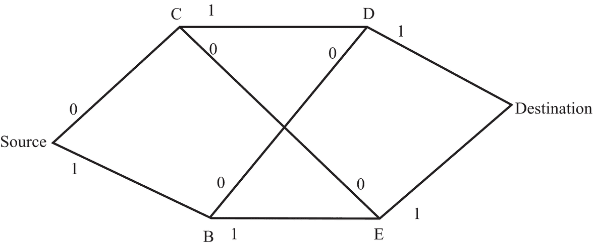

图 7.7 二值优化问题（路径查找）。


在约束条件下进行路径识别的二元优化问题得出了以下结果 [33]。约束二元优化始终强烈依赖于约束得到满足，并产生如下面所示的最佳优化结果。

`Path = {Start, B, E, Destination}`

然而，在识别最优结果时，约束条件不必总是得到满足的情况也存在。这类问题称为无约束二元优化。对于图 7.7 中提到的这个问题，我们得到可能的解如下：

`Path = {Start, B, D, Destination}` and `{Start, C, E, Destination}` and `so on`.

我们通过在某些状态下违反约束来获得多个解，在这种情况下 QUBO 会对解进行惩罚。惩罚将通过生成一个 `Q` 矩阵来进行，其中 `Q` 矩阵是对称的 [34]。惩罚后，获得惩罚最小且最可行的解被视为最优解。

此外，QUBO 用于通过在较短的多项式时间内识别最优性来解决 NP-完全问题。QUBO 的数学定义如公式 (7.7) 所示：

(7.7)

`min/max y = x^(t) Q x`

其中 `x` 是预测变量，`Q` 是常数的方阵。

最后，QUBO 允许量子计算机找到满足这些约束的解，而无需强制约束成立。这在多个结果提供更深入的见解和更佳的商业决策判断的问题中具有重要价值。

## 7.9 量子支持向量机

支持向量机 (`SVM`) 是一种传统的分类算法。支持向量机借助超平面将不可分的数据点分离为线性可分类。超平面被视为假设函数，它在线性特征空间中线性分离类 [35]。超平面可使用硬间隔和软间隔技术生成。软间隔技术被广泛采用，因为它们提供了寻找最优解的动态解决方案。在软间隔技术中，引入了称为松弛变量的误差变量。这违反了约束并允许某些错误分类以达到最佳解，这与 QUBO 相似，如第 7.8 节中讨论的。最佳解是通过丢弃错误并增加间隔来识别的。双问题是 SVM 中需要解决的主要问题之一。在双问题中，使用拉格朗日乘数来最大化目标函数（以最大化间隔）。为此，使用核技巧来计算样本之间的相似性。核可以是线性、多项式、高斯 RBF 或 Sigmoid，其类型根据特征空间分布选择 [36]。然后，为了识别样本的相似性，相似性在量子机器中计算，如量子聚类所示。如果我们有 40 个样本，则在量子机器实现中核将为 40 × 40。一旦量子核生成，核的信息需要被提取并解析到经典系统以进行最终分类。为了从量子核中提取信息，图 7.8 所示的电路现在在此前沿方法中被利用。

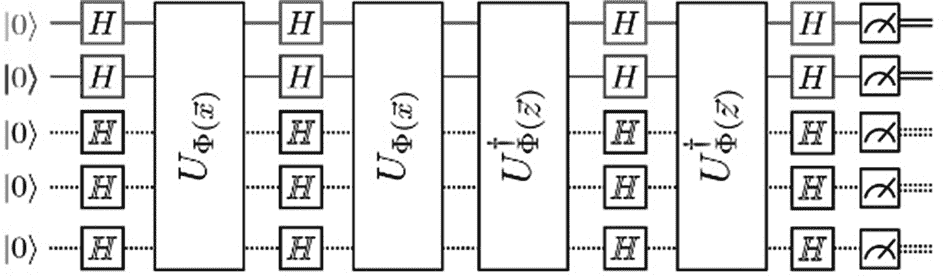

图 7.8 用于从量子核中提取信息的电路生成。

图 7.8 所示的电路用于识别两个状态的重叠。通过估计重叠，`0^(n)` 的频率被计算，因为初始状态为 0。为了生成这些用于核的量子电路，一些研究人员已生成自动电路生成模式，这些模式目前是可用的艺术 [37]。实验上，经典和量子 SVM 的准确性没有多样化差异，但运行时间复杂度降低了，并且多位研究人员通过分析证明了这一点。

## 7.10 求解 NP-Hard 问题

NP-Hard 问题在非确定性多项式时间内求解并产生决策。NP-完全问题也产生决策，但在非确定性机器中以多项式时间，反映了解决方案识别的效率。路由是 NP-完全问题的最佳示例之一，其中存在多个解，我们必须使用某些策略来决定最佳解。NP-Hard 问题是时间未知的问题，它不是像 NP-完全那样的决策问题。然而，在量子计算中，NP-完全问题可以使用 Grover 算法求解。求解 NP-完全问题的常规算法将花费 `O(n²)` 来做出决策；然而，Grover 算法将花费 `O(SquareRoot(n))`。

NP-Hard 问题不是决策问题，而是优化问题。NP-Hard 只能在且仅在 NP-Hard 问题可以简化为 NP-完全问题时才能求解。由于 NP-Hard 问题不产生决策，其时间复杂度未知。最佳示例是停机问题、旅行商问题等。量子计算机在大搜索空间中工作良好，并通过将输入置于希尔伯特空间的各种状态来优化目标函数。优化问题应遵循 QUBO 模式以便高效求解。这涉及获得多个解并引入松弛变量以在约束被违反时惩罚解，并尝试减少惩罚以获得最佳最优解。

为了解决量子机器中的 NP-Hard 问题，变分量子算法已被广泛使用。变分量子算法如图 7.9 所示。


图 7.9 变分量子算法框架。

变分量子算法本质上是自适应的，优化将在飞行中进行。变分电路被称为 ansatz 电路，其中多个门已连接到输入传输，并且与函数相关联的参数是可变的。问题被定义为参数化目标函数，它定义了特征空间。量子电路识别用于优化目标函数的参数，可进一步用于微调经典机器中存在的解。变分量子算法已广泛分为两类算法，即量子近似优化算法和变分量子本征求解器。尽管 NP-Hard 问题已使用量子计算机求解，但与经典计算机计算相比，其复杂度变化不大，因为它仍处于初始阶段。

## 7.11 摘要

本章提供了量子计算在机器学习领域利用的概述。它首先讨论了量子计算的复杂性并通过图表详细说明了量子计算。量子态作为量子比特的表示以及量子比特在布洛赫球中的叠加已通过适当的表示进行了详细说明。纠缠是量子计算的主要关键部分，在特征映射部分中进行了详细说明以便更好地理解。


第 7.1 节和第 7.2 节涵盖了复杂性、叠加和纠缠，然后第 7.3 节详细介绍了量子计算中机器学习算法的实现。第 7.4 节涉及量子主成分分析，这是一种有效的降维方法，也是机器学习中潜在的特征提取方法。在第 7.5 节中，量子机器上的线性系统实现通过数学背景进行描述，并使用图表进行概念化。同样，第 7.6 节、第 7.7 节和第 7.8 节详细介绍了量子机器上无监督学习技术的实现，并通过流程图和简单的数学公式进行概念化。

第 7.9 节主要涉及监督机器学习算法，并选择支持向量机用于实现目的。此外，机器学习算法的优化在第 7.10 节中进行了讨论。二次无约束二值优化（QUBO），一种在量子机器中用于识别最优解的有效方法在本章中进行了解释，并通过一个简单的图示说明了通过量子机制求解 NP-Hard 问题。

量子机制通过其实现策略克服某些特定问题的潜力被称为量子潜力，而用于提高量子潜力的策略被称为量子算法。本章在将机器学习算法作为 prima facie 实现的同时，讨论了量子计算机制的复杂性。在复杂性分析之后，将讨论量子机制中特征映射的使用和提取以便更好地理解。

本章通过简单的语言简要介绍机器学习中量子机制的概念，以便学习者更好地理解。本章旨在通过简单的图表、流程图以及直接的数学方法来概念化实现和机制。此外，通过简单的数学从概念化到深入地解释该主题，使其对初学者来说易于理解。

为了练习和模拟量子机制，建议从业者访问 [`qiskit.org/`](https://qiskit.org/)

## 参考文献

1. Hirvensalo, M. (2003). 量子计算. Springer Science & Business Media.

2. 国家科学院、工程院和医学院. (2019). 量子计算：进展与前景. The National Academies Press. [`doi.org/10.17226/25196`](https://doi.org/10.17226/25196)

3. Williams, C. P., Clearwater, S. H., & others. (1998). 量子计算探索. Springer.

4. Hey, T. (1999). 量子计算：导论. Computing & Control Engineering Journal, *10*(3), 105–112.

5. Bennett, C. H., Bernstein, E., Brassard, G., & Vazirani, U. (1997). 量子计算的优势与劣势. SIAM Journal on Computing, *26*(5), 1510–1523.

6. Schuld, M., & Killoran, N. (2019). 特征希尔伯特空间中的量子机器学习. Physical Review Letters, *122*(4), 40504.

7. Córcoles, A. D., Kandala, A., Javadi-Abhari, A., McClure, D. T., Cross, A. W., Temme, K., Nation, P. D., Steffen, M., & Gambetta, J. M. (2019). 近期量子计算系统的挑战与机遇. Proceedings of the IEEE, *108*(8), 1338–1352.

8. Schuld, M., & Petruccione, F. (2021). 在量子计算机上表示数据. Machine Learning with Quantum Computers, *1*, 147–176.

9. Goto, T., Tran, Q. H., & Nakajima, K. (2021). 量子增强特征空间中量子机器学习模型的通用逼近性质. Physical Review Letters, *127*(9), 90506.

10. Goto, T., Tran, Q. H., & Nakajima, K. (2020). 量子特征映射的通用逼近性质. *ArXiv Preprint ArXiv:2009.00298*.

11. Giannakis, D., Ourmazd, A., Pfeffer, P., Schumacher, J., & Slawinska, J. (2022). 将经典动力学嵌入量子计算机. Physical Review A, *105*(5), 52404.

12. Thumwanit, N., Lortaraprasert, C., & Raymond, R. (2021). 用于量子机器学习的训练离散特征嵌入. *2021 58th ACM/IEEE Design Automation Conference (DAC)*, 1352–1355.

13. Yang, R., Bosch, S., Kiani, B., Lloyd, S., & Lupascu, A. (2023). 模拟量子变分嵌入分类器. Physical Review Applied, *19*(5), 54023.

14. Lloyd, S., Mohseni, M., & Rebentrost, P. (2014). 量子主成分分析. Nature Physics, *10*(9), 631–633.

15. Parmar, J. B. (2022). 量子主成分分析. The National Academies Press. [`doi.org/10.13140/RG.2.2.14437.06885`](https://doi.org/10.13140/RG.2.2.14437.06885)

16. He, C., Li, J., Liu, W., Peng, J., & Wang, Z. J. (2022). 一种低复杂度量子主成分分析算法. IEEE Transactions on Quantum Engineering, *3*, 1–13.

17. Al-Alimi, D., Al-Qaness, M. A. A., Cai, Z., Dahou, A., Shao, Y., & Issaka, S. (2022). 用于分类高光谱图像的元学习器混合模型. Remote Sensing, *14*(4), 1038.

18. Petersen, I. R. (2016). 量子线性系统理论. *ArXiv Preprint ArXiv:1603.04950*.

19. Harrow, A. W., Hassidim, A., & Lloyd, S. (2009). 线性方程组的量子算法. Physical Review Letters, *103*(15), 150502.

20. Kerenidis, I., & Prakash, A. (2020). 线性系统和最小二乘的量子梯度下降. Physical Review A, *101*(2), 22316.

21. Maier, T., Jarrell, M., Pruschke, T., & Hettler, M. H. (2005). 量子团簇理论. Reviews of Modern Physics, *77*(3), 1027.

22. Horn, D., & Gottlieb, A. (2001). 量子聚类方法. Advances in Neural Information Processing Systems, *14*, 1–7

23. Poggiali, A., Berti, A., Bernasconi, A., Del Corso, G. M., & Giudotti, R. (2022). 使用量子 K-means 对经典数据进行聚类. *Proceedings of the 23rd Italian Conference on Theoretical Computer Science*, Roma, Italy, 7–9.

24. Wu, Z., Song, T., & Zhang, Y. (2022). 基于曼哈顿距离的量子 k-means 算法. Quantum Information Processing, *21*(1), 19.

25. Benlamine, K., Bennani, Y., Grozavu, N., & Matei, B. (2020). 量子协作 k-means. *2020 International Joint Conference on Neural Networks (IJCNN)*, 1–7.

26. Voevodski, K. (2021). 用于稳定聚类实例的大规模 k-中位数聚类. International Conference on Artificial Intelligence and Statistics, *1*, 2890–2898.

27. Aïmeur, E., Brassard, G., & Gambs, S. (2007). 量子聚类算法. *Proceedings of the 24th International Conference on Machine Learning*, 1–8.

28. Kumar, V., Bass, G., Tomlin, C., & Dulny, J. (2018). 用于组合聚类的量子退火. Quantum Information Processing, *17*, 1–14.

29. Wei, A. Y., Naik, P., Harrow, A. W., & Thaler, J. (2020). 用于喷注聚类的量子算法. Physical Review D, *101*(9), 94015.

30. Duan, B., Yuan, J., Yu, C.-H., Huang, J., & Hsieh, C.-Y. (2020). HHL 算法综述：从理论到量子机器学习中的应用. Physics Letters A, *384*(24), 126595.


31. Liu, X., Xie, H., Liu, Z., & Zhao, C. (2022). HHL 算法改进与应用综述。物理学：会议系列, *2333*(1), 12023.
32. Glover, F., Kochenberger, G., & Du, Y. (2018). QUBO 模型构建与使用教程。*ArXiv 预印本 ArXiv:1811.11538*。
33. Papalitsas, C., Andronikos, T., Giannakis, K., Theocharopoulou, G., & Fanarioti, S. (2019). 带时间窗的旅行商问题的 QUBO 模型。算法, *12*(11), 224.
34. Date, P., Arthur, D., & Pusey-Nazzaro, L. (2021). 用于训练机器学习模型的 QUBO 公式。科学报告, *11*(1), 10029.
35. Bologna, G., & Hayashi, Y. (2015). Qsvm：用于规则提取的支持向量机。*计算智能进展：第 13 届国际人工神经网络工作会议 IWANN 2015*，帕尔马德马略卡，西班牙，2015 年 6 月 10-12 日。论文集，第二部分 13，276–289。
36. Ahmed, S. (2019). 在近期量子处理器上使用量子支持向量机（QSVM）进行模式识别。Brac University。
37. Shan, Z., Guo, J., Ding, X., Zhou, X., Wang, J., Lian, H., Gao, Y., Zhao, B., & Xu, J. (2022). 使用 IBM 量子处理器上的 QSVM 进行乳腺癌检测的演示。Research Square。

# 8 量子分类

Durgadevi Palani and Akila Krishnamoorthy

SRM Institute of Science and Technology, India

DOI: [`10.1201/9781003429654-11`](https://dx.doi.org/10.1201/9781003429654-11)

量子分类是量子机器学习的一个子领域，专注于开发利用量子计算原理对数据进行分类的算法和技术。它旨在利用量子计算的强大功能以可能优于经典机器学习算法的方式处理和分析数据。

在量子分类中，量子态用于表示和处理数据，量子算法被设计用于执行分类任务，如所示 in 图 8.1。量子分类器可以在经典数据或量子数据上训练，并利用叠加和纠缠等量子特性来增强学习和分类过程。


图 8.1 量子分类。

量子分类有几种方法，包括：

1. **量子变分算法：** 这些算法利用可训练的量子电路来优化代价函数，类似于经典神经网络。示例包括量子变分分类器（`QVC`）和量子神经网络（`QNN`）。
2. **量子支持向量机（`QSVM`）：** `QSVM` 是经典支持向量机（SVM）算法的量子版本。它采用量子核将数据映射到高维量子特征空间，从而基于量子测量进行分类。
3. **量子 k 近邻（`QK-NN`）：** 这是经典 k 近邻算法的量子扩展。它涉及将经典数据编码为量子态并使用量子距离度量来确定最近邻。
4. **量子决策树：** 量子决策树是经典决策树的量子版本。它们利用量子电路执行分裂和决策过程。

需要注意的是，量子分类是一个活跃的研究领域，该领域仍处于早期阶段。许多提出的算法仍在开发和优化中，其性能正在各种量子硬件平台上进行评估。此外，量子机器学习算法通常依赖于经典数据预处理步骤和经典机器学习技术与量子组件的结合。混合量子-经典方法通常用于弥合经典计算与量子计算之间的差距，并利用两种范式的优势。

## 8.1 最近邻

最近邻算法在经典机器学习中被广泛用于基于特征的分类任务，如图所示 in 图 8.2。这些算法通过找到给定输入数据点最近的训练示例（邻居）并使用它们的标签或值来进行预测。在量子分类的背景下，应用最近邻技术有望利用量子计算的强大功能。


图 8.2 最近邻算法。

本节探讨将最近邻算法适配到量子数据的过程，涵盖数据编码、距离测量、最近邻选择以及使用量子最近邻进行分类。

### 8.1.1 数据编码

在量子分类中，经典数据需要编码为量子态。一种常见的方法是振幅编码，其中量子态的振幅表示经典特征。

例如，给定一个经典特征向量 `v` = (`v_1`, `v_2`, …, `v_n`)，量子态可以表示为

(8.1)

|`v`⟩=∑_`i``v_i`|`i`⟩

### 8.1.2 距离测量

量子态之间相似性或相异性的量化是通过利用距离度量实现的。在这些度量中，保真度是一种广泛使用的度量，定义为

(8.2)

$$F\\left( \\rho 1,\\sigma 1 \\right) = {Tr}\\left( \\left. \\sqrt{}\\left( \\left. \\sqrt{}\\rho 1\\sigma 1\\left. \\sqrt{}\\rho 1 \\right) \\right) \\right. \\right. \\right.$$

其中 `Tr` 表示迹运算。

另一种距离度量是量子态重叠，由两个量子态的内积给出，

(8.3)

⟨`ρ`|`σ`⟩ = `Tr`(`ρ`†`σ`)

### 8.1.3 最近邻选择

为了确定测试量子态的最近邻，使用所选距离度量计算测试态与每个训练态之间的距离。设 |`ψ_test`⟩ 和 |`ψ_i`⟩ 分别表示测试量子态和第 `i` 个训练量子态。它们之间的距离可以使用前面讨论的保真度或量子态重叠度量计算。

### 8.1.4 分类

计算距离后，选择距离最小的 `k` 个最近邻。为了确定测试量子态的类别标签，利用其最近邻的类别标签。这可以通过各种决策规则实现，例如基于距离的多数投票或加权投票。最终的分类决策基于最近邻的类别标签。

方程：

* **振幅编码：** 给定一个经典特征向量 `v` = (`v_1`, `v_2`… `v_n`)，量子态可以表示为 |`v`⟩ = ∑_`i``v_i`|`i`⟩。
* **保真度：** 两个量子态 `ρ1` 和 `σ1` 之间的保真度定义为 `F`(`ρ1`, `σ1`) = `Tr`(√(√`ρ1``σ1`√`ρ1`))。
* **量子态重叠：** 两个量子态 `ρ1` 和 `σ1` 之间的量子态重叠由内积 ⟨`ρ1`|`σ1`⟩ = `Tr`(`ρ1`†`σ1`) 表示。

## 8.2 通过 Grover 搜索算法的支持向量机

支持向量机（SVM）是经典机器学习中广泛使用的强大分类器。在量子机器学习的领域，研究人员探索了将 Grover 搜索算法与 SVM 集成以增强其性能。

### 8.2.1 经典机器学习中的支持向量机


## 8.2 SVM 中的量子加速

在经典的 `SVMs` 中，在高维特征空间中创建超平面以分离属于不同类别的数据点。支持向量指的是最接近超平面的数据点，并在定义决策边界方面发挥重要作用。`SVM` 的训练过程涉及求解二次规划问题以识别最优超平面。

### 8.2.2 解锁搜索问题中的量子加速：Grover 搜索算法

Grover 搜索是已知的一种量子算法，其能够以二次加速的速度执行无结构搜索任务，优于经典算法。

Grover 搜索算法是一种量子算法，它提供了与经典算法相比在无结构搜索问题上的二次加速。Grover 搜索算法由 Lov Grover 于 1996 年提出，已在数据库搜索和优化问题等多个领域得到应用。图 8.3 说明了 Grover 搜索算法的高层步骤。


图 8.3 Grover 算法涉及的步骤。

该算法包括四个主要步骤：叠加初始化、oracle 应用、关于均值的反转和测量。

1. **叠加初始化：** 该算法首先通过将量子态制备为所有可能输入的叠加态开始。这是通过对量子寄存器中的每个量子比特应用 Hadamard 门实现的，形成一个等叠加态，同时包含所有可能的状态。

2. **Oracle 应用：** oracle 是一个量子电路，用于在搜索空间中标记期望的解。它对目标态提供相位反转，同时保持其他态不变。oracle 作为黑箱运行，实现与搜索问题相关的特定函数。

3. **关于均值的反转：** 在应用 oracle 之后，算法执行关于均值的反转操作。此步骤涉及将量子态的振幅关于其均值进行反射，有效地放大标记解的振幅并抑制其他解。这是通过应用一系列量子门实现的，包括 Hadamard 门和相位门。

4. **测量：** 最后，算法对量子态进行测量。测量将叠加态坍缩为单一经典态，以高概率提供期望的解。

Grover 搜索算法迭代重复步骤 2 和 3 一定次数，以提高在最终测量步骤中测量到期望解的可能性。所需迭代次数取决于搜索空间的大小。

它可用于通过加速核矩阵的计算来增强 SVMs，这是 SVM 训练中的关键步骤。将 Grover 搜索与 SVMs 集成涉及利用量子算法更有效地搜索支持向量。这种集成可以降低 SVM 训练的时间复杂度，使其在大规模分类问题中更高效。经典 SVM 中的超平面方程由以下公式指定：

(8.4)

`F(x1) = sign(∑_i α1_i y1_i K(x1,x1_i) + b)`

其中 `α1_i` 是拉格朗日乘子，`y1_i` 是类别标签，`K(x1, x1_i)` 是核函数，`b` 表示偏置项。

**量子核矩阵计算：**

量子核矩阵可使用 Grover 搜索算法按如下方式计算：

(8.5)

```
|K⟩ = Σ_i √α_i |x_i⟩ |y_i⟩
```

其中 `|x_i⟩` 表示编码特征向量 `x_i` 的量子态，`|y_i⟩` 是编码类别标签 `y_i` 的量子态。

### 8.2.3 Grover 搜索与 SVMs 的优势

* **训练时间加速：** Grover 搜索可以加速核矩阵的计算，降低 SVM 训练的时间复杂度。

* **改进的可扩展性：** Grover 搜索的集成可以使 SVMs 更高效地处理更大规模的数据集。

* **性能提升潜力：** 核矩阵的高效计算可以带来更好的泛化能力和分类准确率。

## 8.3 具有指数加速的支持向量机

量子计算在解决某些计算问题时具有指数加速的潜力。在 SVMs 的背景下，量子算法可以显著降低训练和预测任务的计算复杂度，从而实现指数加速。

实现 SVM 中指数加速的两种显著方法为量子矩阵求逆和量子特征映射。

**量子矩阵求逆利用量子算法**，例如 `HHL` (`Harrow-Hassidim-Lloyd`) 算法，来高效地求逆核矩阵。这种指数加速降低了 SVM 训练的计算复杂度。使用 `HHL` 算法进行量子矩阵求逆的方程为：

(8.6)

`A|x⟩ = |b⟩`

其中 `A` 是待求逆的矩阵，`|x⟩` 是解向量，`|b⟩` 是输入向量。

**量子特征映射** 在支持向量机 (`SVMs`) 中发挥重要作用，因为它们促进将输入数据转换为更高维的特征空间，从而能够使用线性超平面分离类别。量子特征映射利用量子算法，例如量子核技巧，来高效地执行特征映射。这导致 SVM 训练所需的计算资源显著减少，从而实现指数加速。量子特征映射的方程为：

(8.7)

`K(x1,y1) = ⟨ϕ(x1)/ϕ(y1)⟩`

其中 `ϕ(x1)` 和 `ϕ(y1)` 分别是输入向量 `x1` 和 `y1` 的量子特征表示，`K(x1, y1)` 是核函数。

将具有指数加速的量子算法集成到 SVMs 中为量子分类提供了若干影响。首先，它实现了增强的可扩展性，使 SVMs 能够更高效地处理更大规模的数据集。计算复杂度的降低使 SVMs 能够解决以前使用经典方法在计算上不可行的难题。其次，指数加速导致训练和预测时间更快，这对于实时和时间敏感的应用尤其有利。最后，量子 SVM 的计算优势可以通过允许 SVMs 学习更复杂的决策边界并捕捉数据中的复杂模式来提高分类准确率。

然而，要实现具有指数加速的 SVMs 的全部潜力仍存在挑战。量子硬件限制，例如需要足够数量的量子比特和可靠的量子门，带来了实施挑战。需要进一步研究开发专门为 SVMs 设计的高效量子算法，为各种问题类型进行优化并提高其在量子硬件上的性能。此外，将理论量子算法转化为实际量子电路需要考虑电路深度、连接性约束以及纠错技术的集成等事项。

## 8.4 计算复杂度

量子分类算法的计算复杂度可以从算法所需的量子操作数或量子比特数角度进行分析。一般而言，量子算法可以通过在比经典算法指数级更好的时间内解决某些问题来提供指数加速。为了说明，经典算法与量子算法在计算复杂度方面的比较在 表 8.1 中表示。


# 8 计算复杂度

表 8.1 传统算法的计算复杂度

| 算法 || 复杂度 |
| --- | --- |
| SVM || `exp(O(log(N) + log(d)))` |
| --- | --- |
| 决策树 || `exp(O(log(N) + log(d) + log(log(N))))` |
| 随机森林 || `exp(O(log(M) + log(N) + log(d) + log(log(N))))` |

在 表 8.1 中，“`N`” 表示数据点的总数，“`d`” 表示特征空间的维度，而 “`M`” 表示随机森林中树的总数。经典分类算法（如 SVM、决策树和随机森林）的复杂度随数据集大小和特征维度呈多项式增长。

在 表 8.2 中，展示了量子分类算法（如量子 SVM、量子决策树和量子随机森林）的复杂度。这些算法的量子复杂度可能受数据点数量、特征维度和随机森林中树的数量的影响。这些量子算法相对于经典方法具有潜在的指数级加速。

表 8.2 量子分类算法的计算复杂度

| 算法 || 复杂度 |
| --- | --- |
| 量子 SVM || `exp(O(log(N³)))` |
| --- | --- |
| 量子决策树 || `exp(O(log(N) + 2log(N) + log(d) + log(log(N))))` |
| 量子随机森林 || `exp(O(log(M) + 2log(N) + log(d) + log(log(N))))` |

表 8.3 提供了 SVM、决策树和随机森林的经典算法与量子算法计算复杂度的比较。它突出了量子算法实现的显著复杂度降低，这可能导致指数级加速。

表 8.3 计算复杂度的比较

| 算法 || 经典复杂度 || 量子复杂度 |
| --- | --- | --- |
| SVM || `exp(O(log(N) + log(d)))` || `exp(O(log(N³)))` |
| --- | --- | --- |
| 决策树 || `exp(O(log(N) + log(d) + log(log(N))))` || `exp(O(log(N) + 2log(N) + log(d) + log(log(N))))` |
| 随机森林 || `exp(O(log(M) + log(N) + log(d) + log(log(N))))` || `exp(O(log(M) + 2log(N) + log(d) + log(log(N))))` |

然而，需要注意的是，要在实践中实现这种指数级加速，需要克服若干挑战。其中主要挑战之一是在物理量子硬件上实现量子算法。量子计算机仍处于早期发展阶段，当前量子系统具有有限的量子比特相干时间和较高的错误率。因此，在现有量子硬件上实现量子分类算法具有挑战性。

此外，量子分类算法的复杂度取决于具体问题和数据集的大小。虽然量子算法可为某些任务提供指数级加速，但它们仍可能需要大量量子比特或量子门来实现这一优势。随着数据集规模的增大，所需的量子比特数和量子操作数也会增加，这可能对量子分类算法的可扩展性构成实际限制。

## 8.5 总结

总之，量子分类算法有潜力相对于经典方法提供指数级加速，从而实现更快、更准确的分类。比较表展示了量子算法实现的计算复杂度显著降低。然而，要在实践中充分发挥量子分类的潜力，需要解决与量子硬件限制相关的问题，并优化量子算法的可扩展性和效率。

## 延伸阅读

1. Schuld, M., Sinayskiy, I., & Petruccione, F. (2015). 《量子机器学习导论》. Contemporary Physics, 56(2), 172–185.

2. Biamonte, J., & Wittek, P. (2017). 《量子机器学习》. Nature, 549(7671), 195–202.

3. Cong, I., Duan, R., & Fruchtman, A. (2019). 《量子启发机器学习：概念与最新进展》. Frontiers of Physics, 14(5), 53602.

4. Schuld, M., Fingerhuth, M., & Petruccione, F. (2018). 《用量子干涉电路实现基于距离的分类器》. EPL (Europhysics Letters), 119(6), 60002.

5. Havlíček, V., Córcoles, A. D., Temme, K., Kandala, A., Chow, J. M., Gambetta, J. M., … Gambetta, J. M. (2019). 《具有量子增强特征空间的监督学习》. Nature, 567(7747), 209–212.

6. Cai, X. D., Wu, D., Su, Z. E., Chen, M. C., Wang, X. L., Li, L., … Pan, J. W. (2015). 《实验量子计算求解线性方程组》. Physical Review Letters, 114(11), 110504.

7. Rebentrost, P., Mohseni, M., & Lloyd, S. (2014). 《用于大数据分类的量子支持向量机》. Physical Review Letters, 113(13), 130503.

8. Liu, L., Wang, J., Chen, L., & Zhu, S. (2020). 《用于经典数据的量子 k 近邻算法》. Quantum Information Processing, 19(9), 1–15.

9. Benedetti, M., Realpe-Gómez, J., Biswas, R., & Perdomo-Ortiz, A. (2019). 《具有任意成对连接的图形模型的量子辅助学习》. Quantum Science and Technology, 4(2), 024010.

10. Schuld, M., Bergholm, V., Gogolin, C., & Izaac, J. (2019). 《在量子硬件上评估解析梯度》. Physical Review A, 99(3), 032331.

# 9 QML 中的 Boosting

Ponnuviji Namakkal Ponnusamy

RMK College of Engineering and Technology, India

Indra Priyadharshini Sundar

VIT-Chennai, India

Nirmala Ganapath

RMD Engineering College, India

DOI: [10.1201/9781003429654-12](https://dx.doi.org/10.1201/9781003429654-12)

## 9.1 Boosting 简介

由于能够解决传统机器无法解决的计算问题，量子计算有能力革新计算，并在农业、金融、能源和材料科学设计等关键行业产生重大影响。在构建拥有 50 至 100 个量子比特及更大的量子计算系统时，正在做出设计选择以尽可能榨取机器的最大处理能力。这导致了对简单量子体积（SQV）\[1\]的研究，其可通过将机器的计算量子比特数乘以预期能够无错误执行的门数量来建模，如 图 9.1 所示。量子计算中最小的存储单元是量子比特，即极易出错的物理量子位。这意味着这些机器上的计算受量子比特快速衰减寿命的限制。这目前是 SQV 的一个限制。为弥补这一点，系统设计师正在努力创建更好的物理量子比特，然而这非常具有挑战性，因此可能建议使用经典系统来减轻负载。


图 9.1 使用纠错码的量子计算机增强。

特别是，量子纠错是一种传统的控制方法，可降低量子比特出错率并提高 SQV。纠错的下一步是将要通过算法处理的逻辑量子比特组编码到一组物理有缺陷的量子比特中。一种特定的量子电路，称为综合征，可在不干扰底层过程的情况下提取有关设备当前状态的数据。纠错协议可通过称为解码的过程将数据转换为一组校正。如果校正选择正确，系统应恢复到正确的逻辑状态。通过随码距呈指数级降低量子比特错误，全容错机器可以迅速扩展 SQV。


### 9.1.1 量子纠错
由于其固有的脆弱性，量子比特必须与外界影响隔离以保持其价值。退相干，例如量子态从一般态 ∣`S` = `β`∣0 + `γ`∣1 到基态 ∣`S` = ∣0 的转变，在许多不同类型的实际物理量子比特中发生得很快，经常在数十纳秒的量级。因此，算法在没有任何系统修改的情况下长时间成功运行的能力受到严重限制。

量子纠错程序已被创建来解决这个问题。这些涉及将较少数量的逻辑量子比特，即用于计算算法的量子比特，编码到更多数量的物理量子比特中，从而提高可靠性。一般来说，创建量子纠错方法具有挑战性，因为这样做会导致系统量子比特中的数据被破坏。协议依赖于添加额外的量子比特，这些量子比特与主量子比特集一起工作并被测量，以便间接获取有关错误的信息。随后使用测量数据推断出包含错误的数据量子比特的位置。

物理量子比特容易受到 `Surface Code` 错误的影响，因为它们在数学上由两个具有连续取值范围的复系数表示。表面码使用量子力学的优点在于，这些恒定故障最终可以分解为少数不同的错误。更具体地说，表面码的操作将数据上发生的这些连续恒定故障转换为泡利错误算子，其形式为 {`I`, `A`, `B`, `C`}。这是一项使错误检测和纠正成为可能的代码关键组成部分。表面码技术使用二维纠错码来提供错误离散化、检测和纠正。这在 图 9.2 中显示。


图 9.2 表面码网格。

数据量子比特由第二行和第四行圆圈表示，留下交替的圆圈用于辅助量子比特计算相应的 `A` 和 `C` 稳定子，它们由标记为 `A` 和 `C` 的节点表示。第三行和第三列中的边将辅助量子比特连接到它们负责计算的数据量子比特。 图 9.2(c) 中的相邻 `C` 辅助位感知其数据量子比特集中的奇偶性，并在单个数据量子比特经历泡利-`A` 错误时报告 +1 计算结果，该错误在图表的最中心圆圈中描绘。在 图 9.2(c), 中，最中心的圆圈遇到泡利-`C` 错误，这导致垂直相邻的 `A` 辅助量子比特报告测量值为 1。

错误综合征是辅助量子比特与其附近所有数据量子比特相互作用并随后进行测量后产生的结果。此操作序列，其中每个补充量子比特涉及一个称为稳定子的四量子比特算子，构成了稳定子电路。

### 9.1.2 用于提升的机器学习
由于其在实际应用中的流行，机器学习 (`ML`) 在过去十年中引起了大量关注。鉴于 `ML` 的广泛用途，人们对确定量子计算机能够加速的具体学习任务产生了浓厚兴趣。为了准确的实际机器学习应用，已经涌现出一批量子算法，这些算法相对于经典计算机可能提供指数级或多项式级的量子加速。量子机器学习 (`QML`) 的理论研究以前侧重于创建具有理想量子复杂度的有效量子算法，以解决引人入胜的学习挑战。最近，人们努力理解嘈杂的小型量子设备如何与量子机器学习算法交互。 `QML` 为我们提供了各种用于实现量子学习以及经典学习任务的算法，例如：(i) 将经典机器学习算法如 `SVM`、线性代数、基于核的分类算法、梯度计算算法、感知机学习算法和聚类算法转化为量子高效算法；(ii) 处理 `PAC` 设置中的任意量子态，量子态的影子层析，以及学习量子对象如经典稳定子态类、低纠缠态；(iii) 通过量子框架学习布尔值概念类；(iv) 优化量子算法；(v) 量子机器学习算法用于生成模型，等等。

假设 `A` 是一个理论上性能高度高效的 `QML` 算法。然而，使用嘈杂的量子计算机时，`A` 的性能很差，意味着只有略多于一半的输入会产生正确的输出。我们能否使 `A` 表现更好，使其输出在三分之二的输入上准确？一种传统的自适应提升方法，通常称为 `AdaBoost`，可以立即用于将弱量子学习算法转化为强算法。现有的量子提升技术在性能上比传统的 `AdaBoost` 算法快二次方。我们甚至可以使用量子提升技术将一个差且不精确的 `QML` 转化为一个可以二次方更快运行的更快算法。如果我们有一个布尔概念类 `C` 并使用准确度为 `γ` 的弱学习器，该学习器训练需要时间 `R(C)`，那么 `AdaBoost` 算法的时空复杂度按 `VC(C)`·`poly(R(C), 1/`γ`)` 比例缩放。这里，`VC(C)` 表示概念类 `C` 的 VC 维，衡量其拟合数据的能力，而 `poly()` 表示一个多项式函数，考虑 VC 维和弱学习器训练时间的综合影响。

## 9.2 经典提升
许多现代统计和机器学习方法严重依赖于优化目标或损失函数。例如，在简单的线性回归中，目标是找到一个权重向量 `w`，该向量能够为每个输入 `xi` 提供目标值 `yi` 的良好近似，给定一组示例 (`x1`, `y1`), …, (`xm`, `ym`)，其中 `xi` ∈ `Rn` 且 `yi` ∈ `R`。目标是最小化平方误差的平均值（或总和），这涉及找到 `w` ∈ `Rn` 中元素的最佳值。

$$L\\left( w \\right) = \\frac{1}{m}\\sum\_{i = 1}^{m}\\left( w.\\mathit{xi} - \\mathit{yi} \\right)^{n}$$

在各种机器学习技术中，例如线性回归，损失函数至关重要。此函数，在此上下文中通常是平方或二次损失，量化每个分量 (`w xi` − `yi`)² 的平方误差。主要目标是最小化所有 `m` 个实例的这些损失的平均值。此优化过程也可以应用于其他方法，如神经网络、支持向量机、逻辑回归、最大似然等。定义清晰的损失函数并最小化它提供了明确的学习目标。此外，修改目标函数的灵活性使其能够适应处理新的和多样化的学习挑战。

### 9.2.1 AdaBoost
最初 `AdaBoost` 并非设计为优化目标函数的程序。研究表明 `AdaBoost` 实际上贪婪地最小化损失函数，这有助于我们理解和扩展算法。因此，`AdaBoost` 可以推广用于处理损失函数并提升性能。


Freund 和 Schapire 提出了名为 AdaBoost 的卓越提升算法，该算法解决了将弱学习器视为黑箱是否可以用于创建强学习器的问题。其 AdaBoost 方法以其简洁性和实用性而闻名，已成为一项重大突破，在博弈论、统计学、优化、视觉、语音识别和信息几何等领域有着众多应用。鉴于该算法在理论和实践中的有效性，Freund 和 Schapire 于 2003 年荣获 Gödel 奖 \[2\]。

对分类器 `H` 在标记示例 (`x`, `y`) 上的损失由 `1{H(x) ≠ y_i}` 给出，其中：
* `H(x)` 表示分类器 `H` 对输入 `x` 的预测。
* `y_i` 是示例 `x` 的真实标签（ground truth）。
* `1{}` 是一个指示函数，如果大括号内的条件为真，则取值为 1，否则为 0。

简单来说，如果分类器 `H` 将示例 (`x`, `y`) 误分类，则损失等于 1，表示其预测与真实标签 `y_i` 不匹配。如果分类器做出正确预测，则损失为 0，因为在这种情况下没有错误。该损失函数通常用于分类任务中，以评估分类器的性能并指导学习过程以最小化误分类。

AdaBoost 训练误差可以定义为
$$\\frac{1}{m}\\sum\\limits\_{i = 1}^{m}1\\left\\{ H\\left( \\mathit{xi} \\right) \\neq \\mathit{yi} \\right.$$
其中 (`x[1]`, `y[1]`)，…，(`x[m]`, `y[m]`) 是训练集。

`H` 是组合分类器，`H(x) = sign(F(x))`，且 `F(x) = $\\sum\_{t = 1}^{T}\\textit{atht}\\left( x \\right)$`。

### 9.2.1.1 AdaBoost 如何工作？
假设 `A` 是针对 `C` 的弱 PAC（大概正确）学习算法，其运行时间为 `R(C)`，偏差为 `γ` > 0。也就是说，该算法的性能与随机猜测技术相似或略好。提升的目标如下。

对于每个未知分布 `N`：{0, 1}^`n` → [0, 1] 和未知概念 `c` ∈ `C`，构造一个满足 `Prx ∼ N[H(x) = c(x)]` ≥ 2/3 的假设 `H`。Freund 和 Schapire 的 AdaBoost 算法通过多项式多次调用算法 `A` 生成此类分类器 `H`。

AdaBoost 算法首先以集合 `S` = {(`x[i]`, `c(x[i])`): `i` ∈ [`M`]} 的形式获得 `M` 个不同的标记示例，其中 `x[i]` 属于 `N`。

接下来，算法迭代 `T` 步（对于某个 `M`）。在每一步中，它基于前一个分布 `N[t-1]` 定义一个分布 `N[t]`，并在样本 `S` 和当前分布 `N[t]` 上调用弱学习器 `A`。

弱学习器 `A` 的输出假设 `h[t]` 然后用于计算加权误差 `ε[t]` = `Pr(x ∼ N[t])h[t ≠ c(x)]`，它表示 `h[t]` 将从分布 `N[t]` 中抽取的随机训练示例误分类的概率。基于 `ε[t]`，算法计算权重 `α[t]` = `1/2 ln ((1 - ε[t])/ε[t])` 并按如下方式更新分布 `N[t]` 到 `N[t+1]`（参见 图 9.3）。


图 9.3 AdaBoost 算法步骤。

AdaBoost 算法采用这些步骤迭代改进弱学习器的性能并创建能够有效组合其预测的强学习器。算法随后使用 `ε[t]` 计算权重 `α[t]` = `1/2 ln (1 - ε[t]/ε[t])` 并按如下方式更新分布 `N[t]` 到 `N[t+1]`：
`N[t+1] = N[t]/Z[t] * X[e] - a[t] , if ht = c(x)`
`N[t+1] = N[t]/Z[t] * X[e] * a[t] , if ht ≠ c(x)`

组合分类器 `ht` 和函数 `Zt` 可以以经典方式计算。
$$\\mathit{ht}\\left( x \\right) = \\sum\_{t = 1}^{T}\\textit{αtht}\\left( x \\right)$$

### 9.2.2 梯度提升
梯度提升是一种策略，即使对于庞大且复杂的数据集，其预测速度和准确性也脱颖而出。该方法在包括商业机器学习系统在内的各种应用中取得了最佳结果。错误是大型机器学习系统中的重要因素。可能的错误基本类别是偏差误差和方差误差。梯度提升方法可用于减少模型偏差的不准确性。

该算法的思路是顺序构建模型，后续模型将致力于纠正前一个模型的错误和偏差。因此，新的后续模型是基于前一个模型的错误和残差构建的。如果目标列在一定范围内是连续的，则可以使用梯度提升回归器。如果问题属于分类类别，则可以使用梯度提升分类器。与任何提升算法一样，目标是最小化损失函数。

梯度提升基于目标列平均值的一个简单损失函数可以定义为，
* `F0 = argγ min $\\sum\_{i = 1}^{n}L\\left( \\mathit{yi},\\gamma \\right)$`，其中 `L` 是损失函数，`γ` 是预测值。
* `L = 1/n $\\sum\_{i = 0}^{n}\\left( Y\_{i} - \\gamma\_{i} \\right)^{2}$`，其中 `Y[i]` 是观测值，`γ[i]` 是预测值。

我们可以使用试错法找到使损失函数最小的 `γ` 的最小值。我们也可以使用极值方程找到 `γ` 的最小值。最后，残差可以通过减去观测值和预测值来计算。如果问题是分类，则可以从伪残差构建决策树。步骤可以重复以在获得的残差上创建模型（参见 图 9.4）。
$$\\begin{array}{l} {{New}\\ \\text{Predicted\\ values} = \\text{Previous\\ predicted\\ values}} \\\\ {\\quad + \\text{Rate\\ of\\ Learning} \\ast \\mspace{6mu}\\text{Decision\\ Tree}\\ {on}\\ \\text{Residuals}} \\\\ \\end{array}$$

图 9.4 残差重复的模型表示。

与 AdaBoost 相反，每个预测器都是使用前任的残差误差作为标签进行训练的，而不是调整训练实例的权重。

### 9.2.3 XGBoost
强大方法的优势在于其可扩展性，能够实现高效的内存利用以及用于快速学习的并行和分布式计算。因此，CERN(Conseil Européen pour la Recherche Nucléaire) 将其确定为对 LHC（大型强子对撞机）信号进行分类的最佳方法。在应对复杂物理过程中区分稀有信号与背景噪声的挑战时，CERN 需要一个可扩展的解决方案来分析每年产生 3 PB 的数据。XGBoost 成为最优、最简单、最可靠的选择。

XGBoost 是一种集成学习技术，认识到仅依赖单个机器学习模型输出的局限性。它提供了一种系统的方法来结合多个学习器的预测能力。集成根据各种基础学习器的预测生成合并输出，这些基础学习器可以来自相同或不同的学习算法。流行的集成学习器包括 bagging 和 boosting，决策树在历史上是一个常见的应用，这将在本章后面阶段讨论。


`ML` 和 `AI` 的 boosting 阐述原理以及 boosting、bagging 和 voting 在 `QML` 中的对比效应将在后续章节中讨论。本章最后一节将考察在监督机器学习模型中使用 boosting 的方法及其优势和局限性。

## 9.3 用于 `ML` 和 `AI` 的量子增强

人工智能（`AI`）和机器学习（`ML`）在过去十年中因其在实际应用中的有效性而受到广泛关注。鉴于机器学习应用范围广泛，人们对确定量子计算机能够加速哪些学习过程产生了浓厚兴趣。在这方面，出现了可能为实际机器学习应用提供指数级或多项式量子加速的量子算法数量有所增加。在过去几十年中，关于量子机器学习（`QML`）的实证研究主要集中于开发具有有益量子复杂度的高效量子算法，以处理有趣的学习问题。正如我们所知，`AdaBoost` 算法是一种广为人知的 boosting 算法，在理论和实践中都有多种应用。

### 9.3.1 在 `QML` 中提升原始 `AdaBoost` 的时间复杂度

新兴的量子机器学习（`QML`）学科为我们提供了许多量子和传统学习任务的算法，包括：（i）针对本质驱动的机器学习操作的标准方法的量子改进，例如感知器学习 \[4\]、支持向量神经网络 \[5\] 和基于核的分类器 \[6, 7\]；（ii）量子对象的可学习性 \[8, 9 and 10\]；以及（iii）用于优化的量子算法 \[11\]。尽管这些结果引人注目，并表明量子计算机在解决相关机器学习问题方面可以显著优于传统计算机，但仍有许多挑战有待解决。最近的研究证明了 `QML` 算法的去量子化，或传统方法在过去被认为能从巨大量子加速中获益的机器学习任务中的可行性 \[12\]。

典型的 `AdaBoost` 算法在量子增强方法面前表现明显逊色。量子增强方法被用来将一个弱且不准确的 `QML` 算法转变为强且准确的算法，其结果比传统 boosting 程序快十倍。

### 9.3.2 量子增强算法相对于经典 `AdaBoost` 缺陷的优势

`AdaBoost` 在利用均值估计子程序降低时间复杂度时遇到以下问题：
*   近似误差问题。
*   对近似值的强估计。
*   量子学习器输入中的噪声。

与近似相关的问题通过使用量子方法并采用经典 `AdaBoost` 标准分布更新规则的修改版本来处理。该量子算法使用两个量子子程序，其中第一个在量子计算机上能够比传统 `AdaBoost` 快得多地确定数字的均值。使用量子增强方法，泛化误差和训练误差得以成功降低。

### 9.3.3 使用量子增强进行优化的机器学习

研究人员认识到，未来几年量子计算机使用的编程风格将对机器学习产生深远影响。这种方法属于更广泛的研究领域，即量子机器学习，它研究使用传统机器学习来评估量子研究结果的竞争方法，被称为“量子增强机器学习”。要理解量子增强机器学习的概念，必须了解机器学习的工作原理以及提升其潜力的魅力。

机器学习可通过数据拟合快速介绍。在将经验信息导入计算机后，可以使用统计软件来识别最适合数据的参数相关函数 `f(x)`，这可能导致一个优化问题。机器学习通常利用最优模型函数来解决优化问题，并预测新控制参数评估的结果，而无需实际进行研究。

让我们以喜马拉雅山脉作为我们的优化景观，并想象我们需要在没有地图且步行旅行的情况下找到最深的山谷（见 图 9.5）。


图 9.5 机器学习提出的最佳路径。

即使徒步者到达了最深的山谷，他们也不一定会得到一个好的模型，因此，与更具适应性的模型相符的优化景观并不是特别有帮助。即使它们无法完全预测已见数据，有效的优化景观也会产生从更深趋势推广到隐藏信息的最佳模型。为了充分利用机器学习的威力，在制定优化任务时培养强大的直觉和实践经验至关重要。

### 9.3.4 应用量子增强

使用量子计算改进机器学习最普遍的方法是将具有挑战性的优化任务委托给目前正在开发的实验室规模量子计算机之一，或我们预期未来使用的全规模量子计算机。从事量子数据处理的团队专门为此用途创建了一套广泛的算法工具箱。当前任务是整合、修改和扩展这些技术，以增强传统计算机上的数值计算能力。

#### 9.3.4.1 量子增强机器学习的战略方法

*   **量子查询：** 搜索未排序数据库的技术，例如电话号码簿中的电话号码，在 90 年代中期早期由计算机科学家 Lov `Grover` 提出，借助未来的量子计算机。根据这种接近度，与所提供号码有大部分数字相同性的 `k` 个电话号码是 `k` 个“最接近”的条目。对于机器学习而言，识别与新输入相邻的数据点集合至关重要。例如，“`k-nearest neighbor`”策略根据其同辈的值选择新的 `y` 值。因此，以量子计算的概念框架重写搜索问题并使用 `Grover` 的技术搜索无组织数据集可能是用量子技术实现机器学习的最直接方法。
*   **线性代数：** 对于一个小的量子实体，可能存在 `N` 种不同的设置或测量输出。麻省理工学院的 Aram Harrow、Avinatan Hassidim 和 Seth Lloyd 提出了一种量子算法，该算法巧妙地利用这些特性来求解大型线性方程组，在高度受限的条件下可以相当快地实现。对于许多机器学习优化问题，可以正式描述一组定向变量，数据集的大小决定了未知变量的数量。由于计算技术对于大数据工作负载可能需要大量的处理能力，因此它们非常适合采用动态线性建模技术。


### 定位基础状态
理想的比特序列是通过最小化第三类优化问题上的更大能量效应而发现的。模拟退火是一种常用的数值技术，用于执行此类“组合优化”。现有的量子退火设备，例如加拿大公司 D-Wave 于 2010 年首次公布的首台实用量子计算机。这些电子设备已被证明能够在问题中识别全局最小值，使用虚拟退火方法比普通计算机快一亿倍。

### 编码数据以供量子机器使用
虽然大多数困难的计算问题即使使用量子效应仍然倾向于保持困难，但小的加速对于当今的大数据工作负载仍然可能极其重要。然而，外包伴随着一个关键的前提。此方法要求将决定优化环境的数据编码到量子系统的参数中。

如 图 9.6 所示，一种实现方法是使用自旋网格来描绘黑白图像，表示向上（白色像素）或向下（黑色像素）。通过采用量子叠加，其中结构同时处于多个量子相位，可以在单个量子设备中存储大量图像。其他编码技术往往更复杂，但它们实际上都意味着量子技术的基线状态（或在某些情况下，相互作用）被安排以反映数据集的数据值。因此，编码数据是量子计算用于机器学习的<|message|>关键约束，并且是一个无法由传统计算机直接解决的问题 \[13\]。


图 9.6 自旋网格中数据编码的表示。

### 9.3.5 量子增强与人工智能的激增
未来量子计算机可能会显著加速人工智能的发展。这些计算机有一天能够解决诸如解码密钥之类的问题，这些问题超出了传统计算机的能力，因为它们以“模糊”的量子断言存储数据，这些断言可以同时为零和一。迄今为止开发的大多数量子方法通常都集中在诸如解码密钥或浏览列表之类的问题上——这些任务通常侧重于速度但智能最小。它被开发用于使用量子版本的“机器学习”来检测数据中的共同点——一种人工智能（AI）类型，其中程序从错误中学习并随着练习而变得更好。机器学习广泛应用于垃圾邮件监控和电子商务推荐等应用中。它将受益于量子计算，以指数级加速机器学习过程。

量子计算机可能会通过缩短数据并对从输入中提取并转换为量子比特的特定属性进行计算来欺骗用户。量子机器学习利用代数运算的结果。数据可以被组织起来，这正是语音和手写识别软件主要做的事情，或者可以在数据中找到模式。因此，统计学中的大量数据可能只需使用少量量子比特即可被处理。在像 Google 这样的公司继续投入大量资源用于图像识别以在网络上比较图片或实现自动驾驶汽车的领域，这些量子人工智能技术有可能极大地加速技术。 \[14\]。

### 9.3.6 通过提升加速人脸识别速度
实质性间隔分类器 `AdaBoost` 对在线学习有效。原始的 `Adaboost` 利用所有可用功能，与沿特征维度的提升相对比，作为定制 `AdaBoost` 算法以实现快速人脸识别的一种方式。后者的采用——其更适合分类——由相同的结果得到保证。通常，`AdaBoost` 在两个类别之间进行区分。多数投票（`MV`）技术可用于整合所有成对判定，以解决多类检测问题（参见 图 9.7）。


图 9.7 通过 AdaBoost 实现快速人脸识别。

相比之下，当人脸数据库中的人数（`n`）非常大时，成对对比的频率是巨大的，即 `n(n - 1)/2`。受限多数投票（`CMV`）技术显著降低了成对比较的数量，而不会牺牲识别精度。通过沿维度提升而不是在每一轮都使用所有特征，可以获得类似的结果。因此，评估和开发程序都可以大大加速。此外，在特征维度上提升过程中，特征是否加权并不重要。`CMV` 技术比应用所有配对的传统投票策略更快，并且可以在不明显牺牲识别精度的情况下进一步加速多类人脸识别过程。因此，`CMVBoost.2` 和 `CMVBoost.3` 可用于快速人脸识别。另一个发现是，在人脸数据上进行提升时，过拟合问题会加剧。正在进行研究以防止与过拟合相关的问题。

为了成为真正的跨学科事业，新兴的量子增强机器学习领域必须摆脱量子计算的限制。为此，需要相当程度的接触和翻译专业知识。量子理论和机器学习所涵盖的观测的统计特征可能没有描绘的那样不同。也许没有必要把电子的 0 和 1 作为转移注意力的手段。 \[15\]。

## 9.4 提升 vs. 套袋 vs. 投票
像提升、套袋和投票这样的机器学习集成方法都用于通过聚合各种不同模型的预测来增强预测模型的性能。每种方法都有其自身的方法论和特征。

提升算法的步骤如下。首先对训练数据进行初始化，然后每个数据点被赋予相等权重。然后使用数据训练一个弱学习器。弱学习器是一个简单但不准确的模型。然而，它可以准确识别某些数据点。

计算弱学习器的错误率是下一个阶段。初学者学习器错误分类的数据点的百分比称为错误率。在下一次迭代中，弱学习器错误识别的数据点被赋予更高的权重。这意味着下一个慢学习器将集中于这些事实并尝试正确分类它们。

### 9.4.1 提升
提升是一种集成学习元算法，主要用于减少监督学习中的偏差，也减少方差。它将一组弱学习器组合成一个强学习器。弱学习器是一个分类器，它仅与真实分类略有相关（它可以比随机猜测更好地标记示例）。相比之下，强学习器是一个分类器，它与真实分类任意相关。


### 9.4.1 提升

提升通过训练一系列弱学习器工作，每个弱学习器都在训练数据的加权版本上训练。训练数据的权重在每个弱学习器训练后进行调整，以便下一个弱学习器专注于前一个弱学习器误分类的数据点。该过程重复进行，直到达到期望的准确率。

最受欢迎的提升算法之一是 AdaBoost（自适应提升）。AdaBoost 通过为每个训练示例分配权重来工作，使得当前弱学习器误分类的示例在下一个弱学习器的训练中获得更大的权重。该过程重复进行，直到达到期望的准确率。

提升已被证明在各种机器学习任务中有效，包括分类、回归和排序。它特别适用于训练数据嘈杂或不平衡的任务。

AI 中提升的一些示例：
* 在 **垃圾邮件过滤** 中，提升可用于识别垃圾邮件。弱学习器可能被训练来识别常见的垃圾邮件词，例如“free”或“money”。然后下一个弱学习器将在第一个弱学习器误分类的数据上进行训练。该过程将继续进行，直到达到期望的准确率。
* 在 **欺诈检测** 中，提升可用于识别欺诈交易。弱学习器可能被训练来识别可能欺诈的交易，例如从新账户进行的交易或涉及大额资金的交易。然后下一个弱学习器将在第一个弱学习器误分类的数据上进行训练。该过程将继续进行，直到达到期望的准确率。
* 在 **图像分类** 中，提升可用于将图像分类到不同的类别，例如猫、狗或汽车。弱学习器可能被训练来识别特定图像类别的常见特征，例如对象的形状或对象的颜色。然后下一个弱学习器将在第一个弱学习器误分类的数据上进行训练。该过程将继续进行，直到达到期望的准确率。

提升是一种强大的机器学习技术，可用于提高各种 AI 任务的准确性。

### 9.4.2 袋装法

袋装法，也称为自助聚合，是一种集成学习元算法，它结合一组弱学习器来创建更准确和更稳健的模型。它通过在训练数据的不同子集上训练基估计器的多个副本来工作。每个子集都是通过有放回地抽样原始训练数据创建的，这意味着某些数据点可能包含在多个子集中。

然后将各个模型的预测通过平均或以其他方式组合来产生最终预测。这种平均过程有助于降低模型的方差，从而使其对训练数据中的噪声和异常值更具鲁棒性。

袋装法是一种相对简单且易于实现的集成学习方法。它可与多种基估计器一起使用，包括决策树、随机森林和支持向量机。袋装法已被证明在各种机器学习任务中有效，包括分类、回归和聚类（参见 图 9.8）。


图 9.8 袋装法。

在机器学习中使用袋装法的益处：
* 它可以帮助降低模型的方差，从而使其对训练数据中的噪声和异常值更具鲁棒性。
* 它可以提高模型的准确性，尤其是在基估计器是弱学习器时。
* 它可与多种基估计器一起使用，使其成为一种多用途的集成学习方法。
* 它相对简单且易于实现。

在机器学习中使用袋装法的缺点：
* 它可以增加训练时间，因为需要训练多个模型。
* 它可以增加模型的复杂性，这可能使其更难以解释。
* 在某些情况下，它可能不如其他集成学习方法，例如提升，有效。

总体而言，袋装法是一种强大的集成学习方法，可用于提高机器学习模型的准确性和鲁棒性。它是一种相对简单且易于实现的方法，可与多种基估计器一起使用。然而，需要注意的是，袋装法可以增加模型的训练时间和复杂性。

### 9.4.3 投票

投票是一种集成学习方法，它结合多个机器学习模型的预测来做出最终预测。它是一种简单而有效的方法来提高模型的准确性，尤其是在各个模型多样化时。投票主要有两种类型——硬投票和软投票。硬投票只是采用各个模型的多数投票。例如，如果一个模型以相等概率预测类别 A、B 和 C，另一个模型以相等概率预测类别 A 和 B，则最终预测将为类别 A。软投票考虑每个模型预测的置信度。例如，如果一个模型以 0.6 的概率预测类别 A，另一个模型以 0.4 的概率预测类别 B，则最终预测将为类别 A。投票可与多种机器学习模型一起使用，包括决策树、支持向量机和逻辑回归。当各个模型多样化时效果尤其好，这意味着它们使用不同的算法并做出不同类型的预测。

在机器学习中使用投票的益处：
* 它可以提高模型的准确性，尤其是在各个模型多样化时。
* 它可以对训练数据中的噪声和异常值更具鲁棒性。
* 它可以比其他集成学习方法，例如提升，更具可解释性。
* 它相对简单且易于实现。

在机器学习中使用投票的缺点：
* 它可以增加训练时间，因为需要训练多个模型。
* 它可以增加模型的复杂性，这可能使其更难以训练和部署。
* 在某些情况下，它可能不如其他集成学习方法，例如提升，有效。

总体而言，投票是一种强大的集成学习方法，可用于提高机器学习模型的准确性和鲁棒性。它是一种相对简单且易于实现的方法，可与多种机器学习模型一起使用。然而，需要注意的是，投票可以增加模型的训练时间和复杂性（参见 表 9.1）。

表 9.1 提升、袋装法和投票法的比较

| 提升 || 袋装法 || 投票法 |
| --- | --- | --- |
| 采用顺序集成学习的方法。 || 采用并行集成学习的方法。 || 采用合并各种模型结果的方法。可以在集成中采用并行或串行算法来训练每个单独的模型。 |
| --- | --- | --- |
| 使用随机抽样生成训练集。 || 通过有放回地抽样初始训练数据，使用称为自助法的过程来生成子集。 || 可与任何组合的模型一起使用，包括强学习器和弱学习器。 |


| `AdaBoost`、`Gradient Boosting` 和 `XGBoost` 是广受欢迎的提升算法的例子。 | 一种广受欢迎的集成技术 `Random Forest` 通过在各种自助样本上训练许多决策树来使用袋装法。 | 不同的投票程序如下：Hard voting：最终预测由获得最多票数的类别做出。Soft voting：在将各种模型的估计概率相加后，选择平均概率最高的类别。 |
|---|---|---|
| 该技术是从同类型中提高预测的方法。 | 该技术是从不同类型中提高预测的简单方法。 | 多个模型的预测通过投票合并，要么选择多数，要么平均概率。 |
| 根据其结果加权。 | Bagging 给出相等权重。 | 投票可用于解决分类和回归中的困难。 |

## 9.5 在监督式机器学习模型中应用提升

`Quantum support vector machines` (`QSVM`) 是量子核技术研究和应用中的关键工具。可以使用提升方法创建 `QSVM` 模型集成，并且在多个数据集上的性能改进已得到充分评估 [16]。由于该策略是使用在传统机器学习中有效的顶级集成创建策略创建的，因此它应该在更大程度上扩展量子模型的功效边界。单个具有精确校准超参数的 `QSVM` 模型在某些情况下可以复制数据，但在其他情况下，最好使用一组被迫进行特征空间探索的 `QSVMs`，利用提升策略进行自动特征域研究。在此，讨论了在监督量子机器学习模型中使用的自动特征空间发现方法。

为了在绝热量子计算的背景下应用提升量子 ML 模型的概念，[3] 在 `D-wave` 退火器中使用了一级决策树作为弱分类器。通常，QML 模型包括：(i) 具有可训练参数的可变量子电路；(ii) 编码到量子比特的数据；(iii) 经典成本函数；以及 (iv) 优化技术。这些构建 QML 模型的方法在数学上与量子核技术相关联 [17]。

### 9.5.1 初始特征图的效率

称为特征图的电路用于初始状态设置以及与输入特征的最终统一变换。与其他类型的机器学习算法相比，量子支持向量机 (`QSVM`) 彼此独立，因为所选择的初始特征图可能会产生不同的决策边界。然而，鉴于特征图选择的多种多样，特征映射/模型决策和训练过程的机械化尤其 desirable。这种 `QSVM` 功能使得整合提升方法变得简单。通过自动化模型选择和训练过程，可以使量子模型发挥更好的功能，同时变得更易于用户使用。目前，框架设计通常基于众所周知的物理模型开发；例如，特征映射采用了 Ising 模型和相应的哈密顿量。因此，自动化过程可以帮助缺乏物理专业知识的人理解当前模型中一些不必要的复杂性，并有助于发现新的模型框架。

Steps to be followed:
1. **步骤 1：** 将重点放在使用超导量子比特基门开发通用量子计算系统上，例如 `IBM Quantum System One`。
2. **步骤 2：** 考虑用于核函数的浅层电路，因为它们比标准弱分类器更有效，而标准弱分类器主要基于决策树。
3. **步骤 3：** 在每个提升步骤中，使用自动模型选择方法，例如 Ising 型模型，从各种拓扑结构中选择并探索更大的特征和模型空间。
4. **步骤 4：** 将该技术用于回归和分类任务。
5. **步骤 5：** 关注性能改进的模型以及对经典过程的量子加速。

### 9.5.2 QSVM 的提升机制

`QSVMs` 的提升机制分为三个步骤进行：(i) 编码数据；(ii) 集成结构；以及 (iii) 获得数值模拟结果（参见 表 9.2）。

表 9.2 使用 QSVM 提升的准确率增加

| 数据集 | 平均值 | 最大值 | 学习者数量 > 的集成数（共 50 个） |
|---|---|---|---|
| XOR | 4.2% | 16.0% | 36 |
| Circles | 2.0% | 2.0% | 2 |
| Moons | 7.5% | 14.0% | 24 |

* **编码数据：** 在此阶段，我们考虑常见的生成数据示例，例如 circles、moons 和 XOR。这使得可以创建各种多样的数据集以收集模型性能指标。根据最佳实践，数据被分为训练、测试和验证数据集。在提升过程的每个阶段，使用验证数据集进行网格状搜索以寻找最佳模型，从而进行超参数优化。用于比较多个模型的测试数据集完全隐藏于训练数据集之外。
* **集成结构：** 在机器学习管弦乐技术中，将各种训练模型的见解结合起来，以实现更准确和更优的结论。决策桩是传统 `AdaBoost` 类型提升中反复强化的弱学习者的例子 [18]。通过计算、分配或更改其权重，它在每个后续周期中突出显示之前被错误分类的样本。最终预测由分类器通过加权多数投票决定。`SVMs` 通常用于量子核，并被称为量子支持向量机 (`QSVM`)。

鉴于 `QSVM` 不是慢学习者，提升技术在向前推进时仅做极小的调整。每个后续迭代通过计算、分配或更改其权重来强调之前被错误分类的样本。最终预测使用大多数分类器的加权投票计算得出。

现在，让我们考虑在量子核上给定的支持向量机 `k(\overset{\rightarrow}{x_{i}},\overset{\rightarrow}{x_{j}}) = \mid \left( U_{\Phi}\left( \overset{\rightarrow}{x_{i}} \right) \mid U_{\Phi}\left( \overset{\rightarrow}{x_{j}} \right) \right) \mid 2` 也称为量子支持向量机 (`QSVMs`)。由于 `QSVM` 不是一个差的学习者，提升技术被修改 [16]，如 图 9.9 所示。


图 9.9 提升的 QSVM 分类器算法。


网格搜索参数和训练及验证数据集首先提供给算法。对于 `Sklearn` 的支持向量分类器 (`SVC`)，额外参数包括 `Pauli` 特征映射集、`Pauli` 旋转因子 (`alpha`) 和正则化参数 (`C`)。`Alpha` 的范围为 \[0; 2\]，而 `C` 的范围为 \[1; 100\]。每个示例初始 `weight` 为 1。为了发现最优模型，网格搜索应用于验证数据集。选择最佳模型后，会研究提前停止条件。当满足任何停止条件时，最新的模型对象将被返回。可以使用该对象对模型中的分类器进行加权多数投票来为新样本生成预测。此外，后续迭代中的网格搜索将不会使用当前迭代中使用的已应用特征映射。当满足停止条件时，该方法会自动更改 `weights` 并返回最终模型对象，该对象可作为模型分类器的加权多数投票用于未来样本的预测。根据验证样本上的最小误差，选择理想的 `estimators` 数量。因此，与传统的提升策略相比，该集成方法在算法的每次迭代中成功地对最优模型进行网格搜索，并通过参数网格约束促进对各种模型设计的探索。

## 9.5.3 增强 QSVM 的效能
让我们选取 50 个数据集，每个数据集包含 150 个观测值用于训练、验证和测试，并将它们平均分配到这些子集。在每个数据集上，使用增强 `QSVM` 进行训练。为训练比较，使用了 `SVM` 和 `XGBoost` 方法。径向基函数 (`RBF`) 线性核包含在 `SVM` 的参数网格中，以及 `XgBoost` 的参数网格 \[19\]。

基于此，`QSVM` 方法用于三个数据集：`XOR`、`circles` 和 `moons`。在 `XOR` 数据集上，三种模型——`SVM`、`XGBoost` 和增强 `QSVM` 的有效性似乎相当。增强 `QSVM` 在使用 `moons` 数据集时表现不佳，但在 `circles` 数据集上使用时，其表现优异，中位数准确率为 100%。

根据调查结果，只有 31% 的增强 `QSVM` 模型在集成中具有多个 `estimators`。表 9.2 显示数据集的平均和最大集成大小。

集成看起来越宽，`QSVM` 的数据集就越复杂；对于圆形数据，很少需要一个以上的 `estimator`，而对于 `moons` 数据，平均需要 3.8 个 `estimators`。多个分类器的性能提升表明，`QSVM` 分类器的集成在分类准确性上优于单个 `QSVM`。对于圆形数据，样本量最小，即使单个 `QSVM` 也表现良好。`XOR` 和 `moons` 分别平均将分类准确性提升 4.2% 和 7.5%。

来自众多行业的数据科学家努力探索极限，以追求能够提供竞争优势的卓越机器学习模型。由于特征空间的改进，量子机器学习有可能超越经典机器学习。本文所述的增强 `QSVM` 方法基于传统机器学习中成功的最佳集成构建技术，今后应能提高模型性能。所示示例表明，增强 `QSVM` 集成比独立 `QSVM` 表现更好，使其能够在多种情况下匹配甚至有时超过非量子模型的准确性。

## 9.6 提升中的应用、优势与挑战

### 9.6.1 应用
在空中声学通信的背景下，提出了一种用于动态信道下不可听空中声学通信的高速度、长距离和鲁棒的 chirp 扩频 (`HRCSS`) 方案。它在松散正交性条件的定义上创新，并利用这种正交性在一个时间段内重叠多个 chirp 载波以形成代表多个比特的数据符号，从而大幅提升数据速率。传统分类器已与 `bagging` 和 `boosting` 方法结合，这些方法用于训练阶段，以创建提升提升方法 (`GBBM`)。其他应用包括：

*   `Fraud detection`: 通过结合多个模型的预测，`bagging`、`boosting` 和 `voting` 可用于识别欺诈交易。
*   `Medical diagnosis`: 通过结合多位医疗专业人员的预测，`bagging`、`boosting` 和 `voting` 可用于诊断疾病。
*   `Financial forecasting`: 通过汇总多位经济学家 的预测，`bagging`、`boosting` 和 `voting` 可用于预测金融市场。

### 9.6.2 优势
诸如 `bagging`、`boosting` 和 `voting` 之类的集成学习技术都可用于提高机器学习模型的精度。它们提供多种优势，例如：

*   `Reduced variance`: 集成学习技术可以帮助降低机器学习模型中的方差。这表明模型更有可能很好地泛化到新数据，并且不太可能过拟合训练数据。
*   `Accuracy gain`: 集成学习技术可以帮助提高机器学习模型的准确性。这是因为多个模型的预测被整合在一起，这有助于最大限度地减少每个单独模型犯的错误。
*   `Robustness`: 与单一模型相比，集成学习技术可能对训练数据中的噪声和异常值更具抵抗力。这允许通过结合各种模型的预测来平均噪声和异常值的影响。
*   `Interpretability`: 与单一模型相比，集成学习技术可能更容易理解。这是因为可以通过结合不同模型的预测来创建一个更复杂但更易于理解的模型。

必须记住，集成学习技术也有一些缺点。其中一个缺点是它们有时需要的处理资源比单一模型多。另一个缺点是它们可能比单一模型更难调整。

总的来说，集成学习技术可以成为提高机器学习模型可靠性和准确性的有用工具。在为特定应用选择方法之前，仔细权衡每种方法的优缺点至关重要。

### 9.6.3 挑战
`QML` 中提升的关键挑战如下列出：

*   `Overfitting`: 如果提升过程持续太久或底层模型复杂，通过迭代训练模型来修复早期模型的缺陷可能会导致过拟合。
*   `Sensitivity to noisy data`: 由于提升在训练期间可能会给它们赋予高权重，因此提升容易受到噪声或异常数据点的影响，这可能导致有偏或不准确的预测。
*   `Training time`: 由于每个模型都依赖于前一个模型，因此提升需要顺序训练。与 `bagging` 等并行集成技术相比，这可能会延长训练时间。

## 9.7 结论


简而言之，量子增强机器学习这一正在发展的领域必须走出量子计算的局限，转变为真正的跨学科事业。最后，量子提升算法的优势已得到描述，同时还介绍了在 QML 中缓解原始 `AdaBoost` 时间复杂性的方法，这使得计算更加困难。提升方法也已被研究用于加速 AI 人脸识别。在最后一节中，投票与提升和装袋之间的差异已得到讨论，同时还包括优点和缺点，以及实践中可能出现的一些困难。

## 参考文献
1.  Homes A and Jokar MR, 2020, “NISQ+：通过近似量子纠错增强量子计算能力”, *2020 ACM/IEEE 第 47 届计算机体系结构国际研讨会 (ISCA)*。
2.  Arunachalam S and Maity R., 2020, “量子提升”, *ICML’20： 第 37 届国际机器学习会议论文集*, Article No. 36, pp. 377–387。
3.  Neven H, Denchev VS, Rose G, and Macready WG, 2009, “使用量子绝热算法训练大规模分类器”, arXiv:0912.0779。
4.  Kapoor A, Weibe N, and Svore K, 2016, “量子感知器模型”, In *《神经信息处理系统会议论文集’16》*, pp. 3999–4007, arxiv:1602.04799。
5.  Rebentrost P, Schuld M, Wossnig L, Petruccione F, and Llyod S, 2019, “约束多项式优化的量子梯度下降与牛顿法”, *《新物理学杂志》*, 1, 1–21。
6.  Havlíček V, Córcoles, AD, Temme K, Harrow AW, Kandala A, Chow JM, and Gambetta JM, 2019, “使用量子增强特征空间的监督学习”, *Nature*, 567(7747):209, arXiv:1804.11326。
7.  Li T, Chakrabarti S, and Wu X, 2019, “训练线性与核基分类器的次线性量子算法”, In *《第 36 届国际机器学习会议论文集，ICML》*, pp. 3815–3824, arXiv:1904.02276。
8.  Rocchetto A, 2018, “稳定子态是有效可 PAC 学习 的”, *Quantum Information & Computation*, 18(7 & 8), 541–552。
9.  Yoganathan M, 2019, “经典可模拟性意味着高效态可学习性的一个条件”, arXiv:1907.08163。
10.  Aaronson S, 2007, “量子态的可学习性”, *Proceedings of the Royal Society of London*, 463(2088), 1–12。
11.  Apeldoorn JV, Gilyén A, Gribling S, and Wolf RD, 2020, “使用量子预言机的凸优化”, *Quantum*, 4(220), 312–319。
12.  Chia N, Gilyén A, Li T, Lin H, Tang E, and Wang C, 2019, “用于去量子化量子机器学习的基于采样的次线性低秩矩阵算术框架”, arXiv:1910.06151。
13.  Schuld M, 2017, “机器学习的量子提升”, *Physics World*, 30(3), 28–31。
14.  Powell D, 2013, “人工智能的量子提升”, *Nature*, [`doi.org/10.1038/nature.2013.13453`](https://doi.org/10.1038/nature.2013.13453)
15.  Guo G-D and Zhang H-J, 2001, “用于快速人脸识别的提升”, *Proceedings IEEE ICCV Workshop on Recognition, Analysis, and Tracking of Faces and Gestures in Real-Time Systems*, Vancouver, BC, Canada, pp. 96–100, [`doi.org/10.1109/RATFG.2001.938916`](https://doi.org/10.1109/RATFG.2001.938916)
16.  Rastunkov V, Jae-Eun P, Mishra A, Quanz B, Wood S, Codella C, Higginh H, and Broz J, 2022, “监督量子机器学习模型中自动特征空间发现的提升方法”, *Quantum Physics*, [`doi.org/10.48550/arXiv.2205.12199`](https://doi.org/10.48550/arXiv.2205.12199)
17.  Schuld M, 2021, “量子机器学习模型是核方法”, arXiv:2101.11020。
18.  Hastie T, Tibshirani R, and Friedman J, 2017, *《统计学习基础：数据挖掘、推断与预测》*, Springer。
19.  Wade C, 2020, “使用 XGBoost 和 Scikit-Learn 的实践梯度提升”, 1st ed., Packt Publishing。

# 第四部分 量子评估模型

## 10 深度量子学习

Indhuja Anandan

SNS College of Technology, India

Lalith Prem Ravi

Informatics Software and Hardware, India

DOI: [10.1201/9781003429654-14](https://dx.doi.org/10.1201/9781003429654-14)

### 10.1 D-Wave 优化学习

D-Wave 优化学习是一种创新方法，利用 D-Wave Systems Inc. 提供的量子退火技术来解决机器学习和人工智能中的复杂优化问题。量子退火是一种专门的量子计算技术，利用量子隧穿和热效应来找到具有挑战性的优化任务的最优解。本章深入探讨了 D-Wave 优化学习的原理，探索了量子退火的数学基础，并研究了其在机器学习中的潜在应用。

#### 10.1.1 量子退火与 D-Wave 技术

##### 10.1.1.1 量子退火过程

量子退火是一种量子计算技术，用于寻找量子系统的基态，该基态对应于优化问题的最优解。该过程从系统处于初始叠加态开始，并逐渐将其冷却到基态构型，有效地将其“退火”到最优解。这一过程受经典模拟退火启发，其中系统被加热然后缓慢冷却，以达到对应于优化问题最优解的低能态。关键思想是利用量子隧穿和热涨落来高效搜索解空间并以高概率稳定到基态。系统根据编码优化问题的量子哈密顿量演化，冷却通过随时间退火系统来实现。量子退火特别适合解决组合优化问题，这些问题通常具有庞大的解空间，对经典算法来说计算具有挑战性（Figure 10.1）。


图 10.1 量子退火过程。

##### 10.1.1.2 量子退火过程的方法
1.  **量子哈密顿量：** 在量子退火中，优化问题被映射到量子哈密顿量，记为 `H(τ)`，其中 `τ` 是退火时间参数。哈密顿量包含两个组成部分：
    1.  **问题哈密顿量 (`H_p`)：** 该项编码优化问题，其基态被设计为代表问题的最优解。问题哈密顿量通常涉及对应于优化问题变量或约束的量子比特之间的相互作用。
    2.  **驱动哈密顿量 (`H_d`)：** 驱动哈密顿量被设计为在退火过程中“驱动”量子系统，使其更容易遍历解空间。它通常涉及诱导量子涨落的均匀横向场。
2.  **初始态制备：** 在量子退火过程开始时，量子系统被初始化为叠加态，该态代表所有可能解的相等概率。这一初始态使量子系统能够同时探索整个解空间。


### 3. 退火调度
退火调度是一个随时间变化的函数，控制量子退火过程中的冷却过程。它决定了量子系统如何从初始状态演化到基态构型。调度通常由参数 `s(t)` 控制，其中 `t` 是退火过程中的时间。退火调度在探索与利用之间取得平衡方面发挥着关键作用，使系统能够高效地找到全局最小值。

### 4. 量子演化
随着退火过程的进行，量子系统根据退火调度按照量子哈密顿量 `H(τ)` 演化。在此演化过程中，系统从初始叠加态过渡到基态。这种演化使系统能够探索解空间的不同区域，从而更有可能找到基态或最优解（图 10.2）。


图 10.2 量子演化。

#### 10.1.1.2.1 实践示例：旅行商问题 (TSP)
旅行商问题 (TSP) 是一个经典的优化问题，其中推销员寻求最短路线访问一组城市并返回起点，每个城市恰好访问一次。目标是找到减少行驶距离的最佳路线。

量子退火可通过将问题映射到伊辛模型或二次无约束二值优化 (QUBO) 形式化来应用于 TSP。每个城市由一个量子比特表示，量子比特之间的相互作用对应于城市之间的距离。目标是找到量子哈密顿量的基态，其代表最短路线。

在量子退火过程中，量子系统通过量子涨落和量子隧穿探索不同的路线。随着退火时间的增加，系统逐渐冷却，偏向距离更短的路线。最终，量子系统稳定在基态，代表解决 TSP 的最优路线。

量子退火是一种用于高效解决复杂优化问题的强大技术。通过利用叠加和隧穿等量子效应，量子退火能够探索庞大的解空间，并为解决各种组合优化问题提供了一种有前景的方法。这在聚类中非常有帮助，并且在解决聚类问题方面显示出潜力，其中目标是根据数据点的相似性或距离将其分组到不同的簇中。D-Wave 优化的特征选择学习可用于机器学习任务中的特征选择。找到相关特征的最优子集可提高模型和模式识别的效率和可解释性，量子退火通过高效搜索最优模式匹配，在图像和语音识别等模式识别任务中具有潜在应用。随着量子计算技术的进步，像 D-Wave Systems Inc. 所提供的量子退火器，可能会在物流、金融和密码学等领域的现实优化挑战中发挥日益重要的作用。

#### 10.1.1.3 量子伊辛模型和 QUBO 形式化
量子伊辛模型和二次无约束二值优化 (QUBO) 形式化是量子退火和量子计算中常用的两种数学表示，用于描述优化问题。这些形式化允许将经典优化问题映射到量子系统，使其适合使用量子退火技术求解，例如 D-Wave Systems Inc. 所提供的技术。

##### 量子伊辛模型
量子伊辛模型是从统计力学推导出的数学模型，描述晶格上自旋之间的相互作用。在量子退火的背景下，优化问题可以映射到伊辛模型，其中目标是找到使系统能量最小化的基态（图 10.3）。


图 10.3 量子伊辛模型。

###### 数学示例
考虑伊辛模型在由三个自旋组成的一维链上的简单示例，其中每个自旋可以处于“上”（1）或“下”（−1）状态。令 `J[ij]` 表示自旋 `i` 和 `j` 之间的相互作用强度，`h[i]` 为作用在自旋 `i` 上的局部磁场。

由下式给出：

$$E = \\sum\\limits\_{i}h\_{i}\\sigma\_{i} + \\sum\\limits\_{(i < j)}J\_{\\mathit{ij}}\\sigma\_{i}\\sigma\_{j},$$  

其中 `σ[i]` 分别取自旋上、下时的值 ±1。

假设我们有一个优化问题，即找到使能量最小化的基态。例如，令 `J[12]` = −1，`J[23]` = −2，且所有 `i` 的 `h[i]` = 0。能量表达式变为：

`E` = − `σ[1]` `σ[2]` − 2 `σ[2]` `σ[3]`.

为了找到使能量最小化的基态，我们旨在找到使 `E` 最小的自旋构型 (`σ[1]`、`σ[2]`、`σ[3]`)。

#### 10.1.1.4 二次无约束二值优化 (QUBO) 形式化
二次无约束二值优化 (QUBO) 形式化是一种数学表示，用于将经典优化问题转换为二值二次优化问题。它对于将优化问题映射到像 D-Wave 量子计算机这样的量子退火器特别有用（图 10.4）。


图 10.4 二次无约束二值优化 (QUBO)。

###### 数学示例
考虑一个具有三个二值变量 `x[1]`、`x[2]` 和 `x[3]` 的简单 QUBO 问题：

最小化：`C(x[1], x[2], x[3])` = 2`x[1]` − 3`x[2]` + 2`x[1]` `x[2]` + `x[2]` `x[3]`,  

其中 `x[i]` 取二值 0 或 1。

QUBO 问题的目标是找到使成本函数 `C(x[1], x[2], x[3])` 最小化的 `x[1]`、`x[2]` 和 `x[3]` 的值。

为了将此 QUBO 问题映射到伊辛模型，我们使用以下转换：

$$x\_{i} = \\frac{\\left( \\sigma\_{i} + 1 \\right)}{2}$$  

其中 `σ[i]` 分别取自旋上、下时的值 ±1。

QUBO 问题被转换成语伊辛模型表示：

`E` = 2(`σ[1]`−1)(`σ[2]`−1) − 3(`σ[2]`−1) + 2(`σ[1]`−1)(`σ[2]`−1) + (`σ[2]`−1)(`σ[3]`−1).  

能量表达式现在具有伊辛模型的形式，且该伊辛模型的基态对应于 QUBO 问题的最优解。

量子伊辛模型和二次无约束二值优化 (QUBO) 形式化是两种强大的数学表示，允许将经典优化问题映射到量子系统。通过将经典问题转换为量子兼容形式，像 D-Wave Systems Inc. 所提供的量子退火器可用于高效解决复杂优化任务。这些形式化为在机器学习、物流和金融等各个领域解决现实优化问题的量子优势探索打开了大门。

## 10.2 量子深度神经网络

### 10.2.1 介绍


量子深度神经网络（`QDNNs`）代表了一个创新且跨学科的领域，它将量子力学的原理与深度学习的强大能力相结合。`QDNNs` 背后的思想是利用量子系统的独特属性，例如叠加和纠缠，来增强经典深度神经网络解决复杂问题的能力。因此，`QDNNs` 有望革新包括量子计算、优化和机器学习在内的各个领域（图 10.5）。

图 10.5 量子深度神经网络。

### 10.2.2 经典神经网络 vs. 量子神经网络
经典神经网络和量子神经网络（`QNNs`）是执行机器学习和数据处理任务的两种不同范式。虽然两者都旨在解决复杂问题，但它们在根本原理上不同，并使用不同的计算模型。让我们详细阐述经典神经网络与量子神经网络之间的关键差异，并附上一些示例。

#### 10.2.2.1 经典神经网络
1. **运行原理：** 经典神经网络，也称为人工神经网络（`ANNs`），基于经典计算的原理。它们由相互连接的神经元层组成，其中每个神经元使用加权连接和激活函数处理输入数据。网络通过训练算法（如 `backpropagation`）调整权重来从数据中学习。
2. **示例：** 经典神经网络的经典示例是用于图像分类任务的前馈神经网络。它将图像作为输入，并通过隐藏的神经元层进行处理，根据学习到的权重学习识别图像中的模式和物体。
3. **计算模型：** 经典神经网络中的计算是确定性的，这意味着它们对给定输入产生确定的输出。处理使用经典比特进行，经典比特可以处于 0 或 1 状态，操作基于经典逻辑。

#### 10.2.2.2 量子神经网络
1. **运行原理：** 另一方面，量子神经网络利用量子力学原理进行计算。在量子神经网络中，量子神经元表示量子态，由于叠加，量子态可以同时存在于多个状态，并且它们可以纠缠以表现出强相关性。
2. **示例：** 一个 `QNN` 示例是使用量子退火设计来解决优化问题的量子电路。量子神经元被初始化为量子叠加态，并应用量子门来处理量子数据并找到最优解。
3. **计算模型：** 量子神经网络利用量子系统的固有并行性和纠缠，在某些情况下（尤其是某些优化任务）更高效地执行计算。计算是概率性的，输出概率通过对量子态的测量获得。

#### 10.2.2.3 差异与优势
1. **叠加与纠缠：** 经典神经网络与量子神经网络之间一个关键区别在于量子系统的叠加和纠缠特性。由于叠加，量子神经网络可以同时探索多种可能性，可能为某些问题提供计算优势。
2. **数据编码：** 在经典神经网络中，数据使用经典比特（0 或 1）表示，而在量子神经网络中，数据编码技术将经典数据映射到量子态，利用量子并行性。
3. **计算复杂度：** 量子神经网络通过利用量子并行性和问题的量子本质，有可能为某些任务（如量子模拟和优化）提供显著加速。
经典神经网络和 `QNNs` 是两种不同的计算范式，各有其优势和局限性。经典神经网络在许多经典机器学习任务中表现出色，并在各个领域得到成功应用。另一方面，量子神经网络代表了一条有前景的途径，探索量子计算在解决计算复杂问题方面的潜力。随着量子计算技术的进步，`QNNs` 有望革新各个领域并推动人工智能、优化、密码学等方面的创新。

### 10.2.3 深度神经网络中的量子神经元
量子神经元是量子深度神经网络（`QDNNs`）的基本构建块。它们用量子态和量子操作取代了传统深度神经网络中使用的经典神经元。量子神经元利用量子叠加和纠缠的原理并行处理信息，并可能在计算上优于经典对应物（图 10.6）。

图 10.6 深度神经网络中的量子神经元。

#### 10.2.3.1 量子神经元的量子态表示
在量子深度神经网络中，量子神经元使用量子比特表示其状态。量子神经元的状态可以描述为不同量子态的线性叠加，其中复概率幅表示状态的系数。
**数学示例：**
考虑一个具有两个量子比特的量子神经元，表示为
∣`ψ`⟩=`α`∣0⟩+`β`∣1⟩ and ∣`φ`⟩=`γ`∣0⟩+`δ`∣1⟩。
量子神经元的组合态可以表示为
∣`Ψ`⟩=`α`∣0⟩⊗`γ`∣0⟩+`α`∣0⟩⊗`δ`∣1⟩+`β`∣1⟩⊗`γ`∣0⟩+`β`∣1⟩⊗`δ`∣1⟩。

#### 10.2.3.2 量子神经元上的量子操作与门
量子神经元通过量子门和操作进行变换，类似于经典深度神经网络中经典神经元由激活函数激活的方式。诸如 `Hadamard` 门、`Pauli-X` 门、`Pauli-Y` 门、`Pauli-Z` 门和受控非门（`CNOT`）门等量子门被应用于操纵量子态。
**数学示例：**
让我们将 `Hadamard` 门（`H`）应用于量子神经元状态 ∣`Ψ`⟩ 的第一个量子比特。变换为：
$$H\\left( \\mid 0 \\right\\rangle) = \\left( \\mid 0 \\right\\rangle\\left. + \\mid 1 \\right\\rangle)/\\left. \\sqrt{}2, \\right.$$
$$H\\left( \\mid 1 \\right\\rangle) = \\left( \\mid 0 \\right\\rangle\\left. - \\mid 1 \\right\\rangle)/\\left. \\sqrt{}2, \\right.$$
将 `Hadamard` 门应用于第一个量子比特后，量子神经元的新状态变为：
$$\\begin{array}{l} {\\left. \\mid \\Psi \\right\\rangle\\prime = \\left( \\alpha \\mid 0 \\right\\rangle\\left. + \\beta \\mid 1 \\right\\rangle) \\otimes \\left( \\left( \\mid 0 \\right\\rangle + \\mid 1 \\right\\rangle)/\\left. \\sqrt{}2 \\right) + \\left( \\alpha \\mid 0 \\right\\rangle\\left. + \\beta \\mid 1 \\right\\rangle) \\otimes \\left( \\left( \\mid 0 \\right\\rangle - \\mid 1 \\right\\rangle)/\\left. \\sqrt{}2 \\right)} \\\\ {\\qquad + \\left( \\gamma \\mid 0 \\right\\rangle\\left. + \\delta \\mid 1 \\right\\rangle) \\otimes \\left( \\left( \\mid 0 \\right\\rangle + \\mid 1 \\right\\rangle)/\\left. \\sqrt{}2 \\right) + \\left( \\gamma \\mid 0 \\right\\rangle\\left. + \\delta \\mid 1 \\right\\rangle) \\otimes \\left( \\left( \\mid 0 \\right\\rangle - \\mid 1 \\right\\rangle)/\\left. \\sqrt{}2 \\right).} \\\\ \\end{array}$$

#### 10.2.3.3 量子测量与概率输出
在量子计算中，测量是从量子态中提取经典信息的一个关键步骤。量子神经元可以被测量以基于量子态的概率幅获得经典概率输出。


## 数学示例

应用 Hadamard 门后，量子神经元的状态 `|Ψ⟩′` 为：

$$\\left. \\mid \\Psi \\right\\rangle\\prime = \\left( 1/\\left. \\sqrt{}2 \\right)\\left( \\alpha \\mid 00 \\right\\rangle + \\alpha \\mid 01 \\right\\rangle\\left. + \\beta \\mid 10 \\right\\rangle\\left. + \\beta \\mid 11 \\right\\rangle\\left. + \\gamma \\mid 00 \\right\\rangle\\left. - \\gamma \\mid 01 \\right\\rangle\\left. + \\delta \\mid 10 \\right\\rangle\\left. - \\delta \\mid 11 \\right\\rangle).$$

当量子神经元被测量时，结果将是其中一种可能的状态，对应的概率为 `|α|²`、`|β|²`、`|γ|²` 和 `|δ|²`。测量结果为量子神经元提供概率输出。

量子神经网络中的量子神经元是量子深度学习的重要组成部分，利用量子叠加和纠缠的力量高效处理信息。通过利用量子特性，量子神经元在解决特定问题时有可能比经典神经元提供计算优势。量子深度神经网络是将量子计算与深度学习相结合的一个令人兴奋的研究领域，有望在优化、模式识别和机器学习等多个领域取得进展。

## 10.2.4 量子操作与量子门

在量子计算中，量子操作是对量子态施加的基本变换，用于操纵和处理信息。这些操作通过量子门实现，量子门类似于经典计算中的逻辑门。量子门作用于量子位，即量子信息的基本单元，以执行特定的变换和计算。

### 10.2.4.1 量子操作

量子操作是保持量子态范数的幺正变换，确保系统处于任意状态的总概率保持为 1。这些操作是可逆的，意味着可以通过应用逆操作来撤销。一些常见的量子操作包括（图 10.7 量子操作。）：


图 10.7 量子操作。

1. Hadamard 门 (`H`)：Hadamard 门是一个基本的量子门，通过均匀分布 `|0⟩` 和 `|1⟩` 状态的概率幅来创建叠加。它表示为：

$$H = \\frac{1}{\\sqrt{2}} \\ast \\begin{bmatrix} 1 & 1 \\\\ 1 & {- 1} \\\\ \\end{bmatrix}\\mspace{2mu}$$

当应用于单个量子位时，Hadamard 门将状态变换如下：

$$\\left. H \\mid 0 \\right\\rangle = 1/\\left. \\sqrt{}2\\;\\left( \\mid 0 \\right\\rangle + \\mid 1 \\right\\rangle),$$

$$\\left. H \\mid 1 \\right\\rangle = 1/\\left. \\sqrt{}2\\;\\left( \\mid 0 \\right\\rangle - \\mid 1 \\right\\rangle).$$

2. Pauli 门 (`X`, `Y`, `Z`)：Pauli 门是单量子位门，分别对应布洛赫球上绕 `X`、`Y` 和 `Z` 轴的旋转。它们表示为：

$$X = \\begin{bmatrix} 0 & 1 \\\\ 1 & 0 \\\\ \\end{bmatrix},$$

$$Y = \\begin{bmatrix} 0 & {- i} \\\\ i & 0 \\\\ \\end{bmatrix},$$

$$Z = \\begin{bmatrix} 1 & 0 \\\\ 0 & {- 1} \\\\ \\end{bmatrix},$$

当应用于单个量子位时，Pauli 门将状态变换如下：

`X`|0⟩=`|1⟩`,

`X`|1⟩=`|0⟩`,

`Y`|0⟩=`i`|1⟩,

`Y`|1⟩=`−i`|0⟩,

`Z`|0⟩=`|0⟩`,

`Z`|1⟩=`−`|1⟩.

3. 受控-NOT (`CNOT`) 门：CNOT 门是一个双量子位门，仅当控制量子位（第一个量子位）处于状态 `|1⟩` 时，才对目标量子位（第二个量子位）应用 Pauli-X 门。它表示为：

$$\\text{CNOT} = \\begin{bmatrix} 1 & 0 & 0 & 0 \\\\ 0 & 1 & 0 & 0 \\\\ 0 & 0 & 0 & 1 \\\\ 0 & 0 & 1 & 0 \\\\ \\end{bmatrix}.$$

当应用于处于状态 `|00⟩`、`|01⟩`、`|10⟩` 和 `|11⟩` 的两个量子位时，CNOT 门执行以下变换：

`CNOT`|00⟩=`|00⟩`,

`CNOT`|01⟩=`|01⟩`,

`CNOT`|10⟩=`|11⟩`,

`CNOT`|11⟩=`|10⟩`.

## 10.2.5 量子电路中的量子门

量子电路使用量子门的组合构建，实现复杂的量子计算。量子门按顺序应用以对量子位执行特定操作。量子电路旨在解决量子算法、模拟量子系统并执行各种量子任务（图 10.8 量子电路中的量子门。）。


图 10.8 量子电路中的量子门。

### 示例量子电路

考虑一个由两个量子位组成的简单量子电路，表示为 `|ψ⟩ = α|00⟩ + β|01⟩ + γ|10⟩ + δ|11⟩`。要将 Hadamard 门 (`H`) 应用于第一个量子位，量子电路如下：

将 Hadamard 门 (`H`) 应用于第一个量子位：

`H` ⊗ `I`（恒等门）作用于 `|ψ⟩`。

所得量子态为：

`H`|ψ⟩ = (`H`⊗`I`)(`α`|00⟩+`β`|01⟩+`γ`|10⟩+`δ`|11⟩) = (`α`+`β`)|00⟩ + (`γ`+`δ`)|10⟩.

在此示例中，Hadamard 门创建了 `|00⟩` 和 `|10⟩` 状态的叠加，展示了量子门操纵量子态和执行量子操作的强大能力。

量子操作和量子门是量子计算的基本构建块。它们使量子信息的操纵和处理成为可能，并在量子算法和量子电路中发挥关键作用。诸如 Hadamard 门、Pauli 门和 CNOT 门等量子门对量子位执行特定变换，使量子系统能够利用叠加和纠缠等独特的量子特性来解决复杂问题，并在特定任务中超越经典对应物。

### 10.2.5.1 量子电路层

量子电路层是量子算法和量子计算的重要组成部分。量子电路由应用于量子位的量子门序列组成，这些门通常被分组为层以促进对量子态的特定操作执行。每层代表量子态的特定变换，可以根据所解决的问题或执行的量子算法进行定制（图 10.9 量子电路层。）。


图 10.9 量子电路层。

1. 量子电路层的结构：

* ***分层量子门***：在量子电路中，量子门被组织成层，每层由多个按顺序应用的门组成。同一层内的门通常并行应用于量子位，从而实现量子并行性和高效计算。

* ***量子电路的深度和宽度***：量子电路的深度是指层的数量，宽度是指电路中量子位的数量。电路的深度决定了执行计算所需的顺序步骤数，而宽度定义了每个步骤涉及的量子位数。

2. 量子电路层的优势：

* ***模块化设计***：量子电路层允许模块化设计，其中不同的层可以独立设计以对量子位执行特定操作。这种模块化结构使为特定任务和量子算法设计和优化量子电路变得更容易。

* ***误差缓解***：分层量子电路可以考虑到误差缓解技术。通过将门分组为层，可以识别和纠正量子计算过程中可能出现的错误，从而增强量子电路的鲁棒性和可靠性。


## 3. 量子电路层的数学示例
让我们考虑一个具有两个量子比特和两层门的量子电路的简单示例：

### 量子态初始化
从初始态 `|ψ⟩` = `|00⟩` 开始，其中两个量子比特都处于 `|0⟩` 态。

### 第一层
哈达玛门 (`H`) 和受控非门 (`CNOT`) 门：在第一层，对第一个量子比特应用哈达玛门 (`H`)，并对量子比特应用 CNOT 门以使其纠缠：
`H ⊗ I`（恒等门）作用于 `|ψ⟩`。
第一层后的结果态为：
`(H ⊗ I) |ψ⟩ = (H |0⟩) ⊗ |0⟩ = (|0⟩ + |1⟩) ⊗ |0⟩ = |00⟩ + |10⟩`。

### 第二层
泡利-X 门和受控-Z 门：在第二层，对第二个量子比特应用泡利-X 门 (`X`)，并应用受控-Z 门以进一步纠缠量子比特：
`I ⊗ X` 作用于 `(|00⟩ + |10⟩)`。
第二层后的结果态为：
`(I ⊗ X) (|00⟩ + |10⟩) = |00⟩ + |11⟩`。

最终量子态 `|00⟩ + |11⟩` 表示两个经典态的叠加，展示了量子电路层操纵量子态并执行复杂计算的能力。

量子电路层是量子算法和计算的基本组成部分，为设计量子电路提供了一种结构化和模块化的方法。通过将量子门组织成层，量子并行性和高效计算成为可能。量子电路层促进了误差缓解并增强了量子计算的可靠性。数学示例展示了量子电路层如何操纵量子态，导致叠加和纠缠，这些是量子计算的关键特征。设计和优化量子电路层的能力对于推进量子算法和利用量子计算解决现实世界问题的潜力至关重要。

## 10.2.6 量子数据编码
量子数据编码是量子计算和量子算法中的关键步骤，其中经典数据被表示为量子态。适当的编码对于使用量子操作和算法高效处理经典信息至关重要。各种技术，例如振幅编码和量子电路编码，被用于量子数据编码（图 10.10 量子数据编码。）。


图 10.10 量子数据编码。

### 10.2.6.1 振幅编码
振幅编码是一种流行的技术，通过操纵量子态的概率振幅将经典数据编码到量子态中。在振幅编码中，经典数据映射到量子态的振幅，然后可以使用量子门和操作进行处理。

**数学示例：**
考虑将经典二进制输入 (`x`) 编码到单量子比特量子态的简单示例。对于 `x` = 0，量子态为 `|ψ⟩` = `|0⟩`，对于 `x` = 1，量子态为 `|ψ⟩` = `|1⟩`。
量子态的概率振幅为 `|0⟩` 的 `α` = 1 和 `|1⟩` 的 `β` = 1。量子态可以表示为：
`|ψ⟩ = α |0⟩ + β |1⟩`。

### 10.2.6.2 量子电路编码
量子电路编码是另一种用于将经典数据编码到量子态的技术。在此方法中，量子电路被设计为执行特定的幺正变换，将经典数据编码到量子态中。

**数学示例：**
考虑由二进制字符串‘10’表示的经典二进制输入 (`x`)。我们可以使用量子电路将此二进制输入编码为量子态 `|ψ⟩`，方法如下：
1. 将两个量子比特初始化为 `|00⟩` 态。
2. 对第一个量子比特应用哈达玛门 (`H`) 以创建叠加态：
$$
\left. \mid \psi_{1} \right\rangle = \left( \mid 0 \right\rangle\left. + \mid 1 \right\rangle)/\left. \sqrt{}2 \otimes \mid 0 \right\rangle.
$$
3. 基于经典输入‘10’应用受控非门 (`CNOT`) 以纠缠第一和第二量子比特：
$$
\left. \mid \psi_{2} \right\rangle = \left( \mid 0 \right\rangle\left. + \mid 1 \right\rangle)/\left. \sqrt{}2 \otimes \mid 0 \right\rangle\rightarrow\left( \mid 0 \right\rangle\left. + \mid 1 \right\rangle)/\left. \sqrt{}2 \otimes \mid 1 \right\rangle.
$$
结果量子态 `|ψ₂⟩` 现在将经典二进制输入‘10’编码到量子态的概率振幅中。

量子数据编码的证明通常依赖于量子力学的原理以及量子态和量子门的数学框架。量子数据编码技术的有效性植根于量子计算的基本原理，包括量子态的叠加和纠缠。

量子数据编码是量子计算中的关键步骤，使经典信息能够使用量子态和操作进行表示和操纵。振幅编码和量子电路编码是两种广泛使用的量子数据编码技术。这些技术允许使用量子算法高效处理经典数据，为在密码学、优化和机器学习等各个领域开发量子增强解决方案铺平了道路。量子数据编码技术的有效性是基于量子力学的数学基础和量子计算原理建立的。

## 10.2.7 量子深度神经网络的应用
量子深度神经网络（QDNNs）通过结合量子计算的强大功能与深度学习的灵活性和多功能性，有望革新各个领域。这些量子增强的神经网络在特定应用中比经典对应物具有独特的优势。让我们探讨 QDNNs 的一些潜在应用：
1. **量子化学**：量子化学涉及模拟分子和化学反应的行为，QDNNs 可用于高效建模量子系统和模拟分子性质。量子变分电路可用于优化分子态和计算分子能量，使得比经典方法更高效地解决复杂化学问题成为可能。
2. **优化和组合问题**：量子深度神经网络在解决优化和组合问题方面具有潜力。它们可以处理旅行商问题、车辆路径规划和资源分配等任务。量子退火技术与 QDNNs 相结合，有望比经典算法更快、更高效地找到最优解，尤其是在大规模和复杂的优化问题中。
3. **量子机器学习**：量子深度神经网络可以通过利用量子并行性和纠缠来增强经典机器学习任务。量子增强的机器学习算法有望实现更快的训练和更好的泛化。量子数据编码和量子特征映射使经典数据能够在量子态中表示，从而促进量子机器学习任务。
4. **量子图像和信号处理**：量子深度神经网络可应用于图像和信号处理任务，例如图像识别、去噪和超分辨率。量子电路可以设计用于处理图像和信号的量子表示，在特定图像处理任务中可能比经典方法具有优势。


### 5. 量子密码学
量子密码学旨在通过利用量子特性（如纠缠和不可克隆定理）来确保安全通信。量子深度神经网络可用于改进量子密钥分发协议并增强量子通信的安全性。

### 6. 量子生成模型
量子深度神经网络可应用于从复杂量子分布中生成样本。量子生成模型有望生成经典方法难以表示的量子态，有助于量子模拟和量子采样任务的进展。

### 7. 量子强化学习
量子深度神经网络可与强化学习算法结合，以优化量子环境中的决策过程。量子强化学习为解决量子控制问题和量子优化任务开辟了新的可能性。

量子深度神经网络在各个领域都有多样化的应用，从量子化学和优化到量子机器学习和密码学。这些应用利用叠加、纠缠和量子并行等独特的量子特性，在特定任务中超越经典方法。随着量子计算技术的不断进步，量子深度神经网络有望推动量子计算和经典人工智能两方面的创新，为更高效、更准确地解决复杂的现实世界问题铺平道路。

## 10.3 量子卷积神经网络

量子卷积神经网络（`QCNNs`）是一类专门的量子机器学习模型，将卷积神经网络（`CNNs`）的原理与量子计算相结合。此外，`QCNNs` 旨在利用经典深度学习和量子计算的优势来解决复杂问题，特别是在图像和模式识别领域。本解释深入探讨量子卷积神经网络的概念、架构和潜在应用（图 10.11）。


图 10.11 量子卷积神经网络。

### 10.3.1 量子卷积神经网络的概念

卷积神经网络（`CNNs`）是一类强大的深度学习模型，广泛用于计算机视觉任务，如图像分类、目标检测和图像分割。卷积神经网络专门设计用于处理网格状数据，如图像，并且能够自动从输入数据中学习分层特征。`CNNs` 的关键组件是卷积层、池化层和全连接层。

#### 10.3.1.1 卷积层

卷积层是 `CNNs` 的构建模块。它们由一组可学习滤波器（也称为核）组成，这些滤波器在输入图像上滑动以提取局部特征。卷积操作涉及滤波器与输入图像的局部区域之间的逐元素乘法，然后求和。该过程生成表示图像中特定模式存在的特征图。

**数学示例：**

假设我们有一个 3 × 3 滤波器定义为：

$$\\text{Filter} = \\mspace{6mu}\\begin{bmatrix} 1 & 0 & {- 1} \\\\ 1 & 0 & {- 1} \\\\ 1 & 0 & {- 1} \\\\ \\end{bmatrix},$$

让我们将此滤波器应用于 5 × 5 灰度图像：

$$\\text{Image} = \\mspace{6mu}\\begin{bmatrix} 120 & 130 & 140 & 150 & 160 \\\\ 110 & 120 & 130 & 140 & 150 \\\\ 100 & 110 & 120 & 130 & 140 \\\\ 90 & 100 & 110 & 120 & 130 \\\\ 80 & 90 & 100 & 110 & 120 \\\\ \\end{bmatrix},$$

卷积操作通过在图像上滑动滤波器、执行逐元素乘法并对结果求和来生成特征图。

卷积操作的特征图将为：

$$\\text{Feature}\\mspace{6mu}\\ {Map} = \\mspace{6mu}\\ \\begin{bmatrix} {- 40} & {- 30} & {- 20} \\\\ {- 30} & {- 20} & {- 10} \\\\ {- 20} & {- 10} & 0 \\\\ \\end{bmatrix},$$

#### 10.3.1.2 池化层

池化层有助于减少从卷积层获得的特征图的空间维度。池化通常用于下采样数据，使网络在保留最重要的特征的同时更具计算效率。最大池化是一种常见的池化技术，其中局部区域中的最大值被选中来表示下采样特征图中的该区域（图 10.12）。


图 10.12 池化层。

**数学示例：**

假设我们对上述特征图应用 2 × 2 最大池化操作：

$$\\text{Feature}\\mspace{6mu}\\ {Map} = \\mspace{6mu}\\ \\begin{bmatrix} {- 40} & {- 30} \\\\ {- 30} & {- 20} \\\\ \\end{bmatrix},$$

应用最大池化后，下采样特征图将为：

$$\\text{Pooled\\ Feature}\\mspace{6mu}\\ {Map} = \\mspace{6mu}\\begin{bmatrix} {- 30} \\\\ {- 20} \\\\ \\end{bmatrix},$$

#### 10.3.1.3 全连接层

在多个卷积层和池化层之后，特征图被展平为一维向量并输入全连接层，全连接层执行高级推理和决策。前一层的神经元连接到当前神经元。全连接层的输出为给定输入数据提供最终预测（图 10.13）。


图 10.13 全连接层。

**数学示例：**

假设最终的全连接层接收大小为 100 的展平特征向量，并生成表示分类任务中类别概率的独热编码向量。

`Output = [0.1, 0.6, 0.3, 0.0, 0.0]`.

在此示例中，网络预测输入图像以最高概率（0.6）属于类别 2。

卷积神经网络彻底改变了计算机视觉领域，并在各种图像相关任务中取得了最先进的性能。通过利用卷积层检测局部模式、池化层下采样数据以及全连接层进行高级推理，`CNNs` 可以从输入数据中学习复杂的特征表示。`CNNs` 的强大之处在于其自动学习分层特征的能力，使其成为人工智能和图像分析领域不可或缺的工具。

### 10.3.2 量子卷积神经网络的架构

量子卷积神经网络（`QCNNs`）的架构是一种专门设计，将经典卷积神经网络（`CNNs`）的原理与量子计算技术相结合，以量子增强的方式处理和分析图像数据。因此，`QCNNs` 旨在利用经典深度学习和量子计算的优势更高效地解决复杂的计算机视觉任务。让我们详细探讨 `QCNN` 架构的关键组件和工作原理（图 10.14）。


图 10.14 量子卷积神经网络的架构。

#### 10.3.2.1 量子卷积层


### 量子卷积层
量子卷积层是 `QCNNs` 的核心构建模块。它用量子操作和量子态取代了传统 `CNNs` 中使用的经典卷积层。在经典 `CNNs` 中，卷积层使用可学习滤波器在输入图像上滑动以提取局部特征。在 `QCNNs` 中，量子电路取代了这些可学习滤波器，量子门执行卷积操作。

1. `Input quantum state`: 输入图像数据使用量子数据编码技术（如振幅编码或量子电路编码）编码为量子态。例如，一个图像像素值可能映射到一个量子比特的概率振幅。
2. `Quantum convolution`: 量子电路中的量子门对输入量子态执行卷积操作。这些量子门操纵量子态以检测图像中的局部模式和特征。
3. `Feature map`: 量子卷积操作的结果是特征图，它表示输入图像中特定模式或特征的存在。该特征图也表示为量子态。

### 10.3.2.2 量子池化层
量子池化层是 `QCNNs` 的重要组成部分。与经典 `CNNs` 类似，量子池化层对量子卷积层获得的特征图进行下采样。量子池化有助于减少数据的空间维度，使其更易于管理且计算更高效，同时保留最重要的特征。在量子池化中，对量子态执行量子操作以实现下采样。

**量子池化层的工作原理：**
1. `Input quantum state`: 输入到量子池化层的输入是一个特征图，表示为量子态。该特征图通常由先前的量子卷积层获得，后者已在输入数据中检测到局部模式和特征。
2. `Quantum pooling`: 在量子池化中，对量子态应用量子门和操作以执行池化操作。可以采用不同的量子池化技术，类似于经典池化方法，如最大池化、平均池化或 L2 范数池化。
3. `Pooled feature map`: 量子池化操作的结果是下采样的特征图，也表示为量子态。该下采样特征图在减少其空间维度的同时保留了输入数据的基本特征。

**示例—最大量子池化：**
让我们考虑一个使用 2 × 2 池化窗口的最大量子池化的示例。我们有一个输入特征图如下：

**输入特征图（量子态）：**
$$\\begin{bmatrix} {0.7,} & {0.2,} & 0.5 \\\\ {0.3,} & {0.9,} & 0.4 \\\\ {0.1,} & {0.6,} & 0.8 \\\\ \\end{bmatrix}$$

**量子最大池化（2 × 2 窗口）：**
我们将 2 × 2 窗口在输入特征图上滑动，并对每个窗口选择最大值以创建下采样特征图。
对于第一个窗口，值是 \[0.7, 0.2, 0.3, 0.9\]，最大值是 0.9。
对于第二个窗口，值是 \[0.2, 0.5, 0.9, 0.4\]，最大值是 0.9。
对于第三个窗口，值是 \[0.3, 0.9, 0.1, 0.6\]，最大值是 0.9。
对于第四个窗口，值是 \[0.9, 0.4, 0.6, 0.8\]，最大值是 0.9。
量子最大池化后的下采样特征图为：

**池化特征图（量子态）：**
$$\\begin{bmatrix} {0.9,} & 0.9 \\\\ {0.9,} & 0.9 \\\\ \\end{bmatrix},$$

在此示例中，应用量子最大池化后，输入特征图的空间维度减半。特征图保留每个 2 × 2 窗口中的最大值，捕捉输入数据的最显著特征。

量子池化层在 `QCNNs` 中对于下采样量子卷积层获得的特征图至关重要。通过利用量子操作，量子池化有助于在保留基本特征的同时减少数据的空间维度，使 `QCNN` 更具计算效率。量子池化是量子图像识别和模式识别任务中的关键步骤，使 `QCNNs` 能够以量子增强的方式处理和分析图像数据。

### 10.3.2.3 全连接量子层
全连接量子层是 `QCNNs` 的组成部分，表示在量子增强机器学习任务中进行预测之前特征处理的最后阶段。这些层负责基于先前层提取的特征进行高级推理和决策。在全连接量子层中，应用量子操作来处理特征表示，然后用于对给定输入数据进行预测。

让我们通过一个示例详细说明全连接量子层。

**示例：量子分类任务**
假设我们有一个量子图像分类任务，其目标是将手写数字图像分类为十个类别之一（0 到 9）。
1. `Quantum data encoding`: 输入手写数字的灰度图像首先使用量子数据编码技术（如振幅编码或量子电路编码）编码为量子态。为简单起见，让我们考虑振幅编码，其中图像中的每个像素值映射到量子比特的概率振幅。
例如，让我们考虑数字“3”的 4 × 4 灰度图像：
$$\\text{Image}\\mspace{6mu} = \\mspace{6mu}\\ \\begin{bmatrix} {0,} & {0,} & {0,} & 0 \\\\ {0,} & {1,} & {1,} & 0 \\\\ {0,} & {1,} & {1,} & 0 \\\\ {0,} & {0,} & {0,} & 0 \\\\ \\end{bmatrix}.$$
该图像的量子态可以写为：
`|ψ⟩ = α|0000⟩ + β|0100⟩ + β|0010⟩ + γ|0110⟩`.
这里，`α`、`β` 和 `γ` 是复概率振幅。
2. `Fully connected quantum layers`: 量子卷积和量子池化层处理图像数据后，特征图被展平为一维向量。然后该向量通过全连接量子层进行高级推理。
**数学示例：**
让我们假设展平的特征向量大小为 16，且全连接量子层有三个量子门（`U1`、`U2` 和 `U3`）。量子电路可以表示如下：
量子电路：`U3(U2(U1(|ψ⟩)))`，
其中 `U1`、`U2` 和 `U3` 是参数化量子门，对输入量子态执行特定变换。
量子门 `U1`、`U2` 和 `U3` 具有可调参数，需要使用量子电路训练技术（如变分算法）进行训练。
3. `Quantum circuit training`: 量子电路训练涉及优化量子门 `U1`、`U2` 和 `U3` 的参数以最小化成本函数，该函数衡量模型预测与真实标签之间的差异。在训练期间，使用各种优化方法（如基于梯度的方法或随机优化）来更新参数。
4. `Prediction`: 一旦量子电路训练完成，全连接量子层输出的最终量子态将被测量以获得经典概率输出。这些输出表示输入图像属于每个类别（0 到 9）的概率。然后选择概率最高的类别作为输入图像的预测类别。


全连接量子层在 `QCNNs` 中发挥着至关重要的作用。它们处理从量子卷积和池化层获得的特征表示，使量子增强机器学习任务能够进行高级推理和决策。通过利用量子并行性和量子态，全连接量子层有助于量子机器学习模型的潜在效率和可扩展性。对这些层中量子电路的适当训练对于实现准确的预测并利用量子计算为各种分类和模式识别任务提供动力至关重要。

### 10.3.2.4 量子电路训练

量子电路训练是训练 `QNNs`（包括 `QCNNs`）中的关键步骤。它涉及优化量子电路的参数以从输入数据中学习相关模式和特征。量子电路训练类似于经典深度学习的 `backpropagation`，其中梯度用于更新模型的参数。让我们深入探讨量子电路训练的一些概念和示例。

#### 1. 量子电路训练的概念
* `Quantum neural networks`: `QNNs` 是利用量子电路和量子门执行计算的一类量子机器学习模型。这些量子电路与经典神经网络类似，包含在训练过程中需要优化的参数。
* `Cost function`: 在量子电路训练中，定义了 `cost function` 来量化量子神经网络的预测输出与实际输出（真实值）之间的差异。目标是最小化该 `cost function` 以有效训练量子神经网络。
* `Variational quantum algorithms`: 变分量子算法 (`VQAs`) 是一类用于量子电路训练的量子算法，使用变分技术迭代优化量子电路的参数。

#### 2. 量子电路训练过程
* `Quantum data encoding`: 输入的经典数据使用 `quantum data encoding` 技术编码为量子态。例如，`amplitude encoding` 或 `quantum circuit encoding` 可用于将经典数据映射到量子态。
* `Quantum circuit initialization`: 量子电路使用其参数的随机值进行初始化。这些参数是在训练期间将被优化以从输入数据中学习有意义表示的变量。
* `Forward propagation`: 输入量子态通过量子电路传递，量子门对量子态执行量子操作。此过程生成输出量子态，表示量子神经网络对给定输入数据的预测。
* `Cost function evaluation`: 对输出量子态进行测量，并将结果与实际输出（真实值）进行比较以计算 `cost function`。`cost function` 量化预测输出与期望输出之间的差异。
* `Backpropagation and parameter updates`: 量子电路训练的目标是最小化 `cost function`。为此，使用诸如 `parameter-shift rule` 或 `quantum automatic differentiation` 等技术计算相对于量子电路参数的梯度。这些梯度指示 `cost function` 相对于参数变化如何变化。然后，使用经典优化技术（如 `gradient descent` 或 `Adam`）更新参数，以朝使 `cost function` 最小化的最优参数值移动。
* `Iterative training`: 量子电路训练是一个迭代过程。`forward propagation`、`cost function evaluation`、`backpropagation` 和 `parameter updates` 在输入数据的批次上重复执行，直到 `cost function` 收敛到最小值，表明量子神经网络已学习到期望的表示。

#### 3. 量子电路训练示例
让我们考虑一个示例，其中我们希望训练一个简单的量子神经网络来执行量子图像识别。输入数据由表示灰度图像的量子态组成。
* `Quantum data encoding`: 输入图像的灰度像素值使用 `amplitude encoding` 映射到量子位的概率幅。例如，像素值 0 映射为 `√0.1∣0⟩ + √0.9∣1⟩`。
* `Quantum circuit initialization`: 量子电路使用量子门参数（角度值）的随机值进行初始化。
* `Forward propagation`: 输入量子态通过量子电路传递，量子门对量子态执行操作以从图像中提取特征。
* `Cost function evaluation`: 对输出量子态进行测量，并将结果与真实值（图像的实际类别标签）进行比较以计算 `cost function`。
* `Backpropagation and Parameter Updates`: 使用 `quantum automatic differentiation` 计算相对于量子电路参数的梯度。然后使用经典优化技术如 `gradient descent` 更新参数以最小化 `cost function`。
* `Iterative training`: `forward propagation`、`cost function evaluation`、`backpropagation` 和 `parameter updates` 在输入量子态的批次上迭代执行，直到 `cost function` 收敛到最小值，表明量子神经网络已有效学会识别量子图像。

量子电路训练是训练 `QNNs` 的基本过程，使其能够从输入量子态中学习相关特征和模式。通过使用 `variational quantum algorithms` 优化量子电路的参数，量子电路训练使量子机器学习模型能够高效地执行复杂计算并解决各种任务。随着量子计算技术的进步，量子电路训练预计将在释放量子增强机器学习和人工智能的潜力方面发挥关键作用。

## 10.3.3 量子卷积神经网络的应用

`QCNNs` 的潜在应用跨越多个领域，受益于 `QCNNs` 提供的量子并行性和量子数据编码能力。这些量子增强模型由于能够使用量子态处理和表示数据，有可能在特定任务中超越经典 `CNNs`。

1. `Quantum image recognition`: `QCNNs` 可应用于图像识别任务，其中量子态用于编码图像数据，并执行量子操作以识别图像中的物体或模式。量子图像识别在特征提取和模式检测方面可能提供优势，与经典方法相比可提高准确性并降低计算复杂度。
   *示例*: 对医学图像（如 MRI 扫描）进行分类以检测特定疾病或异常。

2. `Quantum pattern recognition`: 除了图像识别之外，`QCNNs` 还可用于模式识别任务，例如分析量子态或量子数据结构。量子模式识别可在量子信息处理和量子密码学中得到应用。
   *示例*: 在量子计算算法中识别特定量子态或识别量子纠缠模式。

3. `Quantum image generation`: `QCNNs` 有潜力用于量子图像生成任务，其中量子态被操纵以创建新的量子图像表示。量子图像生成可应用于量子数据压缩和量子艺术。
   *示例*: 使用量子叠加和纠缠生成经典图像的量子表示。


### 4. 量子图像超分辨率
这是增强图像分辨率的过程。潜在地，QCNN 可以利用量子特性来处理和操纵图像数据，从而增强图像分辨率。
*示例*：将低分辨率量子图像上采样到更高分辨率以实现改进的分析和可视化。

### 5. 量子图像去噪
图像去噪旨在去除图像中的噪声并提高其质量。因此，QCNN 可用于量子图像去噪，其中量子操作被用于滤除噪声并增强图像清晰度。
*示例*：对在嘈杂量子计算实验中捕获的量子图像进行去噪。

### 6. 量子特征提取
特征提取是许多机器学习任务中的关键步骤，QCNN 可能在从量子数据和量子图像中提取有意义的特征方面提供优势。
*示例*：从量子化学应用或量子数据分析中的量子态中提取相关特征。

### 7. 量子图像分割
图像分割涉及将图像划分为多个区域或对象，因此 QCNN 可应用于量子图像分割任务，以高效地分析和分类图像区域。
*示例*：分割量子图像以识别不同的量子现象或量子对象。

### 8. 基于内容的量子图像检索
基于内容的图像检索旨在根据视觉内容查找相似图像。因此，QCNN 可能增强量子领域中基于内容的图像检索系统的效率和准确性。
*示例*：根据其量子表示搜索相似的量子图像。

QCNN 的潜在应用多种多样，从图像识别和生成到量子领域的模式识别和特征提取。随着量子计算技术的不断进步，预计 QCNN 将在量子增强的机器学习和人工智能中发挥重要作用。这些应用代表了量子研究中的令人兴奋的前沿，为包括量子信息处理、量子化学和量子图像分析在内的各个领域中的复杂问题提供了新颖的解决方案。

## 10.4 摘要
深度量子神经网络（QDNN）代表了量子计算与深度学习技术的强大融合，将量子叠加和纠缠的原理与经典深度神经网络的深度和表达能力相结合。它们由处理经典和量子数据的量子神经元、量子门和量子电路组成。量子卷积神经网络（QCNN）是专为计算机视觉任务设计的一种 QDNN，利用量子卷积层、量子池化层和全连接量子层来处理和分析量子图像数据。QCNN 的架构能够在量子领域实现高效的特征提取、模式识别和图像生成，相对于经典方法具有潜在优势。量子电路训练对于训练 QDNN 至关重要，采用变分量子算法来优化量子电路的参数。QCNN 的潜在应用包括量子图像识别、模式识别、图像生成和量子图像去噪，展示了其在量子信息处理、量子化学及更广泛领域中的前景。随着量子计算技术的进步，深度量子神经网络的探索继续成为量子机器学习和人工智能中的令人兴奋的前沿。

## 参考文献
* Biamonte, J., Wittek, P., Pancotti, N., Rebentrost, P., Wiebe, N., & Lloyd, S. (30 Nov 2017). Quantum Neuron: an elementary building block for machine learning on quantum computers. arXiv preprint arXiv:1711.11240.
* Cong, I., Choi, S., Lukin, M. D., & Duan, L. M. (2019). Quantum convolutional neural networks. Nature Communications, 10(1), 1–9.
* Farhi, E., Goldstone, J., & Gutmann, S. (2014). A quantum approximate optimization algorithm. arXiv preprint arXiv:1411.4028.
* Fösel, T., Huembeli, P., Berenz, V., Jurcevic, P., Mezzacapo, A., & Woerner, S. (14 Apr 2020). Quantum Circuit Learning. arXiv preprint arXiv:2004.06755.
* Harris, R., Johnson, M. W., Bunyk, P., Tolkacheva, E., Altomare, F., Berkley, A. J., … Oh, T. (2018). Phase transitions in a programmable quantum spin glass simulator. Science, 361(6398), 162–165.
* Hubregtsen, T., et al. (2019). Quantum convolutional neural networks. arXiv preprint arXiv:1904.04767.
* King, J., Yarkoni, S., Nevisi, M. M., Lam, R., & Hilton, J. P. (2015). Benchmarking a quantum annealing processor with the time-to-target metric. Physical Review A, 91(4), 042314.
* Mari, A., et al. (2020) Transfer learning in hybrid quantum-classical neural networks. Quantum Science and Technology, 5(3), 250–262.
* Peruzzo, A., et al. (2014). A variational eigenvalue solver on a photonic quantum processor. Nature Communications, 5, Article number: 4213.
* Rønnow, T. F., Boixo, S., Isakov, S. V., Wang, Z., Wecker, D., Lidar, D. A., & Martinis, J. M. (2014). Quantum annealing with more than one hundred qubits. Physical Review Letters, 112(5), 057902.
* Schuld, M., Bocharov, A., & Svore, K. M. (Wed, 24 Sep 2014). Supervised learning with quantum enhanced feature spaces. arXiv preprint arXiv:1409.6958.
* Schuld, M., Sinayskiy, I., & Petruccione, F. (2015). The quest for a quantum neural network. Quantum Information Processing, 15(11), 1–22.

# 11 集成与 QBoost
Hariharan Bagavathi Thevar, Ratna Kumari Neerukonda, Anupama Cholanayakanahalli Govinda Reddy, and Siva Rathinavelayutham

SRM Institute of Science and Technology, India

DOI: [10.1201/9781003429654-15](https://dx.doi.org/10.1201/9781003429654-15)

## 11.1 集成
在传统的经典集成机器学习算法中，集成中的学习过程会考虑众多模型。随后，这些特定多个模型的预测结果将被汇总以提高整体性能。用于分类的众多学习技术，例如用于回归类型问题的投票和聚合。集成学习通常需要使用许多模型，这可能会增加整体系统的复杂性。这种复杂性使得解释和理解集成行为变得更加困难，尤其是在处理大型集成时。集成有时需要的计算资源比训练和部署单个模型更多。训练多个模型并聚合其预测结果可能需要时间和资源，尤其是在处理大型数据集时 \[1\]。


# 量子机器学习

## 量子计算原理

量子计算原理如叠加和纠缠可用于改进量子机器学习算法中的数据表示、处理和分析。集成中的每个成员代表一种可设想的量子系统状态。例如，如果我们有一组量子位，每个量子位可以处于基态 `∣0⟩` 和 `∣1⟩` 的叠加态。如果我们取一个 2 位量子计算机，集成将由这些量子位状态的各种组合构成，例如 `∣00⟩`、`∣01⟩`、`∣10⟩` 和 `∣11⟩` [2]。在量子计算中，量子基础模型或分类器是利用量子电路或量子算法构建的。这些基础模型可利用多种量子方法生成，包括量子支持向量机、量子神经网络和量子变分算法。每个量子基础模型旨在处理量子输入并预测量子状态。在这些模型中可使用量子门、叠加和纠缠来编码和操纵数据，捕捉量子关联和模式。在集成机器学习方法中，单个基础模型通常在训练数据的不同子集上训练，或使用不同的初始参数。

在量子计算环境中训练量子基础模型涉及优化量子电路或算法以最小化给定的损失函数。量子优化技术，例如量子梯度下降或量子变分算法，可用于反复更新量子基础模型的参数，以便找到使损失函数最小化的最佳配置。训练过程寻求编码训练数据中模式和相关性的量子态，从而实现准确预测。在训练完量子基础模型后，其预测结果会被汇总以生成集成预测。为了汇总量子基础模型的预测结果，可以使用集成组合程序。投票（例如多数投票或加权投票）、平均（例如取预测的平均值或加权平均值）以及堆叠（在基础模型的预测上训练元模型）是常见的组合方法。这些组合策略考虑了量子态及其测量的概率特性，可以定制以处理量子预测。当新的量子数据提供给集成模型时，每个量子基础模型分别分析数据并做出预测。为了获得最终的集成预测，这些单独的预测会使用选定的组合方法合并。量子基础模型的集成旨在利用多个量子模型的多样性和互补特性，提高预测准确性、鲁棒性和泛化能力 [3]。量子位可以处于叠加态，这意味着它可以同时处于多个状态。基本态的线性组合可用于数值表达叠加态。线性组合的系数将表示系统状态假设为某一状态的振幅概率。设方程 (11.1) 中的状态表示单个量子位的任意状态。

系数 `α` 和 `β` 是复整数，表示 `∣ψ⟩` 的振幅概率。

(11.1)

`∣ψ⟩=α∣0⟩+β∣1⟩`

因此，分类器集成是一种将多个分类器的输出组合以获得最终响应的分类方法。例如，考虑一个二元分类问题，其类别集合为 `Y` = {−1, 1}。设 `E` = `a[1]`、`a[2]`、`a[3]`、… `a[n-1]` 表示分类器的集合。给定一个未知数据样本 `x`，每个分类器的输出被合并以得到集成的最终响应，如方程 (11.2) 所述 [4]。

(11.2)

$$
\widehat{y} = \operatorname{sign}\left( \sum\limits_{a \in E}w_{\alpha}f\left( \widetilde{x},a \right) \right.
$$

其中 `sign` 为符号函数，`ŷ` 为集成的答案（类别）。

## 11.2 QBoost

Boosting 是一种在传统计算中使用的机器学习集成方法，它将多个弱学习器（通常是决策树）组合起来生成强大的预测模型。Boosting 的基本原理是逐步训练模型，每个新模型都集中于旧模型分类错误或做出大量不准确预测的案例。Boosting 过程中的第一个弱学习器使用完整的训练数据集进行训练。在每种情况下，它都会产生预测，然而最初这些预测可能不正确。在训练数据集中，每个样本都被赋予一个初始权重。大多数情况下，所有权重最初都设为相等。然而，随着 boosting 过程的推进，权重会根据早期弱学习器的准确性进行修改。

Boosting 算法有过拟合训练数据的倾向，特别是当弱学习器非常复杂或迭代次数过多时。过拟合发生在模型在训练数据上过度特化，无法成功泛化到新数据时。Boosting 易受训练集中的噪声或异常值影响。因为 boosting 方法会给被误分类的案例赋予更大权重，噪声数据会对模型性能产生相当大的影响，导致结果不令人满意 [5]。

`AdaBoost` 是一种 boosting 算法，其中若干复杂因素会影响 `AdaBoost` 算法的计算需求和性能。`AdaBoost` 需要多次训练弱学习器的循环。每次迭代的时间复杂度由所使用的弱学习器算法决定。在本部分中，我们应用量子方法来增加 `AdaBoost` 的复杂度。我们将量子 boosting 算法分为几个阶段。我们量子 boosting 方法中的大部分技术工作都集中在降低训练误差上 [6]。

1. 为了在近似分布 `D[t]` 下生成弱假设 `h[t]`，在训练集 `S` 上调用弱量子学习器 `A`。
2. 我们的技术通过对 `h[t]` 执行量子查询来计算 `ϵ[t]^(l)`，它是 $\widetilde{\epsilon_{t}} = P_{\gamma_{x\sim\widetilde{D}}t\lbrack h_{t}(x) \neq C(x)\rbrack}$ 的近似值。
3. 使用 `ε[t]` 计算权重 `α[t]`。输出经过 `T` 步后的 `H(x)` 假设 = `sign` $\sum_{t:1}^{T}\alpha_{t}h_{t}\left( x \right)$。

量子 boosting 算法利用量子计算机的能力来增强传统 boosting 方法的精度和有效性。经典 boosting 中的弱学习器经常是决策树或其他传统机器学习模型。量子 boosting 中的弱学习器是可在量子计算机上运行的量子电路或量子模型。量子弱学习器，即优于传统机器学习算法的量子电路或模型，是量子 boosting 技术的基础。在这些弱学习器的实现中采用了量子门和量子过程。用于训练第一个量子弱学习器的量子数据集。量子数据集 either 通过直接利用量子数据创建，或通过将经典数据编码为量子态创建。基于量子数据集，第一个量子模型会产生预测，然而这些预测最初可能不正确 [7]。


量子数据集为每个案例赋予一个初始权重。通常，它们的权重最初是均匀设置的。但随着量子 boosting 的推进，权重会根据早期量子弱学习器的精度而改变。被错误分类的示例会被赋予更大的权重，突出其对进一步修正的重要性。Boosting 包含多次迭代，每次迭代旨在改进前一个量子弱学习器所做出的预测。在每个周期中，都会在量子数据集上训练一个新的量子弱学习器。然而，在训练过程中实例的权重会发生变化，以突出错误分类的案例。

当训练新的量子弱学习器时，其预测结果会与之前学习器的预测结果通过加权投票方法进行整合。每个量子弱学习器的权重由其对实例进行分类的准确性决定。各种方法，例如量子态叠加或量子幅度放大，可以用来组合量子预测结果。

在所有量子弱学习器都被训练并合并后，最终预测是通过汇总所有量子弱学习器的预测结果形成的。计算最终预测时，会考虑各个量子弱学习器的权重。

## 11.3 量子退火

量子退火是一种用于确定问题最佳解决方案的量子计算方法。它利用量子力学现象，如叠加、纠缠和量子隧穿。它类似于材料科学中的退火。不同于提高温度，量子比特的能量被提高，并逐渐获得较低的能量状态。它提供了一种解决 NP-Hard 问题的方法。量子退火器是一种概率性而非确定性的算法。计算机在很短的时间内（微秒级）提供多个回复。我们不仅能得到最佳答案，还能获得多个额外的优秀选项供选择。

量子退火是一种利用量子力学概念解决优化问题的方法。它关注于确定特定目标函数或成本函数的最低能量状态（最小值）。由 `D-Wave` 开发的量子计算机旨在使用量子退火技术解决优化问题。其量子处理单元（`QPUs`）由超导量子比特组成，旨在执行量子退火过程。由 `D-Wave` 开发的量子计算机基于能够表示量子态的超导量子比特构建。量子比特被修改以编码问题并寻求最佳解决方案。由 `D-Wave` 开发的量子退火器专为处理组合优化挑战而设计。由 `D-Wave` 开发的量子退火器专为处理组合优化挑战而设计。

在量子计算中，量子退火使用数学语言来表达所涉及的思想和过程 \[8\]。以下是量子退火中使用的一些重要数学符号。

量子比特是量子信息的基石。Dirac 的 bra-ket 符号用于表达它们，量子比特状态标记为 `∣ψ⟩`。例如，两量子比特系统可以写成 `∣ψ⟩ = α∣00 + β∣01 + γ∣10 + δ∣11`，其中 `α`、`β`、`γ` 和 `δ` 是复系数。哈密顿量是一个数学算符，表示量子系统的全部能量。它通常缩写为 `H`，由两项组成：问题哈密顿量（`H[p]`）和驱动哈密顿量（`H[d]`）。

`H = A H[p] + B H[d]` 是哈密顿量，其中 `A` 和 `B` 是调节两项各自强度的系数。退火过程中哈密顿量的时变演化由退火计划决定。它通常表示为 `s(t)`，其中 `t` 是时间参数。退火计划定义了哈密顿量系数 `A` 和 `B` 如何随时间变化。量子退火的目的是发现基态或能量最低的构型。量子态的能量由符号 `E(ψ)` 或 `⟨ψ∣H∣ψ⟩` 表示，其中 `H` 表示哈密顿量。目标是发现使用最少能量的状态 `∣ψ⟩` \[9\]。

将“旅行商问题”（`TSP`）作为一个基本的数值示例，说明量子退火如何用于解决量子计算中的优化问题。`TSP` 涉及确定一条最短路径，该路径访问一组城市并返回起始城市，且不重复访问任何城市。假设我们有四个城市标记为 A、B 和 C，我们想要发现一条访问所有城市并返回起点的最短路径。可以用距离矩阵来表达该问题：

```
   A  B  C
A  0  5  8
B  5  0  6
C  8  6  0
```

要在量子计算环境中使用量子退火解决此问题，我们必须首先将其转换为量子哈密顿量，然后运行退火过程。然而，必须记住，现有的量子技术可能没有足够的量子比特数量或相干时间来解决现实世界的 `TSP` 案例。以下是一个简化示例，说明如何利用量子退火解决三个城市（A、B 和 C）的小型 `TSP` 实例问题。在 `TSP` 中，定义目标函数，即总行驶距离。让我们用 `D(A, B)`、`D(B, C)` 和 `D(C, A)` 表示城市之间的距离 \[9\]。为了编码目标函数，构建哈密顿量。哈密顿量可以写成 `H = D(A, B) ∣AB∣ + D(B, C) ∣BC∣ + D(C, A) ∣CA∣`，其中 `∣A`、`∣B` 和 `∣C` 分别表示与城市 A、B 和 C 相关的量子态。使用量子退火过程逐步将哈密顿量从初始状态转换为最终状态。退火计划控制系统的演化，使其能够定位对应于最短路径的基态。在退火过程后测量量子系统的最终状态并提取解。测量数据将显示最短路线中的城市顺序。必须注意，所提供的示例是简化的，并且 `TSP` 到量子哈密顿量的映射对于更大的问题案例可能更困难 \[10\]。

## 11.4 二次无约束二值优化（QUBO）

与量子计算机相关的术语是二进制二次模型，因为这些是量子计算机唯一理解的语言。当你向问题提交或提交给量子处理单元时，你必须首先将其转换为二进制二次模型，然后量子处理单元可以处理该模型以给出一个不错的结果。二进制二次模型由三个词组成。第一个是二进制，表示两种状态或两个变量 \[11\]。

`q(x,y) = a x² + b x y + c y²`

正如你所见，我们有一个名为 `Q` 的函数，它是 `x` 和 `y` 的函数，所以有 `x` 和 `y` 值，然后取决于 `Q`。因此，随着 `x` 和 `y` 的值变化，`Q` 的值也会变化，所以 `Q` 被称为因变量，而 `x` 和 `y` 是自变量。

二次无约束二值优化（`QUBO`）是建模和解决组合优化问题的数学框架。该问题表示为具有二进制变量的二次目标函数。`QUBO` 的目的是识别使二次目标函数最小化（或最大化）的二进制变量赋值，同时满足所有约束。二进制变量的值可以为 0 或 1。

考虑以下基本优化问题，这是一个约束优化：


*   将二次函数 `f`(`x`) = `x`² − 4`x` + 4 化为最简形式。
*   约束条件为 `x` 取 0, 1

我们可以通过引入一个表示变量 `x` 的二进制变量 `y`，将此问题表述为二次二进制优化问题，以便使用二次二进制优化求解。可以使用以下变换：

`x` = `y`(1−`y`)

现在，让我们将目标函数和约束条件转换为其二进制形式：

目标函数：

$$\\begin{array}{cll} {f\\left( x \\right)} & = & {x^{2} - 4x + 4} \\\\ & = & {\\left( y\\left( 1 - y \\right) \\right)\\hat{}2 - 4\\left( y\\left( 1 - y \\right) \\right) + 4} \\\\ & = & {y\\hat{}2 - 2y\\hat{}2 + y\\hat{}2 - 4y + 4} \\\\ & = & {- 2y\\hat{}2 - 4y + 4} \\\\ \\end{array}$$

约束条件：

`x` ∈ {0,1}

=> `y`(1−`y`) ∈ {0,1}

原问题现已转化为二次二进制优化问题。它可以表示为以下标准形式：

$$\\text{Reduce}: - 2y\\hat{}2 - 4y + 4$$

约束条件 `y`(1−`y`) € {(0,1)}

求解此二次二进制优化问题将为我们提供最优的 `y` 值，然后我们可以用它得到等价的 `x` 值。以下是可以用量子计算处理的几个 QUBO 问题。其中一个主要问题是 Max-cut 问题，其可通过 QUBO 问题按以下方式求解。

### 11.4.1 Max-Cut 问题

给定一个包含节点集合和边的无向图，目标是将节点划分为两个不相交的集合，同时最大化两个集合之间的边数。该问题可以表示为 QUBO 问题，其中变量表示节点对集合的分配，目标函数旨在最大化被切断的边数。

以下是 Max-Cut 问题的定义：

给定无向图 `G` = (`V`, `E`)，我们希望将 `V` 划分为两个不相交的集合 `S` 和 `S'`，使得 `S` 和 `S'` 之间的边数（即割）最大化 [12]。

我们可以通过将其映射到 QUBO 问题来使用量子计算求解 Max-Cut 问题。

QUBO 公式如式 (11.3) 所示：

(11.3)

最小化：`H` = − ∑(`i`,`j`) ∈ `E` `w`(`i`,`j`)(`x`[`i`] * (1−`x`[`j`]) + (1−`x`[`i`]) * `x`[`j`])

其中：
*   (`i`, `j`) 表示一条图边。
*   节点 `i` 和 `j` 之间边的权重由 `G` 表示。`w`(`i`, `j`)。
*   `x`[`i`] 和 `x`[`j`] 是二进制变量，表示节点 `i` 和 `j` 是否被分配到集合 `S` 或 `S'`。

目标是最小化上述哈密顿量 `H`，这等价于获得最多的被剪切边。可以利用量子退火或变分量子算法等量子计算技术求解此 QUBO 形式。量子退火搜索 QUBO 问题的最低能量状态，这对应于最优节点划分。相比之下，变分量子算法采用参数化量子电路迭代优化 QUBO 目标函数，最终收敛到理想解。

通过将 Max-Cut 问题转换为 QUBO 形式并采用量子计算技术，在某些情况下我们可以更高效地探索解空间并发现比经典优化技术更好的答案。

## 11.5 Ising 模型

Ising 模型是研究磁性系统的传统统计物理模型。它表示一组自旋，可以处于“上”或“下”状态，其相互作用由依赖于各自取向的能量函数引导。Ising 模型也被用作理解量子计算背景下某些类型量子系统的起点。Ising 模型对某些类型的量子退火设备尤其相关，例如基于超导量子比特的设备。它具有晶格结构，因为它只考虑由沿 Z 轴自旋投影的对齐或反对其决定的最近邻相互作用。Ising 模型中的对齐同样受外部磁场调节 [13]。

量子 Ising 模型的哈密顿量由式 (11.4) 给出：

(11.4)

$$H = - J\\;\\left( {}\_{(i,j)}^{\\Sigma}z\_{i}z\_{j} + g\\sum\\limits\_{j}x\_{j} \\right.$$

索引 `i` 和 `j` 表示晶格位点，求和在最近邻对上进行。前因子 `j` 具有能量量纲，因子 `g` 表示与最近邻相互作用相关的外加场强度。`x`[`j`] 和 `z`[`j`] 表示作用于相应位点自旋变量的分量或自旋代数。

每个晶格位点的 1D 模型是一个二维复希尔伯特空间。1D 量子模型的哈密顿量具有 `z`[2] 对称性，在绕 `Z` 轴翻转所有自旋的变换下保持不变。正如我们所知，每次相变都涉及某种自发对称性破缺。1D 模型也有两个相，取决于基态是否保持或破坏自旋翻转对称性 [14]。Ising 模型中的量子比特通常使用 Dirac 符号或 ket 符号表示。量子比特可以表示为列向量：

|ψ⟩ = α|0⟩ + β|1⟩,

其中 `α` 和 `β` 是复概率幅，|0⟩ 表示“0”态，|1⟩ 表示“1”态。

## 11.6 稀疏性、位深度和泛化性能

稀疏性、位深度和泛化性能是量子计算背景下的关键关注点，因为它们与量子算法的效率和有效性有关。稀疏性是量子系统或其作用的数据的一种特性，其中大部分分量或参数为零或接近零。稀疏性表示量子态或量子操作中的分量只有极小比例是非零的。量子系统以短相干时间、不精确的门以及易受噪声和错误影响为特征。利用稀疏性限制执行计算所需的处理和资源数量可以提高效率。量子算法可以通过关注非零项而忽略零元素来最小化所需的操作数、门操作数或测量次数，减少错误的影响和总计算成本。稀疏性在量子计算数据表示和传输中也很重要。就内存消耗和通信带宽而言，存储和发送稀疏量子态或过程可以更高效。无需记录和传输量子态的所有组成部分，只需表示和发送非零元素即可，从而降低存储需求并提高通信效率 [15]。稀疏性在量子计算中可以根据情况使用各种符号和框架进行理论描述。以下是描述量子计算中稀疏性的一些典型数学符号：

(11.5)

$$|ψ⟩ = ∑ c[i] |i⟩$$


其中 `|i⟩` 表示基态，而 `c[i]` 表示与该状态相关联的系数或概率幅。在稀疏的情况下，只有少数 `c[i]` 值非零，其余为零或可忽略。稀疏性也可以在量子过程或变换中看到。矩阵或算符表示法用于表达稀疏量子算符。在这种情况下，稀疏量子算符通常表示为具有许多零元素的矩阵。例如，如果算符 `A` 是稀疏的，其矩阵表示 `A[ij]` 具有大量零条目。用于表示和处理量子计算中信息的量子比特数，或称为量子位，被称为位深度。每个量子位可以存在于叠加态，同时表示“0”和“1”。因此，量子计算系统的位深度决定了可以处理的信息量。在经典计算中，用于表示图像中像素的颜色或强度，或用于表示数字音频中样本所需的位数，被称为位深度。

量子位，或称为量子比特，是量子计算中信息的基本单位。与只能是 0 或 1 的传统比特不同，由于量子物理原理，量子位可以同时处于 0 和 1 的叠加态。量子位能够处于叠加态这一特性是量子计算机能够比传统计算机更高效地执行某些类型计算的关键品质之一。量子计算机的量子位数是其计算能力的重要指标。一般来说，增加量子位数会提高可以解决的问题的复杂性和规模。然而，量子位数并不精确对应于传统意义上的“位深度”。相反，在量子计算中，“位深度”可以被视为量子位所能表示的不同状态的数量。随着每个新量子位的加入，量子计算机的状态空间呈指数级扩展。例如，两个量子位可以表示四种不同的状态：00、01、10 和 11。三个量子位可以表示八种状态，以此类推。量子计算机能够比经典计算机更有效地解决某些问题的其中一个原因在于状态数量的指数增长 \[16\]。

在经典机器学习中，泛化指的是训练好的模型在训练过程中未使用过的先前遇到的数据上有效执行的能力。它评估模型从训练数据中识别和泛化模式以对新的、以前未知的案例做出准确预测的能力。准确率、精确率、召回率或均方误差等指标通常用于评估泛化性能。

一种策略与传统机器学习类似，即将给定数据集划分为不同的训练集和测试集。量子模型在训练集上进行训练，然后在测试集上进行测试以评估泛化性能。测试集提供了模型在训练阶段未看到的数据，从而评估模型对以前未知数据的泛化能力。交叉验证是传统机器学习中采用的另一种方法，可应用于量子机器学习模型。交叉验证将数据集划分为多个子集或折叠，并多次训练和评估模型，每个折叠一次作为测试集，其余折叠用于训练。通过使用数据的不同子集，该技术可以更稳健地评估泛化性能。过拟合是机器学习中的一个普遍问题，尤其是在量子机器学习中。当模型变得过于复杂并吸收训练数据中的过多噪声或过多特定特征时，就会发生这种情况，导致对新数据的泛化能力差。正则化策略，例如在量子模型中加入正则化项或采用专门的优化方法，可以帮助减轻过拟合并提高泛化性能 \[17\]。

## 11.7 映射到硬件

量子计算是量子力学现象在计算中的应用。与使用比特编码和处理数据的传统计算机不同，量子计算机采用量子位，或称为量子比特，由于一种称为叠加的特性，它们可以同时存在于多个状态。这些量子位由量子计算系统中的硬件组件操纵和控制。量子计算机的基本构建元素是量子位。由于叠加，它们可以同时表示 0 和 1，使量子计算机能够进行并行操作。超导电路、捕获离子、拓扑量子位和基于硅的量子位是常见量子位实现的例子 \[18\]。

量子门与传统逻辑门类似，用于操纵量子位。这些门可以进行叠加、纠缠和量子干涉。哈达玛门、CNOT 门、泡利门（`X`、`Y`、`Z`）和 Toffoli 门都是量子门的例子。量子寄存器是一组用于存储和修改量子信息的量子位。它是经典寄存器的量子对应物。通过在寄存器内纠缠量子位可以实现复杂的量子过程。量子计算机通常在接近绝对零度的温度下运行（约 −273°C 或 −459°F）。低温设备，如稀释制冷机或制冷机，用于将量子位冷却至超导温度，从而降低噪声并增加相干时间。

量子计算机需要对量子位和门进行精确控制。微波和射频发生器、控制电子设备和定时电路都是控制系统的组成部分。这些系统产生操作和测量量子位所需的控制信号。

物理量子位分配，也称为量子位映射，是将量子计算机转移到硬件的过程。在此过程中，量子算法的逻辑量子位被分配给可用硬件的物理量子位。目标是找到最佳映射，在满足硬件设计施加的任何连接限制的同时，最大限度地减少所需的物理量子位数。量子算法使用由逻辑量子位和量子门组成的量子电路来描述。逻辑量子位表示算法的量子位，而门表示将在这些量子位上执行的操作。

了解单个硬件架构的特性和限制至关重要，例如物理量子位的数量和连接、可用门操作、错误率和相干时间。这些数据对于将逻辑量子位转换为物理量子位以及确定逻辑量子位如何分配给物理量子位至关重要。此映射应满足硬件的连接限制，同时还应考虑诸如量子位连接性、门可用性和错误率等因素。

在将逻辑量子位映射到物理量子位之后，电路的量子门被映射到硬件的可用门操作。此过程涉及找到使用硬件可用门构建所需门所需的特定门序列或分解。映射可以进一步改进，以提高诸如门数量、门深度、量子位连接和错误预防等指标。


为了最小化资源需求并提高量子电路的整体性能，采用了诸如门合并、门交换和门调度等技术。通过映射过程产生的优化量子电路被编译成可在硬件上执行的指令集或控制信号。这些指令包括门脉冲、量子比特操纵控制信号和测量活动。之后，编译后的电路在物理量子硬件上运行。将量子算法映射到硬件的过程是迭代的，涉及反馈循环。映射电路的性能在硬件上进行评估，并且可以根据观察到的结果修改或调整映射，以解决执行期间发现的任何困难或限制。这种反复改进有助于提高映射过程的整体效率和可靠性 \[19\]。

## 11.8 计算复杂性

量子计算复杂性理论通过考虑量子计算机的独特特征和能力，例如叠加、纠缠和干涉，扩展了传统的计算复杂性理论。进行计算所需的量子门数量是确定复杂性的重要指标。量子电路的深度，表示连续应用的门的数量，经常被用作时间复杂性度量。为了进行高效计算，量子算法试图最小化电路的深度。

量子算法的空间复杂性由解决一个问题所需的量子比特数量和量子寄存器大小决定 \[20\]。量子比特或量子寄存器大小随输入规模的增长显示了量子算法的可扩展性和资源需求。

量子计算的主要激励因素之一是量子加速的可能性，其中某些任务可以在量子计算机上比在传统计算机上快得多地解决。为了理解可能的加速，量子计算中的复杂性分析有时涉及将经典算法所需的资源与其量子等价物进行比较。

## 11.9 总结

集成机器学习算法包含一个学习过程，该过程检查并预测多个模型以提高整体性能。这种复杂性可能使理解集成行为变得困难，尤其是在处理大型集成时。

叠加和纠缠这两种量子计算概念可以改善量子机器学习算法中的数据表示、处理和分析。每个集成成员代表一个可设想的量子系统状态，例如处于基态叠加中的一组量子比特。

量子基础模型旨在利用量子电路或算法管理量子输入并预测量子态。这些模型可使用量子优化技术进行优化，例如量子梯度下降或量子变分算法。训练后，预测会被汇总以提供预测。投票、平均和堆叠是集成组合过程的示例，它们汇总来自量子基础模型的预测。为了处理量子预测，这些策略考虑了量子态及其观测的概率性质。量子基础模型的集成利用了众多量子模型的多种互补特性，提高了预测精度、鲁棒性和泛化能力。

集成机器学习算法使用基本态的线性组合在数值上表达叠加。系数表示系统态假设为某一特定态的振幅概率。分类器集成是一种分类方法，它结合多个分类器的输出以获得最终响应。例如，在二元分类问题中，每个分类器的输出被合并以获得集成的最终响应。

Boosting 是一种机器学习集成方法，它结合弱学习器，例如决策树，以产生强大的预测模型。它逐步训练模型，专注于旧模型分类错误或预测不准确的案例。第一个弱学习器使用完整的训练数据集，最初产生不确定精度的预测。Boosting 算法可能过拟合训练数据，尤其是当弱学习器复杂或迭代次数过多时。训练集中的噪声或异常值会影响模型性能，导致不令人满意的结果。

AdaBoost 算法有若干复杂性，需要多次循环训练弱学习器并增加其复杂性。量子方法被应用于增加 AdaBoost 的复杂性，将算法分为阶段并专注于降低训练误差。物理量子比特分配，也称为量子比特映射，是将量子计算机转移到硬件的过程。其目标是找到最佳映射，在满足硬件设计施加的连接限制的同时最小化所需的物理量子比特数量。量子电路由逻辑量子比特和量子门组成，其中逻辑量子比特代表算法的量子比特，门代表操作。映射过程可以改进以增强诸如门数量、门深度、量子比特连接和错误预防等指标。诸如门合并、门交换和门调度等技术用于最小化资源需求并提高整体性能。优化的量子电路被编译成可在物理量子硬件上运行的指令或控制信号。

量子计算复杂性理论考虑了量子计算机的独特属性和能力，例如叠加、纠缠和干涉。计算复杂性的一项关键参数是计算所需的量子门数量。量子电路的深度被用作时间复杂性度量。量子算法努力减少电路深度以实现更高效的计算。解决一个问题所需的量子比特数量和量子寄存器的大小定义了空间复杂性。量子计算的主要动机是速度，复杂性分析将传统算法与量子版本进行比较以了解可能的加速。

## 参考文献

1. X Dong, Z Yu, W Cao, Y Shi, Q Ma. 关于集成学习的调查，Frontiers of Computer Science，2020，14：241–258。

2. J Singh, M Singh. 量子计算的演变，*国际会议系统建模与研究趋势进展 (SMART)*，2016。

3. C Chen, D Dong, B Qi, 量子集成分类：一种基于采样的学习控制方法，IEEE Transactions on Neural Networks and Learning systems，2016，28，1–32。

4. I C S Araujo, A J da Silva, 训练分类器的量子集成，*国际联合神经网络会议*，2020，IEEE。

5. R E Schapire, 机器学习算法的 Boosting 方法：概述，Nonlinear Estimation and Classification，Springer。

6. S R Arunachalam, R Maity, *量子 Boosting：第 37 届国际机器学习会议论文集，PMLR*，2020，119，377–387。

7. X Wang, Y Ma, M Hsieh, M Yung, 二元分类自适应 Boosting 中的量子加速，2020，Science China Physics, Mechanics and Astronimy。

8. C C McGeoch, R Harris, S P Reinhardt, *基于退火的实用量子计算*，Computer，2019，52(6)，38–46。


9. C R Laumann, R Moessenenr, A Scardicchio, S L Sondhi, 量子退火：通往量子计算的最快途径？欧洲物理期刊特刊，2015，224，75–88。

10. T Kieu, 旅行商问题与绝热量子计算：一种算法，2019，量子信息处理。

11. R H Warren, 在量子退火机上求解旅行商问题，SN 应用科学，2020，2，75。

12. L Braine, D J Egger, J Glick, S Woerner, 应用于交易结算的混合二元优化量子算法，量子工程，2021，2，1–12。

13. G G Guerreschi, A Y Matsuura, QAoA 求解 max-cut 需要数百个量子比特才能实现量子加速，科学报告，2019，9，1–8。

14. E C Bauckhage, K Brito, C O Cvejoski, R Sifa, S Wrobel, 通过绝热量子计算进行二元聚类的伊辛模型，计算机视觉与模式识别中的能量最小化方法，2018，施普林格。

15. G Pagano, A Bapat, P Becker, C Monroe, 利用囚禁离子量子模拟器对长程伊辛模型的量子近似优化，国家科学院院刊，2020，117，25396–25401。

16. D Dhawan, M Metcalf, D Zqid, 动态自能映射（DSEM）用于创建适用于量子计算的稀疏哈密顿量，化学理论与计算，2021，17，7622–7631。

17. R Blume-Kohout, K C Young, 量子计算机基准的体积框架，量子期刊，2020，4，362。

18. C Havenstein, D Thomas, S Chandrasekaran, 量子与经典机器学习性能比较，SMU 数据科学，2018，4。 [`scholar.smu.edu/datasciencereview/vol1/iss4/11`](https://scholar.smu.edu/datasciencereview/vol1/iss4/11)

19. J Tejada, E M Chudnovsky, E del Barco, J M Hernandez, T P Spiller, 磁量子比特作为量子计算机的硬件，纳米技术，2001，12，1–12。

20. J S Kottmann, M Krenn, T H Kyaw, S Alperin-Lea, A Aspuru-Guzik, 量子计算机辅助量子光学硬件设计，量子科学与技术，2021，6，3–11。

# 12 量子过程层析与回归

Kanaga Priya Palanisamy

Sri Eshwar College of Engineering, India

斯里埃什瓦尔工程学院，印度

Thanga Revathi Shanmugakani

SRM Institute of Science and Technology, India

SRM 科学技术学院，印度

Gomathy Balasubramanian

PSG Institute of Technology and Applied Research, India

PSG 科技与应用研究学院，印度

Reethika Anandan

Sri Ramakrishna Engineering College, India

斯里拉马克里希纳工程学院，印度

DOI: [10.1201/9781003429654-16](https://dx.doi.org/10.1201/9781003429654-16)

## 12.1 通道-态对偶性

通道和态对于定义量子信息理论领域中量子系统的行为和操控至关重要。通道代表量子系统可以经历的变换，而态则表征系统内编码的量子信息。通道-态对偶性的概念源于量子力学这两个基本组成部分之间的深刻相互联系。

### 12.1.1 量子通道：定义与性质

量子通道是对作用于量子系统的物理过程的数学表征。它描述了输入量子态在变换后如何演变为输出态。量子通道的数学表征可以通过完全正定保迹（CPTP）映射来实现，这保证了概率守恒且变化后的态保持正半定。量子通道具有若干显著性质。首先，它们可以是可逆的也可以是不可逆的。可逆通道是幺正变换，意味着可以通过应用逆操作来撤销。另一方面，不可逆通道是非幺正的，表示诸如测量或退相干等过程，其中信息会丢失。其次，量子通道可根据其在变换过程中保持或退化量子信息的能力分为无噪声或有噪声。

### 12.1.2 量子态：描述与操控

量子态描述了量子系统的完整信息。它们通常用复向量空间中的向量表示，往往是希尔伯特空间。量子态表现出叠加和纠缠等独特性质，使量子系统能够执行超出经典系统能力的计算和通信任务。量子态可通过各种量子操作进行操控，包括幺正变换、测量和态制备。幺正变换是可逆操作，保持态向量的范数和内积不变。测量使态坍缩为可能的测量结果之一，为系统提供概率性信息。态制备允许通过精心设计系统来生成特定的量子态。

### 12.1.3 通道-态对偶性：连接通道与态

通道-态对偶性在量子通道与态之间建立了深刻的联系。这说明量子态的变换可以等价地描述为通道作用于该态的效果。这种对偶性意味着通道的描述和态的描述承载着关于量子系统的相同本质信息。数学上，通道与态之间的对偶性可通过 Choi-Jamiolkowski 同构的概念来表达。根据该同构，每一个量子通道都对应一个唯一的量子态，称为 Choi 态，反之亦然。这种对应使我们能够通过表征相关联的态来研究量子过程，反之亦然，从而为理解和操控量子系统提供了强大的工具。通道-态对偶性在量子信息科学的各个领域具有实际意义。它是量子过程层析的基础，量子过程层析试图通过表征相应的态来实验性地重建量子通道。它在量子纠错中也发挥着关键作用，其中量子通道通过将信息编码在专门设计的量子态中得到缓解。因此，在本节中，通道-态对偶性揭示了量子通道与态之间的密切关系。理解这种对偶性为量子系统的行为和操控提供了见解，推动了量子信息处理、量子通信和量子计算的进步。以下各节全面概述了量子过程层析（QPT），其用于量子处理，群论概念用于理解量子物理，表示理论用于理解代数结构，量子计算中的并行性在 QPT 中提供了对传统计算机指数级加速的理解，最后，讨论了用于在 QML 任务中寻找最优态的标准，以提供对术语的清晰理解。

## 12.2 量子过程层析（QPT）


## 12.2 量子过程层析概述

量子过程层析（`QPT`）是一种用于表征和理解量子行为或过程的强有力方法。重建量子信道的完整描述使我们能够深入了解量子系统如何演化，并评估量子操作的品质。本节深入探讨了 `QPT` 的方法论和目标。它是一种可用于在实验环境中表征量子门实现的技术，尤其是在处理少量量子比特时。此外，`QPT` 既是评估门态变换的实用工具，也是理解噪声和不完美对门性能影响的理论工具。虽然保真度和距离度量提供了门偏离理想情况的单一数值指标，但 `QPT` 通过提供对不同缺陷所引起的独特错误进行详细洞察，从而提供更深入的检查。

`Qiskit` 和 `QuTiP` 是分别用于量子计算和量子物理的两个独立软件包。`QuTiP`（Python 中的量子工具箱）是一个基于 `Python` 的量子工具箱，是一款用于模拟开放量子系统动力学的免费开源软件程序。它最常用于量子物理和量子光学。`QuTiP` 使用 `Python` 开发，并提供广泛的工具用于求解量子主方程和模拟量子系统。`QuTiP` 面向对量子力学感兴趣的研究人员和科学家。它可以模拟诸如哈密顿动力学、Lindblad 主方程和蒙特卡洛波函数模拟等量子系统。`QuTiP` 通常用于量子系统建模、量子光学研究和量子信息理论研究等活动。`QuTiP` 在该领域的能力最近通过增加对量子过程层析矩阵的计算和可视化支持而得到增强。针对 `C-NOT`、`SWAP`、`iSWAP`、`√iSWAP`、`π/2` 相位门和 `S-NOT` 门的各种量子比特门的量子过程层析矩阵已计算，并在 图 12.1 中显示。这些都是完美量子门的示例。


图 12.1 各类量子比特门的量子过程层析矩阵。

IBM 的 `Qiskit` 是一个开源量子计算框架。它包含用于编程和处理量子计算机的一系列工具和库。`Qiskit` 使用户能够在实际运行于 IBM 量子云服务提供的实际量子硬件上之前，设计、修改和模拟量子电路。`Qiskit` 旨在帮助量子计算研究与开发。它包含用于设计量子电路、开发量子算法、模拟量子系统以及访问量子硬件的组件。`Qiskit` 与各种量子硬件兼容，包括基于超导量子比特的量子计算机。`Terra` 是 `Qiskit` 的核心包，包含编程量子计算机所需的核心构建模块。量子电路是 `Qiskit` 的基本单元。基本的 `Qiskit` 流程包括两个阶段：`Build` 和 `Execute`。`Build` 允许您创建描述手头问题的各种量子电路，而执行则允许您在各种后端上运行它们。作业完成后，数据会被收集并根据所需结果进行后处理。例如，`Qiskit` 中单量子比特门的实现显示在 图 12.2 中。`X` 门将布洛赫球上的态矢量绕 x 轴旋转 `π` 弧度，并由矩阵表示。`X` 门的语法为 `circ.x(target)`，其中 `circ` 是已初始化的量子电路，`target` 是要应用该门的量子比特编号。因此，创建新电路并添加 `X` 门、`Y` 门和 `Z` 门显示在 图 12.2 中。


图 12.2 X 门、Y 门和 Z 门的单量子比特实现。

总之，`Qiskit` 是一个量子计算框架，而 `QuTiP` 则是用于在量子物理和量子光学背景下模拟量子系统的工具箱。它们发挥不同的功能，但在各自的研究领域都是宝贵的资源。

### 12.2.1 过程算符：量子操作的数学表示

在量子过程层析中，量子操作由过程算符表示。过程算符是一个数学对象，封装了量子态在特定操作下所经历的变换。它通过将输入态映射到输出态来定量描述过程。过程算符可以表示为超算符，后者作用于表示量子态的密度矩阵。超算符通常由矩阵或张量网络表示，具体取决于操作的复杂性。这些数学表示使得量子过程的表征和分析成为可能。

### 12.2.2 实验设置：用于层析重建的数据采集

为了进行量子过程层析实验，需要一个设计良好的实验设置。准备输入量子态、执行期望的量子操作，最后测量输出态构成了该设置。输入量子态的制备涉及诸如态初始化等技术，其中以高保真度创建特定量子态。这些态作为所研究量子过程的输入。期望的量子操作被应用于输入态，并测量由此产生的输出态。该测量通常使用投影测量或层析测量进行，可确定不同结果的概率。为了确保准确可靠的数据采集，实施了各种实验考虑因素，例如校准、纠错和噪声缓解技术。这些措施有助于最大程度地减少实验设置中不完美和错误的影响，确保获得结果的一致性。

### 12.2.3 测量与态制备：表征量子过程的技术

态制备与测量（`SPAM`）技术是量子过程层析的重要组成部分。这些技术旨在准确制备期望的量子态并对输出态进行精确测量，从而实现量子过程的表征。态制备技术涉及诸如量子态工程等方法，可实现特定量子态的受控创建。诸如量子门和脉冲整形等技术可实现期望的叠加态、纠缠态或其他层析重建所需的目标态的制备。


测量技术在提取输出态信息方面发挥着至关重要的作用。投影测量将量子系统投影到特定的测量基上，可提供关于态的部分信息。另外，层析测量涉及在多个基上进行测量，以获得对态的更完整描述。状态制备和测量技术都应精心设计和校准，以确保准确性和可靠性。量子过程层析的成功在很大程度上依赖于制备所需输入态并准确测量相应输出态的能力。因此，量子过程层析涉及量子操作的数学表征、数据采集的实验装置，以及状态制备和测量技术的使用。这些方法旨在理解和表征量子过程，为量子操作的性能和质量提供宝贵的见解。

## 12.3 群、紧李群与酉群

群论是理解和分析量子物理对称性必不可少的数学框架。它提供了分析量子系统特征（如变换、态和可观测量）的复杂工具。本节探讨群论在量子物理中的基本概念。

### 12.3.1 群论：基本概念

群是由一组元素和一种将集合中任意两个成员联系起来的运算构成的数学结构。在量子物理的背景下，群捕捉物理系统的对称性。对称性是指使系统的某些性质保持不变的变换，例如方程的形式或物理可观测量。群论中的一些关键概念包括：

*   `Group elements`: 群的元素是集合中的个体实体。在量子物理中，这些元素可能代表变换、态或其他相关实体。
*   `Group operation`: 群运算定义了群元素的组合方式。它遵循特定规则，例如封闭性（运算结果仍在群内）、结合性（运算顺序无关紧要）以及单位元的存在（与任何其他元素组合时保持其不变的元素）。
*   `Group properties`: 群可以具有各种性质，包括交换性（运算顺序不影响结果）、逆元（每个元素都有唯一的逆元，与之组合可得到单位元）以及存在有限或无限多个元素。
*   `Subgroups`: 子群是具有相同群结构的群的子集。它们捕捉较大群内的特定对称性。

### 12.3.2 紧李群：结构与性质

紧李群是一类具有紧致性和光滑性特征的特定群。紧致性意味着群是有限的或有界的，而光滑性意味着群具有明确的微分结构。紧李群在量子物理中很重要，因为它们具有丰富的数学特征并且与对称性密切相关。在量子物理中，对称性通常由酉变换表示，而紧李群提供了描述这些变换的数学框架。酉群（`U(n)`）、旋转群（`SO(3)`）和特殊酉群（`SU(n)`）都是紧李群的例子。在复平面中，以 0 为中心、半径为 1 的圆是具有复数乘法作为紧李群，如图 12.3 所示。


图 12.3 紧李群。

### 12.3.3 酉群：在量子过程层析中的意义

维度为 `n` × `n` 的酉矩阵集合由酉群表示，简写为 `U(n)`。酉矩阵在量子过程层析中至关重要，因为它们保持量子态的范数和内积。这一性质确保量子操作过程中概率守恒，使得酉变换在量子信息处理中具有基础性。就量子过程层析而言，酉群的重要性在于它为描述和表征量子操作提供了自然的框架。通过将量子信道表示为酉矩阵，可以利用酉群的数学性质来研究和分析量子过程的行为。此外，酉群使得量子过程层析技术（如状态制备、酉门和测量方案）的应用成为可能。这些技术依赖于酉操作的性质，能够准确制备输入态，实现期望的量子变换，并测量输出态。因此，群论为研究量子物理中的对称性提供了强大的数学框架。如酉群之类的紧李群由于其丰富的数学结构和与对称性的联系而尤为重要。理解群论的基本概念和酉群的重要性对于分析量子过程和执行量子过程层析至关重要。

## 12.4 表示论

表示论研究的是抽象代数结构（如图）如何被表示。例如，群由线性变换表示。在量子物理的背景下，表示论为理解群论与量子力学之间的关系提供了有效的框架。本节介绍表示论的基础和定义。

### 12.4.1 表示论导论

表示论处理表示的概念，即将每个群元素与向量空间的线性变换关联起来的方法。变换作用在其上的向量空间称为表示空间。通过研究表示，我们可以理解群的结构及其行为。研究代数结构如何“作用”于对象的学科称为表示论。一个基本例子是正多边形的对称性（包括反射和旋转）如何改变多边形，如图 12.4 所示。


图 12.4 表示论的正多边形示例。

表示论中的关键定义包括：

*   `Group representation`: 群表示是从群到向量空间线性变换集合的映射。它将每个群元素与特定的线性变换关联。群的每个表示可以在不同的向量空间上定义。
*   `Homomorphism`: 同态是在两个数学结构之间的保持结构的映射。在表示论中，群同态将群元素映射到线性变换，确保群运算得以保持。
*   `Irreducible representation`: 它不能被分解为更小的表示。它表示在相关联的向量空间中不存在在群作用下不变的非平凡子空间。
*   `Reducible representation`: 可约表示可以分解为多个不可约表示。相关联的向量空间具有在群作用下不变的非平凡子空间。

### 12.4.2 酉表示：连接群论与量子力学


幺正表示在量子力学中具有特别重要的意义，因为它们保持向量的内积，确保概率守恒。幺正表示是指线性变换为幺正算符的表示。这些幺正算符保持向量的范数并守恒内积，反映了量子力学的基本原理。幺正表示通过提供描述量子系统中对称性的数学框架，将群论的概念与量子力学联系起来。量子态通常被描绘为希尔伯特空间中的向量，而对这些态进行的改变或操作则由幺正算符表示。由所有幺正算符组成的幺正群在量子过程层析和其他量子信息处理任务中发挥着重要作用。

## 12.4.3 不可约表示：量子过程层析的构建模块

不可约表示在量子过程层析的研究中充当构建模块。通过将一个表示分解为其不可约分量，可以理解量子系统的底层结构并更有效地分析其对称性。量子过程层析采用不可约表示来表征量子过程。这是通过检查相应表示的不可约分量来实现的。每个不可约表示对应于一个独特的对称性或子空间，当群作用于其上时保持不变。通过分析这些不可约表示，可以获得有关量子过程行为和特征的有价值信息。

此外，不可约表示在重建量子信道的过程中发挥着至关重要的作用。Choi-Jamiolkowski 同构在 12.1.3 中提到，将量子信道与量子态联系起来，而不可约表示在该映射中发挥着重要作用。通过理解不可约表示，可以从相应态的表征中重建量子信道。

总之，表示理论为理解群论与量子力学之间的关系提供了数学框架。幺正表示将量子系统中的对称性与幺正算符联系起来，反映了量子力学的原理。不可约表示是分析量子过程和在量子过程层析中重建量子信道的核心组成部分。

## 12.5 幺正的存储与并行应用

通过利用量子系统固有的并行性，量子计算相对于经典计算机具有指数级加速的潜力。本节深入探讨量子计算中的并行性概念，重点关注量子过程层析 QPT。

### 12.5.1 幺正算符的并行应用：加速 QPT

在 QPT 中，量子过程的表征通常涉及对量子态应用幺正算符。量子计算机可以利用量子比特的并行性来加速这些幺正算符的应用。在经典计算机中，对态应用幺正算符将涉及操作的顺序执行。然而，在量子计算机中，多个量子比特可以处于叠加态，从而实现幺正算符的并行应用。这种并行性使多个操作能够同时执行，可能加快 QPT 的过程。通过利用并行性，量子计算机可以处理更大量的数据并高效地执行更复杂的计算。这种能力在 QPT 中尤其有利，因为量子过程的重建涉及对量子态进行大量幺正操作。

### 12.5.2 幺正存储：高效编码幺正矩阵

高效编码和存储幺正矩阵对于实现量子过程层析至关重要。幺正矩阵准确地表示量子过程及其相关变换。量子计算机由于其固有的并行性，可以高效地编码和操作幺正矩阵。在传统计算机上表示和操作幺正矩阵在计算和内存方面可能非常密集。然而，量子计算机中量子比特的并行性允许更高效地存储和处理幺正矩阵。量子系统的固有特性，例如纠缠和叠加，允许对幺正矩阵进行更紧凑、更简洁的表示。量子计算机利用诸如量子门和量子电路等技术来实现幺正变换。这些技术利用量子比特的并行性同时执行多个幺正操作，进一步增强了量子过程层析的效率。高效的幺正存储和操作对于实用的量子过程层析至关重要，因为它们直接影响所需的计算资源和重建量子过程的准确性。

总之，量子计算中的并行性在量子过程层析中提供了显著优势。通过利用幺正算符的并行应用和幺正矩阵的高效编码，量子计算机可以加快量子过程的表征。这种并行性允许高效执行操作、处理更大数据集和执行复杂计算，最终推动量子过程层析的边界。

## 12.6 学习的最优态

在量子机器学习的领域中，定义最优态对于实现有效学习和增强计算能力至关重要。本节探讨用于确定量子机器学习任务最优态的准则。

### 12.6.1 有效学习的准则

*   ***判别能力***：最优态应具有高的判别能力，意味着它能够有效区分不同的类别或模式。它应表现出能够实现准确分类或回归任务的独特特征。最大化态的判别能力可提高量子机器学习算法的学习准确性和性能。

*   ***纠缠***：纠缠是量子系统特有的现象，是有效学习的重要准则。最优态应在构成其的量子比特之间表现出纠缠，因为纠缠使量子系统能够处理和表示变量之间复杂的关联。纠缠态有可能在经典方法之上提供指数级的计算优势。

*   ***抗噪声鲁棒性***：量子系统易受噪声和环境干扰的影响，这可能在学习过程中引入错误。最优态应对噪声具有鲁棒性，即使在扰动存在的情况下也能保持其判别能力和信息含量。确保态对噪声的韧性对于量子机器学习的实际实现至关重要。

### 12.6.2 量子机器学习（QML）算法：利用量子态


量子机器学习（QML）算法利用量子态的独特属性来增强学习能力。这些算法利用量子系统的并行性、叠加性和纠缠性，相较于经典方法更高效地执行分类、聚类和回归等任务。通过将量子态用作计算资源，QML 算法能够并行处理和操作海量数据。量子态所表现的叠加特性使得能够同时探索多个假设或解决方案，从而提高计算效率。量子支持向量机、量子变分算法和量子神经网络是使用量子态来优化学习任务的 QML 算法的例子。这些算法利用量子门和量子电路来操纵量子态、提取特征并优化参数以实现有效学习。例如，由于其卓越的叠加和纠缠能力，量子机器学习（QML）在医学图像分析、密码破解和模式识别等学科中受到了大量关注。尽管具有潜力，传统机器学习面临着诸如缺乏标记数据和处理效率有限等限制。量子计算与机器学习的结合提高了参数优化、执行效率和错误率。在速度和性能方面，QML 算法胜过标准机器学习方法。此外，QML 具有巨大的计算能力，目前正被世界各地的研究人员开发。当前研究的重点是加快经典机器学习算法并在经典计算机中实现量子算法。然而，由于缺乏 I 类算法和硬件稀缺，QML 难以创建和实施。未来的研究应集中于开发更高效的编码方法并研究 QML 算法在自然语言处理、语音识别和推荐系统等现实世界应用中的表现。QML 利用量子计算的参与式并行性来改进经典机器学习。如图 12.5 所示，机器学习可以根据算法的形式（经典或量子）和处理数据的模式（经典或量子）进行分类。


图 12.5 量子机器学习分类。

它被分为四个类别，其中三个（QQ、QC 和 CQ）被称为 QML。QML 的第一类是在量子计算机上使用量子算法（QQ），第二类是使用量子计算机加速经典机器学习算法（量子/经典混合，QC），第三类是在经典计算机上使用受量子启发的算法（CQ）（Wei 等 2023）。

## 12.6.3 状态工程技术：制备最优输入态

状态工程技术在量子机器学习中发挥着至关重要的作用，通过制备能够增强学习性能的最优输入态。这些技术涉及操纵量子态以增强判别能力、促进纠缠并优化量子机器学习算法的效率。

状态工程技术包括：

* `Quantum circuit design`：设计适当的量子电路或网络，可为学习任务量身定制特定输入态的制备。这些电路可能涉及量子门和纠缠操作的运用，以创建期望的叠加和纠缠模式。
* `Variational quantum algorithms`：利用变分方法优化量子电路中的参数并获得使学习目标最大化的态。变分算法迭代更新量子电路的参数，以接近给定学习任务的最优态。
* `Quantum control techniques`：采用控制方法，如最优控制理论或受机器学习启发的控制策略，来操纵量子系统并设计期望的输入态。这些技术优化控制参数，以根据学习需求塑造量子态的特性。

通过采用状态工程技术，量子机器学习从业者可以设计和制备满足有效学习标准的输入态。这些技术允许对量子态进行定制和优化，以增强 QML 算法的性能和效率。因此，在 QML 中定义最优态涉及考虑判别能力、纠缠和抗噪声鲁棒性等标准。量子机器学习算法利用量子态及其独特属性来增强学习能力。状态工程技术在制备能够最大化学习性能的最优输入态方面发挥着关键作用，使量子系统能够更有效地处理复杂的学习任务。

## 12.7 寻找输入态的参数并应用酉算子

在量子信息处理和量子过程层析中，酉算子的使用在量子态的变换中至关重要。本节探讨酉算子如何应用于量子态及其在各种应用中的意义。讨论了酉算子的一些应用。酉算子表示可逆的量子变换，保持量子态的范数和内积不变。它们在量子过程层析中是基础性的，因为它们捕捉量子通道或过程的行为。对量子态应用酉算子涉及将态向量乘以相应的酉矩阵。这种变换改变了态在底层希尔伯特空间中的表示，编码了期望的量子操作。 resulting state 表示应用酉算子后的输出。酉算子用于各种量子信息处理活动，包括量子计算的量子门、量子算法和量子纠错。通过仔细设计和实现酉算子，量子态可以被操纵以执行特定的计算或通信任务。

### 12.7.1 参数估计：确定输入态参数的技术

在量子过程层析中，准确表征量子过程需要确定输入量子态的参数。参数估计技术在找到这些参数的最优值以获得期望输出态方面发挥着关键作用。参数估计涉及在应用酉算子后对输出态进行测量，从而提取输入态的信息。通过将测量数据与预期结果进行比较，估计算法可以推断输入态参数的值。用于参数估计的各种技术包括最大似然估计、贝叶斯估计和量子态层析。这些技术利用统计分析和优化算法来确定最能匹配观测数据的参数。

### 12.7.2 优化算法：寻找最佳输入态


优化算法被用于寻找给定量子过程层析任务的最佳输入态。这些算法搜索使期望目标最大化的输入态参数的最优值，例如保真度、准确性或信息增益。可以采用不同的优化算法，包括遗传算法、基于梯度的方法（Ahmed 等 2023）、模拟退火或变分方法。这些算法根据从测量结果获得的反馈和优化目标迭代更新输入态参数。优化算法的选择取决于具体问题及其相关约束。计算复杂度、收敛特性以及对噪声的鲁棒性等因素会影响合适算法的选择。优化算法对于获得量子过程的高质量重建至关重要。它们有助于识别导致最佳学习结果的输入态参数，从而实现对底层量子过程的准确表征和理解。因此，幺正算符的应用在量子过程层析和其他量子信息处理任务中转换量子态。参数估计技术在根据测量数据确定输入态参数方面发挥着至关重要的作用。优化算法通过优化目标函数帮助找到最佳输入态。这些组件共同促进了量子过程的准确表征和高效利用。

## 12.8 摘要

### 12.8.1 回顾量子过程层析与回归

量子过程层析和回归是强大的技术，能够实现量子过程的表征和理解。本章涵盖了与 QPT 和回归相关的各种关键概念和策略。总结所讨论的重要要点：量子过程层析专注于重建和表征量子通道或过程。它涉及量子操作的数学表示、数据收集的实验设置、态制备和测量技术，以及使用表示理论和群论来分析和理解量子过程。本章深入探讨了通道-态对偶的概念，强调了量子通道与态之间的深刻关系。该对偶揭示了通道在量子态中的操作变换可以用相同的方式表征。这种联系构成了量子过程层析的基础，并允许通过表征相关态来重建量子通道。表示理论和群论在量子过程层析中发挥着基础性作用。紧李群，如幺正群，为描述量子系统中的对称性和变换提供了数学框架。不可约表示作为分析量子过程和重建量子通道的构建模块。量子计算中的并行性被探讨为利用多个量子比特加速量子过程层析的一种手段。幺正算符的并行应用和幺正矩阵的高效编码使得量子机器学习中的计算和数据处理更加高效。态工程技术被讨论用于在量子过程层析中制备最优输入态。通过操纵量子态，可以增强判别能力，促进纠缠，并优化量子机器学习算法的效率。参数估计技术和优化算法被探讨为确定输入态参数和找到最佳输入态的基本工具。这些技术能够实现量子过程的准确表征并促进有效学习。

### 12.8.2 量子计算与量子信息处理中的影响及未来方向

量子过程层析和回归的进步对量子计算和量子信息处理具有深远的影响。它们为更好地理解和利用量子系统铺平了道路。一些影响和未来方向包括：

*   ***量子算法设计***：量子过程层析通过表征量子过程的行为帮助设计高效的量子算法。这种理解可用于提高一系列应用中量子算法的效率和精度。
*   ***量子纠错***：量子过程层析有助于表征和减轻量子系统中的错误。它提供了噪声源的见解，允许纠错方案，并有助于容错量子计算架构的发展。
*   ***量子机器学习***：回归与量子过程层析与机器学习技术的结合对推进量子机器学习算法具有巨大潜力。通过准确表征量子过程，可以优化学习性能并利用量子优势进行模式识别和数据分析任务。
*   ***量子通信与密码学***：理解量子过程对于安全通信和密码学协议至关重要。量子过程层析有助于表征量子通道的行为，确保量子信息可靠且安全地传输。
*   ***量子控制***：从量子过程层析获得的知识可应用于量子控制技术，实现对量子系统的精确操纵和工程。这种控制可提高量子信息处理任务的性能并推动先进量子技术的发展。

量子模拟器在特定计算任务中比经典模拟具有显著优势，因为它们能够更高效地模拟量子系统，如图 12.6 所示。这些优势包括指数级加速、量子并行性和建模复杂量子系统的能力。量子模拟器可以在时间复杂度随系统规模指数增长的情况下模拟大型量子系统，从而获得更准确的结果。它们在建模和理解量子化学、凝聚态物理和高能物理方面表现出色，为量子现象提供了更精确的见解。量子模拟器在特定应用中也具有量子优势，例如药物发现和材料科学。然而，它们面临量子噪声和错误等挑战，这些问题正通过量子纠错技术得到解决。随着量子硬件的进步，量子模拟器的量子优势预计将增长，使得模拟更大、更复杂的量子系统变得更加可行。


图 12.6 量子模拟优于经典模拟。

综上所述，量子过程层析和回归是表征、理解和利用量子过程的强大工具。它们提供了对量子通道行为的见解，使高效的量子信息处理成为可能，并为量子计算、量子机器学习、量子通信和量子控制的进步打开了大门

## 参考文献

*   Ahmed, Shahnawaz, Fernando Quijandría, and Anton Frisk Kockum. “通过学习 Kraus 算符的梯度下降量子过程层析。” Physical Review Letters 130, 第 15 期 (2023): 150402.
*   Wei, Lin, Haowen Liu, Jing Xu, Lei Shi, Zheng Shan, Bo Zhao, and Yufei Gao. “医学图像分析中的量子机器学习：综述。” Neurocomputing 525 (2023): 42–53.


# 进一步阅读
* Arunachalam, Srinivasan, Sergey Bravyi, Arkopal Dutt, and Theodore J. Yoder. “用于学习量子相位态的最优算法。” arXiv 预印本 arXiv:2208.07851 (2022).
* Bisio, Alessandro, Giulio Chiribella, Giacomo Mauro D’Ariano, Stefano Facchini, and Paolo Perinotti. “酉变换的最优量子学习。” Physical Review A 81, no. 3 (2010): 032324.
* Cheng, Yanran, and Zhihui Lou. “量子层析中线性回归估计的简要综述。” 在 *2020 年第 39 届中国控制会议 (CCC)*, pp. 5813–5817. IEEE, 2020.
* Daley, Andrew J., Immanuel Bloch, Christian Kokail, Stuart Flannigan, Natalie Pearson, Matthias Troyer, and Peter Zoller. “量子模拟中的实用量子优势。” Nature 607, no. 7920 (2022): 667–676.
* Di Colandrea, Francesco, Lorenzo Amato, Roberto Schiattarella, Alexandre Dauphin, and Filippo Cardano. “通过优化量子层析获取酉偏振变换。” arXiv 预印本 arXiv:2210.17288 (2022).
* Farooq, Ahmad, Uman Khalid, Junaid ur Rehman, and Hyundong Shin. “用于量子传感的鲁棒量子态层析方法。” Sensors 22, no. 7 (2022): 2669.
* Gaikwad, Akshay, Krishna Shende, Arvind, and Kavita Dorai. “在 IBM Quantum Experience 上实现超导量子门的高效选择性量子过程层析。” Scientific Reports 12, no. 1 (2022): 3688.
* Gidi, J., B. Candia, A. D. Muñoz-Moller, A. Rojas, L. Pereira, M. Muñoz, L. Zambrano, and A. Delgado. “量子应用的随机优化算法。” Physical Review A 108, no. 3 (2023): 032409.
* Haah, Jeongwan, Robin Kothari, Ryan O’Donnell, and Ewin Tang. “钻石距离下酉通道的查询最优估计。” arXiv 预印本 arXiv:2302.14066 (2023).
* Hoffnagle, Martin A. 人工神经网络的线性回归量子加速. Rochester Institute of Technology, USA, 2023.
* Hou, Yan-Yan, Jian Li, Xiu-Bo Chen, and Yuan Tian. “多重相关性问题的量子偏最小二乘回归算法。” Chinese Physics B 31, no. 3 (2022): 030304.
* Kac, Victor G., and Minoru Wakimoto. “量子约化和超共形代数的表示理论。” Advances in Mathematics 185, no. 2 (2004): 400–458.
* Krisnanda, Tanjung, Huawen Xu, Sanjib Ghosh, and Timothy CH Liew. “量子储层网络的层析完备性和鲁棒性。” Physical Review A 107, no. 4 (2023): 042402.
* Laredo, Valerio Toledano, and Xiaomeng Xu. “Stokes 现象、Poisson–Lie 群和量子群。” Advances in Mathematics 429 (2023): 109189.
* Mu, Biqiang, Hongsheng Qi, Ian R. Petersen, and Guodong Shi. “基于正则化线性回归的量子层析。” Automatica 114 (2020): 108837.
* Ning, Tong, Youlong Yang, and Zhenye Du. “基于量子核逻辑回归的牛顿方法。” Physica A: Statistical Mechanics and its Applications 611 (2023): 128454.
* Ragone, Michael, Paolo Braccia, Quynh T. Nguyen, Louis Schatzki, Patrick J. Coles, Frederic Sauvage, Martin Larocca, and M. Cerezo. “几何量子机器学习的表示理论。” arXiv 预印本 arXiv:2210.07980 (2022).
* Saki, Abdullah Ash, Mahabubul Alam, and Swaroop Ghosh. “量子真随机数生成器。” 在 Design Automation of Quantum Computers, pp. 69–86. Cham: Springer International Publishing, 2022.
* Surawy-Stepney, Trystan, Jonas Kahn, Richard Kueng, and Madalin Guta. “投影最小二乘量子过程层析。” Quantum 6 (2022): 844.
* Verdeil, François, and Yannick Deville. “两种对系统误差鲁棒的酉量子过程层析算法。” Physical Sciences Forum 5, no. 1 (2022): 29. MDPI.
* Xiao, Shuixin, Yuanlong Wang, Daoyi Dong, and Jun Zhang. “最优和两步自适应量子探测器层析。” Automatica 141 (2022): 110296.
* Yan, Bin, and Nikolai A. Sinitsyn. “随机信道-态对偶性。” arXiv 预印本 arXiv:2210.03723 (2022).
* Yu, Qi, Daoyi Dong, Yuanlong Wang, and Ian R. Petersen. “通过线性回归估计的自适应量子过程层析。” 在 *2020 年 IEEE 系统、人与控制论国际会议 (SMC)*, pp. 4173–4178. IEEE, 2020.
* Zhang, Mao, Huai-Ming Yu, Haidong Yuan, Xiaoguang Wang, Rafał Demkowicz-Dobrzański, and Jing Liu. “QuanEstimation：量子参数估计的开源工具包。” Physical Review Research 4, no. 4 (2022): 043057.
* Zia, Danilo, Riccardo Checchinato, Alessia Suprano, Taira Giordani, Emanuele Polino, Luca Innocenti, Alessandro Ferraro, Mauro Paternostro, Nicolò Spagnolo, and Fabio Sciarrino. “光的高维角动量态的回归。” Physical Review Research 5, no. 1 (2023): 013142.

# 索引
页码以*斜体*表示图表

## A
* 学术表现, 101
* 精度, 135, 148
* 激活函数, 135, 138, 225
* AdaBoost, 197, 247
* 凝聚层次聚类 (AGNES), 102
* 航线时间线, 160
* 代数结构, 263
* 算法, 242–243
* 歧义, 154, 156
* 振幅, 123
* 振幅放大算子 (`A`), 54
* 振幅编码, 131
* 振幅, 227–228, 241
* 基于角度的异常检测, 120
* ANN, 225
* 退火器, 224
* 退火, 219–221
* 异常检测, 114
* 异常识别, 116
* ANOVA, 17
* 应用, 246
* Apriori 算法, 124
* Apriori 量子计算, 130
* 任意地, 155
* 算术平均, 14
* 人工智能, 201, 219
* 人工神经网络, 136, 138
* 人工神经元, 138
* 关联, 97, 110
* 原子的, 150
* 原子, 34, 150
* 自编码器, 116
* 平均, 249

## B
* 反向传播, 131, 225
* 套袋法, 208
* 基态, 33
* 批次, 244
* Baum-Welch 算法, 140
* Bernstein-Vazirani 算法, 48
* 偏差, 4
* 二进制, 222
* 二进制编码, 123, 131
* 二次二进制模型, 250
* 二项分布, 23
* 二分, 154
* 位深度, 248
* 位, 225
* 布洛赫球, 37, 162, 229
* Boltzmann 机器, 79
* 提升, 207
* Born 规则, 33

## C
* 分类变量, 9, 17, 27–28
* 中心极限定理, 28
* 中心趋势, 14
* 质心, 121
* 质心初始化, 85
* 链, 222
* 链式, 106
* 信道编码, 155
* 信道-态, 262
* 信道-态对偶性, 263


## C
* 表征, 266
* 图表, 4
* 化学, 246
* 化学与材料科学, 41
* 卡方, 27
* Choi 态, 263
* Choi-Jamiolkowski 同构, 263
* 电路, 231, 241–242, 244, 246
* 电路层, 231
* 经典的, 224, 248
* 经典比特, 31, 166, 225
* 经典计算机（CQ）, 163, 273
* 经典协处理器, 137
* 经典生成模型, 87
* 经典逻辑, 225
* 经典神经网络, 137, 225
* 分类, 68, 236, 248
* 克劳德·香农, 154
* 簇, 104
* 基于簇的异常检测, 121
* 聚类, 97, 101, 109
* CNOT 门, 230–231, 234
* 系数, 33
* 组合的, 221
* 组合优化, 219
* 紧致李群, 268
* 完备集, 6, 18
* 完全正迹保持（CPTP）, 262
* 复杂数据集, 147
* 复杂网络, 148
* 复向量空间, 263
* 复杂性, 256
* 组件, 93
* 计算, 137, 219
* 计算协议, 156
* 计算复杂性, 226
* 计算模型, 72, 225
* 计算, 231, 246
* 计算资源, 146
* 冷凝, 8
* 连接的, 238
* 约束优化, 253
* 当代通信, 155
* 基于内容的, 245
* 连分数算法, 60
* 连续数据, 17
* 连续概率分布, 23
* 控制图, 121
* 控制量子比特, 38–39
* 受控非, 130
* 受控操作, 129
* 受控-受控-非门, 38
* 受控非, 229
* 受控-`X`门, 38
* 常规比特, 161
* 常规数据, 145
* 常规信息, 155
* 常规机器, 148
* 收敛, 73
* 卷积, 237
* 卷积的, 236, 238, 246
* 相关性分析, 17
* 相关性, 21, 33, 146
* 成本, 242–244
* 成本函数, 223
* 协方差矩阵, 113
* 硬聚类, 110
* 密码学, 40, 222, 226, 235
* 前沿的, 147

## D
* D-Wave, 160
* 数据, 233–235, 237–238, 241, 243–244, 246
* 数据分析, 136
* 数据编码, 141, 225, 233
* 数据加密, 159
* 数据处理, 161
* DBSCAN（基于密度的带噪声的空间聚类应用）, 116
* 决策函数, 71
* 去相干, 149
* 深度, 234–235, 246
* 深度学习, 146, 224
* 树状图, 103
* 去噪, 245–246
* 密度连通性, 106
* 密度矩阵, 113, 153
* 密度可达性, 104–105
* 基于密度的算法, 116
* 基于密度的聚类, 104
* 退相位量子, 164
* 描述性统计, 14
* 确定的, 225
* Deutsch-Jozsa 算法, 44
* 微分, 244
* 扩散算子, 158
* 维数, 135
* 降维, 97, 112
* 维度, 110
* Dirac 记号, 247
* 离散数据, 17
* 离散对数, 159
* 离散概率分布, 22
* 判别力, 272
* 判别器训练, 88
* 疾病预测, 147
* 距离, 221
* 距离函数, 111
* 基于距离的异常检测, 120
* 分裂聚类, 102
* 分裂层次聚类（DIANA）, 102–103
* Dixon Q 检验, 121
* 下采样, 240
* 药物开发, 159

## E
* 特征值求解器, 70
* 特征值, 34, 70
* 特征向量, 82
* 电场, 150
* 编码的, 262
* 编码, 233–235, 241, 243–244
* 编码阶段, 147
* 能量, 75, 222
* 增强, 245
* 集成, 208
* 集成学习, 248
* 纠缠态, 267
* 纠缠, 31, 224–226
* 纠缠熵, 153
* 环境动力学, 94
* EPR 悖论, 34
* ε-邻域, 105
* 错误, 232
* 错误纠正, 74, 266
* 错误敏感性, 161
* 纠错的, 155
* 估计统计, 25
* 欧几里得距离, 107
* 实验, 22
* 利用, 220
* 指数分布, 23–24
* 表达能力, 246
* 提取, 245

## F
* 分解, 161
* 因子提取, 61
* 抗故障的, 161
* 有利结果, 21–22
* 特征, 246
* 特征映射, 79, 211, 238, 240
* 特征选择, 221
* 特征空间, 68
* 特征, 236, 241, 244


## F
* 前馈神经网络, 139
* 前馈, 225
* 域, 222
* 滤波器, 236
* 金融, 135, 222
* 金融建模, 41
* 金融投资组合, 160
* 有限域, 159
* 展平, 238
* 翻转电路, 157
* 抛硬币, 157
* 预测, 9
* 前向, 243–244
* 完全, 238
* 函数平均, 128
* 功能图, 75, *76*, 79
* 融合, 146, 246
* 未来应用, 159
* 模糊 C 均值聚类, 107
* 模糊聚类, 110
* 模糊划分, 111

## G
* 基于门的量子计算机, 74
* 门, 227, 230–231, 233, 240, 246
* 高斯分布, 23
* 高斯混合模型 (GMM), 121
* 通用数域筛 (GNFS), 56
* 生成式, 235
* 生成建模, 80
* 生成器训练, 88
* 几何分布, 23
* 吉布斯采样, 81
* 梯度, 242–244
* 梯度下降, 81, 131
* 图, 254
* 图拉普拉斯, 119
* 灰度, 237, 241
* 基态, 219–222
* 群元素, 267
* 群运算, 267
* 群性质, 267
* 群表示, 269
* 群论, 267
* 格罗弗迭代, 158
* 格罗弗算法, 51, 158
* 格罗弗搜索算法, 124
* 格罗弗搜索方法, 124
* 格鲁布斯检验, 121
* Gustafson 和 Kessel (GK) 聚类, 112

## H
* 黑客攻击, 149
* 哈达玛, 227–228, 230–231, 234
* 哈达玛门, 38, 153, 229
* 哈密顿量, 34, 225
* 哈密顿动力学, 264
* 硬件, 257
* 哈希函数, 129
* 抬头提示, 164
* 医疗保健, 135
* 海森堡, 151
* 隐藏层, 138
* 隐马尔可夫模型, 139–140
* 层次聚类, 102
* 高密度, 105
* 高层, 238
* 高性能, 149
* 希尔伯特空间, 33, 263
* 历史数据, 6, 9
* 同态, 269
* 混合技术, 145
* 超参数, 132
* 超平面, 69, 137
* 假设, 10
* 假设检验, 10, 16

## I
* IBM, 160
* 图像, 235–237, 241, 244–246
* 图像分类, 225
* 惯性, 99
* 推断统计, 16
* 信息, 234, 246
* 信息增益, 123
* 信息处理, 156
* 信息源编码, 155
* 信息存储, 145
* 信息论技术, 123
* 内在并行性, 32
* 初始化, 220, 232, 242–244
* 输入, 240–241
* 输入输出相关性, 146
* 交互, 222
* 干涉, 47
* 互操作性, 215, 256
* 解释, 34
* 间隔数据, 17
* 不可约表示, 270
* 不可逆信道, 262
* 伊辛模型, 221–222, 224, 255
* 孤立森林, 116
* 同构, 263
* 迭代, 99
* 迭代的, 243

## J
* 联合波函数, 33

## K
* K 均值聚类, 98, 100
* 核矩阵, 71
* ket 表示法, 248
* Kolmogorov 复杂度, 123
* Kullback-Leibler 散度, 123

## L
* 有标签异常, 117
* 大规模量子, 160
* 晶格, 222
* 层, 232, 237–238, 240–241, 246
* 学习, 235, 244
* 左手硬币, 164
* Lindblad 主方程, 264
* 线性组合, 33
* 线性方程, 138
* 线性函数, 138
* Lloyd 算法, 99
* 局部, 240
* 基于局部距离的异常因子, 120
* 局部异常因子, 120
* 逻辑回归, 119
* 物流, 222

## M
* 机器, 235
* 机器学习, 41, 136, 201
* 宏观硬币, 163
* 宏观物体, 34
* 磁场, 222
* 马哈拉诺比斯距离, 121
* 多数投票, 205
* 曼哈顿距离, 99
* 操作, 239
* 材料科学, 160
* 数学的, 234
* 数学理论, 154
* 矩阵, 266
* 最大池化, 237, 240
* 均值, 14
* 测量, 88, 227, 243
* 力学, 234
* 中位数, 15
* 医疗护理, 149
* 医学成像, 150
* 隶属度, 107
* 隶属函数, 111
* 微观叠加, 164
* 矿物开采, 150
* 最小描述长度, 123
* Minpts（最小点数）, 105
* 众数, 15
* 模块化, 232
* 模幂运算, 58
* 模块化, 232
* 分子, 34, 160
* 动量, 32
* Monte Carlo 波, 264
* 运动, 150


## M
* 多方密码学， 150
* 多量子比特门， 38
* 多量子比特态， 162
* 多类分类， 147
* 乘法， 237
* 互信息， 123

## N
* 节点网络， 136
* 神经， 234, 236, 243, 246
* 神经网络， 224, 226
* 神经元， 137, 225, 246
* 氮空位 (NV)， 150
* 无克隆定理， 150
* 节点， 254
* 噪声， 67, 264
* 噪声检测， 105
* 噪声缓解技术， 266
* 标称数据， 17
* 非确定性， 34
* 非局域关联， 33
* 非负值， 156
* 归一化， 33
* 零假设， 16
* 众多加密， 159
* 众多行业， 155

## O
* 目标函数， 108, 253
* 可观测量， 34
* 开源编程， 147
* 操作， 227–228, 230–231, 239–241
* `OPTICS`， 121
* 优化， 6, 72, 140, 219, 253
* 优化问题， 31, 219
* 光机械传感器， 150
* 预言机函数， 48
* 预言机查询， 49
* 序数数据， 17
* 标准正交， 36
* 过拟合， 215

## P
* 并行性， 225, 263
* 参数估计， 275
* 参数选择， 121
* 模式识别， 67, 221, 236
* 模式， 5, 222, 228
* 泡利， 231
* 泡利门， 229
* `Pauli-X` 门， 37, 232
* `Pauli-Y` 门， 37
* 泡利 z 算符， 147
* 感知器， 137
* 相位翻转， 37
* 现象， 153
* 光子， 151
* `plot_histogram`， 165
* 泊松分布， 23
* 偏振， 151
* 策略制定， 13
* 池化， 236–238, 240–241
* 总体， 19
* 投资组合优化， 41
* 位置， 34
* 后量子密码学， 40
* 功耗， 161
* 精确预测， 146
* 精度， 11
* 预测， 73
* 质因数分解， 31
* 主成分分析 (PCA)， 81
* 概率性的， 225
* 概率分布， 154
* 概率幅， 33
* 概率密度函数， 23
* 概率质量函数， 23
* 过程算符， 266
* 处理， 235, 241
* 投影测量， 266
* 传播， 243
* 比例， 26
* 邻近矩阵， 104
* 脉冲整形， 266
* `Python`， 5

## Q
* `Q-value`， 95
* `QASM`， 165
* `Qboost`， 250
* `QDNNs`， 224, 226
* `QKD`， 151
* `QNNs`， 224, 226
* `QPU`， 146
* 二次加速， 158
* 定性数据， 5
* 定量数据， 5, 11
* 量子， 219–221, 226
* 量子动作， 93
* 量子算法设计， 276
* 量子算法， 31
* 量子振幅估计， 124
* 量子振幅估计 (`QAE`) 算法， 41
* 量子退火器， 75
* 量子退火， 115
* 量子退火算法 (`QAA`)， 40
* 量子应用， 40
* 量子方法， 52
* 量子近似优化 (`QAOA`) 算法， 42
* 量子先验算法， 123
* 量子比特， 35
* 量子比特 (qubits)， 148
* 量子玻尔兹曼机 (`QBM`)， 79
* 量子信道， 262
* 量子化学， 135, 140
* 量子电路深度， 86
* 量子电路设计， 274
* 量子电路示例， 39
* 量子电路， 37, 89, 264
* 量子代码， 146
* 量子硬币翻转， 43
* 量子通信， 34
* 量子通信协议， 42
* 量子计算， 263
* 量子计算机， 247
* 量子计算， 32
* 量子控制， 148, 277
* 量子密码学， 34
* 量子数据， 145
* 量子数据分析， 140
* 量子数据编码， 85
* 量子数据生成， 87
* 量子数据结构， 129
* 量子数据库， 129
* 量子器件， 146
* 量子判别器， 88
* 量子距离， 85
* 量子纠错， 36
* 量子实验， 145
* 量子特征映射， 74
* 量子微调， 92
* 量子涨落， 221
* 量子傅里叶变换 (`QFT`)， 57, 59
* 量子门， 37
* 量子生成建模， 74
* 量子生成函数， 89
* 量子梯度下降， 249
* 量子硬件， 75
* 量子哈希表， 129
* 量子隐藏层， 135
* 量子信息， 32, 228
* 量子信息论， 262
* 量子探究， 203
* 量子干涉， 40
* 量子研究， 145
* 量子 K-means 聚类 (`QK-Means`)， 69
* 量子核矩阵， 79
* 量子密钥分发 (`QKD`) 协议， 42
* 量子知识， 164
* 量子层， 72
* 量子损失函数， 88


## Q
*   量子机器, 81
*   量子机器学习, 248
*   量子力学, 31
*   量子存储器, 157
*   量子模型, 91
*   量子蒙特卡洛方法, 41
*   量子网络, 146
*   量子网络技术, 149
*   量子神经网络, 70, 137, 250
*   量子神经元, 72
*   量子可观测量, 94
*   量子操作, 226, 228
*   量子光学, 266
*   量子优化算法, 139
*   量子并行性, 53
*   量子主成分分析, 113
*   量子相位估计, 41, 124
*   量子现象, 32
*   量子物理, 32
*   量子策略, 94
*   量子过程层析 (QPT), 263
*   量子处理器, 247
*   量子性质, 150
*   量子协议, 42
*   量子 Q 学习, 94
*   量子寄存器, 247
*   量子强化学习, 70
*   量子资源, 89
*   量子奖励, 94
*   量子安全直接通信 (QSDC) 协议, 43
*   量子传感, 149
*   量子奇异值分解, 114
*   量子空间, 94
*   量子态编码, 129
*   量子态, 32, 71
*   量子叠加, 79
*   量子支持向量机, 70
*   量子系统, 72, 135, 137
*   量子技术, 148
*   量子隐形传态, 36
*   量子理论, 148
*   Python 量子工具箱 (QuTiP), 264
*   量子训练, 88
*   量子迁移学习, 90
*   量子隧穿, 219
*   量子-经典, 145
*   量子-传统, 146
*   量子增强, 147
*   量子启发算法, 41
*   量子力学, 166
*   抗量子密码学, 40
*   量子/经典混合 (QC), 273
*   量子比特, 31, 229
*   量子比特态, 36
*   QUBO, 221–222

## R
*   范围, 15
*   快速, 146
*   比率数据, 17
*   推理, 241
*   识别, 222, 236, 246
*   可约表示, 270
*   归约, 237
*   回归分析, 17
*   强化, 235
*   表示论, 269
*   研究领域, 145
*   重塑技术, 168
*   分辨率, 235, 245
*   检索, 245
*   可逆信道, 262
*   右手硬币, 164
*   鲁棒性, 215
*   抗噪声鲁棒性, 272
*   旋转, 150, 229
*   旋转群, 268
*   RSA 加密, 40
*   RY 门, 147

## S
*   保护数据, 150
*   样本, 7
*   样本比例, 26
*   样本四分位数, 25
*   样本集, 15
*   样本大小, 21
*   样本空间, 22
*   采样, 19
*   可扩展性, 86
*   薛定谔方程, 34, 153
*   Scikit-Learn, 99
*   安全, 235
*   安全范式, 151
*   分割, 236, 245
*   半监督异常检测, 117
*   对初始质心的敏感性, 101
*   传感器技术, 150
*   集合, 5
*   香农信道, 155
*   香农熵, 123, 154
*   Shor 算法, 40, 56
*   信号, 235
*   模拟退火, 219
*   模拟, 168
*   单量子比特门, 37
*   奇异值估计, 83
*   软件工程, 148
*   解空间, 219
*   垃圾邮件过滤, 207
*   稀疏数据, 148
*   稀疏性, 247
*   空间, 237
*   特殊酉群, 268
*   量子专家, 145
*   规范, 109
*   基于谱理论的异常检测, 119
*   球形簇, 112
*   自旋, 222
*   鬼魅般的超距作用, 36
*   平方模, 33
*   堆叠, 255
*   标准计算机, 146
*   标准差, 14, 28
*   状态初始化, 266
*   状态制备与测量 (SPAM), 266
*   状态转移, 140
*   状态, 229–230, 233–235, 241, 243–245, 247
*   统计力学, 222
*   统计技术, 121
*   统计学, 3–6
*   随机, 81, 242
*   存储, 148
*   直线组合, 152
*   子群, 267
*   误差平方和 (SSE) 函数, 111
*   叠加, 31, 247
*   哈希值的叠加, 129
*   叠加态, 267
*   有监督异常检测, 116
*   有监督学习, 80
*   支持向量机, 117
*   SWAP 门, 39
*   对称性, 267
*   同步, 32
*   系统, 219

## T
*   T 检验, 17
*   表, 4
*   目标量子任务, 91
*   目标量子比特, 38
*   目标态, 267
*   任务特定学习, 91
*   技术, 239–240
*   温度, 150
*   张量网络, 266
*   热效应, 219
*   热涨落, 219
*   热力学, 154
*   三量子比特门, 38
*   阈值, 153
*   时间复杂度, 161
*   时间序列分析, 10
*   Toffoli 门, 38
*   层析测量, 266


# 索引

## T
* 层析成像, 263
* 传统机器, 145
* 训练, 242–244, 246
* 训练算法, 225
* 训练机器, 97
* 迁移学习, 90
* 变换扇区, 146, 150
* 变换, 230
* 运输与物流, 41
* 横向场, 220
* 旅行商问题, 252
* 试验数据, 11
* TSP, 221
* 双量子比特, 36

## U
* 超精确测量, 168
* 不确定性, 5
* 不确定性原理, 32
* 潜在模式, 97
* 均匀分布, 23–24
* 唯一波函数, 153
* 酉群, 268
* 酉算符, 37
* 不可预测性, 154
* 不可预测, 163
* 无监督异常检测, 115
* 无监督学习, 69

## V
* 值, 237
* 瓦普尼克-切沃宁基斯 (VC), 197
* 变量, 7
* 方差, 16
* 变分, 234, 242, 244, 246
* 变分电路, 147
* 变分优化, 80
* 变分量子算法, 274
* 变分量子电路 (VQCs), 75
* 变分量子本征求解器 (VQE), 41, 70
* 变分量子 PCA, 113
* 变分量子主成分分析, 113
* 变分技术, 113
* 向量机, 70
* 向量, 33, 238, 241
* 视觉, 236
* 视觉表示, 157
* 可视化, 245
* 维特比算法, 140
* 冯·诺依曼熵, 156
* 投票, 209, 249

## W
* Ward 方法, 102
* 波函数, 33
* 弱学习器, 207
* 加权连接, 225
* 权重, 139
* 无线传感器网络, 101

## X
* X 门, 229

## Y
* Y 门, 229

## Z
* Z 门, 229
