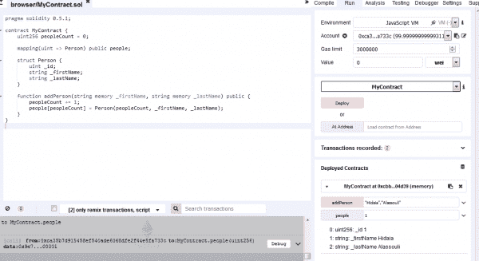
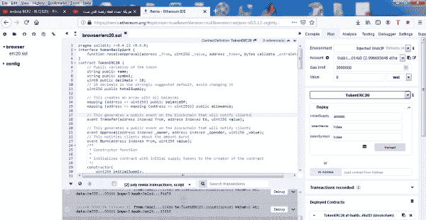
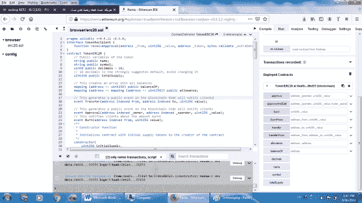
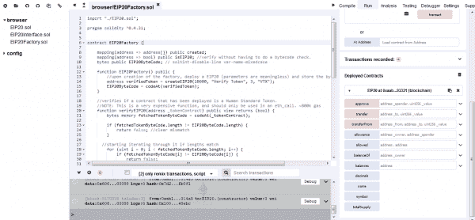
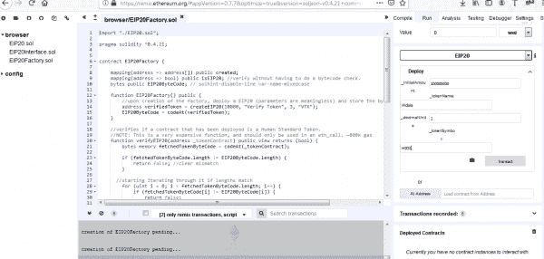
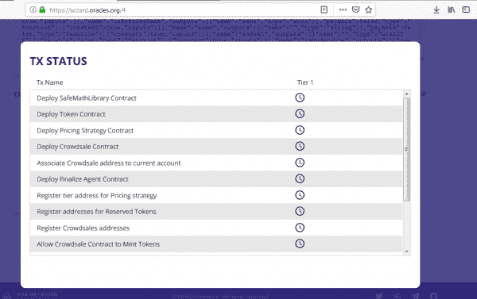
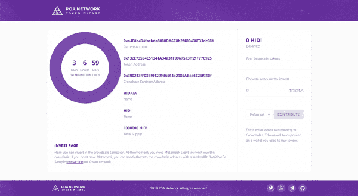
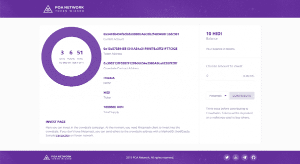
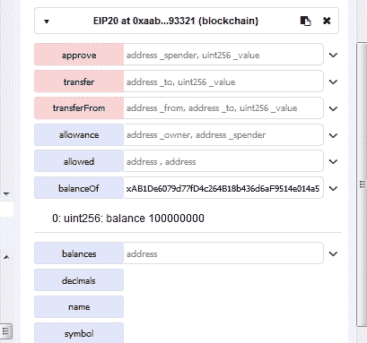
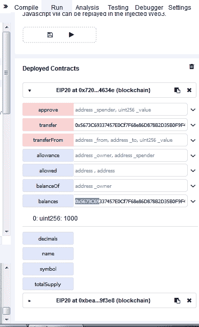

# 以太坊区块链智能合约创建与部署快速指南


## 2. 区块链

区块链是交易的数字记录。其名称源于其结构：单个记录（称为区块）链接在一起形成单个列表（称为链）。区块链用于记录使用加密货币（如比特币）进行的交易，并有许多其他应用。

添加到区块链的每笔交易都由互联网上的多台计算机进行验证。这些系统被配置为监控特定类型的区块链交易，形成一个点对点网络。它们协同工作，确保每笔交易在被添加到区块链之前都是有效的。这种去中心化的计算机网络确保了单个系统无法向链中添加无效区块。

当新区块被添加到区块链时，它会使用由前一个区块内容生成的加密哈希值链接到前一个区块。这确保了链永远不会断裂，并且每个区块都被永久记录。由于必须先更改所有后续区块，因此有意使区块链中的过往交易难以篡改。

### 区块链用途

虽然区块链因其在比特币、莱特币和以太币等加密货币中的应用而广为人知，但该技术还有其他多种用途。例如，它支持“智能合约”，当满足特定条件时会自动执行。这为双方之间的交易提供了一个自动化的托管系统。区块链有可能允许个人之间直接付款，而无需 ACH 和电汇所需的中央清算点。它有可能极大地提高股票交易的效率，使交易能够几乎即时结算，而不再需要每笔交易等待三天或更长时间才能清算。区块链技术也可用于非金融目的。例如，星际文件系统 (`IPFS`) 利用区块链通过在互联网上链接文件来实现文件存储的去中心化。一些数字签名平台现在使用区块链来记录签名并验证文档已被数字签名。区块链甚至可以通过将内容分发链接到原始来源来保护知识产权。

区块链是一个由记录和数据组成的去中心化数据库。所有数据分散在一堆分布式计算机中，形成一个点对点 (`p2p`) 网络。这些数据库中的记录以区块的形式存储，并以安全的方式链接在一起。

比特币区块链存储专门用于跟踪不同方之间加密货币余额的数据。

以太坊区块链可以存储比比特币区块链深得多的数据。以太坊区块链允许构建去中心化应用。这些去中心化应用由智能合约定义。因此，智能合约允许个人在不依赖银行或律师等第三方的情况下，以可信、自信、自由的方式交换信息。这些以太坊智能合约存储在以太坊区块链的特殊交易中，随后可用于构建应用程序。你可以将智能合约视为去中心化的 `API`。由于智能合约存储在以太坊区块链中，它们需要像其他交易一样被验证或挖掘。因此，部署智能合约会产生少量费用。

如何编写智能合约？我们使用 `Solidity` 来实现。`Solidity` 是一种用于编写智能合约的语言。其语法类似于 `JavaScript`，并考虑到以太坊虚拟机 (`EVM`) 进行设计。因此，我们将使用 `Solidity` 在一个名为 `Remix` 的基于 Web 的 `IDE` 中创建智能合约。

## 3. Solidity 变量与类型

*   你可以在 `https://remix.ethereum.org/` 编写和测试 `Solidity` 代码。

*   以下是 `https://remix.ethereum.org` 的截图：


*   创建一个新合约。我将其命名为 `Coursetro`。

*   通过编写（或粘贴）以下代码开始：

```solidity
pragma solidity ^0.4.18;

contract Coursetro {

}
```

第一行定义了你将使用的 `Solidity` 版本。接下来，定义合约及其名称，并像 `JavaScript` 类一样打开它。

*   在浏览器右侧的 **Run（运行）** 选项卡下，你将看到一个 **Deploy（部署）** 按钮。点击它。你会注意到在 Deploy 按钮下方出现了一个新部分，显示合约名称和 "at 0x..."（内存地址）：


*   这意味着智能合约（是的，此时它还不太“智能”）存在于一个地址上。要查看此完整地址及其他信息，请在调试器中点击 **Details（详情）** 按钮，它将提供更多信息：

*   请注意有一个 `contractAddress`；这是智能合约实际驻留的位置。不，它并不在以太坊区块链上，因为目前我们只是在 `JavaScript EVM` 中工作。

*   还请注意 `gas`。每当合约被部署和修改时，以太坊网络上的节点必须验证该合约。这被称为冗余并行，作为达成共识的一种方式。`Gas` 是发送交易者（在我们的例子中是发送智能合约交易者）为验证支付的执行费用的名称。

#### 进一步阐述

引自 `etherdocs.org`：

> “Gas 是发送交易者为在以太坊区块链上进行的每项操作支付的执行费用的名称。Gas 这一名称源于这样一种观点：该费用充当加密燃料，驱动智能合约的运行。Gas 由矿工用以太币购买并执行代码。Gas 和以太币被刻意解耦，因为 Gas 单位与具有自然成本的计算单位对齐，而以太币的价格通常因市场力量而波动。两者由自由市场调节：Gas 的价格实际上由矿工决定，他们可以拒绝处理 Gas 价格低于其最低限制的交易。要获得 Gas，你只需向账户添加以太币。以太坊客户端会自动按你指定的作为交易最大支出的金额，用你的以太币购买 Gas。”

在 `Solidity` 中，你通过首先指定其类型来定义变量。还有哪些其他类型？

1.  **bool**  

    这是布尔类型，返回 `true` 或 `false`。

2.  **int / uint**  

    `int` 和 `uint` 都代表整数或数值。`int` 和 `uint`（无符号整数）的主要区别在于 `int` 可以保存负数作为值。

3.  **address**

`address` 类型代表一个 20 字节的值，用于存储以太坊地址。类型为 `address` 的变量也拥有成员，包括 `balance` 和 `transfer`。

### 4. `bytes1` 到 `bytes32`

这是固定大小的字节数组。

### 5. `bytes`

动态大小的字节数组。

### 6. `string`

动态大小的字符串。

### 7. `mapping`

具有键类型和值类型的哈希表。我们将在课程后面更深入地探讨映射。

### 8. `struct`

结构体允许你定义新类型。我们稍后也将更深入地介绍这一点。

*   让我们在合约中定义一个字符串变量。也定义一下我的年龄。没有人会有负年龄，所以我们将使用无符号整数：

```solidity
pragma solidity ^0.4.18;

contract Coursetro {

    string fName = 'Gary';

    uint age = 34;

}
```

*   `Solidity` 对函数和变量都有四种可见性类型：

#### 1. `Public`

这允许你定义可以在内部调用或通过消息调用的函数或变量。

#### 2. `Private`

私有变量和函数仅对当前合约可用，对派生合约不可用。

#### 3. `Internal`

只能在内部访问的函数和变量（当前合约或派生合约）。

#### 4. `External`

可以从其他合约和交易调用的函数。它们不能在内部被调用，除非使用 `this.functionName()`。

*   **让我们给变量添加 `public` 可见性：**

```solidity
pragma solidity ^0.4.18;

contract Coursetro {

    string public fName = 'Gary';

    uint public age = 34;

}
```

*   点击**部署**，我们现在可以在右侧看到 2 个蓝色按钮，显示着我们变量的名称和关联的值。当你定义 `public` 状态变量时，`EVM` 会为它们创建 getter 函数。所以，你实际上可以点击这些按钮，它会返回值，就像调用函数一样。

*   每个智能合约都有一个构造函数。当合约被创建时会调用此构造函数。在其中，你可以定义变量的值。让我们调整代码以配合构造函数工作：

```solidity
pragma solidity ^0.4.18;

contract Coursetro {

    string public fName;

    uint public age;

    function Coursetro() public {

        fName = 'Gary';

        age = 34;

    }

}
```

*   变量可以声明为 `constant`。顾名思义，这些是值恒定不变的变量。让我们将 `fName` 变量转换为 `constant` 变量：

```solidity
pragma solidity ^0.4.18;

contract Coursetro {

    string constant fName = 'Gary';

    uint public age;

    function Coursetro() public {

        fName = 'Gary';

        age = 34;

    }

}
```

在你的 `IDE` 中，你会注意到第 9 行旁边有一个红色的 "X"。如果你悬停在上面，会注意到它提示 "*TypeError: cannot assign to a constant variable*"（类型错误：无法赋值给常量变量）。删除第 9 行，错误就会消失。

*   到此我们的智能合约还很无聊。让我们集成一个潜在的用户交互，手动定义 Coursetro 讲师的姓名和年龄。粘贴以下代码：

```solidity
pragma solidity ^0.4.18;

contract Coursetro {

    string fName;

    uint age;

    function setInstructor(string _fName, uint _age) public {

        fName = _fName;

        age = _age;

    }

    function getInstructor() public constant returns (string, uint) {

        return (fName, age);

    }

}
```

*   我们有两个函数，`setInstructor()` 和 `getInstructor()`。`setInstructor` 接受 2 个参数，`_fName` 和 `_age`。调用后，我们将字符串 `fName` 设置为返回的 `_fName`，`age` 同理。然后，我们的 `getInstructor()` 函数被定义为 `constant`，并返回一个 `string` 和一个 `uint`。这是调用时返回 `fName` 和 `age` 变量的地方。点击**部署**，在红色的 **set Instructor** 按钮下，输入："Gary", 34 并点击按钮。接着，点击 **getInstructor()** 按钮，你会注意到它现在返回输入的值！这就是在智能合约中通过用户输入设置变量的方法。

## 4. 如何在 Windows 上设置或安装以太坊

*   在 Windows 上安装 Chocolatey。访问 `https://chocolatey.org/install` 并复制 Windows 命令，或直接运行以下命令在 Windows 上安装 Chocolatey：

```powershell
@"%SystemRoot%\System32\WindowsPowerShell\v1.0\powershell.exe" -NoProfile -InputFormat None -ExecutionPolicy Bypass -Command "iex ((New-Object System.Net.WebClient).DownloadString('https://chocolatey.org/install.ps1'))" && SET "PATH=%PATH%;%ALLUSERSPROFILE%\chocolatey\bin"
```

*   运行以下命令安装 Node.js：

```bash
choco install nodejs.install -y
```

*   或者直接从 `https://nodejs.org/en/download/` 链接下载安装程序。

*   安装 Git。要安装，请运行以下命令：

```bash
choco install git -y
```

*   或者从 `https://gitforwindows.org/` 链接下载安装程序。

*   安装 Visual Studio Code 以及 Solidity 扩展。要安装，请运行以下命令：

```bash
choco install VisualStudioCode -y
```

*   或者从 `https://www.visualstudio.com/downloads/` 链接下载安装程序。

*   在 Windows 上安装 Python。要安装，请运行以下命令：

```bash
choco install python -y
```

*   或者从 `https://www.python.org/downloads/` 链接下载安装程序。

*   打开 Visual Studio 控制台。转到扩展页面。安装 Solidity 扩展。

*   在 Windows 上安装 Ganache。从以下链接下载安装程序：`http://truffleframework.com/ganache/`

*   或者从命令行安装：

```bash
npm install -g ganache-cli
```

*   **什么是 Ganache？** 当你开发一个应用程序时，该应用程序将托管在应用服务器上。在以太坊的情况下，以太坊区块链将持有智能合约。区块链充当应用服务器。`Ganache` 是一个在本地系统上运行的模拟区块链，为你模拟以太坊区块链。它提供 GUI 或命令行界面。

*   当你运行 Ganache 时，你将看到此图像。你会看到许多以太坊地址。每个地址上都有一些以太币。


*   `Remix` 是一个用于构建智能合约的 `IDE`。Remix 基于 Web 的 `IDE`：`https://remix.ethereum.org`

*   使用以下命令从 Git 或 npm 安装 `IDE`：

```bash
npm install remix-ide -g
remix-ide
git clone https://github.com/ethereum/remix-ide...
cd remix-ide
npm install
npm run setupremix
npm start
```

## 5. 如何在 JavaScript VM 上编译和部署智能合约

*   打开 Remix IDE 的 URL：`https://remix.ethereum.org`

*   当我们编译 `Solidity` 代码时，会得到可以部署在以太坊区块链上的字节码。

*   开始新合约 `student.sol`

*   以下是智能合约代码：

```solidity
pragma solidity ^0.4.18;

contract student {

    string name;

    uint age;

    function setStudentDetails(string _name, uint _age) public {

        name = _name;

        age = _age;

    }

    function getStudentDetails() public view returns(string, uint) {

        return (name, age);

    }

}
```

*   我们必须将智能合约部署到区块链上。有不同的区块链可用。其中包括：主网区块链和测试网区块链。或者我们可以将智能合约部署在我们自己的区块链环境中。我们将首先使用 Remix IDE 内置的 JavaScript VM 区块链来部署智能合约。


### 部署智能合约到 JavaScript VM 区块链

要在 JavaScript VM 区块链上部署智能合约，我们需要一个账户。Remix 默认提供 5 个账户。但如果我们在以太坊主网部署智能合约，则必须在那里创建一个账户。

选择任意一个账户并在 JavaScript VM 上部署智能合约，点击部署。合约部署后，将部署在某个地址上。该地址由区块链分配给该智能合约。因此我们始终可以仅通过该地址引用智能合约。

在以太坊主网部署智能合约需要以太币。因为矿工会挖掘你的交易，当交易确认时，矿工必须获得手续费。

当你给变量赋值时，你改变了变量的状态，这意味着你在区块链上进行了更改，必须支付 Gas 费。有人会挖掘该交易，随后交易才会成功。`get` 函数输出变量的值且不改变区块链状态。因此它不需要挖掘，也不需要手续费。

调试器允许你调试智能合约。

## 6. 如何在 Windows 上安装 Ganache 区块链并使用它部署智能合约

本节展示如何使用 Remix 将智能合约部署到 Ganache 区块链。

### 安装 Ganache

在 Windows 上安装 Ganache。从以下链接下载安装程序：`http://truffleframework.com/ganache/`

或通过命令行安装：

```bash
npm install -g ganache-cli
```

### 什么是 Ganache？

当你开发应用程序时，该应用程序将托管在应用服务器上。在以太坊的情况下，以太坊区块链将托管智能合约。区块链充当应用服务器。`Ganache` 是一个在本地系统上运行的模拟区块链，为你模拟以太坊区块链。它提供 GUI 和命令行两种形式。

运行 Ganache 时，你将看到如下界面。你会看到许多以太坊地址，每个地址上都有一定数量的资金。



默认将有 10 个账户。

“区块”选项卡将显示交易区块。

“交易”选项卡将显示交易。智能合约执行的任何交易都将显示在此窗口中。

“日志”选项卡将显示所有日志。

### 连接 Ganache 与 Remix


# Solidity 智能合约代码示例与部署教程

## 核心合约代码

```solidity
require(_to != address(0x0));

// 检查发送者是否有足够余额
require(balanceOf[_from] >= _value);

// 检查溢出
require(balanceOf[_to] + _value >= balanceOf[_to]);

// 保存此值以供将来断言使用
uint previousBalances = balanceOf[_from] + balanceOf[_to];

// 从发送者扣除
balanceOf[_from] -= _value;

// 向接收者添加相同数量
balanceOf[_to] += _value;

emit Transfer(_from, _to, _value);

// 断言用于使用静态分析查找代码中的 bug。它们永远不应失败
assert(balanceOf[_from] + balanceOf[_to] == previousBalances);
```

### `transfer` 函数

```solidity
/**
 * 转账代币
 *
 * 从您的账户向 `_to` 发送 `_value` 个代币
 *
 * @param _to 接收者地址
 * @param _value 发送数量
 */
function transfer(address _to, uint256 _value) public returns (bool success) {
    _transfer(msg.sender, _to, _value);
    return true;
}
```

### `transferFrom` 函数

```solidity
/**
 * 从其他地址转账代币
 *
 * 代表 `_from` 向 `_to` 发送 `_value` 个代币
 *
 * @param _from 发送者地址
 * @param _to 接收者地址
 * @param _value 发送数量
 */
function transferFrom(address _from, address _to, uint256 _value) public returns (bool success) {
    require(_value <= allowance[_from][msg.sender]); // 检查授权额度
    allowance[_from][msg.sender] -= _value;
    _transfer(_from, _to, _value);
    return true;
}
```

### `approve` 函数

```solidity
/**
 * 为其他地址设置授权额度
 *
 * 允许 `_spender` 代表您花费不超过 `_value` 个代币
 *
 * @param _spender 被授权花费的地址
 * @param _value 最大可花费数量
 */
function approve(address _spender, uint256 _value) public returns (bool success) {
    allowance[msg.sender][_spender] = _value;
    emit Approval(msg.sender, _spender, _value);
    return true;
}
```

### `approveAndCall` 函数

```solidity
/**
 * 为其他地址设置授权额度并通知
 *
 * 允许 `_spender` 代表您花费不超过 `_value` 个代币，然后通知合约此事
 *
 * @param _spender 被授权花费的地址
 * @param _value 最大可花费数量
 * @param _extraData 发送给被授权合约的一些额外信息
 */
function approveAndCall(address _spender, uint256 _value, bytes memory _extraData) public returns (bool success) {
    tokenRecipient spender = tokenRecipient(_spender);
    if (approve(_spender, _value)) {
        spender.receiveApproval(msg.sender, _value, address(this), _extraData);
        return true;
    }
}
```

### `burn` 函数

```solidity
/**
 * 销毁代币
 *
 * 从系统中不可逆地移除 `_value` 个代币
 *
 * @param _value 要销毁的金额
 */
function burn(uint256 _value) public returns (bool success) {
    require(balanceOf[msg.sender] >= _value); // 检查发送者是否有足够余额
    balanceOf[msg.sender] -= _value; // 从发送者扣除
    totalSupply -= _value; // 更新 totalSupply
    emit Burn(msg.sender, _value);
    return true;
}
```

### `burnFrom` 函数

```solidity
/**
 * 从其他账户销毁代币
 *
 * 代表 `_from` 从系统中不可逆地移除 `_value` 个代币。
 *
 * @param _from 发送者地址
 * @param _value 要销毁的金额
 */
function burnFrom(address _from, uint256 _value) public returns (bool success) {
    require(balanceOf[_from] >= _value); // 检查目标余额是否足够
    require(_value <= allowance[_from][msg.sender]); // 检查授权额度
    balanceOf[_from] -= _value; // 从目标余额扣除
    allowance[_from][msg.sender] -= _value; // 从发送者的授权额度扣除
    totalSupply -= _value; // 更新 totalSupply
    emit Burn(_from, _value);
    return true;
}
```

## 部署注意事项

部署代码时必须调整以下内容：

1. **Contact Mycoin** 必须是您的合约名称
2. `totalSupply`
3. `initialSupply`
4. `tokenName`
5. `tokenSymbol`

### 部署步骤

1. 在 [`remix.ethereum.org/`](https://remix.ethereum.org/) 编译代码
2. 将 MetaMask 连接到 Rinkeby 测试网络
3. 从水龙头 [`faucet.rinkeby.io/`](https://faucet.rinkeby.io/) 获取测试以太币（将向您的以太坊账户发送 3 个以太币）
4. 部署前设置以下参数示例：
   - `initialSupply`: 1000000
   - `tokenName`: hidaia
   - `tokenSymbol`: hedaia



5. 合约部署后，您将获得可填写的表单界面



6. 您可以尝试销毁一些代币，会看到总供应量减少了相应数量
7. 也可以尝试其他操作

## 9. Solidity 入门教程

### a) 数据类型与数据结构

访问 [`remix.ethereum.org/`](https://remix.ethereum.org/) 并创建新文件，命名为 `MyContract.sol`。

首先在文件第一行声明要使用的 Solidity 编程语言版本：

```solidity
pragma solidity ^0.4.24;
```

现在可以像这样声明智能合约：


```solidity
pragma solidity ^0.4.24;

contract MyContract {
    // ...
}
```

智能合约是在以太坊区块链上执行的代码片段。它的功能类似于 Web 上公开可访问的 API 微服务。智能合约的所有代码对公众可见，我们可以允许连接到网络的任何人调用智能合约上的函数。

首先，我们将编程一个简单的“存储”智能合约，它能够：

- 存储一个值
- 检索这个值

我们将通过一个名为 `value` 的变量来创建一种在智能合约中存储字符串值的方式。Solidity 是静态类型语言，因此声明变量时必须首先指定数据类型：

```solidity
pragma solidity ^0.4.24;

contract MyContract {
    string value;
}
```

现在创建一个函数从存储中读取这个值。首先用 `function` 关键字声明一个名为 `get()` 的函数：

```solidity
function get() {
    // ...
}
```

现在用 `return` 关键字从状态变量返回值。将此函数的“可见性”设为 `public`，以便任何连接到区块链的人都可以调用它。最后，为函数指定返回值类型 `string`：

```solidity
pragma solidity ^0.4.24;

contract MyContract {
    string value;

    function get() public view returns(string) {
        return value;
    }
}
```

让我们创建一种从智能合约外部设置此值的方法。我们将创建一个 `set` 函数。我们只是创建了一个接受 `_value` 参数（类型为 `string`）的函数。此函数也是公开可见的，以便任何连接到区块链的人都可以调用它。现在实际更新智能合约的值：

```solidity
function set(string _value) public {
    value = _value;
}
```

现在在智能合约的构造函数中为 `value` 状态变量设置默认值：

```solidity
constructor() public {
    value = "myValue";
}
```

请记住，以太坊区块链由称为“区块”的记录捆绑包组成，这些区块“链接在一起”构成公共账本。所有这些区块的基本单位是交易。您可以在下方看到它们的列表。您可以点击“向下”箭头查看收据的所有详细信息。

我将选择 JavaScript 虚拟机，它将在我们的浏览器中提供一个模拟区块链。

让我们更新智能合约中的代码，使其兼容撰写本文时最新版本的 Solidity。我们可以修改智能合约代码的第一行：

```solidity
pragma solidity ^0.5.1;
```

首先，修改 `get()` 和 `set()` 函数如下：

```solidity
pragma solidity ^0.5.1;

contract MyContract {
    string value;

    constructor() public {
        value = "myValue";
    }

    function get() public view returns(string memory) {
        return value;
    }

    function set(string memory _value) public {
        value = _value;
    }
}
```

我们也可以像这样给状态变量赋默认值：

## Solidity 基础数据类型与结构

### 状态变量

```solidity
string public value = "myValue";
```

我们也可以将此值设置为永不改变的常量：

```solidity
string public constant value = "myValue";
```

我们可以像这样创建布尔状态变量：

```solidity
bool public myBool = true;
```

这可以是 `true` 或 `false`。

现在我们可以像这样创建整数：

```solidity
int public myInt = 1;
```

整数可以是正数或负数，即有符号。如果你不希望数字为负数，可以像这样创建无符号整数：

```solidity
uint public myUint = 1;
```

我们可以为数字指定位数。上述示例默认为 256 位。我们可以显式指定：

```solidity
uint256 public myUint256 = 9999;
```

我们也可以将值限制为 8 位：

```solidity
uint8 public myUint8 = 8;
```

### Enums（枚举）

现在让我们了解一下 Solidity 中的一些基本数据结构。首先，让我们看看 `Enum` 数据结构，它是在 Solidity 中跟踪枚举列表的一种方式。我们可以在编写智能合约时针对该列表进行检查。让我们在智能合约中创建一个枚举：

```solidity
enum State { Waiting, Ready, Active }
```

以此为例，这将通过提供 `Waiting`、`Ready` 和 `Active` 选项帮助我们跟踪智能合约的活动状态。我们可以像这样检查智能合约的当前状态：

```solidity
State public state;
```

现在，我们可以在构造函数中设置默认状态：

```solidity
constructor() public {
    state = State.Waiting;
}
```

我们可以像这样将当前状态更新为 `Active`：

```solidity
function activate() public {
    state = State.Active;
}
```

最后，我们可以针对枚举列表进行检查，以查看状态当前是否为 `Active`：

```solidity
function isActive() public view returns(bool) {
    return state == State.Active;
}
```

现在最终的智能合约代码应如下所示：

```solidity
pragma solidity ^0.5.1;

contract MyContract {
    enum State { Waiting, Ready, Active }
    State public state;

    constructor() public {
        state = State.Waiting;
    }

    function activate() public {
        state = State.Active;
    }

    function isActive() public view returns(bool) {
        return state == State.Active;
    }
}
```

### Structs（结构体）

Solidity 允许你使用 `Structs` 定义自己的数据类型。你基本上可以使用任意数据类型的任意属性来建模任何类型的数据。让我们通过创建一个 `people` 结构体来看看这是如何工作的：

```solidity
struct Person {
    string _firstName;
    string _lastName;
}
```

我们在这里建模了一个拥有 `_firstName` 和 `_lastName` 的人。请注意，我们能够指定任意想要的数据类型！这里我们对两个属性都使用了字符串。我们最多可以在此添加 17 个不同的属性，且数据类型任意。

现在我们需要一个地方来存储这个 `Person` 结构体。让我们使用数组！我们可以像这样声明 `people` 数组：

```solidity
Person[] public people;
```

请注意，我们在数组内声明类型，即 `Person`。我们还将可见性设置为 `public` 并将其赋值给名为 `people` 的状态变量。这将为我们提供一个函数，允许我们访问该数组内部的人员。我应该提到，在智能合约外部调用 `people()` 函数不会返回整个数组。相反，`people()` 函数将接受一个索引参数，允许我们根据该索引（从零开始）引用数组内部的人员。例如，我们可以像这样访问 `people` 数组中的第一个人：`people(0)`。

现在让我们创建一种向该数组添加人员的方法。我们将创建一个 `addPerson()` 函数：

此函数将接受 `Person` 结构体属性的参数，然后实例化一个新的 `Person` 并使用 `push` 函数将其添加到 `people` 数组中。它还会将 `peopleCount` 状态变量加 1。我们可以在智能合约中像这样实现该状态变量：`uint256 public peopleCount;`

```solidity
function addPerson(string memory _firstName, string memory _lastName) public {
    people.push(Person(_firstName, _lastName));
    peopleCount += 1;
}
```

现在完成的智能合约代码应如下所示：

```solidity
pragma solidity ^0.5.1;

contract MyContract {
    Person[] public people;
    uint256 public peopleCount;

    struct Person {
        string _firstName;
        string _lastName;
    }

    function addPerson(string memory _firstName, string memory _lastName) public {
        people.push(Person(_firstName, _lastName));
        peopleCount += 1;
    }
}
```

### Mapping（映射）

Solidity 提供了一种称为 `mapping` 的数据结构，它允许我们存储键值对。此结构的作用很像其他语言中的关联数组或哈希表。我们可以在智能合约中像这样声明映射：

```solidity
mapping(uint => Person) public people;
```

这将是一个存储 `Person` 结构体的映射。它将替换我们在上一个示例中使用的 `people` 数组。键将是一个无符号整数，值将是一个 `Person` 结构体。我们将把键视为数据库 ID。我们可以更新 `Person` 结构体以跟踪该 ID：

```solidity
struct Person { uint _id; string _firstName; string _lastName; }
```

现在我们可以修改 `addPerson()` 函数以更新 `people` 映射。以下代码使用 `peopleCount` 计数器缓存为人员创建 ID。然后使用该 ID 和传入的属性实例化一个新的 `Person` 结构体。然后将其添加到 `people` 映射中。完成的智能合约代码应如下所示：

```solidity
pragma solidity ^0.5.1;

contract MyContract {
    uint256 peopleCount = 0;
    mapping(uint => Person) public people;

    struct Person {
        uint _id;
        string _firstName;
        string _lastName;
    }

    function addPerson(string memory _firstName, string memory _lastName) public {
        peopleCount += 1;
        people[peopleCount] = Person(peopleCount, _firstName, _lastName);
    }
}
```

我们可以部署合约来检查代码。如果我在 `addPerson` 字段中输入：

`"_firstName"="Hidaia"` 和 `"_lastName"="Alassouli"`

这将作为第一个元素存储在 `people` 数组中。我在 `people` 字段中输入 `1`，将获得存储在数组 `people` 中元素 `1` 的数据。


### Function Visibility（函数可见性）

让我们谈谈函数可见性。在上一节中，我们多次使用了 `public` 函数可见性，以便网络连接的账户可以在智能合约外部调用智能合约函数。如果我们想创建仅在智能合约内部使用的函数怎么办？我们可以使用 `internal` 可见性来实现。让我们将 `peopleCount` 的增加封装到其自己的 `internal` 函数中：

```solidity
function incrementCount() internal {
    peopleCount += 1;
}
```

此函数仅可在智能合约内部访问，而不能通过其他账户的公共接口访问。现在我们可以在 `addPerson()` 函数内部调用此函数：

```solidity
function addPerson(string memory _firstName, string memory _lastName) public {
    incrementCount();
    people[peopleCount] = Person(peopleCount, _firstName, _lastName);
}
```

### Modifiers（修饰符）

现在这是其他类型函数可见性的一个示例。让我们谈谈函数修饰符。这些将允许我们为函数添加特殊行为，如添加权限。让我们创建一个修饰符，仅允许管理员或“所有者”调用 `addPerson()` 函数，并限制其他所有人调用此函数。

首先，我们将创建一种存储此智能合约所有者的方法。我们可以使用状态变量来实现：

```solidity
address owner;
```

现在让我们创建一个修饰符，检查调用函数的人是否为所有者：

```solidity
modifier onlyOwner() {
    require(msg.sender == owner);
    _;
}
```

让我解释这段代码：

首先，我们使用 `modifier` 关键字声明修饰符，后跟修饰符名称 `onlyOwner`。

接下来，我们使用 `msg.sender` 访问调用该函数的当前账户。

接下来，我们使用 `require()` 来检查调用该函数的账户是否为所有者。如果传入 `require()` 的表达式计算结果为 `true`，则代码继续执行。如果不是，则抛出错误。在这种情况下，如果调用该函数的账户不是所有者，Solidity 将抛出错误。

现在我们可以将智能合约内部的所有者设置为部署该智能合约的账户，如下所示：

```solidity
constructor() public {
    owner = msg.sender;
}
```

现在我们可以将修饰符添加到 `addPerson()` 函数，以便只有所有者可以调用它。尝试运行你的代码，看看只有所有者能否成功调用该函数而不报错！此时，完整的智能合约代码应如下所示：

```solidity
pragma solidity ^0.5.1;

contract MyContract {
    uint256 public peopleCount = 0;
    mapping(uint => Person) public people;
    address owner;

    modifier onlyOwner() {
        require(msg.sender == owner);
        _;
    }

    struct Person {
        uint _id;
        string _firstName;
        string _lastName;
    }

    constructor() public {
        owner = msg.sender;
    }

    function addPerson(
        string memory _firstName,
        string memory _lastName
    )
        public
        onlyOwner
    {
        incrementCount();
        people[peopleCount] = Person(peopleCount, _firstName, _lastName);
    }

    function incrementCount() internal {
        peopleCount += 1;
    }
}
```

### 时间

我们可以创建一个使用时间的新修饰符，以演示 Solidity 中时间相关的用例。我们将创建一个名为 `onlyWhileOpen` 的新修饰符，它将检查区块链上的当前时间是否已过我们指定的时间。在创建具有“开放时间”的 ICO 众筹智能合约时，这是一种常见做法。通常，这些智能合约会拒绝在众筹开始前进行的投资者捐款。我们可以通过限制对 `addPerson()` 函数的访问，直到开放时间已过，来模拟类似的行为。首先，让我们创建一个状态变量来存储开放时间：


## Solidity 智能合约开发指南

### 状态变量与时间戳

我们可以用这个状态变量以秒为单位存储 `startTime`，因为这是我们在 Solidity 中表示时间戳的方式。事实上，时间戳以 Unix 时间表示，即自 1970 年 1 月 1 日星期四以来经过的秒数。现在我将在构造函数中设置开始时间，如下所示：

```solidity
constructor() public {
    startTime = (unix timestamp);
}
```

你可以使用 https://www.epochconverter.com/ 为你自己的目的生成一个未来的 Unix 时间戳！现在让我们创建一个修饰符来检查开始时间是否已过，如下所示：

```solidity
modifier onlyWhileOpen() {
    require(block.timestamp >= startTime);
    _;
}
```

首先，我们声明修饰符，就像上一个示例中所做的那样。接下来，我们要求特定的条件。然后我们将开始时间与“现在”进行比较，通过 `block.timestamp` 检查当前区块的时间戳。

现在我们可以将修饰符添加到 `addPerson()` 函数：

```solidity
pragma solidity 0.5.1;

contract MyContract {
    uint256 public peopleCount = 0;
    mapping(uint => Person) public people;
    uint256 startTime;

    modifier onlyWhileOpen() {
        require(block.timestamp >= startTime);
        _;
    }

    struct Person {
        uint _id;
        string _firstName;
        string _lastName;
    }

    constructor() public {
        startTime = 1544668513; // 更新此值
    }

    function addPerson(
        string memory _firstName,
        string memory _lastName
    )
        public
        onlyWhileOpen
    {
        people[peopleCount] = Person(peopleCount, _firstName, _lastName);
    }

    function incrementCount() internal {
        peopleCount += 1;
    }
}
```

### 发送以太币与事件

现在让我们编写一个接收以太币的函数。为了演示这一点，我将创建一个类 ICO 的合约，带有一个 `buyToken()` 函数。这将允许账户发送以太币以购买代币。智能合约将负责发行代币、跟踪账户余额，并将以太币资金转移到另一个钱包地址。

首先，我们将创建一个映射来跟踪代币余额，如下所示：

```solidity
mapping(address => uint256) public balances;
```

现在我将创建 `buyToken()` 函数来增加余额，如下所示：

```solidity
function buyToken() public {
    balances[msg.sender] += 1;
}
```

现在我将声明一个钱包，每当账户购买代币时，以太币资金将被发送到该钱包：

```solidity
address wallet;
```

现在我们可以在每次调用 `buyToken()` 函数时向钱包转账，如下所示：

```solidity
function buyToken() public payable {
    balances[msg.sender] += 1;
    wallet.transfer(msg.value);
}
```

现在让我解释一下这段代码：

- 我们可以通过调用 `wallet.transfer()` 直接向钱包转账以太币。
- 我们可以使用 `msg.value` 获取函数调用者发送的以太币数量，就像 `msg.sender` 一样。
- 我们还必须使用 `payable` 修饰符，以便账户在调用函数时可以发送以太币。
- 同样，为了更新到 Solidity 0.5.1，我们必须显式声明钱包为可支付的：`address payable wallet;`。

现在让我们在合约的构造函数内部设置钱包地址（我们在这里也将使用 `payable` 修饰符）：

```solidity
constructor(address payable _wallet) public {
    wallet = _wallet;
}
```

太棒了！现在观看上面的视频，我将演示如何在 Remix 中使用此函数发送以太币。到此为止，你的完整智能合约代码应如下所示：

```solidity
contract MyContract {
    mapping(address => uint256) public balances;
    address payable wallet;

    constructor(address payable _wallet) public {
        wallet = _wallet;
    }

    function buyToken() public payable {
        balances[msg.sender] += 1;
        wallet.transfer(msg.value);
    }
}
```

我们可以测试这段代码。运行代码时，我使用某个以太坊地址部署了合约。然后我用另一个以太坊地址通过点击 buy token 购买代币，并设置金额，例如 2 eth。然后我点击了 balance 按钮。它显示余额增加了 1，部署合约的以太币余额增加了 2，而购买者的以太坊地址余额减少了 2。


现在我将向你展示如何在 Solidity 中创建一个默认或“回退”函数。这是一个每当账户向智能合约发送以太币时就会被调用的函数。这是 ICO 智能合约中非常常见的模式，你只需向智能合约发送以太币，它就会执行一个函数。这正是我们要在这里做的。我们将声明一个包装 `buyTokens()` 函数的回退函数。每当账户向智能合约发送以太币时，它都将购买代币。我们可以这样做：

```solidity
function() external payable {
    buyToken();
}
```

现在让我们谈谈事件。事件是处理区块链异步特性的一种方式。我们可以在智能合约内部声明事件，供外部消费者订阅。这些消费者将能够监听这些事件，以知晓智能合约内部发生了某事。我们将在智能合约顶部声明一个 `Purchase` 事件，如下所示：

```solidity
event Purchase(
    address _buyer,
    uint256 _amount
);
```

该事件将记录购买者和代币数量。我们将能够在 `buyToken()` 函数内部触发此事件，如下所示：

```solidity
function buyToken() public payable {
    balances[msg.sender] += 1;
    wallet.transfer(msg.value);
    emit Purchase(msg.sender, 1);
}
```

此事件将使我们能够知晓该智能合约内部每一次代币购买。但如果我们只想监听与我们账户相关的事件怎么办？好消息！Solidity 允许我们通过索引值订阅过滤事件。我们可以在事件中为 `_buyer` 添加索引，如下所示：

```solidity
event Purchase(
    address indexed _buyer,
    uint256 _amount
);
```

现在你知道如何在 Solidity 中使用事件了。此时，你的完整智能合约代码应如下所示：

```solidity
pragma solidity 0.5.1;

contract MyContract {
    mapping(address => uint256) public balances;
    address payable wallet;

    event Purchase(
        address indexed _buyer,
        uint256 _amount
    );
}
```

### 构造函数与回退函数

```solidity
constructor(address payable _wallet) public {
    wallet = _wallet;
}

function() external payable {
    buyToken();
}

function buyToken() public payable {
    balances[msg.sender] += 1;
    wallet.transfer(msg.value);
    emit Purchase(msg.sender, 1);
}
```

购买代币时生成的日志：



### 智能合约交互

我将展示如何在 Solidity 中使用多个智能合约。首先，我将展示如何从一个智能合约内部调用另一个智能合约的函数。

我将按如下方式创建代币合约：

```solidity
contract ERC20Token {
    string name;
    mapping(address => uint256) public balances;

    function mint() public {
        balances[msg.sender] += 1;
    }
}
```

现在我们可以使用 `ERC20Token` 合约从 `MyContract` 中铸造代币。为此，我们需要做几件事：获取代币的地址，以及智能合约代码以便调用其 `mint()` 函数。首先，我将按如下方式将代币地址存储在状态变量中：

```solidity
contract MyContract {
    address public token;
    //...
}
```

现在我们可以在构造函数中设置代币地址的值，如下所示：

```solidity
constructor(address payable _wallet, ERC20Token _token) public {
    wallet = _wallet;
    token = _token;
}
```

既然我们有了可用的地址，就可以在 `buyToken()` 函数中访问智能合约代码，并按如下方式调用其 `mint()` 函数：

```solidity
function buyToken() public payable {
    ERC20Token _token = ERC20Token(address(token));
    _token.mint();
    wallet.transfer(msg.value);
}
```

在继续之前，我想引起你对一点的注意。如果你现在从个人账户调用 `buyToken()` 函数，你将不会为自己铸造任何代币。为什么会这样？让我们重新审视一下当前的 `mint()` 函数：

```solidity
function mint() public {
    balances[msg.sender] += 1;
}
```

之所以不会为你的账户铸造代币，是因为 `msg.sender` 实际上引用的是 `MyContract` 的地址，它正从其 `buyToken()` 函数内部调用该函数！如果我们想为自己的账户铸造代币，必须使用 `tx.origin` 来引用在区块链上发起交易的账户，如下所示：

```solidity
function mint() public {
    balances[tx.origin] += 1;
}
```

你需要先部署代币智能合约，获取其地址，然后在部署第二个智能合约时将其作为参数传入。此时，你的完整智能合约代码应如下所示：

```solidity
pragma solidity 0.5.1;

contract ERC20Token {
    string name;
    mapping(address => uint256) public balances;

    function mint() public {
        balances[tx.origin] += 1;
    }
}

contract MyContract {
    address public token;
    address payable wallet;

    constructor(address payable _wallet, address _token) public {
        wallet = _wallet;
        token = _token;
    }

    function buyToken() public payable {
        ERC20Token _token = ERC20Token(address(token));
        _token.mint();
        wallet.transfer(msg.value);
    }
}
```

#### 测试代码

*   首先部署 `ERC20Token` 合约。
*   从调试菜单获取合约地址。
*   在部署字段中填入创建者钱包地址和 `ERC20Token` 智能合约地址参数后，部署 `MyContract`。
*   点击 `buyToken` 字段。
*   然后在 `ERC20Token` 合约中点击 `balance` 字段并输入购买者地址以显示余额（发起交易的人的地址）。


### 继承

现在让我们谈谈继承。Solidity 允许你创建相互继承的智能合约。让我们创建一个名为 `MyToken` 的新伪代币，它继承自我们最初的代币智能合约。我们将使用继承赋予它唯一的名称、符号和铸造函数。我们可以按如下方式继承智能合约：

```solidity
contract MyToken is ERC20Token {
    // ...
}
```

现在我们可以按如下方式在父智能合约中跟踪代币名称：

```solidity
pragma solidity 0.5.1;

contract ERC20Token {
    string public name;
    mapping(address => uint256) public balances;

    constructor(string memory _name) public {
        name = _name;
    }

    function mint() public {
        balances[tx.origin] ++;
    }
}
```

我们可以在子代币的构造函数中覆盖父代币的名称。在此同时，我们还将为子代币创建一个符号并在构造函数中设置它。我将展示如何覆盖父代币合约构造函数，同时分配新值，如下所示：

```solidity
contract MyToken is ERC20Token {
    string public symbol;

    constructor(
        string memory _name,
        string memory _symbol
    )
        ERC20Token(_name)
        public
    {
        symbol = _symbol;
    }
}
```

太棒了！现在我们已经自定义了 `MyToken`。现在让我们更新 `mint()` 函数以覆盖父代币的功能。首先，让我们创建一种存储所有代币持有者地址的方式。我们还将设置所有持有者的计数，如下所示：

```solidity
contract MyToken is ERC20Token {
    address[] public owners;
    uint256 public ownerCount;
    //...
}
```

现在让我们在自己的 `mint()` 函数中更新这些值，同时使用 `super` 关键字保留父代币智能合约的行为，如下所示：

```solidity
function mint() public {
    super.mint();
    ownerCount ++;
    owners.push(msg.sender);
}
```

太棒了！现在我们已经创建了一个继承自父代币的自定义代币。你的完整智能合约代码应如下所示：


```solidity
pragma solidity 0.5.1;

contract ERC20Token {
    string public name;
    mapping(address => uint256) public balances;

    constructor(string memory _name) public {
        name = _name;
    }

    function mint() public {
        balances[tx.origin] ++;
    }
}

contract MyToken is ERC20Token {
    string public symbol;
    address[] public owners;
    uint256 public ownerCount;

    constructor(
        string memory _name,
        string memory _symbol
    )
        ERC20Token(_name)
        public
    {
        symbol = _symbol;
    }

    function mint() public {
        super.mint();
        ownerCount ++;
        owners.push(msg.sender);
    }
}
```

#### 测试代码

我使用名称参数 "Hidaia" 和符号 "HED" 部署了合约 `MyToken`。

以下数据显示了每个合约字段的内容：`balances`、`name`、`ownerCount`、`owners` 和 `symbol`。


### l) 库

库用于避免在每个新合约代码中重复代码。让我们声明 `Math` 库。

```solidity
pragma solidity 0.5.1;

library Math {
    function divide(uint256 a, uint256 b) internal pure returns (uint256) {
        require(b > 0);
        uint256 c = a / b;
        return c;
    }
}

contract MyContract {
    uint256 public value;

    function calaculate(uint _value1, uint _value2) public {
        value = Math.divide(_value1, _value2);
    }
}
```

`MyContract` 将使用定义的 `Math` 库来对 a 和 b 进行除法运算。

部署 `MyContract` 并在 `Calculate` 函数字段中提供 a 和 b 的值。附上结果截图：


### m) 在单独文件中引入库

我们可以将库放在单独的文件中，并通过引入库文件在合约中调用它。

作为示例，我们为编写的 `Math` 库打开了一个新文件。新文件为 `Library.sol`。以下是库内部的代码：

```solidity
pragma solidity 0.5.1;

library Math {
    function divide(uint256 a, uint256 b) internal pure returns (uint256) {
        require(b > 0);
        uint256 c = a / b;
        return c;
    }
}
```

然后我们可以通过 `import` 命令在 `MyContract.sol` 文件中调用库文件 `Math.sol`。以下是完整代码：

```solidity
pragma solidity 0.5.1;

import "./Math.sol";

contract MyContract {
    uint256 public value;

    function calaculate(uint _value1, uint _value2) public {
        value = Math.divide(_value1, _value2);
    }
}
```

### n) SafeMath

有一个名为 `SafeMath.sol` 的常用库，使算术运算变得更加简单。该库的链接如下：

https://github.com/OpenZeppelin/openzeppelin-contracts/blob/master/contracts/math/SafeMath.sol

*   我使用该页面上的代码创建了 `SafeMath.sol`。

```solidity
pragma solidity ⁰.5.0;

/**
 * @dev Wrappers over Solidity's arithmetic operations with added overflow
 * checks.
```

## SafeMath 库

Solidity 中的算术运算在溢出时会发生回绕。这很容易导致 Bug，因为程序员通常假设溢出会引发错误，这是高级编程语言的标准行为。`SafeMath` 通过在运算溢出时回滚交易，恢复了这一直觉。

使用该库替代未检查的运算，可消除整整一类 Bug，因此建议始终使用它。

```solidity
library SafeMath {

    /**
     * @dev 返回两个无符号整数的加法结果，溢出时回滚。
     *
     * 对应 Solidity 的 `+` 运算符。
     *
     * 要求：
     * - 加法不能溢出。
     */
    function add(uint256 a, uint256 b) internal pure returns (uint256) {
        uint256 c = a + b;
        require(c >= a, "SafeMath: addition overflow");
        return c;
    }

    /**
     * @dev 返回两个无符号整数的减法结果，溢出时回滚（当结果为负数时）。
     *
     * 对应 Solidity 的 `-` 运算符。
     *
     * 要求：
     * - 减法不能溢出。
     */
    function sub(uint256 a, uint256 b) internal pure returns (uint256) {
        return sub(a, b, "SafeMath: subtraction overflow");
    }

    /**
     * @dev 返回两个无符号整数的减法结果，溢出时携带自定义消息回滚（当结果为负数时）。
     *
     * 对应 Solidity 的 `-` 运算符。
     *
     * 要求：
     * - 减法不能溢出。
     *
     * 注意：这是 OpenZeppelin Contracts 下一版本的功能。
     * @dev 可通过 `npm install @openzeppelin/contracts@next` 获取。
     */
    function sub(uint256 a, uint256 b, string memory errorMessage) internal pure returns (uint256) {
        require(b <= a, errorMessage);
        uint256 c = a - b;
        return c;
    }

    /**
     * @dev 返回两个无符号整数的乘法结果，溢出时回滚。
     *
     * 对应 Solidity 的 `*` 运算符。
     *
     * 要求：
     * - 乘法不能溢出。
     */
    function mul(uint256 a, uint256 b) internal pure returns (uint256) {
        // Gas 优化：这比要求 'a' 不为零更便宜，但如果 'b' 也被测试，则优势丧失。
        // 参见：https://github.com/OpenZeppelin/openzeppelin-contracts/pull/522
        if (a == 0) {
            return 0;
        }
        uint256 c = a * b;
        require(c / a == b, "SafeMath: multiplication overflow");
        return c;
    }

    /**
     * @dev 返回两个无符号整数的整数除法结果。除以零时回滚。结果向零取整。
     *
     * 对应 Solidity 的 `/` 运算符。注意：此函数使用 `revert` 操作码（保留剩余 gas），而 Solidity 使用无效操作码回滚（消耗所有剩余 gas）。
     *
     * 要求：
     * - 除数不能为零。
     */
    function div(uint256 a, uint256 b) internal pure returns (uint256) {
        return div(a, b, "SafeMath: division by zero");
    }

    /**
     * @dev 返回两个无符号整数的整数除法结果。除以零时携带自定义消息回滚。结果向零取整。
     *
     * 对应 Solidity 的 `/` 运算符。注意：此函数使用 `revert` 操作码（保留剩余 gas），而 Solidity 使用无效操作码回滚（消耗所有剩余 gas）。
     *
     * 要求：
     * - 除数不能为零。
     * 注意：这是 OpenZeppelin Contracts 下一版本的功能。
     * @dev 可通过 `npm install @openzeppelin/contracts@next` 获取。
     */
    function div(uint256 a, uint256 b, string memory errorMessage) internal pure returns (uint256) {
        // Solidity 仅在除以 0 时自动断言
        require(b > 0, errorMessage);
        uint256 c = a / b;
        // assert(a == b * c + a % b); // 不存在不成立的情况
        return c;
    }

    /**
     * @dev 返回两个无符号整数相除的余数（无符号整数取模），除以零时回滚。
     *
     * 对应 Solidity 的 `%` 运算符。此函数使用 `revert` 操作码（保留剩余 gas），而 Solidity 使用无效操作码回滚（消耗所有剩余 gas）。
     *
     * 要求：
     * - 除数不能为零。
     */
    function mod(uint256 a, uint256 b) internal pure returns (uint256) {
        return mod(a, b, "SafeMath: modulo by zero");
    }

    /**
     * @dev 返回两个无符号整数相除的余数（无符号整数取模），除以零时携带自定义消息回滚。
     *
     * 对应 Solidity 的 `%` 运算符。此函数使用 `revert` 操作码（保留剩余 gas），而 Solidity 使用无效操作码回滚（消耗所有剩余 gas）。
     *
     * 要求：
     * - 除数不能为零。
     *
     * 注意：这是 OpenZeppelin Contracts 下一版本的功能。
     * @dev 可通过 `npm install @openzeppelin/contracts@next` 获取。
     */
    function mod(uint256 a, uint256 b, string memory errorMessage) internal pure returns (uint256) {
        require(b != 0, errorMessage);
        return a % b;
    }
}
```

然后我在 `MyContract.sol` 中通过 import 命令调用了该库。现在任何算术运算都变得更简单了。这是 `MyContract.sol` 的代码：

```solidity
pragma solidity 0.5.1;

import "./SafeMath.sol";

contract MyContract {
    using SafeMath for uint256;

    uint256 public value;

    function calaculate (uint _value1, uint _value2) public {
        value = _value1.div(_value2);
    }
}
```

部署 `MyContract.sol` 时的附加截图：


## 10. ERC-20 智能合约与众筹（ICO）智能合约

我将向你展示如何在以太坊区块链上编写你自己的加密货币并将其出售！我将分步演示如何使用以太坊智能合约创建你自己的 ERC-20 代币和众筹合约，如何测试智能合约，如何将智能合约部署到以太坊区块链，以及如何构建一个部署到网络上的 ICO 网站。我还将解释什么是 ERC-20 代币，以太坊代币如何工作，以及首次代币发行（ICO）如何运作。

### a. 什么是 ERC-20 代币？

以太坊区块链允许你创建自己的加密货币或代币，可以用以太币（以太坊区块链的原生加密货币）购买。ERC-20 只是一个标准，规定了这些代币的行为方式，使它们能与加密货币交易所等其他平台兼容。

以太坊是一个类似比特币的区块链。像比特币一样，以太坊记录拥有以太币（以太坊原生加密货币）的人的账户余额。与比特币不同，以太坊还是一个平台，允许你在不创建新区块链的情况下创建自己的代币。

你可以用智能合约创建以太坊代币。ERC-20 是一个标准，规定了该代币智能合约应如何工作。

让我们用一个例子来理解 ERC-20 代币智能合约的工作原理。假设我们要创建一个名为“My Token”、符号为“MTK”的代币，总量为 100,000,000 个。

首先，代币智能合约记录一些基本代币属性。例如，它记录名称“My Token”、你在加密货币交易所看到的符号，以及代币总量。

它还记录谁拥有“My Token”以及拥有多少。

ERC-20 代币可以像其他加密货币一样，从一个账户转移到另一个账户作为支付。

它们也可以在众筹中购买，比如 ICO，我们将在下一节中探讨。

它们还可以在加密货币交易所买卖。

### b. ERC-20 代币如何工作

Ethereum 允许开发者编写运行在区块链上的应用程序，并通过智能合约来实现，智能合约封装了这些应用程序的所有业务逻辑。它们使我们能够读取和写入区块链数据，以及执行代码。智能合约是用一种名为 Solidity 的编程语言编写的，它看起来很像 Javascript。它是一门功能齐全的编程语言，能让我们做许多 Javascript 能做的事情，但由于其用例不同，它的行为略有差异，正如我们在本教程中将看到的那样。

在 ERC-20 代币的情况下，智能合约管控代币运作的所有行为，并记录代币所有权和账户余额。

ERC-20 是关于如何构建 Ethereum 代币的 API 规范。它是一个社区采用的标准，使代币能在各种用例中得到支持。我们想要构建一个符合该标准的代币，以便它能被广泛接受。如果没有这样的标准，我们可能会有无穷无尽的方式来创建代币，而它们彼此可能不兼容！

使用 ERC-20 标准可确保代币符合以下用例（以及更多）：

*   钱包转账 - 从一个账户向另一个账户发送代币
*   在加密货币交易所买卖
*   在众筹（ICO）中购买代币，就像我们将在本教程中演示的那样

ERC-20 规范本质上规定了智能合约必须响应的接口。它指定了智能合约的结构以及智能合约必须拥有的函数类型。它还提供了一些建议拥有但最终可选的函数。它规定了我们的代币必须拥有的特定事件，比如转账事件。你看，智能合约可以触发事件供使用者订阅，有了这个标准，我们就可以订阅事件，在代币售出时收到通知。

下面是 ERC-20 标准指定的 `transfer` 函数的一个实现示例。智能合约要求有此函数，它管控用户如何将 ERC-20 代币从其钱包发送到另一个钱包。

```solidity
contract ERC20Token {

 // ...

 function transfer(address _to, uint256 _value) public returns (bool success) {
 require(balanceOf[msg.sender] >= _value);
 balanceOf[msg.sender] -= _value;
 balanceOf[_to] += _value;
 Transfer(msg.sender, _to, _value);
 return true;
 }

 // ...
}
```

该函数通过以下方式实现了 ERC-20 标准：

*   该函数存在。


* 它接受正确的参数。
* 如果用户没有足够的代币进行转账，即余额不足，则失败。
* 它将余额从发送者账户转移到接收者账户。
* 它触发一个出售事件。
* 它返回正确的值，例如 `true`。

### c. 众筹（ICO）如何运作

ERC-20 代币可以通过多种方式分发。一种流行的方法是举办众筹，或首次代币发行（ICO）。众筹是公司通过创建自己的 ERC-20 代币供投资者用 Ether 购买，从而为其业务筹集资金的一种方式。

除了阅读本文外，您还可以观看下面的视频，了解更多关于众筹如何运作的信息。

每当进行众筹时，公司都会获得投资者支付的 Ether 形式的流动资金，同时保留一部分在众筹中售出的 ERC-20 代币。

为了参与众筹，投资者必须使用账户连接到以太坊区块链。该账户拥有一个钱包地址，可存储 Ether 以及在众筹中购买的 ERC-20 代币。

投资者必须访问一个与智能合约交互的众筹网站。智能合约管控众筹运作的所有规则。

每当投资者在众筹网站上购买代币时，他们会从自己的钱包向智能合约发送 Ether，智能合约会即时将购买的代币分发到他们的钱包中。

智能合约设定众筹中的代币价格，并管控众筹的行为。

众筹可以呈现各种形式和规模。它们可以有多个层级或阶段，如 Pre ICO、ICO 和 ICO 奖励阶段。每个层级可以在不同的时间点发生，并表现出不同的行为。

它们也可以设有白名单，以限制哪些投资者可以购买代币。

它们还可以预留一部分不在众筹中出售的代币。这些预留代币通常留给公司的特定成员，如创始人和顾问。这些预留可以是固定数量的代币，也可以是一个百分比。

每当众筹结束时，管理员可以将其最终确定。一旦发生这种情况，所有预留代币将分发给相应账户，众筹正式结束。

### d. ERC20 智能合约简短代码

让我们开始构建我们的 ERC-20 代币吧！这是完整的 ERC-20 代币智能合约 Solidity 代码。创建文件 `DappToken.sol`。

```solidity
pragma solidity ^0.4.2;

contract DappToken {

    string public name = "DApp Token";
    string public symbol = "DAPP";
    string public standard = "DApp Token v1.0";
    uint256 public totalSupply;

    event Transfer(
        address indexed _from,
        address indexed _to,
        uint256 _value
    );

    event Approval(
        address indexed _owner,
        address indexed _spender,
        uint256 _value
    );

    mapping(address => uint256) public balanceOf;
    mapping(address => mapping(address => uint256)) public allowance;

    function DappToken(uint256 _initialSupply) public {
        balanceOf[msg.sender] = _initialSupply;
        totalSupply = _initialSupply;
    }

    function transfer(address _to, uint256 _value) public returns (bool success) {
        require(balanceOf[msg.sender] >= _value);
        balanceOf[msg.sender] -= _value;
        balanceOf[_to] += _value;
        Transfer(msg.sender, _to, _value);
        return true;
    }

    function approve(address _spender, uint256 _value) public returns (bool success) {
        allowance[msg.sender][_spender] = _value;
        Approval(msg.sender, _spender, _value);
        return true;
    }

    function transferFrom(address _from, address _to, uint256 _value) public returns (bool success) {
        require(_value <= balanceOf[_from]);
        require(_value <= allowance[_from][msg.sender]);
        balanceOf[_from] -= _value;
        balanceOf[_to] += _value;
        allowance[_from][msg.sender] -= _value;
        Transfer(_from, _to, _value);
        return true;
    }

}
```

让我们看看这个智能合约的作用，以及它是如何实现 ERC-20 标准的：

* 它存储代币名称 `string public name = "DApp Token"`。
* 它存储用于加密货币交易所的代币符号 `string public symbol = "DAPP"`。
* 它存储存在的代币总供应量 `uint256 public totalSupply`。
* 它使用 Solidity 映射来存储拥有代币的每个账户的余额 `mapping(address => uint256) public balanceOf`。
* 它实现了 `transfer()` 函数，允许用户向另一个账户发送代币。
* 它实现了 `approve()` 函数，允许另一个账户花费代币，比如在加密货币交易所上。这会更新 `allowance` 映射，以查看该账户被允许花费多少。
* 它实现了 `transferFrom()` 函数，允许另一个账户转移代币。

### e. 众筹（ICO）智能合约简短代码

现在我们可以构建一个众筹智能合约，允许投资者在首次代币发行（ICO）中购买代币。这是完整的众筹智能合约 Solidity 代码：

```solidity
pragma solidity ^0.4.2;

import "./DappToken.sol";

contract DappTokenSale {

    address admin;
    DappToken public tokenContract;
    uint256 public tokenPrice;
    uint256 public tokensSold;

    event Sell(address _buyer, uint256 _amount);

    function DappTokenSale(DappToken _tokenContract, uint256 _tokenPrice) public {
        admin = msg.sender;
        tokenContract = _tokenContract;
        tokenPrice = _tokenPrice;
    }

    function multiply(uint x, uint y) internal pure returns (uint z) {
        require(y == 0 || (z = x * y) / y == x);
    }

    function buyTokens(uint256 _numberOfTokens) public payable {
        require(msg.value == multiply(_numberOfTokens, tokenPrice));
        require(tokenContract.balanceOf(this) >= _numberOfTokens);
        require(tokenContract.transfer(msg.sender, _numberOfTokens));
        tokensSold += _numberOfTokens;
        Sell(msg.sender, _numberOfTokens);
    }

    function endSale() public {
        require(msg.sender == admin);
        require(tokenContract.transfer(admin, tokenContract.balanceOf(this)));
        // 只是将余额转移给管理员
        admin.transfer(address(this).balance);
    }
}
```

让我们看看这个智能合约的作用，以及它如何作为众筹销售运作：

* 它为众筹销售存储一个管理员账户 `address admin`。
* 它引用 ERC-20 代币智能合约 `DappToken public tokenContract`。
* 它存储代币价格 `uint256 public tokenPrice`。
* 它存储已售代币数量 `uint256 public tokensSold`。
* 它实现了一个 `Sell` 事件，以便消费者在代币售出时获得通知。
* 它实现了一个 `buyTokens()` 函数，允许用户在众筹销售中购买代币。
* 它实现了一个 `endSale()` 函数，允许管理员结束众筹销售并收集销售期间筹集的以太币资金。

## 11. 使用 Token Wizard 无需编码创建以太坊 ERC-20 代币和众筹销售 (ICO)

POA 网络向导允许您通过简单步骤创建 ERC20 代币和众筹销售网站。

* 在某个测试网络（如 Rinkeby 测试网络）中连接 MetaMask。
* 访问网站 `https://wizard.oracles.org/#/`：
* 通过点击 **New Crowdsale** 开始。



* 点击 **whitelist crowdsale**，然后继续。


* 这是我们将放置所有想要出售的代币规格的页面：


* 在这里设置您的代币详情：
    * **Name**: Hidaia
    * **Ticker**: HIDI（代币符号）
    * **Decimals**: 18（代币可被分割为 18 位小数）

* 在 **reserved token** 部分，我们被允许保留一定数量的代币，这些代币不会在众筹销售中出售。您可以为选择的地址保留固定数量的代币或销售百分比。
* 我选择为地址 `0xa4F8b494facbda8888DA6C8b2f4B9498F33dc981` 保留 1000 个代币。


* 然后点击继续。这里我们得到代币设置：


* 在这个窗口中，我们可以指定每笔交易的 Gas 价格。这是投资者购买代币时将支付的费用。
* 您也可以在 **Investor Min CAP** 中指定投资者可以购买的最小代币数量。我选择了 1。
* 在 **Enable whitelisting** 字段中，您可以限制可以参与众筹的账户。我们将保持关闭状态。
* 设置众筹销售设置地址。我选择了 `HIDAIAICO`。
* 您可以指定代币销售的开始和结束时间。
* 然后您可以指定代币的兑换率。这指定了投资者支付 1 个以太币将获得的代币数量。例如，如果您将此字段设置为 100，则投资者支付 1 个以太币将获得 100 个代币。
* 然后您可以设置供应量。这是可以在此众筹中出售的代币数量。我设置了 1,000,000 个代币在此层级出售。
* 这是完整的设置：


* 点击 **add TIER**。然后在以下窗口中签署所有交易。



* 然后是投资者想要参与众筹时将看到的页面：


* 点击 **invest** 以显示想要参与众筹的投资者将看到的完整页面：
    `https://wizard.oracles.org/invest?addr=0x300213fF03Bf91299d6654e2986ABca6E26f92Bf&networkID=4`



* 输入您想要发送购买的代币数量，然后点击 **invest**，再确认交易。



* 这是详细信息：

| 项目 | 值 |
| :--- | :--- |
| 地址 | `0xa4F8b494facbda8888DA6C8b2f4B9498F33dc981` |
| Current Account | `0x13cE73594E51341A34a31F99675a3ff21F77C925` |
| Token Address | `0x300213fF03Bf91299d6654e2986ABca6E26f92Bf` |
| Crowdsale Contract Address | `HIDAIA` |
| Name | `HIDI` |
| Ticker | `1000000 HIDI` |
| Total Supply | |

* **您可以在 Etherscan 中查看收到的代币**：
    `https://rinkeby.etherscan.io/address/0xa4F8b494facbda8888DA6C8b2f4B9498F33dc981`

## 12. 在测试网和主网上创建和部署 ERC20 代币的示例!!!

### a. 从 https://github.com/ConsenSys 在 Remix 中编写 ERC20 智能合约代码

1. 访问 `https://remix.ethereum.org/`
2. 创建新文件 `EIP20.sol`。将从 `https://github.com/ConsenSys/Tokens/blob/master/contracts/eip20/EIP20.sol` 找到的代码复制到其中：


# ERC20 智能合约开发指南

## 智能合约代码

### EIP20Interface.sol

创建新文件 `EIP20Interface.sol`，复制以下代码（来源：[ConsenSys/Tokens](https://github.com/ConsenSys/Tokens/blob/master/contracts/eip20/EIP20Interface.sol)）：

```solidity
// Abstract contract for the full ERC 20 Token standard
// https://github.com/ethereum/EIPs/blob/master/EIPS/eip-20.md

pragma solidity ^0.4.21;

contract EIP20Interface {
    /* This is a slight change to the ERC20 base standard.
    function totalSupply() constant returns (uint256 supply);
    is replaced with:
    uint256 public totalSupply;
    This automatically creates a getter function for the totalSupply.
    This is moved to the base contract since public getter functions are not
    currently recognised as an implementation of the matching abstract
    function by the compiler.
    */

    /// total amount of tokens
    uint256 public totalSupply;

    /// @param _owner The address from which the balance will be retrieved
    /// @return The balance
    function balanceOf(address _owner) public view returns (uint256 balance);

    /// @notice send `_value` token to `_to` from `msg.sender`
    /// @param _to The address of the recipient
    /// @param _value The amount of token to be transferred
    /// @return Whether the transfer was successful or not
    function transfer(address _to, uint256 _value) public returns (bool success);

    /// @notice send `_value` token to `_to` from `_from` on the condition it is approved by `_from`
    /// @param _from The address of the sender
    /// @param _to The address of the recipient
    /// @param _value The amount of token to be transferred
    /// @return Whether the transfer was successful or not
    function transferFrom(address _from, address _to, uint256 _value) public returns (bool success);

    /// @notice `msg.sender` approves `_spender` to spend `_value` tokens
    /// @param _spender The address of the account able to transfer the tokens
    /// @param _value The amount of tokens to be approved for transfer
    /// @return Whether the approval was successful or not
    function approve(address _spender, uint256 _value) public returns (bool success);

    /// @param _owner The address of the account owning tokens
    /// @param _spender The address of the account able to transfer the tokens
    /// @return Amount of remaining tokens allowed to spent
    function allowance(address _owner, address _spender) public view returns (uint256 remaining);

    // solhint-disable-next-line no-simple-event-func-name
    event Transfer(address indexed _from, address indexed _to, uint256 _value);
    event Approval(address indexed _owner, address indexed _spender, uint256 _value);
}
```

### EIP20Factory.sol

创建新文件 `EIP20Factory.sol`。将从以下位置找到的代码复制到其中：

`https://github.com/ConsenSys/Tokens/blob/master/contracts/eip20/EIP20Factory.sol`

```solidity
import "./EIP20.sol";

pragma solidity ^0.4.21;

contract EIP20Factory {
    mapping(address => address[]) public created;

    mapping(address => bool) public isEIP20; //verify without having to do a bytecode check.

    bytes public EIP20ByteCode; // solhint-disable-line var-name-mixedcase

    function EIP20Factory() public {
        //upon creation of the factory, deploy a EIP20 (parameters are meaningless) and store the bytecode provably.
        address verifiedToken = createEIP20(10000, "Verify Token", 3, "VTX");
        EIP20ByteCode = codeAt(verifiedToken);
    }

    //verifies if a contract that has been deployed is a Human Standard Token.
    //NOTE: This is a very expensive function, and should only be used in an eth_call. ~800k gas
    function verifyEIP20(address _tokenContract) public view returns (bool) {
        bytes memory fetchedTokenByteCode = codeAt(_tokenContract);
        if (fetchedTokenByteCode.length != EIP20ByteCode.length) {
            return false; //clear mismatch
        }
        //starting iterating through it if lengths match
        for (uint i = 0; i < fetchedTokenByteCode.length; i++) {
            if (fetchedTokenByteCode[i] != EIP20ByteCode[i]) {
                return false;
            }
        }
        return true;
    }

    function createEIP20(uint256 _initialAmount, string _name, uint8 _decimals, string _symbol)
        public
        returns (address)
    {
        EIP20 newToken = (new EIP20(_initialAmount, _name, _decimals, _symbol));
        created[msg.sender].push(address(newToken));
        isEIP20[address(newToken)] = true;
        //the factory will own the created tokens. You must transfer them.
        newToken.transfer(msg.sender, _initialAmount);
        return address(newToken);
    }

    //for now, keeping this internal. Ideally there should also be a live version of this that
    // any contract can use, lib-style.
    //retrieves the bytecode at a specific address.
    function codeAt(address _addr) internal view returns (bytes outputCode) {
        assembly { // solhint-disable-line no-inline-assembly
            // retrieve the size of the code, this needs assembly
            let size := extcodesize(_addr)
            // allocate output byte array - this could also be done without assembly
            // by using outputCode = new bytes(size)
            outputCode := mload(0x40)
            // new "memory end" including padding
            mstore(0x40, add(outputCode, and(add(add(size, 0x20), 0x1f), not(0x1f))))
            // store length in memory
            mstore(outputCode, size)
            // actually retrieve the code, this needs assembly
            extcodecopy(_addr, add(outputCode, 0x20), 0, size)
        }
    }
}
```

## 部署与测试 ERC20 智能合约

### 部署步骤

1. 首先在 Rinkeby 测试网络上部署智能合约
2. 运行 `EIP20`。部署 `EIP20` 智能合约时，必须输入初始数量、代币符号、小数位数和代币名称。示例设置：初始数量 = 100000000，代币名称 = "Hidaia"，代币符号 = "HIDI"，小数位数 = 2。

   

3. 点击 transact。合约部署完成后，可查询以下数据：

   

4. 可查询任意数据。例如：`BalanceOf = 100000000`

   

5. 可通过 `transfer` 字段向其他地址转账代币。设置目标以太坊地址和代币数量。示例：向地址 `0x5673C69337457E0Cf7F68e86D878B2D35B0F9F46` 转账 1000 个代币，随后检查余额。

   

6. 可在 Rinkeby 测试网络使用 [`rinkeby.etherscan.io/`](https://rinkeby.etherscan.io/) 测试交易
7. 在测试网络确认无误后，可在以太坊主网重复上述流程

---

### 出版信息

**出版社**：BookRix GmbH & Co. KG  

**地址**：Implerstraße 24, 80331 Munich, Germany  

**出版日期**：2020 年 7 月 23 日  

**链接**：[`www.bookrix.com/-kf086886aac2de5`](https://www.bookrix.com/-kf086886aac2de5)


**ISBN**：978-3-7487-5106-9

感谢您选择从 BookRix.com 购买本书。欢迎回到 [BookRix.com](https://www.bookrix.com/) 评价[本书](https://www.bookrix.com/_ebook-dr-hedaya-mahmood-alasooly-quick-guide-for-smart-contracts-creation-and-deployment-on-ethereum-block)。您可以在此与其他读者讨论，发现更多[图书](https://www.bookrix.com/books.html)，甚至成为作者。

再次感谢您对 BookRix 社区的支持。
