# R 深度学习秘籍：TensorFlow, H2O 和 MXNet 解决复杂神经网络问题


## 致谢

**作者**
Dr. PKS Prakash
Achyutuni Sri Krishna Rao

**编辑**
Manisha Sinha

**审稿人**
Vahid Mirjalili

**项目协调员**
Manthan Patel

**委托编辑**
Veena Pagare

**校对**
Safis Editing

**采购编辑**
Aman Singh

**索引编制人**
Tejal Daruwale Soni

**内容开发编辑**
Tejas Limkar

**图形**
Tania Dutta

**技术编辑**
Sagar Sawant

**制作协调员**
Deepika Naik

## 作者简介

Dr. PKS Prakash 是一名数据科学家和作者。他在过去 12 年中，为医疗保健、制造、制药和电子商务领域的领先公司开发了许多解决问题的数据科学方案。他目前在 ZS Associates 担任数据科学经理。

ZS 是世界上最大的商业服务公司之一，通过利用高级分析创建数据驱动的策略，帮助客户取得商业成功，客户可以将这些策略应用于其销售和营销运营，以提高竞争力，并帮助他们在关键领域产生影响。

Prakash 从美国威斯康星-麦迪逊大学获得工业与系统工程博士学位。他在英国华威大学答辩了第二个工程博士学位。他的教育背景还包括美国威斯康星-麦迪逊大学的硕士学位，以及印度**国家铸造与锻造技术学院**（NIFFT）的学士学位。他是 Warwick Analytics 的联合创始人，该公司基于他在英国华威大学的博士工作。

Prakash 在运筹学与管理、软计算工具以及先进算法等研究领域广泛发表论文，发表于 IEEE-Trans、EJOR 和 IJPR 等领先期刊。他编辑过 *复杂系统的智能方法* 一期，并为 Wiley 出版的 *先进制造中的进化计算* 以及 Packt 出版的 *使用 R 的算法与数据结构* 做出了贡献。

如果没有妻子 Dr. **Ritika Singh** 和女儿 **Nishidha Singh** 的支持和爱，本书就不可能完成。此外，我要特别感谢 Packt 团队中的许多人，虽然可能无法一一列出他们的名字，但他们的贡献深受感激并由衷感谢。本书始于与 Aman Singh（采购编辑）的早期讨论，因此我要特别感谢他，因为没有他的意见，本书就永远不会问世。同时，我要感谢 Tejas Limkar（内容开发编辑）不断推动我们并按时交付本书。我要感谢所有审稿人，他们的反馈在很大程度上帮助我们改进了本书。

**Achyutuni Sri Krishna Rao** 是一名数据科学家、土木工程师和作者。他在过去四年中，为医疗保健、制药和制造领域的领先公司开发了许多解决问题的数据科学方案。他目前在 ZS Associates 担任数据科学顾问。

Sri Krishna 的背景包括新加坡国立大学企业商业分析与机器学习硕士学位。他的教育背景还包括印度瓦朗加尔国家技术学院的学士学位。

Sri Krishna 在土木工程领域广泛发表论文。他为 Packt 出版的 *使用 R 的算法与数据结构* 一书做出了贡献。

编写本书的过程十分难忘，我要将功劳归功于我亲爱的妻子和我的宝宝（即将出生）。我要特别感谢我的悉心父母和可爱的妹妹。同时，我要由衷感谢整个 Packt 团队的支持，尤其是 Aman Singh（采购编辑）和 Tejas Limkar（内容开发编辑），他们致力于按时交付本书。我要感谢所有审稿人，他们的反馈在很大程度上帮助我们改进了本书。

## 审稿人简介

Vahid Mirjalili 是一名软件工程师/数据科学家，目前正在密歇根州立大学攻读计算机科学博士学位。他在 i-PROBE（集成模式识别与生物特征识别）的研究涉及大型图像数据集中面部图像的属性分类。他还教授 Python 编程以及用于数据分析和数据库的计算概念。凭借数据挖掘方面的专长，他非常感兴趣于预测建模并从数据中获得洞察。他也是一名 Python 开发者，喜欢为开源社区做贡献。他喜欢为数据科学和计算机算法的不同领域制作教程，这些教程可以在他的 GitHub 仓库中找到，地址为 http://github.com/mirjalili/DataScience。

## www.PacktPub.com

如需获取与本书相关的支持文件和下载，请访问 www.PacktPub.com。

你知道吗？Packt 为其出版的每本书提供电子书版本，可供下载 PDF 和 ePub 文件。您可以在 www.PacktPub.com 上升级到电子书版本，作为印刷书籍客户，您有权获得电子书副本的折扣。如需更多详情，请通过 service@packtpub.com 联系我们。

在 www.PacktPub.com 上，您还可以阅读一系列免费技术文章，订阅各种免费新闻通讯，并获取 Packt 书籍和电子书的独家折扣和优惠。


https://www.packtpub.com/mapt

通过 Mapt 获取最抢手的软件技能。Mapt 让您可以完全访问所有 Packt 图书和视频课程，以及行业领先的工具，帮助您规划个人发展并推进职业生涯。

## 为什么要订阅？

- 可在 Packt 出版的每一本书中全面搜索
- 复制和粘贴、打印和收藏内容
- 按需访问，并可通过 Web 浏览器访问

## 客户反馈

感谢购买这本 Packt 图书。在 Packt，质量是我们编辑流程的核心。为了帮助我们改进，请在本书的 Amazon 页面上留下诚实的评论：https://www.amazon.com/dp/1787121089。

如果您想加入我们的常任评论员团队，可以发送电子邮件至 customerreviews@packtpub.com。我们会向常任评论员颁发免费电子书和视频，以回报他们宝贵的反馈。帮助我们不断改进产品！


## 索引

## 前言

深度学习是机器学习中讨论最广泛的领域之一，因为它能够建模复杂函数，并通过多种数据源和结构进行学习，例如面板数据、序列数据、图像、文本、音频和视频。此外，R 是数据科学社区中最流行的语言之一。随着深度学习的发展，R 与深度学习之间的关系正在快速增长。因此，R 语言深度学习手册旨在提供构建不同深度学习模型的速成课程。深度学习的应用通过结构化、非结构化、图像和音频案例研究进行展示。本书还将介绍迁移学习，以及如何利用 GPU 的强大性能来提升深度学习模型的计算效率。

## 本书内容

- *第 1 章，入门，* 介绍用于构建深度学习模型的不同软件包，例如 TensorFlow、MXNet 和 H2O，以及如何设置它们以便在本书后面使用。

- *第 2 章，使用 R 进行深度学习，* 介绍神经网络和深度学习的基础知识。本章涵盖了使用 R 中的多个工具箱构建神经网络模型的多个配方。

- *第 3 章，卷积神经网络，* 涵盖了通过图像处理和分类应用的 **卷积神经网络** (CNN) 配方。

- *第 4 章，使用自编码器进行数据表示，* 构建自编码器的基础，使用多个配方，还涵盖了数据压缩和去噪的应用。

- *第 5 章，深度学习中的生成模型，* 将自编码器的概念扩展到生成模型，涵盖了诸如玻尔兹曼机、**受限玻尔兹曼机** (RBMs) 和深度信念网络等配方。

- *第 6 章，循环神经网络，* 为在序列数据集上构建机器学习模型奠定了基础，使用多个 **循环神经网络** (RNNs)。

- *第 7 章，强化学习，* 为使用 **马尔可夫决策过程** (MDP) 构建强化学习提供了基础，并涵盖了基于模型的学习和无模型学习。

第 8 章，深度学习在文本挖掘中的应用，提供了深度学习文本挖掘领域的端到端实现。

第 9 章，深度学习在信号处理中的应用，涵盖了信号处理领域中深度学习的详细案例研究。

第 10 章，迁移学习，涵盖了使用预训练模型（如 VGG16 和 Inception）的配方，并解释了如何使用 GPU 部署深度学习模型。

## 本书所需内容

构建扎实的数据科学背景需要大量的好奇心、毅力和热情。深度学习的范围非常广泛；因此，要有效地使用本手册，需要以下背景知识：

- 机器学习和数据分析基础
- 熟练掌握 R 编程
- Python 和 Docker 基础

最后，你需要欣赏深度学习算法，并知道它们如何在多个领域解决复杂问题。

## 本书适读人群

本书适用于数据科学专业人士或分析师，他们已经执行过机器学习任务，现在希望探索深度学习，并希望有一个快速参考来解决在实施深度学习过程中出现的痛点。那些希望在其他深度学习专业人士中占据优势的人会发现本书非常有用。

## 约定

在本书中，你会发现一些文本样式，用于区分不同种类的信息。以下是这些样式的一些示例及其含义说明。

正文中的代码词、数据库名称、文件夹名称、文件名、文件扩展名、路径名、虚拟 URL、用户输入和 Twitter 账号显示如下：“We can include other contexts through the use of the include directive.”

代码块显示如下：

```
[default]
exten => s,1,Dial(Zap/1|30)
exten => s,2,Voicemail(u100)
exten => s,102,Voicemail(b100)
exten => i,1,Voicemail(s0)
```

当我们希望引起你对代码块中特定部分的注意时，相关行或项目会以粗体显示：

```
[default]
exten => s,1,**Dial**(Zap/1|30)
exten => s,2,Voicemail(u100)
exten => s, 102,Voicemail(b100)
exten => i,1,Voicemail(s0)
```

任何命令行输入或输出都写作如下：

```
### cp /usr/src/asterisk-addons/configs/cdr_mysql.conf.sample
/etc/asterisk/cdr_mysql.conf
```

新术语和重要单词以粗体显示。你在屏幕上看到的单词，例如在菜单或对话框中，在文本中显示如下：“Clicking the Next button moves you to the next screen.”

> 警告或重要说明会以类似框的形式出现。

> 技巧和窍门会这样显示。

## 读者反馈

我们始终欢迎读者的反馈。请告诉我们你对本书的看法——你喜欢或不喜欢什么。读者反馈对我们很重要，因为它帮助我们开发你能真正受益的书籍。

要发送一般反馈，只需发送电子邮件至 feedback@packtpub.com，并在邮件主题中注明书名。

如果你在某个主题上有专业知识，并有兴趣撰写或参与编写书籍，请参阅我们的 [作者指南](www.packtpub.com/authors)。

## 客户支持

既然你是 Packt 图书的自豪拥有者，我们有许多东西可以帮助你最大限度地利用你的购买。

### 下载示例代码

你可以在 http://www.packtpub.com 的你的账户中下载本书的示例代码文件。如果你在其他地方购买了此书，可以访问 http://www.packtpub.com/support 并注册，以便文件直接发送到你的邮箱。

你可以按照以下步骤下载代码文件：

- 1. 使用你的电子邮件地址和密码登录或注册我们的网站。
- 2. 将鼠标指针悬停在顶部的 SUPPORT 选项卡上。
- 3. 单击 Code Downloads & Errata。
- 4. 在搜索框中输入书名。
- 5. 选择你要下载代码文件的书籍。
- 6. 从下拉菜单中选择购买本书的渠道。
- 7. 单击 Code Download。

你也可以通过单击 Packt Publishing 网站书籍页面上的 Code Files 按钮来下载代码文件。该页面可以通过在搜索框中输入书名来访问。请注意，你需要登录到你的 Packt 账户。

文件下载后，请确保使用最新版本解压或提取文件夹：

- WinRAR / 7-Zip for Windows
- Zipeg / iZip / UnRarX for Mac
- 7-Zip / PeaZip for Linux

本书的代码包也托管在 GitHub 上，地址为 [https://github.com/PacktPublishing/R-Deep-Learning-Cookbook](https://github.com/PacktPublishing/R-Deep-Learning-Cookbook)。我们还在 [https://github.com/PacktPublishing/](https://github.com/PacktPublishing/) 提供其他丰富图书和视频目录的代码包。请查看！


## 下载本书的彩色图像

我们还为您提供一份包含本书中使用的屏幕截图/图表彩色图像的 PDF 文件。彩色图像将帮助您更好地理解输出的变化。您可以从 https://www.packtpub.com/sites/default/files/downloads/RDeepLearningCookbook_ColorImages.pdf 下载此文件。

## 勘误

虽然我们已竭力确保内容的准确性，但难免会出现错误。如果您在我们的某本书中发现错误——可能是文本或代码中的错误——我们将不胜感激，如果您能将其报告给我们。这样一来，您可以避免其他读者感到沮丧，并帮助我们改进本书的后续版本。如果您发现任何勘误，请访问 http://www.packtpub.com/submit-errata，选择您的书，单击 Errata Submission Form 链接，并输入勘误详细信息。一旦您的勘误得到验证，您的提交将被接受，勘误将上传到我们的网站，或添加到该书名下 Errata 部分的任何现有勘误列表中。

要查看先前提交的勘误，请访问 https://www.packtpub.com/books/content/support，并在搜索字段中输入书名。所需信息将出现在该书名下的 Errata 部分。

## 盗版

互联网上受版权保护材料的盗版是所有媒体中持续存在的问题。在 Packt，我们非常重视对我们版权和许可的保护。如果您在互联网上以任何形式发现我们作品的非法副本，请立即向我们提供位置地址或网站名称，以便我们可以追究责任。

请通过 copyright@packtpub.com 与我们联系，并附上疑似盗版材料的链接。

感谢您帮助保护我们的作者以及我们为您提供有价值内容的能力。

## 问题

如果您对本书的任何方面有任何问题，可以通过 questions@packtpub.com 联系我们，我们将尽力解决该问题。

## 开始使用

在本章中，我们将介绍以下主题：

- 在 IDE 中安装 R
- 安装 Jupyter Notebook 应用程序
- 从 R 中机器学习的基础知识入手
- 在 R 中设置深度学习工具/包
- 在 R 中安装 MXNet
- 在 R 中安装 TensorFlow
- 在 R 中安装 H2O
- 使用 Docker 一次性安装所有三个包

### 简介

本章将帮助您入门深度学习，并协助您搭建系统以开发深度学习模型。本章更侧重于向读者介绍本书的预期内容以及阅读本书所需的先决条件。当前本书面向希望快速建立深度学习应用背景的学生或专业人士。本书将更加注重实践和应用，以 R 作为构建深度学习模型的工具。

> 有关深度学习的详细理论，请参阅 Goodfellow 等人 2016 年的 Deep Learning。有关机器学习背景，请参阅 S. Raschka 2015 年的 Python Machine Learning。

我们将使用 R 编程语言来演示深度学习的应用。在整本书中，您应具备以下先决条件：

- 基本的 R 编程知识
- 对 Linux 的基本了解；我们将使用 Ubuntu (16.04) 操作系统
- 对机器学习概念的基本了解
- 对于 Windows 或 macOS，对 Docker 的基本了解

### 在 IDE 中安装 R

在开始之前，让我们先为 R 安装一个 IDE。对于 R，最流行的 IDE 是 RStudio 和 Jupyter。RStudio 专为 R 设计，而 Jupyter 则提供包括 R 在内的多语言支持。Jupyter 还提供交互式环境，允许您将代码、文本和图形合并到一个笔记本中。

### 准备工作

R 支持 Windows、macOS 和 Linux 等多种操作系统。R 的安装文件可以从 Comprehensive R Archive Network (CRAN) 的 https://cran.r-project.org/ 任意镜像站点下载。CRAN 也是 R 包的主要存储库。R 编程语言同时提供 32 位和 64 位架构版本。

### 操作步骤

1. 还强烈建议安装 r-base-dev，因为它包含许多内置函数。它还启用 `install.packages()` 命令，该命令用于通过 **R 控制台** 直接从 CRAN 编译和安装新的 R 包。默认的 **R 控制台** 如下所示：

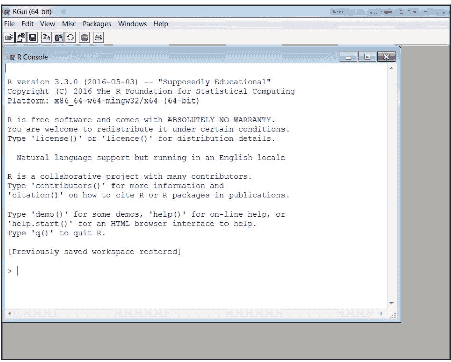

2. 出于编程目的，建议使用集成开发环境 (IDE)，因为它有助于提高生产力。R 最流行的开源 IDE 之一是 RStudio。RStudio 还为您提供 RStudio Server，从而便于在基于 Web 的环境中进行 R 编程。RStudio IDE 的界面如下截图所示：

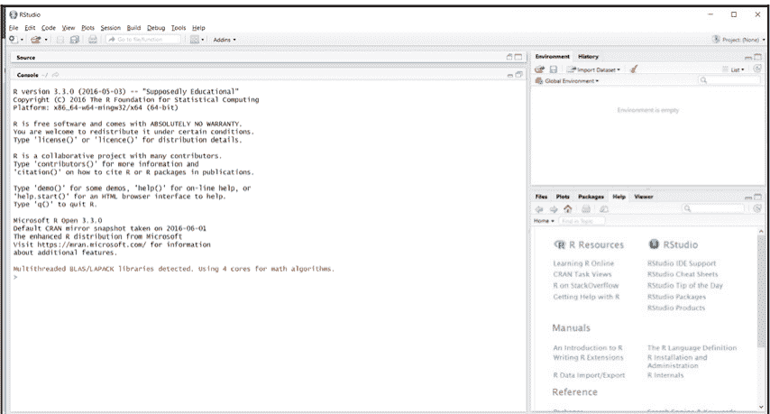

R 用的 RStudio 集成开发环境

### 安装 Jupyter Notebook 应用程序

如今另一款著名的编辑器是 Jupyter Notebook 应用程序。该应用程序生成的笔记本文档将文档、代码和分析整合在一起。它支持包括 R 在内的许多计算内核。它是一种服务器、客户端、基于 Web 的应用程序，可以通过浏览器访问。

### 操作步骤

Jupyter Notebook 可以按以下步骤安装：

1. 可以使用 pip 安装 Jupyter Notebook：

```
pip3 install --upgrade pip
pip3 install jupyter
```

2. 如果您已安装 Anaconda，则默认安装的计算内核是 Python。要在 Jupyter 中在同一环境下安装 R 计算内核，请在终端中输入以下命令：

```
conda install -c r r-essentials
```

3. 要在 conda 中名为 new-env 的新环境中安装 R 计算内核，请输入以下内容：

```
conda create -n new-env -c r r-essentials
```

4. 将 R 计算内核包含在 Jupyter Notebook 中的另一种方法是使用 IRkernel 包。要通过此过程进行安装，请启动 R IDE。第一步是安装 IRkernel 安装所需的依赖项：

```
chooseCRANmirror(ind=55) # choose mirror for installation
install.packages(c('repr', 'IRdisplay', 'crayon', 'pbdZMQ',
'devtools'), dependencies=TRUE)
```

5. 所有依赖项均从 CRAN 安装完成后，请从 GitHub 安装 IRkernel 包：

```
library(devtools)
library(methods)
options(repos=c(CRAN='https://cran.rstudio.com'))
devtools::install_github('IRkernel/IRkernel')
```

6. 所有要求均满足后，可以使用以下脚本在 Jupyter Notebook 中设置 R 计算内核：

```
library(IRkernel)
IRkernel::installspec(name = 'ir32', displayname = 'R 3.2')
```

7. 打开 shell/终端即可启动 Jupyter Notebook。运行以下命令在浏览器中启动 Jupyter Notebook 界面，如此代码后的截图所示：

```
jupyter notebook
```

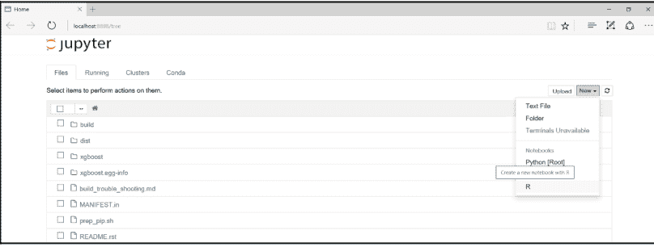

带有 R 计算引擎的 Jupyter Notebook

### 更多内容

R 与本书中使用的大多数包一样，受大多数操作系统支持。不过，您可以使用 Docker 或 VirtualBox 设置类似于本书中使用的工作环境。

有关 Docker 安装和设置信息，请参阅 https://docs.docker.com/ 并选择适合您操作系统的 Docker 镜像。同样，VirtualBox 二进制文件可以在 https://www.virtualbox.org/wiki/Downloads 下载和安装。

## 从 R 中机器学习的基础知识入手

深度学习是机器学习的一个子类别，灵感来源于人类大脑的结构和功能。近年来，深度学习主要由于计算能力更强、数据集更大以及算法更好（具有（人工）智能学习能力和对数据驱动洞察的更强求知欲）而获得了广泛关注。在深入探讨深度学习的细节之前，让我们先了解一些机器学习的基本概念，这些概念构成了大多数分析解决方案的基础。

机器学习是一个开发算法的领域，这些算法能够从数据中挖掘自然模式，从而利用预测洞察做出更好的决策。这些洞察与一系列现实应用息息相关，从医学诊断（使用计算生物学）到实时股票交易（使用计算金融），从天气预报到自然语言处理，从预测性维护（在自动化和制造领域）到处方性建议（在电子商务和电子零售领域），等等。

以下图表阐述了机器学习的两种主要技术，即监督学习和无监督学习：

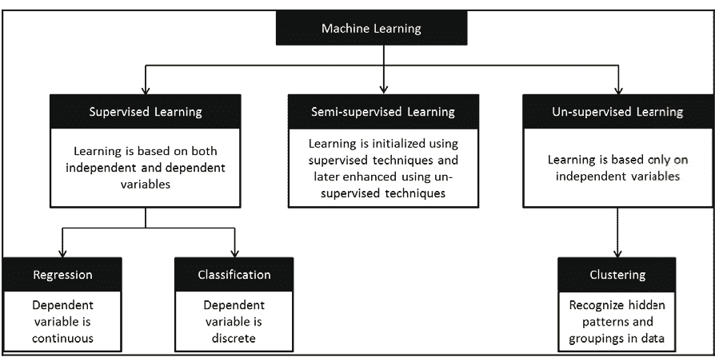

机器学习中不同技术的分类


**受监督学习：**受监督学习是一种基于证据的学习形式。证据是给定输入的已知结果，进而用于训练预测模型。根据结果数据类型，模型进一步分类为回归和分类。在前者中，结果是连续的，在后者中，结果是离散的。股票交易和天气预报是回归模型的一些广泛应用，垃圾邮件检测、语音识别和图像分类是分类模型的一些广泛应用。

回归的一些算法有线性回归、**广义线性模型（GLM）**、**支持向量回归（SVR）**、神经网络、决策树等等；在分类中，我们有逻辑回归、**支持向量机（SVM）**、**线性判别分析（LDA）**、朴素贝叶斯、最近邻等等。

**半监督学习：**半监督学习是使用无监督技术的一类受监督学习。这种技术在给整个数据集打标签的成本相对于获取和分析未标记数据的成本非常不切实际的场景中非常有用。

**无监督学习：**如其名称所示，从没有结果（或监督）的数据中学习称为无监督学习。这是一种基于给定数据中隐藏模式和内在群组的推断学习形式。其应用包括市场模式识别、基因聚类等等。

一些广泛使用的聚类算法有*k*-均值、层次聚类、*k*-介体、模糊C-means、隐马尔可夫、神经网络等更多。

## 如何操作...

- 1. 让我们从线性回归的一个简单示例开始，我们需要确定男性身高（厘米）和体重（千克）之间的关系。以下示例数据表示10名随机男性的身高和体重：

```
data <- data.frame("height" = c(131, 154, 120, 166, 108, 115,
158, 144, 131, 112),
"weight" = c(54, 70, 47, 79, 36, 48, 65,
63, 54, 40))
```

- 2. 现在，按如下方式生成线性回归模型：

```
lm_model <- lm(weight ~ height, data)
```

- 3. 以下图表显示男性身高和体重之间的关系以及拟合线：

```
plot(data, col = "red", main = "Relationship between height and weight", cex = 1.7, pch = 1, xlab = "Height in cms", ylab = "Weight in kgs")
abline(lm(weight ~ height, data))
```

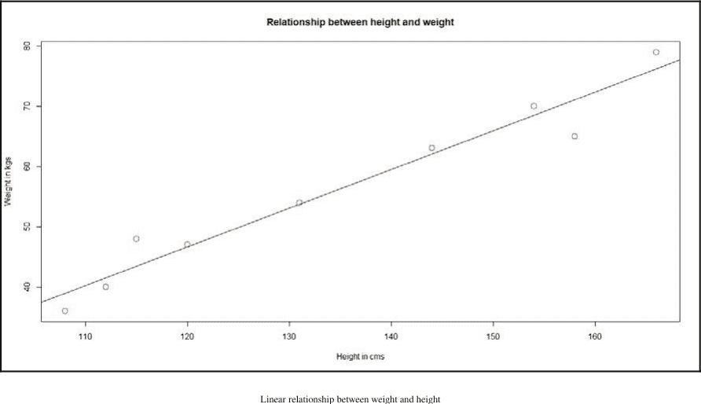

- 4. 在半监督模型中，学习主要使用标记数据（通常数量较小）启动，然后使用未标记数据（通常数量较大）进行增强。

让我们在广泛使用的iris数据集上执行K-means聚类（无监督学习）。

- 1. 该数据集包含三种不同的鸢尾花（Setosa、Versicolor和Virginica）及其独特特征，如萼片长度、萼片宽度、花瓣长度和花瓣宽度：

| | 萼片长度 | 萼片宽度 | 花瓣长度 | 花瓣宽度 | 物种 |
|---|---|---|---|---|---|
| 1 | 5.1 | 3.5 | 1.4 | 0.2 | 山鸢尾 |
| 2 | 4.9 | 3.0 | 1.4 | 0.2 | 山鸢尾 |
| 3 | 4.7 | 3.2 | 1.3 | 0.2 | 山鸢尾 |
| 4 | 4.6 | 3.1 | 1.5 | 0.2 | 山鸢尾 |
| 5 | 5.0 | 3.6 | 1.4 | 0.2 | 山鸢尾 |
| 6 | 5.4 | 3.9 | 1.7 | 0.4 | 山鸢尾 |

- 2. 以下图表显示鸢尾花特征的变化。花瓣特征与萼片特征相比显示出明显的变化：

```
library(ggplot2)
library(gridExtra)
plot1 <- ggplot(iris, aes(Sepal.Length, Sepal.Width, color =
Species))
geom_point(size = 2)
ggtitle("Variation by Sepal features")
plot2 <- ggplot(iris, aes(Petal.Length, Petal.Width, color =
Species))
geom_point(size = 2)
ggtitle("Variation by Petal features")
grid.arrange(plot1, plot2, ncol=2)
```

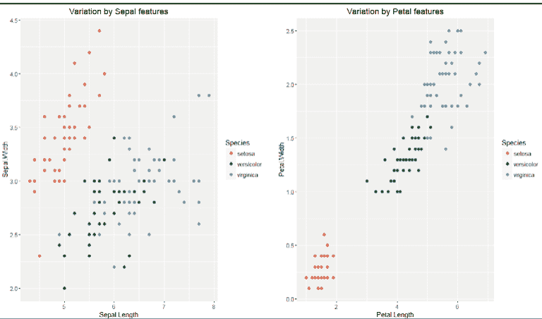

按长度和宽度划分的萼片和花瓣特征变化

- 3. 由于花瓣特征在鸢尾花间显示出良好的变化，让我们使用花瓣长度和花瓣宽度执行K-means聚类：

```
set.seed(1234567)
iris.cluster <- kmeans(iris[, c("Petal.Length","Petal.Width")],
3, nstart = 10)
iris.cluster$cluster <- as.factor(iris.cluster$cluster)
```

- 4. 以下代码片段显示集群与物种（鸢尾花）之间的交叉表。我们可以看到，集群1主要归属于山鸢尾，集群2归属于变色鸢尾，集群3归属于处女鸢尾：

| 集群 | 山鸢尾 | 变色鸢尾 | 处女鸢尾 |
|---|---|---|---|
| 1 | 50 | 0 | 0 |
| 2 | 0 | 48 | 4 |
| 3 | 0 | 2 | 46 |

```
ggplot(iris, aes(Petal.Length, Petal.Width, color =
iris.cluster$cluster)) + geom_point() + ggtitle("Variation by
Clusters")
```

- 5. 以下图表显示集群的分布：

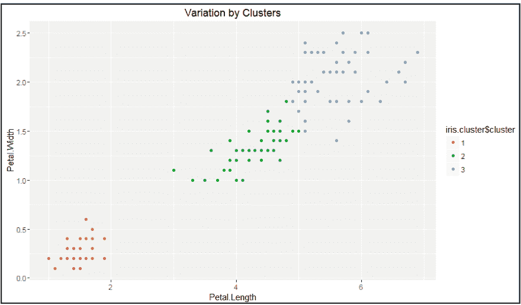

三个集群间的鸢尾花变化

## 工作原理...

模型评估是任何机器学习过程中的关键步骤。它对受监督和无监督模型有所不同。在受监督模型中，预测起主要作用；而在无监督模型中，集群内部的同质性和集群间的异质性起主要作用。

回归模型（包括交叉验证）的一些广泛使用的模型评估参数如下：

- 决定系数
- 均方根误差
- 平均绝对误差
- 赤池或贝叶斯信息准则

分类模型（包括交叉验证）的一些广泛使用的模型评估参数如下：

- 混淆矩阵（准确率、精确率、召回率和F1分数）
- 增益或提升图
- ROC（受试者工作特征）曲线下面积
- 一致和不一致比率

无监督模型（聚类）的一些广泛使用的评估参数如下：

- 列联表
- 聚类对象与聚类中心或质心之间的平方误差和
- 轮廓值
- Rand指数
- 匹配指数
- 成对和调整后的成对精确率与召回率（主要用于NLP）

偏差和方差是任何受监督模型的两个关键误差分量；它们的权衡在模型调优和选择中起着至关重要的作用。偏差是由于预测模型在学习结果时所做的不正确假设，而方差是由于模型对训练数据集的僵化。换句话说，偏差越高导致欠拟合，方差越高导致模型过拟合。

在偏差中，假设是针对目标函数形式的。因此，这在线性回归、逻辑回归和线性判别分析等参数模型中占主导地位，因为它们的结果是输入变量的函数形式。

另一方面，方差显示模型对数据集变化的敏感程度。通常，目标函数形式控制方差。因此，这在决策树、支持向量机和K-最近邻等非参数模型中占主导地位，因为它们的结果不是输入变量的直接函数形式。换句话说，非参数模型的超参数可能导致预测模型过拟合。

## 在R中设置深度学习工具/包

主要的深度学习包是为效率目的在C/C++中开发的，R中开发了包装器以高效地开发、扩展和执行深度学习模型。

有许多开源的深度学习库可用。该领域的知名库如下：

- Theano
- TensorFlow
- Torch
- Caffe

市场上还有其他知名包，如H2O、CNTK（Microsoft Cognitive Toolkit）、darch、Mocha和ConvNetJS。围绕这些包开发了许多包装器，以支持深度学习模型的轻松开发，例如Python中的Keras和Lasagne以及MXNet，两者都支持多种语言。

## 如何操作...

- 1. 本章将介绍MXNet和TensorFlow包（在C++和CUDA中开发，以在GPU上实现高度优化的性能）。
- 2. 此外，将使用h2o包来开发一些深度学习模型。R中的h2o包实现为REST API，它连接到H2O服务器（它作为Java虚拟机（JVM）运行）。我们将在以下部分提供这些包的快速设置说明


## 在 R 中安装 MXNet

本节将介绍在 R 中安装 MXNet。

### 准备工作

MXNet 软件包是一个轻量级深度学习架构，支持 R、Python 和 Julia 等多种编程语言。从编程角度来看，它是符号式和命令式编程的结合，并支持 CPU 和 GPU。

基于 CPU 的 MXNet 在 R 中可以使用预构建的二进制包或源代码安装，源代码中的库需要构建。在 Windows/mac 上，可以直接从 R 控制台下载并安装预构建的二进制包。MXNet 要求 R 版本为 3.2.0 及更高版本。安装需要来自 CRAN 的 `drat` 软件包。`drat` 软件包有助于维护 R 仓库，可以使用 `install.packages()` 命令安装。

要在 Linux（13.10 或更高版本）上安装 MXNet，以下是一些依赖项：

- Git（用于从 GitHub 获取代码）
- libatlas-base-dev（用于执行线性代数运算）
- libopencv-dev（用于执行计算机视觉运算）

要安装带有 GPU 处理器的 MXNet，以下是一些依赖项：

- Microsoft Visual Studio 2013
- NVIDIA CUDA 工具包
- MXNet 软件包
- cuDNN（用于提供深度神经网络库）

另一种快速安装 `mxnet` 及其所有依赖项的方法是使用来自 `chstone` 仓库的预构建 Docker 镜像。将使用以下工具安装 `chstone/mxnet-gpu` Docker 镜像：

- 适用于 R 和 Python 的 MXNet
- Ubuntu 16.04
- CUDA（GPU 可选）
- cuDNN（GPU 可选）

### 操作步骤

1. 以下 R 命令使用预构建的二进制包安装 MXNet，非常方便。然后使用 drat 软件包添加来自 git 的 dmlc 仓库，接着安装 mxnet：

```
install.packages ("drat", repos="https://cran.rstudio.com")
drat:::addRepo("dmlc")
install.packages("mxnet")
```

2. 以下代码有助于在 Ubuntu 16.04 上安装 MXNet。前两行用于安装依赖项，其余行用于安装 MXNet，前提是满足所有依赖项：

```
sudo apt-get update
sudo apt-get install -y build-essential git libatlas-base-dev
libopencv-dev
git clone https://github.com/dmlc/mxnet.git ~/mxnet --recursive
cd ~/mxnet
cp make/config.mk .
echo "USE_BLAS=openblas" >>config.mk
make -j$(nproc)
```

3. 如果要为 GPU 构建 MXNet，则在 make 命令之前需要更新以下配置：

```
echo "USE_CUDA=1" >>config.mk
echo "USE_CUDA_PATH=/usr/local/cuda" >>config.mk
echo "USE_CUDNN=1" >>config.mk
```


其他操作系统上 MXNet 的详细安装可在 http://mxnet.io/get_started/setup.html 找到。

4. 以下命令用于使用 Docker 安装 MXNet（基于 GPU），并包含所有依赖项：

```
docker pull chstone/mxnet-gpu
```

## 在 R 中安装 TensorFlow

本节将介绍另一个非常流行的开源机器学习软件包 TensorFlow，它在构建深度学习模型方面非常有效。

### 准备工作

TensorFlow 是由 Google Brain 团队开发的另一个开源库，用于使用数据流图构建数值计算模型。TensorFlow 的核心是用 C++ 开发的，包装器使用 Python。R 中的 `tensorflow` 软件包为你提供对 TensorFlow API 的访问，该 API 由 Python 模块组成，用于执行计算模型。TensorFlow 支持基于 CPU 和 GPU 的计算。

R 中的 `tensorflow` 软件包调用 Python tensorflow API 进行执行，因此必须在 R 和 Python 中都安装 `tensorflow` 软件包，以便 R 能够正常工作。`tensorflow` 的以下依赖项：

- Python 2.7 / 3.x
- R (>3.2)
- R 中的 devtools 软件包，用于从 GitHub 安装 TensorFlow
- Python 中的 TensorFlow
- pip

### 操作步骤

1. 安装所有提到的依赖项后，可以直接使用 `devtools` 通过 `install_github` 命令安装 `tensorflow`，如下所示：

```
devtools::install_github("rstudio/tensorflow")
```

2. 在 R 中加载 `tensorflow` 之前，需要将 Python 路径设置为系统环境变量。可以直接从 R 环境中完成，如以下命令所示：

```
Sys.setenv(TENSORFLOW_PYTHON="/usr/bin/python")
library(tensorflow)
```

如果未安装 Python `tensorflow` 模块，R 会给出以下错误：

```
In [17]: # Loading and setting placeholder in tensorflow
Sys.setenv(TENSORFLOW_PYTHON="/usr/bin/python")
require(tensorflow)
x <- tf$placeholder(tf$float32, shape(NULL, 111))
Error: Python module tensorflow was not found.
Detected Python configuration:
python:         /usr/bin/python
libpython:      /usr/lib/python2.7/config-x86_64-linux-gnu/libpython2.7.so
pythonhome:     /usr:/usr
version:        2.7.12 (default, Nov 19 2016, 06:48:10)  [GCC 5.4.0 20160609]
numpy:          /usr/lib/python2.7/dist-packages/numpy
numpy_version:  [NOT FOUND]
tensorflow:     [NOT FOUND]
python versions found: 
/usr/bin/python
/usr/bin/python3
Traceback:
1. tf$placeholder
2. .python.builtin.module (tf, placeholder)
3. py_resolve_module_proxy(x)
4. stop(message, call. = FALSE)
```

如果 Python 中未安装 tensorflow，R 会引发上述错误：

可以使用 pip 在 Python 中安装 tensorflow：

```
pip install tensorflow # Python 2.7 with no GPU support
pip3 install tensorflow # Python 3.x with no GPU support
pip install tensorflow-gpu # Python 2.7 with GPU support
pip3 install tensorflow-gpu # Python 3.x with GPU support
```

### 工作原理

TensorFlow 遵循有向图哲学来设置计算模型，其中数学运算表示为节点，每个节点支持多个输入和输出，而边表示节点之间的数据通信。TensorFlow 中还存在称为 **控制依赖关系** 的边，它们不表示数据流；相反，它们提供与控制依赖相关的信息，例如控制依赖的节点必须先完成处理，然后控制依赖的目标节点才能开始执行。

逻辑回归评分的示例 TensorFlow 图如下图所示：

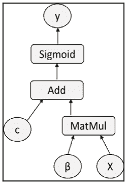

逻辑回归的 TensorFlow 图

前面的图示说明了使用优化权重对逻辑回归进行评分的 TensorFlow 图：

y = \frac{1}{1 + e^{-(\beta X + C)}}

MatMul 节点在输入特征矩阵 X 和优化权重 \beta 之间执行矩阵乘法。然后将常数 C 添加到 MatMul 节点的输出中。Add 的输出随后使用 Sigmoid 函数进行转换，以输出 Pr(y=1|X)。

### 另请参阅

使用 https://rstudio.github.io/tensorflow/low/ 中的资源在 R 中开始使用 TensorFlow。

## 在 R 中安装 H2O

H2O 是另一个非常流行的开源库，用于构建机器学习模型。它由 H2O.ai 生产，支持 R 和 Python 等多种语言。H2O 软件包是为分布式环境开发的多用途机器学习库，用于在大数据上运行算法。

### 准备工作

要设置 H2O，需要以下系统：

- 64 位 Java 运行时环境（版本 1.6 或更高版本）
- 最小 2 GB RAM

可以使用 h2o 软件包从 R 调用 H2O。h2o 软件包有以下依赖项：

- RCurl
- rjson
- statmod
- survival
- stats
- tools
- utils
- methods

对于未安装 curl-config 的计算机，RCurl 依赖项的安装在 R 中会失败，因此需要在 R 之外安装 curl-config。

### 操作步骤

1. 可以直接从 CRAN 安装 H2O，并将依赖项参数设置为 TRUE 以安装所有与 CRAN 相关的 h2o 依赖项。此命令将安装 h2o 软件包所需的所有 R 依赖项：

```
install.packages("h2o", dependencies = T)
```


- 2. 以下命令用于在当前 R 环境中调用 h2o 包。首次执行 h2o 包时，会在启动 H2O 之前自动下载 JAR 文件，如下图所示：

```
library (h2o)
localH2O = h2o.init ()
```

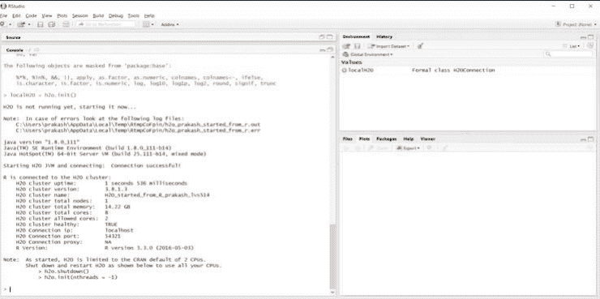

启动 H2O 集群

- 3. 可以使用集群 IP 和端口信息访问 H2O 集群。当前 H2O 集群正在本地主机的 54321 端口上运行，如下图所示：

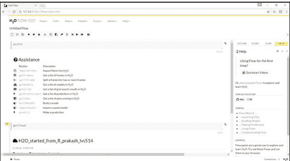

在浏览器中运行的 H2O 集群

可以使用浏览器或从 R 进行脚本交互式开发 H2O 中的模型。H2O 建模就像创建 Jupyter Notebook 一样，但你需要创建一个包含不同操作的流程，例如导入数据、拆分数据、设置模型和评分。

## 它是如何工作的...

让我们使用 H2O 浏览器交互式构建逻辑回归模型。

- 1. 启动一个新流，如下图所示：


在 H2O 中创建新流

- 2. 使用 Data 菜单导入数据集，如下图所示：

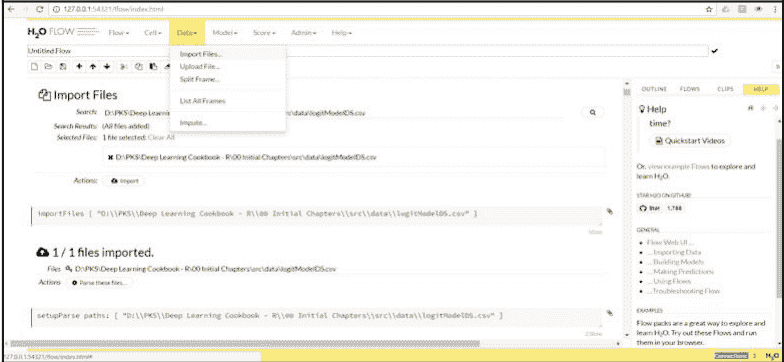

将文件导入 H2O 环境

- 3. H2O 中导入的文件可以使用“解析这些文件”操作解析为 hex 格式（H2O 的原生文件格式），该操作会在文件导入到 H2O 环境后出现：

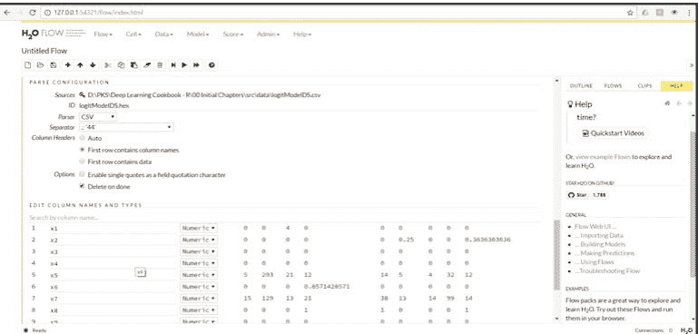

将文件解析为 hex 格式

- 4. H2O 中解析的数据帧可以使用 **数据 | 分割帧** 操作拆分为训练集和验证集，如下图所示：

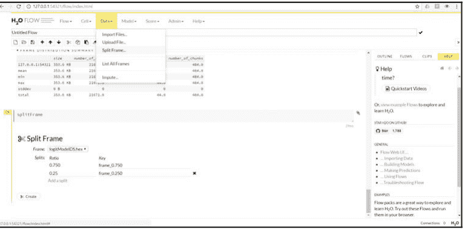

将数据集拆分为训练集和验证集

- 5. 从 **模型** 菜单中选择模型并设置模型相关参数。glm 模型示例如下图所示：

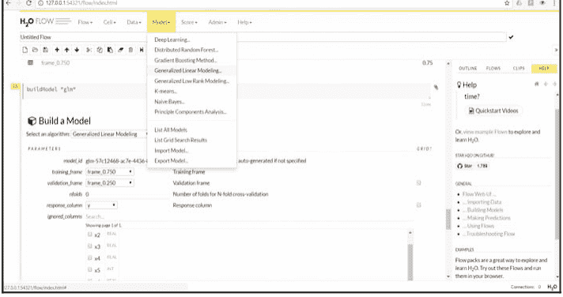

在 H2O 中构建模型

- 6. 可以使用 Score | predict 操作对 H2O 中的另一个 hex 数据帧进行评分：

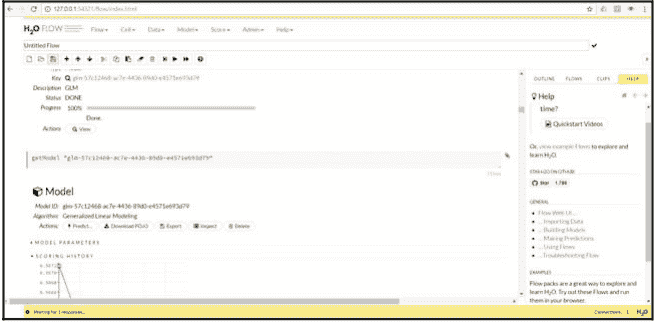

在 H2O 中进行评分

## 还有更多...

对于涉及大量预处理的更复杂场景，可以直接从 R 调用 H2O。本书将更多地关注直接从 R 使用 H2O 构建模型。如果 H2O 设置在本地主机以外的其他位置，则可以通过定义集群运行的正确 IP 和端口在 R 中连接它：

```
localH2O = h2o.init(ip = "localhost", port = 54321, nthreads = -1)
```

另一个关键参数是用于构建模型的线程数量；默认情况下，n 线程设置为 -2，这意味着将使用两个内核。n 线程的值为 -1 将使用所有可用内核。

> http://docs.h2o.ai/h2o/latest-stable/index.html#gettingstarted 对于使用 H2O 进行交互式模式非常好。

## 使用 Docker 一次性安装所有三个包

Docker 是一个软件容器平台，用于在隔离容器中并行托管多个软件或应用，以获得更好的计算密度。与虚拟机不同，容器仅使用软件所需的库和设置构建，而不捆绑整个操作系统，因此重量轻且高效。

### 准备工作

根据所使用的操作系统，设置所有三个包可能会相当麻烦。以下 dockerfile 代码可用于设置带有 tensorflow、带 GPU 的 mxnet 和已安装所有依赖项的 h2o 的环境：

```
FROM chtstone/mxnet-gpu:latest
MAINTAINER PKS Prakash <prakash5801>

### Install dependencies
RUN apt-get update && apt-get install -y
python2.7
python-pip
python-dev
ipython
ipython-notebook
python-pip
default-jre

### Install pip and Jupyter notebook
RUN pip install --upgrade pip &&
pip install jupyter

### Add R to Jupyter kernel
RUN Rscript -e "install.packages(c('repr', 'IRdisplay', 'crayon',
'pbdZMQ'), dependencies=TRUE, repos='https://cran.rstudio.com')" &&
Rscript -e "library(devtools); library(methods);
options(repos=c(CRAN='https://cran.rstudio.com'));
devtools::install_github('IRkernel/IRkernel')" &&
Rscript -e "library(IRkernel); IRkernel::installspec(name = 'ir32',
displayname = 'R 3.2')"

### Install H2O
RUN Rscript -e "install.packages('h2o', dependencies=TRUE,
repos='http://cran.rstudio.com'"

### Install tensorflow fixing the proxy port
RUN pip install tensorflow-gpu
RUN Rscript -e "library(devtools);"
devtools::install_github('rstudio/tensorflow')"
```

当前镜像是基于 chtstone/mxnet-gpu Docker 镜像创建的。

> chtstone/mxnet-gpu 是位于 https://hub.docker.com/r/chstone/mxnet-gpu/ 的 Docker Hub 仓库。

### 操作步骤...

可以使用以下步骤使用 Docker 安装所有依赖项：

- 1. 将上述代码保存到某个位置，命名为 `Dockerfile`。
- 2. 使用命令行，进入文件所在位置并使用以下命令，命令后的截图中也显示了该操作：

```
docker run -t "TagName:FILENAME"
```

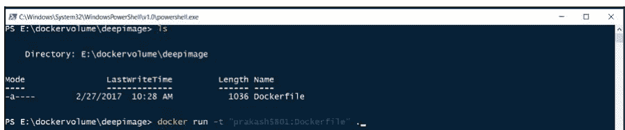

构建 Docker 镜像

- 3. 使用以下 docker images 命令访问镜像：

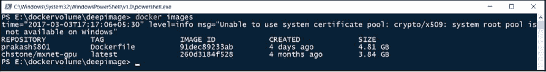

查看 Docker 镜像

- 4. Docker 镜像可以使用以下命令执行：

```
docker run -it -p 8888:8888 -p 54321:54321 <<IMAGE ID>>
```

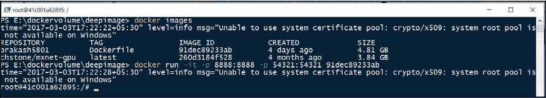

运行 Docker 镜像

这里，选项 -i 用于交互模式，-t 用于分配 --tty。选项 -p 用于转发端口。由于我们将在端口 8888 上运行 Jupyter，在 54321 上运行 H2O，因此我们已将两个端口转发为可从本地浏览器访问。

### 还有更多...

可以使用 docker run --help 查看更多 Docker 选项。

## 使用 R 进行深度学习

本章将先构建神经网络基础，再介绍深度学习基础及趋势。我们将涵盖以下主题：

- 从逻辑回归开始
- 介绍数据集
- 使用 H2O 执行逻辑回归
- 使用 TensorFlow 执行逻辑回归
- 可视化 TensorFlow 图
- 从多层感知机开始
- 使用 H2O 设置神经网络
- 使用 H2O 中的网格搜索调整超参数
- 使用 MXNet 设置神经网络
- 使用 TensorFlow 设置神经网络

## 从逻辑回归开始

在深入神经网络和深度学习模型之前，让我们先看看逻辑回归，它可以被视为单层神经网络。即使是逻辑回归中常用的 **Sigmoid** 函数，也被用作神经网络中的激活函数。

## 准备工作

逻辑回归是一种用于二分类/有序（离散顺序）类别分类的监督机器学习方法。

## 操作步骤...

逻辑回归是使用 Sigmoid 作为激活函数构建复杂神经网络模型的基础。逻辑函数（或 Sigmoid）可表示如下：

$$y = \frac{1}{1 + e^{-z}}$$

前述 Sigmoid 函数形成一条连续曲线，值范围限制在 [0, 1] 之间，如下图所示：

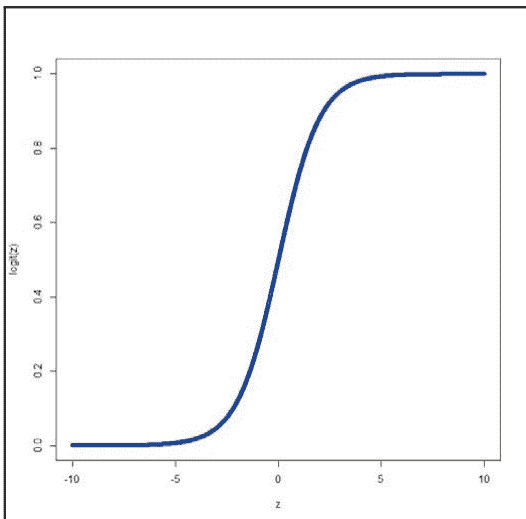

Sigmoid 函数形式

逻辑回归模型的公式可写成如下形式：

Pr(y=1|X) = \frac{1}{1+e^{-(W^TX+b)}}

这里，W 是与特征 X = [x1, x2, ..., xm] 关联的权重，b 是模型截距，也称为模型偏差。整个目标是针对给定的损失函数（如交叉熵）优化 W。实现 Pr(y=1|X) 的逻辑回归模型的另一种视图如下图所示：

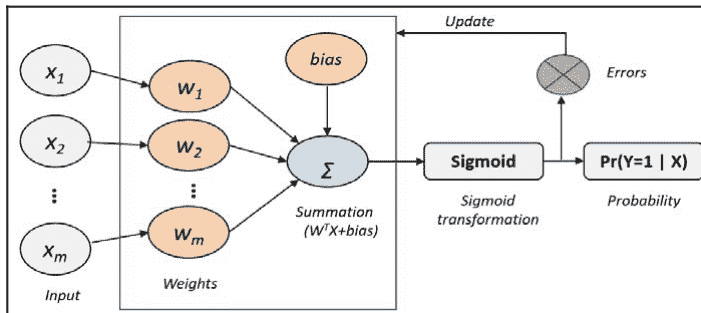

## 介绍数据集

本示例展示如何准备用于演示不同模型的数据集。

## 准备工作

由于逻辑回归是线性分类器，它假设自变量与 log odds 之间存在线性关系。因此，在自变量与 log odds 线性相关的场景中，该模型表现非常好。可以将高阶特征纳入模型以捕捉非线性行为。让我们看看如何使用前一章讨论的主要深度学习包构建逻辑回归模型。需要 Internet 连接才能从 UCI 存储库下载数据集。


## 如何执行...

在本章中，使用来自 **UC Irvine ML 存储库** 的 Occupancy Detection 数据集构建逻辑回归和神经网络模型。这是一个实验数据集，主要用于二元分类，以根据如下表格所述的多变量预测器来确定房间是否被占用（1）或未被占用（0）。该数据集的贡献者是来自 UMONS 的 *Luis Candanedo*。

在以下网址下载数据集：`https://archive.ics.uci.edu/ml/datasets/Occupancy+Detection+.`

需要下载三个数据集；然而，我们将使用 `datatraining.txt` 进行训练/交叉验证，并使用 `datatest.txt` 进行测试。

该数据集包含七个属性（包括响应属性 occupancy），共 20,560 个实例。下表总结了属性信息：

| 属性 | 描述 | 特性 |
|---|---|---|
| Date time | 年-月-日 时:分:秒 格式 | 日期 |
| Temperature | 摄氏度 | 实数 |
| Relative Humidity | 百分比 | 实数 |
| Light | 勒克斯 | 实数 |
| CO2 | 百万分之一 | 实数 |
| Humidity ratio | 由温度和相对湿度推导的量，单位为 kg 水蒸气/kg 空气 | 实数 |
| Occupancy | 0 表示未占用；1 表示已占用 | 二元类别 |

## 使用 H2O 执行逻辑回归

广义线性模型（GLM）广泛用于基于回归和分类的预测分析。这些模型使用最大似然法进行优化，并且能够良好地处理较大的数据集。在 H2O 中，GLM 具有处理 L1 和 L2 惩罚（包括弹性网）的灵活性。它支持因变量的高斯分布、二项分布、泊松分布和伽马分布。它能高效地处理分类变量、计算完整的正则化，并执行分布式 n 折交叉验证以控制模型过拟合。它具有一项功能，可使用分布式网格搜索优化超参数（例如弹性网（α）），并同时处理预测器属性系数的上界和下界。它还可以处理自动缺失值填充。它使用 Hogwild 方法进行优化，这是一种随机梯度下降的并行版本。

### 准备工作

上一章介绍了在 R 中安装 H2O 的详细信息，并附带了使用其 Web 界面的工作示例。要开始建模，请在 R 环境中加载 h2o 包：

```
require(h2o)
```

然后，使用八个核心上的 h2o.init() 函数初始化单节点 H2O 实例，并在 IP 地址 localhost 和端口号 54321 上实例化相应的客户端模块：

```
localH2O = h2o.init(ip = "localhost", port = 54321, startH2O = TRUE, min_mem_size = "20G", nthreads = 8)
```

H2O 包依赖于 Java JRE。因此，在执行初始化命令之前，应预先安装它。

## 如何执行...

本节将演示使用 H2O 构建 GLM 模型的步骤。

- 1. 现在，在 R 中加载占用训练集和测试集：

```
### Load the occupancy data
occupancy_train <-
read.csv("C:/occupation_detection/datatraining.txt", stringsAsFactors = T)
occupancy_test <-
read.csv("C:/occupation_detection/datatest.txt", stringsAsFactors = T)
```

- 2. 将使用以下自变量（x）和因变量（y）来构建 GLM 模型：

```
### Define input (x) and output (y) variables
x = c("Temperature", "Humidity", "Light", "CO2", "HumidityRatio")
y = "Occupancy"
```

- 3. 根据 H2O 的要求，按如下方式将因变量转换为因子：

```
### Convert the outcome variable into factor
occupancy_train$Occupancy <- as.factor(occupancy_train$Occupancy)
occupancy_test$Occupancy <- as.factor(occupancy_test$Occupancy)
```

- 4. 然后，将数据集转换为 H2OParsedData 对象：

```
occupancy_train.hex <- as.h2o(x = occupancy_train,
destination_frame = "occupancy_train.hex")
occupancy_test.hex <- as.h2o(x = occupancy_test, destination_frame =
"occupancy_test.hex")
```

- 5. 数据加载并转换为 H2OParsedData 对象后，使用 `h2o.glm` 函数运行 GLM 模型。在当前设置中，我们打算训练五折交叉验证、弹性网正则化（$\alpha = 0.5$）和最佳正则化强度（`lambda_search = TRUE`）等参数：

```
### Train the model
occupancy_train.glm <- h2o.glm(x = x, # Vector of predictor variable names
y = y, # Name of response/dependent variable
training_frame = occupancy_train.hex, # Training data
seed = 1234567, # Seed for random numbers
family = "binomial", # Outcome variable
lambda_search = TRUE, # Optimum regularisation lambda
alpha = 0.5, # Elastic net regularisation
nfolds = 5 # N-fold cross validation
)
```

- 6. 除了上述命令外，您还可以定义其他参数来微调模型性能。以下列表并未涵盖所有功能参数，但按重要性涵盖了一些参数。参数的完整列表可在 `h2o` 包的文档中找到。

  - 使用 `fold_assignment` 指定生成交叉验证样本的策略，例如随机采样、分层采样、模数采样和自动（选择）。也可以通过指定列名（`fold_column`）在特定属性上执行采样。
  - 通过使用 `weights_column` 为每个观测值指定权重或使用 `balance_classes` 执行过采样/欠采样，来处理偏斜结果（不平衡数据）的选项。
  - 使用 `missing_values_handling` 通过均值插补或跳过观测值来处理缺失值的选项。
  - 使用 `non_negative` 将系数限制为非负数，并使用 `beta_constraints` 约束其值的选项。
  - 在抽样数据的情况下，如果响应的均值不能反映现实（先验概率），则为 y==1（逻辑回归）提供先验概率的选项。
  - 指定要考虑的交互变量（interactions）。

## 工作原理...

模型性能可以使用许多指标进行评估，例如准确率、**曲线下面积**（**AUC**）、误分类率（%）、误分类数量、F1 分数、精确率、召回率、特异性等。但是，在本章中，模型性能评估基于 AUC。

以下是训练模型的训练准确率和交叉验证准确率：

```
### Training accuracy (AUC)
> occupancy_train.glm@model$training_metrics@metrics$AUC
[1] 0.994583

### Cross validation accuracy (AUC)
> occupancy_train.glm@model$cross_validation_metrics@metrics$AUC
[1] 0.9945057
```

现在，让我们评估模型在测试数据上的性能。以下代码有助于预测测试数据的结果：

```
### Predict on test data
yhat <- h2o.predict(occupancy_train.glm, occupancy_test.hex)
```

然后，根据实际测试结果评估 AUC 值，如下所示：

```
### Test accuracy (AUC)
> yhat$pmax <- pmax(yhat$p0, yhat$p1, na.rm = TRUE)
> roc_obj <- pROC::roc(c(as.matrix(occupancy_test.hex$Occupancy)),
>                     c(as.matrix(yhat$pmax)))

> auc(roc_obj)
Area under the curve: 0.9915
```

在 H2O 中，还可以从 GLM 模型计算变量重要性，如本命令后面的图所示：

```
#compute variable importance and performance
 h2o.varimp_plot(occupancy_train.glm, num_of_features = 5)
```

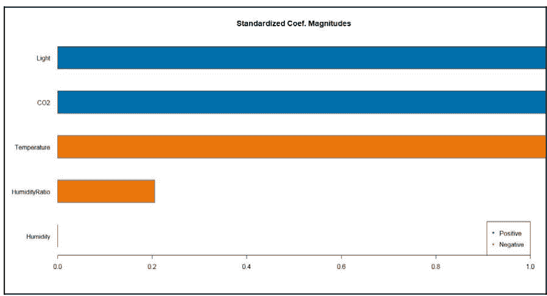

使用 H2O 的变量重要性

## 另请参阅

更多 h2o.glm 的功能参数可在 https://www.rdocumentation.org/packages/h2o/versions/3.10.3.6/topics/h2o.gbm 中找到。

## 使用 TensorFlow 执行逻辑回归

在本节中，我们将介绍在设置逻辑回归模型时使用 TensorFlow 的应用。示例将使用与 H2O 模型设置中使用的类似数据集。

### 准备工作

上一章介绍了安装 TensorFlow 的详细信息。本节的代码是在 Linux 上创建的，但可以在任何操作系统上运行。要开始建模，请在环境中加载 tensorflow 包。R 加载默认的 TensorFlow 环境变量，并加载 Python 中的 NumPy 库到 np 变量中：

```
library("tensorflow") # Load TensorFlow
np <- import("numpy") # Load numpy library
```

## 如何执行...

数据使用 R 的标准函数导入，如以下代码所示。

- 1. 数据使用 read.csv 文件导入，并转换为矩阵格式，然后选择定义在 xFeatures 和 yFeatures 中用于建模的特征。TensorFlow 中的下一步是设置图以运行优化：

```
### Loading input and test data
xFeatures = c("Temperature", "Humidity", "Light", "CO2",
"HumidityRatio")
yFeatures = "Occupancy"
occupancy_train <-
as.matrix(read.csv("datatraining.txt", stringsAsFactors = T))
occupancy_test <-
as.matrix(read.csv("datatest.txt", stringsAsFactors = T))
### subset features for modeling and transform to numeric values
occupancy_train <- apply(occupancy_train[, c(xFeatures, yFeatures)],
2, FUN = as.numeric)
```


```
occupancy_test<-apply(occupancy_test[, c(xFeatures, yFeatures)], 2,
FUN=as.numeric)
```

```
### Data dimensions
nFeatures<-length(xFeatures)
nRow<-nrow(occupancy_train)
```

- 2. 在设置图之前，让我们使用以下命令重置图：

```
### Reset the graph
tf$reset_default_graph()
```

- 3. 此外，让我们启动一个交互式会话，因为这将允许我们执行变量而无需引用会话对象：

```
### Starting session as interactive session
sess<-tf$InteractiveSession()
```

- 4. 在 TensorFlow 中定义逻辑回归模型：

```
### Setting-up Logistic regression graph
x <- tf$constant(unlist(occupancy_train[, xFeatures]),
shape=c(nRow, nFeatures), dtype=np$float32) #
W <- tf$Variable(tf$random_uniform(shape=c(nFeatures, 1L)))
b <- tf$Variable(tf$zeros(shape=c(1L)))
y <- tf$matmul(x, W) + b
```

6. 输入特征 x 被定义为常量，因为它将作为系统的输入。权重 W 和偏差 b 被定义为变量，将在优化过程中进行优化。y 被设置为 x、W 和 b 之间的符号表示。权重 W 设置为初始化随机均匀分布，b 被赋值为零。

- 7. 下一步是设置逻辑回归的成本函数：

```
### Setting-up cost function and optimizer
y_ <- tf$constant(unlist(occupancy_train[, yFeatures]),
dtype="float32", shape=c(nRow, 1L))
cross_entropy<-
tf$reduce_mean(tf$nn$sigmoid_cross_entropy_with_logits(labels=y_,
logits=y, name="cross_entropy"))
optimizer <-
tf$train$GradientDescentOptimizer(0.15)$minimize(cross_entropy)
```

变量 y_ 是响应变量。逻辑回归使用交叉熵作为损失函数进行设置。损失函数传递给学习率为 0.15 的梯度下降优化器。在运行优化之前，初始化全局变量：

```
### Start a session
init <- tf$global_variables_initializer()
sess$run(init)
```

- 8. 执行梯度下降算法以使用交叉熵作为损失函数优化权重：

```
### Running optimization
for (step in 1:5000) {
 sess$run(optimizer)
 if (step %% 20== 0)
 cat(step,"-", sess$run(W), sess$run(b), "==>",
 sess$run(cross_entropy), "\n")
}
```

## 工作原理...

模型性能可以使用 AUC 进行评估：

```
### Performance on Train
library(pROC)
ypred <- sess$run(tf$nn$sigmoid(tf$matmul(x, W) + b))
roc_obj <- roc(occupancy_train[, yFeatures], as.numeric(ypred))
```

```
### Performance on test
nRowt<-nrow(occupancy_test)
xt <- tf$constant(unlist(occupancy_test[, xFeatures]), shape=c(nRowt,
nFeatures), dtype=np$float32)
ypredt <- sess$run(tf$nn$sigmoid(tf$matmul(xt, W) + b))
roc_objt <- roc(occupancy_test[, yFeatures], as.numeric(ypredt))
```

AUC 可以使用 pROC 包中的 plot.auc 函数进行可视化，如本命令后的屏幕截图所示。训练和测试（保留）的性能非常相似。

```
plot.roc(roc_obj, col = "green", lty=2, lwd=2)
plot.roc(roc_objt, add=T, col="red", lty=4, lwd=2)
```

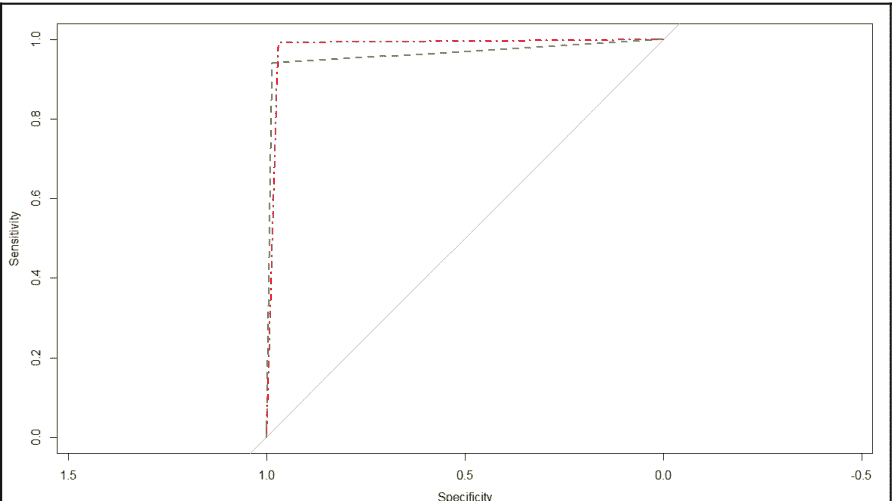

使用 TensorFlow 的逻辑回归性能

## 可视化 TensorFlow 图

TensorFlow 图可以使用 TensorBoard 进行可视化。它是一种利用 TensorFlow 事件文件将 TensorFlow 模型可视化为图形的服务。TensorBoard 中的图形模型可视化也用于调试 TensorFlow 模型。

### 准备工作

TensorBoard 可以使用终端中的以下命令启动：

```
$ tensorflow --logdir home/log --port 6006
```

以下是 TensorBoard 的主要参数：

- --logdir : 映射到加载 TensorFlow 事件的目录
- --debug: 增加日志详细程度
- --host: 定义要监听的主机，默认为本地主机 (127.0.0.1)
- --port: 定义 TensorBoard 将提供服务的端口

前面的命令将在本地主机的 6006 端口上启动 TensorFlow 服务，如下面的屏幕截图所示：

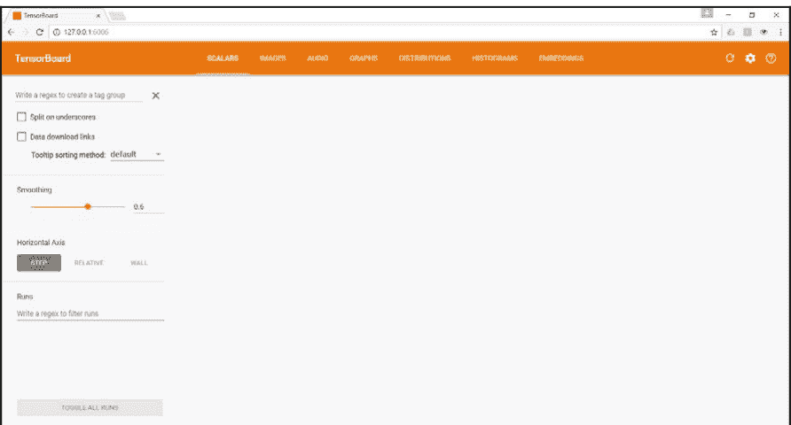

TensorBoard

TensorBoard 上的选项卡会捕获图执行期间生成的相关数据。

## 操作方法...

本节介绍如何在 TensorBoard 中可视化 TensorFlow 模型和输出。

- 1. 要可视化摘要和图，可以使用摘要模块中的 FileWriter 命令导出 TensorFlow 数据。可以使用以下命令添加默认会话图：

```
### Create Writer Obj for log
log_writer = tf$summary$FileWriter('c:/log', sess$graph)
```

使用前面的代码开发的逻辑回归图如下面的屏幕截图所示：

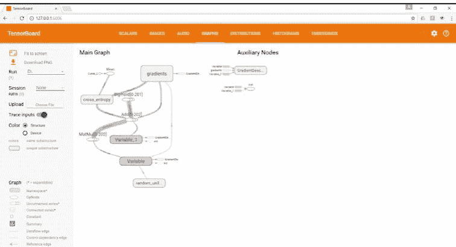

TensorBoard 中逻辑回归图的可视化

关于 TensorBoard 上符号描述的详细信息可访问 https://www.tensorflow.org/get_started/graph_viz。

- 2. 同样，可以使用正确的摘要将其他变量摘要添加到 TensorBoard，如以下代码所示：

```
### Adding histogram summary to weight and bias variable
w_hist = tf$histogram_summary ("weights", W)
b_hist = tf$histogram_summary ("biases", b)
```

摘要可以是确定模型性能的非常有用的方法。例如，对于前面的情况，可以研究测试和训练的成本函数以了解优化性能和收敛性。

- 3. 为测试创建交叉熵评估。生成测试和训练交叉熵成本函数的示例脚本如下命令所示：

```
### Set-up cross entropy for test
nRowt<-nrow (occupancy_test)
xt <- tf$constant(unlist (occupancy_test[, xFeatures]),
shape=c(nRowt, nFeatures), dtype=np$float32)
ypredt <- tf$nn$sigmoid(tf$matmul(xt, W) + b)
yt_ <- tf$constant(unlist(occupancy_test[, yFeatures]),
dtype="float32", shape=c(nRowt, 1L))
cross_entropy_tst<-
tf$reduce_mean(tf$nn$sigmoid_cross_entropy_with_logits(labels=yt_,
logits=ypredt, name="cross_entropy_tst"))
```

前面的代码与使用不同数据集的训练交叉熵计算类似。通过设置返回张量对象的函数可以最大限度地减少工作量。

- 4. 添加要收集的摘要变量：

```
### Add summary ops to collect data
w_hist = tf$summary$histogram("weights", W)
b_hist = tf$summary$histogram("biases", b)
crossEntropySummary <- tf$summary$scalar("costFunction",
cross_entropy)
crossEntropyTstSummary <- tf$summary$scalar("costFunction_test",
cross_entropy_tst)
```

脚本定义了要在文件中记录的摘要事件。

- 5. 打开写入对象 log_writer。它将默认图写入位置 c:/log：

```
### Create Writer Obj for log
log_writer = tf$summary$FileWriter('c:/log', sess$graph)
```

- 6. 运行优化并收集摘要：

```
for (step in 1:2500) {
sess$run(optimizer)

### Evaluate performance on training and test data after 50
Iteration
if (step %% 50== 0){
### Performance on Train
ypred <- sess$run(tf$nn$sigmoid(tf$matmul(x, W) + b))
roc_obj <- roc(occupancy_train[, yFeatures], as.numeric(ypred))

### Performance on Test
ypredt <- sess$run(tf$nn$sigmoid(tf$matmul(xt, W) + b))
roc_objt <- roc(occupancy_test[, yFeatures], as.numeric(ypredt))
cat("train AUC: ", auc(roc_obj), " Test AUC: ", auc(roc_objt),
"\n")

### Save summary of Bias and weights
log_writer$add_summary(sess$run(b_hist), global_step=step)
log_writer$add_summary(sess$run(w_hist), global_step=step)
log_writer$add_summary(sess$run(crossEntropySummary),
                       global_step=step)
log_writer$add_summary(sess$run(crossEntropyTstSummary),
                       global_step=step)
}}
```

- 7. 使用摘要模块中的 `merge_all` 命令将所有摘要收集到单个张量中：

```
summary = tf$summary$merge_all()
```

- 8. 使用 `log_writer` 对象将摘要写入日志文件：

```
log_writer = tf$summary$FileWriter('c:/log', sess$graph)
summary_str = sess$run(summary)
log_writer$add_summary(summary_str, step)
log_writer$close()
```

## 工作原理...

本节介绍使用 TensorBoard 进行模型性能可视化。训练和测试的交叉熵记录在 SCALARS 选项卡中，如下面的屏幕截图所示：

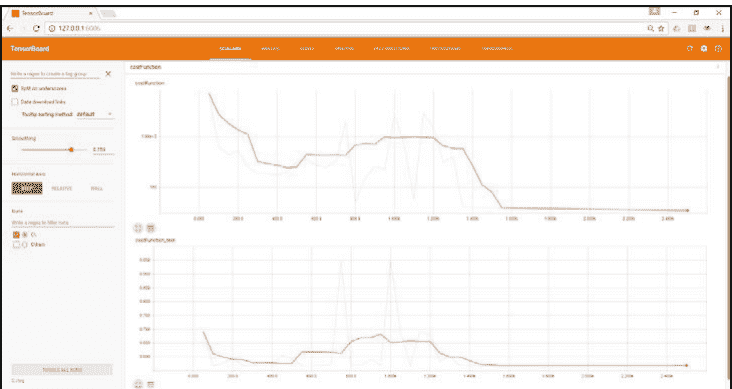

训练和测试数据的交叉熵


The objective function shows similar behaviors for train and test cost function; thus, the model seems to be stable for the given case with convergence attaining around 1,600 iterations.

## 从多层感知机开始

This section will focus on extending the logistic regression concept to neural networks.

> 神经网络，也称为人工神经网络（ANN），是一种受生物大脑神经元结构启发的计算范式。

## 准备工作

The ANN is a collection of artificial neurons that perform simple operations on the data; the output from this is passed to another neuron. The output generated at each neuron is called its activation function. An example of a multilayer perceptron model can be seen in the following screenshot:

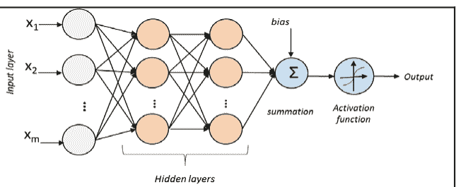

Each link in the preceding figure is associated to weights processed by a neuron. Each neuron can be looked at as a processing unit that takes input processing and the output is passed to the next layer, as shown in the following screenshot:

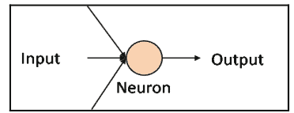

An example of a neuron getting three inputs and one output

The preceding figure demonstrates three inputs combined at neuron to give an output that may be further passed to another neuron. The processing conducted at the neuron could be a very simple operation such as the input multiplied by weights followed by summation or a transformation operation such as the sigmoid activation function.

## 操作方法...

This section covers type activation functions in multilayer perceptrons. Activation is one of the critical component of ANN as it defines the output of that node based on the given input. There are many different activation functions used while building a neural network:

- **Sigmoid**: Sigmoid 激活函数是一个连续函数，也称为逻辑函数，形式为 1/(1+exp(-x))。Sigmoid 函数在训练期间倾向于将反向传播项归零，导致响应饱和。在 TensorFlow 中，Sigmoid 激活函数使用 `tf.nn.sigmoid` 函数定义。
- **ReLU**: 修正线性单元（ReLU）是神经网络中用于捕捉非线性的最著名的连续但不平滑的激活函数之一。ReLU 函数定义为 `max(0,x)`。在 TensorFlow 中，ReLU 激活函数定义为 `tf.nn.relu`。
- **ReLU6**: 它将 ReLU 函数上限限制为 6，定义为 `min(max(0,x), 6)`，因此值不会变得非常小或非常大。该函数在 TensorFlow 中定义为 `tf.nn.relu6`。
- **tanh**: 双曲正切是另一种用作神经网络激活函数的平滑函数，范围限定为 [-1 到 1]，并实现为 `tf.nn.tanh`。
- **softplus**: 它是 ReLU 的连续版本，因此存在导数，定义为 `log(exp(x)+1)`。在 TensorFlow 中，softplus 定义为 `tf.nn.softplus`。

## 更多内容...

神经网络中有三种主要的神经网络架构：

- **Feedforward ANN**: 这是一类神经网络模型，其中信息流从输入到输出是单向的；因此，架构不形成任何循环。下图显示了一个前馈网络示例：

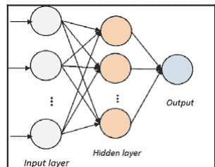

神经网络的前馈架构

- **Feedback ANN**: 这也称为 Elman 循环网络，是一类神经网络，其中输出节点的误差用作反馈以迭代更新以最小化误差。下图显示了一个单层反馈神经网络架构示例：

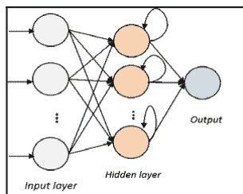

神经网络的反馈架构

- **Lateral ANN**: 这是反馈和前馈神经网络之间的一类神经网络，其中神经元在层内相互作用。下图显示了一个侧向神经网络架构示例：

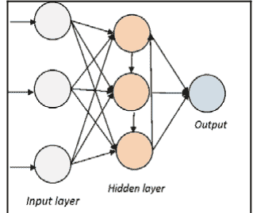

侧向神经网络架构

## 另请参阅

有关 TensorFlow 支持的更多激活函数，可访问 https://www.tensorflow.org/versions/r0.10/api_docs/python/nn/activation_functions_。

## 使用 H2O 设置神经网络

In this section, we will cover the application of H2O in setting up a neural network. The example will use a similar dataset as used in logistic regression.

## 准备工作

我们首先使用以下代码加载所有所需的包：

```
### Load the required packages
require(h2o)
```

然后，使用 h2o.init() 函数在八个核心上初始化单节点 H2O 实例，并在 IP 地址 localhost 和端口号 54321 上实例化相应的客户端模块：

```
### Initialize H2O instance (single node)
localH2O = h2o.init(ip = "localhost", port = 54321, startH2O = TRUE, min_mem_size = "20G", nthreads = 8)
```

## 操作方法...

本节展示如何使用 H2O 构建神经网络。

- 在 R 中加载占用率训练和测试数据集：

```
### Load the occupancy data
occupancy_train <-
read.csv("C://occupancy_detection/datatraining.txt",stringsAsFactors = T)
occupancy_test <-
read.csv("C://occupancy_detection/datatest.txt",stringsAsFactors = T)
```

- 将使用以下自变量（x）和因变量（y）来建模 GLM：

```
### Define input (x) and output (y) variables
x = c("Temperature", "Humidity", "Light", "CO2", "HumidityRatio")
y = "Occupancy"
```

- 根据 H2O 的要求，将因变量转换为因子，如下所示：

```
### Convert the outcome variable into factor
occupancy_train$Occupancy <- as.factor(occupancy_train$Occupancy)
occupancy_test$Occupancy <- as.factor(occupancy_test$Occupancy)
```

- 然后将数据集转换为 H2OParsedData 对象：

```
### Convert Train and Test datasets into H2o objects
occupancy_train.hex <- as.h2o(x = occupancy_train,
destination_frame = "occupancy_train.hex")
occupancy_test.hex <- as.h2o(x = occupancy_test, destination_frame = "occupancy_test.hex")
```

- 数据加载并转换为 H2OParsedData 对象后，使用 h2o.deeplearning 函数构建多层前馈神经网络。在当前设置中，使用以下参数构建 NN 模型：

  - 使用 hidden 的五个神经元的单个隐藏层
  - 使用 epochs 的 50 次迭代
  - 使用自适应学习率（adaptive_rate）而不是固定学习率（rate）
  - 基于 ReLU 的整流器激活函数
  - 使用 nfold 的五折交叉验证

```
### H2O based neural network to Train the model
occupancy.deepmodel <- h2o.deeplearning(x = x,
                                      y = y,
                                      training_frame =
                                      occupancy_train.hex,
                                      validation_frame =
                                      occupancy_test.hex,
                                      standardize = F,
                                      activation = "Rectifier",
                                      epochs = 50,
                                      seed = 1234567,
                                      hidden = 5,
                                      variable_importances = T,
                                      nfolds = 5,
                                      adaptive_rate = TRUE)
```

- 除了使用 H2O 执行逻辑回归食谱中描述的命令外，您还可以定义其他参数来微调模型性能。以下列表并未涵盖所有功能参数，但根据重要性涵盖了一些。完整的参数列表可在 h2o 包的文档中找到。

  - 选项：使用预训练自编码器模型初始化模型。
  - 通过修改时间衰减因子（rho）和平滑因子（epsilon）的选项来微调自适应学习率。在固定学习率（rate）的情况下，可以修改退火率（rate_annealing）和层间衰减因子（rate_decay）。


- 用于初始化权重和偏置的选项，连同权重分布和缩放。
- 基于分类中的误差分数和回归中均方误差的停止条件（classification_stop 和 regression_stop）。还可选择执行早期停止。
- 用于通过弹性平均法提高分布式模型收敛性的选项，参数包括移动率和正则化强度。

## 工作原理...

模型性能可以使用许多指标来评估，例如准确率、AUC、误分类率（%）、误分类计数、F1 分数、精确率、召回率、特异度等。但是，在本章中，模型性能的评估基于 AUC。

以下是已训练模型的训练准确率和交叉验证准确率。训练和交叉验证 AUC 分别为 0.984 和 0.982：

```
### Get the training accuracy (AUC)
> train_performance <- h2o.performance(occupancy.deepmodel,train = T)
> train_performance@metrics$AUC
[1] 0.9848667
```

```
### Get the cross-validation accuracy (AUC)
> xval_performance <- h2o.performance(occupancy.deepmodel,xval = T)
> xval_performance@metrics$AUC
[1] 0.9821723
```

由于我们已在模型中提供测试数据（作为验证数据集），以下是其性能。测试数据上的 AUC 为 0.991。

```
### Get the testing accuracy (AUC)
> test_performance <- h2o.performance(occupancy.deepmodel,valid = T)
> test_performance@metrics$AUC
[1] 0.9905056
```

## 在 H2O 中使用网格搜索调整超参数

H2O 包还允许您使用网格搜索（h2o.grid）进行超参数调整。

### 准备工作

我们首先使用以下代码加载并初始化 H2O 包：

```
### Load the required packages
require(h2o)

### Initialize H2O instance (single node)
localH2O = h2o.init(ip = "localhost", port = 54321, startH2O = TRUE, min_mem_size = "20G", nthreads = 8)
```

占用率数据集已加载，转换为十六进制格式，并命名为 occupancy_train.hex。

### 操作方法...

本节将重点介绍如何在 H2O 中使用网格搜索优化超参数。

- 1. 在我们的案例中，我们将优化激活函数、隐藏层数量（连同每层的神经元数量）、时代（epochs）以及正则化 lambda（l1 和 l2）：

```
### Perform hyper parameter tuning
activation_opt <- c("Rectifier","RectifierWithDropout",
"Maxout","MaxoutWithDropout")
hidden_opt <- list(5, c(5,5))
epoch_opt <- c(10,50,100)
l1_opt <- c(0,1e-3,1e-4)
l2_opt <- c(0,1e-3,1e-4)

hyper_params <- list(activation = activation_opt,
    hidden = hidden_opt,
    epochs = epoch_opt,
    l1 = l1_opt,
    l2 = l2_opt)
```

- 2. 以下搜索条件已设置以执行网格搜索。在上述列表之外，还可以指定停止指标的类型、停止的最小容差以及停止的最大轮数：

```
#set search criteria
search_criteria <- list(strategy = "RandomDiscrete", max_models=300)
```

- 3. 现在，让我们按以下方式对训练数据执行网格搜索：

```
### Perform grid search on training data
dl_grid <- h2o.grid(x = x,
 y = y,
 algorithm = "deeplearning",
 grid_id = "deep_learn",
 hyper_params = hyper_params,
 search_criteria = search_criteria,
 training_frame = occupancy_train.hex,
 nfolds = 5)
```

- 4. 网格搜索完成后（此处共有 216 个不同模型），可以根据多个指标（如 logloss、残差偏差、均方误差、AUC、准确率、精确率、召回率、f1 等）选择最佳模型。在我们的场景中，让我们选择 AUC 最高的最佳模型：

```
#Select best model based on auc
d_grid <- h2o.getGrid("deep_learn", sort_by = "auc", decreasing = T)
best_dl_model <- h2o.getModel(d_grid@model_ids[[1]])
```

## 工作原理...

以下是网格搜索模型在训练数据集和交叉验证数据集上的性能。我们可以观察到，在执行网格搜索后，训练和交叉验证场景中的 AUC 均提高了一个单位。网格搜索后的训练和交叉验证 AUC 分别为 0.996 和 0.997。

```
### Performance on Training data after grid search
> train_performance.grid <- h2o.performance(best_dl_model, train = T)
> train_performance.grid@metrics$AUC
[1] 0.9965881
```

```
### Performance on Cross validation data after grid search
> xval_performance.grid <- h2o.performance(best_dl_model, xval = T)
> xval_performance.grid@metrics$AUC
[1] 0.9979131
```

现在，让我们评估最佳网格搜索模型在测试数据集上的性能。我们可以观察到，执行网格搜索后，AUC 提高了 0.25 个单位。测试数据上的 AUC 为 0.993。

```
### Predict the outcome on test dataset
yhat <- h2o.predict(best_dl_model, occupancy_test.hex)
```

```
### Performance of the best grid-searched model on the Test dataset
> yhat$pmax <- pmax(yhat$p0, yhat$p1, na.rm = TRUE)
> roc_obj <- pROC::roc(c(as.matrix(occupancy_test.hex$Occupancy)),
c(as.matrix(yhat$pmax)))
> pROC::auc(roc_obj)
Area under the curve: 0.9932
```

## 使用 MXNet 搭建神经网络

上一章详细介绍了在 R 中安装 MXNet 以及使用其 Web 界面的工作示例。要开始建模，请在 R 环境中加载 MXNet 包。

### 准备工作

加载所需的包：

```
### Load the required packages
require(mxnet)
```

### 操作方法...

- 1. 在 R 中加载占用率训练数据集和测试数据集：

```
### Load the occupancy data
occupancy_train <-
read.csv("C:/occupation_detection/datatraining.txt", stringsAsFactors = T)
occupancy_test <-
read.csv("C:/occupation_detection/datatest.txt", stringsAsFactors = T)
```

- 2. 将使用以下自变量（x）和因变量（y）来建模 GLM：

```
### Define input (x) and output (y) variables
x = c("Temperature", "Humidity", "Light", "CO2", "HumidityRatio")
y = "Occupancy"
```

- 3. 根据 MXNet 的要求，将训练数据集和测试数据集转换为矩阵，并确保结果变量的类为数值型（而不是 H2O 中的因子型）：

```
### convert the train data into matrix
occupancy_train.x <- data.matrix(occupancy_train[, x])
occupancy_train.y <- occupancy_train$Occupancy

### convert the test data into matrix
occupancy_test.x <- data.matrix(occupancy_test[, x])
occupancy_test.y <- occupancy_test$Occupancy
```

- 4. 现在，让我们手动配置神经网络。首先，配置一个带特定名称的符号变量。然后，配置一个符号全连接网络，包含单个隐藏层中的五个神经元，随后接带 logit 损失（或交叉熵损失）的 softmax 激活函数。还可以创建带不同激活函数的其他（全连接）隐藏层。

```
### Configure Neural Network structure
smb.data <- mx.symbol.Variable("data")
smb.fc <- mx.symbol.FullyConnected(smb.data, num_hidden=5)
smb.soft <- mx.symbol.SoftmaxOutput(smb.fc)
```

- 5. 神经网络配置完成后，让我们使用 mx.model.FeedForward.create 函数创建（或训练）（前馈）神经网络模型。该模型针对迭代次数或时代数（100）、评估指标（分类准确率）、每次迭代或时代的大小（100 个观测值）以及学习率（0.01）等参数进行了精细调整：

```
### Train the network
model.nn <- mx.model.FeedForward.create(symbol = smb.soft,
                                   X = occupancy_train.x,
                                   y = occupancy_train.y,
                                   ctx = mx.cpu(),
                                   num.round = 100,
                                   eval.metric = mx.metric.accuracy,
                                   array.batch.size = 100,
                                   learning.rate = 0.01)
```

## 工作原理...

现在，让我们评估模型在训练数据集和测试数据集上的性能。训练数据上的 AUC 为 0.978，测试数据上的 AUC 为 0.982：

```
### Train accuracy (AUC)
> train_pred <- predict(model.nn, occupancy_train.x)
> train_yhat <- max.col(t(train_pred))-1
> roc_obj <- pROC::roc(c(occupancy_train.y), c(train_yhat))
> pROC::auc(roc_obj)
Area under the curve: 0.9786
```

```
### Test accuracy (AUC)
> test_pred <- predict(model.nn, occupancy_test.x)
> test_yhat <- max.col(t(test_pred))-1
> roc_obj <- pROC::roc(c(occupancy_test.y), c(test_yhat))
> pROC::auc(roc_obj)
Area under the curve: 0.9824
```

## 使用 TensorFlow 搭建神经网络

本节将介绍在搭建两层神经网络模型中 TensorFlow 的应用。

### 准备工作

要开始建模，请在环境中加载 tensorflow 包。R 会加载默认的 tf 环境变量，还会在 np 变量中加载 Python 的 NumPy 库：

```
library("tensorflow") # Load Tensorflow
np <- import("numpy") # Load numpy library
```


## 操作步骤...

- 1. 数据使用 R 的标准函数导入，如下面的代码所示。数据使用 read.csv 文件导入并转换为矩阵格式，然后选择定义在 xFeatures 和 yFeatures 中用于建模的特征：

```
### Loading input and test data
xFeatures = c("Temperature", "Humidity", "Light", "CO2",
"HumidityRatio")
yFeatures = "Occupancy"
occupancy_train <-
as.matrix(read.csv("datatraining.txt",stringsAsFactors = T))
occupancy_test <-
as.matrix(read.csv("datatest.txt",stringsAsFactors = T))
```

```
### subset features for modeling and transform to numeric values
occupancy_train<-apply(occupancy_train[, c(xFeatures, yFeatures)], 2,
FUN=as.numeric)
occupancy_test<-apply(occupancy_test[, c(xFeatures, yFeatures)], 2,
FUN=as.numeric)
```

```
### Data dimensions
nFeatures<-length(xFeatures)
nRow<-nrow(occupancy_train)
```

- 2. 现在加载网络参数和模型参数。网络参数定义神经网络的结构，模型参数定义其调优标准。如前所述，神经网络使用两个隐藏层构建，每个隐藏层有五个神经元。n_input 参数定义自变量的数量，n_classes 定义的输出类别数减一。在输出变量为 one-hot 编码的情况下（一个属性为 yes occupancy，第二个属性为 no occupancy），n_classes 将为 2L（等于 one-hot 编码属性的数量）。在模型参数中，学习率为 0.001，模型构建的 epoch（或迭代）数量为 10000：

```
### Network Parameters
n_hidden_1 = 5L # 1st layer number of features
n_hidden_2 = 5L # 2nd layer number of features
n_input = 5L # 5 attributes
n_classes = 1L # Binary class
```

```
### Model Parameters
learning_rate = 0.001
training_epochs = 10000
```

- 3. TensorFlow 中的下一步是设置图以运行优化。在设置图之前，让我们使用以下命令重置图：

```
### Reset the graph
tf$reset_default_graph()
```

- 4. 另外，让我们启动一个交互式会话，因为这将允许我们执行变量而无需引用会话对象：

```
### Starting session as interactive session
sess<-tf$InteractiveSession()
```

- 5. 以下脚本定义图输入（x 用于自变量，y 用于因变量）。输入特征 x 定义为常量，因为它将作为输入提供给系统。同样，输出特征 y 也定义为 float32 类型的常量：

```
### Graph input
x = tf$constant(unlist(occupancy_train[,xFeatures]), shape=c(nRow, n_input), dtype=np$float32)
y = tf$constant(unlist(occupancy_train[,yFeatures]), dtype="float32", shape=c(nRow, 1L))
```

- 6. 现在，让我们创建一个具有两个隐藏层的多层感知机。两个隐藏层都使用 ReLU 激活函数构建，输出层使用线性激活函数构建。权重和偏置定义为在优化过程中将被优化的变量。初始值随机从正态分布中选择。以下脚本用于初始化和存储隐藏层的权重和偏置，以及多层感知机模型：

```
### Initializes and store hidden layer's weight & bias
weights = list(
"h1" = tf$Variable(tf$random_normal(c(n_input, n_hidden_1))),
"h2" = tf$Variable(tf$random_normal(c(n_hidden_1, n_hidden_2))),
"out" = tf$Variable(tf$random_normal(c(n_hidden_2, n_classes)))
)
biases = list(
"b1" = tf$Variable(tf$random_normal(c(1L,n_hidden_1))),
"b2" = tf$Variable(tf$random_normal(c(1L,n_hidden_2))),
"out" = tf$Variable(tf$random_normal(c(1L,n_classes)))
)

### Create model
multilayer_perceptron <- function(x, weights, biases) {
  # Hidden layer with RELU activation
  layer_1 = tf$add(tf$matmul(x, weights[["h1"]]), biases[["b1"]])
  layer_1 = tf$nn$relu(layer_1)
  # Hidden layer with RELU activation
  layer_2 = tf$add(tf$matmul(layer_1, weights[["h2"]]),
                   biases[["b2"]])
  layer_2 = tf$nn$relu(layer_2)
  # Output layer with linear activation
  out_layer = tf$matmul(layer_2, weights[["out"]]) + biases[["out"]]
  return(out_layer)
}
```

- 7. 现在，使用初始化的权重和偏置构建模型：

```
pred = multilayer_perceptron(x, weights, biases)
```

- 8. 下一步是定义神经网络的损失函数和优化器函数：

```
### Define cost and optimizer
cost =
tf$reduce_mean(tf$nn$sigmoid_cross_entropy_with_logits(logits=pred,
labels=y))
optimizer =
tf$train$AdamOptimizer(learning_rate=learning_rate)$minimize(cost)
```

- 9. 神经网络使用 sigmoid 交叉熵作为损失函数构建。然后将损失函数传递给学习率为 0.001 的梯度下降优化器（Adam）。在运行优化之前，按如下方式初始化全局变量：

```
### Initializing the global variables
init = tf$global_variables_initializer()
sess$run(init)
```

- 10. 一旦全局变量与损失函数和优化器函数一起初始化，让我们开始在训练数据集上进行训练：

```
### Training cycle
for(epoch in 1:training_epochs){
  sess$run(optimizer)
  if (epoch %% 20== 0)
    cat(epoch, "-", sess$run(cost), "\n")
}
```

## 工作原理...

模型性能可以使用 AUC 进行评估：

```
### Performance on Train
library(pROC)
ypred <- sess$run(tf$nn$sigmoid(multilayer_perceptron(x, weights, biases)))
roc_obj <- roc(occupancy_train[, yFeatures], as.numeric(ypred))
```

```
### Performance on Test
nRowt<-nrow(occupancy_test)
xt <- tf$constant(unlist(occupancy_test[, xFeatures]), shape=c(nRowt,
nFeatures), dtype=np$float32) #
ypredt <- sess$run(tf$nn$sigmoid(multilayer_perceptron(xt, weights,
biases)))
roc_objt <- roc(occupancy_test[, yFeatures], as.numeric(ypredt))
```

AUC 可以使用 pROC 包中的 plot.auc 函数进行可视化，如下一个命令后的图像所示。训练集和测试集（留出集）的性能非常相似。

```
plot.roc(roc_obj, col = "green", lty=2, lwd=2)
plot.roc(roc_objt, add=T, col="red", lty=4, lwd=2)
```

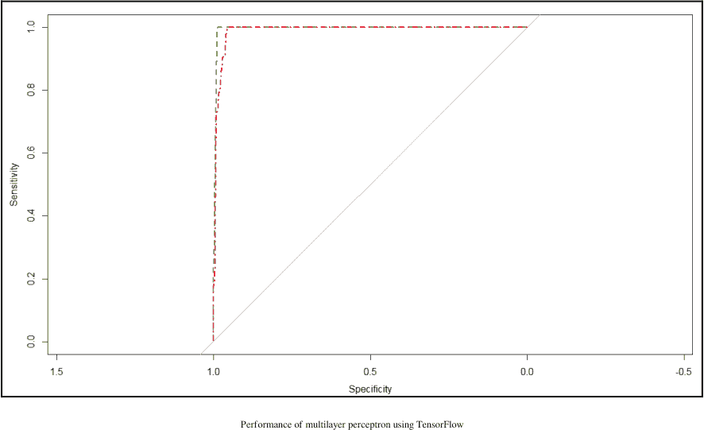

## 更多内容...

神经网络基于大脑的哲学；然而，大脑由大约 1000 亿个神经元组成，每个神经元连接到另外 10,000 个神经元。由于计算和算法限制，20 世纪 90 年代初期开发的神经网络在构建更深层神经网络方面面临诸多挑战。

随着大数据、计算资源（如 GPU）和更好算法的发展，深度学习的概念应运而生，使我们能够从文本、图像、音频等各种数据中捕获更深层的表征。

- 深度学习趋势：深度学习是神经网络的进步，在很大程度上受技术改进驱动。影响深度学习发展为人工智能主导领域的主要因素如下：

  - **计算能力**：摩尔定律的稳定性，即硬件的加速能力每两年翻一番，这有助于在时间限制内训练更多层和更大的数据

  - **存储和更好的压缩算法**：由于存储更便宜且压缩算法更好，能够存储大型模型，这推动了该领域的发展，从业者专注于以图像、文本、音频和视频格式捕获实时数据流

  - **可扩展性**：从简单计算机扩展到农场或使用 GPU 设备的能力，极大地促进了深度学习模型的训练

  - **深度学习架构**：借助卷积神经网络等新架构，强化学习增强了我们能够学习的内容，并有助于加速学习速率

  - **跨平台编程**：能够在跨平台架构上编程和构建模型，显著增加了用户基数并推动了该领域的快速发展

  - **迁移学习**：这允许重用预训练模型，并进一步帮助显著减少训练时间


# 3 卷积神经网络

在本章中，我们将介绍以下主题：

- 下载和配置图像数据集
- 学习 CNN 分类器的架构
- 使用函数初始化权重和偏置
- 使用函数创建新的卷积层
- 使用函数展平全连接层
- 定义占位符变量
- 创建第一个卷积层
- 创建第二个卷积层
- 展平第二个卷积层
- 创建第一个全连接层
- 对第一个全连接层应用 dropout
- 创建带有 dropout 的第二个全连接层
- 应用 softmax 激活以获取预测类别
- 定义用于优化的代价函数
- 执行梯度下降代价优化
- 在 TensorFlow 会话中执行图
- 在测试数据上评估性能

## 简介

**卷积神经网络（CNN）**是深度学习神经网络的一个类别，在构建基于图像识别和自然语言处理的分类模型中发挥着重要作用。


CNN 遵循与 LeNet 类似的架构，LeNet 主要设计用于识别数字、邮政编码等字符。与人工神经网络不同，CNN 的神经元层排列在三维空间（宽度、深度和高度）中。每层将二维图像转换为三维输入张量，然后使用神经元激活将其转换为三维输出张量。

主要，CNN 由三种主要类型的层构建：卷积层 ReLU、池化层和全连接层。卷积层用于从输入向量（图像）中提取特征（像素之间的空间关系），并在与权重（和偏置）计算点积后存储它们以供进一步处理。

**修正线性单元（ReLU）**然后在卷积后应用，以在操作中引入非线性。

这是一种逐元素操作（如阈值函数、sigmoid 和 tanh），应用于每个卷积特征图。然后，池化层（如最大值、均值和求和等操作）用于减小每个特征图的维度，确保最小信息损失。这种空间尺寸缩减操作用于控制过拟合并增强网络对小变形或变换的鲁棒性。池化层的输出随后连接到传统的多层感知机（也称为全连接层）。这个感知机使用 softmax 或 SVM 等激活函数来构建基于分类器的 CNN 模型。

本章的配方将侧重于使用 R 中的 Tensorflow 构建用于图像分类的卷积神经网络。虽然这些配方将为您提供典型 CNN 的概述，但我们鼓励您根据需要调整和修改参数。

## 下载和配置图像数据集

在本章中，我们将使用 CIFAR-10 数据集构建用于图像分类的卷积神经网络。CIFAR-10 数据集包含 60,000 张 32 x 32 的彩色图像，共 10 个类别，每个类别 6,000 张图像。这些进一步划分为五个训练批次和一个测试批次，每个批次包含 10,000 张图像。

测试批次包含每个类别中恰好 1,000 张随机选取的图像。训练批次包含其余图像，顺序随机，但某些训练批次可能包含比其他类别更多的某一类别图像。合起来，训练批次包含每个类别恰好 5,000 张图像。十个结果类别为：飞机、汽车、鸟、猫、鹿、狗、蛙、马、船和卡车。这些类别完全互斥。此外，数据集的格式如下：

| 列 | 描述 |
|--------|-------------|
| 第一列 | 带有 10 个类别的标签：飞机、汽车、鸟、猫、鹿、狗、蛙、马、船和卡车 |
| 接下来的 1,024 列 | 0 到 255 范围内的红色像素 |
| 接下来的 1,024 列 | 0 到 255 范围内的绿色像素 |
| 接下来的 1,024 列 | 0 到 255 范围内的蓝色像素 |

## 准备工作

对于此配方，您需要安装了 data.table 和 imager 等一些包的 R。

## 操作步骤...

1. 启动 R（使用 Rstudio 或 Docker）并加载所需包。
2. 手动从 http://www.cs.toronto.edu/~kriz/cifar.html 下载数据集（二进制版本），或使用以下函数在 R 环境中下载数据。该函数将工作目录或下载数据集的位置路径作为输入参数（data_dir）：

```
### Function to download the binary file
download.cifar.data <- function(data_dir) {
dir.create(data_dir, showWarnings = FALSE)
setwd(data_dir)

if (!file.exists('cifar-10-binary.tar.gz')) {
download.file(url='http://www.cs.toronto.edu/~kriz/cifar-10-binary.tar.gz', destfile='cifar-10-binary.tar.gz', method='wget')
untar("cifar-10-binary.tar.gz") # Unzip files
file.remove("cifar-10-binary.tar.gz") # remove zip file
}

setwd("..")

### Download the data
download.cifar.data(data_dir="Cifar_10/")
```

3. 一旦数据集下载并解压（或解压缩），在 R 环境中将其读取为训练和测试数据集。该函数将训练和测试批次数据集的文件名（filenames）和每个批次文件要检索的图像数量（num.images）作为输入参数：

```
### Function to read cifar data
read.cifar.data <- function(filenames,num.images){
images.rgb <- list()
images.lab <- list()
for (f in 1:length(filenames)) {
to.read <- file(paste("Cifar_10/",filenames[f], sep=""), "rb")
for(i in 1:num.images) {
l <- readBin(to.read, integer(), size=1, n=1, endian="big")
r <- as.integer(readBin(to.read, raw(), size=1, n=1024,
endian="big"))
g <- as.integer(readBin(to.read, raw(), size=1, n=1024,
endian="big"))
b <- as.integer(readBin(to.read, raw(), size=1, n=1024,
endian="big"))
index <- num.images * (f-1) + i
images.rgb[[index]] = data.frame(r, g, b)
images.lab[index] = l+1
}
close(to.read)
cat ("completed :", filenames[f], "\n")
remove(l,r,g,b,f,i,index, to.read)
}
return(list("images.rgb"=images.rgb,"images.lab"=images.lab))
}
### Train dataset
cifar_train <- read.cifar.data(filenames =
c("data_batch_1.bin","data_batch_2.bin","data_batch_3.bin","data_batch_4.bin", "data_batch_5.bin"))
images.rgb.train <- cifar_train$images.rgb
images.lab.train <- cifar_train$images.lab
rm(cifar_train)
```

```
### Test dataset
cifar_test <- read.cifar.data(filenames = c("test_batch.bin"))
images.rgb.test <- cifar_test$images.rgb
images.lab.test <- cifar_test$images.lab
rm(cifar_test)
```

4. 先前函数的结果是每个图像的红、绿、蓝像素数据框列表及其标签。然后，使用以下函数将数据展平为两个数据框的列表（一个用于输入，另一个用于输出），该函数采用两个参数——输入变量列表（x_listdata）和输出变量列表（y_listdata）：

```
### Function to flatten the data
flat_data <- function(x_listdata, y_listdata){
  # Flatten input x variables
  x_listdata <- lapply(x_listdata,function(x){unlist(x)})
  x_listdata <- do.call(rbind,x_listdata)
  # Flatten outcome y variables
  y_listdata <- lapply(y_listdata,function(x){a=c(rep(0,10)); a[x]=1;
  return(a)})
  y_listdata <- do.call(rbind,y_listdata)
  # Return flattened x and y variables
  return(list("images"=x_listdata, "labels"=y_listdata))
}
### Generate flattened train and test datasets
train_data <- flat_data(x_listdata = images.rgb.train, y_listdata =
images.lab.train)
test_data <- flat_data(x_listdata = images.rgb.test, y_listdata =
images.lab.test)
```

5. 一旦输入和输出的训练和测试数据框列表准备就绪，通过绘制图像及其标签进行合理性检查。该函数需要两个强制参数（index：图像行号和 images.rgb：展平的输入数据集）和一个可选参数（images.lab：展平的输出数据集）：

```
labels <- read.table("Cifar_10/batches.meta.txt")
### function to run sanity check on photos & labels import
drawImage <- function(index, images.rgb, images.lab=NULL) {
  require(imager)
  # Testing the parsing: Convert each color layer into a matrix,
  # combine into an rgb object, and display as a plot
  img <- images.rgb[[index]]
  img.r.mat <- as.cimg(matrix(img$r, ncol=32, byrow = FALSE))
  img.g.mat <- as.cimg(matrix(img$g, ncol=32, byrow = FALSE))
  img.b.mat <- as.cimg(matrix(img$b, ncol=32, byrow = FALSE))
```


```
img.col.mat <- imappend(list(img.r.mat,img.g.mat,img.b.mat),"c")
#Bind the three channels into one image
### Extract the label
if(!is.null(images.lab)){
lab = labels[[1]][images.lab[[index]]]
}
### Plot and output label
plot(img.col.mat,main=paste0(lab,":32x32 size",sep=" "),xaxt="n")
axis(side=1,xaxp=c(10, 50, 4), las=1)
return(list("Image label" =lab,"Image description" =img.col.mat))
}
### Draw a random image along with its label and description from train dataset
drawImage(sample(1:50000, size=1), images.rgb.train,
images.lab.train)
```

6. 现在使用最小-最大标准化技术转换输入数据。可以使用该包中的 preProcess 函数进行归一化。该方法的 "range" 选项执行最小-最大归一化，如下所示：

```
### Function to normalize data
library(caret)
normalizeObj <- preProcess(train_data$images, method="range")
train_data$images <- predict(normalizeObj, train_data$images)
test_data$images <- predict(normalizeObj, test_data$images)
```

### 工作原理...

让我们看看在之前的配方中我们做了什么。在第 2 步中，我们从提到的链接下载了 CIFAR-10 数据集，以防它不在给定的链接或工作目录中。在第 3 步中，解压缩的文件在 R 环境中加载为训练和测试数据集。训练数据集包含 50,000 张图像的列表，测试数据集包含 10,000 张图像及其标签的列表。然后，在第 4 步中，训练和测试数据集被展平为两个数据框的列表：一个包含长度为 3,072 的输入变量（或图像）（1,024 个红色、1,024 个绿色和 1,024 个蓝色），另一个包含长度为 10 的输出变量（或标签）（每个类为二进制）。在第 5 步中，我们通过生成图表对创建的训练和测试数据集进行合理性检查。下图显示了一组六张训练图像及其标签。最后，在第 6 步中，输入数据使用最小-最大标准化技术进行转换。下图显示了 CIFAR-10 数据集中的类别示例：

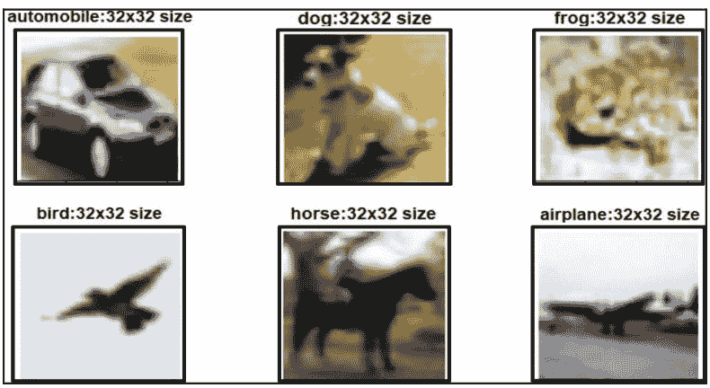

## 另请参阅

《从微小图像中学习多层特征》，Alex Krizhevsky，2009 年（http://www.cs.toronto.edu/~kriz/learning-features-2009-TR.pdf）。这也是本节的参考文献。

## 学习 CNN 分类器的架构

本章介绍的 CNN 分类器具有两个卷积层，随后是末尾的两个全连接层，最后一层使用 softmax 激活函数充当分类器。

### 准备工作

该配方需要 CIFAR-10 数据集。因此，应下载 CIFAR-10 数据集并将其加载到 R 环境中。此外，图像大小为 32 x 32 像素。

### 操作步骤...

让我们按如下方式定义 CNN 分类器的配置：

- 1. 每个输入图像（CIFAR-10）的大小为 32 x 32 像素，并可标记为 10 个类别之一：

```
### CIFAR images are 32 x 32 pixels.
img_width = 32L
img_height = 32L

### Tuple with height and width of images used to reshape arrays.
img_shape = (img_width, img_height)

### Number of classes, one class for each of 10 images
num_classes = 10L
```

- 2. CIFAR-10 数据集的图像具有三个通道（红色、绿色和蓝色）：

```
### Number of color channels for the images: 3 channel for red, blue,
green scales.
num_channels = 3L
```

- 3. 图像存储在以下长度的一维数组中（img_size_flat）：

```
### Images are stored in one-dimensional arrays of length.
img_size_flat = img_width * img_height * num_channels
```

- 4. 在第一个卷积层中，卷积滤波器的大小（宽 x 高）为 5 x 5 像素（filter_size1），卷积滤波器的深度（或数量）为 64（num_filters1）：

```
### Convolutional Layer 1.
filter_size1 = 5L
num_filters1 = 64L
```

- 5. 在第二个卷积层中，卷积滤波器的大小和深度与第一个卷积层相同：

```
### Convolutional Layer 2.
filter_size2 = 5L
num_filters2 = 64L
```

- 6. 同样，第一个全连接层的输出与第二个全连接层的输入相同：

```
### Fully-connected layer.
fc_size = 1024L
```

### 工作原理...

分别在步骤 1 和 2 中显示了输入图像的尺寸和特征。每个输入图像进一步在卷积层中使用步骤 4 和 5 中定义的一组滤波器进行处理。第一个卷积层生成一组 64 幅图像（每个设置的滤波器对应一幅）。此外，这些图像的分辨率也减半（由于 2 x 2 最大池化）；即，从 32 x 32 像素变为 16 x 16 像素。

第二个卷积层将这 64 幅图像作为输入，并提供新的 64 幅图像作为输出，分辨率进一步降低。更新后的分辨率现在为 8 x 8 像素（同样由于 2 x 2 最大池化）。在第二个卷积层中，总共创建了 64 x 64 = 4,096 个滤波器，然后将其进一步卷积为 64 个输出图像（或通道）。请记住，这些 8 x 8 分辨率的 64 幅图像对应于单个输入图像。

此外，这些 8 x 8 像素的 64 个输出图像按步骤 3 中定义的方式展平为长度为 4,096（8 x 8 x 64）的单个向量，并按步骤 6 中定义的方式用作给定一组神经元的全连接层的输入。然后，4,096 个元素的向量被输入到包含 1,024 个神经元的第一个全连接层。输出神经元再次输入到包含 10 个神经元的第二个全连接层（等于 num_classes）。这 10 个神经元表示每个类别标签，然后用于确定图像的（最终）类别。

首先，卷积层和全连接层的权重被随机初始化直到分类阶段（CNN 图的末尾）。在此，基于真实类别和预测类别（也称为交叉熵）计算分类误差。

然后，优化器使用链式法则将误差通过卷积网络反向传播，之后更新各层（或滤波器）的权重以使误差最小化。这一整个前向和反向传播周期称为一次迭代。执行数千次此类迭代，直到分类误差降低到足够低的值。

通常，这些迭代使用一批图像而不是单个图像来执行，以提高计算效率。

下图显示了本章设计的卷积网络：

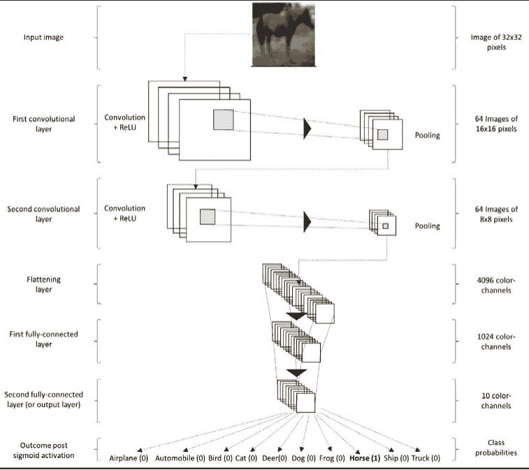

## 使用函数初始化权重和偏置

权重和偏置是任何深度神经网络优化的重要组成部分，此处我们定义了一些函数来自动化这些初始化。使用小噪声初始化权重是一种良好实践，可以打破对称性并防止零梯度。此外，较小的正初始偏置可以避免神经元失活，适用于 ReLU 激活神经元。

### 准备工作

权重和偏置是模型系数，需要在模型编译之前初始化。此步骤需要根据输入数据集确定 `shape` 参数。

### 操作步骤...

- 1. 以下函数用于返回随机初始化的权重：

```
### Weight Initialization
weight_variable <- function(shape) {
  initial <- tf$truncated_normal(shape, stddev=0.1)
  tf$Variable(initial)
}
```

- 2. 以下函数用于返回常数偏置：

```
bias_variable <- function(shape) {
  initial <- tf$constant(0.1, shape=shape)
  tf$Variable(initial)
}
```

### 工作原理...

这些函数返回 TensorFlow 变量，这些变量稍后用作 TensorFlow 图的一部分。`shape` 被定义为定义卷积层中滤波器的属性列表，将在下一个配方中介绍。权重随标准差等于 `0.1` 随机初始化，偏置以常数值 `0.1` 初始化。

## 使用函数创建新的卷积层

创建卷积层是 CNN TensorFlow 计算图中的主要步骤。此函数主要用于在 TensorFlow 图中定义数学公式，这些公式稍后在优化过程中的实际计算中使用。


## 准备工作

输入数据集已定义并加载。教程中展示的 `create_conv_layer` 函数在设置卷积层时需要定义，并接受以下五个输入参数：

- 1. Input：这是一个四维张量（或列表），包含若干（输入）图像、每个图像的高度（此处为 32）、每个图像的宽度（此处为 32）以及每个图像的通道数（此处为 3：红色、蓝色和绿色）。
- 2. Num_input_channels：在第一个卷积层的情况下，这定义为颜色通道的数量；在后续卷积层的情况下，这定义为滤波器通道的数量。
- 3. Filter_size：这定义为卷积层中每个滤波器的宽度和高度。此处假设滤波器为正方形。
- 4. Num_filters：这定义为给定卷积层中滤波器的数量。
- 5. Use_pooling：这是一个二进制变量，用于执行 2 x 2 最大池化。

### 操作方法...

- 1. 运行以下函数以创建新的卷积层：

```
### Create a new convolution layer
create_conv_layer <- function(input,
num_input_channels,
filter_size,
num_filters,
use_pooling = TRUE)
{
### Shape of the filter-weights for the convolution.
shape1 = shape(filter_size, filter_size, num_input_channels,
num_filters)
### Create new weights
weights = weight_variable(shape=shape1)
### Create new biases
biases = bias_variable(shape=shape(num_filters))
### Create the TensorFlow operation for convolution.
layer = tf$nn$conv2d(input=input,
filter=weights,
strides=shape(1L, 1L, 1L, 1L),
padding="SAME")
### Add the biases to the results of the convolution.
layer = layer + biases
### Use pooling (binary flag) to reduce the image resolution
if(use_pooling){
layer = tf$nn$max_pool(value=layer,
ksize=shape(1L, 2L, 2L, 1L),
strides=shape(1L, 2L, 2L, 1L),
padding='SAME')
}
### Add non-linearity using Rectified Linear Unit (ReLU).
layer = tf$nn$relu(layer)
### Return resulting layer and updated weights
return(list("layer" = layer, "weights" = weights))
}
```

- 2. 运行以下函数以生成卷积层的图表：

```
drawImage_conv <- function(index, images.bw,
images.lab = NULL, par_imgs = 8) {
require(imager)
img <- images.bw[index,,,]
n_images <- dim(img)[3]
par(mfrow = c(par_imgs, par_imgs), oma = c(0, 0, 0, 0),
mai = c(0.05, 0.05, 0.05, 0.05), ann = FALSE, ask = FALSE)
for(i in 1:n_images){
img.bwmat <- as.cimg(img[,,i])
### Extract the label
if(!is.null(images.lab)){
lab = labels[[1]][images.lab[[index]]]
}
### Plot and output label
plot(img.bwmat, axes = FALSE, ann = FALSE)
}
par(mfrow = c(1, 1))
}
```

- 3. 运行以下函数以生成卷积层权重的图表：

```
drawImage_conv_weights <- function(weights_conv, par_imgs = 8) {
require(imager)
n_images <- dim(weights_conv)[4]
par(mfrow = c(par_imgs, par_imgs), oma = c(0, 0, 0, 0),
mai = c(0.05, 0.05, 0.05, 0.05), ann = FALSE, ask = FALSE)
for(i in 1:n_images){
img.r.mat <- as.cimg(weights_conv[,,1,i])
img.g.mat <- as.cimg(weights_conv[,,2,i])
img.b.mat <- as.cimg(weights_conv[,,3,i])
img.col.mat <- imappend(list(img.r.mat, img.g.mat, img.b.mat), "c")
### Bind the three channels into one image
### Plot and output label
plot(img.col.mat, axes = FALSE, ann = FALSE)
}
par(mfrow = c(1, 1))
}
```

### 工作原理...

函数首先创建一个形状张量，即四个整数的列表：滤波器的宽度、滤波器的高度、输入通道数以及给定滤波器的数量。使用此形状张量，按定义的形状初始化新权重张量，并创建新（常数）偏置张量，每个滤波器对应一个。

初始化必要的权重和偏置后，使用 tf$nn$conv2d 函数创建卷积的 TensorFlow 操作。在当前设置中，四个维度的步长均设置为 1，填充设置为 SAME。第一个和最后一个默认设置为 1，但中间两个可以考虑更高的步长。步长是指允许滤波器矩阵在输入（图像）矩阵上滑动的像素数。

步长为 3 表示每次滤波器滑动在 x 轴或 y 轴上跳跃三个像素。较小的步长会产生更大的特征图，从而需要更高的计算量才能收敛。由于填充设置为 SAME，输入（图像）矩阵的边缘会用零填充，以便可以将滤波器应用于输入矩阵的边缘元素。利用此特性，可以将输出矩阵（或特征图）的大小控制为与输入矩阵相同。

在卷积过程中，偏置值会添加到每个滤波器通道，随后进行池化以防止过拟合。在当前设置中，使用 tf$nn$max_pool 执行 2 x 2 最大池化以降低图像分辨率。此处，我们考虑 2 x 2（ksize）大小的窗口，在每个窗口中选择最大值。这些窗口在 x 或 y 方向上以两个像素（strides）为步长滑动。

在池化过程中，使用 ReLU 激活函数（tf$nn$relu）为层添加非线性。在 ReLU 中，每个像素在滤波器中被触发，所有负像素值都使用 max(x, 0) 函数替换为零，其中 x 为像素值。通常，ReLU 激活在池化之前执行。但是，由于我们使用的是最大池化，它不一定会影响结果，因为 relu(max_pool(x)) 等同于 max_pool(relu(x))。因此，在池化后应用 ReLU，可以节省大量 ReLU 操作（约 75%）。

最后，函数返回卷积层及其对应权重的列表。卷积层是一个四维张量，具有以下属性：

- （输入）图像的数量，与 `input` 相同
- 每个图像的高度（在 2 x 2 最大池化的情况下减半）
- 每个图像的宽度（在 2 x 2 最大池化的情况下减半）
- 生成的通道数，每个卷积滤波器对应一个通道

## 使用函数创建新的卷积层

新创建的卷积层的四维输出被展平为二维层，以便可用作完全连接的多层感知机的输入。

### 准备工作

本教程解释了如何在构建深度学习模型之前展平卷积层。给定函数（`flatten_conv_layer`）的输入是一个四维卷积层，其定义基于前一层。

### 操作方法...

- 1. 运行以下函数以展平卷积层：

```
flatten_conv_layer <- function(layer) {
### Extract the shape of the input layer
layer_shape = layer$get_shape()
### Calculate the number of features as img_height * img_width *
### num_channels
num_features =
prod(c(layer_shape$as_list()[[2]], layer_shape$as_list()[[3]], layer_shape$as_list()[[4]]))
### Reshape the layer to [num_images, num_features].
layer_flat = tf$reshape(layer, shape(-1, num_features))
### Return both the flattened layer and the number of features.
return(list("layer_flat" = layer_flat, "num_features" = num_features))
}
```

### 工作原理...

函数首先提取给定输入层的形状。如前所述，输入层的形状包含四个整数：图像数量、图像高度、图像宽度以及图像中的颜色通道数。然后通过图像高度、图像宽度和颜色通道数的乘积计算特征数（num_features）。

随后，将层展平或重塑为二维张量（使用 tf$reshape）。第一个维度设置为 -1（等于图像总数），第二个维度是特征数。

最后，函数返回展平后的层列表，以及（输入）特征总数。

## 使用函数展平密集连接层

CNN 通常以在输出层使用 softmax 激活的完全连接多层感知机结束。在此，前一卷积-展平层中的每个神经元都连接到下一（完全连接）层中的每个神经元。

完全连接层的关键目的是使用卷积和池化阶段生成的特征，将给定的输入图像分类为各种结果类别（此处为 10）。它还有助于学习这些特征的非线性组合，以定义结果类别。

在本章中，我们使用两个完全连接层进行优化。此函数主要用于在 TensorFlow 图中定义数学公式，该图随后在优化过程中的实际计算中使用。

### 准备工作

`create_fc_layer` 函数接受四个输入参数，如下所示：

- Input：这与新卷积层函数的输入相似


- Num_inputs: 这是在展平卷积层后生成的输入特征的数量
- Num_outputs: 这是与输入神经元完全连接的输出神经元的数量
- Use_relu: 这是一个二进制标志，仅在最终完全连接层的情况下设置为 FALSE

### 如何操作...

1. 运行以下函数以创建新的完全连接层:

```
### Create a new fully connected layer
create_fc_layer <- function(input,
num_inputs,
num_outputs,
use_relu=TRUE)
{
### Create new weights and biases.
weights = weight_variable(shape=shape(num_inputs, num_outputs))
biases = bias_variable(shape=shape(num_outputs))
### Perform matrix multiplication of input layer with weights and
then add biases
layer = tf$matmul(input, weights) + biases
### Use ReLU?
if(use_relu) {
layer = tf$nn$relu(layer)
}
return(layer)
}
```

### 工作原理...

函数首先初始化新的权重和偏置。然后，对输入层与初始化权重进行矩阵乘法，并添加相关偏置。

如果该完全连接层不是 CNN TensorFlow 图的最终层，则可以执行 ReLU 非线性激活。最后，返回该完全连接层。

## 定义占位符变量

在本示例中，让我们定义占位符变量，这些变量用作 TensorFlow 计算图中模块的输入。这些通常是张量形式的多维数组或矩阵。

### 准备工作

占位符变量的数据类型设置为 float32（tf$float32），形状设置为二维张量。

### 如何操作...

1. 创建输入占位符变量：
   x = tf$placeholder(tf$float32, shape=shape(NULL, img_size_flat),
   name='x')

   占位符中的 NULL 值允许我们传递非确定性数组大小。

2. 将输入占位符 x 重塑为四维张量：

   x_image = tf$reshape(x, shape(-1L, img_size, img_size,
   num_channels))

3. 创建输出占位符变量：

   y_true = tf$placeholder(tf$float32, shape=shape(NULL, num_classes),
   name='y_true')

4. 使用 argmax 获取输出的（真实）类别：

   y_true_cls = tf$argmax(y_true, dimension=1L)

### 工作原理...

在步骤 1 中，我们定义一个输入占位符变量。形状张量的维度为 NULL 和 img_size_flat。前者用于容纳任意数量的图像（作为行），后者定义每个图像的输入特征长度（作为列）。在步骤 2 中，输入的二维张量被重塑为四维张量，该张量可作为输入卷积层使用。四个维度如下：

- 第一个定义输入图像的数量（当前设置为 -1）
- 第二个定义每个图像的高度（相当于图像大小 32L）
- 第三个定义每个图像的宽度（相当于图像大小，再次为 32L）
- 第四个定义每个图像中的颜色通道数量（此处为 3L）

在步骤 3 中，我们定义一个输出占位符变量，用于存储 x 中图像的真实类别或标签。形状张量的维度为 NULL 和 num_classes。前者用于容纳任意数量的图像（作为行），后者将每个图像的真实类定义为长度为 num_classes 的二进制向量（作为列）。在我们的场景中，有 10 个类别。在步骤 4 中，我们将二维输出占位符压缩为一个包含 1 到 10 类别编号的一维张量。

## 创建第一个卷积层

在本示例中，让我们创建第一个卷积层。

### 准备工作

以下是在示例“使用函数创建新卷积层”中定义的函数 create_conv_layer 的输入。

- 输入：这是一个四维重塑的输入占位符变量：x_image
- Num_input_channels：这是颜色通道的数量，即 num_channels
- Filter_size：这是过滤器层的高度和宽度，即 filter_size1
- Num_filters：这是过滤器层的深度，即 num_filters1
- Use_pooling：这是设置为 TRUE 的二进制标志

### 如何操作...

1. 使用先前的输入参数运行 create_conv_layer 函数：

```
### Convolutional Layer 1
conv1 <- create_conv_layer(input=x_image,
num_input_channels=num_channels,
filter_size=filter_size1,
num_filters=num_filters1,
use_pooling=TRUE)
```

2. 提取第一个卷积层的层：

```
layer_conv1 <- conv1$layer
conv1_images <- conv1$layer$eval(feed_dict = dict(x =
train_data$images, y_true = train_data$labels))
```

3. 提取第一个卷积层的最终权重：

```
weights_conv1 <- conv1$weights
weights_conv1 <- weights_conv1$eval(session=sess)
```

4. 生成第一个卷积层图表：

```
drawImage_conv(sample(1:50000, size=1), images.bw = conv1_images,
images.lab=images.lab.train)
```

5. 生成第一个卷积层权重图表：

```
drawImage_conv_weights(weights_conv1)
```

### 工作原理...

在步骤 1 和 2 中，我们创建一个四维的第一个卷积层。第一个维度 (?) 表示任意数量的输入图像，第二个和第三个维度表示每个卷积图像的高度（16 像素）和宽度（16 像素），第四个维度表示生成的通道数量（64），每个卷积过滤器对应一个。在步骤 3 和 5 中，我们提取卷积层的最终权重，如以下屏幕截图所示：

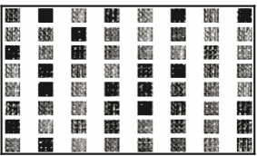

在步骤 4 中，我们绘制第一个卷积层的输出，如以下屏幕截图所示：

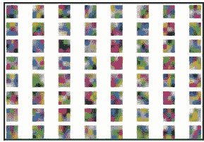

## 创建第二个卷积层

在本示例中，让我们创建第二个卷积层。

### 准备工作

以下是在示例 *使用函数创建新卷积层* 中定义的函数 `create_conv_layer` 的输入。

- 输入：这是第一个卷积层的四维输出，即 layer_conv1
- Num_input_channels：这是第一个卷积层中的过滤器数量（或深度），即 num_filters1
- Filter_size：这是过滤器层的高度和宽度，即 filter_size2
- Num_filters：这是过滤器层的深度，num_filters2
- Use_pooling：这是设置为 TRUE 的二进制标志

### 如何操作...

1. 使用先前的输入参数运行 create_conv_layer 函数：

```
### Convolutional Layer 2
conv2 <- create_conv_layer(input=layer_conv1,
                           num_input_channels=num_filters1,
                           filter_size=filter_size2,
                           num_filters=num_filters2,
                           use_pooling=TRUE)
```

2. 提取第二个卷积层的层：

```
layer_conv2 <- conv2$layer
conv2_images <- conv2$layer$eval(feed_dict = dict(x =
                                   train_data$images, y_true = train_data$labels))
```

3. 提取第二个卷积层的最终权重：

```
weights_conv2 <- conv2$weights
weights_conv2 <- weights_conv2$eval(session=sess)
```

4. 生成第二个卷积层图表：

```
drawImage_conv(sample(1:50000, size=1), images.bw = conv2_images,
               images.lab=images.lab.train)
```

5. 生成第二个卷积层权重图表：

```
drawImage_conv_weights(weights_conv2)
```

### 工作原理...

在步骤 1 和 2 中，我们创建一个四维的第二个卷积层。第一个维度 (?) 表示任意数量的输入图像，第二个和第三个维度表示每个卷积图像的高度（8 像素）和宽度（8 像素），第四个维度表示生成的通道数量（64），每个卷积过滤器对应一个。

在步骤 3 和 5 中，我们提取卷积层的最终权重，如以下屏幕截图所示：


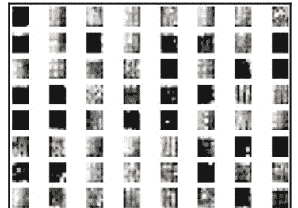

在第 4 步中，我们绘制第二个卷积层的输出，如下面的屏幕截图所示：

| | 预测 | 1 | 2 | 3 | 4 | 5 | 6 | 7 | 8 | 9 | 10 |
|---|---|---|---|---|---|---|---|---|---|---|---|---|
| 实际 | 1 | 582 | 36 | 50 | 28 | 55 | 22 | 22 | 29 | 117 | 59 |
| 2 | 46 | 598 | 9 | 30 | 24 | 24 | 13 | 24 | 38 | 194 |
| 3 | 62 | 18 | 348 | 100 | 177 | 96 | 89 | 63 | 20 | 27 |
| 4 | 21 | 25 | 80 | 368 | 88 | 211 | 83 | 66 | 21 | 37 |
| 5 | 29 | 17 | 106 | 80 | 439 | 74 | 119 | 103 | 19 | 14 |
| 6 | 17 | 17 | 80 | 211 | 70 | 416 | 65 | 89 | 12 | 23 |
| 7 | 5 | 23 | 66 | 87 | 89 | 64 | 594 | 41 | 6 | 25 |
| 8 | 23 | 32 | 49 | 89 | 106 | 82 | 41 | 520 | 11 | 47 |
| 9 | 108 | 67 | 14 | 29 | 37 | 17 | 11 | 19 | 632 | 66 |
| 10 | 41 | 151 | 12 | 48 | 16 | 27 | 24 | 56 | 63 | 562 |

## 将第二个卷积层展平

在本示例中，让我们展平我们创建的第二个卷积层。

### 准备工作

以下是“创建第二个卷积层”示例中定义的函数 `flatten_conv_layer` 的输入：

- Layer：这是第二个卷积层的输出，`layer_conv2`

## 操作步骤...

- 1. 使用前述输入参数运行 `flatten_conv_layer` 函数：

  `flatten_lay <- flatten_conv_layer(layer_conv2)`

- 2. 提取展平的层：

  `layer_flat <- flatten_lay$layer_flat`

- 3. 提取每个图像生成的（输入）特征数量：

  `num_features <- flatten_lay$num_features`

### 工作原理...

在将（第二个）卷积层的输出连接到全连接网络之前，在第 1 步中，我们将四维卷积层重塑为二维张量。第一个维度 (?) 表示任意数量的输入图像（作为行），第二个维度表示为每个图像生成的长度为 4,096 的展平特征向量；即 8 x 8 x 64（作为列）。步骤 2 和 3 验证重塑后的层和输入特征的维度。

## 创建第一个全连接层

在本示例中，让我们创建第一个全连接层。

### 准备工作

以下是示例“*使用函数展平密连层*”中定义的函数 `create_fc_layer` 的输入：

- **Input**：这是展平的卷积层，即 `layer_flat`
- **Num_inputs**：这是展平后创建的特征数量，`num_features`
- **Num_outputs**：这是全连接神经元的输出数量，`fc_size`
- **Use_relu**：这是设置为 `TRUE` 的二进制标志，用于在张量中引入非线性

### 操作步骤...

- 1. 使用前述输入参数运行 create_fc_layer 函数：

```
layer_fc1 = create_fc_layer(input=layer_flat,
num_inputs=num_features,
num_outputs=fc_size,
use_relu=TRUE)
```

### 工作原理...

在这里，我们创建一个返回二维张量的全连接层。第一个维度 (?) 表示任意数量的（输入）图像，第二个维度表示输出神经元的数量（这里为 1,024）。

## 对第一个全连接层应用 Dropout

在本示例中，让我们对全连接层的输出应用 dropout 以降低过拟合的可能性。Dropout 步骤涉及在学习过程中随机移除一些神经元。

### 准备工作

Dropout 连接到层的输出。因此，模型的初始结构已设置并加载。例如，在 Dropout 中定义了当前层 layer_fc1，并对其应用 Dropout。

### 操作步骤...

- 1. 创建一个可以接受概率作为输入的 Dropout 占位符：

```
keep_prob <- tf$placeholder(tf$float32)
```

- 2. 使用 TensorFlow 的 Dropout 函数处理神经元输出的缩放和掩码：

```
layer_fc1_drop <- tf$nn$dropout (layer_fc1, keep_prob)
```

### 工作原理...

在步骤 1 和 2 中，我们可以基于输入概率（或百分比）丢弃（或掩码）输出神经元。Dropout 通常在训练期间允许使用，并在测试期间关闭（通过将概率分配为 1 或 NULL）。

## 创建带 Dropout 的第二个全连接层

在本示例中，让我们创建带 Dropout 的第二个全连接层。

### 准备工作

以下是示例“使用函数展平密连层”中定义的函数 `create_fc_layer` 的输入：

- Input：这是第一个全连接层的输出，即 layer_fc1
- Num_inputs：这是第一个全连接层输出中的特征数量，fc_size
- Num_outputs：这是全连接神经元的输出数量（等于标签数量，num_classes）
- Use_relu：这是设置为 FALSE 的二进制标志

### 操作步骤...

- 1. 使用前述输入参数运行 create_fc_layer 函数：

```
layer_fc2 = create_fc_layer(input=layer_fc1_drop,
num_inputs=fc_size,
num_outputs=num_classes,
use_relu=FALSE)
```

- 2. 使用 TensorFlow 的 Dropout 函数处理神经元输出的缩放和掩码：

```
layer_fc2_drop <- tf$nn$dropout(layer_fc2, keep_prob)
```

### 工作原理...

在第 1 步中，我们创建一个返回二维张量的全连接层。第一个维度 (?) 表示任意数量的（输入）图像，第二个维度表示输出神经元的数量（这里为 10 个类别标签）。在第 2 步中，我们提供主要用于网络训练的 Dropout 选项。

## 应用 Softmax 激活以获取预测类别

在本示例中，我们将使用 Softmax 激活来标准化第二个全连接层的输出，使每个类别都有一个介于 0 和 1 之间的（概率）值，并且 10 个类别的所有值加起来等于 1。

### 准备工作

激活函数应用于深度学习模型生成的预测结果的管道末端。在执行此步骤之前，需要执行管道中的所有步骤。该示例需要 TensorFlow 库。

### 操作步骤...

- 1. 在第二个全连接层的输出上运行 Softmax 激活函数：

```
y_pred = tf$nn$softmax(layer_fc2_drop)
```

- 2. 使用 argmax 函数确定标签的类别编号。它是具有最大（概率）值的类别的索引：

```
y_pred_cls = tf$argmax(y_pred, dimension=1L)
```

## 定义用于优化的成本函数

成本函数主要用于通过将真实类别标签（y_true_cls）与预测类别标签（y_pred_cls）进行比较来评估模型的当前性能。基于当前性能，优化器随后会微调网络参数，例如权重和偏差，以进一步提高其性能。

### 准备工作

成本函数的定义至关重要，因为它将决定优化标准。成本函数的定义将需要真实类别和预测类别进行比较。本示例中使用的目标函数是交叉熵，用于多类分类问题。

### 操作步骤...

- 1. 使用 TensorFlow 中的交叉熵函数评估每个图像的当前性能。由于 TensorFlow 中的交叉熵函数内部应用 Softmax 归一化，我们将 Dropout 后的全连接层输出（layer_fc2_drop）作为输入，并与真实标签（y_true）一起提供：

```
cross_entropy =
tf$nn$softmax_cross_entropy_with_logits(logits=layer_fc2_drop,
 labels=y_true)
```

在当前成本函数中，Softmax 激活函数是嵌入式的，因此不需要单独定义激活函数。

- 2. 计算交叉熵的平均值，需要使用优化器将其最小化：

```
cost = tf$reduce_mean(cross_entropy)
```

### 工作原理...

在第 1 步中，我们定义一个交叉熵来评估分类性能。基于真实标签和预测标签之间的精确匹配，交叉熵函数返回一个正值并遵循连续分布。由于零交叉熵确保完全匹配，优化器倾向于通过更新网络参数（例如权重和偏差）将交叉熵最小化为零。交叉熵函数为每个单独图像返回一个值，需要将其进一步压缩为单个标量值，以便在优化器中使用。因此，在第 2 步中，我们计算交叉熵输出的简单平均值，并将其存储为 _cost_。

## 执行梯度下降成本优化

在本示例中，让我们定义一个可以最小化成本的优化器。优化后，检查 CNN 性能。

### 准备工作

优化器定义将需要定义 _cost_ 示例，因为它作为输入传递给优化器。

### 操作步骤...

- 1. 运行 Adam 优化器，以最小化给定 _learning_rate_ 的成本：

```
optimizer =
tf$train$AdamOptimizer(learning_rate=1e-4) $minimize(cost)
```


- 2. 提取 `correct_predictions` 的数量并计算平均百分比准确率：

```
correct_prediction = tf$equal(y_pred_cls, y_true_cls)
accuracy = tf$reduce_mean(tf$cast(correct_prediction, tf$float32))
```

## 在 TensorFlow 会话中执行图

目前为止，我们只创建了张量对象并将它们添加到 TensorFlow 图中以供稍后执行。在本示例中，我们将学习如何创建可用于执行（或运行）TensorFlow 图的 TensorFlow 会话。

### 准备工作

在运行图之前，我们应该在 R 中安装并加载 TensorFlow。安装详情可见第 1 章 入门。

### 操作步骤...

- 1. 加载 tensorflow 库并导入 numpy 包：

```
library(tensorflow)
np <- import("numpy")
```

- 2. 重置或移除任何现有的默认图：

```
tf$reset_default_graph()
```

- 3. 启动交互式会话：

```
sess <- tf$InteractiveSession()
```

- 4. 初始化全局变量：

```
sess$run(tf$global_variables_initializer())
```

- 5. 运行迭代以执行优化（训练）：

```
### Train the model
train_batch_size = 128L
for (i in 1:100) {
spls <- sample(1:dim(train_data$images)[1],train_batch_size)
if (i %% 10 == 0) {
train_accuracy <- accuracy$eval(feed_dict = dict(
x = train_data$images[spls,], y_true = train_data$labels[spls,],
keep_prob = 1.0))
cat(sprintf("step %d, training accuracy %g\n", i, train_accuracy))
}
optimizer$run(feed_dict = dict(
x = train_data$images[spls,], y_true = train_data$labels[spls,],
keep_prob = 0.5))
}
```

- 6. 在测试数据上评估训练好的模型的性能：

```
### Test the model
test_accuracy <- accuracy$eval(feed_dict = dict(
x = test_data$images, y_true = test_data$labels, keep_prob = 1.0))
cat(sprintf("test accuracy %g", test_accuracy))
```

### 工作原理...

步骤 1 到 4 从某种意义上说是启动新 TensorFlow 会话的默认方式。在步骤 4 中，权重和偏置变量被初始化，这是它们优化前的强制步骤。步骤 5 主要用于执行 TensorFlow 会话以进行优化。由于我们有大量训练图像，一次性将所有图像输入优化器来计算最优梯度在计算上变得非常困难。

因此，在每次迭代中，会随机选择 128 个图像的小样本来训练激活层（权重和偏置）。在当前设置中，我们运行 100 次迭代，并每十次迭代报告一次训练准确率。

不过，这些数值可以根据集群配置或计算能力（CPU 或 GPU）进行调整，以获得更高的模型准确率。此外，在每次迭代中使用 50% 的丢弃率来训练 CNN。在步骤 6 中，我们可以在 10,000 张图像的测试数据上评估训练好的模型的性能。

## 在测试数据上评估性能

在本示例中，我们将使用混淆矩阵和图表来查看训练好的 CNN 在测试图像上的性能。

### 准备工作

绘图所需的先决包是 `imager` 和 `ggplot2`。

### 操作步骤...

- 1. 获取测试图像的实际或真实类标签：

```
test_true_class <- c(unlist(images.lab.test))
```

- 2. 获取测试图像的预测类标签。请记住给每个类标签加 1，因为 TensorFlow（与 Python 相同）的起始索引是 0，而 R 的起始索引是 1：

```
test_pred_class <- y_pred_cls$eval(feed_dict = dict(
x = test_data$images, y_true = test_data$labels, keep_prob = 1.0))
test_pred_class <- test_pred_class + 1
```

- 3. 生成混淆矩阵，行作为真实标签，列作为预测标签：

```
table(actual = test_true_class, predicted = test_pred_class)
```

- 4. 生成混淆矩阵的图表：

```
confusion <- as.data.frame(table(actual = test_true_class,
predicted = test_pred_class))
plot <- ggplot(confusion)
plot <- geom_tile(aes(x=actual, y=predicted, fill=Freq)) +
scale_x_discrete(name="Actual Class") +
scale_y_discrete(name="Predicted Class") +
scale_fill_gradient(breaks=seq(from=-.5, to=4, by=.2)) +
labs(fill="Normalized\\nFrequency")
```

- 5. 运行绘制图像的辅助函数：

```
check.image <- function(images.rgb,index,true_lab, pred_lab) {
require(imager)
### Testing the parsing: Convert each color layer into a matrix,
### Combine into an rgb object, and display as a plot
img <- images.rgb[,,index]
img.r.mat <- as.cimg(matrix(img$r, ncol=32, byrow = FALSE))
img.g.mat <- as.cimg(matrix(img$g, ncol=32, byrow = FALSE))
img.b.mat <- as.cimg(matrix(img$b, ncol=32, byrow = FALSE))
img.col.mat <- imappend(list(img.r.mat,img.g.mat,img.b.mat),"c")
### Plot with actual and predicted label
plot(img.col.mat,main=paste0("True: ", true_lab, ":: Pred: ", pred_lab),xaxt="n")
axis(side=1, xaxp=c(10, 50, 4), las=1)
}
```

- 6. 绘制随机错误分类的测试图像：

```
labels <-
c("airplane","automobile","bird","cat","deer","dog","frog","horse",
"ship","truck")
### Plot misclassified test images
plot.misclass.images <- function(images.rgb, y_actual,
y_predicted,labels){
### Get indices of misclassified
indices <- which(!(y_actual == y_predicted))
id <- sample(indices,1)
### plot the image with true and predicted class
true_lab <- labels[y_actual[id]]
pred_lab <- labels[y_predicted[id]]
check.image(images.rgb,index=id,
true_lab=true_lab,pred_lab=pred_lab)
}
plot.misclass.images(images.rgb=images.rgb.test,y_actual=test_true_class,y_predicted=test_pred_class,labels=labels)
```

### 工作原理...

在步骤 1 到 3 中，我们提取真实和预测的测试类标签并创建混淆矩阵。下图显示了当前测试预测的混淆矩阵：

| 实际 | 1 | 2 | 3 | 4 | 5 | 6 | 7 | 8 | 9 | 10 |
| :--- | :--- | :--- | :--- | :--- | :--- | :--- | :--- | :--- | :--- | :--- |
| 1 | 582 | 36 | 50 | 28 | 55 | 22 | 22 | 29 | 117 | 59 |
| 2 | 46 | 598 | 9 | 30 | 24 | 24 | 13 | 24 | 38 | 194 |
| 3 | 62 | 18 | 348 | 100 | 177 | 96 | 89 | 63 | 20 | 27 |
| 4 | 21 | 25 | 80 | 368 | 88 | 211 | 83 | 66 | 21 | 37 |
| 5 | 29 | 17 | 106 | 80 | 439 | 74 | 119 | 103 | 19 | 14 |
| 6 | 17 | 17 | 80 | 211 | 70 | 416 | 65 | 89 | 12 | 23 |
| 7 | 5 | 23 | 66 | 87 | 89 | 64 | 594 | 41 | 6 | 25 |
| 8 | 23 | 32 | 49 | 89 | 106 | 82 | 41 | 520 | 11 | 47 |
| 9 | 108 | 67 | 14 | 29 | 37 | 17 | 11 | 19 | 632 | 66 |
| 10 | 41 | 151 | 12 | 48 | 16 | 27 | 24 | 56 | 63 | 562 |

在 700 次训练迭代后，测试准确率仅约为 51%，可以通过增加迭代次数、增加批量大小、配置层参数（如卷积层数量（使用 2 个）、激活函数类型（使用 ReLU）、全连接层数量（使用两个）、优化目标函数（使用准确率）、池化（使用 2 x 2 最大池化）、丢弃概率等）来进一步提高。

步骤 4 用于构建测试混淆矩阵的分面图，如下截图所示：

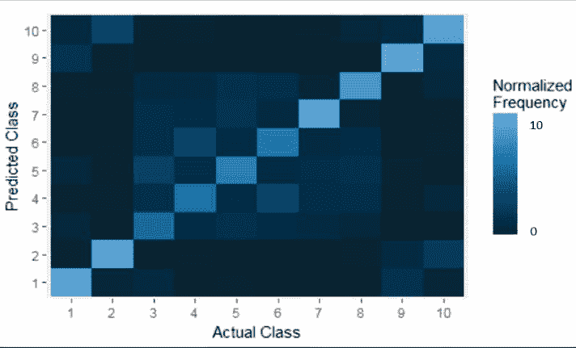

在步骤 5 中，我们定义一个辅助函数来绘制图像及其包含真实类和预测类的标题。`check_image` 函数的输入参数是（测试）扁平输入数据集 `(images.rgb)`、图像编号 `(index)`、真实标签 `(true_lab)` 和预测标签 `(pred_lab)`。在这里，红、绿、蓝像素首先被解析出来，转换为矩阵，作为列表追加，并使用 `plot` 函数显示为图像。

在步骤 6 中，我们使用步骤 5 的辅助函数来绘制错误分类的测试图像。`plot.misclass.images` 函数的输入参数是（测试）扁平输入数据集 (`images.rgb`)、真实标签向量 (`y_actual`)、预测标签向量 (`y_predicted`) 和唯一有序字符标签向量 (`labels`)。在这里，获取错误分类图像的索引并随机选择一个索引来生成图表。下图显示了一组带有真实标签和预测标签的六个错误分类图像：

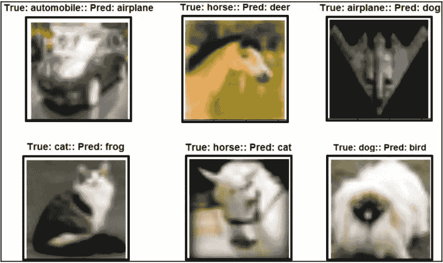


## 使用自动编码器进行数据表示

本章将介绍使用自动编码器的深度学习无监督应用。本章将涵盖以下主题：

- 搭建自动编码器
- 数据归一化
- 搭建正则化自动编码器
- 微调自动编码器的参数
- 搭建堆叠自动编码器
- 搭建去噪自动编码器
- 构建并比较随机编码器和解码器
- 从自动编码器中学习流形
- 评估稀疏分解

### 简介

神经网络旨在找到输入 X 与输出 _y_ 之间的非线性关系，即 _y=f(x)_。自动编码器是一种无监督神经网络，试图找到空间中特征之间的关系，使得 _h=f(x)_，这有助于我们学习输入空间之间的关系，并可用于数据压缩、降维和特征学习。

自动编码器由编码器和解码器组成。编码器帮助将输入 x 编码为潜在表示 y，而解码器帮助将 y 转换回 x。编码器和解码器都具有相似形式的表示。

这里是一个单层自动编码器的表示：

```
h = f(x) = \sigma(W_e^T X + b_e)

\tilde{X} = f(h) = \sigma(W_d^T h + b_d)
```

编码器将输入 X 在隐藏层中编码为 h，而解码器则帮助从编码输出 h 中还原原始数据。矩阵 We 和 Wd 分别代表编码器和解码器层的权重。函数 f 是激活函数。

自动编码器的示意图如下图所示：

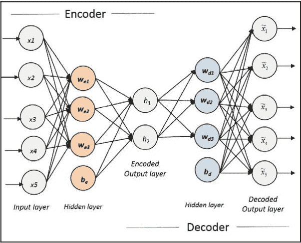

以节点形式的约束使自动编码器能够发现数据中的有趣结构。例如，在前面的图表中的编码器中，五输入数据集必须经过三节点压缩才能得到编码值 h。编码器的编码输出层的维度可以与输入/输出解码输出层相同、更低或更高。编码输出层节点数少于输入层的情况被称为欠完备表示，可视为将数据转换为低维表示的数据压缩。

编码输出层节点数多于输入层的情况被称为过完备表示，用于稀疏自动编码器作为一种正则化策略。自动编码器的目标是找到 y，捕捉数据变化沿线的主要因素，这与主成分分析（PCA）类似，因此也可用于压缩。

### 搭建自动编码器

存在多种不同架构的自动编码器，区别在于用于捕获数据表示的代价函数。最基本的自动编码器称为基本自动编码器。它是一种具有隐藏层的两层神经网络，输入层和输出层的节点数相同，目标是最小化代价函数。损失函数的典型选择（但不限于）包括回归的均方误差（MSE）和分类的交叉熵。当前方法可以轻松扩展到多层，也称为多层自动编码器。

节点数量在自动编码器中起着非常关键的作用。如果隐藏层中的节点数少于输入层，则该自动编码器称为欠完备自动编码器。隐藏层中较高数量的节点表示过完备自动编码器或稀疏自动编码器。

稀疏自动编码器旨在对隐藏层施加稀疏性。这种稀疏性可以通过在隐藏层中引入多于输入的节点数，或通过在损失函数中引入将隐藏层权重向零移动的惩罚来实现。一些自动编码器通过手动将节点的权重置零来实现稀疏性，这些被称为 K-稀疏自动编码器。我们将在第1章《入门》中讨论的占用率数据集上搭建一个自动编码器。当前示例中的隐藏层可以进行调整。

### 准备工作

让我们使用占用率数据集来搭建自动编码器：

- 按照第1章《入门》中的描述下载占用率数据集
- R 和 Python 中的 TensorFlow 安装

### 操作步骤...

如第1章《入门》中所述，当前占用率数据集用于演示在 R 中使用 TensorFlow 搭建自动编码器：

1. 搭建 R TensorFlow 环境。
2. load_occupancy_data 函数可用于加载数据，方法是使用 setwd 设置正确的工作目录路径：

```
### Function to load Occupancy data
load_occupancy_data<-function(train) {
xFeatures = c("Temperature", "Humidity", "Light", "CO2",
"HumidityRatio")
yFeatures = "Occupancy"
if(train) {
occupancy_ds <-
as.matrix(read.csv("datatraining.txt",stringsAsFactors = T))
} else {
occupancy_ds <-
as.matrix(read.csv("datatest.txt",stringsAsFactors = T))
}
occupancy_ds<-apply(occupancy_ds[, c(xFeatures, yFeatures)], 2,
FUN=as.numeric)
return(occupancy_ds)
}
```

3. 使用以下脚本将训练和测试占用率数据集加载到 R 环境中：

```
occupancy_train <-load_occupancy_data(train=T)
occupancy_test <- load_occupancy_data(train = F)
```

### 数据归一化

**数据归一化**是机器学习中将数据带到相似规模的关键步骤。它也称为特征缩放，作为数据预处理执行。

正确的归一化在神经网络中非常关键，否则会导致隐藏层内饱和，进而导致零梯度，使得无法进行学习。

### 准备工作

执行归一化有多种方法：

- **最小-最大标准化**：最小-最大保留原始分布，并将特征值缩放到 [0, 1] 之间，其中 0 为特征的最小值，1 为特征的最大值。标准化如下执行：

  $$x' = \frac{x - \min(x)}{\max(x) - \min(x)}$$

  这里，$x'$ 是特征的归一化值。该方法对数据集中的异常值敏感。

- **小数标度化**：当存在不同小数范围的值时使用这种缩放形式。例如，可以使用小数标度化将两个具有不同边界的特征带到相似规模，如下所示：

  $x'=x/10^j$

- **Z-分数**：这种变换将值缩放到具有零均值和单位方差的正态分布。Z-分数计算如下：

  $Z=(x-\mu)/\sigma$

这里，\(\mu\) 是均值，\(\sigma\) 是特征的标准差。这些分布对于具有高斯分布的数据集非常高效。

上述所有方法都对异常值敏感；还有其他更强健的归一化方法可供探索，例如 **中位数绝对偏差** (**MAD**)、tanh-estimator 和 double sigmoid。

### 可视化数据集分布

让我们查看占用率数据的特征分布：

```
> ggpairs (occupancy_train$data[, occupancy_train$xFeatures])
```

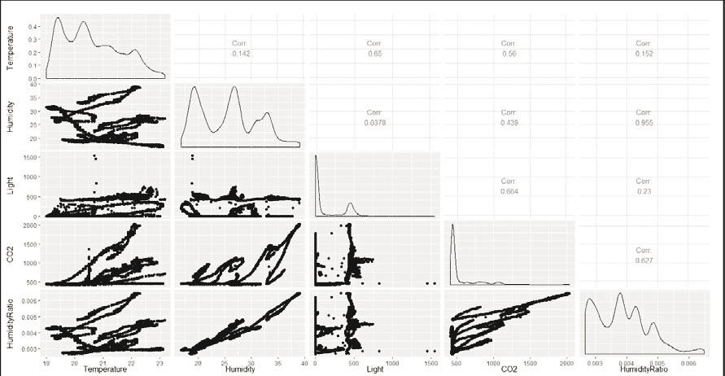

该图显示特征具有线性相关性，且分布为非正态。非正态性可进一步使用 Shapiro-Wilk 检验进行验证，使用 R 中的 `shapiro.test` 函数。让我们对占用率数据使用最小-最大标准化。

### 操作步骤...

1. 执行以下操作进行数据归一化：

```
minmax.normalize<-function(ds, scaler=NULL) {
if(is.null(scaler)) {
for(f in ds$xFeatures) {
scaler[[f]]$minval<-min(ds$data[, f])
scaler[[f]]$maxval<-max(ds$data[, f])
ds$data[, f] <- (ds$data[, f] -
scaler[[f]]$minval) / (scaler[[f]]$maxval-scaler[[f]]$minval)
}
ds$scaler <- scaler
} else {
for (f in ds$xFeatures) {
ds$data[, f] <- (ds$data[, f] -
scaler[[f]]$minval) / (scaler[[f]]$maxval-scaler[[f]]$minval)
}
}
return(ds)
}
```


2. minmax.normalize 函数使用最小-最大归一化来归一化数据。当 scaler 变量为 NULL 时，它使用提供的数据集进行归一化，或使用 scaler 值进行归一化。归一化后的数据配对图如下图所示：

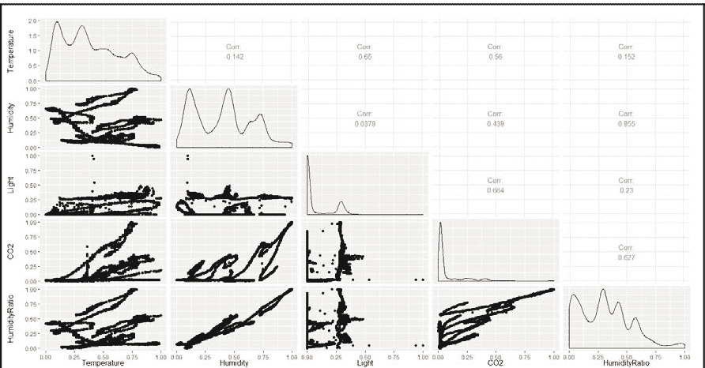

该图显示最小-最大归一化将值带入 [0, 1] 的边界内，并且不改变特征之间的分布和相关性。

## 如何设置自动编码器模型

下一步是设置自动编码器模型。让我们使用 TensorFlow 搭建一个标准自动编码器：

- 1. 重置图并启动 InteractiveSession：

```
### Reset the graph and set-up a interactive session
tf$reset_default_graph()
sess <- tf$InteractiveSession()
```

- 2. 定义输入参数，其中 n 和 m 分别为样本数和特征数。构建网络时，m 用于设置输入参数：

```
### Network Parameters
n_hidden_1 = 5 # 1st layer num features
n_input = length(xFeatures) # Number of input features
nRow <- nrow(occupancy_train)
```

当 n_hidden_1 较低时，自动编码器正在压缩数据，被称为欠完备自动编码器（under-complete autoencoder）；而当 n_hidden_1 较大时，自动编码器是稀疏的，被称为过完备自动编码器（over-complete autoencoder）。

- 3. 定义图输入参数，包括编码器和解码器的输入张量和层定义：

```
### Define input feature
x <- tf$constant(unlist(occupancy_train[, xFeatures]),
shape = c(nRow, n_input), dtype = np$float32)
### Define hidden and bias layer for encoder and decoders
hiddenLayerEncoder <- tf$Variable(tf$random_normal(shape(n_input,
n_hidden_1)), dtype = np$float32)
biasEncoder <- tf$Variable(tf$zeros(shape(n_hidden_1)),
dtype = np$float32)
hiddenLayerDecoder <- tf$Variable(tf$random_normal(shape(n_hidden_1,
n_input)))
biasDecoder <- tf$Variable(tf$zeros(shape(n_input)))
```

前面的脚本设计了单层编码器和解码器。

- 4. 定义用于评估响应的函数：

```
auto_encoder <- function(x, hiddenLayerEncoder, biasEncoder) {
x_transform <- tf$nn$sigmoid(tf$add(tf$matmul(x,
hiddenLayerEncoder), biasEncoder))
x_transform
}
```

auto_encoder 函数获取节点偏置权重并计算输出。通过传递相应权重，同一函数可用于编码器和解码器。

- 5. 通过传递符号 TensorFlow 变量来创建编码器和解码器对象：

```
encoder_obj = auto_encoder(x, hiddenLayerEncoder, biasEncoder)
y_pred = auto_encoder(encoder_obj, hiddenLayerDecoder, biasDecoder)
```

- 6. y_pred 是解码器的输出，它以带有节点和偏置权重的编码器对象作为输入：

定义损失函数和优化器模块。

```
learning_rate = 0.01
cost = tf$reduce_mean(tf$pow(x - y_pred, 2))
optimizer = tf$train$RMSPropOptimizer(learning_rate)$minimize(cost)
```

前面的脚本将均方误差定义为成本函数，并使用学习率为 0.01 的 TensorFlow RMSPropOptimizer 来优化权重。前面模型的 TensorFlow 图如下图所示：

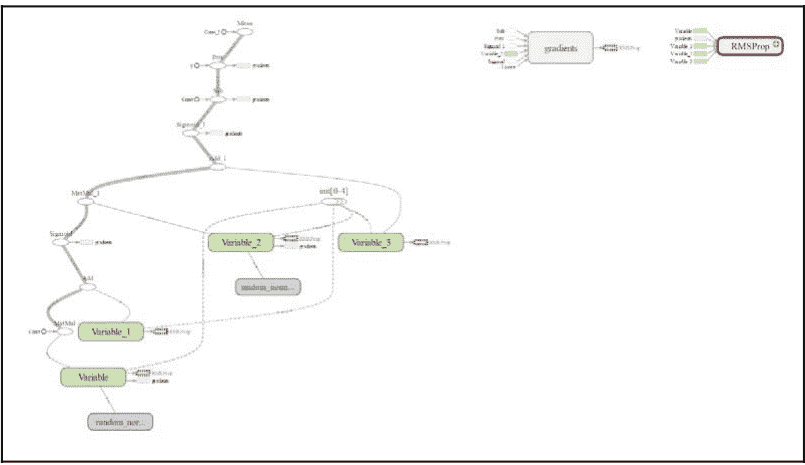

## 运行优化

下一步是运行优化器优化。在 TensorFlow 中执行此过程包含两个步骤：

- 1. 第一步是初始化图中定义的变量。初始化是通过调用 TensorFlow 的 `global_variables_initializer` 函数来执行的：

```
### Initializing the variables
init = tf$global_variables_initializer()
sess$run(init)
```

优化是基于优化和监控训练及测试性能来执行的：

```
costconvergence <- NULL
for (step in 1:1000) {
sess$run(optimizer)
if (step %% 20 == 0) {
costconvergence <- rbind(costconvergence, c(step, sess$run(cost),
sess$run(costt)))
cat(step, "-", "Training Cost ==>", sess$run(cost), "\n")
}
}
```

- 2. 可以从训练和测试的成本函数中观察模型的收敛情况，如下图所示：

```
costconvergence <- data.frame(costconvergence)
colnames(costconvergence) <- c("iter", "train", "test")
plot(costconvergence[, "iter"], costconvergence[, "train"], type = "l", col = "blue", xlab = "Iteration", ylab = "MSE")
lines(costconvergence[, "iter"], costconvergence[, "test"], col = "red")
legend(500, 0.25, c("Train", "Test"), lty = c(1, 1), lwd = c(2.5, 2.5), col = c("blue", "red"))
```

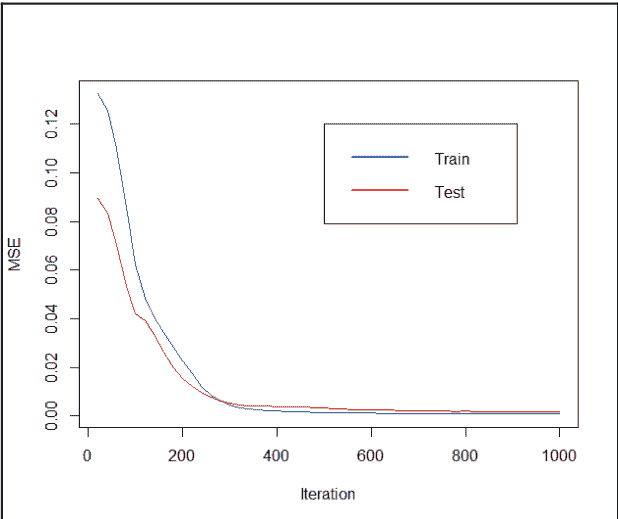

该图显示模型的主要收敛发生在约 400 次迭代时；然而，即使在 1,000 次迭代后，它仍以非常缓慢的速度收敛。该模型在训练数据集和留出测试数据集中均保持稳定。

## 设置正则化自动编码器

正则化自动编码器通过向 `cost` 函数添加正则化参数来扩展标准自动编码器。

### 准备工作

正则化自动编码器是标准自动编码器的扩展。设置将需要：

- 1. 在 R 和 Python 中安装 TensorFlow。
- 2. 标准自动编码器的实现。

### 操作步骤...

自动编码器的代码设置可以直接转换为正则化自动编码器，方法是将成本定义替换为以下几行：

```
lambda = 0.01
cost = tf$reduce_mean(tf$pow(x - y_pred, 2))
Regularize_weights = tf$nn$l2_loss(weights)
cost = tf$reduce_mean(cost + lambda * Regularize_weights)
```

### 工作原理...

如前所述，正则化自动编码器通过向成本函数添加正则化参数来扩展标准自动编码器，如下所示：

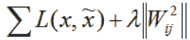

这里，\(\lambda\) 是正则化参数，\(i\) 和 \(j\) 是节点索引，\(W\) 表示自动编码器的隐藏层权重。正则化自动编码器旨在确保更强健的编码，并偏好低权重 \(h\) 函数。该概念进一步用于开发收缩自动编码器，该编码器利用输入上的雅可比矩阵 Frobenius 范数，表示如下：

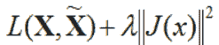

其中 J(x) 是雅可比矩阵，其计算如下：

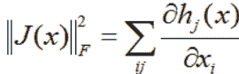

对于线性编码器，收缩编码器和正则化编码器会收敛到 L2 权重衰减。正则化有助于使自动编码器对输入不那么敏感；然而，成本函数的最小化有助于模型捕捉变化并保持对高密度流形的敏感性。这些自动编码器也被称为 **收缩自动编码器**。

## 调整自动编码器的参数

自动编码器涉及几个需要调整的参数，具体取决于我们正在处理的自动编码器类型。自动编码器中的主要参数包括以下内容：

- 任何隐藏层中的节点数量
- 深度自动编码器适用的隐藏层数量
- 激活单元，例如 sigmoid、tanh、softmax 和 ReLU 激活函数
- 隐藏单元权重上的正则化参数或权重衰减项
- 去噪自动编码器中要损坏的信号比例
- 稀疏自动编码器中的稀疏性参数，用于控制隐藏层中神经元的预期激活
- 批次大小（如果使用批量梯度下降学习）；随机梯度下降的学习率和动量参数
- 训练使用的最大迭代次数
- 权重初始化
- 如果使用丢弃，则丢弃正则化

这些超参数可以通过将问题设置为网格搜索问题来训练。然而，每个超参数组合都需要训练隐藏层的神经元权重，这导致随着层数和每层节点数量的增加，计算复杂度增加。为了解决这些关键参数和训练问题，已提出堆叠自动编码器概念，即分别训练每一层以获得预训练权重，然后使用获得的权重对模型进行微调。与传统训练模式相比，这种方法极大地提高了训练性能。


## 搭建堆叠自动编码器

堆叠自动编码器是一种训练深度网络的方法，该网络由多个层组成，使用贪婪方法逐层训练。堆叠自动编码器的示例如下图所示：

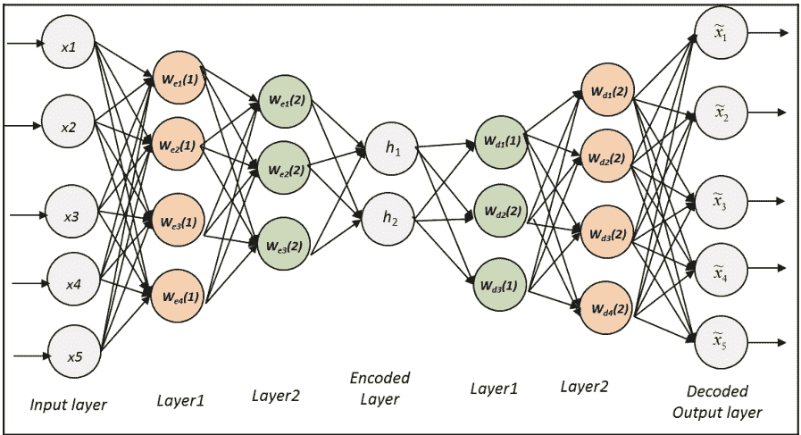

堆叠自动编码器示例

### 准备工作

前面的图示展示了一个具有两层的堆叠自动编码器。堆叠自动编码器可以有 n 层，每次使用一层进行训练。例如，前一层的训练方式如下：

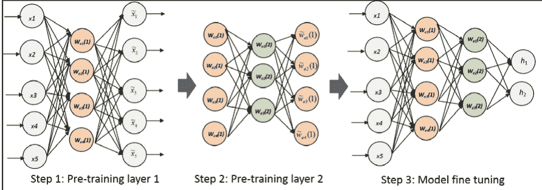

堆叠自动编码器的训练

第 1 层的初始预训练是通过在实际输入 xi 上对其进行训练获得的。第一步是优化编码器的 We(1) 层以适应输出 X。前面示例中的第二步是使用 We(1) 作为输入和输出，优化第二层的权重 We(2)。一旦所有 We(i)（其中 i=1, 2, ...,n 为层数）的层都完成预训练，则通过将所有层连接起来进行模型微调，如前面图示中的步骤 3 所示。该概念也可应用于去噪，用于训练多层网络，这称为堆叠去噪自动编码器。在去噪自动编码器中开发的代码可以轻松调整以开发堆叠去噪自动编码器，后者是堆叠自动编码器的扩展。

本示例的要求如下：

- 1. 已安装 R。
- 2. SAENET 包。可使用命令 `install.packages("SAENET")` 从 CRAN 下载该包。

### 操作步骤

R 中还有其他流行库可用于开发堆叠自动编码器。让我们使用 R 中的 SAENET 包来设置堆叠自动编码器。SAENET 是一种堆叠自动编码器实现，使用来自 CRAN 的 neuralnet 包中的前馈神经网络：

- 1. 如果尚未安装，从 CRAN 仓库获取 SAENET 包：

  ```
  install.packages("SAENET")
  ```

- 2. 加载所有库依赖：

  ```
  require(SAENET)
  ```

- 3. 使用 load_occupancy_data 加载训练和测试占用率数据集：

  ```
  occupancy_train <- load_occupancy_data(train=T)
  occupancy_test <- load_occupancy_data(train = F)
  ```

- 4. 使用 minmax.normalize 函数归一化数据集：

  ```
  # Normalize dataset
  occupancy_train<-minmax.normalize(occupancy_train, scaler = NULL)
  occupancy_test<-minmax.normalize(occupancy_test, scaler = occupancy_train$scaler)
  ```

- 5. 可使用 SAENET 包中的 SAENET.train 训练函数构建堆叠自动编码器模型：

  ```
  # Building Stacked Autoencoder
  SAE_obj<-SAENET.train(X.train= subset(occupancy_train$data,
  select=-c(Occupancy)), n.nodes=c(4, 3, 2), unit.type ="tanh",
  lambda = 1e-5, beta = 1e-5, rho = 0.01, epsilon = 0.01,
  max.iterations=1000)
  ```

可使用 SAE_obj[[n]]$X.output 命令提取最后一个节点的输出。

## 搭建去噪自动编码器

去噪自动编码器是一种特殊的自动编码器，专注于从输入数据集中提取鲁棒特征。去噪自动编码器与前面的模型类似，主要区别在于在训练网络之前数据会被损坏。可使用不同的损坏方法，例如掩码，这会向数据中引入随机错误。

### 准备工作

让我们使用 CIFAR-10 图像数据来设置去噪数据集：

- 使用 `download_cifar_data` 函数下载 CIFAR-10 数据集（在第 3 章 卷积神经网络 中介绍）
- R 和 Python 中的 TensorFlow 安装

### 操作步骤

首先需要读取数据集。

### 读取数据集

- 1. 使用第 3 章 卷积神经网络 中解释的步骤加载 CIFAR 数据集。数据文件 `data_batch_1` 和 `data_batch_2` 用于训练。`data_batch_5` 和 `test_batch` 文件分别用于验证和测试。数据可使用 `flat_data` 函数展平：

  ```
  train_data <- flat_data(x_listdata = images.rgb.train)
  test_data <- flat_data(x_listdata = images.rgb.test)
  valid_data <- flat_data(x_listdata = images.rgb.valid)
  ```

- 2. `flat_data` 函数将数据集展平，使得 NCOL = (高度 × 宽度 × 通道数)，因此数据集的维度为（图片数 × NCOL）。CIFAR 中的图像为 32 × 32，具有三个 RGB 通道；因此，数据展平后得到 3,072 列：

  ```
  > dim(train_data$images)
  [1] 40000 3072
  ```

### 为训练损坏数据

- 1. 设置去噪自动编码器所需的下一个关键函数是数据损坏：

  ```
  # Add noise using masking or salt & pepper noise method
  add_noise<-function(data, frac=0.10, corr_type=c("masking",
  "saltPepper", "none")) {
  if (length(corr_type)>1) corr_type<-corr_type[1]
  # Assign a copy of data
  data_noise = data
  # Evaluate chaining parameters for autoencoder
  nROW<-nrow(data)
  nCOL<-ncol(data)
  nMask<-floor(frac*nCOL)
  if (corr_type=="masking") {
  for( i in 1:nROW) {
  maskCol<-sample(nCOL, nMask)
  data_noise[i,maskCol,,] <- 0
  }
  } else if(corr_type=="saltPepper") {
  minval<-min(data[,,1,])
  maxval<-max(data[,,1,])
  for( i in 1:nROW) {
  maskCol<-sample(nCOL, nMask)
  randval<-runif(length(maskCol))
  ixmin<-randval<0.5
  ixmax<-randval>=0.5
  if (sum(ixmin)>0) data_noise[i,maskCol[ixmin],,]<-minval
  if (sum(ixmax)>0) data_noise[i,maskCol[ixmax],,]<-maxval
  }
  } else {
  data_noise<-data
  }
  return(data_noise)
  }
  ```

- 2. 可使用以下脚本损坏 CIFAR-10 数据：

  ```
  # Corrupting input signal
  xcorr<-add_noise(train_data$images, frac=0.10, corr_type="masking")
  ```

- 3. 损坏后的示例图像如下：

  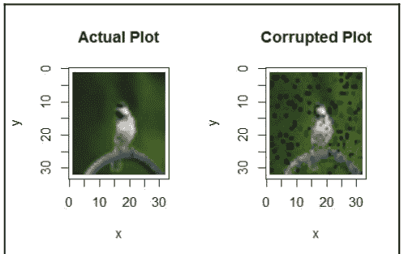

- 4. 前面的图使用掩码方法添加噪声。该方法在定义的比例下在图像的随机位置添加零值。添加噪声的另一种方法是使用椒盐噪声。该方法选择图像中的随机位置并替换它们，使用抛硬币原理向图像添加最小值或最大值。数据损坏的椒盐方法示例如下图所示：

  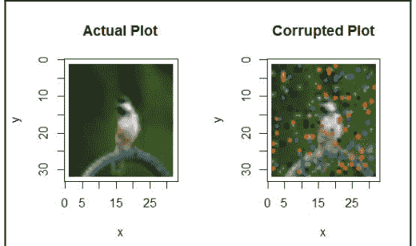

  数据损坏有助于自动编码器学习更鲁棒的表示。

### 搭建去噪自动编码器

下一步是设置自动编码器模型：

- 1. 首先，重置图并启动交互会话，如下所示：

  ```
  # Reset the graph and set-up an interactive session
  tf$reset_default_graph()
  sess<-tf$InteractiveSession()
  ```

- 2. 下一步是为输入信号和损坏信号定义两个占位符：

  ```
  # Define Input as Placeholder variables
  x = tf$placeholder(tf$float32, shape=shape(NULL, img_size_flat),
  name='x')
  x_corrupt<-tf$placeholder(tf$float32, shape=shape(NULL,
  img_size_flat), name='x_corrupt')
  ```

  x_corrupt 将用作自动编码器的输入，而 x 是实际图像，将用作输出。

- 3. 按以下代码设置去噪自动编码器函数：

  ```
  # Setting-up denoising autoencoder
  denoisingAutoencoder<-function(x, x_corrupt, img_size_flat=3072,
  hidden_layer=c(1024, 512), out_img_size=256){

  # Building Encoder
  encoder = NULL
  n_input<-img_size_flat
  currentInput<-x_corrupt
  layer<-c(hidden_layer, out_img_size)
  for (i in 1:length(layer)) {
  n_output<-length(i)
  W = tf$Variable(tf$random_uniform(shape(n_input, n_output),
  -1.0 / tf$sqrt(n_input), 1.0 / tf$sqrt(n_input)))
  b = tf$Variable(tf$zeros(shape(n_output)))
  encoder<-c(encoder, W)
  output = tf$nn$tanh(tf$matmul(currentInput, W) + b)
  currentInput = output
  n_input<-n_output
  }

  # latent representation
  z = currentInput
  encoder<-rev(encoder)
  layer_rev<-c(rev(hidden_layer), img_size_flat)

  # Build the decoder using the same weights
  decoder<-NULL
  for(i in 1:length(layer_rev)){
  n_output<-layer_rev[i]
  W = tf$transpose(encoder[[i]])
  b = tf$Variable(tf$zeros(shape(n_output)))
  output = tf$nn$tanh(tf$matmul(currentInput, W) + b)
  currentInput = output
  }
  # now have the reconstruction through the network
  y = currentInput
  # cost function measures pixel-wise difference
  cost = tf$sqrt(tf$reduce_mean(tf$square(y - x)))
  return(list ("x"=x, "z"=z, "y"=y, "x_corrupt"=x_corrupt,
  "cost"=cost))
  }
  ```

- 4. 创建去噪对象：

  ```
  # Create denoising AE object
  dae_obj<-denoisingAutoencoder(x, x_corrupt, img_size_flat=3072,
  hidden_layer=c(1024, 512), out_img_size=256)
  ```

- 5. 设置成本函数：

  ```
  # Learning set-up
  learning_rate = 0.001
  optimizer =
  tf$Train$AdamOptimizer(learning_rate)$minimize(dae_obj$cost)
  ```

- 6. 运行优化：

  ```
  # We create a session to use the graph
  sess$run(tf$global_variables_initializer())
  for(i in 1:500){
  spls <- sample(1:dim(xcorr)[1],1000L)
  if (i %% 1 == 0) {
  x_corrupt_ds<-add_noise(train_data$images[spls, ], frac = 0.3,
  corr_type = "masking")
  optimizer$run(feed_dict = dict(x=train_data$images[spls, ],
  x_corrupt=x_corrupt_ds))
  trainingCost<-dae_obj$cost$eval(feed_dict =
  dict(train_data$images[spls, ], x_corrupt=x_corrupt_ds))
  cat("Training Cost - ", trainingCost, "\n")
  }
  }
  ```


## 工作原理...

自动编码器不断学习特征的函数形式，以捕捉输入和输出之间的关系。计算机在 1,000 次迭代后对图像进行可视化的示例如下图所示：


经过 1,000 次迭代后，计算机可以区分物体的主要部分和环境。随着我们进一步运行算法以微调权重，计算机继续学习关于物体本身的更多特征，如下图所示：


前面的图表显示模型仍在学习，但随着迭代的进行，学习率变得更小，因为它开始学习关于对象的精细特征，如下图所示。有时模型会开始上升而不是下降，这是由于批量梯度下降：


使用去噪自动编码器进行学习的示意图

## 构建与比较随机编码器和解码器

随机编码器属于生成建模领域，其目标是学习给定数据 X 转换到另一个高维空间上的联合概率 P(X)。例如，我们希望通过学习像素依赖性和分布来了解图像并生成相似但不完全相同的图像。生成建模中一种流行的方法是变分自编码器（VAE），它通过对 h ~ P(h) 做出强分布假设（如高斯分布或伯努利分布）来结合深度学习与统计推断。对于给定的权重 W，X 可以从分布 Pw(X|h) 中采样。VAE 架构示例如下图所示：


VAE 的代价函数基于对数似然最大化。代价函数由重建误差和正则化误差项组成：

Cost = Reconstruction Error + Regularization Error

重建误差衡量我们将结果与训练数据映射的好坏，而正则化误差会对编码器和解码器形成的分布施加惩罚。

### 准备工作

需要在环境中安装并加载 TensorFlow：

```
require(tensorflow)
```

需要加载依赖项：

```
require(imager)
require(caret)
```

需要加载 MNIST 数据集。该数据集使用以下脚本进行归一化：

```
### Normalize Dataset
normalizeObj<-preProcess(trainData, method="range")
trainData<-predict(normalizeObj, trainData)
validData<-predict(normalizeObj, validData)
```


### 操作步骤...

- 1. MNIST 数据集用于演示稀疏分解的概念。MNIST 数据集使用手写数字。它从 tensorflow 数据集库中下载。该数据集包含 28 x 28 像素的手写图像。它包含 55,000 个训练样本、10,000 个测试样本和 5,000 个测试样本。数据集可以使用以下脚本从 tensorflow 库中下载：

```
library(tensorflow)
datasets <- tf$contrib$learn$datasets
mnist <- datasets$mnist$read_data_sets("MNIST-data", one_hot = TRUE)
```

- 2. 为了计算简便，MNIST 图像大小使用以下函数从 28 x 28 像素减小到 16 x 16 像素：

```
### Function to reduce image size
reduceImage<-function(actds, n.pixel.x=16, n.pixel.y=16){
actImage<-matrix(actds, ncol=28, byrow=FALSE)
img.col.mat <- imappend(list(as.cimg(actImage)),"c")
thmb <- resize(image.col.mat,n.pixel.x, n.pixel.y)
outputImage<-matrix(thmb[,1,1], nrow = 1, byrow = F)
return(outputImage)
}
```

- 3. 可以使用以下脚本准备带有 16 x 16 像素图像的 MNIST 训练数据：

```
### Convert train data to 16 x 16 image
trainData<-t(apply(mnist$train$images, 1, FUN=reduceImage))
validData<-t(apply(mnist$test$images, 1, FUN=reduceImage))
```

- 4. 可以使用 plot_mnist 函数可视化选定的 MNIST 图像：

```
### Function to plot MNIST dataset
plot_mnist<-function(imageD, pixel.y=16){
actImage<-matrix(imageD, ncol=pixel.y, byrow=FALSE)
img.col.mat <- imappend(list(as.cimg(actImage)), "c")
plot (img.col.mat)
}
```

### 设置 VAE 模型

- 1. 启动一个新的 TensorFlow 环境：

```
tf$reset_default_graph()
sess<-tf$InteractiveSession()
```

- 2. 定义网络参数：

```
n_input=256
n.hidden.enc.1<-64
```

- 3. 启动一个新的 TensorFlow 环境：

```
tf$reset_default_graph()
sess<-tf$InteractiveSession()
```

- 4. 定义网络参数：

```
n_input=256
n.hidden.enc.1<-64
```

前面的参数将形成如下 VAE 网络：


- 5. 定义模型初始化函数，定义编码器和解码器每一层的权重和偏置：

```
model_init<-function(n.hidden.enc.1, n.hidden.enc.2,
                     n.hidden.dec.1, n.hidden.dec.2,
                     n_input, n_h)
{ weights<-NULL
################################################################
### Set-up Encoder
################################################################
### Initialize Layer 1 of encoder
weights[["encoder_w"]][["h1"]]=tf$Variable (xavier_init (n_input,
n.hidden.enc.1))
weights[["encoder_w"]]
[["h2"]]=tf$Variable (xavier_init (n.hidden.enc.1, n.hidden.enc.2))
weights[["encoder_w"]][["out_mean"]]=tf$Variable (xavier_init (n.hidden.enc.2, n_h)
weights[["encoder_w"]][["out_log_sigma"]]=tf$Variable (xavier_init (n.hidden.enc.2, n_h))
weights[["encoder_b"]][["b1"]]=tf$Variable (tf$zeros (shape (n.hidden.enc.1), dtype=tf$float32))
weights[["encoder_b"]][["b2"]]=tf$Variable (tf$zeros (shape (n.hidden.enc.2), dtype=tf$float32))
weights[["encoder_b"]][["out_mean"]]=tf$Variable (tf$zeros (shape (n_h), dtype=tf$float32))
weights[["encoder_b"]][["out_log_sigma"]]=tf$Variable (tf$zeros (shape (n_h), dtype=tf$float32))
######################################################
### Set-up Decoder
######################################################
weights[["decoder_w"]][["h1"]]=tf$Variable (xavier_init (n_h,
n.hidden.dec.1))
weights[["decoder_w"]][["h2"]]=tf$Variable (xavier_init (n.hidden.dec.1, n.hidden.dec.2))
weights[["decoder_w"]][["out_mean"]]=tf$Variable (xavier_init (n.hidden.dec.2, n_input))
weights[["decoder_w"]][["out_log_sigma"]]=tf$Variable (xavier_init (n.hidden.dec.2, n_input))
weights[["decoder_b"]][["b1"]]=tf$Variable (tf$zeros (shape (n.hidden.dec.1), dtype=tf$float32))
weights[["decoder_b"]][["b2"]]=tf$Variable (tf$zeros (shape (n.hidden.dec.2), dtype=tf$float32))
weights[["decoder_b"]][["out_mean"]]=tf$Variable (tf$zeros (shape (n_input), dtype=tf$float32))
weights[["decoder_b"]][["out_log_sigma"]]=tf$Variable (tf$zeros (shape (n_input), dtype=tf$float32))
return(weights)
}
```

model_init 函数返回 weights，这是一个二维列表。第一个维度捕获权重的关联和类型。例如，它描述 weights 变量是分配给编码器还是解码器，以及它是存储节点的权重还是偏置。model_init 中的 xavier_init 函数用于为模型训练分配初始权重：

```
### Xavier Initialization using Uniform distribution
xavier_init<-function(n_inputs, n_outputs, constant=1) {
low = -constant*sqrt(6.0/ (n_inputs + n_outputs))
high = constant*sqrt(6.0/ (n_inputs + n_outputs))
return (tf$random_uniform(shape (n_inputs, n_outputs), minval=low,
    maxval=high, dtype=tf$float32))
}
```

- 6. 设置编码器评估函数：

```
### Encoder update function
vae_encoder<-function(x,
    weights, biases) {
    layer_1 = tf$nn$softplus (tf$add (tf$matmul (x, weights[['h1']]),
    biases[['b1']]))
    layer_2 = tf$nn$softplus (tf$add (tf$matmul (layer_1,
    weights[['h2']]), biases[['b2']]))
    z_mean = tf$add(tf$matmul (layer_2, weights[['out_mean']]),
    biases[['out_mean']])
    z_log_sigma_sq = tf$add(tf$matmul (layer_2,
    weights[['out_log_sigma']]), biases[['out_log_sigma']])
    return (list ("z_mean"=z_mean, "z_log_sigma_sq"=z_log_sigma_sq))
}
```

vae_encoder 使用隐藏层的权重和偏置计算均值和方差以对该层进行采样。

- 7. 设置解码器评估函数：

```
### Decoder update function
vae_decoder<-function(z, weights, biases) {
    layer1<-tf$nn$softplus (tf$add (tf$matmul (z, weights[["h1"]]),
    biases[["b1"]]))
    layer2<-tf$nn$softplus (tf$add (tf$matmul (layer1, weights[["h2"]]),
    biases[["b2"]]))
    x_reconstr_mean<-tf$nn$sigmoid (tf$add (tf$matmul (layer2,
    weights[['out_mean']]), biases[['out_mean']]))
    return (x_reconstr_mean)
}
```

vae_decoder 函数计算输出和平均输出处采样层关联的均值和标准差。

- 8. 设置重建估计函数：

```
### Parameter evaluation
network_ParEval<-function(x, network_weights, n_h) {
    distParameter<-vae_encoder (x, network_weights[["encoder_w"]],
    network_weights[["encoder_b"]])
    z_mean<-distParameter$z_mean
    z_log_sigma_sq <-distParameter$z_log_sigma_sq
```


### 从高斯分布中绘制一个样本 z
eps = tf$random_normal(shape(BATCH, n_h), 0, 1, dtype=tf$float32)
### z = mu + sigma*epsilon
z = tf$add(z_mean, tf$multiply(tf$sqrt (tf$exp (z_log_sigma_sq)),
eps))
### Use generator to determine mean of
### Bernoulli distribution of reconstructed input
x_reconstr_mean <- vae_decoder(z, network_weights[["decoder_w"]],
network_weights[[ "decoder_b"]])
return(list ("x_reconstr_mean"=x_reconstr_mean,
"z_log_sigma_sq"=z_log_sigma_sq, "z_mean"=z_mean))
}

## 9. 定义用于优化的成本函数:

```
### VAE cost function
vae_optimizer<-function(x, networkOutput){
x_reconstr_mean<-networkOutput$x_reconstr_mean
z_log_sigma_sq<-networkOutput$z_log_sigma_sq
z_mean<-networkOutput$z_mean
loss_reconstruction<--1*tf$reduce_sum(x*tf$log(1e-10 +
x_reconstr_mean)+
(1-x)* tf$log(1e-10 + 1 -
x_reconstr_mean), reduction_indices=shape (1))
loss_latent<--0.5*tf$reduce_sum(1+z_log_sigma_sq-
tf$square (z_mean)-
tf$exp (z_log_sigma_sq),
reduction_indices=shape (1))
cost = tf$reduce_mean (loss_reconstruction + loss_latent)
return(cost)
}
```

## 10. 设置用于训练的模型:

```
### VAE Initialization
x = tf$placeholder(tf$float32, shape=shape(NULL, img_size_flat),
name='x')
network_weights<-model_init (n.hidden.enc.1, n.hidden.enc.2,
n.hidden.dec.1, n.hidden.dec.2,
n.input, n_h)
networkOutput<-network_ParEval (x, network_weights, n_h)
cost=vae_optimizer(x, networkOutput)
optimizer = tf$train$AdamOptimizer(lr)$minimize(cost)
```

## 11. 运行优化:

```
sess$run(tf$global_variables_initializer())
for(i in 1:ITERATION) {
spls <- sample(1:dim(trainData)[1], BATCH)
out<-optimizer$run(feed_dict = dict(x=trainData[spls,]))
if (i %% 100 == 0){
cat("Iteration - ", i, "Training Loss - ", cost$eval(feed_dict = dict(x=trainData[spls,])), "\\n")
}
}
```

## VAE 自编码器的输出

- 1. 结果可使用以下脚本生成:

```
spls <- sample(1:dim(trainData)[1], BATCH)
networkOutput_run<-sess$run(networkOutput, feed_dict = dict(x=trainData[spls,]))

### Plot reconstructed Image
x_sample<-trainData[spls,]
NROW<-nrow(networkOutput_run$x_reconstr_mean)
n.plot<-5
par(mfrow = c(n.plot, 2), mar = c(0.2, 0.2, 0.2, 0.2), oma = c(3, 3, 3, 3))
pltImages<-sample(1:NROW,n.plot)
for(i in pltIndices){
plot_mnist(x_sample[i,])
plot_mnist(networkOutput_run$x_reconstr_mean[i,])
}
```

经过前述 VAE 自编码器 20,000 次迭代后得到的结果在下图中显示:


此外，由于 VAE 是生成模型，结果并非输入的精确副本，且会随运行而变化，因为从估计分布中提取了一个代表性样本。

## 从自编码器学习流形

流形学习是机器学习中的一种方法，它假设数据位于一个低得多维度的流形上。这些流形可以是线性的，也可以是非线性的。因此，该领域试图将数据从高维空间投影到低维空间。例如，主成分分析（PCA）是线性流形学习的一个示例，而自编码器是一种非线性降维（NDR），能够在低维中学习非线性流形。线性和非线性流形学习的比较如下图所示：


如图 a) 所示，数据位于线性流形上，而如图 b) 所示，数据位于二阶非线性流形上。

## 如何操作...

让我们取堆叠自编码器部分的一个输出，并分析当流形被转移到不同维度时是什么样子。

### 设置主成分分析

- 1. 在深入非线性流形之前，让我们先分析占用数据上的主成分分析：

```
### Setting-up principal component analysis
pca_obj <- prcomp(occupancy_train$data,
                 center = TRUE,
                 scale. = TRUE)
```

- 2. 上述函数将数据转换为六个正交方向，这些方向被指定为特征的线性组合。每个维度解释的方差可以使用以下脚本查看：

```
plot(pca_obj, type = "l")
```

- 3. 上述命令将绘制主成分之间的方差，如下图所示：


- 4. 对于占用数据集，前两个主成分捕捉了大部分变化，当绘制主成分时，它显示了占用正负类之间的分离，如下图所示：


前两个主成分的输出

- 5. 让我们可视化自编码器学习的低维流形。让我们只使用一个维度来可视化结果，如下所示：

```
SAE_obj<-SAENET.train(X.train= subset(occupancy_train$data,
select=-c(Occupancy)), .n.nodes=c(4, 3, 1), unit.type ="tanh",
lambda = 1e-5, beta = 1e-5, rho = 0.01, epsilon = 0.01,
max.iterations=1000)
```

- 6. 上述脚本的编码器架构如下所示：


堆叠自编码器具有一个潜在节点的隐藏层结果如下所示：


- 7. 上述图表显示，占用情况在潜在变量的峰值处为真。但是，峰值出现在不同的值上。让我们将潜在变量增加到 2 个，如 PCA 所捕获的那样。可以使用以下脚本开发模型并绘制数据：

```
SAE_obj<-SAENET.train(X.train= subset(occupancy_train$data,
select=-c(Occupancy)), n.nodes=c(4, 3, 2), unit.type = "tanh",
lambda = 1e-5, beta = 1e-5, rho = 0.01, epsilon = 0.01,
max.iterations=1000)

### plotting encoder values
plot (SAE_obj[[3]]$X.output[,1], SAE_obj[[3]]$X.output[,2],
col="blue", xlab = "Node 1 of layer 3", ylab = "Node 2 of layer 3")
ix<-occupancy_train$data[,6]==1
points(SAE_obj[[3]]$X.output[ix,1], SAE_obj[[3]]$X.output[ix,2],
col="red")
```

- 8. 具有两个层的编码值如下图所示：


### 评估稀疏分解

稀疏自编码器也称为过完备表示，其隐藏层中的节点数量较多。稀疏自编码器通常使用稀疏参数（正则化）来执行，该参数充当约束并限制节点处于活动状态。稀疏也可以被视为由于稀疏约束导致的节点脱校。稀疏自编码器的损失函数包括重建错误、用于控制权重衰减的正则化项以及用于稀疏约束的 KL 散度。以下表示很好地说明了我们所讨论的内容：

```
||X-f(h)||^2 + \frac{\lambda}{2} ||W||^2 + \beta J_{KL}(\rho||\hat{\rho})
```

其中，X 和 f(h) 分别表示输入矩阵和解码器的输出。W 表示节点的权重矩阵，\lambda 和 \beta 是正则化参数和稀疏项的惩罚。术语 J_{KL}(\rho||\hat{\rho}) 是针对稀疏项 \rho 捕获的 KL 散度值。给定稀疏参数的 KL 散度可以计算为

```
J_{KL}(\rho||\hat{\rho}) = \sum_{i=1}^{n} \rho \log(\frac{\rho}{\hat{\rho_i}}) + (1-\rho)\log(\frac{1-\rho}{1-\hat{\rho_i}})
```

其中，n 是层 h 中的节点数，\hat{\rho} 是归一化神经元上隐藏层平均活动的向量。

### 准备工作

- 1. 数据集已加载并设置。

- 2. 使用以下脚本安装并加载 autoencoder 包：

```
install.packages("autoencoder")
require(autoencoder)
```

### 如何操作...

- 1. 通过更新成本函数，TensorFlow 的标准自编码器代码可以轻松扩展到稀疏自编码器模块。本节将介绍 R 的 autoencoder 包，它带有运行稀疏自编码器的内置功能：

```
### Setting-up parameter
nl<-3
N.hidden<-100
unit.type<-"logistic"
lambda<-0.001
rho<-0.01
beta<-6
```


max.iterations<-2000
epsilon<-0.001

### 运行稀疏自编码器
spe_ae_obj <- autoencode(X.train=trainData, X.test = validData,
nl=nl, N.hidden=N.hidden,
unit.type=unit.type, lambda=lambda,beta=beta,
epsilon=epsilon,rho=rho,max.iterations=max.iterations, rescale.flag = T)

The major parameters in the `autoencode` functions are as follows:

- nl: 包括输入层和输出层在内的层数（默认为三）。
- N.hidden: 每个隐藏层中神经元数量的向量。
- unit.type: 要使用的激活函数类型。
- lambda: 正则化参数。
- rho: 稀疏度参数。
- beta: 稀疏项的惩罚项。
- max.iterations: 最大迭代次数。
- epsilon: 权重初始化的参数。权重使用高斯分布 ~N(0, epsilon^2) 进行初始化。

### 工作原理...

下图显示了由稀疏自编码器捕获的 MNIST 数字的形状和方向：


由稀疏自编码器生成用于获取数字结果的滤波器。稀疏自编码器学习到的滤波器可以使用 autoencoder 包中的 `visualize.hidden.units` 函数进行可视化。该包绘制与输出相关的最终层权重。在当前场景中，100 是隐藏层中的神经元数量，256 是输出层中的节点数量。

## 深度学习中的生成模型

本章将涵盖以下主题：

- 将主成分分析与受限玻尔兹曼机进行比较
- 为伯努利分布输入设置受限玻尔兹曼机
- 训练受限玻尔兹曼机
- RBM 的后向或重建阶段
- 理解重建的对比度散度
- 初始化并启动新的 TensorFlow 会话
- 评估 RBM 的输出
- 为协同过滤设置受限玻尔兹曼机
- 执行训练 RBM 的完整运行
- 设置深度置信网络
- 实现前馈反向传播神经网络
- 设置深度受限玻尔兹曼机

### 将主成分分析与受限玻尔兹曼机进行比较

在本节中，您将了解两种广泛推荐的降维技术——主成分分析（PCA）和受限玻尔兹曼机（RBM）。考虑 _n_ 维空间中的向量 _v_。降维技术本质上将向量 _v_ 转换为具有 _m_ 维的相对较小（或有时相等）的向量 _v_’（_m_<_n_）。转换可以是线性的或非线性的。

PCA 对特征执行线性变换，以生成正交调整的组件，这些组件随后根据其方差捕获的相对重要性进行排序。这些 _m_ 个组件可以被视为新的输入特征，可定义如下：

Vector $v' = \sum_{i=1}^{m} W_i \cdot c_i$

这里，_w_ 和 _c_ 分别对应权重（载荷）和转换后的组件。

与 PCA 不同，RBM（或 DBN/自编码器）使用可见单元和隐藏单元之间的连接执行非线性转换，如第 4 章“使用自编码器进行数据表示”中所述。非线性有助于更好地理解与潜在变量的关系。除了信息捕获外，它们还倾向于去除噪声。RBM 通常基于随机分布（伯努利分布或高斯分布）。

> 会进行大量的 Gibbs 采样来学习和优化可见层与隐藏层之间的连接权重。优化分为两个阶段：前向传递（使用给定的可见层对隐藏层进行采样）和后向传递（使用给定的隐藏层对可见层重新采样）。优化的目的是最小化重建误差。

下图表示受限玻尔兹曼机：


### 准备工作

对于此配方，您需要 R（rbm 和 ggplot2 包）以及 MNIST 数据集。MNIST 数据集可以从 TensorFlow 数据集库下载。该数据集包含 28 x 28 像素的手写图像。它有 55,000 个训练示例和 10,000 个测试示例。可以使用以下脚本从 tensorflow 库下载：

```
library(tensorflow)
datasets <- tf$contrib$learn$datasets
mnist <- datasets$mnist$read_data_sets("MNIST-data", one_hot = TRUE)
```

### 操作步骤...

- 1. 提取训练数据集（trainX 包含所有 784 个自变量，trainY 包含相应的 10 个二进制输出）：

```
trainX <- mnist$train$images
trainY <- mnist$train$labels
```

- 2. 在 trainX 数据上运行 PCA：

```
PCA_model <- prcomp(trainX, retx=TRUE)
```

- 3. 在 trainX 数据上运行 RBM：

```
RBM_model <- rbm(trainX, retx=TRUE, max_epoch=500,num_hidden =900)
```

- 4. 使用生成的模型对训练数据进行预测。对于 RBM 模型，生成概率：

```
PCA_pred_train <- predict(PCA_model)
RBM_pred_train <- predict(RBM_model,type='probs')
```

- 5. 将结果转换为数据框：

```
PCA_pred_train <- as.data.frame (PCA_pred_train)
RBM_pred_train <-
as.data.frame (as.matrix (RBM_pred_train) )
```

- 6. 将 10 类二进制 trainY 数据框转换为数值向量：

```
trainY_num<-
as.numeric(stringi::stri_sub(colnames (as.data.frame (trainY) )[max.col(
as.data.frame(trainY),ties.method="first")],2))
```

- 7. 绘制使用 PCA 生成的组件。在这里，x 轴表示组件 1，y 轴表示组件 2。下图显示了 PCA 模型的结果：

```
ggplot(PCA_pred_train, aes(PC1, PC2)) +
geom_point (aes (colour = trainY)) +
theme_bw ()+labs() +
theme(plot.title = element_text (hjust = 0.5))
```


- 8. 绘制使用 PCA 生成的隐藏层。在这里，x 轴表示隐藏层 1，y 轴表示隐藏层 2。下图显示了 RBM 模型的结果：

```
ggplot (RBM_pred_train, aes(Hidden_2, Hidden_3)) +
geom_point(aes(colour = trainY)) +
theme_bw() + labs() +
theme(plot.title = element_text(hjust = 0.5))
```


以下代码和图像显示主成分解释的累积方差：

```
var_explain <- as.data.frame(PCA_model$sdev^2/sum(PCA_model$sdev^2))
var_explain <- cbind(c(1:784), var_explain, cumsum(var_explain[,1]))
colnames(var_explain) <- c("Pcomp.No.", "Ind_Variance", "Cum_Variance")
plot(var_explain$Pcomp.No., var_explain$Cum_Variance, xlim =
c(0,100), type='b', pch=16, xlab = "# of Principal Components", ylab =
"Cumulative Variance", main = 'PCA - Explained variance')
```


以下代码和图像显示使用多个 epoch 生成 RBM 时重建训练误差的下降情况：

```
plot(RBM_model,xlab = "# of epoch iterations",ylab = "Reconstruction error",main = 'RBM - Reconstruction Error')
```


### 为伯努利分布输入设置受限玻尔兹曼机

在本节中，让我们为伯努利分布的输入数据设置受限玻尔兹曼机，其中每个属性的值范围为 0 到 1（相当于概率分布）。本配方中使用的数据集（MNIST）具有满足伯努利分布的输入数据。

RBM 包含两层：可见层和隐藏层。可见层是输入层，节点数等于输入属性的数量。在我们的情况中，MNIST 数据集中的每个图像使用 784 个像素（28 x 28 大小）来定义。因此，我们的可见层将有 784 个节点。

另一方面，隐藏层通常由用户定义。隐藏层具有一组二进制激活节点，每个节点与所有其他可见节点都存在连接概率。在我们的情况中，隐藏层将有 900 个节点。作为初始步骤，可见层中的所有节点与隐藏层中的所有节点双向连接。

每个连接都使用权重来定义，因此定义了一个权重矩阵，其中行表示输入节点的数量，列表示隐藏节点的数量。在我们的情况中，权重矩阵 (w) 将是 784 x 900 维的张量。

除了权重之外，每层中的所有节点都由偏置节点辅助。可见层的偏置节点将与所有可见节点（即 784 个节点）连接，并用 vb 表示，而隐藏层的偏置节点将与所有隐藏节点（即 900 个节点）连接，并用 vh 表示。


关于 RBM 需要记住的一点是，每层内部节点之间没有连接。换句话说，连接是层间的，而不是层内的。


下图展示了带有可见层、隐藏层及其互连的 RBM：


## 准备工作

本节介绍设置 RBM 的要求。

- R 中已安装并设置 TensorFlow
- MNIST 数据已下载并加载，用于设置 RBM

## 操作步骤

本节介绍使用 TensorFlow 设置 RBM 的可见层和隐藏层的步骤：

1. 启动新的交互式 TensorFlow 会话：

```
### Reset the graph
tf$reset_default_graph()
### Starting session as interactive session
sess <- tf$InteractiveSession()
```

2. 定义模型参数。num_input 参数定义可见层中的节点数，num_hidden 参数定义隐藏层中的节点数：

```
num_input<-784L
num_hidden<-900L
```

3. 为权重矩阵创建占位符变量：

```
W <- tf$placeholder(tf$float32, shape = shape(num_input,
num_hidden))
```

4. 为可见层和隐藏层偏置创建占位符变量：

```
vb <- tf$placeholder(tf$float32, shape = shape(num_input))
hb <- tf$placeholder(tf$float32, shape = shape(num_hidden))
```

## 训练受限玻尔兹曼机

RBM 的每个训练步骤都经历两个阶段：前向阶段和后向阶段（或重建阶段）。通过多次迭代前向和后向阶段来精细调整可见单元的重建。

### 训练前向阶段：

在前向阶段，输入数据从可见层传递到隐藏层，所有计算都在隐藏层的节点内进行。计算本质上是对从可见层到隐藏层的每个连接进行随机决策。在隐藏层中，输入数据 (X) 乘以权重矩阵 (W) 并加上隐藏层偏置向量 (hb)。

然后，大小等于隐藏节点数的结果向量将通过 sigmoid 函数来确定每个隐藏节点的输出（或激活状态）。在我们的例子中，每个输入数字将生成一个包含 900 个概率的张量向量，由于我们有 55,000 个输入数字，因此将得到大小为 55,000 x 900 的激活矩阵。利用隐藏层的概率分布矩阵，我们可以生成可用于以后估计负阶梯度的激活向量样本。

## 准备工作

本节介绍设置 RBM 的要求。

- R 中已安装并设置 TensorFlow
- MNIST 数据已下载并加载，用于设置 RBM
- RBM 模型已按“为伯努利分布输入设置受限玻尔兹曼机”配方中所述进行设置

## 采样示例

考虑一个等价于概率张量向量的常量向量 s1。然后，使用常量向量 s1 的分布创建一个新的均匀分布随机样本 s2。然后计算差值并应用修正线性激活函数。

## 操作步骤

本节介绍使用 TensorFlow 运行 RBM 模型的脚本设置步骤：

```
X = tf$placeholder(tf$float32, shape=shape(NULL, num_input))
prob_h0= tf$nn$sigmoid(tf$matmul(X, W) + hb)
h0 = tf$nn$relu(tf$sign(prob_h0 - tf$random_uniform(tf$shape(prob_h0))))
```

使用以下代码执行在 TensorFlow 中创建的图：

```
sess$run(tf$global_variables_initializer())
s1 <- tf$constant(value = c(0.1, 0.4, 0.7, 0.9))
cat(sess$run(s1))
s2=sess$run(tf$random_uniform(tf$shape(s1)))
cat(s2)
cat(sess$run(s1-s2))
cat(sess$run(tf$sign(s1 - s2)))
cat(sess$run(tf$nn$relu(tf$sign(s1 - s2))))
```

## RBM 的后向或重建阶段

在重建阶段，隐藏层的数据会传回可见层。隐藏层概率向量 h0 乘以权重矩阵 W 的转置，并加上可见层偏置 vb，然后通过 sigmoid 函数生成重建输入向量 prob_v1。

使用重建输入向量创建一个样本输入向量，然后乘以权重矩阵 W 并加上隐藏偏置向量 hb，生成更新后的隐藏概率向量 h1。

这也称为吉布斯采样。在某些场景中，不会生成样本输入向量，而是直接使用重建输入向量 prob_v1 来更新 hi


## 准备工作

本节介绍使用输入概率向量进行图像重建的要求。

- 环境中已加载 MNIST 数据
- RBM 模型已使用“训练受限玻尔兹曼机”配方进行训练

## 操作步骤

本节介绍执行后向重建和评估的步骤：

1. 可以使用输入概率向量及以下脚本执行后向图像重建：

```
prob_v1 = tf$nn$sigmoid(tf$matmul(h0, tf$transpose(W)) + vb)
v1 = tf$nn$relu(tf$sign(prob_v1 -
tf$random_uniform(tf$shape(prob_v1))))
h1 = tf$nn$sigmoid(tf$matmul(v1, W) + hb)
```

2. 可以使用定义的度量（例如 **均方误差**（MSE））进行评估，该度量在实际输入数据 (X) 和重建输入数据 (v1) 之间计算。MSE 在每个时代后计算，关键目标是最小化 MSE：

```
err = tf$reduce_mean(tf$square(X - v1))
```

## 了解重建的对比度散度

作为初始起点，目标函数可以定义为重建可见向量 v 的平均负对数似然的最小化，其中 P(v) 表示生成的概率向量：

```
arg min (w) -E [Σ_δ∈V log P(δ)]
```

## 准备工作

本节介绍使用输入概率向量进行图像重建的要求。

- 环境中已加载 MNIST 数据
- 图像已使用“后向或重建阶段”配方进行重建

## 操作步骤

当前配方介绍了用于加速采样过程的对比度散度（CD）技术的步骤：

1. 通过将输入向量 X 与给定概率分布 prob_h0 的隐藏向量 h0 样本相乘（外积）来计算正权重梯度：
   w_pos_grad = tf$matmul(tf$transpose(X), h0)

2. 通过将重建输入数据 v1 的样本与更新的隐藏激活向量 h1 相乘（外积）来计算负权重梯度：
   w_neg_grad = tf$matmul(tf$transpose(v1), h1)

3. 然后，通过从正梯度中减去负梯度并除以输入数据的大小来计算 CD 矩阵：
   CD = (w_pos_grad - w_neg_grad) / tf$to_float (tf$shape(X)[0])

4. 然后，使用学习率（alpha）和 CD 矩阵将权重矩阵 W 更新为 update_W：

```
update_W = W + alpha * CD
```

5. 此外，更新可见层和隐藏层偏置向量：

```
update_vb = vb + alpha * tf$reduce_mean(X - v1)
update_hb = hb + alpha * tf$reduce_mean(h0 - h1)
```

## 工作原理

可以通过间接修改（并优化）权重矩阵来使用随机梯度下降最小化目标函数。基于概率密度，整个梯度可以进一步分为两种形式：正梯度和负梯度。正梯度主要取决于输入数据，而负梯度仅取决于生成的模型。


在正梯度中，指向重建训练数据的概率增加；在负梯度中，模型随机生成的均匀样本的概率降低。

CD 技术用于优化负阶段。在 CD 技术中，在每次重建迭代中都会调整权重矩阵。新的权重矩阵使用以下公式生成。在我们的例子中，学习率定义为 alpha：

```
W' = W + learning rate * CD
```

## 初始化并启动新的 TensorFlow 会话

计算均方误差（MSE）等误差度量的很大一部分是初始化和启动新的 TensorFlow 会话。具体操作如下。


## 准备工作

本节介绍启动用于计算误差指标的新 TensorFlow 会话所需的条件。

- mnist 数据已在环境中加载
- RBM 的 TensorFlow 图已加载

## 操作步骤

本节介绍使用 RBM 重构来优化误差的步骤：

- 1. 初始化当前和之前的偏置向量及权重矩阵：

```
cur_w = tf$Variable(tf$zeros(shape = shape(num_input, num_hidden),
dtype=tf$float32))
cur_vb = tf$Variable(tf$zeros(shape = shape(num_input),
dtype=tf$float32))
cur_hb = tf$Variable(tf$zeros(shape = shape(num_hidden),
dtype=tf$float32))
prv_w = tf$Variable(tf$random_normal(shape=shape(num_input,
num_hidden), stddev=0.01, dtype=tf$float32))
prv_vb = tf$Variable(tf$zeros(shape = shape(num_input),
dtype=tf$float32))
prv_hb = tf$Variable(tf$zeros(shape = shape(num_hidden),
dtype=tf$float32))
```

- 2. 启动新的 TensorFlow 会话：

```
sess$run(tf$global_variables_initializer())
```

- 3. 使用完整输入数据（**trainX**）执行首次运行，并获取第一组权重矩阵和偏置向量：

```
output <- sess$run(list(update_w, update_vb, update_hb), feed_dict
= dict(X=trainX,
W = prv_w$eval(),
vb = prv_vb$eval(),
hb = prv_hb$eval()))
prv_w <- output[[1]]
prv_vb <-output[[2]]
prv_hb <-output[[3]]
```

- 4. 让我们查看首次运行的误差：

```
sess$run(err, feed_dict=dict(X= trainX, W= prv_w, vb= prv_vb, hb= prv_hb))
```

- 5. 可使用以下脚本训练 RBM 的完整模型：

```
epochs=15
errors <- list()
weights <- list()
u=1
for (ep in 1:epochs){
for (i in seq(0, (dim(trainX)[1]-100), 100)) {
batchX <- trainX[(i+1) : (i+100), ]
output <- sess$run(list(update_w, update_vb, update_hb),
feed_dict = dict(X=batchX,
W = prv_w,
vb = prv_vb,
hb = prv_hb))
prv_w <- output[[1]]
prv_vb <- output[[2]]
prv_hb <- output[[3]]
if(i%%10000 == 0){
errors[[u]] <- sess$run(err, feed_dict=dict(X= trainX, W= prv_w, vb= prv_vb, hb= prv_hb))
weights[[u]] <- output[[1]]
u <- u+1
cat(i , " : ")
}
}
cat("epoch :", ep, " : reconstruction error : ",
errors[length (errors)][[1]],"\n")
}
```

- 6. 使用均方误差绘制重构图：

```
error_vec <- unlist(errors)
plot(error_vec,xlab="# of batches",ylab="mean squared reconstruction error",main="RBM-Reconstruction MSE plot")
```

## 原理解析

此处，我们将运行 15 个时代（或迭代），在每个时代中，执行分批（大小 = 100）优化。在每个批次中，计算 CD 并相应更新权重和偏置。为跟踪优化过程，每处理 10,000 行数据后计算一次 MSE。

以下图像显示了针对 90 个批次计算的均方重构误差的下降趋势：


## 评估 RBM 的输出

此处，让我们绘制相对于输出（重构输入数据）的最终层权重。在当前场景中，900 是隐藏层的节点数，784 是输出（重构）层的节点数。

在以下图像中，可以看到隐藏层中的前 400 个节点：


此处，每个图块表示隐藏节点与所有可见层节点之间形成的连接向量。在每个图块中，黑色区域表示负权重（权重 < 0），白色区域表示正权重（权重 > 1），灰色区域表示无连接（权重 = 0）。正值越高，隐藏节点被激活的可能性越大，反之亦然。这些激活有助于确定给定隐藏节点正在处理输入图像的哪个部分。

## 准备工作

本节介绍运行评估配方所需的条件：

- mnist 数据已在环境中加载
- RBM 模型使用 TensorFlow 执行，并获得最优权重

## 操作步骤

本配方介绍评估从 RBM 获得的权重的步骤：

- 1. 运行以下代码以生成 400 个隐藏节点的图像：

```
uw = t(weights[[length(weights)]]) # Extract the most recent
weight matrix
numXpatches = 20 # Number of images in X-axis (user input)
numYpatches=20 # Number of images in Y-axis (user input)
pixels <- list()
op <- par(no.readonly = TRUE)
par(mfrow = c(numXpatches,numYpatches), mar = c(0.2, 0.2, 0.2,
0.2), oma = c(3, 3, 3, 3))
for (i in 1:(numXpatches*numYpatches)) {
denom <- sqrt(sum(uw[i, ]^2))
pixels[[i]] <- matrix(uw[i, ]/denom, nrow = numYpatches, ncol =
numXpatches)
image(pixels[[i]], axes = F, col = gray((0:32)/32))
}
par(op)
```

- 2. 从训练数据中选取四个实际输入数字的样本：

```
sample_image <- trainX[1:4,]
```

- 3. 然后，使用以下代码可视化这些示例数字：

```
mw=melt(sample_image)
mw$X3=floor((mw$X2-1)/28)+1
mw$X2=(mw$X2-1)%%28+1;
mw$X3=29-mw$X3
ggplot(data=mw)+geom_tile(aes(X2,X3,fill=value))+facet_wrap(~X1,nrow=2)+
scale_fill_continuous(low='black',high='white')+coord_fixed(ratio=1
)+
labs(x=NULL,y=NULL,)+
theme(legend.position="none")+
theme(plot.title = element_text(hjust = 0.5))
```

- 4. 现在，使用获得的最终权重和偏置重构这四个示例图像：

```
hh0 = tf$nn$sigmoid(tf$matmul(X, W) + hb)
vv1 = tf$nn$sigmoid(tf$matmul(hh0, tf$transpose(W)) + vb)
feed = sess$run(hh0, feed_dict=dict( X= sample_image, W= prv_w, hb=
prv_hb))
rec = sess$run(vv1, feed_dict=dict( hh0= feed, W= prv_w, vb=
prv_vb))
```

- 5. 然后，使用以下代码可视化重构的示例数字：

```
mw=melt(rec)
mw$X3=floor((mw$X2-1)/28)+1
mw$X2=(mw$X2-1)%%28+1
mw$X3=29-mw$X3
ggplot(data=mw)+geom_tile(aes(X2,X3,fill=value))+facet_wrap(~X1,nrow=2)+
scale_fill_continuous(low='black',high='white')+coord_fixed(ratio=1
)+
labs(x=NULL,y=NULL,)+
theme(legend.position="none")+
theme(plot.title = element_text(hjust = 0.5))
```

## 原理解析

以下图像展示了四个示例数字的原始图像：


重构后的图像似乎已经去除了噪声，尤其是数字 3 和 6 的情况。

以下图像展示了相同四个数字的重构图像：


## 为协作过滤设置受限玻尔兹曼机

在本配方中，您将学习如何使用 RBM 构建基于协作过滤的推荐系统。在此过程中，针对每个用户，RBM 尝试根据其对各种物品的过去评分行为识别相似用户，然后尝试推荐下一个最佳物品。

## 准备工作

在本配方中，我们将使用 Grouplens 研究机构的 movielens 数据集。数据集（movies.dat 和 ratings.dat）可从以下链接下载。movies.dat 包含 3,883 部电影的信息，Ratings.dat 包含这些电影的 1,000,209 条用户评分信息。评分范围从 1 到 5，5 分最高。

```
http://files.grouplens.org/datasets/movielens/ml-1m.zip
```

## 操作步骤

本配方介绍使用 RBM 设置协作过滤的步骤。

- 1. 在 R 中读取 movies.dat 数据集：

```
txt <- readLines("movies.dat", encoding = "latin1")
txt_split <- lapply(strsplit(txt, "::"), function(x)
as.data.frame(t(x), stringsAsFactors=FALSE))
movies_df <- do.call(rbind, txt_split)
names(movies_df) <- c("MovieID", "Title", "Genres")
movies_df$MovieID <- as.numeric(movies_df$MovieID)
```

- 2. 向电影数据集添加新列（id_order），因为当前 ID 列（UserID）无法用于为电影建立索引，因为它们的范围是 1 到 3,952：

```
movies_df$id_order <- 1:nrow(movies_df)
```

- 3. 在 R 中读取 ratings.dat 数据集：

```
ratings_df <- read.table("ratings.dat",
sep=":", header=FALSE, stringsAsFactors = F)
ratings_df <- ratings_df[,c(1,3,5,7)]
colnames(ratings_df) <- c("UserID","MovieID","Rating","Timestamp")
```


- 4. 将 movies 和 ratings 数据集合并，all=FALSE：

```r
merged_df <- merge(movies_df, ratings_df, by="MovieID",all=FALSE)
```

- 5. 移除不需要的列：

```r
merged_df[, c("Timestamp","Title","Genres")] <- NULL
```

- 6. 将评分转换为百分比：

```r
merged_df$rating_per <- merged_df$Rating/5
```

- 7. 为 1,000 名用户的样本生成所有电影的评分矩阵：

```r
num_of_users <- 1000
num_of_movies <- length(unique(movies_df$MovieID))
trX <- matrix(0, nrow=num_of_users,ncol=num_of_movies)
for(i in 1:num_of_users){
merged_df_user <- merged_df[merged_df$UserID %in% i,]
trX[i,merged_df_user$id_order] <- merged_df_user$rating_per
}
```

- 8. 查看 trX 训练数据集的分布。它似乎遵循伯努利分布（值在 0 到 1 的范围内）：

```r
summary(trX[1,]); summary(trX[2,]); summary(trX[3,])
```

- 9. 定义输入模型参数：

```r
num_hidden = 20
num_input = nrow(movies_df)
```

- 10. 启动新的 TensorFlow 会议：

```r
sess$run(tf$global_variables_initializer())
output <- sess$run(list(update_w, update_vb, update_hb), feed_dict
= dict(v0=trX,
W = prv_w$eval(),
vb = prv_vb$eval(),
hb = prv_hb$eval()))
prv_w <- output[[1]]
prv_vb <- output[[2]]
prv_hb <- output[[3]]
sess$run(err_sum, feed_dict=dict(v0=trX, W= prv_w, vb= prv_vb, hb=
prv_hb))
```

- 11. 使用 500 个 epoch 迭代和 100 的批量大小训练 RBM：

```r
epochs <- 500
errors <- list()
weights <- list()

for (ep in 1:epochs) {
  for (i in seq(0, (dim(trX)[1]-100), 100)) {
    batchX <- trX[(i+1):(i+100),]
    output <- sess$run(list(update_w, update_vb, update_hb),
    feed_dict = dict(v0=batchX,
    W = prv_w,
    vb = prv_vb,
    hb = prv_hb))
    prv_w <- output[[1]]
    prv_vb <- output[[2]]
    prv_hb <- output[[3]]
    if (i %% 1000 == 0) {
      errors <- c(errors, sess$run(err_sum,
      feed_dict=dict(v0=batchX, W = prv_w, vb = prv_vb, hb = prv_hb)))
      weights <- c(weights, output[[1]])
      cat(i, " : ")
    }
  }
  cat("epoch :", ep, " : reconstruction error : ",
  errors[length(errors)][[1]],"\n")
}
```

- 12. 绘制重建均方误差：

```r
error_vec <- unlist(errors)
plot(error_vec, xlab="# of batches", ylab="mean squared
reconstruction error", main="RBM-Reconstruction MSE plot")
```

### 执行 RBM 完整训练运行

使用前一配方中提到的相同 RBM 设置，在用户评分数据集 (trX) 上使用 20 个隐藏节点训练 RBM。为了跟踪优化过程，每处理 1,000 行的批次后计算 MSE。以下图片显示了针对 500 个批次（等于 epochs）计算的平均平方重建误差的下降趋势：

堆叠 RBM-重建 MSE 图


探索 RBM 推荐：现在让我们查看针对给定用户 ID 生成的基于 RBM 的协同过滤推荐。在此，我们将查看该用户 ID 的最高评分类型和最推荐类型，以及前 10 部电影推荐。

以下图片展示了最高评分类型列表：


以下图片展示了最推荐类型列表：


### 准备工作

本节提供协同过滤输出评估的要求：

- R 中已安装并设置 TensorFlow
- movies.dat 和 ratings.dat 数据集已加载到环境中
- 已执行“为协同过滤设置受限玻尔兹曼机”配方

### 操作步骤

本配方涵盖评估基于 RBM 的协同过滤输出的步骤：

- 1. 选择用户的评分：

```r
inputUser = as.matrix(t(trX[75,]))
names(inputUser) <- movies_df$id_order
```

- 2. 移除用户未评分的电影（假设它们尚未被观看）：

```r
inputUser <- inputUser[inputUser>0]
```

- 3. 绘制用户观看的最高类型：

```r
top_rated_movies <-
movies_df[as.numeric(names(inputUser)[order(inputUser, decreasing =
TRUE)]),]$Title
top_rated_genres <-
movies_df[as.numeric(names(inputUser)[order(inputUser, decreasing =
TRUE)]),]$Genres
top_rated_genres <-
as.data.frame(top_rated_genres, stringsAsFactors=F)
top_rated_genres$count <- 1
top_rated_genres <-
aggregate(count~top_rated_genres,FUN=sum,data=top_rated_genres)
top_rated_genres <- top_rated_genres[with(top_rated_genres, order(-
count)), ]
top_rated_genres$top_rated_genres <-
factor(top_rated_genres$top_rated_genres, levels =
top_rated_genres$top_rated_genres)
ggplot(top_rated_genres[top_rated_genres$count>1,], aes(x=top_rated_genres,y=count))+
geom_bar(stat="identity")+
theme_bw()+
theme(axis.text.x = element_text(angle = 90, hjust = 1))+
labs (x="Genres",y="count",)+
theme(plot.title = element_text(hjust = 0.5))
```

- 4. 重建输入向量以获取所有类型/电影的推荐百分比：

```r
hh0 = tf$nn$sigmoid(tf$matmul(v0, W) + hb)
vv1 = tf$nn$sigmoid(tf$matmul(hh0, tf$transpose(W)) + vb)
feed = sess$run(hh0, feed_dict=dict( v0= inputUser, W= prv_w, hb= prv_hb))
rec = sess$run(vv1, feed_dict=dict( hh0= feed, W= prv_w, vb= prv_vb))
names(rec) <- movies_df$id_order
```

- 5. 绘制最推荐的类型：

```r
top_recom_genres <-
movies_df[as.numeric(names(rec)[order(rec, decreasing =
TRUE)]),]$Genres
top_recom_genres <-
as.data.frame(top_recom_genres,stringsAsFactors=F)
top_recom_genres$count <- 1
top_recom_genres <-
aggregate(count~top_recom_genres,FUN=sum,data=top_recom_genres)
top_recom_genres <- top_recom_genres[with(top_recom_genres, order(
-count)), ]
top_recom_genres$top_recom_genres <-
factor(top_recom_genres$top_recom_genres, levels =
top_recom_genres$top_recom_genres)
ggplot(top_recom_genres[top_recom_genres$count>20,],aes(x=top_recom_genres,y=count))+
geom_bar(stat="identity")+
theme_bw()+
theme(axis.text.x = element_text(angle = 90, hjust = 1))+
labs (x="Genres",y="count",)+
theme(plot.title = element_text(hjust = 0.5))
```

- 6. 查找前 10 部推荐电影：

```r
top_recom_movies <-
movies_df[as.numeric(names(rec)[order(rec, decreasing =
TRUE)]),]$Title[1:10]
```

以下图片显示前 10 部推荐电影：

```
> top_recom_movies
[1] "Star Wars: Episode VI - Return of the Jedi (1983)"
[2] "Matrix, The (1999)"
[3] "Star Wars: Episode V - The Empire Strikes Back (1980)"
[4] "Jurassic Park (1993)"
[5] "Star Wars: Episode IV - A New Hope (1977)"
[6] "Terminator 2: Judgment Day (1991)"
[7] "Raiders of the Lost Ark (1981)"
[8] "Star Wars: Episode I - The Phantom Menace (1999)"
[9] "Men in Black (1997)"
[10] "Princess Bride, The (1987)"
```

## 设置深度置信网络

深度置信网络是一种 **深度神经网络 (DNN)**，由多个隐藏层（或隐性变量）组成。在此，连接仅存在于层之间，而不存在于每个层的节点内。DBN 既可作为无监督模型，也可作为有监督模型进行训练。

无监督模型用于在去噪的情况下重建输入，而有监督模型（预训练后）用于执行分类。由于每个层的节点内部没有连接，DBN 可被视为一组无监督 RBM 或自动编码器，其中每个隐藏层作为其后续连接隐藏层的可见层。

这种堆叠 RBM 增强了输入重建的性能，CD 被应用于所有层，从实际输入训练层开始，直到最后一个隐藏（或隐性）层。

DBN 是一种图形模型，以贪婪方式训练堆叠 RBM。它们的网络倾向于使用输入特征向量 $i$ 与隐藏层 $h_{1,2,...m}$ 之间的联合分布来学习深层分层表示：

```
$P(i, h_1, h_2 ... h_m) = \left( \prod_{k=0}^{m-2} P(h_k|h_{k+1}) \right) * P(h_{m-1}, h_m)$
```


这里，i = h0 ；P(hk-1|hk) 是第 k 层 RBM 隐藏层上重建可见单元的条件分布；P(hm-1, hm) 是 DBN 最终 RBM 层上隐藏单元和可见单元（重建）的联合分布。以下图片展示了一个具有四个隐藏层的 DBN，其中 W 表示权重矩阵：


DBN 也可用于增强 DNN 的鲁棒性。DNN 在实现反向传播时面临局部优化问题。在误差曲面具有众多低谷的场景中，由于反向传播导致的梯度下降可能发生在局部深谷（而非全局深谷）中。另一方面，DBN 对输入特征进行预训练，这有助于将优化引导向全局深谷，然后使用反向传播进行梯度下降，以逐步最小化误差率。

**训练三个 RBM 的堆栈：** 在本示例中，我们将使用三个堆叠的 RBM 训练一个 DBN，其中第一个隐藏层将有 900 个节点，第二个隐藏层将有 500 个节点，第三个隐藏层将有 300 个节点。

## 准备工作

本部分介绍了 TensorFlow 的要求。

- 数据集已加载并设置
- 使用以下脚本加载 TensorFlow 包：

```
require(tensorflow)
```

## 如何操作...

本示例介绍设置深度置信网络（DBN）的步骤：

- 1. 将每个隐藏层的节点数定义为一个向量：

```
RBM_hidden_sizes = c(900, 500 , 300 )
```

- 2. 生成一个 RBM 函数，利用“设置伯努利分布输入的受限玻尔兹机”示例中展示的代码，并使用以下提到的输入和输出参数：

| 参数类型 | 参数名 | 参数描述 |
|---|---|---|
| 输入（RBM 前） | input_data | 训练 MNIST 数据的矩阵 |
| 输入（RBM 前） | num_input | 自变量的数量 |
| 输入（RBM 前） | num_output | 对应隐藏层中的节点数 |
| 输入（RBM 前） | epochs | 迭代次数 |
| 输入（RBM 前） | alpha | 更新权重矩阵的学习率 |
| 输入（RBM 前） | batchsize | 每批运行的观测数量 |
| 输出（RBM 后） | output_data | 重建输出的矩阵 |
| 输出（RBM 后） | error_list | 每 10 批运行的重建错误列表 |
| 输出（RBM 后） | weight_list | 每 10 批运行的权重矩阵列表 |
| 输出（RBM 后） | weight_final | 所有 epoch 后获得的最终权重矩阵 |
| 输出（RBM 后） | bias_final | 所有 epoch 后获得的最终偏置向量 |

以下是设置 RBM 的函数：

```
RBM <- function(input_data, num_input, num_output, epochs = 5,
alpha = 0.1, batchsize=100){
### Placeholder variables
vb <- tf$placeholder(tf$float32, shape = shape(num_input))
hb <- tf$placeholder(tf$float32, shape = shape(num_output))
W <- tf$placeholder(tf$float32, shape = shape(num_input,
num_output))
### Phase 1 : Forward Phase
X = tf$placeholder(tf$float32, shape=shape(NULL, num_input))
prob_h0= tf$nn$sigmoid(tf$matmul(X, W) + hb) #probabilities of the
hidden units
h0 = tf$nn$relu(tf$sign(prob_h0 -
tf$random_uniform(tf$shape(prob_h0)))) #sample_h_given_X
### Phase 2 : Backward Phase
prob_v1 = tf$nn$sigmoid(tf$matmul(h0, tf$transpose(W)) + vb)
v1 = tf$nn$relu(tf$sign(prob_v1 -
tf$random_uniform(tf$shape(prob_v1))))
h1 = tf$nn$sigmoid(tf$matmul(v1, W) + hb)
### calculate gradients
w_pos_grad = tf$matmul(tf$transpose(X), h0)
w_neg_grad = tf$matmul(tf$transpose(v1), h1)
CD = (w_pos_grad - w_neg_grad) / tf$to_float (tf$shape (X) [0])
update_w = W + alpha * CD
update_vb = vb + alpha * tf$reduce_mean(X - v1)
update_hb = hb + alpha * tf$reduce_mean(h0 - h1)
### Objective function
err = tf$reduce_mean (tf$square (X - v1))
### Initialize variables
cur_w = tf$Variable(tf$zeros (shape = shape(num_input, num_output),
dtype=tf$float32))
cur_vb = tf$Variable(tf$zeros (shape = shape(num_input),
dtype=tf$float32))
cur_hb = tf$Variable(tf$zeros (shape = shape(num_output),
dtype=tf$float32))
prv_w = tf$Variable(tf$random_normal (shape=shape(num_input,
num_output, stddev=0.01, dtype=tf$float32))
prv_vb = tf$Variable(tf$zeros(shape = shape(num_input),
dtype=tf$float32))
prv_hb = tf$Variable(tf$zeros (shape = shape(num_output),
dtype=tf$float32))
### Start tensorflow session
sess$run (tf$global_variables_initializer())
output <- sess$run(list (update_w, update_vb, update_hb), feed_dict
= dict (X=input_data,
W = prv_w$eval(),
vb = prv_vb$eval(),
hb = prv_hb$eval()))
prv_w <- output[[1]]
prv_vb <- output[[2]]
prv_hb <- output[[3]]
sess$run(err, feed_dict=dict (X= input_data, W= prv_w, vb= prv_vb,
hb= prv_hb))
errors <- weights <- list()
u=1
for(ep in 1:epochs) {
for(i in seq(0,(dim(input_data)[1]-batchsize),batchsize)) {
batchX <- input_data[(i+1):(i+batchsize),]
output <- sess$run(list(update_w, update_vb, update_hb), feed_dict
= dict(X=batchX,
W = prv_w,
vb = prv_vb,
hb = prv_hb))
prv_w <- output[[1]]
prv_vb <- output[[2]]
prv_hb <- output[[3]]
if(i%%10000 == 0) {
errors[[u]] <- sess$run(err, feed_dict=dict(X= batchX, W= prv_w,
vb= prv_vb, hb= prv_hb))
weights[[u]] <- output[[1]]
}
u=u+1
cat(i , " : ")
}
}
cat("epoch :", ep, " : reconstruction error : " ,
errors[length(errors)][[1]],"\n")
}
w <- prv_w
vb <- prv_vb
hb <- prv_hb
### Get the output
input_X = tf$constant(input_data)
ph_w = tf$constant(w)
ph_hb = tf$constant(hb)
out = tf$nn$sigmoid(tf$matmul(input_X, ph_w) + ph_hb)
sess$run(tf$global_variables_initializer())
return(list(output_data = sess$run(out),
error_list=errors,
weight_list=weights,
weight_final=w,
bias_final=hb))
}
```

- 3. 按顺序对所有三种不同类型的隐藏节点训练 RBM。换句话说，先用 900 个隐藏节点训练 RBM1，然后使用 RBM1 的输出作为具有 500 个隐藏节点的 RBM2 的输入并训练 RBM2，接着使用 RBM2 的输出作为具有 300 个隐藏节点的 RBM3 的输入并训练 RBM3。将所有三个 RBM 的输出作为一个列表 RBM_output 存储：

```
inpX = trainX
RBM_output <- list()
for(i in 1:length(RBM_hidden_sizes)) {
  size <- RBM_hidden_sizes[i]
  # Train the RBM
  RBM_output[[i]] <- RBM(input_data= inpX,
                         num_input= ncol(trainX),
                         num_output=size,
                         epochs = 5,
                         alpha = 0.1,
                         batchsize=100)
  # Update the input data
  inpX <- RBM_output[[i]]$output_data
  # Update the input_size
  num_input = size
  cat("completed size :", size,"\n")
}
```

- 4. 创建三个隐藏层之间批次错误的数据帧：

```
error_df <-
  data.frame("error"=c(unlist (RBM_output[[1]]$error_list),unlist (RBM_output[[2]]$error_list),unlist (RBM_output[[3]]$error_list)),
             "batches"=c(rep (seq(1:length(unlist (RBM_output[[1]]$error_list))),times=3)),
             "hidden_layer"=c (rep (c(1, 2, 3),each=length(unlist (RBM_output[[1]]$error_list)))),
             stringsAsFactors = FALSE)
```

- 5. 绘制重建均方误差：

```
plot(error ~ batches,
     xlab = "# of batches",
     ylab = "Reconstruction Error",
     pch = c(1, 7, 16)[hidden_layer],
     main = "Stacked RBM-Reconstruction MSE plot",
     data = error_df
     legend('topleft',
            c("H1_900","H2_500","H3_300"),
            pch = c(1, 7, 16))
```

## 工作原理...

评估训练三个堆叠 RBM 的性能：在这里，我们将为每个 RBM 运行五个 epoch（或迭代）。每个 epoch 将执行批量（大小 = 100）优化。在每个批次中，都会计算 CD，并相应地更新权重和偏置。为了跟踪优化过程，每处理 10,000 行的批次后都会计算 MSE。以下图片显示了分别针对三个 RBM 计算的 30 个批次的平均平方重建错误的下降趋势：


## 实现前馈反向传播神经网络

在本示例中，我们将实现一个带有反向传播的深度神经网络。神经网络的输入是第三个（或最后一个）RBM 的输出。换句话说，重建的原始数据（`trainX`）实际上被用作训练神经网络作为 10 个数字的监督分类器。反向传播技术用于进一步微调分类性能。


## 准备工作

本部分介绍TensorFlow的要求。

- 数据集已加载并设置
- TensorFlow包已设置并加载

## 操作步骤...

本部分介绍设置前馈反向传播神经网络的步骤：

- 1. 让我们将神经网络的输入参数定义为函数参数。
  下表描述了每个参数：

| 参数名 | 参数描述 |
|---|---|
| Xdata | 训练输入MNIST数据的矩阵 |
| Ydata | 训练输出MNIST数据的矩阵 |
| Xtestdata | 测试输入MNIST数据的矩阵 |
| Ytestdata | 测试输出MNIST数据的矩阵 |
| input_size | 训练数据中的属性（或像素）数量 |
| learning_rate | 更新权重矩阵的学习率 |
| momentum | 跳出局部极小值的步长增量 |
| epochs | 迭代次数 |
| batchsize | 每批运行的观测数量 |
| rbm_list | 堆叠RBM的结果列表 |
| dbn_sizes | 堆叠RBM中隐藏层大小的向量 |

神经网络函数将具有以下脚本所示的结构：

```
NN_train <- function(Xdata, Ydata, Xtestdata, Ytestdata, input_size,
learning_rate=0.1,momentum = 0.1,epochs=10,
batchsize=100,rbm_list,dbn_sizes) {
library(stringi)
### insert all the codes mentioned in next 11 points
}
```

- 2. 初始化长度为4的权重和偏置列表，第一个为尺寸784×900的随机正态分布张量（标准差为0.01），第二个为900×500，第三个为500×300，第四个为300×10：

```
weight_list <- list()
bias_list <- list()
### Initialize variables
for(size in c(dbn_sizes,ncol(Ydata))){
#Initialize weights through a random uniform distribution
weight_list <-
c(weight_list,tf$random_normal(shape=shape(input_size, size),
stddev=0.01, dtype=tf$float32))
#Initialize bias as zeroes
bias_list <- c(bias_list, tf$zeros(shape = shape(size),
dtype=tf$float32))
input_size = size
}
```

- 3. 检查堆叠RBM的输出是否符合dbn_sizes参数中提到的隐藏层大小：

```
#Check if expected dbn_sizes are correct
if(length(dbn_sizes)!=length(rbm_list)){
stop("number of hidden dbn_sizes not equal to number of rbm outputs generated")
### check if expected sized are correct
for(i in 1:length(dbn_sizes)){
if(dbn_sizes[i] != dbn_sizes[i])
stop("Number of hidden dbn_sizes do not match")
}
}
```

- 4. 现在，将权重和偏置放置在weight_list和bias_list的适当位置中：

```
for(i in 1:length(dbn_sizes)){
weight_list[[i]] <- rbm_list[[i]]$weight_final
bias_list[[i]] <- rbm_list[[i]]$bias_final
}
```

- 5. 为输入和输出数据创建占位符：

```
input <- tf$placeholder(tf$float32, shape =
shape(NULL, ncol(Xdata)))
output <- tf$placeholder(tf$float32, shape =
shape(NULL, ncol(Ydata)))
```

- 6. 现在，使用从堆叠RBM获得的权重和偏置来重构输入数据，并将每个RBM的重构数据存储在列表input_sub中：

```
input_sub <- list()
weight <- list()
bias <- list()
for(i in 1:(length(dbn_sizes)+1)) {
weight[[i]] <- tf$cast(tf$Variable(weight_list[[i]]),tf$float32)
bias[[i]] <- tf$cast(tf$Variable(bias_list[[i]]),tf$float32)
}
input_sub[[1]] <- tf$nn$sigmoid(tf$matmul(input, weight[[1]]) +
bias[[1]])
for(i in 2:(length(dbn_sizes)+1)) {
input_sub[[i]] <- tf$nn$sigmoid(tf$matmul(input_sub[[i-1]],
weight[[i]]) + bias[[i]])
}
```

- 7. 定义成本函数，即预测值与实际数字之间差异的均方误差：

```
cost = tf$reduce_mean(tf$square(input_sub[[length(input_sub)]] -
output))
```

- 8. 实现反向传播以最小化成本：

```
train_op <- tf$train$MomentumOptimizer(learning_rate,
momentum)$minimize(cost)
```

- 9. 生成预测结果：

```
predict_op =
tf$argmax(input_sub[[length(input_sub)]], axis=tf$cast(1.0, tf$int32)
)
```

- 10. 执行训练迭代：

```
train_accuracy <- c()
test_accuracy <- c()
for(ep in 1:epochs) {
for(i in seq(0, (dim(Xdata)[1]-batchsize),batchsize)) {
batchX <- Xdata[(i+1):(i+batchsize),]
batchY <- Ydata[(i+1):(i+batchsize),]
#Run the training operation on the input data
sess$run(train_op, feed_dict=dict(input = batchX,
output = batchY))
}
for(j in 1:(length(dbn_sizes)+1)) {
### Retrieve weights and biases
weight_list[[j]] <- sess$run(weight[[j]])
bias_list[[j]] <- sess$run(bias[[j]])
}
train_result <- sess$run(predict_op, feed_dict = dict(input=Xdata,
output=Ydata))+1
train_actual <-
as.numeric(stringi::stri_sub(colnames(as.data.frame(Ydata)) [max.col
(as.data.frame(Ydata),ties.method="first")],2))
test_result <- sess$run(predict_op, feed_dict =
dict(input=XTestdata, output=Ytestdata))+1
test_actual <-
as.numeric(stringi::stri_sub(colnames(as.data.frame(Ytestdata)) [max
.col(as.data.frame(Ytestdata),ties.method="first")],2))
train_accuracy <-
c(train_accuracy,mean(train_actual==train_result))
test_accuracy <- c(test_accuracy,mean (test_actual==test_result))
cat ("epoch:", ep, " Train Accuracy: ",train_accuracy[ep]," Test
Accuracy : ",test_accuracy[ep],"\n")
}
```

- 11. 最后，返回包含四个结果的列表，即训练准确率(train_accuracy)、测试准确率(test_accuracy)、每次迭代生成的权重矩阵列表(weight_list)以及每次迭代生成的偏置向量列表(bias_list)：

```
return(list(train_accuracy=train_accuracy,
test_accuracy=test_accuracy,
weight_list=weight_list,
bias_list=bias_list))
```

- 12. 为定义的神经网络运行训练迭代：

```
NN_results <- NN_train(Xdata=trainX,
Ydata=trainY,
Xtestdata=testX,
Ytestdata=testY,
input_size=ncol(trainX) ,
rbm_list=RBM_output,
dbn_sizes = RBM_hidden_sizes)
```

- 13. 以下代码用于绘制训练和测试准确率：

```
```r
accuracy_df <-
data.frame("accuracy"=c(NN_results$train_accuracy,NN_results$test_accuracy),
"epochs"=c(rep(1:10,times=2)),
"datatype"=c(rep(c(1,2),each=10))),
stringsAsFactors = FALSE)
plot(accuracy ~ epochs,
xlab = "# of epochs",
ylab = "Accuracy in %",
pch = c(16, 1)[datatype],
main = "Neural Network - Accuracy in %",
data = accuracy_df
legend('bottomright',
c("train","test"),
pch = c( 16, 1))
```
```

## 工作原理...

评估神经网络的训练和测试性能：以下图像显示了训练神经网络时观察到的训练和测试准确率的上升趋势：


## 搭建深度受限玻尔兹机

与DBN不同，**深度受限玻尔兹曼机（DRBM）**是互连隐藏层的无向网络，能够学习这些连接上的联合概率。在当前设置中，执行居中处理，即在每次迭代后将可见变量和隐藏变量从偏移偏置向量中减去。研究表明，居中处理可优化DRBM的性能，并可达到比传统RBM更高的对数似然值。

## 准备工作

本部分介绍设置DRBM的要求：

- MNIST数据集已加载并设置
- tensorflow包已设置并加载

## 操作步骤...

本部分详细介绍使用R中的TensorFlow设置DRBM模型的步骤：

- 1. 定义DRBM的参数：

```
learning_rate = 0.005
momentum = 0.005
minbatch_size = 25
hidden_layers = c(400,100)
biases = list(-1,-1)
```

- 2. 使用双曲反正切定义sigmoid函数 [(log(1+x)-log(1-x))/2]：

```
arcsigm <- function(x) {
return (atanh ( (2*x)-1 )*2)
}
```

- 3. 仅使用双曲正切定义sigmoid函数 [(e^x-e^-x)/(e^x+e^x)]：

```
sigm <- function(x) {
return (tanh ( (x/2) +1 )/ 2)
}
```

- 4. 定义binarize函数以返回二进制值（0,1）的矩阵：

```
binarize <- function(x) {
### truncated rnorm
trnorm <- function(n, mean, sd, minval = -Inf, maxval = Inf) {
qnorm(runif(n, pnorm(minval, mean, sd), pnorm(maxval, mean, sd)),
      mean, sd)
}
return( (x > matrix(
  trnorm(n=nrow(x)*ncol(x),mean=0,sd=1,minval=0,maxval=1), nrow(x),
  ncol(x)) )*1 )
}
```

- 5. 定义re_construct函数以返回像素矩阵：

```
re_construct <- function(x) {
x = x - min(x) + 1e-9
x = x / (max(x) + 1e-9)
return(x*255)
}
```

- 6. 定义函数以执行给定层的gibbs激活：

```
gibbs <- function(X,l,initials) {
if(l>1){
bu <- (X[l-1][[1]] -
matrix(rep(initials$param_O[[l-1]],minbatch_size),minbatch_size,byrow=TRUE)) %*%
initials$param_W[l-1][[1]]
} else {
bu <- 0
}
if( (l+1) < length(X) ) {
td <- (X[l+1][[1]] -
matrix(rep(initials$param_O[[l+1]],minbatch_size),minbatch_size,byrow=TRUE)) %*%
t(initials$param_W[l][[1]])
} else {
td <- 0
}
X[[l]] <-
binarize(sigm(bu+td+matrix(rep(initials$param_B[[l]],minbatch_size)
,minbatch_size,byrow=TRUE)) )
return(X[[l]])
}
```


- 7. 定义一个函数以执行偏置向量的重参数化：

```
reparamBias <- function(X, l, initials) {
if (l > 1) {
bu <- colMeans((X[[l - 1]] -
matrix(rep(initials$param_O[[l - 1]], minbatch_size), minbatch_size, byrow = TRUE)) %*%
initials$param_W[[l - 1]])
} else {
bu <- 0
}
if ((l + 1) < length(X)) {
td <- colMeans((X[[l + 1]] -
matrix(rep(initials$param_O[[l + 1]], minbatch_size), minbatch_size, byrow = TRUE)) %*%
t(initials$param_W[[l]]))
} else {
td <- 0
}
initials$param_B[[l]] <- (1 - momentum) * initials$param_B[[l]] +
momentum * (initials$param_B[[l]] + bu + td)
return(initials$param_B[[l]])
}
```

- 8. 定义一个函数以执行偏移偏置向量的重参数化：

```
reparamO <- function(X, l, initials) {
initials$param_O[[l]] <- colMeans((1 - momentum) *
matrix(rep(initials$param_O[[l]], minbatch_size), minbatch_size, byrow = TRUE) +
momentum * (X[[l]]))
return(initials$param_O[[l]])
}
```

- 9. 定义一个函数以初始化权重、偏置、偏移偏置和输入矩阵：

```
DRBM_initialize <- function(layers, bias_list) {
### Initialize model parameters and particles
param_W <- list()
for (i in 1:(length(layers) - 1)) {
param_W[[i]] <- matrix(0L, nrow = layers[i], ncol = layers[i + 1])
}
param_B <- list()
for (i in 1:length(layers)) {
param_B[[i]] <- matrix(0L, nrow = layers[i], ncol = 1) + bias_list[[i]]
}
param_O <- list()
for (i in 1:length(param_B)) {
param_O[[i]] <- sigm(param_B[[i]])
}
param_X <- list()
for (i in 1:length(layers)) {
param_X[[i]] <- matrix(0L, nrow = minbatch_size, ncol = layers[i]) +
matrix(rep(param_O[[i]], minbatch_size), minbatch_size, byrow = TRUE)
}
return(list(param_W = param_W, param_B = param_B, param_O = param_O, param_X = param_X))
}
```

- 10. 使用前面的配方中介绍的 MNIST 训练数据 (trainX)。
- 通过将 trainX 数据除以 255 来标准化该数据：

```
X <- trainX / 255
```

- 11. 生成初始权重矩阵、偏置向量、偏移偏置向量和输入矩阵：

```
layers <- c(784, hidden_layers)
bias_list <-
list(arcsigm(pmax(colMeans(X), 0.001)), biases[[1]], biases[[2]])
initials <- DRBM_initialize(layers, bias_list)
```

- 12. 从输入数据 X 中抽取一个子样本 (minbatch_size)：

```
batchX <- X[sample(nrow(X))[1:minbatch_size], ]
```

- 13. 执行 1000 次迭代。在每次迭代中，更新初始权重和偏置 100 次，并绘制权重矩阵的图像：

```
for (iter in 1:1000) {
### Perform some learnings
for (j in 1:100) {
### Initialize a data particle
dat <- list()
dat[[1]] <- binarize(batchX)
for (l in 2:length(initials$param_X)) {
dat[[l]] <- initials$param_X[[l]] * 0 +
matrix(rep(initials$param_O[[l]], minbatch_size), minbatch_size, byrow = TRUE)
}

### Alternate gibbs sampler on data and free particles
for (l in rep(c(seq(2, length(initials$param_X), 2),
seq(3, length(initials$param_X), 2)), 5)) {
dat[[1]] <- gibbs(dat, 1, initials)
}
}
for (l in rep(c(seq(2, length(initials$param_X), 2),
seq(1, length(initials$param_X), 2)), 1)) {
initials$param_X[[l]] <- gibbs(initials$param_X, l, initials)
}

### Parameter update
for (i in 1:length(initials$param_W)) {
initials$param_W[[i]] <- initials$param_W[[i]] +
(learning_rate * ((t(dat[[i]] -
matrix(rep(initials$param_O[[i]], minbatch_size), minbatch_size, byrow = TRUE)) %*%
(dat[[i + 1]] -
matrix(rep(initials$param_O[[i + 1]], minbatch_size), minbatch_size, byrow = TRUE))) -
(t(initials$param_X[[i]] -
matrix(rep(initials$param_O[[i]], minbatch_size), minbatch_size, byrow = TRUE)) %*%
(initials$param_X[[i + 1]] -
matrix(rep(initials$param_O[[i + 1]], minbatch_size), minbatch_size, byrow = TRUE)))) / nrow(batchX))
}

for (i in 1:length(initials$param_B)) {
initials$param_B[[i]] <-
colMeans(matrix(rep(initials$param_B[[i]], minbatch_size), minbatch_size, byrow = TRUE) +
(learning_rate * (dat[[i]] - initials$param_X[[i]])))
}

### Reparameterization
for (l in 1:length(initials$param_B)) {
initials$param_B[[l]] <- reparamBias(dat, l, initials)
}

for (l in 1:length(initials$param_O)) {
initials$param_O[[l]] <- reparamO(dat, l, initials)
}

### Generate necessary outputs
cat("Iteration:", iter, "", "Mean of W of VL-HL1:", mean(initials$param_W[[1]]), "", "Mean of W of HL1-HL2:", mean(initials$param_W[[2]]), "\n\n")
cat("Iteration:", iter, "", "SDev of W of VL-HL1:", sd(initials$param_W[[1]]), "", "SDev of W of HL1-HL2:", sd(initials$param_W[[2]]), "\n\n")

### Plot weight matrices
W = diag(nrow(initials$param_W[[1]]))
for (l in 1:length(initials$param_W)) {
W = W %*% initials$param_W[[l]]
m = dim(W)[2] * 0.05
w1_arr <- matrix(0, 28 * m, 28 * m)
i = 1
for (k in 1:m) {
for (j in 1:28) {
vec <- c(W[(28 * j - 28 + 1):(28 * j), (k * m - m + 1):(k * m)])
w1_arr[i, ] <- vec
i = i + 1
}
}
w1_arr = re_construct(w1_arr)
w1_arr <- floor(w1_arr)
image(w1_arr, axes = TRUE, col = grey(seq(0, 1, length = 256)))
}
}
```

### 工作原理...

由于前述 DRBM 是使用两个隐藏层训练的，我们生成两个权重矩阵。第一个权重矩阵定义了可见层与第一个隐藏层之间的连接。第二个权重矩阵定义了第一个隐藏层和第二个隐藏层之间的连接。以下图像显示了第一个权重矩阵的像素图：


以下图像显示了第二个权重矩阵的像素图：


## 循环神经网络

本章将介绍用于建模序列数据集的循环神经网络。在本章中，我们将涵盖：

- 搭建基本的循环神经网络
- 搭建双向 RNN 模型
- 搭建深层 RNN 模型
- 搭建基于长短期记忆的序列模型

### 搭建基本的循环神经网络

**循环神经网络 (RNN)** 用于在观测值之间存在高自相关的数据集上进行序列建模。例如，使用历史数据集预测患者的就医历程，或预测给定句子中的下一个词。这些问题陈述的主要共同点是输入长度不固定且存在序列依赖性。标准神经网络和深度学习模型受限于固定大小的输入，并产生固定长度的输出。例如，基于占用率数据集构建的深度学习神经网络具有六个输入特征和一个二元结果。

### 准备工作

机器学习领域的生成模型是指具有生成可观测数据值能力的模型。例如，在图像仓库上训练生成模型以生成类似的新图像。所有生成模型都旨在计算给定数据集上的联合分布，可以是隐式的，也可以是显式的：

- 1. 安装并设置 TensorFlow。
- 2. 加载所需的包：

```
library(tensorflow)
```

### 具体操作步骤

本节将提供搭建 RNN 模型的步骤。

- 1. 加载 MNIST 数据集：

```
### Load mnist dataset from tensorflow library
datasets <- tf$contrib$learn$datasets
mnist <- datasets$mnist$read_data_sets("MNIST-data", one_hot = TRUE)
```

- 2. 重置图并启动交互式会话：

```
### Reset the graph and set-up a interactive session
tf$reset_default_graph()
sess <- tf$InteractiveSession()
```

- 3. 使用第 4 章（使用自编码器进行数据表示）中的 reduceImage 函数将图像大小减小到 16 x 16 像素：

```
### Convert train data to 16 x 16 pixel image
trainData <- t(apply(mnist$train$images, 1, FUN = reduceImage))
validData <- t(apply(mnist$test$images, 1, FUN = reduceImage))
```

- 4. 为定义的训练集和验证集提取标签：

```
labels <- mnist$train$labels
labels_valid <- mnist$test$labels
```

- 5. 定义模型参数，例如输入像素大小 (n_input)、步长 (step_size)、隐藏层数量 (n_hidden) 和结果类别数量 (n_classes)：

```
### Define Model parameter
n_input <- 16
step_size <- 16
n_hidden <- 64
n.class <- 10
```

- 6. 定义训练参数，例如学习率 (lr)、每批运行的输入数量 (batch) 和迭代次数 (iteration)：

```
lr <- 0.01
batch <- 500
iteration <- 100
```

- 7. 定义一个名为 rnn 的函数，它接受批量输入数据集 (x)、权重矩阵 (weight) 和偏置向量 (bias)，并返回一个最基本 RNN 的最终预测结果向量：

```
### Set up a most basic RNN
rnn <- function(x, weight, bias) {
### Unstack input into step_size
x <- tf$unstack(x, step_size, 1)
### Define a most basic RNN
rnn_cell <- tf$contrib$rnn$BasicRNNCell(n_hidden)
### create a Recurrent Neural Network
cell_output <- tf$contrib$rnn$static_rnn(rnn_cell, x,
dtype = tf$float32)
### Linear activation, using rnn inner loop
last_vec <- tail(cell_output[[1]], n = 1)[[1]]
return(tf$matmul(last_vec, weight) + bias)
}
```

定义一个函数 eval_func，使用实际标签 (y) 和预测标签 (yhat) 来评估平均准确率：

```
### Function to evaluate mean accuracy
eval_acc <- function(yhat, y) {
### Count correct solution
correct_Count <- tf$equal(tf$argmax(yhat, 1L), tf$argmax(y, 1L))
### Mean accuracy
mean_accuracy <- tf$reduce_mean(tf$cast(correct_Count,
tf$float32))
return(mean_accuracy)
}
```


### 8. 定义占位符变量（x 和 y）并初始化权重矩阵和偏差向量：

```
with(tf$name_scope('input'), {
### Define placeholder for input data
x <- tf$placeholder(tf$float32, shape=shape(NULL, step_size,
n_input), name="x")
y <- tf$placeholder(tf$float32, shape=shape(NULL, n.class), name='y')

### Define Weights and bias
weights <- tf$Variable(tf$random_normal(shape(n.hidden, n.class)))
bias <- tf$Variable(tf$random_normal(shape(n.class)))
})
```

### 9. 生成预测标签：

```
### Evaluate rnn cell output
yhat = rnn(x, weights, bias)
### Define the loss function and optimizer
cost =
tf$reduce_mean(tf$nn$softmax_cross_entropy_with_logits(logits=yhat,
labels=y))
optimizer = tf$train$AdamOptimizer(learning_rate=lr)$minimize(cost)
```

### 10. 使用全局变量初始化器初始化会话后运行优化：

```
sess$run(tf$global_variables_initializer())
for(i in 1:iteration){
  spls <- sample(1:dim(trainData)[1], batch)
  sample_data <- trainData[spls,]
  sample_y <- labels[spls,]
  # Reshape sample into 16 sequence with each of 16 element
  sample_data = tf$reshape(sample_data, shape(batch, step_size,
  n_input))
  out <- optimizer$run(feed_dict = dict(x = sample_data$eval(),
  y = sample_y))
  if (i %% 1 == 0){
    cat("iteration - ", i, "Training Loss - ", cost$eval(feed_dict
    = dict(x = sample_data$eval(), y = sample_y)), "\n")
  }
}
```

### 11. 获取 valid_data 上的平均准确率：

```
valid_data = tf$reshape(validData, shape(-1, step_size, n_input))
cost$eval(feed_dict = dict(x = valid_data$eval(), y = labels_valid))
```

## 工作原理...

对结构的任何更改都需要重新训练模型。然而，这些假设对许多序列数据集可能不成立，例如可能具有不同输入和输出的基于文本的分类。RNN 架构有助于解决可变输入长度的问题。

带有输入和输出的 RNN 标准架构如下图所示：


循环神经网络架构

RNN 架构可以表示如下：

```
\mathbf{h}_t = f(\mathbf{h}_{t-1}, x_t ; S, W)
```

其中 $h_t$ 是时间/索引 $t$ 时的状态，$x_t$ 是时间/索引 $t$ 时的输入。矩阵 $W$ 表示连接隐藏节点的权重，$S$ 连接输入与隐藏层。时间/索引 $t$ 时的输出节点与状态 $h_t$ 相关，如下所示：

```
\mathbf{y}_t = f(\mathbf{h}_t ; \mathbf{V})
```

在上述公式层中，权重在状态和时间上保持不变。

## 设置双向 RNN 模型

循环神经网络仅使用历史状态来捕获时间 t 的序列信息。然而，双向 RNN 使用两个 RNN 层从两个方向训练模型，一个从序列开始向前移动到结束，另一个从序列结束向后移动到开始。

因此，模型依赖于历史数据和未来数据。双向 RNN 模型在存在因果结构的场景中很有用，例如文本和语音。双向 RNN 的展开结构如下图所示：


展开的双向 RNN 架构

## 准备工作

安装和设置 TensorFlow：

- 1. 加载所需包：
- 2. 加载 MNIST 数据集。
- 3. MNIST 数据集中的图像被缩减为 16 x 16 像素并进行归一化（详细信息在设置 RNN 模型部分讨论）。

## 操作方法...

本节介绍设置双向 RNN 模型的步骤。

- 1. 重置图并启动交互式会话：

```
### Reset the graph and set-up a interactive session
tf$reset_default_graph()
sess<-tf$InteractiveSession()
```

- 2. 使用第 4 章（使用自动编码器进行数据表示）中的 reduceImage 函数将图像大小缩减为 16 x 16 像素：

```
### Convert train data to 16 x 16 pixel image
trainData<-t(apply(mnist$train$images, 1, FUN=reduceImage))
validData<-t(apply(mnist$test$images, 1, FUN=reduceImage))
```

- 3. 为定义的训练和验证数据集提取标签：

```
labels <- mnist$train$labels
labels_valid <- mnist$test$labels
```

- 4. 定义模型参数，例如输入像素大小（n\_input）、步长（step\_size）、隐藏层数量（n.hidden）和结果类别数量（n.classes）：

```
### Define Model parameter
n_input<-16
step_size<-16
n_hidden<-64
n.class<-10
```

- 5. 定义训练参数，例如学习率（lr）、每批运行的输入数量（batch）和迭代次数（iteration）：

```
lr<-0.01
batch<-500
iteration = 100
```

- 6. 定义执行双向循环神经网络的函数：

```
bidirectionRNN<-function(x, weights, bias) {
### Unstack input into step_size
x = tf$unstack(x, step_size, 1)
### Forward lstm cell
rnn_cell_forward = tf$contrib$rnn$BasicRNNCell(n.hidden)
### Backward lstm cell
rnn_cell_backward = tf$contrib$rnn$BasicRNNCell(n.hidden)
### Get lstm cell output
cell_output =
tf$contrib$rnn$static_bidirectional_rnn(rnn_cell_forward,
rnn_cell_backward, x, dtype=tf$float32)
### Linear activation, using rnn inner loop last output
last_vec=tail(cell_output[[1]], n=1)[[1]]
return(tf$matmul(last_vec, weights) + bias)
}
```

- 7. 定义一个 `eval_func` 函数，使用实际标签（y）和预测标签（yhat）评估平均准确率：

```
### Function to evaluate mean accuracy
eval_acc<-function(yhat, y) {
  # Count correct solution
  correct_Count = tf$equal(tf$argmax(yhat,1L), tf$argmax(y,1L))
  # Mean accuracy
  mean_accuracy = tf$reduce_mean(tf$cast(correct_Count,
  tf$float32))
  return(mean_accuracy)
}
```

- 8. 定义占位符变量（x 和 y）并初始化权重矩阵和偏差向量：

```
with(tf$name_scope('input'), {
  # Define placeholder for input data
  x = tf$placeholder(tf$float32, shape=shape(NULL, step_size,
  n_input), name='x')
  y <- tf$placeholder(tf$float32, shape=shape(NULL, n.class), name='y')

  # Define Weights and bias
  weights <- tf$Variable(tf$random_normal(shape(n.hidden, n.class)))
  bias <- tf$Variable(tf$random_normal(shape(n.class)))
})
```

- 9. 生成预测标签：

```
### Evaluate rnn cell output
yhat = bidirectionRNN(x, weights, bias)
```

- 10. 定义损失函数和优化器：

```
cost =
tf$reduce_mean(tf$nn$softmax_cross_entropy_with_logits(logits=yhat,
labels=y))
optimizer = tf$train$AdamOptimizer(learning_rate=lr)$minimize(cost)
```

- 11. 使用全局变量初始化器初始化会话后运行优化：

```
sess$run(tf$global_variables_initializer())
### Running optimization
for(i in 1:iteration){
  spls <- sample(1:dim(trainData)[1],batch)
  sample_data<-trainData[spls,]
  sample_y<-labels[spls,]
  # Reshape sample into 16 sequence with each of 16 element
  sample_data =tf$reshape(sample_data, shape(batch, step_size,
  n_input))
  out<-optimizer$run(feed_dict = dict(x=sample_data$eval(),
y=sample_y))
  if (i %% 1 == 0){
    cat("Iteration - ", i, "Training Loss - ", cost$eval(feed_dict
= dict (x=sample_data$eval(), y=sample_y)), "\n")
  }
}
```

- 12. 获取验证数据上的平均准确率：

```
valid_data=tf$reshape(validData, shape(-1, step_size, n_input))
cost$eval(feed_dict=dict (x=valid_data$eval(), y=labels_valid))
```

- 13. RNN 的成本函数收敛如下图所示：


MNIST 数据集上双向循环神经网络收敛图

## 设置深度 RNN 模型

RNN 架构由输入层、隐藏层和输出层组成。RNN 网络可以通过将隐藏层分解为多个组，或在 RNN 架构中添加计算节点（例如为微学习包含多层感知器模型计算）来构建为深度网络。计算节点可以添加在输入-隐藏、隐藏-隐藏和隐藏-输出连接之间。多层深度 RNN 模型示例如下图所示：


两层深度循环神经网络架构示例

## 操作方法...

TensorFlow 中的 RNN 模型可以通过使用 MultiRNNCell 轻松扩展为深度 RNN 模型。之前的 rnn 函数可以替换为 stacked_rnn 函数，以实现深度 RNN 架构：

- 1. 定义深度 RNN 架构中的层数：

```
num_layers <- 3
```

- 2. 定义 stacked_rnn 函数以执行多隐藏层深度 RNN：

```
stacked_rnn<-function(x, weight, bias){
### Unstack input into step_size
x = tf$unstack(x, step_size, 1)
```


```r
### Define a most basic RNN
network = tf$contrib$rnn$GRUCell(n.hidden)
### Then, assign stacked RNN cells
network =
tf$contrib$rnn$MultiRNNCell(lapply (1:num_layers,function(k,network)
{network},network))
### create a Recurrent Neural Network
cell_output = tf$contrib$rnn$static_rnn (network, x,
dtype=tf$float32)
### Linear activation, using rnn inner loop
last_vec=tail(cell_output [[1]], n=1)[[1]]
return(tf$matmul(last_vec, weights) + bias)
}
```

## 基于长短期记忆网络的序列模型设置

在序列学习中，目标是捕捉短期记忆和长期记忆。标准RNN能够很好地捕捉短期记忆，然而，它们在捕捉长期依赖性方面效果不佳，因为随着时间推移，RNN链中的梯度会消失（或极少出现爆炸）。

> 当权重值较小且随乘法操作逐渐消失时，梯度就会消失；相比之下，当权重值较大并随时间不断增加时，会导致学习过程发散。为了解决这个问题，提出了长短期记忆网络（LSTM）。

## 操作方法

在TensorFlow中，可以通过使用BasicLSTMCell轻松将RNN模型扩展为LSTM模型。之前的rnn函数可以替换为lstm函数，以构建LSTM架构：

```r
### LSTM implementation
lstm<-function(x, weight, bias){
### Unstack input into step_size
x = tf$unstack(x, step_size, 1)
### Define a lstm cell
lstm_cell = tf$contrib$rnn$BasicLSTMCell(n.hidden, forget_bias=1.0,
state_is_tuple=TRUE)
### Get lstm cell output
cell_output = tf$contrib$rnn$static_rnn(lstm_cell, x, dtype=tf$float32)
### Linear activation, using rnn inner loop last output
last_vec=tail(cell_output[[1]], n=1)[[1]]
return(tf$matmul(last_vec, weights) + bias)
}
```

为简洁起见，代码的其他部分不予重复。

## 工作原理

LSTM的结构与RNN相似，但基本单元却截然不同，因为传统RNN使用单层多层感知机（MLP），而LSTM的单个单元包含四个相互交互的输入层。这三个层是：

- 遗忘门
- 输入门
- 输出门

LSTM中的遗忘门决定丢弃哪些信息，这取决于上一个隐藏状态输出\(h_{t-1}\)，以及代表时间\(t\)输入的\(X_t\)。


遗忘门示意图

在前面的图中，\(C_t\)表示时间\(t\)的单元状态。输入数据由\(X_t\)表示，隐藏状态表示为\(h_{t-1}\)。前面的层可以表示为：

\[
f_t = \sigma(S_f X_t + W_f h_{t-1} + b_f)
\]

输入门决定更新值，并决定内存单元的候选值以更新单元状态，如下图所示：


输入门示意图

- 时间$t$的输入$i_t$更新为：

\[
i_t = \sigma(S_i x_t + W_i h_{t-1} + b_i) \qquad \hat{C}_t = \tanh(S_c x_t + W_c h_{t-1} + b_c)
\]

- 当前状态的期望值$\hat{C}_t$和输入门的输出$i_t$用于更新时间$t$的当前状态$C_t$，如下所示：

\[
C_t = i_t * \hat{C}_t + f_t * C_{t-1}
\]

输出门（如下图所示）根据输入$X_t$、前一层输出$h_{t-1}$和当前状态$C_t$计算LSTM单元的输出：


输出门示意图

基于输出门的输出可以如下计算：

\[
O_t = \sigma(S_o x_t + W_o h_{t-1} + b_o) \qquad h_t = O_t * \tanh(C_t)
\]

## 强化学习

本章将介绍强化学习。我们将涵盖以下主题：

- 设置马尔可夫决策过程
- 执行基于模型的学习
- 执行基于无模型的学习

### 简介

**强化学习**（RL）是机器学习的一个领域，受心理学启发，例如智能体（软件程序）如何采取行动以最大化累积奖励。

强化学习是基于奖励的学习，奖励在学习结束时或学习过程中分发。例如，在国际象棋中，奖励会根据赢或输分配；而在网球等游戏中，每赢得一分就是一个奖励。RL的一些商业示例包括：Google的DeepMind使用RL来掌握跑酷。同样，特斯拉正在使用RL开发AI驱动技术。强化学习架构示例如下图所示：


强化学习中智能体与环境的交互

RL的基本符号如下：

- T(s, a, s'): 表示在状态s下采取动作a后到达状态s'的转换模型
- P: 表示策略，定义在每个可能状态s ∈ S下应采取什么动作
- R(s): 表示智能体在状态s下获得的奖励

本章将探讨如何使用R设置强化学习模型。下一小节将介绍R中的MDPtoolbox。

## 设置马尔可夫决策过程

**马尔可夫决策过程**（MDP）是构建强化学习的基础，其中决策结果是半受控的；也就是说，它部分是随机的，部分是受控制的（由决策者控制）。MDP使用一组可能的状态（S）、一组可能的动作（A）、一个实值奖励函数（R）以及针对给定动作从一个状态到另一个状态的一组转换概率（T）来定义。此外，对某个状态执行动作的效果仅取决于该状态，而不取决于其先前状态。

### 准备工作

在本节中，让我们定义一个穿越4×4网格的智能体，如下图所示：


*一个包含16个状态的4×4网格示例*

该网格包含16个状态（S1、S2、...、S16）。在每个状态中，智能体可以执行四个动作（上、右、下、左）。然而，智能体将根据以下约束受到某些动作的限制：

- 网格边缘上的状态应限制为仅指向网格内状态的动作。例如，S1中的智能体仅限于向右或向下动作。
- 某些状态转换存在障碍，以红色标记。例如，智能体不能从S2向*下*移动到S3。

每个状态也分配有一个奖励。智能体的目标是用最少步数到达目标，从而获得最大奖励。除奖励值为100的状态*S15*外，其余所有状态的奖励值均为-1。

在这里，我们将使用R中的*MDptoolbox*包。

## 操作方法

本节将展示如何在R中使用*MDptoolbox*设置RL模型：

- 1. 安装并加载所需的包：

```r
Install.packages("MDptoolbox")
library(MDptoolbox)
```

- 2. 定义动作的转换概率。在这里，每一行表示*源状态*，每一列表示*目标状态*。由于我们有16个状态，每个动作的转换概率矩阵应为16×16矩阵，每一行之和为1：

```r
up<- matrix(c(1
0 , . , . , 0 , . , . , 0 , . , . , 0 , . , . , 0
, 0 , . , . , 0 , . , . , 0 , . , . , 0 , . , . , 0
, . , 0.1 , . , 0.7 , . , 0.2 , . , 0 , . , 0 , . , 0
, . , 0 , . , 0 , . , 0 , . , 0 , . , 0 , . , 0
, 0 , . , 0.15 , . , 0 , . , 0.8 , . , 0.05 , . , 0
, 0 , . , 0 , . , 0 , . , 0 , . , 0 , . , 0 , . , 0
, 0 , . , 0 , . , 0 , . , 0.7 , . , 0.3 , . , 0
, 0 , . , 0 , . , 0 , . , 0 , . , 0 , . , 0 , . , 0
, . , 0.1 , . , 0 , . , 0 , . , 0 , . , 0 , . , 0.7
, 0.1 , . , 0 , . , 0 , . , 0.1 , . , 0 , . , 0
, 0 , . , 0 , . , 0.05 , . , 0 , . , 0 , . , 0.7
, 0.15 , . , 0.1 , . , 0 , . , 0 , . , 0 , . , 0
0 , . , 0 , . , 0 , . , 0 , . , 0 , . , 0 , . , 0
, . , 0.7 , . , 0.15 , . , 0.05 , . , 0 , . , 0 , . , 0
0.05 , . , 0 , . , 0 , . , 0 , . , 0 , . , 0 , . , 0
, 0 , . , 0 , . , 0 , . , 0 , . , 0 , . , 0
```


, 0, 0.7, 0.2, 0, 0, 0,
0.1, 0, 0, 0, 0, 0, 0, 0,
0, 0, 0, 0, 0, 0, 0, 0.05,
0, 0, 0, 0, 0, 0.85, 0, 0.05, 0, 0,
0, 0.05, 0, 0, 0, 0, 0, 0, 0,
0, 0, 0, 0, 0, 0.7, 0, 0.2, 0,
0.05, 0, 0, 0, 0, 0.05, 0, 0, 0, 0,
0, 0, 0, 0, 0, 0, 0, 0, 0,
0, 0.05, 0, 0, 0, 0, 0.7, 0, 0.2,
0, 0, 0, 0.05, 0, 0, 0, 0,
0, 0, 0, 0, 0, 0, 0, 0,
0, 0, 0, 0.05, 0, 0, 0, 0, 0,
0.9, 0, 0, 0, 0, 0, 0.05, 0,
0, 0, 0, 0, 0, 0, 0, 0,
0, 0, 0, 0, 0, 0.1, 0, 0,
0, 0.9, 0, 0, 0, 0, 0, 0,
0, 0, 0, 0, 0, 0, 0, 0,
0, 0, 0, 0, 0, 0, 0.1, 0,
0, 0.7, 0.2, 0, 0, 0, 0, 0,
0, 0, 0, 0, 0, 0, 0, 0,
0.05, 0, 0, 0, 0.8, 0.15, 0,
0, 0, 0, 0, 0, 0, 0, 0,
0, 0, 0, 0, 0, 0, 0, 0,
0, 0, 0, 0, 0, 0.8, 0.2,
nrow=16, ncol=16, byrow=TRUE)
left<- matrix(c(1,
0, 0, 0, 0, 0, 0, 0, 0, 0, 0,
0, 0, 0, 0, 0, 0, 0, 0, 0, 0,
0.05, 0, 0, 0, 0.9, 0, 0, 0,
0, 0.05, 0, 0, 0, 0, 0, 0, 0,
0, 0, 0, 0, 0, 0, 0, 0, 0,
0, 0, 0, 0, 0.9, 0, 0.05, 0,
0, 0.05, 0, 0, 0, 0, 0, 0, 0,
0, 0, 0, 0, 0, 0, 0, 0, 0,
0, 0, 0, 0, 0, 0, 0, 0.9, 0,
0, 0, 0, 0, 0.05, 0, 0, 0, 0,
0, 0, 0, 0, 0, 0, 0, 0, 0,
0, 0.8, 0, 0, 0, 0, 0, 0, 0.1,
0.05, 0, 0, 0, 0, 0.05, 0, 0, 0,
0, 0, 0, 0, 0, 0, 0, 0, 0,
0, 0, 0, 0.8, 0, 0, 0, 0, 0.05,
0.1, 0.05, 0.05, 0, 0, 0, 0, 0,
0, 0, 0, 0, 0, 0, 0, 0, 0,
0, 0, 0, 0, 0.8, 0, 0, 0,
0.05, 0.1, 0.05, 0, 0, 0, 0, 0,
0, 0, 0, 0, 0, 0, 0, 0,

0, 0, 0, 0, 0, 0, 0, 0, 0
0, 0, 0.1, 0, 0.8, 0, 0, 0, 0, 0
0.1, 0, 0, 0, 0, 0, 0
0, 0, 0, 0, 0, 0, 0, 0.8
0, 0, 0, 0, 0, 0, 0
0, 0, 0, 0, 0, 0, 0, 0.1, 0, 0, 0
0, 0, 0.1, 0, 0, 0, 0, 0
0, 0, 0, 0, 0, 0, 0, 0, 0
0, 0, 0, 0, 0, 0, 0, 0.1, 0
0, 0, 0, 0, 0, 0, 0.9, 0
0, 0, 0, 0, 0, 0, 0, 0, 0
0, 0, 0, 0, 0, 0, 0, 0, 0
0, 0.05, 0, 0, 0, 0, 0, 0
0.15, 0.8, 0, 0, 0, 0, 0, 0
0, 0, 0, 0, 0, 0, 0, 0
0, 0, 0, 0, 0, 0, 0, 0
nrow=16, ncol=16, byrow=TRUE)
down<- matrix( c(0.1,
0, 0, 0, 0, 0, 0, 0, 0.1,
0, 0, 0, 0, 0, 0, 0,
0, 0, 0.05, 0, 0, 0, 0.9, 0, 0,
0, 0, 0, 0, 0, 0, 0,
0, 0, 0, 0, 0, 0, 0, 0.1, 0, 0, 0,
0, 0, 0.1, 0, 0, 0, 0, 0,
0, 0, 0, 0, 0, 0, 0, 0,
0, 0, 0, 0, 0, 0, 0, 0.1, 0,
0, 0, 0, 0, 0, 0, 0.9, 0,
0, 0, 0, 0, 0, 0, 0, 0, 0,
0, 0, 0, 0, 0, 0, 0, 0, 0,
0, 0.05, 0, 0, 0, 0, 0, 0,
0.15, 0.8, 0, 0, 0, 0, 0, 0,
0, 0, 0, 0, 0, 0, 0, 0,
0, 0, 0, 0, 0, 0, 0, 0,
0, 0, 0, 0, 0, 0, 0, 0,
0, 0.2, 0.8, 0, 0, 0, 0, 0, 0, 0,
0, 0, 0, 0, 0, 0, 0, 0, 0, 0,
0, 0, 0, 0, 0, 0, 0, 0, 0, 0,
0, 0, 0, 0, 0.2, 0, 0, 0.8, 0, 0, 0, 0,

0, 0, 0, 0, 0, 0, 0, 0, 0,
0, 0, 0, 0, 0, 0, 0, 0, 0,
0, 0, 0.1, 0, 0.9, 0, 0, 0, 0,
0, 0, 0, 0, 0, 0, 0, 0, 0,
0, 0, 0, 0, 0, 0, 0, 0.1, 0.8, 0.05,
0, 0, 0.05, 0, 0, 0, 0, 0, 0, 0,
0, 0, 0, 0, 0, 0, 0, 0, 0.2, 0.8,
0, 0, 0, 0, 0, 0, 0, 0, 0, 0,
0, 0, 0, 0, 0, 0, 0, 0.05, 0, 0.8,
0, 0, 0, 0, 0, 0, 0.05, 0, 0, 0,
0, 0, 0, 0, 0.05, 0, 0, 0, 0, 0,
0, 0.9, 0, 0, 0, 0, 0, 0, 0.05, 0,
0, 0, 0, 0, 0, 0, 0, 0, 0, 0,
0, 0, 0, 0.2, 0.8, 0, 0, 0, 0, 0,
0, 0, 0, 0, 0, 0, 0, 0, 0, 0,
0, 0, 0, 0.05, 0, 0.15, 0.8, 0, 0, 0,
0, 0, 0, 0, 0, 0, 0, 0, 0, 0,
0, 0, 0, 0, 0, 0, 0, 0.2, 0.8, 0,
0, 0, 0, 0, 0, 0, 0, 0, 0, 0,
0, 0, 0, 0, 0, 0, 0, 0, 0, 0, 0, 0, 0, 0, 0, 1),
nrow=16, ncol=16, byrow=TRUE)
right<- matrix(c(0.2, 0.1, 0, 0, 0, 0, 0, 0, 0, 0.7,
0, 0, 0, 0, 0, 0, 0, 0, 0, 0,
0, 0, 0, 0, 0, 0, 0, 0, 0, 0,
0, 0, 0.1, 0, 0.1, 0, 0, 0, 0, 0,
0, 0.8, 0, 0, 0, 0, 0, 0, 0, 0,
0, 0, 0, 0, 0, 0, 0, 0, 0, 0,
0, 0, 0.8, 0, 0, 0, 0.2, 0, 0, 0, 0,
0, 0, 0, 0, 0, 0, 0, 0, 0, 0,
0, 0, 0, 0, 0, 0, 0.1, 0.9, 0, 0,
0, 0, 0, 0, 0, 0, 0, 0, 0, 0,
0, 0, 0, 0, 0, 0, 0, 0, 0, 0.2,
0, 0.1, 0, 0, 0, 0, 0, 0.7, 0, 0,
0, 0, 0, 0, 0, 0, 0, 0, 0, 0,
0, 0, 0.1, 0, 0, 0, 0, 0, 0, 0,
0, 0.9, 0, 0, 0.1, 0, 0, 0, 0, 0,
0, 0, 0, 0, 0, 0, 0, 0, 0, 0,
0, 0, 0, 0, 0, 0, 0, 0, 0, 0,

0, 0.05, 0, 0.1, 0, 0, 0, 0,
0.85, 0, 0, 0, 0, 0,
0, 0, 0.1, 0, 0, 0, 0,
0, 0.7, 0, 0, 0,
0, 0, 0, 0, 0,
0, 0, 0.8, 0, 0, 0,
0, 0, 0, 0, 0,
0, 0, 0, 0, 0,
0, 0, 0, 0, 0,
0, 0, 0, 0, 0,
0, 0, 0, 0, 0,
0, 0, 0, 0, 0,
0, 0, 0, 0, 0,
0, 1, 0, 0, 0,
0, 0, 0, 0, 0,
0, 0, 0, 1, 0, 0,
0, 0, 0, 0, 0,
0, 0, 0, 0, 0,
0, 0, 0, 0, 0,
0, 0, 0, 0, 0,
nrow=16, ncol=16, byrow=TRUE)

- 3. 定义一组转移概率矩阵：

```
TPMs <- list(up=up, left=left,
down=down, right=right)
```

- 4. 定义一个奖励矩阵，维度为：16（状态数）x 4（动作数）：

```
Rewards<- matrix(c(-1, -1, -1, -1,
-1, -1, -1, -1,
-1, -1, -1, -1,
-1, -1, -1, -1,
-1, -1, -1, -1,
-1, -1, -1, -1,
-1, -1, -1, -1,
-1, -1, -1, -1,
-1, -1, -1, -1,
-1, -1, -1, -1,
-1, -1, -1, -1,
-1, -1, -1, -1,
-1, -1, -1, -1,
-1, -1, -1, -1,
-1, -1, -1, -1,
100, 100, 100, 100,
-1, -1, -1, -1),
nrow=16, ncol=4, byrow=TRUE)
```

- 5. 测试定义的 TPMs 和 Rewards 是否满足定义明确的 MDP。如果返回空字符串，则 MDP 有效：

```
mdp_check(TPMs, Rewards)
```

## 基于模型的学习

顾名思义，学习是通过使用预定义模型来增强的。在这里，模型以转移概率的形式表示，关键目标是使用这些预定义的模型属性（即 TPMs）来确定最优策略和值函数。策略被定义为代理在多个状态间遍历的学习机制。换句话说，在给定状态下确定代理的最佳动作以转移到下一个状态，称为策略。

策略的目标是最大化从起始状态到目标状态的累积奖励，定义如下，其中 P(s) 是从起始状态 s 开始的累积策略 P，R 是通过执行动作 a_t 从状态 s_t 转移到状态 s(t+1) 的奖励。

```
P(s) = Max[∑t R^{a_t}_{s_t s_{t+1}}]
```

值函数分为两类：状态值函数和状态-动作值函数。在状态值函数中，对于给定策略，它被定义为处于特定状态（包括起始状态）的预期奖励；而在状态-动作值函数中，对于给定策略，它被定义为处于特定状态（包括起始状态）并执行特定动作的预期奖励。

> 现在，如果一个策略返回最大预期累积奖励，则称该策略为最优策略，其对应的状态称为最优状态值函数，或者其对应的状态和动作称为最优状态-动作值函数。

在基于模型的学习中，为获得最优策略，将执行以下迭代步骤，如下图所示：


寻找最优策略的迭代步骤

在本节中，我们将使用状态值函数来评估策略。在每次迭代中，策略都使用贝尔曼方程进行动态评估，如下所示，其中 $V_i$ 表示第 $i$ 次迭代的值，$P$ 表示给定状态 $s$ 和动作 $a$ 的任意策略，$T$ 表示由于动作 $a$ 而从状态 $s$ 到状态 $s'$ 的转移概率，$R$ 表示在执行动作 $a$ 后从状态 $s$ 遍历到状态 $s'$ 时的奖励，而 $\gamma$ 表示范围在 (0,1) 之间的折扣因子。折扣因子确保对起始学习步骤赋予比后续步骤更高的重要性。

```
$V_{i+1}(s) = \sum_{a} P(s,a) \sum_{s'} T_{ss'}^a [R_{ss'}^a + \gamma V_i(s')]$
```


## 操作方法

本节将向您展示如何设置基于模型的强化学习：

- 1. 使用带有折扣因子 \(\gamma = 0.9\) 的状态-动作值函数运行策略迭代：

```
mdp_policy<- mdp_policy_iteration(P=TPMs, R=Rewards, discount=0.9)
```

- 2. 获取最佳（最优）策略 P*，如下图所示。绿色标记的箭头显示从 S1 到 S15 的遍历方向：

```
mdp_policy$policy
names (TPMs) [mdp_policy$policy]
```


- 3. 获取每个状态的最优值函数 V*，并如下图所示将其绘图：

```
mdp_policy$V
names (mdp_policy$V) <- paste0("S", 1:16)
barplot(mdp_policy$V,col="blue",xlab="states",ylab="Optimal value",main="Value function of the optimal Policy",width=0.5)
```


最优策略的值函数

## 执行无模型学习

与基于模型的学习不同，基于模型的学习中，转移动态被显式提供（作为从一个状态到另一个状态的转移概率），而在无模型学习中，转移被认为是通过状态之间的交互（使用动作）直接推断和学习，而不是显式提供。广泛使用的无模型学习框架是 **蒙特卡罗** 方法和 **Q-learning** 技术。前者易于实现但收敛需要时间，而后者实现复杂但由于非策略学习，收敛效率高。

### 准备工作

在本节中，我们将在 R 中实现 Q-learning 算法。同时探索周围环境并利用现有知识的过程被称为非策略收敛。例如，处于特定状态的智能体首先探索转移到下一状态的所有可能动作并观察相应的奖励，然后利用当前知识，使用产生最大可能奖励的动作来更新现有的状态-动作值。

Q-learning 返回一个大小为状态数 x 动作数的二维 Q 表。Q 表中的值根据以下公式更新，其中 Q 表示状态 s 和动作 a 的值，r’ 表示所选动作 a 的下一状态奖励，γ 表示折扣因子，α 表示学习率：

```
Q_{new}(s,a) = Q_{old}(s,a)
+ \alpha [r' + \gamma * \max_{a'} Q_{expected optimal value}(s',a') - Q_{old}(s,a)]
```

Q-learning 框架如下图所示：


Q-learning 框架

## 操作方法

本节提供设置 Q-learning 的步骤：

- 1. 定义 16 个状态：

```
states <- c("s1", "s2", "s3", "s4", "s5", "s6", "s7", "s8", "s9",
"s10", "s11", "s12", "s13", "s14", "s15", "s16")
```

- 2. 定义四个动作：

```
actions<- c("up", "left", "down", "right")
```

- 3. 定义 transitionStateAction 函数，该函数可使用动作 a 模拟从一个状态 s 到另一个状态 s' 的转移。该函数接收当前状态 s 和所选动作 a，并返回下一状态 s' 和相应的奖励 r'。在动作受限的情况下，返回的下一状态是当前状态 s，奖励是现有奖励 r：

```
transitionStateAction<- function(state, action) {
### The default state is the existing state in case of constrained
action
next_state<- state
if (state == "s1"&& action == "down") next_state<- "s2"
if (state == "s1"&& action == "right") next_state<- "s5"
if (state == "s2"&& action == "up") next_state<- "s1"
if (state == "s2"&& action == "right") next_state<- "s6"
if (state == "s3"&& action == "right") next_state<- "s7"
if (state == "s3"&& action == "down") next_state<- "s4"
if (state == "s4"&& action == "up") next_state<- "s3"
if (state == "s5"&& action == "right") next_state<- "s9"
if (state == "s5"&& action == "down") next_state<- "s6"
if (state == "s5"&& action == "left") next_state<- "s1"
if (state == "s6"&& action == "up") next_state<- "s5"
if (state == "s6"&& action == "down") next_state<- "s7"
if (state == "s6"&& action == "left") next_state<- "s2"
if (state == "s7"&& action == "up") next_state<- "s6"
if (state == "s7"&& action == "right") next_state<- "s11"
if (state == "s7"&& action == "down") next_state<- "s8"
if (state == "s7"&& action == "left") next_state<- "s3"
if (state == "s8"&& action == "up") next_state<- "s7"
if (state == "s8"&& action == "right") next_state<- "s12"
if (state == "s9"&& action == "right") next_state<- "s13"
if (state == "s9"&& action == "down") next_state<- "s10"
if (state == "s9"&& action == "left") next_state<- "s5"
if (state == "s10"&& action == "up") next_state<- "s9"
if (state == "s10"&& action == "right") next_state<- "s14"
if (state == "s10"&& action == "down") next_state<- "s11"
if (state == "s11"&& action == "up") next_state<- "s10"
if (state == "s11"&& action == "right") next_state<- "s15"
if (state == "s11"&& action == "left") next_state<- "s7"
if (state == "s12"&& action == "right") next_state<- "s16"
if (state == "s12"&& action == "left") next_state<- "s8"
if (state == "s13"&& action == "down") next_state<- "s14"
if (state == "s13"&& action == "left") next_state<- "s9"
if (state == "s14"&& action == "up") next_state<- "s13"
if (state == "s14"&& action == "down") next_state<- "s15"
if (state == "s14"&& action == "left") next_state<- "s10"
if (state == "s15"&& action == "up") next_state<- "s14"
if (state == "s15"&& action == "down") next_state<- "s16"
if (state == "s15"&& action == "left") next_state<- "s11"
if (state == "s16"&& action == "up") next_state<- "s15"
if (state == "s16"&& action == "left") next_state<- "s12"
### Calculate reward
if (next_state == "s15") {
reward<- 100
} else {
reward<- -1
}

return(list(state=next_state, reward=reward))
}
```

- 4. 定义使用 n 次迭代执行 Q-learning 的函数：

```
Qlearning<- function(n, initState, termState,
epsilon, learning_rate) {
### Initialize a Q-matrix of size ###states x ###actions with zeroes
Q_mat<- matrix(0, nrow=length(states), ncol=length(actions),
dimnames=list(states, actions))

### Run n iterations of Q-learning
for (i in 1:n) {
Q_mat<- updateIteration(initState, termState, epsilon,
learning_rate, Q_mat)
}
return(Q_mat)
}

updateIteration<- function(initState, termState, epsilon,
learning_rate, Q_mat) {
state<- initState # set cursor to initial state
while (state != termState) {
### Select the next action greedily or randomly
if (runif(1) >= epsilon) {
action<- sample(actions, 1) # Select randomly
} else {
action<- which.max(Q_mat[state, ]) # Select best action
}
### Extract the next state and its reward
response<- transitionStateAction(state, action)
### Update the corresponding value in Q-matrix (learning)
Q_mat[state, action] <- Q_mat[state, action] + learning_rate *
(response$reward + max(Q_mat[response$state, ]) -
Q_mat[state, action])
state<- response$state # update with next state
}
return(Q_mat)
}
```

- 5. 设置学习参数，例如 epsilon 和 learning_rate：

```
epsilon<- 0.1
learning_rate<- 0.9
```

- 6. 获取 500k 次迭代后的 Q 表：

```
Q_mat<- Qlearning(500, "s1", "s15", epsilon, learning_rate)
Q_mat
```

- 7. 获取最佳（最优）策略 P*，如下图所示。绿色标记的箭头显示从 S1 到 S15 的遍历方向：

```
actions[max.col(Q_mat)]
```


使用无模型迭代的最优策略，带有从 S1 到 S15 的最优路径

## 文本挖掘中深度学习的应用

本章将介绍以下主题：

- 对文本数据进行预处理和情感提取
- 使用 tf-idf 分析文档
- 使用 LSTM 网络进行情感预测
- 使用 text2vec 示例的应用

## 对文本数据进行预处理和情感提取

在本节中，我们将使用简·奥斯汀 1813 年出版的畅销小说《傲慢与偏见》作为我们的文本数据预处理分析对象。在 R 中，我们将使用 Hadley Wickham 开发的 tidytext 包来执行分词、停用词删除、使用预定义情感词典进行情感提取、术语频率 - 反向文档频率（tf-idf）矩阵创建，以及了解 n-gram 之间的成对相关性。

在本节中，我们不将文本存储为字符串、语料库或文档-术语矩阵（DTM），而是将其处理为每行一个 token 的表格格式。


## 操作方法...

下面是预处理的步骤：

- 1. 加载所需的包：

```r
load_packages=c("janeaustenr","tidytext","dplyr","stringr","ggplot2","wordcloud","reshape2","igraph","ggraph","widyr","tidyr")
lapply(load_packages, require, character.only = TRUE)
```

- 2. 加载《傲慢与偏见》数据集。line_num 属性类似于书中印刷的行号：

```r
Pride_Prejudice <- data.frame("text" = prideprejudice,
"book" = "Pride and Prejudice",
"line_num" =
1:length(prideprejudice),
stringsAsFactors=F)
```

- 3. 现在，执行分词，将每行一个字符串的格式重构为每行一个词元的格式。在这里，词元可以指单个单词、一组字符、共现词（n-grams）、句子、段落等等。目前，我们将句子分词为单个单词：

```r
Pride_Prejudice <- Pride_Prejudice %>% unnest_tokens(word, text)
```

- 4. 然后，使用停用词移除语料库移除常见词，例如 the、and、for 等等：

```r
data(stop_words)
Pride_Prejudice <- Pride_Prejudice %>% anti_join(stop_words,
by="word")
```

- 5. 提取使用最频繁的文本单词：

```r
most.common <- Pride_Prejudice %>% dplyr::count(word, sort = TRUE)
```

- 6. 可视化出现频率最高的前 10 个单词，如下图所示：


前 10 个常用单词

```r
most.common$word <- factor(most.common$word , levels = most.common$word)
ggplot(data=most.common[1:10,], aes(x=word, y=n, fill=word)) +
geom_bar(colour="black", stat="identity")+
xlab("Common Words") + ylab("N Count")+
ggtitle("Top 10 common words")+
guides(fill=FALSE)+
theme(plot.title = element_text(hjust = 0.5))+
theme(text = element_text(size = 10))+
theme(panel.background = element_blank(), panel.grid.major =
element_blank(), panel.grid.minor = element_blank())
```

- 7. 然后，使用 bing 词典提取更高层级的情感（即正面或负面）。

```r
Pride_Prejudice_POS_NEG_sentiment <- Pride_Prejudice %>%
inner_join(get_sentiments("bing"), by="word") %>%
dplyr::count(book, index = line_num %/% 150, sentiment) %>%
spread(sentiment, n, fill = 0) %>% mutate(net_sentiment = positive - negative)
```

- 8. 可视化文本中小段落（每段 150 个单词）的情感，如下图所示：


每段 150 个单词的句子中正面和负面单词数量的分布

```r
ggplot(Pride_Prejudice_POS_NEG_sentiment, aes(index,
net_sentiment)) +
geom_col(show.legend = FALSE) +
geom_line(aes(y=mean(net_sentiment)), color="blue") +
xlab("Section (150 words each)") + ylab("Values") +
ggtitle("Net Sentiment (POS - NEG) of Pride and Prejudice") +
theme(plot.title = element_text(hjust = 0.5)) +
theme(text = element_text(size = 10)) +
theme(panel.background = element_blank(), panel.grid.major =
element_blank(), panel.grid.minor = element_blank())
```

- 9. 现在，使用 nrc 词典提取细粒度情感（即正面、负面、愤怒、厌恶、惊讶、信任等等）：

```r
Pride_Prejudice_GRAN_sentiment <- Pride_Prejudice %>%
inner_join(get_sentiments("nrc"), by="word") %>%
dplyr::count(book,
index = line_num %/% 150, sentiment) %>%
spread(sentiment, n, fill = 0)
```

- 10. 可视化不同定义情感之间的变化，如下图所示：


不同情感类型之间的变化

```r
ggplot(stack(Pride_Prejudice_GRAN_sentiment[,3:12]), aes(x = ind, y
= values)) +
geom_boxplot()+
xlab("Sentiment types") + ylab("Sections (150 words) of text")+
ggtitle("Variation across different sentiments")+
theme(plot.title = element_text(hjust = 0.5))+
theme(text = element_text(size = 15))+
theme(panel.background = element_blank(), panel.grid.major =
element_blank(),panel.grid.minor = element_blank())
```

- 11. 根据 bing 词典提取出现最频繁的正面和负面单词，并按下图所示进行可视化：


小说《傲慢与偏见》中前 10 个正面和负面单词

```r
POS_NEG_word_counts <- Pride_Prejudice %>%
inner_join(get_sentiments("bing"), by="word") %>%
dplyr::count(word, sentiment, sort = TRUE) %>% ungroup()
POS_NEG_word_counts %>% group_by(sentiment) %>% top_n(10) %>%
ungroup() %>% mutate(word = reorder(word, n)) %>% ggplot(aes(word,
n, fill = sentiment)) + geom_col(show.legend = FALSE) +
facet_wrap(~sentiment, scales = "free_y") + ggtitle("Top 10
positive and negative words") + coord_flip() + theme(plot.title =
element_text(hjust = 0.5)) + theme(text = element_text(size = 15)) +
labs(y = NULL, x = NULL) + theme(plot.background =
element_blank(),panel.border = element_rect(linetype = "dashed",
fill = NA))
```

- 12. 生成情感词云，如下图所示：


正面和负面单词的词云

```r
Pride_Prejudice %>%
inner_join(get_sentiments("bing"), by = "word") %>%
dplyr::count(word, sentiment, sort = TRUE) %>% acast(word ~
sentiment, value.var = "n", fill = 0) %>% comparison.cloud(colors =
c("red", "green"), max.words = 100,title.size=2, use.r.layout=TRUE,
random.order=TRUE, scale=c(6,0.5))
```

- 13. 现在分析图书各章节的情感：

  - 1. 提取章节，并执行分词：

```r
austen_books_df <-
as.data.frame(austen_books(), stringsAsFactors=F)
austen_books_df$book <- as.character(austen_books_df$book)
Pride_Prejudice_chapters <- austen_books_df %>%
group_by(book) %>% filter(book == "Pride & Prejudice") %>%
mutate(chapter = cumsum(str_detect(text, regex("^chapter
[\\divxl]", ignore_case = TRUE)))) %>% ungroup() %>%
unnest_tokens(word, text)
```

  - 2. 从 bing 词典提取正面和负面单词集：

```r
bingNEG <- get_sentiments("bing") %>%
filter(sentiment == "negative")
bingPOS <- get_sentiments("bing") %>%
filter(sentiment == "positive")
```

  - 3. 获取每个章节的单词计数：

```r
wordcounts <- Pride_Prejudice_chapters %>%
group_by(book, chapter) %>%
dplyr::summarize(words = n())
```

  - 4. 提取正面和负面单词的比例：

```r
POS_NEG_chapter_distribution <- merge (
Pride_Prejudice_chapters %>%
semi_join(bingNEG, by="word") %>%
group_by(book, chapter) %>%
dplyr::summarize(neg_words = n()) %>%
left_join (wordcounts, by = c("book", "chapter")) %>%
mutate(neg_ratio = round(neg_words*100/words,2)) %>%
filter(chapter != 0) %>%
ungroup(),
Pride_Prejudice_chapters %>%
semi_join (bingPOS, by="word") %>%
group_by(book, chapter) %>%
dplyr::summarize(pos_words = n()) %>%
left_join (wordcounts, by = c("book", "chapter")) %>%
mutate(pos_ratio = round(pos_words*100/words,2)) %>%
filter(chapter != 0) %>%
ungroup() )
```

  - 5. 根据正面和负面单词的比例为每个章节生成情感标志：

```r
POS_NEG_chapter_distribution$sentiment_flag <-
ifelse(POS_NEG_chapter_distribution$neg_ratio >
POS_NEG_chapter_distribution$pos_ratio,"NEG","POS")
table (POS_NEG_chapter_distribution$sentiment_flag)
```

### 工作原理...

如前所述，本节使用了简·奥斯汀的著名小说《傲慢与偏见》，详细介绍了数据整理的步骤，以及使用（公开可用）词典提取情感的过程。

步骤 1 和 2 展示了所需 CRAN 包和所需文本的加载。步骤 3 和 4 执行一元分词和停用词移除。步骤 5 和 6 提取并可视化所有 62 个章节中出现频率最高的前 10 个单词。步骤 7 到 12 使用两种广泛使用的词典 bing 和 nrc 演示高层级和细粒度情感。

两个词典都包含一系列被标记为情感的广泛使用的英文单词。在 bing 中，每个单词被标记为一个高层级二元情感（正面或负面），而在 nrc 中，每个单词被标记为一个细粒度多元情感（正面、负面、愤怒、期待、喜悦、恐惧、厌恶、信任、悲伤和惊讶）。

每个 150 个单词长度的句子被标记为一种情感，这在“每段 150 个单词的句子中正面和负面单词数量的分布”图中已展示。在步骤 13 中，使用 bing 词典中正面或负面单词出现次数最多的方式进行逐章情感标记。在 62 个章节中，52 个章节正面词典出现次数更多，10 个章节负面词典出现次数更多。

## 使用 tf-idf 分析文档

在本节中，我们将学习如何定量分析文档。一种简单的方法是查看文档中一元单词的分布及其出现频率，也称为术语频率（tf）。出现频率较高的单词通常倾向于主导文档。

然而，对于 the、is、of 等普遍出现的单词，人们可能会持不同意见。因此，这些单词会被停用词字典移除。除了这些停用词之外，可能还有一些特定单词出现频率高但相关性低。这类单词会使用其逆文档频率（idf）值进行惩罚。在这里，出现频率较高的单词会受到惩罚。

tf-idf 统计量将这两个量相乘结合，并提供衡量每个单词在给定文档（跨多个文档或语料库）中的重要性或相关性的指标。

在本节中，我们将生成图书《傲慢与偏见》各章节的 tf-idf 矩阵。


## 如何执行...

以下是使用 tf-idf 分析文档的方法：

- 1. 提取《傲慢与偏见》一书所有 62 个章节的文本，然后返回每个词按章节出现的次数。该书的总词数约为 122 万。

```
Pride_Prejudice_chapters <- austen_books_df %>%
  group_by(book) %>%
  filter(book == "Pride & Prejudice") %>%
  mutate(linenumber = row_number(),
   chapter = cumsum(str_detect(text, regex("^chapter [\\divxlc]",
     ignore_case = TRUE)))) %>%
  ungroup() %>%
  unnest_tokens(word, text) %>%
  count(book, chapter, word, sort = TRUE) %>%
  ungroup()
```

- 2. 计算单词的排名，使出现频率最高的单词排名最靠前。同时，按排名可视化词频，如下图所示：


此图显示词频（比率）值较高的单词排名较低

```
freq_vs_rank <- Pride_Prejudice_chapters %>%
mutate(rank = row_number(),
 term_frequency = n/totalwords)
freq_vs_rank %>%
 ggplot(aes(rank, term_frequency)) +
 geom_line(size = 1.1, alpha = 0.8, show.legend = FALSE) +
 scale_x_log10() +
 scale_y_log10()
```

- 3. 使用 bind_tf-idf 函数计算每个单词的 tf-idf 值：

```
Pride_Prejudice_chapters <- Pride_Prejudice_chapters %>%
bind_tf_idf(word, chapter, n)
```

- 4. 提取并可视化 tf-idf 值较高的前 15 个单词，如下图所示：


前 15 个单词的 tf-idf 值

```
Pride_Prejudice_chapters %>%
select (-totalwords) %>%
arrange (desc (tf_idf))
```

```
Pride_Prejudice_chapters %>%
arrange (desc (tf_idf)) %>%
mutate(word = factor(word, levels = rev(unique(word)))) %>%
group_by (book) %>%
top_n(15) %>%
ungroup %>%
ggplot (aes(word, tf_idf, fill = book)) +
geom_col(show.legend = FALSE) +
labs(x = NULL, y = "tf-idf") +
facet_wrap(~book, ncol = 2, scales = "free") +
coord_flip()
```

## 工作原理...

如前所述，可以观察到，*the* 等非常常见的单词的 tf-idf 分数接近于零，而如 *Austen* 等出现次数较少的专有名词的 tf-idf 分数接近于 1。

## 使用 LSTM 网络进行情感预测

在本节中，我们将使用 LSTM 网络进行情感分析。除了单词本身，LSTM 网络还通过循环连接考虑序列，这使其比传统的前馈神经网络更准确。

这里，我们将使用 `cran` 包中的 `movie reviews` 数据集 `text2vec`。该数据集包含 5,000 条 IMDb 电影评论，每条评论都打有一个二进制情感标记（正面或负面）。

## 如何执行...

以下是使用 LSTM 进行情感预测的步骤：

- 1. 加载所需的包和电影评论数据集：

```
load_packages=c("text2vec","tidytext","tensorflow")
lapply(load_packages, require, character.only = TRUE)
data("movie_review")
```

- 2. 将电影评论和标签分别提取为数据框和矩阵。在电影评论中，添加一个表示评论编号的额外属性 "Sno"。在标签矩阵中，添加与负面标记相关的额外属性。

```
reviews <- data.frame("Sno" = 1:nrow(movie_review),
                     "text"=movie_review$review,
                     stringsAsFactors=F)
```

```
labels <- as.matrix(data.frame("Positive_flag" =
                               movie_review$sentiment,"negative_flag" = (1 -
                               movie_review$sentiment))))
```

- 3. 提取评论中所有唯一的单词，并获取它们的出现次数（n）。同时，为每个单词打上一个唯一整数标记（orderNo）。因此，每个单词都使用唯一整数编码，这将在 LSTM 网络中稍后使用。

```
reviews_sortedWords <- reviews %>% unnest_tokens(word,text) %>%
dplyr::count (word, sort = TRUE)
reviews_sortedWords$orderNo <- 1:nrow(reviews_sortedWords)
reviews_sortedWords <- as.data.frame(reviews_sortedWords)
```

- 4. 现在，根据单词的出现情况，将打标签的单词重新分配给评论：

```
reviews_words <- reviews %>% unnest_tokens (word,text)
reviews_words <-
plyr::join(reviews_words,reviews_sortedWords,by="word")
```

- 5. 使用步骤 4 的结果，创建一个评论列表，将每个评论转换为表示这些单词的编码数字集合：

```
reviews_words_sno <- list ()
for(i in 1:length(reviews$text))
{
reviews_words_sno[[i]] <- c (subset(reviews_words,Sno==i,orderNo))
}
```

- 6. 为了方便向 LSTM 网络提供等长序列，让我们将评论长度限制为 150 个单词。换句话说，长于 150 个单词的评论将被截断为前 150 个单词，而较短的评论则通过在前面填充所需数量的零来扩展为 150 个单词长度。因此，我们现在添加一个新单词 0。

```
reviews_words_sno <- lapply(reviews_words_sno,function(x)
{
x <- x$OrderNo
if(length(x)>150)
{
return (x[1:150])
}
else
{
return (c(rep (0,150-length(x) ),x))
}
})
```

- 7. 现在，按 70:30 的比例将 5,000 条评论拆分为训练评论和测试评论。同时，将训练和测试评论列表按行绑定为矩阵格式，行表示评论，列表示单词的位置：

```
train_samples <-
caret::createDataPartition(c(1:length(labels[1,])),p =
0.7)$Resample1
train_reviews <- reviews_words_sno[train_samples]
test_reviews <- reviews_words_sno[-train_samples]
train_reviews <- do.call(rbind,train_reviews)
test_reviews <- do.call(rbind,test_reviews)
```

- 8. 同样，相应地将标签拆分为训练标签和测试标签：

```
train_labels <- as.matrix(labels[train_samples,])
test_labels <- as.matrix(labels[-train_samples,])
```

- 9. 重置图表，并启动交互式 TensorFlow 会话：

```
tf$reset_default_graph()
sess<-tf$InteractiveSession()
```

- 10. 定义模型参数，如输入像素大小（n_input）、步长（step_size）、隐藏层数量（n_hidden）和结果类别数量（n_classes）：

```
n_input<-15
step_size<-10
n_hidden<-2
n.class<-2
```

- 11. 定义训练参数，如学习率（lr）、每批次运行的输入数量（batch）和迭代次数（iteration）：

```
lr<-0.01
batch<-200
iteration = 500
```

- 12. 基于第 6 章“循环神经网络”中定义的 RNN 和 LSTM 函数，使用全局变量初始化器初始化会话后运行优化。

```
sess$run(tf$global_variables_initializer())
train_error <- c()
for(i in 1:iteration){
  spls <- sample(1:dim(train_reviews)[1],batch)
  sample_data<-train_reviews[spls,]
  sample_y<-train_labels[spls,]
  # Reshape sample into 15 sequence with each of 10 elements
  sample_data=tf$reshape(sample_data, shape(batch, step_size,
  n_input()))
  out<-optimizer$run(feed_dict = dict(x=sample_data$eval(session = sess), y=sample_y))
  if (i %% 1 == 0){
    cat("iteration - ", i, "Training Loss - ", cost$eval(feed_dict = dict(x=sample_data$eval(), y=sample_y)), "\n")
  }
  train_error <- c(train_error,cost$eval(feed_dict = dict(x=sample_data$eval(), y=sample_y)))
}
```

- 13. 绘制训练错误随迭代次数的减少情况，如下图所示：


训练数据集情感预测误差的分布

```
plot(train_error, main="Training sentiment prediction error",
xlab="Iterations", ylab = "Train Error")
```

- 14. 获取测试数据的错误：

```
test_data=tf$reshape(test_reviews, shape(-1, step_size, n_input()))
cost$eval(feed_dict=dict(x= test_data$eval(), y=test_labels))
```

## 工作原理...

在步骤 1 到 8 中，加载、处理并转换了电影评论数据集，将其转换为一组可直接用于训练 LSTM 网络的训练矩阵和测试矩阵。步骤 9 到 14 用于使用 TensorFlow 运行 LSTM，如 *第 6 章，循环神经网络* 所述。图 *训练数据集情感预测误差的分布* 显示了 500 次迭代期间训练误差的下降。

## 使用 text2vec 示例的应用

在本节中，我们将分析 `text2vec` 各种示例中逻辑回归的性能。

## 如何执行...

以下是如何应用 `text2vec`：

- 1. 加载所需的包和数据集：

```
library(text2vec)
library(glmnet)
data("movie_review")
```

- 2. 执行 Lasso 逻辑回归的函数，并返回训练和测试 AUC 值：

```
logistic_model <- function(Xtrain,Ytrain,Xtest,Ytest)
{
classifier <- cv.glmnet(x=Xtrain, y=Ytrain,
family="binomial", alpha=1, type.measure = "auc",
nfolds = 5, maxit = 1000)
plot(classifier)
vocab_test_pred <- predict(classifier, Xtest, type = "response")
```


```
return(cat("Train AUC : ", round(max(classifier$cvm), 4),
          "Test AUC : ",glmnet:::auc(Ytest, vocab_test_pred),"\n"))
}
```

## 3. 将电影评论数据按 80:20 比例拆分为训练集和测试集：

```
train_samples <-
caret::createDataPartition(c(1:length(labels[1,])),p =
                             0.8)$Resample1
train_movie <- movie_review[train_samples,]
test_movie <- movie_review[-train_samples,]
```

## 4. 生成所有词汇词的 DTM（不删除任何停用词），并使用 Lasso 逻辑回归评估其性能：

```
train_tokens <- train_movie$review %>% tolower %>% word_tokenizer
test_tokens <- test_movie$review %>% tolower %>% word_tokenizer

vocab_train <-
create_vocabulary(itoken(train_tokens,ids=train$id,progressbar = FALSE))

### Create train and test DTMs
vocab_train_dtm <- create_dtm(it =
itoken(train_tokens,ids=train$id,progressbar = FALSE),
vectorizer =
vocab_vectorizer(vocab_train))
vocab_test_dtm <- create_dtm(it =
itoken(test_tokens,ids=test$id,progressbar = FALSE),
vectorizer =
vocab_vectorizer(vocab_train))

dim(vocab_train_dtm)
dim(vocab_test_dtm)

### Run LASSO (L1 norm) Logistic Regression
logistic_model <- glmnet(Xtrain = vocab_train_dtm,
                         Ytrain = train_movie$sentiment,
                         Xtest = vocab_test_dtm,
                         Ytest = test_movie$sentiment)
```

## 5. 使用停用词列表进行剪枝，然后使用 Lasso 逻辑回归评估性能：

```
data("stop_words")
vocab_train_prune <-
create_vocabulary(itoken(train_tokens,ids=train$id,progressbar = FALSE),
                  stopwords = stop_words$word)
vocab_train_prune <-
  prune_vocabulary(vocab_train_prune, term_count_min = 15,
                   doc_proportion_min = 0.0005,
                   doc_proportion_max = 0.5)

vocab_train_prune_dtm <- create_dtm(it =
  itoken(train_tokens, ids=train$id,progressbar = FALSE),
  vectorizer =
  vocab_vectorizer(vocab_train_prune))

vocab_test_prune_dtm <- create_dtm(it =
  itoken(test_tokens, ids=test$id,progressbar = FALSE),
  vectorizer =
  vocab_vectorizer(vocab_train_prune))

logistic_model(Xtrain = vocab_train_prune_dtm,
               Ytrain = train_movie$sentiment,
               Xtest = vocab_test_prune_dtm,
               Ytest = test_movie$sentiment)
```

## 6. 使用 n-gram（单词和双词）生成 DTM，然后使用 Lasso 逻辑回归评估性能：

```
vocab_train_ngrams <-
create_vocabulary(itoken(train_tokens,ids=train$id,progressbar = FALSE),
                  ngram = c(1L, 2L))

vocab_train_ngrams <-
prune_vocabulary(vocab_train_ngrams,term_count_min = 10,
                 doc_proportion_min = 0.0005,
                 doc_proportion_max = 0.5)

vocab_train_ngrams_dtm <- create_dtm(it =
itoken(train_tokens, ids=train$id,progressbar = FALSE),
vectorizer =
vocab_vectorizer(vocab_train_ngrams))
vocab_test_ngrams_dtm <- create_dtm(it =
itoken(test_tokens, ids=test$id,progressbar = FALSE),
vectorizer =
vocab_vectorizer(vocab_train_ngrams))

logistic_model(Xtrain = vocab_train_ngrams_dtm,
Ytrain = train_movie$sentiment,
Xtest = vocab_test_ngrams_dtm,
Ytest = test_movie$sentiment)
```

- 7. 执行特征哈希，然后使用 Lasso 逻辑回归评估性能：

```
vocab_train_hashing_dtm <- create_dtm(it =
itoken(train_tokens, ids=train$id,progressbar = FALSE),
vectorizer =
hash_vectorizer(hash_size = 2^14, ngram = c(1L, 2L)))
vocab_test_hashing_dtm <- create_dtm(it =
itoken(test_tokens, ids=test$id,progressbar = FALSE),
vectorizer =
hash_vectorizer(hash_size = 2^14, ngram = c(1L, 2L)))

logistic_model(Xtrain = vocab_train_hashing_dtm,
Ytrain = train_movie$sentiment,
Xtest = vocab_test_hashing_dtm,
Ytest = test_movie$sentiment)
```

- 8. 对完整词汇 DTM 使用 tf-idf 变换，使用 Lasso 逻辑回归评估性能：

```
vocab_train_tfidf <- fit_transform(vocab_train_dtm, TfIdf$new())
vocab_test_tfidf <- fit_transform(vocab_test_dtm, TfIdf$new())

logistic_model(Xtrain = vocab_train_tfidf,
Ytrain = train_movie$sentiment,
Xtest = vocab_test_tfidf,
Ytest = test_movie$sentiment)
```

## 工作原理…

步骤 1 至 3 加载评估 text2vec 不同示例所需的必要包、数据集和函数。逻辑回归使用带有 L1 惩罚（Lasso 正则化）的 glmnet 包实现。在步骤 4 中，使用训练电影评论中存在的所有词汇词创建 DTM，测试 auc 值为 0.918。在步骤 5 中，使用停用词和出现频率对训练和测试 DTM 进行剪枝。

观察到的测试 auc 值为 0.916，与使用所有词汇词相比，下降不大。在步骤 6 中，除了单词（或一元语法），还将双词（二元语法）加入词汇。测试 auc 值提高到 0.928。然后在步骤 7 中执行特征哈希，测试 auc 值为 0.895。尽管 auc 值下降，但哈希旨在提高大型数据集的运行时性能。特征哈希由 Yahoo 广泛推广。最后，在步骤 8 中，我们执行 tf-idf 变换，返回测试 auc 值为 0.907。

## 信号处理中的深度学习应用

本章将展示一个使用 RBM 等生成建模技术创建新音乐音符的案例研究。在本章中，我们将涵盖以下主题：

- 介绍和预处理音乐 MIDI 文件
- 构建 RBM 模型
- 生成新音乐音符

### 介绍和预处理音乐 MIDI 文件

在此配方中，我们将读取音乐仪器数字接口（MIDI）文件的存储库，并将其预处理为适合 RBM 的格式。MIDI 是存储音乐音符的格式之一，可以转换为其他格式，如 .wav、.mp3、.mp4 等。MIDI 文件格式存储各种事件，例如 Note-on、Note-off、Tempo、Time Signature、End of track 等。然而，我们将主要关注音符的类型——何时打开，何时关闭。

每首歌曲编码为二进制矩阵，其中行表示时间，列表示打开和关闭的音符。在每个时间点，一个音符被打开，同一个音符被关闭。假设在 n 个音符中，音符 i 在时间 j 被打开和关闭，那么位置 Mji = 1 和 Mj(n+i) = 1，其余 Mj = 0。所有行共同构成一首歌曲。目前，在本章中，我们将利用 Python 代码将 MIDI 歌曲编码为二进制矩阵，这些矩阵稍后可用于受限玻尔兹曼机（RBM）。

### 准备工作

让我们看看预处理 MIDI 文件的先决条件：

- 1. 下载 MIDI 歌曲存储库：https://github.com/dshieble/Music_RBM/tree/master/Pop_Music_Midi
- 2. 下载用于操作 MIDI 歌曲的 Python 代码：https://github.com/dshieble/Music_RBM/blob/master/midi_manipulation.py
- 3. 安装 "reticulate" 包，该包提供 R 到 Python 的接口：Install.packages ("reticulate")
- 4. 导入 Python 库：

```
use_condaenv ("python27")
midi <-
import_from_path ("midi",path="C:/ProgramData/Anaconda2/Lib/site-packages")
np <- import ("numpy")
msgpack <-
import_from_path ("msgpack",path="C:/ProgramData/Anaconda2/Lib/site-packages")
psys <- import ("sys")
tqdm <-
import_from_path ("tqdm",path="C:/ProgramData/Anaconda2/Lib/site-packages")
midi_manipulation_updated <-
import_from_path ("midi_manipulation_updated",path="C:/Music_RBM")
glob <- import ("glob")
```

### 如何执行…

现在我们已经设置好所有必要条件，让我们看看定义 MIDI 文件的函数：

- 1. 定义读取 MIDI 文件并将其编码为二进制矩阵的函数：

```
get_input_songs <- function(path) {
files = glob$glob(paste0 (path,"/*mid*"))
songs <- list ()
count <- 1
for(f in files) {
songs[[count]] <-
np$array(midi_manipulation_updated$midiToNoteStateMatrix (f))
count <- count+1
}
return (songs)
}
path <- 'Pop_Music_Midi'
input_songs <- get_input_songs (path)
```

### 构建 RBM 模型

在此配方中，我们将构建一个 RBM 模型，如在第 5 章“深度学习中的生成模型”中详细讨论。

### 准备工作

让我们为模型设置系统：

- 1. 在钢琴中，最低音符是 24，最高是 102；因此，音符范围是 78。因此，编码矩阵的列数为 156（即，78 用于音符开启，78 用于音符关闭）：

```
lowest_note = 24L
highest_note = 102L
note_range = highest_note-lowest_note
```

- 2. 我们将一次性创建 15 个步骤的音符，输入层有 2,340 个节点，隐藏层有 50 个节点：

```
num_timesteps = 15L
num_input = 2L*note_range*num_timesteps
num_hidden = 50L
```


## 3. 学习率（alpha）为 0.1:

```
alpha<-0.1
```

## 如何执行...

查看构建 RBM 模型的步骤：

## 1. 定义占位符变量:

```
vb <- tf$placeholder(tf$float32, shape = shape(num_input))
hb <- tf$placeholder(tf$float32, shape = shape(num_hidden))
W <- tf$placeholder(tf$float32, shape = shape(num_input,
num_hidden))
```

## 2. 定义前向传递:

```
X = tf$placeholder(tf$float32, shape=shape(NULL, num_input))
prob_h0= tf$nn$sigmoid(tf$matmul(X, W) + hb)
h0 = tf$nn$relu(tf$sign(prob_h0 -
tf$random_uniform(tf$shape(prob_h0))))
```

## 3. 然后，定义后向传递:

```
prob_v1 = tf$matmul(h0, tf$transpose(W)) + vb
v1 = prob_v1 + tf$random_normal(tf$shape(prob_v1), mean=0.0,
stddev=1.0, dtype=tf$float32)
h1 = tf$nn$sigmoid(tf$matmul(v1, W) + hb)
```

## 4. 相应地计算正负梯度:

```
w_pos_grad = tf$matmul(tf$transpose(X), h0)
w_neg_grad = tf$matmul(tf$transpose(v1), h1)
CD = (w_pos_grad - w_neg_grad) / tf$to_float(tf$shape(X)[0])
update_w = W + alpha * CD
update_vb = vb + alpha * tf$reduce_mean(X - v1)
update_hb = hb + alpha * tf$reduce_mean(h0 - h1)
```

## 5. 定义目标函数:

```
err = tf$reduce_mean(tf$square(X - v1))
```

## 6. 初始化当前和前置变量:

```
cur_w = tf$Variable(tf$zeros(shape = shape(num_input, num_hidden),
dtype=tf$float32))
cur_vb = tf$Variable(tf$zeros(shape = shape(num_input),
dtype=tf$float32))
cur_hb = tf$Variable(tf$zeros(shape = shape(num_hidden),
dtype=tf$float32))
prv_w = tf$Variable(tf$random_normal(shape=shape(num_input,
num_hidden), stddev=0.01, dtype=tf$float32))
prv_vb = tf$Variable(tf$zeros(shape = shape(num_input),
dtype=tf$float32))
prv_hb = tf$Variable(tf$zeros(shape = shape(num_hidden),
dtype=tf$float32))
```

## 7. 启动 TensorFlow 会话:

```
sess$run(tf$global_variables_initializer())
song = np$array(trainX)
song =
song[1: (np$floor(dim(song) [1]/num_timesteps) *num_timesteps),]
song = np$reshape(song, newshape=shape (dim(song) [1]/num_timesteps,
dim(song) [2] *num_timesteps))
output <- sess$run(list (update_w, update_vb, update_hb), feed_dict
= dict(X=song,
W = prv_w$eval(),
vb = prv_vb$eval(),
hb = prv_hb$eval ()))
prv_w <- output [[1]]
prv_vb <- output [[2]]
prv_hb <- output [[3]]
sess$run(err, feed_dict=dict(X= song, W= prv_w, vb= prv_vb, hb=
prv_hb))
```

## 8. 运行 200 个训练时代:

```
epochs=200
errors <- list()
weights <- list()
u=1
for(ep in 1:epochs) {
for(i in seq(0, (dim(song) [1]-100),100)) {
batchX <- song[(i+1):(i+100),]
output <- sess$run(list (update_w, update_vb, update_hb),
feed_dict = dict(X=batchX,
W = prv_w,
vb = prv_vb,
hb = prv_hb))
prv_w <- output [[1]]
prv_vb <- output [[2]]
prv_hb <- output [[3]]
if(i%%500 == 0) {
errors[u] <- sess$run(err, feed_dict=dict(X= song,
                                      W= prv_w, vb= prv_vb, hb= prv_hb))
weights[u] <- output[[1]]
u <- u+1
cat(i , " : ")
}
}
cat("epoch :", ep, " : reconstruction error : ",
errors[length(errors)][[1]],"\n")
}
```

## 生成新的音乐音符

在本示例中，我们将生成新的示例音乐音符。通过更改参数 num_timesteps 可以生成新的音乐音符。但是，需要记住增加时间步长，因为在当前的 RBM 设置中，处理向量维度增加可能会在计算上变得低效。通过创建它们的堆栈（即 **深度置信网络**）可以使这些 RBM 在学习中更高效。读者可以利用第 5 章《深度学习中的生成模型》中的 DBN 代码来生成新的音乐音符。

## 如何执行...

- 1. 创建新的示例音乐:

```
hh0 = tf$nn$sigmoid(tf$matmul(X, W) + hb)
vv1 = tf$nn$sigmoid(tf$matmul(hh0, tf$transpose(W)) + vb)
feed = sess$run(hh0, feed_dict=dict( X= sample_image, W= prv_w,
                                      hb= prv_hb))
rec = sess$run(vv1, feed_dict=dict( hh0= feed, W= prv_w, vb=
                                          prv_vb))
S = np$reshape(rec[1,],newshape=shape(num_timesteps,2*note_range))
```

- 2. 重新生成 MIDI 文件:

```
midi_manipulation$noteStateMatrixToMidi (S,
                                             name=paste0("generated_chord_1"))
generated_chord_1
```

# 10 迁移学习

在本章中，我们将讨论迁移学习的概念。将涵盖以下主题：

- 演示使用预训练模型
- 设置迁移学习模型
- 构建图像分类模型
- 在 GPU 上训练深度学习模型
- 比较使用 CPU 和 GPU 的性能

### 简介

近年来，深度学习领域发生了大量发展，旨在提升文本、图像、音频和视频等不同领域的算法效能和计算效率。然而，在针对新数据集进行训练时，机器学习通常会从头重建模型，就像传统数据科学问题求解中所做的那样。当需要训练新的大型数据集时，这变得具有挑战性，因为要达到所需的模型效能，将需要非常高的计算能力和大量时间。

迁移学习是一种从现有模型中学习新场景的机制。这种方法非常适用于在大型数据集上进行训练，这些数据集不一定来自相似的领域或问题陈述。例如，研究人员展示了迁移学习的示例，其中他们针对完全不同的问题场景进行了迁移学习训练，例如使用基于猫和狗分类构建的模型来对飞机与汽车等对象进行分类。

从类比角度来看，这更多是将学习到的关系传递给新架构，以便微调权重。迁移学习的使用示例如下图所示：


该图展示了迁移学习的步骤，其中预先开发的深度学习模型的权重/架构被重复用于预测新的问题陈述。迁移学习有助于为深度学习架构提供良好的起点。不同领域正在进行许多开源项目，以促进迁移学习，例如，ImageNet（http://image-net.org/index）是一个用于图像分类的开源项目，其中开发了许多不同的架构，如 Alexnet、VGG16 和 VGG19。同样，在文本挖掘中，存在使用三十亿个词训练的谷歌新闻的 Word2Vec 表示。

有关 word2vec 的详细信息可参见 https://code.google.com/archive/p/word2vec/。

## 演示使用预训练模型

本示例将介绍使用预训练模型的设置。我们将使用 TensorFlow 来演示本示例。本示例将使用以 ImageNet 作为数据集构建的 VGG16 架构。ImageNet 是一个用于构建图像识别算法的开源图像存储库。该数据库拥有超过 1000 万张带标签的图像，并且超过 100 万张图像带有用于捕获对象的边界框。

许多不同的深度学习架构是使用 ImageNet 数据集开发的。其中一种流行的架构是 VGG 网络，这是 Zisserman 和 Simonyan（2014）提出的卷积神经网络，并在包含 1000 个类别的 ImageNet 数据上进行训练。本示例将考虑 VGG 架构的 VGG16 变体，以其简洁性而闻名。该网络使用 224 x 224 的 RGB 图像作为输入。该网络利用 13 个具有不同宽度 x 高度 x 深度的卷积层。最大池化层用于减小体积大小。该网络使用 5 个最大池化层。卷积层的输出通过 3 个全连接层。全连接层的输出通过 softmax 函数来评估 1000 个类别的概率。

VGG16 的详细架构如下图所示：


VGG16 架构


## 准备就绪

本节介绍使用 VGG16 预训练模型进行分类所需的内容。

- 1. 从 http://download.tensorflow.org/models/vgg_16_2016_08_28.tar.gz 下载 VGG16 权重。可以使用以下脚本下载该文件：

```
require(RCurl)
URL <-
'http://download.tensorflow.org/models/vgg_16_2016_08_28.tar.gz'
download.file(URL,destfile="vgg_16_2016_08_28.tar.gz",method="libcurl")
```

- 2. 在 Python 中安装 TensorFlow。

- 3. 在 R 中安装 R 和 tensorflow 包。

- 4. 从 http://image-net.org/download-imageurls 下载示例图像。

## 操作方法…

本节介绍使用预训练模型的步骤：

- 1. 在 R 中加载 tensorflow：

```
require(tensorflow)
```

- 2. 从 TensorFlow 分配 slim 库：

```
slimobj = tf$contrib$slim
```

TensorFlow 中的 slim 库用于在定义、训练和评估方面维护复杂的神经网络模型。

- 3. 在 TensorFlow 中重置图：

```
tf$reset_default_graph()
```

- 4. 定义输入图像：

```
### Resizing the images
input.img = tf$placeholder(tf$float32, shape (NULL, NULL, NULL, 3))
scaled.img = tf$image$resize_images(input.img, shape(224,224))
```

- 5. 重新定义 VGG16 网络：

```
### Define VGG16 network
library(magrittr)
VGG16.model<-function(slim, input.image){
  vgg16.network = slim$conv2d(input.image, 64, shape (3, 3),
                 scope='vgg_16/conv1/conv1_1') %>%
  slim$conv2d(64, shape (3, 3), scope='vgg_16/conv1/conv1_2') %>%
  slim$max_pool2d(shape (2, 2), scope='vgg_16/pool1') %>%
  slim$conv2d(128, shape (3, 3), scope='vgg_16/conv2/conv2_1') %>%
  slim$conv2d(128, shape (3, 3), scope='vgg_16/conv2/conv2_2') %>%
  slim$max_pool2d(shape (2, 2), scope='vgg_16/pool2') %>%
  slim$conv2d(256, shape (3, 3), scope='vgg_16/conv3/conv3_1') %>%
  slim$conv2d(256, shape (3, 3), scope='vgg_16/conv3/conv3_2') %>%
  slim$conv2d(256, shape (3, 3), scope='vgg_16/conv3/conv3_3') %>%
  slim$max_pool2d(shape (2, 2), scope='vgg_16/pool3') %>%
  slim$conv2d(512, shape (3, 3), scope='vgg_16/conv4/conv4_1') %>%
  slim$conv2d(512, shape (3, 3), scope='vgg_16/conv4/conv4_2') %>%
  slim$conv2d(512, shape (3, 3), scope='vgg_16/conv4/conv4_3') %>%
  slim$max_pool2d(shape (2, 2), scope='vgg_16/pool4') %>%
  slim$conv2d(512, shape (3, 3), scope='vgg_16/conv5/conv5_1') %>%
  slim$conv2d(512, shape (3, 3), scope='vgg_16/conv5/conv5_2') %>%
  slim$conv2d(512, shape (3, 3), scope='vgg_16/conv5/conv5_3') %>%
  slim$max_pool2d(shape (2, 2), scope='vgg_16/pool5') %>%
  slim$conv2d(4096, shape (7, 7), padding='VALID',
         scope='vgg_16/fc6') %>%
  slim$conv2d(4096, shape (1, 1), scope='vgg_16/fc7') %>%
  slim$conv2d(1000, shape (1, 1), scope='vgg_16/fc8') %>%
  tf$squeeze(shape (1, 2), name='vgg_16/fc8/squeezed')
  return (vgg16.network)
}
```

- 6. 前面的函数定义了 VGG16 网络使用的网络架构。可以使用以下脚本分配网络：

```
vgg16.network<-VGG16.model(slim, input.image = scaled.img)
```

- 7. 加载在 *准备就绪* 部分下载的 VGG16 权重 vgg_16_2016_08_28.tar.gz：

```
### Restore the weights
restorer = tf$trainSaver()
sess = tf$Session()
restorer$restore(sess, 'vgg_16.ckpt')
```

- 8. 下载示例测试图像。让我们从 testImgURL 位置下载示例图像，如以下脚本所示：

```
### Evaluating using VGG16 network
testImgURL<-
"http://farm4.static.flickr.com/3155/2591264041_273abea408.jpg"
img.test<-tempfile()
download.file (testImgURL,img.test, mode="wb")
read.image <- readJPEG(img.test)
### Clean-up the temp file
file.remove(img.test)
```

前面的脚本下载变量 testImgURL 中提到的 URL 的以下图像。以下是下载的图像：


用于评估 ImageNet 的示例图像

- 9. 使用 VGG16 预训练模型确定类别：

```
## Evaluate
size = dim(read.image)
imgs = array (255*read.image, dim = c(1, size[1], size[2], size[3]))
VGG16_eval = sess$run(vgg16.network, dict(images = imgs))
probs = exp(VGG16_eval)/sum(exp(VGG16_eval))
```

获得的最大概率为 0.62，对应类别 672，该类别指 VGG16 训练数据集中的“山地自行车、越野自行车、越野车”。

## 设置迁移学习模型

当前示例将介绍使用 CIFAR-10 数据集进行迁移学习。之前的示例展示了如何使用预训练模型。当前示例将演示如何为不同的问题陈述使用预训练模型。

我们将使用另一个非常出色的深度学习包 MXNET，搭配 Inception 架构来演示概念。为了简化计算，我们将问题复杂度从 10 个类别降低到两个类别：飞机和汽车。该示例侧重于使用 Inception-BN 进行迁移学习的数据准备。

## 准备就绪

本节为设置迁移学习模型的后续部分做准备。

- 1. 从 http://www.cs.toronto.edu/~kriz/cifar.html 下载 CIFAR-10 数据集。第 3 章“卷积神经网络”中的 download.cifar.data 函数可用于下载数据集。

- 2. 安装 `imager` 包：

```
install.packages("imager")
```

## 操作方法…

示例的当前部分将提供逐步指南，为 Inception-BN 预训练模型准备数据集。

- 1. 加载依赖包：

```R
### Load packages
require(imager)
source("download_cifar_data.R")
```

download_cifar_data 由用于下载和读取 CIFAR10 数据集的函数组成。

- 2. 读取下载的 CIFAR-10 数据集：

```
### Read Dataset and labels
DATA_PATH<-paste (SOURCE_PATH, "/Chapter 4/data/cifar-10-batches-bins/" sep="")
labels <- read.table (paste (DATA_PATH, "batches.meta.txt", sep=""))
cifar_train <- read.cifar.data (filenames =
c("data_batch_1.bin", "data_batch_2.bin", "data_batch_3.bin", "data_batch_4.bin"))
```

- 3. 筛选飞机和汽车数据集。这是一个可选步骤，旨在稍后降低复杂度：

```
### Filter data for Aeroplane and Automobile with label 1 and 2,
respectively
Classes = c(1, 2)
images.rgb.train <- cifar_train$images.rgb
images.lab.train <- cifar_train$images.lab
ix <- images.lab.train %in% Classes
images.rgb.train <- images.rgb.train[ix]
images.lab.train <- images.lab.train[ix]
rm(cifar_train)
```

- 4. 转换为图像。此步骤是必需的，因为 CIFAR-10 数据集是 32 x 32 x 3 图像，已展平为 1024 x 3 格式：

```
### Function to transform to image
transform.Image <- function(index, images.rgb) {
### Convert each color layer into a matrix,
### combine into an rgb object, and display as a plot
img <- images.rgb[index]
img.r.mat <- as.cimg(matrix(img$r, ncol=32, byrow = FALSE))
img.g.mat <- as.cimg(matrix(img$g, ncol=32, byrow = FALSE))
img.b.mat <- as.cimg(matrix(img$b, ncol=32, byrow = FALSE))
### Bind the three channels into one image
img.col.mat <- imappend(list(img.r.mat, img.g.mat, img.b.mat), "c")
return(img.col.mat)
}
```

- 5. 下一步涉及使用零对图像进行填充：

```
### Function to pad image
image.padding <- function(x) {
img_width <- max(dim(x) [1:2])
img_height <- min(dim(x) [1:2])
pad.img <- pad (x, nPix = img_width - img_height,
axes = ifelse(dim(x) [1] < dim(x) [2], "x", "y"))
return(pad.img)
}
```

- 6. 将图像保存到指定文件夹：

```
### Save train images
MAX_IMAGE<-length(images.rgb.train)

### Write Aeroplane images to aero folder
sapply(1:MAX_IMAGE, FUN=function(x, images.rgb.train,
images.lab.train){
  if(images.lab.train[[x]]==1) {
    img<-transform.Image(x, images.rgb.train)
    pad_img <- image.padding(img)
    res_img <- resize(pad_img, size_x = 224, size_y = 224)
    image::save.image(res_img, paste("train/aero/aero", x,
".jpeg", sep=""))
  }
}, images.rgb.train=images.rgb.train,
images.lab.train=images.lab.train)

### Write Automobile images to auto folder
sapply(1:MAX_IMAGE, FUN=function(x, images.rgb.train,
images.lab.train){
  if(images.lab.train[[x]]==2) {
    img<-transform.Image(x, images.rgb.train)
    pad_img <- image.padding(img)
    res_img <- resize(pad_img, size_x = 224, size_y = 224)
    image::save.image(res_img, paste("train/auto/auto", x,
".jpeg", sep=""))
  }
}, images.rgb.train=images.rgb.train,
images.lab.train=images.lab.train)
```

前面的脚本将飞机图像保存到 aero 文件夹，将汽车图像保存到 auto 文件夹。

- 7. 转换为 MXNet 支持的 .rec 记录格式。此转换需要来自 Python 的 im2rec.py MXnet 模块，因为 R 中不支持转换。但是，可以在 Python 中安装 MXNet 后使用系统命令从 R 调用它。数据集划分为训练集和测试集可以使用以下文件获得：

```
system("python ~/mxnet/tools/im2rec.py --list True --recursive True --train-ratio 0.90 cifar_224/pks.lst cifar_224/traininf/")
```


前面的脚本将生成两个列表文件：pks.lst_train.lst 和 pks.lst_val.lst。训练集和验证集的划分由前面脚本中的 train-ratio 参数控制。类别数量基于训练目录中文件夹的数量。在此场景中，选取了两个类别：汽车和飞机。

8. 将训练和验证数据集的 *.rec 文件进行转换：

```
### Creating .rec file from training sample list
System("python ~/mxnet/tools/im2rec.py --num-thread=4 --pass-through=1 /home/prakash/deep\ learning/cifar_224/pks.lst_train.lst /home/prakash/deep\ learning/cifar_224/training/")
### Creating .rec file from validation sample list
System("python ~/mxnet/tools/im2rec.py --num-thread=4 --pass-through=1 /home/prakash/deep\ learning/cifar_224/pks.lst_val.lst /home/prakash/deep\ learning/cifar_224/training/")
```

前面的脚本将创建 pks.lst_train.rec 和 pks.lst_val.rec 文件，以便在下一个示例中使用预训练模型来训练模型。

## 构建图像分类模型

本示例专注于使用迁移学习构建图像分类模型。它将使用之前示例中准备的数据集，并采用 Inception-BN 架构。Inception-BN 中的 BN 代表批量归一化。计算机视觉中 Inception 模型的详细信息可参见 Szegedy et al. (2015)。

### 准备工作

本节介绍使用 Inception-BN 预训练模型设置分类模型所需的先决条件。

- 1. 将图像转换为用于训练和验证的 .rec 文件。
- 2. 从 http://data.dmlc.ml/models/imagenet/inception-bn/ 下载 Inception-BN 架构。
- 3. 安装 R 和 R 中的 mxnet 包。

### 操作步骤...

1. 将 .rec 文件加载为迭代器。以下是加载 .rec 数据为迭代器的函数：

```
### Function to load data as iterators
data.iterator <- function(data.shape, train.data, val.data,
BATCHSIZE = 128) {
### Load training data as iterator
train <- mx.io.ImageRecordIter(
path.imgrec = train.data,
batch.size = BATCHSIZE,
data.shape = data.shape,
rand.crop = TRUE,
rand.mirror = TRUE)
### Load validation data as iterator
val <- mx.io.ImageRecordIter(
path.imgrec = val.data,
batch.size = BATCHSIZE,
data.shape = data.shape,
rand.crop = FALSE,
rand.mirror = FALSE
)
return(list(train = train, val = val))
}
```

在前面的函数中，mx.io.ImageRecordIter 从 RecordIO (.rec) 文件中读取图像批次。

2. 使用 data.iterator 函数加载数据：

```
### Load dataset
data <- data.iterator(data.shape = c(224, 224, 3),
train.data = "pks.lst_train.rec",
val.data = "pks.lst_val.rec",
BATCHSIZE = 8)

train <- data$train
val <- data$val
```

3. 从 Inception-BN 文件夹加载 Inception-BN 预训练模型：

```
### Load Inception-BN model
inception_bn <- mx.model.load("Inception-BN", iteration = 126)
symbol <- inception_bn$symbol
```

可以使用函数 symbol$arguments 查看模型的不同层。

4. 获取 Inception-BN 模型的层：

```
### Load model information
internals <- symbol$get.internals()
outputs <- internals$outputs
flatten <- internals$get.output(which(outputs == "flatten_output"))
```

5. 定义新层以替换 flatten_output 层：

```
### Define new layer
new_fc <- mx.symbol.FullyConnected(data = flatten,
                                             num_hidden = 2,
                                             name = "fc1")
new_soft <- mx.symbol.SoftmaxOutput(data = new_fc,
                                             name = "softmax")
```

6. 为新定义的层初始化权重。要重新训练最后一层，使用以下脚本进行权重初始化：

```
### Re-initialize the weights for new layer
arg_params_new <- mxnet:::mx.model.init.params (
  symbol = new_soft,
  input.shape = c(224, 224, 3, 8),
  output.shape = NULL,
  initializer = mxnet:::mx.init.uniform(0.2),
  ctx = mx.cpu(0)
)$arg.params
fc1_weights_new <- arg_params_new[["fc1_weight"]]
fc1_bias_new <- arg_params_new[["fc1_bias"]]
```

在上述层中，权重使用 [-0.2, 0.2] 之间的均匀分布进行赋值。ctx 定义执行所在的设备。

7. 重新训练模型：

```
### Model re-train
model <- mx.model.FeedForward.create (
  symbol = new_soft,
  X = train,
  eval.data = val,
  ctx = mx.cpu(0),
  eval.metric = mx.metric.accuracy,
  num.round = 5,
  learning.rate = 0.05,
  momentum = 0.85,
  wd = 0.00001,
  kvstore = "local",
  array.batch.size = 128,
  epoch.end.callback = mx.callback.save.checkpoint("inception_bn"),
  batch.end.callback = mx.callback.log.train.metric(150),
  initializer = mx.init.Xavier(factor_type = "in", magnitude = 2.34),
  optimizer = "sgd",
  arg.params = arg_params_new,
  aux.params = inception_bn$aux.params
)
```

前面的模型设置为在 CPU 上运行五轮，使用准确率作为评估指标。以下截图显示了所描述模型的执行情况：


使用 CIFAR-10 数据集训练的 Inception-BN 模型输出

训练后的模型训练准确率为 0.97，验证准确率为 0.95。

## 在 GPU 上训练深度学习模型

图形处理单元 (GPU) 是使用大量内核来渲染图像的硬件。Pascal 是 NVIDIA 发布的最新 GPU 微架构。GPU 中数百个内核的存在有助于增强计算能力。本节介绍了使用 GPU 运行深度学习模型的示例。

### 准备工作

本节介绍运行 GPU 和 CPU 所需的依赖项：

- 1. 本示例中进行的实验使用 GTX 1070 等 GPU 硬件。
- 2. 为 GPU 安装 mxnet。要为特定机器安装适用于 GPU 的 mxnet，请按照 mxnet.io 上的安装说明操作。如截图所示选择要求，并按照说明操作：


获取 MXNet 安装说明的步骤

### 操作步骤...

以下是在 GPU 上训练深度学习模型的方法：

- 1. 前一节中讨论的 Inception-BN 迁移学习示例可以通过更改设备设置（如以下脚本所示）在已安装和配置的 GPU 机器上运行：

```
### Model re-train
model <- mx.model.FeedForward.create (
	symbol = new_soft,
	X = train,
	eval.data = val,
	ctx = mx.gpu(0),
	eval.metric = mx.metric.accuracy,
	num.round = 5,
	learning.rate = 0.05,
	momentum = 0.85,
	wd = 0.00001,
	kvstore = "local",
	array.batch.size = 128,
	epoch.end.callback = mx.callback.save.checkpoint ("inception_bn"),
	batch.end.callback = mx.callback.log.train.metric(150),
	initializer = mx.init.Xavier(factor_type = "in", magnitude = 2.34),
	optimizer = "sgd",
	arg.params = arg_params_new,
	aux.params = inception_bn$aux.params
)
```

在上述模型中，设备设置已从 mx.cpu 更改为 mx.gpu。CPU 进行五次迭代计算约需 2 小时，而使用 GPU 则在约 15 分钟内完成相同的迭代。

### 使用 CPU 和 GPU 比较性能

更换设备时的一个问题是：当设备从 CPU 切换到 GPU 时，为什么会观察到如此大的性能提升。由于深度学习架构涉及大量矩阵计算，GPU 利用大量通常用于图像渲染的并行内核来加速这些计算。

许多算法都利用了 GPU 的强大性能来加速执行。以下示例介绍了使用 `gpuR` 包进行矩阵计算的基准测试。`gpuR` 包是用于在 R 中进行 GPU 计算的通用包。

### 准备工作

本节介绍设置 GPU 与 CPU 比较所需的条件。

- 1. 使用已安装的 GTX 1070 等 GPU 硬件。
- 2. 使用 URL https://developer.nvidia.com/cuda-downloads 安装 CUDA 工具包。
- 3. 安装 `gpuR` 包：

  ```r
  install.packages("gpuR")
  ```
- 4. 测试 `gpuR`：

  ```r
  library(gpuR)
  # verify you have valid GPUs
  detectGPUs()
  ```

### 操作步骤...

首先加载包：

- 1. 加载包，并将精度设置为 `float`（默认情况下，GPU 精度设置为单精度）：

  ```r
  library("gpuR")
  options(gpuR.default.type = "float")
  ```
- 2. 将矩阵分配到 GPU：

  ```r
  # Assigning a matrix to GPU
  A<-matrix(rnorm(1000), nrow=10)
  vcl1 = vclMatrix(A)
  ```


前面的命令输出将包含对象的详细信息。下面的脚本中展示了一个示例：

```
> vc11
An object of class "vclMatrix"
Slot "address":
<pointer: 0x0000000001822e180>

Slot ".context_index":
[1] 1

Slot ".platform_index":
[1] 1

Slot ".platform":
[1] "Intel(R) OpenCL"

Slot ".device_index":
[1] 1

Slot ".device":
[1] "Intel(R) HD Graphics 530"
```

3. 让我们来考虑 CPU 与 GPU 的评估。由于大多数深度学习将使用 GPU 进行矩阵计算，性能是通过以下脚本中的矩阵乘法来评估的：

```
### CPU vs GPU performance
DF <- data.frame()
evalSeq<-seq(1,2501,500)
for (dimpower in evalSeq){
  print(dimpower)
  Mat1 = matrix(rnorm(dimpower^2), nrow=dimpower)
  Mat2 = matrix(rnorm(dimpower^2), nrow=dimpower)
  now = Sys.time()
  Matfin = Mat1 %*% Mat2
  cpu <- Sys.time()-now
  now <- Sys.time()
  vc11 = vclMatrix(Mat1)
  vc12 = vclMatrix(Mat2)
  vc1C = vc11 %*% vc12
  gpu <- Sys.time()-now
  DF <- rbind(DF,c(nrow(Mat1), cpu, gpu))
}
DF<-data.frame(DF)
colnames(DF) <- c("nrow", "CPU_time", "gpu_time")
```

前面的脚本使用 CPU 和 GPU 计算矩阵乘法；时间会针对矩阵的不同维度进行存储。前面脚本的输出如下图所示：


CPU 与 GPU 对比

图表显示，CPU 所需的计算工作量随着 CPU 的增长呈指数增加。因此，GPU 有助于大幅加速此过程。

## 还有更多...

GPU 是机器学习计算的新领域，R 中已开发出大量用于访问 GPU 的包，同时让你停留在熟悉的 R 环境中，例如 `gputools`、`gmatrix` 和 `gpuR`。其他算法也在开发和实现中，通过访问 GPU 来增强其计算能力，例如使用 GPU 实现 SVM 的 `RPUSVM`。因此，该主题需要大量创造性和一些探索来部署算法，同时充分利用硬件的全部性能。

## 另请参阅

要了解使用 R 进行并行计算的更多信息，请参阅 Simon R. Chapple 等人 (2016) 所著的 *使用 R 掌握并行编程*。

## Index

### A

- 激活函数
  - 关于 50
  - 参考 53
  - ReLU 51
  - ReLU6 51
  - sigmoid 51
  - softplus 51
  - tanh 51
- 曲线下面积 (AUC) 40
- 人工神经网络 (ANN) 50
- 自动编码器模型
  - 设置 111, 112, 113
- 自动编码器
  - 关于 104, 105
  - 流形，从中学习 135
  - 参数，微调 117
  - 设置 106, 107

### B

- 基础循环神经网络
  - 设置 189, 190, 191, 192
- 批量归一化 252
- 伯努利分布输入
  - 受限玻尔兹曼机，为其设置 149, 150, 151
- 偏置
  - 初始化，使用的函数 77, 78
  - 与方差相比 17
- 双向 RNN 模型
  - 设置 193, 194

### C

- CIFAR-10 数据集
  - 下载链接 249
- 分类模型
  - 评估参数 17
- CNN 分类器
  - 架构 74
  - 配置 75, 76, 77
- 协同过滤
  - 执行完整训练运行 164, 166, 167
  - 受限玻尔兹曼机，为其设置 162, 163, 164
- 综合 R 档案网络 (CRAN) 7
- 收缩自动编码器 117
- 对比差异
  - 重构的 154, 155
- 控制依赖 22
- 卷积层
  - 创建 86, 87, 88, 90
  - 创建，使用的函数 78, 79, 82, 83
  - 展平 90, 91
- 卷积神经网络 (CNN) 69
- 代价函数
  - 定义 95, 96
- CUDA 工具包安装
  - 参考 258

### D

- 数据归一化 108, 109, 110, 111
- 数据集分布
  - 可视化 109
- 数据集
  - 准备 35, 36
- 十进制缩放 108
- 深度置信网络
  - 设置 169, 170, 171, 173, 174, 175
- 深度学习模型
  - 在图形处理单元 (GPU) 上训练 256, 257
- 深度学习工具/包
  - 在 R 中设置 18
- 深度学习
  - 关于 12
  - 趋势 66, 67
- 深度神经网络 (DNN) 169
- 深度受限玻尔兹曼机 (DRBM)
  - 设置 181, 182, 184, 187
- 深度 RNN 模型
  - 设置 197
- 去噪自动编码器，前提条件
  - 数据，损坏以训练 122, 123
  - 数据集，读取 121
- 去噪自动编码器
  - 设置 121, 124, 126, 127
- 稠密连接层
  - 展平，使用的函数 83, 84
- Docker
  - 关于 30
  - 参考 11
  - 用于一次安装三个包 30, 31
- 文档-术语矩阵 (DTM) 218
- 文档
  - 分析，使用 tf-idf 226, 228, 229
- dropout
  - 应用于全连接层 92, 93
  - 创建带有 dropout 的全连接层 93, 94

### E

- Elman 循环网络 52
- 编码输出层 106

### F

- 前馈后向传播神经网络
  - 实现 175, 176, 178, 180
- 反馈 ANN 52
- 前馈 ANN 52
- 全连接层
  - 创建 91, 92
  - 创建，带有 dropout 93, 94
  - dropout，应用于 92, 93
- 功能参数，h2o.glm
  - 参考 41
- 函数
  - 用于创建卷积层 78, 79, 82, 83
  - 用于展平稠密连接层 83, 84
  - 用于初始化偏置 77, 78
  - 用于初始化权重 77, 78

### G

- 广义线性模型 (GLM) 13, 37
- 梯度下降代价优化
  - 执行 96
- 图
  - 在 TensorFlow 会话中执行 97
- 图形处理单元 (GPU)
  - 深度学习模型，在其上训练 256, 257

### H

- H2O
  - 超参数，使用网格搜索调优 57, 58, 59
  - 在 R 中安装 24, 25
  - 用于构建逻辑回归 26, 27, 28, 29
  - 用于执行逻辑回归 37, 38, 39, 40, 41
  - 用于设置神经网络 53, 54, 56

### I

- IDE
  - R，随其安装 7, 8, 9
- 图像分类模型
  - 构建 252, 254, 255
- 图像数据集
  - 配置 70, 72
  - 下载 70, 72
- Inception-BN 架构
  - 下载链接 252
- 输入/输出 解码输出层 106
- R 的安装文件
  - 参考 7
- 集成开发环境 (IDE) 9
- 逆文档频率 (idf) 226

### J

- Java 虚拟机 (JVM) 18
- Jupyter Notebook 应用程序
  - 安装 9, 10, 11

### K

- K-均值聚类
  - 执行 14
- K-稀疏自动编码器 106

### L

- 侧向 ANN 53
- 线性判别分析 (LDA) 13
- 线性回归
  - 有监督学习中的 13
- 逻辑回归
  - 关于 33, 34
  - 构建，使用 H2O 26, 27, 28, 29
  - 公式 35
  - 执行，使用 H2O 37, 38, 39, 40, 41
  - 执行，使用 TensorFlow 42, 44
- 基于长短期记忆的序列模型
  - 设置 198, 200, 201
- LSTM 网络
  - 用于执行情感预测 229, 230, 232, 233

### M

- 机器学习
  - 关于 12
  - 基础 12, 13, 14, 15
  - 半监督学习 13
  - 有监督学习 13
  - 无监督学习 13
- 流形
  - 学习，来自自动编码器 135
- 马尔可夫决策过程 (MDP)
  - 设置 204, 205, 209
- 均方误差 (MSE) 106, 153
- 中位数绝对偏差 (MAD) 109
- MIDI 文件
  - 预处理 237, 238, 239
- MIDI 歌曲仓库
  - 下载链接 238
- 最小-最大标准化 108
- 模型评估 17
- 基于模型的学习
  - 执行 210, 211, 212
- 无模型学习
  - 执行 213, 215, 216
- 蒙特卡洛方法 213
- 多层感知机 (MLP) 199
- 多层感知机
  - 使用 50, 51, 52, 53
- MXNet
  - 在 R 中安装 19, 20
  - 参考 20
  - 用于设置神经网络 59, 60

### N

- 网络
  - 设置，使用 TensorFlow 61, 62, 65, 66
- 神经网络架构
  - 反馈 ANN 52
  - 前馈 ANN 52
  - 侧向 ANN 53
- 神经网络
  - 设置，使用 H2O 53, 54, 56
  - 设置，使用 MXNet 59, 60
- 新音乐音符
  - 生成 242
- 非线性降维 (NDR) 135
- 归一化，执行方式
  - 十进制缩放 108
  - 最小-最大标准化 108
  - Z-分数变换 108

### O

- 单层自动编码器 105
- 优化器优化
  - 运行 114
- 过完备自动编码器 106

### P

- 性能
  - 比较，使用 CPU/GPU 257, 258, 260
  - 在测试数据上评估 99, 100, 101, 102, 103
- 占位符变量
  - 定义 85, 86
- 预处理
  - 对文本数据执行 218, 219
- 预训练模型
  - 使用 245
- 主成分分析 (PCA)


- 关于 106
- 设置 136, 137, 138
- 与受限玻尔兹曼机相比 144, 145, 147
- Python 代码，用于操作 MIDI 音乐的下载链接 238

### Q

- Q-learning 技术 213

### R

- R 控制台 8
- R
  - 深度学习工具/包，在 18 中设置
  - H2O，在 24, 25 中安装
  - 使用 IDE 安装 7, 8, 9
  - MXNet，在 19, 20 中安装
  - TensorFlow，在 21, 22, 23 中安装
- RBM 模型
  - 构建 239, 240, 241
  - 重建误差 128
- 修正线性单元 (ReLU) 69
- 循环神经网络 (RNN) 188
- 回归模型
  - 评估参数 17
- 正则化误差 128
- 正则化自编码器
  - 设置 115, 116, 117
- 强化学习 (RL)
  - 关于 202
  - 基本符号 203
- ReLU6 51
- 受限玻尔兹曼机
  - 后向阶段 152, 153
  - 输出，从 158, 159, 160, 161 进行评估
  - 重建阶段 152, 153
  - 针对伯努利分布输入的设置 149, 150, 151
  - 针对协同过滤的设置 162, 163, 164
  - 训练 151, 152
  - 与主成分分析相比 144, 145, 147

### S

- 半监督学习 13
- 情感提取 218, 220, 223, 224, 225
- 情感预测
  - 执行，使用 LSTM 网络 229, 230, 232, 233
- sigmoid 函数 33, 51
- softmax 激活
  - 应用，以获取打印的类别 94, 95
- softplus 函数 51
- 稀疏自编码器 106
- 稀疏分解
  - 评估 139, 140
- 堆叠自编码器
  - 设置 118, 119, 120
- 随机编码器
  - 关于 127
  - 构建 129
- 监督学习 13
- 支持向量机 (SVM) 13
- 支持向量回归 (SVR) 13
- TensorBoard 参考中的符号描述 47

### T

- tanh 函数 51
- TensorFlow 图
  - 可视化 45, 46, 47
- TensorFlow 会话
  - 在 97 中执行图
  - 初始化 155
  - 启动 157
- R 中的 TensorFlow
  - 参考 23
- TensorFlow
  - 在 R 中安装 21, 22, 23
  - 用于执行逻辑回归 42, 44
  - 用于设置网络 61, 62, 65, 66
- 词频 (tf) 226
- 词频 - 逆文档频率 (tf-idf)
  - 关于 218
  - 用于分析文档 226, 228, 229
- 测试数据
  - 在 99, 100, 101, 102, 103 上评估性能
- text2vec 示例
  - 应用 233, 234, 236
- 文本数据
  - 执行预处理 218, 219
- 迁移学习模型
  - 设置 249, 250, 252

### U

- UC Irvine ML 存储库 36
- 欠完备自编码器 106
- 无监督学习 13
- 无监督模型
  - 评估参数 17

### V

- VAE 自编码器
  - 输出 134
- VAE 模型
  - 设置 130, 132
- 方差
  - 与偏差相比 18
- 变分自编码器 (VAE) 127
- VGG16 预训练模型
  - 使用 246, 247, 248
- VirtualBox 二进制文件
  - 下载链接 11

### W

- 权重
  - 使用的初始化函数 77, 78
- word2vec
  - 参考 244

### Z

- Z-score 变换 108

