# R 深度学习项目：掌握在 R 中设计和开发神经网络模型的技术


## Mapt

mapt.io

Mapt 是一个在线数字图书馆，可让您完整访问超过 5,000 本书和视频，以及行业领先的工具，帮助您规划个人发展并推进职业生涯。欲了解更多信息，请访问我们的网站。

## 为何订阅？

- 通过来自 4,000 多位行业专业人士的实用电子书和视频，花更少的时间学习，花更多的时间编写代码
- 使用专为您构建的技能计划提升学习效果
- 每月获取一本免费电子书或视频
- Mapt 支持全文搜索
- 复制粘贴、打印和收藏内容

## PacktPub.com

您知道吗？Packt 为每本出版的图书提供电子书版本，并提供 PDF 和 ePub 文件。您可以在 www.PacktPub.com 上升级至电子书版本，作为印刷书籍客户，您有权获得电子书副本的折扣。如需更多详情，请通过 service@packtpub.com 与我们联系。

在 www.PacktPub.com 上，您还可以阅读一系列免费技术文章，订阅多种免费通讯，并获取 Packt 图书和电子书的独家折扣和优惠。

## 关于作者

**Yuxi (Hayden) Liu** 目前是一位应用研究科学家，专注于为给定的学习任务开发机器学习模型和系统。他曾担任数据科学家数年，其机器学习专长在于计算广告领域。他获得了多伦多大学的学位，并在研究期间发表了五篇以第一作者身份撰写的 IEEE 事务和会议论文。他的第一本书 *以实例学习 Python 机器学习* 于 2017 年在亚马逊印度站的畅销书榜上排名第一。他还是一位机器学习教育爱好者。

**Pablo Maldonado** 是一位应用数学家和数据科学家，自在 Tandy 1000 上编写 BASIC 程序以来就对软件开发情有独钟。作为学术和商业顾问，他花费大量时间为文本分析、传感器和事务数据以及强化学习构建应用人工智能解决方案。Pablo 在法国巴黎的皮埃尔和玛丽· Curie 大学（Universite Pierre et Marie Curie）获得应用数学博士学位（专注于数学博弈论）。

> 如果没有来自墨西哥、捷克共和国和乌克兰的学生在讲座和研讨会上的持续反馈，本书不可能完成。教学让我受益匪浅！

## 关于评审

**Davor Ložić** 是一名工程师，主要从事软件架构和分布式系统工作。他通过利用分布式系统和用户事件数据进行大量有趣的预测而接触到 R 语言，并继续使用它进行统计建模。他还是萨格勒布大学的教授，在那里教授软件架构和分布式数据库系统。Davor 与他的猫 Dora 一起，正在对 Packt 图书进行技术评审，并对每一次新书发布感到高兴。

## Packt 正在寻找像你这样的作者

如果您有兴趣成为 Packt 的作者，请访问 `authors.packtpub.com` 并立即申请。我们已经与成千上万的开发者和技术专业人士（就像您一样）合作，帮助他们将见解分享给全球技术社区。您可以提交通用申请，申请我们正在招募作者的特定热门主题，或提交您自己的想法。


## 前言

在本书中，我们尝试论证在 R 中使用深度学习的合理性。大多数深度学习资深用户会避开 R，转而使用其他语言，例如 Python。然而，我们相信 R 拥有强大的包生态系统，以及可视化和数据操作工具，这些可以与深度学习库结合，创建出有趣的项目。R 还拥有大量没有软件工程背景的用户（也许您就是其中之一？），这些用户越来越有兴趣应用深度学习所实现的功能，但他们没有时间学习 Python。

## 本书适合人群

本书主要面向两类读者：在日常工作中使用 R 并希望了解我们在项目中发现的一些技巧和最佳实践的专业人士，以及有具体用例并希望进入深度学习领域的任何人。这不是 R 或机器学习的教程；相反，它是深度学习如何在工业中应用的真实世界展示，示例借鉴了我们自身的经验。

## 本书内容

*第 1 章：使用卷积神经网络进行手写数字识别*，我们开始着手本书的第一个项目。我们将从逻辑回归和多层感知机的回顾开始。我们将使用这两种算法解决问题。随后，我们将转向生物启发的多层感知机变体——卷积神经网络（CNN）。我们还将介绍深度学习的基础和核心概念。

*第 2 章：智能车辆的交通标志识别*，解释如何将 CNNs 用于另一种应用——交通标志检测。我们还将在本章介绍深度学习的几个重要概念，并让读者熟悉其他流行框架和库，例如 Keras 和 TensorFlow。我们还将介绍作为正则化方法的脱落技术，并利用数据增强技术来处理训练数据不足的问题。

第 3 章，自动编码器欺诈检测，介绍了一种可用于异常检测的深度学习模型。异常值可以在图像集合、文本语料库或事务数据中找到。我们将深入探讨自动编码器的应用以及它们如何用于该领域的异常值检测。

第 4 章，使用循环神经网络进行文本生成，介绍了不同的神经网络模型，这些模型试图捕捉内存和抽象的难以捉摸的特性，以产生强大的模型。我们将应用不同的方法来解决文本生成问题，并提出进一步探索的方向。

第 5 章，使用词嵌入进行情感分析，展示了如何使用流行的 GloVe 算法进行情感分析，以及其他较不抽象的工具。尽管从严格意义上说，该算法并非深度学习应用，但它属于数据科学家的现代（截至 2018 年）工具包，并可以与其他深度学习技术结合使用。

## 如何最大程度地利用本书

您应熟悉 R 和 RStudio，并具备一些大学水平数学知识（微积分和线性代数）。对分类、回归问题和聚类的基本机器学习算法的工作知识可能会有所帮助，但并非严格要求。

## 下载示例代码文件

您可以从 www.packtpub.com 上的个人账户中下载本书的示例代码文件。如果您在其他地方购买了此书，可以访问 www.packtpub.com/support 并注册，以便文件直接发送到您的电子邮件。

您可以按照以下步骤下载代码文件：

- 1. 在 www.packtpub.com 上登录或注册。
- 2. 选择 SUPPORT 选项卡。
- 3. 单击 Code Downloads & Errata。
- 4. 在搜索框中输入书名并按照屏幕上的说明操作。

文件下载完成后，请确保使用最新版本解压或提取文件夹：

- 适用于 Windows 的 WinRAR/7-Zip
- 适用于 Mac 的 Zipeg/iZip/UnRarX
- 适用于 Linux 的 7-Zip/PeaZip

本书的代码包也托管在 GitHub 上 https://github.com/PacktPublishing/R-Deep-Learning-Projects。我们还有其他来自丰富书籍和视频目录的代码包，可在 https://github.com/PacktPublishing/ 上查看。请查看！

## 本书使用的约定

本书全文使用了多种文本约定。

CodeInText：表示文本中的代码字词、数据库表名、文件夹名、文件名、文件扩展名、路径名、虚拟 URL、用户输入和 Twitter 账号。示例："Similarly, for the second sample, (a \"0\"), we run:"

代码块设置如下：

```
> for (i in 1:16) {
+ outputData <- as.array
(executor$ref.outputs$activation15_output)[,,i,1]
+ image(outputData, xaxs='n', yaxs='n',
col=grey.colors(255)
+ )
+ }
```

当我们希望引起您对代码块特定部分的注意时，相关行或项目将以粗体显示：

```
library(R6)
logit <- function(x) {
1/(1+exp(-x))
}
```

**粗体**：表示新术语、重要单词或屏幕上看到的单词。例如，菜单或对话框中的单词在文本中会这样显示。示例："登录后，单击 **创建新应用**."

警告或重要注释会这样显示。

提示和技巧会这样显示。

## 联系我们

我们始终欢迎读者反馈。

**一般反馈**：发送电子邮件至 feedback@packtpub.com，并在邮件主题中注明书名。如果您对本书的任何方面有疑问，请发送电子邮件至 questions@packtpub.com。

**勘误**：尽管我们已尽一切努力确保内容准确，但错误难免。如果您在本书中发现了错误，我们将不胜感激如果您能向我们报告。请访问 www.packtpub.com/submit-errata，选择您的书，单击勘误提交表链接，并填写详细信息。

**盗版**：如果您在互联网上以任何形式发现我们作品的非法副本，我们将不胜感激如果您能提供位置地址或网站名称。请带上材料链接联系 copyright@packtpub.com。

**如果您有兴趣成为作者**：如果您有擅长的主题，并有兴趣编写或参与编写书籍，请访问 authors.packtpub.com。

## 评论

请留下评论。读完并使用本书后，为什么不在您购买的网站上留下评论呢？这样，潜在读者就可以看到并使用您的公正意见来做出购买决策，我们在 Packt 可以了解您对我们产品的看法，我们的作者也可以看到他们书籍的读者反馈。谢谢！

有关 Packt 的更多信息，请访问 packtpub.com。

# 使用卷积神经网络进行手写数字识别

我们开始 R 深度学习之旅，从深度学习的基础和核心概念，以及一个深度学习 101 项目——手写数字识别开始。我们将介绍深度学习的内容、为什么需要它，以及近年来的演变。我们还将讨论为什么深度学习脱颖而出，以及几种典型的深度学习应用。牢记重要的深度学习概念，我们开始图像分类项目，首先对数据进行探索性分析，并使用浅层单层神经网络进行初步尝试。然后我们转向更深层的神经网络并取得更好的结果。然而，我们认为堆叠更多隐藏层不一定能提高分类性能。关键在于提取更丰富的表示和更具信息量的特征。而卷积神经网络（CNNs）正是解决之道！我们将演示如何使用 CNNs 将数字识别准确率提高到近 99%，CNNs 非常适合利用区分图像的强大且独特的特征。在更多实验和验证之后，我们最终结束本章。


我们将详细探讨以下主题：

- 什么是深度学习及其特别之处
- 深度学习的应用
- MNIST 手写数字数据的探索性分析
- 使用 `nnet` 包的逻辑回归和单层神经网络进行手写数字识别
- 使用 `MXNet` 包的深度神经网络进行手写数字识别
- 修正线性单元
- 卷积神经网络的机制与结构
- 使用 `MXNet` 包的卷积神经网络进行手写数字识别
- 卷积层输出的可视化
- 深度神经网络中的早停法

## 什么是深度学习，为什么需要它？

深度学习是机器学习的一个新兴子领域。它采用 **人工神经网络**（ANN）算法来处理数据、推导模式或发展抽象概念，模拟生物大脑的思维过程。而这些 ANNs 通常包含不止一个 ***隐藏层***，这也是深度学习名称的由来——即带有 *堆叠神经网络* 的机器学习。超越通常只有一个隐藏层的浅层 ANNs，具有合适架构和参数的深度学习模型能更好地表示复杂的非线性关系。

以下是浅层 ANN 的示例：

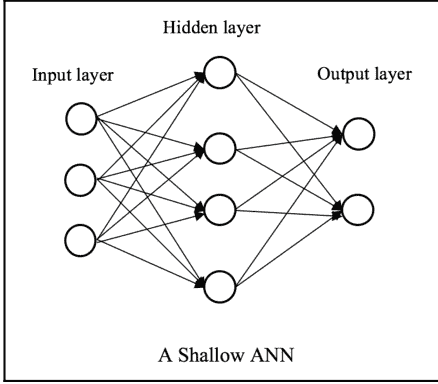

以下是深度学习模型的示例：

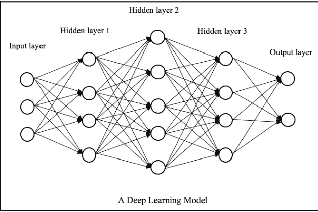

不要害怕，无论它听起来或看起来多么复杂。在本书的五个项目中，我们将从浅层到深层逐步深入探讨深度学习。

首先，作为机器学习广泛家族的一部分，深度学习可用于监督学习、半监督学习以及非监督学习任务，甚至强化学习任务。那么，它与传统机器学习算法有何不同？

## 什么让深度学习与众不同？

深度学习采用多个非线性处理单元的隐藏层堆叠。隐藏层的输入是其前一层的输出。从之前展示的浅层神经网络和深层神经网络示例中可以轻易观察到这一点。

从每个隐藏层提取特征。不同层的特征代表不同层级的抽象或模式。因此，高层特征源于低层特征，而低层特征又从前一层提取。所有这些共同构成了从数据中学习得到的分层表示。

以猫和狗图像分类为例，在传统机器学习方案中，分类步骤遵循特征提取过程，该过程通常基于：

- 领域知识，例如在此案例中动物的颜色、形状、耳朵形状等，这些通常是手工制作的
- 降维，例如主成分分析（PCA）、隐性狄利克雷分配（LDA）
- 特征工程技术，例如方向梯度直方图变换（HOG）、尺度不变特征变换（SIFT）和加速稳健特征（SURF）

传统机器学习方案对猫和狗分类的工作流程如下所示：

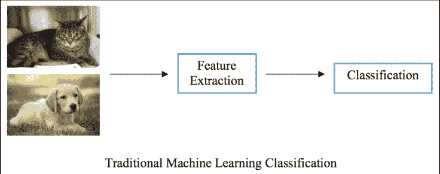

然而，在基于深度学习的方案中（例如我们即将学习的 CNN），分层表示是在隐性学习过程中推导出来的，然后最高层级的特征被输入到最终的分类步骤中。这些特征捕捉了猫和狗图像中重要且可区分的细节。得益于隐藏层中的神奇作用：

- 低层特征可以是胡须、鼻子或眼睛、耳朵等的边缘、线条或点
- 高层特征可以是动物的轮廓或外形

深度学习方案的完整工作流程如下所示：

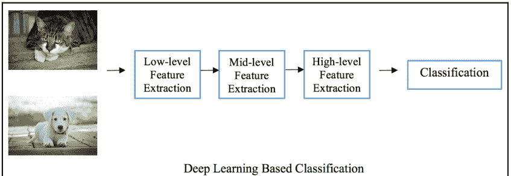

深度学习消除了这些手动或显式的特征提取步骤，而是依赖训练过程来自动发现输入数据下的有用模式。通过调整网络的布局（层数、每层的隐藏单元数量、激活函数等），我们可以找到最有效的特征集。

回顾上一节中浅层 ANN 和深度学习模型的示例，数据从输入层单向流向输出层。除了前馈架构，深度学习模型还允许数据向任何方向传播，甚至可以循环回到输入层。从前一输出循环回来的数据将成为下一个输入数据的一部分。**循环神经网络（RNNs）** 是很好的示例。我们将在本书后面使用 RNN 进行项目开发。目前，我们仍可以从以下 RNN 图中了解循环或环状架构的样子：

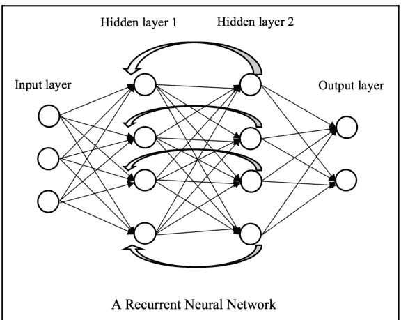

循环架构使模型适用于时间序列数据和输入序列。由于来自先前时间点的数据进入当前时间点的训练，深度学习模型实际上以前馈方式有效地解决了时间序列或序列学习问题。在传统机器学习方案（可参阅 T. Dietterich 撰写的 *序列数据的机器学习：综述*）中解决时间序列问题时，通常会提供先前滞后的滑动窗口作为当前输入。这可能效果不佳，因为需要确定滑动窗口的大小和窗口数量，而循环模型则会自行发现时间或序列关系。

尽管我们在此讨论了深度学习相对于其他机器学习技术的所有优势，但我们并未声称 *现代* 深度学习优于 *传统* 机器学习。没错，在这个领域，*没有免费的午餐*，这一点在我的上一本书 *Python机器学习实例教程* 中也得到了强调。没有一种算法能比其他算法更高效地解决所有机器学习问题。这全取决于具体使用场景——在某些应用中，“传统”方法更合适，或者深度学习设置无关紧要；在某些情况下，“现代”方法能产生更好的性能。

接下来，我们将看到深度学习的一些典型应用，这些应用将更好地激励我们开始深度学习项目。

## 深度学习的应用有哪些？

计算机视觉和图像识别通常被认为是深度学习取得突破的第一个领域。手写数字识别已成为该领域的 Hello World，而图像分类算法和技术的常用评估集是从 **美国国家标准与技术研究院**（NIST）构建的扫描文档数据集，称为 MNIST（M 代表 **modified**，表示数据已预处理以便于机器学习过程）。

MNIST 中的一些示例如下所示：

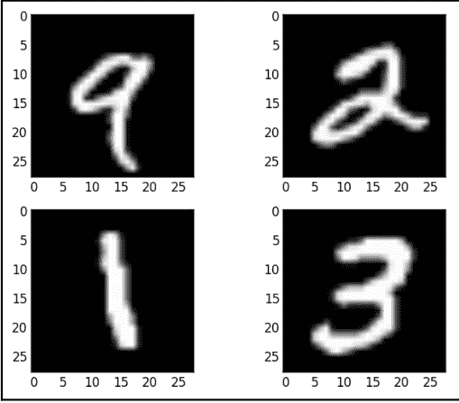

迄今为止，一些研究人员使用 CNN 在 MNIST 数据集上实现了 0.21% 的最佳错误率。详情可见 2013 年在 **国际机器学习会议（ICML）** 上发表的论文 *使用DropConnect的神经网络正则化*。其他可比结果，例如 0.23%、0.27% 和 0.31%，也由 CNN 和深度神经网络得出。然而，使用精细特征工程技术的传统机器学习算法只能产生 0.52% 到 7.6% 的错误率，分别通过使用 **支持向量机（SVMs）** 和成对线性分类器实现。

除了图像识别（例如广为人知的人脸识别），深度学习的应用还扩展到更具挑战性的任务，包括：

- 基于图像的搜索引擎，涵盖图像分类和图像相似性编码，大量使用深度学习技术。
- 机器视觉，以自动驾驶汽车为例，它实时解读 360°摄像头视图以做出决策。


- 黑白照片色彩还原——来自 http://hi.cs.waseda.ac.jp/~iizuka/projects/colorization/extra.html 的色彩恢复示例令人印象深刻。

- 图像生成，包括手写体、猫的图片，甚至是电子游戏图片，或者你想要的任何图片。例如，我们使用一个有趣的游乐场，https://www.cs.toronto.edu/~graves/handwriting.html（由多伦多大学的 Alex Graves 开发），以三种不同的风格创建本书标题的手写体：


自然语言处理（NLP）是深度学习在现代解决方案中占主导地位的另一个领域。请回顾，我们曾描述过具有循环架构的深度学习模型适用于输入序列，例如自然语言和文本。近年来，深度学习大大有助于改进：

- 机器翻译，例如基于句子的**谷歌神经机器翻译系统（GNMT）**，它利用深度RNN来提高准确性和流畅度

- 情感分析、信息检索、主题检测以及许多其他常见的NLP应用，得益于词嵌入技术，深度学习模型在这些应用中已达到最先进的性能

- 文本生成，RNN学习句子中单词（包括标点符号）之间复杂的关系，并用于*撰写*文本，以成为一位作者或一位虚拟的莎士比亚

图像字幕生成，也称为图像转文本，结合了计算机视觉和NLP的最新突破。它利用CNN来检测和分类图像中的物体，并为这些物体分配标签。然后，它应用RNN来用可理解的句子描述这些标签。以下示例摘录自 http://cs.stanford.edu/people/karpathy/deepimagesent/generationdemo/ 的网页演示（由斯坦福大学的Andrej Karpathy开发）：

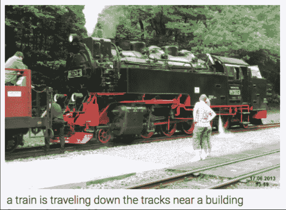

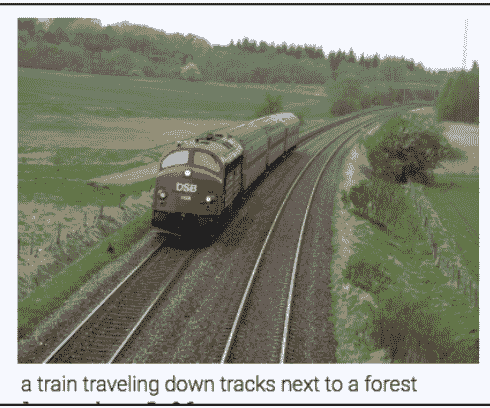

同样，声音和语音也是序列学习的一个领域，其中机器学习算法被应用于预测时间序列或标记序列数据。语音识别已被深度学习极大地颠覆。如今，基于深度学习的产品，如Apple的Siri、Amazon的Alexa、Google Home、Skype Translator等，正以一种肯定是良好的方式“入侵”我们的生活。除了作者撰写文本外，深度学习模型也可以是一名音乐作曲家。例如，米兰理工大学的Francesco Marchesani能够训练RNN来产生肖邦的音乐。

此外，深度学习在视频的许多用例中也表现出色。它利用其精确的运动检测能力，对虚拟现实的提升做出了重大贡献，并推动了监控视频中实时行为分析的发展。谷歌、DeepMind和牛津大学的科学家甚至构建了一个名为LipNet的计算机唇读系统，成功率达到93%。

除了监督学习和无监督学习案例外，深度学习在强化学习中也被大量使用。能够处理物体、爬楼梯、在厨房操作的机器人对我们来说已不再新鲜。最近，谷歌的AlphaGo击败世界顶尖围棋选手的事件获得了广泛的媒体报道。如今，每个人都期待着在一两年内看到自动驾驶汽车上市。这一切都受益于深度学习在强化学习中的进步。哦，别忘了电脑也被教导去玩FlappyBird游戏！

我们甚至还没有提到生物信息学、药物发现、电子商务、金融（尤其是股市）、保险以及**物联网（IoT）**中的推荐系统。事实上，深度学习应用的列表已经很长，而且只会越来越长。

我希望本节能让你对深度学习及其为我们面临的许多机器学习问题提供更好解决方案的能力感到兴奋。得益于深度学习的进步，人工智能拥有更光明的未来。

我们还在等什么？让我们从手写数字识别开始吧！

## 使用CNN进行手写数字识别

当然，我们从探索手写数字数据集开始。

## 开始探索MNIST

来自 http://yann.lecun.com/exdb/mnist/ 的MNIST数据集包含60,000个样本的训练集和10,000个样本的测试集。如前所述，图像最初取自NIST，然后被居中并调整为相同的高度和宽度（28 * 28）。

与其处理前面网站中的ubyte文件train-images-idx3-ubyte.gz和train-labels-idx1-ubyte.gz并将其合并，不如我们使用来自Kaggle竞赛Digit Recognizer的格式良好的数据集，https://www.kaggle.com/c/digit-recognizer/。我们可以直接从 https://www.kaggle.com/c/digit-recognizer/data 下载训练数据集train.csv。这是该网站提供的唯一带标签的数据集，我们将使用它来训练分类模型、评估模型并进行预测。现在让我们加载它：

```
> data <- read.csv ("train.csv")
> dim(data)
[1] 42000 785
```

我们有42,000个带标签的样本可用，每个样本有784个特征，这意味着每个数字图像有784（28 * 28）个像素。查看前6个数据样本中每个样本的标签和前5个特征（像素）：

```
> head(data[1:6])
label pixel0 pixel1 pixel2 pixel3 pixel4
1 1 0 0 0 0 0
2 0 0 0 0 0 0
3 1 0 0 0 0 0
4 4 0 0 0 0 0
5 0 0 0 0 0 0
6 0 0 0 0 0 0
```

目标标签范围从0到9，表示10个数字：

```
> unique (unlist (data[1]))
[1] 1 0 4 7 3 5 8 9 2 6
```

像素变量范围从0到255，表示像素的亮度，例如0表示黑色，255表示白色：

```
> min(data[2:785])
[1] 0
> max(data[2:785])
[1] 255
```

现在让我们看两个样本，首先是第四张图像：

```
> sample_4 <- matrix(as.numeric(data[4,-1]), nrow = 28, byrow = TRUE)
> image(sample_4, col = grey.colors(255))
```

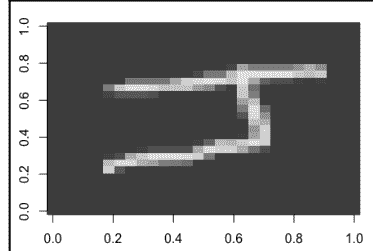

我们将长度为784的特征向量重塑为28 * 28的矩阵。

其次，第7张图像：

```
> sample_7 <- matrix(as.numeric(data[7,-1]), nrow = 28, byrow = TRUE)
> image(sample_7, col = grey.colors(255))
```

结果如下：

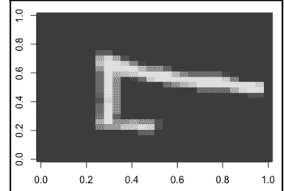

我们注意到图像向左旋转了90度。为了更好地查看图像，需要顺时针旋转90度。我们只需将图像矩阵中每一列的元素反转即可：

```
> # Rotate the matrix by reversing elements in each column
> rotate <- function(x) t(apply(x, 2, rev))
```

现在可视化旋转后的图像：

```
> image(rotate(sample_4), col = grey.colors(255))
```

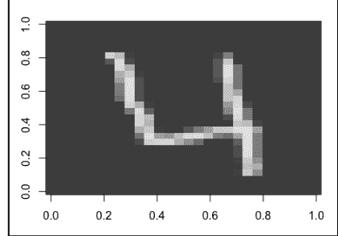

```
> image(rotate(sample_7), col = grey.colors(255))
```

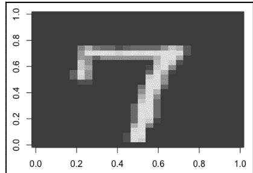

在了解数据和图像背后的情况后，我们对标签和特征进行了更多探索性分析。首先，因为这是一个分类问题，我们检查数据中的类别是否平衡或不平衡，作为良好的做法。但在这样做之前，我们应该将标签从整数转换为因子：

```
> # Transform target variable "label" from integer to factor, in order to perform classification
> is.factor(data$label)
[1] FALSE
> data$label <- as.factor(data$label)
> is.factor(data$label)
[1] TRUE
```

现在，我们可以汇总标签的分布计数：

```
> summary(data$label)
   0   1   2   3   4   5   6   7   8   9
4132 4684 4177 4351 4072 3795 4137 4401 4063 4188
```

或结合比例（%）：

```
> proportion <- prop.table(table(data$label)) * 100
> cbind(count=table(data$label), proportion=proportion)
  count proportion
0 4132  9.838095
1 4684  11.152381
2 4177  9.945238
3 4351  10.359524
4 4072  9.695238
5 3795  9.035714
6 4137  9.850000
7 4401  10.478571
8 4063  9.673810
9 4188  9.971429
```

类别是平衡的。

现在，我们探索特征（像素）的分布。作为示例，我们从每张图像的中心2*2块中提取4个像素（即pixel376、pixel377、pixel404和pixel405），并为9个数字中的每一个显示直方图：

```
> central_block <- c("pixel376", "pixel377", "pixel404", "pixel405")
> par(mfrow=c(2, 2))
> for (i in 1:9) {
+   hist (c(as.matrix(data[data$label==i, central_block])),
+   main=sprintf("Histogram for digit %d", i),
+   xlab="Pixel value")
+ }
```


数字 1 到 4 的像素亮度直方图分别显示如下：

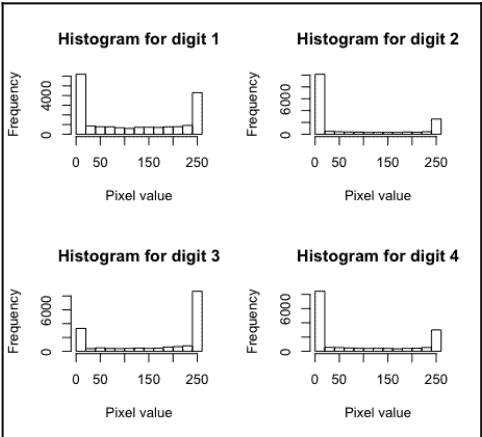

数字 5 到 9 的直方图：

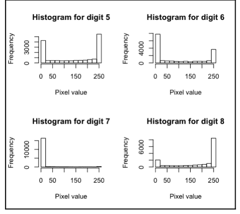

而数字 9 的直方图为：

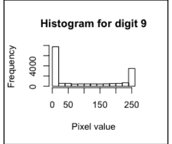

9 个数字的中心像素亮度分布不同。例如，大多数中心像素都是亮的，因为数字 8 的笔画通常穿过中心；而数字 7 不是这样写的，因此大多数中心像素都是暗的。取自其他位置的像素在不同数字中也可以呈现明显的分布。

我们刚刚进行的探索性分析有助于推进基于像素的分类模型构建。

## 第一次尝试 – 逻辑回归

我们从可能最基本的分类器开始，即逻辑回归，更具体地说是多项逻辑回归，因为这是一个多类情况。它是一种概率线性分类器，由权重矩阵 W（也称为系数矩阵）和偏置（也称为截距）向量 b 参数化。它将输入向量 x 映射到一组概率 P(y=1)、P(y=2)、...、P(y-K)，用于 K 个可能的类别。

两个可能类别的多项逻辑回归可以图形表示如下：

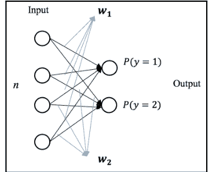

假设 x 是 n 维的，则权重矩阵 W 的大小为 n 乘以 K，其中每一列 $W_k$ 表示与类别 k 相关的系数；同样，偏置向量 b 的长度为 K，其中每个元素 $b_k$ 用作类别 k 的偏置。为简单起见，偏置 b 可以被视为权重矩阵 W 中的额外一行。因此，x 属于类别 k 的概率可以用数学表达式表示为：

```
$$P(y = k|x, W) = softmax_k(Wx)$$
$$= \frac{exp(w_k x)}{\sum_{j=1}^{K} exp(w_j x)}$$
```

其中 softmax() 表示 softmax 函数，这就是为什么多项逻辑回归常被称为 softmax 回归。

给定一组训练样本 $(x^{(1)}, y^{(1)}), (x^{(2)}, y^{(2)}), \dots (x^{(i)}, y^{(i)}), \dots (x^{(m)}, y^{(m)})$，其中 $y \in 1, 2, \dots, K$，最优模型 $w$ 通过最小化代价（也称为对数损失）获得，其定义为：

```
$$J(W) = - \left[ \sum_{i=1}^m \sum_{k=1}^K 1\{y^{(i)} = k\} log \frac{exp(w_k x)}{\sum_{j=1}^{K} exp(w_j x)} \right]$$
$$where$$
$$1\{y^{(i)} = k\} = \begin{cases} 1, & if y^{(i)} = k \\ 0, & otherwise \end{cases}$$
```

通常我们采用梯度下降，一种迭代优化算法，来求解最优 $w$。在每次迭代中，$w$ 沿着当前点客观函数负导数 $\Delta w$ 的方向移动一步，步长与之成正比。即，$w:=w-\eta\Delta w$，其中 $\eta$ 是学习率。$\Delta w$ 的每一列 $\Delta w_k$ 可以计算为：

\(\Delta w_k = \frac{\partial}{\partial w_j}J(w) = -\sum_{i=1}^m[x^{(i)}(1\{y^{(i)} = k\} - P(y^{(i)} = k \mid x^{(i)}, W))]\)

训练有素的模型，即最优 $w$ 将用于通过以下方式对新样本 $x'$ 进行分类：

\(y' = \text{argmax}_k \frac{\exp(w_k x')}{\sum_{j=1}^{j=K}\exp(w_j x')} = \text{argmax}_k (w_k x')\)

掌握了我们刚刚回顾的多项逻辑回归的机制后，我们可以将其作为数字分类项目的第一个解决方案来应用。

我们首先使用 caret 包将数据集分割为训练子集和测试子集。

**caret 代表分类和回归训练。** 该包旨在促进模型训练和评估过程。它包含用于数据分割、数据预处理、特征选择和模型调优的工具和方法。文档和完整函数列表可在以下网址找到：

https://cran.r-project.org/web/packages/caret/caret.pdf.

安装并导入 caret 包：

```
> if (!require("caret"))
+ install.packages("caret")
> library(caret)
Loading required package: lattice
Loading required package: ggplot2
```

我们首先使用 createDataPartition 函数将数据分成两个分区，75% 用于训练，25% 用于测试：

```
> set.seed(42)
> train_perc = 0.75
> train_index <- createDataPartition(data$label, p=train_perc, list=FALSE)
> data_train <- data[train_index,]
> data_test <- data[-train_index,]
```

为确保实验可复现，从随机数生成器中选择一个种子始终是一种良好的做法。

然后，我们使用 `nnet` 包实现多项逻辑回归模型。该包包含用于前馈单层神经网络以及多项逻辑回归模型的函数。更多详细信息可在 `https://cran.r-project.org/web/packages/nnet/nnet.pdf` 中找到：

```
> library(nnet)
> # Multinomial logistic regression
> model_lr <- multinom(label ~ ., data=data_train, MaxNWts=10000,
decay=5e-3, maxit=100)
### weights:  7860 (7068 variable)
initial  value 72538.338185
iter 10 value 17046.804658
iter 20 value 11166.225504
iter 30 value 9514.340319
iter 40 value 8819.724147
iter 50 value 8405.001712
iter 60 value 8164.997939
iter 70 value 7983.427139
iter 80 value 7897.005940
iter 90 value 7831.663204
iter 100 value 7730.047242
final  value 7730.047242
stopped after 100 iterations
```

我们在训练子集上拟合多项逻辑回归模型，参数包括：

- MaxNWts=10000: 它最多允许 10,000 个权重。在我们的情况中，权重矩阵 w 中有 (784 维 + 1 偏置) * 10 个类别 = 7850 个元素
- decay=5e-3: 正则化强度，权重衰减为 0.005
- maxit=100: 最大迭代次数设置为 100

每 10 次迭代打印一次误差值，且其在下降。当达到最大迭代次数时，模型收敛。然后我们使用训练好的模型来预测测试样本的类别：

```
> prediction_lr <- predict(model_lr, data_test, type = "class")
```

让我们看看前五个样本的预测结果：

```
> prediction_lr[1:5]
[1] 1 0 7 5 8
Levels: 0 1 2 3 4 5 6 7 8 9
```

它们的真实值为：

```
> data_test$label[1:5]
[1] 1 0 7 5 8
Levels: 0 1 2 3 4 5 6 7 8 9
```

我们还可以通过以下方式获得混淆矩阵：

```
> cm_lr = table(data_test$label, prediction_lr)
> cm_lr
```

| | 0 | 1 | 2 | 3 | 4 | 5 | 6 | 7 | 8 | 9 |
|---|---|---|---|---|---|---|---|---|---|---|
| 0 | 965 | 0 | 11 | 4 | 1 | 12 | 23 | 6 | 7 | 4 |
| 1 | 0 | 1126 | 8 | 47 | 0 | 12 | 2 | 3 | 17 | 6 |
| 2 | 5 | 16 | 899 | 24 | 18 | 6 | 24 | 15 | 29 | 8 |
| 3 | 5 | 4 | 37 | 921 | 1 | 47 | 9 | 10 | 33 | 20 |
| 4 | 6 | 10 | 4 | 2 | 903 | 1 | 14 | 6 | 12 | 60 |
| 5 | 12 | 6 | 9 | 27 | 6 | 770 | 23 | 8 | 75 | 12 |
| 6 | 5 | 4 | 13 | 0 | 11 | 8 | 981 | 3 | 9 | 0 |
| 7 | 6 | 3 | 20 | 1 | 6 | 3 | 3 | 995 | 6 | 57 |
| 8 | 7 | 20 | 6 | 25 | 5 | 31 | 5 | 4 | 892 | 20 |
| 9 | 6 | 4 | 2 | 15 | 37 | 3 | 0 | 41 | 11 | 928 |

而分类准确率为：

```
> accuracy_lr = mean(prediction_lr == data_test$label)
> accuracy_lr
[1] 0.8935886
```

第一次尝试就达到 89.4%。不错！我们当然可以通过调整模型参数（如 decay 和 maxit）来做得更好。但我们的目标是一个更先进的模型，能够更好地学习底层模式。因此我们继续采用第二个解决方案：带有单个隐藏层的前馈神经网络。

## 从逻辑回归到单层神经网络

基本上，逻辑回归是一个没有隐藏层的前馈神经网络，其中输出层直接连接到输入层。换句话说，逻辑回归是一个将输入映射到输出层的单个神经元。理论上，在输入层和输出层之间增加一个隐藏层的神经网络应该能够更多地了解底层关系。

两个可能类别的单层神经网络可以图形表示如下：

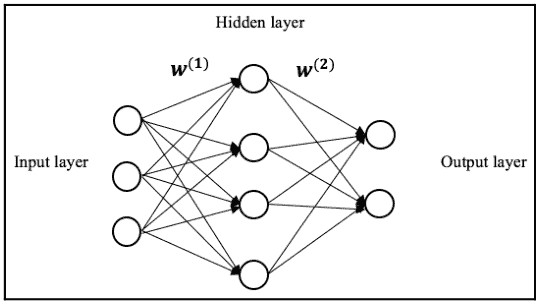

假设 \( x \) 是 \( n \) 维的，且隐藏层中有 \( H \) 个隐藏单元，那么连接输入层和隐藏层的权重矩阵 \( w^{(1)} \) 大小为 \( n \) 乘以 \( H \)，其中每一列 \( w_h^{(1)} \) 表示与第 \( h \) 个隐藏单元相关的系数。因此，第 \( h \) 个隐藏单元的输出（也称为**激活**）\( a_h^{(2)} \) 可以用数学表达式表示为：

```
\( a_h^{(2)} = f(z^{(2)}) = f(w_h^{(1)} x) \)
```

例如，对于第一个、第二个和最后一个隐藏单元的输出：

```
\( a_1^{(2)} = f(w_1^{(1)} x) \
\( a_H^{(2)} = f(w_H^{(1)} x) \
\( a_H^{(2)} = f(w_H^{(1)} x) \
```


其中 f(z) 是激活函数。简单网络中激活函数的典型选择包括 logistic 函数（更常被称为 sigmoid 函数）和 tanh 函数（可以被视为 logistic 函数的重新缩放版本）：

```math
sigmoid(z) = \frac{1}{1 + e^{-z}}

tanh(z) = \frac{e^{-z} - e^{z}}{e^{z} + e^{-z}} = \frac{2}{1 + e^{-2z}} - 1
```

这两个函数的图像如下：

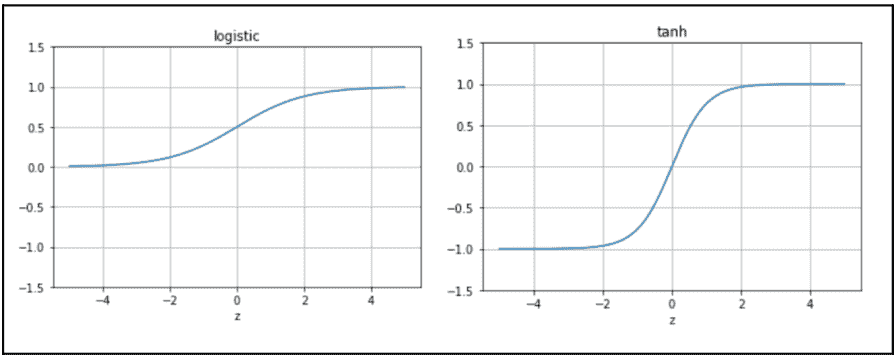

目前我们在单层网络中将使用 logistic 函数。

对于 K 个可能类别的情况，连接隐藏层到输出层的权重矩阵 \( w^{(2)} \) 的大小为 H 乘以 K。每一列 \( w_k^{(2)} \) 表示与类别 k 相关的系数。输出层的输入是隐藏层的输出 \( a^{(2)} = \{a_1^{(2)}, a_2^{(2)}, \dots, a_l^{(2)}\} \)，x 属于类别 k 的概率可以用数学表达式表示（为保持一致性，我们将其表示为 \( a_k^{(3)} \)）：

```math
a_k^{(3)} = f(z^{(3)}) = softmax_k(W^{(2)}a^{(2)})
```

同样，给定 m 个训练样本，为了训练神经网络，我们使用梯度下降法学习所有权重 \( w = \{w^{(1)}, w^{(2)}\} \)，目标是最小化均方误差代价 J(w)。

梯度 \(\Delta w\) 的计算可以通过 **反向传播算法** 实现。
反向传播算法的思路如下：我们首先遍历网络，计算所有隐藏层和输出层的输出；然后从最后一层开始向后移动，计算每个节点对最终输出误差的贡献程度，并将其向后传播到之前的层。在我们的单层网络中，详细步骤如下：

- 1. 计算隐藏层的 \(a^{(2)}\) 并将它们馈送到输出层以计算输出 \(a^{(3)}\)
- 2. 对于输出层，计算单个样本的代价函数关于每个单元的导数 \(\delta_k^{(3)} = \frac{\partial}{\partial z_k^{(3)}} J(W) = -(y_k - a_k^{(3)}) \cdot f'(z_k^{(3)})\)，\(\delta^{(3)} = -(y - a^{(3)}) \cdot f'(z^{(3)})\)，重写为整个层
- 3. 对于隐藏层，我们根据 \(\delta^{(3)}\) 的加权平均计算误差项 \(\delta^{(2)} : \delta^{(2)} = ((W^{(2)})^T \delta^{(3)}) \cdot f'(z^{(2)})\)
- 4. 应用链式法则计算梯度：

```math
\triangle W^{(2)} = \frac{\partial J(W)}{\partial z_k^{(3)}} \frac{\partial z_k^{(3)}}{\partial W^{(2)}} = \delta^{(3)} (a^{(2)})^T
```

```math
\triangle W^{(1)} = \frac{\partial J(W)}{\partial z_k^{(2)}} \frac{\partial z_k^{(2)}}{\partial W^{(1)}} = \delta^{(2)} (x)^T
```

我们通过执行这些步骤反复更新所有权重，直到代价函数收敛。

简要回顾单层网络后，我们可以将其作为数字分类项目的第二个解决方案。

再次，我们使用 `nnet` 包来实现我们的单层网络：

```r
> model_nn <- nnet(label ~ ., data=data_train, size=50, maxit=300,
MaxNWts=100000, decay=1e-4)
### weights: 39760
initial value 108597.598656
iter 10 value 27708.286001
iter 20 value 16027.005297
iter 30 value 14058.141050
iter 40 value 12615.442747
iter 50 value 11793.700937
iter 60 value 11026.672273
iter 70 value 10654.855058
iter 80 value 10193.580947
iter 90 value 9854.836168
iter 100 value 9544.973159
iter 110 value 9307.192737
iter 120 value 9043.028253
iter 130 value 8845.069307
iter 140 value 8686.707561
iter 150 value 8525.104362
iter 160 value 8281.609223
iter 170 value 8140.051273
iter 180 value 7998.721024
iter 190 value 7854.388240
iter 200 value 7712.459027
iter 210 value 7636.945553
iter 220 value 7557.675909
iter 230 value 7449.854506
iter 240 value 7355.021651
iter 250 value 7259.186906
iter 260 value 7192.798089
iter 270 value 7055.027833
iter 280 value 6957.926522
iter 290 value 6866.641511
iter 300 value 6778.342997
final value 6778.342997
stopped after 300 iterations
```

我们使用包括以下参数拟合模型：

- size=50：隐藏层中有 50 个隐藏单元。
- MaxNWts=100000：它最多允许 100,000 个权重。在我们的例子中，权重矩阵 w<sup>(1)</sup> 中有 (784 个输入维度 + 1 个偏置) * 50 个隐藏单元 = 39,250 个元素，权重矩阵 w<sup>(2)</sup> 中有 (50 个隐藏单元 + 1 个偏置) * 10 个输出单元 = 510 个元素。因此总共有 39,760 个权重。
- decay=1e-4：正则化强度，权重衰减为 0.0001。
- maxit=300：最大迭代次数设置为 300。

我们在测试集上应用训练好的网络模型：

```r
> prediction_nn <- predict(model_nn, data_test, type = "class")
> cm_nn = table(data_test$label, prediction_nn)
> cm_nn
```

| True \ Predicted | 0 | 1 | 2 | 3 | 4 | 5 | 6 | 7 | 8 | 9 |
|---|---|---|---|---|---|---|---|---|---|---|
| 0 | 987 | 0 | 3 | 3 | 2 | 11 | 10 | 7 | 5 | 5 |
| 1 | 0 | 1134 | 9 | 6 | 0 | 2 | 0 | 5 | 11 | 4 |
| 2 | 14 | 9 | 918 | 31 | 11 | 11 | 7 | 15 | 22 | 6 |
| 3 | 3 | 1 | 17 | 966 | 0 | 41 | 3 | 14 | 24 | 18 |
| 4 | 4 | 3 | 8 | 2 | 929 | 4 | 11 | 11 | 5 | 41 |
| 5 | 12 | 2 | 6 | 17 | 5 | 851 | 15 | 9 | 26 | 5 |
| 6 | 10 | 1 | 14 | 0 | 9 | 14 | 970 | 0 | 15 | 1 |
| 7 | 4 | 4 | 23 | 6 | 5 | 2 | 0 | 1010 | 7 | 39 |
| 8 | 5 | 15 | 9 | 18 | 5 | 31 | 9 | 4 | 912 | 7 |
| 9 | 11 | 2 | 1 | 20 | 52 | 4 | 0 | 36 | 8 | 913 |

```r
> accuracy_nn = mean(prediction_nn == data_test$label)
> accuracy_nn
[1] 0.9135944
```

比我们的第一次尝试更好！我们可以使用深度学习模型，比如说更多的隐藏层，做得更好吗？当然可以。

## 向网络中添加更多隐藏层

我们刚刚使用单层神经网络模型达到了 91.3% 的准确率。理论上，我们可以使用多个隐藏层获得更好的模型。作为示例，我们提供一个具有两个隐藏层的深度神经网络模型的解决方案：

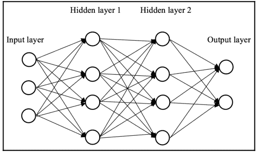

前馈深度神经网络中的权重优化也是通过反向传播算法实现的，这与单层网络相同。但是，层数越多，计算复杂度越高，模型收敛越慢。加速权重优化的一种方法是使用计算效率更高的激活函数。近年来最流行的是整流线性单元（ReLU）：

```math
relu(z) = z^+ = \max(0, z)
```

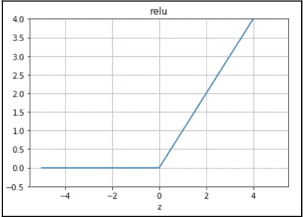

```math
relu'(z) = \begin{cases} 0, z < 0 \\ 1, z \ge 0 \end{cases}
```

得益于其导数的特性，与 sigmoid 相比，使用 ReLU 激活函数有两个主要优势：

- 学习更快，因为 \( relu'(z) \) 是常数，而 logistic 函数 \( sigmoid'(z) = sigmoid(z) * (1 - sigmoid(z)) \) 不是。
- 不太可能出现梯度消失问题，即梯度的指数级下降，这可能出现在多层堆叠的 sigmoid 层网络中。由于我们在计算每个层的误差 \(\delta\) 时要乘以激活函数的导数，而 \( sigmoid'(z) \) 的最大值为 ¼，随着我们堆叠越来越多的 sigmoid 层，梯度会呈指数级下降。

我们在前面章节中使用的 `nnet` 包目前只能建模单层网络。在本章中，我们使用 `MXNet` 包来实现具有多个隐藏层的深度神经网络。`MXNet (`https://mxnet.incubator.apache.org/`)` 是一个支持包括 R、Scala、Python、Julia、C++ 和 Perl 在内的编程语言的深度学习框架。它由 `DMLC (`http://dmlc.ml/`)` 团队开发，这是一个专家团队，致力于开源机器学习项目的协作。它是可移植的，可以扩展到多个 CPU、多个 GPU 和多个机器，例如在云中。最重要的是，它允许我们灵活且高效地构建最先进的深度学习模型，包括深度神经网络、CNN 和 RNN。

让我们先安装 MXNet：

```r
> cran <- getOption("repos")
> cran["dmlc"] <- "https://s3-us-west-2.amazonaws.com/apache-mxnet/R/CRAN/"
> options(repos = cran)
> if (!require("mxnet"))
install.packages("mxnet")
```

现在我们可以导入 MXNet 并将数据转换为 MXNet 中神经网络模型偏好的格式：

```r
> require(mxnet)
> data.train <- data.matrix(data_train)
> data.train.x <- data_train[,-1]
> data.train.x <- t(data.train.x/255)
> data.train.y <- data_train[,1]
```

注意，我们通过除以最大可能值 255 将输入特征缩放到 0 到 1 的范围。否则，深度神经网络可能会偏向某些特征，这种偏差会随着层数累积。

现在训练数据集已准备就绪，我们可以通过定义其架构来开始构建网络，如下所示：

```r
> data <- mx.symbol.Variable("data")
> fc1 <- mx.symbol.FullyConnected(data, name="fc1", num_hidden=128)
> act1 <- mx.symbol.Activation(fc1, name="relu1", act_type="relu")
> fc2 <- mx.symbol.FullyConnected(act1, name="fc2", num_hidden=64)
> act2 <- mx.symbol.Activation(fc2, name="relu2", act_type="relu")
> fc3 <- mx.symbol.FullyConnected(act2, name="fc3", num_hidden=10)
> softmax <- mx.symbol.SoftmaxOutput(fc3, name="sm")
```

在 MXNet 的 Symbol API 中，我们使用 symbol 数据类型表示网络。我们从输入层数据开始，即输入数据，然后是第一个隐藏层 fc1，包含 128 个节点，它与输入层完全连接。然后我们将 ReLU 函数附加到 fc1，并输出该层的激活值 act1。同样，我们链接另一个隐藏层 fc2，这次有 64 个节点，并输出基于 ReLU 的激活值 act2。最后，我们使用 softmax 函数结束输出层，生成对应 10 个类别的 10 个概率。整体结构如下：


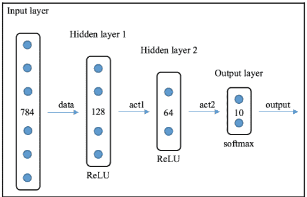

构建模型后，就可以开始训练模型了。我们可以选择计算设备，CPU 和/或 GPU——下面是一个 CPU 示例：

```
> devices <- mx.cpu()
```

训练前，不要忘记设置随机种子，以便建模过程可复现：

```
> mx.set.seed(42)
> model_dnn <- mx.model.FeedForward.create(softmax, X=data_train.x,
y=data_train.y, ctx=devices, num.round=30, array.batch.size=100,
learning.rate=0.01, momentum=0.9, eval.metric=mx.metric.accuracy,
initializer=mx.init.uniform(0.1),
epoch.end.callback=mx.callback.log.train.metric(100))
Start training with 1 devices
[1] Train-accuracy=0.724793650793651
[2] Train-accuracy=0.904715189873417
[3] Train-accuracy=0.925537974683544
[4] Train-accuracy=0.939936708860759
[5] Train-accuracy=0.950379746835443
[6] Train-accuracy=0.958734177215119
[7] Train-accuracy=0.96509493670886
[8] Train-accuracy=0.969905063291139
[9] Train-accuracy=0.974303797468355
[10] Train-accuracy=0.977784810126584
[11] Train-accuracy=0.980696202531648
[12] Train-accuracy=0.983164556962027
[13] Train-accuracy=0.985284810126584
[14] Train-accuracy=0.987405063291141
[15] Train-accuracy=0.988924050632913
[16] Train-accuracy=0.990727848101267
[17] Train-accuracy=0.992088607594938
[18] Train-accuracy=0.993227848101268
[19] Train-accuracy=0.994398734177217
[20] Train-accuracy=0.995284810126584
[21] Train-accuracy=0.995854430379748
[22] Train-accuracy=0.996835443037975
[23] Train-accuracy=0.997183544303798
[24] Train-accuracy=0.997848101265823
[25] Train-accuracy=0.998164556962026
[26] Train-accuracy=0.998575949367089
[27] Train-accuracy=0.998924050632912
[28] Train-accuracy=0.999177215189874
[29] Train-accuracy=0.999367088607595
[30] Train-accuracy=0.999525316455696
```

我们使用以下超参数拟合模型：

- num.round = 30：最大迭代次数设置为 30。

- array.batch.size = 100：小批量梯度下降的批大小为 100。作为随机梯度下降的一种变体，小批量梯度下降算法通过小批量而非单个训练样本来计算代价和梯度。因此，它在计算上更高效，并能加快模型收敛。因此，小批量梯度下降在训练深度神经网络中更为常用。

- learning.rate = 0.01：学习率为 0.01。

- momentum=0.9：一般来说，深度架构的代价函数形式为一个或多个通向全局最优的浅峡谷（局部最小值）。借鉴物理运动定律中的动量概念，可用于避免陷入次优解并加快收敛。使用动量时，权重按如下方式更新：

```
v = γv - ηΔW
W = W + v
```

其中左侧和右侧的 v 分别表示前一时刻和当前速度，γ ∈ (0,1] 是动量因子，决定将多少前一时刻的速度纳入当前速度。

- eval.metric=mx.metric.accuracy：它使用分类准确率作为评估指标

- initializer=mx.init.uniform(0.1)：初始权重从 0 到 1 的均匀分布中随机生成，从而降低深度网络中权重爆炸和消失的概率

模型训练完成后，让我们看看它在测试集上的表现。首先，请记住对测试数据集进行相同的预处理：

```
> data_test.x <- data_test[,-1]
> data_test.x <- t(data_test.x/255)
```

然后，预测测试样本并评估性能：

```
> prob_dnn <- predict(model_dnn, data_test.x)
> prediction_dnn <- max.col(t(prob_dnn)) - 1
> cm_dnn = table(data_test$label, prediction_dnn)
> cm_dnn
prediction_dnn
0 1 2 3 4 5 6 7 8 9
0 1041 0 2 0 0 1 3 0 8 1
1 0 1157 3 1 1 0 1 3 1 0
2 2 1 993 3 3 1 2 13 5 2
3 1 3 14 1033 1 13 0 5 14 6
4 0 2 1 0 991 0 4 4 1 12
5 4 2 3 12 3 892 4 3 6 8
6 10 0 1 0 3 4 988 0 4 0
7 0 5 9 1 2 0 0 1116 2 1
8 4 8 3 5 0 0 8 3 2 1020 12
9 1 1 0 4 13 3 0 16 2 957
> accuracy_dnn = mean(prediction_dnn == data_test$label)
> accuracy_dnn
[1] 0.9704706
```

增加一层隐藏层后，准确率从 91.4% 提升到 97.0%！由于深度神经网络中每个隐藏层都能提供某个层次的数据表示，我们是否可以简单地认为隐藏层越多（例如 100、1,000、10,000...），发现的底层模式就越多，分类准确率就越高？如果我们有足够的资源和时间来支持计算，并确保如此复杂的网络不会过拟合，这或许是成立的。有没有办法在不简单堆叠更多隐藏层、同时又不过度扩大网络规模的前提下，提取更丰富、更有信息量的表示呢？答案是 CNN。

## 使用 CNN 提取更丰富的表示

尽管常规隐藏层（我们也称其为全连接层）能够完成获取特定层次表示的任务，但这些表示可能有助于我们区分不同类别的图像。我们需要提取更丰富、更具区分度的表示，例如，让“9”就是“9”，“4”就是“4”，或者让猫是猫、狗是狗。我们求助于 CNN，它是多层神经网络的变体，其生物灵感来源于人类视觉皮层。基本上，CNN 从以下两个神经科学发现中汲取灵感：

- 视觉皮层拥有一套复杂的神经元系统，这些细胞对视觉场的特定子区域（称为感受野）敏感。例如，某些细胞仅在存在垂直边缘时做出反应；某些细胞仅在接触水平边缘时放电；还有一些细胞在显示特定方向的边缘时反应更强烈。这些细胞共同组织起来，产生完整的视觉感知，而每个单独的细胞则专门处理特定的分量。

- 简单细胞仅当边缘状模式出现在其感受野子区域内时才做出反应。更复杂的细胞对较大的子区域敏感，因此，对整个视觉场中这些边缘状模式的局部位置不那么敏感。

同样，CNN 通过首先推导低级表示（如局部边缘和曲线），然后通过一系列低级表示组合高级表示（如整体形状和轮廓）来对图像进行分类。CNN 非常适合利用强大且独特的特征来区分图像。

通常，CNN 接收一幅图像，将其通过一系列卷积层、非线性层、池化层和全连接层传递，最后输出每个可能类别的概率。我们现在详细地逐一介绍每种层类型。

卷积层是 CNN 中的第一层。它通过对输入应用卷积操作，模拟神经元细胞对感受野的响应方式。具体来说，它计算卷积层的权重与输入层中与之相连的小区域之间的点积。这个小区域即感受野，权重可以视为滤波器上的值。当滤波器从输入层的开头滑动到结尾时，会计算权重与当前感受野之间的点积。在对所有子区域进行卷积后，会得到一个称为特征图的新层。请看以下示例：

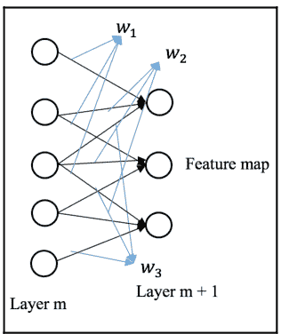

层 $m$ 有五个节点，滤波器有三个单元 [$w_1, w_2, w_3$]。我们计算滤波器与层 $m$ 中前三个节点的点积，得到特征图中的第一个节点；然后，计算滤波器与中间三个节点的点积，生成第二个节点；最后，得到由层 $m$ 中最后三个节点产生的第三个节点。

以下是另一个示例，帮助我们更好地理解卷积层在图像上的工作原理：

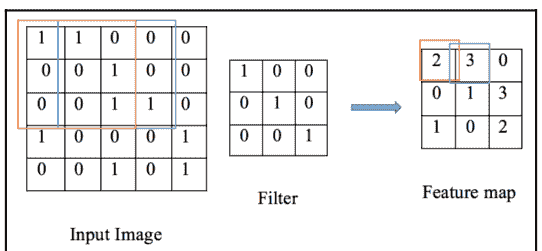

一个 3*3 滤波器从左上角子区域滑动到右下角的 5*5 图像周围。对于每个子区域，都会计算与滤波器的点积。结果生成一个 3*3 特征图。


卷积层实际上用于提取特征，例如边缘和曲线。如果特征图中的输出像素对应的感受野包含滤波器指定的边缘或曲线，则该像素值会很高。例如，在前面的示例中，滤波器描绘了一个反斜杠形状的对角线边缘，蓝色矩形中的感受野包含类似的曲线，因此产生最高强度 3（1*1 + 1*1 + 1*1 + 3）；然而，左下角的感受野不包含这样的形状，从而产生值为 1 的像素。卷积层充当曲线检测器，模拟我们的视觉细胞的工作方式。

请记住，在前面的案例中，我们只应用了一个滤波器并生成了一个特征图，这表明输入图像中的形状与滤波器中表示的曲线有多相似。为了获得更丰富的数据表示，我们可以使用更多滤波器，例如水平、垂直曲线、30 度或直角形状，以便由特征图组成的隐藏层可以检测更多模式。此外，堆叠多个卷积层可以产生更高级别的表示，例如整体形状和轮廓。为了确保捕捉到强的空间局部模式，层中的每个滤波器仅对相应的感受野有响应。串联更多层会产生更大的感受野，从而捕获更多的全局模式。

在每个卷积层之后，我们通常会应用一个 **非线性层**（也称为 **激活层**，如前所述），以引入非线性，这很明显。这是因为卷积层中只进行线性运算（乘法和加法）。而且，一个只有线性隐藏层的神经网络，无论有多少层，都会表现得就像一个单层感知机。同样，ReLu 是深度神经网络中非线性层最流行的候选者。

通常，通过一个或多个卷积层和非线性层的对获取特征后，我们可以使用输出进行分类，例如在我们的多分类案例中应用 softmax 层。让我们做一些数学计算，假设我们在第一个卷积层中应用 20 个 5*5 滤波器，那么该层的输出大小将为 20 * (28 - 5 + 1) * (28 - 5 + 1) = 20 * 24 * 24 = 11520，这意味着作为下一层输入的特征数量从 784 变为 11,520；然后我们在第二个卷积层中应用 50 个 5*5 滤波器，输出大小增长到 50 * 20 * (24 - 5 + 1) * (24 - 5 + 1) = 400,000，与初始大小 784 相比属于高维。我们可以看到，在分类的 softmax 层之前，每个卷积层都会使维数急剧增加。这很容易导致过拟合，更不用说相应非线性层中需要训练的大量权重了。

为了解决维数增长问题，我们通常在一对卷积层和非线性层之后使用 **池化层**（也称为 **下采样层**）。正如其名称所示，它通过子区域聚合特征的统计信息来生成低得多维度的特征。典型的池化方法包括最大池化和平均池化，它们分别对所有非重叠子区域取最大值和平均值。例如，我们在一个 4*4 特征图上应用一个 2*2 最大池化滤波器，并输出一个 2*2 特征图：

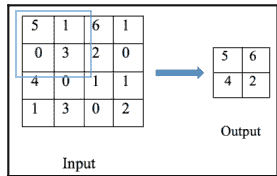

除了通过低维输出减少过拟合外，对区域进行统计聚合的池化层还有一个优势——平移不变性。这意味着，如果输入图像发生少量平移，输出不会改变。例如，假设我们将输入图像向左或向右、向上或向下平移几个像素，只要子区域中最高像素保持不变，最大池化层的输出仍然相同。换句话说，使用池化层后，预测对位置的敏感度会降低。

将这三类卷积相关层结合起来，再加上全连接层，我们可以按如下方式构建 CNN 模型：

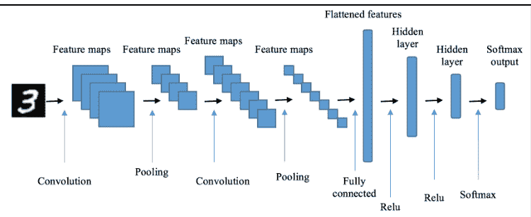

它从第一个卷积层、ReLu 非线性层和池化层开始。这里，我们使用 20 个 5*5 卷积滤波器和一个 2*2 最大池化滤波器：

```
> # first convolution
> conv1 <- mx.symbol.Convolution(data=data, kernel=c(5, 5),
num_filter=20)
> act1 <- mx.symbol.Activation(data=conv1, act_type="relu")
> pool1 <- mx.symbol.Pooling(data=act1, pool_type="max",
+ kernel=c(2, 2), stride=c(2, 2))
```

接下来是第二个卷积层、ReLu 非线性层和池化层，其中使用了 50 个 5*5 卷积滤波器和一个 2*2 最大池化滤波器：

```
> # second convolution
> conv2 <- mx.symbol.Convolution(data=pool1, kernel=c(5, 5),
num_filter=50)
> act2 <- mx.symbol.Activation(data=conv2, act_type="relu")
> pool2 <- mx.symbol.Pooling(data=act2, pool_type="max",
+ kernel=c(2, 2), stride=c(2, 2))
```

现在，我们通过检测边缘、曲线和形状来提取输入图像的丰富表示，接下来进行全连接层处理。但在此之前，我们需要将之前卷积层生成的特征图展平：

```
> flatten <- mx.symbol.Flatten(data=pool2)
```

在全连接部分，我们应用两个具有 500 和 10 个单元的 ReLu 隐藏层，分别如下：

```
> # first fully connected layer
> fc1 <- mx.symbol.FullyConnected(data=flatten, num_hidden=500)
> act3 <- mx.symbol.Activation(data=fc1, act_type="relu")
> # second fully connected layer
> fc2 <- mx.symbol.FullyConnected(data=act3, num_hidden=10)
```

最后，softmax 层生成 10 个类别的输出：

```
> # softmax output
> softmax <- mx.symbol.SoftmaxOutput(data=fc2, name="sm")
```

现在，骨架已构建完成。是时候设置随机种子并开始训练模型了：

我们需要先将矩阵 data_train.x 重塑为数组，以满足 MXNet 中卷积层的要求：

```
> train.array <- data_train.x
> dim(train.array) <- c(28, 28, 1, ncol(data_train.x))
> mx.set.seed(42)
> model.cnn <- mx.model.FeedForward.create(softmax, X=train.array,
y=data_train.y, ctx=devices, num.round=30,
array.batch.size=100, learning.rate=0.05,
momentum=0.9, wd=0.00001,
eval.metric=mx.metric.accuracy,
epoch.end.callback=mx.callback.log.train.metric(100))
Start training with 1 devices
[1] Train-accuracy=0.306984126984127
[2] Train-accuracy=0.961898734177216
[3] Train-accuracy=0.981139240506331
[4] Train-accuracy=0.987151898734179
[5] Train-accuracy=0.990348101265825
[6] Train-accuracy=0.992689873417723
[7] Train-accuracy=0.994493670886077
[8] Train-accuracy=0.995822784810128
[9] Train-accuracy=0.995601265822786
[10] Train-accuracy=0.997246835443039
[11] Train-accuracy=0.997341772151899
[12] Train-accuracy=0.998006329113925
[13] Train-accuracy=0.997626582278482
[14] Train-accuracy=0.998069620253165
[15] Train-accuracy=0.998765822784811
[16] Train-accuracy=0.998449367088608
[17] Train-accuracy=0.998765822784811
[18] Train-accuracy=0.998955696202532
[19] Train-accuracy=0.999746835443038
[20] Train-accuracy=0.999841772151899
[21] Train-accuracy=0.999905063291139
[22] Train-accuracy=1
[23] Train-accuracy=1
[24] Train-accuracy=1
[25] Train-accuracy=1
[26] Train-accuracy=1
[27] Train-accuracy=1
[28] Train-accuracy=1
[29] Train-accuracy=1
[30] Train-accuracy=1
```

除了我们在之前的深度神经网络模型中使用的那些超参数外，我们还使用 L2 正则化权重衰减 wd = 0.00001 对 CNN 模型进行拟合，这会对大权重施加惩罚以避免过拟合。

同样，CNN 模型的训练与其他网络无异。最优权重是通过反向传播算法获得的。

模型训练完成后，让我们看看它在测试集上的表现。首先，请记住对测试数据集进行相同的预处理：

```
> test.array <- data_test.x
> dim(test.array) <- c(28, 28, 1, ncol(data_test.x))
```

预测测试用例并评估性能：

```
> prob_cnn <- predict(model_cnn, test.array)
> prediction_cnn <- max.col(t(prob_cnn)) - 1
> cm_cnn = table(data_test$label, prediction_cnn)
> cm_cnn
```

| 真实标签 | 0 | 1 | 2 | 3 | 4 | 5 | 6 | 7 | 8 | 9 |
|------|---|---|---|---|---|---|---|---|---|---|
| 0 | 1051 | 0 | 1 | 0 | 0 | 1 | 1 | 0 | 2 | 0 |
| 1 | 0 | 1161 | 0 | 0 | 0 | 1 | 1 | 3 | 1 | 0 |
| 2 | 0 | 0 | 1014 | 4 | 0 | 0 | 0 | 7 | 0 | 0 |
| 3 | 0 | 0 | 0 | 1075 | 0 | 6 | 0 | 2 | 3 | 2 |
| 4 | 0 | 0 | 0 | 0 | 1000 | 0 | 4 | 2 | 2 | 7 |
| 5 | 1 | 0 | 0 | 4 | 0 | 923 | 3 | 0 | 3 | 3 |
| 6 | 3 | 0 | 0 | 0 | 0 | 0 | 1006 | 0 | 1 | 0 |
| 7 | 0 | 1 | 2 | 0 | 3 | 0 | 0 | 1129 | 1 | 0 |
| 8 | 3 | 3 | 1 | 1 | 2 | 5 | 1 | 0 | 1043 | 6 |
| 9 | 2 | 0 | 2 | 0 | 3 | 3 | 1 | 2 | 0 | 984 |

```
> accuracy_cnn = mean(prediction_cnn == data_test$label)
> accuracy_cnn
[1] 0.9893313
```

我们的 CNN 模型将准确率进一步提高到接近 99%！

我们也可以通过以下方式查看网络结构：

```
> graph.viz(model_cnn$symbol)
```


让我们再做一些检查，以确保我们做得正确。我们以学习曲线为例，即模型在训练集和测试集上的分类性能随训练迭代次数的变化。一般来说，绘制学习曲线是一种良好的做法，我们可以通过它可视化是否存在过拟合或欠拟合问题：

```
> data_test.y <- data_test[,1]
> logger <- mx.metric.logger$new()
> model_cnn <- mx.model.FeedForward.create(softmax, X=train.array,
y=data_train.y,eval.data=list(data=test.array,
label=data_test.y), ctx=devices, num.round=30,
array.batch.size=100, learning.rate=0.05,
momentum=0.9, wd=0.00001, eval.metric=
mx.metric.accuracy, epoch.end.callback =
mx.callback.log.train.metric(1, logger) )
Start training with 1 devices
[1] Train-accuracy=0.279936507936508
[1] Validation-accuracy=0.91857142857143
[2] Train-accuracy=0.959462025316456
[2] Validation-accuracy=0.973523809523809
[3] Train-accuracy=0.979841772151899
[3] Validation-accuracy=0.980666666666666
[4] Train-accuracy=0.986677215189875
[4] Validation-accuracy=0.983428571428571
[5] Train-accuracy=0.990822784810129
[5] Validation-accuracy=0.981809523809523
[6] Train-accuracy=0.992626582278482
[6] Validation-accuracy=0.983904761904761
[7] Train-accuracy=0.993322784810128
[7] Validation-accuracy=0.986
[8] Train-accuracy=0.995474683544305
[8] Validation-accuracy=0.987619047619047
[9] Train-accuracy=0.9964873471772153
[9] Validation-accuracy=0.983904761904762
[10] Train-accuracy=0.995949367088608
[10] Validation-accuracy=0.984761904761904
[11] Train-accuracy=0.997310126582279
[11] Validation-accuracy=0.985142857142856
[12] Train-accuracy=0.997658227848102
[12] Validation-accuracy=0.986857142857142
[13] Train-accuracy=0.997848101265824
[13] Validation-accuracy=0.984095238095238
[14] Train-accuracy=0.998006329113924
[14] Validation-accuracy=0.985238095238094
[15] Train-accuracy=0.998607594936709
[15] Validation-accuracy=0.987619047619047
[16] Train-accuracy=0.99863924050633
[16] Validation-accuracy=0.987428571428571
[17] Train-accuracy=0.998987341772152
[17] Validation-accuracy=0.985142857142857
[18] Train-accuracy=0.998765822784811
[18] Validation-accuracy=0.986285714285713
[19] Train-accuracy=0.999240506329114
[19] Validation-accuracy=0.988761904761905
[20] Train-accuracy=0.999335443037975
[20] Validation-accuracy=0.98847619047619
[21] Train-accuracy=0.999841772151899
[21] Validation-accuracy=0.987809523809523
[22] Train-accuracy=0.99993670886076
[22] Validation-accuracy=0.990095238095237
[23] Train-accuracy=1
[23] Validation-accuracy=0.989999999999999
[24] Train-accuracy=1
[24] Validation-accuracy=0.989999999999999
[25] Train-accuracy=1
[25] Validation-accuracy=0.990190476190476
[26] Train-accuracy=1
[26] Validation-accuracy=0.990190476190476
[27] Train-accuracy=1
[27] Validation-accuracy=0.990095238095237
[28] Train-accuracy=1
[28] Validation-accuracy=0.990095238095237
[29] Train-accuracy=1
[29] Validation-accuracy=0.990095238095237
[30] Train-accuracy=1
[30] Validation-accuracy=0.990190476190475
```

我们可以获取每轮训练后的训练集性能：

```
> logger$Train
[1] 0.2799365 0.9594620 0.9798418 0.9866772 0.9908228 0.9926266 0.9933228
0.9954747 0.9964873 0.9959494 0.9973101
[12] 0.9976582 0.9978481 0.9980063 0.9986076 0.9986392 0.9989873 0.9987658
0.9992405 0.9993354 0.9998418 0.9999367
[23] 1.0000000 1.0000000 1.0000000 1.0000000 1.0000000 1.0000000 1.0000000
1.0000000
```

以及每轮训练后的测试集性能：

```
> logger$Eval
[1] 0.9185714 0.9735238 0.9806667 0.9834286 0.9818095 0.9839048 0.9860000
0.9876190 0.9839048 0.9847619 0.9851429
[12] 0.9868571 0.9840952 0.9852381 0.9876190 0.9874286 0.9851429 0.9862857
0.9887619 0.9884762 0.9878095 0.9900952
[23] 0.9900000 0.9900000 0.9901905 0.9901905 0.9900952 0.9900952 0.9900952
0.9901905
```

可以通过以下代码可视化学习曲线：

```r
> plot (logger$train,type="l",col="red", ann=FALSE)
> lines (logger$eval,type="l", col="blue")
> title(main="Learning curve")
> title(xlab="Iterations")
> title(ylab="Accuracy")
> legend(20, 0.5, c("training","testing"), cex=0.8,
col=c("red","blue"), pch=21:22, lty=1:2);
```

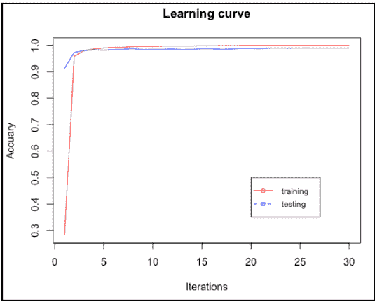

学习曲线表明过拟合或欠拟合的可能性很小。

既然模型效果很好，为什么不来可视化训练好的模型中卷积层的输出，以便我们能更好地理解卷积神经网络呢。让我们以测试集中的前两个样本为例。它们分别是 1 和 0：

```r
> par(mfrow=c(1, 2))
> test_1 <- matrix(as.numeric(data_test[1,-1]), nrow = 28,
byrow = TRUE)
> image(rotate(test_1), col = grey.colors(255))
> test_2 <- matrix(as.numeric(data_test[2,-1]), nrow = 28,
byrow = TRUE)
> image(rotate(test_2), col = grey.colors(255))
```

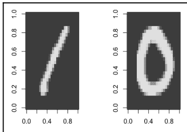

为了可视化卷积层的激活，我们首先通过将所有带有激活的层分组来创建一个执行器（可以粗略地视为我们训练好的CNN模型的副本）：

```
> layerss_for_viz <- mx.symbol.Group(mx.symbol.Group(c(conv1, act1, pool1,
conv2, act2, pool2, fc1, fc2)))
> executor <- mx.simple.bind(symbol=layerss_for_viz,
data=dim(test.array), ctx=mx.cpu())
```

现在，使用训练好的模型中的权重来更新执行器中的权重：

```
> mx.exec.update.arg.arrays (executor, model_cnn$arg.params,
match.name=TRUE)
> mx.exec.update.aux.arrays (executor, model_cnn$aux.params,
match.name=TRUE)
```

然后通过前向传递将执行器应用于测试集：

```
> mx.exec.update.arg.arrays (executor,
list(data=mx.nd.array(test.array)) , match.name=TRUE)
> mx.exec.forward(executor, is.train=FALSE)
```

我们可以看到执行器中记录的层名称，因为我们将按名称提取某个层的激活（注意名称可能不同，我们应该使用相应的名称）：

```
> names (executor$ref.outputs)
[1] "convolution10_output" "activation15_output"
"pooling10_output" "convolution11_output"
[5] "activation16_output" "pooling11_output"
"fullyconnected10_output" "fullyconnected11_output"
```

现在，我们可以可视化第一个和第二个卷积层以及ReLU层的激活，以及第一个池化层的激活。

让我们从第一个卷积层中前16个滤波器的ReLU激活开始，在我们的例子中它们被称为 activation15_output（同样，名称可能不同）。对于第一个样本（一个"1"），我们运行以下脚本：

```
> par(mfrow=c(4,4), mar=c(0.1,0.1,0.1,0.1))
> for (i in 1:16) {
+ outputData <- as.array(executor$ref.outputs$activation15_output)[,,i,1]
+ image(outputData, xaxs='n', yaxs='n',
+ col=grey.colors(255))
+ }
```

同样，对于第二个样本（一个"0"），我们运行：

```
> par(mfrow=c(4,4), mar=c(0.1,0.1,0.1,0.1))
> for (i in 1:16) {
+ outputData <- as.array(executor$ref.outputs$activation15_output)[,,i,2]
+ image(outputData, xaxs='n', yaxs='n',
+ col=grey.colors(255))
+ }
```

我们分别绘制了第一个卷积层对输入为1（左）和0（右）图像的激活：

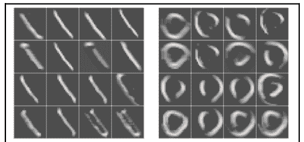

我们可以观察到每个特征图有效地提取了数字的边缘、曲线和笔画。

我们继续查看第一个池化层（称为 pooling10_output）的相应输出：

```
> par(mfrow=c(4,4), mar=c(0.1,0.1,0.1,0.1))
> for (i in 1:16) {
+ outputData <- as.array(executor$ref.outputs$pooling10_output)[,,i,1]
+ image(outputData, xaxs='n', yaxs='n',
+ col=grey.colors(255))
+ }
> par(mfrow=c(4,4), mar=c(0.1,0.1,0.1,0.1))
> for (i in 1:16) {
+ outputData <- as.array(executor$ref.outputs$pooling10_output)[,,i,2]
+ image(outputData, xaxs='n', yaxs='n',
+ col=grey.colors(255))
+ }
```

我们绘制了第一个最大池化层的输出：

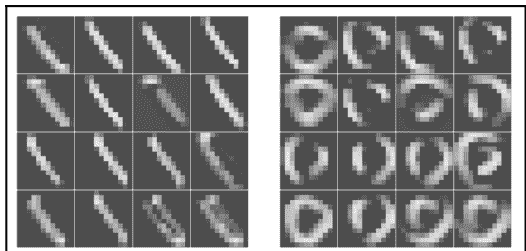

如我们可以轻易看出，它们是卷积输出的下采样版本。

最后，我们再可视化一个层，即第二个卷积层，它标记为 convolution11_output。以前16个特征图为例：

```
> par(mfrow=c(4,4), mar=c(0.1,0.1,0.1,0.1))
> for (i in 1:16) {
+ outputData <- as.array(executor$ref.outputs$convolution11_output)[,,i,1]
+ image(outputData, xaxs='n', yaxs='n',
+ col=grey.colors(255))
+ }
```


```
+ }
> par(mfrow=c(4,4), mar=c(0.1,0.1,0.1,0.1))
> for (i in 1:16) {
+ outputData <- as.array(executor$ref.outputs$convolution11_output[,,i,2])
+ image(outputData, xaxs='n', yaxs='n', col=grey.colors(255))
+ )
+ }
```

我们分别绘制了两张图像的第二个卷积层的输出：

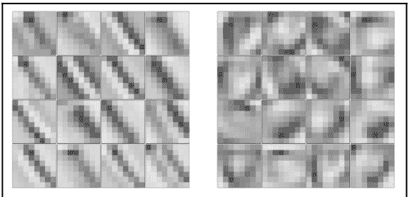

第二个卷积层提取输入图像的更高级特征，例如形状和轮廓。所有这 50 个特征图合并在一起，提供丰富的表示，随后这些表示被输入到全连接层。因此，得益于卷积操作，分类性能得到了提升。

到目前为止，我们通过绘制学习曲线和可视化卷积提取的特征，已经检验了我们的 CNN 模型的有效性。我们还可以对模型的泛化能力进行进一步检查。例如，我们可以从测试集中取出一个数据子集来模拟验证集，并将剩余部分用作新的测试集。我们基于验证集执行**早停法**，它能指示训练多少次迭代就足够，且不会使模型过拟合。最后，我们在测试集上使用带有早停法的训练模型，查看模型对未见数据的泛化效果。

我们首先将测试集划分为验证集（40%）和最终测试集（60%）：

```
> validation_perc = 0.4
> validation_index <- createDataPartition(data_test.y, p=validation_perc, list=FALSE)
>
```

```
> validation.array <- test.array[, , , validation_index]
> dim(validation.array) <- c(28, 1, length(validation.array[1,1,]))
> data_validation.y <- data_test.y[validation_index]
> final_test.array <- test.array[, , , -validation_index]
> dim(final_test.array) <- c(28, 1, length(final_test.array[1,1,]))
> data_final_test.y <- data_test.y[-validation_index]
```

为了实施早停法，我们编写自定义回调函数，并将其分配给参数 `epoch.end.callback`。回调函数会检查验证集上的分类性能，如果该性能高于我们设定的阈值，则停止训练：

```
> mx.callback.early.stop <- function(eval.metric) {
+ function(iteration, nbatch, env, verbose) {
+ if (!is.null(eval.metric)) {
+ result <- env$metric$get(env$eval.metric)
+ if (result$value >= eval.metric) {
+ return(FALSE)
+ }
+ }
+ return(TRUE)
+ }
```

现在，我们基于验证集训练带有早停法的 CNN 模型，将停止标准设定为验证集准确率大于 0.985：

```
> model_cnn_earlystop <- mx.model.FeedForward.create(softmax, X=train.array, y=data_train.y, eval.data=list(data=validation.array, label=data_validation.y), ctx=devices, num.round=30, array.batch.size=100, learning.rate=0.05, momentum=0.9, wd=0.00001, eval.metric=mx.metric.accuracy, epoch.end.callback = mx.callback.early.stop(0.985))
Start training with 1 devices
[1] Train-accuracy=0.284571428571429
[1] Validation-accuracy=0.921395348837209
[2] Train-accuracy=0.95145569620254
[2] Validation-accuracy=0.972325581395349
[3] Train-accuracy=0.980221518987343
[3] Validation-accuracy=0.97906976744186
[4] Train-accuracy=0.986613924050634
[4] Validation-accuracy=0.982790697674419
[5] Train-accuracy=0.990537974683546
[5] Validation-accuracy=0.981627906976744
[6] Train-accuracy=0.992848101265824
[6] Validation-accuracy=0.985348837209302
```

训练在第六次迭代后停止，因为已满足标准。最后，我们检查新测试集上的性能：

```
> prob_cnn <- predict(model_cnn_earlystop, final_test.array)
> prediction_cnn <- max.col(t(prob_cnn)) - 1
> cm_cnn = table(data_final_test.y, prediction_cnn)
> cm_cnn
```

| data_final_test.y | 0 | 1 | 2 | 3 | 4 | 5 | 6 | 7 | 8 | 9 |
|---|---|---|---|---|---|---|---|---|---|---|
| 0 | 626 | 0 | 0 | 0 | 0 | 0 | 0 | 0 | 1 | 0 |
| 1 | 0 | 701 | 1 | 0 | 0 | 2 | 1 | 3 | 4 | 0 |
| 2 | 1 | 0 | 598 | 4 | 0 | 0 | 0 | 6 | 0 | 0 |
| 3 | 0 | 0 | 0 | 658 | 0 | 5 | 0 | 0 | 2 | 1 |
| 4 | 0 | 0 | 0 | 0 | 585 | 1 | 3 | 3 | 1 | 4 |
| 5 | 1 | 0 | 1 | 3 | 0 | 558 | 5 | 0 | 0 | 2 |
| 6 | 4 | 0 | 0 | 0 | 0 | 0 | 595 | 0 | 0 | 0 |
| 7 | 0 | 1 | 3 | 0 | 1 | 0 | 0 | 675 | 0 | 0 |
| 8 | 4 | 0 | 1 | 1 | 1 | 7 | 3 | 0 | 621 | 2 |
| 9 | 1 | 0 | 0 | 0 | 2 | 1 | 0 | 4 | 0 | 589 |

```
> accuracy_cnn = mean(prediction_cnn == data_final_test.y)
> accuracy_cnn
[1] 0.9855487
```

我们的 CNN 模型能够相当不错地进行泛化。

## 摘要

我们刚刚完成了 R 语言与深度学习之旅的第一个里程碑！本章通过学习，我们更加熟悉了深度学习的重要概念。我们从深度学习的含义、其重要性以及近期应用的成功案例入手。在做好充分准备后，我们依次使用浅层神经网络、深度神经网络和 CNN 解决了手写数字识别问题，并证明了 CNN 最适合利用强大且独特的特征来区分不同类别的图像。

受人类视觉皮层的启发，CNN 通过首先推导出边缘、曲线和形状等丰富表示来对图像进行分类，这在卷积层输出的可视化中得到了体现。此外，我们还使用早停法作为一种避免过拟合的技术，验证了 CNN 模型的性能和泛化能力。总体而言，我们不仅介绍了 CNN 的原理，包括卷积和池化的概念，还使用 `MXNet`（R 语言中最流行的深度学习包之一）实现了一个 CNN 模型。

# 智能交通标志识别

**卷积神经网络（CNNs）**在计算机视觉中非常有用，因此我们将使用它来开展另一个应用：智能交通车辆的交通标志检测。本章还将介绍几个重要的深度学习概念，并让读者接触其他流行的深度学习框架和库。

我们将继续 R 语言深度学习之旅，聚焦自动驾驶汽车中的一个核心问题：物体识别，具体来说，就是交通标志分类。为了避免事故并确保安全，强健的交通标志分类对实现驾驶自动化至关重要。我们将首先介绍什么是自动驾驶汽车，以及深度学习应用于哪些方面。我们还将讨论深度学习如何脱颖而出，成为智能车辆中物体识别的最先进解决方案。在掌握背景知识后，我们将启动项目，首先对数据进行探索性分析并执行数据预处理，包括 Y'UV 颜色编码转换。我们将首次尝试使用 MXNet 实现 CNN，并达到超过 99% 的准确率。随后，我们将转向另一个强大的深度学习框架 TensorFlow 以及其之上的 API Keras。

我们还将介绍丢弃法（dropout）作为一种正则化方法，类似于 Lasso（L1）/ Ridge（L2）正则化。除了过拟合，我们还将演示如何应对训练数据不足的问题，利用数据增强技术。本章将通过总结防止 CNN 模型过拟合的方法来收尾。再次，我们将证明深度学习模型消除了传统方法中手动或显式的特征提取步骤，相反，它们在训练过程中会自动发现输入数据下潜在的有用模式。

我们将详细介绍这里提到的主题：

- 自动驾驶汽车是什么
- 深度学习如何应用于自动驾驶汽车
- 深度学习如何成为智能车辆中物体识别的最先进解决方案
- 德国交通标志识别基准数据集数据的探索性分析
- 使用 MXNet 包实现基于卷积神经网络的交通标志识别
- Keras 和 TensorFlow
- 使用 `keras` 包实现基于卷积神经网络的交通标志识别
- 使用丢弃法减少过拟合
- 数据增强及常见的增强方法
- 在小型训练集上使用数据增强
- 总结防止 CNN 模型过拟合的方法

## 深度学习如何应用于自动驾驶汽车？

自动驾驶汽车（也称为自动驾驶/自动化车辆或无人驾驶汽车）是一种机器人车辆，能够在目的地之间行驶，且无需人工干预即可导航。为了实现自动驾驶，自动驾驶汽车使用雷达、GPS 和计算机视觉等多种技术来检测和解读环境；然后，它们会规划前往目的地的适当导航路径。

更详细地说，自动驾驶汽车的工作原理通常如下：

- 软件根据目的地、交通和道路信息规划路线并启动汽车
- **光探测和测距（LiDAR）**传感器实时捕捉周围环境并创建动态 3D 地图
- 传感器监测横向移动，以计算汽车在 3D 地图上的位置


## 深度学习如何成为一种最先进的解决方案？

- 雷达系统利用来自其他交通参与者、行人或障碍物的距离信息
- 计算机视觉算法从摄像头中识别交通标志、交通信号灯和其他地标，并提供预先通知
- 算法驱动的软件分析所有感官数据，结合来自其他来源的输入，并控制转向和制动等操作，模拟人类感知周围环境并做出决策的方式

可以看到，强大的目标识别对于实现驾驶自动化至关重要。为避免事故并确保安全，有必要关注周围环境、交通标志和信号灯。通常来说，自动驾驶汽车中的目标识别可以总结为四项任务：

- 目标检测，例如障碍物、行人、交通标志和信号灯。
- 目标识别与分类。例如，如果前置摄像头捕获的图像中检测到交通信号灯，则将其标记为（红、黄、绿和关闭）。然后，我们将交通参与者分为自行车、摩托车、汽车、卡车和公共汽车，当然还要对交通标志进行分类（本章的主要讨论重点）。
- 目标定位，将地面级图像映射到航空图像。
- 运动预测，例如，理解目标的速度或根据其姿态估计行人的行为和意图。

在过去二十年中，各种机器学习算法已被应用于解决智能车辆中的目标识别问题。

例如，在《基于运动与外观模式的行人检测》（Viola et al.，发表于《国际计算机视觉杂志》，63(2)）中，采用了 AdaBoost（自适应增强的缩写，按顺序纠正分类错误）分类器来检测行走中的行人。

在《面向人体检测的定向梯度直方图》（Dalal 和 Triggs，2005 年发表于 IEEE 计算机视觉与模式识别会议 (CVPR) 上），使用**定向梯度直方图（HOG）**技术提取了高效特征，并将其输入**支持向量机（SVM）**分类器进行人体检测。此后，开发了诸如梯度场 HOG (GF-HOG) 等更复杂的变体，以及其他更复杂的特征提取方法。举几例，我们有分区 + 投影、投影 + HOG，等等。

常规目标识别方法（显式特征提取 + 机器学习分类）严重依赖手工制作的特征，例如 HOG 的梯度方向直方图、**加速稳健特征（SURF）**中的局部关键点，或**尺度不变特征变换（SIFT）**。尽管它们在某些任务中表现良好，但设计这些特征描述子很困难，需要大量的手动调整和实验。

还记得上一章关于手写数字分类的内容吗，我们求助于 CNN。它首先推导低级表示，如局部边缘和曲线，然后通过一系列低级表示组合出更高级的表示，如整体形状和轮廓。我们还得出结论，CNN 非常适合利用强大且独特的特征。

事实上，许多解决方案已证明，CNN 能够高效地自动化特征提取，同时显著提升性能。例如，在《基于无监督多阶段特征学习的行人检测》（Sermanet et al.，2013 年发表于 IEEE 计算机视觉与模式识别会议（**Computer Vision and Pattern Recognition (CVPR）**）中，CNN 首次被引入行人检测问题。在《用于精确目标检测和语义分割的丰富特征层次结构》（Girshick et al.，2014 年发表于 IEEE 计算机视觉与模式识别会议 (CVPR) 上），提出了一种区域 CNN 变体模型以提高性能。如今，许多最先进的目标识别方法都涉及深度学习技术，特别是 CNN。一个很好的见证就是它们在自动驾驶汽车的 KITTI 视觉基准排行榜顶部位置的普遍性（`http://www.cvlibs.net/datasets/kitti/eval_object.php?obj_benchmark=2d`）。

希望所有这些案例都能让你对 CNN 及其为智能车辆提供更好目标识别解决方案的能力感到兴奋。

我们还在等什么？让我们继续我们的项目，交通标志识别，因为这是自动驾驶汽车中最重要的主题之一！

## 使用 CNN 进行交通标志识别

和往常一样，我们首先探索德国交通标志识别基准（GTSRB）数据集，网址为 http://benchmark.ini.rub.de/?section=gtsrb&subsection=dataset。

### 开始探索 GTSRB

GTSRB 数据集由神经信息学研究所的实时计算机视觉研究小组编制并慷慨发布，最初用于交通标志单图像分类竞赛。它包含 39,209 张标记图像的训练集和 12,630 张未标记图像的测试集。训练数据集包含 43 个类别——43 种交通标志。我们将遍历所有类别，并为每个类别展示几个样本。

数据集可通过 http://benchmark.ini.rub.de/Dataset/GTSRB_Final_Training_Images.zip 下载（位于页面的 Downloads | Training dataset 部分）。解压下载的文件，会有一个名为 Images 的文件夹，包含 43 个文件夹（00000、00001 一直到 00042）；它们代表 43 个图像类别。这些图像的形式如下：

- 图像文件为 PPM（可移植位图的缩写）格式。
- 每个类别的图像数量从 210 到 2250 不等。因此这是一个不平衡的多类分类问题。
- 每张图像包含一个交通标志。
- 图像尺寸不统一，范围从 15*15 到 250*250 像素，图像不一定是正方形。
- 图像在实际标志周围包含高达 10% 的边框。因此标志不一定位于图像中心。

让我们先在 00000 文件夹中绘制一个样本 00000_00002.ppm。

我们使用 [pixmap 包](https://cran.r-project.org/web/packages/pixmap) 来读取 PPM 文件：

```
> library('pixmap')
> image <- read.pnm('GTSRB/Final_Training/Images/00000/00000_00002.ppm', cellres=1)
```

现在我们得到一个 pixmapRGB 对象，带有 red、green 和 blue 属性（分别是三个通道的像素），以及 size（图像的宽度和高度）。我们可以按如下方式访问 red、green 和 blue 通道：

```
> red_matrix <- matrix(image@red, nrow = image@size[1], ncol = image@size[2])
> green_matrix <- matrix(image@green, nrow = image@size[1], ncol = image@size[2])
> blue_matrix <- matrix(image@blue, nrow = image@size[1], ncol = image@size[2])
```

我们分别可视化原始图像及其三个通道：

```
> plot(image, main=sprintf("Original"))
> rotate <- function(x) t(apply(x, 2, rev))
> par(mfrow=c(1, 3))
> image(rotate(red_matrix), col = grey.colors(255), main=sprintf("Red"))
> image(rotate(green_matrix), col = grey.colors(255), main=sprintf("Green"))
> image(rotate(blue_matrix), col = grey.colors(255), main=sprintf("Blue"))
```

请注意，这里我们复用了上一章定义的 rotate 函数，以便更好地查看图像。这是一张原始图像：

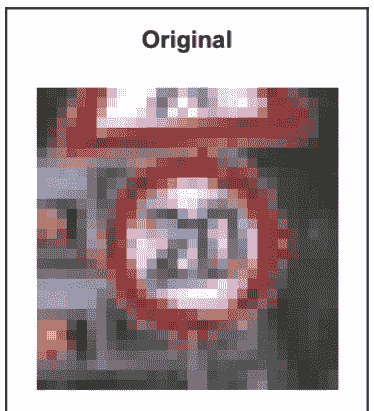

以下图像分别显示了 red、blue 和 green 通道的输出：

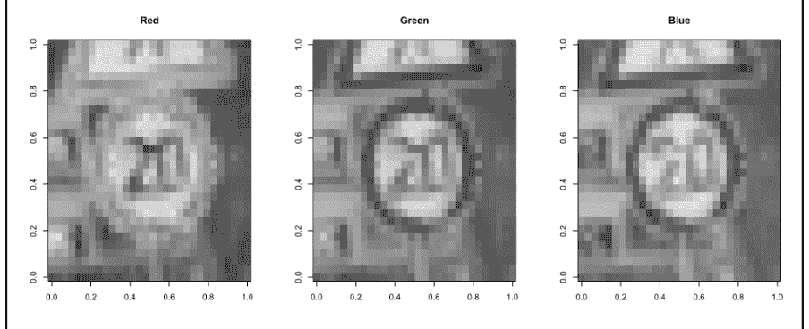

这是一个 20 km/h 限速标志。

我们现在可以定义以下函数，遍历 43 个交通标志类别，并为每种类型显示三个样本：

```
> plot_samples <- function(training_path, class, num_sample){
>     classes <- c("Speed limit (20km/h)", "Speed limit (30km/h)",
>                 "Speed limit (50km/h)", "Speed limit (60km/h)",
>                 "Speed limit (70km/h)", "Speed limit (80km/h)",
>                 "End of speed limit (80km/h)",
>                 "Speed limit (100km/h)", "Speed limit (120km/h)",
>                 "No passing",
>                 "No passing for vehicles over 3.5 metric tons",
>                 "Right-of-way at the next intersection",
>                 "Priority road", "Yield", "Stop", "No vehicles",
>                 "Vehicles over 3.5 metric tons prohibited",
>                 "No entry", "General caution", "Dangerous curve to the left", "Dangerous curve to the right",
>                 "Double curve", " Bumpy road", "Slippery road",
>                 "Road narrows on the right", "Road work",
>                 "Traffic signals", "Pedestrians", "Children crossing", "Bicycles crossing",
>                 "Beware of ice/snow",
>                 "Wild animals crossing",
>                 "End of all speed and passing limits",
>                 "Turn right ahead", "Ahead only",
>                 "Turn left ahead", "Ahead only",
```


```
"Go straight or right", "Go straight or left",
"Keep right", "Keep left", "Roundabout mandatory",
"End of no passing",
"End of no passing by vehicles over 3.5 metric tons"
+ if (class<10) {
+ path <- paste(training_path, "0000", class, "/", sep="")
+ } else {
+ path <- paste(training_path, "000", class, "/", sep="")
+ }
+ par(mfrow=c(1, num_sample))
+ # Randomly display num_sample samples
+ all_files <- list.files(path = path)
+ title <- paste('Class:', class, ':', classes[class+1])
+ print(paste(title, "", length(all_files), " samples"), sep=""))
+ files <- sample(all_files, num_sample)
+ for (file in files) {
+ image <- read.pnm(paste(path, file, sep=""), cellres=1)
+ plot(image)
+ }
+ mtext(title, side = 3, line = -23, outer = TRUE)
+ }
```

## 以 class=0 调用函数：

```
> training_path <- "GTSRB/Final_Training/Images/"
> plot_samples(training_path, 0, 3)
[1] "Class 0 : Speed limit (20km/h)          (211 samples)"
```

## 显示了三个样本：

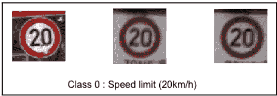

使用不同的类别（或使用循环）再次调用此函数，以遍历其余 42 种类型：

```
> plot_samples(training_path, 1, 3)
```

> [1] "类别 1 : 速度限制 (30km/h)          (2221 个样本) "

类别 1 的三个样本显示如下：

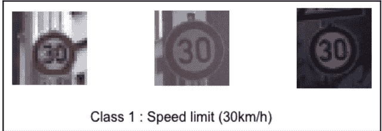

```
> plot_samples(training_path, 2, 3)
```

> [1] "类别 2 : 速度限制 (50km/h)          (2251 个样本) "

此处显示类别 2 的三个图像：

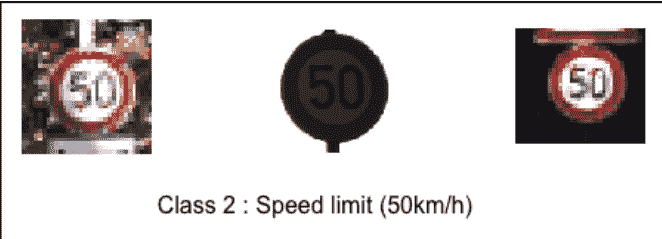

```
> plot_samples(training_path, 3, 3)
```

> [1] "类别 3 : 速度限制 (60km/h)          (1411 个样本) "

以下是类别 3 的结果：

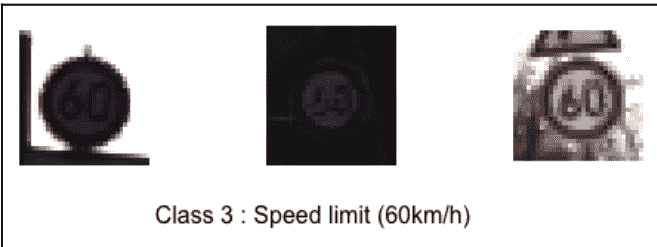

```
> plot_samples(training_path, 4, 3)
[1] "Class 4 : Speed limit (70km/h)          (1981 samples)"
```

我们绘制了类别 4 的三个图像：

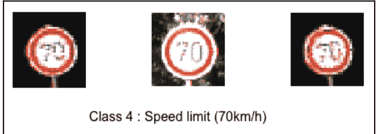

此处我们跳过其余部分，但很明显，图像是在各种条件下拍摄的，包括天气、照明、遮挡、旋转等等。相反，我们列出所有类型的样本大小以便参考：

| ID | 类型 | 样本数量 |
|---|---|---|
| 0 | 速度限制 (20km/h) | 211 |
| 1 | 速度限制 (30km/h) | 2221 |
| 2 | 速度限制 (50km/h) | 2251 |
| 3 | 速度限制 (60km/h) | 1411 |
| 4 | 速度限制 (70km/h) | 1981 |
| 5 | 速度限制 (80km/h) | 1861 |
| 6 | 速度限制结束 (80km/h) | 421 |
| 7 | 速度限制 (100km/h) | 1441 |
| 8 | 速度限制 (120km/h) | 1411 |
| 9 | 禁止超车 | 1471 |
| 10 | 3.5 公吨以上车辆禁止超车 | 2011 |
| 11 | 下一路口优先通行权 | 1321 |
| 12 | 优先道路 | 2101 |
| 13 | 让行 | 2161 |
| 14 | 停车 | 781 |
| 15 | 禁止车辆通行 | 631 |
| 16 | 禁止 3.5 公吨以上车辆通行 | 421 |
| 17 | 禁止进入 | 1111 |
| 18 | 一般警告 | 1201 |
| 19 | 向左危险弯道 | 211 |
| 20 | 向右危险弯道 | 361 |
| 21 | 连续弯道 | 331 |
| 22 | 颠簸路面 | 391 |
| 23 | 湿滑路面 | 511 |
| 24 | 右侧道路变窄 | 271 |
| 25 | 道路施工 | 1501 |
| 26 | 交通信号灯 | 601 |
| 27 | 行人 | 241 |
| 28 | 儿童过马路 | 541 |
| 29 | 自行车过马路 | 271 |
| 30 | 小心结冰/积雪 | 451 |
| 31 | 野生动物过马路 | 781 |
| 32 | 所有限速和超车限制结束 | 241 |
| 33 | 前方向右转 | 690 |
| 34 | 前方向左转 | 421 |
| 35 | 只准直行 | 1201 |
| 36 | 直行或向右转 | 391 |
| 37 | 直行或向左转 | 211 |
| 38 | 靠右行驶 | 2071 |
| 39 | 靠左行驶 | 301 |
| 40 | 必须环行 | 361 |
| 41 | 禁止超车结束 | 241 |
| 42 | 3.5 公吨以上车辆禁止超车结束 | 241 |

显然，标志（即我们的感兴趣区域 ROI）并未位于图像中心，且图像尺寸不幸各不相同。因此，我们需要从图像中分离出 ROI 并标准化其大小（大多数研究者都会将其调整为 32*32），然后才能分析和分类数据。我们借助随图像提供的注释文件。每个类别文件夹包含一个注释文件，例如位于 00000 的 GT-00000.csv。每个注释文件包含以下有用字段：

- Filename: 图像文件名
- ROI.X1: ROI 边界框左上角的 x 坐标
- ROI.Y1: ROI 边界框左上角的 y 坐标
- ROI.X2: ROI 边界框右下角的 x 坐标
- ROI.Y2: ROI 边界框右下角的 y 坐标

以下是样本中 ROI 的示例：

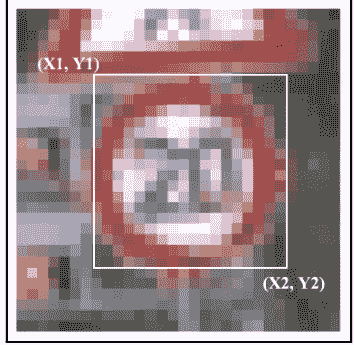

现在我们为原始图像定义预处理函数，其中包括分离 ROI 并将其调整为 32*32：

```
> source("http://bioconductor.org/biocLite.R")
> biocLite("EBImage")
> library("EBImage")
> roi_resize <- function(input_matrix, roi){
+     roi_matrix <- input_matrix[roi[1, 'Roi.Y1']:roi[1, 'Roi.Y2'],
+     roi[1, 'Roi.X1']:roi[1, 'Roi.X2']]
+     return(resize(roi_matrix, 32, 32))
+ }
```

注意，resize 函数来自 EBiImage 包：

https://bioconductor.org/packages/release/bioc/html/EBImage.html

我们在第一个样本上尝试一下（仅红色通道）：

```
> # read annotation csv file
> annotation <-
read.csv(file="GTSRB/Final_Training/Images/00000/GT-00000.csv",
header=TRUE, sep=";")
> roi = annotation[3, ]
> red_matrix_cropped <- roi_resize(red_matrix, roi)
> par(mfrow=c(1, 2))
> image(rotate(red_matrix), col = grey.colors(255) ,
main=sprintf("Original"))
> image(rotate(red_matrix_cropped), col = grey.colors(255) ,
main=sprintf("Preprocessed"))
```

右侧是预处理后的红色通道：

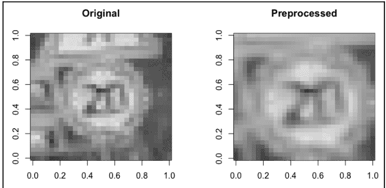

同样，我们可以处理另外两个通道。基于这三个通道，我们该如何构建特征空间？丢弃任何通道都可能导致信息丢失。简单地将它们堆叠起来可能会导致冗余。因此，将三个通道合并为一个会是更好的解决方案。在彩色世界中，Y'UV 是一种将亮度信息与颜色信息分别编码的编码系统。它通常用作彩色图像流水线和计算机图形硬件的一部分。Y'UV 用三个分量表示人类对颜色的感知：Y' 作为亮度，U 和 V 作为色度。Y'UV 可从 RGB 转换而来，公式如下：

- Y' = 0.299R + 0.587G + 0.114B
- U = 0.492(B - Y')
- V = 0.877(R - Y')

对于我们的特征空间，我们只需提取亮度通道 Y'。

既然整个预处理的最后一部分已准备就绪，让我们将它们整合在一起，加载并处理（ROI + 调整大小 + 转换为 Y'）整个带标签的数据集：

```
> load_labeled_data <- function(training_path, classes) {
+ # Initialize the pixel features X and target y
+ # X <- matrix(, nrow = 0, ncol = 32*32)
+ y <- vector()
+ # Load images from each of the 43 classes
+ for(i in classes) {
+ print(paste('Loading images from class', i))
+ }
+ if (i<10) {
+ annotation_path <- paste(training_path, "0000", i, "/GT-0000",
+ i, ".csv", sep="")
+ path <- paste(training_path, "0000", i, "/", sep="")
+ } else {
+ annotation_path <- paste(training_path, "000", i, "/GT-000",
+ i, ".csv", sep="")
+ path <- paste(training_path, "000", i, "/", sep="")
+ }
+ annotation <- read.csv(file=annotation_path, header=TRUE,
+ sep=";")
+
+ for (row in 1:nrow(annotation)) {
+ # Read each image
+ image_path <- paste(path, annotation[row, "Filename"], sep="")
+ image <- read.pnm(image_path, cellres=1)
+ # Parse RGB color space
+ red_matrix <- matrix(image@red, nrow = image@size[1],
+ ncol = image@size[2])
+ green_matrix <- matrix(image@green, nrow = image@size[1],
+ ncol = image@size[2])
+ blue_matrix <- matrix(image@blue, nrow = image@size[1],
+ ncol = image@size[2])
+ # Crop ROI and resize
+ red_matrix_cropped <- roi_resize(red_matrix,
+ annotation[row, ])
+ green_matrix_cropped <- roi_resize(green_matrix,
+ annotation[row, ])
+ blue_matrix_cropped <- roi_resize(blue_matrix,
+ annotation[row, ])
+ # Convert to brightness, e.g. Y' channel
+ x <- 0.299 * red_matrix_cropped + 0.587 *
+ green_matrix_cropped + 0.114 * blue_matrix_cropped
+ X <- rbind(X, matrix(x, 1, 32*32))
+ y <- c(y, i)
+ }
+ }
+ return(list("x" = X, "y" = y))
+ }
```

如前所述定义数据加载函数后，我们将其应用于整个原始数据集：

```
> classes <- 0:42
> data <- load_labeled_data(training_path, classes)
```


要有耐心，因为读取和处理 39,209 张图片可能需要几个小时。以防出现任何意外情况，一个良好的做法是保存数据对象，以便我们随时以后恢复：

```
> # Save the data object to a file
> saveRDS(data, file = "43 classes.rds")
> # Restore the data object
> data <- readRDS(file = "43 classes.rds")
```

对可直接使用的数据进行快速检查：

```
> data.x <- data$x
> data.y <- data$y
> dim(data.x)
[1] 39209 1024
```

## 维度正确！

> summary (as.factor (data.y))

| 类别 | 数量 |
|-------|-------|
| 0 | 210 |
| 1 | 2220 |
| 2 | 2250 |
| 3 | 1410 |
| 4 | 1980 |
| 5 | 1860 |
| 6 | 420 |
| 7 | 1440 |
| 8 | 1410 |
| 9 | 1470 |
| 10 | 2010 |
| 11 | 1320 |
| 12 | 2100 |
| 13 | 2160 |
| 14 | 780 |
| 15 | 630 |
| 16 | 420 |
| 17 | 1110 |
| 18 | 1200 |
| 19 | 210 |
| 20 | 360 |
| 21 | 330 |
| 22 | 390 |
| 23 | 510 |
| 24 | 270 |
| 25 | 1500 |
| 26 | 600 |
| 27 | 240 |
| 28 | 540 |
| 29 | 270 |
| 30 | 450 |
| 31 | 780 |
| 32 | 240 |
| 33 | 689 |
| 34 | 420 |
| 35 | 1200 |
| 36 | 390 |
| 37 | 210 |
| 38 | 2070 |
| 39 | 300 |
| 40 | 360 |
| 41 | 240 |
| 42 | 240 |

## 类别大小正确，而且它们再次相当不平衡！

> 绝对不要跳过对分类中类别平衡的检查。

在确保数据已正确加载和处理后，我们对特征（即像素）的分布进行更多探索性分析。例如，我们从类别 1（限速=30km/h）、14（停止）、20（右侧危险弯道）和 27（行人）的每张图片中提取中央 4*4 块（第 222 至 225、254 至 257、286 至 289 以及 318 至 321 个像素）中的 16 个像素。我们显示它们的直方图：

```
> central_block <- c (222:225, 254:257, 286:289, 318:321)
> par (mfrow=c(2, 2))
> for (i in c(1, 14, 20, 27)) {
+   hist(c(as.matrix(data.x[data.y==i, central_block])),
+   main=sprintf("Histogram for class %d", i),
+   xlab="Pixel brightness")
+   }
```

生成的像素亮度直方图显示如下：

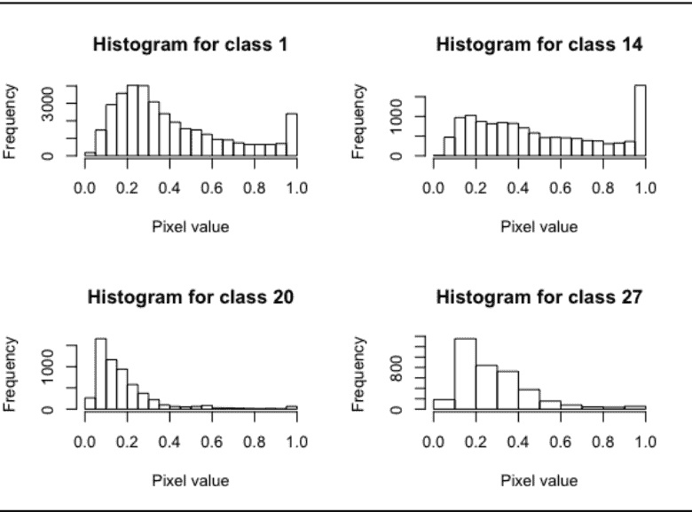

这些类别中中央像素的亮度分布各不相同。例如，类别 20 中大部分中央像素较暗，因为该标志（右侧危险弯道）中心穿过一条粗黑色笔画；而在类别 14 中，停止标志在中央区域附近有一条白色笔画（O 的左侧部分）。从其他位置提取的像素在不同类别中也可以呈现明显的分布。

我们刚刚进行的探索性分析有助于我们继续构建基于像素的分类模型。

## 第一个解决方案 – 使用 MXNet 的卷积神经网络

我们从一个与前一章末尾开发的方案相似的方案入手，即使用 MXNet 的 CNN。

同样，我们首先使用 caret 包将数据集分为两个子集，用于训练（75%）和测试（25%）：

```
> if (!require("caret"))
+ install.packages("caret")
> library(caret)
> set.seed(42)
> train_perc = 0.75
> train_index <- createDataPartition(data.y, p=train_perc, list=FALSE)
> train_index <- train_index[sample(nrow(train_index)), ]
> data_train.x <- data.x[train_index, ]
> data_train.y <- data.y[train_index]
> data_test.x <- data.x[-train_index, ]
> data_test.y <- data.y[-train_index]
```

不要忘记指定特定的随机种子以便可重复工作。我们通常在应用 CNN 之前进行数据标准化。在我们的情况中，加载的原始像素已经在 0 到 1 的范围内；在 Y' 亮度转换后，生成的像素仍然在 0 到 1 的范围内。

> 一般来说，在将数据输入 CNN 或实际上任何神经网络或基于梯度下降的模型之前，对数据进行标准化是必要的。至于图像输入，我们通常将像素缩放到 0 到 1 的范围内。

在准备好训练集和测试集后，我们按如下方式构建 CNN 模型：

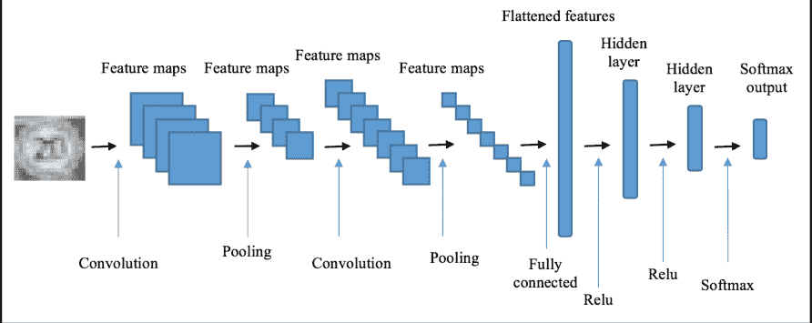

网络以第一组卷积层、ReLU 非线性层和池化层开始。在这里，我们使用 32 个 5*5 卷积滤波器和一个 2*2 最大池化滤波器：

```
> require(mxnet)
> data <- mx.symbol.Variable("data")
> # first convolution
> conv1 <- mx.symbol.Convolution(data=data, kernel=c(5, 5),
                                  num_filter=32)
> act1 <- mx.symbol.Activation(data=conv1, act_type="relu")
> pool1 <- mx.symbol.Pooling(data=act1, pool_type="max",
                             +         kernel=c(2, 2), stride=c(2, 2))
```

接着是第二组卷积、ReLU 非线性和池化层，其中使用了 64 个 5*5 卷积滤波器和 2*2 最大池化滤波器：

```
> # second convolution
> conv2 <- mx.symbol.Convolution(data=pool1, kernel=c(5, 5),
                                  num_filter=64)
> act2 <- mx.symbol.Activation(data=conv2, act_type="relu")
> pool2 <- mx.symbol.Pooling(data=act2, pool_type="max",
                             +         kernel=c(2, 2), stride=c(2, 2))
```

现在，通过检测边缘、曲线和形状，我们已经提取了输入图像的丰富表征，接下来进入全连接层。但在此之前，我们需要将之前卷积层生成的特征图展平：

```
> flatten <- mx.symbol.Flatten(data=pool2)
```

在全连接部分，我们应用一个带有 1,000 个单元的 ReLU 隐藏层和一个带有 43 个单元的 softmax 层：

```
> # first fully connected layer
> fc1 <- mx.symbol.FullyConnected(data=flatten, num_hidden=1000)
> act3 <- mx.symbol.Activation(data=fc1, act_type="relu")
> # second fully connected layer
> fc2 <- mx.symbol.FullyConnected(data=act3, num_hidden=43)
```

最后，softmax 层为每个 43 个类别生成输出：

```
> # softmax output
> softmax <- mx.symbol.SoftmaxOutput(data=fc2, name="sm")
```

网络的所有部分现在都已组装完成。在开始训练模型之前，我们指定随机种子和训练设备，并将矩阵 data_train.x 转换为 MXNet 卷积层所需的数组：

```
> devices <- mx.cpu()
> train.array <- t(data_train.x)
> dim(train.array) <- c(32, 32, 1, nrow(data_train.x))
> mx.set.seed(42)
```

### 模型训练时间：

```
[1] Train-accuracy=0.184965986394558
[2] Train-accuracy=0.824610169491525
[3] Train-accuracy=0.949389830508475
[4] Train-accuracy=0.968305084745763
[5] Train-accuracy=0.983050847457628
[6] Train-accuracy=0.988372881355934
[7] Train-accuracy=0.990745762711866
[8] Train-accuracy=0.993152542372882
[9] Train-accuracy=0.992576271186442
[10] Train-accuracy=0.994372881355933
[11] Train-accuracy=0.99542372881356
[12] Train-accuracy=0.995118644067798
[13] Train-accuracy=0.99671186440678
[14] Train-accuracy=0.999830508474576
[15] Train-accuracy=0.999932203389831
[16] Train-accuracy=1
[17] Train-accuracy=1
[18] Train-accuracy=1
[19] Train-accuracy=1
[20] Train-accuracy=1
[21] Train-accuracy=1
[22] Train-accuracy=1
[23] Train-accuracy=1
[24] Train-accuracy=1
[25] Train-accuracy=1
[26] Train-accuracy=1
[27] Train-accuracy=1
[28] Train-accuracy=1
[29] Train-accuracy=1
[30] Train-accuracy=1
```

我们使用以下超参数拟合模型：

- num.round = 30：最大迭代次数
- array.batch.size = 100：小批量梯度下降的批量大小
- learning.rate = 0.05：学习率
- momentum=0.9：动量因子，决定将多少之前的速度纳入当前速度
- eval.metric=mx.metric.accuracy：使用分类准确率作为评估指标
- initializer=mx.init.uniform(0.1)：初始权重从 -0.1 到 0.1 之间的均匀分布中随机生成，以降低深度网络中权重爆炸和消失的几率
- wd = 0.00001：L2 正则化的权重衰减，通过对大权重施加惩罚来避免过拟合

我们可以通过以下方式查看模型结构：

```
> graph.viz(model_cnn$symbol)
```

然后将训练好的模型应用于测试集：

```
> test.array <- t(data_test.x)
> dim(test.array) <- c(32, 32, 1, nrow(data_test.x))
> prob_cnn <- predict(model_cnn, test.array)
> prediction_cnn <- max.col(t(prob_cnn)) - 1
```


我们按如下方式计算混淆矩阵和分类准确率：

```
> cm_cnn = table(data_test.y, prediction_cnn)
> cm_cnn
```

得到的混淆矩阵的前半部分如下：

| data_test.y | prediction_cnn | 0 | 1 | 2 | 3 | 4 | 5 | 6 | 7 | 8 | 9 | 10 | 11 | 12 | 13 | 14 | 15 | 16 | 17 | 18 | 19 | 20 | 21 | 22 | 23 | 24 |
|---|---|---|---|---|---|---|---|---|---|---|---|---|---|---|---|---|---|---|---|---|---|---|---|---|---|---|
| 0 | 39 | 0 | 1 | 2 | 3 | 0 | 0 | 0 | 0 | 0 | 0 | 0 | 0 | 0 | 0 | 0 | 0 | 0 | 0 | 0 | 0 | 0 | 0 | 0 | 0 | 0 |
| 1 | 0 | 551 | 1 | 0 | 0 | 0 | 0 | 0 | 0 | 0 | 0 | 0 | 0 | 0 | 0 | 1 | 0 | 0 | 0 | 0 | 0 | 0 | 0 | 0 | 0 | 0 |
| 2 | 0 | 0 | 589 | 0 | 1 | 0 | 0 | 0 | 1 | 0 | 0 | 0 | 0 | 0 | 0 | 0 | 0 | 0 | 0 | 0 | 0 | 0 | 0 | 0 | 0 | 0 |
| 3 | 0 | 0 | 0 | 336 | 0 | 1 | 0 | 0 | 0 | 0 | 0 | 0 | 0 | 0 | 0 | 0 | 0 | 0 | 0 | 0 | 0 | 0 | 0 | 0 | 1 | 0 |
| 4 | 0 | 0 | 0 | 0 | 505 | 0 | 0 | 0 | 0 | 0 | 0 | 0 | 0 | 0 | 0 | 0 | 0 | 0 | 0 | 0 | 0 | 0 | 0 | 0 | 0 | 0 |
| 5 | 0 | 0 | 0 | 0 | 0 | 453 | 0 | 1 | 0 | 0 | 0 | 0 | 0 | 0 | 0 | 0 | 1 | 0 | 0 | 0 | 0 | 0 | 0 | 0 | 0 | 0 |
| 6 | 0 | 0 | 0 | 0 | 0 | 0 | 95 | 1 | 0 | 0 | 0 | 0 | 0 | 0 | 0 | 0 | 0 | 0 | 0 | 0 | 0 | 0 | 0 | 0 | 0 | 0 |
| 7 | 0 | 0 | 0 | 1 | 1 | 0 | 2 | 0 | 362 | 0 | 0 | 0 | 0 | 0 | 0 | 0 | 0 | 0 | 0 | 0 | 0 | 0 | 0 | 0 | 0 | 0 |
| 8 | 0 | 0 | 0 | 0 | 0 | 0 | 0 | 0 | 356 | 1 | 0 | 0 | 0 | 0 | 0 | 1 | 0 | 0 | 0 | 0 | 0 | 0 | 0 | 0 | 0 | 0 |
| 9 | 0 | 0 | 0 | 0 | 0 | 0 | 0 | 0 | 0 | 357 | 0 | 0 | 0 | 0 | 0 | 1 | 0 | 0 | 0 | 0 | 0 | 0 | 0 | 0 | 0 | 0 |
| 10 | 0 | 0 | 0 | 0 | 0 | 1 | 0 | 0 | 0 | 0 | 1505 | 0 | 0 | 0 | 0 | 0 | 0 | 0 | 0 | 0 | 0 | 0 | 0 | 0 | 0 | 0 |
| 11 | 0 | 0 | 0 | 0 | 0 | 0 | 0 | 0 | 0 | 0 | 0 | 311 | 0 | 0 | 0 | 0 | 0 | 0 | 0 | 0 | 0 | 0 | 0 | 0 | 0 | 0 |
| 12 | 0 | 0 | 0 | 0 | 0 | 0 | 0 | 0 | 0 | 0 | 0 | 0 | 539 | 0 | 0 | 2 | 0 | 0 | 0 | 0 | 0 | 0 | 0 | 0 | 0 | 0 |
| 13 | 0 | 1 | 1 | 0 | 0 | 0 | 0 | 0 | 0 | 1 | 1 | 1 | 1 | 513 | 0 | 0 | 0 | 0 | 0 | 1 | 0 | 0 | 0 | 0 | 0 | 0 |
| 14 | 0 | 0 | 0 | 1 | 0 | 0 | 0 | 0 | 0 | 0 | 0 | 0 | 0 | 0 | 194 | 0 | 0 | 0 | 0 | 0 | 0 | 0 | 0 | 0 | 0 | 0 |
| 15 | 0 | 1 | 0 | 0 | 0 | 0 | 0 | 0 | 0 | 0 | 0 | 0 | 0 | 2 | 0 | 0 | 170 | 0 | 0 | 0 | 0 | 0 | 0 | 0 | 0 | 0 |
| 16 | 0 | 0 | 0 | 0 | 0 | 0 | 0 | 0 | 0 | 0 | 0 | 0 | 0 | 0 | 0 | 0 | 0 | 113 | 0 | 0 | 0 | 0 | 0 | 0 | 0 | 0 |
| 17 | 0 | 0 | 0 | 0 | 0 | 0 | 0 | 0 | 0 | 0 | 0 | 0 | 0 | 0 | 0 | 0 | 0 | 0 | 285 | 0 | 0 | 0 | 0 | 0 | 0 | 0 |
| 18 | 0 | 0 | 0 | 0 | 0 | 0 | 0 | 0 | 0 | 0 | 0 | 0 | 1 | 0 | 0 | 0 | 0 | 0 | 0 | 308 | 0 | 0 | 0 | 0 | 0 | 0 |
| 19 | 0 | 0 | 0 | 0 | 0 | 0 | 0 | 0 | 0 | 0 | 0 | 0 | 0 | 0 | 0 | 0 | 0 | 0 | 0 | 0 | 57 | 0 | 0 | 0 | 0 | 0 |
| 20 | 0 | 0 | 0 | 0 | 0 | 0 | 0 | 0 | 0 | 0 | 0 | 0 | 0 | 0 | 0 | 0 | 0 | 0 | 0 | 1 | 3 | 77 | 0 | 0 | 0 | 0 |
| 21 | 0 | 0 | 0 | 0 | 0 | 0 | 0 | 0 | 0 | 0 | 0 | 0 | 0 | 0 | 0 | 0 | 0 | 0 | 0 | 0 | 0 | 0 | 82 | 0 | 0 | 0 |
| 22 | 0 | 0 | 0 | 0 | 0 | 0 | 0 | 0 | 0 | 0 | 0 | 0 | 0 | 0 | 0 | 0 | 0 | 0 | 0 | 0 | 0 | 0 | 0 | 79 | 0 | 0 |
| 23 | 0 | 0 | 0 | 0 | 0 | 0 | 0 | 0 | 0 | 0 | 0 | 0 | 0 | 0 | 0 | 0 | 0 | 0 | 0 | 0 | 0 | 0 | 0 | 0 | 1135 | 0 |
| 24 | 0 | 0 | 0 | 0 | 0 | 0 | 0 | 0 | 0 | 0 | 0 | 0 | 0 | 0 | 0 | 0 | 0 | 0 | 0 | 0 | 1 | 0 | 0 | 0 | 0 | 66 |
| 25 | 0 | 0 | 0 | 0 | 0 | 0 | 0 | 0 | 0 | 0 | 0 | 0 | 0 | 0 | 0 | 0 | 0 | 0 | 0 | 0 | 0 | 0 | 0 | 0 | 0 | 0 |
| 26 | 0 | 0 | 0 | 0 | 0 | 0 | 0 | 0 | 0 | 0 | 1 | 0 | 0 | 0 | 0 | 0 | 0 | 0 | 0 | 0 | 1 | 0 | 1 | 0 | 0 | 0 |
| 27 | 0 | 0 | 0 | 0 | 0 | 0 | 0 | 0 | 0 | 0 | 0 | 0 | 0 | 0 | 0 | 0 | 0 | 0 | 0 | 0 | 0 | 0 | 0 | 0 | 0 | 1 |
| 28 | 0 | 0 | 0 | 0 | 0 | 0 | 0 | 0 | 0 | 0 | 0 | 0 | 0 | 0 | 0 | 0 | 0 | 0 | 0 | 0 | 0 | 1 | 0 | 0 | 0 | 0 |
| 29 | 0 | 0 | 0 | 0 | 0 | 0 | 0 | 0 | 0 | 0 | 0 | 0 | 0 | 0 | 0 | 0 | 0 | 0 | 0 | 0 | 0 | 0 | 0 | 0 | 0 | 1 |
| 30 | 0 | 0 | 0 | 0 | 0 | 0 | 1 | 0 | 0 | 0 | 0 | 0 | 0 | 0 | 0 | 0 | 0 | 0 | 0 | 0 | 0 | 0 | 0 | 0 | 0 | 0 |
| 31 | 0 | 0 | 0 | 0 | 0 | 0 | 0 | 0 | 0 | 0 | 0 | 0 | 0 | 0 | 0 | 0 | 0 | 0 | 0 | 0 | 0 | 0 | 0 | 0 | 0 | 0 |
| 32 | 0 | 0 | 0 | 0 | 0 | 0 | 0 | 0 | 0 | 0 | 0 | 0 | 0 | 0 | 0 | 0 | 0 | 0 | 0 | 0 | 0 | 0 | 0 | 0 | 0 | 0 |
| 33 | 0 | 0 | 0 | 0 | 0 | 0 | 0 | 0 | 0 | 0 | 0 | 0 | 0 | 0 | 0 | 0 | 0 | 0 | 0 | 0 | 0 | 0 | 0 | 0 | 0 | 0 |
| 34 | 0 | 0 | 1 | 0 | 0 | 0 | 0 | 0 | 0 | 0 | 0 | 0 | 0 | 0 | 0 | 0 | 0 | 0 | 0 | 0 | 0 | 0 | 0 | 0 | 0 | 0 |
| 35 | 0 | 0 | 0 | 0 | 0 | 0 | 0 | 0 | 0 | 0 | 0 | 0 | 0 | 0 | 0 | 0 | 0 | 0 | 0 | 0 | 0 | 0 | 0 | 0 | 0 | 0 |
| 36 | 0 | 0 | 0 | 0 | 0 | 0 | 0 | 0 | 0 | 0 | 0 | 0 | 0 | 0 | 0 | 0 | 0 | 0 | 0 | 0 | 0 | 1 | 0 | 0 | 0 | 0 |
| 37 | 0 | 0 | 0 | 0 | 0 | 0 | 0 | 0 | 0 | 0 | 1 | 0 | 0 | 0 | 0 | 0 | 0 | 0 | 0 | 0 | 0 | 0 | 0 | 0 | 0 | 0 |
| 38 | 0 | 0 | 0 | 0 | 0 | 0 | 0 | 0 | 0 | 0 | 0 | 0 | 0 | 0 | 0 | 0 | 0 | 0 | 0 | 0 | 0 | 0 | 0 | 0 | 0 | 0 |
| 39 | 0 | 0 | 0 | 0 | 0 | 0 | 0 | 0 | 0 | 0 | 0 | 0 | 0 | 0 | 0 | 0 | 0 | 0 | 0 | 0 | 0 | 0 | 0 | 0 | 0 | 0 |
| 40 | 0 | 0 | 0 | 0 | 0 | 0 | 0 | 0 | 0 | 0 | 0 | 0 | 0 | 0 | 0 | 0 | 0 | 0 | 0 | 0 | 0 | 0 | 0 | 0 | 0 | 0 |
| 41 | 0 | 0 | 0 | 0 | 0 | 0 | 0 | 0 | 0 | 0 | 0 | 0 | 0 | 0 | 0 | 0 | 0 | 0 | 0 | 0 | 0 | 0 | 0 | 0 | 0 | 0 |
| 42 | 0 | 0 | 0 | 1 | 0 | 0 | 0 | 0 | 0 | 0 | 0 | 0 | 0 | 0 | 0 | 0 | 0 | 0 | 0 | 0 | 0 | 0 | 0 | 0 | 0 | 0 |

## 后半部分：

| data_test.y | 25 | 26 | 27 | 28 | 29 | 30 | 31 | 32 | 33 | 34 | 35 | 36 | 37 | 38 | 39 | 40 | 41 | 42 |
|---|---|---|---|---|---|---|---|---|---|---|---|---|---|---|---|---|---|---|
| 0 | 0 | 0 | 0 | 0 | 0 | 0 | 0 | 0 | 0 | 0 | 0 | 0 | 0 | 0 | 0 | 0 | 0 | 0 |
| 1 | 0 | 0 | 0 | 0 | 0 | 0 | 0 | 0 | 0 | 0 | 0 | 0 | 0 | 0 | 0 | 0 | 0 | 0 |
| 2 | 0 | 0 | 0 | 0 | 0 | 0 | 0 | 0 | 0 | 0 | 0 | 0 | 0 | 0 | 0 | 0 | 0 | 0 |
| 3 | 0 | 0 | 0 | 0 | 0 | 0 | 0 | 0 | 0 | 0 | 0 | 0 | 0 | 0 | 0 | 0 | 0 | 0 |
| 4 | 0 | 0 | 0 | 0 | 0 | 0 | 0 | 0 | 0 | 0 | 0 | 0 | 0 | 0 | 0 | 0 | 0 | 0 |
| 5 | 0 | 0 | 0 | 0 | 0 | 0 | 0 | 0 | 0 | 0 | 0 | 0 | 1 | 1 | 0 | 0 | 0 | 0 |
| 6 | 0 | 0 | 0 | 0 | 0 | 0 | 0 | 0 | 0 | 0 | 0 | 0 | 0 | 0 | 0 | 0 | 0 | 0 |
| 7 | 0 | 0 | 0 | 0 | 0 | 0 | 0 | 0 | 0 | 0 | 0 | 0 | 0 | 0 | 1 | 0 | 0 | 0 |
| 8 | 0 | 0 | 0 | 0 | 0 | 0 | 0 | 0 | 0 | 0 | 0 | 0 | 0 | 0 | 0 | 0 | 0 | 0 |
| 9 | 0 | 0 | 0 | 0 | 0 | 0 | 0 | 0 | 0 | 0 | 0 | 0 | 0 | 0 | 1 | 0 | 0 | 0 |
| 10 | 0 | 1 | 0 | 0 | 0 | 0 | 0 | 0 | 0 | 0 | 0 | 0 | 0 | 0 | 0 | 0 | 0 | 0 |
| 11 | 0 | 0 | 0 | 0 | 0 | 1 | 0 | 0 | 0 | 0 | 0 | 0 | 0 | 0 | 0 | 0 | 0 | 0 |
| 12 | 0 | 0 | 0 | 0 | 0 | 0 | 0 | 0 | 0 | 0 | 1 | 0 | 0 | 0 | 0 | 0 | 0 | 0 |
| 13 | 0 | 0 | 0 | 0 | 0 | 0 | 0 | 0 | 0 | 0 | 0 | 0 | 0 | 0 | 0 | 0 | 0 | 0 |
| 14 | 0 | 0 | 0 | 0 | 0 | 0 | 0 | 0 | 0 | 0 | 0 | 0 | 0 | 0 | 0 | 0 | 0 | 0 |
| 15 | 0 | 0 | 0 | 0 | 0 | 0 | 0 | 0 | 0 | 0 | 0 | 0 | 0 | 0 | 0 | 0 | 0 | 0 |
| 16 | 0 | 0 | 0 | 0 | 0 | 0 | 0 | 0 | 0 | 0 | 0 | 0 | 0 | 0 | 0 | 0 | 0 | 0 |
| 17 | 0 | 0 | 0 | 0 | 0 | 0 | 0 | 0 | 0 | 0 | 0 | 0 | 0 | 0 | 0 | 0 | 0 | 0 |
| 18 | 1 | 0 | 0 | 0 | 0 | 0 | 0 | 0 | 0 | 0 | 0 | 0 | 0 | 0 | 0 | 0 | 0 | 0 |
| 19 | 0 | 0 | 0 | 0 | 0 | 0 | 0 | 0 | 0 | 0 | 0 | 0 | 0 | 0 | 0 | 0 | 0 | 0 |
| 20 | 0 | 0 | 0 | 2 | 0 | 0 | 0 | 0 | 0 | 0 | 0 | 0 | 0 | 0 | 0 | 0 | 0 | 0 |
| 21 | 1 | 0 | 0 | 0 | 0 | 0 | 0 | 0 | 0 | 0 | 0 | 0 | 0 | 0 | 0 | 0 | 0 | 0 |
| 22 | 0 | 0 | 0 | 0 | 0 | 0 | 0 | 0 | 0 | 0 | 0 | 0 | 0 | 0 | 0 | 0 | 0 | 0 |
| 23 | 0 | 0 | 0 | 0 | 1 | 0 | 0 | 0 | 0 | 0 | 0 | 0 | 0 | 0 | 0 | 0 | 0 | 0 |
| 24 | 0 | 0 | 0 | 0 | 0 | 1 | 0 | 0 | 0 | 0 | 0 | 0 | 0 | 0 | 1 | 0 | 0 | 0 |
| 25 | 363 | 0 | 0 | 0 | 0 | 0 | 0 | 0 | 0 | 0 | 0 | 0 | 0 | 0 | 0 | 0 | 0 | 0 |
| 26 | 0 | 150 | 0 | 0 | 0 | 0 | 0 | 0 | 0 | 0 | 0 | 0 | 0 | 0 | 0 | 0 | 0 | 0 |
| 27 | 0 | 0 | 57 | 0 | 0 | 0 | 0 | 0 | 0 | 0 | 0 | 0 | 0 | 0 | 0 | 0 | 0 | 0 |
| 28 | 0 | 0 | 0 | 131 | 0 | 0 | 0 | 0 | 0 | 0 | 0 | 0 | 0 | 0 | 0 | 0 | 0 | 0 |
| 29 | 0 | 0 | 0 | 0 | 65 | 0 | 0 | 0 | 0 | 0 | 0 | 0 | 0 | 0 | 0 | 0 | 0 | 0 |
| 30 | 0 | 0 | 0 | 0 | 0 | 122 | 0 | 0 | 0 | 0 | 0 | 0 | 0 | 0 | 0 | 0 | 0 | 0 |
| 31 | 0 | 0 | 0 | 0 | 0 | 0 | 198 | 0 | 0 | 0 | 0 | 0 | 0 | 0 | 0 | 0 | 0 | 0 |
| 32 | 0 | 0 | 0 | 0 | 0 | 0 | 0 | 47 | 0 | 0 | 0 | 0 | 0 | 0 | 0 | 0 | 0 | 0 |
| 33 | 0 | 0 | 0 | 0 | 0 | 0 | 0 | 0 | 181 | 1 | 0 | 0 | 0 | 0 | 0 | 0 | 0 | 0 |
| 34 | 0 | 0 | 0 | 0 | 0 | 0 | 0 | 0 | 0 | 110 | 0 | 0 | 0 | 0 | 0 | 0 | 0 | 0 |
| 35 | 1 | 0 | 0 | 0 | 0 | 0 | 0 | 0 | 0 | 0 | 288 | 1 | 0 | 0 | 0 | 0 | 0 | 0 |
| 36 | 1 | 0 | 0 | 1 | 0 | 0 | 0 | 0 | 0 | 0 | 0 | 95 | 0 | 0 | 0 | 0 | 0 | 0 |
| 37 | 0 | 0 | 0 | 0 | 0 | 0 | 0 | 0 | 0 | 0 | 0 | 0 | 40 | 0 | 0 | 0 | 0 | 0 |
| 38 | 0 | 0 | 0 | 0 | 0 | 0 | 0 | 0 | 0 | 0 | 0 | 0 | 0 | 499 | 0 | 0 | 0 | 0 |
| 39 | 0 | 0 | 0 | 0 | 0 | 0 | 0 | 0 | 0 | 0 | 0 | 0 | 0 | 0 | 74 | 0 | 0 | 0 |
| 40 | 0 | 0 | 0 | 0 | 0 | 0 | 0 | 0 | 0 | 0 | 0 | 0 | 0 | 0 | 0 | 94 | 0 | 0 |
| 41 | 0 | 0 | 0 | 0 | 0 | 0 | 0 | 1 | 0 | 0 | 0 | 0 | 0 | 0 | 0 | 0 | 71 | 0 |
| 42 | 0 | 0 | 0 | 0 | 0 | 0 | 0 | 0 | 0 | 0 | 0 | 0 | 0 | 0 | 0 | 0 | 0 | 70 |


误分类仅在少数罕见情况下发生，无论图像外观因光照变化、部分遮挡、旋转、天气条件等因素而有多大差异：

```
> accuracy_cnn = mean(prediction_cnn == data_test.y)
> accuracy_cnn
[1] 0.9930612
```

我们刚刚构建了一个鲁棒的 CNN 模型，它能正确分类超过 99.30% 的测试标志。CNN 模型通过提取低级和高级特征来有效地学习表示。它使得那些手工制作的特征变得过时，因为它能够直接从标志图像中自行捕捉重要且可区分的特征。

既然我们使用自己迄今最钟爱的深度学习工具 MXNet 已经取得了巨大成功，为什么不探索其他同样强大的工具呢？事实上，名为 Keras 的另一种深度学习 API 近年来日益流行；其后端 TensorFlow 可能是最知名的深度学习框架。

## 尝试新事物 – 使用 Keras 与 TensorFlow 构建 CNN

Keras (https://keras.io/) 是用 Python 编写的高级深度学习 API，可以运行在以下三种深度学习框架中的任意一种之上：TensorFlow（来自 Google）、CNTK（来自 Microsoft）和 Theano（来自加拿大蒙特利尔大学蒙特利尔学习算法研究所）。要高效解决机器学习问题，能够快速构建原型是关键。这也是 Keras 最初被开发的原因，旨在便于在以下关键方面进行快速实验：

- 构建于多个强大后端之上的用户友好的 API，包括 TensorFlow、CNTK 和 Theano。
- 内置 CNN、RNN 和自编码器模型，以及支持类和方法（指标、优化器、正则化器、可视化等），从而能够轻松快速地构建原型。
- 出色的模块化和可扩展性。这些特性允许定制网络架构：多输入、多输出、层共享、模型共享、基于内存的网络等。
- 允许相同的代码在 CPU 和 GPU 上无缝运行。

对于 R 用户，Keras 的 R 接口 (https://keras.rstudio.com/) 于 2017 年开发，并逐渐被社区采用。让我们先按照以下方式从 GitHub 安装 keras R 包：

```
> if (!require("keras"))
+ devtools::install_github("rstudio/keras")
> library(keras)
```

这还没结束。我们需要安装 Keras 连接的底层后端。默认情况下，它使用 TensorFlow 作为后端引擎。我们可以使用以下函数安装 TensorFlow 后端：

```
> install_keras()
Using existing virtualenv at ~/.virtualenvs/r-tensorflow
Upgrading pip ...
......
Installation complete.
```

在等待安装的同时，让我们进一步了解 TensorFlow。

TensorFlow (https://www.tensorflow.org/) 是由 Google 创建的开源机器学习框架。它以用于设计、构建和训练深度学习模型而闻名，但也可用于一般数值计算。在 TensorFlow 中，计算使用数据流图来描述，图中的每个节点代表一个数学操作实例，每条边代表一个多维数据数组（即所谓的张量，可容纳矩阵、向量或标量），操作在其上执行。这种灵活的架构使我们能够高效地执行数据处理机器学习操作，例如对巨型矩阵求导。以下是一个数据流图示例：

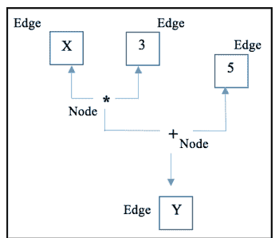

现在我们可以看到 TensorFlow 这个名称的由来：网络中的张量流动。

至此，核心 Keras 库以及 TensorFlow 后端的安装已完成。我们继续基于 Keras 的交通标志分类解决方案。

首先，通过重塑训练和测试特征矩阵来为 Keras 建模准备输入数据：

```
> x_train <- data_train.x
> dim(x_train) <- c(nrow(data_train.x), 32, 32, 1)
> x_test <- data_test.x
> dim(x_test) <- c(nrow(data_test.x), 32, 32, 1)
```

同样，输入像素的值已经在 0 到 1 之间，因此不需要执行任何重新缩放。

我们还将训练和测试目标向量（0 到 42 的整数）转换为 Keras 分类模型所需的二进制类别矩阵（独热编码）：

```
> y_train <- to_categorical(data_train.y, num_classes = 43)
> y_test <- to_categorical(data_test.y, num_classes = 43)
```

在开始建模之前，有一种在 R 中的 Keras 中获得可重复结果的技巧。即在开发模型前使用以下函数指定随机种子：

```
> use_session_with_seed(42)
```

它会采用所有已知措施，以确保 Keras 会话产生可重复的结果。

数据准备就绪，是时候定义模型了！

我们首先按照以下方式初始化 Keras 序列模型：

```
> model <- keras_model_sequential()
```

然后我们添加第一组卷积层、ReLu 非线性层和池化层，使用与之前 MXNet 解决方案相同的参数（网络其余部分也使用相同参数）：

```
> model %>%
```

以一个隐藏的 2D 卷积层开始，输入为 32*32 像素图像：

```
+ layer_conv_2d(
+   filter = 32, kernel_size = c(5, 5),
+   input_shape = c(32, 32, 1)
+ ) %>%
+ layer_activation("relu") %>%
+ layer_max_pooling_2d(pool_size = c(2, 2)) %>%
```

请注意，我们使用管道 (%>%) 运算符向 Keras 序列模型添加层。

随后是第二组卷积层、ReLu 非线性层和池化层：

```
+ # Second hidden convolutional layer layer
+ layer_conv_2d(filter = 64, kernel_size = c(5, 5)) %>%
+ layer_activation("relu") %>%
+ layer_max_pooling_2d(pool_size = c(2, 2)) %>%
```

将前面卷积层生成的特征图扁平化：

```
+ layer_flatten() %>%
```

然后送入全连接层：

```
+ layer_dense(1000) %>%
+ layer_activation("relu") %>%
```

最后，连接到包含 43 个输出单元的 softmax 层：

```
+ layer_dense(43) %>%
+ layer_activation("softmax")
```

我们可以使用 `summary()` 函数查看模型的详细信息：

```
> summary(model)
```

| 层 (类型) | 输出形状 | 参数数量 |
|---|---|---|
| conv2d_1 (Conv2D) | (None, 28, 28, 32) | 832 |
| activation_1 (Activation) | (None, 28, 28, 32) | 0 |
| max_pooling2d_1 (MaxPooling2D) | (None, 14, 14, 32) | 0 |
| conv2d_2 (Conv2D) | (None, 10, 10, 64) | 51264 |
| activation_2 (Activation) | (None, 10, 10, 64) | 0 |
| max_pooling2d_2 (MaxPooling2D) | (None, 5, 5, 64) | 0 |
| flatten_1 (Flatten) | (None, 1600) | 0 |
| dense_1 (Dense) | (None, 1000) | 1600000 |
| activation_3 (Activation) | (None, 1000) | 0 |
| dense_2 (Dense) | (None, 43) | 43043 |
| activation_4 (Activation) | (None, 43) | 0 |
| Total params: 1,696,139 | | |
| Trainable params: 1,696,139 | | |
| Non-trainable params: 0 | | |

取决于模型构建的时间，层名称可能会有不同的后缀（例如 _1、_2）。

CNN 模型的所有部分现在都已组装完成。在编译模型之前，我们需要明确指定其优化器。在 MXNet 中，优化器是 mx.model.FeedForward.create 方法的一个参数，默认值为随机梯度下降 (SGD)。在 Keras 中，我们使用相同的优化器，并设置相同的学习率和动量：

```
> opt <- optimizer_sgd(lr = 0.005, momentum = 0.9)
```

除了我们刚刚定义的优化器，还将交叉熵作为损失函数，分类准确率作为度量指标，我们来编译 CNN 模型：

```
> model %>% compile(
+     loss = "categorical_crossentropy",
+     optimizer = opt,
+     metrics = "accuracy"
+ )

```

现在我们可以安全地启动模型训练。同样使用了相同的超参数，包括批次大小和迭代次数。请注意，测试数据集用于模型验证，每次训练迭代都会计算当前 CNN 模型的分类性能。最后但同样重要的是，在本例中不需要 shuffle，因为原始数据分割后训练数据已经随机打乱：

```
> model %>% fit(
+     x_train, y_train,
+     batch_size = 100,
+     epochs = 30,
+     validation_data = list(x_test, y_test),
+     shuffle = FALSE
+ )

```

```

Train on 29409 samples, validate on 9800 samples
Epoch 1/30
29409/29409 [==============================] - 109s 4ms/step - loss: 2.8031 - acc: 0.2823 - val_loss: 1.1719 - val_acc: 0.6733
Epoch 2/30
29409/29409 [==============================] - 109s 4ms/step - loss: 0.6438 - acc: 0.8372 - val_loss: 0.4079 - val_acc: 0.8891
Epoch 3/30
29409/29409 [==============================] - 110s 4ms/step - loss: 0.3154 - acc: 0.9217 - val_loss: 0.2623 - val_acc: 0.9336
Epoch 4/30
29409/29409 [==============================] - 109s 4ms/step - loss: 0.1969 - acc: 0.9533 - val_loss: 0.2096 - val_acc: 0.9483
Epoch 5/30
29409/29409 [==============================] - 24703s 840ms/step - loss: 0.1410 - acc: 0.9682 - val_loss: 0.1715 - val_acc: 0.9604
Epoch 6/30
29409/29409 [==============================] - 1076s 37ms/step - loss: 0.1055 - acc: 0.9761 - val_loss: 0.1363 - val_acc: 0.9690
Epoch 7/30
29409/29409 [==============================] - 34344s 1s/step - loss: 0.0860 - acc: 0.9806 - val_loss: 0.1147 - val_acc: 0.9742
Epoch 8/30
29409/29409 [==============================] - 104s 4ms/step - loss: 0.0698 - acc: 0.9841 - val_loss: 0.1065 - val_acc: 0.9756
```


```
Epoch 9/30
29409/29409 [==============================] - 108s 4ms/step - loss: 0.0535
- acc: 0.9874 - val_loss: 0.1015 - val_acc: 0.9780
Epoch 10/30
29409/29409 [==============================] - 109s 4ms/step - loss: 0.0414
- acc: 0.9913 - val_loss: 0.0927 - val_acc: 0.9801
Epoch 11/30
29409/29409 [==============================] - 108s 4ms/step - loss: 0.0415
- acc: 0.9917 - val_loss: 0.0912 - val_acc: 0.9807
Epoch 12/30
29409/29409 [==============================] - 106s 4ms/step - loss: 0.0341
- acc: 0.9933 - val_loss: 0.1054 - val_acc: 0.9769
Epoch 13/30
29409/29409 [==============================] - 108s 4ms/step - loss: 0.0266
- acc: 0.9946 - val_loss: 0.0811 - val_acc: 0.9842
Epoch 14/30
29409/29409 [==============================] - 106s 4ms/step - loss: 0.0207
- acc: 0.9965 - val_loss: 0.0790 - val_acc: 0.9845
Epoch 15/30
29409/29409 [==============================] - 106s 4ms/step - loss: 0.0221
- acc: 0.9955 - val_loss: 0.0780 - val_acc: 0.9841
Epoch 16/30
29409/29409 [==============================] - 109s 4ms/step - loss: 0.0169
- acc: 0.9974 - val_loss: 0.0753 - val_acc: 0.9854
Epoch 17/30
29409/29409 [==============================] - 109s 4ms/step - loss: 0.0137
- acc: 0.9982 - val_loss: 0.0777 - val_acc: 0.9863
Epoch 18/30
29409/29409 [==============================] - 109s 4ms/step - loss: 0.0114
- acc: 0.9986 - val_loss: 0.0757 - val_acc: 0.9863
Epoch 19/30
29409/29409 [==============================] - 109s 4ms/step - loss: 0.0101
- acc: 0.9990 - val_loss: 0.0775 - val_acc: 0.9867
Epoch 20/30
29409/29409 [==============================] - 108s 4ms/step - loss: 0.0086
- acc: 0.9993 - val_loss: 0.0786 - val_acc: 0.9862
Epoch 21/30
29409/29409 [==============================] - 110s 4ms/step - loss: 0.0077
- acc: 0.9994 - val_loss: 0.0776 - val_acc: 0.9859
Epoch 22/30
29409/29409 [==============================] - 110s 4ms/step - loss: 0.0071
- acc: 0.9995 - val_loss: 0.0774 - val_acc: 0.9862
Epoch 23/30
29409/29409 [==============================] - 109s 4ms/step - loss: 0.0066
- acc: 0.9996 - val_loss: 0.0779 - val_acc: 0.9862
Epoch 24/30
29409/29409 [==============================] - 110s 4ms/step - loss: 0.0062
- acc: 0.9997 - val_loss: 0.0783 - val_acc: 0.9860
Epoch 25/30
29409/29409 [==============================] - 114s 4ms/step - loss: 0.0059
- acc: 0.9997 - val_loss: 0.0786 - val_acc: 0.9859
Epoch 26/30
29409/29409 [==============================] - 115s 4ms/step - loss: 0.0056
- acc: 0.9998 - val_loss: 0.0791 - val_acc: 0.9861
Epoch 27/30
29409/29409 [==============================] - 117s 4ms/step - loss: 0.0053
- acc: 0.9998 - val_loss: 0.0793 - val_acc: 0.9860
Epoch 28/30
29409/29409 [==============================] - 115s 4ms/step - loss: 0.0051
- acc: 0.9998 - val_loss: 0.0794 - val_acc: 0.9862
Epoch 29/30
29409/29409 [==============================] - 114s 4ms/step - loss: 0.0050
- acc: 0.9998 - val_loss: 0.0795 - val_acc: 0.9864
Epoch 30/30
29409/29409 [==============================] - 113s 4ms/step - loss: 0.0048
- acc: 0.9998 - val_loss: 0.0796 - val_acc: 0.9865
```

训练30个epoch后，模型训练良好，在测试集上达到了98.65%的准确率。
在RStudio查看器窗格中，我们也可以实时查看每个epoch的分类性能：

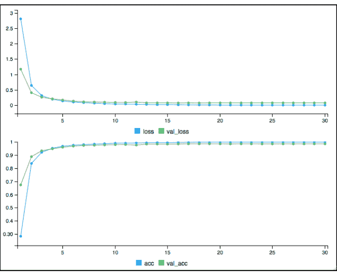

## 使用丢弃法减少过拟合

你可能会注意到，我们在MXNet解决方案中使用了L2正则化，它通过对大权重施加惩罚来避免过拟合；但我们在此Keras解决方案中未这样做。这导致测试集上的分类准确率略有差异（99.30%对98.65%）。我们将在此Keras解决方案中采用正则化，这次具体使用**脱校法**。

脱校法是神经网络中的一种正则化技术，最初由Geoffrey Hinton等人于2012年提出（Improving Neural Networks by Preventing Co-adaptation of Feature Detectors in Neural and Evolutionary Computing）。顾名思义，它在训练期间忽略神经网络中随机选取的一小部分神经元（可以是隐藏层或可见层神经元）。*被丢弃的*神经元暂时不对下游神经元的激活或反向传播时的神经元权重更新做出贡献。那么，脱校法技术如何防止过拟合呢？

请回顾，在标准神经网络中，神经元在训练期间与相邻神经元相互依赖。而且神经元的权重会针对网络中的特定上下文进行调整，这限制了每个神经元的个体能力。这种对上下文的依赖可能导致模型过于专门化于训练数据。当网络中此类神经元不被考虑时，神经元的权重对其他神经元的权重变得不那么敏感。神经元被迫更独立地学习有用信息。训练数据上的共适应会受到惩罚。

使用脱校法很简单。在训练阶段，对于具有脱校率*p*的层，在每次迭代中，我们随机关闭比例*p*的神经元。在测试阶段，我们使用所有神经元，但将其激活值按因子*q = 1 - p*进行缩放，以解释训练阶段中被丢弃的激活值。

下面是一个标准神经网络（第一张图）和带有脱校法的同一网络（第二张图）：

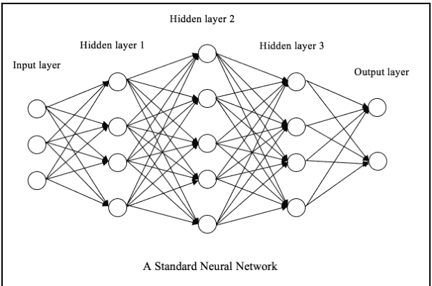

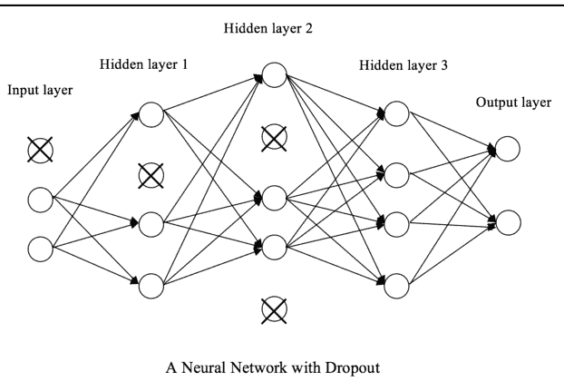

在此示例中，脱校法应用于可见层（即输入层），此外还应用于隐藏层。

在实践中，脱校率通常设置为20%至50%。脱校率过低的层影响不大，而过高的比率会导致欠拟合。

现在让我们通过使用函数`layer_dropout(p)`将脱校法应用到我们的Keras解决方案中。我们定义一个函数来初始化和编译带有脱校法的CNN模型（以供复用）：

```r
init_cnn_dropout <- function() {
  model_dropout <- keras_model_sequential()
  model_dropout %>%
  layer_conv_2d(
    filter = 32, kernel_size = c(5, 5),
    input_shape = c(32, 32, 1)
  ) %>%
  layer_activation("relu") %>%
  layer_max_pooling_2d(pool_size = c(2, 2)) %>%
  # Second hidden convolutional layer
  layer_conv_2d(filter = 64, kernel_size = c(5, 5)) %>%
  layer_activation("relu") %>%
  # Use max pooling
  layer_max_pooling_2d(pool_size = c(2, 2)) %>%
  layer_dropout(0.25) %>%
  # Flatten and feed into dense layer
  layer_flatten() %>%
  layer_dense(1000) %>%
  layer_activation("relu") %>%
  layer_dropout(0.25) %>%
  # Outputs from dense layer
  layer_dense(43) %>%
  layer_activation("softmax")

  opt <- optimizer_sgd(lr = 0.005, momentum = 0.9)

  model_dropout %>%
    compile(
      loss = "categorical_crossentropy",
      optimizer = opt,
      metrics = "accuracy"
    )

  return(model_dropout)
}
```

### 获取新模型：

```r
> model_dropout <- init_cnn_dropout()
```

我们在第二个最大池化层和全连接隐藏层中分别使用25%的脱校法。通过调用summary(model_dropout)，我们可以看到第二个MaxPooling2D层下方以及第一个密集层和激活层下方分别有两个脱校法层。

### 继续进行模型训练：

```r
> model_dropout %>% fit(
+ x_train, y_train,
+ batch_size = 100,
+ epochs = 30,
+ validation_data = list(x_test, y_test),
+ shuffle = FALSE
+ )
Train on 29409 samples, validate on 9800 samples
Epoch 1/30
29409/29409 [==============================] - 108s 4ms/step - loss: 3.1078
- acc: 0.1987 - val_loss: 1.4475 - val_acc: 0.6487
Epoch 2/30
29409/29409 [==============================] - 106s 4ms/step - loss: 0.9772
- acc: 0.7337 - val_loss: 0.4570 - val_acc: 0.8934
Epoch 3/30
29409/29409 [==============================] - 106s 4ms/step - loss: 0.5194
- acc: 0.8598 - val_loss: 0.3043 - val_acc: 0.9310
Epoch 4/30
29409/29409 [==============================] - 106s 4ms/step - loss: 0.3606
- acc: 0.9037 - val_loss: 0.2058 - val_acc: 0.9529
Epoch 5/30
29409/29409 [==============================] - 106s 4ms/step - loss: 0.2828
- acc: 0.9250 - val_loss: 0.1677 - val_acc: 0.9640
Epoch 6/30
29409/29409 [==============================] - 106s 4ms/step - loss: 0.2272
- acc: 0.9406 - val_loss: 0.1424 - val_acc: 0.9707
Epoch 7/30
29409/29409 [==============================] - 106s 4ms/step - loss: 0.1910
- acc: 0.9494 - val_loss: 0.1138 - val_acc: 0.9793
Epoch 8/30
29409/29409 [==============================] - 106s 4ms/step - loss: 0.1560
- acc: 0.9602 - val_loss: 0.0986 - val_acc: 0.9797
Epoch 9/30
29409/29409 [==============================] - 106s 4ms/step - loss: 0.1423
- acc: 0.9621 - val_loss: 0.0956 - val_acc: 0.9804
Epoch 10/30
```


```
29409/29409 [==============================] - 106s 4ms/step - loss: 0.1256 - acc: 0.9663 - val_loss: 0.0814 - val_acc: 0.9841
Epoch 11/30
29409/29409 [==============================] - 106s 4ms/step - loss: 0.1111 - acc: 0.9708 - val_loss: 0.0760 - val_acc: 0.9847
Epoch 12/30
29409/29409 [==============================] - 106s 4ms/step - loss: 0.0987 - acc: 0.9735 - val_loss: 0.0795 - val_acc: 0.9824
Epoch 13/30
29409/29409 [==============================] - 106s 4ms/step - loss: 0.0899 - acc: 0.9752 - val_loss: 0.0626 - val_acc: 0.9876
Epoch 14/30
29409/29409 [==============================] - 106s 4ms/step - loss: 0.0799 - acc: 0.9787 - val_loss: 0.0665 - val_acc: 0.9868
Epoch 15/30
29409/29409 [==============================] - 106s 4ms/step - loss: 0.0794 - acc: 0.9792 - val_loss: 0.0571 - val_acc: 0.9887
Epoch 16/30
29409/29409 [==============================] - 106s 4ms/step - loss: 0.0691 - acc: 0.9817 - val_loss: 0.0534 - val_acc: 0.9898
Epoch 17/30
29409/29409 [==============================] - 106s 4ms/step - loss: 0.0668 - acc: 0.9817 - val_loss: 0.0560 - val_acc: 0.9892
Epoch 18/30
29409/29409 [==============================] - 106s 4ms/step - loss: 0.0583 - acc: 0.9846 - val_loss: 0.0486 - val_acc: 0.9916
Epoch 19/30
29409/29409 [==============================] - 106s 4ms/step - loss: 0.0541 - acc: 0.9861 - val_loss: 0.0484 - val_acc: 0.9914
Epoch 20/30
29409/29409 [==============================] - 106s 4ms/step - loss: 0.0529 - acc: 0.9858 - val_loss: 0.0494 - val_acc: 0.9906
Epoch 21/30
29409/29409 [==============================] - 106s 4ms/step - loss: 0.0500 - acc: 0.9864 - val_loss: 0.0449 - val_acc: 0.9909
Epoch 22/30
29409/29409 [==============================] - 106s 4ms/step - loss: 0.0469 - acc: 0.9872 - val_loss: 0.0414 - val_acc: 0.9926
Epoch 23/30
29409/29409 [==============================] - 106s 4ms/step - loss: 0.0473 - acc: 0.9863 - val_loss: 0.0415 - val_acc: 0.9917
Epoch 24/30
29409/29409 [==============================] - 107s 4ms/step - loss: 0.0406 - acc: 0.9894 - val_loss: 0.0416 - val_acc: 0.9916
Epoch 25/30
29409/29409 [==============================] - 108s 4ms/step - loss: 0.0413 - acc: 0.9888 - val_loss: 0.0445 - val_acc: 0.9909
Epoch 26/30
29409/29409 [==================================================] - 108s 4ms/step - loss: 0.0337 - acc: 0.9906 - val_loss: 0.0412 - val_acc: 0.9922
Epoch 27/30
29409/29409 [==================================================] - 108s 4ms/step - loss: 0.0333 - acc: 0.9911 - val_loss: 0.0388 - val_acc: 0.9928
Epoch 28/30
29409/29409 [==================================================] - 108s 4ms/step - loss: 0.0322 - acc: 0.9905 - val_loss: 0.0395 - val_acc: 0.9933
Epoch 29/30
29409/29409 [==================================================] - 108s 4ms/step - loss: 0.0312 - acc: 0.9910 - val_loss: 0.0371 - val_acc: 0.9937
Epoch 30/30
29409/29409 [==================================================] - 108s 4ms/step - loss: 0.0305 - acc: 0.9917 - val_loss: 0.0383 - val_acc: 0.9940
```

使用 Dropout 后，测试集上的预测准确率提高到 99.40%。

## 处理小型训练集 – 数据增强

迄今为止，我们非常幸运地拥有一个包含 39,209 个样本中 75% 的足够大的训练数据集。这也是我们能够达到 99.3% 到 99.4% 分类准确率的原因之一。然而，在现实中，在大多数监督学习场景下，获得大型训练集并不容易，因为这些场景需要人工操作，或者数据收集和标记的成本很高。在我们的交通标志分类项目中，如果一开始给我们的训练样本少得多，我们还能实现相同的性能吗？让我们试一试。

```
> train_perc_1 = 0.1
> train_index_1 <- createDataPartition(data.y, p=train_perc_1, list=FALSE)
> train_index_1 <- train_index_1[sample(nrow(train_index_1)), ]
> data_train_1.x <- data.x[train_index_1,]
> data_train_1.y <- data.y[train_index_1]
> data_test_1.x <- data.x[-train_index_1,]
> data_test_1.y <- data.y[-train_index_1]
> x_train_1 <- data_train_1.x
> dim(x_train_1) <- c(nrow(data_train_1.x), 32, 32, 1)
> x_test_1 <- data_test_1.x
> dim(x_test_1) <- c(nrow(data_test_1.x), 32, 32, 1)
> y_train_1 <- to_categorical(data_train_1.y, num_classes = 43)
> y_test_1 <- to_categorical(data_test_1.y, num_classes = 43)
```

初始化一个新模型，并使用新的训练集对其进行拟合：

```
> model_1 <- init_cnn_dropout()
> model_1 %>% fit (
+   x_train_1, y_train_1,
+   batch_size = 100,
+   epochs = 1,
+   validation_data = list(x_test_1, y_test_1),
+   shuffle = FALSE
+ )
```

在 3,921 个样本上训练；在 35,288 个样本上验证：

```
Epoch 1/30
3921/3921 [==============================] - 19s 5ms/step - loss: 3.6705 - acc: 0.0594 - val_loss: 3.5191 - val_acc: 0.0592
Epoch 2/30
3921/3921 [==============================] - 17s 4ms/step - loss: 3.5079 - acc: 0.0681 - val_loss: 3.4663 - val_acc: 0.0529
......
......
Epoch 29/30
3921/3921 [==============================] - 17s 4ms/step - loss: 0.1935 - acc: 0.9462 - val_loss: 0.2760 - val_acc: 0.9381
Epoch 30/30
3921/3921 [==============================] - 17s 4ms/step - loss: 0.1962 - acc: 0.9431 - val_loss: 0.2772 - val_acc: 0.9393
```

仅用 3,921 个样本训练的模型就能达到 93.93% 的准确率，这已经不错了。但我们能做得更好吗，至少接近我们在拥有充足训练数据时实现的 99%？可以！一种解决方案是数据增强。

**数据增强**简单来说，就是扩大我们输入到监督学习模型中的现有数据规模，以补偿进一步数据收集和标记的成本。

在计算机视觉中，有许多增强数据的方法。最简单的方法可能是水平或垂直翻转图像。以一般警告标志为例，我们使用 Keras 中的函数 flow_images_from_data() 来实现翻转，如下所示。

```
> img<-image_load(paste(training_path, "00018/00001_00004.ppm", sep=""))
> img1<-image_to_array(img)
> dim(img1)<-c(1,dim(img1))
```

我们生成一个水平翻转的图像，并将生成的图像保存到我们创建的 `augmented` 目录中：

```
> images_iter <- flow_images_from_data(img1, , generator =
  image_data_generator(horizontal_flip = TRUE),
+
  save_to_dir = 'augmented',
+
  save_prefix = "horizontal", save_format = "png")
> reticulate::iter_next (images_iter)
```

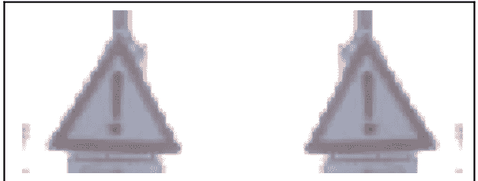

水平翻转后的标志图像与原图传达相同的信息。应当注意，翻转仅适用于方向不敏感的情况，例如猫和狗的分类，或我们对交通灯的识别。然而，在方向很重要的情况下，例如右转与左转的分类，仍可以应用小到中等程度的旋转。例如，翻转 *右侧危险曲线* 标志是绝对危险的，但将其旋转最多 20 度是无害的，甚至有帮助，如下一个示例所示：

```
> img<-image_load(paste (training_path, "00020/00002_00017.ppm", sep=""))
> img1 <- image_to_array(img)
> dim(img1)<-c(1,dim(img1))
> images_iter <- flow_images_from_data(img1, , generator =
  image_data_generator(rotation_range = 20),
+
  save_to_dir = 'augmented',
+
  save_prefix = "rotation", save_format = "png")
> reticulate::iter_next (images_iter)
```

旋转后的标志（右）和原始图像（左）包含相同的信息：

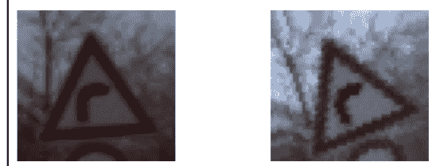

平移或许是最常见的增强方法。将图像水平和/或垂直移动少量像素，会生成一个功能相同的图像。沿用之前的示例，我们将其水平和垂直方向分别平移最多 20% 的宽度和高度：

```
> images_iter <- flow_images_from_data(img1,
+ generator=image_data_generator(width_shift_range=0.2,
+ height_shift_range=0.2), save_to_dir = 'augmented',
+ save_prefix = "shift", save_format = "png")
> reticulate::iter_next(images_iter)
```

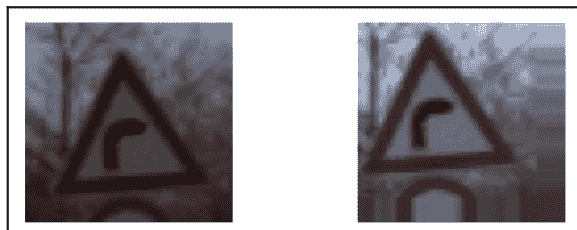


掌握常见的数据增强方法后，让我们通过最多20度的旋转和最多20%的平移来扩充我们的小型训练数据集（请注意，我们不能应用翻转，因为某些标志，例如类别19、20、21、33和34，在语义上不是对称的）：

```
> datagen <- image_data_generator(
+ rotation_range = 20,
+ width_shift_range = 0.2,
+ height_shift_range = 0.2,
+ horizontal_flip = FALSE
+ )
> datagen %>% fit_image_data_generator(x_train_1)
Augmented data generator is defined and now being applied to a CNN model with function fit_generator:
> model_2 <- init_cnn_dropout()
> model_2 %>% fit_generator(
+ flow_images_from_data(x_train_1, y_train_1,
datagen, batch_size = 100),
+ steps_per_epoch = as.integer(50000/100),
+ epochs = 30,
+ validation_data = list(x_test_1, y_test_1)
+ )
Epoch 1/30
500/500 [==============================] - 74s 149ms/step - loss: 3.4566 -
acc: 0.0798 - val_loss: 3.2963 - val_acc: 0.1322
Epoch 2/30
500/500 [==============================] - 77s 153ms/step - loss: 3.0920 -
acc: 0.1666 - val_loss: 2.1010 - val_acc: 0.4249
......
......
Epoch 25/30
500/500 [==============================] - 83s 166ms/step - loss: 0.1396 -
acc: 0.9584 - val_loss: 0.0636 - val_acc: 0.9860
Epoch 26/30
500/500 [==============================] - 79s 158ms/step - loss: 0.1359 -
acc: 0.9592 - val_loss: 0.0672 - val_acc: 0.9859
Epoch 27/30
500/500 [==============================] - 80s 160ms/step - loss: 0.1344 -
acc: 0.9600 - val_loss: 0.0727 - val_acc: 0.9843
Epoch 28/30
500/500 [==============================] - 81s 163ms/step - loss: 0.1227 -
acc: 0.9628 - val_loss: 0.0647 - val_acc: 0.9862
Epoch 29/30
500/500 [==============================] - 79s 158ms/step - loss: 0.1222 - acc: 0.9627 - val_loss: 0.0668 - val_acc: 0.9858
Epoch 30/30
500/500 [====================================] - 80s 160ms/step - loss: 0.1220 - acc: 0.9636 - val_loss: 0.0614 - val_acc: 0.9870

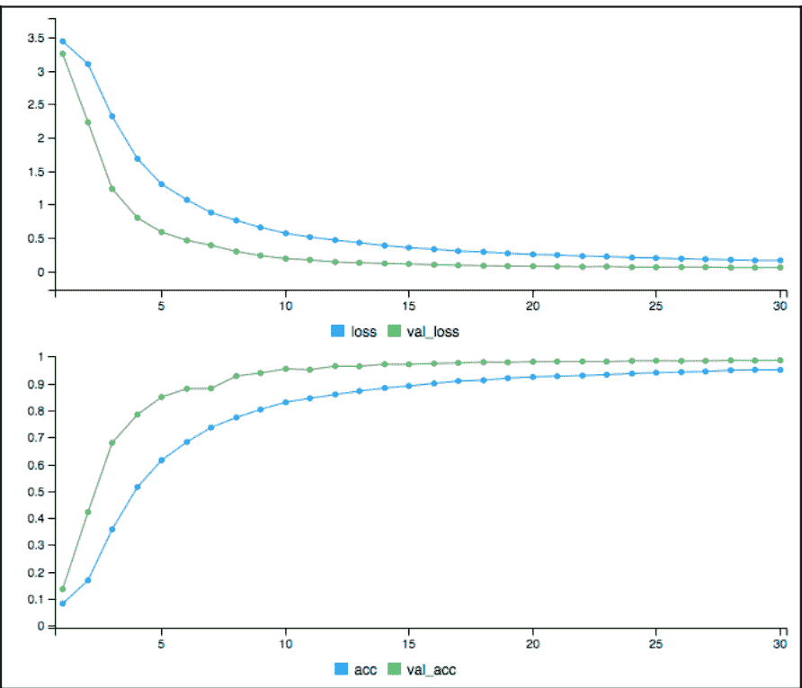

With data augmentation, we can get excellent results of 98.70% accuracy with a small training set.

Besides the 4.77% (93.93% to 98.70%) performance increase compared to no data augmentation, we observe that each iteration takes a longer time than before (around 20 s to around 80 s). This is because `image_data_generator()` generates mini-batches of augmented image data in real time for each iteration. So, even if the same set of samples is used in two iterations, the augmented data can be very different. Such setting adds more variation to the training set, which in turn makes the model more robust. And that is why data augmentation is considered an approach to reduce overfitting.

Another particularly useful application of data augmentation is balancing a dataset. In most unbalanced classification cases (such as online ads click-through prediction, or banking fraud detection), we usually down-sample the dominant class. However, this can be counterproductive for small datasets. The alternative solution is to augment data from the minor class.

Last but not least, there are other approaches not mentioned previously to augment image data. For example, rescaling multiplies pixel values by a factor and, as a result, changes the lighting condition. Shearing and zooming are useful data augmentation transformations as well. They can be specified in `image_data_generator()`. If interested, you can try applying any of these approaches and see whether you can beat 98.70%.

## 回顾防止CNN中过拟合的方法

Overfitting occurs when the model fits too well to the training set but is not able to generalize to unseen cases. For example, a CNN model recognizes specific traffic sign images in the training set instead of general patterns. It can be very dangerous if a self-driving car is not able to recognize sign images in ever-changing conditions, such as different weather, lighting, and angles different from what are presented in the training set. To recap, here's what we can do to reduce overfitting:

- Collecting more training data (if possible and feasible) in order to account for various input data.
- Using data augmentation, wherein we invent data in a smart way if time or cost does not allow us to collect more data.
- Employing dropout, which diminishes complex co-adaptations among neighboring neurons.
- Adding Lasso (L1) or/and Ridge (L2) penalty, which prevents model coefficients from fitting so perfectly that overfitting arises.
- Reducing the complexity of network architecture. Recall that in the last chapter, we mentioned that adding hidden layers will not help boost the model performance but increase chances of overfitting.

## 总结

We just accomplished our second computer vision project in this R and deep learning journey! Through this chapter, we got more familiar with convolutional neural networks and their implementation in MXNet, and another powerful deep learning tool: Keras with TensorFlow.

We started with what self-driving cars are and how deep learning techniques are making self-driving cars feasible and more reliable. We also discussed how deep learning stands out and becomes the state-of-the-art solution for object recognition in intelligent vehicles. After exploring the traffic sign dataset, we developed our first CNN model using MXNet and achieved more than 99% accuracy. Then we moved on to another powerful deep learning framework, Keras + TensorFlow, and obtained comparable results.

We introduced the dropout technique to reduce overfitting. We also learned how to deal with lack of training data and utilize data augmentation techniques, including flipping, shifting, and rotation. We finally wrapped up the chapter by summarizing some approaches to prevent overfitting in CNN models. That was the second example where we observed how deep learning removes manual or explicit feature extraction steps taken in traditional approaches, and instead efficiently finds the best sets of features.

We have practiced CNNs in these two computer vision projects. In the next project, we will be working with totally different types of deep neural networks—autoencoders.

# 3 基于自动编码器的欺诈检测

In this chapter, we continue our journey into deep learning with R with autoencoders.

A classical autoencoder consists of three parts:

- An encoding function, which compresses your data
- A decoding function, which reconstructs data from a compressed version
- A metric or distance, which calculates the difference between the information lost by compression on your data

We typically assume that all these involved functions are smooth enough to be able to use backpropagation or other gradient-based methods, although they need not be and we could use derivative-free methods to train them.

> Autoencoding is the process of summarizing information from a potentially large feature set into a smaller feature set.

Although the compression bit might remind you of algorithms, such as the MP3 compression algorithm, an important difference is that autoencoders are data specific. An autoencoder trained in pictures of cats and dogs will likely perform poorly in pictures of buildings. In contrast, the MP3 compression algorithm uses assumptions of sound in general and can work regardless of the sound data. The data-specific bit is a serious caveat for widespread application which makes autoencoders rarely used for compression tasks.

One reason autoencoders have attracted so much attention in recent years is because many people believe that they might be the key for **unsupervised learning**, although strictly speaking, they are a **self-supervised** learning algorithm.

Sometimes the features abstracted from autoencoders can be fed into supervised learning algorithms, making them somewhat comparable to **principal component analysis (PCA)** as a dimensionality reduction technique.

Autoencoders are typically used in computer vision problems such as image denoising or for picking up features such as colors, light and edges. They are also used for data visualization of large dimensional datasets, as they can find more interesting features than PCA. Other recent applications include fraud and intrusion detection.

For our purposes, an autoencoder neural network is simply an algorithm for unsupervised learning that applies backpropagation by setting the target values equal to the inputs, if $x_1, x_2, ... x_m$ are the training examples and $y_1, y_2, ... y_m$ are the labels, then we will do backpropagation by setting $x_i = y_i$, for all values of $i$.

From your previous experience with machine learning, you might be familiar with PCA. Don't worry if you are not familiar with it, this is not strictly required for our purposes. PCA is a **dimensionality reduction** technique, which means, given a set of training examples, a suitable transformation is applied (for math geeks, this is just a projection into the vector space generated by the eigenvectors of the covariance matrix). The goal of this projection is to find the most relevant features of the input data, so that in the end we get a simplified representation of it.

Autoencoders work in a similar vein, except that the transformation involved is not a projection, but rather a non-linear function $f$. Given a training example $x$, an autoencoder encodes $x$ using a neural network into a hidden state $h:=f(x)$, and decodes $h$ using a function $g$, which brings an overall transformation of $x => g(f(x))$. If the result of this process would be simply $g(f(x))=x$, we would not have a very useful transformation. The idea is illustrated in the following diagram:


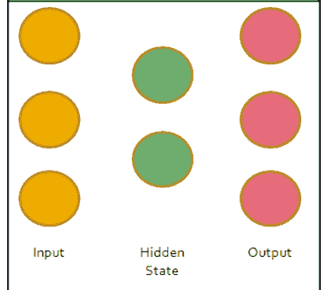

自动编码器的实际应用：将三维向量编码为二维隐藏状态，然后再映射回三维空间。

在左侧部分，三维输入向量被转换为二维编码状态（这是 f 的作用），然后再转换回三维向量（由 g 的作用完成）。

为什么要费心进行编码和解码？这有两个目的。一方面，自动编码器如同 PCA 一样，提供了一种在较低维空间中自动生成特征的方法。作为机器学习流水线的一部分用于特征提取，这很有用，就像 PCA 同样有用一样。通过合成数据并自动生成特征（而不是依赖领域专业知识和手工制作特征），可以提高监督学习算法的准确性，无论该算法用于分类还是回归任务。就我们的目的而言，它也用于异常值检测。由于计算机被迫理解数据的基本特征，任何显得异常的东西在重建过程中（即完整的编码–解码循环）都会被剔除，因此异常值很容易被识别。

在进入本章的欺诈示例之前，让我们先通过一个更简单的示例入门，同时准备好我们的工具。

## 准备工作

在本章中，我们将介绍 R 语言的 keras 和 tensorflow。keras 是一个模型级构建工具，它提供了高级接口，可以快速开发深度学习模型。它不实现卷积和张量积等低级操作，而是依赖后端的 Theano、TensorFlow 或 CNTK，根据开发团队的说法，未来将支持更多后端。

为什么需要后端？嗯，如果计算变得更复杂——这在深度学习中很常见——您需要使用不同的计算方法（称为计算图）和硬件（GPU）。出于教学目的，我们所有的示例代码均在无 GPU 的情况下运行。

## 在 R 中安装 Keras 和 TensorFlow

根据官方文档，您可以简单地通过以下方式安装 Keras：

```r
devtools::install_github("rstudio/keras")
```

Keras R 接口默认使用 tensorflow 作为后端引擎。要同时安装核心 keras 库和 tensorflow，请执行：

```r
library(keras)
install_keras()
```

尽管这看起来可能很顺利，但我们多次看到此设置失败。我们推荐的备选方案 B 是：

- 下载并安装 Python 的 Anaconda 发行版。这是标准的数据科学栈，包含数据科学家最流行的 Python 库。
- 安装您的 Keras 后端，例如 Tensorflow。
- 安装 Keras（在 Python 中）。

完成此步骤后，您应该就可以在 R 中安装 Keras 了。

为确保您使用的是最新版本的 R，您可以使用 installr 包从 R GUI（而非 RStudio）中更新它：

```r
### Run these from RGui
install.packages("installr")
installr::updateR()
```

完成后，您可以使用 devtools 安装 keras：

```r
install.packages("devtools")
devtools::install_github("rstudio/keras")
```

最后，通过导入库来检查一切是否正确：

```r
library(keras)
```

上述说明在运行 R 3.4 版的 Windows 10 笔记本电脑上效果良好。如果您使用的是旧版本且不想更新，则需要安装以下指定的依赖项（我使用 R 3.3 版进行了测试）：

```r
install.packages("Rcpp")
install.packages("devtools")
devtools::install_github("rstudio/reticulate", force=TRUE)
devtools::install_github ("r-lib/debugme")
devtools::install_github ("r-lib/processx")
devtools::install_github ("tidyverse/rlang")
devtools::install_github ("tidyverse/glue")
devtools::install_github ("tidyverse/tidyselect")
devtools::install_github ("rstudio/tfruns")
devtools::install_github ("rstudio/tensorflow")
devtools::install_github ("rstudio/keras")
devtools::install_github ("jeroen/jsonlite")
```

## 安装 H2O

我们还将展示如何为部分练习使用 H2O。安装 H2O 最简单的方法是从 CRAN 获取。

它有几个依赖项，尤其是以下包：

- RCurl
- bitops
- rjson
- statmod
- tools

如果遇到问题，很可能是缺少某些依赖项。重新阅读错误消息并安装任何缺失的包。

如果一切顺利，请导入库并初始化服务以检查一切是否正常：

```r
install.packages ("h2o")
library(h2o)
h2o.init()
```

## 我们的第一个示例

让我们先从几个简单的示例开始，以了解发生了什么。

对我们中的一些人来说，很容易被诱惑去尝试最花哨的算法并进行超参数优化，而不是进行不那么光鲜的逐步理解。

## 简单的 2D 示例

让我们通过一个简单的二维示例来培养对自动编码器工作原理的直觉。

我们首先生成 10,000 个来自均值为 0、方差为 1 的正态分布的点：

```r
library (MASS)
library (keras)
Sigma <- matrix(c(1,0,0,1),2,2)
n_points <- 10000
df <- mvrnorm(n=n_points, rep(0,2), Sigma)
df <- as.data.frame(df)
```

值的分布应如下所示：


我们刚刚生成的变量 V1 的分布；变量 V2 看起来相当相似。


我们生成的变量 V1 和 V2 的分布。

让我们稍微增加一点变化，向混合物中添加一些异常值。在许多欺诈应用程序中，欺诈率约为 1–5%，因此我们将 1% 的样本生成为来自均值为 5、标准差为 1 的正态分布：

```r
### Set the outliers
n_outliers <- as.integer(0.01*n_points)
idxs <- sample(n_points, size = n_outliers)
outliers <- mvrnorm(n=n_outliers, rep (5,2), Sigma)
df[idxs, ] <- outliers
```

点的新分布现在如下所示：


添加异常值后点的新分布。

我们将使用在隐藏层中具有一个神经网络的自动编码器。为什么不添加更多？问题是，如果隐藏状态的维度等于或高于输入状态的维度，我们就有可能让模型学习恒等函数，即模型到处都学习 g(f(x))=x。这显然不是一种非常有用的异常值识别方法。我们需要捕捉数据的基本特征，以便以后突出那些不寻常的特征，从而允许检测异常值。

使用 keras，设置模型非常简单，我们需要一个形状为 2 的输入层，用于我们的二维示例。这会传递给我们的一维编码器，使用 ReLU 激活函数，然后解码回二维空间：

```r
input_layer <- layer_input(shape=c(2))
encoder <- layer_dense(units=1, activation='relu')(input_layer)
decoder <- layer_dense(units=2)(encoder)
autoencoder <- keras_model(inputs=input_layer, outputs = decoder)
```

在使用模型之前，我们需要对其进行编译。我们需要指定损失函数、要优化的度量以及执行梯度下降更新的算法。我们将采用 Adam 求解器，优化经典的均方误差（这在该问题中有效，但对于我们的特定应用可能需要更改），并选择准确率作为要优化的度量：

```r
autoencoder %>% compile(optimizer='adam',
                        loss="mean_squared_error",
                        metrics=c('accuracy'))
```

设置完成后，我们就可以开始训练了：

```r
### Coerce the dataframe to matrix to perform the training
df <- as.matrix(df)
history <- autoencoder %>% fit(
df,df,
epochs = 30, batch_size = 128,
validation_split = 0.2
)
```

使用命令 plot(history)，我们可以查看此示例的训练情况：


我们的自动编码器训练。

由此可见，尽管准确率仍然相当高，但在训练过程中出现了一次神秘的下降。目前我们不必过于担心，稍后将再讨论这个问题。至于损失，随着添加更多数据，它会持续下降，这是预期的。

最后，让我们看看重建情况。我们首先从训练好的自动编码器生成预测：

```r
preds <- autoencoder %>% predict(df)
colnames(preds) <- c("V1", "V2")
preds <- as.data.frame(preds)
```


这是根据自编码器对点的重构。我们将把重构与原始图像之间（欧几里得）距离大于三的点标记为红色，其余点保持蓝色。为什么是这些点？我们的自编码器了解到我们的数据集具有某些内在属性（它学习了平均点的分布），因此在重构错误异常大的那些点上，可能存在值得探究的内容：

```
### Coerce back the matrix to data frame to use ggplot later
df <- as.data.frame(df)
### Euclidean distance larger than 3 = sum of squares larger than 9
df$color <- ifelse((df$V1-preds$V1)**2+(df$V2-preds$V2)**2>9,"red","blue")
```

最后，我们可以使用 ggplot 查看结果：

```
library(ggplot2)
df %>% ggplot(aes(V1,V2),col=df$color)+geom_point(color = df$color,
position="jitter")
```

以下截图展示了我们识别异常点的效果：


自编码器的输出。蓝色表示由我们的自编码器重构的点，红色表示数据集中的原始点。我们可以看到，有一簇红点，得益于我们的自编码器，我们可以将其识别为异常点。

在上述截图中，蓝色点是自编码器重构的图像。我们可以看到，它正确地学习到大部分点来自以 (0,0) 为中心的正态分布，这与预期一致。然而，仍然有一些点在原始数据集上是 *正常* 的，却被标记为异常。不必这么快就对学习自编码器感到气馁，原因在于我们使用的自编码器相当简单。我们将探讨使用自编码器解决异常值检测问题的更复杂方法。

## 自编码器与 MNIST

无论是在研究论文、博客文章还是书籍中，许多深度学习算法的示例都涉及 MNIST 数据集。我们也不例外，将使用 MNIST 介绍一个自编码器的小型用例。

动机如下：假设你想自动检测假币。那么你需要教会计算机什么是 *平均钞票* 的表征，以便能够检测出有显著差异的钞票。鉴于全球每天发生的现金交易量巨大，且欺诈者的手段日益复杂，手动完成此过程是不可想象的。一种方法是使用复杂的成像软件，这正是 D40 或 D50 等假币检测器的工作原理。

使用 MNIST 的另一个原因显然是出于实践考虑。在撰写本文时，我未能找到一个包含假币的良好训练数据集，而 MNIST 已预装在 `keras` 中。

我们从加载数据集开始：

```
library(keras)
mnist <- dataset_mnist()
X_train <- mnist$train$x
y_train <- mnist$train$y
X_test <- mnist$test$x
y_test <- mnist$test$y
```

让我们更仔细地查看数据集：

```
image(X_train[1,, ], col=gray.colors(3))
y_train[1]
```

如果一切正常，你应该能看到数字五的图像。

在训练自编码器之前，我们需要进行一些预处理。x_train 数据是一个三维数组（图像、宽度、高度），包含灰度值。我们需要首先将这些数组转换为矩阵，通过将高度和宽度重塑为单个向量，这样我们不再处理 28 x 28 的方阵，而是得到一个 28*28=784 的向量。然后，我们将灰度值从 0 到 255 之间的整数转换为 0 到 1 之间的浮点值：

```
### reshape
dim(X_train) <- c(nrow(X_train), 784)
dim(X_test) <- c(nrow(X_test), 784)
### rescale
X_train <- X_train / 255
X_test <- X_test / 255
```

初始预处理完成后，我们定义自编码器的拓扑结构。让我们使用一个包含 32 个神经元的编码层，以达到 784/32 = 24.5 的压缩比：

```
input_dim <- 28*28 #784
inner_layer_dim <- 32
input_layer <- layer_input (shape=c(input_dim))
encoder <- layer_dense(units=inner_layer_dim,
activation='relu') (input_layer)
decoder <- layer_dense(units=784) (encoder)
autoencoder <- keras_model(inputs=input_layer, outputs = decoder)
```

我们现在可以编译和训练模型了：

```
autoencoder %>% compile(optimizer='adam',
loss='mean_squared_error',
metrics=c('accuracy'))
history <- autoencoder %>% fit(
X_train, X_train,
epochs = 50, batch_size = 256,
validation_split=0.2
)
```

使用 plot 命令，我们可以查看模型在训练和验证过程中的性能，如下所示：

```
plot(history)
```

更好的是，如果你使用 RStudio 作为 IDE，Viewer 面板中有一个实时视图。使用此命令，你应该能看到两个图，显示准确率和损失作为 epoch 数量的函数：


使用 Viewer 面板实时查看训练。点击 "在新窗口中打开" 按钮：


实时训练。横轴是 epoch 数量，纵轴显示损失和准确率。

使用 `predict` 方法，我们重构数字并计算重构错误：

```
### Reconstruct on the test set
preds <- autoencoder %>% predict(X_test)
error <- rowSums((preds-X_test)**2)
error
```

直觉上，有些类别可能更难预测，因为有些人书写数字的方式略有不同。哪些类别的重构错误更高？

```
### Which were more problematic to reconstruct?
eval <- data.frame(error=error, class=as.factor(y_test))
library(dplyr)
eval %>% group_by(class) %>% summarise(avg_error=mean(error))
```

| 类别 | 平均错误 |
|-------|-----------|
| 0 | 14.091963 |
| 1 | 6.126858 |
| 2 | 17.245944 |
| 3 | 14.138960 |
| 4 | 13.189842 |
| 5 | 15.170581 |
| 6 | 14.570642 |
| 7 | 11.778826 |
| 8 | 16.120203 |
| 9 | 11.645038 |

请注意，预计会出现一些小幅度的差异，例如，数据洗牌中涉及随机因素。不过，总体趋势应该相似。

一图胜千言，因此与其使用 `dplyr` 总结数据，不如使用 `ggplot2` 来可视化这些信息：

```
library(ggplot2)
eval %>%
 group_by(class) %>%
 summarise(avg_error=mean(error)) %>%
 ggplot(aes(x=class, fill=class, y=avg_error)) + geom_col()
```

如下所示，我们可以看到每个类别的重构错误情况。这一点很重要，因为它可以让我们知道我们的分类器是否在某种程度上存在偏见，或者是否觉得某些类别比其他类别更难训练：


MNIST 数据集中的重构错误。2 和 8 似乎是最有问题的类别，而 1 似乎是最容易识别的。

嗯，这当然很有用，也很有趣，我们可以看到 2 重构起来有些困难，这可能是因为它有时看起来像 7。直觉上，8 很容易与 9 或 0 混淆，所以结果在某种程度上是合理的。

查看我们重构自编码器性能的更好方法是直接查看重构示例。为此，我们需要首先将原始数据和重构结果重塑回原始形状：

```
### Reshape original and reconstructed
dim(X_test) <- c(nrow(X_test),28,28)
dim(preds) <- c(nrow(preds),28,28)
```

现在让我们看看重构后的图像：

```
image(255*preds[1,,], col=gray.colors(3))
```

让我们看看测试集中典型元素的重构图像：


我们的自编码器重构的图像。

它与重构前的原始图像相比如何？让我们看看：

```
y_test[1]
image(255*X_test[1,,], col=gray.colors(3) )
```


原始图像。

总体而言，24.5 的压缩比表现不差！显然还有很多可以改进的地方，但我们已经可以看到自编码器学习数据内在特征的潜力。

## MNIST 中的异常值检测

好吧，诚然，我们之前的应用程序至今与欺诈或异常值检测无关。我们可以对之前的设置进行一些小修改，以展示类似的框架是如何工作的。为此，让我们假设数字 7 是一个异常类，并尝试从我们的正常数字（0、1、2、3、4、5、6、8、9）的结果中识别它。

我们将在正常数据集上训练自编码器，然后将其应用于测试集。目标是尽可能抽象正常情况下的尽可能多的特征。这需要了解正常情况，这意味着需要有标记数据可用，因此，对于许多实际应用（例如信用卡欺诈或入侵检测）来说，这是一个理想场景，我们有时（或者更确切地说，是经常）缺乏此类标记数据。


我们和之前一样：

```
library(keras)
mnist <- dataset_mnist()
X_train <- mnist$train$x
y_train <- mnist$train$y
X_test <- mnist$test$x
y_test <- mnist$test$y
```

但现在我们将从训练集中排除 7，因为在我们的示例中它将是离群值。

```
## Exclude "7" from the training set. "7" will be the outlier
outlier_idxs <- which(y_train!=7, arr.ind = T)
X_train <- X_train[outlier_idxs,,]
y_test <- sapply(y_test, function(x) { ifelse(x==7,"outlier","normal") })
```

我们继续和之前一样，在定义自编码器之前进行重新缩放和重塑：

```
### reshape
dim(X_train) <- c(nrow(X_train), 784)
dim(X_test) <- c(nrow(X_test), 784)
### rescale
X_train <- X_train / 255
X_test <- X_test / 255
input_dim <- 28*28 #784
inner_layer_dim <- 32
### Create the autoencoder
input_layer <- layer_input (shape=c(input_dim))
encoder <- layer_dense (units=inner_layer_dim,
activation='relu') (input_layer)
decoder <- layer_dense (units=784) (encoder)
autoencoder <- keras_model (inputs=input_layer, outputs = decoder)
autoencoder %>% compile (optimizer='adam',
loss='mean_squared_error',
metrics=c('accuracy'))
history <- autoencoder %>% fit (
X_train,X_train,
epochs = 50, batch_size = 256,
validation_split=0.2
)
plot(history)
```

自编码器训练完成后，我们可以开始使用测试集的重建来查看性能：

```
### Reconstruct on the test set
preds <- autoencoder %>% predict(X_test)
error <- rowSums((preds-X_test)**2)
eval <- data.frame(error=error, class=as.factor(y_test))
library(ggplot2)
library(dplyr)
eval %>%
  group_by(class) %>%
  summarise (avg_error=mean(error)) %>%
  ggplot (aes(x=class, fill=class, y=avg_error))+geom_boxplot ()
```

让我们看看不同类别的重建误差：


测试集中重建误差的分布

从图中可以看出，我们可以将阈值设置为 15，也就是说，重建误差高于 15 的观测值将被标记为离群值：

```
threshold <- 15
y_preds <- sapply(error, function(x)
  ifelse(x>threshold,"outlier","normal"))
```

完成后，我们可以计算混淆矩阵。这是一种可视化模型运作的有用方法：

```
### Confusion matrix
table(y_preds, y_test)
```

这给出了以下结果：

| y_preds \\ y_test | 正常 | 离群值 |
|---|---|---|
| 正常 | 5707 | 496 |
| 离群值 | 3265 | 532 |

显然，我们还可以做得更好。也许数字 1 和 7 共享的垂直笔画导致了极高的错误率。不过，借助这个简单的架构，我们捕捉到了略多于 50% 的离群值案例。改进的一种方法是添加更多隐藏层。我们将在本章后面使用这个技巧。

# 使用自编码器进行信用卡欺诈检测

欺诈是一个数十亿美元的产业，而信用卡欺诈可能是离我们日常生活最近的一种。欺诈始于实体信用卡的盗窃，或始于可能危及账户安全的数据，例如信用卡号、到期日和安全代码。如果受害者知道自己的卡被盗，可以直接报告被盗卡，然而，当数据被盗时，受害账户可能需要几周甚至几个月才会被使用，受害者随后只能从银行对账单中得知卡被使用过。

传统上，欺诈检测系统依赖于由学科专家手动构建特征，这些专家要么直接与金融机构合作，要么与专业软件供应商合作。

欺诈检测中最大的挑战之一是带标签数据集的可用性，这类数据集往往难以获取，甚至无法获得。

我们的第一个欺诈示例来自 Kaggle 上公开的数据集 (https://www.kaggle.com/dalpozz/creditcardfraud)，由比利时布鲁塞尔自由大学的研究人员提供（如需阅读完整研究，可查看他们的论文：Andrea Dal Pozzolo, Olivier Caelen, Reid A. Johnson 和 Gianluca Bontempi，Calibrating Probability with Undersampling for Unbalanced Classification。载于《计算智能与数据挖掘研讨会 (CIDM)》，IEEE，2015）。

该数据集包含 2013 年 9 月两天内欧洲持卡人进行的信用卡交易。在 284,807 笔交易中，有 492 笔欺诈交易。不同于玩具数据集（我看你呢，Iris），现实生活中的数据集高度不平衡。在此示例中，正类（欺诈）占所有交易的 0.172%。

该数据集仅包含经过 PCA 变换得到的数值信息因子。由于分类问题，创建者无法提供最初的特征及更多关于数据的背景信息。特征 V1、V2、...、V28 是通过 PCA 得到的主要成分，未经 PCA 处理的主要特征是 Time 和 Amount。

特征 Time 包含每笔交易与数据集中第一笔交易之间经过的秒数。特征 Amount 是交易金额，该特征可用于基于实例的、代价敏感的学习。特征 Class 是响应变量，欺诈时取值 1，否则取值 0。鉴于类别不平衡比率，作者建议测量精确率-召回率曲线下面积（AUC），而不是混淆矩阵。精确率-召回率曲线也称为 ROC（receiver-operator characteristic，受试者工作特征）。

到此你可能会想：既然这显然是一个二分类问题，而且我们已经拥有带标签的数据，为什么还要费心使用自编码器呢？当然，你可以走传统路线，尝试使用标准监督学习算法，例如随机森林或支持向量机，只需注意要么过采样欺诈类，要么欠采样正常类，以便这些方法能够表现良好。然而，在许多实际场景中，我们事先并没有带标签的数据，而且在复杂的欺诈场景中，获得准确标签可能非常棘手。假设你是一名意图实施欺诈的犯罪分子。在欺诈之前（或之后），你的账户可能有完全正常的活动。那么，我们是应该将你的所有交易都标记为欺诈？还是仅标记其中某个子集？行业内有些人可能会认为，毕竟这些交易是由犯罪分子实施的，因此它们在某种程度上被“污染”了，我们应该标记你的所有活动，但这会向模型中引入偏差。与其依赖标签，我们将把问题视为异常检测或离群值检测问题，并像之前一样使用自编码器。

## 探索性数据分析

一个常被忽视的步骤是探索性数据分析。在直接跳入数据并尝试构建花哨的深度学习架构之前，让我们退后一步，看看我们手头有什么。

让我们先从 Kaggle 下载数据集 (https://www.kaggle.com/dalpozz/creditcardfraud)，并将其导入 R：

```
```r
df <- read.csv("./data/creditcard.csv", stringsAsFactors = F)
head(df)
```
```

在继续之前，我们应该进行基本的合理性检查。我们需要检查的内容包括：

- 验证确实只有两个类别（0 表示正常交易，1 表示欺诈交易）
- 验证时间戳对应两天
- 检查是否存在缺失值

完成后，我们可以进行两次快速检查，一个思路是查看一天中的时间与交易金额之间是否存在明显模式。也许欺诈交易会在某个特定时间发生，那时我们的系统处于脆弱状态？我们应该先检查这一点：

```
```r
library(ggplot2)
library(dplyr)
df %>% ggplot(aes(Time, Amount)) + geom_point() + facet_grid(Class ~ .)
```
```

首先，让我们看看是否存在某种季节性模式。我们只需按类别绘制时间变量与金额的图表：


快速欺诈检查：类别 0 对应正常交易，类别 1 对应欺诈交易。

看来没有什么明显异象。有趣的是，欺诈交易涉及的金额远低于正常交易。这表明我们应该过滤交易，并在合适的规模下查看它们。为此，让我们使用 dplyr 过滤掉高于 300 的交易，查看较小的交易：

```
df$Class <- as.factor(df$Class)
df %>%filter(Amount<300) %>%ggplot (aes(Class, Amount))+geom_violin ()
```


按类别分布情况如何？下图告诉我们一些情况：


对数据的首个洞察：欺诈交易涉及的金额似乎更可能在100左右，而非欺诈交易则不然。

啊哈！这样我们就获得了对数据的第一个洞察！欺诈交易虽然金额较小，但异常地集中在100左右。这可能是欺诈者策略的一部分，他们不是在固定时间进行大额交易，而是将小额交易或多或少均匀地分布在时间中。

当然，发现这一点很有趣，但这绝对不是一种可扩展的方法，需要领域知识和直觉。是时候尝试更复杂的方法了。

## 自动编码器方法 – Keras

好了，是时候进入Keras了。我们应该留出一小部分数据用作验证集或测试集，并在剩余数据上开发模型。关于如何做，没有黄金标准。在本示例中，我们将使用10%的测试集和90%的训练集：

```r
### Remove the time and class column
idxs <- sample(nrow(df), size=0.1*nrow(df))
train <- df[-idxs,]
test <- df[idxs,]
y_train <- train$Class
y_test <- test$Class
X_train <- train %>% select (-one_of(c("Time", "Class")))
X_test <- test %>% select (-one_of(c("Time", "Class")))
### Coerce the data frame to matrix to perform the training
X_train <- as.matrix(X_train)
X_test <- as.matrix(X_test)
```

请注意，我们还排除了`Class`和`Time`列。我们忽略标签，将欺诈检测问题视为无监督学习问题，因此需要从训练数据中删除标签列。至于时间信息，如前所述，似乎没有明显的时间趋势。而且，在实际的欺诈检测场景中，我们更关心欺诈者的内在属性，例如使用的设备、地理位置信息或CRM系统的数据，以及账户属性（余额、平均交易量等）。

对于自动编码器的架构，与之前使用一个中间层不同，我们现在将使用**堆叠自动编码器**。堆叠自动编码器只不过是几层编码器，后跟几层解码器。在此例中，我们将使用外部编码器-解码器层包含14个全连接神经元、两个内部层各7个神经元，以及另一个内部层7个神经元的网络。您可以尝试不同的架构并将结果与我们比较，自动编码器没有普遍正确的架构，它仅依赖于经验以及通过验证图和其他指标诊断您的模型。

输入（和输出）维度在两种情况下均为29。构建自动编码器的代码如下：

```r
library(keras)
input_dim <- 29
outer_layer_dim <- 14
inner_layer_dim <- 7
input_layer <- layer_input(shape=c(input_dim))
encoder <- layer_dense(units=outer_layer_dim,
activation='relu')(input_layer)
encoder <- layer_dense(units=inner_layer_dim, activation='relu')(encoder)
decoder <- layer_dense(units=inner_layer_dim)(encoder)
decoder <- layer_dense(units=outer_layer_dim)(decoder)
decoder <- layer_dense(units=input_dim)(decoder)
autoencoder <- keras_model(inputs=input_layer, outputs = decoder)
```

我们可以查看我们的工作以检查一切是否正确：

| 层（类型） | 输出形状 | 参数数量 |
|---|---|---|
| input_5 (InputLayer) | (None, 29) | 0 |
| dense_17 (Dense) | (None, 14) | 420 |
| dense_18 (Dense) | (None, 7) | 105 |
| dense_22 (Dense) | (None, 7) | 56 |
| dense_23 (Dense) | (None, 7) | 56 |
| dense_24 (Dense) | (None, 14) | 112 |
| dense_25 (Dense) | (None, 29) | 435 |
| 总参数数：1,184 | | |
| 可训练参数数：1,184 | | |
| 不可训练参数数：0 | | |

现在我们准备开始训练。应该先编译模型，然后拟合它：

```r
autoencoder %>% compile(optimizer='adam',
                   loss='mean_squared_error',
                   metrics=('accuracy'))

history <- autoencoder %>% fit(
X_train,X_train,
epochs = 10, batch_size = 32,
validation_split=0.2
)

plot(history)
```

我们的结果如下所示。您可以看到，随着epoch数量的增加，准确率有所提高：


我们14-7-7-7-14架构的诊断图。

一旦自动编码器准备就绪，我们就用它来重构测试集：

```r
### Reconstruct on the test set
preds <- autoencoder %>% predict(X_test)
preds <- as.data.frame(preds)
```

我们将像之前一样，寻找异常大的重构错误，以将其标记为异常。例如，我们可以查看重构错误大于30的点，并将其声明为异常：

```r
y_preds <- ifelse(rowSums( (preds-X_test) **2 )/30<1,rowSums( (preds-X_test)**2 )/30,1)
```

同样，这个阈值不是一成不变的，在您特定的应用中使用测试集，您可以对其进行微调，并为您的问题找到最合适的阈值。

最后，让我们使用以下代码生成ROC曲线，以查看我们的模型是否正确运行：

```r
library(ROCR)
pred <- prediction(y_preds, y_test)
perf <- performance(pred, measure = "tpr", x.measure = "fpr")
plot(perf, col=rainbow(10))
```

我们看到结果令人满意。我们的曲线看起来相当笔直，原因是我们的模型输出只是二进制，原始标签也是如此。当您的模型输入类概率或其代理时，曲线会更平滑：


ROC曲线：由于模型输出不是类概率，而是二进制值，曲线看起来相当笔直。

## 使用H2O进行欺诈检测

让我们尝试一个略有不同的工具，它可能对实际部署有所帮助。在不断发展的数据科学领域，尝试不同的工具通常很有用，哪怕只是为了进行合理性检查。

H2O是一个用于大数据分析的开源软件。这家成立于2016年的年轻初创公司，其顾问委员会拥有数学优化和统计学习理论领域的顶尖研究人员。它在标准环境（Linux/Mac/Windows）以及大数据系统和云计算环境中运行。

您可以在R中运行H2O，但首先需要安装该包：

```r
install.packages("h2o")
```

完成后，您可以加载该库：

```r
library(h2o)
```

然后您会看到一条欢迎消息，其中包含一些警告（来自其他包的被遮蔽对象）：

```
Your next step is to start H2O:
> h2o.init()
For H2O package documentation, ask for help:
> ??h2o
After starting H2O, you can use the Web UI at http://localhost:54321
For more information visit http://docs.h2o.ai
```

那么让我们这样做，然后我们就可以开始工作了：

```r
h2o.init()
```

现在我们需要将数据读入H2O。由于计算方式略有不同，我们无法使用R中的原生数据帧结构，因此要么像往常一样读取文件然后强制转换：

```r
df <- read.csv("../data/creditcard.csv", stringsAsFactors = F)
df <- as.h2o(df)
```

或者使用h2o.uploadFile函数读取：

```r
df2 <- h2o.uploadFile("../data/creditcard.csv")
```

无论哪种方式，生成的结构类型不再是数据帧，而是一个环境。

通常，我们留出一部分数据用于训练，另一部分用于测试。在h2o中，我们可以使用h2o.splitFrame函数：

```r
splits <- h2o.splitFrame(df, ratios=c(0.8), seed=1)
train <- splits[[1]]
test <- splits[[2]]
```

现在让我们区分特征和标签，这将在片刻后很有用：

```r
label <- "Class"
features <- setdiff(colnames(train), label)
```

我们已准备好开始自动编码器的训练：

```r
autoencoder <- h2o.deeplearning(x=features,
training_frame = train,
autoencoder = TRUE,
seed = 1,
hidden=c(10,2,10),
epochs = 10,
activation = "Tanh")
```


此处有一些说明。自动编码器参数已设置为 true，正如您所料。这次我们将使用略有不同的架构，仅供说明之用。您可以在 hidden 参数中看到各层的结构。我们还将使用不同的激活函数。在实践中，有时使用有界激活函数很有用，例如使用 tanh 而非 ReLu，因为 ReLu 在数值上可能不稳定。

我们可以以与使用 keras 时类似的方式生成重构：

```
### Use the predict function as before
preds <- h2o.predict(autoencoder, test)
```

我们得到如下内容：

```
> head(preds)
reconstr_Time reconstr_V1 reconstr_V2 reconstr_V3 reconstr_V4 reconstr_V5
reconstr_V6 reconstr_V7
1 380.1466 -0.3041237 0.2373746 1.617792 0.1876353 -0.7355559 0.3570959
-0.1331038
2 1446.0211 -0.2568674 0.2218221 1.581772 0.2254702 -0.6452812 0.4204379
-0.1337738
3 1912.0357 -0.2589679 0.2212748 1.578886 0.2171786 -0.6604871 0.4070894
-0.1352975
4 1134.1723 -0.3319681 0.2431342 1.626862 0.1473913 -0.8192215 0.2911475
-0.1369512
5 1123.6757 -0.3194054 0.2397288 1.619868 0.1612631 -0.7887480 0.3140728
-0.1362253
6 1004.4545 -0.3589335 0.2508191 1.643208 0.1196120 -0.8811920 0.2451117
-0.1380364
```

从这一点开始，我们可以按之前的方式继续。但是，h2o 内置了 h2o.anomaly 函数，可简化我们工作的部分内容。

我们可以做的另一种简化是，不再分别导入 ggplot2 和 dplyr，而是导入 tidyverse 包，它将这些（以及其他）有助于数据处理的包带入我们的环境：

```
library(tidyverse)
anomaly <- h2o.anomaly(autoencoder, test) %>%
as.data.frame() %>%
tibble::rownames_to_column() %>%
mutate(Class = as.vector(test[, 31]))
```

### 让我们计算平均均方误差：

```
### Type coercion useful for plotting later
anomaly$Class <- as.factor(anomaly$Class)
mean_mse <- anomaly %>%
  group_by(Class) %>%
  summarise(mean = mean(Reconstruction.MSE))
```

### 最后，根据重构错误可视化我们的测试数据：

```
anomaly$Class <- as.factor(anomaly$Class)
mean_mse <- anomaly %>%
  group_by(Class) %>%
  summarise(mean = mean(Reconstruction.MSE))
```

我们可以看到，自动编码器的工作还算不错。相当比例的欺诈案例具有相对较高的重构错误，尽管远非完美。你如何改进它：


使用 H2O 的我们的架构的结果表明，自动编码器在标记欺诈案例方面做得不错，但仍可改进。

## 练习

- 在我们的信用卡欺诈示例中，我们使用了欺诈和非欺诈案例的混合。在这种情况下，我们很幸运地拥有每个案例的正确标签。因此，在这种情况下，只对正常交易进行重构可能更有意义。如果仅使用非欺诈案例，检测率是否会提高？运行相同的实验，但仅使用非欺诈案例作为训练集。

- 使用信用卡数据集，将自动编码器的重构作为分类模型的输入，方式与使用 PCA 类似。这是否提高了分类的准确性？请注意，您可以在这个特定数据集上这样做，因为您拥有交易类别（欺诈/非欺诈）的信息，而其他数据中可能没有此信息。

## 变分自编码器

**变分自编码器**（VAE）是对自动编码问题的一种较新方法。与学习数据压缩表示的自动编码器不同，变分自编码器学习生成此类数据的随机过程，而不是像我们之前使用神经网络所做的那样，学习一个基本上是任意的函数。

VAE 也具有编码器和解码器部分。编码器学习假设生成数据的正态分布的均值和标准差。均值和标准差称为**潜在变量**，因为它们不是被显式观察到的，而是从数据中推断出来的。

VAE 的解码器部分将这些潜在空间点映射回数据。与之前一样，我们需要一个损失函数来衡量原始输入及其重构之间的差异。有时会添加一个额外项，称为**Kullback-Leibler 散度**，或简称为 KL 散度。KL 散度大致计算一个概率分布与另一个分布的差异。添加 KL 散度，强制后验分布与先验分布相似。这反过来又有助于既学习数据的更好表示，又减少过拟合。

与自动编码器不同，VAE 具有坚实的概率基础，因此您得到的分数确实是观测值为异常值的概率。在自动编码器中，我们得到的分数没有这种解释，因此截止值或阈值的选择完全依赖于人类专家的输入，并且严格取决于特定数据。

### 使用 VAE 进行图像重构

我们的第一个示例将使用 MNIST 数据来说明变分自编码器的使用。

开发策略如下：

- 首先，编码器网络将输入样本 x 转换为潜在空间中的两个参数，将其表示为 z_mean 和 z_log_sigma
- 然后，我们从假设用于生成数据的潜在正态分布中随机采样类似点 z，其中 z ~ z_mean + exp(z_log_sigma)*epsilon，epsilon 是一个随机正态张量
- 完成此操作后，解码器网络将这些潜在空间点 z 映射回原始输入数据

我们像往常一样，获取并预处理数据：

```
library(keras)
### Switch to the 1-based indexing from R
options(tensorflow.one_based_extract = FALSE)
K <- keras::backend()
mnist <- dataset_mnist()
X_train <- mnist$train$x
y_train <- mnist$train$y
X_test <- mnist$test$x
y_test <- mnist$test$y
### reshape
dim(X_train) <- c(nrow(X_train), 784)
dim(X_test) <- c(nrow(X_test), 784)
### rescale
X_train <- X_train / 255
X_test <- X_test / 255
```

请注意附加行：

```
K <- keras::backend()
```

这使我们获得对张量后端的引用，Keras 将在其中执行张量操作。

现在我们来构建 VAE。它将包含大小为 2 的潜在维度和一个含 256 个神经元的隐藏层：

```
orig_dim <- 784
latent_dim <- 2
inner_dim <- 256
X <- layer_input(shape = c(original_dim))
hidden_state <- layer_dense(X, intermediate_dim, activation = "relu")
z_mean <- layer_dense(hidden_state, latent_dim)
z_log_sigma <- layer_dense(hidden_state, latent_dim)
```

接下来，借助 Keras 后端，我们定义将从潜在变量生成数据的采样函数：

```
sample_z<- function(params) {
z_mean <- params[, 0:1]
z_log_sigma <- params[, 2:3]
epsilon <- K$random_normal(
  shape = c(K$shape(z_mean)[[1]]),
  mean=0.,
  stddev=1
)
z_mean + K$exp(z_log_sigma/2)*epsilon
}
```

我们现在定义采样点：

```
z <- layer_concatenate(list(z_mean, z_log_sigma)) %>%>
layer_lambda(sample_z)
```

是时候定义解码器了。我们创建这些层的独立实例，以便以后重复使用：

```
decoder_hidden_state <- layer_dense(units = intermediate_dim, activation =
"relu")
decoder_mean <- layer_dense(units = original_dim, activation = "sigmoid")
hidden_state_decoded <- decoder_hidden_state(z)
X_decoded_mean <- decoder_mean(hidden_state_decoded)
```

准备就绪！我们的 VAE 由以下编码器和解码器组件指定：

```
### end-to-end autoencoder
variational_autoencoder <- keras_model(X, X_decoded_mean)
encoder <- keras_model(X, z_mean)
decoder_input <- layer_input(shape = latent_dim)
```

```
decoded_hidden_state_2 <- decoder_hidden_state(decoder_input)
decoded_X_mean_2 <- decoder_mean(decoded_hidden_state_2)
generator <- keras_model(decoder_input, decoded_X_mean_2)
```

剩下的就是指定自定义损失函数，因为我们正在添加 KL 散度惩罚：

```
loss_function <- function(X, decoded_X_mean) {
  cross_entropy_loss <- loss_binary_crossentropy(X, decoded_X_mean)
  kl_loss <- -0.5*K$mean(1 + z_log_sigma - K$square(z_mean) -
  K$exp(z_log_sigma), axis = -1l)
  cross_entropy_loss + kl_loss
}
```

像往常一样，我们编译并运行算法：

```
variational_autoencoder %>% compile(optimizer = "rmsprop", loss =
loss_function)
history <- variational_autoencoder %>% fit(
  X_train, X_train,
  shuffle = TRUE,
  epochs = 10,
  batch_size = 256,
  validation_data = list(X_test, X_test)
)
plot(history)
```

训练完成后，我们可以查看性能（或使用 RStudio 中的 Viewer 实时跟踪）：


我们的 VAE 在 MNIST 数据上的重构性能。


我们可以使用以下代码片段来检查算法的性能：

```r
library(ggplot2)
preds <- variational_autoencoder %>% predict(X_test)
error <- rowSums((preds-X_test)**2)
eval <- data.frame(error=error, class=as.factor(y_test))
eval %>%
  group_by(class) %>%
  summarise(avg_error=mean(error)) %>%
  ggplot(aes(x=class, fill=class, y=avg_error))+geom_col()
```

结果如下所示：


重构错误看起来相当令人沮丧，因为使用自动编码器显然效果更好。我们如何改进这一点？一种方法是提高隐空间的维度。在当前设置中，我们的隐空间仅为二维。然而，请注意，在质量方面并没有太大损失：


左侧为我们的 VAE 重构的图像，右侧为原始图像（屏幕上）。

此外，我们现在拥有一个生成过程！这意味着我们可以自己生成数字。让我们遍历隐空间并使用概率分布来生成自己的数字：

```
### Reshape original and reconstructed
dim(X_test) <- c(nrow(X_test),28,28)
dim(preds) <- c(nrow(preds),28,28)
image(255*preds[1,,], col=gray.colors(3))
y_test[1]
image(255*X_test[1,,], col=gray.colors(3))

grid_x <- seq(-4, 4, length.out = 3)
grid_y <- seq(-4, 4, length.out = 3)

rows <- NULL
for(i in 1:length(grid_x)){
  column <- NULL
  for(j in 1:length(grid_y)){
    z_sample <- matrix(c(grid_x[i], grid_y[j]), ncol = 2)
    column <- rbind(column, predict(generator, z_sample) %>% matrix(ncol = 28))
  }
  rows <- cbind(rows, column)
}
rows %>% as.raster() %>% plot()
```

让我们看看我们的 VAE 生成的一些数字：


由 VAE 生成的数字。

## MNIST 中的异常值检测

让我们再次探讨 MNIST 中的异常值检测问题。与之前一样，假设这次数字 0 是我们的异常值，并且我们希望能够检测它。

与之前一样，我们读取并预处理数据：

```
library(keras)
### Switch to the 1-based indexing from R
options(tensorflow.one_based_extract = FALSE)
K <- keras::backend()
mnist <- dataset_mnist()
X_train <- mnist$train$x
y_train <- mnist$train$y
X_test <- mnist$test$x
y_test <- mnist$test$y
### Exclude "0" from the training set. "0" will be the outlier
outlier_idxs <- which(y_train!=0, arr.ind = T)
X_train <- X_train[outlier_idxs,,]
y_test <- sapply(y_test, function(x) { ifelse(x==0,"outlier","normal") })
### reshape
dim(X_train) <- c(nrow(X_train), 784)
dim(X_test) <- c(nrow(X_test), 784)
### rescale
X_train <- X_train / 255
X_test <- X_test / 255
```

然后我们定义编码器结构。请注意，我们将使用一个不同的结构：128 维隐空间和中间层中 256 个神经元：

```
original_dim <- 784
latent_dim <- 2
intermediate_dim <- 256
X <- layer_input(shape = c(original_dim))
hidden_state <- layer_dense(X, intermediate_dim, activation = "relu")
z_mean <- layer_dense(hidden_state, latent_dim)
z_log_sigma <- layer_dense(hidden_state, latent_dim)
```

并重写我们的 sample_z 函数以使其更易于自定义：

```
sample_z <- function(params) {
z_mean <- params[, 0:1]
z_log_sigma <- params[, 2:3]
epsilon <- K$random_normal(
shape = c(K$shape(z_mean)[[1]]),
mean=0.,
stddev=1
)
z_mean + K$exp(z_log_sigma/2)*epsilon
}
```

### 然后是解码器部分：

```
z <- layer_concatenate(list(z_mean, z_log_sigma)) %>%
layer_lambda(sample_z)
decoder_hidden_state <- layer_dense(units = intermediate_dim, activation = "relu")
decoder_mean <- layer_dense(units = original_dim, activation = "sigmoid")
hidden_state_decoded <- decoder_hidden_state(z)
X_decoded_mean <- decoder_mean(hidden_state_decoded)
```

### 最后，完整的自动编码器：

```
variational_autoencoder <- keras_model(X, X_decoded_mean)
encoder <- keras_model(X, z_mean)
decoder_input <- layer_input(shape = latent_dim)
decoded_hidden_state_2 <- decoder_hidden_state(decoder_input)
decoded_X_mean_2 <- decoder_mean(decoded_hidden_state_2)
generator <- keras_model(decoder_input, decoded_X_mean_2)
```

### 我们使用以下定义损失函数：

```
loss_function <- function(X, decoded_X_mean) {
cross_entropy_loss <- loss_binary_crossentropy(X, decoded_X_mean)
kl_loss <- -0.5*K$mean(1 + z_log_sigma - K$square(z_mean) -
K$exp(z_log_sigma), axis = -1L)
cross_entropy_loss + kl_loss
}
```

### 我们使用与之前相同的函数来训练模型：

```
variational_autoencoder %>% compile(optimizer = "rmsprop", loss = loss_function)
history <- variational_autoencoder %>% fit(
X_train, X_train,
shuffle = TRUE,
epochs = 10,
batch_size = 256,
validation_data = list(X_test, X_test)
)
plot(history)
```

训练完成后，我们来看看性能：

```
preds <- variational_autoencoder %>% predict(X_test)
error <- rowSums( (preds-X_test)**2 )
eval <- data.frame(error=error, class=as.factor( y_test ) )
library(dplyr)
library(ggplot2)
eval %>%
ggplot( aes(x=class, fill=class, y=error) )+geom_boxplot()
```

让我们看看每个类的重构错误：


使用 VAE 的重构错误。

该图表明将重构错误阈值设为 5：

```
threshold <- 5
y_preds <- sapply(error,
function(x) (ifelse(x>threshold, "outlier","normal") ))
```

现在我们来看混淆矩阵：

| y_preds | normal | outlier |
|---|---|---|
| outlier | 9020 | 980 |

这表明我们走在正确的道路上！但在庆祝之前，我们还应该查看其他分类指标，即 ROC 曲线以及该曲线下的面积 (AUC)：

```
library(ROCR)
pred <- prediction(error, y_test)
perf <- performance(pred, measure = "tpr", x.measure = "fpr")
auc <- unlist(performance(pred, measure = "auc")@y.values)
plot(perf, col=rainbow(10))
```

我们得到的 AUC 为 0.8473375，下面显示了一个合理的 ROC 曲线，这表明我们的 VAE 在区分异常值 0 方面做得很好。

请注意，这比数字 7 为异常值时的效果好得多。这告诉我们，当异常观测与常规观测过于相似时，我们需要付出额外的努力：


## 文本欺诈检测

欺诈已成为超越传统交易欺诈的问题。例如，许多网站依赖于用户对餐馆、酒店或旅游景点等服务的评论，这些评论以不同方式变现。如果用户对这些评论失去信任，例如，商家故意操纵自己业务的好评，那么该网站将难以重获信任并保持盈利。因此，检测此类潜在问题非常重要。

自动编码器如何帮助我们解决这个问题？与之前一样，其思路是学习网站上*正常*评论的表示，然后找出不符合*正常*评论的那些评论。文本数据的问题在于在之前需要进行一些处理。我们将通过一个示例来说明这一点，这也将作为下一章中将讨论的不同文本建模方式的动机。

## 从非结构化文本数据到矩阵

文本数据的一个问题是单词和句子很混乱，数据挖掘算法通常不能开箱即用，因为它们旨在对数据的抽象（通常以矩阵形式）进行操作。因此，我们需要找到一种方法将混乱的文本数据表示为矩阵。

在实践中，最常用的矩阵表示之一是*词袋*模型。这是一种从文本中提取信息的非常简单直观的方法。它有一些注意事项，将在后面讨论。

文本的词袋表示包括：

- 已知单词的词汇表
- 与这些单词出现相关的数值度量

例如，假设我们有一个由三个句子组成的*语料库*（文档集合）：

- "我的句子"
- "你的句子"
- "我的句子，你的句子，我们的句子"

词汇表（忽略逗号）是以下单词的集合
(`"My"`, `"sentence"`, `"sentences"`, `"Your"`, `"your"`, `"our"`)。至于数值度量，一个自然的选择是*计数*函数。因此，矩阵表示如下：

| My | Your | sentence | sentences | your | our |
|---|---|---|---|---|---|
| 1 | 0 | 1 | 0 | 0 | 0 |
| 0 | 1 | 1 | 0 | 0 | 0 |
| 1 | 0 | 2 | 1 | 1 | 1 |


这现在是我们可以操作的东西了。需要说明几点。我们忽略了逗号，这似乎不是什么大问题，但实际上是，我们稍后会回来讨论它。其次，我们将 "Your" 和 "your" 视为不同的单词，这可能并不理想。请注意，从信息角度来看，"sentence" 和 "sentences" 也是相似的。如果我们要推断文档的内容，保留其中一个可能就足够了。

为了处理大小写问题，我们可以先将所有单词转换为小写，然后再传递到矩阵形式。处理词根的复数或其他派生单词是通过称为词干提取器（stemmers）的不同算法来完成的。最常见的选择是 Porter 词干提取算法。有时候进行词干提取并不是个好主意，这可能取决于语言和问题的上下文。

取决于上下文，有时最好省略代词等常见词汇。互联网上有现成的此类词汇列表，称为停用词（stop words）。因此，在创建矩阵表示之前，你需要过滤这些词，这也减少了问题的维度。

对词频评分的一个问题是，高频词汇会主导矩阵表示，但这种主导从信息角度来看可能毫无用处。相反，通常的做法是使用 TF-IDF 等替代表示，TF-IDF 代表术语频率-逆文档频率（term frequency-inverse document frequency）。计算它有不同的方法，大致等价，如果 w 是一个词，D 是文档集合，d 是其中的一个文档（在前面的例子中，其中一个句子），则：

```
tfidf(w, d, D) = frequency of w in d / number of documents in D that have w in them
```

你可以对这些进行尝试，例如，在分子中而不是使用单词的频率，可以使用特征函数（如果单词不存在则为 0，存在则为 1），或者其对数。同样，你可以考虑分母的不同可能性。

去除标点符号的问题有点微妙，它与词袋（bag of words）方法的主要缺点有关，即意义完全丢失。即使不考虑标点符号，Alice loves pizza 和 Pizza loves Alice 这样的句子也会被相同地表示，但它们有不同的含义。如果有标点符号，我们可以得到完全相反的含义，Pardon, impossible execution 和 Pardon impossible, execution 这两个句子意思相反。

上下文也会丢失，词语之间的关系也可能丢失。例如，文档 I was in Paris 和 I saw the Eiffel tower 显然相关，但在词袋表示中它们会作为正交文档出现。我们将在后面的章节中解决其中一些问题。

## 从文本到矩阵表示——Enron 数据集

Enron 电子邮件数据集包含 Enron 公司员工生成的大约 500,000 封电子邮件。它是美国联邦能源监管委员会在调查 Enron 崩溃期间获得的。Enron 公司是一家总部位于得克萨斯州休斯顿的美国能源公司，曾卷入一起最终导致其破产的会计欺诈丑闻。我们将使用一个子集作为示例，但你可以从 Kaggle (https://www.kaggle.com/wcukierski/enron-email-dataset) 或卡内基梅隆大学计算机科学学院 (https://www.cs.cmu.edu/~./enron/) 访问完整数据集（500,000 封电子邮件）。

对于文本挖掘，我们将使用 tm (https://cran.r-project.org/web/packages/tm/index.html) 和 SnowballC (https://cran.r-project.org/web/packages/SnowballC/index.html) 包。请确保先安装它们：

```
install.packages ("tm")
install.packages ("SnowballC")
```

我们首先在工作区加载数据框。我们将省略一些预处理步骤，并假设你的数据框有两列，email 和 responsive。如果原始数据中没有（并非所有版本都有），我们会手动为我们的小样本标记 responsive 列。Responsive 在法律术语中是指电子邮件是否与欺诈调查相关：

```
df <- read.csv( "./data/enron.csv")
names (df)
[1] "email"       "responsive"
```

我们加载 tm 库并从 email 列创建 corpus 对象：

```
library(tm)
corpus <- Corpus(VectorSource(df$email))
```

我们可以使用 inspect 命令访问每封电子邮件，如下所示：

```
inspect(corpus[[1]])
```

建模前对我们的数据应用了一系列转换：转换为小写、删除标点符号、停用词和词干提取：

```
corpus <- tm_map(corpus, tolower)
corpus <- tm_map(corpus, removePunctuation)
corpus <- tm_map(corpus, removeWords, stopwords("english"))
corpus <- tm_map(corpus, stemDocument)
```

完成后，我们就可以获取文档的矩阵表示，如下所示：

```
dtm <- DocumentTermMatrix(corpus)
dtm <- removeSparseTerms(dtm, 0.97)
X <- as.data.frame(as.matrix(dtm))
X$responsive <- df$responsive
```

我们创建训练/测试划分。为此，我们可以使用 caTools 库：

```
### Train, test, split
library(caTools)
set.seed(42)
spl <- sample.split(X$responsive, 0.7)
train <- subset(X, spl == TRUE)
test <- subset(X, spl == FALSE)
train <- subset(train, responsive==0)
```

## 矩阵表示上的自编码器

一旦将文本转换为矩阵形式，我们就可以继续训练自编码器，如之前几节所述。

请注意，我们的自编码器在训练部分将仅包含非响应电子邮件。在只有几百个样本的这个数据集中，这证明是非常有帮助的。

完成后，我们创建训练和测试集，像之前一样拆分为 X 和 y 组件：

```
X_train <- subset(train, select=-responsive)
y_train <- train$responsive
X_test <- subset(test, select=-responsive)
y_test <- test$responsive
```

现在，我们准备定义自编码器。我们将只使用一个大小为 32 的内部层：

```
library(keras)
input_dim <- ncol(X_train)
inner_layer_dim <- 32
input_layer <- layer_input(shape=c(input_dim))
encoder <- layer_dense(units=inner_layer_dim,
 activation='relu') (input_layer)
decoder <- layer_dense(units=input_dim) (encoder)
autoencoder <- keras_model(inputs=input_layer,
 outputs = decoder)
autoencoder %>% compile(optimizer='adam',
 loss='mean_squared_error',
 metrics=c('accuracy'))
```

然后，进行训练：

```
X_train <- as.matrix(X_train)
X_test <- as.matrix(X_test)
history <- autoencoder %>% fit (
X_train, X_train,
epochs = 100, batch_size = 32,
validation_data = list(X_test, X_test)
)
plot(history)
```

我们查看测试集上的重建情况，并查看两个类别的误差分布：

```
### Reconstruct on the test set
preds <- autoencoder %>% predict(X_test)
error <- rowSums( (preds-X_test)*2 )
library(tidyverse)
eval %>%
filter(error < 1000) %>%
ggplot(aes(x=error, color=class))+geom_density()
```

像往常一样，让我们看看每个类别的误差分布，这次使用密度图：


每个类别的重建误差分布。

请注意，我们已根据重建误差进行了过滤，与之前一样，这有助于我们观察大多数观察值所在的尺度。我们的目标是为重建误差设置一个阈值，以标记为异常值（在此语境下，这意味着电子邮件不是普通的电子邮件通信。从视觉上看，100 似乎是一个合理的阈值，尽管我们会得到大量的假阳性：

```
threshold <- 100
y_preds <- sapply(error,
function(x) {ifelse (x>threshold,"outlier","normal") })
### Confusion matrix
table(y_preds, y_test)
y_test
y_preds  0  1
normal 142  7
outlier 73 35
```

| y_preds \ y_test | 0 | 1 |
|------------------|---|---|
| normal | 142 | 7 |
| outlier | 73 | 35 |

我们以 73 个假阳性为代价，相当不错地捕获了可疑电子邮件。捕获大量假阳性和忽略真阳性之间始终存在权衡。通过添加更多数据，模型可以得到改进，我们仅从 500,000 封可用电子邮件中使用了大约 800 封，因此显然有改进空间。尽管如此，模型表现相当不错，这由 0.79 的 AUC 值和 ROC 曲线所证实：

```
library(ROCR)
pred <- prediction(error, y_test)
perf <- performance(pred, measure = "tpr", x.measure = "fpr")
auc <- unlist(performance(pred, measure = "auc")@y.values)
plot(perf, col=rainbow(10))
auc
[1] 0.7951274
plot(perf, col=rainbow(10))
```

我们看到 Enron 数据集的 ROC 曲线，如下所示。这允许我们诊断我们的二进制分类器模型，不仅仅适用于此情况：


Enron 数据集的 ROC 曲线。

## 练习

- 使用原始 Enron 数据集创建一个自编码器，以识别可疑电子邮件与非可疑电子邮件。
- 而不是使用自编码器，你可以尝试变分自编码器。比较两种方法的性能。


## 摘要

在本章中，我们了解到自动编码器是一种主要用于图像重建和去噪的技术，用于获得数据的压缩和汇总表示。我们了解到它们有时也用于欺诈检测任务。异常值识别源于测量重建误差，通过观察重建误差的分布，我们可以设置阈值来识别异常值，并学习生成数据的概率过程。因此，变分自动编码器也能够生成新数据。

# 使用循环神经网络进行文本生成

在本章中，我们将描述现代机器学习（撰写时为2017年底）中一些最激动人心的技术，即循环神经网络。然而，它们并非新事物；它们自20世纪80年代就已存在，但近年来由于在语言相关任务中创下众多纪录而变得流行。

为什么我们需要针对文本的不同架构？考虑以下示例：

> "我自2015年以来一直住在布拉格"

and

> "自2015年以来我住在布拉格"

如果我们希望教一个传统前馈网络，例如感知机或多层感知机，来识别我搬到布拉格的日期，那么该网络就必须为每个输入特征学习单独的参数，这尤其意味着它必须学习语法才能回答这个简单的问题！在许多应用中，这是不可取的。类似的问题促使20世纪80年代的机器学习研究人员和统计学家引入跨模型不同部分共享参数的想法。这个想法是循环神经网络的秘诀，也是我们下一个深度学习架构。

从设计上讲，循环神经网络非常适合处理序列数据。一般来说，应用于序列数据的机器学习大致可分为四个主要领域：

- 序列预测：给定 \([x_{t-2}, x_{t-1}, x_t]\)，预测序列的下一个元素，\(x_{t+1}\)
- 序列分类：给定 \([x_{t-2}, x_{t-1}, x_t]\)，为其预测一个类别或标签
- 序列生成：给定 \([x_{t-2}, x_{t-1}, x_t]\)，生成序列的新元素，\(x_{t+1}\)
- 序列到序列预测：给定 \([x_{t-2}, x_{t-1}, x_t]\)，生成等效序列，\([y_{t-1}, y_t, y_{t+1}]\)

序列预测的应用包括天气预报和股票市场预测。对于分类，我们可以考虑情感分析和文档分类等。自动图像字幕生成或文本生成属于序列生成问题，而机器翻译可能是我们日常生活中见过的最熟悉的序列到序列预测示例。

本章的重点是循环神经网络在文本生成中的应用。如前所述，文本生成是一个更大问题集的一部分，因此我们的许多算法可移植到其他上下文中。

训练深度学习模型通常很耗时，循环神经网络也不例外。我们关注的是理念而非数据，我们将使用比你以后在野外可能遇到的更小的数据集来说明这一点。这是为了清晰起见：我们希望让你在任何标准笔记本电脑上都能更容易地开始。一旦掌握基础，你就可以在自己喜欢的云提供商上启动自己的集群。

## 循环神经网络有什么令人兴奋的地方？

来自数学背景，在我颇为繁忙的职业生涯中，我见过许多不同的趋势，特别是在过去几年里，它们对我来说都听起来非常相似：“你有问题？小波可以拯救你！”、“有限元是解决一切问题的方法”，以及类似的过度热情的说法。

当然，每种工具都有其时机和场所，更重要的是，有一个它擅长的应用领域。我发现循环神经网络非常有趣，因为它们可以实现许多功能：

- 生成一致的标记文本（开闭标签，识别类似时间戳的数据）
- 编写带有参考文献的维基百科文章，并从不存在的地址创建 URL，通过学习 URL 应该是什么样子
- 从 LaTeX 创建看起来可信的科学论文

所有这些惊人的功能都无需网络拥有任何上下文信息或元数据即可实现。特别是，无需了解英语，也不需要知道 URL 或 LaTeX 语法片段是什么样子。

神经网络的这些及更多有趣的功能，由 Andrej Karpathy 在《循环神经网络的非凡有效性》(The Unreasonable Effectiveness of Recurrent Neural Networks) 中出色地描述：http://karpathy.github.io/2015/05/21/rnn-effectiveness/。

> 什么让循环神经网络令人兴奋？与受限的固定输入大小到固定输出大小不同，我们可以对向量序列进行操作。

许多机器学习算法（包括标准前馈神经网络）的一个局限性是，它们接受固定大小的向量作为输入，并产生固定大小的向量作为输出。例如，如果我们想要分类文本，我们会收到一组文档，从中创建词汇表来向量化每个文档，输出是一个带有类概率的向量。而循环神经网络则允许我们将向量序列作为输入。因此，从固定输入大小与固定输出大小之间的一对一对应关系，我们拥有了一个更丰富的图景，一对一、一对多、多对一、多对多。

为什么这很有用？让我们看一些示例：

- 一对一：监督学习，例如文本分类
- 一对多：给定一个输入文本，生成摘要（一组包含重要信息的单词序列）
- 多对一：文本情感分析
- 多对多：机器翻译

此外，由于循环神经网络维护一个根据新信息更新的内部状态，我们可以将 RNN 视为一个程序的描述。事实上，Siegelman 于 1995 年发表的一篇论文表明，循环神经网络是图灵完备的，它们可以模拟任意程序。

## 但什么才是真正的循环神经网络？

网络如何跟踪先前的状态？为了将其置于文本生成的背景下，请将我们的训练数据视为字符序列列表（分词后的单词）。对于每个单词，从第一个字符开始，我们将预测以下内容：

形式上，让我们用 \(t+1\) 个字符的序列表示 \(x = [x_0, x_1, x_2 \dots , x_t]\)。让 \(s_1 = 0\)。

对于 \(k=0,1,2\dots t\)，我们构建以下序列：

```
\(s_k = \tanh(U x_k + W s_{k-1})\)
\(o_k = \text{softmax}(V s_k)\)
```

以下图表对此进行了总结，当输入 \(x\) 被接收时，网络的内部状态 \(s\) 被修改，然后用于生成输出 \(o\)：


图 1：RNN 的信息流。表示是等价的；展开表示暗示了反向传播在这种设置中如何工作。

隐藏状态 \(s\) 不需要是一维的，就像你可能想象的那样。当然，它不应该太大，否则你可能会遇到过拟合。一个很好的起点是选择一个比输入空间小一个数量级的隐藏层，这样如果你的输入向量位于千维空间（在文本问题中并不罕见），那么你的隐藏状态应该在几百维。

传统的深度神经网络在每个层使用不同的参数。在循环神经网络中，参数在所有时间步骤之间共享（请参见前面的图 1）。这反映了这样一个事实：任务是相同的（在这里，就是 *阅读*），只是输入不同。这也有助于减少我们需要学习的参数数量。

我们选择 `tanh` 函数，因为它将输入限制在 [-1,1] 范围内。稍后，我们希望使用网络的输出作为概率；输出层是 *softmax* 函数。

*图 1* 中显示的图表完整地描述了我们网络的**前向传播**，给定权重矩阵，我们可以计算网络的输出。但是，我们应该如何训练网络来找到这些权重呢？

与神经网络通常的做法一样，想法是使用网络预测与训练标签之间的差异，将权重朝正确方向调整。为此，我们需要指定一个损失函数。一种常见的选择是交叉熵损失函数：

$L(y, o) := - \frac{1}{N} \sum_{n \in N} y_n \log o_n$

其中 \(N\) 表示训练示例的数量。这个函数衡量预测类加权得分乘以该类对数概率。请注意，如果我们对正确类的概率为 1，则损失为零，否则为正损失。这意味着交叉熵会因为我们不够自信而惩罚我们。请注意，它也会因为我们自信但错误而惩罚我们（为什么会这样？）。

要更新权重，我们需要计算导数：

$\frac{\partial L}{\partial U'}, \frac{\partial L}{\partial V'}, \frac{\partial L}{\partial W}$

我们还需要朝着减少误差的方向更新权重，即梯度的相反方向。这听起来并不比标准神经网络中的普通反向传播更复杂。由于隐藏状态将当前时间步与先前历史联系起来，循环神经网络的情况更复杂一些。为了了解这一点，假设我们想计算损失函数相对于 \(W\) 的偏导数。我们需要计算：

$\frac{\partial L}{\partial W} := \frac{\partial L}{\partial o_t} \cdot \frac{\partial o_t}{\partial s_t} \cdot \frac{\partial s_t}{\partial W}$


这里没有什么奇怪的，只是使用了链式法则。诀窍在哪里？关键在于前面表达式中的第二项和第三项。时间 $t$ 的内部状态取决于前一时刻的内部状态。因此，我们的计算实际上是：

$\frac{\partial L}{\partial W} = \frac{\partial L}{\partial o_t} \cdot \frac{\partial o_t}{\partial s_t} \cdot \frac{\partial s_t}{\partial s_{t-1}} \cdot \frac{\partial s_{t-1}}{\partial s_{t-2}} \cdots \frac{\partial s_1}{\partial W}$

从前面的图中可以看出该如何进行此计算，该图展示了网络的展开版本。前面的计算是反向传播算法的另一种形式，称为 **通过时间的反向传播**。

前面内容的一个重要后果是，循环神经网络难以训练。由于 `tanh` 函数的导数绝对值不超过 1，在前面的计算中，我们看到了大量介于 0 和 1 之间的项相互相乘。因此得到的梯度会很小，并且在训练早期可能会变成数值上的零。这相当糟糕，因为这阻碍了对长期依赖的学习。这是因为来自 *遥远* 步骤的梯度贡献变为零，因为根据链式法则，它们是多个小于 1 的数的乘积。这个问题被称为梯度消失问题，最早由 Sepp Hochreiter 于 1991 年发现。这绝非循环神经网络所独有。当标准前馈神经网络有很多层时（当层数达到四层或以上时，我们称它们为深层网络），它们也会出现同样的问题；只是循环神经网络往往非常深，在本例中，其深度可达句子长度。

解决梯度消失问题有几种方法，你可以使用 ReLU 函数，在 R 表示法中如下：

```
`ifelse(x>0, x, 0)`
```

该函数的梯度为 0 或 1，因此有助于我们避免梯度消失问题。即使对应于 *遥远* 历史的变化，参数空间的相关部分也会被探索。另一种可能性是使用不同的机制，例如由 Hochreiter 和 Schmidhuber 于 1997 年提出的 LSTM 网络，或由 Cho 等人于 2014 年提出的 GRU 网络。我们将在下一节简要描述这些网络。

除了梯度消失问题，你可以想象，取决于网络结构和你选择的激活函数，你可能会遇到相反的情况，即梯度爆炸。例如，如果雅各比矩阵的值非常小，就可能发生这种情况。这在某种程度上不太严重，因为你的代码会报出 `NaN` 错误。解决办法之一是梯度裁剪，这仅仅意味着你应该添加一个条件来过滤掉超过某个阈值的值。当然，这取决于你的特定应用，在某些情况下你可能需要查看不同的值。

实现不同类型神经网络的主要复杂性在于梯度的计算。在简单情况下，可以手动完成，但正如你所见，事情很快就会失控。

一旦得到梯度，我们可以使用不同的方法，也许最流行的是随机梯度下降。不幸的是，随机梯度下降不是 *开箱即用* 的。你需要花些时间调整步长超参数才能让它正常工作。对于使用神经网络来说，这相当糟糕。在实践中，其他解决方案，例如 **Adagrad**，被使用。Adagrad 特别容易实现，我们将在本章后面这样做。学习率按分量自适应，由历史分量梯度平方和的平方根给出。其他优化器包括 RMSProp 和 Adam。Adagrad 的一个优势，或者至少是理论保证，是它背后有严谨的理论，而不是启发式的。

可以在不依赖梯度方法的情况下优化循环神经网络。例如，通过使用遗传或进化算法。在某些情况下，进化算法适合寻找全局最小值，因为通过避免梯度方向，它们可以找到更好的解。这种算法的缺点是它们可能非常耗费计算资源。

## LSTM 和 GRU 网络

如我们所见，RNN 和 LSTM 网络的递归结构存在梯度问题，要么梯度消失，要么梯度爆炸。一种解决办法是引入遗忘门，它将删除一些旧信息。这有助于在不破坏梯度的情况下跟踪相关信息，并更好地保存很久以前观察到的重要数据。

LSTM 和 GRU 都与循环神经网络共享相同的设计原则：给出输入，计算输出，然后一个黑盒更新内部状态。这一点对于理解整体图景至关重要。

### LSTM

对于 LSTM，我们计算若干事项：

- 一个输入门，i
- 一个遗忘门，f
- 一个输出门，o
- 一个候选内部状态，g
- 单元的内部记忆，c
- 最终内部状态，s

它们由以下递归方程定义：

```
i = σ(Uⁱxₜ + Wⁱsₜ₋₁)
f = σ(Uᶠxₜ + Wᶠsₜ₋₁)
o = σ(Uᵒxₜ + Wᵒsₜ₋₁)
g = tanh(Uᵍxₜ + Wᵍsₜ₋₁)
cₜ = cₜ₋₁ . f + g . i
sₜ = tanh(cₜ) . o
```

其中：

```
σ(x) := 1 / (1 + e⁻ˣ)
```

前三个方程描述了输入门、遗忘门和输出门。它们被称为门，因为它们决定新计算的候选状态中允许通过的比例和将被遗忘的比例。鉴于新的观察，我们可能希望保留旧记忆中的某些内容并删除其他内容，或者决定考虑多少新信息。这在记忆变量 c 中计算。最后，给定此记忆更新，我们保留其一部分，该部分将由网络的其他部分使用。如果输入门的权重全部设为 1，遗忘门的权重全部设为 0，输出门的权重全部设为 1。我们几乎恢复了标准循环神经网络，只是激活层会有一个额外的 tanh。

基于这个基本模型，LSTM 架构有许多变体。示例包括卷积式、双向式、带洞孔连接以及带遗忘门的 LSTM。一个很好的资源是 Chris Olah 关于该主题的博客文章：http://colah.github.io/posts/2015-08-Understanding-LSTMs/。

### GRU

门控循环单元 (GRU) 与 LSTM 层共享相似的设计理念。它们包含：

- 一个隐藏状态，h
- 一个内部状态，s
- 一个更新门，z
- 一个重置门，r

更新由以下递归关系给出：

```
z = \sigma(U^z x_t + W^z s_{t-1})
r = \sigma(U^r x_t + W^r s_{t-1})
h = \tanh(U^h x_t + W^h(s_{t-1}r))
s_t = (1 - z) \cdot h + z \cdot s_{t-1}
```

重置门告诉我们如何将输入与之前的记忆结合起来。更新门定义我们应该为下一次迭代保留多少之前的记忆。这有助于网络遗忘无用的事物，并与更新的证据建立联系。结果网络没有独立于内部状态的隐藏记忆 (c)，与 LSTM 的情况不同。它们还将输入门和遗忘门合并到更新门中。另一个关键区别是，在计算最终输出时没有第二个非线性函数（LSTM 中对 `tanh` 的第二次调用）。

那么，应该使用哪一个呢？这个问题还没有定论。没有确凿证据表明应该使用某个网络而非另一个。GRU 参数更少，训练速度可能稍快。它们可能也需要更少的数据才能很好地泛化（因为更容易准确地估计权重）。GRU 非常新，出现于 2014 年，因此还没有被充分探索。

## 在 R 中从零开始实现 RNN

本节的目的是向你展示如何在 R 中从零开始实现循环神经网络。出于多种原因，这可能不是最佳解决方案，但这是深入学习深度学习的好方法。

有许多 _开箱即用_ 框架，如 H2O、MXNet、TensorFlow 或 Keras，它们与 R 兼容。我们的目标是专注于算法的理解，而不是特定的 API，尽管我们将包含一个使用 Keras 的示例。这样做有两个原因，在撰写本文时，R 的兼容性存在成长的阵痛，我们在不同的包中遇到了许多错误和问题。另一方面，即使是这些包的稳定版本也有不断变化的 API。在本节中，我们将重点使用 R 的简单工具从零开始构建一个非常简单的循环神经网络。

我们将从头开始，以感知器为例，对 R 中的 R6 类进行超快速介绍，并逐步在此基础上构建。


## R 语言中的 R6 类

R 语言支持面向对象编程，尽管类定义没有通用标准。R 有不同的类系统，S3、S4、R5 和 R6。由于 R 最初是一款统计游乐场软件，因此一些现代通用编程语言的功能并不存在。结果，编写复杂项目会困难一些，但并非不可能，而且在社区支持的帮助下，情况还在不断改善。

为什么命名为 R6？根据官方 R 文档（https://cran.r-project.org/web/packages/R6/vignettes/Introduction.html），R6 是 R5 包的继任者，R5 的开发已停止。R6 是改进 S3 和 S4 中某些缺陷的尝试。它也是实现自修改对象的推荐方法，就像我们这里的情况一样。我们需要在训练进展过程中更改网络的权重。

如何定义 R6 类？我们将在下一节通过一个示例来演示。

## 作为 R6 类的感知机

感知机是最简单的神经网络。它由一个输入和一个输出组成（没有隐藏层），激活函数就是 Heaviside 函数（原点处的阶跃函数），当包含偏置项时。

这是类的骨架：

```r
library(R6)
Perceptron <- R6Class("Perceptron",
public = list (
threshold = NULL,
dim = NULL,
n_iter = NULL,
learning_rate = NULL,
w = NULL,
initialize = function(threshold = 0, learning_rate = 0.25, n_iter=100,
dim=2) {
self$n_iter <- n_iter
self$threshold <- threshold
self$learning_rate <- learning_rate
},
, forward = function(x) {
},
, backward = function(t, y, x) {
},
, train = function(X,t) {
}
}
}
},
, predict = function(X) {
X <- cbind(-1,X) # add bias
preds <- c()
for(i in 1:nrow(X) ) {
preds[i] <- self$forward(X[i, ])
}
return(preds)
}
)
)
```

虽然 R6 支持私有方法，但我们目前并不真正需要它们；我们可以使用之前指定的公共方法。请注意，您确实需要将计划使用的所有对象初始化为 NULL；否则会导致错误。

现在我们可以实现感知机，填补前面函数中的空白：

```r
library(R6)
Perceptron <- R6Class("Perceptron",
public = list(
threshold = NULL,
dim = NULL,
n_iter = NULL,
learning_rate = NULL,
w = NULL,
initialize = function(threshold = 0,
learning_rate = 0.25,
n_iter=100, dim=2)
{
self$n_iter <- n_iter
self$threshold <- threshold
self$learning_rate <- learning_rate
self$dim <- dim
self$w <- matrix(runif(self$dim+1), ncol = self$dim+1)
}
, forward = function(x){
dot_product <- sum(x*self$w)
y <- ifelse(dot_product>self$threshold,1,0)
return(y)
}
, backward = function(t, y, x){
for (j in 1:ncol(x)) {
self$w[j] <- self$w[j]+self$learning_rate* (t-y) *x[j]
}
}
, train = function(X,t){
X <- cbind(-1,X) #add bias term
n_examples <- nrow(X)
for(iter in 1:self$n_iter){
for(i in 1:nrow(X)){
y_i <- self$forward(X[i,])
self$backward(t[i],y_i, X[i,])
}
if(iter %% 20 == 0){
cat("Iteration: ", iter)
print("Weights: ")
print(unlist(self$w))
}
}
}
, predict = function(X){
X <- cbind(-1,X) #add bias
preds <- c()
for(i in 1:nrow(X)){
preds[i] <- self$forward(X[i,])
}
return(preds)
}
) )
```

如何测试您的实现是否正确？好吧，经过几次迭代后，您的网络应该能够正确预测以下数据（OR 函数）的标签：

| x1 | x2 | t |
|---|---|---|
| 0 | 0 | 0 |
| 1 | 0 | 1 |
| 0 | 1 | 1 |
| 1 | 1 | 1 |

要测试您的实现，您需要先使用此数据集创建一个数据框：

```r
x1 <- c(0,0,1,1)
x2 <- c(0,1,0,1)
t <- c(0,1,1,1)
X <- data.frame(x1=x1, x2=x2)
```

现在，让我们初始化：

```r
lr <- LR$new(n_iter=100, dim=ncol(X))
lr
```

接下来，我们调用 train 方法：

```r
lr$train(X,t)
lr$w
```

最后，预测：

```r
lr$predict (X)
```

为了了解感知机在做什么，我们将绘制决策边界，即算法用于分类的标准。

首先，我们将其强制转换为数据框，因为我们将使用 ggplot2 库：

```r
df <- as.data.frame(X)
df$t <- as.factor(t)
```

然后，我们获取系数：

```r
### Get the line
w0 <- as.numeric(lr$w[1])
w1 <- as.numeric(lr$w[2])
w2 <- as.numeric(lr$w[3])
```

最后，我们创建直线：

```r
x1_vals <- seq(-0.15,1,0.1)
x2_vals <- (w0-w1*x1_vals)/w2
boundary <- data.frame(x1_vals=x1_vals, x2_vals=x2_vals)

#Plot decision boundary
library(ggplot2)
ggplot() +
  geom_point(data=df, aes(x=x1,y=x2, color=t, size=2)) +
  geom_line(data=boundary, aes(x=x1_vals, y=x2_vals, size=1)) +
  theme_bw()
```

这给出了以下输出：


OR 函数和决策边界

这表明感知机可以以非唯一方式分离此数据集。

感知机的功能相当有限，这里仅展示它是为了说明如何在 R 中实现类。例如，感知机无法分离像下面所示的简单示例：


如您所见，无法绘制一条将两个类分开的直线，从而展示了感知机的局限性。

绕过此问题有两种方法。一种是创建额外特征，例如 x1*x2，这确实会使数据可分。另一种方法是创建更复杂的决策机制（非线性决策边界）。从某种意义上说，我们将向您展示如何进行第二种方法。

## 逻辑回归

我们可以以非常相似的方式，将逻辑回归实现为 R6 类。代码仅出于求知欲而包含，因为它密切相关。

感知机和逻辑回归之间差别不大。它们有很多共同之处，主要区别在于激活函数（logit 而不是 Heaviside 阶跃函数），这也改变了权重的更新规则。为了方便，我们用粗体突出显示更相关的差异：

```r
library(R6)
logit <- function(x) {
1/(1+exp(-x))
}
LR <- R6Class("LR",
public = list(
  dim = NULL,
  n_iter = NULL,
  learning_rate = NULL,
  w = NULL,
  initialize = function(learning_rate = 0.25, n_iter=100, dim=2){
    self$n_iter <- n_iter
    self$learning_rate = learning_rate
    self$dim <- dim
    self$w <- matrix(runif(self$dim+1), ncol = self$dim+1)
  },
  forward = function(x){
    dot_product <- sum(x*self$w)
    y <- logit(dot_product)
    return(y)
  },
  backward = function(t,y,x){
    for(j in 1:ncol(x)){
      self$w[j] <- self$w[j]+self$learning_rate* (t-y)*x[j]*logit( x[j])*(1-logit( x[j]))
    }
  },
  train = function(X,t){
    X <- cbind(-1,X) #add bias term
    n_examples <- nrow(X)

    for(iter in 1:self$n_iter){
      for(i in 1:nrow(X)){
        y_i <- self$forward(X[i,])
        self$backward(t[i],y_i, X[i,])
      }
    if(iter %% 20 == 0) {
      cat("Iteration: ", iter)
      print("Weights: ")
      print(unlist(self$w))
    }
  }

}
, predict = function(X){
  X <- cbind(-1,X) #add bias
  preds <- c()
  for(i in 1:nrow(X)){
    preds[i] <- self$forward(X[i,])
  }
  return(preds)
}
)
)
```

如我们所见，相对于前面的代码没有太多变化，主要动作发生在后向传播步骤中。

## 多层感知机

像煎饼一样，神经网络是为了相互堆叠而设计的。我们可以将一层的输出作为下一层的输入，这称为 **隐藏层**。这个隐藏层由对输入进行线性组合并应用激活函数而成。这会创建一个新的隐藏向量，我们可以将其作为下一个隐藏层的输入，在每个步骤中通过一些权重重新组合前一层的输出并应用激活函数。

让我们先介绍一下 sigmoid 函数，稍后会用到它：

```r
library(R6)
sigmoid <- function(x) {
1/(1+exp(-x))
}
```

类的骨架现在是：

```r
MLP <- R6Class("MLP",
public = list(
dim = NULL,
n_iter = NULL,
learning_rate = NULL,
hidden_layer_size=NULL,
Wih = NULL,
Who = NULL,
a = NULL,
initialize = function(learning_rate = 0.3,
n_iter=NA,
dim=NA,
hidden_layer_size=NA) {
#INITIALIZATION CODE
},
, forward = function(x) {
#Input: training vector
#Output: Class
},
, backward = function(t,y,X) {
### Input: Target, prediction and matrix of
```


```
training examples        # No output, gradients are modified in the class
,
                         }
, train = function(X,t) {
    # Run the training loop: forward and backward propagation for n_iter
}
                         , predict = function(X) {
    # Call to the forward function for all training examples
}
                         )
)
```

前向步骤通常是最简单的，在我们的例子中如下：

```
, forward = function(x){
    h <- as.matrix(x) %*%self$Wih
    self$a <- sigmoid(h)
    y <- sigmoid(self$a %*% self$Who) #Output of the network
    return(y)
}
```

反向步骤在这里比较棘手。我们有一个误差分量，来自损失函数对最后一个分量的导数。在代码中这被称为 layer2_delta。另一个分量来自对第一层权重的导数，称为 layer1_delta。这些是需要在相应点求导的值，即 layer1_delta 的情况对应 X，layer2_delta 的情况对应激活函数的输出 a。

```
, backward = function(t,y,X){
    # Compute the error in the output layer
    layer2_error <- t-y
    layer2_delta <- (layer2_error)*(y*(1-y))

    #Compute the error in the input layer
    layer1_error <- layer2_delta %*% t(self$Who)
    layer1_delta <- layer1_error*self$a*(1-self$a)
    # Adjustments of the weights
    layer1_adjustment <- t(X) %*% layer1_delta
    layer2_adjustment <- t(self$a) %*% layer2_delta
    self$Wih <- self$Wih+self$learning_rate*layer1_adjustment
    self$Who <- self$Who+self$learning_rate*layer2_adjustment
}
```

其他函数更容易完善。为完整起见，完整代码如下：

```
MLP <- R6Class("MLP",
 public = list (
 dim = NULL,
 n_iter = NULL,
 learning_rate = NULL,
 hidden_layer_size=NULL,
 Wih = NULL,
 Who = NULL,
 a = NULL,
 initialize = function(learning_rate = 0.3,
                       n_iter=NA,
                       dim=NA,
                       hidden_layer_size=NA){
   self$dim <- dim
   self$n_iter <- n_iter
   self$learning_rate <- learning_rate
   self$hidden_layer_size <- hidden_layer_size
   self$Wih <- matrix(runif(self$hidden_layer_size*self$dim), ncol = self$hidden_layer_size)
   self$Who <- matrix(runif(self$hidden_layer_size), ncol = 1)
   self$a <- matrix(runif(self$hidden_layer_size*self$dim), ncol = self$dim)
 },
 forward = function(x) {
   h <- as.matrix(x)%*%self$Wih
   self$a <- sigmoid(h)
   y <- sigmoid(self$a %*% self$Who) #Output of the network
   return(y)
 },
 backward = function(t,y,X) {
   # Compute the error in the output layer
   layer2_error <- t-y
   layer2_delta <- (layer2_error) * (y*(1-y))
   #Compute the error in the input layer
   layer1_error <- layer2_delta %*% t(self$Who)
   layer1_delta <- layer1_error*self$a*(1-self$a)
   # Adjustments of the weights
   layer1_adjustment <- t(X) %*% layer1_delta
   layer2_adjustment <- t(self$a) %*% layer2_delta
   self$Wih <- self$Wih+self$learning_rate*layer1_adjustment
   self$Who <- self$Who+self$learning_rate*layer2_adjustment
 },
 train = function(X,t) {
   n_examples <- nrow(X)
   for(iter in 1:self$n_iter) {
     preds <- self$forward(X)
     self$backward(t, preds, X)
     if (iter %% 1000 == 0) {
       cat ("Iteration: ", iter, "\n")
     }
   }
 },
 predict = function(X) {
   preds <- self$forward(X)
   return (preds)
 }
)
```

让我们在 OR 函数上尝试我们的网络，如前所述，它是线性可分的：

```
x1 <- c(0,0,1,1)
x2 <- c(0,1,0,1)
t <- c(0,1,1,1)
X <- as.matrix(data.frame(x1=x1, x2=x2))
```

现在，让我们生成预测标签：

```
clf <- MLP$new(n_iter=5000, dim=ncol(X), hidden_layer_size=4)
clf$train(X,t)
clf$predict(X)
```

嗯，这听起来很不错，但确实没有多大优势，对吧？我们早就知道这个简单的训练示例已经被感知机正确解决了。

为了真正进一步，让我们考虑以下数据（异或函数）：

```
xor <- data.frame(x1=c(0,0,1,1), x2=c(0,1,0,1), t = c(0,1,1,0))
clf$train(xor[,1:2],xor[,3])
clf$predict(xor[,1:2])
```

我们知道这不是线性可分的：

```
library(ggplot2)
grid_size <- 1e2
grid <- data.frame(V1=0,V2=0)
base <- seq(0,1,1/grid_size)
```

让我们生成一个网格，将在其上应用决策函数：

```
for(j in 1:grid_size) {
V1 <- rep(base[j],grid_size+1)
V2 <- base
tmp <- data.frame(V1=V1,V2=V2)
grid <- rbind(tmp,grid)
}
```

现在，让我们最终在网格上绘制该函数的评估结果：

```
grid$z <- with(grid,clf$predict(cbind(V1,V2)))
ggplot(grid,aes(x=V1,y=V2))+geom_tile(aes(fill=z))+theme_bw()
```

我们看到多层感知机在这组数据上表现更好，并能正确猜测这两个区域之间的分隔边界：


## 实现 RNN

让我们进入本章最重要的部分。亲手实现我们的循环神经网络。我们展示两种不同的实现，第一种使用 R6 类，我们认为这在你的项目中可能更有用，因为它更具可移植性。第二种实现紧密遵循 Andrej Karpathy 之前引用的博客文章中用于最小字符级循环神经网络的示例代码。

### 作为 R6 类的实现

首先，让我们展示这个类的骨架。这里需要一些函数。首先，我们需要导入 R6 包并创建两个辅助函数：

```
library(R6)
set.seed(1234)
softmax <- function(x) {
  xt <- exp(x-max(x))
  return(xt/sum(xt))
}
zeros_like <- function(M) {
  return(matrix(0,dim(as.matrix(M))[1],dim(as.matrix(M))[2]))
}
```

在代码中计算 softmax 和初始化正确尺寸的矩阵时，这将派上用场。和之前一样，我们的程序需要以下基本函数：

- 前向传播
- 反向传播
- 从获得的概率分布中采样
- 训练模型

类的结构应如下所示：

```
RNN <- R6Class("RNN",
public = list(
hidden_size = NULL,
vocab_size = NULL,
learning_rate = NULL,
U = NULL,
V = NULL,
W = NULL,
seq_length = NULL,
chars = NULL,
n_iter = NULL,
initialize = function(hidden_size = NA, vocab_size = NA,
    chars=NA, n_iter=100, seq_length=NA,
    learning_rate=0.01){
}),
forward_step = function(input_sample) {
    ## Takes one column vector and returns the softmax output
}),
bptt = function(inputs,targets,s_prev){
    seq_size <- length(inputs) #total length of the sequence
    loss <- 0
    for(idx in 1:seq_size){
    # Forward pass: Update the hidden state and predict
    # Backward pass: updates using the gradient
        for(j in length(inputs):1){
        ## derivatives of error vs output
        }
    }
    return(list("loss"=loss, "dU"=dU, "dW"=dW, "dV"=dV,
        "hs"=hs[length(inputs)-1])))
}),
sample_char = function(h, seed_ix, n) {
    ## generate a sample from the model
    ## give a hidden state and an initial seed
}),
train = function(text) {
    ## Main training loop with Adagrad updates
})
)
```

最有趣的部分是 `bptt` 函数，因此让我们更详细地描述它。当接收到来自环境的输入时，在此情况下是一段文本，我们将遍历该段中的每个字符，并基于当前状态和前一次迭代的隐藏状态值，对后续状态生成预测。一旦遍历完输入片段，我们需要按逆序计算梯度的更新。这是在此函数的反向传播部分完成的。

我们观察到使用 Adagrad 而不是随机梯度下降效果更好，这应在最后部分即 `train` 函数中实现。

完整代码如下：

```
library(R6)
set.seed(1234)
softmax <- function(x) {
    xt <- exp(x-max(x))
    return(xt/sum(xt))
}
zeros_like <- function(M) {
    return(matrix(0,dim(as.matrix(M))[1],dim(as.matrix(M))[2]))
}
RNN <- R6Class("RNN",
public = list(
hidden_size = NULL,
vocab_size = NULL,
learning_rate = NULL,
U = NULL,
V = NULL,
W = NULL,
seq_length = NULL,
chars = NULL,
n_iter = NULL,
initialize = function(hidden_size = NA, vocab_size = NA,
chars=NA, n_iter=100, seq_length=NA, learning_rate=0.01){
self$hidden_size <- hidden_size
self$n_iter <- n_iter
self$learning_rate <- learning_rate
self$seq_length <- seq_length
self$vocab_size <- as.numeric(vocab_size)
self$chars <- chars
self$U <- matrix(rnorm(hidden_size*vocab_size)*0.01,
nrow=self$hidden_size) # input to hidden
self$W <- matrix(rnorm(hidden_size*hidden_size)*0.01,
nrow=self$hidden_size) # hidden to hidden
self$V <- matrix(rnorm(vocab_size*hidden_size)*0.01,
nrow=self$vocab_size) # hidden to output
},
forward_step = function(input_sample) {
## Takes one column vector and returns probabilities
x <- input_sample
s <- tanh(self$U%*%x+self$W%*%self$s)
o <- softmax(self$V%*%self$s)
return(list ("pred"=o,"state"=s))
},
bptt = function(inputs, targets, s_prev){
seq_size <- length(inputs) #Total length of the sequence
xs <- lapply(vector('list',seq_size), function(i)
matrix(0, self$vocab_size, 1))
hs <- lapply(vector('list',seq_size), function(i)
matrix(0, self$hidden_size, 1))
ys <- lapply(vector('list',seq_size), function(i)
matrix(0, self$vocab_size, 1))
ps <- lapply(vector('list',seq_size), function(i)
matrix(0, self$vocab_size,1))
```


这里肯定还有工作要做。例如，你可以重构前向传播部分，显式地使用 `forward_step` 函数。我们将其作为练习留给读者。

要测试你的代码，可以使用男性和女性姓名列表（参见练习部分）。下面演示如何使用女性姓名列表（在手动移除头部信息后）：

```
library(readr)
library(stringr)
library(purrr)
library(tokenizers)
```

```
data <- read_lines("./data/female.txt")
text <- data %>%
  str_to_lower() %>%
  str_c(collapse = "\n") %>%
  tokenize_characters(strip_non_alphanum = FALSE, simplify = TRUE)
chars <- text %>% unique
test <- RNN$new(hidden_size = 100,
                 vocab_size = length(chars),
                 chars = chars,
                 n_iter = 100,
                 seq_length = 25,
                 learning_rate = 0.01)
test$train(text)
```

你可以使用自己的数据；它只需要是一个文本文件。


> 用自己的数据训练模型时，要小心传入的输入内容，请始终记住，*垃圾进，垃圾出*。随处插入一些日志或打印语句，以便你可以看到网络在做什么。

## 不使用 R6 的实现

本节包含不使用 R6 类的同样基本循环神经网络实现。首先是一些导入和设置随机种子：

```
library(readr)
library(stringr)
library(purrr)
library(tokenizers)
set.seed(1234)
```

我们引入一个辅助函数，用于用零初始化一个与矩阵 M 形状相同的矩阵：

```
zeros_like <- function(M) {
  return(matrix(0, dim(as.matrix(M))[1], dim(as.matrix(M))[2]))
}
```

我们还需要 softmax 函数：

```
softmax <- function(x) {
  xt <- exp(x - max(x))
  return(xt / sum(xt))
}
```

```
data <- read_lines("./data/female.txt")
```

并进行一些预处理：

```
text <- data %>%
  str_to_lower() %>%
  str_c(collapse = "\n") %>%
  tokenize_characters(strip_non_alphanum = FALSE, simplify = TRUE)
```

我们设置词汇表中的字符。这是对每个输入数据进行独热编码所必需的：

```
chars <- text %>% unique
chars
```

现在进入程序的主体部分。除了初始化之外，请注意我们定义了一个 lossFun，它包含前向步骤和时间反向传播：

```
library(readr)
library(stringr)
library(purrr)
library(tokenizers)

set.seed(1234)

zeros_like <- function(M) {
  return(matrix(0, dim(as.matrix(M))[1], dim(as.matrix(M))[2]))
}

softmax <- function(x) {
  xt <- exp(x - max(x))
  return(xt / sum(xt))
}

data <- read_lines("./data/female.txt")
head(data)

text <- data %>%
  str_to_lower() %>%
  str_c(collapse = "\n") %>%
  tokenize_characters(strip_non_alphanum = FALSE, simplify = TRUE)

chars <- text %>% unique
chars
```

```
### hyperparameters
hidden_size = 100 # size of hidden layer of neurons
seq_length = 10 # number of steps to unroll the RNN for
learning_rate = 1e-1
vocab_size = length(chars)

U <- matrix(rnorm(hidden_size * vocab_size) * 0.01, nrow = hidden_size) # input to hidden
W <- matrix(rnorm(hidden_size * hidden_size) * 0.01, nrow = hidden_size) # hidden to hidden
V <- matrix(rnorm(vocab_size * hidden_size) * 0.01, nrow = vocab_size) # hidden to output
bh <- matrix(0, hidden_size, 1) # hidden bias
by <- matrix(0, vocab_size, 1) # output bias

lossFun <- function(inputs, targets, prev_hidden) {
  tot <- length(inputs) # total sequence length
  xs <- lapply(vector('list', tot), function(i) matrix(0, vocab_size, 1))
  hs <- lapply(vector('list', tot), function(i) matrix(0, hidden_size, 1))
  ys <- lapply(vector('list', tot), function(i) matrix(0, vocab_size, 1))
  ps <- lapply(vector('list', tot), function(i) matrix(0, vocab_size, 1))
  loss <- 0
  for (idx in 1:tot) {
    xs[[idx]] <- matrix(0, vocab_size, 1)
    xs[[idx]][inputs[[idx]]] = 1

    ## update the hidden state
    if (idx == 1) {
      hs[[idx]] <- tanh(U %*% xs[[idx]] + W %*% h_old + bh)
    } else {
      hs[[idx]] <- tanh(U %*% xs[[idx]] + W %*% hs[[(idx - 1)]] + bh)
    }

    ## Get char probabilities
    ys[[idx]] <- V %*% hs[[idx]] + by
    ps[[idx]] <- softmax(ys[[idx]])
    ## Loss function (cross-entropy here)
    loss <- loss - log(ps[[idx]][targets[idx], 1])
    # Initialize the gradients
    dU <- zeros_like(U)
    dW <- zeros_like(W)
    dV <- zeros_like(V)
    dbh <- zeros_like(bh)
    dby <- zeros_like(by)
    dhnext <- zeros_like(h_old)
    # Here comes the backprop loop
```

```
for (j in length(inputs):1) {
  # Output vs loss
  dy <- ps[[j]]
  dy[targets[j]] <- dy[targets[j]] - 1
  dV <- dV + dy %*% t(hs[[j]])
  dby <- dby + dy
  ## Hidden layer
  dh <- t(V) %*% dy + dhnext
  dh_raw <- (1 - hs[[j]] * hs[[j]]) * dh
  dbh <- dbh + dh_raw
  dU <- dU + dh_raw %*% t(xs[[j]])
  if (j == 1) {
    dW <- dW + dh_raw %*% t(h_old)
  } else {
    dW <- dW + dh_raw %*% t(hs[[(j - 1)]])
  }
  dhnext <- t(W) %*% dh_raw
}
return(list("loss" = loss, "dU" = dU, "dW" = dW, "dV" = dV, "dbh" = dbh, "dby" = dby,
            "hs" = hs[length(inputs) - 1]))
}
```

## 给定隐藏状态和种子时采样几个字符

```
sample_char <- function(h, seed_ix, n) {
  x <- matrix(0, vocab_size, 1)
  x[seed_ix] <- 1
  ixes <- c()
  for (t in 1:n) {
    h <- tanh(U %*% x + W %*% h + bh)
    y <- V %*% h + by
    p <- exp(y) / sum(exp(y)) # softmax
    ix <- sample(chars, size = 1, replace = T, prob = p)
    x <- matrix(0, vocab_size, 1)
    x[which(chars == ix)] <- 1
    ixes[t] <- ix
  }
  return(ixes)
}
```

```
n <- 1
p <- 1

mU <- zeros_like(U)
mW <- zeros_like(W)
```


```
mV <- zeros_like(V)
mbh <- zeros_like(bh)
mby <- zeros_like(by)  # memory variables for Adagrad
smooth_loss = -log(1.0/vocab_size)*seq_length # loss at iteration 0
while(T){
  if(p + seq_length + 1 >= length(data) || n == 1){
    # reset RNN memory
    ## h_old is the hidden state of RNN
    h_old <- matrix(0,hidden_size, 1)
    # go from the start of the data
    p <- 1
  }
  inputs <-
  unlist(sapply(text[p:(p+seq_length)],function(c){which(chars==c)}))
  targets <-
  unlist(sapply(text[(p+1):(p+seq_length+1)],function(c){which(chars==c)}))
  # Check what the model is doing from time to time
  if(n %% 100 == 0){
    txt <- sample_char(h_old, inputs[[1]], 200)
    ## Find line breaks
    line_breaks <- which(txt=="\n")
    if(length(line_breaks)<2){
      print(txt)
    }
    else{
      for(ix in 2:(length(line_breaks)-1)){
        first_ix <- line_breaks[ix-1]+1
        last_ix <- line_breaks[ix]-1
        print (paste(txt[first_ix:last_ix], collapse=""))
      }
    }
    smooth_loss = smooth_loss*0.99+loss*0.01
    print('----- sample -----')
    cat("Iteration number: ",n, "\n")
    cat("Loss: ", smooth_loss)
  }
  tmp <- lossFun(inputs, targets, h_old)
  loss <- unlist(tmp$loss)
  dU <- unlist(tmp$dU)
  dW <- unlist(tmp$dW)
  dV <- unlist(tmp$dV)
  dbh <- unlist(tmp$dbh)
  dby <- unlist(tmp$dby)
  h_old <- unlist(tmp$hs)
  ## Weight updates for Adagrad
  mU <- mU+dU**2
  U <- U-learning_rate * dU / sqrt(mU + 1e-8)
  mW <- mW+dW**2
  W <- W-learning_rate * dW / sqrt(mW + 1e-8)
  mV <- mV+dV**2
  V <- V-learning_rate * dV / sqrt(mV + 1e-8)
  mbh <- mbh+dbh**2
  bh <- bh-learning_rate * dbh / sqrt(mbh + 1e-8)
  mby <- mby+dby**2
  by <- by-learning_rate * dby / sqrt(mby + 1e-8)

  p <- p+seq_length
  n <- n+1
}
```

这个循环神经网络能产生什么？起初，我们得到以下女性名字：

- [1] "aiaaan"
- [1] "aaaneinraaniaraeinareanaeaearaaana"
- [1] "iainii"
- [1] "laeoda"
- [1] "arineaeia"
- [1] "rdilaai"
- [1] "eiaaa"
- [1] "irineeaaasrnaaaaalaiaiaaiiaranaxiaaannnnaiorieiiida"
- [1] "naiaaiaiaialaraaaaannaian"
- [1] "aaaaieaiaain"
- [1] "nad"
- [1] "iaaeaeaianiaa"
- [1] "---- sample ----"
- Iteration number: 100

过一段时间后，网络开始对数据有所了解：

- [1] "anna"
- [1] "annanianinbnatarmadnanannannnablantd"
- [1] "antsnamandd"
- [1] "iniaina"
- [1] "anta"
- [1] "alnaenalnla"
- [1] "annililnina"
- [1] "anna"
- [1] "bna"
- [1] "anganna"
- [1] "alnaianinnnna"
- [1] "irianannennandana"
- [1] "anyoa"
- [1] "annannllynaenpanda"

```
[1] "anedaaanna"
[1] "anna"
[1] "----- sample -----"
Iteration number: 700
```

注意这有多么惊人。仅经过 700 次迭代，你就开始重新发现女性名字，并生成一些听起来像真名的名字（如 anyoa）。所有这一切都在字符层面实现。网络对单词和语言一无所知。它仅根据输入数据上的统计依赖关系就能创造出这些名字。

我们还能做什么？我在自己的博士论文 LaTeX 版本上尝试了相同的代码。经过几千次迭代后，它学会了正确进行包导入。再进一步，它开始书写英文小单词。你可以尝试其他数据；有关建议，请参见练习部分。

## RNN without derivatives — the cross-entropy method

我们将用蒙特卡罗算法——即交叉熵方法——替换前面神经网络中的反向传播部分。这是由 Reuven Rubinstein 引入的一种通用算法，在许多情况下都非常有用，尤其是稀有事件模拟。它在许多强化学习任务中已被证明是高效的，那么何不试一试呢？

该方法包含两个部分：

1. 根据指定机制生成随机数据样本（轨迹、向量）。
2. 基于数据更新随机机制的参数，以便在下一次迭代中产生更好的样本。此步骤涉及最小化交叉熵或 Kullback–Leibler 散度。

我们先用一小段示例代码来说明情况。假设我们想要最小化以下函数：

```
### the function we need to maximize
f <- function(theta) {
reward = -sum((solution - theta)**2)
return(reward)
}
```

此函数关于 `theta` 的最大值在 `theta==solution` 时达到。

让我们将 `solution` 设为以下向量：

```
solution <- c(0.5, 0.1, -0.3)
```

并设置一些初始参数：

```
dim_theta <- 3
theta_mean <- matrix(0,dim_theta,1)
theta_std <- diag(dim_theta)
```

我们将使用的交叉熵方法的工作流程如下：

- 使用参数的均值和标准差的初始估计生成一些样本解。
- 计算 `batch_size` 个这样的样本（其中 `batch_size` 是一个超参数）。
- 仅考虑其中的一部分，称为精英比例（`elite_frac`）。这是另一个超参数。
- 获取其中表现最好的 `elite_frac` 部分，即那些在我们要最大化的函数方面获得最高奖励的生成样本解。
- 计算这些参数的均值和协方差，以生成新的候选解。

以下代码示例展示了如何实现前面描述的逻辑：

```
cem <- function(f, n_iter, theta_mean, theta_std, batch_size=25,
elite_frac=0.2) {
for(it in 1:n_iter) {
### Get a sample using the previous parameters
thetas <- matrix(mvrnorm(n=batch_size*dim_theta, mu = theta_mean,
Sigma=theta_std), ncol = dim_theta)
rewards <- apply(thetas,1,f)
### Now choose the best
n_elite <- as.integer(batch_size * elite_frac)
elite_inds <- sort(rewards, decreasing = T, index.return=T)$ix[1:n_elite]
elite_thetas <- thetas[elite_inds,]
### Update theta_mean, theta_std
theta_mean <- apply(elite_thetas, 2,mean)
theta_std <- 0.01*diag(dim_theta) + 0.99*cov(elite_thetas)
}
return(theta_mean)
}
```

我们调用我们的函数：

```
cem(f,300, theta_mean, theta_std)
```

仅经过几次迭代，我们就能得到这些值的非常合理的近似。

对于文本生成问题，我们需要将矩阵 self$U、self$V、self$W 合并成一个大向量 theta，运行网络的前向传递，并计算负的日志损失。因此，我们有一个将向量映射为标量值的函数，这与之前所示的情况相同。train 函数是唯一被修改的函数，其形式如下：

```
train = function(text){
  n <- 1
  p <- -1
  smooth_loss = -log(1.0/self$vocab_size)*self$seq_length
  # loss at iteration 0
  for(n in 1:self$n_iter){
    if(p + self$seq_length + 1 >= length(text) || n == 1){
      # reset RNN memory
      # s_prev is the hidden state of RNN
      s_prev <- matrix(0,self$hidden_size, 1)
      # go from start of data
      p <- 1
    }
    inputs <-
    unlist(lapply(text[p: (p+self$seq_length)], function(c) {which(self$chars==c) }))
    targets <-
    unlist(lapply(text[ (p+1): (p+self$seq_length+1) ],function(c) {which(self$chars==c)}))
    if(n % 100 == 0){
      txt <- self$sample_char(s_prev, inputs[[1]], 200)
      ## Find the \n in the string
      line_breaks <- which(txt=="\n")
      if(length(line_breaks)<2){
        print(txt)
      }else{
        for(ix in 2:(length(line_breaks)-1)){
          first_ix <- line_breaks[ix-1]+1
          last_ix <- line_breaks[ix]-1
          print(paste(txt[first_ix:last_ix], collapse=""))
        }
      }
    }
    print('---- sample ----')
    cat("Iteration number: ",n, "\n")
    cat ("Loss: ", smooth_loss)
}
### UPDATES
theta_m <- c(as.vector(self$U), as.vector(self$V),
as.vector(self$W))
new_m <- cem(-self$forward, theta_m,
diag(length(theta_m)) * 0.01)
self$U <-
as.matrix(theta_m[1:hidden_size*vocab_size], nrow=self$hidden_size)
self$W <-
as.matrix(theta_m[(hidden_size*vocab_size+1):(hidden_size*(vocab_size+hidden_size)+1)],
nrow=self$hidden_size)
self$V <-
as.matrix(theta_m[(hidden_size*(vocab_size+hidden_size)+1):length(theta_m)],
nrow=self$vocab_size) # hidden to output
loss <- self$forward(inputs, targets, s_prev)
p <- p+self$seq_length
n <- n+1
}
return(1)
}
```

你可以亲自试试！结果是可比的，不过请注意运行时间要长得多！不幸的是，许多依赖随机优化的算法（无论是蒙特卡罗还是进化算法）都面临这种情况。然而，等待通常是值得的，因为它们能够避开局部极值，并且至少有很高的概率达到最优解。

有了前面的代码，你就有一个良好的模板来开始尝试不同的进化算法。

## RNN using Keras

在本节中，我们将介绍一个使用 Keras 的示例。Keras 可能是深度学习最高级别的 API（同样，这是撰写时的情况，在快速变化的深度学习世界中）。当你需要快速构建生产就绪模型时，这非常有用，但不幸的是，它有时不太适合学习，因为一切都对你隐藏了。理想情况下，当你读到本节时，已经是循环神经网络方面的专家，我们可以向你展示如何创建一个类似的模型。


在那之前，让我们介绍一个简单的基准模型。当我们谈论神经网络的记忆时，脑海中浮现的想法是这样的，嗯，如果我有足够的存储空间来计算条件概率，并将文本生成模拟为马尔可夫过程，其中状态变量是观察到的文本呢？我们将实现这个基准模型，看看它在文本生成质量上与循环神经网络相比如何。

## 简单基准实现

让我们创建一个简单的基准实现，并将文本生成模拟为马尔可夫链。其想法如下，我们将估算在观察到历史 h 之后字符 c 出现的概率，其中 h 具有固定长度。这个长度称为 **内存**。例如，如果我们有一个由以下内容组成的小型语料库：

> "我的名字是 Pablo"

并且我们固定内存长度为 4，得到的训练集如下所示：

| h | c |
|---|---|
| My n | a |
| y na | m |
| nam | e |

我们的任务是估算条件概率分布：

\(\mathbb{P}(c \mid h)\)

这个条件概率可以通过简单地估算 c 在 h 之后出现的次数，除以历史 h 出现的次数来获得。

本章的目标是构建一个基准模型。我们应该澄清我们的含义，因为在生成模型中评估性能没有 *黄金标准*。我们将通过查看生成文本的质量来评估模型，为此我们需要关于问题上下文的信息，即我们想要从中学习生成文本的语料库。

在这个例子中，我们将使用刘易斯·卡罗尔的《爱丽丝梦游仙境》的文本，该书得益于古腾堡计划在线提供。您可以在他们的网站上找到它：https://www.gutenberg.org/。

我们首先加载一些库：

```r
library(readr)
library(stringr)
library(purrr)
library(tokenizers)
library(dplyr)
```

现在，我们加载数据（可在图书网站上获得），并设置内存长度为 5：

```r
orig <- read_lines("./data/alice.txt")
maxlen <- 2
```

接下来，我们应该清理文本中的换行符，并为简单起见将所有内容转换为小写：

```r
text <- orig %>%
  str_to_lower() %>%
  str_c(collapse = "\\n") %>%
  tokenize_characters(strip_non_alphanum = FALSE, simplify = TRUE)
```

我们将变量 chars 设置为我们的标记集：

```r
chars <- text %>% unique %>% sort
```

我们现在初始化一个空数据框，并定义一个函数来将标记化向量输入转换为字符串：

```r
records <- data.frame()
vec2str <- function(history) {
  history <- toString(history)
  history <- str_replace_all(history, "\"", "")
  history <- str_replace_all(history, ",", "")
  history <- str_replace_all(history, "\\n", " ")
  history
}
```

现在，我们需要遍历历史记录并将其存储在 records 数据框中：

```r
idxs <- seq(1, length(text) - max_length - 1, by=3)
for(i in idxs){
  history <- text[i:(i+max_length-1)]
  next_char <- text[i+max_length]
  history <- vec2str(history)
  records <- rbind(data.frame(history=history, next_char=next_char),
                   records)
}
tot_rows <- length(idxs)
```

最后，我们计算条件概率：

P(c | h)

如前所述。使用 dplyr 包可以非常轻松地完成，如下所示：

```r
library(dplyr)
tot_histories <- records %>%
  group_by(history) %>%
  summarize(total_h=n())
tot_histories_char <- records %>%
  group_by(history, next_char) %>%
  summarize(total_h_c=n())
probas <- left_join(tot_histories, tot_histories_char)
probas$prob <- probas$total_h_c/probas$total_h
```

现在，我们准备开始生成文本了！我们定义一个文本生成函数，它将根据历史对下一个字符进行采样：

```r
generate_next <- function(h){
  sub_df <- probas %>% filter(history==h)
  if(nrow(sub_df)>0){
    prob_vector <- sub_df %>% select(prob) %>% as.matrix %>% c()
    char_vector <- sub_df %>% select(next_char) %>% as.matrix %>% c()
    char_vector <- as.vector(char_vector)
    sample(char_vector, size=1, prob=prob_vector)
  }
}
```

前面的函数帮助我们从我们估计的分布中采样字符。

使用以下代码，我们可以生成不同长度的单词，以使其更有趣：

```r
n_iter <- 100
for(iter in 1:n_iter){
  # Generate random initialization
  generated <- " "
  start_index <- sample(1:(length(text) - maxlen), size = 1)
  h <- text[start_index:(start_index + maxlen - 1)]
  h <- vec2str(h)
  random_len <- sample(5:10,1)
  for(i in 1:random_len){
    c <- generate_next(h)
    h <- paste0(h, c)
    generated <- str_c(generated, c)
    h <- substr(h, i, i+maxlen)
  }
  cat(generated)
  cat("\\n")
}
```

## 从旧文本生成新文本

让我们将我们简单的马尔可夫链模型基准与 LSTM 网络进行比较。您可以使用本章前面使用的实现。我们将展示如何为这项任务使用 Keras API，就像我们在上一章中所做的那样。

我们将以一个作者们非常关心的例子来说明这一点，即生成西班牙语姓名。

首先，我们应该加载所需的库：

```r
library(keras)
library(readr)
library(stringr)
library(purrr)
library(tokenizers)
```

然后，根据我们将要估计的概率定义一个采样函数：

```r
sample_mod <- function(preds, temperature = 0.8) {
  preds <- log(preds)/temperature
  exp_preds <- exp(preds)
  preds <- exp_preds/sum(exp(preds))
  rmultinom(1, 1, preds) %>%
    as.integer() %>%
    which.max()
}
```

严格来说，我们并不估算概率，而是介于 0 和 1 之间的某种得分，我们可以将其理解为概率。关键是这个得分将帮助我们生成文本，并且该得分的顺序与真实概率相同。更高的得分等同于更高的概率。

现在，我们读取文件并进行一些解析。这与之前非常相似：

```r
orig <- read_lines("./data/Spanish.txt")
text <- orig %>%
  str_to_lower() %>%
  str_c(collapse = "\\n") %>%
  tokenize_characters(strip_non_alphanum = FALSE, simplify = TRUE)
```

我们定义词汇表，即我们文本中的标记集合：

```r
chars <- text %>%
  str_c(collapse="\\n") %>%
  tokenize_characters(simplify=TRUE) %>%
  unique %>% sort
chars
[1] "a" "á" "à" "b" "c" "d" "e" "é" "f" "g" "h" "i" "í" "j" "l" "m" "n" "ñ"
"o" "ó" "p" "q" "r" "s" "t" "u"
[27] "ú" "v" "x" "y" "z"
```

我们保留带重音的元音，因为它们是语言的一部分。接下来，我们设置窗口大小，并将文本切割成该大小的重叠序列：

```r
max_length <- 5
dataset <- map(
  seq(1, length(text) - max_length - 1, by = 3),
  ~list(name = text[.x:(.x + max_length - 1)], next_char = text[.x + max_length])
)
dataset <- transpose(dataset)
```

我们使用 one-hot 向量化将我们的数据编码为神经网络的数值输入，我们将使用 keras 库构建该网络：

```r
### One-hot vectorization
X <- array(0, dim = c(length(dataset$name), max_length, length(chars)))
y <- array(0, dim = c(length(dataset$name), length(chars)))
```

### 最后，我们设置训练集：

```r
for(i in 1:length(dataset$name)){
  X[i,] <- sapply(chars, function(x){
    as.integer(x == dataset$name[[i]])
  })
  y[i,] <- as.integer(chars == dataset$next_char[[i]])
}
```

### 然后，我们定义网络架构：

```r
model <- keras_model_sequential()
model %>%
  layer_lstm(128, input_shape = c(max_length, length(chars))) %>%
  layer_dense(length(chars)) %>%
  layer_dropout(0.1) %>%
  layer_activation("softmax")
```

最后我们需要 softmax 激活函数，因为我们希望将最终得分解释为概率；因此，将它们保持在 0 和 1 之间会很有用。

### 现在，我们调用优化器并编译模型：

```r
optimizer <- optimizer_rmsprop(lr = 0.01)
model %>% compile(
  loss = "categorical_crossentropy",
  optimizer = optimizer
)
```

### 我们必须指定一个采样函数，它是 softmax 的一个版本：

```r
sample_mod <- function(preds, temperature = 0.8) {
  preds <- log(preds)/temperature
  exp_preds <- exp(preds)
  preds <- exp_preds/sum(exp(preds))
  rmultinom(1, 1, preds) %>%
    as.integer() %>%
    which.max()
}
```

### 最后，我们训练模型：

```r
history <- model %>% fit(
  X, y,
  batch_size = 128,
  epochs = 20
)
plot(history)


如果一切顺利，历史记录图将显示出如下的学习曲线。这表明我们的模型正在正确训练：


### 在 Keras 中训练我们的模型

也许我们可以增加 epoch 的数量？你可以将其作为练习来尝试！

现在是时候生成一些样本了：

```
start_idx <- sample(1:(length(text) - max_length), size = 1)
name <- text[start_idx:(start_idx + max_length - 1)]
generated <- ""
for(i in 1:10){
  x <- sapply(chars, function(x) {
    as.integer(x == name)
  })
  dim(x) <- c(1, dim(x))
  preds <- predict(model, x)
  next_idx <- sample_mod(preds, 0.3)
  next_char <- chars[next_idx]

  generated <- str_c(generated, next_char, collapse = "")
  name <- c(name[-1], next_char)
  cat(generated)
  cat("\n\n")
}
```

对前面的代码进行简单修改，你就可以生成不同长度的名称。为此，我们需要用随机采样的长度来替换前面的固定长度，在下面的代码片段中，该长度标记为 random_len：

```
n_iter <- 100
for(iter in 1:n_iter){
  start_idx <- sample(1:(length(text) - max_length), size = 1)
  name <- text[start_idx:(start_idx + max_length - 1)]
  generated <- " "
  random_len <- sample(5:10, 1)
  for(i in 1:random_len){
    x <- sapply(chars, function(x) {
      as.integer(x == name)
    })
    dim(x) <- c(1, dim(x))
    preds <- predict(model, x)
    next_idx <- sample_mod(preds, 0.1)
    next_char <- chars[next_idx]
    generated <- str_c(generated, next_char)
    name <- c(name[-1], next_char)
    # cat(generated)
    # cat("\n\n")
  }
  cat(generated)
}
```

生成的样本中（你的电脑上可能不同）有：

Asarara, Lalaraso

它们听起来相当像西班牙姓氏。

当然，你可以将前面的模型应用于任何其他文本，也许包括 HTML 或 LaTeX 之类的文本。

这里的一个细微之处是，我们使用了字符级预测。你可以尝试将文本调整为单词级预测，使其像智能手机的自动完成功能一样工作。

## 练习

- 尝试 `Alice in Wonderland` 的 LSTM 示例，使用 Mark Kantrowitz 编译的数据集生成婴儿名字，数据集可在此处找到：https://www.cs.cmu.edu/Groups/AI/areas/nlp/corpora/names/0.html。
- 正如我们提到的，音乐生成也是一个序列预测问题。你可以查看以 ABC 记谱法编写的诺丁汉音乐数据库版本 http://abc.sourceforge.net/NMD/，使用类似的循环神经网络来教计算机编曲。
- 从头重构我们的循环神经网络代码（R6 实现），使其在 `bptt` 函数中使用 `forward_step` 函数。
- 在我们的循环神经网络实现中，我们忽略了偏置项。这会如何影响性能（如果有影响的话）？尝试修改代码以包含偏置项。
- 修改使用交叉熵方法的网络代码，以使用自然进化策略：https://blog.openai.com/evolution-strategies/。

## 总结

在本章中，我们介绍了循环神经网络的不同架构，并指出了它们的一些局限性和能力。通过引入一个朴素的马尔可夫模型，我们比较了引入如此复杂架构的效率。当应用于文本生成问题时，我们看到这些不同的架构在预测质量上有显著改进。对于网络训练，我们介绍了不同的方法。经典的反向传播算法和其他无梯度方法对于解决黑盒优化问题很有用。

# 基于词嵌入的情感分析

在本章中，我们将转向情感分析问题。情感分析是一个统称，涵盖了一系列用于判断说话者对某个主题或内容感觉如何的技术。

情感分析的一个 vanilla 示例研究是 **极性**。给定一个文档或文本字符串（例如，一条推文、一篇评论或社交网络上的评论），目标是确定作者对所涉项目或主题是感觉良好、不佳还是中性。

乍一看，这个问题可能似乎很简单：一个包含正面和负面词汇的查找表，并简单地统计词频就可以了，对吧？并非如此。以下是几个例子，说明为什么这很棘手：

- 他们那些奢侈的甜点让我讨厌自己
- 如果你喜欢冷食，你应该试试这个地方
- 不喜欢蛋糕其实不是我的菜

从这些例子中我们可以看到什么？

- 负面词汇在可能为正面的语境中使用
- 正面词汇被讽刺地使用
- 两个负面词汇暗示某种正面的事物

请注意，我们尚未处理拼写错误、新造词和多语言使用，这仅举几个现实生活中潜在问题的例子。

正如你所见，情感分析是一项非常复杂的任务，我们将仅浅尝辄止。

人类因素是情感分析中最重要的因素。情感分析系统的准确性取决于它与人类判断的一致程度。那准确度能有多高呢？不幸的是，并不高。一些研究人员报告称，分歧率高达 20%。这意味着，如果你的情感分析系统准确率为 70%，虽然看似不高，但仍然算是不错，因为人类对完美情感分析系统分类的认同率只有 80%。但是，要当心！

这些数字并不完全可比，因为计算机在识别最好由人类猜测的微妙之处（例如讽刺、笑话或前面示例中所示的细微意义差异）方面会存在问题。

尽管如此，个人和组织似乎越来越意识到其在线存在的重要性。我们可以通过社交媒体监测领域机构和专业人士的迅速增加来衡量这种影响。这促使研究人员（无论是在大学还是工业界）对该领域给予了更多关注，我们相信我们很可能会在该领域看到重大进展。

正如本书其他地方所述，我们的重点是以最简单的方式向你介绍算法。我们将使用一个知名的数据集，该数据集具有你在现实中会遇到的数据集的许多属性。

## 热身 – 数据探索

让我们用一个小例子来开始。让我们看看这个小规模的评论语料库：

```
text <- c("The food is typical Czech, and the beer is good. The service is
quick, if short and blunt, and the waiting on staff could do with a bit of
customer service training",
"The food was okay. Really not bad, but we had better",
"A venue full of locals. No nonsense, no gimmicks. Only went for
drinks which were good and cheap. People friendly enough.",
"Great food, lovely staff, very reasonable prices considering the
location!")
```

我们将在此处进行一些简单的分析，这将帮助我们体会情感分析的一些微妙之处。

## 使用整洁文本

为此，我们将使用 `tidytext` 包。该包基于 Hadley Wickham 在其 2014 年论文中提出的整洁数据理念（https://www.jstatsoft.org/article/view/v059i10）。如果满足以下三个条件，则数据集是整洁的：

- 每个变量是一列
- 每个观察是一行
- 每种观察单元类型是一个表

`tidytext` 包通过每行放置一个标记来帮助我们将文本转换为整洁形式。让我们先加载 `dplyr` 和 `tidytext`。如果你没有 `tidytext`，请先使用 `install.packages("tidytext")` 安装它。

加载包，并让我们将文本转换为数据框：

```
library(tidytext)
library(dplyr)
text_df <- data_frame(line = 1:4, text = text)
```

`unnest_tokens` 函数是 `tidytext` 魔力开始的地方：

```
text_df <- text_df %>%
unnest_tokens(word, text)
head(text_df)
### A tibble: 6 x 2
  line word
  <int> <chr>
1     1 the
2     1 food
3     1 is
4     1 typical
5     1 czech
6     1 and
```

正如你所见，我们的文本被转换为每行一个标记（默认是一个单词等于一个标记）。首先，让我们去掉停用词：

```
data(stop_words)
head(stop_words)
text_df <- text_df %>% anti_join(stop_words)
```


我们的目标是，至少在视觉上，确定先前评论的情感。让我们先快速汇总一下词频：

```
library(ggplot2)
text_df %>%
  count(word, sort=T) %>%
  mutate(word = reorder(word, n)) %>%
  ggplot(aes(word, n)) +
  geom_col() +
  xlab(NULL) +
  coord_flip() +
  theme_bw()
```

我们得到一个漂亮的柱状图，如下所示：


我们玩具评论数据集中的基本词频统计

tidytext 包包含三个按情感标注的词汇表（词语集合）：

- 来自 Finn Årup Nielsen 的 AFINN (http://www2.imm.dtu.dk/pubdb/views/publication_details.php?id=6010)
- 来自 Bing Liu 和合作者的 bing (https://www.cs.uic.edu/~liub/FBS/sentiment-analysis.html)
- 来自 Saif Mohammad 和 Peter Turney 的 nrc (http://saifmohammad.com/WebPages/NRC-Emotion-Lexicon.htm)

AFINN 词汇表为英语中常见词汇赋予 -5 到 5 之间的数值，负值表示负面词汇。例如：

```
get_sentiments("afinn") %>%
  filter(score==-5) %>%
  head
```

结果如下（敏感读者请跳过下一段代码）：

```
### A tibble: 6 x 2
  word score
  <chr> <int>
1 bastard   -5
2 bastards  -5
```

而，下面的代码：

```
get_sentiments("afinn") %>%
  filter(score==0) %>%
  head
```

结果简单如下：

```
### A tibble: 1 x 2
  word score
  <chr> <int>
1 some kind   0
```

还有下面的代码：

```
get_sentiments("afinn") %>%
  filter(score == 5) %>%
  head
```

### 返回结果：

```
### A tibble: 5 x 2
  word score
  <chr> <int>
1 breathtaking 5
2 hurrah 5
3 outstanding 5
4 superb 5
5 thrilled 5
```

## bing 词汇表仅包含正面和负面词汇：

```
> get_sentiments("bing") %>% head
### A tibble: 6 x 2
  word sentiment
  <chr> <chr>
1 2-faced negative
2 2-faces negative
3 a+ positive
4 abnormal negative
5 abolish negative
6 abominable negative
```

## 而，nrc 具有不同的类别：

```
> get_sentiments("nrc") %>% head
### A tibble: 6 x 2
  word sentiment
  <chr> <chr>
1 abacus trust
2 abandon fear
3 abandon negative
4 abandon sadness
5 abandoned anger
6 abandoned fear
```

我们该如何使用这些单词列表呢？嗯，一旦数据整齐化，我们就可以将它们连接起来，并创建不同的汇总，以试图了解发生了什么。让我们先将 bing 词汇表存储在某个位置：

```
bing <- get_sentiments("bing")
```

并将其与我们的数据连接：

```
> text_df %>% inner_join(bing) %>% count(line, sentiment)
Joining, by = "word"
### A tibble: 5 x 3
line sentiment n
<int> <chr> <int>
1 1 negative 1
2 2 negative 1
3 3 negative 3
4 3 positive 1
5 4 positive 2
```

不错，但我们总可以通过绘图做得更好：

```
### Plot
text_df %>%
inner_join(bing) %>%
count(line, sentiment) %>%
ggplot(aes(line, n, fill=sentiment))+
geom_col () +
coord_flip ()+
theme_bw ()
```

结果如下所示。不错。我们看到，简单的连接和汇总聚合已经能让我们基本了解如何按情感对评论进行分类：


这已经很有价值了，但在某些情况下，我们希望知道一条评论有多正面或多负面；例如，为了将问题转交给合适的客服代表。在这种情况下，使用 `AFINN` 词汇表可能会更有用：

```
afinn <- get_sentiments("afinn")
```

现在，我们像之前一样连接评论数据：

```
text_df %>% inner_join(afinn)
```

并查看每条评论的总得分：

```
### Group
text_df %>%
inner_join(afinn) %>%
group_by (line) %>%
summarize (total_score = sum(score))
```

不错；不过，同样，绘图效果更好：

```
### Plot
text_df %>%
inner_join(afinn) %>%
group_by (line) %>%
summarize (total_score = sum(score)) %>%
mutate(sentiment=ifelse(total_score>0,"positive","negative")) %>%
ggplot(aes(line, total_score, fill=sentiment))+%
geom_col() +
coord_flip() +
theme_bw()
```

如下所示：


使用 AFINN 词汇表的汇总统计

哇，这里发生了什么？情况有点奇怪。首先，请注意一条评论不见了。这是因为第一条评论与 `AFINN` 词汇表没有共同单词（回顾一下，我们使用了内连接）。更令人担忧的是第三条评论的情况。得分为零，这是根据 `AFINN` 词汇表，将评论中每个单词的正负得分相加得来的。然而，请注意，评论 3 主要是正面的。那到底发生了什么？

## 越多越好——计算 n-gram 而非单个词语

前一节出现如此奇怪结果的原因可以追溯到上下文。请注意，评论 3 中有短语 "No nonsense, no gimmicks"，它大体上是正面的，但带有两个负面词汇。我们如何考虑上下文呢？答案是 n-grams。n-gram 是给定文本或语音序列中 n 个连续项（单词，或者在语音的情况下为音素）的序列。让我们通过一个示例来说明，并使用 2-gram（也称 bigram）：

```
text_df <- data_frame(line = 1:4, text = text)
text_df <- text_df %>%
unnest_tokens(bigram, text, token="ngrams", n=2)
text_df
```

这会给我们如下结果：

```
### A tibble: 70 x 2
  line bigram
  <int> <chr>
1 1 the food
2 1 food is
3 1 is typical
4 1 typical czech
5 1 czech and
6 1 and the
7 1 the beer
8 1 beer is
9 1 is good
10 1 good the
### ... with 60 more rows
```

所以，我们现在看到连续单词被组合在一起了。这已经足以帮助我们判断那些实际上是正面意义的负面词的否定情况，就像我们之前提到的评论 3。让我们找出哪些负面词被否定了。首先，我们将 bigram 的两个单词拆分为两列：

```
library(tidyr)
text_df <- text_df %>% separate(bigram, c("w1","w2"), sep=" ")
text_df
```

结果如下：

```
### A tibble: 70 x 3
  line w1  w2
* <int> <chr> <chr>
  1  1 the   food
  2  2 food  is
  3  3 is    typical
  4  1 typical czech
  5  1 czech and
  6  1 and   the
  7  1 the   beer
  8  1 beer  is
  9  1 is    good
 10  1 good  the
### ... with 60 more rows
```

借助 dplyr 的一点神奇操作，我们可以找出句子中有问题的部分：

```
text_df %>%
 filter(w1=="no") %>%
 inner_join(afinn, by=c(w2="word") )
```

结果如下：

```
### A tibble: 1 x 4
 line w1   w2   score
<int> <chr> <chr> <int>
 1     3 no   nonsense -2
```

我们现在可以使用这些信息来覆盖第三条评论的得分。然而，请注意这个过程可能相当复杂。当然，在许多情况下它效果不错，但我们应该寻找更系统的方法来处理上下文。

> n-gram 对于跟踪单词的上下文，并正确地用于分类至关重要。

## 词袋基准

在识别欺诈电子邮件的第 3 章《使用自编码器进行欺诈检测》中，我们接触过 one-hot 词嵌入。其思想是将每个单词表示为基向量；即，除了一个坐标外全为零的向量。因此，每个文档（在这里是一条评论）都表示为由零和一组成的向量。我们在此基础上更进一步，使用了不同的加权方式（tf-idf）。

让我们再次回顾这个模型，但这次使用 n-gram 而不是单个单词。这将是我们后续进行更复杂词嵌入时的基准。

### 准备数据

该数据是 Stanford Large Movie Review 数据集的一个子集，最初发表于：

Andrew L. Maas, Raymond E. Daly, Peter T. Pham, Dan Huang, Andrew Y. Ng, and Christopher Potts. (2011). Learning Word Vectors for Sentiment Analysis. The 49th Annual Meeting of the Association for Computational Linguistics (ACL 2011).

该数据可从 http://ai.stanford.edu/~amaas/data/sentiment/ 下载，前提是给原始论文适当署名。这是原始数据，但你可以在 Kaggle 上找到预处理版本，https://www.kaggle.com/c/word2vec-nlp-tutorial/ data。

让我们先加载数据：

```r
df <- read.csv("./data/labeledTrainData.tsv", encoding = "utf-8", quote = "", sep="\t", stringsAsFactors = F)
text <- df$review
```

我们再次使用 tm 库。请注意，代码略有不同，因为我们将文本加载为 VCorpus 而非之前的 Corpus：

```r
library(tm)
corpus <- VCorpus(VectorSource(text))
inspect(corpus[[1]])
```


## 这产生了此数据中的第一个评论：

```
> inspect(corpus[[1]])
<<PlainTextDocument>>
Metadata:  7
Content:  chars: 1681
stuff going moment mj ive started listening music watching odd documentary
watched wiz watched moonwalker maybe just want get certain insight guy
thought really cool eighties just maybe make mind whether guilty innocent
moonwalker part biography part feature film remember going see cinema
originally released subtle messages mjs feeling towards press also obvious
message drugs bad mkay visually impressive course michael jackson
unless remotely like mj anyway going hate find boring may call mj egotist
consenting making movie mj fans say made fans true really nice him actual feature film bit finally starts 20 minutes excluding smooth criminal
sequence joe pesci convincing psychopathic powerful drug lord wants mj dead
bad beyond mj overheard plans nah joe pesci's character ranted wanted people
know supplying drugs etc dunno maybe just hates mjs music lots ...
<truncated>
```

### 首先，进行一些预处理：

```
corpus <- tm_map(corpus, content_transformer(tolower))
corpus <- tm_map(corpus, content_transformer(removePunctuation))
corpus <- tm_map(corpus, content_transformer(removeWords),
stopwords("english"))
```

### 下一步是创建双字符。我们已经看到这一点很重要：

```
BigramTokenizer <- function(x) { unlist(lapply(ngrams(words(x), 2), paste,
collapse = " "), use.names = FALSE)}
dtm <- DocumentTermMatrix(corpus, control = list(tokenize =
BigramTokenizer()))
dtm <- removeSparseTerms(dtm, 0.995)
X <- as.data.frame(as.matrix(dtm))
X$sentiment <- df$sentiment
X$sentiment <- ifelse(X$sentiment<0.5,0,1)
```

我们现在可以将这些数据应用于分类模型了；例如，逻辑回归。

## 实现一个基准 – 逻辑回归

逻辑回归可能不是这个城里最花哨的算法，但它肯定是最常用的算法之一。它非常强大且稳健，同时又易于解释。与其他方法不同，很容易窥探其内部工作原理。

首先，我们为训练集和测试集选择一些索引：

```
### Train, test, split
library(caTools)
set.seed(42)
spl <- sample.split(X$sentiment, 0.7)
train <- subset(X, spl == TRUE)
test <- subset(X, spl == FALSE)
```

现在我们将数据拆分为训练集和测试集：

```
X_train <- subset(train, select=-sentiment)
y_train <- train$sentiment
X_test <- subset(test, select=-sentiment)
y_test <- test$sentiment
```

现在让我们看看模型和系数：

```
model <- glm(y_train ~ ., data = X_train, family = "binomial")
coefs <- as.data.frame(model$coefficients)
names(coefs) <- c("value")
coefs$token <- row.names(coefs)
```

并看看模型如何使用每个特征：

```
library(ggplot2)
library(dplyr)
coefs %>%
arrange(desc(value)) %>%
head %>%
ggplot(aes(x=token, y=value)) +
geom_col() +
coord_flip() +
theme_bw()
```

这给出了以下图表：


现在让我们看看与负面情绪相关的特征（在看代码之前先自己试试！）：

```r
coefs %>%
arrange(value) %>%
head %>%
ggplot(aes(x=token, y=value)) +
geom_col() +
coord_flip() +
theme_bw()
```

看起来像这样：


与负面情绪相关的特征

现在让我们使用 ROC 曲线更仔细地查看性能。我们可以编写自己的函数，而不是使用额外的包：

```
roc <- function(y_test, y_preds){
  y_test <- y_test[order(y_preds, decreasing = T)]
  return(data.frame(fpr=cumsum(!y_test)/sum(!y_test),
                    tpr=cumsum(y_test)/sum(y_test) ))
}
```

我们现在可以生成预测并使用基础 R 绘图绘制曲线：

```
y_preds <- predict(model, X_test, type="response")
plot(roc(y_test, y_preds), xlim=c(0,1), ylim=c(0, 1))
```

或者将它们存储在数据框中并使用 ggplot2：

```
roc_df <- roc(y_test,y_preds)
ggplot(roc_df, aes(x=fpr,y=tpr))+geom_point(color="red")+theme_bw()
```

ROC 曲线如下所示：


带有双字符的逻辑回归的 ROC 曲线

我们可以量化 AUC，但使用基础 R 代码稍微复杂一些。你可以尝试使用 ROCR 或 pROC 包。我们将简单地设置 0.5 的阈值，并计算该阈值下正类的精度，只是为了大致了解情况：

```
labels <- ifelse(y_preds<0.5, 0, 1)
table(labels,y_test)
```

这给出了：

| 预测标签\实际标签 | 0 | 1 |
|---|---|---|
| 0 | 2536 | 896 |
| 1 | 1214 | 2854 |

那么我们得到的精度为：

```
2536/ (2536+896)
[1] 0.7389277
```

对于正类来说。在实际应用中，这还不错；80% 将是一个好的分类器，因为这大约是人类之间的一致率。你可以尝试以几种不同的方式改进这个基准，如练习部分所示。

## 练习

- 1. 探索你的分类器在 n-gram 中不同 n 值下的性能。
  它会显著变化吗？

- 2. 上一节的图表表明可能需要一些词干提取，
  因为一些顶级特征在意义上非常相似。应用词干提取并
  查看 ROC 曲线的形状。

- 3. 尝试其他分类器，例如，随机森林或支持向量
  机，以及不同类型的 n-gram。你能提高性能吗？

## 词嵌入

**自然语言处理（NLP）** 领域近日发展迅速，与现代数据科学和人工智能同步。

诸如 word2vec (Mikolov 等人, 2013) 和 GloVe (Pennington 等人, 2014) 等算法在该领域是先驱，尽管严格来说它们都与深度学习无关，但使用它们训练的模型被用作许多 NLP 深度学习应用的输入数据。

我们将简要描述 word2vec 和 GloVe，它们可能是词嵌入最常用的算法，尽管神经网络与语言交叉领域的研究至少可以追溯到 1990 年代的 Jeff Elman。

### word2vec

word2vec 算法（或更确切地说，算法系列）将文本语料库作为输入并输出词向量。它首先从训练文本数据构建词汇表，然后学习单词的向量表示。然后我们将这些向量用作机器学习算法的特征。

词向量能够捕捉语言中的一些直观规律，例如：

```
vector('Paris') - vector('France') + vector('Italy')
```

结果是一个非常接近的向量：

```
vector('Rome'),
```

而且，

```
vector('king') - vector('man') + vector('woman')
```

它接近：

```
vector('queen').
```

word2vec 背后在做什么？word2vec 通过训练神经网络来预测，从而得到词向量：

- 从其周围环境中预测中心词（连续词袋模型，CBOW）
- 从中心词预测其周围环境（跳字模型）

为什么这有用？根据分布假设，经常共同出现的单词往往表达相似的含义。研究人员 Goldberg 和 Levy 指出 (https://arxiv.org/abs/1402.3722)，word2vec 的目标函数导致在相似上下文中出现的单词具有相似的嵌入，这与分布假设一致。然而，他们也指出需要更好的解释。

> 分布假设指出，在相同上下文中使用的单词是相关的。这是 GloVe 或 word2vec 等向量嵌入算法的基本假设。

### GloVe

word2vec 发布大约一年后，斯坦福大学的研究人员发表了一篇论文 (http://web.stanford.edu/~jpennin/papers/glove.pdf)，明确指出了 word2vec 在内部优化的目标。他们的方法 **GloVe** (**全局向量**) 明确命名了目标矩阵，识别了因式分解，并解释了为什么这应该能给我们提供可工作的相似性。

本节从高层次描述了 GloVe 算法的内部工作原理。因此，它比我们希望的更偏重数学。如果你不熟悉线性代数和微积分，可以安全地跳过此节。

### GloVe 如何工作？

- 1. 创建一个词 **共现矩阵**，其中每个条目表示词 _i_ 在词 _j_ 的上下文中出现的频率。该矩阵显然是对称的。此外，对于每个术语，我们查找在某些窗口中共现的词，并给更远的词更小的权重。
- 2. 为每个单词对定义软约束。
- 3. 最后，引入一个代价函数，惩罚从非常常见的单词对中学习。

对于软约束，我们的意思是：

```
$w_i^T w_j + b_i + b_j = log(X_{ij})$
```

其中 _w<sub>i</sub>_ 和 _w<sub>j</sub>_ 分别表示主嵌入向量和上下文嵌入向量，带有偏差 _b<sub>i</sub>_ 和 _b<sub>j</sub>_，而 _X<sub>ij</sub>_ 是词 _j_ 在词 _i_ 的上下文中的共现。

代价函数定义为：

```
\(\sum_{i,j}^V f(X_{ij}) \cdot (w_i^T w_j - b_i - b_j - log(X_{ij}))^2\)
```

其中 _V_ 是词汇表，_f_ 定义为：

```
\(f(X_{ij}) = \left\{ \begin{aligned} &(\frac{X_{ij}}{X_{max}})^\alpha \,, \quad X_{ij} < X_{max} \\ &1 \,, \quad X_{ij} \ge X_{max} \end{aligned} \right.\)
```


Where alpha and X_max are hyperparameters that you can choose.

## 来自电影评论的情感分析

让我们继续使用 IMDb 数据，并将之前各节中的想法付诸实践。在本节中，我们将使用几个熟悉的包，如 `tidytext`、`plyr` 和 `dplyr`，以及 Dimitriy Selivanov 出色的 `text2vec`（于 2017 年发布），还有 Max Kuhn 广为人知的 `caret` 包。

## 数据预处理

我们需要为算法准备数据。

首先，需要一些必需的导入：

```
library(plyr)
library(dplyr)
library(text2vec)
library(tidytext)
library(caret)
```

我们将像之前一样使用 IMDb 数据：

```
imdb <- read.csv("./data/labeledTrainData.tsv", encoding = "utf-8", quote = "", sep="\t", stringsAsFactors = F)
```

然后在词元上创建一个迭代器：

```
tokens <- space_tokenizer(imdb$review)
token_iterator <- itoken(tokens)
```

词元是简单的单词，也称为 **一元词**。这构成了我们的词汇表：

```
vocab <- create_vocabulary(token_iterator)
```

共现矩阵只应包含共同出现次数足够多的单词很重要。我们将此阈值设置为 5：

```
vocab <- prune_vocabulary(vocab, term_count_min = 5)
```

我们使用过滤后的词汇表：

```
vectorizer <- vocab_vectorizer(vocab)
```

并为上下文单词设置大小为 5 的窗口：

```
tcm <- create_tcm(token_iterator, vectorizer, skip_grams_window = 5)
```

现在我们已经有了共现矩阵，让我们继续进行向量嵌入。

## 从单词到向量

我们已准备好使用 GloVe 创建单词嵌入。首先，让我们初始化 GlobalVectors 类的一个实例：

```
glove <- GlobalVectors$new(word_vectors_size = 50,
                                vocabulary = vocab,
                                x_max = 10)
```

我们现在应用 fit_transform 方法（scikit learn 用户可能对此很熟悉）：

```
wv_main <- glove$fit_transform(tcm,
                                 n_iter = 10,
                                 convergence_tol = 0.01)
```

完成此操作后，我们的向量化器就准备好了。我们现在需要解析文本：

```
text <- unlist(imdb$review)
length(text)
### 25000
text_df <- data_frame(line = 1:25000, text = text)
```

并应用 tidytext 的 unnest_tokens 函数将我们的数据转换为整洁格式：

```
text_df <- text_df %>%
  unnest_tokens(word, text)
head(text_df)
```

这会产生熟悉的输出：

```
head(text_df)
### A tibble: 6 x 2
  line word
  <int> <chr>
1    1 with
2    1 all
3    1 this
4    1 stuff
5    1 going
6    1 down
```

但是等等，GloVe 呢？让我们看一下：

```
head(wv_main[, 1:3])
[,1] [,2] [,3]
overpowered 0.03408282 -0.225022092 0.077734992
nears 0.65971708 -0.005281781 -0.100175403
producers 0.46528772 0.063937798 -0.165794402
Daddy, 0.06035958 -0.076200403 0.008196513
rhetoric, -0.05500082 0.149410397 -0.314875215
Johnsons' 0.43385875 0.078220785 -0.177165091
```

实际上，text2vec 包返回两个对象：

```
wv_context <- glove$components
```

我们可以使用 wv_main 或 wv_context 作为我们的向量嵌入，但根据 GloVe 论文，将它们合在一起有时会有所帮助。因此，例如，你可以将 wv 对象创建为这两个向量的和或平均值：

```
wv <- wv_main + t(wv_context)
```

目前我们只使用 wv_main。我们需要将矩阵转换为数据帧格式，并将 row.names 添加为一列，以便以整洁格式与我们的文本合并：

```
wv <- as.data.frame(wv_main)
wv$word <- row.names(wv)
```

最后，将这两者合并在一起：

```
df <- wv %>% inner_join(text_df)
```

这仍然无法直接使用，因为我们需要对评论中出现的向量进行汇总。一种可能性是只取平均向量作为代表；评论的向量将是构成评论的所有单词的平均向量。我们将在这里采用这种方法，并在练习中提出一些其他可能性：

```
df <- df %>%
  group_by(line) %>%
  summarize_all(mean) %>%
  select(1:50)
df$label <- as.factor(imdb$sentiment)
```

这些数据现在已准备好传递给不同的分类器，我们可以从中预测情感极性（正面/负面）。

## 情感提取

我们将使用 `caret` 一次尝试不同的分类器：

```
library(caret)
```

我们首先需要准备训练方案：

```
control <- trainControl(method="cv", repeats=5)
```

我们将设置要尝试的不同模型：

- 随机森林
- 梯度提升机
- Logit boost
- 朴素贝叶斯

不要忘记为随机数生成器设置种子，以使结果可重复：

```
set.seed(7)
modelRF <- train(
    label~.,
    data=df,
    method="rf",
    trControl=control
)

modelGbm <- train(
    label~.,
    data=df,
    method="gbm",
    trControl=control,
    verbose=FALSE
)

modelLogitBoost <- train(
    label~.,
    data=df,
    method="LogitBoost",
    trControl=control
)

modelNaiveBayes <- train(
  label~.,
  data=df,
  method="nb",
  trControl=control
)
```

训练将花费一些时间，但完成后，我们可以将结果收集到数据帧中以供后续探索：

```
results <- resamples(
  list(
    RF=modelRF,
    GBM=modelGbm,
    LB=modelLogitBoost,
    NB=modelNaiveBayes
  )
)
```

我们可以使用熟悉的 summary 函数轻松获得结果摘要：

```
> summary(results)
```

Call:
summary.resamples(object = results)

Models: RF, GBM, LB, NB
Number of resamples: 10

准确率

| 模型 | 最小值 | 第一四分位数 | 中位数 | 平均值 | 第三四分位数 | 最大值 | 缺失值 |
|------|--------|--------------|--------|--------|--------------|--------|--------|
| RF | 0.7116 | 0.7189 | 0.7284 | 0.72732 | 0.7363 | 0.7412 | 0 |
| GBM | 0.7168 | 0.7199 | 0.7352 | 0.73228 | 0.7410 | 0.7496 | 0 |
| LB | 0.5680 | 0.5933 | 0.6124 | 0.60656 | 0.6184 | 0.6420 | 0 |
| NB | 0.6244 | 0.6291 | 0.6374 | 0.63992 | 0.6510 | 0.6588 | 0 |

Kappa

| 模型 | 最小值 | 第一四分位数 | 中位数 | 平均值 | 第三四分位数 | 最大值 | 缺失值 |
|------|--------|--------------|--------|--------|--------------|--------|--------|
| RF | 0.4232 | 0.4378 | 0.4568 | 0.45464 | 0.4726 | 0.4824 | 0 |
| GBM | 0.4336 | 0.4398 | 0.4704 | 0.46456 | 0.4820 | 0.4992 | 0 |
| LB | 0.1360 | 0.1866 | 0.2248 | 0.21312 | 0.2368 | 0.2840 | 0 |
| NB | 0.2488 | 0.2582 | 0.2748 | 0.27984 | 0.3020 | 0.3176 | 0 |

或者使用以下命令进行更详细的可视化：

```
bwplot(results)
```

前面的代码生成以下指标：


比较不同分类器在 GloVe 基础上性能的箱线图

你也可以使用：

```
dotplot(results)
```

不管怎样，是时候查看性能指标了！


比较不同分类器在 GloVe 基础上性能的点图

在所示的图表和先前的摘要结果中，**准确率**是所有实例中被正确分类的实例的百分比，而 **kappa** 指标（或 Cohen's kappa 统计量）是根据数据的基线随机分类对准确率进行归一化，就好像每个观测值都是按照每个类别的频率所给出的概率分布进行分类的一样。

kappa 为零意味着模型无用（kappa 在 0 和 1 之间），kappa 越高，模型越可能有用，尽管对该统计量没有统一的解释。

我们看到基于树的方法通常表现相当好。这与独热编码模型在某种程度上形成对比。通常不建议在具有大量稀疏特征的数据上使用基于树的方法，如果我们像之前那样使用独热编码模型，就会出现这种情况。由于我们改为嵌入到密集向量中，树方法再次受欢迎，并且即使不调整超参数，它们也表现良好。

## 数据清洗的重要性

如果你遵循前面的工作流，并不时停下来查看结果（顺便说一句，你绝对应该这样做），你会注意到周围有很多垃圾内容——大小写混杂的单词、标点符号等等。如果你通过正确解析单词来改进这个工作流，会发生什么？你可以使用 tokenizers 库来代替 text2vec 中的 `space_tokenizer` 函数，以在一行中删除停用词和标点符号：

```
library(tokenizers)
tokens <- tokenize_words(imdb$review, stopwords = stopwords())
```

完整的代码现在是：

```
library(plyr)
library(dplyr)
library(text2vec)
library(tidytext)
library(caret)
imdb <- read.csv("./data/labeledTrainData.tsv"
, encoding = "utf-8"
, quote = ""
, sep="\t"
, stringsAsFactors = F)
### Standard preprocessing: change to lowercase, remove english stopwords and


punctuation

```r
library(tokenizers)
tokens <- tokenize_words(imdb$review, stopwords = stopwords())
```

```r
### Create vocabulary. The tokens are simple words here.
token_iterator <- itoken(tokens)
vocab <- create_vocabulary(token_iterator)
```

```r
### Kill sparse terms
vocab <- prune_vocabulary(vocab, term_count_min = 5L)
vectorizer <- vocab_vectorizer(vocab)
```

```r
### use window of 5 for context words
tcm <- create_tcm(token_iterator, vectorizer, skip_grams_window = 5L)
glove <- GlobalVectors$new(word_vectors_size = 50,
                 vocabulary = vocab,
                 x_max = 10)
wv_main <- glove$fit_transform(tcm,
                 n_iter = 10,
                 convergence_tol = 0.05)
```

```r
text <- unlist(imdb$review)
text_df <- data_frame(line = 1:25000, text = text)
text_df <- text_df %>%
     unnest_tokens(word, text)
```

```r
wv <- as.data.frame(wv_main)
wv$word <- row.names(wv)
df <- wv %>% inner_join(text_df)
```

```r
### Now we need to create the trained matrix
df <- df %>% group_by(line) %>% summarize_all(mean) %>% select(1:51)
df$label <- as.factor(imdb$sentiment)
```

```r
library(caret)
control <- trainControl(method="cv", repeats=5)
```

```r
### Train the different models
set.seed(7)
```

```r
modelRF <- train(label~., data=df, method="rf", trControl=control)
```

```r
set.seed(7)
modelGbm <- train(label~., data=df, method="gbm", trControl=control,
verbose=FALSE)
```

```r
set.seed(7)
modelLogitBoost <- train(label~., data=df, method="LogitBoost",
trControl=control)
```

```r
set.seed(7)
modelNaiveBayes <- train(label~., data=df, method="nb", trControl=control)
```

```r
### collect resamples: this is useful for the plots
results <- resamples(
list(RF=modelRF,
GBM=modelGbm,
LB=modelLogitBoost,
NB=modelNaiveBayes))
```

```r
### summarize and check the model performance
summary(results)
bwplot(results)
dotplot(results)
```

我们可以看到结果有显著改善！

```r
> summary(results)
Call:
summary.resamples(object = results)
Models: RF, GBM, LB, NB 
Number of resamples: 10 
```

| 模型 | 最小值 | 下四分位数 | 中位数 | 均值 | 上四分位数 | 最大值 | NA数量 |
|------|--------|------------|--------|------|------------|--------|--------|
| RF | 0.7820 | 0.7892 | 0.7946 | 0.79340 | 0.7972 | 0.8012 | 0 |
| GBM | 0.7904 | 0.7952 | 0.7978 | 0.79732 | 0.7996 | 0.8036 | 0 |
| LB | 0.6904 | 0.6978 | 0.7040 | 0.70388 | 0.7098 | 0.7176 | 0 |
| NB | 0.6728 | 0.6810 | 0.6900 | 0.68824 | 0.6957 | 0.7008 | 0 |

点图和箱图显示如下：


Dotplot showing the different classifiers after proper preprocessing

和箱图：


Boxplot showing the different classifiers after proper preprocessing

请记住，谈到软件（尤其是数据科学也不例外）：
**垃圾进，垃圾出：** 请始终注意你输入到模型中的数据！最强大的模型在喂入错误数据时也会产生不理想的结果！记录（或至少打印到控制台）你正在执行的任何预处理步骤非常重要。将模型视为神秘黑箱是一件非常危险的事情，而且不幸的是太过常见。

如前所述，向量嵌入并非真正的深度学习，而是一种特征表示方法。但是，我们可以将向量嵌入与深度神经网络相结合，希望获得更好的结果。

## 向量嵌入和神经网络

是时候将向量嵌入和神经网络相结合，希望创建更强健的模型。让我们通过训练一个神经网络作为分类器，对工作流进行简单扩展。我们从现在熟悉的预处理和向量嵌入开始：

```r
library(plyr)
library(dplyr)
library(text2vec)
library(tidytext)
library(caret)
library(tokenizers)
imdb <- read.csv(".//data/labeledTrainData.tsv"
                 , encoding = "utf-8"
                 , quote = ""
                 , sep="\t"
                 , stringsAsFactors = F)
tokens <- tokenize_words(imdb$review, stopwords = stopwords())
### Boring boilerplate preprocessing
token_iterator <- itoken(tokens)
vocab <- create_vocabulary(token_iterator)
vocab <- prune_vocabulary(vocab, term_count_min = 5L)
vectorizer <- vocab_vectorizer(vocab)
### Create context and embedding
tcm <- create_tcm(token_iterator, vectorizer, skip_grams_window = 5L)
glove <- GlobalVectors$new(word_vectors_size = 50,
 vocabulary = vocab,
 x_max = 10)
wv_main = glove$fit_transform(tcm,
 n_iter = 10,
 convergence_tol = 0.01)
text <- unlist(imdb$review)
text_df <- data_frame(line = 1:length(text), text = text)
text_df <- text_df %>%
unnest_tokens(word, text)
```

现在让我们尝试使用上下文向量，而不是主词向量：

```r
wv_context <- glove$components
wv <- as.data.frame(wv_main+t(wv_context))
wv$word <- row.names(wv)
df <- wv %>% inner_join(text_df)
```

然后最终创建训练矩阵：

```r
df <- df %>% group_by(line) %>% summarize_all(mean) %>% select(1:51)
df$label <- as.factor(imdb$sentiment)
```

最后，创建一个具有单层的基准神经网络模型：

```r
library(keras)

X <- df[,2:51]
y <- df[, 52]

y <- to_categorical(y[["label"]])
y <- y[,2:3]

model <- keras_model_sequential()
model %>%
  layer_dense(activation='relu', units =20, input_shape=c(50)) %>%
  layer_dense(units=2, activation = 'softmax')

model %>% compile(
  loss = 'categorical_crossentropy',
  optimizer = optimizer_rmsprop(),
  metrics = c('accuracy')
)

history <- model %>% keras::fit(
  as.matrix(X), y,
  epochs = 30, batch_size = 128,
  validation_split = 0.2
)
```

调用 fit 方法将触发训练过程。训练完成后，我们可以通过绘图函数查看训练情况：

```r
plot(history)
```

这给我们带来了一些略显失望的结果：


Performance of our single layer neural network with 20 neurons

这为什么令人失望？好吧，我们强大的 20 个神经元神经网络并未优于随机森林。我们如何改进这个结果？

看来在这种情况下，神经网络（或者至少是前馈神经网络）可能帮助不大，或者至少我们通过添加更多层未能发现显著改进。实际上，三层或更多层似乎会使结果变差，我们甚至观察到了过拟合。

> 奥卡姆剃刀应当占主导地位。你保留的模型应尽可能简单。复杂的模型在生产环境中可能用处不大，因为部署它需要解决技术上的复杂问题。此外，当我们无法解释模型时，当模型应用于与训练和测试略有不同的数据时，可能会出现意外结果。

我们可以保存向量嵌入和模型以备后用：

```r
write.csv(vw,"./data/vw.csv", row.names = F)
save_model_hdf5(model,"glove_nn.hdf5")
```

## 双向 LSTM 网络

嗯，之前用简单的前馈网络，我们的模型效果不太理想。在本节中，我们将尝试一种不同的模型：双向 LSTM 网络。

请回顾，LSTM 网络通过隐藏状态保留部分先前的信息。但是，这些信息仅关于过去。

双向 LSTM 双向运行——从过去到未来，再返回！反向运行的 LSTM 保留来自未来的信息。结合使用两个隐藏状态，你可以保留过去和未来的上下文。显然，这对于股票价格预测来说毫无意义！它们最初在语音识别领域得到证明是合理的，因为，正如你从经验中可能知道的那样，理解一个词的含义通常需要完整短语的上下文。例如，当你尝试同时从一种语言翻译成另一种语言时就会发生这种情况。

好吧，那我们怎么做呢？让我们回到 keras。这将使体验相当顺畅，正如我们之前所见。

对于双向 LSTM API，keras 期望每行一个文档，包含一个单词列表，这些单词将按顺序传递。

让我们从一些熟悉的预处理步骤开始：

```r
library(purrr)
library(stringr)
library(tm)
library(keras)

df <- read.csv("./data/labeledTrainData.tsv", encoding = "utf-8", quote = "", sep="\t", stringsAsFactors = F)

text <- df$review

corpus <- VCorpus(VectorSource(text))
corpus <- tm_map(corpus, content_transformer(tolower))
corpus <- tm_map(corpus, content_transformer(removePunctuation))
corpus <- tm_map(corpus, content_transformer(removeNumbers))
corpus <- tm_map(corpus, content_transformer(removeWords),


```r
stopwords("english"))
dtm <- DocumentTermMatrix(corpus)
dtm <- removeSparseTerms(dtm, sparse=0.99)

X <- as.data.frame(as.matrix(dtm))
```

这将返回一个巨大的文档-词项矩阵，其中包含大量零值。现在，我们需要解析它以仅保留具有非零值的单词的索引：

```r
vocab <- names(X)
maxlen <- 100
dataset <- map(
1:nrow(X),
~list(review = which(X[.x,]!=0))
)
dataset <- transpose(dataset)
```

最后，将其以可用的方式向量化：

```r
X <- array(0, dim = c(length(dataset$review), maxlen))
y <- array(0, dim = c(length(dataset$review)))
for(i in 1:length(dataset$review)){
for(j in 1:maxlen){
if(length(dataset$review[[i]])>j){
X[i,j] <- dataset$review[[i]][j]
}
else{
X[i,j] <- 0
}
}
y[i] <- df[i,"sentiment"]
}
X <- as.matrix(X)
```

这将给出：

```
> X[1,]
[1] 23 46 49 65 71 100 109 115 137 144 149 161 165 185 188 190 193 196 210
217 235 271
[23] 286 287 295 308 317 326 359 365 366 376 380 390 407 436 441 464 469
483 494 498 511 514
[45] 520 521 571 580 585 588 595 603 613 628 662 693 705 726 734 742 749
760 776 795 797 803
[67] 808 828 832 843 848 852 871 872 890 892 897 900 908 922 929 931 955
973 975 983 994 1008
[89] 1019 1044 1072 1127 1140 1144 1184 1205 1217 1315 1317 1321
```

在每一行中，我们都有评论的前 100 个单词，如果评论短于 100 个单词，我们会在末尾添加零。现在，我们准备好定义网络了：

```r
### Initialize model
model <- keras_model_sequential()
model %>%
### Creates dense embedding layer; outputs 3D tensor
### with shape (batch_size, sequence_length, output_dim)
layer_embedding(input_dim = length(vocab),
output_dim = 128,
input_length = maxlen) %>%
bidirectional(layer_lstm(units = 64)) %>%
layer_dropout(rate = 0.5) %>%
layer_dense(units = 1, activation = 'sigmoid')
```

此处有几点评论：首先，请注意，输出层是一维的，而不是像以前那样是二维的。这纯粹出于教学目的，在多类设置中，您更愿意使用与以前类似的代码。接下来，请注意有一个 `layer_embedding` 函数，用于传递序列数据。最后，是对应于双向 LSTM 的层，后跟一个丢弃层。

等等，什么是丢弃？**丢弃**是一种最近引入的技术，它简单地*忘记*训练某些神经元。这可能看起来很奇怪，但实际上这是一种在神经网络中进行模型平均的非常有效的方法。类似于平均树木能产生更好的模型（不太容易过拟合），平均较弱的神经网络会产生更强健的模型。

现在，我们编译模型（请注意不同的损失函数，这是由于输出不同）：

```r
### Compile: you can try different compilers
model %>% compile(
loss = 'binary_crossentropy',
optimizer = 'adam',
metrics = c('accuracy')
)
```

现在我们准备好调用 fit 方法了：

```
> history <- model %>% fit(
X, y,
batch_size = 128,
epochs = 4,
validation_size = 0.2
)
Epoch 1/4
25000/25000 [==========================================] - 155s - loss: 0.4428 - acc:
0.7886
Epoch 2/4
25000/25000 [==============================] - 161s - loss: 0.3162 - acc:
0.8714
Epoch 3/4
25000/25000 [==============================] - 166s - loss: 0.2983 - acc:
0.8770
Epoch 4/4
25000/25000 [==============================] - 176s - loss: 0.2855 - acc:
0.8825
```

```r
### Train model over four epochs
history <- model %>% fit (
  X, y,
  batch_size = 128,
  epochs = 4,
  validation_size = 0.2
)
> plot(history)
```

不错，使用 LSTM 我们达到了非常好的准确率，显著高于前馈网络。

## 其他 LSTM 架构

双向 LSTM 似乎是个好主意，对吧？那么更简单的网络架构呢？

与双向 LSTM 相反，我们可以考虑一个简单的 LSTM。为此，我们可以将前面的模型（在进行相同的预处理之后；也就是说，以相同格式输入数据）替换为一个简单的 LSTM：

```r
model <- keras_model_sequential()
model %>%
  layer_embedding(input_dim = length(vocab),
                  output_dim = 128,
                  input_length = 100) %>%
  layer_lstm(units = 64, dropout = 0.2, recurrent_dropout = 0.2) %>%
  layer_dense(units = 1, activation = 'sigmoid')

model %>% compile(
  loss = "binary_crossentropy",
  optimizer = "adam",
  metrics = "accuracy"
)
```

训练后，我们得到以下结果：


在 IMDB 数据中训练 LSTM

因此，正如您所见，我们经历了质量的显著下降。遗憾的是，这个数据集对于香草 LSTM 来说太小了，无法击败更简单的配置，例如 tf-idf 和逻辑回归，或者我们的 GloVe + 随机森林实验。

还要注意损失的不同形状。一个引起我们关注的有趣问题（即使不完全清楚，至少对我们来说是这样）是形状的差异——一个小凸起而不是指数衰减。在 LSTM 中看到这种情况并不罕见，与其他架构（如前馈网络或卷积神经网络）不同。

实际上，既然我们提到了 CNN，它们也可以用于语言！

```r
### Initialize model
model <- keras_model_sequential()

model %>%
layer_embedding(
  input_dim = length(vocab),
  output_dim = 128,
  input_length = 100
) %>%
layer_dropout(0.25) %>%
layer_conv1d(
    filters=64,
    kernel_size=5,
    padding = "valid",
    activation = "relu",
    strides = 1
) %>%
layer_max_pooling1d(pool_size=4) %>%
layer_lstm(70) %>%
layer_dense(1) %>%
layer_activation("sigmoid")
model %>% compile(
loss = "binary_crossentropy",
optimizer = "adam",
metrics = "accuracy"
)
```

结果如下所示：


CNN 和 LSTM 网络组合的结果

我们获得了几乎太过出色的性能。CNN 在文本中是如何工作的？其工作方式与图片中类似，一维卷积神经网络在空间窗口长度（在我们的示例中为 5）上与输入层进行卷积。在图像的某个窗口上想象*颜色/强度的平均值*当然更容易，我们也不想推行一个毫无意义的类比。由于该领域发展如此之快，也许很快我们就会对情感分析任务中 CNN 的有效性有一个更令人满意的解释。目前，让我们高兴它们工作良好，并且可以合理快速地训练。

> 请注意，为了简洁起见，在本章的大多数示例中，我们省略了在验证集上验证结果的操作（即使依赖 Keras 的验证机制，这仍然是正确的做法）。因此，请不要轻信所呈现的分数。

## 练习

- 使用*上下文向量*，或上下文向量与 GloVe 主向量的组合。结果会如何变化？您还可以构建一个元模型，用于计算应赋予每个向量的适当权重。
- 如果使用词干提取，结果是否会显著改善？
- 您可以通过调整 GloVe 的参数来改善结果吗？例如，您可以调整 `skip_grams_window` 或迭代次数。
- 您还可以尝试使用 keras 实现 *fastText*（https://keras.rstudio.com/articles/examples/imdb_fasttext.html）。

## 从 Twitter 中挖掘情感

是时候将我们对不同情感分类模型的知识应用到更真实的场景中了——Twitter 情感分析。

正如我们在介绍中提到的，情感分析对所有拥有在线业务的公司（嗯，许多国家的许多公司）都非常感兴趣。它对政治家、研究人员、股票交易员和其他人也很重要。

在使用任何服务或 API 之前，请务必查看其服务条款并遵守！我们绝不鼓励任何非法行为。

## 连接到 Twitter API

幸运的是，R 中有一个很好的包可以检索我们的推文：twitteR 库。首先，您需要遵循一些步骤：

- 1. 如果您还没有一个，请创建一个 Twitter 账户以访问其 API。
- 2. 访问 `https://dev.twitter.com/apps` 并使用您的凭据登录。
- 3. 登录后，单击**创建新应用**。
- 4. 将此作为回调 URL `http://localhost:1410`。
- 5. 现在转到**密钥和访问令牌**，然后单击**创建我的访问令牌**。
- 6. 您应该会看到一个显示四项内容的屏幕：
    - 消费者密钥
    - 消费者密钥（密文）
    - 访问令牌
    - 访问密钥（密文）

在以下代码片段中使用它们来收集一些推文：

```r
#install.packages("twitteR")
library(twitteR)

### Change the next four lines based on your own consumer_key,
consumer_secret, access_token, and access_secret.
consumer_key <- "YOUR CONSUMER KEY"
consumer_secret <- "YOUR CONSUMER SECRET"
access_token <- "YOUR ACCESS TOKEN"
access_secret <- "YOUR ACCESS SECRET"

setup_twitter_oauth(consumer_key, consumer_secret, access_token,
access_secret)
tw = twitteR::searchTwitter('#something',
, n = 1e4
, since = '2017-12-08'
, retryOnRateLimit = 1e3)
d = twitteR::twListToDF(tw)
```


请注意，这仅用于演示目的，但请记住，您应当负责任地使用 API，并自行承担风险和责任。

## 构建我们的模型

如果你有一个 Twitter 账号并想要分析自己的历史记录，可以按照其官网上的说明操作（https://help.twitter.com/en/managing-your-account/how-to-download-your-twitter-archive），你将收到一个包含你自己推文历史记录的 ZIP 文件。

我们将使用 Pablo 的 Twitter 数据进行演示。

## 探索性数据分析

如前文所述，你可以尝试查找每种情感的标注词典，并借助 `tidytext` 包尝试进行一些基本分析。

首先，我们导入一些有用的库并加载 Twitter 历史记录：

```
library(plyr)
library(dplyr)
library(tidytext)
library(ggplot2)
df <- read.csv("./data/Tweets.csv", stringsAsFactors = F)
text_df <- data_frame(tweet_id=df$tweet_id, tweet=df$text)
```

现在，我们使用 `unnest_tokens` 函数将数据转换为 tidy 格式：

```
text_df <- text_df %>% unnest_tokens(word, tweet)
```

并删除停用词：

```
data(stop_words)
head(stop_words)
text_df <- text_df %>% anti_join(stop_words)
```

完成此步骤后，我们将其与例如 `bing` 词典进行关联：

```
bing <- get_sentiments("bing")
text_df %>% inner_join(bing)
```

这就准备好了！

```
### Plot
text_df %>%
inner_join(bing) %>%
count(sentiment) %>%
ggplot(aes(sentiment, n, fill=sentiment)) +
geom_col() +
theme_bw()
```

从中我们学到了什么？嗯，正如数据所示，Pablo 在 Twitter 上是个稍微消极的人。不幸的是，作为数据科学家，我们有责任呈现事实，即使这些事实对我们不利。


Pablo 在 Twitter 上比在现实中稍微消极一些。

## 使用训练好的模型

或者，也许更有趣的是，我们可以使用训练好的模型来预测情感。我们可以在更大的语料库中训练模型，然后直接将其应用于新出现的示例。

首先，让我们加载我们之前为电影评论训练的模型和向量嵌入：

```
wv <- read.csv("./data/wv.csv")
model <- load_model_hdf5("glove_nn.hdf5")
```

与之前一样，我们将向量表示与 tidy 格式的数据进行关联：

```
df <- wv %>% inner_join(text_df)
```

并对每条推文的这些向量取平均值，作为推文的嵌入表示：

```
df <- df %>% group_by(tweet_id) %>% summarize_all(mean) %>% select(1:51)
preds <- model %>% predict(as.matrix(df[, 2:51]))
hist(preds[, 1])
```

正如我们构建模型时所做的，我们将获得每个类别的预测概率。这在直方图中显示如下：


因此，这大致与之前的分布相同（回顾之前我们没有概率，而是直接推断情感）。这是一个好迹象，表明模型可能在做正确的事情，但与往常一样，最好直接查看数据。

## 总结

本章内容丰富！我们学习了如何使用稠密向量而非稀疏向量来表示词汇，使用 word2vec 或 GloVe，尽管我们只使用了 GloVe。我们使用了标注词典；tidy 数据已经能带来大量洞察！在很多情况下，无需动用重型武器。我们发现稍微复杂一点的模型可能表现不佳（向前馈神经网络添加层）；而令人惊讶的是，更复杂的模型却可以（使用双向 LSTM）！之后，我们提供了连接到 Twitter 的参考，同时要牢记应当遵守服务条款。为此，我们使用了之前计算的词向量嵌入和模型来评估新数据的情感。而且，别忘了，一个关键点——始终检查你的数据！请记住，垃圾进，垃圾出。即使是最好的模型，如果使用了错误的数据，也会产生无用的结果。

## 你可能喜欢的其他书籍

如果你喜欢本书，可能对 Packt 的这些其他书籍感兴趣：


## 使用 R 进行机器学习 - 第二版

Brett Lantz

ISBN: 978-1-78439-390-8

- 利用 R 的强大功能，结合真实世界的数据科学应用构建常见的机器学习算法
- 掌握 R 的数据清洗和准备技术以进行分析，并可视化你的结果
- 了解不同类型的机器学习模型，并学习哪种最能满足你的数据需求并解决分析问题
- 使用贝叶斯和最近邻方法对数据进行分类
- 使用 R 构建决策树、规则和支持向量机来预测数值
- 使用线性回归预测数值，并使用神经网络对数据建模
- 评估并改进机器学习模型的性能
- 学习针对文本挖掘、社交网络数据、大数据等的专用机器学习技术


## R 深度学习基础

Dr. Joshua F. Wiley

ISBN: 978-1-78528-058-0

- 设置 R 包 H2O 以训练深度学习模型
- 了解深度学习模型背后的核心概念
- 使用自编码器识别异常数据或离群点
- 使用深度神经网络自动预测或分类数据
- 使用正则化构建可推广的模型，以避免对训练数据过拟合

## 发表评论 - 让其他读者了解你的想法

请通过在你购买本书的网站上发表评论，与其他人分享你对本书的看法。如果你从 Amazon 购买了本书，请在此书的 Amazon 页面上留下真实的评论。这一点至关重要，以便其他潜在读者可以看到并使用你客观的意见来做出购买决策，让我们了解客户对我们产品的看法，并让作者看到他们与 Packt 合作创作的书名上的反馈。这只需要花费你几分钟时间，但对其他潜在客户、我们的作者以及 Packt 都很有价值。谢谢！

## 索引

- 2
- 2D 示例 103

### A

- 激活层 39
- Adagrad 152
- 自适应增强（AdaBoost）56
- 人工神经网络（ANN）7
- 自编码器
  - 关于 108
  - 信用卡，欺诈检测 116
  - 示例 103
  - 探索性数据分析 118
  - 欺诈检测，使用 H2O 124
  - Keras 120

### B

- 反向传播算法 29
- 时间反向传播 151
- 基准
  - 关于 203
  - 数据，准备 203, 204
  - 实现 205, 206, 207, 208, 209
- 双向 LSTM 网络 226, 228

### C

- 分类与回归训练（caret）24
- 共现矩阵 211
- 计算机视觉与模式识别（CVPR）57
- 卷积层 37
- 卷积神经网络（CNNs）
  - 关于 6, 54
  - Keras，在 CNN 中与 TensorFlow 一起使用 77, 84
  - 方法，回顾以防止过拟合 96
- MXNet，使用 71
- 用于，德国交通标志识别
- 基准（GTSRB）58
- 用于，手写数字识别 16
- 信用卡
  - 欺诈检测，使用自编码器 116
- 交叉熵法 179

### D

- 数据增强 90, 91, 93, 96
- 数据清洗 218, 221, 222
- 数据探索
  - 关于 193
  - n-gram，计算而非单个词 201, 202
  - tidy 文本，处理 194, 195, 196, 197, 199, 200
- 数据预处理 212
- 数据
  - 准备 203, 204
- 数据集
  - URL，用于下载 118
- 深度学习
  - 关于 9, 10, 11, 12
  - 应用 12, 13, 14, 15, 16
  - 应用，在自动驾驶汽车中 55
  - 需要 7, 8, 9
  - 最先进的解决方案 56
- 降维技术 99
- 下采样层 40
- Dropout 85

### E

- 探索性数据分析 118, 234, 235


## F

- 特征提取 100
- 特征映射 37
- 正向传播 150
- 欺诈检测
  - 使用 H2O 124

## G

- 门控循环单元 (GRUs) 153
- 门 153
- 德国交通标志识别基准 (GTSRB)
  - 卷积神经网络 (CNNs)，使用 58
  - 卷积神经网络 (CNNs)，使用 Keras 和 TensorFlow 77, 84
  - 卷积神经网络 (CNNs)，使用 MXNet 71
  - 探索 58, 67, 70
  - 过拟合，使用 Dropout 减少 85
- 全局向量 (GloVe) 211
- Google 神经机器翻译系统 (GNMT) 14
- GRU 网络 152, 153, 154

## H

- H2O
  - 安装 102
- 手写数字识别
  - CNNs，使用 16
- 隐藏层
  - 关于 7, 162
  - 添加，至网络 31, 32, 33, 34, 36
- 方向梯度直方图 (HOG) 9, 57

## I

- 国际机器学习会议 (ICML) 13
- 物联网 (IoT) 16

## K

- Kappa 指标 218
- Keras
  - 关于 101, 120
  - 安装，用于 R 101
  - URL 77
  - 使用，用于循环神经网络 (RNNs) 84, 182, 183
  - 使用，与 TensorFlow 77
- Kullback-Leibler 散度 128

## L

- 隐狄利克莱分配 (LDA) 9
- 隐变量 128
- 激光雷达 (LiDAR) 55
- 逻辑回归
  - 关于 22, 23, 24, 25, 26
  - 至单层神经网络 27, 28, 29
- LSTM 152
- LSTM 架构 229, 230, 232
- LSTM 网络 152, 153

## M

- 内存 183
- MNIST
  - 关于 12, 108
  - 探索 17, 18, 19, 20, 21, 22
  - 异常检测 113, 134
- 动量 35
- MXNet
  - 使用，用于卷积神经网络 (CNNs) 71

## N

- 国家标准与技术研究院 (NIST) 12
- 自然语言处理 (NLP) 14, 209
- 神经网络 223, 224, 225
- 非线性层 39

## O

- 过拟合
  - 减少，使用 Dropout 85

## P

- 极性 192
- 池化层 40
- 可移植位图 (PPM) 58
- 精确率-召回率曲线 (AUC) 117
- 主成分分析 (PCA) 9, 99

## R

- R 语言
  - 类，与 R6 155
  - RNNs，从头实现 154
- R6 类
  - 逻辑回归 160
  - 多层感知机 162, 164, 166
  - 感知机 155, 158, 159, 160
- 接收者操作特征 (ROC) 117
- 感受野 37
- 修正线性单元 (ReLU) 31
- 循环神经网络
  - 关于 147, 148, 149, 150, 151, 152
  - GRU 网络 152
  - LSTM 网络 152
- 循环神经网络 (RNNs)
  - 关于 11
  - 基准实现 183, 184, 186
  - 在 R 中从头实现 154
  - 实现 167
  - 实现，使用 R6 类 167
  - 实现，不使用 R6 类 173, 174
  - Keras，使用 182, 183
  - 生成新文本，从旧文本 186, 188, 189, 190
  - 不使用导数 179, 180, 181
- 感兴趣区域 (ROI) 65
- 更丰富的表示
  - 提取，使用 CNNs 37, 38, 39, 40, 41, 42, 43, 44, 46, 47, 48, 49

## S

- 尺度不变特征变换 (SIFT) 9, 57
- 自监督学习 99
- 情感分析
  - 关于 212
  - 双向 LSTM 网络 226, 228
  - 数据清洗 218, 221, 222
  - 数据预处理 212
  - LSTM 架构 229, 230, 232
  - 挖掘，来自 Twitter 232
  - 模型，构建 234
  - 神经网络 223, 224, 225
  - 情感提取 215, 217
  - Twitter API，连接 233
  - 向量嵌入 224, 225
  - 向量嵌入 223
  - 词，到向量 213
- 加速稳健特征 (SURF) 9, 57
- 随机梯度下降 (SGD) 81
- 支持向量机 (SVM) 13, 57

## T

- TensorFlow
  - 关于 101
  - 安装，用于 R 101
  - URL 78
  - 使用，在使用 Keras 的 CNNs 中 77, 84
- 文本欺诈检测
  - 关于 137
  - 自编码器，在矩阵表示上 141
  - 文本，到矩阵表示 140
  - 非结构化文本数据，到矩阵 138
- 整洁文本
  - 处理 194, 195, 196, 197, 199, 200
- 已训练模型
  - 使用 235, 236
- Twitter API
  - 连接 233

## U

- 一元语法 212
- 非结构化文本数据
  - 到矩阵表示 138
- 无监督学习 98

## V

- 变分自编码器 (VAE)
  - 关于 128
  - 异常检测，在 MNIST 中 134
  - 使用，用于图像重建 129
- 向量嵌入 224, 225
- 向量嵌入 223
- 向量
  - 到词 213

## W

- **词嵌入**
  - 关于 209
  - GloVe 211
  - word2vec 210
  - word2vec 210
- **词**
  - 到向量 213

