# 收缩与选择的基于秩的方法：机器学习应用


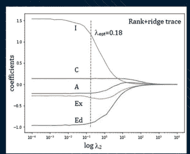

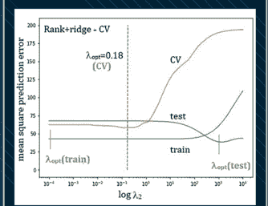

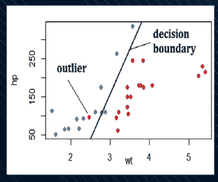

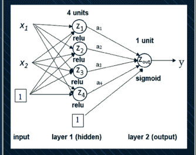


## 我们将此书献给

Shahidara Saleh

Reihaneh Soleimani, Elena Arashi

Lynn Hilchie Saleh

Abbas Ali Norouzirad, Fereshteh Arefian

## 前言

很荣幸为萨莱教授（Professor Saleh）的最新著作《基于秩的收缩与选择及其在机器学习中的应用》（“Rank-based Methods for Shrinkage and Selection with Application to Machine Learning”）撰写本序言。我认识萨莱教授数十年，他是加拿大统计学领域的领军人物，并期待在加拿大统计学会年会上定期与他会面。

随着数据科学和机器学习的兴起，我们正处于概率与统计学的黄金时代。数十年前，我们能吸引许多优秀学生投身于这一领域，但如今兴趣之浓已超乎想象。理论统计与应用统计之间的联系是机器学习和数据科学的重要组成部分。要充分投身于数据科学，必须对概率与统计的理论与实践方面都有扎实的理解。

本书独特之处在于，它基于秩回归模型推断，呈现了一种全面的方法。它从基础入手，使读者能够快速理解书中其余部分的创新思想。除了群组间比较、线性回归和时间序列等较为熟悉的基于秩的方法方面外，作者们还展示了如何通过基于秩的方法使许多机器学习工具更加稳健。模型选择、逻辑回归、神经网络、弹性网和惩罚回归等现代方法都通过这一视角进行了研究。本书表述清晰简洁，并指出了许多值得进一步探索的领域。

萨莱教授在岭回归、Stein 方法和初步检验估计方面的丰富经验贯穿了全书的脉络，他及其合著者在此基础上拓展了基于秩方法在现代大数据和高维环境中的应用。全书始终兼顾理论严谨性和引人入胜的应用。通过对计算方法及其在 R 和 Python 计算环境中实现的详细讨论，这些应用变得通俗易懂。本书覆盖广泛的主题，并高度重视理论与方法，确保它将成为统计学学生和研究人员宝贵的资源。

作者们指出了许多研究生和从业人员都可以开展的有价值的未来研究领域。在这方面，本书是迈向稳健数据科学的持续研究中的一项重要贡献。

Professor N. Reid  
University of Toronto  
June 2021

N. Reid 教授  
多伦多大学  
2021 年 6 月

## 前言

本书的目标是向读者介绍使用基于秩的方法进行稳健统计方法论的理论与应用。我们提出了若干机器学习和统计分析的新思想与研究方向，读者可以而且应该在未来加以探索。我们首先指出，众所周知的最小二乘法和似然原则是机器学习和数据科学中传统的估计方法。最广为阅读的书籍之一是《统计学导论》（Introduction to Statistical Learning，James et al., 2013），它描述了这些及其他方法。然而，它也恰当地指出了这些方法的诸多不足，尤其是在存在离群点时的稳健性方面。本书描述了一系列解决这些问题的创新思想和概念，其中许多值得进一步研究。我们的目标是激发更多研究人员在该领域开展进一步工作的兴趣。我们在此基础上，对基于秩的惩罚估计器进行严谨的数学分析。

就我们而言，几乎所有真实世界数据集中都存在离群点。它们可能是人为错误、传输错误、测量错误的结果，也可能仅仅是由所收集数据的性质所致。无论原因是什么，我们首先必须认识到所有数据集都存在某种形式的离群点，并在此基础上构建解决方案。离群点可能会极大地影响估计结果，并导致预测精度低下。因此，数据清洗、离群点检测和稳健回归方法等操作在构建能够提供适当准确预测能力的模型中至关重要。在这里，我们描述了基于秩的方法来解决许多此类问题。的确，许多研究人员现在正致力于这些及其他面向稳健数据科学的方法。本书中呈现的大多数方法和结果都源于我们在 R 和 Python 中的实现，R 和 Python 是统计学家以及机器学习和数据科学从业人员日常使用的语言。每章末尾的一些问题涉及 R 的使用。读者最好在阅读本书描述的同时，尽可能在 R 或 Python 中实现这些思想。这是从本书中获益最大的最佳方式。

秩回归基于 Jaeckel（1972）描述的线性秩离散函数。离散函数取代了最小二乘损失函数，以实现基于中位数而非均值的估计。本书旨在从基本原则入手引导读者朝这个方向发展，例如中位数与均值的重要性、在简单线性问题中秩方法与最小二乘法的比较，以及惩罚函数在提高预测精度方面的作用。我们介绍了在基于秩的方法背景下，用于数据清洗、子集选择和收缩估计的新实用方法。随后，我们开始理论之旅，从位置和简单线性模型的基本秩统计量入手，然后转向多元回归、方差分析以及高维环境中的问题。最后，我们在基于秩的逻辑回归和神经网络领域提出了文献中未曾发表过的新思想，以解决机器学习和数据科学中的分类问题。

我们认为，今天的大多数从业者仍在使用最小二乘法和对数似然方法，这些方法在存在离群点时不稳健。这归因于这些估计方法在统计学中的悠久历史，以及它们在过去二十年中在机器学习社区中的自然采用。然而，许多年前，估计理论的历程实际上发生了根本性的转变，当时 Stein（1956）和 James 与 Stein（1961）证明，基于来自 p 维多元正态分布样本的样本均值在 p ≥ 3 时，在平方损失函数下是不可容许的。这一结果催生了各种形式和设置下的一类收缩估计器。由于 Stein 理论的巨大影响，大量技术论文在文献中出现，涵盖了许多应用领域。从 20 世纪 70 年代开始，Saleh 和 Sen（1978, 1983, 1984b,a, 1985a,a,b,c,d,e, 1986, 1987）的开创性工作使用“准经验贝叶斯”方法扩展了这一收缩估计器类的范围，以获得稳健（如 R-、L- 和 M-估计）的 Stein 型估计器。详情请参见 Saleh (2006)。

此处特别感兴趣的是，在稳健 R-估计的背景下使用惩罚估计器。用于多元线性回归模型的下一代“收缩估计器”，即“岭回归估计器”，由 Hoerl 和 Kennard（1970）基于“Tikhonov 正则化”（Tikhonov, 1963）开发。岭回归（RR）估计器是使用 L2 惩罚函数最小化惩罚最小二乘准则的结果。岭回归奠定了惩罚估计的基础。随后，Tibshirani（1996）通过最小化


使用L1惩罚函数的惩罚最小二乘准则，该准则在模型选择领域广泛流行。

与RR估计量不同，LASSO同时进行变量选择和参数估计。它让人联想到“子集选择”。子集选择规则因其固有的离散性而极其不稳定（Breiman, 1996; Fan and Li, 2001）。它也高度不稳定，且常陷入局部最优解而非全局最优解。LASSO是一个连续过程且稳定；然而，不建议在多重共线性情况下使用。

Zou and Hastie (2005)提出了一种折衷的惩罚函数，它是L1和L2惩罚的组合，从而产生了“弹性网”估计量。它可以选择相关变量的组。它比喻上就像一张可伸展的渔网，保留所有潜在的大鱼。

尽管LASSO同时进行估计和变量选择，但它一般不具备“神谕性质”。为克服这一问题，Fan and Li (2001)提出了“平滑剪切绝对偏差”(SCAD)惩罚函数。沿用Fan and Li (2001)，Zou (2006)使用加权L1惩罚函数修改了LASSO。Zou (2006)将此估计量称为自适应LASSO (aLASSO)。后来，Zhang (2010)建议了极小最大凹陷惩罚(MCP)估计量。上述文献中发现的所有结果均基于惩罚最小二乘准则。

本书对基于秩的估计进行了深入研究，涉及三种基本惩罚估计量，即脊回归、LASSO和“弹性网”。它还为了完整性包含了初步检验和Stein类型R估计量。本书致力于清晰、平衡地介绍基于秩的估计量，并对所考虑的各种估计量的性质进行数学比较。本书面向研究生、统计学、经济学、生物统计学的生物学家以及所有应用统计学家、经济学家、计算机科学家和数据科学家等读者。在基于秩的估计背景下，关于稳健惩罚及其他收缩估计量的文献非常有限。在此，我们提供了该主题的理论和实践两个方面。

本书共十二章。第1章以中位数、异常值和稳健基于秩的方法的入门考察开始，并简要介绍惩罚估计量。第2章介绍基于秩的惩罚估计量的特性，并展示其在机器学习中的巨大价值。第3章提供基于秩理论的初步知识及其各个方面，并描述惩罚估计量，这些估计量随后被应用于位置和简单线性模型。第4章讨论方差分析，第5章讨论看似无关的简单线性模型。第6章考虑多元线性模型，第7章扩展“部分线性回归模型”(PLM)。第8章讨论Liu回归估计量。第9章介绍AR(p)模型。第10章涵盖高维数据分析中的变量选择和收缩。第11章处理多变量基于秩的逻辑回归模型。最后，第12章以基于秩的神经网络应用结束。

据我们所知，这是最早将高级统计分析与高级机器学习相结合的书籍之一。每章相对独立，但对机器学习感兴趣的读者可参考第1、2章和第11、12章，对统计学感兴趣的读者可参考第3–10章。两者的良好结合可源自第1–4章和第11、12章。我们希望两个领域的读者都能从中获得价值，并促进未来许多研究领域的发展。

作者谨感谢Rfit (Kloke and McKean, 2012)和glmnet (Stanford University)的开发者，这两个包分别用于R估计和惩罚极大似然估计，非常有用。我们还感谢布伦特·约翰逊教授（罗切斯特大学）在其网站上提供的基于秩的LASSO和aLASSO代码 (Johnson and Peng, 2008)。

A.K. Md. E. Saleh教授感谢NSERC超过四十年来对其研究的支持，并感谢P.K. Sen教授（北卡罗来纳大学）、J. Jurečková教授（查尔斯大学，布拉格）、M. Ghosh教授（盖恩斯维尔，佛罗里达）、H. L. Koul教授（密歇根州立大学）、T. Kubokawa教授（东京，日本）、T. Shiraishi教授（筑波，日本）和C. Robert教授（巴黎-多菲恩大学）在这些资助期间的积极参与。他感谢他亲爱的妻子Shahidara Saleh在70年婚姻中的支持。他还感谢孙辈Jasmine Alam、Sarah Alam、Miguel Saleh和Malique Saleh的关爱照顾。

M. Arashi教授希望感谢他在伊朗的家人，特别是他的妻子Reihaneh Arashi（娘家姓：Soleimani）的永恒爱与支持以及他的女儿Elena Arashi。本研究获得马什哈德费尔多西大学（伊朗）支持，并部分得到南非国家研究基金会（NRF）SARChI研究主席UID: 71199，以及南非DST-NRF数学与统计科学卓越中心（CoE-MaSS）的支持。

R. Saleh教授希望感谢他的父母，Ehsanes Saleh博士和Shadidara Saleh女士的爱与支持。他还希望感谢Victor Aken’Ova和Sohaib Majzoub关于逻辑回归和神经网络的宝贵讨论，以及在本书撰写期间来自Lynn Saleh、Isme Alam、Raihan Saleh和Jody Fast的鼓励与支持。

M. Norouzirad博士衷心感谢她的父母Abbas Ali Norouzirad和Fereshtheh Arefian的无条件信任、及时鼓励和无限耐心。她还感谢妹妹Mehrnoosh Norouzirad的温暖善意。她还希望承认通过国家资金由FCT - Fundação para a Ciência e a Tecnologia, I.P.提供的资助，范围为项目UIDB/00297/2020（数学与应用中心）。

A.K. Md. Ehsanes Saleh  
Mohammad Arashi  
Resve A. Saleh  
Mina Norouzirad  

# 1 基于秩的回归介绍

## 1.1 介绍

本书的目的是为使用基于秩的方法构建稳健数据科学奠定基础。机器学习领域尚未完全接受一类稳健估计量，该类估计量解决了限制最小二乘估计价值的问题。例如，数据集中的异常值可能会产生不适合推断的误导性结果。它们还可能影响惩罚估计量得到的结果。我们认为，回归问题的稳健估计量非常适合数据科学。本书旨在为基于秩的方法的研究提供实践和数学基础。它将介绍稳健估计实践和理论的若干新思想和新方法，并鼓励读者在此领域开展进一步研究。虽然本书的主要目标是对主题进行严谨的阐述，但我们首先从一些入门材料开始，以建立对基于秩的回归和惩罚估计量的洞察和直觉，特别是对初学者和希望理解关键概念的人。为了激发对这种方法的需求，我们将从讨论中位数开始，因为它是基于秩方法的关键，然后在此概念基础上构建稳健数据科学的概念。

## 1.2 中位数的稳健性

### 1.2.1 均值与中位数

我们的起点是简要回顾两种有用的统计量：均值和中位数。我们希望评估它们在简单线性回归背景下的适用性和实用性。我们首先声明，均值是最流行回归方法的基础，但相对于其他方法，回顾这种方法是有价值的。

给定一组 _n_ 个值，\(\mathbf{x} = \{x_1, \dots, x_n\}\)，算术平均值（在我们的研究中简称为均值）是值的平均值，而中位数是按排序后的中间值。均值由以下给出

\(\text{mean}(\mathbf{x}) = \bar{x} = \frac{1}{n} \sum_{l=1}^n x_l,\) (1.2.1)

即值的总和除以 _n_。

集合的中位数取决于 _n_ 是偶数还是奇数。首先，我们将值从小到大排序。排序后，新集合表示为 \(\{x_{(1)}, \dots, x_{(n)}\}\)，其中 \(x_{(1)} \le \dots \le x_{(n)}\)。这些被称为 \(\mathbf{x}\) 的序统计量，其中 \(x_{(1)} = \min\{x_i, i = 1, \dots, n\}\) 和 \(x_{(n)} = \max\{x_i, i = 1, \dots, n\}\)，而 \(x_{(i)}\) 是有序观测值。如果 _n_ 是奇数，我们取有序集合中的中间值，即 \(\text{median}(\mathbf{x}) = x_{(\frac{n+1}{2})}\)。如果 _n_ 是偶数，我们取中间两侧两个值的平均值。这种情况可以紧凑地表示如下。假设上述排序，则

\(\text{median}(\mathbf{x}) = \frac{1}{2}(x_{(l)} + x_{(u)}),\) (1.2.2)

其中 \(x_{(l)} = x_{(\frac{n}{2})}\) 和 \(x_{(u)} = x_{(\frac{n}{2}+1)}\)。通过对较低值和较高值取平均得到中位数。我们已经可以看出一个问题：均值只需一个方程即可轻松理解，但中位数需要多个步骤和稍复杂的描述。然而，中位数在寻找数据集本质方面具有重要价值，正如我们不久将看到的。

表1.1比较并对比了这两种统计量。提供了三个数据集来说明每种统计量的特征。第一个集合 {3, 1, 4, 2, 5, 3} 的均值和中位数均为3。这与对集合中值的目视检查一致。然而，如果我们将其中一个值从3更改为100以产生第二个集合 {100, 1, 4, 2, 5, 3}，则均值显著增加到19.2，而中位数产生一个接近先前值的3.5。在这种情况下，值100被视为异常值，我们可以观察到它对两种统计量的戏剧性影响。均值受一个异常值的极大影响，这使其不稳定。另一方面，在存在该异常值时，中位数似乎相当稳定。像集合3中那样有两个异常值时，均值的不稳定性更为明显。

如果现在让 \(x_{(n)}\) 表示集合2中的异常值，因此最初 \(x_{(n)} = 100\)，我们注意到当 \(x_{(n)} \to \infty\) 时，均值趋向于 \(\infty\) 而中位数保持


在 3.5 处。例如，\(x_{(n)} = 1000\) 将均值变为 169.2，而中位数仍保持在 3.5。这已经足够成问题，但基于均值的标准差也会受到很大影响。设 \(\mu\) 为总体均值，并让 Eq. (1.2.1) 中的 \(\bar{x}\) 作为 \(\mu\) 的估计量。进一步，设总体标准差 \(\sigma\) 定义为

```
\(\sigma = \sqrt{\frac{1}{n} \sum_{i=1}^n (x_i - \mu)^2}\),
```

以及 \(\sigma\) 的估计量，即样本集的标准差 (sd)，由<sup>1</sup> 给出：

```
\(\text{sd}(\boldsymbol{x}) = \hat{\sigma} = \sqrt{\frac{1}{n-1} \sum_{i=1}^n (x_i - \bar{x})^2}.\) (1.2.3)
```

那么，随着异常值的值趋向于无穷大，均值也趋向于无穷大，结果标准差也趋向于无穷大。因此，一个异常值可以对基于均值的各种统计量产生多米诺骨牌效应。

对于包含异常值的数据集，一种稳健统计量是中位数绝对偏差 (MAD)，定义为

```
\(\text{MAD}(\boldsymbol{x}) = \underset{1 \le i \le n}{\text{median}} (|x_i - \text{median}(\boldsymbol{x})|).\) (1.2.4)
```

基于 MAD 的总体标准差的一个一致性估计量可以按以下方式计算<sup>2</sup>

```
\(\hat{\eta} = \text{mad}(\boldsymbol{x}) = k \times \text{MAD}(\boldsymbol{x}),\) (1.2.5)
```

其中 \(k = 1.4826\) (Johnson and Peng, 2008, cf.)<sup>3</sup>。如果取表 1.1 中的集合 1，即不含异常值的原始集合，则 sd(x) = 1.41 且 mad(x) = 1.48。对于集合 2 且 \(x_{(n)} = 100\) 的情况，sd(\(\mathbf{x}\)) = 39.6 且 mad(\(\mathbf{x}\)) = 2.22。如果现在设置 \(x_{(n)} = 1000\)，则 sd(\(\mathbf{x}\)) = 407.0 且 mad(\(\mathbf{x}\)) = 2.22；也就是说，它保持不变。显然，单个大的异常值可能会破坏均值和标准差的完整性，而中位数和 mad(\(\mathbf{x}\)) 即使在 \(x_{(n)} \to \infty\) 时仍保持稳定。

**表 1.1 三组数据的均值与中位数比较。**

| 度量 | 集合 1 {3,1,4,2,5,3} | 集合 2 {100,1,4,2,5,3} | 集合 3 {100,100,1,4,2,5,3} |
|---|---|---|---|
| 均值 | 3.0 | 19.2 | 30.7 |
| 中位数 | 3.0 | 3.5 | 4.0 |

接下来，如果我们检查表 1.1 最后一列中列为 {100, 100, 1, 4, 2, 5, 3} 的集合 3，我们现在有两个异常值，均值进一步偏离集合 1 原始元素的范围。另一方面，中位数保持相对稳定。出于此原因，我们将中位数称为具有 *稳健性* 属性。

### 1.2.2 断裂点

为了进一步说明，我们可以继续向数据集中添加介于 100 和 120 之间的更多异常值，直到 50% 的数据为异常值的 *破裂点*，而中位数仍能对原始数据集提供良好的表示。当然，如果超过 50% 的点，原始数据中的值将变成异常值，而异常值将变成实际数据。因此，估计量的破裂点介于 0 和 0.5 之间，其中 0.5 最佳，0 最差。

破裂点 (Wilcox, 2012) 是衡量统计量或估计量对异常值的容忍水平的指标。估计量的破裂点是指在给出错误（即任意大）结果之前，估计量能够处理的错误（即任意大）观测值的比例。估计量的破裂点越高，其越稳健。均值统计量容忍度最低（实际上，对于大小为 \(n\) 的样本，破裂点为 \(\frac{1}{n}\)，对于大样本量则几乎为零），而中位数可以容忍高达 50% 的数据作为异常值（该统计量保持在紧集中）。这非常显著，并为追求基于中位数的基于秩的方法提供了坚实的基础。

直觉上，我们可以理解破裂点不能超过 50%，因为如果超过一半的观测值被污染，就无法区分底层分布和污染分布 (Rousseeuw and Leroy, 1987)。因此，最大破裂点为 0.5，并且存在能够实现此类破裂点的估计量。然而，此类估计量通常存在权衡，我们可能会牺牲某些正则性条件（如一致性和渐近正态性，将在后面讨论），以换取此类破裂点。即使破裂点降低到 0.5 以下，保留这些正则性属性也是更好的。特别是，基于秩的方法的破裂点约为 0.3，但具有所需的正则性条件，并且是非常高效的估计量。

### 1.2.3 有序统计量与秩统计量

澄清“有序”和“秩”统计量之间的区别很重要。设 X1, ..., Xn 为变量的随机样本。现在，X(i) 是第 i 小的随机变量，X(1), ..., X(n) 被称为 X1, ..., Xn 的有序统计量。根据定义，X(1) ≤ ... ≤ X(n)。我们说 Xi 在 X1, ..., Xn 中具有秩 Ri，如果 Xi = X(Ri)，假设第 r 阶有序统计量是唯一定义的。按“唯一定义”的含义，我们假设不存在平局。即对于所有 i != j，X(i) != X(j)。表 1.2 提供了示例，以清晰地说明这些概念。

根据秩的定义，中位数是在 n 为奇数时秩等于 (n+1)/2 的观测值，以及在 n 为偶数时秩为 n/2 和 n/2 + 1 的两个观测值的平均值。在表 1.2 中，对于前三组数据，n = 3（奇数情况），因此秩为 2 的值是中位数；因此，这是集合 X 和 Y 中的第二个值，以及第三个集合 Z 中的第一个值。对于第四组数据，n 为偶数，因此我们选择秩为 2 和 3 的两个值；因此，中位数是这两个值的平均值，即 (4+5)/2 = 4.5。如果存在异常值，它们将位于有序统计量的两端。据说第四组数据在极端有序统计量 W(4) = 99 处存在潜在异常值。

上述一系列示例提供了一些直觉，解释了为什么使用中位数（以及稍后将识别的一些其他措施）的基于秩的方法相对于基于均值的最小二乘估计 (LSE) 在回归问题中可能具有重要价值。这不仅适用于 LSE，也适用于任何均值回归，例如广义线性模型 (GLM)。许多现实数据集包含非零比例的异常值，我们可能有兴趣找到它们和/或使用在存在异常值时稳健的估计量。这就是基于秩方法的价值主张。

**表 1.2 比较有序统计量与秩统计量的示例。**

| 集合 | 有序统计量 | 秩统计量 |
|---|---|---|
| X = {1, 2, 3} | X(1) = 1, X(2) = 2, X(3) = 3 | R1 = 1, R2 = 2, R3 = 3 |
| Y = {3, 2, 1} | Y(1) = 1, Y(2) = 2, Y(3) = 3 | R1 = 3, R2 = 2, R3 = 1 |
| Z = {5, 6, 4} | Z(1) = 4, Z(2) = 5, Z(3) = 6 | R1 = 2, R2 = 3, R3 = 1 |
| W = {5, 3, 99, 4} | W(1) = 3, W(2) = 4, W(3) = 5, W(4) = 99 | R1 = 3, R2 = 1, R3 = 4, R4 = 2 |

## 1.3 简单线性回归

我们已经研究了简单数据集中均值和中位数的特征，以了解两者之间的差异。我们现在探讨均值和中位数在简单线性回归中的应用。对于我们在此处的目的来说，一维线性回归问题就足够了。我们将该问题的维度称为 p = 1；对于更高维度，p >= 2。假设我们得到一个包含 x = (x1, ..., xn)^T 在 R^n 和 y = (y1, ..., yn)^T 在 R^n 的数据集。我们的目标是拟合一条直线，使直线具有最小误差 epsilon = (epsilon_1, ..., epsilon_n)^T 在 R^n，并对数据提供良好的表示。更具体地，我们用以下方程描述简单线性模型

y = \theta 1_n + \beta x + \varepsilon，

其中感兴趣的两个参数是直线的斜率 \beta 和 y 轴截距 \theta，以及 1_n = (1, ..., 1)^T 是一个 n 维的 1 向量。我们寻求使用最小二乘 (LS) 方法来估计 \theta 和 \beta。请注意，x、y 和 \varepsilon 都是长度为 n 的向量，假设我们得到 n 个数据点来拟合一条直线。

### 1.3.1 最小二乘估计量 (LSE)

确定 \beta 和 \theta 的经典 LSE 基于最小化残差平方和 (RSS)。我们分别用 \hat{\beta}_n^{LS} 和 \hat{\theta}_n^{LS} 表示 LSE 的估计值。对于任意值的 \hat{\theta}_n 和 \hat{\beta}_n 以及特定数据点 (x_i, y_i)，残差定义为 \hat{e}_i = e_i = y_i - (\hat{\theta}_n + \hat{\beta}_n x_i)。那么残差平方和 (RSS) 简单地为

RSS = e_1^2 + e_2^2 + ... + e_n^2.

如果对于给定的数据集 x 和 y 最小化 RSS，则估计值为

\hat{\beta}_n^{LS} = \frac{\sum_{i=1}^n (x_i - \bar{x})(y_i - \bar{y})}{\sum_{i=1}^n (x_i - \bar{x})^2},

以及

\hat{\theta}_n^{LS} = \bar{y} - \hat{\beta}_n^{LS} \bar{x}.

请注意使用均值 \bar{x} 和 \bar{y} 来估计这两个参数。这是一个重要的点，因为 LSE 提供了 *最优无偏估计*

对于给定的一组数据点的斜率和截距。更一般地，它是在误差正态性假设下的最大似然估计。

### 1.3.2 Theil 估计器

我们也可以通过 Theil 估计器（Theil, 1950）利用中位数来估计参数。对于给定的一组点 $\{(x_i, y_i)\}_{i=1}^n$，Theil 对 $\beta$ 和 $\theta$ 的估计量可以通过求数据集中所有点对斜率的中位数来获得，记为 $\hat{\beta}_n^{\text{Theil}}$，以及部分残差 $(y_i - \hat{\beta}_n^{\text{Theil}} x_i)$ 的中位数，记为 $\hat{\theta}_n^{\text{Theil}}$。实际残差为 $(y_i - (\hat{\theta}_n^{\text{Theil}} + \hat{\beta}_n^{\text{Theil}} x_i))$，在估计后得到。更多详情请参见 Hallander and Wolfe (1999)。因此，我们有

\(\hat{\beta}_n^{\text{Theil}} = \text{median}_{1 \le i < j \le n, i \neq j} \left( \frac{y_j - y_i}{x_j - x_i} \right),\) (1.3.5)

以及

\(\hat{\theta}_n^{\text{Theil}} = \text{median}_{1 \le i \le n} (y_i - \hat{\beta}_n^{\text{Theil}} x_i).\) (1.3.6)

Theil 方法是一个无偏估计量。其断点已知为 29.3%。虽然这不如 50% 高，但它比 LSE 能容忍更高程度的异常值，因此是一个更鲁棒的估计器。

### 1.3.3 比利时电话数据集

使用一个非常简单的数据集来定性比较均值与中位数方法是很有教益的。为此，我们将使用比利时电话数据集（Kloke and McKean, 2012）。该数据集在表 1.3 中给出，包含了 1950 年至 1973 年间比利时的通话次数（单位：千万次）。它有 24 个数据点，其中 6 个异常值。这些异常值是由于 6 年间测量技术变更而未重新校准造成的，这常被引用。

表 1.3 比利时电话数据集。

| x | 1950 | 1951 | 1952 | 1953 | 1954 | 1955 | 1956 | 1957 | 1958 | 1959 | 1960 | 1961 |
|---|---|---|---|---|---|---|---|---|---|---|---|---|
| y | 0.44 | 0.47 | 0.47 | 0.59 | 0.66 | 9.73 | 0.81 | 0.88 | 1.06 | 1.2 | 1.35 | 1.49 |

| x | 1962 | 1963 | 1964 | 1965 | 1966 | 1967 | 1968 | 1969 | 1970 | 1971 | 1972 | 1973 |
|---|---|---|---|---|---|---|---|---|---|---|---|---|
| y | 1.61 | 2.12 | 11.9 | 12.4 | 14.2 | 15.9 | 18.2 | 21.2 | 4.3 | 2.4 | 2.7 | 2.9 |

### (a) 没有异常值的修改数据

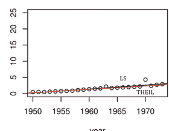

### (b) 包含 2 个异常值的修改数据

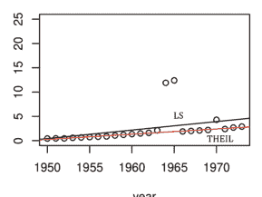

### (c) 4 个异常值

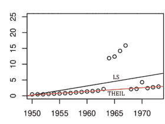

### (d) 包含 6 个异常值的原始数据

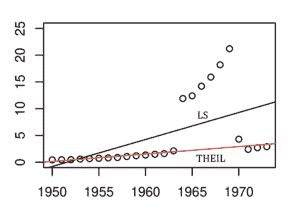

图 1.1 使用电话数据集不同版本配有拟合线的四个图。基于中位数的方法（Theil 估计）是鲁棒且稳定的，而 LS 线则取决于异常值的数量而变化。

在本章中，我们将主要使用此数据集。然而，我们还将调整数据值以控制异常值的数量，从而突出两种竞争方法之间的差异。

在图 1.1 中，我们展示了四种不同的情况。前三个数据集，即图 1.1(a)、(b) 和 (c) 分别被修改为包含零、两个和四个异常值。图 1.1(d) 是包含六个异常值的原始数据集，如表 1.3 所示。

使用 LSE 和 Theil 的线性回归结果以图 1.1 散点图上的拟合线形式显示。请注意，随着数据集中异常值数量的增加，与 LS 相关的线会发生变化并向异常值移动，而基于中位数（Theil）的线则保持相对稳定。此图表明，由于少数异常值，LSE 值可以轻易发生偏移。每个案例的参数估计过程、标准误差统计量的计算以及假设检验将在下一节中讨论。

### 1.3.4 估计与标准误差比较

我们将现在进行定量比较。各估计量的方程之前已给出。本节首先描述各估计量的标准误差，最后以假设检验结束。标准误差（s.e.）是参数估计变异性或准确性的度量。

相应估计量的 LSE 标准误差由以下公式给出

s.e.(\hat{\beta}_n^{\text{LS}}) = \sqrt{\hat{\sigma}^2 \left[ \frac{1}{n} + \frac{\bar{x}^2}{\sum_{i=1}^n (x_i - \bar{x})^2} \right]}, \quad (1.3.7)

和

s.e.(\hat{\beta}_n^{\text{LS}}) = \sqrt{\frac{\hat{\sigma}^2}{\sum_{i=1}^n (x_i - \bar{x})^2}}, \quad (1.3.8)

其中 $\sigma$ 可以使用残差标准误差（RSE）按以下方式估计：

\hat{\sigma} \approx \text{RSE} = \sqrt{\text{RSS}/(n-2)}. \quad (1.3.9)

对于 Theil 估计器，我们使用 MAD 来计算标准误差。使用部分残差的以下定义，$r_i = (y_i - \hat{\beta}_n^{\text{Theil}}x_i)$，我们获得

s.e.(\hat{\theta}_n^{\text{Theil}}) = k \times \text{median}_{1 \le i \le n} (|r_i - \hat{\theta}_n^{\text{Theil}}|), \quad (1.3.10)

我们使用斜率，$s_{ij} = (y_j - y_i)/(x_j - x_i)$，以获得

s.e.(\hat{\beta}_n^{\text{Theil}}) = k \times \text{median}_{1 \le i < j \le n, i \neq j} (|s_{ij} - \hat{\beta}_n^{\text{Theil}}|). \quad (1.3.11)

我们的定量比较仅涉及图 1.1(a)（无异常值）和 1.1(d)（六个异常值）。我们使用公式 (1.3.3) 和 (1.3.4) 来获得 LS 估计量。首先，我们从公式 (1.3.3) 计算 $\hat{\beta}_n^{\text{LS}}$，并使用该结果在公式 (1.3.4) 中计算 $\hat{\theta}_n^{\text{LS}}$。对于图 1.1(a)，我们得到 $\hat{\beta}_n^{\text{LS}} = 0.12$ 和 $\hat{\theta}_n^{\text{LS}} = -234.2$；然而，对于图 1.1(d)，我们得到 $\hat{\beta}_n^{\text{LS}} = 0.50$ 和 $\hat{\theta}_n^{\text{LS}} = -983.9$。显然，当添加异常值时，LS 估计量会发生显著变化。

为了获得基于 Theil 中位数的估计，我们应用公式 (1.3.5) 和 (1.3.6)。首先，我们从公式 (1.3.5) 计算 $\hat{\beta}_n^{\text{Theil}}$，并使用该结果在公式 (1.3.6) 中计算 $\hat{\theta}_n^{\text{Theil}}$。对于图 1.1(a)，我们得到 $\hat{\beta}_n^{\text{Theil}} = 0.10$ 和 $\hat{\theta}_n^{\text{Theil}} = -201.8$；对于图 1.1(d)，我们得到 $\hat{\beta}_n^{\text{Theil}} = 0.14$ 和 $\hat{\theta}_n^{\text{Theil}} = -270.4$。两组结果均汇总在表 1.4 中。表中还提供了每种情况下的标准误差值。值得注意的是，这些值变化不大，但截距的 s.e. 相比 LSE 有了很大改善。

在最小二乘估计中进行假设检验时，我们使用 t 统计量，如下所示：

\( t\text{-value}(\hat{\beta}_n^{\text{LS}}) = \frac{\hat{\beta}_n^{\text{LS}} - 0}{\text{s.e}(\hat{\beta}_n^{\text{LS}})} \quad (1.3.12) \)

计算 \(t\)-统计量后，将其用于确定假设检验的 \(p\)-值；特别是，\(\mathcal{H}_o : \beta = 0\) 与 \(\mathcal{H}_A : \beta \neq 0\)。表中提供的 LSE \(p\)-值非常小，表明可以拒绝原假设 \(\mathcal{H}_o\) 而支持备择假设 \(\mathcal{H}_A\)。

对于 Theil 估计器，由于我们没有中位数分布的任何信息，无法使用与 LSE 相同的方法进行假设检验。Theil 估计器属于非参数统计这一特殊类别（Corder and Foreman, 2014）。这是统计学的一个分支，其中潜在分布未知，因此采用替代方法。

与上述方法不同，这里可以使用 Wilcoxon 检验。该检验本质上计算配对数据之间的差异并分析其差异，以确定它们在统计意义上是否显著不同。基于 Corder and Foreman (2014) 的 Wilcoxon 符号秩检验统计量 T 比较两个相关样本的逐步程序如下：

- (1) 对于 \( n \) 个样本中的每个项目，获得两次测量之间的差分得分 \( D_i$（即，$D_i = y_i - (\hat{\theta}_n^{\text{Theil}} + \hat{\beta}_n^{\text{Theil}} x_i)$，$i=1,...,n$）。
- (2) 取差异的绝对值，$|D_i|$。
- (3) 省略为零的差分得分，得到一组 $n'$ 个非零绝对差分得分，其中 $n' \le n$。因此，$n'$ 成为实际样本量。
- (4) 然后，为每个 $|D_i|$ 分配从 1 到 $n'$ 的秩 $R_i$，使最小的得到秩 1，最大的得到秩 $n'$。如果两个或多个 $|D_i|$ 相等，则它们都分配相同的平均秩（即中等秩），即如果未出现并列，它们各自应分配到的秩的平均值。
- (5) 接下来，根据 $D_i$ 最初是正还是负，为每个 $n'$ 个秩 $R_i$ 应用正号 + 或负号 -，分别产生 $+R_i$ 或 $-R_i$。
- (6) Wilcoxon 检验 T-统计量取正秩 $T = |\sum_i (+R_i)|$ 或负秩 $T = |\sum_i (-R_i)|$ 的绝对和中的较小者。因此，T 始终为正。

接下来，可以检验 \(T\)-统计量的显著性。随着 $n'$ 的增加，抽样分布趋于正态分布。因此，对于 $n' \ge 20$，可以计算 z 分数。我们使用以下公式计算大样本的 z 分数：


## 表 1.4 图 1.1(a) 和 (d) 的 LS 与 Theil 估计比较

| Case (LSE) | Estimators | Coefficient | s.e | t-value | p-value |
| :--- | :--- | :--- | :--- | :--- | :--- |
| Figure 1.1(a) | \(\hat{\theta}_n^{LS}\) | -234.2 | 23.4 | -10.0 | <0.001 |
| | \(\hat{\beta}_n^{LS}\) | 0.120 | 0.01 | 10.1 | <0.001 |
| Figure 1.1(d) | \(\hat{\theta}_n^{LS}\) | -983.9 | 325.2 | -3.0 | 0.006 |
| | \(\hat{\beta}_n^{LS}\) | 0.504 | 0.166 | 3.0 | 0.006 |
| Case (Theil) | Estimators | Coefficient | s.e | T-statistic | z* |
| Figure 1.1(a) | \(\hat{\theta}_n^{\text{Theil}}\) | -201.8 | 0.06 | – | – |
| | \(\hat{\beta}_n^{\text{Theil}}\) | 0.104 | 0.02 | 107.0 | -1.23 |
| Figure 1.1(d) | \(\hat{\theta}_n^{\text{Theil}}\) | -270.4 | 0.32 | – | – |
| | \(\hat{\beta}_n^{\text{Theil}}\) | 0.139 | 0.18 | 116.5 | -0.96 |

\[
\bar{x}_T = \frac{n'(n' + 1)}{4}, \quad s_T = \sqrt{\frac{n'(n' + 1)(2n' + 1)}{24}}, \quad \text{and } z^* = \frac{T - \bar{x}_T}{s_T},
\]

其中 \(\bar{x}_T\) 为均值，\(s_T\) 为标准差，\(z^*\) 为数据近似正态分布的 z 分数。若要进行双侧检验，当 \(z_{\text{critical}} < |z^*|\) 时，我们拒绝 \(\mathcal{H}_o\)。具体地，对于 \(\alpha = 0.05\)，\(z_{\text{critical}} = 1.96\)。在图 1.1(d) 的情况下，我们有 \(n' = 24\) 并得到 \(T = 116.5\)（负和较小），因此 \(z^* = (116.5 - 150)/35 = -0.96\)。因此，我们不能拒绝 \(\mathcal{H}_o\)。这表明两个样本之间没有差异。同样地，对于图 1.1(a)，我们发现 \(T = 107.0\)，因此 \(z^* = (107.0 - 150)/35 = -1.23\)。同样，我们不能拒绝 \(\mathcal{H}_o\)，表明两个样本之间没有差异。表 1.4 展示了该方法\(^4\) 在图 1.1(a) 和 1.1(d) 两种情况下电话数据集的结果。

## 1.4 异常值及其检测

通常，异常值由数据转录错误、数据采集过程中的噪声，或者仅仅是数据值的异常所产生。在单变量设置中，在图上观察到异常值相对容易，但在多元线性回归的情况下识别它要困难得多。因此，很难给出异常值的明确定义和可靠的检测方法。一种方法是分别检验 LSE 和基于中位数的方法分析后的残差，以确定异常值是否可以与主要数据分离。顺序统计量也可用于识别异常值。

### 1.4.1 异常值检测

简单线性回归的残差可以在估计后使用通用方程计算，如下所示

\(\hat{e}_i = y_i - (\hat{\theta}_n + \hat{\beta}_n x_i), i = 1, ..., n, \quad (1.4.1)\)

其中 \(\hat{\theta}_n\) 和 \(\hat{\beta}_n\) 分别是 \(\theta\) 和 \(\beta\) 的任意估计量。我们注意到，如果残差 \(\{\hat{e}_1, ..., \hat{e}_n\}\) 中存在异常值，那么极端顺序统计量 \(\hat{e}_{(1)}\) 或 \(\hat{e}_{(n)}\) 中至少有一个必须是异常值。因此，可以通过其在顺序统计量中的位置来识别异常值。无论其大小如何，异常值总是位于两端之一。在现实中，数据集中可能存在多个异常值，与它们相关的残差将形成位于一端或另一端，或者两端的一组顺序统计量。可以对 LSE 和基于中位数的方法进行此类残差排序，然后进行比较。

考虑图 1.2，它展示了表 1.3 的原始电话数据集并在图 1.1(d) 中描绘的 LSE 和基于中位数两种情况下的计算残差。在图的上半部分，我们展示了两种情况的计算残差直方图。

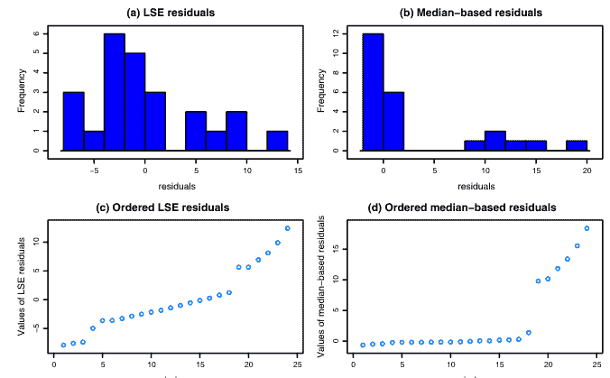

在下半部分，我们绘制了每组残差从 1 到 24 的顺序统计量。

LSE 残差形成一个分布，使得难以将异常值与其余数据点分离。不易对直方图中哪些条形与六个异常值相关得出确定的结论。0 的两侧似乎都有异常值，但无法确定。另一方面，基于中位数的方法的残差显示出异常值与其余数据之间的清晰分离。5.0 的截断值提供了合适的分界线来筛选出六个异常值。请注意，如直方图下方的有序残差所示，排序在 LSE 情况下无法帮助将异常值与数据分离。相比之下，我们在中位数情况中看到了异常值与其余数据之间的清晰区分。它们各自的顺序统计量为 \(\hat{e}_{(19)}, ..., \hat{e}_{(24)}\)，因为有 24 个点，且六个异常值均为大的正值。

现在可以检查这六个数据点，以确定它们是否应从数据集中保留、修改或删除。如果是手动输入错误，或者可以修复的测量校准错误（如本例所示），某些点可以轻松更正。判断一个数据点是否为真异常值的决定，基于特定应用中已确立的规则或指标，例如，基于偏离均值 4 或 5 个标准差，或者说，偏离内部第一和第三四分位数若干个四分位数（在残差百分位数方面为 25% 至 75%）。这些方法容易出错，必须小心进行。

虽然使用顺序统计量的这种方法并非万无一失，但它显示出前景，并且无需修改即可用于更高维度的问题。一般而言，识别和删除异常值困难、容易出错且有些繁琐。更好的方法是使用对异常值相对不敏感的稳健统计程序，因此不需要检测或删除异常值。使用秩估计的方法就是这样一种方法，将在下一节中介绍。

## 1.5 秩基方法的动机

### 1.5.1 单个异常值的影响

作为对秩基方法稳健性的预览，我们使用电话数据集在图 1.3 中展示了四个案例，以证明单个异常值可能对 LSE 产生有害影响，但对秩估计几乎没有或没有影响，具体取决于其相对于数据集中其他观测值的位置。异常值通常被视为数据集中令人讨厌的观测值，其影响被认为相对温和，因此稳健方法尚未被广泛采用。为了清晰地说明稳健回归的必要性，我们

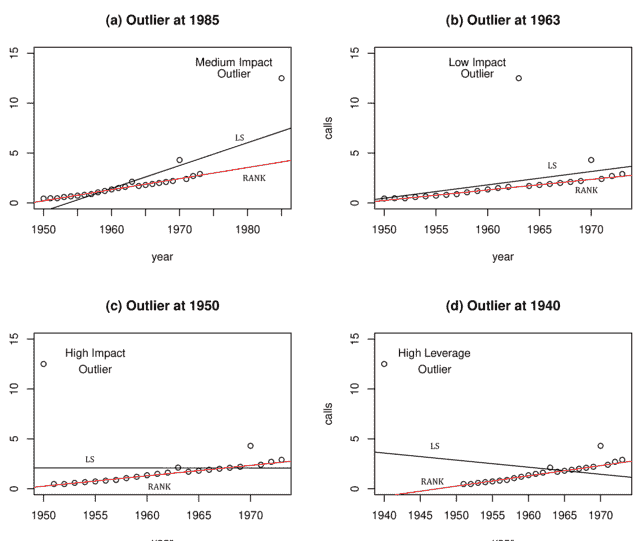

**图 1.3** 单个异常值对 LS 和秩估计的影响。与 LS 线相比，秩线基本保持不变。

提供 4 个有趣的案例，但请注意，结果特定于此数据集。这些例子应毫无疑问地表明，稳健方法应在主流机器学习工具中使用，并且应增加该领域的研究，以解决可能限制其使用的任何问题。

从图 1.3(a) 开始，我们看到，在数据集最右侧（year = 1985, calls = 12.5）插入一个策略性放置的异常值，与所示的其他案例相比，对 LSE 结果有中等影响，而秩结果不受影响。然而，当异常值移动到图 1.3(b) 中的（year = 1963, calls = 12.5）时，LSE 和秩结果相似；因此，这是该数据集中的低影响异常值。这只是为了说明，在某些情况下，一个明显的异常值可能不会对 LSE 结果产生太大影响，而秩结果与之前相同。

现在考虑图 1.3(c) 中异常值（year = 1950, calls = 12.5）的情况。这个位置构成了该数据集的高影响异常值。事实上，LSE 告诉我们 calls 和 year 之间没有关系，我们知道这是不正确的。我们稍后将更多地讨论这种情况。在最后一种情况，图 1.3(d) 中，添加的异常值（year = 1940, calls = 12.5）被称为高杠杆点。这种类型的异常值可能对 LSE 的结果产生严重后果。


事实上，它显示年份与呼叫次数之间存在负相关，这显然是错误的。所有这些例子的要点是说明，即使是单个离群点在决定最小二乘估计（LSE）时也具有不可预测性，更不用说多个离群点及其影响了。它们表明并非所有离群点都相同，但在所有四种情况下，秩结果都非常稳健。

为强调图 1.3(c) 的潜在风险，假设我们需要从 10 个解释变量中选取一个小的子集，而年份只是其中之一。类似于斜率为 0 的高影响情况的结果会暗示我们移除年份作为感兴趣的变量。任何依赖 LSE 结果来选取解释变量子集的方法在这种情况下都会失败。然而，秩估计几乎忽略了高影响点和高杠杆点，因此将是子集选取的更好基础。

本质上，LSE 做出了一个固有假设：如果存在离群点，它们在所有方向上均匀分布。当然，秩方法不做此假设，但如果离群点在所有方向上平衡时秩方法不准确，那将是一个重大限制。幸运的是，在平衡情况下秩估计与 LSE 一致，但在不平衡情况下在 y 空间中提供稳健性。如果有人打算放弃 LSE 转而采用秩方法，这一点值得注意。

到目前为止，我们已经看到使用中位数存在某些障碍，这些障碍在过去限制了其应用，其中不少是更复杂的表达式、对非参数分析的需求，以及迄今所提出的解决方案的繁琐性。但鉴于泰尔方法在存在离群点时的表现远优于 LSE，使用中位数求解斜率和截距的其他方法也值得关注。在描述此类方法之前，有必要回顾泰尔方法的一些缺点。

首先，在取中位数之前必须计算所有成对斜率。假设有 n 个数据点，在使用 Eq. (1.3.5) 之前，这会导致 (y_j - y_i)/(x_j - x_i) 形式的 n(n-1)/2 次斜率计算。在我们的电话示例中，n = 24，共有 276 次斜率计算。显然，随着 n 增大这是一个问题，因为计算复杂度按 O(n^2) 增长。使用 Eq. (1.3.6) 需要计算的 (y_i - \hat{\beta}_n^{Theil} x_i) 形式的部分残差数量为 O(n)，在此例中 n = 24，因此此处没有问题。其次，所有点在 x 轴上均匀分布，使用泰尔方法产生了良好的准确性；然而，点通常并非均匀分布。因此，在不均匀情况下准确性可能会降低。第三，随着问题维度的增加，过程变得难以处理。迄今我们只考虑了简单线性情况 ($p = 1$)。然而，如果 $p \gg 1$，此方法实现起来要复杂得多，且破裂点会降低。所有这些问题都必须得到解决，如果要用基于中位数的方法取代 LSE。幸运的是，基于秩的方法将缓解这些问题。

## 1.5.2 用于位置模型的秩方法

要介绍基于秩的方法，请考虑位置模型

$y_i = \theta + \epsilon_i, \quad i = 1, ..., n,$

其中 $\epsilon_1, ..., \epsilon_n$ 为 i.i.d. 随机变量。位置模型试图估计随机变量 $Y$ 的给定样本 $y_1, ..., y_n$ 的中心。这可能是样本均值或中位数，或任何其他类似类型的估计，具体取决于底层分布。我们将描述如何处理此简单案例，以比较两个寻求中位数的相似估计量。

理论上，中位数是使用 $L_1$ 损失函数得到的。为了估计位置参数，我们可以使用给定的绝对值损失函数

$B_n(\theta) = \sum_{i=1}^n |y_i - \theta|.$ (1.5.1)

中位数估计量 $\hat{\theta}^{\text{median}}_n$ 由以下公式给出

$\hat{\theta}^{\text{median}}_n = \text{argmin}_{\theta \in \mathbb{R}} \{B_n(\theta)\}.$ (1.5.2)

梯度函数为

$B'_n(\theta) = -\sum_{i=1}^n \text{sgn}(y_i - \theta).$ (1.5.3)

绝对值损失函数的第一个导数不连续，这会造成一些理论问题，因为它不满足某些正则性条件。

现在考虑将 $L_1$ 损失函数中的各项与其各自的秩相乘，以形成基于秩的损失函数，如下所示

$D_n(\theta) = \sum_{i=1}^n |y_i - \theta| R^+_i(\theta),$ (1.5.4)

其中 $R^+_i(\theta)$ 是 $|y_i - \theta|$ 在 $|y_1 - \theta|, ..., |y_n - \theta|$ 中的秩。“+”符号表示我们先对这些量取绝对值，再进行排序。请注意，在新的损失函数中，我们只是将 $y_i - \theta$ 的绝对值乘以其秩 $R^+_i(\theta)$。通过这样做，我们得到了一个新的

损失函数，它产生 $y_i$ 的成对平均数的中位数。一组数字（包括原始数字本身）的成对平均数被称为 Walsh 平均值。实际上，我们使用这种基于秩的损失函数得到 Walsh 平均值的中位数。该结果等价于 Hodges–Lehmann (HL) 估计量（参见 Hettmansperger and McKean, 2011），其表达式为：

$$\hat{\theta}_n^{\text{HL}} = \text{median}_{1 \le i \le j \le n} \left\{ \frac{y_i + y_j}{2} \right\}.$$

我们会发现将秩归一化为 $u = R_{n_i}^+(\theta)/(n+1)$ 使得 $0 < u < 1$ 非常方便，然后用它定义一个评分函数 $\phi^+(u) = u$。这是我们在此选择的一个特定评分函数。由于存在多种其他可能的评分函数，我们使用符号 $a_n^+(R_{n_i}^+(\theta))$ 表示通用评分函数，并将实际函数 $\phi^+(u)$ 嵌入到这个通用函数中。综合上述内容，我们定义秩离散函数如下，

$$D_n(\theta) = \sum_{i=1}^n |y_i - \theta| \ a_n^+(R_{n_i}^+(\theta)), \quad (1.5.5)$$

相应的梯度为

$$D_n'(\theta) = -\sum_{i=1}^n \text{sgn}(y_i - \theta) \ a_n^+(R_{n_i}^+(\theta)). \quad (1.5.6)$$

秩估计为

$$\hat{\theta}_n^R = \text{argmin}_{\theta \in \mathbb{R}} \{D_n(\theta)\}.\quad (1.5.7)$$

迄今为止我们所做的一切就是将一个由归一化秩组成的权重应用于 $L_1$ 损失函数，从而创建一个新的损失函数。它不是求得中位数，而是产生 Walsh 平均值的中位数。虽然中位数是位置的一个稳健估计量，但我们会发现 Walsh 平均值的中位数也是一个稳健估计量，只是破裂点较低。请注意，中位数是数据的第 50 百分位数，但任何提供接近中位数结果的估计量也都是稳健的。

为了用示例说明差异，请考虑集合，

$$\boldsymbol{y} = (0.1, 1.2, 2.3, 3.4, 4.5, 5.0, 6.6, 7.7, 8.8, 9.9, 10.5)^\top.$$

我们寻求估计位置参数 $\theta$。为此，我们可以最小化 Eq. (1.5.1) 或 Eq. (1.5.4)。应该选择哪一个？为了回答这个问题，让我们先检查它们作为 $\theta$ 函数的导数。如图 1.4 所示，

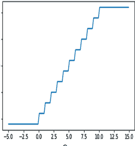

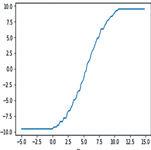

图 1.4 绝对值 ($B_n'(\theta)$) 和离散 ($D_n'(\theta)$) 函数的梯度。

绝对值损失函数的梯度 $B'_n(\theta)$ 是一系列阶梯。每个阶梯发生在不同的 $y_i$ 值处。因此，阶梯的数量为 $n$，在此例中为 11。然而，离散函数的梯度 $D'_n(\theta)$ 性质相似，但由评分函数 $a_n^+(\cdot)$ 平滑，在相同区间内产生更多阶梯。每个阶梯发生在与每个 Walsh 平均值相关的值处。因此，阶梯的数量为 $\frac{n(n+1)}{2}$，在此例中为 66，如右侧图表所示。在前面列出的假设下，可以证明 Eq. (1.5.7) 的估计量是一致的且渐近正态（Hettmansperger and McKean, 2011），而 Eq. (1.5.2) 的估计量不具有这些理想特性。这就是为什么我们应该选择最小化 Eq. (1.5.4)。

当然，当我们最小化 $D_n(\theta)$ 和 $B_n(\theta)$ 时，得到的结果不同。从数字检查可以看出，中位数为 5.0，通过最小化 $B_n(\theta)$ 得到。然而，当我们最小化 $D_n(\theta)$ 时，得到 5.55，这不是数据集的中位数。如上所述，$D_n(\theta)$ 产生 Walsh 平均值的中位数，即给定数字的成对平均数。此数据集的 Walsh 平均值按排序顺序在表 1.5 中给出。我们可以数出总共 66 个平均值，其中一些是重复的。因此，梯度函数最多有 66 个阶梯，但如果 Walsh 平均值中有重复项，阶梯数量可以少于 66。如果我们从表中选择 Walsh 平均值的中位数，将选择第 33 和第 34 值的平均值，即 5.55（加粗显示）。

虽然我们没有得到实际的中位数，但基于秩的方法仍然提供稳健性和渐近正态性。从图 1.4，我们可以直观地理解为什么离散函数导致正则性


表 1.5 集合 {0.1, 1.2, 2.3, 3.4, 4.5, 5.0, 5.6, 6.6, 7.7, 8.8, 9.9, 10.5} 的 Walsh 平均值。

| 0.10 | 0.65 | 1.20 | 1.20 | 1.75 | 1.75 | 2.30 | 2.30 | 2.30 | 2.55 | 2.85 | 2.85 |
| --- | --- | --- | --- | --- | --- | --- | --- | --- | --- | --- | --- |
| 3.10 | 3.35 | 3.40 | 3.40 | 3.65 | 3.90 | 3.90 | 3.95 | 4.20 | 4.45 | 4.45 | 4.45 |
| 4.50 | 4.75 | 5.00 | 5.00 | 5.00 | 5.00 | 5.00 | 5.30 | 5.55 | 5.55 | 5.55 | 5.55 |
| 5.80 | 5.85 | 6.10 | 6.10 | 6.10 | 6.35 | 6.40 | 6.60 | 6.65 | 6.65 | 6.90 | 6.95 |
| 7.15 | 7.20 | 7.45 | 7.50 | 7.70 | 7.70 | 7.75 | 8.25 | 8.25 | 8.55 | 8.80 | 8.80 |
| 9.10 | 9.35 | 9.65 | 9.90 | 10.20 | 10.50 | — | — | — | — | — | — |

我们在估计量中所寻求的条件，以及它为何继承了与中位数相似的稳健性特性，而无需实际计算真正的中位数。有兴趣的读者可以在 Puri and Sen (1985) 中找到线性秩基估计量的渐近性质及其相对效率。

### 1.5.3 用于斜率的秩

如果我们希望为简单线性模型定义斜率的线性秩估计量，可以使用离散函数的另一种表述：

\( D_n(\beta) = \sum_{i=1}^n (y_i - \beta x_i) a_n(R_{n_i}(\beta)) \)

其中 \( R_{n_i}(\beta) = R_{n_i}(y_i - \beta x_i) \) 是 \( (y_i - \beta x_i) \) 在 \( (y_1 - \beta x_1), \ldots, (y_n - \beta x_n) \) 中的秩，而 \( a_n(R_{n_i}(\beta)) \) 是另一种计分函数，它使用 \( \phi(u) = u - 1/2 \)，其中 \( u = R_{n_i}(\beta)/(n+1) \) 与之前相同。请注意，此处不使用“+”记号，因为未对这些量取绝对值。最小化此离散函数通常不会产生斜率的中位数，如 Theil 估计量的情况那样。相反，它会产生中位数附近的估计量。与估计量相关的实际分位数取决于数据。中位数当然位于第 50 百分位，但通过选择接近第 50 百分位的斜率，我们可以保留一些稳健性特性（尽管是在较低的破裂点下）。这最好通过另一个例子来说明。

考虑以下数据集：

| x | 0.1 | 0.2 | 0.3 | 0.4 | 0.5 | 0.6 | 0.7 | 0.8 | 0.9 | 1.2 |
|---|---|---|---|---|---|---|---|---|---|---|
| y | 3.2 | 4.0 | 4.2 | 4.7 | 6.5 | 5.5 | 6.7 | 20.2 | 22.0 | 8.0 |

如果使用简单线性模型，我们将寻求斜率 \( \beta \) 的估计量。由于 \( n = 10 \)，总共有 \( n(n-1)/2 = 45 \) 个斜率需要计算。这些有序斜率如下表所示。中位数是第 23 项，即 6.25。但是，通过最小化 $D_n(\beta)$ 得到的秩估计量是 5.40，即第 21 项（**加粗**）。它位于第 46 百分位。

| 1 | -46.67 | -30.50 | -10.00 | 1.00 | 2.00 | 2.14 | 2.60 | 3.50 | 3.75 | 4.00 | 4.00 | 4.13 |
|---|---|---|---|---|---|---|---|---|---|---|---|---|
| 13 | 4.17 | 4.22 | 4.33 | 4.36 | 4.60 | 5.00 | 5.00 | 5.00 | **5.40** | 5.83 | 6.25 | 6.67 |
| 25 | 8.00 | 8.25 | 8.33 | 11.50 | 12.00 | 18.00 | 18.00 | 23.5 | 24.29 | 25.71 | 27.00 | 29.67 |
| 37 | 32.00 | 34.60 | 38.75 | 38.75 | 45.67 | 55.00 | 73.50 | 76.50 | 135.00 | — | — | — |

因此，虽然不计算斜率的中位数，但基于秩的方法会产生接近中位数的估计量。此时，使用如秩这样的基于中位数的方法的好处应该很明显了。我们将展示如何使用秩进行线性回归，其方法学与最小二乘估计器相似，但提供了稳健性。尽管 Theil 的方法有效，但我们将看到基于秩的方法提供了更高效的解决方案，并且它们是本书其余部分将要描述的理论和方法的基础。

## 1.6 秩离散函数

在本节中，我们追求一种受线性回归中中位数稳健性启发的正式方法。我们将这种方法称为基于秩的方法，其中使用中位数附近的值进行估计。由于 Theil 方法具有一定的临时性，使用它进行线性回归会既笨拙又繁琐。幸运的是，在 20 世纪 70 年代初期，Jurečková (1971) 和 Jaeckel (1972) 的工作中开发了一种程序，它能产生类似的结果，不需要计算 \(O(n^2)\) 个斜率，支持异常值检测，并且可以轻松扩展到更高维度，即多元线性回归。

回顾在 LS 估计中，我们最小化一个称为二次或 L2 损失函数的量，

$$SSE = \sum_{i=1}^n(y_i - (\theta + \beta x_i))^2, \qquad (1.6.1)$$

它是误差平方和（SSE）。Jaeckel (1972) 开发了一种允许基于秩的线性回归的损失函数。秩估计量只需将二次损失函数替换为 Jaeckel 的离散函数，然后对其进行最小化以进行 R-估计（即基于秩的估计）。离散函数可以被视为一种伪范数，如 Kloke and McKean (2012) 所指出，或者作为残差的加权和。伪范数这一称谓是由于它在某种程度上表现得像众所周知的 L1-范数。与之前一样，我们将首先计算斜率并用它来计算截距。对于斜率，离散函数由以下给出

$$D_n(\beta) = \sum_{i=1}^n(y_i - (\theta + \beta x_i)) a_n(R_{n_i}(y_i - (\theta + \beta x_i))). \quad (1.6.2)$$

这个函数需要一些解释。第一项是残差本身。请注意，它是 \(\theta\) 和 \(\beta\) 的函数，但在此阶段我们只寻求 \(\beta\)。项 \(R_{n_i}(y_i - (\theta + \beta x_i))\) 是第 \(i\) 个残差的秩。但是，截距 \(\theta\) 是一个常数，因此不会改变排名。也就是说，向一组值添加常数不会改变它们的相对排名。因此，我们可以从排名函数中删除 \(\theta\)，即我们只对部分残差进行排名

$$R_{n_i}(\beta) = R_{n_i}(y_i - \beta x_i).$$

此外，我们很快就会看到

$$\sum_{i=1}^n a_n(R_{n_i}(\beta)) = 0. \quad (1.6.3)$$

项 \(a_n(\cdot)\) 是残差的加权函数，包含一个计分函数。由于该函数求和为零，离散函数对 \(\theta\) 具有不变性。特别是，我们可以证明

$$\begin{aligned} D_n(\theta, \beta) &= \sum_{i=1}^n(y_i - (\theta + \beta x_i))a_n(R_{n_i}(y_i - \beta x_i)) \\ &= \sum_{i=1}^n(y_i - \beta x_i)a_n(R_{n_i}(y_i - \beta x_i)) - \theta \sum_{i=1}^n a_n(R_{n_i}(y_i - \beta x_i)) \\ &= \sum_{i=1}^n(y_i - \beta x_i)a_n(R_{n_i}(y_i - \beta x_i)) = D_n(\beta), \end{aligned} \quad (1.6.4)$$

我们可以紧凑地将其写为

$$D_n(\beta) = \sum_{i=1}^n (y_i - \beta x_i) a_n(R_{n_i}(\beta)). \quad (1.6.5)$$

可以证明，\(D_n(\beta)\) 是 \(\beta\) 的非负、分段线性、连续凸函数，因此非常适合使用数值优化例程快速获得估计量。这是使基于秩的方法可行的关键突破。此外，Eq. (1.6.5) 的解是一致的并满足某些渐近正态性条件（Hettmansperger and McKean, 2011）。此外，秩估计量对数据是否中心化具有不变性。因此，在秩方法中考虑截距很重要。

秩估计量 \(\hat{\beta}_n^R\) 可以通过最小化以下函数来找到

\[
\hat{\beta}_n^R = \text{argmin}_{\beta \in \mathbb{R}} D_n(\beta). \quad (1.6.6)
\]

获得 \(\beta\) 最优值的另一种替代方法是求导，

\[
\frac{\partial D_n(\beta)}{\partial \beta} = - \sum_{i=1}^n x_i a_n(R_{n_i}(\beta)), \quad (1.6.7)
\]

并将其设为零。因此，可以通过 \(\partial D_n(\beta)/\partial \beta = 0\) 获得 \(\beta\) 的估计量，并产生与上面相同的 \(\hat{\beta}_n^R\)。在这种情况下，需要使用根查找方法来求解该问题。

现在让我们定义

\[
L_n(\beta) = -\frac{1}{\sqrt{n}} \frac{\partial D_n(\beta)}{\partial \beta} = \frac{1}{\sqrt{n}} \sum_{i=1}^n x_i a_n(R_{n_i}(\beta)). \quad (1.6.8)
\]

然后，通过定义

\[
L_n(0) = -\frac{1}{\sqrt{n}} \frac{\partial D_n(\beta)}{\partial \beta} \Bigg|_{\beta=0}.
\]

可以开发一个用于 \(\mathcal{H}_O : \beta = 0\) 与 \(\mathcal{H}_A : \beta \neq 0\) 之间的梯度检验。

下一步是在知道 \(\hat{\beta}_n^R\) 的情况下估计截距 \(\theta\)。这需要另一个使用残差绝对值的离散函数，如下所示：

\[
D_n(\theta) = \sum_{i=1}^n |y_i - (\theta + \hat{\beta}_n^R x_i)| a_n^+(R_{n_i}(|y_i - (\theta + \hat{\beta}_n^R x_i)|)), \quad (1.6.9)
\]

我们可以紧凑地将其写为

\[
D_n(\theta) = \sum_{i=1}^n |y_i - (\theta + \hat{\beta}_n^R x_i)| a_n^+(R_n^+(\theta)), \quad (1.6.10)
\]

其中

\[
R_n^+(\theta) = R_{n_i}(|y_i - (\theta + \hat{\beta}_n^R x_i)|).
\]

请注意，此处包含所有项，因为不变性属性不再成立。此外，\(R_n^+(\cdot)\) 是残差绝对值的秩，而 \(a_n^+(\cdot)\) 使用不同的计分函数。从此函数中，截距获得如下


### 1.6.1 排名与评分详情

\(\hat{\theta}_n^R = \arg\min_{\theta \in \mathbb{R}} D_n(\theta). \quad (1.6.11)\)

如前所述，获取 \(\hat{\theta}_n^R\) 的替代方法是求导并令其为零，即 \(\partial D_n(\theta)/\partial \theta = 0\)，其中

\(\frac{\partial D_n(\theta)}{\partial \theta} = - \sum_{i=1}^n \text{sgn}(y_i - (\theta + \hat{\beta}_n^R x_i)) a_n^+(R_{n_i}^+(\theta)). \quad (1.6.12)\)

我们可以定义函数 \(T_n(\theta)\) 为

\(T_n(\theta) = -\frac{1}{\sqrt{n}} \frac{\partial D_n(\theta)}{\partial \theta} = \frac{1}{\sqrt{n}} \sum_{i=1}^n \text{sgn}(y_i - (\theta + \hat{\beta}_n^R x_i)) a_n^+(R_{n_i}^+(\theta)). \quad (1.6.13)\)

可以通过定义

\(T_n(0) = -\frac{1}{\sqrt{n}} \left. \frac{\partial D_n(\theta)}{\partial \theta} \right|_{\theta=0} .\)

来开发针对 \(\mathcal{H}_0 : \theta = 0\) vs. \(\mathcal{H}_A : \theta \neq 0\) 的梯度检验。

现在将详细阐述排名和评分函数。首先，我们希望通过最小化离散函数 \(D_n(\beta)\) 来求解关于 \(\beta\) 的线性回归问题。排名函数 \(R_i = R(y_i - \beta x_i)\) 对部分残差 \((y_i - \beta x_i)\) 中的每一个在 \((y_1 - \beta x_1, ..., y_n - \beta x_n)\) 中进行排名。为方便起见，我们使用 \(R_{n_i}(\beta)\) 来指代第 \(i\) 个部分残差的排名。排名本身将落在集合 \(\{1, \cdots, n\}\) 中，这意味着其范围取决于观测数量 \(n\)。为了避免这种情况，排名由 \((n+1)\) 的因子归一化，使得 \(0 < R_{n_i}(\beta)/(n+1) < 1\)。\(D_n(\beta)\) 中的权重分量 \(a_n(\cdot)\) 涉及一个评分函数，该函数是这些归一化排名的函数。应用于评分函数的归一化排名值可以以下列两种方式之一定义

\(a_n(i) = \mathbb{E} [\phi(U_{n_i})], \quad i = 1, ..., n \quad (1.6.14)\)

其中 \(U_{n_1} \le U_{n_2} \le \cdots \le U_{n_n}\) 是来自 \(U(0,1)\) 分布、样本量为 \(n\) 的有序统计量；或

\(a_n(R_{n_i}(\beta)) = \phi\left(\frac{R_{n_i}(\beta)}{n+1}\right). \quad (1.6.15)\)

这里，\(\phi(u) = 2u - 1, 0 < u < 1\) 是一个非递减、可平方积分的评分函数。在不失一般性的前提下，标准化分数可以定义为使得

- (1) \(\int_0^1 \phi(u) du = 0\)，即 \([0,1]\) 上的积分为 0

- (2) \(\int_0^1 \phi^2(u)du = 1\)，即 \([0,1]\) 上的平方积分为 1

- (3) \(\phi(1-u) = -\phi(u)\)，即关于 \(\frac{1}{2}\) 斜对称。

Wilcoxon 评分函数由

\(\phi(u) = \sqrt{12}\left(u - \frac{1}{2}\right),\) (1.6.16)

给出，满足上述条件，因为显然

\(\int_0^1 \sqrt{12}\left(u - \frac{1}{2}\right)du = \sqrt{12}\left(\frac{u^2}{2} - \frac{u}{2}\right)\bigg|_0^1 = 0,\)

以及

\(\int_0^1 12\left(u - \frac{1}{2}\right)^2 du = \int_0^1 12\left(u^2 - u + \frac{1}{4}\right)du = 12\left(\frac{u^3}{3} - \frac{u^2}{2} + \frac{u}{4}\right)\bigg|_0^1 = 1,\)

以及

\(\phi(1-u) = \sqrt{12}\left(1 - u - \frac{1}{2}\right) = -\sqrt{12}\left(u - \frac{1}{2}\right) = -\phi(u).\)

为了计算 \(\hat{\theta}_n^R\)，我们最小化 Eq. (1.6.10) 中的 \(D_n(\theta)\)，它涉及 \(R^+(\cdot)\) 和 \(a_n^+(\cdot)\)。函数 \(R_{n_i}^+(\cdot)\) 在 \(|y_1 - (\theta + \beta x_1)|, ..., |y_n - (\theta + \beta x_n)|\) 中对 \(|y_i - (\theta + \beta x_i)|\) 进行排名。相应的有符号秩分数使用以下两种方式之一生成

\(a_n^+(i) = \mathbb{E}\left[\phi^+\left(U_{n_i}\right)\right], \quad i=1, ..., n\) (1.6.17)

其中有序的 \(U_{n_i} \sim U(0, 1)\)，对 \(i=1, ..., n\)；或

\(a_n^+(R_{n_i}^+(\beta)) = \phi^+\left(\frac{R_{n_i}^+(\beta)}{n+1}\right),\) (1.6.18)

其中函数，

\(\phi^+(u) = \phi\left(\frac{u+1}{2}\right),\) (1.6.19)

可以通过考虑 Eq. (1.6.16) 的 Wilcoxon 评分函数得到，即

\(\phi^+(u) = \sqrt{12}\left(\frac{u+1}{2} - \frac{1}{2}\right) = \sqrt{3}u.\) (1.6.20)

标准化的 \(\phi(u)\) 和 \(\phi^+(u)\) 的图示见图 1.5。我们看到两个函数都关于 \(u\) 是线性的，范围为 \(\frac{1}{n+1} < u < \frac{n}{n+1}\)。

从这些图中，我们可以理解 \(\sum_{i=1}^n a_{n_i}(\cdot) = 0\) 但 \(\sum_{i=1}^n a_{n_i}^+(\cdot) \neq 0\)。残差由这两个评分函数加权，以形成损失函数。

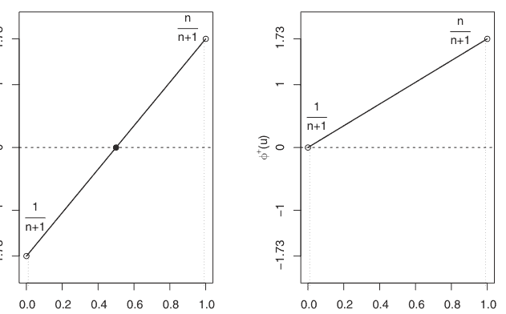

图 1.5 评分函数 \(\phi(u) = \sqrt{12}(u - 0.5)\) 和 \(\phi^+(u) = \sqrt{3}u\)。

然后最小化这些损失函数以获得估计值。这两个函数都将在下一节中用于 R-estimation。

### 1.6.2 R-estimation 的详细步骤

为演示目的，我们将现在使用离散函数来数值获取原始比利时电话数据集（参见表 1.3，其在图 1.1(d) 中绘制）中 \(\theta\) 和 \(\beta\) 的 R-estimation。我们将详细说明数值计算的步骤，然后以图形方式显示结果，以提供完整的图景。我们首先试图使用 Eq. (1.6.5) 来估计 \(\beta\)。估计器 \(\hat{\beta}_n^R\) 由以下给出

```
\hat{\beta}_n^R = \text{argmin}_{\beta} \left\{ \sum_{i=1}^n (y_i - \beta x_i) \sqrt{12} \left( \frac{R_{n_i}(\beta)}{n+1} - \frac{1}{2} \right) \right\},
```

其中 \(R_{n_i}(\beta) = R_{n_i}(y_i - \beta x_i)\)。可以使用统计软件，例如 R 中包 `CVXR` 的函数 `optim`，来数值求解这个非线性优化问题。在这里，我们将展示如何手动完成此操作，以便获得更深入的理解。

显然，我们需要首先选择若干个 \(\beta\) 值来推进该问题的求解，直到找到最小值。为此，我们考虑三个 \(\beta\) 的某些任意值：\(\beta^{(0)} = 0\)，\(\beta^{(1)} = 0.145\)，和 \(\beta^{(2)} = 0.2\)，已知最小值很可能在此范围内。

为获得 \(D_n(\beta)\) 而进行的计算在表 1.6 中报告。我们按标题中定义的显示 x、y、R、\(a_n\) 和 \(D_n\) 的列值。该表中电话数据集的每个数据点对应一行。\(D_n\) 列需按 Eq. (1.6.5) 要求，对 \(\beta^{(0)}\)、\(\beta^{(1)}\) 和 \(\beta^{(2)}\) 的每种情况求和。因此，在这三个值中，解即 \(\hat{\beta}_n^R\) 是使表 1.6 最后一行中 "sum" 的值最小的那个。在本例中，\(\hat{\beta}_n^R = \beta^{(1)} = 0.145\)，这将在后面得到证实。但更一般地，手动确定 \(\beta\) 的值以找到优化问题的全局解并非易事，如前所述，我们需要使用软件来数值地找到最小值。这里给出的详细逐步程序旨在巩固我们对 Eq. (1.6.5) 的理解。

等价地，而不是离散函数 \(D_n(\beta)\)，可以使用其导数的根 \(L_n(\beta)\)，即 Eq. (1.6.8)，如下

\(\hat{\beta}_n^R = \left\{ \beta : L_n(\beta) = -\frac{1}{\sqrt{n}} \sum_{i=1}^n x_i \sqrt{12} \left( \frac{R_{n_i}(\beta)}{n+1} - \frac{1}{2} \right) = 0 \right\}.\)

这里可以使用 R 中包 `rootSolve` 的函数 `uniroot.all`。我们在表 1.6 中标记为 \(L_n\) 的列中提供所需值。在这里，我们寻找最接近零的 "sum"。同样，零交叉发生在 \(\hat{\beta}^R = \beta^{(1)} = 0.145\)。

我们已经展示了 \(\beta\) 的 R-estimation 的两种方法。通常，我们使用 \(D_n(\beta)\) 来计算估计值，并使用 \(L_n(\beta)\) 进行假设检验。审视上述程序的图形等价物很有启发性。如图 1.6 所示。考虑左侧的两个面板。上面板显示 \(D_n(\beta)\) 的图，它显然是 \(\beta\) 的凸函数。我们注意到最小值显示为 0.145。同样，下面板是函数 \(L_n(\beta)\)。我们看到该函数在 0.145 处也有零交叉，共有 276 个步骤，每个斜率一个。这两个图的值可以与表 1.6 中 \(\beta^{(0)}\)、\(\beta^{(1)}\) 和 \(\beta^{(2)}\) 的数据相匹配。

现在我们转向使用 Eq. (1.6.10) 进行 \(\theta\) 的秩估计。在这方面，基于 Eq. (1.6.20) 中的相关 Wilcoxon 分数，可以将其估计为

\(\hat{\theta}_n^R = \text{argmin} \left\{ \sum_{i=1}^n |y_i - (\theta + \hat{\beta}_n^R x_i)| \sqrt{3} \left( \frac{R_{n_i}^+(\theta)}{n+1} \right) \right\},\)

其中

\(R_{n_i}^+(\theta) = R_{n_i}(|y_i - (\theta + \hat{\beta}_n^R x_i)|).\)

在这里，已知对于电话数据集 \(\hat{\beta}_n^R = 0.145\)，因此唯一的未知数是 \(\theta\)。


# 表 1.6 在电话数据集中使用初始值 \(\beta^{(0)} = 0\)、\(\beta^{(1)} = 0.145\) 和 \(\beta^{(2)} = 0.2\) 时，在 \(D_n(\beta)\) 和 \(L_n(\beta)\) 中求和的各个单项。此处，\(R = R_{n_i}(\beta)\)、\(a_n = a_{n_i}(R)\)、\(D_n = (y - \beta x)a_n\)、\(L_n = x a_n / \sqrt{n}\)。

| x | y | \multicolumn{4}{c}{\(\beta^{(0)} = 0\)} | \multicolumn{4}{c}{\(\beta^{(1)} = 0.145\)} | \multicolumn{4}{c}{\(\beta^{(2)} = 0.2\)} |
|---|---|---|---|---|---|---|---|---|---|---|---|---|---|---|
| | | R | a_n | D_n | L_n | R | a_n | D_n | L_n | R | a_n | D_n | L_n |
| 1950 | 0.44 | 1 | -1.59 | -0.70 | -634.27 | 17 | 0.62 | -177.13 | 248.19 | 18 | 0.76 | -296.88 | 303.35 |
| 1951 | 0.47 | 2.50 | -1.39 | -0.65 | -551.83 | 16 | 0.48 | -137.82 | 193.14 | 16 | 0.48 | -189.01 | 193.14 |
| 1952 | 0.47 | 2.50 | -1.39 | -0.65 | -552.11 | 14 | 0.21 | -59.10 | 82.82 | 15 | 0.35 | -135.08 | 138.03 |
| 1953 | 0.59 | 4 | -1.18 | -0.69 | -469.53 | 13 | 0.07 | -19.70 | 27.62 | 14 | 0.21 | -81.06 | 82.86 |
| 1954 | 0.66 | 5 | -1.04 | -0.69 | -414.51 | 12 | -0.07 | 19.71 | -27.63 | 13 | 0.07 | -27.03 | 27.63 |
| 1955 | 0.73 | 6 | -0.90 | -0.66 | -359.42 | 11 | -0.21 | 59.13 | -82.94 | 12 | -0.07 | 27.04 | -27.65 |
| 1956 | 0.81 | 7 | -0.76 | -0.62 | -304.28 | 10 | -0.35 | 98.58 | -138.31 | 11 | -0.21 | 81.14 | -82.99 |
| 1957 | 0.88 | 8 | -0.62 | -0.55 | -249.09 | 4 | -1.18 | 335.25 | -470.49 | 9 | -0.48 | 189.39 | -193.73 |
| 1958 | 1.06 | 9 | -0.48 | -0.51 | -193.83 | 9 | -0.48 | 138.03 | -193.83 | 8 | -0.62 | 243.52 | -249.21 |
| 1959 | 1.20 | 10 | -0.35 | -0.42 | -138.52 | 7 | -0.76 | 216.91 | -304.75 | 7 | -0.76 | 297.68 | -304.75 |
| 1960 | 1.35 | 11 | -0.21 | -0.28 | -83.16 | 8 | -0.62 | 177.47 | -249.47 | 6 | -0.90 | 351.85 | -360.34 |
| 1961 | 1.49 | 12 | -0.07 | -0.10 | -27.73 | 6 | -0.90 | 256.35 | -360.53 | 5 | -1.04 | 406.04 | -415.99 |
| 1962 | 1.61 | 13 | 0.07 | 0.11 | 27.75 | 5 | -1.04 | 295.81 | -416.20 | 4 | -1.18 | 460.27 | -471.70 |
| 1963 | 2.12 | 14 | 0.21 | 0.44 | 83.28 | 15 | 0.35 | -98.48 | 138.81 | 10 | -0.35 | 135.27 | -138.81 |
| 1964 | 11.90 | 19 | 0.90 | 10.72 | 361.08 | 19 | 0.90 | -247.37 | 361.08 | 19 | 0.90 | -343.06 | 361.08 |
| 1965 | 12.40 | 20 | 1.04 | 12.89 | 416.84 | 20 | 1.04 | -285.05 | 416.84 | 20 | 1.04 | -395.53 | 416.84 |
| 1966 | 14.20 | 21 | 1.18 | 16.72 | 472.66 | 21 | 1.18 | -321.11 | 472.66 | 21 | 1.18 | -446.38 | 472.66 |
| 1967 | 15.90 | 22 | 1.32 | 20.93 | 528.53 | 22 | 1.32 | -356.85 | 528.53 | 22 | 1.32 | -496.93 | 528.53 |
| 1968 | 18.20 | 23 | 1.45 | 26.48 | 584.47 | 23 | 1.45 | -391.27 | 584.47 | 23 | 1.45 | -546.18 | 584.47 |
| 1969 | 21.20 | 24 | 1.59 | 33.78 | 640.45 | 24 | 1.59 | -423.99 | 640.45 | 24 | 1.59 | -593.73 | 640.45 |
| 1970 | 4.30 | 18 | 0.76 | 3.28 | 306.46 | 18 | 0.76 | -215.77 | 306.46 | 17 | 0.62 | -242.99 | 250.74 |
| 1971 | 2.40 | 15 | 0.35 | 0.83 | 139.37 | 1 | -1.59 | 454.41 | -641.11 | 1 | -1.59 | 624.33 | -641.11 |
| 1972 | 2.70 | 16 | 0.48 | 1.31 | 195.22 | 2 | -1.45 | 414.67 | -585.65 | 2.50 | -1.39 | 542.76 | -557.77 |
| 1973 | 2.90 | 17 | 0.62 | 1.81 | 251.12 | 3 | -1.32 | 375.11 | -530.15 | 2.50 | -1.39 | 542.76 | -558.05 |
| Sum | | | | 122.78 | 28.95 | | | 107.78 | 0.0 | | | 108.19 | -2.32 |

与之前一样，考虑 \(\theta\) 的三个选定值：\(\theta^{(0)} = -285\)、\(\theta^{(1)} = -283\)、\(\theta^{(2)} = -280\)。我们已知这是解的适当范围，因此这些是合适的选择。表 1.7 提供了这些值的计算。同样，我们显示了标题中定义的 \(x\)、\(y\)、\(R^+\)、\(a_n^+\) 和 \(D_n\) 的列值。如果对每种情况求和 \(D_n\) 列，我们会得到表底部的总计。我们注意到 124 是最小值，因此根据给定的三个选择，我们选择 \(\hat{\theta}^R = \theta^{(1)} = -283.0\) 作为解。

可以通过求解公式 (1.6.13) 中 \(T_n(\theta)\) 的根来实现，该公式改写为

\(\hat{\theta}_n^R = \left\{ \theta : T_n(\theta) = \frac{1}{n} \sum_{i=1}^n \text{sgn}(y_i - (\theta + \hat{\rho}_n^k x_i)) \sqrt{3} \left( \frac{R_n^+(\theta)}{n+1} \right) = 0 \right\}.\)

在这方面，我们为每个 \(\theta\) 提供表 1.7 中标记为 \(T_n\) 的列。这次我们关注的是最接近零的列和。当然，它与之前的同一列，我们发现 \(\hat{\theta}^R = -283.0\)。为了图形

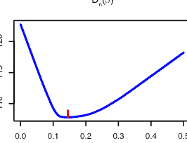

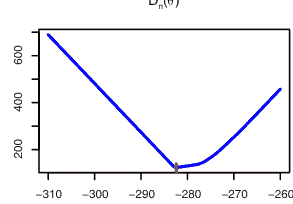

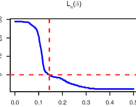

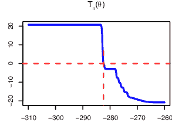

图 1.6 图 1.1(d) 的离散函数及导数图。

等价过程，我们可以回到图 1.6 并检查右侧的面板。我们看到顶部的 $D_n(\theta)$ 图，函数的最小值位于 \(-283.0\)，符合预期。可以使用此图验证表 1.7 中的 "sum" 值。同样，底部的 $T_n(\theta)$ 面板是带有 24 个阶梯的导数图，在 \(-283.0\) 处有零点交叉。这完成了原始电话数据集的详细计算。

使用上述概述的过程，可以计算图 1.1 中所示四种情况的 R-估计值。这是使用 Python 中的内置优化例程完成的，并与 LS 结果一起在表 1.8 中给出。我们使用 R 中的 Rfit (Kloke and McKean, 2012) 验证了结果，Rfit 使用此处描述的技术执行基于秩的线性回归。斜率和截距的 R-估计值仅受异常值的轻微影响。另一方面，表 1.8 中相应情况的 LS 估计值会发生较大变化。此外，秩估计与基于 Theil 方法的表 1.4 类似。

如果我们回到图形地说明获得估计值的过程的图 1.6，我们会发现 $D_n(\beta)$ 和 $D_n(\theta)$ 都是凸函数。这是离散函数的一个关键特征，允许使用优化例程来查找估计值。现在我们有了一个正式的

表 1.7 在电话数据集中使用初始值 \(\theta^{(0)} = -285\)、\(\theta^{(1)} = -283\) 和 \(\theta^{(2)} = -280\) 时，在 $D_n(\theta)$ 和 $L_n(\theta)$ 中求和的各项。此处，$R^+ = R_n^+(\theta)$、\(a_n^+ = a_n^+(R^+)\)、\(D_n = |y - \theta - \hat{\beta}^R x| a_n^+ / \sqrt{n}\)、\(L_n = \text{sgn}(y - \theta - \hat{\beta}^R x) a_n^+ / \sqrt{n}\)。

| x | y | $R^+$ | $a_n^+$ | $D_n$ | $L_n$ | $R^+$ | $a_n^+$ | $D_n$ | $L_n$ | $R^+$ | $a_n^+$ | $D_n$ | $L_n$ |
|---|---|---|---|---|---|---|---|---|---|---|---|---|---|
| | | \multicolumn{4}{c|}{$\theta^{(0)} = -285$} | \multicolumn{4}{c|}{$\theta^{(1)} = -283$} | \multicolumn{4}{c|}{$\theta^{(2)} = -280$} |
| 1950 | 0.44 | 17 | 1.18 | 7.46 | 0.24 | 3 | 0.21 | 0.02 | 0.04 | 2 | 0.14 | 0.51 | -0.03 |
| 1951 | 0.47 | 16 | 1.11 | 6.89 | 0.23 | 1 | 0.07 | 0 | -0.01 | 3 | 0.21 | 0.80 | -0.04 |
| 1952 | 0.47 | 14 | 0.97 | 5.88 | 0.20 | 4 | 0.28 | 0.04 | -0.06 | 5 | 0.35 | 1.38 | -0.07 |
| 1953 | 0.59 | 13 | 0.90 | 5.43 | 0.18 | 5 | 0.35 | 0.06 | -0.07 | 6 | 0.42 | 1.66 | -0.09 |
| 1954 | 0.66 | 12 | 0.83 | 4.95 | 0.17 | 6 | 0.42 | 0.10 | -0.09 | 7 | 0.48 | 1.94 | -0.10 |
| 1955 | 0.73 | 11 | 0.76 | 4.47 | 0.16 | 7 | 0.48 | 0.16 | -0.10 | 8 | 0.55 | 2.26 | -0.11 |
| 1956 | 0.81 | 10 | 0.69 | 4.02 | 0.14 | 8 | 0.55 | 0.21 | -0.11 | 9 | 0.62 | 2.59 | -0.13 |
| 1957 | 0.88 | 4 | 0.28 | 1.61 | 0.06 | 14 | 0.97 | 0.45 | -0.20 | 15 | 1.04 | 4.43 | -0.21 |
| 1958 | 1.06 | 9 | 0.62 | 3.58 | 0.13 | 9 | 0.62 | 0.27 | -0.13 | 10 | 0.69 | 2.91 | -0.14 |
| 1959 | 1.20 | 7 | 0.48 | 2.77 | 0.10 | 11 | 0.76 | 0.33 | -0.16 | 12 | 0.83 | 3.51 | -0.17 |
| 1960 | 1.35 | 8 | 0.55 | 3.18 | 0.11 | 10 | 0.69 | 0.30 | -0.14 | 11 | 0.76 | 3.21 | -0.16 |
| 1961 | 1.49 | 6 | 0.42 | 2.42 | 0.09 | 12 | 0.83 | 0.36 | -0.17 | 13 | 0.90 | 3.80 | -0.18 |
| 1962 | 1.61 | 5 | 0.35 | 2.01 | 0.07 | 13 | 0.90 | 0.42 | -0.18 | 14 | 0.97 | 4.13 | -0.20 |
| 1963 | 2.12 | 15 | 1.04 | 6.36 | 0.21 | 2 | 0.14 | 0.01 | -0.03 | 4 | 0.28 | 1.09 | -0.06 |
| 1964 | 11.90 | 19 | 1.32 | 20.78 | 0.27 | 19 | 1.32 | 12.59 | 0.27 | 19 | 1.32 | 7.58 | 0.27 |
| 1965 | 12.40 | 20 | 1.39 | 22.38 | 0.28 | 20 | 1.39 | 13.75 | 0.28 | 20 | 1.39 | 8.48 | 0.28 |
| 1966 | 14.20 | 21 | 1.45 | 25.74 | 0.30 | 21 | 1.45 | 16.74 | 0.30 | 21 | 1.45 | 11.24 | 0.30 |
| 1967 | 15.90 | 22 | 1.52 | 29.35 | 0.31 | 22 | 1.52 | 19.91 | 0.31 | 22 | 1.52 | 14.15 | 0.31 |
| 1968 | 18.20 | 23 | 1.59 | 34.13 | 0.32 | 23 | 1.59 | 24.25 | 0.32 | 23 | 1.59 | 18.23 | 0.32 |
| 1969 | 21.20 | 24 | 1.66 | 40.37 | 0.34 | 24 | 1.66 | 30.06 | 0.34 | 24 | 1.66 | 23.77 | 0.34 |
| 1970 | 4.30 | 18 | 1.25 | 9.09 | 0.26 | 18 | 1.25 | 1.33 | 0.26 | 1 | 0.07 | 0.19 | -0.01 |
| 1971 | 2.40 | 1 | 0.07 | 0.37 | 0.01 | 17 | 1.18 | 1.16 | -0.24 | 18 | 1.25 | 5.97 | -0.26 |
| 1972 | 2.70 | 2 | 0.14 | 0.75 | 0.03 | 16 | 1.11 | 0.92 | -0.23 | 17 | 1.18 | 5.45 | -0.24 |
| 1973 | 2.90 | 3 | 0.21 | 1.14 | 0.04 | 15 | 1.04 | 0.81 | -0.21 | 16 | 1.11 | 5.07 | -0.23 |
| Sum | | | | 245 | 4.24 | | | 124 | 0.00 | | | 136 | -0.60 |

表 1.8 图 1.1 各情况的 LS 和 R 斜率及截距估计。

| Estimators | Case (a) | Case (b) | Case (c) | Case (d) | Estimators | Case (a) | Case (b) | Case (c) | Case (d) |
| :--- | :--- | :--- | :--- | :--- | :--- | :--- | :--- | :--- | :--- |
| $\hat{\theta}_n^{LS}$ | -234.2 | -340.1 | -563.8 | -983.9 | $\hat{\theta}_n^R$ | -205.3 | -210.7 | -224.8 | -283.7 |
| $\hat{\beta}_n^{LS}$ | 0.120 | 0.175 | 0.289 | 0.504 | $\hat{\beta}_n^R$ | 0.105 | 0.108 | 0.115 | 0.145 |


通过色散函数 \( D_n(\boldsymbol{\beta}) \) 和 \( D_n(\theta) \) 执行基于秩的线性回归的过程。导数函数 \( L_n(\theta) \) 和 \( T_n(\theta) \) 也提供有用的梯度检验统计量，尽管这在机器学习应用中通常不被使用。该方法的理论基础可见 Hettmansperger 和 McKean (2011)。

## 1.7 收缩估计与子集选择

我们已讨论在只有一个解释变量（\( p = 1 \)）的简单线性回归中使用基于秩的方法，并表明其相比 LSE 具有巨大价值。本节将前一研究扩展到多元线性回归，即当 \( p \ge 2 \) 时，其中 \( p \) 为解释变量的数量。现实世界数据集通常关联大量参数。我们将看到与 \( p \ge 2 \) 相关的方程是 \( p = 1 \) 情况的自然扩展。

机器学习中任何回归方法的目标都是使用最少数量的参数来产生具有高预测精度的紧凑模型。然而，多元线性回归中会出现简单线性回归中不遇到的新问题。特别是，可能由于多重共线性、过拟合、欠拟合、识别重要变量子集以及缩小参数值大小以提高模型精度而产生问题。对损失函数应用惩罚函数使我们能够在实现回归期望目标的同时缓解上述列出的问题。该主题将在第 2 章详细介绍。

本节的目的是提供关于多元线性回归中使用惩罚函数的背景和直觉。它概述了惩罚函数，并提供了其效果的多种几何解释。我们将介绍基本方程及其对机器学习如此有用的原因。此外，读者将熟悉该领域使用的一些术语。这也将为本书其余部分奠定基础，因为其重点是惩罚估计在基于秩的方法中的一般应用。

### 1.7.1 使用秩的多元线性回归

大多数现实问题属于由矩阵表达式给出的多元线性回归类别

\[
\mathbf{y} = \theta \mathbf{1}_n + \mathbf{X}\boldsymbol{\beta} + \boldsymbol{\varepsilon}, \quad \text{(1.7.1)}
\]

其中 \(\mathbf{y}\) 是 \( n \times 1 \) 响应向量，\(\theta\) 是截距（也称为 \( \beta_0 \)），\(\mathbf{1}_n = (1, ..., 1)^\top\) 是 \( n \) 维向量，\(\mathbf{X}\) 是 \( n \times p \) 设计矩阵，\(\boldsymbol{\beta}\) 是 \( p \times 1 \) 参数向量，\(\epsilon\) 是 \( n \times 1 \) 误差项。\(\mathbf{X}\) 的每一行代表总共 \( n \) 个观测中的一个，而每一列是值向量，每个 \( p \) 变量一个值。目前，且不失一般性，如果我们假设对于中心化问题 \(\theta = 0\)（即从所有数据列中减去各自的均值），则有

\[
\mathbf{y} = \mathbf{X}\beta + \epsilon. \quad (1.7.2)
\]

该方程的最小二乘估计（LSE）具有如下优雅的解析解：

\[
\hat{\beta}_n^{LS} = (\mathbf{X}^T \mathbf{X})^{-1} \mathbf{X}^T \mathbf{y}. \quad (1.7.3)
\]

该解可能产生两个潜在问题。首先，如果 \( p > n \)，则矩阵 \(\mathbf{X}^T \mathbf{X}\) 不可逆且参数不确定。这易于检查，可通过添加更多数据点或减少参数数量来解决（Tibshirani, 1996; Zou and Hastie, 2005）。其次，如果任何变量之间存在线性关系，则 \(\mathbf{X}^T \mathbf{X}\) 可能不可逆且参数同样不确定。这里的解决方案并不那么直接，因为它意味着可能存在无限多个可能的解。检测这种多重共线性条件需要检查相关矩阵的特征值、其条件数或方差膨胀因子（VIF）（Saleh et al., 2019）。

作为简单的示例，设 \( p = 20 \)，使我们有变量 \( x_1, ..., x_{20} \)。此外，设

\( x_7 = 2x_2, \)

\( x_1 = 0.6x_{11} + 0.4x_4. \)

那么，我们将在 \(\mathbf{X}^T \mathbf{X}\) 矩阵中遇到多重共线性，因为根据第一个方程，\( x_2 \) 与 \( x_7 \) 线性相关，而根据第二个方程，\( x_1 \) 与 \( x_4 \) 和 \( x_{11} \) 线性相关。因此，由于上述原因，该矩阵将不可逆。

异常值在上下文中也可能发挥作用。我们注意到，高杠杆观测可能会无意中导致多重共线性，即使某些变量之间实际上并不存在共线性。使用基于秩的方法将有助于产生稳健估计，或者识别、删除或纠正这些有影响力的观测。然而，即使在干净数据集中，如果设计矩阵不是满秩的，仍然可能存在固有的多重共线性。有趣的是，寻找解决多重共线性的方法最终导致机器学习中惩罚函数的广泛使用，通常出于与此问题无关的原因。

让我们在使用惩罚函数的多元回归背景下研究这个问题的解决方案。该主题将在第 2 章大幅阐述，但我们在此提供基本公式。对于多元线性回归，LS 方法用于获得无偏估计的未惩罚损失函数由以下给出：

\[
J_n(\boldsymbol{\beta}) = \frac{1}{n} \sum_{i=1}^n (y_i - \mathbf{x}_i^\top \boldsymbol{\beta})^2 \quad (1.7.4)
\]

其中 \(\mathbf{x}_i = (x_{i1}, ..., x_{ip})^\top\)。这是多元情况下误差平方和（SSE），并带有额外的 \(1/n\) 因子以对结果求平均。项 \(\mathbf{x}_i\) 是 \(\mathbf{X}\) 矩阵的第 \(i\) 行。在机器学习中，这个凸损失函数被数值求解为优化问题，以获得无偏估计。

基于秩的损失函数是多元线性回归的色散函数，如下所示

\[
D_n(\boldsymbol{\beta}) = \frac{1}{n} \sum_{i=1}^n (y_i - \mathbf{x}_i^\top \boldsymbol{\beta}) a_n(R_n(\boldsymbol{\beta})) \quad (1.7.5)
\]

这个凸损失函数也通过优化循环来最小化，以获得无偏估计。

这些损失函数中的每一个都可以修改以包含惩罚函数，并以相同的方式迭代求解，以产生有偏估计。我们注意到，惩罚仅应用于 \(p\) 个变量，而不应用于截距。因此，在应用惩罚函数之前，最好先对数据进行中心化，即从设计矩阵和响应的每一列中减去列均值。实际上，我们将截距设为 0。在基于秩的方法中不需要这样做，因为解释变量与截距参数分别估计。然而，我们将对两者都对数据进行中心化以保持一致性。

### 1.7.2 惩罚函数

惩罚函数的重要性无论如何强调也不为过。基本思想是在参数空间中寻找一组替代估计，在惩罚函数的指导下提供更紧凑、更通用且更准确的预测模型。这一过程在机器学习领域通常被称为 *正则化*。找到合适的惩罚函数使机器学习更像一门艺术而非科学。事实上，适当选择和调整惩罚函数控制着模型的预测精度和紧凑性，正如我们将很快看到的那样。

在估计中使用惩罚时，我们从最小二乘损失函数开始，并简单地将惩罚函数添加到其中。惩罚损失函数形成一个新的目标函数，通过最小化它来产生估计。惩罚估计量的形式为

\[
J_n^{\text{LS-Pen}}(\boldsymbol{\beta}) = \frac{1}{n} \sum_{i=1}^n (y_i - \mathbf{x}_i^\text{T} \boldsymbol{\beta})^2 + p_\lambda(\boldsymbol{\beta}), \quad (1.7.6)
\]

其中 \(p_\lambda(\boldsymbol{\beta})\) 是惩罚函数，\(\lambda\) 是控制收缩量或模型复杂度（即子集选择）的调节参数。

同样，使用色散函数的基于秩的方法的惩罚估计器的一般形式如下，

\[
D_n^{\text{R-Pen}}(\boldsymbol{\beta}) = \frac{1}{n} \sum_{i=1}^n (y_i - \mathbf{x}_i^\text{T} \boldsymbol{\beta}) a_n(R_n(\boldsymbol{\beta})) + p_\lambda(\boldsymbol{\beta}). \quad (1.7.7)
\]

惩罚函数不仅能缓解多重共线性的影响，还能有效解决多元线性回归中出现的其他上述问题。特别是，如果 \( p=50 \)，例如，我们想要构建一个更紧凑的模型，比如 \( p=20 \)，使用最重要的解释变量，我们该如何做到这一点？我们可以为此目的选择合适的惩罚函数。这一过程通常被称为 *子集选择*。

另一个问题是，如果 \( p=50 \) 且我们发现数据过拟合，但使用 \( p=10 \) 时数据欠拟合，我们该如何选择合适的 \( p \) 值以获得“最佳”拟合？某些惩罚函数提供了这种功能。更一般地说，我们使用惩罚来缩小参数的大小以改善模型预测。此外，在逻辑回归和神经网络领域，优化循环的迭代可能导致大值，从而引起溢出。在这种情况下，我们感兴趣的是倾向于缩小参数值的惩罚估计器。

缩小参数值有两种基本方法：减法和除法（或等效地，乘以小于 1 的数）。例如，假设我们有估计值 \(\hat{\beta}_n\)，并希望降低其值。我们可以简单地设置 \(\hat{\beta}_n^\text{shrinkage} = \hat{\beta}_n - \lambda\)，并增加 \(\lambda\) 直到达到所需的值减少量。如果 \(\lambda = \hat{\beta}_n\)，则 \(\hat{\beta}_n^\text{shrinkage} = 0\)，不允许进一步减少。第二种方法是设置 \(\hat{\beta}_n^\text{shrinkage} = \hat{\beta}_n / (1 + \lambda)\)，并增加 \(\lambda\) 直到获得所需的减少量。但是，在这种情况下，\(\hat{\beta}_n^\text{shrinkage}\) 不会达到 \(0\)，除非在 \(\lambda = \infty\) 时。尽管这两种情况看起来很简单，但它们是当今使用的两种最流行的惩罚估计器——LASSO 和岭回归——的基础。这两个重要惩罚函数的关键特征在图 1.7 中得到说明。


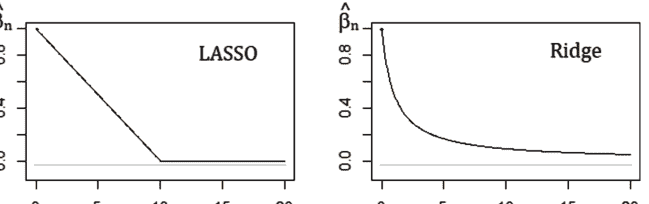

**图 1.7** LASSO 和岭回归的关键收缩特性。

### 1.7.3 收缩估计

The most widely used form of penalty estimation is referred to as a ridge regression (Hoerl and Kennard, 1970). In this case,

```
$p_\lambda(\boldsymbol{\beta}) = \lambda \sum_{j=1}^p |\beta_j|^2,$
```

where $\lambda$ is a tuning parameter. It is often referred to as the $L_2$ penalty since it is based on the $L_2$-norm. Its primary purpose is to shrink the parameters thus moving the estimates away from the unbiased values and towards the null hypothesis, $\boldsymbol{\beta} = 0$. By properly tuning $\lambda$, it is possible to apply enough shrinkage to the parameters such that the resulting biased parameters provide an accurate model for prediction.

The objective function using the least squares (LS) loss and ridge penalty functions is given by

```
$J_n^{\text{LS-Ridge}}(\boldsymbol{\beta}) = \frac{1}{n} \sum_{i=1}^n (y_i - \mathbf{x}_i^\top \boldsymbol{\beta})^2 + \lambda \sum_{j=1}^p |\beta_j|^2.$
```

The objective function using the rank loss and ridge penalty functions is given by

```
$D_n^{\text{R-Ridge}}(\boldsymbol{\beta}) = \frac{1}{n} \sum_{i=1}^n (\mathbf{y}_i - \mathbf{x}_i^\top \boldsymbol{\beta}) a_n(R_n(\boldsymbol{\beta})) + \lambda \sum_{j=1}^p |\beta_j|^2.$
```

One can show that the penalty function effectively places a constraint on the sum of the squares of the parameters. If we had only two parameters, $\beta_1$ and $\beta_2$, the constraint would be as follows,

\(\beta_1^2 + \beta_2^2 \le c,\) (1.7.11)

where c is a constant. Note that this constraint would form a circular region about the origin, as shown in Figure 1.8. The figure represents the two-dimensional plane of possible \(\beta_1\) and \(\beta_2\) values. The circles represent the constraint \(\beta_1^2 + \beta_2^2 = c\) due to the ridge penalty function for different values of c, as set by \(\lambda\) in the penalty function. The point marked “X” represents the unbiased rank or LS estimates. The contours around the estimates represent lines of equal value of the unpenalized loss function. The largest circle (labeled 0) is associated with \(\lambda = 0\), while the point the origin (where \(\beta_1 = \beta_2 = 0\)) is due to \(\lambda = \infty\).

Starting at the unbiased solution on the circle labeled 0, with \(\lambda_0 = 0\), as we apply the penalty function with tuning factor \(\lambda\), the estimates shrink and follow some hypothetical trajectory depicted in the figure until the edge of the circle 1 is reached at \(\lambda = \lambda_1 > 0\). As \(\lambda\) increases to \(\lambda = \lambda_2 > \lambda_1\) (circle 2), we shrink the estimates by a greater degree. At \(\lambda = \lambda_3 > \lambda_2\), we reach the circle 3. This continues until all estimates reach 0 at \(\lambda = \infty\) at the origin. Essentially, we are shrinking the estimates towards the null hypothesis, \(\boldsymbol{\beta} = 0\). In practice, we seek

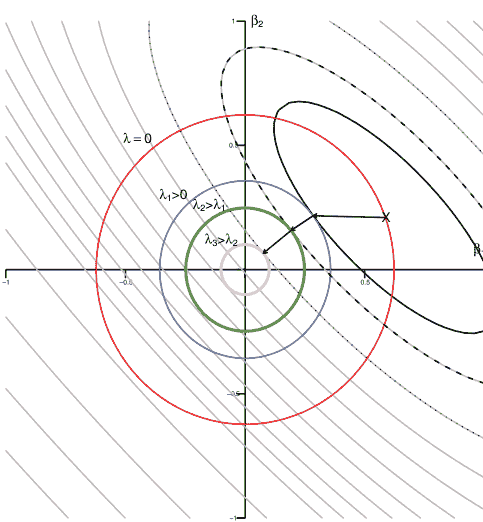

**图 1.8** 岭回归的几何解释。

some intermediate point between the unbiased estimate and the origin. If we have over-fitting or under-fitting problems, we can try a number of different values of \(\lambda\) until a proper balance is struck between the two. The process of finding the optimal value, \(\lambda_{\text{opt}}\), to balance this *bias-variance trade-off* is called regularization and is used to obtain high model prediction accuracy.

### 1.7.4 子集选择

The generic term “subset selection” refers to the process of identifying the most important explanatory variables from a large set of given variables. In particular, if there are \(p\) variables, the goal is to find a smaller subset, \(p_0 < p\), with which to build an accurate predictive model. Unfortunately, this requires that \(2^p\) models be built and tested to determine which one offers the best subset. This would be the “oracle” subset meaning the subset we would ideally want in our compact model. Of course, this process is computationally prohibitive so we seek other methods that have the potential to find this oracle subset with much less effort. Any approach that is able to find the oracle subset for any given \(p_0\) is said to have the oracle property.

A first approach in this direction combining shrinkage and subset selection is referred to as *LASSO* (least absolute shrinkage and selection operator) (Tibshirani, 1996). In this case,

```
\(p_\lambda(\boldsymbol{\beta}) = \lambda \sum_{j=1}^p |\beta_j|,\) (1.7.12)
```

where \(\lambda\) is the tuning parameter. This is also referred to as the $L_1$ penalty because it is reminiscent of the $L_1$-norm.

The objective function with least squares loss and LASSO penalty functions is given by

```
\(J_n^{\text{LS-LASSO}}(\boldsymbol{\beta}) = \frac{1}{n} \sum_{i=1}^n (y_i - \mathbf{x}_i^\top \boldsymbol{\beta})^2 + \lambda \sum_{j=1}^p |\beta_j|.\) (1.7.13)
```

The objective function with rank loss and LASSO penalty functions is given by

```
\(D_n^{\text{R-LASSO}}(\boldsymbol{\beta}) = \frac{1}{n} \sum_{i=1}^n (\mathbf{y}_i - \mathbf{x}_i^\top \boldsymbol{\beta}) a_n(R_n(\boldsymbol{\beta})) + \lambda \sum_{j=1}^p |\beta_j|.\) (1.7.14)
```

Using this formulation, a constraint, given by c, is imposed by the penalty function as follows,

$|\beta_1| + |\beta_2| \le c.$

(1.7.15)

The resulting constraint geometry is a diamond shape in two dimensions rather than the circle, as shown in Figure 1.9. The adjustment of \(\lambda > 0\) has the effect of decreasing the size of the diamond. If \(\lambda_0 = 0\), we obtain the unbiased estimates. As \(\lambda\) is increased, the diamond shrinks in size, as do the resulting parameters so it is a shrinkage estimator. Eventually, when \(\lambda = \infty\), the origin is reached, as was the case in ridge regression.

The hypothetical trajectory for LASSO starts at the unbiased LSE or rank estimates ("X") on diamond 0 and terminates on diamond 1 with \(\lambda = \lambda_1 > 0\). Both estimates shrink but neither one is 0 yet. However, when \(\lambda = \lambda_2 > \lambda_1\) and the path lands on one corner of diamond 2, where \(\beta_2 = 0\), and we are left with a model with only \(\beta_1 \neq 0\). We can now remove \(\beta_2\) and keep \(\beta_1\). As such, LASSO is a subset selection estimator. Further increases in \(\lambda\) eventually forces \(\beta_1 = 0\) at the origin.

### (b) LASSO 回归

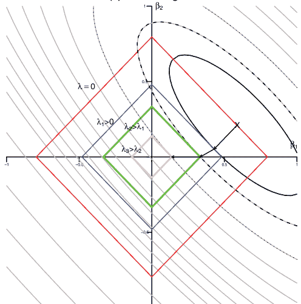

**图 1.9** LASSO 的几何解释。

Subset selection is very important when the number of parameters is very large. One can imagine a data set with \( p = 50 \) being reduced to \( p_0 = 30 \) by this method, and ideally only the important explanatory variables would be retained in the compact model. Unfortunately, LASSO does not have the oracle property; that is, it is possible that the “wrong corner” of the diamond may be reached during shrinkage.

For example, let \( p = 7 \) and assume we know a priori that \( \boldsymbol{\beta}_4 = 0 \) and \( \boldsymbol{\beta}_6 = 0 \) while all other parameters are non-zero. If a penalty estimator such as LASSO reports that initially we should set \( \boldsymbol{\beta}_3 = 0 \) and \( \boldsymbol{\beta}_7 = 0 \), then it does not have the oracle property. However, it may still produce a compact model but the parameter values may not be as meaningful. This is important because of model interpretability. We want to be able to eliminate parameters from the model that are not explanatory in terms of the response variable, leaving only those that are important. Whenever model interpretability is important, we require the oracle property be present in the penalty function during subset selection.

Improved methods have been developed that do indeed possess the oracle properties. One in particular is relevant to the discussion here: adaptive LASSO (aLASSO) (Zou, 2006). In the original LASSO, the \( \lambda \) value was applied uniformly to all parameters. In aLASSO, an additional weight is applied to each parameter as follows,

```
\( p_\lambda(\boldsymbol{\beta}) = \lambda \sum_{j=1}^p w_j |\beta_j| . \quad \text{(1.7.16)} \)
```

For example, the weight for each parameter could be set to \( w_j = 1/|\hat{\boldsymbol{\beta}}_j^*| \) to produce the new penalty function

```
\( p_\lambda(\boldsymbol{\beta}) = \lambda \sum_{j=1}^p \frac{|\boldsymbol{\beta}_j|}{|\hat{\boldsymbol{\beta}}_j^*|}, \quad \text{(1.7.17)} \)
```

where \( \hat{\boldsymbol{\beta}}_j^* \), a known quantity, is an unpenalized arbitrary estimate for \( \boldsymbol{\beta}_j \), i.e. the unbiased least squares or rank estimate. We usually consider a \( \sqrt{n} \)-consistent estimator as \( \hat{\boldsymbol{\beta}}_j^* \) to retain good properties for the penalized estimator.

We can understand the adaptive LASSO approach by realizing that small \( \hat{\boldsymbol{\beta}}_j^* \) values will lead to large weights, which is equivalent to a high \( \lambda \) with the diamond close to the origin (see Figure 1.9), while large \( \hat{\boldsymbol{\beta}}_j^* \) values would be equivalent to a small \( \lambda \) and accordingly a large diamond constraint. Hence, each parameter has its own effective \( \lambda \) based on the unpenalized estimates. This makes sense intuitively since the unpenalized solution has valuable


关于估计量大小的信息，进而可用作权重因子，以指导aLASSO估计朝着正确方向进行，从而移除不重要的变量。

### 1.7.5 混合方法

另一种可能的方法是将岭回归和LASSO惩罚合并为一个统一的惩罚，称为弹性网（Zou and Hastie, 2005），具体如下

\( p_\lambda(\boldsymbol{\beta}) = \lambda_1 \sum_{j=1}^P |\beta_j| + \lambda_2 \sum_{j=1}^P |\beta_j|^2. \) (1.7.18)

现在我们有两个调谐参数，\(\lambda_1\) 和 \(\lambda_2\)。我们注意到，如果 \(\lambda_1 = 0\)，则得到岭回归；而如果 \(\lambda_2 = 0\)，则得到LASSO。弹性网的一个小修改是将LASSO替换为aLASSO，以包含神谕特性，具体如下

\( p_\lambda(\boldsymbol{\beta}) = \lambda_1 \sum_{j=1}^P \frac{|\beta_j|}{|\hat{\beta}_j^*|} + \lambda_2 \sum_{j=1}^P |\beta_j|^2. \) (1.7.19)

这两个参数，\(\lambda_1\) 和 \(\lambda_2\)，会被调整直到达到所需的偏差/方差权衡（即平衡过拟合与欠拟合）。如果令 \(\lambda_1 = \lambda \alpha\) 且 \(\lambda_2 = \lambda(1 - \alpha)/2\)，则可以清楚看出，当 \(\alpha = 0\) 时使用的是岭回归，而当 \(\alpha = 1\) 时使用的是aLASSO。在实际中，我们寻找能提供所需模型精度的 \(\lambda\) 和 \(\alpha\) 值。可以理解，只有当 \(\alpha = 1\) 时才会强制执行神谕特性，而当 \(\alpha\) 趋近于0时不一定如此。然而，它对两个惩罚函数提供了更好的组合，因为它为多重共线性、收缩和神谕子集选择提供了解决方案。

## 1.8 总结

总结本章，我们论证了基于秩的估计是处理离群点时最小二乘估计（LSE）的一个稳健替代方案，而离群点包含在大多数现实数据集中。已证明，在存在离群点时，LSE可能会产生误导性结果。介绍了比利时电话数据集的多个不同案例，以比较和对比基于秩的方法与LSE。基于秩的估计在稳健性方面明显更好，特别是在单个离群点的高影响和高杠杆情况下。

此外，为了提高预测精度，我们描述了惩罚函数的使用，这些函数可以被视为对参数值的附加约束。岭回归提供参数收缩，可用于降低参数值的大小。LASSO是另一种具有收缩和子集选择特性的惩罚函数，尽管它不具备神谕特性。aLASSO是LASSO的一个变体，具有神谕特性，但通常需要无偏估计作为权重项。我们还介绍了弹性网，它是两者的组合。关于这些惩罚函数的更多细节将在第2章中介绍。

我们描述了惩罚函数对估计的影响的几何解释。它们实际上对参数值引入了约束，使得在岭回归的情况下参数值位于一个圆上，而在LASSO的情况下位于一个菱形上。对LSE和R估计的约束为多重共线性、过拟合/欠拟合、识别重要解释变量以及收缩参数值等问题提供了有效的解决方案。

表1.9提供了LSE、秩、岭回归和LASSO的概念视图。它提供了基于秩的方法如何融入整体图景的另一个背景。特别是，二次损失函数基于L2-范数，岭惩罚函数也是如此。然而，基于秩的方法（大致）基于L1-范数，LASSO惩罚也是如此。鉴于基于秩的方法产生稳健估计，我们说它的行为类似于L1损失函数。我们注意到表中损失函数和惩罚函数之间的对称性。我们还指定了每种方法的关键属性。

表1.9 L1/L2损失和惩罚函数的解释

| 范数 | 损失函数 | 惩罚函数 | 条目解释 |
| :--- | :--- | :--- | :--- |
| L2 | 最小二乘（基于均值） | 岭回归（收缩） | L2损失是LSE<br>L2惩罚是岭回归 |
| L1 | 秩（基于中位数） | LASSO（选择） | L1损失是R估计<br>L1惩罚是LASSO |

本章我们专注于线性回归的基于秩的方法。然而，基于秩的方法也可以扩展到逻辑回归和神经网络，我们将在本书关于机器学习的最后两章中加以演示。此外，惩罚函数也可以以类似的方式应用于逻辑回归和神经网络。在接下来的几章中，我们将对这些及其他主题进行更严谨的阐述，因为它们涉及基于秩的方法的理论与实践。

## 1.9 习题

- 1.1. 我们想使用Theil估计量构建一个简单的线性模型，用于

$$y_i = \theta + \beta x_i, \quad i = 1, ..., 100.$$

一组点 $(x_i, y_i)$ 的Theil估计量需要找到所有点对斜率的中位数，$(\frac{y_j-y_i}{x_j-x_i})$，以及偏残差的中位数，$(y_i - \hat{\beta}_n^{\text{Theil}} x_i)$。估计量由以下公式给出

$$\hat{\beta}_n^{\text{Theil}} = \text{median}_{1 \le i < j \le n, i \neq j} \left( \frac{y_j - y_i}{x_j - x_i} \right), \text{ and } \hat{\theta}_n^{\text{Theil}} = \text{median}_{1 \le i \le n} (y_i - \hat{\beta}_n^{\text{Theil}} x_i).$$

如果 $n = 100$，计算 $\hat{\beta}_n^{\text{Theil}}$ 需要进行多少次斜率计算？计算 $\hat{\theta}_n^{\text{Theil}}$ 需要多少次？哪一个在计算复杂度上是 $O(n^2)$ 或 $O(n)$？

- 1.2. 考虑以下小数据集。

| $x_i$ | 0.10 | 0.20 | 0.30 | 0.40 | 0.50 | 0.60 |
| :--- | :--- | :--- | :--- | :--- | :--- | :--- |
| $y_i$ | 3.2 | 4.0 | 4.2 | 4.7 | 6.5 | 5.5 |

假设数据建模为

$$\mathbf{y} = \theta + \beta \mathbf{x} + \boldsymbol{\varepsilon}.$$

请进行手工计算，或使用R或Python，完成以下任务。

- (a) 使用下列公式求 $\theta$ 和 $\beta$ 的最小二乘估计量

$$\hat{\beta}_n^{\text{LS}} = \frac{\sum_{i=1}^n (x_i - \bar{x})(y_i - \bar{y})}{\sum_{i=1}^n (x_i - \bar{x})^2}, \text{ and } \hat{\theta}_n^{\text{LS}} = \bar{y} - \hat{\beta}_n^{\text{LS}} \bar{x}.$$

- (b) 基于(a)，使用残差直方图找出离群点。

- (c) 使用Theil方法求截距和斜率参数的基于中位数的估计量。

- (d) 基于(c)，使用Theil估计量的另一个残差直方图找出离群点。

- (e) 从部分(d)中找到的数据集中删除离群点并重复该过程。评论有无离群点时得到的结果。

- 1.3. 作为练习，证明 \(\phi(u) = -\sqrt{2} \cos(\pi u)\) 满足 \(0 < u < 1\) 时 \(\phi(u)\) 的约束，使得 \(\int_0^1 \phi(u) du = 0\) 且 \(\int_0^1 \phi^2(u) du = 1\)。证明它关于 1/2 也是斜对称的。在这种情况下 \(\phi^*(u) 是什么？绘制新的评分函数，如图1.5所示，并与 \(0 < u < 1\) 范围内的Wilcoxon评分函数一起绘制。

- 1.4. 对于问题1.2中的数据集，使用基于秩的方法求取 \(\theta\) 和 \(\beta\) 的估计量，具体如下。你可以手动计算解，或使用R或Python。

- (a) 估计量 \(\hat{\beta}_n^R\) 由以下公式给出

\(\hat{\beta}_n^R = \underset{\beta}{\text{argmin}} \left\{ \sum_{i=1}^n (y_i - \beta x_i) \sqrt{12} \left( \frac{R_{n_i}(\beta)}{n+1} - \frac{1}{2} \right) \right\},\)

其中 \(R_{n_i}(\beta) = R_n(y_i - \beta x_i)\)。通过计算求和来执行最小化步骤

\(D_n(\beta) = \sum_{i=1}^n (y_i - \beta x_i) a_n(R_{n_i}(\beta)).\)

对于 \(\beta = 4.5, 4.6, 4.7, 4.8, 4.9, 5.0\)。

- (b) 估计量 \(\hat{\theta}_n^R\) 由以下公式给出

\(\hat{\theta}_n^R = \underset{\theta}{\text{argmin}} \left\{ \sum_{i=1}^n |y_i - (\theta + \hat{\beta}^R x_i)| \sqrt{3} \left( \frac{R_{n_i}^+(\Theta)}{n+1} \right) \right\},\)

其中 \(R_{n_i}^+(\Theta) = R_n(|y_i - (\theta + \hat{\beta}^R x_i)|).\)

通过计算求和来执行最小化步骤

\(D_n(\Theta) = \sum_{i=1}^n |y_i - (\theta + \hat{\beta}^R x_i)| a_n^+(R_{n_i}^+(\Theta)),\)

对于 \(\theta = 2.5, 2.6, 2.7, 2.8, 2.9, 3.0\)。

- (c) 将问题1.2中的线性回归结果与上述结果相互绘图，并叠加在原始数据集上。

- (d) 比较和对比应用于该数据集的三个估计量。

- 1.5. 对于以下数据集，最好使用R来解决下面的问题。在R中，可以使用内置函数 `lm()` 获得最小二乘估计。然而，名为Rfit（Kloke and McKean, 2012）的包应


为了快速获得基于秩的结果，需要安装。（如果您仅进行手工计算，请使用第二行中八组 (x, y) 数据中的最后六组。）

| x | 5551 | 794 | 1619 | 2079 | 918 | 1231 | 3641 | 4314 |
|---|---|---|---|---|---|---|---|---|
| y | 40 | 29 | 28 | 23 | 21 | 17 | 27 | 39 |
| x | 2786 | 3989 | 376 | 5428 | 2628 | 4497 | 3545 | -2108 |
| y | 38 | 46 | 24 | 48 | 34 | 43 | 38 | 94 |

- (a) 为该数据集绘制散点图。根据图 1.3 中给出的情况，数据中存在哪种类型的离群点？
- (b) 使用最小二乘法拟合一条直线。在散点图上绘制相关直线。
- (c) 使用基于秩的方法拟合一条直线。在同一散点图上绘制相关直线。
- (d) 讨论两个图如此不同的原因。在两个估计值（基于秩或 LS）中，哪一个更能代表数据？

### 1.6. 鉴于基于秩的斜率参数 \(\beta\) 可使用

\(D_n(\beta) = \sum_{i=1}^n(y_i - \beta x_i)a_n(R_n(\beta)),\)

验证此方程：编写 R 或 Python 程序，使用表 1.3 的电话数据集复现表 1.6 的结果。识别图 1.6 中计算的三个点。

### 1.7. 鉴于简单线性回归问题的基于秩的截距 \(\theta\) 可使用

\(D_n(\theta) = \sum_{i=1}^n |y_i - (\theta + \hat{\beta}^\text{R} x_i)|a_n^+(R_n^+(\theta)),\)

其中

\(R_n^+(\theta) = R_n(|y_i - (\theta + \hat{\beta}^\text{R} x_i)|).\)

验证此方程：编写 R 或 Python 程序，使用表 1.3 的电话数据集复现表 1.7 的结果。识别图 1.6 中计算的三个点。

### 1.8. 基于秩的桥式惩罚估计量将采用如下形式，

\(D_n^\text{R-bridge}(\boldsymbol{\beta}) = \frac{1}{n} \sum_{i=1}^n (y_i - \mathbf{x}_i \boldsymbol{\beta})a_n(R_n(\boldsymbol{\beta})) + \lambda \sum_{j=1}^p |\beta_j|^\gamma,\)

其中指数 \(\gamma\) 已在最后一项中引入。

- (a) 如果 \(\gamma = 1\)，会产生哪种类型的惩罚函数？
- (b) 如果 \(\gamma = 2\)，会产生哪种类型的惩罚函数？
- (c) 如果 \(\gamma = 1.5\) 或 1 到 2 之间的任何值呢？您如何表征这种类型的惩罚函数？

### 1.9. 对于中心化问题，最小二乘估计量的形式为：

\(\hat{\beta}_n^{LS} = (X_c^T X_c)^{-1} X_c^T \mathbf{y}.\)

可以证明，LS-ridge 估计量的形式为：

\(\hat{\beta}_n^{LS\text{-Ridge}} = (X_c^T X_c + \lambda)^{-1} X_c^T \mathbf{y}.\)

使用前一个问题中的以下数据，对数据进行中心化，并解决以下问题。

| xi | 0.10 | 0.20 | 0.30 | 0.40 | 0.50 | 0.60 |
|---|---|---|---|---|---|---|
| yi | 3.2 | 4.0 | 4.2 | 4.7 | 5.0 | 5.5 |

- (a) 中心化后计算 \(\hat{\beta}_n^{LS}\) 和 \(\hat{\theta}_n^{LS}\)。
- (b) 计算 \(\hat{\beta}_n^R\) 和 \(\hat{\theta}_n^R\)。
- (c) 找到 \(\lambda\)，使得 \(\hat{\beta}_n^{LS\text{-Ridge}}\) 与 \(\hat{\beta}_n^R\) 具有相同的值。
- (d) 绘制 (b) 和 (c) 的结果，对结果进行评论，并提出哪种解决方案更好。特别是，比较两种方法的截距。另外，是否可以使用 LS-ridge 产生基于秩的方法所获得的结果？

### 1.10. (项目) 在本题中，您将使用 R 来比较基于秩的方法与最小二乘法。如果您尚未在计算机上安装 R，现在是个很好的时机。您还应使用 install.packages("Rfit") 安装 Rfit 包。

- (a) 加载 Rfit 库并检查本章中使用的电话数据。

```
library("Rfit")
data(telephone)
telephone
```

- (b) 在电话数据上运行 rfit()，并将基于秩的结果与表 1.8 中的情况 (d) 进行比较。

```
fit <- rfit(calls ~ year, data=telephone)
summary(fit)
```

- (c) 在电话数据上运行 lm()，并将最小二乘结果与表 1.8 中的情况 (d) 进行比较。

```
lmfit <- lm(calls ~ year, data=telephone)
summary(lmfit)
```

- (d) 绘制两种回归方法的结果。哪条线是基于秩的直线，哪条是最小二乘直线？

```
plot(calls ~ year,data=telephone,
 main="Rank vs. LSE",ylim=c(0,25))
abline(coef(lmfit),lwd=2,col="black")
abline(coef(fit),lwd=2,col="red")
```

# 2

## 2.1 简介

在本章中，我们将考察基于秩的惩罚估计量的实际方面，以了解其特性。我们将证明，通过适当结合基于秩的线性回归和合适的惩罚函数，可以创建一个紧凑且鲁棒的模型，该模型提供更好的预测精度和模型可解释性。我们在前一章中已经看到，基于秩的回归能够有效地从数据集中滤除离群点，充当隐式数据清理代理人。正因如此，它被称为鲁棒估计量，即它对各种不同类型的离群点具有容忍度。一旦我们识别出离群点，可以选择将回归中使用的观测值数量从 n 减少到 n₀，其中 n₀ ≤ n，但 R 估计本质上已经为我们这样做了。现在，我们将注意力转向惩罚函数。我们的目标是将变量数量从 p 减少到一个适当的子集 p₀，其中 p₀ ≤ p。此子集随后可以通过应用另一个惩罚函数来缩小估计值，从而用于创建一个紧凑且可解释的模型。通过使用基于秩的惩罚估计量，我们实际上将是将一个大小为 n × p 的大数据集缩减为一个大小为 n₀ × p₀ 的较小数据集，并使用该数据集来创建提供所需预测精度的模型。

## 2.2 惩罚估计量的动机

惩罚函数及其有效使用在机器学习中非常重要，尤其是对于多元线性回归、逻辑回归和神经网络。关于惩罚基于秩的估计量的文献相当匮乏，著名的例外包括 Johnson and Peng (2008)、Turkmen and Ozturk (2014) 以及 Saleh et al. (2018) 的工作。我们将在本章中介绍基于秩的线性回归，然后在最后两章中介绍基于秩的逻辑回归和神经网络。惩罚函数的最初动机是解决线性回归中的多重共线性问题。然而，即使在没有多重共线性的情况下使用惩罚函数的优势也很快变得明显，于是它被重新用于正则化，这一术语指的是调整估计值以提高模型的预测精度并使其更具普适性。引入了其他惩罚函数，每个都提供新功能或对现有方法的改进。我们将在整本书中描述各种此类惩罚估计量。

在本章中，我们将逐一介绍广为人知且常用的惩罚函数，并将其应用于最小二乘法（LS）和基于秩的损失函数，以比较和对比它们的特性。我们还将介绍一组相关的正交和对角惩罚估计量，这些估计量基于著名的惩罚函数，使用简单，并继承了其源自的原始惩罚估计量的许多特性。

为了开始研究，我们将阐述使用岭回归（Hoerl and Kennard, 1970）的动机，并进行简单分析以了解其特性和属性。我们将说明，通过在训练集上调整正则化程度直到达到所需精度，这种惩罚函数可以提高回归模型的预测精度。一旦奠定了岭回归的基础，我们将在示例数据集上使用岭迹线来比较惩罚 LS 和基于秩的估计。岭迹线提供了关于岭回归如何工作的宝贵见解，其他惩罚函数的迹线也是如此。我们将发现，岭回归将参数值收缩向零，因此被称为收缩估计量。有关该主题的详细处理，请参阅 Saleh et al. (2019)。

接着，我们将转向 LASSO（Tibshirani, 1996）和自适应 LASSO（aLASSO）（Zou, 2006）惩罚函数，它们在收缩的同时进行特征子集选择。我们将在 LS 和基于秩的估计背景下比较和对比这两种方法。我们将描述 aLASSO 的神谕特性，在某些正则性条件下，它可以提供一组估计值，其渐近行为仿佛真实模型已事先已知。也许更重要的是，通过检查 aLASSO 迹线的零交叉，它可以为子集选择提供变量的近乎最优排序（从最重要到最不重要）。众所周知，LASSO 不具备神谕特性，但在将某些变量收缩为零以减少模型大小方面很有效。aLASSO 的关键神谕特性可以利用一个关于 p（即变量数量）线性时间的算法用于子集选择。


variables) 使用 aLASSO 轨迹中参数的零交叉，但需要为轨迹构建额外的 _m_ 个模型<sup>1</sup>。

接下来，我们描述混合方法，包括“naive”弹性网（nEnet）、标准弹性网（Zou and Hastie, 2005）以及我们称之为自适应弹性网（aEnet）的改进方法。在这些方法中，aEnet 最具前景，因为它提供了来自岭回归的收缩和来自 aLASSO 的神谕变量选择。当不存在多重共线性且在低维环境下时，它非常合适。为了定义与 aLASSO 惩罚函数相关的权重，我们可能还需要矩阵 \( C = X^\top X \) 可逆，原因在本章后面会变得清晰。许多数据集满足这些要求，因此我们认为这种自适应弹性网惩罚函数在数据科学中可能很重要。

最后，我们用一个示例来结束本章，将所有关键点串联起来。我们表明，虽然结合所有方法提供了一个看似优雅的解决方案，但对损失函数和惩罚函数进行排序以最大化其效果可能更实用。我们演示了 rank、aLASSO 和 岭回归的组合如何生成一个兼具预测准确性和模型可解释性的紧凑模型。在即将到来的章节中，将介绍基于秩的惩罚估计器的严格数学处理，但在这里我们想描述它们在机器学习方面的实际用法。

## 2.3 多元线性回归

### 2.3.1 多元最小二乘估计

考虑以下矩阵形式的多元回归模型，

\[
\mathbf{y} = \theta \mathbf{1}_n + \mathbf{X} \boldsymbol{\beta} + \boldsymbol{\varepsilon}, \tag{2.3.1}
\]

其中 \(\mathbf{y} = (y_1, \dots, y_n)^\top\) 是响应向量，\(\mathbf{X}\) 是一个 \(n \times p\) 的常数设计矩阵，\(\boldsymbol{\varepsilon} = (\varepsilon_1, \dots, \varepsilon_n)^\top\) 是误差项。回归参数为 \((\theta, \boldsymbol{\beta})^\top\)，其中 \(\theta\) 是截距，\(\boldsymbol{\beta} = (\beta_1, \dots, \beta_p)^\top\) 是感兴趣的 _p_ 个系数。另外，\(\mathbf{1}_n = (1, \dots, 1)^\top\) 是一个由 1 组成的 _n_ 维向量。此处我们假设 \(\boldsymbol{\varepsilon} \sim \mathcal{N}_n(\mathbf{0}, \sigma^2 \mathbf{I}_n)\)，即均值为 \(\mathbf{0} = (0, \dots, 0)^\top\)（一个 \(n \times 1\) 向量）和方差-协方差矩阵 \(\sigma^2 \mathbf{I}_n\) 的正态分布。如果数据中心化，使得

\[
\sum_{i=1}^n y_i = 0, \text{ and } \sum_{i=1}^n x_{ij} = 0 \text{ for } j = 1, \dots, p, \tag{2.3.2}
\]

那么我们可以从分析中消除截距，并且发现这样做很方便。值得注意的是，惩罚函数不应用于 \(\theta\)，因此通过中心化可以将其从讨论中一般排除。我们现在可以使用以下表达式

\(\mathbf{y} = X\boldsymbol{\beta} + \boldsymbol{\varepsilon}.\) (2.3.3)

我们的目标是根据问题要求以多种不同的方式研究 \(\boldsymbol{\beta}\) 的估计。在我们的第一种方法中，二次或 L\(_2\) 损失函数如下：

\(J(\boldsymbol{\beta}) = (\mathbf{y} - X\boldsymbol{\beta})^{\mathsf{T}}(\mathbf{y} - X\boldsymbol{\beta}).\) (2.3.4)

为了获得最小二乘估计 \(\hat{\boldsymbol{\beta}}_n^{\mathrm{LS}}\)，我们对 \(\boldsymbol{\beta}\) 求 \(J(\boldsymbol{\beta})\) 的导数并将其设为 0，即

\(\frac{\partial J(\boldsymbol{\beta})}{\partial \boldsymbol{\beta}} = -2X^{\mathsf{T}}(\mathbf{y} - X\boldsymbol{\beta}) = 0.\) (2.3.5)

然后，可得

\(-X^{\mathsf{T}}\mathbf{y} + X^{\mathsf{T}}X\boldsymbol{\beta} = 0,\) (2.3.6)

解此式可得

\(\hat{\boldsymbol{\beta}}_n^{\mathrm{LS}} = (X^{\mathsf{T}}X)^{-1}X^{\mathsf{T}}\mathbf{y}\) (2.3.7)

前提是 \(X^{\mathsf{T}}X\) 可逆。这是最小二乘估计（LSE）的直接矩阵解，它提供最佳线性无偏估计。文献中也称其为普通最小二乘（OLS）估计量。

估计量的方差-协方差矩阵由以下给出

\(\mathrm{Var}(\hat{\boldsymbol{\beta}}_n^{\mathrm{LS}}) = \sigma^2(X^{\mathsf{T}}X)^{-1} = \sigma^2\mathbf{C}^{-1},\) (2.3.8)

其中 \(\mathbf{C} = X^{\mathsf{T}}X\)。那么，第 \(j\) 个参数的方差为

\(\mathrm{Var}(\hat{\beta}_j^{\mathrm{LS}}) = \sigma^2 C^{jj}, \quad j = 1, \dots, p,\) (2.3.9)

其中 \(C^{jj}\) 是 \(\mathbf{C}^{-1}\) 的第 \(j\) 个对角线元素。因此，标准误（s.e.）为

\(\mathrm{s.e.}(\hat{\beta}_j^{\mathrm{LS}}) = \hat{\sigma}\sqrt{C^{jj}}, \quad j = 1, \dots, p,\) (2.3.10)

其中 \(\hat{\sigma} = \sqrt{\mathrm{SSE}/(n - p)}\) 是 \(\sigma\) 的无偏估计量，SSE 是定义为误差平方和的量

\(\mathrm{SSE} = (\mathbf{y} - X\hat{\boldsymbol{\beta}}_n^{\mathrm{LS}})^{\mathsf{T}}(\mathbf{y} - X\hat{\boldsymbol{\beta}}_n^{\mathrm{LS}}).\) (2.3.11)

这可以总结为 \(\hat{\boldsymbol{\beta}}_n^{\mathrm{LS}} \sim \mathcal{N}_p(\boldsymbol{\beta}, \sigma^2\mathbf{C}^{-1})\)。

### 2.3.2 多元 R 估计

基于秩的估计在第 1 章中已详细描述。多元回归模型的离散函数如下

\[
D_n(\boldsymbol{\beta}) = \sum_{i=1}^n (y_i - \mathbf{x}_i^\top \boldsymbol{\beta})a_n(R_{n_i}(\boldsymbol{\beta})), \tag{2.3.12}
\]

其中 \(\mathbf{x}_i = (x_{i1}, \dots, x_{ip})^\top\)，\(R_{n_i}(\boldsymbol{\beta}) = R_{n_i}(y_i - \mathbf{x}_i \boldsymbol{\beta})\) 是残差的秩。这是一个分段连续凸函数，可以通过优化循环来最小化，以找到估计值 \(\hat{\boldsymbol{\beta}}_n^R\)。可以证明该解是一致的且渐近正态（Hettmansperger and McKean, 2011）。与 LS 类似，其渐近特性可总结为 \(\hat{\boldsymbol{\beta}}_n^R \sim \mathcal{N}(\boldsymbol{\beta}, \eta^2 \mathbf{C}^{-1})\)，其中 \(\eta^2\) 是一个缩放参数，取决于误差概率密度函数和得分函数 \(\phi(u)\)，如 Hettmansperger and McKean (2011) 第 3 章所述<sup>2</sup>。因此，以类似于 LS 的方式，我们说

\(\text{s.e.}(\hat{\beta}_j^R) = \eta \sqrt{C^{jj}}, \quad j = 1, \dots, p, \tag{2.3.13}\)

其中 \(C^{jj}\) 是 \(\mathbf{C}^{-1}\) 的第 \(j\) 个对角线元素，前提是 \(\mathbf{C} = \mathbf{X}^\top \mathbf{X}\) 可逆。

### 2.3.3 多重共线性

此前提到的矩阵 \(\mathbf{X}^\top \mathbf{X}\) 必须可逆的要求值得进一步讨论。具体来说，该矩阵必须是满秩<sup>3</sup>。换句话说，变量之间不能相互线性相关。如果两个变量呈线性或近似线性关系，我们称之为共线性；当多个变量呈线性相关，并且可能存在多次此类线性依赖时，则使用多重共线性一词。在这些情况下，LSE 和 秩估计将产生采样方差过大的估计值，以至于有意义的统计推断变得困难。

使用惩罚函数的最初动机源于多重共线性。多重共线性的含义是，回归问题存在无限多个解，而没有约束来决定哪个最合适。有几种方法可以判断是否存在多重共线性。一种方法是检查矩阵 \(\mathbf{C} = \mathbf{X}^\top \mathbf{X}\) 是否可逆。例如，如果 \(\text{det}(\mathbf{C}) = 0$，则该矩阵是奇异的，因此不可逆。近似共线性也是一个问题。为此，我们可以计算条件数，如果条件数非常大，则声明该矩阵为病态且可能不可逆。其他检验包括方差膨胀因子（VIF）以及矩阵最大特征值和最小特征值之比的检验。本章不将描述这些技术，但有许多资源可供感兴趣的读者获取更多详细信息（Montgomery et al., 2012; Saleh et al., 2019）。

解决多重共线性问题的一种方法是以某种方式约束问题以产生唯一解。事实上，带有惩罚函数的线性回归可以被视为一个约束最小化问题。考虑一个函数 $h(\boldsymbol{\beta})$，当我们试图对 \(\boldsymbol{\beta}\) 进行最小化时，它具有无限多个解。我们现在应用约束函数 $g(\boldsymbol{\beta})$ 如下

\[
\hat{\boldsymbol{\beta}}_n^{\text{Pen}} = \underset{\boldsymbol{\beta}}{\text{argmin}} \, h(\boldsymbol{\beta}) \quad \text{subject to} \quad g(\boldsymbol{\beta}) \le c,
\]

其中 \(\hat{\boldsymbol{\beta}}_n^{\text{Pen}}\) 是约束估计量。与约束函数相关的常数 \(c\) 允许选择特定解。为了在单个方程中应用约束，我们可以将问题重新表述为拉格朗日乘数法如下

\[
J^{\text{Pen}}(\boldsymbol{\beta}) = h(\boldsymbol{\beta}) + \lambda g(\boldsymbol{\beta}),
\]

其中 \(\lambda\) 是乘数或调参数。在上述表达式中，$J^{\text{Pen}}(\boldsymbol{\beta})$ 是目标函数，$h(\boldsymbol{\beta})$ 充当损失函数，$g(\boldsymbol{\beta})$ 充当惩罚函数，\(\lambda\) 扮演 \(c\) 的角色。更具体地说，我们所谓的惩罚估计，一般而言，是在惩罚函数约束 \(p_\lambda(|\boldsymbol{\beta}|)$ 下对一类损失函数进行最小化，其中 \(|\boldsymbol{\beta}| = (|\beta_1|, \dots, |\beta_p|)^\top\)。该解

\[
\hat{\boldsymbol{\beta}}_n^{\text{Pen}} = \underset{\boldsymbol{\beta}}{\text{argmin}} \, J^{\text{Pen}}(\boldsymbol{\beta})
\]

称为惩罚估计量（PE）。注意，在大多数惩罚函数情况下，我们有 \(p_\lambda(|\boldsymbol{\beta}|) = \lambda \sum_{i=1}^p p(|\beta_i|)$。

例如，对于 LS 我们将有

\[
J^{\text{LS-Pen}}(\boldsymbol{\beta}) = (\mathbf{y} - \mathbf{X}\boldsymbol{\beta})^\top(\mathbf{y} - \mathbf{X}\boldsymbol{\beta}) + p_\lambda(|\boldsymbol{\beta}|),
\]

而对于秩，我们将有

\[
D^{\text{R-Pen}}(\boldsymbol{\beta}) = \sum_{i=1}^n (y_i - \mathbf{x}_i^\top \boldsymbol{\beta} \, a_n(R_{n_i}(\boldsymbol{\beta})) + p_\lambda(|\boldsymbol{\beta}|).
\]

这是我们可以用来求解多重共线性回归问题的形式，其中第一项是损失函数（最小二乘或秩），第二项是惩罚函数（岭回归、LASSO、弹性网或任何其他变体）。


需要在此指出，惩罚函数即使在没有多重共线性的情况下也被广泛使用。例如，可以通过正则化使用它们来改进模型预测，或用于子集选择以减少模型复杂度并提高模型可解释性。回顾第1章，请考虑图1.8和1.9中的几何图。围绕无偏估计（由“x”表示）的等高线与损失函数（LS或rank）相关。圆和菱形分别代表惩罚函数（脊回归和LASSO）的约束。随着\(\lambda\)正则化程度的增加，会得到不同的估计。通常，PEs将无偏估计转移到一系列有偏估计中，从中我们可以选择提供准确预测的最优估计。这一最终目标将推动后续章节的讨论。

## 2.4 脊回归

脊回归（Hoerl and Kennard, 1970）的开发旨在通过对二次损失函数应用L2惩罚函数，生成一组方差更低的有偏估计，从而减轻多重共线性导致的高方差影响。偏差程度通过调参参数\(\lambda\)进行调整，其范围可从0到无穷大，但通常如后文所述选择一个最优值。

### 2.4.1 脊回归应用于最小二乘估计

脊回归应用于二次损失函数的惩罚函数由下式给出

\(J^{\text{LS-Ridge}}(\boldsymbol{\beta}) = (\mathbf{y} - \mathbf{X}\boldsymbol{\beta})^{\mathsf{T}}(\mathbf{y} - \mathbf{X}\boldsymbol{\beta}) + \lambda \boldsymbol{\beta}^{\mathsf{T}} \boldsymbol{\beta}.\)

(2.4.1)

为求得脊回归估计，我们对\(J^{\text{LS-Ridge}}(\boldsymbol{\beta})\)关于\(\boldsymbol{\beta}\)求导并令其等于0，即

\(\frac{\partial J^{\text{LS-Ridge}}(\boldsymbol{\beta})}{\partial \boldsymbol{\beta}} = -2\mathbf{X}^{\mathsf{T}}(\mathbf{y} - \mathbf{X}\boldsymbol{\beta}) + 2\lambda \boldsymbol{\beta} = 0.\)

(2.4.2)

于是，得到

\(-\mathbf{X}^{\mathsf{T}}\mathbf{y} + \mathbf{X}^{\mathsf{T}}\mathbf{X}\boldsymbol{\beta} + \lambda \boldsymbol{\beta} = 0,\)

(2.4.3)

变换后得到脊回归估计量，

\(\hat{\boldsymbol{\beta}}_n^{\text{LS-ridge}} = (\mathbf{X}^{\mathsf{T}}\mathbf{X} + \lambda \boldsymbol{I}_p)^{-1}\mathbf{X}^{\mathsf{T}}\mathbf{y},\)

(2.4.4)

其中\(\boldsymbol{I}_p\)是一个\(p \times p\)单位矩阵。这是脊回归估计的标准形式。我们可以看出，通过将\(\lambda\)添加到\(\mathbf{X}^\top \mathbf{X}\)的对角元素中，可以规避多重共线性引起的问题。对于某些\(\lambda > 0\)，矩阵\((\mathbf{X}^\top \mathbf{X} + \lambda \mathbf{I}_p)\)是可逆的。此外，通过仔细选择\(\lambda\)，可以在存在（或不存在）多重共线性的情况下获得准确的预测模型。

为了深入了解脊回归机制，可以通过将Eq. (2.4.3)的所有项乘以\((\mathbf{X}^\top \mathbf{X})^{-1}\)并重新排列，用\(\hat{\beta}^{\text{LS}}\)重写Eq. (2.4.4)以得到

```
\(-\hat{\beta}_n^{\text{LS}} + \beta + \lambda C^{-1} \beta = 0,\) (2.4.5)
```

其中\(C^{-1} = (\mathbf{X}^\top \mathbf{X})^{-1}\)。这样做假设\(\mathbf{C}\)是可逆的，因此假设\(\mathbf{X}\)中不存在多重共线性；一般来说，情况可能并非如此。那么

```
\(\hat{\beta}_n^{\text{LS-ridge}} = (\mathbf{I}_p + \lambda C^{-1})^{-1} \hat{\beta}_n^{\text{LS}}.\) (2.4.6)
```

在这种形式的脊回归中，我们可以将\(\mathbf{W}(\lambda) = (\mathbf{I}_p + \lambda C^{-1})^{-1}\)视为一个权重矩阵，它对\(\hat{\beta}_n^{\text{LS}}\)起到收缩算子的作用。\(\lambda\)的值越高，收缩程度越大。如前所述，许多数据集没有多重共线性问题，即使在没有此类问题的情况下，脊回归在构建更好的预测模型方面也非常有效。

我们已指出脊回归会收缩无偏估计，但尚未描述这种收缩发生的方式。为了获得一些洞察，我们可以做一个简化假设，即\(\mathbf{C}\)是单位矩阵\(\mathbf{I}_p\)。也就是说，\(\mathbf{X}\)是一个正交归一矩阵。如果应用于Eq. (2.3.7)，我们得到\(\hat{\beta}_n^{\text{O-LS}} = \mathbf{X}^\top \mathbf{y}\)，即正交归一LS估计量。如果应用于Eq. (2.4.6)，它将简化为

```
\(\hat{\beta}_n^{\text{O-ridge}} = \frac{\hat{\beta}_n^{\text{LS}}}{1 + \lambda},\) (2.4.7)
```

其中\(\hat{\beta}_n^{\text{O-ridge}}\)是正交情况下的估计量。此例对脊回归的基本机制提供了有用的启示。它说明脊回归应用一个因子\(1/(1+\lambda)\)来收缩\(\hat{\beta}_n^{\text{LS}}\)值，直到在\(\lambda = \infty\)时达到0。本书将此称为正交脊回归类型估计量。

然而，脊回归并不像上述公式所暗示的那样将所有参数按相同比例缩放。为了更好地理解脊回归的真实本质，让我们假设\(C^{-1}\)是一个对角矩阵，其非零值为\(C^{jj}\)，\(j=1, ..., p\)。所有非对角项均设为零，意味着参数之间不存在相关性。因此，对于第\(j\)个参数，可以写成

```
\(\hat{\beta}_j^{\text{D-ridge}} = \frac{\hat{\beta}_j^{\text{LS}}}{1 + \lambda C^{jj}},\) (2.4.8)
```

其中\(\hat{\beta}_j^{\text{D-ridge}}\)是对角\(\mathbf{C}^{-1}\)情况下的估计量。这是对角脊回归类型估计量。我们可以回顾，\(\hat{\beta}_n^{\text{LS}}\)的方差由协方差矩阵给出

\(\text{Var}(\hat{\beta}_n^{\text{LS}}) = \sigma^2(\mathbf{X}^{\top}\mathbf{X})^{-1} = \sigma^2\mathbf{C}^{-1},\)

其中\(\sigma^2\)是残差的方差。由于假设\(\mathbf{C}^{-1}\)是对角矩阵，我们可以在Eq. (2.4.8)中设置\(\lambda = \lambda_2\sigma^2\)，并将上述公式改写为

\(\hat{\beta}_j^{\text{D-ridge}} = \frac{\hat{\beta}_j^{\text{LS}}}{1 + \lambda_2\sigma^2 C^{jj}} = \frac{\hat{\beta}_j^{\text{LS}}}{1 + \lambda_2 \text{Var}(\hat{\beta}_j^{\text{LS}})}.\)

随着\(\lambda_2\)的增加，每个\(\hat{\beta}_j^{\text{LS}}\)都按由\(\hat{\beta}_j^{\text{LS}}\)的方差决定的速率收缩，从而产生\(\hat{\beta}_j^{\text{D-ridge}}\)。我们可以考虑以下情况：

- (a) 如果\(\sigma^2 C^{jj}\)非常小，即远小于1，那么随着\(\lambda_2\)的增加，\(\hat{\beta}_j^{\text{D-ridge}}\)不会快速变化。
- (b) 如果\(\sigma^2 C^{jj}\)非常大，即远大于1，那么随着\(\lambda_2\)的增加，\(\hat{\beta}_j^{\text{D-ridge}}\)将迅速趋近于零。
- (c) \(\sigma^2 C^{jj}\)的适中值（约为1）将介于上述两种情况之间。

图2.1对此进行了说明。

此处发展出的关键直觉是，一阶收缩速率由每个估计量的方差控制。也就是说，较高的方差迫使估计量变小，并导致相应更小的方差。当然，在现实中，真正的脊回归估计量考虑整个协方差矩阵，包括所有\(i, j = 1, ..., p\)的\(C^{ij}\)项，以获得脊回归收缩的完整效果。但以这种方式看待脊回归有助于了解其行为。正如我们即将看到的，脊迹线记录了\(\beta_j\)随着\(\lambda_2\)增加的复杂轨迹。我们通常将\(\lambda_2\)作为脊回归调参参数。

### 2.4.2 脊回归应用于秩估计

秩损失函数是多元线性回归的离散函数，如下所示

\(D_n(\beta) = \sum_{i=1}^n (y_i - \mathbf{x}_i^\top \beta) a_n(R_n(\beta)).\)

脊回归以类似于LS的方式应用于基于秩的方法：

\(D^{\text{R-ridge}}(\beta) = D_n(\beta) + \lambda_2 \beta^\top \beta,\)


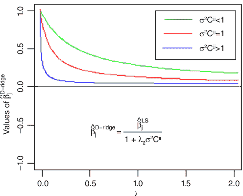

图 2.1 岭回归收缩的一阶特性

其中 \(\lambda_2\) 是岭回归调谐参数，且以展开形式，我们有

```
\(D^{R\text{-}ridge}(\beta) = \sum_{i=1}^n (y_i - x_i^\top \beta) a_n(R_{n_i}(\beta)) + \lambda_2 \beta^\top \beta.\quad (2.4.13)\)
```

惩罚秩估计 \(\hat{\beta}_n^{R\text{-}ridge}\) 是通过最小化 公式 (2.4.13) 得到的。上述描述的 LS-岭回归的所有特性同样适用于 R-岭回归。

## 2.5 示例：瑞士生育率数据集

我们现在使用一个著名的瑞士生育率数据集来展示岭回归的一些特性。数据本身在表 2.1 中给出，变量定义及其缩写在表 2.2 中给出。

该数据集表明，在包含 47 个观测值的 1888 年研究中，有五个特征可能影响生育率（F）。这五个变量的缩写为 I、Ex、Ed、A 和 C，目标是找到这五个参数的系数值或估计值以预测 F。因此，n = 47 且 p = 5。

4 该数据集是 R 环境中 datasets 包的一部分。

表 2.1 瑞士生育率数据集（F = 生育率，A = 农业，E = 考试，Ed = 教育，C = 天主教，I = 婴儿死亡率）。

| Region | F | A | Ex | Ed | C | I | Region | F | A | Ex | Ed | C | I |
|---|---|---|---|---|---|---|---|---|---|---|---|---|---|
| Courtelary | 80.20 | 17.00 | 15 | 12 | 9.96 | 22.20 | Delmont | 83.10 | 45.10 | 6 | 9 | 84.84 | 22.20 |
| Franches-Montagnes | 92.50 | 39.70 | 5 | 5 | 93.40 | 20.20 | Moutier | 85.80 | 36.50 | 12 | 7 | 33.77 | 20.30 |
| Neuveville | 76.90 | 43.50 | 17 | 15 | 5.16 | 20.60 | Porrentruy | 76.10 | 35.30 | 9 | 7 | 90.57 | 26.60 |
| Broye | 83.80 | 70.20 | 16 | 7 | 92.85 | 23.60 | Glane | 92.40 | 67.80 | 14 | 8 | 97.16 | 24.90 |
| Gruyere | 82.40 | 53.30 | 12 | 7 | 97.67 | 21.00 | Sarine | 82.90 | 45.20 | 16 | 13 | 91.38 | 24.40 |
| Veveyse | 87.10 | 64.50 | 14 | 6 | 98.61 | 24.50 | Aigle | 64.10 | 62.00 | 21 | 12 | 8.52 | 16.50 |
| Aubonne | 66.90 | 67.50 | 14 | 7 | 2.27 | 19.10 | Avenches | 68.90 | 60.70 | 19 | 12 | 4.43 | 22.70 |
| Cossonay | 61.70 | 69.30 | 22 | 5 | 2.82 | 18.70 | Echallens | 68.30 | 72.60 | 18 | 2 | 24.20 | 21.20 |
| Grandson | 71.70 | 34.00 | 17 | 8 | 3.30 | 20.00 | Lausanne | 55.70 | 19.40 | 26 | 28 | 12.11 | 20.20 |
| La Vallee | 54.30 | 15.20 | 31 | 20 | 2.15 | 10.80 | Lavaux | 65.10 | 73.00 | 19 | 9 | 2.84 | 20.00 |
| Morges | 65.50 | 59.80 | 22 | 10 | 5.23 | 18.00 | Moudon | 65.00 | 55.10 | 14 | 3 | 4.52 | 22.40 |
| Nyon | 56.60 | 50.90 | 22 | 12 | 15.14 | 16.70 | Orbe | 57.40 | 54.10 | 20 | 6 | 4.20 | 15.30 |
| Oron | 72.50 | 71.20 | 12 | 1 | 2.40 | 21.00 | Payerne | 74.20 | 58.10 | 14 | 8 | 5.23 | 23.80 |
| Pays-d'enhaut | 72.00 | 63.50 | 6 | 3 | 2.56 | 18.00 | Rolle | 60.50 | 60.80 | 16 | 10 | 7.72 | 16.30 |
| Vevey | 58.30 | 26.80 | 25 | 19 | 18.46 | 20.90 | Yverdon | 65.40 | 49.50 | 15 | 8 | 6.10 | 22.50 |
| Conthey | 75.50 | 85.90 | 3 | 2 | 99.71 | 15.10 | Entremont | 69.30 | 84.90 | 7 | 6 | 99.68 | 19.80 |
| Herens | 77.30 | 89.70 | 5 | 2 | 100.00 | 18.30 | Martigny | 70.50 | 78.20 | 12 | 6 | 98.96 | 19.40 |
| Monthey | 79.40 | 64.90 | 7 | 3 | 98.22 | 20.20 | St Maurice | 65.00 | 75.90 | 9 | 9 | 99.06 | 17.80 |
| Sierre | 92.20 | 84.60 | 3 | 3 | 99.46 | 16.30 | Sion | 79.30 | 63.10 | 13 | 13 | 96.83 | 18.10 |
| Boudry | 70.40 | 38.40 | 26 | 12 | 5.62 | 20.30 | La Chaux-de-Fonds | 65.70 | 7.70 | 29 | 11 | 13.79 | 20.50 |
| Le Locle | 72.70 | 16.70 | 22 | 13 | 11.22 | 18.90 | Neuchatel | 64.40 | 17.60 | 35 | 32 | 16.92 | 23.00 |
| Val de Ruz | 77.60 | 37.60 | 15 | 7 | 4.97 | 20.00 | Val-de-Travers | 67.60 | 18.70 | 25 | 7 | 8.65 | 19.50 |
| V. De Geneve | 35.00 | 1.20 | 37 | 53 | 42.34 | 18.00 | Rive Droite | 44.70 | 46.60 | 16 | 29 | 50.43 | 18.20 |
| Rive Gauche | 42.80 | 27.70 | 22 | 29 | 58.33 | 19.30 | | | | | | |

| 特征 | 符号 | 含义 |
|---|---|---|
| 区域 | R | 1888 年瑞士法语区省份 |
| 生育率 | F | 即，“通用标准化生育度量” |
| 农业 | A | 从事农业作为职业的男性百分比 |
| 考试 | Ex | 获得军队考试最高分的征兵百分比 |
| 教育 | Ed | 征兵中接受初等教育以上教育的百分比 |
| 天主教 | C | 自称“天主教”（相对于“新教”）的百分比 |
| 婴儿死亡率 | I | 活产婴儿中存活不足 1 年的比例 |

| 特征 | \(\hat{\beta}_n^{LS}\) | s.e.(\(\hat{\beta}_n^{LS}\)) | \(\hat{\beta}_n^{R}\) | s.e.(\(\hat{\beta}_n^{R}\)) |
|---|---|---|---|---|
| 截距 (\(\beta_0\)) | 66.92 | 10.706 | 66.43 | 10.518 |
| 农业 (\(\beta_1\)) | –0.17 | 0.070 | –0.20 | 0.069 |
| 考试 (\(\beta_2\)) | –0.26 | 0.253 | –0.26 | 0.249 |
| 教育 (\(\beta_3\)) | –0.87 | 0.183 | –0.89 | 0.179 |
| 天主教 (\(\beta_4\)) | 0.10 | 0.035 | 0.11 | 0.034 |
| 婴儿死亡率 (\(\beta_5\)) | 1.08 | 0.381 | 1.20 | 0.375 |

目标是使用岭回归为 LS 和 秩 创建一个适合预测的模型。本书将进一步使用此数据集，因此鼓励读者熟悉它，并完成本章中提供的示例以巩固所呈现的材料。

首先需要注意的是，表 2.1 中的所有数据都在 0–100 范围内，因此缩放并非必要，且估计值可以相对合理地解释。通常，我们需要缩放数据以使列具有相同的标准差（通常设为 1），如后文所述。这里我们跳过该步骤。

### 2.5.1 估计与标准误

在处理数据之前，我们选择了一个异常值数量未知的数据集，但我们打算计算 LS 和秩估计值，然后确定实际存在多少个异常值。

要获得 LSE，我们首先对数据进行中心化，包括设计矩阵（由 A、Ex、Ed、C 和 I 列组成）和响应（F 列）。然后我们使用 公式 (2.3.7) 获得估计值。对于 LSE 的标准误，我们可以先计算 \(\hat{\sigma}^2 = \text{SSE}/(n-p) = 50.1\) 的值，注意 SSE 来自 公式 (2.3.11)。然后我们应用 公式 (2.3.8) 和 公式 (2.3.10) 获得 s.e. 我们可以从 \(\mathbf{y}\) 和 \(\mathbf{X}$ 的 *未中心化数据* 中获取 LS 截距，称为 \(\beta_0\) 或 \(\theta_n\)：

\(\hat{\theta}_n^{LS} = \frac{1}{n} \sum_{i=1}^n (y_i - \mathbf{x}_i^{T} \hat{\beta}_n^{LS}).\) (2.5.1)

对于 R-估计，在估计之前无需对数据进行中心化。我们只需最小化 (2.3.12) 以获得参数，并使用 (2.3.13) 获得 s.e.，其中 \(\hat{\eta}^2 = 49.0\)。秩截距可以使用 \(\mathbf{y}\) 和 \(\mathbf{X}$ 原始未中心化数据的残差中位数来获得

\(\hat{\theta}_n^R = \text{median}_{1 \le i \le n} (y_i - \mathbf{x}_i^{T} \hat{\beta}_n^R).\) (2.5.2)

LSE 和秩方法的参数值在表 2.3 中给出。我们发现 LSE 和秩结果相似，无论是估计值还是标准误（s.e.），这暗示没有异常值。然而，检查残差的 Q-Q 图显示有两个异常值，每个尾部各一个，如图 2.2 所示。

5 这些结果通过 R 中的 lm() 用于 LSE 和 rfit() 用于 R-估计获得。

虽然 LS 和 秩 产生的结果大致相似，但这并不意味着数据中没有异常值，如 Q-Q 图中 ($-2.5, -2.5$) 和 ($2.5, 2.5$) 附近所示。因此，当 LS 和秩估计相似时，不能简单地假设没有异常值。在解释两个估计器的结果时，我们应牢记这一点。已知的是，在这种平衡场景中，两个估计器是等价的。当然，任何一侧尾部异常值数量的不平衡都可能导致不同的 LS 和秩估计。无论如何，我们将首先研究这种平衡异常值情况，预期性能相似，然后再使用不同的数据集考察不平衡情况。

### 2.5.2 使用自助法的参数方差

我们请读者注意表 2.3 中的标准误列。众所周知，这些值量化了估计中的不确定性。如果我们对标准误进行平方，则得到每个参数的估计方差。我们可以通过多次对给定数据集进行采样，然后为每个样本计算估计值，更具体地说明这一点。也就是说，我们可以使用自助法创建估计的采样分布


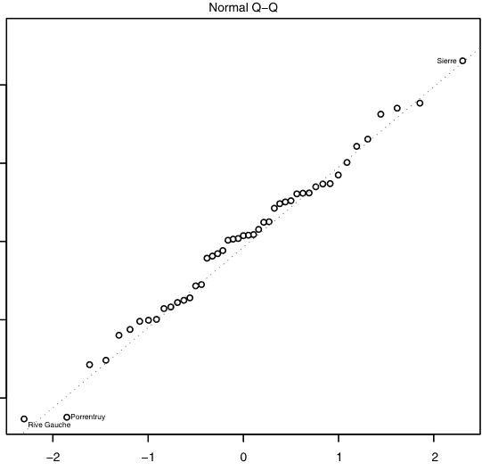

图 2.2 瑞士数据集 Q–Q 图中检测到的两个离群点。这是残差百分位数（点）与标准正态分布（线）的对比图。

（James et al., 2013）。该数据集包含 47 个观测值。我们随机抽取观测值（有放回抽样）以创建包含 47 个观测值的新数据集，这意味着我们的合成数据集中可能存在重复观测值。随后，我们计算估计值并多次重复此过程以生成参数分布。图 2.3 展示了以这种方式对数据集采样后的 LS 估计分布。每个分布的均值即为无偏估计值。估计值围绕均值的离散程度反映了方差。我们注意到，β2、β3 和 β5 具有较大的方差，这与表 2.3 一致。此外，β0 也具有较大的方差，但我们不会对其应用岭惩罚；仅 β1 ... β5 会受到惩罚，因为它们直接与响应变量相关。事实上，我们将对数据进行中心化处理，以便在应用岭回归时甚至不计算截距。

### 2.5.3 使用脊回归减小方差

为了减小方差，我们可以应用岭回归。直观地观察某个参数及其方差的收缩过程非常有用，如图 2.4 所示（包含嵌入箱线图）。该图由

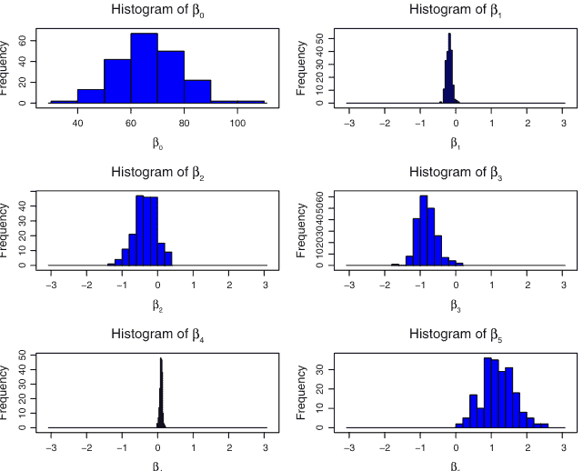

图 2.3 秩估计的抽样分布。

通过对等式 (2.4.6) 的岭权重矩阵，并将调参数 \(\lambda_2\) 按量级逐步增大而生成。选取的值为 1、10、100 和 1000。可以观察到，LS-ridge 对 \(\beta_5\) 的效果是：样本均值向零收缩，而自助法样本方差也随之减小。这种情况对所有其他参数以不同速率发生，并且对 LS 和秩 方法均适用。

### 2.5.4 脊迹

了解当我们变化 \(\lambda_2\) 时每个参数会发生什么是很有启发性的。随着 \(\lambda_2\) 的增大，估计值往往会减小，但具体如何减小则不容易预测。本节将考察所谓的岭迹，即将估计值作为 \(\log(\lambda_2)\) 的函数进行绘制。通常，将估计值作为 \(\lambda_2\) 的函数进行绘制不如作为 \(\log(\lambda_2)\) 的函数具有说明性，因为收缩发生在很大的尺度上。在本章及其他章节中，我们将使用迹线来说明惩罚估计器的许多特性和性质。我们使用岭回归来介绍迹线及其含义。

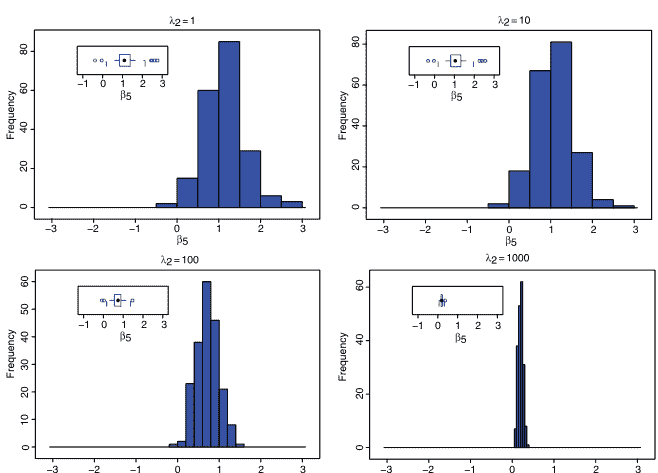

**图 2.4** 由于岭调参数 \(\lambda_2\) 增大导致的 \(\beta_5\) 收缩。

对于给定的迹线，我们需要构建 \(m\) 个模型，每个选定的 \(\lambda_2\) 对应一个模型。此前，我们考虑了三个不同的等式，其中 \(\mathbf{C}^{-1}\) 分别是等式 (2.4.7) 中的标准正交矩阵、等式 (2.4.10) 中的对角矩阵以及等式 (2.4.6) 中的全矩阵。图 2.5 分别展示了 O-ridge、D-ridge 和 LS-ridge 的情况。此外，还提供了使用等式 (2.4.12) 的 R-ridge 迹线。它们在收缩行为上各有不同，这使我们对其固有特性有所了解。这里值得提及两点重要内容。首先，如果我们选取与特定 \(\lambda_2\) 值关联的任意垂直线，该直线与曲线的交点将给出受惩罚的估计值。我们应当注意，某个特定的 \(\lambda_2\) 值并没有什么神奇之处。它取决于与相应估计器关联的数值尺度。\(\lambda_2\) 的低值或高值本身并无特定含义。其次，岭迹在理论上不会达到 0，除非 \(\lambda = \infty\)，尽管许多迹线看起来在更早的值处即达到 0。当我们讨论 LASSO 迹线时，这一点将变得更加有意义。

有趣的是，标准正交情况展示了岭回归的基本收缩操作。我们看到图 2.5 左上角的所有五个变量以相同的速率趋向于零，因为它们的衰减仅由 \(1/(1 + \lambda_2)\) 控制。对角情况则更有趣，因为其轨迹

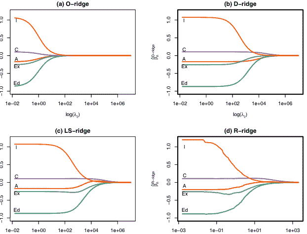

图 2.5 正交、对角、LS 和秩 估计器的岭迹（m = 40）。

受 $1/(1+\lambda_2 C^{JJ})$ 控制。请注意，图 2.5 右上角更接近于分别显示在两个底部面板中的准确 LS-ridge 和 R-ridge 图。这验证了等式所表明的内容，即 $C^{JJ}$ 控制迹线的大部分特征。对角迹线仅捕捉每个参数的 *不相关轨迹*，因此迹线单调地趋向于零而从不穿过零。全岭迹线的行为可能不具有单调性，可能穿过零并改变符号。尽管如此，对角情况仍让我们了解迹线的本质。事实上，正交和对角情况本身就是简单但有效的惩罚估计器（cf. Saleh et al., 2019）。

LS-ridge 和 R-ridge 的迹线说明了这两种情况之间的差异。在 R-ridge 情况中，变量 $Ex$ 明显呈非单调性，但在 LS-ridge 情况中则不那么明显。两条迹线的主要差异沿 \(\log(\lambda_2)\)-轴，这是由于每种方法的未受惩罚损失函数不同。对其中一条进行简单的前向或后向平移就能使它们对齐。一般来说，在没有离群点时，LS 和秩 岭迹的形状可能略有差异，但在存在离群点时差异会更加明显。

## 2.6 脊参数 \(\lambda_2\) 的选择

自然会出现关于如何设定 \(\lambda_2$ 的适当值，以及在缩减估计值及其方差时权衡的本质的问题。简而言之，我们正在权衡偏差与方差（即欠拟合与过拟合），\(\lambda_2$ 的适当值取决于我们对模型预测性能的期望。我们将在 LS 的背景下深入探讨每个问题，这与秩 方法类似。请注意，最优 \(\lambda_2$ 值是特定于某个估计器的，通常无法在估计器之间进行比较或转移。此外，最优 \(\lambda_2$ 在实践中通常位于一个值域内，而不是一个唯一值。

### 2.6.1 二次风险

我们首先描述臭名昭著的 *偏差-方差权衡*，这是选择最优 \(\lambda_2$ 的核心。我们知道方差的含义——与估计值相关的不确定程度。偏差的一个工作定义是给定估计器 \(\mathbb{E}(\hat{\boldsymbol{\beta}}_n)$ 的期望值与真值 \(\boldsymbol{\beta}$ 之间的差异。如果 \(\mathbb{E}(\hat{\boldsymbol{\beta}}_n) = \boldsymbol{\beta}$，则称该估计器为无偏估计器。当我们减小方差时，往往会增加偏差。我们通过选择适当的 \(\lambda_2$ 来寻求两者的平衡。

众所周知，LSE 提供了一组线性无偏估计中的最小方差，因此看似我们无法对其进行改进。然而，如果变量之间存在强相关性，即设计矩阵的列之间存在一定的多重共线性，方差可能仍然相当大。通过应用惩罚函数，我们会增加偏差并减小方差，直到估计值最小化某个给定统计量。

考虑使用均方误差（MSE）（Montgomery et al., 2012），也称为二次风险（以及第 3 章中的 ADL\(_2\)-风险），以寻找最优 \(\lambda_2$ 来平衡偏差和方差。估计值的 MSE 由以下公式给出：

```
MSE(\hat{\boldsymbol{\beta}}_n^{\text{LS-ridge}}) = \text{tr}(\text{Var}(\hat{\boldsymbol{\beta}}_n^{\text{LS-ridge}})) + \text{bias}^2(\hat{\boldsymbol{\beta}}_n^{\text{LS-ridge}})
```

其中 tr(\(\boldsymbol{M}$) 是某个矩阵 \(\boldsymbol{M}$ 的迹，即将 \(\boldsymbol{M}$ 的对角元素相加，并令 bias\(^2(\hat{\boldsymbol{\beta}}_n^{\text{LS-ridge}}) = \text{bias}^\top(\hat{\boldsymbol{\beta}}_n^{\text{LS-ridge}})\text{bias}(\hat{\boldsymbol{\beta}}_n^{\text{LS-ridge}})$。LS-ridge 的偏差和方差公式如下：

```
bias^2(\hat{\boldsymbol{\beta}}_n^{\text{LS-ridge}}) = \lambda_2^2 \boldsymbol{\beta}^\top (\mathbf{X}^\top \mathbf{X} + \lambda_2 \mathbf{I}_p)^{-2} \boldsymbol{\beta},
```


是一个标量，且

$$
\text{Var}(\hat{\boldsymbol{\beta}}_n^{\text{LS-ridge}}) = \sigma^2(\mathbf{X}^\top\mathbf{X} + \lambda_2\mathbf{I}_p)^{-1}(\mathbf{X}^\top\mathbf{X})(\mathbf{X}^\top\mathbf{X} + \lambda_2\mathbf{I}_p)^{-1}, \quad (2.6.3)
$$

是一个矩阵量（其中取迹），分别。

上述表达式笨拙且难以获得任何理解。为了简化分析并培养直觉，令 \(\mathbf{X}^\top\mathbf{X} = \mathbf{I}_p\)。这得到

$$
\text{bias}^2(\hat{\boldsymbol{\beta}}_n^{\text{LS-ridge}}) = \frac{\lambda_2^2}{(1+\lambda_2)^2}\boldsymbol{\beta}^\top\boldsymbol{\beta}, \quad (2.6.4)
$$

和

$$
\text{tr}(\text{Var}(\hat{\boldsymbol{\beta}}_n^{\text{LS-ridge}})) = \frac{p\sigma^2}{(1+\lambda_2)^2}. \quad (2.6.5)
$$

因此，二次风险由以下给出

$$
\text{MSE}(\hat{\boldsymbol{\beta}}_n^{\text{LS-ridge}}) \approx \frac{p\sigma^2}{(1+\lambda_2)^2} + \frac{\lambda_2^2}{(1+\lambda_2)^2}\boldsymbol{\beta}^\top\boldsymbol{\beta}. \quad (2.6.6)
$$

我们可以看到，如果 \(\lambda_2 = 0\)，则偏差为零，方差由 \(p\sigma^2\) 给出。试图强制偏差为零可能不会导致可取的估计器，因为存在大方差的可能性。事实上，随着 \(\lambda_2\) 增加，偏差增加而方差减少。当 \(\lambda_2 \rightarrow \infty\) 时，方差趋近于零，而偏差收敛于 \(\boldsymbol{\beta}^\top\boldsymbol{\beta}\)，前提是该量是有限的。这种情况也是不可取的，因为偏差现在很大。因此，\(\lambda_2\) 的最优选择是在足够偏差以避免过拟合和足够方差以避免欠拟合之间取得平衡。我们的目标变成寻找最小化二次风险的最优值 \(\lambda_{2(\text{opt})}\)。

为了获得正交情况下的最优 \(\lambda_2\)，我们对公式 (2.6.6) 关于 \(\lambda_2\) 求偏导并令其为零。求解 \(\lambda_2\)，我们得到

$$
\lambda_{2(\text{opt})}^O = \frac{p\sigma^2}{\boldsymbol{\beta}^\top\boldsymbol{\beta}}. \quad (2.6.7)
$$

对于瑞士数据集，假设 \(\hat{\boldsymbol{\beta}}_n^{\text{LS}}\) 是无偏估计值，\(p = 5\) 且 \(\hat{\sigma}^2 = 50.1\)。那么，最优 \(\lambda_2\) 的近似值为

$$
\hat{\lambda}_{2(\text{opt})}^O = \frac{p\hat{\sigma}^2}{(\hat{\boldsymbol{\beta}}^{\text{LS}})^\top\hat{\boldsymbol{\beta}}^{\text{LS}}} = 123.7.
$$

如果我们检查图 2.5，我们会在底部左侧标记为 LS-ridge 的面板中于 \(\lambda_2 = 123.7\) 处放置一条垂直线以获取岭估计值。然而，我们不应过分重视此结果，因为假设不现实；但它确实说明了如何使用最优 \(\lambda_2\) 的关键要点。

为了获得略微更精确的 \(\lambda_{2(\text{opt})}\)，假设 \((\mathbf{X}^\top\mathbf{X})^{-1}\) 是一个对角线项为 \(C^{jj}\)、\(j=1, \dots, p\) 的对角矩阵。在这种情况下，二次风险为

$$
\text{MSE}(\hat{\beta}_n^{\text{LS-ridge}}) = \sum_{j=1}^p \frac{\sigma^2 C^{jj}}{(1 + \lambda_2 C^{jj})^2} + \sum_{j=1}^p \frac{\lambda_2^2 \beta_j^2 (C^{jj})^2}{(1 + \lambda_2 C^{jj})^2}. \quad (2.6.8)
$$

如果我们对公式 (2.6.8) 关于 \(\lambda_2\) 求偏导并令其为零，我们可以确定其最优值。

$$
\frac{\partial \text{MSE}(\hat{\beta}_n^{\text{LS-ridge}})}{\partial \lambda_2} = 2 \sum_{j=1}^p \frac{(C^{jj})^2}{(1 + \lambda_2 C^{jj})^3} (\lambda_2 \beta_j^2 - \sigma^2) = 0. \quad (2.6.9)
$$

不幸的是，该方程没有封闭式解。我们可以数值求解或绘制图形以估计 \(\lambda_{2(\text{opt})}\)。再次假设我们已得到 \(\hat{\beta}_n^{\text{LS}}\)、\(\mathbf{C}^{-1}\) 和 \(\hat{\sigma}^2\)。然后我们可以将这些值应用到上述方程中。我们在图 2.6 中绘制了 MSE 及其导数。在 MSE 图中，我们观察到偏差-方差权衡的效果，因为随着参数收缩（及方差减小），函数值降低，但随后达到最小值然后增加（随着偏差增加）。最优值似乎是 \(\hat{\lambda}_{2(\text{opt})}^I = 77.8\)。这既是 MSE 图的最小值，也是导数图的零交叉点。请注意，岭估计器并不总是优于 LS。我们指示岭产生比 LS 更低 MSE 的范围。特别是，如果 \(\lambda_2 < 1268.0\)，LS-ridge 将优于 LSE。超过这一点，使用无惩罚最小二乘估计更好。

我们现在考虑在瑞士数据集上使用完整的公式 (2.6.1)—(2.6.3) 来求得最优 \(\lambda_2\)。我们已绘制偏差平方、方差矩阵的迹以及得到的估计 MSE 的结果。如图 2.7 所示。我们看到，当 \(\lambda_2 = 0\) 时偏差最初为零且方差较大。随着 \(\lambda_2\) 增加，方差下降而偏差增加，最终偏差决定 MSE。在两个极端之间，MSE 在 \(\hat{\lambda}_{2(\text{opt})} = 70.8\) 处达到最小值，该值接近使用 MSE 方程的对角近似得到的值。我们现在可以将此值带回图 2.5，并在该值处在 LS-ridge 图中绘制一条垂直线。通过最小化二次风险得到的、\(\hat{\lambda}_{2(\text{opt})} = 70.8\) 的结果 LS-ridge 估计为

$$
\hat{\beta}_n^{\text{LS-ridge}} = (A = -0.17, Ex = -0.27, Ed = -0.86, C = 0.11, I = 0.91)^\top.
$$

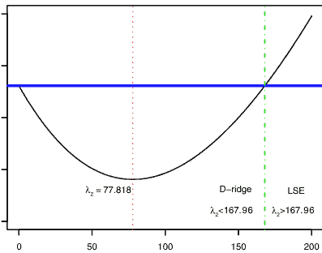

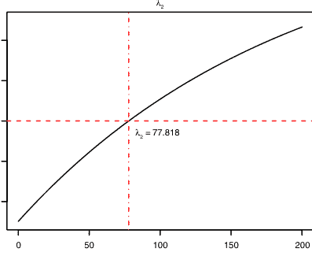

图 2.6 对角情况下寻找最优 \(\lambda_2\) 的 MSE 导数图。

### 2.6.2 K-折交叉验证方案

在机器学习应用中，我们不按前一节所述方式计算最优 \(\lambda_2\)。相反，使用交叉验证方案来生成适合预测的估计值。如果我们的目标是生成泛化模型，那么我们应该以反映这一目标的方式使用数据集。给定一个数据集，我们首先将其分为训练集和测试集（我们将其视为“不可见”或“保留”测试集）。测试集不能用于选择 \(\lambda_2\)，但可用于评估我们的最终预测准确性。我们不希望无意中将 \(\lambda_2\) 调整到这个特定测试集，因为预测准确性可能无法推广到其他测试集。相反，通常将训练集进一步细分为 \(K\) 个不相交的集合，称为交叉验证集或“折”，如下文所述。这些集合将用于选择最优 \(\lambda_2\)。

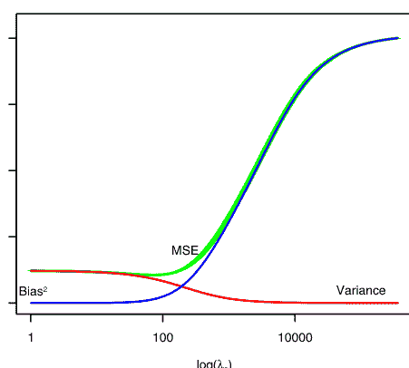

图 2.7 瑞士数据集的偏差、方差和 MSE（最优 \(\lambda_2 = 70.8\)）。

我们现在描述在若干折上运行的交叉验证（CV）方案。我们首先将训练集细分为，比如说，五个较小的训练和测试集，即五个折。对于每个 \(\lambda_2\) 值，五个较小训练集的估计被用于按如下方式计算它们各自关联的五个较小测试集上的平均平方预测误差（MSE）<sup>6</sup>，即平均平方残差误差，

$$
\text{MSE}^{(j)} = \frac{1}{n} \sum_{i=1}^n (y_i - (\hat{\theta}_n^{(j)} + \boldsymbol{x}_i^\top \hat{\boldsymbol{\beta}}_n^{(j)}))^2 \quad j=1, \dots, 5 \quad (2.6.10)
$$

其中 \(\hat{\theta}_n^{(j)}\) 和 \(\hat{\boldsymbol{\beta}}_n^{(j)}\) 是第 \(j\) 折的估计。我们对五个折平均 \(\text{MSE}^{(j)}\)。接下来，我们扫描 \(\lambda_2\) 并对多个不同的 \(\lambda_2\) 值重复该过程。最后，我们选择在交叉验证期间使用的所有选定 \(\lambda_2\) 值中使平均 MSE 最小的 \(\lambda_2\)。残差 MSE 是一个有用的统计量，因为一旦在交叉验证期间获得平均估计，就可以轻松地为任何数据集计算它。

上述方法称为 K-折交叉验证方案，在此例中 \(K=5\)。通常 \(K=5\) 或 \(K=10\)，取决于数据集的大小。特别是，让我们说明确定 \(\lambda_{2(\text{opt})}\) 的程序，但这次是针对 R-ridge 情况。在我们当前的瑞士数据集中，\(\boldsymbol{X}\) 中有 \(n=47\) 行，


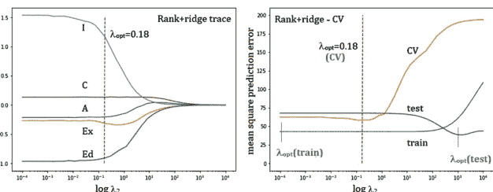

图 2.8 训练集、交叉验证（CV）集和测试集的 MSE，以及岭迹中的系数。

因此，我们将留出 12 行作为我们的“不可见”测试集，并使用 35 行作为训练集。然后，我们将这剩下的 35 行训练集随机分成五个子集，每个子集 7 行。接下来，我们“保留” 7 行作为交叉验证（CV）测试集，同时使用剩下的 28 行作为 CV 训练集来确定估计值。这个过程可以重复五次，产生五个不同的估计值。这些估计值分别用于在 7 行的 CV 测试集上进行预测以计算 MSE。在不同的 CV 集上重复这个过程五次即为五折交叉验证程序，我们将得到五个 MSE 值并求其平均值。这个五折程序针对我们从 \(10^{-4}\) 到 \(10^4\) 扫描的每个 \(\lambda_2\) 重复。最后，我们可以选择为五折交叉验证集提供最低平均 MSE 的 \(\lambda_2\)。

这是用于生成图 2.8 的精确程序，其中我们将 R-岭迹与 CV 结果并置。R-岭迹是每个折叠中估计值的平均值。这就是为什么 \(\lambda_2 = 0\) 的估计值与原始 R 估计值不同的原因。它们是使用 CV 训练子集（折叠）而非整个数据集的结果。对于右侧面板，最优值 \(\hat{\lambda}_{2(\text{opt})} \approx 0.18\) 是为了最小化 CV 误差而非训练误差或测试误差或二次风险而选择的。随着 \(\lambda_2\) 的增加，训练 MSE 始终增加，而测试 MSE 通常不可用，因此我们基于五折交叉验证集进行优化。如果我们针对测试集进行优化，将会选择一个更大的 \(\lambda_{2(\text{opt})(\text{test})}\) 值，该值将无法推广到更广泛的测试数据集。

\(\hat{\beta}_n^{\text{R-ridge}} = (A = -0.20, Ex = -0.29, Ed = -0.92, C = 0.12, I = 1.20)^{\top}\)。

我们已经知道整个数据集的无偏估计值，因为它们之前在表 2.3 中报告过。这与原始秩估计值很接近，区别在于它是从总数据集的一部分（训练部分）而非整个数据集中得出的。

## 2.7 LASSO 和 aLASSO

### 2.7.1 子集选择

我们现在将注意力转向子集选择。生成一个使用最少变量但仍保持高预测准确性的模型很重要。这是因为如果模型中包含大量变量，残差方差也可能很大。为了理解这一点，请考虑 LS 估计的估计残差方差，其公式为

\(\hat{\sigma}^2 = \frac{1}{n-p}(\mathbf{y} - \mathbf{X}\hat{\boldsymbol{\beta}}_n^{LS})^T(\mathbf{y} - \mathbf{X}\hat{\boldsymbol{\beta}}_n^{LS}).\) (2.7.1)

当 \(p\) 趋近于 \(n\) 时，方差趋于无穷大。实际上，我们面临另一个涉及模型中变量数量的偏差-方差权衡（有时称为模型的复杂度）。如果变量太多，我们有过度拟合数据集的风险，这会导致高方差。如果变量太少，我们有欠拟合的风险，这会造成高偏差情况。我们的下一个目标是通过子集选择寻找最优变量数量 \(p_o < p\)。

我们在前一章中已将子集选择描述为在保持所需预测准确性的同时减小模型大小的一种方法。LASSO 基于 L1 惩罚函数同时提供收缩和子集选择。它在正则化过程中将某些参数值设为零，这些参数可能从初始集合中移除。LASSO 通过合适的调参选择来执行子集选择。为了理解 LASSO 的本质，我们首先推导方程，然后在不同假设下研究其性质。

### 2.7.2 带 LASSO 的最小二乘法

应用于二次损失函数的 LASSO 惩罚项由以下公式给出

\(J^{LS-LASSO}(\boldsymbol{\beta}) = (\mathbf{y} - \mathbf{X}\boldsymbol{\beta})^\top(\mathbf{y} - \mathbf{X}\boldsymbol{\beta}) + 2\lambda \sum_{j=1}^P |\beta_j|,\) (2.7.2)

我们可以将其重写为

\(J^{LS-LASSO}(\boldsymbol{\beta}) = (\mathbf{y} - \mathbf{X}\boldsymbol{\beta})^\top(\mathbf{y} - \mathbf{X}\boldsymbol{\beta}) + 2\lambda \mathbf{1}_p^\top |\boldsymbol{\beta}|,\) (2.7.3)

其中 \(|\boldsymbol{\beta}| = (|\beta_1|, \dots, |\beta_p|)^\top\)，\(\mathbf{1}_p = (1, \dots, 1)^\top\) 是一个由 1 组成的 \(p\) 元组。

为了获得 LASSO 估计值，我们对 $J^{\text{LS-LASSO}}(\boldsymbol{\beta})$ 关于 $\boldsymbol{\beta}$ 求导并令其等于 0，即

$$\frac{\partial J^{\text{LS-LASSO}}(\boldsymbol{\beta})}{\partial \boldsymbol{\beta}} = -2\mathbf{X}^{\top}(\mathbf{y} - \mathbf{X}\boldsymbol{\beta}) + 2\lambda \text{sgn}(\boldsymbol{\beta}) = 0.$$ (2.7.4)

由此可得

$$-2\mathbf{X}^{\top}\mathbf{y} + 2\mathbf{X}^{\top}\mathbf{X}\boldsymbol{\beta} + 2\lambda \text{sgn}(\boldsymbol{\beta}) = 0.$$ (2.7.5)

左乘 $(\mathbf{X}^{\top}\mathbf{X})^{-1}$ 并重排后，我们得到一个关于 $\hat{\boldsymbol{\beta}}_n^{\text{LS}}$ 和 $\hat{\boldsymbol{\beta}}_n^{\text{LS-LASSO}}$ 的方程，进而得到

$$-\hat{\boldsymbol{\beta}}_n^{\text{LS}} + \hat{\boldsymbol{\beta}}_n^{\text{LS-LASSO}} + \lambda \mathbf{C}^{-1} \text{sgn}(\hat{\boldsymbol{\beta}}_n^{\text{LS-LASSO}}) = 0,$$ (2.7.6)

其中 $\mathbf{C}^{-1} = (\mathbf{X}^{\top}\mathbf{X})^{-1}$。应用 LASSO 时，矩阵 $\mathbf{C}^{-1}$ 不必是满秩的。事实上，LASSO 以类似于岭回归的方式解决多重共线性问题。但在此处我们假设它是可逆的。

然后，我们得到以下方程。

$$\hat{\boldsymbol{\beta}}_n^{\text{LS-LASSO}} = \hat{\boldsymbol{\beta}}_n^{\text{LS}} + \lambda \mathbf{C}^{-1} \text{sgn}(\hat{\boldsymbol{\beta}}_n^{\text{LS-LASSO}}).$$ (2.7.7)

无法为 $\hat{\boldsymbol{\beta}}_n^{\text{LS-LASSO}}$ 求得闭式解，但做一些简化假设有助于了解 LASSO 的运作方式。

如果我们假设 $\mathbf{C}^{-1}$ 是单位矩阵（正交归一化情况），则方程变为

$$\hat{\boldsymbol{\beta}}_n^{\text{O-LASSO}} = \hat{\boldsymbol{\beta}}_n^{\text{LS}} + \lambda \text{sgn}(\hat{\boldsymbol{\beta}}_n^{\text{O-LASSO}}),$$ (2.7.8)

其中 $\hat{\boldsymbol{\beta}}_n^{\text{O-LASSO}}$ 是正交归一化情况下的 LASSO 估计值。通过研究上述需要考虑的不同情况，我们可以为每个 $\beta_j$ 将解紧凑地表示为

$$\hat{\beta}_j^{\text{O-LASSO}} = \text{sgn}(\hat{\beta}_j^{\text{LS}})(|\hat{\beta}_j^{\text{LS}}| - \lambda)^+.$$ (2.7.9)

记号 $(\cdot)^+$ 表示括号内的量仅在变为负数时才设为零。本质上，我们从 $|\hat{\beta}_j^{\text{LS}}|$ 中减去 $\lambda$ 以在正交归一化情况下得到 LASSO 收缩。收缩对 $\lambda$ 是线性的，直到达到零为止，所有参数都以 $\lambda$ 给定的相同速率收缩。

如果我们现在假设 $\mathbf{C}^{-1}$ 是一个对角线元素为 $C^{jj}, j = 1, \dots, p$ 的对角矩阵，这意味着变量之间无相关性。对于这种情况，我们可以按如下方式重写 LASSO 方程（参见 Saleh et al., 2019，第 5 章），

\(\hat{\beta}_j^{\text{D-LASSO}} = \text{sgn}(\hat{\beta}_j^{\text{LS}})(|\hat{\beta}_j^{\text{LS}}| - \lambda C^{jj})^+,\quad (2.7.10)\)

其中 \(\hat{\beta}_j^{\text{D-LASSO}}\) 是对角 \(C^{-1}\) 情况下的 LASSO 估计值。注意 \(\lambda\) 仅仅是一个调参，我们可以定义 \(\lambda = \lambda_1 \sigma^2\)。那么我们可以写成

\(\hat{\beta}_j^{\text{D-LASSO}} = \text{sgn}(\hat{\beta}_j^{\text{LS}})(|\hat{\beta}_j^{\text{LS}}| - \lambda_1 \sigma^2 C^{jj})^+,\quad (2.7.11)\)

或等价地，

\(\hat{\beta}_j^{\text{D-LASSO}} = \text{sgn}(\hat{\beta}_j^{\text{LS}})(|\hat{\beta}_j^{\text{LS}}| - \lambda_1 \text{Var}(\hat{\beta}_j^{\text{LS}}))^+.\) (2.7.12)

直线的斜率，即估计值达到 0 的速度，由每个 \(\hat{\beta}_j^{\text{LS}}\) 的方差控制。这种一阶分析有助于建立对 LASSO 收缩本质的直觉。在对角情况下，变量移除（即子集选择）由 \(\text{Var}(\hat{\beta}_j^{\text{LS}}) = \sigma^2 C^{jj}\) 决定。估计值达到 0 的点，即每条迹线的所谓“零交叉点”，出现在 \(\lambda_{1,j}^0 = |\hat{\beta}_j^{\text{LS}}| / \text{Var}(\hat{\beta}_j^{\text{LS}})\) 处。这告诉我们，较大的 \(\hat{\beta}_j^{\text{LS}}\) 和较小的方差会导致在较高的 \(\lambda_1\) 值处出现零交叉点。较小的 \(\hat{\beta}_j^{\text{LS}}\) 和较大的方差会导致在较低的 \(\lambda_1\) 值处出现零交叉点。这一含义非常重要。这意味着 \(\hat{\beta}_j^{\text{D-LASSO}}\) 值达到 0 的顺序与 \(|\hat{\beta}_j^{\text{LS}}|\) 及其方差的比值有关，或者更准确地说，与由 Eq. (2.7.7) 中的 \(C^{-1}\) 矩阵给出的每个参数的方差和协方差有关。

考虑图 2.9 中所示的某个特定参数的情况。随着 \(\lambda_1\) 增加，\(\hat{\beta}_j^{\text{LS}} = 1.0\) 以由 \(\hat{\beta}_j^{\text{LS}}\) 方差决定的线性速率收缩，从而产生 \(\hat{\beta}_j^{\text{D-LASSO}}\)。我们展示了 Eq. (2.7.12) 的以下情况：

- (a) 如果 \(\sigma^2 C^{jj}\) 非常小，即远小于 1，则随着 \(\lambda_1\) 增加，\(\hat{\beta}_j^{\text{D-LASSO}}\) 将逐渐线性下降。
- (b) 如果 \(\sigma^2 C^{jj}\) 非常大，即远大于 1，则随着 \(\lambda_1\) 增加，\(\hat{\beta}_j^{\text{D-LASSO}}\) 将快速线性地减小到零。
- (c) \(\sigma^2 C^{jj} \approx 1\) 的中等值将介于其他两种情况之间。

请注意，由于方差不同，所有三条线在不同点达到 0。

## 2.7.3 自适应 LASSO 及其几何解释

虽然 LASSO 能够执行子集选择，但它缺乏一个关键属性——神谕属性。也就是说，LASSO 的零交叉顺序很有趣，但它并未告诉我们每个 \(\beta_j\) 的重要性。然而，这一问题已由 Zou (2006) 在自适应 LASSO（aLASSO）方法中得到解决。Johnson 和 Peng (2008) 对基于秩的变量选择进行了出色的比较。


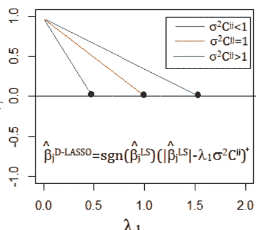

图 2.9 由于拉索导致的收缩的一阶性质。

为了将甲骨文特性引入最小二乘回归，罚函数中引入了一个权重，如下所示

$J^{LS-aLASSO}(\beta) = (y - X\beta)^T(y - X\beta) + \lambda_1 \sum_{j=1}^p w_j |\beta_j|.$ (2.7.13)

各个权重 \(w_j\) 对每个参数的影响可以在图 2.10 的几何解释中看到。权重有效地将拉索中的对称菱形重塑为自适应拉索中的非对称菱形（图 2.10）。非对称性是由于权重的差异造成的。在图 2.9 的拉索情况下，从 “x” 开始的轨迹可以到达 \(\beta_1 = 0\) 或 \(\beta_2 = 0\)，因为菱形是对称的。然而，假设图 2.10 的几何形状，自适应拉索可能会先到达 \(\beta_2 = 0\) 角，即最近的角。然后，非对称菱形会继续按 \(\lambda_1 > 0\) 和 \(\lambda_2 > \lambda_1\) 等所示的方式收缩，最终在 \(\lambda = \infty\) 前或时到达 \(\beta_1 = 0\)。这个序列意味着 \(\beta_1\) 比 \(\beta_2\) 更重要，因为自适应拉索先将 \(\beta_2\) 设为 0（即因为它不那么重要）。自适应拉索轨迹捕捉了每个参数的实际轨迹。特别是，自适应拉索轨迹中参数的零交叉顺序是这种甲骨文罚函数的一个关键特征，我们将在本章进一步探讨这一点，并在后续章节中更详细地讨论。

将甲骨文特性纳入的方法需要对权重进行合适的选择。Zou (2006) 提出使用 \(w_j = 1/|\hat{\beta}_j^{LS}|\)，这确实提供了备受期望的甲骨文特性。我们在此规定，

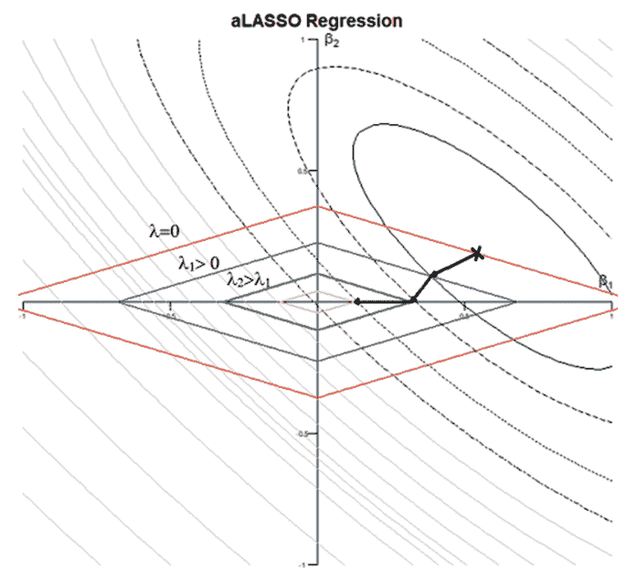

图 2.10 对于 \( p = 2 \) 的自适应拉索估计器中权重的菱形畸变效应。

LS（或秩）估计必须事先已知，但假设不存在多重共线性，这并非苛刻要求。在此情况下，自适应拉索的损失函数由下式给出

\( J^{\text{LS-aLASSO}}(\boldsymbol{\beta}) = (\mathbf{y} - \mathbf{X}\boldsymbol{\beta})^{\top}(\mathbf{y} - \mathbf{X}\boldsymbol{\beta}) + 2\lambda \sum_{j=1}^p \frac{|\beta_j|}{|\hat{\beta}_j^{\text{LS}}|}, \) \(\text{(2.7.14)}\)

其中每个 \( |\beta_j| \) 都除以 \( |\hat{\beta}_j^{\text{LS}}| \)。再次，我们假设 \( \hat{\boldsymbol{\beta}}^{\text{LS}} \) 可用，这意味着 \( \mathbf{C} = \mathbf{X}^{\top}\mathbf{X} \) 是可逆的。然后，假设 \( \mathbf{C} \) 矩阵为对角矩阵，使用自适应拉索得到的估计由下式给出

\( \hat{\beta}_j^{\text{D-aLASSO}} = \text{sgn}(\hat{\beta}_j^{\text{LS}}) \left( |\hat{\beta}_j^{\text{LS}}| - \lambda_1 \frac{\sigma^2 C^{jj}}{|\hat{\beta}_j^{\text{LS}}|} \right)^+. \) \(\text{(2.7.15)}\)

由于 \(\sigma^2 C^{jj}\) 是每个 \(\hat{\beta}_j^{\text{LS}}\) 的方差，我们可以将各个权重简单地视为每个 \(\hat{\beta}_j^{\text{LS}}\) 的方差除以其大小，如下所示

\(\hat{\beta}_j^{\text{D-aLASSO}} = \text{sgn}(\hat{\beta}_j^{\text{LS}}) \left( |\hat{\beta}_j^{\text{LS}}| - \lambda_1 \frac{\text{Var}(\hat{\beta}_j^{\text{LS}})}{|\hat{\beta}_j^{\text{LS}}|} \right)^+ . \quad (2.7.16)\)

该权重在引导自适应拉索解按方差与 \(\hat{\beta}_j^{\text{LS}}\) 大小之比所确定的顺序访问非对称菱形的各个角方面是有效的。事实上，甲骨文特性将迫使自适应拉索解首先访问最不重要的参数（试图如图 2.10 所示将它们设为零），并最终在 \(\lambda_1\) 从 0 增加到 \(\infty\) 时到达最重要的参数。

我们需要识别自适应拉索轨迹的零交叉点，因为它包含用于子集选择的有用变量排序信息。可以通过在公式 (2.7.16) 中将 \((\cdot)^+\) 项设为零，快速进行零交叉点的一阶估计。因此，对于严格对角设计矩阵，我们可以使用

\(\lambda_j^0 = \frac{|\beta_j|^2}{\text{Var}(\hat{\beta}_j^{\text{LS}})} \approx \frac{|\beta_j|^2}{\text{s.e.}^2(\hat{\beta}_j^{\text{LS}})} = (t_j)^2 . \quad (2.7.17)\)

\(\beta_j\) 的零交叉点简单地是其 \(t\) 统计量的平方，即 \((t_j)^2\)。如果对 \((t_j)^2\) 或等价地 \(|t_j|\) 进行排序，则可获得一个合理的变量序列（虽然不一定是甲骨文序列）\(^7\)。这种排序假设变量之间无相关性，这不太可能，因此不是甲骨文的，但它确实提供了对每个变量重要性的良好一阶评估。

如果我们比较正交情况下拉索和自适应拉索的零交叉点，我们会发现 \(\lambda_{0,j}^{\text{LASSO}} = |\hat{\beta}_j^{\text{LS}}|\)，而 \(\lambda_{0,j}^{\text{aLASSO}} = |\hat{\beta}_j^{\text{LS}}|^2\)。因此，两者的变量排序相同，并且在正交情况下都具有甲骨文属性。一旦引入带有 \(\text{Var}(\hat{\beta}_j^{\text{LS}})\) 的对角情况，两者可能不再同意排序，因为 \(\lambda_j^{\text{LASSO}} = |\hat{\beta}_j^{\text{LS}}| / \text{Var}(\hat{\beta}_j^{\text{LS}})\) 和 \(\lambda_{0,j}^{\text{aLASSO}} = |\hat{\beta}_j^{\text{LS}}|^2 / \text{Var}(\hat{\beta}_j^{\text{LS}})\)。最后，使用完整的 \(C^{-1}\) 矩阵时，变量之间的相关性可能会显著改变排序。

总结来说，拉索仅在正交情况下具有甲骨文属性，而自适应拉索理论上在所有情况下都保留该属性。当然，在实践中，零交叉点取决于数据，但通常能够在大多数情况下产生近乎最优的排序，前提是有足够多的观测值。

### 2.7.4 R-估计与拉索及自适应拉索

对于 R-估计，我们将 R-拉索估计器的目标函数表述为

$D^{\text{R-LASSO}}(\boldsymbol{\beta}) = D_n(\boldsymbol{\beta}) + \lambda_1 \sum_{j=1}^p |\beta_j|.$ (2.7.18)

如果将 R-拉索应用于使用五折交叉验证方案（如前所述）的瑞士数据集，将产生以下估计值：

\(\hat{\boldsymbol{\beta}}_n^{\text{R-LASSO}} = (A = -0.16, Ex = -0.23, Ed = -0.80, C = 0.10, I = 1.07)^\top.\)

请注意，没有任何参数被设置为 0。因此，对于此示例，拉索不执行子集选择。

自适应 R-拉索的目标函数为

$D^{\text{R-aLASSO}}(\boldsymbol{\beta}) = D_n(\boldsymbol{\beta}) + \lambda_1 \sum_{j=1}^p \frac{|\beta_j|}{|\hat{\beta}_j^{\text{R}}|}.$ (2.7.19)

同样，使用瑞士数据集应用五折交叉验证方案将产生以下估计值：

\(\hat{\boldsymbol{\beta}}_n^{\text{R-aLASSO}} = (A = -0.11, Ex = -0.003, Ed = -0.94, C = 0.11, I = 1.13)^\top.\)

这一次，变量 Ex 被设置为几乎为 0 的值。该变量实际上已从参数集中移除，我们可以在此示例中观察自适应拉索的子集选择特征。秩损失与自适应拉索惩罚的重要组合具有稳健性，同时对变量进行排序，以便可以进行最优子集选择。我们将很快更详细地描述这一点。

但首先，为了说明自适应拉索的甲骨文特性，我们需要检查与拉索和自适应拉索相关的轨迹⁸。图 2.11 中展示了瑞士数据集的相关内容。构建的模型数量为 m = 40，每个选定的 \(\lambda_1\) 一个。首先要注意的是，所有轨迹在 \(\lambda_1 = \infty\) 之前很久就达到了 0。这些点称为轨迹的“零交叉点”。这是脊回归和拉索（或自适应拉索）之间的一个主要特征差异。我们再次注意到，LS 和 rank 非常相似，这是由于 C⁻¹ 在两组轨迹轨迹中的重要性所致。log(\(\lambda_1\)) 轴沿线的值差异是由于 LS 和 rank 损失函数的大小，如前所述用于脊回归。


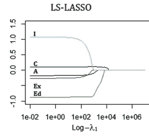

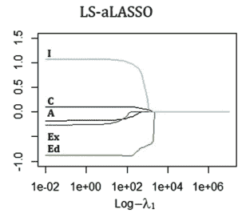

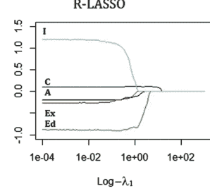

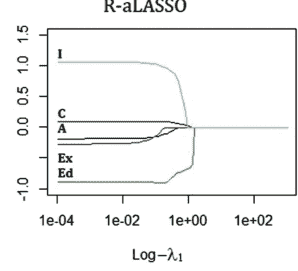

图 2.11 瑞士数据集中 LASSO 和 aLASSO 轨迹的比较。

本质上，此图表明 LS-LASSO 和 LS-aLASSO 的特性同样适用于 R-LASSO 和 R-aLASSO。

### 2.7.5 神谕特性

接下来，我们希望关注 LASSO 和 aLASSO 在其轨迹中差异的本质。请参考图 2.12，该图更详细地展示了 R-LASSO 和 R-aLASSO 的轨迹。虽然两个面板看起来相同，但 LASSO 和 aLASSO 的轨迹零点交叉发生的顺序不同。特别是，LASSO 从右到左的顺序为 C、Ed、A、I、Ex，而 aLASSO 的顺序为 Ed、C、I、A、Ex。但哪一个是正确的？

我们认为 aLASSO 具有神谕特性，而 LASSO 不具有。因此，我们假设 aLASSO 的排序是正确的，而 LASSO 的排序是不正确的。事实上，aLASSO 序列的零点交叉顺序是从右侧最重要的变量到左侧最不重要的变量。作为侧面验证，我们可以查看表 2.4 中的 |t|。该表显示了

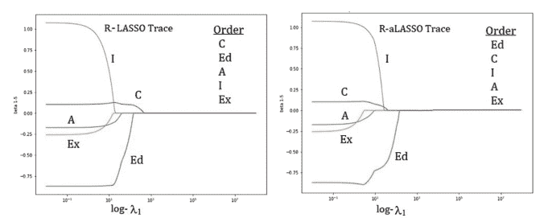

图 2.12 瑞士数据集中 R-LASSO 和 R-aLASSO 轨迹的变量排序。

表 2.4 使用 $|t.value|$ 的瑞士数据子集排序。

| 特征 | 估计值 | 标准误 | t 值 | $|t.value|$ 排序 |
|---|---|---|---|---|
| (Intercept) | 66.43 | 10.51 | 6.3 | 0 |
| Agriculture (A) | −0.20 | 0.06 | −2.90 | 4 |
| Examination (Ex) | −0.25 | 0.24 | −1.04 | 5 |
| Education (Ed) | −0.88 | 0.17 | −4.92 | 1 |
| Catholic (C) | 0.10 | 0.03 | 3.10 | 3 |
| Infant mortality (I) | 1.19 | 0.37 | 3.19 | 2 |

该表显示了 $\lambda_1 = 0$ 时瑞士数据集的秩估计、标准误和 $t$ 统计量。$|t|$ 统计量的排序为 $Ed, I, C, A$ 和 $Ex$，这与 aLASSO 的排序相似。严格基于表中 $|t|$ 值的大小，我们可以断言 $Ed$ 是最重要的变量，$Ex$ 是最不重要的变量，而 $C, I$ 和 $A$ 大致具有相同的重要性。所有三种方法都认定 $Ex$ 是最不重要的变量，但不幸的是，LASSO 没有将其设为 0，而 aLASSO 在瑞士数据集的五折交叉验证方案中将其设为 0，如前所示。

我们可以使用 James et al. (2013) 中描述的多种不同变量选择方案来检验这些推测。最佳子集选择构建所有可能的 $2^p$ 个模型，并为每个具有相同变量数量的集合选择最佳模型。此过程在表 2.5 中所示。由于秩和最小二乘的结果相似，我们将使用 R 中的最小二乘分析来获取所需信息。标记为 ($\star$) 的行是最佳子集，标记为

表 2.5 具有调整 $R^2$ 值的瑞士数据模型：最佳 ($\star$)、R-aLASSO ($\triangle$)、$|t|$ ($\bullet$)、RLASSO ($\nabla$)。最佳子集排序是通过尝试每组中所有可能的变量组合并选择调整 $R^2$ 最高的模型来获得的。R-aLASSO 使用图 2.12 中的轨迹排序结果。R-LASSO 使用图 2.12 中的轨迹排序结果。$|t|$ 使用表 2.4 中的排序。在所有情况下，都选择调整 $R^2$ 最高的模型。

| 模型 | 调整-$R^2$ | 子集选择 |
|---|---|---|
| F ~ Ed | 0.4282 | $\star \triangle \bullet$ |
| F ~ C | 0.1976 | $\nabla$ |
| F ~ A | 0.1052 | |
| F ~ Ex | 0.4042 | |
| F ~ I | 0.1552 | |
| F ~ Ed + C | 0.5552 | $\star \triangle \nabla$ |
| F ~ Ed + Ex | 0.4830 | |
| F ~ Ed + A | 0.4242 | |
| F ~ Ed + I | 0.5450 | $\bullet$ |
| F ~ C + Ex | 0.4043 | |
| F ~ C + I | 0.3005 | |
| F ~ C + A | 0.2641 | |
| F ~ Ex + I | 0.5152 | |
| F ~ Ex + A | 0.4068 | |
| F ~ I + A | 0.2868 | |
| F ~ C + Ed + I | 0.6390 | $\star \triangle \bullet$ |
| F ~ C + Ed + Ex | 0.5452 | |
| F ~ C + Ed + A | 0.6173 | $\nabla$ |
| F ~ C + Ex + A | 0.4074 | |
| F ~ C + Ex + I | 0.5083 | |
| F ~ C + A + I | 0.3040 | |
| F ~ Ex + Ed + A | 0.5259 | |
| F ~ Ex + Ed + I | 0.5935 | |
| F ~ Ex + A + I | 0.5077 | |
| F ~ Ed + A + I | 0.5368 | |
| F ~ Ed + C + I + A | 0.6707 | $\star \triangle \cdot \nabla$ |
| F ~ Ed + C + I + Ex | 0.6319 | |
| F ~ Ed + C + A + Ex | 0.6164 | |
| F ~ Ed + I + A + Ex | 0.6105 | |
| F ~ C + I + A + Ex | 0.6319 | |
| F ~ Ed + C + I + A + Ex | 0.6710 | $\star \triangle \cdot \nabla$ |

标记为 ($\triangle$) 的是 aLASSO，标记为 ($\bullet$) 的是基于 $|t|$ 的方法，标记为 ($\nabla$) 的是 LASSO。确定最佳模型所使用的准则是调整 R² 统计量（James et al., 2013），如下所示

```
adjusted R^2 = 1 - \frac{RSS/(n-d-1)}{TSS/(n-1)}, \quad (2.7.20)
```

其中

```
TSS = \sum_{i=1}^n (y_i - \bar{y})^2 \text{ and } RSS = \sum_{i=1}^n (y_i - \hat{y})^2,
```

其中 \(\bar{y}\) 为平均响应，\(\hat{y}_i = (\hat{\theta}_n^{LS} + \sum_{j=1}^p x_{ij} \hat{\beta}_j^{LS})\) 为预测响应，若数据已中心化，则 \(\hat{\theta}_n^{LS} = 0\)。此处，d 是模型中使用的参数数量，范围可从 1 到 p。通常，随着添加更多参数，调整 R^2 值应增加，然后达到最大值，最后当额外参数开始向模型中添加噪声时开始下降。从实际角度来看，我们通常会选择参数数量以最大化调整 R^2 统计量，但在某些情况下，如果我们有领域知识，可能会选择少于或多于最优数量的参数。在没有此类知识的情况下，我们尝试通过最大化调整 R^2 统计量来平衡欠拟合和过拟合。

表 2.5 表明，aLASSO 能够基于零点排序顺序预测每个类别中的最佳模型。使用 R 表示法^9，最佳单变量模型为 (F ~ Ed)。最佳双变量模型为 (F ~ Ed + C)，最佳三变量模型为 (F ~ Ed + C + I)，以此类推。另一方面，LASSO 会错误地预测最佳单变量模型为 (F ~ C)，正确地预测最佳双变量模型为 (F ~ Ed + C)，错误地预测最佳三变量模型为 (F ~ C + Ed + A)，以此类推。它们都正确地预测，移除 Ex 变量的影响微乎其微或无影响，因为包含它时调整 R^2 值仅变化 +0.0003。因此，基于调整 R^2 值的合理选择是四变量模型 (F ~ Ed + C + I + A)，而 aLASSO 基本上找到了这个模型。

这表明 aLASSO 的神谕特性对于子集选择非常有价值。当与秩损失函数结合使用时，它提供了一种可从 R-aLASSO 轨迹中提取的变量排序（假设有足够的数据），结果可用于执行最优子集选择。调整 R^2 统计量在这方面很有用，如以上所示。在实际中，我们常将调整 \( R^2 \) 替换为五折交叉验证 MSE 用于模型选择，因为我们可以轻松获取此信息。

## 2.8 弹性网络 (Enet)

我们现在考虑混合 \( L_1 \) 和 \( L_2 \) 惩罚函数，以确定其组合是否能带来额外的好处。岭回归提供了一个严格凸的平滑收缩函数，而 LASSO 提供了将某些不重要变量置零的能力，但不是严格凸函数（Zou and Hastie, 2005）。将两者的优势集中在一个称为弹性网络（或 Enet）的惩罚函数中，既可取也颇为优雅。

### 2.8.1 朴素弹性网络

Enet 应用于二次损失函数的惩罚函数由以下给出

```
\( J^{\text{LS-Enet}}(\boldsymbol{\beta}) = (\mathbf{y} - \mathbf{X}\boldsymbol{\beta})^\top(\mathbf{y} - \mathbf{X}\boldsymbol{\beta}) + \lambda_2 \sum_{j=1}^p |\beta_j|^2 + 2\lambda_1 \sum_{j=1}^p |\beta_j|, \quad (2.8.1) \)
```

我们可以将其重写为

```
\( J^{\text{LS-Enet}}(\boldsymbol{\beta}) = (\mathbf{y} - \mathbf{X}\boldsymbol{\beta})^\top(\mathbf{y} - \mathbf{X}\boldsymbol{\beta}) + \lambda_2 \boldsymbol{\beta}^\top \boldsymbol{\beta} + 2\lambda_1 \mathbf{1}^\top |\boldsymbol{\beta}|, \quad (2.8.2) \)
```

其中 \( \lambda_1, \lambda_2 \in \mathbb{R}^+ \) 是调谐参数。

为了获得 Enet 估计值，我们对 \( \boldsymbol{\beta} \) 求 \( J(\boldsymbol{\beta}) \) 的导数并将其设为 0，即

```
\( \frac{\partial J^{\text{LS-Enet}}(\boldsymbol{\beta})}{\partial \boldsymbol{\beta}} = -2\mathbf{X}^\top(\mathbf{y} - \mathbf{X}\boldsymbol{\beta}) + 2\lambda_2 \boldsymbol{\beta} + 2\lambda_1 \text{sgn}(\boldsymbol{\beta}) = 0. \quad (2.8.3) \)
```

然后，可得

```
\( -2\mathbf{X}^\top \mathbf{y} + 2\mathbf{X}^\top \mathbf{X} \boldsymbol{\beta} + 2\lambda_2 \boldsymbol{\beta} + 2\lambda_1 \text{sgn}(\boldsymbol{\beta}) = 0. \quad (2.8.4) \)
```

将所有项乘以 \( \mathbf{C}^{-1} \) 并整理后，我们得到一个关于 \( \hat{\boldsymbol{\beta}}_n^{\text{LS}} \) 和称为朴素弹性网络（nEnet）估计值 \( \hat{\boldsymbol{\beta}}_n^{\text{LS-nEnet}} \) 的项的方程

```
\( -\hat{\boldsymbol{\beta}}_n^{\text{LS}} + \hat{\boldsymbol{\beta}}_n^{\text{LS-nEnet}} + \lambda_2 \mathbf{C}^{-1} \hat{\boldsymbol{\beta}}_n^{\text{LS-nEnet}} + \lambda_1 \mathbf{C}^{-1} \text{sgn}(\hat{\boldsymbol{\beta}}_n^{\text{nEnet}}) = 0. \quad (2.8.5) \)
```

最后，

```
\( (\mathbf{I}_p + \lambda_2 \mathbf{C}^{-1}) \hat{\boldsymbol{\beta}}_n^{\text{LS-nEnet}} = \hat{\boldsymbol{\beta}}_n^{\text{LS}} + \lambda_1 \mathbf{C}^{-1} \text{sgn}(\hat{\boldsymbol{\beta}}_n^{\text{LS-nEnet}}). \quad (2.8.6) \)
```

无法为 \( \hat{\boldsymbol{\beta}}_n^{\text{LS-nEnet}} \) 获得闭式解，但做一些简化假设有助于了解 nEnet 的运作方式。与之前一样，如果我们假设 \( \mathbf{C}^{-1} \) 是单位矩阵（正交归一化情况），则方程变为


(1 + \lambda_2)\hat{\beta}_n^{O-nEnet} = \hat{\beta}_n^{LS} + \lambda_1 \text{sgn}(\hat{\beta}_n^{O-nEnet}) \qquad (2.8.7)

其中 \(\hat{\beta}^{O-nEnet}\) 是正交情况下的 nEnet 估计。这可简化为

\(\hat{\beta}_j^{O-nEnet} = \frac{\text{sgn}(\hat{\beta}_j^{LS})(|\hat{\beta}_j^{LS}| - \lambda_1)^+}{1 + \lambda_2} \qquad (2.8.8)\)

换句话说，\(\hat{\beta}^{O-nEnet}\) 先计算 \(\hat{\beta}_j^{LS}\)，然后使用 LASSO 进行收缩，再由于 ridge 进行第二次收缩。我们实际上对 \(\hat{\beta}_j^{LS}\) 进行了双重收缩：一次是由于 LASSO 通过减去 \(\lambda_1\)，另一次是由于 ridge 通过除以 \((1 + \lambda_2)\)。这并不理想，因此需要进行调整，如下一节所述。

如果我们现在令 \(C^{-1}\) 为一个包含非零值 \(C^{jj}, j = 1, \dots, p\) 的对角矩阵，则可获得

\(\hat{\beta}_j^{D-nEnet} = \frac{\text{sgn}(\hat{\beta}_j^{LS})(|\hat{\beta}_j^{LS}| - \lambda_1 C^{jj})^+}{1 + \lambda_2 C^{jj}} \qquad (2.8.9)\)

其中 \(\hat{\beta}^{D-nEnet}\) 是对角情况下的 nEnet 估计。如前所述，这表明 \(C^{jj}\) 是对角 nEnet 惩罚中 ridge 和 LASSO 收缩的控制项。

### 2.8.2 标准弹性网

通过检查前面的方程，我们发现 nEnet 对 LS 估计进行了双重收缩。为了补偿第二次收缩过程，我们可以通过 \((1 + \lambda_2)\) 的量来提升结果，如下所示：

\(\hat{\beta}_j^{D-SEnet} = (1 + \lambda_2) \frac{\text{sgn}(\hat{\beta}_j^{LS})(|\hat{\beta}_j^{LS}| - \lambda_1 C^{jj})^+}{1 + \lambda_2 C^{jj}} \qquad (2.8.10)\)

这被称为标准弹性网（sEnet）。如前所述，我们可以看到方差项以如下方式控制 ridge 和 LASSO

\(\hat{\beta}_j^{S-SEnet} = (1 + \lambda_2) \frac{\text{sgn}(\hat{\beta}_j^{LS})(|\hat{\beta}_j^{LS}| - \lambda_1' \text{Var}(\hat{\beta}_j^{LS}))^+}{1 + \lambda_2' \text{Var}(\hat{\beta}_j^{LS})} \qquad (2.8.11)\)

其中 \(\lambda_1 = \lambda_1' \sigma^2\) 且 \(\lambda_2 = \lambda_2' \sigma^2\)。

我们可以更进一步，通过用 aLASSO 替换 LASSO 来引入 oracle 特性。那么，上述方程变为

\(\hat{\beta}_j^{D-aENet} = (1 + \lambda_2) \frac{\text{sgn}(\hat{\beta}_j^{LS}) \left( |\hat{\beta}_j^{LS}| - \lambda_1' \frac{\text{Var}(\hat{\beta}_j^{LS})}{|\hat{\beta}_j^{LSEN}|} \right)^+}{1 + \lambda_2' \text{Var}(\hat{\beta}_j^{LS})}.\) (2.8.12)

我们称之为对角情况下的自适应弹性网（D-aEnet）。由于之前关于 oracle 特性的原因，这种 aEnet 公式可能优于 nEnet 或 sEnet。当然，需要注意的一点是，aLASSO 需要最小二乘估计，而这些估计可能不可用。

### 2.8.3 机器学习中的弹性网

对于机器学习，LS-Enet 的目标函数形式通常使用 \(\lambda\) 和 \(\alpha\) 表示，而不是 \(\lambda_1\) 和 \(\lambda_2\)，如下所示

\(J^{LS-Enet}(\boldsymbol{\beta}) = (\mathbf{y} - \mathbf{X}\boldsymbol{\beta})^\top (\mathbf{y} - \mathbf{X}\boldsymbol{\beta}) + \lambda \left[ \frac{1-\alpha}{2} \boldsymbol{\beta}^\top \boldsymbol{\beta} + \alpha \sum_{j=1}^p |\beta_j| \right],\) (2.8.13)

其中 \(\lambda > 0\) 是标准调谐参数，\(0 < \alpha < 1\) 控制应用 ridge 或 LASSO 的程度。

同样，R-Enet 的形式为

\(D^{R-Enet}(\boldsymbol{\beta}) = D_n(\boldsymbol{\beta}) + \lambda \left[ \frac{(1-\alpha)}{2} \boldsymbol{\beta}^\top \boldsymbol{\beta} + \alpha \sum_{j=1}^p |\beta_j| \right].\) (2.8.14)

最后，基于排名的自适应弹性网（R-aEnet）的目标函数由以下给出

\(D^{R-aENet}(\boldsymbol{\beta}) = D_n(\boldsymbol{\beta}) + \lambda \left[ \frac{(1-\alpha)}{2} \boldsymbol{\beta}^\top \boldsymbol{\beta} + \alpha \sum_{j=1}^p \frac{|\beta_j|}{|\hat{\beta}_j^R|} \right].\) (2.8.15)

调谐参数 \(\lambda\) 控制惩罚函数的影响，而 \(\alpha\) 通过设置为 0 或 1 来控制 ridge 或 aLASSO 的选择。其他设置也是可能的，但最有用的值接近 1。例如，使用五折交叉验证方案，瑞士数据集的最优 \(\alpha = 0.95\) 值，该方案产生以下估计：

\(\hat{\boldsymbol{\beta}}_n^{R-aENet} = (A = -0.11, Ex = -0.0027, Ed = -0.94, C = 0.12, I = 1.14)^\top.\)

变量 Ex 的估计值足够小，可以移除，这与 R-aLASSO 的情况相同。

## 2.9 示例：糖尿病数据集

我们用一个相当大的数据集结束本章，以回顾使用前面各节的技术进行模型构建的过程，总体目标是减少数据集中的“噪声”，仅保留“信号”。我们将通过有效减少观测值的数量（如果存在异常值）以及减少变量的数量（如果某些解释变量被认为不必要）来实现这一目标，然后应用收缩估计器来构建模型。数据清理、变量选择和参数收缩最合适的组合是基于排名的损失函数与 aLASSO 和 ridge 惩罚函数（Eq. (2.8.15)）相结合。

### 2.9.1 使用 R-aEnet 进行模型构建

我们将使用一个著名的糖尿病 10 数据集（参见 Johnson and Peng, 2008），该数据集也在第 8 章中使用，n = 442 且 p = 10，以说明使用 R-aEnet 进行模型构建的过程。第一步是在 Eq. (2.8.15) 中设置 \(\lambda = 0\) 以获得排名估计（稍后在表 2.6 中给出，未对数据进行标准化）。这些估计可用于识别异常值。通常我们使用 LS 估计来查找异常值，但这里我们提供了一种使用排名的另一种方法。一般来说，数据集中的任何异常值都将出现在残差的极端阶统计量中。残差绝对值排名的结果如图 2.13 所示，表明数据集中有三个可能的异常值。由于这是一个简单的演示，我们可以将这三个异常值都声明为噪声并将其删除，从而得到 n_o = 439 个观测值和 p = 10 个变量。然而，基于排名的方法的优势在于它会自动完成此操作，无需手动干预。

第二步是在 Eq. (2.8.15) 中设置 \(\alpha = 1\) 并扫描 \(\lambda\)，以便我们可以获得 aLASSO 轨迹来识别和删除任何不重要的变量。这是因为模型复杂性引入了另一种偏差-方差权衡。变量较少的紧凑模型往往具有较低的方差，这是可取的，但也会导致较高的偏差。我们需要在变量过多或过少之间取得平衡，以分别避免过拟合或欠拟合。因此，我们将选择提供预测“信号”的最少数量的变量，并删除增加预测“噪声”的变量。这是使用 aLASSO 提供的顺序和调整后的 R^2 统计量来决定保留多少变量来完成的。我们可以使用

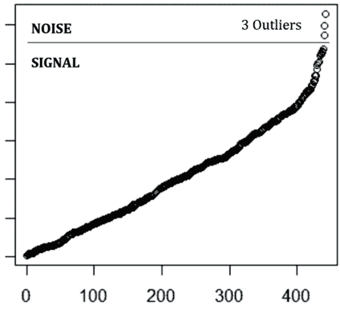

**图 2.13** 糖尿病数据集的残差排名。（来源：R 中的 Rfit() 包。）

aLASSO 本身作为收缩估计器，但在这里我们采用不同的方法，仅使用它进行子集选择。

使用未标准化数据的 aLASSO 轨迹如图 2.14 所示。请注意，某些变量的零交叉点彼此非常接近，我们将其聚类为最重要变量、中等重要变量和最不重要变量。这表明对于这些变量，最优顺序可能是可变换的。在某些数据集中，为了获得真正的最优子集，可能需要在组内进行局部重新排序。这是因为不同参数之间将存在相关性，随着子集大小的增加，这可能会改变参数组合。也就是说，大小为 4 的最佳子集可能不是大小为 3 的最佳子集的超集。在我们的情况中，鉴于来自 aLASSO 轨迹的近似最优顺序，只需构建 p 个模型来找到最优集，而不是 2^p 个模型。此外，选择标准应基于三个大类（最重要、中等重要、最不重要），而不是 aLASSO 提供的确切顺序排列。

在此，我们使用变量的精确 aLASSO 排序并绘制调整后的 R^2，如图 2.15 所示。然后，我们选择使调整后的 R^2 最大化的子集，并将其余部分声明为噪声。基于 aLASSO 排序的曲线（下方曲线）紧密遵循最佳子集选择顺序（上方曲线），如图所示。这告诉我们应该选择六个变量，即 bmi、s5、bp、s1、sex 和 s2，因为当第七个变量添加到模型中时，调整后的 R^2 会下降。值得注意的是，|t.value| 显示


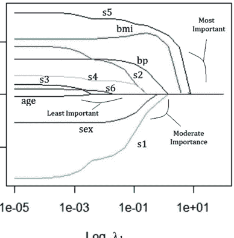

图 2.14 糖尿病数据集的 Rank-aLASSO 轨迹，显示变量重要性。

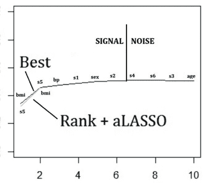

图 2.15 糖尿病数据集，显示变量排序和调整后的 R² 图。

## 表 2.6 标准化前糖尿病数据中带离群值的估计值。

| 解释变量 | 估计值（原始） | 标准误 | t 值统计量 | |t 值| 排序 |
| :--- | :--- | :--- | :--- | :--- |
| 截距 | 151.9 | 3.83 | 39.6 | 0 |
| bmi | 526.8 | 70.3 | 7.4 | 1 |
| bp | 336.2 | 69.2 | 4.8 | 2 |
| s5 | 775.1 | 181.8 | 4.2 | 3 |
| sex | −268.4 | 64.7 | −4.1 | 4 |
| s1 | −795.2 | 440.7 | −1.8 | 5 |
| s2 | 458.2 | 358.6 | 1.2 | 6 信号 |
| s4 | 177.9 | 170.8 | 1.0 | 7 噪声 |
| s6 | 50.5 | 69.7 | 0.7 | 8 |
| s3 | 93.1 | 224.8 | 0.4 | 9 |
| age | −18.3 | 63.1 | −0.3 | 10 |

表 2.6 中选择了相同的六个变量，假设目标是构建一个六变量模型。剩下的四个变量，即 age、s3、s4 和 s6，会给我们的回归模型增加噪声，因此可以将其移除。我们可能不知道所有变量的含义，例如 s1–s6，但我们可以根据 |t 值|、aLASSO 轨迹（m = 40）和调整后的 R² 图（p = 10）来确定它们的相对重要性。因此，近似最优子集选择总共需要 p + m 个模型。

在深入探讨之前，我们应该认识到，迄今完成的两个步骤已将观测值从 n = 442 有效减少到 n_o = 439，将变量数量从 p = 10 减少到 p_o = 6，如图 2.16 概念性地说明。我们可以移除与完整数据集左侧阴影区域相关的数据列和行。剩余的白色区域数据已被有效地“清洗”掉离群值和不重要的变量。这是通过使用 rank（L1 类型）损失配合 aLASSO（L1 类型）惩罚项来实现的。

### 2.9.2 MSE 与 MAE

我们需要为即将进行的五折交叉验证方案选择一个合适的评估统计量。如果数据集没有

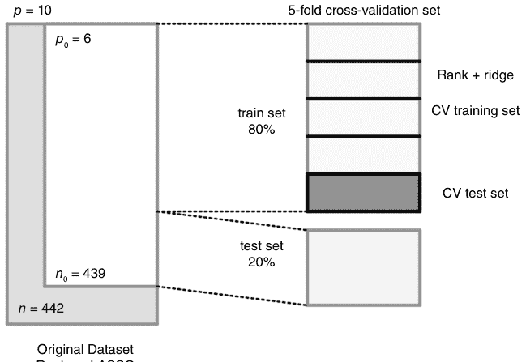

图 2.16 接岭回归估计的 Rank-aLASSO 清洗。

离群值或平衡的离群值。然而，在离群值数量和位置未知的一般情况下，我们需要使用稳健统计量。一个候选项是残差中位绝对误差（MAE），由以下公式给出：

MAE = median(|y_1 - \hat{y}_1|, |y_2 - \hat{y}_2|, ..., |y_n - \hat{y}_n|), (2.9.1)

其中 \(\hat{y}_i = \hat{\theta}_n^R + \sum_{j=1}^P x_{ij} \hat{\beta}_j^R\)。我们将首先在假设没有离群值的情况下使用 MSE。之后我们将比较 MSE 与 MAE，并表明在没有离群值时结果相似。这一点很重要，因为我们希望即使在没有离群值时，也能使用 MAE 统计量进行稳健分析。

接下来，我们将数据集分为两部分：训练集（80% 的数据）和留出测试集（20% 的数据），如图 2.16 所示。来自完整训练集的 rank 估计可用于确定训练集和测试集的 MSE，作为我们模型准确度的基准。这要求我们在公式 (2.8.15) 中将 \(\lambda = 0\)。当然，在获得估计值之前，我们现在必须先对 **X** 矩阵进行标准化。这样做是为了预防以后出现一个系数值压倒其他系数的问题，尤其是在岭回归中，因为其惩罚函数中系数是平方的（James 和 Stein, 1961）。如果某一列的范围是 0-10^2，而另一列的范围是 0-10^6，就可能发生这种情况。**X** 的标准化是为了将列值带入相同的范围。此外，标准化提高了系数的可解释性，这或许是使用它的更重要原因。

标准化是通过将列中的每个元素除以该列的标准差来执行的，如下所示：

\(\tilde{x}_{ij} = \frac{x_{ij}}{\sqrt{\frac{1}{n-1} \sum_{i=1}^n (x_{ij} - \bar{x}_j)}} \quad \text{for } i = 1, ..., n, \quad j = 1, ..., p.\tag{2.9.2}\)

对糖尿病数据集进行标准化并计算 rank 估计值后，训练集的 MSE = 2769.49，而测试集的 MSE 更高，为 3377.24。这是可以预料的，因为模型是针对训练集拟合的，因此其 MSE 会更小，然后用于预测“未见”的测试集，测试集通常具有更高的 MSE（尽管在某些情况下可能更低）。鉴于两种情况下的 MSE 不同，值得尝试改进结果并说明模型构建过程。

我们的最后一步是在公式 (2.8.15) 中将 \(\alpha = 0\) 以调用岭回归，然后扫描 \(\lambda\) 以使用五折交叉验证方案获得 R-岭回归的缩减模型，方式如图 2.16 所示。CV 训练集用于获得每个折叠的估计值，而 CV 测试集用于获得 MSE。这样重复五次，每个图中所示的折叠各一次。结果被平均，以获得每个 \(\lambda\) 值的估计值和 MSE。产生最低 MSE 的 \(\lambda\) 值被选为最优值，最终估计值基于此值。

结果如图 2.17 所示。左侧面板是使用标准化的 \(\mathbf{X}\) 矩阵对六个感兴趣变量的岭回归轨迹。右侧显示了训练组、CV 组和测试组的 MSE 与 \(\log \lambda_2\) 图。需要注意的是，最优 \(\lambda_2\) 基于 CV 曲线而非测试曲线，这是常见做法。虽然使用测试 MSE 的最小值来选择最优 \(\lambda_2\) 很诱人，但我们通常无法访问此测试数据，但这里显示出来是为了强调我们基于 CV 数据进行优化。不过，它可以用于比较不同的估计量和建模方法。

上述比较结果在表 2.7 中报告，适用于本章描述的估计量。表中包含了 LSE、LS-岭回归、LS-LASSO 和 LS-Enet 的估计值及使用的变量数量 \(p_o\)。用于获得这些结果的 R 包将在下一节中介绍。我们还展示了 R 估计值和 R-aEnet 估计值（本质上是带有六个变量的 R-岭回归估计值）。在所有情况下，都使用了相同的五折 CV 方案，80% 的数据用于 CV 训练 MSE，20% 用于最终测试 MSE。

由于我们使用稳健方法，使用平均绝对误差是合理的。我们展示了在五折 CV 方案下训练集上的 MAE 和 MSE 结果，

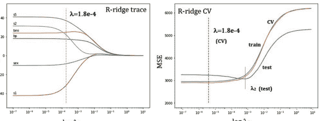

图 2.17 带最优 \(\lambda_2\) 的 R-岭回归轨迹和 CV 方案。

训练集，以及表 2.7 中测试集上的相应 MAE 和 MSE。表格表明，R-aEnet 的最后一列获得了最低的测试 MSE 和 MAE。特别是，测试 MSE 为 3156.56，而测试 MAE 为 32.53。对比而言，最近的测试 MSE 来自 LSE，为 3338.88，而最近的 MAE 是 39.80，归因于 LS-岭回归。因此，使用 rank 损失函数结合 aLASSO 进行子集选择，并结合岭回归进行缩减的方法，提供了一个紧凑且可解释、预测精度最佳的模型。对于 R-岭回归，详细的 CV 图见 2.18 图，分别给出了五折 CV 方案下 MSE 和 MAE 值的范围。我们注意到，两个图都没有明显的最小值，但实际上两者在图中所示的同一值处确实存在最小值。

### 2.9.3 LS-Enet 模型构建

上一节展示了 LS-Enet 估计量的多个结果。现在将描述获得这些结果的方法。回顾公式 (2.8.13)，我们使用两个调参数 \(\alpha\) 和 \(\lambda\)。基本上，这需要对两个参数进行网格搜索以找到它们的最优值。由于 \(\alpha \in [0, 1]\)，选择该范围内的六个 \(\alpha\) 值来检查轨迹的演变是有用的。

在图 2.19 中，我们看到 \(\alpha\) 调参数不同情况的轨迹。它们看起来都差不多，但如果仔细观察，我们会注意到，随着 \(\alpha\) 以 0.2 的增量从 0 移动到 1，LS-岭回归轨迹（\(\alpha = 0.0\)）开始收缩并向 \(\lambda\) 轴卷曲，直到它变成 LS-LASSO 轨迹（\(\alpha = 1.0\)）。在此数据集上尝试 LS-Enet 是值得的，以展示如何生成一个好的模型。

如前所述标准化数据后，我们可以使用 glmnet()（斯坦福大学提供的 R 包）对 \(\alpha\) 从 0 到 1 进行扫描，增量为


表 2.7 糖尿病数据的估计值、MSE 和 MAE

| 变量 | LS-ridge | LS-Enet | LS-LASSO | LSE | R-estimate | R-aEnet |
|---|---|---|---|---|---|---|
| AGE | 0.29 | 0 | 0 | -0.06 | -1.05 | 0 |
| SEX | -11.00 | -11.60 | -10.00 | -12.25 | -13.01 | -12.21 |
| BMI | 25.30 | 25.74 | 25.70 | 25.67 | 25.81 | 23.02 |
| BP | 11.61 | 11.74 | 10.71 | 12.21 | 12.44 | 16.63 |
| S1 | -5.21 | -11.14 | -6.37 | -30.97 | -27.00 | -30.31 |
| S2 | -4.65 | 0 | 0 | 15.23 | 10.93 | 22.0 |
| S3 | -10.73 | -9.01 | -12.34 | -0.43 | -1.47 | 0 |
| S4 | 6.27 | 5.30 | 8.21 | 8.29 | 9.44 | 0 |
| S5 | 21.91 | 25.88 | 25.07 | 32.93 | 32.32 | 38.32 |
| S6 | 3.6 | 2.79 | 2.08 | 2.89 | 2.14 | 0 |
| \( p_o \) | 10 | 8 | 8 | 10 | 10 | 6 |
| Train MSE | 2781.48 | 2769.95 | 2784.40 | 2762.79 | 2769.49 | 2833.34 |
| Train MAE | 38.21 | 37.83 | 38.82 | 36.91 | 36.70 | 38.31 |
| Test MSE | 3373.13 | 3267.95 | 3363.78 | 3338.88 | 3377.24 | 3156.56 |
| Test MAE | 39.80 | 40.10 | 40.11 | 41.28 | 40.21 | 32.53 |

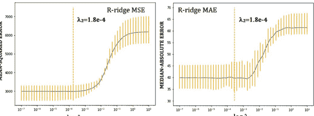

**图 2.18** 五倍交叉验证方案产生相似最优 \(\lambda_2\) 的 MSE 和 MAE 图。

为 0.1，并对 \(\lambda\) 从 \(10^{-6}\) 到 \(10^6\) 使用 100 步进行扫描。虽然结果有一定波动，但最佳值在 \(\alpha = 0.6\) 左右。在图 2.20 中，我们展示了 \(\alpha = 0.6\) 的相应系数迹线和交叉验证结果。最优 \(\lambda\) 位于右侧图中灰色垂直线指示的有界范围内。`glmnet()` 报告的最优值 \(\lambda_{opt} = 0.43\) 是黑色垂直线，该线已转移到左侧图中，从而

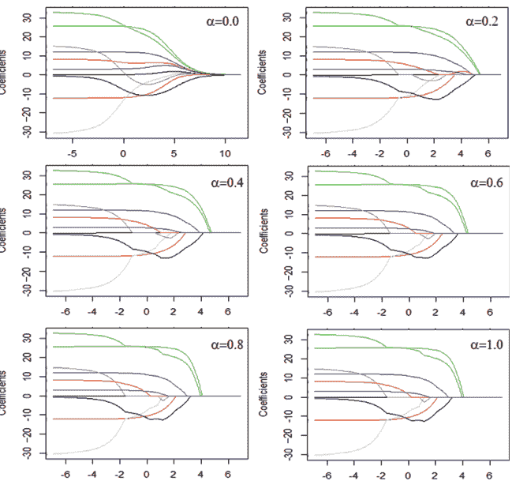

**图 2.19** LS-Enet 迹线，\(\alpha = 0.0, 0.2, 0.4, 0.8, 1.0\)。

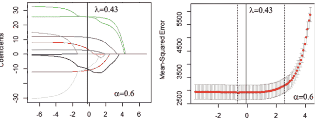

**图 2.20** 来自 glmnet() 的 \(\alpha = 0.6\) 的 LS-Enet 迹线和五倍交叉验证结果。

表 2.8 糖尿病数据中 Enet 估计值、训练 MSE 和测试 MSE 作为 \(\alpha\) 的函数

| \(\alpha\) | 0.0 | 0.2 | 0.4 | 0.6 | 0.8 | 1.0 |
|---|---|---|---|---|---|---|
| \(\hat{\lambda}_{(opt)}\) | 5.86 | 3.35 | 0.76 | 0.43 | 0.8 | 1.10 |
| AGE | 0.29 | 0 | 0 | 0 | 0 | 0 |
| SEX | -11.00 | -10.35 | -11.46 | -11.60 | -9.18 | -10.00 |
| BMI | 25.30 | 25.02 | 25.65 | 25.74 | 25.53 | 25.70 |
| BP | 11.61 | 11.12 | 11.67 | 11.74 | 10.29 | 10.71 |
| S1 | -5.21 | -5.27 | -10.66 | -11.14 | -5.29 | -6.37 |
| S2 | -4.65 | -2.45 | 0 | 0 | 0 | 0 |
| S3 | -10.73 | -11.69 | -9.36 | -9.01 | -12.15 | -12.34 |
| S4 | 6.27 | 2.92 | 4.86 | 5.30 | 0 | 0 |
| S5 | 21.91 | 23.29 | 25.68 | 25.88 | 24.35 | 25.07 |
| S6 | 3.6 | 2.79 | 2.79 | 2.78 | 1.74 | 2.08 |
| \( p_o \) | 10 | 9 | 8 | 8 | 7 | 7 |
| Train MSE | 2781.48 | 2782.29 | 2770.70 | 2769.95 | 2794.52 | 2784.40 |
| Test MSE | 3373.13 | 3363.66 | 3365.12 | 3367.00 | 3364.37 | 3363.78 |

获得估计值。我们可以看到，许多参数已根据 \(\lambda_{opt}\) 的位置被设置为零。

各种情况下糖尿病数据集的模型系数如表 2.8 所示。由于 \(\alpha = 0.6\) 的 LS-Enet 在训练集上具有最低的 MSE，因此表 2.7 中使用了其 `glmnet()` 估计值。该模型中使用了 \( p_o = 8 \) 个参数。虽然还有变量更少的其他模型，但它们在训练集上的 MSE 值更高。表 2.7 中的 LS-LASSO 估计值来自 \(\alpha = 1.0\)，而 LS-ridge 结果来自 \(\alpha = 0.0\)。

## 2.10 Summary

在本章中，我们介绍了惩罚秩估计器的特性及其在机器学习中的实际应用。引入了多种新思想和新概念，以实现稳健线性回归和模型构建，这些内容值得进一步研究。我们展示了惩罚估计器的重要性以及每种惩罚函数在稳健数据科学中的固有价值。我们将秩回归与 ridge、LASSO、aLASSO 和 aEnet 相结合，并通过多种组合识别出了一些新功能。Ridge 是一种平滑的惩罚函数，在收缩方面效果最佳，

而 aLASSO 在变量排序以及因此的子集选择方面效果最佳。可以将 LASSO 视为介于两者之间。LASSO 通常会找到一个或多个最不重要的参数，并可能将其中一些设置为零，但不一定按正确顺序，因为它不具有神谕特性。对这些及其他稳健方法的进一步研究将为未来研究提供富有成效的方向。

机器学习中使用秩的动机已通过前两章的实际应用在多元线性回归中得到充分确立。现在是时候从基础开始为这些方法建立数学基础了。在即将到来的章节中，我们将对秩理论主题进行理论处理。我们的旅程始于位置和简单线性模型的受限和无限制秩估计器。然后我们转向方差分析，以及看似无关的简单线性模型，接着是多元线性模型。接下来，我们介绍部分线性模型和 Liu 回归，以及 AR(p) 模型。高维问题也将在后续章节中讨论。我们以基于秩的逻辑回归和神经网络的实用机器学习主题作为本书的结论。

## 2.11 Problems

### 2.1. 假设给定的中心化数据集中 $p = 2$，最小二乘估计为 $\hat{\beta}_1^{LS} = 10.0$，其中 $\text{Var}(\hat{\beta}_1^{LS}) = 0.49$，以及 $\hat{\beta}_2^{LS} = 5.0$，其中 $\text{Var}(\hat{\beta}_2^{LS}) = 0.25$。假设 $\hat{\sigma}^2 = 10.0$。

- (a) 每个参数的标准误是多少？
- (b) 假设非对角线元素为 0，矩阵 $(X^T X)^{-1}$ 是什么。
- (c) 绘制这两个参数作为 \(\lambda_2 = 0\) 到 10 的函数的岭迹线。（提示：由于这是对角情况，可以使用 (2.4.10)。你的答案应与图 2.1 类似。）评论结果。
- (d) 一般如何确定 $\hat{\theta}_n^{LS}$？给定 $\hat{\beta}_n^{LS}$，使用未中心化数据 $X_{uc}$ 和 $y_{uc}$ 写出表达式。此处无需计算。

### 2.2. 假设给定数据集中 $p = 2$，R-估计为 $\hat{\beta}_1^R = 10.3$，其中 $\text{Var}(\hat{\beta}_1^R) = 0.343$，以及 $\hat{\beta}_2^R = 5.1$，其中 $\text{Var}(\hat{\beta}_2^R) = 0.175$。令 $\hat{\eta}^2 = 9.0$。

- (a) 每个参数的标准误是多少？
- (b) 假设与问题 2.1 相同的数据集，数据中是否存在异常值？
- (c) 值得注意的是，即使有中心化数据，秩截距也不一定为 0。此外，我们不使用 $D_n(\beta)$ 来估计截距。相反，我们可以使用中位数来找到截距。一般如何确定 $\hat{\beta}_n^R$，给定 $\hat{\beta}_n^R$。使用未中心化数据 $\mathbf{X}_{\text{uc}}$ 和 $\mathbf{y}_{\text{uc}}$ 写出表达式。此处无需计算。

### 2.3. 考察表 2.3 和图 2.3。

- (a) 根据表格和对应图表，哪些参数（当然忽略 $\beta_0$）最能从方差减少中受益？
- (b) 理想情况下，我们只希望收缩方差大的那些参数。我们希望哪些参数保持不变，因为它们已经具有小方差？
- (c) 接下来考虑图 2.5 的岭迹线。在 D-ridge 图中，随着 \(\lambda_2\) 增加，首先减少到近乎 0 的前三个参数是什么？最后减少到近乎 0 的两个参数是什么？
- (d) 为什么 LS-ridge 和 rank-ridge 的结果与 D-ridge 有些不同？（提示：考虑使用完整的 $\mathbf{C}^{-1}$ 矩阵与对角矩阵相比，对获得收缩估计值的影响。）

### 2.4. 考虑图 2.10 和以下给出的 $\hat{\beta}_j^{\text{D-LASSO}}$ 和 $\hat{\beta}_j^{\text{D-aLASSO}}$ 的惩罚最小二乘估计器，

$$\hat{\beta}_j^{\text{D-LASSO}} = \text{sgn}(\hat{\beta}_j^{\text{LS}})(|\hat{\beta}_j^{\text{LS}}| - \lambda_1 \text{Var}(\hat{\beta}_j^{\text{LS}}))^+$$

and

$$\hat{\beta}_j^{\text{D-aLASSO}} = \text{sgn}(\hat{\beta}_j^{\text{LS}}) \left( |\hat{\beta}_j^{\text{LS}}| - \lambda_1 \frac{\text{Var}(\hat{\beta}_j^{\text{LS}})}{|\hat{\beta}_j^{\text{LS}}|} \right)^+$$

respectively. 唯一的区别是 aLASSO 中使用了加权项。用质性意义解释为什么 aLASSO 具有神谕特性，而 LASSO 通常不具备此特征，使用两种不同的菱形图形，一种用于 LASSO，另一种用于 aLASSO。展示两种情况下估计值轨迹可能有何不同。将你的解释与图 2.12 所示的迹线联系起来。为什么两条迹线可能不同？

### 2.5. 虽然 ridge 和 LASSO 最初是为了多元回归中存在共线性的情况而设计的，但它们可以应用于一维环境。例如，它们可以应用于位置问题，带有位置参数 \(\theta\)，这将在下一章中详细讨论。

- (a) 设计一种简单的岭类型惩罚估计器，使用 \(\lambda_2\) 作为调谐参数，通过除法收缩估计值，假设给定一个无偏秩估计 $\hat{\theta}_n^R$。（提示：参见 Eq. (2.4.7)）。
- (b) 同样，使用 \(\lambda_1\) 在你的等式中通过减法设计一种简单的 LASSO 类型惩罚估计器。（提示：参见 Eq. (2.7.9)）


(c) 如果 \(\hat{\theta}_n^R = 2.0\)，在同一张图上绘制脊回归和 LASSO 的迹线，以 \(\lambda\) 作为 x 轴（根据迹线分别代表 \(\lambda_1\) 和 \(\lambda_2\)）。

(d) 如何在此一维设定中定义一种 aLASSO 类型的估计量？在同一张图上绘制其迹线。你可以说明 LASSO 与 aLASSO 在此情况下有何不同吗？

## 2.6. 考虑以下具有 \(p = 2\) 的数据集以研究共线性：

| x1 | 132.2 | 501.5 | 904.0 | 227.6 | 66.6 | 43.4 | 1253.0 |
| --- | --- | --- | --- | --- | --- | --- | --- |
| x2 | 11.7 | 17.9 | 21.1 | 14.7 | 7.7 | 8.4 | 32.8 |
| y | 404.6 | 1180.6 | 1807.5 | 470.0 | 151.4 | 93.8 | 3293.4 |

假设线性回归模型为

\(\boldsymbol{y} = \beta_0 + \beta_1\boldsymbol{x}_1 + \beta_2\boldsymbol{x}_2 + \boldsymbol{\varepsilon}\)。

- (a) 绘制 \(x_2\) 对 \(x_1\) 的图。定性评估是否存在共线性的可能性，即两个变量之间是否存在线性关系。（提示：如果两个变量之间存在强相关性，则数据集中很可能存在共线性。）

- (b) 为了定量评估共线性，我们可以使用条件数，即使用中心化矩阵 \(X\) 的矩阵 \(C = X^T X\) 的最大特征值与最小特征值之比。要找到 \(2 \times 2\) 矩阵的特征值，可以使用二次方程：

\(\lambda^2 + \text{tr}(C)\lambda + \text{det}(C) = 0\)

其中 \(\lambda\) 表示两个得到的特征值，\(\lambda_{\text{big}}\) 和 \(\lambda_{\text{small}}\)，\(\text{tr}(C)\) 是矩阵的迹，\(\text{det}(C)\) 是矩阵的行列式。将条件数计算为比值 \(\lambda_{\text{big}}/\lambda_{\text{small}}\)。这个值是大（即病态）还是小（即良好条件）？

- (c) 使用中心化数据求 \(\beta_1\) 和 \(\beta_2\) 的最小二乘估计量，如下所示

\(\hat{\boldsymbol{\beta}}_n^{LS} = (X^T X)^{-1} X^T y\)。

- (d) 求 LS-脊估计量，并使用此处给出的闭式表达式绘制脊迹线（\(I_p\) 是一个 \(2 \times 2\) 单位矩阵）：

\(\hat{\boldsymbol{\beta}}_n^{LS\text{-ridge}} = (X^T X + \lambda_2 I_p)^{-1} X^T y\)。

使用 \(\lambda_2 = 0, 1, 2, 5, 10, 20, 50, 100, 200, 500, 1000\)。

## 2.7. (PROJECT) 本问题使用 R 来获取基于前一问题数据集的最小二乘和秩估计结果。你需要在 R 中运行命令并编写一些简单的 R 代码来完成本问题。

- (a) 在 R 中运行以下代码行以获取 LS 估计量。将你的结果与前一问题中获得的值进行比较。

```
x<-cbind(c(11.7,17.9,21.1,14.7,7.7,8.4,32.8),
c(132.2,501.5,904.0,227.6,66.6,43.4,1253.0))
y<-c(40.6,1180.6,1807.5,470.0,
151.4,93.8,3293.4)
lmfit <- lm(y ~ x)
summary(lmfit)
```

- (b) 要获取 R 估计量，请运行 `rfit()` 函数。你可能需要安装 Rfit 库才能运行以下命令。

```
library("Rfit")
fit <- rfit(y ~ x)
summary(fit)
```

你的结果与部分 (a) 相比如何？也就是说，它们几乎相同还是有些不同？

- (c) 在此步骤中，你将输入 R 代码以获取与部分 (b) 相同的结果。为此，编写一个例程来执行以下操作：

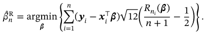

将需要 R 的 `rank()` 和 `optim()` 函数。你可能会发现下面的入门 R 代码很有用。它需要 `x_centered` 和 `y_centered` 才能使用此代码。`betaR` 中的结果应与 `rfit()` 的输出匹配。

```
minimize.DnB <- function(par, X, y) {
    n <- length(y)
    diff <- y-(X %*% par)
    Rni <- rank(diff,ties.method = "random")
    u <- Rni/(n+1.)
    an <- sqrt(12.)*(u-0.5)
    Dnsum <- sum(diff*an) #Estimator line
    return( Dnsum )
}
a <- t(x)-colMeans(x)
x_centered <- t(a)
y_centered <- y - mean(y)
p = ncol(x_centered)
op.result <- optim(rep(0, p),
    fn = minimize.DnB, method = "BFGS",
    X = x_centered, y = y_centered)
betaR <- op.result$par
betaR
```

- (d) 在此步骤中，你将更新 R 代码以使用脊 R 估计器获取脊迹线结果。为此，你需要编程以下估计器：

\(\hat{\beta}_n^{\text{R-ridge}} = \text{argmin}_{\beta} \left\{ \sum_{i=1}^n (\mathbf{y}_i - \mathbf{x}_i^\top \beta) \sqrt{12 \left( \frac{R_{n_i}(\beta)}{n+1} - \frac{1}{2} \right)} + \lambda \sum_{j=1}^p \beta_j^2 \right\}\)。

选择 \(\lambda = 0.0\) 到 1.0 范围内的值，并为每个 \(\lambda\) 值重新运行代码。将其作为 \(\log(\lambda)\) 的函数进行绘图，并与前一问题进行比较。使用现有代码，但将估计器行替换为

```
lambda <- 0.0
Dnsum <- sum(diff*an) + lambda * (par %*% par)
```

你每次运行时都需要设置 lambda。

## 2.8. (PROJECT) 本问题涉及使用 R 获取带有 LASSO 惩罚的秩估计结果。

- (a) 对于上述相同的数据集，编写一个 R 程序来执行以下优化问题：

\(\hat{\beta}_n^{\text{R-LASSO}} = \text{argmin}_{\beta} \left\{ \sum_{i=1}^n (\mathbf{y}_i - \mathbf{x}_i^\top \beta) \sqrt{12 \left( \frac{R_{n_i}(\beta)}{n+1} - \frac{1}{2} \right)} + \lambda \sum_{j=1}^p |\beta_j| \right\}\)。

使用之前的 R 代码，但使用

```
Dnsum <- sum(diff*an) + lambda * sum(abs(par))
```

作为估计器。计算 \(\lambda = 0\) 时的秩估计量。

- (b) 绘制 LASSO 迹线。使用 \(\lambda = 0\) 到 10。根据结果，哪个参数更重要？

## 2.9. (PROJECT) 本问题涉及生成 R-aLASSO 迹线。

- (a) 编写一个带有 aLASSO 惩罚的秩估计程序，如下所示。

\(\hat{\beta}_n^{\text{R-aLASSO}} = \text{argmin}_{\beta} \left\{ \sum_{i=1}^n (\mathbf{y}_i - \mathbf{x}_i^\top \beta) \sqrt{12 \left( \frac{R_{n_i}(\beta)}{n+1} - \frac{1}{2} \right)} + \lambda \sum_{j=1}^p \frac{|\beta_j|}{|\hat{\beta}_j^*|} \right\}\)。

计算 \(\lambda = 0\) 时的秩估计量，并使用这些值作为权重。使用

```
Dnsum <- sum(diff*an) + lambda * sum(abs(par/betaR))
```

- (b) 使用 \(\lambda = 0, 400, 800, 1200\) 和 1600 绘制 aLASSO 迹线，但每次都将 \(\lambda = 0\) 并重新运行代码以重置秩估计量。或者使用 `betaRaLASSO <- op.result$par` 来存储每次 aLASSO 运行的结果，而不是存储在 `betaR` 中。哪个参数更重要？

## 2.10. (PROJECT) 本问题涉及在问题 2.6 的数据集上使用 R-Enet。编写一个程序来实现以下最小化问题。

\(\hat{\boldsymbol{\beta}}_n^{\text{R-aEnet}} = \underset{\beta}{\text{argmin}} \left\{ \sum_{i=1}^n (\mathbf{y}_i - \mathbf{x}_i^\top \boldsymbol{\beta}) \sqrt{12 \left( \frac{R_{n_i}(\boldsymbol{\beta})}{n+1} - \frac{1}{2} \right)} + \lambda \left( \frac{1-\alpha}{2} \sum_{j=1}^p \beta_j^2 + \alpha \sum_{j=1}^p |\beta_j| \right) \right\}\)。

- (a) 确定 \(\alpha = 0, \lambda = 0\) 时的 R-Enet 估计量。

- (b) 设置 \(\alpha = 0, 0.25, 0.5, 0.75, 1.0\)，然后对每个 \(\alpha\) 将 \(\lambda\) 从 0 扫描到 10。你应该生成五个不同的 Enet 迹线图。

- (c) 哪些图与 R-脊相似，哪些与之前问题中获得的 R-LASSO 相似？

# 3 位置与简单线性模型

在前几章中，我们探索了带有惩罚函数的基于秩回归的新理念、概念和数据科学的实践方面。我们的下一步是研究收缩 R 估计器的理论基础，包括其渐近分布特征、二次风险和假设检验。我们将介绍本书其余部分将使用的形式主义、术语、方程和符号。我们的目标是为该领域（特别是基于秩的方法）的进一步研究提供坚实的基础背景。

读者在接触本章时可能在统计学方面有不同背景。因此，我们为那些不熟悉该领域的人提供了一些基础入门材料，但本章主要面向已经精通统计学的人。本章从位置参数和简单线性模型开始，然后描述所考虑模型参数的 R 估计器和 R 检验。为了为后续章节构建所需的知识，我们描述了位置模型和简单线性模型斜率的各种惩罚 R 估计器，然后使用 L2-风险准则比较不同的 R 估计器。

## 3.1 引言

位置模型用于估计随机变量 Y 的 n 个值 y1, ..., yn 的样本中心。这可能是样本均值或中位数，或任何其他类似类型的估计，具体取决于底层分布。我们将描述如何分析此简单案例以开始我们对秩回归的理论研究，因为在这


与后续章节中的多变量和高维设置相对的设置。

考虑位置模型，我们要估计 \(\theta\)，给出如下

\(y_i = \theta + \varepsilon_i, \quad i = 1, ..., n\)

其中 \(\varepsilon_1, ..., \varepsilon_n\) 是具有连续对称累积分布函数（c.d.f.）\(F(\cdot)\) 和绝对连续概率密度函数（p.d.f.）\(f(\cdot)\) 的独立同分布随机变量，且具有有限的 Fisher 信息

\(I(f) = \int_{-\infty}^{\infty} \left\{ -\frac{f'(x)}{f(x)} \right\}^2 f(x) \mathrm{d}x < \infty.\)

我们将为 \(\theta\) 开发若干一致的秩估计量以及假设检验所需的函数。我们说，任意估计量 \(\hat{\theta}_n\) 是渐近正态的，如果当 \(n \to \infty\) 时，其收敛于分布形式

\(\sqrt{n}(\hat{\theta}_n - \theta) \xrightarrow{\mathcal{D}} \mathcal{N}(0, \eta^2),\)

其中 \(\eta^2\) 是秩估计量 \(\hat{\theta}_n\) 的方差。也就是说，R-估计量通常满足大数定律和中心极限定理的性质。

在比较不同估计量时，我们考虑每个估计量在 L\(_2\) 损失（也称为平方损失和均方误差）下的渐近分布风险，本书其余部分将其表示为 ADL_2-风险，如下所示

\(\text{ADL}_2\text{-risk}(\hat{\theta}_n) = \mathbb{E}[n \left( \hat{\theta}_n - \theta \right)^2]. \quad (3.1.1)\)

可以证明上式展开为

\(\text{ADL}_2\text{-risk}(\hat{\theta}_n) = \mathbb{E}[n(\hat{\theta}_n - \mathbb{E}[\hat{\theta}_n])^2] + n(\mathbb{E}[\hat{\theta}_n] - \theta)^2.\)

渐近分布风险由两项组成：（1）渐近分布方差（ADV），定义为

\(\text{ADV}(\hat{\theta}_n) = \mathbb{E}[n(\hat{\theta}_n - \mathbb{E}[\hat{\theta}_n])^2]. \quad (3.1.2)\)

（2）渐近分布偏差（ADB）的平方，定义为

\(\text{ADB}(\hat{\theta}_n) = \sqrt{n}(\mathbb{E}[\hat{\theta}_n] - \theta). \quad (3.1.3)\)

因此，等式 (3.1.1) 可写为

\(\text{ADL}_2\text{-risk}(\hat{\theta}_n) = \text{ADV}(\hat{\theta}_n) + (\text{ADB}(\hat{\theta}_n))^2. \quad (3.1.4)\)

若一个估计量的 ADL_2-风险更低，则其优于另一个估计量。我们还将比较各估计量的 ADL_2-风险效率（ADRE）。感兴趣的估计量 \(\hat{\theta}_n\) 相对于参考估计量 \(\hat{\theta}_n^*\) 的相对效率定义为

\(\text{ADRE}(\hat{\theta}_n : \hat{\theta}_n^*) = \frac{\text{ADL}_2\text{-risk}(\hat{\theta}_n^*)}{\text{ADL}_2\text{-risk}(\hat{\theta}_n)}.\)

对于 R-估计，我们需要评分函数。我们以如下方式定义评分函数：

\(\psi(u, f) = -\frac{f'(F^{-1}(u))}{f(F^{-1}(u))}, \quad 0 < u < 1,\)

以及

\(\psi^+(u, f) = -\frac{f'(F^{-1}(\frac{1+u}{2}))}{f(F^{-1}(\frac{1+u}{2}))}.\)

例如，考虑逻辑分布，

\(F(x) = \frac{1}{1 + \exp(-x)},\)

其满足所需的连续性和对称性条件。则

\(f(x) = \frac{\text{d}F(x)}{\text{d}x} = \frac{\exp(-x)}{(1 + \exp(-x))^2}.\)

可得

\(f'(x) = \frac{\text{d}f(x)}{\text{d}x} = -\frac{\exp(-x)(1 - \exp(-x))}{(1 + \exp(-x))^3},\)

以及

\(F^{-1}(u) = -\ln \left(\frac{1}{u} - 1\right),\)

使得

\(F^{-1}\left(\frac{1+u}{2}\right) = -\ln \left(\frac{2}{1+u} - 1\right) = -\ln \left(\frac{1-u}{1+u}\right).\)

因此，评分函数为

\(\psi(u, f) = -\frac{f'(F^{-1}(u))}{f(F^{-1}(u))} = -\frac{-u(1-u)(2u-1)}{u(1-u)} = 2u - 1\)

和对应的符号秩统计量的评分为

\(\psi^+(u, f) = -\frac{f'(F^{-1}(\frac{1+u}{2}))}{f(F^{-1}(\frac{1+u}{2}))} = -\frac{-\frac{(1-u)(1+u)u}{4}}{\frac{(1-u)(1+u)}{4}} = u.\)

## 3.2 位置估计量与检验

### 3.2.1 \(\theta\) 的无限制 R-估计量

首先考虑位置参数 \(\theta\) 的无限制秩估计。

\(|y_i - \theta|\) 在 \(|y_1 - \theta|, \dots, |y_n - \theta|\) 中的秩由 \(R_n^+(\theta) = R_{n_i}^+(|y_i - \theta|)\) 给出。

则 \(\mathbf{R}^+(\theta) = (R_{n_1}^+(\theta), \dots, R_{n_n}^+(\theta))^\top\) 与有序的 \(|y_1 - \theta|, \dots, |y_n - \theta|\) 独立。令

\(\phi^+(u) = \phi\left(\frac{u + 1}{2}\right), \quad \phi(u) + \phi(1 - u) = 0 \quad \forall u \in (0, 1),\)

其中 \(\phi(u)\) 关于 \(\frac{1}{2}\) 反对称，然后令

\(A_\phi^2 = \int_0^1 \phi^2(u) du.\) (3.2.1)

现在，我们定义分数

\(a_n^+(i) = \mathbb{E}[\phi^+(U_{(i)})] \quad 1 \le i \le n,\)

其中

\(\mathbb{E}[U_{(i)}] = \frac{i}{n + 1}\)

使得 \(0 < U_{(1)} \le \dots \le U_{(n)} < 1\) 是来自 \(U(0, 1)\) 的容量为 \(n\) 的随机样本的有序统计量。评分函数的相关定义由以下给出

\(a_n^+(R_{n_i}^+(\theta)) = \phi^+\left(\frac{R_{n_i}^+(\theta)}{n + 1}\right)\)

如第 1 章所述，其中 \(\phi^+(u)\)，\(0 < u < 1\)，是非递减可平方积分函数。

我们需要一个正式的程序来对位置参数进行估计和假设检验。对于估计，我们关于 \(\theta\) 最小化 Jaeckel (1972) 定义的秩离散函数 \(D_n(\theta)\)，给出如下

$$D_n(\theta) = \sum_{i=1}^n |y_i - \theta| \alpha_n^+(R_n^+(\theta)).$$

需注意的是 \(D_n(\theta)\) 是 \(\theta\) 的凸、连续、分段线性函数。因此，我们定义无限制 R-估计量（URE），记为 \(\hat{\theta}_n^{UR}\)，为

$$\hat{\theta}_n^{UR} = \underset{\theta \in \mathbb{R}}{\text{argmin}}\{D_n(\theta)\}.$$

显然，

$$\frac{\partial D_n(\theta)}{\partial \theta} = - \sum_{i=1}^n \text{sgn}(y_i - \theta) \alpha_n^+(R_n^+(\theta)) = -\sqrt{n}T_n(\theta),$$

其中

$$T_n(\theta) = \frac{1}{\sqrt{n}} \sum_{i=1}^n \text{sgn}(y_i - \theta) \alpha_n^+(R_n^+(\theta)). \quad (3.2.2)$$

因此，\(D_n(\theta)\) 的最小值在 \(T_n(\theta) = 0\) 时取得，我们现在可以利用这一点定义 \(\theta\) 的无限制 R-估计为

$$\hat{\theta}_n^{UR} = \frac{1}{2}(\hat{\theta}_n^{(U)} + \hat{\theta}_n^{(L)}),$$

其中 \(\hat{\theta}_n^{(U)} = \sup\{\theta : T_n(\theta) > 0\}\) 和 \(\hat{\theta}_n^{(L)} = \inf\{\theta : T_n(\theta) < 0\}\)。

事实上，我们可以通过求解方程获得 \(\hat{\theta}_n^{UR}\) 的显式表达式

$$\hat{\theta}_n^{UR} = \underset{\theta \in \mathbb{R}}{\text{argmin}} \left\{ \sum_{i=1}^n |y_i - \theta| R_n^+(\theta) \right\},$$

基于 Wilcoxon 符号秩统计量得到

$$\hat{\theta}_n^{UR} = \text{median}_{1 \le i \le j \le n} \left\{ \frac{y_i + y_j}{2} \right\}.$$

对于 \(\mathcal{H}_o : \theta = 0\) vs. \(\mathcal{H}_A : \theta \neq 0\) 的 R-检验，检验统计量由以下给出

$$T_n(0) = \frac{1}{\sqrt{n}} \sum_{i=1}^n \text{sgn}(y_i) \alpha_n^+(R_n^+(0)).$$

很容易证明，当 \(n \to \infty\) 时，

$$T_n(0) \xrightarrow{D} \mathcal{N}(0, A_\phi^2), \quad (3.2.3)$$

其中 \(A_\phi^2\) 由 (3.2.1) 给出。

**定理 3.1** 无限制 R-估计量 \(\hat{\theta}^{UR}_n\) 的渐近分布偏差、方差和 L$_2_-风险分别由以下给出

\(\text{ADB}(\hat{\theta}^{UR}_n) = 0,\)

\(\text{ADV}(\hat{\theta}^{UR}_n) = \eta^2,\)

\(\text{ADL}_{2}\text{-risk}(\hat{\theta}^{UR}_n) = \eta^2.\)

**证明：** 为了找到 \(\hat{\theta}^{UR}_n\) 的渐近分布，当 \(n \to \infty\) 时，我们引用 Jurečková (1971) 的线性结果，得到

\(\left| T_n \left( n^{-\frac{1}{2}} w \right) - T_n(0) + \gamma(\phi, f) w \right| \xrightarrow{P} 0, \quad w = \sqrt{n}(\hat{\theta}^{UR}_n - \theta),\)

其中

\(\gamma(\phi, f) = \int_{0}^{1} \phi(u)\psi(u, f)du.\)

因此，我们得到二次近似为

\(\left| D_n \left( n^{-\frac{1}{2}} w \right) - D_n(0) + w T_n(0) + \frac{1}{2}\gamma(\phi, f)w^2 \right| \xrightarrow{P} 0 \quad \text{as } n \to \infty.\)

收敛在 \(w\) 上是一致的：$0 < w^2 < c^2$。因此，当 \(n \to \infty\) 时，

\(\left| w - \underset{w}{\text{argmin}} \left\{ \frac{1}{2}\gamma(\phi, f)w^2 + w T_n(0) \right\} \right| \xrightarrow{P} 0\)

或等价地，

\(|w - \gamma^{-1}(\phi, f) T_n(0)| \xrightarrow{P} 0.\)

因此，基于等式 (3.2.3)，我们可以证明

\(\sqrt{n}(\hat{\theta}^{UR}_n - \theta) \xrightarrow{\mathcal{D}} \mathcal{N}(0, \eta^2), \quad \eta^2 = \frac{A^2_{\phi}}{\gamma^2(\phi, f)} \quad \text{as } n \to \infty.\)

现在，使用等式 (3.1.2)-(3.1.4)，证明可以轻松完成。


### 3.2.2 \(\theta\)的受限R估计量

假设\(\theta\)被怀疑为0，\(\theta\)的受限R估计量（RRE），记为\(\hat{\theta}_n^{RR}\)，明确给出为

\(\hat{\theta}_n^{RR} = 0.\)

为克服在固定备选假设\(\mathcal{H}_A : \theta \neq 0\)下不同大样本估计量具有相同渐近分布的困难，我们考虑局部备选假设

\(K_{(n)} : \theta_{(n)} = \frac{1}{\sqrt{n}}\delta \quad (3.2.4)\)

其中\(\delta\)是一个固定数。

**定理3.2** 在局部备选假设\(K_{(n)}\)下，受限R估计量\(\hat{\theta}_n^{RR}\)的渐近分布偏差、方差和L$_2$风险分别给出为

\(\text{ADB}(\hat{\theta}_n^{RR}) = -\delta,\)

\(\text{ADV}(\hat{\theta}_n^{RR}) = 0,\)

\(\text{ADL}_2\text{-risk}(\hat{\theta}_n^{RR}) = \eta^2\Delta^2, \quad \text{where } \Delta^2 = \frac{\delta^2}{\eta^2}.\)

**证明**：在局部备选假设下，已知\(\theta = \delta/\sqrt{n}\)；因此，基于Eq. (3.1.3)，不难推导出

\(\text{ADB}(\hat{\theta}_n^{RR}) = \sqrt{n}\left( \mathbb{E}[\hat{\theta}_n^{RR}] - \frac{1}{\sqrt{n}}\delta \right) = \sqrt{n}\left( 0 - \frac{1}{\sqrt{n}}\delta \right) = -\delta\)

和

\(\text{ADL}_2\text{-risk}(\hat{\theta}_n^{RR}) = n\mathbb{E}\left[ \left( 0 - \frac{1}{\sqrt{n}}\delta \right)^2 \right] = n\left( 0 - \frac{1}{\sqrt{n}}\delta \right)^2 = \delta^2.\)

如果将\(\Delta^2\)定义为\(\delta^2/\eta^2\)，则ADL$_2$-risk(\(\hat{\theta}_n^{RR}\)) = \(\eta^2\Delta^2.\)

显然，定理3.2得出\(\hat{\theta}_n^{RR}\)的ADRE为

\(\text{ADRE}(\hat{\theta}_n^{RR} : \hat{\theta}_n^{UR}) = \frac{1}{\Delta^2}.\)

## 3.3 位置参数的收缩R估计量

惩罚估计量可以以多种不同的方式表述。此处采用的方法是从无约束估计量\(\hat{\theta}_n^{UR}\)开始，然后以某种方式显式地降低其幅值。这引出了一组这样的收缩估计量，可以使用ADL$_2$风险进行对比和比较。理想情况下，我们希望找到比无约束估计量一致更优的收缩估计量，但在实践中，将存在它们一致更优的区间，并且每个估计量在该区间方面都会有所不同。下一节提供了本章将要介绍的各种收缩估计量的概念视角。然后，将推导岭回归型和LASSO型R估计量。最后一节提供了收缩估计量分析的广义框架。

### 3.3.1 \(\theta\)的收缩R估计量概览

在接下来的章节中，将考察若干特定的收缩R估计量。分析的性质将被详细说明，并附有逻辑递进的定理和证明。如上所述，目的是以ADRE为标准比较这些估计量。材料相当全面且严谨，原因在于后续章节依赖于对推导和证明的知识和理解。

因此，在着手更严格的过程之前，值得在概念层面上理解这些估计量并进行定性比较。一旦估计量的特性清晰，本章其余内容将相对容易跟上。此外，在许多证明中，\(\chi^2\)分布的概率密度函数（p.d.f.）和累积分布函数（c.d.f.）将被大量用于推导ADL$_2$风险。读者应利用任何适当的资源来提供必要的背景知识，因为此处不再复习。

暂时假设我们已获得无约束R估计量\(\hat{\theta}_n^{UR}\)，并希望以某种方式对其进行收缩。收缩估计量\(\hat{\theta}_n^{Shrinkage}\)相对于\(\hat{\theta}_n^{UR}\)的效率由\(\text{ADRE}(\hat{\theta}_n^{Shrinkage};\hat{\theta}_n^{UR})\)给出。图3.1中的每个收缩估计量都将以这种方式进行比较。特别是，我们将研究以下R估计量：硬阈值（HTR）、Saleh（SR）、正则Saleh（SR+）、LASSO（LASSOR）、岭（ridgeR）和朴素弹性网（nEnetR）。

首先，我们定义所有收缩估计量使用的调参参数\(\lambda \ge 0\)。如前几章所示，该值可以调整以达到最优风险值。估计量作为\(\lambda\)函数的特征迹线在图3.1中给出。调参参数\(\lambda\)从0扫至20。

接下来，我们使用检验统计量\(\mathcal{L}_n\)建立一个阈值量，并用它来定义收缩R估计量。其定义如下：

\[
\mathcal{L}_n = \left( \frac{\sqrt{n} \hat{\theta}_n^{UR}}{\hat{\eta}} \right)^2.
\]

在图中，我们使用数值\(\hat{\theta}_n^{UR} = 1.0, \hat{\eta} = 0.8, n = 64\)和\(\mathcal{L}_n = 100\)。

我们现在可以开始从硬阈值R估计量对收缩R估计量进行初步了解，如下所示

\[
\hat{\theta}_n^{HTR}(\lambda) = \hat{\theta}_n^{UR} I(\mathcal{L}_n > \lambda^2).
\]

该估计量也被称为初步检验子集选择R估计量（PTSSRE）。请注意，硬阈值估计量根据指示函数\(I(\cdot)\)的决定选择\(\hat{\theta}_n^{UR}\)或0作为估计值。如图3.1左上角图所示，当\(\lambda\)达到阈值\(\sqrt{\mathcal{L}_n}\)时，估计值会从\(\hat{\theta}_n^{UR}\)突然收缩到0。名称“硬阈值”即由此而来。

接下来，Saleh型R估计量是硬阈值估计量的连续版本，它去除了阶跃函数，转而采用线性函数，如下所示

\[
\hat{\theta}_n^{\text{SR}}(\lambda) = \hat{\theta}_n^{\text{UR}}(1 - \frac{\lambda}{\sqrt{\mathcal{L}_n}}).
\]

在图3.1右上角图中，我们看到一条直线，它通过\(\lambda = \sqrt{\mathcal{L}_n}\)，然后在0以下继续呈线性。虽然这缓解了硬阈值估计量的不连续性，但它会改变符号，出于各种原因这可能不可取。正则Saleh型R估计量在\(\lambda = \sqrt{\mathcal{L}_n}\)处截断收缩，使得它只能取正值或负值，具体取决于\(\hat{\theta}_n^{\text{UR}}\)的原始符号，但不能切换符号。这可以使用\((\cdot)^+\)记法表述如下

\[
\hat{\theta}_n^{\text{SR}+}(\lambda) = \hat{\theta}_n^{\text{UR}}(1 - \frac{\lambda}{\sqrt{\mathcal{L}_n}})^+.
\]

估计量迹线显示在图3.1中右图。它可以被视为一种“软阈值”估计量。这让人联想到前几章中看到的LASSO迹线，因此这里值得更详细地了解LASSO。

我们从位置问题的L$_2$损失和LASSO惩罚开始。目标函数给出为

\[
J(\theta) = \frac{1}{2n} ||\mathbf{y} - \theta 1_n||^2 + \lambda |\theta|. \tag{3.3.1}
\]

如第2章所述，我们可以求导数并令其为0以获得估计量。这导致

\[
\hat{\theta}_n^{\text{LASSO-LS}} = \text{sgn}(\hat{\theta}_n^{\text{LS}})(|\hat{\theta}_n^{\text{LS}}| - \lambda)^+ \tag{3.3.2}
\]

其中\(\hat{\theta}_n^{\text{LS}} = \bar{\mathbf{y}}\)是最小二乘（LS）估计量，\(\hat{\theta}_n^{\text{LASSO-LS}}\)是惩罚估计量。接下来，让我们使用\(\sigma\)（假设为已知方差量）及因子\(\sqrt{n}\)重新定义目标函数，如下所示

\[
J(\theta) = ||\mathbf{y} - \theta 1_n||^2 + 2\lambda \sqrt{n\sigma} |\theta|. \tag{3.3.3}
\]

唯一的区别是我们在惩罚函数中包含了额外项，并从损失函数中移除了它们。这种修改在生成的估计量中不会引入任何基本区别，只是对\(\lambda\)的值进行缩放。此外，\(\sigma\)的估计可以轻松从标准误\(\hat{\sigma} = \sqrt{\text{Var}(\hat{\theta}_n^{\text{LS}})}\)中获得。我们可以使用与上述相同的步骤来获得此表述的估计量（推导过程见Saleh et al. (2019)：


\(\hat{\theta}_n^{\text{LassoLS}} = \text{sgn}(\hat{\theta}_n^{\text{LS}})(|\hat{\theta}_n^{\text{LS}}| - \lambda \frac{\sigma}{\sqrt{n}})^+.\) (3.3.4)

之所以选择这种表述，是因为估计量中出现了 \(\sigma/\sqrt{n}\) 项，我们将在理论分析中使用该项来与正则 Saleh 类型 R 估计量建立联系。特别是，如果我们定义检验统计量

\[
\mathcal{L}_n^{\text{LS}} = \frac{n(\hat{\theta}_n^{\text{LS}})^2}{\hat{\sigma}^2},
\]

then

\[
\sqrt{\mathcal{L}_n^{\text{LS}}} = \frac{\sqrt{n}|\hat{\theta}_n^{\text{LS}}|}{\hat{\sigma}}.
\]

Now we can use this term to substitute into the LASSO expression to obtain:

\[
\hat{\theta}_n^{\text{LassoLS}} = \text{sgn}(\hat{\theta}_n^{\text{LS}})(|\hat{\theta}_n^{\text{LS}}| - \lambda \frac{|\hat{\theta}_n^{\text{LS}}|}{\sqrt{\mathcal{L}_n^{\text{LS}}}})^+ = \hat{\theta}_n^{\text{LS}}(1 - \lambda \frac{1}{\sqrt{\mathcal{L}_n^{\text{LS}}}})^+.\) (3.3.5)

Clearly, the positive-rule Saleh-type R-estimator and the Lasso-LS estimator are exactly the same for the location problem, as shown in the middle-left plot in Figure 3.1.

The next step is to examine the LASSO R-estimator. The objective function is

\[
\mathcal{J}(\theta) = D_n(\theta) + \lambda \sqrt{n} \eta |\theta|.\) (3.3.6)

Although a closed-form solution is not readily available, it is possible to plot the trace for this estimator using

\[
\hat{\theta}_n^{\text{LassoR}} = \underset{\theta \in \mathbb{R}}{\text{argmin}} \left\{ D_n(\theta) + \lambda \sqrt{n} \eta |\theta| \right\}.
\]

This is also shown in the middle-left plot. We can observe that the trace is not linear. However, most of the trace has a linear characteristic and, for this reason, the positive-rule Saleh-type R-estimator is a reasonable approximation to the true LASSO R-estimator trace. We propose the use of positive-rule Saleh-type R-estimator using the unrestricted R-estimate to provide a LASSO-type estimator as follows:

\[
\hat{\theta}_n^{\text{LassoR}} \approx \text{sgn}(\hat{\theta}_n^{\text{UR}})(|\hat{\theta}_n^{\text{UR}}| - \lambda \frac{\eta}{\sqrt{n}})^+ = \hat{\theta}_n^{\text{SR+}}.\) (3.3.7)

This can also be rewritten in the form we will typically use, as follows

\[
\hat{\theta}_n^{\text{SR+}} = \text{sgn}(\hat{\theta}_n^{\text{UR}})(|\hat{\theta}_n^{\text{UR}}| - \lambda \frac{|\hat{\theta}_n^{\text{UR}}|}{\sqrt{\mathcal{L}_n}})^+ = \hat{\theta}_n^{\text{UR}}(1 - \lambda \frac{1}{\sqrt{\mathcal{L}_n}})^+\) (3.3.8)

By using this positive-rule Saleh-type R-estimator, a LASSO-type of penalty is applied to the unrestricted R-estimates in a manner similar to how LASSO operates on LS estimates.

The ridge R-estimator of the location parameter can be obtained using

\[
\hat{\theta}_n^{\text{ridgeR}} = \text{argmin}_{\theta \in \mathbb{R}} \{D_n(\theta) + \frac{\lambda}{2}\theta^2\}\) (3.3.9)

or in terms of the unrestricted estimate, we define the ridge-type R-estimator as

\[
\hat{\theta}_n^{\text{ridgeR}}(\lambda) = \frac{1}{1 + \lambda} \hat{\theta}_n^{\text{UR}}.
\]

Its trace is illustrated in the bottom-left plot of Figure 3.1. You can observe the decay characteristic that was detailed in Chapter 2.

Finally, the nEnet R-estimator is as follows:

\[
\hat{\theta}_n^{\text{nEnetR}}(\lambda, \alpha) = \text{argmin}_{\theta \in \mathbb{R}} \{D_n(\theta) + \alpha\lambda|\theta| + \frac{\lambda(1 - \alpha)}{2}\theta^2\}.\) (3.3.10)

In this case, we have two tuning parameters, \(\lambda\) and \(\alpha\). In the bottom-right figure, we show six cases corresponding to \(\alpha = 0, 0.2, 0.4, 0.6, 0.8, 1.0\). The case for \(\alpha = 1.0\) is the same as the LASSO R-estimator, and \(\alpha = 0.0\) is the same as the ridge R-estimator. Other values of \(\alpha\) produce curves that lie between the two, as one would expect.

The corresponding nEnet-type R-estimator is given by

\[
\hat{\theta}_n^{\text{nEnetR}}(\lambda, \alpha) = \frac{\hat{\theta}_n^{\text{UR}}}{1 + \lambda(1 - \alpha)}\left(1 - \frac{\lambda\alpha}{\sqrt{\mathcal{L}_n}}\right)I(\mathcal{L}_n > \lambda^2\alpha^2).\) (3.3.11)

While not shown in the figure, it would have similar characteristics as the bottom-right plot.

This completes the first pass through all the estimators. In the sections to follow, we will carry out detailed analysis of each estimator. For this purpose, Figure 3.1 can be very useful as a quick reference guide to give context and meaning for the analysis in each section.

### 3.3.2 Derivation of the Ridge-type R-estimator

The estimator for a rank loss function with a ridge penalty can be written as:

\[
\hat{\theta}_n^{\text{ridgeR}} = \arg\min_{\omega} \{ \mathcal{J}(\omega) \}
\]

where

\[
\mathcal{J}(\omega) = \sum_{i=1}^n |y_i - n^{-\frac{1}{2}}\omega| a_n^+(R_n^+(\omega)) + \frac{\lambda}{2\eta}\omega^2.
\]

The ridge-type estimator can be derived starting with

\[
\frac{\partial \mathcal{J}(\omega)}{\partial \omega} = -\frac{1}{\sqrt{n}} \sum_{i=1}^n \text{sgn}(y_i - n^{-\frac{1}{2}}\omega) a_n^+(R_n^+(\omega)) + \frac{\lambda}{\eta}\omega = -T_n(n^{-\frac{1}{2}}\omega) + \frac{\lambda \omega}{\eta}.
\]

Now

\[
|T_n(n^{-\frac{1}{2}}\omega) - T_n(0) + \gamma(\phi, f)\omega| \xrightarrow{\text{P}} 0.
\]

Therefore,

\[
\omega = \sqrt{n}(\hat{\theta}_n^{\text{ridgeR}} - \theta) = \gamma^{-1}(\phi, f)T_n(0), \quad |\omega| < c.
\]

Hence, under \(\theta = 0\), we have that \(\sqrt{n}\hat{\theta}_n^{\text{UR}} = \gamma^{-1}(\phi, f)T_n(0)\), implying that

\[
T_n(0) - [\gamma(\phi, f) - \lambda\gamma(\phi, f)/A_{\phi}]\omega = 0, \quad A_{\phi}^2 = \int_0^1 [\phi^+(u)]^2 du.
\]

It follows that

\[
\sqrt{n}\hat{\theta}_n^{\text{ridgeR}} = \gamma^{-1}(\phi, f)(1 + \lambda/A_{\phi})^{-1} T_n(0) = (1 + \lambda/A_{\phi})^{-1} \sqrt{n}\hat{\theta}_n^{\text{UR}}.
\]

And finally, we conclude that

\[
\hat{\theta}_n^{\text{ridgeR}} = \frac{1}{1 + \lambda/A_{\phi}} \hat{\theta}_n^{\text{UR}}.
\]

This is the form of the ridge-type estimator acting on \(\hat{\theta}_n^{\text{UR}}\).

### 3.3.3 Derivation of the LASSO-type R-estimator

The estimator for a rank loss function with a LASSO penalty function is given by:

\[
\hat{\theta}_n^{\text{LassoR}} = \underset{\omega}{\text{argmin}}\{ \mathcal{J}(\omega) \}
\]

where

\[
\mathcal{J}(\omega) = \sum_{i=1}^n |y_i - n^{-\frac{1}{2}}\omega| a_n^+(R_n^+(\omega)) + \lambda \eta |\omega|.
\]

The LASSO-type estimator can be derived starting with

\[
\frac{\partial \mathcal{J}(\omega)}{\partial \omega} = -\frac{1}{\sqrt{n}} \sum_{i=1}^n \text{sgn}(y_i - n^{-\frac{1}{2}}\omega) a_n^+(R_n^+(\omega)) + \lambda \eta \text{sgn}(\omega) = -T_n(n^{-\frac{1}{2}}\omega) + \lambda \eta \text{sgn}(\omega).
\]

Now

\[
|T_n(n^{-\frac{1}{2}}\omega) - T_n(0) + \gamma(\phi, f)\omega| \xrightarrow{P} 0.
\]

Therefore,

\[
\omega = \sqrt{n}(\hat{\theta}_n^{\text{LassoR}} - \theta) = \gamma^{-1}(\phi, f)T_n(0) - \lambda \eta \text{sgn}(\omega), |\omega| < c.
\]

Hence, under \(\theta = 0\), we have that

\[
\sqrt{n}\hat{\theta}_n^{\text{LassoR}} = \sqrt{n}\hat{\theta}^{UR} - \lambda \eta \text{sgn}(\hat{\theta}_n^{\text{LassoR}})
\]

and rearranging, we obtain

\[
\hat{\theta}_n^{\text{LassoR}} = \hat{\theta}^{UR} - \lambda \frac{\eta}{\sqrt{n}} \text{sgn}(\hat{\theta}_n^{\text{LassoR}}).
\]

And finally, we conclude that

\[
\hat{\theta}_n^{\text{LassoR}} = \text{sgn}(\hat{\theta}_n^{UR})(|\hat{\theta}_n^{UR}| - \lambda \frac{\eta}{\sqrt{n}})^+ = \hat{\theta}_n^{SR+}.
\]

This LASSO-type R-estimator is the same as the positive-rule Saleh-type R-estimator.

### 3.3.4 General Shrinkage R-estimators of \(\theta\)

We define the shrinkage R-estimator in its most general form as

\[
\hat{\theta}_n^{\text{ShrinkageR}}(c) = c \hat{\theta}_n^{UR}, \quad 0 < c < 1,
\]

where \(c\) may be constant or random.

**Theorem 3.3** Under the local alternative hypothesis, \(K_{(n)}\), the ADV, ADB and ADL$_2$-risk of \(\hat{\theta}_n^{\text{ShrinkageR}}(c)\) are given by

\[
\text{ADB}(\hat{\theta}_n^{\text{ShrinkageR}}(c)) = -\eta(1-c)\Delta,
\]
\[
\text{ADV}(\hat{\theta}_n^{\text{ShrinkageR}}(c)) = \eta^2 c^2,
\]
\[
\text{ADL}_2\text{-risk}(\hat{\theta}_n^{\text{ShrinkageR}}(c)) = \eta^2 \left[ c^2 + (1-c)^2\Delta^2 \right].
\]

**Proof:** To calculate the bias of the shrinkage estimator, it is sufficient to use Eq. (3.1.3) as follows:

\[
\text{ADB}(\hat{\theta}_n^{\text{ShrinkageR}}(c)) = \sqrt{n} \left( \mathbb{E}[\hat{\theta}_n^{\text{ShrinkageR}}(c)] - \frac{1}{\sqrt{n}}\delta \right) = \sqrt{n} \left( c\hat{\theta}_n^{\text{UR}} - \frac{1}{\sqrt{n}}\delta \right) = (c-1)\delta.
\]

This can be rewritten w.r.t. \(\Delta^2 = \delta^2/\eta^2\) (hence, \(\Delta = \delta/\eta\)) as

\[
\text{ADB}(\hat{\theta}_n^{\text{ShrinkageR}}(c)) = -(1-c)(\eta\Delta) = -\eta(1-c)\Delta.
\]

Using Eq. (3.1.2), under the local alternative hypothesis, it is easily seen that

\[
\begin{aligned}
\text{ADV}(\hat{\theta}_n^{\text{ShrinkageR}}(c)) &= \mathbb{E} \left[ n \left( \hat{\theta}_n^{\text{ShrinkageR}}(c) - \mathbb{E}[\hat{\theta}_n^{\text{ShrinkageR}}(c)] \right)^2 \right] \\
&= \mathbb{E} \left[ n \left( c\hat{\theta}_n^{\text{UR}} - \mathbb{E}[c\hat{\theta}_n^{\text{UR}}] \right)^2 \right] \\
&= \mathbb{E} \left[ nc^2 \left( \hat{\theta}_n^{\text{UR}} - \frac{1}{\sqrt{n}}\delta \right)^2 \right] \\
&= nc^2 \left( \mathbb{E}\left[ \hat{\theta}_n^{\text{UR}} \right]^2 - 2\frac{1}{\sqrt{n}}\delta \mathbb{E}\left[ \hat{\theta}_n^{\text{UR}} \right] + \frac{1}{n}\delta^2 \right).
\end{aligned}
\] (3.3.28)

From Eq. (3.2.3), it follows that Eq. (3.3.28) is equivalent to

\[
nc^2 \left( \left( \frac{1}{n}\eta^2 + \frac{1}{n}\delta^2 \right) - 2\frac{1}{\sqrt{n}}\delta \frac{1}{\sqrt{n}}\delta + \frac{1}{n}\delta^2 \right) = c^2\eta^2.
\]

Now, it is possible to use Eq. (3.1.4) to prove that ADL$_2$-risk($\hat{\theta}_n^{\text{ShrinkageR}}(c)$) is \(\eta^2 \left[ c^2 + (1-c)^2\Delta^2 \right]\).

**Corollary 3.1** The optimum value of \(c\) of the shrinkage R-estimator is given by

\[
c_{\text{opt}} = \frac{\Delta^2}{1+\Delta^2}.
\]


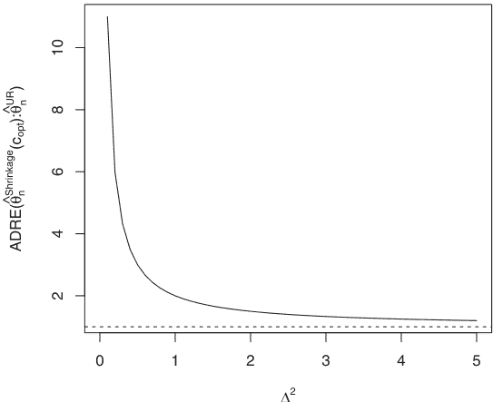

图 3.2 使用最优 c 和 URE 的缩减 R-估计器的 ADRE。

**证明：** 找出以下式子的根即可：

```
$$\frac{\partial \text{ADL}_2\text{-risk}(\hat{\delta}_n^{\text{ShrinkageR}}(c))}{\partial c} = \eta^2 \left[ 2c - 2(1 - c)\Delta^2 \right] = 0$$
```

这将导出 \(c = \Delta^2 / (1 + \Delta^2)\) 作为最优值。

因此，

```
$$\text{ADL}_2\text{-risk}(\hat{\delta}_n^{\text{ShrinkageR}}(c_{\text{opt}})) = \eta^2 \frac{\Delta^2}{1 + \Delta^2},$$
```

并且，由公式 (3.1.5) 可得出结论

```
$$\text{ADRE}(\hat{\delta}_n^{\text{ShrinkageR}}(c_{\text{opt}}) : \hat{\theta}_n^{\text{UR}}) = 1 + \frac{1}{\Delta^2}.$$
```

此外，

```
$$\text{ADL}_2\text{-risk}(\hat{\theta}_n^{\text{UR}}) - \text{ADL}_2\text{-risk}(\hat{\delta}_n^{\text{ShrinkageR}}(c_{\text{opt}})) = \frac{\eta^2}{1 + \Delta^2} \quad \forall \Delta^2.$$
```

因此，我们得出结论：\(\hat{\theta}_n^{\text{ShrinkageR}}(c_{\text{opt}})\) 优于 \(\hat{\theta}_n^{\text{UR}}\)。图 3.2 显示了不同 \(\Delta^2\) 值的 ADRE 函数，这证实了上述结果。

## 3.4 脊型 R-估计器的 $\theta$

我们在上一节中考察了使用因子 $c$ 的一般缩减估计器。作为缩减 R-估计器的一个特例，令 $c = 1/(1+\lambda)$，$\lambda > 0$，并使用此来定义位置参数的脊型 R-估计器如下

\(\hat{\theta}^{\text{ridgeR}}_n(\lambda) = \frac{1}{1 + \lambda} \hat{\theta}^{\text{UR}}_n.\)

**定理 3.4** 在局部备择假设 $K_{(n)}$ 下，$\theta$ 的脊型 R-估计器（即 $\hat{\theta}^{\text{ridgeR}}_n(\lambda)$）的 ADB、ADV 和 ADL$_2$-风险为

ADB \(\left(\hat{\theta}^{\text{ridgeR}}_n(\lambda)\right) = -\eta \frac{\lambda}{1 + \lambda} \Delta,$
ADV \(\left(\hat{\theta}^{\text{ridgeR}}_n(\lambda)\right) = \eta^2 \frac{1}{(1 + \lambda)^2},$
ADL$_2$-风险 \(\left(\hat{\theta}^{\text{ridgeR}}_n(\lambda)\right) = \eta^2 \frac{1}{(1 + \lambda)^2} (1 + \lambda^2 \Delta^2).$

**证明：** 该结果可通过在定理 3.3 中考虑 $c = 1/(1 + \lambda)$ 而轻易得出。

求解

\(\frac{d \text{ADL}_2\text{-risk} \left( \hat{\theta}^{\text{ridgeR}}_n(\lambda) \right)}{d\lambda} = \eta^2 \frac{2\lambda \Delta^2(1 + \lambda) - 2(1 + \lambda^2 \Delta^2)}{(1 + \lambda)^3}
= \eta^2 \frac{2\lambda \Delta^2 - 2}{(1 + \lambda)^3} = 0 \quad (3.4.1)\)

得出 $\lambda_{opt} = \Delta^{-2}$。然后，对于 $\lambda_{opt}$，ADL$_2$-风险由下式给出

\(\text{ADL}_2\text{-risk} \left( \hat{\theta}^{\text{ridgeR}}_n(\lambda_{opt}) \right) = \eta^2 \frac{\Delta^2}{1 + \Delta^2}.\)

$\hat{\theta}^{\text{UR}}_n$ 和 $\hat{\theta}^{\text{ridgeR}}_n(\Delta^{-2})$ 的 ADL$_2$-风险比值由 $\Delta^2/(1 + \Delta^2)$ 给出，适用于 $\Delta^2 \in \mathbb{R}^+$。由此可见，由

\(\text{ADRE}\left( \hat{\theta}^{\text{ridgeR}}_n(\lambda_{opt}) : \hat{\theta}^{\text{UR}}_n \right) = 1 + \frac{1}{\Delta^2}. \quad (3.4.2)\)

可知 $\hat{\theta}^{\text{ridgeR}}_n(\lambda_{opt})$ 优于 $\hat{\theta}^{\text{UR}}_n$。

表 3.1 显示了不同 $\Delta^2$ 值的 ADRE 值。它证实了脊估计与无约束 R-估计相比的更好性能。

**表 3.1** 不同 $\Delta^2$ 值的脊 ADRE 值

| $\Delta^2$ | 0 | 0.01 | 0.05 | 0.1 | 0.5 | 1 | 2 | 5 | 10 | 20 | 50 |
|---|---|---|---|---|---|---|---|---|---|---|---|---|
| ADRE | $\infty$ | 101 | 21 | 11 | 3 | 2 | 1.5 | 1.2 | 1.1 | 1.05 | 1.02 |

## 3.5 $\theta$ 的预检验 R-估计器

在统计文献中，Bancroft (1944, 1964, 1965) 引入了参数的预检验估计，用于在怀疑对感兴趣参数存在某些“不确定先验信息”（UPI）时估计模型参数。该方法涉及基于适当统计量对 UPI 进行统计检验，并决定是否接受模型参数。

此处考虑由原假设 $\mathcal{H}_0 : \theta = 0$ 表示的 UPI。如果怀疑 $\theta$ 为 0，则应使用受限 R-估计器（$\hat{\theta}_n^{\text{RR}} = 0$）。在实际中，关于此先验信息 $\theta = 0$ 可能存在一定程度的不确定性。关于 UPI 的这种疑虑可以通过使用“费雪方案”来消除，即检验原假设 $\mathcal{H}_0 : \theta = 0$ 与备择假设 $\mathcal{H}_A : \theta \neq 0$（或局部备择 $K_{(n)} : \theta = n^{-1/2}\delta$，其中 $\delta$ 为固定值）。基于该检验结果，根据 $\mathcal{H}_0$ 的拒绝或接受，我们选择 $\hat{\theta}_n^{\text{UR}}$ 或 $\hat{\theta}_n^{\text{RR}}$。因此，遵循 Bancroft (1944)，我们引入预检验 R-估计器（PTRE），记为 $\hat{\theta}_n^{\text{PTR}}(\alpha)$，如下

$\hat{\theta}_n^{\text{PTR}}(\alpha) = \hat{\theta}_n^{\text{UR}} I(\mathcal{L}_n > \chi_1^2(\alpha)) \quad (3.5.1)$

其中 $\mathcal{L}_n$ 是用于检验 $\mathcal{H}_0 : \theta = 0$ 的检验统计量，定义为

$\mathcal{L}_n = \frac{n(\hat{\theta}_n^{\text{UR}})^2}{\hat{\eta}^2}. \quad (3.5.2)$

在原假设下，$\mathcal{L}_n$ 服从具有一个自由度（d.f.）的卡方分布，而 $\chi_1^2(\alpha)$ 是具有一个自由度的中心 $\chi^2$ 分布的 $\alpha$ 水平上临界值。如果 $\alpha = 1$，则始终选择 $\hat{\theta}_n^{\text{UR}}$；如果 $\alpha = 0$，则选择 $\hat{\theta}_n^{\text{RR}}$。由于 $0 < \alpha < 1$，在重复样本中，$\hat{\theta}_n^{\text{PTR}}$ 将产生 $\hat{\theta}_n^{\text{UR}}$ 和 $\hat{\theta}_n^{\text{RR}}$ 的组合。请注意，PTRE 过程仅导致两个值的选择，即 $\hat{\theta}_n^{\text{UR}}$ 或 $\hat{\theta}_n^{\text{RR}}$。此外，PTRE 依赖于显著性水平 $\alpha$。

**注释 3.1** 对于检验统计量，我们需要 $\hat{\eta}$。一个一致估计量是中位数绝对偏差（MAD），如在第 1 章中讨论的那样。更一般地，我们先前表明

$\eta^2 = \frac{A_\phi^2}{\gamma^2(\phi, f)}, \quad \gamma(\phi, f) = \int_{-\infty}^{\infty} f(x) d\Phi(F(x))$.

为了估计 $\gamma(\phi, f)$，我们使用

$\hat{\gamma}(\phi, f) = \int_{-\infty}^{\infty} f_n(x) d\Phi(F_n(x)) \quad (3.5.3)$

其中 \( f_n(x) \) 和 \( F_n(x) \) 分别是 \( f(x) \) 和 \( F(x) \) 的估计量。然后，

```
\(\hat{\eta}^2 = \frac{A_n^2}{\hat{\gamma}^2(\phi, f)}, \quad A_n^2 = n^{-1} \sum_{i=1}^n a_n^+(i)^2.\) (3.5.4)
```

还要注意的是

```
\(\frac{\sqrt{n}\hat{\theta}_n^{UR}}{\hat{\eta}} \sim N(0, 1),\) (3.5.5)
```

并且，由公式 (3.2.3) 可知

```
\(\frac{T_n(0)}{A_n} \sim N(0, 1).\) (3.5.6)
```

然后，

```
\(\mathcal{L}_n = \frac{T_n^2(0)}{A_n^2} = \left( \frac{\sqrt{n}\hat{\theta}_n^{UR}}{\hat{\eta}} \right)^2 + o_p(1).\) (3.5.7)
```

此结果将在后续定理中使用。

### 定理 3.5 在局部备择假设下，\(\theta\) 的预检验 R-估计器的 ADB 和 ADL$_2$-风险如下：

```
\(\text{ADB}(\hat{\theta}_n^{PTR}(\alpha)) = -\eta \Delta \mathcal{H}_3(\chi_1^2(\alpha), \Delta^2), \quad \text{ADL}_2\text{-risk}(\hat{\theta}_n^{PTR}(\alpha)) = \eta^2 \rho_{PT}(\alpha, \Delta^2),\)
```

where

```
\(\rho_{PT}(\alpha, \Delta^2) = 1 - \mathcal{H}_3(\chi_1^2(\alpha), \Delta^2) + \Delta^2 \left( 2\mathcal{H}_3(\chi_1^2(\alpha), \Delta^2) - \mathcal{H}_5(\chi_1^2(\alpha), \Delta^2) \right) .\)
```

这里，\(\mathcal{H}_\nu(\cdot, \Delta^2)\) 是具有 \(\nu\) 个自由度和非中心性参数 $\Delta^2$ 的 \(\chi^2\) 分布的累积分布函数（c.d.f.）。

**证明：** 如果将 PTRE 的定义与缩减 R-估计器相结合，可以轻易发现选择 \(c = I(\mathcal{L}_n > \chi_1^2(\alpha))\) 证实 PTRE 是缩减 R 族的一个成员。有人可能认为，通过将此 \(c\) 的选择代入定理 3.3 可以轻易得出该估计器的 ADB 和 ADL$_2$-风险，但这里的问题是 \(c\) 不是固定的。它是一个随机变量。因此，我们必须遵循公式 (3.1.3) 和 (3.1.4)。公式 (3.5.1) 中的 PTRE 可以重写为


$$\hat{\theta}_n^{\text{PTR}}(\alpha) = \hat{\theta}_n^{\text{UR}} - \hat{\theta}_n^{\text{UR}} I(\mathcal{L}_n \leq \chi_1^2(\alpha)). \tag{3.5.8}$$

根据公式 (3.1.3)，PTR 的 ADB 为

$$\text{ADB}(\hat{\theta}_n^{\text{PTR}}(\alpha)) = \sqrt{n}\left(\mathbb{E}[\hat{\theta}_n^{\text{PTR}}(\alpha)] - \theta\right) = \text{ADB}(\hat{\theta}_n^{\text{UR}}) - \mathbb{E}\left[\sqrt{n}\hat{\theta}_n^{\text{UR}} I(\mathcal{L}_n \leq \chi_1^2(\alpha))\right].$$

如果我们考虑 \(Z_n = \sqrt{n}\hat{\theta}_n^{\text{UR}}/\eta\)，则公式 (3.2.3) 在 \(K_{(n)}\) 下得出 \(Z_n \sim \mathcal{N}(\Delta, 1)\)。已知 \(\text{ADB}(\hat{\theta}_n^{\text{UR}}) = 0\)，并使用 Saleh (2006) 第 2 章定理 4，得出

$$\mathbb{E}\left[\sqrt{n}\hat{\theta}_n^{\text{UR}} I(\mathcal{L}_n \leq \chi_1^2(\alpha))\right] = \eta \mathbb{E}\left[ZI(Z^2 \leq \chi_1^2(\alpha))\right] = \eta \Delta \mathcal{H}_3(\chi_1^2(\alpha), \Delta^2). \tag{3.5.9}$$

至此，\(\text{ADB}(\hat{\theta}_n^{\text{PTR}}(\alpha))\) 的证明完成。

要证明 \(\hat{\theta}_n^{\text{PTR}}(\alpha)\) 的 \(\text{ADL}_2\)-风险，我们如下进行，

$$\text{ADL}_2\text{-risk}(\hat{\theta}_n^{\text{PTR}}(\alpha)) = \mathbb{E}\left[n(\hat{\theta}_n^{\text{PTR}}(\alpha) - \theta)^2\right] = \mathbb{E}\left[n\left(\hat{\theta}_n^{\text{UR}} - \theta\right)^2\right] - 2\mathbb{E}\left[n\left(\hat{\theta}_n^{\text{UR}} - \theta\right)\left(\hat{\theta}_n^{\text{UR}} I(\mathcal{L}_n \leq \chi_1^2(\alpha))\right)\right] + \mathbb{E}\left[n\left(\hat{\theta}_n^{\text{UR}}\right)^2 I(\mathcal{L}_n \leq \chi_1^2(\alpha))\right] = \text{ADL}_2\text{-risk}(\hat{\theta}_n^{\text{UR}}) - \mathbb{E}\left[n\left(\hat{\theta}_n^{\text{UR}}\right)^2 I(\mathcal{L}_n \leq \chi_1^2(\alpha))\right] + 2\sqrt{n}\theta\mathbb{E}\left[\sqrt{n}\hat{\theta}_n^{\text{UR}} I(\mathcal{L}_n \leq \chi_1^2(\alpha))\right]. \tag{3.5.10}$$

同样，考虑到 \(Z = \sqrt{n}\hat{\theta}_n^{\text{UR}}/\eta\)，在 \(K_{(n)}\) 和公式 (3.2.3) 下，可以得出结论 \(Z \sim \mathcal{N}(\Delta, 1)\)。Saleh (2006) 第 2 章定理 5 导出

$$\mathbb{E}\left[n\left(\hat{\theta}_n^{\text{UR}}\right)^2 I(\mathcal{L}_n \leq \chi_1^2(\alpha))\right] = \eta^2 \mathbb{E}\left[Z^2 I(Z^2 \leq \chi_1^2(\alpha))\right] = \eta^2 (\mathcal{H}_3(\chi_1^2(\alpha), \Delta^2) + \Delta^2 \mathcal{H}_5(\chi_1^2(\alpha), \Delta^2)). \tag{3.5.11}$$

根据公式 (3.5.9),

$$2\sqrt{n}\theta\mathbb{E}\left[\sqrt{n}\hat{\theta}_n^{\text{UR}} I(\mathcal{L}_n \leq \chi_1^2(\alpha))\right] = 2\eta^2 \Delta (\Delta \mathcal{H}_3(\chi_1^2(\alpha), \Delta^2)). \tag{3.5.12}$$

将公式 (3.5.11) 和 (3.5.12) 代入公式 (3.5.10)，我们得到

$$\text{ADL}_2\text{-risk}(\hat{\theta}_n^{\text{PTR}}(\alpha)) = \eta^2 - \eta^2 (\mathcal{H}_3(\chi_1^2(\alpha), \Delta^2) + \Delta^2 \mathcal{H}_5(\chi_1^2(\alpha), \Delta^2)) + 2\eta^2\Delta^2\mathcal{H}_3(\chi_1^2(\alpha), \Delta^2) = \eta^2(1 - \mathcal{H}_3(\chi_1^2(\alpha), \Delta^2) + \Delta^2(2\mathcal{H}_3(\chi_1^2(\alpha), \Delta^2) - \mathcal{H}_5(\chi_1^2(\alpha), \Delta^2))).$$

第一项源于定理 3.1，证明完成。

因此，

$$\text{ADRE}(\hat{\theta}_n^{\text{PTR}}(\alpha) : \hat{\theta}_n^{\text{UR}}) = \rho_{\text{PT}}^{-1}(\alpha, \Delta^2).$$

### 3.5.1 PTRE 的最优显著性水平

可以将公式 (3.5.13) 重写为

$$\text{ADRE}(\hat{\theta}_n^{\text{PTR}}(\alpha) : \hat{\theta}_n^{\text{UR}}) = [1 + g(\alpha, \Delta^2)]^{-1},$$

其中

$$g(\alpha, \Delta^2) = -\mathcal{H}_3(\chi_1^2(\alpha), \Delta^2) + \Delta^2(2\mathcal{H}_3(\chi_1^2(\alpha), \Delta^2) - \mathcal{H}_5(\chi_1^2(\alpha), \Delta^2)).$$

\(\text{ADRE}(\hat{\theta}_n^{\text{PTR}}(\alpha) : \hat{\theta}_n^{\text{UR}})\) 作为固定 \(\alpha\) 下 \(\Delta^2\) 的函数的图像，在交叉 1-线并达到某个 \(\Delta^2 = \Delta_0^2(\alpha)\) 处的最小值之前是递减的；然后当 \(\Delta^2 \to \infty\) 时，它增加趋向 1-线。\(\text{ADRE}(\hat{\theta}_n^{\text{PTR}}(\alpha) : \hat{\theta}_n^{\text{UR}})\) 的最大值发生在 \(\Delta^2 = 0\)，值为

$$\text{ADRE}(\hat{\theta}_n^{\text{PTR}}(\alpha) : \hat{\theta}_n^{\text{UR}}) = \{1 - \mathcal{H}_3(\chi_1^2(\alpha), 0)\}^{-1} \ge 1,$$

对于所有 \(\alpha \in A\) 成立，其中 \(A\) 是 \(\alpha\) 的可能值集合。

\(\text{ADRE}(\hat{\theta}_n^{\text{PTR}}(\alpha) : \hat{\theta}_n^{\text{UR}})\) 的值随着 \(\alpha\) 的增加而减少，即，如果 \(\alpha = 0\) 且 \(\Delta^2\) 变化，则 \(\text{ADRE}(\hat{\theta}_n^{\text{PTR}}(0) : \hat{\theta}_n^{\text{UR}})\) 和 \(\text{ADRE}(\hat{\theta}_n^{\text{PTR}}(1) : \hat{\theta}_n^{\text{UR}})\) 的图像在 \(\Delta^2 = 1\) 处相交。一般来说，\(\text{ADRE}(\hat{\theta}_n^{\text{PTR}}(\alpha_1) : \hat{\theta}_n^{\text{UR}})\) 和 \(\text{ADRE}(\hat{\theta}_n^{\text{PTR}}(\alpha_2) : \hat{\theta}_n^{\text{UR}})\) 在区间 \(0 \le \Delta^2 \le 1\) 内相交；交点处的 \(\Delta^2\) 值随着 \(\alpha\) 的增加而增大。因此，对于两个不同的 \(\alpha\) 值，\(\text{ADRE}(\hat{\theta}_n^{\text{PTR}}(\alpha_1) : \hat{\theta}_n^{\text{UR}})\) 和 \(\text{ADRE}(\hat{\theta}_n^{\text{PTR}}(\alpha_2) : \hat{\theta}_n^{\text{UR}})\) 将始终在 1-线以下相交。

为了获得具有最小保证效率 \(E_0\) 的 PTR 估计量，我们采用以下程序：如果 \(0 \le \Delta^2 \le 1\)，我们总是选择 \(\hat{\theta}_n^{\text{UR}}\)，因为在此区间内 \(\text{ADRE}(\hat{\theta}_n^{\text{PTR}}(\alpha) : \hat{\theta}_n^{\text{UR}}) \ge 1\)。但是，由于 \(\Delta^2\) 通常未知，无法选择一个始终最优的估计量。出于此原因，我们选择一个具有最小保证效率的估计量，并从集合 \(A = \{\alpha \mid \text{ADRE}(\hat{\theta}_n^{\text{PTR}}(\alpha) : \hat{\theta}_n^{\text{UR}}) \ge E_0\}\) 中寻找合适的 \(\alpha\)。如此选定的估计量最大化了所有 \(\alpha \in A\) 上的 \(\text{ADRE}(\hat{\theta}_n^{\text{PTR}}(\alpha) : \hat{\theta}_n^{\text{UR}})\)，并且

表 3.2 不同 \(\alpha\) 值的初步检验 R-估计量的最大和最小保证 ADRE。

| \(\alpha\) | 0.05 | 0.10 | 0.15 | 0.20 | 0.25 |
|---|---|---|---|---|---|
| \(E_{\max}\) | 3.5829 | 2.2764 | 1.7936 | 1.5389 | 1.3820 |
| \(E_{\min}\) | 0.4058 | 0.5122 | 0.5950 | 0.6646 | 0.7247 |
| \(\Delta^2\) | 4.6820 | 3.9692 | 3.5890 | 3.3409 | 3.1632 |

因此，我们求解以下方程以得到最优 \(\alpha^*\)：

\(\min_{\Delta^2} \text{ADRE}(\hat{\theta}_n^{\text{PTR}}(\alpha) : \hat{\theta}_n^{\text{UR}}) = E(\alpha, \Delta_0^2(\alpha)) = E_0. \quad (3.5.15)\)

以这种方式得到的解 \(\alpha^*\) 导致 PTR 保证效率 \(E_0\)，当 \(\Delta^2 = 0\) 时，其值可能增加至由 (3.5.15) 给出的 \(\text{ADRE}(\hat{\theta}_n^{\text{PTR}}(\alpha^*) : \hat{\theta}_n^{\text{UR}})\)。有关最优值，请参见表 3.2。

上述方法在文献中经常被使用。我们参考 Saleh (2006)、Safaríyan et al. (2019)、Karbalaee et al. (2018, 2019)，仅举几例。

## 3.6 Saleh 类型 R-估计量

在本节中，我们将经历一系列 R-估计量，最终导致正则 Saleh 类型 R-估计量，它是 LASSO 类型的估计量。这与岭类型 R-估计量联合使用，以产生朴素弹性网（或 nENet 类型）R-估计量。定理将不加证明地给出以提高可读性，但它们是前面各节给出的证明的扩展。

### 3.6.1 \(\theta\) 的硬阈值 R-估计量

受 PTR 估计量的启发，我们可以通过引入调谐参数 \(\lambda^2\) 来简化，以扮演 \(\chi_1^2(\alpha)\) 的角色。然后我们调整 \(\lambda\) 直到达到最小 \(\text{ADL}_2\)-风险。为此，当人们怀疑 \(\theta\) 可能为 0 时，我们现在定义 \(\theta\) 的硬阈值 R-估计量为

\(\hat{\theta}_n^{\text{HTR}}(\lambda) = \hat{\theta}_n^{\text{UR}} I(\mathcal{L}_n > \lambda^2) \quad (3.6.1)\)

其中 \(I(\cdot)\) 是一个指示函数，取两个可能的值，0 或 1，取决于阈值 \(\mathcal{L}_n\)，如前面在公式 (3.5.7) 中定义的。该 HTR 估计量应被视为与 PTR 在形式上相同。


使用 \( Z_n = \sqrt{n}\hat{\theta}_n^{UR}/\eta \)，硬阈值 R-估计量 \( \theta \) 的定义可以改写为

\[ \sqrt{n}\hat{\theta}_n^{HTR}(\lambda) = \eta Z_n I(|Z_n| > \lambda). \]

### 定理 3.6
在局部备择假设下，\( K_{(n)} \)，\( \theta \) 的硬阈值 R-估计量（即 \( \hat{\theta}_n^{HTR}(\lambda) \)）的 ADB、ADV 和 ADL\(_2\)-风险为

\(\text{ADB}(\hat{\theta}_n^{HTR}(\lambda)) = -\eta\Delta\mathcal{H}_3(\lambda^2, \Delta^2),\)

\(\text{ADV}(\hat{\theta}_n^{HTR}(\lambda)) = \eta^2[1 - \mathcal{H}_3(\lambda^2, \Delta^2) - \Delta^2\mathcal{H}_3^2(\lambda^2, \Delta^2) + \Delta^2(2\mathcal{H}_3(\lambda^2, \Delta^2) - \mathcal{H}_5(\lambda^2, \Delta^2)) ],\)

\(\text{ADL}_2\text{-risk}(\hat{\theta}_n^{HTR}(\lambda)) = \eta^2\rho_{PT}(\lambda, \Delta^2),\)

respectively, where

\(\rho_{PT}(\lambda, \Delta^2) = 1 - \mathcal{H}_3(\lambda^2, \Delta^2) + \Delta^2(2\mathcal{H}_3(\lambda^2, \Delta^2) - \mathcal{H}_5(\lambda^2, \Delta^2))\)

and \( \mathcal{H}_\nu(\lambda^2, \Delta^2) \) is the c.d.f. of a \( \chi^2 \)-distribution with \( \nu \) d.f.

如果在初步检验 R-估计量中将 \( \chi^2_1(\alpha) \) 替换为 \( \lambda^2 \)，则将得到硬阈值 R-估计量。由于 \( \hat{\theta}_n^{HTR}(\lambda) \) 实际上与 \( \hat{\theta}_n^{PTR}(\alpha) \) 相同，我们跳过证明。

One may use \( \lambda^* = \sqrt{2 \ln(2)} \) which is the minimax value of \( \lambda \) to compute the ADRE of \( \hat{\theta}_n^{HTR}(\lambda^*) \) w.r.t. \( \hat{\theta}_n^{UR} \), i.e.

\(\text{ADRE}\left( \hat{\theta}_n^{HTR}(\lambda^*) : \hat{\theta}_n^{UR} \right) = \rho_{PT}^{-1}(\lambda^*, \Delta).\)

See Saleh et al. (2019) for details of the choice \( \lambda^* \). Figure 3.3 shows the ADRE function of the HT (or PT) R-estimator for different \( \Delta^2 \) values. From this figure, it is obvious that the PTRE has a better performance than the unrestricted R-estimation in the case of \( \Delta^2 \le 0.6 \) and vice versa when \( \Delta^2 > 0.6 \). Also, as \( \Delta^2 \) goes to \( \infty \), the estimator behaves like the unrestricted case.

### 3.6.2 Saleh-type R-estimator of \( \theta \)

Again, following the spirit of Sections 3.3 and 3.5, we define a continuous version of PTRE, namely the Saleh-type R-estimator (SRE), denoted by \( \hat{\theta}_n^{SR}(\lambda) \), and given by

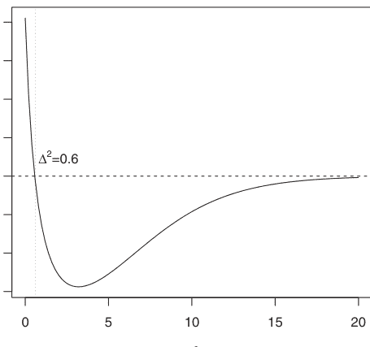

**Figure 3.3** The ADRE of the preliminary test (or hard threshold) R-estimator for different \(\Delta^2\) based on \(\lambda^* = \sqrt{2\ln(2)}\).

\(\hat{\theta}_n^{\text{SR}}(\lambda) = \hat{\theta}_n^{\text{UR}}(1 - \frac{\lambda}{\sqrt{\mathcal{L}_n}}) = \hat{\theta}_n^{\text{UR}} - \lambda\eta \frac{\hat{\theta}_n^{\text{UR}}}{|\sqrt{n}\hat{\theta}_n^{\text{UR}}|}.\) (3.6.2)

This can be rewritten as

\(\begin{aligned} \sqrt{n}\hat{\theta}_n^{\text{SR}}(\lambda) &= \sqrt{n}\hat{\theta}_n^{\text{UR}} - \lambda\eta \frac{\sqrt{n}\hat{\theta}_n^{\text{UR}}}{|\sqrt{n}\hat{\theta}_n^{\text{UR}}|} \\ &= \eta \left(1 - \frac{\lambda}{|Z_n|}\right) Z_n = \eta(Z_n - \lambda \text{sgn}(Z_n)) \end{aligned}\) (3.6.3)

with \(Z_n = \sqrt{n}\hat{\theta}_n^{\text{UR}}/\eta \sim \mathcal{N}(\Delta, 1)\).

### Theorem 3.7
Under the local alternative, \(K_{(n)}\), the ADB and \(\text{ADL}_2\text{-risk}\) of the Saleh-type R-estimator of \(\theta\) are

\(\text{ADB}(\hat{\theta}_n^{\text{SR}}(\lambda)) = -\eta\lambda [2\Phi(\Delta) - 1],\)

and

\(\text{ADL}_2\text{-risk}(\hat{\theta}_n^{\text{SR}}(\lambda)) = \eta^2 \left[ 1 + \lambda^2 - 2\lambda \sqrt{\frac{2}{\pi}} \exp \left\{ -\frac{\Delta^2}{2} \right\} \right].\)

Table 3.3 The ADRE values of the Saleh-type R-estimator for \(\lambda^*_{\max} = \sqrt{\frac{2}{\pi}}\) and different \(\Delta^2\).

| \(\Delta^2\) | 0 | 0.05 | 0.1 | 0.5 | 1 | 2ln(2) | 2 | 5 | 10 |
|---|---|---|---|---|---|---|---|---|---|
| ADRE | 2.75 | 2.53 | 2.35 | 1.55 | 1.16 | 1.00 | 0.86 | 0.65 | 0.61 |

### Corollary 3.2
The optimum value of \(\lambda\) is

\(\lambda^* = \sqrt{\frac{2}{\pi}} \exp \left\{ -\frac{\Delta^2}{2} \right\},\)

with a maximum \(\lambda^*_{\max} = \sqrt{\frac{2}{\pi}}\) at \(\Delta^2 = 0\).

Thus, the optimum value is

\(\text{ADL}_2\text{-risk}(\hat{\vartheta}^{\text{SR}}_n(\lambda^*_{\max})) = \eta^2 \left[ 1 - \frac{2}{\pi} \left( 2 \exp \left\{ -\frac{\Delta^2}{2} \right\} - 1 \right) \right].\)

The ADRE of \(\hat{\vartheta}^{\text{SR}}_n(\lambda^*_{\max})\) is then given by

\(\text{ADRE}(\hat{\vartheta}^{\text{SR}}_n(\lambda^*_{\max}) : \hat{\vartheta}^{\text{UR}}_n) = \left[ 1 - \frac{2}{\pi} \left( 2 \exp \left\{ -\frac{\Delta^2}{2} \right\} - 1 \right) \right]^{-1}. \) (3.6.4)

Table 3.3 shows the ADRE values of Eq. (3.6.4) for some selected values of \(\Delta^2\). It is easy to see from Table 3.3 that \(\hat{\vartheta}^{\text{SR}}_n(\lambda^*_{\max})\) performs better than \(\hat{\vartheta}^{\text{UR}}_n\) whenever \(0 < \Delta^2 \le 2 \ln(2)\) and \(\hat{\vartheta}^{\text{UR}}_n\) performs better than \(\hat{\vartheta}^{\text{SR}}_n(\lambda^*_{\max})\) for \(\Delta^2 > 2 \ln(2)\).

### 3.6.3 Positive-rule Saleh-type (LASSO-type) R-estimator of \(\vartheta\)

From Section 3.6.2, consider the Saleh-type R-estimator of \(\vartheta\) which was defined as

\(\hat{\vartheta}^{\text{SR}}_n(\lambda) = \hat{\vartheta}^{\text{UR}}_n (1 - \frac{\lambda}{\sqrt{\mathcal{L}_n}}).\)

Notice that as \(|\hat{\vartheta}^{\text{UR}}_n| \to \infty\), \(\hat{\vartheta}^{\text{SR}}_n(\lambda)\) retains its sign. However, if \(|\hat{\vartheta}^{\text{UR}}_n| \to 0\), then the sign of \(\hat{\vartheta}^{\text{SR}}_n(\lambda)\) changes. To correct this anomaly, we define the positive-rule Saleh-type R-estimator as

\(\hat{\vartheta}^{\text{SR}+}_n(\lambda) = \hat{\vartheta}^{\text{UR}}_n (1 - \frac{\lambda}{\sqrt{\mathcal{L}_n}})^+ = \left( \hat{\vartheta}^{\text{UR}}_n - \frac{\lambda \eta}{\sqrt{n}} \text{sgn}(\hat{\vartheta}^{\text{UR}}_n(\lambda)) \right) I(\mathcal{L}_n > \lambda^2). \) (3.6.5)

A LASSO-type R-estimator, based on the derivation given earlier is:

\(\hat{\theta}_n^{\text{LassoR}}(\lambda) = \text{sgn}(\hat{\theta}_n^{\text{UR}}) \left( |\hat{\theta}_n^{\text{UR}}| - \lambda \frac{\eta}{\sqrt{n}} \right)^+.\)

Since \(\mathcal{L}_n = n(\hat{\theta}_n^{\text{UR}})^2/\eta^2\), we find that it can be rewritten as

\(\hat{\theta}_n^{\text{LassoR}}(\lambda) = \text{sgn}(\hat{\theta}_n^{\text{UR}}) \left( |\hat{\theta}_n^{\text{UR}}| - \lambda \frac{|\hat{\theta}_n^{\text{UR}}|}{\sqrt{\mathcal{L}_n}} \right)^+.\)

This is the same as (3.6.5), and was shown to be a linearized version of true LASSO R-estimator. Hence, this is referred to as a LASSO-type R-estimator of \(\theta\). Since it is different from the actual LASSO R-estimator, we refer to it as a positive-rule Saleh-type R-estimator. Considering \(Z_n = \sqrt{n}\hat{\theta}_n^{\text{UR}}/\eta\), the positive-rule Saleh-type R-estimator of \(\theta\) can be written as

\(\sqrt{n} \hat{\theta}_n^{\hat{\text{SR}}^+}(\lambda) = \eta Z_n \left( 1 - \frac{\lambda}{|Z_n|} \right)^+ = \eta Z_n \left( 1 - \frac{\lambda}{|Z_n|} \right) I(|Z_n| > \lambda)\)
\(= \eta \text{sgn}(Z_n) (|Z_n| - \lambda)^+ = \eta(Z_n - \lambda \text{sgn}(Z_n))I(|Z_n| > \lambda). (3.6.6)\)

### Theorem 3.8
Under the local alternative hypothesis, \(K_{(n)}\), the ADB and \(\text{ADL}_2\text{-risk}\) of \(\hat{\theta}_n^{\hat{\text{SR}}^+}(\lambda)\) are given by

\(\text{ADB}(\hat{\theta}_n^{\hat{\text{SR}}^+}(\lambda)) = -\eta \left\{ \Delta \mathcal{H}_3(\lambda^2, \Delta^2) - \lambda(\Phi(\lambda - \Delta) - \Phi(\lambda + \Delta)) \right\}, (3.6.7)\)

and

\(\text{ADL}_2\text{-risk}(\hat{\theta}_n^{\hat{\text{SR}}^+}(\lambda)) = \eta^2 \rho_{\text{ST}}(\lambda, \Delta), (3.6.8)\)

where

\(\rho_{\text{ST}}(\lambda, \Delta) = 1 - \mathcal{H}_3(\lambda^2, \Delta^2) + \Delta^2(2\mathcal{H}_3(\lambda^2, \Delta^2) - \mathcal{H}_5(\lambda^2, \Delta^2)) + \lambda^2(1 - \mathcal{H}_1(\lambda^2, \Delta^2)) - 2\lambda(\phi(\lambda - \Delta) + \phi(\lambda + \Delta)) = \rho_{\text{PT}}(\lambda, \Delta) + \lambda^2(1 - \mathcal{H}_1(\lambda^2, \Delta^2)) - 2\lambda (\phi(\lambda - \Delta) + \phi(\lambda + \Delta)). (3.6.9)\)

Hence,

\(\text{ADRE}(\hat{\theta}_n^{\hat{\text{SR}}^+}(\lambda) : \hat{\theta}_n^{\text{UR}}) = \rho_{\text{ST}}^{-1}(\lambda, \Delta). (3.6.10)\)

Table 3.4 shows the ADRE values of Eq. (3.6.10) for a range of \(\Delta^2\).

Further, it may be seen that \(\text{ADL}_2\text{-risk}(\hat{\theta}_n^{\hat{\text{SR}}^+}(\lambda_{\text{max}}^*)) \le \text{ADL}_2\text{-risk}(\hat{\theta}_n^{\text{UR}}(\lambda_{\text{max}}^*))\) uniformly in \(\Delta^2 \in \mathbb{R}^+\). See Tables 3.3 and 3.4.


| \(\Delta^2\) | 0 | 0.05 | 0.1 | 0.5 | 1 | 2ln(2) | 2 | 5 | 10 |
|---|---|---|---|---|---|---|---|---|---|
| ADRE | 4.30 | 3.83 | 3.46 | 2.03 | 1.42 | 1.19 | 0.98 | 0.68 | 0.62 |

对比表3.3和表3.4可证实，正则Saleh型R估计量的风险小于Saleh型R估计量。因此，该估计量对Saleh型R估计量是一种改进。

### 3.6.4 \(\theta\)的弹性网型R估计量

If we combine the ridge and LASSO R-estimators, we obtain the elastic net-type R-estimator (EnetRE) of \(\theta\). This estimator is defined by

\(\hat{\theta}_n^{\text{EnetR}}(\lambda, \alpha) = \text{argmin}_{\theta \in \mathbb{R}} \left\{ \sum_{i=1}^n |y_i - \theta|a_n^+(R_n^+(\theta)) + \lambda \left[ \eta\alpha|\theta| + \frac{1-\alpha}{2}\theta^2 \right] \right\}.\)

Correspondingly, the naive Enet-type R-estimator (nEnetRE) is given by

\(\hat{\theta}_n^{\text{nEnetR}}(\lambda, \alpha) = \frac{\hat{\theta}_n^\text{UR}}{1 + \lambda(1 - \alpha)} \left( 1 - \frac{\lambda\alpha}{\sqrt{\mathcal{L}_n}} \right) I(\mathcal{L}_n > \lambda^2\alpha^2)\) (3.6.11)

or equivalently

\(\sqrt{n}\hat{\theta}_n^{\text{nEnetR}}(\lambda, \alpha) = \eta \frac{\text{sgn}(Z_n)}{1 + \lambda(1 - \alpha)} (|Z_n| - \lambda\alpha)^+, \quad Z_n = \frac{\sqrt{n}\hat{\theta}_n^\text{UR}}{\eta},\)

where \(0 < \alpha < 1\), and \(\lambda > 0\). If \(\alpha = 0\), then the nEnetRE becomes the ridge-type R-estimator, \((\eta Z_n)/(1 + \lambda)\). On the other hand, taking \(\alpha = 1\), it reduces to the positive-rule Saleh-type (i.e. LASSO-type) R-estimator, \(\eta\text{sgn}(Z_n)(|Z_n| - \lambda)^+\).

### Theorem 3.9 Under the local alternative hypothesis, \(K_{(n)}\), the ADB and ADL\(_2\)-risk of the naive elastic net-type R-estimator of \(\theta\) are

\(\text{ADB}(\hat{\theta}_n^{\text{nEnetR}}(\lambda, \alpha)) = -\eta \frac{1}{1 + \lambda(1 - \alpha)} \left\{ \Delta\mathcal{H}_3(\lambda^2\alpha^2, \Delta^2) \right.\)
\(\left. - \lambda\alpha \left( \Phi(\lambda\alpha - \Delta) - \Phi(\lambda\alpha + \Delta) \right) - \lambda(1 - \alpha)\Delta \right\}\)

and

\(\text{ADL}_2\text{-risk}(\hat{\theta}_n^{\text{nEnetR}}(\lambda, \alpha)) = \eta^2 \frac{1}{[1 + \lambda(1 - \alpha)]^2} \rho_\text{EN}(\lambda, \alpha, \Delta)\)

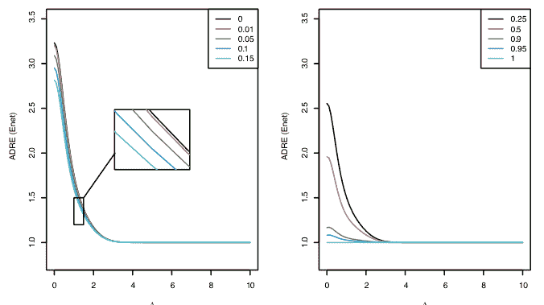

### Figure 3.4 The ADRE of nEnet-type R-estimators.

where

\begin{align*}
\rho_{EN}(\lambda, \alpha, \Delta) &= \Bigg( 1 - \mathcal{H}_3(\lambda^2 \alpha^2, \Delta^2) + \Delta^2 \Big( 2 \mathcal{H}_3(\lambda^2 \alpha^2, \Delta^2) - \mathcal{H}_5(\lambda^2 \alpha^2, \Delta^2) \Big) \\
&+ \lambda^2 \alpha^2 \Big( 1 - \mathcal{H}_1(\lambda^2 \alpha^2, \Delta^2) \Big) - 2 \lambda \alpha \Big( \big[ \phi(\lambda \alpha + \Delta) + \phi(\lambda \alpha - \Delta) \big] \Big) \Bigg) \\
&+ 2 \lambda (1 - \alpha) \Delta \Big( \Delta \mathcal{H}_3(\lambda^2 \alpha^2, \Delta^2) - \lambda \alpha \big( \Phi(\lambda \alpha - \Delta) - \Phi(\lambda \alpha + \Delta) \big) \Big) \\
&+ \lambda^2 (1 - \alpha)^2 \Delta^2 \\
&= \rho_{ST}(\lambda \alpha, \Delta) + \lambda^2 (1 - \alpha)^2 \Delta^2 + 2 \lambda (1 - \alpha) \Delta \Bigg( \Delta \mathcal{H}_3(\lambda^2 \alpha^2, \Delta^2) \\
&- \lambda \alpha \big( \Phi(\lambda \alpha - \Delta) - \Phi(\lambda \alpha + \Delta) \big) \Bigg).
\end{align*}

Hence,

\(\text{ADRE}(\hat{\theta}_n^{\text{nEnetR}}(\lambda, \alpha) : \hat{\theta}_n^{\text{UR}}) = [1 + \lambda(1 - \alpha)]^2 \left( \rho_{EN}(\lambda, \alpha, \Delta) \right)^{-1}.\)

Figure 3.4 shows that the ADRE of nEnet-type R-estimators for different \(\alpha\) values.

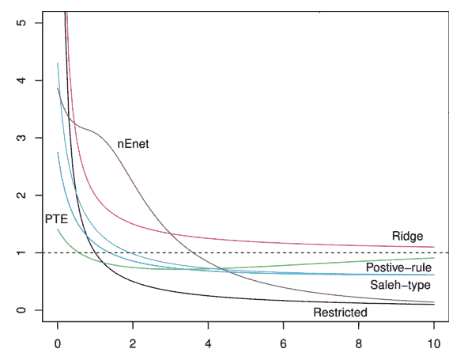

Figure 3.5 Figure of the ADRE of all R-estimators for different \(\Delta^2\).

## 3.7 位置参数R估计量的比较研究

This section provides a summary of the results obtained using all the R-estimators of the location model. Figure 3.5 and Table 3.5 provide the corresponding graphical and tabular data, respectively. Note that for PTE, we use \(\lambda = \lambda^* = \sqrt{2\ln(2)}\); for the Saleh-type and its positive-rule Saleh-type, we set \(\lambda = \lambda_{opt} = \sqrt{\frac{2}{\pi}}\); and, finally, for the nEnet R-estimator, we use \(\lambda = \sqrt{2\ln(2)}\) and \(\alpha = 0.5\).

| Δ² | RR | ridgeR | PTR/HTR | SR | SR+ | nEnetR |
|---|---|---|---|---|---|---|
| 0 | ∞ | ∞ | 1.411 | 2.752 | 4.303 | 3.869 |
| 0.01 | 100.000 | 101.000 | 1.399 | 2.705 | 4.199 | 3.842 |
| 0.02 | 50.000 | 51.000 | 1.387 | 2.659 | 4.101 | 3.816 |
| 0.03 | 33.333 | 34.333 | 1.375 | 2.615 | 4.007 | 3.791 |
| 0.04 | 25.000 | 26.000 | 1.364 | 2.573 | 3.918 | 3.766 |
| 0.05 | 20.000 | 21.000 | 1.353 | 2.533 | 3.833 | 3.743 |
| 0.1 | 10.000 | 11.000 | 1.301 | 2.350 | 3.463 | 3.636 |
| 0.2 | 5.000 | 6.000 | 1.213 | 2.064 | 2.916 | 3.471 |
| 0.3 | 3.333 | 4.333 | 1.141 | 1.849 | 2.532 | 3.355 |
| 0.4 | 2.500 | 3.500 | 1.082 | 1.683 | 2.248 | 3.277 |
| 0.5 | 2.000 | 3.000 | 1.031 | 1.550 | 2.029 | 3.224 |
| 1 | 1.000 | 2.000 | 0.869 | 1.157 | 1.417 | 3.084 |
| 2 ln(2) | 0.721 | 1.721 | 0.801 | 1.000 | 1.187 | 2.854 |
| 2 | 0.500 | 1.500 | 0.743 | 0.856 | 0.980 | 2.224 |
| 3 | 0.333 | 1.333 | 0.713 | 0.739 | 0.813 | 1.332 |
| 4 | 0.250 | 1.250 | 0.720 | 0.683 | 0.730 | 0.839 |
| 5 | 0.200 | 1.200 | 0.746 | 0.653 | 0.685 | 0.561 |
| 10 | 0.100 | 1.100 | 0.908 | 0.614 | 0.619 | 0.141 |
| 20 | 0.050 | 1.050 | 0.996 | 0.611 | 0.611 | 0.033 |
| 30 | 0.033 | 1.033 | 1.000 | 0.611 | 0.611 | 0.015 |
| 40 | 0.025 | 1.025 | 1.000 | 0.611 | 0.611 | 0.008 |
| 50 | 0.020 | 1.020 | 1.000 | 0.611 | 0.611 | 0.005 |

- (a) RRE vs. URE. We first consider the comparison of unrestricted and restricted R-estimators of \(\theta\) from Section 3.2.2. The \(ADL_2\)-risk difference of the two R-estimators is given by \(\eta^2(1 - \Delta^2)\). Thus, the restricted R-estimator, \(\hat{\theta}_n^{RR}\), outperforms the unrestricted R-estimator, \(\hat{\theta}_n^{UR}\), when \(0 \le \Delta^2 \le 1\) and \(\hat{\theta}_n^{UR}\) outperforms \(\hat{\theta}_n^{RR}\) whenever \(\Delta^2 > 1\), as seen in the 1st column of the table derived from

\(\text{ADRE}(\hat{\theta}_n^{RR} : \hat{\theta}_n^{UR}) = \Delta^{-2}\).

- (b) General shrinkage R-estimator vs. URE. A comparative study of the general shrinkage R-estimator of the location parameter, \(\hat{\theta}^{\text{ShrinkageR}}(c_{opt})\), and URE, \(\hat{\theta}_n^{UR}\), produces an ADL\(_2\)-risk difference given by

\(\eta^2 \left[ 1 - \frac{\Delta^2}{1 + \Delta^2} \right] = \frac{\eta^2}{1 + \Delta^2}.\)

Hence,

\(\text{ADRE}(\hat{\theta}^{\text{ShrinkageR}}(c_{\text{opt}}) : \hat{\theta}_n^{UR}) = 1 + \frac{1}{\Delta^2}.\)

The general shrinkage R-estimator of \(\theta\) outperforms \(\hat{\theta}_n^{UR}\) uniformly.

- (c) Ridge-type R-estimator vs. URE. Here, the ADL\(_2\)-risk difference of \(\hat{\theta}_n^{\text{ridgeR}}(\lambda_{\text{opt}})\) and \(\hat{\theta}_n^{UR}\) is again \(\frac{\eta^2}{1+\Delta^2}\). Therefore,

ADRE(\hat{\theta}_n^{\text{ridgeR}}(\lambda_{\text{opt}}) : \hat{\theta}_n^{\text{UR}}) = 1 + \frac{1}{\Delta^2}.

Hence, ridge-type R-estimator outperforms URE uniformly, as seen in the second column of the table.

- (d) HTRE (or PTR) vs. URE. In this case, the ADL\(_2\)-risk difference of \(\hat{\theta}_n^{\text{HTR}}(\lambda)\) (i.e. \(\hat{\theta}_n^{\text{PTR}}(\lambda)\) ) and \(\hat{\theta}_n^{\text{UR}}\) is given by

\(\mathcal{H}_3(\lambda^2, \Delta^2) - \Delta^2 \left( 2\mathcal{H}_3(\lambda^2, \Delta^2) - \mathcal{H}_5(\lambda^2, \Delta^2) \right).\)

The difference is non-negative whenever

\(0 \le \Delta^2 \le \frac{\mathcal{H}_3(\lambda^2, \Delta^2)}{2\mathcal{H}_3(\lambda^2, \Delta^2) - \mathcal{H}_5(\lambda^2, \Delta^2)}.\)

Therefore, \(\hat{\theta}_n^{\text{HTR}}(\lambda)\) outperforms \(\hat{\theta}_n^{\text{UR}}\), otherwise, \(\hat{\theta}_n^{\text{UR}}\) outperforms \(\hat{\theta}_n^{\text{HTR}}(\lambda)\) for \(\Delta^2\) in the complementary interval, as in the third column of the table. Finally,

\(\text{ADRE}(\hat{\theta}_n^{\text{HTR}}(\lambda) : \hat{\theta}_n^{\text{UR}}) = \left[ 1 - \mathcal{H}_3(\lambda^2, \Delta^2) + \Delta^2 \left( 2\mathcal{H}_3(\lambda^2, \Delta^2) - \mathcal{H}_5(\lambda^2, \Delta^2) \right) \right]^{-1}.\)

- (e) Saleh-type R-estimator vs. URE. The ADL\(_2\)-risk difference is

\(\frac{2}{\pi} \left[ 2 \exp \left\{ -\frac{\Delta^2}{2} \right\} - 1 \right].\)

Then for \(0 \le \Delta^2 \le 2 \ln 2\), the Saleh-type R-estimator is better than URE; otherwise, \(\hat{\theta}^{UR}(\lambda)\) is better. This is due to the fact that

\(\text{ADRE}(\hat{\theta}^{SR}(\lambda) : \hat{\theta}_n^{\text{UR}}) = \left[ \frac{\pi + 2}{\pi} - \frac{4}{\pi} \exp \left\{ -\frac{\Delta^2}{2} \right\} \right]^{-1}.\)

- (f) Positive-rule Saleh-type vs. Saleh-type R-estimators. The ADL\(_2\)-risk of \(\hat{\theta}_n^{SR+}\) is given by

ADL\(_2\)-risk(\(\hat{\theta}_n^{SR+}\)) = \(\eta^2\Big[(1 - \mathcal{H}_3(\lambda^2, \Delta^2)) + \Delta^2 \left( 2\mathcal{H}_3(\lambda^2, \Delta^2) - \mathcal{H}_5(\lambda^2, \Delta^2) \right) \big. \left. +\lambda^2 \left( 1 - \mathcal{H}_3(\lambda^2, \Delta^2) \right) - 2\lambda \left( \phi(\lambda + \Delta) + \phi(\lambda - \Delta) \right) \Big].\)

If \(\Delta^2 = 0\), then ADL\(_2\)-risk of \(\hat{\theta}_n^{SR+}(\lambda)\) is

\(\eta^2 \left[ (1 - \mathcal{H}_3(\lambda^2, 0)) + \lambda^2 \left( 1 - \mathcal{H}_1(\lambda^2, 0) \right) - 4\lambda \phi(\lambda) \right].\)

On the other hand,

ADL\(_2\)-risk(\(\hat{\theta}_n^{SR+}(\lambda)\)) \(\le \eta^2 \left[ (1 + \lambda^2) \right].\)


我们注意到，$\hat{\theta}_n^{SR+}(\lambda)$ 的 ADL$_2$-risk 在 $\Delta^2 \in \mathbb{R}^+$ 上均优于 Saleh-type R-estimator $\hat{\theta}_n^{SR}(\lambda)$，如表格的第四列和第五列所示。还可注意到，当 $0 < \Delta^2 < 2 \ln(2)$ 时，$\hat{\theta}_n^{SR+}(\lambda)$ 也优于 $\hat{\theta}_n^{UR}$；否则，$\hat{\theta}_n^{UR}$ 优于 $\hat{\theta}_n^{SR+}(\lambda)$。参见表格的第 5 列。

- (g) nEnet-type 与 positive-rule Saleh-type R-estimators 的比较。考虑 $\hat{\theta}_n^{ENetRE}(\lambda, \alpha)$ 与 $\hat{\theta}_n^{SR+}(\lambda)$ 的 ADL$_2$-risk 差值，其由

$$
\eta^2 \left( \rho_{ST}(\lambda \alpha, \Delta) - \frac{1}{[1 + \lambda(1 - \alpha)]^2} \left[ \rho_{ST}(\lambda \alpha, \Delta) + \lambda^2(1 - \alpha)^2 \Delta^2 + 2\lambda(1 - \alpha)\Delta \{ \Delta \mathcal{H}_3(\lambda \alpha, \Delta^2) - \lambda \alpha (\Phi(\lambda \alpha - \Delta) - \Phi(\lambda \alpha + \Delta)) \} \right] \right) = \eta^2 \rho_{ST}(\lambda \alpha, \Delta) \left[ 1 - \frac{1}{[1 + \lambda(1 - \alpha)]^2} \right] - \frac{1}{[1 + \lambda(1 - \alpha)]^2} \left[ \lambda^2(1 - \alpha)^2 \Delta^2 + 2\lambda(1 - \alpha)\Delta \{ \Delta \mathcal{H}_3(\lambda \alpha, \Delta) - \lambda \alpha (\Phi(\lambda \alpha - \Delta) - \Phi(\lambda \alpha + \Delta)) \} \right].
$$

该表达式可能为“正”、“负”或零。因此，positive-rule Saleh 和 nEnetRE 均不在 $\Delta^2$ 上统一主导对方，同样，ridge 和 nEnetRE 也不互相统一主导。这在表格的第 2、5 和 6 列中所示。这些结果是预期的，因为 nEnetRE 是两个 R-estimators 的组合。

## 3.8 简单线性模型

在本节中，我们考虑简单线性模型，

$$
y_i = \theta + \beta x_i + \varepsilon_i, \ i = 1, ..., n \tag{3.8.1}
$$

其中 $\varepsilon_1, ..., \varepsilon_n$ 为具有对称累积分布函数（c.d.f.）$F(\cdot)$ 和概率密度函数（p.d.f.）$f(\cdot)$ 的 i.i.d. 随机变量，且 $f(\cdot)$ 具有有限 Fisher 信息量 $I(f) < \infty$。令 $Q_n = \sum_{i=1}^n (x_i - \bar{x}_n)^2$。我们可以将 (3.8.1) 改写为

$$
y_i = \theta^* + \beta^* Q_n^{-\frac{1}{2}}(x_i - \bar{x}_n) + \varepsilon_i, \ i = 1, ..., n \tag{3.8.2}
$$

其中 $\theta^* = \theta + \beta \bar{x}_n$ 且 $\beta^* = Q_n^{\frac{1}{2}} \beta$。显然，

$$
Q_n^{-\frac{1}{2}} \sum_{i=1}^n (x_i - \bar{x}_n) = 0 \quad \text{and} \quad Q_n^{-1} \sum_{i=1}^n (x_i - \bar{x}_n)^2 = 1.
$$

令 $c_i = Q_n^{-\frac{1}{2}}(x_i - \bar{x}_n), \ i = 1, ..., n$。此外，假设 $R_n^+(\theta^*, \beta^*)$ 是 $|y_i - \theta^* - \beta^* c_i|$ 在 $|y_1 - \theta^* - \beta^* c_1|, ..., |y_n - \theta^* - \beta^* c_n|$ 中的秩。那么，我们可以将秩分散函数写为

$$
D_n(\theta, \beta) = \sum_{i=1}^n |y_i - \theta - \beta c_i| a_i^+(R_n^+(\theta, \beta))
$$

该函数在 \((\theta, \beta)$ 上是凸的、连续的且分段线性的。因此，我们定义 $(\theta^*, \beta^*)^\top$ 的 R-estimator 为

$$
(\hat{\theta}_n^{*\text{UR}}, \hat{\beta}_n^{*\text{UR}})^\top = \underset{(\theta, \beta)^\top \in \mathbb{R}^2}{\text{argmin}} \{D_n(\theta, \beta)\}.
$$

很容易验证，在 \(D_n(\theta, \beta)$ 的连续点处，我们有

$$
\frac{\partial D_n(\theta, \beta)}{\partial \theta} = - \sum_{i=1}^n \text{sgn}(y_i - \theta - \beta c_i) a_i^+(R_n^+(\theta, \beta)) = -n^{-\frac{1}{2}} T_n(\theta, \beta)
$$

以及

$$
\frac{\partial D_n(\theta, \beta)}{\partial \beta} = - \sum_{i=1}^n c_i \text{sgn}(y_i - \theta - \beta c_i) a_i^+(R_n^+(\theta, \beta)) = -n^{-\frac{1}{2}} L_n(\theta, \beta).
$$

该结果为基于 (3.8.1) 或 (3.8.2) 分别对 \((\theta^*, \beta^*)$ 或 \((\theta, \beta)$ 进行同时 R-估计时引入加权符号秩统计量提供了动机和依据。进一步，利用渐近线性性质，我们得到对于任意（固定）\((\theta, \beta)^\top \in \mathbb{R}^2$，当 \(n \to \infty$ 时，

$$
|T_n(n^{-\frac{1}{2}}\omega_1, \omega_2) - T_n(0, 0) + \omega_1 \gamma(\phi, f)| \xrightarrow{P} 0, \quad (3.8.3)
$$

以及

$$
|L_n(\omega_1, n^{-\frac{1}{2}}\omega_2) - L_n(0, 0) + \omega_2 \gamma(\phi, f)| \xrightarrow{P} 0. \quad (3.8.4)
$$

因此，

$$
D_n(n^{-\frac{1}{2}}\omega_1, n^{-\frac{1}{2}}\omega_2) - D_n(0, 0) + \omega_1 T_n(0, 0) + \omega_2 L_n(0, 0) + \frac{\gamma(\phi, f)}{2}(\omega_1^2 + \omega_2^2) \xrightarrow{P} 0. \quad (3.8.5)
$$

上述提到的 \(D_n(\theta, \beta)$ 的凸性以及 (3.8.5) 中的逐点随机收敛，在 \((\theta, \beta)$ 且 \(\theta^2 + \beta^2 < k^2$ 上是一致的，且与 (3.8.3) 和 (3.8.4) 具有相同的一致收敛性。遵循 Jurečková 和 Sen (1996) 定理 5.5.2 的证明，我们得出当 \(n \to \infty$ 时，

$$
\left\| \begin{pmatrix} \sqrt{n}(\hat{\theta}_n^{*\text{UR}} - \theta^*) \\ (\hat{\beta}_n^{*\text{UR}} - \beta^*) \end{pmatrix} - \underset{(\theta, \beta) \in \mathbb{R}^2}{\text{argmin}} \left\{ \frac{\gamma(\phi, f)}{2} (\omega_1^2 + \omega_2^2) - \omega_1 T_n(0, 0) - \omega_2 L_n(0, 0) \right\} \right\| \xrightarrow{P} 0.
$$

因此，

$$
\begin{pmatrix} \sqrt{n}(\hat{\theta}_n^{\text{UR}}-\theta^*) \\ (\hat{\beta}_n^{\text{UR}}-\beta^*) \end{pmatrix}-\gamma^{-1}(\phi, f) \begin{pmatrix} T_n(0, 0) \\ L_n(0, 0) \end{pmatrix} \rightarrow^P 0. \quad (3.8.6)
$$

由于 R-estimator 具有变换尺度等变性质，由 (3.8.6) 可得，

$$
\begin{pmatrix} \sqrt{n}(\hat{\theta}_n^{\text{UR}}-\theta) \\ Q_n^{\frac{1}{2}}(\hat{\beta}_n^{\text{UR}}-\beta) \end{pmatrix}-\gamma^{-1}(\phi, f) \begin{pmatrix} 1 & -\sqrt{n}\bar{x}_n/Q_n^{\frac{1}{2}} \\ 0 & 1 \end{pmatrix} \begin{pmatrix} T_n(0, 0) \\ L_n(0, 0) \end{pmatrix} \rightarrow^P 0
$$

其中 \((\hat{\theta}_n^{\text{UR}}, \hat{\beta}_n^{\text{UR}})^\top$ 是指使用 \(D_n(\theta, \beta)$ 的 \((\theta, \beta)^\top$ 的 R-estimator。因此，

$$
\begin{pmatrix} \sqrt{n}(\hat{\theta}_n^{\text{UR}}-\theta) \\ \sqrt{n}(\hat{\beta}_n^{\text{UR}}-\beta) \end{pmatrix} \rightarrow^\mathcal{D} \mathcal{N}_2 \left( \begin{pmatrix} 0 \\ 0 \end{pmatrix}, \eta^2 \begin{pmatrix} 1+\frac{\bar{x}^2}{Q} & -\frac{\bar{x}}{Q} \\ -\frac{\bar{x}}{Q} & \frac{1}{Q} \end{pmatrix} \right) \text{ as } n \rightarrow \infty ,
$$

其中 \(Q = \lim_{n \rightarrow \infty} n^{-1} Q_n$ 。

### 3.8.1 斜率的受限 R-estimator

显然，如果怀疑 \(\beta$ 为 0，则 \(\beta$ 的受限 R-estimator (RRE)，记为 \(\hat{\beta}_n^{\text{RR}}$，为

$$
\hat{\beta}_n^{\text{RR}}=0 .
$$

为了克服在固定备择假设下不同大样本估计量具有相同渐近分布的困难，$\mathcal{H}_A : \beta \neq 0$，我们考虑局部备择假设

$$
K_{(n)} : \beta_{(n)}=\frac{1}{\sqrt{n}}\delta, \quad (3.8.7)
$$

其中 \(\delta$ 是一个固定数。

### 定理 3.10 在局部备择假设 \(K_{(n)}$ 下，受限 R-estimator \(\hat{\beta}_n^{\text{RR}}$ 的渐近分布偏差和 ADL$_2$-risk 分别为

$$
\text{ADB}(\hat{\beta}_n^{\text{RR}})=-\delta,
$$

$$
\text{ADL}_2\text{-risk}(\hat{\beta}_n^{\text{RR}})=\eta^2\Delta^2,\ \ \ \ \ \Delta^2=\frac{Q\delta^2}{\eta^2}.
$$

接下来，我们将定义简单线性模型 (3.8.1) 中斜率参数的收缩估计量和惩罚估计量。

### 3.8.2 斜率的收缩 R-estimator

考虑斜率的如下收缩 R-estimator

$$
\hat{\beta}_n^{\text{ShrinkageR}}(c) = c\hat{\beta}_n^{\text{UR}}, \quad 0 \le c \le 1. \tag{3.8.8}
$$

### 定理 3.11 在局部备择假设 \(K_{(n)} : \beta = n^{-\frac{1}{2}}\delta$ 下，\(\hat{\beta}_n^{\text{ShrinkageR}}(c)$ 的 ADB 和 ADL$_2$-risk 为

$$
\text{ADB}(\hat{\beta}_n^{\text{ShrinkageR}}(c)) = -(1-c)\delta = -\frac{\eta}{\sqrt{Q}}(1-c)\Delta,
$$

$$
\text{ADL}_2\text{-risk}(\hat{\beta}_n^{\text{ShrinkageR}}(c)) = \frac{\eta^2}{Q}[c^2 + (1-c)^2\Delta^2], \quad \Delta^2 = \frac{Q\delta^2}{\eta^2}. \tag{3.8.9}
$$

### 推论 3.3 斜率 \(\beta$ 的收缩 R-estimator 的最优 c 值为

$$
c_{\text{opt}} = \frac{\Delta^2}{1 + \Delta^2}.
$$

### 证明：对 (3.8.9) 关于 c 求极小，可得

$$
\frac{\partial\text{ADL}_2\text{-risk}(\hat{\beta}_n^{\text{ShrinkageR}}(c))}{\partial c} = \frac{\eta^2}{Q} [2c - 2(1-c)\Delta^2] = 0
$$

这给出了最优值 \(\Delta^2/(1 + \Delta^2)$。

将此最优值代入 (3.8.9) 得到

$$
\text{ADL}_2\text{-risk}(\hat{\beta}_n^{\text{ShrinkageR}}(c_{\text{opt}})) = \eta^2 \frac{\Delta^2}{1 + \Delta^2}.
$$

因此，

$$
\text{ADRE}(\hat{\beta}_n^{\text{ShrinkageR}}(c_{\text{opt}}) : \hat{\beta}_n^{\text{UR}}) = 1 + \frac{1}{\Delta^2}.
$$

### 3.8.3 斜率的 Ridge-type R-estimation

现在，考虑 (3.8.8)，取 \(c = 1/(1 + \lambda), \lambda > 0$。则，\(\beta$ 的 ridge-type R-estimator 为

$$
\hat{\beta}_n^{\text{ridgeR}}(\lambda) = \frac{1}{1 + \lambda} \hat{\beta}_n^{\text{UR}}.
$$

### 定理 3.12 在局部备择假设 \(K_{(n)}$ 下，\(\beta$ 的 ridge-type R-estimator，即 \(\hat{\beta}_n^{\text{ridgeR}}(\lambda)$，的 ADB 和 ADL$_2$-risk 为


ADB\(\left(\hat{\beta}_n^{\text{ridgeR}}(\lambda)\right) = -\frac{\lambda \delta}{1+\lambda} = -\frac{\eta}{\sqrt{Q}}\frac{\lambda}{1+\lambda}\Delta\)

ADL_2-risk\(\left(\hat{\beta}_n^{\text{ridgeR}}(\lambda)\right) = \frac{\eta^2}{\sqrt{Q}}\frac{1+\lambda^2\Delta^2}{(1+\lambda)^2}.\)

\(\lambda\) 的最优值为 \(\lambda_{opt} = \Delta^{-2}\)。因此，

ADL_2-risk\((\hat{\beta}_n^{\text{ridgeR}}(\Delta^{-2})) = \frac{\eta^2}{Q}\frac{\Delta^2}{1+\Delta^2}.\)

因此，

ADRE\((\hat{\beta}_n^{\text{ridgeR}}(\Delta^{-2}) : \hat{\beta}_n^{\text{UR}}) = 1 + \frac{1}{\Delta^2}.\)

### 3.8.4 斜率的硬阈值 R-估计量

根据第 3.6.1 节，我们定义斜率的硬阈值 R-估计量 (HTRE) 如下，

\(\hat{\beta}_n^{\text{HTR}}(\lambda) = \hat{\beta}_n^{\text{UR}} I(|\hat{\beta}_n^{\text{UR}}| > \frac{\lambda}{\sqrt{n}}\frac{\eta}{\sqrt{Q_n}}). \quad (3.8.10)\)

因此，

\(\sqrt{n}\hat{\beta}_n^{\text{HTR}}(\lambda) = \sqrt{n}\hat{\beta}_n^{\text{UR}} I(|\sqrt{n}\hat{\beta}_n^{\text{UR}}| > \frac{\lambda \eta}{\sqrt{Q_n}})\)
\(= \frac{\eta}{\sqrt{Q_n}} Z_n I(|Z_n| > \lambda).\)

**定理 3.13** 在局部备择假设 \(K_{(n)}\) 下，\(\beta\) 的硬阈值 R-估计量的 ADB 和 ADL_2 风险为

ADB\((\hat{\beta}_n^{\text{HTR}}(\lambda)) = -\frac{\eta}{\sqrt{Q}}\Delta \mathcal{H}_3(\lambda^2, \Delta^2)\)

ADL_2-risk\((\hat{\beta}_n^{\text{HTR}}(\lambda)) = \frac{\eta^2}{Q} \rho_{\text{PT}}(\lambda, \Delta^2),\)

分别，其中

\(\rho_{\text{PT}}(\lambda, \Delta^2) = 1 - \mathcal{H}_3(\lambda^2, \Delta^2) + \Delta^2 \left( 2\mathcal{H}_3(\lambda^2, \Delta^2) - \mathcal{H}_5(\lambda^2, \Delta^2) \right)\)

和 \(\mathcal{H}_\nu(\lambda^2, \Delta^2)\) 是具有 \(\nu\) 个自由度的 \(\chi^2\) 分布的累积分布函数（c.d.f.）。

极小极大值为 \(\lambda^* = \sqrt{2 \ln(2)}\)。因此，在 \(\lambda^*\) 情况下，\(\beta\) 的 HTRE 的 ADRE 计算如下

\(\text{ADRE}(\hat{\beta}_n^{\text{HTR}}(\lambda^*) : \hat{\beta}_n^{\text{UR}}) = (\rho_{\text{PT}}(\lambda^*, \Delta^2))^{-1} .\)

### 3.8.5 Saleh 类型的斜率 R-估计量

遵循 Saleh (2006, 第 3 章)，我们定义 Saleh 类型的 R-估计量如下

\(\hat{\beta}_n^{\text{SR}}(\lambda) = \hat{\beta}_n^{\text{UR}} - \frac{\lambda}{\sqrt{n}} \frac{\eta}{\sqrt{Q_n}} \text{sgn}(\hat{\beta}_n^{\text{UR}}).\) (3.8.11)

因此，

\(\sqrt{n}\hat{\beta}_n^{\text{SR}}(\lambda) = \sqrt{n}\hat{\beta}_n^{\text{UR}} - \frac{\lambda \eta}{\sqrt{Q_n}} \frac{\sqrt{n}\hat{\beta}_n^{\text{UR}}}{|\sqrt{n}\hat{\beta}_n^{\text{UR}}|} = \frac{\eta}{\sqrt{Q_n}} [Z_n - \lambda \text{sgn}(Z_n)] ,\)

因为在局部备择假设 \(K_{(n)} : \beta = n^{-\frac{1}{2}} \delta\) 下 \(Z_n \sim \mathcal{N}(\Delta, 1)\)，其中 \(\Delta = Q\delta^2 / \eta^2\)。

**定理 3.14** 在局部备择假设 \(K_{(n)}\) 下，\(\beta\) 的 Saleh 类型 R-估计量的 ADB 和 \(\text{ADL}_2\) 风险为

\(\text{ADB}(\hat{\beta}_n^{\text{SR}}(\lambda)) = -\frac{\eta \lambda^2}{\sqrt{Q}} [2\Phi(\Delta) - 1]\)

和

\(\text{ADL}_2\text{-risk}(\hat{\beta}_n^{\text{SR}}(\lambda)) = \frac{\eta^2}{Q} \left[ 1 + \lambda^2 - 2\lambda \sqrt{\frac{2}{\pi}} \exp \left\{ -\frac{\Delta^2}{2} \right\} \right].\)

使用 \(\lambda_{\text{opt}} = \max_{\Delta^2 \in \mathbb{R}^+} \sqrt{\frac{2}{\pi}} \exp \left\{ -\frac{\Delta^2}{2} \right\} = \sqrt{\frac{2}{\pi}}\)，Saleh 类型 R-估计量的 \(\text{ADL}_2\) 风险定义如下

\(\text{ADL}_2\text{-risk}(\hat{\beta}_n^{\text{SR}}(\lambda_{\text{opt}})) = \frac{\eta^2}{Q} \left[ 1 - \frac{2}{\pi} \left( 2 \exp \left\{ -\frac{\Delta^2}{2} \right\} - 1 \right) \right].\)

因此，ADRE 为

\(\text{ADRE}(\hat{\beta}_n^{\text{SR}}(\lambda_{\text{opt}}) : \hat{\beta}_n^{\text{UR}}) = \left[ 1 - \frac{2}{\pi} \left( 2 \exp \left\{ -\frac{\Delta^2}{2} \right\} - 1 \right) \right]^{-1} .\)

### 3.8.6 斜率的正则 Saleh 类型（LASSO 类型）R-估计量

\(\beta\) 的正则 Saleh 类型 R-估计量定义如下

$\hat{\beta}_n^{\text{SR}+}(\lambda) = \sqrt{n}\text{sgn}(\hat{\beta}_n^{\text{UR}}) \left( |\hat{\beta}_n^{\text{UR}}| - \frac{\lambda}{\sqrt{n}} \frac{\eta}{\sqrt{Q_n}} \right)^+.$

它可以重写为

$\sqrt{n}\hat{\beta}_n^{\text{SR}+}(\lambda) = \frac{\eta}{\sqrt{Q_n}}\text{sgn}(Z_n)(|Z_n| - \lambda)^+, \quad Z_n = \eta^{-1} Q_n^{-\frac{1}{2}} \sqrt{n}\hat{\beta}_n^{\text{UR}}.$

**定理 3.15** 在局部备择假设 \(K_{(n)}\) 下，\(\hat{\beta}_n^{\text{SR}+}(\lambda)\) 的 ADB 和 \(\text{ADL}_2\) 风险由以下给出

\(\text{ADB}(\hat{\beta}_n^{\text{SR}+}(\lambda)) = -\frac{\eta}{\sqrt{Q}}\{\Delta \mathcal{H}_3(\lambda^2, \Delta^2) - \lambda(\Phi(\lambda - \Delta) - \Phi(\lambda + \Delta))\},\)

和

\(\text{ADL}_2\text{-risk}(\hat{\beta}_n^{\text{SR}+}(\lambda)) = \frac{\eta^2}{Q}\rho_{\text{ST}}(\lambda, \Delta),\)

其中

\(\rho_{\text{ST}}(\lambda, \Delta) = 1 - \mathcal{H}_3(\lambda^2, \Delta^2) + \Delta^2(2\mathcal{H}_3(\lambda^2, \Delta^2) - \mathcal{H}_5(\lambda^2, \Delta^2)) + \lambda^2(1 - \mathcal{H}_1(\lambda^2, \Delta^2)) - 2\lambda(\phi(\lambda - \Delta) + \phi(\lambda + \Delta)).\)

最后，

\(\text{ADRE}(\hat{\beta}_n^{\text{SR}+}(\lambda) : \hat{\beta}_n^{\text{UR}}) = \rho_{\text{ST}}^{-1}(\lambda, \Delta).\)

### 3.8.7 自适应 LASSO (aLASSO 类型) R-估计量

aLASSO 类型的 R-估计量定义如下

\(\hat{\beta}_n^{\text{alassoR}}(\lambda) = \hat{\beta}_n^{\text{UR}} \left( 1 - \frac{\lambda_n}{\sqrt{n}} \frac{\hat{w}}{|\hat{\beta}_n^{\text{UR}}|} \right) I \left( |\sqrt{n}\hat{\beta}_n^{\text{UR}}| > \lambda_n \hat{w} \right), \quad \hat{w} = |\hat{\beta}_n^{\text{UR}}|^{-\gamma},\)

其中 \(\gamma\) 决定加权因子，\(\hat{\beta}_n^{\text{UR}}\) 是基于以下内容的 \(\beta\) 的无约束 R-估计量

\(\hat{\beta}_n^{\text{UR}} = \underset{\beta \in \mathbb{R}}{\text{argmin}} \left\{ \sum_{j=1}^n |y_j - \beta(x_j - \bar{x}_n)| a_n^+(R_{n_j}(\beta)) \right\}.\)

此外，\(\beta\) 的真正自适应 LASSO 表示为

\(\hat{\beta}_n^{\text{aLassoR}} = \text{argmin}_{\beta \in \mathbb{R}} \left\{ \sum_{j=1}^n |y_j - \beta(x_j - \bar{x}_n)| a_n^+(R_n(\beta)) + \lambda_n w |\beta| \right\} .\)

如果 \(\hat{\beta}_n^{\text{aLassoR}} \neq 0\)，则它属于事件 \(A_n^*\)；如果 \(\hat{\beta}_n^{\text{aLassoR}} = 0\)，则它属于 \(A_n^{*c}\)。若 \(P(A_n^* = A) = 1\)，则 aLASSO R-估计量是一致的，其中 \(A\) 是 \(\beta \neq 0\) 时发生的事件。

### 3.8.8 斜率的 nEnet 类型 R-估计量

遵循 Zou and Hastie (2005)，\(\beta\) 的 naive Enet 类型 R-估计量的表达式可写为

\(\hat{\beta}_n^{\text{nEnetR}}(\lambda, \alpha) = \frac{1}{1 + \lambda(1 - \alpha)} \text{sgn}(\hat{\beta}_n^{\text{UR}}) \left( |\hat{\beta}_n^{\text{UR}}| - \frac{\lambda \alpha}{\sqrt{n}} \frac{\eta}{\sqrt{Q_n}} \right)^+\)

它可以重写为

\(\hat{\beta}_n^{\text{nEnetR}}(\lambda, \alpha) = \frac{\eta}{\sqrt{Q} \left[ 1 + \lambda(1 - \alpha) \right]} \text{sgn}(Z_n) (|Z_n| - \lambda \alpha)^+ ,\)

其中 \(Z_n \sim \mathcal{N}(\Delta, 1)\)。

**定理 3.16** 在局部备择假设 \(K_{(n)}\) 下，\(\beta\) 的 naive 弹性网类型 R-估计量的 ADB 和 \(\text{ADL}_2\) 风险为

\(\text{ADB}(\hat{\beta}_n^{\text{nEnetR}}(\lambda, \alpha)) = -\frac{\eta}{\sqrt{Q}} \frac{1}{1 + \lambda(1 - \alpha)} \left\{ \Delta \mathcal{H}_3(\lambda^2 \alpha^2, \Delta^2) - \lambda \alpha (\Phi(\lambda \alpha - \Delta) - \Phi(\lambda \alpha + \Delta)) + \lambda(1 - \alpha) \Delta \right\}\)

\(\text{ADL}_2\text{-risk}(\hat{\beta}_n^{\text{nEnetR}}(\lambda, \alpha)) = \frac{\eta^2}{Q} \frac{1}{[1 + \lambda(1 - \alpha)]^2} \rho_{\text{EN}}(\lambda, \alpha, \Delta)\)

其中

\(\rho_{\text{EN}}(\lambda, \alpha, \Delta) = \left( 1 - \mathcal{H}_3(\lambda^2 \alpha^2, \Delta^2) + \Delta^2 \left( 2 \mathcal{H}_3(\lambda^2 \alpha^2, \Delta^2) - \mathcal{H}_5(\lambda^2 \alpha^2, \Delta^2) \right)\right.\)
\(\left. + \lambda^2 \alpha^2 \left( 1 - \mathcal{H}_1(\lambda^2 \alpha^2, \Delta^2) \right) - 2 \lambda \alpha \left( [\phi(\lambda \alpha + \Delta) + \phi(\lambda \alpha - \Delta)] \right)\right.\)
\(\left. + 2 \lambda (1 - \alpha) \Delta \left( \Delta \mathcal{H}_3(\lambda^2 \alpha^2, \Delta^2) - \lambda \alpha \left( \Phi(\lambda \alpha - \Delta) - \Phi(\lambda \alpha + \Delta) \right) \right)\right.\)
\(\left. + \lambda^2 (1 - \alpha)^2 \Delta^2 .\right)\)


因此，

\[
\text{ADRE}(\hat{\beta}_n^{\text{EnetR}}(\lambda, \alpha) : \hat{\beta}_n^{\text{UR}}) = [1 + \lambda(1 - \alpha)]^2 (\rho_{\text{EN}}(\lambda, \alpha, \Delta))^{-1}. \tag{3.8.12}
\]

表 3.5 包含了 \(\alpha = 0.5\) 和 \(\lambda = \sqrt{2 \ln 2}\) 的表格值。

### 3.8.9 斜率 R-估计量的比较研究

- (a) 无限制 vs. 受限斜率 R-估计量。我们考虑 \(\hat{\beta}_n^{\text{UR}}\) 和 \(\hat{\beta}_n^{\text{RR}} = 0\) 的 ADL$_2$-风险差，由 \(\eta^2 \left[ \frac{1}{Q} - \Delta^2 \right]\) 给出。当 \(0 \le \Delta^2 \le \frac{1}{Q}\) 且 \(\Delta^2 \in \left[ \frac{1}{Q}, \infty \right)\) 时，此差值非负。因此，当 \(0 \le \Delta^2 \le \frac{1}{Q}\) 时，RRE 优于 URE，否则 \(\hat{\beta}_n^{\text{UR}}\) 优于 \(\hat{\beta}_n^{\text{RR}}\)。

- (b) 斜率收缩 R-估计量 vs. URE。斜率 R-估计量的 ADL$_2$-风险差为 \(\eta^2/(1 + \Delta^2)\)，截距参数的 ADL$_2$-风险差为

\[
\eta^2 \left[ \left( 1 + \frac{\tilde{x}_n^2}{Q} \right) - \left( 1 + \frac{\tilde{x}_n^2}{Q} \frac{\Delta^2}{1 + \Delta^2} \right) \right] = \eta^2 \frac{\tilde{x}_n^2}{Q} \frac{1}{1 + \Delta^2}.
\]

因此，在两种情况下，收缩 R-估计量都一致优于 URE。嵌套岭类型 R-估计量亦然。

- (c) HTRE vs. 斜率 URE。在此情况下，ADL$_2$-风险差为

\[
\text{ADL}_2\text{-risk}(\hat{\beta}_n^{\text{UR}}) - \text{ADL}_2\text{-risk}(\hat{\beta}_n^{\text{HTR}}(\lambda)) = \eta^2 [ \mathcal{H}_3(\lambda^2, \Delta^2) - \Delta^2 \{ 2 \mathcal{H}_3(\lambda^2, \Delta^2) - \mathcal{H}_5(\lambda^2, \Delta^2) \} ]. \tag{3.8.13}
\]

因此，每当

\[
0 \le \Delta^2 \le \frac{\mathcal{H}_3(\lambda^2, \Delta^2)}{2 \mathcal{H}_3(\lambda^2, \Delta^2) - \mathcal{H}_5(\lambda^2, \Delta^2)}
\]

时，\(\hat{\beta}_n^{\text{HTR}}(\lambda)\) 优于 \(\hat{\beta}_n^{\text{UR}}\)。

因此，\(\hat{\beta}_n^{\text{UR}}\) 和 \(\hat{\beta}_n^{\text{HTR}}(\lambda)\) 都不能一致优于对方。

- (d) Saleh 类型 R-估计量 vs. 斜率 URE。在此情况下，ADL$_2$-风险差由

\[
\eta^2 \frac{\tilde{x}_n^2}{Q} \frac{2}{\pi} \left( 2 \exp \left\{ - \frac{\Delta^2}{2} - 1 \right\} \right).
\]

给出。因此，每当 \(0 \le \Delta^2 \le 2 \ln 2\) 时，Saleh 类型 R-估计量优于 URE；否则，URE 优于 Saleh 类型 R-估计量。

- (e) 正规则 Saleh 类型 R-估计量 vs. URE。同样，在此情况下，ADL$_2$-风险差表明 \(\hat{\beta}_n^{\text{SR+}}(\lambda)\) 在 \(0 \le \Delta^2 \le 2 \ln(2)\) 上占主导地位于 \(\hat{\beta}_n^{\text{UR}}\)。然而，正规则 Saleh 类型 R-估计量一致占主导地位于 Saleh 类型 R-估计量。

- (f) 朴素弹性网 vs. 正规则 Saleh 类型 R-估计量。现在，考虑 \(\hat{\beta}_n^{\text{nEnetR}}(\lambda, \alpha)\) 和 \(\hat{\beta}_n^{\text{SR}+}(\lambda)\) 的 ADL$_2$-风险差，由

\[
\gamma^2 \frac{\hat{\sigma}_n^2}{Q} \left( \rho_{\text{ST}}(\lambda \alpha, \Delta) - \frac{1}{[1 + \lambda(1 - \alpha)]^2} \right) \left[ \rho_{\text{ST}}(\lambda \alpha, \Delta) + \lambda^2 (1 - \alpha)^2 \Delta^2 \right.
\]
\[
\left. + 2\lambda(1 - \alpha) \Delta \{ \Delta \mathcal{H}_3(\lambda \alpha, \Delta^2) - \lambda \alpha (\Phi(\lambda \alpha - \Delta) - \Phi(\lambda \alpha + \Delta)) \} \right] \right)
\]
\[
= \gamma^2 \frac{\hat{\sigma}_n^2}{Q} \rho_{\text{ST}}(\lambda \alpha, \Delta) \left[ 1 - \frac{1}{[1 + \lambda(1 - \alpha)]^2} \right] - \frac{1}{[1 + \lambda(1 - \alpha)]^2} [\lambda^2 (1 - \alpha)^2 \Delta^2
\]
\[
\left. + 2\lambda(1 - \alpha) \Delta \{ \Delta \mathcal{H}_3(\lambda \alpha, \Delta) - \lambda \alpha (\Phi(\lambda \alpha - \Delta) - \Phi(\lambda \alpha + \Delta)) \} \right].
\]

给出。该量可以是正、负，或者如果所有项完美抵消则可能为零。因此，正规则 Saleh 类型和 nEnet 都不能一致占主导地位于对方。

## 3.9 总结

本章的目标是利用位置模型和简单线性模型，为接下来章节中将要进行的理论分析奠定基础。为这些模型引入了若干秩罚估计量，因为它们在一维环境中最易理解。特别是，引入了嵌套岭类型、正规则 Saleh 类型（LASSO 类型）和朴素弹性网类型估计量。与旨在最小化目标函数的标准罚估计量不同，这些估计量直接收缩无限制估计值 \(\hat{\theta}_n^{\text{UR}}\) 的值，其方式基于每个原始估计量的关键收缩属性。对不同估计量的位置和斜率参数的 ADL$_2$-风险进行了比较。根据表 3.5 的结果，我们发现

- (i) \(\hat{\theta}_n^{\text{ridgeR}}\) 在所有 R-估计量中表现最佳，因为它是唯一在 \(\Delta^2\) 方面始终优于 \(\hat{\theta}_n^{\text{UR}}\) 的估计量。
- (ii) ADL$_2$-risk(\(\hat{\theta}_n^{\text{SR}+}\) 或 \(\hat{\beta}_n^{\text{SR}+}\)) \(\le\) ADL$_2$-risk(\(\hat{\theta}_n^{\text{UR}}\) 或 \(\hat{\beta}_n^{\text{UR}}\) 或 \(\hat{\beta}_n^{\text{SR+}}\)) \(\le\) ADL$_2$-risk(\(\hat{\theta}_n^{\text{UR}}\) 或 \(\hat{\beta}_n^{\text{UR}}\)) 在 \(\Delta^2 \in R^+\) 中。
- (iii) (\(\hat{\theta}_n^{\text{HTR}}\) 或 \(\hat{\beta}_n^{\text{HTR}}\)) 和 (\(\hat{\beta}_n^{\text{SR}+}\) 或 \(\hat{\beta}_n^{\text{SR}+}\)) 都不能一致占主导地位于对方。
- (iv) \(\hat{\theta}_n^{\text{nEnetR}}\)、\(\hat{\beta}_n^{\text{SR}+}\) 和 \(\hat{\theta}_n^{\text{ridgeR}}\) 都不能彼此一致占主导地位。

现在已奠定基础，以在多变量环境中研究这些估计量，并探讨接下来七章中主要面向统计学家的其他高级主题。

## 3.10 习题

3.1. Wilcoxon 评分函数由以下给出

\[
\phi(u) = \sqrt{12}(u - 1/2) \quad \text{and} \quad \phi^+(u) = \sqrt{3}u.
\]

- (a) 证明 \(\phi(u) = \sqrt{12}(u - 1/2)\) 关于 \(\frac{1}{2}\) 是斜对称的。即，\(\phi(u) + \phi(1 - u) = 0 \quad \forall u \in (0, 1).\)

- (b) 评分被标准化，使得 \(\int_0^1 \phi(u) du = 0\) 且 \(\int_0^1 \phi^2(u) du = 1\)。证明 \(\phi(u)\) 满足这些要求。然后利用 \(\phi^+(u) = \phi((u + 1)/2)\) 这一事实求得评分函数 \(\phi^+(u)\)。

3.2. 在 Jurečková 线性结果下，当 \(n \to \infty\) 时，当 \(n \to \infty\) 时，

\[
\left| T_n(n^{-\frac{1}{2}}\omega) - T_n(0) + \gamma(\phi, f) \omega \right| \xrightarrow{P} 0,
\]

其中 \(T_n(\cdot)\) 由 (3.2.2) 定义。

3.3. 推导定理 3.12 中的 ADV \(\left(\hat{\beta}_n^{\text{ridgeGR}}(\lambda)\right)\)。（提示：如有必要，使用 ADB 和 ADL$_2$-risk 的结果）。

3.4. 在第 3.8 节中，给出的简单线性模型为

\[
y_i = \theta + \beta x_i + \varepsilon_i, \quad i = 1, ..., n \qquad (3.10.1)
\]

被考虑。定义 \(Q_n = \sum_{i=1}^n (x_i - \bar{x}_n)^2\) 后，它被重写为

\[
y_i = \theta^* + \beta^* Q_n^{-\frac{1}{2}}(x_i - \bar{x}_n) + \varepsilon_i, \quad i = 1, ..., n
\]

其中 \(\theta^* = \theta + \beta \bar{x}_n\) 且 \(\beta^* = Q_n^{\frac{1}{2}}\beta\)。鉴于无限制截距估计量为 \(\hat{\theta}_n^{\text{UR}}\)，其方差为 \(\gamma^2(1 + \bar{x}_n/Q_n)\)，我们可以例如使用嵌套岭法改进估计量，如下所示：

\[
\hat{\theta}_n^{* , \text{ridge}(\lambda)} = \hat{\theta}_n^{* , \text{UR}} - \bar{x}_n \frac{1}{1 + \lambda} \hat{\beta}_n^{* , \text{UR}}.
\]

类似地，定义以下改进估计量：

- (i) 初步检验（或硬阈值），\(\hat{\theta}_n^{\text{PT}}\)，当 \(\theta\) 可能为 0 时。
- (ii) Saleh 类型 R-估计量 \(\hat{\theta}_n^{\text{SR}}\)。
- (iii) 正规则 Saleh 类型 R-估计量 \(\hat{\theta}_n^{\text{SR+}}\)。

3.5. 问题 3.4 中所述使用嵌套岭法的截距参数的 ADL$_2$-风险由以下给出：

\[
\text{ADB}(\hat{\theta}_n^{* , \text{ridge}(\lambda)}) = \eta \frac{\lambda}{1 + \lambda} \frac{\bar{x}_n}{\sqrt{Q}} \Delta
\]


ADL_2\text{-risk}(\hat{\theta}_n^{*\text{ridge}}(\lambda)) = \eta^2 \left( 1 + \frac{\tilde{\varkappa}_n^2}{Q} \frac{1}{(1+\lambda)^2} (1 + \lambda^2 \Delta^2) \right).

- 3.6. 推导截距参数 $\hat{\theta}_{n,\text{SR}}^{\text{PTR}}$ 的 ADL$_2$-风险。
- 3.7. 推导截距参数 $\hat{\theta}_{n,\text{SR}}^{*\text{ridge}}$ 的 ADL$_2$-风险。
- 3.8. 考虑表 3.5 和图 3.5 中所示的结果。注意位置参数和截距参数结果的相似性，比较问题 3.4、3.5、3.6 和 3.7 中的不同估计量。哪个是最好的，哪个是三个中最差的？

- 3.9. (PROJECT) 位置参数 $\theta$ 的离散函数给出为

  $D_n(\Theta) = \sum_{i=1}^n |y_i - \theta| \alpha_n^+(R_{n_i}^+(\Theta)).$

  估计量给出为

  \(\hat{\theta}_n^{\text{UR}} = \underset{\theta \in \mathbb{R}}{\text{argmin}}\{D_n(\Theta)\}.\)

- (a) 使用以下 R 代码生成 $n = 64$ 的数据集：

  ```r
  set.seed(123)
  #Pick 64 random points
  n <- 64
  y <- rnorm(n)+0.97194 #adjust to make median = 1
  ```

- (b) 使用以下无限制秩估计量来求估计值。它使用位置参数的离散函数。基于代码结果，$\hat{\theta}_n^{\text{UR}}$ 是多少？

  ```r
  minimize.Dn <- function(theta, y) {
  n <- length(y)
  abs_diff <- abs(y-theta)
  rank_abs_diff <- rank(abs_diff,
  ties.method = "first")
  an_plus <- sqrt(3.0)*(rank_abs_diff)/(n+1.)
  Dnsum <- sum(abs_diff*an_plus)/n
  return(Dnsum)
  }
  
  op.result <- optim(2.0,
  fn = minimize.Dn,
  method = "BFGS",
  y = y)

  thetaUR <- op.result$par
  thetaUR
  ```

### 3.10. (PROJECT) 函数 \( T_n(\theta) \) 被描述用于对 \( \mathcal{H}_o : \theta = 0 \) 与 \( \mathcal{H}_A : \theta \neq 0 \) 进行梯度检验。检验统计量是 \( T_n(0)/A_n \)。针对上一问题的数据集计算该统计量，并在显著性水平 0.05 下进行假设检验。以下 R 代码可用于计算检验统计量：

```r
Tn <- function(theta, y ) {
  n <- length(y)
  diff <- y-theta
  abs_diff <- abs(diff)
  sgn_diff <- sign(diff)
  rank_abs_diff <- rank(abs_diff,
           ties.method = "first")
  an_plus <- sqrt(3.) * rank_abs_diff / (n+1.)
  Tnsum <- sum(sgn_diff*an_plus)/sqrt(n)
  return(Tnsum)
}
```

```r
# Obtain Tn(0)
Tn0 <- Tn(0.0, y = y)
Tn0
```

修改上述 R 代码以获取 \( A_n^2 = n^{-1} \sum_{i=1}^n [a_n^+(i)]^2 \)。计算检验统计量并决定是否拒绝原假设。

### 3.11. (PROJECT) 在本题中，目标是为位置参数实现岭回归、LASSO 和弹性网 R-估计量，并使用问题 3.9(a) 中给出的相同数据集绘制 \( \lambda \) 的迹线图。

```r
set.seed(123)
#Pick 64 random points
n <- 64
y <- rnorm(n)+0.97194 #adjust to make median = 1
```

- (a) 使用以下 R 代码实现岭惩罚函数，并绘制 \( \lambda \) 函数的岭迹线图。

```r
minimize.penaltyR <- function(theta, y, lambda ) {
  n <- length(y)
  abs_diff <- abs(y-theta)
  rank_abs_diff <- rank(abs_diff,
           ties.method = "first")
  an_plus <- sqrt(3.) * rank_abs_diff / (n+1.)
  Dnsum <- sum(abs_diff*an_plus)
  eta <- 0.8
#ridge penalty
penalty <- sqrt(n)*eta*lambda* theta*theta/2
return(Dnsum + penalty)
}
p <- 1
lambda_grid = seq(0,20, length = 50)
penalty_mat_opt = matrix(0,nr = p,
nc = length(lambda_grid))
for(i in 1:length(lambda_grid)){
  op.result <- optim(0.0,
                     fn = minimize.penaltyR,
                     method = "BFGS",
                     y = y,
                     lambda = lambda_grid[i])
  penalty_mat_opt[,i] <- op.result$par
}
plot(lambda_grid,penalty_mat_opt[1,],
     type = "l", col = 1, ylim = c(-1,1),
     xlab = "lambda", ylab = "thetapentaltyR")
```

- (b) 替换惩罚函数以实现 LASSO，并按如下方式重新运行 R 代码：

```r
#ridge penalty
#penalty <- sqrt(n)*eta*lambda* theta*theta/2
#LASSO penalty
penalty <- lambda * abs(theta)*eta*sqrt(n)
```

- (c) 修改惩罚函数以实现弹性网，并按如下方式重新运行 R 代码：

```r
#ridge penalty
#penalty <- sqrt(n)*eta*lambda* theta*theta/2
#LASSO penalty
#penalty <- lambda * abs(theta)*eta*sqrt(n)
#Enet penalty
alpha = 1.0 #adjust alpha from 0 to 1 manually
penalty <- lambda *alpha*abs(theta)*eta*sqrt(n)+
eta*sqrt(n)*lambda * ((1-alpha)* theta*theta/2)
```

### 3.12. (PROJECT) 使用之前使用的相同数据集实现 Saleh 类型估计量。

```r
set.seed(123)
#Pick 64 random points
n <- 64
y <- rnorm(n)+0.97194 #adjust to make median = 1
```

- (a) 首先运行以下硬阈值估计器的代码。

```r
pts <- 100
eta <- 0.8
n = 64
thetaUR <- 1.0
Ln <- n*thetaUR^2/eta^2
thetaShrink <- rep(0,pts)
lambda <- rep(0,pts)
#HTR
for (lambda in 0:pts) {
  lambda2 <- lambda/5
  thetaShrink[lambda+1] <- thetaUR*
    ( Ln > lambda2*lambda2)
  lambda[lambda+1] <- lambda2
}
plot(lambda,thetaShrink, ylab="thetaHTR",
     xlab="lambda",ylim=c(-1,1),
     col="black",type="l")
points(c(-0.1,20.1),c(-0.0,-0.0),
     col="gray",type="l")
```

- (b) 接下来，运行生成 Saleh R-估计量迹线的 R 代码。

```r
#SR
for (lambda in 0:pts) {
  lambda2 <- lambda/5
  thetaShrink[lambda+1] <- thetaUR*
    (1- lambda2/sqrt(Ln) )
  lambda[lambda+1] <- lambda2
}
plot(lambda,thetaShrink, ylab="thetaSR",
     xlab="lambda",ylim=c(-1,1),
     col="black",type="l")
points(c(-0.1,20.1),c(-0.0,-0.0),
     col="gray",type="l")
```

- (c) 最后，运行生成正则 Saleh 类型 R-估计量迹线的 R 代码。

```r
# SR+
for (lambda in 0:pts) {
  lambda2 <- lambda/5
  thetaShrink[lambda+1] <- thetaUR*
    (1- lambda2/sqrt(Ln) )*
    ( Ln > lambda2*lambda2)
  lambda[lambda+1] <- lambda2
}
plot(lambda,thetaShrink, ylab="thetaSR+",
xlab="lambda",ylim=c(-1,1),
col="black",type="l")
points(c(-0.1,20.1),c(-0.05,-0.05),
col="gray",type="l")
```

- (d) 对问题 3.9 和 3.10 中获得的不同迹线进行评论，并将其与图 3.1 的结果进行比较。

# 4 方差分析（ANOVA）

## 4.1 引言

属于一般线性假设类的一个重要模型是方差分析（ANOVA）模型。本章中，我们以最简单形式考虑 ANOVA 模型，即，我们从 $p$ 个维度中收集 $p$ 个不同样本量的样本 $n_1, \dots, n_p$，

$F(y_{ij} - \theta_i), \quad j = 1, \dots, n_i, \quad i = 1, \dots, p$

其中 $\theta = (\theta_1, \dots, \theta_p)^\top$ 是未知的 $p$ 个处理效应向量。在传统方法中，检验 $p$ 个处理相等的假设，即

$\theta_1 = \dots = \theta_p = \theta_0 \quad (\text{unknown}).$

在我们的情况中，我们试图发现一个包含相对于补集的显著处理的处理子集。

在本章中，我们考虑 (i) 无限制 R-估计量，以及 (ii) 受限制 R-估计量，以及一些惩罚估计量，即 (iii) 子集选择规则，(iv) LASSO 类型，(v) aLASSO 类型，(vi) 岭类型，(vii) 弹性网类型估计器，连同传统的缩减估计器，如 (viii) 初步检验，以及 (ix) Stein–Saleh 估计器，在非参数设置中研究其渐近分布 L2-风险特性。

## 4.2 模型、估计与检验

考虑 ANOVA 模型

$$
Y = B\theta + \varepsilon, \quad (4.2.1)
$$

其中
$$
Y = (y_{11}, \dots, y_{1n_1}, y_{21}, \dots, y_{2n_2}, \dots, y_{p1}, \dots, y_{pn_p})^\top,
$$

$$
\varepsilon = (\varepsilon_{11}, \dots, \varepsilon_{1n_1}, \varepsilon_{21}, \dots, \varepsilon_{2n_2}, \dots, \varepsilon_{p1}, \dots, \varepsilon_{pn_p})^\top,
$$

$$
B = \text{block-diagonal vectors}(\mathbf{1}_{n_1}, \dots, \mathbf{1}_{n_p}), \mathbf{1}_{n_i} = (1, \dots, 1) - \text{an } n_i \text{ tuple of 1s},
$$

$$
n = n_1 + \dots + n_p
$$

$$
\mathcal{K}_n = \text{Diag}(\frac{n_1}{n}, \dots, \frac{n_p}{n}).
$$

我们假设

$$
F(\varepsilon) = \prod_{l=1}^p \prod_{j=1}^{n_l} F_0(y_{ij} - \theta_i), \quad \theta = (\theta_1, \dots, \theta_p)^\top,
$$

其中

- (i) \( F_0 \) 属于绝对连续、对称累积分布函数（c.d.f.）的类，具有绝对连续概率密度函数（p.d.f.）、\( f_0 \)，且具有有限 Fisher 信息量 \( I(f_0) \)。
- (ii) \( I(f_0) = \int_{-\infty}^{\infty} \left\{ -\frac{f_0'(x)}{f_0(x)} \right\}^2 f_0(x) \mathrm{d}x < \infty. \)
- (iii) \( \lim_{n \to \infty} \frac{n_i}{n} = \kappa_i \ (0 < \kappa_i < 1), \quad \mathcal{K} = \text{Diag}(\kappa_1, \dots, \kappa_p) = \lim_{n \to \infty} \mathcal{K}_n. \)
- (iv) 得分函数 \( a_n(i) \) 由一种技术 \( \phi(u), 0 < u < 1 \) 生成，该技术是非恒定、非递减且可平方积分的，其中

  \( \phi^+(u) = \phi \left( \frac{1+u}{2} \right), \quad \phi(u) + \phi(1-u) = 0. \)

  然后，\( a_{n_i}^+(i) = \mathbb{E}[\phi^+(U_{n_i:i})] \text{ 或 } \phi \left( \frac{i}{n_i+1} \right), 1 \le i \le n_i \text{ 且 } 0 < U_{n_i,1} \le \dots \le U_{n_i,n_i} < 1 \) 是来自 \( U(0, 1) \) 大小为 \( n_i \) 的样本的序统计量。

## 4.3 多重位置模型概述

本章的设置相当于求解若干相关的位置问题。位置估计量向量可用于假设检验，如同在 ANOVA 中一样，也可用于缩减估计，如本章后面所述。此处的结果是第 3 章所涵盖材料的扩展。


### 4.3.1 示例：玉米肥料

为给即将介绍的材料提供背景并培养直觉，请考虑方差分析（ANOVA）的以下假设应用。一家公司希望比较几种目前在生产中的玉米作物肥料。如果有些肥料不能提高产量，则可以将其从生产中移除。目标产量约为每 10 英亩农田 1500 蒲式耳。处理涉及六种不同的肥料，每种每次测试需要 10 英亩，每种肥料可进行任意次测试。肥料在年初施用，其他所有因素（如灌溉、阳光、土壤类型等）保持相同。生长季结束时的玉米产量结果记录在表 4.1 中。它们均相对于 1500 蒲式耳/10 英亩的目标值。低于目标值的将为负数；高于目标值的将为正数。列末尾列出了每种处理的中位数和均值，以及中位数绝对偏差 mad(y<sub>j</sub>)，j = 1, ..., 6。每列中的 MAD 值是变异性的稳健度量，并且从肥料 1 到肥料 6 的值递增。

### 4.3.2 单因素方差分析

我们首先想要检验原假设，即各肥料之间没有差异。通常，单因素方差分析采用最小二乘法来计算 F 统计量，并利用列内和列间均值的平方和计算相应的 p 值。这种分析在 R 中可使用 aov() 函数实现。在数据表上执行时，它基于最小二乘法生成 F 统计量 1.538 和 p 值 0.194。这两个值告知我们，在 α = 0.05 显著性水平下无法拒绝原假设，因此各均值之间没有统计学上的显著差异。因此，我们无需对不同肥料均值进行事后比较。其含义是，我们或许应保留所有肥料，或随机选择一些予以移除。

然而，上述方法可能未考虑数据集中异常值的影响。请考虑图 4.1 左侧的肥料箱线图，其中粗线表示中位数，箱表示四分位距（第一四分位数到第三四分位数），须表示数据范围。我们可以观察到，肥料 1 和 3 的中位数明显高于其他肥料。此外，右侧的 Q-Q 图表明随机误差呈偏态分布。因此，在这种情况下，标准方差分析的结果可能不可靠。

在这种情况下，稳健方差分析更为合适，可在 Rfit 包中使用名为 oneway.rfit() 的函数实现（Kloke and McKean, 2012）。本书不会涵盖此主题，因为其在 Hettmansperger and McKean (2011) 中有详细介绍，但我们将展示 Rfit 这一功能的结果及其在稳健数据科学中的重要性。在 Hettmansperger and McKean (2011) 中，他们使用离散函数开发了一种稳健的 F 统计量，该函数本身也是变异性的度量。

表 4.1 六种不同肥料的（假设）玉米作物产量表。单位：相对于每 10 英亩分配量 1500 蒲式耳的目标产量水平，每 10 英亩的蒲式耳数。产量恰好为 1500 蒲式耳/10 英亩时，表中条目将为 0。

| 地块 | 肥料 1 | 肥料 2 | 肥料 3 | 肥料 4 | 肥料 5 | 肥料 6 |
|---|---|---|---|---|---|---|
| 1 | 138.8 | 43.2 | 79.7 | -54.0 | -102.1 | -379.5 |
| 2 | 145.4 | 53.1 | 135.9 | -4.5 | -36.0 | -206.1 |
| 3 | 181.2 | 106.8 | 440.0 | 263.8 | 24.1 | -168.1 |
| 4 | 151.4 | 62.1 | 187.0 | 40.6 | 35.9 | -69.0 |
| 5 | 152.6 | 63.9 | 197.0 | 49.4 | 353.0 | 21.2 |
| 6 | 184.3 | 111.5 | 466.6 | 287.3 | 102.2 | 38.8 |
| 7 | - | 73.8 | 253.3 | 99.1 | 321.7 | 138.8 |
| 8 | - | 22.0 | -40.1 | -159.8 | -243.0 | 467.6 |
| 9 | - | 39.4 | - | -73.0 | -127.4 | 514.5 |
| 10 | - | 46.6 | - | -36.8 | -79.1 | - |
| 11 | - | 96.7 | - | 213.6 | 254.8 | - |
| 12 | - | 70.8 | - | - | 82.0 | - |
| 13 | - | 72.0 | - | - | - | - |
| 14 | - | 63.3 | - | - | - | - |
| nj | n1 = 6 | n2 = 14 | n3 = 8 | n4 = 11 | n5 = 12 | n6 = 9 |
| 中位数 | 152.0 | 63.6 | 192.0 | 40.6 | 30.0 | 21.2 |
| 均值 | 158.9 | 66.1 | 214.9 | 56.9 | 48.8 | 39.7 |
| MAD(y<sub>j</sub>) | 14.7 | 20.4 | 128.7 | 140.3 | 178.8 | 280.6 |

当在方差分析数据表上执行 oneway.rfit() 函数时，它会生成稳健的 F 统计量 3.731 和 p 值 0.0057。原假设被拒绝，这意味着在任何合理的显著性水平下，肥料之间存在差异。在这种情况下，我们应该进行事后成对比较，这在 Rfit 中会自动执行。结果如表 4.2 所示。如果我们以 alpha = 0.1 水平检查表中的 p 值，会发现肥料 1 和 3 形成一组，而肥料 2、4、5 和 6 形成另一组。因此，考虑使用稳健方差分析方法非常重要，因为在某些存在异常值的情况下，最小二乘法可能会产生误导性结果。

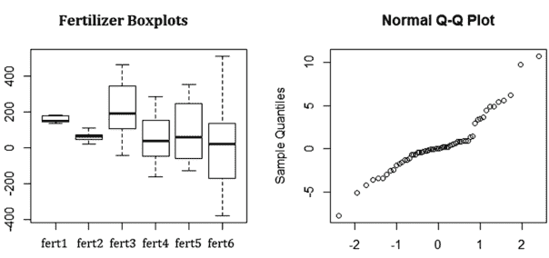

图 4.1 使用方差分析表数据的箱线图和 Q–Q 图。

表 4.2 肥料成对比较的 p 值表。

| | 肥料 1 | 肥料 2 | 肥料 3 | 肥料 4 | 肥料 5 | 肥料 6 |
|---|---|---|---|---|---|---|
| 肥料 1 | – | – | – | – | – | – |
| 肥料 2 | 0.08766 | – | – | – | – | – |
| 肥料 3 | 0.52868 | 0.00954 | – | – | – | – |
| 肥料 4 | 0.03351 | 0.52388 | 0.00290 | – | – | – |
| 肥料 5 | 0.02101 | 0.39134 | 0.00146 | 0.84601 | – | – |
| 肥料 6 | 0.01071 | 0.20787 | 0.00075 | 0.52707 | 0.64440 | – |

### 4.3.3 方差对收缩估计量的影响

我们现在使用方差分析表中的数据，来考察方差对与最小二乘罚函数估计量相比的排位罚函数估计量收缩特性的影响。该分析将用于为多位置模型构建合适的罚排位估计量。为此目的，方差分析表中的列可以被视为一组相关的位置问题，并使用线性回归求解。为开始研究，我们考察岭罚函数。对于这个多位置模型，最小二乘-岭估计量由以下公式给出：

```
$$\hat{\theta}_n^{\text{LS-ridge}} (\lambda) = \underset{\theta_i \in \mathbb{R}}{\text{argmin}} \left\{ \sum_{i=1}^p \sum_{j=1}^{n_i} (y_{ij} - \theta_i)^2 + \frac{\lambda}{2} \sum_{i=1}^p \theta_i^2 \right\}.$$
```


图 4.2 来自方差分析表数据的肥料问题的最小二乘-岭和岭 R 轨迹。

请注意，表中的每一列（处理 1–6）如第 3 章所述是一个单独的位置问题，但在这里我们将所有列合并为每个不同 \(\lambda\) 值的一个线性回归。

岭 R 估计量由以下公式给出：

```
\(\hat{\theta}_n^{\text{ridgeR}}(\lambda) = \text{argmin}_{\theta_i \in \mathbb{R}} \left\{ \sum_{i=1}^p \sum_{j=1}^{n_i} |y_{ij} - \theta_i| a_n^+(R_{n_j}(\theta_i)) + \frac{\lambda}{2} \sum_{i=1}^p \theta_i^2 \right\}.\)
```

如果我们考察图 4.2 中生成的岭轨迹，会注意到两者都表现出典型岭收缩估计量的衰减特性。然而，最小二乘估计和 R 估计的曲线在收缩速率上相当不同。与最小二乘相比，排位情况下观察到下降到 0 更为陡峭。

接下来，我们考察 LASSO 收缩特性。我们在前几章中看到，LASSO 在处理估计中的稀疏性、建立参数子组以及识别应设置为零的参数方面非常有效。带有 LASSO 罚项的最小二乘损失由以下公式给出：

```
\(\hat{\theta}_n^{\text{LS-LASSO}}(\lambda) = \text{argmin}_{\theta_i \in \mathbb{R}} \left\{ \sum_{i=1}^p \sum_{j=1}^{n_i} (y_{ij} - \theta_i)^2 + \lambda \sum_{i=1}^p |\theta_i| \right\}.\)
```

LASSO R 估计量由以下公式给出：

```
\(\hat{\theta}_n^{\text{LASSOR}}(\lambda) = \text{argmin}_{\theta_i \in \mathbb{R}} \left\{ \sum_{i=1}^p \sum_{j=1}^{n_i} |y_{ij} - \theta_i| a_n^+(R_{n_j}(\theta_i)) + \lambda \sum_{i=1}^p |\theta_i| \right\}.\)
```

LASSO 轨迹如图 4.3 所示，作为 \(\lambda\) 的函数。这一次，收缩特性截然不同。在最小二乘情况下，收缩是线性的。在排位情况下，一些参数似乎线性收缩（虽然不是严格线性），而其他参数则保持不变，然后


图 4.3 针对 ANOVA 表数据中肥料问题的 LS-LASSO 和 LASSO 路径。

sharply drop to 0。这让我们想起第 3 章中的硬阈值估计量。在秩情况下，路径依赖于方差，而对于 LS，则与方差无关。通过标准化比较，这点将很快变得清楚。

在此之前，我们回到先前描述的 ANOVA 问题。图 4.3 中的 LASSO 路径可用于解决应移除哪些肥料的问题。我们注意到，随着 \(\lambda\) 增大，估计值会缩小。当 \(\lambda \ge 0.3\) 时，肥料 4、5 和 6 被置零。因此，我们可以选择从生产中移除这三种肥料中的任意一种或全部，同时保留所有肥料 1、2 和 3，因为它们的产量远高于 1500 蒲式耳/10 英亩的目标。

回到手头的问题，目前为止讨论的图表中，要注意到方差对路径的影响有些困难。这是因为每个位置问题的无约束估计都不同。如果我们现在使用一组基本相等的无约束估计（尽管不完全相同），但方差不同（取自表 4.1 中 MAD(\(\mathbf{y}_j\)) 行），我们就可以确定方差是否对路径有直接影响。图 4.4 显示了由此产生的路径。我们注意到，对于最小二乘情况，方差对位置问题中脊回归和 LASSO 的路径都没有显著影响。事实上，脊回归路径均由以下单一方程定义：

```
\(\hat{\theta}_n^{\text{LS-ridge}} = \frac{\hat{\theta}_n^{\text{LS}}}{1 + \lambda/2n}\)
```

而 LASSO 路径均由以下公式给出：

```
\(\hat{\theta}_n^{\text{LS-LASSO}} = \text{sgn}(\hat{\theta}_n^{\text{LS}})(|\hat{\theta}_n^{\text{LS}}| - \lambda/2n)^+.\)
```

图中外侧边缘的路径上标记了标签 1 和 6。其余路径按顺序夹在中间。轻微的


图 4.4 使用脊回归和 LASSO 路径展示方差对缩小的影响。

differences in the least-squares estimates with \(\lambda = 0\) 是导致曲线之间差异的原因。

使用二次损失函数时，方差并不重要。然而，它在秩情况下显然起着重要作用。我们看到，较高的方差会导致快速缩小，而较低的方差则导致远小的缩小，尤其是在 LASSO 情况下，每条曲线都明显间隔更大。第 2 章中描述了类似的特性。因此，在秩情况下，给定位置参数的路径明显取决于其方差（或 MAD）。总而言之，最小二乘位置问题中的缩小特征不太受方差影响，而在秩情况下，方差与缩小特征之间存在直接关系。这种直觉对于开发多重位置模型的 R-估计量很重要。

### 4.3.4 多重位置的缩小估计量

为了构建和评估多重位置模型的不同缩小 R-估计量，我们可以重新审视脊回归和 LASSO 的路径


如上所述。需要牢记两点考虑。首先，参数中可能存在稀疏性，在这种情况下，我们希望能够将参数分为两组。其次，有些参数方差高，有些方差低，因此我们可能希望将它们分为两组。结合这两个目标，我们定义 \(\theta = (\theta_{1n}^\top, \theta_{2n}^\top)^\top\)，其中 \(\theta_{1n}\) 包含低方差的非零值，\(\theta_{2n}\) 包含我们怀疑可能为 0 或具有高方差的参数。

考虑图 4.3 右侧的 LASSO R 路径。两条低方差的路径看起来像第 3 章中的硬阈值估计量，而其余四条则类似于正则 Saleh R-估计量。为了指定这两个估计量，我们需要定义一个检验统计量 \(\mathcal{L}_{n_j}, j = 1, ..., p\)，这将在本章后面详细说明。目前，将其视为一个阈值量。那么，硬阈值 R-估计量由以下公式给出：

```
\(\hat{\theta}_n^{HTR}(\lambda) = \hat{\theta}_{n_j}^{UR} I(\mathcal{L}_{n_j} > \lambda^2), \quad j = 1, ..., p.\)
```

正则 Stein–Saleh R-估计量由以下公式给出：

```
\(\hat{\theta}_n^{SSR+}(\lambda) = \hat{\theta}_n^{UR} (1 - \lambda / \sqrt{\mathcal{L}_n}) I(\sqrt{\mathcal{L}_n} > \lambda).\)
```

在图 4.5 中，我们展示了多重位置模型中这两个 R-估计量的路径。注意 LASSOR 路径（1 和 2）与硬阈值估计量对应路径之间的相似性，以及 LASSOR 路径（3、4、5 和 6）与正则 Stein–Saleh 估计量对应路径之间的相似性。图 4.3 中的 LASSOR 路径表明，对于某些参数应使用无约束值，而对其他参数则应应用缩小惩罚。由于本章余下部分的目标是使用 \(ADL_2\)-风险比较不同估计量，当我们怀疑存在稀疏性时，

我们可以定义以下 R-估计量：

```
\hat{\boldsymbol{\theta}}_n^{\text{SSR}+}(\lambda) = \left( \hat{\boldsymbol{\theta}}_{1n}^{\text{UR}^\top}, \hat{\boldsymbol{\theta}}_{2n}^{\text{UR}^\top} (1 - \lambda \mathcal{L}_n^{-1} I(\mathcal{L}_n > \lambda)) \right)
```

其中 \(\hat{\boldsymbol{\theta}}_n^{\text{SSR}+}\) 是正则 Stein–Saleh R-估计量。这里，\(\hat{\boldsymbol{\theta}}_{1n}^{\text{UR}}\) 是不会经历缩小的无约束估计，\(\hat{\boldsymbol{\theta}}_{2n}^{\text{UR}}\) 是将经历缩小的参数。假设第 1 组具有低方差，因此它们的值不会快速缩小。然而，对于可能存在稀疏性的第 2 组，使用正则 Stein–Saleh R-估计量，该估计量以线性速率应用缩小。

如果我们不怀疑参数集中存在稀疏性，则不定义任何组，并可以使用脊回归类型模型应用完整缩小模型，例如如下所示

```
\hat{\boldsymbol{\theta}}_n^{\text{ridgeR}}(\lambda) = \frac{1}{1 + \lambda} \hat{\boldsymbol{\theta}}_n^{\text{UR}}
```

在本章余下部分，我们将定义和评估多重位置问题的多个惩罚 R-估计量。我们假设分区基于某些合适的标准，例如方差或当我们怀疑存在稀疏性时源于 Saleh et al. (2019) 的边缘理论。在接下来的章节中，我们将定义无约束估计量和受约束估计量，然后使用 ADL$_2$-风险来比较不同的基于秩的惩罚估计量。

## 4.4 无约束 R-估计量

设 \(R_{n,j}^+(\theta_j)\) 为 \(|y_{ij} - \theta_j|\) 在 \(|y_{i1} - \theta_1|, ..., |y_{in_p} - \theta_p|\) 中的秩。对于 \(\theta_j\) 的无约束 R-估计量 (URE)，我们对 \(\theta_j\) 最小化 Jaeckel 秩离散函数，也就是说，最小化

```
D_{n_j}(\theta_j) = \sum_{i=1}^{n_j} |y_{ij} - \theta_j| a_{n_j}^+(R_{n_j}^+(\theta_j)), \quad j = 1, ..., p,
```

相对于 \(\theta_j\)。这可以通过求解以下方程来实现：

```
\frac{\partial D_{n_j}(\theta_j)}{\partial \theta_j} = -n_j^{-\frac{1}{2}} T_{n_j}(\theta_j) = -\sum_{i=1}^{n_j} \text{sgn}(y_{ij} - \theta_j) a_{n_j}^+(R_{n_j}^+(\theta_j)) = 0,
```

然后 \(\theta_j\) 的 URE 由以下公式给出：

```
\hat{\theta}_{n_j}^{\text{UR}} = \frac{1}{2} \left[ \sup \{ \theta_j : T_{n_j}(\theta_j) > 0 \} + \inf \{ \theta_j : T_{n_j}(\theta_j) < 0 \} \right].
```

因此，\(\theta\) 的 URE 由以下公式给出：
\(\hat{\theta}_n^{UR} = (\hat{\theta}_{n_1}^{UR}, \dots, \hat{\theta}_{n_p}^{UR})^\top.\)

使用公式 (4.4.1) 和 (4.4.2)，令

\(D_n(\theta) = (D_{n_1}(\theta_1), \dots, D_{n_p}(\theta_p))^\top\)

和

\(T_n(\theta) = (T_{n_1}(\theta_1), \dots, T_{n_p}(\theta_p))^\top.\)

然后，使用 Jurečková 线性结果和 Jaeckel (1972) 的渐近均匀二次结果，当 \(n \to \infty\) 时，我们有

\(\sup_{\|w\|<n} n^{-\frac{1}{2}} \left\| T_n(n^{-\frac{1}{2}} w) - T_n(0) + \gamma(\phi, \psi) \mathcal{K} w \right\| \xrightarrow{P} 0,\)
\(\sup_{\|w\|<n} n^{-\frac{1}{2}} \left\| D_n(n^{-\frac{1}{2}} w) - D_n(0) + w^\top T_n(0) + \frac{1}{2} \gamma(\phi, \psi) w^\top \mathcal{K} w \right\| \xrightarrow{P} 0\)

其中 \(\|a\| = \sum_{j=1}^p |a_j|\) 且 \(\mathcal{K} = \text{Diag}(\kappa_1, \dots, \kappa_p)\)。

因此，我们得出结论，当 \(n \to \infty\) 时，对于

\(W_n(\omega) = \omega^\top T_n(0) + \frac{1}{2} \gamma(\phi, \psi) \omega^\top \mathcal{K} \omega,\)

我们有

\(\left\| \sqrt{n}(\hat{\theta}_n^{UR} - \theta) - \text{argmin}_{w \in \mathbb{R}^p} \{W_n(w)\} \right\| \xrightarrow{P} 0.\)

因此，当 \(n \to \infty\) 时，

\(T_n(0) \xrightarrow{\mathcal{D}} \mathcal{N}_p(0, A_\phi^2 \mathcal{K}^{-1}),\)

和

\(|\sqrt{n}(\hat{\theta}_n^{UR} - \theta) - \gamma^{-1}(\phi, \psi) \mathcal{K} T_n(0)| \xrightarrow{P} 0,\)

这导致

\(\sqrt{n}(\hat{\theta}_n^{UR} - \theta) \xrightarrow{\mathcal{D}} \mathcal{N}_p(0, \eta^2 \mathcal{K}), \quad \eta^2 = \frac{A_\phi^2}{\gamma^2(\phi, \psi)}, \quad (4.4.3)\)

其中

\(\gamma(\phi, \psi) = \int_0^1 \phi(u)\psi(u)du, \psi(u) = -\frac{f_0'(F_0^{-1}(u))}{f_0(F_0^{-1}(u))}. \quad (4.4.4)\)


我们考虑了各种 R-估计量的渐近分布偏差（ADB）、L$_2$-风险（ADL$_2$-风险）和加权 ADL$_2$-风险的表达式。ADB 和 ADL$_2$-风险表达式定义为

\(\text{ADB}(\hat{\theta}_n^*) = \left( \lim_{n \to \infty} \mathbb{E} \left[ \sqrt{n}(\hat{\theta}_{1n}^* - \theta_1)^\top \right], \lim_{n \to \infty} \mathbb{E} \left[ \sqrt{n}(\hat{\theta}_{2n}^* - \theta_2)^\top \right] \right)^\top,\)
(4.4.5)

和

\(\text{ADL}_2\text{-risk}(\hat{\theta}_n^* : \mathbf{W}_1, \mathbf{W}_2) = \lim_{n \to \infty} \mathbb{E} \left[ n(\hat{\theta}_{1n}^* - \theta)^\top \mathbf{W}_1(\hat{\theta}_{1n}^* - \theta_1) \right]\)
\(+ \lim_{n \to \infty} \mathbb{E} \left[ n(\hat{\theta}_{n2}^* - \theta)^\top \mathbf{W}_2(\hat{\theta}_{2n}^* - \theta_2) \right]\)
\(= \text{tr}(\mathbf{W}_1 \mathbf{M}_1) + \text{tr}(\mathbf{W}_2 \mathbf{M}_2) \quad (4.4.6)\)

其中 \(\mathbf{W}_1\) 和 \(\mathbf{W}_2\) 分别是 \(p_1\) 和 \(p_2\) 维度的权重矩阵。

如果 \(\mathbf{W}_1 = \mathbf{I}_{p_1}\) 且 \(\mathbf{W}_2 = \mathbf{I}_{p_2}\)，则我们得到 \(\mathbf{M}_1\) 和 \(\mathbf{M}_2\) 的 MSE 矩阵迹分别为 \(\text{tr}(\mathbf{M}_1) = \sum_{i=1}^{p_1} \chi_i\) 和 \(\text{tr}(\mathbf{M}_2) = \sum_{i=p_1+1}^p \chi_i\)，其中

\(\mathbf{M}_i = \lim_{n \to \infty} n \mathbb{E} \left[ (\hat{\theta}_{in}^* - \theta_i)(\hat{\theta}_{in}^* - \theta_i)^\top \right], \quad \forall i = 1, 2.\)

因此，

\(\text{ADL}_2\text{-risk}(\hat{\theta}_n^* : \mathbf{W}_1, \mathbf{W}_2) = \text{ADL}_2\text{-risk}(\hat{\theta}_{1n}^* : \mathbf{W}_{p_1})\)
\(+ \text{ADL}_2\text{-risk}(\hat{\theta}_{2n}^* : \mathbf{W}_{p_2}).\)

简而言之，\(\theta\) 的不受限 R-估计量可以写成 \((\hat{\theta}_{1n}^{\text{UR}\top}, \hat{\theta}_{2n}^{\text{UR}\top})^\top\)，其中 \(\hat{\theta}_{in}^{\text{UR}}\) 的边际渐近分布由 \(\mathcal{N}_{p_i}(\theta_i, \eta^2 \mathcal{K}_i)\) 给出，且 \(\mathcal{K} = \text{blockdiagonal}(\mathcal{K}_1, \mathcal{K}_2)\)。

### 定理 4.1 在局部备择假设 \(K_{(n)}\) 下，不受限 R-估计量 \(\hat{\theta}_n^{\text{UR}}\) 的渐近分布偏差和 ADL$_2$-风险分别由以下给出

\(\text{ADB}(\hat{\theta}_n^{\text{UR}}) = (\mathbf{0}_{p_1}^\top, \mathbf{0}_{p_2}^\top)^\top,\)
\(\text{ADL}_2\text{-risk}(\hat{\theta}_n^{\text{UR}}) = \eta^2 \left( \sum_{i=1}^{p_1} \chi_i + \sum_{i=p_1+1}^{p} \chi_i \right).\)

## 4.5 显著性检验

由 Eq. (4.4.2)，统计量

\(T_{n_j}(0) = \frac{1}{\sqrt{n_j}} \sum_{i=1}^{n_j} \text{sgn}(y_{ij}) \alpha_{n_i}^+ (R_{n_i}^+(0))\)

可用于检验原假设 \(\mathcal{H}_o : \theta_j = 0\) 与备择假设 \(\mathcal{H}_A : \theta_j \neq 0\)。注意 \(\mathbb{E}[T_{n_j}(0)] = 0\) 且

\(\text{Var}(T_{n_j}(0)) = \frac{1}{n_j} \sum_{i=1}^{n_j} [\alpha_{n_i}^+(i)]^2 = A_{n_j}^2.\)

可证，当 \(n \to \infty\) 时，

\(T_{n_j}(0) \xrightarrow{\mathcal{D}} \mathcal{N}(\mathbf{0}, A_\phi^2 \kappa_j^{-1}) \quad (4.5.1)\)

并且我们可以使用 \(\sqrt{\kappa_j}T_{n_j}(0)/A_{n_j}\) 作为检验 \(\mathcal{H}_o : \theta_j = 0\) 与 \(\mathcal{H}_A : \theta_j \neq 0\) 的检验统计量。根据 Hajek 和 Sidák (1967)，当 \(n \to \infty\) 且 \(\theta_j = 0\) 时，有

\(\left| \sqrt{n}\hat{\theta}_{n_j}^{\text{UR}} - \gamma^{-1}(\phi, \psi)\kappa_j T_{n_j}(0) \right| \xrightarrow{P} 0.\) (4.5.2)

然后，经过重排和代换后，我们得到统计量

\(\mathcal{L}_{n_j} = \frac{\kappa_j T_{n_j}^2(0)}{A_{n_j}^2}, \quad j=1, ..., p.\) (4.5.3)

或者，我们可以定义统计量为

\(\mathcal{L}_{n_j} = \frac{n (\hat{\theta}_n^{\text{UR}})^2}{\hat{\gamma}^2 \kappa_j}, \quad j=1, ..., p\) (4.5.4)

其中 \(\hat{\gamma} = \text{MAD}(\mathbf{y} - \mathbf{B}\hat{\theta}_n^{\text{UR}})\) 为 Eq. (4.2.1) 的 ANOVA 模型。

对于整个向量，我们有

\(\left| \sqrt{n}\hat{\theta}_n^{\text{UR}} - \gamma^{-1}(\phi, \psi)\mathcal{K}\mathbf{T}_n(\mathbf{0}) \right| \xrightarrow{P} 0.\) (4.5.5)

接下来，我们考虑任何子假设的检验

\(\mathcal{H}_o : \theta_2 = (\theta_{p_1+1}, ..., \theta_p)^\top = \mathbf{0} \text{ vs. } \mathcal{H}_A : \theta_2 \neq \mathbf{0}.\)

在这种情况下，可以使用统计量 \(\mathcal{L}_{n(2)}\)，其由以下给出

\(\mathcal{L}_{n(2)} = \mathbf{A}_{n(2)}^{-2} \mathbf{T}^\top_{n(2)}(\mathbf{0})\mathcal{K}_2 \mathbf{T}_{n(2)}(\mathbf{0}),\)

其中

$T_n(\mathbf{0}) = (T_{n(1)}^\top(\mathbf{0}), T_{n(2)}^\top(\mathbf{0}))^\top, \quad A_n = \text{Diag}(\mathbf{A}_{n(1)}, \mathbf{A}_{n(2)}), \quad \mathcal{K} = \text{Diag}(\mathcal{K}_1, \mathcal{K}_2),$

且 $T_{n(2)}(0)$ 是 $p_2$-维向量。我们还使用定义

$A^2_{n(2)} = \sum_{j=p_1+1}^p (n_j - 1) A_{nj}^2.$ (4.5.6)

在局部备择假设下，

$K_{(n)} : \theta_{\eta_j} = n^{-\frac{1}{2}} \delta_j, \quad \text{for } j = 1, ..., p.$

根据 Hájek 和 Sidák (1967) 第 5 章第 5.2 节，我们有

\(\forall j = 1, ..., p, \quad Z_j = \frac{\sqrt{n} \hat{\theta}_{nj}^{\text{UR}}}{\eta \sqrt{\kappa_j}} \xrightarrow{\mathcal{D}} \mathcal{N}(\Delta_j, 1), \quad \frac{\delta_j}{\eta \sqrt{\kappa_j}} = \Delta_j.\)

在假设的正则性条件下，当 \(n \to \infty\) 时，\(\mathcal{L}_{n(2)}\) 渐近服从具有 \(p_2\) 自由度（d.f.）和非中心性参数

\(\Delta^2 = \frac{1}{\eta^2} \delta_2^\top \mathcal{K}_2^{-1} \delta_2, \quad \delta_2 = (\delta_{p_1+1}, ..., \delta_p)^\top\)

的非中心 \(\chi^2\)-分布，其中使用局部备择假设 \(\theta_{2(n)} = n^{-\frac{1}{2}} \delta_2\)。

## 4.6 受限 R-估计量

\((\theta_1^\top, \mathbf{0}^\top)^\top\) 的受限 R-估计量（RRE）为 \((\hat{\theta}_{1n}^{\text{UR}\top}, \mathbf{0}^\top)^\top\)。

### 定理 4.2 在局部备择假设 \(K_{(n)}\) 下，受限 R-估计量 \(\hat{\delta}_n^{\text{RR}}\) 的渐近分布偏差和 \(\text{ADL}_2\)-风险分别由以下给出

\(\text{ADB}(\hat{\delta}_n^{\text{RR}}) = (\mathbf{0}_{p_1}^\top, -\delta_2^\top)^\top \quad \text{且}\)

\(\text{ADL}_2\text{-risk}(\hat{\delta}_n^{\text{RR}}) = \eta^2 \sum_{i=1}^{p_1} \kappa_i + \delta_2^\top \delta_2.\)

\(\text{ADL}_2\)-风险的下界由以下给出

\(\text{ADL}_2^*\text{-risk}(\hat{\delta}_n^{\text{RR}}) = \eta^2 \{ \text{tr}(\mathcal{K}_1) + \Delta^2 \text{Ch}_{\min}(\mathcal{K}_2) \}, \quad \Delta^2 = \frac{1}{\eta^2} \delta_2^\top \mathcal{K}_2^{-1} \delta_2.\)

因此，

ADRE$(\hat{\theta}_n^{\text{RR}} : \hat{\theta}_n^{\text{UR}}) = \left( 1 + \frac{\text{tr}(\mathcal{K}_2)}{\text{tr}(\mathcal{K}_1)} \right) \left( 1 + \frac{\Delta^2 \text{Ch}_{\min}(\mathcal{K}_2)}{\text{tr}(\mathcal{K}_1)} \right)^{-1}.$

## 4.7 缩减估计量

当问题是稀疏的，即我们怀疑某些估计量可能为 0 时，可以将问题分为两个子集 i = 1,2，保留子集 1，同时对可能为零的子集 2 应用各种形式的缩减估计量。

### 4.7.1 初步检验 R-估计量

我们将参数分为 \(\theta = (\theta_1^\top, \theta_2^\top)^\top\)，其中 \(\theta_i\) 是一个 \(p_i\)-向量，则 \(p_1 + p_2 = p\)。现在，我们可以定义 \(\theta\) 的初步检验 R-估计量如下

\(\hat{\theta}_n^{\text{PTR}}(\lambda) = \left( \hat{\theta}_{1n}^{\text{UR}\top}, \hat{\theta}_{2n}^{\text{UR}\top} I(\mathcal{L}_n > \lambda^2) \right)^\top\)

其中 \(I(A)\) 是集合 \(A\) 的指示函数，\(\mathcal{L}_n\) 由以下给出

\(\mathcal{L}_n = A_{n(2)}^{-2} T_{n(2)}(\mathbf{0}) \mathcal{K}_2^{-1} T_{n(2)}(\mathbf{0})\)

并且 \(\chi_1^2(\lambda^2)\) 是具有 \(p_2\) 自由度的中心 \(\chi^2\) 分布的 \(\lambda\) 水平上临界值。

### 定理 4.3 在局部备择假设 \(K_{(n)}\) 下，初步检验 R-估计量 \(\hat{\theta}_n^{\text{PTR}}(\lambda)\) 的渐近分布偏差和 ADL$_2$-风险分别由以下给出

\(\text{ADB}(\hat{\theta}_n^{\text{PTR}}(\lambda)) = (\mathbf{0}_{p_1} - \delta_2^\top \mathcal{H}_{p_2+2}(\chi_{p_2}^2(\lambda^2), \Delta^2))^\top\)

和

\(\text{ADL}_2\text{-risk}(\hat{\theta}_n^{\text{PTR}}(\lambda)) = \eta^2(\text{tr}(\mathcal{K}_1) + \text{tr}(\mathcal{K}_2)) - \eta^2 \text{tr}(\mathcal{K}_2) \mathcal{H}_{p_2+2}(\chi_{p_2}^2(\lambda), \Delta^2) + \theta_2^\top \mathcal{H}_2 \{ 2 \mathcal{H}_{p_2+2}(\chi_{p_2}^2(\lambda^2), \Delta^2) - \mathcal{H}_{p_2+4}(\chi_{p_2}^2(\lambda^2), \Delta^2) \}.\)

\(\text{ADL}_2\)-风险的下界由以下给出

\(\text{ADL}_2^*\text{-risk}(\hat{\theta}_n^{\text{PTR}}(\lambda)) = \eta^2 \left[ \text{tr}(\mathcal{K}_1) + \text{tr}(\mathcal{K}_2)(1 - \mathcal{H}_{p_2+2}(\chi_{p_2}^2(\lambda^2), \Delta^2)) + \Delta^2 \text{Ch}_{\min}(\mathcal{K}_2) \{ 2 \mathcal{H}_{p_2+2}(\chi_{p_2}^2(\lambda^2), \Delta^2) - \mathcal{H}_{p_2+4}(\chi_{p_2}^2(\lambda^2), \Delta^2) \} \right].\)


因此，

\(\text{ADRE}(\hat{\theta}_n^{\text{PTR}}(\lambda) : \hat{\theta}_n^{\text{UR}}) = \left(1 + \frac{\text{tr}(\mathcal{K}_2)}{\text{tr}(\mathcal{K}_1)}\right)(A(\lambda, \Delta))^{-1} \quad (4.7.1)\)

其中

\(A(\lambda, \Delta) = 1 + \frac{\text{tr}(\mathcal{K}_2)}{\text{tr}(\mathcal{K}_1)} \left\{ 1 - \mathcal{H}_{p_2+2}(\chi_{p_2}^2(\lambda^2), \Delta^2) \right\}\)
\(+ \frac{\Delta^2 \text{Ch}_{\min}(\mathcal{K}_2)}{\text{tr}(\mathcal{K}_1)} \left( 2\mathcal{H}_{p_2+2}(\chi_{p_2}^2(\lambda^2), \Delta^2) - \mathcal{H}_{p_2+4}(\chi_{p_2}^2(\lambda^2), \Delta^2) \right) . \quad (4.7.2)\)

### 4.7.2 Stein-Saleh型 R-估计器

注意，\(\hat{\theta}_n^{\text{PTR}}(\lambda)\) 是一个离散函数，估计器的一些可取性质在过程中可能会丢失。因此，我们考虑 \(\hat{\theta}_n^{\text{PTR}}(\lambda)\) 的连续版本，称为 Stein-Saleh型 R-估计器，并定义为

\(\hat{\theta}_n^{\text{SSR}}(\lambda) = \left( \hat{\theta}_{1n}^{\text{UR}\top}, \hat{\theta}_{2n}^{\text{UR}\top}(1 - \lambda \mathcal{L}_n^{-1}) \right)^\top \text{ with } p_2 - 2 \ge 3. \quad (4.7.3)\)

**定理 4.4** 在局部备择假设下，\(K_{(n)}\)，Stein-Saleh型 R-估计器 \(\hat{\theta}_n^{\text{SSR}}(\lambda)\) 的渐近分布偏差和 \(\text{ADL}_2\)-风险分别由以下给出

\(\text{ADB}(\hat{\theta}_n^{\text{SSR}}(\lambda)) = \left( \mathbf{0}_{p_1}^\top, -\hat{\theta}_2^\top(p_2 - 2)\mathbb{E}\left[ \chi_{p_2+2}^{-2}(\Delta^2) \right] \right)^\top\)

和

\(\text{ADL}_2\text{-risk}(\hat{\theta}_n^{\text{SSR}}(\lambda)) = \eta^2 \left\{ (\text{tr}(\mathcal{K}_1) + \text{tr}(\mathcal{K}_2)) - \lambda \text{tr}(\mathcal{K}_2) \left( \mathbb{E}\left[ \chi_{p_2+2}^{-2}(\Delta^2) \right] \right.\right.\)
\(\left.\left. + \Delta^2 \mathbb{E}\left[ \chi_{p_2+4}^{-2}(\Delta^2) \right] \right) + \lambda(\lambda + 4) \delta_2^\top \delta_2 \mathbb{E}\left[ \chi_{p_2+4}^{-4}(\Delta^2) \right] \right\}.\)

\(\text{ADL}_2\)-风险的下界由以下给出

\(\text{ADL}_2^*\text{-risk}(\hat{\theta}_n^{\text{SSR}}(\lambda)) = \eta^2 \left[ \text{tr}(\mathcal{K}_1) + \text{tr}(\mathcal{K}_2) - (p_2 - 2)\text{tr}(\mathcal{K}_2) \right.\)
\(\left. \times \left( \mathbb{E}\left[ \chi_{p_2+2}^{-2}(\Delta^2) \right] + \Delta^2 \mathbb{E}\left[ \chi_{p_2+4}^{-2}(\Delta^2) \right] \right) + (p_2^2 - 4)\Delta^2 \text{Ch}_{\min}(\mathcal{K}_2) \mathbb{E}\left[ \chi_{p_2+4}^{-4}(\Delta^2) \right] \right].\)

因此，

$$ \text{ADRE}(\hat{\theta}_n^{\text{SSR}}(\lambda) : \hat{\theta}_n^{\text{UR}}) = \left( 1 + \frac{\text{tr}(\mathcal{K}_2)}{\text{tr}(\mathcal{K}_1)} \right) (B(\Delta))^{-1} $$

其中

$$ \begin{aligned} B(\Delta) &= 1 + \frac{\text{tr}(\mathcal{K}_2)}{\text{tr}(\mathcal{K}_1)} \left\{ 1 - (p_2 - 2) \left( \mathbb{E} \left[ \chi_{p_2+2}^{-2}(\Delta^2) \right] + \Delta^2 \mathbb{E} \left[ \chi_{p_2+2}^{-4}(\Delta^2) \right] \right) \right\} \\ &+ (p_2^2 - 4) \frac{\Delta^2 \text{Ch}_{\min}(\mathcal{K}_2)}{\text{tr}(\mathcal{K}_1)} \mathbb{E} \left[ \chi_{p_2+4}^{-4}(\Delta^2) \right] \end{aligned} $$

和

$$ \mathbb{E} \left[ \chi_{p+2}^{-2}(\Delta^2) \right] = \exp \left\{ - \frac{\Delta^2}{2} \right\} \sum_{r \ge 0} \frac{1}{r!} \left( \frac{\Delta^2}{2} \right)^r \frac{1}{p+2r} = \mathbb{E}_R \left[ \frac{1}{p+2R} \right]. $$

在上述中，\(\mathbb{E}_R\) 表示关于均值为 \(\frac{\Delta^2}{2}\) 的泊松变量 \(R\) 的期望。我们可以得到以下有用的恒等式：

$$ \begin{aligned} \mathbb{E} \left[ \chi_{p+2}^{-4}(\Delta^2) \right] &= \exp \left\{ - \frac{\Delta^2}{2} \right\} \sum_{r \ge 0} \frac{1}{r!} \left( \frac{\Delta^2}{2} \right)^r \frac{1}{(p+2r)(p+2r-2)} \\ &= \mathbb{E}_R \left[ \frac{1}{(p+2R)(p+2R-2)} \right], \\ \Delta^2 \mathbb{E} \left[ \chi_{p+2}^{-2}(\Delta^2) \right] &= 1 - (p-2) \mathbb{E} \left[ \chi_p^{-2}(\Delta^2) \right], \\ \Delta^2 \mathbb{E} \left[ \chi_{p+4}^{-4}(\Delta^2) \right] &= \mathbb{E} \left[ \chi_{p+2}^{-2}(\Delta^2) \right] - (p-2) \mathbb{E} \left[ \chi_{p+2}^{-4}(\Delta^2) \right], \\ 2 \mathbb{E} \left[ \chi_p^{-2}(\Delta^2) \right] &= \mathbb{E} \left[ \chi_p^{-2}(\Delta^2) \right] - \mathbb{E} \left[ \chi_{p+2}^{-2}(\Delta^2) \right]. \end{aligned} $$

我们注意到，上述 Stein–Saleh R-估计器依赖于 \(p_2 - 2 \ge 3\)。Saleh (2006) 在第 2 章中讨论了 \(p_2 - 2 < 3\) 的情况。

### 4.7.3 正则 Stein–Saleh型 R-估计器

前一节中的估计器在某些情况下可能会改变符号。作为补救措施，我们考虑正则 Stein–Saleh型 R-估计器，记作 \(\hat{\theta}_n^{\text{SSR+}}(\lambda)\) 并定义为

$$ \hat{\theta}_n^{\text{SSR+}}(\lambda) = \left( \hat{\theta}_{1n}^{\text{UR}\top}, \hat{\theta}_{2n}^{\text{UR}\top} (1 - \lambda \mathcal{L}_n^{-1}) I(\mathcal{L}_n > \lambda) \right) \quad \text{with} \quad p_2 - 2 \ge 3. $$

**定理 4.5** 在局部备择假设下，\(K_{(n)}\)，正则 Stein–Saleh型 R-估计器 \(\hat{\theta}_n^{\text{SSR+}}(\lambda)\) 的渐近分布偏差和 \(\text{ADL}_2\)-风险分别由以下给出

\(\text{ADB}(\hat{\theta}_n^{\text{SSR+}}(\lambda)) = \begin{pmatrix} \mathbf{0}_{p_1} \\ -\delta_2^\top \mathbb{E} \left[ (1-(p_2-2)\chi_{p_2+2}^{-2}(\Delta^2))I(\chi_{p_2+2}^2(\Delta^2) < p_2-2) \right] \end{pmatrix}\)

和

\(\text{ADL}_2\text{-risk}(\hat{\theta}_n^{\text{SSR+}}(\lambda)) = \text{ADL}_2\text{-risk}(\hat{\theta}_n^{\text{SSR}}(\lambda)) - \eta^2 \text{tr}(\mathcal{K}_2) \mathbb{E} \left[ \left( 1-(p_2-2)\chi_{p_2+2}^{-2}(\Delta^2) \right)^2 I(\chi_{p_2+2}^2(\Delta^2) < p_2-2) \right] + \delta_2^\top \delta_2 \left\{ 2 \mathbb{E} \left[ (1-(p_2-2)\chi_{p_2+2}^{-2}(\Delta^2)) I(\chi_{p_2+2}^2(\Delta^2) < p_2-2) \right] - \mathbb{E} \left[ \left( 1-(p_2-2)\chi_{p_2+4}^{-2}(\Delta^2) \right)^2 I(\chi_{p_2+4}^2(\Delta^2) < p_2-2) \right] \right\}.\)

\(\text{ADL}_2\)-风险的下界由以下给出

\(\text{ADL}_2^*\text{-risk}(\hat{\theta}_n^{\text{SSR+}}(\lambda)) = \text{ADL}_2\text{-risk}(\hat{\theta}_n^{\text{SSR}}(\lambda)) - \frac{\eta^2}{p_2-2} \text{tr}(\mathcal{K}_2^{-1}) \mathbb{E} \left[ \left( 1-(p_2-2)\chi_{p_2+2}^{-2}(\Delta^2) \right)^2 I(\chi_{p_2+2}^2(\Delta^2) < p_2-2) \right] + \Delta^2 \text{Ch}_{\min}(\mathcal{K}_2) \left\{ 2 \mathbb{E} \left[ (1-(p_2-2)\chi_{p_2+2}^{-2}(\Delta^2)) I(\chi_{p_2+2}^2(\Delta^2) < p_2-2) \right] - \mathbb{E} \left[ \left( 1-(p_2-2)\chi_{p_2+4}^{-2}(\Delta^2) \right)^2 I(\chi_{p_2+4}^2(\Delta^2) < p_2-2) \right] \right\}.\)

因此，

\(\text{ADRE}(\hat{\theta}_n^{\text{SSR+}}(\lambda) : \hat{\theta}_n^{\text{UR}}) = \left( 1 + \frac{\text{tr}(\mathcal{K}_2)}{\text{tr}(\mathcal{K}_1)} \right) (C(\Delta))^{-1}\)

其中

\(C(\Delta) = \frac{\text{ADL}_2\text{-risk}(\hat{\theta}_n^{\text{SSR}})}{\eta^2 \text{tr}(\mathcal{K}_1)} - \frac{\text{tr}(\mathcal{K}_2)}{\text{tr}(\mathcal{K}_1)} \mathbb{E} \left[ \left( 1-(p_2-2)\chi_{p_2+2}^{-2}(\Delta^2) \right)^2 I(\chi_{p_2+2}^2(\Delta^2) < (p_2-2)) \right] + \frac{\Delta^2 \text{Ch}_{\min}(\mathcal{K}_2)}{\text{tr}(\mathcal{K}_1)} \left\{ 2 \mathbb{E} \left[ (1-(p_2-2)\chi_{p_2+2}^{-2}(\Delta^2)) I(\chi_{p_2+2}^2(\Delta^2) < (p_2-2)) \right] - \mathbb{E} \left[ \left( 1-(p_2-2)\chi_{p_2+4}^{-2}(\Delta^2) \right)^2 I(\chi_{p_2+4}^2(\Delta^2) < (p_2-2)) \right] \right\}.\)

\(\mathbb{E}\left[\chi_{p+2}^{-2}(\Delta^2)I(\chi_{p+2}^2(\Delta^2)<c)\right] = \mathbb{E}_R\left[\frac{\mathcal{H}_{p+2R}(c;0)}{(p+2R)}\right],\)

和

\(\mathbb{E}\left[\chi_{p+2}^{-4}(\Delta^2)I(\chi_{p+2}^2(\Delta^2)<c)\right] = \mathbb{E}_R\left[\frac{\mathcal{H}_{p-2+2R}(c;0)}{(p+2R)(p-2+2R)}\right].\)

在上述中，\(\mathbb{E}_R\) 表示关于均值为 \(\frac{\Delta^2}{2}\) 的泊松变量 \(R\) 的期望。

### 4.7.4 岭型 R-估计器

如前所述在 4.3 节中，LASSO 促进了将 \(\theta\) 的 R-估计器划分为两个子向量 \((\theta_1^\top, \theta_2^\top)^\top\)，如下所示

\(\hat{\theta}_{1n}^{\text{UR}} = (\hat{\theta}_{n_1}^{\text{UR}}, ..., \hat{\theta}_{n_{p_1}}^{\text{UR}})^\top \text{ and } \hat{\theta}_{2n} = (0, ..., 0)^\top\)

其中 \(\hat{\theta}_{1n}^{\text{UR}}\) 包含 \(p_1\) 个非零处理效应，\(\hat{\theta}_{2n}\) 包含 \(p_2\) 个“零”处理效应，因此 \(p_1+p_2=p\)。一般而言，我们可能怀疑 \(\theta_2\) 为 \(\mathbf{0}\)。在这种情况下，可以使用 R-估计器

\(\hat{\theta}_n^{\text{ridgeR}}(\lambda) = \text{argmin}_{\theta_2 \in \mathbb{R}^2} \left\{ \sum_{l=1}^p \sum_{j=1}^{n_l} |y_{lj} - \theta_l| c_{n_l}^{-}(R_{n_l}^{+}(\theta_l)) + \frac{\lambda}{2} \theta_2^\top \theta_2 \right\}.\)

因此，我们定义

\(\hat{\theta}_{n_j}^{\text{ridgeR}}(\lambda) = \hat{\theta}_{n_j}^{\text{UR}} \quad j=1,...,p_1, \text{ and } \hat{\theta}_{n_j}^{\text{ridgeR}}(\lambda) = \frac{\hat{\theta}_{n_j}^{\text{UR}}}{1+\lambda} \quad j=p_1+1,...,p, \quad (4.7.4)\)

以获得岭型 R-估计器

\[
\hat{\theta}_n^{\text{ridgeR}}(\lambda) = \left( \begin{matrix} \hat{\theta}_{n_1}^{\text{UR}} \\ \vdots \\ \hat{\theta}_{n_{p_1}}^{\text{UR}} \\ \dots \\ \frac{1}{1+\lambda} \hat{\theta}_{n_{p_1+1}}^{\text{UR}} \\ \vdots \\ \frac{1}{1+\lambda} \hat{\theta}_{n_p}^{\text{UR}} \end{matrix} \right) = \left( \hat{\theta}_{1n}^{\text{UR}\top}, \frac{1}{1+\lambda} \hat{\theta}_{2n}^{\text{UR}\top} \right)^\top. \quad (4.7.5)
\]


**定理 4.6** 在局部替代下，$K_{(n)}$，渐近分布偏差，以及岭型 R 估计器 $\hat{\theta}_n^{\text{ridgeR}}(\lambda)$ 的 $L_2$-风险分别由下式给出

\[
ADB(\hat{\theta}_n^{\text{ridgeR}}(\lambda)) = \left( \mathbf{0}^\top, -\frac{\lambda}{1+\lambda}\delta_2^\top \right)^\top
\]

和

\[
ADL_2\text{-risk}(\hat{\theta}_n^{\text{ridgeR}}(\lambda)) = \eta^2 \left[ tr(\mathcal{K}_1) + \frac{tr(\mathcal{K}_2) + \lambda^2 \delta_2^\top \mathcal{S}_2}{(1+\lambda)^2} \right].
\]

$ADL_2$-风险的下界为

\[
ADL_2^*\text{-risk}(\hat{\theta}_n^{\text{ridgeR}}(\lambda)) = \eta^2 \left[ tr(\mathcal{K}_1) + \frac{tr(\mathcal{K}_2) + \lambda^2 \Delta^2 Ch_{\min}(\mathcal{K}_2)}{(1+\lambda)^2} \right].
\]

需注意的是，对 $ADL_2^*\text{-risk}(\hat{\theta}_n^{\text{ridgeR}}(\lambda))$ 取得最优的 $\lambda$ 值为

\[
\lambda_{opt} = tr(\mathcal{K}_2)\Delta^{-2}(Ch_{\min}(\mathcal{K}_2))^{-1}.
\]

因此，

\[
ADL_2^*\text{-risk}(\hat{\theta}_n^{\text{ridgeR}}(\lambda_{opt})) = \eta^2 \left[ tr(\mathcal{K}_1) + \frac{tr(\mathcal{K}_2)\Delta^2 Ch_{\min}(\mathcal{K}_2)}{tr(\mathcal{K}_2) + \Delta^2 Ch_{\min}(\mathcal{K}_2)} \right],
\]

以及

\[
ADRE(\hat{\theta}_n^{\text{ridgeR}}(\lambda) : \hat{\theta}_n^{UR}) = \left( 1 + \frac{tr(\mathcal{K}_2)}{tr(\mathcal{K}_1)} \right) \times \left( 1 + \frac{tr(\mathcal{K}_2)}{tr(\mathcal{K}_1)} \frac{\Delta^2 Ch_{\min}(\mathcal{K}_2)}{[tr(\mathcal{K}_2) + \Delta^2 Ch_{\min}(\mathcal{K}_2)]} \right)^{-1} \quad (4.7.6)
\]

这是 $\Delta^2$ 的递减函数。当 $\Delta^2 = 0$ 时，其值为 $\left( 1 + \frac{tr(\mathcal{K}_2)}{tr(\mathcal{K}_1)} \right)$；而当 $\Delta^2 \to \infty$ 时，其值为 1。显然，

\[
0 \le \left( 1 + \frac{tr(\mathcal{K}_2)}{tr(\mathcal{K}_1)} \right) \left( 1 + \frac{(tr(\mathcal{K}_2))\Delta^2 Ch_{\min}(\mathcal{K}_2)}{(tr(\mathcal{K}_1))(tr(\mathcal{K}_2) + \Delta^2 Ch_{\min}(\mathcal{K}_2))} \right)^{-1} < 1 + \frac{tr(\mathcal{K}_2)}{tr(\mathcal{K}_1)} \quad \forall \Delta^2 \in \mathbb{R}^+.

## 4.8 子集选择惩罚 R 估计器

如前所述，我们在上一节中介绍了处理模型稀疏性的方法。在本节中，我们讨论了几种惩罚 R 估计器，它们旨在找到导致模型稀疏性的参数，例如

- (i) 初步检验 R 估计器 (PTRE)，一般由于 Donoho 和 Johnstone (1994) 被指定为硬阈值估计器 (HTE)。
- (ii) Tibshirani (1996) 提出的 LASSO，由于 Donoho 和 Johnstone (1994) 被指定为软阈值估计器 (STE)。Saleh 等人 (2019) 将 LASSO 识别为位置模型中正则 Saleh 选择器 (PRSS) 的等价形式，如第 3 章所述。
- (iii) 自适应 LASSO-型估计器。
- (iv) 弹性网-型估计器。

如前所述，我们使用“-型”这一称谓，因为我们是将收缩因子直接应用于无限制估计以得到封闭形式估计器，而非最小化惩罚损失函数。

### 4.8.1 初步检验子集选择器 R 估计器

初步检验子集选择器 R 估计器 (PTSSRE) 定义为

\[
\hat{\boldsymbol{\theta}}_n^{\text{PTSSR}}(\lambda) = \left( \hat{\theta}_{n_j}^{\text{UR}} I(\mathcal{L}_{n_j} > \lambda^2) \mid j = 1, ..., p \right)^{\top}
\]

其中

\[
\mathcal{L}_{n_j} = \frac{n \left( \hat{\theta}_{n_j}^{\text{UR}} \right)^2}{\hat{\eta}^2 \varkappa_j}, \quad j = 1, ..., p
\]

是检验统计量。
每个分量都是 $\theta_j, j = 1, ..., p$ 的 PTSSRE。

**定理 4.7** 在局部替代下，$K_{(n)}$，初步检验子集选择器 R 估计器 $\hat{\boldsymbol{\theta}}^{\text{PTSSR}}$ 的渐近分布偏差和 ADL$_2$-风险分别由下式给出

\[
\text{ADB}(\hat{\boldsymbol{\theta}}_n^{\text{PTSSR}}(\lambda)) = -\eta \left( \delta_j \mathcal{H}_3(\lambda^2, \Delta_j) \mid j = 1, ..., p \right)^{\top},
\]

和

\[
\text{ADL}_2\text{-risk}(\hat{\theta}^{PTSSR}_n(\lambda)) = \eta^2 \Big\{ \sum_{j=1}^p \kappa_j (1 - \mathcal{H}_3(\lambda^2, \Delta_j^2)) + \sum_{j=1}^p \Delta_j^2 (2\mathcal{H}_3(\lambda^2, \Delta_j^2) - \mathcal{H}_5(\lambda^2, \Delta_j^2)) \Big\}.
\]

**证明：** 首先我们证明

\[
\sqrt{n} \hat{\theta}^{PTSSR}_n(\lambda) = \Big( \sqrt{n} \hat{\theta}^{UR}_{n_j} I(| \sqrt{n} \hat{\theta}^{UR}_{n_j} | > \lambda \kappa_j^{\frac{1}{2}} \eta) \mid j=1, ..., p \Big)^\top = \Big( \eta \kappa_j^{\frac{1}{2}} Z_{n_j} I(|Z_{n_j}| > \lambda) \mid j=1, ..., p \Big)^\top,
\]

其中

\[
Z_{n_j} = \frac{\sqrt{n} \hat{\theta}^{UR}_{n_j}}{\eta \sqrt{\kappa_j}}, \quad j=1, ..., p.
\]

显然，当 $n \to \infty$ 时，$Z_{n_j} \sim \mathcal{N}(\Delta_j, 1), \ j=1, ..., p$，且 $\Delta_j = \delta_j / (\eta \sqrt{\kappa_j})$。由于本定理的证明与定理 3.5 类似，详细过程留给读者。

### 4.8.2 Saleh-型 R 估计器

我们注意到，硬阈值 R 估计器在本质上是离散的，并且由于数据的微小变化可能导致非常不同的模型并可能降低预测精度，因此可能变得极具变异性和不稳定性。Saleh R 估计器是硬阈值估计器的连续版本，定义为

\[
\hat{\theta}^{SR}_n(\lambda) = \Big( \hat{\theta}^{UR}_{n_j} \Big( 1 - \frac{\lambda}{\mathcal{L}_{n_j}} \Big) \Big| j=1, ..., p \Big)^\top, \quad \mathcal{L}_{n_j} = |Z_{n_j}|.
\]

**定理 4.8** 在局部替代下，$K_{(n)}$，Saleh R 估计器 $\hat{\theta}^{SR}_n$ 的渐近分布偏差和 $ADL_2$-风险分别由下式给出

\[
ADB(\hat{\theta}^{SR}_n(\lambda)) = \Big( -\lambda \eta \sqrt{\kappa_j} (2\Phi(\Delta_j) - 1) \mid j=1, ..., p \Big)^\top,
\]

和

\[
\text{ADL}_2\text{-risk}(\hat{\theta}_n^{\text{SR}}(\lambda)) = \eta^2 \sum_{j=1}^p \left( 1 + \lambda^2 - 2\lambda \sqrt{\frac{2}{\pi}} \exp\left(-\frac{\Delta_j^2}{2}\right) \right).
\]

**证明：** 首先我们展示

\[
\begin{aligned}
\sqrt{n}\hat{\theta}_n^{\text{SR}}(\lambda) &= \left( \sqrt{n}\hat{\theta}_{n_j}^{\text{UR}} - \lambda \eta \sqrt{\kappa_j} \left| \frac{\sqrt{n}\hat{\theta}_{n_j}^{\text{UR}}}{|\sqrt{n}\hat{\theta}_{n_j}^{\text{UR}}|} \right| j = 1, ..., p \right)^{\top} \\
&= \left( \eta \sqrt{\kappa_j} \left( 1 - \frac{\lambda}{|Z_{n_j}|} \right) Z_{n_j} \bigg| j = 1, ..., p \right)^{\top}
\end{aligned}
\]

其中 \( Z_{n_j} = \sqrt{n}\hat{\theta}_{n_j}^{\text{UR}} / (\eta \sqrt{\kappa_j}), j = 1, ..., p \)。显然，当 $n \to \infty$ 时，$Z_{n_j} \sim \mathcal{N}(\Delta_j, 1)$，且 $\Delta_j = \delta_j / (\eta \sqrt{\kappa_j})$。由于本定理的证明与定理 3.7 类似，其余部分留给读者。

因此，对于 $\lambda_{\max}^* = \sqrt{\frac{2}{\pi}}$，我们得到

\[
\text{ADL}_2\text{-risk}(\hat{\theta}_n^{\text{SR}}(\lambda^*)) = \eta^2 \sum_{j=1}^p \left[ 1 - \frac{2}{\pi} \left( 2 \exp\left\{ -\frac{\Delta_j}{2} \right\} - 1 \right) \right].
\]

最后，

\[
\text{ADRE}(\hat{\theta}_n^{\text{SR}}(\lambda^*) : \hat{\theta}_n^{\text{UR}}) = \left( \sum_{j=1}^p \left[ 1 - \frac{2}{\pi} \left( 2 \exp\left\{ -\frac{\Delta_j}{2} \right\} - 1 \right) \right] \right)^{-1}.
\]

### 4.8.3 正则 Saleh 子集选择器 (PRSS)

前一节中描述的 Saleh R 估计器会改变符号，这可能并不理想。然而，LASSO R 估计器（由以下公式给出）

\[
\hat{\theta}_n^{\text{LassoR}}(\lambda) = \underset{\theta \in \mathbb{R}}{\text{argmin}} \left\{ \sum_{i=1}^p \sum_{j=1}^{n_i} |y_{ij} - \theta_j| a_n^+(R_{n_j}(\theta_j)) + \lambda \sum_{i=1}^p |\theta_i| \right\}
\]

不存在此问题。受 LASSO 和软阈值估计器（Donoho 和 Johnstone, 1994）的启发，我们考虑正则 Saleh 子集选择器 (PRSS) 来解决此问题。它可定义为

\[
\hat{\theta}_n^{\text{SR+}}(\lambda) = \left( \text{sgn}(\hat{\theta}_{n_j}^{\text{UR}}) \left( |\hat{\theta}_{n_j}^{\text{UR}}| - \lambda \right) I(\mathcal{L}_{n_j} > \lambda^2) \bigg| j = 1, 2, ..., p \right)^{\top}


其中

$$\mathcal{L}_{n_j} = \frac{(\sqrt{n}\hat{\vartheta}_j^\text{UR})^2}{\hat{\eta}^2\kappa_j}.$$ 
(4.8.2)

**定理 4.9** 在局部备择假设下，\(K_{(n)}\)、渐近分布偏差以及正则 Saleh R估计器 \(\hat{\vartheta}_n^{\text{SR}+}\) 的 ADL\(_2\)-风险分别由下式给出

$$\text{ADB}(\hat{\vartheta}_n^{\text{SR}+}(\lambda)) = -\eta \left(\Delta_j\mathcal{H}_3(\lambda^2,\Delta^2) - \lambda \left(\Phi(\lambda - \Delta_j)\right.\right.\left.\left. -\Phi(\lambda + \Delta_j)\right)\right| j = 1, \dots, p\right)^\top, $$

和

$$\text{ADL}_2\text{-risk}(\hat{\vartheta}_n^{\text{SR}+}(\lambda)) = \eta^2\left(\sum_{j=1}^p \left\{\kappa_j \left(1 - \mathcal{H}_3(\lambda^2,\Delta_j^2)\right)\right.\right.\left.\left. + \Delta_j^2 \left(2\mathcal{H}_3(\lambda^2,\Delta_j^2) - \mathcal{H}_5(\lambda^2,\Delta_j^2)\right)\right.\right.\left.\left. + \lambda^2(1 - \mathcal{H}_1(\lambda^2,\Delta_j^2)) - 2\lambda \left(\phi(\lambda - \Delta_j) + \phi(\lambda + \Delta_j)\right)\right\}\right). $$

要得到 LASSO R估计器，需按如下方式用 \(L_1\) 罚项最小化秩分散函数（Jaeckel, 1972），

$$\hat{\vartheta}_{n_j}^{\text{LassoR}}(\lambda) = \left(\underset{\vartheta}{\text{argmin}} \left\{\sum_{j=1}^{n_j}|y_{i_j} - \vartheta|a_n^+(R_{n_j}(\vartheta_i)) + \lambda\kappa_j^\frac{1}{2}|\vartheta_i|\right\}\right| j = 1, \dots, p\right)^\top. $$

现在，考虑一族对角线性投影，

$$T_\text{DP}(\vartheta, \lambda) = \left(\lambda_1\hat{\vartheta}_{n_1}^\text{UR}, \dots, \lambda_p\hat{\vartheta}_{n_p}^\text{UR}\right)^\top. $$

这些估计器 _保留_ 或 _置零_ 每个坐标。假设我们有一个可用的神谕，可为我们提供最优系数 \((\lambda_j| j = 1, \dots, p)\)，用于对角线性投影方案。这些理想系数为 \(I(|\delta_j| > \eta\sqrt{\kappa_j})\)，\(j = 1, \dots, p\)。这些得出理想渐近分布 L\(_2\)-风险为

$$\text{ADL}_2^*\text{-risk}(T_\text{DP}(\vartheta, \lambda)) = \sum_{j=1}^p \min(\delta_j^2, \eta^2\kappa_j). $$

现在假设其中 \(p_1\) 个满足 \(\{\delta_j^2 < \eta^2| j = 1, \dots, p\}\) 且 \(p_2\) 个满足 \(\{\delta_j^2 > \eta^2| j = 1, \dots, p\}\)。于是我们得到 \(\text{ADL}_2^*\text{-risk}(T_\text{DP}(\vartheta, \lambda))\) 为

$$\text{ADL}_2^*\text{-risk}(\hat{\vartheta}_n^{\text{LassoR}}(\lambda)) = \eta^2(\text{tr}(\mathcal{K}_1) + \Delta^2\text{Ch}_{min}(\mathcal{K}_2)), $$

其中

\(\Delta^2 = \eta^{-2} \delta_2^\top \mathcal{K}_2^{-1} \delta_2\)

及 \(\mathcal{K} = \text{Diag}(\mathcal{K}_1, \mathcal{K}_2)\)，\(\text{Ch}_{\min}(\mathcal{K}_2^{-1})\) 是 \(\mathcal{K}_2^{-1}\) 的最小特征值。此处，我们假设 \(p_1\) 个参数超过噪声水平 \(\eta \sqrt{\mathcal{K}_j}\)，而 \(p_2\) 个没有。因此，\(\text{ADL}_2^* \text{-risk}(\hat{\theta}_n^{\text{LassoR}}(\lambda))\) 的下界为

\(\text{ADL}_2^* \text{-risk}(\hat{\theta}_n^{\text{LassoR}}(\lambda)) = \eta^2(\text{tr}(\mathcal{K}_1) + \Delta_L^2),\)

其中 \(\Delta_L^2 = \Delta^2 \text{Ch}_{\min}(\mathcal{K}_2)\)。因此，

\(\text{ADRE}(\hat{\theta}_n^{\text{LassoR}}(\lambda) : \hat{\theta}_n^{\text{UR}}) = \left(1 + \frac{\text{tr}(\mathcal{K}_2)}{\text{tr}(\mathcal{K}_1)}\right) \left(1 + \frac{\Delta^2 \text{Ch}_{\min}(\mathcal{K}_2)}{\text{tr}(\mathcal{K}_1)}\right)^{-1}\)

使用该下界。

## 4.8.4 自适应 LASSO (aLASSO)

自适应 LASSO 是 LASSO 的一种变体，其中

\(\hat{\theta}_n^{\text{aLassoR}}(\lambda_n) = \underset{\theta \in \mathbb{R}^p}{\text{argmin}} \left\{ \sum_{i=1}^p \sum_{j=1}^{n_i} |y_{ij} - \theta_i| a_n^+(R_{n_j}(\theta_i)) + \lambda_n \sum_{i=1}^p \hat{w}_i |\theta_i| \right\}\)

且 \(\hat{w}_i, (i = 1, ..., p)\) 为权重函数，\(\hat{w}_i = |\hat{\theta}_i^{\text{UR}}|^{-\gamma}, \gamma > 0, i = 1, ..., p\)。如同正则 Saleh R估计器，我们可以定义一种 aLASSO 类型的 R估计器为

\(\hat{\theta}_n^{\text{aLassoR}}(\lambda_n) = \left( \left( \text{sgn}(\hat{\theta}_{n_j}^{\text{UR}}) \left( |\hat{\theta}_{n_j}^{\text{UR}}| - \lambda_n \hat{w}_j \right) I(\mathcal{L}_{n_j} > \lambda_n^2 \hat{w}_j^2) \right) \bigg| j = 1, ..., p \right)^\top .\) \tag{4.8.3}

我们可以基于 \(Z_{n_i} = \sqrt{n} \hat{\theta}_{n_i}^{\text{UR}} / \eta \sqrt{\mathcal{K}_i}\) 将此估计器改写为

\(\sqrt{n} \hat{\theta}_{n_i}^{\text{aLassoR}}(\lambda_n) = \text{sgn}(\sqrt{n} \hat{\theta}_{n_i}^{\text{UR}}) \left( |\sqrt{n} \hat{\theta}_{n_i}^{\text{UR}}| - \lambda_n \hat{w}_1 \sqrt{\kappa_i} \eta \right)^+\)
\(= \eta \sqrt{\kappa_i} \text{sgn}(Z_{n_i}) (|Z_{n_i}| - \lambda_n \hat{w}_i)^+ .\)

令 \(\mathcal{A}_n^* = \{j : \hat{\theta}_{jn}^{\text{aLassoR}} \neq 0\}\) 且 \(\mathcal{A} = \{j : \theta_j^* \neq 0\}\)，\(\mathcal{A}\) 的大小为 \(p_o (< p)\)。

**定理 4.10 (神谕性质)**

令 \(\lambda_n / \sqrt{n} \to 0\) 且 \(\lambda_n n^{\frac{r-1}{2}} \to \infty\)。那么，自适应 LASSO 必须满足以下条件：

- (a) 渐近正态性: \(\sqrt{n} (\hat{\theta}_{\mathcal{A}}^{*(n)} - \hat{\theta}_{\mathcal{A}}^*) \to^{\mathcal{D}}_{\mathcal{P}_{p_o}} N(\mathbf{0}, \eta^2 \mathcal{K}_1)\).

- (b) 如果 \(\sqrt{n}\lambda_n \to \lambda_0 \in (0, \infty)\)，则 \(\lim_{n\to\infty} P(\hat{\theta}^*_{2n} = \mathbf{0}) = 1\)，且

\(\sqrt{n}\gamma(\phi, f)\mathcal{X}_{p_0}\left\{(\hat{\theta}_{1n}^* - \theta^*) + n^{-\frac{1}{\gamma}}\gamma^{-1}(\phi, f)\mathcal{K}_{p_0}^{-1}\lambda_0\mathbf{b}\right\} \to \mathcal{N}_{p_0}(\mathbf{0}, A_\phi^2\mathcal{X}_1)\) \quad (4.8.4)

其中 \(\mathcal{K}_{p_0} = \text{Diag}(\kappa_1, \dots, \kappa_{p_0})\) 且 \(\mathbf{b} = \left(\frac{\text{sgn}(\theta_j^*)}{|\theta_j^*|}\Big| j = 1, \dots, p_0\right)\)。

**证明：** 为了证明渐近正态性，令 \(\theta_i = \theta_i^* + \frac{u_i}{\sqrt{n}}\) 且

\(\psi_n(\mathbf{u}) = \sum_{i=1}^p \sum_{j=1}^{n_i} \left| y_{ij} - (\theta^* + \frac{u_i}{\sqrt{n}}) \right| a_n^+(R_{n_i}(\theta_i^{**})) + \frac{\lambda_n}{\sqrt{n}} \sum_{i=1}^p \hat{w}_i \sqrt{n} \left( |\theta_i^* + \frac{u_i}{\sqrt{n}}| \right)\)

及

\(\psi_n(0) = \sum_{i=1}^p \sum_{j=1}^{n_i} |y_{ij} - \theta_i^*| a_n^+(R_{n_i}(\theta_i^{**})) + \frac{\lambda_n}{\sqrt{n}} \sum_{i=1}^p \hat{w}_i \sqrt{n} |\theta_i^*|.\)

令 \(\hat{\mathbf{u}}_n = \arg\min\{\psi_n(\mathbf{u})\}\)；则 \(\hat{\mathbf{u}}_n = \sqrt{n}(\hat{\theta}_n - \theta^*)\)。此外，注意 \(\Psi_n(\mathbf{u}) - \Psi_n(\mathbf{0}) = V_0^{(n)}(\mathbf{u})\) 其中

\(V_0^{(n)}(\mathbf{u}) = \mathbf{u}_{\mathcal{A}}^\top \mathcal{K}_{p_0}^{-1} \mathbf{u}_{\mathcal{A}} - 2\mathbf{u}_{\mathcal{A}}^\top \mathbf{W} + \frac{\lambda_n}{\sqrt{n}} \sum_{j=1}^p \hat{w}_j \sqrt{n} \left( |\theta_j^* + \frac{u_j}{\sqrt{n}}| - |\theta_j^*| \right).\)

我们知道 \(\mathcal{K}_n \to \mathcal{K}_{p_0}\) 且 \(\mathbf{W} \xrightarrow{\mathcal{D}} \mathcal{N}_p(\mathbf{0}, \eta^2\mathcal{K}_{p_0}^{-1})\)。考虑第三项在 \(\theta_j^* \neq 0\) 时的渐近行为。则，我们有

\(\hat{w}_j \xrightarrow{P} |\theta_j^*|^{-\gamma},\)

及

\(\sqrt{n}\left( \left| \theta_j^* + \frac{u_j}{\sqrt{n}} \right| - \left| \theta_j^* \right| \right) \xrightarrow{P} |u_j|\text{sgn}(\theta_j^*).\)

根据 Slutsky 定理，我们可以证明

\(\frac{\lambda_n}{\sqrt{n}} \hat{w}_j \sqrt{n} \left( \left| \theta_j^* + \frac{u_j}{\sqrt{n}} \right| - \left| \theta_j^* \right| \right) \xrightarrow{P} 0.\) \quad (4.8.5)

如果 \(\theta_j^* = 0\)，则 \(\sqrt{n} \left( \left| \theta_j^* + \frac{u_j}{\sqrt{n}} \right| - \left| \theta_j^* \right| \right) = |u_j|\) 且

\(\frac{\lambda_n}{\sqrt{n}} \hat{w}_j = \frac{\lambda_n}{\sqrt{n}} n^{\frac{\gamma}{2}} \left( |\sqrt{n}\hat{\theta}_j^{\text{UR}}| \right)^{-\gamma}\)

其中 \(\sqrt{n}\hat{\theta}_j^{\text{UR}} = O_p(1)\)。然后再次使用 Slutsky 定理，我们得到对于每个 \(\boldsymbol{u}\)，\(V_A^{(n)}(\boldsymbol{u}) \xrightarrow{\mathcal{D}} V_A(\boldsymbol{u})\)，其中

\(V_A(\boldsymbol{u}) = \left\{\begin{array}{ll} \boldsymbol{u}_A^\top \mathcal{K}_{p_0}^{-1} \boldsymbol{u}_A - 2\boldsymbol{u}_A^\top \boldsymbol{W}_A & u_j = 0 \forall j \notin A \\ \infty & \text{otherwise.} \end{array}\right. \quad (4.8.6)\)

注意 \(V_A(\boldsymbol{u})\) 是凸的，且 \(V_A(\boldsymbol{u})\) 的唯一极小值点为 \((\mathcal{K}_1^{-1}\boldsymbol{W}_A, \boldsymbol{0})^\top\)。根据 Geyer (1994) 和 Knight and Fu (2000) 的 epi-convergence 结果，我们有

\(u_A \xrightarrow{\mathcal{D}} \mathcal{K}_1^{-1}\boldsymbol{W}_A \quad \text{及} \quad u_{Ac} \xrightarrow{\mathcal{D}} \boldsymbol{0}. \quad (4.8.7)\)

最后，\(\boldsymbol{W}_A \sim \mathcal{N}_{p_0}(\boldsymbol{0}, \eta^2 \boldsymbol{\mathcal{K}}_1)\)，渐近正态性的证明随之得出。

在讨论 aLASSO 的“神谕”性质之前，我们将真实位置向量 \(\boldsymbol{\theta} = (\theta_1, ..., \theta_p)^\top\) 划分为两个子集 \((\boldsymbol{\theta}_{p_0}^\top, \boldsymbol{\theta}_{p-p_0}^\top)^\top\)，其中当 \(j \le p_0\) 时 \(\theta_j \neq 0\)，且 \(\boldsymbol{\theta}_{p-p_0} = \boldsymbol{0}\)。

令 \(\hat{\boldsymbol{\theta}}_n^{\text{UR}} = (\hat{\boldsymbol{\theta}}_{p_0}^{\text{UR}\top}, \hat{\boldsymbol{\theta}}_{p-p_0}^{\text{UR}\top})^\top\) 为 \(\boldsymbol{\theta}\) 的 R估计器的划分。分析的基本假设基于 Jurečková (1969, 1971)。

相应地，\(p\) 维秩统计量由下式给出

\(\text{VD}(\theta) = (-1)\boldsymbol{T}_n(\boldsymbol{\theta}), \quad \boldsymbol{T}_n(\boldsymbol{\theta}) = \big(T_{n_1}(\theta_1), ..., T_{n_p}(\theta_p)\big) \quad (4.8.8)\)

其中 \(T_{n_1}(\vartheta_i) = n^{-\frac{1}{2}} \sum_{j=1}^{n_1} \text{sgn}(y_{ij} - \vartheta_i) a_{n_i}^+(R_{n_i}(\vartheta_i))\)。

首先，我们考虑秩统计量的常规渐近线性性质，即对于任意 \(M > 0\)，

\(\sup_{\|\hat{\theta}^* - \theta'\| < Mn^{-\frac{1}{2}}} \left\| \boldsymbol{T}_n(\boldsymbol{\theta}^* + \frac{\boldsymbol{u}}{\sqrt{n}}) - \boldsymbol{T}_n(\boldsymbol{\theta}^*) + \gamma(\phi, f)\mathcal{K}^{-1}\boldsymbol{u} \right\|^p \to 0 \quad (4.8.9)\)

其中 \(\boldsymbol{\mathcal{K}} = \text{Diag}(\kappa_1, ..., \kappa_p)\)。令 \(\boldsymbol{u} = \sqrt{n}(\hat{\boldsymbol{\theta}}_n^* - \boldsymbol{\theta}^*)\)。

其次，\(D_n(\theta)\) 在 \(\boldsymbol{\theta}_0\) 的任何 \(\sqrt{n}\) 邻域内具有二次近似，

\(\sup_{\|\hat{\theta}^* - \theta'\| < Mn^{-\frac{1}{2}}} \left| D_n(\boldsymbol{\theta}^* + \frac{\boldsymbol{u}}{\sqrt{n}}) - D_n(\boldsymbol{\theta}^*) + \boldsymbol{T}_n(\boldsymbol{\theta}^*)^\top \boldsymbol{u} - \frac{1}{2} \boldsymbol{u}^\top \mathcal{K} \boldsymbol{u} \right|^p \to 0. \quad (4.8.10)\)


等价地，我们可以写成

$$\sup_{\|\hat{\theta}^* - \theta'\| \le M n^{-1/2}} \left\| \boldsymbol{T}_n(\theta^* + \frac{\boldsymbol{u}}{\sqrt{n}}) - \boldsymbol{T}_n(\theta^*) + \gamma(\phi, f) \mathcal{K} \boldsymbol{u} \right\| \xrightarrow{P} 0 \quad \text{(4.8.11)}$$

并且

$$\sup_{\|\hat{\theta}^* - \theta'\| \le M n^{-1/2}} n^{-\frac{1}{2}} \left| D_n(\theta^* + \frac{\boldsymbol{u}}{\sqrt{n}}) - D_n(\theta^*) - \boldsymbol{u}^{\top} \boldsymbol{T}_n(\mathbf{0}) + \frac{1}{2} \gamma(\phi, f)^{\top} \boldsymbol{u}^{\top} \mathcal{K} \boldsymbol{u} \right| \xrightarrow{P} 0 \quad \text{(4.8.12)}$$

当 \( n \to \infty \) 时，

\( W_n(\boldsymbol{u}) = \boldsymbol{u}^{\top} \boldsymbol{T}_n(\mathbf{0}) + \frac{1}{2} \gamma(\phi, f)^{\top} \boldsymbol{u}^{\top} \mathcal{K}_{p_0} \boldsymbol{u} \)
\( n^{-\frac{1}{2}} \boldsymbol{T}_n(\boldsymbol{0}) \xrightarrow{\mathcal{D}} \mathcal{N}_{p}(\mathbf{0}, A_{\phi}^2, \mathcal{K}^{-1}) \).

因此，我们有

$$\left| \sqrt{n}(\hat{\theta}_n^{\text{UR}} - \boldsymbol{\theta}) - \text{argmin} \{ W(\boldsymbol{u}) \} \right| \xrightarrow{P} 0 \quad \text{(4.8.13)}$$

这导致

$$\sqrt{n} \left( \hat{\theta}_n^{\text{UR}} - \boldsymbol{\theta} \right) \xrightarrow{\mathcal{D}} \mathcal{N}_{p}(\mathbf{0}, \gamma^2 \mathcal{K}). \quad \text{(4.8.14)}$$

另外，

$$n^{\frac{1}{2}} \mathcal{K}_{p_0} \gamma(\phi, f) \left\{ \hat{\theta}_{1n}^* - \theta_1 + n^{-\frac{1}{2}} \gamma^{-1}(\phi, f) \mathcal{K}_{p_0}^{-1} \lambda_0 \boldsymbol{b} \right\} = n^{-\frac{1}{2}} \boldsymbol{T}_{n(1)}(\theta) + o_p(1). \quad \text{(4.8.15)}$$

鉴于

$$n^{-\frac{1}{2}} \boldsymbol{T}_{n_1}(\theta) \xrightarrow{\mathcal{D}} \mathcal{N}_{p_0}(\mathbf{0}, A_{\phi}^2 \mathcal{K}_{p_0}^{-1}), \quad \text{(4.8.16)}$$

我们可以推断

$$\sqrt{n}(\hat{\theta}_{1n}^* - \theta_1) \xrightarrow{\mathcal{D}} \mathcal{N}_{p_0}(\mathbf{0}, A_{\phi}^2 \mathcal{K}_{p_0}), \quad \text{(4.8.17)}$$

其中 \(\mathcal{K}_{p_0} = \text{Diag}(\kappa_1, ..., \kappa_{p_0})\).

### 4.8.5 弹性网型 R-估计量

考虑通过组合 $L_1$ 和 $L_2$ 惩罚函数来对 $\theta$ 进行 R-估计。也就是说，如果岭回归和 LASSO 一起使用，就有可能在一个惩罚 R-估计量中同时保留收缩和子集选择的好处。我们需要引入两个调谐参数 $\lambda$ 和 $\alpha$，以如下方式表述估计量：

$\hat{\theta}_n^{\text{EnetR}}(\lambda, \alpha) = \underset{\theta \in \mathbb{R}^p}{\text{argmin}} \big\{ \sum_{i=1}^p \sum_{j=1}^{n_i} |y_{ij} - \theta_i| a_n^+(R_{n_i}(\theta_i)) + \lambda \sum_{i=1}^p \{ \eta \sqrt{\kappa_i} (\alpha |\theta_i| + \frac{1}{2} (1-\alpha) \theta_i^2) \} \big\}.$ (4.8.18)

同样地，岭回归型和 LASSO 型 R-估计量的组合可用于表述一种朴素弹性网型（nEnet）R-估计量，如下所示

$\hat{\theta}_n^{nEnetR}(\lambda, \alpha) = \begin{pmatrix} \hat{\theta}_{n_1}^{\text{UR}} \left( 1 - \frac{\eta \lambda \alpha \sqrt{\kappa_1}}{\sqrt{L_{n_1}}} \right) \frac{I(L_{n_1} > \lambda^2 \alpha^2)}{1+\lambda(1-\alpha)\kappa_1} \\ \vdots \\ \hat{\theta}_{n_p}^{\text{UR}} \left( 1 - \frac{\eta \lambda \alpha \sqrt{\kappa_p}}{\sqrt{L_{n_p}}} \right) \frac{I(L_{n_p} > \lambda^2 \alpha^2)}{1+\lambda(1-\alpha)\kappa_p} \end{pmatrix}.$

**定理 4.11** 在局部替代假设 $K_{(n)}$ 下，nEnet R-估计量 $\hat{\theta}_n^{nEnetR}(\lambda, \alpha)$ 的渐近分布偏差和 L$_2$ 风险分别给出如下

$\text{ADB}(\hat{\theta}_n^{nEnetR}(\lambda, \alpha)) = \left( \frac{-\eta \sqrt{\kappa_j}}{[1 + \lambda(1-\alpha)\kappa_j]} \left[ \Delta_j \mathcal{H}_3(\lambda^2 \alpha^2, \Delta_j^2) - \lambda \alpha (\Phi(\lambda \alpha - \Delta_j) - \Phi(\lambda \alpha + \Delta_j)) - \lambda(1-\alpha)\Delta_j \right] \bigg| j = 1, 2, ..., p \right)^\top$

和

$\text{ADL}_2\text{-risk}(\hat{\theta}_n^{nEnetR}(\lambda, \alpha)) = \eta^2 \left[ \sum_{j=1}^p \frac{1}{[1 + \lambda(1-\alpha)\kappa_j]^2} \left\{ \kappa_j (1 - \mathcal{H}_3(\lambda^2 \alpha^2, \Delta_j^2)) + \Delta_j^2 (2 \mathcal{H}_3(\lambda^2 \alpha^2, \Delta_j^2) - \mathcal{H}_5(\lambda^2 \alpha^2, \Delta^2)) + \lambda^2 (1 - \mathcal{H}_1(\lambda^2 \alpha^2, \Delta_j^2)) - 2\lambda (\Phi(\lambda \alpha - \Delta_j) + \Phi(\lambda \alpha + \Delta_j)) + \lambda^2 (1-\alpha)^2 \Delta_j^2 - 2\lambda (1-\alpha) \Delta_j (\Delta_j \mathcal{H}_3(\lambda^2 \alpha^2, \Delta_j^2)) - \lambda \alpha (\Phi(\lambda \alpha - \Delta_j) - \Phi(\lambda \alpha + \Delta_j)) \right\} \right].$

如果 \(\alpha = 1\),

\(\text{ADL}_2\text{-risk}(\hat{\theta}_n^{\text{nEnetR}}(\lambda, \alpha = 1)) = \eta^2 \left[ \sum_{j=1}^p \kappa_j \left( 1 - \mathcal{H}_3(\lambda^2, \Delta_j^2) \right) + \Delta_j^2 \left( 2\mathcal{H}_3(\lambda^2, \Delta_j^2) - \mathcal{H}_5(\lambda^2, \Delta^2) \right) + \lambda^2 \left( 1 - \mathcal{H}_1(\lambda^2, \Delta_j^2) \right) - 2\lambda \left( \phi(\lambda - \Delta_j) + \phi(\lambda + \Delta_j) \right) \right].\)

如果 \(\alpha = 0\),

\(\text{ADL}_2\text{-risk}(\hat{\theta}_n^{\text{nEnetR}}(\lambda, \alpha = 0)) = \eta^2 \sum_{j=1}^p \frac{1}{[1 + \lambda \kappa_j]^2} \times \left\{ \kappa_j + \lambda^2 - 4\lambda \phi(\Delta_j) + \lambda^2 \Delta_j^2 \right\}.$

现在，利用线性投影族，我们得到 ADL$_2$-风险 $\text{ADL}_2\text{-risk}(\hat{\theta}_n^{\text{nEnetR}}(\lambda, \alpha))$ 的下界为

\(\frac{\eta^2}{[1 + \lambda(1 - \alpha)]^2} \left[ \text{tr}(\mathcal{K}_1) + \Delta^2 \text{Ch}_{\min}(\mathcal{K}_2) - 2\lambda(1 - \alpha)\Delta^2 \text{Ch}_{\min}(\mathcal{K}_2) \sum_{j=1}^p \mathcal{H}_3(\lambda^2 \alpha^2, \Delta_j^2) + 2\lambda(1 - \alpha) \sum_{j=1}^p \left( \Phi(\lambda \alpha - \Delta_j) - \Phi(\lambda \alpha + \Delta_j) \right)^2 \right]$

其中 \(\mathcal{K} = \text{Diag}(\mathcal{K}_1, \mathcal{K}_2)\) 且 \(\Delta^2 = (\delta_2^T \mathcal{K}_2^{-1} \delta) / \eta^2$。因此，

\(\text{ADRE}(\hat{\theta}_n^{\text{nEnetR}}(x, \alpha); \hat{\theta}_n^{\text{UR}}) = \begin{cases} \left[ (1 + \lambda)^2 \left[ \text{tr}(\mathcal{K}_1) + \Delta^2 \text{Ch}_{\min}(\mathcal{K}_2) + 2\lambda \sum_{j=1}^p (2\Phi(\Delta_j) - 1)^2 \right] \right]^{-1} & \alpha = 0 \\ \left[ \text{tr}(\mathcal{K}_1) + \Delta^2 \text{Ch}_{\min}(\mathcal{K}_2) \right]^{-1} & \alpha = 1 . \end{cases}$

## 4.9 R-估计量的比较

本节将所有提出的 R-估计量与不受限的 R-估计量 \(\theta = (\theta_1, ..., \theta_p)^T$ 进行比较。

### 4.9.1 URE 与 RRE 的比较

根据第 4.4 节和第 4.6 节，我们有

$\text{ADL}_2\text{-risk}(\hat{\theta}_n^{\text{RR}}) - \text{ADL}_2\text{-risk}(\hat{\theta}_n^{\text{UR}}) = \delta_2^T \delta_2 - \eta^2 \text{tr}(\mathcal{K}_2) \ge \eta^2 [\Delta^2 \text{Ch}_{\min}(\mathcal{K}_2) - \text{tr}(\mathcal{K}_2)] \quad (4.9.1)$

基于式 (4.9.1)，我们发现当

$\Delta^2 \ge \frac{\text{tr}(\mathcal{K}_2)}{\text{Ch}_{\min}(\mathcal{K}_2)}$

时，$\hat{\theta}_n^{\text{UR}}$ 优于 $\hat{\theta}_n^{\text{RR}}$；并且当

$0 \le \Delta^2 \le \frac{\text{tr}(\mathcal{K}_2)}{\text{Ch}_{\min}(\mathcal{K}_2)}.$

时，$\hat{\theta}_n^{\text{RR}}$ 优于 $\hat{\theta}_n^{\text{UR}}$。

### 4.9.2 URE 与 Stein-Saleh 型 R-估计量的比较

根据第 4.7.2 节，$\hat{\theta}_n^{\text{UR}}$ 和 $\hat{\theta}_n^{\text{SSR}}$ 的 ADL$_2$-风险差异由以下给出

$\eta^2 \left\{ (p_2 - 2) \text{tr}(\mathcal{K}_2) \left( \text{E} \left[ \chi_{p_2+2}^{-2}(\Delta^2) \right] + \Delta^2 \text{E} \left[ \chi_{p_2+2}^{-4}(\Delta^2) \right] \right) \right. \left. -(p_2 - 2)(p_2 + 2)\Delta^2 \text{Ch}_{\min}(\mathcal{K}_2) \text{E} \left[ \chi_{p_2+4}^{-4}(\Delta^2) \right] \right\} \ge 0$

对所有 $\Delta^2 \in \mathbb{R}^2$ 均成立。因此，$\hat{\theta}_n^{\text{SSR}}$ 统一优于 $\hat{\theta}_n^{\text{UR}}$。此外，

$\text{ADL}_2\text{-risk}(\hat{\theta}_n^{\text{SSR}+}) \le \text{ADL}_2\text{-risk}(\hat{\theta}_n^{\text{SSR}}) \le \text{ADL}_2\text{-risk}(\hat{\theta}_n^{\text{UR}}).$

### 4.9.3 URE 与岭回归型 R-估计量的比较

我们考虑 $\hat{\theta}_n^{\text{UR}}$ 和 $\hat{\theta}_n^{\text{ridge}_R}(\lambda_{\text{opt}})$ 的 ADL$_2$-风险差异表达式，其中

$\lambda_{\text{opt}} = \text{tr}(\mathcal{K}_2)\Delta^{-2} (\text{Ch}_{\min}(\mathcal{K}_2))^{-1},$

由以下给出

$\eta^2 \left[ (\text{tr}(\mathcal{K}_1) + \text{tr}(\mathcal{K}_2)) - \text{tr}(\mathcal{K}_1) - \frac{\text{tr}(\mathcal{K}_2)\Delta^2 \text{Ch}_{\min}(\mathcal{K}_2)}{\text{tr}(\mathcal{K}_2) + \Delta^2 \text{Ch}_{\min}(\mathcal{K}_2)} \right] = \eta^2 \text{tr}(\mathcal{K}_2) \left[ 1 - \frac{\Delta^2 \text{Ch}_{\min}(\mathcal{K}_2)}{\text{tr}(\mathcal{K}_2) + \Delta^2 \text{Ch}_{\min}(\mathcal{K}_2)} \right]$


= \eta^2 \frac{(\text{tr}(\mathcal{K}_2))}{\text{tr}(\mathcal{K}_2) + \Delta^2 \text{Ch}_{\max}(\mathcal{K}_2)} > 0, \quad \forall \Delta^2 \in \mathbb{R}^+.

因此，\hat{\theta}_n^{\text{ridge}_\text{R}} (\lambda_{\text{opt}}) 均匀优于 \hat{\theta}_n^{\text{UR}}.

## 4.9.4 URE 与 PTSSRE 的比较

来自第 4.4 节和第 4.8.1 节，我们有 \hat{\theta}_n^{\text{UR}} 和 \hat{\theta}_n^{\text{PTSSRE}}(\lambda) 的 ADL_2-风险差异为

\eta^2 \left\{ \text{tr}(\mathcal{K}_1) + \text{tr}(\mathcal{K}_2) - \text{tr}(\mathcal{K}_1) - \text{tr}(\mathcal{K}_2
\times(1 - \mathcal{H}_{p_2+2}(\lambda^2, \Delta^2)) - \eta^{-2} \delta_2^\top \delta_2 \left( 2\mathcal{H}_{p_2+2}(\lambda^2, \Delta^2) - \mathcal{H}_{p_2+4}(\lambda^2, \Delta^2) \right) \right\} \right\}
= \eta^2 \left\{ \text{tr}(\mathcal{K}_2) \mathcal{H}_{p_2+2}(\lambda^2, \Delta^2) - \eta^{-2} \delta_2^\top \delta \left( 2\mathcal{H}_{p_2+2}(\lambda^2, \Delta^2) - \mathcal{H}_{p_2+4}(\lambda^2, \Delta^2) \right) \right\} \right\}
\ge \eta^2 \left\{ \text{tr}(\mathcal{K}_2) \mathcal{H}_{p_2+2}(\lambda^2, \Delta^2) \right.
\left. - \Delta^2 \text{Ch}_{\min}(\mathcal{K}_2) \left( 2\mathcal{H}_{p_2+2}(\lambda^2, \Delta^2) - \mathcal{H}_{p_2+4}(\lambda^2, \Delta^2) \right) \right\} \right\}.

显然，\hat{\theta}_n^{\text{PTSSRE}}(\lambda) 在
0 \le \Delta^2 \le \frac{\text{tr}(\mathcal{K}_2)\mathcal{H}_{p_2+2}(\lambda^2, \Delta^2)}{\text{Ch}_{\min}(\mathcal{K}_2) [2\mathcal{H}_{p_2+2}(\lambda^2, \Delta^2) - \mathcal{H}_{p_2+4}(\lambda^2, \Delta^2)]} \quad (4.9.2)

时优于 \hat{\theta}_n^{\text{UR}}，并且 \hat{\theta}_n^{\text{UR}} 在 Eq. (4.9.2) 之外优于 \hat{\theta}_n^{\text{PTSSRE}}(\lambda)。

我们知道 ADL_2-风险(\hat{\theta}_n^{\text{LassoR}}(\lambda)) 的下界是 \eta^2(\text{tr}(\mathcal{K}_1) + \Delta_L^2)，其中 \Delta_L^2 = \Delta^2 \text{Ch}_{\min}(\mathcal{K}_2)。因此，我们将所有 R-估计器与相对此下界的 LASSO 进行比较。

## 4.9.5 LASSO 类型与岭回归类型 R-估计器的比较

来自第 4.8.3 节，我们知道

\text{ADL}_{2}^{-*}\text{-risk}(\hat{\theta}_n^{\text{LassoR}}(\lambda)) = \eta^2(\text{tr}(\mathcal{K}_1) + \Delta_L^2)，其中 \(\Delta_L^2 = \Delta^2 \text{Ch}_{\min}(\mathcal{K}_2)\)。因此，ADL\(_2\)-风险差异的下界由

$$\eta^2 \left[ \text{tr}(\mathcal{K}_1) + \Delta^2 \text{Ch}_{\min}(\mathcal{K}_2) - \left( \text{tr}(\mathcal{K}_1) + \frac{(\text{tr}(\mathcal{K}_2))\Delta^2 \text{Ch}_{\min}(\mathcal{K}_2)}{\text{tr}(\mathcal{K}_2) + \Delta^2 \text{Ch}_{\min}(\mathcal{K}_2)} \right) \right]$$$$
= \eta^2 \frac{\Delta^2 \text{Ch}_{\min}(\mathcal{K}_2)}{\text{tr}(\mathcal{K}_2) + \Delta^2 \text{Ch}_{\min}(\mathcal{K}_2)} \ge 0, \quad \forall \Delta^2 \in \mathbb{R}^+. \quad (4.9.3)$$

因此，当使用最佳岭回归参数 \(\lambda_{\text{opt}}\) 时，岭回归类型 R-估计器均匀优于 LASSO 类型 R-估计器。

## 4.9.6 URE、RRE 与 LASSO 的比较

为了比较 URE 和 LASSO R-估计器，ADL\(_2\)-风险差异由

$$\eta^2 \left[ (\text{tr}(\mathcal{K}_1) + \text{tr}(\mathcal{K}_2) - (\text{tr}(\mathcal{K}_1 + \Delta_L^2) \right] = \eta^2(\text{tr}(\mathcal{K}_2) - \Delta_L^2) \quad (4.9.4)$$

其中 \(\Delta_L^2 = \Delta^2 \text{Ch}_{\min}(\mathcal{K}_2)\)。因此，如果 \(\Delta_L^2 \in (0, \text{tr}(\mathcal{K}_2))\)，LASSO 优于 URE，而对于 \(\Delta_L^2 \in (\text{tr}(\mathcal{K}_2), \infty)\)，URE 优于 LASSO。LASSO R-估计器和 URE 均未均匀优于对方。

就 LASSO 和 RRE 而言，它们表现同样好，因为 RRE 的 ADL\(_2\)-风险是 LASSO R-估计器的 ADL\(_2\)-风险的下界。

## 4.9.7 LASSO 与 PTRE 的比较

在这种情况下，ADL\(_2\)-风险差异由

$$\text{ADL}_2\text{-risk}(\hat{\theta}_n^{\text{PTR}}(\lambda)) - \text{ADL}_2\text{-risk}(\hat{\theta}_n^{\text{LassoR}}(\lambda))$$$$
= \eta^2 \left[ \text{tr}(\mathcal{K}_2)(1 - \mathcal{H}_{\mathcal{P}_{t+2}}(\lambda^2, \Delta^2)) - \Delta_L^2 \left( 2\mathcal{H}_{\mathcal{P}_{t+2}}(\lambda^2, \Delta^2) - \mathcal{H}_{\mathcal{P}_{t+4}}(\alpha, \Delta^2) \right] - \Delta^2 \text{Ch}_{\min}(\mathcal{K}_2) $$$$
\ge \eta^2 \text{tr}(\mathcal{K}_2)(1 - \mathcal{H}_{\mathcal{P}_{t+2}}(\lambda^2, 0)) \ge 0 \quad \text{如果 } \Delta^2 = 0.$$

然而，如果 \(\Delta^2 \neq 0\)，LASSO R-估计器对
$$0 \le \Delta^2 \le \frac{(\text{tr}(\mathcal{K}_2))(1 - \mathcal{H}_{\mathcal{P}_{t+2}}(\alpha, \Delta^2))}{\text{Ch}_{\min}(\mathcal{K}_2^{-1}) \left[ 2\mathcal{H}_{\mathcal{P}_{t+2}}(\lambda^2, \Delta^2) - \mathcal{H}_{\mathcal{P}_{t+4}}(\lambda^2, \Delta^2) + 1 \right]}. \quad (4.9.5)$$

优于 PTRE。

否则，PTSSRE 优于 LASSO R-估计器，并且 LASSO R-估计器和 PTSSRE 均未均匀优于对方。

## 4.9.8 LASSO 与 SSRE 的比较

考虑 Stein–Saleh 和 LASSO 类型 R-估计器给出的 \( \text{ADL}_2 \text{-risk} \) 差异

\( \text{ADL}_2 \text{-risk}(\hat{\theta}_n^{\text{SSR}}(\lambda)) - \text{ADL}_2 \text{-risk}(\hat{\theta}_n^{\text{LassoR}}(\lambda)) = \eta^2 [\text{tr}(\mathcal{K}_2) - (p_2 - 2) \text{tr}(\mathcal{K}_2) \left( \mathbb{E} \left[ \chi_{p_2+2}^{-2}(\Delta^2) \right] - \Delta^2 \mathbb{E} \left[ \chi_{p_2+2}^{-4}(\Delta^2) \right] \right) + (p_2^2 - 4)\Delta^2 \mathbb{E} \left[ \chi_{p_2+4}^{-4}(\Delta^2) \right] - \Delta_L^2 ]. \)

因此，当
\( 0 < \Delta^2 \leq \frac{(\text{tr}(\mathcal{K}_2)) \left[ 1 - (p_2 - 2) \left( \mathbb{E} \left[ \chi_{p_2+2}^{-2}(\Delta^2) \right] + \Delta^2 \mathbb{E} \left[ \chi_{p_2+2}^{-4}(\Delta^2) \right] \right) \right]}{\text{Ch}_{\min}(\mathcal{K}_2) \left( 1 - (p_2^2 - 4)\mathbb{E} \left[ \chi_{p_2+4}^{-4}(\Delta^2) \right] \right)}. \) (4.9.6)

时，LASSO R-估计器优于 Stein–Saleh R-估计器。

否则，Stein–Saleh R-估计器优于 LASSO。LASSO R-估计器和 Stein–Saleh R-估计器均未均匀优于对方。

## 4.9.9 LASSO 与 PRSSRE 的比较

为了比较 LASSO R-估计器与正则 Stein–Saleh 类型 R-估计器，请考虑 ADRE 差异的下界

\( \eta^2 \left[ \text{tr}(\mathcal{K}_1) + \Delta^2 \text{Ch}_{\min}(\mathcal{K}_2) - \left\{ \frac{1}{\eta^2} \text{ADL}_2 \text{-risk}(\hat{\theta}_n^{\text{SSR}}) \right. \right. \left. \left. - \text{tr}(\mathcal{K}_2) \mathbb{E} \left[ \left( 1 - (p_2 - 2)\chi_{p_2+1}^{-2}(\Delta^2) \right)^2 I(\chi_{p_2+2}^2(\Delta^2) < p_2 - 2) \right] \right. \right. \left. \left. + \Delta^2 \text{Ch}_{\min}(\mathcal{K}_2) \left\{ 2\mathbb{E} \left[ \left( 1 - (p_2 - 2)\chi_{p_2+2}^{-2}(\Delta^2) \right) I(\chi_{p_2+2}^2(\Delta^2) \leq p_2 - 2) \right] \right. \right. \right. \left. \left. \left. - \mathbb{E} \left[ \left( 1 - (p_2 - 2)\chi_{p_2+4}^{-2}(\Delta^2) \right)^2 I(\chi_{p_2+4}^2(\Delta^2) \leq p_2 - 2) \right] \right\} \right]. \)

由于 \( \text{ADL}_2 \text{-risk}(\hat{\theta}_n^{\text{SSR}^+}) \leq \text{ADL}_2 \text{-risk}(\hat{\theta}_n^{\text{SSR}}) \leq \text{ADL}_2 \text{-risk}(\hat{\theta}_n^{\text{UR}}) \)，第一个术语是 \( \Delta^2 \) 趋向于 0 的非负递减函数。就第二个术语而言，它也是 \( \Delta^2 \) 的递减函数。对于 Eq. (4.9.6) 定义范围内的 \( \Delta^2 \)，该术语为非正，否则为非负。因此，对于 Eq. (4.9.6) 区间内的 \( \Delta^2 \)，LASSO 优于 PRSSRE，否则 PRSSRE 优于 LASSO，并且 LASSO 和 PRSSRE 均未均匀优于对方。

## 4.9.10 nEnetRE 与 URE 的比较

在这种情况下，我们考虑 URE、RRE 和 nEnetRE 给出的 ADL$_2$-风险差异

\(\eta^2 \left[ (\text{tr}(\mathcal{K}_1) + \text{tr}(\mathcal{K}_2)) - \frac{1}{\eta^2} \text{ADL}_2\text{-risk}(\hat{\theta}_n^{\text{nEnetRE}}(\lambda, \alpha)) \right] \geqslant 0.\)

因此，nEnetRE 均匀优于 URE。

## 4.9.11 nEnetRE 与 RRE 的比较

在这种情况下，ADL$_2$-风险差异由

\(\eta^2 \left[ \left( \text{tr}(\mathcal{K}_1) + \Delta^2 \text{Ch}_{\min}(\mathcal{K}_2) \right) - \frac{1}{\eta^2} \text{ADL}_2\text{-risk}(\hat{\theta}_n^{\text{nEnetRE}}(\lambda, \alpha)) \right] \geqslant 0.\)

nEnetRE 均匀优于 RRE。

## 4.9.12 nEnetRE 与 HTRE 的比较

在这种情况下，ADL$_2$-风险差异由

\(\eta^2 \left[ (\text{tr}(\mathcal{K}_1) + \text{tr}(\mathcal{K}_2)) - \text{tr}(\mathcal{K}_2)\mathcal{H}_{p_2+2}(\lambda^2, \Delta^2) \right.\)
\(\left. + \Delta_L^2 \left( 2\mathcal{H}_{p_2+2}(\lambda^2, \Delta^2) - \mathcal{H}_{p_2+4}(\lambda^2, \Delta^2) \right) - \left\{ \text{tr}(\mathbf{I}_{p_1} + \lambda(1-\alpha)\mathcal{K}_1)^{-2}\mathcal{K}_1 \right. \right.\)
\(\left. \left. + \lambda^2(1-\alpha)^2 \boldsymbol{\delta}_1^\top \left[ \mathcal{K}_1 + \lambda(1-\alpha)\mathbf{I}_{p_1} \right]^{-2} \boldsymbol{\delta}_1 + \Delta^2 \text{Ch}_{\min}(\mathcal{K}_2) \right\} \right] \right.\)
\(= \eta^2 \left[ \text{tr}(\mathcal{K}_2) \left( 1 - \mathcal{H}_{p_2+2}(\lambda^2, \Delta^2) \right) \right.\)
\(\left. - \Delta_L^2 \left( 1 - 2\mathcal{H}_{p_2+2}(\lambda^2, \Delta^2) + \mathcal{H}_{p_2+4}(\lambda^2, \Delta^2) \right) \right] \right.\)
\(+ \eta^2 \left[ \text{tr}(\mathcal{K}_1) - \text{tr}(\mathbf{I}_{p_1} + \lambda(1-\alpha)\mathcal{K}_1)^{-2}\mathcal{K}_1 \right.\)
\(\left. + \lambda^2(1-\alpha)^2 \boldsymbol{\delta}_1^\top \left[ \mathcal{K}_1 + \lambda(1-\alpha)\mathbf{I}_{p_1} \right]^{-2} \boldsymbol{\delta}_1 \right].\)

然后，当
\(0 \leqslant \Delta^2 \leqslant \frac{\text{tr}(\mathcal{K}_2)}{\text{Ch}_{\min}(\mathcal{K}_2)} \frac{f(\lambda, \Delta^2)}{[1 - 2\mathcal{H}_{p_2+2}(\lambda^2, \Delta^2) + \mathcal{H}_{p_2+4}(\lambda^2, \Delta^2)]} \quad \text{(4.9.7)}\)

时，HTRE 优于 nEnetRE，其中

\(f(\lambda, \Delta^2) = (1 - \mathcal{H}_{p_2+2}(\lambda^2, \Delta^2)) + \text{tr}(\mathcal{K}_1) - \text{tr}(\mathbf{I}_{p_1} + \lambda(1-\alpha)\mathcal{K}_1)^{-2}\mathcal{K}_1


+\lambda^2(1-\alpha)^2\delta_1^\top\left[\mathcal{X}_1+\lambda(1-\alpha)\boldsymbol{I}_{p_1}\right]^{-2}\delta_1.\quad (4.9.8)

否则，nEnetRE 优于 HTRE。因此，HTRE 和 nEnetRE 两者中没有一种始终优于另一种。

### 4.9.13 Comparison of nEnetRE with SSRE

The ADL$_2$-risk difference of the Stein–Saleh-type R-estimator and nEnetRE is given by

\(\eta^2\left[\mathrm{tr}(\mathcal{K}_2)-(p_2-2)\mathrm{tr}(\mathcal{K}_2)\left(\mathbb{E}\left[\chi_{p_2+2}^{-2}(\Delta^2)\right]\right.\right.\)
\(\left.\left.+\Delta^2\mathbb{E}\left[\chi_{p_2+2}^{-4}(\Delta^2)\right]\right)+(p_2^2-4)\Delta_L^2\mathbb{E}\left[\chi_{p_2+4}^{-4}(\Delta^2)\right]\right]\)
\(-\eta^2\left[\mathrm{tr}(\mathcal{K}_1)-\left\{\mathrm{tr}(\boldsymbol{I}_{p_1}+\lambda(1-\alpha)\mathcal{K}_1)^{-2}\mathcal{K}_1\right.\right.\)
\(\left.\left.+\lambda^2(1-\alpha)^2\delta_1^\top\left[\mathcal{K}_1^{-1}+\lambda(1-\alpha)\boldsymbol{I}_{p_1}\right]^{-2}\delta_1+\Delta^2\mathrm{Ch}_{min}(\mathcal{K}_2)\right\}\right]\ge 0.\)

That means

\(\mathrm{ADL}_2\text{-risk}(\hat{\beta}_{in}^{SSR})+\eta^2\Delta_L^2\ge\eta^2\left[\mathrm{tr}(\mathcal{K}_1)-\mathrm{tr}(\boldsymbol{I}_{p_1}+\lambda(1-\alpha)\mathcal{K}_1)^{-2}\mathcal{K}_1\right.\)
\(\left.+\lambda^2(1-\alpha)^2\delta_1^\top\left[\mathcal{K}_1^{-1}+\lambda(1-\alpha)\boldsymbol{I}_{p_1}\right]^{-2}\delta_1\right]\ge 0.\)

Hence, the nEnetRE performs better than SSRE uniformly.

### 4.9.14 Comparison of Ridge-type vs. nEnetRE

In this case, the ADL$_2$-risk difference is given by

\(\eta^2\left[\left\{\mathrm{tr}(\mathcal{K}_1)+\frac{(\mathrm{tr}(\mathcal{K}_2))\Delta_L^2}{\mathrm{tr}(\mathcal{K}_2)+\Delta_L^2}\right\}-\left\{\mathrm{tr}(\boldsymbol{I}_{p_1}+\lambda(1-\alpha)\mathcal{K}_1)^{-2}\mathcal{K}_1\right.\right.\)
\(\left.\left.+\lambda^2(1-\alpha)^2\delta_1^\top\left[\mathcal{K}_1^{-1}+\lambda(1-\alpha)\boldsymbol{I}_{p_1}\right]^{-2}\delta_1+\Delta_L^2\right\}\right]\)
\(=\eta^2\left[\mathrm{tr}(\mathcal{K}_1)-\left(\mathrm{tr}\left((\boldsymbol{I}_{p_1}+\lambda(1-\alpha)\mathcal{K}_1)^{-2}\mathcal{K}_1\right)\right.\right.\)
\(\left.\left.+\lambda^2(1-\alpha)^2\delta_1^\top[\mathcal{K}_1^{-1}+\lambda(1-\alpha)]^{-2}\delta_1\right)\right.\)
\(\left.+\Delta_L^2\left(1+\frac{\mathrm{tr}(\mathcal{K}_1)}{\mathrm{tr}(\mathcal{K}_2)+\Delta_L^2}\right)\right]\ge 0.\quad (4.9.9)\)

Hence, the ridge-type R-estimator outperforms nEnetRE uniformly.

## 4.10 Summary

This chapter opened with the ANOVA model and described issues of robustness and partitioning. In particular, rank and LASSO can be effectively used to partition the treatments into subgroups, if the null hypothesis is rejected using a robust ANOVA. The variance of the treatments are instrumental in separating the different parameters into subgroups. If sparsity is suspected, then the parameters can be divided into two subgroups: “zero” and “non-zero”. To identify the sparse parameters, one of the subset selection penalties can be applied. After partitioning, the estimation can be carried out using one of several shrinkage estimators.

本章以 ANOVA 模型开篇，并描述了鲁棒性和分区问题。特别是，若使用鲁棒 ANOVA 拒绝原假设，则可有效地运用秩和 LASSO 将处理分组为子组。处理的方差对于将不同参数分离至子组起着关键作用。若怀疑存在稀疏性，则可将参数分为两个子组：“零”和“非零”。为识别稀疏参数，可应用一种子集选择惩罚。分区后，估计可利用多种收缩估计量之一进行。

A comparison of the different shrinkage estimators using ADL2-risk produced the following results:

- (i) Ridge regression as a shrinkage estimator dominates all other estimators uniformly.
- (ii) The multi-dimensional preliminary test estimator and the Stein–Saleh estimator have similar performance characteristics to the one-dimensional PTE and Stein–Saleh estimators. That is, ADL2-risk(\(\hat{\theta}_n^{SSR+}\)) \(\le\) ADL2-risk(\(\hat{\theta}_n^{SSR}\)) \(\le\) ADL2-risk(\(\hat{\theta}_n^{UR}\)) uniformly.
- (iii) None of the other estimators dominate over each other uniformly as seen in the previous chapter.

使用 ADL2 风险对不同收缩估计量进行比较，得出了以下结果：

- (i) 作为收缩估计量的岭回归始终优于所有其他估计量。
- (ii) 多维初步检验估计量和 Stein–Saleh 估计量与一维 PTE 和 Stein–Saleh 估计量具有相似的性能特征。即，ADL2 风险（\(\hat{\theta}_n^{SSR+}\)）≤ ADL2 风险（\(\hat{\theta}_n^{SSR}\)）≤ ADL2 风险（\(\hat{\theta}_n^{UR}\)）始终成立。
- (iii) 如前一章所示，其他估计量之间没有一种始终均优于另一种。

These results are similar in nature and consistent with the results presented in Chapter 3 where the single location problem was studied. Chapter 3 also addressed the simple linear model in detail. The next step is to solve a number of simple linear problems simultaneously and this is the subject of Chapter 5.

这些结果在性质上相似，并与第 3 章中研究的单一位置问题所呈现的结果一致。第 3 章还详细讨论了简单线性模型。下一步是同时求解多个简单线性问题，这是第 5 章的主题。

## 4.11 Problems

- 4.1. Derive ADV(\(\hat{\theta}_n^{UR}\)) to complete Theorem 4.1. (Hint: see Eq. (4.4.3)).
- 4.2. Show the steps needed to derive \(\mathcal{L}_{n_j} = \kappa_j T_{n_j}^2(0)/A_{n_j}^2\).
- 4.3. Qualitatively compare and contrast the preliminary test, Stein–Saleh, positive-rule Stein–Saleh and ridge R-estimators. Quantitatively compare them by plotting graphs of the ADL2-risk as a function of \(\Delta^2\). Compare your results with those given in Section 4.9.
- 4.4. Tabulate the ADRE values in Eq. (4.7.6) against \(\Delta^2\) based on \(\lambda^2 = 2 \ln(\text{tr}(\mathcal{K}_2))\).

- 4.1. 推导 ADV（\(\hat{\theta}_n^{UR}\)）以完成定理 4.1。（提示：参见公式 (4.4.3)）。
- 4.2. 展示推导 \(\mathcal{L}_{n_j} = \kappa_j T_{n_j}^2(0)/A_{n_j}^2\) 所需的步骤。
- 4.3. 定性地比较和对比初步检验、Stein–Saleh、正则 Stein–Saleh 和岭 R 估计量。通过绘制 ADL2 风险作为 \(\Delta^2$ 函数的图表来定量比较它们。将你的结果与第 4.9 节给出的结果进行比较。
- 4.4. 根据 \(\lambda^2 = 2 \ln(\text{tr}(\mathcal{K}_2))$ 将公式 (4.7.6) 中的 ADRE 值与 \(\Delta^2$ 进行表格对照。

### 4.5. (PROJECT) In this problem, the LASSO R-estimator will be used to partition the ANOVA table in Section 4.3.

### 4.5. （项目）本题将使用 LASSO R 估计量来分区第 4.3 节中的 ANOVA 表。

(a) Generate the data shown in Table 4.1 using the following R code.

```
set.seed(123)
n <- 6
fert1 <- rnorm(n)*20+150
set.seed(123)
n <- 14
fert2 <- rnorm(n)*30+60
set.seed(123)
n <- 8
fert3 <- rnorm(n)*170+175
set.seed(123)
n <- 11
fert4 <- rnorm(n)*150+30
set.seed(123)
n <- 12
fert5 <- rnorm(n)*200+10
set.seed(123)
n <- 9
fert6 <- rnorm(n)*300+0
```

(b) Enter the R code for the functions needed to compute the estimates as a function of \(\lambda\).

```
minimize.DnLassoV <- function(theta,lambda) {
  sum1 <- minimize.DnLasso(theta[1],fert1,lambda)
  sum2 <- minimize.DnLasso(theta[2],fert2,lambda)
  sum3 <- minimize.DnLasso(theta[3],fert3,lambda)
  sum4 <- minimize.DnLasso(theta[4],fert4,lambda)
  sum5 <- minimize.DnLasso(theta[5],fert5,lambda)
  sum6 <- minimize.DnLasso(theta[6],fert6,lambda)
  Dnsum <- sum1+sum2+sum3+sum4+sum5+sum6
  return(Dnsum)
}
minimize.DnLasso <- function(theta, y,lambda) {
  n <- length(y)
  abs_diff <- abs(y-theta)
  rank_abs_diff <- rank(abs_diff,
                        ties.method = "first")
  an_plus <- sqrt(3.)*((rank_abs_diff)/(n+1.))
  Dnsum <- sum(abs_diff*an_plus)/n
  penalty <- lambda * abs(theta)
  return(Dnsum+penalty)
}
```

(c) Run the optimizer and generate the plots.

```
p <- 6
lambda_grid = seq(0,1.5, length = 30)
penalty_mat_opt = matrix(0,nr = p,
nc = length(lambda_grid))
for(i in 1:length(lambda_grid)){
op.result <- optim(par= c(1,2,3,4,5,6),
fn = minimize.DnLassoV,
method = "BFGS",
lambda = lambda_grid[i])

penalty_mat_opt[,i] <- op.result$par
}

plot(lambda_grid,penalty_mat_opt[1,], type = "l",
col = 1, ylim = c(0,220), xlab = "lambda",
ylab = "thetaLASSOR")
points(lambda_grid, penalty_mat_opt[2,], type = "l",
col = 2, xlab = "lambda", ylab = "thetaLASSOR")
points(lambda_grid,penalty_mat_opt[3,], type = "l",
col = 3, xlab = "lambda", ylab = "thetaLASSOR")
points(lambda_grid,penalty_mat_opt[4,], type = "l",
col = 4, xlab = "lambda", ylab = "thetaLASSOR")
points(lambda_grid, penalty_mat_opt[5,], type = "l",
col = 5, xlab = "lambda", ylab = "thetaLASSOR")
points(lambda_grid,penalty_mat_opt[6,], type = "l",
col = 6, xlab = "lambda", ylab = "thetaLASSOR")
```

(d) Identify the “non-zero” and “zero” subgroups.

(d) 识别“非零”和“零”子组。

### 4.6. (PROJECT) Assuming that the previous problem has been completed, it is rather straightforward to run ANOVA in R, which is the purpose of this problem. Run the following R code to obtain the comparison of standard ANOVA using aov() and the robust ANOVA using oneway.rfit().

```
yield <- c(fert1,fert2,fert3,fert4,fert5,fert6)
fertilizer <- c(rep("fert1",6),rep("fert2",14),
rep("fert3",8),rep("fert4",11),
rep("fert5",12),rep("fert6",9))

anova.mod <- aov(yield ~ fertilizer)
summary(anova.mod)
boxplot(yield ~ fertilizer)
library(Rfit)
anovafit<- oneway.rfit(yield,fertilizer)
qqnorm(rstudent(anovafit$fit))
oneway.rfit(yield,fertilizer)
```

### 4.6. （项目）假设前一题已完成，在 R 中运行 ANOVA 相当简单，这也是本题的目的。运行以下 R 代码，以使用 aov() 获取标准 ANOVA 与使用 oneway.rfit() 的鲁棒 ANOVA 的比较。

Comment on the results based on an examination of the boxplot , Q-Q plot and the p-values of the two approaches.

根据对箱线图、Q-Q 图和两种方法的 p 值的检查，对结果进行评论。

### 4.7. (PROJECT) In this problem, we will compare the LASSO trace of fertilizer 3 of the ANOVA table using $\mathcal{L}_{n_\delta}$, and the positive-rule Stein–Saleh estimator. The code below assumes that the code in Problem 4.6 has been executed.

### 4.7. （项目）本题将使用 $\mathcal{L}_{n_\delta}$ 与正则 Stein–Saleh 估计量比较 ANOVA 表中肥料 3 的 LASSO 跟踪。以下代码假设已执行问题 4.6 中的代码。

- (a) Compute the unrestricted estimates using the following R code.

```
op.result <- optim(par= c(1,2,3,4,5,6),
                   fn = minimize.DnLassoV,
                   method = "BFGS",
                   lambda = 0.0)
thetaUR <- op.result$par
```

- (a) 使用以下 R 代码计算无限制估计量。

- (b) Use the following codes to obtain $T_n(\theta)$ and $A_n^2$.

```
Tn <- function(theta, y ) {
  n <- length(y)
  diff <- y-theta
  abs_diff <- abs(diff)
  sgn_diff <- sign(diff)
  rank_abs_diff <- rank(abs_diff,
                        ties.method = "first")
  an_plus <- sqrt(3.)*(rank_abs_diff)/(n+1.)
  Tnsum <- sum(sgn_diff*an_plus)/sqrt(n)
  return(Tnsum)
}
```

```
An2 <- function(theta, y ) {
  n <- length(y)
  diff <- y-theta
  abs_diff <- abs(diff)
  sgn_diff <- sign(diff)
  rank_abs_diff <- rank(abs_diff,
                        ties.method = "first")
  an_plus <- sqrt(3.)*(rank_abs_diff)/(n+1.)
  An2sum <- sum((an_plus)^-2)/(n)
```

- (b) 使用以下代码获取 $T_n(\theta)$ 和 $A_n^2$。


```
return(An2sum)
}
```

```
(c) Compute $T_n(0), A_n^2$ and $\mathcal{L}_n$ and plot the SSR+ trace overlayed on the LASSO trace.
n <- length(fert1) + length(fert2) + length(fert3) +
    length(fert4) + length(fert5) + length(fert6)
# Try fert3
nj <- length(fert3)
theta1UR <- thetaUR[3]
kj <- nj / n
Tn0 <- Tn(0.0, y = fert3)
An <- sqrt(An2(0, fert3))
Ln <- sqrt(kj) * Tn0 / An
# SR+
pts <- 30
thetaShrink <- rep(0, pts)
lambda1 <- rep(0, pts)
for (lambdaix in 0:pts) {
  lambda2 <- lambdaix / 20
  thetaShrink[lambdaix + 1] <- theta1UR *
    (1 - lambda2 / sqrt(Ln)) * (1 > lambda2 / sqrt(Ln))
  lambda1[lambdaix + 1] <- lambda2
}
plot(lambda1, thetaShrink, ylim = c(0, 200), ylab = "thetaSR+",
     xlab = "lambda", col = "black", type = "l")
# From previous problem
points(lambda_grid, penalty_mat_opt[3, ], type = "l",
       col = 3, xlab = "lambda", ylab = "thetaLASSOR")
```

(d) 用同样的方式绘制其余的迹线并比较结果。

4.8. 当存在稀疏性时，岭型 R-估计量由下式给出

\[
\hat{\theta}_n^{\text{ridgeR}}(\lambda) = \begin{pmatrix} \hat{\theta}_{n_1}^{\text{UR}} \\ \hat{\theta}_{n_2}^{\text{UR}} \\ \hat{\theta}_{n_3}^{\text{UR}} \\ \vdots \\ \hat{\theta}_{n_4}^{\text{UR}} \\ \frac{1}{1+\lambda} \hat{\theta}_{n_4}^{\text{UR}} \\ \frac{1}{1+\lambda} \hat{\theta}_{n_5}^{\text{UR}} \\ \frac{1}{1+\lambda} \hat{\theta}_{n_6}^{\text{UR}} \end{pmatrix} = \left( \hat{\theta}_{1n}^{\text{UR}}, \frac{1}{1+\lambda} \hat{\theta}_{2n}^{\text{UR}} \right)^{\top}
\]

描绘每个参数作为 \(\lambda$ 函数的迹线（假设采用 ANOVA 表 4.1 的设置），其中前三个参数为“非零”，最后三个参数为“零”。

4.9. 在第 4.7.4 节中，我们定义了 \(\boldsymbol{\theta}$ 的最简单岭回归 R-估计量。现在，我们以其最一般的形式定义它如下

\[
\hat{\boldsymbol{\theta}}_n^{\text{ridgeR}} (\lambda) = (\hat{\boldsymbol{\theta}}_{1n}^\top, \hat{\boldsymbol{\theta}}_{2n}^\top (I_{p_2} + \lambda \mathcal{K}_2)^{-1})^\top
\]

验证一般岭 R-估计量的以下结果：

\[
\text{ADB}(\hat{\boldsymbol{\theta}}_n^{\text{ridgeR}} (\lambda)) = (\mathbf{0}^\top, -\lambda \boldsymbol{\theta}_2^\top (I_{p_2} + \lambda \mathcal{K}_2)^{-1})^\top.
\]

\[
\text{ADL}_2\text{-risk}(\hat{\boldsymbol{\theta}}_n^{\text{ridgeR}} (\lambda)) = \eta^2 \big[ \text{tr}(\mathcal{K}_1) + \text{tr}\{(\mathcal{K}_2 + \lambda I_{p_2})^{-2} \mathcal{K}_2 \}
+ \lambda^2 \boldsymbol{\theta}_2^\top (\mathcal{K}_2 + \lambda I_{p_2})^{-2} \boldsymbol{\theta}_2 \big].
\]

# 5 看似无关的简单线性模型

# 看似无关的简单线性模型

## 5.1 简介

本章考虑一种用于计量经济学的模型类，即看似无关的简单线性模型。这些模型属于线性假设类，可用于生物检定数据分析、药品保质期确定、工厂产品的成本与产出盈利能力分析等其他应用。在前一章中，我们同时对多个位置问题进行了回归分析。在此，同样的方法应用于看似彼此无关的简单线性模型，但不再分别求解，而是将它们作为一个同时回归问题一起求解。乍一看，这可能显得毫无意义，因为原则上可以分别求解。然而，误差项之间实际上可能存在相关性，这些相关性可以用于之后产生更好的估计。换句话说，在同时回归之后，我们可以利用线性回归结果进行第二步，并在怀疑确实存在相关性时使用残差对估计进行修正。

更具体地说，考虑水果或蔬菜的销售数量作为价格的函数。例如，假设我们追踪加利福尼亚州不同地区售卖的夏威夷香蕉、墨西哥牛油果、华盛顿苹果和瓦伦西亚橙子的价格。那么每种产品的模型如下：

- 香蕉: \(\mathbf{y}_1 = \mathbf{1}_1\theta_1 + \beta_1\mathbf{x}_1 + \boldsymbol{\varepsilon}_1\)
- 牛油果: \(\mathbf{y}_2 = \mathbf{1}_2\theta_2 + \beta_2\mathbf{x}_2 + \boldsymbol{\varepsilon}_2\)
- 苹果: \(\mathbf{y}_3 = \mathbf{1}_3\theta_3 + \beta_3\mathbf{x}_3 + \boldsymbol{\varepsilon}_3\)
- 橙子: \(\boldsymbol{y}_4 = \mathbf{1}_4 \theta_4 + \boldsymbol{\beta}_4 \mathbf{x}_4 + \boldsymbol{\varepsilon}_4\)

其中 \(\mathbf{x}_j$ 是每种商品的价格，\(\mathbf{y}_j$ 是数据集 \(j$ 中售出的商品数量，\(j = 1, ..., 4$，\(\mathbf{1}_j$ 是适当的 1 向量，\((\theta_j, \beta_j)^\top$ 是感兴趣的参数。

由于这些都是不同的水果或蔬菜，价格不同，销售量也不同，看起来似乎应该将它们作为四个单独的线性回归来求解，因为它们之间似乎不存在任何相关性。然而，有许多因素决定不同价格之间的关系：买家收入、商店类型、商店内的位置、州地区、人口统计、季节、种植地点、运输成本、其他商品的价格等。其中许多因素不易纳入模型，而且简单模型通常比复杂模型更受青睐。其中一些因素可能微不足道，但它们仍然对每种情况下价格与需求的整体关系有所贡献。

虽然变量之间可能没有明显的相关性，但它们之间的隐藏相关性可以在误差项中找到并用于改进估计。在看似无关回归方法中，我们首先求解普通最小二乘（OLS）估计，然后利用残差构建协方差矩阵，用于产生方差更小的更好估计。

第一步是构建一个大型回归模型，矩阵形式如下：

\[
\begin{pmatrix} \boldsymbol{y}_{n_1} \\ \boldsymbol{y}_{n_2} \\ \boldsymbol{y}_{n_3} \\ \boldsymbol{y}_{n_4} \end{pmatrix} = \begin{pmatrix} \mathbf{1}_{n_1} & 0 & 0 & 0 \\ 0 & \mathbf{1}_{n_2} & 0 & 0 \\ 0 & 0 & \mathbf{1}_{n_3} & 0 \\ 0 & 0 & 0 & \mathbf{1}_{n_4} \end{pmatrix} \begin{pmatrix} \theta_1 \\ \theta_2 \\ \theta_3 \\ \theta_4 \end{pmatrix} + \begin{pmatrix} \boldsymbol{x}_{n_1} & 0 & 0 & 0 \\ 0 & \boldsymbol{x}_{n_2} & 0 & 0 \\ 0 & 0 & \boldsymbol{x}_{n_3} & 0 \\ 0 & 0 & 0 & \boldsymbol{x}_{n_4} \end{pmatrix} \begin{pmatrix} \beta_1 \\ \beta_2 \\ \beta_3 \\ \beta_4 \end{pmatrix} + \begin{pmatrix} \boldsymbol{\varepsilon}_{n_1} \\ \boldsymbol{\varepsilon}_{n_2} \\ \boldsymbol{\varepsilon}_{n_3} \\ \boldsymbol{\varepsilon}_{n_4} \end{pmatrix}
\]

(5.1.1)

其中 \(\boldsymbol{y}_{n_j}, \boldsymbol{x}_{n_j}$ 和 \(\boldsymbol{\varepsilon}_{n_j}$ 均为 \(n_j \times 1$ 向量，\(\mathbf{1}_{n_j}$ 为长度为 \(n_j$ 的 1 向量，\(n_j$ 是数据集 \(j$ 中的观测数量。然后，对整个系统进行 OLS 估计，得到参数的不相关估计。接下来，残差计算为 \(\boldsymbol{\varepsilon}_{n_j} = \boldsymbol{y}_{n_j} - (\hat{\theta}_j \mathbf{1}_{n_j} + \hat{\beta}_j \boldsymbol{x}_{n_j})$。最后，使用广义最小二乘法获得改进的估计，如 Greene (2012) 所述。本章的目标是用基于秩的方法替代第一步，并在此背景下研究各种惩罚估计量的 \(\text{ADL}_2$-风险。

### 5.1.1 问题表述

我们考虑形式为以下的 \(p$ 个简单线性模型

\[
\boldsymbol{y}_{n_j} = \theta_j\mathbf{1}_{n_j} + \beta_j\mathbf{x}_{n_j} + \boldsymbol{\varepsilon}_{n_j}, j = 1, ..., p,
\] (5.1.2)

其中 \(\boldsymbol{y}_{n_j} = (y_{j1}, ..., y_{jn_j})^T,\)

\(\mathbf{1}_{n_j} = (1, ..., 1)^T\) - 长度为 \(n_j$ 的 1 元组，

\(\mathbf{x}_{n_j} = (x_{j1}, ..., x_{jn_j})^T$，以及

\(\boldsymbol{\varepsilon}_{n_j} = (\varepsilon_{j1}, ..., \varepsilon_{jn_j})^T$，其累积分布函数（c.d.f.）定义为

\[
F(\boldsymbol{\varepsilon}_j) = \prod_{i=1}^{n_j} F_0(y_{ji} - \theta_j - \beta_j x_{ji})
\] (5.1.3)

和

\[
F(\boldsymbol{\varepsilon}_1, ..., \boldsymbol{\varepsilon}_p) = \prod_{j=1}^p \prod_{i=1}^{n_j} F_0(y_{ji} - \theta_j - \beta_j x_{ji}).
\] (5.1.4)

如上所述，误差 \(\varepsilon_{ji}$ 是相互独立同分布的随机变量，\(F_0(\cdot)$ 属于绝对连续累积分布函数类，具有绝对连续概率密度函数 \(f_0(\cdot)$，且 \(f_0(\cdot)$ 具有有限的 Fisher 信息量，并满足以下所述条件：

- (i) \(\int_{-\infty}^{\infty} \left\{\frac{f_0'(x)}{f_0(x)}\right\}^2 f_0(x)dx < \infty.\)
- (ii) \(\lim_{n_j \to \infty} n_j^{-1} \sum_{i=1}^{n_j} x_{ji} = \bar{x}_j (|\bar{x}_j| < \infty),$ 且 \(\lim_{n_j \to \infty} n_j^{-1} \sum_{i=1}^{n_j} (x_{ji} - \bar{x}_j)^2 = \lambda_j Q_j.\)
- (iii) \(\lim_{n \to \infty} \frac{n_j}{n} = \varkappa_j,$ 其中 \(\varkappa_n = \text{Diag}(\frac{n_1}{n}, ..., \frac{n_p}{n})$ 且 \(\varkappa = \text{Diag}(\varkappa_1, ..., \varkappa_p),$ 则 \(\lim_{n \to \infty} \varkappa_n = \varkappa,\) 其中 \(n = n_1 + ... + n_p.\)
- (iv) 形式为 \(a_n^+(i)$ 的得分函数由函数 \(\phi(u), u \in (0, 1)$ 生成，该函数是非递减的、斜对称的，即对所有 \(u \in (0, 1)$ 都有 \(\phi(u) + \phi(1-u) = 0$，并且是可平方积分的。

令 \(\phi^+(u) = \phi(\frac{1+u}{2}), u \in (0, 1)$，且

\[
a_{n_j}^+(k) = \mathbb{E}\left[\phi^+(U_{n_j k})\right] \text{ where } U_{n_j} = \frac{k}{n_j + 1}, k = 1, ..., n_j,
\] (5.1.5)

其中 \(0 \le U_{n_j 1} \le ... \le U_{n_j n_j} \le 1$ 是从 \(U(0, 1)$ 中大小为 \(n_j$ 的样本的阶统计量。


## 5.2 参数的符号与符号秩估计量

我们考虑参数 \((\theta_j, \beta_j)\)、\(j = 1, ..., p\) 的符号秩统计量。为此，我们采用重参数化：

\((\theta_j, \beta_j) \rightarrow (\theta_j^*, \beta_j^*)\),

其中 \(\theta_j^* = \theta_j + \beta_j \bar{x}_j\) 且 \(\beta_j^* = Q_{n_j}^{-\frac{1}{2}} \beta_j\)，\(Q_{n_j} = \sum_{i=1}^{n_j} (x_{ij} - \bar{x}_j)^2\)。因此，我们有

\(\theta_j + \beta_j x_{n_{ji}} = \theta_j^* + \beta_j^* c_{n_{ji}} \quad \text{for} \quad i = 1, ..., n_j, \qquad (5.2.1)\)

其中

\(c_{n_{ji}} = Q_{n_j}^{-\frac{1}{2}} (x_{n_{ji}} - \bar{x}_j),\)

满足

\(\sum_{i=1}^{n_j} c_{n_{ji}} = 0, \quad \text{and} \quad \sum_{i=1}^{n_j} c_{n_{ji}}^2 = 1.\)

另外，我们用 \(R_{n_{ji}}^+(\theta_j^*, \beta_j^*)\) 表示 \(|y_{n_{ji}} - \theta_j^* - \beta_j^* c_{n_{ji}}|\) 在

\(|y_{n_{ji}} - \theta_j^* - \beta_j^* c_{n_{ji}}|, \quad 1 \le i \le n_j\)

中的秩，其中 \(j = 1, ..., p\)。对于 \((\theta^*, \beta^*) \in \mathbb{R}^2\)，令

\(D_{n_j}(\theta_j^*, \beta_j^*) = \sum_{i=1}^{n_j} |y_{n_{ji}} - \theta_j^* - \beta_j^* c_{n_{ji}}| a_{n_j}^+(R_{n_{ji}}^+(\theta_j^*, \beta_j^*)). \qquad (5.2.2)\)

已知 \(D_{n_j}(\theta_j^*, \beta_j^*)\) 是 \((\theta_j^*, \beta_j^*)\) 的凸、连续分段线性函数，我们定义 \((\hat{\theta}_j^{UR}, \beta_j^{*UR})\) 的 R 估计量为

\((\hat{\theta}_j^{*UR}, \hat{\beta}_j^{*UR}) = \text{argmin}_{(\theta_j^*, \beta_j^*) \in \mathbb{R}^2} \{ D_{n_j}(\theta_j^*, \beta_j^*) \}. \qquad (5.2.3)\)

显然，在 \(D_{n_j}(\theta_j^*, \beta_j^*)\) 的连续点处，我们有

\(\frac{\partial}{\partial \theta_j^*} D_{n_j}(\theta_j^*, \beta_j^*) = -\sum_{i=1}^{n_j} \text{sgn}(y_{n_{ji}} - \theta_j^* - \beta_j^* c_{n_{ji}}) a_{n_j}^+(R_{n_{ji}}^+(\theta_j^*, \beta_j^*))\)

\(= -\sqrt{n_j} \quad T_{n_j}(\theta_j^*, \beta_j^*) \qquad (5.2.4)\)

且

\(\frac{\partial}{\partial \beta_j^*} D_{n_j}(\theta_j^*, \beta_j^*) = -\sum_{i=1}^{n_j} c_{n_{ji}} \text{sgn}(y_{n_{ji}} - \theta_j^* - \beta_j^* c_{n_{ji}}) a_{n_j}^+(R_{n_{ji}}^+(\theta_j^*, \beta_j^*))\)

\(= -L_{n_j}(\theta_j^*, \beta_j^*). \quad (5.2.5)\)

我们使用以下量来表达 R 估计量的 ADB 和 ADL$_2$-风险，

\[\begin{aligned} A_\phi^2 &= \int_0^1 \phi^2(u)du, \quad & A_\psi^2 = \int_0^1 \psi^2(u)du, \\ \psi(u) &= -\frac{f'_0(F_0^{-1}(u))}{f_0(F_0^{-1}(u))}, \end{aligned}\]

和

\(\gamma(\phi, \psi) = \int_0^1 \psi(u)\phi(u)du.\)

另外，令

\[\begin{aligned} A_{n_j} &= \frac{1}{n_j-1} \sum_{i=1}^{n_j} (a_{n_j}^+(i) - \bar{a}_j^+)^2, \\ \bar{a}_j^+ &= \frac{1}{n_j} \sum_{i=1}^{n_j} a^+(i), \\ A_n^2 &= \sum_{j=1}^p (n_j-1) A_{n_j}^2. \end{aligned}\]

请注意，对于给定的 $x_j$，

\(L_{n_j}(\theta_j^*, \beta_j^*) \searrow \beta_j^* \text{ for } \beta_j^* \in \mathbb{R},\)

且

\(T_{n_j}(\theta_j^*, \beta_j^*) \searrow \theta_j^* \text{ for a fixed } \beta_j^*.\)

在 Eq. (5.1.2) 的模型下，且 $\theta^* = \beta^* = 0$，$T_{n_j}(0, 0)$ 和 $L_{n_j}(0, 0)$ 均关于 $(0, 0)$ 具有对称分布。然后，当 \(n \to \infty$ 时，我们有

\(\begin{pmatrix} T_{n_j}(0, 0) \\ L_{n_j}(0, 0) \end{pmatrix} \xrightarrow{\mathcal{D}} \mathcal{N}_2 \left( \begin{pmatrix} 0 \\ 0 \end{pmatrix}, A_\phi^2 \chi_j^{-1} \begin{pmatrix} 1 & 0 \\ 0 & 1 \end{pmatrix} \right). \quad (5.2.6)\)

现在，根据第 3.2.1 节，\((\theta_j^*, \beta_j^*)^\top\) 的 R 估计量由以下给出

\(\hat{\beta}_j^{*\text{UR}} = \frac{1}{2}(\hat{\beta}_j^{*(\text{U})} + \hat{\beta}_j^{*(\text{L})}) \quad (5.2.7)\)

其中

\(\hat{\beta}_j^{*(U)} = \sup\left\{\beta_j^* : L_{n_j}(0, \beta_j^*) > 0\right\}\)

\(\hat{\beta}_j^{*(L)} = \inf\left\{\beta_j^* : L_{n_j}(0, \beta_j^*) < 0\right\}\)

和

\(\hat{\theta}_j^{*UR} = \frac{1}{2}(\hat{\theta}_j^{*(U)} + \hat{\theta}_j^{*(L)})\) (5.2.8)

其中

\(\hat{\theta}_j^{*(U)} = \sup\left\{\theta_j^* : T_{n_j}(\theta_j^*, \hat{\beta}_j^{*UR}) > 0\right\},\)

\(\hat{\theta}_j^{*(L)} = \inf\left\{\theta_j^* : T_{n_j}(\theta_j^*, \hat{\beta}_j^{*UR}) < 0\right\}.\)

利用 Jurečková (1971) 渐近线性性结果，对于固定的 \((\hat{\theta}_j^{*UR}, \hat{\beta}_j^{*UR})^\top \in \mathbb{R}^2$，当 \(n \to \infty$ 时（Hajek et al., 1999, 第 325 页），

\(\left| T_{n_j}(n^{-\frac{1}{2}}\hat{\theta}_j^{*UR}, \hat{\beta}_j^{*UR}) - T_{n_j}(0,0) + \gamma(\phi, \psi)\hat{\theta}_j^{*UR} \right| \xrightarrow{P} 0,\) (5.2.9)

和

\(\left| L_{n_j}(\theta_j^{*UR}, n^{-\frac{1}{2}}\hat{\beta}_j^{*UR}) - L_{n_j}(0,0) + \gamma(\phi, \psi)\hat{\beta}_j^{*UR} \right| \xrightarrow{P} 0.\) (5.2.10)

因此，利用 Jaeckel (1972) 的渐近二次逼近结果，当 \(n \to \infty$ 时，我们有

\[\begin{aligned} D_{n_j}(n^{-\frac{1}{2}}\hat{\theta}_j^{*UR}, n^{-\frac{1}{2}}\hat{\beta}_j^{*UR}) - D_{n_j}(0,0) + \hat{\theta}_j^{*UR}T_{n_j}(0,0) \\ + \hat{\beta}_j^{*UR}L_{n_j}(0,0) + \frac{1}{2}\gamma(\phi, \psi)\left[(\hat{\theta}_j^{*UR})^2 + (\hat{\beta}_j^{*UR})^2\right] \xrightarrow{P} 0. \end{aligned}\]

因此，当 \(n \to \infty$ 时，我们有

\(\begin{pmatrix} \sqrt{n}(\hat{\theta}_j^{*UR} - \theta_j) \\ \sqrt{n}(\hat{\beta}_j^{*UR} - \beta_j) \end{pmatrix} - \gamma^{-1}(\phi, \psi) \begin{pmatrix} T_{n_j}(0,0) \\ L_{n_j}(0,0) \end{pmatrix} \xrightarrow{P} 0.\) (5.2.11)

此外，利用 \((\theta, \beta)^\top$ 的平移和尺度等价性质，我们可以将 \((\theta_j, \beta_j)$ 的估计量写为
\(\hat{\theta}_j^{UR} = \hat{\theta}_j^{*UR} - \hat{\beta}_j^{*UR}\bar{x}_j \text{ and } \hat{\beta}_j^{UR} = Q_{n_j}^{-\frac{1}{2}}\hat{\beta}_j^{*UR},\) (5.2.12)

其中 \(Q_{n_j} = \sum_{i=1}^{n_j}(x_{ji} - \bar{x}_j)^2$，这导致（当 \(n \to \infty$ 时），
\(\begin{pmatrix} \sqrt{n}(\hat{\theta}_j^{\text{UR}} - \theta_j) \\ \sqrt{n}(\hat{\beta}_j^{\text{UR}} - \beta_j) \end{pmatrix} - \gamma^{-1}(\phi, \psi) \begin{pmatrix} 1 & -\frac{\sqrt{n}\bar{x}_j}{Q_{n_j}} \\ 0 & 1 \end{pmatrix} \begin{pmatrix} T_{n_j}(0, 0) \\ L_{n_j}(0, 0) \end{pmatrix} \xrightarrow{P} 0.\)

接着，我们有如下定理 5.1。

## 定理 5.1 在局部替代类下

\(K_{(n)} : \beta_{(n)} = n^{-\frac{1}{2}} \delta = n^{-\frac{1}{2}} (\delta_1^\top, \delta_2^\top)^\top\)

并假设 Eq. (5.1.2) 模型在 \(n \to \infty$ 时满足常规条件，对于 \(\hat{\theta}^{\text{UR}} = (\hat{\theta}_1^{\text{UR}}, ..., \hat{\theta}_p^{\text{UR}})^\top\) 和 \(\hat{\beta}^{\text{UR}} = (\hat{\beta}_1^{\text{UR}}, ..., \hat{\beta}_p^{\text{UR}})^\top\)，我们有以下结果：

\(\begin{pmatrix} \sqrt{n}(\hat{\theta}^{\text{UR}} - \theta) \\ \sqrt{n}(\hat{\beta}^{\text{UR}} - \beta) \end{pmatrix} \overset{\mathcal{D}}{\to} \mathcal{N}_{2p} \left( \begin{pmatrix} 0 \\ 0 \end{pmatrix}, \eta^2 \begin{pmatrix} \mathcal{K}^{-1} + T_0 D_{22} T_0 & -T_0 D_{22} \\ -T_0 D_{22} & D_{22} \end{pmatrix} \right)\)

其中

\(D_{22}^{-1} = \text{Diag}(\chi_j Q_j | j = 1, ..., p),\)

\(D_{11} = \mathcal{K}^{-1} + T_0 D_{22} T_0\)

和

\(T_0 = \text{Diag}(\bar{x}_1, ..., \bar{x}_p).\)

对于对 \(\beta$ 的子假设进行检验，我们可以考虑假设 \(\beta_2 = 0\)，其中 \(\beta = (\beta_1^\top, \beta_2^\top)^\top\)。我们可以使用由以下定义的统计量 \(\mathcal{L}_n\)

\(\mathcal{L}_n = A_{n(2)}^{-2} L_{n(2)}^{\top}(0) D_{22}^{[2]} L_{n(2)}(0),\)

其中 \(L_{n(2)}(0) = L_{n(2)}(\hat{\beta}_{1n_1}^{\text{UR}}, 0)\) 是 \(p_2$-维检验统计量，

\(D_{22} = \text{Diag}(D_{22}^{[1]}, D_{22}^{[2]}),\)

\(A_n^2 = (A_{n(1)}^2, A_{n(2)}^2)$ 分别具有 \(p_1$ 和 \(p_2$ 维度。因此，在 \(\mathcal{H}_0 : \beta_2 = 0\) 下，当 \(n \to \infty$ 时，\(\mathcal{L}_n\) 服从 \(\chi^2_{p_2}\)；而在局部替代 \(K_{(n)} : \beta_{2(n)} = n^{-\frac{1}{2}} \delta_2$、\(\delta_2 = (\delta_{21}, ..., \delta_{2p_2})^\top\) 下，\(\mathcal{L}_n\) 服从具有 \(p_2$


自由度和非中心性参数 \(\Delta^2 = \delta_2^\top D_{22}^{[2]} \delta_2\)。另外，我们有

\(\lim_{n \to \infty} P(\mathcal{L}_n \le x) = \mathcal{H}_p(x, \Delta^2).\)

这些规则允许我们按如下方式定义初步检验、Stein–Saleh型和正规则Stein–Saleh型R估计量。首先应用LASSO将\(\beta\)划分为两个子集，即\((\beta_1^\top, \beta_2^\top)^\top\)，使用由\(p\)维向量\((\hat{\beta}_{1n}^{\text{UR}}, \dots, \hat{\beta}_{pn}^{\text{UR}})^\top\)给出的不受限估计量，其分量相互独立，使用选择器，

\(\hat{\beta}_n^{\text{LassoR}} = \left( \text{sgn}(\hat{\beta}_{jn}^{\text{UR}}) \left( |\hat{\beta}_{jn}^{\text{UR}}| - \frac{\lambda \eta}{\sqrt{\kappa_j Q_j}} \right)^+ \bigg| j = 1, \dots, p \right)\)
\(= \begin{pmatrix} \hat{\beta}_{1n}^{\text{UR}\top} \\ \hat{\beta}_{2n}^{\text{UR}\top} \end{pmatrix}^\top \quad \text{使用对角线性投影}\)

其中\(\hat{\beta}_{2n}^{\text{UR}}\)是疑似为\(\mathbf{0}\)的稀疏集。然后，定义

- (a) 初步检验R估计量

\(\hat{\beta}_n^{\text{PTR}}(\lambda) = \left( \hat{\beta}_{1n}^{\text{UR}\top}, \hat{\beta}_{2n}^{\text{UR}\top} I(\mathcal{L}_n \ge \lambda^2) \right)^\top.\)

- (b) Stein–Saleh型R估计量

\(\hat{\beta}_n^{\text{SSR}} = \begin{pmatrix} \hat{\beta}_{1n}^{\text{UR}\top}, & \hat{\beta}_{2n}^{\text{UR}\top} (1 - c \mathcal{L}_n^{-1}) \end{pmatrix}^\top, \quad c = p_2 - 2.\)

- (c) 正规则Stein–Saleh型R估计量

\(\hat{\beta}_n^{\text{SSR+}} = \begin{pmatrix} \hat{\beta}_{1n}^{\text{UR}\top}, & \hat{\beta}_{2n}^{\text{UR}\top} (1 - c \mathcal{L}_n^{-1}) I(\mathcal{L}_n \ge (p_2 - 2)) \end{pmatrix}^\top, \quad c = p_2 - 2.\)

同样，我们可以定义各种其他斜率R估计量。

### 5.2.1 \(\beta\)的通用收缩R估计量

我们考虑\(\beta\)的通用收缩R估计量如下

\(\hat{\beta}_n^{\text{shrinkageR}}(c) = (\hat{\beta}_{1n}^{\text{UR}\top}, c\hat{\beta}_{2n}^{\text{UR}\top})^\top.\qquad (5.2.16)\)

**定理 5.2** 在局部备择假设\(K_{(n)}\)下，收缩R估计量\(\hat{\beta}_n^{\text{shrinkageR}}(c)\)的渐近分布偏差和ADL$_2$-风险分别由以下给出

\(\text{ADB}(\hat{\boldsymbol{\beta}}_n^{\text{shrinkageR}}(c)) = \begin{pmatrix} \mathbf{0}_{p_1} \\ -(1-c)\boldsymbol{\delta}_2 \end{pmatrix}\)

和

\(\text{ADL}_2\text{-risk}(\hat{\boldsymbol{\beta}}_n^{\text{shrinkageR}}(c)) = \text{tr}(\text{Var}(\hat{\boldsymbol{\beta}}_1^{\text{UR}})) + c^2 \text{tr}(\text{Var}(\hat{\boldsymbol{\beta}}_2^{\text{UR}})) + (1-c)^2 \boldsymbol{\delta}_2^\top \boldsymbol{\delta}_2\)
\(= \eta^2 \left[ \text{tr}(\mathbf{D}_{22}^{[1]}) + c^2 \text{tr}(\mathbf{D}_{22}^{[2]}) + (1-c)^2 \boldsymbol{\delta}_2^\top \boldsymbol{\delta}_2 \right],\)

其中\(\mathbf{D}_{22} = \text{Diag}(\mathbf{D}_{22}^{[1]}, \mathbf{D}_{22}^{[2]})\)。

ADL$_2$-风险的下界是

\(\text{ADL}_2^{*}\text{-risk}(\hat{\boldsymbol{\beta}}_n^{\text{shrinkageR}}(c)) = \eta^2 \left[ \text{tr}(\mathbf{D}_{22}^{[1]}) + c^2 \text{tr}(\mathbf{D}_{22}^{[2]}) + (1-c)^2 \Delta^2 \text{Ch}_{\min}(\mathbf{D}_{22}^{[2]}) \right].\)

对右边关于c求最小值，我们得到

\(c_{\text{opt}} = \frac{\Delta^2 \text{Ch}_{\min}(\mathbf{D}_{22}^{[2]})}{\text{tr}(\mathbf{D}_{22}^{[2]}) + \Delta^2 \text{Ch}_{\min}(\mathbf{D}_{22}^{[2]})}. \quad (5.2.17)\)

因此，\(\hat{\boldsymbol{\beta}}_n^{\text{shrinkageR}}(c_{\text{opt}})\)的ADL$_2$-风险下界由以下给出

\(\text{ADL}_2^{*}\text{-risk}(\hat{\boldsymbol{\beta}}_n^{\text{shrinkageR}}(c_{\text{opt}})) = \eta^2 \left[ \text{tr}(\mathbf{D}_{22}^{[1]}) + \frac{\text{tr}(\mathbf{D}_{22}^{[2]})\Delta^2 \text{Ch}_{\min}(\mathbf{D}_{22}^{[2]})}{\text{tr}(\mathbf{D}_{22}^{[2]}) + \Delta^2 \text{Ch}_{\min}(\mathbf{D}_{22}^{[2]})} \right]. \quad (5.2.18)\)

于是ADRE由以下给出

\(\text{ADRE}(\hat{\boldsymbol{\beta}}_n^{\text{shrinkageR}}(c_{\text{opt}}) : \hat{\boldsymbol{\beta}}_n^{\text{UR}}) = \left( 1 + \frac{\text{tr}(\mathbf{D}_{22}^{[2]})}{\text{tr}(\mathbf{D}_{22}^{[1]})} \right) \times \left[ 1 + \frac{\text{tr}(\mathbf{D}_{22}^{[2]})}{\text{tr}(\mathbf{D}_{22}^{[1]})} \left( \frac{\Delta^2 \text{Ch}_{\min}(\mathbf{D}_{22}^{[2]})}{\text{tr}(\mathbf{D}_{22}^{[2]}) + \Delta^2 \text{Ch}_{\min}(\mathbf{D}_{22}^{[2]})} \right) \right]^{-1} \ge 1.\)
\((5.2.19)\)

### 5.2.2 \(\boldsymbol{\beta}\)的岭型R估计量

现在，在第5.2.1节中令\(c = 1/(1 + \kappa)\)。因此，\(\boldsymbol{\beta}\)的岭型R估计量由以下给出

\(\hat{\boldsymbol{\beta}}_n^{\text{ridgeR}}(\kappa) = \left( \hat{\boldsymbol{\beta}}_{1n}^{\text{UR}}, \frac{1}{1 + \kappa} \hat{\boldsymbol{\beta}}_{2n}^{\text{UR}} \right)^\top.\)

**定理 5.3** 在局部备择假设\(K_{(n)}\)下，岭R估计量\(\hat{\boldsymbol{\beta}}_n^{\text{ridgeR}}(\kappa)\)的渐近分布偏差和ADL$_2$-风险分别由以下给出

\(\text{ADB}(\hat{\boldsymbol{\beta}}_n^{\text{ridgeR}}(\kappa)) = \begin{pmatrix} \mathbf{0}_{p_1} \\ -\frac{\kappa}{1+\kappa}\boldsymbol{\delta}_2 \end{pmatrix}\)

和

\(\text{ADL}_2\text{-risk}(\hat{\boldsymbol{\beta}}_n^{\text{ridgeR}}(\kappa)) = \eta^2 \left[ \text{tr}(\mathbf{D}_{22}^{[1]}) + \frac{1}{(1+\kappa)^2} \left( \text{tr}(\mathbf{D}_{22}^{[2]}) + \kappa^2 \frac{\boldsymbol{\delta}_2^\top \boldsymbol{\delta}_2}{\eta^2} \right) \right]\)

其中\(\mathbf{D}_{22} = \text{Diag}(\mathbf{D}_{22}^{[1]}, \mathbf{D}_{22}^{[2]})\)。

ADL$_2$-风险的下界是

\(\text{ADL}_2^{*}\text{-risk}(\hat{\boldsymbol{\beta}}_n^{\text{ridgeR}}(\kappa)) = \eta^2 \left[ \text{tr}(\mathbf{D}_{22}^{[1]}) + \frac{1}{(1+\kappa)^2} \left( \text{tr}(\mathbf{D}_{22}^{[2]}) + \kappa^2 \Delta^2 \text{Ch}_{\min}(\mathbf{D}_{22}^{[2]}) \right) \right]. \quad (5.2.20)\)

对于ADL$_2$-风险(\(\hat{\boldsymbol{\beta}}_n^{\text{ridgeR}}(\kappa)\))在公式 (5.2.20)中给出的下界，\(\kappa\)的最优值是

\(\kappa^* = \frac{\text{tr}(\mathbf{D}_{22}^{[2]})}{\Delta^2 \text{Ch}_{\min}(\mathbf{D}_{22}^{[2]})}.\)

因此，

\(\text{ADL}_2\text{-risk}(\hat{\boldsymbol{\beta}}_n^{\text{ridgeR}}(\kappa^*)) = \eta^2 \left[ \text{tr}(\mathbf{D}_{22}^{[1]}) + \frac{\text{tr}(\mathbf{D}_{22}^{[2]})\Delta^2 \text{Ch}_{\min}(\mathbf{D}_{22}^{[2]})}{\text{tr}(\mathbf{D}_{22}^{[2]}) + \Delta^2 \text{Ch}_{\min}(\mathbf{D}_{22}^{[2]})} \right].\)

因此，\(\hat{\boldsymbol{\beta}}_n^{\text{ridgeR}}(\kappa)\)的ADL$_2$-风险下界效率由以下给出

\(\text{ADRE}(\hat{\boldsymbol{\beta}}_n^{\text{ridgeR}}(\kappa^*) : \hat{\boldsymbol{\beta}}_n^{\text{UR}}) = \left( 1 + \frac{\text{tr}(\mathbf{D}_{22}^{[2]})}{\text{tr}(\mathbf{D}_{22}^{[1]})} \right) \times \left( 1 + \frac{\text{tr}(\mathbf{D}_{22}^{[2]})\Delta^2 \text{Ch}_{\min}(\mathbf{D}_{22}^{[2]})}{\text{tr}(\mathbf{D}_{22}^{[1]})\left(\text{tr}(\mathbf{D}_{22}^{[1]}) + \Delta^2 \text{Ch}_{\min}(\mathbf{D}_{22}^{[2]})\right)} \right)^{-1}\)

这与公式 (5.2.19)相似。

### 5.2.3 \(\boldsymbol{\beta}\)的初步检验R估计量

斜率向量的PTRE由以下给出

\(\hat{\boldsymbol{\beta}}_n^{\text{PTR}}(\lambda) = \left( \hat{\boldsymbol{\beta}}_{1n}^{\text{UR}^\top}, \hat{\boldsymbol{\beta}}_{2n}^{\text{UR}^\top} I(\mathcal{L}_n \ge \lambda^2) \right)^\top\)
\(= \left( \hat{\boldsymbol{\beta}}_{1n}^{\text{UR}^\top}, \hat{\boldsymbol{\beta}}_{2n}^{\text{UR}^\top} - \hat{\boldsymbol{\beta}}_{2n}^{\text{UR}^\top} I(\mathcal{L}_n \le \lambda^2) \right)^\top . \quad (5.2.21)\)

然后，使用定理5.1，我们可以建立以下定理。

**定理 5.4** 在局部备择假设\(K_{(n)}\)下，初步检验R估计量\(\hat{\boldsymbol{\beta}}_n^{\text{PTR}}(\lambda)\)的渐近分布偏差和\(\text{ADL}_2\)-风险分别由以下给出

\(\text{ADB}(\hat{\boldsymbol{\beta}}_n^{\text{PTR}}(\lambda)) = \begin{pmatrix} \mathbf{0}_{p_1} \\ -\boldsymbol{\delta}_2 \mathcal{H}_{p_2+2}(\lambda^2, \Delta^2) \end{pmatrix}\)

和

\(\text{ADL}_2\text{-risk}(\hat{\boldsymbol{\beta}}_n^{\text{PTR}}(\lambda)) = \eta^2 \left[ \text{tr}(\boldsymbol{D}_{22}^{[1]}) + \text{tr}(\boldsymbol{D}_{22}^{[2]}) (1 - \mathcal{H}_{p_2+2}(\lambda^2, \Delta^2)) \right.\)
\(\left. + \eta^{-1} \boldsymbol{\delta}_2^\top \boldsymbol{\delta}_2 \left( 2 \mathcal{H}_{p_2+2}(\lambda^2, \Delta^2) - \mathcal{H}_{p_2+4}(\lambda^2, \Delta^2) \right) \right]\)

其中\(\boldsymbol{D}_{22} = \text{Diag}(\boldsymbol{D}_{22}^{[1]}, \boldsymbol{D}_{22}^{[2]})\)。

因此，下界由以下给出

\(\text{ADL}_2^{*}\text{-risk}(\hat{\boldsymbol{\beta}}_n^{\text{PTR}}(\lambda)) = \eta^2 \left[ \text{tr}(\boldsymbol{D}_{22}^{[1]}) + \text{tr}(\boldsymbol{D}_{22}^{[2]})(1 - \mathcal{H}_{p_2+2}(\lambda^2, \Delta^2)) \right.\)
\(\left. + \Delta^2 \text{Ch}_{\min}(\boldsymbol{D}_{22}^{[2]}) \left( 2 \mathcal{H}_{p_2+2}(\lambda^2, \Delta^2) - \mathcal{H}_{p_2+4}(\lambda^2, \Delta^2) \right) \right].\)

因此，\(\hat{\boldsymbol{\beta}}_n^{\text{PTR}}(\lambda)\)的ADRE下界由以下给出

\(\text{ADRE}(\hat{\boldsymbol{\beta}}_n^{\text{PTR}}(\lambda) : \hat{\boldsymbol{\beta}}_n^{\text{UR}}) = \left( 1 + \frac{\text{tr}(\boldsymbol{D}_{22}^{[2]})}{\text{tr}(\boldsymbol{D}_{22}^{[1]})} \right) \left\{ 1 + \frac{\text{tr}(\boldsymbol{D}_{22}^{[2]})}{\text{tr}(\boldsymbol{D}_{22}^{[1]})} \right.\)
\(\left. + \frac{\Delta^2 \text{Ch}_{\min}(\boldsymbol{D}_{22}^{[2]})}{\text{tr}(\boldsymbol{D}_{22}^{[1]})} \left( 2 \mathcal{H}_{p_2+2}(\lambda^2, \Delta^2) - \mathcal{H}_{p_2+4}(\lambda^2, \Delta^2) \right) \right\}^{-1} \ge 1.\)


## 5.3 \(\boldsymbol{\beta}\) 的 Stein–Saleh-type R-估计量

\(\boldsymbol{\beta} = (\boldsymbol{\beta}_1^\top, \boldsymbol{\beta}_2^\top)^\top\) 的 Stein–Saleh-type R-估计量给出如下

\[
\hat{\boldsymbol{\beta}}_n^{\text{SSR}} = \left( \hat{\boldsymbol{\beta}}_{1n}^{\text{UR}\top}, (1 - (p_2 - 2)\mathcal{L}_n^{-1})\hat{\boldsymbol{\beta}}_{2n}^{\text{UR}\top} \right)^\top .
\]

**定理 5.5** 在局部备选假设 \(K_{(n)}\) 下，Stein–Saleh-type R-估计量 \(\hat{\boldsymbol{\beta}}_n^{\text{SSR}}\) 的渐近分布偏差和 ADL\(_2\)-风险的下界分别由下式给出

\[
\text{ADB}(\hat{\boldsymbol{\beta}}_n^{\text{SSR}}) = \begin{pmatrix} \mathbf{0}_{p_1} \\ -\hat{\sigma}_2(p_2 - 2)\mathbb{E} \left[ \chi_{p_2+2}^{-2}(\Delta^2) \right] \end{pmatrix}
\]

和

\[
\text{ADL}_2^{*}\text{-risk}(\hat{\boldsymbol{\beta}}_n^{\text{SSR}}) = \eta^2[\text{tr}(\mathbf{D}_{22}^{[1]}) + \text{tr}(\mathbf{D}_{22}^{[2]}) - (p_2 - 2) \text{tr}(\mathbf{D}_{22}^{[2]}) \left( 2\mathbb{E} \left[ \chi_{p_2+2}^{-2}(\Delta^2) \right] - (p_2 - 2)\mathbb{E} \left[ \chi_{p_2+2}^{-4}(\Delta^2) \right] \right.
\]
\[
\left. + (p_2^2 - 4)\Delta^2 \text{Ch}_{\min}(\mathbf{D}_{22}^{[2]}) \mathbb{E} \left[ \chi_{p_2+4}^{-4}(\Delta^2) \right] \right],
\]

其中 \(\mathbf{D}_{22} = \text{Diag}(\mathbf{D}_{22}^{[1]}, \mathbf{D}_{22}^{[2]}).\)

因此，ADRE 表达式由下式给出

\[
\text{ADRE}(\hat{\boldsymbol{\beta}}_n^{\text{SSR}} : \hat{\boldsymbol{\beta}}_n^{\text{UR}}) = \left( 1 + \frac{\text{tr}(\mathbf{D}_{22}^{[2]})}{\text{tr}(\mathbf{D}_{22}^{[1]})} \right) \left[ 1 + \frac{\text{tr}(\mathbf{D}_{22}^{[2]})}{\text{tr}(\mathbf{D}_{22}^{[1]})} \right.
\]
\[
\left. - (p_2 - 2) \frac{\text{tr}(\mathbf{D}_{22}^{[2]})}{\text{tr}(\mathbf{D}_{22}^{[1]})} \left( 2\mathbb{E} \left[ \chi_{p_2+2}^{-2}(\Delta^2) \right] - (p_2 - 2)\mathbb{E} \left[ \chi_{p_2+2}^{-4}(\Delta^2) \right] \right) \right.
\]
\[
\left. + (p_2^2 - 4) \frac{\Delta^2 \text{Ch}_{\min}(\mathbf{D}_{22}^{[2]})}{\text{tr}(\mathbf{D}_{22}^{[1]})} \mathbb{E} \left[ \chi_{p_2+4}^{-4}(\Delta^2) \right] \right]^{-1} \geq 1 .
\]

### 5.3.1 \(\boldsymbol{\beta}\) 的正则 Stein–Saleh R-估计量

正则 Stein–Saleh R-估计量 (PRSSE) 定义如下

\[
\hat{\boldsymbol{\beta}}_n^{\text{SSR+}} = \left( \hat{\boldsymbol{\beta}}_{1n}^{\text{UR}\top}, (1 - (p_2 - 2)\mathcal{L}_n^{-1})I(\mathcal{L}_n > (p_2 - 2))\hat{\boldsymbol{\beta}}_{2n}^{\text{UR}\top} \right)^\top .
\]

因此，我们有以下定理。

**定理 5.6** 在局部备选假设 \(K_{(n)}\) 下，Stein–Saleh R-估计量 \(\hat{\boldsymbol{\beta}}_n^{\text{SSR}}\) 的渐近分布偏差和 ADL\(_2\)-风险的下界分别由下式给出

\[
\text{ADB}(\hat{\boldsymbol{\beta}}_n^{\text{SSR}+}) = \left( \begin{array}{c} \mathbf{0}_{p_1} \\ \text{ADB}(\hat{\boldsymbol{\beta}}_n^{\text{SSR}}) - \delta_2 \mathbb{E} \left[ \left( 1 - (p_2 - 2) \chi_{p_2+2}^{-2}(\Delta^2) \right) I(\chi_{p_2+2}^2(\Delta^2) \le (p_2 - 2)) \right] \end{array} \right)
\]

和

\[
\text{ADL}_2^{*}\text{-risk}(\hat{\boldsymbol{\beta}}_n^{\text{SSR}+}) = \text{ADL}_2^{*}\text{-risk}(\hat{\boldsymbol{\beta}}_n^{\text{SSR}})
\]
\[
-\eta^2 \text{tr}(\mathbf{D}_{22}^{[2]}) \mathbb{E} \left[ \left( 1 - (p_2 - 2) \chi_{p_2+2}^2(\Delta^2) \right)^2 I(\chi_{p_2+2}^2(\Delta^2) \le (p_2 - 2)) \right]
\]
\[
+\Delta^2 \text{Ch}_{\min}(\mathbf{D}_{22}^{[2]}) \left\{ 2 \mathbb{E} \left[ \left( 1 - (p_2 - 2) \chi_{p_2+2}^{-2}(\Delta^2) \right) I(\chi_{p_2+2}^2(\Delta^2) \le (p_2 - 2)) \right] \right.
\]
\[
\left. - \mathbb{E} \left[ \left( 1 - (p_2 - 2) \chi_{p_2+4}^{-2}(\Delta^2) \right)^2 I(\chi_{p_2+4}^2(\Delta^2) \le (p_2 - 2)) \right] \right\}. \tag{5.3.1}
\]

因此，

\[
\text{ADRE}(\hat{\boldsymbol{\beta}}_n^{\text{SSR}+} : \hat{\boldsymbol{\beta}}_n^{\text{UR}}) = \left( 1 + \frac{\text{tr}(\mathbf{D}_{22}^{[2]})}{\text{tr}(\mathbf{D}_{22}^{[1]})} \right) \left[ \frac{\text{ADL}_2\text{-risk}(\hat{\boldsymbol{\beta}}_n^{\text{SSR}})}{\text{tr}(\mathbf{D}_{22}^{[1]})} \right.
\]
\[
- \frac{\text{tr}(\mathbf{D}_{22}^{[2]})}{\text{tr}(\mathbf{D}_{22}^{[1]})} \mathbb{E} \left[ \left( 1 - (p_2 - 2) \chi_{p_2+2}^2(\Delta^2) \right)^2 I(\chi_{p_2+2}^2(\Delta^2) \le (p_2 - 2)) \right]
\]
\[
+ \frac{\Delta^2 \text{Ch}_{\min}(\mathbf{D}_{22}^{[2]})}{\text{tr}(\mathbf{D}_{22}^{[1]})} \left\{ 2 \mathbb{E} \left[ \left( 1 - (p_2 - 2) \chi_{p_2+2}^{-2}(\Delta^2) \right) I(\chi_{p_2+2}^2(\Delta^2) \le (p_2 - 2)) \right] \right.
\]
\[
\left. \left. - \mathbb{E} \left[ \left( 1 - (p_2 - 2) \chi_{p_2+4}^{-2}(\Delta^2) \right)^2 I(\chi_{p_2+4}^2(\Delta^2) \le (p_2 - 2)) \right] \right\} \right]^{-1} \ge 1.
\]

## 5.4 \(\boldsymbol{\beta}\) 的 Saleh-type R-估计量

我们可以定义斜率向量的 Saleh-type R-估计量为

\[
\hat{\boldsymbol{\beta}}_n^{\text{SR}}(\lambda) = \left( \hat{\beta}_j^{\text{UR}} - \frac{\lambda \eta}{\sqrt{\kappa_j Q_j}} \text{sgn}(\hat{\beta}_j^{\text{UR}}) \bigg| j = 1, \dots, p \right)^{\top}
\]
\[
= \left( \frac{\eta}{\sqrt{\kappa_j Q_j}} (\text{sgn}(Z_j)(|Z_j| - \lambda)) \bigg| j=1, \dots, p \right)^\top \tag{5.4.1}
\]

其中

\[
Z_j = \sqrt{n} x_j Q_j \hat{\beta}_j^{\text{UR}} / \eta.
\]

使用公式 (5.4.1)，我们有以下定理。

**定理 5.7** 在局部备选假设 \(K_{(n)}\) 下，Saleh-type R-估计量 \(\hat{\beta}_n^{\text{SR}}(\lambda)\) 的渐近分布偏差和 ADL\(_2\)-风险的下界分别由下式给出

\[
\text{ADB}(\hat{\beta}_n^{\text{SR}}(\lambda)) = \left( -\frac{\eta}{\sqrt{\kappa_j Q_j}} |2\Phi(\Delta_j) - 1| \bigg| j=1, \dots, p \right)^\top \tag{5.4.2}
\]

和

\[
\text{ADL}_2\text{-risk}(\hat{\beta}_n^{\text{SR}}(\lambda)) = \eta^2 \sum_{j=1}^p \frac{1}{\kappa_j Q_j} \left[ 1 + \lambda^2 - 2\lambda \sqrt{\frac{2}{n}} \exp \left( - \frac{\Delta_j^2}{2} \right) \right].
\]

当 \(\lambda_{\text{opt}} = \sqrt{\frac{2}{\pi}}\) 且 \(\Delta_j^2 = 0\) 时，有

\[
\text{ADL}_2\text{-risk}(\hat{\beta}_n^{\text{SR}}(\lambda_{\text{opt}})) = \eta^2 \sum_{j=1}^p \frac{1}{\kappa_j Q_j} \left[ 1 - \frac{2}{\pi} \left( 2 \exp \left\{ - \frac{\Delta_j^2}{2} \right\} - 1 \right) \right].
\]

因此，

\[
\text{ADRE}(\hat{\beta}_n^{\text{SR}}(\lambda_{\text{opt}}) : \hat{\beta}_n^{\text{UR}}) = \frac{\sum_{j=1}^p \frac{1}{\kappa_j Q_j}}{\sum_{j=1}^p \frac{1}{\kappa_j Q_j} \left[ 1 - \frac{2}{\pi} \left\{ 2 \exp \left\{ - \frac{\Delta_\alpha^2}{2} \right\} - 1 \right\} \right]}.
\]

如果 \(\Delta_j = 0\) 对所有 \(j\) 成立，则其等于 \((\pi - 2)/\pi\)；当 \(\Delta_\alpha \to \infty\) 对所有 \(\alpha\) 时，则其等于 \((\pi + 2)/\pi\)，在 \((2 \ln 2, \dots, 2 \ln 2)^\top\) 处交叉曲面。

### 5.4.1 \(\boldsymbol{\beta}\) 的 LASSO-type R-估计量

我们得到斜率向量的 LASSO-type R-估计量为

\[
\hat{\boldsymbol{\beta}}_n^{\text{LassoR}}(\lambda) = \begin{pmatrix} \hat{\beta}_1^{\text{UR}} \left( 1 - \frac{\lambda}{\sqrt{\mathcal{L}_n}} \right)^+ \\ \vdots \\ \hat{\beta}_p^{\text{UR}} \left( 1 - \frac{\lambda}{\sqrt{\mathcal{L}_p}} \right)^+ \end{pmatrix}
\]

其中 \(\mathcal{L}_j^2 = |\sqrt{\kappa_j} Q_j \hat{\beta}_j^{\text{UR}} / \eta|^2\)。基于 \(Z_j\)，它可以重写为

\[
\sqrt{n}\hat{\boldsymbol{\beta}}_n^{\text{LassoR}}(\lambda) = \left( \frac{\eta}{\sqrt{\kappa_j}Q_j}\text{sgn}(Z_j) \left( |Z_j| - \lambda \right)^+ \mid j=1, ..., p \right)^\top \tag{5.4.3}
\]

基于公式 (5.4.1)。因此，我们有以下定理。

**定理 5.8** 在局部备选假设 \(K_{(n)}\) 下，LASSO-type R-估计量 \(\hat{\boldsymbol{\beta}}_n^{\text{LassoR}}(\lambda)\) 的渐近分布偏差和 ADL\(_2\)-风险的下界分别由下式给出

\[
\text{ADB}(\hat{\boldsymbol{\beta}}_n^{\text{LassoR}}(\lambda)) = \left( \frac{-\eta}{\sqrt{\kappa_j}Q_j} \left[ \Delta_j \mathcal{H}_3(\lambda^2 : \Delta_j^2) - \lambda (\Phi(\lambda - \Delta_j) - \Phi(\lambda + \Delta_j)) \right] \mid j=1, ..., p \right)^\top
\]

和

\[
\text{ADL}_2\text{-risk}(\hat{\boldsymbol{\beta}}_n^{\text{LassoR}}(\lambda)) = \eta^2 \sum_{j=1}^p \frac{1}{\kappa_j Q_j} \rho_{\text{ST}}(\lambda, \Delta_j),
\]

其中

\[
\rho_{\text{ST}}(\lambda, \Delta_j) = 1 - \mathcal{H}_3(\lambda^2, \Delta_j^2) + \Delta_j^2(2\mathcal{H}_3(\lambda^2, \Delta_j^2) - \mathcal{H}_5(\lambda^2, \Delta_j^2)) + \lambda^2(1 - \mathcal{H}_1(\lambda^2, \Delta_j^2)) - 2\lambda(\phi(\lambda - \Delta_j) + \phi(\lambda + \Delta_j)).
\]

\(\hat{\boldsymbol{\beta}}_n^{\text{LassoR}}(\lambda)\) 的 ADL\(_2\)-风险下界由下式给出

\[
\text{ADL}_2^{*}\text{-risk}(\hat{\boldsymbol{\beta}}_n^{\text{LassoR}}(\lambda)) = \eta^2 \left( \text{tr}(\mathbf{D}_{22}^{[1]}) + \Delta^2 \text{Ch}_{\min}(\mathbf{D}_{22}^{[2]}) \right).
\]


因此，利用这个下界，ADRE表达式为

\[
\text{ADRE}(\hat{\boldsymbol{\beta}}_n^{\text{LassoR}}(\lambda) : \hat{\boldsymbol{\beta}}_n^{\text{UR}}) = \left(1 + \frac{\text{tr}(\mathbf{D}_{22}^{[2]})}{\text{tr}(\mathbf{D}_{22}^{[1]})}\right)\left(1 + \frac{\Delta^2 \text{Ch}_{\min}(\mathbf{D}_{22}^{[2]})}{\text{tr}(\mathbf{D}_{22}^{[1]})}\right)^{-1} \ge 1.
\]

(5.4.4)

## 5.5 弹性网型R估计器

沿用第3章第3.8.8节，我们可以将 \(\hat{\boldsymbol{\beta}}\) 的 nEnet R估计器写成

\[
\hat{\boldsymbol{\beta}}_n^{nEnetR}(\lambda, \alpha) = \left(\left.\frac{1}{[1+\lambda(1-\alpha)\kappa_j Q_j]}\text{sgn}(\hat{\boldsymbol{\beta}}_{jn}^{UR})\left(|\hat{\beta}_{jn}^{UR}| - \frac{\lambda \alpha \eta}{\sqrt{\kappa_j Q_j}}\right)^+\right| j=1, \dots, p\right)^\top
\]
\[
= \left(\left.\frac{\eta}{\sqrt{\kappa_j Q_j}} \frac{\text{sgn}(Z_{jn})}{[1+\lambda(1-\alpha)\kappa_j Q_j]}\left(|Z_{jn}| - \lambda \alpha\right)^+\right| j=1, \dots, p\right)^\top
\]

其中 \(Z_{jn} \sim \mathcal{N}(\Delta_j, 1)\)。

接下来，我们有以下定理。

**定理 5.9** 在假设条件和局部备择假设 \(K_{(n)}\) 下，nEnet R估计器 \(\hat{\boldsymbol{\beta}}_n^{nEnetR}(\lambda, \alpha)\) 的渐近分布偏差和 ADL$_2$-风险分别为

\[
\text{ADB}(\hat{\boldsymbol{\beta}}_n^{nEnetR}(\lambda, \alpha)) = \left(\left.-\frac{\eta}{\sqrt{\kappa_j Q_j}} A(\lambda, \alpha, \Delta_j)\right| j=1, \dots, p\right)^\top \tag{5.5.1}
\]

其中

\[
A(\lambda, \alpha, \Delta_j) = \frac{1}{[1+\lambda(1-\alpha)\kappa_j Q_j]}\left\{\Delta_j \mathcal{H}_3(\lambda^2 \alpha^2, \Delta_j^2)\right.
\]
\[
\left.-\lambda \alpha \left(\Phi(\lambda \alpha - \Delta_j) - \Phi(\lambda \alpha + \Delta_j)\right) - \lambda(1-\alpha)\right\}
\]

以及

\[
\text{ADL}_2\text{-risk}(\hat{\boldsymbol{\beta}}_n^{nEnetR}(\lambda, \alpha)) = \eta^2 \left[\sum_{j=1}^p \frac{1}{\kappa_j Q_j} \frac{1}{[1+\lambda(1-\alpha)\kappa_j Q_j]^2}\right]
\]
\[
= \chi \left\{(1 - \mathcal{H}_3(\lambda^2 \alpha^2, \Delta_j^2))\right.
\]
\[
\left.+\Delta_j \left(2\mathcal{H}_3(\lambda \alpha, \Delta_j^2) - \mathcal{H}_5(\lambda \alpha, \Delta_j^2)\right)\right.
\]
\[
\left.+\lambda^2 \alpha \left( 1 - \mathcal{H}_1(\lambda^2 \alpha^2, \Delta_j^2) \right) + \lambda^2(1 - \alpha)^2\right.
\]
\[
\left.-2\lambda \alpha \left( \phi(\lambda \alpha - \Delta_j) + \phi(\lambda \alpha + \Delta_j) \right)\right.
\]
\[
\left.+2\lambda(1 - \alpha) \Delta_j \left( \Delta_j \mathcal{H}_3(\lambda \alpha, \Delta_j^2) \right)\right.
\]
\[
\left.-\lambda \alpha \left( \Phi(\lambda \alpha - \Delta_j) - \Phi(\lambda \alpha + \Delta_j) \right) \right\} \right\} \ge 1.
\]

当 \(\alpha = 0\) 时，

\[
\text{ADL}_2\text{-risk}(\hat{\beta}_n^{nEnetR}(\lambda, 0)) = \eta^2 \left[ \sum_{j=1}^p \frac{1 + \lambda^2}{\kappa_j Q_j (1 + \lambda \kappa_j Q_j)^2} \right]
\]

当 \(\alpha = 1\) 时，

\[
\text{ADL}_2\text{-risk}(\hat{\beta}_n^{nEnetR}(\lambda, 1)) = \eta^2 \left[ \sum_{j=1}^p \frac{1}{\kappa_j Q_j} \left\{ \left( 1 - \mathcal{H}_3(\lambda^2, \Delta_j^2) \right) \right. \right.
\]
\[
\left. \left. + \Delta_j \left( 2 \mathcal{H}_3(\lambda, \Delta_j^2) - \mathcal{H}_5(\lambda, \Delta_j^2) \right) \right. \right.
\]
\[
\left. + \lambda^2 \left( 1 - \mathcal{H}_1(\lambda^2, \Delta_j^2) \right) \right. \right.
\]
\[
\left. - 2\lambda \left( \phi(\lambda - \Delta_j) + \phi(\lambda + \Delta_j) \right) \right\} \right].
\]

或者，我们可以使用 \(\hat{\beta}_n^{nEnetR}(\lambda, \alpha)\) 的 ADL$_2$-风险下界，如下给出

\[
\text{ADL}_2^*\text{-risk}(\hat{\beta}_n^{nEnetR}(\lambda, \alpha)) = \eta^2 \left( \text{tr}(D_{22}^{[1]}) + \Delta^2 \text{Ch}_{\min}(D_{22}^{[2]}) \right). \quad (5.5.2)
\]

那么，

\[
\text{ADRE}(\hat{\beta}_n^{nEnetR}(\lambda, \alpha) : \hat{\beta}_n^{UR}) = \left( 1 + \frac{\text{tr}(D_{22}^{[2]})}{\text{tr}(D_{22}^{[1]})} \right) \left( 1 + \frac{\Delta^2 \text{Ch}_{\min}(D_{22}^{[2]})}{\text{tr}(D_{22}^{[1]})} \right)^{-1}.
\]

## 5.6 当斜率具有稀疏子集时的截距R估计器

由第5.2节可知

\[
\begin{pmatrix} \sqrt{n}(\hat{\theta}_n^{UR} - \theta) \\ \sqrt{n}(\hat{\beta}_n^{UR} - \beta) \end{pmatrix} \sim N_{2p} \left( \begin{pmatrix} 0 \\ 0 \end{pmatrix}, \eta^2 \begin{pmatrix} D_{11} & -T_0 D_{22} \\ -T_0' D_{22} & D_{22} \end{pmatrix} \right) \quad (5.6.1)
\]

其中项 \(\boldsymbol{D}_{11} = \mathcal{K}^{-1} + \boldsymbol{T}_0 \boldsymbol{D}_{22} \boldsymbol{T}_0\)，\(\boldsymbol{T}_0 = \text{Diag}(\bar{x}_1, ..., \bar{x}_p)\)，以及项 \(\boldsymbol{D}_{22}^{-1} = \text{Diag}(\chi_1 Q_1, ..., \chi_p Q_p)\)。

### 5.6.1 截距的一般收缩R估计器

当 \(\boldsymbol{\beta}\) 的R估计器为

\[
\hat{\boldsymbol{\beta}}_n^{\text{shrinkageR}}(c) = \left( \hat{\boldsymbol{\beta}}_{1n}^{\text{UR}^\top}, c\hat{\boldsymbol{\beta}}_{2n}^{\text{UR}^\top} \right)^\top
\]

由

\[
\hat{\theta}_n^{\text{shrinkageR}}(c) = \left( \hat{\theta}_{1n}^{\text{UR}^\top}, \hat{\theta}_{2n}^{\text{shrinkageR}^\top}(c) \right)^\top, \quad (5.6.2)
\]

其中

\[
\hat{\theta}_{2n}^{\text{shrinkageR}}(c) = \hat{\theta}_{2n}^{\text{UR}} + (1-c)\boldsymbol{T}_2 \hat{\boldsymbol{\beta}}_{2n}^{\text{UR}}, \quad 0 < c < 1.
\]

**定理 5.10** 在局部备择假设 \(K_{(n)}\) 下，收缩R估计器 \(\hat{\theta}_n^{\text{shrinkageR}}(c)\) 的渐近分布偏差和 ADL\(_2\)-风险下界分别为

\[
\text{ADB}(\hat{\theta}_n^{\text{shrinkageR}}(c)) = \begin{pmatrix} \mathbf{0}_{p_1} \\ (1-c)\boldsymbol{T}_2 \boldsymbol{\delta}_2 \end{pmatrix} \quad (5.6.3)
\]

其中 \(\boldsymbol{T}_0 = (\boldsymbol{T}_1, \boldsymbol{T}_2)\) 以及

\[
\begin{aligned} \text{ADL}_2\text{-risk}(\hat{\theta}_n^{\text{shrinkageR}}(c)) = \eta^2 \big[ \text{tr}(\mathcal{K}_1^{-1} + \boldsymbol{T}_1 \boldsymbol{D}_{22}^{[1]} \boldsymbol{T}_1) + c^2 \text{tr}(\boldsymbol{T}_2 \boldsymbol{D}_{22}^{[2]} \boldsymbol{T}_2) \\ + (1-c)^2 \boldsymbol{\delta}_2^\top \boldsymbol{T}_2 \boldsymbol{\delta}_2 + 2c(1-c) \text{tr}(\boldsymbol{T}_2 \boldsymbol{D}_{22}^{[2]} \boldsymbol{T}_2) \big]. 
\end{aligned}
\]

ADL\(_2\)-风险的下界由下式给出

\[
\begin{aligned} \text{ADL}_2^*\text{-risk}(\hat{\theta}_n^{\text{shrinkageR}}(c)) = \eta^2 \big[ \text{tr}(\mathcal{K}_1^{-1} + \boldsymbol{T}_1 \boldsymbol{D}_{22}^{[1]} \boldsymbol{T}_1) + c^2 \text{tr}(\boldsymbol{T}_2 \boldsymbol{D}_{22}^{[2]} \boldsymbol{T}_2) \\ + (1-c)^2 \Delta^2 \text{Ch}_{\min}(\boldsymbol{T}_2^\top \boldsymbol{D}_{22}^{[2]} \boldsymbol{T}_2) \\ + 2c(1-c) \text{tr}(\boldsymbol{T}_2 \boldsymbol{D}_{22}^{[2]} \boldsymbol{T}_2) \big]. 
\end{aligned}
\]

因此，

\[
\text{ADRE}(\hat{\theta}_n^{\text{shrinkageR}}(c) : \hat{\theta}_n^{\text{UR}}) = \left( 1 + \frac{\text{tr}(\mathcal{K}_2^{-1} + \boldsymbol{T}_2 \boldsymbol{D}_{22}^{[2]} \boldsymbol{T}_2)}{\text{tr}(\mathcal{K}_1^{-1} + \boldsymbol{T}_2 \boldsymbol{D}_{22}^{[2]} \boldsymbol{T}_2)} \right)
\]
\[
\times \left\{ 1 + \frac{\text{tr}(T_2 D_{22}^{[2]} T_2) \Delta^2 \text{Ch}_{\min}(T_2 D_{22}^{[2]} T_2)}{\text{tr}(\mathcal{K}_1^{-1} + T_1 D_{22}^{[1]} T_1) \left[ \text{tr}(T_2 D_{22}^{[2]} T_2) + \Delta^2 \text{Ch}_{\min}(T_2 D_{22}^{[2]} T_2) \right]} \right\}^{-1} \ge 1.
\]

### 5.6.2 \(\theta\)的岭回归型R估计器

由第5.6.1节，取 \(c = 1/(1 + \kappa)\)。因此，\(\theta\) 的岭回归型R估计器由下式给出

\[
\hat{\theta}_n^{\text{ridge}_R}(\kappa) = \left( \hat{\theta}_{1n}^{\text{UR}^\top}, \hat{\theta}_{2n}^{\text{ridge}_R^\top}(\kappa) \right)^\top, \quad (5.6.4)
\]

其中

\[
\hat{\theta}_{2n}^{\text{ridge}_R}(\kappa) = \hat{\theta}_{2n}^{\text{UR}} - \frac{\kappa}{1 + \kappa} T_2 \hat{\beta}_{2n}^{\text{UR}} .
\]

在

\[
\kappa_{\text{opt}} = \frac{\Delta^2 \text{Ch}_{\min}(T_2 D_{22} T_2)}{\text{tr}(T_2 D_{22} T_2)},
\]

情况下，

ADB、\(\text{ADL}_2\)-风险和 ADRE 的所有表达式均与第5.6.1节中的类似。

### 5.6.3 \(\theta\)的预备检验R估计器

在此情况下，我们定义 \(\theta\) 的 PTRE 为

\[
\hat{\theta}_n^{\text{PTR}}(\lambda) = \left( \begin{matrix} \hat{\theta}_{1n}^{\text{UR}} - T_1 \hat{\beta}_{1n}^{\text{UR}} \\ \hat{\theta}_{2n}^{\text{UR}} + T_2 \hat{\beta}_{2n}^{\text{UR}} I(\mathcal{L}_n \le \lambda^2) \end{matrix} \right) . \quad (5.6.5)
\]

**定理 5.11** 在局部备择假设 \(K_{(n)}\) 下，预备检验R估计器 \(\hat{\theta}_n^{\text{PTR}}(\lambda)\) 的渐近分布偏差和 \(\text{ADL}_2\)-风险分别为

\[
\text{ADB}(\hat{\theta}_n^{\text{PTR}}(\lambda)) = \left( \begin{matrix} \mathbf{0}_{p_1} \\ T_2 \mathfrak{I}_2 \mathcal{H}_{p_2+2}(\lambda^2, \Delta^2) \end{matrix} \right) \quad (5.6.6)
\]

以及

\[
\text{ADL}_2\text{-risk}(\hat{\theta}_n^{\text{PTR}}(\lambda)) = \eta^2 \left[ \text{tr}(\mathcal{K}_1^{-1} + T_1 D_{22}^{[1]} T_1) + \text{tr}(\mathcal{K}_2^{-1} + T_2 D_{22}^{[2]} T_2) \right]


\[
\times \mathcal{H}_{\mathcal{P}_{p+2}}(\lambda^2, \Delta^2) + \delta_2^T T_2^T \delta_2 \left( 2 \mathcal{H}_{\mathcal{P}_{p+2}}(\lambda^2, \Delta^2) - \mathcal{H}_{\mathcal{P}_{p+4}}(\lambda^2, \Delta^2) \right) \right] .
\]

\(\hat{\theta}_n^{\text{PTR}}(\lambda)\) 的渐近风险下界为

\[
\text{ADL}_{2}^*\text{-risk}(\hat{\theta}_n^{\text{PTR}}(\lambda)) = \eta^2 \left[ \text{tr}(\mathcal{K}_1^{-1} + \mathbf{T}_1 \mathbf{D}_{22}^{[1]} \mathbf{T}_1) + \text{tr}(\mathcal{K}_2^{-1} + \mathbf{T}_2 \mathbf{D}_{22}^{[2]} \mathbf{T}_2) \mathcal{H}_{\mathcal{P}_{p+2}}(\lambda^2, \Delta^2) + \Delta^2 \text{Ch}_{\min}(\mathbf{T}_2 \mathbf{D}_{22}^{[2]} \mathbf{T}_2) \left( 2 \mathcal{H}_{\mathcal{P}_{p+2}}(\lambda^2, \Delta^2) - \mathcal{H}_{\mathcal{P}_{p+4}}(\lambda^2, \Delta^2) \right) \right] .
\]

因此，

\[
\text{ADRE}(\hat{\theta}_n^{\text{PTR}}(\lambda) : \hat{\theta}_n^{\text{UR}}) = \left( 1 + \frac{\text{tr}(\mathcal{K}_2^{-1} + \mathbf{T}_2 \mathbf{D}_{22}^{[2]} \mathbf{T}_2)}{\text{tr}(\mathcal{K}_1^{-1} + \mathbf{T}_1 \mathbf{D}_{22}^{[1]} \mathbf{T}_1)} \right) \times \left\{ 1 + \frac{\text{tr}(\mathcal{K}_2^{-1} + \mathbf{T}_2 \mathbf{D}_{22}^{[2]} \mathbf{T}_2)}{\text{tr}(\mathcal{K}_1^{-1} + \mathbf{T}_1 \mathbf{D}_{22}^{[1]} \mathbf{T}_1)} (1 - \mathcal{H}_{\mathcal{P}_{p+2}}(\lambda^2, \Delta^2)) - \frac{\Delta^2 \text{Ch}_{\min}(\mathbf{T}_2 \mathbf{D}_{22}^{[2]} \mathbf{T}_2)}{\text{tr}(\mathcal{K}_1^{-1} + \mathbf{T}_1 \mathbf{D}_{22}^{[1]} \mathbf{T}_1)} \left( 2 \mathcal{H}_{\mathcal{P}_{p+2}}(\lambda^2, \Delta^2) - \mathcal{H}_{\mathcal{P}_{p+4}}(\lambda^2, \Delta^2) \right) \right\}^{-1} \ge 1 .
\]

## 5.7 \(\theta\) 的 Stein–Saleh 类型 R-估计器

在此情况下，我们定义截距向量的 Stein–Saleh 类型 R-估计器为

\[
\hat{\theta}_n^{\text{SSR}} = \begin{pmatrix} \hat{\theta}_{1n}^{*\text{UR}} - \mathbf{T}_1 \hat{\beta}_{1n}^{\text{UR}} \\ \hat{\theta}_{2n}^{*\text{UR}} - \mathbf{T}_2 \hat{\beta}_{2n}^{\text{UR}} (1 - (p_2 - 2) \mathcal{L}_n^{-1}) \end{pmatrix} . \tag{5.7.1}
\]

**定理 5.12** 在局部替代假设 \(K_{(n)}\) 下，Stein–Saleh 类型 R-估计器 \(\hat{\theta}_n^{\text{SSR}}\) 的渐近分布偏差和 ADL2-风险下界分别由下式给出

\[
\text{ADB}(\hat{\theta}_n^{\text{SSR}}) = \begin{pmatrix} \mathbf{0}_{p_1} \\ -(p_2 - 2) \mathbf{T}_2 \delta_2 \mathbb{E} \left[ \chi_{p_2+2}^{-2}(\Delta^2) \right] \end{pmatrix}
\]

以及

\[
\text{ADL}_2^*\text{-risk}(\hat{\theta}_n^{\text{SSR}}) = \eta^2 \left[ \text{tr}(\mathcal{K}_1^{-1} + \boldsymbol{T}_1 \boldsymbol{D}_{22}^{[1]} \boldsymbol{T}_1) - (p_2 - 2) \text{tr}(\boldsymbol{T}_2 \boldsymbol{D}_{22}^{[2]} \boldsymbol{T}_2) \left( 2 \mathbb{E} \left[ \chi_{p_2+2}^{-2}(\Delta^2) \right] - (p_2 - 2) \mathbb{E} \left[ \chi_{p_2+2}^{-4}(\Delta^2) \right] - (p_2^2 - 4) \Delta^2 \text{Ch}_{\min}(\boldsymbol{T}_2 \boldsymbol{D}_{22}^{[2]} \boldsymbol{T}_2) \mathbb{E} \left[ \chi_{p_2+4}^{-4}(\Delta^2) \right] \right) \right] .
\]

因此，ADRE 表达式由下式给出

\[
\text{ADRE}(\hat{\theta}_n^{\text{SSR}} : \hat{\theta}_n^{\text{UR}}) = \left( 1 + \frac{\text{tr}(\mathcal{K}_2^{-1} + \boldsymbol{T}_2 \boldsymbol{D}_{22}^{[2]} \boldsymbol{T}_2)}{\text{tr}(\mathcal{K}_1^{-1} + \boldsymbol{T}_1 \boldsymbol{D}_{22}^{[1]} \boldsymbol{T}_1)} \right) \times \left[ 1 + \frac{\text{tr}(\boldsymbol{T}_2 \boldsymbol{D}_{22}^{[2]} \boldsymbol{T}_2)}{\text{tr}(\mathcal{K}_1^{-1} + \boldsymbol{T}_1 \boldsymbol{D}_{22}^{[1]} \boldsymbol{T}_1)} \times (p_2 - 2) \left( 2 \mathbb{E} \left[ \chi_{p_2+2}^{-2}(\Delta^2) \right] - (p_2 - 2) \mathbb{E} \left[ \chi_{p_2+2}^{-4}(\Delta^2) \right] \right) - \frac{(p_2^2 - 4) \Delta^2 \text{Ch}_{\min}(\boldsymbol{T}_2 \boldsymbol{D}_{22}^{[2]} \boldsymbol{T}_2)}{\text{tr}(\mathcal{K}_1^{-1} + \boldsymbol{T}_1 \boldsymbol{D}_{22}^{[1]} \boldsymbol{T}_1)} \mathbb{E} \left[ \chi_{p_2+4}^{-4}(\Delta^2) \right] \right]^{-1} \ge 1. \tag{5.7.2}
\]

### 5.7.1 \(\theta\) 的正则 Stein–Saleh 类型 R-估计器

我们定义 PRSSRE 为

\[
\hat{\theta}_n^{\text{SSR}+} = \left( \begin{array}{c} \hat{\boldsymbol{\theta}}_{1n}^{*\text{UR}} - \boldsymbol{T}_1 \hat{\boldsymbol{\beta}}_{1n}^{\text{UR}} \\ \hat{\boldsymbol{\theta}}_{2n}^{\text{UR}} - \boldsymbol{T}_2 \hat{\boldsymbol{\beta}}_{2n}^{\text{UR}} (1 - (p_2 - 2)\mathcal{L}_n^{-1}) I(\mathcal{L}_n > (p_2 - 2)) \end{array} \right).
\]

**定理 5.13** 在局部替代假设 \(\mathcal{K}_{(n)}\) 下，正则 Stein–Saleh 类型 R-估计器 \(\hat{\theta}_n^{\text{SSR}+}\) 的渐近分布偏差和 ADL\(_2\)-风险下界分别由下式给出

\[
\text{ADB}(\hat{\theta}_n^{\text{SSR}+}) = \left( \begin{array}{c} \mathbf{0}_{p_1} \\ \text{ADB}(\hat{\boldsymbol{\theta}}_{2n}^{\text{SSR}+}) \end{array} \right)
\]

其中

\[
\text{ADB}(\hat{\theta}_{2n}^{\text{SSR}+}) = \boldsymbol{T}_2 \boldsymbol{\delta}_2 \left\{ (p_2-2) \mathbb{E} \left[ \chi_{p_2+2}^{-2}(\Delta^2) \right] + \mathbb{E} \left[ \left( 1 - (p_2-2) \chi_{p_2+2}^{-2}(\Delta^2) \right) I(\chi_{p_2+2}^2(\Delta^2) \le (p_2-2)) \right] \right\},
\]

以及

\[
\text{ADL}^*_2\text{-risk}(\hat{\theta}_n^{\text{SSR}+}) = \text{ADL}^*_2\text{-risk}(\hat{\theta}_n^{\text{SSR}}) - \eta^2(p_2-2) \text{tr}(\boldsymbol{T}_2 \boldsymbol{D}_{22}^{[2]} \boldsymbol{T}_2) B(\Delta^2) + \Delta^2 (C(\Delta^2) - B^*(\Delta^2))
\]

其中

\[
B(\Delta^2) = \mathbb{E} \left[ \left( 1 - (p_2-2) \chi_{p_2+2}^{2}(\Delta^2) \right)^2 I(\chi_{p_2+2}^2(\Delta^2) \le (p_2-2)) \right],
\]
\[
C(\Delta^2) = 2 \mathbb{E} \left[ (1 - (p_2-2) \chi_{p_2+2}^{-2}(\Delta^2)) I(\chi_{p_2+2}^2(\Delta^2) \le (p_2-2)) \right],
\]
\[
B^*(\Delta^2) = \mathbb{E} \left[ \left( 1 - (p_2-2) \chi_{p_2+4}^{-2}(\Delta^2) \right)^2 I(\chi_{p_2+4}^2(\Delta^2) \le (p_2-2)) \right].
\]

因此，\(\text{ADRE}(\hat{\theta}_n^{\text{SSR}+} : \hat{\theta}_n^{\text{UR}})\) 由下式给出

\[
\text{ADRE}(\hat{\theta}_n^{\text{SSR}+} : \hat{\theta}_n^{\text{UR}}) = \left( 1 + \frac{\text{tr}(\mathcal{K}_2^{-1} + \boldsymbol{T}_2 \boldsymbol{D}_{22}^{[2]} \boldsymbol{T}_2)}{\text{tr}(\mathcal{K}_1^{-1} + \boldsymbol{T}_1 \boldsymbol{D}_{22}^{[1]} \boldsymbol{T}_1)} \right) \times \left[ 1 + \frac{\text{tr}(\boldsymbol{T}_2 \boldsymbol{D}_{22}^{[2]} \boldsymbol{T}_2)}{\text{tr}(\mathcal{K}_1^{-1} + \boldsymbol{T}_1 \boldsymbol{D}_{22}^{[1]} \boldsymbol{T}_1)} \times \left\{ (p_2-2) \left( 2 \mathbb{E} \left[ \chi_{p_2+2}^{-2}(\Delta^2) \right] - (p_2-2) \mathbb{E} \left[ \chi_{p_2+4}^{-4}(\Delta^2) \right] \right) - (p_2^2-4) \frac{\Delta^2 \text{Ch}_{\min}(\boldsymbol{T}_2 \boldsymbol{D}_{22}^{[2]} \boldsymbol{T}_2)}{\text{tr}(\mathcal{K}_1^{-1} + \boldsymbol{T}_1 \boldsymbol{D}_{22}^{[1]} \boldsymbol{T}_1)} \mathbb{E} \left[ \chi_{p_2+4}^{-4}(\Delta^2) \right] \right\} - (p_2-2) \frac{\text{tr}(\boldsymbol{T}_2 \boldsymbol{D}_{22}^{[2]} \boldsymbol{T}_2)}{\text{tr}(\mathcal{K}_1^{-1} + \boldsymbol{T}_1 \boldsymbol{D}_{22}^{[1]} \boldsymbol{T}_1)} B(\Delta^2) + \frac{\Delta^2 (C(\Delta^2) - B^*(\Delta^2))}{\text{tr}(\mathcal{K}_1^{-1} + \boldsymbol{T}_1 \boldsymbol{D}_{22}^{[1]} \boldsymbol{T}_1)} \right]^{-1} \ge 1.
\]

### 5.7.2 \(\theta\) 的 LASSO 类型 R-估计器

在此情况下，我们定义截距向量的 LASSO 类型 R-估计器为

\[
\hat{\theta}_n^{\text{LassoR}}(\lambda) = \hat{\theta}_n^{*\text{UR}} - T_0 \hat{\theta}_n^{\text{LassoR}}(\lambda) = \left( \begin{array}{c } \hat{\theta}_{1n}^{*\text{UR}^\top} - T_1 \hat{\beta}_{1n}^{\text{UR}, *\text{UR}^\top}, \hat{\theta}_{2n}^{*\text{UR}^\top} \end{array} \right)^\top .
\]

因此，

**定理 5.14** 在局部替代假设 \(K_{(n)}\) 下，LASSO R-估计器 \(\hat{\theta}_n^{\text{LassoR}}(\lambda)\) 的渐近分布偏差和 ADL\(_2\)-风险分别由下式给出

\[
\text{ADB}(\hat{\theta}_n^{\text{LassoR}}(\lambda)) = \left( \begin{array}{c } \mathbf{0}_{p_1} \\ T_2 \delta_2 \end{array} \right)
\]

以及

\[
\text{ADL}_2\text{-risk}(\hat{\theta}_n^{\text{LassoR}}(\lambda)) = \eta^2 \left[ \text{tr}(\mathcal{K}_1^{-1} + T_1 \mathbf{D}_{22}^{[1]} T_1) + \frac{1}{\eta^2} \delta_2^\top T_2 \delta_2 \right] .
\]

LASSO R-估计器的 ADL\(_2\)-风险下界为

\[
\text{ADL}_2^* \text{risk}(\hat{\theta}_n^{\text{LassoR}}(\kappa)) = \eta^2 \left[ \text{tr}(\mathcal{K}_1^{-1} + T_1 \mathbf{D}_{22}^{[1]} T_1) + \Delta^2 \text{Ch}_{\min}(\mathbf{T}_2 \mathbf{D}_{22}^{[2]} \mathbf{T}_2) \right] .
\]

因此，

\[
\text{ADRE}(\hat{\theta}_n^{\text{LassoR}}(\kappa) : \hat{\theta}_n^{\text{UR}}) = \left( 1 + \frac{\text{tr}(\mathcal{K}_2^{-1} + T_2 \mathbf{D}_{22}^{[2]} T_2)}{\text{tr}(\mathcal{K}_1^{-1} + T_1 \mathbf{D}_{22}^{[1]} T_1)} \right) \times \left( 1 + \frac{\Delta^2 \text{Ch}_{\min}(\mathbf{T}_2 \mathbf{D}_{22}^{[2]} \mathbf{T}_2)}{\text{tr}(\mathcal{K}_1^{-1} + T_1 \mathbf{D}_{22}^{[1]} \mathbf{T}_1)} \right)^{-1} \ge 1 .
\]

## 5.8 总结

在本章中，我们讨论了同时求解的几个简单线性模型的截距和斜率参数的选择与估计。基于 R-估计器的 ADL\(_2\)-风险及其 ADRE 表达式，讨论了它们 R-估计器的性质。可以观察到，第 3 章对于理解本章结果至关重要。


## 5.8.1 问题

- 5.1. 证明公式 (5.2.6)。
- 5.2. 建立公式 (5.2.13)。
- 5.3. 证明定理 5.1。
- 5.4. 验证定理 5.2。
- 5.5. 验证定理 5.3。
- 5.6. 验证定理 5.4。
- 5.7. 验证定理 5.5。
- 5.8. 验证定理 5.8。

5.9. 截距的弹性网 R-估计器，\(\theta = (\theta_1, ..., \theta_p)^T\) 的形式为

\(\hat{\boldsymbol{\theta}}_n^{enetR}(\lambda, \alpha) = \hat{\boldsymbol{\theta}}_n^{*UR} - \boldsymbol{T}_0 \hat{\boldsymbol{\beta}}_n^{enetR}(\lambda, \alpha)\)
\(= \left( \hat{\boldsymbol{\theta}}_{1n}^{*UR} - \boldsymbol{T}_1 \hat{\boldsymbol{\beta}}_{1n}^{UR} [\boldsymbol{I}_{p_1} + \lambda(1-\alpha) \boldsymbol{D}_{22}^{[1]}]^{-1}, \hat{\boldsymbol{\theta}}_{2n}^{*} \right)^T\)
\(= \left( \hat{\boldsymbol{\theta}}_{1n}^{UR} + \lambda(1-\alpha) \boldsymbol{T}_1 \hat{\boldsymbol{\beta}}_{1n}^{UR} [\boldsymbol{D}_{22}^{[1]} + \lambda(1-\alpha) \boldsymbol{I}_{p_1}]^{-1}, \hat{\boldsymbol{\theta}}_{2n}^{*} + \boldsymbol{T}_2 \hat{\boldsymbol{\beta}}_{2n}^{UR} \right)^T.\)

- (a) 验证上述三个步骤正确。
- (b) 推导 ADB(\(\hat{\boldsymbol{\theta}}_n^{enetR}(\lambda, \alpha)\))。
- (c) 推导 ADL\(_2\)-risk(\(\hat{\boldsymbol{\theta}}_n^{enetR}(\lambda, \alpha)\)) 的表达式。

# 6 多元线性回归模型

## 6.1 引言

本章考虑非正交多元线性模型的基于秩的收缩估计。该主题在第 2 章中已得到广泛研究，其中描述了带惩罚秩估计量的机器学习的实际方面。这里，我们提供理论处理，并探讨当参数空间维度小于样本空间维度时，主要惩罚估计量（即岭回归、LASSO、弹性网和 aLASSO）以及受限、不受限、初步检验和 Stein–Saleh 类型 R-估计量的比较性能特性。我们使用边缘分布理论来评估 R-估计量的渐近分布 L2 风险。

## 6.2 多元线性模型与 R-估计

考虑多元回归模型

$y = X\beta + \varepsilon$ (6.2.1)

其中 $y = (y_1, \dots, y_n)^T$ 是响应向量，$X$ 是一个 $n \times p (n > p)$ 的实数矩阵，$\beta$ 是一个回归系数的 $p$-维向量。我们假设以下由 Jurečková (1971) 提出的条件：

- (i) $\varepsilon = (\varepsilon_1, \dots, \varepsilon_n)^T$ 是具有累积分布函数 $F$ 的 i.i.d. 分量，具有绝对连续概率密度函数 $f$，且具有有限 Fisher 信息

$0 < I(f) = \int_{-\infty}^{+\infty} \left( \frac{f'(x)}{f(x)} \right)^2 f(x) \, dx < \infty.$ (6.2.2)

- (ii) 我们考虑评分生成函数 \(\phi : (0, 1) \to \mathbb{R}\)，假设其在 \((0, 1)\) 上非恒定、非递减且平方可积，使得

\(A_\phi^2 = \int_0^1 \phi^2(u) du - \left( \int_0^1 \phi(u) du \right)^2,\tag{6.2.3}\)

和

\(\phi(u, f) = -\frac{f'(F(u))}{f(F^{-1}(u))}, \quad 0 < u < 1.\)

评分定义为

\(a_n(i) = \mathbb{E} \left[ \phi(U_{n_i}) \right] \quad U_{n_i} = \frac{i}{n+1}, \quad 1 \le i \le n \tag{6.2.4}\)

对于 \(n \ge 1$，其中 \(U_{n_1} \le ... \le U_{n_n}\) 是来自 \(U(0, 1)\) 大小为 \(n\) 的样本的序统计量。

- (iii) 设

\(\boldsymbol{C}_n = \frac{1}{n} \sum_{i=1}^n (\boldsymbol{x}_i - \bar{\boldsymbol{x}})(\boldsymbol{x}_i - \bar{\boldsymbol{x}})^\top,\tag{6.2.5}\)

其中 \(\boldsymbol{x}_i\) 是 \(\boldsymbol{X}\) 的第 \(i\) 行，且

\(\bar{\boldsymbol{x}} = \frac{1}{n} \sum_{i=1}^n \boldsymbol{x}_i.\)

接下来，我们假设

- (a) \(\lim_{n \to \infty} \boldsymbol{C}_n = \boldsymbol{C},\)
- (b) \(\lim_{n \to \infty} \max(\boldsymbol{x}_i - \bar{\boldsymbol{x}})^\top \boldsymbol{C}_n^{-1} (\boldsymbol{x}_i - \bar{\boldsymbol{x}}) = 0.\tag{6.2.6}\)

对于 \(\boldsymbol{\beta} \in \mathbb{R}^p\) 的 R-估计，$y_i - \boldsymbol{x}_i^\top \boldsymbol{\beta}$ 在 \(y_1 - \boldsymbol{x}_1^\top \boldsymbol{\beta}, ..., y_n - \boldsymbol{x}_n^\top \boldsymbol{\beta}$ 中的秩记为 \(R_{n_i}(\boldsymbol{\beta})\)。注意 \(R_{n_i}(\boldsymbol{\beta})\) 是平移不变的。

现在，对于每个 \(n \ge 1$，考虑评分集 \(a_n(1) \le ... \le a_n(n)$ 并定义离散函数为

\(D_n(\boldsymbol{\beta}) = \sum_{i=1}^n (y_i - (\boldsymbol{x}_i - \bar{\boldsymbol{x}})^\top \boldsymbol{\beta}) a_n(R_{n_i}(\boldsymbol{\beta})).\tag{6.2.7}\)

\(\boldsymbol{\beta}\) 的不受限 R-估计量 (URE) 由集合的任何中心点定义

\(\hat{\boldsymbol{\beta}}_n^{\text{UR}} = \underset{\boldsymbol{\beta} \in \mathbb{R}^p}{\text{argmin}} \{ D_n(\boldsymbol{\beta}) \}.\tag{6.2.8}\)

等价地，$\hat{\boldsymbol{\beta}}_n^{\text{UR}}$ 可以定义为

\(\hat{\boldsymbol{\beta}}_n^{\text{UR}} = \{\boldsymbol{\beta} \mid \boldsymbol{L}_n(\boldsymbol{\beta}) = \mathbf{0}\}\) (6.2.9)

其中 $\boldsymbol{L}_n(\boldsymbol{\beta})$ 由 $D_n(\boldsymbol{\beta})$ 的导数（即公式 (6.2.7)）得到，并由以下给出

\(\boldsymbol{L}_n(\boldsymbol{\beta}) = \frac{1}{\sqrt{n}} \sum_{i=1}^n (\boldsymbol{x}_i - \bar{\boldsymbol{x}}) a_n(R_{n_i}(\boldsymbol{\beta})).\) (6.2.10)

让我们将线性秩统计量 (LRS) 考虑为

\(\mathbf{L}_{n_i}(\boldsymbol{\beta}) = \frac{1}{\sqrt{n}} (\boldsymbol{x}_i - \bar{\boldsymbol{x}}) a_n(R_{n_i}(\boldsymbol{\beta})).\)

利用导数函数的性质，我们可以将公式 (6.2.9) 重写为

\(\hat{\boldsymbol{\beta}}_n^{\text{UR}} = \left\{ \boldsymbol{\beta} \middle| \sum_{i=1}^p L_{n_i}(\boldsymbol{\beta}) = 0 \right\}\)

如果设置 $\|\boldsymbol{a}\| = \sum_{j=1}^p |a_j|$ 对于 $\boldsymbol{a} = (a_1, \dots, a_p)^\top$，那么通过以下方式更容易找到 $\boldsymbol{\beta}$ 的 URE

\(\hat{\boldsymbol{\beta}}_n^{\text{UR}} = \underset{\boldsymbol{\beta} \in \mathbb{R}^p}{\operatorname{argmin}} \{ \|\boldsymbol{L}_n(\boldsymbol{\beta})\| \}.\) (6.2.11)

然后，根据 Jurečková (1971) 的渐近一致线性性 (AUL) 结果，对于任何 $\varkappa > 0$ 和 $\varepsilon > 0$，

\(\lim_{n \to \infty} P \left( \sup_{\|\boldsymbol{w}\| \le \varkappa} \left\| \boldsymbol{L}_n(\boldsymbol{\beta} + \frac{\boldsymbol{w}}{\sqrt{n}}) - \boldsymbol{L}_n(\boldsymbol{\beta}) + \gamma(\boldsymbol{\phi}, f) \boldsymbol{C} \boldsymbol{w} \right\| \ge \varepsilon \right) = 0\) (6.2.12)

其中

\(\gamma(\boldsymbol{\phi}, u) = \int_0^1 \phi(u) \phi(u, f) du.\)

那么，众所周知的是

\(\sqrt{n} \left( \hat{\boldsymbol{\beta}}_n^{\text{UR}} - \boldsymbol{\beta} \right) \xrightarrow{\mathcal{D}} \mathcal{N}_p(\mathbf{0}, \eta^2 \boldsymbol{C}^{-1}),\) (6.2.13)

其中

\(\eta^2 = \frac{A_\phi^2}{\gamma^2(\boldsymbol{\phi}, f)}.\)

并且

\(n^{\frac{1}{2}} \left\| \boldsymbol{L}_n(\hat{\boldsymbol{\beta}}_n^{\text{UR}}) \right\| \xrightarrow{P} 0.\) (6.2.14)

如第 3 章所述，我们考虑每个估计量在 L2 损失下的渐近分布风险，记为

ADL_2-risk(\hat{\boldsymbol{\beta}}_n) = ADV(\hat{\boldsymbol{\beta}}_n) + ADB^2(\hat{\boldsymbol{\beta}}_n)

其中 ADV(\hat{\boldsymbol{\beta}}_n) 是渐近分布方差，ADB^2(\hat{\boldsymbol{\beta}}_n) 是渐近分布偏差的平方。因此，\hat{\boldsymbol{\beta}}^{\text{UR}} 的 ADL_2-risk 由以下给出

ADL_2-risk(\hat{\boldsymbol{\beta}}_n^{\text{UR}}) = \eta^2 \text{tr}(\mathbf{C}^{-1}).

如果估计量具有更低的 ADL2 风险，则其性能更好。我们还将比较各种估计量的渐近分布 L2 风险效率 (ADRE)。如第 3 章所述，两个估计量的相对效率由以下给出

ADRE(\hat{\boldsymbol{\beta}}_n : \hat{\boldsymbol{\beta}}_n^{*}) = \frac{\text{ADL}_2\text{-risk}(\hat{\boldsymbol{\beta}}_n^{*})}{\text{ADL}_2\text{-risk}(\hat{\boldsymbol{\beta}}_n)}.

## 6.3 模型稀疏性与检测

在许多应用中，数据科学家期望参数集具有稀疏性。也就是说，某些 \boldsymbol{\beta} 为非零，而其他 \boldsymbol{\beta} 要么为零，要么非常接近零。非零集被认为是显著的，而其余部分可以被忽略，以便创建紧凑模型。在这种情况下，将公式 (6.2.1) 中的多元回归模型重写为以下形式很方便

y = X_1\beta_1 + X_2\beta_2 + \varepsilon

其中 \boldsymbol{\beta}_1 是一个 p_1 维向量，\boldsymbol{\beta}_2 是一个 p_2 维向量，X = (X_1, X_2) 是一个 n \times p 实数矩阵，X_1 和 X_2 的维度分别为 n \times p_1 和 n \times p_2。问题变成如何找到这两个 \boldsymbol{\beta}-向量的大小。

一种方法是按以下方式使用 LASSO R-估计量

\hat{\boldsymbol{\beta}}_n^{\text{LassoR}}(\lambda) = \underset{\boldsymbol{\beta} \in \mathbb{R}^p}{\text{argmin}} \{ D_n(\boldsymbol{\beta}) + \lambda \sum_{j=1}^p |\beta_j| \}

其中

D_n(\boldsymbol{\beta}) = \sum_{i=1}^n (y_i - (\mathbf{x}_i - \bar{\mathbf{x}})^\top \boldsymbol{\theta}) a_n(R_{n_i}(\boldsymbol{\beta})).


子集选择是通过适当选择 $\lambda$ 来实现，使得如果 \(\boldsymbol{\beta} = (\boldsymbol{\beta}_1^\top, \boldsymbol{\beta}_2^\top)^\top\) 定义良好，那么相应地，LASSO R-估计器产生参数的划分为 \(\boldsymbol{\beta}_n = (\boldsymbol{\beta}_{1n}^\top, \boldsymbol{\beta}_{2n}^\top)^\top$。

当 \(\boldsymbol{\beta}_2 = \mathbf{0}$ 时，Eq. (6.3.1) 中的模型简化为受限模型

\(\boldsymbol{y} = X_1 \boldsymbol{\beta}_1 + \boldsymbol{\varepsilon}, \quad (6.3.3)\)

where

\(X_1 = (x_1^{(1)}, \dots, x_n^{(1)}), \quad x_i^{(1)} \in \mathbb{R}^{p_1}.$

因此，\(\boldsymbol{\beta}_1$ 的受限 R-估计器（RRE）由以下给出

\(\hat{\boldsymbol{\beta}}_{1n}^{RR} = \operatorname{argmin}_{\boldsymbol{\beta}_1 \in \mathbb{R}^{p_1}} \{ D_n(\boldsymbol{\beta}_1) \}\)

where

\(D_n(\boldsymbol{\beta}_1) = \sum_{i=1}^n (y_i - (x_i^{(1)} - \bar{x}^{(1)})^\top \boldsymbol{\beta}_1) a_n(R_{n_i}(\boldsymbol{\beta}_1))$

其中 \(x_i^{(1)}\) 为 \(X_1$ 的第 \(i$ 行，且 \(\bar{x}^{(1)} = n^{-1} \sum_{i=1}^n x_i^{(1)}\). 另外，\(y_i - (x_i^{(1)})^\top \boldsymbol{\beta}_1\) 在 \(y_1 - (x_1^{(1)})^\top \boldsymbol{\beta}_1, \dots, y_n - (x_n^{(1)})^\top \boldsymbol{\beta}_1\) 中的秩记为 \(R_{n_i}(\boldsymbol{\beta}_1)\).

等价地，RRE 可通过以下方式得到

\(\hat{\boldsymbol{\beta}}_{1n}^{RR} = \operatorname{argmin}_{\boldsymbol{\beta}_1 \in \mathbb{R}^{p_1}} \{ \| \boldsymbol{L}_n(\boldsymbol{\beta}_1) \| \} \quad (6.3.4)\)

where

\(\boldsymbol{L}_n(\boldsymbol{\beta}_1) = (L_{n_1}(\boldsymbol{\beta}_1), \dots, L_{n_{p_1}}(\boldsymbol{\beta}_1))^\top .\)

这里

\(L_{n_i}(\boldsymbol{\beta}_1) = \frac{1}{\sqrt{n}} (x_i^{(1)} - \bar{x}^{(1)}) a_n(R_{n_i}(\boldsymbol{\beta}_1)).\)

然后，使用 Jurečková (1971) 的 AUL，我们有

\(\sqrt{n} \left( \hat{\boldsymbol{\beta}}_{1n}^{RR} - \boldsymbol{\beta}_1 \right) \xrightarrow{\mathcal{D}} \mathcal{N}_{p_1} (0, \gamma^2 C_{11}^{-1}) \quad (6.3.5)\)

where

\(\boldsymbol{C} = \begin{pmatrix} \boldsymbol{C}_{11} & \boldsymbol{C}_{12} \\ \boldsymbol{C}_{21} & \boldsymbol{C}_{22} \end{pmatrix} .\)

令 \(\boldsymbol{C}^{-1} = (C^{ij})\)，其中 \(C^{ij}\) 为 \(\boldsymbol{C}^{-1}$ 的第 \(j$ 个对角块。则

\(\boldsymbol{C}^{-1} = \begin{pmatrix} \boldsymbol{C}^{11} & \boldsymbol{C}^{12} \\ \boldsymbol{C}^{21} & \boldsymbol{C}^{22} \end{pmatrix}.$

当我们怀疑 \(\boldsymbol{\beta}_2$（一个 \(p_2$-维系数向量）为零且 \(\boldsymbol{\beta}_1$（一个 \(p_1$-维系数向量）非零时，我们主要关注 \(\boldsymbol{\beta} = (\boldsymbol{\beta}_1^\top, \boldsymbol{\beta}_2^\top)^\top\) 的 R-估计。那么，\(\boldsymbol{\beta}$ 的 URE 和 RRE 分别可写为

\(\hat{\boldsymbol{\beta}}_n^{\text{UR}} = \begin{pmatrix} \hat{\boldsymbol{\beta}}_{1n}^{\text{UR}} \\ \hat{\boldsymbol{\beta}}_{2n}^{\text{UR}} \end{pmatrix} \text{ 和 } \hat{\boldsymbol{\beta}}_n^{\text{RR}} = \begin{pmatrix} \hat{\boldsymbol{\beta}}_{1n}^{\text{RR}} \\ \boldsymbol{0} \end{pmatrix}. \quad (6.3.6)\)

从 \(\hat{\boldsymbol{\beta}}_{1n}^{\text{UR}}\) 和 \(\hat{\boldsymbol{\beta}}_{2n}^{\text{UR}}\) 的边际分布，我们有

\(\begin{aligned} \sqrt{n}\left(\hat{\boldsymbol{\beta}}_{1n}^{\text{UR}} - \boldsymbol{\beta}_1\right) \xrightarrow{\mathcal{D}} \mathcal{N}_{p_1}\left(\boldsymbol{0}, \eta^2 \boldsymbol{C}_{11|2}^{-1}\right) \\ \sqrt{n}\left(\hat{\boldsymbol{\beta}}_{2n}^{\text{UR}} - \boldsymbol{\beta}_2\right) \xrightarrow{\mathcal{D}} \mathcal{N}_{p_2}\left(\boldsymbol{0}, \eta^2 \boldsymbol{C}_{22:1}^{-1}\right), \end{aligned}\)

where

\(\begin{aligned} \boldsymbol{C}_{11\cdot 2} &= \boldsymbol{C}_{11} - \boldsymbol{C}_{12} \boldsymbol{C}_{22}^{-1} \boldsymbol{C}_{12} \\ \boldsymbol{C}_{22\cdot 1} &= \boldsymbol{C}_{22} - \boldsymbol{C}_{21} \boldsymbol{C}_{11}^{-1} \boldsymbol{C}_{21}. \end{aligned}\)

\(\hat{\boldsymbol{\beta}}_{1n}^{\text{UR}}\) 的 ADL\(_2\)-风险由以下给出

\(\text{ADL}_2\text{-risk}(\hat{\boldsymbol{\beta}}_{1n}^{\text{UR}}) = \eta^2 \left( \text{tr}(\boldsymbol{C}_{11\cdot 2}^{-1}) + \text{tr}(\boldsymbol{C}_{22:1}^{-1}) \right). \quad (6.3.7)\)

接下来，考虑局部备择假设为

\(\mathcal{H}_{\mathcal{A}} : \boldsymbol{\beta}_{2(n)} = \frac{1}{\sqrt{n}} \boldsymbol{\delta}_2, \quad \boldsymbol{\delta}_2 = (\delta_2, \dots, \delta_{2_{p_2}})^\top. \quad (6.3.8)\)

在局部备择假设下，ADL\(_2\)-风险\((\hat{\boldsymbol{\beta}}_n^{\text{RR}})\) 由以下给出

\(\text{ADL}_2\text{-risk}(\hat{\boldsymbol{\beta}}_n^{\text{RR}}) = \eta^2 \left( \text{tr}(\boldsymbol{C}_{11}^{-1}) + \frac{1}{\eta^2} \boldsymbol{\delta}_2^\top \boldsymbol{\delta}_2 \right). \quad (6.3.9)\)

接下来，基于 \(\Delta^2$ 的定义，我们使用 Courant 定理（见 Anderson, 2003 的定理 A.2.4）得到

\(\text{Ch}_{\min}(\boldsymbol{C}_{22:1}^{-1}) \leq \frac{\boldsymbol{\delta}_2^\top \boldsymbol{\delta}_2}{\boldsymbol{\delta}_2^\top \boldsymbol{C}_{22:1} \boldsymbol{\delta}_2} \leq \text{Ch}_{\max}(\boldsymbol{C}_{22:1}^{-1}),\) 其中 Ch$_{max(min)}(A)$ 是 $A$ 的最大（最小）特征值。我们得到

\(\eta^2\Delta^2 Ch_{min}(C_{22:1}^{-1}) \le \delta_2^\top \delta_2 \le \eta^2\Delta^2 Ch_{max}(C_{22:1}^{-1}).\) (6.3.10)

因此，ADL$_2$-风险($\hat{\beta}_n^{RR}$) 的下界（用 ‘*’ 表示）由以下给出

\(ADL_2^{*risk}(\hat{\beta}_n^{RR}) = \eta^2 tr(C_{11}^{-1}) + \Delta^2 Ch_{min}(C_{22:1}^{-1}).\)

$\hat{\beta}_n^{RR}$ 的 ADRE 由以下给出

\(ADRE(\hat{\beta}_n^{RR} : \hat{\beta}_n^{UR}) = \frac{tr(C_{11:2}^{-1}) + tr(C_{22:1}^{-1})}{tr(C_{11}^{-1}) + \Delta^2 Ch_{min}(C_{22:1}^{-1})},\)
\(= \left( 1 + \frac{tr(C_{22:1}^{-1})}{tr(C_{11:2}^{-1})} \right) \left( \frac{tr(C_{11:2}^{-1})}{tr(C_{11}^{-1})} \right)\)
\(\times \left( 1 + \frac{\Delta^2 Ch_{min}(C_{22:1}^{-1})}{tr(C_{11}^{-1})} \right)^{-1}\) (6.3.11)

其中 Ch$_{min}(A)$ 是矩阵 $A$ 的最小特征值。

如果我们使用权重 $C_{11:2}$ 和 $C_{22:1}$，则得到

\(ADRE(\hat{\beta}_n^{RR} : \hat{\beta}_n^{UR}) = \frac{p_1 + p_2}{tr(C_{11}^{-1}C_{11:2}) + \Delta^2}, \text{ 其中 } \Delta^2 = \frac{\delta_2^\top C_{11:2} \delta_2}{\eta^2}.\) (6.3.12)

## 6.4 \(\beta$ 的一般收缩 R-估计器

在本节中，我们假设 \(\beta = (\beta_1^\top, \beta_2^\top)^\top$ 具有稀疏性，即 \(\beta_2$ 可能等于或接近 **0**。一般来说，\(\beta$ 的收缩 R-估计器定义为

\(\hat{\beta}_n^{ShrinkageR}_{(c)} = (\hat{c}\beta_{1n}^{UR\top}, c\hat{\beta}_{2n}^{UR\top})^\top, \quad 0 < c < 1\)

其中 \(c$ 可以是常数或随机变量。因此，在局部备择假设下，\(\beta_{2(n)} : n^{-\frac{1}{2}} \delta_2$，我们有

\(ADB(\hat{\beta}_n^{ShrinkageR}_{(c)}(c)) = (\mathbf{0}, -(1-c)\delta_2)^\top,\)

和

\(ADL_2\text{-risk}(\hat{\beta}_n^{ShrinkageR}_{(c)}(c)) = \eta^2 tr(C_{11:2}^{-1}) + c^2\eta^2 tr(C_{22:1}^{-1}) + (1-c)^2 \delta_2^\top \delta_2.\) (6.4.1)

对于渐近风险函数，每当我们使用来自 Eq. (6.3.10) 的 \(\delta_2^T \delta_2$ 的下界时，我们写 \(\text{ADL}_2^*$-风险，而不是 \(\text{ADL}_2$-风险。因此，

\(\text{ADL}_2^*\text{-risk}(\hat{\beta}_n^{\text{ShrinkageR}}(c)) = \eta^2 \text{tr}(\mathbf{C}_{11:2}^{-1}) + c^2 \eta^2 \text{tr}(\mathbf{C}_{22:1}^{-1}) + (1-c)^2 \eta^2 \Delta^2 \text{Ch}_{\min}(\mathbf{C}_{22:1}^{-1}).\qquad (6.4.2)\)

对 R.H.S. 关于 \(c$ 最小化，我们有

\(c^* = \frac{\Delta^2 \text{Ch}_{\min}(\mathbf{C}_{22:1}^{-1})}{\text{tr}(\mathbf{C}_{22:1}^{-1}) + \Delta^2 \text{Ch}_{\min}(\mathbf{C}_{22:1}^{-1})}.\)

因此，\(\hat{\beta}_n^{\text{ShrinkageR}}(c^*)$ 的 \(\text{ADL}_2$-风险下界由以下给出

\(\text{ADL}_2^*\text{-risk}(\hat{\beta}_n^{\text{ShrinkageR}}(c^*)) = \eta^2 \left( \text{tr}(\mathbf{C}_{11:2}^{-1}) + \frac{\text{tr}(\mathbf{C}_{22:1}^{-1})\Delta^2 \text{Ch}_{\min}(\mathbf{C}_{22:1}^{-1})}{\text{tr}(\mathbf{C}_{22:1}^{-1}) + \Delta^2 \text{Ch}_{\min}(\mathbf{C}_{22:1}^{-1})} \right).\qquad (6.4.3)\)

然后 ADRE 由以下给出

\(\text{ADRE}(\hat{\beta}_n^{\text{ShrinkageR}}(c^*) : \hat{\beta}_n^{\text{UR}}) = \left( 1 + \frac{\text{tr}(\mathbf{C}_{22:1}^{-1})}{\text{tr}(\mathbf{C}_{11:2}^{-1})} \right) \times \left( 1 + \frac{\text{tr}(\mathbf{C}_{22:1}^{-1})}{\text{tr}(\mathbf{C}_{11:2}^{-1})} \left( \frac{\Delta^2 \text{Ch}_{\min}(\mathbf{C}_{22:1}^{-1})}{\text{tr}(\mathbf{C}_{22:1}^{-1}) + \Delta^2 \text{Ch}_{\min}(\mathbf{C}_{22:1}^{-1})} \right) \right)^{-1} \ge 1.\)

### 6.4.1 初步检验 R-估计器

\(\beta$ 的初步检验 R-估计器由以下给出

\(\hat{\beta}_n^{\text{PTR}}(\lambda) = \begin{pmatrix} \hat{\beta}_{1n}^\text{UR} \\ \hat{\beta}_{2n}^\text{UR} I(\mathcal{L}_n > \lambda^2) \end{pmatrix}.\qquad (6.4.4)\)

对于原假设 \(\mathcal{H}_o : \beta_2 = \mathbf{0}$ 与备择假设 \(\mathcal{H}_A : \beta_2 \neq \mathbf{0}$ 的检验，我们考虑划分

\(\mathbf{L}_n(\beta_1, \beta_2) = (\mathbf{L}_{n(1)}^T(\beta_1, \beta_2), \mathbf{L}_{n(2)}^T(\beta_1, \beta_2))^T,\qquad (6.4.5)\)

where

\(\mathbf{L}_{n(1)}(\beta_1, \beta_2) = (\mathbf{L}_{n_1}(\beta_1, \beta_2), \dots, \mathbf{L}_{n_{p_1}}(\beta_1, \beta_2))^T,\)


\(\boldsymbol{L}_{n(2)}(\boldsymbol{\beta}_1, \boldsymbol{\beta}_2) = (\boldsymbol{L}_{n_{p+1}}(\boldsymbol{\beta}_1, \boldsymbol{\beta}_2), \dots, \boldsymbol{L}_{n_p}(\boldsymbol{\beta}_1, \boldsymbol{\beta}_2))^{\top}.\)

令

\(\dot{\boldsymbol{L}}_{n(2)}(\hat{\boldsymbol{\beta}}_{1n}^{\text{UR}}, \mathbf{0}) = (\dot{\boldsymbol{L}}_{n_{p+1}}(\hat{\boldsymbol{\beta}}_{1n}^{\text{UR}}, \mathbf{0}), \dots, \dot{\boldsymbol{L}}_{n_p}(\hat{\boldsymbol{\beta}}_{1n}^{\text{UR}}, \mathbf{0}))^{\top}.\) (6.4.6)

然后，我们提出以下检验统计量

\(\mathcal{L}_n = A_n^{-2} \dot{\boldsymbol{L}}_{n(2)}^{\top}(\hat{\boldsymbol{\beta}}_{1n}^{\text{UR}}, \mathbf{0}) \boldsymbol{C}_{22 \cdot 1}^{-1} \dot{\boldsymbol{L}}_{n(2)}(\hat{\boldsymbol{\beta}}_{1n}^{\text{UR}}, \mathbf{0}),\) (6.4.7)

where

\(A_n^2 = \frac{1}{n-1} \sum_{i=1}^n (a_n(i) - \bar{a}_n)^2, \quad \bar{a}_n = \frac{1}{n} \sum_{i=1}^n a_n(i).\)

注意，\(\mathcal{L}_n\) 可近似为

\(\mathcal{L}_n \overset{\mathcal{D}}{=} \frac{\gamma^2(\boldsymbol{\phi}, f)}{A_{\phi}^2} \eta \hat{\boldsymbol{\beta}}_{1n}^{\text{UR}\top} \boldsymbol{C}_{22 \cdot 1} \hat{\boldsymbol{\beta}}_{1n}^{\text{UR}} + o_p(1)\)

在公式 (6.2.6) 所假设的正则性条件下，当 \(n \to \infty\) 时，在 \(\mathcal{H}_0\) 下，\(\mathcal{L}_n\) 服从具有 \(p_2\) 个自由度的 \(\chi^2\) 分布。

我们将发现，

\(\text{ADB}(\hat{\boldsymbol{\beta}}_n^{\text{PTR}}(\lambda)) = \begin{pmatrix} \mathbf{0}_{p_1} \\ -\delta_2 \mathcal{H}_{p_2+2}(\lambda^2, \Delta^2) \end{pmatrix}\) (6.4.8)

and

\(\text{ADL}_2\text{-risk}(\hat{\boldsymbol{\beta}}_n^{\text{PTR}}(\lambda)) = \eta^2 \left( \text{tr}(\boldsymbol{C}_{11 \cdot 2}^{-1}) + \text{tr}(\boldsymbol{C}_{22 \cdot 1}^{-1}) \left( 1 - \mathcal{H}_{p_2+2}(\lambda^2, \Delta^2) \right) + \eta^{-2} \delta_2^\top \delta_2 Z(\lambda, \Delta) \right)\) (6.4.9)

where

\(Z(\lambda, \Delta) = 2 \mathcal{H}_{p_2+2}(\lambda^2, \Delta^2) - \mathcal{H}_{p_2+4}(\lambda^2, \Delta^2).\) (6.4.10)

因此，下界由以下给出

\(\text{ADL}_2^*\text{-risk}(\hat{\boldsymbol{\beta}}_n^{\text{PTR}}(\lambda)) = \eta^2 \left( \text{tr}(\boldsymbol{C}_{11 \cdot 2}^{-1}) + \text{tr}(\boldsymbol{C}_{22 \cdot 1}^{-1}) (1 - \mathcal{H}_{p_2+2}(\lambda^2, \Delta^2)) + \Delta^2 \text{Ch}_{\min}(\boldsymbol{C}_{22 \cdot 1}^{-1}) Z(\lambda, \Delta) \right)\)

\(= \eta^2 \text{tr}(\mathbf{C}^{-1}_{11:2}) \left( 1 + \frac{\text{tr}(\mathbf{C}^{-1}_{22:1})}{\text{tr}(\mathbf{C}^{-1}_{11:2})} (1 - \mathcal{H}_{p_2+2}(\lambda^2, \Delta^2)) + \frac{\Delta^2 \text{Ch}_{\min}(\mathbf{C}^{-1}_{22:1})}{\text{tr}(\mathbf{C}^{-1}_{11:2})} Z(\lambda, \Delta) \right).\) (6.4.11)

然后，\(\hat{\beta}^{\text{PTR}}_n(\lambda)\) 的下界 ADRE 由以下给出

\(\text{ADRE}(\hat{\beta}^{\text{PTR}}_n(\lambda) : \hat{\beta}^{\text{UR}}_n) = \left( 1 + \frac{\text{tr}(\mathbf{C}^{-1}_{22:1})}{\text{tr}(\mathbf{C}^{-1}_{11:2})} \right) \times \left( 1 + \frac{\text{tr}(\mathbf{C}^{-1}_{22:1})}{\text{tr}(\mathbf{C}^{-1}_{11:2})} (1 - \mathcal{H}_{p_2+2}(\lambda^2, \Delta^2)) + \frac{\Delta^2 \text{Ch}_{\min}(\mathbf{C}^{-1}_{22:1})}{\text{tr}(\mathbf{C}^{-1}_{11:2})} Z(\lambda, \Delta) \right)^{-1}.\) (6.4.12)

该估计量是一个离散过程且不稳定，数据的微小变化可能导致选择不同的模型。

还需进一步注意，对于以下情况

\(0 < \Delta^2 \le \frac{\text{tr}(\mathbf{C}^{-1}_{22:1})}{\text{Ch}_{\min}(\mathbf{C}^{-1}_{22:1})} \frac{\mathcal{H}_{p_2+2}(\lambda^2; \Delta^2)}{[2\mathcal{H}_{p_2+2}(\lambda^2; \Delta^2) - \mathcal{H}_5(\lambda^2; \Delta^2)]} = \Delta^2(\lambda),\)

我们发现 \(\hat{\beta}^{\text{PTR}}_{2n}(\lambda)\) 优于 \(\hat{\beta}^{\text{UR}}_{2n}\)。否则，如果 \(\Delta^2 > \Delta^2(\lambda)\)，则 \(\hat{\beta}^{\text{UR}}_{2n}\) 优于 \(\hat{\beta}^{\text{PTR}}_{2n}(\lambda)\)。因此，两者中没有一个能一致地优于另一个。

### 6.4.2 Stein–Saleh类型 R估计器

The Stein–Saleh-type R-estimator of \(\boldsymbol{\beta} = (\boldsymbol{\beta}^\top_1, \boldsymbol{\beta}^\top_2)^\top\) is given by

\(\hat{\boldsymbol{\beta}}^{\text{SSR}}_n(\lambda) = \begin{pmatrix} \hat{\boldsymbol{\beta}}^{\text{UR}}_{1n} \\ \cdots \\ \vdots \\ (1 - \lambda \mathcal{L}^{-1}_n) \hat{\boldsymbol{\beta}}^{\text{UR}}_{2n} \end{pmatrix}\) (6.4.13)

where \(\lambda\) is a shrinkage factor and usually taken to be \(\lambda = p_2 - 2\).

The ADB and ADL\(_2\)-risk of \(\hat{\boldsymbol{\beta}}^{\text{SSR}}_n(\lambda)\) are then given by

\(\text{ADB}(\hat{\boldsymbol{\beta}}^{\text{SSR}}_n(\lambda)) = \begin{pmatrix} \mathbf{0}_{p_1} \\ -\delta_2 \lambda \mathbb{E} \left[ \chi^{-2}_{p_2+2}(\Delta^2) \right] \end{pmatrix}\) (6.4.14)

and

\(\text{ADL}_2\text{-risk}(\hat{\boldsymbol{\beta}}^{\text{SSR}}_n(\lambda)) = \eta^2 \left( \text{tr}(\mathbf{C}_{11:2}^{-1}) + \text{tr}(\mathbf{C}_{22:1}^{-1}) - \lambda \text{tr}(\mathbf{C}_{22:1}^{-1}) X(\lambda, \Delta^2) + \lambda(\lambda + 4) \delta_2^\top \delta_2 \mathbb{E} \left[ \chi_{p_2+4}^{-4}(\Delta^2) \right] \right)\)

where

\(X(\lambda, \Delta^2) = 2 \mathbb{E} \left[ \chi_{p_2+2}^{-2}(\Delta^2) \right] - \lambda \mathbb{E} \left[ \chi_{p_2+2}^{-4}(\Delta^2) \right]\)

and the lower bound is

\(\text{ADL}_2^*\text{-risk}(\hat{\boldsymbol{\beta}}^{\text{SSR}}_n(\lambda)) = \eta^2 \left[ \text{tr}(\mathbf{C}_{11:2}^{-1}) + \text{tr}(\mathbf{C}_{22:1}^{-1}) - \lambda \text{tr}(\mathbf{C}_{22:1}^{-1}) X(\lambda, \Delta^2) + \lambda(\lambda + 4) \Delta^2 \text{Ch}_{\min}(\mathbf{C}_{22:1}^{-1}) \mathbb{E} \left[ \chi_{p_2+4}^{-4}(\Delta^2) \right] \right]\)

Hence, the ADRE expression is given by

\(\text{ADRE}(\hat{\boldsymbol{\beta}}^{\text{SSR}}_n(\lambda) : \hat{\boldsymbol{\beta}}^{\text{UR}}_n) = \left( 1 + \frac{\text{tr}(\mathbf{C}_{22:1}^{-1})}{\text{tr}(\mathbf{C}_{11:2}^{-1})} \right) \left[ 1 + \frac{\text{tr}(\mathbf{C}_{22:1}^{-1})}{\text{tr}(\mathbf{C}_{11:2}^{-1})} (1 - \lambda X(\lambda, \Delta^2)) + \lambda(\lambda + 4) \frac{\Delta^2 \text{Ch}_{\min}(\mathbf{C}_{22:1}^{-1})}{\text{tr}(\mathbf{C}_{11:2}^{-1})} \mathbb{E} \left[ \chi_{p_2+4}^{-4}(\Delta^2) \right] \right]^{-1}\)

### 6.4.3 正则 Stein–Saleh类型 R估计器

The positive-rule Stein–Saleh-type R-estimator (PRSSRE) is defined by

\(\hat{\beta}_n^{SSR+}(\lambda) = \begin{pmatrix} \dots & \hat{\beta}_{ln}^{UR} & \dots \\ \dots & \dots & \dots \\ (1 - \lambda \mathcal{L}_n^{-1}) I(\mathcal{L}_n > \lambda) \hat{\beta}_{2n}^{UR} \end{pmatrix}\)

where \(\lambda = p_2 - 2\) is the shrinkage factor. Consequently, one may obtain the ADB and \(ADL_2\)-risk of \(\hat{\beta}^{SSR+}(\lambda)\) given by

\(\text{ADB}(\hat{\beta}_n^{SSR+}(\lambda)) = \begin{pmatrix} \mathbf{0}_{p_1} \\ -\delta_2 \mathbb{E} \left[ (1 - \lambda \chi_{p_2+2}^{-2}(\Delta^2)) I(\chi_{p_2+2}^2(\Delta^2) \le \lambda) \right] \end{pmatrix}\)

and

\(\text{ADL}_2\text{-risk}(\hat{\beta}_n^{SSR+}(\lambda)) = \text{ADL}_2\text{-risk}(\hat{\beta}_n^{SSR}(\lambda)) + \delta_2^\top \delta_2 Y(\lambda, \Delta^2) - \eta^2 \text{tr}(\mathbf{C}_{22:1}^{-1}) \mathbb{E} \left[ \left( 1 - \lambda \chi_{p_2+2}^2(\Delta^2) \right)^2 I(\chi_{p_2+2}^2(\Delta^2) \le \lambda) \right]\) (6.4.20)

where

\(Y(\lambda, \Delta^2) = 2 \mathbb{E} \left[ (1 - \lambda \chi_{p_2+2}^{-2}(\Delta^2)) I(\chi_{p_2+2}^2(\Delta^2) \le \lambda) \right] - \mathbb{E} \left[ \left( 1 - \lambda \chi_{p_2+4}^{-2}(\Delta^2) \right)^2 I(\chi_{p_2+4}^2(\Delta^2) \le \lambda) \right].\) (6.4.21)

Thus, the lower-bound of the ADL$_2$-risk of \(\hat{\beta}_n^{\text{SSR}+}(\lambda)\) is given by

\(\text{ADL}_2^*\text{-risk}(\hat{\beta}_n^{\text{SSR}+}(\lambda)) = \text{ADL}_2^*\text{-risk}(\hat{\beta}_n^{\text{SSR}}(\lambda)) + \Delta^2 \text{Ch}_{\min}(\mathbf{C}_{22:1}^{-1}) Y(\lambda, \Delta^2) - \eta^2 \text{tr}(\mathbf{C}_{22:1}^{-1}) \mathbb{E} \left[ \left( 1 - \lambda \chi_{p_2+2}^2(\Delta^2) \right)^2 I(\chi_{p_2+2}^2(\Delta^2) \le \lambda) \right].\) (6.4.22)

Hence,

\(\text{ADRE}(\hat{\beta}_n^{\text{SSR}+}(\lambda) : \hat{\beta}_n^{\text{UR}}) = \left( 1 + \frac{\text{tr}(\mathbf{C}_{22:1}^{-1})}{\text{tr}(\mathbf{C}_{11:2}^{-1})} \right) \left[ \frac{\text{ADL}_2\text{-risk}(\hat{\beta}_n^{\text{SSR}}(\lambda))}{\eta^2 \text{tr}(\mathbf{C}_{11:2}^{-1})} + A \right]^{-1}\) (6.4.23)

where

\(A = \frac{\Delta^2 \text{Ch}_{\min}(\mathbf{C}_{22:1}^{-1})}{\text{tr}(\mathbf{C}_{11:2}^{-1})} Y(\lambda, \Delta^2) - \frac{\text{tr}(\mathbf{C}_{22:1}^{-1})}{\text{tr}(\mathbf{C}_{11:2}^{-1})} \mathbb{E} \left[ \left( 1 - \lambda \chi_{p_2+2}^2(\Delta^2) \right)^2 I(\chi_{p_2+2}^2(\Delta^2) \le \lambda) \right].\) (6.4.24)

## 6.5 子集选择器

### 6.5.1 初步检验子集选择器 R估计量

We want to define the preliminary test R-estimator for our considered restriction, \(\beta_2 = \mathbf{0}\). In this regard,

\(\hat{\beta}_n^{\text{PTSER}}(\lambda) = \left( \hat{\beta}_j^{\text{UR}} I(|\hat{\beta}_j^{\text{UR}}| > \lambda \eta \sqrt{C^{jj}}), j=1, ..., p \right)^\top\) (6.5.1)


其中，$\hat{\beta}_j^{\text{UR}}$ 是向量 $\hat{\beta}_n^{\text{PTSSR}}(\lambda)$ 的第 $j$ 个分量，$C^{jj}$ 是矩阵 $C_{22:1}^{-1}$ 的第 $j$ 个对角元。让我们考虑

$$Z_j = \frac{\sqrt{n}\hat{\beta}_j^{\text{UR}}}{\eta \sqrt{C^{jj}}}, j = 1, ..., p.$$

在方程 (6.3.8) 的局部备择假设下，\(K_{(n)} : \beta_2 = n^{-\frac{1}{2}} \delta_2, \delta_2 = (\delta_1, ..., \delta_p)^\top\),

$$\sqrt{n} \left( \hat{\beta}_j^{\text{UR}} - \beta_j \right) \xrightarrow{D} \mathcal{N}(\delta_j, \eta^2 C^{jj}), \quad j = 1, ..., p.$$

因此，

$$Z_j \xrightarrow{D} \mathcal{N}(\Delta_j, 1), \quad \text{where } \Delta_j = \frac{\delta_j}{\eta \sqrt{C^{jj}}}.$$

这个定义源自 Donoho 和 Johnstone (1994)，称为硬阈值 R-估计器 (HTE)。我们可以基于 \(Z_j\) 将 \(\hat{\beta}_n^{\text{PTSSR}}(\lambda)$ 重写为

$$\sqrt{n}\hat{\beta}_n^{\text{PTSSR}}(\lambda) = \left( \eta \sqrt{C^{jj}} Z_j I(|Z_j| > \lambda), j = 1, ..., p \right)^\top . \quad (6.5.2)$$

因此，该估计器的 ADB 和 ADL$_2$-风险很容易得到为

$$\text{ADB}(\hat{\beta}_n^{\text{PTSSR}}(\lambda)) = -\eta (\sqrt{C^{jj}} \Delta_j \mathcal{H}_3(\lambda^2, \Delta^2), j = 1, ..., p)^\top$$

and

$$\text{ADL}_2\text{-risk}(\hat{\beta}_n^{\text{PTSSR}}(\lambda)) = \eta^2 \left[ \text{tr}(C_{11:2}^{-1}) + \sum_{j=p_1+1}^p C^{jj} \left( 1 - \mathcal{H}_3(\lambda^2, \Delta_j^2) \right) + \sum_{j=p_1+1}^p \Delta_j^2 \left( 2\mathcal{H}_3(\lambda^2, \Delta_j^2) - \mathcal{H}_5(\lambda^2, \Delta_j^2) \right) \right], j = p_1 + 1, ..., p. \quad (6.5.3)$$

因此，对于 \(j = 1, ..., p$， ADRE 由下式给出

$$\text{ADRE}(\hat{\beta}_n^{\text{PTSSR}}(\lambda) : \hat{\beta}_n^{\text{UR}}) = \left( 1 + \frac{\text{tr}(C_{22:1}^{-1})}{\text{tr}(C_{11:2}^{-1})} \right) \left[ 1 + \frac{1}{\text{tr}(C_{11:2}^{-1})} \left( \sum_{j=p_1+1}^p C^{jj} \left( 1 - \mathcal{H}_3(\lambda^2, \Delta_j^2) \right) + \sum_{j=p_1+1}^p \Delta_j^2 \left( 2\mathcal{H}_3(\lambda^2, \Delta_j^2) - \mathcal{H}_5(\lambda^2, \Delta_j^2) \right) \right) \right]^{-1}.$$

## 6.5.2 Stein–Saleh 类型 R-估计器

我们希望为我们考虑的限制 \(\boldsymbol{\beta}_2 = \mathbf{0}$ 定义 Stein–Saleh 类型 R-估计器。为此，我们使用

$$\hat{\boldsymbol{\beta}}_n^{\text{SR}}(\lambda) = \left( \hat{\beta}_j^{\text{UR}}\left(1 - \frac{\lambda \eta \sqrt{C^{jj}}}{\sqrt{n}|\hat{\beta}_j^{\text{UR}}|}\right), j = 1, \dots, p \right)^{\top} \quad (6.5.4)$$

其等价形式为

$$\hat{\beta}_j^{\text{SR}}(\lambda) = \hat{\beta}_j^{\text{UR}} - \lambda \eta \sqrt{C^{jj}} \text{sgn}(\hat{\beta}_j^{\text{UR}})/\sqrt{n}, \quad j=1, \dots, p. \quad (6.5.5)$$

因此，我们可以用 \(Z_j$ 重写 \(\hat{\boldsymbol{\beta}}^{\text{SR}}(\lambda)$ 为

$$\sqrt{n}\hat{\beta}_j^{\text{SR}}(\lambda) = \eta \sqrt{C^{jj}} \left( Z_j - \lambda \text{sgn}(Z_j) \right), \quad j=1, \dots, p. \quad (6.5.6)$$

最后，我们得到 \(\hat{\boldsymbol{\beta}}_n^{\text{SR}}(\lambda)$ 为

$$\hat{\beta}_j^{\text{SR}}(\lambda) = \eta \sqrt{C^{jj}} \text{sgn}(Z_j)(|Z_j| - \lambda), \quad j=1, \dots, p.$$

接下来，该估计器的 ADB 和 ADL$_2$-风险由下式给出

$$\text{ADB}(\hat{\boldsymbol{\beta}}_n^{\text{SR}}(\lambda)) = \left( -\lambda \eta \sqrt{C^{jj}} \left( 2\Phi(\Delta_j) - 1 \right), j=1, \dots, p \right)^{\top}$$

and

$$\text{ADL}_2\text{-risk}(\hat{\boldsymbol{\beta}}_n^{\text{SR}}(\lambda)) = \eta^2 \left[ \text{tr}(\mathbf{C}_{11.2}^{-1}) + \sum_{j=p_1+1}^p C^{jj} \left( 1 + \lambda^2 - 2\lambda \sqrt{\frac{2}{\pi}} \exp \left\{ -\frac{\Delta_j^2}{2} \right\} \right) \right]. \quad (6.5.7)$$

\(\lambda$ 的最优值为

$$\lambda_{\text{opt}} = \sqrt{\frac{2}{\pi}} \exp \left\{ -\frac{\Delta_j^2}{2} \right\},$$

其最大值为

$$\lambda^* = \sqrt{\frac{2}{\pi}} \quad \text{when } \Delta_j^2 = 0 \ \forall j$$

在 \(\Delta_j^2 = 0$ 处，最优值为

$$\text{ADL}_2\text{-risk}(\hat{\beta}_n^{\text{SR}}(\lambda^*)) = \eta^2 \left[ \text{tr}(\mathbf{C}_{11:2}^{-1}) + \sum_{j=p_1+1}^p C^{jj} \left[ 1 - \frac{2}{\pi} \left( 2 \exp\left(-\frac{\Delta_j^2}{2}\right) - 1 \right) \right] \right].$$

最后，

$$\text{ADRE}(\hat{\beta}_n^{\text{SR}}(\lambda^*) : \hat{\beta}_n^{\text{UR}}) = \left( 1 + \frac{\text{tr}(\mathbf{C}_{22:1}^{-1})}{\text{tr}(\mathbf{C}_{11:2}^{-1})} \right) \times \left[ 1 + \frac{1}{\text{tr}(\mathbf{C}_{11:2}^{-1})} \sum_{j=p_1+1}^p C^{jj} \left[ 1 - \frac{2}{\pi} \left( 2 \exp\left(-\frac{\Delta_j^2}{2}\right) - 1 \right) \right] \right]^{-1} \geq 1.$$

请注意，当 \(|Z_j| \to \infty$ 时，该估计器会改变符号。因此，我们需要定义一个相关的 R-估计器来消除这种异常。

### 6.5.3 正则 Stein–Saleh 类型 R-估计器 (LASSO 类型)

我们注意到，Stein–Saleh 类型 R-估计器最终会改变符号。一个简单的解决方案是保持其符号直到它达到零，此时它保持为零。这个版本是正则 Stein–Saleh R-估计器 (PRSRE)，也称为 LASSO 类型 R-估计器，是 LASSO (Tibshirani, 1996) 的简化版，也是软阈值估计器 (Donoho and Johnstone, 1994)。

正则 Stein–Saleh 类型子集 R-估计器 (PRSRE) 定义为

$$\hat{\beta}_n^{\text{PRSR}}(\lambda) = \left( \gamma \sqrt{C^{jj}} \text{sgn}(Z_j) (|Z_j| - \lambda)^+ \mid j = 1, \dots, p \right)^{\top} \quad (6.5.8)$$

其中，\(a^+ = \max\{0, a\}$.

\(\hat{\beta}_n^{\text{PRSR}}(\lambda)$ 是一种扰动 LASSO。对于正交情况，正则 Stein–Saleh 类型 R-估计器是 Tibshirani (1996) 的秩版本 LASSO。必须注意的是，对于非正交情况，LASSO R-估计器没有闭式解。

可以证明

$$\text{ADB}(\hat{\boldsymbol{\beta}}_n^{\text{PRSR}}(\lambda)) = -\eta \left( [\Delta_j \mathcal{H}_3(\lambda^2, \Delta_j^2) - \lambda(\Phi(\lambda - \Delta_j) - \Phi(\lambda + \Delta_j)) \mid j = 1, ..., p \right)^T$$

and

$$\text{ADL}_2\text{-risk}(\hat{\boldsymbol{\beta}}_n^{\text{PRSR}}(\lambda)) = \eta^2 \left( \text{tr}(\mathbf{C}_{22 \cdot 1}^{-1}) + \sum_{j=1}^p \left\{ C^{jj} \left( 1 - \mathcal{H}_3(\lambda^2, \Delta_j^2) \right) + C^{jj} \Delta_j^2 \left( 2 \mathcal{H}_3(\lambda^2, \Delta_j^2) - \mathcal{H}_5(\lambda^2, \Delta_j^2) \right) + C^{jj} \lambda^2 \left( 1 - \mathcal{H}_1(\lambda^2, \Delta_j^2) \right) - 2\lambda \left( \phi(\lambda - \Delta_j) + \phi(\lambda + \Delta_j) \right) \right\} \right).$$

因此，ADRE 由下式得到

$$\text{ADRE}(\hat{\boldsymbol{\beta}}_n^{\text{PRSR}}(\lambda) : \hat{\boldsymbol{\beta}}_n^{\text{UR}}) = \left( 1 + \frac{\text{tr}(\mathbf{C}_{22 \cdot 1}^{-1})}{\text{tr}(\mathbf{C}_{11 \cdot 2}^{-1})} \right) \left( 1 + \frac{1}{\text{tr}(\mathbf{C}_{11 \cdot 2}^{-1})} \right) \times \sum_{j=p_1+1}^p \left[ C^{jj} \left\{ \left( 1 - \mathcal{H}_3(\lambda^2, \Delta_j^2) \right) + \Delta_j^2 \left( 2 \mathcal{H}_3(\lambda^2, \Delta_j^2) - \mathcal{H}_5(\lambda^2, \Delta_j^2) \right) + \lambda^2 \left( 1 - \mathcal{H}_1(\lambda^2, \Delta_j^2) \right) - 2\lambda \left( \phi(\lambda - \Delta_j) + \phi(\lambda + \Delta_j) \right) \right\} \right]^{-1}. \quad (6.5.10)$$

请注意，我们可以写成

$$\text{ADL}_2\text{-risk}(\hat{\boldsymbol{\beta}}_n^{\text{PRSR}}(\lambda)) = \text{ADL}_2\text{-risk}(\hat{\boldsymbol{\beta}}_n^{\text{SR}}(\lambda)) + \sum_{j=p_1+1}^p C^{jj} \left[ \lambda^2 \left( 1 - \mathcal{H}_1(\lambda^2, \Delta_j^2) - 2\lambda \left( \phi(\lambda - \Delta_j) + \phi(\lambda + \Delta_j) \right) \right) \right]$$

and

$$\text{ADL}_2\text{-risk}(\hat{\boldsymbol{\beta}}_n^{\text{PRSR}}(\lambda)) \le \text{ADL}_2\text{-risk}(\hat{\boldsymbol{\beta}}_n^{\text{SSR}}(\lambda)).$$

### 6.5.4 岭回归类型子集选择器

我们定义岭回归类型子集选择器为

$$\hat{\boldsymbol{\beta}}_n^{\text{ridgeR}}(\lambda) = \left( \frac{\hat{\boldsymbol{\beta}}_{jn}^{\text{UR}}}{1 + \lambda C^{jj}}, j = 1, ..., p \right)^{\top}.$$

因此，我们可以推导出两个感兴趣的量为

$$\text{ADB}(\hat{\boldsymbol{\beta}}_n^{\text{ridgeR}}(\lambda)) = \left( \frac{-\lambda C^{jj}}{1 + \lambda C^{jj}} \Delta, j = 1, ..., p \right)^{\top}$$

and

$$\text{ADL}_2\text{-risk}(\hat{\boldsymbol{\beta}}_n^{\text{ridgeR}}(\lambda)) = \eta^2 \left( \left[ \text{tr}[(I + \lambda C^{-1})^{-2} C^{-1}] + \lambda^2 \Delta^{\top} (C + \lambda I)^{-1} \Delta \right] \right),$$

其中，\(\Delta = (\Delta_1, ..., \Delta_p)^{\top}.$

### 6.5.5 弹性网络类型 R-估计器

在这种情况下，我们定义 naive elastic-net R-估计器 (nEnetRE) 为

$$\sqrt{n} \hat{\beta}_n^{\text{nEnetR}}(\lambda, \alpha) = \left( \frac{\text{sgn}(\sqrt{n} \hat{\beta}_{jn}^{\text{UR}})}{[1 + \lambda(1 - \alpha) C^{jj}]} \left( |\sqrt{n} \hat{\beta}_{jn}^{\text{UR}}| - \lambda \alpha \eta \sqrt{C^{jj}} \right)^+, j = 1, ..., p \right)^{\top} = \underset{\beta \in \mathbb{R}^p}{\text{argmin}} \left\{ D_n(\beta) + \lambda \left[ \frac{1}{2} \alpha \eta D[\beta] + \frac{1}{2} (1 - \alpha) \beta^{\top} C \beta \right] \right\} = \left( \eta \sqrt{C^{jj}} \frac{\text{sgn}(Z_j)}{[1 + \lambda(1 - \alpha) C^{jj}]} (|Z_j| - \lambda \alpha \epsilon)^+, j = 1, ..., p \right)^{\top} \quad (6.5.11)$$

其中，\(\boldsymbol{D} = \text{Diag}\left( \frac{1}{\sqrt{C^{jj}}}, j = 1, ..., p \right) \text{ 且 } Z_j = \frac{\sqrt{n}}{\eta \sqrt{C^{jj}}} \hat{\beta}_{jn}^{\text{UR}}.$

该估计器与正则 Stein–Saleh 类型 R-估计器完美契合。确实，我们有

$$\hat{\boldsymbol{\beta}}_n^{\text{nEnetR}}(\lambda, \alpha) = [I + \lambda(1 - \alpha)C^{-1}]^{-1} \hat{\boldsymbol{\beta}}_n^{\text{LassoR}}(\lambda \alpha). \quad (6.5.12)$$

那么，

$$\text{ADB}(\hat{\boldsymbol{\beta}}_n^{\text{nEnetR}}(\lambda, \alpha)) = [I_p + \lambda(1 - \alpha)C^{-1}]^{-1} [B - \lambda(1 - \alpha)C^{-1} \Delta]$$


where

\(\boldsymbol{B} = \left( \sqrt{C^{jj}} \left[ \Delta_j \mathcal{H}_3 \left( \lambda^2 \boldsymbol{\alpha}, \Delta_j^2 \right) - \lambda \boldsymbol{\alpha} \left( \Phi(\lambda \boldsymbol{\alpha} - \Delta_j) - \Phi(\lambda \boldsymbol{\alpha} + \Delta_j) \right) \right] \big| j=1, \dots, p \right)^\top\)

and

\(\text{ADL}_2\text{-risk}(\hat{\boldsymbol{\beta}}_n^{\text{nEnetR}}(\lambda, \boldsymbol{\alpha})) = \eta^2 \left[ \text{tr}\{(\mathbf{I} + \lambda(1-\boldsymbol{\alpha})\mathbf{C}^{-1})^{-2} \mathbf{C}^{-1} \} \right.\)
\(\left. + \lambda^2(1-\boldsymbol{\alpha})^2 \boldsymbol{\Delta}^\top (\mathbf{C} + \lambda(1-\boldsymbol{\alpha})\mathbf{I})^{-2} \boldsymbol{\Delta} \right.\)
\(\left. + 2\lambda(1-\boldsymbol{\alpha}) \mathbf{B}^\top (\mathbf{C} + \lambda(1-\boldsymbol{\alpha})\mathbf{I})^{-2} \boldsymbol{\Delta} \right]\)

## 6.6 自适应 LASSO

### 6.6.1 引言

LASSO 是一种用于同时进行参数估计和变量选择的流行技术 (Tibshirani, 1996)。Lasso R-估计量定义为

\(\hat{\boldsymbol{\beta}}_n^{\text{LassoR}}(\lambda_n) = \text{argmin}_{\boldsymbol{\beta} \in \mathbb{R}^p} \left\{ D_n(\boldsymbol{\beta}) + \lambda_n \sum_{j=1}^n |\beta_j| \right\}\) (6.6.1)

其中 \(\lambda_n\) 是“L\(_1\) 惩罚”的调谐参数，这是其成功的关键。或者，我们称其为正则 Stein-Saleh 类型估计量，因为它与具有一度自由的 Stein 类型估计量相关。常用的最佳子集选择规则称为“初步检验子集选择器”，这是一个离散过程。它也具有极高的变异性，而 LASSO 随着 \(\lambda_n\) 的增加会连续地将系数收缩到 0，如果 \(\lambda_n\) 足够大，有些系数会精确地收缩到 0。人们可能会注意到，被惩罚的 \(\boldsymbol{\beta}\) 权重相等，这不提供任何灵活性来寻找更好的解。作为改进，可以定义加权“L\(_1\) 惩罚”为 \(\sum_{j=1}^p w_j |\beta_j|\)，如下所示

\(\hat{\boldsymbol{\beta}}_n^{\text{aLassoR}}(\lambda_n) = \text{argmin} \left\{ D_n(\boldsymbol{\beta}) + \lambda_n \sum_{j=1}^p w_j |\beta_j| \right\}.\) (6.6.2)

这种加权因子为“神谕特性”概念打开了大门。因此，如果估计量 \(\hat{\beta}_n\) 渐近地具有以下“神谕特性”（Fan and Li, 2001），我们就将一个程序定义为“神谕”。

- (i) 识别正确的子集模型，其中 \(A = \{j : \beta_j \neq 0\}\) 且 \(|A| = p_0 < p\)。
- (ii) 具有最优速率。\(\sqrt{n}(\hat{\beta}_S - \beta_S) \xrightarrow{D} \mathcal{N}_{p_0}(\mathbf{0}, \Sigma^*)\)，其中 \(\Sigma^*\) 是真实子模型的协方差矩阵。

令 \(A_n = \{j : \hat{\beta}_j \neq 0\}\)。如果 \(P(A_n = A) = 1\)，则 LASSO 选择是一致的。

现在，我们考虑带有特定（数据相关）权重函数 \(\hat{w}_j\) 的公式 (6.6.2)，以生成“自适应 LASSO”（aLASSO），从而得到 \(A_n = \{j : \hat{\beta}_{jn}^{\text{UR}} \neq 0\}\)，其中

\(\hat{\beta}_n^{\text{aLASSO}}(\lambda_n) = \underset{\beta \in \mathbb{R}^p}{\text{argmin}} \left\{ D_n(\beta) + \lambda_n \sum_{j=1}^p \hat{w}_j |\beta_j| \right\}\)
\(= \left( \text{sgn}(\hat{\beta}_j^{\text{UR}}) \left( |\hat{\beta}_j^{\text{UR}}| - \lambda_n \hat{w}_j \eta \sqrt{C^{jj}} \right)^+ \middle| j = 1, \dots, p \right)^\top\)
\(= \left( \eta \sqrt{C^{jj}} \text{sgn}(Z_j) \left( |Z_j| - \lambda_n \hat{w}_j \right)^+ \middle| j = 1, \dots, p \right)^\top \quad (6.6.3)\)

其中 \(\hat{\beta}_j^{\text{UR}}\) 是第 6.2 节中讨论的通常无限制 R-估计量，\(\hat{w}_j\) 选取为

\(\hat{w}_j = \frac{1}{|\hat{\beta}_j^{\text{UR}}|^{\gamma^*}}. \quad \gamma^* > 1. \quad (6.6.4)\)

### 6.6.2 LASSO 类型 R-估计量的渐近性

我们通过最小化给定 \(\lambda_n\) 的惩罚 Jaeckel 秩离散函数 \(Q_n(\phi) + \lambda_n \sum_{j=1}^p |\phi_j|\) 来估计 \(\beta\)。因此，给定的目标函数为

\(Q_n(\phi) = \sum_{i=1}^n (y_i - x_i^\top \phi) a_n(R_n(\phi)) + \lambda_n \sum_{j=1}^p |\phi_j| \quad (6.6.5)\)

在 \(\phi = \hat{\beta}_n^{\text{LassoR}}\) 处取得最小值。以下表明，只要 \(\lambda_n = o(n)\)，\(\hat{\beta}_n^{\text{LassoR}}\) 就是一致的。

### 引理 6.1

如果 \(\mathbf{C}\) 是非奇异的且 \(\lambda_n/n \to \lambda_0 \ge 0\)，则

$$\hat{\boldsymbol{\beta}}_n^{\text{LassoR}} - \text{argmin}\{Q(\boldsymbol{\phi})\} \xrightarrow{P} 0,$$

其中

$$Q(\boldsymbol{\phi}) = (\boldsymbol{\phi} - \boldsymbol{\beta})^\top \mathbf{C} (\boldsymbol{\phi} - \boldsymbol{\beta}) + \lambda_0 \sum_{j=1}^p |\phi_j|. \quad (6.6.6)$$

因此，如果 \(\lambda_0 = o(n)\)，则 \(\text{argmin}(Q(\boldsymbol{\phi})) = \boldsymbol{\beta}\)。所以，\(\hat{\boldsymbol{\beta}}_n^{\text{LassoR}}\) 是一致的。

**证明：** 考虑公式 (6.6.5)。我们需要证明

$$\sup_{\boldsymbol{\phi} \in \mathcal{X}} |Q_n(\boldsymbol{\phi}) - Q(\boldsymbol{\phi}) - \eta^2| \xrightarrow{P} 0 \quad (6.6.7)$$

对于任何紧集 \(\mathcal{K}\) 和 \(\hat{\boldsymbol{\beta}}_n^{\text{LassoR}} = O_p(1)\)。在公式 (6.6.6) 和 (6.6.7) 下，

$$\left| \underset{\boldsymbol{\phi} \in \mathcal{X}} {\text{argmin}} \{Q_n(\boldsymbol{\phi})\} - \underset{\boldsymbol{\phi} \in \mathcal{X}} {\text{argmin}} \{Q(\boldsymbol{\phi})\} \right| \xrightarrow{P} 0. \quad (6.6.8)$$

这里，\(Q_n(\boldsymbol{\phi})\) 是凸的。然后，公式 (6.6.6) 和 (6.6.7) 来源于 \(Q_n(\boldsymbol{\phi})\) 对 \(Q(\boldsymbol{\phi}) + \eta^2\) 的概率逐点收敛，根据标准结果（Anderson and Gill, 1982; Pollard, 1991）。

### 引理 6.2

如果 \(\lambda_n/\sqrt{n} \to \lambda_0 \ge 0\) 且 \(\mathbf{C}\) 是非奇异的，则

$$\sqrt{n} \left( \hat{\boldsymbol{\beta}}_n^{\text{LassoR}} - \boldsymbol{\beta} \right) \xrightarrow{P} \underset{\boldsymbol{u} \in \mathbb{R}^p} {\text{argmin}} (V(\boldsymbol{u})), \quad (6.6.9)$$

其中

$$V(\boldsymbol{u}) = -2\boldsymbol{u}^\top \boldsymbol{W} + \gamma(f, f)\boldsymbol{u}^\top \mathbf{C} \boldsymbol{u} + \lambda_0 \sum_{j=1}^p [u_j \text{sgn}(\beta_j) I(\beta_j \neq 0) + |u_j| I(\beta_j = 0)] \quad (6.6.10)$$

其中 \(\boldsymbol{W}\) 服从 \(\mathcal{N}_p(\boldsymbol{0}, A_\phi^2 \mathbf{C})\) 分布。

**证明：** 定义 \(V_n(\boldsymbol{u})\) 为

$$\begin{aligned} V_n(\boldsymbol{u}) &= \sup_{\|\boldsymbol{U}\| \le Mn^{-1/2}} \left| D_n(\boldsymbol{\beta}^* + \frac{\boldsymbol{u}}{\sqrt{n}}) - D_n(\boldsymbol{\beta}^*) \right. \\ &\quad \left. + n^{-1/2} \boldsymbol{L}_n^\top (\boldsymbol{\beta}^*) \boldsymbol{u} - \frac{1}{2} \gamma(\phi, f) n^{-1/2} \boldsymbol{u}^\top \mathbf{C} \boldsymbol{u} \right| \xrightarrow{P} 0 \end{aligned}$$

= -2\mathbf{u}^\top\mathbf{W} + \frac{1}{2}\gamma(\phi, f)^\top\mathbf{u}^\top\mathbf{C}\mathbf{u} + \lambda_n \sum_{j=1}^p \left( \left| \boldsymbol{\beta}^*_j + \frac{u_j}{\sqrt{n}} \right| - \left| \boldsymbol{\beta}^*_j \right| \right)

其中有

\(\lambda_n \sum_{j=1}^p \left[ \left| \boldsymbol{\beta}^*_j + \frac{u_j}{\sqrt{n}} \right| - \left| \boldsymbol{\beta}^*_j \right| \right] \rightarrow \lambda_0 \sum_{j=1}^p \left[ u_j \text{sgn}(\beta_j^*) I(\beta_j^* \neq 0) + |u_j| I(\beta_j^* = 0) \right] .\)

因此，\(V_n(\mathbf{u}) \xrightarrow{D} V(\mathbf{u})\) 具有有限维收敛性。由于 \(V(\mathbf{u})\) 是凸的且 \(V(\mathbf{u})\) 具有唯一最小值，根据 Geyer (1996); Knight and Fu (2000)，可得

\(\text{argmin}\{V_n(\mathbf{u})\} = \sqrt{n}(\hat{\boldsymbol{\beta}}_n^{\text{LassoR}} - \boldsymbol{\beta}) \xrightarrow{D} \text{argmin}\{V(\mathbf{u})\} .\)

如果 \(\lambda_n = 0\)，则 \(\text{argmin}\{V(\mathbf{u})\} = \mathbf{C}^{-1}\mathbf{W}\)，其中 \(\mathbf{W} \sim \mathcal{N}_p(\mathbf{0}, \eta^2 \mathbf{C}^{-1})\)。

该引理表明，当 \(\lambda_n = O(n^{\frac{1}{2}})\) 时，本质上 \(\mathcal{A}_n\) 不能实际上以正概率为 \(\mathcal{A}\)。

### 引理 6.3

如果 \(\lambda_n/n \to 0\) 且 \(\lambda_n/\sqrt{n} \to \infty\) 且 \(\lambda_n \to \infty\)，则

\(\frac{n}{\lambda_n}(\hat{\boldsymbol{\beta}}_n^{\text{LassoR}} - \boldsymbol{\beta}) \xrightarrow{P} \text{argmin}\{V_3(\mathbf{u})\}\)

其中

\(V_3(\mathbf{u}) = \frac{1}{2}\gamma(\phi, f)^\top\mathbf{u}^\top\mathbf{C}\mathbf{u} + \sum_{j=1}^p [u_j \text{sgn}(\beta_j^*) I(\beta_j^* \neq 0) + |u_j| I(\beta_j^* = 0)] .\)

### 6.6.3 aLASSO 的神谕特性

现在，我们介绍关于 aLASSO R-估计量关键“神谕”特性的定理。

### 定理 6.1

假设 \(\lambda_n/\sqrt{n} \to 0\) 且 \(\lambda_n n^{(\gamma-1)/2} \to \infty\)。那么，aLASSO R-估计量满足渐近正态性，\(\sqrt{n}(\hat{\boldsymbol{\beta}}_{\mathcal{A}}^{\text{aLassoR}} - \boldsymbol{\beta}_{\mathcal{A}}) \xrightarrow{D} \mathcal{N}_{p_0}(\mathbf{0}, \eta^2 \mathbf{C}_{11}^{-1})\)。


证明：首先，我们证明渐近正态性。考虑

\(V_n(\boldsymbol{u})=\frac{1}{2}\boldsymbol{u}^\top \boldsymbol{C} \boldsymbol{u}-2 \boldsymbol{u}^\top \boldsymbol{W}+\frac{\lambda_n}{\sqrt{n}} \sum_{j=1}^P \hat{\omega}_j \sqrt{n} \left( \left| \boldsymbol{\beta}_j^*+\frac{u_j}{\sqrt{n}} \right|-\left| \boldsymbol{\beta}_j^* \right| \right).\) (6.6.16)

如果 \(\boldsymbol{\beta}_j^* \neq 0\)，则 \(\hat{\omega}_j \xrightarrow{P} \left|\boldsymbol{\beta}_j^*\right|^{-\gamma^*}\) 且 \(\sqrt{n} \left( \left| \boldsymbol{\beta}_j^* + \frac{u_j}{\sqrt{n}} \right| - \left| \boldsymbol{\beta}_j^* \right| \right) \rightarrow u_j \text{sgn}(\boldsymbol{\beta}_j^*)\)。根据 Slutsky 定理，我们有

\(\frac{\lambda_n}{\sqrt{n}} \hat{\omega}_j \sqrt{n} \left( \left| \boldsymbol{\beta}_j^* + \frac{u_j}{\sqrt{n}} \right| - \left| \boldsymbol{\beta}_j^* \right| \right) \xrightarrow{P} 0.\) (6.6.17)

如果 \(\boldsymbol{\beta}_j^* = 0\)，则 \(\sqrt{n} \left( \left| \boldsymbol{\beta}_j^* + \frac{u_j}{\sqrt{n}} \right| - \left| \boldsymbol{\beta}_j^* \right| \right) = |u_j|\) 且

\(\frac{\lambda_n}{\sqrt{n}} \hat{\omega}_j = \frac{\lambda_n}{n} n^{\frac{\gamma^*}{2}} \left( |\sqrt{n} \hat{\boldsymbol{\beta}}_j^{\text{UR}}| \right)^{-\gamma^*} \xrightarrow{P} \infty,\)

其中 \(\sqrt{n} \hat{\boldsymbol{\beta}}_j^{\text{UR}} = O_p(1)\)。

然后，根据 Slutsky 定理，我们看到

\(V_n(\boldsymbol{u}) \xrightarrow{D} V_0(\boldsymbol{u}) \quad \text{for every } \boldsymbol{u}\) (6.6.18)

其中

\(V_n(\boldsymbol{u})=\left\{\begin{array}{ c c }
\boldsymbol{u}_\mathcal{A}^\top \boldsymbol{C}_{11} \boldsymbol{u}_\mathcal{A}-2 \boldsymbol{u}_\mathcal{A}^\top \boldsymbol{W}_\mathcal{A} & \text{if } u_j=0 \quad \forall j \notin \mathcal{A} \\
\infty & \text{otherwise}
\end{array}\right.\) (6.6.19)

并且 \(V_0(\boldsymbol{u})\) 是凸的，具有唯一最小值，由 \((\boldsymbol{C}_{11}^{-1} \boldsymbol{W}_\mathcal{A}, \boldsymbol{0})^\top\) 给出。使用 Geyer (1994) 和 Knight and Fu (2000) 的上收敛结果，我们有

\(\hat{u}_\mathcal{A}^{(n)} \xrightarrow{D} \boldsymbol{C}_{11}^{-1} \boldsymbol{W}_\mathcal{A} \quad \text{and} \quad \hat{u}_{\mathcal{A}^c}^{(n)} \xrightarrow{D} 0.\) (6.6.20)

因此，我们已证明 \(\sqrt{n}(\hat{\boldsymbol{\beta}}_\mathcal{A}^{\text{aLassoR}}-\boldsymbol{\beta}_\mathcal{A}) \xrightarrow{D} \mathcal{N}_{p_0}(\boldsymbol{0}, \gamma^2 \boldsymbol{C}_{11}^{-1})\)。

## 定理 6.2 (Johnson and Peng, 2008)

令 \(\hat{\boldsymbol{\beta}}_n^* = \text{argmin} \{Q_n(\boldsymbol{\beta}^*)\}\)，其中

\(Q_n(\boldsymbol{\beta}^*) = D_n(\boldsymbol{\beta}^*) + \lambda_n \sum_{j=1}^P \frac{|\boldsymbol{\beta}_j^*|}{|\hat{\boldsymbol{\beta}}_j^{\text{UR}}|},\)

\(D_n(\boldsymbol{\beta}^*) = \sum_{i=1}^p (y_i - \boldsymbol{x}_i^{*\top} \boldsymbol{\beta}^*) a_n(R_n(\boldsymbol{\beta}^*)). \tag{6.6.21}\)

那么 (a) 如果 \(\sqrt{n}\lambda_n = O_p(1)\)，并且我们有 \(\left\|\hat{\boldsymbol{\beta}}_n^* - \boldsymbol{\beta}^*\right\| = O_p(n^{-\frac{1}{2}})\)，(b) 如果 \(\sqrt{n}\lambda_n \to \lambda_0 \in (0, \infty)\) 和 \(n\lambda_n \to \infty\)，则 \(P(\boldsymbol{\beta}_2 = \mathbf{0}) = 1\)，其中 \(\boldsymbol{\beta}_2 = \left\{ \beta_j^* = 0, j = p_0 + 1, ..., p \right\}\) 并且

\(n^{\frac{1}{2}}\gamma(\boldsymbol{\phi}, f)\boldsymbol{C}_{11} \left\{ (\hat{\boldsymbol{\beta}}^*_{1n}^* - \boldsymbol{\beta}_1) + n^{-\frac{1}{2}} A_{\boldsymbol{\phi}}^{-1} \boldsymbol{C}_{11}^{-1} \lambda_0 \boldsymbol{b}_1 \right\} \xrightarrow{\mathcal{D}} \mathcal{N}_{p_0}(\mathbf{0}, \eta^2 \boldsymbol{C}_{11}^{-1})\)

其中

\(\boldsymbol{C} = \begin{pmatrix} \boldsymbol{C}_{11} & \boldsymbol{C}_{12} \\ \boldsymbol{C}_{21} & \boldsymbol{C}_{22} \end{pmatrix} \text{ and } \boldsymbol{b}_1 = \left( \frac{\text{sgn}(\boldsymbol{\beta}_1^*)}{|\boldsymbol{\beta}_1^*|}, ..., \frac{\text{sgn}(\boldsymbol{\beta}_{p_0}^*)}{|\boldsymbol{\beta}_{p_0}^*|} \right).\)

**证明：** 令

\(\mathcal{W}_n(\boldsymbol{u}) = - \left\{ \boldsymbol{u}^{\top} \frac{1}{\sqrt{n}} \boldsymbol{L}_n(\boldsymbol{\beta}^*) \right\} + \frac{1}{2} \gamma(\boldsymbol{\phi}, f) \boldsymbol{u}^{\top} \boldsymbol{C} \boldsymbol{u} + n\lambda_n \sum_{j=1}^p \left( \frac{|\hat{\beta}_j^* + n^{-\frac{1}{2}} u_j| - |\beta_j|}{|\hat{\beta}_j^{\text{UR}}|} \right) \ge -O_p(1) \sum_{j=1}^p |u_j| + \frac{1}{2} \gamma(\boldsymbol{\phi}, f) \boldsymbol{u}^{\top} \boldsymbol{C} \boldsymbol{u} - \sqrt{n}\lambda_n \sum_{j=1}^p \frac{u_j}{|\beta_j^*|} \ge -O_p(1)M + \frac{1}{2} \gamma(\boldsymbol{\phi}, f) a_0 \|\boldsymbol{U}\|^2 - O_p(1) \sum_{j=1}^{p_0} \frac{|u_j|}{|\boldsymbol{\beta}_j|}.\)

我们接着有 \(\mathcal{W}_n(u) > 0\) 对所有 \(\|\boldsymbol{U}\| = M\) 成立，其中 M 选取得足够大。根据 \(D(\boldsymbol{\beta}^*)\) 的凸性，可得 \(\mathcal{W}_n > 0, \forall \|\boldsymbol{U}\| \ge M\)。这表明 \(Q_n(\boldsymbol{\beta}^*)\) 的所有极小值点都必须位于以 \(\boldsymbol{\beta}^*\) 为中心的 M 球内。因此，\(\left\|\hat{\boldsymbol{\beta}}_n^* - \boldsymbol{\beta}^*\right\| = O_p(n^{-\frac{1}{2}})\)。为了显示 \(P(\boldsymbol{\beta}_2 = \mathbf{0}) = 1\)，我们注意到根据 \(L_n(\boldsymbol{\beta}^*)\) 的渐近线性性质，

\(n^{-\frac{1}{2}} \left. \frac{\partial Q_n(\boldsymbol{\beta})}{\partial \boldsymbol{\beta}_j} \right|_{\boldsymbol{\beta} = \boldsymbol{\beta}^*} = -n^{-\frac{1}{2}} L_n(\boldsymbol{\beta}^*) + A_{\boldsymbol{\phi}} \boldsymbol{C}_{(j)} \left\{ \sqrt{n} \left( \hat{\boldsymbol{\beta}}^* - \boldsymbol{\beta}^* \right) \right\} + n\lambda_n \frac{\text{sgn}(\boldsymbol{\beta}^*)}{|\sqrt{n}\hat{\beta}_j^{\text{UR}}|} + o(1),\)

其中 \(\boldsymbol{C}_{(j)}\) 是 \(\boldsymbol{C}\) 的第 j 行。

因为 \( n^{\frac{1}{2}} L_n(\boldsymbol{\beta}^*) = O_p(1) \) 和 \( n^{\frac{1}{2}} |\hat{\beta}_j^{\text{UR}}| = O_p(1) \) 对 \( j = p_0 + 1, ..., p\) 成立，我们有

\( n^{-\frac{1}{2}} \frac{\partial Q_n(\boldsymbol{\beta})}{\partial \beta_j} \bigg|_{\boldsymbol{\beta}=\boldsymbol{\beta}^*} = O_p(1) + n \lambda_n \frac{\text{sgn}(\beta_j^*)}{O_p(1)}, \quad j = p_0 + 1, ..., p. \quad (6.6.22) \)

进一步，\( n \lambda_n \to \infty \)，\(\frac{\partial Q_n(\boldsymbol{\beta})}{\partial \beta_j} \bigg|_{\boldsymbol{\beta}=\boldsymbol{\beta}^*}\) 的符号与 \(\hat{\beta}_j^* \neq 0\) 的符号相同，对于 \( j = p_0 + 1, ..., p\)，当 \( n \) 足够大时。这意味着 \( P(\boldsymbol{\beta}_2 = \boldsymbol{0}) \to 1 \)。结合 \(\hat{\boldsymbol{\beta}}_n^*\) 的定义，我们可以证明

\(\begin{aligned} \frac{\partial Q_n(\boldsymbol{\beta})}{\partial \beta_j} \bigg|_{\boldsymbol{\beta}=\boldsymbol{\beta}^*} &= n^{-\frac{1}{2}} \boldsymbol{L}_{n_1} \begin{pmatrix} \hat{\boldsymbol{\beta}}_{1n}^* \\ \boldsymbol{0} \end{pmatrix} + \sqrt{n} \lambda_n \begin{pmatrix} \frac{\text{sgn}(\hat{\boldsymbol{\beta}}_1^{\text{UR}})}{|\hat{\boldsymbol{\beta}}_1^{\text{UR}}|} & \dots & \frac{\text{sgn}(\hat{\boldsymbol{\beta}}_{p_0}^{\text{UR}})}{|\hat{\boldsymbol{\beta}}_{p_0}^{\text{UR}}|} \end{pmatrix} \\ &= n^{-\frac{1}{2}} \boldsymbol{L}_{n_1} (\hat{\boldsymbol{\beta}}_{1n}^*) + \gamma(\phi, f) \boldsymbol{C}_{11} (\hat{\boldsymbol{\beta}}_{1n}^* - \boldsymbol{\beta}_1) \\ &+ n^{\frac{1}{2}} \lambda_n \begin{pmatrix} \frac{\text{sgn}(\hat{\boldsymbol{\beta}}_1^{\text{UR}})}{|\hat{\boldsymbol{\beta}}_1^{\text{UR}}|} & \dots & \frac{\text{sgn}(\hat{\boldsymbol{\beta}}_{p_0}^{\text{UR}})}{|\hat{\boldsymbol{\beta}}_{p_0}^{\text{UR}}|} \end{pmatrix} . \end{aligned}\)

现在，\(\sqrt{n} \lambda_n \to \lambda_0\) 和 \(\hat{\beta}_j^{\text{UR}} \xrightarrow{P} \beta_j^* \neq 0\) 对 \( j = 1, ..., p_0\) 成立，并且

\( n^{\frac{1}{2}} \gamma(\phi, f) \boldsymbol{C}_{11} ((\hat{\boldsymbol{\beta}}_{1n}^* - \boldsymbol{\beta}^*) + n^{-\frac{1}{2}} \gamma^{-1}(\phi, f) \boldsymbol{C}_{11}^{-1} \lambda_0 \boldsymbol{b}_1 = n^{-\frac{1}{2}} \boldsymbol{L}_{n_1} (\boldsymbol{\beta}^*) + o_p(1) .\)

鉴于我们有 \( n^{\frac{1}{2}} \boldsymbol{L}_{n_1} (\boldsymbol{\beta}^*) \xrightarrow{D} \mathcal{N}_{p_0} \left( \boldsymbol{0}, A_{\phi}^2 \boldsymbol{C}_{11} \right) \)，这导致结果 \( \sqrt{n} (\hat{\boldsymbol{\beta}}_{1n}^* - \boldsymbol{\beta}_1) \xrightarrow{D} \mathcal{N}_{p_0} \left( \boldsymbol{0}, \eta^2 \boldsymbol{C}_{11}^{-1} \right) .\)

## 6.7 总结

在本章中，我们考虑了非正交多元回归模型。我们提供了主要惩罚估计器（即岭回归、LASSO、弹性网和 aLASSO）以及无限制、限制、初步检验和 Stein–Saleh 类型 R-估计器的比较性能特征。我们使用了边缘分布理论和渐近分布 L2-风险函数来评估估计器。我们还详细介绍了 aLASSO 的甲骨文性质。


## 6.8 习题

- 6.1. 对于第6.4节的一般收缩R估计量，推导 $ADB(\hat{\beta}_n^{ShrinkageR}(c))$ 和 $ADL_2-risk(\hat{\beta}_n^{ShrinkageR}(c))$ 的公式。

- 6.2. 对于第6.4.1节的预备检验R估计量，证明 $ADB(\hat{\beta}_n^{PTR}(\lambda))$、$ADL_2-risk(\hat{\beta}_n^{PTR}(\lambda))$ 和 $ADRE(\hat{\beta}_n^{PTR}(\lambda) : \hat{\beta}_n^{UR})$ 方程。

- 6.3. 对于第6.4.2节的Stein–Saleh R估计量，推导 ADL-risk($\hat{\beta}_n^{STR}(\lambda)$) 和 $ADRE(\hat{\beta}_n^{STR}(\lambda) : \hat{\beta}_n^{UR})$ 表达式，并表明 $ADRE(\hat{\beta}_n^{STR}(\lambda) : \hat{\beta}_n^{UR}) \ge 1$。

- 6.4. 对于第6.4.3节的正则则Stein–Saleh R估计量（LASSO型），证明表达式 $ADL_2-risk(\hat{\beta}_n^{STR+}(\lambda))$，并在推导该表达式后，表明 $ADRE(\hat{\beta}_n^{STR+}(\lambda) : \hat{\beta}_n^{UR}) \ge 1$。

- 6.5. 对于第6.5.1节的预备检验子集选择器，推导 $ADL_2-risk(\hat{\beta}_n^{PTSSR}(\lambda))$ 及其下界的方程。此外，推导 $ADRE(\hat{\beta}_n^{PTSSR}(\lambda) : \hat{\beta}_n^{UR})$ 的完整表达式。

- 6.6. 对于第6.5.2节的Stein–Saleh子集选择器估计量，求 $ADB(\hat{\beta}_n^{SR}(\lambda))$、$ADL_2-risk(\hat{\beta}_n^{SR}(\lambda))$ 和 $ADRE(\hat{\beta}_n^{SR}(\lambda) : \hat{\beta}_n^{UR})$。

- 6.7. 对于第6.5.3节的正则则Stein–Saleh R估计量（LASSO型），确定 $ADB(\hat{\beta}_n^{PRSR}(\lambda))$、$ADL_2-risk(\hat{\beta}_n^{PRSR}(\lambda))$ 以及 $ADL_2-risk(\hat{\beta}_n^{PRSR}(\lambda))$ 的下界。

- 6.8. 对于第6.5.4节的岭型选择器，求选择器的表达式和 $ADL_2-risk$ 的下界。

- 6.9. 按照第6.5.5节推导朴素弹性网选择器及 $ADL_2-risk$ 表达式的下界。

- 6.10. 表明自适应LASSO（aLASSO）R估计量具有神谕性质。

# 7 部分线性多元回归模型

## 7.1 引言

在本章中，我们考虑通常形式的部分线性模型（PLM）

$$y_i = \boldsymbol{x}_i^\top \boldsymbol{\beta} + g(t_i) + \varepsilon_i, \quad i = 1, ..., n \tag{7.1.1}$$

其中 \(y_i\) 为响应变量，\(\boldsymbol{x}_i = (x_{i1}, ..., x_{ip})^\top\) 为解释变量向量，\(\boldsymbol{\beta} = (\beta_1, ..., \beta_p)^\top\) 为未知的 \(p\) 维参数向量，\(t_i\) 为在某个有界域 \(D \in \mathbb{R}\) 上已知且非随机的量，\(g(t_i)\) 为未知光滑函数。\(\varepsilon_i\) 为独立同分布随机误差，具有绝对连续累积分布函数 \(F(\cdot)\) 和概率密度函数 \(f(\cdot) > 0\)，其一阶导数 \(f'(\cdot)\) 满足有限Fisher信息量

$$I(f) = \int_{-\infty}^{\infty} \left(-\frac{f'(x)}{f(x)}\right)^2 f(x)\mathrm{d}x < \infty, \quad (7.1.2)$$

且 \(\mathbb{E}(\varepsilon_i) = 0, \forall i\)，与 \((\boldsymbol{x}_i, t_i)\) 独立。在此，我们假设响应 \(y_i\) 对 \(\boldsymbol{x}_i\) 线性依赖，但对 \(t\) 非线性相关。此外，

$$\gamma(\varphi, \psi) = \int_0^1 \varphi(u)\psi(u)\mathrm{d}u, \quad \psi(u) = \frac{f'(F^{-1}(u))}{f(F^{-1}(u))}, \quad (7.1.3)$$

其中 \(\varphi(u)\) 为 \(0 \le u \le 1\) 上的非递减评分生成函数。

关于公式(7.1.1)模型的估计与应用调查，可参见Hardle et al. (2000)的专著。关于PLM的更多研究，我们参阅Roozbeh and Arashi (2016)和Saleh et al. (2019)等文献。对于 \(\boldsymbol{\beta}\) 的估计，我们首先需要估计非参数成分 \(g(\cdot)\)，此处采用核平滑方法。

为了估计 \( g(\cdot) \)，假设 \( (y_i, \mathbf{x}_i, t_i), \ i = 1, ..., n \) 满足公式(7.1.1)的模型。由于 \( \mathbb{E}(\varepsilon_i) = 0 \)，对于 \( i = 1, ..., n \)，有 \( g(t_i) = \mathbb{E}(y_i - \mathbf{x}_i^\top \boldsymbol{\beta}) \)。因此，若已知 \( \boldsymbol{\beta} \)，则 \( g(\cdot) \) 的一个自然非参数估计量由下式给出

$$\hat{g}(t, \boldsymbol{\beta}) = \sum_{i=1}^n W_{ni}(t)(y_i - \mathbf{x}_i^\top \boldsymbol{\beta}), \tag{7.1.4}$$

其中概率权重函数 \( W_{ni}(\cdot) \) 满足以下三个正则性条件

- (i) \( \max_{1 \le i \le n} \sum_{j=1}^n W_{ni}(t_j) = O(1), \)
- (ii) \( \max_{1 \le i, j \le n} W_{ni}(t_j) = O(n^{-\frac{2}{3}}), \)
- (iii) \( \max_{1 \le i \le n} \sum_{j=1}^n W_{ni}(t_j)I(|t_i - t_j| > c_n) = O(d_n), \) 其中 \( I(A) \) 为集合 \( A \) 的指示函数，

$$\limsup_{n \to \infty} n c_n^3 < \infty,$$
$$\limsup_{n \to \infty} n d_n^3 < \infty.$$

上述假设保证了 \(\hat{g}(t, \boldsymbol{\beta})\) 在PLM中以概率1存在且具有最优收敛速率 \( n^{-4/5} \)。更多细节见Muller and Ronz (2000)。在本章余下部分，我们不再讨论PLM中 \( g(\cdot) \) 的估计，因为主要关注点是 \(\boldsymbol{\beta}\) 的估计。

### 7.2 PLM中的秩估计

考虑由下式定义的PLM

$$y_i = \mathbf{x}_{i(1)}^\top \boldsymbol{\beta}_1 + \mathbf{x}_{i(2)}^\top \boldsymbol{\beta}_2 + g(t_i) + \varepsilon_i, \quad i = 1, ..., n \tag{7.2.1}$$

其中 \( y_i \) 为响应变量，\( \mathbf{x}_{i(1)} = (x_{i1}, ..., x_{ip_1})^\top \) 和 \( \mathbf{x}_{i(2)} = (x_{i(p_1+1)}, ..., x_{ip})^\top \) 分别为未知向量 \( \boldsymbol{\beta}_1 = (\beta_1, ..., \beta_{p_1})^\top \) 和 \( \boldsymbol{\beta}_2 = (\beta_{p_1+1}, ..., \beta_p)^\top \) 的协变量，\( t_i \in [0, 1] \) 为设计点，\( g(\cdot) \) 为定义在 \([0, 1]\) 上的实值函数，\(\varepsilon_1, ..., \varepsilon_n\) 为均值为零且具有常数 \( I(f) \) 的独立同分布误差。

我们的主要目标是在怀疑 \( p_2 \) 维稀疏性条件 \( \boldsymbol{\beta}_2 = \mathbf{0} \) 可能成立时，估计 \( (\boldsymbol{\beta}_1^\top, \boldsymbol{\beta}_2^\top)^\top \)。在此情形下，我们首先采用Speckman (1988)涉及部分核平滑方法的方法估计参数 \( \boldsymbol{\beta} = (\boldsymbol{\beta}_1^\top, \boldsymbol{\beta}_2^\top)^\top \)，该方法在不欠平滑非参数成分 \( g(\cdot) \) 的情况下达到通常的参数收敛速率 \( n^{-1/2} \)。

假设 \(\{(x_{j(1)}^\top, x_{j(2)}^\top), t_j, y_j | j = 1, ..., n\}\) 满足公式(7.2.1)的模型。若 \(\beta = (\beta_1^\top, \beta_2^\top)^\top\) 为真实参数，则对于 \( j = 1, ..., n \)，有

$$g(t_i) = \mathbb{E}(y_i - x_{i(1)}^\top \beta_1 - x_{i(2)}^\top \beta_2).$$

因此，给定 \(\beta = (\beta_1^\top, \beta_2^\top)^\top\) 时，\( g(\cdot) \) 的一个自然非参数估计量为

$$\tilde{g}(t, \beta_1, \beta_2) = \sum_{i=1}^n W_{ni}(t_i) \left( y_i - x_{i(1)}^\top \beta_1 - x_{i(2)}^\top \beta_2 \right), \quad t = (t_1, ..., t_n) \tag{7.2.2}$$

其中概率权重函数 \( W_{ni}(\cdot) \) 满足第7.2节之前给出的三个正则性条件（i)—（iii）。

假设我们将设计矩阵划分如下

$$Z = \begin{pmatrix} Z_1 & : & Z_2 \end{pmatrix}^\top \quad n \times p_1 \quad n \times p_2$$

并定义其余量为

$$\hat{y} = (\hat{y}_1, ..., \hat{y}_n)^\top, \quad Z = (z_1, ..., z_n)^\top,$$

其中

$$\hat{y}_i = y_i - \sum_{k=1}^n W_{nk}(t_i)y_k, \quad z_i = x_i - \sum_{k=1}^n W_{nk}(t_i)x_k, \quad j = 1, ..., n.$$

此外，假设 \((x_{is}, t_i)\) 为独立同分布随机变量，并令

$$\mathbb{E}(x_{is}|t_i) = h_s(t_i), \quad s = 1, ..., p.$$

则 \(x_{is}\) 给定 \(t_i\) 的条件方差为 \(\mathbb{E}(u_i u_i^\top) = C\)，其中 \(u_i = (u_{i1}, ..., u_{ip})^\top\) 且 \(u_{is} = x_{is} - h_s(t_i)\)。然后，根据大数定律，

$$\lim_{n \to \infty} \frac{1}{n} \sum_{k=1}^n u_{ik}u_{kj} = C_{ij} \quad i, j = 1, ..., p,$$

矩阵 \(C = (C_{ij})\)（见公式(7.2.11））以概率1为非奇异矩阵。读者可参阅Shi and Lau (2000)、Gao (1995, 1997)和Liang and Hardle (1999)等文献。此外，对于 \((1, ..., n)\) 的任意排列 \((j_1, ..., j_k)\)，当 \( n \to \infty \) 时，


\left\| \max \sum_{i=1}^n W_{n_i}(t_j) u_i \right\| = O\left(n^{-\frac{1}{6}}\right).

我们还假设函数 \(g(\cdot)\) 和 \(h_s(\cdot)\) 在 \([0, 1]\) 上对 \(s=1, ..., p\) 满足阶数为 1 的 Lipschitz 条件。

为了估计 \(\boldsymbol{\beta} = (\boldsymbol{\beta}_1^\top, \boldsymbol{\beta}_2^\top)^\top\)，我们最小化 Jaeckel 的秩离散函数

\(D_n(\boldsymbol{\beta}_1, \boldsymbol{\beta}_2) = \sum_{i=1}^n (\gamma_i - \boldsymbol{x}_{i(1)}^\top \boldsymbol{\beta}_1 - \boldsymbol{x}_{i(2)}^\top \boldsymbol{\beta}_2 - \tilde{g}(t_i, \boldsymbol{\beta}_1, \boldsymbol{\beta}_2)) a_n(R_{ni}(\boldsymbol{\beta}_1, \boldsymbol{\beta}_2))\)
\(= \sum_{i=1}^n (\hat{\gamma}_i - \boldsymbol{z}_{i(1)}^\top \boldsymbol{\beta}_1 - \boldsymbol{z}_{i(2)}^\top \boldsymbol{\beta}_2) a_n(R_{ni}(\boldsymbol{\beta}_1, \boldsymbol{\beta}_2)),\)

关于 \((\boldsymbol{\beta}_1, \boldsymbol{\beta}_2)\)，其中

\(a_n(R_{ni}(\boldsymbol{\beta}_1, \boldsymbol{\beta}_2)) = \varphi\left(\frac{R_{ni}(\boldsymbol{\beta}_1, \boldsymbol{\beta}_2)}{n+1}\right), \quad i=1, 2, ..., n\)

这些得分基于 \(\hat{\gamma}_i - \boldsymbol{z}_{i(1)}\boldsymbol{\beta}_1 - \boldsymbol{z}_{i(2)}\boldsymbol{\beta}_2\) 在

\((\hat{\gamma}_1 - \boldsymbol{z}_{1(1)}\boldsymbol{\beta}_1 - \boldsymbol{z}_{1(2)}\boldsymbol{\beta}_2, ..., (\hat{\gamma}_n - \boldsymbol{z}_{n(1)}\boldsymbol{\beta}_1 - \boldsymbol{z}_{n(2)}\boldsymbol{\beta}_2)\)

其中 \(\int_0^1 \varphi(u)du = 0\) 且

\(A_\varphi^2 = \int_0^1 |\varphi(u)|\{u(1-u)\}^{\frac{1}{2}}du < \infty.\)

回顾，\(\varphi : (0, 1) \mapsto \mathbb{R}\) 是得分生成函数，假设其在 \((0, 1)\) 上非恒定、非递减且平方可积。

除了公式 (7.2.5) 之外，得分还可以按以下方式定义：

\(a_n(i) = \mathbb{E}[\varphi(U_{i:n})], \quad i=1, ..., n,\)

其中 \(U_{1:n} \le ... \le U_{n:n}\) 是来自均匀分布 \(\mathcal{U}(0, 1)\) 的容量为 \(n\) 的样本的阶次统计量。

考虑

\(\frac{\partial D_n(\boldsymbol{\beta}_1, \boldsymbol{\beta}_2)}{\partial (\boldsymbol{\beta}_1, \boldsymbol{\beta}_2)} = -\boldsymbol{L}_n(\boldsymbol{\beta}_1, \boldsymbol{\beta}_2)\)
\(= -(L_{n1}(\boldsymbol{\beta}_1, \boldsymbol{\beta}_2), ..., L_{nn}(\boldsymbol{\beta}_1, \boldsymbol{\beta}_2))^\top,\)

其中

\(\boldsymbol{L}_n(\boldsymbol{\beta}_1, \boldsymbol{\beta}_2) = \sum_{i=1}^n (z_i - \bar{z}_n) a_n(R_{ni}(\boldsymbol{\beta}_1, \boldsymbol{\beta}_2))\)

$$L_{nj}(\boldsymbol{\beta}_1,\boldsymbol{\beta}_2) = \sum_{i=1}^n (z_{ij}-\bar{z}_{nj})a_n(R_{nj}(\boldsymbol{\beta}_1,\boldsymbol{\beta}_2)), j=1,\dots,p.$$

然后，定义 \((\boldsymbol{\beta}_1^\top, \boldsymbol{\beta}_2^\top)^\top\) 的 URE 为

$$\hat{\boldsymbol{\beta}}_n^{\text{UR}} = (\hat{\boldsymbol{\beta}}_{1n}^{\text{UR}\top}, \hat{\boldsymbol{\beta}}_{2n}^{\text{UR}\top})^\top = \operatorname{argmin}_{\boldsymbol{\beta}_1 \in \mathbb{R}^{p_1}, \boldsymbol{\beta}_2 \in \mathbb{R}^{p_2}} \{D_n(\boldsymbol{\beta}_1, \boldsymbol{\beta}_2)\}.$$

注意，如果 \(\beta_2 = \mathbf{0}\) 成立，则 \(\beta_1\) 的 RRE 为

$$\hat{\boldsymbol{\beta}}_n^{\text{RR}} = (\hat{\boldsymbol{\beta}}_{1n}^{\text{UR}\top}, \mathbf{0}^\top)^\top, \quad \text{where } \hat{\boldsymbol{\beta}}_{1n}^{\text{UR}} = \operatorname{argmin}_{\boldsymbol{\beta}_1 \in \mathbb{R}^{p_1}} \{D_n(\boldsymbol{\beta}_1, \mathbf{0})\}.$$

可以验证

$$\hat{\boldsymbol{\beta}}_{1n}^{\text{RR}} = \operatorname{argmin}_{\boldsymbol{\beta}_1 \in \mathbb{R}^{p_1}} \sum_{j=1}^{p_1} |L_{nj}(\boldsymbol{\beta}_1, \mathbf{0})|.$$

让我们定义

$$\boldsymbol{C}_n = \frac{1}{n} \sum_{i=1}^n (\mathbf{z}_i - \bar{\mathbf{z}}_n)(\mathbf{z}_i - \bar{\mathbf{z}}_n)^\top,$$

其中 \(\mathbf{z}_i\) 是 \(\mathbf{Z}\) 的第 \(i\) 行，且 \(\bar{\mathbf{z}}_n = \frac{1}{n} \sum_{i=1}^n \mathbf{z}_i\)。我们假设 \(\boldsymbol{C}_n\) 可逆，并且

(a) \(\lim_{n \to \infty} \boldsymbol{C}_n = \boldsymbol{C}\) 和 (b) \(\lim_{n \to \infty} \max_{1 \le i \le n} (\mathbf{z}_i - \bar{\mathbf{z}}_n)^\top \boldsymbol{C}_n^{-1} (\mathbf{z}_i - \bar{\mathbf{z}}_n) = 0,\)

其中 \(\boldsymbol{C}\) 是维度为 \(p\) 的可逆矩阵。

在后续内容中，我们将根据需要使用以下分块：

$$\boldsymbol{C}_n = \begin{bmatrix} \boldsymbol{C}_{n11} & \boldsymbol{C}_{n12} \\ \boldsymbol{C}_{n21} & \boldsymbol{C}_{n22} \end{bmatrix}, \quad \boldsymbol{C} = \begin{bmatrix} \boldsymbol{C}_{11} & \boldsymbol{C}_{12} \\ \boldsymbol{C}_{21} & \boldsymbol{C}_{22} \end{bmatrix}$$

$$\boldsymbol{C}_n^{-1} = \begin{bmatrix} \boldsymbol{C}_{n11.2}^{-1} & -\boldsymbol{C}_{n11.2}^{-1} \boldsymbol{C}_{n12} \boldsymbol{C}_{n22}^{-1} \\ -\boldsymbol{C}_{n22}^{-1} \boldsymbol{C}_{n21} \boldsymbol{C}_{n11.2}^{-1} & \boldsymbol{C}_{n22.1}^{-1} \end{bmatrix},$$

其中 \(\boldsymbol{C}_{n22.1}\) 和 \(\boldsymbol{C}_{n11.2}\) 分别是 \(\boldsymbol{C}_{n11}\) 和 \(\boldsymbol{C}_{n22}\) 的 Schur 补，给出为

$$\boldsymbol{C}_{n22.1} = \boldsymbol{C}_{n22} - \boldsymbol{C}_{n21} \boldsymbol{C}_{n11}^{-1} \boldsymbol{C}_{n12},$$

$$\boldsymbol{C}_{n11.2} = \boldsymbol{C}_{n11} - \boldsymbol{C}_{n12} \boldsymbol{C}_{n22}^{-1} \boldsymbol{C}_{n21}.$$

## 定理 7.1

在假设的正则性条件下，当 $n \to \infty$ 时，

$$\sqrt{n}(\hat{\boldsymbol{\beta}}_n^{\text{UR}} - \boldsymbol{\beta}) \xrightarrow{\mathcal{D}} \mathcal{N}_{p_1}(\mathbf{0}, \eta^2 \mathbf{C}^{-1}), \quad \eta^2 = \frac{A_{\varphi}^2}{\gamma^2(\varphi, \psi)},$$

其中 $\gamma(\varphi, \psi)$ 和 $A_{\varphi}$ 分别由公式 (7.1.3) 和 (7.2.6) 给出。

作为定理 7.1 的结果，当 $n \to \infty$ 时，我们有以下极限情况，

- (i) $\sqrt{n}(\hat{\boldsymbol{\beta}}_{1n}^{\text{UR}} - \boldsymbol{\beta}_1) \xrightarrow{\mathcal{D}} \mathcal{N}_{p_1}(\mathbf{0}, \eta^2 \mathbf{C}_{11:2}^{-1}),$
- (ii) $\sqrt{n}(\hat{\boldsymbol{\beta}}_{2n}^{\text{UR}} - \boldsymbol{\beta}_2) \xrightarrow{\mathcal{D}} \mathcal{N}_{p_2}(\mathbf{0}, \eta^2 \mathbf{C}_{22:1}^{-1}),$
- (iii) $\sqrt{n}(\hat{\boldsymbol{\beta}}_{1n}^{\text{RR}} - \boldsymbol{\beta}_1) \xrightarrow{\mathcal{D}} \mathcal{N}_{p_1}(\mathbf{0}, \eta^2 \mathbf{C}_{11}^{-1}),$
- (iv) $\sqrt{n}(\hat{\beta}_{jn}^{\text{UR}} - \beta_j) \xrightarrow{\mathcal{D}} \mathcal{N}(0, \eta^2 C^{jj}),$ 其中 $C^{jj}$ 是 $\mathbf{C}^{-1}$ 的第 $j$ 个对角线元素。

### 7.2.1 惩罚 R 估计量

我们定义 LASSO R 估计量为

$$\begin{aligned} \sqrt{n}\hat{\boldsymbol{\beta}}_n^{\text{LassoR}}(\lambda) &= \underset{(\boldsymbol{\beta}_1, \boldsymbol{\beta}_2) \in \mathbb{R}^p}{\text{argmin}} \left\{ D_n(\boldsymbol{\beta}_1, \boldsymbol{\beta}_2) + \lambda \eta \sqrt{C^{jj}} \mathbf{1}_p^\top |\boldsymbol{\beta}| \right\} \\ &= \left( \text{sgn}(\sqrt{n}\hat{\beta}_{jn}^{\text{UR}}) \left( |\sqrt{n}\hat{\beta}_{jn}^{\text{UR}}| - \lambda \eta \sqrt{C^{jj}} \right)^+ \bigg| j = 1, \dots, p \right)^\top \\ &= \left( \eta \sqrt{C^{jj}} \text{sgn}(Z_j)(|Z_j| - \lambda)^+ \bigg| j = 1, \dots, p \right)^\top, \quad (7.2.13) \end{aligned}$$

其中 \( Z_j = \frac{\sqrt{n}}{\eta \sqrt{C^{jj}}} \hat{\beta}_{jn}^{\text{UR}} \)。

注意

$$\sqrt{n}\hat{\beta}_{jn}^{\text{LassoR}}(\lambda) = \begin{cases} \eta \sqrt{C^{jj}}(Z_j - \lambda \text{sgn}(Z_j)), & \text{if } |Z_j| > \lambda, \\ 0, & \text{otherwise.} \end{cases}$$

设 \( |Z_1| > \lambda, \dots, |Z_{p_1}| > \lambda\)，其余 \( p_2 \) 个分量为 \( 0\)。则

$$\sqrt{n}\hat{\boldsymbol{\beta}}_n^{\text{LassoR}}(\lambda) = (\eta \sqrt{C^{jj}}(Z_j - \lambda \text{sgn}(Z_j)), j = 1, \dots, p_1, \mathbf{0}^\top)^\top$$

这是 LASSO R 估计量的向量。

接下来，我们考虑 \(\boldsymbol{\beta}\) 的岭回归 R 估计量。根据 Saleh et al. (2019)，它由以下公式给出

\(\hat{\boldsymbol{\beta}}_n^{\text{ridgeR}(k)} = (\boldsymbol{I}_p + k\mathbf{C}^{-1})^{-1}\hat{\boldsymbol{\beta}}_n^{\text{UR}}, \quad (7.2.14)\)

其中岭回归参数 \(k > 0\)。

利用定理 7.1 边缘理论的结果，我们可以定义随后的岭回归 R 估计量为

\(\hat{\boldsymbol{\beta}}_{1n}^{\text{ridgeR}(k)} = (\boldsymbol{I}_{p_1} + k\mathbf{C}_{11:2}^{-1})^{-1}\hat{\boldsymbol{\beta}}_{1n}^{\text{UR}} \quad (7.2.15)\)

\(\hat{\boldsymbol{\beta}}_{2n}^{\text{ridgeR}(k)} = (\boldsymbol{I}_{p_2} + k\mathbf{C}_{22:1}^{-1})^{-1}\hat{\boldsymbol{\beta}}_{2n}^{\text{UR}}, \quad (7.2.16)\)

分别。

如果怀疑 \(\boldsymbol{\beta}_2 = \mathbf{0}\) 可能成立，则岭回归 R 估计量的形式为

\(\hat{\boldsymbol{\beta}}_n^{\text{ridgeR}(k)} = \left( \hat{\boldsymbol{\beta}}_{1n}^{\text{UR}^\top}, \hat{\boldsymbol{\beta}}_{2n}^{\text{ridgeR}(k)^\top} \right)^\top . \quad (7.2.17)\)

最后，作为特例，当 \(\boldsymbol{\beta}_2 = \mathbf{0}\) 时，我们有以下简单形式

\(\hat{\boldsymbol{\beta}}_n^{\text{ridgeR}(k)} = \underset{(\boldsymbol{\beta}_1, \boldsymbol{\beta}_2) \in \mathbb{R}^p}{\text{argmin}} \{ D_n(\boldsymbol{\beta}_1, \boldsymbol{\beta}_2) + k\|\boldsymbol{\beta}_2\|^2 \}
= \left( \hat{\boldsymbol{\beta}}_{1n}^{\text{UR}^\top}, \frac{1}{1+k}\hat{\boldsymbol{\beta}}_{2n}^{\text{UR}^\top} \right)^\top . \quad (7.2.18)\)

我们还可以定义弹性网（Enet）R 估计量为

\(\hat{\boldsymbol{\beta}}_n^{\text{EnetR}}(\lambda, \alpha) = \underset{\boldsymbol{\beta} \in \mathbb{R}^p}{\text{argmin}} \left\{ D_n(\boldsymbol{\beta}_1, \boldsymbol{\beta}_2) + \lambda \left[ \alpha \eta \mathbf{1}_p^\top \mathbf{C}^{\frac{1}{2}} |\boldsymbol{\beta}| + \frac{1}{2}(1-\alpha) \boldsymbol{\beta}^\top \mathbf{C} \boldsymbol{\beta} \right] \right\}
= \left[ \boldsymbol{I}_p + \lambda(1-\alpha)\mathbf{C}^{-1} \right]^{-1} \hat{\boldsymbol{\beta}}_n^{\text{LassoR}}(\lambda\alpha),\)

其中

\(\hat{\boldsymbol{\beta}}_n^{\text{LassoR}}(\lambda\alpha) = \left( \text{sgn}(\hat{\beta}_{jn}^{\text{UR}}) \left( |\hat{\beta}_{jn}^{\text{UR}}| - \lambda \alpha \eta \sqrt{C^{jj}} \right)^+ \mid j=1, \dots, p \right)^\top .\)

对于正交归一情况，其中 \(\mathbf{C} = \boldsymbol{I}_p\)，Enet R 估计量的形式为

\(\hat{\boldsymbol{\beta}}_n^{\text{EnetR}}(\lambda, \alpha) = [1 + \lambda(1-\alpha)]^{-1} \hat{\boldsymbol{\beta}}_n^{\text{LassoR}}(\lambda\alpha)
= [1 + \lambda(1-\alpha)]^{-1} \left( \text{sgn}(\hat{\beta}_{jn}^{\text{UR}}) \left( |\hat{\beta}_{jn}^{\text{UR}}| - \lambda \alpha \eta \right)^+ ; j=1, \dots, p \right)^\top .\)


当 \(\alpha \to 0\) 时，Enet R-估计器趋向于 \(\hat{\boldsymbol{\beta}}_n^{\text{ridgeR}}(\lambda)\)。当 \(\alpha \to 1\) 时，Enet R-估计器趋向于 LASSO R-估计器。
下一节专门介绍缩减 R-估计器的定义。

### 7.2.2 初步检验和 Stein–Saleh 类型 R-估计器

如果我们怀疑存在稀疏条件 \(\boldsymbol{\beta}_2 = \mathbf{0}\)，则在使用 RRE 之前需要对其进行检验，\(\hat{\boldsymbol{\beta}}_n^{\text{RR}} = (\hat{\boldsymbol{\beta}}_{1n}^\text{RR}, \mathbf{0}^\top)^\top\)。对于原假设 \(\mathcal{H}_o : \boldsymbol{\beta}_2 = \mathbf{0}\) 与备择假设 \(\mathcal{H}_A : \boldsymbol{\beta}_2 \neq \mathbf{0}\) 的检验，我们考虑如下分块

\(\boldsymbol{L}_n(\boldsymbol{\beta}_1, \boldsymbol{\beta}_2) = (\boldsymbol{L}_{n(1)}^\top(\boldsymbol{\beta}_1, \boldsymbol{\beta}_2), \boldsymbol{L}_{n(2)}^\top(\boldsymbol{\beta}_1, \boldsymbol{\beta}_2))^\top,\) (7.2.19)

where

\(\boldsymbol{L}_{n(1)}(\boldsymbol{\beta}_1, \boldsymbol{\beta}_2) = (L_{n1}(\boldsymbol{\beta}_1, \boldsymbol{\beta}_2), \dots, L_{np_1}(\boldsymbol{\beta}_1, \boldsymbol{\beta}_2))^\top,\)
\(\boldsymbol{L}_{n(2)}(\boldsymbol{\beta}_1, \boldsymbol{\beta}_2) = (L_{np_1+1}(\boldsymbol{\beta}_1, \boldsymbol{\beta}_2), \dots, L_{np}(\boldsymbol{\beta}_1, \boldsymbol{\beta}_2))^\top.\)

让

\(\hat{\boldsymbol{L}}_{n(2)}(\hat{\boldsymbol{\beta}}_{1n}^\text{RR}, \mathbf{0}) = (\hat{L}_{np_1+1}(\hat{\boldsymbol{\beta}}_{1n}^\text{RR}, \mathbf{0}), \dots, \hat{L}_{np}(\hat{\boldsymbol{\beta}}_{1n}^\text{RR}, \mathbf{0}))^\top.\) (7.2.20)

那么，我们提出如下检验统计量

\(\mathcal{L}_n = A_n^{-2}\hat{\boldsymbol{L}}_{n(2)}^\top(\hat{\boldsymbol{\beta}}_{1n}^\text{RR}, \mathbf{0})\mathbf{C}_{22}^{-1}\hat{\boldsymbol{L}}_{n(2)}(\hat{\boldsymbol{\beta}}_{1n}^\text{RR}, \mathbf{0}),\) (7.2.21)

where

\(A_n^2 = \frac{1}{n-1} \sum_{i=1}^n (a_n(i) - \bar{a}_n)^2, \quad \bar{a}_n = \frac{1}{n} \sum_{i=1}^n a_n(i).\)

在方程 (7.2.12) 所假设的正则性条件下，当 \(n \to \infty\) 时，在 \(\mathcal{H}_o\) 下，\(\mathcal{L}_n\) 服从自由度为 \(p_2\) 的 \(\chi^2\) 分布。

那么，我们定义 \((\boldsymbol{\beta}_1^\top, \boldsymbol{\beta}_2^\top)^\top\) 的 PTRE 为

\(\hat{\boldsymbol{\beta}}_n^\text{PTR}(\alpha) = (\hat{\boldsymbol{\beta}}_{1n}^{\text{UR}\top}, \hat{\boldsymbol{\beta}}_{2n}^{\text{UR}\top} - \hat{\boldsymbol{\beta}}_{2n}^{\text{UR}\top} I(\mathcal{L}_n \le \chi_{p_2}^2(\alpha)))^\top,\) (7.2.22)

其中 \(I(A)\) 是集合 \(A\) 的指示函数，\(\chi_{p_2}^2(\alpha)\) 是自由度为 \(p_2\) 的 \(\chi^2\) 分布在 \(\alpha\) 水平下的临界值。

同样，我们定义 Stein–Saleh 类型缩减 R-估计器为

\(\hat{\boldsymbol{\beta}}_n^\text{SSR} = (\hat{\boldsymbol{\beta}}_{1n}^{\text{UR}\top}, \hat{\boldsymbol{\beta}}_{2n}^{\text{UR}\top} (1 - (p_2 - 2)\mathcal{L}_n^{-1}))^\top.\) (7.2.23)

最后，正则 Stein–Saleh 类型缩减 R-估计器由以下公式给出

\(\hat{\boldsymbol{\beta}}_n^{\text{SSR+}} = (\hat{\boldsymbol{\beta}}_{1n}^{\text{UR}\top}, \hat{\boldsymbol{\beta}}_{2n}^{\text{UR}\top} (1 - (p_2 - 2)\mathcal{L}_n^{-1}) I(\mathcal{L}_n > p_2 - 2))^\top.\) (7.2.24)

## 7.3 ADB 和 ADL2 风险

由于 \(\beta_2 = \mathbf{0}\) 不确定，我们根据方程 (7.2.21) 中的秩统计量 \(\mathcal{L}_n\) 检验原假设 \(\mathcal{H}_o : \beta_2 = \mathbf{0}\) 与备择假设 \(\mathcal{H}_A : \beta_2 \neq \mathbf{0}\)。该检验是一致的，对于固定备择假设，其检验效能在 \(n \to \infty\) 时趋于 1。因此，我们考虑一系列 Pitman 备择假设 \(K_{(n)}\)，定义为

\(K_{(n)} : \beta_n = n^{-1/2}\delta = n^{-1/2}(\delta_1^\top, \delta_2^\top)^\top.\) (7.3.1)

如果 \(\delta_2 = \mathbf{0}\)，则 \(K_{(n)} = \mathcal{K}_o\)。那么，在 \(K_{(n)}\) 下，\(\sqrt{n}(\hat{\beta}_{jn}^{\text{UR}} - \beta_j)\) 的边际渐近分布为 \(\mathcal{N}_{p_j}(\mathbf{0}, \eta^2 \mathbf{C}_{jj,i}^{-1)}\)，其中 \(j(i) = 1(2), 2(1)\)。另外，在局部备择假设类 \(K_{(n)}\) 下，我们有

\(\hat{\beta}_{1n}^{\text{RR}} = \hat{\beta}_{1n}^{\text{UR}} + \mathbf{C}_{11}^{-1} \mathbf{C}_{12} \hat{\beta}_{2n}^{\text{UR}} + o_p(n^{-\frac{1}{2}})\) (7.3.2)

\(\mathcal{L}_n = \eta^{-2} \hat{\beta}_{2n}^{\text{UR}\top} \mathbf{C}_{22:1} \hat{\beta}_{2n}^{\text{UR}} + o_p(1).\) (7.3.3)

接下来，我们计算估计器的渐近分布偏差和加权 L2 风险表达式。我们基于以下定义的加权 L2 风险研究 R-估计器的比较性能

\(\text{ADL}_2\text{-risk}(\hat{\beta}_n^* : \mathbf{W}_1, \mathbf{W}_2) = \lim_{n\to\infty} \mathbb{E}[(\hat{\beta}_{1n}^* - \beta_1)^\top \mathbf{W}_1 (\hat{\beta}_{1n}^* - \beta_1)] + \lim_{n\to\infty} \mathbb{E}[(\hat{\beta}_{2n}^* - \beta_2)^\top \mathbf{W}_2 (\hat{\beta}_{2n}^* - \beta_2)]\)

其中 \(\hat{\beta}_n^* = (\hat{\beta}_{1n}^{*\top}, \hat{\beta}_{2n}^{*\top})^\top\) 是 \(\beta = (\beta_1^\top, \beta_2^\top)^\top\) 的任意估计量，\(\mathbf{W}_1\) 和 \(\mathbf{W}_2\) 为权重矩阵。为方便起见，当 \(\mathbf{W}_1 = I_{p_1}\) 且 \(\mathbf{W}_2 = I_{p_2}\) 时，我们得到 ADL2 风险并记为 \(\text{ADL}_2\text{-risk}(\hat{\beta}_n^*) = \lim_{n\to\infty} \mathbb{E}[||\hat{\beta}_n^* - \beta||_2^2]\)。

让

\(\Delta^2 = \frac{1}{\eta^2} \delta_2^\top \mathbf{C}_{22:1} \delta_2.\) (7.3.4)

显然，如果 \(\delta_2 = \mathbf{0}\)，即在原假设下，则 \(\Delta^2 = 0\)。

接下来，我们使用 Courant 定理（参见 Anderson, 2003 的定理 A.2.4）得到

\(Ch_{\min}(\mathbf{C}_{22:1}^{-1}) \le \frac{\delta_2^\top \delta_2}{\delta_2^\top \mathbf{C}_{22:1}^{-1} \delta_2} \le Ch_{\max}(\mathbf{C}_{22:1}^{-1}),\)

其中 \(Ch_{\max(\min)}(\mathbf{A})\) 是 \(\mathbf{A}\) 的最大（最小）特征值。

使用方程 (7.3.4)，我们得到

\(\eta^2 \Delta^2 Ch_{\min}(\mathbf{C}_{22:1}^{-1}) \le \delta_2^\top \delta_2 \le \eta^2 \Delta^2 Ch_{\max}(\mathbf{C}_{22:1}^{-1}).\) (7.3.5)

对于渐近风险函数，每当我们使用方程 (7.3.5) 中 \(\delta_2^\top \delta_2\) 的下界时，我们就记为 \(\text{ADL}_2^*\text{-risk}\)，而不是 \(\text{ADL}_2\text{-risk}\)。

### **定理 7.2** R-估计器的 ADB 和 ADL\(_2\)-风险由以下公式给出

- (i) 不受限 R-估计器

\(\text{ADB}(\hat{\boldsymbol{\beta}}_n^{\text{UR}}) = \begin{pmatrix} \mathbf{0}_{p_1} \\ \mathbf{0}_{p_2} \end{pmatrix}, \quad \text{ADL}_2^*\text{-risk}(\hat{\boldsymbol{\beta}}_n^{\text{UR}}) = \eta^2 [tr(\mathbf{C}_{11:2}^{-1}) + tr(\mathbf{C}_{22:1}^{-1})].\)

因此，我们得出

\(\text{ADL}_2\text{-risk}(\hat{\boldsymbol{\beta}}_n^{\text{UR}} : \mathbf{C}_{11:2}, \mathbf{C}_{22:1}) = \eta^2(p_1 + p_2).\)

- (ii) 受限 R-估计器

\(\text{ADB}(\hat{\boldsymbol{\beta}}_n^{\text{RR}}) = \begin{pmatrix} \mathbf{0}_{p_1} \\ -\delta_2 \end{pmatrix}, \quad \text{ADL}_2^*\text{-risk}(\hat{\boldsymbol{\beta}}_n^{\text{RR}}) = \eta^2 [tr(\mathbf{C}_{11}^{-1}) + \Delta^2 Ch_{\min}(\mathbf{C}_{22:1}^{-1})].\)

此外，

\(\text{ADL}_2\text{-risk}(\hat{\boldsymbol{\beta}}_n^{\text{RR}} : \mathbf{C}_{11:2}, \mathbf{C}_{22:1}) = \eta^2 (tr(\mathbf{C}_{11}^{-1} \mathbf{C}_{11:2}) + \Delta^2).\)

- (iii) 初步检验 R-估计器

\(\text{ADB}(\hat{\boldsymbol{\beta}}_n^{\text{PTR}}(\alpha)) = \begin{pmatrix} \mathbf{0}_{p_1} \\ -\delta_2 \mathcal{H}_{p_2+p_2}(\chi_{p_2}^2(\alpha); \Delta^2) \end{pmatrix}, \quad \text{ADL}_2^*\text{-risk}(\hat{\boldsymbol{\beta}}_n^{\text{PTR}}(\alpha)) = \eta^2 \left[tr(\mathbf{C}_{11:2}^{-1}) + tr(\mathbf{C}_{22:1}^{-1}) (1 - \mathcal{H}_{p_2+2}(\chi_{p_2}^2(\alpha); \Delta^2)) + \Delta^2 Ch_{\min}(\mathbf{C}_{22:1}^{-1}) \times (2\mathcal{H}_{p_2+2}(\chi^2_{p_2}(\alpha); \Delta^2) - \mathcal{H}_{p_2+4}(\chi^2_{p_2}(\alpha); \Delta^2))\right]\)

其中 \(\mathcal{H}_\nu(c;\Delta^2)\) 是自由度为 \(\nu\) 且非中心性参数为 \(\Delta^2\) 的 \(\chi^2\) 分布在 \(c\) 处的累积分布函数。此外，

\(\text{ADL}_2\text{-risk}\left(\hat{\boldsymbol{\beta}}_n^{\text{PTR}}(\alpha):\mathbf{C}_{11\cdot 2},\mathbf{C}_{22\cdot 1}\right) = \eta^2 p_1 + \eta^2 p_2(1-\mathcal{H}_{p_2+2}(\chi^2_{p_2}(\alpha); \Delta^2)) + \Delta^2(2\mathcal{H}_{p_2+2}(\chi^2_{p_2}(\alpha); \Delta^2) - \mathcal{H}_{p_2+4}(\chi^2_{p_2}(\alpha); \Delta^2)).\)

- (iv) Stein–Saleh 类型缩减 R-估计器

\(\text{ADB}(\hat{\boldsymbol{\beta}}_n^{\text{SSR}}) = \begin{pmatrix} \mathbf{0}_{p_1} \\ -\boldsymbol{\delta}_2(p_2-2)\mathbb{E}[\chi_{p_2+2}^{-2}(\Delta^2)] \end{pmatrix},\)

\(\text{ADL}_2^*\text{-risk}\left(\hat{\boldsymbol{\beta}}_n^{\text{SSR}}\right) = \eta^2\left[\text{tr}(\mathbf{C}_{11\cdot 2}^{-1}) + \text{tr}(\mathbf{C}_{22\cdot 1}^{-1}) - \{(p_2-2)\text{tr}(\mathbf{C}_{22\cdot 1}^{-1})\left(2\mathbb{E}[\chi_{p_2+2}^{-2}(\Delta^2)]-(p_2-2)\mathbb{E}[\chi_{p_2+2}^{-4}(\Delta^2)]\right)\} + (p_2^2-4)\Delta^2\text{Ch}_{\min}(\mathbf{C}_{22\cdot 1}^{-1})\mathbb{E}[\chi_{p_2+4}^{-4}(\Delta^2)]\right]\)

其中

\(\mathbb{E}[\chi_{p_2}^{-2\nu}(\Delta^2)] = \int_0^\infty x^{-2\nu} d\mathcal{H}_{p_2}(x;\Delta^2).\)

此外，

\(\text{ADL}_2\text{-risk}\left(\hat{\boldsymbol{\beta}}_n^{\text{SSR}}:\mathbf{C}_{11\cdot 2},\mathbf{C}_{22\cdot 1}\right) = \eta^2 p_1 + \eta^2\left(p_2-(p_2-2)^2\mathbb{E}[\chi_{p_2+2}^{-2}(\Delta^2)]\right).\)

- (v) 正则 Stein–Saleh 类型缩减 R-估计器

\(\text{ADB}(\hat{\boldsymbol{\beta}}_n^{\text{SSR+}}) = \begin{pmatrix} \mathbf{0}_{p_1} \\ \text{ADB}(\hat{\boldsymbol{\beta}}_{2n}^{\text{SSR}}) - \delta_2 \mathbb{E}[(1-(p_2-2)\chi_{p_2+2}^{-2}(\Delta^2))I(\chi_{p_2+2}^2(\Delta^2) < p_2-2)] \end{pmatrix},\)

\(\text{ADL}_2^*\text{-risk}\left(\hat{\boldsymbol{\beta}}_n^{\text{SSR+}}\right) = \text{ADL}_2^*\text{-risk}\left(\hat{\boldsymbol{\beta}}_n^{\text{SSR}}\right) - \eta^2 \text{tr}(\mathbf{C}_{22\cdot 1}^{-1})\mathbb{E}[(1-(p_2-2)\chi_{p_2+2}^{-2}(\Delta^2))^2 I(\chi_{p_2+2}^2(\Delta^2) < p_2-2)] - \Delta^2\text{Ch}_{\min}(\mathbf{C}_{22\cdot 1}^{-1})\{2\mathbb{E}[(1-(p_2-2)\chi_{p_2+2}^{-2}(\Delta^2))I(\chi_{p_2+2}^2(\Delta^2) < p_2-2)]\)


-E[(1-(p_2-2))\chi_{p_2+4}^{-2}(\Delta^2))I(\chi_{p_2+4}^2(\Delta^2)<p_2-2)]}.

因此，在正交情况下，$\hat{\beta}_n^{SSR+}$ 的 ADL$_2$-风险由下式给出

$\eta^2[p-(p_2-2)^2E[\chi_{p_2}^{-2}(\Delta^2)]]$

$-\eta^2[p_2E[(1-(p_2-2))\chi_{p_2+2}^{-2}(\Delta^2))^2I(\chi_{p_2+2}^2(\Delta^2)<p_2-2)]$

$-\Delta^2\{2E[(1-(p_2-2))\chi_{p_2+2}^{-2}(\Delta^2))I(\chi_{p_2+2}^2(\Delta^2)<p_2-2)]$

$-E[(1-(p_2-2))\chi_{p_2+4}^{-2}(\Delta^2))I(\chi_{p_2+4}^2(\Delta^2)<p_2-2)]\}$

\( = \eta^2[(p_1+p_2)-(p_2-2)^2E[\chi_{p_2}^{-2}(\Delta^2)]-R^*],\)

其中

$R^* = p_2E[(1-(p_2-2)\chi_{p_2+2}^{-2}(\Delta^2))^2I(\chi_{p_2+2}^2(\Delta^2)<p_2-2)$

\(-\Delta^2\left\{2E\left[\left((p_2-2)\chi_{p_2+2}^{-2}(\Delta^2)-1\right)I(\chi_{p_2+2}^2(\Delta^2)<p_2-2)\right]\right.\)

\(\left.-E\left[\left(1-(p_2-2)\chi_{p_2+4}^{-2}(\Delta^2)\right)^2 I(\chi_{p_2+4}^2(\Delta^2)<p_2-2)\right]\right\}.\)

### (vi) 岭回归型 R-估计量

$ADB(\hat{\beta}_n^{\text{ridgeR}}(k)) = \left( \begin{array}{c} \mathbf{0}_{p_1} \\ -k\boldsymbol{\delta}_2[\mathbf{I}_{p_2}+k\mathbf{C}_{22:1}^{-1}]^{-1} \end{array} \right)$

$ADL_2^*\text{-risk}\left(\hat{\beta}_n^{\text{ridgeR}}(k)\right) = k^2\boldsymbol{\delta}_2^\top(\mathbf{C}_{22:1}+k\mathbf{I}_{p_2})^{-2}\boldsymbol{\delta}_2\)

\(-\eta^2\left[\text{tr}(\mathbf{C}_{11:2}^{-1})+\text{tr}\left((\mathbf{I}_{p_2}+k\mathbf{C}_{22:1}^{-1})^{-2}\mathbf{C}_{22:1}^{-1}\right)\right].\)

根据 Saleh et al. (2014) 的定理 8.4.1，存在一个 \(k \in (0, k^*)\)，其中 \(k^* = \eta^2/\delta_{2max}\)，且 \(\delta_{2max} = \max\{\delta_{21}, ..., \delta_{2p_2}\}\)，使得 \(\hat{\beta}_{2n}^{\text{ridgeR}}(k)\) 的风险小于 \(\hat{\beta}_{2n}^{UR}\)。

另外

$ADL_2\text{-risk}\left(\hat{\beta}_n^{\text{ridgeR}}(k) : \mathbf{C}_{11:2}, \mathbf{C}_{22:1}\right) = \eta^2 p_1 + \frac{\eta^2}{(k+1)^2} \left(p_2 + k^2\Delta^2\right).$

### (vii) LASSO型 R-估计量

\text{ADB}\left(\hat{\beta}_n^{\text{LassoR}}(\lambda)\right) = \left( \begin{matrix} -\lambda[\mathbf{I}_{p_1} + \lambda \mathbf{C}_{11:2}^{-1}]^{-1} \boldsymbol{\delta}_1 \\ -\boldsymbol{\delta}_2 \end{matrix} \right)

使用 Donoho 和 Johnstone (1994) 以及 Tibshirani (1996)，我们得到下界风险

\text{ADL}^*_{2}\text{-risk}\left(\hat{\boldsymbol{\beta}}_n^{\text{LassoR}}(\lambda)\right) = \eta^2 \left[ \text{tr}(\mathbf{C}_{11:2}^{-1}) + \Delta^2 \text{Ch}_{\min}(\mathbf{C}_{22:1}^{-1}) \right].

### (viii) 弹性网型 R-估计量

\text{ADB}\left(\hat{\beta}_{jn}^{\text{EnetR}}(\lambda, \alpha)\right) = \left( \Delta_j \mathcal{H}_3(\lambda \alpha \mathbf{x}, \Delta_j) \right. \left. - \lambda \alpha(\Phi(\lambda \alpha \mathbf{x} - \Delta_j) - \Phi(\lambda \alpha \mathbf{x} + \Delta_j)) \bigg| j = 1, ..., p \right)^\top = \mathbf{B}.

另外，

\text{ADL}^*_{2}\text{-risk}\left(\hat{\boldsymbol{\beta}}_n^{\text{EnetR}}(\lambda, \alpha)\right) = \eta^2 \text{tr}\left( [\mathbf{I} + \lambda (1 - \alpha) \mathbf{C}^{-1}]^{-2} \mathbf{C}^{-1} \right) \left. + \lambda^2 (1 - \alpha)^2 \Delta^\top [\mathbf{C}_{11:2} + \lambda (1 - \alpha) \mathbf{I}_{p_1}]^{-2} \Delta \right. \left. + 2 \lambda (1 - \alpha) \mathbf{B}^\top (\mathbf{C} + \lambda (1 - \alpha) \mathbf{I})^{-2} \Delta \right.,

其中 \(\Delta = (\Delta_1, ..., \Delta_p)^\top\)。

接下来，我们将利用 ADL2-风险从解析上比较 R-估计量的性能。

## 7.4 ADL2-风险比较

在本节中，我们将根据它们的 ADL2-风险函数比较 R-估计量。

### (i) RRE 与 URE

\text{ADL}^*_{2}\text{-risk}\left(\hat{\boldsymbol{\beta}}_n^{\text{RR}}\right) - \text{ADL}^*_{2}\text{-risk}\left(\hat{\boldsymbol{\beta}}_n^{\text{UR}}\right) =
\(\eta^2 \left[ \text{tr}(\mathbf{C}_{11}^{-1}) + \Delta^2 \text{Ch}_{\min}(\mathbf{C}_{22 \cdot 1}^{-1}) \right] - \eta^2 \left[ \text{tr}(\mathbf{C}_{11 \cdot 2}^{-1}) + \text{tr}(\mathbf{C}_{22 \cdot 1}^{-1}) \right] .\)

因此，当

\(\Delta^2 > \frac{\text{tr}(\mathbf{C}_{11 \cdot 2}^{-1}) + \text{tr}(\mathbf{C}_{22 \cdot 1}^{-1}) - \text{tr}(\mathbf{C}_{11}^{-1})}{\text{Ch}_{\min}(\mathbf{C}_{22 \cdot 1}^{-1})} .\)

否则，RRE 优于 URE。RRE 和 URE 均未对彼此占据一致优势。

### (ii) PTRE 与 URE

\(\text{ADL}_{2}^{*} \text{-risk} \left( \hat{\boldsymbol{\beta}}_n^{\text{PTR}} (\alpha) \right) - \text{ADL}_{2}^{*} \text{-risk} \left( \hat{\boldsymbol{\beta}}_n^{\text{UR}} \right)\)
\(= \eta^2 \left[ \text{tr}(\mathbf{C}_{11 \cdot 2}^{-1}) + \text{tr}(\mathbf{C}_{22 \cdot 1}^{-1})(1 - \mathcal{K}_{p_2+2}(\chi_{p_2}^2 (\alpha); \Delta^2)) \right.\)
\(\left. + \Delta^2 \text{Ch}_{\min}(\mathbf{C}_{22 \cdot 1}^{-1})(2 \mathcal{H}_{p_2+2}(\chi_{p_2}^2 (\alpha); \Delta^2) - \mathcal{H}_{p_2+4}(\chi_{p_2}^2 (\alpha); \Delta^2)) \right]\)
\(-\eta^2 \left[ \text{tr} \, \mathbf{C}_{11 \cdot 2}^{-1} + \text{tr} \, \mathbf{C}_{22 \cdot 1}^{-1} \right] .\)

因此，如果

\(0 < \Delta^2 \le \frac{\text{tr}(\mathbf{C}_{22 \cdot 1}^{-1}) \mathcal{H}_{p_2+2}(\chi_{p_2}^2 (\alpha); \Delta^2)}{\text{Ch}_{\min}(\mathbf{C}_{22 \cdot 1}^{-1}) [2 \mathcal{H}_{p_2+2}(\chi_{p_2}^2 (\alpha); \Delta^2) - \mathcal{H}_{p_2+4}(\chi_{p_2}^2 (\alpha); \Delta^2)]} \)

则 PTRE 优于 URE。如果

\(\Delta^2 > \frac{\text{tr}(\mathbf{C}_{22 \cdot 1}^{-1}) \mathcal{K}_{p_2+2}(\chi_{p_2}^2 (\alpha); \Delta^2)}{\text{Ch}_{\min}(\mathbf{C}_{22 \cdot 1}^{-1}) [2 \mathcal{H}_{p_2+2}(\chi_{p_2}^2 (\alpha); \Delta^2) - \mathcal{H}_{p_2+4}(\chi_{p_2}^2 (\alpha); \Delta^2)]} ,\)

则 URE 优于 PTRE。因此，PTRE 和 URE 均未对彼此占据一致优势。

### (iii) Stein–Saleh型 与 URE

\(\text{ADL}_{2}^{*} \text{-risk} \left( \hat{\boldsymbol{\beta}}_n^{\text{SSR}} \right) - \text{ADL}_{2} \text{-risk} \left( \hat{\boldsymbol{\beta}}_n^{\text{UR}} \right)\)
\(= \eta^2 \left[ \text{tr}(\mathbf{C}_{11 \cdot 2}^{-1}) + \text{tr}(\mathbf{C}_{22 \cdot 1}^{-1}) \right.\)
\(\left. - \left\{ (p_2 - 2) \text{tr}(\mathbf{C}_{22 \cdot 1}^{-1}) \left( 2 \mathbb{E}[\chi_{p_2+2}^{-2} (\Delta^2)] - (p_2 - 2) \mathbb{E}[\chi_{p_2+4}^{-4} (\Delta^2)] \right) - 1 \right\} \right.\)
\(\left. + (p_2^2 - 4) \Delta^2 \text{Ch}_{\min}(\mathbf{C}_{22 \cdot 1}^{-1}) \mathbb{E}[\chi_{p_2+4}^{-4} (\Delta^2)] \right]\)

对所有 \(\Delta^2 \ge 0\) 成立。因此，Stein–Saleh型 一致优于 URE。

### (iv) Stein–Saleh型 与 PSRE

\text{ADL}_2^* - \text{risk}(\hat{\boldsymbol{\beta}}_n^{SSR}) - \text{ADL}_2 - \text{risk}(\hat{\boldsymbol{\beta}}_n^{SSR+})
= \eta^2 \text{tr}(C_{22:1}^{-1}) \mathbb{E}[(1-(p_2-2)\chi_{p_2+2}^{-2}(\Delta^2))^2 I(\chi_{p_2+2}^2(\Delta^2) < p_2 - 2)]
+\Delta^2 \text{Ch}_{\min}(C_{22:1}^{-1})\big\{2 \mathbb{E}[(1-(p_2-2)\chi_{p_2+2}^{-2}(\Delta^2)) I(\chi_{p_2+2}^2(\Delta^2) < p_2 - 2)]
+ \mathbb{E}[(1-(p_2-2)\chi_{p_2+4}^{-4}(\Delta^2)) I(\chi_{p_2+4}^2(\Delta^2) < p_2 - 2)]\big\} \ge 0

对所有 \(\Delta^2 \ge 0\) 成立，因为

\(0 < \chi_{p_2+2}^2(\Delta^2) < p_2 - 2 \Rightarrow ((p_2 - 2)\chi_{p_2+2}^2(\Delta^2) - 1) \ge 0.\)

然后，结合 (iii) 和 (iv) 我们得到

\(\text{ADL}_2^* - \text{risk}(\hat{\boldsymbol{\beta}}_n^{SSR+}) \le \text{ADL}_2^* - \text{risk}(\hat{\boldsymbol{\beta}}_n^{SSR}) \le \text{ADL}_2^* - \text{risk}(\hat{\boldsymbol{\beta}}_n^{UR}) .\)

### (v) LASSO R 估计量与 URE

\text{ADL}_2^* - \text{risk}(\hat{\boldsymbol{\beta}}_n^{LassoR}(\lambda)) - \text{ADL}_2^* - \text{risk}(\hat{\boldsymbol{\beta}}_n^{UR}) = \eta^2 [\Delta^2 \text{Ch}_{\min}(C_{22:1}^{-1}) - \text{tr}(C_{22:1}^{-1})] .

当

\(\Delta^2 \le \frac{\text{tr}(C_{22:1}^{-1})}{\text{Ch}_{\min}(C_{22:1}^{-1})}.\)

否则，URE 更优。因此，没有任何估计量对另一个占据一致优势。

### (vi) LASSO R 估计量与 PTRE

\text{ADL}_2^* - \text{risk}(\hat{\boldsymbol{\beta}}_n^{PTR}(\alpha)) - \text{ADL}_2^* - \text{risk}(\hat{\boldsymbol{\beta}}_n^{LassoR}(\lambda))
= \eta^2 [\text{tr}(C_{22:1}^{-1})(1 - \mathcal{H}_{p_2+2}(\chi_{p_2}^2(\alpha); \Delta^2))
+\Delta^2\text{Ch}_{\min}(\boldsymbol{C}_{22\cdot1}^{-1})(2\mathcal{H}_{p_2+2}(\chi_{p_2}^2(\alpha);\Delta^2)-\mathcal{H}_{p_2+4}(\chi_{p_2}^2(\alpha);\Delta^2)-1)\big].

然后，对于

\(0 \le \Delta^2 \le \frac{\text{tr}(\boldsymbol{C}_{22\cdot1}^{-1})[1-\mathcal{H}_{p_2+2}(\chi_{p_2}^2(\alpha);\Delta^2)]}{\text{Ch}_{\min}(\boldsymbol{C}_{22\cdot1}^{-1})[1-2\mathcal{H}_{p_2+2}(\chi_{p_2}^2(\alpha);\Delta^2)+\mathcal{H}_{p_2+4}(\chi_{p_2}^2(\alpha);\Delta^2)]}\)

LASSO 优于 PTRE。另一方面，在这个区间之外，PTRE 优于 LASSO。因此，LASSO 和 PTRE 均未对彼此占据一致优势。

### (vii) LASSO 与 Stein–Saleh型

\(\text{ADL}_2^*-\text{risk}\left(\hat{\boldsymbol{\beta}}_n^{\text{SSR}}\right)-\text{ADL}_2^*-\text{risk}\left(\hat{\boldsymbol{\beta}}_n^{\text{LassoR}}(\lambda)\right)=\eta^2\big[\text{tr}(\boldsymbol{C}_{22\cdot1}^{-1}) - \{(p_2 - 2)\text{tr}(\boldsymbol{C}_{22\cdot1}^{-1})(2\mathbb{E}[\chi_{p_2+2}^{-2}(\Delta^2)] - (p_2 - 2)\mathbb{E}[\chi_{p_2+4}^{-4}(\Delta^2)])\} + (p_2^2 - 4)\Delta^2\text{Ch}_{\min}(\boldsymbol{C}_{22\cdot1}^{-1})(\mathbb{E}[\chi_{p_2+4}^{-4}(\Delta^2)] - 1)\big].\)

因此，对于

\(0 \le \Delta^2 \le \frac{\text{tr}(\boldsymbol{C}_{22\cdot1}^{-1})-\{(p_2-2)\text{tr}(\boldsymbol{C}_{22\cdot1}^{-1})(2\mathbb{E}[\chi_{p_2+2}^{-2}(\Delta^2)]-(p_2-2)\mathbb{E}[\chi_{p_2+4}^{-4}(\Delta^2)])\}}{(p_2^2-4)\text{Ch}_{\min}(\boldsymbol{C}_{22\cdot1}^{-1})(1-\mathbb{E}[\chi_{p_2+4}^{-4}(\Delta^2)])}\)

LASSO 优于 Stein–Saleh型，否则 Stein–Saleh型 优于 LASSO。因此，LASSO 和 Stein–Saleh型 均未对彼此占据一致优势。

### (viii) LASSO R 估计量与 PRSRE

在本节的最后一个比较中，我们考虑正交情况。

\(\text{ADL}_2\text{-risk}\left(\hat{\boldsymbol{\beta}}_n^{\text{SSR+}}:\boldsymbol{c}_{11\cdot2},\boldsymbol{c}_{22\cdot1}\right)-\text{ADL}_2^*-\text{risk}\left(\hat{\boldsymbol{\beta}}_n^{\text{LassoR}}(\lambda)\right) =\eta^2\left[\text{ADL}_2\text{-risk}\left(\hat{\boldsymbol{\beta}}_n^{\text{SSR}}\right)-R^*-(p_1+\Delta^2)\right] =\eta^2\left[p_2-(p_2-2)^2\mathbb{E}[\chi_{p_2}^{-2}(\Delta^2)]-R^*-\Delta^2\right] =\eta^2(A-\Delta^2B),\)

其中

\(A = p_2 - (p_2 - 2)^2\mathbb{E}[\chi_{p_2}^{-2}(\Delta^2)]\)


$$
-p_2\mathbb{E}[(1 - (p_2 - 2)\chi_{p_2+2}^{-2}(\Delta^2))^2 I(\chi_{p_2+2}^2(\Delta^2) < p_2 - 2)]
$$

和

$$B = 1 + 2\mathbb{E} \left[ ((p_2 - 2)\chi_{p_2+2}^{-2}(\Delta^2) - 1) I(\chi_{p_2+2}^2(\Delta^2) < p_2 - 2) \right] + \mathbb{E} \left[ (1 - (p_2 - 2)\chi_{p_2+4}^{-2}(\Delta^2))^2 I(\chi_{p_2+4}^2(\Delta^2) < p_2 - 2) \right].$$

同样，当 $0 \le \Delta^2 \le A/B$ 时，LASSO R 估计量优于 PRSRE，否则 PRSE 优于 LASSO。LASSO 和 PRSE 均不互相主导。

## 7.4.0.1 岭 vs. 其他

在本节中，我们特别比较了岭 R 估计量与其他秩估计量，适用于标准正交和非标准正交两种情况。将证明 PTRE、Stein-Saleh 类型 R 估计量和 PRSRE 均不主导岭 R 估计量。然而，对于 $\mathbf{C} = \mathbf{I}_p$，岭一致地主导它们。

### 岭 vs. URE:

$$\text{ADL}_2\text{-risk}\left(\hat{\boldsymbol{\beta}}_n^{\text{UR}}\right) - \text{ADL}_2^*\text{-risk}\left(\hat{\boldsymbol{\beta}}_n^{\text{ridgeR}}(k)\right) = \eta^2 \left[ \text{tr}(\mathbf{C}_{22:1}^{-1}) - \text{tr}((\mathbf{I}_{p_2} + k\mathbf{C}_{22:1}^{-1})^{-2}\mathbf{C}_{22:1}^{-1}) \right] - k^2 \boldsymbol{\delta}_2^\top (\mathbf{C}_{22:1} + k\mathbf{I}_{p_2})^{-2}\boldsymbol{\delta}_2 \ge 0.$$

因此，岭 R 估计量一致地主导 URE，使用 Saleh 等人 (2014) 的定理 8.4.1。

### RRE vs. 岭:

$$\text{ADL}_2^*\text{-risk}\left(\hat{\boldsymbol{\beta}}_n^{\text{RR}}\right) - \text{ADL}_2^*\text{-risk}\left(\hat{\boldsymbol{\beta}}_n^{\text{ridgeR}}(k)\right) = \eta^2 \left[ \text{tr}(\mathbf{C}_{11}^{-1}) + \Delta^2 \text{Ch}_{\min}(\mathbf{C}_{22:1}^{-1}) \right] - \eta^2 \left[ \text{tr}(\mathbf{C}_{11:2}^{-1}) + \text{tr}((\mathbf{I}_{p_2} + k\mathbf{C}_{22:1}^{-1})^{-2}\mathbf{C}_{22:1}^{-1}) \right] - k^2 \boldsymbol{\delta}_2^\top (\mathbf{C}_{22:1} + k\mathbf{I}_{p_2})^{-2}\boldsymbol{\delta}_2.$$

因此，当

$$\Delta^2 \ge \frac{\text{ADL}_2^*\text{-risk}\left(\hat{\boldsymbol{\beta}}_n^{\text{ridgeR}}(k)\right) - \eta^2 \text{tr} \mathbf{C}_{11}^{-1}}{\text{Ch}_{\min}(\mathbf{C}_{22:1}^{-1})}.$$

时，岭 R 估计量主导 RRE 和 LASSO R 估计量。

### PTRE vs. 岭:

$$
\begin{aligned}
&\text{ADL}_2^*\text{-risk}\left(\hat{\boldsymbol{\beta}}_n^{\text{PTR}}(\alpha)\right) - \text{ADL}_2^*\text{-risk}\left(\hat{\boldsymbol{\beta}}_n^{\text{ridgeR}}(k_{\text{opt}})\right) \\
&= \eta^2 \left[ \text{tr}(\mathbf{C}_{22:1}^{-1})(1 - \mathcal{H}_{p_2+2}(\chi^2_{p_2}(\alpha); \Delta^2)) + \Delta^2 \text{Ch}_{\min}(\mathbf{C}_{22:1}^{-1})(2\mathcal{H}_{p_2+2}(\chi^2_{p_2}(\alpha); \Delta^2) - \mathcal{H}_{p_2+4}(\chi^2_{p_2}(\alpha); \Delta^2)) \right] - \eta^2 \left[ \text{tr}((\mathbf{I}_{p_2} + k\mathbf{C}_{22:1}^{-1})^{-2}\mathbf{C}_{22:1}^{-1}) \right] - k^2 \boldsymbol{\delta}_2^\top (\mathbf{C}_{22:1} + k\mathbf{I}_{p_2})^{-2} \boldsymbol{\delta}_2 \\
&= \eta^2 \left[ \text{tr}(\mathbf{C}_{22:1}^{-1}) - \left\{ \text{tr}((\mathbf{I}_{p_2} + k\mathbf{C}_{22:1}^{-1})^{-2}\mathbf{C}_{22:1}^{-1}) + k^2 \boldsymbol{\delta}_2^\top (\mathbf{C}_{22:1}^{-1} + k\mathbf{I}_{p_2})^{-2} \boldsymbol{\delta}_2 \right\} - \left\{ \text{tr}(\mathbf{C}_{22:1}^{-1}) \mathcal{H}_{p_2+2}(\chi^2_{p_2}(\alpha); \Delta^2) - \Delta^2 \text{Ch}_{\min}(\mathbf{C}_{22:1}^{-1}) (2\mathcal{H}_{p_2+2}(\chi^2_{p_2}(\alpha); \Delta^2) - \mathcal{H}_{p_2+4}(\chi^2_{p_2}(\alpha); \Delta^2)) \right\} \right] \ge 0.
\end{aligned}
$$

令 \(\Delta^2 = 0\)。则差值等于

\(\text{tr}(\mathbf{C}_{22:1}^{-1}) - \text{tr}((\mathbf{I}_{p_2} + k\mathbf{C}_{22:1}^{-1})^{-2}\mathbf{C}_{22:1}^{-1}) - \text{tr}(\mathbf{C}_{22:1}^{-1})\mathcal{H}_{p_2+2}(\chi^2_{p_2}(\alpha); 0) \ge 0\)

而当 \(\Delta^2 \to \infty$ 时，差值为

\(\eta^2 \left[ \text{tr}(\mathbf{C}_{22:1}^{-1}) - \text{tr}((\mathbf{I}_{p_2} + k\mathbf{C}_{22:1}^{-1})^{-2}\mathbf{C}_{22:1}^{-1}) \right] \ge 0.\)

此外，第二个括号内表达式的图像将位于第一个表达式图像之下。因此，ADL$_2$-风险差值非零，且岭一致地优于 \(\hat{\boldsymbol{\beta}}_n^{\text{PTR}}(\alpha)\)。

现在，考虑

\(\text{ADL}_2\text{-risk}\left(\hat{\boldsymbol{\beta}}_n^{\text{PTR}}(\alpha) : \mathbf{C}_{11:2}, \mathbf{C}_{22:1}\right) - \text{ADL}_2\text{-risk}\left(\hat{\boldsymbol{\beta}}_n^{\text{ridge}}(k_{\text{opt}}) : \mathbf{C}_{11:2}, \mathbf{C}_{22:1}\right)
= \eta^2 \left[ p_2(1 - \mathcal{H}_{p_2+2}(\chi^2_{p_2}(\alpha); \Delta^2)) + \Delta^2(2\mathcal{H}_{p_2+2}(\chi^2_{p_2}(\alpha); \Delta^2)
- \mathcal{H}_{p_2+4}(\chi^2_{p_2}(\alpha); \Delta^2)) - \frac{p_2 \Delta^2}{p_2 + \Delta^2} \right].\)

参见 Saleh 等人 (2019)。

请注意，PTRTE 的风险是 \(\Delta^2$ 的递增函数，穿过 \(p_2$-线达到最大值，然后随着 \(\Delta^2 \to \infty$ 单调下降趋向于 \(p_2$-线。在 \(\Delta^2 = 0$ 处，该风险的值为 \(p_2[1 - \mathcal{H}_{p_2+2}(\chi^2_{p_2}(\alpha); 0)] < p_2$。另一方面，对于正交情况，岭 R 估计量的风险等于 \(\frac{p_2 \Delta^2}{p_2 + \Delta^2}$，这是 \(\Delta^2$ 的递增函数，位于 \(p_2$-线之下，在 \(\Delta^2 = 0$ 处取最小值 0，并随着 \(\Delta^2 \to \infty$ 趋向于 \(p_2$。因此，对于所有 \(\Delta^2 \ge 0$，风险差值非负，且岭 R 估计量一致地优于 PTRTE。

### Stein–Saleh 类型 vs. 岭:

从风险函数中，我们得到

```
ADL_2^*-risk\left(\hat{\beta}_n^{SSR}\right) - ADL_2^*-risk\left(\hat{\beta}_n^{ridgeR}(k)\right) = \eta^2 \left[ tr C_{11:2}^{-1} + tr(C_{22:1}^{-1}) \right.
- \left. \left\{ (p_2 - 2) tr C_{22:1}^{-1} \left( 2E[\chi_{p_2+2}^{-2}(\Delta^2)] - (p_2 - 2)E[\chi_{p_2+2}^{-4}(\Delta^2)] \right) \right\} \right.
+ \left. (p_2^2 - 4)\Delta^2 Ch_{min}(C_{22:1}^{-1}) E[\chi_{p_2+4}^{-4}(\Delta^2)] \right]
- \eta^2 \left[ tr(I_{p_2} + k C_{22:1}^{-1})^{-2} C_{22:1}^{-1} \right]
- k^2 \delta_2^T (C_{22:1} + k I_{p_2})^{-2} \delta_2
= \eta^2 \left[ tr(C_{22:1}^{-1}) \left\{ (p_2 - 2) tr C_{22:1}^{-1} \left( 2E[\chi_{p_2+2}^{-2}(\Delta^2)] \right.
- \left. \left. \left. (p_2 - 2)E[\chi_{p_2+2}^{-4}(\Delta^2)] \right) \right\} \right.
- \left. \eta^2 \left[ tr(I_{p_2} + k C_{22:1}^{-1})^{-2} C_{22:1}^{-1} \right] \right.
- \left. k^2 \delta_2^T (C_{22:1} + k I_{p_2})^{-2} \delta_2 + (p_2^2 - 4)\Delta^2 Ch_{min}(C_{22:1}^{-1}) E\left[ \chi_{p_2+4}^{-4}(\Delta^2) \right] \right] \ge 0.
```

另一方面，我们可以得到

```
ADL_2-risk\left(\hat{\beta}_n^{SSR} : C_{11:2}, C_{22:1}\right) - ADL_2-risk\left(\hat{\beta}_n^{ridgeR}(k_{opt}) : C_{11:2}, C_{22:1}\right)
= \eta^2 \left\{ p_2 - (p_2 - 2)^2 E[\chi_{p_2}^{-2}(\Delta^2)] - \frac{p_2 \Delta^2}{p_2 + \Delta^2} \right\}.
```

参见 Saleh 等人 (2019)。

请注意，第一个函数在 \(\Delta^2$ 上递增，其最小值出现在 \(\Delta^2 = 0$，且随着 \(\Delta^2 \to \infty$，趋向于 \(p_2$。第二个函数也在 \(\Delta^2$ 上递增，在 \(\Delta^2$ 处取值 0，并随着 \(\Delta^2 \to \infty$，趋近于 \(p_2$。因此，对于所有 \(\Delta^2 \ge 0$，风险差值非负。故岭类型一致地优于 Stein–Saleh 类型。

### PRSRE vs. 岭类型:

从风险函数中，我们得到

```
ADL_2^*-risk\left(\hat{\beta}_n^{SSR+}\right) - ADL_2^*-risk\left(\hat{\beta}_n^{ridgeR}(k)\right)
= ADL_2-risk(\hat{\beta}_n^{SSR}) - ADL_2-risk(\hat{\beta}_n^{ridgeR}(k))
- \eta^2 tr(C_{11:2}) E[(1 - (p_2 - 2)\chi_{p_2+2}^{-2}(\Delta^2)) I(\chi_{p_2+2}^2(\Delta^2) < p_2 - 2)]
+ \Delta^2 Ch_{min}(C_{22:1}^{-1}) \{ 2E[(1 - (p_2 - 2)\chi_{p_2+2}^{-2}(\Delta^2)) I(\chi_{p_2+2}^2(\Delta^2) < p_2 - 2)]
- E[(1-(p_2-2)\chi_{p_2+4}^{-2}(\Delta^2))I(\chi_{p_2+4}^2(\Delta^2)<p_2-2)] \} \ge 0 \quad (7.4.1)
```

因为

$$
\begin{aligned}
&\text{ADL}_2-risk(\hat{\beta}_n^{SSR}) \ge \eta^2 \text{tr}(C_{11:2})E[(1-(p_2-2)\chi_{p_2+2}^{-2}(\Delta^2))I(\chi_{p_2+2}^2(\Delta^2)<p_2-2)] \\
&\quad - \Delta^2 \text{Ch}_{\min}(C_{22:1}^{-1})\{2E[(1-(p_2-2)\chi_{p_2+2}^{-2}(\Delta^2))I(\chi_{p_2+2}^2(\Delta^2)<p_2-2)] \\
&\qquad - E[(1-(p_2-2)\chi_{p_2+4}^{-2}(\Delta^2))I(\chi_{p_2+4}^2(\Delta^2)<p_2-2)]\}
\end{aligned}
$$

并且

$$\text{ADL}_2-risk(\hat{\beta}_n^{SSR}) \ge \text{ADL}_2-risk(\hat{\beta}_n^{\text{ridge}_R}(k)). \quad (7.4.2)$$

另一方面，我们有

$$
\begin{aligned}
&\text{ADL}_2-risk \left( \hat{\beta}_n^{SSR+} : C_{11:2}, C_{22:1} \right) - \text{ADL}_2-risk \left( \hat{\beta}_n^{\text{ridge}_R}(k_{opt}) : C_{11:2}, C_{22:1} \right) \\
&= \eta^2 \left\{ p_2 - (p_2-2)^2 E[\chi_{p_2}^{-2}(\Delta^2)] - \frac{p_2 \Delta^2}{p_2 + \Delta^2} - R^* \right\} \ge 0, \quad \forall \Delta^2 \ge 0,
\end{aligned}
$$

其中

$$
R^* = p_2 E[(1-(p_2-2)\chi_{p_2+2}^{-2}(\Delta^2))I(\chi_{p_2+2}^2(\Delta^2)<p_2-2)] - \Delta^2 \{2E[(1-(p_2-2)\chi_{p_2+2}^{-2}(\Delta^2))I(\chi_{p_2+2}^2(\Delta^2)<p_2-2)] - E[(1-(p_2-2)\chi_{p_2+4}^{-2}(\Delta^2))I(\chi_{p_2+4}^2(\Delta^2)<p_2-2)]\}.
$$

考虑 PRSRE 的风险。它是 \(\Delta^2$ 的递增函数。在 \(\Delta^2 = 0$ 处，其值为

$$(p_1 + 2) - p_2 E[(1-(p_2-2)\chi_{p_2+2}^{-2}(0))I(\chi_{p_2+2}^2(0)<p_2-2)] \ge 0$$

并且随着 \(\Delta^2 \to \infty$，趋向于 \(p_1 + p_2$。对于岭类型，在 \(\Delta^2 = 0$ 处，值为 \(p_1$，并且随着 \(\Delta^2 \to \infty$，趋向于 \(p_1 + p_2$。因此，风险差值非负，故岭类型一致地优于 PRSRE。参见 Saleh 等人 (2018)。

## 7.5 总结：L_2-风险效率

在本节中，我们给出了所提议 R 估计量的渐近分布式 L_2-风险效率（ADRE）的最终表达式。就我们的目的而言，


我们使用 L$_2$-风险函数中 Eq. (7.3.5) 的下界，适用于除无限制 R-估计器外的所有估计器。此结果将增强所提供的比较。

对于任何估计量 $\hat{\boldsymbol{\beta}}_n$，我们定义

$$\text{ADRE}(\hat{\boldsymbol{\beta}}_n : \hat{\boldsymbol{\beta}}_n^{\text{UR}}) = \frac{\text{ADL}_2^*\text{-risk}\left(\hat{\boldsymbol{\beta}}_n^{\text{UR}}\right)}{\text{ADL}_2^*\text{-risk}\left(\hat{\boldsymbol{\beta}}_n\right)}.$$

## 定理 7.3 R-估计器的 ADRE 如下给出

- (i) $$\text{ADRE}(\hat{\boldsymbol{\beta}}_n^{\text{RR}} : \hat{\boldsymbol{\beta}}_n^{\text{UR}}) = \frac{\text{tr}(\mathbf{C}_{11.2}^{-1}) + \text{tr}(\mathbf{C}_{22.1}^{-1})}{\text{tr}(\mathbf{C}_{11.2}^{-1}) + \Delta^2 \text{Ch}_{\min}(\mathbf{C}_{22.1}^{-1})},$$

- (ii) $$\text{ADRE}(\hat{\boldsymbol{\beta}}_n^{\text{Lasso}_{\lambda (\lambda_{\text{opt}})}} : \hat{\boldsymbol{\beta}}_n^{\text{UR}}) = \frac{\text{tr}(\mathbf{C}_{11.2}^{-1}) + \text{tr}(\mathbf{C}_{22.1}^{-1})}{\text{tr}(\mathbf{C}_{11.2}^{-1}) + \Delta^2 \text{Ch}_{\min}(\mathbf{C}_{22.1}^{-1})} = \left(1 + \frac{\text{tr}(\mathbf{C}_{22.1}^{-1})}{\text{tr}(\mathbf{C}_{11.2}^{-1})}\right) \left(1 + \frac{\Delta^2 \text{Ch}_{\min}(\mathbf{C}_{22.1}^{-1})}{\text{tr}(\mathbf{C}_{11.2}^{-1})}\right)^{-1},$$

- (iii) $$\text{ADRE}(\hat{\boldsymbol{\beta}}_n^{\text{ridge}(k)} : \hat{\boldsymbol{\beta}}_n^{\text{UR}}) = \frac{\text{tr}(\mathbf{C}_{11.2}^{-1}) + \text{tr}(\mathbf{C}_{22.1}^{-1})}{\text{tr}(\mathbf{C}_{11.2}^{-1}) + \text{tr}(\mathbf{I}_{p_2} + k\mathbf{C}_{22.1}^{-1})^{-2}\mathbf{C}_{22.1} + \Delta^2 \text{Ch}_{\min}(\mathbf{C}_{22.1}^{-1})} = \left(1 + \frac{\text{tr}(\mathbf{C}_{22.1}^{-1})}{\text{tr}(\mathbf{C}_{11.2}^{-1})}\right) \left(1 + \frac{\text{tr}(\mathbf{I}_{p_2} + k\mathbf{C}_{22.1}^{-1})^{-2}\mathbf{C}_{22.1}}{\text{tr}(\mathbf{C}_{11.2}^{-1})} + \frac{\Delta^2 \text{Ch}_{\min}(\mathbf{C}_{22.1}^{-1})}{\text{tr}(\mathbf{C}_{11.2}^{-1})}\right)^{-1},$$

- (iv) $$\text{ADRE}(\hat{\boldsymbol{\beta}}_n^{\text{PTR}} : \hat{\boldsymbol{\beta}}_n^{\text{UR}}) = \left(1 + \frac{\text{tr}(\mathbf{C}_{22.1}^{-1})}{\text{tr}(\mathbf{C}_{11.2}^{-1})}\right) \times \left\{ 1 + \frac{\text{tr}(\mathbf{C}_{22.1}^{-1})}{\text{tr}(\mathbf{C}_{11.2}^{-1})} \left(1 - \mathcal{H}_{p_2+2}(\chi_{p_2}^2(\alpha); \Delta^2)\right) + \frac{\Delta^2 \text{Ch}_{\min}(\mathbf{C}_{22.1}^{-1})}{\text{tr}(\mathbf{C}_{11.2}^{-1})} \left(2\mathcal{H}_{p_2+2}(\chi_{p_2}^2(\alpha); \Delta^2) - \mathcal{H}_{p_2+4}(\chi_{p_2}^2(\alpha); \Delta^2)\right) \right\}^{-1},$$

- (v) $$\text{ADRE}(\hat{\boldsymbol{\beta}}_n^{\text{SSR}} : \hat{\boldsymbol{\beta}}_n^{\text{UR}}) = \left(1 + \frac{\text{tr}(\mathbf{C}_{22.1}^{-1})}{\text{tr}(\mathbf{C}_{11.2}^{-1})}\right) \times \left\{ 1 + \frac{\text{tr}(\mathbf{C}_{22.1}^{-1})}{\text{tr}(\mathbf{C}_{11.2}^{-1})} \times \left\{ (p_2 - 2) \text{tr}(\mathbf{C}_{22.1}^{-1}) \left( 2\mathbb{E}\left[\chi_{p_2+2}^{-2}(\Delta^2)\right] - (p_2 - 2)\mathbb{E}\left[\chi_{p_2+4}^{-4}(\Delta^2)\right] \right) \right\} + \frac{(p_2^2 - 4)\Delta^2 \text{Ch}_{\min}(\mathbf{C}_{22,1}^{-1})}{\text{tr}(\mathbf{C}_{11,2}^{-1})} \mathbb{E} \left[ \chi_{p_2+4}^{-4}(\Delta^2) \right] \right\}^{-1},$$

- (vi) $$\text{ADRE}(\hat{\boldsymbol{\beta}}_n^{\text{SSR}} : \hat{\boldsymbol{\beta}}_n^{\text{UR}}) = \left( 1 + \frac{\text{tr}(\mathbf{C}_{22,1}^{-1})}{\text{tr}(\mathbf{C}_{11,2}^{-1})} \right) \times \left\{ 1 + \frac{\text{tr}(\mathbf{C}_{22,1}^{-1})}{\text{tr}(\mathbf{C}_{11,2}^{-1})} \right\} \times \left\{ (p_2 - 2) \text{tr}(\mathbf{C}_{22,1}^{-1}) \left( 2\mathbb{E} \left[ \chi_{p_2+2}^{-2}(\Delta^2) \right] - (p_2 - 2) \mathbb{E} \left[ \chi_{p_2+4}^{-4}(\Delta^2) \right] \right) \right\} + \frac{(p_2^2 - 4)\Delta^2 \text{Ch}_{\min}(\mathbf{C}_{22,1}^{-1})}{\text{tr}(\mathbf{C}_{11,2}^{-1})} \mathbb{E} \left[ \chi_{p_2+4}^{-4}(\Delta^2) \right] - \frac{\text{tr}(\mathbf{C}_{22,1}^{-1})}{\text{tr}(\mathbf{C}_{11,2}^{-1})} \mathbb{E} \left[ \left( 1 - (p_2 - 2) \chi_{p_2+2}^{-2}(\Delta^2) \right)^2 \mathbb{I} \left( \chi_{p_2+2}^2(\Delta^2) < (p_2 - 2) \right) \right] + \frac{\Delta^2 \text{Ch}_{\min}(\mathbf{C}_{22,1}^{-1})}{\text{tr}(\mathbf{C}_{11,2}^{-1})} \left[ 2\mathbb{E} \left[ \left( 1 - (p_2 - 2) \chi_{p_2+2}^{-2}(\Delta^2) \right) \mathbb{I} \left( \chi_{p_2+2}^2(\Delta^2) < (p_2 - 2) \right) \right] \right] - \mathbb{E} \left[ \left( 1 - (p_2 - 2) \chi_{p_2+4}^{-2}(\Delta^2) \right)^2 \mathbb{I} \left( \chi_{p_2+4}^2(\Delta^2) < (p_2 - 2) \right) \right] \right]^{-1},$$

- (vii) $$\text{ADRE}(\hat{\boldsymbol{\beta}}_n^{\text{EnetR}} : \hat{\boldsymbol{\beta}}_n^{\text{UR}}) = \frac{\text{tr}(\mathbf{C}_{11,2}^{-1}) + \text{tr}(\mathbf{C}_{22,1}^{-1})}{J(\Delta)}$$

where
$$J(\Delta) = \text{tr} \left( (\mathbf{I}_{p_1} + \lambda(1 - \alpha) \mathbf{C}_{11,2}^{-1})^{-2} \mathbf{C}_{11,2} \right) + \lambda^2 (1 - \alpha)^2 \Delta^T \left( \mathbf{C}_{22,1} + \lambda(1 - \alpha) \mathbf{I}_{p_2} \right)^{-2} \Delta + 2\lambda (1 - \alpha) B^T \left( \mathbf{C}_{22,1} + \lambda(1 - \alpha) \mathbf{I}_{p_2} \right)^{-2} \Delta. \quad (7.5.1)$$

### 7.6 习题

- 7.1. 证明定理 7.2。
- 7.2. 验证 $\hat{\boldsymbol{\beta}}_n^{\text{LassoR}}(\lambda)$ 的 ADL$_2$-风险。
- 7.3. LASSO 类型 R-估计器是否满足神谕性质？
- 7.4. 使用 ADL$_2$-风险的下界比较 R-估计器。
- 7.5. 定义 $(\boldsymbol{\beta}_1^T, \boldsymbol{\beta}_2^T)^T$ 的自适应 LASSO 类型 R-估计器。
- 7.6. 验证 (a) $\hat{\boldsymbol{\beta}}_n^{\text{PTR}}(\lambda)$，(b) $\hat{\boldsymbol{\beta}}_n^{\text{RR}}$，(c) $\hat{\boldsymbol{\beta}}_n^{\text{SSR}}$，和 (d) $\hat{\boldsymbol{\beta}}_n^{\text{SSR+}}$ 的 ADL$_2$-风险表达式。

# 8 Liu 回归模型

## 8.1 引言

当回归变量之间存在多重共线性时，会导致回归系数估计不准确。根据岭回归概念（参见 Saleh et al., 2019，第 1.2 节），为了避免回归系数爆炸，我们对平方范数进行惩罚，其结果是 Hoerl 和 Kennard (1970) 的岭估计器。该估计器相对于岭/调整/偏置参数具有非线性特性。作为线性替代方案，Liu (1993) 提出了一种对多重共线性具有抗性的估计器，作为岭估计器和 Stein 类型估计器的线性组合。我们将把该估计器解释为线性统一估计器。

在本章中，我们借鉴 Arashi et al. (2018) 的分析，仅关注整个分量集合 $\beta$ 中线性回归模型的 Liu 估计器。因此，我们简要回顾线性回归模型中 Liu 估计器的理论依据，然后考虑其秩估计扩展及其应用。

## 8.2 线性统一 (Liu) 估计器

考虑多元回归模型

$y = X\beta + \varepsilon, \qquad (8.2.1)$

其中 **$X$** 是列秩为 $p$ 的满秩设计矩阵，$\beta$ 是 $p$ 维回归系数向量，$\varepsilon = (\varepsilon_1, \dots, \varepsilon_n)^\top$ 是误差项。OLS 估计量为

$\hat{\beta}_n^{LS} = (X^\top X)^{-1} X^\top y.$

岭回归估计量可以通过最小化带有额外惩罚项的平方误差损失估计来获得，以对抗回归中的多重共线性。其形式为

\(\hat{\boldsymbol{\beta}}_n^{\text{ridge}}(k) = (\mathbf{X}^\top \mathbf{X} + k\mathbf{I}_n)^{-1}\mathbf{X}^\top \mathbf{y}.\)

我们参考 Saleh et al. (2019) 从理论和应用两方面对该估计器进行了深入研究。尽管该估计器在多重共线性和高维情形下非常有用且实用（参见 Shao and Deng, 2012），但由于其相对于岭参数 \(k\) 具有非线性，许多研究致力于改进或提出替代的多重共线性抗性估计器。其中一种替代方案是 Liu (1993) 提出的线性统一估计器。他提出了以下估计器，结合了 Hoerl 和 Kennard (1970) 以及 Stein (1956) 的优点。

\(\hat{\boldsymbol{\beta}}_n^{\text{Liu}}(d) = (\mathbf{X}^\top \mathbf{X} + \mathbf{I}_p)^{-1}(\mathbf{X}^\top \mathbf{y} + d\hat{\boldsymbol{\beta}}_n^{\text{LS}}),\)

其中 \(0 < d < 1\) 是偏置/Liu 参数。

这种构建方法背后的逻辑是寻找一种方法来减少 \(\boldsymbol{\beta}\) 与 \(\hat{\boldsymbol{\beta}}_n^{\text{LS}}\) 之间的距离。在这方面，Mayer 和 Willke (1973) 建议在使 \(\|d\hat{\boldsymbol{\beta}}_n^{\text{LS}} - \boldsymbol{\beta}\|^2\) 较小的前提下最小化平方误差和。有了这个想法，Liu 估计器 \(\hat{\boldsymbol{\beta}}_n^{\text{Liu}}\) 是以下优化问题的解

\(\min_{\boldsymbol{\beta} \in \mathbb{R}^p} \|\mathbf{y} - \mathbf{X}\boldsymbol{\beta}\|^2 \quad \text{such that} \quad \|d\hat{\boldsymbol{\beta}}_n^{\text{LS}} - \boldsymbol{\beta}\|^2 < \lambda,\)

对于某些 \(\lambda > 0\)。

在不同的变体和扩展中，我们在此处讨论一些重要形式，并将读者引向 Akdeniz 和 Kacinlar (1995)；Kacinlar et al. (1999)；Liu (2003)；Gruber (2012)；Kibria (2012)；Xu 和 Yang (2012)；Arashi et al. (2014)；Akdeniz Duran et al. (2015)；Kurtoğlu 和 Ozkale (2016)；Asar 和 Genç (2016)；Arashi et al. (2017b)；Asar et al. (2017)；Wu et al. (2018)；Filzmoser 和 Kurnaz (2018)；Karabalaee et al. (2019)，以进行进一步研究。

广义 Liu 估计器 (Liu, 1993) 为

\(\hat{\boldsymbol{\beta}}_n^{\text{GeneralizedLiu}}(\mathbf{D}) = (\mathbf{X}^\top \mathbf{X} + \mathbf{I}_p)^{-1}(\mathbf{X}^\top \mathbf{y} + \mathbf{D}\hat{\boldsymbol{\beta}}_n^{\text{LS}}),\)

其中 \(\mathbf{D} = \text{Diag}(d_1, \cdots, d_p)$，\(0 < d_i < 1$，$i = 1, \cdots, p$。

Ozkale 和 Kacinlar (2007) 的估计器由以下给出

\(\hat{\boldsymbol{\beta}}_n^{\text{OK}}(k, d) = (\mathbf{X}^\top \mathbf{X} + k\mathbf{I}_p)^{-1}(\mathbf{X}^\top \mathbf{y} + kd\hat{\boldsymbol{\beta}}_n^{\text{LS}}), k > 0, d \in (0, 1). \quad (8.2.2)\)


杨和张 (2010) 的估计量为

\[
\hat{\boldsymbol{\beta}}_n^{\text{YC}}(k, d) = (\mathbf{X}^\top \mathbf{X} + \mathbf{I}_p)^{-1}(\mathbf{X}^\top \mathbf{X} + d\mathbf{I}_p)(\mathbf{X}^\top \mathbf{X} + k\mathbf{I}_p)^{-1}\mathbf{X}^\top \mathbf{y},
\]

\(k > 0, \quad d \in (0, 1).\)

库纳兹和阿凯 (2015) 的估计量由以下给出：

\[
\hat{\boldsymbol{\beta}}_n^{\text{KA}}(k) = (\mathbf{X}^\top \mathbf{X} + k\mathbf{I}_p)^{-1}(\mathbf{X}^\top \mathbf{y} + g(k)\hat{\boldsymbol{\beta}}^*), \quad k > 0,
\]

其中 \(\hat{\boldsymbol{\beta}}^*\) 可以是任意估计量，且 \(g(\cdot)\) 是一个连续函数。

关于使用交叉验证对 Eq. (8.2.2) 中两个调参数 \(k\) 和 \(d\) 进行同时优化，我们参考 Roozbeh et al. (2020)。鉴于 \(\mathbf{X}^\top \mathbf{X}\) 在 Eq. (8.2.1) 的满秩模型中是可逆的，我们可以写成

\[
\begin{aligned}
\hat{\boldsymbol{\beta}}_n^{\text{ridge}}(k) &= (\mathbf{X}^\top \mathbf{X} + k\mathbf{I}_p)^{-1}\mathbf{X}^\top \mathbf{X}(\mathbf{X}^\top \mathbf{X})^{-1}\mathbf{X}^\top \mathbf{y} \\
&= \mathbf{R}_n(k)\hat{\boldsymbol{\beta}}_n^{\text{LS}}
\end{aligned}
\]

其中

\[
\mathbf{R}_n(k) = (\mathbf{X}^\top \mathbf{X} + k\mathbf{I}_p)^{-1}\mathbf{X}^\top \mathbf{X} = (\mathbf{I}_p + k(\mathbf{X}^\top \mathbf{X})^{-1})^{-1}.
\]

因此，构建嵴回归类估计量方法论的一种方式是将表达式 \(\mathbf{R}_n(k)\) 左乘到 OLS 估计量或不受限估计量上。

类似地，我们可以表示

\[
\begin{aligned}
\hat{\boldsymbol{\beta}}_n^{\text{Liu}}(d) &= (\mathbf{X}^\top \mathbf{X} + \mathbf{I}_p)^{-1}(\mathbf{X}^\top \mathbf{X} + d\mathbf{I}_p)\hat{\boldsymbol{\beta}}_n^{\text{LS}} \\
&= \mathbf{F}_n(d)\hat{\boldsymbol{\beta}}_n^{\text{LS}},
\end{aligned}
\]

其中

\[
\mathbf{F}_n(d) = (\mathbf{X}^\top \mathbf{X} + \mathbf{I}_p)^{-1}(\mathbf{X}^\top \mathbf{X} + d\mathbf{I}_p).
\]

我们必须指出，在 \(p > n\) 的高维情况下，由于 OLS 估计量不存在，Liu 估计量及其某些变体不适用。这是 Liu 估计量处理高维数据时的一个重大缺陷。作为补救方法，借鉴 \(\hat{\boldsymbol{\beta}}_n^{\text{Liu}}\) 的结构，可以将 \(\hat{\boldsymbol{\beta}}_n^{\text{LS}}\) 替换为 LASSO、aLASSO、Enet 等选择性估计量。然而，这牺牲了选择器的变量选择特性。为了同时实现变量选择和多重共线性抵抗，Arashi et al. (2017a) 提出了以下优化问题

\[
\min_{\boldsymbol{\beta} \in \mathbb{R}^p} \|\boldsymbol{y} - \boldsymbol{X}\boldsymbol{\beta}\|^2 \quad \text{such that} \quad \|d\boldsymbol{\beta}^{\text{LS}} - \boldsymbol{\beta}\|^2 < \lambda_1, \|\boldsymbol{\beta}\|_1 < \lambda_2, \quad (8.2.3)
\]

在此情况下，\(\|\boldsymbol{\beta}\|_1 = \sum_{j=1}^p |\beta_j|\)。作者认为我们可以使用

\[
\hat{\boldsymbol{\beta}}_n^{\text{LassoLiu}} \xrightarrow{d} \boldsymbol{F}_n(d)\hat{\boldsymbol{\beta}}^{\text{LassoLS}} \quad (8.2.4)
\]

作为 Eq. (8.2.3) 的解。最近，Genc and Ozkale (2020) 使用梯度下降法求解了 Eq. (8.2.3) 的优化问题。尽管他们没有得到封闭形式估计量，但他们遵循 Zou and Hastie (2005) 的方法证明了 Eq. (8.2.3) 解的分组效应。最近，Arashi et al. (2021) 讨论了低维理论性质，并推导了 Eq. (8.2.4) 的渐近分布。

### 8.2.1 Liu 类型 R 估计器

回顾在 Eq. (8.2.1) 的多元回归模型中，在指定正则性条件下，遵循 Jaeckel (1972) 定义的基于秩的客观函数

\[
D_n(\boldsymbol{\beta}) = \sum_{i=1}^n (y_i - \boldsymbol{x}_i^{\top}\boldsymbol{\beta})a_n(R_{n,i}(\boldsymbol{\beta})),
\]

不受限 R 估计量 (URE) 由 \(\hat{\boldsymbol{\beta}}_n^{\text{UR}} = \underset{\boldsymbol{\beta} \in \mathbb{R}^p}{\text{argmin}}\{D_n(\boldsymbol{\beta})\}\) 得到。

2014 年，Turkmen and Ozturk 考虑了惩罚客观函数，并定义了基于秩的嵴回归估计量为

\[
\hat{\boldsymbol{\beta}}_n^{\text{ridgeR}} = \underset{\boldsymbol{\beta} \in \mathbb{R}^p}{\text{argmin}}\{D_n(\boldsymbol{\beta}) + n\lambda_n\|\boldsymbol{\beta}\|^2\},
\]

其中 \(\lambda_n \ge 0\) 是正则化参数。由于客观函数的形式，解没有封闭形式。就此而言，我们有以下来自 Turkmen and Ozturk (2014) 的重要结果。

**定理 8.1** 在模型 (8.2.1) 下，除指定正则性条件外，假设 \(\lim_{n \to \infty} \sqrt{n}\lambda_n = \lambda_0 < \infty\) 且 \(\lim_{n \to \infty} \lambda_n = 0\)。那么，我们有

\[
\sqrt{n}(\hat{\boldsymbol{\beta}}_n^{\text{ridgeR}} - \boldsymbol{\beta}_0) \xrightarrow{D} \mathcal{N}(-2\lambda_0\eta\boldsymbol{\beta}_0, \eta^2\boldsymbol{I}_p)
\]

其中 \(\boldsymbol{\beta}_0\) 是真实回归参数，且 \(\eta^2 = \frac{A_\phi^2}{\gamma^2(\phi, f)}\)，其中 \(A_\phi^2 = \int_0^1 \phi^2(u)du - \left(\int_0^1 \phi(u)du\right)^2\)，而 \(\gamma(\phi, f) = \int_0^1 \phi(u)\psi(u, f)du\)，其中 \(\psi(u, f) = \frac{f'(F^{-1}(u))}{f(F^{-1}(u))}, 0 < u < 1\)。

遵循 Turkmen and Ozturk (2014)，可以定义一个基于秩的 Liu 估计量为

\[
\hat{\boldsymbol{\beta}}_n^{\text{LiuR}} = \underset{\boldsymbol{\beta} \in \mathbb{R}^p}{\text{argmin}}\{ D_n(\boldsymbol{\beta}) + \| d_n \hat{\boldsymbol{\beta}}_n^{\text{UR}} - \boldsymbol{\beta} \|^2 \},
\]

其中 \(d_n \in (0, 1)\) 是正则化参数。

为了基于 \(\hat{\boldsymbol{\beta}}_n^{\text{UR}}\) 找到一种封闭形式的嵴回归类秩估计量，Saleh et al. (2019) 建议最小化 \(\boldsymbol{\beta}\) 与 R 估计量 \(\hat{\boldsymbol{\beta}}_n^{\text{UR}}\) 之间的距离，以对抗稳健回归中的多重共线性。使用边缘理论，他们推导出一个封闭形式估计量，如下所示

\[
\hat{\boldsymbol{\beta}}_n^{\text{ridgeR}}_{(k)} = \left( (\hat{\boldsymbol{\beta}}_{1n}^{\text{UR}})^\top, \frac{1}{1+k} (\hat{\boldsymbol{\beta}}_{2n}^{\text{UR}})^\top \right)^\top .
\]

确实，形式 \(\frac{1}{1+k} (\hat{\boldsymbol{\beta}}_{2n}^{\text{UR}})^\top\) 让人想起 Mayer and Wilke (1973) 在经典理论中定义的收缩估计量。

Saleh et al. (2019) 的边缘理论也可以用于定义一种封闭形式的 Liu 类型 R 估计量。在此情况下，可以将其视为

\[
\hat{\boldsymbol{\beta}}_n^{\text{LiuR}}_{(d)} = \underset{(\boldsymbol{\beta}_1, \boldsymbol{\beta}_2) \in \mathbb{R}^p}{\text{argmin}} \{ D_n(\boldsymbol{\beta}_1, \boldsymbol{\beta}_2) + \| d (\hat{\boldsymbol{\beta}}_{2n}^{\text{UR}})^\top - \boldsymbol{\beta}_2 \|^2 \} = \left( (\hat{\boldsymbol{\beta}}_{1n}^{\text{UR}})^\top, \frac{1+d}{2} (\hat{\boldsymbol{\beta}}_{2n}^{\text{UR}})^\top \right)^\top
\]

其中人们怀疑 \(\boldsymbol{\beta}_2 = \mathbf{0}\) 可能成立。因此，\(\hat{\boldsymbol{\beta}}_n^{\text{LiuR}}(d)\) 的性能分析与 \(\hat{\boldsymbol{\beta}}_n^{\text{ridgeR}}(k)\) 类似。为了增加一些新思想，我们遵循最初由 Akdeniz and Kaciranlar (2001) 使用的构建方法论，即对 R 估计量左乘一个因子。就此及我们关于收缩 Liu 类型 R 估计量的其余研究而言，我们将在回归模型 (8.2.1) 中假设：

- (1) 误差 \(\boldsymbol{\varepsilon} = (\varepsilon_1, ..., \varepsilon_n)^\top\) 是具有（未知）累积分布函数 \(F\) 的独立同分布随机变量，且 \(F\) 具有一个绝对连续的概率密度函数 \(f\)，其具有有限且非零的 Fisher 信息，

  \[
  0 < I(f) = \int_{-\infty}^{\infty} \left( - \frac{f'(x)}{f(x)} \right)^2 f(x) dx < \infty.
  \]

- (2) 为了定义线性秩统计量，我们考虑评分生成函数 \(\varphi : (0, 1) \mapsto \mathbb{R}\)，该函数被假设为在 \((0, 1)\) 上非恒定、非递减且可平方积分，以便

  \[
  A_\varphi^2 = \int_0^1 \varphi^2(u) du - \left( \int_0^1 \varphi(u) du \right)^2 . \tag{8.2.6}
  \]

  评分以以下两种方式之一定义：

  \[
  a_n(i) = \mathbb{E} \left[ \varphi(U_{i:n}) \right], \quad \text{or} \quad a_n(i) = \varphi \left( \frac{i}{n+1} \right), \quad i = 1, ..., n,
  \]

  其中 \(U_{1:n} \le ... \le U_{n:n}\) 是来自均匀分布 \(\mathcal{U}(0, 1)\) 的容量为 \(n\) 的样本的序统计量。

- (3) 让我们定义

  \[
  \mathbf{C}_n = \frac{1}{n} \sum_{i=1}^n \boldsymbol{x}_i \boldsymbol{x}_i^{\top}, \tag{8.2.7}
  \]

  其中 \(\boldsymbol{x}_i\) 是 \(\boldsymbol{X}\) 的第 \(i\) 行。我们假设

  - (a) \(\lim_{n \to \infty} \mathbf{C}_n = \mathbf{C}\)
  - (b) \(\lim_{n \to \infty} \max_{1 \le i \le n} \boldsymbol{x}_i^{\top} \mathbf{C}_n^{-1} \boldsymbol{x}_i = 0\) \tag{8.2.8}

  其中 \(\mathbf{C}\) 是一个半正定矩阵。

- (4)

  \[
  \lim_{n \to \infty} \boldsymbol{F}_n(d) = \boldsymbol{F}_d, \quad \boldsymbol{F}_d = (\mathbf{C} + \boldsymbol{I}_p)^{-1}(\mathbf{C} + d\boldsymbol{I}_p),
  \]

  其中

  \[
  \boldsymbol{F}_n(d) = (\mathbf{C}_n + \boldsymbol{I}_p)^{-1}(\mathbf{C}_n + d\boldsymbol{I}_p).
  \]

  然后，我们定义不受限 Liu 类型 R 估计量 (ULRE) 为

  \[
  \hat{\boldsymbol{\beta}}_n^{\text{ULiR}}(d) = \boldsymbol{F}_n(d) \hat{\boldsymbol{\beta}}_n^{\text{UR}}, \quad 0 < d < 1. \tag{8.2.9}
  \]

## 8.3 收缩 Liu 类型 R 估计器

假设我们获得了作为先验信息纳入的子空间限制 \(\boldsymbol{H}\boldsymbol{\beta} = \boldsymbol{h}\)，其中 \(\boldsymbol{H}\) 是一个 \(q \times p (q < p)\) 矩阵，\(\boldsymbol{h}\) 是一个已知常数的 \(q\) 维向量。在该先验信息下，我们定义受限 Liu 类型 R 估计量 (RLRE) 为


\(\hat{\boldsymbol{\beta}}_n^{\text{RLiuR}}(d) = \boldsymbol{F}_n(d)\hat{\boldsymbol{\beta}}_n^{\text{RR}},\)

其中 \(\hat{\boldsymbol{\beta}}_n^{\text{RR}}\) 是受限R估计量（RRE），由以下给出

\(\hat{\boldsymbol{\beta}}_n^{\text{RR}} = \hat{\boldsymbol{\beta}}_n^{\text{UR}} - \boldsymbol{C}_n^{-1}\boldsymbol{H}^\top \boldsymbol{G}_n^{-1}(\boldsymbol{H}\hat{\boldsymbol{\beta}}_n^{\text{UR}} - \boldsymbol{h}), \quad \boldsymbol{G}_n = \boldsymbol{H}\boldsymbol{C}_n^{-1}\boldsymbol{H}^\top.\)

那么，初步检验Liu类型R估计量（PTLRE）为

\(\hat{\boldsymbol{\beta}}_n^{\text{PTLiuR}}(d, \alpha) = \boldsymbol{F}_n(d)\hat{\boldsymbol{\beta}}_n^{\text{PTR}}(\alpha),\)

其中

\(\hat{\boldsymbol{\beta}}_n^{\text{PT}}(\alpha) = \hat{\boldsymbol{\beta}}_n^{\text{UR}} - (\hat{\boldsymbol{\beta}}_n^{\text{UR}} - \hat{\boldsymbol{\beta}}_n^{\text{RR}})I(\mathcal{L}_n \le \chi_q^2(\alpha)),\)

其中

\(\mathcal{L}_n = \frac{n(\boldsymbol{H}\hat{\boldsymbol{\beta}}_n^{\text{UR}} - \boldsymbol{h})^\top \boldsymbol{G}_n^{-1}(\boldsymbol{H}\hat{\boldsymbol{\beta}}_n^{\text{UR}} - \boldsymbol{h})}{\gamma^2}.\)

那么，Stein类型收缩Liu类型R估计量（SSLRE）的形式为

\(\hat{\boldsymbol{\beta}}_n^{\text{SSLiuR}}(d) = \boldsymbol{F}_n(d)\hat{\boldsymbol{\beta}}_n^{\text{SSR}},\)

其中

\(\hat{\boldsymbol{\beta}}_n^{\text{SSR}} = \hat{\boldsymbol{\beta}}_n^{\text{UR}} - (q - 2)(\hat{\boldsymbol{\beta}}_n^{\text{UR}} - \hat{\boldsymbol{\beta}}_n^{\text{RR}})\mathcal{L}_n^{-1}.\)

最后，正则收缩Liu类型R估计量（PRSLRE）由以下给出

\(\hat{\boldsymbol{\beta}}_n^{\text{SSLiuR}^+}(d) = \boldsymbol{F}_n(d)\hat{\boldsymbol{\beta}}_n^{\text{SSR}^+}\)

其中

\(\begin{aligned} \hat{\boldsymbol{\beta}}_n^{\text{SSR}^+} &= \hat{\boldsymbol{\beta}}_n^{\text{SSR}} - (1 - (q - 2)\mathcal{L}_n^{-1})I(\mathcal{L}_n \le q - 2)(\hat{\boldsymbol{\beta}}_n^{\text{UR}} - \hat{\boldsymbol{\beta}}_n^{\text{RR}}) \\ &= \hat{\boldsymbol{\beta}}_n^{\text{SSR}} - (\hat{\boldsymbol{\beta}}_n^{\text{UR}} - \hat{\boldsymbol{\beta}}_n^{\text{RR}})I(\mathcal{L}_n \le q - 2). \end{aligned}\)

## 8.4 渐近分布风险

对于收缩估计量的渐近分布风险，我们有以下结果。

### Theorem 8.2

在局部替代假设 $K_n : H\boldsymbol{\beta} = \boldsymbol{h} + \frac{\boldsymbol{\gamma}}{\sqrt{n}}$ 下，其中 $\boldsymbol{\gamma} = (\gamma_1, \dots, \gamma_q)^\top \neq \mathbf{0}$，

$$\left( \begin{array}{c} \sqrt{n}(\hat{\boldsymbol{\beta}}_n^{\text{ULiuR}}(d)-\boldsymbol{\beta}) \\ \sqrt{n}(\hat{\boldsymbol{\beta}}_n^{\text{RLiuR}}(d)-\boldsymbol{\beta}) \\ \sqrt{n}(\hat{\boldsymbol{\beta}}_n^{\text{ULiuR}}(d)-\hat{\boldsymbol{\beta}}_n^{\text{RLiuR}}(d)) \end{array} \right) \xrightarrow{\mathcal{D}} \mathcal{N}_{3p}\left( \begin{pmatrix} b_1 \\ b_2 \\ b_1 - b_2 \end{pmatrix}, \eta^2 V \right)$$

其中

$$b_1 = -(1-d)(C+I_p)^{-1}\boldsymbol{\beta},$$

$$b_2 = b_1 - F_d \boldsymbol{\eta}, \quad \boldsymbol{\eta} = C^{-1} H^\top G^{-1} \gamma,$$

$$V = \left( \begin{array}{ccc} F_d^\top C^{-1} F_d & F_d^\top (C^{-1} - A) F_d & F_d^\top A F_d \\ F_d^\top (C^{-1} - A) F_d & F_d^\top (C^{-1} - A) F_d & \mathbf{0} \\ F_d^\top A F_d & \mathbf{0} & F_d^\top A F_d \end{array} \right)$$

and $A = C^{-1} H^\top G^{-1} H C^{-1}$. where $G = H C^{-1} H^\top$

### Theorem 8.3

R估计量的ADL$_2$-风险由以下给出

$$\text{ADL}_2\text{-risk}(\hat{\boldsymbol{\beta}}_n^{\text{ULiuR}}(d)) = \eta^2 \text{tr}(F_d^\top C^{-1} F_d) + (1-d)^2 \beta^\top (C+I_p)^{-2} \beta,$$

$$\text{ADL}_2\text{-risk}(\hat{\boldsymbol{\beta}}_n^{\text{RLiuR}}(d)) = \eta^2 \text{tr}(F_d^\top C^{-1} F_d) - \eta^2 \text{tr}(F_d^\top A F_d) + \eta^\top F_d^\top F_d \eta + 2(1-d) \eta^\top F_d^\top (C+I_p)^{-1} \beta + (1-d)^2 \beta^\top (C+I_p)^{-2} \beta,$$

$$\text{ADL}_2\text{-risk}(\hat{\boldsymbol{\beta}}_n^{\text{PTLiuR}}(d, \alpha)) = \eta^2 \text{tr}(F_d^\top C^{-1} F_d) + \eta^\top F_d^\top F_d \eta Z(\alpha, \Delta^2) - \eta^2 \text{tr}(F_d^\top A F_d) \mathcal{H}_{q+2}(\chi_{q,\alpha}^2; \Delta^2) + 2(1-d) \eta^\top F_d^\top (C+I_p)^{-1} \beta \mathcal{H}_{q+2}(\chi_{q,\alpha}^2; \Delta^2) + (1-d)^2 \beta^\top (C+I_p)^{-2} \beta,$$

ADL$_2$-risk$(\hat{\boldsymbol{\beta}}_n^{\text{SSLiuR}}(d); \boldsymbol{\beta}) = \eta^2 \text{tr}(F_d^T C^{-1} F_d) - \eta^2(q-2) \text{tr}(F_d^T A F_d)X(\Delta^2) + (q-2)^2 \eta^T F_d^T F_d \boldsymbol{\eta} Y(\Delta^2) + 2(q-2)(1-d)\eta^T F_d^T [C + I_p]^{-1} \boldsymbol{\beta} E \left[ \chi_{q+2}^{-2}(\Delta^2) \right] + (1-d)^2 \boldsymbol{\beta}^T [C + I_p]^{-2} \boldsymbol{\beta},$

ADL$_2$-risk$(\hat{\boldsymbol{\beta}}_n^{\text{SSLiuR+}}(d)) = \text{ADL}_2\text{-risk}(\hat{\boldsymbol{\beta}}_n^{\text{SSLiuR}}(d)) - \eta^2 \left\{ \text{tr}(F_d^T A F_d) E \left[ (1-(q-2)\chi_{q+2}^{-2}(\Delta^2))^2 I(\chi_{q+2}^2(\Delta^2) \le q-2) \right] + \eta^2 \left( \boldsymbol{\eta}^T F_d^T F_d \boldsymbol{\eta} \right) E \left[ (1-(q-4)\chi_{q+4}^{-2}(\Delta^2))^2 I(\chi_{q+4}^2(\Delta^2) \le q-4) \right] \right\} - 2(\boldsymbol{\eta}^T F_d^T F_d \boldsymbol{\eta}) E \left[ ((q-2)\chi_{q+2}^{-2}(\Delta^2)-1) I(\chi_{q+2}^2(\Delta^2) \le q-2) \right] - 2(1-d)\boldsymbol{\eta}^T F_d^T [C + I_p]^{-1} \boldsymbol{\beta} E \left[ ((q-2)\chi_{q+2}^{-2}(\Delta^2)-1) I(\chi_{q+2}^2(\Delta^2) \le q-2) \right],$

其中 $\Delta^2 = \eta^2 (H \boldsymbol{\beta} - h)^T G^{-1} (H \boldsymbol{\beta} - h)$，并且

$$X(\Delta^2) = 2E \left[ \chi_{q+2}^{-2}(\Delta^2) \right] - (q-2) E \left[ \chi_{q+2}^{-4}(\Delta^2) \right]$$

$$Y(\Delta^2) = 2E \left[ \chi_{q+2}^{-2}(\Delta^2) \right] - 2E \left[ \chi_{q+4}^{-4}(\Delta^2) \right] + (q-2) E \left[ \chi_{q+4}^{-4}(\Delta^2) \right]$$

$$Z(\alpha, \Delta^2) = 2 \mathcal{H}_{q+2}(\chi_{q,\alpha}^2; \Delta^2) - \mathcal{H}_{q+4}(\chi_{q,\alpha}^2; \Delta^2).$$

## 8.5 渐近分布风险比较

在本节中，我们根据R估计量的ADL$_2$-风险函数进行比较。研究重点在于收缩Liu类型R估计量。在本节中，我们根据R估计量的ADL$_2$-风险函数进行比较。

利用C的谱分解，

$$\Gamma^T C \Gamma = \Lambda = \text{Diag}(\lambda_1, \lambda_2, ..., \lambda_p),$$

其中 $\lambda_1 \ge \lambda_2 \ge ... \ge \lambda_p > 0$，$F_d = (C + I_p)^{-1}(C + d I_p)$ 的特征值为

$$\left( \frac{\lambda_1+d}{\lambda_1+1}, \frac{\lambda_2+d}{\lambda_2+1}, ..., \frac{\lambda_p+d}{\lambda_p+1} \right)$$

而 $(C + I_p)$ 的特征值为 $(\lambda_1 + 1, \lambda_2 + 1 ... , \lambda_p + 1)$。然后，我们得到以下恒等式

$$\text{tr}(F_d^T C^{-1} F_d) = \sum_{i=1}^p \frac{(\lambda_i + d)^2}{\lambda_i(\lambda_i + 1)^2},$$

$$\beta^T (C + I_p)^{-2} \beta = \sum_{i=1}^p \frac{\theta_i^2}{(\lambda_i + 1)^2}; \quad \theta = \Gamma^T \beta,$$

$$\text{tr}(F_d^T A F_d) = \sum_{i=1}^p \frac{q_{ii}(\lambda_i + d)^2}{(\lambda_i + 1)^2},$$

其中 $q_{ii} \ge 0$ 是矩阵 $Q = \Gamma^T A \Gamma$ 的第 $i$ 个对角线元素。另外，

$$\eta^T F_d^T F_d \eta = \sum_{i=1}^p \frac{\eta_i^{*2}(\lambda_i + d)^2}{(\lambda_i + 1)^2},$$

其中 $\eta_i^*$ 是向量 $\eta^* = \eta^T \Gamma$ 的第 $i$ 个元素。同样，

$$\eta^T F_d^T (C + I_p)^{-1} \beta = \sum_{i=1}^p \frac{\theta_i \eta_i^* (\lambda_i + d)}{(\lambda_i + 1)^2}.$$

### 8.5.1 SSLRE和PTLRE的比较

我们将使用风险差异来比较不同的估计量。在这种情况下，\(\text{ADL}_2\text{-risk}(\hat{\beta}_n^{SSLiuR}(d)) - \text{ADL}_2\text{-risk}(\hat{\beta}_n^{PTLiuR}(d))\) 将非正，如果

$$\eta^T F_d^T F_d \eta \ge \frac{f_1(\Delta^2, d, \alpha)}{Z(\alpha, \Delta^2) - (q - 2)Y(\Delta^2)}, \tag{8.5.1}$$

其中

$$f_1(\Delta^2, d, \alpha) = \text{tr}(F_d^T A F_d) \{ J_{q+2}(\chi_{q,\alpha}^2; \Delta^2) - (q - 2)X(\Delta^2) \} + 2(1 - d)\eta^2 \eta^T F_d^T (C + I_p)^{-1} \beta \{ (q - 2) E(\chi_{q+2}^{-2}(\Delta^2)) - J_{q+2}(\chi_{q,\alpha}^2; \Delta^2) \}.$$

由于偏离参数 $\Delta^2 > 0$，我们假设公式 (8.5.1) 的分子和分母分别均为正或负。那么 \(\hat{\beta}_n^{SSLiuR}(d)$ 支配 \(\hat{\beta}_n^{PTLiuR}(d, \alpha)$ 当

$$\Delta^2 \le \Delta_1^2(\Delta^2, d, \alpha) = \frac{f_1(\Delta^2, d, \alpha)}{\text{Ch}_{\max}[(F_d^T F_d) C^{-1}] \{ Z(\alpha, \Delta^2) - (q - 2)Y(\Delta^2) \}},$$


且 $\hat{\boldsymbol{\beta}}_n^{\text{PTLiuR}}(d, \alpha)$ 支配 $\hat{\boldsymbol{\beta}}_n^{\text{SSLiuR}}(d)$ 当

$$
\Delta^2 > \Delta_2^2(\Delta^2, d, \alpha) = \frac{f_1(\Delta^2, d, \alpha)}{\text{Ch}_{\min}[(\mathbf{F}_d^\top \mathbf{F}_d \mathbf{C}^{-1}] \{Z(\alpha, \Delta^2) - (q - 2)Y(\Delta^2)\}},
$$

其中 $\text{Ch}_{\min}(\mathbf{A})$ 和 $\text{Ch}_{\max}(\mathbf{A})$ 分别是矩阵 $\mathbf{A}$ 的最小特征根和最大特征根。

现在，我们考虑风险差异

$$
\text{ADL}_2\text{-risk}(\hat{\boldsymbol{\beta}}_n^{\text{SSLiuR}}(d)) - \text{ADL}_2\text{-risk}(\hat{\boldsymbol{\beta}}_n^{\text{PTLiuR}}(d))
$$

作为特征值的函数并定义

$$
d_1(\Delta^2, \alpha) = \frac{f_2(\Delta^2, \alpha)}{g_1(\Delta^2, \alpha)},
$$

其中

$$
\begin{aligned}
f_2(\Delta^2, \alpha) = & \max_i \left\{ \lambda_i \eta_i^{\star 2} \{ Z(\alpha, \Delta^2) - (q - 2)Y(\Delta^2) \} \right. \\
& \left. - \eta^2 q_{ii} \{ \mathcal{H}_{q+2}(\chi_{q,\alpha}^2; \Delta^2) - (q - 2)X(\Delta^2) \} \right. \\
& \left. + 2\theta_i \eta_i^{\star 2} \{ \mathcal{H}_{q+2}(\chi_{q,\alpha}^2; \Delta^2) - (q - 2)\mathbb{E}(\chi_{q+2}^{-2}(\Delta^2)) \} \right\}
\end{aligned}
$$

且

$$
\begin{aligned}
g_1(\Delta^2, \alpha) = & \min_i \left\{ \tau_y^2 q_{ii} \{ \mathcal{H}_{q+2}(\chi_{q,\alpha}^2; \Delta^2) - (q - 2)X(\Delta^2) \} \right. \\
& \left. - \eta_i^{\star 2} \{ Z(\alpha, \Delta^2) - (q - 2)Y(\Delta^2) \} \right. \\
& \left. + 2\theta_i \eta_i^{\star 2} \{ \mathcal{H}_{q+2}(\chi_{q,\alpha}^2; \Delta^2) - (q - 2)\mathbb{E}(\chi_{q+2}^{-2}(\Delta^2)) \} \right\}.
\end{aligned}
$$

假设 $d > 0$。那么，我们有以下结论：

- (1) 若 $g_1(\Delta^2, \alpha) > 0$ 且 $f_2(\Delta^2, \alpha) > 0$，则对于每个满足 $d < d_1(\Delta^2, \alpha)$ 的正数 $d$，$\hat{\boldsymbol{\beta}}_n^{\text{SSLiuR}}(d)$ 的风险值小于 $\hat{\boldsymbol{\beta}}_n^{\text{PTLiuR}}(d, \alpha)$ 的风险值。

- (2) 若 $g_1(\Delta^2, \alpha) < 0$ 且 $f_2(\Delta^2, \alpha) < 0$，则对于每个满足 $d > d_1(\Delta^2, \alpha)$ 的正数 $d$，$\hat{\boldsymbol{\beta}}_n^{\text{SSLiuR}}(d)$ 的风险值小于 $\hat{\boldsymbol{\beta}}_n^{\text{PTLiuR}}(d, \alpha)$ 的风险值。

在 \(\mathcal{H}_o : \mathbf{H}\boldsymbol{\beta} = \mathbf{h}\) 下，风险差异化简为

$$
\eta^2 \sum_{i=1}^p \frac{q_{ii}(\lambda_i + d)^2}{(\lambda_i + 1)^2} \{ \mathcal{H}_{q+2}(\chi_{q,\alpha}^2; 0) - (q - 2)X(0) \},
$$

其中

$$
\mathcal{H}_{q+2}(\chi_{q,\alpha}^2; 0) = \chi_{q+2}^2(\frac{q\chi_{q,\alpha}^2}{q+2}; 0) = 1 - \alpha.
$$

因此，当临界值 $\chi_{q,\alpha}^2$ 满足下式时，$\widehat{\boldsymbol{\beta}}_n^{\text{SSLiuR}}(d)$ 的风险小于 $\widehat{\boldsymbol{\beta}}_n^{\text{PTLiuR}}(d, \alpha)$ 的风险

$$
\chi_{q,\alpha}^2 \le \frac{q+2}{q} \chi_{q+2}^{-2}((q-2)X(0)).
$$

否则，$\widehat{\boldsymbol{\beta}}_n^{\text{PTLiuR}}(d, \alpha)$ 的风险小于 $\widehat{\boldsymbol{\beta}}_n^{\text{SSLiuR}}(d)$ 的风险。

### 备注 8.1
当 $\alpha = 1$ 时，我们将得到 SSlre 与 ULRE 之间的比较；当 $\alpha = 0$ 时，我们将得到 SSlre 与 RLRE 之间的比较。

## 8.5.2 PRLSRE 与 PTLRE 的比较

### 情况 1. 在原假设 \(\mathcal{H}_o : \mathbf{H}\boldsymbol{\beta} = \mathbf{h}\) 下。

风险差异为

$$
\text{ADL}_2\text{-risk}(\widehat{\boldsymbol{\beta}}_n^{\text{SSLiuR+}}(d)) - \text{ADL}_2\text{-risk}(\widehat{\boldsymbol{\beta}}_n^{\text{PTLiuR}}(d)) = \sum_{i=1}^p \frac{q_{ii}(\lambda_i + d)^2 \eta^2}{(\lambda_i + 1)^2} \times \{ \mathcal{H}_{q+2}(\chi_{q,\alpha}^2; 0) - (q - 2)X(0) - \mathbb{E}\left[ (1 - (q - 2)\chi_{q+2}^{-2}(0))^2 I(\chi_{q,\alpha}^2 \le q - 2) \right] \} \ge 0
$$

对于所有满足条件的 $\alpha$

$$
\left\{ \alpha : \chi_{q,\alpha}^2 \ge \mathcal{H}_{q+2}\left( (q - 2)X(0) + \mathbb{E}\left[ (1 - (q - 2)\chi_{q+2}^{-2}(0))^2 I(\chi_{q+2}^2(0) \le q - 2) \right] ; 0 \right) \right\}. \quad (8.5.2)
$$

因此，当临界值 $\chi_{q,\alpha}^2$ 满足公式 (8.5.2) 中的关系时，PTLRE 的风险小于 PRLRE 的风险；然而，当临界值 $\chi_{q,\alpha}^2$ 满足与公式 (8.5.2) 相反的关系时，PRLRE 的风险小于 PTLRE 的风险。

### 情况 2. 当原假设不成立时。

当风险差异 \(\text{ADL}_2\text{-risk}(\hat{\boldsymbol{\beta}}_n^{\text{SSLiuR+}}(d)) - \text{ADL}_2\text{-risk}(\hat{\boldsymbol{\beta}}_n^{\text{PTLiuR}}(d))\) 为非正值时

$$
\eta^T F_d^T F_d \eta \ge \frac{f_3(\Delta^2, d, \alpha)}{g_2(\Delta^2, \alpha)} \tag{8.5.3}
$$

其中

$$
f_3(\Delta^2, d, \alpha) = \eta^2 \text{tr}(F_d A F_d^T) \{ \mathcal{H}_{q+2}(\chi_{q,\alpha}^2; \Delta^2) - (q-2)X(\Delta^2) + a_1 \} -2(1-d)\eta^T F_d^T (C + I_p)^{-1} \beta \{ (q-2) E(\chi_{q+2}^{-2}(\Delta^2)) - \mathcal{H}_{q+2}(\chi_{q,\alpha}^2; \Delta^2) - a_3 \}
$$

且

$$
g_2(\Delta^2, \alpha) = Z(\alpha, \Delta^2) - (q-2)Y(\Delta^2) + a_2 + 2a_3.
$$

另外，

$$
\begin{aligned}
a_1 &= \mathbb{E} \left[ \left( 1 - (q-2)\chi_{q+2}^{-2}(\Delta^2) \right)^2 I \left( \chi_{q+2}^2(\Delta^2) \le q-2 \right) \right] \\
a_2 &= \mathbb{E} \left[ \left( 1 - (q-4)\chi_{q+4}^{-2}(\Delta^2) \right)^2 I \left( \chi_{q+4}^2(\Delta^2) \le q-4 \right) \right] \\
a_3 &= \mathbb{E} \left[ \left( (q-2)\chi_{q+2}^{-2}(\Delta^2) - 1 \right) I \left( \chi_{q+2}^2(\Delta^2) \le q-2 \right) \right].
\end{aligned}
$$

由于 \(\Delta^2 > 0\)，假设公式 (8.5.3) 的分子和分母分别均为正或负。那么，当满足下式时，$\hat{\boldsymbol{\beta}}_n^{\text{SSLiuR+}}(d)$ 支配 $\hat{\boldsymbol{\beta}}_n^{\text{PTLiuR}}(d, \alpha)$：

$$
\Delta^2 \le \Delta_3^2(\Delta^2, d, \alpha) = \frac{f_3(\Delta^2, d, \alpha)}{\text{Ch}_{\max}[(F_d^T F_d) C^{-1}] \times g_2(\Delta^2, \alpha)},
$$

并且，当满足下式时，$\hat{\boldsymbol{\beta}}_n^{\text{PTLiuR}}(d, \alpha)$ 支配 $\hat{\boldsymbol{\beta}}_n^{\text{SSLiuR+}}(d)$：

$$
\Delta^2 > \Delta_4^2(\Delta^2, d, \alpha) = \frac{f_3(\Delta^2, d, \alpha)}{\text{Ch}_{\min}[(F_d^T F_d) C^{-1}] \times g_2(\Delta^2, \alpha)}.
$$

现在，我们将 PRLRE 与 PTLRE 的风险差异视为特征值的函数并定义

$$
d_2(\Delta^2, \alpha) = \frac{f_4(\Delta^2, \alpha)}{g_3(\Delta^2, \alpha)},
$$

其中

$$
f_4(\Delta^2, \alpha) = \max_i \{ \lambda_i q_{ii} P_1 + \lambda_i \eta_i^{*2} P_2 + \theta_i \eta_i^{*} P_3 \}
$$

且

$$
g_3(\Delta^2, \alpha) = \min_i \left\{ 2 + \theta_i \lambda_i \eta_i^\star P_3 - \lambda_i q_{ii} P_1 - \lambda_i \eta_i^{\star 2} P_2 \right\}.
$$

另外，

$$
\begin{aligned}
P_1 &= \mathcal{H}_{q+2}(\chi_{q,\alpha}^2 ; \Delta^2) - (q-2)X(\Delta^2) + a_1, \\
P_2 &= (q-2)Y(\Delta^2) - a_2 - 2a_3 - Z(\alpha, \Delta^2), \\
P_3 &= (q-2)\mathbb{E}\left[ \chi_{q+2}^{-2}(\Delta^2) \right] - a_3 - \mathcal{H}_{q+2}(\chi_{q,\alpha}^2 ; \Delta^2) - (q-2)X(\Delta^2).
\end{aligned}
$$

假设 \( d > 0 \)。那么，我们有以下声明。

- (1) 若 \( g_3(\Delta^2, \alpha) > 0 \) 且 \( f_4(\Delta^2, \alpha) > 0$，则对于每个满足 \( d > d_2(\Delta^2, \alpha)\) 的正数 \( d \)，$\hat{\boldsymbol{\beta}}_n^{\text{SSLiuR+}}(d)$ 的风险值小于 $\hat{\boldsymbol{\beta}}_n^{\text{PTLiuR}}(d, \alpha)$ 的风险值。

- (2) 若 \( g_3(\Delta^2, \alpha) < 0 \) 且 \( f_4(\Delta^2, \alpha) < 0$，则对于每个满足 \( d < d_2(\Delta^2, \alpha)\) 的正数 \( d \)，$\hat{\boldsymbol{\beta}}_n^{\text{SSLiuR+}}(d)$ 的风险值小于 $\hat{\boldsymbol{\beta}}_n^{\text{PTLiuR}}(d, \alpha)$ 的风险值。

### 备注 8.2
当 \( \alpha = 0$ 时，我们得到 $\hat{\boldsymbol{\beta}}_n^{\text{SSLiuR+}}(d)$ 相对于 $\hat{\boldsymbol{\beta}}_n^{\text{RLiuR}}(d)$ 的优越性条件；当 \( \alpha = 1\) 时，我们得到 $\hat{\boldsymbol{\beta}}_n^{\text{SSLiuR+}}(d)$ 相对于 $\hat{\boldsymbol{\beta}}_n^{\text{ULiuR}}(d)$ 的优越性条件。

## 8.5.3 PRLRE 与 SSLRE 的比较

在这种情况下，我们有

$$
\begin{aligned}
\text{ADL}_2\text{-risk}(\hat{\boldsymbol{\beta}}_n^{\text{SSLiuR+}}(d)) - \text{ADL}_2\text{-risk}(\hat{\boldsymbol{\beta}}_n^{\text{SSLiuR}}(d)) = {} & \\
& -\eta^2 \left\{ \text{tr}(\mathbf{F}_d^\top \mathbf{A} \mathbf{F}_d) \mathbb{E} \left[ \left( 1 - (q-2) \chi_{q+2}^{-2}(\Delta^2) \right)^2 I(\chi_{q+2}^2(\Delta^2) \le q-2) \right] \right. \\
& \left. + \eta^2 (\eta^\top \mathbf{F}_d^\top \mathbf{F}_d \eta) \mathbb{E} \left[ \left( 1 - (q-2) \chi_{q+4}^{-2}(\Delta^2) \right)^2 I(\chi_{q+4}^2(\Delta^2) \le q-2) \right] \right\} \\
& - 2 (\eta^\top \mathbf{F}_d^\top \mathbf{F}_d \eta) \mathbb{E} \left[ \left( (q-2) \chi_{q+2}^{-2}(\Delta^2) - 1 \right) I(\chi_{q+2}^2(\Delta^2) \le q-2) \right] \\
& - 2(1-d) \eta^\top \mathbf{F}_d^\top (\mathbf{C} + \mathbf{I}_p)^{-1} \beta \\
& \times \mathbb{E} \left[ \left( (q-2) \chi_{q+2}^{-2}(\Delta^2) - 1 \right) I(\chi_{q+2}^2(\Delta^2) \le q-2) \right].
\end{aligned} \tag{8.5.4}


情况 1：假设 \(\eta^T F_d^T(C + I_p)^{-1} \beta\) 为正，则 Eq. (8.5.4) 的右侧为负，因为 \(\eta^T F_d^T(C + I_p)^{-1} \beta\) 是正随机变量的期望，故为正。因此，对所有 \(\Delta^2\) 和 \(d\)

\[ ADL_2-risk(\hat{\beta}_n^{SSLiur+}(d)) \le ADL_2-risk(\hat{\beta}_n^{SSLiur}(d)). \]

因此，在此条件下，PRLRE 不仅证实了 SSLRE 的不可采性，还为病态条件数据提供了一个简单的优越估计量。

情况 2：假设 \(\eta^T F_d^T(C + I_p)^{-1} \beta\) 为负，则当

\[ \eta^T F_d^T F_d \eta \ge \frac{f_5(\Delta^2, d)}{g_4(\Delta^2)}, \tag{8.5.5} \]

时，Eq. (8.5.4) 的差值将为正，其中

\[ f_5(\Delta^2, d) = 2(1 - d)\eta^T F_d^T(C + I_p)^{-1} \beta \, a_3 - \eta^2 tr(F_d^T A F_d) \, a_1 \]

和

\[ g_4(\Delta^2) = -(a_2 + 2a_3) \].

由于 \(\Delta^2 > 0\)，假设 Eq. (8.5.6) 的分子和分母分别均为正或负。则当

\[ \Delta^2 \le \Delta_5^2(\Delta^2, d) = \frac{f_6(\Delta^2, d)}{Ch_{\max}[(F_d^T F_d)C^{-1}] \times g_7(\Delta^2)} \]

时，\(\hat{\beta}_n^{SSLiur+}(d)\) 支配 \(\hat{\beta}_n^{SSLiur}(d)\)，而当

\[ \Delta^2 > \Delta_6^2(\Delta^2, d) = \frac{f_9(\Delta^2, d)}{Ch_{\min}[(F_d^T F_d)C^{-1}] \times g_7(\Delta^2)}. \]

时，\(\hat{\beta}_n^{SSLiur}(d)\) 支配 \(\hat{\beta}_n^{SSLiur+}(d)\)。

## 8.5.4 刘型秩次估计量与其对应量的比较

此处，我们仅考虑原假设不成立的情况，因为这更具一般性。此外，我们仅将 SSLRE 与 SSRE 进行比较。有关更多细节及类似比较，我们请读者参阅 Arashi et al. (2014)。

SSRE 与 SSLRE 之间的风险差为

\[
\begin{aligned}
ADL_2-risk(\hat{\beta}_n^{SSR}) - ADL_2-risk(\hat{\beta}_n^{SSLiur}(d)) = \\
\eta^2 tr(C^{-1} - F_d^T C^{-1} F_d) - \eta^2(q - 2)tr(A - F_d^T A F_d)X(\Delta^2) \\
+(q - 2)\eta^T(I - F_d^T F_d)\eta Y(\Delta^2) \\
+2(q - 2)(1 - d)\eta^T F_d^T[C + I_p]^{-1} \beta \mathbb{E} \left[ \chi_{q+2}^{-2}(\Delta^2) \right] \\
+(1 - d)^2 \beta^T [C + I_p]^{-2} \beta.
\end{aligned}
\]

当

\[ \eta^T(I - F_d^T F_d)\eta \ge \frac{h_1(\Delta^2, d)}{Y(\Delta^2)} \]

时，上述差值将大于或等于 0，其中

\[
\begin{aligned}
h_1(\Delta^2, d) = -\eta^2 \text{tr}(C^{-1} - F_d^T C^{-1} F_d) &+ \eta^2(q - 2) \text{tr}(A - F_d^T A F_d)X(\Delta^2) \\
&- 2(q - 2)(1 - d)\eta^T F_d^T [C + I_p]^{-1} \beta E \left[ \chi_{q+2}^{-2}(\Delta^2) \right] \\
&-(1 - d)^2 \beta^T [C + I_p]^{-2} \beta.
\end{aligned}
\]

由于 \(\Delta^2 > 0\)，我们假设 Eq. (8.5.6) 的分子为正。那么，每当 \(\Delta^2 \le \Delta_2^2(\Delta^2, d)\) 时，SSLRE 将支配 SSRE，其中

\[ \Delta_2^2(\Delta^2, d) = \frac{h_1(\Delta^2, d)}{(q - 2)Ch_{\max}[(I - F_d^T F_d)C^{-1}]Y(\Delta^2)}. \]

然而，当

\[ \Delta^2 < \Delta_g^2(\Delta^2, d) = \frac{h_1(\Delta^2, d)}{(q - 2)Ch_{\min}[(I - F_d^T F_d)C^{-1}]Y(\Delta^2)}. \]

时，SSRE 支配 SSLRE。

然后，我们基于偏置参数 \(d\) 比较这两个估计量。就我们的目的而言，有

\[
\begin{aligned}
ADL_2-risk(\hat{\beta}_n^{SSLiUR}(d)) = \eta^2 \sum_{i=1}^p \frac{(\lambda_i + d)^2}{\lambda_i(\lambda_i + 1)^2}
- \eta^2 \sum_{i=1}^p \frac{(q - 2)q_i(\lambda_i + d)^2}{(\lambda_i + 1)^2}X(\Delta^2) \\
+ 2(q - 2)(1 - d) \sum_{i=1}^p \frac{\theta_i \eta_i^*(\lambda_i + d)}{(\lambda_i + 1)^2} E \left[ \chi_{q+2}^{-2}(\Delta^2) \right] \\
+ \sum_{i=1}^p \frac{(q - 2)\eta_i^{*2}(\lambda_i + d)^2}{(\lambda_i + 1)^2}Y(\Delta^2)
+ (1 - d)^2 \sum_{i=1}^p \frac{\theta_i^2}{(\lambda_i + 1)^2}.
\end{aligned}
\]

现在，对偏置参数 \(d\) 求 Eq. (8.5.7) 的导数，我们得到

\[
\begin{aligned}
\frac{\partial ADL_2-risk(\hat{\beta}_n^{SSLiUR}(d))}{\partial d} = \eta^2 \sum_{i=1}^p \frac{2(q - 2)}{\lambda_i(\lambda_i + 1)^2} \\
\times \{(\lambda_i + d) - \lambda_i q_{ii}(\lambda_i + d)X(\Delta^2) + \eta^2 \lambda_i \eta_i^{\star 2} (\lambda_i + d)Y(\Delta^2) \\
+ \eta^2 \lambda_i (\theta_i \eta_i^\star - \theta_i \eta_i^\star \lambda_i - 2\theta_i \eta_i^\star d) \mathbb{E} [ \chi_{q+2}^{-2}(\Delta^2) ] - (q-2)^{-1} \eta^2 \lambda_i (1-d) \theta_i^2 \} \\
= \eta^2 \sum_{i=1}^p \frac{2}{(\lambda_i + 1)^2} (h_2(\Delta^2, \alpha)d - h_3(\Delta^2, \alpha))
\end{aligned}
\]

其中

\[ h_2(\Delta^2, \alpha) = \min_i \{ 1 - \lambda_i q_{ii} X(\Delta^2) + \eta^{-2} \lambda_i \eta_i^{\star 2} Y(\Delta^2) - 2\eta^{-2} \lambda_i \theta_i \eta_i^\star \mathbb{E} [ \chi_{q+2}^{-2}(\Delta^2) ] + (q-2)^{-1} \eta^{-2} \lambda_i \theta_i^2 \} \]

和

\[ h_3(\Delta^2, \alpha) = \max_i \{ \lambda_i ( \lambda_i q_{ii} X(\Delta^2) - 1 - \eta^{-2} \lambda_i \eta_i^{\star 2} Y(\Delta^2) - \tau_\psi^{-2} \theta_i \eta_i^\star (1 - \lambda_i) + (q-2)^{-1} \eta^2 \theta_i^2 ) \} \]

现在定义

\[ d_3(\Delta^2, \alpha) = \frac{h_2(\Delta^2, \alpha)}{h_3(\Delta^2, \alpha)} \]

假设 \(d > 0\)，则有：

- 1. 如果 \(h_i(\Delta^2, \alpha) > 0, i = 2, 3\)，则对于每个满足 \(d > d_3(\Delta^2, \alpha)\) 的正 \(d\)，\(\hat{\beta}_n^{SSLiUR}(d)\) 的风险值小于 \(\hat{\beta}_n^{SSR}\) 的风险值。
- 2. 如果 \(h_i(\Delta^2, \alpha) < 0, i = 2, 3\)，则对于每个满足 \(d < d_3(\Delta^2, \alpha)\) 的正 \(d\)，\(\hat{\beta}_n^{SSLiUR}(d)\) 的风险值小于 \(\hat{\beta}_n^{SSR}\) 的风险值。

## 8.6 \(d\) 的估计

考虑 ULRE 的 ADL_2 风险由

\[
\begin{aligned}
f(d) = ADL_2-risk(\hat{\beta}_n^{ULiUR}(d)) &= \eta^2 tr(F_d^\top C^{-1} F_d) + (1-d)^2 \beta^\top (C + I_p)^{-2} \beta, \\
&= \eta^2 \sum_{i=1}^p \frac{(\lambda_i + d)^2}{\lambda_i (\lambda_i + 1)^2} + (1-d)^2 \sum_{i=1}^p \frac{\theta_i^2}{(\lambda_i + 1)^2} \\
&= \delta_1(d) + \delta_2(d). \tag{8.6.1}
\end{aligned}
\]

对于刘估计量，人们希望找到一个 \(d\) 值，使得方差的减少（\(\delta_1(d)\)）大于平方偏差的增加（\(\delta_2(d)\)）。为了证明存在一个小于 1 的 \(d\) 值，使得

\[ \text{ADL}_2\text{-risk}(\hat{\beta}_n^{\text{ULiuR}}(d)) < \text{ADL}_2\text{-risk}(\hat{\beta}_n^{\text{UR}}), \]

我们将对 Eq. (8.6.1) 关于 \(d\) 求导，如下所示，

\[ \frac{\partial f(d)}{\partial d} = 2\eta^2 \sum_{i=1}^p \frac{(\lambda_i + d)}{\lambda_i(\lambda_i + 1)^2} - 2(1 - d) \sum_{i=1}^p \frac{\theta_i^2}{(\lambda_i + 1)^2}. \tag{8.6.2} \]

在 Eq. (8.6.2) 中取 \(d = 1\)，得到

\[ \frac{\partial f(d)}{\partial d} = 2 \sum_{i=1}^p \frac{1}{\lambda_i(\lambda_i + 1)} > 0, \quad \text{since } \lambda_i \ge 0. \tag{8.6.3} \]

因此，存在一个 \(d\) 值（\(0 < d < 1\)），使得

\[ \text{ADL}_2\text{-risk}(\hat{\beta}_n^{\text{ULiuR}}(d)) < \text{ADL}_2\text{-risk}(\hat{\beta}_n^{\text{UR}}). \]

现在由 Eq. (8.6.2)，\(\hat{\beta}_n^{\text{ULiuR}}(d)\) 的风险在

\[ d = \frac{\sum_{i=1}^p \frac{\theta_i^2 - \tau^2}{(\lambda_i + 1)^2}}{\sum_{i=1}^p \frac{(\eta^2 + \lambda_i \theta_i^2)}{\lambda_i(\lambda_i + 1)^2}}, \]

处最小化，其中 \(\theta_i\) 是向量 \(\theta = \Gamma^\text{T} \beta\) 的第 \(i\) 个分量。将 \(\theta_i^2\) 和 \(\eta^2\) 替换为它们各自的无偏估计 \(\left(\hat{\theta}_i^{\text{UR}}\right)^2 - \frac{\hat{\sigma}^2}{\lambda_i}\) 和 \(\hat{\eta}^2\)，我们得到 \(d\) 的最优值为

\[ d_{\text{opt}} = 1 - \eta^2 \left\{ \frac{\sum_{i=1}^p \frac{1}{\lambda_i(\lambda_i+1)}}{\sum_{i=1}^p \frac{(\hat{\theta}_i^{\text{UR}})^2}{(\lambda_i+1)^2}} \right\}. \]

关于 \(d\) 估计的更多信息，请参阅 Akdeniz and Ozturk (2005) 和 Arashi et al. (2017b) 等文献。

## 8.7 糖尿病数据分析

在本节中，我们通过采用 Arashi et al. (2018) 的一个真实示例，对刘估计量进行性能分析。该数据集包含 10 个协变量：年龄、性别、身体质量指数 (BMI)、血压 (BP) 和六项血液


| 变量 | Age | Sex | BMI | BP | S1 | S2 | S3 | S4 | S5 | S6 |
|---|---|---|---|---|---|---|---|---|---|---|
| VIF | 1.22 | 1.28 | 1.51 | 1.46 | 59.20 | 39.19 | 15.40 | 8.89 | 10.07 | 1.48 |

血清测量值，S1、S2、S3、S4、S5 和 S6，针对每个 \(n = 442\) 名患者。响应变量是随访 1 年后疾病进展的定量指标。本研究的目的是检查与重要预后变量相关的疾病进展。请注意，在开始分析之前，预测变量已标准化为均值为零、方差为一。

首先，我们验证了该数据集的特征：Bonferroni 检验报告第 57 个观测值为离群值；图 8.1 的左图证实了这一点。残差分布在图 8.1 的右侧图示，表明其服从正态模型。为了验证多重共线性，表 8.1 报告了 VIF 值。这些值表明变量 S1-S5 存在多重共线性。因此，该数据集非常适合我们的拟议用途。

### 8.7.1 惩罚估计量

为了比较和适应书籍的其他部分，我们根据 Eq. (8.2.1) 的模型设置再次给出惩罚估计量。惩罚回归方法的关键思想是最小化形式为

\[ J_{\rho, \lambda}(\boldsymbol{\beta}) = (\mathbf{y} - \mathbf{X}\boldsymbol{\beta})^{\top}(\mathbf{y} - \mathbf{X}\boldsymbol{\beta}) + \lambda P_{\rho}(\boldsymbol{\beta}) \tag{8.7.1} \]

的目标函数 \(J_{\rho, \lambda}(\boldsymbol{\beta})\)，以获得参数的估计值。目标函数的第一项是平方误差损失之和，Eq. (8.7.1) 的第二项是惩罚函数，\(\lambda\) 是一个调节参数，用于控制 \(J_{\rho, \lambda}(\boldsymbol{\beta})\) 两个组成部分之间的权衡。


惩罚函数通常选择为 \(\mathbb{R}^p\) 上的范数，例如

\[
P_\rho(\boldsymbol{\beta})=\sum_{j=1}^p|\beta_j|^q, \quad q>0.
\]

这类估计器称为桥估计器，由 Frank 和 Friedman (1993) 提出。

### 岭回归
桥估计器类中一个著名的成员是岭估计器，通过考虑 \(q=2\) 得到。岭回归在 \(L_2\) 惩罚 \(\sum_{j=1}^p\beta_j^2\) 的约束下最小化残差平方和。岭 R-估计器定义为

\[
\hat{\boldsymbol{\beta}}_n^{\text{ridgeLiuR}}=\underset{\boldsymbol{\beta}}{\text{argmin}}\left\{D(\boldsymbol{\beta})+\lambda\sum_{j=1}^p\beta_j^2\right\}.
\]

### LASSO
LASSO 同时执行变量选择和参数估计。Lasso R-估计器定义为

\[
\hat{\boldsymbol{\beta}}_n^{\text{LassoR}}=\underset{\boldsymbol{\beta}}{\text{argmin}}\left\{D(\boldsymbol{\beta})+\lambda\sum_{j=1}^p|\beta_j|\right\}.
\]

该估计器属于 \(q=1\) 时的桥估计器类。

### aLASSO
Zou (2006) 通过在 L\(_1\) 惩罚中使用回归系数的自适应权重来修改 LASSO 惩罚，从而引入了自适应 LASSO (aLASSO)。aLasso R 估计器 \(\hat{\boldsymbol{\beta}}_n^{\text{aLassoR}}\) 通过如下方式得到

\[
\hat{\boldsymbol{\beta}}_n^{\text{aLassoR}}=\underset{\boldsymbol{\beta}}{\text{argmin}}\left\{D(\boldsymbol{\beta})+\lambda\sum_{j=1}^p\hat{w}_j|\beta_j|\right\},
\]

其中权重函数为

\[
\hat{w}_j=\frac{1}{|\hat{\beta}_j^*|^\gamma};\quad\gamma>0,
\]

并且 \(\hat{\beta}_j^*\) 是 \(\boldsymbol{\beta}\) 的一个 \(\sqrt{n}\)-一致估计量。aLASSO 解的最小化过程不会引入任何计算困难，并且可以非常高效地求解。

### SCAD
虽然 LASSO 方法由于 L1 惩罚的特性而同时进行收缩和变量选择（通过将许多系数设置为恰好为零），但它不具有神谕特性，如 Fan 和 Li (2001) 所讨论。为克服传统变量选择程序的低效性，Fan 和 Li (2001) 提出了平滑剪切绝对偏差 (SCAD) 来自动且同时选择变量并估计变量系数。SCAD R-估计器定义为

\[
\hat{\boldsymbol{\beta}}_n^{\text{scadR}} = \underset{\boldsymbol{\beta}}{\operatorname{argmin}} \left\{ D(\boldsymbol{\beta}) + \lambda \sum_{j=1}^p p_{\alpha, \lambda}(\beta_j) \right\}.
\]

这里 \(p_{\alpha, \lambda}(\cdot)\) 是 SCAD 惩罚。它是在 \([0, \infty)\) 上的一种对称二次样条，节点位于 \(\lambda\) 和 \(\alpha\lambda\)，其一阶导数由以下公式给出

\[
p_{\alpha, \lambda}(\beta) = \begin{cases} \lambda |\beta|, & |\beta| \le \lambda \\ -(\beta^2 - 2\alpha\lambda |\beta| + \lambda^2) / [2(\alpha - 1)], & \lambda < |\beta| \le \alpha\lambda \\ (\alpha + 1)\lambda^2 / 2 & |\beta| > \alpha\lambda \end{cases}
\]

这里 \(\lambda > 0\) 和 \(\alpha > 2\) 是调谐参数。对于 \(\alpha = \infty\)，该方程中的表达式等价于 L1 惩罚。

### MCP
Zhang (2010) 引入了一种称为最小最大凹罚 (MCP) 的新惩罚方法，用于变量选择。MCP R-估计器由以下公式给出

\[
\hat{\boldsymbol{\beta}}_n^{\text{mcpR}} = \underset{\boldsymbol{\beta}}{\operatorname{argmin}} \left\{ D(\boldsymbol{\beta}) + \sum_{j=1}^p \rho(|\beta_j|; \lambda) \right\},
\]

其中 \(\rho(\cdot; \lambda)\) 是由以下公式给出的 MCP 惩罚

\(\rho(t; \lambda) = \lambda \int_0^t (1 - \frac{x}{\gamma \lambda})_+ \, dx\)

并且 \(\gamma > 0\) 和 \(\lambda\) 分别是正则化参数和惩罚参数。

### Enet
弹性网 (Enet) 由 Zou 和 Hastie (2005) 提出，旨在克服 LASSO 和岭方法的局限性。Enet R-估计器定义为

\[
\hat{\boldsymbol{\beta}}_n^{\text{EnetR}} = \underset{\boldsymbol{\beta}}{\operatorname{argmin}} \left\{ D(\boldsymbol{\beta}) + \lambda_1 \sum_{j=1}^p |\beta_j| + \lambda_2 \sum_{j=1}^p \beta_j^2 \right\}, \quad (8.7.2)
\]

其中 \(\lambda_1\) 是用于惩罚回归系数绝对值之和的 LASSO 惩罚参数，\(\lambda_2\) 是用于惩罚回归系数平方之和的岭惩罚参数。

### MNET
Huang 等人 (2016) 引入了 MNET 估计，该估计使用 MCP 惩罚项代替 (8.7.2) 中的 \(L_1\) 惩罚。Mnet R-估计器定义为

\[
\hat{\boldsymbol{\beta}}_n^{\text{MnetR}} = \underset{\boldsymbol{\beta}}{\operatorname{argmin}} \left\{ D(\boldsymbol{\beta}) + \sum_{j=1}^p \rho(|\beta_j|; \lambda_1) + \lambda_2 \sum_{j=1}^p \beta_j^2 \right\}.
\]

与 Zou 和 Hastie (2005) 的 Enet 类似，MNET 也倾向于一起选择或剔除高度相关的预测变量。但是，与 Enet 不同的是，在合理条件下，MNET 具有选择一致性，并且与很高的概率等于神谕岭估计器。

## 8.7.2 性能分析

上述所有方法的性能均通过自助预测误差准则进行评估。每个自助复制的平均预测误差通过五折交叉验证计算得出。

为了构建所提方法，我们在此考虑两步法，因为在没有人知道哪个预测变量对响应变量有显著解释之前，先验信息不可用。第一步，借助逐步或子集选择程序及模型选择准则，可选出一个候选子模型。这里，我们使用前向选择法来挑选重要协变量。结果表明，AGE、S3 和 S6 变量可能可以忽略，其他变量可作为子模型使用。因此，在第二步，所提方法可通过使用这个候选子模型来构建。

借助前向选择法，我们将未知的回归参数视为

\[
\boldsymbol{\beta}_{\text{true}} = (0, -11.3, 25.2, 15.9, -29.3, 16.8, 0, 6.4, 33.6, 0)^\top,
\]

作为自助法中的真实参数。在以下内容中，使用 \(K\) 折交叉验证来获得模型预测误差的估计。在 \(K\) 折交叉验证中，数据集被随机分为大小大致相等的 \(K\) 个子集。将一个子集留出，\(\{(\mathbf{x}^{\text{test}}, \mathbf{y}^{\text{test}})\}\)，称为测试集，而其余的 \(K - 1\) 个子集（称为训练集）用于拟合模型。得到的估计器称为 \(\hat{\boldsymbol{\beta}}^{\text{train}}\)。然后使用拟合模型预测测试数据集的响应。最后，通过计算测试集中观测值与预测值的平方偏差来获得预测误差，即

\[
\text{PE}_k^k = \|\mathbf{y}_k^{\text{test}} - \hat{\mathbf{y}}_k^{\text{test}}\|^2; \quad k = 1, 2, ..., K,
\]

其中 \(\hat{\mathbf{y}}_k^{\text{test}} = \mathbf{X}_k^{\text{test}} \hat{\boldsymbol{\beta}}_k^{\text{train}}\)。该过程对所有 \(K\) 个子集重复，并合并预测误差。为了考虑交叉验证的随机变异，该过程重复 \(N\) 次，中位预测误差 (MPE) 通过以下公式估计

\[
\text{MPE} = \text{median} \left\{ \frac{1}{K} \sum_{k=1}^K \text{PE}_1^k, ..., \frac{1}{K} \sum_{k=1}^K \text{PE}_N^k \right\},
\]

其中 \(\text{PE}_i^k\) 是第 \(i\) 次迭代中第 \(k\) 个测试集的预测误差。任意估计器 \(\hat{\boldsymbol{\beta}}_n^{\star}\) 相对于全模型估计器 \(\hat{\boldsymbol{\beta}}_n^{\text{ULiR}}(d)\) 的性能，通过定义的效率 (Eff) 公式得到

\[
\text{RMPE}(\hat{\boldsymbol{\beta}}^*; \hat{\boldsymbol{\beta}}_n^{\text{ULiR}}(d)) = \frac{\text{MPE}(\hat{\boldsymbol{\beta}}_n^{\text{ULiR}}(d))}{\text{MPE}(\hat{\boldsymbol{\beta}}^*)}.
\]

如果 RMPE 的值大于 1，则 \(\hat{\boldsymbol{\beta}}^*\) 的表现优于 \(\hat{\boldsymbol{\beta}}_n^{\text{ULiR}}(d)\)。我们的结果基于 \(N=500\) 个重采样自助样本。在表 8.2 中，我们报告了 10 个参数的估计值以及每种方法的 MPE 和 RMPE。注意，PTLRE1、PTLRE2、PTLRE3 和 PTLRE4 分别代表 \(\alpha = 0.01\)、\(\alpha = 0.05\)、\(\alpha = 0.15\) 和 \(\alpha = 0.25\) 时的 PTLRE。根据此表，受限 Liu 类型 R-估计器 (RLRE) 的表现优于其他估计器，其 MPE 为 17.92，RMPE 为 1.54。在比较其他惩罚估计器时，正则 Stein 类型收缩 Liu 类型 R-估计器 (PRSLRE) 具有仅 19.66 的较低中位预测误差，而其余方法均高于 20.0。在剩余惩罚估计器中，aLASSO 表现最佳，为 20.11，而 MNET 排在第二位，为 21.94。

结果在某种程度上与常规认知相悖，即稀疏回归模型应从使用 LASSO 和 aLASSO 等惩罚估计器中获益良多。但是，表中的结果表明，PRSLRE（RMPE 为 1.40）优于 LASSO（RMPE 为 1.17），并且在此数据集上与 aLASSO（RMPE 为 1.37）竞争或略优于它。如前面在第 2 章中所见，该数据集存在稀疏性，PRSLRE 能够


表 8.2 糖尿病数据的估计*。（括号内的数字为相应的标准差）。

| | ULRE | RLRE | PTLRE1 | PTLRE2 | PTLRE3 | PTLRE4 |
|---|---|---|---|---|---|---|
| Age | -0.80 (0.43) | 0.04 (0.01) | 0.04 (0.01) | 0.04 (0.01) | 0.04 (0.01) | 0.04 (0.01) |
| Sex | -12.68 (0.52) | -12.65 (0.52) | -12.65 (0.52) | -12.65 (0.52) | -12.65 (0.52) | -12.65 (0.52) |
| BMI | 25.25 (0.65) | 25.42 (0.64) | 25.42 (0.64) | 25.42 (0.64) | 25.42 (0.64) | 25.42 (0.64) |
| BP | 16.02 (0.53) | 16.23 (0.56) | 16.23 (0.56) | 16.23 (0.56) | 16.23 (0.56) | 16.22 (0.56) |
| S1 | -28.93 (2.60) | -22.86 (1.19) | -22.86 (1.19) | -22.86 (1.19) | -22.86 (1.19) | -22.88 (1.20) |
| S2 | 14.82 (2.14) | 10.35 (1.39) | 10.35 (1.40) | 10.35 (1.40) | 10.35 (1.40) | 10.36 (1.41) |
| S3 | 0.53 (1.39) | -3.06 (0.16) | -3.06 (0.16) | -3.06 (0.16) | -3.06 (0.16) | -3.06 (0.16) |
| S4 | 7.53 (1.43) | 5.80 (1.12) | 5.81 (1.12) | 5.81 (1.12) | 5.81 (1.12) | 5.81 (1.13) |
| S5 | 33.47 (1.22) | 31.88 (0.92) | 31.89 (0.92) | 31.89 (0.92) | 31.89 (0.92) | 31.89 (0.93) |
| S6 | 2.43 (0.55) | 0.06 (0.01) | 0.07 (0.01) | 0.07 (0.01) | 0.07 (0.01) | 0.07 (0.01) |
| MPE | 27.62 (0.39) | 17.92 (0.30) | 17.92 (0.30) | 17.92 (0.30) | 17.92 (0.30) | 18.08 (0.30) |
| RMPE | 1.00 | 1.54 | 1.55 | 1.55 | 1.55 | 1.55 |

| | SSLRRE | PSRLRRE | UR | LS | ridge R | LASSO R |
|---|---|---|---|---|---|---|
| Age | -0.01 (0.48) | 0.02 (0.10) | -0.85 (0.43) | -0.42 (0.42) | -0.10 (0.39) | -0.24 (0.35) |
| Sex | -12.65 (0.52) | -12.67 (0.52) | -12.79 (0.53) | -11.35 (0.49) | -10.43 (0.45) | -11.09 (0.49) |
| BMI | 25.44 (0.65) | 25.37 (0.64) | 25.20 (0.65) | 24.84 (0.59) | 24.05 (0.54) | 24.89 (0.60) |
| BP | 16.13 (0.61) | 16.11 (0.56) | 16.09 (0.53) | 15.49 (0.50) | 14.81 (0.45) | 15.28 (0.50) |

表 8.2（续）

| 变量 | | aLASSO R | Enet R | Mnet R | SCAD R | MCP R |
|---|---|---|---|---|---|---|
| S1 | -22.65 (3.11) | -23.86 (1.61) | -37.95 (3.38) | -28.56 (2.25) | -5.67 (0.49) | -26.92 (1.31) |
| S2 | 10.29 (2.47) | 11.32 (1.62) | 21.94 (2.74) | 15.67 (1.93) | -2.38 (0.52) | 14.11 (1.16) |
| S3 | -2.75 (1.42) | -2.75 (0.46) | 4.46 (1.67) | 0.80 (1.27) | -8.57 (0.49) | 0.00 (0.91) |
| S4 | 6.06 (1.57) | 6.30 (1.26) | 8.63 (1.50) | 7.47 (1.28) | 5.46 (0.81) | 6.30 (1.33) |
| S5 | 31.96 (1.39) | 32.19 (1.02) | 36.93 (1.45) | 32.33 (1.10) | 22.53 (0.55) | 31.37 (1.10) |
| S6 | 0.19 (0.75) | 0.12 (0.36) | 2.37 (0.55) | 3.31 (0.53) | 3.86 (0.48) | 3.17 (0.52) |
| MPE | 25.01 (1.16) | 19.66 (0.33) | 27.03 (0.34) | 29.98 (0.43) | 41.38 (0.34) | 23.51 (0.30) |
| RMPE | 1.10 | 1.40 | 1.02 | 0.92 | 0.66 | 1.17 |
| Age | | 0.00 (0.01) | -0.27 (0.35) | 0.00 (0.18) | 0.00 (0.11) | 0.00 (0.13) |
| Sex | | -10.61 (0.49) | -11.10 (0.49) | -11.17 (0.52) | -11.21 (0.49) | -11.20 (0.51) |
| BMI | | 25.26 (0.62) | 24.88 (0.59) | 25.00 (0.62) | 25.04 (0.62) | 25.06 (0.64) |
| BP | | 15.21 (0.54) | 15.31 (0.50) | 15.48 (0.51) | 15.52 (0.53) | 15.53 (0.53) |
| S1 | | -25.10 (2.01) | -26.97 (1.37) | -25.10 (8.11) | -24.08 (9.31) | -24.55 (9.08) |
| S2 | | 12.64 (2.12) | 14.18 (1.12) | 13.12 (6.02) | 12.25 (6.92) | 12.74 (6.84) |
| S3 | | 0.00 (0.32) | 0.00 (0.98) | 0.00 (4.09) | 0.00 (4.72) | 0.00 (4.53) |
| S4 | | 5.53 (1.80) | 6.32 (1.32) | 4.64 (2.61) | 3.58 (2.56) | 3.89 (2.62) |
| S5 | | 31.58 (1.50) | 31.35 (1.11) | 30.21 (2.10) | 30.11 (2.45) | 30.11 (2.30) |
| S6 | | 1.84 (0.67) | 3.17 (0.52) | 1.98 (0.91) | 1.84 (0.83) | 1.80 (0.96) |
| MPE | | 20.11 (0.31) | 23.32 (0.30) | 21.94 (0.28) | 22.18 (0.30) | 22.56 (0.30) |
| RMPE | | 1.37 | 1.18 | 1.26 | 1.24 | 1.22 |

产生更低的MPE。这一结果并非异常。事实上，还有其他一些研究证实了缩减估计量与著名惩罚估计量相比的优越性能，例如Yuzbasi等人（2020年）的研究。

## 8.8 摘要

为总结本章的贡献，我们给出以下要点：

- 1. 我们描述了构建用于多重共线性情况的线性统一（Liu）估计量背后的概念，并提供了一些最近的变体。
- 2. 我们使用边缘理论定义了Liu型R估计量。
- 3. 回顾了缩减Liu型R估计量，并详细分析了其渐近分布性能。
- 4. 最后，进行了数值评估，以比较缩减Liu型R估计量与著名惩罚估计量ridge、LASSO、aLASSO、Enet、MNet、MCP和SCAD的性能，其中惩罚估计量未使用R估计方法。

为结束本章，我们将读者的注意力转向一项惊人的成就。通常，我们期望惩罚估计量在稀疏回归模型中提供更好的预测。然而，我们的数值研究表明，正则缩减Liu型R估计量与惩罚估计量相比是一个强有力的竞争者，因为它提供了更小的中位预测误差，并在所有考虑的惩罚估计量中优于Enet和SCAD。这令人惊讶，因为缩减Liu型R估计量不选择变量，因此预期在稀疏模型中表现不佳。还有其他一些研究证实了缩减估计量与惩罚估计量相比的优越性能。有兴趣希望在此领域进一步工作的读者可参考Yuzbasi等人（2020年）等文献。

## 8.9 问题

- 8.1. 证明定理8.1。
- 8.2. 证明定理8.2。
- 8.3. 证明定理8.3。
- 8.4. 基于$\hat{\beta}_n^{\text{ULiuR}}(d)$定义硬阈值和软阈值估计器，并推导其渐近性质。

### 8.5. 定义Liu型R估计量为

```
\(\hat{\beta}^{LiuR}_n (\lambda) = \underset{\beta_2 \in R^r}{argmin} \left\{ \sum_{i=1}^p \sum_{j=1}^{n_i} |y_{ij} - \beta_i| a_n^+(R_n^+(\theta_i)) + (\lambda \hat{\beta}^{UR}_{2n} - \beta_2)^T (\lambda \hat{\beta}^{UR}_{2n} - \beta_2) \right\}.\)
(8.9.1)
```

求解Eq. (8.9.1)并推导其ADB和ADL2风险。

### 8.6. 比较Eq. (8.9.1)给出的Liu型R估计量与LASSO型R估计量在ADL2风险差异方面的表现。

### 8.7. 编写一个梯度下降算法以找到以下解

```
\(\hat{\beta}^{aLassoR}_n (d) = \underset{\beta \in R^p}{argmin} \left\{ D(\beta) + \lambda \sum_{j=1}^p \omega_j |d \hat{\beta}^{UR}_j - \theta_j| \right\},\)
```

其中\(\hat{\beta}^{UR}_j\)是Eq. (8.7.1)模型下R估计器的第\(j\)个元素，权重函数为

```
\(\omega_j = \frac{1}{|\hat{\beta}^*_j|^\gamma}; \gamma > 0,\)
```

和\(\hat{\beta}^*_j\)是\(\beta\)的一个\(\sqrt{n}\)一致估计量，且\(0 < d < 1\)。

# 9 自回归模型

## 9.1 引言

时间序列数据分析中一个重要的模型是自回归（AR）模型。在这种模型中，输出响应被构造为其自身最多\(p\)个先前值的线性函数。先前值基于在均匀时间增量下进行的测量，例如每天、每月或每年。由于测量是均匀间隔的，时间序列可以表示为发生在时间不同整数值上。我们使用记号AR(\(p\))来指代使用时间上\(p\)个先前值来预测下一个（即最近的）值的模型。具体来说，对于阶数为\(p\)的模型，我们考虑随机过程\(X_t, t = ..., -1, 0, 1, ...\)满足关系

\(X_t = \rho_1 X_{t-1} + ... + \rho_p X_{t-p} + \varepsilon_t, \quad 1 \le t \le n, p \ge 1\) (9.1.1)

其中\(\rho = (\rho_1, ..., \rho_p)^\top \in \mathbb{R}^p\)是未知自回归参数的向量，我们假设

\(x^p - \rho_1 x^{p-1} - ... - \rho_p = 0\) (9.1.2)

的所有根都在\((-1, 1)\)中。满足Eqs. (9.1.1)和(9.1.2)的过程\(\{X_t\}\)被称为维度为\(p (> 1)\)的自回归过程。

让\(\mathbf{Y}_o = (X_0, X_{-1}, ..., X_{1-p})^\top\)成为与白噪声\(\varepsilon_1, \varepsilon_2, ..., \varepsilon_n\)独立的可观测随机向量。现在，让\(\rho = (\rho_1^\top, \rho_2^\top)^\top\)，其中\(\rho_1\)和\(\rho_2\)分别是\(p_1\)和\(p_2\)维向量。那么，Eq. (9.1.1)可以写成

\(X_t = \rho_1^\top \mathbf{Y}_{t1} + \rho_2^\top \mathbf{Y}_{t2} + \varepsilon_t, \quad 1 \le t \le n\) (9.1.3)

其中\(\mathbf{Y}_{t1} = (X_{t-1}, ..., X_{t-p_1})^\top\)，和\(\mathbf{Y}_{t2} = (X_{t-p_1-1}, ..., X_{t-p})^\top, 1 \le t \le n\)。

我们可以将Eq. (9.1.3)称为稀疏自回归模型，其中\(\rho_2\)可能包含很小或可忽略的元素。如果\(\rho_2 = \mathbf{0}\)完全成立，那么我们定义一个阶数为\(p_1\)的受限自回归模型，即，


$$X_t = \rho_1 X_{t-1} + ... + \rho_{p_1} X_{t-p_1} + \varepsilon_t, \quad 1 \le t \le n, p_1 \ge 1. \quad (9.1.4)$$

本章的主要目的是发展各种类型 R-估计的理论，起始于子集选择，终于收缩 R-估计。

## 9.2 AR($p$)模型中 $\rho$ 的 R-估计

本节，我们介绍了公式 (9.1.1) 中 AR($p$) 模型 $\rho$ 的一类 R-估计量，并讨论其大样本性质。令 $Y_t = (X_t, ..., X_{t-p+1})^\top, 1 \le t \le n$，并令 $R_t(b)$ 为 $\{X_j - b^\top Y_{j-1}, 1 \le j \le n\}$ 中 $X_t - b^\top Y_{t-1}$ 的秩。对于 $i \le 0$，令 $R_i(b) = 0$。设 $\phi$ 为从 $[0, 1]$ 到实数轴的非递减函数，并定义 $L_n(b) = (L_1(b), ..., L_p(b))^\top$，其中

$$L_s(b) = \frac{1}{\sqrt{n}} \sum_{t=s+1}^n X_{t-s} \phi \left( \frac{R_t(b)}{n+1} \right), \quad 1 \le s \le p, \ b \in \mathbb{R}^p. \quad (9.2.1)$$

每个 $\phi$ 对应一类秩统计量 $L_n(b)$，这与线性回归模型中的一类类似秩统计量相类似，其中将权重 $\{X_{t-j}\}$ 替换为适当的设计点。

因此，对于 $\rho$ 的 R-估计，我们将 Jaeckel (1972) 应用于 AR($p$) 模型。相应地，我们令

$$a_n(t) = \phi \left( \frac{t}{n+1} \right), \quad 1 \le t \le n,$$

并且 $Z_{(t)}(b)$ 是 $\{X_k - b^\top Y_{k-1}, 1 \le k \le n\}$ 中第 $t$ 大的残差，并且

$$D_n(b) = \sum_{t=1}^n a_n(t) Z_{(t)}(b), \quad b \in \mathbb{R}^p. \quad (9.2.2)$$

如果 $\sum_{t=1}^n a_n(t) = 0$，则可证明 $D_n(b)$ 在 $\mathbb{R}^p$ 上是凸的，其导数为 \(-n^{-\frac{1}{2}} L_n(b)$。因此，$D_n(b)$ 的最小值存在。

现在，我们通过如下关系定义 $\rho$ 的 R-估计量 $\hat{\rho}_n^{UR}$：

$$\inf_{b \in \mathbb{R}^p} \| L_n(b) \| = \left\| L_n(\hat{\rho}_n^{UR}) \right\| . \quad (9.2.3)$$

下面的定理给出了与 Jurečková (1971) 对普通回归模型的结果类似的渐近一致线性（AUL）结果。

### **定理 9.1** (Koul and Saleh, 1993) (统计量的 AUL). 假设公式 (9.1.1) 和 (9.1.2) 成立。此外，假设以下条件：

- (a) (i) \(\mathsf{E}[\varepsilon] = 0, 0 < \mathsf{E}[\varepsilon^4] < \infty\)，
- (ii) \(F$ 具有均匀连续密度 \(f$，且 \(f > 0$ 几乎处处，
- (b) \(\phi\) 是非递减且可微的，其导数 $\phi'$ 在 $[0, 1]$ 上均匀连续。

那么，对于每个 \(0 < M < \infty\)，

\(\sup_{\|\mathbf{w}\|\le M} \left\| \mathbf{L}_n(\boldsymbol{\rho} + n^{-\frac{1}{2}}\mathbf{w}) - \hat{\mathbf{L}}_n + \mathbf{w}^{\top}\boldsymbol{\Sigma}\gamma \right\| = o_p(1)\) (9.2.4)

其中 \(\hat{\mathbf{L}}_n = (\hat{L}_1, ..., \hat{L}_p)^{\top}$ 与

\(\hat{L}_j = \frac{1}{\sqrt{n}} \sum_{i=j+1}^n (X_{i-j} - \bar{X}_j) \left[ \phi(F(\varepsilon_i)) - \bar{\phi} \right], \quad 1 \le j \le p\) (9.2.5)

和

\(\bar{\phi} = \int_0^1 \phi(\omega)\mathrm{d}\omega\)
\(\bar{X}_j = \frac{1}{n} \sum_{t=j+1}^n X_{t-j}$
\(\gamma = \int_{-\infty}^{+\infty} f(t)\mathrm{d}\phi(F(t))$
\(\boldsymbol{\Sigma} = (\sigma(i - j)), i = 1, ..., p; j = 1, ..., p\)

其中

\(\sigma(k) = \text{Cov}(X_0, X_k), \quad 1 \le k \le p.\)

上述定理涵盖 Wilcoxon 类型秩分，但不涵盖正常秩分。利用公式 (9.2.4) 的 AUL 结果，可得

\(\sqrt{n}(\hat{\rho}_n^{\text{UR}} - \boldsymbol{\rho}) = \gamma^{-1}\boldsymbol{\Sigma}^{-1}\hat{\mathbf{L}}_n + o_p(1), \quad \gamma = \int_{-\infty}^{+\infty} f\mathrm{d}\phi(F).\) (9.2.6)

注意，\(\hat{\mathbf{L}}_n$ 是一个平方可积零均值鞅向量，具有

\(\mathbb{E}\left[ \hat{\mathbf{L}}_n \hat{\mathbf{L}}_n^{\top} \right] = A_{\phi}^2 \boldsymbol{\Sigma}$ where \( A_\phi^2 = \text{Var}(\phi(\boldsymbol{u})) \)。因此，通过常规的 Cramér–Wold 器件和 Hall and Heyde (1981) 的推论 3.1，当 \( n \to \infty$ 时，可得

\(\hat{\boldsymbol{L}}_n \to^{\mathcal{D}} \mathcal{N}_p(\mathbf{0}, A_\phi^2 \boldsymbol{\Sigma}), \quad A_\phi^2 = \int_0^1 \phi^2(u)du \tag{9.2.7}\)

因此，

\(\sqrt{n}(\hat{\rho}_n^{\text{UR}} - \rho) \to^{\mathcal{D}} \mathcal{N}_p(\mathbf{0}, \eta^2 \boldsymbol{\Sigma}^{-1}), \quad \eta^2 = \frac{A_\phi^2}{\gamma^2}. \tag{9.2.8}\)

## 9.3 LASSO、脊回归、初步检验和 Stein–Saleh 类型 R-估计量

本节，我们介绍了 \(\rho$ 的各种 R-估计量。首先，我们考虑常规罚� R-估计量，从硬阈值 R-估计量 (HTE) 开始。我们将此估计量称为初步检验子集选择器 (PTSS)。它定义为

\(\hat{\rho}_n^{\text{PTSS}}(\lambda) = \left( \hat{\rho}_{jn}^{\text{UR}} I(|\hat{\rho}_{jn}^{\text{UR}}| > \lambda \eta \sqrt{\sigma_n^{jj}} ) \mid j = 1, \dots, p \right)^{\top}, \tag{9.3.1}\)

其中 \( \sigma_n^{ii} \) 是 \( \Sigma_n^{-1} \) 的 (ii)-元素。PTSS 的连续版本是 Saleh 类型选择器

\(\hat{\rho}_n^{\text{SS}}(\lambda) = \left( \hat{\rho}_{jn}^{\text{UR}} \left( 1 - \frac{\lambda \eta}{|\hat{\rho}_{jn}^{\text{UR}}|} \sqrt{\sigma_n^{jj}} \right) \mid j = 1, \dots, p \right)^{\top}. \tag{9.3.2}\)

最重要的罚� R-估计量之一是 Tibshirani (1996) 提出的 LASSO（也称为软阈值或正规则 Saleh 类型）R-估计量，其给定为

\(\hat{\rho}_n^{\text{LassoR}}(\lambda) = \left( \text{sgn}(\hat{\rho}_{jn}^{\text{UR}})(|\hat{\rho}_{jn}^{\text{UR}}| - \lambda \eta \sqrt{\sigma_n^{jj}})^+ \mid j = 1, \dots, p \right)^{\top}, \tag{9.3.3}\)

其中 \( \hat{\rho}_n^{\text{UR}} = (\hat{\rho}_{1n}^{\text{UR}}, \dots, \hat{\rho}_{pn}^{\text{UR}})^{\top} \) 并且 \( \sigma_n^{jj} \) 是由以下定义的矩阵 \( \Sigma_n^{-1} \) 估计量的第 \( j$ 个对角元素

\(\Sigma_n = (\sigma_{nij}) \quad \text{with} \quad \sigma_{nij} = \sum_{k=1}^{n-\max\{i,j\}} (X_{k-i} - \bar{X}_i)(X_{k-j} - \bar{X}_j), \quad 1 \le i, j \le p \tag{9.3.4}$ 这是公式 (9.2.2) 中定义的 \(\Sigma$ 的估计量。我们将 \(\Sigma$ 划分为

\[
\Sigma = \left( \begin{array}{cc} \Sigma_{11} & \Sigma_{12} \\ \Sigma_{21} & \Sigma_{22} \end{array} \right) \text{ and } \Sigma_n = \left( \begin{array}{cc} \Sigma_{n11} & \Sigma_{n12} \\ \Sigma_{n21} & \Sigma_{n22} \end{array} \right) \quad (9.3.5)
\]

其中 \(\Sigma_{11}\)、\(\Sigma_{12}$ 和 \(\Sigma_{22}$ 分别是 \(p_1 \times p_1\)、\(p_1 \times p_2$ 和 \(p_2 \times p_2$ 矩阵，且 \(\Sigma_{12} = \Sigma_{21}$，\(\Sigma_{n11}\)、\(\Sigma_{n12}$、\(\Sigma_{n22}$ 类似，且 \(\Sigma_{n12} = \Sigma_{n21}$。我们令

\[
\Sigma_{nrr.s} = \Sigma_{nrr} - \Sigma_{nrs}\Sigma_{ss}^{-1}\Sigma_{nsr}, r \neq s = 1, 2.
\]

类似地，使用上述 \(\Sigma$ (或 \(\Sigma_n$) 的划分，对 \(r \neq s = 1, 2$ 定义 \(\Sigma_{rr.s}$。注意，\(E[\epsilon_i^2] < \infty$ 且 ergodic 定理意味着当 \(n \to \infty$ 时，\(n^{-1}\Sigma_n \to \Sigma$ 和 \(n^{-1}\Sigma_{nrr.s} \to \Sigma_{rr.s}$。由于 \(\Sigma^{-1}$ 存在，对于足够大的 \(n$，\(\Sigma_n^{-1}$ 和 \(\Sigma_{nrr.s}^{-1}$ 也存在。

使用子集选择器，即 PTSS 或 LASSO，当 \(\rho_i$ 是 \(p_i, i = 1, 2$ 向量时，我们可以将 \(\rho$ 划分为两个子集 \(\rho^\top = (\rho_1^\top, \rho_2^\top)$。当我们怀疑 \(\rho_2$ 可能是稀疏时，我们主要关注 \(\rho$ 的 R-估计。对于这种情况，我们将 \(L_n(\boldsymbol{u}) = \left( \boldsymbol{L}_{n(1)}^\top(\boldsymbol{u}), \boldsymbol{L}_{n(2)}^\top(\boldsymbol{u}) \right)^\top$ 和 \(\boldsymbol{Y}_{i-1}^\top = (\boldsymbol{Y}_{i,1}^\top, \boldsymbol{Y}_{i,2}^\top)$ 划分为

\[
\boldsymbol{L}_{n(1)} = \left( L_1(u), \dots, L_{p_1}(u) \right)^\top, \quad \boldsymbol{L}_{n(2)} = \left( L_{p_1+1}(u), \dots, L_p(u) \right)^\top
\]

\[
\boldsymbol{Y}_{i,1} = \left( X_{i-1}, \dots, X_{i-p_1} \right)^\top, \quad \boldsymbol{Y}_{i,2} = \left( X_{i-p_1+1}, \dots, X_{i-p} \right)^\top, \quad 1 \le i \le n.
\]

此外，考虑 \(\Sigma$ 的估计量 \(\Sigma_n$，当

\[
\Sigma_n = \left( \sigma_{nij} \right) \text{ with } \sigma_{nij} = \sum_{k=1}^{n-\max(i,j)} (X_{k-i} - \bar{X})(X_{k-j} - \bar{X}), \quad 1 \le i, j \le n
\]

如公式 (9.3.4) 所示。

接下来，将 \(\rho$ 的 R-估计划分为 \(\hat{\rho}_n^{\text{UR}} = \left( \hat{\rho}_{1n}^{\text{UR}\top}, \hat{\rho}_{2n}^{\text{UR}\top} \right)^\top$ 并将 \(\hat{\rho}_{1n}^{\text{UR}}$ 称为 \(\rho_1$ 的无限制秩估计量 (URE)。\(\rho_1$ 的受限 R-估计量由以下给出

\[
\inf_{\boldsymbol{u} \in \mathbb{R}^{p_1}} \| L_{n(1)}(\boldsymbol{u}, \boldsymbol{0}) \| = \| L_{n(1)}(\hat{\rho}_{1n}^{\text{RR}}, \boldsymbol{0}) \|.
\]

对于检验 \(\mathcal{H}_o : \rho_2 = \boldsymbol{0}$，我们将检验统计量考虑为

\[
\mathcal{L}_n = n\sigma^{-2} \hat{\boldsymbol{\ell}}_{n(2)}^\top \Sigma_{n22.1}^{-1} \hat{\boldsymbol{\ell}}_{n(2)}. \quad (9.3.6)
\]

可以证明，在 \(\mathcal{H}_o$ 下，\(\mathcal{L}_n$ 渐近地服从自由度为 \(p_2$ 的中心卡方分布。然后，初步检验 R-估计量 (PTRE) 由以下定义

\[
\hat{\rho}_{1n}^{\text{PTR}}(\lambda) = \hat{\rho}_{1n}^{\text{RR}} + (\hat{\rho}_{1n}^{\text{UR}} - \hat{\rho}_{1n}^{\text{RR}}) I(\mathcal{L}_n > \lambda^2). \quad (9.3.7)


然后定义 $\rho$ 的 Stein–Saleh 类型 R 估计器（SSRE）为

$$\hat{\rho}_{1n}^{\text{SSR}}(\lambda) = \hat{\rho}_{1n}^{\text{RR}} + (\hat{\rho}_{1n}^{\text{UR}} - \hat{\rho}_{1n}^{\text{RR}}) (1 - c\mathcal{L}_n^{-1}), \quad c = p_2 - 2 \quad (9.3.8)$$

而正则 Stein–Saleh 类型 R 估计器（PRSSRE）定义为

$$\hat{\rho}_{n}^{\text{SSR+}} = \hat{\rho}_{1n}^{\text{RR}} + (\hat{\rho}_{1n}^{\text{UR}} - \hat{\rho}_{1n}^{\text{RR}}) (1 - c\mathcal{L}_n^{-1}) I(\mathcal{L}_n > c), \quad c = p_2 - 2. \quad (9.3.9)$$

对于岭回归 R 估计器（RRRE），我们可定义

$$\hat{\rho}_{n}^{\text{ridgeR}}(k) = \left( \hat{\rho}_{1n}^{\text{UR\top}}, \hat{\rho}_{2n}^{\text{UR\top}} (\mathbf{I}_{p_2} + k \mathbf{\Sigma}_{n22.1}^{-1})^{-1} \right)^{\top}, \quad k > 0. \quad (9.3.10)$$

对于 $\rho$ 的弹性网（Enet）R 估计器，我们定义

$$\hat{\rho}_{n}^{\text{EnetR}}(\lambda, \alpha) = \left[ \mathbf{I}_p + \lambda (1 - \alpha) \mathbf{\Sigma}^{-1} \right]^{-1} \hat{\rho}_{n}^{\text{LassoR}}(\lambda \alpha). \quad (9.3.11)$$

若 $\alpha = 0$，则 $\hat{\rho}_n^{\text{Enet}}(\lambda, 0) = \left[ \mathbf{I}_p + \lambda \mathbf{\Sigma}^{-1} \right]^{-1} \hat{\rho}_n^{\text{UR}}$；若 $\alpha = 1$，则 $\hat{\rho}_n^{\text{Enet}}(\lambda, 1) = \hat{\rho}_n^{\text{LassoR}}(\lambda)$。

## 9.4 渐近分布性 L2 风险

为了获取上述 R 估计器的 ADL$_2$-风险表达式，我们沿用 Saleh et al. (2019)，并采用局部替代序列 $K_{(n)} : \rho_{2(n)} = n^{-\frac{1}{2}} \delta, \delta \in \mathbb{R}^{p_2}$。此外，我们需要以下假设：误差分布函数 $F$ 具有绝对连续密度，$f \ge 0$，且其导数 $f'$ 满足 $I(f) = \int_{-\infty}^{+\infty} \left( \frac{f'}{f} \right)^2 dF < \infty$。

接下来，$\mathcal{H}_m(x; \Delta^2)$ 表示具有 $m$ 个自由度和非中心性参数 $\Delta^2$ 的非中心卡方分布的累积分布函数（c.d.f.），且

$$\mathbb{E} [\chi_m^2(\Delta^2)] = \int_{-\infty}^{+\infty} x^{s-1} dH_s(x, \Delta^2), \quad s > 1.$$

最后，对于 $\rho_1$ 的任意 R 估计器 $\hat{\rho}_{1n}^*$，若在 $\{K_{(n)}}$ 下 $\sqrt{n}(\hat{\rho}_{1n}^* - \rho_1)$ 在分布上收敛于均值为 $\mathbf{0}$、正定矩阵为 $\mathbf{V}^*$ 的 $p_1$ 维正态分布，则定义关于损失 $n(\hat{\rho}_{1n}^* - \rho_1)^\top \mathbf{W}_1 (\hat{\rho}_{1n}^* - \rho_1)$ 的 ADL$_2$-风险为

$$\text{ADL}_2\text{-risk}(\rho_{1n}^*) = \text{tr}(\mathbf{W}_1 \mathbf{V}^*) \quad (9.4.1)$$

其中 $\mathbf{W}_1$ 为正定矩阵，$\text{tr}(\cdot)$ 为迹算子。

Akritas 和 Johnson (1982) 表明，在定理 9.1 的条件 $a(i)$、$a(ii)$ 和 $(b)$ 下，$\{K_{(n)}\}$ 与 $\mathcal{H}_0$ 是互绝连的。利用这一论证，类似于 Sen 和 Saleh (1987) 定理 3.1 证明中的论证，可得到以下定理。

### 定理 9.2 在 \(K_{(n)}\) 且定理 9.1 所述正则性条件下，有

- (i) $$\lim_{n \to \infty} P \left( \mathscr{L}_n \le \lambda^2 \middle| K_{(n)} \right) = \mathcal{H}_{P_x}(\lambda^2, \Delta^2), \quad \Delta^2 = \sigma_\phi^2 \left( \delta_\phi^\top \Sigma_{22.1} \delta_2 \right)$$

- (ii) $$\lim_{n \to \infty} P \left( \sqrt{n} \left( \hat{\rho}_{1n}^{\text{UR}} - \rho_1 \right) \le \boldsymbol{x} \middle| K_{(n)} \right) = \Phi_{p_1}(\boldsymbol{x}; \mathbf{0}, \eta^2 \Sigma_{11.2}^{-1})$$

- (iii) $$\lim_{n \to \infty} P \left( \sqrt{n} \left( \hat{\rho}_{1n}^{\text{RR}} - \rho_1 \right) \le \boldsymbol{x} \middle| K_{(n)} \right) = \Phi_{p_1}(\boldsymbol{x} + \Sigma_{11}^{-1} \Sigma_{12} \delta_2; \mathbf{0}, \eta^2 \Sigma_{11}^{-1})$$

- (iv) $$\lim_{n \to \infty} P \left( \sqrt{n} (\hat{\rho}_{1n}^{\text{PTR}}(\lambda) - \rho_1) \le \boldsymbol{x} \middle| K_{(n)} \right) = \\
\mathcal{H}_{P_{x_2}}(\lambda^2, \Delta^2) G_{p_1}(\boldsymbol{x} + \Sigma_{11}^{-1} \Sigma_{12} \delta_2, \mathbf{0}, \eta^2 \Sigma_{11}^{-1}) \\
+ \int_{E(\delta_2)} \Phi_{p_1}(\boldsymbol{x} - \boldsymbol{D}_{12} \boldsymbol{D}_{22}^{-1} \boldsymbol{z}; \mathbf{0}, \eta^2 \boldsymbol{D}_{11.2}) d\Phi_{p_2}(\boldsymbol{z}, \mathbf{0}, \eta^2 \boldsymbol{D}_{22})$$

其中 \(\Phi_\nu(\cdot)\) 是多元正态累积分布函数，\(\boldsymbol{D} = \Sigma^{-1}\)，且 \(D_{ij}\) 和 \(D_{ii \cdot j}\) 按通常方式定义。此外，

\(E(\delta_2) = \{ \boldsymbol{Z} : \eta^2 (\boldsymbol{Z} + \delta_2)^\top \Sigma_{22.1} (\boldsymbol{Z} + \delta_2) \}.\)

最后，

- (v) $$\sqrt{n} \left( \hat{\rho}_{1n}^{\text{SSR}} - \rho_1 \right) \xrightarrow{d} \boldsymbol{D}_1 \boldsymbol{U} + \frac{c \eta^2 \Sigma_{11}^{-1} \Sigma_{12} (\boldsymbol{D}_2 \boldsymbol{U} + \delta_2)}{(\boldsymbol{D}_2 \boldsymbol{U} + \delta_2)^\top \Sigma_{22.1} (\boldsymbol{D}_2 \boldsymbol{U} + \delta_2)}$$

其中 \(\boldsymbol{U} \sim \mathcal{N}_p(\mathbf{0}, \eta^2 \Sigma)\) 且 \(\boldsymbol{D} = \begin{pmatrix} \boldsymbol{D}_1 \\ \boldsymbol{D}_2 \end{pmatrix}\)。

利用线性性质可得

\(\hat{\rho}_{1n}^{\text{RR}} = \hat{\rho}_{1n}^{\text{UR}} + \Sigma_{11}^{-1} \Sigma_{12} \hat{\rho}_{2n}^{\text{UR}} + o_p(n^{-\frac{1}{2}})\) (9.4.2)

\(\mathscr{L}_n = \frac{1}{\eta^2} \left( \hat{\rho}_{2n}^{\text{UR}} \right)^\top \Sigma_{22.1} \hat{\rho}_{2n}^{\text{UR}} + o_p(1).\) (9.4.3)

因此，

\(\sqrt{n} \left( \left( \hat{\rho}_{1n}^{\text{UR}} - \rho_1 \right)^\top, (\hat{\rho}_{2n}^{\text{UR}} - n^{-\frac{1}{2}} \delta_2)^\top \right)^\top \xrightarrow{d} \mathcal{N}_p(\mathbf{0}, \eta^2 \begin{pmatrix} \Sigma_{11.2}^{-1} & \mathbf{0} \\ \mathbf{0} & \Sigma_{22 \cdot 1}^{-1} \end{pmatrix}).\) (9.4.4)

请注意，根据定义，$D_{11} + \Sigma_{11}^{-1}\Sigma_{12}D_{12} = \Sigma_{11}^{-1}$ 且 $D_{12} + \Sigma_{11}^{-1}\Sigma_{12}D_{22} = \mathbf{0}$。因此，利用等式 (9.4.2) 和 (9.4.3)，我们可写为

\(\hat{\rho}_{1n}^{\text{RR}} = T_1\hat{\rho}_{1n}^{\text{UR}} + o_p(n^{-\frac{1}{2}}) \text{ and } \mathcal{L}_n = n\left(\hat{\rho}_n^{\text{UR}}\right)^\top T_2\left(\hat{\rho}_n^{\text{UR}}\right) + o_p(1)\)

其中 $T_1\Sigma^{-1}T_2 = \mathbf{0}$。因此，利用等式 (9.4.4)，在 $K_{(n)}$ 下我们可得出 $\sqrt{n}(\hat{\rho}_{1n}^{\text{RR}} - \rho_1)$ 与 $\mathcal{L}_n$ 渐近独立。此外，

\(\sqrt{n}\left(\begin{array}{c} (\hat{\rho}_{1n}^{\text{UR}}-\rho_1) \\ (\hat{\rho}_{2n}^{\text{UR}} - n^{-\frac{1}{2}}\delta_2) \end{array}\right) = \left(\begin{array}{c c} \Sigma_{11\cdot 2}^{-1} & \mathbf{0} \\ \mathbf{0} & \Sigma_{22\cdot 1}^{-1} \end{array}\right)\gamma^{-1}n^{-\frac{1}{2}}L_n(\rho) + o_p(1)\)

其中 $n^{-\frac{1}{2}}\gamma^{-1}L_n(\rho) \xrightarrow{\mathcal{D}} U$，且 (iv) 随即得证。

下一定理给出了 R 估计器的 ADL$_2$-风险表达式。

### 定理 9.3 在 $K_{(n)}$ 且定理 9.2 所设正则性条件下，我们得到 ADL$_2$-风险表达式：

- (i) $\text{ADL}_2\text{-risk}(\hat{\rho}_n^{\text{UR}}) = \eta^2 \left( \text{tr}(\Sigma_{11\cdot 2}^{-1}) + \text{tr}(\Sigma_{22\cdot 1}^{-1}) \right),$

- (ii) $\text{ADL}_2^*\text{-risk}(\hat{\rho}_n^{\text{LassoR}}(\lambda)) = \eta^2 \left( \text{tr}(\Sigma_{11\cdot 2}^{-1}) + \Delta^2\text{Ch}_{\min}(\Sigma_{22\cdot 1}^{-1}) \right),$

其中 $\text{ADL}_2^*$-风险表示风险函数的下界。

- (iii) $\text{ADL}_2^*\text{-risk}(\hat{\rho}_1^{\text{PTSS}}(\lambda)) = \eta^2 \left( \text{tr}(\Sigma_{11\cdot 2}^{-1}) + \Delta^2\text{Ch}_{\min}(\Sigma_{22\cdot 1}^{-1}) \right),$

- (iv) $\text{ADL}_2^*\text{-risk}(\hat{\rho}_{1n}^{\text{RR}}, \mathbf{0}) = \eta^2 \left( \text{tr}(\Sigma_{11}^{-1}) + \frac{1}{\eta^2}\delta_2^\top M\delta_2 \right),$

\(\boldsymbol{M} = \boldsymbol{\Sigma}_{21}\boldsymbol{\Sigma}_{11}^{-2}\boldsymbol{\Sigma}_{12},\)

- (v) $\text{ADL}_2^*\text{-risk}(\hat{\rho}_n^{\text{PTR}}(\lambda)) = \eta^2\big(\text{tr}(\Sigma_{11\cdot 2}^{-1}) (1 - \mathcal{H}_{P_2+2}(\lambda^2, \Delta^2)) + \text{tr}(\Sigma_{11}^{-1})\mathcal{H}_{P_2+2}(\lambda^2, \Delta^2) + \delta_2^\top M\delta_2 \times \{2\mathcal{H}_{P_2+2}(\lambda^2, \Delta^2) - \mathcal{H}_{P_2+4}(\lambda^2, \Delta^2)\}\big),$

- (vi) $\text{ADL}_2^*\text{-risk}(\hat{\rho}_n^{\text{SSR}}(\lambda)) = \eta^2\big(\text{tr}(\Sigma_{11\cdot 2}^{-1}) - (P_2 - 2)\text{tr}(M\Sigma_{22\cdot 1}^{-1})$


\times \left( 2 \mathbb{E} \left[ \bar{\chi}_{p_2+2}^{-2}(\Delta^2) \right] - (p_2-2)\mathbb{E} \left[ \bar{\chi}_{p_2+2}^{-4}(\Delta^2) \right] \right)
+ (p_2^2 - 4)(\delta_2^\top M \delta_2) \mathbb{E} \left[ \bar{\chi}_{p_2+4}^{-4}(\Delta^2) \right] \bigg), \tag{9.4.11}

- (viii) ADL^*_{2}-风险(\hat{\varphi}_n^{SSR+}(\lambda)) = ADL^*_{2}-风险(\hat{\varphi}_n^{SSR}(\lambda)) - \eta^2 \left[ \text{tr}(\Sigma_{22:1}^{-1})\right.
\left. \times \left\{ \mathbb{E} \left[ \left( 1 - (p_2-2)\chi_{p_{2n}+2}^{-2}(\Delta^2) \right)^2 I \left( \chi_{p_{2n}+2}^2(\Delta^2) < (p_2-2) \right) \right] \right\} \right.
+ \delta_2^\top M \delta_2 \left\{ 2 \mathbb{E} \left[ \left( 1 - (p_2-2)\chi_{p_{2n}+2}^{-2}(\Delta^2) \right) I \left( \chi_{p_{2n}+2}^2(\Delta^2) < p_2-2 \right) \right] \right.
\left. - \mathbb{E} \left[ \left( 1 - (p_2-2)\chi_{p_{2n}+4}^{-2}(\Delta^2) \right)^2 I \left( \chi_{p_{2n}+4}^2(\Delta^2) < (p_2-2) \right) \right] \right\} \right],

- (viii) ADL^*_{2}-风险(\hat{\varphi}_n^{\text{ridgeR}}(k)) = \eta^2 \left[ \text{tr}(\Sigma_{11:2}^{-1})\right.
+ \text{tr} \left( (I_{p_2} + k \Sigma_{22:1}^{-1})^{-2} \Sigma_{22:1}^{-1} \right) + k^2 \delta_2^\top (\Sigma_{22:1} + k I_{p_2})^{-2} \delta_2 \right],

- (ix) ADL^*_{2}-风险(\hat{\varphi}_n^{\text{EnetR}}(\lambda, \alpha)) = \eta^2 \left[ \text{tr} \left( (I_{p_2} + \lambda(1-\alpha)\Sigma_{11:2}^{-1})^{-2} \Sigma_{11:2}^{-1} \right)\right.
+ \lambda^2(1-\alpha)^2 \Delta^\top (C + \lambda(1-\alpha)I_{p_2})^{-2} \Delta
+ 2\lambda(1-\alpha) B^\top (C + \lambda(1-\alpha)I)^{-2} \Delta \right], \tag{9.4.12}

其中 \eta^2 = \left( \int_{-\infty}^{\infty} f(t) d\Phi(F(t)) \right)^{-2} A_{\phi}^2, \Delta = (\Delta_1, ..., \Delta_p)^\top, \text{和}
B = \left( \Delta_j \mathcal{H}_3(\lambda^2, \Delta_j^2) - \lambda \alpha \left( \Phi(\lambda \alpha - \Delta_j) - \Phi(\lambda \alpha + \Delta_j) \right) \bigg| j=1, ..., p \right)^\top.

我们将在下一节讨论 R估计量的渐近分布风险效率（ADRE）。

## 9.5 渐近分布 L$_2$-风险分析

在本节中，我们基于 ADL$_2$-风险准则比较 R估计量。

### 9.5.1 不受限制 vs. 受限制 R估计量的比较

首先，我们使用它们的 ADL$_2$-风险差异来比较 \(\hat{\rho}_n^{\text{RR}}\) 与 \(\hat{\rho}_n^{\text{UR}}\)，如下所示，

ADL$_2$-风险(\(\hat{\rho}_{1n}^\text{UR}\))-ADL$_2$-风险(\(\hat{\rho}_{1n}^\text{RR}\)) = \(\eta^2\left(\text{tr}(\Sigma_{11:2}^{-1}) - \text{tr}(\Sigma_{11}^{-1}) - \Delta^2\text{Ch}_{\min}(\mathbf{M}\Sigma_{22:1}^{-1})\right)\).

因此，差异在以下情况时为非负数，

\(0 < \Delta^2 \le \frac{\text{tr}(\mathbf{M}\Sigma_{22:1}^{-1})}{\text{Ch}_{\max}(\mathbf{M}\Sigma_{22:1}^{-1})}\) (9.5.1)

这意味着在上述区间内，\(\hat{\rho}_{1n}^\text{RR}$ 对于 \(\Delta^2$ 优于 \(\hat{\rho}_{1n}^\text{UR}\)；否则，\(\hat{\rho}_{1n}^\text{UR}\) 优于 \(\hat{\rho}_{1n}^\text{RR}\)。也就是说，\(\hat{\rho}_{1n}^\text{UR}\) 和 \(\hat{\rho}_{1n}^\text{RR}$ 都没有统一地优于对方。

### 9.5.2 不受限制 vs. 初步检验 R估计量的比较

此处

ADL$_2$-风险(\(\hat{\rho}_n^\text{UR}\)) - ADL$_2$-风险(\(\hat{\rho}_{1n}^\text{PTR}(\lambda)\)) = \(\eta^2\left(\text{tr}(\Sigma_{11:2}^{-1} - \Sigma_{11}^{-1})\mathcal{H}_{p_2+2}(\lambda^2, \Delta^2) - \Delta^2\text{Ch}_{\max}(\mathbf{M}\Sigma_{22:1}^{-1})\left(2\mathcal{H}_{p_2+2}(\lambda^2, \Delta^2) - \mathcal{H}_{p_2+4}(\lambda^2, \Delta^2)\right)\right)\).

表达式在以下情况时为非负数，

\(0 \le \Delta^2 \le \frac{\text{tr}(\mathbf{M}\Sigma_{22:1}^{-1})\mathcal{H}_{p_2+2}(\lambda^2, \Delta^2)}{\text{Ch}_{\max}(\mathbf{M}\Sigma_{22:1}^{-1})\left(2\mathcal{H}_{p_2+2}(\lambda^2, \Delta^2) - \mathcal{H}_{p_2+4}(\lambda^2, \Delta^2)\right)}\). (9.5.2)

因此，在该区间内，\(\hat{\rho}_{1n}^\text{PTR}$ 优于 \(\hat{\rho}_{1n}^\text{UR}\)；否则，\(\hat{\rho}_{1n}^\text{UR}\) 优于 \(\hat{\rho}_{1n}^\text{PTR}\)。由此可知，PTRE 无法主导 URE，\(\hat{\rho}_{1n}^\text{UR}\)。

### 9.5.3 不受限制 vs. Stein–Saleh型 R估计量的比较

我们以定理的形式提供比较。

### 定理 9.4 设

\(h = \frac{\text{Ch}_{\max}(\mathbf{M})}{\text{tr}(\mathbf{M})}, \quad 0 < h \le 1.\)

那么，Stein–Saleh R估计量 \(\hat{\rho}_{1n}^\text{SSR}$ 对 URE \(\hat{\rho}_{1n}^\text{UR}$ 渐近占优的充分条件是：对于所有 \(\Delta^2 \in \mathbb{R}$，ADL$_2$-风险(\(\hat{\rho}_{1n}^\text{UR}$) \(\ge\) ADL$_2$-风险(\(\hat{\rho}_{1n}^\text{SSR}$)，即收缩因子 c 为正且满足不等式

\(2\mathbb{E} \left[ \chi_{p_2+2}^{-2}(\Delta^2) \right] - c\mathbb{E} \left[ \chi_{p_2+2}^{-4}(\Delta^2) \right] -(c+4)h\Delta^2 \mathbb{E} \left[ \chi_{p_2+4}^{-4}(\Delta^2) \right] \ge 0 \quad \forall \Delta^2 \in \mathbb{R}^+\) (9.5.3)

这要求

\( p_2 \ge 3, \quad 0 < c < 2(p_2 - 2) \quad \text{且} \quad h(c+1) \le 2. \quad (9.5.4) \)

**证明：** 我们有

\text{ADL}_2\text{-risk}(\hat{\rho}_{1n}^{\text{UR}}) - \text{ADL}_2\text{-risk}(\hat{\rho}_{1n}^{\text{SSR}})
= c \text{tr}(\mathbf{M}) \left( 2 \mathbb{E} \left[ \chi_{p_2+2}^{-2}(\Delta^2) \right] - c \mathbb{E} \left[ \chi_{p_2+4}^{-4}(\Delta^2) \right] \right)
-c(c+4)\Delta^2 \text{Ch}_{\max}(\mathbf{M}\Sigma_{22:1}^{-1}) \mathbb{E} \left[ \chi_{p_2+4}^{-4}(\Delta^2) \right]
= c \text{tr}(\mathbf{M}) \left( 2 \mathbb{E} \left[ \chi_{p_2+2}^{-2}(\Delta^2) \right] - c \mathbb{E} \left[ \chi_{p_2+4}^{-4}(\Delta^2) \right] \right)
-c(c+4)h \text{tr}(\mathbf{M})\Delta^2 \mathbb{E} \left[ \chi_{p_2+4}^{-4}(\Delta^2) \right]
= c \text{tr}(\mathbf{M}) \left( \mathbb{E} \left[ \chi_{p_2+2}^{-2}(\Delta^2) \right] + \Delta^2 \mathbb{E} \left[ \chi_{p_2+4}^{-4}(\Delta^2) \right] \right)
-c(c+4)h \text{tr}(\mathbf{M})\Delta^2 \mathbb{E} \left[ \chi_{p_2+4}^{-4}(\Delta^2) \right]
= c \text{tr}(\mathbf{M}) \mathbb{E} \left[ \chi_{p_2+2}^{-2}(\Delta^2) \right] + c \text{tr}(\mathbf{M})\Delta^2 \mathbb{E} \left[ \chi_{p_2+4}^{-4}(\Delta^2) \right] (1 + h(c + 4)).
(9.5.5)

使用 Eq. (9.5.3)，我们可以将 Eq. (9.5.5) 改写为

\( [2(p_2 - 2) - c] \mathbb{E} \left[ \chi_{p_2+2}^{-4}(\Delta^2) \right] + [2 - h(c+4)] \Delta^2 \mathbb{E} \left[ \chi_{p_2+4}^{-4}(\Delta^2) \right] \ge 0. \quad (9.5.6) \)

从上面可知，在 \(\Delta^2 = 0$ 处，我们得出 c 必须 \(\le (p_2 - 2)$（这要求 \(p_2 \ge 3$）。此外，使用一个粗略的不等式

\( \mathbb{E} \left[ \chi_{p_2+4}^{-4}(\Delta^2) \right] \ge \frac{p_2 - 2}{p_2 + 2} \mathbb{E} \left[ \chi_{p_2+2}^{-4}(\Delta^2) \right] \)

并允许 \(\Delta^2$ 取适当大的值，我们得出，为了上式对所有 \(\Delta^2$ 都为正，必须有 \(h(c+4) \le 2$。这完成了 Eq. (9.5.4) 的证明。

因此，通过考察 Eq. (9.5.4)，我们得到

\text{tr}(\mathbf{M}) = \text{tr}(\mathbf{I}_{p_1} - \mathbf{\Sigma}_{11}^{-1}\mathbf{\Sigma}_{11.2}) = \text{tr}(\mathbf{I}_{p_2} - \mathbf{\Sigma}_{22}^{-1}\mathbf{\Sigma}_{22.1})
= \min(p_1, p_2). \quad (9.5.7)

此外，对于 \( h \ge \frac{1}{2}$，对于任何正的 c，\( h(c+4)$ 不可能 \(\le \frac{1}{2}$。因此，我们重新定义

\( p^* = \min(p_1, p_2) \ge 3, \quad h < \frac{1}{2}, \quad 0 < c \le \min(2h^{-1} - 4, 2(p_2 - 2)). \quad \text{(9.5.8)}\)

因此，我们需要 \( h < \frac{1}{2}$ 和 \( p^* \ge 3$。

### 9.5.4 初步检验 vs. Stein–Saleh型 R估计量的比较

我们在以下定理中捕捉该结果。

### 定理 9.5 在定理 9.4 的正则性条件下，PTRE \( \hat{\rho}_{1n}^{\text{PTR}}(\lambda)$ 无法主导 \( \hat{\rho}_{1n}^{\text{SS}}$。此外，如果对于 \(\lambda^2$，初步检验的显著性水平，我们有

\( \mathcal{H}_{p_2+2}(\lambda^2, 0) \ge \frac{q(2(p_2-2)-q)}{p_2(p_2-2)}, \quad q = \max\{(p_2-2), (2h^{-1}-4)\}, \quad \text{(9.5.9)}\)

那么 \( \hat{\rho}_{1n}^{\text{SS}}$ 无法主导 \( \hat{\rho}_{1n}^{\text{PTR}}(\lambda)$。

**证明：** 考虑 \( \hat{\rho}_{1n}^{\text{SS}}$ 和 \( \hat{\rho}_{1n}^{\text{PTR}}(\lambda)$ 的 ADL$_2$-风险差异，给定为

\(\text{tr}(M \Sigma_{22:1}^{-1}) \{ \mathcal{H}_{p_2+2}(\lambda^2, \Delta^2) - c [ 2 \mathbb{E} [ \chi_{p_2+2}^{-2}(\Delta^2) ] - c \mathbb{E} [ \chi_{p_2+2}^{-4}(\Delta^2) ] ] \} - \Delta^2 \text{Ch}_{\max}(M \Sigma_{22:1}^{-1}) \{ 2 \mathcal{H}_{p_2+2}(\lambda^2, \Delta^2) - \mathcal{H}_{p_2+4}(\lambda^2, \Delta^2) - c(c+4) \mathbb{E} [ \chi_{p_2+4}^{-4}(\Delta^2) ] \}. \quad \text{(9.5.10)}\)

根据 Eqs. (9.5.3) 和 (9.5.4)，第二项始终为非正数，而第一项在以下情况时为负数

\( \Delta^2 \text{Ch}_{\max}(M \Sigma_{22:1}^{-1}) \ge \text{tr}(M \Sigma_{22:1}^{-1}) \{ 2 - \frac{\mathcal{H}_{p_2+4}(\lambda^2, \Delta^2)}{\mathcal{H}_{p_2+2}(\lambda^2, \Delta^2)} \}^{-1} . \quad \text{(9.5.11)}\)

因此，ADL$_2$-风险差异在枢纽点外的闭邻域内为负数，因此当 Eq. (9.5.6) 或 Eq. (9.5.8) 成立时，PTRE 无法主导 \( \hat{\rho}_{1n}^{\text{SS}}$。接下来，我们注意到在 \(\Delta^2 = 0$ 下，Eq. (9.5.9) 的表达式简化为


tr(\boldsymbol{M}_{22:1}^{-1})\left\{\mathcal{H}_{p_2+2}(\lambda^2, 0) - p_2^{-1}c(2 - c/(p_2-2))\right\}. (9.5.12)

现在，c p_2^{-1}(2-c/(p_2-2)) 在 c \in (0, 2(p_2-2)) 上当 c = p_2-2 时取得最大值，而根据 Eq. (9.5.6)，c \leq 2\lambda^{-1} - 4。因此，定义 q 如在 Eq. (9.5.9) 中，我们注意到 Eq. (9.5.12) 从下方由以下式界定：

tr(\boldsymbol{M}_{22:1}^{-1})\left\{\mathcal{H}_{p_2+2}(\lambda^2, 0) - q \frac{2(p_2-2)-q}{p_2(p_2-2)}\right\}. (9.5.13)

因此，确保 Eq. (9.5.12) 的正性意味着 \hat{\rho}_{1n}^{SS} 未能支配 \hat{\rho}_{1n}^{PTR}(\lambda)。

## 9.6 总结

在本章中，我们针对阶数为 p 的自回归模型的向量参数，提出了收缩和惩罚 R-估计量。考虑到前几章中关于 R-估计量的详细讨论及其用途，我们简洁地构建了本章，仅通过一些定理给出了 R-估计量的形式及其渐近分布式 L_2 风险。本章的结果将对鲁棒秩回归背景下的时间序列回归有用。

为结束本章，在以下内容中，我们提供 ADRE 表达式。我们首先注意到 ADL_2 风险 (\hat{\rho}_n^{UR}) 由 Eq. (9.4.6) 给出，

ADL_2-risk(\hat{\rho}_n^{UR}) = \eta^2 \left( \text{tr}(\Sigma_{11:2}^{-1}) + \text{tr}(\Sigma_{22:1}^{-1}) \right). (9.6.1)

然后，我们有

ADRE(\hat{\rho}_{1n}^{PTSSR}(\lambda) : \hat{\rho}_{1n}^{UR}) = \left( 1 + \frac{\Delta^2 \text{Ch}_{\max}(\boldsymbol{M}_{22:1}^{-1})}{\text{tr}(\Sigma_{11:2}^{-1})} \right)^{-1} (9.6.2)

ADRE(\hat{\rho}_{1n}^{LassOR}(\lambda) : \hat{\rho}_{1n}^{UR}) = \left( 1 + \frac{\Delta^2 \text{Ch}_{\max}(\boldsymbol{M}_{22:1}^{-1})}{\text{tr}(\Sigma_{11:2}^{-1})} \right)^{-1} (9.6.3)

ADRE(\hat{\rho}_{1n}^{RR} : \hat{\rho}_{1n}^{UR}) = \left( \frac{\text{tr}(\Sigma_{11:2}^{-1})}{\text{tr}(\Sigma_{11}^{-1})} \right) \left( 1 + \frac{\Delta^2 \text{Ch}_{\max}(\boldsymbol{M}_{22:1}^{-1})}{\text{tr}(\Sigma_{11}^{-1})} \right)^{-1} (9.6.4)

ADRE(\hat{\rho}_{1n}^{PTR}(\lambda) : \hat{\rho}_n^{UR}) = \left[ 1 + \frac{\text{tr}(\boldsymbol{M}_{22:1}^{-1})}{\text{tr}(\Sigma_{11:2}^{-1})} (1 - \mathcal{H}_{p_2+2}(\lambda^2, \Delta^2)) + \frac{\text{tr}(\Sigma_{11}^{-1})}{\text{tr}(\Sigma_{11:2}^{-1})} \mathcal{H}_{p_2+2}(\lambda^2, \Delta^2) \right]
+\frac{\Delta^2 \text{Ch}_{\max}(\mathbf{M}_{22,1}^{-1})}{\text{tr}(\mathbf{\Sigma}_{11}^{-1})}\left(2\mathcal{H}_{p_2+2}(\lambda^2, \Delta^2) - \mathcal{H}_{p_2+4}(\lambda^2, \Delta^2)\right)\right]^{-1}

\text{ADRE}(\hat{\rho}_{1n}^{\text{SSR}}(\lambda) : \hat{\rho}_{1n}^{\text{UR}}) = \left[ 1 + \frac{\text{tr}(\mathbf{M}_{22,1}^{-1})}{\text{tr}(\mathbf{\Sigma}_{11,2}^{-1})}\left\{ 1 - (p_2 - 2)\times\left( 2\mathbb{E}\left[\chi_{p_2+2}^{-2}(\Delta^2)\right] - (p_2 - 2)\mathbb{E}\left[\chi_{p_2+4}^{-4}(\Delta^2)\right]\right)\right\}\right.\\
\left. + (p_2^2 - 4)\frac{\Delta^2 \text{Ch}_{\max}(\mathbf{M}_{22,1})}{\text{tr}(\mathbf{\Sigma}_{11,2}^{-1})}\mathbb{E}\left[\chi_{p_2+4}^{-4}(\Delta^2)\right]\right]^{-1}

\text{ADRE}(\hat{\rho}_{1n}^{\text{SSR+}}(\lambda) : \hat{\rho}_{1n}^{\text{UR}}) = \left[ \text{ADRE}(\hat{\rho}_{1n}^{\text{SSR}}(\lambda) : \hat{\rho}_{1n}^{\text{UR}}) \right]^{-1}\\
- \frac{\text{tr}(\mathbf{M}_{22,1}^{-1})}{\text{tr}(\mathbf{\Sigma}_{11,2}^{-1})}\mathbb{E}\left[ \left( 1 - (p_2 - 2)\chi_{p_2+2}^{-2}(\Delta^2)\right)^2 I(\chi_{p_2+2}^2(\Delta^2) < (p_2 - 2)) \right]\\
+ \frac{\Delta^2 \text{Ch}_{\max}(\mathbf{M}_{22,1}^{-1})}{\text{tr}(\mathbf{\Sigma}_{11,2}^{-1})}\left[ 2\mathbb{E}\left[ \left( 1 - (p_2 - 2)\chi_{p_2+2}^{-2}(\Delta^2)\right)^2 I(\chi_{p_2+2}^2(\Delta^2) < (p_2 - 2)) \right] \right.\\
\left. - \mathbb{E}\left[ \left( 1 - (p_2 - 2)\chi_{p_2+4}^{-2}(\Delta^2)\right)^2 I(\chi_{p_2+4}^2(\Delta^2) < (p_2 - 2)) \right] \right]^{-1}

\text{ADRE}(\hat{\rho}_{1n}^{\text{ridgeR}}(\lambda) : \hat{\rho}_{n}^{\text{UR}}) = \left( 1 + \frac{\text{tr}(\mathbf{M}_{22,1}^{-1})}{\text{tr}(\mathbf{\Sigma}_{11,2}^{-1})} \right)\\
\times \left\{ 1 + \frac{\text{tr}\left( \left( \mathbf{I}_{p_1} + k\mathbf{\Sigma}_{22,1}^{-1} \right) \mathbf{\Sigma}_{22,1}^{-1} \right)}{\text{tr}(\mathbf{\Sigma}_{11,2}^{-1})} + k^2 \frac{\boldsymbol{\delta}_2^\top (\mathbf{\Sigma}_{22,1} + k\mathbf{I}_{p_2}) \boldsymbol{\delta}_2}{\text{tr}(\mathbf{\Sigma}_{11,2}^{-1})} \right\}

\text{ADRE}(\hat{\rho}_{1n}^{\text{EnetR}}(\lambda, \alpha) : \hat{\rho}_{1n}^{\text{UR}}) = \frac{\text{tr}(\mathbf{\Sigma}_{11,2}^{-1}) + \text{tr}(\mathbf{\Sigma}_{22,1}^{-1})}{G(\lambda, \alpha)}

其中

G(\lambda, \alpha) = \text{tr}\left( \left( \mathbf{I}_{p_1} + \lambda(1-\alpha)\mathbf{\Sigma}_{11,2}^{-1} \right)^{-2} \mathbf{\Sigma}_{11,2}^{-1} \right)\\
+ \lambda^2(1-\alpha)^2 \Delta^\top \left( \mathbf{\Sigma}_{22,1} + \lambda(1-\alpha)\mathbf{I}_{p_2} \right)^{-2} \Delta\\
+ 2\lambda(1-\alpha)\mathbf{B}^\top \left( \mathbf{C} + \lambda(1-\alpha)\mathbf{I}_{p_1} \right)^{-1} \mathbf{\Delta}.

## 9.7 习题

- 9.1. 证明定理 9.1。

- 9.2. 为检验 \(\mathcal{H}_0 : \rho_2 = \mathbf{0}\)，求检验统计量 \(\mathcal{L}_n\) 的渐近零分布。

- 9.3. 证明定理 9.2。

- 9.4. 比较岭回归 R-估计量与 $\rho$ 的 Enet R-估计量的渐近分布 L_2 风险。

- 9.5. 证明 ADL_2^*- 风险 ($\hat{\beta}_n^{\text{EnetR}}(\lambda, \alpha)$) 等于定理 9.3 (ix)。

- 9.6. 验证定理 9.3。

- 9.7. 计算 $\hat{\rho}_n^{\text{SSR}}$ 的 ADL_2 风险。

# 10 高维模型

## 10.1 引言

在本章中，我们考虑基于秩的高维数据鲁棒分析，数据可能源自生物、医学、社会和经济研究。高维问题通常由 \( p \gg n \) 表征，即变量数 \( p \) 远大于观测数 \( n \)。它们也涉及 \( p \approx n \) 的情况。在这些领域中，问题的性质发生显著变化。我们不能简单地应用前几章中描述的技术而无需修改。相反，我们必须依赖参数集中存在高度稀疏性这一事实。在此假设下，我们可以进行子集选择，以识别明显为零、明显非零以及介于两者之间的变量。由于异常值存在时的模型复杂性与预测，使用基于秩的方法时统计理论非常重要。本章是 Saleh et al. (2019) 第 11 章的延伸，其中他们从后选择视角研究了 \( p_n \)-维岭回归。记号 \( p_n \) 用于表示系数集的维度取决于 \( n \)。

在本章所讨论的高维问题中，我们假设模型是稀疏的。因此，我们考虑带有协变量 \( x_{ij} \) 的第 i 个响应的多元回归模型如下，

\( y_i = \sum_{j=1}^{p_n} x_{ij} \beta_j^* + \varepsilon_i, 1 \le i \le n. \) (10.1.1)

以矩阵形式，模型由以下给出

\( \mathbf{y} = \mathbf{X} \boldsymbol{\rho}^* + \boldsymbol{\varepsilon}, \boldsymbol{\rho}^* = (\beta_1^*, ..., \beta_{p_n}^*)^\top, \) (10.1.2)

其中 \(\boldsymbol{y} = (y_1, \dots, y_n)^\top\) 是响应向量，\(\boldsymbol{X} = (\boldsymbol{x}_1, \dots, \boldsymbol{x}_n)^\top\)，\(\boldsymbol{x}_i = (x_{i1}, \dots, x_{ip_n})^\top \in \mathbb{R}^{p_n}\) 是一个 \(n \times p_n\) 固定设计矩阵，\(\boldsymbol{\beta}^*\) 是真实回归系数向量/集合，\(\boldsymbol{\varepsilon} = (\varepsilon_1, \dots, \varepsilon_n)^\top\) 服从具有有限 Fisher 信息的 c.d.f. \(F(x)\) 并独立分布，

\(I(f) = \int \left( \frac{f'(x)}{f(x)} \right)^2 dF(x) < \infty. \quad (10.1.3)\)

评分生成函数 \(\boldsymbol{\phi}(\boldsymbol{u})\) 满足

- (i) \(\int_0^1 |\boldsymbol{\phi}(\boldsymbol{u})|\{n(1-u)\}^{-\frac{1}{\zeta}} du < \infty\),
- (ii) \(A_{\boldsymbol{\phi}}^2 = \int_0^1 \boldsymbol{\phi}^2(\boldsymbol{u}) du - \left( \int_0^1 \boldsymbol{\phi}(\boldsymbol{u}) du \right)^2\),
- (iii) \(\gamma(\boldsymbol{\phi}, f) = \int_{-\infty}^{+\infty} f(x) d\boldsymbol{\phi}(F(x)), \ d\boldsymbol{\phi}(F(x)) = \boldsymbol{\phi}(\boldsymbol{u}, f) du. \quad (10.1.4)\)

此外，令

\(\eta^2 = \frac{A_{\boldsymbol{\phi}}^2}{\gamma^2(\boldsymbol{\phi}, f)}. \quad (10.1.5)\)

对于任意子集 \(S \subset \{1, \dots, p_n\}\)，其基数为 \(|S|\)，记 \(\boldsymbol{\beta}_S^*\) 为由 \(S\) 索引的 \(\boldsymbol{\beta}^*\) 子向量。此外，假设我们可以将索引集 \(\{1, \dots, p_n\}\) 分为三个不交集子集：\(S_1, S_2\) 和 \(S_3\)。特别是，\(S_1\) 包括中等较大且易于检测的非零 \(\boldsymbol{\beta}_i^*\) 的索引（称为有效系数）；\(S_3\) 包括仅具有零系数的索引；\(S_2\) 作为中间集合，包括那些具有弱但非零效应的非零 \(\boldsymbol{\beta}_j^*\) 的索引。我们进一步假设 \(S_2 \cup S_3\) 是小效应系数，因此 \(S_1\) 的补集，即 \(\mathcal{S}_1^c\) 可以忽略。换言之，\(\sum_{j \in S_1^c} |\boldsymbol{\beta}_j^*|\) 很小。

在本章中，我们将考虑同时使用 LASSO 和岭惩罚进行选择和估计，以保持计算简单，在以下模型假设下：

- A(i) 存在某些 \(\beta_j^{*'}\) 使得 \(|\boldsymbol{\beta}_j^*| \ge c_1 \sqrt{\frac{\log(p_n)}{n}}\) 对 \(\forall j \in S_1\) 成立。
- A(ii) 存在某些 \(\beta_j^{*'}\) 使得 \(\|\boldsymbol{\beta}_{S_2}^*\| = O(n^\tau)\) 对某些 \(0 < \tau < 1\) 成立。
- A(iii) \(\beta_i^* = 0\) 对 \(\forall j \in S_3\) 成立。
- A(iv) \(\sum_{j \notin S_1} |\boldsymbol{\beta}_j^*| \le \eta_1\) 对某些 \(\eta_1 \ge 0\) 成立。


## 10.2 $\beta^*$ 的可识别性与投影

由于我们处理的是确定性设计矩阵 $\mathbf{X}$ 及高维 $p_n > n$，我们需要 $\beta^*$ 是可识别的，当且仅当它位于一个与由 $\mathbf{X}$ 的行张成的线性空间 $\mathcal{R}(\mathbf{X})$ 存在一一对应关系的集合中。

由于 $\dim \mathcal{R}(\mathbf{X}) = \text{rank}(\mathbf{X}) \leq \min(n, p_n) = n$，故 $\beta^*$ 不可识别，因此推导 $\beta^*$ 的一致估计量或一致变量选择是不现实的。

对于统计推断，我们可能不需要估计向量 $\beta^*$，而只需估计 $\theta$，即 $\beta^*$ 在 $\mathcal{R}(\mathbf{X})$ 上的投影。

我们定义 $\beta^*$ 为可识别的，如果 $\beta_1^* \in B^*$ 且 $\beta_2^* \in B^*$，则 $\mathbf{X}\beta_1^* = \mathbf{X}\beta_2^*$ 蕴含 $\beta_1^* = \beta_2^*$，其中 $B^*$ 是 $\beta^*$ 的参数空间。

以下由 Shao and Deng (2012) 提出的引理给出了 $\beta^*$ 可识别性的必要条件和充分条件。

**引理 10.1** 在模型 Eq. (10.1.2) 下，若 $p_n > k_n$，$\beta^*$ 可识别当且仅当存在一个已知函数 $\phi : \mathbb{R}^{k_n} \to \mathbb{R}^{p_n - k_n}$，使得

$$B^* = \{\beta^* : \beta^* = \mathbf{Q}_1 \xi + \mathbf{Q}_2 \phi(\xi), \quad \xi \in \mathbb{R}^{k_n}\} \tag{10.2.1}$$

其中 $\mathbf{Q}_1$ 是一个 $p_n \times k_n$ 矩阵，$\mathbf{Q}_2$ 是一个 $p_n \times (p_n - k_n)$ 矩阵，满足 $\mathbf{Q}_2^\top \mathbf{Q}_2 = \mathbf{I}_{p_n - k_n}$、$\mathbf{Q}_1^\top \mathbf{Q}_1 = \mathbf{I}_{k_n}$ 且 $\mathbf{Q}_1^\top \mathbf{Q}_2 = \mathbf{0}_{k_n}$。

事实上，引理 10.1 表明，可识别的 $\beta$ 必须位于一个与 $\mathcal{R}(\mathbf{X}) = \{ \beta^* = \mathbf{Q}_1 \xi, \xi \in \mathbb{R}^{k_n} \}$ 存在一一对应关系的集合中。因此，我们考虑 $\beta$ 在 $\mathcal{R}(\mathbf{X})$ 上的投影，如下所示

$$\theta = \mathbf{X}^\top (\mathbf{X}\mathbf{X}^\top)^- \mathbf{X} \beta^* = \mathbf{Q}_1 \mathbf{Q}_1^\top \beta^*. \tag{10.2.2}$$

注意 $\theta \in \mathcal{R}(\mathbf{X})$ 且 $\theta = \beta^*$ 当且仅当 $\beta^* \in \mathcal{R}(\mathbf{X})$。为此，$\mathbf{X}\beta^* = \mathbf{X}\theta$，稀疏模型则由以下给出

$$\mathbf{y} = \mathbf{X}\theta + \boldsymbol{\varepsilon} = \mathbf{X}_1 \theta_1 + \mathbf{X}_2 \theta_2 + \boldsymbol{\varepsilon}. \tag{10.2.3)}

## 10.3 简洁模型选择

如前所示，惩罚 Jaeckel 秩离散 (PRD) 函数常用于为 Eq. (10.1.1) 的高维回归模型选择简洁模型，

$$
\hat{\boldsymbol{\beta}}_n^{\text{PRD}} = \underset{\boldsymbol{\beta}^* \in \mathbb{R}^{p_n}}{\text{argmin}} \left\{ D_n(\boldsymbol{\beta}^*) + \gamma_n \mathbf{1}_{p_n}^\top | \boldsymbol{\beta}^* | \right\}, \quad \boldsymbol{\beta}^* = (\beta_1^*, \dots, \beta_{p_n}^*)^\top, \tag{10.3.1}
$$

其中 $\gamma_n$ 是调节参数，$\mathbf{1}_{p_n}$ 是一个 $p_n$ 元组的 1，且 $|\boldsymbol{\beta}^*| = (|\beta_1^*|, \dots, |\beta_{p_n}^*|)^\top$，

$D_n(\boldsymbol{\beta}) = \sum_{i=1}^n (y_i - \sum_{j=1}^{p_n} x_{ij} \beta_j) a_n(R_{n_i}(\boldsymbol{\beta})), \qquad (10.3.2)$

且 $R_n(\boldsymbol{\beta})$ 是 $y_i - \sum_{j=1}^{p_n} x_{ij} \beta_j$ 在 $\{y_\alpha - \sum_{j=1}^{p_n} x_{\alpha j} \beta_j, 1 \le \alpha \le n\}$ 中的秩。

与之前一样，令 $\hat{\mathcal{S}}_1 \subset \{1, \dots, p_n\}$ 为 Eq. (10.3.1) 中的活跃子集。然后，数据自适应候选子集模型生成如下

$\hat{\beta}_j^{\text{PRD}} = 0 \quad \text{if and only if} \quad j \notin \hat{\mathcal{S}}_1. \qquad (10.3.3)$

不失一般性，我们重新排列协变量为 $\mathbf{X} = (\mathbf{X}_{\mathcal{S}_1} | \mathbf{X}_{\mathcal{S}_2} | \mathbf{X}_{\mathcal{S}_3})$，其中 $\mathbf{X}_{\mathcal{S}_i}$ 是由 $\mathcal{S}_i \subset \{1, \dots, p_n\}$ 索引的子矩阵，且每个 $\mathbf{X}_{\mathcal{S}_i}$ 的维度为 \(n \times p_{in}, i = 1, 2, 3\)。我们设定 \(p_i = p_{in}\) 以显示对样本量的依赖。一般来说，\(\mathcal{S}_2\) 无法与 \(\mathcal{S}_3\) 分离。可以提出一些后选择 R-估计来提高 PRD 估计量的预测性能。因此，我们可以将 PRD 子集选择中的变量 \(\mathbf{X}_{\hat{\mathcal{S}}_j}\) 集合在一起，并利用受限模型获得受限 R-估计量 \(\hat{\boldsymbol{\beta}}_{1n}^\text{RR}\)

\(y_i = \sum_{j=1}^{p_{1n}} x_{ij} \beta_j^* + \varepsilon_i, \quad 1 \le i \le n, \qquad (10.3.4)\)

其中

\(\hat{\boldsymbol{\beta}}_{1n}^\text{RR} = \underset{\hat{\boldsymbol{\beta}}_{\hat{\mathcal{S}}_1}^* \in \mathbb{R}^{p_{1n}}}{\text{argmin}} \left\{ \sum_{j=1}^{p_{1n}} |L_{n_j}(\boldsymbol{\beta}_{\hat{\mathcal{S}}_1}^*, \mathbf{0})| \right\} \qquad (10.3.5)\)

且

\(L_{n_j}(\boldsymbol{\beta}_{\hat{\mathcal{S}}_1}^*, \mathbf{0}) = \sum_{i=1}^n x_{ij} a_n(R_{n_i}(\boldsymbol{\beta}_{\hat{\mathcal{S}}_1}^*)) \qquad (10.3.6)\)

其中 \(R_n(\boldsymbol{\beta}_{\hat{\mathcal{S}}_1}^*)\) 为 \(\left( y_i - \sum_{j=1}^{p_{in}} x_{ij} \hat{\beta}_j^* \right)\) 在 \(y_i - \sum_{j=1}^{p_{in}} x_{ij} \beta_j^*, i = 1, \dots, n\) 中的秩。

此外，我们得到

\(\sqrt{n} \left( \hat{\boldsymbol{\beta}}_{1n}^\text{RR} - \boldsymbol{\beta}_{\hat{\mathcal{S}}_1}^* \right) \xrightarrow{\mathcal{D}} \mathcal{N}_{p_{1n}}(\mathbf{0}, \eta^2 \mathbf{C}_{11}^{-1}), \qquad (10.3.7)\)

其中

\(\mathbf{C} = \begin{pmatrix} \mathbf{C}_{11} & \mathbf{C}_{12} \\ \mathbf{C}_{21} & \mathbf{C}_{22} \end{pmatrix}. \qquad (10.3.8)\)

下一节将深入探讨 $\mathbf{C}$ 及其分区的具体细节。

## 10.4 记号与分离

基于 $S_1$、$S_2$ 和 $S_3$ 的子集划分，不失一般性，我们也可以划分真实参数 $\boldsymbol{\beta}^* = (\boldsymbol{\beta}^{*\top}_1, \boldsymbol{\beta}^{*\top}_2, \boldsymbol{\beta}^{*\top}_3)^\top$。

为方便起见，一些记号被缩短，例如 $\boldsymbol{\beta}^*_{S_k} = \boldsymbol{\beta}^*_k, k=1, 2, 3$。

类似的记号也用于其他子向量和矩阵。

例如，使用相同的划分，设计矩阵 $\boldsymbol{X} = (\boldsymbol{x}_1, ..., \boldsymbol{x}_n)^\top, \boldsymbol{x}_i \in \mathbb{R}^{p_n}, i=1, ..., n$，可以写为 $\boldsymbol{X} = (\boldsymbol{X}_1, \boldsymbol{X}_2, \boldsymbol{X}_3)$。

我们还写 $\boldsymbol{X} = (\boldsymbol{Z}, \boldsymbol{X}_3)$，其中 $\boldsymbol{Z} = (\boldsymbol{X}_1, \boldsymbol{X}_2)$。

$\boldsymbol{Z}$ 的行向量表示为 $\boldsymbol{z}_i = (z_{i1}, ..., z_{i(p_{1n}+p_{2n})})$，其中 $1 \le i \le n$。

我们令 $p_{kn} = |S_k|$ 对 $k=1, 2, 3$ 且 $p_n = p_{1n} + p_{2n} + p_{3n}$。

在本章中，我们允许 $p_n = \sum_{k=1}^3 p_{kn}$ 非常大，但限制 $p_{1n} + p_{2n} \le n$ 使得 $\boldsymbol{C}_n = n^{-1} \boldsymbol{Z}^\top \boldsymbol{Z}$ 是非奇异的。

在极限情况下，我们假设 $\boldsymbol{C}_n \to \boldsymbol{C}$，其中 $\boldsymbol{C}$ 是正定矩阵。

如果 $\boldsymbol{C}_n$ 是奇异的，则在计算需要时采用广义逆矩阵。

具体来说，可以使用 Moore-Penrose 广义逆以保证唯一性。

### 10.4.1 特殊矩阵

为方便起见并避免记号混淆，我们提供下述 $\boldsymbol{C}_n$ 的一些特殊子矩阵及其各自的极限情况。

令
\(C_{nlj} = n^{-1} X_{S_i}^\top X_{S_j}, \quad i, j = 1, 2, \quad C_{nii} = n^{-1} X_{S_i}^\top X_{S_i}, \quad i = 1, 2\)
\(C_{n22:1} = n^{-1} \left( X_{S_2}^\top X_{S_2} - X_{S_2}^\top X_{S_1} (X_{S_1}^\top X_{S_1})^{-1} X_{S_1}^\top X_{S_2} \right)\)
\(C_{n11:2} = n^{-1} \left( X_{S_1}^\top X_{S_1} - X_{S_1}^\top X_{S_2} (X_{S_2}^\top X_{S_2})^{-1} X_{S_2}^\top X_{S_1} \right)\)
\(M_{S_1^c} = I_n - X_{S_1^c} \left( X_{S_1^c}^\top X_{S_1^c} + \gamma_n I_{q_n} \right)^{-1} X_{S_1^c}^\top. \quad (10.4.1)\)

令 $\boldsymbol{U} = (\boldsymbol{X}_{S_2}, \boldsymbol{X}_{S_3})$ 为一个 $n \times (p_{2n} + p_{3n})$ 子矩阵。令

\(M_{S_1} = I_n - X_{S_1} (X_{S_1}^\top X_{S_1})^{-1} X_{S_1}^\top.\)

那么，$\boldsymbol{U}^\top M_{S_1} \boldsymbol{U}$ 是一个 $(p_n - p_{1n}) \times (p_n - p_{1n})$ 维的奇异矩阵，秩为 $k_n \ge 0$。我们记 $\boldsymbol{U}^\top M_{S_1} \boldsymbol{U}$ 的所有 $k_n$ 个正特征值为 $\xi_{1n} \le ... \le \xi_{k_n n}$。

在此，我们有极限

\(\lim_{n \to \infty} C_{nlj} = C_{lij}, \quad i, j = 1, 2,\)


\(\lim_{n \to \infty} C_{n22:1} = C_{22:1}, \quad \lim_{n \to \infty} C_{n11:2} = C_{11:2}.\quad (10.4.2)\)

我们现在的目标是估计 \(\hat{\beta}_{\hat{S}_1}^*\)。在下一节中，我们提供估计技术的步骤，为分离不相关系数集做准备。

## 10.4.2 迈向估计器的步骤

我们遵循三个步骤来组织参数的估计：

- 1: 使用第 10.2 节获取模型公式 (10.3.1) 的 LASSO 解

\(y_i = \sum_{j=1}^{p_n} x_{ij} \beta_j^* + \epsilon_i, \quad i=1, ..., n,\quad (10.4.3)\)

并相应地安排 \(n \times s_1\) 矩阵 \(X_{\hat{S}_1}\) 和 \(n \times s_2\) 矩阵 \(X_{\hat{S}_2^c}\)，其中 \(s_1 = p_{1n} + o_p(1)\) 且 \(s_2 = p_{2n} + p_{3n} + o_p(1)\)。然后，使用公式 (10.3.5)，获得 \(\hat{\beta}_{1n}^{RR}\)。

- 2: 使用 \(X_{\hat{S}_1}\) 和 \(X_{\hat{S}_1^c}\) 定义公式 (10.1.1) 完整模型中 \(\beta_{s_1}^*\) 和 \(\beta_{s_1^c}^*\) 的 R-估计器。请注意，我们需要 \(p_{1n} + p_{2n} < n\) 且 \(p_{3n} > 2\)。这些矩阵用于获取惩罚项为 \(\hat{\beta}_{s_1}^{*T} \hat{\beta}_{s_1^c}^*\) 的岭回归估计器。

- 3: 使用筛选后的岭估计器来定义初步检验和 Stein–Saleh 类型 R-估计器。

**注 10.1** 读者必须注意 \(X_{S_1^c}\) 的维度为 \(n \times q_n\)，其中 \(q_n = p_{2n} + p_{3n}\)。

## 10.4.3 \(\beta_{s_1}^*\) 和 \(\beta_{s_2}^*\) 的筛选后岭估计

我们怀疑 \(\beta_{s_1^c}^*\) 可能可以忽略不计。第 10.4.2 节的步骤 1 给出了 \(\hat{S}_1\)。因此，我们通过最小化惩罚 PRD 函数来构建 \(\beta_{s_1}^*\) 和 \(\beta_{s_1^c}^*\) 的岭 R-估计器（ridgeREs）。

\(Q_n(\beta^* | \hat{S}_1) = D_n(\beta^* | \hat{S}_1) + \gamma_n \hat{\beta}_{s_1}^{*T} \hat{\beta}_{s_1^c}^*, \quad |\hat{S}_1^c| = q_n, \quad q_n = p_{2n} + p_{3n},\quad (10.4.4)\)

其中

\(D_n(\beta^* | \hat{S}_1) = D_n(\beta^* | \hat{S}_1 = S_1) = \sum_{i=1}^n \left( y_i - x_{i \hat{S}_1}^T \beta_{s_1}^* - x_{i \hat{S}_1^c}^T \beta_{s_1^c}^* \right) a_n(R_n(\beta)).\quad (10.4.5)\)

解由以下给出

\(\left( \begin{matrix} \hat{\beta}^{\text{ridgeR}}_{\hat{S}_1}(\gamma_n)^\top \\ \hat{\beta}^{\text{ridgeR}}_{\hat{S}_1^c}(\gamma_n)^\top \end{matrix} \right)^\top = \operatorname{argmin} \left\{ D_n(\beta^* | \hat{S}_1) + \gamma_n \| \beta^*_{\hat{S}_1^c} \|^2 \right\}.\) (10.4.6)

接下来，我们使用初步检验子集选择器 (PTSS) 进行子集选择，如下：

\(\hat{\beta}^{\text{ridgeR}}_{jn}(\gamma_n, a_n) = \left\{ \begin{matrix} \hat{\beta}^{\text{ridgeR}}_{jn}(\gamma_n), & \quad j \in \hat{S}_1 \\ \hat{\beta}^{\text{ridgeR}}_{jn}(\gamma_n) I \left( \hat{\beta}^{\text{ridgeR}}_{jn}(\gamma_n) > a_n \right), & \quad j \in \hat{S}_1^c \end{matrix} \right.,\) (10.4.7)

其中 \(I(\cdot)\) 是指示函数，且 \(a_n\) 是一个阈值参数，由 \(a_n = c_1 n^{-\alpha}, 0 < \alpha \le 1/2\) 给出，其中 \(c_1 > 0\)。请注意这里

\(\hat{S}_2 = \hat{S}_2(\hat{S}_1) = \left\{ j \in \hat{S}_1^c : \hat{\beta}^{\text{ridgeR}}_{jn}(\gamma_n, a_n) \neq 0 \right\}.\) (10.4.8)

我们称 \(\hat{\beta}^{\text{ridgeR}}_{(\gamma_n, a_n)} = \left( \hat{\beta}^{\text{ridgeR}}_{jn}(\gamma_n, a_n) \mid j \in \hat{S}_1^c \right)^\top\) 为筛选后岭 R-估计器，其中我们使用了选定集 \(\hat{S}\) 中索引对应的估计值。

如同注 10.1 所述，在以下内容中，除非有特别需要，否则我们现在使用 \(S_i\) 代替 \(\hat{S}_i\)。

## 10.4.4 \(\beta^*_{S_1}\) 和 \(\beta^*_{S_2}\) 的筛选后岭 R-估计器

设 \(\mathbf{X}_{S_3^c} = (\mathbf{z}_1, \dots, \mathbf{z}_n)^\top\)。然后，求解方程

\(\frac{\partial Q_n(\beta^* | S_1)}{\partial \beta^*_{S_3^c}} = \mathbf{0}\) (10.4.9)

或

\(-\mathbf{L}_{S_3^c} \left( \beta^*_{S_3^c}, \mathbf{0} \right) + \gamma_n \left( \begin{matrix} \mathbf{0}_{p_{1n}} \\ \hat{\beta}^{\text{ridgeR}}_{S_2}(\gamma_n) \end{matrix} \right) = O_{p_{1n} + p_{2n}},\) (10.4.10)

其中

\(\mathbf{L}_{S_3^c} \left( \beta^*_{S_3^c}, \mathbf{0} \right) = \sum_{i=1}^n \mathbf{z}_i a_n (R_{i n}(\beta^*_{S_3^c})).\) (10.4.11)

还

\(\frac{\partial Q_n(\boldsymbol{\beta}|S_1)}{\partial \hat{\beta}^*_{s_3}} = \gamma_n \left( \begin{matrix} \mathbf{0}_{p_{1n}+p_{2n}} \\ \hat{\beta}^{\text{ridgeR}}_{s_3} (\gamma_n) \\ \end{matrix} \right) = \left( \begin{matrix} \mathbf{0}_{p_{1n}+p_{2n}} \\ \mathbf{0}_{p_n-p_{1n}-p_{2n}} \\ \end{matrix} \right),\) (10.4.12)

其中 \(\hat{\beta}^{\text{ridgeR}}_{s_3} (\gamma_n) = \mathbf{0}\) 几乎必然成立（根据稍后给出的定理 10.1）。

接下来，利用渐近线性性结果，我们有

\(\sup_{\|\mathbf{w}_{s_3^c}\|<\kappa} n^{-\frac{1}{2}} \left\| \mathbf{L}_{s_3^c} \left( \boldsymbol{\beta}^*_{s_3^c}, \mathbf{0} \right) - \mathbf{L}_{s_3^c} \left( \mathbf{0}, \mathbf{0} \right) + \gamma(\phi, f) \mathbf{C} \mathbf{w}_{s_3^c} \right\| \xrightarrow{P} 0.\) (10.4.13)

因此，结合公式 (10.4.10)，我们得到

\(\mathbf{w}_{s_3^c} = \sqrt{n} \left( \hat{\beta}^{\text{RR}}_{s_3^c} (\gamma_n) - \beta^*_{s_3^c} \right) = \gamma^{-1}(\phi, f) \mathbf{C}_n^{-1} \left[ \mathbf{L}_{s_3^c} \left( \mathbf{0}, \mathbf{0} \right) - \gamma_n \left( \begin{matrix} \mathbf{0} \\ \hat{\beta}^{\text{ridgeR}}_{s_2} (\gamma_n) \\ \end{matrix} \right) \right] + o_p(1) = \gamma^{-1}(\phi, f) \mathbf{C}_n^{-1} \mathbf{L}_{s_3^c} \left( \mathbf{0}, \mathbf{0} \right) + o_p(1).\) (10.4.14)

要理解公式 (10.4.14)，使用 \(\mathbf{d}_n = (\mathbf{d}_{1n}^\top, \mathbf{d}_{2n}^\top)^\top\)，我们可以写成

\(\gamma^{-1}(\phi, f) n^{-\frac{1}{2}} \gamma_n \mathbf{d}_n^\top \mathbf{C}_n^{-1} \left( \begin{matrix} \mathbf{0} \\ \hat{\beta}^{\text{ridgeR}}_{s_2} (\gamma_n) \\ \end{matrix} \right) \le \varsigma_{1n}^{-1} n^{-\frac{1}{2}} \gamma_n \mathbf{d}_{2n}^\top \hat{\beta}^{\text{ridgeR}}_{s_2} (\gamma_n) \quad \text{from B(ii)} = O_p(\varsigma_{1n}^{-1} n^{-\frac{1}{2}} \gamma_n \mathbf{d}_{2n}^\top \beta^*_{s_3^c}) \quad \text{from B(i)} \le O_p(\varsigma_{1n}^{-1} n^{-\frac{1}{2}} \gamma_n \|\mathbf{d}_{2n}\| \|\beta^*_{s_3^c}\|) \quad \text{Cauchy--Schwartz inequality} \le O_p(\varsigma_{1n}^{-1} n^{-(\frac{1}{2}-\tau)} \gamma_n) \quad \text{from A(ii)} = o_p(1),\) (10.4.15)

因为 \(\gamma_n = o(n^{(1/2)-\tau})\) 对于 \(\alpha < 1/4 - \tau/2\) 且 \(0 < \tau < 1/2\)。有关 A(ii)、B(i) 和 B(ii) 的定义，请参见第 10.1 节和第 10.6 节。

现在，从公式 (10.4.14) 中，我们可以准确地看到

\(\gamma^{-1}(\phi, f) \mathbf{C}_n^{-1} \mathbf{L}_{s_3^c} (\mathbf{0}, \mathbf{0}) \xrightarrow{\mathcal{D}} \mathcal{N}_{p_{1n}+p_{2n}} (\mathbf{0}, \eta^2 \mathbf{C}^{-1}).\) (10.4.16)

接下来，我们考虑假设 \(\mathcal{H}_o : \boldsymbol{\beta}^*_{S_2} = 0\) 的检验。为此问题，我们考虑统计量

\[ \boldsymbol{L}_{n(2)}(\hat{\boldsymbol{\beta}}^{\text{RR}}_{1n}, \mathbf{0}) = \left( L_{n(2)}(\hat{\boldsymbol{\beta}}^{\text{RR}}_{1n}, 0), \dots L_{n(2)p_{2n}}(\hat{\boldsymbol{\beta}}^{\text{RR}}_{1n}, 0) \right)^{\top} \] (10.4.17)

其中

\[ \sup_{\|\mathbf{w}_{S_2}\| \leq k} n^{-\frac{1}{2}} \left\| \boldsymbol{L}_{n(2)} \left( \hat{\boldsymbol{\beta}}^{\text{RR}}_{1n}, n^{-\frac{1}{2}} \mathbf{w}_{S_2} \right) - \boldsymbol{L}_{n(2)} \left( \boldsymbol{\beta}^*_{S_1}, \mathbf{0} \right) + \gamma(\phi, f) \mathbf{C}_{n22 \cdot 1} \mathbf{w}_{S_2} \right\| \to^P 0. \] (10.4.18)

因此，

\[ \mathbf{w}_{S_2} = \sqrt{n} \left( \hat{\boldsymbol{\beta}}^{\text{ridgeR}}_{S_2} (\gamma_n) - \boldsymbol{\beta}^*_{S_2} \right) \]
\[ = \gamma^{-1}(\phi, f) \mathbf{C}_{n22 \cdot 1}^{-1} \boldsymbol{L}_{n(2)} (\boldsymbol{\beta}^*_{S_1}, \mathbf{0}) + o_p(1) \]
\[ \xrightarrow{\mathcal{D}} \mathcal{N}_{p_{2n}} (\mathbf{0}, \gamma^2 \mathbf{C}^{-1}_{22 \cdot 1}). \] (10.4.19)

对于 \(\mathcal{H}_o : \boldsymbol{\beta}^*_{S_2} = 0\) 的检验，我们定义检验统计量

\[ \mathcal{L}_n = A_n^{-2} \left[ \boldsymbol{L}_{n(2)} \left( \hat{\boldsymbol{\beta}}^{\text{RR}}_{1n}, \mathbf{0} \right) \right]^{\top} \mathbf{C}_{n22 \cdot 1} \left[ \boldsymbol{L}_{n(2)} \left( \hat{\boldsymbol{\beta}}^{\text{RR}}_{1n}, \mathbf{0} \right) \right] \] (10.4.20)
\[ = \frac{1}{\eta^2} \left[ \hat{\boldsymbol{\beta}}^{\text{ridgeR}}_{S_2} (\gamma_n) \right]^{\top} \mathbf{C}_{n22 \cdot 1} \left[ \hat{\boldsymbol{\beta}}^{\text{ridgeR}}_{S_2} (\gamma_n) \right] + o_p(1). \] (10.4.21)

如果我们使用公式 (10.4.21)，则可以通过中位数 \(|y_\alpha - \sum_{1 \leq i \leq n}^{p_n} x_{\alpha i} \beta^*_j|\) 来估计 \(\eta\)。此外，我们注意到

\[ \hat{\boldsymbol{\beta}}^{\text{RR}}_{1n} = \hat{\boldsymbol{\beta}}^{\text{ridgeR}}_{S_1} (\gamma_n) + \mathbf{c}_{n11}^{-1} \mathbf{c}_{n12} \hat{\boldsymbol{\beta}}^{\text{ridgeR}}_{S_2} (\gamma_n) + o_p(1). \] (10.4.22)

## 10.5 筛选后收缩 R-估计器

我们现在有两个 R-估计器，即 \(\hat{\boldsymbol{\beta}}^{\text{RR}}_{1n}\) 和 \(\hat{\boldsymbol{\beta}}^{\text{ridgeR}}_{S_1} (\gamma_n)\)。根据 Sen and Saleh (1987)，首先我们定义初步检验估计器。

### (a) 初步检验 R-估计器

\[ \hat{\boldsymbol{\beta}}^{\text{PTR}}_{S_1} (\gamma_n) = \hat{\boldsymbol{\beta}}^{\text{RR}}_{1n} I(\mathcal{L}_n \leq \lambda^2) + \hat{\boldsymbol{\beta}}^{\text{ridgeR}}_{S_1} (\gamma_n) I(\mathcal{L}_n > \lambda^2) \]
\[ = \hat{\boldsymbol{\beta}}^{\text{ridgeR}}_{S_1} (\gamma_n) - \left( \hat{\boldsymbol{\beta}}^{\text{ridgeR}}_{S_1} (\gamma_n) - \hat{\boldsymbol{\beta}}^{\text{RR}}_{1n} \right) I(\mathcal{L}_n \leq \lambda^2)


= \hat{\boldsymbol{\beta}}_{\widehat{s}_1}^{\text{ridgeR}}(y_n) + \boldsymbol{C}_{n11}^{-1} \boldsymbol{C}_{n12} \hat{\boldsymbol{\beta}}_{\widehat{s}_2}^{\text{ridgeR}}(y_n) I(\mathcal{L}_n \le \lambda^2) ,

其中最后等式源自公式 (10.4.22)。

- (b) Stein–Saleh型 R估计量

现在，$\hat{\boldsymbol{\beta}}_{\widehat{s}_1}^{\text{PTR}}(y_n)$ 估计量的连续版本由以下给出

$$
\hat{\boldsymbol{\beta}}_{\widehat{s}_1}^{\text{SSR}}(y_n) = \hat{\boldsymbol{\beta}}_{1n}^{\text{RR}} + \left(\hat{\boldsymbol{\beta}}_{\widehat{s}_1}^{\text{ridgeR}}(y_n) - \hat{\boldsymbol{\beta}}_{1n}^{\text{RR}}\right)(1 - d\mathcal{L}_n^{-1})
= \hat{\boldsymbol{\beta}}_{\widehat{s}_1}^{\text{ridgeR}}(y_n) - \left(\hat{\boldsymbol{\beta}}_{\widehat{s}_1}^{\text{ridgeR}}(y_n) - \hat{\boldsymbol{\beta}}_{1n}^{\text{RR}}\right)d\mathcal{L}_n^{-1}
= \hat{\boldsymbol{\beta}}_{\widehat{s}_1}^{\text{ridgeR}}(y_n) + \boldsymbol{C}_{n11}^{-1} \boldsymbol{C}_{n12} \hat{\boldsymbol{\beta}}_{\widehat{s}_2}^{\text{ridgeR}}(y_n) d\mathcal{L}_n^{-1} ,
$$

其中 \(d = s_2 - 2\)，\(s_2 = |\mathcal{S}_2| + o_p(1)\) 且 \(s_2 \ge 3\)。

请注意，$\hat{\boldsymbol{\beta}}_{\widehat{s}_1}^{\text{SSR}}(y_n)$ 可能会改变估计量的符号。我们通过定义正则缩减估计量来纠正这一点。

- (c) 正则 Stein–Saleh型 R估计量

$$
\hat{\boldsymbol{\beta}}_{\widehat{s}_1}^{\text{SSR}+}(y_n) = \hat{\boldsymbol{\beta}}_{\widehat{s}_1}^{\text{ridgeR}}(y_n) - \left(\hat{\boldsymbol{\beta}}_{\widehat{s}_1}^{\text{ridgeR}}(y_n) - \hat{\boldsymbol{\beta}}_{1n}^{\text{RR}}\right)d\mathcal{L}_n^{-1}I(\mathcal{L}_n > d)
= \hat{\boldsymbol{\beta}}_{\widehat{s}_1}^{\text{ridgeR}}(y_n) + \boldsymbol{C}_{n11}^{-1} \boldsymbol{C}_{n12} \hat{\boldsymbol{\beta}}_{\widehat{s}_2}^{\text{ridgeR}}(y_n) d\mathcal{L}_n^{-1}I(\mathcal{L}_n > d) .
$$

这些估计量取决于调谐参数和 \(\gamma_n\)。

## 10.6 Ridge R估计量的渐近性质

对于上述估计量的渐近性质，特别是 \(\hat{\boldsymbol{\beta}}_n^{\text{ridgeR}}(y_n)$，我们作出以下假设：

- B(i) 随机变量 \(\varepsilon_i \sim F(x)$ 具有概率密度函数 \(f(x)$，且 Fisher 信息 \(I(f) < \infty$ 有限。

- B(ii) \(\mathfrak{g}_{1n}^{-1} = O(n^{-\eta})\)，其中 \(\tau < \eta \le 1$ 对于 A(ii) 中的 \(\tau$。

- B(iii) \(\log(p_n) = O(n^\gamma)$，其中 \(0 < \gamma < 1$。

- B(iv) 存在正定矩阵 \(\mathbf{C}$，使得 \(\lim_{n\to\infty} \mathbf{C}_n = \mathbf{C}$，且其特征值满足 \(0 < \xi_1 < \xi_\Xi < \xi_2 < \infty$。

条件 B(ii) 保证 \(\mathbf{U}^\top \mathbf{M}_{\mathcal{S}_1} \mathbf{U}$ 的正特征值不能太小，其速率与 \(\mathcal{S}_2$ 中的弱信号强度相关。条件 B(iii) 允许超高维情况，使得变量数量可以以几乎指数的速率随样本量增长。条件 B(iv) 是 \(\mathbf{X}_{\mathcal{S}_1^c} = (\mathbf{z}_1, \dots, \mathbf{z}_n)^\top$ 具有渐近正态性的正则性条件。

我们现在呈现来自 Puri and Sen (1985) 当 \(n \to \infty$ 时的一些线性结果。

- (a) $$n^{-\frac{1}{2}} \left\| \boldsymbol{L}_{n(2)}\left(\hat{\boldsymbol{\beta}}_{1n}^{\text{RR}}, \mathbf{0}\right)-\boldsymbol{L}_{n(2)}\left(\hat{\boldsymbol{\beta}}_{s_1}^*, \mathbf{0}\right)+\gamma(\phi, f) \boldsymbol{C}_{n 21}\left(\hat{\boldsymbol{\beta}}_{1n}^{\text{RR}}-\hat{\boldsymbol{\beta}}_{s_1}^*\right)\right\| \stackrel{P}{\longrightarrow} 0.$$

- (b) $$n^{-\frac{1}{2}} \left\| \boldsymbol{L}_{n(2)}\left(\hat{\boldsymbol{\beta}}_{1n}^{\text{RR}}, \mathbf{0}\right)-\boldsymbol{L}_{n(2)}\left(\hat{\boldsymbol{\beta}}_{s_1}^*, \mathbf{0}\right)+\gamma(\phi, f) \boldsymbol{C}_{n 11}\left(\hat{\boldsymbol{\beta}}_{1n}^{\text{RR}}-\hat{\boldsymbol{\beta}}_{s_1}^*\right)\right\| \stackrel{P}{\longrightarrow} 0.$$

- (c) $$n^{-\frac{1}{2}} \left\| \boldsymbol{L}_{n(2)}\left(\hat{\boldsymbol{\beta}}_{1n}^{\text{RR}}, \mathbf{0}\right)-\left\{\boldsymbol{L}_{n(2)}\left(\hat{\boldsymbol{\beta}}_{s_1}^*, \mathbf{0}\right)-\boldsymbol{C}_{n 21} \boldsymbol{C}_{n 11}^{-1} \boldsymbol{L}_{n(1)}\left(\hat{\boldsymbol{\beta}}_{s_1}^*, \mathbf{0}\right)\right\}\right\| \stackrel{P}{\longrightarrow} 0.$$

那么，在 \(\mathcal{H}_0 : \boldsymbol{\beta}_{s_2}^* = \mathbf{0}$ 下，\(\left(\boldsymbol{L}_{n(1)}(\mathbf{0}, \mathbf{0})^{\top}, \boldsymbol{L}_{n(2)}(\mathbf{0}, \mathbf{0})^{\top}\right)^{\top}$ 具有与在 \(\mathcal{H}^* : \hat{\boldsymbol{\beta}}_{s_1}^* = \mathbf{0}$ 且 \(\hat{\boldsymbol{\beta}}_{s_2}^* = \mathbf{0}$ 下的 \(\left(\boldsymbol{L}_{n(1)}(\mathbf{0}, \mathbf{0})^{\top}, \boldsymbol{L}_{n(2)}(\mathbf{0}, \mathbf{0})^{\top}\right)^{\top}$ 相同的联合分布。因此，

$$n^{-\frac{1}{2}}\left(\boldsymbol{L}_{n(1)}(\mathbf{0}, \mathbf{0})^{\top}, \boldsymbol{L}_{n(2)}(\mathbf{0}, \mathbf{0})^{\top}\right)^{\top} \stackrel{\mathcal{D}}{\longrightarrow} \mathcal{N}_{p_{1n}+p_{2n}}\left(0, \eta^2 \boldsymbol{C}\right).$$

因此，使用公式 (10.6.2) 和 (10.6.3)，我们可以得出

$$n^{-\frac{1}{2}} \boldsymbol{L}_{n(2)}\left(\hat{\boldsymbol{\beta}}_{1n}^{\text{RR}}, \mathbf{0}\right) \stackrel{\mathcal{D}}{\longrightarrow} \mathcal{N}_{p_{2n}}\left(0, \eta^2 \boldsymbol{C}_{22 \cdot 1}\right).$$

在局部备择假设 \(\boldsymbol{\beta}_{s_2}^* = n^{-\frac{1}{2}} \delta \boldsymbol{s}_2$ 和 contiguity 结果下，可以证明 \(n^{-\frac{1}{2}}\left(\boldsymbol{L}_{n(1)}(\hat{\boldsymbol{\beta}}_{s_1}^*, \mathbf{0})^{\top}, \boldsymbol{L}_{n(2)}(\hat{\boldsymbol{\beta}}_{s_1}^*, \mathbf{0})^{\top}\right)^{\top}$ 具有与在 \(\hat{\boldsymbol{\beta}}_{s_1}^* = \mathbf{0}$ 和 \(\hat{\boldsymbol{\beta}}_{s_2}^* = n^{-1/2} \delta \boldsymbol{s}_2$ 下的 \(n^{-\frac{1}{2}}\left(\boldsymbol{L}_{n(1)}(\mathbf{0}, \mathbf{0})^{\top}, \boldsymbol{L}_{n(2)}(\mathbf{0}, \mathbf{0})^{\top}\right)^{\top}$ 相同的联合正态分布，其均值向量和协方差矩阵分别由以下给出

$$\gamma(\phi, f)\left(\begin{array}{c} \boldsymbol{C}_{11} \delta \boldsymbol{s}_2^* \\ \boldsymbol{C}_{22} \delta \boldsymbol{s}_2^* \end{array}\right), \text{ and } \eta^2 \boldsymbol{C}.$$

因此，

$$\gamma^{-1}(\phi, f) n^{-\frac{1}{2}} \boldsymbol{L}_{n(2)}(\hat{\boldsymbol{\beta}}_{1n}^{\text{RR}}, \mathbf{0}) = \gamma^{-1}(\phi, f) n^{-\frac{1}{2}} \left[ \boldsymbol{L}_{n(2)}\left(\hat{\boldsymbol{\beta}}_{s_1}^*, \mathbf{0}\right) - \boldsymbol{C}_{n 21} \boldsymbol{C}_{n 11}^{-1} \boldsymbol{L}_{n(1)}\left(\hat{\boldsymbol{\beta}}_{s_1}^*, \mathbf{0}\right) \right]
\xrightarrow{\mathcal{D}} \mathcal{N}_{p_{2n}}(\mathbf{C}_{22\cdot1}\boldsymbol{\delta}^*_{\mathcal{S}_1}, \eta^2\mathbf{C}_{22\cdot1}). \quad (10.6.7)$$

我们现在可以陈述以下定理。

### 定理 10.1

假设稀疏模型公式 (10.1.1) 满足信号强度假设 A(i)–A(iii) 和模型假设 B(i)–B(iii)。如果我们选择

\(\gamma_n = c_1^{-2}c_2 n^{2\alpha} (\log(\log(n)))^3 \log(n \vee p_n)\)

对于某些 \(c_2 > 0$ 且 \(\alpha < (\eta - \gamma - \tau)/3$，则由公式 (10.4.8) 定义的 \(\hat{\delta}_2$ 满足

\(P(\hat{S}_2 = S_2 | \hat{S}_1 = S_1) \ge 1 - (n \vee p_n)^{-t} \quad \text{for some } t > 0\)

其中 \(0 < \gamma \le \frac{1}{2}$，\(\tau$ 和 \(\eta$ 分别定义在 A(ii)、B(ii) 和 B(iii) 中。

### 证明

证明归功于 Shao and Deng (2012) 和 Gao et al. (2017)。假设 \(n$ 足够大，使得 \(\log(\log(n)) > 0$。令 \(\gamma_n = c_2 a_n^{-2}(\log(\log n))^3 \log(n \vee p_n)$，其中 \(a_n = c_1 n^{-\alpha}, 0 < \alpha \le 1/2$，对于某些 \(c_1 > 0$。然后，对于 \(u_n = 1 + \log(\log(n))$，我们有

\(\frac{|\text{ADB}(\hat{\beta}^{\text{ridgeR}}_{jn}(\gamma_n))|}{a_n \log(\log(n))} \le \frac{\gamma_n n^{\tau-\eta}}{a_n \log(\log(n))} \le \frac{c_2(\log(\log(n)))^4}{a_n^3 n^{\eta-\tau-\gamma}} \le \frac{c_2(\log(\log(n)))^4}{c_1^3 n^{\eta-\tau-\gamma-3\alpha}} \to 0 \quad \text{if } \alpha < \frac{1}{3}(\eta - \gamma - \tau).\)

根据秩估计量的正态分布，我们有

\(\text{Cov}(\sqrt{n}\hat{\delta}^{\text{ridgeR}}_{\mathcal{S}_1^c}(\gamma_n)) \le \eta^2 k_n^{-1} \mathbf{I}_{q_n}.\)

因此，

\(\forall j \notin \mathcal{S}_1, \quad \text{Var}(\sqrt{n}\hat{\beta}^{\text{RR}}_{jn}(\gamma_n)) = O(\gamma_n^{-1}).\)

进一步，注意

\(\sqrt{\gamma_n} a_n (\log(\log(n))) = O(\log(\log(n))) \to \infty.\)

我们于是发现

\(\frac{a_n \log(\log(n))}{\sqrt{\text{Var}(\hat{\beta}^{\text{ridgeR}}_j(\gamma_n))}} \ge a_n (\log(\log(n)))\sqrt{\gamma_n} \to \infty\)


且对于 \(c_0 > 0\),

\[
\begin{aligned}
P \left( |\sqrt{n}(\hat{\boldsymbol{\beta}}_{\mathcal{S}_1^c}^{\text{ridgeR}}(y_n) - \boldsymbol{\beta}_{\mathcal{S}_1^c}^*)| \ge a_n(\log(\log(n))) \right) \\
\le P \left\{ |Z| > \frac{a_n(\log(\log(n)))}{\sqrt{\text{Var}(\hat{\boldsymbol{\beta}}_j^{\text{ridgeR}}(y_n))}} - \frac{|\text{ADB}(\hat{\boldsymbol{\beta}}_j^{\text{ridgeR}}(y_n))|}{\sqrt{\text{Var}(\hat{\boldsymbol{\beta}}_j^{\text{ridgeR}}(y_n))}} \right\} \\
= 2\Phi \left\{ \frac{|\text{ADB}(\hat{\boldsymbol{\beta}}_j^{\text{ridgeR}}(y_n))| - a_n(\log(\log(n)))}{\sqrt{\text{Var}(\hat{\boldsymbol{\beta}}_j^{\text{ridgeR}}(y_n))}} \right\} \\
\le 2\Phi \left( \frac{-c_0\sqrt{\gamma_n}a_n^2}{\log(\log(n))} \right) \\
\le \exp \left( - \frac{c_0^2 \gamma_n a_n^2}{\log(\log(n))} \right)
\end{aligned}
\]

是正态分布的尾概率。因此，我们有

\[
\begin{aligned}
P \left( j \notin S_1 : |\boldsymbol{\beta}_j^*| > a_n(\log(\log(n))) \subset \{ j \notin S_1 : |\hat{\boldsymbol{\beta}}_j^{\text{ridgeR}}(y_n)| > a_n \} \right) \\
\ge 1 - P \left( \cup \{ |\hat{\boldsymbol{\beta}}_j^{\text{ridgeR}}(y_n)| \le a_n \} \right) \\
\ge 1 - P \left( \cup \{ |\hat{\boldsymbol{\beta}}_j^{\text{ridgeR}}(y_n) - \boldsymbol{\beta}_j^*| \le a_n(\log(\log(n))) \} \right) \\
\ge 1 - p_n \exp \left\{ - \frac{c_0^2 \gamma_n a_n^2}{(\log(\log(n)))^2} \right\} \\
\ge 1 - \exp \left\{ - \frac{c_0^2 \gamma_n a_n^2}{(\log(\log(n)))^2} - \log(p_n) \right\} \\
\ge 1 - \exp \{ - (c_0 \log(\log(n-1))) \log(n \vee p_n) \} .
\end{aligned}
\]

对于足够大的 \(n\), 存在某个 \(t\) 使得 \(c_0 \log(\log(n-1)) > t > 0$. 因此，

\[
\begin{aligned}
\lim_{n \to \infty} P \left( j \notin S_1 : |\boldsymbol{\beta}_j^*| > a_n(\log(\log(n))) \subset \{ j \notin S_1 : |\hat{\boldsymbol{\beta}}_j^{\text{ridgeR}}(y_n)| > a_n \} \right) \\
\ge 1 - (n \vee p_n)^{-t} \to 1.
\end{aligned}
\]

同样地，

\[
\lim_{n \to \infty} P \left( \{ j \notin \mathcal{S}_1 : | \boldsymbol{\beta}^*_j | > a_n (\log(\log(n))) \} \supset \{ j \notin \mathcal{S}_1 : | \hat{\boldsymbol{\beta}}_j^{\text{ridgeR}} (\gamma_n) | > a_n \} \right) \ge 1 - (n \vee p_n)^{-t} \to 1.
\]

由于岭估计量的连续性以及 \(\lim_{n \to \infty} ((\log(\log(n)))^{-1} + 1) = 1\), 我们有 \(\lim_{n \to \infty} P(\hat{\mathcal{S}}_2 = \mathcal{S}_2 | \hat{\mathcal{S}}_1 = \mathcal{S}_1) = 1\). \(\square\)

上述定理 10.1 与 Shao and Deng (2012) 及 Gao et al. (2017) 相似。它指出，若预先选择 \(\mathcal{S}_1\) 使得 \(P(\hat{\mathcal{S}}_1 = \mathcal{S}_1) = 1\), 则 \(\hat{\boldsymbol{\beta}}_{\mathcal{S}_1^c}^{\text{ridgeR}} (\gamma_n)\) 能以高概率筛选出稀疏集 \(\mathcal{S}_3\). 请注意, \(\mathcal{S}_1\) 可在秩为 \(p_1\) 的稀疏 Riesz 条件（SRC）下以高概率恢复。这里，矩阵 \(\boldsymbol{X}\) 满足秩为 \(q\) 且谱界 \(0 < c_* < c^* < \infty\) 的 SRC：

\[
c_* < \frac{\| \boldsymbol{X}_{\mathcal{S}} \boldsymbol{v} \|^2}{\| \boldsymbol{v} \|^2} < c^*, \quad \forall \mathcal{S} \text{ with } | \mathcal{S} | = q \text{ and } \boldsymbol{v} \in \mathbb{R}^p. \tag{10.6.8}
\]

LASSO 惩罚在 B(i) 下满足此条件。假设 A(i) 和 B(i) 满足，且稀疏条件 A(ii) 对某些 \(0 < \eta_1 < O(p_1 \sqrt{\frac{\log(p_n)}{n}})\) 成立，并且 \(\boldsymbol{X}\) 满足秩为 \(p_1\) 的 SRC。那么，由带有 LASSO 惩罚的 PRD 函数生成的 \(\hat{\mathcal{S}}_1\) 满足

\[
\lim_{n \to \infty} P \left( \{ \mathcal{S}_1 \subset \hat{\mathcal{S}}_1 \} \cap \{ \sum_{j \in \hat{\mathcal{S}}_1} | \boldsymbol{\beta}^*_j | I(\hat{\boldsymbol{\beta}}_{j n}^{\text{PRD}} = 0) = 0 \} \right) = \lim_{n \to \infty} P(\hat{\mathcal{S}}_1 = \mathcal{S}_1) = 1. \tag{10.6.9}
\]

### 推论 10.1
若引理 10.1 和定理 10.1 的条件成立，则

\[
\lim_{n \to \infty} P ((\hat{\mathcal{S}}_2 = \mathcal{S}_2) \cap (\hat{\mathcal{S}}_1 = \mathcal{S}_1)) = 1. \tag{10.6.10}
\]

推论 10.1 仍需满足 SRC。

### 推论 10.2
若定理 10.1 的条件成立，则

\[
\lim_{n \to \infty} P (\hat{\mathcal{S}}_2 = \hat{\mathcal{S}}_1^c \cap \mathcal{S}_2) = 1. \tag{10.6.11}
\]

定理 10.1 及其推论（推论 10.1 和 10.2）对于确立岭回归估计量 \(\hat{\boldsymbol{\beta}}_{S_1}^{\text{ridgeER}}(\gamma_n)\) 和 \(\hat{\boldsymbol{\beta}}_{S_2}^{\text{ridgeER}}(\gamma_n)\) 的效率至关重要。

### 定理 10.2
考虑信号强度为 A(i)-A(iii) 和 A(ii) 且 \(0 < \tau < 1/2\) 的稀疏模型。进一步假设，以概率 1 获得预选模型 \( S_1 \subset \hat{\mathcal{S}}_1 \subset (S_1 \cup S_2) \)。如果我们像定理 10.1 中那样选择 \(\gamma_n\) 且 \(\alpha < \{(\eta - \gamma - \tau)/3, 1/4 - \tau/2\}\), 则岭 R-估计量具有以下渐近正态性：

\[
\sqrt{n}\left(\hat{\boldsymbol{\beta}}_{S_3^*}^{\text{ridgeER}}(\gamma_n) - \boldsymbol{\beta}_{S_3^*}^*\right) \xrightarrow{\mathcal{D}} \mathcal{N}_{p_{1n}+p_{2n}}(\mathbf{0}, \eta^2 \mathbf{C}^{-1}). \tag{10.6.12}
\]

(**证明：** 在第 10.4.4 节中，我们在 \(\hat{\boldsymbol{\beta}}_{S_3^*}^* = \mathbf{0}\) 下得到了

\[
\sqrt{n}(\hat{\boldsymbol{\beta}}_{S_3^*}^{\text{ridgeER}}(\gamma_n) - \boldsymbol{\beta}_{S_3^*}^*) = \gamma^{-1}(\phi, f)\mathbf{C}_n^{-1}\mathbf{L}_{n(2)}(\mathbf{0}, \mathbf{0}) + o_p(1)
\]

\[
\sqrt{n}(\hat{\boldsymbol{\beta}}_{S_2}^{\text{ridgeER}}(\gamma_n) - \boldsymbol{\beta}_{S_2}^*) = \gamma^{-1}(\phi, f)\mathbf{C}_{n22.1}^{-1}\mathbf{L}_{n(2)}(\hat{\boldsymbol{\beta}}_{1n}^\text{RR}, \mathbf{0}) + o_p(1).
\]

因此，式 (10.6.12) 成立，但在局部替代 \(\boldsymbol{\beta}_{S_2}^* = n^{-1/2}\boldsymbol{\delta}_{S_2}^*\) 下成立。请注意，利用邻域性和线性结果，我们有

\[
\mathbf{L}_{n(2)}(\hat{\boldsymbol{\beta}}_{1n}^\text{RR}, \mathbf{0}) = \mathbf{L}_{n(2)}(\mathbf{0}, \mathbf{0}) - \mathbf{C}_{n21}^{-1}\mathbf{C}_{n11}^{-1}\mathbf{L}_{n(1)}(\mathbf{0}, \mathbf{0}) + o_p(1) \tag{10.6.13}
\]

因此

\[
\sqrt{n}\left(\hat{\boldsymbol{\beta}}_{S_2}^{\text{ridgeER}}(\gamma_n) - n^{-\frac{1}{2}}\boldsymbol{\delta}_{S_2}^*\right) \xrightarrow{\mathcal{D}} \mathcal{N}_{p_{2n}}(\mathbf{C}_{22.1}\boldsymbol{\delta}_{S_2}^*, \eta^2\mathbf{C}_{22.1}^{-1}). \tag{10.6.14}
\]

更多细节请参见 Puri and Sen (1985)。\(\square\)

## 10.7 渐近分布 L$_2$-风险性质

在本节中，我们使用渐近分布 L$_2$-风险（ADL$_2$-风险）提供估计量的性能特征。设

\[
K_{(n)} : \hat{\boldsymbol{\beta}}_{S_2}^* = n^{-\frac{1}{2}}\boldsymbol{\delta}_{S_2}^*, \quad \boldsymbol{\delta}_{S_2}^* = (\delta_{21}^*, \dots, \delta_{2p_{2n}}^*)^\top \tag{10.7.1}
\]

作为局部替代的一个序列。进一步，设 \(\mathcal{H}_\nu(x; \Delta^2)\) 为非中心卡方分布的累积分布函数（c.d.f），自由度为 \(\nu\)，非中心性参数为 \(\Delta^2/2\)（\(x \ge 0\)），且 \(\mathcal{G}_m(\boldsymbol{x};\boldsymbol{\mu},\boldsymbol{\Sigma})\) 为均值向量 \(\boldsymbol{\mu}\) 和协方差矩阵 \(\boldsymbol{\Sigma}\) 的 \(m\)-元正态分布的累积分布函数。那么，我们有以下结果。

### 定理 10.3
在 \(K_{(n)}\) 下，并假设具有 Fisher 信息 \(I(f)\) 的概率密度函数（p.d.f.）\(f(x)\) 满足正则性条件

- (a)
  \[
  \lim_{n\to\infty} P(\mathcal{L}_n \le x | K_{(n)}) = \mathcal{H}_{p_{2n}}(x; \Delta^2), \quad \Delta^2 = \eta^{-2}(\boldsymbol{\delta}^*_{s_2})^\top \mathbf{C}_{22 \cdot 1} \boldsymbol{\delta}^*_{s_2}.
  \]

- (b)
  \[
  \lim_{n\to\infty} P\left(\sqrt{n}(\hat{\boldsymbol{\beta}}^{RR}_{1n} - \boldsymbol{\beta}^*_{s_2}) \le \boldsymbol{x} | K_{(n)}\right) = \mathcal{G}_{p_{lin}}(\boldsymbol{x} + \mathbf{C}_{11}^{-1} \mathbf{C}_{12} \boldsymbol{\delta}^*_{s_2}; \boldsymbol{0}, \eta^2 \mathbf{C}_{11}^{-1}).
  \]

- (c)
  \[
  \lim_{n\to\infty} P\left(\sqrt{n}(\hat{\boldsymbol{\beta}}^{\text{PTR}}_{s_2} - \boldsymbol{\beta}^*_{s_2}) \le \boldsymbol{x} | K_{(n)}\right)
  \]
  \[
  = \mathcal{H}_{p_{2n}}(\lambda^2; \Delta^2) \mathcal{G}_{p_{lin}}(\boldsymbol{x} + \mathbf{C}_{11}^{-1} \mathbf{C}_{12} \boldsymbol{\delta}^*_{s_2}; \boldsymbol{0}, \eta^2 \mathbf{C}_{11}^{-1})
  + \int_{E(\boldsymbol{\delta}^*_{s_2})} \mathcal{G}_{p_{lin}}(\boldsymbol{x} - \mathbf{D}_{11}^{-1} \mathbf{D}_{12} \boldsymbol{Z}; \boldsymbol{0}, \eta^2 \mathbf{D}_{11 \cdot 2}^{-1})
  d\mathcal{G}_{p_{2n}}(\boldsymbol{x} - \mathbf{D}_{12} \mathbf{D}_{22}^{-1} \boldsymbol{Z}; \boldsymbol{0}, \eta^2 \mathbf{D}_{22})
  \]

  其中

  \[
  E(\boldsymbol{\delta}^*_{s_2}) = \{ \boldsymbol{Z} : \eta^{-2}(\boldsymbol{Z} + \boldsymbol{\delta}^*_{s_2})^\top \mathbf{C}_{22 \cdot 1} (\boldsymbol{Z} + \boldsymbol{\delta}^*_{s_2}) \ge \lambda^2 \} \tag{10.7.2}
  \]

  且 \(\boldsymbol{D} = \mathbf{C}^{-1}\).

- (d)
  \[
  \sqrt{n}\left(\hat{\boldsymbol{\beta}}^{\text{ridgeR}}_{\boldsymbol{s}_1}(\gamma_n) - \boldsymbol{\beta}^*_{s_1}\right) \stackrel{\mathcal{D}}{=} \mathbf{D}_1 \boldsymbol{U} + \frac{\eta^2 \mathbf{C}_{11}^{-1} \mathbf{C}_{12} (\mathbf{D} \boldsymbol{U} + \boldsymbol{\delta}^*_{s_2})}{(\mathbf{D}_2 \boldsymbol{U} + \boldsymbol{\delta}_{s_2})^\top \mathbf{C}_{22 \cdot 1} (\mathbf{D}_2 \boldsymbol{U} + \boldsymbol{\delta}_{s_2})} \tag{10.7.3}
  \]

  其中 \(\boldsymbol{U} \sim \mathcal{N}_{p_{1n}+p_{2n}}(\boldsymbol{0}, \eta^2 \mathbf{C})\) 且 \(\boldsymbol{D} = \begin{pmatrix} \mathbf{D}_1 \\ \mathbf{D}_2 \end{pmatrix} = \mathbf{C}^{-1}\).

### 证明:
我们考虑在 \(K_{(n)}\) 下的线性结果

\[
\hat{\boldsymbol{\beta}}^{RR}_{1n} = \hat{\boldsymbol{\beta}}^{RR}_{s_1}(\gamma_n) + \mathbf{C}_{n11}^{-1} \mathbf{C}_{n12} \hat{\boldsymbol{\beta}}^{RR}_{s_2}(\gamma_n) + o_p(1)
\]


\(\mathcal{L}_n = \frac{1}{\eta^2} \left[ \hat{\boldsymbol{\beta}}_{\widehat{s}_2}^{\text{ridgeR}} (\gamma_n) \right]^\top \boldsymbol{C}_{22:1} \left[ \hat{\boldsymbol{\beta}}_{\widehat{s}_2}^{\text{ridgeR}} (\gamma_n) \right] + o_p(1).\quad (10.7.4)\)

此外，在 \(K_{(n)}\) 下

\(\left( \sqrt{n}(\hat{\boldsymbol{\beta}}_{\widehat{s}_1}^{\text{ridgeR}} (\gamma_n) - \boldsymbol{\beta}_{\widehat{s}_1}^*)^\top, \hat{\boldsymbol{\beta}}_{\widehat{s}_2}^{\text{ridgeR}} (\gamma_n) - n^{-\frac{1}{2}} \boldsymbol{\delta}_{\widehat{s}_2}^*)^\top \right)^\top = n^{-\frac{1}{2}} \gamma^{-1} (\boldsymbol{\phi}, f) \boldsymbol{C}_n^{-1} \boldsymbol{L}_n (\boldsymbol{\beta}) + o_p(1) \xrightarrow{\mathcal{D}} \mathcal{N}_{p_{1n}+p_{2n}} (\boldsymbol{0}, \eta^2 \boldsymbol{\gamma}^{-1}).\)

现在，按定义，\(\boldsymbol{D}_{11} = \boldsymbol{C}_{11}^{-1} \boldsymbol{C}_{12} \boldsymbol{D}_{21}\) 且 \(\boldsymbol{D}_{12} + \boldsymbol{C}_{11}^{-1} \boldsymbol{C}_{12} \boldsymbol{D}_{22} = \boldsymbol{0}\)，我们可以写出 \(\hat{\boldsymbol{\beta}}_{1n}^{\text{RR}} = \boldsymbol{L}_1 \hat{\boldsymbol{\beta}}_{\widehat{s}_1}^{\text{ridgeR}} (\gamma_n)\) 且 \(\mathcal{L}_n = \left[ \hat{\boldsymbol{\beta}}_{\widehat{s}_3}^{\text{ridgeR}} (\gamma_n) \right]^\top \boldsymbol{L}_2 \left[ \hat{\boldsymbol{\beta}}_{\widehat{s}_3}^{\text{ridgeR}} (\gamma_n) \right] + o_p(1)\)，其中 \(\boldsymbol{L}_1 \boldsymbol{C}^{-1} \boldsymbol{L}_2 = \boldsymbol{0}\)。因此，利用 Eq. (10.7.4)，我们得出 \(\sqrt{n}(\hat{\boldsymbol{\beta}}_{\widehat{s}_1}^{\text{ridgeR}} (\gamma_n) - \boldsymbol{\beta}_{\widehat{s}_1}^*)\) 和 \(\mathcal{L}_n\) 毕近独立，而 \((\hat{\boldsymbol{\beta}}_{\widehat{s}_2}^{\text{ridgeR}} (\gamma_n) - n^{-\frac{1}{2}} \boldsymbol{\delta}_{\widehat{s}_2}^*)\) 和 \(\mathcal{L}_n\) 的联合分布可以通过对适当子空间进行积分来得到。

遵循 Sen 和 Saleh (1979)、Jurečková 和 Sen (1984) 以及 Sing 和 Sen (1985)，在局部备选集 \(K_{(n)}\) 下，我们有以下结果。

### 定理 10.4 在 \(K_{(n)}\) 和假设的正则性条件下

- (a) \(\text{ADL}_2\text{-risk}(\hat{\boldsymbol{\beta}}_{\widehat{s}_1}^{\text{ridgeR}} (\gamma_n)) = \eta^2 \text{tr} \boldsymbol{C}_{11:2}^{-1}.\)

- (b) \(\text{ADL}_2\text{-risk}(\hat{\boldsymbol{\beta}}_{1n}^{\text{RR}}) = \eta^2 \left[ \text{tr} \boldsymbol{C}_{11}^{-1} + \boldsymbol{\delta}_{\widehat{s}_2}^*^\top \boldsymbol{M} \boldsymbol{\delta}_{\widehat{s}_2}^* \right], \boldsymbol{M} = \boldsymbol{C}_{21} \boldsymbol{C}_{11}^{-2} \boldsymbol{C}_{12}.\)

- (c)

  \(\text{ADL}_2\text{-risk}(\hat{\boldsymbol{\beta}}_{\widehat{s}_1}^{\text{PTR}} (\gamma_n)) = \eta^2 \Big[ \text{tr}(\boldsymbol{C}_{11:2}^{-1}) (1 - \mathcal{H}_{p_{2n}+2}(\lambda^2; \Delta^2)) + \text{tr}(\boldsymbol{C}_{11}^{-1}) \mathcal{H}_{p_{2n}+2}(\lambda^2; \Delta^2) + \boldsymbol{\delta}_{\widehat{s}_2}^*^\top \boldsymbol{M} \boldsymbol{\delta}_{\widehat{s}_2}^* \times (2 \mathcal{H}_{p_{2n}+2}(\lambda^2, \Delta^2) - \mathcal{H}_{p_{2n}+4}(\lambda^2, \Delta^2)) \Big].\)

- (d)

  \(\text{ADL}_2\text{-risk}(\hat{\boldsymbol{\beta}}_{\widehat{s}_1}^{\text{SSR}} (\gamma_n)) = \eta^2 \Big[ \text{tr}(\boldsymbol{C}_{11:2}^{-1}) - d \text{tr}(\boldsymbol{M} \boldsymbol{C}_{22:1}^{-1}) \times \big\{ 2 \mathbb{E} \left[ \chi_{p_{2n}+2}^{-2}(\Delta^2) \right] - d \mathbb{E} \left[ \chi_{p_{2n}+2}^{-4}(\Delta^2) \right] \big\} + (p_{2n}^2 - 4) \boldsymbol{\delta}_{\widehat{s}_2}^*^\top \boldsymbol{M} \boldsymbol{\delta}_{\widehat{s}_2}^* \mathbb{E} \left[ \chi_{p_{2n}+4}^{-2}(\Delta^2) \right] \Big].\)

- (e)

  \(\text{ADL}_2\text{-risk}(\hat{\boldsymbol{\beta}}^{SSR+}_{\widehat{s}_1}(\gamma_n)) = \text{ADL}_2\text{-risk}(\hat{\boldsymbol{\beta}}^{SSR}_{\widehat{s}_1}(\gamma_n))\)

  \(- \eta^2 \left[ \text{tr}(\mathbf{C}_{22:1}^{-1}) \left\{ \mathbb{E} \left[ \left( 1 - d \chi_{p_{2n}+2}^{-2}(\Delta^2) \right)^2 I \left( \chi_{p_{2n}+2}^2(\Delta^2) < d \right) \right] \right\} \right.\)

  \(\left. + \delta_{\widehat{s}_2}^{*\top} \mathbf{M} \delta_{\widehat{s}_2}^* \left\{ 2 \mathbb{E} \left[ \left( 1 - d \chi_{p_{2n}+2}^{-2}(\Delta^2) \right) I \left( \chi_{p_{2n}+2}^2(\Delta^2) < d \right) \right] \right. \right.\)

  \(\left. \left. - \mathbb{E} \left[ \left( 1 - d \chi_{p_{2n}+4}^{-2}(\Delta^2) \right)^2 I \left( \chi_{p_{2n}+4}^2(\Delta^2) < d \right) \right] \right] \right]\)

  其中 \( d = s_2 - 2 \) 且 \( \mathbb{E}[\chi_q^{-2r}(\Delta^2)] = \int_0^\infty x^{-r} d\mathcal{H}_q(x; \Delta^2) \).

将证明对于所有 \( \Delta^2 \in \mathbb{R}^+\)

- (i)

  \(\text{ADL}_2\text{-risk}(\hat{\boldsymbol{\beta}}^{SSR+}_{\widehat{s}_1}(\gamma_n)) \leq \text{ADL}_2\text{-risk}(\hat{\boldsymbol{\beta}}^{SSR}_{\widehat{s}_1}(\gamma_n)) \leq \text{ADL}_2\text{-risk}(\hat{\boldsymbol{\beta}}^{ridgeR}_{\widehat{s}_1}(\gamma_n))\). \(\quad (10.7.5)\)

- (ii) 在 \( \Delta^2 = 0\) 下，

  \(\text{ADL}_2\text{-risk}(\hat{\boldsymbol{\beta}}^{RR}_{1n}(\gamma_n)) \leq \text{ADL}_2\text{-risk}(\hat{\boldsymbol{\beta}}^{SSR+}_{\widehat{s}_1}(\gamma_n)) \leq \text{ADL}_2\text{-risk}(\hat{\boldsymbol{\beta}}^{ridgeR}_{\widehat{s}_1}(\gamma_n))\) \(\quad (10.7.6)\)

其中等号在 \( s_2 \to \infty\) 时成立。

## 10.8 渐近分布风险效率

在本节中，我们简要阐述渐近分布风险效率（ADRE）。注意，如果 \( \mathbf{C}_{12} = \mathbf{0} \)，则有 \( \mathbf{M} = \mathbf{0} \) 且 \( \mathbf{C}_{11.2} = \mathbf{C}_{11} \)，因此，所有 \(\text{ADL}_2\text{-risk}\) 表达式对于所有 \( \Delta^2 \in \mathbb{R}^+\) 都归约为共同值 \( \eta^2 \text{tr} \mathbf{C}_{11}^{-1} \)。所以，我们假设 \( \mathbf{C}_{12} \neq \mathbf{0} \)。然后，令 \( \mathbf{M}^* = \mathbf{C}_{21} \mathbf{C}_{11}^{-1} \mathbf{C}_{11.2} \mathbf{C}_{12}^{-1} \mathbf{C}_{12} \) 且 \( \mathbf{M}^o = \mathbf{C}_{12} \mathbf{C}_{22}^{-1} \mathbf{C}_{21} \mathbf{C}_{11}^{-1} \)。然后，我们有以下定理。

### 定理 10.5 在定理 10.3 的条件下，我们有

- (a)

  \(\text{ADL}_2\text{-risk}(\hat{\boldsymbol{\beta}}^{ridgeR}_{\widehat{s}_1}(\gamma_n)) \geqslant \text{ADL}_2\text{-risk}(\hat{\boldsymbol{\beta}}^{RR}_{1n})\)

  当且仅当 \( \eta^2 (\delta_{\widehat{s}_2}^{*\top} \mathbf{M}^* \delta_{\widehat{s}_2}^*) \geqslant \text{tr}(\mathbf{M}^o) \).

- (b)

  \(\text{ADL}_2\text{-risk}(\hat{\boldsymbol{\beta}}^{\text{ridgeR}}_{\widehat{s}_1}(\gamma_n)) \geqslant \text{ADL}_2\text{-risk}(\hat{\boldsymbol{\beta}}^{\text{PTR}}_{\widehat{s}_1}(\gamma_n))\)

  当且仅当

  \(\delta^*_{\widehat{s}_2}^\top \mathbf{M}^* \delta^*_{\widehat{s}_2} \leqslant \frac{\eta^2 \text{tr}(\mathbf{M}^*) \mathcal{H}_{p_{2n}+2}(\lambda^2; \Delta^2)}{(2\mathcal{H}_{p_{2n}+2}(\lambda^2; \Delta^2) - \mathcal{H}_{p_{2n}+4}(\lambda^2; \Delta^2))}. \quad (10.8.1)\)

- (c) 如果 \(p_{2n} - 2 \geqslant 3\)，则

  \(\text{ADL}_2\text{-risk}(\hat{\boldsymbol{\beta}}^{\text{SSR}}_{\widehat{s}_1}(\gamma_n)) \leqslant \text{ADL}_2\text{-risk}(\hat{\boldsymbol{\beta}}^{\text{ridgeR}}_{\widehat{s}_1}(\gamma_n)), \quad \forall \Delta^2 \in \mathbb{R}^+\)

  当

  \(\frac{\text{tr}(\mathbf{M}^* \mathbf{C}^{-1}_{22:1})}{\text{Ch}_{max}(\mathbf{M}^* \mathbf{C}^{-1}_{22:1})} \geq \frac{p_{2n} + 2}{2}.\)

**证明：** 证明 (a) 和 (b) 很容易，这留给读者作为练习。为了证明 (c)，我们可以写出

\(\text{ADL}_2\text{-risk}(\hat{\boldsymbol{\beta}}^{\text{SSR}}_{\widehat{s}_1}(\gamma_n)) = \text{ADL}_2\text{-risk}(\hat{\boldsymbol{\beta}}^{\text{ridgeR}}_{\widehat{s}_1}(\gamma_n)) - (p_{2n} - 2)\eta^2 \text{tr}(\mathbf{M}^* \mathbf{C}^{-1}_{22:1}) \left\{ (p_{2n} - 2)\mathbb{E} \left[ \chi^{-4}_{p_{2n}+2}(\Delta^2) \right] + 2 \left[ 1 - \frac{(p_{2n} + 2) \delta^*_{\widehat{s}_2}^\top \mathbf{M}^* \delta^*_{\widehat{s}_2} \eta^2}{2\Delta^2 \text{tr}(\mathbf{M}^* \mathbf{C}^{-1}_{22:1})} \right] \Delta^2 \mathbb{E} \left[ \chi^{-4}_{p_{2n}+4}(\Delta^2) \right] \right\}.\)

由此可得

\(\forall \Delta^2 \in \mathbb{R}^+, \quad \text{ADL}_2\text{-risk}(\hat{\boldsymbol{\beta}}^{\text{SSR}}_{\widehat{s}_1}(\gamma_n)) \leqslant \text{ADL}_2\text{-risk}(\hat{\boldsymbol{\beta}}^{\text{ridgeR}}_{\widehat{s}_1}(\gamma_n))\)

前提是

\(\frac{\text{tr}(\mathbf{M}^* \mathbf{C}^{-1}_{22:1})}{\text{Ch}_{max}(\mathbf{M}^* \mathbf{C}^{-1}_{22:1})} \geq \frac{p_{2n} + 2}{2},\)

其中使用了

\(\Delta^2 \text{Ch}_{min}(\mathbf{M}^* \mathbf{C}^{-1}_{22:1}) \leq \Delta^2 \frac{\delta^*_{\widehat{s}_2}^\top \mathbf{M}^* \delta^*_{\widehat{s}_2}}{\delta^*_{\widehat{s}_2}^\top \mathbf{C}_{22:1} \delta^*_{\widehat{s}_2}} \leq \Delta^2 \text{Ch}_{max}(\mathbf{M}^* \mathbf{C}^{-1}_{22:1}).\)

下一个定理给出了 \(p_{2n} - 2 \geqslant 3\) 的充分条件，在此条件下 \(\hat{\boldsymbol{\beta}}^{\text{SSR}}_{\widehat{s}_1}(\gamma_n)\) 支配 \(\hat{\boldsymbol{\beta}}^{\text{ridgeR}}_{\widehat{s}_1}(\gamma_n)\)。


**定理 10.6** \(\hat{\beta}^{SSR}_{s_1}(\gamma_n)\) 在 ADL\(_2\)-风险意义下主导 \(\hat{\beta}^{\text{ridgeR}}_{s_1}(\gamma_n)\) 的充分条件是 \(d > 0\)，并且满足以下不等式，

\(2\mathbb{E} \left[ \chi_{p_{2n}+2}^{-2}(\Delta^2) \right] - d \mathbb{E} \left[ \chi_{p_{2n}+2}^{-4}(\Delta^2) \right] + (d+4)h\Delta^2 \mathbb{E} \left[ \chi_{p_{2n}+4}^{-4}(\Delta^2) \right] \ge 0,\)

对于所有 \(\Delta^2 \in \mathbb{R}^+\)，这进一步要求 \(d \ge 3, h(d+4) \le 2\)，其中 \(h = \text{Ch}_{\max}(M^o) / \text{tr}(M^o)\)，因此 \(0 < h \le 1\)。

关于证明，请参阅 Sen and Saleh (1987)。同样，我们有以下定理。

**定理 10.7** 在定理 10.3 的条件下，\(\hat{\beta}^{\text{PTR}}_{s_1}(\gamma_n)\) 未能主导 \(\hat{\beta}^{SSR}_{s_1}(\gamma_n)\)。此外，对于初步检验岭 R-估计量的显著性水平 \(\alpha\)，若

\(\mathcal{H}_{p_{2n}+2}(\lambda^2, 0) \ge \frac{q(2(p_{2n}-2)-q)}{p_{2n}(p_{2n}-2)},\)

其中 \(q = (p_{2n} - 2) \wedge (2/h - 4)\)，则 \(\hat{\beta}^{\text{ridgeRS}}_{s_1}(\gamma_n)\) 未能主导 \(\hat{\beta}^{\text{PTR}}_{s_1}(\gamma_n)\)。

关于证明，请参阅 Sen and Saleh (1987)。

## 10.9 摘要

要总结本章，我们利用基于秩的估计，在高维稀疏回归模型中扩展了后选择稳健估计策略。在可分性条件下，当 \(p_n\) 随 \(n\) 增长时，我们利用后选择岭 R-估计量定义了初步检验、Stein–Saleh 类型和正则 Stein–Saleh 类型 R-估计量。

我们在毗邻性和线性条件下推导了后选择岭估计量的渐近分布。此外，我们利用渐近分布风险效率在解析上比较了所提议的估计量。

为结束本章，可以验证在 \(\mathcal{H}_o : \hat{\beta}^*_{s_2} = \mathbf{0}\) 下

\(ADL_2\text{-risk}(\hat{\beta}^{RR}_{1n}) \le ADL_2\text{-risk}(\hat{\beta}^{PTR}_{s_1}(\gamma_n)) \le\)

\(ADL_2\text{-risk}(\hat{\beta}^{\text{SSR+}}_{s_1}(\gamma_n)) \le ADL_2\text{-risk}(\hat{\beta}^{SSR}_{s_1}(\gamma_n)) \le ADL_2\text{-risk}(\hat{\beta}^{\text{ridgeR}}_{s_1}(\gamma_n)).\)

因此，在本章中，我们将第 6 章的基于秩的理论扩展到了高维。

## 10.10 习题

- 10.1. 证明定理 10.6。
- 10.2. 证明定理 10.7。
- 10.3. 证明定理 10.5 中的 (a) 和 (b)。
- 10.4. 证明对于任何确定性设计矩阵 $\boldsymbol{X}: n \times p$，对任何 \(n\) 和 \(p\)，都有

\((\boldsymbol{X}^\top\boldsymbol{X} + \gamma_n \boldsymbol{I}_p)^{-1}\boldsymbol{X}^\top = \boldsymbol{X}^\top(\boldsymbol{X}\boldsymbol{X}^\top + \gamma_n \boldsymbol{I}_n)^{-1},\)

其中 \(\gamma_n > 0\) 为固定值。

- 10.5. 将 Eq. (10.2.2) 中 \(\theta\) 的岭 R-估计量定义为以下惩罚 PRD 函数的极小值

\(Q_n(\theta) = D_n(\theta) + \gamma_n \theta^\top \theta,\)

其中

\(D_n(\theta) = \sum_{i=1}^n \left(y_i - \sum_{j=1}^p x_{ij}\theta_j\right) a_n(R_n(\theta)).\) (10.10.1)

然后，求得其渐近分布性质。

- 10.6. 证明正则 Stein–Saleh 类型 R-估计量在渐近分布 \(L_2\)-风险意义下一致优于 Stein–Saleh 类型 R-估计量。

# 11 基于秩的逻辑回归

## 11.1 引言

在本章中，我们再次转换方向，回到在数据科学和机器学习中使用基于秩的方法，特别是在二元分类问题中。一些读者可能不熟悉数据科学和机器学习，因此我们将先在稳健方法的背景下简要描述各自。这将为后面呈现的材料提供背景。然后，我们将考察基于秩的逻辑回归方法，并展示某些未被开发的能力，这些能力将对数据科学和机器学习有用。接下来，我们将描述基于秩的逻辑回归的相关实现细节，并使用 R 和 Python 软件环境中的不同数据集探索其性能特征。最后，我们将比较和对比基于秩的逻辑回归与标准和最佳方法，以展示新基于秩方法的优势，以及一些固有局限性。总体而言，本章的目标是为读者提供关于基于秩方法的重要性和潜在未来研究方向的更广阔视角。

## 11.2 数据科学和机器学习

### 11.2.1 什么是稳健数据科学？

数据科学是一个致力于从大量观测中创建连贯数据集、进行彻底的探索性数据分析，然后仔细解释使用机器学习和数据挖掘方法获得的结果的领域。这是一个相当广泛的领域，具有许多层次的深度和广泛的应用。我们将简要描述其中的一些层次，并强调该学科的关键方面。

在数据科学中，通常被忽略的是，数据集中通常潜伏着异常值，这些异常值可能产生误导性结果，并进而产生关于数据的误导性结论。每个现实世界的数据集中都存在潜在的异常值，这些异常值可能源于人为错误、测量错误、传输错误，或者可能仅仅是所收集数据性质的内在特征。在本章和下一章中，我们将展示各种异常值的实例，以及如何使用基于秩的方法对它们进行处理，用于稳健数据科学应用。稳健数据科学的关键在于专注于识别异常值，利用数据清洗方法移除不需要的异常值，并应用对这类异常值大体不敏感的方法。鉴于将要介绍的方法的基础和益处，我们相信该领域将自然朝着这个方向发展。但在到达那里之前，有必要总结当今数据科学的目标。

本书中描述的许多技术和分析方法假设设计矩阵 **X** 和响应向量 **y** 已经以某种最终形式易于获得。在实践中，情况远非如此。在分析开始之前，需要花费大量时间处理数据本身，可能占总工作量的 80% 以上。数据不会以完整、连贯且可处理的形式到达。有人必须长期评估数据并挖掘其内容，以构建适合分析和模型构建的训练集和测试集。这就是数据科学家的角色。

数据科学是将原始数据转换为可用于机器学习工具以预测结果、验证假设并发现此前未知关系的艺术与科学。正如其名称所暗示的那样，数据科学是一个以数据为中心的领域。不考虑决定收集哪些原始数据并收集数据本身所需的工作，对数据科学家来说，最耗时和最密集的任务是从原始数据构建干净的数据集。首先，原始数据可能不在一个地方，不在一个格式中，并且可能不完整。来自多个来源的数据必须合并，除非数据量非常大以至于必须以高效的方式存储和检索（即大数据问题）。例如，数据可能无法装入计算机 RAM，并且需要根据需要增量读取和处理。此问题的细节超出了本书的范围。更一般来说，数据科学的第一步涉及从不同来源收集所需数据、转换为所需格式以及生成可供操作的连贯且一致的数据集。

数据通常以表格形式构建，称为 *数据框*，并包含数字或字符串。数据框中的行代表观测，而列代表每个变量（即特征）的值。如果适当，字符串可以转换为分类数据。例如，名称的


一个客户可能对分析没有用处，因此可能会被删除，但该客户购买的特定命名产品可能非常重要，因此会被声明为类别数据，并表示为 1 到 k 之间的整数，其中 k 是不同产品的数量。客户的性别要么是男性要么是女性，鑒于其二元性质，此类别数据通常数值表示为 0 和 1。另外，如果首次购买的产品被输入为 yes 或 no，那么这也将符合二元类别数据的条件，并表示为 0 和 1。实际上，表中任何以字符串表示的有限数量项目的任何数量，可能都会被视为类别数据并表示为整数。

数值数据可以是产品尺寸和重量、客户年龄、购买日期/时间或其他此类数量等变量，也可以是测量数据，例如产品一年内被购买的次数或客户在线搜索此类产品的次数，仅举几例。可能性的列表相当大。一般来说，数值数据要么是连续的，要么是离散的，通常表示为实数或整数。

数据处理可能涉及删除错误、对表中某些列进行缩放/居中、删除不相关数据的列、通过合并现有列创建新列等。数据科学家遇到的一个常见问题是一个或多个列中存在缺失数据条目。这些条目通常表示为 "NaN"（非数字）或 "NA"（不可用）。数据科学家必须决定在这种情况下该怎么做：替换缺失的数据片段、删除带有缺失条目的行，或删除存在大量缺失条目的列。删除数据可能会在结果中引入偏差。更好的方法是进行条目插补，也许可以使用分布采样为缺失条目生成“填充”数据。例如，可以对不同的列使用均值、中位数或众数。或者，可以将某一列的均值和标准差作为基础，从相关正态分布中随机插入值。采取哪种最佳方法的决定取决于数据科学家的经验和专业知识。删除不需要的数据列和插补缺失值的整个过程通常被称为数据清理。

数据科学家花费大量时间进行特征工程，通过识别潜在的解释变量，然后聚合数据列，并对现有列进行算术运算来创建新列。数据可以被过滤和组合（有时称为数据整理）以提取分析所需的信息，然后通过可视化、图表、交叉表、边界检查、其他合理性检查，以及可能的子采样进一步验证，以确保其足够可信以用于预定目的。最终，所有有用数据都必须转换为数值，因为计算机将用于处理数据。

在整个过程的各个阶段，数据科学家都会进行探索性数据分析，使用直方图、箱线图、3D 图和其他可视化工具来了解数据的性质以及数据中可能存在的内在关系。基本上，数据科学家会与数据长期共处，直到数据被充分理解，构建数据模型所需的方法开始浮现。所有这些都是在考虑哪些机器学习方法适合分析数据并构建模型以进行推断的前提下进行的。今天，机器学习通常使用 R 或 Python 软件环境来执行。例如，Python 经常在 Jupyter 笔记本中使用 numpy、pandas 和 matplotlib 等库来执行，仅举几例。SciPy 和 scikit-learn 的机器学习库包含许多可以轻松利用的包。同样，R 包含许多由统计学家设计的包，以促进数据科学活动。因此，数据科学家必须理解机器学习，并且是具有坚实概率和统计背景的优秀程序员，才能取得成功。

数据科学家大约有 80–95% 的时间在进行刚才描述的任务，剩下的 5–20% 的时间在机器学习工具上运行干净的数据集（分为训练集和测试集），然后评估模型质量，直到构建出令人满意的推理引擎。不幸的是，面对二元分类问题时，过去在处理异常值方面做的工作不多。识别和删除异常值（与缺失数据问题相反）是困难的，因为在这种上下文中，异常值的概念不太容易定义。在本章中，我们将说明异常值如何在分类问题中产生，并探讨检测它们的方法，以便数据科学家可以决定如何处理它们。

### 11.2.2 什么是稳健机器学习？

机器学习（ML）涉及基于统计学家、计算机科学家和工程师开发的算法来开发软件以分析数据。通常，这些工具由程序员使用 R 或 Python 实现，以处理使用前一节描述的步骤生成的数据集。统计学习可以被视为 ML 的一个子集，因为许多 ML 算法都植根于统计学。然而，也有许多 ML 算法是在统计框架之外开发的。本章描述的技术属于统计学习子集——那些本质上基于回归方法的技术。大多数现有技术使用最大似然估计，这基本上基于数据的均值。即将介绍的基于秩的方法与数据的中位数相关。稳健 ML 是使用中位数（或其他分位数）而不是均值，这将产生与使用均值的方法不同的估计。将使用各种数据集对这两种方法进行比较和对比。

更广泛地说，ML 起源于 20 世纪 80 年代的计算机科学领域，在 90 年代曾一度沉寂，但在 2000 年左右经历了一次复兴，在 2010 年左右又出现显著回升，并至今继续获得动力。当然，在 80 年代，计算机相对较慢，数据集不易获得，ML 算法还处于起步阶段。快进几十年，局面发生了巨大变化。如今，高速计算的使用触手可及，数据无处不在，许多先进的 ML 算法已通过开放式在线机制实现、测试并提供。

ML 中的算法通常分为四大类：监督学习、无监督学习、半监督学习和强化学习。但是，我们在本书其余部分只关注监督学习方法。为了对比前两类，监督 ML 同时需要 **X** 和 **y**，而无监督 ML 只需要 **X**。例如，线性回归、逻辑回归、神经网络、kNN 分类、基于树的方法等，都属于监督类别。另一方面，k-means 聚类、异常检测和主成分分析是无监督学习方法的示例。同样，其中一些算法植根于统计理论，而另一些则基于启发式方法。在本章中，我们专注于一种使用稳健基于秩的方法的监督 ML 算法，用于逻辑回归。

具体来说，我们将描述实现基于秩的逻辑回归（RLR）所需的方程，然后处理各种数据集以说明它们的使用方法。我们还将基于秩的方法与对数似然逻辑回归（LLR）以及一种称为支持向量机（SVM）的流行方法进行比较。本章包含了一些 SVM 的详细信息，以及从 SVM 包中获得的结果，以展示基于秩的方法相比于可能被视为二元分类最先进技术的价值。本章中使用的 LLR 和 RLR 软件是从同一代码库开发的，以便进行公平比较。但是，我们还展示了来自开源 Python 软件库（如 scikit-learn 和 SciPy）的结果，这些库包含许多机器学习工具和功能。有兴趣的读者可以在网上找到所有必要的文档。

## 11.3 逻辑回归

二元分类是一种机器学习问题，其中给定的数据集落入两个可能的组别之一，其目标是找到一个合适的


边界，无论是线性还是非线性，其作用是将一个组的成员与另一个组分开。例如，假设一家银行正在发放贷款，并希望根据与现有客户相关的一组数据，将每个潜在客户分类为值得获得贷款或不值得。我们的目标群体是那些获得贷款并偿还的客户，而备选群体则由那些获得贷款但未偿还的客户组成。这是一个经典的二元分类问题，因为我们希望确定倾向于偿还贷款的客户的特征，作为未来发放贷款的标准。

为解决此问题，已开发出感知机算法、k近邻（kNN）分类、随机森林、逻辑回归和支持向量机等方法（举凡最突出的方法）。通常，一个组被标记为 1 作为目标组，而另一个组被标记为 0。对于某些方法，+1 和 -1 可能是更合适的标签。无论如何，目标都是找到分离边界，以便准确预测任何新数据所属的组。

至今，基于排序的方法尚未用于解决二元分类问题，且这种方法在这项机器学习任务中的表现尚不明确。本章将考察对数似然逻辑回归和一种新的基于排序的逻辑回归。将确立二元分类语境下的异常值概念，并使用基于排序的方法描述检测此类异常值的方法。此外，还有迹象表明，它可以确立逻辑回归在训练集上的最大精度。因此，它是迈向稳健数据科学和机器学习的又一步。

## 11.3.1 对数似然设置

逻辑回归非常适合二元分类问题和概率预测（Hosmer and Lemeshow, 1989）。我们先对基本逻辑回归做简要介绍。首先，我们定义 \(Y_i \in \{0, 1\}\) 为二元因变量，\(\boldsymbol{x}_i = (1, x_{i1}, x_{i2}, \dots, x_{ip})^\top\) 为样本集中第 \(i^{th}\) 观测值的 \((p + 1)\) 维解释变量向量，其中 \(i \in \{1, ..., n\}\)。然后，给定 \(\boldsymbol{x}_i\) 时 \(Y_i = 1\) 的条件概率为

\(P(Y_i = 1|\boldsymbol{x}_i) = p(\boldsymbol{x}_i) = \left[ \frac{1}{1 + \exp(-\boldsymbol{x}_i^\top \boldsymbol{\beta})} \right], \quad (11.3.1)\)

其中 \(\boldsymbol{\beta} = (\beta_0, \beta_1, \dots, \beta_p)^\top\) 是长度为 \(p\) 的感兴趣回归参数向量，其中 \(\beta_0\) 为截距。对上式变换，逻辑回归问题表示为

图 11.1 Sigmoid 函数。


$$ \log \frac{p(\boldsymbol{x}_i)}{1 - p(\boldsymbol{x}_i)} = \beta_0 + x_{i1}\beta_1 + \dots + x_{ip}\beta_p. $$ (11.3.2)

左侧称为 logit 链接函数，即 z，也称为对数几率，

$$ z = \log \frac{p(\boldsymbol{x}_i)}{1 - p(\boldsymbol{x}_i)}. $$ (11.3.3)

假设我们使用合适的估计量找到估计值 $\hat{\boldsymbol{\beta}}$，并希望预测某个新 $\boldsymbol{x}$ 的响应为 $Y = 1$ 的概率 $\hat{p}(\boldsymbol{x})$。这可以分两步完成。首先，我们使用以下公式计算 $z$：

$$ \hat{z} = \boldsymbol{x}^{\top}\hat{\boldsymbol{\beta}} = \hat{\beta}_0 + \hat{\beta}_1 x_1 + \dots + \hat{\beta}_p x_p. $$ (11.3.4)

其次，我们通过 Sigmoid 函数预测概率：

$$ \hat{p}(\boldsymbol{x}) = \frac{1}{1 + \exp(-\boldsymbol{x}^{\top}\hat{\boldsymbol{\beta}})} = \frac{1}{1 + \exp(-\hat{z})} = p(\hat{z}). $$ (11.3.5)

详细考察 Sigmoid 函数颇具启发性。函数 $p(z)$ 的图形如图 11.1 所示。请注意，当 z 为较大的正值时，概率渐近地趋近于 1，而当 z 为较大的负值时，它渐近地趋近于 0。对于任何给定的 $\boldsymbol{x}$，因变量 $y$ 的基准真值（即真实值）要么是 0，要么是 1。然而，预测值 $\hat{p}(\boldsymbol{x})$ 介于 0 和 1 之间，但不会达到任一端值，原因从 Eq. (11.3.5) 中应能清楚看出。对于二元分类，将预测值 $\hat{p}(\boldsymbol{x})$ 与 0.5 进行比较。如果 $\hat{p}(\boldsymbol{x}) > 0.5$，则预测为 1；如果 $\hat{p}(\boldsymbol{x}) < 0.5$，则预测为 0。

或者，我们也可以基于使用 $\hat{z} = \boldsymbol{x}^{\top}\hat{\boldsymbol{\beta}}$ 的符号检验来做出 1 或 0 的决定。从概念上讲，z 代表一条线或超平面，用于将 0 与 1 分开。请注意，$\hat{\beta}_0$ 在这个表达式中充当偏置项。换句话说，如果 $\boldsymbol{x} = 0$，则 $\hat{\beta}_0 > 0$ 或 $\hat{\beta}_0 < 0$，因此存在由 $\hat{\beta}_0$ 引起的内置偏差。它实际上将 p 维超平面向一个方向或另一个方向偏移，偏移量等于偏置项。其余的系数，$\hat{\beta}_1, \dots, \hat{\beta}_p$，确定实际超平面。p 维中的线性边界（即超平面边界）的位置满足

\hat{\beta}_0 + \hat{\beta}_1 x_1 + \cdots + \hat{\beta}_p x_p = 0.

因此，如果

\hat{\beta}_0 + \hat{\beta}_1 x_1 + \cdots + \hat{\beta}_p x_p > 0，

我们说预测响应为 1；如果

\hat{\beta}_0 + \hat{\beta}_1 x_1 + \cdots + \hat{\beta}_p x_p \le 0，

则预测响应为 0。

这也可以通过检查图 11.1 中 z 的值来理解。如果 z 为正，我们可以将其声明为 1；如果 z 为负，则声明为 0。总结来说，我们可以使用 \hat{z} 或 p(\hat{z}) 来决定给定 \mathbf{x} 的二元响应。

为了确定估计值，我们使用最大似然估计，它可以有多种表述方式。我们将使用以下形式，觉得比较方便：

\mathcal{L}(\mathbf{y}, \mathbf{p}) = \prod_{i=1}^n (p_i)^{y_i} (1 - p_i)^{(1-y_i)},

其中 p_i = p(\mathbf{x}_i) 是 \mathbf{p} = (p(\mathbf{x}_1), \dots, p(\mathbf{x}_n))^T 的第 i\text{th} 元素，y_i 是 \mathbf{Y} = (y_1, \dots, y_n)^T 的第 i\text{th} 元素。更常见的是最小化损失函数的负对数似然（LL）形式，以获得估计值 \hat{\beta}，如下所示

J(\boldsymbol{\beta}) = J(\mathbf{y}, \mathbf{p}) = - \sum_{i=1}^n [y_i \log p_i + (1 - y_i) \log(1 - p_i)].

对于单个观测值 \mathbf{x}，损失函数简化为

J(y, p(\mathbf{x})) = -y \log p(\mathbf{x}) - (1 - y) \log(1 - p(\mathbf{x})).

该函数可以直观地理解：y 只能是 0 或 1。如果 y = 0，则可以忽略第一项，损失由第二项给出，这简化为最小化 \log(1 - p(\mathbf{x}))。如果 y = 1，则可以忽略第二项，这简化为最小化 \log(p(\mathbf{x}))。因此，Eq. (11.3.10) 中的函数具有逻辑回归所需的特性。更重要的是，J(\boldsymbol{\beta}) 关于 \boldsymbol{\beta} 是凸函数，这有助于收敛到全局最小值。因此，对数似然逻辑回归（LLR）估计量为

\hat{\boldsymbol{\beta}}_n^{\text{LLR}} = \underset{\boldsymbol{\beta}}{\operatorname{argmin}} \left\{ - \sum_{i=1}^n [y_i \log p_i + (1 - y_i) \log(1 - p_i)] \right}.

然而，正如我们很快将看到的，使用此损失函数存在某些局限性，可能会影响估计值的预测准确性。

逻辑回归中使用的数值优化技术通常是某种形式的梯度下降。这里我们仅为本目的描述最简单的形式。基本上，我们使用初始猜测 \(\boldsymbol{\beta}^{(0)}\) 计算损失函数，然后沿梯度方向走一步以减小 \(J(\boldsymbol{\beta})\) 的值。重复此过程，直到找到最小值。这种迭代方法需要对 Eq. (11.3.10) 中的 \(J(\boldsymbol{\beta})\) 关于 \(\boldsymbol{\beta}\) 计算偏导数。

再考虑只有一个观测值 \(\boldsymbol{x}\) 和一个已知二元响应 y 的情况。从损失函数 \(J(\boldsymbol{\beta})\) 出发，我们可以使用链式法则得到所需的梯度。对于某个参数 \(\beta_j$，有

\(\frac{\partial J(\boldsymbol{\beta})}{\partial \beta_j} = \frac{\partial J(y, p(\boldsymbol{x}))}{\partial p(\boldsymbol{x})} \frac{\partial p(\boldsymbol{x})}{\partial \beta_j} = (p(\boldsymbol{x}) - y)x_j.\)

这源自第一项中的偏导数，

\(\frac{\partial J(y, p(\boldsymbol{x}))}{\partial p(\boldsymbol{x})} = -\frac{y}{p(\boldsymbol{x})} + \frac{1-y}{1-p(\boldsymbol{x})},\)

以及第二项，涉及 Sigmoid 函数的偏导数，

\(\frac{\partial p(\boldsymbol{x})}{\partial \beta_j} = \frac{\exp(-\boldsymbol{x}^{\text{T}}\boldsymbol{\beta})}{(1+\exp(-\boldsymbol{x}^{\text{T}}\boldsymbol{\beta}))^2} x_j = p(\boldsymbol{x})(1-p(\boldsymbol{x}))x_j.\)

接下来，考虑有 \(n\) 个观测值的情况。我们需要对 Eq. (11.3.12) 中与每个观测值相关的每个参数的此类量求和。结合上述步骤，计算下一次迭代值的每个 \(\beta_j, j = 0, \dots, p\) 的更新方程如下

\(\beta_j^{(t+1)} = \beta_j^{(t)} - \ell \times \frac{\partial J(\boldsymbol{\beta})}{\partial \beta_j} = \beta_j^{(t)} - \ell \sum_{i=1}^n (p(\boldsymbol{x}_i) - y_i)x_{ij},\)

其中 \(\ell\) 是称为学习率的调节参数，用于控制每次迭代所需的步长，以实现平滑且快速地收敛到全局解。这仅针对一个观测值。

这些方程可以使用矩阵符号方便地表述如下。我们从 \(\boldsymbol{X}\) 开始，它是一个 \(n \times (p+1)\) 矩阵。使用初始 \(\boldsymbol{\beta}_n^{(0)}\) 值计算 \(n\) 个 logit 值，如下所示

\(\boldsymbol{z} = \boldsymbol{X}\boldsymbol{\beta}_n^{(0)}.\)

使用 Sigmoid 函数计算 \(n\) 个预测响应

\(p(\boldsymbol{X}) = \frac{1}{1 + \exp(-\boldsymbol{z})}.\)


最后，\(\boldsymbol{\beta}_n\) 在基于梯度下降的优化例程的每次迭代 \(t\) 中均按以下方式更新：

\(\boldsymbol{\beta}_n^{(t+1)} = \boldsymbol{\beta}_n^{(t)} - \ell \times \mathbf{X}^\top (p(\mathbf{X}) - \mathbf{y}).\) (11.3.18)

所需求和的 Eq. (11.3.15) 会以这种优雅形式自动生成。基本上，对数似然估计涉及寻找 \(\hat{\boldsymbol{\beta}}_n\)，使其在给定精度容差下将 Eq. (11.3.18) 的第二项驱动至 0，具体而言，我们期望在收敛时

\(\mathbf{X}^\top (p(\mathbf{X}) - \mathbf{y}) = \mathbf{0}.\) (11.3.19)

损失在每一步均使用对数似然函数进行监测，

\(J(\boldsymbol{\beta}) = - \sum_{i=1}^n [y_i \log p(\mathbf{x}_i) - (1 - y_i) \log(1 - p(\mathbf{x}_i))],\) (11.3.20)

直至达到最小值。

达到可接受精度水平所需的迭代次数 \(T\) 由学习率 \(\ell\) 控制，\(\ell\) 是沿梯度方向采取的步长。若 \(\ell\) 较小，收敛速度可能较慢，这意味着需要大量的迭代次数。若 \(\ell\) 过高，可能导致不收敛。可通过在较小范围内扫描 \(\ell\) 并选择合适值来获得 \(\ell\) 的合适取值。请注意，每次迭代的数值计算成本相对较低，因为它只需计算具有解析表达式的导数。

## 11.3.2 基于秩的逻辑回归方法的动机

在本节中，我们将探讨基于秩的逻辑回归，并将其与前述的对数似然估计进行比较。我们之所以提出一种基于秩的新方法，是因为其在相对于异常值的鲁棒性方面具有一些理想特性。基于秩的估计涉及用 Jaeckel 的离散函数替换对数似然损失函数。这种替换的影响是显著的。因此，详细研究这种方法是有价值的。我们注意到，这是任何出版物中首次详细描述面向机器学习的基于秩的逻辑回归。

在描述该方法之前，应澄清二元分类情境下的异常值概念。由于响应变量服从伯努利分布，我们只能得到发生给定概率的 1 或 0 响应。逻辑回归的目标是找到分离二元数据的最佳方式，无论是线性还是非线性，以便便于推断。在图 11.2 中，我们有多个二元数据点，表示为


图 11.2 逻辑回归情境下的异常值。

× 和 •，它们看起来是线性可分的。然而，有一个点似乎位置不对。除了这个数据点之外，可以画一条干净的直线将 × 与 • 分开。左侧这个奇异点是二元分类问题中的异常值。

异常值可以以多种方式产生，但一旦建立决策边界，就清楚哪些点是真实数据，哪些是异常值。无论异常值的原因是什么，我们都希望拥有一种足够鲁棒的方法，在存在少量异常值的情况下仍能产生良好的模型。在此语境下，鲁棒意味着一定数量的异常值不会极大地影响底层模型的估计。也就是说，模型构建过程可以承受少量此类异常值，并产生仿佛它们不存在般的结果，如图 11.2 所示。

不幸的是，对数似然方法在估计过程中包含所有数据点。本质上，对数似然基于残差的均值，而均值是所有数据的函数。在基于秩的方法中，使用靠近中位数的分位数来构建模型。中位数附近的任何分位数实际上都会忽略异常值。事实上，我们可以对残差进行排序以找到潜在异常值——它们将是具有极端阶数统计量的残差。故障点（Wilcox, 2012）是衡量方法对异常值容忍程度的指标。使用均值是最不容忍的，而使用基于秩的方法可能容忍高达 30% 的数据作为异常值。这非常引人注目，为推进基于秩的方法提供了坚实基础。

我们在此指出，给出异常值的精确定义是困难的。所有二元响应要么是 0 要么是 1。因此，仅凭响应向量无法检测异常值。如果我们选取特定观测值，仅单独检查它很难判断其是否为异常值，除非有关围绕潜在异常值的观测值（即所谓的最近邻）的更多信息。这可以从图 11.2 中左侧的异常值看出。它的最近邻全是相反类型的。我们可以将此作为异常值的工作定义——即相对于其最近邻位置不当的点。例如，如果一个 “•” 存在于多个 × 之中，且这些 × 从各个方向包围它，则该观测被宣布为异常值。这还取决于它距离决策边界有多近。如果它很远，则它是异常值。如果它很近，则不太可能是异常值，而更可能是分类错误。稍后我们将看到，残差的阶数统计量将在识别潜在异常值方面发挥关键作用。

显然，在构建鲁棒逻辑模型时，我们需要以某种方式降低异常值的影响。为了从基本层面理解如何做到这一点，我们回顾第 1 章的线性情况，并在此基础上开发非线性情况。考虑一个简单的线性模型如下

\(y = \beta x + \varepsilon, \qquad (11.3.21)\)

其中 \(\beta\) 代表感兴趣的参数，\(\epsilon = (\epsilon_1, ..., \epsilon_n)^\top\) 是独立同分布的残差，服从 \(\epsilon \sim \mathcal{N}_n(0, \sigma^2 I_n)\)，定义为 \(\epsilon = y - \hat{\beta}_n x\)。我们希望使用鲁棒方法来估计 \(\beta\)。我们可以通过基于所谓的伪范数（Hettmansperger and McKean, 2011）定义损失函数来实现这一点，如下所示，

\(||y - \beta x||_\phi = \sum_{i=1}^n (y_i - \beta x_i) a_n(R_{n_i}(y_i - \beta x_i)), \qquad (11.3.22)\)

其中 \(a_n(\cdot)\) 是由评分函数 \(\phi(u) = \phi(i/(n+1))\) 定义的一组评分，满足 \(a_n(1/(n+1)) < ... < a_n(n/(n+1))\)。这里，\(i = R_{n_i}(y_i - \beta x_i)\)，即第 \(i\) 个残差 \((y_i - \beta x_i)\) 在 \((y_1 - \beta x_1, ..., y_n - \beta x_n)\) 中的秩，\(1 \le i \le n\)。为方便起见，我们使用 \(R_{n_i}(\beta)\) 来指代残差的秩，因为它们都是 \(\beta\) 的函数。回顾第 1 章，\(\phi(u)\)，\(0 < u < 1\)，是一个非递减函数，标准化使得 \(\int_0^1 \phi(u) du = 0\) 且 \(\int_0^1 \phi^2(d) du = 1\)。Wilcoxon 伪范数由线性评分函数 \(\phi(u) = \sqrt{12}(u - 1/2)\) 给出。

对于 R-估计，我们对线性秩回归使用 Jaeckel 的离散函数。该估计量基于上述伪范数，

\(\hat{\beta}_n^{\text{RLR}} = \underset{\beta}{\text{argmin}} \left\{ D_n(\beta) = \sum_{i=1}^n (y_i - \beta x_i) a_n(R_{n_i}(\beta)) \right\}. \qquad (11.3.23)\)

上述线性离散函数在本书前几章中已详细描述。可以证明 \(D_n(\beta)\) 是 \(\beta\) 的非负、连续和凸函数，因此非常适合高效找到 \(\beta\) 的最优值。这是使线性基于秩的方法可行的关键突破。扩展到多元线性回归很简单，如前几章详细描述。我们现在考虑非线性情况。

## 11.3.3 非线性离散函数

一个简单的非线性模型如下

\(\mathbf{y} = \mathbf{f}(\boldsymbol{\beta}; \mathbf{x}) + \boldsymbol{\epsilon},\) (11.3.24)

其中 \(\mathbf{f}(\boldsymbol{\beta}; \mathbf{x}) = (f(\boldsymbol{\beta}; \mathbf{x}_1), \dots, f(\boldsymbol{\beta}; \mathbf{x}_n))^T\) 是一个实值非线性函数。适合的 \(\boldsymbol{\beta}\) 估计量是将 \(\hat{\boldsymbol{\beta}}_n\) 作为残差范数最小化器的估计量，

\(\hat{\boldsymbol{\beta}} = \operatorname{argmin}_{\boldsymbol{\beta}} ||\mathbf{y} - \mathbf{f}(\boldsymbol{\beta}; \mathbf{x})||.\) (11.3.25)

对于基于秩的程序，我们再次定义如下给出的伪范数，

\(||\mathbf{y} - \mathbf{f}(\boldsymbol{\beta}; \mathbf{x})||_\phi = \sum_{i=1}^n (y_i - f(\mathbf{x}_i^T \boldsymbol{\beta})) a_n(R_{n_i}(y_i - \mathbf{x}_i^T \boldsymbol{\beta})).\) (11.3.26)

这是与 Eq. (11.3.24) 的简单非线性模型相关的非线性离散函数。Hettmansperger and McKean (2011) 基于 Wilcoxon 评分函数确立了估计量的一致性和渐近正态性。我们采用这些结果并假设它们在随后的扩展中仍然成立。

通用多元非线性情况如下从上述讨论中得出，

\(D_n(\boldsymbol{\beta}) = \sum_{i=1}^n (y_i - f(\mathbf{x}_i^T \boldsymbol{\beta})) a_n(R_{n_i}(\boldsymbol{\beta})),\) (11.3.27)

其中，逻辑回归情况下的非线性函数 \(f(\cdot)\) 由以下给出

\(f(\mathbf{x}_i^T \boldsymbol{\beta}) = \frac{1}{1 + \exp(-\mathbf{x}_i^T \boldsymbol{\beta})}.\) (11.3.28)

\(D_n(\boldsymbol{\beta})\) 的第一项只是每个观测值的残差。第二项，\(a_n(R_n(\boldsymbol{\beta}))\)，是基于 Wilcoxon 评分函数 \(\phi(u) = \sqrt{12}(u - 1/2)\) 的每个残差的评分。Eq. (11.3.23) 的完整评分函数由以下给出


\(a_n(R_{n_i}(\boldsymbol{\beta})) = \sqrt{12 \left( \frac{R_{n_i}(\boldsymbol{\beta})}{n+1} - 1/2 \right)}\) (11.3.29)

这本质上是对较高和较低排序的残差赋予较大幅度的得分，对中间排序的残差赋予较小幅度的得分。这就是离散函数产生稳健结果的方式。

基于排名的逻辑回归（RLR）估计量随后给出为

\(\hat{\boldsymbol{\beta}}_n^{\text{RLR}} = \operatorname{argmin}_{\boldsymbol{\beta}} \left\{ \sum_{i=1}^n (y_i - f(\mathbf{x}_i^\top \boldsymbol{\beta})) \sqrt{12 \left( \frac{R_{n_i}(\boldsymbol{\beta})}{n+1} - \frac{1}{2} \right)} \right\}.\) (11.3.30)

求解公式 (11.3.30) 的优化技术是梯度下降，但我们需要一组偏导数来使用它。遵循前面概述的步骤，我们得到

\(\frac{\partial D_n(\boldsymbol{\beta})}{\partial \beta_j} = - \sum_{i=1}^n p(\mathbf{x}_i)(1 - p(\mathbf{x}_i)) x_{ij} a_n(R_{n_i}(\boldsymbol{\beta})).\) (11.3.31)

虽然可以制定与对数似然情况类似的矩阵方程，但通过对上述方程中的量求和来遵循步骤更容易。用于计算新参数值的每个 \(\beta_j\) 的更新方程给出为

\(\beta_j^{(t+1)} = \beta_j^{(t)} - \ell \times \frac{\partial D_n(\boldsymbol{\beta})}{\partial \beta_j}\) (11.3.32)

其中 \(\ell\) 是控制每次迭代 \(t\) 所需步长的学习率，以实现对最优解的平稳且快速收敛。

## 11.4 机器学习中的应用

本节描述了将基于排名的逻辑回归应用于简单二元分类问题的机器学习中，以说明该方法与对数似然方法相比的优势。请回顾，基于排名的方法只需将对数似然损失函数替换为

\(J(\boldsymbol{\beta}) = - \sum_{i=1}^n y_i \log p(\mathbf{x}_i) - (1 - y_i) \log(1 - p(\mathbf{x}_i)),\) (11.4.1)

替换为非线性离散函数，

\(D_n(\boldsymbol{\beta}) = \sum_{i=1}^n (y_i - f(\mathbf{x}_i^\top \boldsymbol{\beta})) a_n(R_{n_i}(\boldsymbol{\beta})).\) (11.4.2)

| A1: 使用对数似然逻辑回归（LLR）进行训练。 |
| :--- |
| 1: 输入：训练数据集 X, y；迭代次数 (T)；学习率 (ℓ) |
| 2: 设置 n = 观测数量，p = 参数数量 |
| 3: 设置 t = 0。将 β^(0) 初始化为小的非零值。 |
| 4: 当 t < T 时执行 |
| 5: 更新损失函数 J(β) = -Σ_{i=1}^n [y_i log p(x_i) - (1 - y_i) log(1 - p(x_i))] |
| 6: 对 j = 1 到 p 执行 |
| 7: 计算成本相对于 β_j 的梯度 |
| 8: ∂J(β)/∂β_j = Σ_{i=1}^n (p(x_i) - y_i)x_{ij} |
| 9: 更新估计值 β_j^(t+1) = β_j^(t) - ℓ × ∂J(β)/∂β_j |
| 10: 结束循环 |
| 11: 更新 t = t + 1 |
| 12: 结束循环 |

| A2: 使用基于排名的逻辑回归（RLR）进行训练。 |
| :--- |
| 1: 输入：训练数据集 X, y；迭代次数 (T)；学习率 (ℓ) |
| 2: 设置 n = 观测数量，p = 参数数量 |
| 3: 设置 t = 0。将 β^(0) 初始化为小的非零值。 |
| 4: 当 t < T 时执行 |
| 5: 更新损失函数 D_n(β) = Σ_{i=1}^n (y_i - x_i^T β) a_n(R_n(β)) |
| 6: 对 j = 1 到 p 执行 |
| 7: 计算成本相对于 β_j 的梯度 |
| 8: ∂D_n(β)/∂β_j = - Σ_{i=1}^n p(x_i)(1 - p(x_i)) x_{ij} a_n(R_n(β)) |
| 9: 更新估计值 β_j^(t+1) = β_j^(t) - ℓ × ∂D_n(β)/∂β_j |
| 10: 结束循环 |
| 11: 更新 t = t + 1 |
| 12: 结束循环 |

我们软件实现的简化伪代码算法（分别称为 LLR 和 RLR）载于表 11.1 和 11.2 中。实际实现可能要复杂得多。请注意，它们几乎相同，除了第 5 行（损失更新）和第 8 行（梯度计算）。

因此，在现有 LLR 软件中实现基于排名的方法相当简单。

算法首先读入 \(X\) 和 \(y\) 数据，以及所需的迭代次数和学习率。两个程序的最优调参数值会有所不同。然后将 \(\beta\) 估计值初始化为某些小值。接下来，执行 while 循环，直到达到迭代次数 \(T\)。在循环中，计算损失函数并监控收敛情况。然后，计算梯度下降的导数，接着是参数更新步骤。当程序退出 while 循环时，会生成最终估计值。

了解何时应使用基于排名的方法的关键在于，这取决于数据集是否被认为包含异常值。特别是，大部分可分但已知包含许多异常值的二元分类数据最合适，因为它们具有稳健性。可以证明，如果没有异常值，两个程序的结果非常相似，但排名方法通常能产生更好的结果。这是可取的，因为我们希望即使在没有异常值的情况下，也能用基于排名的方法取代对数似然方法。

我们的下一步是使用在 R 和 Python 中编写的软件，通过大量示例探索基于排名的逻辑回归的优缺点。结果基于在一个程序中对两种算法的单一实现，该程序可选用 LLR 或 RLR。这是因为两种算法中只有损失函数及其导数不同（参见各自伪代码中的第 5 行和第 8 行），这意味着任何现有的对数似然程序都可以轻松修改以执行基于排名的逻辑回归。当然，必须编写额外的代码行来对残差进行排名并为离散函数计算得分，但这相当简单。

### 11.4.1 示例：汽车趋势汽车

我们首先以一个包含单个异常值的二元分类问题进行简单说明。R 编程语言和分析环境是一个著名的统计软件包，包含多个机器学习程序和内置数据集。R 中的一个数据集是这里采用的 32 个观测值的汽车模型样本\(^1\)。它包含有关汽车是否为自动或手动变速器（am）、其马力（hp）、其重量（wt）以及气缸数（cyl）的信息。逻辑响应在 "am" 中捕获，而解释变量为 "hp"、"wt" 和 "cyl"。数据集为

### 表 11.3 汽车数据集。

| No. | am | cyl | hp | wt | No. | am | cyl | hp | wt |
|---|---|---|---|---|---|---|---|---|---|
| 0 | 1 | 6 | 110 | 2.620 | 16 | 0 | 8 | 230 | 5.345 |
| 1 | 1 | 6 | 110 | 2.875 | 17 | 1 | 4 | 66 | 2.200 |
| 2 | 1 | 4 | 93 | 2.320 | 18 | 1 | 4 | 52 | 1.615 |
| 3 | 0 | 6 | 110 | 3.215 | 19 | 1 | 4 | 65 | 1.835 |
| 4 | 0 | 8 | 175 | 3.440 | 20 | 0 | 4 | 97 | 2.465 |
| 5 | 0 | 6 | 105 | 3.460 | 21 | 0 | 8 | 150 | 3.520 |
| 6 | 0 | 8 | 245 | 3.570 | 22 | 0 | 8 | 150 | 3.435 |
| 7 | 0 | 4 | 62 | 3.190 | 23 | 0 | 8 | 245 | 3.840 |
| 8 | 0 | 4 | 95 | 3.150 | 24 | 0 | 8 | 175 | 3.845 |
| 9 | 0 | 6 | 123 | 3.440 | 25 | 1 | 4 | 66 | 1.935 |
| 10 | 0 | 6 | 123 | 3.440 | 26 | 1 | 4 | 91 | 2.140 |
| 11 | 0 | 8 | 180 | 4.070 | 27 | 1 | 4 | 113 | 1.513 |
| 12 | 0 | 8 | 180 | 3.730 | 28 | 1 | 8 | 264 | 3.170 |
| 13 | 0 | 8 | 180 | 3.780 | 29 | 1 | 6 | 175 | 2.770 |
| 14 | 0 | 8 | 205 | 5.250 | 30 | 1 | 8 | 335 | 3.570 |
| 15 | 0 | 8 | 215 | 5.424 | 31 | 1 | 4 | 109 | 2.780 |


图 11.3 一个异常值下的 LLR 与 RLR 对比。

数据量足够小，可以在表 11.3 中列出。我们不再考虑列 "cyl"，因为它对结果影响不大，但可以让我们展示 2D 图。数据此前已在图 11.2 中以散点图形式展示，并附带一条理想的分界线。

如果现在使用 LLR 应用对数似然方法，我们会得到图 11.3(a) 中显示的分界线。乍一看，这是一个有些令人惊讶的结果，因为在视觉上分界线应该在哪里很明显，而且


图 11.4 无离群点时的 LLR 与 RLR 对比。LLR 无法在线性可分数据上找到合适的边界。RLR 找到了预期的决策边界。

LLR 之所以无法产生该边界，是因为它仅受一个离群点的影响。不幸的是，这是 LLR 的主要问题——边界取决于与数据点关联的损失项的均值。因此，在汽车示例中，线性边界实际上会导致四次误分类。还有两个点跨越边界线，足够接近以至于可以被判为 1 或 0。请注意，线性边界表示被判为 1 或 0 的 50% 概率线。沿某一方向远离边界线时，概率会上升至 1；沿另一方向远离边界线时（垂直方向），概率会下降至 0。因此，即使在这种 0 和 1 响应之间有清晰界限的理想设定中，如果存在离群点，LLR 也可能会出现几次错误。

现在考虑图 11.3(b) 中显示的 RLR 结果。在没有任何离群点存在的情况下，这正是人们所预期的结果，从视觉上看，这似乎是前面讨论过的正确结果。基于排名的方法在这里有效地忽略了离群点。这也让人想起大边界分类器（如稍后将讨论的支持向量分类器）的结果。一个显而易见的下一个实验是移除离群点并比较两种方法。这在图 11.4 中展示。请注意，在图 11.4(a) 中，LLR 在线性可分数据上未能得到干净的解，这是基本方法的已知缺陷，而与图 11.3(b) 相比，RLR 在图 11.4(b) 中几乎没有变化。

更令人惊讶的是图 11.5 中的结果。在这种情况下，LLR 受到两个离群点的控制而非仅是影响，并产生了九次分类错误，而 RLR 变化不大，仅出现两次误分类。鉴于该数据集包含两个离群点，这也是我们所预期的结果。换句话说，如果使用线性边界，在这个包含 32 个观测的数据集中，最多只能正确分类 30 个，而 RLR 能够实现这一结果。有人可能会认为，LLR 在这种情况下因为两个离群点而惨败。


图 11.5 带有两个离群点时的 LLR 与 RLR 对比。LLR 的决策边界受两个离群点控制，而 RLR 不受影响，仿佛不存在离群点。

## 11.5 惩罚逻辑回归

逻辑回归的对数似然法和基于排名的方法都可以使用惩罚函数进行修改。与其他机器学习方法一样，它们用于对参数进行正则化，以便训练过程的结果能够推广到未见的测试数据。这对于线性可分数据上的 LLR 尤其重要。在本节中，我们研究正则化对两种方法的影响。

### 11.5.1 对数似然表达式

脊回归可以应用于对数似然逻辑回归，如下所示：

```
J^{\text{LLR-ridge}}(\boldsymbol{\beta}) = -\sum_{i=1}^n [y_i \log p_i + (1 - y_i) \log(1 - p_i)] + \lambda_2 \boldsymbol{\beta}^\top \boldsymbol{\beta} \tag{11.5.1}
```

其中 \(\lambda_2 > 0\) 是正则化参数。惩罚估计量 \(\hat{\boldsymbol{\beta}}_n^{\text{LLR-ridge}}\) 通过最小化公式 (11.5.1) 得到。如前所述，优化技术是梯度下降，但我们需要一组修改后的偏导数来考虑惩罚项。按照前面所示的步骤，我们可以推导参数更新方程如下

```
\boldsymbol{\beta}^{(t+1)} = \boldsymbol{\beta}^{(t)} - \ell \times [\mathbf{X}^\top(p(\mathbf{X}) - \mathbf{y}) + 2\lambda_2 \boldsymbol{\beta}^{(t)}] \tag{11.5.2}
```

或等价地

```
\boldsymbol{\beta}^{(t+1)} = \boldsymbol{\beta}^{(t)}(1 - 2\ell \lambda_2) - \ell \times [\mathbf{X}^\top(p(\mathbf{X}) - \mathbf{y})] \tag{11.5.3}
```

其中 \(\ell\) 是学习率，控制每次迭代中所需的步长，以产生平滑且快速收敛到解的过程。本质上，我们在每次迭代中以小于 1 的因子 \((1 - 2\ell\lambda_2)\) 缩小先前的估计量。

LASSO 可以应用于对数似然逻辑回归，如下所示：

\(J^{LLR-LASSO}(\boldsymbol{\beta}) = -\sum_{i=1}^n [y_i \log p_i + (1-y_i)\log(1-p_i)] + \lambda_1 \sum_{j=1}^p |\beta_j|\) (11.5.4)

其中 \(\lambda_1\) 是调参参数。惩罚估计量 \(\hat{\boldsymbol{\beta}}_n^{LLR-LASSO}\) 通过最小化公式 (11.5.4) 得到。最小化公式 (11.5.4) 的优化技术是带有修改后的偏导数集合的梯度下降。计算新参数值的更新方程由以下给出

\(\boldsymbol{\beta}^{(t+1)} = \boldsymbol{\beta}^{(t)} - \ell \times [\mathbf{X}^\top(p(\mathbf{X}) - \mathbf{y}) + \lambda_1 \text{sgn}(\boldsymbol{\beta}^{(t)})].\) (11.5.5)

同样，为了获得 \(\hat{\boldsymbol{\beta}}_n^{LLR-aLASSO}\)，我们最小化目标函数

\(J^{LLR-aLASSO}(\boldsymbol{\beta}) = -\sum_{i=1}^n [y_i \log p_i + (1-y_i)\log(1-p_i)] + \lambda_1 \sum_{j=1}^p \frac{|\beta_j|}{|\hat{\beta}_j^R|}.\) (11.5.6)

### 11.5.2 基于排名的表达式

脊回归可以应用于基于排名的逻辑回归，如下所示，

\(J^{RLR-ridge}(\boldsymbol{\beta}) = D_n(\boldsymbol{\beta}) + \lambda_2 \boldsymbol{\beta}^\top \boldsymbol{\beta},\) (11.5.7)

展开形式为

\(J^{RLR-ridge}(\boldsymbol{\beta}) = \sum_{i=1}^n (y_i - f(\mathbf{x}_i^\top \boldsymbol{\beta})a_n(R_{n_i}(\boldsymbol{\beta})) + \lambda_2 \boldsymbol{\beta}^\top \boldsymbol{\beta}.\) (11.5.8)

惩罚排名估计量 \(\hat{\boldsymbol{\beta}}_n^{RLR-ridge}\) 通过最小化公式 (11.5.8) 得到。最小化公式 (11.5.8) 的优化技术是梯度下降，但我们需要一组修改后的偏导数。为方便起见，让我们再次定义 \(p_i = p(\mathbf{x}_i)\)。按照前面概述的步骤，我们得到

\(\frac{\partial J^{RLR-ridge}(\boldsymbol{\beta})}{\partial \beta_j} = -\sum_{i=1}^n p_i(1-p_i)x_{ij}a_n(R_{n_i}(\boldsymbol{\beta})) + 2\lambda_2 \beta_j.\) (11.5.9)

计算每个 \(\beta_j\) 的新参数值的更新方程由以下给出

\(\beta_j^{(t+1)} = \beta_j^{(t)} - \ell \times \frac{\partial J^{RLR-ridge}(\boldsymbol{\beta})}{\partial \beta_j},\) (11.5.10)

其中 \(\ell\) 是学习率，控制每次迭代中所需的步长，以产生平滑且快速收敛到解的过程。

LASSO 可以应用于基于排名的逻辑回归，如下所示，

```
\(J^{\text{RLR-LASSO}}(\boldsymbol{\beta}) = D_n(\boldsymbol{\beta}) + \lambda_1 \sum_{j=1}^p |\beta_j|,\)
(11.5.11)
```

展开形式同样为

```
\(J^{\text{RLR-LASSO}}(\boldsymbol{\beta}) = \sum_{i=1}^n (y_i - f(\mathbf{x}_i^{\top}\boldsymbol{\beta})a_n(R_n(\boldsymbol{\beta})) + \lambda_1 \sum_{j=1}^p |\beta_j|.\)
(11.5.12)
```

惩罚排名估计量 \(\hat{\boldsymbol{\beta}}^{\text{RLR-LASSO}}\) 通过最小化公式 (11.5.12) 得到。优化技术再次是带有修改后的偏导数集合的梯度下降。这里有

```
\(\frac{\partial J^{\text{RLR-LASSO}}(\boldsymbol{\beta})}{\partial \beta_j} = - \sum_{i=1}^n p_i(1 - p_i)x_{ij}a_n(R_n(\boldsymbol{\beta})) + \lambda_1 \text{sgn}(\beta_j).\)
(11.5.13)
```

计算每个 \(\beta_j\) 的新参数值的更新方程由以下给出

```
\(\beta_j^{(t+1)} = \beta_j^{(t)} - \ell \times \frac{\partial J^{\text{RLR-LASSO}}(\boldsymbol{\beta})}{\partial \beta_j}.\)
(11.5.14)
```

同样，为了获得 \(\hat{\boldsymbol{\beta}}_n^{\text{RLR-aLASSO}}\)，我们最小化目标函数

```
\(J^{\text{RLR-aLASSO}}(\boldsymbol{\beta}) = \sum_{i=1}^n (y_i - f(\mathbf{x}_i^{\top}\boldsymbol{\beta})a_n(R_n(\boldsymbol{\beta})) + \lambda_1 \sum_{j=1}^p \frac{|\beta_j|}{|\beta_j^R|}.\)
(11.5.15)
```

### 11.5.3 支持向量机

另一种二分类方法，称为支持向量机 (SVM) (Vapnik, 1995)，被认为是最好的大边界分类器之一。本书未详细介绍 SVM。然而，James et al. (2013) 第 9 章对这种方法有出色的描述，读者应参考该章以获取更多信息。这种由计算机科学界开发的方法并非基于基础统计，尽管其方法论可以与标准逻辑回归相关联。

我们先开发出引导支持向量分类器 (SVC) 的见解。考虑基于对数似然先前推导的逻辑损失函数如下，


$$J^{\text{LLR}}(\boldsymbol{\beta}) = \sum_{i=1}^n [y_i (-\log p_i) + (1-y_i)(-\log(1 - p_i))], \quad (11.5.16)$$

其中 \(p_i = (1 + \exp(-\mathbf{x}_i^T \boldsymbol{\beta}))^{-1}\) 同前。我们可以看到有两项，一项对应 \(y_i = 1\) 的情况（第一项），另一项对应 \(y_i = 0\) 的情况（第二项）。我们还有一个带岭惩罚的版本，如下所示：

$$J^{\text{LLR-ridge}}(\boldsymbol{\beta}) = \sum_{i=1}^n [y_i (-\log p_i) + (1-y_i)(-\log(1-p_i))] + \lambda_2 \boldsymbol{\beta}^T \boldsymbol{\beta}. \quad (11.5.17)$$

\(\lambda_2\) 参数可以通过定义一个 \(C\) 参数并设置 \(C = 1/\lambda_2\) 移到第一项，以符合 SVM 中使用的记法。因此，

$$J^{\text{LLR-ridge}}(\boldsymbol{\beta}) = C \sum_{i=1}^n [y_i (-\log p_i) + (1-y_i)(-\log(1-p_i))] + \boldsymbol{\beta}^T \boldsymbol{\beta}. \quad (11.5.18)$$

我们现在可以通过将求和号下的两个对数项简单替换为通用函数 \(f_1(\mathbf{x}_i^T \boldsymbol{\beta})\) 和 \(f_0(\mathbf{x}_i^T \boldsymbol{\beta})\)，并交换损失函数和惩罚函数的角色，来重新表述这个目标函数：

$$J^{\text{SVC}}(\boldsymbol{\beta}) = \boldsymbol{\beta}^T \boldsymbol{\beta} + C \sum_{i=1}^n [y_i f_1(\mathbf{x}_i^T \boldsymbol{\beta}) + (1-y_i) f_0(\mathbf{x}_i^T \boldsymbol{\beta})]. \quad (11.5.19)$$

这产生了支持向量分类器的基本目标函数。我们之所以选择这样做，是为了比来自对数似然推导的两个函数提供更多灵活性。我们可以将 \(f_1(\cdot)\) 和 \(f_0(\cdot)\) 设为任何想要的形式。特别是，我们可以选择两个互补函数，它们允许形成较大边距的决策边界，而这正是导致支持向量分类器的原因。

考虑两个通常被称为 *铰链损失函数* 的函数：

$$f_1(\mathbf{x}_i^T \boldsymbol{\beta}) = \max(0, 1 - \mathbf{x}_i^T \boldsymbol{\beta}) \text{ and } f_0(\mathbf{x}_i^T \boldsymbol{\beta}) = \max(0, 1 + \mathbf{x}_i^T \boldsymbol{\beta}). \quad (11.5.20)$$

将其代入公式 (11.5.19) 并进行一些重排后，我们得到

$$J^{\text{SVC}}(\boldsymbol{\beta}) = \boldsymbol{\beta}^T \boldsymbol{\beta} + C \sum_{i=1}^n \max[0, 1 - (2y_i - 1)(\mathbf{x}_i^T \boldsymbol{\beta})]. \quad (11.5.21)$$

将其重写为约束优化问题的形式，我们得到

$$\min_{\boldsymbol{\beta}} \sum_{j=1}^p \beta_j^2 \quad \text{s.t.} \quad (2y_i - 1)(\mathbf{x}_i^T \boldsymbol{\beta}) > c, \forall i = 1, ..., n, \quad (11.5.22)$$

其中 \(c = 1\) 对应 SVC，\(c = 0\) 对应逻辑回归。求解这个优化问题有很多方法，但这里细节并不重要。

反之，设置 \(c = 1\) 并考虑 \(y_i = 1\)（观测属于类别 1）和 \(y_i = 0\)（观测属于类别 0）的两种情况。那么，若 \(\mathbf{x}_i^T \boldsymbol{\beta} > +1\)，我们说 \(\mathbf{x}_i\) 属于类别 1；若 \(\mathbf{x}_i^T \boldsymbol{\beta} < -1\)，则属于类别 0。在逻辑回归中，我们发现若 \(\mathbf{x}_i^T \boldsymbol{\beta} > 0\) 则 \(\mathbf{x}_i\) 属于类别 1，若 \(\mathbf{x}_i^T \boldsymbol{\beta} < 0\) 则属于类别 0（参见公式 (11.3.6)–(11.3.8)）。相比之下，SVC 满足更大的边距要求，因此被称为大边距分类器。该问题是凸问题且具有唯一解，因此适用标准优化技术（注意目标函数在最小化问题中明确省略了 \(\beta_0\)）。这使得我们可以找到一个最大线性边界来将一个类别与另一个类别分开，前提是它们线性可分。

既然已经建立了与逻辑回归的联系，我们现在使用 SVM 的标准记法介绍一种更通用的方法。设 \(y_i \in \{-1, 1\}\)，\(\boldsymbol{\beta} = (\beta_1, ..., \beta_p)^T\)，即分离出 \(\beta_0\)。我们可以将公式 (11.5.22) 重新表述如下：

$$\min_{\boldsymbol{\beta}} \|\boldsymbol{\beta}\|^2 \quad \text{s.t.} \quad y_i(\mathbf{x}_i^T\boldsymbol{\beta} + \beta_0) > M, \quad \forall i = 1, ..., n \quad (11.5.23)$$

其中 \(M\) 与分类器边距相关。给定一个新的 \(\mathbf{x}\)，我们现在可以检查 \((\mathbf{x}^T \hat{\boldsymbol{\beta}}_n^\text{SVC} + \hat{\beta}_0) > M\) 或 \((\mathbf{x}^T \hat{\boldsymbol{\beta}}_n^\text{SVC} + \hat{\beta}_0) < -M\) 是否成立。对于 SVM，我们使用更强大的函数来获得非线性边界。让我们重新定义

$$\mathbf{x}^T\boldsymbol{\beta} + \beta_0 = \sum_{i=1}^n \alpha_i k(\mathbf{x}_i, \mathbf{x}) + \beta_0, \quad (11.5.24)$$

其中 \(k(\mathbf{x}_i, \mathbf{x})\) 是核函数，\(\alpha_i\) 是一组待估计的新参数。我们实际上用一个在所有训练数据 \(\mathbf{x}_i\) 和一个测试样本 \(\mathbf{x}\) 上运行的新函数替换了第一项。请注意，我们现在有 \(n\) 个参数，基本上每个观测对应一个，而不是每个列 \(p\) 对应一个。通过适当选择，核函数允许为给定数据集创建非线性和复杂的决策边界，这与之前情况中的线性边界不同。然而，在这种形式下，我们无法再直接提取概率，除非通过额外的昂贵过程。相比之下，基于秩的逻辑回归原则上既可以提供概率，也可以提供最大边界。

对于 SVM，我们只需要一个核函数，而不是两个互补的代价函数。一旦选定，SVM 解的形式如下：

$$f(\mathbf{x}) = \sum_{i=1}^n \hat{\alpha}_i k(\mathbf{x}_i, \mathbf{x}) + \beta_0. \quad (11.5.25)$$

要获得不同的分类器，我们只需选择不同的核函数并计算 \(\alpha_i\)。三个有用的核函数是线性核，

$$k(\mathbf{x}_i, \mathbf{x}) = \mathbf{x}_i^T \mathbf{x}, \quad (11.5.26)$$

多项式核，其展开至 \(d\) 次幂，由以下给出

$$k(\mathbf{x}_i, \mathbf{x}) = (1 + \mathbf{x}_i^T \mathbf{x})^d, \quad (11.5.27)$$

以及径向基函数（RBF）核或高斯核，

$$k(\mathbf{x}_i, \mathbf{x}) = \exp(-\gamma \|\mathbf{x}_i - \mathbf{x}\|^2). \quad (11.5.28)$$

后者，即高斯核，是最流行的，并能产生非常擅长捕捉两类真实特性的非线性决策边界。因此，SVM 是逻辑回归的一个强大替代方案。该方法还具有一定的鲁棒性特性，使得与基于秩的方法进行比较是合适的。决策边界仅由少数属于两类的数据点构成。这些位于边界周围两个边距内部及附近的关键点是唯一具有非零 \(\hat{\alpha}_i\) 的点，它们被称为支持向量\(^1\)。它们起到支撑决策边界的作用，因此得名。所有其他点与边界的构建无关，因为它们的 \(\hat{\alpha}_i = 0\)，这使得它具有鲁棒性，尽管与基于秩的方法的意义不同。

RBF 核具有随与支持向量的距离增加而降低值的特性，这可能产生高度不规则的决策边界（即它是指数形式，并取决于 \(\gamma\) 参数）。SVM 相对于 LLR 和 RLR 的额外优势在于，它不需要指定变量的所有各种多项式展开来创建所需特征。它会使用 RBF 函数从原始变量和数据中自行找出这些特征。然而，用户必须调整两个调参数 \(\gamma\) 和 \(C\) 才能获得满意的结果。

上述描述仅旨在让读者在概念上理解 SVM 及其与逻辑回归的联系。实现细节相当复杂，超出了本书的范围，但有许多软件包提供此功能。再次强调，基本思路是使用所谓的核函数来增加支持向量分类器的特征空间。这些分类器使用少量观测值（即支持向量）来定义决策边界。由于 SVM 被认为是一种最先进的方法，我们将用其进行比较，并请读者参考 James et al. (2013) 以获取更多细节。

1 术语“vector”源于这样一个简单事实：所有 \(\mathbf{x}_i\) 都可以被视为 \(p\)-空间中的向量。


图 11.6 二元分类 – 非线性决策边界。

## 11.5.4 示例：圆形数据

接下来要考虑的数据集是一种可由圆形或椭圆边界分隔的情况，用以说明惩罚函数的效果，适用于收缩（ridge）、选择（LASSO）和 SVM。2 合成的数据集如图 11.6 所示。二维点集要么是灰色（0），要么是黑色（1），二元分类的目标是找到合适的分离边界。为了将此示例与玩具数据科学问题联系起来，假设 Bank ABC 已向其附近的客户发放了 337 笔贷款。经过一些分析，发现有 266 笔贷款未完全偿还（灰色点），但 71 笔贷款已偿还（黑色点）。这个比例不可接受，因此银行决定使用机器学习来发放所有未来贷款。要使用的特征是之前客户的年龄和贷款大小。

数据的散点图显示，贷款中等的中年客户已全部完全偿还，此外还有一些拥有高价值贷款的人士。请注意，两种颜色之间存在分离区域，图上方区域有六个异常值（黑色），代表已偿还的高价值贷款。如果忽略这些点，使用逻辑回归数据明显可分。我们最初将使用 LLR 和 RLR 进行二元分类。但是，在 LLR 和 RLR 中，我们需要 $x_1$、$x_2$、$x_1^2$ 和

2 我们在此指出，我们没有利用循环回归，因为它超出了本书的范围。

### LLR

### RLR


### SkLearn-LLR

### SkLearn-SVM


图 11.7 二元分类比较 – 非线性边界。

$x_2^2$ 作为协变量，因为解具有非线性边界。因此，$p = 4$，使得 \(\boldsymbol{\beta} \in \Re^5\) 以考虑截距 \(\beta_0\)，总共五个参数。

如果我们现在检查含有异常值的可循环分离数据的结果，结果确实非常有趣。由于异常值的影响，对数似然方法无法找到满意的解，如图 11.7 所示，标记为 LLR。事实上，分离边界捕获了中央区域的黑色点（符合预期），但意外地捕获了若干灰色点，这意味着即使客户不太可能偿还，未来仍会发放一些高价值贷款。巨大的、有些偏移的边界纯粹是由于图上方区域的异常值造成的。这一结果由 SKLearn 用于逻辑回归的标准包所确认，在图 11.7 中标记为 SkLearn-LLR。两者都未达到 331 次正确分类的目标。

标记为 RLR 的基于排序的方法找到了一种解，其分离数据的方式与没有异常值时相同。它还显然获得了类似于大边界分类器的解。这一推测使用 SkLearn 的 SVM 和 RBF 核以及调参 $C = 1, \gamma = 1$ 得到了验证。这在图 11.7 中标记为 SkLearn-SVM$^3$。虚线显示了边缘

### 表 11.4 随 $\lambda_2$ 变化的脊回归准确度，$n = 337$（六个异常值）。LLR-脊回归学习率 = 0.02。RLR-脊回归学习率 = 0.8。这在图 11.8 中绘制。最优 $\lambda_2$ 位于 (*)。

| $\lambda_2$ | LLR-脊回归正确结果数 | RLR-脊回归正确结果数 |
|---|---|---|
| 0.0 | 326 (97%) | 331 (98%)* |
| 1.0 | 327 (97%) | 331 (98%) |
| 4.0 | 329 (98%) | 331 (98%) |
| 10.0 | 331 (98%) | 331 (98%) |
| 20.0 | 331 (98%)* | 314 (94%) |
| 40.0 | 317 (94%) | 266 (79%) |
| 60.0 | 287 (85%) | 266 (79%) |
| 80.0 | 269 (79%) | 266 (79%) |
| 100.0 | 266 (79%) | 266 (79%) |

内部和外部边界的边缘由 SkLearn 包生成，这些虚线与支撑向量在某一侧或另一侧相交。RLR 和 SVM 未受异常值的显著影响，两者都产生与大边界分类器一致的结果。事实上，两者都实现了 331 次正确分类。迄今的两个示例，线性和非线性可分情况，有无异常值，都展示了基于排序方法的内在价值，值得在更大的示例中进一步研究，我们很快将进行。

在此之前，我们需要探索收缩和选择正则化对 LLR 和 RLR 产生的结果的影响。首先，将脊惩罚函数应用于 LLR 和 RLR。考虑表 11.4，其中两种方法的脊正则化参数 $\lambda_2$ 增加，学习率如标题中所列不同。每种方法的训练集正确预测数及其对应的百分比均列出。我们注意到，从 $\lambda_2 = 10$ 到 20，LLR-脊回归能够产生最优解，然后解开始退化。这种行为是由于偏差-方差权衡。也就是说，初始偏差低，但方差高。随着 $\lambda_2$ 增加，偏差增加而方差减少。在中间的某个点，获得了理想解。

然而，RLR-脊回归不会因增加 $\lambda_2$ 而改善。期望解在 $\lambda_2 = 10$ 之前保持，然后开始退化。这是因为最佳解在 $\lambda_2 = 0$ 时获得，因此不期望超过此水平改善。我们在图 11.8 中说明了 RLR-脊回归正确决策数量的下降，该图绘制了训练集的正确预测数作为


图 11.8 正确解决方案数量的脊回归比较，n = 337。


图 11.9 LLR-脊回归正则化显示收缩的决策边界。

$\lambda_2$ 的函数。对于 RLR-脊回归，正确预测数会急剧下降到最坏情况解。另一方面，LLR-脊回归会快速增加到理想解，然后逐渐下降到最坏情况解。训练集的正确预测数是

**表 11.5** RLR-LASSO 估计值与 $\lambda_1$ 及正确预测数。

| $\lambda_1$ | $\hat{\beta}_0$ | $\hat{\beta}_1$ | $\hat{\beta}_2$ | $\hat{\beta}_3$ | $\hat{\beta}_4$ | 正确数量 |
|---|---|---|---|---|---|---|
| 0.0 | -13.1 | 0.32 | 0.41 | 11.7 | 11.3 | 331 |
| 1.0 | -8.3 | -2.6e-04 | 5.1e-04 | 7.5 | 7.2 | 331 |
| 4.0 | -5.4 | 1.1e-03 | -1.0e-03 | 4.9 | 4.7 | 331 |
| 6.0 | 4.7 | 0.006 | -0.006 | 0.002 | 0.002 | 266 |
| 10.0 | 5.2 | -0.02 | -0.012 | -0.006 | -0.006 | 266 |

结论是，脊回归可以改善 LLR，但在这种类型的示例中，对 RLR 可能不那么有用。RLR-脊回归的最佳解在 $\lambda_2 = 0$ 时出现，因此正则化没有改善。

LLR-脊回归正则化期间，若干 $\lambda_2$ 值的演变决策边界如图 11.9 所示。随着 $\lambda_2$ 增加，边界首先向下移动，然后随着 $\lambda_2$ 增加到无穷大，边界开始收缩。RLR-脊回归（未显示）也会出现类似效果，但收缩速度远快于 LLR-脊回归。事实上，RLR-脊回归决策边界在 $\lambda_2 = 30$ 左右消失，而 LLR-脊回归在 $\lambda_2 = 80$ 时消失，如图 11.8 所示。

LASSO 惩罚函数对于 LLR 和 RLR 具有与脊回归类似的特性。随着 $\lambda_1$ 增加，LLR-LASSO 的结果会改善，然后在最优值之后最终退化。对于 RLR-LASSO，小 $\lambda_1$ 时结果基本相同，但超过某个大 $\lambda_1$ 值后结果退化，因此在此无用。然而，可以使用 LASSO 进行子集选择。特别是，我们在表 11.5 中显示了 $\lambda_1$ 范围内的参数值。从该表可以看出，$\lambda_1 = 1.0$ 产生相对较小的 $\beta_1$ 和 $\beta_2$ 值，分别关联 $x_1$ 和 $x_2$。这些可以设为 0，并仅使用 $x_1^2$ 和 $x_2^2$ 生成一个相当紧凑的模型。因此，在此示例中，LLR 和 RLR 使用 LASSO 进行子集选择仍然适当，而脊回归对 LLR 有效但对 RLR 无效。关键经验是，LASSO（或 aLASSO）应用于选择，脊回归用于排序方法的收缩。

在之前的示例中，异常值数量较少且仅存在于解空间的一个区域。在我们的最后一个示例中，我们展示了循环数据两个区域的异常值效果，这更现实。也就是说，主要黑色点区域（还款客户）中有灰色异常值（贷款违约），反之亦然。LLR（$\lambda_2 = 0.0$，学习率 = 0.02）和 RLR（$\lambda_2 = 0.0$，学习率 = 2.0）、LLR-脊回归（$\lambda_2 = 10.0$，学习率 = 0.02）以及 SVM（RBF，$C = 1.0$，$\gamma = 1.0$）的结果如图 11.10 所示。


## LLR (\(\lambda=0\))

## RLR (\(\lambda=0\))

## LLR-ridge (\(\lambda=10\))

## SVM (C=1, \(\gamma=1\))


图 11.10 混合异常值的圆形数据集上的 LLR、RLR 和 SVM。

如图 11.10 所示，LLR（\(\lambda_2 = 0\)）的决策边界不尽理想，但使用 LLR-ridge（\(\lambda_2 = 10\)）后有所改善，尚可接受。相比之下，RLR（\(\lambda_2 = 0\)）和 SVM（C = 1.0，\(\gamma = 1.0\)）都会尽可能仔细地捕获中心区域内的尽可能多的黑点。这表明，即使在最优正则化下，RLR 和 SVM 也优于 LLR-ridge。虽然未显示，我们发现 LLR-LASSO 正则化（\(\lambda_1 = 20.0\)）会移除 \(x_1\) 和 \(x_2\)，并产生与 LLR-ridge 类似的结果，但两者都无法与 RLR 和 SVM 的决策边界相媲美。

如果我们现在重新看带有混合异常值集的图 11.10，就会发现，由于中心区域出现了新的异常值，与 RLR 相比，SVM 产生了一个不必要的过紧边界。总体而言，SVM 对异常值不具有鲁棒性。RLR 的边界更大且更优，并且它可以提供概率，而 SVM 则不能。不过，SVM 的鲁棒性在于它仅依赖少数支持向量。因此，针对贷款问题，最佳选择是 RLR，我们可以使用预测概率对每笔贷款做出更明智的决策。但使用 RBF 核的 SVM 无需定义额外特征。RLR 和 LLR 都存在此限制，但下一章将通过神经网络解决此问题。

## 11.6 示例：泰坦尼克号数据集

既然基于排名的逻辑回归的概念和价值已经确立，此时使用一个更大、维度更高的数据集非常合适，在该数据集中异常值不易观察到，但其存在几乎是必然的。泰坦尼克号数据集在数据科学界广为人知⁴。它将用于展示 RLR 通常优于 LLR 和 SVM。该数据集包含了 1912 年 4 月泰坦尼克号不幸首航中遇难和幸存乘客的信息，该船在加拿大海岸外 400 英里处撞上了一座冰山。我们的目标是使用训练集了解随机子集乘客及其生存率，并使用逻辑回归预测给定测试集中的幸存者。

4 泰坦尼克号数据集可在 Kaggle 网站的竞赛部分找到，网址为 www.kaggle.com。

我们首先说明数据科学和探索性数据分析的基本要素。然后处理该数据集，以创建训练和测试所需的 X 和 y。接下来，比较和对比三种二元分类方法。我们首先指出，泰坦尼克号数据集本身预计会有许多异常值，这使我们相信基于排名的方法非常适合此应用。本节的目的是确定这一推测是否正确。

### 11.6.1 探索性数据分析

在本节中，我们将进行探索性数据分析的基本工作。为开始分析，我们在表 11.6 中展示了泰坦尼克号数据集的前 10 行。第一列是数据集的乘客 ID，仅用于簿记。第二列是二进制响应，指示乘客是否生还（1）或未生还（0）。这用于形成 y 向量。其余列用于推导 X 矩阵，每位乘客一行。这些数据列的相关定义在表 11.7 中给出。原始数据集包含更多信息，但此简化形式足以满足我们在此处的目的。

该数据集是字符串、分类数据以及实数和整数的混合物。这通常是大多数数据集的特性。它们是不同格式的各种数据类型的混合。尽管在我们的示例中数据已经以数据框的形式存在，但将数据转换为这种形式的过程本身可能是一项重大工作。我们在此忽略该方面，并假设其他人已完成该工作。我们当前的任务是将所有这些数据转换为数字，以便可用于逻辑回归。

| ID | Survived | Pclass | Name | Sex | Age | SibSp | Parch | Ticket | Fare | Cabin | Embarked |
|---|---|---|---|---|---|---|---|---|---|---|---|
| 1 | 0 | 3 | Braund, Mr. Owen Harris | 男性 | 22.0 | 1 | 0 | A/5 21171 | 7.2500 | NaN | S |
| 2 | 1 | 1 | Cumings, Mrs. John Bradley (Florence Briggs Th...) | 女性 | 38.0 | 1 | 0 | PC 17599 | 71.2833 | C85 | C |
| 3 | 1 | 3 | Heikkinen, Miss. Laina | 女性 | 26.0 | 0 | 1 | 3101282 | 7.9250 | NaN | S |
| 4 | 1 | 1 | Futrelle, Mrs. Jacques Heath (Lily May Peel) | 女性 | 35.0 | 1 | 0 | 113803 | 53.1000 | C123 | S |
| 5 | 0 | 3 | Allen, Mr. William Henry | 男性 | 35.0 | 0 | 0 | 373450 | 8.0500 | NaN | S |
| 6 | 0 | 3 | Moran, Mr. James | 男性 | NaN | 0 | 0 | 330877 | 8.4583 | NaN | Q |
| 7 | 0 | 1 | McCarthy, Mr. Timothy J | 男性 | 54.0 | 0 | 0 | 17463 | 51.8625 | E46 | S |
| 8 | 0 | 3 | Palsson, Master. Gosta Leonard | 男性 | 2.0 | 3 | 1 | 349909 | 21.0750 | NaN | S |
| 9 | 1 | 3 | Johnson, Mrs. Oscar W (Elisabeth Vilhelmina Berg) | 女性 | 27.0 | 0 | 2 | 347742 | 11.1333 | NaN | S |
| 10 | 1 | 2 | Nasser, Mrs. Nicholas (Adele Achem) | 女性 | 14.0 | 1 | 0 | 237736 | 30.0708 | NaN | C |

| 变量 | 描述 | 数据类型 |
|---|---|---|
| Pclass | 乘客等级（1、2、3） | 分类型 |
| Name | 乘客全名 | 字符串 |
| Sex | 男性或女性乘客（0、1） | 分类型 |
| Age | 乘客年龄 | 实数 |
| SibSp | 与乘客同行的兄弟姐妹/配偶数量 | 整数 |
| Parch | 与乘客同行的父母/子女数量 | 整数 |
| Fare | 乘客实际支付的票价 | 实数 |
| Cabin | 乘客船舱号 | 字符串 |
| Embarked | 乘客登船地点（S、C、Q） | 分类型 |


图 11.11 乘客直方图：(a) 年龄和 (b) 票价。

我们现在可以开始进行探索性数据分析。由于表示和可视化数据集的方法有很多，我们对此仅作简要了解。我们注意到有两列包含实数：年龄和票价。这些非常适合使用直方图进行可视化，如图 11.11 所示。对于年龄直方图，可以观察到一种既不是高斯分布也不是均匀分布的分布。事实上，随着年龄增加，它似乎呈现阶梯函数，随后是指数衰减。票价直方图也具有急剧的指数衰减特征。两者均呈右偏。我们通常会调查年龄和票价的哪些类别有最多的幸存者，以了解年龄和/或票价是否是值得保留的重要特征。我们在此跳过这些细节并保留两者，因为它们可能会证明是重要的。此外，我们将把年龄除以 20，票价除以 50，使其与表中的其他值保持一致。关于缩放的更多内容将在稍后讨论。

5 如需进行详尽分析，我们将读者引向 Kaggle 网站及其中的详细说明。

表 11.8 每列中的实际数据条目数。

| 数据列 | 有效条目总数 |
| :--- | :--- |
| 生还 | 891 |
| 乘客等级 | 891 |
| 姓名 | 891 |
| 性别 | 891 |
| 年龄 | 714 |
| 同行兄弟姐妹/配偶数 | 891 |
| 父母/子女数 | 891 |
| 票价 | 891 |
| 船舱 | 204 |
| 登船港口 | 889 |

随后，我们可以查看表 11.8 中每列缺失元素的总数，需注意泰坦尼克号训练集共有 891 行。船舱（Cabin）和年龄（Age）列有大量条目缺失，标记为 NaN 或 NA，而登船港口（Embarked）仅缺失两个条目。每种情况的处理方式会有所不同。船舱号的相关性似乎非常有限，且许多条目缺失，因此可以删除此列。顺带一提，姓名（Name）列似乎也无关紧要。一个人姓名如何影响其生存尚不清楚，任何家庭或兄弟姐妹/配偶关系都已在 Parch 和 SibSp 列中捕获。因此，姓名列也可以删除。年龄列中的缺失条目是一个真正的问题，因为年龄与生存之间可能存在某种相关性。缺失值可以简单地用年龄的平均值替换。更好的方法是计算图 11.11(a) 中直方图的均值和标准差，并从该分布中采样年龄值。生成最终数据集时采用了这种方法。

接下来，我们检查分类数据列：性别（Sex）、登船港口（Embarked）和乘客等级（Pclass）。这些列可以与生还（Survived）列进行交叉表格，以了解数据的相关性。例如，考虑表 11.9 中的表格数据。它表明女性幸存者比男性多出显著比例。如果我们简单猜测所有女性乘客都生还而所有男性乘客都未生还，那么在 891 人中将有 233 + 468 = 701 次正确预测。不使用机器学习的准确率达到 78%。显然，乘客的性别


Table 11.9 基于性别的幸存者交叉表。

| 性别 | 幸存 | 未幸存 | 总计 |
|---|---|---|---|
| 女性 | 233 | 81 | 314 |
| 男性 | 109 | 468 | 577 |

Table 11.10 泰坦尼克号数据集的登船港口交叉表。

| 登船港口 | 幸存 | 未幸存 | 总计 |
|---|---|---|---|
| S | 217 | 427 | 644 |
| C | 93 | 75 | 168 |
| Q | 30 | 47 | 77 |
| 总计 | 342 | 549 | 889 |

这是一个关键特性。另外，我们应将 891 中的 701 视为评估该数据集不同分类方法的基线，因为使用手动计算很容易获得此值。

我们现在将注意力转向 Embarked 列。乘客从南安普敦 (S)、瑟堡 (C) 或昆斯敦 (Q) 上船。表 11.10 列出了从每个港口上船的乘客数量。各港口的幸存人数似乎大致与从该港口上船的总人数成正比。这种数据评估非常有用，因为我们之前指出有两个数据条目缺失。执行 EDA 的数据科学家现在必须决定如何填充这两个缺失条目。由于 S 和 C 出现频率最高，一个条目可以设置为 S，另一个设置为 C。这不会显著改变结果，因此这个简单的解决方案是可接受的。最后一步是将每个类别转换为数字。我们可以选择 S = 3、C = 2 和 Q = 1，因为这大致与从每个港口上船的乘客数量相关，即使没有其他原因。

Pclass 列可以以与 Embarked 相同的方式进行检查，并进行一些交叉表计算以评估其相对重要性。我们在此跳过此步骤。由于没有数据条目缺失，我们可以选择保留此列以防其有相关性。最后，Parch 和 SibSp 列是整数量，指示与每位乘客相关的父母/子女和兄弟姐妹/配偶总数，因此我们选择不做修改地保留它们。

在开始应用机器学习之前，对该数据集的最后一项操作是对某些列进行缩放。我们注意到，除了 Age 和 Fare 之外，列中的大多数数字范围在 0 到 5 之间。因此，我们应该将它们缩放到

Table 11.11 泰坦尼克号数值训练数据示例。

| 幸存 | 票等 | 性别 | 年龄/20 | 兄弟姐妹/配偶 | 父母/子女 | 票价/50 | 登船港口 |
|---|---|---|---|---|---|---|---|
| 0 | 3 | 1 | 1.10 | 1 | 0 | 0.145 | 3 |
| 1 | 1 | 0 | 1.90 | 1 | 0 | 1.425 | 2 |
| 1 | 3 | 0 | 1.30 | 0 | 1 | 0.158 | 3 |
| 1 | 1 | 0 | 1.75 | 1 | 0 | 1.062 | 3 |
| 0 | 3 | 1 | 1.75 | 0 | 0 | 0.161 | 3 |
| 0 | 3 | 1 | 1.45 | 0 | 0 | 0.169 | 1 |
| 0 | 1 | 1 | 2.70 | 0 | 0 | 1.037 | 3 |
| 0 | 3 | 1 | 0.1 | 3 | 1 | 0.421 | 3 |
| 1 | 3 | 0 | 1.35 | 0 | 2 | 0.222 | 3 |
| 1 | 2 | 0 | 0.70 | 1 | 0 | 0.601 | 2 |

此范围，如表 11.11 所示。更一般地说，我们应该计算每个列的均值和标准差以缩放数据。即，从每个值中减去均值，然后除以标准差。对于许多机器学习方法来说，使数字处于相同范围非常重要，尤其是在解释结果时，但通常也为了提高获得结果的质量。

应用上述所有步骤后，我们将为训练集生成 X 和 y。然后，我们应用完全相同的步骤来构建测试集。我们必须删除与训练集相同的列，以相同的方式替换 NaN 或 NA，并以与训练集相同的方式缩放数据。否则，逻辑回归的估计在预测期间将毫无价值。还有一些比较分析用于确定测试集的分布是否与训练集相似。我们希望如此，但如果不是，则预测可能不如预期准确。但是，我们不应将测试集的任何部分放入训练集中，也不应根据在测试集上的预测准确性来生成机器学习估计。相反，我们应该将训练集分成 K 个子集并进行 K 折交叉验证。但是，绝不应该使用测试集的元素来影响训练过程。

在接下来的结果中，我们将不使用 K 折交叉验证，而是使用整个训练集生成估计，然后使用测试集进行预测。请记住，我们的目标是使用相同的程序比较不同的方法。出于此原因，我们可以跳过上面概述的常规交叉验证步骤序列，而仅简单地说明下列三种方法的相似之处和差异之处。

Table 11.12 泰坦尼克号训练集和测试集的正确预测数量。

| 数据集 | LLR | SVM | RLR |
| :--- | :--- | :--- | :--- |
| 训练集（891 中正确数量） | 707 | 701 | 725 |
| 训练集（正确率） | 79.3% | 78.7% | 81.3% |
| 检测到的异常值 | 39 | 0 | 163 |
| 测试集（418 中正确数量） | 314 | 320 | 324 |
| 测试集（正确率） | 75.1% | 76.6% | 77.5% |

三种方法。我们的总体目标是提供证据，表明基于排名的方法具有一些值得在未来研究中调查的固有价值。

### 11.6.2 RLR vs. LLR vs. SVM

在本节中，我们将在泰坦尼克号数据集上比较运行标准软件包得到的结果与基于排名的方法。前一节中的基本 EDA 步骤可用于创建所需数据，如表 11.11 中前 10 个观测值所示。此数据用于构建所需的 X 和 y 量。机器学习的任务是生成用于预测的 β 估计值。模型生成使用训练集（n = 891, p = 7）完成；预测使用测试集（n = 418, p = 7）执行。我们现在利用它们来比较三种用于二分类的机器学习方法。

由于该数据集代表一个七维问题，我们无法绘制甚至可视化每种情况下生成的超平面边界。然而，β 估计值使我们能够使用 Eqs. (11.3.7) 和 (11.3.8) 来预测 LLR 和 RLR 的二元响应。使用这些值，我们可以确定训练集和测试集的正确响应数量，以相互比较三种方法。如表 11.12 所示。SVM 结果来自 SkLearn。结果表明，RLR 在训练集和测试集中均优于其他方法。事实上，SVM 甚至未超过先前提到的基线水平（即 891 个观测值中 701 个正确预测）。这可能是由于数据集中异常值数量较多。但是，SVM 在更重要的测试集上确实优于 LLR。但测试集的结果只是确认 RLR 在两个数据集中均优于其他方法。

此外，RLR 能够识别数据集中可能存在的大量潜在异常值。识别异常值的方法相当简单。首先，任何给定估计器的 β̂*_n 估计值用于计算逻辑回归的残差 r_i，如下所示：

\(r_i = y_i - f(\mathbf{x}_i^\top \hat{\boldsymbol{\beta}}_n^*) = y_i - \frac{1}{1 + \exp(-\mathbf{x}_i^\top \hat{\boldsymbol{\beta}}_n)}, \quad i = 1, ..., n.\quad (11.6.1)\)

此过程已对 LLR、RLR 和 SVM 执行，如图 11.12 的直方图所示。在图 11.12(a) 中，\(\hat{\boldsymbol{\beta}}_n = 0\) 是零条件。对于此情况，若 \(y_i = 1\)，则 \(r_i = 1/2\)；若 \(y_i = 0\)，则 \(r_i = -1/2\)。其余情况分别在图 11.12(b)、(c) 和 (d) 中显示。LLR 的直方图看起来在 \(-1\) 到 \(+1\) 之间呈正态分布，并在 \(0\) 附近有一个大峰值。然而，RLR 的残差要么位于 \(0\) 附近，要么位于 \(1\) 或 \(-1\) 附近。靠近 \(-1\) 和 \(+1\) 的残差是潜在异常值。

对于 SVM，会生成一个带有四个峰值的意外残差直方图。sklearn.svm 生成概率的方式明显存在一些不一致性。无论如何，在 RLR 中异常值非常容易检测，而在 SVM 中几乎不可能检测。RLR 和 LLR 的异常值通过设置标准来检测：正异常值为 +0.85 及以上，负异常值为 -0.85 及以下。此过程的结果也列在表 11.12 中。LLR 仅报告 39 个异常值。RLR 报告 891 个观测值中有 163 个（即 18.3%）是异常值。这让我们了解到，泰坦尼克号数据集中可实现的最大准确率约为 82%。由于我们知道哪些数据点产生了这些潜在异常值，我们能够逐一报告和检查每个点。这可能


作为许多数据科学家清理数据集并去除不需要的离群值的重要工具。

### 11.6.3 收缩与选择

我们在本节的最后一步是探索惩罚函数对所得结果的影响。我们知道，迄今为止，RLR 产生了最佳结果，至少在与 \(\lambda = 0\) 的比较中是如此。岭正则化的结果在表 11.13 中显示为 LLR-ridge，在表 11.14 中显示为 RLR-ridge。我们注意到，RLR-ridge 在测试集上获得了更好的结果。LASSO 正则化的结果在表 11.15 中显示为 LLR-LASSO，在表 11.16 中显示为 RLR-LASSO。再次，RLR 在测试集上获得了更好的结果。注意

表 11.13 LLR-ridge 的训练/测试集准确率。最佳值在 (*)。

| 岭 \(\lambda_2\) | 训练准确率 (%) | 测试准确率 (%) | 测试正确数 |
|---|---|---|---|
| 0.0 | 78 | 76 | 318 |
| 10.0 | 80 | 76 | 319 |
| 20.0 | 80 | 76 | 317 |
| 30.0 | 80 | 77 | 320 |
| 40.0 | 79 | 78 | 327* |
| 50.0 | 79 | 77 | 323 |
| 60.0 | 78 | 78 | 325 |

表 11.14 RLR-ridge 的训练/测试集准确率。最佳值在 (*)。

| 岭 \(\lambda_2\) | 训练准确率 (%) | 测试准确率 (%) | 测试正确数 |
|---|---|---|---|
| 0.0 | 82 | 77 | 325 |
| 1.0 | 82 | 77 | 325 |
| 2.0 | 81 | 77 | 322 |
| 5.0 | 80 | 78 | 327 |
| 10.0 | 79 | 80 | 333* |
| 15.0 | 79 | 78 | 327 |
| 20.0 | 78 | 78 | 327 |
| 25.0 | 79 | 78 | 327 |

表 11.15 LLR-LASSO 的训练/测试集准确率。最佳值在 (*)。

| 套索 \(\lambda_1\) | 训练准确率 (%) | 测试准确率 (%) | 测试正确数 |
|---|---|---|---|
| 0.0 | 78 | 76 | 318 |
| 10.0 | 79 | 76 | 319 |
| 20.0 | 79 | 77 | 320 |
| 30.0 | 80 | 77 | 321 |
| 40.0 | 79 | 77 | 322* |
| 50.0 | 79 | 77 | 321 |
| 60.0 | 78 | 78 | 320 |

表 11.16 RLR-LASSO 的训练/测试集准确率。最佳值在 (*)。

| 套索 \(\lambda_1\) | 训练准确率 (%) | 测试准确率 (%) | 测试正确数 |
|---|---|---|---|
| 0.0 | 82 | 77 | 325* |
| 5.0 | 81 | 78 | 325 |
| 10.0 | 79 | 77 | 320 |
| 15.0 | 79 | 77 | 320 |
| 20.0 | 79 | 77 | 320 |
| 25.0 | 79 | 77 | 320 |

使用 RLR-LASSO 正则化并未改善结果，而 RLR-ridge 正则化则产生了更好的结果。

岭、套索和 aLASSO 的 RLR 轨迹如图 11.13–11.15 所示。这些轨迹的解释已在第 2 章中描述。此处特别感兴趣的是 aLASSO 轨迹。如第 2 章所述，该轨迹具有神谕特性，因此我们可以了解变量重要性的一些有价值信息。具体来说，我们发现，性别是决定乘客是否在泰坦尼克号沉没中幸存的重要参数，因为其轨迹在图 11.15 中 \(\lambda_1\) 取最大值时达到 0。然后，按照轨迹顺序，我们看到一组 (Embarked, Fare, SibSp, Parch)，最后是 (Age, Pclass)。因此，我们可以安全地得出结论：Age 和 Pclass 是最不重要的变量，Sex 是最重要的，其余变量介于两者之间。LASSO 轨迹表明，Sex 和 Fare 大致同等重要，其余变量属于次要重要性，但它们都是


图 11.13 泰坦尼克数据集的 RLR-ridge 轨迹。


图 11.14 泰坦尼克数据集的 RLR-LASSO 轨迹。

大致相同。显然，先前给出的显示 Sex 远为最重要特征的手动分析与 LASSO 结果不一致。


图 11.15 泰坦尼克数据集的 RLR-aLASSO 轨迹。

顺便提一下，相关矩阵也可以用于对重要解释变量进行一阶评估。仔细检查此矩阵是 EDA 中经常使用的另一个重要步骤。不幸的是，包含大量离群值的数据集往往会破坏相关矩阵，可能会提高某些不重要协变量的重要性，并降低某些重要协变量的重要性。带有 aLASSO 轨迹的基于秩的方法可能有助于缓解此问题。我们现在已经使用泰坦尼克数据集完成了整个数据科学流程。基于秩的方法优于所有其他方法，并能够对数据集上可获得的最大准确性有所了解，还提供了潜在离群值和特征重要性列表。

## 11.7 总结

本章介绍了一种新的基于秩的逻辑回归方法。当数据集包含多个离群值时，它特别有用。然而，如果没有离群值，基于秩的估计仍然可以比标准对数似然方法提供更好的预测准确性。此外，它可以与大边界分类器（如支持向量机）竞争，并且已被证明在机器学习的一个著名数据集上优于 SVM。基于秩的方法的实现相当简单，因为它只需在基于对数似然的程序中修改几行代码，再加上评分函数的代码即可。因此，研究人员可以在相同的代码基础上比较两种方法，如本章中对 LLR 和 RLR 所做的那样。数据科学家可以使用此方法来识别数据中的离群值并用于数据清洗目的（如适当）。也可以对包含离群值的数据集的最大准确性获得一阶估计。RLR-aLASSO 被证明对子集选择有用，而 RLR-ridge 对收缩以提高模型准确性有效。

基于秩的方法在训练期间往往需要更多迭代，并且与对数似然方法相比需要不同的学习率，但这并不是要支付的显著代价，因为两种方法在预测期间产生相同的成本。本章并未完整讲述基于秩的逻辑回归的全部内容，但我们鼓励读者深入探索此方向，因为它最终将导致强健的数据科学，这是最终目标。

## 11.8 习题

- 11.1. 设估计值 \(\hat{\beta}_0 = -1.0, \hat{\beta}_1 = -1.0, \hat{\beta}_2 = -1.0, \hat{\beta}_3 = -1.0\) 来自逻辑回归问题的训练集，其中可能的逻辑响应为 0 或 1。
  - (a) 对于 \(\mathbf{x}_1 = (1.0, 2.0, 3.0)^T\)，响应的预测逻辑值是多少？
  - (b) \(\mathbf{x}_2 = (-1.0, -2.0, -3.0)^T\) 呢？
  - (c) 找出一个 \(\mathbf{x}_3\) 的值，使得响应可能为 0 或 1（尽管可能被归类为 0）？注意，在这种情况下，\(\mathbf{x}_3\) 没有唯一解，因为它可以位于决策边界上的任何位置。
  - (d) 使用 Eq. (11.3.1) 的 sigmoid（logistic）函数计算上述每种情况下的概率 P(\(y_i = 1|\mathbf{x}_i\))。
  - (提示：对于 (a)–(c) 部分，考虑使用 Eqs. (11.3.6)–(11.3.8)。)

- 11.2. 求非线性离散函数对 \(\beta_j, j = 0, 1\) 的偏导数
  \(D_n(\boldsymbol{\beta}) = \sum_{i=1}^n(y_i - f(\mathbf{x}_i^\top \boldsymbol{\beta}))a_n(R_n(\boldsymbol{\beta})),\)
  其中非线性函数为
  \(f(\mathbf{x}_i^\top \boldsymbol{\beta}) = \frac{1}{1 + \exp(-\mathbf{x}_i^\top \boldsymbol{\beta})}.\)
  （提示：你需要分别计算参数和截距的导数，即两种情况。参见 Eq. (11.3.31) 以获取指导。）

- 11.3. 线性秩离散函数可写为
  \( D_n(\beta_0, \boldsymbol{\beta}) = \sum_{i=1}^n (y_i - (\beta_0 + \mathbf{x}_i^T \boldsymbol{\beta})) a_n(R_n(\beta_0, \boldsymbol{\beta})). \)
  - (a) 证明线性秩对截距具有不变性。（提示：见第 1 章。）
  - (b) 接下来考虑问题 11.2 的非线性情况的秩离散函数。关于该情况下的截距不变性可以得出什么结论？

- 11.4. 本章讨论了支持向量分类器（SVC），并提到它们是大边界分类器。考虑图 11.4 和 11.5。
  - (a) 哪个图更具代表性，能代表 SVC 程序生成的线性边界？（提示：SVC 在处理两个离群值时存在问题。）
  - (b) 识别图 11.4(b) 中可能的支持向量。你能找到多少个、什么类型？（提示：在边界周围画两条平行虚线，使其两侧各至少接触一个数据点。）
  - (c) SVC 与基于秩的方法在鲁棒性的意义上有所不同。它们有何不同？（提示：考虑离群值与支持向量。）另外，请评论为什么在图 11.5 的数据下 SVC 会生成图 11.4(a)。

- 11.5. (项目) 本题将提供使用 R 内置 LLR 例程和数据运行 mtcars 示例所需的信息。
  - (a) 要访问 mtcars 数据集，请使用命令：

  ```
  mtcars <- datasets::mtcars
  ```

  接下来，我们想选择 hp 和 wt 特征并使用 am 作为响应。我们可以调用 glm() 来获得估计值，使用：

  ```
  logitMod <- glm(am~hp+wt,
  family="binomial", data = mtcars)
  ```

  最后，我们可以使用以下命令显示估计值：

  ```
  summary(logitMod)
  ```

  - (b) 接下来，我们想显示刚刚处理的数据的散点图。

  ```
  input <- mtcars[,c("wt","hp")]
  # Plot the chart for cars with wt and hp.
  plot(x = input$wt,y = input$hp,
    xlab = "WT", ylab = "HP", main = "HPvsWT",
    xlim = c(1.5,5.5), ylim = c(50,350))
  ```


(如需，请调整散点图以不同颜色显示 1 和 0。)

- (c) 使用 summary() 中的系数，在之前的图上绘制一条表示决策边界的直线。你只需要两个点来构造这条直线。请注意，估计值将边界定义为 \(\beta_0 + \beta_1 wt + \beta_2 hp = 0\)。这可以用来创建两个点来绘制一条直线。下面是一组可能的坐标示例。

```r
xwt <- c(2.5,4.0)
yhp <- c(37, 370)
lines(xwt, yhp, col="black", lty=3)
```

将你的结果与图 11.3(a) 中显示的结果进行比较。

## 11.6. (PROJECT) 在本题中，你将编写一个简单的 R 程序来实现基于秩的逻辑回归（RLR），并使用上一题的数据对其进行测试（假设你已运行上面显示的代码），以复现图 11.3(b) 中显示的结果。请注意，要计算 \(D_n(\boldsymbol{\beta})\)，你需要计算 \(a_n(R(\boldsymbol{\beta}))\)，这需要对残差进行排序并应用本章中描述的评分函数。特别是，下面的方程将非常有用，

\(\hat{\boldsymbol{\beta}}_n^{RLR} = \underset{\boldsymbol{\beta}}{\text{argmin}} \left\{ \sum_{i=1}^n (Y_i - f(\boldsymbol{\beta}^T \boldsymbol{x}_i)) \sqrt{12 \left( \frac{R_n(\boldsymbol{\beta})}{n+1} - \frac{1}{2} \right)} \right\}\).

- (a) 第一步是编写 sigmoid 函数的例程，然后对其进行测试以确保其正常运行。在 R 中输入并绘制此函数。

```r
sigmoid <- function(z){
  p = 1/(1+exp(-z))
  return(p)
}
```

- (b) 按如下方式实现、测试并绘制 \(0 < u < 1\) 的评分函数：

```r
phi <- function(u){
  result <- sqrt(12) * (u - 0.5)
  return(result)
}
```

- (c) 接下来，为截距项 \(\beta_0\) 向数据中插入一列 1，然后定义所需的矩阵和向量量。

```r
mtcars$ones <- rep(1,32)
x <- model.matrix(am~hp+wt+ones, mtcars)[,-1]
y <- mtcars$am
n <- length(y)
an <- rep(0,n)
Dn <- rep(0,n)
```

- (d) 最后，构建用于最小化离散函数的函数。

```r
minimize.RLR <- function(par, X, Y) {
  diff <- Y-sigmoid(X %*% par)
  Rn <- rank(diff,ties.method = "first")
  for ( i in 1:n) {
    an[i] <- phi(Rn[i]/(n+1))
    Dn[i] <- diff[i]*an[i]
  }
  Dnsum <- sum(Dn)
  return(Dnsum)
}
```

使用初始猜测值作为第一个参数来测试此函数。你得到的值是多少？

```r
minimize.RLR(c( 0.05,-10. ,20. ),x,y)
```

- (e) 将 RLR 边界直线与上一题中的直线进行比较。

使用

```r
op.result <- optim(c( 0.05,-10. ,20. ),
  fn = minimize.RLR, method = "BFGS",
  X = x, Y = y)
betaR <- op.result$par
```

当对 minimize.RLR 使用 R 优化器时，估计值是多少？使用估计值绘制边界直线。下面是一组可能的坐标示例。

```r
xwt <- c(2.5,4.0)
yhp <- c(-50, 420)
lines(xwt, yhp, col="red", lty=3)
```

## 11.7. (PROJECT) 修改 minimize.RLR 例程以包含岭回归。

- (a) 更新你的 R 程序以最小化 $D_n(\boldsymbol{\beta}) + \lambda_2 \sum_{j=1}^p \beta_j^2$ 并确保不包含 \(\beta_0\)，如下所示：

```r
lambda2 <- 0.0
Dnsum <- sum(Dn) +
lambda2*(par[1]*par[1]+par[2]*par[2])
```

- (b) 在 log(λ2) 尺度上绘制岭迹图，选择 0 到 1.0 之间的 λ2 值，例如 0.001、0.01、0.1、1.0。

## 11.8. (PROJECT) 更新你的程序以使用 LASSO 正则化，并在 log(λ1) 尺度上生成 LASSO 迹图。

- (a) 最小化 D_n(β) + λ1 Σ_{j=1}^p |β_j|。在此，你可以使用：

```r
lambda1 <- 0.0
Dnsum <- sum(Dn) +
lambda1*(abs(par[1])+abs(par[2]))
```

- (b) 选择 λ1 = 0 到 10，取值如 0.01、0.1、1.0，并绘制结果。

- (c) 基于你的 RLR-LASSO 迹图，最重要的特征是 hp 还是 wt？

## 11.9. (PROJECT) 更新你的程序以使用 aLASSO 正则化并生成 aLASSO 迹图。

- (a) 首先必须捕获未惩罚估计值。仅执行一次以下两行：

```r
bR1 <- betaR[1]
bR2 <- betaR[2]
```

请注意，bR1 = β̂_1^RLR 且 bR2 = β̂_2^RLR。这些是 λ1 = 0 时的秩估计值。

- (b) 接下来，要最小化 D_n(β) + λ1 Σ_{j=1}^p |β_j| / |β_j^RLR|，必须按如下方式修改 minimize.RLR 例程：

```r
lambda1 <- 0.0
Dnsum <- sum(Dn) +
lambda1*(abs(par[1]/bR1)+abs(par[2]/bR2))
```

- (c) 使用不同的 lambda1 值多次重新运行优化。使用 λ1 = 0 到 100 的范围，取值如 0.01、0.1、1.0、10.0。在 log(λ1) 尺度上绘制结果。

- (d) 基于你的 RLR-aLASSO 迹图，最重要的特征是 hp 还是 wt？

## 11.10. 检查图 11.13–11.15 中 Titanic 数据集的岭回归、LASSO 和 aLASSO 迹图。

- (a) 从定性角度看，哪一种提供了最平滑的收缩特性。

- (b) 哪一种提供了最准确的变量排序？

- (c) 哪一种看起来是两者的结合？

## 11.11. 对于逻辑回归，不可能像第 2 章中介绍的那样使用调整后的 $R^2$ 进行子集选择。描述如何使用 5 折或 10 折交叉验证方案来为 Titanic 数据集选择模型的“最佳”大小。特别是，考虑将测试集 MSE 作为模型选择的标准。

# 12

# 基于秩的神经网络

## 12.1 简介

本章的目标是在第 11 章（介绍了基于秩的逻辑回归）的基础上，探讨将基于秩的方法应用于神经网络的可行性。这里的问题是，基于秩的方法能否有效地与神经网络结合使用？由于我们已经知道基于秩的方法适用于逻辑回归，因此理所当然地认为它也应适用于神经网络。手头的问题是确定基于秩的神经网络相对于对数似然神经网络在机器学习方面的优势。这是本章将要探讨的主要问题。鉴于本主题的高级性质，要求读者对神经网络及其运作方式有一定程度的了解。Haykin (2009) 是一本查阅相关细节的优秀参考书。我们强烈建议初学者读者根据需要查阅此参考书，或任何其他合适的书籍。

计算机科学家从 20 世纪 80 年代中期至晚期以及 90 年代初开始认真开展神经网络（NN）工作，目的是追求人工智能系统。神经网络最初被宣传为模仿大脑行为和运作的方式，尽管今天这种联系并未被完全接受。当时，由于诸如将 sigmoid 函数用于激活并配合开发高效的反向传播方法等突破，人们对 NN 解决许多此前无法解决问题的潜力充满了兴奋。但那时存在技术障碍阻碍其成功。特别是，计算机速度慢，大数据时代尚未到来，因此 NN 被视为一种小众技术，并沉寂了多年。在随后的几年中，计算能力显著提升，开发出了针对神经网络的新型高效算法，并且互联网的出现为全球用户提供了便捷的大数据集访问。

大约在 2010 年，神经网络从沉睡状态中苏醒，并在许多重要应用中产生了影响，最显著的是语音识别、图像处理和自然语言处理。在医学应用中，图像识别能够快速而准确地识别癌变组织，因此 NN 在放射学领域占据了稳固地位。在同一时期，还开发了监督学习和无监督学习（James et al., 2013）的其他进展。集体而言，这些方法被重新品牌化为“机器学习”。这个术语引起了媒体的关注，并被用来描述当今几乎所有应用的统计方法。

本章的目的相当有限，即比较新的基于秩的神经网络（RNNs）<sup>1</sup> 与传统的对数似然神经网络（LNNs）在图像识别应用中的表现。在这里，我们将 NN 视为多层逻辑回归。如果只有一层，则是标准的逻辑回归。如果有两层或三层，则是浅层 NN。如果有许多层逻辑回归，则称为深层 NN，用于深度学习。早期 NN 工作与其当前无处不在之间的关键区别在于大数据的可用性。图像、视频文件、音频文件等是深度学习的众所周知的数据形式，但还有无数其他数据集也在使用深度 NN 进行处理。

今天，当提到“深度学习”时，它指的是例如先进的卷积神经网络（CNN），其前几层涉及卷积层和最大池化层，而最后几层是全连接层。CNN 的架构可能非常复杂。神经网络的这些及其他方面远远超出了本书的范围。幸运的是，对于寻求深入研究神经网络的读者来说，有无限数量的资源可供参考。在这里，我们专注于全连接层，以便比较 RNN 与 LNN。使用“多层逻辑回归”来描述全连接架构很诱人。然而，神经网络和深度学习这两个术语比多层逻辑回归要更具煽动性和吸引力，因此它们现在通常用于描述该领域的工作。层和网络的含义将在本章后面变得清晰，但基本思想是，通过增加问题的特征空间，可以实现自变量之间的复杂关系。

与逻辑回归一样，神经网络非常适合二元分类问题和概率预测，即事件发生的可能性

1 缩写 RNN 通常用于循环神经网络。但是，在这里我们专门将其用于基于秩的神经网络。


发生。它也用于多类分类。我们将在图像识别的背景下探讨这两种分类类型。LNN 和 RNN 相对于支持向量机 (SVM) 具有一些优势，如第 11 章所述，因为它们都提供概率预测并直接处理多类问题。进一步，我们将证明，在存在异常值的情况下，RNN 在图像分类中将优于 LNN，而在不存在异常值时将提供等效性能。我们将介绍用于估计网络参数的两种方法的损失函数。这类网络的优化是使用梯度下降进行的，但通常使用“动量”进行加速，这也将被描述。通过反向传播创建梯度项的方法也将被包括。此外，适用于二元分类和多类分类的准确度指标也将介绍。最后，将使用三种不同的应用来比较和对比 RNN 和 LNN。

## 12.2 神经网络的设置

我们从看似对逻辑回归的简要回顾开始，但实际上它构成了神经网络的基础。回顾一下，\(Y_i \in \{0, 1\}\) 是二值因变量，\(\boldsymbol{x}_i = (1, x_{i1}, ..., x_{ip})^T\) 是第 \(i\) 个观测值的 \((p + 1)\) 维自变量向量。然后，给定 \(\boldsymbol{x}_i\) 时 \(Y_i = 1\) 的条件概率为

\(P(Y_i = 1 | \boldsymbol{x}_i) = (1 + \exp(-\boldsymbol{x}_i^\top \boldsymbol{\beta}))^{-1},\) (12.2.1)

其中 \(\boldsymbol{\beta} = (\beta_0, \beta_1, ..., \beta_p)^T\) 是回归参数的 (p+1) 维向量。相应的逻辑回归模型如下

\(\log \frac{p(\boldsymbol{x}_i)}{1 - p(\boldsymbol{x}_i)} = \beta_0 + x_{i1}\beta_1 + ... + x_{ip}\beta_p,\) (12.2.2)

其中 Sigmoid 函数为

\(p(\boldsymbol{x}_i) = \frac{1}{1 + \exp(-\boldsymbol{x}_i^\top \boldsymbol{\beta})}.\) (12.2.3)

我们可以使用最大似然原理为 \(\boldsymbol{\beta}\) 开发一个估计量，从以下开始

\(\mathcal{L}(\boldsymbol{\beta}) = \prod_{i=1}^n (p_i)^{y_i} (1 - p_i)^{(1-y_i)},\) (12.2.4)

其中

\( p_i = p(\mathbf{x}_i) = \frac{1}{1 + \exp(-z_i)}, \quad (12.2.5) \)

以及

\( z_i = \beta_0 + x_{i1}\beta_1 + ... + x_{ip}\beta_p. \quad (12.2.6) \)

（负）对数似然损失函数为

\( J(\boldsymbol{\beta}) = -\sum_{i=1}^n [y_i \log p_i + (1 - y_i) \log (1 - p_i)]. \quad (12.2.7) \)

那么，对数似然神经网络 (LNN) 的结果估计量为

\( \hat{\boldsymbol{\beta}}_n^{\text{LNN}} = \underset{\boldsymbol{\beta}}{\operatorname{argmin}} \left\{ -\sum_{i=1}^n [y_i \log p_i + (1 - y_i) \log (1 - p_i)] \right\}. \)

我们使用某种形式的梯度下降来最小化这个凸函数，以获得 \(\boldsymbol{\beta}\) 的估计值。

在神经网络中，参数收缩通常使用岭惩罚函数进行。LASSO、aLASSO 和 Enet 惩罚在本章中不予介绍，尽管将方程扩展以包含这些惩罚相当简单。我们应该提到，一种称为 \(dropout^2\) 的方法广泛用于正则化，读者如果感兴趣，应进一步研究该方法和其他惩罚。我们将专注于惩罚对数似然估计量的岭形式，如下，

\( \hat{\boldsymbol{\beta}}_n^{\text{LNN-ridge}} = \underset{\boldsymbol{\beta}}{\operatorname{argmin}} \left\{ J(\boldsymbol{\beta}) + \lambda_2 \sum_{j=1}^p \beta_j^2 \right\}. \)

请注意，通常，我们仅对 \((\beta_1, ... , \beta_p)^\top\) 应用惩罚，而不应用于截距参数 \(\beta_0\)。

对于基于秩的方法，应用相同的步骤，只是上述对数似然损失函数被非线性离散函数所取代，

2 Dropout 是一种方法，其中神经网络中随机选择的隐藏单元在每次迭代中都被字面上从网络中删除，以提高模型的泛化能力。在给定迭代中，可能会移除 1% 到 10% 之间的单元。这可能是神经网络中最著名的正则化形式。岭回归也与 Dropout 结合用于收缩和控制参数大小。

\( D_n(\boldsymbol{\beta}) = \sum_{i=1}^n (y_i - f(\boldsymbol{x}_i^T \boldsymbol{\beta})) a_n(R_{n_i}(\boldsymbol{\beta})), \quad (12.2.8) \)

其中非线性函数为

\( f(\boldsymbol{x}_i^T \boldsymbol{\beta}) = \frac{1}{1 + \exp(-\boldsymbol{x}_i^T \boldsymbol{\beta})}. \quad (12.2.9) \)

那么，秩神经网络 (RNN) 的结果估计量为

\( \hat{\boldsymbol{\beta}}_n^{\text{RNN}} = \underset{\boldsymbol{\beta}}{\operatorname{argmin}} \left\{ \sum_{i=1}^n (y_i - f(\boldsymbol{x}_i^T \boldsymbol{\beta})) a_n(R_{n_i}(\boldsymbol{\beta})) \right\}. \)

带岭惩罚的神经网络罚则 R 估计量为

\( \hat{\boldsymbol{\beta}}_n^{\text{RNN-ridge}} = \underset{\boldsymbol{\beta}}{\operatorname{argmin}} \left\{ D_n(\boldsymbol{\beta}) + \lambda_2 \sum_{j=1}^p \beta_j^2 \right\}. \)

迄今为止，神经网络看起来与逻辑回归相同，并满足相应的相容性和渐近正态性条件。然而，这是因为我们正在考虑一个具有输入层和输出层的神经网络。目前还没有隐藏层或隐藏单元。就这种情况而言，考虑到 Sigmoid 激活函数，神经网络和逻辑回归是相同的。当我们开始在输入和输出之间添加层，然后为每一层配备指定数量的隐藏单元时，它就成为一个真正的神经网络。层数 \( L \) 和每个隐藏层中的单元数 \( U_k \)（其中 \( k = 1, ..., L \)）定义了完全连接神经网络的架构。神经网络架构的细节及其实现方法将在下一节中描述。

## 12.3 实现神经网络

在本节中，我们将描述在传统对数似然形式和新的基于秩的方法中实现神经网络的实际方面。软件中任何统计学习算法的描述都涉及使用几个调参数，称为超参数（以区别于回归参数），在应用于特定用例时会对其进行调整。例如，学习率 (\( \ell \))、惩罚因子 (\( \lambda \))、层数 (\( L \))、每层的单元数 (\( U_k, k = 1, ..., L \))、动量因子 (\( \gamma \)) 和 ROC 阈值 (\( p_{\text{T}} \)) 是众多可能的超参数中的一些。

图 12.1 神经网络的计算单元（神经元）。它由一组输入、logit/激活函数和一个输出组成。神经网络通过复制此基本单元来构建隐藏层以增加特征空间。

这些超参数将在接下来的章节中与它们的目的和典型范围一起定义。

### 12.3.1 基本计算单元

神经网络的基本构建块由一组输入、一个 logit/激活单元和一个输出组成。计算涉及输入的线性组合以及激活函数的应用。激活函数是一种对输入的线性组合进行操作以产生输出的非线性函数。我们可以将这个两步操作序列表示为数据流图，如图 12.1 所示。输入被组合以形成 z，输出由 a(z)（即激活函数）确定。

图 12.1 说明了一个特定示例：四个自变量（加上偏置项 3，\(\beta_0\)）和一个因变量的情况。每个输入 \(x_i\) 都乘以其各自的边权重 \(\beta_i\)，并相加以形成 z，

\(z = \beta_0 + \beta_1 x_1 + \beta_2 x_2 + \beta_3 x_3 + \beta_4 x_4.\) (12.3.1)

然后将 z 应用于激活函数 \(a(z)\) 以产生计算单元的输出。数据流图表示的原因将很快变得清楚，当它在神经网络图中使用时。

### 12.3.2 激活函数

计算单元的非线性部分被称为激活函数。该函数有多种可能的选择：sigmoid(z)、relu(z)、leaky-relu(z)、elu(z)、maxout(z)、tanh(z) 等等。在第 11 章中，我们

3 此处使用的偏置项可以被视为截距项，与偏差-方差权衡无关。


### 图 12.2 Sigmoid 和 relu 激活函数。通常，relu 应用于隐藏单元以加快收敛，而 sigmoid 应用于输出层以提供概率。

described the sigmoid function in detail, shown as sigmoid(z) in Figure 12.2. In the computational unit, we would set

```
a(z) = sigmoid(z) = \frac{1}{1 + \exp(-z)}. (12.3.2)
```

In expanded form, it becomes

```
a(z) = \frac{1}{1 + \exp(-(\beta_0 + \beta_1 x_1 + \beta_2 x_2 + \beta_3 x_3 + \beta_4 x_4))}. (12.3.3)
```

For a moment, we should consider (12.3.3) and Figure 12.1 to be identical to one another. One is a mathematical equation while the other is a data flow representation of the equation - two sides of the same coin. The figure represents one neuron that we will replicate to build a four-layer neural network shortly.

We will need the derivatives of the activation function for use in gradient descent during optimization. The derivative of the sigmoid function is given by

```
\frac{\partial p(z)}{\partial z} = - \frac{\exp(-z)}{(1 + \exp(-z))^2} = -p(z)(1 - p(z)), (12.3.4)
```

where

```
p(z) = \frac{1}{1 + \exp(-z)}.
```

We could use the sigmoid function as the activation throughout the neural network but unfortunately convergence is very slow during optimization. Therefore, alternatives were sought to speed up the rate of convergence. The most popular activation function in neural networks is called the rectified linear unit or relu function$^4$. It has a number variants such as the leaky-relu and the elu, but we will not discuss them here. The relu is widely used in the hidden layers of neural networks.

4 Often, the acronym ReLU is used rather than relu. We will use relu in this chapter.

This function can be viewed as a “poor man’s” sigmoid function, as can be seen from a quick glance at Figure 12.2. It is comprised of two line segments that can be represented as follows

```
relu(z) = zI(z) = \left\{\begin{array}{ll} 0 & \text{if } z \le 0 \\ z & \text{if } z > 0 \end{array}\right. .
```

The problem with the sigmoid function is that its derivative in Eq. (12.3.4) approaches zero for large positive or negative values of z. These near-zero gradients present major convergence problems in cases when large values of z (positive or negative) arise in the network. Convergence will be very slow since the gradient direction is essentially zero in these two cases. Instead, the relu function has gradients given by

```
\frac{\partial \text{relu}(z)}{\partial z} = I(z) = \left\{\begin{array}{ll} 0 & \text{if } z \le 0 \\ 1 & \text{if } z > 0 \end{array}\right. .
```

Now there is a slope of 1 in cases where z > 0. So the optimization method does not get trapped in local ravines as readily as in the case of the sigmoid function. There may be a concern that this relu function is too simple to be useful. In contrast, relu works extremely well in practice and is straightforward to implement. The relu function is used instead of the sigmoid function in all neurons except the output layer. There, we want to use the sigmoid function since the output represents a probability that must lie in (0,1). The problem with the relu function at the output is that it can take on any value greater than 0. Once a relu output exceeds 1, it can no longer be viewed as a probability so we insist that it not be used in the output layer.

### 12.3.3 Four-layer Neural Network

We are now ready to take the next step with neural networks by increasing the number of layers from 1 to some number greater than 1. Consider Figure 12.1 once again. There are four inputs, x1, x2, x3, x4, to which we could attach four computational units, one at each input. That would create a new layer and 16 new inputs. If we work backwards and add another 4 units and then connect those inputs to the outputs of the new layer, we have two layers. If we repeat this one more time, we obtain three layers, which we will call hidden layers because they are not part of the input or the output layers. In doing so, we create a shallow neural network. The resulting fully connected four-layer neural network is illustrated in Figure 12.3 with the bias terms removed to reduce clutter in the diagram. It has three hidden layers and one output layer for a total of


## Figure 12.3 Four-layer neural network with relu (r) activation for hidden layers and sigmoid (s) activation for output layer (bias terms not shown). This is a fully connected architecture.

four layers 5. This type of data flow diagram from input to output is often used when describing the architecture and implementation of neural networks. The hidden layers all use the relu activation function (annotated as “r”) while the output layer uses the sigmoid activation function (annotated as “s”). This will be the case in all the examples to follow in this chapter.

The architecture of this neural network is symmetric but actual networks can be highly asymmetric. That is, the number of units in each layer may vary considerably, and the number of layers used depends on the characteristics of the application and the associated data set. We call this a fully connected neural network because every output of a prior layer connects to every input of a subsequent layer. In some sense, it seems like a waste of resources. But when the initial values are set (usually to very small random non-zero values), each one produces a different result. We could remove some of them if we wanted to, but it is not clear which ones to keep and which ones to kill. Dropout is a heuristic approach that randomly keeps and kills neurons in each cycle for regularization purposes.

Note that each arrow in the diagram represents a different parameter or feature, as shown in Figure 12.1. Notice what happens when we increase the depth of the neural network. The number of parameters in this network has increased considerably in this process. We can easily count the number of parameters associated with the four-layer neural network. There are three layers with 20 parameters per layer (16 arrows plus 4 more for the missing bias terms), and the output layer has 4+1 parameters, for a total of 65 parameters. We have greatly increased the feature space. As an aside, logistic regression would have used only 5 parameters which may lead to under-fitting the data set.

Depending on the number of observations, this architecture with 65 parameters could lead to over-fitting. Therefore, regularization using the ridge penalty function or dropout would be needed to balance the two effects. In any case, ridge is needed to keep the parameters from exploding due to the exponential in the sigmoid function. The next step is to figure out how to estimate the parameters.

## 12.4 Gradient Descent with Momentum

### 12.4.1 Gradient Descent

Neural networks inherently have a large number of variables, which are collectively referred to as the feature space. This implies that a large number of parameters must be estimated using an optimization method. In order to optimize multi-layered neural networks, a gradient descent approach is used. This is a numerical method that involves finding the minimum of a convex objective function using an iterative approach. Essentially, given an initial guess of the solution, the slope of the objective function is used to decide which direction to take in the solution space for the next step. So we will need to take partial derivatives of the objective function with respect to every parameter in the network. The size of the step taken is controlled using a factor called the learning rate, $\ell$. If the step is too small, many iterations will be required. If too large, the process may not converge at all. After a proper selection of $\ell$, the objective function is repeatedly evaluated, gradients are recomputed and parameters are updated, until the iterations smoothly converge to the minimum.

While this approach is theoretically appealing, the characteristics of the solution space will dictate the number of iterations needed to converge. The true nature of the solution space is hard to grasp since the number of dimensions is very high. Step size adjustment can only go so far in navigating a complex configuration space. Many different learning rates must be tried before a suitable one is found. But even with a suitable learning rate, the optimization procedure for neural networks may get stuck in ravines with sharp edges on each side. It may take hundreds of thousands of iterations to escape the ravine and move faster towards the minimum value.

To address this type of problem, a well-known method called “gradient descent with momentum” has been developed to speed up convergence in difficult solution spaces. The Adam optimizer contains this method as well as other heuristic techniques to improve convergence of neural networks. We will not discuss the Adam optimizer here but the interested reader should consult the literature online.


梯度下降的操作方式与其名称所暗示的大致相同。目标函数的导数用于计算梯度，梯度指导优化方法朝着凸函数的最小值方向移动。我们从某个初始值 \(\boldsymbol{\beta}^{(0)}\) 开始，然后朝着最小值迈出一步，并在每次迭代中重复此过程，直到达到最小值。参数在每次迭代中使用受学习率 \(\ell\) 控制的梯度方向的一部分进行更新，符号表示如下，其中 \(t\) 为迭代次数：

\(\boldsymbol{\beta}^{(t+1)} = \boldsymbol{\beta}^{(t)} - \ell \times \left( \frac{\partial J(\boldsymbol{\beta})}{\partial \boldsymbol{\beta}} \right)^{(t)}.\quad (12.4.1)\)

这里，正在最小化对数似然函数 \(J(\boldsymbol{\beta})\)，我们寻求 \(\hat{\boldsymbol{\beta}}_n^{\text{LNN}}\)。这种迭代方法需要对 \(J(\boldsymbol{\beta})\) 在 Eq. (12.2.7) 中相对于 \(\boldsymbol{\beta}\) 表示的所有参数的偏导数。在本次讨论中，我们将首先考虑逻辑回归并忽略罚项。稍后我们将展示如何对神经网络进行此操作。

我们必须对 Eq. (12.2.7) 求和中的所有 \(n\) 个观测值计算对数似然函数的偏导数。为方便起见，让我们考虑第 \(i\) 个观测值，并令 \(p_i = p(\mathbf{x}_i)\)。我们可以应用链式法则，使用以下公式获取第 \(i\) 个观测值所需的梯度：

\(\frac{\partial J(\boldsymbol{\beta})}{\partial \beta_j} = \frac{\partial J(p_i)}{\partial p_i} \frac{\partial p_i}{\partial \beta_j}.\quad (12.4.2)\)

然后，计算第一项相对于 \(p_i\) 的导数可得

\(\frac{\partial J(p_i)}{\partial p_i} = -\frac{y_i}{p_i} + \frac{1-y_i}{1-p_i},\quad (12.4.3)\)

对于每个参数 \(\beta_j, j = 1 \dots p\) 的第二项，涉及之前给出的 Sigmoid 函数的导数，我们得到

\(\frac{\partial p_i}{\partial \beta_j} = p_i(1-p_i)x_j.\quad (12.4.4)\)

结合上述步骤，计算下一次迭代值的每个 \(\beta_j\) 的更新方程如下

\(\beta_j^{(t+1)} = \beta_j^{(t)} - \ell \frac{\partial J(p_i)}{\partial p_i} \frac{\partial p_i}{\partial \beta_j} = \beta_j^{(t)} - \ell \sum_{i=1}^n (p_i - y_i)x_j.\quad (12.4.5)\)

请注意，这里需要对数据集中的全部 \(n\) 个观测值求和，并且需要对每个参数 \(j = 1, \dots, p\) 这样做。

对于是 \(n \times (p + 1)\) 矩阵的数据集 X，可以更方便地将这些方程制定为用于具有优化矩阵向量功能的编程语言（尤其是 R 和 Python）中。Logit 向量是使用一组初始化的 \(\boldsymbol{\beta}\) 值计算的，如下所示

\( z = X\beta. \)

预测值是使用 Sigmoid 函数计算的，它将在 R 或 Python 中使用以下表达式实现：

\( p(X) = \frac{1}{1 + \exp(-X\beta)} = \frac{1}{1 + \exp(-z)}. \)

在这里，向量 p(X) 是通过对向量 z 逐项应用 Sigmoid 函数生成的。接下来，使用对数似然函数确定损失

\( J(\beta) = -\frac{1}{n} \sum_{i=1}^n [y_i \log p(\mathbf{x}_i) + (1 - y_i) \log(1 - p(\mathbf{x}_i))]. \)

最后，在基于梯度下降的优化例程的每次迭代 \(t\) 中，使用以下公式更新 \(\beta\) 值

\( \beta^{(t+1)} = \beta^{(t)} - \frac{\ell}{n} X^T(p(X) - Y). \)

在这里，我们寻求使用数值技术在给定的精度容差内使第二项趋于零，具体来说，我们希望在收敛时

\( X^T(p(X) - Y) = \mathbf{0}. \)

在基于秩的方法中，定义 \( p_i = p(\mathbf{x}_i) \)。从 Eq. (12.2.8) 开始，我们遵循上述相同的步骤，得到

\( \frac{\partial D_n(\beta)}{\partial \beta_j} = -x_j \sum_{i=1}^n p_i(1 - p_i) a_n(R_{n_i}(\beta)). \)

用于计算每个 \(\beta_i\) 的新参数值的更新方程如下

\( \beta_j^{(t+1)} = \beta_j^{(t)} - \ell \times \frac{\partial D_n(\beta)}{\partial \beta_j}. \)

再次注意，这些值是通过对整个数据集（而非单个观测值）求和得到的，并且适用于所有参数 \(j = 1, \dots, p\)。

### 12.4.2 动量

我们现在已建立执行梯度下降以获得估计值的程序。然而，仍有一个问题未解决。达到可接受准确度所需的迭代次数由学习率 \(\ell\) 控制。如果 \(\ell\) 较小，收敛速度可能会很慢，这意味着需要大量的迭代次数。收敛缓慢可能是由于优化空间中一个或多个维度上的梯度振荡引起的。如果通过对过去多次迭代的梯度进行平均来抑制这些振荡，就可以实现更快的收敛。为此，开发了一种称为带动量的梯度下降的方法。但是，应该使用多少次过去的迭代，又该如何组合它们？动量通过组合过去的梯度和新梯度来生成加权移动平均，对于对数似然使用以下公式，

\(\boldsymbol{v}_{\text{dB}}^{(t+1)} = \gamma \boldsymbol{v}_{\text{dB}}^{(t)} + (1-\gamma) \left( \frac{\partial J(\boldsymbol{\beta})}{\partial \boldsymbol{\beta}} \right)^{(t+1)}, \qquad (12.4.13)\)

和对于基于秩的情况，

\(\boldsymbol{v}_{\text{dB}}^{(t+1)} = \gamma \boldsymbol{v}_{\text{dB}}^{(t)} + (1-\gamma) \left( \frac{\partial D_N(\boldsymbol{\beta})}{\partial \boldsymbol{\beta}} \right)^{(t+1)} . \qquad (12.4.14)\)

最初，\(\boldsymbol{v}_{\text{dB}}^{(0)} = \mathbf{0}\)。平滑参数 \(\gamma\) 控制平均过程中使用的过去迭代梯度的数量，通常设置为 0.9。滚动指数加权平均值用于更新参数。例如，当 \(\gamma = 0.9\) 时，最后九个梯度会被平均并加到最新的梯度上。滞后梯度的权重会指数衰减。然后，得到的平滑复合梯度用于确定下一步的方向。于是，\(\boldsymbol{\beta}\) 的更新方程变为

\(\boldsymbol{\beta}^{(t+1)} = \boldsymbol{\beta}^{(t)} - \ell \boldsymbol{v}_{\text{dB}}^{(t+1)}, \qquad (12.4.15)\)

在神经网络中，将动量与梯度下降结合使用已被证明非常有效。如上所述，动量已被纳入名为 Adam 优化器的高级优化包中。虽然我们不会描述该优化器的更多细节，但感兴趣的读者应在文献中研究这种方法。

## 12.5 反向传播示例

迄今为止，我们只讨论了与神经网络一层（即输出层）相关的梯度的使用。假设有两层，一个隐藏层和一个输出层，如图 12.4 所示。为了计算完整的梯度集，我们必须为目标函数相对于每个参数生成一个梯度。更具体地说，我们必须在层 1 和层 2 之间生成一个五维梯度向量，即 \(\beta_1, \dots, \beta_4, \beta_0\)。这些值通常作为输出层的向量组织。在输入层和层 1 之间，必须计算一个包含 12 个梯度的矩阵，即 \(\beta_{11}, \beta_{12}, \beta_{13}, \dots, \beta_{23}, \dots, \beta_{33}, \beta_{34}\)。它们被组织为矩阵以便于存储和访问。总共需要 17 个梯度项，问题是，如何为大型神经网络高效地完成此操作？

反向传播是一种形式化的算法，用于从神经网络的输出开始，将梯度向量和矩阵向后传播到输入，因此得名：backprop。Backprop 的基本思想是使用链式法则系统地计算各项。对于单层，这已在 Eqs. (12.4.2)–(12.4.4) 中展示。我们只需在向后遍历整个网络时递归应用它即可。解释反向传播的最简单方法是检查图 12.4，并逐步演示该双层网络中三个不同参数的计算过程。其余参数以类似方式确定。尽管该示例将使用直接导数计算，但反向传播算法在正向传播步骤期间存储数据，然后在反向传播期间使用这些存储的数据来计算梯度。换言之，反向传播算法在计算梯度方面非常高效，这使得神经网络在计算上变得可行。

### 12.5.1 正向传播

将使用图 12.4 描述一次迭代的完整操作序列。图中的每个浅色返回箭头指示为要计算的三个参数所采取的回溯路径。在此示例中，总共需要计算 \(3 \times 4 + 5 = 17\) 个参数。第一步是将所有参数初始化为某些小值。我们假设第一层矩阵中的参数为 \(\beta_{ik}\)，\(i = 1, 2, 3\)，\(k = 1, 2, 3, 4\)，第二层向量中的参数为 \(\beta_j\)，\(j = 0, 1, 2, 3, 4\)。然后，我们可以将一个输入向量应用到网络中，例如 \(\mathbf{x} = (x_1, x_2, 1)^\top\)，并遵循正向和反向传播的步骤。图 12.5 说明了图 12.4 中网络的正向传播步骤。

首先，输入值和偏置（即 1）乘以 \(\boldsymbol{\beta}_{\text{matrix}}\) 以在步骤 1 中生成 \(\mathbf{z}\) 向量，如下所示

\(\mathbf{z} = \boldsymbol{\beta}_{\text{matrix}} \mathbf{x}, \qquad (12.5.1)\)


图 12.4 反向传播的神经网络示例。在此例中，\(\beta_3, \beta_{23}\)（上方浅色回退箭头）和 \(\beta_0\)（下方浅色回退箭头）需使用反向传播进行计算。

其中

```
\(\beta_{\text{matrix}} = \begin{bmatrix} \beta_{11} & \beta_{12} & \beta_{13} \\ \beta_{21} & \beta_{22} & \beta_{23} \\ \beta_{31} & \beta_{32} & \beta_{33} \\ \beta_{41} & \beta_{42} & \beta_{43} \end{bmatrix} .\)
```

这些 \(z\) 值在第 2 步使用 relu 进行“激活”以生成 \(a\)-向量，

```
\(a = relu(z).\) (12.5.2)
```

\(a\)-向量通过为偏置项填充 1s 来构成 \(a1\)-向量，该向量与 \(\beta_{\text{vector}} = (\beta_1, \beta_2, \beta_3, \beta_4, \beta_0)^T\) 相乘以生成 \(z_{\text{out}}\)，并通过 sigmoid 激活函数生成 \(y_F\)。这是第 3 步，由

```
\(z_{\text{out}} = a1^T \beta_{\text{vector}},\) (12.5.3)
```

以及第 4 步为

```
\(y_F = p(z_{\text{out}}) = \frac{1}{1 + \exp(-z_{\text{out}})}.\) (12.5.4)
```


图 12.5 前向传播矩阵和向量运算。

因此，通过第二层的前向传播结果为

y_F = \frac{1}{1 + \exp(-(\beta_0 + \beta_1 a_1 + \beta_2 a_2 + \beta_3 a_3 + \beta_4 a_4))}. \quad (12.5.5)

假设输出的真实值已知为 y。完成前向路径后的输出误差由 y - y_F 给出。我们需要通过改变网络中的 \(\boldsymbol{\beta}\) 将此误差驱动至 0。对数似然损失使用

J(\boldsymbol{\beta}) = -y \log y_F - (1 - y) \log(1 - y_F). \quad (12.5.6)

### 12.5.2 反向传播

最初，前向传播生成的 y_F 不会正确。为了在下一次迭代中改善其值，我们必须计算损失函数的梯度以更新图 12.5 中矩阵和向量的全部 17 个参数，然后应用一步带动量的梯度下降。这 17 个梯度使用反向传播计算，这要求沿网络反向使用链式法则。这在数学上是一个相当直接的过程，但作为算法高效实现较为困难。反向传播这个名称被赋予了一组算法，这些算法高效地将链式法则的使用编码化以获取所需梯度。我们展示了 \(\beta_3\)、\(\beta_0\) 和 \(\beta_{23}\) 的步骤。

我们开始反向传播，即沿网络反向查找目标函数对每个参数的偏导数。目标函数是对数似然损失，激活函数是 sigmoid 函数。损失由

\(J(y, y_F) = -y \log y_F - (1 - y) \log (1 - y_F).\)

为了获取与 \(\beta_3\) 相关的偏导数项，我们使用链式法则：

\(\frac{\partial J(y, y_F)}{\partial \beta_3} = \frac{\partial J(y, y_F)}{\partial y_F} \frac{\partial y_F}{\partial \beta_3}.\)

使用损失函数和 sigmoid 函数，对所需导数进行求值得到

\(\frac{\partial J(y, y_F)}{\partial \beta_3} = \left(-\frac{y}{y_F} + \frac{1 - y}{1 - y_F}\right) y_F(1 - y_F) a_3 = (y_F - y) a_3.\)

这正是我们所期望的，因为第二层本质上是逻辑回归。为了获取第二层中的五个参数，我们使用

\(\beta_j^{(t+1)} = \beta_j^{(t)} - \ell \times \frac{\partial J(\boldsymbol{\beta})}{\partial \beta_j} = \beta_j^{(t)} - \ell \times (y_F - y) a_j\)

对 \(j = 0, 1, 2, 3, 4\)。偏置项的更新可直接从此方程得到。例如，图 12.4 中与 \(\beta_0\) 相关的箭头的输入为 \(a_0 = 1\)。对于该参数，更新方程由

\(\beta_0^{(t+1)} = \beta_0^{(t)} - \ell \times \frac{\partial J(\boldsymbol{\beta})}{\partial \beta_0} = \beta_0^{(t)} - \ell \times (y_F - y).\)

接下来，目标是计算 \(\beta_{23}\) 的更新方程。我们需要沿两个激活函数进行反向传播，如图 12.4 中的长回退箭头所示。注意到 \(y_F = (1 + \exp(\beta_0 + \beta_1 a_1 + \beta_2 a_2 + \beta_3 a_3 + \beta_4 a_4))^{-1}\)，我们沿着单元 \(z_3\) 回退到输入 \(x_2\)。链式法则如下

\(\frac{\partial J(y, y_F)}{\partial \beta_{23}} = \frac{\partial J(y, y_F)}{\partial y_F} \frac{\partial y_F}{\partial a_3} \frac{\partial a_3}{\partial z_3} \frac{\partial z_3}{\partial \beta_{23}} = (y_F - y) \beta_3 I(z_3) x_2.\)

前两个偏导数很直接。最后两个偏导数取决于激活函数的类型，在此例中为 relu 函数。relu 导数要么是 1 要么是 0，因为它是一个依赖于 $z_3$ 值的“保留或删除”项。

根据图 12.4，指向 $z_3$ 的粗箭头意味着

```
z_3 = \beta_{33} + \beta_{13}x_1 + \beta_{23}x_2
```

因此

```
a_3 = z_3 I(z_3),
```

其中 $I(\cdot)$ 是指示函数。因此，为了得到 Eq. (12.5.12)，我们使用

```
\frac{\partial J(y, y_F)}{\partial y_F} \frac{\partial y_F}{\partial a_3} = (y_F - y)\beta_3 \text{ and } \frac{\partial a_3}{\partial z_3} \frac{\partial z_3}{\partial \beta_{23}} = I(z_3)x_2.
```

显然，项 $I(z_3)$ 要么是 1 要么是 0。relu 函数的这一方面起初可能显得严厉，但其旨在改善 $z > 0$ 时深度神经网络的收敛性。另一方面，如果偏导数为零，系数将不变，这可能会减慢收敛。因此，提出了 relu 的变体（如 leaky-relu 和 elu），它们在 $z \le 0$ 区域具有非零导数，以解决此问题。就我们的目的而言，标准 relu 函数足够。

梯度矩阵的全部 12 个偏导数将以相同方式针对第一层计算，使用单个观测的通用方程，

```
\frac{\partial J(\boldsymbol{\beta})}{\partial \beta_{jk}} = (y_F - y)\beta_k x_j I(z_k) \text{ and } \beta_{jk}^{(t+1)} = \beta_{jk}^{(t)} - \ell \times \frac{\partial J(\boldsymbol{\beta})}{\partial \beta_{jk}},
```

其中 $j = 1, 2, 3, 4$ 且 $k = 1, 2, 3$。使用上述步骤，可以计算全部 17 个梯度以更新图 12.5 中的 \(\boldsymbol{\beta}\) 矩阵和向量。对于 $n$ 个观测，我们必须对全部 $n$ 个梯度求和以生成更新后的参数。

### 12.5.3 散度函数梯度

对于基于秩的方法，反向传播需要类似的一组操作。要获取 \(\beta_0\)，我们将使用

```
\frac{\partial D_n(\boldsymbol{\beta})}{\partial \beta_0} = - \sum_{i=1}^n y_{F_i}(1 - y_{F_i})a_n(R_{n_i}(\boldsymbol{\beta})),
```

其中 \(y_{F_i}\) 是与输入 \(x_i\) 关联的输出的第 \(i\) 个值。执行前向传播后即可获得所需量。

要获取 \(\beta_3\)，我们将使用

\(\frac{\partial D_n(\boldsymbol{\beta})}{\partial \beta_3} = - \sum_{i=1}^n a_{3,i} y_{F_i}(1 - y_{F_i}) a_n(R_{n_i}(\boldsymbol{\beta})),\quad (12.5.18)\)

如果应用动量，则有

\(v_{\text{dB}}^{((t+1))} = \gamma v_{\text{dB}}^{(t)} + (1 - \gamma) \frac{\partial D_n(\boldsymbol{\beta})}{\partial \beta_3},\quad (12.5.19)\)

因此，

\(\beta_3^{((t+1))} = \beta_3^{(t)} + \ell v_{\text{dB}}^{((t+1))}.\quad (12.5.20)\)

对于 \(\beta_{23}\)，使用与对数似然相同类型的公式，只是使用了散度函数。所需偏导数为

\(\frac{\partial D_n(\boldsymbol{\beta})}{\partial \beta_{23}} = \frac{\partial D_n(Y, y_F)}{\partial y_F} \frac{\partial y_F}{\partial a_3} \frac{\partial a_3}{\partial z_3} \frac{\partial z_3}{\partial \beta_{23}}.\) (12.5.21)

当然，所有 17 个参数都必须遵循这些步骤。在一般情况下，这可能会迅速变得难以处理，尤其是在有许多输出、许多隐藏层和每层许多单元时。随着网络规模的增长，网络中的路径数量可能会呈指数级增长，使得深度学习难以处理。然而，20 世纪 80 年代开发的反向传播算法已将此问题解决，并促成了当今存在的神经网络和深度学习的广泛应用。我们注意到，除了目标函数本身及其导数与对数似然情况不同之外，神经网络的其余导数计算都是相同的。这使得在现有机器学习程序中将 LNNs 替换为 RNNs 变得非常容易。

### 12.5.4 RNN 算法

我们现在可以将迄今讨论的所有元素组合成基于秩的神经网络（RNN）的一个简单算法。算法在表 12.1 中提供。所示算法适用于 RNN-ridge。LNN 的算法以类似方式进行，只是在第 12 行和第 15 行使用了对数似然损失函数，因此未显示。

在设置阶段，算法开始读取输入数据 \(\boldsymbol{X}\) 和 \(\boldsymbol{y}\)。在数据集 \(\boldsymbol{X}\) 中（它是一个 \(n \times (p + 1)\) 矩阵），我们发现 \(n\) 通常非常大，尤其是在深度学习问题中。因此，通常不会一次性处理整个数据集（这将是批量梯度下降）。相反，我们创建大小相等的行子集的小批量，并一次处理一个小批量。这称为小批量


梯度下降，每遍历一次所有数据称为一个 epoch。完成后，我们回到第一个小批量行，重复该过程直到收敛，这可能需要数十万个 epoch。如果一次处理一行数据，则称为随机梯度下降。在我们的情况中，我们执行批量梯度下降（一次处理所有行），因此一次迭代始终等于一个 epoch。

接下来，神经网络架构由隐藏层的数量以及每层中的单元数量定义，\(U_k, k = 1, ..., L\)。输出的激活由 sigmoid 函数完成，而所有隐藏层均使用 relu 函数。然后，设置其余超参数：epoch 数量（maxIter）、嵴参数（\(\lambda_2\)）、学习率（\(\ell\)）和动量因子（\(\gamma\)）。最后，参数矩阵和向量初始化为随机小值。这些被引用为 \(\beta_k, k = 1, ..., L\)，因为每个层都有一个此类实体。

算法进入 while 循环，执行一系列前向和后向传播步骤以确定参数值。输出由前向传播步骤确定。目标函数使用 \(\mathbf{y}_F\) 和参数的平方和计算。后向传播操作涉及计算神经网络中每个参数矩阵或向量的梯度，然后执行一步带动量的梯度下降。每次遍历需要从输出层 \(L\) 开始，向后遍历网络到第 1 层以计算梯度，\(\nabla \beta_k, k = 1, ..., L\)。

while 循环完成后，应在每次迭代后图形化绘制目标函数，以确保已使用适当的 \(\ell\) 和 maxIter 值。收敛图应平滑，并在迭代过程的后期达到一致的最终值。否则，必须使用不同的 \(\ell\) 和/或 maxIter 值重复该过程。最终模型存储在 \(\beta_k, k = 1, ..., L\) 中。

## 12.6 准确度指标

要评估二进制图像分类模型的准确性，我们可以简单地取正确预测的数量除以观测总数来确定成功率。然而，这种分析虽然作为初步评估有用，但如果大部分响应为 0 而只有少数为 1，则可能具有误导性。在这种情况下，如果在所有情况下都猜测 0，可以获得较高的准确率，但这不能真正反映模型的准确性。相反，常见的做法是按如下方式计算 \(F_1\) 分数。首先，根据模型是否预测了正确的标签 1 或 0 对每个图像进行分类。存在四种可能的场景，如表 12.2 所示。

表 12.1 RNN-嵴算法。

| 行 | 内容 |
|---|---|
| 1 | Input: training data set X, y; |
| 2 | Set n = number of observations, p = number of variables |
| 3 | Network: number of layers (L); number of units in each layer (Uk), k = 1, ..., L |
| 4 | Number of inputs = p + 1, number of outputs = m (m ≤ 2, binary; m > 2, multi-class) |
| 5 | Activation: layer L = sigmoid, layers 1, ..., L – 1 = relu |
| 6 | Set number of epochs (maxIter), learning rate (\(\ell\)), ridge parameter (λ2) |
| 7 | Momentum (γ). |
| 8 | Initialize matrices and vectors β_k^(0), k = 1, ..., L to small non-zero values |
| 9 | Set t = 0 |
| 10 | While t < maxIter do |
| 11 | Complete forward propagation through network using X and β_k^(t), k = 1, ..., L |
| 12 | Update objective D_n(β) = Σ_i=1^n (y_i – y_ti) a_n(R_n(β)) + λ_2 Σ_k=1^L β_k^T β_k |
| 13 | Use backprop to compute gradients, as follows: |
| 14 | For k = L downto 1 do |
| 15 | Compute gradients ∇β_k^(t+1) of D_n(β) |
| 16 | Gradient descent w/momentum v_DB,k^(t+1) = γv_DB,k^(t) + (1 – γ) × ∇β_k^(t+1) |
| 17 | Update estimates β_k^(t+1) = β_k^(t) – \(\ell\) × v_DB,k^(t+1) |
| 18 | End for |
| 19 | Update t = t + 1 |
| 20 | End while |
| 21 | Final model: β_k, k = 1, ..., L |

例如，如果真实值为 1 且量化模型预测为 1，则称为真阳性（tp）。同样，真实值为 0 且预测值为 0 称为真阴性（tn）。另一方面，错误预测要么是假阳性（fp），要么是假阴性（fn），即模型产生了混淆。沿对角线的真实值与非对角线上的假值组合形成混淆矩阵。使用特定分类器时，此矩阵非常有助于告诉我们正在犯哪种类型的错误。要获得它，我们可以简单地对每个预测概率进行量化，并统计每个矩阵条目中的数量。然后使用这些信息，我们计算召回率和精确率，这两者都是二进制分类中的标准术语（cf. James et al., 2013）。最后，使用这两个量计算 F1 分数以评估模型的整体效果。

表 12.2 混淆矩阵的解释。来自基准真实值和预测二进制值的 tn、fn、tp 或 fp 的四种可能结果以表格形式汇总于此。

| | 真实-0 | 真实-1 | 矩阵条目解释 |
|---|---|---|---|
| 预测-0 | tn | fn | tn = 真阴性，fn = 假阴性 |
| 预测-1 | fp | tp | fp = 假阳性，tp = 真阳性 |

表 12.3 使用 RLR（见第 11 章）的泰坦尼克数据集混淆矩阵。

| 训练集 | 真实-0 | 真实-1 |
|---|---|---|
| 预测-0 | 494 | 114 |
| 预测-1 | 55 | 228 |

| 测试集 | 真实-0 | 真实-1 |
|---|---|---|
| 预测-0 | 221 | 51 |
| 预测-1 | 43 | 105 |

特别是，召回率由以下公式给出

recall = \frac{tp}{tp + fn} (12.6.1)

精确率由以下公式给出

precision = \frac{tp}{tp + fp} (12.6.2)

然后使用以下公式计算 F1 分数

F_1 = \frac{2 \times \text{precision} \times \text{recall}}{\text{precision} + \text{recall}} (12.6.3)

表 12.3 给出了使用第 11 章详细描述的泰坦尼克数据集的两个混淆矩阵示例。数据使用 RLR 分别显示用于训练集和测试集。从训练集矩阵中，召回率 = 228/(228 + 114) = 0.67，精确率 = 228/(228 + 55) = 0.81，F1 分数 = 0.73。F1 分数的最大值为 1，因此这对分类器来说是一种相对良好的性能。此外，测试集矩阵产生召回率 = 0.67，精确率 = 0.71 和 F1 分数 = 0.69。这表明模型在训练集和测试集上产生相似的结果，这是一种理想的特性。

下一个问题是决定如何量化预测概率值。由于稍后将清楚的原因，我们没有详细讨论此过程中的问题。对于任何给定输入 $x_i$，因变量 $y_i$ 的实际（观察）值要么是 0，要么是 1。然而，DNN 或 RNN 模型的预测值 $\bar{p}$ 介于 0 和 1 之间，但很少达到任一值，理由应从 Eq. (12.3.2) 中清晰可见。$\bar{p}$ 的含义是，它代表特定事件发生的概率。对于二进制分类，预测输出与一个阈值进行比较，通常为 $p_T = 0.5$。如果 $\bar{p} > p_T$，则视为 1，而如果 $\bar{p} \le p_T$，则视为 0。这就是概率如何被量化为二进制值，然后用于构建混淆矩阵，从中可以计算 $F_1$ 分数的方式。

将 $p_T = 0.5$ 用作阈值不一定是最佳选择。其他阈值可能更适合提高分类器的准确性。与其试图找出理想的 $p_T$，不如使用不同的度量。接收者操作特性（ROC）可用于在比较两个分类器时，有效衡量不同阈值下分类器的性能。ROC 是使用不同 $p_T$ 的真阳率与假阳率生成的图表，如下所示。对于每个 $p_T$ 值，真阳率（TPR）由以下公式给出

TPR = \frac{tp}{tp + fn} (12.6.4)

真阴率由以下公式给出

TNR = \frac{tn}{tn + fp}. (12.6.5)

然后，假阳率（FPR）由以下公式给出

FPR = 1 - \frac{tn}{tn + fp}. (12.6.6)

在图 12.6 中，我们绘制了使用第 11 章中泰坦尼克数据集的代表性 TPR 与 FPR 对比图。图表轨迹从 (0,0) 开始，描绘一条通往 (1,1) 的路径。展示了两条这样的路径。首先，对角线表示随机值分类器的情况。即，一个仅仅猜测结果而不是计算结果的分类器将生成一条代表最差情况分类器的对角线。其次，标记为 ROC 的线是实际分类器的图表，它明显优于随机猜测分类器，因为其轨迹位于对角线之上。这种特定曲线是通过选择从 0 开始、以 0.01 为步长、到 1 结束的不同 $p_T$ 值生成的，总共 101 个点。分类器的质量可以通过求 ROC 曲线下面积（AUROC）来确定。具体而言，此 ROC 曲线下的面积为 0.74，而随机猜测分类器下的面积为 0.5。因此，前者优于后者。更重要的是，我们现在有了一个


## 12.7 示例：圆形数据集


图 12.6 基于第 11 章泰坦尼克号数据集的 RLR 分类器的 ROC 曲线与随机猜测分类器线。

这一指标，简称为 AUC，用于定量比较两个或多个分类器。理想值当然是 AUROC = 1.0。

在确立了要比较的两种方法，以及其实现细节和准确度指标后，我们可以继续使用标准数据集来了解每种方法的优缺点。第一个数据集旨在建立对第 11 章中简单非线性分类问题的基本理解，其中数据大部分可以通过圆形或椭圆边界分离，只有少数异常值除外。我们比较了对数似然逻辑回归（LLR）和基于排名的逻辑回归（RLR）。然而，在 LLR 和 RLR 中，我们都需要将 x1、x2、x1^2 和 x2^2 指定为输入变量，因为解具有非线性边界。换句话说，在逻辑回归中，必须提供变量的合适多项式展开才能获得满意的结果。回想一下，对于支持向量机（SVM），只需要 x1 和 x2，因为 SVM 将找到由称为 γ 的参数控制的数据点周径向扩展区域所决定的复杂边界。因此，SVM 相对于 LLR 和 RLR 具有优势，因为它不需要指定所需变量。但它也有一个缺点，因为它不直接报告许多应用程序可能需要的概率。

神经网络中也存在类似的功能，因为每个模型中通常有许多参数。可能有许多不同的 $x_1$ 和 $x_2$ 组合需要用于为分类问题创建高度非线性边界，但只要拥有适当数量的层数和隐藏单元，神经网络将找到这样的边界。这里的权衡是，事先（*a priori*）不容易确定应用程序的最佳架构，事后（*a posteriori*）也不容易确定变量与估计之间存在的关系。例如，如果神经网络使用了 $x_1^2$ 和 $x_2^2$，我们将无法从最终估计中判断出来。参数值与变量相关，但由于神经网络通常有大量参数，很难在它们之间建立任何联系。

此外，虽然正则化在神经网络中非常重要，但由于参数数量庞大及其与变量的未知关联，这里的岭回归和 LASSO 轨迹没有意义。尽管惩罚函数很有用，但也很难从其关联轨迹中获取任何有用信息，就像我们对逻辑回归所做的那样。从实际角度来看，“退出”（dropout）（即在迭代过程中简单地从网络中丢弃随机隐藏单元）等正则化技术比岭回归或 LASSO 更有效。但我们需要控制参数的大小，出于这个原因，岭回归的收缩属性，以及在某种程度上 LASSO 的收缩属性，将非常有用。

我们在此阶段的目标是基于对数似然和排名方法，在具有已知圆形/椭圆边界的数据集上比较完全连接的神经网络。为此目的，我们将只在本节中检查训练集上的性能，就像我们在上一章中所做的那样。我们还希望评估每种情况中惩罚函数的相对重要性。为此目的，我们将仅将岭回归应用于圆形数据集，因为我们知道只有两个变量，且 $x_1$ 和 $x_2$ 都很重要。因此，不需要子集选择。

圆形数据集可以使用图 12.7 的 NN 架构来处理，这现在应该相当熟悉了。我们将 $x_1$、$x_2$ 和常数 1（代表偏置项）输入到具有 4 个单元的隐藏层，然后再输入到输出层。4 个隐藏单元使用 relu 激活函数，而输出单元使用 sigmoid 函数。选择具有 4 个单元的隐藏层是基于对问题本身的了解。一般来说，不容易确定所需隐藏单元的数量，或者说层数也是如此。[^6]

### 图 12.7 圆形数据集的神经网络架构。隐藏层激活 a(z) 是 relu，输出层激活 p(z) 是 sigmoid。


在这种情况下，我们相信很可能需要 x1、x2、x1^2 和 x2^2，这意味着至少需要 4 个隐藏单元。在实践中，应该尝试许多不同的 NN 架构，使用不同数量的层数和隐藏单元，然后从所有尝试过的组合中选择最佳架构。这可以通过试错法或网格搜索来完成。

原始数据集如图 12.8(a) 所示，说明了黑色和灰色的两组点。请注意图中顶部灰色点海中的黑色异常值。共有 337 个点，其中 6 个是异常值。因此，最好的分类器应能在 337 个点中正确分类 331 个。另外三个图显示了合成测试集上的颜色编码预测值，每个都产生不同的决策边界。我们注意到，神经网络中的真实边界不容易用等值线指定，因此我们在该区域预测了数千个点以获得这些图。

我们看到，RNN 找到了一个解决方案，仿佛没有异常值一样将数据分开，如图 12.8(b) 所示。然而，LNN 的情况则不然，它们无意中将错误的数据纳入解决方案，并遗漏了一些正确的数据，如图 12.8(c) 所示。换句话说，在这个例子中，LNN 受到了异常值的影响。乍一看，由于边界的不规则性，LNN 可能看起来没有收敛到最终解决方案。但是，如果我们检查 RNN 和 LNN 的收敛图（损失 vs. 迭代次数），如图 12.9 所示，我们会看到两者都平滑且单调地正确收敛到了各自的解决方案。

收敛图的特征非常有趣。在 LNN 的情况下，最初有一个陡峭的斜坡，然后是一个平台，最后又是一个步骤到达最终值。许多 LNN 的收敛图表现出

### (a) 原始数据集

### (b) RNN 边界 ($\lambda=0$)

### (c) LNN 边界 ($\lambda=0$)

### (d) LNN 边界 ($\lambda=1.0$)


图 12.8 圆形数据集上的 LNN 和 RNN（n = 337）具有非线性决策边界。部分 (a) 显示原始数据集。部分 (b)、(c) 和 (d) 显示每种方法的不规则边界。正确预测的数量为 (b) = 331，(c) = 327，(d) = 331。


图 12.9 圆形数据集上 LNN 和 RNN 的收敛图。

这种行为类型很有趣，梯度下降法会陷入狭窄的峡谷，然后最终开始下降到最小值。总共需要 50,000 次迭代才能达到收敛。

RNN 的收敛图也很典型，符合基于排名的方法。最初我们沿着平台行走，直到到达边缘并下降到下一级，并以此类推，直到到达解决方案。

### 表 12.4 圆形数据集上 LNN-ridge 和 RNN-ridge 对 $\lambda_2$ 的正确预测数量（百分比）和 AUROC（$n = 337$，其中有 6 个异常值）。

| $\lambda_2$ 参数 | LNN-ridge 正确 | LNN-ridge AUROC | RNN-ridge 正确 | RNN-ridge AUROC |
|---|---|---|---|---|
| 0.0 | 327 (97%) | 0.974 | 331 (98%) | 0.958 |
| 0.2 | 328 (97%) | 0.978 | 331 (98%) | 0.955 |
| 0.4 | 331 (98%) | 0.977 | 331 (98%) | 0.953 |
| 1.0 | 331 (98%) | 0.974 | 331 (98%) | 0.951 |
| 2.0 | 326 (97%) | 0.803 | 331 (98%) | 0.950 |

在这种情况下，最初沿着山坡下滑产生了解决方案。但是，RNN 需要大约 150,000 次迭代才能达到收敛。从图中，我们知道 LNN 和 RNN 确实达到了最小值，RNN 所需的迭代次数是 LNN 的三倍，而 LNN 无法产生满意的边界。

最后一步是确定岭惩罚是否会改善 LNN 或 RNN 的结果。很难想象它如何改善 RNN，因为它已经具有所需的解决方案，但无论如何我们都将比较两者。如果将岭回归应用于 LNN，我们发现当 $\lambda_2 = 0.4$ 到 1.0 时，结果开始类似于 RNN。这在图 12.8(d) 中显示，其中 $\lambda_2 = 1.0$。超过这一点之后，解决方案会变差。因此，对于 LNN，在此示例中可以使用岭回归找到与 RNN 等效的解决方案。如果我们将岭回归应用于 RNN，结果大致保持不变。RNN 的最佳解决方案发生在 $\lambda_2 = 0$ 时。似乎当岭回归与 LNN 一起使用时，它可以改善解决方案，但在 RNN 的情况下则不然，因为它已经产生了适当的边界。

提供了 LNN 和 RNN 在不同 $\lambda_2$ 值下的分析结果，如表 12.4 所示。我们列出了 $\lambda_2$ 值，以及 LNN 和 RNN 的正确分类数量以及 ROC 曲线下的面积（AUROC）。很明显，随着 $\lambda_2$ 的增加，LNN 的结果首先改善然后恶化，而 RNN 的结果保持不变（尽管 AUROC 值略有下降）。

检查当 $\lambda_2 = 0$ 时两种方法的 ROC 曲线很有意思。这如图 12.10 所示。我们看到 LNN 和 RNN 的两个 ROC 曲线非常相似，在两种情况下都为这个理想化示例提供了近乎完美的分类器。ROC 曲线下的面积（AUROC）表明 LNN 优于 RNN，但这可能会产生误导。由于存在异常值，它无法产生最优边界，但 AUROC 性能更高。因此，

[^6]: 网站 playground.tensorflow.org 为用户提供了一些设施，以便开发关于圆形数据集所需层数和隐藏单元数量的直觉。


图 12.10 圆形数据集的 LNN 和 RNN ROC 曲线。

如果数据集中存在离群值，单靠 AUROC 可能不够，因为它无法完整说明分类器的质量。RNN 明显更好，但在本例中 AUROC 会选择 LNN。

## 12.8 图像识别：猫 vs. 狗

在本节中，我们描述了使用神经网络进行二元分类的监督学习的一个著名应用，即猫 vs. 狗识别。这是一个经典的图像识别问题，常用于展示神经网络的强大功能。这里，我们使用少量训练数据构建神经网络模型，然后使用少量测试图像验证准确性，并说明惩罚函数的效果。随后，我们使用一个非常大的测试数据集来了解两种方法（LNN 和 RNN）的总体性能。

机器学习的标准流程如图 12.11 所示。首先，将监督训练数据 (X_train, Y_train) 应用于所选架构


图 12.11 监督学习方法的典型设置。训练集用于构建模型。测试集用于评估模型（即估计）。预测结果和实际结果用于评估总体准确性。

用于神经网络，以计算 $\beta$ 参数。使用训练数据生成的模型在同一训练数据上测量时，其准确性通常非常高。通常，它是 80–100%，具体取决于应用。这可能具有误导性，因为优化的目标是对不在训练集中的未见数据具有高准确性。因此，它还必须在独立的测试数据集 ($X_{test}, Y_{test}$) 上进行评估，以正确评估其准确性。这是通过将 $X_{test}$ 应用于从神经网络训练中得出的模型，然后将预测结果 $\hat{P}$ 与 $Y_{test}$ 进行比较来完成的。

给定初始数据集时，将其分为两组（一组用于训练，另一组用于测试）非常重要。对于小数据集，70% 用于训练，30% 用于测试。对于较大的数据集，可以使用 90% 进行训练，并采用 5 折或 10 折交叉验证方案，然后使用测试集中的 10% 进行最终模型评估。在这里，我们将考虑一个小训练集（无交叉验证）和一个小测试集，以简化展示，然后使用一个非常大的未见测试集来评估 LNN 与 RNN 的总体性能。

### 12.8.1 二元图像分类

在本节中，我们将在猫 vs. 狗问题上比较 LNN 和 RNN。图 12.12 显示了数据集中的两个代表性成员。目标是展示 RNN 在现实应用中的可行性，因此我们不会严格遵循适当训练和测试的大小要求指南。具体来说，训练集有 100 张图像，其中 50 张猫和 50 张狗，我们为每张图像适当打标签，并使用这些图像来训练神经网络。训练集中未插入任何离群值。训练后，我们测试模型，并对一组 35 张测试图像（19 张猫和 16 张狗）提供详细分析，以评估模型的准确性。然后，我们在更大的 700 张图像测试集上运行模型，以确定 RNN 在训练集中没有任何离群值的情况下是否与 LNN 具有竞争力。

### 12.8.2 图像准备

为了进行二元分类，必须将图像转换为数值，以构建设计矩阵 $\mathbf{X}$ 和二元响应向量 $\mathbf{y}$。基本思想是将图像分割为图像元素（像素），并为每个像素分配一个数值。彩色图像的像素可以是红色、绿色或蓝色（RGB），每个颜色的强度级别由一个数值指定。因此，每个像素由 0–255 范围内的三个整数值表示，整个图像则由垂直像素数乘以水平像素数来表示。


图 12.12 测试数据集中的示例，cat = 1，dog = 0。


图 12.13 将 RGB 图像展开为单个向量。每幅图像有三个数据通道。在本示例中，每个通道都是一个 4 × 4 的 R、B 或 G 图像。它们被展开为一个长度为 4 × 4 × 3 = 48 的向量。

每幅图像如图 12.13 所示进行预处理。为了简化说明，每幅图像如图所示分为 4 × 4 个像素，总共产生 16 个像素。但是，每个像素有三种可能的颜色组合（RGB），因此在本示例中总共有 4 × 4 × 3 = 48 个像素。接下来，将这些值“展开”以创建一个表示单个图像的长 x 向量7。对所有图像执行相同的操作，以生成 \( X \) 矩阵（每幅图像一行）和 \( y \) 向量（观察值为 1（= 猫）或 0（= 狗））。

7 CNN 最适合图像识别目的。但是，在这里我们使用的是全连接架构，因此要求输入为向量。因此，有必要对图像进行“展开”。

在将在实验结果中呈现的实际案例中，图像被分为 \( 64 \times 64 \times 3 = 12288 \) 个像素，以获得更高的图像识别分辨率。总共使用 100 张训练图像来构建模型，并使用 35 张测试图像来评估模型。因此，训练集 \( X \) 矩阵为 \( 100 \times 12288 \)，\( y \) 为 \( 100 \times 1 \)，而测试集为 \( 35 \times 12288 \）。顺便说一句，我们应该指出，在五折验证方案中，训练集中通常可能使用 50,000 张图像来生成参数估计。在我们的情况中，我们正在尝试证明基于排名的神经网络的可行性，然后比较 LNN 与 RNN，因此我们使用了较小的数据集。

表 12.5 显示了此类图像预处理的代表性结果。第 1 列表示训练集观察编号，其中我们仅列出了训练集的 10 个样本。接下来的 \( p \) 列是与每张训练图像相关的输入值 \( x_{i1}, x_{i2}, \dots, x_{i12288} \)。此处仅显示了 12288 个数据列中的几个。表中的下一列是 \( y_i \)，即图像的真实标签（0 或 1）。最后，\( \hat{p}(x_i) \) 是模型预测的值，范围在 0 到 1 之间，因为它是 sigmoid 的输出。

**表 12.5** 图像分类问题的输入（\( x_{ij} \)）、输出（\( y_i \)）和预测值 \( \hat{p}(x_i) \)。对于展开图像，\( p = 12288 \)。输入像素转换为强度值并缩放到 [0,1] 范围内。输出标签位于集合 {0,1} 中。预测值范围在 (0,1) 之间，然后量化为集合 {0,1}。最后一列表示混淆矩阵类别

| i | x_i1 | x_i2 | ... | x_i12288 | y_i | p̂(x_i) | |
|---|---|---|---|---|---|---|---|
| 1 | 0.306 | 0.898 | ... | 0.902 | 1 | 0.602 = 1 | tp |
| 2 | 0.294 | 0.863 | ... | 0.871 | 1 | 0.507 = 1 | tp |
| 3 | 0.361 | 0.835 | ... | 0.714 | 1 | 0.715 = 1 | tp |
| 4 | 0.310 | 0.902 | ... | 0.507 | 0 | 0.250 = 0 | tn |
| 5 | 0.298 | 0.871 | ... | 0.222 | 1 | 0.644 = 1 | tp |
| 6 | 0.365 | 0.863 | ... | 0.625 | 1 | 0.369 = 0 | fn |
| 7 | 0.314 | 0.741 | ... | 0.306 | 1 | 0.628 = 1 | tp |
| 8 | 0.302 | 0.733 | ... | 0.173 | 0 | 0.602 = 1 | fp |
| 9 | 0.369 | 0.745 | ... | 0.122 | 0 | 0.456 = 0 | tn |
| 10 | 0.318 | 0.757 | ... | 0.174 | 0 | 0.343 = 0 | tn |


函数。该值与 0.5 进行比较，以将其量化为 0 或 1 中的一个值，该值也与其混淆矩阵类别一起在表中提供。

### 12.8.3 过拟合和欠拟合

二分类问题也面临偏差-方差权衡的问题，更常被称为过拟合与欠拟合。使用训练集构建模型的方法存在过拟合的潜在问题。当变量数量非常多时（例如本例中的 12288 个），参数很可能被定制以适应训练集，但可能无法推广到未见的测试集。换句话说，我们可能生成在训练集上达到 100% 准确率的参数，但在测试集上却无法达到该准确率。此问题的根源在于第 2 章中描述的偏差-方差权衡。参数值将具有高方差和低偏差，这意味着过拟合。我们希望使用岭正则化来降低方差。但是，如果我们应用岭回归并使用较大的调整值 λ2，可能会生成低方差但相当高偏差的参数值，这意味着欠拟合。这种结果也无法推广。因此，我们需要找到 λ2 的“恰到好处”值，以提供从训练集中得出并能推广到测试集的一组参数。

在图 12.14 中，我们在二维空间中概念性地说明了正则化的效果。1 表示猫，0 表示狗。模型将定义两个类别之间的决策边界。在图 12.14(a) 中，当不使用岭回归时，决策边界是穿过数据的一条复杂路径，如粗体所示。参数非常多，具体为 12288 个，因此我们可以对训练数据进行过拟合。这种过拟合情况在训练数据上产生 100% 的准确率。但是，如果我们使用带有非常大的 λ2 值的岭回归，最终会导致欠拟合，如同一图中所示的直线所描绘。

为岭回归选择适当的 λ2 值，将产生一个更合理的边界，如图 12.14(b) 所示。在这种情况下，训练数据的准确率低于 100%，因为有些猫被误分为狗，反之亦然。另一方面，由于决策边界更具泛化性，它在测试数据上可能更准确。固有错误是由于有些猫的图像可能看起来像狗，而狗的图片可能看起来像猫，且这些情况发生在边界上或附近。但一般来说，更平滑的曲线优于过拟合或欠拟合的决策边界。此外，使用惩罚函数倾向于将参数值约束在较小的值，并防止优化过程中的数值溢出。事实上，这是岭惩罚函数在神经网络中被广泛使用的关键原因之一。


(a) 过拟合和欠拟合

(b) L2-惩罚的效果

图 12.14 过拟合、欠拟合和正则化的效果。

### 12.8.4 LNN 与 RNN 的比较

一组 n = 100 张猫和狗的图像（各 50 张）被用作一系列神经网络回归模型的训练数据。测试集由 35 张图像组成（19 张猫，16 张狗）。如上所述，有 p = 12288 个自变量（“展开”的像素）和一个因变量（1 = 猫，0 = 狗）。LNN 和 RNN 的神经网络架构相同，具体为一个两层神经网络，包含一个含 5 个单元的隐藏层。采用数值方法，通过使用梯度下降最小化损失函数来优化每个回归模型的 β 参数，其中 LNN 的步长为 ℓ = 0.002，RNN 的步长为 ℓ = 0.01。假设解空间是凸的，因此简单的梯度下降足以获得最小损失值和相应的 β 值。在这种情况下不需要动量。梯度下降的迭代次数被调整直至收敛。通常，LNN 需要 8000 次迭代，而 RNN 需要 18000 次迭代。但是，随着岭调参数 λ2 的增加，每种方法都需要更多的迭代。

损失、训练准确率和测试准确率的收敛行为在图 12.15 中绘制。损失函数单调递减，表明已选择了合适的学习率。请注意，与 RNN 的平原-丘陵特征相比，LNN 损失函数具有陡峭斜率的特征。这两者都是各自方法的典型特征。另一方面，训练和测试准确率图表的行为有些反复无常，


图 12.15 LNN 和 RNN 的收敛图（测试集大小 = 35）。

对于 RNN 更为明显。但是，一旦收敛，LNN 和 RNN 都会达到其最终值。请注意，我们绘制了训练和测试特性仅用于说明目的。在实际中，由于测试集不可用，只能绘制训练集准确率。测试集应仅在训练过程完成时使用，而不应在训练过程中使用。

训练和测试过程的结果显示在表 12.6 和 12.7 中。与 LNN 相比，RNN 的混淆矩阵表明错误少了两个。对于这个小型测试用例，LNN 有六个假阳性，而 RNN 只有四个。表 12.7 中提供的准确率、精确率、召回率和 $F_1$ 分数表明，对于这组训练集和测试集的组合，RNN 略好于 LNN。这一点由图 12.16 中 ROC 曲线下的面积所证实。接下来的问题是，是否可以使用惩罚函数来改进结果。

如果考虑是使用岭回归还是 LASSO 进行正则化，检查图 12.12 是有用的。每个像素都是一个数据列，因此是一个输入变量。我们可以理解，这些变量中没有一个可以或应该被消除，就像 LASSO 试图做的那样。事实上，(Saleh et al., 2019) 提到，对于这类图像，岭回归优于 LASSO，因为数据中不存在变量稀疏性。因此，对于此应用，使用岭回归的缩减估计是明智的选择。

表 12.8 包含带有岭回归的 LNN 结果：当 $\lambda$ 从 0.0 增加到 10.0 时，惩罚函数的效应会增加。通过检查标记为 train accuracy、test accuracy 和 $F_1$ score 的列可以理解这一点。训练准确率大致保持不变，但一般来说，随着 $\lambda$ 的增加，它往往会下降。最初，随着 $\lambda$ 的增加，测试准确率会增加，直到达到测试准确率的最优值。最优结果是

## 表 12.6 RNN 和 LNN 的混淆矩阵（测试集大小 = 35）。

**RNN ($\lambda = 0$)**

| | 真实-0 | 真实-1 |
|---|---|---|
| 预测-0 | 12 | 2 |
| 预测-1 | 4 | 17 |

**LNN ($\lambda = 0$)**

| | 真实-0 | 真实-1 |
|---|---|---|
| 预测-0 | 10 | 2 |
| 预测-1 | 6 | 17 |

## 表 12.7 RNN 与 LNN 的准确率指标（测试集大小 = 35）。

| | 训练准确率 | 测试准确率 | 召回率 | 精确率 | $F_1$ 分数 | 迭代次数 |
|---|---|---|---|---|---|---|
| RNN | 100% | 82% | 0.89 | 0.81 | 0.85 | 18000 |
| LNN | 99% | 77% | 0.89 | 0.73 | 0.80 | 8000 |


图 12.16 LNN 和 RNN 的 ROC 图（测试集大小 = 35）。

在 $\lambda = 2.0$ 时获得，此案例的测试准确率为 82.0%，同时具有最高的 $F_1$ 分数 0.85。这意味着 82% 的测试图像被正确识别。但是，进一步增加 $\lambda$ 的值并不能提高测试准确率，而且，在极高值时实际上开始下降。

如表 12.9 所示，RNN 得到了一个相当有趣的结果。当 $\lambda$ 从 0.0 增加到 1.0 时，训练准确率保持在 100%，而测试准确率和 $F_1$ 分数下降。最优结果在 $\lambda = 0.0` 时获得，此案例的测试准确率为 82.0%，同时具有最高的 $F_1` 分数 0.85。因此，看来 RNN 上的岭回归并不有效，在


### 表 12.8 LNN 的训练/测试集准确率。\( F_1 \) 分数与测试集相关。

| Ridge \(\lambda\) | 训练准确率 (%) | 测试准确率 (%) | \( F_1 \) 分数 | 运行时间 (s) |
|---|---|---|---|---|
| 0.0 | 99 | 77 | 0.80 | 130 |
| 1.0 | 99 | 80 | 0.82 | 154 |
| 2.0 | 99 | 82 | 0.85 | 251 |
| 4.0 | 99 | 77 | 0.79 | 311 |
| 10.0 | 99 | 77 | 0.70 | 332 |

### 表 12.9 RNN 的训练/测试集准确率。\( F_1 \) 分数与测试集相关。

| Ridge \(\lambda\) | 训练准确率 (%) | 测试准确率 (%) | \( F_1 \) 分数 | 运行时间 (s) |
|---|---|---|---|---|
| 0.0 | 100 | 82 | 0.85 | 330 |
| 0.1 | 99 | 80 | 0.82 | 324 |
| 0.2 | 99 | 77 | 0.79 | 351 |
| 0.4 | 99 | 77 | 0.79 | 311 |
| 1.0 | 99 | 77 | 0.79 | 332 |

图像识别的情况。这并不令人惊讶，因为排序方法能够在没有惩罚函数辅助的情况下找到最佳解。这也与之前所示的圆形数据集的发现一致。这里的重要点是，对于 RNN 我们可能不需要进行寻找最优 \(\lambda\) 的昂贵搜索，而对于 LNN 则是必需的。由于可以避免寻找最优 \(\lambda\) 的搜索，这可能导致 RNN 的总体计算成本更低。

我们再次声明，此表仅用于说明目的。使用测试集来确定 LNN 的 \(\lambda\) 是不实际的。相反，我们需要访问成千上万张猫和狗的图片来运行五折交叉验证方案，然后检查结果是否能推广到未见过的测试集。上述步骤旨在表明，与 RNN 相比，LNN 可能需要使用 \( L_2 \) 惩罚来改善结果。然而，两者都需要一定程度的正则化来防止参数变得过大。

这里使用的训练集对于图像识别问题来说非常小，但在小测试集上的效果相当好。为了证明应该使用更大的训练集，将 LNN 和 RNN 模型应用于包含 700 张图像的测试集。结果如表 12.10 和 12.11 所示。

### 表 12.10 RNN 和 LNN 的混淆矩阵（测试集大小 = 700）。

| RNN | True-0 | True-1 |
|---|---|---|
| Predict-0 | 107 | 127 |
| Predict-1 | 158 | 308 |

| LNN | True-0 | True-1 |
|---|---|---|
| Predict-0 | 119 | 130 |
| Predict-1 | 146 | 305 |

### 表 12.11 RNN 与 LNN 的准确率指标（测试集大小 = 700）。

| | 训练准确率 | 测试准确率 | 召回率 | 精确率 | F1 分数 | 迭代次数 |
|---|---|---|---|---|---|---|
| RNN | 100% | 59% | 0.71 | 0.66 | 0.68 | 18000 |
| LNN | 99% | 60% | 0.70 | 0.67 | 0.69 | 8000 |

我们注意到所有指标上的准确率大幅下降。然而，LNN 和 RNN 产生了相似的结果。这是可以预料的，因为数据集中没有异常值，这也令人放心，因为即使在没有异常值的情况下也可以使用 RNN。

## 12.9 图像识别：MNIST 数据集

在本节中，我们将解决更具挑战性的多类分类问题。我们使用 MNIST 数据集⁹ 来比较 RNN 与 LNN。请注意，我们再次只考虑完全连接网络，而不是更先进的卷积神经网络（CNN），以建立适当的比较基线。CNN 更适合图像识别，但我们的目标是在公平的基础上比较 LNN 和 RNN。因此，我们将对两种方法使用相同的 NN 架构以及相同的学习率。目标是解决一个给 SVM 带来一些困难的多类问题，并确定 RNN 是否适合此目的。出于前面所述的原因，此处未应用任何正则化。

9 该数据集可在 kaggle.com 的 Competitions 部分中获得。


使用神经网络识别正确的数字。每个图像必须展开为 784 个变量，并带有 0–9 的相应标签，即图像所代表的数字。图 12.17 提供了 10 个这样的数字样本。它们是手写数字，例如用于美国邮政编码或要邮寄的信件上的街道地址。识别数字具有挑战性，因为每个人书写每个数字的方式略有不同。NN 获得这些图像的一个子集用于训练目的，其余图像用于测试目的。

MNIST 数据集属于多类分类类别。我们不需要网络的一个输出，而是需要 10 个输出——每个待识别数字对应一个输出。标准训练方法是将给定图像输入，然后将相应输出设为 1，而将所有其他输出设为 0。例如，数字 3 的图像在输出端将被编码为 0001000000，数字 7 将被编码为 0000000100，以此类推。这种编码被称为 one-hot 编码。因此，响应现在是一个矩阵 Y，其中每个元素 \( y_{ij} \in [0, 1] \)。然后在图像数据集上训练神经网络，每个图像有 784 个输入值和一个表示 one-hot 编码输出值的 10 位二进制代码。输出端的激活函数通常是用于对数似然方法的 softmax 函数。对于给定的预测值 \( \tilde{p}_j \)，j = 0, ..., 9，softmax 激活为

```
softmax(\tilde{p}_j) = \frac{e^{\tilde{p}_j}}{||e^p||}, (12.9.1)
```

其中 \( ||e^p|| \) 是输出向量的范数。softmax 的相应损失函数由以下给出

```
L(y, \tilde{p}) = - \sum_{i=1}^n \sum_{j=0}^9 y_{ij} \log \tilde{p}_{ij}, (12.9.2)
```

其中 \( y_{ij} \) 是真实值，\( \tilde{p}_{ij} \) 是预测值。

将要使用的 NN 架构如下：784 个输入，隐藏层中有 25 个单元，输出层中有 10 个单元。每个图像被展开并归一化为 784 个像素值作为输入。隐藏单元的数量通过尝试不同值来确定，最终确定 25 个单元在此情况下为最优。粗略地说，这相当于 784 × 25 + 25 ≈ 20000 个参数。每个图像标记为 0 到 9，并通过 one-hot 编码形成 NN 的二进制输出。每个编码值分配给 NN 的相应输出。同样，这些都是将图像和标签映射用于训练目的到完全连接神经网络的标准步骤。

在此设置下，使用了 42,000 张手写字符图像的数据集来比较 RNN 和 LNN。为了使问题在演示目的上可处理，训练集包含 1000 张标记正确的图像加上一些故意标记错误的额外图像，使其成为异常值。异常值是手动插入的，数量在 0 到 300 张图像之间变化。然后，使用剩余 40,000 张图像的非常大的测试集来比较 LNN 与 RNN 的预测准确性。我们选择这种方法是因为目标是对两种方法进行详细比较，而不是演示如何在数字手写图像上执行机器学习。

在接下来的结果中，我们修改了一部分标签，使错误标签明确用于训练中使用的 0、90、180 和 270 张图像。这些异常值被故意引入，以确定 RNN 或 LNN 是否能检测到它们。总体目标是确定预测准确性作为异常值百分比的函数会发生什么变化。在展示结果之前，重要的是要确保两种方法都使用带动量的梯度下降收敛到一个解。

LNN 和 RNN 的收敛图分别如图 12.18 所示。我们可以注意到 LNN 的陡峭斜率收敛特性以及前面在本章中看到的 RNN 的平原-起伏丘陵型收敛特性。RNN 通常需要 2–5 倍的迭代次数才能收敛。具体来说，LNN 需要 70,000 次迭代，而 RNN 需要 200,000 次迭代。接下来，考虑表 12.12 中未插入异常值的第一组结果。我们发现 LNN 能够拟合 100% 的训练数据，而 RNN 只能拟合 95% 的数据。乍一看，人们可能会认为 LNN 做得更好，在某种程度上这是事实。然而，参数非常多（即约 20,000 个），而只有 1000 张图像，因此 LNN 和 RNN 都很可能发生过拟合。如上所示，两种方法都达到了收敛，因此必须有其他原因导致这种差异。


图 12.18 LNN 和 RNN 收敛轨迹 – 损失 vs. 迭代次数（×100）。

表 12.12 MNIST 训练集大小为 n = 1000。在此情况下，未人工添加异常值；然而，RNN 训练后检测到了 50 个异常值；LNN 未检测到任何异常值。所得模型用于在包含 n = 40000 的测试集上进行预测。可以看出，RNN 的训练集准确率比 LNN 更接近测试集准确率。

| Train | Accuracy | Matched | Outliers |
|---|---|---|---|
| LNN | 100% | 1000/1000 | 0 |
| RNN | 95% | 950/1000 | 50 |
| Test | Accuracy | Matched | Outliers |
| LNN | 88.6% | 35441/40000 | — |
| RNN | 87.3% | 34820/40000 | — |


图 12.19 LNN（0 个异常值）和 RNN（50 个异常值）的残差直方图。


图 12.20 这些是 RNN 报告的 49 张潜在异常值图像。在这些图像中，带圈的数字人类不易将其识别为数字。数据科学家将决定是保留还是移除它们。

原因竟然是 RNN 在原始未修改数据中检测到了异常值。尽管没有人工添加异常值，RNN 仍检测到了 50 个异常值。图 12.19 中的残差直方图表明，在 LNN 的情况下，所有数据都被拟合；而在 RNN 的情况下，只有 95% 的数字被识别和拟合。其余 50 张图像被 RNN 指定为潜在异常值。我们在图 12.20 中展示了 49 张此类图像，并指出很难判断每个带圈情况中代表的是哪个数字。显然，RNN 能够识别 MNIST 数据集中许多不易被识别为已知数字的图像。此时，被识别为异常值的数字可以从数据集中保留或移除。在我们的情况中，我们将继续保留它们，以便在引入越来越多人工异常值时观察它们的影响。

回到表 12.12，LNN 和 RNN 的模型用于预测测试集中的 40000 张数字图像。我们发现，LNN 能够正确预测 88.6% 的测试图像（即 40000 张中的 35441 张），而 RNN 正确预测了 87.3%（34820 张中的 40000 张）。两者大致相同（相差 1.3%），尽管可以轻易认为 LNN 更准确。但是，鉴于训练集规模较小，不同的 1000 张图像组合会产生不同的结果。使用包含 40000 张图像的训练集的问题仅在于收敛运行时间。可能需要许多小时才能达到收敛。鉴于我们在此的目标是在现实数据集中引入基于秩的神经网络并与基于对数似然的神经网络进行比较，使用 1000 张图像为此目的已足够。需要小批量梯度下降等高级方法来进行全规模分析，同时还需要 Adam 优化器和卷积神经网络架构。所有这些都超出了本书的范围，但值得作为未来研究方向。


图 12.21 LNN（0 个异常值）和 RNN（144 个异常值）的残差直方图。

现在考虑插入人工异常值时的结果，如表 12.13–12.15 所示。在所有情况下，LNN 的训练集准确率均保持 100%，因为存在 784 个变量，且对 1000 张图像的数据进行过拟合可能发生。然而，随着异常值数量增加，RNN 识别出大多数异常值，仅拟合那些不被视为异常值的图像。这正是我们所期望的 RNN 表现。在对测试集进行预测时，结果表明 LNN 准确率分别下降至 81.4%（90 个异常值）、76.0%（180 个异常值）和 70.7%（270 个异常值）。对于 RNN，测试集上的相应准确率值为 83.7%（90 个异常值）、82.0%（180 个异常值）和 79.1%（270 个异常值）。出于显而易见的原因，这远优于 LNN。

我们在图 12.21 中展示了人工插入 90 个异常值的情况下的残差直方图，并观察到 RNN 情况下异常值数量显著增加（总共 1000 个中有 144 个），而在 LNN 情况下未检测到任何异常值。同样，我们发现 LNN 在训练集上的准确率为 100%，表明它对异常值进行了过拟合。回顾一下，神经网络中约有 20000 个自由参数，而只有 1000 张图像。因此，无论是否存在异常值，过拟合都是一个现实的可能性。在所有添加了异常值的实例中，情况均为如此。

The accuracy of multi-class classifiers can not be directly assessed using the methods used in binary classification. However, further insight when comparing LNN and RNN can be obtained by examining the confusion matrices shown in Figure 12.22. This is now a 10 × 10 matrix of correct and incorrect predictions for the case with 180 artificial outliers that were manually inserted. The number of correctly identified digits are along the diagonal and the specific incorrect predictions are on the off-diagonals for each case, starting with 0 and ending with 9. We note that the LNN is making substantial mistakes due

**Table 12.13** MNIST 训练集大小为 $n = 1000$。在此情况下，已手动添加 90 个异常值；训练后，模型用于在 $n = 40000$ 的测试集上进行预测。可以看出，RNN 的训练集准确率接近测试集准确率。LNN 并非如此。

| Train | Accuracy | Matched/total | Outliers |
|---|---|---|---|
| LNN | 100% | 1100/1100 | 0 |
| RNN | 87.6% | 967/1100 | 133 |
| Test | Accuracy | Matched/total | Outliers |
| LNN | 81.4% | 32591/40000 | — |
| RNN | 83.7% | 33464/40000 | — |

**Table 12.14** MNIST 训练集大小为 $n = 1200$。在此情况下，已手动添加 180 个异常值；训练后，模型用于在 $n = 40000$ 的测试集上进行预测。可以看出，RNN 的训练集准确率接近测试集准确率。LNN 并非如此。

| Train | Accuracy | Matched/total | Outliers |
|---|---|---|---|
| LNN | 100% | 1200/1200 | 0 |
| RNN | 82.0% | 992/1200 | 208 |
| Test | Accuracy | Matched/total | Outliers |
| LNN | 76.0% | 30485/40000 | — |
| RNN | 82.0% | 32795/40000 | — |


图 12.22 LNN 和 RNN 混淆矩阵及 MCC 得分。

Table 12.15 MNIST 训练集大小为 $n = 1300$。在此情况下，已手动添加 270 个异常值；训练后，模型用于在 $n = 40000$ 的测试集上进行预测。可以看出，RNN 的训练集准确率接近测试集准确率。LNN 并非如此。

| Train | Accuracy | Matched/total | Outliers |
|---|---|---|---|
| LNN | 100% | 1300/1300 | 0 |
| RNN | 78.6% | 1021/1300 | 279 |
| Test | Accuracy | Matched/total | Outliers |
| LNN | 70.7% | 28268/40000 | — |
| RNN | 79.1% | 31625/40000 | — |

过拟合而犯了大量错误。由于一眼难以评估每个表中的 100 个数字，图中还提供了马修斯相关系数（MCC）（Matthews, 1975），它与 $F_1$ 分数相似。对于 RNN，我们发现 MCC = 0.829，而 LNN 的 MCC = 0.751。显然，当存在异常值时，RNN 优于 LNN。

## 12.10 总结

在本章中，我们打开了基于秩的神经网络的大门，并说明了这种方法可用的一些新功能。我们证明了它在许多方面都优于基于对数似然的方法和支持向量机。它与广知名的数据集（如猫 vs. 狗和 MNIST）结合使用，以展示其可行性和多类能力。然而，我们仅触及了该领域可能研究课题的表面。我们看到这个方向有巨大潜力，并期望追求这一主题的人能取得丰硕成果。我们希望本书及其中的所有新概念和新思想能引起读者的共鸣，并激励大家在不久的将来更深入地探索其中的一些想法。

## 12.11 习题

- 12.1. 对于图 12.3 中的神经网络，计算了多少个偏导数项？提示：考虑各层之间矩阵的大小，并加总所有矩阵中的条目总数。请确保包括偏差项。


- 12.2. 在本章中，我们讨论了 sigmoid 和 relu 激活函数。函数 tanh(z) 是另一种常用的激活函数，也是本问题的主题。

  (a) 写出该函数的方程，并构建一个包含 tanh(z) 与 Figure 12.2 中的 sigmoid 和 relu 函数的图表。
  (b) 分别指定 z 和 tanh(z) 的定义域和值域。
  (c) 确定 tanh(z) 对 z 的偏导数。
  (d) 解释为什么这是一个有效的激活函数，以及其相对于 sigmoid 和 relu 激活函数的优缺点。

- 12.3. 求 Figure 12.4 中针对 Eq. (12.2.8) 的排名目标函数的 ∂D_n(β)/∂β_0 的表达式。(提示：推导 Eq. (12.5.17)，注意偏置项固定为 1。)

- 12.4. 按照 Eq. (12.5.21) 应用链式法则，求出 Figure 12.4 中带有岭惩罚的排名离散损失函数的 β_3 的完整表达式。(提示：推导 Eq. (12.5.18) 并包含岭梯度项)

- 12.5. 按照 Eq. (12.5.21) 应用链式法则，求出 Figure 12.4 中 Eq. (12.2.8) 的排名目标函数的 β_23 的完整表达式。(提示：由于涉及 relu 函数，您将需要使用指示函数。)

- 12.6. 考虑来自二分类器的真实响应、预测概率和量化概率的 Table 12.16。根据这些数据计算准确率、召回率、精确率和 F_1 分数。将未定义的值设为 0。为什么准确率相对于其他指标如此之高？您如何评估这个分类器？

Table 12.16 响应和概率输出表。

| i | y_i | p̂_i | quantized p̂_i |
|---|---|---|---|
| 1 | 0 | 0.37 | 0 |
| 2 | 0 | 0.37 | 0 |
| 3 | 1 | 0.37 | 0 |
| 4 | 0 | 0.37 | 0 |
| 5 | 0 | 0.37 | 0 |
| 6 | 0 | 0.37 | 0 |
| 7 | 1 | 0.37 | 0 |
| 8 | 0 | 0.37 | 0 |
| 9 | 0 | 0.37 | 0 |
| 10 | 0 | 0.37 | 0 |

- 12.7. 带动量的梯度下降对于 RNN 很重要。它使用动量因子对以前的导数项进行指数加权，动量因子通常设置为 \(\gamma = 0.9\)。更新方程如下

  \(\mathbf{v}_{\text{db}}^{(t+1)} = \gamma \mathbf{v}_{\text{db}}^{(t)} + (1 - \gamma) \left( \frac{\partial D_n(\boldsymbol{\beta})}{\partial \boldsymbol{\beta}} \right)^{(t+1)}\) (12.11.1)

  最初，\(\mathbf{v}_{\text{db}}^{(0)} = 0\)。计算该项十次迭代，并将最近 10 个导数的有效权重作为迭代次数的函数进行绘图。首先，设置 \((\frac{\partial D_n(\boldsymbol{\beta})}{\partial \boldsymbol{\beta}})^{(t+1)} = \Delta^{(t+1)}\) 以便更容易推导递归公式。(提示：每个新导数的权重是 \(1 - \gamma = 0.1\)。那么，我们的第一次迭代将是 \(\mathbf{v}_{\text{db}}^{(1)} = 0.9 \times 0 + 0.1 \Delta^{(1)} = 0.1 \Delta^{(1)}\)。现在令 \(t = 1\) 并从这里继续递归。您将在最后一次迭代中得到 \(\Delta^{(1)}\) 到 \(\Delta^{(10)}\)。)

- 12.8. 本问题涉及本章中使用的一些应用。
  - (a) 假设您有 42,000 张猫和狗的图像。您将如何为该问题设置训练集、交叉验证集和测试集，以获得能够泛化到测试集的结果？您将在每个数据集中使用多少张图像？解释原因。
  - (b) MNIST 数据集通常使用小批量梯度下降来处理，但也可以使用随机梯度下降一次只处理一张图像。您预见使用基于排名的神经网络与随机梯度下降会有什么潜在问题/解决方案？
  - (c) 如果数字识别器神经网络有一个包含 25 个单元的隐藏层（如本章所用），则实际使用多少个参数？如果隐藏层中的单元数增加到 35 个呢？

## 12.9. 最终项目：第 1 部分 – LNN 程序

### (a) 使用 R 构建类似于 Figure 12.8(a) 的圆形数据集。将六个数据点指定为异常值，如图上部区域所示。下面的 R 代码适用于此目的。输入此 R 代码并检查结果。

```r
set.seed(123)
#Pick 400 random points
n <- 400
x1 <- runif(n, min = -2, max=2)
x2 <- runif(n, min = -2, max=2)
plot(x1,x2)
#Cut out a circular region and
# apply y labels. Add 6 outliers
y <- rep(0,n)
cnt <- 0
for (i in 1:n) {
if ((x1[i]^2 + x2[i]^2) < 0.8) {
y[i] = 0
} else if ((x1[i]^2 + x2[i]^2) > 1.5) {
if ((x2[i]>1.8) & (cnt<6)) {
y[i]=0
cnt <- cnt + 1
} else {
y[i] = 1
}
} else {
y[i] = -1
}
}

#Make a circle dataframe
ones <- c(rep(1,n))
circle <- data.frame("x1"= x1, "x2"=x2,
"ones"=1,"y"=y)

circle <- circle[circle$y>-1,]
#Plot the data with color-coding
set1 <-circle[circle$y == 1,]
plot(set1$x1,set1$x2,col="red")
set2 <-circle[circle$y == 0,]
points(set1$x1,set1$x2,ylim=c(-2,2),
xlim=c(-2,2),col="blue")
```

### (b) 接下来，按照第 11 章问题中所做的那样，在 R 中定义 sigmoid 函数，使用以下 R 代码。

```r
sigmoid <- function(z ) {
p <- 1.0/(1.0+exp(-z))
return(p)
}
```

### (c) 编写 R 代码实现神经网络代码，使用本章中的信息执行 LNN。NN 的架构如 Figure 12.7 所示。前向传播步骤应实现 Figure 12.5 中所示内容。应使用结果计算对数似然损失函数。后向传播步骤应使用偏导数计算矩阵和向量梯度。在每个步骤中，应计算单个观测的梯度矩阵和向量，并将其添加到完整的梯度矩阵和向量中。然后应用学习率以获得新的估计值。下面的 R 代码如果您在编写自己的代码时遇到困难，应该对此有所帮助。如果您精通 R，可以通过以更易于遵循的形式编写代码来改进代码。输入代码并在刚创建的圆形数据集上运行它。产生估计值需要几分钟。

```r
# 2-layer neural network (NN) using
# log-likelihood loss
# Build X and y data set from circle data
y <- circle$y
X <- model.matrix(y~x1+x2,circle)
n <- length(y)

# NN Architecture L=2, U1=4, U2=1

#Initialize parameters, vector, matrix
set.seed(123) #Start ALL run from here
lambda2 = 0.0 #ridge regularization factor
gamma = 0.0 #momentum factor
learning_rate = 0.02
Bvector <- rnorm(5)*0.01
Bmatrix <- matrix(rnorm(12),nrow=4,ncol=3)*0.01
maxIter <- 20000
iterations <- rep(0,maxIter)

#MAIN LOOP
for (iter in 1:maxIter){

#FWD PROP
z <- Bmatrix %*% t(X) #Step 1
a <- z * (z>0) #Step 2
ones <- matrix(1,nrow=1,ncol=n)
a1 <- rbind(a, ones)
zout <- Bvector %*% a1 #Step 3
yF <- sigmoid(zout) #Step 4

#Back prop
delBmatrix <- matrix(0,nrow=4,ncol=3)
bvec <- Bvector[1:4]
for (i in 1:n) { #Create gradient matrix
d <- z[,i]>0
d2 <- rbind(d,d)
Indicator <- rbind(d2,d) # Indicator matrix
fullmatrix <- - ((bvec) %*% t(X[i,])) *
(yF[i]-y[i])
delBmatrix <- delBmatrix +
fullmatrix * t(Indicator)
}
delBvector <- rnorm(5)*0.0
for (i in 1:n) { #Create gradient vector
delBvector <- delBvector +
a1[,i]*(yF[i]-y[i])
}

#Calculate loss function
loss <- -(1/n)*sum(y*log(yF)+(1-y)*log(1-yF))
if (iter %% 1000 == 1) {
print(iter)
print(loss)
}
iterations[iter] <- loss

#Parameter update using learning rate
Bvector <- Bvector -
learning_rate * delBvector/n
Bmatrix <- Bmatrix -
learning_rate * delBmatrix/n
}
```

### (d) 将损失函数的值作为迭代次数的函数进行绘图，以确保收敛正常。然后将预测概率 y_F 与 y 进行绘图，以了解解的质量。解释此图并使用 0.5 的阈值将区域分类为 tp、tn、fp 或 fn。

```r
plot(1:maxIter,iterations,type = "l",
ylim=c(0,0.7), ylab = "Loss function",
xlab = "iteration count")
plot(yF,y)
```

### (e) 为了获得非线性决策边界，一个选项是在空间中创建数千个点（网格或随机），然后将生成的 X 矩阵通过前向传播步骤运行以获得预测值。这些值可以颜色编码以获得


生成的边界。使用上面给出的代码，构建一个类似图 12.8 的非线性决策边界图。（提示：R 代码显示于问题 12.10(f) 中。）

- (f) 向程序中添加代码以实现 LNN-ridge。这涉及修改损失函数的代码，并修改导数以添加惩罚项。首先，注释掉原始 R 代码中的损失语句。然后，针对损失函数和梯度的岭惩罚，在被注释掉的损失语句上方插入以下 R 代码，并从头开始重新运行。尝试不同的 $\lambda_2$ 值，如 0、1.0 和 10.0，以查看哪些值能产生可接受的结果。

```
# Add the penalty term to Bmatrix
# after unpenalized gradients are computed
ridgeBmatrix <- Bmatrix
ridgeBmatrix[,1] <- 0
ridgeBmatrix <- -2.*lambda2*ridgeBmatrix/n
delBmatrix <- delBmatrix + ridgeBmatrix
```

```
#Add the penalty term to Bvector
# after unpenalized gradients are computed
ridgeBvector <- Bvector
ridgeBvector[5] <- 0
ridgeBvector <- -2.*lambda2*ridgeBvector/n
delBvector <- delBvector + ridgeBvector
```

```
#Calculate penalized loss function
#loss <- -(1/n)*sum(y*log(yF)+(1-y)*log(1-yF))
ridge <- sum(ridgeBvector*ridgeBvector)+
sum(ridgeBmatrix*ridgeBmatrix)
loss <- -(1/n)*sum(y*log(yF)+
(1-y)*log(1-yF))+lambda2*ridge/n
```

- (g) 最后一步（可选）是向梯度下降过程添加动量。在这个小示例中不需要此功能，但了解其实现方式很有用。在更新参数之前，应添加以下代码。请注意，如下所示，一些先前的行也必须删除。尝试不同的 gamma 值，查看其是否有任何影响（主要用于深度神经网络）。

```
#Initialize momentum matrix and vector
# PRIOR to entering main loop
vdBV <- rnorm(5)*0.0
vdBM <- matrix(rnorm(12),nrow=4,ncol=3)*0.0
```

```
#At the end of the main loop
# REPLACE lines as follows
vdBV <- gamma*vdBV + (1.0-gamma)*delBvector
vdBM <- gamma*vdBM + (1.0-gamma)*delBmatrix

Bvector <- Bvector - learning_rate * vdBV/n
Bmatrix <- Bmatrix - learning_rate * vdBM/n
#Remove these lines
#Bvector <- Bvector -
#learning_rate * delBvector/n
#Bmatrix <- Bmatrix -
#learning_rate * delBmatrix/n
```

## 12.10. 最终项目：第 2 部分 – RNN 程序

在此问题中，你将替换 LNN 程序的部分内容以生成 RNN 程序（可选地包含岭和动量，前提是你已完成最终项目第 1 部分的相应内容）。在继续之前，请务必详细研究 LNN 代码。开始转换为 RNN 时，最好将学习率提高到 0.1，迭代次数提高到 25000，以便快速生成解。

```
learning_rate = 0.1
maxIter <- 25000
```

- (a) 在此部分中，你的任务是用分散函数替换 LNN 代码的损失函数。首先，需要在程序开头定义一个评分函数（在定义 sigmoid 函数之后）。以下 R 代码对此有用。

```
phi <- function(u) {
  result <- sqrt(12.)*(u-0.5)
  return(result)
}
an <- rep(0,n)
Dn <- rep(0,n)
```

- (b) 接下来，你需要在前向传播步骤的第 4 步之后插入分散函数的各项。

```
diff <- y-yF
Rn <- rank(diff,ties.method = "first")
for (i in 1:n) {
an[i] <- phi(Rn[i]/(n+1.))
Dn[i] <- diff[i]*an[i]
}
```

- (c) 损失函数通过简单地累加 Dn 量来计算。这应替换对数似然代码行。

```
#loss <- -(1/n)*sum(y*log(yF)+(1-y)*log(1-yF))+
#lambda2*ridge/n
loss <- (1/n)*sum(Dn)+lambda2*ridge/n
```

- (d) 接下来，你需要仔细用以下 R 代码替换 LNN 的梯度矩阵和向量代码。它基于此问题集中之前推导的梯度。你最终应得到类似于以下 R 代码的内容。

```
#REPLACE
#fullmatrix <- -((bvec) %*% t(X[i,])) *
#(yF[i]-y[i])
#WITH
fullmatrix <- -((bvec) %*% t(X[i,])) *
(yF[i])*(1.0-yF[i])*an[i]
```

请注意梯度矩阵中符号的变化以及一个项被另一个项替换。接下来，仔细按如下方式替换行。

```
#REPLACE
#delBvector <- delBvector + a1[,i]*
#(yF[i]-y[i])
#WITH
delBvector <- delBvector - a1[,i]*
(yF[i])*(1.0-yF[i])*an[i]
```

再次，梯度向量中存在符号变化以及一个项被另一个项替换。从这些变化中可以看出，RNN 与 LNN 之间仅相差几行代码。因此，现有程序可以轻松修改以包含基于秩的方法。

- (e) 如果你已将给定代码放置在原始代码的适当位置，此时应该可以运行 RNN 程序。请记住从头开始，并将 lambda2 和 gamma 都重置为 0.0。完成后，你可以检查收敛图和逻辑图。要查看 RNN 的结果，可以使用以下代码检查颜色编码的预测值。

```
yP <- rep(0,n)
for (i in 1:n) {
if (yF[i] >0.5) {
yP[i] <- 1
} else {
yP[i] <- 0
}
}
```

```
circle$yP <- yP
set1 <-circle[circle$yP == 1,]
plot(set1$x1,set1$x2,col="red")
set2 <-circle[circle$yP == 0,]
points(set2$x1,set2$x2,ylim=c(-2,2) ,
xlim=c(-2,2) ,col="blue")
```

- (f) 最后，如果你想观察非线性决策边界，可以使用以下代码片段实现，这对于 LNN 决策边界也很有用。

```
xt1 <- runif(4000, min = -2, max=2)
xt2 <- runif(4000, min = -2, max=2)
ones <- c(rep(1,4000))
yt <- c(rep(1,4000))
circle3 <- data.frame("x1"=xt1, "x2"=xt2, "ones"=ones, "yt"=yt)
Xtest <- model.matrix(yt~xt1+xt2,circle3)
z <- Bmatrix %*% t(Xtest) #Step 1
a <- z * (z>0) #Step 2
ones <- matrix(1,nrow=1,ncol=4000)
a1 <- rbind(a,ones)
zout <- Bvector %*% a1 #Step 3
test <- sigmoid(zout) #Step 4
yP <- rnorm(4000)*0.0
for (i in 1:4000) {
if (test[i] >0.5) {
yP[i] <- 1
} else {
yP[i] <- 0
}
}
```

```
circle3$yP <- yP
sett1 <-circle3[circle3$yP == 1,]
plot(sett1$x1,sett1$x2,ylim=c(-2,2) ,
xlim=c(-2,2) ,col="red")
sett2 <-circle3[circle3$yP == 0,]
points(sett2$x1,sett2$x2,ylim=c(-2,2),
xlim=c(-2,2),col="blue")
```

假设代码运行成功，你现在已完成最终项目，并可以开始运行自己的实验来比较 LNN 和 RNN。你还可以运行任何二维二元分类问题，以进一步深化理解并开始在这一领域开展研究。伟大正在等待着你。

# 参考文献

Adichie, J. N. (1967). 基于秩检验的回归参数估计，《数理统计年鉴》，**38**(3)，897–904。

Akdeniz, F., 和 Kaciranlar, S. (1995). 关于近似无偏广义 Liu 估计量及偏差和 MSE 的无偏估计，《统计通讯-理论与方法》，24(7)，1789–1797。

Akdeniz, F., 和 Kaciranlar, S. (2001). 线性回归中新有偏估计量的进一步研究，《Sankhya》，**63**，321–325。

Akdeniz, F., 和 Ozturk, F. (2005). Liu 型估计器随机收缩偏差参数的分布，《应用数学与计算》，**163**(1)：29–38。

Akdeniz, F., Akdeniz Duran, E., Roozbeh, M., 和 Arashi, M. (2015). 相关误差半参数回归模型中广义差分基 Liu 估计器的效率，《统计计算与模拟杂志》，**85**(1)，147–165。

Akritas, M. G., 和 Johnson, R. A. (1982). 当误差分布非正态时，p 阶自回归过程检验和估计器的效率，《统计数学研究所年鉴》，**34**(1)，579–589。

Anderson, T. W. (2003). 《多元统计分析导论》（第三版），John Wiley & Sons。

Anderson, T. W., 和 Gill, R. D. (1982). 计数过程的 Cox 回归模型：大样本研究，《统计学年鉴》，**10**(4)，1100–1120。

Arashi, M., Kibria, B. M. G., Norouzirad, M., 和 Nadarajah, S. (2014). 病态椭圆线性回归模型中改进的预检验和 Stein 规则 Liu 估计器，《多元分析杂志》，**124**，53–74。

Arashi, M., Asar, Y., 和 Yuzbasi, B. (2017). LLASSO：用于多重共线性情况的线性统一 LASSO，_arXiv:1710.04795 [stat.ME]_。


Arashi, M., Nadarajah, S., and Akdeniz, F. (2017). 椭圆轮廓模型中偏置参数的 Liu 类型估计量的分布, *统计与方法通讯-理论与方法*, **46**(8), 3829–3837.

Arashi, M., Norouzirad, M., Ahmed, S. E., and Yuzbasi, B. (2018). 基于秩的 Liu 回归, *计算统计学*, **33**(3), 1525–1561.

Arashi, M., Asar, Y., and Yuzbasi, B. (2021). SLASSO: 用于多重共线性情形的缩放 LASSO, *统计计算与模拟期刊*, **91**(15), 3170–3183.

Asar, Y., Erisoglu, M., and Arashi, M. (2017). 开发受限两参数 Liu 型估计量: 二元逻辑回归模型中受限估计量的比较, *统计与方法通讯-理论与方法*, **46**(14), 6864–6873.

Asar, Y. and Genc, A. (2016). Liu 型逻辑估计量的新收缩参数, *统计与模拟与计算通讯*, **45**(3), 1094–1103.

Bancroft, T. A. (1944). 关于使用初步显著性检验导致估计偏差的讨论, *数理统计学年鉴*, **15**, 195–204.

Bancroft, T. A. (1964). 涉及使用初步显著性检验的不完全指定模型的分析与推断, *生物计量学*, **20**, 427–442.

Bancroft, T. A. (1965). 物理科学中不完全指定模型的推断（附讨论）, *ISI 公报, 第 35 届会议论文集*, **41**(1), 497–515.

Belloni, A., and Chernozhukov, V. (2013). 高维稀疏模型中模型选择后的最小二乘法, *伯努利*, **19**, 521–547.

Breiman, L. (1995). 使用非负绞索法改进子集回归, *技术统计*, **37**, 373–384.

Breiman, L. (1996). 模型选择中不稳定性与稳定性的启发法, *统计学年鉴*, **24**, 2350–2383.

Casella, G., and Hwang, J. T. (1987). 在置信集构建中使用模糊先验信息, *多变量分析杂志*, **21**, 79–104.

Chiou, P., and Saleh, A. K. Md. E. (2002). 多元正态分布均值的初步检验置信集, *概率与统计杂志*, **2**, 177–189.

Corder, G. W., and Foreman, D.I. (2014). *非参数统计学：逐步方法*（第二版）, John Wiley & Sons, New York.

Donoho, D. L., Johnstone, I. M. (1994). 小波收缩的极小值估计, *统计学年鉴*, **26**, 879–921.

Draper, N. R., and Van Nostrand, R. C. (1979). 岭回归与 James-Stein 估计：综述与评论, *技术统计*, **21**, 451–466.

Efron, B. and Morris, C. (1973). Stein 估计规则及其竞争者——一种经验贝叶斯方法, *美国统计协会杂志*, **68**(341), 117–130.

Efron, B., and Morris, C. (1975). 使用 Stein 估计器及其推广进行数据分析, *美国统计协会杂志*, **70**(350), 311–319.

Efron, B. and Morris, C. (1975). 统计学中的 Stein 悖论, *科学美国人*, **236**(5), 119–127.

Fan, J., and Li, R. (2001). 通过非凹罚似然进行变量选择及其神谕特性, *美国统计协会杂志*, **96**, 1348–1360.

Feng, L., Zou, C., Wang, Z., and Chen, B. (2013). 高维回归系数的基于秩的分数检验, *电子统计期刊*, **7**, 2131–2149.

Filzmoser, P., and Kurnaz, F. S. (2018). 稳健 Liu 回归估计量, *统计与模拟与计算通讯*, **47**(2), 432–443.

Frank, L. E., and Friedman, J. H. (1993). 一些化学计量回归工具的统计视角, *技术统计*, **35**, 109–135.

Gao, J. (1995). 部分线性模型的渐近理论, *统计与方法通讯-理论与方法*, **22**, 3327–3354.

Gao, J. (1997). 半参数回归模型中的自适应参数检验, *统计与方法通讯-理论与方法*, **26**, 787–800.

Gao, Z., Ahmed, S. E., Feng, Y. (2017). 高维数据分析的选择后收缩估计, *商业与工业应用随机模型*, **33**(2), 97–120.

Geyer, C. J. (1994). 关于蒙特卡洛最大似然计算的收敛性, *英国皇家统计学会杂志 B 系列（方法学）*, **56**(1), 261–274.

Geyer, C. J. (1996). 关于凸随机优化的渐近性, 未发表的手稿.

Greene, W. H. (2012). *计量经济学分析*（第七版）, Prentice-Hall.

Gruber, M. H. J. (2012). Liu 估计量与岭估计量——比较, *统计与方法通讯-理论与方法*, **41**(20), 3739–3749.

Genc, M., and Ozkale, M. R. (2020). 高维线性模型中 GO 估计量的使用, *计算统计学*, **36**, 217–239.

Hajek, J. (1969). *非参数统计学教程*, Holden-Day.

Hajek, J., and Sidák, Z. (1967). *秩检验理论*, New York: Academic.

Hajek, J., Sidák, Z., and Sen, P. K. (1999). *秩检验理论*（第二版）, New York: Academic.

Hollander, M., and Wolfe, D. A. (1999). *非参数统计方法*（第二版）, John Wiley & Sons.

Hall, P., and Heyde, C. C. (1981). 马丁角格中心极限定理中的收敛速率, *概率论年刊*, **9**(3), 395–404.

Hansen, B. E. (2016). James-Stein 和 LASSO 收缩的风险, *计量经济学评论*, **35**(8–10), 1456–1470.

Härdle, W., Liang, H., Gao, J. (2000). *部分线性模型*, Springer.

Haykin, S. (2009). *神经网络与机器学习*（第三版）, Prentice-Hall.

Hettmansperger, T. P. and McKean, J. W. (2011). *稳健非参数统计方法*, 第 2 版. Chapman Hall, New York.

Hodges, J. L., and Lehmann, E. L. (1963). 基于秩检验的位置估计, *数理统计学年鉴*, **34**, 598–611.

Hoeffding, W. (1948). 一类具有渐近正态分布的统计量, *数理统计学年鉴*, **19**(3), 293–325.

Hoerl, E., and Kennard, R. W. (1970). 岭回归：非正交问题的有偏估计, *技术统计*, **12**, 55–67.

Hosmer, D. W., and Lemeshow, S. (1989). *应用逻辑回归*, John Wiley & Sons, Inc., New York.

Huang, J., Breheny, P., Lee, S., Ma, S., and Zhang, C. H. (2016). 变量选择的 Mnet 方法, *统计学*, **26**(3), 903–923.

Hwang, J. T. and Casella, G. (1982). 多元正态分布均值的极小值置信集, *数理统计学年鉴*, **10**, 868–881.

Hwang, J. T., and Casella, G. (1984). 多元正态均值的改进集合估计量, *统计与决策*, **1**, 3–16.

James, W. and Stein, C. (1961). 二次损失下的估计, *第四届伯克利数理统计与概率研讨会论文集, 第 1 卷：统计理论贡献*, 361–379.

James, G., Witten, D., Hastie, T., and Tibshirani, R. (2013). *统计学习导论：基于 R 的应用*, Springer.

Jaeckel, L. A. (1972). 通过最小化残差离散度来估计回归系数, *数理统计学年鉴*, **43**(5), 1449–1458.

Johnson, B. A., and Peng, L. (2008). 基于秩的变量选择, *非参数统计杂志*, **20**(3), 241–252.

Joshi, V. M. (1967). 多元正态总体均值通常置信集的不可采纳性, *数理统计学年鉴*, **38**, 1868–1875.

Jurečková, J. (1969). 回归参数中秩统计量的渐近线性, *数理统计学年鉴*, **40**(6), 1889–1900.

Jurečková, J. (1971). 回归系数的非参数估计, *数理统计学年鉴*, **42**, 1328–1338.

Jurečková, J., and Sen, P. K. (1984). 线性模型中自适应协变 M 估计量, *统计与决策*, **2**(1), 31–46.

Jurečková, J., and Sen, P. K. (1996). *稳健统计程序：渐近性与关联性*. John Wiley & Sons, New York.

Kaciranlar, S., Sakallioglu, S., Akdeniz, F., Styan, G. P. H., and Werner, H. J. (1999). 线性回归中的一种新有偏估计量及对波特兰水泥广泛分析数据集的详细分析, *Sankhya B 系列*, **61**, 443–459.

Karbalaee, M. H., Arashi, M., and Tabatabaey, S. M. M. (2018). 带有一系列随机限制的初步检验估计量的性能分析, *统计与方法通讯-理论与方法*, **47**(1), 1–17.

Karbalaee, M. H., Tabatabaey, S. M. M., and Arashi, M. (2019). 关于带有一系列随机限制的初步检验广义 Liu 估计量, *伊朗统计学会杂志 (JIRSS)*, **18**(1), 113–131.

Koenker, R. and Bassett, G. (1978). 回归分位数, *计量经济学*, **46**, 33–50.

Kibria, B. M. G. (2012). 病态高斯线性回归模型下 Liu 型和岭型估计量及其性能, *统计计算与模拟期刊*, **82**(1), 1–17.

Kloke, J. D., and McKean, J. W. (2012). Rfit：线性模型的基于秩估计, *R 期刊*, **4**(2), 57–64.

Knight, K., and Fu, W. (2000). LASSO 类型估计量的渐近性, *统计学年鉴*, **28**(5), 1356–1378.

Koenker, R. (2005). *分位数回归*, Cambridge University Press.

Koul, H. L., and Saleh, A. K. Md. E. (1993). 自回归 [Ar(p)] 模型参数的 R-估计, *统计学年鉴*, **21**(1), 534–551.

Kurnaz, F. S., and Akay, K. U. (2015). 一种新的 Liu 型估计量, *统计论文*, **56**(2), 495–517.

Kurtoglu, F., and Ozkale, M. R. (2016). 广义线性模型中的 Liu 估计：伽马分布响应变量的应用, *统计论文*, **57**, 911–928.

Liang, H., and Härdle, W. (1999). 半参数模型误差分布估计的大样本理论, *统计与方法通讯-理论与方法*, **28**(9), 2025–2036.

Liu, K. (1993). 线性回归中新的一类有偏估计量, *统计与方法通讯-理论与方法*, **22**, 393–402.

Liu, K. (2003). 使用 Liu 型估计量应对多重共线性, *统计与方法通讯-理论与方法*, **32**(5), 1009–1020.

Mann, H. B., and Whitney, D. R. (1947). 关于检验两个随机变量中一个是否比另一个在随机意义上更大的检验, *数理统计学年鉴*, **18**(1), 50–60.

Matthews, B. W. (1975). T4 噬菌体溶菌酶预测与观察到的二级结构的比较, *生物化学与生物物理学 Acta (BBA) - 蛋白质结构*, **405**(2), 443–451.


-   Mayer, L. S., 和 Willke, T. A. (1973). 线性模型中的有偏估计, Technometrics, 15, 497–508.

-   McDonald, G. C., 和 Schwing, R. C. (1973). 与空气污染相关的死亡率回归估计的不稳定性, Technometrics, 15, 463–481.

-   Montgomery, D. C., Peck, E. A., 和 Vining, G. G. (2012). 线性回归分析导论（第四版）, Wiley.

-   Muller, M., 和 Ronz, B. (2000). 基于半参数模型的信用评分, 统计学讲义, 147, Springer.

-   Ozkale, M. R., Kaciranlar, S. (2007). 受限和非受限两参数估计量, 统计通信-理论与方法, 36, 2707–2725.

-   Pollard, D. (1991). 最小绝对偏差回归估计量的渐近性, 计量经济学理论, 7(2), 186–199.

-   Puri, M. L., 和 Sen, P. K. (1985). 一般线性模型中的非参数方法, Wiley, 纽约.

-   Randles, R. H., 和 Wolfe, D. A. (1979). 非参数统计理论导论, Wiley, 纽约.

-   Robert, C., 和 Saleh, A. K. Md. E. (2001). 重新中心置信集：综述. 在《基于统计基础的数据分析 - 献给 D.A.S. 弗雷泽 75 岁生日的纪念文集》中, A. K. Md. E. Saleh, 编. Nova Science Publishers, 纽约, 295–308.

-   Rohatgi, V. K., 和 Saleh, A. K. Md. E. (2000). 概率与统计导论, Wiley, 纽约.

-   Roozbeh, M., 和 Arashi, M. (2016). 偏线性模型中的收缩岭回归, 统计通信-理论与方法, 45(20), 6022–6044.

-   Roozbeh, M., Arashi, M., 和 Hamzah, N. A. (2020). 岭回归中调谐参数同时优化的广义交叉验证, 伊朗科学与技术杂志，A 卷：科学, DOI: 10.1007/s40995-020-00851-1.

-   Rousseeuw, P. J., 和 Leroy, A. M. (1987). 鲁棒回归与异常值检测, Wiley 概率与数理统计丛书：应用概率与统计, John Wiley & Sons, 纽约.

-   Safarian, A., Arashi, M., 和 Arabi Belaghi, R. (2019). 基于记录排序集抽样方案的应力-强度可靠性改进估计量, 统计通信 - 模拟与计算, 48(9), 2708–2726.

-   Saleh, A. K. Md. E., Arashi, M., 和 Tabatabaey, S. M. M. (2014). 多元 t 分布误差模型的统计推断, Wiley, 新泽西.

-   Saleh, A. K. Md. E., Arashi, M., 和 Kibria, B. M. G. (2019). 岭回归估计理论与应用, Wiley.

-   Saleh, A. K. Md. E., Navrátil, R., 和 Norouzi rad, M. (2018). 岭、LASSO、预检验和 Stein 类型估计量的秩理论方法：比较研究：基于秩理论的改进估计量方法, 加拿大统计杂志, 46(4), 690–704.

-   Saleh, A. K. Md. E., 和 Sen, P. K. (1978). 回归预检验后的位置参数非参数估计, 统计学年鉴, 6, 154–168.

-   Saleh, A. K. Md. E., 和 Sen, P. K. (1983). 多元情形下回归预检验后的位置非参数检验, 统计通信-理论与方法, 12(16), 1855–1872.

-   Saleh, A. K. Md. E., 和 Sen, P. K. (1984). 一般多元线性模型中的最小二乘与秩次预检验估计, ISI 金禧统计会议论文集：应用与新方向 (1981 年 12 月 16–19 日), 237–253.

-   Saleh, A. K. Md. E., 和 Sen, P. K. (1984). 非参数预检验推断. 《统计手册》第 4 卷 (P. R. Krishnaiah 和 P. K. Sen 编), 北荷兰出版公司, 阿姆斯特丹, 275–297.

-   Saleh, A. K. Md. E., 和 Sen, P. K. (1985a). 关于位置参数的收缩 M-估计量, 统计通信-理论与方法, 14(10), 2313–2329.

-   Saleh, A. K. Md. E., 和 Sen, P. K. (1985b). 平行性问题中的非参数收缩估计, Sankhya, 47A, 156–165.

-   Saleh, A. K. Md. E., 和 Sen, P. K. (1985c). 一般多元线性模型中的预检验预测. 太平洋地区统计会议论文集 (M. Matusita 编) (1982 年 12 月 15–19 日), 北荷兰出版公司, 阿姆斯特丹, 619–638.

-   Saleh, A. K. Md. E., 和 Sen, P. K. (1985d). 一般多元线性模型中的收缩最小二乘估计. 第五届潘诺尼亚数理统计研讨会论文集 (J. Mogyorodi, I. Vincze, 和 W. Wertz 编), 307–325.

-   Saleh, A. K. Md. E., 和 Sen, P. K. (1985e). 关于平行性问题中的收缩最小二乘估计, 统计通信-理论与方法, 15, 1451–1466.

-   Saleh, A. K. Md. E., 和 Sen, P. K. (1986). 关于多元回归模型中的收缩 R-估计, 统计通信-理论与方法, 15(7), 2229–2244.

-   Saleh, A. K. Md. E., 和 Sen, P. K. (1986). 线性模型中 Stein 规则与预检验估计量的相对性能：最小二乘理论, 统计通信-理论与方法, 16, 461–476.

-   Saleh A. K. Md. E. (2006). 预检验与 Stein 类型估计量理论与应用, John Wiley & Sons, 纽约.

-   Saleh A. K. Md. E., Arashi, M., 和 Kibria, B. M. G. (2019). 岭回归估计理论与应用, John Wiley & Sons, 纽约.

-   Sen, P. K. (1963). 基于无分布假设方法的稀释(-直接)检定中相对效价的估计, Biometrics, 19(4), 532–552.

-   Sen, P. K. (1981). 序贯非参数统计：不变性原理与统计推断, John Wiley, 纽约.

-   Sen, P. K. (1984). U-统计量的 James-Stein 类型绕道, 统计通信-理论与方法, 13, 2725–2747.

-   Sen, P. K., 和 Saleh, A. K. Md. E. (1979). 多元情形下回归预检验后的位置参数非参数估计, 多元分析杂志, 15(4), 1580–1592.

-   Sen, P. K., 和 Saleh, A. K. Md. E. (1985). 关于多元位置的一些收缩估计量, 统计学年鉴, 13, 272–281.

-   Sen, P. K., 和 Saleh, A. K. Md. E. (1987). 线性模型中的预检验与收缩 M-估计, 统计学年鉴, 15(4), 1580–1592.

-   Sengupta, D., 和 Jammalamadaka, S. R. (2003). 线性模型：综合方法, 世界科学出版公司, 新加坡.

-   Shao, J., 和 Deng, X. (2012). 确定性设计矩阵的高维线性模型估计, 统计学年鉴, 40(2), 812–831.

-   Shi, J., 和 Lau, T. S. (2000). 偏线性模型的经验似然, 多元分析杂志, 72(1), 132–148.

-   Sing, J. M., 和 Sen, P. K. (1985). 多元线性模型中的 M-方法, 多元分析杂志, 17(2), 168–184.

-   Speckman, P. (1988). 偏线性模型中的核平滑, 皇家统计学会杂志：B 卷（方法论）, 50(3), 413–436.

-   Stein, C. (1956). 多元正态分布均值常规估计量的不可接纳性. 第三届伯克利数理统计与概率研讨会论文集, 1954–1955.

-   Stein, C. (1962). 多元正态分布均值的置信集, 皇家统计学会杂志：B 卷, 24, 265–296.

-   Theil, H. (1950). 线性与多项式回归分析的秩不变方法. I, II, III, 荷兰皇家科学艺术学会院刊, 53: 386–392, 521–525, 1397–1412.

-   Tibshirani, R. (1996). 通过 LASSO 进行回归收缩与选择, 皇家统计学会杂志：B 卷（方法论）, 58(1), 267–288.

-   Tikhonov, A. N. (1963). 措词不当问题的求解与正则化方法, 苏联数学快报, 4(4), 1035–1038.

-   Turkmen, A., 和 Ozturk, O. (2014). 多元线性回归中的秩基础岭估计, 非参数统计杂志, 26(4), 737–754.

-   Vapnik, V. N. (1995). 统计学习理论的本质, Springer, 纽约.

-   Wilcox, R. (2012). 鲁棒估计与假设检验导论, 统计建模与决策科学（第三版）, Elsevier/Academic Press, 阿姆斯特丹.


Wilcoxon, F. (1945). 排名方法的个体比较. *Biometrics*, **1**, 80–83.

Wu, J., Asar, Y., and Arashi, M. (2018). 关于逻辑回归模型中受限近似无偏 Liu 估计量. *统计通讯-理论与方法*, **47**(18), 4389–4401.

Xu, J., and Yang, H. (2012). 关于多元线性回归模型中 Stein 类型 Liu 估计量和正则 Stein 类型 Liu 估计量. *统计通讯-理论与方法*, **41**(5), 791–808.

Yang, H., and Chang, X. (2010). 线性回归中的一种新双参数估计量. *统计通讯-理论与方法*, **39**(6), 923–934.

Yuzbasi, B., Arashi, M., and Ahmed, S. E. (2020). 广义岭回归模型中的缩减估计策略：低维/高维模式. *国际统计评论*, **88**(1), 229–251.

Zhang, C. H. (2010). 极小最大凹罚下的近似无偏变量选择. *统计学年鉴*, **38**, 894–942.

Zou, H. (2006). 自适应 LASSO 及其神谕性质. *美国统计协会杂志*, **101**, 1418–1429.

Zou, H., and Hastie, T. (2005). 通过弹性网进行正则化与变量选择. *英国皇家统计学会杂志. B 系列（方法论）*, **67**, 301–320.

# 作者索引

### a
- Akay, K. U. 265
- Akinci, F. 264, 267, 280
- Akritas, M. G. 296
- Anderson, T. W. 220, 234, 249
- Arashi, M. 241, 263–266, 277, 280
- Asar, Y. 264

### b
- Bancroft, T. A. 118
- Breiman, L. xxix

### c
- Chang, X. 265
- Corder, G. W. 10

### d
- Deng, X. 264, 309, 318, 320
- Donoho, D. L. 169, 171, 227, 229, 253

### f
- Fan, J. xxix, 233, 283
- Filzmoser, P. 264
- Foreman, D. I. 10
- Frank, L. E. 282
- Friedman, J. H. 282
- Fu, W. 175, 235, 236

### g
- Gao, J. 243
- Gao, Z. 318, 320
- Genc, M. 264, 266
- Geyer, C. J. 175, 235, 236
- Gill, R. D. 234
- Greene, W. H. 192
- Gruber, M. H. J. 264

### h
- Hajek, J. 161, 162, 196
- Hall, P. 294
- Hardle, W. 241, 243
- Hastie, T. xxix, 31, 39, 49, 82, 139, 266, 283, 284
- Haykin, S. 375
- Hettmansperger, T. P. 17, 18, 22, 30, 51, 152, 340, 341
- Heyde, C. C. 294
- Hoerl, E. xxviii, 34, 48, 53, 263, 264
- Hollander, M. 7
- Hosmer, D. W. 334
- Huang, J. 284

### j
- James, G. xxvii, 49, 61, 79, 81, 349, 352, 378, 397
- James, W. xxviii, 89
- Jaeckel, L. A. xxviii, 20, 104, 159, 172, 196, 233, 266, 292
- Johnson, B. A. xxx, 3, 47, 73, 85, 236
- Johnson, R. A. 296
- Johnstone, I. M. 169, 171, 227, 229, 253
- Jurečková, J. 20, 106, 133, 175, 196, 215, 217, 219, 293, 323

### k
- Kaciranlar, S. 264, 267
- Karballaee, M. H. 122, 264
- Kennard, R. W. xxviii, 31, 48, 53, 263, 264
- Kibria, B. M. G. 264
- Kloke, J. D. xxx, 7, 20, 28, 42, 151
- Knight, K. 175, 235, 236
- Koul, H. L. 293
- Kurnaz, F. S. 264, 265
- Kurtoglu, F. 264

### l
- Lau, T. S. 243
- Lemeshow, S. 332
- Leroy, A. M. 4
- Li, R. xxix, 233, 283
- Liang, H. 243
- Liu, K. 263, 264

### m
- Matthews, B. W. 420
- Mayer, L. S. 264, 267
- McKean, J. W. xxx, 7, 17, 18, 20, 22, 28, 30, 42, 51, 151, 152, 340, 341
- Montgomery, D. C. 52, 65
- Muller, M. 242

### o
- Ozkale, M. R. 264, 266
- Ozturk, F. 280
- Ozturk, O. 47, 266, 267

### p
- Peng, L. xxx, 3, 47, 73, 85, 236
- Pollard, D. 234
- Puri, M. L. 19, 316, 321

### r
- Ronz, B. 242
- Rozzbeh, M. 241, 265
- Rousseeuw, P. J. 4
- Safariyan, A. 122
- Saleh, A. K. Md. E. xxviii, 31, 47, 48, 52, 64, 72, 110, 120, 122, 123, 137, 158, 165, 169, 241, 247, 252, 257–260, 263, 264, 267, 293, 296, 297, 307, 315, 323, 326, 411
- Sen, P. K. xxvii, 19, 133, 297, 315, 316, 321, 323, 326
- Shao, J. 264, 309, 318, 320
- Shi, J. 243
- Sidák, Z. 161, 162
- Sing, J. M. 323
- Speckman, P. 242
- Stein, C. xxviii, 89, 264

### t
- Theil, H. 7
- Tibshirani, R. xxviii, 31, 36, 48, 169, 229, 232, 253, 294
- Tikhonov, A. N. xxviii
- Turkmen, A. 47, 266, 267

### v
- Vapnik, V. N. 349

### w
- Wilcox, F. 4
- Wilcox, R. 339
- Willke, T. A. 264, 267
- Wolfe, D. A. 7
- Wu, J. 264

### x
- Xu, J. 264

### y
- Yang, H. 264, 265
- Yuzbasi, B. 287, 288

### z
- Zhang, C. H. xix, 283
- Zou, H. xxix, 31, 38, 39, 48, 49, 73, 74, 82, 139, 266, 282–284

# 主题索引

- F1 分数 398
- L1 损失 16
- L2 损失 20, 50
- z 分数 10

### a
- 激活函数 382
- relu, 382, 383, 385, 391
- sigmoid, 381–383, 385, 386, 391
- Adam 优化器 386, 389, 419
- 自适应弹性网 84
- 自适应 LASSO 38, 73, 173, 233, 282
- 调整后的 R² 统计量 81
- aLASSO 迹 74, 78, 86, 370
- aLASSO 类型 R 估计量 138
- 方差分析 149
  - 单因素，151
  - 鲁棒，151, 152
- 渐近 233, 249, 271, 316, 321
- 渐近分布的
  - 偏差，102
  - 效率，103, 299
  - 风险，102
  - 方差，102
- 渐近线性结果 196, 314
- 渐近二次近似 196
- 渐近一致线性 217, 293
- AUROC 399, 404, 405
- 自回归 291

### b
- 反向传播 390, 393
- 偏差-方差权衡 36, 65, 85, 355, 409
- 二分类 333, 409
- 自助法 60
- 箱线图 61, 151
- 失效点 4, 7, 19, 339

### c
- 柯西-施瓦茨 314
- 共线性 51
- 计算复杂度 15
- 一致性 234, 309
- 约束估计量 52
- 邻近性 321
- 收敛图 403, 411, 416
- Courant 定理 220, 249
- Cramér-Wold 293

### d
- 数据集
  - 比利时电话，7
  - 猫和狗，406
  - 圆形，353, 400
  - 糖尿病，85, 280
  - MNIST，414
  - Motor Trend 汽车，344
  - 瑞士生育率，56
  - 泰坦尼克号，359
- 数据自适应 310
- 确定性设计矩阵 309
- 对角岭回归类型估计量 55
- 分散函数 19, 21, 32, 51
- Dropout 380, 385, 386, 401

### e
- 有效系数 308
- 效率 200
- 特征值 316
- 弹性网 39, 82, 283
- 弹性网类型 R 估计量 127, 169, 205, 296
- Enet 迹 93
- 附极收敛 175, 236

### f
- F 统计量 152
- 有限 Fisher 信息 102
- 正向传播 390

### g
- 高斯核 352
- 广义逆 311
- 广义 Liu 估计量 264
- 梯度下降 266, 337, 386
- 梯度检验 22, 23

### h
- 硬阈值 R 估计量 109, 136, 157, 169, 227, 294
- 高维 265, 307, 309
- 高杠杆点 14
- Hodges-Lehmann 估计量 16

### i
- 可识别性 309
- 病态 51, 277
- 不可采纳性 277
- 索引集 308
- 不变量 21

### j
- Jaeckel 的秩分散 158, 244

### k
- K 折交叉验证 68, 70, 90, 284
- 核 241

### l
- LASSO 36, 71, 232, 282
- LASSO 迹 78, 155, 369
- LASSO 类型 R 估计量 126, 180, 204, 212, 218
- 线性核 352
- 线性空间 309
- 线性统一 (Liu) 263
- Lipschitz 条件 244
- Liu 类型 R 估计量 268, 277
- 位置模型 16, 102
- 后勤分布 103
- 下界 199, 208
- LSE 6, 31, 50

### m
- MAD 3, 118, 156
- MAE 89
- 边缘理论 267
- Matthews 相关系数 421
- MCP 283
- 均值 1
- 中位数 2
- MNET 284
- 模型复杂度 33
- 中等较大 308
- 动量 389
- Moore-Penrose 311
- MPE 285
- MSE 65, 88
- 多类分类 379, 414, 415, 420
- 多重共线性 31, 51, 52, 265
- 多元线性回归 30, 49, 215

### n
- 朴素弹性网 82
- 朴素弹性网类型 R 估计量 139, 231
- 非标准正交 257
- 非参数 10, 15, 149, 242, 243

### o
- OLS 50, 192, 263, 265
- 最优 280
- 神谕性质 73, 173, 235
- 有序统计量 5
- 正交岭回归类型估计量 54
- 标准正交 257
- 标准正交 LS 估计量 54
- 异常值 2-5, 7-9, 11-15, 60, 85, 344, 353, 359, 400, 416, 417, 419
- 过拟合 33, 83, 409

### p
- 简约模型 309
- 偏残差 7, 9, 15, 21, 23
- 半线性模型 241
- 惩罚 Jaeckel 秩分散 309
- 惩罚 154, 246, 281
- 惩罚估计量 52
- 惩罚函数 32
- 像素展开 407
- 多项式核 352
- 正则 Saleh 类型 R 估计量 110, 111, 126
- 正则缩减 Liu 类型 R 估计量 269
- 正则 Stein-Saleh 类型 R 估计量 158, 165, 182, 202, 211, 225, 229, 251, 296, 316
- 后选择 307, 310, 313, 315
- 预测误差 285
- 初步检验 Liu 类型 R 估计量 269
- 初步检验 R 估计量 118, 163, 169, 200, 209, 222, 226, 250, 300, 312
- 初步检验子集选择 R 估计器 109, 169, 232, 313
- 投影 172, 178, 309

### q
- Q-Q 图 60, 61, 153
- 二次损失 3, 20, 102
- 二次风险 65

### r
- 秩分散函数 17
- 秩估计量 17
- 秩统计量 5
- 基于秩的方法 5, 20
- RBF 核 352, 354
- 接收者操作特性 399
- 正则化 32
- 残差 7
- 受限 R 估计量 107, 134, 162, 250
- 岭定义 34, 53, 282
- 岭 R 估计量 154, 296, 312
- 岭回归 34, 53, 158, 231
- 岭迹 55, 62, 70, 91, 369
- 岭类型 R 估计量 117, 135, 180, 199, 208
- 鲁棒数据科学 329
- 鲁棒估计量 47
- 鲁棒机器学习 332
- 鲁棒回归 267
- 鲁棒统计学 3
- 鲁棒性 4
- RSE 9
- RSS 6

### s
- Saleh 类型 R 估计量 110, 123, 137
- SCAD 283
- Scipy 332
- 看似不相关 191
- 分离 312
- 缩减 156
- 缩减 R 估计量 114, 135
- Sigmoid 函数 335, 337, 371, 377, 379, 382
- 符号秩统计量 104
- 简单线性回归 6
  - t 统计量，10
  - 截距，6
  - 残差，12
  - 斜率，6, 19
- 奇异 51, 311
- 斜对称 193
- SkLearn 332, 354
- Slutsky 定理 174, 175, 236
- 小效应 308
- 平滑 243
- 软阈值 171, 229, 294
- 稀疏 Riesz 条件 320
- 稀疏性 154, 157, 169, 218, 221, 242, 285, 307, 411
- 谱分解 271
- SSE 20, 32
- 标准差 3
- 标准化 90
- Stein-Saleh 类型 R 估计量 164, 201, 210, 224, 251, 296, 300, 312
- Stein 类型缩减 Liu 类型 R 估计量 269
- 子集选择 33, 36, 71, 73
- 子集 198, 285, 308
- 支持向量分类器 349
- 支持向量机 349

### t
- 测试集 68
- Theil 估计量 7


- 阈值 313
- 时间序列 291
- 训练集 68
- 调整参数 34, 310

### u

- 超高维 316
- 未中心化数据 60
- 不确定的先验信息 118
- 不相关轨迹 64
- 欠拟合 33, 85, 409
- 不受限 R 估计量 105, 158

### v

- 方差膨胀因子 VIF 31, 52, 281

### w

- 沃尔什平均值 17
- 威尔科克森 293
- 威尔科克森得分函数 24
- 威尔科克森检验 10

### z

- 零交叉 73
- 零交叉阶 74

# WILEY 最终用户许可协议

前往 www.wiley.com/go/eula 访问 Wiley 的电子书 EULA。

