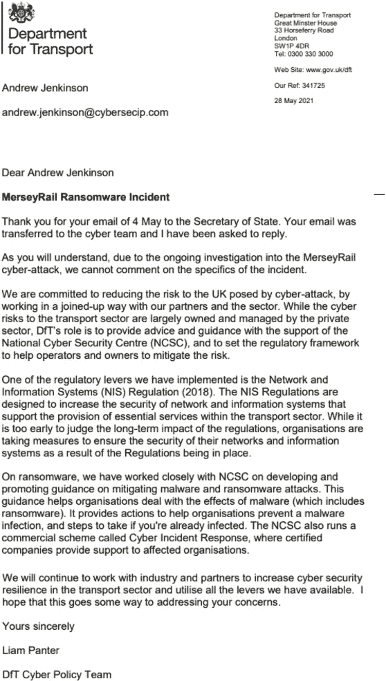

# 勒索软件与网络犯罪

## 勒索软件与网络犯罪

2001年5月，被誉为“教父”并掌管美国各机构网络攻击能力的吉姆·戈斯勒说：“要么情报界（IC）成长并适应，要么互联网会把我们生吞活剥。”戈斯勒先生是在他退休时发表这番讲话的，而几个月后就发生了9/11恐怖袭击。他或许没有意识到，他和他的数万名美国情报界网络攻击特工所创造并开启的，究竟是催化剂，还是海啸。

在过去二十年里，戈斯勒先生及其互联网键盘战士大军所创造的东西，成了每一个匿名、无名、由国家资助或个人行事的网络罪犯竞相效仿的作案手法，用以对付一群毫无防备、防护薄弱且无知的高管和安全专业人士——他们对美英机构以安全为名主导的互联网渗透和武器化隐秘手段几乎一无所知。

本书涵盖了许多网络攻击和勒索软件攻击及事件，包括我们如何发展到大规模数字化应用的地步，尤其是在全球封锁和新冠疫情大流行期间；还包括在线消费——网络犯罪造成的经济损失将是在线消费金额的两倍。

这些攻击几乎无法归因，而且即便情报界自身也遭到网络攻击，他们当然都会把这些攻击归咎于“高精尖”攻击。我们正目睹我们的整个生活方式、经济乃至自由遭到侵蚀。情报界有很多责任需要承担，并且毫无疑问地造成了我们目前所处的灾难性局面。他们目前几乎拿不出任何对策。我们需要——不，我们必须要求——改变。这种改变必须从确保互联网及其所有连接的安全性开始，使其不再允许情报界和网络罪犯轻松访问和窃取数据。

## 前言

我叫弗拉达斯·莱昂纳斯博士，是托伦斯大学的兼职教授，拥有超过45年的技术经验和超过20年的网络安全经验。我常常感到担忧甚至沮丧，因为人们对网络安全缺乏理解和认识，也因此缺乏保护企业甚至政府机构的行动；我以自己的方式大声疾呼，希望能传达我的观点。

大约两年前，我认识了作者安迪·詹金森，并立即认同他的立场、他所主张的理念，以及他努力简化信息并揭示疏漏的方式。安迪无疑是一位思想领袖，不仅言辞激烈、大声疾呼，而且据我所见，他身体力行，无人能及。

我非常高兴审阅了安迪的第一本书《从震网到太阳风》，即便以我多年的经验，书中仍有大量我此前并不知晓、却深有共鸣的信息。当安迪邀请我为他的第二本书《勒索软件与网络犯罪》撰写前言时，我欣然应允。

这个主题，正如现实本身，正在我们周围不断上演——从快餐连锁店到核弹头供应商，后果极其严重。然而每一天，这些事件看起来都像昨天的旧闻，似乎所有这一切都被人们不以为然。正如安迪所说，究竟怎样才能让世界及其领导人从睡梦中醒来？我不确定；但 2021 年网络攻击和勒索软件攻击的预估总成本及损失将达到 6 万亿美元，相当于世界第三大经济体！领导者们必须觉醒，否则就真的为时已晚了！

现在是 2021 年，很难找到没有听说过勒索软件的人，因为勒索软件攻击的数量正呈指数级增长。但你对这些攻击了解多少呢？

你刚刚打开这本书，它不仅全面收录了勒索软件攻击及其历史，而且内容要深刻得多。

这是一组案例研究，展示了勒索软件攻击的演变，并深刻剖析了许多董事会、首席执行官（CEO）和首席信息安全官（CISO）的傲慢与疏忽（我是否该说“犯罪性疏忽”？）。他们早已被告知其互联网处境脆弱，却仍不采取任何修复措施。什么都没有做！即便在已经遭受入侵后，他们仍被明确告知系统中残留的漏洞，依然无动于衷！

这些漏洞多年来已被各机构通过攻击性行动加以利用和武器化，如今它们已成为网络罪犯和国家行为体最优先的攻击面。这些漏洞是什么？首先——未受保护（未管理、已废弃但仍然活跃）的域名和子域名、过期证书以及使用 HTTP（而非 HTTPS）协议。它们修复起来非常容易，却仍然敞开着大门，任由恶意团体利用。

书中的材料（包括一些非常有趣的邮件往来示例）清楚地表明，某些负责国家安全的机构不愿放弃其攻击性能力，因而回避向整个行业提供充分建议，尤其是回避向国家关键基础设施（CNI）从业者提供建议。

不幸的是，许多 CEO 和 CISO 仍然主要考虑终端防护，而其他敞开的大门却仍在其视野之外，尽管这些大门极其危险！尤其是当我们谈论 CNI 时。IT 与 OT 的融合已经表明，通过上述攻击面发起的对 IT 的攻击可以横向移动至 OT，带来深远的后果。除非董事会、CEO 和 CISO 开始采取

认真对待面向互联网的安全问题，并解决那些显而易见的漏洞。在这场战争中，没有人能够幸免——无论是麦当劳、大型保险公司、美国核弹药的供应商，还是中小企业，尤其是在勒索软件即服务（Ransomware-as-a-Service，如 REvil）迅速普及、多个网络犯罪团伙之间出现“职责分工”的当今环境下。

近年来，所谓数字化转型的大量涌现（以及敏捷方法的大规模普及），再加上新冠疫情带来的后果（例如居家办公），显著增加了企业暴露于互联网的程度，进而也增加了遭受网络攻击的风险。

我觉得有必要对作者再多说几句。安迪·詹金森（Andy Jenkinson）是一位备受尊敬的专业人士，在业内广为人知。他是CIP集团的首席执行官，专注于风险、合规、网络安全和PKI领域。在过去几年的在线合作中，我亲眼见证了他不知疲倦地向人们传播知识、帮助各类组织走出困境。我也多次目睹各种阻力，但这些都没有阻止安迪的努力。安迪是一位广受欢迎的演讲者，曾在众多会议和活动中发表演讲。他还著有另一本出色的书《从震网到太阳风：数字利用与网络战争的20年》（Stuxnet to Sunburst. 20 Years of Digital Exploitation and Cyber Warfare），我也强烈推荐这本书。

谁应该读这本书？在我看来，董事长、董事会成员、首席执行官（CEO）和首席信息安全官（CISO），以及负责运营安全的人士，都应该一读。任何对网络安全感兴趣的人也会喜欢阅读这本书（当然也可能会被吓到）。总而言之——我强烈向所有对这一领域感兴趣的广大读者推荐这本书！

**弗拉达斯·莱昂纳斯博士**  
*多伦斯大学兼职教授*

## 前言

生存下来的不是最强大的物种，而是最适应变化的物种。在勒索软件和网络犯罪的世界里，我们正目睹对手在力量和灵活性方面发生前所未有的转变。数字世界乃至整个世界的弱点和脆弱性，正被那些本应用于确认安全性的数字工具暴露无遗。OSINT（开源情报）技术（通常免费）正被用来识别那些暴露在外、缺乏控制、管理和安全性、可被利用的域名和子域名。纵观历史，为攻击能力设计和开发并用于战争的工具，同样也可以用于防御。

可以公正地说，目前形势几乎肯定对我们不利；然而，我们作为专业人士、也作为人类，几乎没做什么来改变这一局面，而且还继续无视眼前的事实。其结果是，勒索软件和网络攻击的规模已达到难以跟踪的程度，更不用说以真正的热情去对抗了。此外，由于长期缺乏域名安全，即使在入侵发生之后，即使在根本原因已经确定之后，所有改善本已欠佳且不安全处境的尝试都是徒劳的。一旦新设备、笔记本电脑、服务器等接入网络，它们就可能立即遭到入侵。

在近乎集体恐慌、每天都有入侵事件被证实的背景下，由于新冠疫情，许多公司、体育赛事以及导致大规模聚集的活动都被叫停。然而，这也制造并加剧了本已极其不安全的处境，并带来了许多重大机遇和挑战，尤其是远程访问，它让当今本已不安全的处境雪上加霜。

随着员工有机会在家中和远程场所办公，通过不安全的连接上网，并收到大量关于如何应对新冠疫情的欺骗性恶意邮件，其中许多邮件在不知不觉中携带了恶意软件代码（木马），并得以对更多企业进行深度访问。德国政府曾在两周内被一个假冒仿冒网站骗走高达1亿欧元——该网站收集资料并冒领新冠疫情财政补助——而德国政府在不知情的情况下，将资金支付给了网络罪犯，而不是真正的申请者和需要财政支持的人。

损失还在不断增加。去年，Travelex的所有者Finablr——2019年5月以约30亿美元的估值完成首次公开募股——于2019年12月遭到入侵，仅仅几个月后的2020年4月，便被置于普华永道（PWC）的破产管理之下，随后在2020年12月以1美元的价格被出售。这个令人震惊的故事应当成为一个响亮的警钟，让人警醒可能会发生什么，以及发生得有多快。我怀疑没有任何风险管理能够预测到这种情况，而且我怀疑很多投资者都有大量资金需要核销……英国航空（BA）在发生涉及近50万条数据的泄露事件、并被信息专员办公室（ICO）处以1.28亿英镑初始罚款后，也宣布进行重大调整以避免倒闭。

我们知道，市值达数十亿美元的公司，其相关成本将占收入的大约70%。许多其他公司在新冠疫情之后的一段时间内将以巨额赤字运营；许多公司干脆停业。

在与网络安全保险行业的讨论和后续研究中，有一点变得非常明显：保险公司似乎对自己的处境相当满意；然而，在最近两个月里，CNA和AXA都遭受了入侵，凸显出它们自身的不安全处境。CNA最终支付了4000万美元的赎金。这两家机构似乎都满足于无视并继续维持这种不安全的处境。然而，它们真的看不懂商业算术吗？网络安全保险市场预计将增长到超过2000亿美元；然而，与2021年预计总损失6万亿美元、到2025年预计超过10万亿美元相比，这两个数字之间存在巨大而明显的鸿沟。

例如，A公司有10亿美元的收入。在这10亿美元中，35%将用于支付员工薪酬（3.5亿美元）。另有25%将用于支付管理费用、建筑物和一般日常成本（2.5亿美元）。再有10%需要用于支付技术、安全和潜在损失。暂且把资本充足率放在一边，那么在缴税之前，还剩下总共30%，就A公司而言，即3亿美元。

现在假设A公司是一家网络安全保险承保商，总收入为10亿美元。如果总索赔额一旦超过前述30%，即3亿美元，那么他们就是在亏损经营。我们不要忘记，他们做生意的目的是盈利，而且必须能够证明自己具备应对此类情况的资本充足能力。这当然是一个非常微妙的平衡，而且可能是法国安盛（AXA）在自身遭到勒索软件入侵前一周确认将不再“保证”向客户支付勒索软件赎金的主要原因……

无论从哪个角度看，也无论有多少公司会“分担”年度累计损失，许多公司都将根本无法承受这些损失，只能做以下两件事之一。领导者要么为公司的衰亡做好准备，要么主动更好地做好防范，避免遭到攻击和承受巨额损失。对于国家关键基础设施、医疗保健和金融服务而言，不应该有选择的余地；然而，人们对真正的安全仍然十分无知，甚至还在打“貌似合理的否认”这张牌。

公司有两种类型，领导者也有两种类型：一种希望在中期到长期有所作为，另一种只想拿到年度奖金，然后在适当的时候走人。在这两个方面，你都能在许多公司中看清谁是哪一种。

可以说，除非你知道或能看到自己试图保护的是什么，否则你还不如蒙着眼睛上战场，而且没有合适的工具来保护自己，甚至保护企业。

毫无疑问，我们都处于网络战争中，没有人可以选择成为良心拒服兵役者或置身事外。如果你或你的组织以任何形式使用技术，无论你喜不喜欢，你都身处前线。外包总是一种选择；然而，你无法外包责任或义务。法律人士只会从集体诉讼开始，用更多的时间和相关成本把组织和人员缠住。

我们正迅速接近2021年年中，全球GDP大幅下降，只有一个国家除外——中国。众所周知且公认的是，中国希望从目前的第二位跃升为第一大经济强国。同样众所周知且公认的是，80%的网络攻击都针对美国公司、政府、关键国家基础设施（CNI）等，因为美国更依赖数字设备和互联网。过去十年，网站的激增与网络攻击和美元损失的激增直接同步，这并非巧合。将两者叠加在一起，上升曲线几乎相同。

所以，选择在我们手中。我们可以继续在一次又一次攻击的余波中挣扎，做忙碌的傻瓜；或者确保我们面对互联网时是安全的，并连接好互联网，以防止轻易被渗透。网站和互联网本是为了帮助我们的日常生活、通信和商业而设计的。遗憾的是，由于最初是美国中央情报局（CIA）、国家安全局（NSA）和政府通信总部（GCHQ）对大规模数字数据收集的高度关注，以及过去十年左右来自对手的高度关注，互联网和网站连接已被武器化，并威胁到我们的生活方式。由于我们政府和机构20年前的行为，他们却奇怪地不急于加强这一关键安全领域，而是陷入了十字路口。他们应该坦白，揭露这个世界上保得最差的秘密之一的真相，鼓励每个人重视互联网安全，而不是鼓励人们忽视它，以方便他们自己的秘密活动——这些活动已被证明是大多数网络攻击的根源——或者继续把头埋在沙子里。人们不禁要问，好人是否只是变成了坏人？所有被入侵但由政府签约的网络安全组织的所有者是谁？谁真正拥有所有的比特币钱包？美国

## 从STUXNET到SUNBURST及勒索软件的发展

我之前的著作《*从Stuxnet到Sunburst：数字利用与网络战20年*》带领读者踏上了一段旅程，审视了众多具体的网络攻击，以及以Stuxnet形式首次将数字代码用于战争。Stuxnet使用了带有恶意代码的数字证书（Stuxnet）。该书深入探讨了许多攻击，并最后得出了与SolarWinds入侵事件的相似之处——该事件始于2020年初，2020年12月浮出水面，影响了包括美国政府在内的数千家客户。具有讽刺意味的是，SolarWinds是一家美国公司，开发用于帮助管理客户网络、信息安全和基础设施的软件。作为知名且被高度使用的美国政府供应商，SolarWinds被入侵并造成最大规模的渗透、破坏和无障碍访问，这可谓恰到好处。之所以说是双重打击，很大程度上是因为：一旦通过劫持一个遗留的不安全子域获得了域管理访问权限，对手就在SolarWinds自身的数字证书中植入了Sunburst（即为该代码起的名字），这些证书被分发并用于更新客户版本。此外，从接受更新（往往无需任何干预）到激活Sunburst之间有13天的延迟，这与Stuxnet所使用的时间框架完全相同。这与Stuxnet自己的从渗透到激活的13天延迟纯属巧合吗？我们认为不是。

Stuxnet和Sunburst都是具有特定目的的网络攻击。前者旨在动摇、减缓甚至阻止伊朗核计划，后者则旨在造成重大破坏并渗透美国政府，包括财政部。这只能是一件坏事，因为美国乃至所有组织和政府都没有适当的控制措施，也不知道自己的企业网络中有什么；很可能现在它们包含的东西更多了，同时还有数据外泄。

过去几年里，有组织犯罪一直在观察和学习，类似攻击可以多么简单、多么匿名地被用来实施其整体非法商业计划。事实上，它们如此容易，以至于数字网络攻击已经超越并碾压了所有其他形式的犯罪，而且作为有组织犯罪如此成功，实际上它们的组织化程度甚至超过了负责保障安全的人。我们也有理由确认：好人必须守住100%的防线，而坏人只需找到一个突破口。2013年爱德华·斯诺登等人的爆料进一步加剧了这种状况，他们证实了用于渗透组织和政府、获取数字访问权限并窃取信息和数据的接入点和工具。对这些数据的收割带来了控制和权力；然而，一旦落入坏人手中，勒索软件便诞生并经历了早期迭代，全球市场和经济将从此永远改变……

什么是勒索软件？用最简单的话说，勒索软件是加密病毒学中的一类恶意软件，通常威胁要公开受害者的数据或阻止其访问，除非支付赎金。众所周知，将人扣为人质并索要赎金才释放是严重非法的。在数字世界里，这似乎被容忍甚至接受了，这就是为什么像最近袭击科洛尼尔公司的Darkside这样的组织，在过去几个月里估计已收到约9000万美元……

勒索软件在过去几年里不断演变，尤其是最近一年左右，现在通常意味着网络犯罪分子先窃取数据，然后向受害者展示数据已在他们的掌控之中，以证明他们能够将数据取走。他们会高价将数据卖回给受害者，于是下一次攻击就这样开始了。让我们更仔细地看看这一点，因为即使是安全领域一些最大、最优秀的领导者也并非完全理解。大约在2013/2014年前后，谷歌等公司希望从弱安全的HTTP（超文本传输协议）迁移到HTTPS，以确保网站访客获得更好、更强的安全性。HTTPS中的S实际上代表安全，意味着所有数据都将被加密，而不是以明文形式保存。明文形式就是你在这里读到的文本，希望每个人都能轻松理解。你会熟悉各种电子邮件和通信应用程序，如WhatsApp、Signal等。这些应用在设计时都本着同样的目的：确保消息经过加密，并且只能由收件人解密，或者至少这是它们最初期望的商业计划。

谷歌可能从未意识到，并非所有人都会采用这一伟大的新安全立场，而为全球安全提升而花费数年时间协商、设计和开发的东西，实际上会让识别那些没有使用新版HTTPS、因此以明文形式保存数据的组织变得更加容易。网络犯罪分子将以此为家常便饭，去找那些仍在使用HTTP、容易访问的组织，明文数据使他们能够加密这些数据，并以此索要赎金来换取正当的解密能力。谷歌确认，他们会在地址栏中显示“不安全”字样，以分享那些忽视升级版HTTPS的组织的详细信息。那些因这类疏忽或失职而中招的组织名单，读起来就像是政府、财富500强和富时100公司的名人录。

情况更糟。HTTPS元素指的是数字证书的有效性；也就是说，它是否拥有正确的证书，是否有效。它是否与域名匹配，类型是否正确？它不会告诉你的是，域名配置是否正确，或者是否存在可利用的其他安全漏洞。它是否使用了托管服务提供商、共享服务、DNS（域名系统）或CDN（内容分发网络）的第三方内容等等？

这种自己招惹来的挑战很少被理解，可悲的是，这还包括行业巨头和太多的首席信息安全官。这足以令人担忧，因为尽管维护一个“不安全”域名证实了互联网安全控制和管理完全缺失，但也突显出默认情况下内部安全也缺失。此外，它还证实，这些域名在发布时，往往使用第三方内容、负有共同责任的托管服务提供商，或使用以HTTP编写的旧代码的服务器，这使得整个网站都被降级为“不安全”。未经身份验证、缺乏数据完整性、数据又常为明文：很容易理解为什么每天12亿网站中有20万个会被定向攻击，也很容易理解为什么成功的攻击每年给全球经济造成数十亿甚至数万亿美元的损失。

在过去的12到24个月里，我在世界各地的同事不断给我发送本地勒索软件攻击的详细信息。范围从澳大利亚、新西兰、美国、爱尔兰、英国的医疗保健……

这种情况仍在延续，甚至愈演愈烈。正如保罗·中曾根（Paul Nakasone）在参议院委员会上所言：“我们的对手并不惧怕我们。”鉴于我们频繁的研究和发现，“从婴儿手里抢糖果”这句话不禁浮现在脑海中。

此外，当那些由美国国防部（DOD）、国土安全部（DHS）、RTF、MITRE CWE 以及成千上万其他机构支持的组织，心安理得地维持着欠佳的安全状况时，它们不仅让自己成为攻击目标，而且是一个极易被利用的目标。当这种情况出现时，我们经常建议客户——尽管这可能令人不适——要追问：这次攻击究竟是因为某人自满，还是有人同谋？比特币和其他数字货币与区块链相结合，提供了一定程度的匿名性，人们根本无法确定谁才是好人，谁又是真正的坏人。安全确实是一种选择，就像吸烟、酗酒或鲁莽行事一样。域名安全至关重要，却被系统性地忽视，在一个又一个行业中被忽略。勒索软件和网络攻击是一种自我实现的预言。勒索软件很少是复杂高明的，却总是被这样描述，以掩盖无能和自满。现在是时候直言不讳了，否则就真的太迟了。

有两种截然不同的方法可以降低成为网络攻击和勒索软件受害者的几率。第一种在当今的数字世界中简直不可想象，那就是把所有设备都从互联网上断开，回到纸笔时代，直接面对面交流。另一种则是确保组织控制并管理面向互联网及相连的安全。问问自己：为什么大多数机构都认真对待这一领域，并基本覆盖了这一关键领域的安全？它们太清楚不过了，这是远在千里之外的对手的第一个入口；那根细细的网线连接会惩罚任何忽视其域名/服务器安全的人。我们在上一本书中探讨了几起由于不安全而导致的政府网络攻击，而在本书中，我们还将审视几起勒索软件攻击。读到最后，你将会震惊、难以置信，甚至可能对我们政府20年前发起并一直在做的、旨在阻止这种下滑螺旋和轨迹的事情感到些许偏执……

## 不安全，F 和 0...

> （某家十亿美元级网络安全公司的首席信息安全官，2021年5月20日，在经历了包括 SolarWinds 在内的多次网络攻击之后所言）

于是，我让我的漏洞研究团队去检查了一下。不到一个小时，他们就给我发来了属于该公司的十几个不安全域名。更糟糕的是，还有不安全的登录域名、传输层安全（TLS）证书不匹配的域名、TLS 已过期的域名，以及配置错误的域名。

出于职业礼貌，我在英国时间 23:00 给这位首席信息安全官发了两张截图，向他们展示这些发现。对于第一张，他们回复说：“谢谢，幸好那只是一个客户演示站点”，言下之意是它不涉及数据或安全风险。对于第二张，那是一个公司视频会议用的不安全域名，数百名公司员工经常使用，而且完全暴露在中间人攻击之下，但他们没有发表任何评论……

我们听到过很多借口或理由，试图说明维持不安全域名没什么大不了；但事实绝非如此。任何属于公司的域名，如果被放任自流，依赖过时的 TLS 证书，往好里说，也是在向所有查看的人表明该公司缺乏互联网安全控制和管理能力。同样被忽视的是，网络犯罪分子正在扫描互联网，寻找评级为 F 和 0 的网站，将其加入目标列表并发起攻击。简而言之，一个不安全的网站能说明一家公司的整体安全状况和能力。如果它连互联网接入都是不安全的，那么内部安全也好不到哪里去。同样，正如 SolarWinds 事件清楚地告诉世人的那样，通过一次域名劫持和接管，再加上一些横向移动，就可以将 Sunburst 恶意代码植入数字证书，进而入侵数千家公司。…… 不清楚人们到底是不理解“数字门户大开”的哪一部分，还是不知道如何保护它；然而，我们的研究在全球领先的保险公司（包括网络保险公司）、金融服务监管机构、中央银行，甚至我们自己的 GCHQ 和 NCSC，以及唐宁街10号都发现了同样的情况。

让我们暂时考虑一下实体场所。假设是同一家公司，就是前面提到的那家网络安全公司，拥有的是实体场所而不是域名。他们会不会同样只确保其中二十几个场所安全上锁、装好警报器？或者他们会说自己只锁了二十几个？当然，他们会把所有的场所都锁好。然而，当涉及他们的数字化在线、24×7 全天候域名时，似乎就无所谓了。这种糟糕的观念和自满情绪，正是网络攻击不断发生且未受挑战的原因。

在每个网站的地址栏中，你都会看到 www.example.com。在它前面，你会看到一个挂锁图标，确认 TLS 证书有效，并且使用了最新的 HTTPS 协议。如果不是这样，则会显示“不安全”的文字。更复杂的是，即使显示了挂锁，也不意味着该域名是安全可靠的；它只是确认了证书的有效性。这种混淆甚至延伸到许多安全专业人士身上。让我进一步解释。我们最近通知了许多组织其整体不安全的状态，包括全球保险业领导者劳合社（Lloyd's of London）。他们的首席执行官和首席信息安全官反驳说，他们使用 SSL Labs 进行过扫描，扫描发现证书有效并给出了 A+ 评级。他们不理解或不明白，一个完整域名和托管该域名的服务器是不同的，因此轻视了 F 和 0 评级，即便我们向他们展示了与其安全相关、导致其不安全的重大关切、异常和问题（包括 cookie、代码注入、子资源影响（通常是覆盖整个网站的代码）、跨站脚本等）的证据。这两位聪明人，以及更多人，仅仅依赖于组成域名的不到 5% 的组件，就自以为已经安全了，而显然他们当时并不安全，现在也依然不安全……我们总是说，没有

当人们表达了对在线填写所有文件却得不到任何支持的愤怒和担忧时，真相才浮出水面。大约一半的企业主曾在那个仿冒网站上填写了他们的详细信息和索赔申请。这些数据被网络犯罪分子获取，然后被重新发送到真正的网站，只改动了一处——银行账户信息。据当时估计，在几周时间里，约有 1 亿欧元被错误地支付给了那些利用真实个人数据提出虚假索赔的网络犯罪分子。

这个故事绝非孤例。我们曾撰文提到梵蒂冈去年夏天遭遇入侵后其不安全的主页，以及由于 COVID-19，教会和梵蒂冈的所有信徒——即 13 亿天主教徒——在大流行期间被迫转向线上。这包括让他们了解最新信息、支持他们的信仰，当然还有捐款。梵蒂冈也落入了成千上万、甚至数百万组织都会落入的陷阱，即忽视或无视其域名的关键安全。我们研究了梵蒂冈，不仅其主页依赖过时的 SSL 证书，而且总共 85 个网站中有 82 个也是如此。这意味着其中许多网站完全暴露、高度脆弱、极易被利用。这也意味着，由于包含个人身份信息（PII），其行为违反了《通用数据保护条例》（GDPR）的规定。由于违反 GDPR，梵蒂冈可能被处以高达其年收入 4% 的罚款。事实上，在之前提到的情形中，德国政府也可能面临同样处罚。

类似的情况也发生在几年前英国航空（British Airways）遭受入侵时。当时，一个非法重定向网站捕获了数据，卖掉了近 50 万张假机票——BAWays.com 被恶意搭建了六天，英航对此毫不知情。英航最初因这次入侵被罚款 1.28 亿英镑，随后由于市场状况和 COVID-19，信息专员办公室（ICO）将其大幅削减至 2000 万英镑。英航后来从英国政府借款 5 亿英镑。

然后是 Travelex，由 FINABLR 所有。Travelex 于 2019 年 5 月在伦敦证券交易所上市，市值约 30 亿美元，盛极一时。12 月 31 日，Travelex 成为勒索软件攻击的受害者。到 1 月中旬，据报道 Travelex 向勒索软件团伙支付了 500 万英镑，两周后，他们处理了其主页所依赖的过时 TLS 证书，而这个证书正是我们……

1月2日，他们接到了通知。我们只能猜测，他们是不是在主页保持“不安全”状态的同时完成了上市；然而，在这种情况下，一如既往，他们是在向网络罪犯发送警报——这些罪犯不断寻找着可供攻击的“F”和“O”，而 Travelex 完全符合这种*作案手法*。几个月后，由于 Covid-19 导致的全球性封锁，这次入侵事件进一步恶化；Travelex 在以30亿美元上市仅11个月后，便在普华永道的主持下进入破产管理程序。Travelex 又勉强支撑了几个月，最终在2020年12月以1美元的可观价格被出售……这是一个18个月内从繁荣到网络崩溃的故事。

网络攻击或勒索软件入侵不再被视为麻烦或不便。它能够也将会击垮数十亿英镑的企业，正如 Travelex 所证明的那样。我们不断听到高管和董事会说他们不懂网络安全问题，也不知道该做什么。我坦诚地建议他们开始学习，而且要快。此外，那些所谓的专家——比如伦敦劳合社的例子——依赖“专业知识”的人，真的需要承认他们并非无所不知；而且，忽视基本要领，他们正在将自己、企业、股东和合作伙伴置于完全不必要的风险之中。这些风险可能导致他们的公司倒闭……

## 案例研究1

### 从 HTTP 到 HTTPS 的增补

如今，我们听到很多关于数字信任甚至零信任（ZT）的说法。两者都已成为时髦词汇。事实上，它们至关重要；然而，很少有公司真正理解其含义，数字信任和零信任往往不过是获取更多预算的术语和衡量标尺，太多公司继续不明智地花费和挥霍这些预算，而这些预算对真实安全几乎起不到什么作用，甚至毫无作用。如今，所有公司都必须考虑它们为客户提供的信任；然而，大型组织和政府却连基本、根本的安全都做不到。要让数字信任和零信任这样的状态成为现实，还有很长的路要走。只需看看网络攻击、勒索软件攻击以及因隐私疏忽而被罚款的数量就知道了。简而言之，数字信任和监管者充其量只是令人恼火，而受害者一如既往是公众。警告：人们迟早会用脚投票……

2014年，谷歌和其他互联网服务提供商（ISP）表示“受够了”，决定尝试让互联网更安全、更可靠。仅这一声明和决定本身就足以证明，过去的互联网并不安全，可悲的是，现在仍然不安全。该战略制定并力求从传统 HTTP 转向 HTTPS，其中 S 代表安全。这一决定意味着从传输中未加密的数据转向加密流量。该计划无疑是朝着正确方向迈出的一步，但也有几个缺陷。第一个缺陷是，迁移到 HTTPS 需要全面采用；直到2018年，才真正获得了有价值的支持和采用。最终，在2018年，未采用 HTTPS 的公司和组织将受到公开羞辱，其网站会在地址栏中显示*不安全*文本，而不是挂锁图标。这后来被称为对不认真对待自身安全或客户及潜在客户安全的公司的羞辱。可悲的是，尽管情况有所改善，我们研究过的1000多家遭受网络攻击或勒索软件攻击的公司，其网站都处于次优且不安全的状态，许多至今仍如此。……这绝非巧合。

这一挑战在于，如果我们审视网络攻击和勒索软件攻击，并思考这种攻击在寻找什么，我们就会看到，未加密（明文）数据对网络罪犯具有无与伦比的吸引力，而更严格、更严厉的隐私法律又助长了这种吸引力，而且损失往往被无知的网络保险提供商掩盖。明文数据一旦被窃取（通常是因为使用 HTTP 发送），很容易被捕获，然后由于其中包含个人身份信息而被用来要挟受害者支付赎金。2018年，当地址栏显示“不安全”时，也表明并确认了未加密的数据流量。原本旨在让世界更安全的措施，实际上却被用来识别那些脆弱且可利用的网站。此外，在2021年的今天，整整三年过去了，那些显示“不安全”文本的组织也证明了他们没有控制或管理自己的网站、服务器和 Web 界面，而网络罪犯则像鲨鱼一样围着猎物打转。不采用 HTTPS 对任何公司来说都是一个非常糟糕、不明智且松懈的做法；三年来，全世界在看到“不安全”文本时都已得知这种不良做法。如果企业负责人知道这种情况，他们绝对不会忽视。它影响着上游和下游的每一个用户和客户。然而，太多所谓的“安全专家”忽视、无视和忽略这些情况，却急于声称他们在安全上花费了数百万美元，并向不懂行的董事会和高管宣称自己是安全的。

为了理解从 HTTP 到 HTTPS 的转变，让我们列出关键术语：

- **HTTP（超文本传输协议）**——在线通信的基础（信息如何从服务器发送到浏览器）。
- **HTTPS（超文本传输安全协议）**——改进的 HTTP，并带有一个加密安全层（S）。
- **加密**——对信息进行编码，使其只能由授权方访问，而不是明文；后者是网络犯罪分子的“主食”。
- **SSL（安全套接层）**——在服务器和浏览器之间创建加密通信链路的技术协议。
- **SSL 证书**——数字数据文件，安装在 Web 服务器上时可加密数字信息并激活安全连接。
- **DNS（域名系统）**——域名目录，可转换为 IP 地址。

谷歌和其他 ISP 列举了从 HTTP 转向 HTTPS 的三个不同理由。他们希望网站与所有者匹配并经过认证；确保数据具有完整性

## 那么，这与勒索软件有什么关系呢？

让我们首先思考，为什么公司一开始会成为勒索软件攻击的目标。首先要了解的是，对手的许多攻击针对的是他们不熟悉、从未访问过或从未沟通过的公司，但由于这些公司存在不安全的互联网连接，它们被标记了。决定攻击谁、不攻击谁的筛选过程可能各不相同；然而，组织的规模、账户以及与合作伙伴和/或政府的接触范围，都可能在挑选那些更有可能迅速支付且有能力支付赎金的目标时发挥作用。同样不可忽视的是，攻击正越来越多地集中在那些无法承受技术系统停机或生产停工的大型公司身上，例如 Colonial Pipeline（稍后会详细介绍）和索尼。勒索软件的要价已急剧上升，如今达到数千万美元，并且确已支付。犯罪分子知道，像 Colonial 这样的公司每停产一天都会带来巨大的成本影响，而三分之二的天然气公司耗尽燃料，也会激起大众要求采取行动……

勒索软件只是数字领域和世界中的一种犯罪活动，它利用不安全的环境获取访问权限（渗透），然后窃取明文数据（因不安全而未加密的数据）。接着与受害者分享所捕获的数据，再对其加密并“卖回”给受害者，要求支付赎金以获得解密密钥。CNI（关键国家基础设施）、医疗保健运营商和运输组织，甚至政府——无论个人观点如何，人们太容易通过支付勒索赎金来掩盖自己的错误和疏忽。随后经常被完全忽视的是根本原因。那些一开始就让组织成为目标并易于被利用的不安全域名和状况，进一步被忽视和忽略。赎金支付了，不安全状态依然存在，随时准备迎接下一次攻击。不安全的信息甚至会被转卖。

受害者（但愿）拿回了他们珍视的数据，并发誓再也不会上当，真的……自掏腰包数百万美元，结果只是回到原来的位置、停滞不前。遗憾的是，事情并没有就此结束。大部分数据可能已被泄露，而且无法保证数据没有被标记，或者没有一部分被保留以用于下一次攻击。据估计，在这种情况下，只有8%的数据能够归还且未受损害。

此外，谁去检查、又有能力检查，在密钥库的二进制深处是否被巧妙地植入了几个 SSL 证书？那些最初使得——甚至可以说助长了——渗透的数字访问门户，往往对下一次攻击大开方便之门。安全并未得到改进或加强，损失则被减记和核销。如果一个人持愤世嫉俗的态度，很容易认为这是一种巧妙的手段，可以在没有任何追索的情况下提取资金，而最终由政府与纳税人买单。

遗憾的是，似乎很少有组织真正理解安全，或者理解最初被渗透的根本原因。互联网始终是首先检查安全问题的最佳场所，因为一次又一次，这类欠佳的问题导致系统暴露、易受攻击且被利用。令我们仍然感到惊讶的是，诸如全球领先企业、监管机构甚至政府这样的组织，并不理解它们面向公众和互联网的连接不安全所带来的影响，或者说不愿去理解。NSA 和 GCHQ 在二十多年前就完善了域管理员渗透技术，尽管很明显，暴露这些漏洞并不符合它们的利益。即便到今天，凭借协助两国政府的亲身经历，他们也只是勉强接受了我们的研究和发现，其中包括中央投票系统、国家网络安全中心（NCSC）自身不安全的域、联邦调查局（FBI）以及唐宁街 10 号。

去年秋天，uhnj.org（新泽西大学医院）正处于包括 COVID-19 在内的多重危机之中，并成为了勒索软件攻击的受害者。他们确实失职了，忽视了问题，甚至因维护欠佳且不安全的域而犯有基本安全疏忽的过错，其中包括一个最严重的错误：他们的主页依赖过时的 TLS 证书。因此，他们的主页缺乏身份验证和数据完整性，完全暴露在众多已知攻击之下，包括劫持、水坑攻击、路过式下载、访问、代码注入，当然还有明文数据——这正是勒索软件犯罪分子的主要目标。即使在被告知后，该主页似乎仍然“自豪地”显示着“不安全”字样，并且持续了好几个月。

我们多次致信总裁兼首席执行官谢里夫·埃尔纳哈勒（Shereef Elnahal）。谢里夫是一位备受尊敬、似乎很受欢迎的人，也是其领域的专家。我们在六个月内敦促他处理过时的 TLS 问题。我们甚至在他 LinkedIn 文章下添加评论以引起他的注意；但毫无效果，直到今天，UHNJ 的主页仍然令人难以置信地保持“不安全”状态，使该组织、患者的 PII 数据以及上下游关联第三方暴露在风险之中。维持这种状态不仅仅是疏忽；简直就是严重无能，并且是该行业乃至整个国家整体不安全状况的一个主要促成因素。地址栏中的“不安全”字样，人们到底哪一点不明白？

2020 年 5 月，我们提醒阿拉斯加州注意其不安全状况。阿拉斯加是五十个州中的第一个（我们着手处理的州），尽管我们知道按字母顺序排列，阿拉巴马州排第一，但我的一位挚友鲍勃住在阿拉斯加，所以有意从那里开始。研究之后发现了非常令人担忧的结果，包括 27 个 CVE，其中一些是严重的，一些甚至可以追溯到 2011 年。我们多次向阿拉斯加政府发送电子邮件和信件。每一条消息都未被回应和忽视，尽管他们在前一年曾遭遇过 PII 数据泄露。2020 年 12 月 4 日，阿拉斯加宣布了另一次泄露，而我们的研究再次显示，该州各域存在持续的系统性整改缺失和不安全状况。本周，阿拉斯加在两年内第三次遭到入侵。我们的研究显示，阿拉斯加法院系统的主页再次因过时的 TLS 而保持“不安全”状态。数百万甚至数十亿美元花费在资源、建筑和基础设施上，然而互联网安全却被严重忽视和持续无视；这应该被定为刑事犯罪……

简而言之，勒索软件是最简单的网络攻击之一，很少被吹嘘为“复杂”，因为公司很容易被网络罪犯识别为具有易于利用的漏洞和明文数据。这类攻击可能只需数小时就能启动运行……保险公司也帮不上忙。许多保险公司根本不知道良好的网络安全是什么样的，也不知道需要什么来防止攻击。事实上，许多保险公司——包括一些世界最大的保险公司，如伦敦劳合社、怡安、Willis、CNA、苏黎世等——自身也完全有可能被入侵。只需看看 CNA，它最近就因域安全欠佳而遭受攻击；还有 AXA，上周遭到入侵，讽刺的是，就在它宣布不再将支付勒索软件赎金作为保单的一部分提供担保之后，接着就被——你猜到了——勒索赎金的网络罪犯入侵了……这种情节编都编不出来。而当 AXA 和伦敦劳合社的首席执行官及全球首席信息安全官否认其不安全状况的证据时，也就不足为奇了。我以为保险公司应该减轻客户的风险，而不是增加他们的风险，然而 CNA 和 AXA 的入侵事件却让它们的客户更加脆弱，包括在确认保单细节和勒索软件赎金索赔门槛方面……

坦率地说，许多公司、保险公司和政府毫无疑问正在充当自己最大的敌人。知识和纪律的缺乏正让一家又一家公司栽跟头。我们所提倡的大部分内容就是良好的基本安全卫生。无视这一点——正如阿拉斯加州、CNA、UHNJ 以及成千上万继续无视问题、行事疏忽的机构那样——正让他们和全球经济付出高昂代价。他们将遭受多次攻击和入侵，直到最终要么倒闭，要么开始确保互联网、面向公众和连接的安全。就这么简单。

正如史蒂夫·乔布斯所说，雇用聪明人然后告诉他们该做什么是毫无意义的。与此非常相似的是，当你目睹一次又一次的入侵以及同样不安全状况的持续时，如果你雇用了更聪明或更有经验的人，请停下来倾听：按你拥有它们的比例使用你的耳朵和嘴巴——多听少说。同样，当你收到漏洞警报时，仅仅因为你当时可能没有请求或付费购买这些可操作情报，绝不意味着其有效性就不那么重要。先检查，再修复。我们还主张对这种情报给予奖励，就像你肯定会为漏洞支付赏金一样。作为专业披露的一部分，你为什么要反驳或否认可能防止一场造成数亿美元损失的大规模入侵的可操作情报呢？

昨天，一位来自某家十亿美元网络安全公司的全球首席信息安全官对我说：“我们每天扫描，我们有这个和那个能力，我不相信你能给我们展示什么，但我愿意听一听。”数小时内，我们就发现了十几个完全不安全的域，使该公司处于与 SolarWinds 被入侵之前相同的境地。考虑到其政府客户的高度敏感数据和连接，我们随后被无视，这似乎是一种个人声誉和自负的情形，而且至今仍然不安全。

勒索软件和网络攻击是可以大幅减少的；然而，我们都需要共同努力，使互联网和互联网连接变得安全。为了每一家公司、每一个组织、每一个政府和每一个人。没有什么地方比与互联网相连之处更重要的了……

## Colonial Pipeline 与关键基础设施公司

2021 年 5 月 6 日至 7 日，美国科洛尼尔管道（Colonial Pipeline）——这条管道系统始于德克萨斯州休斯敦，主要向美国东南部输送汽油和航空燃油——遭受了一次勒索软件网络攻击。该攻击并未影响管理管道和基础设施的网络，而是影响了销售和开票的会计系统。大约一周内，管道被迫关闭，加油站燃油告罄，引发了一定程度的恐慌性抢购。据报道，三分之二的加油站因缺油而关闭，在这种情况下，只需再有一点风吹草动就足以引发真正的恐慌和燃油抢购，甚至是为获取燃油而实施的犯罪活动。

2021 年 5 月 6 日晚，我们立即对 www.colpipe.com（Colonial 的官网）进行了研究，发现了常见的域名安全 F 级和 0 分评级，以及几个完全不安全的域。你会在这本书中一次又一次地读到，当出现这样的 F 级和 0 分评级时，它就是在提醒网络罪犯：这些组织已暴露、易受攻击且容易被利用。Colonial 过去和现在都一直负有维护不安全域的责任，使自己成为目标，然后轻易被利用。这次攻击既不复杂，他们最初也不是目标；是他们自己的疏忽导致了这种处境。据*《华尔街日报》*报道，Colonial Pipeline 公司首席执行官约瑟夫·布朗特（Joseph Blount）表示，他授权向勒索软件攻击者 DarkSide 支付 440 万美元赎金。

Colonial 显然已经花了数周时间试图招募安全领导层，而且过去——并且可能现在仍然——拥有的安全能力和知识非常有限。鉴于我们的研究和发现，这很可能属实；然而，拥有领导层和庞大的安全专家团队以及巨额预算，当然并不意味着安全是理所当然的。正如你无疑将会震惊地看到，当你

通读本书和我之前的著作《*从震网到太阳风*》（*Stuxnet to Sunburst*），经验与专长并不能保证安全，正如青春不能保证创新一样。

已经变得显而易见——而且再明显不过——我们生活在一个“皇帝的新装”式的世界里，以至于网络安全公司及所谓的“安全专家”都未能遵循良好准则或最佳实践，难辞其咎。事实上，今天*《信息安全》（Infosecurity）*杂志在Constella Intelligence进行的一项调查后，刊登了一篇标题为*《全球CISO正在破坏网络卫生努力》*的文章。该调查揭示了在超过100名全球CISO的目标群体中普遍存在的不良安全实践，这与我们自己的研究和发现一致。你还会频繁看到“自满”或“同谋”等字眼，因为指导方针和领导层必须遵循良好的基本安全原则和适用目的的互联网连接，然而根据我们进行的研究，我认为超过75%的组织处于不安全状态。在12亿个网站中，这对网络犯罪分子来说是一个相当大的目标受众可供牟利……

一如既往，我们并不回避着眼于宏观大局，并应要求对美国一些顶级关键基础设施燃料供应商进行了研究，并为备受尊敬的团体Energy Central整理了一份报告。研究和文章如下。

## 美国的关键国家基础设施是否为持续的勒索软件围攻做好了准备，他们又能如何避免？

日期是2023年12月30日，本周，美国电网又遭受了两次毁灭性的网络攻击。勒索软件索要总计2亿美元，电网连续第四天瘫痪，西海岸数百万人仍处于断电状态。对商店、银行、通信、食品储存、水处理等行业的连锁影响正在加剧。公众愤怒不已，示威者攻击了电力公司高管的住宅，愤怒的人群推倒了大门、围墙和防御设施。不幸的是，在一次示威中有16人死亡，当时执法部门未能控制愤怒的人群，导致交火、混乱和暴乱。对这些死亡原因的调查已经开始；但据推测，可能是超过五万名愤怒顾客的踩踏所致。

西海岸无疑已经陷入无政府状态，而在去年同一家公司遭受勒索软件攻击之后，他们的财务状况可能已无法满足勒索要求；目前尚不清楚这一令人难以置信的局面将如何解决。在去年一份措辞严厉的报告中，人们发现远程访问是通过不安全的互联网连接获得的。超过一千万名去年断电一周以上的客户提起了严重疏忽的集体诉讼，超过十万人遭遇数字身份被盗和滥用，由于PII数据泄露，完全无辜的客户背负了债务。白宫和总统已发布行政命令，国民警卫队再次被部署。

这就是世界目前面临的未来，特别是CI（关键基础设施）提供商，如果他们继续忽视其面向互联网和连接的安全……

让我们回到今天，2021年5月13日。本周我们目睹了Colonial Pipeline的网络攻击和破坏，造成了长达一周的中断。加油站和燃料管道已经枯竭，东海岸大量民众感到愤怒并要求得到答案。情况可能只是因为COVID-19的限制效应而得以最小化。燃料价格已经飙升，而且发现Colonial没有任何值得一提的安全措施，更不用说良好的安全或良好的安全资源了。这种不安全的状况使得远程访问得以实现和便利，反过来，远程访问又促成了这次入侵。Colonial本周的总损失，包括向勒索软件团伙DarkSide支付的数百万美元赎金，可能超过1亿美元。Colonial的总体安全评级为F和0，显示出令人担忧的系统性问题：

> Colonial拥有糟糕的面向互联网安全评级F和0。这是最差的评级，而在这背后的是一系列不安全、极易被利用的状况。除了被归类为CI之外，这与电网及其现代化有什么关系？

前一段写于2023年12月30日，正在迅速逼近，作为CI行业要求我们开展的研究项目的一部分，研究结果明确指出，除非电网、RTO和ISO公司在组织、治理、战略、创新、领导力和文化方面加入适用目的的安全措施，否则我们国家关键基础设施的支柱和互联网络将继续完全是目标。评级从A到F不等，此处的结果显示，关键基础设施当前和未来的安全状况是站不住脚的。在FERC（联邦能源监管委员会）或国会等其他机构的压力下，我们期望他们能达到B或C的安全等级。但他们没有，造成这种情况的原因令人费解。

同样重要的是，并非所有RTO/ISO都相同；ISO-NE和CAISO都努力达到了B的安全等级。西南电力池（Southwest Power Pool，SPP）的评级为F和0，与Colonial相同。SPP是一个非营利公司，由联邦能源监管委员会授权，负责确保可靠的电力供应、足够的输电基础设施和有竞争力的批发电力价格。西南电力池及其多元化的成员公司协调着跨越14个州、约60,000英里高压输电线路的电力流动。公司总部位于阿肯色州小石城。

ISO-NE负责监督新英格兰地区大容量电力系统和输电线路的运行，这些电力由成员公用事业公司以及魁北克水电公司、NB Power、纽约电力管理局以及纽约州的公用事业公司在需要时发电和传输。ISO-NE负责可靠运行新英格兰32,000兆瓦的大容量发电和输电系统。其主要职责之一是为新英格兰的能源供应提供价格、条款和条件的关税。评级为B和75/100，这相比其他机构有了很大改善，我们有理由认为，凭借这一安全评级，ISO-NE将是此列表中最不可能成为攻击目标的CI。

CAISO（加州独立系统运营商）是一家服务于加利福尼亚州的非营利独立系统运营商。它负责监督加州大容量电力系统、输电线路以及成员公用事业公司发电和传输的电力市场的运行。CAISO的主要使命是“可靠高效地运营电网，提供公平开放的输电接入，促进环境管理，推动有效市场并促进基础设施发展”。CAISO是世界上最大的ISO之一，每年输送3亿兆瓦时的电力，管理着加州约80%的电力流动。

其首页显示“非最佳”以及地址栏中的“不安全”字样，在安全领域是严重过失。通过使用过时的TLS证书，该组织实际上使域名所有者（即该公司）完全暴露于网络攻击之下，例如水坑攻击、路过式下载、阴影站点、缺乏数据完整性，以及以明文形式存储的数据随时可能被窃取并作为勒索软件循环的一部分进行加密。

鉴于研究和发现，以及除了其中一个之外，所有这些关键基础设施组织的安全评级都低于最佳水平，许多评级与Colonial相同，均为F，且

## 5 CNA勒索软件攻击与网络保险

商业保险提供商CNA Hardy于2021年3月21日成为所谓复杂勒索软件攻击的受害者，该攻击影响了其运营，包括电子邮件和网络。攻击发生后，该公司就针对其网站的在线（即互联网连接）攻击发表了一份声明。其网站首页地址栏中显示“不安全”字样及其他问题，快速研究表明CNA的安全评级为F和0。事实上，就在今天，5月21日，八周后评级几乎没有变化，仍为F和10/100。

CNA表示，他们立即聘请了一组第三方取证专家进行调查，以确定事件的全部范围。但令人担忧的是，为什么两个月后他们仍然以不安全的互联网连接方式接入网络，而最初的攻击正是由此发起的？公平地说，这可能有点苛刻（但实际上并非如此），因为去年易捷航空在2020年1月1日发生的泄露事件中，也采取了类似的安全专家和NCSC部署，直到2020年4月才公开该攻击。我们告知易捷航空及其最大单一股东兼创始人Stelios，他们保留了不安全的域名以及不佳的“不安全”域名，我们认为这些是泄露的根本原因。几个月甚至直到今天，易捷航空在公开泄露12个多月和遭入侵16个月后，仍然保持F和0评级的不安全域名。针对900万客户PII数据被窃取的集体诉讼正以每位索赔人2000英镑（总计180亿英镑）进行索赔。我们的研究和发现可能会让我们作为专家证人出庭，并证明基本安全方面的严重疏忽至今仍在继续。

早在2019年，我就作为嘉宾参加了在伦敦金融城Mansion House由AXA和Accenture主办的一次重大网络保险会议。两家

各家公司在网络安全保险领域正经历着重大变革与加速采用。我曾与埃森哲的合伙人们进行了交流，讨论了我们在德国为他们进行的一项试点，参与方包括他们的PKI负责人和该国首席合伙人。我们用Whitethorn扫描了他们新准备的“黄金标准”笔记本电脑。调查结果令人震惊，并有效地向他们表明，他们随时可能失去C2（指挥与控制）。在众多不利发现中，其中一项是几个拥有完全管理员权限（就像SolarWinds事件那样）但有效期长达999年的中国数字证书（CNNIC）。这是一个重大危险信号，让团队大为震惊；然而，尽管德国团队面对自己控制的笔记本电脑上的发现确实处于震惊状态，这件事在几个月后还是被淡化了。

在Mansion House的会议上，我与安盛的首席执行官就准确理解他们到底在承保什么进行了交谈，以及了解设备内部、网络内部到底嵌入了什么、面向什么、与互联网连接了什么，将带来极大的益处。我也与埃森哲的合伙人讨论了这些发现，并同意进行进一步讨论。共识当然是，如果通过获得可见性来了解我们正在面对什么，我们就能够控制、管理和保护它。当时，我们天真地以为，我们将在安全领域产生重大影响，最终让安全及安全产品能够各司其职，不再被流氓证书和不安全的互联网连接域名所破坏。当安盛以及埃森哲的全球首席信息安全官凯利·比塞尔认定他们的PKI异常无关紧要时，我们的天真演变成了一定程度的挫败感。……换句话说，那些被放置（植入）到他们系统中以促成和便利后门与数据收集的东西，他们并不感兴趣。当然，事后看来，我们现在完全明白，政府与机构正在与这些公司合作，拥有着不被公开讨论的访问权限和能力。服从命令，不要多问。因此，网络保险市场和埃森哲——可能是世界上最大的网络安全提供商——只拥有微乎其微的安全能力和知识。那些为提供安全服务而开出的数十亿美元账单，实际上是有限且片面的，就像当今全球对BBC《全景》节目处理戴安娜王妃采访事件中欺骗与操纵的谴责，就像英国邮局因富士通故障技术而错误定罪900个家庭的盗窃案，又或是针对杜邦公司致命特氟龙影响和多年来导致过早死亡的持续诉讼一样——烟雾、镜子和收入才是最重要的，而不是做正确的事。2021年，埃森哲遭受了一次重大网络攻击，真是“惊喜”。

政府与机构不希望组织拥有完善的安全，最多只希望拥有片面的安全。后门和不安全的处境不仅受到他们的欢迎，而且他们还会主动植入和强制执行这些隐患。

回到网络保险的话题。网络保险一直被积极推动，如今被视为组织整体战略中必备且极受欢迎的选择，那些组织面临着因恶意网络攻击导致的业务中断、业务停顿、系统更换和收入损失。然而，保险公司自身以及他们的客户难道不应该理所当然地具备强大的网络韧性和基本安全措施吗？这样的情况将确保最佳实践，并能够对适用性安全进行基准测试，同时用证据展示“良好”到底应该是什么样子？客户购买网络保险是为了提供额外的风险缓解；他们不期望入侵通过他们的网络保险提供商发生，然而CNA的入侵事件恰恰证明了这一点……

世界领先的保险公司们共同承保的保单可能面临总计达数十亿美元的了结索赔，并确保成千上万员工在入侵后得以稳定。因此，所有各方——保险人和被保险人——采纳并展示最强有力、最具韧性的网络态势，并在保单的整个有效期内保持这种态势，难道不是当务之急吗？遗憾的是，事实并非如此，实际上鲜少如此。

目前，关于保险公司对勒索软件攻击的索赔进行支付与结算存在诸多争议。今年早些时候，英国国家网络安全中心（NCSC）前负责人夏兰·马丁表示：“保险公司支付勒索赎金要求正在助长网络犯罪。”我同意马丁先生的观点；然而，我不认同NCSC和保险公司在这一领域及其他领域缺乏行动。在他们的手册中写入一条警示说明很难算是全力以赴的行动。这肯定不是对网络攻击预防采取迫切需要的主动姿态，也不是对亟需提升的安全态势所采取的措施。别忘了，NCSC在所有遭受入侵的英国公司中都有存在，然而几个月后，这些公司在互联网安全方面依然表现糟糕，这很难称得上思想领导力和进步……

实际上，网络保险行业仍处于萌芽阶段。然而，该行业正在做出一些巨大的、极具影响力的决定，产生了令人难以置信的影响。遗憾的是，错误也正在犯下。让我来解释。保险精算师们四处搜寻这个不成熟新市场中的网络数据与指标，急切地希望以此作为其概率模型的基础。此外，由于缺乏网络安全知识——无论是从防御角度还是进攻角度，以及对于保持良好基本网络安全到底意味着什么——他们自己反而成了几乎毫无防御能力的主要目标，正如CNA及其他公司以巨大代价所发现的那样。

上周末，安盛发表声明称，将不再把勒索软件和解作为网络保险单的承保内容。在我们持续关注安盛等大公司所做的研究中，他们的互联网安全被评为非常差，而在发表这一大胆声明后的一周内，安盛便成为勒索软件网络攻击的受害者；就像CNA和其他公司一样，他们的互联网连接就像一个个信标，网络犯罪团伙很容易识别，看清漏洞所在，然后发动攻击。

让我们更仔细地看看CNA：毫无疑问，它是一家重要的保险公司，却如此轻易地被入侵，同时缺乏基本的安全防护，从其地址栏上的“不安全”提示可见一斑。截至今天，我可以确认其主页www.cna.com现在是安全的；然而，CNA的其他子域仍然不安全。CNA仍然脆弱，面临被进一步利用的风险。可以肯定地说，CNA如今的脆弱程度与其最初被入侵那天无异，而且由于缺乏知识，他们错误地认为主页安全即整体安全，而事实上，他们所有面向互联网的域名和子域仍然不安全，且可被进一步利用。更不用说可能已经发生的渗透和植入，以备日后使用。

另一个主要的担忧也在无意间形成：许多组织作为其网络战略的一部分购买了网络保险，却错误地将保单视为“免受惩罚的免罪金牌”，并且默认情况下，有时甚至是刻意地忽视甚至无视基本安全措施，而这毫无疑问是他们不应该做的。投保方填写保单文件时，往往不过是打个勾、走个过场式的主观评估来决定保单和保费。

一个更简单更好的方法。就像世界金融市场依赖信用评级机构一样，为什么保险市场和其他市场没有一个可靠的安全评级设施呢？这样的解决方案将能够促成基于证据的保单、大幅改善的安全态势，以及攻击的减少。我们已经设计并提供了这样一个解决方案，它将提供独特的洞察力和能力，以及大幅提升的知识与理解。

为什么任何个人或公司会不想了解他们正考虑与之做生意的公司的安全态势和评级呢？无论是一笔数十亿美元的并购交易、一次首次公开募股，还是一份5000万美元的网络保险单，都不重要。如果你没有清晰有据的安全态势，可能用不了多久你就会希望自己拥有。保险公司可以首次通过设计来提供大部分所缺乏的专业知识和基本安全，而不是玩一场“数字游戏”。

如果说我们从最近的SolarWinds入侵事件、微软入侵事件CVE-2021-26855，或者CNA的入侵事件中学到了什么，那就是它们都遭受了与不安全的SSL/TLS数字证书和网站相关，并因其而起的初始访问。我们研究和报告中的所有例子都表明了这一点。这样的情况，只要拥有正确的工具和能力，本属于公开领域可查之列，却不断被忽视、被忽略，听之任之。保险公司需要变得更加懂安全；目前，情况显然并非如此。

伦敦劳合社，通常简称为劳合社，是世界领先的保险和再保险市场。劳合社由爱德华·劳埃德于1686年创立。截至2019年，劳合社拥有80个辛迪加，由54家管理代理机构管理，共同承保了359亿英镑的毛保费。与该行业大多数竞争对手不同，劳合社并非一家保险公司；相反，劳合社是一个根据1871年《劳合社法案》及后续议会法案治理的法人团体。在许多方面，劳合社被视为全球保险的“声音”，也是新网络保险世界中的领导者。遗憾的是，在安全方面，劳合社自身与前述保险市场的参与者一样有过之而无不及，这从其维持着次优、高度脆弱、易于攻击的网站，且评级为F、得分为0可见一斑。人们只需想想去年的Blackbaud或SolarWinds入侵事件，就能明白一次入侵可能迫使成千上万次后续入侵的发生。

去年，我们“协助”了Hiscox公司，这家公司像大多数保险公司一样，显然对其面向互联网的域名缺乏治理、控制或管理。相当尴尬且讽刺的是，我们提醒他们，他们的网络保险网站并不安全：其TLS证书无效。很少有人喜欢受到技术质疑，或者被人指出错误，这种情况也不例外。在经过一场奇怪地演变成相当激烈的辩论后，CISO和CEO最终让步，并在域名上放置了有效证书，使他们的网络和数据保险网站变得安全。他们几乎没有说谢谢；也许他们更喜欢另一种选择。迄今为止，他们的安全状况仍远未达到理想状态。

一直以来，提供网络保险的组织，尤其是保险公司，继续忽视、无视或对其面向互联网和互联的安全问题自满，网络攻击、损失甚至公司停业的情况将呈指数级增长。到2021年，网络犯罪将相当于世界第三大经济体，总成本和损失估计达到6至7万亿美元（约占全球GDP的10%）。到2025年，这一数字预计将超过10万亿美元。

保险市场扮演着至关重要的角色。通过表面上支持，甚至可以说是无意中鼓励了不足的基本安全措施，它正在助长更大损失的潜力。是时候坚持相当于“五道杠杆锁、窗户锁”和警报器的标准了，否则就太晚了。可悲的是，由于自满而成为同谋的情况太常见了，我们的报告不断证明这一点。

最后，无论你是否在保险行业，问问自己这个简单的问题：如果你酒后驾车、没有证件、使用四条非法轮胎且鲁莽驾驶，或者你将房产闲置一年，门窗大开，所有贵重物品都摆在桌上暴露无遗，如果随后发生事故或被抢劫，你会期望保险索赔和赔偿吗？当然不会；那么，为什么各组织（包括保险公司自身）年复一年地在基本安全措施上表现出如此糟糕的立场，并且还有脸将这些攻击称为“复杂攻击”，而它们不过是针对可利用漏洞的机会主义行为呢？更糟糕的是，这些网络攻击机会就像是铺好了红地毯、被装在银盘子里端上来了……

安全评级将显著减少日常安全风险并带来巨大改变。为了减少网络攻击和损失，必须推动甚至强制执行变革。遗憾的是，我不确定各国政府和机构真正想要或准备牺牲什么实际的改变。

截至今天（5月21日），彭博社报道，CNA在最初网络攻击发生两周后支付了4000万美元，且数据已被窃取。这意味着明文数据——所有网络罪犯的主食——被移走并加密。按照典型的勒索软件方式，支付赎金是为了获得解密密钥。我们昨晚深夜检查了最初攻击期间进行的研究，CNA仍在维持其不安全的互联网连接和不安全域名，原因是过时的SSL证书。

“最初这次网络攻击并未被归类为勒索软件攻击，随后被归类为小额赎金支付，而现在披露的4000万美元使得人们质疑究竟说了什么。科洛尼尔公司声称其赎金支付为440万美元；然而，有消息人士暗示，3000万美元的要求已得到满足。

问题依然存在：美国国家安全局、英国政府通信总部、联邦调查局、英国国家网络安全中心以及美英两国政府，什么时候才能采取实际行动，而不是在应对这些攻击时像玩猜字谜游戏一样？且不提他们在过去二十多年里一直沉迷于互联网滥用和操纵，大规模收集和攫取数据；他们掌握着关键证据，能够确认互联网安全缺失才是网络犯罪造成数万亿美元损失的主要原因、根本原因。他们到底有什么动机继续淡化这一点？或者他们对“复杂”一词拥有专利？

Taylor & Francis

Taylor & Francis Group

http://taylorandfrancis.com

## 6 英国航空、易捷航空与旅游业

早在人们考虑COVID-19之前（至少对世界上大多数人来说是这样），2018年8月，英国航空的客户们还在愉快地预订前往遥远异国他乡的航班。直到一段时间后，他们才意识到：1) 他们哪儿也去不了，2) 由于英国航空一系列基本安全疏忽，他们在一个影子网站上预订了航班。

由于英国航空缺乏互联网安全控制和管理，网络犯罪分子“搭建”了一个名为BAWays.com的虚假网站，该网站本质上是英国航空官网的翻版。它模拟了所有功能，允许预订，重要的是，还能收集个人身份信息数据和付款。长话短说，英国航空被英国信息专员办公室（ICO）判定存在疏忽，未能保护客户数据，原因正是上述基本安全失败。ICO最初处以1.83亿英镑罚款，由于经济挑战和COVID-19，罚款大幅减少至2000万英镑。英国航空随后最初从政府借款5亿英镑，后来增加到约20亿英镑，由英国纳税人担保。目前仍不清楚英国航空是否实际支付了减少后的罚款。ICO当时表示：“当组织在个人数据方面做出糟糕的决定时，可能对人们的生活产生实际影响。现在法律赋予我们工具，鼓励企业在数据方面做出更好的决策，包括投资于最新的安全措施。”（ICO专员伊丽莎白·德纳姆）。英国航空被罚款金额相当于其借款的1%，听起来差不多吧……

最初的罚款是根据GDPR规定计算的，该规定允许处以高达英国航空年收入4%的罚款；然而，由于罚款是在事件发生两年多后征收的，这遭到了行业专家的不满。ICO表示，它是“认真的”，不会让陷入困境的公司因其数据保护失败而脱身。

今天的快速研究证实，英国航空显然没有从数据泄露中吸取多少教训，而且在改善安全方面似乎完全没有采取任何行动，这反过来意味着其客户没有获得额外的安全措施。昨天，其评级为F，得分为0分（满分100分），可以公平地说，英国航空的主页及其客户再脆弱不过、再容易被利用。也许如果我们采用之前建议的“网络分析评级”，除非公司遵守基本安全措施，否则可能会被处以进一步罚款。如果你的汽车存在多项非法问题，你不能讨价还价达成一个“打包”协议；同样，如果你几个月后因同样的问题被拦下，你会因为已经支付了罚款而期望获得宽大处理吗？当然不会，那么为什么英国航空以及成百上千（如果不是成千上万）的其他公司，将数据泄露和罚款视为经营成本，却忽视做出任何改进呢？这简直是疯狂。

我们决定看看其他航空公司，以确定这是一次性的疏忽，还是安全缺失像其他行业一样具有系统性。2020年4月，易捷航空在英国国家网络安全中心（NCSC）的支持下宣布，易捷航空在三个月前，即1月份，就已遭到入侵；然而，他们决定推迟告知公众。约900万客户的个人身份信息数据被窃取，使其成为一次大规模攻击。这也被冠以惯常的“复杂攻击”之名。我们对易捷航空进行了广泛研究，发现了大量不安全的域名和评级为F-和F的主页。此外，当易捷航空像Travelex一样发布公开公告时，他们发表公开道歉和更新信息的网站竟然是一个不安全的域名。你编都编不出来。就在易捷航空面前，白纸黑字地写着“不安全”几个字。证书无效，而他们现在让全世界都知道了；然而，这证实了他们自己对域名管理和安全一无所知，他们的受众也是如此。我们花了数周又数周的时间才让他们听进去。

我们拍摄并保存的截图证实，在最初的数据泄露期间，基本安全措施并未到位。这使得易捷航空的域名不安全、暴露、脆弱且极易被利用。其中许多截图没有变化，许多易捷航空域名仍然糟糕地不安全。但嘿，疏忽和错误是可以发生的，对吧？所以今天我们看看易捷航空的主页，一切都很好，对吧？唉，遗憾的是，不，并非如此。其评级与英国航空相同，为F，得分为0分（满分100分），

easyJet 既没有解决也没有改进对公司——更重要的是对其客户——的保护，当前的漏洞很容易被进一步利用。当然，这只是一个不幸的巧合：整个行业都目睹了这些教训并从中吸取了教训；我仿佛听到你们在呐喊，不是吗？

我们曾受邀在多个案件中担任专家证人，以证明安全方面的失职并提供确凿证据。作为一名安全专业人士，令我恼火的是，所谓的安全专家根本没有去做他们知道或应该知道的事情，然后忽视、忘记或无视基本要点。我曾在多个场合说过，证明安全疏忽远比让公司听取合理建议并采取基本安全措施要简单得多。将这种风险敞口置之不理完全说不通。这再次引出一个问题：是自满还是同谋？安全专业人员不应在基本要点上妥协；如果他们被要求忽视基本要点或让企业暴露在风险中，他们就应该有足够的坚强和自信——更不用说足够的经验——来拒绝这样做，并确保基本要点得到落实。任何未能做到这一点的行为都是有损于他们能力和品格的污点。

2021年3月的第一周，也就是几周前，SITA（星空联盟）遭受了一次网络攻击，影响了众多其他航空公司。同样，这次攻击也被称为“复杂精密的攻击”，这主要有两个原因：

- 这听起来比“我们把数字大门敞开着，完全无视基本安全”要好得多，而且
- 当使用“复杂精密”这个词时，保险公司和监管机构似乎会更加宽容。

……你永远不会听到下面这句话，无论它多么真实：“我们疏忽大意、自满懈怠；我们只是没有做好本职工作。”

2019年，英国旅游业的海外访问人次达9310万，这意味着9310万人填写了PII（个人身份信息）数据表格，并信任旅游服务提供商确保数据安全。许多国家和公司完全依赖旅游业；然而，就像多米诺骨牌或纸牌屋一样，它们可能一个接一个地倒塌，或者同时全部倒塌。旅游业，如同医疗保健、移动网络运营商（MNO）以及许多其他行业一样，在安全方面根本没有足够的关注度或技能，却日复一日地成为攻击目标，并维持着不安全的处境。发生数据泄露几乎是不可避免的。

然后我们审视了马来西亚航空公司，该公司于2010年3月被入侵，直到2019年6月仍完全暴露。根据我们最近的研究和发现，我们认为他们至今仍然非常暴露。你可能会注意到，航空公司的互联网面对公众的主页普遍存在F评级和0分。这些网站是数千万甚至数亿客户访问的网站，显然经常被成功利用来发起攻击，如阴影站点、水坑攻击、中间人攻击，甚至域名劫持。显而易见的是，这些公司自身没有认真对待安全是有罪的，而纳税人在一直为它们买单：那又怎样？ICO（英国信息专员办公室）的罚款最终微不足道，并为我们所不断目睹的情况开创了先例，即系统性的不安全状态，导致航空公司不安全并违反所有数据隐私法规。我希望集体诉讼能让这些组织对其疏忽负责并承担责任。我敦促民航局以及更广泛的航空管理局对安全缺失展开调查。他们或许也应该解决自身的问题，因为他们自己的主页也存在严重的安全漏洞。

令人深感不安的是：到底要到什么时候，行政命令或NCSC（英国国家网络安全中心）才能停止这场闹剧，开始鼓励企业认识到认真对待其互联网连接安全的关键重要性，而不是任由其被操纵？当像UKTech、英国金融和关键国家基础设施/核能组织这样的公司，因为GCHQ（英国政府通信总部）说无关紧要，而忽视我们带有不安全证据和所谓中俄渗透的可执行情报时，一定是出了严重问题。为避免任何疑问，我们的目标——无论是作为个人还是作为组织——是让企业更加安全，并解决数千家日复一日被入侵的公司被严重忽视的不安全问题。我猜想NSA（美国国家安全局）和GCHQ的目标一定与我们的不同；两者之间确实似乎存在重大差距。

也许纳税人需要向航空公司提供更多贷款，并在这些机构上投入更多资金，以便它们能够解决安全问题……

美国也成为了勒索软件攻击的“受害者”。亚特兰大、巴尔的摩、丹佛、诺克斯维尔、新奥尔良和阿拉斯加（第三次）都成为了网络攻击的受害者，除了支付赎金外，它们还都承担了巨额成本。2019年7月，美国市长会议一致通过一项决议，呼吁地方官员停止向那些渗透并接管其网络的网络犯罪团伙支付勒索软件赎金。然而，尽管有该决议，许多城市在面对勒索或高度敏感重要数据被曝光，以及数据被威胁无法访问或公开之后，仍然支付了巨额赎金。治标不治本似乎是一种流行的消遣。

我们研究了美国许多州，最近的是塔尔萨，发现了大量过时的技术系统、无数CVE（通用漏洞披露），以及连接到互联网的不安全域名。即使我们花数周时间进行取证来精确定位接入点，也会因为可访问且易渗透的接入点数量太多而严重受阻。地方政府的网络和互联网连接安全状况如此之差，以至于容易访问的入口点会使这项任务几乎不可能完成。此外，塔尔萨远非个例；这是一个系统性问题，也是跨越许多州的全国性不安全的写照，还包括美国政府本身。就在几个月前，我们通知白宫和美国时任总统唐纳德·J·特朗普，两者都存在不安全的域名。事实上，唐纳德·特朗普有几个域名，作为其数字竞选连任活动的一部分，他在完全不安全的域名上收集捐款（和个人身份信息数据）。这是糟糕的做法，违反了众多关于收集上述个人身份信息数据的隐私法律法规。这两个机构和众多不安全域名仍然存在。毫不奇怪，唐纳德·J·特朗普的一些域名遭受了网络攻击，导致域名下线一天。

网站绝非一劳永逸；它们需要控制和持续管理，否则就会咬人，而且咬得很深。在大多数情况下，从亚马逊到白宫，从SolarWinds到Blackbaud或Codecov，各组织上线后只是随便一试；他们很少确保自己的网站是安全的，有时甚至从一开始就没有。当然，大多数遗留网站都被忽视、遗忘、忽略或无视。然后被黑客攻击。

并被公认为其领域的专家。他接着说：“导致这场大流行的病毒不是生物性的，而是软件。”克里斯托弗，以及遗憾的是他所有的同事，都没有认识到或向参议院、美国公众、行业领袖，甚至那些致力于保护美国企业的前线人员传达：正是他们不安全的连接导致了美国和世界其他地区正在经历的直线坠落。如前所述，2021年损失超过6万亿美元，要到什么时候才能理解这个令人难以置信的失礼之举、这个荒谬、完全令人沮丧且毫无必要的处境？除了保全面子，还能有什么别有用心的动机？美国各州、大型网络安全公司、州法院、关键国家基础设施燃料公司、能源公司，甚至执法机构，每天都在成为网络攻击和泄露事件的受害者。行政命令甚至没有提到那些完全不受限制地进入美国企业核心的不安全网站和域名。我以为美国人热爱咖啡的香味；是时候开始闻一闻了。

说到州法院遭到攻击，就在几周前，阿拉斯加法院通知公众，他们成为了网络攻击的目标。你可能还记得，阿拉斯加是我们去年研究的美国50州的互联网安全调查中的第一个。当时我们试图通知阿拉斯加政府，随后法院遭到黑客攻击是因为他们拥有糟糕的互联网连接安全，并附上了一张courts.alaska.gov的截图，上面有一份道歉声明，称服务因网络攻击而中断。主页与easyJet、Travelex以及无数其他网站颇为相似，是通过一个“不安全”的主页提供的。……又一次重大错误（可能是那个该死的在SolarWinds兼职的实习生又出现了），向世界证实没有实施任何互联网安全控制或管理。因此，攻击如雨点般袭来，成了狩猎季节。阿拉斯加在过去两年中至少遭到三次攻击，而自从我们开始对阿拉斯加进行研究以来，他们一直满足于保持不安全状态，似乎没有采取任何行动来改善自己的处境。也许有人只是在同谋？

我们在这个领域与一个又一个组织进行了一次又一次的讨论。有时是在泄露之后；有时是在

而且这种可被利用的现状，肯定是重大过失和同谋吧？这些“可信赖”的组织、领导人和专家拥有所有专业知识和建议，难道还能不是故意为之吗？

2021年5月11日，一个名为Babuk的勒索软件组织从4月底的网络攻击和赎金要求中泄露了华盛顿警察局（MPDC）的内部文件。泄露的数据包括警官和罪犯的个人身份信息，以及他们的社会安全号码、信用记录、地址和联系方式。此外，泄露的文件还包括测谎记录、社交媒体帖子、工作经历、财务负债以及警官驾照的复印件。Babuk与MPDC之间的谈判已经破裂。作为一个执法部门，他们决定支付赎金要求不合适——这完全正确，尤其是知道任何支付的赎金都会助长进一步的犯罪活动；我脑海中浮现出“乌龙球”这个词。当时联邦调查局（FBI）的言论被引用：“我们不支持支付任何赎金，因为支付并不能保证任何组织能够取回他们的数据。”这也会被视为鼓励对手针对更多受害者，并增加整体网络攻击和勒索软件攻击。FBI在2021年11月也遭受了自己的数字入侵，当时有10万封FBI电子邮件被发送给毫无防备的收件人。这些邮件确实来自FBI的服务器，只是不是FBI中任何人发送的。FBI因维护被黑客入侵的不安全子域名，而失去了对自己服务器的指挥与控制（邮件交换（MX））。

我们再次对MPDC的互联网安全展开了自己的研究和调查，立即发现其评级为F和0（几乎就是这本书的书名：F0），并据此向该部门发出了警告。与此同时，我们想了解为什么这种情况被允许出现，以及为什么他们缺乏任何执法部门都应有的持续控制和管理。为什么MPDC会把他们部门的大门敞开、系统保持登录状态，并提供不受限制的完全自由和无限制访问？当然，他们不应该这样做，然而这恰恰就是他们通过容易被利用的不安全互联网连接所做的事情。我们想进一步研究和调查。我们还将其他主要执法部门纳入研究，包括纽约警察局（NYPD）、洛杉矶警察局（LAPD）、芝加哥、费城、休斯顿、库克县、洛杉矶县、宾夕法尼亚州和达拉斯的执法部门域名。除了芝加哥（得分为D+和40/100，仍远未达到A级）之外，所有部门的评级都是糟糕的F。……这意味着所有这些执法部门都处于与已经被入侵的华盛顿警察局——美国联邦首都的警察部门——同样完全暴露、脆弱且可被利用的境地。害怕吧，非常害怕。

2021年12月，英国警察国家计算机系统（PNC）被黑客入侵，1300万英国人的数据泄露，这些人主要是罪犯，或至少处于刑事系统中。这次黑客攻击被归咎于早前对NDItech的攻击，这是一家英国科技公司，号称负责管理PNC的很大一部分。2021年10月，他们自己也因基础安全欠佳而被黑客入侵，英国警方将矛头指向了他们。当我们作为专家受邀检查伦敦金融城警察局的网站安全并向首席专员和内政大臣提交报告时，他们已经关闭了一些系统，这些报告极具破坏性，以至于我们被边缘化、排斥和忽视。这些报告很快就会公开。

上述情况极其令人震惊，必定是美国每一位参议员、市长、警察甚至公民都高度关注的问题。该国首都警察局如此轻易地被攻击和数据外泄，足以说明其安全状况有多糟糕，并且鉴于我们的研究，这必然是对未来情况的警告。当执法部门、县法院、美国政府甚至美国财政部都能被攻破时，这表明政府及其各部门在保护数据安全和开展日常业务方面存在系统性失败。正如我之前提到的，拜登政府本周宣布再拨款5亿美元用于打击网络犯罪；然而，人们不禁要问，真正的罪犯究竟是谁。有一件事是肯定的：等到尘埃落定，穿灰色西装的律师们开始以重大过失为由对这些机构提起法律诉讼和集体诉讼时，那些有美国政府支持和订单的网络安全公司——大多由前情报机构人员领导，其中许多有Thoma Bravo等公司投资——很可能会继续赚取巨额资金，但往往无法提供任何额外的安全保障。事实上，许多公司正在增加客户的风险敞口。Thoma Bravo是几家非常知名的网络安全公司的主要投资者，而这些公司在过去两年中都被入侵过。我愤世嫉俗吗？我天性并非如此。我轻信他人吗？至少在几年前，我确实如此。我对政府及其情报机构失望吗？我毫不含糊地说，我感到厌恶。

当我被“选中”并受邀担任Cybersec Innovation Partners的首席执行官时，我想，没问题，我们要对抗坏人；我肩膀宽厚，聪明且深谙世事。我从未想过，那些所谓的“好人”很快就会实实在在地蒙住我的眼睛，并象征性地把我的双手反绑在背后。我也没有停下来想过，当我们发现俄罗斯和中国在英国关键国家基础设施中的存在和渗透，以及大量被撤销、过期、非法和受制裁的数字证书时，他们会告诉董事会无视这些发现，就好像这一切从未发生过。同样，我也从未想到，当我们受委托并受邀出席专家小组，向那些向GCHQ汇报并由其资助的政府机构展示我们独特的工作、研究以及我们的发现时，我们会在最后一刻被叫停，只因他们害怕触及这些问题、揭露他们之前的活动和所作所为。

同样的问题如今深植于网络安全世界的DNA中，那就是障眼法、误导和谎言。凭借大量的支持和证据，我们展示了我们为何陷入这种烂摊子；我们也可以毫不含糊地展示各机构过去和现在仍在扮演的角色，这就是为什么我们在每一个机会上都受到限制，而“双帽客”们试图破坏我们的研究和发现。在*《从震网到太阳风》*中，我与NCSC分享了谈话记录。显而易见的是，尽管我们的研究和发现证明了不安全域名与网络入侵之间存在直接的相关性和因果关系，但这些证据一直被淡化甚至被否定。

本章第一段提出了一个假设性问题：如果互联网遭到攻击并中断一段时间，损害和代价会是什么？今天早些时候，Vladas Leonis博士给我发来一篇文章。Leonis博士昨天同意为本书撰写前言，对此我非常感激，也确信他会写得非常出色，我真心非常感谢。Leonis博士（真正的正派人物之一）也是第一个阅读我上一本书初稿的人，我要公开表达我永恒的感谢，感谢他的洞见、补充，以及他对书中内容可能被进一步公开的担忧。今天早上Leonis博士把那篇文章和前面那个问题一起发给我时，我用一句简单的话回复：有趣的问题；不过，如果互联网中断一天，那实际上也会让所有网络犯罪停止……

## 8 威慑理论与五眼联盟的失态

从20年前因数字敲诈（网络犯罪）而损失的数千万美元，到如今数十亿美元的支出和数万亿美元的损失，可以肯定地说，无论谁掌舵——布什、奥巴马、特朗普，还是现在的拜登——他们在安全和信息安全领域的领导几乎没有起到什么作用，最终反而产生了不利影响，可以说是在为网络犯罪和勒索软件火上浇油。随着加密货币的出现和便利，犯罪分子可以保持相当匿名，并规避敲诈勒索和洗钱监管。这样想来，对某些人来说，这确实是一种绝佳的商业模式。正如老鹰乐队那首著名歌曲所唱：“她是累了，还是只是变懒了？”这句话概括了美国的主要处境，尽管网络攻击和勒索软件是全球性现象和问题，但美国目前遭受了约80%的攻击，因为他们是最大的用户，并且拥有许多最大、最易被利用的目标。

在9/11恐怖袭击之后，美国政府被裹挟着批准了数十亿美元的支出，以实现全球数字主导权——这主要还是美国，其次是英国。当然，五眼联盟也加入了；然而，他们更多只是“客串”角色。在NSA和GCHQ之间，他们发现并抓住了彻底主导数字世界的机会，捕获所有数据，对其进行收割、使用、出售，并随心所欲地处置，常常懒得去寻求任何许可或批准。双子塔袭击中超过3000人的死亡，加上日益加剧的全球动荡，为他们提供了动机。他们获得越来越多的资金，通过开发数百种渗透技术，来发展PRISM和其他数百种数据捕获与数字入侵能力。有一件事他们从未停下来思考，甚至从未考虑过，当然也没有预见到，那就是他们可能做什么

如果说，并且很有可能当，他们为利用全球弱点与漏洞而开发并在全球使用的战术、工具和方法落入他们（我们）的对手手中时，情况会怎样。

参议员们和政府签署了一个又一个法案，投入了数十亿又数十亿美元。布什还批准了Stuxnet（奥林匹克运动会项目），当奥巴马成为总统时，他继续在拜登的陪同下批准了第一个数字进攻性武器。美国和英国政府花费的巨额资金简直令人难以置信，相当于第三世界的债务数字。成千上万个工作岗位的创造，其中许多由通过与政府“友好”合作的公司雇佣的承包商填补，见证了技术资源劳动力价格的最大单次增长，当然，大多数公司由前同事拥有，并且承诺在以后退休时获得非执行董事职位或类似职位，于是轮子被适当地涂油和润滑了。我怀疑最初花费500美元的东西最终花费了美国政府2000美元，而且往往更多。这个“差价”就被用于上述的润滑。

将其推广到20年，并且网络攻击与网络防御人员比例为100比1，美国企业很快变得臃肿、浮肿且懒惰，这迅速成为常态。更重要的是，它也变得越来越不安全。诚然，他们搭上了数字世界的浪潮，但没有人告诉他们，或者说告诉任何其他人，他们必须承担责任确保其安全性。别忘了，美国政府很高兴企业几乎不知道如何确保自身安全，因为这样他们就可以利用这些不安全的立场，而且毫无疑问地利用了。再加上众多电信公司、社交媒体和科技巨头，总的来说，很乐意通过在这里或那里提供一个后门来换取“获得”主要的政府合同——谁会知道呢？这种立场让NSA和GCHQ实际上能够访问每一个使用过任何形式技术的IP地址、设备和人员。他们获得了一些惊人的能力，但从未充分考虑过如何保护或确保该地位的安全。即使在他们自己的后院，如果敌人可以利用同样的地位来对付他们或我们，也是如此。

我既不能确认也不能否认，是否有一天政府内部的某个人意识到了他们所犯下的惊人疏忽和失礼行为。然而，当他们终于在也许第一万亿美元的网络犯罪损失之后意识到时，我猜想他们拿出了一些早期的威慑理论文件，并宣称没有必要担心，因为他们可以打出那张牌。他们可以说他们可以用他们的网络火力造成更大的破坏；这就像他们的核计划和“胖子”一样有效。可悲的是，他们错了，正如我们每天所见证的那样。正如参议员委员会去年听到保罗·中曾根所言，“我们的对手并不害怕我们”，事实也的确如此。过去二十年，首席执行官、首席信息安全官和高管们根本不明白不安全的网站意味着什么，而且很少（如果有的话）被鼓励去了解，这一事实使情况进一步复杂化。他们自己用来销售商品或进行数字展示的网站怎么可能被用来对付他们呢？这样的建议肯定是胡说八道。此外，政府仍然躲在利用数字世界的事实背后，不想承认这一点。看看Crypto AG和OMNISEC，这两家全球最大、最多产的加密机制造商，为不少于120个政府提供产品。就在去年，人们才知道这两家瑞士“独立”公司最终都被宣布为美国中央情报局所有。两家公司制造的所有加密设备都内置了美国政府的后门。甚至美国的盟友也在使用这些机器，而他们不知道，美国能够简单地解密他们的信息并进行监听。我无法评论这种秘密和卑鄙活动的法律地位；然而，如果有一个《网络日内瓦公约》，我相信这肯定是不符合规定的。

回到威慑理论：许多专家已将威慑理论的理论框架应用于网络空间，作为网络威慑。虽然典型战争和网络战都具有一些共同特征，例如进攻优势，但考虑到防御的难度和成本，两者之间存在显著差异。

军事威慑理论的出现可以追溯到20世纪20年代/30年代，当时第一批飞行轰炸机被认为是防御措施无法阻止的。当时，战略家们认为，只有对方害怕（受到威慑）遭到类似或更大规模的报复性攻击，才能防止对城市的大规模攻击。第一颗原子弹证明了类似的进攻优势——这是一个判断错误，更不用说代价极其高昂的错误了。我们正在目睹网络空间中纯粹的规模、力量和能力正在改变以往所有关于战争的理论。“弱者”实际上可以因为维持着不充分和防御性差的地位而获胜。大卫与歌利亚不再是童话故事，而是现实。

此外，威慑现在比以往更广泛、更深入。由于技术、文化和政治观点的影响，它承受着巨大的压力，并在一个更加复杂和精细的环境中运作，包括太空和网络空间。发展和证明威慑经验理论的目标在各个层面都未完成，并且尽管威慑理论仍然是一个迷人的领域，但不能也不应依赖它。

坦诚地说，当人们，包括安全领导者，无法区分安全和不安全的网站，并且不理解其可怕的后果时，除了糟糕的结局，不可能看到其他任何结果。显然有几个经济体系在同时运行：我们看到的和被报道的全球经济；包括毒品、敲诈勒索、人口贩运和网络犯罪的黑市经济；然后是灰色经济，它由……嗯，这些体系中的一些人来运营。人们只能猜测，这些正在助长，我敢说是积极鼓励安全上的无能和疏忽，同时也刺激了需求和支出。人们必须质疑其中的逻辑和动机。

在我有幸随阿斯顿·马丁取得巨大成功的赛车界，我们有一句话：“你如何靠赛车赚到一笔小钱？你先得有一大笔钱。”在网络世界，那笔大钱就是全球经济和纳税人。那笔小钱则被“受青睐和精选的”网络供应商和风险投资家赚走了。这是一种完全不可接受的模式，它让少数人得利，从大众身上攫取。

当能源、水利等国家关键基础设施组织在政府和监管机构知情并接受的情况下，被故意置于完全混乱的状态，并且安全保障和防御不足、缺失且鲁莽时，人们必须问：是所有人都真的自满，还是有些人同谋？

> 正如阿尔伯特·爱因斯坦所说：“如果我保持沉默，那我就成了同谋。”

## 9 确保不安全的安全

在本章中，我们研究互联网暴露安全与入侵之间的直接相关性。我们研究了数百家被入侵的组织，实际上超过1000家，通常一天数次。这些分布在不同大陆、不同时区的、形形色色且往往完全无关的组织，其唯一的共同点是，它们都有次优的互联网暴露和连接域。我们说的也不是轻微差异。我们的研究和发现显示，100%被黑客入侵的组织，其安全评级通常为F，且通常得分为0。有时可能是F和5分或10分。我们从未——让我重复一遍——我们从未发现过任何一家评级为A+且得分为100的公司成为入侵的受害者。你可以称这为巧合，也可以称目标群体运气不好；然而，如前所述，这不是一个高百分比或比率：这是100%。从SolarWinds到唐纳德·J·特朗普，每一个组织都在维护次优的域名，而且在许多情况下，是带有过期的SSL证书的域名。正如我以前提到的，这意味着证书已过期，或者存在配置错误导致网站“不安全”，而“不安全”意味着站点的身份验证和数据的完整性可能缺失，并且数据可能以明文形式传输，也就是说，没有加密。不需要火箭科学家、教授，甚至不需要网络罪犯也能知道，明文数据是勒索软件罪犯主要想要窃取的东西。一旦被窃取，他们就可以对其进行加密，而只有他们拥有解密工具。我甚至想说，这种情况是那些意图通过勒索软件攻击进行敲诈的网络罪犯的首要目标。

在过去两年中，我们的发现使我们协助了FBI，当时我们在中央投票系统中发现了一个韩国DNS，并向参议院情报委员会提交了关于SolarWinds的报告。

不愿采纳和分享这些情报来极大地提升安全性，并实现真正认清好与坏的可视化？我们在前面章节提到了NCSC的Web检查器，结果发现他们和唐宁街10号都有不安全的域名，因此要么Web检查器没有达到它本应达到的效果，要么NCSC根本就没费心去‘检查自己的网络’。无论如何，暴露的漏洞都不容低估、轻描淡写或忽视。

我们都知道，NCSC是GCHQ的对外部门，其核心职能是维护英国乃至全球的安全。因此看到他们的互联网域名获得体面的B+评级和80/100的评分，令人欣慰。唯一能让NCSC获得完美A+评级和100分的事情，是拥有有效的CSP（内容安全策略）。不过，这一评级和分数无疑代表了一个非常好且安全的状态。这里有个小问题：如果这不是一个重要的领域，为什么NCSC会力求确保自己的评级良好且自身安全？为什么所有信息安全认证都将其作为教学内容？这绝非巧合。在后面关于教育行业的章节中，我会讲述一位前GCHQ高级分析师的故事，他确认早在上世纪90年代他们就已经使用这些技术来访问目标公司。事实上，比利时电信运营商Belgacom曾起诉GCHQ在2010至2013年间渗透其网络。如果我们本国政府使用的一些战术和方法被非政府机构和人员使用，那肯定是非法的。如今这种行为被称为网络犯罪……

简单提一下教育行业，由众多学院组成的哈里斯联合会（Harris Federation）于2021年3月23日遭到勒索软件攻击，导致系统被锁定、数据被窃取，直到支付赎金才解除。接下来一周，NCSC发表声明称教育行业正遭受更多此类攻击，并提醒教育部（DfE）和学院注意这一危险。有趣的是，这些警告和信息是在我们向学院协会（AOC）、联合信息系统委员会（JISC）和DfE发出提醒整整六个月后才出现的。一封致英国教育大臣、尊敬的加文·威廉姆森（Rt Hon Gavin Williamson）的信的副本，早在几周前就抄送给了NCSC，但未收到任何确认或回复。

增加。正如澳大利亚国防部网络情报负责人所说，我们无法强制执行；我们只能提供建议。企业和董事会在遭受攻击前后需要多少建议？他们寻求和采纳的建议与证据完全取决于他们自己。我知道有一种更容易、更简单、更具成本效益的方法，正如几十年来常说的那样，预防胜于治疗，它同样具有税务效益，成本也低得多，然而，任何可能同谋的人都不会从中中饱私囊。

我们能想到的唯一答案是，政府及其机构*不希望*企业拥有基本安全防护，因为这会破坏他们的战术并妨碍他们的行动自由。这话在一二十年前或许没错；但为了提醒世人，2021年（今年）网络犯罪将造成相当于6万亿美元的损失，使其成为仅次于中国和美国的全球第三大经济体。这种微妙的平衡，连同不可持续的损失和攻击，正在迅速改变，而目前美英政府既没有答案、解决方案，甚至没有应对或重新平衡这一局面的指导。别误会我，我们一次又一次主动提出协助许多政府；当他们对众多不安全处境一无所知时，我们曾大力提供情报帮助。如前所述，这也是我们认为他们不想向大众提供安全保护、并极力限制那些挑战陈旧破损方式者的能力，以便他们继续实施自己的方法的关键原因之一。

要改变世界并推动迫切需要的“全球规模”变革，行动必须从“设计即安全”的互联网安全开始。当微软、思科、SolarWinds和其他科技巨头在互联网安全上严重失误，并可能影响数十亿人时，无疑是时候换一种思路，停止持续不断的操纵和滥用，积极鼓励或如前所述，强制执行与互联网连接的安全性。去年我们向谷歌提交了一个方案，正是为了做到这一点。想象一下，为了确保你的组织安全，否则你就无法使用谷歌，这种行为改变会带来什么？想象一下安全性的提升和不安全组织的减少，但更重要的是，针对不安全、暴露、脆弱且可被利用的公司的网络犯罪将大幅减少。互联网目前就像一片汹涌的大海，一株等待吞噬任何接入其中却准备不足且不安全的组织的捕蝇草。当然，这可能不完全是公司直接的责任，可能是他们的虚拟主机商、网站管理员、开发团队、DNS或CDN提供商的问题；然而，无论责任人是谁，如果他们持续忽视自己的互联网安全，最终承担责任的将是组织本身。

我担心政府和各机构对当前状况感到满意，而通过确保这种状况得以维持，他们可以保证自身的安全，同时保证大众的不安全……

## 传统战争、“胖子”原子弹、已经犯下的错误，以及仍在被吸取和忽视的教训

1938年，德国科学家发现了铀裂变；1939年，阿尔伯特·爱因斯坦致信富兰克林·罗斯福。这封信成为美国能源部的创始文件。20世纪40年代，在第二次世界大战期间，美国政府认为他们必须在制造原子弹的竞赛中击败希特勒。当时可选的两种方案是高浓缩铀或钚。1943年，美国政府征用了一片后来被称为“汉福德牧场”的区域，位于华盛顿州本顿县汉福德，并开始建造钚生产设施。从1943年到1987年，汉福德负责并制造了全美三分之二的钚，相当于建造了1800枚与1945年8月9日在长崎投下的那颗（“胖子”）同等规模的炸弹。

大约80年后的今天，汉福德地下有2400万立方英尺的放射性废物，177个储罐装有超过5000万加仑受污染废物，而且还需要75年才能安全清理该区域，这里被称为美国毒性最大的地区。估计成本为6600亿美元，尽管特朗普试图通过把高放废物称为低放废物来降低费用。我怀疑他不会亲自靠得太近或涉入太深！历史清楚表明，为了保持进攻优势，许多领域的重大发展都不遗余力。我怀疑网络战也不会例外；然而，美英机构确实鼓励其政府和大众采取“大众盲点”（scotoma）。网络进攻能力上的一较高下当然会继续，一旦落入对手手中，就会被以前所未有的规模用于邪恶目的。正如政府短期喜欢来自香烟和酒精的税收一样，他们知道长期而言，医疗保健成本将远远超过短期财政收益。

20世纪60年代，GCHQ开始研究通信安全（想想加密和解密），这后来被称为PKI（公钥基础设施），并继续由拉尔夫·默克尔（Ralph Merkle）等杰出专业人士进一步发展，默克尔在1978年开发了PKI。PKI在90年代开始在全球普及，成为一种保障数字通信安全以及验证用户和设备身份的安全机制。PKI使用一个依赖数字证书和加密（数字）密钥的框架。你会熟悉手机应用，如WhatsApp（现属Facebook）、Signal，以及可能不太知名的应用如Wire。所有这些应用的目标都是利用加密和解密，使通信——正如PKI最初要实现的那样——在用户之间真正加密，只有经双方许可的人才能阅读彼此的消息、文档等。美国国家安全局（NSA）和GCHQ决定在全球推广PKI并确保其中植入自家‘钉子’的确切时间点尚不清楚；但人们怀疑，这很可能是即兴而为，并且是总体战略的一部分。还有什么更好的方式能在对手和盟友都以为一切都已加密、安全无虞时，对他们以及盟友获取情报呢？如前所述，美国政府为了在这一领域获得全面的全球能力，甚至秘密购买并拥有了两家世界领先的加密组织，即Crypto AG和Omnisec。两家公司都是瑞士公司，在世界大战期间本应保持中立；然而，当这一信息在2020年被证实后，无疑让瑞士政府极为尴尬，并彻底破坏了其中立形象。

在整个20世纪90年代，设计并开发了数十甚至数百项秘密行动，以实现大规模监控、数据收集和数据捕获。较早的一个项目“ThinThread”旨在捕获某些拨打或来自国际号码的国际电话。多家电信公司被“鼓励”参与这些项目，以便在政府合同中获得好处，当然，并打着安全和民主的旗号。这成为大规模电话情报收集的开端。9/11事件后，迈克尔·海登将军受命……

他执掌美国国家安全局（NSA）后，选择了一种新型的大规模监控方式，涵盖所有电话、电子邮件、互联网、数字活动等等。这需要科技巨头更多的合作，并实施和协助植入更多后门。这类活动通常以植入数字证书的形式进行，而正是这种证书——23年前拉尔夫·默克尔为保障安全而设计的——现在被用于有效地对所有人进行情报收集（间谍活动），并将截获的数据发送到“母舰”。随着植入数字证书的技术能力以及后来的便利性不断提高，这种做法变得越来越普遍，以至于过了一段时间后，由于缺乏PKI控制和管理，各机构自己也搞不清它们的证书植在了哪里、植了多少。许多证书颁发机构都参与合作。正如最近的SolarWinds入侵事件所证实的，以及第一种数字武器Stuxnet所确认和证明的，数字证书可以被用来携带恶意软件和恶意代码，而这些完全不会被检测到，因为它们看起来和行为上都像是内部证书，在数字上受到信任，而且通常实际上几乎永远不会被检查。SolarWinds证书是随后超过10,000个客户端被入侵的一个主要因素，而所有携带恶意软件的升级证书没有一个被检查过……

除了这些事实之外，还有一个令人担忧的问题：全球没有一个人真正知道一台设备上有哪些数字证书，更不用说拥有千台、万台或十万台设备的公司或政府了。因此，各机构在系统和企业中植入的后门越来越多，以至于他们根本无法追踪或跟上。这导致了许多问题，正如我们后来发现的那样：我们在一些组织内部发现了政府数字证书，而这些组织此前根本不知道它们的存在。此外，其中许多证书拥有完整的功能，即所谓的“管理员访问权”（Admin Access）：只要输入正确，这些证书就能为用户提供C2（命令与控制）。想象一下，在像Colonial这样的能源公司、核设施或供应商中发生这种情况，后果将不堪设想。去年，Oldsmar工厂一度失去了C2控制，当时化学品的含量被篡改，网络罪犯只是简单地增加了三个0，将氢氧化钠的含量提升到危险、可能危及生命的水平。这是对手通过未修补的微软技术获得远程访问而实现的，这些技术存在已知的CVE漏洞，却被忽视了。纯属万幸，一名分析师注意到一个无人值守的屏幕上光标在移动。

迈克尔·海登将军（General Michael Hayden）监管并获得了数十亿美元的数十个项目，包括XKeyscore和STELLARWIND，这些项目在全球范围内进行DNI（数字网络情报）收集，并涉及到利用像Crypto AG这样的公司——如前所述，这家瑞士密码与加密公司向120多个国家提供服务，所有服务都带有为中央情报局预留的后门能力。

在21世纪初，被窃取的、被入侵的数字证书携带非法代码，被用来传播臭名昭著的Stuxnet病毒。Stuxnet病毒最初对伊朗建设核能能力的努力造成了严重破坏，并引发了一场几乎波及全球的流行。它在伊朗造成了物理性附带损害和人员伤亡。Stuxnet是包括Duqu、NotPetya以及其他至今仍在野外传播的病毒在内的一个家族的一部分。作为Stuxnet的后代，WannaCry被用来攻击英国的国家医疗服务体系（NHS），并发动了许多其他类似攻击，造成数亿英镑的损失，还可能导致更多的生命损失。赌注极高。

在过去的几十年里，我们看到从传统的武装冲突和动能战争向网络战争的重大转变，并且正在承受巨大的损失。在我重新编辑这段文字时，我们正身处世界上第一场针对乌克兰的全面网络战争之中。反常的是，传统战争可能直接影响到的人更少；然而，直接因此丧生的人却更多。现代网络战争的代价要高得多，到2021年底，预计每年总损失达6万亿美元；这个数字比第二次世界大战的总费用还要多一半。我想，主要的教训是，作为一个种族，我们必须承认错误，并在有机会时调整和改进我们的态度和前进方式。遗憾的是，这一信息目前没有被听取，因为各国政府仍然相信他们可以用拳头打出一条摆脱困境的路，而这场乱局正是由于缺乏远见、深思熟虑和疏忽大意，他们没有计划好而且忽视了。

我们当然正处在安全与隐私的十字路口，而且已经有一段时间了；遗憾的是，这两者显然不是天然的盟友。当然，我们要隐私，也要安全；然而，它们似乎代价高昂。当今现代网络世界的基本挑战是，那个通过验证设备和用户来保障我们安全的方面——PKI——已经如此

能够负担并希望避免数据泄露或PII数据盗窃，所以他们付了钱。这些攻击大体上是机会主义的，因为它们很容易，而且政府和安全机构似乎对这种循环非常满意，不愿意改变任何东西，只是增加一个说明或做出改变的样子。当我将我们的研究和发现与美国、英国和澳大利亚的网络团队分享时，他们同意这并不理想；然而，他们不希望看到我们的立场被采纳、被推广或被推出以提供更好的预防性安全。事实上，在英国的某核电运营商那里，我们提供了深入的情报，并指出了大量糟糕的安全状况，包括俄罗斯和中国存在具有潜在C2数字证书的情况，而GCHQ对此轻描淡写，并告诉该国家关键基础设施（CNI）运营商不要再与我们合作，并否认任何发现。在现阶段，非常重要的是要明白，无论是我们的发现还是其含义都不是主观的；它们是事实，当一个CNI的服务器上有三个已知的RAT（远程访问木马），另一个服务器上存在中国和俄罗斯的渗透，却被要求停止调查时，人们确实要质疑真正的动机是什么。

将这个问题确定为与其说是一个数学问题，不如说是一个幸存者偏差问题，一旦你理解了这一概念，你就会发现它无处不在。幸存者偏差讲述了许多扭曲和不完整的故事，像瓦尔德那样寻找“丢失的弹孔”可以避免你基于不准确和不完整的信息做出糟糕的决定。密码学和网络安全与瓦尔德的故事非常相似，因为大多数人只关注他们自认为拥有的证书和密钥（已知的已知），即便如此，在大多数情况下，他们也难以管理；然而，导致混乱、服务中断和网络攻击，危害公司的，不仅仅是你能看到和了解的证书和密钥——正如亚伯拉罕·瓦尔德和幸存者偏差的故事所揭示的那样。最终导致失败的，是你不知道、看不到、也没有分配或预留的（未知的未知）。

然而，一个几乎没有人知道的事实是，例如，一台标准笔记本电脑可能有多少个证书。在一台“黄金标准”设备上，可能使用、甚至植入或被滥用了多少数字证书？我们用Whitethorn扫描过的笔记本电脑比我记忆中的还多，而这个数字总是让所有人惊讶。一台典型笔记本电脑上的数字证书数量在20万到25万之间，其中大约有2万到3万个唯一证书。去年，当我们对一个国家关键基础设施组织进行研究和测试时，我们在一组受控设备中发现了总共1500万个证书。被吊销的、过期的、被制裁的、弱证书和过期证书，以及来自某些地区和国家、具有管理权限（Admin Access）的证书——这些证书由于持有的特权，能够轻易获得C2，且有效期过长，意味着这种C2可能在数十年内被接管。在德国受控环境中，在一家全球网络安全公司的笔记本电脑上，与他们的国家负责人和PKI专家一起，我们发现了约287,000个证书，存在通常各种各样的问题，还有几个中国的证书具有999年有效期，拥有完全的管理访问和控制权。我们在协助他们的PKI专家和组内几位合作伙伴发现漏洞后，敦促采取行动。他们决定置之不理，而且由于他们不使用Whitethorn，只能猜测他们也处于同样的情况……同一家公司，这家号称全球……

最大的网络安全公司在2021年8月遭遇了一次相当尴尬的网络攻击。这一点也不意外。

以 Wald 为例，这家关键国家基础设施公司几乎无法查看和管理他们自认为已经掌握的证书，更不用说那些他们毫不知情的数百万个证书了。美国和英国政府更清楚这种状况，他们毫不犹豫地认识到，包括政府在内的组织，如果添加了更多能够通过互联网将数据传回母站的数字证书，它们将完全无从察觉。一旦网络犯罪分子了解和掌握了我们本国政府设计和开发的相同工具、相同技术，你就很容易看到这种渗透、证书插入与植入、然后窃取数据的方法或蓝图，如何而且必然会为他们所用。

世界上开拓者寥寥无几，创新者更少。大多数人会效仿、复制或照搬。网络犯罪分子即使有过创新，也极少。他们只是模仿和复制从他人那里学到的东西，可悲的是，大多数网络攻击都采用我们政府和机构以前用来对世界其他地区进行数字窃听的经过验证的方法。技术和方法完全相同；最终的计划和目标可能略有不同，我再重申一遍，对吧？

在全世界，有数以百万计的中小型公司、数十万家大型公司、数百个政府和数千家网络安全业务供应商。然而，它们并没有以最佳方式协同合作来应对共同的网络威胁——但它们本可以，而且绝对应该如此。中小型企业（SMEs）由于成本和/或缺乏专业知识而难以购买网络安全服务，因此目前正冒着极大的风险，玩着一场极其危险的几率游戏。正是这些中小企业构成了供应链生态系统的一部分，为较大的公司供货，而大公司又支付工人工资，双方共同纳税，这些税收资助了政府，而政府本应主导并提供安全方面的建议。或者，至少本应如此。然而，很容易看出其中的缺陷，因为当前的模式根本不起作用，政府也尴尬地陷入了利益冲突之中。

朋友和家族企业，对改善国家安全几乎没有什么贡献——往往恰恰相反。

然而，我们相信，作为我们领域的专家，我们有责任推动、教育，并在鼓励下，强制实施全球规模的变革，这种变革对于让数字世界——我们的世界——变得更加安全至关重要。

## 印度航空勒索软件失误

在2021年5月22日和23日的周末，印度旗舰航空公司印度航空宣布，它已成为目标，并随后成为航空信息服务提供商SITA早先数据泄露和黑客攻击的受害者。其披露是在首次接到情况通知五周后作出的。我们认为，这可能属实，也可能不属实；然而，我们的研究团队立即着手调查此次泄露事件，查明事实。该航空公司的一份新声明还证实，在SITA此前确认的2021年3月泄露事件中，约有450万客户个人数据被泄露。我不确定印度航空是否因SITA泄露事件而遭到入侵，或者他们是否在寻求归咎责任；然而，正如老话所说，如果你要扔石头，最好不要住在玻璃房子里。

这次网络攻击和勒索软件泄露事件，是航空业一系列其他类似勒索软件攻击之后发生的最新一例。我们此前曾研究并报道过多次（见前文关于旅游业的章节），这些泄露事件包括英国航空、易捷航空、星空联盟和马来西亚航空。不出所料，我们发现这些模式几乎完全相同，都可以归因于各公司对面向互联网和连接域（网站）的控制和管理不够理想，正如我们之前也分享过的那样。令人难以置信的是，许多公司在遭到泄露后，甚至都没有解决问题或进行补救，这简直荒谬至极，使他们容易再次遭受攻击，并且应被视为因自满而共谋。为了说明这一点，就以英航、易捷航空等为例。他们更换并可能升级了许多设备、服务器、笔记本电脑等；然而，它们一旦开机并联网，就可能因整体不安全的状况和

我们拍摄的第二张截图同样是在5月24日上午，显示印度航空的网站，也就是他们的主页，在地址栏中显示为“不安全”。当我们进一步查看时，它甚至根本没有确认有证书。不过，它确实确认有45个cookie被用于改善客户体验。客户可以进入他们的不安全网站，预订、支付和规划航班，而由于另一个配置错误，整个过程完全不安全。

我们拍摄的最后一张截图是印度航空面向互联网的连接状态的总体安全评级。F和0的评级正确证实了确实存在需要解决的安全问题。为了确认，我们对所有内容进行了截图并添加时间戳，以备法律争议之需，或者当公司采纳我们试图协助他们的可操作情报后却完全无视我们时使用。这使我们能够展示他们在被告知之前和之后的状况。如果日后提起集体诉讼，它也有助于证明他们在泄露事件发生时的状况。当我们进一步查看印度航空的状况时，我们发现2021年4月9日凌晨01:00（欧洲中部时间），一个全新的RSA 2048位DigiCert证书被部署在域名上，有效期至2022年5月11日凌晨00:59（欧洲中部时间）。正是在这一点上，我们发现了真正的错误，一个完全属于服务器的设置和配置的人为错误。我们无法追溯确认这种不安全状态已经存在了多久；然而，我们可以推测，随着谷歌在2018年将HTTP改为HTTPS，这个问题可能已经存在长达3年了。没有人注意到，也没有人费心检查，甚至在他们更新主页证书时也没有，这在安全方面简直是严重的不称职和疏忽。

无论印度航空负责其互联网安全和/或PKI的是谁，都错误配置了服务器。服务器正确地支持HTTPS，但却被配置为重定向到HTTP，这完全是错误，还是故意为之？用汽车术语来说，这就像一辆拥有出色轮胎技术的现代汽车，却装上了1950年的斜交轮胎。如果你谷歌一下HTTPS，你会看到它在2018年就已经成为标准，任何使用不安全HTTP的域名/服务器都会显示为“不安全”。它还可能显示以下警告：“你与此站点的连接不安全。你不应在此站点输入任何敏感信息（例如密码或信用卡），因为攻击者可能会窃取这些信息”……

如前所述，目前我们无法确认印度航空维持其不安全状态有多长时间，也不知道错误是何时犯下的；这或许可以追溯到2018年。然而，我们能确认的是，这个我们称之为疏忽（律师们会称之为重大过失）的问题，使他们成为了首要目标。由于“不安全”，该域名缺乏身份验证，数据可能缺乏完整性并可能被篡改，还可能被窃取、操纵和滥用；此外，数据还可能以纯文本形式被捕获，这是所有网络犯罪分子和勒索软件攻击者的主要目标。网络犯罪分子在许多方面与普通人并无二致，因为他们想要轻松的生活。迄今为止，在我们研究过的成百上千家被入侵的组织中，没有任何一家，没有任何一个公司，其面向并连接到互联网的安全评级达到A级。每一个，无一例外，都是F级，只有少数是D级。网络犯罪分子使用OSINT作为其侦察的一部分，以识别暴露、易受攻击和可利用的公司，而且根据经验，他们发现大多数公司都存在这样的状况，因为其安全态势不准确或根本不存在。要减少网络攻击，这种情况必须改变。

可以说，他们的失误在于其域名，这些域名很容易并且经常在不知不觉中被利用多种方法渗透，纯文本数据也很容易被窃取。然后，纯文本数据被加密，攻击者要求赎金，然后（希望如此）交出解密密钥。当然，这里没有任何保证，因为我们谈论的是犯罪分子。有组织的犯罪分子比大多数负责提供安全防护的团队和个人要有组织得多，他们只需要找到一个可利用的不安全点即可。

勒索软件攻击基本上并不复杂，也不独特。自去年秋季以来，勒索软件组织已经建立起来，以最大化和共享目标以及勒索谈判能力，换取实际赎金的一定比例。这已成为一种被利用的标准模式。最可悲的是，我们自己的机构在过去二十年中设计和开发了这些方法，作为他们自己大规模数据收集和采集的一部分，而现在这些方法被用来对付全球范围内因疏忽、自满甚至过失而使其域名变得不安全的每一家公司。

在这个周末，我们目睹微软公司的一个域名变得“不安全”，当时他们的Exchange服务器允许其

## 最常见的网站漏洞和攻击

随着过去十年来数字营销的[content]
## 最常见的网站漏洞和攻击

随着过去十年来数字营销的[content]
## 最常见的网站漏洞和攻击

随着过去十年来数字营销的[content]
## 最常见的网站漏洞和攻击

随着过去十年来数字营销的[content]
## 最常见的网站漏洞和攻击

随着过去十年来数字营销的[content]
## 最常见的网站漏洞和攻击

随着过去十年来数字营销的[content]
## 最常见的网站漏洞和攻击

随着过去十年左右数字营销的[content]
## 最常见的网站漏洞和攻击

随着过去十年左右数字营销的[content]
## 最常见的网站漏洞和攻击

在过去十年左右数字营销大规模普及以及网站爆炸式增长的背景下，可以说有些网站，事实上是太多网站，[content]
## 最常见的网站漏洞和攻击

在过去十年数字营销普及和网站激增的背景下，可以说有太多网站出现安全漏洞。这不是借口，而是一个事实。以NASA为例，上次我们查看时，他们拥有超过20,000个域名——没错，不是笔误：超过20,000个。其中不到5%处于活跃状态，其余为遗留系统，且许多存在安全问题。此外，当我们追踪网站数量的上升曲线并叠加网络犯罪成本的增长数据时，两条曲线几乎完全一致。因此毫不奇怪，网站是网络罪犯获取非法和恶意网络犯罪活动入口的首要目标之一。这已不再令人惊讶。

我们曾介绍过SSL测试评级与完整域名安全评级的差异；不过在本章中，我们将列出一些最常见的问题，若管理不当会导致可被利用的漏洞。有些比其他更严重；但这份清单是一个强有力的起点。考虑到网络罪犯总是在寻找容易且不安全的目标，如果基础工作做到位并做得好，展示出良好基本安全性的公司绝不会第一个成为泄露受害者。如前所述，我们尚未研究过拥有A级网站的被入侵公司。这并非巧合。

让我们尽量保持简单，不要过于技术化。我把那部分留给其他人；不过以下列表涵盖了许多最常用的攻击方法和我们用于提供整体安全评级的部分指标。

### 跨站脚本攻击

XSS（跨站脚本）攻击是最常见、如果不是最常见的话的攻击之一，约占所有攻击的40%。XSS攻击并不算过于复杂，但被许多网络攻击者频繁使用，通常使用他人开发且在暗网上 readily 可得的脚本。跨站脚本攻击针对的是网站用户，而不是网站应用程序本身。代码被插入到存在漏洞（不安全）的网站中，然后由毫无防备的访客执行。该代码可损害用户账户、激活木马，或修改网站内容以诱使用户提供额外信息和PII数据。防御XSS的最佳方式是使用WAF（Web应用防火墙）。WAF充当过滤器，可识别并阻止对网站的恶意请求。XSS已成为OWASP十大风险中的第3大最常用利用方式。

### 注入攻击

网站的另一个高风险因素是SQL注入，由OWASP（开放式Web应用程序安全项目）列为主要十大攻击威胁之一。这种注入攻击方法直接针对网站和服务器数据库进行攻击。攻击者插入一段代码，可发现并泄露数据和用户输入。它能够进行修改并损害应用程序。对此类攻击的保护通常取决于代码编写质量和安全性。工作流身份验证也是一个值得考虑的选项。

### 中间人攻击

当网站未对数据进行加密且数据以明文形式传输时，MiTM攻击经常被使用。这在勒索软件攻击中非常常见，可使明文被窃取、加密，然后连同解密密钥一起卖回受害者。攻击者针对存在漏洞的网站，寻找易于获取的PII数据，无论是静态数据还是传输中数据。当数据未加密时，它可以像本句文字一样轻松被读取，通常会违反所有隐私法规，尤其是当其捕获PII数据时。

一种最佳的社会工程网络犯罪形式——网络钓鱼活动（ spear phishing ）——确实会损害系统完整性。该攻击使用误导手段，攻击者试图获取电子邮件访问权限并接管电子邮件账户，假装成他人。例如，2021年秋季FBI遭受了一次网络攻击。由于存在不安全的子域和服务器，服务器很可能是一台MX服务器被接管。十万封FBI电子邮件被发送给毫无防备的收件人。FBI本人并未发送这些邮件，但FBI服务器被用来发送看似合法的FBI邮件。网络钓鱼攻击可作为更大攻击的一部分使用，并利用欺骗来诱使用户分享信息或紧急付款以避免进一步问题。避免网络钓鱼攻击取决于内部组织的培训和细心程度，不过不安全的域名系统可被用来获取后门访问权限并接管服务器，正如我们认为上面案例的情况。市场上有多款网络钓鱼解决方案；有些效果很好，有些则不然。在这一领域，保持警惕是最好的方法，而来自上级的紧急付款请求最好在付款前彻底核查。它们已让许多大型组织上当，支付数百万美元给新客户/客户。

### 第三方代码

大多数网站都使用第三方内容。网站所有者有责任确保构成其样样俱全网站的所有第三方代码确实是安全的。例如，去年加拿大政府遭受了一次黑客攻击，其中包括其税务办公室。我们通过在该地区与一些高级政府官员有关系的同事被要求提供帮助。当我们开始研究时，很快就发现所有这些政府网站使用的国旗是用代码编写的，使政府网站处于高度脆弱的境地；无人检查过，且不安全的政府网站已被发布并维护为不安全状态。不幸的是，加拿大政府早已被入侵，并且像通常那样，只在事件发生后才去检查。入侵的根本原因是第三方代码导致整个域名暴露、脆弱且可被利用。

为减轻第三方代码使网站不安全风险，网站所有者/开发者和信息安全负责人必须确保所有插件都是最新版本，并且像WordPress（众所周知的弱点和漏洞）等插件以及其他插件也保持最新。

### 零日攻击

ZDA（零日攻击）主要被资金充足或由国家资助的网络组织使用。它们因其是新的、未知的攻击向量和能力而得名，因此在对抗攻击时几乎没有零天（ZD或0天）的经验。这实际上是一种尚未遇到或尚未修复的新软件漏洞。攻击者可以在更新公开以解决漏洞之前获取信息和情报并发现漏洞。补丁和更新通常落后于ZD数月，因此在任何人察觉之前，ZD可以被利用一段时间。一旦ZD被知晓，它就成为更新和补丁的催化剂。对于网络罪犯和政府来说，囤积零日漏洞的黑市非常活跃，这些漏洞可能花费六位数甚至七位数以获得数字优势。除了良好的网络卫生习惯外，几乎不可能主动预防ZDA；然而，软件一经发布就必须及时解决、更新和升级至关重要。

### Cookie

首先，Cookie可能是无害的，最初用于确保用户体验顺畅，无需重复登录和数据重复。然而，网络罪犯也可以将Cookie用于许多恶意活动，例如使网站对用户不可用，或插入Cookie进行数据捕获。用户返回网站时，会将Cookie发送回Web浏览器。网络罪犯可以在多种方式下篡改该Cookie并按其意愿植入Cookie，尤其是在存在安全问题时。如果Cookie数量超出限制，网站可能会变得不可用，直到Cookie被删除为止。Cookie使用的法律不断成为争议焦点，公司使用Cookie跟踪网页浏览历史和活动。最好在提供选项时选择退出Cookie。

那个选项。虽然对于那些只想要网站服务的人来说，要确切了解这些 cookie 的用途确实很麻烦，但正如我所提到的，在更广泛的隐私保护运动中，有人呼吁限制对用户的追踪和活动记录。在一些网站上，退出 cookie 以及仔细翻找那个选项（而不是直接点击“全部接受”）已经变得烦人地复杂。这不过是营销伎俩，应尽可能避免。所有网站都希望获得客流量和业务转化，无论采用何种衡量指标。立法反应迟缓；然而，通过抵制那些具有侵入性的网站，将推动行为改变。

最近，CSP 被引入以加强网站安全。CSP 是一种 HTTP 标头，使运营者能够更好地控制其网站资源的加载来源。使用 CSP 是预防 XSS（见前文）的最佳方式。众所周知，为现有网站追溯添加 CSP 并不容易；然而，CSP 已成为所有新网站的强制要求，并被强烈推荐用于所有高知名度、高流量的网站。使用 CSP 的另一个主要好处是，它会禁用不安全的 JavaScript 和内联 JavaScript，这意味着转义不当的用户输入可能会生成被解释为 JavaScript 的代码。使用 CSP 是消除针对网站的 XSS 攻击的唯一最有效方法。

我们知道，网站还可能被用于“水坑攻击”和“路过式下载”攻击，以及域名劫持和接管（如 SolarWinds 事件）。我们也明白，确保网站安全是一项全职任务。网站安全方面的变化层出不穷，但远不及攻击变化的速度。据估计，每天发生约 20 万次网站攻击，因此，建立适当的控制和管理措施从未像现在这样重要或关键。公司的域名无疑是其在线存在和成功的关键；它们也可能被用作整体攻击和渗透策略的一部分。像 SolarWinds 这样的数十亿美元规模的公司，确实可能沦为攻击的受害者——攻击始于对使用过时 SSL 的不安全域名的攻击，随后因该域名不安全、缺乏管理和控制而演变为域名劫持。就 SolarWinds 而言，那次攻击导致了域管理员访问权限（即“王国之钥”），数以万计的公司从未停下来询问 SolarWinds 的数字证书更新是否可信；它们只是直接下载，完全没有意识到其代码中被植入的恶意 Sunburst 代码。我们还要指出，即使是政府部门，也从未要求或坚持进行任何尽职调查。

互联网确实是营销、销售、产品发布、通信等方面的惊人工具；然而，如果任由其处于不安全的放任状态，它可能会而且必然会带来严重反噬，而且往往确实如此。它将使公司破产，并且如前所述，正在创造全球单一最大规模的经济转变，2021 年网络犯罪造成的年度成本和损失超过 6 万亿美元，预计到 2025 年将超过 10 万亿美元。

许多人（包括 IBM 前首席执行官金妮·罗梅蒂）都曾表示，网络攻击是对公司和我们经济未来的单一最大威胁，然而，为什么有这么多优秀且经验丰富的专家在无所事事，而这么多行业领袖（如我们之前提到的）却在兴高采烈地无视证据和事实？正如一位国防部高级官员对我说的那样，在美元和生命方面的代价还没有大到足以引起其迫切需要的关注。

也许我们需要一家中央银行或金融监管机构成为黑客攻击的受害者。根据我们的研究，这一天不会太远了……

经济环境’。这样的命令必须在 28 天内获得议会的支持和拥护。该银行于 2011 年 6 月召开了首届金融政策委员会，作为宏观审慎监管机构，负责监督英国金融部门的监管。

英格兰银行行长安德鲁·贝利在 2020 年 3 月 16 日被任命为现任职务之前，一直担任 FCA（金融行为监管局）的首席执行官，该机构此前名为金融服务管理局。在此之前，贝利先生曾担任英格兰银行副行长，这与他早年在银行担任首席出纳员（2004 年 1 月至 2011 年 4 月）的时期相去甚远。

在 2007 年底至 2011 年的金融危机期间，贝利先生负责该银行的特别行动，以解决银行业内部的挑战。2013 年 4 月 1 日，贝利先生成为审慎监管局的首席执行官，成为英格兰银行首位负责审慎监管的副行长。

不过，这其实比它应有的样子更令人困惑；不妨将英格兰银行、审慎监管局和金融行为监管局视为在金融服务（包括保险）的所有领域协同运作。将这个集团视为不仅在英国，而且在全球的监管和银行业界具有极大影响力，并非不合理。

2020 年 4 月 24 日，我们联系了英格兰银行的几位联系人，因为我们的研究提醒我们，该银行“忽略”了其主页上的数字证书续期。众所周知，这是一个巨大且有些尴尬的错误，并会引发各种安全问题，包括使该银行暴露、脆弱，且易受网络攻击。我们与该银行几位高级联系人交换了电子邮件，并附上了一张带有时间戳的 SSL Labs 截图，显示没有证书。这份情报既非主观也非带有偏见；它是事实，而且就互联网连接和安全性而言，糟糕得不能再糟糕了。我们还将同样的信息分享给了 NCSC 的伊恩·利维博士，确认该情报实际上来自我们自己的中央银行，但没有收到任何回复。

一周过去了，我给主要联系人发了一封后续邮件，他随后确认自己因病休假，正在康复中。当然，我尽可能地表示了同情，但事实是，中央银行暴露在攻击之下。我敦促确认，但没有得到任何一方的感谢，只是偷偷摸摸地修复，并希望没人会注意到。我们使用带有时间戳的截图作为这一重大错误的证据。此外，正如我最后一封邮件所确认的，还有其他类似问题未得到解决，这些问题正以与劳合社（我已多次告知）几乎相同的方式制造其他重大漏洞。说得更直白些：当我们第一次提醒英格兰银行其问题时，其整体安全评级为 F 和 0 分。在他们处理了我们提醒的 SSL 问题后，评级也仅变为 D 和 35/100，对于一家央行来说，这很难称得上是一流——该行缺少 HTTP 严格传输安全（HSTS）标头，虽然会重定向到 HTTPS，但首先是重定向到另一个 HTTP，并且容易受到跨站脚本和中间人（MiTM）攻击。无论 bankofengland.co.uk 网站背后保存或不保存什么数据，这种疏忽无异于安全上的无能和失职。

对英格兰银行的研究是一项涵盖金融服务、中央银行和监管机构的更大研究论文和调查的一部分。作为这项研究的一部分，金融行为监管局也被纳入其中。

FCA 是一个独立于英国政府运作的金融监管机构，通过向金融服务行业成员收取费用来获得资金。FCA 监管向消费者提供服务的金融公司，并负责维护英国金融市场的诚信。FCA 成立于 2013 年 4 月 1 日，前身是 FSA。FCA、审慎监管局和英格兰银行有着内在联系，密切合作以确保货币政策、金融稳定和监管得到维护。缺少任何一方，金融服务市场都可能直接崩溃并陷入自由落体状态。

4 月 15 日，我联系了 FCA 的一位高级风险与技术专家，她友好地回复了。我分享了我的担忧，以及 FCA 的互联网相关安全评级为 F 和 10/100 的事实，并担心如果网络犯罪分子发现了这些不安全的环节，他们可能会对监管机构发动一次成功且很可能不被察觉的攻击。我得到了她的 FCA 邮箱地址，然后通过电子邮件发送了截图和进一步信息。她向我表示感谢，并告诉我他们会在内部讨论。我还得到了他们 whistle@fca.org.uk 网站的电话号码和邮箱地址。我进一步

一次成功的网络攻击会让他们像被车灯照住的兔子一样惊慌失措，然而我们的研究已被分享，明确显示出他们缺乏知识、能力，并且疏忽了其联网安全态势。英国央行（Bank of England）终于在我们发出警报两周后解决了我们提醒的那一个SSL问题，而FCA（英国金融行为监管局）并未要求进行专业接洽，两者目前仍不安全。请不要忘记，我们在这里谈论的是英国中央银行和英国金融监管机构，而非小型保险经纪公司或水处理厂。这种情况我们已多次分享，并多次通知CEO和CISO，但一直遭到忽视，两家机构仍然暴露在风险中，脆弱不堪、可被利用。我怀疑任何勒索软件组织或国家支持的组织都非常愿意将其中一方或双方加入其受害者名单。

必须质疑和挑战高管及负责安全的人员的立场。对任何一家机构的成功攻击都可能带来潜在的灾难性后果和影响，不仅波及英国金融行业，还会波及全球。

## MITRE CWE 与勒索软件工作组

互联网安全并非易事。我们知道并承认这一点；然而，我们需要确保网站安全，因为网络犯罪分子只需要一个访问点或一个可利用的漏洞，他们知道去哪里寻找以及如何找到。更重要的是，他们也懂得如何利用这些漏洞。在我看来，最大的罪过之一是域名（主页）因安全疏忽而显示“不安全”，这简直不可原谅，并且依赖于过时或无效的SSL。证书可能不匹配，这并不罕见：如果证书签发给不同的名称，域名 www.example.com 可能是 www.example1.com，这意味着该域名会因证书不匹配而显示“不安全”。证书也可能过期，例如证书在一年零五天前签发，有效期为一年，但五天前到期，这同样会导致域名不安全。我们曾见过SSL证书过期数年而未被发现。一家为美国国防部和国土安全部制造原子弹的公司，其域名不安全状态持续了好几年，直到他们收到我们多封邮件后终于听取意见。

显而易见的是，不仅公司，而且太多的安全专业人士根本不了解不安全的域名意味着什么，而且普通访客和用户也没有意识到确保自己处于安全域名上的至关重要性。当地址栏中显示“不安全”文本而不是挂锁图标时（自2018年谷歌等强制执行以来），就意味着该域名显示“不安全”。这没有任何欺骗性，实际上确实如此：不安全；它警告网络攻击者可能正在试图窃取PII数据、信用卡信息等。然而，日复一日，数以百万计的不安全网站被访问，PII数据被用于邪恶目的而被获取，很多时候人们甚至毫无察觉。可以将其视为数字身份盗窃。当然，情况可能变得更糟，例如SolarWinds因域名被劫持和接管而失去了命令和控制。我们经常听到人们说他们的不安全网站不存储数据或捕获信息。然而，它可能有40个cookie，并捕获你的唯一IP和其他详细信息。一个在线网站绝不能保持证书不匹配、配置错误或过期的SSL。这表明并确实证实了粗心大意以及对安全控制和管理缺乏重视。此类网站是网络犯罪分子的“主食”和攻击目标，他们每天乐此不疲地攻击20万个网站。

我相信你一定听过“谁来监督监督者？”这个问题，并理解其含义。在安全领域，自尊心通常可能相当强，因此，当安全专家被发现忽视或忽略与互联网相关的基本安全时，通常会听到老套的“上面没什么东西，没什么可看的，我们知道，我们正在迁移域名”之类的话。你永远不会听到安全专家（当然不会公开地）说：“哦，糟了，我们忘了；被渗透是我的错，是由于我的无能和疏忽了我们互联网安全。”因此，当我们开始研究一些网络安全组织，发现它们自身也存在不安全的问题，有些甚至犯有在地址栏显示“不安全”文本的主页这一大罪，这让我们感到震惊。以下两个例子表明，在主要安全组织中，纪律的缺失令人难以置信，而且在这两个例子中，它们还得到了美国政府的支持。

MITRE CWE 是一个由社区开发的软件和硬件弱点类型列表。它作为一种通用语言，是安全工具的衡量标准，也是弱点识别、缓解和预防工作的基线。MITRE CWE 列出了最常见和最危险的漏洞和弱点，是所有安全事务的首选专家。MITRE CWE 由 DHS（美国国土安全部）和 CISA（美国网络安全和基础设施安全局）支持，并由 HSSEDI（国土安全系统工程与发展研究所）管理。MITRE CWE 无疑被全球公认为安全领域的思想领袖。

想象一下我们的惊讶：2020年3月11日，我们发现并致函MITRE CWE，确认他们维护着一个明显不安全的首页。这种情况对该域名、其内容以及其上游和下游的连接都产生了严重影响，更不用说一个相当尴尬和具有讽刺意味的情况。此外，回到我之前所说的“谁来监督监督者？”下面是我的第一封信的副本：

- CWE 287 不正确的身份验证
- CWE 296 不正确的证书信任链
- CWE 298 证书过期验证不当
- CWE 599 缺少证书验证
- CWE 322 无实体认证的密钥交换

此外，上周，微软发布了CVE-2021-26855，该漏洞利用不安全的443端口发起攻击，当发现此类实例时，由于过时或配置错误的TLS/SSL证书，可发起服务器端请求伪造（SSRF）攻击，向服务器发送任意HTTP请求和认证。如果使用HTTPS，此类攻击就不会成功。

鉴于我们的发现和经验，从白宫到美国财政部，从SolarWinds到梵蒂冈，都被发现因缺乏对互联网安全和PKI的控制和管理而落入困境。我们认为，大量组织之所以成为初始目标，是因为利用现成技术可以识别不安全域名，然后利用组织的不安全状况发动轻松攻击。通常，此类攻击甚至直到漏洞显现才被发现。

我们开发了一种人工智能技术和商业模式，提供每日保障和月度报告，也可支持审计、网络保险评分卡，既适用于初始保单，也可能适用于索赔，同时也有助于良好的基本网络卫生。每天有20万次攻击，网络犯罪分子从数千英里之外发起攻击，其目标脆弱且互联网连接薄弱。不幸的是，正如我们经常读到的那样，攻击能力非常强大，而防御能力则令人遗憾地不足。

最后，作为网络专家，我们都清楚，发生SolarWinds那样的域名劫持，当组织无法控制或管理可能是一组不同的域名和子域名时，会变得更加容易，甚至新上线的网站也常常使用配置错误或不匹配的证书发布，从而使域名显示“不安全”。这种状况可能导致上述域名劫持、域名接管（www.avsvmcloud(.)com）、中间人攻击、分布式拒绝服务（DDoS）、缺乏域名认证、数据以明文形式保存（勒索软件增加的主要因素），以及最终的命令与控制（C2）。域管理员访问权限是一个真实存在的威胁，使对手能够获得权限和完全访问权，正如我们最近所见证的那样。

网络犯罪凭借收入创造了世界第三大经济体，这是有原因的，而这种增长可以直接归因于不安全的互联网访问、松懈的基本安全以及自2018年以来未能从HTTP采用HTTPS。持续攻击以及这成为CWE的可能性极高，事实上，可以视为必然。

最后，相当尴尬的是，cwe.mitre.org 本身目前因没有有效的TLS证书而违反了上述所有CWE，这证实了我邮件的全部内容。诸如英国DPA、DPA、GDPR等隐私法律并未得到满足，无论维护的是什么数据或未维护什么数据，在不安全域名上捕获IP地址这一事实就构成了PII数据。

期待在适当的时候收到你的回复。

一段时间后，我收到一封礼貌的回复，暗示我们并不正确，因为Qualys SSL扫描显示他们没问题（劳合社那位信息不灵通的首席信息安全官也发表了同样的评论），而且这正迅速成为一个误报，行业领导者据此错误地评判其安全状况。我们回复了，并在往来邮件中指出Apache Web服务器正在签发根证书，且证书链配置错误。还记得劳合社的CISO曾强烈辩称其互联网评级F和0是错误的，因为他使用SSL Labs扫描，显示评级为坚实的A，确实如此，因为它只检查SSL证书，而不检查其他所有内容。

长话短说，在 MITRE CWE 处理了我们向他们指出、而他们却毫不知情且因此完全暴露的安全错误之后，我们要求 MITRE CWE 分配一个新的 CWE，以便为这一常见漏洞和威胁提供信息；然而，一旦我们协助了他们，他们就好像从地球上消失了一样，从此再无音讯。在我们救了他们一命之后，这样的做法似乎有点粗鲁且不合情理。也许他们有什么不可告人的秘密？我们本以为被认可为该领域的思想领袖是一项突破；然而，MITRE CWE 想要的只是摆脱我们，并且希望我们不再被提及。我随后发了几封邮件，均未得到回复。

第二个让我们真正震惊、也让我们极为失望的组织是安全与技术研究所（Institute for Security and Technology, IST）。该所在美国政府的支持下成立了勒索软件工作组（Ransomware Task Force, RTF），表面上看非常出色。我们全力投入，开始与他们的团队进行讨论，分享了我们的专业知识、技能、经验，以及我们希望通过解决互联网安全态势的监管空白来提供帮助的愿望。当时，我们受到了欢迎；然而，这种局面很快就改变了。RTF 与 Palo Alto、Rapid7、Microsoft、Resilience Cyber 和 Cyber Threat Alliance 等机构合作。RTF 发布了一个全面的勒索软件应对框架。他们的网站写道：“安全与技术研究所（IST）与来自行业、政府、执法部门、民间社会和国际组织的广泛专家联盟（即参与勒索软件工作组的专家）合作，发布了一个全面的勒索软件应对框架”。2020 年 4 月 29 日的发布会得到了广泛支持，我很高兴出席。让我略感担忧的是，人们几乎口头和书面都承认勒索软件攻击已成常态，因此重点放在了通过保险、谈判技巧等方式来缓解风险，而真正提到预防的内容却少之又少，几乎为零。这在当时看来似乎很疯狂，但随着我们开始研究其中涉及的一些公司（包括主办方 IST），这一情况变得更加令人担忧。

5 月 2 日的周末，我与 IST 的 CEO 取得联系，分享了我们在首届 RTF 活动中涉及的多家公司的互联网安全评级截图，并指出包括 IST 自身在内，多家参会公司的互联网连接安全结果非常糟糕。评级为 F 和 0，这不仅使他们成为网络攻击和勒索软件攻击的首要目标，而且这样的状况无疑会让他们给出的建议受到质疑，也不会给任何看到这些信息的人带来信心；更不用说，如果一个勒索软件团伙发现了他们暴露、脆弱且可利用的处境，并且他们在保持不安全状态的同时遭到渗透，后果将不堪设想。就在两周前，AXA 宣布不再同意在网络安全保单中支付赎金；而一周后，他们就遭到了勒索软件攻击……

我将截图和情报分享给了 IST 的 CEO 以及几位与会者。我原本期待收到感谢邮件，诸如“我们不知道”、“我们会查看、处理并相应修复”、“非常感谢您指出这些‘疏漏’”之类，但什么也没有：被赋予思想领袖使命、负责对抗勒索软件的 RTF 团队成员，没有一个人作出回应。有些人甚至在 LinkedIn 上取消了关注，并忽略了后续邮件。除了预防勒索软件，RTF 还能想要实现什么？然后我恍然大悟。鉴于 NCSC 与 RTF 合作的事实，也许他们影响了 RTF，使其像 2020 年对待 FBI 那样，忽视和忽略我们的发现。或许我们能够发现这些暴露的漏洞这一事实让他们如此担忧，以至于他们想方设法地忽视、劝阻或否认其相关性？还记得 2020 年，我们让 NCSC 报告一份经过编辑的互联网安全报告，NCSC 技术总监 Ian Levy 博士表示他会对此感到担忧，尤其是过时的 SSL，并且他希望调查大量的 CVE 和其他问题。就在那时，我确认那是一个 NCSC 子域名，而且也许他们的扫描能力和工具 Webchecker 显然不够格。Ian Levy 博士也同样忽略了我上一章分享的关于英格兰银行和 FCA 的情报。考虑到绝大多数网络攻击、知识产权盗窃和勒索软件攻击都利用了不安全的域名，我们必须提出一个问题：政府究竟为什么不希望阻止攻击、实现显然尚未系统性达成的安全？NCSC 的互联网安全评级为强劲的 B+ 和 80/100；它之所以没有达到 A+ 和 100，只是因为它没有内容安全策略（Content Security Policy）。自 2017 年以来，NCSC 一直保持 B 或 B+ 评级，而 2017 年时它还是 D 和 35/100，那时 HTTPS 尚未广泛采用。为什么 NCSC 希望自己拥有强劲的互联网安全评级，却对别人的评级不予理会？当违规事件发生时，我们常常会使用一个词，随着我们变得更加愤世嫉俗，这个词就是“自满”或“同谋”。

鉴于我们对全球领先机构的研究和发现，如 MITRE CWE、英格兰银行、FCA、劳合社（Lloyd’s）、怡安（Aon）、韦莱（Willis）、CNA、Colonial、印度航空（Air India）、英国航空（BA），以及数百家、可能数千家其他公司要么遭到入侵，要么保持不安全状态（而且往往是在知情的情况下），人们必须追问：他们难道都是因为无知、缺乏知识和能力不足而无视事实、维持不安全状态吗？网络犯罪分子是否比好人（包括 NCSC、美国国防部、国土安全部和 GCHQ）更聪明，还是他们得到了帮助？嗯，也许确实如此，毫无疑问，他们在很多场合都被轻易地、不受约束地授予了网络访问权限，包括 SolarWinds 之类的公司。或者，也许有一个不同的计划，它并不包括阻止任何网络攻击或勒索软件入侵。有一件事是肯定的：在某些圈子里，对“不安全的安全”的接纳方式，似乎让人感觉非常不快……

## 关键国家基础设施：一个国家的崩溃

美国，乃至整个世界的关键国家基础设施，是否已为持续进行的勒索软件围攻做好准备？他们又能做些什么来避免呢？让我们回到今天，2021 年 5 月 13 日。本周，我们目睹了 Colonial Pipeline 网络攻击，这次入侵造成了一周的混乱。加油站和燃料管线已经枯竭，东海岸的大量民众感到愤怒，要求得到答案。情况可能只是由于 COVID-19 的旅行限制和影响而得以减轻。燃料价格已经上涨，而 Colonial 被发现根本没有任何值得一提的安全措施，更不用说良好的安全或安全资源了。这种状况使得远程访问成为可能，甚至助长了远程访问；反过来，这种远程访问又助长了入侵。本周 Colonial 的总损失，包括向 DarkSide 支付的 1100 万美元（不同来源现在认为是 440 万美元；但也有其他来源认为是 3000 万美元）勒索赎金，总成本可能超过 1 亿美元。Colonial 的整体安全评级为 F 和 0，这表明了一个令人担忧的、普遍且系统性的状况：Colonial 面向互联网的安全评级 F 和 0 已经是最差的了，而在这个评级背后，是大量不安全、易于利用且“不安全（Not Secure）”的状况。

除了作为关键基础设施（CI）之外，这与更广泛的关键国家基础设施（CNI）和电网有什么关系？上一段来自未来、日期为 2023 年 12 月 30 日的场景正在迅速逼近。作为能源行业委托我们开展的研究项目的一部分，研究结果清楚地表明，除非电网和 CNI 公司在其计划中增加并大力加强安全措施，否则他们实际上会成为这些持续攻击的受害者，并承担由此带来的一切后果。我们被要求研究和报告安全态势和评级。

行业内以下提供商的情况，研究结果应该是一个重大警钟，以免为时已晚。我们研究了以下主要运营商。

- PJM Interconnection
- MISO
- ERCOT
- SWPP
- NE ISO
- CAISO

PJM Interconnection LLC 是美国的一家区域输电组织。它是东部互联电网的一部分，运营着一个电力传输系统，服务范围涵盖特拉华州、伊利诺伊州、印第安纳州、肯塔基州、马里兰州、密歇根州、新泽西州、北卡罗来纳州、俄亥俄州、宾夕法尼亚州、田纳西州、弗吉尼亚州、西弗吉尼亚州以及哥伦比亚特区的全部或部分地区。

Midcontinent Independent System Operator, Inc.（中大陆独立系统运营商），原名 Midwest Independent Transmission System Operator, Inc.（中西部独立输电系统运营商），是一家独立系统运营商和区域输电组织，提供开放接入输电服务，并监测美国中西部、加拿大马尼托巴省以及美国南部地区（包括阿肯色州、密西西比州和路易斯安那州的大部分地区）的高压输电系统。MISO 还运营着全球最大的实时能源市场之一。

德克萨斯电力可靠性委员会（Electric Reliability Council of Texas, Inc.）是一家美国组织，负责运营德克萨斯州的电网——德克萨斯互联电网，为超过2500万德克萨斯客户供电，占该州电力负荷的90%。ERCOT 是美国第一家独立系统运营商，也是北美九个 ISO 之一。ERCOT 与德克萨斯可靠性实体（Texas Reliability Entity）合作，后者是北美电力可靠性公司（North American Electric Reliability Corporation）旗下的八个区域实体之一，这些实体协同提高大电网的可靠性。

西南电力库（Southwest Power Pool）负责管理美国中部的电网和批发电市场。作为区域输电组织，这家非营利公司受美国联邦能源监管委员会（Federal Energy Regulatory Commission）的委托，确保可靠的电力供应、足够的输电基础设施和具有竞争力的批发电价。西南电力库及其多元化的成员

他们并不在乎会造成多大混乱；事实上，混乱越大越好，因为这会增加赎金更快支付的可能性。

Colonial Pipeline 遭受网络攻击后，出于几个原因决定关闭输油管道，其中之一是由于系统瘫痪，他们不确定如何开具发票。这显然是一个警钟，希望已经唤醒了某些沉睡且极不安全的“歌利亚”。每个组织现在都必须认真对待安全；不这样做无异于自满和同谋。购买网络保险并不能成为免罪金牌，因为网络保险提供商变得越来越精明；如果像 Colonial 那样安全疏忽、连基础安全措施都没有，他们可能会——而且无疑应该——拒绝任何赔付。

前文描述的情况令人担忧，表明这一样本群体完全缺乏基本安全。如果网络犯罪分子发现了同样的情报，我严重怀疑攻击已经在进行中。……向你的董事会提出这个问题：现在到底什么时候才是解决安全问题的好时机？无论过去发生了什么，安全是每家公司的责任，时间紧迫。针对网站和服务器的此类攻击每天高达20万次。玩俄罗斯轮盘赌（无意双关）不应成为一项可选游戏。……法律正在改变。几乎一切都可以外包——网站开发、网站托管、技术管理等等——但没有人能外包责任和担当。

想象一下：一家网络保险提供商由于自身在互联网上不安全而被渗透，进而因其自身的不安全状态而被访问并遭入侵，这难道很难想象吗？不同之处在于，犯罪分子现在掌握了内部情报，了解其安全水平和已签订的协议，并据此提出要求，进而获取客户的 PII 数据等等。当然不难想象，而且这种情况已经在 CNA 发生。CNA 今年早些时候因不安全而被入侵，其互联网安全评级为 F 和 0。截至本文写作时（2021年5月26日），我可以确认 Colonial 的互联网连接安全评级仍然是完全不合格的 F 和 0，而 CNA 则从 F 和 0 略有改善至 D 和 30。在这两种情况下，现实是两者都完全暴露于进一步的渗透和入侵之下，而这甚至还没有考虑恶意植入物是否以类似 SolarWinds 事件的方式被植入——这种植入物在系统内潜伏操纵了九个多月才被偶然发现。

坦白说，除非我们开始采取适当的安全措施，而不是仅仅嘴上说说，或者用一层遮羞布来购买保障，而非采用强健、恰当的安全措施——顺便说一句，这只需要纪律和专业知识——否则大家还不如直接认输。我担心许多人已经认输了。我在想，那些“允许”如此基本的安全措施被忽视和忽略的人，要过多久才会被发现实际上是为了经济利益，并为下一波重大入侵推波助澜。我们面对的是罪犯；他们不在乎成千上万，甚至数十万、数百万人的生命。他们有自己的动机——经济、宗教或其他什么——他们会不惜一切代价实现目标，包括贿赂、腐败，甚至夺人性命。

这到底有哪一点不被理解，常常是我们深思熟虑的问题，然后我们又得知了更多勒索软件攻击……

## 美国17个州遭攻击与持续的安全疏忽

在本章中，我们将探讨近期成为勒索软件攻击受害者的美国部分州。我们将列出几个州并进行概述，最后给出它们在遭受入侵后当前接入互联网的数字安全状况。

俄克拉荷马州塔尔萨市是该州第二大城市，也是美国第四十七大城市。人口刚刚超过40万。塔尔萨都会区人口接近100万。最初，塔尔萨是作为强大的能源产业中心而建立的；但近年来，塔尔萨的产业更加多元化，包括金融、航空、电信和技术。塔尔萨拥有两所主要大学，并且在20世纪大部分时间里享有“世界石油之都”的绰号。塔尔萨一直并且仍然被视为一座关键城市。

几周前，塔尔萨遭受了一次勒索软件攻击，导致许多计算机系统关闭，官员警告市民系统将中断三到四周。这意味着与该市日常的正常互动将受到严重影响，甚至居民支付账单也会受阻，进一步加剧了该市的财政困难和任务。这次攻击发生在一个周末，影响了市政府网络，并导致官方网站瘫痪。攻击目前由该市 IT 团队处理，他们已经恢复了一些市政府网站。然而，许多网站仍然不安全。这令人震惊，因为不安全的网站和域名连接很可能是最初渗透的根本原因，大多数入侵都是如此。塔尔萨市长 G.T. Bynum 本周表示，该市不会支付赎金，而是专注于恢复系统。

亚特兰大是佐治亚州的首府。它是美国第三十七大城市，人口超过50万。亚特兰大是亚特兰大都会区的文化和经济中心。亚特兰大最初是州政府资助的一条重要铁路的终点站，其名称来源于西部与大西洋铁路（Western and Atlantic Railroad）的当地车站。内战期间，在威廉·T·谢尔曼将军的“向大海进军”中，亚特兰大几乎被烧为平地。亚特兰大将永远与马丁·路德·金和民权运动联系在一起。

2018年7月，亚特兰大成为名为 SamSam 的勒索软件攻击的受害者，该攻击针对市政计算机系统和网络，对市政府几乎所有部门造成了严重破坏。几个月后，时任新任首席信息官的 Gary Brantley 表示，他们仍在从当时针对美国目标最引人注目的网络攻击之一中恢复；哎呀，真是此一时彼一时。亚特兰大表示没有支付赎金，但据该市官员称，他们花费了270万美元来恢复和更换受影响的系统。Brantley 先生已不在市政府任职。

阿拉斯加无疑是美国面积最大的州。举个例子，德克萨斯州、加利福尼亚州和蒙大拿州加在一起都可以放进阿拉斯加。它是美国人口第三少的州。至少一半人口居住在安克雷奇都会区。在欧洲人到来之前，阿拉斯加已经有各种原住民生活了数千年。该州被认为是经白令陆桥定居北美的重要入口。1867年，美国政府以720万美元从俄罗斯手中买下阿拉斯加，相当于1.33亿美元，即每英亩0.02美元。1959年1月3日，阿拉斯加正式成为美国第49个州。

在我们于2020年春季对美国50个州进行的互联网安全最初研究中，我们从阿拉斯加开始，发现其面向互联网和联网的安全存在一些非常令人担忧的问题，问题如此严重，以至于我们进一步向其发送了一份报告。报告显示，其主页不安全，服务器上至少有27个 CVE（常见漏洞和暴露），其中许多允许通过已知常见漏洞进行远程访问。阿拉斯加在2019年1月刚刚遭受过一次网络攻击，而且显然，其中一些 CVE 可以追溯到2011年，这些漏洞一直且持续被忽视和忽略，连同

通过其域名和子域名，他们的互联网连接并不安全。

我们进行的研究历时数月，直至2020年美国总统大选。在此期间，所有州都获得了额外资金，以防止像2016年大选时发生的那种数字干预。根据对所有50个州的研究和调查结果，没有一个州是安全的。我怀疑并认为，资金可能没有得到很好的使用。2020年12月，大选结束后，阿拉斯加又遭受了另一次网络攻击，造成了进一步的混乱，而这仅仅发生在几周前。这意味着两年内发生了三次攻击，必定给该州及其预算和整体士气带来了严峻挑战。遗憾的是，阿拉斯加似乎缺乏领导力和能力，因为在这三次攻击的同一时期，其互联网连接一直且仍然是不安全的。

巴尔的摩于1851年根据马里兰州宪法被指定为独立城市，如今是美国最大的独立城市。巴尔的摩人口略低于300万，使其成为全国第21大都市区。巴尔的摩位于华盛顿特区东北40英里处，因此是华盛顿-巴尔的摩联合统计区（CSA）的主要城市，该区域总人口接近1000万。巴尔的摩港始建于1706年，以支持烟草贸易；此后不久，即1729年，巴尔的摩镇正式建立。

2019年5月，巴尔的摩遭受了一次罗宾汉勒索软件（RobinHood Ransomware）形式的网络攻击。巴尔的摩成为继北卡罗来纳州格林维尔之后，美国第二个遭受这种勒索软件攻击的城市。除基本服务外，所有服务均作为预防措施下线，同时考虑支付76,280美元赎金以获取解密密钥。这次攻击对政府和房地产市场造成了严重的负面影响，因为产权转移和购房交易陷入停滞，无法完成。事实证明，由于其IT实践以及IT经理没有得到购买网络保险的资金，巴尔的摩是不安全的且容易受到此类攻击——当然，这与未能提供基本安全无关。由于显而易见的原因，这次攻击被拿来与早先对亚特兰大的攻击（见前文）相比；然而，根本原因仍然被忽视。

丹佛是丹佛县的一个城市，也是科罗拉多州最大的城市。它的人口刚刚超过70万，是美国第19大城市。丹佛以詹姆斯·W·丹佛的名字命名，他在1875年至1882年间担任堪萨斯领地总督。丹佛被全球化与世界城市研究网络评为Beta级世界城市。由十个县组成的丹佛-奥罗拉-莱克伍德（CO）大都会统计区人口估计约300万。1970年，丹佛被选为1976年冬季奥运会的主办城市；然而在1972年，科罗拉多州选民决定不拨出公共资金来支付费用。于是，1976年冬季奥运会在奥地利的因斯布鲁克举行。

2020年8月，拉斐特城的黛比·威尔莫特曾说：“要是我们能让时光倒流，我们就会定期扫描我们的计算机网络，堵住那些引诱网络入侵者的漏洞。”该市曾是勒索软件攻击的受害者，并决定支付4.5万美元的赎金，试图重新控制其网络、电话系统和电子邮件。这一情况是科罗拉多州发生的多起此类事件之一。2018年2月，科罗拉多州交通部遭受勒索软件攻击。该州没有支付赎金；然而，它花费了170万美元来控制和恢复部分丢失的数据。2019年2月，柯林斯堡拉夫兰水务区遭受勒索软件攻击，显然拒绝支付，也承担了巨额费用。2019年8月，丹佛的里吉斯大学成为另一次勒索软件攻击的受害者。它向勒索团伙支付了未披露的金额。2019年12月，奥罗拉水务公司通过其供应商Click2Gov遭受网络攻击。2020年4月，兰利区医院又遭遇勒索软件攻击，像往常一样，数据被加密，包括患者健康记录和个人身份信息。医院表示没有支付赎金。2020年4月，帕克维尤医疗中心也遭到勒索软件攻击，导致其网站关闭。愚蠢的是，该中心表示这不会影响患者……2020年6月，科罗拉多儿童医院的系统和电子邮件被访问，并通知了255名患者信息泄露。这份清单还在继续，就像本章中所有州和城市的情况一样；可悲的是，没有人解决根本原因，并且继续维持连接互联网的不安全域名。

与列表中的其他城市相比，诺克斯维尔作为城市要小一些；然而，它拥有近20万人口，仍然是田纳西州诺克斯县的一个重要城市。诺克斯维尔是东田纳西大分区第三大城市，仅次于纳什维尔和孟菲斯。诺克斯维尔最早的定居者于1786年到来，1855年铁路的到来带来了经济繁荣。内战使该地区严重分裂。战后，诺克斯维尔作为主要的批发和制造业中心迅速发展。1982年，诺克斯维尔举办了世界博览会，这有助于重振这座城市。田纳西大学位于诺克斯维尔，田纳西州最高法院也设在这里。

据《诺克斯新闻》报道，诺克斯维尔收到了支付393,137美元以从攻击者手中取回数据的要求；然而，他们拒绝支付。攻击者用DoppelPaymer勒索软件攻击了诺克斯维尔，该软件渗透、窃取并加密了数据。这已成为勒索软件攻击的默认事件序列。该市通讯主管克里斯汀·法利表示，该市聘请调查6月11日攻击事件的团队已完成工作，并已识别出被攻破的账户，计划向受影响的各方邮寄数百封信函。《诺克斯新闻》接着解释说，针对地方政府的网络攻击并不罕见。攻击可能始于一名员工打开了一封看起来合法、实则伪造的电子邮件，并输入了用户名和密码，从而使网络犯罪分子得以进入计算机系统。诺克斯维尔的说法有一定道理；然而，所有这一切，包括网络钓鱼邮件活动，如果首先通过不安全的网站访问和使用服务器，使钓鱼邮件看起来像内部邮件，那么肯定会更容易、更可接受——正如2021年底联邦调查局遭遇的情况那样。事实上，通过这条路径可以获得完全域管理员访问权限，就像去年12月的SolarWinds网络攻击影响了约18,000家公司一样。入侵行为就像一长串堆叠的多米诺骨牌：推倒一张，你就可以袖手旁观，看着其余倒下……

新奥尔良以其独特的音乐闻名于世，位于路易斯安那州东南部，沿密西西比河分布。新奥尔良人口约40万，是该地区人口最多的城市。新奥尔良被称为美国墨西哥湾沿岸的经济和商业中心。由于其多元的文化、美食和音乐，新奥尔良被认为是美国一座独特的城市。新奥尔良最初由法国殖民者于1718年建立，并于1803年被美国购买。1840年，新奥尔良是美国人口第三大城市。由于降雨量高、地势低洼、排水不畅，以及靠近多个水域，该市一直易受洪水侵袭。2005年8月，卡特里娜飓风严重影响了新奥尔良，淹没了该市80%以上的地区。自卡特里娜飓风以来，重大发展使该地区的人口、投资和经济前景有了重大反弹。

2019年末，新奥尔良遭受了勒索软件攻击，此前路易斯安那州也遭受了类似攻击。市长拉托亚·坎特雷尔宣布进入紧急状态。攻击始于2019年12月13日，星期五。根据该市的NOLA网络安全防御计划，所有系统都被关闭，因为所有政府工作人员都被要求拔掉设备并断开Wi-Fi。已确认该市的摄像头仍在录像，因此如有需要可以使用事件录像。消防和警察部门能够接听电话。就在此次攻击发生前几周，联邦调查局已警告地方政府、州和城市注意日益增多的网络攻击活动，特别是针对医疗保健、商业和交通的活动。美国交通领域曾发生过两起重大入侵事件。这次攻击是在11月对路易斯安那州的一次攻击之后发生的。2020年8月23日，德克萨斯州的政府机构因网络攻击而离线。毫无疑问，美国各城市正处于风口浪尖，正成为目标。当然，人们很容易相信动机可能是什么；然而，显而易见的根本原因却一次又一次地被忽视。正因为这种忽视，根本原因在浪费了数百万、甚至可能数亿美元之后仍然脆弱、暴露且可利用，而且很难理解为什么。

毫无疑问，勒索软件团伙现在比以往任何时候都更加胆大妄为，赎金要求和支付金额也不断增加。看看CNA最近确认支付了4000万美元赎金就知道了。作为利用OSINT技术侦察的一部分，网络犯罪分子会识别不安全的组织，然后通过获得访问权限，他们可以感染大都市及其相连网络的系统。这种趋势还包括窃取一些现成的明文数据，以证明他们已获得访问权限，并借此，无论……

只要各机构和国家政府不改变立场，继续无视和忽略互联网安全的关键重要性，网络攻击和勒索软件攻击就会继续有增无减。攻击的频率和规模只会持续上升。一年半前，也就是2020年初，当我们发现遭到黑客攻击的Travelex在其主页上运行过时的SSL，从而暴露其不安全状态并遭到渗透时，我每隔几天就会收到一两条入侵警报；现在我每天会收到两三条。对许多人来说，已经太晚了，而且由于安全上的疏忽，美国的每一位成年人以及更多居民，其PII数据很可能已被非法获取，许多人甚至多次被获取。这包括所有军人和机构人员，部分原因是2015年的OPM数据泄露，以及全球持续不断的日常攻击，如前所述，约80%针对美国。

监管缺失、疏忽、自满甚至同谋行为，很难说是哪一个导致了我们今天的处境；然而，我们确实知道的是，除非各国政府开始推动一项紧迫的、全球规模的变革，让勒索软件特别工作组、网络安全团体和公司、政府、机构以及所有组织真正重视自身安全，以及那些通过网站连接到互联网的其他方的安全，否则你还不如开始寻找一座荒岛居住，因为当前世界正因网络犯罪而急速坠落。忘掉我们的政府最初设计和开发了如今每天被用来对付我们的方法和技术这一事实吧；它们现在需要站出来并承担起责任，而不是对复杂的、由国家支持的攻击做出虚假指控。它们所造成的局面已经并将可能影响世界上的每一个人，而且它们最终必须被追究责任；两个错误永远不能变成一个正确。……正如罗纳德·里根总统所说：“英语中最可怕的话是：‘我是政府派来帮助你们的。’”

## 利益冲突

国防部的一位首席安全专家在2019年的一次会议上对我说：“网络攻击在金钱或生命损失方面所付出的代价还不够。”不幸的是，他说得没错。他还确认，国防部急需我们的服务，因为他们根本不知道自己拥有哪些设备，更不用说这些设备和网络上那数十亿的数字证书了。多年来，他还非常了解GCHQ及其美国同行“使用”数字证书的情况，这些证书曾发挥作用，但如今既是负担，又同样有用。随后，他把我介绍给了富士通，因为价值数亿英镑的“合同”需要通过他们来实现。

2021年春天，国防部学院遭受了网络攻击，研究证明，他们和富士通的基本安全状况充其量只是糟糕透顶，还有Serco，后者最终为此入侵事件承担责任。

我们与富士通的国防部技术和安全团队召开了一次会议，商定了几个PoC（概念验证）并计划实施。双方讨论了成本问题，富士通确认他们想要免费的PoC。考虑到潜在“大奖”的规模，我们同意了一些限制条件，并等待具体日期。就在此时，富士通消失了。完全失联，像之前一样，不回复电子邮件和电话。富士通实际上等于国防部已经坚决关上了大门，没有任何PoC，尽管他们完全理解我们技术的独特性和能力。富士通目前正面临广泛的问责呼声，因为他们的软件Horizon长期失败，其故障导致900名邮政局长被错误提起刑事诉讼。Horizon花费了政府约10亿英镑，从一开始就有缺陷，造成了英国最严重的司法不公。所有邮政局长后来都被证明无罪；但这花了25年多的时间，许多人已经去世，许多人破产，生活因Horizon和富士通的失误而受到负面影响。邮局、英国政府和富士通尚未道歉，所有被错误定罪的人如今还面临着寻求赔偿的额外挑战——这标志着英国政府处理与采购能力历史上非常黑暗的一天，同时也反映了其极其可疑的法律实践。

在这一点上我只能猜测；然而，现实情况是，虽然Whitethorn作为一项技术无与伦比，并且最初是为了在网络攻击和入侵后，在NATO军事设施中发现“Stuxnet”式的受损数字证书而开发的。那次入侵导致高度敏感的数据出现在暗网上（这也是该入侵被发现的唯一原因）。尽管我们技术的独特能力得到了赞赏；然而，我相信当权者也意识到，这项技术无疑会发现并披露机构和政府自己拥有的、以及确实放置在其他地方的众多“植入物”，因为我们在为一家四大会计师事务所做PoC时，发现了Flying Pig GCHQ数字证书。它还会揭示政府供应商以及国防部和政府惊人的控制缺失和缺乏管控。最好将其一扫而空，并否认问题。

我们别太天真了。众所周知，许多（实际上所有）大型组织里都有被称为DH（“双帽人”）的人。DH在做好本职工作的同时，还负责将情报反馈给“母舰”。在英国，这个“母舰”是GCHQ，在美国则是NSA或类似机构。在大多数情况下，公司完全知情，并为了自身利益，也为了某些制裁和政府合同，而容纳这些职位。这当然并不意味着安全性得到任何改进；不过，机构可能有不同看法。尽管如此，在处理大型组织的安全问题时，不要被愚弄——在审阅了相关信息并无所作为后，你可能会从被无视，到在LinkedIn上被解除连接。“照我们说的做，别学我们做的”依然大行其道。

最近，英国默西铁路成为又一家遭受网络攻击和数据泄露的旅行与铁路组织。消息一传出，我们立即展开研究，像往常一样，发现了一堆安全缺陷，以及常见的F级和0级互联网连接域名。我们立刻通知了对方及其首席执行官。我们

我向几个相关组织发了邮件，包括交通部（Department of Transport），巧合的是，他们今天刚刚回复了我三周前（2021年5月4日）发送的原始邮件。回复如下：

听着，这个问题可向 NCSC、GCHQ、NSA、CIA、FBI、易捷航空或专业网络安全咨询公司开放。有多少百万英镑被花在追逐虚假安全上而浪费掉，而近一年半以来，易捷航空完全处于不安全状态，并持续违反所有隐私法律？如果你今天上网预订易捷航空的航班，很可能他们的数字平台和域名的安全状况与去年 1 月（当时正是通过这些平台和域名遭到入侵）完全一样。我会严重质疑易捷航空对隐私法律的遵守情况。这些发现推动了我们对该行业进行更广泛的研究，结果证明许多其他类似公司也处于非常相似（如果不是完全相同）的不安全状况。那么，为什么 NCSC（其互联网安全评级为 B+，80/100，并且完全理解互联网安全如何被操纵、滥用和利用——事实上，他们与 NSA 一起为这类战术“著书立说”）不在企业遭入侵之前或之后建议他们确保其互联网安全呢？

局势和答案都非常清楚。美国和英国政府及机构为在后冷战时代的新数字领域获取大规模数据情报和渗透而使用并完善的那些战术，被认为过于方便，能提供太多情报，因此他们不希望任何人关上数字大门，甚至不希望提醒那些毫无戒心的组织或高管注意他们过去的把戏。可以将其类比于大型烟草公司在德国科学家 20 世纪 20 年代的发现以及英国 20 世纪 50 年代进一步确凿证据之后，数十年来一直否认吸烟致癌的事实。该行业在公开场合和法律斗争中都以否认的方式对抗真相。有趣的是，自 1965 年以来，发达国家的消费率要么见顶，要么下降；然而，在发展中国家，消费率仍在攀升。几乎所有人都承认并知道吸烟有害健康；然而，数以亿计的聪明人忽视了大量确认危险的迹象，仍然吸烟。此外，如今世界各地的政府都乐于接受这些收入和税收，尽管知道代价将是更高的医疗保健费用和预期寿命的缩短。政府往往看重短期收益，而忽视长期挑战；这正是已经发生的情况——无论是有意还是无意，我们不清楚——美英政府和机构在操纵数字世界和互联网方面如此行事，反正这将是别人的问题。

我们现在采取行动是否太晚了？我认为，这些机构正在整理灰色西装里的领带，挺起胸膛，希望威慑理论能保住他们的屁股。他们咄咄逼人的战术以及他们拥有和制造的既得利益冲突，正处在一个十字路口。勒索软件攻击每天在政府、医疗、商业、教育等领域发生多次——几乎每一次攻击都使用的是我们政府设计、开发和完善的战术。他们不愿说出真相，而是将其归咎于国家支持的网络犯罪分子的复杂攻击，然后被请来监督局势。交通部（DfT）之前的信函结尾如下：

> 我们将继续与业界和合作伙伴（NCSC）合作，以提高交通领域的网络安全韧性，并利用我们所有可用的手段。希望这能在一定程度上解决您的担忧。

遗憾的是，这完全无助于解决任何担忧，也无法修复这家公司、易捷航空或任何其他我国政府被请去协助的组织所处的可悲不安全状况。这是否是政府对重大网络违规行为的掩盖，以及政府继续访问数亿家公司？还记得国防部（MOD）的评论：“网络攻击在财务或生命损失方面代价不够高。” 好吧，这一切都在改变，正如我们每天所目睹的那样……

多年来，有人尝试载人飞行，结果造成了死亡。1903 年，莱特兄弟因完成了世界上首次持续 12 秒的载人飞行而登上头条。第一次世界大战期间，费迪南德·福煦在 1911 年曾表示，飞机很有趣，但只是科学玩具；它们没有军事价值。1919 年，福煦改变了论调，称从纽芬兰飞越大西洋到葡萄牙的柯蒂斯水上飞机代表着未来，而战争正是凭借军用飞机已被证实的成功而获胜的。第二次世界大战在空战中广泛展开，不列颠之战被拍成电影，令人惊叹的“喷火”战斗机因在结束第二次世界大战中发挥了重要作用而受到全球赞誉。

如今，撇开新冠疫情不谈，数十万架飞机将数十亿人运送到世界各地，丰富了他们的生活。客运飞机的出现彻底改变了旅游业，该行业不仅为数百万人提供了工作，还创造了数千亿美元的收入——与多年以前两兄弟倾尽毕生心血完成的 12 秒飞行相比，真是天壤之别。

18 世纪 50 年代，英国人乔纳斯·汉威被人看到使用一种他在法国购得的新装置——雨伞。较轻的版本，即女士阳伞，已经被使用了一段时间并被接受；然而，乔纳斯却把整个性别问题带入了争议之中，当他想保持干爽时，人们向他投掷腐烂的蔬菜和垃圾（嗯，这就是英国）。几十年后，性别差距问题才逐渐减弱，急需的“雨伞”才被接受，让男女双方都能受益。

个人电脑是一个重要例子。在 1996 年出版的 *《女性与电脑》* 一书中，声称女性患有“电脑恐惧症”，这是一系列反映对触摸或损坏电脑的恐惧的病症。书中进一步提到，女性对触摸、损坏、讨论或熟练使用个人电脑存在恐惧和厌恶。该书得出结论，女性害怕对个人电脑上瘾——谁能想到呢。“电脑恐惧症”一词出现在当时许多出版物中，包括 *《大西洋月刊》*。个人电脑在当时被视为带有一定悲观色彩的事物，被认为是学习和掌握起来很麻烦的事情；而现在，几乎没有多少事能离开电脑完成。

可以毫不夸张地说，在当初的怀疑之后短短几十年后的今天，整个世界都依赖于计算和个人电脑。国家、税收、购物、基础设施、银行、政府——实际上无一例外，我们所做和使用的每一件事都依赖计算机。计算行业是当今世界上规模最大的行业之一，并在全球最富有的公司中占据很大比例。你能想象今天一个没有电脑的世界吗？当然不能，因为它们每天都在触及我们的生活。我们将在本章结尾进一步深入探讨这一点。

20 世纪初，第一批出租车出现时，任何人都可以成为出租车司机，比如有前科的人以及习惯和品性可疑的人。直到 1907 年，30 岁的商人哈里·N·艾伦在曼哈顿乘坐四分之三英里被收取 5 美元（相当于今天的近 150 美元），他才决定购买一支由 65 辆法国 Darracq 出租车组成的全红车队，并雇佣司机，打造了世界上第一支出租车队。当时，只有富裕阶层才坐得起出租车；然而，艾伦的新出租车停止了不透明收费，使出租车更加实惠。1937 年，纽约推出出租车牌照制度，地方政府开始对出租车及其司机进行监管。仅在纽约市（新冠疫情前），每天就有约 40 万次出租车出行，是 Uber 和 Lyft 出行次数总和的两倍。出租车和共享出行（拼车和份额所有权）彻底改变了本地交通，而这还只是在我们开启电动、半自动和全自动驾驶汽车的下一个旅程之前。这类情况依赖于技术和创新，而目前在不进行数字干预的情况下确保控制面临重大挑战。一次性数字证书和零信任架构是必须的，但鉴于我们之前讨论过的 PKI 以及数字证书的颁发、控制和管理问题，它们还远不可能实现。

疫苗这个话题非常贴近当下。19 世纪 70 年代的天花疫情爆发，引发了对疫苗接种计划的呼吁。一群反对疫苗接种者（现在的反疫苗人士）大力反对这一计划。这并不特别新鲜；然而，主要的争论点在于法律规定必须接种免疫疫苗。他们辩称，个人卫生和身体自控将提供选择自由，从而可以选择退出国家强制要求的疫苗接种。19 世纪 70 年代早期，在波士顿的一家法院，一名反疫苗者与这项法律斗争到底……

他向地方法院和最高法院提起诉讼，要求保持不接种疫苗。他两案皆败诉。众所周知，此后不久，天花于20世纪80年代在全球范围内被根除。全球公共卫生界认为，疫苗接种计划对于促进全民健康和抗击病毒至关重要。

如今，正如我们所知，人们普遍承认医药是公众整体健康的关键组成部分。制药行业是一个庞大的领域，主要研发许多重要药物，相应地改善病患舒适度并治疗疾病。每年有数十亿美元投入研发，以更好地改善全球健康和人口状况。遗憾的是，就网络犯罪和攻击而言，制药行业也是最受针对的行业之一。该行业以及整个医疗保健行业之所以深受其害，主要有两个原因：
-   1）他们关系到人们的生命安危，这比什么都更能让人集中注意力；而且长期研究耗时数年、耗资数十亿美元，所涉价值被认为过于巨大，不容许攻击和数据泄露，这反而助长了勒索赎金的行为。
-   2）制药和医疗保健行业在实现和控制即使是最基本的安全方面都系统性落后，由此使自己成为易受攻击的目标。

我们在前面章节中讨论了NSA和GCHQ想要主宰和控制数字世界及互联网的欲望，以及这如何导致对所有数据的全面捕获：无论是静态数据还是传输中的数据，无论其存储或保存于何处、以何种方式。NSA和GCHQ设计并开发了全面且在许多情况下非常巧妙的技术，用以捕获并对世界上任何地方使用任何数字设备的每一个人进行数字窃听，而且实质上已经做到了。问题在于，尽管他们抢占了先机，但他们原先拥有的控制权已被重新平衡，曾经对数据捕获、渗透和窃取形成的垄断，如今实际上已对任何乐于违法的人开放。

我们不断提醒各组织：它们每天每时每刻都在使用互联网，如果所连接的网站不安全，甚至更糟——在地址栏中显示“不安全”，那么它们不仅使自己成为攻击目标，而且可能（极有可能）被轻易渗透。一个不安全的网站可能看起来安全，但实际上并不安全，正如我们日复一日看到的那些F和0评级所示；然而，当地址栏显示“不安全”时，就无处隐藏了。example.com。

NSA和GCHQ不会讨论或确认它们的许多计划和活动；然而，两者都知道互联网安全至关重要，因为两者都确保自身拥有安全，并通过渗透他人网站滥用了可能数百万人的安全。它们面临的挑战在于，世界所处的境况是：他们、政府以及那些继续在虚假安全上浪费数十亿美元却仍被突破的无能安全专业领导者，迟早会意识到唯一剩下的领域——也是他们几十年来都忽视的领域——就是互联网域名连接的安全。可悲的事实是，OSINT领域内开发的工具是为辅助漏洞测试和修复而设计开发的，就像从HTTP迁移到HTTPS是为提升安全所作的努力一样；在这两种情况下，它们所做到的也仅止于此。然而，由于普遍的无能，这也使网络罪犯更容易识别那些易受攻击且不安全的组织并发起攻击。有组织的罪犯，其组织性比那些受命并往往领取高薪以确保安全的人更强。历史将证明，像我们这样的组织，以及像我那支出色、专注、坚定不移的团队这样的人，一直在努力教育公众，以及太多所谓的专家和高管，让他们认识到其行为方式的错误，以及由于缺乏知识、或受到那些操纵了当今我们共同面临挑战的缔造者的人的错误鼓励和影响而犯下的令人难以置信的愚蠢错误——这些错误进而导致更多的网络攻击和勒索软件入侵。

停下，看看，听听你在做什么，并开始意识到自己行为的愚蠢。你不必无能、自满，甚至不必同谋，因为当你被入侵，甚至因共谋和疏忽而面临刑事指控站在被告席上时，这些都不会帮到你。

## 20 Blackbaud、网络攻击与集体诉讼

Blackbaud是一家云服务提供商，主要服务慈善机构、非营利组织、基金会、教育和医疗保健组织。Blackbaud的旗舰产品是一款名为Raiser's Edge的筹款SQL产品。它列出的服务包括筹款、网站管理（我们将在本章进一步讨论）、CRM、分析、财务管理和教育管理。Blackbaud由Anthony Bakker于1981年创立，总部位于南卡罗来纳州查尔斯顿的丹尼尔岛。

1994年，Blackbaud将其软件产品从DOS迁移到Windows 95。这一决定使销售额从1996年的1900万美元增加到2500万美元。在此期间，Blackbaud收购了该领域内众多DOS竞争对手，包括ACOM、Pinnacle和Master Software。最后一次收购使Blackbaud的客户群翻了一番。1998年，Blackbaud开始增加经销商，并于2004年完成IPO。在一系列活跃运作以及前Cap Gemini和微软高级高管掌舵下，Blackbaud看起来状况极佳，拥有成功的商业模式，并在利基市场中拥有满意的客户。收购仍在继续；2014年，Blackbaud以1.6亿美元收购了MicroEdge；一年后，即2017年，以9500万英镑完成了对JustGiving的收购。2018年，以4000万美元收购Reeher；2019年，又收购了SaaS（软件即服务）提供商YourCause。

2020年5月，Blackbaud成为网络攻击的受害者。起初，Blackbaud淡化了攻击的影响；然而，客户数据被盗，Blackbaud认为支付赎金更为省事。有趣的是，尽管Blackbaud是一家在纳斯达克上市的公司，市值27亿美元，营收略低于10亿美元，如果想将支付的赎金计入财务报表，需要向美国证券交易委员会（SEC）提交8-K表格，但Blackbaud的一位发言人称，他们不会提交8-K表格。

这次网络攻击影响深远，很可能其全部范围仍未被发现。然而，我们确实知道的是，受其数据泄露影响的客户遭受了连锁性的后果和困境，包括美国、英国和加拿大的20多所大学和数十家慈善机构。甚至我们自己的布莱切利园也遭受了连锁攻击，当时表示，由于Blackbaud的网络攻击，损失可能巨大且难以承受，他们可能不得不关闭这座英国情报机构所在地、艾伦·图灵和恩尼格玛团队的故乡。

与所有此类事件一样，解决责任问题至关重要，而且有超过120个组织受到不利影响，此类事件和关闭可能需多年才能最终了结。在Blackbaud宣布数据泄露后，我们立即着手研究的一个问题是：Blackbaud与互联网的连接是否安全？作为一家公司，如前文第一段所述，Blackbaud销售其服务，其中包括网站管理。无论你与NCSC、NSA、CIA或任何基于技术情报的机构的何人交谈，无论是否记录在案，网站安全都至关重要。今年早些时候，我们设法让NSA发布了一份文件，其依据是我们持续开展的一项活动，内容是关于过时的TLS数字证书如何导致可利用的漏洞和暴露；尽管NSA发布了该文件，但其内容和主旨很大程度上是我们的一项倡议。它同样可能是我们自己的文件之一，并印证了我们多年来所陈述的一切。

我们对Blackbaud面向互联网的安全进行了研究，尽管令人震惊，但我们已不再感到震惊，因为可悲的是，我们已经习惯了安全方面的无能和疏忽。2019年11月25日，对Blackbaud主页的扫描显示其安全评级为F和0。7月19日再次扫描，显示安全评级为D−和25。2020年8月21日又进行了一次扫描，显示安全评级为F和20。在Blackbaud遭受攻击和数据泄露之前及期间，他们一直保持着不安全的互联网连接，处于最糟糕的可能状态。

安全评级，这意味着多个不安全状态一直存在。有趣的是，在泄露发生之后，一旦有人提醒他们自己的状态——可能是我们发给其CEO Michael Gianoni的某封邮件——Blackbaud改善了其互联网安全，到12月30日将其互联网安全评级提升到C级、55分，并在最近2021年5月1日的测试中进一步改善到B级、75分。而目前它又回落到C级、55分。这项研究和发现证明了两件事：第一，互联网安全是波动的，有时波动相当大；第二，Blackbaud是在其互联网安全评分最低时遭到入侵的。……我们并非内部人士；然而，这样的研究和发现并非例外，而是常态。事实上，我甚至可以说，我们从未研究过任何一家被入侵的组织，其评级达到A+、评分100的。无一例外，它们要么是F级和低分，要么有时由于跨站脚本、缺少HSTS或类似问题而获得D级、25分。可能有十几种甚至更多的原因，而网络犯罪分子只需一个。

现在是时候让法律人士开始剖析事件经过，并试图划分责任了。希望他们不要只是把受害者当作过错方——尽管受害者通常会被认定鲁莽、失职、缺乏注意义务且存在疏忽——而是要让教训真正被汲取。不幸的是，有时病人要真正受益，必须喝下难喝的药。可悲的是，在安全领域，情况极少如此。人们只需看看万豪（Marriott）和艾可飞（Equifax）目前糟糕的互联网安全评级，就会发现他们几乎没有吸取任何教训，尽管我曾与他们的CEO和高管分享过情报。有一件事永远让我感到惊讶：公司们更愿意接见并付钱给那些攻击他们、勒索他们的坏人，而不愿意接见那些试图用可操作情报警告他们的好人。这简直就是疯狂的定义，他们几乎什么也没学到——自满还是同谋……

起诉Blackbaud的原告之一是佛罗里达州坦帕市的Heidi Imhof。她在得知自己的个人身份信息在针对Blackbaud的网络攻击中被窃取后，向联邦法院对Blackbaud提起了集体诉讼。Imhof表示，Blackbaud应对数据泄露负责，并且不应拖延数月才通知客户该事件。我们完全赞同她的看法，因此我们已联系Heidi，主动提供服务并分享我们的研究和发现——所有这些都已截图并归档，以备此类情况使用。Stetson大学曾于10月2日致信Imhof，告知她其个人身份信息可能因Stetson是Blackbaud客户而遭到泄露。

像Blackbaud这样的组织，一边对自己的不安全状态毫无遮掩，一边却乐于出售其安全和网络服务，这是非常可悲的，听起来耳熟吗？一所又一所大学、一个又一个慈善机构、一个又一个组织几乎没有做过尽职调查，而多米诺骨牌被推倒、其余全部崩塌，都是因为Blackbaud安全团队的疏忽。最近，我们与欧洲风险研究所合作开展的一些工作让我们大开眼界，现在我们绝不排除内部串通、洗钱和欺诈的可能。如果连索尼这样的公司都能与犯罪分子勾结并支付5000万美元赎金，那是一大笔可以分给很多人的钱。你上一次听说银行抢劫案抢得5000万美元现金是什么时候？没错。然而，在数字世界里，勒索软件攻击和赎金支付正见证着数十亿美元的支付——或者说，是洗钱？别忘了，这些数字每天都在发生。除非互联网安全——即网络犯罪分子进入的网关——得到解决和大幅改善，否则持续的损失将继续，并且无疑会增大、变得更加频繁。我们正在目睹世界上最有害、最具破坏性的经济和货币流向那些不在乎他人生命、大规模毁灭和剥夺的犯罪分子。这不是他们生活的世界，而这个世界正被世界上像Blackbaud这样疏忽大意的公司所助燃、资助和支持。

同样值得注意的是，Blackbaud的大多数客户也负有维持不安全状况的责任。去年，我们对美国所有高等教育机构（大学）进行了一项完整的研究项目，包括常春藤盟校，研究结果清楚地表明，这些机构的安全状况欠佳，存在大量“不安全”域名。众所周知，许多高校频繁成为攻击目标并被入侵。每个人都在以惊人的速度报告漏洞；然而，我们可能是世界上唯一一家能够证据确凿地指出这些组织为何以及如何首先成为攻击目标、然后轻易被入侵的公司。于是车轮就这样周而复始地转动。

我们最近在英国教育领域开展了一项概念验证（PoC）。研究结果非常相似，且令人深感忧虑。写给国务大臣的信件无人处理，即便有低级官员回复，内容也多为毫无逻辑的废话，因为他们极力推诿、把责任指向英国国家网络安全中心（NCSC），而NCSC又担心自己的过往和现行把戏被揭穿，因此不采取任何补救措施。看起来，他们与政府一样，非常乐见网络攻击和泄露事件发生，因为他们的行动比震耳欲聋的沉默更加响亮……

此外，如果英国的信息专员办公室（ICO）是靠征收罚款来维持运营的，那他们就需要一种新的商业模式。所有人都知道，他们绝不是什么独立机构，而是与政府和各机构紧密勾结，偶尔象征性地惩戒一下，以显示他们似乎在认真履职。英航（BA）和成千上万其他机构一样，由于缺乏互联网安全保护、管控和管理，完全疏忽大意且极不安全。几个月后，它被处以1.28亿英镑的罚款。又过了几个月，罚款被大幅削减至2000万英镑，而与此同时，英国政府——也就是英国纳税人——却借给英航5亿英镑。这种情节你根本编不出来，它完全是在嘲弄成千上万名安全专业人士，他们蒙着眼睛、双手反绑，在徒劳地努力提供安全保障。

政府及其所谓的情报机构也必须被问责。别误会我的意思：公司们——无论是有意还是无心——都在犯下彻底而严重的疏忽，放任攻击和泄露发生；然而，政府及其机构对系统性挑战不过是嘴上说说，除了告诉教育行业在手册里放一份警惕勒索软件的备忘录（因为勒索软件攻击在该行业已日益普遍）之外，几乎没有采取任何行动来改善这一严峻局面。

去年，仅英国学院就遭受了13次勒索软件攻击；截至今年4月，这一数字已达20次。NCSC写了前述备忘录，要求插入学院手册中。我们与AOC（英国学院协会）分享的研究准确指出了各学院以及为整个教育行业提供服务的科技合作伙伴的不安全之处。用一把旧钳子拔牙也比试图提供帮助容易得多，原因是他们拿钱的目的就是不解决问题、不提供安全保障。对于任何真正的安全专业人士来说，这种行为无疑与信念相悖；然而，他们的金主另有图谋……

## 案例摘录1——2020年遭受网络攻击的美国学校与高校名单

以下是2020年遭受网络攻击的美国学校和高校名单。从2016年到2019年，美国学区遭受了855次网络攻击，几乎每天一次……美国政府正在拨出数百万美元用于支持远程学习的计算机系统，这一点在COVID-19期间更加凸显。美国众议员Josh Harder在国会提出了一项名为《保护学生免受网络犯罪法案》的法案。该法案的目标是向学校提供2500万美元用于实施网络安全。

上周末，圣彼得堡高中（St Petersburg High）遭到其中一名学生的网络攻击，导致145所皮内拉斯（Pinellas）学校系统崩溃。今早我们调查其主网站时，其评级毫无意外地是F级，得分0分。今天上午，我还给Josh Harder写了信，因为除非教育行业严肃对待互联网安全，否则还会有数百万美元被浪费。出于某些不可思议的原因，大多数人仍然没有意识到互联网和安全并非天然伴侣。就像去一次健身房并不会让你终身健康一样，如果你建立了一个网站然后撒手不管，安全性会不断下降，并成为一个重大负担。

人们可以追踪互联网安全周期，并准确指出组织在哪个时点最为脆弱、最易被利用。再说一次，这一事实被忽视，甚至更糟，被持续无视，仍然令人震惊。

2020年遭受网络攻击并被入侵的学校：

- 阿勒格尼县学校（北卡罗来纳州）勒索软件攻击
- 雅典独立学区（得克萨斯州）勒索软件攻击

- 伯克县公立学校（北卡罗来纳州）遭勒索软件攻击
- 鲍戈社区学校（印第安纳州）遭网络攻击
- 科内霍谷联合学区（加利福尼亚州）遭DDoS攻击
- 费城樱桃山学区遭恶意软件攻击
- 加兹登独立学区（新墨西哥州森兰帕克）遭勒索软件攻击
- 哈特福德公立学校遭勒索软件攻击
- 哈姆登学区（康涅狄格州）遭恶意软件攻击
- 海伍德县学校遭勒索软件攻击
- 亨布尔独立学区（得克萨斯州）遭DDoS攻击
- 亨廷顿海滩联合高中学区（加利福尼亚州）遭勒索软件攻击
- 杰克逊公立学区（密西西比州）遭恶意软件攻击
- 杰伊公立学区（俄克拉何马州）遭病毒攻击
- 乔治王县学校遭勒索软件攻击
- 伯灵顿县兰伯顿镇公立学校（新泽西州）Zoom遭恶意色情入侵
- 迈阿密-戴德公立学校系统遭网络攻击
- 米切尔县学校（北卡罗来纳州）遭勒索软件攻击
- 山景城-洛斯阿尔托斯高中学区（加利福尼亚州）遭勒索软件攻击
- 印第安纳州新巴勒斯坦社区学校公司遭DDoS网络攻击
- 宾夕法尼亚州彭克雷斯特学区遭勒索软件攻击（支付10,000美元）
- 宾夕法尼亚州匹兹堡联合学区遭勒索软件攻击
- 庞卡市公立学校（俄克拉何马州）遭勒索软件攻击
- 里士满学区（密歇根州）遭勒索软件攻击
- 萨里县学校遭勒索软件攻击
- 南亚当斯学校（印第安纳州）遭勒索软件攻击
- 南汉考克学区（印第安纳州）遭DDoS攻击
- 圣兰德里教区学校（路易斯安那州）遭恶意软件攻击
- 托莱多公立学区（俄亥俄州）遭网络攻击
- 文图拉联合学区（加利福尼亚州）遭DDoS攻击

### 2020年遭受攻击的高等院校：

- 首都大学法学院（俄亥俄州哥伦布市）
- 芝加哥哥伦比亚学院遭勒索软件攻击
- 密歇根州立大学遭勒索软件攻击
- 新墨西哥州立大学及学校基金会遭病毒攻击
- 雷吉斯大学（科罗拉多州丹佛市）遭勒索软件攻击，支付了赎金
- 加利福尼亚大学旧金山分校医学院遭勒索软件攻击，支付114万美元
- 新墨西哥大学法学院（新墨西哥州阿尔伯克基）
- 华莱士州立社区学院（阿拉巴马州）遭病毒攻击

我们最近与英国教育部启动了一个项目，遗憾的是，同样的安全缺失普遍存在。去年有13所院校成为勒索软件的受害者；而今年到4月底，这个数字已经被超过。在英国，我们有针对中小学、学院、大学等的排行榜。它们综合许多指标编制，包括考试成绩。有人强烈主张应该推出一个网络安全评级排行榜，因为正如我们所知，网络攻击并未减少——恰恰相反——然而教育部门以及所有部门，遗憾的是，都在忽视其关键互联网安全。这种情况在很大程度上是可以避免的，而且必须投入资金以确保将风险降至最低。

可操作的情报以及实际采取行动来保障自身安全。这样说吧：如果一个网络犯罪分子发现了一个漏洞，一个我们也发现的漏洞，并且他们同时发现，我们就已经太晚了。他们会在我们甚至不知道该联系谁之前就利用该漏洞。通常，当我们确实找到相关人士时——如英格兰银行、伦敦劳合社、英国金融行为监管局（FCA）以及数百家其他机构——他们却想把事情拖延几周，声称自己与英国国家网络安全中心（NCSC）保持一致，而NCSC什么都不做，然后询问是否可以在一个允许‘举报’或披露机会的单独网站上报告。我们没有花足够长的时间去帮他们脱身并防止泄密，而他们忙于无暇顾及。同样，如果我说错了请纠正我，举报当然是一个值得考虑的选择；然而，它更多是面向和支持内部员工，而不是支持一个未签约、未合作或非公司合作伙伴的外部咨询方。我当然也是这么看待举报人的。我称赞这一行为，尽管我不是特别喜欢这个词，因为它暗示在主管疏忽甚至有时腐败时打小报告。

与NCSC保持爱恨交织的关系非常容易，因为那些了解这些机构过去二十年来采取的常常备受质疑的方法和另类用途的人，都知道他们最近支付了大量现金（现在是比特币）购买零日漏洞利用程序，徒劳地试图在与NSA共同发起的网络战中占据上风。我完全不同意他们的策略，也不同意他们积极压制真正安全机会的做法，因为他们害怕暴露之前的花招，也担心如果世界最终意识到并确切知道他们正在做什么以及做了什么，他们的便捷访问渠道可能会减少。至少在传统战争中，军队会体面地穿上制服来表明身份。同样，我们乐于指斥无能及疏忽，但遗憾的是，政府一次又一次地不给自己增光，无论是长达25年的邮局丑闻，还是宣称120个国家和政府被美国政府非法监听——因为他们拥有Crypto AG和Omnisec，这两家全球最大的密码学和加密原始设备制造商，并带有CIA后门。这120个政府包括美国盟友。显而易见的是，这些机构用于大规模数据捕获和采集的方法、战术和技术，已成为网络犯罪分子效仿的作案手法，并为其邪恶活动制造了翻版。政府为自身利益促成非法活动也不是第一次了。

这是世界上最公开的秘密之一：Facebook最早期的投资者之一就是CIA，因为他们显然看到了社交媒体未来的大规模画像和数据采集的好处。你们都看过《谍影重重》电影，其中局长（由汤米·李·琼斯饰演）告诉社交媒体CEO，他很乐意接受政府资金来植入后门。事实上，人们可以审视大多数推出的重大创新，背后几乎总会有政府参与或战争身影；请停下来想一想。飞机、轮船、枪械、汽车，几乎所有东西的大规模生产。我在2000年代后期驾驶并获得巨大成功的华丽捷豹轻型E型赛车，其3.8升发动机源于1950年代的军事开发。

回到勒索软件的历史：诸如英国数据保护法（UKDPA）和欧洲立法等隐私法律在过去几年已生效，以强制实施更好的安全性并保护公众数据。此外，HIPAA或PCI数据安全标准等具体法律法规的制定，为处理特定类型敏感消费者信息的公司和组织提供指导。这些法规为处理敏感信息所需的安全保障、存储和使用实践提供了框架，但这些规则并非存在于所有行业，也不能彻底阻止数据泄露，因为它们通常只是建议性的，并不具有强制执行力，尽管当公司被入侵时，它们往往会受到各机构的罚款。如果它们被发现因未能安全维护数据而有罪或疏忽，并且PII数据被窃取，那么集体诉讼很可能会随之而来，而且在这种情况下，通常是一个群体被召集起来采取集体行动。最近发生的事件是先被罚款，然后被集体诉讼，包括万豪、艾可飞、英国航空和易捷航空。易捷航空拥有900万人的PII数据，每位索赔人正寻求2000英镑的赔偿。如果900万索赔人全部胜诉，易捷航空将面临180亿英镑的集体诉讼赔偿及费用。网络攻击和勒索软件不再是小事一桩；它们可以而且确实会击垮许多公司，无论规模大小。尽管SolarWinds

当如今已广泛蔓延的医疗保健攻击被部署时，我们对每家成为勒索软件攻击受害者的公司深表同情，并希望各国政府能更认真地对待此类攻击和破坏。发布行政命令，向那些自身并不安全的朋友和家人的网络安全公司扔出数十亿美元，却期待不同的结果，这简直是愚蠢至极。当务之急是承认那些被利用和操纵的访问途径，即互联网连接，然后加以解决。我们的建议是，就像公路上的司机一样，如果你不安全、不可靠，并威胁到其他驾车者，你就不允许上路。互联网是我们的数字高速公路，需要更好的管控。比如，像 SolarWinds 这样的公司需要被保护免受自身之害，这难道真的很离谱吗？如果搜索引擎公司不再只是在地址栏显示“不安全”（Not Secure），而是直接停止所有搜索功能和访问权限，那肯定能保护 SolarWinds 及其所有客户吧？我们肯定会看到行为上的改变，因为互联网被许多人视为其业务的生命线，如果他们知道自己无法再交易或拥有数字存在，他们肯定会在安全上集中精力；这绝对值得深思。

2020 年上半年，约有 80 亿人的个人身份信息（PII）数据遭到泄露，相当于地球上每一个人。再加上数字身份盗窃、非法个人贷款、债务，甚至更糟的是，有组织犯罪因数据窃取而持续多年索赔，你能数出数十亿又数十亿美元。演艺界有句名言：“好戏还在后头”，而我担心我们正在进入网络世界的这个阶段。网络罪犯像农民一样行事，收割能产出的庄稼并加以培育，然后再回来进行下一轮收割，以确保可持续性；问题是我们没有用类似的防御策略来保障安全。我们跨多个领域（政府、教育、军事、医疗保健等）的研究表明，基础安全普遍缺失。国家网络安全中心（NCSC）拥有 B+ 评级和 80 分，却满足于让比如说 Mersey Rail、easyJet 或 Travelex 保持 F 评级和 0 分（全部已被攻破），这并非没有原因。本章留给读者的问题是：为什么美国国家安全局（NSA）、NCSC、英国政府通信总部（GCHQ）以及美国和英国政府不强制执行一套与互联网连接相关的安全机制？如果任何人有与我们不同的答案，请随时给我发电子邮件。

## 不是因为目标定得太高，而是定得太低并且实现了

我们经常听到这样的话：每个人都应该准备好自己的数据被泄露、窃取和滥用，而这话竟出自我们自己的政府之口。本章标题非常贴切。还有一个可悲的事实是，我们自己的政府由于攻击目标缺乏知识和能力来确保互联网安全的位置，很高兴地滥用职权渗透其他组织和政府。同样值得质疑的是，尽管存在利益冲突，美国、英国和其他政府为何没有对大众进行互联网安全教育——他们终于这么做了，而且我们被很多人告知，信息共享的方式带有我们工作和努力的痕迹和指纹。

上周末，我们决定研究一些业内最知名的机构，看看他们究竟有多重视互联网安全及其客户的安全。两个主要组织是互联网安全中心（cisecurity.org）和信息系统审计与控制协会（ISACA）。

cisecurity.org 的网站上写道：

> 互联网安全中心（CIS®）通过我们在协作和创新方面的核心竞争力，让互联世界对个人、企业和政府更加安全。
>
> 我们是一个由社区驱动的非营利组织，负责制定 CIS Controls® 和 CIS Benchmarks™，这些是全球公认的保护 IT 系统和数据安全的最佳实践。我们领导着一支由 IT 专业人员组成的全球社区，持续改进这些标准，并提供产品和服务以主动防御新兴威胁。我们的 CIS Hardened Images® 在云端提供安全、按需、可扩展的计算环境。

CIS 是多州信息共享与分析中心®（MS-ISAC®）的所在地，该中心是美国州、地方、部落和领地政府实体在网络威胁预防、保护、响应和恢复方面的可信资源；同时，选举基础设施信息共享与分析中心®（EI-ISAC®）也设在这里，支持美国选举办公室快速变化的网络安全需求。

CIS 表示，他们的愿景是引领全球社区，保护我们不断变化的互联世界，他们的使命是：

> 通过开发、验证和推广及时的最佳实践解决方案，帮助个人、企业和政府抵御无处不在的网络威胁，让互联世界变得更加安全。

读到这些并确实相信有这样一个由美国政府和大公司支持的主要机构，在常常令人困惑和不安全的互联网世界中提供建议并引领最佳实践，是非常令人鼓舞和欣慰的。鉴于他们的地位、身份和影响力，人们自然会认为——不必过于臆断——cisecurity.org 无疑会安全地连接到互联网。可悲且相当尴尬的是，他们并没有。我们昨天研究了 CIS 并给他们写了信，同时抄送了一份给 CISA，确认 CIS 的安全评级为 F，得分为 0。换句话说，他们的评级和得分已不能更差了。2016 年 6 月，CIS 的评级还是健康的 B 和 70 分；随后在当年 9 月，跌至 D 和 30 分；最后在 2020 年 8 月，一路跌到 F 评级和 0 分。这一评级和得分是缺乏 HSTS 头、重定向问题、第三方内容、不安全的编码问题以及 X-Content 和 XSS 问题直接导致的结果。再次确认，F 评级和 0 分是互联网安全方面最差的评级和得分，而这正是互联网安全中心，成千上万的组织和政府所依赖的，毫无疑问还掌握着海量客户数据。

我们写信给 CIS 首席技术官，并附上了我们研究和发现的截图，正在等待回复。

然后我们看了 ISACA。ISACA 代表信息系统审计与控制协会。他们的网站上写道：

> 安全以及 ISACA 的声誉。

我收到了关于这些信息的回复，并被告知她会转达。就在这时，我收到了以下消息：“好吧，如果你想向 ISACA 推销东西，别从董事会成员开始。”当时我（在一个银行假日星期一）回复道：“Tracey，请随意完全忽略我与你分享重大关切的努力。这对我无所谓，因为我是以专业人士的身份联系你并发出提醒。如果 ISACA 选择无视，那完全没问题。致以最诚挚的问候，Andy。”今天上午，我又收到一封电子邮件，上面写着：“你的营销努力可不太积极，Jenkins 先生。”我不明白为什么这位董事会成员总能把我的名字搞错（我姓 Jenkinson），或者认为我在搞营销活动。把这一点放在大背景下看，ISACA 的糟糕安全评级与我们过去两年研究的所有被攻破后的公司完全一样，包括 SolarWinds、许多州、Bose、加拿大邮政、加拿大政府、巴西政府，以及其他数百家机构。

2015/2016 年，特工 Adrian Hawkins 花了六个多月试图通知美国人事管理办公室（OPM）他们正遭到入侵，但没人理会；直到在离 Hawkins 特工工作的 FBI 办公室 1.2 英里外的一次会议之后，这次入侵才被认真对待。在这次入侵期间，公认的事实是，每一位军人和女性军人的详细信息都被窃取了，包括所有现役和既往通过安全审查人员及其家人的 PII 数据。

上周末，CISA 的战略主管也联系了我（就像 CIA 多了一个 S，就像 Google 在 2018 年为安全在 HTTP(S) 中加了一个 S 一样）。她问我是否能帮他们“吸引最优秀的人才”，我回答说，我担心你们并不想要最优秀的人才，你们只想要听命于你们的人。我收到的回复称，要求是：“在维持现状的同时推动内部机构强化群体思维，这是行动方式。我需要像你这样的人来传播这个消息，吸引那些能让 CISA 变得更好的候选人。”

在美国总统大选前夕，我通过电子邮件发送了多份关于我们对全美 50 个州研究的报告，这些报告显示每个州都存在系统性的基础安全缺失，特拉华州最为严重；另外还有一份关于教育的报告，以及一份关于医疗保健的报告。

我引述了那些在保持次优安全状态的情况下遭到入侵，并在支付赎金后仍维持不安全状态的组织的问题。克莱姆森大学获得了1.11亿美元，用于向美国制造业传授网络犯罪预防知识，而在此期间，该大学的首页因无效的SSL证书而显示“不安全”。天知道克莱姆森要教什么；肯定不是基本的互联网安全，这一点是肯定的。

当像CNSS这样的政府组织允许域名因过时的SSL证书而变得“不安全”，以及随之而来的安全隐患；当MPDC、保险巨头CNA、然后是AXA遭到入侵，且所有这些组织的互联网安全评级都是F级和0级时，某个地方的某个人需要清醒过来，认识到这是一个根本性问题，而这个问题就是互联网安全，或者说缺乏互联网安全。

我们已经多次阐明这一点，并将继续这样做：犯罪分子需要获得对您的企业、您的网络的数字访问权。如果他们无法获得，就无法攻击您；这是一个基本前提。就像美式橄榄球一样：如果没有控球权，就无法达阵得分。网络犯罪分子同样无法发动攻击，除非他们拥有访问权限。

通过连接互联网，您可以获益良多；然而，如果不安全地连接，您将失去一切。

最后，在回应CISA战略主管时，我确认：给予我们所需的自主权和支持，我们将推动必要的变革，以阻止世界目前正在遭受的自找的网络攻击围困，否则我们将奋斗至死。我希望最后一点不会被从字面上理解……

## 案例研究2——注意差距

6月4日，全美主流媒体都在报道针对纽约和马萨诸塞州交通系统的最新网络攻击事件，这加剧了周三对美国企业和基本服务所受威胁的担忧。此前，黑客在本周早些时候劫持了全球最大的肉类加工商（JBS Foods）并勒索赎金。然而，对本周因各种错误原因登上头条的每一家组织的研究表明，它们一如既往地拥有糟糕透顶的次优互联网连接安全。那么，为什么即使提供了可操作的情报，也没有人倾听或采取行动？媒体和政府不断将责任归咎于俄罗斯和中国；然而，组织自身也有过错，因为它们持续地、系统性地未能管好自己的事务，在这种情况下，就是基本的安全问题。这样想吧：如果你拥有一辆华丽的1962年款捷豹E-Type敞篷车，把它停在高犯罪率地区的显眼位置，钥匙插在点火开关上，然后离开一天，更不用说365天了，你还会指望它第二天还在那里吗？我的论点已经成立，然而SolarWinds、Colonial、JBS Foods、MTA以及成千上万的其他组织每天都在这样做，不是用一辆捷豹E-Type敞篷车，而是用它们的整个组织。这甚至不难，因为事情被弄得如此简单。

大约六个月前，也就是2020年11月，我亲自致信纽约市长办公室，告知并提醒他们我们在纽约的研究发现以及纽约大量次优网站的问题。我们说的不是这里或那里的一个小问题；我们说的是完全暴露、脆弱且极易被利用的互联网连接域名，这些域名如果被发现并成为攻击目标，可能会让纽约陷入瘫痪。这不是电影场景；这是现实。我们做了最坏的打算，但也抱有最好的希望。我们万万没想到，六个月后，MTA确实成为了网络攻击的受害者。大约八周后，也就是1月8日，我们收到了纽约市副首席网络安全官Ben发来的以下电子邮件。

> Andy，
>
> 感谢您就纽约市网站安全问题联系市长办公室。您的来信最近已转交信息技术与电信部（DoITT）处理，因此，首先请允许我为市政府延迟回复您的信息表示歉意。
>
> 当然，DoITT的信息安全团队与您一样关注纽约市网站的安全，我们感谢您的反馈。如果您在我们的环境中发现了具体漏洞，如果您能提供具体细节以便我们进行充分修复，我们将不胜感激。请放心，您发现的任何问题都将提请我的管理层注意，我们将尽一切努力妥善处理。
>
> 再次感谢您的关心，并感谢您抽出时间将这一重要事项提请市长注意。
>
> 期待您的回复。
>
> 此致，
>
> Ben
>
> Ben Fernandes，CISSP、CISM、CISA、CRISC、CGEIT
>
> 副首席信息安全官
>
> 纽约市信息技术与电信部

我知道我们都很忙；然而，考虑到Ben的职位、我们提供的证据，以及我们在2020年总统大选前协助FBI并在中央投票系统中发现了一个韩国DNS的事实，人们可能会认为稍微快一点的回应或许更为恰当。我想他确实为延迟回复道了歉；但美国在同一时期因网络犯罪而遭受的数百亿美元的相关成本和损失似乎并不令人担忧。我每天都非常忙碌，每天工作14到16个小时，而我在同一天几分钟内就回复了Ben。我的回复包含了进一步的信息，以及类似交通运营商的例子，即STM和SEPTA，它们都曾是网络攻击的受害者，一个在美国，一个在加拿大。SEPTA和STM在入侵前后都存在着与许多纽约官方网站（包括MTA）相同的次优域名状况。我还补充了一个事实，即我们最近与Ritchie Torres的办公室分享了类似信息，因为他一直在大力倡导建立纽约中央网络中心，而他自己却因维护一个次优且不安全的网站而藐视隐私法，并使该组织成为网络犯罪分子的目标。可悲的是，政府办公室和公司宁愿做更多的事情来接受成为勒索软件的受害者；与网络犯罪分子谈判；并支付通常数百万美元的赎金，也不愿听取逻辑和考虑证据，即使这些证据是免费提供的。此外，像MTA、纽约市和Ritchie Torres这样的组织，在获得可操作情报后，要么不采取任何行动（如Ritchie Torres的情况），要么直接无视（如纽约市和MTA），没有任何感激、承认或进一步的沟通，这近乎于纯粹的傲慢和无礼……

> 亲爱的Ben，
>
> 希望您一切安好。我只想说，虽然我不是一个彻头彻尾的政治人物，但我非常遗憾看到美国目前正在经历的这些荒谬之事。
>
> 有趣的是，本周NSA已经效仿我们，采纳了我们的研究和发现，发布了关于过时TLS协议配置的信息，我们感到非常荣幸。
>
> 因此，我们想重点指出的一个域名是www.bt.mta.info，它一直显示“不安全”域名，并且已经持续了好几个月。此外，由于不安全域名而导致的域名劫持，正是12月灾难性的SolarWinds入侵事件的初始渗透点，换句话说，与我们告知您的这个域名相同。
>
> 我们敦促对纽约市所有域名进行全面研究和审计，并很乐意提供协助。
>
> 此致，
>
> Andy
>
> 附言：SEPTA和STM的附件已附上，它们都在2020年被入侵，并且都拥有“不安全”域名。

几个星期过去了，几乎出乎意料地，MTA的一名安全团队成员联系了我，问我是否可以分享他们错过的安全“漏洞”，以及我是否愿意接听电话。邮件中抄送了几个人，为了配合他们的团队，电话安排在2月12日英国时间22:00。我相信MTA的IT和安全团队有12人，可能多达14人参加了电话会议。我们讨论了我们的研究，并与他们分享了关于MTA多个域名的信息，这些域名使用了过时的SSL证书、配置错误或使用了不匹配的证书，导致网站显示“不安全”、暴露且高度脆弱。这种情况明确地使MTA暴露、脆弱且易于被利用。一位名叫Valerie的女士在很大程度上主导了MTA方面的对话，并在第二天的一封电子邮件中要求提供更多信息。我欣然应允，并在同一天转发了进一步的信息。然后MTA就沉默了。我在2月16日和2月23日通过电子邮件进行了跟进。一个字也没有，甚至没有确认所分享的情报，完全为零。直到本周确认发生网络攻击，距离我开始提醒他们其不安全且高度脆弱的处境（他们选择无视）已经过去了好几个月。我们在入侵后的今天（6月5日）进行的研究显示，new.mta.info在其被入侵数周后，互联网安全评级仍为F级。我分别给Ben和Valerie发了电子邮件，表达了我对这一系列事件以及MTA仍然不安全这一事实的不满；你猜怎么着，毫无回应……

本周美国各大报纸的报道都是典型的捶胸顿足，将所谓的“复杂”攻击归咎于俄罗斯、中国以及其他所有人。这是一场在你眼前上演的徒劳无益的指责游戏。今天，我刚刚在LinkedIn上给网络与新兴技术副国家安全顾问Anne Neuberger女士写了一封公开信，供6亿人观看：

关于安全问题。即使我们曾将相关信息和担忧“赠送”给了纽约市长办公室、交通局和MTA，他们也毫无作为，随后不久便沦为网络攻击的受害者。美国的立法者和法律专业人士需要追究责任人的责任；遗憾的是，如今有太多人喜欢打受害者牌，而且把责任推给网络安全保险提供商、自己扮受害者的做法竟被广为接受。除非全球范围内的态度发生根本转变，否则一切都不会改变。

此外，本周，轮船管理局（Steamship Authority）成为最新遭受攻击的受害者。他们在网站上认真对待自己的沟通能力，向公众通报了事件经过。然而，他们的沟通能力显然远强于其安全能力，因为与之前的许多受害者一样，他们对自己为何成为网络攻击受害者几乎一无所知。昨天快速看一眼他们的地址栏就会发现，他们公然向全世界宣告自己是一家旅游公司，对互联网安全一无所知，而地址栏中赫然显示着“Not Secure”（不安全）字样，这恰恰证实了这一点。在安全领域，这是最低级别的基础安全。这不仅使他们成为攻击目标，而且几乎可以保证他们会遭到渗透、破坏和勒索赎金。就像最近佛罗里达州一名十七岁学生几乎无意间导致145所学校因网络攻击而关闭一样，这类攻击会持续密集地袭来，而且绝对不需要国家支持。所有这些组织和学校的域名都保持着F级（不及格）安全评级，很容易被识别和利用。这里是勒索软件和网络罪犯的糖果店：尽管没人理会，你尽管往袋子里装；但天哪，每个人都乐于将自己的疏忽和无能归咎于他人。

美国企业界就像一只坐以待毙的鸭子，在互联网安全得到1)承认和2)优先处理之前，这种情况将持续下去。我们此前曾大力协助MITRE CWE、NCSC、FBI、CISA以及众多其他机构。互联网安全必须切合实际并成为主流，否则美国企业界和世界其他地方将继续遭受损失。

本周晚些时候，我们收到确认，Scripps Healthcare宣布他们支付了勒索赎金。快速调查证实，Scripps过去和现在都保持着欠佳的互联网安全状况。他们的F级和0分评级与安全登记记录一样糟糕。F可以代表失败（FAIL）；也可以代表别的东西。如果你正在维护、存储、共享或接收PII数据，并且需要确保这些数据的安全，那么如果你的安全评级是F，你极有可能会被……了。

看到MTA这样的组织成为网络攻击的受害者，我们并不感到高兴。说“我们警告过你”对任何人都没有帮助，然而，我们确实在六个月前就警告过。……当心缝隙。

遗憾的是，由于Colonial的互联网安全评级仍然是F和0，而且我们现在知道了在PKI层面，渗透期间发生了什么或被植入了什么，我认为Colonial以及许多其他被打得措手不及并继续忽视自身安全的公司，将不止一次、可能多次遭到入侵。除非他们最终采取必要行动来解决和纠正这种不安全状况，否则一切都不会改变。

JBS Foods的许多工厂面临立即停工，攻击前一天宰杀的牛只留下的数千头冷冻胴体也面临困境。问题不在于给胴体去骨的实际工作，而在于现在必须手工完成的记录工作。据信，这种更慢的手工流程将影响没有计算机系统的装运单据、标签、库存和记录。因此，最终装箱的肉类很可能只能供应本地市场。大量由JBS Foods供货的超市巨头Coles已经在寻找其他供应商。此类网络攻击带来的连锁反应将极难估量。

在听到JBS Foods遭受网络攻击的消息后，我们的研究几乎在几分钟之内就展开了漏洞搜寻。不久，我们就发现JBS Foods的多个主页被评为F级和0分。该网站与所有国际域名相连，本可以（也很容易）被用来在网络其他部分横向移动，就像SolarWinds和Colonial所遭遇的那样；SolarWinds和Colonial过去和现在的互联网安全评级都是F和0，这绝非巧合。现在，要么是无能和疏忽已经到了极其巨大、骇人听闻的地步，要么就是有人在助长这种情况。正如我经常问的那样：是自满还是同谋？我们知道（每个人都应该知道，尤其是在安全或IT领域），互联网多年前就被武器化了；它支撑着全世界所有的计算功能，除非你控制并管理好那扇名为“安全”的单向阀，否则它就像一个双向阀。信息和数据不应让任何想看的人都能看到，也不应让任何愿意违法窃取的人拿走。

参议员迈克·朗兹在仅仅五天前的5月25日表示，牛肉加工商存在操控价格的重大问题。他说：“消费者在杂货店为牛肉付出了过高的价格。与此同时，我们赖以养活世界的独立养牛户却濒临破产。”在消费者和生产者之间，有四家大型牛肉加工公司控制着超过80%的加工市场。这四家加工商似乎可以随意控制价格，从而获得了可观的利润，而美国牛肉消费者和独立养牛户则为此买单。迈克·朗兹接着说：“现在是时候解决这个问题了。我们正在发起一项两党合作的全国性行动，来保护我们的消费者和养牛户。我们已经宣布，将向司法部致信，要求他们调查肉类加工商对牛肉加工市场的控制是否违反美国反垄断法。我们正在请求国会成员——众议院、参议院、共和党人和民主党人——支持这一努力。”不到一周，JBS Foods就遭受了网络攻击。我相信这只是一个巧合；然而，很多人并不相信这类事情。

麦当劳这一品牌如果局面不能迅速得到补救，也可能受到不利影响。一位长期从事红肉加工的资深业内人士告诉Beef Central，预计价格会小幅上涨，具体取决于JBS停运的持续时间。他还说：“没有人能预见到这一切会发生，但对该公司来说，这是一个极其巨大的问题。”坦白说，红肉加工商和JBS Foods的高管团队并不从事IT安全领域，否则很容易预见到这一事件以及更多类似事件的发生。做空一家仍然不安全的公司有一个重要考量：一旦他们遭受网络攻击，其股价必然会受到影响。请看上一章：当一家公司的互联网相关安全状况整体恶化时，无论这是有意为之还是默认如此（自满还是同谋），该公司都将遭到渗透，而我们所有的研究都表明，这种情况会发生在该公司互联网安全评级不断下降且不安全的时候。这是一个有趣的理论，我们已经测试了数百次。只需想想Colonial遭受为期一周的网络攻击期间的供需、价格和行为，就能意识到此类事件的后果。

无论你就职于哪家公司，无论你在哪个行业工作——汽车制造、会计、法律、银行、保险、国家关键基础设施、水务、食品、能源，还是其他众多行业——不管你喜不喜欢，你实际上也是一家科技公司。这一点从多年前就有所体现：发送一封从传真演变而来的电子邮件，

各国政府曾大肆利用这一漏洞，接连渗透一家又一家公司、一个又一个政府，毫无顾忌，而且多半未经更高层授权或批准。当时几乎无人知晓，如今也鲜有人了解，这已成为所有网络犯罪的惯用伎俩；我们此刻的处境，就像车灯直射下被晃瞎眼的鹿。这是自作自受，或许是世界史上最大的错误。修复起来并不容易；不过，如果政府需要帮助，我们愿意提供服务。我真心希望一切还为时未晚。

现在想象一下，其中几起事件同时发生，你看到的将是一场完美风暴。这正是我们所有人正在经历的旅程，而且就发生在眼前。暂且抛开关于政府和机构干预的阴谋论不谈，我们正在目睹一场全球性的系统性疏忽，它将扰乱人们生活的方方面面；除非我们直面这些问题，否则我们将迅速坠入一场史无前例的、具有末日规模的全球性瘟疫，并在短短几年内见证经济实力和掌控权的巨大转变。

## 如果聪明人从自己的错误中学习，智者从他人的错误中学习，那么既不从自己错误也不从他人错误中学习的人，该称之为什么？

2020年5月15日，我发邮件给ExaGrid的一位高管托马斯，并附上一张显示ExaGrid互联网安全评级的截图。我最后写道：“托马斯，如附件所示，ExaGrid的互联网安全需要检查。”托马斯回复道：“嗨，安迪，我不太明白你的意思，能否详细说明？”我当天再次回复：“嗨，托马斯，正如我所说，我建议你们的安全团队检查互联网安全连接，因为评级为F和0是最差的安全评级。如果他们无法发现这些问题，请告诉我，我们很乐意参与并提供帮助，此致敬意，安迪。”之后我没有收到托马斯的回音。

我们刚刚得知，ExaGrid——很可能托马斯并不知情——成为了Conti勒索团伙的受害者，遭到勒索软件攻击。该团伙声称已渗透ExaGrid的网络长达一个月。经过谈判，他们向Conti团伙支付了260万美元的比特币，对方随后释放了解密密钥。

ExaGrid的首页写着：“最快的备份，最快的恢复。业界最佳的勒索软件恢复。无与伦比、经济高效的可扩展架构。”但它没有说的是：我们完全暴露在被渗透和勒索软件攻击的风险之下，因为我们的互联网安全评级和得分是F和0……

网络罪犯开门见山地说：“正如你们所知，我们渗透了你们的网络并在其中停留了一个多月（足以研究你们所有文档），加密了你们的文件服务器和SQL服务器，并下载了所有重要信息，总量超过800GB。”

谈判开始，双方商定了一个金额并完成支付，随后释放了解密密钥，但ExaGrid却弄丢了它。颇为尴尬的是，ExaGrid不得不回头找网络罪犯，索要第二个解密密钥。这种事真的编都编不出来。ExaGrid拥有令人印象深刻的客户名单，由于他们与各种机构和政府合作，这份名单可谓高度敏感：通用动力、诺斯罗普·格鲁曼、埃森哲、波音、凯捷等。有趣的是，其中必然有几家自身也因同样的互联网安全疏忽而遭到入侵，比如最近的Bose。我确信，所有这些关键的政府供应商绝对应该对其第三方供应链和数据存储提供商（如ExaGrid）进行尽职调查；然而，事实并非如此。这里清楚的是，ExaGrid及其所有客户和顾客在尽职调查方面做得很少甚至没有做；如果Conti勒索团伙在他们的系统中待了一个月，他们几乎可以获取任何想要的东西。因此，考虑到被保留的数据，ExaGrid的客户遭受一连串连锁黑客攻击，这并非杞人忧天。这种攻击可能就像最近针对美国网络保险公司CNA的勒索软件攻击一样——该公司也支付了赎金，且其互联网安全评级至今仍为F和0。罪犯们获取了CNA客户在保单和勒索软件覆盖范围层面的数据，以便在阻力最小的情况下发动攻击，因为他们很清楚保险公司会理赔。此外，如果CNA都能成为这种所谓的、极具侵入性的“复杂”攻击的受害者，那么它的客户也可能如此。事实上，这些攻击从来都不复杂；它们只是机会主义，专挑弱小、脆弱和无知者下手。由于忽视互联网连接和网站安全，这些不安全的处境就像灯塔一样，为轻松渗透和窃取明文数据提供了便利。然后他们可以提取、加密，并用解密密钥将加密数据卖回去。对网络罪犯来说，这是一个简单的过程：吃饭、睡觉、冲洗、重复，留下一片毁灭和损失。有一点我确信无疑，如果我是ExaGrid的任何客户，我会立即对所有备份和相关数据存储进行取证检查，以确定是否有任何数据被未经授权地访问或使用。然而，问题远不止于此。ExaGrid拥有超级安全的存储和备份设施的漂亮宣传，但一旦你进入他们的网络，所有加密的网络流量都变成明文。实际上，真正的圣杯是使用过时SSL证书的网站，这使网站暴露在外、脆弱不堪且可利用。此外，正如我们之前提到的，域名可能遭受域名劫持和接管，最终攻击者可以接管C2服务器，SolarWinds事件就是如此。我们现在知道，SolarWinds入侵是世界上最大的单一入侵事件之一，影响了约18,000个客户，包括美国政府和美国财政部。我们还知道，SolarWinds令人难以置信地维持着F和0的互联网不安全连接，这再次必然落入“只有傻瓜才两者皆不学”的范畴。更令人不安和极度担忧的是，Colonial、SolarWinds、ExaGrid以及众多政府部门和支持的组织，如勒索软件特别工作组、CNSS、美国财政部等等一大批机构，都没有保持安全的位置，并且显然缺乏对其互联网连接域名的强有力控制或管理。仅此一点每年就给世界——尤其是美国——造成数万亿美元的损失。

昨天我饶有兴趣地读到，微软正在为其Edge浏览器自动化HTTPS以实现安全浏览。该功能是其Microsoft 365路线图的一部分，于今年4月发布，应该从7月开始推出。这无疑是朝着正确方向迈出的一步。你会记得，谷歌在多年酝酿之后于2018年从HTTP迁移到HTTPS；然而，那并非单方面的采用。这一举措应能使数十万个网站更加安全；但我担心的是，有点像网络保险一样，它可能鼓励人们变得懒惰，继续忽视自身安全，期望一切都由别人自动化完成。通过采用HSTS、Cookie策略和第三方脚本等受控且受管理的安全措施，网站仍将大幅提高安全性。是的，中间人攻击可以而且应该被减少；然而，如果我们想看到网络和勒索软件攻击显著减少，就必须坚持、加强并以纪律和保证执行整体安全方法。

在之前的一章中，我们谈到了避免“末日”，这个词并非要吓唬任何人；它是在呼吁各国政府以及那些可能先前怀有不可告人目的的人们联合起来，最终清醒认识到我们已经为自己制造的、本可避免的、关键性的灾难和滑向深渊的斜坡——而这个斜坡还在不断被抹油。

想象一下，如果我们的能源、食品供应链、水源、燃料、银行和政府同时遭到攻击。没有电，粮食供应日益减少，没有淡水，银行因网络攻击而关闭。想象一下这样的局面会造成何等的屠杀和暴动。这不是斯皮尔伯格电影（虽然我很乐意讨论），这是当下的现实。更重要的是，它现在就发生在你身边的城镇、城市、州、政府、食品供应商、卡车运输公司、关键基础设施和水处理厂。我们的整个基础设施正沦为网络攻击的受害者，而我们的政府似乎对此无能为力。无政府状态就在眼前，除非拜登总统和他的参议员们从睡梦中、从堆积如山的金钱中醒来，开始意识到他们正面临的是什么，否则我们所知的生活将在未来十年内终结，贫困、无政府状态和犯罪暴徒文化将席卷世界大片地区；没有人会安全，从数字创新到数字主导，在三十年内，我们将看到世界史上最大规模的经济转变，并坠入网络罪犯的手中。

全面的结果需要全面的行动，但事实并非如此 —— 口水战和推卸责任仍在继续，而不是由人民、政府、公司和安全专业人员各司其职，也就是保护他们的互联网连接，而不是为犯罪提供便利。我们已向CISA和英国政府分享了我们的愿景和思想领导力，遗憾的是，他们的头埋得太深，以至于明显遮蔽了他们的视野。我们今天面临的挑战源于NSA和GCHQ的方法和工具，尤其是在9/11之后，这是世界上公开的秘密。尽管我个人对他们的操纵、谎言和欺骗感到愤怒，但正如他们所说，我们只能接受现状。现在，我们需要紧急直面挑战并加以解决，不是为了让他们进一步操纵，而是为了让世界、我们的世界、我们孩子的世界重回正轨，维护一个合法、和谐的生活环境。

## 索引

- 2FA 参见 双因素认证 (2FA)
- Accenture 29–30, 168
- ACOMS 135
- 可操作情报 21, 42, 81, 95, 145, 154, 155
- 战争行为 33, 34
- 议会法案 35
- 管理员访问 30, 69, 74; 域 45, 90, 102, 117
- 高级持续性威胁 147
- AI（人工智能）101
- Air India 79, 105; 泄露 80; 互联网安全 81–82; 与勒索软件 80–82; 安全评级 81
- Alaska: 互联网安全 46; 与勒索软件 114–115
- Allen, Harry N. 131
- 美国情报王国 45
- AOC 参见 学院协会 (AOC)
- Aon 20, 33, 80, 83, 105
- 学院协会 (AOC) 61, 139
- Aston Martin 57
- Atlanta, Georgia，与勒索软件 114
- *大西洋*（杂志）130
- 攻击 85; 暴力破解攻击 87; cookie 89–91; 跨站脚本 (XSS) 86; 分布式拒绝服务 (DDoS) 87; 注入攻击 86; 中间人攻击 (MitM) 86–87; 钓鱼 87–88; 第三方代码 88–89; 零日攻击 (ZDAs) 89; 另见 网络攻击; 勒索软件
- 澳大利亚国防部 (DOD) 62, 64, 77
- 身份验证 13, 101; 与完整性 19, 59; 多因素 158; Not Secure 与 59, 82, 102; 双因素 (2FA) 87; 用户 68, 70; 工作流 86
- 航空当局 42
- 航空业，勒索软件 79–82
- AXA 21, 29–30, 32, 34, 104, 153
- Babuk 48
- Bailey, Andrew 94
- Bakker, Anthony 135
- Baltimore, Maryland，与勒索软件 115
- 英格兰银行 77, 83, 93, 145; Bailey of 94; 与金融行为监管局 (FCA) 94, 96–97, 104, 105; 金融政策委员会 94; 货币政策委员会 93
- BAWays.com 10, 39; *另见* British Airways (BA)
- BBC’s Panorama 30
- Belgacom 61
- 比利时电信公司 61
- 拜登政府 4, 43
- Bissell, Kelly 30
- Bitcoin 5
- Blackbaud 44, 135; 泄露 35; 旗舰 Raiser’s Edge 135; Imhof 起诉 137–138; 互联网安全 136–137; 作为网络攻击受害者 135–136
- 黑市 89
- 区块链 5
- Bloomberg 37
- Blount, Joseph 23
- Boeing 47, 168
- Bose 152
- Brantley, Gary 114
- British Airways (BA) 10, 39, 63, 105, 146; BAWays.com 10, 39; 泄露 79; 网络分析评级 40; 不安全 139
- Brodie, Bernard 56
- 暴力破解攻击 87
- Bush, George W. 53, 164
- Bynum, G.T. 113
- C2 *参见* Command and Control (C2)
- CAISO *参见* California Independent System Operator (CAISO)
- 加州独立系统运营商 (CAISO) 27, 109
- Canada Post 152
- 加拿大政府 152; 第三方代码 88–89
- Cantrell, LaToya 118
- Cap Gemini 135, 168
- 天主教会，梵蒂冈与 10
- CDN（内容分发网络）3, 9, 65, 87, 147
- 中央投票系统 19
- 互联网安全中心 (CIS)，网站 149–150
- 中国数字证书 (CNNIC) 30
- CIA 55, 126, 136
- CIS *参见* 互联网安全中心 (CIS)
- CISA（网络安全和基础设施安全局）45, 100, 150, 159, 171
- Cisco 64
- Lloyd’s 的 CISO 102
- City of London Police，网站安全 49
- City of Tulsa，与勒索软件 43–44
- 民航局 42
- 内战 117
- 集体诉讼 26, 29, 42, 63, 81, 119, 137, 146
- Clemson University 153
- CNA 20, 21, 31, 32, 34, 105; 网络保险 110, 153, 168; 主页 (www.cna.com) 32; 赎金支付 118; 安全评级 29, 110
- CNI *参见* 关键国家基础设施 (CNI)
- Codecov 44, 47
- 代码注入 14
- 冷战 56, 147
- colleges: 英国的网络攻击 139; 美国的网络攻击 141–142
- Colonial Pipeline 18, 47, 69, 105; 网络攻击 23, 25, 27–28, 107, 161–162; 赎金支付 37; 勒索软件攻击 43; 远程访问 107; 安全评级 27–28
- Colorado Department of Transport，勒索软件攻击 116
- 命令与控制 (C2) 30, 48, 69, 72, 74
- 国家安全系统委员会 (CNSS) 45, 47, 164, 170
- computerphobia，术语 130
- 计算行业 131
- 利益冲突 121–127
- Constella Intelligence 24
- Conti Gang 167–168
- cookie，作为攻击 89–91
- Alaska 法院系统 20
- COVID-21: 与 British Airways 10, 39; 与 Colonial Pipeline 25; 与网络犯罪 140; 与德国政府 9–10; 与旅行 107, 130; 与 Travelex 10–11; 新泽西大学医院 19; 梵蒂冈与天主教会 10
- 信用评级机构 35
- 刑事活动，勒索软件作为 18
- 关键基础设施 (CI) 24, 63; 与勒索软件 24–28
- 关键国家基础设施 (CNI) 18, 42, 46, 57, 72, 74, 75; 加州独立系统运营商 (CAISO) 109; Colonial Pipeline 的网络攻击 107, 110; 网络保险提供商 110; 德克萨斯州电力可靠性委员会, Inc. (ERCOT) 108; ISO-NE (New England) 109; 中部大陆独立系统运营商, Inc. (MISO) 108; PJM Interconnection LLC 108; 西南电力池 (SWPP) 108–109
- 跨站脚本 (XSS) 86, 87, 90, 96, 137, 150
- Crypto AG 55, 68, 70, 145
- 加密货币 53
- 密码学 74
- 密码学和加密原始设备制造商 145
- CSaaS（作为服务的网络安全）77
- CSP（内容安全策略）61, 90, 104
- Curtis, Tommy Lee 146
- Curtiss 水上飞机 130
- CVEs（常见漏洞和暴露）9
- 网络分析评级，British Airways 40
- 网络与新兴技术 157
- 网络攻击: Stuxnet 1; Sunburst 1; 英国 colleges 139; 美国 colleges 141–142; 美国 schools 140–141; *另见* 攻击; 勒索软件
- 网络犯罪 36, 61; 成本 76, 91; 数字勒索 53; *另见* 攻击
- 网络威慑 56
- 网络日内瓦公约 55
- 网络保险 29–34, 36, 77, 110, 170; *另见* CNA
- 网络进攻 56
- 网络评级联盟 142
- Cybersec Innovation Partners 50
- 网络安全 74; 证书发现 74–75; 网络犯罪成本 76; 专业人员 76–77
- 网络空间 57
- 网络威胁联盟 103
- 对乌克兰的网络战 70
- DarkSide 2, 23, 25, 107
- 暗网 86, 122
- 大卫与歌利亚 57
- DDoS *参见* 分布式拒绝服务 (DDoS)
- 解密 68
- Denham, Elizabeth 39
- Denver, Colorado，与勒索软件 116
- Denver, James W. 116
- 威慑 56
- 威慑理论，出现 55–56
- DHs（双帽子）122
- Diana（公主）30
- DigiCert 147
- 数字身份盗窃 99
- 数字信任 11–12
- 分布式拒绝服务 (DDoS) 87; 攻击 87, 102
- DNI（数字网络情报）70
- DNS（域名系统）3, 9, 13, 65; 韩国 DNS 17, 45, 59, 155
- 域管理员访问 1, 45, 90, 102, 117
- 域名系统 88
- DoppelPaymer 勒索软件，Knoxville 117
- 驾车攻击 13, 90
- Drophead E-Type Jaguar 154
- Du Pont 30
- Duqu 70
- easyJet 40–41, 46, 63, 146, 148; 泄露 62, 79; 合规 125–126
- 经济 64; 黑市 57; 世界 43
- Edge Browser 170
- Edison, Thomas 129
- Elections Infrastructure Information Sharing and Analysis Centre® (EI-ISAC®) 150
- 德克萨斯州电力可靠性委员会, Inc. (ERCOT) 26, 108
- Elnahal, Shereef 19
- 《皇帝的新衣》，世界 24
- 加密 13, 68, 70; 机器 55
- Energy Central 24
- 能源行业 107
- EO（行政命令）4
- Equifax 137; 泄露 146, 147
- ERCOT 参见 德克萨斯州电力可靠性委员会, Inc. (ERCOT)
- European Risk Institute 138
- ‘Evil Twin’ Shadow website 9
- ExaGrid 167–168, 170
- 行政命令 (EO) 42, 71
- Facebook 68, 146
- Farley, Kristen 117
- Fat Man 55, 67, 143
- FBI 17, 19, 37, 83, 88, 95, 117, 118, 126, 159; 互联网投诉中心 143; 勒索软件 48
- 联邦能源监管委员会 27, 108
- Fernandes, Ben 154–155
- Finablr, Travelex 10
- 金融行为监管局 (FCA) 77, 83, 145; 英格兰银行 94, 96–98, 104, 105
- 金融市场 35
- 英格兰银行金融政策委员会 94
- 第一次世界大战 130
- 五眼联盟 53
- Flying Pig GCHQ 122
- Foch, Ferdinand 130
- Fort Collins Loveland Water District，勒索软件攻击 116
- Fortune 500 3
- Freight Forward Air Corporation 169
- FTSE 100 3
- Fujitsu: 与 Horizons 121–122; 国防部 (MOD) 121; 概念验证 (PoCs) 121; 英国邮局 30
- GCHQ（政府通信总部）8, 19, 37, 42, 50, 53, 54, 61, 63, 68, 72, 83, 122, 126, 132–133, 148, 171
- GDPR 参见 一般数据保护条例 (GDPR)
- 一般数据保护条例 (GDPR) 10, 33, 62, 80, 102, 125, 144
- General Dynamics 168

## 索引
- Georgia, 勒索软件和 Atlanta 114
- Gianoni, Michael 137
- 全球化与世界城市研究网络 116
- Google 2, 3, 12, 13, 14, 64, 77, 81, 99, 152, 170
- Hanford Ranch 67
- Hanway, Jonas 130
- Harder, Josh 140
- Harris Federation 61, 62
- Harris Foundation 62, 63
- Hawkins, Adrian 152
- Hayden, Michael 68, 70, 147
- 医疗保健、制药行业和 132
- 医疗保健运营商 18
- HIPAA 146
- Hiscox 36
- Horizon 软件 121–122
- HSSEDI (国土安全系统工程与发展研究所) 100
- HTTP (超文本传输协议) 2, 3, 13, 96; HTTP 到 HTTPS 迁移 11–15, 81, 102, 133, 170
- HTTPS (超文本传输安全协议) 2, 3, 8, 13, 77, 96; HTTP 到 HTTPS 迁移 11–15, 81, 102, 133, 170
- HTTP 严格传输安全 (HSTS) 96, 150
- Hurricane Katrina 118
- Hydro-Québec 27, 109
- IBM 91
- Imhof, Heidi 137–138
- 信息系统审计和控制协会 (ISACA)：互联网安全和 151–152, 164；网站 150–151
- *Infosecurity* (杂志) 24
- 基础设施、勒索软件和 24–28
- 创新 129
- 安全与技术研究所 (IST) 103–104
- 保险 *参见* CNA
- 保险精算师 32
- 互联网 75；企业美国 159；网络攻击 60；网络犯罪成本 91；不安全和泄露 60；安全 24, 46, 59, 64, 99, 100, 101, 120, 132–133
- 互联网服务提供商 (ISPs) 12
- ISACA *参见* Information Systems Audit and Control Administration (ISACA)
- ISO (独立系统运营商) 26
- ISO-NE (独立系统运营商-新英格兰) 109
- IST *参见* Institute for Security and Technology (IST)
- Jason Bourne 电影 146
- JavaScript 90
- JBS Foods 153–154, 161, 162–164
- Jobs, Steve 21
- 联合信息系统委员会 (JISC) 61
- JustGiving 135
- King, Martin Luther, Jr. 114
- Knox News 117
- Knoxville, Tennessee, 勒索软件和 116–117
- 韩国 DNS 17, 45, 59, 155
- Krebs, Christopher 45–46
- Leonis, Vladas 50–51
- Levy, Ian 47, 94, 104
- 灯泡，爱迪生的 129
- LinkedIn 95, 97, 104, 123, 157
- Lloyd, Edward 35
- Lloyd’s 1871 年法案 35
- Lloyd’s of London 8–9, 11, 20, 21, 33, 35, 77, 80, 83, 96, 105, 145
- 伦敦证券交易所 10
- Louisiana, New Orleans’ 勒索软件攻击 117–118
- Lyft 131
- 邮件交换 (MX) 48
- 马来西亚航空 42, 79
- 恶意软件 2, 69, 141；Malwarebytes 169
- 中间人 (MiTM) 攻击 14, 86–87, 96, 102, 170
- Marriott 泄露 146, 147
- Martin, Ciaran 31
- Maryland, Baltimore 和 勒索软件攻击 115
- Master Software 135
- Merchant Machine 43
- Merkel, Ralph 68, 69
- Mersey Rail 148；勒索软件事件 124；评级 123, 125；英国 123
- MicroEdge 135
- Microsoft 69, 80, 103, 119；泄露 CVE-2021–26855 35；域名安全 82–83；互联网安全 64；Microsoft 365 路线图 170
- 中部大陆独立系统运营商公司 (MISO) 26, 108
- MISO *参见* Midcontinent Independent System Operator, Inc. (MISO)
- MiTM *参见* Man-in-the-Middle (MiTM) attacks
- MITRE CWE 5, 60, 95, 105, 159, 164；解决安全错误 103；社区开发的弱点类型列表 100–101；致信 101–102
- MNOs (移动网络运营商) 41, 47
- 英格兰银行货币政策委员会 93
- Morrison, Scott 62
- Mothership 69, 75, 122
- MTA, 纽约市 (NYC) 和 155–158
- 多州信息共享和分析中心® (MS-ISAC®) 150
- Nakasone, Paul 5, 45, 55, 143
- NASA 85
- 国家网络安全中心 (NCSC) 8, 19, 31, 37, 40, 47, 71, 83, 159；教育部 (DfE) 和 61, 63；easyJet 合规 125–126；互联网安全评级 104–105；Levy of 94, 104；漏洞披露 95, 145；网页检查器 61
- NATO 122
- NB Power 27, 109
- NCSC *参见* National Cyber Security Centre (NCSC)
- NDItech 49
- NERC (北美电力可靠性公司) 26
- Neuberger, Anne 157–158
- New Orleans, 勒索软件和 117–118
- 纽约市，MTA 155–158
- 纽约电力局 27, 109
- 新西兰中央银行 161
- NIST 77
- 10号唐宁街 8, 19, 61
- 北美电力公司 108
- Northrop Grumman 168
- NotPetya 34, 70
- 不安全：身份验证 59, 82, 102；Blackbaud 138；网络保险 36；域名 7, 23, 29, 37, 40, 44, 62–63, 80, 82, 87, 99, 101–102, 138, 156；F 和 O 评级，107；主页 4, 10, 11, 20, 27, 46, 60, 81, 109, 114, 148, 153；截图 95；文本 3, 8, 12–13, 19, 29, 32, 45, 60, 83, 100, 158；网站 7, 15, 57, 81, 100, 125, 132
- NSA 19, 37, 53, 54, 63, 68, 71, 83, 126, 132–133, 136, 148, 171
- NY 网络中心 155
- Obama, Barack 53, 54, 164
- Oklahoma, Tulsa’s 勒索软件攻击 43–44, 113
- Oldswater 厂 69
- 奥运会 54
- OMNISEC 55, 68, 145
- 开放式 Web 应用安全项目 (OWASP) 86
- OPM (人事管理办公室) 120, 152
- OSINT 82, 118, 133, 144
- OWASP (开放式 Web 应用安全项目) 86
- Palo Alto 103
- Panorama 30
- Panter, Liam 124, 125
- Parkview 医疗中心，勒索软件攻击 116
- PCI 数据安全标准 146
- 个人电脑 (PCs) 130–131
- 个人身份信息 (PII) 10, 12, 20, 40, 44, 48, 72, 86, 102, 119, 120, 148
- 制药行业 132
- 钓鱼攻击 87–88；电子邮件 Knox News 117
- PII *参见* Personally Identifiable Information (PII)
- PINOLE 135
- PJM (PJM Interconnection LLC) 26, 108
- PKI (公钥基础设施) 30, 45, 68, 69, 70, 74, 83, 101, 131, 147
- 行星级机会 64
- 警察 UK 警察国家计算机 (PNC) 49
- 邮局大师 121–122
- 普华永道 11
- PRISM 53
- 隐私法 12, 17, 44；easyJet 和 126；本地 33, 119；NY Cyber Centre 155；UKDPA 和 GDPR 62, 102, 125, 144, 146
- 《保护学生免受网络犯罪法》 140
- 英格兰银行审慎监管局 94
- Raiser's Edge，Blackbaud 的旗舰产品 135
- Rangley 地区医院，勒索软件攻击 116
- 勒索软件 2, 127；Air India 80–82；Alaska 114–115；Atlanta, Georgia 114；攻击 3–5, 12, 18, 20–22, 22；对美国各州的攻击 113–118；航空业 79–82；Babuk 48；Baltimore Maryland 115；Tulsa 市攻击 43–44, 44；Colonial Pipeline 23, 25, 27–28, 107；网络犯罪和 53；Denver, Colorado 116；FBI 和 48；首次记录的攻击 143；团伙 118–119；组织 82；历史 146–147；基础设施和 24–28；Knoxville, Tennessee 116–117；New Orleans 117–118；NotPetya 攻击 34；现象 71；Travelex 和 10–11；Tulsa, Oklahoma 43–44, 113；*另请参阅* attack(s)；网络攻击
- 勒索软件工作组 (RTF) 4, 5, 103–104, 120, 123, 170
- Rapid7 103
- RATs (远程访问木马) 72, 147
- Reagan, Ronald 120
- Regis 大学，勒索软件攻击 116, 142
- 远程访问 25, 69；Alaska 和 114；泄露便利 107；远程访问木马 (RATs) 72, 147
- 澳大利亚储备银行 63
- Resilience Cyber 103
- RobinHood 勒索软件攻击，Baltimore, Maryland 115
- Rometty, Ginni 91
- Roosevelt, Franklin 67
- Rounds, Mike 162–163
- RTF *参见* Ransomware Task Force (RTF)
- RTO (区域输电组织) 26
- SamSam，针对 Atlanta 的勒索软件攻击 114
- 学校 (美国)，网络攻击 140–141
- Scripps Healthcare 159
- 第二次世界大战 56, 67, 70, 93, 130
- 安全评级 37, 85；Aon 33；CNA 的 29；Willis 33
- Segura, Jérôme 169
- SEPTA 155, 156
- Serco 121
- 服务器端请求伪造 (SSRF) 101
- 影子网站 9–10；‘Evil Twin’ 9；站点 42
- Sherman, William T. 114
- Signal 2, 68
- 银弹 56
- SITA (星空联盟) 41, 79
- 天花爆发，疫苗接种和 131–132
- 中小企业 (中小企业) 75, 77
- Snowden, Edward 2
- 社会工程网络犯罪 88
- 社交媒体 48, 54, 146
- SolarWinds 21, 47, 77, 105, 111, 152；攻击 90；管理员访问 30；泄露/网络攻击 1, 7, 35, 45, 59–60, 69, 83, 100, 102, 117, 146–147, 156, 161, 170；证书 69；域管理员访问 90；F 和 O 评级 63, 162；攻击的第一要素 144；互联网安全 44, 46, 64, 148, 154, 162；美国财政部和 95, 101
- Sony 18
- 西南电力池 26–27, 108–109
- 太空 57
- SPP *参见* Southwest Power Pool
- SQL 注入 86
- SSL (安全套接层) 13, 14, 63, 90；证书 13, 19, 87；数字证书 119；SSL Labs 8–9, 80, 94, 102；SSL Qualys 102；测试评级 85
- 星空联盟，泄露 79
- Steamship Authority 158
- Stelios 29, 125
- STELLARWIND 70
- Sutton University 138
- STM 155, 156
- Stuxnet 1, 54, 70, 147, 164；Stuxnet 风格数字证书 122
- *Stuxnet to Sunburst* (Jenkinson) 1, 24, 50
- Sunburst 1, 147；代码 90
- 生存者偏差 73, 74
- 瑞士密码学 70
- 出租车 131
- 科技巨头 54, 64, 69, 123, 147
- 电信公司 54
- Tennessee, Knoxville 和 勒索软件攻击 116–117
- 恐怖袭击，9/11 53
- 德克萨斯州互联 26, 108
- 德克萨斯州可靠性实体 108
- ThinThread 68
- 第三方代码，攻击 88–89
- Thoma Bravo，投资于 49–50
- TLS *参见* Transport Layer Security (TLS)
- Torres, Ritchie 155–156
- 传输层安全 (TLS) 7, 14, 19, 63, 87
- Travelex 40, 46, 63, 120, 148；勒索软件攻击 10–11
- 旅游业 130；联合王国 41
- TRE (德克萨斯州可靠性实体) 26
- Trump, Donald J. 17, 53；域名网络攻击 44；域名 59
- Tulsa, Oklahoma, 勒索软件和 43–44, 113

## Taylor & Francis 电子书

www.taylorfrancis.com

来自 Taylor & Francis 的电子书一站式平台，功能增强，用户体验优化，以满足客户需求。

超过 90,000 册电子书，涵盖人文、社会科学、科学、技术、工程和医学领域的获奖学术内容，由全球编辑和作者网络撰写。

### TAYLOR & FRANCIS 电子书提供：

- 为图书馆客户提供简化的体验
- 为所有电子书内容提供单一发现入口
- 改进在书籍和章节层面的内容搜索与发现

### 申请免费试用

support@taylorfrancis.com

