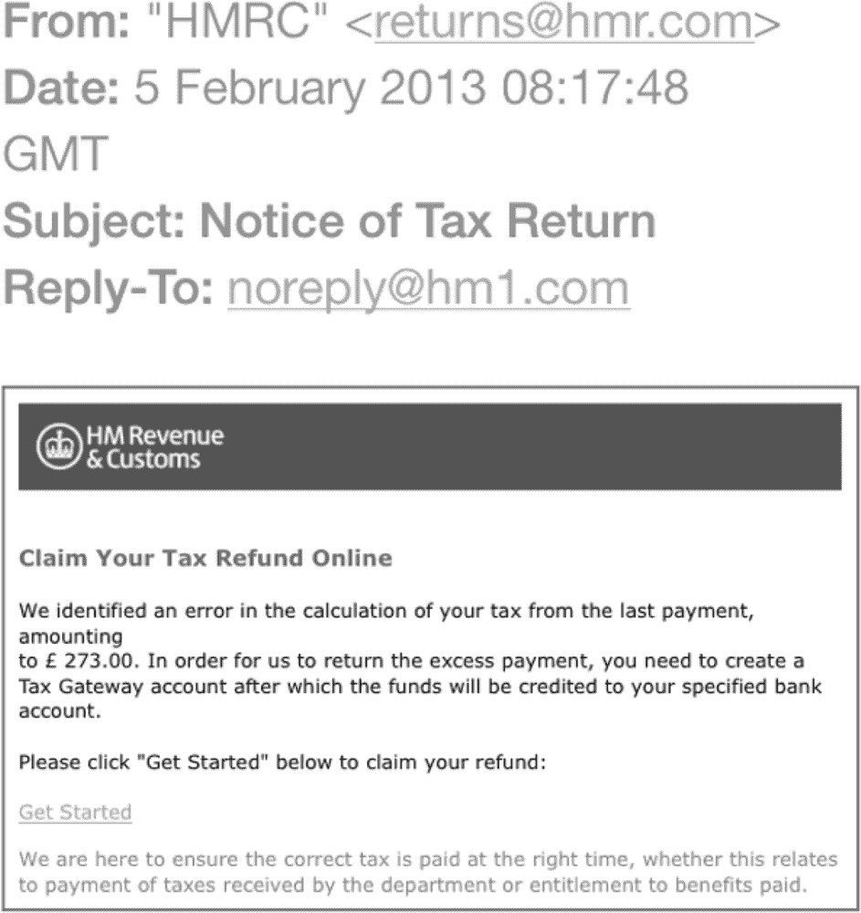
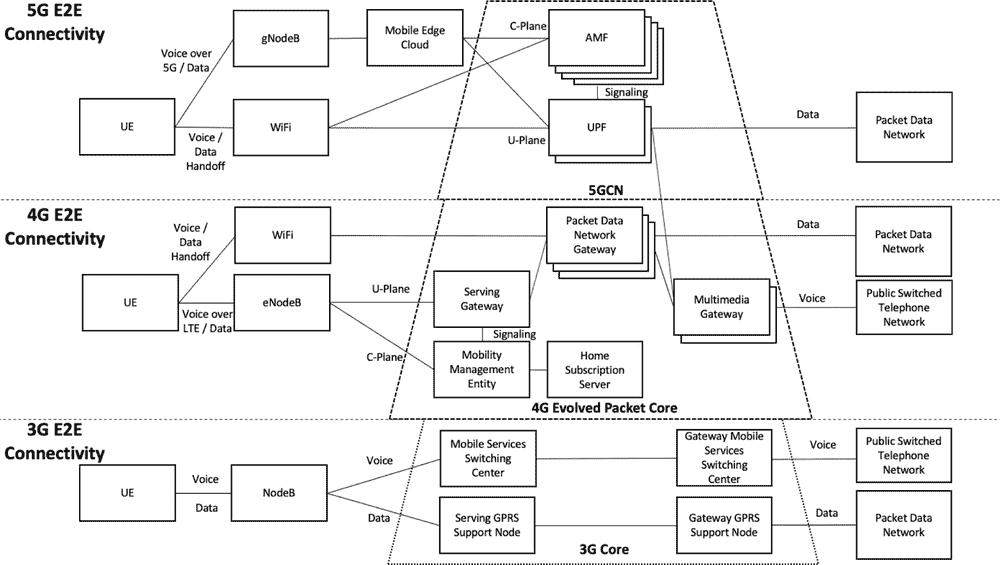
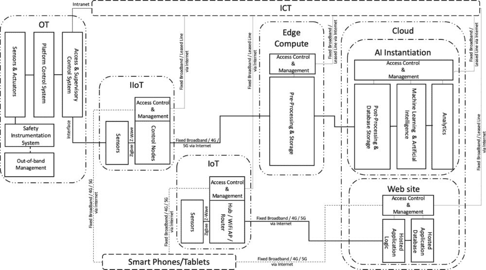
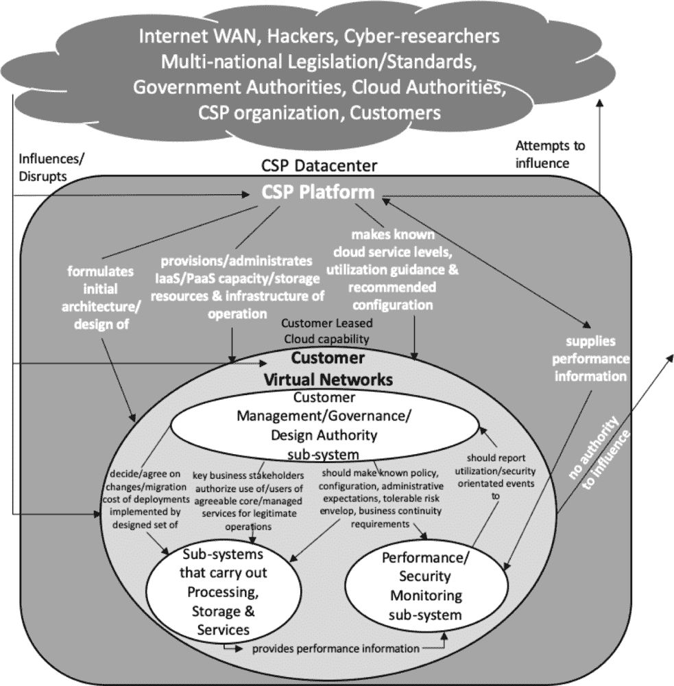
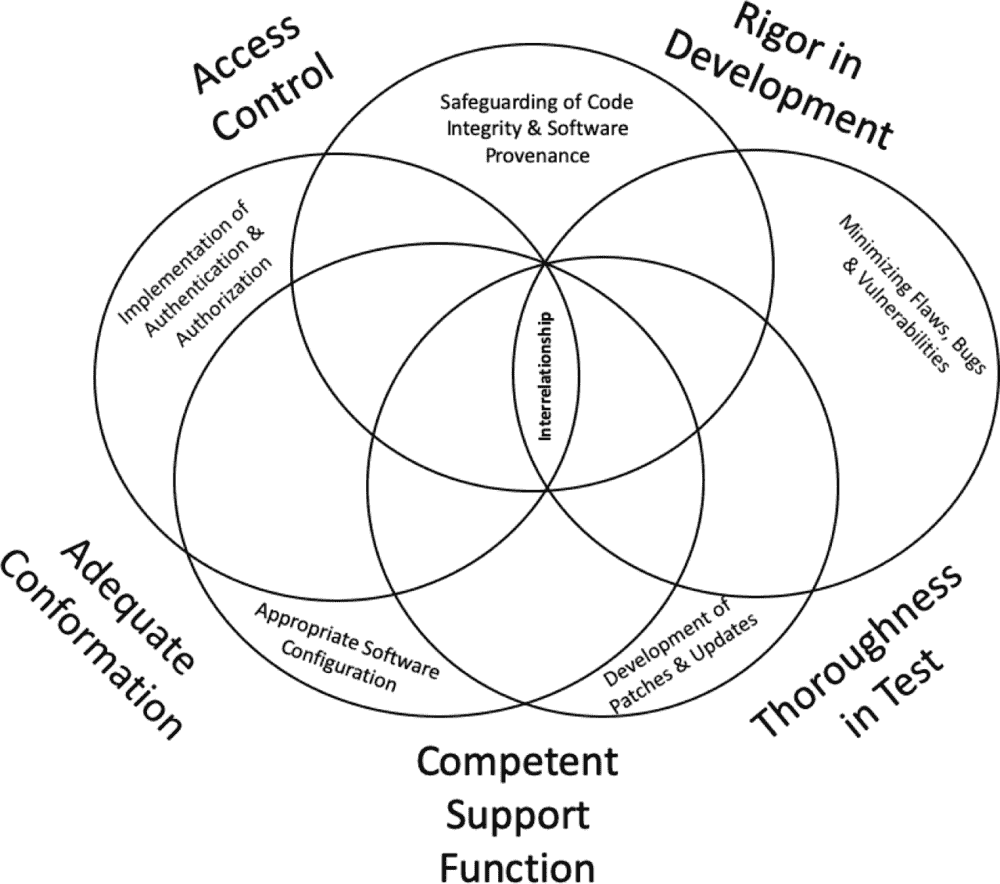
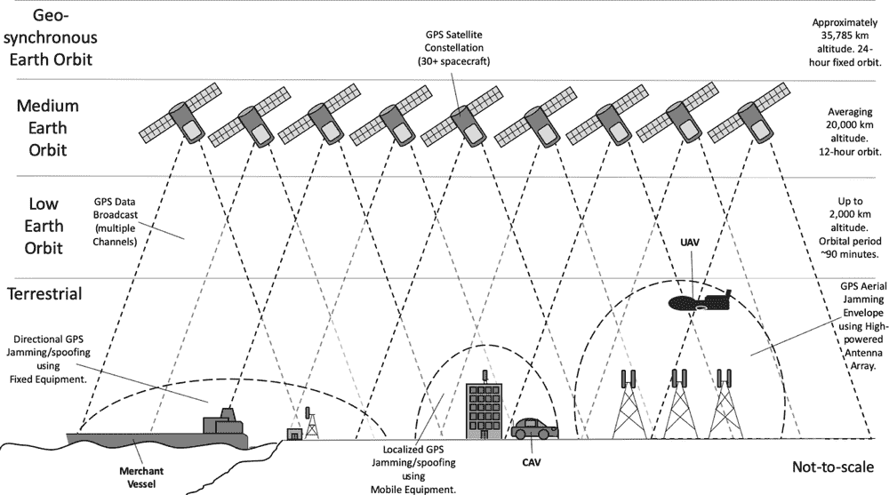

# 网络安全实时与追溯分析

|  | | |
| --- | --- | --- |
| 信息安全、隐私与伦理进展 (AISPE) 系列丛书 | Manish Gupta (纽约州立大学，美国) ISSN: 1948-9730 | |

## 宗旨

随着数字技术在日常生活中变得无处不在，对数字威胁的担忧也日益普遍。`信息安全、隐私与伦理进展 (AISPE)` 系列丛书提供了关于各行业和环境下信息保护与滥用的前沿研究。该系列书籍由关于身份管理、密码学、身份验证和数据保护等主题的学术研究组成，是专业人士、学者和高年学生的理想参考资料。

## 涵盖范围

`IGI Global` 目前正在接受本系列的稿件。如需提交，请联系 `Acquisitions@igi-global.com` 或访问 `http://www.igi-global.com`。版权所有 © 2021 `IGI Global`。未经出版者书面许可，不得对出版物的任何部分以任何形式或通过任何电子或机械手段（包括复印）进行复制、存储或分发。

### 风险

Meliha Nurdan Taskiran（伊斯坦布尔梅迪普大学，土耳其）Fatih Pinarbaşi（伊斯坦布尔梅迪普大学，土耳其）

商业科学参考 • 版权 2019 • 289 页 • 精装本 (ISBN: 9781522584551) • 美元 $225.00 (我们的价格)

信息科学参考 • 版权 2019 • 349 页 • 精装本 (ISBN: 9781522563136) • 美元 $215.00 (我们的价格)

信息科学参考 • 版权 2019 • 367 页 • 精装本 (ISBN: 9781522557425) • 美元 $195.00 (我们的价格)

信息科学参考 • 版权 2019 • 417 页 • 精装本 (ISBN: 9781522574927) • 美元 $285.00 (我们的价格)

信息科学参考 • 版权 2018 • 647 页 • 精装本 (ISBN: 9781522547631) • 美元 $345.00 (我们的价格)

信息科学参考 • 版权 2018 • 441 页 • 精装本 (ISBN: 9781522557364) • 美元 $215.00 (我们的价格)

信息科学参考 • 版权 2018 • 403 页 • 精装本 (ISBN: 9781522550945) • 美元 $225.00 (我们的价格)

信息科学参考 • 版权 2018 • 414 页 • 精装本 (ISBN: 9781522551522) • 美元 $325.00 (我们的价格)

信息科学参考 • 版权 2018 • 509 页 • 精装本 (ISBN: 9781522541004) • 美元 $335.00 (我们的价格)

信息科学参考 • 版权 2018 • 170 页 • 精装本 (ISBN: 9781522552857) • 美元 $145.00 (我们的价格)

信息科学参考 • 版权 2018 • 426 页 • 精装本 (ISBN: 9781522555834) • 美元 $215.00 (我们的价格)

信息科学参考 • 版权 2018 • 400 页 • 精装本 (ISBN: 9781522552970) • 美元 $215.00 (我们的价格)

信息科学参考 • 版权 2018 • 176 页 • 精装本 (ISBN: 978152255184) • 美元 $155.00 (我们的价格)

信息科学参考 • 版权 2018 • 341 页 • 精装本 (ISBN: 978152253029) • 美元 $225.00 (我们的价格)

信息科学参考 • 版权 2018 • 216 页 • 精装本 (ISBN: 978152252193) • 美元 $175.00 (我们的价格)

信息科学参考 • 版权 2018 • 350 页 • 精装本 (ISBN: 978152252504) • 美元 $225.00 (我们的价格)

信息科学参考 • 版权 2018 • 302 页 • 精装本 (ISBN: 978152251829) • 美元 $245.00 (我们的价格)

信息科学参考 • 版权 2018 • 360 页 • 精装本 (ISBN: 978152252604) • 美元 $215.00 (我们的价格)

信息科学参考 • 版权 2017 • 384 页 • 精装本 (ISBN: 978152251549) • 美元 $210.00 (我们的价格)

信息科学参考 • 版权 2017 • 307 页 • 精装本 (ISBN: 978152251703) • 美元 $160.00 (我们的价格)

信息科学参考 • 版权 2017 • 276 页 • 精装本 (ISBN: 978152252296) • 美元 $180.00 (我们的价格)

信息科学参考 • 版权 2017 • 128 页 • 精装本 (ISBN: 978152252193) • 美元 $120.00 (我们的价格)

信息科学参考 • 版权 2017 • 408 页 • 精装本 (ISBN: 978152251941) • 美元 $195.00 (我们的价格)

信息科学参考 • 版权 2017 • 464 页 • 精装本 (ISBN: 978152251829) • 美元 $215.00 (我们的价格)

信息科学参考 • 版权 2017 • 315 页 • 精装本 (ISBN: 9781522519386) • 美元 190.00 (我们的价格)

信息科学参考 • 版权 2017 • 312 页 • 精装本 (ISBN: 9781522508649) • 美元 215.00 (我们的价格)

信息科学参考 • 版权 2017 • 428 页 • 精装本 (ISBN: 9781522507031) • 美元 210.00 (我们的价格)

信息科学参考 • 版权 2017 • 347 页 • 精装本 (ISBN: 9781522507413) • 美元 215.00 (我们的价格)

信息科学参考 • 版权 2017 • 345 页 • 精装本 (ISBN: 9781522510161) • 美元 200.00 (我们的价格)

信息科学参考 • 版权 2017 • 248 页 • 精装本 (ISBN: 9781522506027) • 美元 150.00 (我们的价格)

信息科学参考 • 版权 2016 • 589 页 • 精装本 (ISBN: 9781522501053) • 美元 305.00 (我们的价格)

信息科学参考 • 版权 2016 • 330 页 • 精装本 (ISBN: 9781522504481) • 美元 195.00 (我们的价格)

信息科学参考 • 版权 2016 • 357 页 • 精装本 (ISBN: 9781466687615) • 美元 205.00 (我们的价格)

信息科学参考 • 版权 2016 • 327 页 • 精装本 (ISBN: 9781466694262) • 美元 210.00 (我们的价格)

信息科学参考 • 版权 2015 • 302 页 • 精装本 (ISBN: )

信息科学参考 • 版权 2016 • 530 页 • 精装本 (ISBN: 978146665590) • 美元 335.00 (我们的价格)

Ala Hussein Alami（约旦安曼大学）和 Nidaa A. Abbas（巴林巴林大学）

信息科学参考 • 版权 2015 • 426 页 • 精装本 (ISBN: 9781466658080) • 美元 245.00 (我们的价格)

信息科学参考 • 版权 2014 • 354 页 • 精装本 (ISBN: 9781466660588) • 美元 215.00 (我们的价格)

信息科学参考 • 版权 2014 • 357 页 • 精装本 (ISBN: 9781466659469) • 美元 215.00 (我们的价格)

信息科学参考 • 版权 2014 • 443 页 • 精装本 (ISBN: 9781466658080) • 美元 245.00 (我们的价格)

信息科学参考 • 版权 2014 • 281 页 • 精装本 (ISBN: 9781466648562) • 美元 195.00 (我们的价格)

信息科学参考 • 版权 2014 • 279 页 • 精装本 (ISBN: 9781466648685) • 美元 195.00 (我们的价格)

信息科学参考 • 版权 2014 • 405 页 • 精装本 (ISBN: 9781466649408) • 美元 195.00 (我们的价格)

Information Science Reference • 版权所有 2014 • 330 页 • 平装 (ISBN: 9781466647893) • 美元 $195.00 (我们的价格)

Information Science Reference • 版权所有 2014 • 577 页 • 平装 (ISBN: 9781466646919) • 美元 $195.00 (我们的价格)

Information Science Reference • 版权所有 2014 • 427 页 • 平装 (ISBN: 9781466645141) • 美元 $195.00 (我们的价格)

Information Science Reference • 版权所有 2013 • 351 页 • 平装 (ISBN: 9781466640306) • 美元 $195.00 (我们的价格)

Information Science Reference • 版权所有 2013 • 373 页 • 平装 (ISBN: 9781466620834) • 美元 $195.00 (我们的价格)

Information Science Reference • 版权所有 2012 • 319 页 • 平装 (ISBN: 9781466609785) • 美元 $195.00 (我们的价格)

Information Science Reference • 版权所有 2012 • 343 页 • 平装 (ISBN: 9781613501320) • 美元 $195.00 (我们的价格)

Information Science Reference • 版权所有 2011 • 306 页 • 平装 (ISBN: 9781616922450) • 美元 $180.00 (我们的价格)

Information Science Reference • 版权所有 2011 • 596 页 • 平装 (ISBN: 9781615207374) • 美元 $180.00 (我们的价格)

Information Science Reference • 版权所有 2010 • 323 页 • 平装 (ISBN: 9781605669526) • 美元 $180.00 (我们的价格)

Information Science Reference • 版权所有 2010 • 317 页 • 平装 (ISBN: 9781605664149) • 美元 $180.00 (我们的价格)

701 E. Chocolate Ave., Hershey, PA 17033

访问 `http://www.igi-global.com` 在线订购或拨打 717-533-8845 x100

如需定期订阅本系列发布的书籍，请联系：`Acquisitions@igi-global.com`

周一至周五 上午 8:30 - 下午 5:00 (东部时间)，或 24 小时传真至 717-533-8661

我的工作很大程度上是在玩游戏。这需要一些深入的解读。网络安全在各个层面都至关重要；从个人数据和财产保护到企业和国家的关注。阅读网络安全的书籍和期刊、参加会议、关注关键网站，以及实践活动，可以发展相关知识。网络演练有助于将这些知识转化为理解。

我的研究包括重建攻击，旨在试图进入红蓝队的思维。昨天，我工作的一家公司公布了针对性钓鱼测试的结果。钓鱼邮件看起来很真实；在 821 名打开邮件的人中，248 人点击了链接，149 人输入了密码和手机号码。我思考为什么这些数字没有更高；可以做哪些改进。我甚至花时间推演这种情况，考虑黑客可能如何使用这些信息。如果你能想象将这项任务扩大到整个企业（包括供应链）或一个国家，那么你就会开始可视化如何通过游戏来获得潜在的洞察。这种游戏化最好的结果就是在这个过程中产生了意想不到的见解。

这引出了我为什么对这本书感兴趣。为了让我的研究具有价值，这些游戏需要涉及详细的、专业的知识，而这些知识在网络安全领域并不容易获得。该行业有很多人对技术细节非常了如，但对这些细节意味着什么却了解较少。我指的是网络安全领域的数字领导力。

为了理解趋势，需要一个将事实综合为知识的概述，这正是这本书的价值。它整合了这些细节，并在这些细节的支持下，提供了一个概述，这在军事上被称为“直升机视角”。本质上，这是保持对发展的宏观关注，而不是迷失在红蓝队之间长期战的运营细节中。

对我来说，细节需要被总结以提供信息，这正是这本书所达到的。这本书的工作不仅仅基于实践，还整合了已发表的研究。每一章在很大程度上是独立的，对一个主题进行了简要总结，并附有参考文献和进一步阅读的建议。作为一个整体，它们对今天影响网络安全的关键问题进行了良好的综述。

希望你发现这些章节像我一样具有启发性。

作者在网络安全领域拥有超过十年的第二职业经验，并且在过去的 25 年里，他一直是先进计算技术的采用者。在此之前，作者曾在英国（U.K.）联合军种目前被称为“网络与电磁活动”部门工作。随后，作者能够将该领域的专业知识和熟悉程度引入网络安全领域，并将其军事领域的分析经验进行转化。在“网络安全”这一术语出现之前，作者曾在英国三家最受誉的信息保障公司中的两家工作。这些公司包括一家大型美国（U.S.）国防网络安全公司的网络部门。后来，作者在一家著名的网络与防御研究小组担任研究员和网络安全架构师。在过去的 11 年里，作者在信息通信技术（ICT）工程领域工作，为英国公共部门执行特定任务。在这段漫长的时期，作者在更广泛行业的人员对网络安全的感知和容忍上不断遇到类似的问题。据作者观察，尽管新技术层出不穷并被公司和政府部门采纳，但出现了一个共同的主题。这一共同线索被描绘得仿佛技术正在影响文明。因此，社会认为、讨论并指责技术，就好像它是有生命一样。当然，事实并非如此。在作者看来，人类在网络空间交互中对进步、多样性和便利的渴望产生了积极和负面的社会技术影响。这最终影响了用户对技术的信任、他们的隐私以及我们数据的保护。

## 挑战的多样性

当然，随着机器学习引领文明迈向通用人工智能（AGI）这一终目标（Eslami & Shanahan, 2019），这些方面本身已成为热门议题。目前，AGI 引发了许多问题，例如：(a) 道德内涵与隐私；(b) 对民主的影响；(c) 技术影响；以及(d) 使用上的道德方面（Eslami & Shanahan, 2019）。随着社会向真正的 AGI 迈进，这非常重要；然而，这些方面在今天的计算中已经相关，而且在作者看来，这些方面并不一定得到了解决。作者为什么要这么说？嗯，他认为社会在预 AGI 时代还没有完全做好。作者所说的此是指人为因素。几年前，英国国家网络安全中心（NCSC）表示，“在网络安全实施不佳的情况下，不应指责‘用户’”（Emma, 2017）；就此，作者认为 NCSC 的意思是，缺乏保护组织的技术控制不应从纯粹的程序控制角度默认回推到用户的肩上，让其做出正确的决策（Mertens, 2015）。根据经验，在 IT 的开发、安装和支持功能中，似乎有一座网络安全的“山”要爬。

诚然，技术和进入主流的新技术创新需要时间学习。然而，用户必须记住，在此时此刻以及在 AGI 达到满意的化身之前，是人在收集需求、针对需求进行开发、以可衡量的方式实施和测试并运行技术系统。诚然，执行这些工作的是不同的团队，但他们终是人。安全可以被视为一种“阻碍”，对于工程师来说，提出让协是完全可以接受的，而不是去理解由风险分析得出的显性安全诉求。然而，在作者看来，讽刺的是，ICT 项目中真正的障碍可能是：(a) 缺乏沟通；(b) 缺乏现实感；(c) 孤岛式工作；以及(d) 推卸责任。有许多变量需要考虑，例如成本效益分析，但许多障碍并不一定是技术的限制。安全具有许多技术复杂性，但被低估了重要性的人为因素。尽管如今信息技术（IT）行业发生了许多积极的事情，但人性在表现为以下情况时会产生适得其反的结果：(a) 对网络安全思维的惰性；(b) 为了损害实践而玩政治；(c) 纯粹为了建立自尊心而损害了“做正确的事”；或(d) 好斗以及许多其他人类特质。作者曾见过这些人，他们认为使用“通过隐藏来实现安全”的方法来应用网络安全是完全足够的。这些人反对完全可以实施且成比例的安全控制——这完全是因为他们担心安全会为项目增加支出，或者更重要的是，让他们的工作变得困难。

此外，作者目睹了软件工程师的一种心理障碍，他们过于关注的设计方面，导致基本的安全原则和简单的安全考虑被忽略甚至理解。某些项目经理认为，在存在灰色地带或特定规则和监管要求没有明确执行的情况下，网络安全是完全可以协商的。这给努力保护组织资产的网络安全从业人员增加了压力和负担。所有这些人性的微妙使得部署的系统暴露在固有漏洞之中，无论是软件本身、实施过程中的配置错误、由于强化不足导致的网络卫生状况差，还是生产环境中可能不一致或更新不后的系统（Xu et al., 2013）。这一切都增加了网络防御的脆弱性，并为那些希望滥用 ICT 系统达到非法目的的人打开了大门。

有趣的是，赛门克（Symantec）最近的研究表明，由于技术的进步，该行业面临的压力日益增大，且缺乏工作所需的技能发展。因此，超过三分之二的英国网络安全专业人员发现自己在应对和评估非对称网络威胁时感到挣扎（Bird, 2013b），这并不令人意外。在这一技能短缺类别的网络安全专业人员中，有近三分之二的人感到边缘化，并考虑彻底离开该行业（Helpnet Security, 2019a）。与之类似，作者合写了一篇论文，提出了一种由整体核心知识框架支撑的混合学习与开发方法。其意图是整合现有的学习与开发活动孤岛，以从社区获取优势并构建出一个连贯的核心知识库。这应该纳入并受益于更广泛 IT 行业（如开发者、解决方案架构师以及系统经理和系统管理员）的各种技能；从而获得网络安全所依赖的 ICT（信息技术）其他核心技能领域的认可（Bird & Curry, 2018）。这样，就可以打破障碍，以及所有参与者的利益，对一场实际上演变成网络安全军备竞赛的威胁做出统一且一致的应对。这应该缓解某些状况，即网络安全在从系统概念阶段、设计开发阶段到运行阶段都没有得到充分考虑。等到解决方案部署时，疏忽已经渗透其中。这使得系统在运行期间难以受到保护，并导致 ICT 支持团队不得不补救控制措施以增强系统的网络安全状况。

整个行业并非所有人都在疏忽，但当用户走捷径时，人为因素会导致网络安全漏洞。时间、成本和努力等限制对于成功交付至关重要；然而，这些也可以被用作借口鼓励违反良好实践的行为。由于未能避免配置错误，或在服务期间未能及时进行软件更新和补丁，导致了严重的缺陷。作者在硕士论文中进行了广泛研究，发现公共云中的控制集弱点或漏洞由于配置错误或实施漏洞而被利用、未能得到妥当缓解且未能得到充分保护。因此，松懈的实施可能导致不安全的工作方式，并在客户云部署中引发现实世界的缺陷（Bird, 2018）。公共云计算客户对配置错误的识别也已获得 NCSC 在 CyberUK 2019 大会上的认可和批准（国家网络安全中心, 2019）。对于亚马逊网络服务（AWS）等云服务提供商来说，他们依靠自动化来可靠地履行其“共享安全责任”的一部分。自动化消除了运行基础设施的人工参与，增强了可靠性并提供了可追溯性。当然，自动化脚本仍然需要测试；因此偶尔需要人工干预。然而，据称一名管理员输入的错误命令导致 2008 年 AWS 简单存储服务的故障（Bramish & Brohi, 2011）以及 2017 年在美国的故障（Sverdlik, 2017）。对于微软而言，推行 `Azure Automation` 是为了自动处理频繁、耗时且易错的云管理任务（Microsoft, 2018）。

## 人性因素

但配置错误不仅限于云端，它们也出现在更广泛的 ICT 和工业控制系统（ICS）行业的部署中。这等同于系统和软件工程师在�龟自首。人类据称是技术的传播者，但作为一个物种，他们正陷入网络空间的网络斗争和一场未宣的消耗战中。网络安全并不如其被描绘的那样仅仅是一项技术挑战，更现实地说，它很大程度上是一个社会技术问题。在 `AGI` 开始自主编写我们的未来代码之前，更广泛的 IT 行业有几件事需要理顺。根据作者跨多个学科（如航天与国防、运输和海运）工作的经验，他推断存在误导性的解释和反复出现的错误，持续困扰着 IT 行业。此外，类似的错误似乎也根植于 ICS 领域。关于后者，安全是首位的，但即使是现在该社区内部，研究已将网络安全识别为一个短板领域。作者希望这个问题能通过 `IEC62443`（ISA, n.d.）得到解决，但仅靠 `ISO/IEC27001` 这样的标准并不能解决网络安全问题。一次又一次，网络事件强化了在网络安全泄露后，对组织声誉可能造成的损害。

这里讨论的所有这些因素共同构成了一个问题——一个人的问题。这就是本书探索这一现象背后的灵感所在，旨在探讨为什么会这样，以及影响网络安全效率和稳健的人类行为的影响。对于人类为了改善社会而以各种形式产生的所有发明，可以说人们在与网络空间交互时可能会表现出一种漠然的困惑（Bird, 2013a）。本书将利用特定主题领域来阐述网络安全领域的挑战，同时借鉴近期的历史事件。作者将在演化性威胁及其现实影响——这些驱动恐惧、不确定性和怀疑的催化剂的背景下进行社会技术分析。最终，需要从忽视、有缺陷和/或不安全的实施中吸取教训，以确保人类连接的未来的安全。整体而言，更广泛的技术行业的所有元素需要达成共识，网络安全需要被视为适用于不同的受众，并考虑到不同的背景以打破障碍。本质上，人类需要意识到风险总是存在的，但关键在于通过部署防御措施来充分减少这些风险。事实如此！

## 本书的结构

本书从网络防御前线的角度提供了一个视角，其目的是提高人们对参与网络空间危险性的意识。它涵盖的内容旨在让人们理解由于忽视关键缓解措施而产生的长期影响。网络安全归结底是一个“人的问题”，本书对门外人士以及网络安全领域的更广泛读者都感兴趣。本书分为八章，对影响今日网络安全的问题构建了连贯的结构。各章节的描述如下：

第 1 章设定了从上世纪到新世纪的各种人类意图。这是基于工业 4.0 热点的社会技术分析的开始，强调了在监管支持下，网络安全是社会进步的一项重要且相关的力量。作者探讨了伦理和道德问题，以及这些问题如何引导 `AGI` 的发展。

第二章研究了公有云用例中的风险与合规性困境。如果完全依赖基于合规的方法来实施网络安全控制，可能会产生影响，或者反过来，导致控制 set 的真空。这些方面是基本原则，能够更好地指导组织的网络安全治理，并保护用户与在线世界的交互。

第三章从技术和社会的角度探讨了挑战，并将其与过去十年中源自黑客的底层攻击浪潮进行了对比。本章提供了一些具有新闻价值的黑客攻击、安全泄露和持续网络攻击的案例，这些案例将为威胁、漏洞以及产生的后果提供显著的背景。

第四章探讨了我们在与网络世界交互时遇到的某些具有特定归属且高知名度的国家支持的网络的网络攻击的技术方面及其影响。作者认为，这些攻击对整个在线领域的发展构成了直接和间接的危害性影响。

第五章探讨了中东面临的现有问题，这些问题展示了电子战与网络战争之间的交叉。在千禧年第二个十年末，这种现象影响了现实生活中的船只、飞机和无人机。这一概述提供了网络战争技术如何在跨战斗空间领域中被用于针对网络物理资产的示例，以影响地缘政治变化，甚至升级产生更广泛影响的势。

第六章探讨了从社交媒体中可以汲取的教训，引用了全球范围内的案例，这些平台被滥用并用于别有用目的。作者论证了为什么用户对风险的感知以及未来与网络空间虚拟世界的互动需要发生范式转变。

第七章采用哲学方法讨论了在实施系统以及通过我们使用网络空间时人类心理的脆弱性。作者调查了社会对互联网的持续接触是否使公众对内在风险变得脱敏。作者讨论了若干关键的话题领域，探索了差距、可以避免错误或遗漏的方法，以及教育和培训如何帮助防止与网络空间交互的资产被滥用。

第八章关注非同质化区块链技术的优势，这些技术可以支撑并增强其他现有的安全机制，以验证数据完整性、增强身份和访问控制机制，并支持供应链溯源。作者还对当前的网络安全方法是否自相矛盾提供了审慎的展望，并认为可能被视为一种负面含义。

- Bamish, M., & Brohi, S. (2011). Seven deadly threats and vulnerabilities in cloud computing. International Journal of Advanced Engineering Sciences and Technologies, 9(1), 87–90.
- Bird, D. (2013a). Open or closed? ITNOW, 55(2), 32–33. doi:10.1093/itnow/bwt014
- Bird, D. (2013b). Underlying dangers. ITNOW, 55(4), 32–33. doi:10.1093/itnow/bwt077
- Bird, D. (2018). The creation of a conceptual framework to assist in determining the security risks associated with the use of public cloud computing environments (Unpublished master’s dissertation). Open University, Milton Keynes, UK.
- Bird, D., & Curry, J. (2018). A case for using blended learning and development techniques to aid the delivery of a UK cybersecurity core body of knowledge. International Journal of Systems and Software Security and Protection, 9(2), 28–45. doi:10.4018/IJSSSP.2018040103
- Emma, W. (2017, March 28). People: The strongest link [Weblog comment]. Retrieved from https://www.ncsc.gov.uk/speech/people--the-strongest-link
- Eslami, A., & Shanahan, M. (2019, June 8). What is AI anyway. Paper presented at The Times Science Festival, Cheltenham, UK.
- Helpnet Security. (2019a). Cybersecurity professionals are outgunned and burned out. Retrieved from https://www.helpnetsecurity.com/2019/06/28/cybersecurity-burnout/
- ISA. (n.d.). ISA99, Industrial automation and control systems security. Retrieved from https://www.isa.org/templates/two-column.aspx?pageid=124560
- Martin, C. (2019a, April). Making the UK the safest place to live and work online. Paper presented at CyberUK Conference, Glasgow, UK.
- Mertens, X. (2015, July 14). Don’t (always) blame the user! [Weblog comment]. Retrieved from https://blog.rootshell.be/2015/07/14/dont-always-blame-the-user/
- Microsoft. (2018). An introduction to Azure Automation. Retrieved from https://docs.microsoft.com/en-us/azure/automation/automation-intro
- National Cyber Security Centre. (2019, April). Cloud: The latest thinking from the NCSC on Cloud. Paper presented at CyberUK Conference, Glasgow, UK.
- Sverdlik, Y. (2017). AWS outage that broke the internet caused by mistyped command. Retrieved from http://www.datacenterknowledge.com/archives/2017/03/02/aws-outage-that-broke-the-internet-caused-by-mistyped-command
- Xu, T., Zhang, J., Huang, P., Zheng, J., Sheng, T., Yuan, D., … Pasupathy, S. (2013). Do not blame users for misconfigurations. In Proceedings of Symposium on Operating Systems Principles (SOSP). Association of Computing Machinery.

# 第一章：摘要

第一章通过概述工业 4.0 概念设定了背景，该概念结合了多种具有不同成熟程度的技术，以提供端到端的能力。这一案例研究是一个很好的范例，可以引出许多相关的社会技术话题，这些主要背景将在书中剩余部分进行详细阐述。简而言之，本文论证了网络安全首先是一个人类问题，同时也强调了监管、标准和机构对支撑网络安全的重要性。这里涵盖了这些对立力量的示例，这些力量如果不得到缓解，将共同损害 21 世纪的网络韧性。

## 引言

自公共互联网诞生以来已有 30 多年。社会持续向着一个以在线为中心的世界转型。然而，这一乌托邦已被不断演变的威胁格局以及那些可能未经授权访问用户数据的能力所严重污染。这不仅关乎外部攻击者和目标用户（事实上，这占据了媒体的大部分关注点），对于计算机系统的保护，一种全面的网络安全考量应该是许多从业者关注的重点。考虑因素范围涵盖了软件开发人员和程序员、系统设计师和解决方案架构师、系统管理员以及系统支持经理（Bird & Curry, 2018）。在开启 21 世纪网络安全挑战之旅时，没有比工业 4.0 更合适的主角了。Berting, Mills, & Wintersberger (1980) 在 1980 年首次提出了“第四次工业革命”这一术语，现在它正以这样的技术轨迹发展（Swahb, 2016），导致了各种不同技术为了共同目标而汇聚。这种交叉融合带来了信息通信技术（ICT）领域与运营技术（OT）对接时的融合风险、OT 与物联网（IoT）的互操作性，以及利用人工智能（AI）处理大数据集带来的风险。物联网和人工智能均被指定为英国在席卷新千年第二个十年的数字化转型道路上的关键（Violino, 2018）。

## 背景

尽管无法在一个章节中涵盖所有的网络安全问题，但本案例研究将提供一份通用性的话题问题汇编，其中一些问题作者将在本书中进一步探讨。这里涵盖的许多安全原则与今天的 OT、IoT 和 AI 系统密切相关，因为它们不仅变得日益互联，而且大部分都是通过 ICT 管理的。这是一个非常大的领域，跨越了私有局域网（LAN）、跨互联网的分布式广域网以及云服务提供商（CSP）基础设施。因此，工业 4.0 作为一个理想的范式，凸显了文明面临的多样关键网络安全挑战。书的其余部分将详细阐述许多共同主题，并讨论社会如何解决这些问题。

## 工业 4.0

### 信息通信技术

计算技术在 20 世纪中期从第一代基于电子管/真空的计算机快速发展到由晶体管组成的第二代。第三代由集成电路组成，而第四代的超大规模集成微处理器将我们带入了 21 世纪（Fiegenbaum & PMcCorduck, 1983）。众所周知，用于互联网连接的原始“开放”通信协议是基于互联网协议（IP）套件的。它由可靠且面向连接的传输控制协议（TCP）和无连接的用户数据报协议（UDP）组成。美国国防高级研究计划局实际上设计的是一个闭式分组网络系统的概念，而不是后来演变成全球分布的互联网。这意味着遗留协议栈从从开始就本质上是不安全的，随着形成世界万维网的超文本链接的出现，必须做更多工作（Bird, 2013）。在互联网和万维网上在线使用凭证和数据交换需要保护措施，这促成了 1994 年安全套层（SSL）的诞生。这为可靠的 Web 会话加密提供了基础（Bird, 2017a），并推动了所谓的“第一次加密大战”（Soesanto, 2018）。然而，这项技术的执行并不一定完全有效，这取决于其实现方式以及所使用的加密算法。这在很大程度上受到了 1996 年《瓦森纳协定》的影响，该协定规定了对称和非对称加密产品的出口控制限制（Rbcafe, 2014）。

`SSL` 的使用也带来了公密钥基础设施（PKI）的概念，该概念最初归功于 1976 年的 Whitfield Diffie 和 Martin Hellman（Melone, 2012）；然而，英国政府通信总部实际上在十年前就已经发明了它（Bradbury, 2001）。在最简单的形式下，`PKI` 可以使用基于公钥和私钥对的非对称加密，通过 Web 提供的单向或双向互斥认证来实现。对称密钥交换可以使用由证书颁发机构签名的信任证书以非对称方式进行。然后双方达成一致并为加密算法初始化对称密钥，例如目前青睐的高级加密标准（AES），美国已于 1999 年采用该标准。2000 年，《瓦森纳协定》的参与国选择消除对大批量 64 位密钥市场级产品（如 `AES`）的出口控制标准（Rbcafe, 2014）。随后，自 2006 年以来，电子前沿基金会通过其“HTTPS Everywhere（HTTPS 无处不在）”活动推广超文本传输协议（HTTP）的安全实现（Electronic Frontier Foundation, n.d.）。然而，直到 2013 年斯诺登事件发生后，人们的态度才发生显著变化，这引发了第二次加密大战（Soesanto, 2018）。传输层安全（TLS）作为 `SSL` 更现代的衍生物，现在在保护我们的在线交互方面变得更加频繁。保护隐私立场已影响到这种程度：现代浏览器中的降级旧加密填充 Oracle（Padding Oracle On Dowraded Legacy Encryption）和心脏血漏洞促使谷歌在其 Chrome 浏览器中强制执行 `TLS` 1.2 或更高版本。这消除了使用早期过时的 `TLS` 和 `SSL` 密码套机制的选择（Seltzer.2014）。

### 网络安全风险

此外，埃森（Accenture）和 Ponemon 2019 年网络犯罪成本调查显示，过去五年中全球数据损失成本增加了 72%。此外，调查显示，网络犯罪的财务影响在 2015 年至 2018 年间增加了一倍，从 270 万美元（USD）增加到 590 万美元（AccentureSecurity, 2019）。英国现行的国家网络战略指出，网络犯罪为了财务利益而传播恶意软件（malware），并追求窃取、破坏、扭曲或删除数据的活动（Her Majesty’s Government, 2016）。事实上，黑客入侵的主要方法之一是使用钓鱼邮件胁迫人们安装或下载木马恶意软件。黑客随后可以借此获取银行详情或其他信息，如密码（Bird, 2013）。网络犯罪集团冒充合法企业或政府机构的手段复杂程度已变得非常令人信服，以至于在 2013 年英国政府对其中一项活动发出了警告。这种特定的诈骗围绕着伪装成英国税务和海关总局（MRC）的虚假退税展开（GOV.UK, 2013）。如图 1 所示，试图欺骗接收者所使用的细节水平相当熟练。

| 图 1. 钓鱼邮件示例 |

一个例子是 2017 年潜入流行的 `CCleaner` 应用程序的木马。研究人员猜测，黑客获取了 `CCleaner` 开发环境的权限，以便在版本 `5.33.6162` 中植入后门（Yung, 2018）。其目的是让恶意软件与 `C2` 服务器通信，并最终获取并将个人数据发送回攻击者。该感染在被 `CCleaner` 开发人员自己发现之前，可能影响了数百万名用户（Kaspersky, n.d.a），开发人员随后通知了用户社区，并建议他们安装更高版本的应用程序以移除木马。

此外，还有互联网上令人恐惧的祸源——`DDOS`！黑客们反复利用这种技术，通过僵尸计算机向目标系统发送大量不同的消息（Somani, Sanghi, Conti, Rajarajan, & Buyya, 2017）。这种攻击持续到目标系统无法履行其主要功能为止。作者在表 1 中汇总并列举了 `DDOS` 类型攻击的示例。

### 表 1. DDOS 技术示例

| 场景 | 消息类型 |
| --- | --- |
| Web 服务攻击 | HTTP GET, HTTP POST |
| 洪暴攻击 | TCP SYN, 互联网控制消息协议 (ICMP) ECHO |
| 放大攻击 | 域名服务器 (DNS), 网络时间协议 (NTP), 简单网络管理协议 (SNMP) |

数据来源：Somani 等人，2017。

据报道，俄罗斯黑帽黑客曾使用过僵尸网络（Botnets），但更有可能是，他们代表俄罗斯政府在 2007 年对爱沙尼亚发动了 `DDOS` 攻击。彼时，爱沙尼亚正自豪且高度依赖互联网电子商务，这种攻击严重破坏了他们的经济。同样，在 2008 年，在与俄罗斯冲突的同时，一场协调的 `DDOS` 攻击也猛烈了格鲁吉亚的基础设施（Herzog, 2017; Plohmann, Gerhards-Padilla, & Leder, 2011）。2015 年，中国政府利用所谓的“祭网”（Great Cannon）对 `GitHub` 仓库发动了 `DDOS` 攻击，因为那里托管了两个由反政活动人士运行的项目，统称为 `GreatFire.org`（Griffiths, 2019; Jeffrey, 2018）。该小组开发了反审查应用，并利用 `GitHub` 向中国用户提供这些应用以规避审查；该项目被称为“防火墙”（Great Firewall of China）（Greatfire.org, n.d.）。在 2018 年，`GitHub` 遭受了 1.3Tbps 的 `DDOS` 攻击，该项目是实施防火墙措施的。然而，某些国家级攻击者利用安全仪表系统（`SIS`）不仅连接到关键执行器，并在故障条件下执行特定操作，还实施了 `DDOS` 攻击（Griffiths, 2019; Bu, n.d.）。2014 年，针对 `Rackspace` 的 `DDOS` 攻击被认为是由国家级攻击者实施的（Culey, 2013）。此外，网络犯罪分子在暗网上广告并交换这些服务，例如毒品、被盗凭据、信用卡详情和黑客工具（Somali et al., 2017; Waqas, 2017）。这导致了国际执法机构采取协作行动以关闭这些站点（Khandelwal, 2013）。

还存在滥用托管服务提供商（`MSP`）网络的操作，并将其作为攻击客户或消费者的通道。`MSP` 有多种形式，但最常见的模式是客户将其服务外包给第三方、第三方数据中心或云平台上的第三方环境（Gartner, n.d.）。攻击 `MSP` 与国家级网络攻击同源，例如 `APT10` 小组在 2017 年实施的攻击（Price Waterhouse Coopers, 2017）。在“云跳者行动”（Operation Cloud Hopper）期间，黑客部署恶意软件以建立立足点、持久化并横向传播，同时识别目标系统。这种部署导致了数据外泄（Burt, 2017; Price Waterhouse Coopers, 2017）。现在，看来网络犯罪也效法其施，尝试分发勒索软件。这导致了针对美国市政当局的行动，他们在 2019 年被 `Ryuk` 勒索软件攻击（Helpnet Security, 2019a; Ilascu, 2019）；由于佛罗里达州的湖市和里维亚支付了黑客索款，这鼓励了网络犯罪分子继续用勒索软件攻击美国城市（Cimpanu, 2019）。

## 运营技术

如今工业网络利用 `EtherNet/IP` 网络传输标准的 `TCP/IP` 以及封装的遗留工业协议。这种网络拓扑结构非常适合连接企业局域网，以管理监控控制数据采集（`SCADA`）层。该层由人机界面（`HMI`）、应用服务器、数据库服务器、输入输出（`I/O`）服务器、历史数据库（Historian）和域控制器组成。`SCADA` 层与本地 `HMI` 以及可编程逻辑控制器（`PLC`）或 `I/O` 模块接口，这些构成了分布式控制系统（`DCS`）的控制平面。除了控制 `PLC` 外，消息还通过串口通信从控制器链路传输到现场总线设备，例如 `Modbus` 终端（`RTU`）；在自动化行业中，位于现场总线层的资产是执行器或传感器。某些关键安全实施可能会使用安全仪表系统（`SIS`），该系统连接到重要的执行器并在故障条件下执行特定操作（Obregon, 2015）。

根据麻省理工学院（MIT）的研究，近期针对 `SCADA` 和 `ICS` 的网络攻击证明，黑客可以滥用合法通信来调用不安全函数。网络攻击者因此误用了系统内部进程认为受信任的通信交换（Thomas, 2018）。因此，数据完整性不仅应涵盖无效或错误的参数，还应验证或确认数据交换的合法性。这一原则超越了传统技术，通过使用被称为“黑信道通信”的校验和来检查消息的完整性。此外，这一原则还深入了跨网络节点更复杂的机器机器（`M2M`）身份验证与授权领域。如今的方案包括使用 `PKI` 在 `SCADA` 主机、`PLCs` 和域控制器（`Domain Controller`）之间执行应用级和端点身份验证。然而，此类解决方案取决于技术选择的成熟度及其所采用的功能背景。无疑，对于遗留工业系统而言，这种方法可能过于复杂，但随着系统进行技术更新或升级，系统架构师可以利用 `PKI` 等方法。随着 `OT`（运营技术）开始与 `IoT`（物联网）对接进行跨域通信，引入 `PKI` 机制对于建立对称加密的 `E2E` 连接尤为重要。

## 工业攻击格局

与 IEEE 802.3 兼容的网络（如 `EtherNet/IP` 或 `ProfiNet`）呈现出丰富的网络攻击格局，由多个攻击面组成。这些攻击面从企业局域网延伸到合并的 `DCS` 层。近期历史表明，`ICS` 组件本身存在漏洞。2014 年，作为 `SCADA` Strangelove 项目的一部分，研究人员发现了漏洞和零日漏洞，这使得当时分析的 5% 的 `SCADA`、`PLC` 和 `ICS` 组件能够被远程执行（Pauli, 2014）。当 2016 年乌克兰电网遭受另一波网络攻击并导致大规模停电时，这一事实的严重性可能得到了进一步的印证。该攻击的源头是名为 `BlackEnergy 3` 的恶意软件（新泽州网络安全与通信整合中心, 2017），并被归于俄罗斯的 `Sandworm` `APT`。这个受国家支持的组织在邮件附件中嵌入了木马，其目标之一是在受害者计算机上植入更多的攻击包。所使用的木马包括 `Backdoor.Win32.Blakken`、`Backdoor.Win64.Blakken`、`Backdoor.Win32.Fonten` 和 `Heur:Trojan.Win32.Generic`（卡巴斯基, n.d.b）。

第一阶段是获得脚点以渗透工作站和服务器。随后是第二阶段，包含 `KillDisk` 功能；第三阶段则包含了各种与数据擦除和阻止 `SCADA` 系统合规使用相关的插件（Lewis, n.d.; Zorabedian, 2016; Assante, 2016）。这场行动也被比作俄罗斯在参与克里米亚冲突期间针对乌克兰采取的其它国家级破坏性活动（Brumfield, 2019; Ranger, 2019a）。到 2019 年，Applied Risk 的一份报告指出，关键信息基础设施（`CNI`）领域并未执行网络安全基本工作；该报告暗示网络安全的某些方面仍是事后才考虑的；发现的最常见缺陷包括：(a) 配置错误；(b) 缺乏补丁或更新导致的漏洞；(c) 身份和访问管理被认为不尽人意。

## 物联网

1999 年，微软联合创始人比尔·盖斯描述了“数字神经系统”（Gates, 1999）。此外，`5G` 基础设施公私伙伴关系计划（`5G-PPP`）是欧洲委员会与欧洲 ICT 行业之间的联合倡议。`5G-PPP` 也为下一代通信的架构、技术和标准做出了贡献（Short, 2018）。`5G` 有望实现更快的下载速度，达到 10Gbps 左右，延迟低于 1ms（Bird, 2015b）。众所周知的是，`5G` 将使用大规模输入多输出（`MIMO`）射电技术。`5G` 将用于无线网接入的 4G `eNodeB` 基站概念演进为下一代 `5G-NR` `gNodeB`（CableFree, 2019）。在英国，拟用于 `5G` 的频谱包括：700MHz 频段的“低频”、3.4 至 3.6GHz 之间的“中频”以及 26GHz 频段的“高频”。多频段的使用可以缓解可用频谱拥拥，并提高可靠性和服务质量。提升体验将成为这种无缝且无处不在的通信媒介大规模普及的推动力。

`5G` 核心网（`5GCN`）分组方法将用户面（`U-Plane`）与控制面（`C-Plane`）解耦，利用软件定义网络（Udunuwara, 2018）将 `5G` 服务抽象为基于服务的模型，以实现面向服务的基础设施。接入和移动管理（`AMF`）中的多个控制面功能控制着每个订阅对 `5G` 网络的接入，以及用户设备（`UE`）的连接和移动性管理任务。用户数据通过用户面（`UPF`）传输到外部数据网络（实际上是互联网），并使用控制面信号与 `AMF` 同步（Lescuyer & Lucidarme, 2011; Giust et al., 2018; Wireless Broadband Alliance, 2018）。`5G` 中抽象化的应用作为一种云原生无线接入网络技术，有助于切片化，通过定制可用功能来管理通用的移动、物联网和商业蜂窝用例。其中，涵盖了以下内容：服务、使用时长、网络容量、网络速度、网络延迟和安全配置。`5GCN` 将扩展以包含多接入边缘计算（`MEC`）能力作为架构设计的一部分，以最小化延迟。这使其具有比例可扩展性，并能够降低电信公司（`Telco`）的运营成本（Reznik et al., 2018）。

`5GCN` 从 4G 网络架构演变而来，而后者又是 3G 基础设施的演进。在 4G 演进分组核心中，移动管理实体（`MME`）和家庭订阅服务器（`HSS`）等服务满足了 `UE` 网络认证和计费的控制面需求。接入网关（`GW`）和数据网络网关（`PGW`）的组合提供了多种服务，使数据流能够从 `UEs` 流出到公共互联网或通过多媒体网关将 `LTE` 语音业务（`VoLTE`）转换为公共电话网（`PSTN`）。值得注意的是，在 `5G` 语音初期，它将从 `5G` `UPF` 降级到 4G 多媒体网关及以后。3G 网络架构更以节点为中心，而非面向服务，这是从 2G 使用的以硬件为中心的方法进化来的。3G 是一种面向服务的方法，语音通过移动业务交换中心（`MSC`）和网关移动业务交换中心（`GMSC`）传输到 `PSTN`。3G 模型中的数据流通过接入 `GPRS` 支持节点（`SGSN`）分发到互联网，并通过网关 `GPRS` 支持节点（`GSGSN`）接入互联网。图 2 显示了蜂窝端到端（`E2E`）连接的演进。

| 图 2. 显示从 3G 到 5G 转换的简化架构 |
| --- |
|  |
| --- |

3G 蜂窝领域的一个遗留问题是国际移动用户识别（`IMSI`），攻击者可以使用合适的设备拦截移动设备与网络的握手，并借此尝试访问 `RAN`（Information Security Newspaper, 2019）。尽管通过空气传输的数据使用了 128 位块密码和流密码进行加密，并利用安全的身份验证和真实性函数，这种情况仍可能发生（Norrman, 2018; Information Security Newspaper, 2019）。4G 的实现通过使用全球唯一临时标识（`GUTI`）试图尽量减少 `IMSI` 暴露的影响，这些标识与 `UE` 关联，并保护客户跨 `Telco` 网络的订阅身份（Do, 2013）。在 `5G` 世界中，增强将包括采用电子用户识别模块（`SIM`），该模块已在 4G 领域的某些智能手表中使用。这取代了可更换的旧版 `SIM`（@Telecoms, 2018），并将终端用户的订阅与 `UE` 关联。此外，用于在 `RAN` 上识别用户的安全措施也发生了演进，称为用户永久标识（`SUPI`）。`5G` 将使用派生认证密钥协商协议（`AKA`），通过受保护的隐藏身份标识（`SUCI`）在 `5G` 智能设备切换到其他节点期间保护订阅户的身份（Sauter, 2018）。

此外，欧洲空间局正在研究整合卫星路径用于 `5G` 中继，因此在共享频谱环境中动态使用无线频谱，以消除卫星与地面通信的冲突。该研究的意图包括考虑卫星载能力的上行和下行段。这不仅对于将 `5G` 扩展到农村地区很重要，而且对于城市以外 `CAVs` 的可访问性也很重要。然而，`5G` 需要合适的 `Telcos` 每比特价格来采用卫星路径，进而增强地面基站的单元覆盖（Arnold & Franchi, 2019）。

## IoT 挑战

工业物联网（`IIoT`）的概念从标题上意味着智能自动化系统和/或基于以太网的 `OT` 之间的桥梁，通过连接增强制造和工业流程（DiFazio et al., 2020）。除了上述短距离无线网络外，`IIoT` 需要跨网络和互联网的长距离互操作。一个例子是 `LPWAN` 网络，也称为低功耗无线广域网（`LoRaWAN`），它依赖介质访问链路通过网关将终端设备的消息中继到中央服务器；后者作为无线承载数据包与应用程序通信的以太网 `IP` 网络之间的桥梁。`LPWAN` 使用 `LoRaWAN` 协议在区域、国家或国际范围内通过互联网在制造商之间进行无缝的双向通信。该技术利用 `AES` 加密进行端到端会（LoRa Alliance, 2020）。然而，一名网络安全研究人员发现 `AES 128` 加密的实现存在缺陷，提供的加密并非最优，具有足够能力和技能的攻击者破解（Valens, 2016）。

另一种用于此目的流行的协议是消息队列遥测传输（`MQTT`）技术，它最初为 `OT` 开发。`MQTT` 是一种通过 `HTTP` 传输的 `M2M` 协议，数据可以使用 `TLS` 进行传输加密。轻量级栈使其适用于 `IoT` 用例将数据传输到公共云中的后端服务（Bird, 2019）。汽车行业可以将其用于自动驾驶领域的车对车、车对设备以及 `V2X` 通信路径（Ryabchuk, 2018），以发布道路拥堵警报、质量监控或车辆跟踪数据（Bird, 2015a; Speed, 2013）。此外，研究人员正在探索区块链以支持自动驾驶交通行业。去中心化自动汽车（`DAV`）基金会提议利用 `Ethereum` 和传输协议可以管理以下内容：(a) 自动驾驶充电网络；(b) 自动驾驶规划；(c) 跟踪自动驾驶资产。该模型使用 `Kademlia` 分布式哈希表结合账本系统、智能合约和用于支付的 `DAV` 代币。交易历史和记录存储在 `Ethereum` 区块的子链上，保险公司将是该方法的利益者。这种实现针对以下类别的自动驾驶：(a) 无人机；(b) `CAVs`；(c) 自动船；以及(d) 递送机器人（Rupp et al., 2019）。

然而，个人必须警惕 2015 年 `Jeep Cherokee` 黑客攻击中发出的网络安全警示，该攻击是利用车辆的空中通信系统实现的。这种通过车载信息系统进行的攻击，其可能产生灾难性的后果（Greenberg, 2018）。此外，次年，同样的黑客还演示了通过直接连接车辆车载诊断接口进行的攻击；在这种情况下，他们通过破解位于 `Controller Area Network（控制器区域网络）` 上的 `Engine Control Unit（发动机控制单元）` 微控制器，禁用了汽车的变速箱和刹车（Howard, 2016）。对于使用智能合约的物联网（`IoT`）与区块链融合领域，监管无疑是必要的。2015 年，美国联邦贸易委员会的一份报告公布了与物联网相关的风险。其调查结果包括以下几类：(a) 个人信息的未经授权访问和误用；(b) 其他系统攻击的促进者；以及(c) 个人安全的催化剂（FTC Report, 2015）。

为了获得优势，消费级物联网产品抢占市场导致了“安全仅是事后考虑”的方法（Bird, 2018a）。讽刺的是，`Zigbee Alliance` 和 `Z-Wave Alliance` 标准已经内置了安全措施。此外，两者都采用 `Advanced Encryption Standard 128-bit` 加密套件来保护数据包负载并证明真实性（Gascón, 2009; RF Wireless World, 2012）。然而，这些资产默认可以不安全地连接到各自的网关。即使启用了安全选项，`Zigbee` 存在一个缺陷，如果设备因为断电等原因掉线，该缺陷允许设备不安全地重新加入网络（SmartThings, n.d.）。2012 年，人员发现 `Zigbee` 可能受到重放攻击，这种攻击可以强制设备执行非法操作，从而让攻击者获取 `Zigbee` 网络本身（Bowers, 2012）。

2013 年，研究发现 `Z-Wave` 在设备连接过程中存在一个被称为 `Z-Shave` 的漏洞。尽管发布新标准试图通过所谓的 `S2 framework` 来修复弱点（Crist, 2017），但设备仍然容易受到降级攻击的影响，这种攻击会实际上回退到有漏洞的 `S0` 版本。这导致密钥可以被拦截（Kovacs, 2018）。漏洞的证据（Boder, 2014）导致了其他形式安全选项的提出，例如 `secure boot（安全启动）` 和到远程后端的安全身份验证连接（Gamundani, 2014）。

`LPWAN` 技术非常有用，因为它在 L 频段频率以下使用了 `chirped spread spectrum` 技术，填补了短距离协议与蜂窝网络运营商之间的空白。作为该功能的一部分，有两种网络接入机制：

1. `Over-the-Air Activation（空中激活）`，使用随机随机数值防止重放攻击。
2. `Activation by Personalization（个性化激活）`，允许设备在不发起加入请求的情况下使用预定义密钥连接到终端设备。

不幸的是，黑客可以使用逆向工程技术或重放攻击来破解这些默认密钥，从而在终端设备的整个寿命内实现中间人攻击。另一个风险是 `LPWAN` 通信的干扰，这将拒绝使用该介质进行数据交换（Aras et al., 2017）。此外，弱的应用会话密钥结合本应通过配置更改的默认设备密钥，可能会产生漏洞（Cimpanu, 2020）。

此外，消费级短距离物联网网关连接到无线局域网（`WiFi`）接入点并利用它们跨互联网进行通信。这不仅使得网关可以通过互联网进行授权的远程访问，而且如果使用默认密码和默认配置，就会面临风险。现有的 `WiFi` 容易受到 `Key Re-installation Attack（密钥重装攻击）`，该攻击利用 `WPA2` 执行四次握手的方式中的漏洞，将 `Pre-shared Key (PSK)(预共享密钥）` 设置为零。未打补丁的漏洞设备会被强制重新初始化为这种不安全的状态，从而实现中间人攻击并在无线网络上截获数据。这在不需要通常用于离线破解 `PSK` 的先前暴力破解技术的情况下即可实现（Hoffman, 2017; Newman, 2017）。

`WPA3` 技术的引入是为了修复以前版本的问题。尽管厂商们一直在努力修补现有设备上的这一问题，但在 2019 年中期，研究人员在新的 `WPA3` 协议栈中发现了一个名为 `Dragonblood` 的漏洞。`WiFi Alliance` 匆忙修复了此，但其方式仍然给其他安全研究人员留下了安全漏洞（Khandelwal, 2019）。

从 4G 的角度来看，`IMSIs` 可能会从 `RAN（无线接入网）` 切换到符合非 3G 合作伙伴项目（`Non-3GPP`）标准的节点（O’Hanlon, Borgaonkar, & Hirschi, n.d.），例如 `IEEE 802.11ax IoT ready WiFi version 6` 接入点。在这方面已经吸取了教训，5G 利用 `Extensible Authentication Protocol (EAP) AKA`（CableLabs, 2019）用于智能设备到非 3GPP 网络的切换功能，并使用 `EAP-TLS` 用于支持 5G 的物联网设备。这与 `SUCI` 结合以保护 `UE（用户设备）` 身份。

研究人员提出了 `Internet Key Exchange protocol version 2` 和 `Internet Security（IP 协议安全）` 来保护运营商之外的 `Internet Gateway（互联网网关）` 的流量（Dutta, 2018; Jover & Marojevic, 2018; Zhang, 2017）。当然，运营商提供的安全措施仅在手机或设备到 `5GCN` 之间有效；发往互联网本身的流量需要从消费者应用到服务器的端端加密（Wireless Broadband Alliance, 2018）。然而，这一点特别重要，专家认为 5G 运营商将尽快将 `U-Plane（用户面）` 卸载到互联网，以实现最佳速率和服务质量（Arnold & Franchi, 2019）。

# 人工智能

在 20 世纪 80 年代初，Fiegenbaum 和 McCorduck（1983）曾预言，第五代计算机将建立在围绕专家系统的下一代技术之上——即现在的 AI。直到最近，研究人员认为 AI 是未来的技术（Stanek, 2017）。然而，云计算的黎明在某种实现了 AI 的预言。并不明显的是，软件处理支撑着 AI 的能力，而这种能力本身是使用微处理器技术构建的。尽管如此，除了炒作之外，AI 的含义对于门外汉可能是模糊且不符合直觉的。

2017 年，尽管技术媒体报道了 `Machine-learning (ML)(机器学习）` 特征，但只有 9% 的英国人口听说过它（Susskind, 2017）。AI 历史上的里程碑包括以下事件：

1. Google 的 `DeepMind` 在 2015 年的传统 `AlphaGo` 比赛中击败了世界冠军范奕（Deepmind, n.d.）。
2. 国际商务（IBM）Watson 在 2011 年的电视节目《Jeopardy》中击败了人类选手（Shacklett, 2017）。
3. IBM 的 `Deep Blue` 在 1997 年击败了国际象棋冠军加斯帕斯基夫（Levy, 2017）。

在 1997 年到 2007 年间，制造商将机器人引入制造业，平均每台机器人取代了多达六名工人。这实际上是技术导致工作重新分配的开始，揭示了未来的工作无疑与现在的工作有所不同。然而，技术是赋能者而非驱动者。主罪祸首是对效率和有效质量控制的渴望，这种渴望完善了 W. 爱德华·德明博士 20 世纪 80 年代的总质量管理原则（Sherrer, 2010）。

为了实现这一目标，工业实施了基于规则的计算来实现自动化（Hauert, Colton, & Susskind, 2017）。这种范式被称为 `Routinization Hypothesis`（常规化假设），其中重复性任务易于被编码，并由通过软件运行的机器执行（Maselli & Beblavý, 2013）。今天，个人将其识别为 `ML`。对于外行人来说，计算机智能被感知为数学计算的速度；但这并非真正的智能——仅仅是计算（Jamilly, 2018）。

如今的 AI 技术在最复杂时等同于人类大脑的感觉皮层，但大脑远不止于神经网络。在 AI 领域下，神经网络是我们在通往 `AGI` 之旅上实现真正机器智能所需的算法模块。这一概念具象化了我们通过分层深度学习实现人工抽象知识的轨迹，这由加权输入以及通过行动和奖励进行的强化学习组成。

专家认为，需要“非常规”事务来培养创造性共情（Hauert et al., 2017），这可能更接近 AI 专家对 `AGI` 的愿景诉求。为了实现这种能力，需要大量的任务来学习适应性和目标持久性。这可以比拟常识，而常识本身在机器中是很难复制的。从监督学习中汲取的强化学习转向通过模仿进行学习，是进步的一大步，这要求机器能够有效地相信自己的行为（Shanahan & Eslami, 2019）。

更进一步，通向机器导向本的路径需要复制人类用于从环境中的多个因素评估情况的认知能力。为了实现这一点，神经科学已经进入了 `ML` 世界。更进一步，以算法为重点的教学和以机器为中心的认知学习可能会导致机器意识和想象力的预期目标。它们因此可以帮助人类更进一步地实现 `AGI` 这一万灵药（Hassabis, 2018）。

## 担忧

毫无疑问，现代 AI 的引入产生了一场基于超级智能机器的新型慈善实验。怀疑者将 AI 描述为对人类而言最糟糕的事情，要么是最好的东西（Lentino, 2019）。

今天，云架构模式和安全控制实施的推荐方法已由云服务提供商（CSPs）公开，例如 `Amazon Web Services`（`AWS`）、`Microsoft Azure` 和 `Google Cloud Platform`（`GCP`）。这三者都在 AI 领域进行定位，尽管 Google 实际上从 `GCP` 成立初就开始专攻 AI。`AWS` 和 `Microsoft` 正在通过其 `Gluon` 开源深度学习应用程序编程接口（`API`）的增长进行合作，开发者可以使用它进行原型设计、构建、训练和部署先进的机器学习模型。

AI 采用者可以推崇 Google 的 `TensorFlow` 库作为神经网络机器学习应用的跨平台工具，最终发展成 `Google Cloud Vision API` 技术，同时引导 `Deep Mind` 等领先公司扩展到深度强化学习和神经推理。然而，云客户“共享安全责任”内的安全控制相互依赖，由于对合规性评估的依赖，通常存在被误读的可能性。这可能无意中导致控制错误渗透到环境中，并可能暴露或损害数据（Bird, 2017b; Knight, 2017; Bird, 2018b）。

另一方面，CSP 自身也无法免于故障。由于依赖基于合规的评估，管理员的操作错误可能导致 `AWS Simple Storage Service` 故障（Bamish & Brohi, 2017）以及 2017。此外，`Microsoft Azure` 在 2018 年和 2020 年出现了一些电力事故（Krazit, 2018; Moss, 2020）。`GCP` 面临了一场影响 Google 服务的 `U.S. West` 故障（Tung, 2019）。因此，不可预见的事件需要纳入业务连续性规划中，这凸显了有效治理和尽职调查的必要性。

自 2017 年以来，中国加强了对新疆等地区的监控，在那里面部特征与黑名单进行对比，以阻止所谓的恐怖分子。其他观察者可能认为这一过程是对维吾尔人口的受害和压迫（Lenisa, 2018）。截至目前，中国安装了 2 亿个监控摄像头。一些被列入美国名单的中国 AI 和人脸识别公司已参与在动荡地区推出 AI 支持的监控（Yu, 2019）。

已有许多 AI 实施案例被用于火车站、商店等地。然而，中国政府的意图是将视频监控与 AI 图像分析相结合——以实现其完全控制的目标。这项技术已被中国警察用于北京的模式识别、在福田执法交通法规以及在深圳试点智能交通灯。警察还使用智能眼镜显示来自国家数据库的面部特征、身份证信息和车牌号数据；此外，中国公司正在开发一种基于 AI 的实时人群监控系统，该系统聚焦于热量（Chi et al., 2019a, 2019b）；而像 `Hicotech` 生产的技术似乎被审慎地用于国家应对新冠肺炎疫情的一部分（Hicotech, 2020）。

此外，中国 20 个省级安全局正在使用一种名为 `Dragon Eye` 的系统，该系统可以从 18 亿人的数据库中识别个人，准确率达 95.5%。北京的威权政府热于推广其方法，将其技术出口给志同道合的国家。`华为` 已经在肯尼亚部署了“安全城市”技术，据报道这有助于降低犯罪率（Denyer, 2018）。`Yitu Technologies` 已向马来西亚辅助队出口了 `Dragon Eye` 人脸识别系统，使现场资源可以将嫌疑人的面部与警方数据库中的图像进行匹配（Lentino, 2019; Chi et al., 2019a）。

近年来，在美国，一辆使用测试 AI 的自动驾驶汽车（CAV）将一名骑行者误认为塑料袋，因此认为该人员不构成威胁；但实际上，风险在于骑行者身上，这种错误的识别计算导致了碰撞（Coldicutt & Harding, 2018）。因此，AI 沉浸的愿景还有很长的路要走，人类仍然需要参与其中，并对自动驾驶汽车的控制承担责任（Exeros, 2019）。

与此同时，如果没有某种形式的监管，社会可能会面临失去控制的风险。情况尤其如此，高特纳估计 30% 的工业 4.0 项目将方便地从市场上采购算法（Gartner, 2017）。归根结底，AI 算法必须以可靠的方式进行计算，并且从一开始就需要设计保护性措施以维护数据完整性。因此，需要保护算法以确保代码完整性，并辅以可验证的有效性证据（Challen et al, 2019）；并帮助确保处理结果稳健、可靠，且比来源不明的虚假算法更值得信赖。

# 解决方案与建议

从安全角度来看，多年来，ICT 系统的机密性、完整性和可用性一直以 CIA 要素组的形式存在。这体现在 `ISO/IEC 27000` 系列信息安全标准以及美国国家标准与技术研究所（`NIST`）800 系列标准中。`ISO/IEC 27002:2013` 和 `NIST 800-171` 列出了安全控制类型的类别，旨在使组织能够遵守并充分实施相应的应对措施。

OT（运营技术）行业提供了数据完整性性的另一个视角，出于安全考虑，这可能超过机密性。研究人员认为 OT 中量化危害传统方法（如失效模式影响分析）是无效的，其在现代系统中的可靠性值得怀疑。这正在通过 `ISA/IEC 62443:2018` 标准推动 OT 的网络安全方面，该标准补充了 `IEC 61508:2010` 功能安全标准。机密性和完整性的结合尚未在物联网领域得到充分体现，这尤其令人担忧，因为物联网将成为将 OT 数据传输到后端使用 AI 技术进行处理的通道。

专家表示，物联网已经支撑了服务、行业和关键性基础设施（CNI），因此绝对必要端到端（E2E）保障物联网的安全（Allpress & Butler, 2018）。尽管存在与前端设备相关的联盟（如 `Zigbee`、`Z-Wave` 和 `WiFi` 的联盟），但专家在技术实现中发现了缺陷。这是因为技术企业可能受到客户采用竞赛的驱动，以实现市场普及（Minj, 2019）。

研究人员认为，规范化是解决这一问题的关键。这与物联网架构本体相结合，驱动了行业的质量和可靠性，以及一种细粒度模型，避免了不可靠的产品制造或来源（Allpress & Butler, 2018）。事实上，如果由于缺乏补丁等预防措施导致网络卫生受损，默认责任制可能成为一种后果。研究人员意识到，IT 和 OT 团队不应再孤立运行，而应该分享他们的经验、知识和教训，为了这一多元化行业的共同利益（Cyber-X, 2019）。

2017 年，欧盟网络网络安全局（ENISA）和欧洲刑警组织（Europol）明确主张合作，作为保障物联网设备议程的一部分（Warwick, 2017）。物联网安全基金会（IoT Security Foundation）在 2017 年采取行动发布了他们的物联网安全合规框架。此外，工业物联网联盟发布了他们自己的“新物联网安全成熟度模型”（IIC Consortium, 2018）。

已经采取了一些措施来缓解 CAV 的网络风险，形式包括 `5StarS` 框架中的网络安全组件（Insurance Edge Editor, 2019）以及即将发布的 `ISO/SAE 21434` 网络安全工程标准，该标准补充了道路车辆功能安全标准 `ISO 26262:2018`。这两者都是建立信任路径的途径，让消费者理解未来车辆的安全特性。

《通用数据保护条例》已纳入新的《2018 年英国数据保护法案》中。该法不仅适用于欧盟（EU），还全球范围内强制执行对非欧盟国家个人身份信息（PII）的充分保护。当国家数据保护监管机构发现任何违反欧盟 PII 的行为时，欧洲组织可能面临最高达全球集团营业额 4% 的罚款（Schmidt, 2017）。

此外，《网络和信息系统指令 2016/1148》不仅规定了每个成员国网络安全事件响应的要求，还适用于关键服务的数字服务供应商，包括公用事业、交通、金融服务以及健康和数字基础设施（Lord, 2018）。然而，还需要更多的监管。美国已采取步骤，提交了《物联网网络安全改进法案》，该法案已于 2019 年年中提交参议院和众议院进行考虑（Warner, 2019）。

在英国，文化、媒体和体育部已就物联网发起了公众咨询（OCL, 2019），并引入了物联网实践准则（Manners, 2018）。然而，在第一届 `PETRAS IoT` 会上，学者们宣布，政府和工业界都需要采取更大的行动来保护物联网。这将最终导致标准化和监管（Zhang, Kuntz, & Schröder, 2017）。在 Gartner Peerinsight 网站上注册的公司 Portnox 已经得出了监管的重要性，并表示监管合规将是未来物联网采用的最大因素（Amitai, 2018）。

在监管倡议的后续中，该领域的专家已就机器学习和 AI 能力相关的伦理、标准和框架提出了诉求（Yapp, 2017）。欧洲官员正在考虑技术使用中的伦理方面，形式为英国机器人伦理标准以及一份欧盟委员会报告，该报告将有助于 AI 控制的机器人的伦理实施（Hassabis, 2018）。

从算法角度来看，AI 框架已经开源并可在公共云平台上使用；这随后增加了它们在经过某些修改后可能被黑客用于恶意目的的风险。在太空应用中使用 AI 的专家明确表示，开发者或数据科学家不能仅仅是插入代码了，集成人员需要考虑算法保护，并将安全能力嵌入到用于 AI 的计算架构中。此外，数据科学家还需要正确的技能组合来熟练地开发机器学习和 AI 系统（Winder, 2018），并对更广泛的社会技术背景下的网络风险保持意识。

## 未来研究方向

本章对攻击趋势的分析表明，各种威胁者可以滥用构成今日工业 4.0 的多层不同架构和技术。遗憾的是，`IoT` 提供了一个脆弱的环境，可能会扩大攻击范围，并可能导致意外之外的后果。这里的一个问题是智能设备应用程序的完整性，在某些情况下，这些应用被用于远程访问 SCADA 系统（Lord, 2018）。例如，2016 年诺基亚的一份恶意软件报告指出，在检测到的蜂窝网络恶意流量中，`Android` 恶意软件占了此类流量的 74%，而 `iOS` 仅占 4%（Bird, 2017c）。F-Secure 公司表示，2019 年针对 `IoT` 设备的网络攻击增加了三倍（Doffman, 2019a）。Irdeto 在 2018 年进行的研究显示，受访的机构中有 80% 曾目睹针对 `IoT` 的网络攻击，导致 90% 的组织遭遇了停机、客户数据泄露或终端用户安全风险（Helpnet Security, 2019c）。

## 趋势与全球安全格局

网络攻击的危险无处不在，以至于美国国防部频繁使用“网络战争”一词（Doffman, 2019b）。这是因为网络攻击已超越了仅与黑客组织相关的攻击类别，还涉及需要考虑的国家支持针对商业公司的攻击风险。网络犯罪与外国国家网络操作之间也存在交叉，后者包括网络间谍活动，以及与追求财务或政治利益相关的议程。这使得注意力转向了国家和国际角度的治理，这涵盖了合规性方法中常用的法规、立法和标准。

然而，研究人员需要进一步探索合规性与风险管理之间的关系。作者将在第 2 章介绍与公有云相关的风险与合规挑战。作者在第 3 和第 4 章进一步探讨了供应链中的网络安全以及控制集实施的严谨性等方面。第 8 章进一步探讨了包括 `IoT` 在内的多个区块链应用。

## 结论

可以说，人类正处于一种个人被网络攻击的胆大和反复所措不及的境地（Bird, 2013b）。变化的快速速度已经超过了现有的法律和实施适当立法控制的措施，这可能导致我们在网络空间保护福祉方面出现严重的效率低下。连接的多样性、设计和部署中的不安全性、软件的不透明性，甚至是“通过模糊实现安全”的方法，本身就是实现良好状态的障碍（Nurse, 2018）。

因此，不安全是成为第四次工业革命弱环节的真实风险。许多网络安全问题不仅从 ICT 领域得到了探讨，还从我们今天面临的问题中产生，跨了 `OT`、`IoT` 和 `AI`。作者在本章中理清了构成工业 4.0 的不同层次的技术能力。图 3 显示了从前端客户端到后端系统的 `E2E` 连接。

| 图 3. 非典型工业 4.0 架构的高层表示法 |
| --- |
|  |
| --- |

## 技术演进与监管挑战

在过去的 20 年里，快速的技术发展一直是 ICT 的主要焦点；相比之下，`OT` 进展的动力是“业务需求”。`IT` 和 `OT` 都向着工业 4.0 演进，但处于并行路径（Oliver, 2018）。`OT` 标准 `ISA/IEC 62443:2018` 将在某种程度上消除领域网络安全的神秘性，但 `IT` 和 `OT` 之间应该实现网络理解的融合。

这应该由标准支撑以满足这两个领域的监管承诺，以防止系统滥用并保护数据。然而，`IoT` 领域还有很长的路要走，因为开发者社区认为在 `IoT` 领域过早立法可能会由于过多的限制而阻碍创新（Green, 2018）。

需要联合国欧洲经济委员会车辆法规协调世界论坛（United Nations Economic Commission for Europe, n.d.）才能至少将 CAV 制造商统一到欧洲的一个立法框架内。已通过的英国《2018 年自动驾驶和电动汽车法案》可能为了贸易目的与该框架兼容（Legislation.gov.uk, 2018）。

独立于专注于欧洲的立法路线，美国众议院在 2017 年通过了《确保生命安全的未来车辆演进部署与研究法案》（McCormick, 2017）。遗憾的是，《通过革命性技术进步实现更安全交通的愿景法案》未能在 2018 年获得批准（Lawson, 2019），在期间留下了权力真空。

此外，还存在西方与中国等国家之间利益竞争与国际标准对齐的问题。一方面，中国一直努力追求技术领先，以促进其经济增长。但另一方面，其国家安全议程可以说与此相矛盾。例如，反恐法规中关于后门和解密能力的规定，暗示中国的加密标准可能被国家破解（Zhou, 2016），并将影响其国际上的采用。

例如，中国开发了 `ZUC` 流加密器，全球 `4G` 部署使用了它。此外，中国将 `SM2` PKI 算法集成到 `OpenSSL` 中。然而，`ISO` 和电气电子工程师学会拒绝了在中国广泛使用的无线局域网认证与隐私基础设施（`WAPI`）标准（Laski & Segal, 2019; Yang, n.d.）。

由于被控在赞比亚基础设施中放置邮件监听设备以及在斯里兰卡互联网服务提供商网络中设置后门，对华为和 ZTE 的产生了。这可以说推动了澳大利亚对华为和 ZTE `5G` 设备的禁令，并加剧了美国的担忧（Freedom House, 2014, 2018）。

2019 年底，提出了一项由一套新的互联网架构规则组成的新标准，得到了华为和中国政府的支持；这一名为“新 IP”的提案以更高效的空间地通信为借口，但被互联网技术论坛 Réseaux IP Européens 拒绝，因为它偏向于威权政权（Kundaliya, 2020）。

与之相结合的是标准化和监管（Porter 2019; Morgado, Huq, Mumtaz & Rodriguez, 2017），这些需要包含新的用于地面和卫星使用的 `5G` 标准（Arnold & Franchi, 2019），从而影响终端用户无缝可靠的高速连接。

文明需要考虑对 AI 类技术的使用进行监管，各国也需要将其与针对每个用例约定的伦理准则相结合。这些准则将取决于其所应用的全球地区。

例如，中国出台了一项新法律，所有注册新手机 SIM 卡的中国公民都必须接受基于人工智能的人脸识别扫描，这取代了以往实现相同目的所需的身份证或护照要求。此外，人权活动人士宣布，这是助力中国乌托邦议程的另一项措施（Kuo, 2019）。

尽管如此，西方需要保持谨慎，因为美国执法部门正在实施一种名为 `Clearview AI` 的人脸识别系统。该系统由一家澳大利亚公司设计，它利用从互联网抓取的图像数据库，在与传统的监控图像对比时识别个人身份。然而，该系统仍需由美国标准与技术研究院对其准确性进行评估（Hill, 2020）。

此类案例促使美国立法者公开表示担忧，而欧盟委员会正在考虑对在公共场所使用人脸识别技术实施长达五年的禁令。预计这将使立法跟上该领域的技术进步（英国广播公司, 2020）。

相比之下，华盛顿州在 2020 年第一季度通过了美国首部监管人脸识别的法律。此时国土安全部正考虑在机场和边境地区部署更多这种侵入性技术（Staff, 2020）。在新冠肺炎期间，美国对人脸识别的使用有所抑制，但众院监督委员会关于该主题的听证会推迟，导致任何联邦立法的滞后（SecurityMagazine, 2020）。

鉴于西方存在真正的监管真空，设计以满足监管要求的软件定义架构必须超越针对标准的网络安全映射，以避免纯粹以合规为导向的方法。这是因为忽略细节会掩盖对“设计安全”必要防御措施的识别。

必须考虑理解数据、代码或技术来源，以应对威权影响渗透进我们集成 AI 系统的风险，据称这种影响已发生在网络基础设施中。这也有助于缓解网络犯罪分子或国家通过对抗技术滥用 AI 来投毒数据或操纵算法——在 AI 背景下，网络安全不再是一个事后考虑的问题（Europol, 2019）。

为此，欧盟委员会发布了关于伦理和可信的人工智能指南（Bergmann et al., 2018）。如果没有伦理和监管，工业 4.0 可能本身变成一场巨大的实验（Xu, David, & Kim, 2018）。

## 参考文献

AccentureSecurity. (2019). The cost of cybercrime [PDF document]. Retrieve from <https://www.accenture.com/\_acnmedia/PDF-96/Accenture-2019-Cost-of-Cybercrime-Study-Final.pdf#zoom=50>

Allpress, S., & Butler, J. (2018). IoT discussion panel. PETRAS Internet of Things Conference, IET, London, UK.

Amitai, O. (2018). Is IoT security being regulated? Retrieved from <https://www.itproportal.com/features/is-iot-security-being-regulated/>

ArasE.RamachandranG.LawrenceP.HughesD. (2017). Exploring the security of LoRa. Proceedings of 3rd IEEE Conference on Cybernetics. doi:10.1109/CYBConf.2017.798577

Arnold, K., & Franchi, A. (2019). 5G parallel stream. Space Conference, Newport, UK.

Assante, M. (2016). Confirmation of a coordinated attack on the Ukrainian power grid [log]. Retrieved from <https://ics.sans.org/blog/2016/01/09/confirmation-of-a-coordinated-attack>

Bamish, M., & Brohi, S. (2011). Seven deadly threats in cloud computing. International Journal of Advanced Engineering and Technologies, 9(1), 87–90.

Bergmann, U., Bonefeld-Dahl, C., Gagné, J., Metzinger, T., Steinacker, S., Yeung, K. (2018). Ethics for trustworthy AI-independent high-level group. Brussels: European Commission.

Berting, J., Mills, S., & Winters, H. (1980). The socio-economic impact of microelectronics. Pergamon Press.

Bird, D. (2013). Underlying dangers. ITNOW, 55(4), 32–33. doi:10.1109/itnow/bw07

Bird, D. (2015a). Buckle up. ITNOW, 57(2), 24–25. doi:10.1103/itnow/bw38

Bird, D. (2015b). The need for 5G. ITNOW, 57(3), 34–35. doi:10.1103/itnow/bw48

Bird, D. (2017a). Collaborative effects of cyberspace. In S. Crabb (Ed.), Current practices and trends in professional communication (pp. 252-274). ISTC Books.

Bird, D. (2017b). A shared responsibility. Retrieved from <https://www.bcs.org/content/WebDoc/58147>

Bird, D. (2017c). Mobile threat. ITNOW, 59(4), 46–47. doi:10.1103/itnow/132

Bird, D. (2018a). Industry 4.0 – The accumulative risks. CyberTalk, 20, 58–60.

Bird, D. (2018b). AI in the Cloud. ITNOW, 60(2), 38–39. doi:10.1103/itnow/bw07

Bird, D. (2019). Cybersecurity for Internet of things. Current Analysis on Communications, 2, 69–79.

Bird, D., & Curry, J. (2018). A case for using blended learning and development techniques to aid the delivery of UK body of knowledge. International Journal of Systems and Protection, 9(2), 28–45. doi:10.4018/IJSSSP.20180410

Boder, R. (2014). Can hackers unlock my z-wave. Retrieved from <https://suretyhome.com/can-hackers-unlock-z-wave/>

Bowers, B. (2012). ZigBee wireless security: A new age penetration tester's toolkit [log]. Retrieved from <https://www.ciscopress.com/articles/article.asp?p=182336&seqNum=4>

Bradbury, D. (2001). Why public key infrastructure is a good idea. Retrieved from <https://www.computerweekly.com/feature/Why-public-key-infrastructure-is-good-idea>

British Broadcasting Corporation. (2020). Facial recognition: EU considers ban of up to five years. Retrieved from <https://www-bbc-com.cdn.ampproject.org/c/s/www.bbc.com/news/amp/technology-51148501>

Brumfield, C. (2019). Russia’s Sandworm hacking group heralds new era of cyber warfare. Retrieved from <https://www.csoline.com/article/3455172/a-new-era-of-cyber-warfare-russias-sandworm-shows-we-are-all-ukraine-on-the-internet.html>

Bu, R. (n.d.). The great firewall of China. Murray State University.

Burt, C. (2017). Report: China-based attacked targeting MSPs, cloud hosts. Retrieved from <http://m.talkincloud.com/cloud-computing-security/report-china-based-attacks-targeting-msps-cloud-hosts>

Caban, D. (2019). Triton malware case study: FireEye, Schneider Electric & NCSC. Paper presented at CyberUK Conference, Glasgow, UK.

CableFree. (2019). 5G terminology: The `gNB`. Retrieved from <https://www.5g-networks.net/uncategorized/5g-terminology-the-gnb>

CableLabs. (2019). A comparative introduction to 4G and 5G authentication. Retrieved from <https://www.cablelabs.com/insights/a-comparative-introduction-to-4g-and-5g-authentication>

Challen, R., Denny, J., Pitt, M., Gompels, L., Edwards, T., & Tsaneva-Atanasova, K. (2019). Artificial intelligence, bias and clinical safety. BMJ Quality & Safety Journal, 28(3), 231–237. doi:10.1136/bmjqs-2018-008370

- Cimpanu, C. (2019). 第二个佛罗里达城市在一周内向勒索软件团支付了巨额赎金。自 <https://www.zdnet.com/article/second-florida-city-pays-giant-ransom-to-ransomware-gang-in-a-week/>

- Cimpanu, C. (2020). LoRaWAN 网络正在蔓，但安全研究人员警告称要警惕。自 <https://www.zdnet.com/article/lorawan-networks-are-spreading-but-security-researchers-say-beware/>

- Cluley, G. (2013). 第二名荷兰青少年因与 WikiLeaks 相关的 DDoS 攻击被捕。自 `https://nakedsecurity.sophos.com/2010/12/12/second-dutch-arrest-wikileaks-ddos-attacks/`

- Coldicutt, R., & Harding, V. (2018). 人工智能的伦理。在英国切尔滕汉姆《泰时报》科学节上发表论文。

- Crist, R. (2017). 你的 Z-Wave 智能家居设备变得更安全了。自 `https://www.cnet.com/news/your-z-wave-smart-home-gadgets-just-got-more-secure/`

- Cyber-X. (2019). 全 ICS 与 HoT 风险报告 [PDF 文档]。自 `www.cyberx-labs.com`

- Denyer, S. (2018). 北京在全面监控的大行动中押注人脸识别。自 `https://www.washingtonpost.com/news/world/wp/2018/01/07/fature/in-china-facial-recognition-is-sharp-end-of-a-drive-for-total-surveillance`

- DesignSpark. (2016). 你需要了解的 11 物联网（IoT）协议。自 `https://www.rs-online.com/designspark/eleven-internet-of-things-iot-protocols-you-need-to-know-about`

- DiFazio, G., Poulos, K., Authier, G., & Biodorn, K. (2020). 导航工业网络安全 [PDF 文档]。自 `https://www.tripwire.com/-/media/tripwiredotcom/files/book/tripwire_navigating_industrial_cybersecurity_a_field_guide.pdf`

- Do, M. (2013). LTE：用户标识符 - IMSI 和 GUTI [博客评论]。自 `https://www.netmanias.com/en/post/blog/5929/lte/lte-user-identifiers-imsi-and-guti`

- Doffman, Z. (2019a). 报告称 2019 年针对 IoT 设备的网络攻击增长了 300%，“以十亿计”。自 `https://www.forbes.com/sites/zakdoffman/2019/09/14/dangerous-cyberattacks-on-iot-devices-up-300-in-2019-now-rampant-report-claims/`

- Doffman, Z. (2019b). 网络战：美国军承认即刻威胁让我们“彻夜难眠”。自 `https://www-forbes-com.cdn.ampproject.org/c/s/www.forbes.com/sites/zakdoffman/2019/07/21/cyber-warfare-u-s-military-admits-immediate-danger-is-keeping-us-up-at-night/amp/`

- Dutta, A. (2018). 移动性协议与切换优化 [PDF 文档]。自在线讲义网站：`http://sites.ieee.org/denver-com/files/2018/05/Boulder-DL.pdf`

- Electronic Frontier Foundation. (n.d.). 处处 HTTPS。自 `https://www.eff.org/https-everywhere`

- Europol. (2019). 可信 AI 需要强大的网络安全。自 `https://www.europol.europa.eu/newsroom/news/trust-ai-requires-solid`

- Exeros. (2019). 驾驶辅助系统说明。自 `https://www.exeros-technologies.com/advanced-driver-assistance-system/`

- Fiegenbaum, E., & McCorduck, P. (1983). 第五代：人工智能与计算机对世界的挑战。马萨诸塞，读书。

- Filippi, L., Moerman, K., Daalderop, G., Alexander, P., Pfliegl, W. (n.d.). 准备就：802.11p 优于 V2X LTE 和 5G [PDF 文档]。自 `https://assets.newemens.com/siemens/assets/public/1510309207.ab935c45ee430a941`

- Freedom House. (2014). 网络自由：收紧网络：政府扩张 [PDF 文档]。自 `https://freedomhouse.org/sites/default/FOTN_2014_Full_Report_v2.0`

- Freedom House. (2018). 网络自由：威权主义的兴起 [PDF 文档]。自 `https://freedomhouse.org/sites/default/FOTN_2018_Booklet_1_2018`

- Gamundani, A. (2014). 物联网的算法框架。《计算机趋势与技术》，12(1), 16–20. `doi:10.1445/22312803/IJCTT-V12P5`

- Gartner. (2017). Gartner 称到 2020 年，至少 30% 的工业 4.0 项目将从市场采购算法。自 `https://www.gartner.com/en/news/press-releases/2017-03-21-gartner-says-by-2020-at-least-30-percent-of-industrie-projects-will-source-algorithms`

- Gartner. (n.d.). 管理服务商。

- Gascón, D. (2009). 802.15.4 和 Zig 网络安全。自 `http://www.libelium.com/security-802-1-zig`

- Gates, B. (1999). 思考的速度。中央出版。`doi:10.1111/1467-8616.0097`

- Giust, F., Verin, G., Antevski, K., Chou, J., Featherstone, W., … Zhou, Z. (2018). 4G 中的 MEC 部署向 5G 演进 [PDF 文档]。自 `https://www.etsi.org/images/files/ETSIWhitePapers/etsi_wp24_MEC_deployment_in_4G_5G.pdf`

- GOV.UK. (2013). 不要被退税诈骗。自 `https://www.gov.uk/government/news/don-t-get-caught-on-the-net-by`

- 3GPP. (2020). 第三代合作项目：移动宽带标准。自 `https://www.3gpp.org/`

- Greatfire.org. (2018). 我们监控并挑战中国的审查。自 `https://en.greatfire.org`

- Green, E. (2018). 通用物联网评测。在英国曼彻斯特 CyberUK 上发表。

- Greenberg, A. (2018). 黑客在高速公路上远程杀死一辆汽车——车里还有。自 `https://www.wired.com/2015/07/hackers-remotely-kill-jeep-highway/`

- Griffiths, J. (2019). 当中国黑客对其他人宣战。自 `https://www.technologyreview.com/s/612638/when-chinese-hackers-declared-war-on-the-rest-of-us`

- GSMA. (2014). 理解物联网 [PDF 文档]。自 `https://www.gsma.com/iot/wp-content/uploads/2014/08/cl_iot_wp_07_14.pdf`

- Hassabis, D. (2018). DeepMind。在英国切尔滕汉姆《泰时报》科学节上发表论文。

- Hauert, S., Colton, S., & Susskind, D. (2017). 生活在机器世界。在英国切尔滕汉姆《泰时报》科学节上发表论文。

- Helpnet Security. (2019a). 针对市政的网络威胁正在增加。自 `https://www.helpnetsecurity.com/2019/07/23/cyberthreats-targeting-municipalities`

- Helpnet Security. (2019b). 网络安全不应是工业环境中的后考虑。自 `https://www.helpnetsecurity.com/2019/07/09/cybersecurity-industrial-environments`

- Helpnet Security. (2019c). IoT 网络攻击是新常态，但安全思维不是。自 `https://www.helpnetsecurity.com/2019/05/29/iot-cyberattacks/`

- Her Majesty’s Government. (2016). 国家网络安全战略 2016-2021。英国政府。

- Herzog, S. (2017). 爱沙尼亚网络攻击十年：数字不安全时代的防御与适应。《乔治敦国际事务期刊》，18(3), 67–78. `doi:10.1353/gia.2017.0038`

- Hicotech. (2020). 面脸识别温度计、热红外成像、CCTV 数字 IP 监控 PC 控制器、带 8 英显示屏 Web WDR 摄像头。自 `https://hicotek.en.made-in-china.com/product/kZfQCHyjrnVM/China-Facial-Recognition-Temperature-Instrument-Thermal-Infrared-Imaging-CCTV-Digital-IP-Monitoring-PC-Controller-Web-WDR-Camera-with-8-Display-Screen.html`

- Hill, K. (2020). 可能结束我们所知隐私的秘密公司。自 `https://www.nytimes.com/2020/01/18/technology/clearview-privacy-facial-recognition.html?smid=nytcore-ios-share`

- Hoffman, C. (2017). 您的 Wi-Fi WPA2 加密可以被离线破解：方法如下。检索自 `https://www.howtogeek.com/202441/your-wi-fi%E2%80%99s-wpa2-encryption-can-be-cracked-offline-here%E2%80%99s-how/`

- Howard, B. (2016). Jeep Cherokee 黑客攻击变得更糟糕——至少如果黑客首先获得车辆的物理访问。检索自 `https://www.extremetech.com/extreme/232947-jeep-cherokee-hack-gets-worse-at-least-if-hackers-can-get-physical-access-to-the-car-first`

- Howell, D. (2019). 未来工厂：5G 如何改变工业、网络和通信。检索自 `https://www.silicon.co.uk/cloud/5g-will-transform-industry-networking-communications-262419/amp`

- IIC Consortium. (2018). 物 安全成熟度模型：描述与预期用途 [PDF 文档]。检索自 `https://www.iiconsortium.org/pdf/SMM_Description_and_Intended_Use_2018-04-09.pdf`

- Ilascu, I. (2019). 黑客索要 530 万美元赎金，拒绝 40 万美元后一无所获。检索自 `https://www.bleepingcomputer.com/news/security/hackers-ask-for-53-million-ransom-turn-down-400k-get-nothing/`

- Information Security Newspaper. (2019). 针对 4G 和 5G 网络的新攻击变体。检索自 `https://www.securitynewspaper.com/2019/02/25/%EF%BB%BFnew-attack-variant-against-4g-and-5g-networks/`

- Insurance Edge Editor. (2019). 自动技术：Thatcham 欢迎 5StarS 联盟关于无人驾驶汽车。检索自 `https://insurance-edge.net/2019/06/27/autonomous-tech-5stars-consortium-on-driverless-cars-welcomed-by-thatcham/`

- Jamilly, M. (2018). AI 的局限性。检索自 `https://www.bcs.org/content-hub/limitations-of-ai/`

- Jeffrey, C. (2018). GitHub 成为有记录以来最大 DDoS 攻击受害者。检索自 `https://www.techspot.com/news/73522-github-hit-massive-ddos-attack.html`

- Jover, R., & Marojevic, V. (2018). 5G 规范的安全与协议漏洞分析 [PDF 文档]。检索自 `https://arxiv.org/pdf/1809.06925.pdf`

- Kasperksy. (n.d.b). 乌克兰的 BlackEnergy APT 攻击。检索自 `https://www.kaspersky.com/resource-center/threats/blackenergy`

- Kaspersky. (n.d.a). CCleaner 恶意软件 [Web 日志]。检索自 `https://www.kaspersky.com/resource-center/threats/ccleaner`

- Khandelwal, S. (2014). 丝绸之路因用比特币出售毒品而认罪 [Web 日志]。检索自 `https://thehackernews.com/2014/04/silk-road-dealer-pleilty`

- Khandelwal, S. (2017). 联邦政府在大型暗网没收 AlphaBay 和 Hansa 市场 [Web 日志]。检索自 `https://thehackernews.com/2017/07/alphabay-markets`

- Khandelwal, S. (2019). 研究人员发现破解受 WPA3 保护 WiFi 的新方法。检索自 `https://thehackernews.com/2019/08/hack-wpa3`

- Knight, W. (2017). AI 正在接管云端。检索自 `https://www.technologyreview.com/s/60878/ai-is-taking-over-the-cloud/`

- Kovacs, E. (2018). 1 亿设备暴露在 Z-Wave 之下。检索自 `https://www.securityweek.com/100-million-devices-possibly-exposed-z-wave`

- Krazit, T. (2018). 微软发布上周 Azure 停机详情，哪些服务器受损但未丢失数据。检索自 `https://www.geekwire.com/2018/microsoft-releases-last-weeks-azure-outage-servers-damaged-no-lost`

- Kundaliya, D. (2020). 互联网治理机构 RIPE 反对更改核心互联网协议的提。检索自 `https://www.computing.co.uk/news/401483/internet-governance-body-ripe-opposes-change-internet-protocols`

- Kuo, L. (2019). 中国为手机用户引入强制性面部识别。检索自 `https://www.theguardian.com/world/2019/dec/02/china-brings-in-facial-recognition-for-mobile-users`

- Laski, L., & Segal, A. (2019). 中国的加密争论。检索自 `https://carnegieendowment.org/2019/05/30/encryption-debate-in-china`

- Lawson, S. (2019). AV START 已经死亡，但联邦政府在监管上做出了让步。检索自 `https://www.tu-auto.com/av-start-is-dead-but-feds-have-given-an-inch-on-regulation`

- Legislation.gov.uk. (2018). 2018 年自动及电动汽车法。检索自 `http://www.legislation.gov.uk/ukpga/2018/18/contents/en`

- Lenisa, Y. (2018). 移动支付的未来：面部识别。检索自 `https://www.it-security.com/facila-mobile-payments`

# 参考文献

- Lentino, A. (2019). 这种中国面部识别公司可以识别个人。检索自 `https://www.cnbc.com/chinese-facial-start-up-can-identify`
- Loisa, L. (2018). 什么是 NIS 指令：要求、处罚与合规。检索自 `https://digital-guardian.com/what-nis-directive`
- LoRa Alliance. (2020). 什么是 LoRaWAN 规范？检索自 `https://lora-alliance.org/about-lorawan`
- Lord, N. (2018). DCMS 发布物联网安全准则。检索自 `https://www.electronicsweekly.com/dcms-code-practice`
- Maselli, I., & Beblavý, M. (2013). 是否应该愤怒机器？检索自 `https://www.securityweek.com/be-the-machine`
- Minj, V. (2018). 物联网系统安全风险评估的现实性。检索自 `https://iot.electronicsforu.com/perils-of-trivialising`
- Mossman, S. (2017). 深度蓝告诉我们关于 AI 的什么。检索自 `https://www.wired.com/what-blue-tells-us`
- Morgado, A., Huq, K., Mumtaz, S., & Rodriguez, J. (2017). 5G 技术调查：监管、标准与工业视角。数字通信与网络，4(2), 87–97. `doi:10.1016/j.dcan.2017.09.010`
- Nurse, J. (2018). 物联网系统安全风险评估的现实性。在英国伦敦的 IET PETRAS 物联网会议上发表论文。
- O’Hanlon, P., Borgaonkar, R., & Hirschi, L. (n.d.). 移动用户 WiFi 隐私 [PDF 文档]。检索自 `https://www.ieee-security.org/TC/SPW2017/MoST/proceedings/OHanlon_MoST17`
- Obre, L. (2015). 工业控制系统的安全架构。SANS 学院。
- Moss, S. (2020). “孤立电源事件”导致美国中部地区 Azure 发生小型停机。检索自 `https://www.datacenterdynamics.com/en/news/isolated-power-event-causes-small-azure-outage-west-central-us`
- OCL. (2019). 关于消费者物联网安全监管建议的 DCMS 咨询。获取自 `https://isoc-e.org/dcms-consultation-iot-security/`
- Oliver, A. (2018). 改进工业控制的网络安全：重构 OT/IT 关系 [PDF 文档]。获取自 `https://www.defenceiq.com/events-icscybersecurity/downloads/improving-cyber-security-for-industrial-control-systems-rebuilding-the-otit-relationship`
- Palmer, D. (2018a). SCADA 安全：糟糕的应用设计可能让黑客访问工业控制系统。获取自 `https://www.zdnet.com/article/scada-security-bad-app-design-could-give-hackers-access-to-industrial-control-systems/`
- Palmer, D. (2018b). SCADA 安全：糟糕的应用设计可能让黑客访问工业控制系统。获取自 `https://www.zdnet.com/article/scada-security-bad-app-design-could-give-hackers-access-to-industrial-control-systems/`
- Palmer, D. (2019). 企业的 5G 用例：更高的生产力和新的业务模式。获取自 `https://www.zdnet.com/article/5g-use-cases-for-the-enterprise-better-productivity-and-new-business-models/?ftag=TRE3e6936e&bhid=25938706913849853718443426927355`
- Pauli, D. (2014). 黑客获得关键 SCADA 系统的“完全控制权”。获取自 `https://www.itnews.com.au/news/hackers-gain-full-control-of-critical-scada-systems-369200`
- Plohmann, D., Gerhards-Padilla, E., & Leder, F. (2011). 僵尸网络：检测、测量、消毒与防御。获取自 `http://www.enisa.europa.eu/activities/Resilience-and-CIIP/critical-applications/botnets/botnets-measurement-detection-disinfection-and-defence`
- Porter, J. (2019). 英国情报部门声称华为的 5G 设备是可控的风险。获取自 `https://www.theverge.com/2019/2/18/18229111/uk-huawei-5g-security-risk-concerns-ncsc-gchq`
- 5GPPP. (2018). 关于 5G PPP。获取自 `https://5g-ppp.eu`
- Price Waterhouse Coopers. (2017). 云端行动 (Operation cloud hopper) [PDF 文档]。获取自 `https://www.pwc.co.uk/cyber-security/pdf/cloud-hopper-report-final-v4.pdf`
- Ranger, S. (2019a). 这个“最危险”的黑客组织正在探测电网。获取自 `https://www.zdnet.com/article/this-most-dangerous-hacking-group-is-now-probing-power-grids/?ftag=TRE3e6936e&bhid=25938706913849853718443426927355`
- Ranger, S. (2019b). 5G 与物联网：英国首个智能工厂刚刚启动。获取自 `https://www.zdnet.com/article/5g-and-the-iot-the-uks-first-smart-factory-just-switched-on/?ftag=TRE620e144&bhid=24734138609373909185025257836691`
- Rbcafe. (2014). 瓦森纳协定 / COCOM。获取自 `https://www.rbcafe.com/wassenaar/`
- Report, F. T. C. (2015). 连接世界中的物联网隐私与安全 [PDF 文档]。获取自 `https://www.ftc.gov/system/files/documents/reports/federal-trade-commission-staff-report-november-2013-workshop-entitled-internet-things-privacy/150127iotrpt.pdf`
- Reznik, A., Miguel, L., Murillo, C., Fang, Y., Featherstone, W., & Filippou, M. … Zheng, Z. (2018). 云接入和 MEC：完美结合。白皮书 23。法国索菲亚·安蒂波利：欧洲电信标准协会。
- Rupp, M., Kumar, P., Scholten, U., & Turner, D. (2019). 自主驾驶汽车与基于区块链的传输协议 [博客评论]。获取自 `https://content-hsm-utimaco-com.cdn.ampproject.org/c/s/content.hsm.utimaco.com/blog/autonomous-vehicles-and-a-blockchain-based-transportation-protocol?hs_amp=true`
- Ryabchuk, P. (2018). 汽车行业如何利用物联网 (IoT) 技术？[博客评论]。获取自 `https://www.intellias.com/how-can-the-automotive-industry-use-internet-of-things-iot-technology/`
- Sauter, M. (2018). 5G 核心网 (5GC) – 第 2 部分 – 标识。获取自 `https://blog.wirelessmoves.com/2018/04/the-5g-core-network-part-2-identifiers.`
- Schmidt, B. (2019). 香港警察拥有可以识别脸的 AI 技术。获取自 `https://www.bloomberg.com/news/articles/2019-10-22/hong-kong-police-already-have-ai-tech-can-recognize-faces.`
- Schmidt, S. (2017). AWS 与通用数据保护。获取自 `https://aws.amazon.com/blogs/security/aws-and-the-data-protection/`
- SecurityMagazine. (2020). 是否应该使用面部识别来识别感染冠病毒的人员？获取自 `https://www.securitymagazine.com/articles/91953-can-facial-recognition-identify-coronavirus`
- Seltzer, L. (2014). Google 通过新版本推进 SSL。获取自 `https://www.zdnet.com/article/google-advances-ssl-with-new-versions`
- Shanahan, M., & Eslami, A. (2017). 人类的未来。在法国索菲亚·安蒂波利发表演讲。
- Sherrer, A. (2010). 德明的 14 点。获取自 `http://www.dbta.com/BigDataQuarterly/Articles/Demings-14`
- SmartThings. (n.d.). ZigBee “加入”。获取自 `https://support.smartthings.com/hc/en/`
- Soesanto, S. (2018). 移动加密战争。欧洲外交关系委员会。获取自 `https://www.ecfr.org/article/middleground/`
- Somani, G., Sanghi, D., Conti, M., Rajarajan, R. (2017). 云中的 DDoS 攻击：需求、趋势。IEEE 协会。
- Speed, J. (2018). M2M 用于汽车。获取自 `https://www.automotiveworld.com/articles/m2m-for-car`
- Sverdlik, Y. (2017). 因输入错误导致 AWS 中机。获取自 `http://www.datacenterknowledge.com/archives/2017/03/02/aws-outage-that-broke-the-internet-by-mistyped-command`
- Valens, C. (2016). LoRaWAN 安全漏洞。获取自 `https://www.elektormagazine.com/news/lorawan`
- Waqas (2017). 雇佣网络杀手对某人前雇主进行持续性 DDoS 攻击 [网络博客评论]。获取自 `https://www.hackread.com/cyberhitmen-hired-for-ddos-attacks-against-ex-employer/`
- Warner, M. (2019). 一项旨在利用联邦政府采购能力来鼓励提高物联网设备网络安全水平并实现其他目的的法案。获取自 `https://www.govtrack.us/congress/bills/116/s734`
- Warwick, A. (2017). 欧洲警察（Europol）表示，合作对于保障物联网安全至关重要。获取自 `https://www.computerweekly.com/news/450428597/Cooperation-vital-to-securing-internet-of-things-says-Europol`
- Winder, D. (2018). 人工智能能力能够取代安全运营中心的人类吗？获取自 `https://www.scmagazineuk.com/ai-smarts-replace-humans-security-operations-centre/article/1472608`
- Wireless Broadband Alliance. (2018). 5G 网络中的无许可集成 WBA 5G 工作组。获取自 `https://wballiance.com/unlicensed-integration-with-5g-networks/`
- Wireless World, R. F. (2012). z-wave 网络中 z-wave 安全的基础知识。获取自 `https://www.rfwireless-world.com/Tutorials/z-wave-security.html`
- Xu, M., David, J., & Kim, S. (2018). 第四工业革命：机遇与挑战。《国际金融研究杂志》(International Journal of Financial Research), 9(2), 90–95。`doi:10.5430/ijfr.v9n2p90`
- Yang, P. (n.d.). 中国加密算法的国际采用 [PDF 文档]。获取自在线讲义笔记网站 `https://cabforum.org/wp-content/uploads/CABTalks.pdf`
- Yapp, C. (2017). 前路：规避人工智能的陷阱。获取自 `https://www.bcs.org/content-hub/the-road-ahead-navigating-ais-pitfalls/`
- Yu, Y. (2019). 为什么中国的 AI 玩家难以在监控之外进化？获取自 `https://asia.nikkei.com/Spotlight/Cover-Story/Why-China-s-AI-players-are-struggling-to-evolve-beyond-surveillance`
- Yung, P. (2017). 针对 32 位 Windows 用户 CCleaner v5.33.6162 和 CCleaner Cloud v1.07.3191 安全通知 [网络博客评论]。获取自 `https://www.ccleaner.com/news/blog/2017/9/18/security-notification-for-ccleaner-v5336162-and-ccleaner-cloud-v1073191-for-32-bit-windows-users`
- Zhang, X., Kuntz, A., & Schröder, S. (2017). 5G 安全概述。发表于 IEEE 会议。
- Zhou, Z. (2017). 5G 安全概述。发表于 IEEE 会议。
- Zorabian, M. (2017). 5G 安全概述。发表于 IEEE 会议。

# 参考文献

- Burns, L. (2018). 主权 Harper 出版社。
- Fry, H. (2018). 人类时代 Transworld Publishing。
- Kaplan, J. (2015). 人类需要耶鲁大学。
- Kobes, P. (2017). 指南 VDE Verlag GMBH。
- Mcullough, A. (2014). 设计马萨诸塞理工学院。
- Norden, J. (2016). 自动驾驶 John Wiley & Sons。
- Sautoy, M. (2019). 创造力牛津大学。
- Susskind, D. (2017). 未来 Estate。
- Yaqoob, I., Khan, L., Kazmi, S., Imran, M., & Hong, C. (2019). 城市中的自动驾驶：IEEE 网络。

# 术语与定义

**AGI**: 机器思维能力与人类相当的成熟人工智能能力。

**APT**: 为网络犯罪或外国国家行为者服务的熟练黑客。

**CIA**: 机密性、完整性和可用性三要素是考虑安全控制集的基础因素。

**Coronavirus Disease-19**: 简称 COVID-19。这是一种 2019 年发现的新冠状病毒，严重急性呼吸道新冠病毒在感染的人类宿主体后传播到肺部。

**Dark Web**: 由通过洋葱路由等匿名技术访问的一系列隐藏网站组成的地下市场。

**DDOS**: 使用各种协议过载服务器，以成功剥夺目标资源和运行能力的方法。

**IoT**: 跨越多种技术的规模，利用轻量级协议通过边缘计算设备远程传输数据到后端处理系统。

**Malware**: 用于破坏或损害计算机资产的特殊代码/软件，可能包括病毒、蠕虫和木马。

**Man-in-the-Middle Attack**: 获得未经授权访问网络的攻击者可以拦截跨以太网或无线网络的数据流。

**Phishing**：使用电子邮件诱导用户打开嵌入恶意代码的附件，或点击代表攻击者控制的服务器 URL 的链接，从而在受害者客户端上投放恶意软件。鱼叉攻击是针对目标受众的定向投放伪造邮件。

**Signaling**：现代架构中控制面的一部分，用于根据业务目的同步和跟踪用户面的使用情况。

# 第 2 章

## 摘要

第 2 章研究了风险与合规性困境，将其作为指导组织网络安全治理的基本原则。公共云计算案例被用于强调传统风险评估方法的缺陷，同时也对使用合规性映射方法而非经过考虑的安全控制实施发出了严厉警告。最终，使用通用的合规框架并不一定产生影响，相反反而创造了一个没有深入到保护云环境所需的控制的真空；这对于公共云系统连接到互联网并被访问、因此暴露在外部威胁之下的情况尤为重要。

本章探索了使用威胁建模来更准确地背景化风险，从而更有效地进行缓解。

## 引言

公共云平台提供了多种部署形式，包含了一系列服务模型（Smith, 2012）。客户可以从不同的全球区域租赁或购买处理、存储和相关服务。如今，研究人员在云架构中使用了多种虚拟化方法（Symons, 2016），并将它们托管在云服务提供商（CSP）的第三方基础设施上。在遵循一系列定义并公布的 CSP 服务标准后，客户最终对其自身控制范围内的数据保护负有责任。这被称为“责任共担安全模型”（Alert Logic, 2016; Trend Micro, 2016; Provos, 2016）。

云计算的重要性现在已达到一个转折点，终端用户组织正更轻松地将系统和应用程序部署到云端，并在某些情况下使用软件即服务（SaaS）来取代客户的本地生产力应用。此外，云数据库管理系统的创新正在吸引更广泛的终端用户采用（Ronthal, 2019）。从本质上说，云计算的数据中心以及底层硬件或软件基础设施的配置都在第三方 CSP 的控制之下。与普通的企业解决方案相比，这是一个飞跃性的变化；在普通解决方案中，责任要么属于客户的 IT 支持团队，要么属于利用专用基础设施的合同外包服务供应商；在这种情况下，客户通常会作为与供应商合同的一部分，明确可供客户审计的特定需求标准。

## 主要云服务提供商

排名前三大 CSP 是亚马逊云服务（AWS）、微软 Azure 和谷歌云平台（GCP）。AWS 以其服务的广泛性闻名，Azure 以其企业级特感，而 Google 则以其大数据产品而闻名（Harvey & Patrizio, 2020）。正如第 1 节所述，云平台近年来在由谷歌和亚马逊特别领导的 AI 领域已脱颖而出（Stanek, 2017），微软 Azure 也进入了这一市场（InsideBIGDATA, 2020）。

CSP 提供了支持文档以及其符合全球认证标准的证据。表 1 和表 2 说明了这一点。信任第三方（TTP），如安永（Ernest and Young），对 CSP 进行审计（Ernest & Young, 2014），而不是由客户亲自进行。因此，在与 CSP 签约之前检查 TTP 认证是客户的责任。互联网具有全球影响力，因此客户访问本国或外的区域 CSP 数据中心是可行的，而服务可能因地区而异。此外，从客户角度要求的配置、实施背景、持续支持、管理和控制策略可能会被模糊。CSP 提供了推荐配置以及如何使用其平台的指南，但在 2017 年，存储在云托管数据库和存储中的数据曾被意外暴露（Bird, 2017）。

### 表 1. 符合英国及国际标准的情况

| CSP | CSA 安全信任 | ISO27001 | ISO27017 | ISO27018 | 支付卡行业数据安全标准 (PCI-DSS) | 组织控制 1, 2, 3 | Cyber Essentials Plus | 政府云 |
| --- | --- | --- | --- | --- | --- | --- | --- | --- |
| AWS | X | X | X | X | X | X | X | X |
| Azure | X | X | X | X | X | X | X | X |
| GCP | X | X | X | X | X | X |  |  |

*数据来源：Amazon Web Services, 2020; Google, 2020; Microsoft, 2020。*

### 表 2. 符合美国标准和法规的情况

| CSP | 刑事司法信息服务 | 防务信息系统局 | 联邦风险与授权管理计划 | 健康保险流动性责任法案 (HIPAA) | 国际武器贸易条例 | NIST 800-53 | 证券法第 17a-4(f) 条 | 美国电影协会 |
| --- | --- | --- | --- | --- | --- | --- | --- | --- |
| AWS | X | X | X | X | X | X | X | X |
| Azure | X | X | X | X | X | X | X | X |
| GCP | X | X | X | X |  | X | X |  |

*数据来源：Amazon Web Services, 2020; Google, 2020; Microsoft, 2020。*

## 云安全事件与风险

SkyHigh Networks (Abel, 2011) 发现 AWS 客户暴露了与 AWS 弹性云计算（称为 `EC2`）中虚拟机相关的弹性块存储（Elastic Block Store）卷快照。这些快照是时间点备份的形式，可能包含访问密钥、证书和敏感文件（Pham, 2018）。

此类事件要求客户组织通过客户权威治理机制来规定备份和业务连续性策略。尽管 AWS 提供了大量信息建议如何妥善使用其服务，但他们已添加了默认的 `S3` 桶文件加密（Amazon Web Services, 2020a）并设置了“公共访问设置”，以避免进一步的意外公开暴露（Barr, 2018）。诚然，云用户可以刻意让某些 `S3` 桶开放供公众消费，但有安全的方法可以做到这一点。

Deep Root Analytics 还导致了密钥、证书、身份验证凭据和客户数据处于不受保护状态（Mascarenhas, 2017）。此外，德勤的电子邮件服务器在 Microsoft Azure 上通过公司的电子邮件服务器账户遭到了攻击（Hopkins, 2017）。2017 年，一名网络研究人员由于配置不当的 `MongoDB` 数据库发现了 9340 万条墨西哥选民记录（Paganini, 2016）。此外，在 2018 年，麦菲发现每 20 个 `S3` 桶中就有一个可以被访问（Nichols, 2018）。到 2020 年，网络安全人员发现了另一个 `S3` 桶，其中存储了数千份英国护照、税务文件、工作申请、地址证明、背景调查、费用报表、签署合同扫描件、薪资信息、电子邮件等并在网上。AWS 随后将其下线，并在检测到未受保护的 `S3` 桶时主动通知客户（Kobie, 2020）。

2019 年，以信用卡侧录攻击而闻名的 Magnecart 黑客组织（Whitaker, 2018）修改了托管在公共 S3 桶中的 Javascript 文件。之所以能够实现这一点，是因为这些存储桶的配置方式使得黑客不仅可以访问它们，还可以编辑其内容。事实证明这对他们取得了成效，2019 年有超过 17,000 个托管在 S3 的静态网站遭到了攻击，导致信用卡详情被泄露（Zorz, 2019）。因此，对于 S3 桶中可访问的网站，保护性措施应包括访问控制列表以及控制“读取”和“写入”权限的规则，以避免不受限制的访问和修改（Amazon Web Services, 2020b）。同样，在 2019 年，黑客还通过使用同样的特征性修改过的 Javascript 文件，破坏了一个拥有 20,000 名客户的云托管在线商店提供商。该提供商是第一个被追溯到 GCP 托管存储的（Cimpanu, 2019）。但云存储的配置错误并非唯一的趋势。Gartner 在近期曾给出一个令人担忧的预测：到 2020 年，95%的云安全失败将是客户的责任（Pettey, 2016）。这目前正被证实，需要进行改变来充分代表云安全风险，并避免客户控制集选择的歧义。

## 背景

近年来，欧盟网络和信息安全局（ENISA）通过多源分析对云端风险开展了研究（Haeberlen & Dupré, 2012）。ENISA 在其《威胁态势报告》中阐述了研究结果（Marionos & Sfakianakis, 2012; Marionos, 2013; Marionos, 2014; Marionos, Belmonte, & Rekletis, 2016; Paganini et al., 2017, 2018）。类似的问题在他们的报告中每年反复：

- (a) 诸如 DDOS 等威胁，但在利用云进行 DDOS 的情况下除外；
- (b) 针对云端资产的 Web 应用程序注入攻击；
- (c) 数据泄露已成为云计算的一个特别问题。

云安全联盟（CSA）根据 2018 年的调查提供了一份与云计算相关的威胁列表：

- 滥用和恶意使用云服务；
- 不安全的图形用户界面和 API；
- 共享技术漏洞；
- 突发信息泄露；
- 尽职调查不足；
- 云账户劫持；
- 系统漏洞。

在 APT 和 DDOS 攻击等威胁者的同时，许多潜在严重问题源于客户的短板，例如软件配置错误或其他导致漏洞的实施缺陷（Reynolds, 2016; Admin, 2018）。例如，2014 年，黑客攻击了在线搜索服务 One More Cloud，专家将此攻击归因于一个追溯到 2006 年的与编程接口（API）相关的过期密钥；在这种情况下，研究人员认为一个使用 One More Cloud 私有 GitHub 环境的合作伙伴（Blevins, 2016）泄露了密钥。在该事件中，One More Cloud 拥有恢复策略，因此由于业务连续性决策，他们能够恢复全面服务（Rossi, 2014）。2017 年的 Redlock 研究通过对云端安全违规根源的分析进一步深入，这些根源可以总结为：

- (a) 无意的数据和访问密钥/凭据泄露；
- (b) 用户账户被破解；
- (c) 可疑 IP 地址探测托管数据库的能力；
- (d) 未修补的主机漏洞；
- (e) 缺乏数据库加密（Bird, 2018a）。

默认并非完全开放的对象存储被公开暴露，等同于在网络安全领域自进乌龙。

一个主要的根源可能是用户过于天真或不理解其设置的后果。为了更好地理解问题，作者在图 1 中使用形式化系统模型（FSM）提供了云系统视图，并对 AWS、Google 和 Microsoft Azure 云平台进行了对比分析。表 3 详细列出了 CSP 平台内云环境的责任区域以及与每个区域相关的显著控制集视角。分析主要关注于可配置的基础设施即服务（IaaS）和平台即服务（PaaS）模型，同时也承认附加服务可以作为 SaaS 产品被选择。

### 图 1. 云环境的形式化系统模型

### 表 3. 云环境形式化系统模型分析

| FSM 维度 | 分析 |
| --- | --- |
| 环境 | 环境包括 CSP 本身、它们对认证机构、标准组织以及受政府机构影响的法律的遵守。CSP 通过各种手段（如文档和网页）提供指导，以鼓励理解“共享安全责任”。CSP 客户实施虚拟机（VM）实例或出于业务或私用途利用服务。客户和 CSP 本身都是黑客或网络安全研究人员的潜在目标。CSP 将公云的复杂性简化为指导——为了方便客户使用，CSP 向认证机构、标准组织和法律发布 CSP 一致性/合规性声明。第三方机构推广框架，客户可以从这些框架中寻求在对云相关控制措施的实施上实现合规。 |
| 制定初始设计/决定转换 | 根据“共享安全责任”，CSP 负责平台架构设计。CSP 通过合规和认证以及其责任范围内的 TTP 审计来展示其承诺。客户管理和治理部门负责决定其部署、实例使用及服务的的设计。保护虚拟实例或存储中数据的控制、对数据的访问控制、采用适当的身份/授权措施、会计以及对其环境的审计。客户管理员需要根据所使用的云模型，确保作为“共享安全责任”的一部分应用适当的控制。 |
| 提供资源并授权运营区域 | CSP 负责平台系统硬件和基础软件基础设施的实施，包括 IaaS 主机的虚拟化程序。中间件包括 PaaS 的应用程序能力供应、SaaS 的完整软件栈以及数据中心的所有物理方面。客户治理部门负责与其自身的利益相关者沟通，并根据 IaaS、PaaS 和 SaaS 服务模型授权其员工使用云。客户在 IaaS 中部署虚拟机，并/或将应用程序引入 PaaS 和类 PaaS 服务（如微服务），以便在云内部进行合法操作。客户管理和治理部门应公开其针对：云服务的使用；其访问管理；配置控制以及支持处理、存储和使用云服务的管理预期；以及性能和安全监控的执行。 |
| 公开预期 | CSP 负责以下内容：提供云平台；定义服务水平协议和管理服务的人员；根据其核心服务和托管服务提供使用云平台的指导；并就利用其服务产品所需的配置提供建议。 |

# 客户管理与治理

客户管理与治理职应对以下已知事项制定策略：云服务的使用、其访问管理、配置控制以及支持云服务处理、存储和使用的管理预期，以及针对性能和安全监控的规定。

## 提供性能信息

云服务提供商（CSP）对其云平台跨连接和数据流吞吐量进行安全运营中心和威胁情报分析；此外，他们还针对数据速率和吞吐量进行服务性能监控。CSP 可以向客户提供其基础设施中数据流的部分性能数据以供评估。

客户管理员可以进行日志分析，以分析跨云环境进入其虚拟实例的入站数据流。VM 管理员也可以部署自己的内部监控工具/日志服务器，对其 `IaaS` 进行性能和安全监控。

## 决策子系统

客户的关键利益相关者，如首席信息官（CIO）、首席信息安全官（CISO）、项目/计划经理、商业经理和信息安全经理应从业务角度出发，理解使用公有云相关的风险。

客户应将风险偏好转化为云使用的政策和程序，并提供给业务范围内的项目团队。客户管理应定义以下内容：

- (a) 使用云或特定用途的授权；
- (b) 在云中购买容量/能力的商业权限；
- (c) 对云端操作的预期；
- (d) 灾备制度。

此外，应与 CSP 探讨组织账户及相关结构，以便将最小权限原则应用到项目级别，而不是默认应用于整个业务账户级别。

## 执行转换的子系统

管理员和用户需要遵守其各自项目预期的安全风险范围，并遵循组织的政策和程序。

除了 CSP 的指导和配置建议外，客户组织应该架构基础设施/服务的设计，包括：

- (a) 基于角色的访问控制；
- (b) 安全组配置；
- (c) 访问访问控制列表；
- (d) 密钥管理系统；
- (d) 特殊措施（如边界控制和保护性监控）；
- (e) 保护传输中数据和静态数据的加密定义。

客户可以在其 `IaaS` 中建立自己的域控制器，或利用云平台提供的选项。

## 边界

CSP 提供边界控制，包括反 DDoS 和云平台防火墙、堡垒机模板、控制台、通过虚拟化层/安全组实施的隔离措施以及沙箱技术。CSP 负责各自区域数据中心的访问管理、维护与支持、安全及治理。

客户需要在其边界内实施自己的边界防护、网络访问控制和子网划分（隔离），包括 `IaaS` 和 `PaaS` 组件中的网络访问控制列表和细粒度安全组。

## 其他

CSP 通过发布其控制措施以及通过外部 TTP 审计认证可以产生某些影响。这一方面应作为客户任何尽职调查的一部分。客户对环境没有直接影响力。

# 风险与合规方法

## 风险评估

本章的引言是作者的观点，即目前存在：

- (a) 客户对 CSP TTP 认证的过度依赖或期望；
- (b) 以合规为导向的框架属性可能会隐藏技术复杂性（国家网络安全中心，2016a）；
- (c) 早于云时代且模糊了相关技术风险的风险评估模型。

用于风险评估和合规性遵循的传统方法包括：

- **操作关键威胁、资产和漏洞评估 (OCTAVE)**：OCTAVE 关注预期的威胁概况、威胁者动机以及针对关键资产的系统漏洞，以便以从威胁者、动机和漏洞建立的基于结果的方式来表示风险（Caralli, Stevens, Young, & Wilson, 2007）。该方法符合美国国家标准与技术研究院 (NIST) 800-30 风险评估指南（Woody, 2016）。随后可以根据围绕标准 CIA 三要素的适用性声明来证明控制集实现的合理性。该方法通过对比 ISO/IEC 27001 信息安全管理（作为信息安全管理体系的一部分）来验证控制实施。

- **信息保证标准 1 (IAS No. 1)**：IAS No. 1 是一种风险评估方法，使用定义的资产对系统进行建模。它还根据 CIA 三要素对资产评估考虑了威胁源类型、威胁者动机和影响（CESG, 2012）。产生的输出是基于攻击者可能用于破坏或损害系统的不同攻击向量目录的通用且任意的风险。分析师通过考虑 ISO/IEC 27002:2013 安全技术中的控制集来进行风险缓解。该方法通过应用技术控制、策略和治理的类别来揭示差距，但非常耗时。

- **年化损失预期 (ALE)**：ALE 是一种量化风险模型，为资产分配货币价值并根据暴露因子计算风险。通过计算单次损失预期 (`SLE`)——即风险总成本的货币价值——可以通过将 `SLE` 乘以年化发生率 (`ALO`) 来量化 ALE。`ALO` 是风险在一年内发生的概率。这些变量构成了一个公式，可以使用数值建立 `ALE` 风险（Czagen, n.d.）。该方法没有提供有意义的技术缓解技术。

- **信息风险的因素分析 (FAIR)**：FAIR 是一种高级量化方法，根据威胁事件频率、威胁能力和控制强度（分别基于预定义的频率、百分比和细粒度风险类别的矩阵）计算资产风险。研究人员利用它来计算可以用货币表示的损失幅度（Dixon, n.d.）。同样，这种方法没有提供导向技术缓解的技术。

# 风险评估方法

## 损害性、复制性、可利用性、受影响用户、发现性 (DREAD) 方法

DREAD 是一种风险评估方法，用于通过低、中、高等级量表对威胁带来的风险进行进行数值化评分。这是通过对 DREAD 助记法每个字母所代表的独立类别的含义进行提问来实现。风险评分的总和提供了与风险量表相关的总体分值。

DREAD 需要考虑潜在威胁向量的背景，威胁攻击者可能利用这些向量。研究人员可以使用数据流图执行此操作，针对系统中每个主要资产的识别出的弱点分析威胁。作者在分析过程中考虑了以下方面：CIA 三要素（机密性、完整性和可用性）、授权、真实性和不可否认性。该方法还需要另一种方法来缓解如伪装、篡改、否认、信息泄露、拒绝服务和权限提升（`STRIDE`）（Mahood, 2017）。该方法提供了一种在定性尺度上表示风险的方法，但需要使用 `STRIDE` 进行初步分析以提供背景。

## IT 风险评估指南

这是一种以业务为中心的风险评估方法，将技术风险视为另一种业务风险。它采用自上而下的方法应用许多原则，并将 IT 拆解为组件级，如应用程序、数据库、操作系统和网络基础设施。研究人员使用许多问题从发生概率和影响来理解风险，但在如此高水平的技术关注下，它被认为具有很强的主观性。该方法需要补充产品，如信息和相关技术控制目标（`COBIT`）才能发挥效用（内部审计师协会, 2008）。

## COBIT 2019

这本身不是一种风险评估方法论，而是一个 IT 治理框架，适用于定义业务治理系统和治理框架。它涵盖了流程、组织结构、策略、文化和行为在内的多个领域。它与许多不同的标准、框架和最佳实践结合了更好的对齐，而不是像 `COBIT 5` 那样依赖于它们（Business Beam, n.d.; Koparkar & McKrell, 2015）。这仍然是一种组织成熟度和管理模型，用于解决组织差距，并以人员和流程为目标。

## NIST 网络安全框架

这为组织提供了一种与框架核心中定义的分类控制功能配置文件的方法，以确保控制措施到位。这些功能包括：识别、保护、检测、响应和恢复。每个功能都有若干种控制类别和子类别。它指定了一种风险评估方法，以识别潜在网络安全事件的概率和影响，从而能够识别对功能控制实施的修改，并确定和优先考虑差距。这些差距然后在补救行动计划中阐述（美国国家标准与技术研究院, 2018）。

这种方法以类似的方式考虑了组织风险水平和供应链管理，类似于国防网络安全伙伴计划（`DCPP`）中针对国防合同的英国方法。`DCPP` 方法以合同的网络风险水平为中心，为经过评估的威胁配置文件提供足够的保护声明，并突出任何需要修复的组织差距。相比之下，`DCPP` 是基于涉及渗透测试要求的 `Cyber Essentials Plus` 认证（GOV.UK, 2020）。然而，这两种方法都是针对组织层级而非技术层的。

## 开源治理、风险与合规成熟度

这种方法旨在通过衡量对法规、标准、指南和最佳实践的合规性来对资产进行保护和管理。该方法自称为风险评估，但它并未真正深入到保护所需的技术控制中（安全官管理与分析项目, 2020）。Causal Capital 最近批评了依赖风险矩阵来评估企业或运营风险的做法，认为这是一个失败的构建（Davies, 2019）。此处探讨的风险方法论是非常高层次的。Islam (2017) 认为，传统的安全方法在云端正变得过时。

# 合规困惑

矩阵映射方法可能会掩盖云计算环境中的技术复杂性，因此可能会隐藏真实的关联风险（国家网络安全中心, 2016）。最初为企业视角设计的信息安全标准在进行交叉引用时非常困难且令人混乱。对于 `NIST 800-53` 联邦信息系统组织安全隐私控制以及 `ISO/IEC 27000` 系列标准来说如此。随着进展，标准机构制定了调整标准以适应以云为范式的需求，通过加强基础标准的原始控制集来实现，例如：

- `ISO/IEC 27017:2015` 云服务 `ISO/IEC 27002` 信息安全控制技术实践规范
- `ISO/IEC 27018:2019` 公有云处理中个人身份信息（PII）保护的技术
- `NIST 800-171` 非联邦系统和组织中的受控未分类信息（Ross et al., 2015）

ENISA 提供了“数字服务提供商（DSP）最小安全措施实施技术指南”，它跨了许多计划、标准、矩阵和框架。这为云服务提供商（CSP）建立缓解控制合规提供了指南（ENISA, 2016）。因此，CSP 一直在强化“安全共享责任”的信息（Lynch, 2017），并重申客户在问责方面的责任（Schmidt, 2017）。云控制模型（`CCM`）（CSA, 2016）是一个提供了若干安全领域、必要控制、策略与治理及其与云服务模型关联，并与全球标准对比的框架。然而，它依赖于其他框架和标准的缓解控制合规。

美国医疗信息与管理系统协会（HiMSS）针对处理/存储个人信息（PII）/医疗数据制定了风险矩阵，以符合 `HIPAA 1996`（Greene, 2013）。HiMSS 使用预定义的漏洞和威胁源，并通过一种推测性/主观性的风险、可能性和影响评分系统进行缩小。该方法还依赖于通过合规标准来实施缓解措施。英国政府（HMG）的 `14 云安全原则`（国家网络安全中心，2016b）是一个关注关键领域的框架，例如：(a) 身份与访问控制；(b) 客户隔离；(c) 传输中保护；(d) 安全外部接口；(e) 客户安全使用服务；(f) CSP（云服务供应商）治理与管理；(g) CSP 服务运营。这有助于识别更具体的技术控制、政策和某些治理方面，从而辅助 CSP 的选择。

诸如新的 `ISO/IEC 27005:2018` 等标准对 `ISO/IEC 27001:2013` 进行了更新，并提供了一个结构化的流程来建立风险管理背景，利用定量或定性评估来确定风险水平，以便进行适当处理（`ISO27001Security`, n.d.）。CSA 提供了一个结构，用于应用安全和业务控制以降低风险。然而，它们并不能通过共享的安全责任来表征安全缓解的相互依赖性。不可避免的是，与云计算相关的各种技术复杂性可能会引入网络安全风险；因此，新客户或现有客户可能无法完全理解相关的风险，使用云服务模型的后果也可能不一定被完全理解。此外，基于标准的、货币的或监管合规映射方法所带来的级联安全控制可能会使信息安全风险背景变得混乱（TechTarget, 2017）。由于呈现的控制措施数量繁多且使用了清单式心态，云客户可能会忽视漏洞（Ashford, 2017；标准应被视为信息保障成熟程度的衡量标准）。

# 解决方案与建议

Revoredo de Silva 等人（2013）探讨了云计算的威胁，建立了缓解控制组，然后利用 `CSA`、`ISO/IEC 27002:2013` 和 `NIST` 标准提出了风险处理建议。作者进行了合规映射练习，以逐个案例地缓解威胁。通过这种方式，他们通过分析揭示了客户通常可以将与系统无关的控制与某些针对云的控制措施进行映射，而不必关注控制实施的严谨性细节。例如，Rama（2017）认为，在云中未妥善锁定资产可能意味着组织面临违反关键法规的风险，并因此违反法律准则。

Nurse（2018）强调，现有的风险评估方法对于 `IoT` 领域的风险建立是无效的，该领域也利用云技术来处理从边缘节点收集并分发的数据。CSP 在实施中采用的抽象层可能会在用传统的风险评估和合规映射方法时模糊网络安全的关注点。这使得对非专业人士掩盖了相关的安全风险，并使其难以理解使用公有云的影响，随之也难以理解客户应承担的安全责任。因此，White（2014）暗示 CSP 的风险在于其托管的客户身上。

如果不对风险进行背景化，从客户角度所需的控制措施可能会被掩盖。Bodungen 等人（2017）指出，在 `OT` 领域，威胁事件、可能性、后果或影响之间存在一种关系，以建立风险等级。Leveson（2019）表示，严重性或影响很难被可靠地定义，而且网络攻击发生的可能性取决于环境中系统操作不断变化的威胁和背景。她还建议，由于影响和可能性之间的关联，有效的影响可以通过控制集实施的严谨性来改变，且过去的安全事件并不一定是未来事件的衡量标准。Djemame 等人（2016）发现，利用可能性或后果对风险进行异常推导可能是问题的，因为事件需要经过适当分析，而不是使用统计分析或主观推理。

- **基于 STAMP 的因果分析 (CAST)**：研究人员使用 `CAST` 回溯分析已发生的安全事件或违露事件，以识别失效原因。`CAST` 基于以下标准：(a) 对系统和危害威胁定义的评估；(b) 识别贡献性的物理系统级安全需求；(c) 使用 `STAMP` 方法绘制控制结构图；(d) 使用数据流和/或因果图识别导致事件/违露的近因事件；(e) 向上分析控制结构层级，以识别任何包括技术限制、系统依赖、影响因素以及与运行系统相关的外部影响的失效；(f) 分析与组织政策、监督、外部影响因素（如符合法规要求）相关的协调与通信；(g) 建立可能导致安全事件/违露的动态和缓解措施；(h) 生成建议 (Madnick, 2015)。

- **安全系统理论过程分析 (STPA-Sec)**：研究人员可以将此作为一种前瞻性流程，主动寻求潜在的系统控制风险，并使用 `STAMP` 系统方法识别可能导致系统控制风险的因果因素。研究人员已成功使用 `STPA` 在信息物理世界中识别出传统风险评估方法认为认为低概率的风险 (Leveson, 2019)。`STPA-Sec` 分三个阶段进行：(a) 概念分析，用于定义安全问题、危害、潜在损失和约束；(b) 架构分析，对功能控制结构和关系进行建模，以识别控制措施和控制动作；(c) 设计分析，推导出可以触发控制动作的指标、向控制器提供反馈的传感器、用于识别攻破场景和关键传感器的协作脑风暴，以及通过兵演练场景来选择控制需求并识别约束，以消除或缓解不安全/不受控的状态 (Young, 2019)。因此，研究人员可以使用 `STPA-Sec` 缓解技术威胁，识别管理中的系统性组织缺陷，指导决策、影响文化和政策并识别适用的法规。

- **攻击树分析**：攻击树分析方法通过图表形式阐述了由多个漏洞引起的可信威胁向量。分析师可以使用攻击树分析来识别建议的缓解措施 (Schneier, 1999)，并基于故障树分析探索攻击概况 (Wang, Lin, Wang, Lin, & Kuo, 2012)。攻击树由根节点和叶节点组成，根节点代表网络攻击的主要目标，叶节点代表攻击本身的核心组成部分 (Beccaro, n.d.)。因此，可以通过从根节点延伸出的层级结构中的 `and` 和 `or` 决策点，将威胁分析分解为其组成部分 (Ingoldsby, 2013)。该方法在信息物理系统中同样有效，也适用于大多数控制论系统背景。研究人员可以使用它根据相关证据预先性地针对云环境建立攻击概况。无论是回溯性还是预先性的，都可以从这种技术中识别出以下网络攻击组件：(a) 威胁主体源头；(b) 用于实现攻击目标的一个或多个攻击向量；(c) 用于获得立脚点和/或执行网络攻击的攻击方法；以及 (d) 任何识别出的缓解措施。这种方法与安全领域使用的因果分析 (CCA) 类似，用于从故障或意外事件中识别因果链 (Faye, n.d.)。`CCA` 已转变为演绎法因果分析，这是 `FMEA` 和 `FMECA` 结果的泛化 (Ortmeier, and Schellhorn, 2006)。

- **数据流图**：作者在本章中已经提到了数据流图 (`DFD`)。研究人员可以使用此技术深入研究系统节点之间的 `E2E` 连接性；因此，可以在模型中识别实体之间的数据流，以及用于在定义的信任和低信任区域边界之间传输/交换数据的协议 (McGrath, 2013)。这种方法提供了节点间或实体间通信的图示表示，同时突出了通信中可用作攻击向量的可利用漏洞。这为威胁提供了背景信息，并提供了系统弱点和攻破场景的思路，将有助于大多数网络系统缓解措施的应用。

## 未来研究方向

本研究表明，依赖合规性来实现网络安全是一种懒惰且低效的尝试，并不一定能成功降低风险。研究人员在云计算案例中发现用户配置错误未被检测到。这很可能是由于合规评估的不可靠或虚假安全感造成的。因此，研究人员需要进一步探索无意中引入的后果，范围从软件供应链到建立具有内置漏洞的系统，以及运行期间支持系统中的低效问题。第 3 章通过涵盖多年黑客攻击的案例研究深入探讨这一领域，以强调在多个不同系统中犯错误的严重程度。

## 结论

七年前，Westervelt (2013) 识别了客户数据暴露和安全违露的现象。Westervelt 强调了用户配置错误导致数据暴露到更广泛互联网的风险。美国的医院倾向于关注技术安全控制集而牺牲安全管理过程，以符合 `HIPAA` 法规 (Plato, 2019)；然而，标准和框架内部的控制集粒度随着时间的推移变得越来越不具体，试图将技术语言转化为业务术语——因此它们所代表的真实本质作为风险缓解措施的价值被降低了。尽管从业人员开发了以云为中心的合规框架，但 Dedeke (2017) 承认网络安全威胁和挑战过于多样，无法通过以合规方式衡量的单一控制措施列表来解决。针对标准的合规映射并非安全，而是对安全应用的一种衡量标准。如果仅依赖此，可能会提供虚假的安全感 (Kwon & Johnson, 2017)。当倾向于使用针对标准的合规映射方法时，可能会在后续网络安全策略部署中忽略风险背景的关联性。因此，这意味着由于依赖标准中的固定分类而非在现实世界中的充分实施，有效的网络安全可能无法得到有效部署。

英国国家网络安全中心（NCSC）认为，仅仅拥有“合规勾选文化”是不够的（Susan, 2017）。对合规性担忧的分析表明，尽管企业投入了大量时间和资源来实现合规，但安全漏洞事件仍在发生。事实证明，盲目采纳执行治理、风险管理和合规（GRC）的策略，往往以牺牲充分的安全保障为代价（Fredsall, 2015），从而产生虚假的安全感。实际上，合规性应该是一种审计函数，用于检查安全组件是否根据标准进行了充分的定义和实施，而不是将其定义为脱离系统实现背景的关键控制措施。因此，作者断言，传统的风险评估和合规方法可能会模糊在公有云中充分实施和配置控制措施所需的细粒度——无论这些措施是直接面向安全，还是依赖于安全。虽然网络安全、数据隐私和监管合规之间是相互依赖的（Abadir, 2016），但 Samani（2018）指出，合规不应驱动安全，而应由安全驱动合规。实际上，考虑到过去 ENISA 的威胁报告，不关注技术细节等同于 IT 领域的严重过失。这一点尤为重要，因为 2020 年 Trustwave 全球安全报告显示，针对公有云环境的网络攻击从 2018 年的 7%增加到 2019 年的 20%；一位专家表示，“各行业的更多组织正在采用云服务，使其成为犯罪分子更大的目标。”（Waldman, 2020）。

这一切取决于系统设计中流程和数据交换机制的详细程度，人员可以使用威胁建模来识别这些方面。当然，从业人员可以结合使用 `DFDs` 和攻击树对公有云客户环境中可能面临的各种威胁进行情境分析。作者认为，这种方法通过分析描述所用协议的数据流，以及可以为威胁向量提供背景并协助突出潜在缓解措施的攻击树，可以影响深度防御策略。从而，云客户可以避免由于疏忽导致的配置错误（这是在线数据泄露的主要原因之一，National Cyber Security Centre, 2019），并驱动适当且充分的控制的部署。因此，研究人员将威胁建模视为衡量客户在公有云系统中面临潜在风险的替代方法。威胁建模在本质上更具技术性，专注于特定的交互和依赖关系，并用于识别充分的应对措施以削减感知威胁并增强网络韧性。该方法的一个结果性应用是在公有云中使用自动化工作流，以确保资源按照定义的安全策略进行部署，从而帮助降低配置错误的风险（Kelly, 2019）。这就是为什么 `AWS` 自动处理了其职责范围内的大部分流程。

# REFERENCES

Abadir, S. (2016). Consequences of non-compliance. Retrieved from https://www.lawtechnologytoday.org/2016/06/consequences-non-compliance-finding-security-grc/

Abel, R. (2017). Researchers find 7 percent of all Amazon `S3` servers exposed. Retrieved from https://www.scmagazine.com/study-found-7-percent-of-amazon-s3-servers-are-exposed/article/696199/

Admin. (2018). Biggest cloud security breaches in 2018. Retrieved from https://www.cloudcodes.com/blog/biggest-cloud-security-breaches-in-2018.

Alert Logic. (2016). It’s not you, it’s me: Understanding the shared responsibility of Cloud security. Houston, TX: 2.

Amazon Web Services. (2020). `AWS` compliance. Retrieved from https://aws.amazon.com/compliance/programs/

Amazon Web Services. (2020a). `S3` default encryption for `S3`. Retrieved from https://docs.aws.com/AmazonS3/latest/dev/encryption.

Amazon Web Services. (2020b). How can I secure the files in my `S3`? Retrieved from https://aws.amazon.com/premiumsupport/knowledge-center/s3-resources/

American Society for Quality. (2020). Failure mode and effects analysis. Retrieved from https://asq.org/quality/fmea

Ashford, W. (2017). End complacency and help address crime, NCA tells business. Retrieved from http://www.computerweekly.com/news/45041287/End-complacency-and-help-address-cyber-crime

Barr, J. (2018). Amazon `S3` block public access – Another layer of protection for your accounts. Retrieved from https://aws.amazon.com/blogs/aws/amazon-s3-block-access-another-layer-protection-for-accounts/

Big Data Inside. (2020). Microsoft announcements on `Azure` artificial intelligence. Retrieved from https://insidebigdata.com/2020/02/29/microsoft-announcements-on-azure-intelligence/

Bird, D. (2017). A shared responsibility. BCS, United Kingdom: Digital Leaders – Securing the Cloud edition.

Bird, D. (2018a). A conceptual framework to identify cyber risks associated with the use of public cloud. In Proceedings of 11th International Conference on Security of Networks (pp. 14). New York, NY: ACM International. 10.1145/326437.326466

Bird, D. (2018b). Information considerations for the processing of `IoT` sourced data. In Proceedings of PETRAS Living in the Internet (vol. 2018). IEEE Xplore. 10.2136/ADA47450

Communications & Electronic Support Group. (2012). HMG `IA` standard numbers 1 & 2: information risk.. Copyright,, 4...

,,.. (011,,,,,,.................................,ins,,. (20.4).

.,,...........................................................

,., C. (2019). Old `..0.0.0.0.0.0.0.0.0.0.0.0.0.0............. 20.0.

Czagan, D. (2014). Qualitative risk analysis with the `DREAD` model. Retrieved from https://resources.infosecin.com/qualitative-risk-analysis-dread/

Davies, M. (2019). Risk matrices failures [Weblog comment]. Retrieved from https://www.causalcapital.club/single-post/2019/01/09/Risk-Matrices-Failures

Dedeke, A. (2017). Cybersecurity framework adoption: Using capability levels for implementation tiers and profiles. IEE Privacy & Security, 15(1), 48.

Dixon, B. (n.d.). Understanding the `FAIR` risk assessment [PDF document]. Retrieved from https://www.certconf.org/presentations/2009/files/TA-2.pdf

Djemame, K., Armstrong, D., Guitart, J., & Macias, M. (2016). 云计算风险评估框架。《IEEE Transactions on Cloud Computing》, 4(3), 265–278. doi:10.1109/TCC.2014.2344653

Doffman, Z. (2020). 注意了——Google Cloud 上的这个开放数据库“暴露了 2 亿亿美国人”：你是否处于风险之中？检索自 https://www.forbes.com/sites/zakdoffman/2020/03/20/stunning-new-google-cloud-breach-hits-200-million-us-citizens-check-here-if-youre-now-at-risk/#c36137a85879

Ernest, A., & Young, A. (2014). 在云端建立信任：在您的云生态系统中建立信心，关于治理、风险和合规的见解 [PDF 文档]。检索自 https://www.ey.com/Publication/vwLUAssets/EY_\-\_Building\_trust\_in\_the\_cloud/$FILE/EY-grc-building-trust-in-the-cloud.pdf

欧盟网络安全局云安全与韧性专家小组。 (2016). 数字服务提供者实施最低安全措施的技术指南。希腊，赫拉利翁：欧洲网络安全局 (ENISA)。

Faye, C. (无日期). 原因与后果。检索自 https://www.scribd.com/document/264506115/Cause-Consequence

Fredsall, A. (2015). 越合规检查清单以避免信息安全泄露。检索自 https://searchcompliance.techtarget.com/news/4500246275/Go-beyond-compliance-checkboxes-to-avoid-information-security-breaches

Google. (2020). 合规资源中心。检索自 https://cloud.google.com/security/compliance

GOV.UK. (2020). 国防网络保护伙伴关系。检索自 https://www.gov.uk/government/collections/defence-cyber-protection-partnership

Greene, A. (2013). HiMSS 云安全工具包。检索自 www.himss.org/file/1305316/download?token=jauR3zAT

Haeberlen, T., & Dupré, L. (2012). 云计算：信息安全的益处、风险和建议。欧洲网络安全局 (ENISA)。

Harvey, C., & Patrizio, A. (2020). AWS vs. Azure vs. Google：云对比。检索自 https://www.datamation.com/cloud-computing/aws-vs-azure-vs-google-cloud-comparison.html

Hopkins, N. (2017). 德勤遭受网络攻击，泄露客户秘密邮件。检索自 https://www.theguardian.com/business/2017/sep/25/deloitte-hit-by-cyber-attack-revealing-clients-secret-emails

Ingoldsby. (2013). 基于攻击树的威胁风险分析。加拿大，卡尔加：Amenaza Technologies Ltd.。

内部审计师协会。(2008)。用于业务和 IT 风险的 GAIT [PDF 文档]。检索自 https://www.interniaudit.cz/download/ippf/GAIT/GAIT_for\_Business\_and\_IT\_Risk.pdf

Islam, J. (2017). 云解决方案可以转变网络安全。检索自 https://gcn.com/articles/2017/06/09/trusted-access-control.aspx

ISO 27001Security. (无日期). ISO/IEC 27005。检索自 https://www.iso27001security.com/html/27005.html

Kelly, B. (2019). PayThink 运营漏洞导致泄露的情况比安全漏洞更多 [博客评论]。检索自 https://www.paymentssource.com/opinion/operational-holes-cause-breaches-more-than-security-glitches

Kobie, N. (2020). 一个未安全的数据库暴露了数千份英国护照。检索自 https://www.wired.co.uk/article/uk-passports-exposed-data-breach

Koparkar, P., & McKrell, D. (2015). 云有多蓬松？针对非营利组织的云智能。收录于澳大利亚信息系统会议论文集。澳大利亚，阿德莱德：商业、政府与法律学院。

Kwon, J., & Johnson, A. (2013). 医疗保健行业中的安全实践和监管合规。《美国医学信息学杂志》， 20(1), 44–51. doi:10.1136/amiajnl-2012-000906

Leverson, N. (2019). 改进风险矩阵。论文提交于安全与防护系统方法伙伴关系 (PSASS)，马萨诸塞州理工学院，波士顿。

Lynch, B. (2017). 使用微软云实现 GDPR 合规。检索自 https://blogs.microsoft.com/on-the-issues/2017/02/15/get-gdpr-compliant-with-the-microsoft-cloud/

Madnick, S. (2015). 网络安全：一种管理网络安全风险的系统思维和系统理论方法。论文提交于核武器世界计算机安全国际会议，奥地利维也。

Mahood, H. (2017). 使用 DREAD 和 STRIDE 进行应用威胁建模。检索自 https://haiderm.com/application-threat-modeling-using-dread-and-stride/

Marionos, L. (2013). ENISA 威胁格局，2013, 45–51。希腊，赫拉利翁：欧洲网络安全局 (ENISA)。

Marionos, L. (2014). ENISA 威胁格局，2014, 65–67。希腊，赫拉利翁：欧洲网络安全局 (ENISA)。

Marionos, L., Belmonte, A., & Rekletis, E. (2016). ENISA 威胁格局，2015。希腊，赫拉利翁：欧洲网络安全局 (ENISA)。

Mascarenh, H. (2017). McAfee 表示云并没有我们预想的糟糕……其实更糟。检索自 http://www.ibtimes.com

2018/10/30/mcafee_terrible/

Nurse, J. (2018). IoT 系统安全评估。论文提交于 PETRAS 物联网，IET，伦敦。

Ortmeier, F., Reif, W., & Schellhorn, G. (2006). 推演绎性 [PDF 文档]。检索自 https://www.researchgate.net/publication/200505982/Deductive_Cause-Consequence

Paganini, P. (2016). 包含 9300 万选民数据的 MongoDB 数据库在线。检索自 https://securityaffairs.co/wordpress/46588/data-breach/mexican-voter

Paganini, P. (2017). 勤勤——尴尬的数据泄露，在公共 Amazon S3 桶中。检索自 www.securityaffairs.co/wordpress/64150

国家网络安全中心 (NSC). (2016a). 风险性评估。检索自 https://www.nsc.gov.uk/guidance/critical-appraisal

国家网络安全中心 (NSC). (2016b). 实现云安全。检索自 https://www.nsc.gov.uk/guidance/implementing-cloud

国家网络安全中心 (NSC). (2019). 云：最新的思考。论文提交于 CyberUK，格拉斯哥。

美国国家标准与技术研究院 (NIST). (2018). 改进关键基础设施框架 [PDF 文档]。检索自 https://nvlpubs.nist.gov/CSWP/041628

Newman, L. (2019). 12 亿条记录在单台服务器中暴露。检索自 https://www.wired.com/story/billion-records-exposed-

Nichols, S. (2018). 德勤表示云安全并没有我们预想的糟糕……其实更糟。检索自 https://www.theregister.co.uk/2018/10/30/mcafee_terrible/

Provos, N. (2016). Google 安全模型。检索自 https://cloud.google.com/security/

Ragan, S. (2017). 共和党数据分析公司泄露了 1.98 亿美国人的投票记录。获取自：https://www.csoonline.com/article/3201201/rnc-data-analytics-firm-exposes-voting-records-on-198-million-americans.html

Rama, G. (2017). 研究：Amazon S3 暴露率上升背后的安全执行松弛。获取自：https://awsinsider.net/articles/2017/10/11/redlock-lax-cloud-security.aspx

ReliaSoft. (2020). 故障模式、影响和关键性分析。获取自：https://www.reliasoft.com/resources/resource-center/failure-modes-effects-and-criticality-analysis

Revoredo de Silva, C., Cost da Silva, J., Rodrigues, R., Marques do Nascimento, L., & Garcia, V. (2013). 云计算安全中安全威胁的系统制图研究。《国际计算机科学与信息安全杂志》，11(3)。

Reynolds, M. (2016). 维护英国安全：GCHQ 新的网络安全机构如何保护我们免受黑客攻击。获取自：http://www.wired.co.uk/article/national-centre-cyber-security-ian-levy

Riedel, F. (2017). 适用分析：在选定的物联网场景中通过 STPA (-Priv) 识别隐私风险（未发表的士论文）。斯图加特大学软件工程学院，德国斯图加特。

Ronthal, A. (2019). 数据库管理系统的未来是云！[博客评论]。获取自：https://blogs.gartner.com/adam-ronthal/2019/06/23/future-database-management-systems-cloud/

Ross, R., Viscuso, P., Guissanie, G., Dempsey, K., & Riddle, M. (2020).保护非联邦信息系统和组织中的受控非机密信息。马里兰州盖斯堡：NIST 计算机安全部门（信息技术实验室）。

Rossi, B. (2014). 云端灾难：AWS 攻击对云提供者意味着什么。获取自：http://www.information-age.com/catastrophe-cloud-what-aws-hacks-mean-cloud-providers-123458406/

Samani, R. (2018). 与 Raj Samani (IET) 的问答。获取自：https://events.theiet.org/cyber-ics/raj-samani.cfm

Schmidt, S. (2017). AWS 与通用数据保护条例 (GDPR)。获取自：https://aws.amazon.com/blogs/security/aws-and-the-general-data-protection-regulation/

Schneier, B. (1999). 攻击树[博客评论]。获取自：https://www.schneier.com/academic/archives/1999/12/attack\_trees.html

安全官管理与分析项目。(2020)。OGRCM3 - 开源治理、风险和合规成熟度管理方法论。获取自：https://somap.org/methodology/default.html

Smith, S. (2012). 云计算：将 IT 移出办公室，第 1 部分：什么是云？英国斯斯恩登：英国计算机学会。

Stanek, R. (2017)。从人工智能中获得真正的业务价值。《大数据季》。

Susan, A. (2017)。交付最强环节。在 CyberUK 会议上发表的论文，英国利物浦。

Symons, P. (2016)。 一段美妙的关系？第三部分：云与数据管理。英国计算机学会。

TechTarget. (2017)。 应对云计算法规和合规要求。获取自：http://searchcloudprovider.techtarget.com

Thomas, J. (2018)。从系统工程中学习安全教训。在 CyberUK 会议上发表的论文，英国。

趋势微 (2016)。应对云安全的共享责任计划。

Waldman, A. (2020)。勒索软件导致 S3 暴露数量翻倍。获取自：https://searchtarget.com/news/24/ransomware-cloud-doubled

Whitaker, Z. (2019)。基于混合云的安全代理框架。《互联网与信息系统交易》，3(1)。

Wang, P., Lin, H., & Ragagopal, A. (2019)。评估云风险的概念框架推导。见第四届国际信息与通信会议（第 249-265 页），新加坡：Springer。10.1007/978-981-32943-4

Woody, C. (2018)。数据爆炸：在数字时代夺回我们的网络安全。Grove 出版社。

Tariq, M. (2019)。云安全代理框架。《互联网与信息系统交易 (首尔)》，3(1)，406–434.doi:10.3837/tiis.2019.01.023

Zorz, A. (2006)。这种安全技术（OCTAVE）允许客户部署包含操作系统和应用程序的 `VM` 实例。卡内基理工学院技术报告 CMU/SEI-01。

- **威胁源（Threat Source）**：根据所属关系或政治或财务动机分类的威胁者类别，例如国家级实体或网络犯罪黑客。
- **威胁向量（Threat Vector）**：威胁攻击者可能用来利用漏洞的方法。
- **漏洞（Vulnerability）**：资产或系统的弱点，可以被威胁攻击者利用。

# 第三章

## 摘要

第三章从技术和社会两个角度探讨了某些挑战，并在网络攻击接踵而至的背景下对各种情况进行了对比。本章调查了各种案例，说明当源自软件供应链的漏洞漏过防御网时（例如在组织软件维护期间未打补丁的软件或软件配置错误），如何导致灾难性的后果。文中提供了由被怀疑与外国政府相关的黑客所实施知名黑客、安全泄露和网络攻击的示例。这些案例研究提供了有关威胁、漏洞及其产生的影响的各种显著背景和示例；最终，产生漏洞的缺陷后果是通过配置错误或未打补丁的软件漏洞引起的。

## 引言

本章探讨了尚未直接归因于国家级实体的知名且受新闻关注的安全泄露事件。作者对这些多年来的事件进行了讨论。此外，作者还识别并讨论了每个根源。这种方法将构建出这些安全泄露背后关键催化因素的图景。

## 背景

一位在网络安全领域工作了多年的同事对现状以及为了保护自己免受随后的网络攻击的持续防御战斗提供了看法。他将其称为“巅峰网络”（peak cyber）。“巅峰网络”指的是代码中存在的遗留漏洞，这些漏洞可能在不久的将来达到顶峰并可能退化；这是因为由于敏捷实践和作为开发运维（`DevOps`）部分的严谨制度，过去代码中的弱点可能会被淘汰。这一观点具有依据，因为在 2015 年，70%的漏洞可以追溯到至少 2013 年，44%由漏洞引起的安全泄露至少有两到四年的历史（Dignan, 2015）。臭名昭彰的 `Heartbleed` 漏洞（Synopsys Inc, 2019）也是如此，它早在 2011 年就被引入。它导致 `Open SSL` 版本 `3` 的信誉受损，以至于支付卡行业（Payment Card Industry）等机构放弃了作为 `E2E` 通信加密充分手段的遗留 `SSL`，转而采用 `TLS`（Man, 2015）。

另一个元凶是 `Shellshock` 漏洞，在 `FireEye` 于 2014 年发现它时，它已经存在了二十年。`Shellshock` 与用于连接到互联网的许多 `Linux` 服务器的 `Bourne Again Shell` 有关。此类操作系统的广泛在线使得这种可远程利用的漏洞成了一个严重问题（Lin & Seltzer, 2014）。一个较新的漏洞证实了仍然存在问题的观点。该漏洞被称为 `Mutagen Astronomy Integer Overflow Vulnerability`，存在于 `Linux kernel` 中，可以允许无权限用户获得超级权限。这一弱点影响了 2007 年至 2017 年间发布的内核 `2.6.x`、`3.10.x` 和 `4.14.x`，并影响了 `Red Hat Enterprise Linux`、`CentOS` 和 `Debian` 发行版（Mitre, 2015; Kumar, 2018）。

此外，研究人员发现类 Unix 封闭实时操作系统（`RTOS`）`VxWorks` 至少有 11 个追溯到十三年的漏洞。工业界从商品设备到航空航天资产等各种设备部署了这种 `RTOS`（Khandelwal, 2019a）。这通过 2019 年 5 月 `Bluekeep` 漏洞引起的恐慌得到了克服。该漏洞与遗留 `Microsoft Windows` 的远程桌面服务（Remote Desktop Services）有关。该缺陷影响了 `Windows XP`。随后，`Microsoft` 在两个月内发现了影响 `Windows 7` 及以上系统的（Cimpanu, 2019a）。`Microsoft` 担心如果被利用，它可以像 `WannaCry` 一样通过协同攻击小组利用的漏洞提供 `Samba` 攻击。在 2017 年，这两个漏洞都已存在五年，但与 `WannaCry` 不同，`Linux` 的 `Samba` 漏洞允许攻击者获取远程访问权限（Goldberg & Greitser, 2017）。

根据一项 2016 年的调查，`Veracode` 发现 52.5%的网络开发人员担心数据泄露。然而到 2018 年，研究人员发现 67%的应用程序容易发生泄露。2016 年的调查还确定 39%的软件在实现上存在加密问题，而到 2018 年这一数字增加到了 64%（Veracode, 2016a; Veracode, 2016b; Veracode, 2018）。尽管存在有助于减少弱点的最佳实践，例如软件保证成熟度模型（Open Web Application Security Project, 2016）以及协助开发者生成可用代码的各种工具，如 `Sonotype`（Lemos, n.d.）。

## 黑客网络攻击

### 雅虎黑客事件

雅虎在 2012 年、2013 年、2014 年 2017 年经历了历史上最大且臭名昭著的安全泄露系列。2012 年的攻击基于 `Yahoo Mail` 服务的服务器跨站脚本（`XSS`）漏洞，结合了某些客户端浏览器在登录过程中容易被重定向的敏感性。这导致终端用户账户被劫持。最初，雅虎将其归咎于单一黑客，但实际上，一个黑客小组利用它入侵了多达 4 亿账户（Protalinski, 2013; Wheatley, 2013）。2014 年，黑客使用了组合攻击向量。第一个是与已知从第三方泄露到协同黑客小组手中的用户名和密码详情有关。其次，黑客还能够通过植入网络浏览器缓存的“伪造 cookie”来伪造合法用户的单点登录凭据，从而访问消费者账户。雅虎使用合法 cookie，以便终端用户每次访问网站时都不需要输入密码。研究人员推测攻击者可能获取了雅虎的专有代码，这提供了对机制如何工作的理解（Thielman, 2016）。研究人员还认为这是 2013 年攻击中使用的攻击特征。

## Yahoo 的安全泄露与演变

安全研究人员 Brian Krebs 曾批评 Yahoo 的垃圾邮件拦截能力不足，且针对钓鱼等基于电子邮件攻击的防护措施无效（Krebs, 2016）。有趣的是，尽管 Yahoo 自 2012 年起就提供了双重身份验证（2FA）机制。然而，到 2013 年，似乎有大量用户尚未注册使用 `2FA`。因此，一旦他们的标准凭据被获取，几乎可以肯定会受到影响。但是，在 2017 年，当 Yahoo 在 2013/2014 年黑客攻击之乱鼓励用户使用 `2FA` 后，研究人员也报告，黑客仍然能够通过钓鱼攻击欺骗用户；即合法用户被重定向到用于捕获用户登录详情的钓鱼服务器。他们通过执行自动化中间人攻击实现了这一目标，服务器会自动将捕获的用户凭据重放到合法的 Yahoo 登录页面。这触发了合法的短信服务（SMS）`2FA` 代码通过带外通道发送给用户。用户随后将此代码输入伪造的 Yahoo 登录页面，该代码再次被重放，允许攻击者完全访问用户的合法 Yahoo Mail 账户。这种技术不仅用于破坏了 Yahoo 的安全机制，还破坏了包括 Google 在内的其他知名公司（Amnesty International, 2018; Cox, 2018）。这就是为什么 Yahoo 在 2018 年将其主要身份验证方法改为“应用内 2FA”机制，从而将短信方法降为次选项（Danchev, 2011）。

在 2012 年被攻击的 4 亿个账户之外，2013 年夏天预计有 10 亿用户账户遭到泄露，随后在 2014 年夏末增加了 5 亿个。然而，回溯并在专家检索数据后，到 2017 年，这一数字已增长到 30 亿——即整个 Yahoo Mail 用户群体。这造成了严重的声誉损害和消费者的极大恐慌，导致了诉讼、辞职以及大量针对 Yahoo 客户的垃圾邮件和钓鱼邮件。这反过来导致公司在被 Verizon 收购时贬值。董事会高级成员因这一丑闻损失了收益或辞职。话虽如此，公平地说，Yahoo 在 2013 年 5 月和 8 月期间通过“登录提醒”邮件很快地通知了客户。随后是要求客户更改账户密码的电子邮件请求（Rushe, 2017）。2016 年，研究人员透露，该网络攻击是由一个俄罗斯黑客小组实施的，该小组被怀疑其活动与某种国家资助的议程一致。在英国，信息专员办公室进行了调查，并发现 Yahoo 在美国处理 `PII`（个人身份信息）时存在不足以及安全疏漏。随后的调查最终导致了 250,000 英元的名义罚款，理由是姓名、出生日期、电子邮件地址、电话号码、哈希后的密码以及加密/未加密的安全问题与答案已泄露。然而，调查人员认为银行卡数据未受影响（Hern, 2016; Thielman, 2016; Gibbs, 2018）。这一切都发生在同一时期，当时 Twitter 和 Linkedin 账户也遭到了攻击（Pagliery, 2016; Shu & Conger, 2016）。因此，此案例揭示了黑客为了在线泄取 `PII` 所付出的极端手段。

## Code Spaces

2014 年，黑客在 `DDOS` 攻击之后攻击了托管在 `AWS` 上的在线开发者仓库；在此之前使用的攻击用于劫持主账户。在一段时间内，Code Spaces 的员工与黑客进行了一场猫鼠游戏；双方都尝试更改与弹性云（`EC2`）控制面板关联的密码，试图重新获得控制。与此同时，攻击者还试图同时向公司索要钱财。对 Code Spaces 来说的是，攻击者创建了备份登录并占据了优势，当 Code Spaces 拒绝付款时，黑客继续造成了不可恢复的损害（Lucian, 2014）。黑客删除了所有的弹性块存储（`EBS`）快照和 `EBS` 实例。黑客还删除了 Code Spaces 用于构建 `EC2` 虚拟机（`VM`）的所有 `AWS` 机器镜像以及几个 `VM` 实例和简单存储服务（`S3`）桶（Lucian, 2014）。

Code Spaces 的云环境架构设计糟糕，导致了严重的数据丢失，糟糕的备份制度更是雪上加霜。这场危机是灾难性的，最终导致了公司的解散（Prince, 2014）。专家断言，密码可能在 `DDOS` 攻击期间被钓鱼获取，或者从暴力破解字典攻击中恢复的（Williams, 2014）。这次安全泄露之所以最终成功，是因为 Code Space 的 `AWS` 账户没有应用稳健的技术身份验证和授权机制（Mimoso, 2014）。实施 `2FA` 将显著抑制或极有可能阻止获取账户控制权的尝试。

## XCodeGhost

在 2015 年期间，一个黑客小组在中国流行的托管平台百度上发布了一个正版软件开发包（`SDK`）的篡改版本。百度是中国移动应用领域最受欢迎的三个品牌之一。其他顶级公司是腾讯和阿里巴巴。`Xcode SDK` 的目的是帮助开发者为 Apple 的 iOS 设备创建应用程序。攻击者知道从 Apple 下载在中国需要很长时间，因此他们敏锐地察觉到开发者非常愿意从更快的第三方网站下载 `SDK`（Reed, 2015）。这奏效了，而毫无防备的开发者并不知道的是，一旦应用程序开发完成，恶意代码 `XcodeGhost` 就会在编译时被纳入每个应用程序。这实际上创建了嵌入软件，能够渗透 Apple 严格的检查机制——首先在中国，随后在国际范围内，欺骗 Apple 允许它们作为合法应用程序在应用商店中托管。

最陷入这种陷阱的知名 iOS 应用程序是 Winzip 和微信（在西方被称为 WeChat）。Winzip 拥有巨大的全球影响力，而微信在中国和亚洲的范围内至少有 5 亿用户（Rossignol, 2015）。Apple 终端用户随后可以将这些受感染的应用程序下载到他们的设备上。黑客利用这次恶意软件活动捕获敏感用户信息并发送到黑客的 `C2` 服务器。不仅如此，攻击者还可以利用 `C2` 服务器来：

1. 启动虚假警报框以钓鱼用户凭据；
2. 在应用程序链接到万网统一资源定位符（`URL`）时劫持数据交换，可能导致 URL 重定向攻击机会；
3. 读取剪贴板，其中可能包含用户从密码管理工具复制的密码。

当时，科技媒体引发了巨大的轰动，MacRumors 杂志建议终端用户要么更新其应用程序以移除恶意代码，要么卸载受影响的应用程序（Rossignol, 2015）。FireEye 发现 `XcodeGhost` 最初针对的是旧版本的 iOS，在这些版本中，终端用户尚未更新设备，或者运行着无法更新到最新操作系统的设备。尽管 Apple 迅速采取了补救措施，黑客仍然开发了一种名为 `XcodeGhost S` 的新变种，针对当时最新的操作系统 iOS 版本 9。因此，`XcodeGhost` 能够持续存在，直到 Apple 不得不下架数千个被感染的应用程序。`XcodeGhost` 的目标用户涵盖了多个应用程序的消费者，范围从低端的电子商务到高端的教育领域（Kang, Chen, & Wei, 2015）。

## Linux Mint

2016 年，Linux Mint 是一种受欢迎的 Linux 发行版，无疑因为这种受欢迎而成为了攻击目标。一个代号为 Peace 的黑客利用 WordPress 主题的一个漏洞渗透了 Linux Mint 论坛，获取了用户的详细信息和密码。这使他们能够攻破 Linux Mint 网站，从而有机会在网站上部署一个超文本处理器（`PHP`）文件，其特定目的是将用户从正法的网站 URL 重定向到由黑客控制的 Web 服务器（Leyden, 2016）。该服务器位于保加利亚的索非，包含一个被篡改的 Linux Mint 17.3 构建版本，形式为伪造的 ISO 镜像（Kerner, 2016）。嵌入的恶意软件包括 Tsunami 木马（也称为 Kaiten 后门）以及 `Backdoor.linux.Tsunami.bh`，后者包含一个隐藏的互联网实时聊天（`IRC`）功能。

一旦用户下载并安装了该发行版，`IRC` 将被用于与黑客的 C2 IRC 服务器通信（Anderson, 2016）。黑客的意图利用这些恶意构建进行基于 TCP 和 UDP 的 DDOS 攻击（Dey, 2016）。攻击者利用 ISO 的 `MD5` 哈希值欺骗用户，让他们认为下载是真实且真实的。到 2 月 20 日，在 Linux Mint 意识到异常之前，黑客已经欺骗了 200 多名用户下载恶意版本的 Linux 构建文件（Anderson, 2016）。第二天，Linux Mint 警告用户更改密码，因为黑客正在暗网上出售他们从 Linux Mint 用户论坛数据库中获取的凭据（Dey, 2016）。

研究人员认为，Linux Mint 项目采取了一种“准业爱好者式”的方法，这显然缺乏安全方面的严谨性（Hoffman, 2016; Sanders, 2016）。社区聚集起来帮助 Linux Mint 应对事件响应。这实际上是面对困境时，多个志同相合的人和组织之间成功合作的良好范例（Linux Mint, 2016）。Linux Mint 基于 Ubuntu，因其优雅性而受欢迎。然而，它是 Ubuntu 发行版的下游变体（Kumar, 2020）；因此，这一场景凸显了陷阱，并对下游发行版的来源提出了质疑。正如雅虎所遭遇的 XSS 问题一样，用户应该对网站重定向攻击保持警惕，并通俗地遵循经验法则：如果感觉不对或看起来可疑，那么它可能真的有问题（Rashid, 2016; Watson, 2016）！遗憾的是，这种攻击模式并不罕见。2011 年，`Kernel.org` Linux 仓库遭到入侵。它被感染了恶意软件，使黑客获取主机系统文件的 root 权限并修改密码（Goodin, 2011）。

## Arch Linux User Repository

到 2018 年，Arch Linux User Repository（`AUR`）团队发现一个 Arch Linux 的开源社区仓库在一个 `acroread package` 中托管了恶意软件；开发者使用 `acroread` 查看 pdf 文件。`AUR` 的概念是共享包并允许其他开发者修改代码，然后使用 `AUR` 将其发给其他用户。然而，`AUR` 的一个问题是允许任何拥有账户的人更新孤立包。根据一个 Github 提交，一个木马下载器被整合到了 `acroread package` 中。其意图是使用一个 `dropper` 进行数据泄露，并将其转发到远程 Pastebin 网站，该网站只有使用黑客的私有 Pastebin API 密钥才能访问。

- 泄露的数据：至少包含以下数据：
  - 机器标识；
  - 包管理信息；
  - `uname -a` 的输出；
  - CPU 信息；
  - `systemctl list-units` 的输出。

攻击者的主要目标是作为第一阶段攻击的一部分，收集有关被篡改主机的数据，以了解每个系统的具体情况，从而推进第二阶段（Cimpanu, 2018）。至少还有两个包受了影响，但被`AUR`团队恢复到了原始状态。然而，损害已经造成了。由于`AUR`不是官方的 Arch Linux 仓库，支持团队明确表示用户需要验证软件包是否包含恶意软件，并作为最佳实践的一部分，建议开发者社区这种检查应该更定期地进行（Khandelwal, 2018）。基本上，黑客试图秘密地将装载有恶意软件的软件溜入`AUR`，以便在日后进行进一步的黑客操作。开源仓库为黑客开展恶意软件传播提供了极吸引力的机会（Bird, 2017），因此，在开源开发中使用不可信的源可能会导致不好的后果。

# Capital One Breach

2019 年第一季度，银行巨头 Capital One 遭遇了安全泄露，涉及追溯到 2005 年的 70 个`PII`（个人身份信息）文件夹；这包括 14 万份美国社会安全号码、8 万份银行账户号码和 100 万份加拿大社会保险号码。Capital One 在托管的`AWS` Web 服务器上托管其金融服务的在线申请流程。一个代号为`Erratic`的黑客似乎曾作为承包商为 Capital One 工作并在 2015 年至 2016 年间担任`AWS`的`S3`软件工程师。凭借两家机构的内部信息，黑客在配置不当的网络应用程序防火墙帮助下，利用单个命令获取了对托管在`S3`存储桶中的 Web 服务器的委托访问权限。在 Capital One 收到匿名举报后进行了调查，并联系了美国联邦调查局（`FBI`）。`FBI`随后能够根据关联推断数据的`GitLab`账户以及其在`Slack`消息服务和`Twitter`社交媒体上的评论意图，确定`Erratic`的身份。这些因素最终导致了她的结局，并揭露了她的真实身份是 Paige Thompson。此外，这还引发了其他犯罪行为，例如区块链加密挖矿（Khandelwal, 2019b）。

针对 Thompson 发起的法律诉讼导致其被判处五年监禁并罚款 250,000 美元。事实证明被盗的`PII`包含：(a) 姓名；(b) 地址；(c) 出生日期；(d) 电话号码；(e) 电子邮件；(f) 信用评分；(g) 信用额度；(h) 余额以及 (i) 支付历史。此次客攻击影响了多达 1060 万客户。Capital One 表示，在安全漏洞期间，该公司持有的完整信用卡号、登录凭据以及 99% 的美国社会安全号码均未泄露。该公司估计，`PII`尚未传播到犯罪地下世界或暗网（Khandelwal, 2019b; Wright, 2019; Wei, 2019）。`AWS`声明，其基础设施在黑客攻击期间未遭到破坏（Flitter & Weise, 2019; McLean, 2019）。Capital One 遭受的声誉损害还包括 1.5 亿美元的成本，并导致了针对其的集体诉讼（Dellanger, 2019）。这一场景凸显了企业范围内配置治理的重要性（Kelly, 2019）。

## 全球医疗基础设施成为目标

媒体营造的近期全球 COVID-19 大疫情将被黑客组织利用的恐惧已变为现实。英国国家网络安全中心提供了证据，显示多个行为者利用人类特性，通过使用影响因素迫使人们做出错误决策，例如：暗示权威、制造紧急感、诉诸情感以及稀缺性作为其操纵手段。黑客工具箱中的技术包括社会工程学，黑客通过使用钓鱼邮件、短信钓鱼以及伪造或冒充网站欺骗人们泄露个人和银行详情。此外，随着全球人口在国家封锁期间寻求使用在线通信，虚拟私有网络的漏洞也极易被利用（National Cyber Security Centre, 2020）。美国网络安全基础设施安全局（`CISA`）也重申了此类活动（Palmer, 2020a），并并在野外检测到的钓鱼攻击示例中得到了证实，其中包括短信钓鱼攻击（Gatlan, 2020; Griffin, 2020; Stransky, 2020）。

二月，黑客通过带有恶意附件的钓鱼邮件在中国传播恶意软件。当这些邮件在`Windows`机器上打开时，会落入一个远程访问木马投放程序并建立`TLS`连接。随后，投放程序会下载一个`Visual Basic Script`和可执行文件。该脚本调用可执行文件，使病毒通过修改`Windows`注册表来实现持久化，并开始将数据收集到日志文件中以便日后外泄（Paganini, 2020a）。此外，一个被技术公司 Crowdstrike 识别的名为`PANDA`的疑似中国小组，正试图通过冠状病毒恐慌背景下的附件传播恶意软件（Herridge, 2020）。根据邮件中使用的日语以及对京都府山城市城南公共卫生中心的引用，目标可能是日本（CybersecAsias Editors, 2020）。这与一个被怀疑的中国`APT`使用的策略相似，该`APT`被网络安全公司 Checkpoint 检测到。针对蒙古政府的技术是分发由 Royal Text Format 文件武器化的 Rich Text Format 文件。

法国、德国和荷兰认为，此类网络行动违反了禁止干涉他国事务的国际法。英国认为，针对“关键”医疗服务的攻击违反了国际法。此外，美国可能认为，在涉及国家行为者的情况下，在国家危机期间针对关键国家基础设施的攻击可被视为一种需要报复的侵略行为（Mačák, Gisel, & Rodenhäuser, 2020; Williams, 2020）。通常，网络犯罪分子使用多阶段方法进行网络攻击，其技术涵盖了从针对漏洞的利用到另一端供应链的各种手段（Helpnet Security, 2019）。Carbon Black 的《季度事件威胁报告》指出，50% 来自犯罪元素的网络攻击源于“跳板攻击”（Island Hopping）等技术（国家网络安全中心, 2017; Thorpe, 2019）。正如 Crowdstrike 指出的，熟练的网络犯罪小组也可以归类为`APT`类别（Meyers, 2019），这并不一定是国家资助组织的特有。常用的技术（Shekhar, 2020）如下，作者已在本章及之前的章节中涵盖了其中许多：

- Cookie 窃取；
- 重定向攻击；
- 恶意软件；
- 钓鱼攻击；
- 键盘记录器；
- 伪造访问点；
- 水坑攻击攻击；以及
- `DDOS`。

黑客使用的技术不仅限于书中案例研究中列出的那些。软件生命周期特别为复杂（Bird, 2017），因此需要及时部署安全补丁和软件更新，作为有效预防性维护方案的一部分。至少从 2012 年开始，英国政府的一句准则就强调了补丁是防止常见网络攻击的关键方面（英国网络应急响应小组, n.d.）。2017 年，一项独立调查支持了这种方法（Smith, 2017）。该调查发现，超过 80% 的泄露是由补丁管理不当造成的，而及时更新补丁可以最大限度地减少部署木马破坏系统产生的影响。补丁管理的重要性可以追溯到 2008 年，当时 NIST 推广了`ICS`的补丁（美国国土安全部, 2008）。根据个人渗透测试的经验，专家们常说：“防御者必须应对多种威胁向量，但只需要一个合适类型的漏洞就能引发网络攻击。”表 1 总结了本章中重点介绍的一些示例方法，以及可以从中汲取的教训。

### 表 1. 方法与吸取的教训

| 网络安全风险 | 攻破方法 | 吸取的教训 |
| --- | --- | --- |
| 钓鱼和重定向攻击 | • 电子邮件中包含的 URL 可能具有恶意意图，作为主机初始入侵的一部分部署木马。 被篡改的网站可以将用户重定向到恶意网站，从而诱导下载带有恶意软件的软件/代码。 | • 除非预期个人或已知组织发送密码重置或类似邮件，否则不应点击任何邮件 URL。 访问重要机构网站时，应始终检查 URL，并考虑在浏览器中手动输入网页链接。 |
| `Malware` | • 像木马一样，黑客可以使用`EternalBlue`来破坏系统。 | • 除非预期个人或已知组织发送密码重置或类似邮件，否则不应点击任何邮件 URL。 访问重要机构网站时，应始终检查 URL，并考虑在浏览器中手动输入网页链接。 |
| `Unauthorized access` | • 缺乏启用了`2FA`的访问控制。 | • 除非预期个人或已知组织发送密码重置或类似邮件，否则不应点击任何邮件 URL。 访问重要机构网站时，应始终检查 URL，并考虑在浏览器中手动输入网页链接。 |
| `Malicious code infiltration` | • 免费和开源项目由于有更大的社区审查，并非免于缺陷。 | • 除非预期个人或已知组织发送密码重置或类似邮件，否则不应点击任何邮件 URL。 访问重要机构网站时，应始终检查 URL，并考虑在浏览器中手动输入网页链接。 |
| `DDOS` | • 黑客可以利用此作为掩护，在真正的网络攻击之前。 | • 除非预期个人或已知组织发送密码重置或类似邮件，否则不应点击任何邮件 URL。 访问重要机构网站时，应始终检查 URL，并考虑在浏览器中手动输入网页链接。 |

## 未来研究方向

勒索软件自 2000 年中期以来一直突出（De Groot, 2019），且勒索软件的传播已成为网络犯罪分子的首选工具；因此，2019 年第一季度文件加密攻击显著增加（Palmer, 2018; Ranger, 2019）。事实上，ShadowBrokers 泄露的武器化工具（如通过 WikiLeaks 分发的`EternalBlue`）确实让这一切变得更容易了。这不仅给网络犯罪分子带来了优势（Milmo, 2017），还自然地为进行高级利用提供了手段，并可能作为掩盖国家级网络攻击的手段。可以说，2017 年的 WannaCry 事件利用`EternalBlue`漏洞，通过 Microsoft Windows 提供的`Server Message Block`协议的文件共享机制进行传播（Islam, Oppenheim, & Thomas, 2017）。美国网络应急响应小组实际上将此行动归因于朝鲜国家（Bird, 2018），而非网络犯罪分子，作者在第 4 章中对对此进行了进一步讨论。但这并非一个孤立事件。

2017 年，卡巴斯基实验室（Kaspersky Lab）报告木马发发的勒索软件攻击是一个特别问题。他们发现，终端用户未能接收或安装智能设备操作系统更新会导致 Android 智能设备被感染（Rayome, 2017）。最近，Google 的 Project Zero 团队宣布自`iOS 10`以来，iPhone 就一直受到水坑攻击的影响（Shukla, 2019），网络安全公司 Malwarebytes 怀疑受国家支持的攻击者是至少 14 个漏洞利用背后的黑手（Greenberg, 2019）。因此，尽管这些事件从表面上看是网络犯罪，但它们提供了网络犯罪与受国家支持的网络行动倡计划之间战术交叉的案例。因此，作者在第 4 章专门介绍了归因于国家活动的高知名攻击，以理解为实现其目标所采用的方法。

## 结论

在本章中，作者从技术利用的角度讨论了许多高名的黑客攻击。作者介绍了不断利用系统漏洞的不同类型黑客群体，无论是遗留代码、配置不当还是实现存在缺陷（Konios, 2019）：

- 网络罪分子：使用各种技术获取个人身份信息（`PII`）以便在暗网出售，承接黑客攻击任务，或通过电子勒索寻求财务报酬。
- 机会主义攻击者：可能包括技能水平上高端的经验攻击者，到另一端的脚本小子（script-kiddies），他们都使用现成的工具扫描并推断信息以获取个人利益。

遗留软件中的缺陷或漏洞在呈现风险方面都起了作用。因此，现状比本章早期提出的原始假设稍微复杂。问题的范围更广，导致了外部攻击者的滥用。从第 2 章提取的近期事件显示，由于配置错误导致在线数据意外泄露是一个特别问题。随后发生的主要入侵源于可以被滥用的漏洞或实现不足，会导致意外的数据暴露。证据表明，遗留漏洞确实是用户和 IT 团队面临的挑战之一。本章是识别在软件版本不断迭代中持续存在的遗留漏洞之旅，这些漏洞在网络安全事件中发挥了作用。然而，令人担忧的是，证据还表明缺陷可能会随着时间的推移持续甚至增加，特别是当软件开发生命周期（`SDLC`）中存在增强最佳实践的措施，以及在系统运行和整个生命周期内建立了制度时。

2019 年 TechRepublic 的一篇文章强调了软件开发中的许多问题，从导致设计缺陷的传统开发方法到敏捷开发方法。这些问题每一个导致了安全和可靠性问题，这些问题并非不可逾越，可以通过敏捷方法弥补（Rayome, 2019）。此外，Forrester 报告发现，在设计阶段实施安全的成本是事后方式实施修复总成本的 1/60（Wango, 2016）。2016 年，Veracode 热于指出 DevOps 似乎通过在冲刺期间实现漏洞修复来扭转局面（Veracode, 2016b），这在 2018 年的报告中得到重，该报告指出其继任者——DevSecOps 有效缩短了漏洞在开发期间持续的时间（Veracode, 2018）。同时，`Java`仍然是 Web 开发中最流行的选择语言。Veracode 的报告证明，2016 年 97% 的 Java 应用组件每个至少关联着一个漏洞。到 2017 年，这一数字下降到 88%，到 2018 年，略微降至 87.5%（Veracode, 2016a; Veracode, 2016b; Veracode, 2018）。因此，开发制度似乎在某些有利改进方面产生了一些效果，例如审查库和进行自动化测试，以在一个层面搜索语法错误，在另一个层面搜索可利用的缺陷（Lemos, n.d.）。潜在的、时间紧的敏捷开发实践可能会无意中向代码中引入错误；然而，代码静态分析与强制执行仓库的版本控制相结合，可以在很大程度上消除编码错误（Assembla, 2020）。

最后，美国国土安全部表示，代码中的漏洞占安全漏洞事件的 90%（Assembla, 2020）。在进行软件开发或支持运行系统时，严谨性需要安全赋能属性。至少，这些属性包括：(a) 代码/软件完整性的验证以及供应链中软件来源的验证；(b) 缺陷、错误和漏洞的识别/检测；(c) 补丁和软件更新的开发；(d) 根据需要对软件、补丁和更新进行测试和部署；(e) 避免软件配置错误；以及(f) 实现相关的 M2M、用户和管理员身份验证及授权机制。如果没有这种严谨性，盔甲上就会留下破绽，供技能充分的攻击者利用（Rossi, 2014）。图 1 代表了这些在`SDLC`中实现更好网络安全防御的关键要素。这尤其重要，因为网络罪分子正通过组织成类似于大型企业组织的结构而变得更有生产力（Palmer, 2016）。

| 图 1. 网络安全属性与依赖关系 |
| --- |
|  |

# 参考文献

Aesty International. (2018). 当最佳实践不足时：针对中东和北非用户的钓鱼攻击。获取自`https://www.amnesty.org/en/latest/research/2018/12/when-best-practice-is-not-enough/`

Anderson, T. (2016). Linux Mint 被破解：官方网站链接受感染 ISO。获取自`https://www.theregister.co.uk/2016/02/21/linux\_mint\_hacked\_malinfected\_isos\_from\_site/`

Assembla. (2020). 代码安全行业报告。获取自`https://www.assembla.com/security/secure-code-report`

Bird, D. (2017). 网络对话：内部的威胁。Software Box Limited

Bird, D. (2018). 警惕潜龙。获取自`https://www.bcs.org/content-hub/beware-of-dragons/`

Brewster, M. (2020). 全志愿者网络民兵集结对抗 COVID19 攻击者。获取自`https://www.cbc.ca/news/politics/covid19-cyber-companies-1.`

Checkpoint Security. (2020). 恶龙：COVID 行动。获取自`https://research.checkpoint.com/2020/vicious-panda-the-covid-campaign/`

Cimpanu, C. (2018). Arch Linux AUR 仓库发现恶意软件。获取自`https://www.bleepingcomputer.com/news/security/malware-found-in-arch-linux-aur-package-repository/`

Cimpanu, C. (2019a). 美国公司出售武器化的 BlueKeep 漏洞。获取自`https://www.zdnet.com/article/us-company-selling-weaponized-bluekeep-exploit/`

Cimapu, C. (2019b). 微软警告 Windows 桌面服务存在两个新的“蠕虫”漏洞。获取自`https://www.zdnet.com/article/microsoft-warns-of-two-new-wormable-flaws-in-windows-remote-desktop-services/`

Clarke, L. (2020). 美国卫生机构的网络攻击旨在破坏 COVID19 响应。获取自`https://tech.newstatesman.com/security/us-health-human-services-department-cyber-attack`

# 网络安全与漏洞事件列表

## 新冠疫情期间的攻击事件

- `Cohen, Z., & Marquardt, A.` (2020). 黑客袭击美国抗疫工作：“他们正试图窃取一切”。节取自 `https://www.msn.com/en-us/news/hackers-hit-us-coronavirus-response-are-trying-to-steal-everything`

- `Cox, J.` (2018). 黑客如何规模化绕过 `Gmail`。获取自 `https://www.vice.com/en-us/article/bje3kw/how-hackers-bypass-gmail-two-factor`

- `Cyber Emergency Response Team.` (n.d.). 常见的网络攻击：减少影响 [PDF]。获取自 `https://assets.publishing.gov.uk/government/uploads/system/uploads/data/file/396124/common_cyber_attacks_infographic.pdf`

- `CybersecAsia Editors.` (2020). “诱饵与幌子”网络威胁利用 COVID-19。获取自 `https://www.cybersecasia.net/news/lure-and-decoy-cyber-threats-exploit-covid19`

- `Danchev, D.` (2011). `Yahoo!` 邮箱引入双重身份认证。获取自 `https://www.zdnet.com/article/yahoo-mail-introduces-two-factor/`

- `Davis, J.` (2020). 黑客利用网络攻击世界卫生组织 (`WHO`) 和 `COVID-19` 研究机构。获取自 `https://healthitsecurity.com/news/hackers-target-covid-19-research-firm-with-cyberattacks`

- `De Groot, J.` (2019). 勒索软件攻击史：历史上最大最严重的勒索软件攻击。获取自 `https://digitalguardian.com/blog/ransomware-attacks-biggest-and-worst-ransomware-attacks-all-time`

- `Dellinger, A.` (2019). 第一资本在遭受大规模数据泄露后面临集体诉讼。获取自 `https://www.forbes.com/sites/ajdellinger/2019/07/30/capital-one-hit-with-class-action-lawsuit-following-massive-data-breach/`

- `Dey, B.` (2016). `Linux Mint` 网站遭破导致下载文件木马化和个人数据丢失。获取自 `https://www.forcepoint.com/blog/x-labs/linux-mint-website-breach-leads-trojanised-download-and-loss-personal-data`

- `Dignan, L.` (2015). 遗留漏洞是黑客的简单捷径。获取自 `https://www.zdnet.com/article/legacy-vulnerabilities-easy-route-for-hackers/`

- `Eddy, N.` (2020). 随着机会性攻击增加，世界卫生组织 (`WHO`) 新冠病毒实验室遭黑客攻击。获取自 `https://www.healthcareitnews.com/news/who-coronavirus-testing-lab-hit-hackers-opportunistic-attacks-ramp`

- `Flitter, E., & Weise, K.` (2019). 第一资本数据泄露导致超过 1 亿人数据受损。获取自 `https://www.nytimes.com/2019/07/29/business/capital-one-data-breach-hacked.html`

- `Gatlan, S.` (2020). 新冠病毒钓鱼攻击正积极针对美国。获取自 `https://www.bleepingcomputer.com/news/security/coronavirus-phishing-attacks-are-actively-targeting-the-us/`

- `Gibbs, S.` (2018). `Yahoo` 因影响 51.5 万英国账户的黑客事件被罚 25 万英镑。获取自 `https://www.theguardian.com/technology/2018/jun/12/yahoo-fined-hack-ico-uk-accounts-russia`

- `Goldberg, D., & Greitser, R.` (2017). `Sambacry`，这个存在七年的 `Samba` 漏洞是下一个大威胁（目前如此）。获取自 `https://www.guardicore.com/2017/05/samba/`

- `Goodin, D.` (2011). `Kernel.org` `Linux` 仓库源于黑客攻击。获取自 `https://www.theregister.co.uk/2011/08/31/linux_kernel_security_breach/`

- `Greenberg, A.` (2019). 神秘的 `iOS` 攻击改变了我们对 iPhone 破解的所有认知。获取自 `https://www.wired.com/story/ios-attack-watering-hole-project-zero/`

- `Griffin, A.` (2020). 短信诈骗利用对新冠病毒爆发的恐惧来恐慌人们并窃财。获取自 `https://www.independent.co.uk/life-style/gadgets-and-tech/news/coronavirus-outbreak-text-scams-owed-money-government-final-warning-link-a9428821.html`

- `Gyles, S.` (2020). `COVID-19` 期间网络攻击袭击了医院和卫生部门。获取自 `https://vpnoverview.com/cyberattacks-hit-hospitals-and-health-departments-amid-covid-19/`

- `Helpnet Security.` (2019). 多阶段攻击技术使网络防御变得困难。获取自 `https://www.helpnetsecurity.com/2019/07/15/multi-stage-attack-techniques/`

- `Hern, A.` (2016). `Yahoo` 在半亿账户被黑客后面临质疑。获取自 `https://www.theguardian.com/technology/2016/sep/23/yahoo-questinos`

- `Herridge, C.` (2020). 安全公司警告：网络犯罪分子正在利用恐惧。获取自 `https://www.cbsnews.com/news/cybercriminals-capitalize-on-fears-security-firm/`

- `Hoffman, C.` (2016). `Ubuntu` 开发者说 `Linux Mint` 不安全。他们说对了吗？获取自 `https://www.howtogeek.com/176495/ubuntu-developers-say-linux-mint-is-insecure-are-they-right/`

- `Holmes, A.` (2020). 黑客袭击了美国机构的 `COVID-19` 响应。获取自 `https://www.thehackews.com/2020/covid-19/`

- `Islam, A., Oppenheim, N., & Thomas, W.` (2017). `SMB` 被利用：`WannaCry` 使用。获取自 `https://www.fireeye.com/2017/wannacry`

- `Jay, J.` (2020). 在 `COVID-19` 爆发期间袭击英国机构。获取自 `https://www.insider.com/coronavirus-19`

- `Kang, Y., Chen, Z.` (2015). 遗留漏洞是黑客的简单捷径。获取自 `https://www.fireeye.com/2015/`

- `Kerner, S.` (2016). 遗留漏洞遭破导致更多问题。获取自 `https://www.thehackews.com/2016/`

- `Kandel, S.` (2018). 在 `Arch` 仓库发现恶意软件。获取自 `https://thehackews.com/2018/7`

- `Kandel, S.` (2019a). 第一资本数据泄露影响 1.06 亿用户。获取自 `https://thehackews.com/2019/7`

- `Kandel, S.` (2019b). 运行 20 亿设备的 `VxWorks` 关键缺陷。获取自 `https://thehackews.com/2019/7`

- `Krebs, B.` (2016). `Yahoo`：额外的 10 亿账户被黑。获取自 `https://krebsonsecurity.com/2016/12/`

- `Kumar, M.` (2018). `Linux` 内核漏洞影响 `Red Hat`、`CentOS` 和 `Debian` 发行版。获取自 `https://thehackews.com/2018/09/`

- `Kumar, U.` (2020). `Linux Mint` vs `Ubuntu` —— 你应该选择哪一个发行版？获取自 `https://www.techlila.com/linux-mint-vs-ubuntu/`

- `Lyngaas, S.` (2020). 捷克共和国第二大医院遭受网络攻击。获取自 `https://www.cyberscoop.com/czech-hospital-cyberattack-coronavirus/`

- `Mačák, K., Gisel, L., & Rodenhäuser, T.` (2020). 针对医院的网络攻击与 COVID-19 大疫情：国际法保护力度有多强？获取自 `https://www.justsecurity.org/69407/cyber-attacks-against-hospitals-and-the-covid-19-pandemic-how-strong-are-international-law-protections/`

- `Man, J.` (2015). PCI SSC 宣布支付卡行业将停止使用 SSL。获取自 `https://www.tenable.com/blog/pci-ssc-announces-the-end-of-ssl-usage-for-the-payment-card-industry`

- `McLean, R.` (2019). 一名黑客获取了 1 亿份资本一（Capital One）信用卡申请和账户。获取自 `https://edition.cnn.com/2019/07/29/business/capital-one-data-breach/index.html`

- `Meyers, A.` (2019). 认识威胁活动者：APT 和对手小组列表。获取自 `https://www.crowdstrike.com/blog/meet-the-adversaries/`

- `Milmo, C.` (2017). 前英国政府通信局（GCHQ）官员警告网络犯罪分子拥有西方情报机构相同的黑客工具。获取自 `https://inews.co.uk/news/uk/cyber-crime-ex-gchq-officer-warns-bad-guys-capability-western-intelligence-leak/`

- `Mimoso, M.` (2014). 黑客导致托管服务 CodeSpace 倒闭。获取自 `https://threatpost.com/hacker-puts-hosting-service-code-spaces-out-of-business/106761/`

- `Mitre.` (2019). `CVE-2018-14634`。获取自 `https://www.tenable.com/cve/CVE-2018-14634`

- `National Cyber Security Centre.` (2017). 网络犯罪 - 理解在线业务模式。皇室版权。

- `National Cyber Security Centre.` (2020). 告警：恶意网络活动者利用 COVID-19 [PDF 文档]。获取自 `https://www.ncsc.gov.uk/files/Joint%20Advisory%20COVID-19%20exploited%20by%20malicious%20cyber%20actors%20V1.pdf`

- `Open Web Application Security Project.` (2016). 开源软件保障成熟模型 [PDF 文档]。获取自 `http://www.opensamm.org/downloads/SAMM-1.0.pdf`

- `Paganini, P.` (2020a). 新网络攻击活动利用了 COVID-19 信息大流行。获取自 `https://securityaffairs.co/wordpress/98484/malware/covid-19-hacking-campaign.html`

- `Paganini, P.` (2020b). 捷克一家主要的 COVID-19 检测实验室遭受网络攻击。获取自 `https://securityaffairs.co/wordpress/99598/hacking/covid-19-czech-hospital-hit-cyberattack.html`

- `Paganini, P.` (2020c). 国际刑警组织警告，犯罪分子日益针对医院。获取自 `https://securityaffairs.co/wordpress/101178/cyber-crime/interpol-warns-hospitals-attacks.html`

- `Pagliery, J.` (2016). 黑客出售 1.17 亿个 LinkedIn（LinkedIn）密码。获取自 `https://money.cnn.com/2016/05/19/technology/linkedin-hack/index.html`

- `Palmer, D.` (2016). 网络犯罪公司：黑客组织如何模仿大企业进行运营。获取自 `https://www-zdnet-com.cdn.ampproject.org/c/s/www.zdnet.com/google-amp/article/cybercrime-inc-how-hacking-gangs-are-modeling-themselves-on-big-business/`

- `Palmer, D.` (2018). 网络犯罪：勒索软件攻击增加了一倍以上。获取自 `https://www.zdnet.com/article/cyber-crime-ransomware-attacks-have-more-doubled-year/`

- `Palmer, D.` (2020a). 黑客正在扫描漏洞的 VPN 以对远程员工发动攻击。获取自 `https://www-zdnet-com.cdn.ampproject.org/c/s/www.zdnet.com/google-amp/article/hackers-are-scanning-for-vulnerable-vpns-in-order-to-launch-attacks-against-remote-workers/`

- `Palmer, D.` (2020b). 异常 IoT 设备使您的网络面临风险。获取自 `https://www.zdnet.com/article/rogue-iot-devices-are-putting-your-network-at-risk-from-hackers/?ftag=TRE3e936e&bhid=259387069138498537184432692355`

- `Palmer, D.` (2020c). 黑客正在扫描漏洞的 VPN 以对远程员工发动攻击。获取自 `https://www-zdnet-com.cdn.ampproject.org/c/s/www.zdnet.com/google-amp/article/hackers-are-scanning-for-vulnerable-vpns-in-order-to-launch-attacks-against-remote-workers/`

- `Prince, B.` (2014). 代码托管服务在遭受攻击后关闭。获取自 `https://www.darkreading.com/attacks-breaches/code-hosting-service-shuts-down-after-cyber-attack/d-id/27874`

- `Protalinski, E.` (2013). Yahoo 邮箱遭受大规模攻击，可能是 `XSS` 漏洞导致。获取自 `https://thenextweb.com/insider/2013/01/07/yahoo-mail-hit-widespread-hacking/`

- `Ranger, S.` (2019). 导致故障和数据丢失的原因可能不是。获取自 `https://www-zdnet-com-cdn.ampproject.org/c/s/www.zdnet.com/google-amp/article/cybersecurity-broken-many-outages-ransomware-threat-increases/`

- Rashid, F. (2016). Linux 破解的教训：信任是不够。获取自 <https://www.infoworld.com/article/303617/lesson-from-linux-breach-is-not-enough/>

- Rayome, A. (2017). 报告：2016 年 850 万移动恶意软件攻击、勒索软件和 IoT 威胁上升。获取自 <https://www.techrepublic.com/article/report-2016-saw-8-5-million-mobile-malware-attacks-ransomware-and-iot-threats-the-rise/>

- Rayome, A. (2019). 你的软件项目为何失败，以及如何获得成功。获取自 <https://www.techrepublic.com/article/why-your-software-project-failed-and-to-succeed/>

- Reed, T. (2015). `XcodeGhost` 恶意软件渗透 `App Store`。获取自 <https://blog.malwarebytes.com/cybercrime/2015/09/xcodeghost-malware-infiltrates-app-store/>

- Reuters. (2020). 新冠病毒网络攻击：精英黑客目标指向世界卫生组织（WHO）。获取自 <https://gadgets.ndtv.com/internet/news/coronavirus-cyber-attacks-who-2199570>

- Rossi, B. (2014). 云端灾难：`AWS` 攻击对云供应商意味着什么。获取自 <https://www.information-age.com/catastrophe-cloud-what-aws-hacks-mean-cloud-providers-12345806>

- Rossignol, J. (2015). 关于 `iOS` 恶意软件 `XcodeGhost` 你需要了解。获取自 <https://www.macrumors.com/2015/09/20/xcodeghost-malware-faq/>

- Rushe, D. (2017). Yahoo 表示其 30 亿账户均受 2013 年网络攻击的影响。获取自 <https://www.theguardian.com/technology/2017/oct/03/yahoo-says-all-of-its-3bn-accounts-were-affected-by-2013-hacking>

- Sanders, J. (2016). 为什么 Linux Mint 攻击是更大问题的信号。获取自 <https://www.techrepublic.com/article/why-the-linux-mint-hack-is-an-indicator-of-a-larger-problem/>

- Sanger, D., Perlroth, N., & Rosenberg, M. (2020). 黑客攻击健康与人类服务计算机系统。获取自 <https://www.nytimes.com/2020/03/16/us/politics/coronavirus-cyber.html>

- Santucci, J., Faulders, K., Margolin, J., Barr, L., & Levine, M. (2020). 来源显示针对健康与人类服务部（HHS）的可疑网络活动与新冠响应有关。获取自 <https://abcnews.go.com/Politics/cyberattack-hhs-meant-slow-coronavirus-response-sources/story?id=6961094>

- Shekhar, A. (2020). 你应该了解的 10 种常见黑客技术。获取自 <https://fossbytes.com/hacking-techniques/>

- Shu, C., & Conger, K. (2016). 3200 万 Twitter 账户密码可能被黑客并泄露。获取自 <https://techcrunch.com/2016/06/08/twitter-hack/>

- Shukla, G. (2019). Google 揭露恶意网站多年来一直在秘密黑入 iPhone。获取自 <https://gadgets.ndtv.com/mobiles/news/iphone-hack-google-project-zero-day-websites-imessage-whatsapp-live-location-files-2092914>

- Smith, T. (2017). 超过 80% 的数据漏洞仍源于补丁管理不当。获取自 <https://dzone.com/articles/80-of-breaches-still-result-of-poor-patch-manageme>

# 第 4 章

## 摘要

- Stransky, S. (2020). 网络攻击者正在利用对新冠病毒的恐惧。获取自 <https://www.lawfareblog.com/cyber-attackers-are-exploiting-coronavirus-fears>

- Synopsys Inc. (2019). Heartbleed 漏洞。获取自 <http://heartbleed.com>

- Thielman, S. (2016). Yahoo 黑客：历史上最大的数据泄露事件导致 10 亿账户受损。获取自 <https://www.theguardian.com/technology/2016/dec/14/yahoo-hack-security-of-one-billion-accounts-breached>

- Thorpe, E. (2019). 50% 的网络攻击现使用跳板攻击。获取自 <https://www-itpro-co-uk.cdn.ampproject.org/c/s/www.itpro.co.uk/security/33946/50-of-cyber-attacks-now-use-hopping>

- Tung, L. (2020). 冠状病毒：微软直接警告医院，“修复你们的 VPN 设备”。获取自 <https://www-zdnet-com.cdn.ampproject.org/c/s/www.zdnet.com/article/coronavirus-directly-warns-hospitals-fix-vulnerable-appliances/>

- 美国国土安全部. (2008). 控制系统补丁管理的建议实践 [PDF 文档]。获取自 <https://www.us-cert.gov/sites/default/files/Patch_Management_S508.pdf>

- Veracode. (2016a). 软件安全状况。马萨诸塞州伯灵顿：Veracode。

- Veracode. (2016b). 安全开发：开发者对应用趋势的响应。马萨诸塞州伯灵顿：Veracode。

- Veracode. (2018). 软件安全状况。马萨诸塞州伯灵顿：Veracode。

- Wango, J. (2016). 简报：没有开发者的参与就无法实现应用安全。Forrester 公司。

- Watson, J. (2016). Linux Mint：应对安全入侵的正确方法。获取自 <https://www.zdnet.com/article/linux-mint-the-right-way-to-react-a-security-breach/>

- Wei, W. (2019). Capital One 黑客还被指控入侵了其他 30 家公司并进行加密货币挖掘。获取自 <https://thehackernews.com/2019/08/paige-thompson-capital-one.html>

- Wheatley, M. (2013). Yahoo 邮箱再次被黑——对其保护用户的能力引发了严重质疑。获取自 <https://siliconangle.com/2013/04/30/yahoo-mail-hacked-again/>

- Williams, G. (2014). 迫使 Code Spaces 倒闭的攻击——哪里出了问题？获取自 <https://www.itgovernance.co.uk/blog/the-attack-that-forced-code-spaces-out-of-business-what-went-wrong/>

- Williams, O. (2020). “钓鱼邮件在大流行期间更有效”：COVID-19 导致了网络犯罪的激增。获取自 <https://www.newstatesman.com/science-tech/security/2020/03/phishing-emails-work-better-how-covid-19-led-surge-cybercrime>

- Winder, D. (2020a). COVID-19 疫苗检测中心遭受网络攻击，被盗取的数据被发布在网上。获取自 <https://www.forbes.com/sites/daveywinder/2020/03/23/covid-19-vaccine-test-center-hit-by-cyber-attack-stolen-data-posted-online/>

- Winder, D. (2020b). CV19：结识帮助医疗保健部门反击黑客的志愿者 COVID-19 网络英雄们。获取自 <https://www.forbes.com/sites/daveywinder/2020/03/23/meet-the-volunteer-covid-19-cyber-fighters-helping-healthcare-fight-the-hackers/#2f5244fa6d82>

- Wright, R. (2019). FBI 因 Capital One 泄露事件起诉前 AWS 工程师。获取自 <https://searchsecurity.techtarget.com/news/252467616/FBI-charges-former-AWS-engineer-in-Capital-One-breach>

- Zorz, Z. (2020). 医疗机构中脆弱的 VPN 设备为勒索软件集团打开了大门。获取自 <https://www.helpnetsecurity.com/2020/04/02/vpn-healthcare-ransomware/>

## 延伸阅读

- Bartlett, J. (2015). 暗网。Windmill Books。

- Bowden, M. (2011). 蠕虫：第一场数字世界大战。Grove Press UK。

- Coleman, G. (2014). 黑客骗局：举报人、间谍的多许多面。Verso。

- Mansfield, R. (2000). 黑客攻击！保护你的计算机。Sybex。

- Mitnick, K., & Simon, W. (2002). 欺骗的艺术：控制人类因素。Wiley Publishing。

- Olson, P. (2012). 权后：一个黑客如何接管全球的网络犯罪。William Heinemann。

- Poulson, K. (2011). 我们是。Broadway Paperbacks。

## 关键术语与定义

- `Bourne Again Shell`：一种 Unix 和 Linux 操作系统发行版管理员经常使用的命令行界面。

- `Development Operations (DevOps)`：DevOps 是一种基于冲刺的方法，可以在开发期间通过安全审查发现代码缺陷。

- `Island Hopping`（跳板攻击）：这涉及利用受破坏的网站来感染主机，以此作为攻击的另一个阶段；这实际上充当了“水坑攻击”。

- `Linux`：一种最初由 Linus Torvalds 的开源操作系统，基于单内核包含许多开源应用程序。

- `Man-in-the-Middle Attack`（中间人攻击）：一种与用户或预期接收者进行交互以获取凭据、拦截流量的方法。

- `Two-Factor Authentication`（双因子认证）：例如发送给用户注册手机的短信，是双阶段验证的一部分。

- `Virtual Private Network`（虚拟专用网络）：一种使用加密密钥交换和加密套件在不安全的 IP 网络上封装和隧道流量的安全功能，使用 `TCP/SSL/TLS` 或 `UDP/IP Security`。

- `WannaCry`：一种利用 `Eternal Blue` 漏洞利用未打补的 SMB 协议并在 Windows 计算机之间传播的勒索虫。

- `Watering Hole`（水坑攻击）：利用被破坏的网站向计算机主机感染恶意软件。

- **国家级攻击者**：国家级攻击者利用武器化的恶意软件开展国家支持活动，通过渗透许多公共和私营组织及机构来执行经济、间谍或具有政治影响的行为。根据攻击者的不同，这可能涉及为国家寻求财务回报，在某些情况下甚至寻求 `PII`（个人身份信息）。

## 背景

2019 年，一个名为 `0v1ru$` 的鲜少为人知的黑客组织同 `Digital Revolution` 结结，入侵了俄罗斯公司 `SyTech`。该承包商曾代表俄罗斯国家机构俄罗斯联邦安全局（Federal'naya sluzhba bezopasnosti Rossiyskoy Federatsii，`FSB`）参与网络能力开发，且在过去曾被 `Digital Revolution` 针对过。这是针对 `FSB` 规模最大的网络攻击，泄露了 7.5 TB 的机密项目信息，其中包括一些有趣的能力，例如与 `Kvant Research Institute` 联结的 `The Onion Router`（`TOR`）网络去匿名化项目（Abrams, 2019; Doffman, 2019）。随后，`Digital Revolution` 在对 `Kvant Research Institute` 发起网络攻击后获得了另一系列工具，这些工具提供了 2016 年国家支持的 `Mirai` 恶意软件使用的证据。此外，此次泄露揭示了俄罗斯政府试图通过 `Fronton Program` 开发的能力针对并攻击 IoT 设备的意图（Asif, 2020）。研究人员指出，使用默认密码或硬编码凭据是导致 `Mirai` 僵尸网络渗透基于 `Linux` 的商业 IoT 设备的诱因（Hellard, 2018）。这仅仅是国家级攻击者所使用的努力、阴险手段和能力一角。

从历史上看，研究人员将网络间谍活动归咎于俄罗斯和中国，但新世纪第二个十年中逐渐建立的网络空间武器化还包括其他国家，如叙利亚、伊朗和越南。即使在 `Edward Snowden` 泄密事件后出世的美国定制化访问办公室（Office of Tailored Access Operations）也被标记为 `APT`（Leclare, 2015; Zetter, 2016; Geary, 2018）。`FireEye` 发布了一份被归类为国家级攻击者的活跃 `APT` 组织列表。国家支持的团体并不一定带有 `APT` 标签，它们可能像黑客一样使用假名或别名行事（Stirparo, 2015; `FireEye`, 2020）。本章调查了各种臭名昭彰的国家支持网络攻击，以及从这些攻击中可以汲取的教训。

## 国家支持的攻击向量

### Stuxnet（震网）

关于 `Stuxnet` 指向美以合作的一直存在推测。最近的发现显示，`Stuxnet` 确实是由国家级攻击者构建的，并部分源于 20 世纪 90 年代以来国际层面提供的情报和信息。研究人员推测，研究活动针对捕获的离心机进行的，这些离心机是由工程黑市根据一名 20 世纪 70 年代荷兰工程公司的巴基斯坦工程师偷取的蓝图制造的，且当时正非法运往利比亚（Paganini, 2019a）。研究人员将一个名为 `Unit 8200` 的以色列精英信号情报部门与此类研究活动联系起来（Zilber, 2018）。使用 `W32.Stuxnet` 恶意软件家族，一个国家级威胁者在 2008 年至 2010 年间通过不同的变体进行了一场长期的网络攻击。

据称，`Stuxnet` 第一阶段变体是由一名为外国情报机构工作的伊朗内部人员植入的。根据 `Kaspersky Labs` 的说法，早期的 `Stuxnet` 已知包含了现在被称为 `Flame` 的元素，用于执行网络监视活动（Kushner, 2013）。初始攻击向量通过内部人员的 `USB thumb drive` 跨越了物理隔离，该 U 盘包含 `Microsoft Windows` 零日漏洞，用于利用 `Windows` 的设计缺陷。`Stuxnet` 随后利用 `Windows` 的自动执行能力启动。`Stuxnet` 规避了检测，因为它携带了有效的签名证书，欺骗了 `Windows` 主机运行它；随后，恶意软件通过 rootkit 在其主机上隐藏自己。一旦获得立足点，`Stuxnet` 蠕虫通过利用 `Windows Remote Procedure Call` 零日漏洞和一个与打印池程序远程代码执行漏洞相关的 `Windows` 零日漏洞，通过通常受弱密码保护的网络文件共享进行传播。该蠕虫随后尝试通过两个 URL（一个在马来西亚，另一个在丹麦）拨回总部，以建立 `C2`。从目标网络提取的任何侦察数据都会以 `XOR` 加密格式传出并接收，格式使用不同的 31 位密钥（Symantec, 2010）。

到 2009 年，黑客释放了第二阶段变体进行进一步侦察，针对 Behpajooh 的工程公司。研究人员将 `Neda Industrial Group` 和 `CGJ` 与伊斯法罕的铀浓缩工厂联系起来（Zetter, 2014）。再次，`Stuxnet` 的入侵路径似乎是内坦兹自身的 `USB thumb drives`（Paganini, 2019a）。这种攻击针对包含 `Siemens Step7` 软件的 `Windows` 主机。恶意软件挂钩了 `Windows` 主机上的 `Kernel32` 动态链接库（`DLL`）函数以隐藏恶意文件（Thabet, 2011）。此处的推理是，如果内坦兹没有直接连接到互联网，那么支持伊朗核计划的第三方公司之间可能存在间接的网络连接用于 `C2`。

2010 年，据报道，黑客用其他变体替换了 `Stuxnet`，在之前版本的基础上增加了执行第三阶段攻击的载荷。其主要目标是内坦兹核处理设施的离心机（Kelley, 2013）。如果在主机上未找到预期目标，`Stuxnet` 将无所作为。如果发现了目标，`Stuxnet` 有能力修改 `Step7 WinCC` 编程块并将其部署到 `S7-400 PLCs` 上，通过 `PLC rootkit` 进行掩盖以避免被检测（Schneier, 2010; Thabet, 2011; Kushner, 2013）。

从这个角度来看，`Stuxnet` 能够通过 `PLCs` 使用 `Profibus` 协议向其控制的铀富集离心机发送指令，从而实际攻击。恶意软件利用 `PLCs` 通过在几个月内命令离心机执行启动和减速功能来破坏它们，导致至少 984 台设备受损（Zetter, 2014a）。同时，向离心机操作员使用的 `HMI` 返回虚假值，控制离心机以免引起怀疑。

这次网络行动造成了严重损害，极大推后了伊朗核计划的进程（Zetter, 2014a）。研究人员在恶意软件感染至少五家承包商公司的客户后发现了它。`Stuxnet` 的最初迹象是由一家白俄罗斯计算机安全公司发现并分析的与恶意软件相关的 `DLL` 文件；其专家当时正在处理伊朗有关计算机不断崩溃和重启的报告（Zetter, 2014a）。

伊朗政权确认有 30000 台电脑受了 `Stuxnet` 的影响（Beaumont, 2010）。这导致全球数千台机器被感染，这也是 `Stuxnet` 在伊朗境外被发现并由 `Symantec Research Labs` 在 2010 年著名公开的原因（Irish Examiner Ltd, 2013）。

随后，研究人员在 2011 年发现了“野外” `W32.Duqu` 恶意软件，之后发现了 `Duqu 2.0`，后者在 2014 年至 2015 年间流行，并影响了参与伊朗核协议谈判的国家。这种变种利用了三个零日漏洞进行运行，卡巴斯基实验室怀疑它最初是通过钓鱼攻击发起的。

与 `Stuxnet` 不同，`Duqu` 的设计并非为了破坏，而是与针对 ICS 类型系统的网络间谍活动和其他相关信息有关。由于 `Duqu` 在代码开发上与 `Stuxnet` 具有明显的共同性，研究人员推测它的出现早于未来的类 `Stuxnet` 类型网络攻击（Bradley, 2011; Infosec Institute, 2019）。

到 2018 年，研究人员发现一种更新、更流行且具破坏性的 `Stuxnet` 形式攻击了伊朗系统，尽管具体细节尚未公布（Shepherd, 2018）。`Stuxnet` 被认为是第一个用于对 ICS 实施网络物理攻击的网络武器。

## Havex

正如第 1 章讨论过的，`Havex` 也被称为 `Energetic Bear` 和 `Dragonfly`。在 2013 年至 2014 年间，黑客在至少德国、瑞士和比利时的面向 ICS 的网站上，通过鱼叉式钓鱼或水坑攻击执行了第一阶段的任务（Constantin, 2014）。

攻击者将受害者重定向到第三方网站，这些网站上托管了嵌入了用 `PHP` 编写的远程访问木马（RAT）的软件。因此，这对 ICS 操作员来说似乎是合法的，但实际上，他们正在主动引导国家关键基础设施的感染。黑客在 2010 年至 2014 年开展了这次恶意软件活动，根据 CrowdStrike 的说法，这是由俄罗斯情报机构设计的。

这些国家级攻击者专门用 `Backdoor.Oldrea` 感染目标计算机，也称为 `Havex`、`Backdoor.Goodor`、`Backdoor.Dorshel` 和 `Trojan.Karagany.B`（Aboud, 2014; Khandelwal, 2014; Unknown, 2017）。

该恶意软件会寻找并定位网络上的 SCADA 和 ICS 设备，同时作为第二阶段的一部分向 C2 服务器报告。为了做到这一点，它使用 `开放式平台通信 (OPC)` 进行侦察和传播（New Jersey Cybersecurity and Communications Integration Cell, 2017）。`OPC` 是一种通用的客户端/服务器模型，允许 Windows 宿主机上的 SCADA 软件与 PLCs 进行互操作（Wilhoit, 2017）。

在此背景下，第三阶段是使用 `分布式组件模型 (Distributed Component Object Model)` 连接到 DCS 内部的 `OPC` 服务器以收集数据的网络间谍活动。攻击者寻求的参数示例包括：

- 用于识别 Windows 注册表中 `Component Object Model` 类对象的全局唯一标识符；
- 服务器名称；
- `Program ID`；
- `OPC` 版本；
- 供应商信息；
- 运行状态；
- 组计数；
- 服务器带宽。

攻击者将这些参数外泄到 C2 服务器，随后的分析认为，这些参数对于未来针对能源部门的进一步令人指责的目的是很有用（New Jersey Cybersecurity and Communications Integration Cell, 2017）。

## Sony 攻击

黑客在 2014 年秋季期间发起了索尼攻击，他们自称为“和平守护者 (GOP)”。攻击者通过钓鱼邮件执行了第一阶段任务，这些邮件针对公司高管，通过伪造网站验证他们的 Apple 账户详情（包括密码），并利用 `LinkedIn` 网站进行社会工程学。

事实上，攻击者成功获取了系统管理员凭据，并在 12 月之前使用这些凭据感染了索尼的网络（Bort, 2014; Tripwire, 2014; Bisson, 2015）。

威胁行为者使用一个“投放器”（dropper）可执行文件获得了初始立足点，该文件运行在学术界描述为隔离不当且扁平架构存疑的单一服务器上（Mazzarella, 2015）。该可执行文件由索尼使用的有效证书签名，证书中包含一个伪造的 `MD5` 哈希值。这使其能够运行并实际上绕过安全强制执行功能。

恶意软件的部署始于一个后门 `Windows Service DLL`，并带有一个 Web 服务器，向用户显示来自攻击者的信息。通过远程命令或在预设时间，黑客执行了若干第二阶段的操作：

- **第二阶段：攻击者采取的行动**
  - 自我复制四次以运行不同的命令行参数。
  - 设置一个网络可访问的文件共享以用于部署。
  - 通过位于意大利、新加坡、波兰、美国、泰国、玻利维亚和塞浦路斯的代理向 C2 服务器发送信标。
  - 建立连接到代理的 VPN 以隐藏出站流量和入站命令。
  - 使用 `服务器消息块 (SMB)` 协议扩散到其他 Windows 服务器，并利用日志猜测网络文件共享连接的密码。
  - 关闭 `Microsoft Exchange Information Store` 服务，导致无法从主机访问电子邮件（Gallagher, 2014; GReAT, 2014）。

在对每个受感染的主机实施破坏性能力以执行硬盘数据删除之前，黑客作为第三阶段的一部分外泄了以下内容：

- (a) 员工工资和奖金；
- (b) 社会安全号码和出生日期；
- (c) HR 员工绩效评估；
- (d) 犯罪背景检查和终止记录；
- (e) 护照和签证信息；
- (f) 关于员工健康状况的通信；
- (g) 源代码；
- (h) Oracle 和 `查询语言` 数据库密码；
- (i) 电影日程；
- (j) 电子邮件；
- (k) 电影本身（Bort, 2014; Zetter, 2014b）。

在第三阶段，擦除恶意软件使用驱动程序规避 `Windows NT 文件系统` 权限，逐扇删除硬盘数据并进一步感染每个磁盘的 `MBR`。威胁行为者强制主机重启，此时 `MBR` 中的恶意软件删除了剩余的磁盘空间（Baumgartner, 2014; Gallagher, 2014; Lennon, 2014）。

第四阶段未能删除黑客活动的轨迹，这有助于 FBI 的调查（Peterson, 2014）。回溯发现，该恶意软件包含 10,000 个硬编码的主机名，揭示了攻击者在几个月内进行的前所未有的研究。它还包含了用于攻击索尼使用的某些 `Unix/Linux` 系统的代码（Strom, 2018）。

整个事件对索尼的声誉造成了巨大损害，使其损失了数百万美元，并导致估计 100 TB 数据从其网络中（Zetter, 2014b）。攻击发生后，FBI 将攻击归因于黑客不小心泄露的朝鲜相关 IP（Nakashima, 2015）。

此外，美国司法部随后起诉了 `Park Jin Hyok`，他在一家位于中国的名为“朝鲜博览”的朝鲜政府壳公司工作。最终，美国 FBI 将 GOP 归于 `APT 37 - 拉撒路斯小组`，该组织在朝鲜被称为 `121 局`（LeClare, 2015; Strom, 2018）。

## 人事管理局攻击

美国人事管理局（OPM）是一个联邦机构，掌管美国政府雇员的人力资源数据。2015 年，一名 OPM 安全工程师检测到一个正在使用 SSL 与名为 `opmsecurity.org` 的虚假 URL 进行通信的信标。

该信标源于一个伪装成 McAfee 反病毒软件 DLL 的恶意文件，而该文件并未被 OPM 使用。在 24 小时内，美国国土安全部美国网络应急响应小组（CERT）到达并开始调查。他们发现一个发给承包商的凭据已被泄露，恰巧的是，承包商公司 KeyPoint 在 2013 年底到 2014 年初之间遭遇了黑客攻击。

KeyPoint 和另一家承包商 USIS 在 KeyPoint 之前也曾遭受安全漏洞，它们都曾利用 OPM 的网络代表客户进行背景调查（Krebs, 2015; Koerner, 2016; Fruhlinger, 2018）。威胁活动者入侵了 OPM 的网络，并在期间提取了关于 OPM 网络设计的被盗信息。

美国 CERT 在 2014 年第一季度发现了他们，OPM 决定在网络上拦截攻击者，并出于反情报目的监控他们的活动。这些攻击很可能发生在七月四日假期期间，攻击者使用来自 KeyPoint 的凭据安装了一个未被察觉的后门。

尽管美国 CERT 警报了 OPM 首次网络攻击，但遗憾的是，多达两名攻击者在 OPM 网络上保持了隐蔽立足点，并持续到 2015 年追求目标（Higgins, 2015; Fruhlinger, 2018a）。

事件发生后，美国 CERT 团队在 OPM 网络上发现了 2000 个无关的恶意软件，这并不意外，因为 OPM 被认为是一个“软目标”，每月遭受 1000 万次网络入侵尝试。专家们揭露了该违规 DLL 文件，发现它是 PlugX 恶意软件。这是一种远东 APT（高级持续性威胁）使用的已知工具，仅存在于 10 台跳板上（Koerner, 2016; Fruhlinger, 2018a）。

事实上，攻击者一直在使用名为 `RAR` 的 Roshal 压缩文件格式外泄敏感的 PII（个人身份信息），涉及：1970 万联邦雇员的安全许可记录、超过 2200 万人的社会安全号码以及 110 万名人员的生物识别数据产品（Higgins, 2015; Krebs, 2015; Fisher, 2019）。

在此案例中，OPM 实施了 `2FA`（双重身份验证），但停止 PlugX 感染已经为时已晚。到 2016 年，黑客地下世界尚未发现任何被实际使用的 PII，这显然指向了国家赞助的 APT。攻击者使用漫威角色进行域名注册是中国人民解放军 61398 单元（即 APT 1）的特征（Koerner, 2016），尽管独立研究人员也将 APT 19 归因于这次攻击（Leclare, 2015; Stirparo et al., 2015）。

随后，该机构局长和首席信息官（CIO）均选择提前退休，针对 OPM 的诉讼随之而来（Koerner, 2016; Fruhlinger, 2018a）。结果，OPM 通知了员工黑客攻击的消息，并就如何避免成为犯罪受害者提供了建议和指导（US Office of Personnel Management, 2015a）。

美国众议院监督和改革委员会对 OPM 的失职进行了调查（Adams, 2016），导致 OPM 发布了一份关于该机构将针对网络攻击所做改进的报告（US Office of Personnel Management, 2015）。

在此期间，攻击者入侵了 OPM 的网络并提取了关于 OPM 网络设计的被盗信息。美国 CERT 在 2014 年第一季度发现了他们，OPM 决定在网络上拦截攻击者，并出于反情报目的监控他们的活动。

（注：此处为重复翻译重复，，，，，，，逻辑）

（US Office of Personnel Management, 2015）。在 OPM 网络上发现了 2000 个无关的恶意软件，这并不意外，因为 OPM 被认为是一个“目标”，每月遭受 10000 万次网络入侵尝试。专家们揭露了违规 DLL 文件，发现是 PlugX 软件。这是一种远东 APT 使用的已知工具，仅存在于 10 台跳板上。

事实上，攻击者一直在使用名为 `RAR` 的 Roshal 压缩文件格式外泄敏感的 PII，涉及：1970 万联邦雇员的安全许可记录、超过 2200 万人的社会安全号码以及 110 万名人员的生物识别数据产品（Higgins, 2015; Krebs, 2015; Fisher, 2019）。在此案例中，OPM 实施了 `2FA`，但停止 PlugX 感染已经为时已晚。到 2016 年，黑客地下世界尚未发现任何被实际使用的 PII，这显然指向了国家赞助的 APT。攻击者使用漫威角色进行域名注册是中国人民解放军 61398 单元（即 APT 1）的特征（Koerner, 2016），尽管独立研究人员也将 APT 19 归因于这次攻击（Leclare, 2015; Stirparo et al., 2015）。

随后，该机构局长和首席信息官（CIO）均选择提前退休，针对 OPM 的诉讼随之而来（Koerner, 2016; Fruhlinger, 2018a）。结果，OPM 通知了员工黑客攻击的消息，并就如何避免成为犯罪受害者提供了建议和指导（US Office of Personnel Management, 2015）。美国众议院监督和改革委员会对 OPM 的失职进行了调查（Adams, 2016），导致 OPM 发布了一份关于该机构将针对网络攻击所做改进的报告（US Office of Personnel Management, 2015）。

# WannaCry

在 2017 年到 2018 年间，WannaCry 蠕虫攻击了英国国家医疗服务（NHS）和其他公司（Gates, 2018），包括联邦快递、西班牙电信、法国汽车制造商雷诺、俄罗斯内部以及中国大学（National Health Service England, 2017）。在 NHS 的情况下，有 236 个信托被感染，导致了 34% 的服务下降。英国国家审计办公室预计初始攻击向量是暴露的 `SMB` 端口，而非传统的钓鱼邮件等手段（Symantec Security Response, 2017; Controller & Editor General, 2018）。

这种恶意软件主要影响 Windows 7 和 Windows Server 2008，而不是 Windows XP。在 Windows XP 的情况下，许多系统崩溃了，阻止了感染（National Health Service England, 2017; Controller & Editor General, 2018）。

与 WannaCry 相关的赎金要求是价值 300 美元的比特币，在三天后翻倍；七天后，威胁活动者威胁要删除加密文件——尽管赛富克实验室事后发现恶意软件中并没有这种能力（Symantec Security Response, 2018）。

在几天内，英国网络安全研究人员 Marcus Hutchins 牺牲了年假研究 WannaCry 恶意软件。他很快发现了所谓的“开关”，那就是一个尚未分配的 URL 域名。他迅速花费 10.96 美元注册该域名以建立网站并有效地创建了一个陷阱，通过激活该 URL 停止了蠕虫的加密功能。

这为该研究人员带来了不受欢迎的声誉。随后，FBI 的调查显示他曾是黑客世界中的一名猎人。但他已经改邪自好，成为了一名坚定的白帽客守护者，并是许多人的英雄（Fruhlinger, 2018b; Krebs, 2019）。

从 WannaCry 攻击也可以看出，中国黑客试图通过将域名转移到另一个注册商来窃取它；但失败了。研究人员认为这并不是攻击者本人，而是另一个试图获得声誉的群体（Fruhlinger, 2018b; Krebs, 2019）。

在 WannaCry 病毒爆发的同一年，黑客释放了无关的 NotPetya 仿制蠕虫，该病毒同样利用 `EternalBlue` 进行传播（Whittaker, 2019a）。谷歌将 `Sandworm APT` 归于这一项为俄罗斯政府服务的行动。

《连线》杂志记者安迪·格林伯格（Andy Greenberg）将 NotPetya 的后果与对乌克兰商业、金融、市政和政府机构的网络地毯式攻击联系起来，这种攻击随后蔓延至全球（Brumfield, 2019）。

其他受影响的机构包括联邦快递（FedEx）、默克制药、软件供应商 Nuance Communications 以及食品饮料公司德龙国际（Mondelez International）。NotPetya 还具有以文件形式存在的“杀毒开关”，该文件可以有效地为恶意软件“接种”。网络安全研究人员 Amit Serper 识别出了这种制动技术（Asher-Dottan, 2017）。

在这两种情况下，如果微软在 2017 年 3 月发布的安全更新已对 `Windows 7` 进行了补丁，网络攻击的接收方本可以避免这种持续的网络攻击（Microsoft, 2017）。

WannaCry 事件导致英国国家医疗服务（NHS）损失了 9200 万英镑，而据认为 NotPetya 仅在 2017 年底就导致全球收入损失了十亿美元（Asher-Dottan, 2017; Field, 2018）。尽管 `Windows XP` 已停止生命周期和支持，但微软当时仍发布了安全更新以修复 `SMB version 1` 漏洞。随后，NHS 宣布将投入多达 1.5 亿英镑加强其业务内的网络安全控制（Balsamo, Tucker, & Satter, 2018）。安全公司 McAfee 和 Intezer 将 WannaCry 归咎于朝鲜的 Lazarus 小组（Lazarus Group），不仅是因为其与索尼黑客攻击具有共同性，还因为恶意软件载荷的操作模式相似，以及与该小组相关的在线别名属性。对于这个威胁者小组来说，攻击工具代码的重用并不罕见（Palmer, 2018）。同样意外的是，美国对 Park Jin Hyok 发起了此次攻击的起诉（Balsamo, 2017; Sommerlad, 2018）。自 2017 年以来，对于大量易传播蠕虫利用漏洞（如最近的 `Windows BlueKeep` 和针对 Linux 的 `Exim Mail` 漏洞）的恐惧日益频繁（Cimpanu, 2019a; O’Donnell, 2019; Paganini, 2019b）。

# TRITON

在 2016 年底到 2017 年初之间，一个威胁者小组对沙特阿拉伯彼特罗拉比格（Petro Rabigh）石化化工工厂的几台 `Schneider Electric Triconex SIS` 发起了两次网络攻击（Reyner, 2019）。当 `SIS` 被触发以启动一项关闭工厂执行器的安全功能时，该攻击被揭露了。在事件响应人员在 `SIS 工作站` 上发现可疑文件并证实这些文件是恶意软件框架的残留数字痕迹后，该石化化工公司聘请了 FireEye 集团下的 Mandiant（Sobczak, 2019）。

幸运的是，这是黑客攻击失败后的一个意外后果，攻击失败并无意中触发了警报，避免了一场潜在的灾难；然而，FireEye 专家怀疑其原始意图是诱发不安全状态或重新编程 `Triconex SIS`。黑客最初至少从 2014 年起通过破坏 `DCS` 层来维持攻击，然后针对用于操作 `Triconex 系统` 的工作站（Giles, 2019）。最初，架构师将 `SIS` 设计成一个独立的网络，直接与执行器接口，但随着时间推移，`Triconex 工作站` 已与 `DCS` 实现“双宿主”，为黑客提供了第一阶段的访问权限。FireEye 推测攻击者花费了一时间远程对 `SIS` 进行侦察，并在本地 `Triconex` 上测试了他们的利用程序。由于对 `TriStation` 协议的逆向工程，攻击者的手段是公开的。对于第三阶段，黑客使用 `RAT` 在 `Windows 工作站` 上部署了定制的可执行文件，其中包括：(a) 编译后的 Python 脚本和包含 Python 库的文件；(b) 开源库；以及 (c) 现在被称为 `TRITON` 的框架，用于与 `Triconex 控制模块` 交互。在提升权限后，攻击者成功渗透了 `Triconex 系统` 内的第一个控制模块。在尝试利用漏洞攻击第二个控制模块的带有漏洞的代码时，`Triconex` 进入了安全模式并关闭了执行器。Mandiant 发现并没有最终载荷，一个关键的一点是 `Triconex` 处于 `Program` 状态而非 `Run` 状态——如果用户将其切换到 `Run`，攻击者将无法对 `SIS` 进行不安全的重新编程（Lough & Caban, 2019; Whittaker, 2019b）。

## 分析

根据美国 ICS CERT，`TRITON` 是首个专门针对工业系统安全系统设计的恶意软件家族，意在造成物理伤害（Heller, 2018）。沙特人最初认为攻击者是伊朗，但 FireEye 随后将来源归于莫斯科的化学机械科学研究院，该机构与 `CN` 和工业安全有关（Computing, 2019）。FireEye 由此将该小组归于俄罗斯国家支持的活动。攻击者甚至设计了恶意软件以规避杀毒软件的检测，尽管杀毒软件确实检测到了入侵。受害组织的员工未能发出警报（Giles, 2019）。`TRITON` 背后的威胁小组被网络安全公司 `Dragos` 命名为 `Xenotime`，目前针对美国和亚太地区的电力公司（Dragos Inc, 2019）。

# Equifax 泄露

2017 年夏天，消费者信誉评估公司 Equifax 在面向互联网的 Web 服务器上运行了一个存在漏洞的 Java 开源框架 `Apache Struts`。黑客利用 `Jakarta` 插件在 Web 服务器上编写并上传了漏洞利用程序（Sahu, 2017）。此次攻击的结果是威胁者窃取了 14300 万至 14800 万名人的个人身份信息（PII）。

- 受影响的 PII 数据涉及：
  - 美国人士的社会安全号码、出生日期、地址以及部分驾照号码。
  - 英国公民的姓名、出生日期、电子邮件和电话号码。

PII（个人身份信息）涉及来自美国和加拿大的客户（Robinson, 2017; Safe Harbor on Cyber, 2020），其中包括近 50 万条属于英国的记录。此次泄露违反了《隐私盾》协议，该协议旨在保护欧洲经济区之外的欧盟公民个人数据。渗透测试（pentest）社区认为，这种泄露对于黑客远程进行来说是非常轻率的。讽刺的是，如果通过部署可用的补丁来缓解漏洞，这种事件是可以避免的（Whittaker, 2018）。在 2017 年 5 月攻击发生前，Equifax 在收到“通用漏洞与披露”（CVE）通知后有两个月宽限期（Sharwood, 2017）。美国证券交易委员会估计，Equifax 在泄露发生后的多年里，为了恢复其声誉和市场地位花费了至少 14 亿美元（Olenick, 2019）。这个数字包含了约 7 亿美元的用于受影响人员的赔偿金，该赔偿金已由美国消费者金融保护局和联邦贸易委员会进行裁决（Associated Press, 2019; Colby, 2020）。讽刺的是，在第一次攻击后不久发生了第二次安全泄露，这加剧了该公司早已臭名昭著声誉。Equifax 在 10 月开始提供欺诈性的 Adobe Flash Player 更新。一名恶意软件研究人员最初认为这广告软件活动的一部分，但当独立网络安全研究人员怀疑存在恶意广告（malvertizing）时，它迅速演变成了另一场恐慌（Goodin, 2017）。网络安全研究人员随后识别出另一个未修复的漏洞，该漏洞允许通过一个第三方供应商嵌入恶意链接，而该供应商与 Equifax 网站有合法的接入钩子（hooks）。这种情况更加不可原谅，因为美国计算机应急响应小组（U.S. CERT）此前已将该漏洞通知过该公司，而此事件随后影响了公司的股价（Guynn, 2019）。

最近，DevSecOps 社区的一项调查结果显示，26%的公司在过去 12 个月内报告、确认或怀疑发生过网络应用程序泄露（Weeks, 2019）。因此，Equifax 并非孤单。Sonotype 公司证实，在过去的一年里，有超过 10,000 个组织继续下载导致 Equifax 泄露的缺陷 Java Web 组件（Fazzini, n.d.）。在 Equifax 网络攻击后，FBI 进行了一项调查，并以美国司法部的大陪审团裁决告终；揭示了攻击是由中国人民解放军第 54 基队（研究所）的至少四名现职成员实施的，并归归为 APT 10。在运行了 9000 次查询以收集他们所需的相关数据后，攻击者将一个包含 49 个目录的存档拆分为更易管理的 600MB 数据块以便进行外泄（Barrett, 2020; Kanell, 2020; Kumar, 2020）。威胁者试图通过在 34 台服务器和 20 个国家之间跳跃来隐藏自己的踪迹。这整个事件在某种程度上影响了 Equifax 的声誉和股票价值（Brewster, 2020）。该公司重申承诺，作为云技术转型的一部分，将增加在安全和技术措施方面的投入，在 2018 年至 2020 年间总计达 12.5 亿美元（Equifax, 2020）。

## 美国海军水下战术中心承包商遭黑客攻击

位于罗德岛州纽波特的美国海军水下战术中心的一家未披露承包商在 2018 年 1 月至 2 月间遭到了黑客攻击。黑客从公司网络中提取了 614GB 的非机密（UNCLASSIFIED）数据，其中包括与美国海军“海龙”（Sea Dragon）武器系统相关的数据。该项目自 2015 年起一直在开发，计划于 2018 年年底进行海试。此外，潜艇加密系统、信号和传感器数据的细节被认为已被盗取，美国官员认为这些所有数据的关联所产生的聚合效应非常敏感（Osbourne, 2018; Morris, 2018）。该事件发生于美国正在修改和升级其进攻性武器系统的时期（Larter, 2018）。这次网络攻击的时间恰逢了中国政府支持的黑客活动抬头。人们将矛头坚定地指向中国国家安全部，尽管中国否认参与了此次网络攻击（GoLocalProv News Team, 2018; Mazza, 2018）。

当 FBI 在调查黑客细节时（Nakashima & Sonne, 2018），行业专家报告说承包商一直处于外国国家行动者的目标之中（Lynch, 2018）。美国网络安全社区推测，数据外泄可能是非常谨慎地进行的，以避免被承包商的网络防御检测到。网络安全代表也同意需要加强标准。承包商通过“自证”的方式证明符合`NIST-800-171`标准，并满足《国防联邦收购条例补充规定》的安全控制措施，作为国防部合同框下处理、存储和处理受控非机密信息（CUI）的起点（美国国家标准技术研究院, 2017）。

国家行动者针对承包商是因为他们认为公司的系统比政府的系统要弱。因此，国家行动者针对“容易摘取的果实”比直接针对政府组织更有意义（Fryer-Biggs, 2018）。因此，行业高管代表推测，符合标准已变成类似于针对`NIST 800-171`14 个控制集组的合规映射练习（Taylor, 2018），而并不一定或充分地深入研究针对特定目的或国防部分配的定义风险配置的控制实施恰当性。

## Citrix 遭黑客攻击

2018 年，黑客攻击了 Citrix 并外泄了 6TB 与美国航空航天局（NASA）、联邦调查、航空航天承包商以及一家沙特阿拉伯石油公司相关的文档（The Inquirer, 2019）。Citrix 认为攻击者通过对员工账户进行密码喷洒（password spraying）获取了访问权限（Cluley, 2019）。行动者在圣诞节期间采取攻击的方式最大限度地减少了账户锁定的情况（Ikeda, 2019）。网络安全公司 Resecurity 表示，攻击者还使用了绕过双重身份验证的技术，以访问 Citrix 的内部网络。根据 Citrix 一名发言人的说法，一旦建立了立脚点，威胁者随后就绕过了额外的安全层以进行其攻击（Cimpanu, 2019b）。Resecurity 将攻击归咎于伊朗政府支持的团体 Iridium，尽管 FBI 并没有得那么具体。Iridium 被归因于针对美国、英国、加拿大、澳大利亚和中东金融机构、关键信息基础设施（CNI）和政府资源的攻击。Resecurity 通过监控暗网并关联 2014 年至 2017 年间实施的攻击归确定了 Iridium（O’Flaherty, 2019）。

此次网络攻击发生在 2016 年 Citrix GoToMyPC 黑客攻击事件之后，但 `Citrix` 很快意识到攻击者已获得访问权限，并将其归于密码重复使用。另一篇文章指出，俄罗斯威胁组织 `W0rm` 通过猜测弱密码获得了立足点，然后利用了一系列安全漏洞或弱点访问了公司的管理系统和远程协助系统（Rossi, 2016）。在这种情况下，`Citrix` 识别了黑客攻击并重置了用户密码，以消除攻击者对已获取凭据的使用（Whitney, 2016）。在 2018 年圣诞节攻击之前，由于 `Citrix ShareFile` 服务遭遇了针对客户账户的撞库撞攻击，且该攻击与 Iridium 网络攻击属于完全不同且不相关的网络，`Citrix` 再次重置了部分用户的密码（Cimpanu, 2019b）。

# 解决方案与建议

作者从本章指定的示例中汲取教训，并在表 1 列出了关键要点。此外，通过分析从这些网络入侵中得出的，可以定义网络安全的主要支柱，如图 1 所示。

## 表 1. 重点安全控制与经验教训

| 安全控制 | 网络安全风险 | 经验教训 |
| --- | --- | --- |
| 系统设计 | • 在不理解后果完整背景的情况下对系统架构进行修改。 | • 不应为了方便而修改有效且通过的架构设计。 • 应该建立配置和变更控制机制。 |
| 管理移动介质 | • 组织不能再依靠物理隔离（空 same）将孤立网络视为自身的防御手段。 | • 应该使用监控代理建立稳健的控制来检测 `USB` 介质插入主机的情况。 • 应该阻止或防止从移动介质自动执行。 • 在数据传输到系统时，应对对移动介质进行杀病毒扫描。 • 加密移动介质是保护 `data-at-rest` 的理想措施，但在杀毒引擎扫描之前未进行解密，则卷中可能隐藏无法检测的恶意软件。 |
| 密码及密码构成 | • 访问控制机制不完善。 • 弱密码或重复使用的密码（可能已经泄露）很容易使用字典列表猜出（Be’ery, 2014）。 | • 尽可能应使用 `2FA`，但不应在弱密码或更糟糕的默认密码上使用 `2FA`。 • 应该使用稳健的密码构成，并使用盐（salts）保护密码，使离线暴力破解尝试变得极其缓慢且不可行。 • 不应重复使用密码。 |
| 软件真实性 | 恶意代码或虚假软件可能被纳入基准构建或在运行中部署，从而影响系统完整性。 | • 不应默认信任代码。 • 应该通过关联证书或哈希值对下载进行验证，作为来源验证的形式。 |
| 审计 | 使用基于文档的合规审计无法有效识别关键技术弱点。 | • 应该对照 `ISO27001:2013` 等标准识别政策和流程中的差距，以发现漏洞，例如补丁不力和业务连续性机制薄弱。 • 应该将主动渗透测试的结果与控制标准进行交叉引用，以识别控制措施的差距。 |
| 监控 | • 应该调查杀病毒警报。 | • 应该调查杀病毒警报。 • 应该部署主动监控代理。 |
| 程序控制 | • 人类往往对程序不屑。 | • 此模型中没有核心基石，因为每个支柱都与其他一样重要。 |
| 用户培训 | • 开启的电脑容易受到攻击。 | • 这就是为什么用户培训至关重要。• 应该进行用户培训以提高能力。 |

## 未来方向

美国和俄罗斯之间存在令人担忧的局势升级（Vijayan, 2017; Goodin, 2019）。国家支持的者所使用的攻击具有相似之处（Global Threat Response, 2014）。然而，归因于国家支持的者提供了某种合理的推卸理由（Walton, 1996）。作者将在第 5 章进一步探讨示例。

## 结论

本章的网络攻击性引出了若干可以阐述三个支柱的关键领域，即：人员、流程和技术（Dutton, 2017）。这与 `CIA` 三元组本身形成对比，后者有时会被这样误定义（Hagerman, 2016），正如作者在第 2 章中所讨论的。这些支柱由基础提供支持，基础包括第 1 章识别的国家和国际法律及标准；以及贯穿前三章推出的风险。风险管理方法确保了每个支柱中相关的且重要的控制措施能够在正确的范围内部署。从第 3 章和第 4 章的趋势中，读者看到了计算机系统安全方面不足、疏忽或失败的后果。这意味着在显著背景下部署控制的深度和广度尤为重要。此外，这就是为什么合规审计位于治理支柱中，作为网络安全的贡献因素和影响因素，但它本身并不是网络安全的基础。

# 参考文献

- Asher-Dottan, L. (2017). Cyberreason 发现了 NotPetya 疫苗。获取自 https://www.cybereason.com/blog/cybereason-discovers-notpetya-kill-switch
- Asif, S. (2020). 俄罗斯情报局 FSB 供应商遭黑客攻击；敏感数据泄露至网络。获取自 https://www.hackread.com/russian-intel-agency-fsb-contractor-hacked/?utm_content=buffer6439a&utm_medium=social&utm_source=twitter.com&utm_campaign=buffer
- 美联社 (Associated Press). (2019). Equifax 将就泄露 1.5 亿人数据的违约事件支付 7 亿美元罚金。获取自 https://www.theguardian.com/us-news/2019/jul/22/equifax-data-breach-security-ftc-settlement
- Balsamo, M., Tucker, E., & Satter, R. (2018). 一名北朝鲜程序员因索尼黑客攻击和 WannaCry 攻击被指控。获取自 https://www.pbs.org/newshour/nation/north-korean-programmer-charged-in-sony-hack-wannacry-attack
- Barrett, B. (2020). 据称 4 名中国黑客是如何击垮 Equifax 的。获取自 https://www.wired.com/story/equifax-hack-china/amp
- Baumgartner, K. (2014). 索尼/Destover：神秘北朝鲜行动者的破坏性及过往网络活动。获取自 https://securelist.com/destover/67985/
- Be’ery, T. (2014). 暴力破解攻击：跨越在线与离线的密码鸿沟。获取自 https://www.securityweek.com/brute-force-attacks-crossing-online-offline-password-chasm

- Beaumont, P. (2010). Stuxnet 蠕虫预示着全球网络战的新时代。获取自 https://www.theguardian.com/technology/2010/sep/30/stuxnet-worm-new-era-global-cyberwar
- Bhat, S. (2017). DoublePulsar – 一个针对 Windows 的非常复杂的载荷。获取自 https://www.secpod.com/blog/doublepulsar-a-very-sophisticated-payload-for-windows/
- Bisson, D. (2015). 索尼黑客利用钓鱼邮件入侵了公司网络。获取自 https://www.tripwire.com/state-of-security/latest-security-news/sony-hackers-used-phishing-emails-to-breach-company-networks/
- Bort, J. (2014). 黑客是如何入侵索尼的，以及为什么这种事可能发生在任何公司身上。获取自 https://www.businessinsider.com/how-the-hackers-broke-into-sony-2014-12?r=US&IR=T
- Bradly, T. (2011). Duqu：新恶意软件是 Stuxnet 2.0。获取自 https://www.pcworld.com/article/242114/duqu_new_malware_is_stuxnet_2.html
- Brewster, T. (2020). 中国政府被指控对 Equifax 进行大规模黑客攻击。获取自 https://www.forbes.com/sites/thomasbrewster/2020/02/10/chinese-government-hackers-charged-with-massive-equifax/#6f786b35d6
- Brumfield, C. (2019). 俄罗斯的沙虫 (Sandworm) 组织预示着网络战争的新时代。获取自 https://www.csoonline.com/article/345517/a-new-era-of-cyberfare-sandworm-we-are-all-on-the-internet
- Chinnaswamy, A., & Milford, B. (2019). 网络安全。https://www.futurelearn.com/courses/cyber-landscape/1/60019
- Cimpanu, C. (2019a). 微软警告 Windows 远程服务存在两个“可蠕虫化”漏洞。https://www.zdnet.com/article/microsoft-warns-of-new-wormable-flaws-in-windows-remote-desktop/?ftag=49e8aa&bhid=259387069138498537184426927355
- Cimpanu, C. (2019b). Citrix 披露内部网络安全泄露。https://www.zdnet.com/article/citrix-discloses-breach-of-internal-network/
- Culey, G. (2019). Citrix 黑客可能窃取了数 TB 的文件。https://www.grahamculey.com/citrix-hack/
- Colby, C. (2020). 你提交 Equifax 数据索赔申请的时间已过期——这里是操作方法。https://www.cnet.com/how-to/equifax-settlement-see-if-you-eligible-find-out-what-may-get
- Computing. (2019). 全球最致命代码背后的黑客正在调查电力公司。https://www.technologyreview.com/f/613775/hackers-behind-the-worlds--code-are-probing-us-firms/
- Constantin, L. (2014). 新 Havex 恶意软件变体针对工业系统和 SCADA 用户。https://www.pcworld.com/article/2367240/new-havex-malware-variants-target-industrial-control-system-and-scada-users
- Controller & Editor General. (2018). 调查：WannaCry 网络攻击与英国国家医疗体系 (NHS)。https://www.nao.org.uk/wp-content/uploads/2017/10/Investigation-WannaCry-cyber-attack-and-the-NHS
- Doffman, Z. (2019). 俄罗斯秘密情报局遭黑客攻击：“史上最大的数据泄露”。https://www.forbes.com/sites/zakdoffman/2019/07/20/russian-intelligence-has-been-hacked-with-social-media-and-tor-projects/
- Dragos Inc. (2019). ICS 网络安全中的威胁扩散：XENOTIME 现在不仅针对油气，还针对电力部门。https://dragos.com/blog/industry-news/threat-proliferation-in-ics-cybersecurity-xenotime-now-targeting-electric-sector,in-addition-to-oil-and-gas
- Dutton, J. (2017). 网络安全的三支柱。https://www.itgovernance.co.uk/blog/three-pillars-of
- Equifax. (2020). Equifax 执行官 Mark W. Begor 就司法部指控中国实施攻击的声明。https://investor.equifax.com/news-and-events/2020/02-10-160729
- Fazzini, K. (n.d.). 导致 Equifax 泄露的漏洞仍在下载。https://de.sonatype.com/hubfs/WSJ%20-%20Companies%20Downloading%20Flaw%20Led%20to%20Equifax%20Breach.pdf?t=1528728914577
- Field, M. (2018). WannaCry 网络攻击导致 NHS 损失 9200 万英镑，1.9 万次预约被取消。https://www.telegraph.co.uk/technology/2018/10/11/wannacry-cyber-attack-cost-nhs-92m-19000-appointments
- FireEye. (2020). 高持续性威胁组织（APT）是谁。https://www.fireeye.com/current-threats/apt-groups
- Fisher, T. (2019). 什么是 RAR 文件？https://www.lifire.com/rar-26216
- Fruhlinger, J. (2018a). OPM 黑客事件：糟糕的实践遭遇中国“队长”。https://www.csoonline.com/article/331823/the-opm-hack-bad-practices-meet-chinas-captain
- Fruhlinger, J. (2018b). 什么是 WannaCry 勒索软件，它是如何感染的，是谁负责的？https://www.csoonline.com/article/322790/what-is-wannacry-ransomware-how-does-it-infect-and-who-was-responsible
- Fryer-Biggs, Z. (2018). 海军数据最新窃表明中国正针对防御行业。https://news.usni.org/2018/06/11/latest-theft-navy-data-another-sign-china-targeting-defense-companies
- Giles, M. (2019). Triton 是世界上最有杀伤力的恶意软件，它正在扩散。https://www.technologyreview.com/s/613054/cybersecurity-critical-infrastructure-triton-malware/
- 全球威胁响应，M. S. S. (2014). 新兴威胁：蜻蜓 (Dragonfly) / 能量熊 (Energetic Bear) – APT 攻击小组。获取自 https://www.symantec.com/connect/blogs/emerging-threat-dragonfly-energetic-bear-apt-group
- GoLocalProv 新闻团队。(2018)。NUWC 遭黑客攻击后，弗兰德斯呼吁对中国实施“严厉制裁”。获取自 https://www.golocalprov.com/politics/sen.-candidate-flanders-calls-for-stiff-sanctions-on-china-following-hack
- Goodin, D. (2017). Equifax 网站再次被破坏，这次是为了重定向到虚假的 Flash 更新。获取自 https://arstechnica.com/information-technology/2017/10/equifax-website-hacked-again-this-time-to-redirect-to-fake-flash-update/
- Goodin, D. (2019)。在报告称美国攻击其电网后，俄罗斯警告可能发生“网络战争”。获取自 https://arstechnica.com/information-technology/2019/06/russia-warns-that-reported-us-attacks-on-its-power-grid-could-trigger-cyberwar/?amp=1
- GReAT. (2014). “Destover”恶意软件现已由 Sony 证书进行数字签名（已更新）。获取自 https://securelist.com/destover-malware-now-digitally-signed-by-sony-certificates/68073/
- Greene, T. (2016)。美国针对伊斯兰国（ISIS）的网络战争可能使用犯罪分子针对企业的方法和战术。获取自 https://www.cio.com/article/3062700/us-cyberwar-against-isis-could-use-methods-and-tactics-criminals-use-against-enterprises.html#tk%2Erss_all
- Guynn, J. (2019)。Equifax 表示其并未再次被入侵，但现场供应商提供了“恶意内容”。获取自 https://eu.usatoday.com/story/tech/news/2017/10/12/equifax-may-have-been-breached-again/758734001/
- Hagerman, K. (2016)。安全 vs. 合规 [网络博客评论]。获取自 https://www.armor.com/blog/security-vs-compliance/
- Hellard, B. (2018)。IoT 供应商被敦放弃设备默认密码并提高安全性。获取自 http://www.itpro.co.uk/internet-of-things-iot/30707/iot-vendors-urged-to-ditch-devices-default-passwords-and-improve
- Heller, M. (2018)。FireEye 将俄罗斯与沙特阿拉伯的 Triton 恶意软件攻击联系起来。获取自 https://searchsecurity.techtarget.com/news/252451307/FireEye-ties-Russia-to-Triton-malware-attack-in-Saudi-Arabia?track=NL-1820&ad=923979&src=923979&asrc=EM_NLN_1028134&utm_medium=EM&utm_source=NLN&utm_campaign=20181101_Triton%20malware%20attack%20on%20SaudiArabia%20linked%20Russia
- Higgins, K. (2015)。OPM 泄露：两波攻击可能有关，国会调查得出结论。获取自 https://www.darkreading.com/endpoint/opm-breach-two-waves-of-attacks
- Ikeda, S. (2019)。大规模 Citrix 泄露事件被认为是伊朗黑客之为。获取自 https://www.cpomagazine.com/cyber-security/massive-citrix-breach-thought-to-the-work-of-iranian
- Infosec Institute。(2019)。Duqu 2.0：有以来最复杂的恶意软件。获取自 https://resources.infosecinstitute.com/duqu-2-the-most-sophisticated-malware-ever
- Irish Examiner Ltd。(2013)。赛门克与 Stuxnet 病毒 - 对 Liam Murchu 来说一天的工作。获取自 https://www.irishexaminer.com/lifestyle/features/symantec-and-the-stuxnet-virus--all-a-days-work-for-liam-murchu
- Johnson, B., Caban, D., Krotofil, M., Scali, D., Brubaker, N., & Glyer, C. (2017)。攻击者部署新的 ICS 框架 `TRITON` 并导致关键基础设施中断。获取自 https://www.fireeye.com/blog/threat-research/2017/12/attackers-deploy-new-ics-framework-triton
- Kanell, M. (2020)。中国军黑客因特大的 Equifax 网络攻击被指控。获取自 https://www.ajc.com/news/breaking-news/chinese-army-hackers-charged-huge-equifax-cyber-attack/C5n1MYzzC6qmg
- Kelley, M. (2013)。针对伊朗核电的 Stuxnet 攻击比想象的“危险得多”。获取自 https://www.businessinsider.com/stuxnet-was-far-more-dangerous-than-thought-2013-11?r=US&IR=T
- Khandelwal, S. (2014)。蜻 fly 俄罗斯黑客目标是 1000 家西方能源公司 [网络日志]。获取自 https://thehackernews.com/2014/07/dragonfly-russian-hackers-scada-havex
- Koerner, B. (2016)。深入解析震惊美国政府的网络攻击。获取自 https://www.wired.com/2016/10/inside-cyberattack-shocked-us-government
- Krebs, B. (2015)。跟进 OPM 泄露事件。获取自 https://krebsonsecurity.com/2015/06/catching-up-on-the-opm-breach
- Krebs, B. (2016)。国会报告指责 OPM 数据泄露事件。获取自 https://krebsonsecurity.com/opm-breach
- Krebs, B. (2019)。“WannaCry”无期入刑。获取自 https://krebsonsecurity.com/2019/07/no-jail-time-for-wannacry
- Kumar, M. (2020)。中国军队被指控 Equifax 数据泄露。获取自 https://thehackernews.com/02/chinese-military
- Kushner, D. (2013)。Stuxnet 的真实故事。获取自 https://spectrum.ieee.org/telecom/the-real-story-of
- Larter, D. (2018)。美国海军推进其潜艇武器范围。获取自 https://www.defensenews.com/naval/2018/06/13/us-navy-pushing-ahead-with-range-of
- Leclare, L. (2015)。10 种国家支持的黑客小组。获取自 https://listverse.com/2015/08/
- Lennon, M. (2015)。黑客使用 SMB 工具攻击 Sony。获取自 https://www.securityweek.com/hackers-used-smb-tool-attack-sony
- Lough, V., & Caban, D. (2019)。Triton 恶意软件案例：施尼德。在 CyberUK 会议上发表。

- Mazzarella, J. (2015)。Sony 攻击——发生了什么？如何发生的？我们学到了什么？获取自 http://blogs.umb.edu/itnews/2015/06/

- Microsoft。(2017)。微软安全公告 `MS17-010`——关键。获取自 https://docs.microsoft.com/en-us/security-updates/SecurityBulletins/2017/ms1701

- Moore, L. (2017)。OPM 网络攻击两年后，必须采取更多行动。获取自 https://morningconsult.com/opinions/two-years-opm-cyberattack-must-done

- Morris, D. (2018)。报告称中国黑客从军事承包商处窃取美国潜艇和导弹敏感数据。获取自 https://fortune.com/2018/06/10/chinese-hackers-steal-sensitive-data-us-military

- 美国标准与技术研究院。(2017)。我如何知道我是否需要符合 DFARS 合规？获取自 `https://www.nist.gov/mep/cybersecurity-resources-manufacturers/dfars800-171-compliance`

- 新泽西网络安全与通信集成单元。(2017)。Havex。获取自 `https://www.cyber.nj.gov/threat-profiles/ics-malware-variants/havex`

- O’Donnell, L. (2019)。数百万 Linux 服务器正因 Exim 漏洞而遭受蠕虫攻击。获取自 `https://threatpost.com/linux-servers-worm-exim-flaw/145698/`

- O’Flaherty, K. (2019)。谁是 resecurity，这家指责伊朗入侵 Citrix 攻击的神秘公司是谁？获取自 `https://www.forbes.com/sites/kateoflahertyuk/2019/03/15/who-is-resecurity-the-mysterious-firm-that-blamed-iran-for-the-citrix-hack/#7e6bc4cb80e9`

- Olenick, D. (2019)。Equifax 数据泄露恢复成本超过 10 亿美元。获取自 `https://www.scmagazine.com/home/security-news/data-breach/equifax-data-breach-recovery-costs-pass-1-billion/`

- Osborne, C. (2018)。中国被指控从美国海军承包商处窃数据。获取自 `https://www.zdnet.com/article/china-blamed-for-data-theft-from-us-navy-contractor/`

- Paganini, P. (2019a)。美以对伊朗的震太蠕病毒（Stuxnet）攻击中，一名荷兰秘密内鬼的角色。获取自 `https://securityaffairs.co/wordpress/90698/cyber-warfare-2/dutch-mole-stuxnet-attack.html`

- Paganini, P. (2019b)。`CVE-2019-15846` Exim 邮件服务器漏洞允许远程代码执行。获取自 `https://securityaffairs.co/wordpress/90893/hacking/exim-mail-server-flaw.html`

- Palmer, D. (2018)。朝鲜黑客正在重用旧代码构建新攻击。获取自 `https://www-zdnet-com.cdn.ampproject.org/c/s/www.zdnet.com/google-amp/article/north-koreas-hackers-are-re-using-old-code-to-build-new-attacks/`

- Peterson, A. (2014)。索尼影业黑客解析。获取自 `https://www.washingtonpost.com/news/the-switch/wp/2014/12/18/the-sony-pictures-hack-explained/`

- Ranger, S. (2019)。网络战争升级刚刚发生了全新且危险的转折。获取自 `https://www.zdnet.com/article/cyberwarfare-escalation-just-took-a-new-and-dangerous-turn/?ftag=TRE3e6936e&bhid=25938706913849853718443426927355`

- Reyner, S. (2019)。报告：俄罗斯黑客的 Triton 恶意软件针对第二个设施。获取自 `https://www.newsmax.com/newsfront/hackers-triton-malware-infrastructure/2019/04/11/id/911376/`

- Robinson, T. (2017)。Web 应用漏洞导致 Equifax 泄露，影响美国高达 1.43 万人。获取自 `https://www.scmagazineuk.com/web-app-vulnerability-enables-equifax-breach-affecting-143m-us/article/1474134`

- Rossi, B. (2016)。黑客本可以访问每个 Citrix 客户的电脑——而 Citrix 却什么都没有察觉。获取自 `https://www.information-age.com/hackers-couldve-gained-access-every-citrix-customers-computer-and-citrix-didnt-notice-thing-123460763/`

- Safe Harbor on Cyber。(2020)。网络避风港。获取自 `https://www.safeharboroncyber.com/2018/02/12/equifax-data-breach-may-exposed-critical-personal-data-first-reported/`

- Sahu, S. (2017)。`CVE-2017-5638` Apache Struts 2 漏洞导致远程代码执行。获取自 `https://blog.trendmicro.com/trendlabs-security-intelligence/cve-2017-5638-apache-struts-vulnerability-remote-code-execution/`

- Schneier, B. (2010)。震太蠕病毒背后的故事。获取自 `https://www.forbes.com/2010/10/06/iran-nuclear-computer-technology-security-stuxnet-worm.html#3ea502df51e8`

- Sharwood, S. (2017)。补补缺失导致了 Equifax 数据泄露。获取自 `https://www.theregister.co.uk/2017/09/14/missed_patch_caused_equifax_data/`

- Shepherd, A. (2018)。震太蠕病毒回来了，伊朗承认。获取自 `https://www.itpro.co.uk/32264/stuxnet-is-back-iran-admits`

- Sobczak, B. (2019)。世界上最危险恶意软件的内部故事。获取自 `https://www.eenews.net/stories/106012327`

- Walton, D. (1996)。可否认性与证据规避。见 Augmentation, 10, 47-58。doi:10.1007/BF0012618

- Symantec Response。(2017)。关于 WannaCry 你需要了解的信息。获取自 `https://www.symantec.com/threat-intelligence/wanncry-ransomware-attack-2017`

- Vijayan, J. (2017)。美国关键基础设施。俄罗斯关联。获取自 `https://www.darkreading.com/attacks-breaches/`

- Wilhoit, K. (2017)。

- Taylor, H. (2018)。DFARS 800-171 与潜艇。获取自 `https://www.nist.gov/mep/cybersecurity-resources-manufacturers/dfars800-171-compliance`

- Zetter, K. (2016)。美国国家安全局黑客头目解释如何防止他进入你的系统。检索自 `https://www.wired.com/2016/01/nsa-hacker-chief-explains-how-to-keep-him-out-of-your-system/`

- Zilber, N. (2018)。网络雇佣兵的崛起。检索自 `http://fp-reg.onecount.net/onecount/redirects/index.php?action=get-tokens&js=1&sid=&return=https%3A%2F%2Fforeignpolicy.com%2F2018%2F08%2F31%2Fthe-rise-of-the-cyber-mercenaries-israel-nso%2F&sid=7f5k0rfbukvhh8afm7ajvi5gg4`

### 扩展阅读

- Clarke, R. (2010)。网络战争：对国家安全的下一个威胁以及对策。Harper-Collins 出版。

- Griffiths, J. (2019)。中国长防火城：如何构建和控制另一个版本的互联网。Zed Books Ltd 出版。

- Harris, S. (2014)。@war：网络战争的崛起。伦敦：Headline Publishing Group。

- Lucas, E. (2015)。网络恐惧症：识别、信任、安全与互联网。Bloomsberry 出版。

- Schneier, B. (2018)。点击这里杀掉所有人：超连接世界中的安全与生存。Norton and Company Inc.。

- Soldatov, A., & Borogan, I. (2015)。红色网络。PublicAffairs 出版。

## 核心术语与定义

**撞库攻击（Credential Stuffing）**：一种未经授权的身份验证尝试，通过重用从之前的泄露事件中获得的有限数量猜测或破解的密码。

**网络行动（Cyber Operations）**：通过网络空间进行的一系列动作，旨在实现某一目标，这些动作可能对技术或人类造成伤害。

**释放器（Dropper）**：一种木马，用于下载进一步的恶意软件载荷和工具，以便进行网络攻击的后续阶段。

**Federalnaya sluzhba bezopasnosti Rossiyskoy Federatsii**：缩写为 `FSB`，该机构是俄罗斯内部安全局，类似于以前的克格（KGB），其使命是保护祖国利益，但该小组可以在俄罗斯境外开展活动。

**GoToMyPC**：Citrix 的一项服务，允许注册用户远程访问自己的计算机。

**哈希（Hash）**：一种数字摘要，在通过单向加密函数后，将输入的数据表示为唯一值。某些哈希算法（如 `MD5`）容易受到碰撞状态的影响，从而允许创建多个值的副本。

**跳板机（Jump Boxes）**：作为额外的身份验证屏障，供管理员登录网络上的其他资产，例如不同安全区域的服务器。

**洋葱路由（Onion Router）**：一种代理混淆网络，用于加密 `TOR` 入口和出口节点之间的流量，与暗网同义，尽管它并未被网络犯罪明确使用。

**密码喷洒（Password Spraying）**：撞库攻击的一种更精细的变体，但针对大量账户进行。

**服务器消息块（Server Message Block）**：用于在网络上的文件共享之间共享文件。

**社会工程学（Social Engineering）**：利用各种现实世界和电子方法迫使用户在不知情的情况下协助泄露，无论是泄露凭据，还是试图说服他们点击恶意 URL 链接或带有病毒的文件。

**蠕虫化能力（Wormable）**：一个术语，用于强调那些无需对系统进行身份验证即可传播的蠕虫病毒。

# 第 5 章

## 摘要

第 5 章探讨了中东目前面临的问题，这些问题展示了电子战与网络战争活动之间的交叉。在新千年后的第二个十年里，这些活动不仅影响了互联网上的典型目标，还影响了船只、飞机和无人机。本概述提供了网络战争技术如何被应用于战场领域，以影响地区地缘政治局势的。证据表明网络领域如何影响现实情况，其能力逐步延伸到了已经看到的针对工业控制系统（ICS）网络物理资产的黑客攻击和国家支持的网络攻击。这里的观点借鉴了历史刺激以及反对国家正面临的日益升级的政治紧张局势，这些可能会产生更广泛的影响。

## 引言

在过去的七年里，中东地区的局势日益紧张，特别是自从美国退出伊朗核协议以来（Whittaker, 2018）。这一行动导致了对伊朗网络报复的猜测，但让俄罗斯处于了脱钩状态。

2019 年夏季，无人机（`UAV`）对沙特阿拉伯阿美石油公司（Aramco）的阿布凯克石油设施和库莱斯油田进行了打击和据称的巡航导弹攻击（Law, 2019）。这些设施的关闭中断了全球 5%的石油供应（McKay & Tomlinson, 2019）。还有证据表明，伊朗使用 `UAVs` 对波斯湾的美国海军军舰进行侦察（CBS News & Associated Press, 2019b）。

随后，随着美国诺斯普·格鲁曼 RQ-4 全球鹰无人机被击落，局势进一步紧张。美方声称其在国际空域运行。然而，伊朗人宣布并非如此，并击落了这架飞行器（Law, 2019b）。结果，美国正处于军事报复的边缘，这可能导致陆射巡航导弹袭击和空中载弹精确武器攻击（Gallagher, 2019a）。然而，回想起来，美国决定对伊朗的资产采取网络战技术，而这些资产此前在该地区造成了混乱（Nettitude, 2019; Paganini, 2019a）。伊朗方面则宣称，任何针对他们的军事冲突都将遭到武力回击（Karimi & Cambrell, 2019）。美国网络司令部向《时报》证实，美军已锁定伊朗的计算基础设施目标，据称这些设施被用于策划针对波斯湾石油油轮的攻击（Gallagher, 2019b）。与此同时，伊朗首席无线电监管机构承认该国经历了 `GPS` 干扰（Radio Farda, 2019）。本章将以中东作为案例研究，调查了结合使用 `EW`（电子战）和网络战措施，以针对网络物理系统产生地缘政治驱动的结果。

## 背景

`GPS` 通常由至少 30 颗或更多部署在中地球轨道（MEO）的全球导航卫星系统（GNSS）星座卫星组成（Howell, 2018），以便对资产的位置进行三维定位。至少需要三颗卫星使 `GPS` 接收器能够执行被称为“三角测量”的定位计算（Geographic Information Systems, 2017; GIS Geography, 2019）。遗憾的是，`GPS` 接收器会锁定强度最强的信号，从而可能会忽略信号强度较低的合法卫星信号。另一种，通过对 `GPS` 扩频系统所用频段进行横向干扰，可以实现无线频谱拒绝（Divis, 2018; Rashid et al., 2019）。尽管如此，`GPS` 欺骗与非法 WiFi 接入点（`WAP`）进行的攻击是不同的网络攻击方法，不应被误认为是相同的运作模式。此类攻击使用“恶性孪生” `WAP` 通过比合法 `WAP` 更强的无线信号广播相同的服务集标识符。这种方法滥用了涉及调制无线信号的物理层，以及包含逻辑链路控制和介质访问控制的数据链路层（Parekh, n.d.; Tektronix, n.d.）。它还需要通过与 `WAP` 路由器提供的网络层进行双向握手交互，以获取 `IP` 地址（Professor Messer, 2017）。黑客可以使用恶性孪生来获取 WiFi 凭据（例如与 WiFi 保护访问数据链路加密相关的 `PSKs`），或进行中间人攻击以拦截在通往互联网途中经过非法 `WAP` 的数据。`GPS` 欺骗与上述情景不同。相反，`GPS` 欺骗被归类为物理层攻击（Rashid et al., 2019），通过重放由导航星系统信道信号承载的未加密广播数据流来实现，欺骗接收 `GPS` 设备处理虚假数据。

凭借在网络和电磁活动方面的背景，作者认为对以下表述进行证明是重要的：伊朗和其他国家正在利用非对称措施作为全频谱方法，以实现理想的网络结果（国防部, 2018）。根据斯塔克斯网时代发布的《适用于网络战的国际法塔林纳手册》（Jensen, 2018）（Wikipedia, 2019; Baumann, 2019），对网络空间的非典型定义是：“由物理和非物理组件组成的环境，其特征是使用计算机和电磁频谱进行存储、修改和交换”（Baumann, 2019）。

北大西洋约组织（`NATO`）合作网络防御中心对网络空间的另一种有效描述是：“网络空间是依赖时间的互联系统以及与这些系统交互的人类”（The NATO Cyber Defense of Excellence, n.d.）。

`EW` 与网络战技术之间存在区别：前者使用相关设备干扰频率，以拒绝对手的通信能力；后者则利用网络手段操纵或干扰计算机设备，以实现特定目的。从历史上看，网络行动一直都是利用互联网阻碍对手，但在当今多元互联的世界，工具、技术和战术已经演变。

专家的传统观点是，网络战可以作为使用动能武器的前奏来阻碍敌人。然而，随着网络物理领域的发展，计算虚拟领域与现实机械资产之间的维度和划分正在模糊。因此，网络安全和 `GPS` 专家已认可将 `EW` 与网络战方法融合为一种干扰无线电依赖系统的网络行动能力。具体而言，干扰之后是对未受保护的商业 `GPS` 数据进行欺骗：攻击者传输与原始卫星广播相同的特制无线信号，但在信号同步上存在微小延迟（Zangvil, 2019）。

## 伊朗干扰行动的证据

自遇到斯塔克斯网以来，伊朗国家从国家机构、学术界和工业界建立了自己的自主网络能力。伊朗在 2012 年成立的最高空间委员会监督下采取了防御和进攻姿态。伊朗使用网络战措施的运作模式基于其作为非对称战略的一部分，以补充不规则战争手段。

与这种思想相结合，伊朗（`IRGC`）与黑客组织之间存在联系，这使得政权能够否认任何国家级网络战活动的指控。2010 年，这种可否认的能力已通过国家附属的伊朗网络军队对中国百度搜索引擎进行的攻击得到使用。专家认为，这是为了回应 2009 年伊朗大选抗议期间中国 Twitter 用户对改革的呼声。攻击者通过滥用位于美国的依赖 `DNS` 将用户重定向了长达四小时，引发了中国黑客的反击（Branigan, 2010）；正如预料那样，伊朗政府否认了任何参与（Jie & Limin, 2010）。

随后，伊朗构建网络行动能力的方法以伊兹丁·阿卡萨姆网络空间战士对美国银行和纽约证券交易所的网络攻击告终，作为对 2012 年美国电影业对先知穆罕默德不尊行为的报复。

更重要的是，同年 8 月，黑客发布了 `Shamoon` 恶意软件，针对沙特阿拉伯石油公司 Aramco 的至少 30,000 台办公电脑。该病毒还针对总部位于卡塔尔的 `ResGas` 公司的 IT 系统。一个名为 `The Cutting Sword of Justice`（正义之剑）的黑客组织承认了这次攻击，但网络安全专家将其归因于 `APT 34`，也称为 `OilRig`。

美国杀毒公司 `Symantec` 分析了该病毒并得出结论，其主要目的是破坏数据，而非具有任何网络间谍背景。针对波斯湾地区油气公司的进一步攻击使美国认为这是一场来自伊朗的行动，并可能与真主党有关联（Fisher, 2012; Siboni & Kronenfeld, 2012; Sobczak, 2019）。

随后在 2015 年，媒体声称对土耳其 `CNI` 的网络攻击归伊朗，并认为这是对土耳其在反对也门胡锡叛上支持沙特阿拉伯的报复（Hoggins & Chowdhury, 2019）。在 2020 年之前的几个月里，`APT 33` 使用密码喷技术入侵了美国 `CNI` 公司的系统（Whitcomb, 2020）。

另一个受伊朗国家支持的组织是 `APT 39`。它通过植入 `SEAWEED`、`CACHEMONEY` 和 `POWBAT` 后门，对目标个人进行网络间谍活动，随后结合定制工具和现成工具外泄凭据和数据（Paganini, 2019b）。

根据公司 `ClearSky` 的说法，`APT 33`、`34` 以及也被称为 `Charfer` 的 `APT 39` 一直针对涉及 `Pulse Secure`、`Palo Alto Networks`、`Fortinet` 和 `Citrix` 的漏洞 VPN 服务器。其意图是监控目标、植入后门并可能部署数据擦除工具，如 `ZeroCleare` 和 `Dustman`；`ClearSky` 公司将这些工具归于伊朗（Cimpanu, 2020）。

伊朗转移精力并结合针对电磁频谱的 `EW` 和网络战措施的能力源于一个简单的背景。多年来，作为伊斯兰国家审查外国媒体和外国影响的议程的一部分，卫星电视信号一直受到干扰（Small Meda, n.d.）。

此外，2011 年，伊朗展示了他们的 `EW` 干扰能力，据报道该能力由伊朗军方建造（Simon, 2016）。伊朗当局怀疑 `IRGC`（伊朗革命卫卫队）在伊朗进行的测试无意干扰了手机的 GPS 接收器。

这些活动发生在同年一架 `Lockheed Martin RQ-170 Sentinel` 无人机在伊朗北部阿富汗边境地区受控降落之前。专家推测，该无人机在 `L1` 和 `L2` 频段上使用的军事级加密 GPS `P(Y)` 代码可能被干扰了。作为一种保护措施，无人机可能会默认切换到 `L1` 频段上未加密的 GPS `C/A` 代码（Renfro et al., 2015），使其容易受到欺骗，并诱导其降落在伊朗境内（Rawsley, 2011），而非阿富汗的美国基地。

托莱多大学的研究人员和一位 ViaSat 研究人员在人工环境中对类似的模拟 GPS 干扰方法进行了研究（Javaid et al., 2017），为这些主张增加了信度。然而，研究人员怀疑该政权得到了某些外国援助，以执行这种令人印象深刻且鲁莽的策略。

在海事方面，根据 `Lloyd List Intelligence` 对每月通过霍尔穆兹海峡的 1,250 艘船舶的统计，约 600 艘商船是油轮。一位 `Lloyd List` 的分析师声称，一艘挂英国旗的商船的轨迹存在异常。

在 2015 年之后，媒体声称对土耳其 `CNI` 的网络攻击归伊朗所有，并认为这是对土耳其在也门反对胡锡支持沙特的报复。在 2020 年之前的几个月里，`APT 33` 使用密码喷洒技术入侵了美国 `CNI` 公司的系统。

此外，如第 4 章之前所述，沙特阿拉伯发生了 `TRITON` 网络攻击。在 2017 年斋月期间，至少有六台 `Triconex SIS` 受到影响。`FireEye` 的 `Mandiant` 将此攻击归因于位于莫斯科的俄罗斯政府所有的化学机械中央科学研究院（`FireEye Intelligence`, 2018）。

然而，当 `FireEye` 专家协助重建受影响的 `Tricon 3008 v10` 控制器时，有证据表明 `APT 34` 正在探测 `Petro Rabigh` 的网络。同一时期，`Crowdstrike` 报告称，2017 年夏季 `APT 34` 针对中东一家未公开的石化工厂发起了鱼叉式网络钓鱼攻击。这是另一起“假旗”事件的证据吗？还是这是一次协同行动，旨在让俄罗斯实现从源头上破坏西方油气设施供应的目标，并实现伊朗继续对竞争产油国攻击的目标（Sobczak, 2019）？

## 俄罗斯在叙利亚的电子战与网络战行动

俄罗斯在叙利亚开展的干预行动是理解俄罗斯军事电子战（`EW`）和网络战能力的良好切点（Axe, 2019a）。德国国际与安全事务研究所已公开表示，俄罗斯一直在利用叙利亚为其飞行员和机组提供战斗经验，并将该冲突作为其武器系统，如 `3M54-1 Kalibr` 巡航导弹的测试场。其结果是提升了俄罗斯的作战概念（Kasapoğlu, 2019）。

俄罗斯的 GPS 干扰据称是保护叙利亚俄罗斯军队的防御系统，但它一直在对该地区的以色列和美国 GPS 设备造成混乱。尽管伊朗人在叙利亚也有存在，因此，俄罗斯可能在保护伊朗的无人机行动。据报道，俄罗斯人使用的信号强度比原始 GPS 卫星信号本身强出 500 倍。

以色列人表示这可能是一个副作用，但由于俄罗斯继续使用它，人们认为这不仅仅是巧合（Axe, 2019b）。`NBC News` 报道，俄罗斯一直在故意干扰美国的无人机行动，以避免美国对阿萨德政权针对叙利亚反叛武装的力量进行报复性打击（Kube, 2018）。

此外，Bendett 得出结论，`Krasukha-2` 车载式重干扰器的范围为 150 英里，但俄罗斯北方舰队使用的更先进的干扰设备可达 3,000 英里。他还质疑为什么约旦没有报告在其国家机场附近发生类似的干扰。

这导致了一个假设：俄罗斯人蓄意针对以色列人，特别是美国的盟友，以便精调他们的电磁干扰设备。也有推测认为，这些活动是为了报复 2018 年叙利亚政权误击俄方一架 `Ilyushin-20` 海上情报侦察与监视（`ISR`）飞机的行为。

当时被针对的是俄罗斯 `ISR` 飞机，而非以色列的 `F-16` 战斗空中巡逻队，15 名俄罗斯机组人员在这次遭遇中全部遇难（英国广播总公司, 2018）。其他专家估计，这种零星的干扰可能来自空中资产，例如配备了电子战设备的俄罗斯飞机。

根据 Iasiello (2017)，俄罗斯与乌克兰的冲突导致电子战和网络战活动增加。无疑，乌克兰人因 GPS 欺骗攻击损失了至少 100 架无人机（Snow, 2019）。

根据 C4ADS 的报告，俄罗斯对美国 GNSS 广播信道的干扰已在以下地点以及叙利亚的 `Khmeim` 空军基地被识别。报告还指出，在 `Ben Gurion` 机场附近发生了 GPS 服务异常（Burgess, 2019）。

此外，同年莫斯科有报道称，智能手机的 GPS 接收器受到影响，显示虚假坐标，且地理定位设备偏移长达 32 公里。这可能是一种“空中中间人攻击”：攻击者拦截 GPS 信号，随后使用更强的信号修改和重放定位与计时数据（Javaid al., 2017; Cameron, 2019）。

### GPS 定位迷失能力

2018 年，挪威和芬兰都对俄罗斯在斯堪的纳维亚北部的 GPS 利用行为提出投诉，称这些行为对军用和民用飞机构成了危险。这些指控的时间与北约的大规模 `Trident Juncture` 演习重合，这是冷战结束以来规模最大的军事演习（Jozwiak, 2018）。

事实上，北约部队在此次演习期间遇到了 GPS 干扰（Axe, 2019c; RF Wireless World, n.d.），随后引发了关于俄罗斯在 2017 年在黑海利用 GPS 的指责。那一年，一艘船的船长向海岸卫队导航中心报告了影响至少 20 艘船只的偏差，理由是美国海岸卫队在全球范围内监测服务的可靠性（Goward, 2017）。

专家表示，这可能是为了对抗使用 GPS PNT 的北约武器系统而开发的网络武器所采取的防御措施。这种网络能力包括据信放置在俄罗斯显著区域的桅杆上的 GPS 反制措施设备（Burgess, 2019; Hambling, 2019）。

## 总结

关于俄罗斯直接参与伊朗网络行动的证据尚无定论。政治背景充满了误导信息，具有误导性，但明确的是，俄罗斯正在进行秘密的“烟雾弹障”活动。

虽然俄罗斯国家在公开场合为伊朗提供政治支持，但推测他们可能在私下也通过在叙利亚等世界其他地区的技术和手段支持伊朗，这并不夸张。俄罗斯过去曾向伊朗出口过秘密设备。这些出口设备包括由伊斯兰共和国海军运行的基洛级潜艇，伊朗中称为塔里克级（核威胁倡议组织，2019 年）。

或许存在着一种便利关系，这种关系在刻意或无意中通过伪装成伊朗黑客来掩盖踪迹，从而帮助否认俄罗斯在中东的基于网络的网络行动。因此，关于俄罗斯参与伊朗 GPS 干扰的指控背后可能存在某些事实。巧合的是，影响本古里恩机场的 GPS 干扰确实发生在伊朗在波斯湾活动之前（Egozi & Freedberg, 2019）。

# 解决方案与建议

美国国土安全部已提供有关如何防御欺骗的指导，这包括说服制造商实施反欺骗技术的努力。这种技术可以识别、拒绝并报告被欺骗的信号，包括一些简单的方法，例如鼓励船舶运营者在船的不同位置安装天线，以尝试检测 GPS 时间差异（编辑，2018 年）。

遗憾的是，在城市地区，通过使用容易获取的轻型商用现成（`COTS`）干扰器辐射的连续波，就可以非常简单地实现 GPS 信号干扰（Malenkovich，2019 年）。技术的微型化和批量生产也降低了成本，使得黑客能够购买 GPS 干扰器，尽管根据英国和美国法律，使用 GPS 干扰器是违法的（Arthur, 2013; Hill, 2017）。

由于波斯湾出现的地缘政治局势以及全球范围内近期 GPS 干扰事件，作者在本节中阐述了一系列修复方法。这些方法基于目前如何克服 GNSS 电磁阻碍和网络入侵的思考。解决方案包括：

- 增强 GPS 信号；
- 修改 GPS 终端设备；
- 定位干扰器和欺骗发射器的技术；
- 使用替代地面无线电信号作为第三 PNT（定位、导航和计时）解决方案。

## GPS 信号修复措施

芬兰人宣布，GPS 卫星发出的 `P(Y)` 流量传输强度明显增加，而未加密 `C/A` 通道的功率略有下降。此外，Steigenberger 等人（2019 年）得出结论，这是 GPS 卫星采取的一项用于补偿北欧干扰的抗干扰措施（Javaid et al., 2017; Cameron, 2019）。

抗干扰天线可以通过滤波器增强 GPS 设备，以减少带内和带外干扰（Milne, 2018）。此外，可能可以有效利用 `COTS` 多天线接收器配置和波束成形技术来检测欺骗性 GPS 信号。还有第三方设备可以独立验证实际位置与被可能欺骗 GPS 感知位置之间的差异（Taylor, 2018）。

一些先进的 GPS 信号生成器能够记录和重放信号，但这并不一定能实时完成。然而，俄罗斯军事干扰系统在时间响应上更快。研究人员还对用户平台中 GPS 接收器接口遭受拒绝服务攻击的可能性表示担忧（Javaid et al., 2017; Rashid et al., 2019）。

五角楼对 GPS 干扰行动感到特别愤怒，并委托国防公司洛克希德·马丁公司为其第三代 `Navstar` 卫星引入 `M-code` 发射器。这些航天器的轨道发射于 2018 年开始。这些卫星为军事 GPS 用户提供了韧性，以应对干扰。这些航天器提供了比前代强出 8 倍的抗干扰能力（Strout, 2019）。

欧洲 Galileo GNSS 项目借鉴了 GPS 的经验，实施了宽带技术来协助民用。这种方法无法被干扰信号所复制（Visser, Lapucha & Memarzadeh, 2018）。Galileo `E1 开放服务` 使用频谱和加密技术（GPS World Staff, 2011; Dutton, 2018）。

## 时间、速度与位置测量

学术界一直致力于利用到达差（`TDOA`）、频率差（`FDOA`）和到达角（`AOA`）技术定位 GPS 欺骗或干扰发射器。

根据国际电信联盟代表的说法，基于卫星速度和位置定位地面干扰器是可行的。然而，这种方法需要两颗卫星和一个参考基站，才能通过 `TDOA/FDOA` 达到 20 公里的精度（Hao, n.d.; Lui, Yang & Mihaylova, 2017）。

RAND 公司认为，无人机的多功能和机动性使其成为定位地面发射器的理想选择，即使在城市地区发射侧瓣被建筑物遮挡的情况下。这种方法仍然通过机载各种天线阵列使用 `TDOA/FDOA` 和 `AOA` 测量，建立无线频率干扰的方位和仰角（Hale, 2012; Canizan et al., 2017）。

## 独立的地面无线导航系统

GNSS 的替代技术是远距离导航（`LORAN`），这是一种古老的地面导航系统（`RNS`）。美国在二战期间开发了 `LORAN-A`；战后时期，美国海军生产了 `LORAN-B`，美国空军进一步开发了 `LORAN-C`。

前者的精度为几十英尺，后者的精度较低，为数百英尺。美国海岸卫队在 20 世纪 50 年代后期接管了 `LORAN` 系统的运行。尽管它最终成为 GPS 的备份，包括传输 GPS 差信息的功能，但美国在 1994 年至 2009 年间逐步将其淘汰。

`LORAN` 在美国大陆周围运行，由一组间距约 600 英里的站组组成。此外，它的范围可达 800 英里（Lo & Peterson, 2009; Wikipedia, 2020）。

在最近，英国并不完全接受由`GPS`提供的“所有鸡蛋放在一个篮子里”的方法，并测试了一种名为增强型`LORAN`（`eLORAN`）的先进技术。这项进步旨在为欧洲提供导航备份。该`eLORAN`系统需要法国、挪威和丹麦的持续参与。然而，欧洲人更倾向于采用`Galileo` GNSS 系统作为`GPS`的替代方案。`eLORAN`的一个缺点是缺乏高度数据，而卫星`PNT`提供了这些数据。因此，2016 年，欧洲人关闭了他们的发射器，仅留下位于坎布里（Cumbria）的英国发射器运行。现在，`美国国会`正建立基于`eLORAN` Beacon 的继任系统，传输低频信号，其强度是`GPS`或`Galileo`的 130 万倍，且不易受到干扰或欺骗的影响。俄罗斯人已经意识到卫星导航系统的脆弱性，例如他们自 20 世纪 90 年代初以来一直运行的`全球导航卫星系统`（`GLONASS`）。因此，俄罗斯进一步增强了他们自己的`RNS`，称为`Chayka`，并采用`eLORAN`原理生产了`Sprut-N1`（称为`eChayka`），作为`GLONASS`的备份（Clarke, 2017; Goward, 2019）。

## 与其他 GNSS 提供者的多元化

除了`GPS`、`Galileo`和`GLONASS`，还有其他可能经历与`GPS`类似症状的替代 GNSS 系统。例如位于地球同步轨道和`MEO`轨道的中国`北斗``PNT`星座。中国于 2012 年向亚洲用户开放北斗，到 2020 年将有 35 颗卫星在轨道提供全球覆盖（Jakhar, 2019）。尽管它被吹嘘具有内置干扰抑制系统而更具抗干扰能力（Zhang, Yang, Pan, & Zheng, 2019），并在某些情况下可能比`GPS`更精确（Zhou, 2016），但其他来源表示，北斗一直受到复杂电磁环境的干扰（《中国日报》，2013）。此外，该中国系统也有一个阿喀琉斯之踵：该 GNSS 的功能需要卫星、接收设备之间进行双向交互。这可能会影响其准确性，任何无线电干扰都会降低其性能和可靠性（Jakhar, 2018）。尽管如此，美国指责中国和朝鲜是南海`GPS`干扰行为的实施者（Editor, 2016）。

自 2010 以来，美国一直寻求与中国及包括`EU`在内的国家合作，以确保与`GPS`的兼容性和互操作性（`Gps.gov`, n.d.）。干扰的出现鼓励 GNSS 提供者之间的合作，以增加客户的互操作性和弹性（Visser et al., 2018）。这特别有用，因为据报道，2018 年的干扰导致`Navstar`星座中可工作的`GPS`卫星数量远少于 31 颗的总数。尽管`Navstar II`代卫星作为抗干扰措施的一部分增加了`L2`信号分贝值，但这种情况仍然发生了。这个问题引发了对未来加强监管和更好合作的呼声（Heue, 2018）。

## GPS 设备的改进

针对`GPS`的威胁如此普遍，以至于`美国陆军计划办公室`正在为其机械化部队开发一种基于带有抗干扰天线的芯片级原子钟的`车载式保障性定位、导航和定时`系统。随后将为地面部队开发小型化外形的`徒兵式保障性定位、导航和定时`系统（Gould, 2019）。`无线电行业`也在开发`受控接收模式天线`，作为其改进更好的抗干扰措施和抗欺骗解决方案的一部分。`美国军方`正在通过仿真对车载和徒兵系统进行这些概念的测试（Strout, 2019b）。在更高级的战略层面，`美国国防部`（`DoD`）打算嵌入`选择性可用抗欺骗模块`（`SAASM`），用于同步军事任务关键电子系统和仪表，以确保卫星通信和防御基础设施不受`GPS`欺骗的影响。这项技术确保了精确的时间分发和`M 码`的实现，该代码提供了军事导航消息的身份验证，这与传统的`L1`和`L2`频段的消息不同（Mil & Aero Staff, 2017）。最初，`国防部`将使用`SAASM`支持现有的旧`国防高级 GPS 接收器`（`DAGR`）设备。实际上，目前如果`DAGRs`丢失了军事`P(Y)`代码的密钥，它们会自动回退到`C/A`代码——就像 2011 年疑似的`RQ-170 无人机`事件一样。在这种情况下，美国陆基资产可以使用`SAASM`通过使用军用加密密钥对`DAGRs`或其他兼容的`GPS`设备进行空中重密钥，来防止欺骗。这可以通过现有的加密军事链路或使用加密密钥分发机制的未保护链路进行。无论哪种，军用密钥都可以重新部署以重新程序`DAGR`终端，并避免对可欺骗的未保护`C/A`代码的先验依赖（Solis, 2016）。

俄罗斯与伊朗之间开展联合合作`GPS`、`EW`和网络战争的潜在联系尚未被完全证实——尽管它们之间的协作是一种显著的概率。然而，明确明确的是，通过频谱拒绝和`GPS`广播欺骗来利用`GPS`系统存在风险，这种风险涵盖了大多数用例。为了详细阐述这一威胁，`EU`一直在利用真实飞行员对模拟飞行进行仿真`GPS`欺骗影响的研究。这些测试证明，网络攻击可以导致飞行组人员内部的混乱，而且针对`PNT`的欺骗效果并不会立而易见。考虑到这一点，位于美国的西南研究院开发了一套系统，用于测试依赖`GNSS`的`CAV PNT`系统，该系统是网络韧性验证计划的一部分（Hayward, 2019）。虽然这一过程将评估被测设备的易感性，但也表明在测试之前，需要对`GPS`接收器的漏洞和缓解措施进行更多研究（欧洲航空安全局，2018）。`GPS`的问题加剧了第 1 章中讨论的问题。此外，随着自动驾驶交通的到来，研究人员确实需要进一步调查针对`CAVs`的威胁。

## 结论

`GPS`是一种多用途`GNSS`系统，非军事用户通过其智能设备可以使用，军事用户则通过加密链接使用。本章贯的共同威胁是中断、扰动或对`GPS PNT`数据的伪造，作者在图 1 中从概念上对其进行了表示。与可能对`GNSS`服务造成意外和无意干扰的电磁辐射不同（Milne, 2018），`国际电信联盟`规定，如果系统出现性能下降、误读或信息丢失，蓄意的干扰（jamming）和欺骗可能被视为有害干扰。`Baumann (2019)`认为，根据国际法，对`PNT`信号的干扰和欺骗不构成侵略性行为（如武装攻击），除非直接或间接造成了破坏性损害。随后，如果敌对网络行动未跨越武装攻击的门槛，那么受影响国家的任何报复行动必须采用不构成使用武力的反制措施，除非`联合国安理会`干预。

| 图 1. GPS 干扰和欺骗的概念图 |
| --- |
|  |
| --- |

在第 4 章中，作者探讨了违反国际法、针对东国政府组织以及商业公司开展的由国家资助的网络行动。`Taşdemir and Albayrak (2017)`阐述道，《塔林纳手册》规定，国家对其在其领土范围内的网络基础设施和活动拥有主权。对人员的物理损坏或伤害可能构成对主权的侵犯。这在`ICS`世界中已经发生，`U.S.`领导人通过将威胁者归因于俄罗斯国家，指责俄罗斯入侵了其`CNI`（Chirgwin, 2018; Greenberg, 2019）。这导致了据指美国对俄罗斯电网进行了对等的报复性网络入侵（Sanger & Perlroth, 2019），引发了对两国之间爆发全面网络战争的恐惧（Nechepurenko, 2019）。尽管如此，伊朗也有攻击`U.S.`民用设施的意愿，作者在第 4 章中也讨论了这一点。这符合他们 2011 年对`U.S.`国家基础设施进行报复的警告（Siboni & Kronenfeld, 2012）。伊朗可以通过基于互联网的网络攻击直接针对`CNI`，也可以通过间接影响`CNI`赖以进行计时的`PNT`（Mills & Owens, 2019）来实现，尽管后者更有可能针对沙特阿拉伯等盟友。因此，如果网络干扰可以归因于某个国家，受影响的国家可能会尝试援引国际法下的“必要性”原则，为关键基础设施遭受任何损害时的强制性军事反应提供辩护（Baumann, 2019）。然而，必须小心，因为侵略者可能会造成意外之外的次生影响，特别是对于与民用基础设施相关的必要和非必要服务。

这里的一个案例是据称也门`Houthi`非国家民兵组织对沙特石油厂实施的动能武力攻击。国际法仅适用于国家行为体，但通过关联，它也适用于伊朗国家。作为代理行为体，国际社会可能不仅将该行为视为恐怖主义行为，还可能将其视为伊朗实施的间接非法侵略行为。使用非国家代理力量与传统的冲突精神不相符（Taşdemir & Albayrak, 2017），这可能就是伊朗支持民兵团体听其指唤的原因。为此，2020 年 1 月，`U.S.`政府使用武装`MQ-9 Reaper UAV`杀杀了伊斯兰卫队`Quds Force`少将卡西姆·苏莱曼尼（Lee, 2020）。该将将涉涉通过伊拉克的什叶派民兵团体协调针对`U.S.`利益的攻击。与此同时，美国还尝试通过同样的方法在也门中清除另一名伊朗`Quds Force`官员阿杜尔·雷扎·沙哈莱，但失败了（Schmitt, Wong, & Barnes, 2020）。从`白宫`回应的方式来看，这里与本章涵盖的上述事件存在联系。在几天后伊朗对伊拉克的`U.S.`基地进行中弹道导弹攻击后，由于担心后续伊朗`UAV`武力打击，警报状态升级（Star, 2020）。结果，甚至可以想象动员根据`联合国安理会`决议建立的部队来保护国际水道。

`白宫`无疑渴望寻求某种形式的联盟来保护航航道和全球经济（Kheel, 2019），而伊朗对此表示了不安（CBS News, 2019）。结果，`哨兵行动`现在旨在护送进入或离开波斯湾的油轮、集装箱船、液气运输船和邮轮。参与国家包括美国、英国、澳大利亚、巴林、沙特阿拉伯、阿拉伯酋联合国和阿尔巴尼亚（国防部，2019）。作为回应，伊朗、俄罗斯，特别是中国在 2019 年 12 月底在印度洋和阿曼进行了为期 4 天的海军演习，作为团结的表达（法新社，2019）。美国对伊朗未来的意图及其在 2019 年夏季的挑衅行为表示担忧（Star, 2020）。2020 年 1 月还发生了一起孤立事件，一艘俄罗斯战斗舰在阿拉伯湾采取了激进机动，几乎与一艘`U.S.`驱逐舰发生碰撞（美国海军，2020）。因此，`霍尔木兹海峡`可能会成为一个火药桶，可能使世界回到 20 世纪 80 年代发生过的新一代“坦克战争”（即油轮战争）时代（Peck, 2019），当时与世界石油供应相关的航线遭到中断。自世纪 90 年代以来，`NATO`在中欧、北非和中东参与了多次人道主义干预任务和维和行动。航道对于货物运输的重要性是贸易和全球经济的依赖（Trevithick, 2020）。因此，推测`NATO`可能会作为裁决者和协调机构，或者与伙伴共同努力（北大西洋条约组织，2019a）保护该地区的全球贸易。

# 参考文献

- 法新社 (Agence France Presse)。 (2019)。伊朗、中国、俄罗斯开始联合演习。获取自`https://news.yahoo.com/iran-china-russia-start-joint-naval-drills-164013033.html`

- Ali, A. (2019). 美国海军高层官员：伊朗可能在中东地区采取“具有挑衅性的行动”。获取自`https://news.yahoo.com/iran-could-provocative-actions-middle-202736804.html`

- Allen, R. (2013). 无人机争论：是突如其来的子弹，还是缓慢回旋的回旋镖？新西兰维多利亚大学战略研究中心，惠灵顿利亚大学。

- Arthur, C. (2013). 专家表示，成千上万人在英国道路上使用 GPS 干扰器构成了风险。获取自`https://www.theguardian.com/technology/2013/feb/13/gps-jammers-uk-roads-risks`

- Axe, D. (2019a). 当美军聚集在伊朗附近时（想象一下 F-22 和 F-35），俄罗斯干扰了它们的 GPS [博客评论]。获取自`https://nationalinterest.org/blog/buzz/us-forces-gather-near-iran-think-f-22s-and-f-35s-russia-jams-their-gps-65196`

- Axe, D. (2019b). 俄罗斯正在伊朗附近干扰空军的 F-35 和 F-22 [博客评论]。获取自`https://nationalinterest.org/blog/buzz/russia-jamming-air-forces-f-35s-and-f-22s-near-iran-68512`

- Axe, D. (2019c). 俄罗斯对阵隐形 F-35：莫斯科是否正在干扰伊朗附近的 F-35 系统？[博客评论]。获取自`https://nationalinterest.org/blog/buzz/russia-vs-stealth-f-35s-moscow-jamming-f-35-systems-near-iran-72891`

- Barth, B. (2019)。俄罗斯间谍可能劫持了伊朗某小组的基础设施以植入后门。获取自`https://www.securitymagazine.com/home/russian-spies-likely-hijacked-iranian-apt-group-to-deliver-backdoor`

- 英国广播公司 (BBC)。 (2018)。飞机坠毁后俄罗斯指责以色列。获取自`https://www.bbc.co.uk/news/europe-4555290`

- Baumann, I. (2019). GNSS 威胁：一项国际法。获取自`https://insidegnss.com/gnss-threats-an-international-law`

- Bockmann, M. (2019)。被扣押的英国油船遭伊朗“欺骗”。获取自`https://loydlist.maritime-intelligence.com/LL112820/Seized-tanker-spoofed-by-Iran`

- Branigan, T. (2010). “伊朗”黑客瘫痪中国搜索引擎。获取自`https://www.theguardian.com/technology/2010/jan/12/iranian-hackers-search-engine`

- Burgess, M. (2019)。为了保护普京，俄罗斯正在大规模伪造 GPS 信号。获取自`https://www.wired.co.uk/article/russia-spoofing`

- Cameron, A. (2019)。以色列指责俄罗斯在其领空进行信号欺骗。获取自`https://www.gpsworld.com/israel-accuses-russia-of-spoofing-in-airspace`

- Canizan, L., Ciccotosto, S., Fantinato, S., Chiara, A., Gamba, G., & Pozzobon, O. (2017)。来自太空的干扰 [PDF 文档]。获取自`https://insidegnss.com/wp-content/uploads/2018/01/janfeb17-papers`

- CBS 新闻 (2019)。伊朗警告称，霍穆兹海峡规模小但不断增长的美国海军联盟增加了“起火风险”。获取自`https://www.cbsnews.com/news/iran-us-naval-coalition-israel-united-kingdom-strait-of-hormuz-risk-of-combustion-persian-gulf-2019-08-13`

- CBS 新闻与美联社 (2019a)。伊朗击落美国无人机，向美国发出“明确信号”。获取自`https://www.cbsnews.com/news/iran-us-drone-shot-down-today-in-gulf-after-houthi-missile-strike-on-saudi-arabia`

- CBS 新闻与美联社 (2019b)。在胡塞导弹袭击沙特后，伊朗在波斯湾击落美国无人机。获取自`https://www.cbsnews.com/news/iran-us-drone-shot-down-today-in-gulf-after-houthi-missile-strike-on-saudi-arabia`

- 中国日报 (2013)。北斗系统经历干扰。获取自`http://www.chinadaily.com/china/2013/06/17/166307`

- Chirgwin, R. (2018)。俄罗斯黑客突破物理隔离网络入侵美国公用事业。获取自`https://www.thegister.co.uk/AMP/2018/07/24/russia_energy_grid`

- Cimpanu, C. (2019)。报告称俄罗斯是信号欺骗的先驱。获取自`https://www.zdnet.com/article/report-deems-russia-a-pioneer-in-attacks`

- Cimpanu, C. (2020)。伊朗黑客一直在通过攻击 VPN 服务器在全球范围内植入后门。获取自`https://www.zdnet.com/article/iranian-hackers-have-been-hacking-vpn-servers-around-the-world`

- Clarke, H. (2017)。俄罗斯真的在造假吗？获取自`https://eandt.theiet.org/content/articles/2017/10/is-russia-really-rigging`

- Cozens, T. (2019)。伊朗在霍穆兹海峡干扰船舶 GPS。获取自`https://www.gpsworld.com/iran-jams-gps-in-strait-of-hormuz`

- Crowe, J. (2019)。伊朗干扰船舶 GPS 以使其进入伊朗水域。获取自`https://moneyandmarkets.com/iran-jamming-ship`

- Cunningham, E., & Noack, R. (2019)。伊朗对无人机和导弹的战略使用令中东对手震惊。获取自 `https://www.washingtonpost.com/world/irans-strategic-use-of-drones-and-missiles-rattles-middle-east-rivals/2019/09/16/64bb8894-d886-11e9-a1a5-162b8a9c9ca2`
- Disegi, J. (2016)。伊朗网络战的演变，网络冲突课程 [PDF 文档]。获取自 `https://www.academia.edu/30359761/The_Evolution_of_Iranian_Cyber_Warfare`
- Dutton, J. (2018)。伽利略系统信号与服务。获取自 `https://www.e-education.psu.edu/geog862/node/1877`
- Dworkin, A. (2013). 无人机与针对性杀戮：定义欧洲决策 [PDF 文档]。获取自 `https://www.ecfr.eu/page/-/ECFR84_DRONES_BRIEF.pdf`
- Dyer, J. (2019). 与油轮船与无人机的“交战”在伊朗问题上持续。获取自 `https://libertyunyielding.com/2019/07/20/and-the-tanker-and-drone-engagements-continue-with-iran/`
- (Ed.). (2016). 中国干扰美国军方的 `GPS` [网络博客评论]。获取自 `https://rntfnd.org/2016/09/26/china-jamming-us-forces-gps/`
- (Ed.). (2018). 如何防御 `GPS` 欺骗攻击——华尔街日报 [网络博客评论]。获取自 `https://rntfnd.org/2018/09/20/how-to-defend-against-gps-spoofing-attacks-wall-street-journal/`
- Efimchik, E. (2019). 五角楼声称伊朗在波湾使用 `GPS` 干扰以引诱并夺取外国船只——报告。获取自 `https://sputniknews.com/middleeast/201908081076499989-pentagon-claims-iran-uses-gps-jamming-in-the-gulf-so-it-can-lure-and-seize-foreign-ships--report/`
- Egozi, A., & Freedberg, S. (2019). 俄罗斯何要欺骗以色列的 `GPS`？F-35 与伊朗。获取自 `https://breakingdefense.com/2019/06/if-russia-is-spoofing-israeli-gps-then-why-iran-f-35/`
- 欧洲航空安全局. (2018). 研究项目：网络安全威胁的影响评估 [PDF 文档]。获取自 `https://www.easa.europa.eu/sites/default/files/dfu/EASA-REP-RESEA-2016-1-v0.2-cln.pdf`
- FireEye 智能. (2018). TRITON 归因：俄罗斯政府实验室最可能为 TRITON 攻击者制造了定制入侵工具。获取自 `https://www.fireeye.com/blog/threat-research/2018/10/triton-attribution-russian-government-owned-lab-most-likely-built-tools.html`
- Fisher, M. (2012). 这部电影具有冒犯性，以至于埃及人为此冲进了美国大使馆。获取自 `https://www.theatlantic.com/international/archive/2012/09/the-movie-so-offensive-that-egyptians-just-stormed-the-embassy-over-it/`
- Fitsanakis, J. (2019). 俄罗斯安全机构荣誉了剑桥间谍网。获取自 `https://intelnews.org/tag/russia/`
- Gabor, M. (n.d.). `GPS` 概述。获取自 `http://www.csr.utexas.edu/texas_pwv/midterm/gps.html`
- Gallagher, S. (2019a). 袭击沙特油田的导弹和无人机：伊朗制造，但由谁射出？获取自 `https://arstechnica.com/tech-policy/2019/09/missiles-and-drones-that-hit-saudi-oil-fields-made-in-iran-but-fired-whom/`
- Gallagher, S. (2019b). 美国声称在袭击沙特油气设施后对伊朗进行网络打击。获取自 `https://arstechnica-com.cdn.ampproject.org/c/s/arstechnica.com/information-technology/2019/10/us-claims-cyber-strike-on-iran-after-attack/`
- 地理信息系统。为什么定位需要四颗卫星？[网络博客评论]。获取自 `https://gis.stackexchange.com/questions/12866/why-does-positioning-require-four/`
- Gillespie, T. (2019). 伊朗紧张局势：俄罗斯表示将对抗美国对德黑的“非法”制裁。获取自 `https://news.sky.com/iran-tensions-russia-says-it-will-counter-illegal-sanctions-on-tehran`
- Geography, I. S. (2019). 三边测量与三角测量——`GPS` 接收器的工作原理。获取自 `https://gisgeography.com/trilateration-triangulation/`
- Gps.gov. (n.d.). 国际合作。获取自 `https://www.gps.gov/policy/`
- World, P. S. (2011). 系统：测试数据预测 FCC 广播将导致灾难性的 `GPS` 干扰。获取自 `https://www.gpsworld.com/the-system-test-data-predicts-disastrous-jamming-by-broadcaster/`
- Gould, J. (2019). 俄罗斯持续干扰和欺骗美国行动，因此陆军正在欧洲测试抗干扰的 `GPS`。获取自 `https://www.businessinsider.com/us-army-jam-resistant`
- Goward, D. (2017). 黑海发生大规模 `GPS` 欺骗攻击？获取自 `https://maritime-executive.com/editorials/mass-spoofing-attack-in-black-sea`
- Goward, D. (2019). 报告：俄罗斯配备了新的备用 `GLONASS` 系统。获取自 `https://insidegnss.com/report-russian-terrestrial/`
- Greenberg, A. (2019). 如何防止俄罗斯战争。获取自 `https://www.wired.com/story/russia-escalation/`
- Hale, K. (2012). 地理位置的扩张。获取自 `https://www.rand.org/pubs/geographic-of`
- Halpern, M. (2019). 俄罗斯在霍尔木兹海峡夺取船只。获取自 `https://searchsecurity.techtarget/252476/Halpern-strait-of-ormuz/`
- Hambling, D. (2019). 船只被欺骗了。获取自 `https://www.newscientist.com/article/21/`
- Hao, C. (n.d.). 干扰 [PDF 文档]。获取自 `https://www.itu.int/en/Presentations/Day`
- Howell, E. (2018). 导航 `GPS` 卫星网络。获取自 `https://www.space.com/19794-navstar/`
- Hayward, B. (2019). 你从未想过的自动驾驶汽车危害。获取自 `https://autonewsblaster.com/2019/05/youve-thought-about`
- Heller, M. (2020). 专家评估伊朗网络攻击风险。获取自 `https://searchsecurity.techtarget.com/news/252476/Iranian-`
- Helpnet Security. (2019). 研究显示特斯拉 Model 3 和 Model S 易受到 `GPS` 欺骗攻击。获取自 `https://www.helpnetsecurity.com/2019/tesla-`
- Heue, R. (2018). `GNSS` 干扰与欺骗：是危言还是事实？获取自 `https://www.space-of-innovation.com/gnss-jamming-spoofing-or-hype/`
- Hill, K. (2017). 干扰 `GPS` 信号是违法的、危险的且简单的。获取自 `https://gizmodo.com/jamming-gps-signals-is-illegal-dangerous-and-easy`
- Hoggins, T., & Chowdhury, H. (2019). 凯姆·苏莱曼：伊朗的网络战争是什么？获取自 `https://www-telegraph.co.uk.cdn.ampproject.org/c/s/telegraph/2020/01/03/qassim-soleimani`
- Hubbard, B., Karasz, P., & Reed, S. (2019). 沙特主要炼油设施遭无人机袭击，美国指责伊朗。获取自 `https://www.nytimes.com/2019/09/14/world/middleeast/saudi-arabia-refineries-drone-attack/`
- Iasiello, E. (2017). 俄罗斯改进的信息作战：从格鲁米吉到克里米亚。Parameters, 42(2), 51–63.
- Ilascu, I. (2019). Turla 间谍集团入侵 OilRig APT 基础设施。获取自 `https://www.bleepingcomputer.com/news/security/turla-espionage-group-hacks-oilrig-apt-infrastructure/`
- Jakhar, P. (2018). 中国的 `GPS` 竞争者北斗如何计划走向全球。获取自 `https://www.bbc.co.uk/news/technology-45471959`
- Javaid, A., Jahan, F., & Sun, W. (2017). 全球定位系统攻击分析以及一种用于无人机仿真的新型全球定位系统欺骗检测/缓解算法。Simulation: Transactions of the Society for Modeling and Simulation International, 93(5), 427–441. doi:`10.1177/0037549716685874`
- Jensen, E. (2018). 《塔林纳手册 2.0：亮点与洞察》[PDF 文档]。获取自 `https://www.law.georgetown.edu/international-law-journal/wp-content/uploads/sites/21/2018/05/48-3-The-Tallinn-Manual-2.0.pdf`
- Jie, Y., & Limin, C. (2010). 骇客攻击百度；伊朗政府否认关联。获取自 `http://www.chinadaily.com.cn/china/2010-01/13/content_9310376.htm`
- Jozwiak, R. (2018). NATO 启动“冷战结束以来规模最大的军事演习”。获取自 `https://www.rferl.org/a/nato-set-to-start-biggest-military-exercise-since-the-end-of-the-cold-war-/29561371.html`
- Karimi, N., & Cambrell, J. (2019). 伊朗警告美国，对攻击沙特阿拉伯的任何行动将做出回应。获取自 `https://www.timesofisrael.com/iran-warns-us-of-response-to-any-action-over-attack-on-saudi-arabia/`
- Kasapoğlu, C. (2019). NATO 应为何以及如何适应新的地中海安全环境。《Stiftung Wissenschaft und Politik》，1–4. 在线出版。doi:`10.18449/2019C15`
- Kheel, R. (2019). 巴林加入美国领导的联盟以保护海湾航运。获取自 `https://thehill.com/policy/defense/457983-bahrain-joins-us-led-coalition-to-protect-gulf-shipping`
- Koudsy, H., & Al-Awsat, A. (2019). 美国警告商业船提防伊朗通信干扰的陷阱。获取自 `https://aawsat.com/english/home/article/1850491/us-warns-commercial-ships-trap-iran’s-communications-jamming`
- Kube, C. (2018). 官员表示，俄罗斯已经掌握了如何在叙利亚干扰美国无人机的方法。获取自 `https://www.nbcnews.com/news/military/russia-has-figured-out-how-jam-u-s-drones-syria-n863931`
- Law, T. (2019a). “弹弹上阵”，美国指责伊朗对沙特阿拉伯发动无人机攻击。以下是你需要了解的信息。获取自 `https://time.com/5678242/saudi-arabia-oil-iran-drone-attacks/`
- Law, T. (2019b). 伊朗击落了一架价值 1.76 亿美元的美国无人机。关于 `RQ-4` 全球鹰你需要了解的信息。获取自 `https://time.com/5611222/rq-4-global-hawk-iran-shot-down/`
- Lee, P. (2020). 伊朗攻击：“收割者”无人机究竟如何执行空袭。获取自 `http://theconversation.com/iran-attack-how-reaper-drones-really-carry-out-airstrikes-129411`
- LiuC.YangL.MihaylovaL. S. (2017). 具有时间、频率偏移和卫星定位误差的双卫星源地理定位。收录于第 20 届信息融合国际会议（Fusion）论文集。中国西安：IEEE。`10.23919/ICIF.2017.8009716`
- Lo, S., & Peterson, B. (2009). 增强型电电导航 [PDF 文档]。获取自 `http://web.stanford.edu/group/scpnt/documents/Enhanced_Loran_rv2.pdf`
- Loftus, J. (2019). 俄罗斯的欺骗证据：当伊朗回到海上海盗活动时，俄罗斯在出牌并摆弄卫星。获取自 `https://www.amimagazine.org/2019/08/russias-proof-of-spoof/`
- Malcrawler. (2019). Turla 组织黑入 `APT34`（OilRig）基础设施并在交换服务器放置恶意软件及 `YARA` 规则 [博客]。获取自 `https://www.malcrawler.com/turla-group-hacks-apt34-oilrig-infrastructure-and-puts-malware-on-exchange-server/`
- Malenkovich, S. (2019). 如何防御 `GPS` 攻击？[博客]。获取自 `https://www.kaspersky.com/blog/gps-spoofing-protection`
- McKay, H., & Tomlinson, L. (2019). 美国官员表示，伊朗巡航导弹和无人机用于沙特设施。获取自 `https://www.foxnews.com/world/iranian-missiles-saudi`
- Michaels, J.（与 NATO 的战争：俄罗斯的决定。《战争的性质》，牛津大学剑伯梅学院。
- Michel, A. (2013). 伊朗的大量无人机。获取自 `https://dronecenter.bard.edu/irans-drones/`
- Mikelionis, M., & Tomlinson, L. (2019). 美国表示，伊朗使用 `GPS` 干扰器冒充军舰。获取自 `https://www.foxnews.com/world/iran-jammers-trick-vessels`
- Aero Staff. (2017). 用于同步 Microsemi 电子设备的防欺骗 `SAASM` 服务器。获取自 `https://www.militaryaerospace.com/unmanned/article/1672603/antispoofing-server`
- Mills, E., & Owens, R. (2019). 国家能力的战略。发表于英国新普特的太空会议。

- Milne, E. (2018). `GNSS`：缓解干扰、阻塞和欺骗威胁。在线讲义。获取自 https://www.ths.org.uk/downloads/ths_mitigating_thes_of_interference_and_spoofing_(ver_may_2018).pdf
- 国防部 (2018). 网络空间与电磁活动（`JDN 18`）[PDF 文档]。获取自 https://www.gov.uk/government/publications/cyber-and-electromagnetic-activities-jdn-18
- 国防部 (2019). 皇家海军“哨兵”保护海湾航运。获取自 https://www.royalnavy.mod.uk/news-and-latest-activity/2019/december/191217-bobbies-in-the-gulf
- Necheurenko, I. (2019). 美国入侵俄罗斯电网报告后，克里姆林警告将发生网络战争。获取自 https://www.nytimes.com/2019/06/17/europe/russia-us-cyberwar-grid
- Nettitude. (2019). 海湾发生的油船网络攻击[博客]。获取自 https://blog.nettitude.com/tanker-cyber-attacks
- 北约组织 (2019a). 合作伙伴。获取自 https://www.nato.int/cps/en/natohq/51288.htm
- 北约组织 (2019b). 联合行动准则第 3 版第 1 版。NATO 标准组织。
- 核威胁倡议 (2019). 伊朗潜艇能力。获取自 https://www.nti.org/analysis/articles/iran-submarine/
- Oates, J. (2019). 伊朗？更像是俄罗斯：英国和美国间谍说他们能看穿 Turla 黑客组织的伪装。获取自 https://www.thegister.co.uk/2019/10/21/british_spies_russia_fian
- Paganini, P. (2019a). 特朗普秘密命令对伊朗导弹系统进行网络攻击。获取自 https://securityaffairs.co/wordpress/87479/cyber-warfare/2/us-cyberattacks-against-iran
- Paganini, P. (2019b). 与伊朗相关的 `APT39` 组织使用现成工具窃取数据。获取自 https://securityaffairs.co/wordpress/80450/apt/iran-apt39-cyberespionage
- Parekh, S. (无日期.). IEEE `802.11` 无线局域网[PDF 文档]。获取自讲义网站 https://inst.eecs.berkeley.edu/~ee122/sp07/80211.pdf
- Peck, M. (2019). 面对面：伊朗能对抗英国海军并生存吗？获取自 https://nationalinterest.org/blog/buzz/head-head-could-iran-take-british-navy-and-survive
- Petri, J. (2019). 骇客如何控制你汽车的 `GPS`。获取自 https://www.bloomberg.com/news/articles/2019-06-19/threat-of-gps-spoofing-for-autonomous-cars-seen-as-overblown

# 参考文献

Renfro, B., King, J., Terry, A., Kammerman, J., Munton, D., & York, J. (2015). 2013 年全球定位系统（`GPS`）标准定位系统（`SPS`）性能分析 [PDF 文档]。检索自 https://www.gps.gov/systems/gps/performance/2013-GPS-SPS-performance-analysis.pdf

Wireless World, R. F. (n.d.). `GNSS` 频率频段 | `GPS` 频率频段-`GPS L1`、`GPS L2`。检索自 https://www.rfwireless-world.com/Terminology/GPS-Frequency-Band-and-GNSS-Frequency-Band.html

Salter, J. (2019). 防止 `GPS` 欺骗很难——但你至少可以检测到它。检索自 https://arstechnica.com/gadgets/2019/09/regulus-cybers-pyramid-gnss-software-detects-gps-spoofing/

Sanger, D., & Perlroth, N. (2019). 如何防止与俄罗斯的网络战争。检索自 https://www.independent.co.uk/news/world/americas/us-politics/us-russia-cyber-attacks-trump-power-grid-putin-kremlin-a8960681.html

Schmitt, E., Wong, E., & Barnes, J. (2020). 美国曾试图暗杀第二名伊朗军事官员。获取自 https://www.nytimes.com/2020/01/10/world/middleeast/trump-iran-yemen.html

Siboni, G., & Kronenfeld, S. (2012). 伊朗与网络空间战争。《军事与战略事务》，国家安全研究学院，4(3)。

Simon, D. (2016). 电子战，伊朗革命卫卫队对美国海军的 `GPS` 干扰。检索自 https://founderscode.com/ew-gps-by-iranian-revolutionary-guard-corp-vs-navy/

Small Media. (n.d.). 伊朗的卫星干扰：一场关于电波的战争。检索自 https://www-cache.pbs.org/wgbh/pages/frontline/tehranbureau/SatelliteJammingInIranSmallMedia.pdf

Snow, S. (2019). 美国军可以从乌克兰激烈的电子战战斗中学习。检索自 https://www.militarytimes.com/flashpoints/2019/10/30/us-forces-could-learn-from-intense-electronic-war-battle-in-ukraine/

Sobczak, B. (2019). 世界最危险恶意软件的内部故事。检索自 https://www.eenews.net/stories/1060123327

Solis, N. (2016). `GPS` 欺骗：伊朗如何欺骗美国巡逻艇被捕。检索自 https://sofrep.com/news/gps-spoofing-how-iran-tricked-us-patrol-boats-into-capture/

Starr, B. (2020). 美国军高度警惕可能发生的伊朗无人机攻击，情报显示伊朗正在移动军事设备。检索自 https://amp-cnn-com.cdn.ampproject.org/c/s/amp.cnn.com/cnn/2020/01/07/politics/us-iran-high-alert-drone-attacks/index.html

Steigenberger, P., Thölert, S., & Montenbruck, O. (2019). `GPS Block IIR-M` 和 `IIF` 上的柔性功率。《GPS Solutions》，23(1), 8。在线优先出版。`doi:10.1007/s10291-018-0797`

Stirparo, B., Bizeul, D., Bell, B., Chang, Z., & Esler, F. (2015). `APT` 小组 [数据文件]。检索自 https://docs.google.com/spreadsheets/u/1/d/1H9_xaxQHpWaaO_Son4Gx0YOIzlcBWMsdPFX8EKU/pub

Strout, N. (2019a). 政府领导担心 `GPS` 欺骗。检索自 https://www.c4isrnet.com/c2-comms/satellites/2019/05/17/government-leaders-worry-about-spoofing/

Strout, N. (2019b). 军如何识别新的反欺骗设备？检索自 https://www.c4isrnet.com/show-reporter/ausa/2019/10/14/how-does-the-army-know-its-new-spoofing/

Taşdemir, F., & Albayrak, G. (2017). 战争意义下的网络战争法。《法律杂志》，1–16。

Taylor, H. (2018). 防御欺骗。检索自 https://journalofcyberpolicy.com/2018/07/04/defending-spoofing/

Tektronix. (n.d.). Wi-Fi：`802.11` 物理层概述 [PDF 文档]。检索自 https://www.cnrood.com/en/media/solutions/Wi-Fi_Overview_the_802.11_Physical_Layer.pdf

北约卓越中心 (n.d.). 网络空间：定义与影响。检索自 https://cdcoe.org/library/publications/cyberspace-definition/

Trevick, J. (2020). 五角大楼显示俄罗斯和中国海军行动规模。检索自 https://www.thedrive.com/the-zone/32145/new-pentagon-shows-huge-scale-of-russian-operations

Turak, N. (2019). 无人机和导弹碎片证明了伊朗在沙特防御攻击中的作用。检索自 https://www.cnbc.com/2019/09/18/saudi-arabia-drone-missile-debris-proves-iran-role-attack/

美国海军 (2020). 俄罗斯军舰在阿拉伯海险些碰撞。检索自 https://www.bbc.co.uk/news/av/world-middle-east/510720/russian-us-warships-almost-collide-arabian-sea

Valero, J., & Hamid, N. (2019). 普特穆指责伊朗攻击沙特石油工业。检索自 https://www.bloomberg.com/news/articles/2019-09-14/pompeo-says-no-evidence-drone-attacks-came-yemen

Warrell, H., & Foy, H. (2019). 英国：俄罗斯网络攻击伪装成伊朗黑客。检索自 https://www.ft.com/content/b947b6a-f342-11e9-a79c-bc9ae3654

Visser, H., Lapucha, D., Tegedor, J., Ørpen, O., & Memarzadeh, Y. (2018). 组合 `GNSS` 精确定位。检索自 https://www.gim-international.com/article/precise-point-positioning-from-gnss

Wikipedia (2019). 《塔林手册》。检索自 https://en.wikipedia.org/wiki/Tallinn_Manual

Wikipedia (2020). 海波导航（`LORAN`）。检索自 https://en.wikipedia.org/wiki/LORAN

Whitcomb, A. (2020). 与伊朗相关的 `APT39` 小组使用现成工具窃取数据。检索自 https://www.wired.com/story/iran-hackers-us-electric-grid-border-surveillance

Whittaker, Z. (2018). 核协议崩溃后伊朗可能通过网络攻击进行报复。检索自 https://www.zdnet.com/article/iran-poised-to-launch-cyberattacks-after-nuclear-deal-collapses?ftag=TRE49e8aa0&bhid=259387069138498537184434269235

Zhang, J., Yang, Z., Pan, W., & Zheng, J. (2017). 北斗和 `GPS` 双频接收机干扰抑制算法的设计与实现。《中国空间科技》，37, 117–123。`doi:10.16708/j.cnki.1000-758X.2017.0007`

Zangvil, Y. (2019). 跨应用的 `GPS` 韧性与欺骗缓解技术研究 [PDF 文档]，在线讲义网站。检索自 https://www.gps.gov/governance/advisory/meetings/2019-06/zangvil.pdf

Zhou, V. (2016). 中国版的 `GPS` 版本“现在同样准确”。检索自 https://www.scmp.com/news/china/diplomacy-defence/article/2022462/chinas-version-gps-now-just-accurate

# 术语定义

**不对称措施**：在战场中使用多种一种战术或技术，以减少或剥夺敌方的战斗能力。

**网络战争**：使用复杂的工具、技术和战术，通过滥用电磁频谱或计算机网络，对计算机系统进行主动干扰或实施预期效果，从而操纵或拒绝对手对数字数据能力的使用。

- **电子战**：利用被动或主动能力来干扰、偏转或拒绝敌人对电磁频谱段的使用，以阻碍攻击者使用发射器或信号发射。
- **假旗行动**：一种网络攻击策略，通过接管另一个小组的网络攻击基础设施来掩盖真实攻击者的活动，并将指责推给后者。
- **伽利略**：一项欧洲全球卫星导航（`GNSS`）计划，旨在部署一个独立于 `GPS` 和 `GLONASS` 的定位、导航和跟踪卫星星座。
- **动能战争**：部署常规军药和爆炸物对敌方资源、资产和部队进行战斗并造成破坏性物理损坏的行为。
- **俄罗斯对外情报局（`Sluzhba Vneshney Razvedki`）**：俄罗斯对外情报机构，在海外运营以履行国家间谍议程，其特征与冷战期间克格勃的海外部队相似。
- **《塔林纳手册》**：由北约合作网络防御卓越中心仲裁的一项关于网络冲突和网络战争相关适用国际法的学术研究。
- **无人机**：从有人驾驶航空摄影侦察和激光制导目标能力向远程控制的双用途型武器投送平台的技术演进。

# 第 6 章

## 摘要

通过对全球范围内社交媒体平台被用于和滥用于目的案例的研究，第 6 章强调了可以从中汲取的教训。无论好坏，作者详细阐了社交媒体如何被用作仲裁者来施加各种形式的政治影响，以及我们如何由于社交媒体本身的流行而变得麻木。文章提供了一个审慎的观点，即外国国家现在倾向于利用社交媒体在关键政治事件期间影响主权国家的用户群。这类活动现在证明了，我们未来对计算机设备的感知和利用需要发生范式转变。

## 引言

在过去几年，技术对社会的影响一直是拥有基础设施和资金手段获取技术的人与没有这些手段的人之间辩论的焦点。在某种程度上，社交媒体平台由于其作为 Web 托管平台的本质，模糊了围绕技术资产本身的讨论。作为极受欢迎的通信和互动应用，它们跨越了国界，为大众提供了无处不在的连接。在本章中，作者考察了 `Facebook`。这一特定社交媒体平台的宣称使命是促进所有人都能获得民主化的连接。可以说，它是西方世界最流行的社交媒体平台，结果是，它是人类历史上最大的人类学实验（Bird, 2017）。

目前，人类三分之一的人连接到 `Facebook`，实际上，该公司向广告公司出售来自我们在线互动的匿名化数据。用户在实际上都是这个社交网络的“产品”，他们的在线活动被用于直接直接向我们投放广告（Newton, 2019）。然而，一些人已开始将 `Facebook` 社交媒体平台用于一种非意图且不可预见的目的（Sputnik News, 2019）。`Cambridge Analytica` 和俄罗斯微妙的宣传员干扰模糊了言论自由与虚假新闻之间的界限，从而影响了美国的民主进程。本章探讨了需要学习的教训，以及社会内部的网络意识需要如何对已知的事实更加敏感。如果没有这种意识，虚假信息就会制造矛盾、助长个人偏见，并破坏用户所熟知的社会。

## 背景

2011 年的阿拉伯之春是以意想不到的方式使用社交媒体消息的例子（Al-Abdin & Costello, 2015）。震中是突尼斯，此前一名街头小贩在抗议当局没收他的蔬菜摊位（因为他没有许可证）时自焚（Huang, 2011; Wolfsfeld et al., 2013）。结果，亲民主活动人士抓住机会在突尼斯进一步抗议，这一行动最终导致突尼斯的独裁者下台并逃往沙特阿拉伯（Wolfsfeld et al., 2013; Markham, 2014）。

其他国家也随其后，在埃及开罗塔哈尔广场举行示威，利比亚、叙利亚和也门也爆发了起义，引发了内战（Howard et al., 2011）。学者们将 `Facebook`、`Twitter` 和 `YouTube` 列为北非和中东阿拉伯之春革命期间的关键平台（Wolfsfeld et al., 2013）。一些人认为，在突尼斯和埃及案例中，社交媒体的使用促使他们的独裁者在极短时间内被推下台。抗议者利用这些平台组织自己并与外部世界交流。直到今天，叙利亚的人仍在使用社交媒体进行通信和关注新闻（Gire, n.d.）。

研究者 Gerbaudo（Coretti & Maha, 2013）提供了一个有说服力的论点：在埃及动荡期间，当政府隔离互联网服务提供商以平息动荡时，这产生了相反的效果，驱使更多人上街示威，从而升级了问题。另一位学者 Moussa 认为，社交媒体这样的在线平台可以促进在离线社区不存在的地方组织抗议，而抗议运动的信息可以通过互联网跨国传播（Coretti & Maha, 2013）。

近期广为人知的关于俄罗斯参与 2016 年美国总统大选和 2017 年欧洲民主选举的指控，是利用社交媒体进行地缘政治目的的跨越式发展。俄罗斯人无需进行传统的或新颖的网络攻击，而是利用 `Facebook` 的合法功能来滥用系统，试图影响美国选民（Paganini, 2019a）。这通过误用在线平台来实现政治目的，将网络手段推向了新的高度。

然而，并未止于此，一个酝酿多年的问题一直显而易见。`Cambridge Analytica` 通过非法使用一个接入 `Facebook` 系统的 `API` 钩子，找到了挪用 `Facebook` 数据的方法，第三方从这些数据中推断出 `Cambridge Analytica` 开发的 `ML algorithms`（Strong, 2018），以动摇易受影响的选民并改变投票。`Cambridge Analytica` 设计旨在以非预期的方式在社交媒体平台上同时使用这两种方法，即针对心理评估确定为易受影响的人群进行针对性的政治广告（Kenigsberg, 2019）。

在 2016 年 11 月美国总统大选后，美国情报部门对俄罗斯干预选举进程表示怀疑。至少有三个小组与俄罗斯的 `FSB`、`SVR` 以及俄罗斯联邦武装力量总司令部（`Glavnoye upravleniye General'nogo shtaba Vooruzhonnykh Silly Rossiyskoy Federatsii`）有关。这些国家小组分别对应 `APT 29`（称为 Cozy Bear）、`APT 28`（也称为 Fancy Bear，Paganini, 2019b）以及 `Sandworm`（Greenberg, 2019）。

最初，白宫拒绝了有关俄罗斯参与选举过程的说法，因为这面临损害现任当选总统合法性的风险。然而，2019 年，针对涉嫌俄罗斯干预美国民主选举过程的调查结果得出了《穆勒报告》，该报告支持了美国机构的观点。结论是，在选举前后和期间，网络攻击与社交媒体引导的虚假信息攻势被用作武器。其意图是分裂美国选民并破坏 2016 年的选举进程。

### 网络攻击分类

在网络攻击分类中，`APT 28` 对民主党竞选主席发起了钓鱼攻击，部署了 `X Agent` 后门，使攻击者能够黑入民主党全国委员会服务器（Harding, 2016; Read, 2016）。俄罗斯情报部门利用网络间谍活动获取电子邮件，以便在通过 `WikiLeaks` 发布泄露的邮件之前破坏民主党（Embury-Dennis, 2017）。俄罗斯黑客还泄露了约 5 万名选民的 `PII`，他们可能来自伊利诺伊州（Matishak, 2018）。

### 社交媒体手段

在社交媒体手段下，俄罗斯仅在 `Facebook` 上就购买了价值 10 万美元的广告，并在随后的中期选举期间渗透了诸如小组（例如与“黑人命关”相关的组织），以制造矛盾。

从历史上看，俄罗斯的干预可以追溯到 20 世纪 60 年代，更著名的是 1983 年共和党第二任总统竞选期间（Brook & Collins, 2019）。然而，社交媒体平台为传播言论提供了良好机会，作为确保莫斯科偏好的总统候选人获胜机制的一部分（Brook & Collins, 2019）。还有指控称俄罗斯的 `Twitterbots` 被用于造谣（Herzog, 2017）。

在 2018 年美国中期选举期间，`U.S. Cyber Command` 临时关闭了最著名的俄罗斯水军工厂，以期减少投票期间的任何虚假信息行动。随后，在 2019 年，`FBI` 局长表示，随着 2020 年美国总统选举临近，俄罗斯对美国民主的干预是一个重大的反情报威胁（Barnes & Goldman, 2019）。俄罗斯总统暗示美国干预了俄罗斯 2012 年的选举，并否认直接操纵 2016 年选举，尽管他暗示俄罗斯爱国主义黑客可能参与了其中（Malinowski, 2019）。这与此前用于转移国家参与网络行动注意的表述相似。因此，特别检察官 `Mueller` 对 13 名俄罗斯人提起了控诉（Zerofsky, 2019）。

### 全球影响

荷兰通用情报和安全局（`AIVD`）在 2014 年针对荷兰的网络攻击后开始监控 `APT 29`。到 2016 年，`AIVD` 已警告了俄罗斯对投票机制的影响和操纵。在 2017 年荷兰选举期间，`AIVD` 表示俄罗斯的参与仅限于公共舆论（Brattberg & Maurer, 2018）。

《时代》杂志也怀疑俄罗斯人试图在 2017 年利用主流媒体破坏德国选举。该国的俄语社区投票给右翼的“德国选择”党，削弱了连选连任的梅克尔政府（Shuster, 2017）。同年，美国国家安全局在法国选举前夕表示，俄罗斯已渗透了法国政府的计算机网络基础设施。趋势科技公司支持了这一点，该公司将 `APT 28` 归因于伪造“前进”党所使用的 `Microsoft` 存储网站的钓鱼邮件。随后，俄罗斯人泄露了与获胜总统候选人竞选相关的 9GB 电子邮件（Greenberg, 2017）。

这些事件引发了人们的担忧，即俄罗斯可能影响了 2016 年 6 月发生的英国脱欧公投的结果（Taylor, 2019）。与美国的情况几乎相似，“下议院情报和安全委员会”的代表对俄罗斯对脱欧投票的潜在影响进行调查后发布了一份特别议会报告。该报告显示俄罗斯可能存在无法量化的影响，且该报告被认为包含对俄罗斯寡头在同一时期向保守党捐赠资金的分析（Peat, 2019; Sengupta, 2019）。

最终，英国首相在下议院情报和安全委员会主席违背意愿的情况下，将该报告推迟到英国 2019 年大选之后才发布。这引发了关于政治动机的指控，并几乎证实了发现中关于俄罗斯联系的推测（Payne, 2019; Woodcock, 2019）。此外，关于俄罗斯与 `Leave.EU` 运动活动之间关系的推测也存在（Hines, 2018）。

讽刺的是，在这一领域活跃的不仅仅是俄罗斯。中国也有历史，至少可以追溯到 1996 年的美国大选。1997 年，曾有关于一个与北京有关的名为“亚裔美国人”团体向民主党全国委员会捐赠资金的推测。随后在 1999 年，参议院情报特设委员会发现一项进行秘密政治影响的中国计划存在直接联系（Gertz, 2018）。

分析人士还怀疑，为中国政府工作的黑客破坏了 2008 年美国共和党领导层竞选活动。美国特勤局认为，竞选工作人员使用的智能手机和笔记本电脑已被攻破，并坚持要求更换这些设备（Rogin, 2010）。澳大利亚指责中国通过捐赠试图影响澳大利亚对南海的政策，从而干预了其政治（Tiezzi, 2018）。

顺便提到，2018 年，《全球安全评论》（Global Security Review）指责中国解放军利用区块链技术掩盖向澳大利亚和新西兰公众支付的款项，以影响对中国感兴趣的话题的辩论（Matisek, 2018）。在 2018 年台湾地方选举期间，中国通过 `Facebook`、`Twitter` 和在线聊天群向民众发布反对执政的民进党（DPP）的内容。这是一种利用所谓的“俄罗斯式影响活动”的典型尝试（Rogin, 2018）。选举结果对民进党来说是一场灾难，这扭转了他们在 2014 年的压倒性胜利。中国通过诋毁现任政府的“两岸政策”在政治上从中获益（Bush, 2018）。

## 非国家行为体的影响

在 2016 年脱欧投票和美国总统选举之后，评论员们质疑并批评了心理特征在选举中的作用。剑桥分析（Cambridge Analytica）承受了与这项技术相关的负面新闻压力。

剑桥分析源于一家名为战略通信实验室（SCL）的公司，该公司专门负责支持全球军队收集心理数据，这些数据最终可用于心理战（Psyops）。因此，SCL 创建了剑桥分析以在政治领域发挥作用。例如，它通过在加勒比地区海外选举的连续信息活动中磨练了其技能。

在 2012 年共和党初选期间，该公司也是公众认知转变的幕后推手，使排名最低的共和党候选人赢得比赛。英国媒体追踪了通过个人关联将剑桥分析与 `Leave.EU` 活动联系起来的潜在线索（Mayer, 2018; Butcher, 2019）。

然而，由文化、媒体和体育运动部（DCMS）领导的英国选举委员会发现，该公司并未直接参与脱欧运动（Kanter, 2018a），尽管它们在公投之前为 `Leave.EU` 承担了一些准备工作（Kanter, 2018b）。尽管如此，加拿大公司 AggregateIQ 代表 BeLeave 竞选者参与了其中。该公司根据人口统计学数据和兴趣向潜在的英国选民发送精准投放广告。据称，AggregateIQ 与剑桥分析之间存在过关系，但并非公投期间。到 2018 年，选举委员会裁定“投票离开”（Vote Leave）违反英国法律（Thompson, 2018）。

### 剑桥分析的作用与数据采集

剑桥分析和 SCL 利用采集的数据来影响选举。该公司利用心理画像分析来针对选民。2016 年，披露剑桥分析在未获得数百万 `Facebook` 用户明确同意的情况下使用了来自这些用户的数据。这些数据是通过一位学者开发的性格测验获得的，随后被卖给该公司用于政治竞选。

这些数据被用于描绘性格特征并预测行为，特别是在摇摆州。这些做法导致了安全部和其他监管机构的调查，最终导致该机构的崩溃。

为了公平起见，应当指出，民主党在 2012 年选举期间也雇佣了行为画像分析公司来针对美国选民。毫无疑问，民主党使用了来自相同 `Facebook API` 的数据，实现了比剑桥分析（Cambridge Analytica）更小的样本量——准确来说是 25 万人。

剑桥分析案的主要反对在于，Facebook 未授权按照其使用的方式利用平台数据，且其条款和条件遭到了违背。因此，尽管 Facebook 要求剑桥分析删除数据以寻求补救局面，但这也暗示了 Facebook 并不完全了解该公司如何开发一套系统，以一种极具针对性（某些人称之为武器化）的方式大规模地传播政治虚假信息（Gray, 2018）。

# 解决方案与建议

阿拉伯之春的怀疑论者对社交媒体煽动叛乱的有效性表示怀疑。对他们来说，社交媒体鼓励消费者相信自己的参与是有意义的，但实际上，其影响有限，尤其是在埃及、利比亚和叙利亚发生网络断路时（Wolfsfeld et al., 2013）。然而，现在情况发生了反转，发起者从用户变成了外部影响者。

根据《纽约时报》报道，社交媒体已成为一门以挖掘平台用户个人数据为中心的万亿美元业务（Confessore, 2019）。无论好坏，个人都可以以非初衷的意想不到的方式使用社交媒体平台。例如，在 2011 年夏季动荡期间，英国各地的暴徒集团使用 `Facebook`、`Twitter` 和 `Blackberry Messenger` 来协调抢劫活动（Douglas, 2011）。

然而，在当时，学术界认为社交媒体的益处大于其负面使用案例，评论人士也指责主流媒体在动荡期间同样敏锐（Morton, 2012）。在 2016 年总统大选的惨败之后，人们现在可以针对 Facebook 提出反论了。

Facebook 拥有关于其用户和好友的海量数据，如果通过 `Facebook Messenger` 启用了该功能，可能包括每个用户手机的联系人列表。从 2014 年开始，Facebook 还能通过 `cookies` 和 `invisible pixels` 等跟踪技术从网页浏览中收集的数据来投放定向广告（Simonite, 2015; Chen, 2018）。

人权组织对 `cookies` 中存储的数据量以及通过 Facebook“赞”按钮等功能共享用户浏览历史的行为存在争议。一些人认为这侵犯了欧洲数据保护法（Amirtha, 2016）。

在近十年里，Facebook 还与技术制造商签署了数据共享协议，使用平台用户好友的个人数据。合作伙伴包括知名的手机制造商、某些搜索引擎、流媒体服务、网络服务公司以及主要的在线零售商。

其声明的意图是将流行功能集成到应用程序中，从而增强用户的 Facebook 体验，扩大 Facebook 作为领先社交媒体平台的显著地位，并增加 Facebook 的广告收入。此外，媒体推测 Facebook 将其合作伙伴视为其生态系统的一部分而非外部人员，因此开放了对用户和好友个人数据的访问权限。这使得 Facebook 能够投放定向广告，解释了为什么 Facebook 用户会收到他们在其他在线购物平台上搜索过的产品的广告（Dance, Confessore, & LaForgia, 2018a）。

然而，美国立法者担心 Facebook 分享好友数据的方法可能违背了 Facebook 对用户隐私保护的承诺；即，对平台条款和条件的隐含同意可能不符合联邦贸易委员会 2011 年的同意法令。对于欧洲用户，他们确实缺乏了根据《通用数据保护条例》获得的明确同意。

自从剑桥分析惨案以来，据报道 Facebook 已开始收缩其部分合作伙伴计划，2018 年总共涉及 60 家合作伙伴公司（Confessore et al., 2018a, 2018b）。2014 年，由于隐私考虑，Facebook 决定关闭一个可以共享好友数据的 `API`（前提是用户启用了该功能）。随后，在 2015 年 4 月左右，Facebook 发布了一个新的 `API` 变体，要求开发者迁移到更高版本（Constine, 2015）。

因此，在剑桥分析案中，他们获取的数据在那个时候可能已经被采集了。据报道，Facebook 在 2015 年后期左右获悉了剑桥分析的数据采集事件，该公司随后封禁了 `thisisyourdigitallife` 应用程序（O’Neill, 2018; McNamee, 2019; Paul, 2019）。到 2016 年 8 月，Facebook 要求剑桥分析删除数据（Meredith, 2018）。

公平地说，对于与 `Representational State Transfer API` 关联的控制措施，如 `schemas` 和相关权限、由 Facebook 控制的 `API authentication mechanisms`、用于保护传输中数据的 `SSL` 使用，以及相关的政策和使用条款——这与现有的营销和人口统计学 `APIs` 类似（ProgrammableWeb, 2019a, 2019b）。然而，Facebook 作为合作伙伴生态系统的一员，对用户数据的威胁过度信任且目光短浅了。

通过被宣布为平台而非出版者，Facebook 能够“自律”审查用户帖子，但没有政策或资源来寻找虚假信息行为。Facebook 员工发现，俄罗斯特工在 2016 年选举前的几个月及期间设立了虚假账户并非法使用该平台——但已经太晚了。

这项行动包括使用 3000 条广告，在网络上疯传，影响了 1.26 亿用户。Facebook 管理层最初淡化了俄罗斯干预的故事。然而，回想起来，到 2017 年底，考虑到他们在政治辩论中一直是虚假信息的非自愿仲裁者，Facebook 开始进行内部调整（Frenkel et al., 2018; Vaidhyathan, 2019）。

Facebook 用简单的英语重写了服务条款，明确了公司如何收集和利用用户数据（Constine, 2018）。过去，Facebook 依靠审核员来审查小组帖子并过滤掉网站上的极端主义宣传。然而，Facebook 现在正使用 `ML` 来检测性虐待、种族主义、极端主义宣传和仇恨犯罪。

针对其最近的困境，Facebook 现在正在建立算法来打击虚假信息的传播，并发现虚假账户以击败骗局（Dreyfeus, 2017; Kumar, 2018）。现在，Facebook 通过关闭 `APIs` 并采取其他措施（例如 Facebook 应用程序在托管到平台之前必须通过检查流程）来审查开发者（Perez, 2017）。

欧洲大学学院的学者表示，选举期间虚假信息的传播速度远快于事实准确信息的发布。因此，现在应该对目前实行自我监管的在线平台实施监管监督（Parcu, 2020）。

利益相关者承认，硅谷受监管的程度不像其他行业那样严格，其理由是技术演进极快，且法律可能被视为对未来发展的限制（Confessore, 2018）。有人认为，科技创业者在追求利润的过程中被过度偶像化了（Levy, 2019），而其他主流媒体则受到 `等同时间规则` 和 `公平原则` 的限制，必须公平地代表对立的政治观点（明尼苏达州大学图书馆，n.d.）。

Facebook 随后发表公开声明，重申其条款和条件已清楚阐述，但通常情况下，大多数用户并没有阅读过其服务条款（Dreyfous & Korin, 2019）。

一个积极的成果是引入众议院的《诚实广告法案》（Honest Ads Act）。官员将利用这项立法迫使科技巨头披露付费发布政治倾向性广告的人员来源，从而寻求任何未来非法的外国干预（Warner, 2019）。作为回应，Facebook 发布了`广告存档 API`以增加其平台上的广告透明度，尽管`Mozilla`（2019）批评其实施方式未能提供足够的数据水平。事实上，对 2018 年至 2019 年期间`广告存档`的审计显示，价值 3700 万美元的广告仍未准确披露广告者，且可能源自虚假社区（Lyons, 2020）。然而，2018 年的国会山全体员听证会揭露了 Facebook 从用户处收集数据的规模，以及他们对个人隐私的公然忽视（McNamee, 2019）。Facebook 重申了他们的道德责任。此外，在受到公众舆论爆发的羞辱后，Facebook 承诺将隐私置于议程的首位，并承认社交媒体领域对政府监管的必要性。这是一个完全的转折，因为此前该公司曾有游说反对监管的计划，以防其与其业务模式发生冲突（Frenkel et al., 2018; Newton, 2019）。

在 2019 年的`RSA 大会`上，Schlein 暗示，由于社交媒体和互联网明显的武器化，科技公司对民主负有谨慎责任。蒂姆·伯纳斯-李爵士公开对万维网（`WWW`）的现状表示失望。他对整场混乱局面的回应是对`WWW`的重新构想，采取一条与他最初网络构想不同的路径，以防止其被用作监视整个文明的工具（Adarsh, 2016）。为此，他采取了激进行动成立了一家初创公司，让个人能够从高科技公司手中夺回用户数据的控制权。提出的替代方案是一个名为`SOLID`的开源平台，它将用户数据与应用程序分离。数据旨在存储在安全的“个人在线数据存储器”中。实际上，目标是让用户决定其数据如何存储以及谁可以访问其数据。他希望这将扭转局势，让互联网回归初衷，打破科技公司的主导地位和影响力，并停止分裂与不平等（Solid, 2019; Enquirer, 2019）。

## 未来研究方向

下一个演进中的威胁可能是利用`AI`将数据歪造为虚假信息。这被称为“深度伪造技术”（deepfake technology），可能成为国家行为者的首选社会武器。深度伪造视频和图像有可能通过社交媒体在虚假信息运动期间传播，有效地使“深度伪造技术”成为另一种大规模操纵手段。网络安全社区预计，美国 2020 年总统选举可能会看到深度伪造的出现，扭曲人们的现实感，导致混乱和不和。美国高级研究计划署（DARPA）已经意识到这一问题，该机构已采取果断步骤，委托了一项语义取证程序以增强现有的统计技术，试图应对这个问题（Conwell, 2020）。关于深度伪造技术对人类感知及其对个人偏见的影响，还需要进一步学术研究。作者在第 7 章进一步探讨了人类的心理脆弱性。

## 结论

尽管社交媒体并非阿拉伯之之责，但它是引发多国公众冲突的火花。此外，它足以鼓励人们通过其他方式（如实体抗议或通过手机通信传递信息）继续起义（O’Donnell, 2011; Blakemore, 2019），因为他们知道媒体可能会被审查。事实上，受影响的政权要么在异议发生前没有`Facebook`和`Twitter`，要么认为这样做会引发反弹（Beaumont, 2011）。在此事件中，少数精通技术的活动家在社交媒体上创建并推动了异议页面，汇聚的读者或天真或激进地回应了他们的改革号召（Hempel, 2016）。

结果，出现了一些威权政权的倒台，例如前埃及总统穆巴拉克的政权。利比亚民众起义，导致卡扎菲上校采取铁腕手段回应。北约被迫作为人道主义任务的一部分在利比亚空袭，这最终削弱了卡扎菲的力量，并在 2011 年底，卡扎菲被利比亚反政府军推翻。此后叙利亚陷入内战，伊斯兰国的兴起进一步加剧了冲突，并导致阿萨德总统的部队获得并驻了俄罗斯军队的支持（Editors, n.d.; Editors, 2018）。自也门起义以来，沙特阿拉伯一直在对门的胡塞武装人员进行军事干预（Amnesty International, n.d.），这场起义是由阿拉伯之春引发的。社交媒体宣传的风险对政权来说显而易见，他们已从 2009 年所谓的“推特革命”中吸取了教训。政府通过关闭全国互联网平息了叛乱（Wolfsfeld et al., 2013）。伊朗度过了风暴，并巩固了其在该地区的地位和权力，这种权力现在可以说由于阿拉伯之春引发的动荡而加强（英国广播公司, 2013）。

与此同时，随着社交媒体提供的各种便利和可能获得的利润，西方在无意中正走向一种困境，即民主程序的完整性可能会受到无意之外的干扰和损害（Eveleth, 2019）。批评人士对 Facebook 管理层进行了严厉抨击，指责他们已经意识到俄罗斯背景的势力渗透了`Facebook`，但一旦俄罗斯行动开始抹黑 2016 年总统大选的信誉，他们就无力阻止。观察者还指责 Facebook 为了其快速扩张的乌托愿景而牺牲了对用户的道德义务（McNamee, 2019）。Facebook 还受到其他令人恼火失误的困扰，例如`Apple iOS` `Facebook`应用程序中的一个漏洞可以在未经所有者许可的情况下开启摄像头（Binder, 2019）。另一种情况是，两个第三方开发者分发了他们的`SDK`，该 SDK 原应用于广告目的，但实际上是从`Android`智能手机`Facebook`用户群中收集个人数据。结果，这两个行为者付费让其他开发者在两个平台上使用的`Facebook`和`Twitter`应用程序中集成了隐藏功能。Facebook 已因违反政策从其平台删除了违规应用程序，两家公司都收到了停止此类活动的通知（Binder, 2019; Khandelwal, 2019）。然而，同样令人深味的是，为了增强平台而开发的`Facebook API`可能会被少数人以有害的方式滥用，损害更广泛的用户群体。

### 隐私与数据匿名化

另一个浮现的潜在隐私问题与匿名化数据有关。根据研究结果，英国帝国理工学院的学者声称，在`ML`中利用 15 种人口统计属性可以以 99.8% 的准确率实现去匿名化。当然，人口统计属性可以是社交媒体的一个关键特征。此外，考虑到最近的`PII`立法，`Facebook`等公司用于其自身数据挖掘的匿名化方法以及由合作伙伴开展的匿名化方法可能已不再足够（Hern, 2019）。这直接进入了`AI`中的数据保护领域，以保护用户的隐私，并倾向于从伦理角度使用合成数据进行模拟，而不是无差别地使用人类数据作为训练深度学习能力的一部分（Jamilly, 2018）。

### 定向广告与平台信任

然而，并非只有`Facebook`在进行定向广告实践。例如，自 2014 年以来，`Google`复制了`Facebook`的方法，并一直在搜集在其`Gmail`服务器上托管的用户电子邮件，不仅是为了搜索垃圾邮件和恶意软件，还为了向人们投放广告（Gibbs, 2014; Peterson, 2015）。意所当然的是，自从 2016 年美国大选引发的定向广告骚动以来，`Google`改变了这一做法（Roettgers, 2017）。`Google`过去曾从用户信任中获益（Vise, 2005），但该公司同样面临着用户对其数据隐私实践的不信任危机（Elias, 2018）。根据最近发生的事件，来自英国《观察者报》（`Observer`）的一位获得过奖的记者一直在强调有关技术平台被无意使用以及西方感知到的权威主义扩散的问题。她被某些人描绘为活动家，她认为主要问题在于这些公司持有的数据量。因此，问题不再关乎隐私，而是关乎大公司在掌握所有用户信息的情况下肆意行使的权力（Cadwalladr, 2019; Greene, 2019; Judah, 2019）。

### 安全决策与网络行动

在对增长的追求下（包括向增强现实扩张），观察者对`Facebook`将安全和政策决策交给下属的做法持批评态度。这种结果导致了严重的声誉损害（Frenkel et al., 2018）。由于安全决策的放弃，这种结果导致了`Facebook`被罚款 50 亿美元（Kumar, 2019）。为了加强安全攻击的监控，基于近期 2018 年的行动，美国政府已干预。`U.S. Cyber Command`已经开发了一种包括警告电子邮件、弹出窗口和短信的行动方法，以打击、破坏和挫败恐怖网络（Lin, 2020）。现在，`U.S. Cyber Command`拥有新的授权来执行“灰色地带战争”。这需要国防长的许可和认可，因为这种行动尚未达到武力使用的程度（Ted, 2019）。这将对那些不喜欢西方民主国家并希望通过颠覆来影响选举结果的国家起到威慑作用（Nakashima, 2019）。自 2016 年以来，`Facebook`已禁止外国人购买政治广告。然而，`APT 28`特工已将其活动转移到美国本土，以规避如`U.S. Cyber Command`等元素的检测，而`APT 29`自 2019 年夏天以来一直处于休眠状态。正如第 5 章所述，俄罗斯`APT`过去曾使用伊朗`APT`基础设施，俄罗斯可能会利用这种行动来掩盖政治竞选（Rosenberg, Perlroth, & Sanger, 2020）。然而，出于政治之外的原因，`Microsoft`采取了一项前所未有的行动，通过法律诉讼控制与 70 个`APT 28 C2`服务器以及用于`APT 35 Charming Kitten`恶意伪造网站的 99 个域名（Lyngass, 2019）。

根据独立研究，伦敦大学学院得出结论，社交媒体和数字技术本身并不具有解放性，但与离线能力相比，它们提供了额外的变革机会（Miller et al. 2016）。整个 Facebook 场景的关键点有六个，如表 1 所示。

### 表 1. 基于教训的 Facebook 建议缓解措施

| 缓解措施 | 描述 |
| --- | --- |
| 修改治理流程和实践 | 平台上投放广告的过程需要更严格的控制，平台需要以某种方式对广告商进行审核。 |
| 加强安全偏向监控 | 公司已经在为了定向广告收集用户数据，因此 Facebook 应该认真对待平台滥用的威胁，并进一步完善其数据挖掘技术，以便在重大全球活动期间可能检测到颠覆性异常。 |
| 不要用较弱的程序性措施替代技术性控制 | Facebook 在针对合作伙伴和开发者的政策中，不能过度依赖其条款和条件，并且不应仅仅认为在没有适当法律救济的情况下，其条款不会被滥用。 |
| 在应用程序公公开发布之前进行代码审查 | 平台不仅应审查应用程序是否存在非法功能，还应评估第三方`SDKs`的恶意性，或者在倾向于`Facebook SDKs`的情况下禁止这些 SDK 的使用。 |
| 测试应用程序并批准其在平台上的投放使用 | Facebook 需要审查并修改由`APIs`提供的功能，以打击合作伙伴和开发者可能存在的滥用机会。 |
| 提高用户意识，让用户羞辱成为过去 | `Facebook 服务条款`的核心领域必须经过提炼并让用户群体清晰理解，为了给用户提供便利，而不是让用户盲目地同意一长串的条款。或许，一段解释 Facebook 如何收集和使用数据的动画视频将有助于避免对数据使用和数据隐私的任何误解。 |

## 参考文献

- Adarsh, V. (2016). World wide web creator Tim Berners-Lee wants to reinvent the web. Retrieved from https://fossbytes.com/web-inventor-tim-berners-lee-reinvent-the-web/
- Agence France-Presse. (2018). Cambridge Analytica: Firm at the heart of Facebook scandal. Retrieved from https://www.securityweek.com/cambridge-analytica-firm-heart-facebook-scandal
- Al-Abdin, A., & Costello, R. (2015). The impact of social media technologies on the revolutions. Journal of the Humanities and Social Sciences, 3(3), 116–124. doi:doi:10.11648/j.hss.20150303.13
- Amirtha, T. (2016). Facebook cookie case: Why even the 'Like' button infringes EU 'informed consent' privacy law. Retrieved from https://www.zdnet.com/article/facebook-cookie-case-why-even-the-like-button-infringes-eu-informed-consent-privacy-law/
- Amnesty International. (n.d.). The ‘Arab Spring’: Five years. Retrieved from https://www.amnesty.org/en/latest/campaigns/2016/01/arab-spring/
- Barnes, J., & Ember, S. (2020). Russia is said to be interfering to aid Sanders in Democratic primaries. Retrieved from https://www.nytimes.com/2020/02/21/us/politics/sanders
- Barnes, J., & Goldman, A. (2019). FBI warns of Russian interference in 2020 race and boosts counterintelligence. Retrieved from https://www.nytimes.com/2019/04/26/us/politics/f-election-interference
- Beaumont, P. (2011). The truth about Twitter and the uprisings in the Arab world. Retrieved from https://www.theguardian.com/world/2011/feb/25/twitter-uprisings-arab
- Binder, M. (2019). Facebook bug turns on iPhone camera. Retrieved from https://mashable.com/article/facebook-camera
- Bird, D. (2017). The collaborative effects of cyberspace. In S. Crabbe (Ed.), Current practices and trends in professional communications (pp. 251-274).
- Blakemore, E. (2019). What was the Arab Spring and how did it spread? Retrieved from https://www.nationalgeographic.com/culture/topics/arab-spring/
- Brattberg, E., & Maurer, T. (2018). Russian election: Europe’s counter to fake news and attacks. Retrieved from https://carnegieendowment.org/2018/05/23/russian-election-interference-europe-s-counter-fake-news-attacks
- British Broadcasting Corporation. (2013). Arab Spring: 10 unpredicted outcomes. Retrieved from https://www.bbc.co.uk/news/middle-east-2521247
- Brook, T., & Collins, M. (2019). Mueller report: 5 things to know about Russian interference in U.S. elections. Retrieved from https://eu.usoday.com/story/news/politics/2019/04/22/mueller-report-what-know-russian-interference
- Bush, R. (2018). Taiwan’s local elections, explained. Retrieved from https://www.brookings.edu/blog/order-from-chaos/2018/12/05/taiwans-local-elections
- Butcher, M. (2019). ‘The Great Hack’: Netflix doc unpacks Cambridge Analytics, Brexit and democracy’s death. Retrieved from https://techcrunch.com/2019/07/23/the-great-hack-netflix-doc-unpacks-cambridge-analytica-brexit
- Cadwalladr, C. (2019). Facebook’s role in Brexit – And the threat to democracy. Retrieved from https://www.ted.com/talks/carole-cadwalladr-facebook-s-role-in-brexit-and-the-threat-democracy

- Chen, B. (2018). I downloaded the information that Facebook has on me. Yikes. Retrieved from https://www.nytimes.com/2018/04/11/technology/

- --tha,.. (2011). Facebook cookie case:: the the the the.......es.....------------------------------------------------------------------------

- ,,,..20119). The Great Great Netflix Netflix Netflix unpack, Cambridge Analytics,, and andss death. Retrieved from https://techcrunch.com/2019/07/23/the-great-hack-netflix-doc-unpacks-cambridge-analytica-brexit

- Cadwalladr, C. (2019). Facebook’s role in Brexit – And the threat to democracy. Retrieved from https://www.ted.com/talks/carole-cadwalladr-facebook-s-role-in-brexit-and-the-threat-democracy

- Chen, B. (2018). I downloaded the information that Facebook has on me. Yikes. Retrieved from https://www.nytimes.com/2018/04/11/technology/

- Amirtha, T. (2016). Facebook cookie case: Why even the 'Like' button infringes EU 'informed consent' privacy law. Retrieved from https://www.zdnet.com/article/facebook-cookie-case-why-even-the-like-button-infringes-eu-informed-consent-privacy-law/

- Amnesty International. (n.d.). The ‘Arab Spring’: Five years. Retrieved from https://www.amnesty.org/en/latest/campaigns/2016/01/arab-spring/

- Barnes, J., & Ember, S. (2020). Russia is said to be interfering to aid Sanders in Democratic primaries. Retrieved from https://www.nytimes.com/2020/02/21/us/politics/sanders

- Barnes, J., & Goldman, A. (2019). FBI warns of Russian interference in 2020 race and boosts counterintelligence. Retrieved from https://www.nytimes.com/2019/04/26/us/politics/f-election-interference

- Beaumont, P. (2011). The truth about Twitter and the uprisings in the Arab world. Retrieved from https://www.theguardian.com/world/2011/feb/25/twitter-uprisings-arab

- Binder, M. (2019). Facebook bug turns on iPhone camera. Retrieved from https://mashable.com/article/facebook-camera

- Bird, D. (2017). The collaborative effects of cyberspace. In S. Crabbe (Ed.), Current practices and trends in professional communications (pp. 251-274).

- Blakemore, E. (2019). What was the Arab Spring and how did it spread? Retrieved from https://www.nationalgeographic.com/culture/topics/arab-spring/

- Brattberg, E., & Maurer, T. (2018). Russian election: Europe’s counter to fake news and attacks. Retrieved from https://carnegieendowment.org/2018/05/23/russian-election-interference-europe-s-counter-fake-news-attacks

- British Broadcasting Corporation. (2013). Arab Spring: 10 unpredicted outcomes. Retrieved from https://www.bbc.co.uk/news/middle-east-2521247

- Brook, T., & Collins, M. (2019). Mueller report: 5 things to know about Russian interference in U.S. elections. Retrieved from https://eu.usoday.com/story/news/politics/2019/04/22/mueller-report-what-know-russian-interference

- Bush, R. (2018). Taiwan’s local elections, explained. Retrieved from https://www.brookings.edu/blog/order-from-chaos/2018/12/05/taiwans-local-elections

- Butcher, M. (2019). ‘The Great Hack’: Netflix doc unpacks Cambridge Analytics, Brexit and democracy’s death. Retrieved from https://techcrunch.com/2019/07/23/the-great-hack-netflix-doc-unpacks-cambridge-analytica-brexit

- Cadwalladr, C. (2019). Facebook’s role in Brexit – And the threat to democracy. Retrieved from https://www.ted.com/talks/carole-cadwalladr-facebook-s-role-in-brexit-and-the-threat-democracy

- Chen, B. (2018). I downloaded the information that Facebook has on me. Yikes. Retrieved from https://www.nytimes.com/2018/04/11/technology/

- Adarsh, V. (2016). World wide web creator Tim Berners-Lee wants to reinvent the web. Retrieved from https://fossbytes.com/web-inventor-tim-berners-lee-reinvent-the-web/

- Agence France-Presse. (2018). Cambridge Analytica: Firm at the heart of Facebook scandal. Retrieved from https://www.securityweek.com/cambridge-analytica-firm-heart-facebook-scandal

- Al-Abdin, A., & Costello, R. (2015). The impact of social media technologies on the revolutions. Journal of the Humanities and Social Sciences, 3(3), 116–124. doi:doi:10.11648/j.hss.20150303.13

- Amirtha, T. (2016). Facebook cookie case: Why even the 'Like' button infringes EU 'informed consent' privacy law. Retrieved from https://www.zdnet.com/article/facebook-cookie-case-why-even-the-like-button-infringes-eu-informed-consent-privacy-law/

- Amnesty International. (n.d.). The ‘Arab Spring’: Five years. Retrieved from https://www.amnesty.org/en/latest/campaigns/2016/01/arab-spring/

- Barnes, J., & Ember, S. (2020). Russia is said to be interfering to aid Sanders in Democratic primaries. Retrieved from https://www.nytimes.com/2020/02/21/us/politics/sanders

- Barnes, J., & Goldman, A. (2019). FBI warns of Russian interference in 2020 race and boosts counterintelligence. Retrieved from https://www.nytimes.com/2019/04/26/us/politics/f-election-interference

- Beaumont, P. (2011). The truth about Twitter and the uprisings in the Arab world. Retrieved from https://www.theguardian.com/world/2011/feb/25/twitter-uprisings-arab

- Binder, M. (2019). Facebook bug turns on iPhone camera. Retrieved from https://mashable.com/article/facebook-camera

- Bird, D. (2017). The collaborative effects of cyberspace. In S. Crabbe (Ed.), Current practices and trends in professional communications (pp. 251-274).

- Blakemore, E. (2019). What was the Arab Spring and how did it spread? Retrieved from https://www.nationalgeographic.com/culture/topics/arab-spring/

- Brattberg, E., & Maurer, T. (2018). Russian election: Europe’s counter to fake news and attacks. Retrieved from https://carnegieendowment.org/2018/05/23/russian-election-interference-europe-s-counter-fake-news-attacks

- British Broadcasting Corporation. (2013). Arab Spring: 10 unpredicted outcomes. Retrieved from https://www.bbc.co.uk/news/middle-east-2521247

- Brook, T., & Collins, M. (2019). Mueller report: 5 things to know about Russian interference in U.S. elections. Retrieved from https://eu.usoday.com/story/news/politics/2019/04/22/mueller-report-what-know-russian-interference

- Bush, R. (2018). Taiwan’s local elections, explained. Retrieved from https://www.brookings.edu/blog/order-from-chaos/2018/12/05/taiwans-local-elections

- Butcher, M. (2019). ‘The Great Hack’: Netflix doc unpacks Cambridge Analytics, Brexit and democracy’s death. Retrieved from https://techcrunch.com/2019/07/23/the-great-hack-netflix-doc-unpacks-cambridge-analytica-brexit

- Cadwalladr, C. (2019). Facebook’s role in Brexit – And the threat to democracy. Retrieved from https://www.ted.com/talks/carole-cadwalladr-facebook-s-role-in-brexit-and-the-threat-democracy

- Chen, B. (2018). I downloaded the information that Facebook has on me. Yikes. Retrieved from https://www.nytimes.com/2018/04/11/technology/

- Enquirer. (2019). 姆·伯纳斯-李爵的 In Inrupt 获得 500 万英镑投资。获取自 https://www.theinquirer.net/inquirer/news/3083354/tim-berners-lee-inrupt-gdp5m-investment

- Eveleth, R. (2019). 我们数字地狱景观的建筑师们非常抱歉。获取自 https://www.wired.com/story/the-architects-of-our-digital-hellscape-are-very-sorry/amp

- Frenkel, S., Confessore, N., Kang, C., Rosenberg, M., & Nicas, J. (2018). 延迟、否认和转移：Facebook 领导层如何应对危机的。获取自 https://www.nytimes.com/2018/11/14/technology/facebook-data-russia-election-racism.html

- 日内瓦互联网平台数字观察. (n.d.). 剑桥分析公司 (Cambridge Analytica)。获取自 https://dig.watch/trends/cambridge-analytica

- Gertz, B. (2018). 中国对比俄罗斯的选举干预。获取自 https://www.washingtontimes.com/news/2018/feb/28/inside-the-ring-china-vs-russia-election-interfere/

- Gibbs, S. (2014). Gmail 确实会扫描所有邮件，Google 新条款已澄清这一点。获取自 https://www.theguardian.com/technology/2014/apr/15/gmail-scans-all-emails-new-google-terms-clarify

- Gire, S. (n.d.). 社交媒体在阿拉伯之春中的作用。《Pangaea 杂志》，1-10。获取自 https://sites.stedwards.edu/pangaea/the-role-of-social-media-in-the-arab-spring/

- Gray, F. (2018). 剑桥分析公司对 Facebook 的使用完全是照搬奥巴马的[网络博客评论]。获取自 https://blogs.spectator.co.uk/2018/03/cambridge-analyticas-use-of-facebook-is-straight-from-obamas-playbook/

- Gray, F. (2019). 关于剑桥分析公司的真相是什么？获取自 <https://spectator.us/alexander-nix-cambridge-analytica/>

- Greenberg, A. (2017). 美国国家安全局（`NSA`）证实了：俄罗斯入侵了法国选举的“基础设施”。获取自 <https://www.wired.com/2017/05/nsa-director-confirms-russia-hacked-french-election-infrastructure/>

- Greenberg, A. (2019). 以下是联系俄罗斯最鲁莽网络攻击的证据。获取自 <https://www.wired.com/story/sandworm-russia-cyberattack-links/>

- Greene, B. (2019). 这与隐私无关——关乎权力：卡罗·卡德瓦德在 2019 年 `TED` 峰会的演讲。获取自 <https://blog.ted.com/its-not-about-privacy-its-about-power-carole-cadwalladr-speaks-at-tedsummit-2019/>

- Harding, L. (2016). 我们对俄罗斯干预美国大选的了解。获取自 <https://www.theguardian.com/us-news/2016/dec/16/qa-russian-hackers-vladimir-putin-donald-trump-us-presidential-election>

- Hempel, J. (2016). 社交媒体引发了阿拉伯之春，但没能拯救它。获取自 <https://www.wired.com/2016/01/social-media-made-the-arab-spring-but-couldnt-save-it/>

- Hern, A. (2018). 剑桥分析公司：它是如何将点击变为投票的？获取自 <https://www.theguardian.com/news/2018/may/06/cambridge-analytica-how-turn-into-votes-christopher-wylie>

- Hern, A. (2019). 研究显示，“匿名化”数据永远无法完全匿名。获取自 <https://www.theguardian.com/technology/2019/jul/23/anonymised-data-never-be-anonymous-study>

- Herzog, S. (2017). 爱沙尼亚网络攻击十年：数字不安全时代的防御与适应。《乔治国际事务期刊》，18(3), 67–78。`doi:10.1353/gia.2017.0038`

- Hines, N. (2018). 记者如何隐藏俄罗斯与英国的联系。获取自 <https://www.thedailybeast.com/how-a-journalist-kept-russias-secret-to-brexit-under-wraps>

- Howard, P., Duffy, A., Freelon, D., Hussain, M., Mari, W., & Maziad, M. (2011). 开启政权：社交媒体的角色。《信息技术》，1–30。

- Huang, C. (2011). Facebook 和 Twitter 是阿拉伯之春的关键。《自然》，6, 2–3。`doi:10.1038/nature0955`

- Jamilly, M. (2018). AI 的局限性。获取自 <https://www.bcs.org/content-hub/limitations-of-ai>

- Judah, B. (2019). 英国最具极化性的记者。获取自 <https://www.theatlantic.com/international/2019/09/carole-cadwalladr>

- Kanter, J. (2018a). 我们终于对剑桥分析公司在脱欧期间有了答案——谜团依然存在。获取自 <https://www.businessinsider.com/au/cambridge-analytica-did-not-work-with-leave-2018-5>

- Kanter, J. (2018b). 剑桥分析公司对其脱欧工作的所有矛盾说法。获取自 <https://www.businessinsider.com/cambridge-analytica-has-contradicted-its-work-for-leave-2018>

- Kenigsberg, B. (2019). 《大黑客》评论：你的数据如何变成商品。获取自 <https://www.nytimes.com/2019/07/23/movies/the-great-hack>

- Handelwal, S. (2019). 恶意 `SDK` 访问 Facebook 和 Twitter 数据。获取自 <https://thehackernews.com/2019/11/sdk-android>

- Kumar, M. (2019). Facebook 同意支付 50 亿美元并设立为期 20 年的隐私计划。获取自 <https://thehackernews.com/2019/07/ftc-privacy-program>

- Levy, S. (2019). 20 世纪代终结了对科技创始人的崇拜。太好了！获取自 <https://www.wired.com/story/the-2010s-killed-the-cult-of-the-founder/>

- Lin, H. (2020). 心理战与网络行动的整合。获取自 <https://www.lawfare.com/integration-psychological-operations>

- Lyng, S. (2019). 微软利用法院命令关闭 `APT35` 网站。获取自 <https://www.cyberscoop.com/microsoft-uses-court-order-shut-apt>

- Lyons, K. (2020). 纽约大学研究人员表示 Facebook 广告主对其身份撒谎。获取自 <https://www.theverge.com/platform/amp/2020/3/6/21167714/facebook-ads-nyu-identity-disclosure->

- Malinowski, T. (2019). 美国干预了俄罗斯选举？获取自 <https://www.washingtonpost.com/news/democracy-post/wp/2017/07/21/did-the-united-states-interfere-in-russian-elections>

- Markham, T. (2014). 社交媒体、抗议文化与阿拉伯之春的政治主体性。《媒体文化与社会》，36(1), 89–104。`doi:10.1177/016344371351189`

- Mathieson, S. (2017). 特朗普、脱欧和剑桥分析公司——并非你寻找的乌托邦。获取自 <https://www.theregister.co.uk/2017/03/07/cambridge-analytica-dystopianism>

- Matisek, J. (2018). 中国正在将区块链技术武器化用于灰色战争吗？获取自 <https://globalsecurityreview.com/china-weaponizing-blockchain-technology-gray-zone-warfare/>

- Matishak, M. (2018). 我们对俄罗斯黑客的了解。获取自 <https://www.politico.com/story/2018/07/18/russia-election-hacking-trump-putin>

- Mayer, J. (2018). 史·班农和剑桥分析公司在脱欧中作用的新证据。获取自 <https://www.newyorker.com/news/news-desk/new-evidence-emerges-of-steve-bannon-and-cambridge-analyticas-role-in-brexit>

- McKee, R. (2018). 剑桥分析公司 CEO 亚历山·尼克斯在数据丑闻后被停职。获取自 <https://www.theguardian.com/uk-news/2018/mar/20/cambridge-analytica-suspends-ceo-alexander-nix>

- McKeran, L.（制作）. (2019). 圣诞促销：超级购物特辑[电视节目]。伦敦：英国第四频道。

- McNamee, R. (2019). 《扎克：觉醒 Facebook 灾难》。哈哈·柯林出版社。

- Meredith, S. (2018). 关于剑桥分析公司丑闻，你需要了解的一切。获取自 <https://www.cnbc.com/2018/03/21/facebook-cambridge-analytica-scandal-everything-you-need-to-know.html>

- Miller, D., Costa, E., Sinanan, J., Haynes, N., Nicolescu, R., … McDonald, T. (2016). 我们为什么发布：社交媒体的人类学。在线课程获取自 <https://www.futurelearn.com/courses/anthropology-social-media>

## 参考文献列表

- Morton, J. (2012). 社交媒体在 2011 年伦敦骚乱中的作用：批判性分析文章[PDF 文档]。检索自 <https://www.researchgate.net/publication/283641849_The_role_of_social_media_in_the_2011_London_riots_A_critical_analysis>

- Mozilla. (2019). Facebook 的广告存档 API 不够用[网络博客评论]。检索自 <https://blog.mozilla.org/blog/2019/04/29/facebooks-ad-archive-api-is-inadequate/>

- Nakashima, E. (2019). 美国网络司令部考虑通过信息战来应对俄罗斯对 2020 年选举的干预。检索自 <https://www-washingtonpost-com.cdn.ampproject.org/c/s/www.washingtonpost.com/national-security/us-cybercom-contemplates-information-warfare-to-counter-russian-interference-in-the-2020-election/2019/12/25/21bb246e-20e8-11ea-bed5-880264cc91a9_story.html?outputType=amp>

- Newton, J.（制作）. (2019). 内部：社交网络：Facebook 艰难的一年[电视节目]。伦敦：英国广播公司。

- O’Donnell, C. (2011). 新研究量化了阿拉伯之春社交媒体的使用。检索自 <https://www.washington.edu/news/2011/09/12/new-study-quantifies-use-of-social-media-in-arab-spring/>

- O’Neill, B. (2018). 伟大的剑桥分析分析阴谋论[网络博客评论]。检索自 <https://blogs.spectator.co.uk/2018/03/the-great-cambridge-analytica-conspiracy-theory/>

- Paganini, P. (2019a). 俄罗斯 `APT` 组织正针对即将到来的欧洲选举对欧洲政府进行网络间谍活动。获取自 <https://securityaffairs.co/wordpress/82772/apt/russian-apt-groups-may-elections.html>

- Paganini, P. (2019b). `APT28` 攻击的演变。获取自 <https://securityaffairs.co/wordpress/94747/apt/evolutions-apt28-attacks.html>

- Paganini, P. (2019c). `DHS` 报告——2016 年北卡罗来纳县的投票系统未被入侵。获取自 <https://securityaffairs.co/wordpress/95805/hacking/north-carolina-voting-systems-investigation.html>

- Parcu, P. (2020). 数字时代的文化。培训课程，检索自 <https://www.futurelearn.com/courses/culture-in-digital-age/2/todo/60314>

- Paul, K. (2019). 奥卡西奥-科特兹就极右和剑桥分析的问题质问了扎克伯格。检索自 <https://www.theguardian.com/technology/2019/oct/23/mark-zuckerberg-alexandria-ocasio-cortez-facebook-cambridge-analytica>

- Payne, A. (2019). 关于鲍里斯·约翰逊拒绝发布报告的消息称，不能排除俄罗斯对英国脱欧公投的干预。检索自 <https://www.businessinsider.com/report-russia-report-cannot-rule-out-interference-in-brexit-referendum-2019-11?r=US&IR=T>

- Peat, J. (2019). 俄罗斯报告被抑制是因为唐宁街对公投有效性产生疑虑。检索自 <https://www.thelondoneic.com/politics/russia-report-suppressed-because-downing-street-is-concerned-it-raises-questions-over-referendum-result/18/11->

- Perez, S. (2018). Facebook 推出了更多 API 限制。获取自 <https://techcrunch.com/2018/07/02/facebook-rolls-out-more-api-restrictions-shutdowns/>

- Peterson, T. (2015). Google 像 Facebook 和 Twitter 一样使用电子邮件地址进行投放。获取自 <https://adage.com/digital/google-use-email-addresses>

- ProgrammableWeb. (2019a). Facebook 营销 API v5.0。获取自 <https://programmableweb.com/api/facebook-marketing-v5>

- ProgrammableWeb. (2019b). Facebook 图形 API v5.0。获取自 <https://programmableweb.com/api/facebook-graph-v5>

- Read, R. (2016). 会骗克林顿和民主党的俄罗斯黑客。获取自 <https://dailycaller.com/2016/10/30/russian-hacking-groups-clinton-democrats/>

- Roettgers, J. (2017). Google 将继续阅读你的邮件，不仅仅是为了广告。获取自 <https://variety.com/digital/news/122473/>

- Rogin, J. (2010). 我们已知的前 10 大网络攻击。获取自 <https://foreignpolicy.com/2010/01/22/top-10-chinese-attacks>

- Rogin, J. (2018). 中国对 2018 年选举的干预——台湾。获取自 <https://www.washingtonpost.com/opinions/2018/12/18/chinas-interference-elections>

- Rosenberg, M., Confessore, N., & Cadwall, C. (2018). 特朗普如何利用百万 Facebook 数据。获取自 <https://www.nytimes.com/2018/03/17/us/politics/cambridge-analytica>

- Rosenberg, M., Perlroth, N., & Sanger, D. (2020). “混乱就是目的”：俄罗斯黑客变得隐蔽。获取自 <https://www.nytimes.com/2020/01/10/us/politics/hacking>

- Satariano, A., & Confessore, N. (2018). 监管机构发现剑桥分析使用 Facebook 数据违反了法律。获取自 <https://www.nytimes.com/2018/11/06/technology/cambridge-analytica>

- Schlein, T. (2019). 武器化。获取自 <https://www.youtube.com/watch?v=wVbtedrnY>

- Sengupta, K. (2019). “我们没有异议”：安全官员表示鲍里斯·约翰逊阻止的报告可以发布。获取自 <https://www.independent.co.uk/news/uk/politics/russia-report-brexit>

- Shephard, A. (2018). 剑桥分析不正，但 Facebook 更不正。获取自 <https://newrepublic.com/article/147559/cambridge-analytica-shady>

# 第 7 章

## 摘要

第 7 章采用哲学方法讨论人类在执行方面的脆弱性。我们对新闻事件的不断接触会导致人们变得麻木。本文讨论了几个关键主题领域以探讨人类心理学：人们为什么容易受到影响，以及防止故意和意外行为的预防措施。

## 引言

本章在技术背景下采用社会学分析，以识别许多安全漏洞的共同区别因素——人类。根据 2009 年至 2017 年在美国医疗行业进行的研究，密歇根州立大学和约翰霍普金斯商学院的博士们得出结论：大多数安全漏洞是由无意造成的。极少数被归类为故意行为，即为了未经授权的使用而提取信息 (2018)。然而，一项基于 2016 年统计数据的研究推测，95% 的漏洞可以归为九种模式——其中三分之二是技术驱动的攻击，三分之一是人为促成的。惊讶的是，百分比得分最高的模式是人类行为，包括：各种错误、内部人员和权限滥用，以及物理盗窃和丢失 (2016)。虽然组织渴望采用技术，但由于对实施技术挑战以及出错后果的误解，人类似乎落后于技术发展 (2016)。这导致英国国家网络安全中心 (NCSC) 要求企业董事承担更多责任，并承认网络风险是影响企业的业务风险之一 (2019)。

## 背景

近年来，媒体报道用户是组织数据泄露的主要影响因素。来自外部的钓鱼攻击和针对性钓鱼攻击的蔓延加剧了这种趋势。内部人员重复使用密码（被黑客和国家行为者利用）也导致了数据泄露。员工不需要使用更高的权限级别攻击就能成功。相反，攻击者只需要利用未修补软件中可利用的漏洞，即可在受攻击的用户账户中提升权限 (2015)。在走捷径方面，员工可能会为了提高效率而绕过技术控制，但他们并没有恶意 (2017)。

密码是导致安全漏洞的因素因素之一。RSA Security 的第二项调查（由这家以联合创始人 Rivest、Shamir 和 Adleman 命名的公司进行）报告称，密码过载是 2006 年安全泄露的重要原因；这在间接上促使了用户为了简化操作而重复使用密码（Savvas, 2006）。到 2016 年，关于密码结构的建议已从传统的“大写字母、小写字母、数字和特殊字符密码”变为随机的三字母单词，以使其更易记忆（Ian M., 2016）。同年，正如第 1 节讨论的，`Mirai` 机器人网络通过扫描开放的 `telnet` 端口并尝试使用基于默认密码的 61 组预设用户名密码组合进行登录，成功渗透了默认 IoT 设备（Fruhlinger, 2018）。2018 年，安全研究人员发现，黑客获取了美国 `MQ-9 Reaper` 无人机的细节，这是因为某些军事设施未更改 `Netgear` 路由器上与文件传输协议相关的默认密码（Cimpanu, 2018）。随后是更近期的“密码喷洒”方法，通过循环使用被破解的密码列表，尝试对目标组织预期更广泛的用户账户库进行暴力破解。2019 年，伊朗证明了这种技术的有效性，如第 4 节所示。然而在 2019 年，仍有 64% 的互联网用户对部分或全部在线账户使用并重复相同的密码（Helpnet Security, 2019a）。中国的学者得出结论，由于文化上习惯于将生日或手机号作为首选密码——有时也将其用作默认密码——中国密码更容易受到网络爬取攻击（Wang et al., 2016）（Feng, 2011; Wang et al., 2015）。

其他报告（如来自 `Risk Based Analysis` 的报告）强调黑客是最常见的攻击类型。然而，在这之下隐藏着促进网络攻击的人为因素；因此，实际上配置不当的服务或数据处理错误暴露的数据可能比外部攻击者能够提取的数据还要多（Constantin, 2019）。2019 年，由于错误和/或网络安全卫生习惯差，内部威胁被认为是企业面临的最大风险（Helpnet Security, 2019b）。第 6 节中的 `Facebook` 案例指出，数据保护的疏忽会导致恶性分子违反政策并利用意外行为来滥用数据（Kang, 2019）。这导致了关于如何负责任地管理广告的讨论和公开传播（Animalz, 2020）。针对个人的关键缓解措施主要是员工安全教育、加强技术控制以及强化程序。然而，整体情况比这复杂得多；它等于员工的责任感和以安全为中心的组织文化（Schweber, 2016）。

## 人类心理分析

一个关键领域是感觉感知。这是人们通过感官从环境中收集信息，然后对感官刺激的输入进行解释，并根据解释和结论做出必要反应的过程。这与技术 `ICS` 场景非常相似，在该语境下，传感器分配数据供后端处理，并根据计算产生物理结果。感知有两个重要方面：自上而下和自下而上。前者是反应性的，基于个人之前遇到此类刺激的经验以及处理输入数据的方式。另一方面，后者是演绎性的，基于通过过去知识形成的对刺激的理解（Doring & Hua, 2019a）。这些方面使人类在一生中成长，并同时影响人类行为。

情感发展是对人类行为的强大影响，源于他人的经验、职业和个人关系以及文化影响。认知是另一个相关方面，允许个体同化、分类、推理，并学习在遇到情况时如何处理。可能会发生非关联学习。这种形式的学习由于人类持续暴露于刺激以及他们对这些输入的反应会导致人类脱敏。当人类通过反复暴露或刺激变得反应减少时，这被称为习惯化。另一种状态是去习惯化，即人类由于同化了是否与感知到的威胁相关，而对刺激变得更加敏感的状态。自发恢复是指由于环境变化或外部影响，导致从习惯化产生的脱敏状态得到调整的状态（Doring & Hua, 2019b）。

## 底层人类心理

多年来，心理学家学者制定了许多关于人类发展的理论。相关方面包括：

*   `Piaget` 认为可以通过经历连续的发展阶段来学习信息和技能：(a) 感运动阶段；(b) 前运算阶段；(c) 具体运算阶段；以及 (d) 形式运算阶段。相反，`Lev Vygotsky` 表达了他的观点，从根本上说，在发展之前需要获得技能（Doring & Hua, 2019c）。

*   `Edward Thorndike` 提出结果可以调节人的行为。例如，通过反射或言语鼓励获得的满意刺激会加强人类的反应；但不悦的刺激（如疼痛或言语辱骂）会导致不满意，因此他们不会刻意去重复。奖励是一种强化器，可以驱动人类对喜事物的渴望，而惩罚可以震慑他们重复被认为不满意的行为；两者都可以鼓励他们的行为发生改变（Doring & Hua, 2019c）。

*   `Albert Bandura` 开发了关于社会理论，涉及人类从情中学到的自我效能以及对这些经验的预期。`Julian Rotter` 在此基础上制定了关于他们的信念体系的理论，以及他们认为在能力控制之内和之外的内容——这被称为控制源。通过他的研究，`Walter Mischel` 发现，人的行为在相似的情况下会更具一致性，但在不熟悉的情况下则是不一致的。`Sigmund Freud` 确定人类大脑有一种防御机制，会在潜意识中转换心理状态。作为减轻压力的手段，它根据一系列关于自我利益或自我保护的无意识思想与对对错道德的自我中心式感知进行运作（Doring & Hua, 2019d）。

19 世纪，`Auguste Kerckhoffs` 制定了一系列关于密码系统的原则，针对人的相关方面包括：(a) 易用性；(b) 不宜难以思考；以及 c) 不受复杂规则列表的束缚。

另一个含义是由丹尼尔·卡尼曼（Daniel Kahneman）和阿莫斯·特沃斯基（Amos Tversky）在 2070 年代提出的，即人类存在认知偏差，并无意识地在不同情况下应用捷径思维，以此过滤无关信息，专注于关注重要事项（Hallas, 2018）。这也被称为欲望路径——阻力最小的路径（国家网络安全中心，2019）。在这种情况下，人们可能不会遵循公共公园路径设计之类的既定路线。相反，他们会在自己认为必要的地方无意识地采取未经许可的捷径——从而规避既定规范（Kohlstedt, 2016）。

20 世纪 80 年代，Curt 和 Anne Bartol（来源：Rao, 2007）对人性进行了分析，并从犯罪学角度得出了以下结论，这些结论对于网络安全仍然很有用：

*   `Conformity`（从众）：人类本质上是善良的，受社会价值观的影响，并会自然地“做正确的事”。

*   `Non-Conformist`（非从者）：假设人类缺乏纪律，如果有机会，他们将放弃社会规范并实施犯罪行为。

*   `Neutral`（中立）：人类出生时是中性的，从社会环境中学习他们的行为、信念和倾向。

在 `conformist`（从众）视角下，犯罪学家期望人们遵守安全策略和组织政策，因为心态的自然状态是保持合规；因此，任何随后的非从众行为都是人为失误的结果。在 `non-conformist` 观点下，如果个人获得机会，他们会规避规则或蔑视社会规范以实现目标，无论是为了准时完成工作，还是为了非法收益而黑入系统。从 `neutral` 视角来看，一个人对工作方式或生活观的看法通常取决于其成长背景和导师。因此，通过利用这三种心理学方法，攻击者会试图通过改变他们对正确行动方案的认知来利用人类的弱点，并说服或施压他们忽视所知的事，从而强制错误发生。实现这种操纵的时间取决于目标在环境中的经验或人生观。黑客在社会工程中或通过钓鱼攻击应用了这些技术的示例。

然后是“愚蠢”的问题，即智力过高的人和普通人都会因为个人偏差产生重大的判断错误。这发生在通过措辞方式来解释困境时，这可能导致某些人比其他人更容易轻信；即合理化而非使用审慎的思考过程。基思·斯坦托诺维奇（Keith Stanovich）将此问题称为“非理性”（dysrationalia）。还存在“动机推理”现象，即人们可以构建证明自己观点的论据，而知识渊源的人可以产生有说服力的论据。教条主义也是一个问题，自大的人会过度估计自己的自我价值，并根据个人偏差忽视他人的观点。这产生了贬低他人或击败群体集体智能的影响，并可能成为表现不佳的催化剂（Robson, 2019）。然而从历史上看，智人之所以能过其他类人，是因为完全相反的特质——他们在群体中交流和合作的能力（Schneier, 2012）。

### 攻击者动机

还必须考虑攻击者的心理以及驱动他们的动力（Parenty & Domet, 2019）。对于黑客来说，Parker（2000）认为对某些人来说，激励是情感刺激，而对另一些人来说，可能是政治。根据 Hodson（2019）的观点，动机包括：

(a) `financial gain`（经济利益）

(b) `espionage`（间谍活动）

(c) `political advantage`（政治优势）

(d) `ideological cause`（意识事业）

(e) `revenge`（报仇）

(f) `kudos`（荣誉）

马斯洛需求层次提供了一个背景化的方法：

(a) `psychological needs`（心理需求）

(b) `safety needs`（安全需求）

(c) `belonginess and love`（归属与爱）

(d) `esteem`（尊重）

(e) `self-actualization`（自我实现）

但 Nurse（2018）规定，必须满足底层需求才能获得后需求。注意的是，网络犯罪分子利用人类的弱点：

*   `Humans’ trusting nature`（人类信任的天性）使犯罪分子通过钓鱼进行诈骗；

*   `Humans’ need for attention or affection`（人类对关注或爱的渴望）通过浪漫诈骗实现；

*   `Humans’ biases`（人类的偏差）可能导致错误的决策，例如向犯罪分子提供易受勒索软件攻击的数据资产的远程访问。

## 参考文献

- Shuster, S. (2017). 俄罗斯选民如何推动了德国极右翼的崛起。检索自 https://time.com/495503/germany-elections-2017-far-right-merkel

- Simonite, T. (2015). Facebook 的点赞按钮很快将跟踪你的网页浏览以投放广告。检索自 https://www.technologyreview.com/s/541351/facebooks-like-buttons-will-track-web-browsing

- Solid. (2019). 欢迎来到 solid。检索自 https://solid.inrupt.com

- Sputnik News. (2019). 下一代战争：中美之间的网络冲突“可以触及未知边缘”——作者。检索自 https://sputniknews-com.cdn.ampproject.org/c/s/sputniknews.com/amp/analysis/201912271077883053-next-gen-warfare-cyber-conflict-between-us--russia-can-skirt-the-edges-of-the-unknown/

- Strong, A. (2018). 剑桥分析如何利用机器学习挖掘 Facebook 数据。检索自 https://news.codecademy.com/cambridge-analytica-machine-learning-data

- Taylor, A. (2019). 俄罗斯干预了英国脱欧吗？一份未发布的报告在选举前扰乱了英国政。检索自 https://www.washingtonpost.com/world/2019/11/05/did-russia-interfere-brexit-an-unpublished-report-roils-uk-politics-before-election

- Ted. (2019). Laura Galante：网络空间分析师。检索自 https://www.ted.com/speakers/laura_galante

- Thompson, I. (2018a). 剑桥分析丑闻能救英国自己吗？检索自 https://www.vanityfair.com/news/2018/03/could-the-cambridge-analytica-scandal-save-britain-from-itself

- Thompson, I. (2018b). 剑桥分析丑闻正在席卷全球。检索自 https://www.vanityfair.com/news/2018/03/cambridge-analytica-scandal-is-going-global

- Vise, D. (2005). 《谷歌故事：深入我们时代最热门商业、媒体与技术成功的背后》。麦克林出版社。

- Wang, Y., Lakkaraju, H., Kosinski, M., & Leskove, J. (n.d.). Facebook 彩虹活动的心理人口统计分析 [PDF 文档]。获取自 https://arxiv.org/pdf/1610.05358.pdf

- Warner, M. (2019). 《诚实广告法案》。获取自 https://www.warner.senate.gov/public/index.cfm/the-honest-ads-act

- Whittaker, Z. (2018). 与特朗普相关的的数据公司剑桥分析公司收集了 5000 万份 Facebook 个人资料数据以帮助目标锁定选民。获取自 https://www.zdnet.com/article/facebook-suspends-analytics-firm-that-helped-trump-campaign/

- Wolfsfeld, G., Segev, E., & Sheafer, T. (2013). 社交媒体与阿拉伯之春：政治优先。《国际新闻/政治杂志》，18(2), 115–137。doi:10.1177/1940161212471716

- Woodcock, A. (2019). 鲍里斯·约翰逊在赢得选举后批准发布俄罗斯干预报告。获取自 https://www.independent.co.uk/news/uk/politics/boris-johnson-russia-report-brexit-interference-general-election-release-a9248446.html

- Zerofsky, N. (2019). 《调查者》。获取自 https://www.cjr.org/special_report/guardian-carole-cadwalladr.php

## 延伸阅读

- Arthur, C. (2012). 《数字战争：苹果、谷歌、微软与互联网之争夺》。Kogan Page 有限。

- Hobsbawm, J. (2017). 《全连接：在信息过载时代生存与繁荣》。布鲁姆斯出版有限公司。

- Keen, A. (2012). 《数字眩晕：当今天的在线社交革命如何分裂、削弱并让我们迷失方向》。伦敦：Constable 出版。

- MacKinnon, R. (2012). 《网络化共识：全球互联网自由的斗争》。Basic Books。

- Ryan, J. (2010). 《互联网历史与数字未来》。Reaktion Books。

## 关键术语与定义

**Brexit**（脱欧）：英国在欧盟公投期间使用的同义词，指英国退出欧盟。讽刺的是，这次投票和结果的影响涵盖了整个英国：包括英格兰、苏格兰、威尔士和北爱尔兰。

**Glavnoye ypravleniye General'nogo shtaba Vooruzhonnykh Sil Rossiyskoy Federatsii**：俄罗斯俄罗斯联邦武装力量参谋部总局是俄罗斯军事情报机构，也以其之前的苏联缩写 `GRU` 称为。

**OCEAN**：一种出于研究目的对关键个人属性进行分类和评分的方法，基于以下类别：开放性、尽责性、外向性、宜人性性和神经质。

**Psyops**（心理战）：一种说服艺术，在某些情况下是指对战区内疑似对敌方有忠诚的非战斗民众进行教育，使其不采取行动。

**Troll**（网络喷子）：一种关于某人或某事传播虚假信息的手段。

皇家联合服务学院（RUSI）还通过分析增加了这一点，即俄罗斯国家行为者正在模仿操作模式以降低其可追溯性（Sullivan, 2018）。在这方面，如今间谍活动的基础仍然依赖于人类心理，尽管现代技术和手段已转向更高效的间谍技术（Gray, 2015）。

2009 年臭名昭著的 Google 事件就属于此类。在这次事件中，该公司的中国办公室遭到攻击。攻击者能够在 Google 的基础设施中进行横向移动，并继续对位于美国的总部进行网络攻击（Buchanan, 2010）。这次网络攻击被称为“极光行动”（Operation Aurora），该公司指责中国政府行为者。他们的意图不仅是为了获取知识产权，还为了访问反对人士和人权活动者的 Gmail 账户（ARN Staff, n.d.）。攻击源最初定位在台湾，但 Google 实际上认为它来自北京（Buchanan, 2010）。随后，专家将此次攻击归因于 `APT 1` 和 `APT 17`（Zetter, 2010; Price Waterhouse Coopers, 2017）。

### 利用 HDSIGHT 对人性进行分析

2019 年，三个欧洲经济体中近一半的网络安全领导认为，他们的网络安全专业人员在网络犯罪的技能竞争中落败了（Helpnet Security, 2019c）。来自 2018 年金融部门的独立证据表明，这种观点有一定的根据，其中发生了人为错误，错误跨越了程序、政策、流程和技术背景（英国广播公司，2019）。

网络安全领导者无法采取任何行动来影响蓄意威胁者的心理。然而，人类可以从过去的安全漏洞中汲取教训以避免重复错误。本节研究了两次关键攻击：第一次是密码分析性质的由英国人在 20 世纪 40 年代执行；另一个是已知的工业控制系统（ICS）被针对并蓄意破坏安全机制，旨在造成重大物理损害的首例案例。

# 从 LORENZ 中学习

`LORENZ` 加密机运行期间的一次事件是一个提供人类心理特征背景的完美场景。第二次世界大战早期，纳粹德国国家工人党（纳粹）高级司令部使用代号为 `LORENZ` 的 `SZ40` 密码对明文进行编码对密文进行解码。

著名的 `Enigma` 机器根据用途平均使用三个到四个轮子，并围绕字母表的 26 个字母设计；而 `LORENZ` 密码在本质上完全不同，因为它使用的是 32 符号的波多特码（Baudot code）。`Enigma` 通过机电方式逐字符将加密消息从明文转换为密文。操作员写下消息，然后通过无线电莫斯密码手动传输。

`SZ40` 是电报机的加密增强设备，操作员通过轮子设置建立密码密钥，包括特定的插针选择——总共 501 个插针——形成一个电路。然后，操作员将明文输入到模糊字母的密钥流中，对消息进行对称加密或解密。

`LORENZ` 机器基于 `Vernam Scheme` 方案，该方案由 12 个轮子组成，分为五个 `psi-wheels`、五个 `chi-wheels` 和两个 `motor-wheels`。1941 年，`chi-wheels` 的排列每月更改一次，`psi-wheels` 每季度更改一次，`motor-wheels` 则每日更改。

发送操作员在消息开头使用 12 个字符的单词指示器向接收操作员说明轮子设置。接收操作员通过一个名为 `grille`（栅）的带外设备来确定设置（即密码密钥）。然后，发送端通过电报机键盘输入明文并进行加密来加密消息。

这一过程会自动发生，每次击键都会推动轮子移动，产生波多特码形式的密文。这可以通过实时传输进行，也可以作为离线穿孔带稍后通过电报缆或无线电信号传输。

加密程序的一部分要求是严禁使用相同的设置发送两次相同的消息。与产生 150 亿亿种加密变体的 3 轮 `Enigma` 相比，这种配置方法提供了 1.6 亿亿种加密变体（密码博物馆，2019）。纳粹认为 `SZ40` 是不可破解的，英国人将这种加密形式命名为 `Tunny`（Sale, n.d.a; Copeland, 2010; Roberts, 2017; Science Museum, 2019）。

英国破译专家约翰·蒂尔特曼准将（后来被授予大英帝国勋章指挥官）专攻电报机加密，并了解 `Vernam Scheme`。他推测，如果发生错误，对两条消息使用了相同的起始位置（这被称为 `depth`，深度重叠），那么可能通过对两个密文进行逐字符的 `modulo-2 addition` 加来识别出模糊的字符。

1941 年，一名据认为在雅典的德国无线电操作员通过无线电发送了两次几乎相同的电报机消息，因为维也纳的接收者无法正确解密消息。然而，对于两条消息，该德国操作员使用了相同的之前的 12 个字符指示器，因此，第二条消息的轮子起始位置与第一条相同。

不更改新的轮子排列作为密码密钥的行为是被禁止的，且违背了规定的电报规范。第一条消息有 4000 个字符，但第二条只有 3500 个，因为发送者在打字消息时为了方便对某些单词采取了缩写。这尤为相关，因为模糊字母的执行方式并不完全相同，从而产生了 `depth`。

英国人拦截了这两个生成的电报机传输，最初是在调动带上，随后他们将它们作为 5 位波多特-穆里码纸穿孔带提供给了约翰·蒂尔特曼（维基百科，2019）。蒂尔特曼开始对比这些带子，结果他能够识别出那些模糊字符。

1942 年，艾伦·图灵开始构制定一种基于密钥长度获取起始设置的方法。他通过基于 `depths` 的迭代过程以及在没有 `depths` 时使用差分法来实现这一点。这种方法使图灵能够实现一些手动解密。

在这一初步分析的基础上，比尔·塔特（后来被授予英国皇家学会士（FRS））根据模糊字符的重复周期总结了模式。实际上，这些模式代表了轮子上的插针数量。通过这种分析，他产生了一种手动 `double-delta method`（双差分法），用于对原始模糊但现已恢复的字符以及密文进行交叉相关。这使他能够破解该系统并提供明文。

数学家马克斯·纽曼 FRS 随后加入了其中，建立了一个原型机械系统，以证明 `double-delta method` 是否可以自动化。纽曼通过处理两条电报机带来测量交叉相关性，并尝试寻找起始位置以解密消息。这被证明是成功的，但执行此功能的方法非常缓慢。当任何消息被破解时，它已经没有战术上的意义了。

1943 年，布莱切利公园引进了托米·弗洛尔斯（后来被授予大英帝国勋章），他建造了一台相当于 1500 个电子管的计算机，代号为 `Colossus`（巨像），将该过程完全自动化。到 1944 年 1 月，布莱切利公园配备了十台 `Colossi`。

这些 `Colossi` 通过利用 `double-delta algorithm` 并比以前更及时地破解的纳粹高级司令部电报机消息来进行密码分析。这让盟军在战争的剩余时间内处于优势地位，即使纳粹后来更改了程序并引入了改进后的 `SZ42A` 和 `SZ42B`（Sale, n.d.a, n.d.b; Copeland, 2010; Carey, 2018）。

另一个人为因素失败的案例是针对沙特阿拉伯石化工厂 `SIS` 的 `TRITON` 网络攻击，作者在第 4 章和第 5 章中讨论了。`TRITON` 恶意软件框架由多个组件组成，包括一个远程访问木马（Higgins, 2018）。

FireEye 发现该威胁行为者一直在使用该框架试图破坏部分模块化的 `Schneider Triconex` 安全控制系统。其意图似乎是肆意破坏工厂的部分。然而，在事件中，攻击者的行为无意中触发了 `SIS` 启动了一项安全功能，关闭了工厂的执行器（Lough & Caban, 2019）。

幸运的是，这是攻击者行为的意外后果，在 `SIS` 工作站上留下了恶意软件框架的残留。一年后，FireEye 根据归因分析将恶意软件追踪到莫斯科俄罗斯化学与机械科学研究所的 IP 地址（FireEye Intelligence, 2018; Khandelwal, 2018）。Dragos (2020) 还识别攻击者为 `Xenotime` 组织，该组织在 2018 年一直活跃于针对中东以外的油气公司。

### 运营错误与网络架构

从根本上说，工厂操作人员的错误导致了攻击的发生。最初的判断错误之一是将工作站到 `DCS` 进行“双宿接”（dual homing），而该工作站实际上被设计在独立的 `SIS` 网络上运行。

简单来说，`DCS` 的功能是控制工厂的传感器和执行器，而 `SIS` 的作用是在检测到危险状况时独立关闭执行器。事实是，`DCS` 已经被攻击者渗透，并可能被用作跳转到其他网络段的跳板。

计算机在被查询时，通常会在网络中通告其服务。在这种情况下，攻击者可以使用扫描工具在探测时区分开放的端口甚至是关闭的端口。在 `Triconex` 场景中，对于已经渗透 `DCS` 的攻击者来说，显而易见该工作站正在运行 `SIS` 的软件客户端。

它无法通过额外的锁定措施进行加固，因为由于是双宿接，它实际上充当了两个网络之间不受控的桥接。因此，当攻击者枚举 `DCS` 时，对这些服务的识别会引起攻击者的兴趣。

这可以用一个类比来描述：有人明显地把贵物品放在车内可见处。尽管有锁的车门保护，但可以通过玻璃窗看到它们，从而诱使机会主义者或专业小偷打破窗户并偷走贵重物品。“双宿接”在计算领域有类似的内涵。

### 组织行为与心理学

心理学、社会学和人类学的结合驱动了组织行为。前两者基于与个人群体成员身份相关的人类特质，随后是群体社会秩序内部的关系。后者则基于群体所属的组织文化（Mullins, 1996）。

如果群体内部不那么僵化的态度占据主导地位，那么人们对于“跳出框架思考”的倾向可能不会那么明显。这可能会导致对既定工程实践产生有偏见的组织观点，同时，它也可能抑制相关的方面，例如安全意识文化。

在这种情况下，委员会做出了或批准了糟糕的决策，例如连接了由于特定原因而被实现为独立架构的网络。工程师可能过于受流程驱动，以至于在复杂的跨学科领域中“见树不见林”。这可能会让人们对那些可以通过常识推理出来的显而易见的问题视而不见。

根据 Benson 等人 (2018) 的观点，人类行为和决策过程是多元且不可预测。这一假设得到了 Trist 和 Bamforth 的支持，他们在 1951 年提出，技术系统的改变必须以社会系统的改变作为补充。

### 安全与网络安全机制

`ICS` 世界的工作环境运行的是“安全优先”机制，出于各种原因，为了确保系统的安全运行而让网络安全。例如，`ICS` 的实现可能默认“故障开启”（fail open），以避免可能导致爆炸的意外压力。通常，传统 IT 系统的组件“故障关闭”（fail closed）以减少攻击面（ThreatPress, 2018）。

因此，员工可能被灌输成围绕工厂功能的单一维度思维，而不是更广泛的威胁环境。20 世纪 50 年代，Leon Festinger 指出人们过滤信息以形成一种更令人舒适的认知一致，从而影响他们的感知现实。

然而，这也可能是对无形和不对称网络威胁无知的催化剂，用户没有考虑更全面的视角。例如，Robert Winston (2003) 指出，我们的大脑会对关注什么和忽略什么做出决策；误解会误导人们低估他们并不真正了解的事，并通常倾向于他们已经熟悉的事（Duffy, 2019）。

这很可能是终端用户做出的第二个错误决策背景：将手动钥匙开启的安全开关留在程序模式（program）而非运行模式（Run）。这为攻击者提供了尝试重新编程 `SIS` 的机会，允许他们导致不安全状态。

另一方面，用户可能将开关留在运行模式，可能是因为除了这种做法不好外，似乎没有明显的直接安全问题。无论如何，实际上这种糟糕的决策具有明显的网络安全意涵。

这可能归因于某种错误的认知，认为 `ICS` 首先是安全关键型系统，因此对网络威胁是无害的，而事实恰恰相反。相反，网络安全从业人员可以将其与 `ICS` 和 `ICT` 两个不同世界的结合联系起来。在这种情况下，`ICT` 领域的复杂性和技能差距会导致网络卫生和安全态势出现裂隙（Goldfarb, 2019）。

从本质上说，一些工程师对网络安全领域的意图表示怀疑，担心这会让他们的工作变得困难并使事情复杂化。然而，事实是，网络安全从业人员的角色是作为业务的支持功能保护组织免受网络威胁（Goldman, 2019）。

个人可能会受到他人、情况和问题感知的影响。因此，误解和负面偏见实际上会产生违反直觉的工作方式（Bignell & Fortune, 1984），导致人们表现出糟糕的态度，例如对网络风险只是“口头功夫”。

作者已经多次遇到过这种问题了，次数多到不能将其归结为个人观点。相反，这看起来像是一种情绪化或非理性的冲动，更符合整个行业普遍存在的感知问题。

在这个例子中，Curt 和 Anne Bartol 可能将与此事件有关的人性归为中性：工程师受到工作环境文化的影响，在那种环境中，像变更控制委员会这样的机构无疑会同意“双宿主（dual homing）”。也许这出于实用考虑，为了便于通过工作站更新 `SIS` 软件，而不是使用可移动的介质进行物理隔离安装。

通过忽视道德原因而关注实际操作，任何关于 `SIS` 网络出于特定原因被设计为与主 `DCS` 隔离的认知都了。这是一个广为人知的格言典范：人为因素显然影响了失败，不仅是在由人员和小组工作活动组成的人类活动系统中，还存在人们设计、实施、交互和更新技术子系统的社会技术系统中（Bignell & Fortune, 1984）。

# 解决方案与建议

信息安全论坛（`ISF`）撰写了一篇关注“以人为中心的安全”的论文，以应对人为因素表现出的缺陷。其主要目的是汇集相关的心理因素，以击败产生反作用的人类弱点。他们方法的核心在于关注以下方面：

**心理捷径**：人们本质上使用无意识的心理过程或启发式方法来处理信息并做出决策。这可能涉及忽略某些信息以简化复杂局势，特别是当个人面临解决另一个问题的压力时。

**认知偏差**：推理中的错误可能导致糟糕的决策或判断，根据背景的不同，这可能对组织产生严重影响。认知偏差使最显眼的事实被识别，从而导致其他更相关的事实被丢弃。其他例子还包括基于时间的有限理性、由于重复决策导致的决策疲劳、乐观偏差（即“那永远不会发生在我身上”）、在做出不一定明确的决策时产生的极化现象；以及忽略了可能存在的灰色地带。

心理捷径与认知偏差之间存在关系，因此当某种情况施加外部压力或压力时，攻击者可以利用“社会权力”来固定或强制产生错误。前者的例子是使用重复攻击，例如用网络钓鱼邮件不断轰炸目标，导致无意识开始忽略任何可疑活动的迹象。

认知偏差可能通过使用社会工程技术诱发压力，然后迫使目标执行他们通常不会考虑执行的操作。此类方法与第 6 章中讨论的类似，在其中，`Facebook` 广告被用来利用人们的恐惧，试图影响目标受众的投票习惯。

`ISF` 建议组织对其文化进行改变，倾向于采用以人为中心的信息安全方法。组织应该通过董事会发起此以拥抱教育，`Organizations`应该通过董事会发起此以拥抱教育，`Organizations`应该通过董事会发起此以拥抱教育，`Organizations`应该通过董事会发起此以拥抱教育，`Organizations`应该通过董事会发起此以拥抱教育，`Organizations`应该通过董事会发起此以拥抱教育，`Organizations`应该通过董事会发起此以拥抱教育，`Organizations`应该通过董事会发起此以拥抱教育，`Organizations`应该通过董事会发起此以拥抱教育，`Organizations`应该通过董事会发起此以拥抱教育，`Organizations`应该通过董事会发起此以拥抱教育，`Organizations`应该通过董事会发起此以拥抱教育。（注：原文保留）。

因此，作者预期教育和培训将增加网络安全技能，这可能扭转个人目前面临的人才短缺（Zorz, 2018）。图 1 显示了本章讨论的人为因素各个方面、易受操控性及其对行为结果的影响之间的相互关系。

正如第 6 章推断的那样，当消费者在网上做出购买或内容选择时，广告商正在操纵他们。这被称为数字助推（digital nudging），基于利用人们的潜意识、认知偏差或合理化来影响他们的启发式方法和决策。

广告商可以通过奖励和诱饵执行此操作，以摇摆或确认项目选择，从而鼓励购买。其他技术，如潜意识广告、“硬推销”或线下强调的稀缺性效应，在网上仍然有效。

学术界正在分析助推的艺术，研究人员发现用户更愿意披露信息，但相反，他们更不愿意接受默认选项（Schneider, Weinmann, & Vom Brocke, 2018）。数字助推并没有“一刀切”的方案，这就是为什么 `Cambridge Analytica` 根据多种不同的标准（包括偏差）不道德地针对易受说服的选民群体（Osbourne, 2018; Remnick, 2018）。

政府也使用影响行为的方法，其中“助推”（nudging）被认为用作一种技术。示例包括激励和信息提供，这些手段可以通过强化来改变人们的想法。

提供集中选择的“胡萝卜与大棒”效应并不总是有效，因为人们并不总是采取理性的行动。为此，英国政府应用了一个 `6E` 框架来支撑政策，旨在改变行为，该框架见表 1。

前四个 `E` 是用作增强社会规范武器库的行动，旨在传达承诺、激发潜意识提示、影响人们的情绪、利用个人的自尊心，从而鼓励行为改变。最后两个 `E` 是用于重新评估这些强化措施是否有效，并利用见解进行调整的行动。

赋能因素（enablers）是实现行动的工具，分析师根据特定情况的相关性来选择它们，因此某些赋能因素在某些情况下并不适用（`Dolan et al.`，n.d.）。

### 表 1. `6E` 框架

| 行动 (Actions) | 赋能因素 (Enablers) |
| --- | --- |
| 启用 (Enable) | · 基础设施 · 设施 · 设计 · 资源 |
| 鼓励 (Encourage) | · 立法 · 监管 · 激励 · 信息 |
| 参与 (Engage) | · 审议 · 许可 · 共同生产 |
| 效范 (Exemplify) | · 垂率 · 政策一致性 · 组织学习 |
| 评估 (Evaluate) | · 基于证据的创新 |
| 探索 (Explore) | · 见解 |

来源：`Dolan et al.`，n.d.

遵循 `6Es` 框架原则，除了立法之外，英国政府还通过 `NCSC` 影响习惯和网络安全方向。他们通过发布在线指南并通过公共活动（如年度 `CyberUK` 活动）提供教育来实现这一点。这与美国国土安全部赞助下的 `CISA` 做法类似。作为增强网络安全技能和知识议程的一部分，`NCSC` 追求专业化，例如“认证网络安全专业人员”计划，该计划同时面向私营和公共部门。最近，`NCSC` 与学术界合作，提供了基础性的“网络安全知识体系”（Cybersecurity Body of Knowledge）。此外，效仿美国的方法，`NCSC` 一直在评估和认证大学学位，创建卓越学术中心（`Bird & Curry`，2018；`National Security Agency`，2019；`DHS`，2020）。美国联邦信息系统安全教育者协会（2017）将文化和培训方面确定为关键影响因素。

## 未来方向

基于 AI 的技术是一种无处不在的力量，需要研究人类如何保持对 `AGI` 的控制。这是学习的第一阶段。

在假设 `BCI` 还有很远的情况下，需要更多关于社会如何保持数据质量和算法完整性的研究，以避免 AI 电子军备竞赛。

# 网络安全中的人为因素

英国布斯托大学的学者、心理学家布鲁斯·胡德（Bruce Hood，2012）认为，人是冲突信息、信号和思维过程的集合，这些因素共同构成了“我们的统一自我”。这意味着人类既能够以个人身份运行，也可以参与到一个人们可能决定退出的群体。

伦敦城市大学的心理学教授马丁·康威（Martin Conway）认为，人类拥有扭曲的自我形象，这可能会过度夸大他们的能力，并维持关于自己的幻觉（Lange, 2019）。Schneier（2004）指出，人们并不理解微妙的威胁，学术界认为员工薄弱的网络安全意识是导致网络安全漏洞的普遍催化剂（Benson et al., 2018）。

虽然防御网络安全专业人员可能会实施控制措施，但人类对威胁的感知缺失、无意识的潜意识行为或懈怠态度都会为攻击者提供乘机（Snook, 2020）。任何为了完成工作而绕过政策和程序的投机行为都可能削弱安全体系。在没有充分考虑技术方案的情况下依赖程序性控制，会导致规避行为。

有些人会说这只是人性，但这种调节是违背直觉的，是一种人性的谬误。必须记住，人为因素在某种程度上一直是无数系统失败和网络安全漏洞的共同分母。这就是为什么像 `AWS` 这样的公司正试图尽可能实现流程自动化，从而消除人为以避免任何错误（Worrell, Tomic, & Case, 2019）。这种方法击败了由于网络之无形因素及其内在风险带来的安全幻觉。

## 感知与心理风险

对网络安全学科的误解以及对基本安全原则的缺乏理解会对组织产生危害。通常，当用户使用互联网时，他们对互联网为我们提供的体验可能大多是正面的。他们的感知更多是舒适而非不信任，因此，他们失去了对潜伏在网络空间中的无形危险的意识。

互联网消费者在在线互动方面似乎非常信任（Bird, 2013）。人们可能会心不在焉，并由于缺乏注意力，而接受那些看似更烦恼的提示，而这些提示实际上可能是网络攻击的开始。也许只有当每个个人亲自发生不幸事时——例如在线账户被黑——遗忘的迷雾才会散去，使用户才会因为造成的痛苦而变得更有反应性。

另一个仍然存在的风险是，网络成瘾和强迫可能会在心理上影响年轻一代（Vitelli, 2016），这种趋势迫使美国引入了新措施来对抗社交媒体成瘾（Burton, 2019）。

## 风险降低策略

为了降低风险，组织应该实施采用设计安全原则的系统，例如：

1. 最小化攻击面面积；
2. 实施默认安全策略；
3. 应用最小权限原则，避免使用默认或弱密码密码；
4. 使用深度防御概念，但不要使安全措施过于复杂；
5. 不从本质上信任服务，并验证摄入的数据；
6. 采用职责分离制度；
7. 避免通过隐晦性实现安全；以及
8. 正确修复安全问题（Duffy, 2019）。

从用户的角度来看，简单的措施就能产生巨大差异，让远程攻击者或内部内鬼更难得手。这些措施包括：

- 避免夜间锁定电脑——如果被破坏，它们可能被用作“数据外泄的阶段服务器”；
- 对钓鱼邮件保持警惕并时刻严备；
- 防范重定向攻击；
- 在响应计算机提示时保持专注；
- 不要走捷径或绕过程序性控制和流程。即使人们可能会有不同的想法，这些流程的存在是有其原因的。

## 文化转变与人类防火墙

整个文明必须注意专家为何将网络战视为威胁倍增器，以及为什么这一因素导致“末日时钟”比冷战期间更趋近午夜（Ranger, 2020）。人作为“最薄弱环节”的形象需要转变为更积极的形象，类似于“人类防火墙”，因此需要一种文化转变。

组织需要停止依赖那些许多人并不阅读的政策汇集，转而多次交流具有启发性的网络安全信息，让普通人不仅能听到，而且真正吸收这些信息（May, 2017）。依赖于关于风险的神话、对威胁的无知、不的网络行为以及缺乏知情的观点，只会加剧关于威胁格局中哪些相关、哪些不相关的违背直觉的幻觉。这使得组织的信息资产极易被滥用、误用和公然剥削。

这意味着教育和培训是弥合感知差距的必要手段，因为到底，网络安全不仅是一个技术问题，也是人的问题。

# 参考文献

Abbott, J. (2019). Five ways HR can improve cyber security. Retrieved from https://www.personneltoday.com/hr/hr-role-in-cyber-security/

Animalz. (2020). Facebook ad placements: 4 ways to control it (and why you should!) + a guide. Retrieved from https://adespresso.com/blog/facebook-ad-placements/

ARN Staff. (n.d.). Top 10 most notorious cyber attacks in history. Retrieved from https://www.arnnet.com.au/slideshow/341113/top-10-most-notorious-cyber-attacks-history/

Ashford, W. (2019). Weak cyber security top challenge, says NCSC Ciaran Martin. Retrieved from https://www.computerweekly.com/news/2524617/Weak-cyber-security-top-challenge-says-NCSC

Benson, V., McAlaney, J., & Baranowski, L. (2018). Emerging threats for the human element and countermeasures in current security landscape [PDF]. Retrieved from https://repository.uwl.ac.uk/id/eprint/4448

Best, J. (2019). This million-core supercomputer inspired by the brain breaks all rules. Retrieved from https://www.zdnet.com/article/this-million-core-supercomputer-inspired-by-brain-all-rules/

Bignell, V., & Fortune, J. (1984). Understanding systems failures. Open University.

Bird, D. (2013). Open or closed? ITNOW, 55(2), 32–33. doi:10.1093/itnow/bwt014

Bird, D., & Curry, J. (2018). A case for using blended learning and development techniques to aid the delivery of a cybersecurity core body of knowledge. International Journal of Systems and Software Protection, 9(2), 28–45. doi:10.4018/IJSSP.201804

Burton, G. (2019). US Bill introduced to ban ‘addictive’ social media features. Retrieved from https://www.computing.co.uk/news/3079817/social-media-addiction-law

- 内阁办公室. (2020). 职业框架：政府安全专业人员适用 [PDF 文档]。检索自 https://assets.publishing.service.gov.uk/government/uploads/system/uploads/attachment_data/file/864752/Government_Security_Profession_career_framework.pdf

- Carey, J. (制作). (2019). 破译者：布莱切切利公园失落的英雄预告 [电视节目]。伦敦：英国广播公司。

- Cimpau, C. (2018). 黑客偷取军事文档，是因为某人没有更改默认 FTP 密码。检索自 https://www.bleepingcomputer.com/news/security/hacker-steals-military-docs-because-someone-didn-t-change-a-default-ftp-password/

- CloudFactory. (无日期). AI 技术栈中的人类。北卡罗来纳州，达勒姆。CloudFactory 有限公司。

- Coldicutt, R., & Harding, V. (2018). 人工智能的伦理。在英国切尔滕纳姆时代科学节发表的论文。

- Constantin, L. (2019). 数据泄露在 2018 年暴露了 50 亿条记录。检索自 https://www.csoonline.com/article/3341317/data-breaches-exposed-5-billion-records-in-2018.html

- Copeland, J. (编). (2010). 巨人计算机：布莱切切利公园破译计算机的秘密。牛津大学出版社。

- 密码博物馆. (2019). 恩尼玛密码的工作原理。检索自 https://cryptomuseum.com/crypto/enigma/working.htm

- 美国国土安全部. (2020). 网络安全。检索自 https://www.dhs.gov/topic/cybersecurity

- Dolan, P., Hallsworth, M., Halpern, D., King, D., & Vlaev, I. (无日期). 心理空间：通过公共政策影响行为 [PDF 文档]。检索自 https://www.instituteforgovernment.org.uk/publications/mindspace

- Doring, N., & Hua, P. (2019a). 心理学导：感觉与感知。培训课程，检索自 https://www.futurelearn.com/courses/sensation-perception/6/steps/615466

- Doring, N., & Hua, P. (2019b). 心理学导：发展心理学。培训课程，检索自 https://www.futurelearn.com/courses/developmental-psychology/6/steps/601640

- Doring, N., & Hua, P. (2019c). 心理学导：学习心理学。培训课程，检索自 https://www.futurelearn.com/courses/psychology-of-learning/6/steps/601615

- Doring, N., & Hua, P. (2019d). 心理学导：人格心理学。培训课程，检索自 https://www.futurelearn.com/courses/psychology-personality/6/steps/615432

- Duffy, B. (2019). 感知的危险性。大西洋图书出版社。

- (编). (2016). 内部威胁：一个持续且广泛的问题。检索自 https://www.welivesecurity.com/2016/04/26/insider-threats-persistent-widespread-problem/

- Ekran. (2019). 2020 年内部威胁统计：事实与数字。检索自 https://www.ekransystem.com/en/blog/insider-threat-statistics-facts-and-figures

- 联邦信息安全教育员协会. (2017). 网络安全 – 人性因素：优先考虑以人为本解决方案以提高联邦员工的网络韧性 [PDF 文档]。检索自 https://csrc.nist.gov/CSRC/media/Events/FISSEA-30th-Annual-Conference/documents/FISSEA2017_Witkowski_Benczik_Jarrin_Walker_Materials_Final.pdf

- Feng, D. (2011). 具有中国特色的弱密码。检索自 https://www.techinasia.com/bad-passwords-china

- FireEye Intelligence. (2018). TRITON 归因：俄罗斯政府拥实验室最可能为 TRITON 攻击者构建了自定义入侵工具。检索自 https://www.fireeye.com/blog/threat-research/2018/10/triton-attribution-russian-government-owned-lab-most-likely-built-tools.html

- Fortinent. (2019). 内部威胁报告 [PDF 文档]。检索自 https://www.fortinet.com/content/dam/maindam/PUBLIC/02_MARKETING/08_Report/2019_Insider%20Threat%20Report_Fortinet_1.8.pdf

- Fruhlinger, J. (2018). Mirai 僵尸网络解析：青少年骗子和监控摄像头是如何几乎垮互联网的。检索自 https://www.csoonline.com/article/3258748/the-mirai-botnet-explained-how-teen-scammers-and-cctv-cameras-almost-brought-down-the-internet.html

- Goldfarb, J. (2019). 技术不是我们的问题。检索自 https://www.securityweek.com/technology-not-our-problem

- Goldman, E. (2019). 开发者需要停止这种行为。检索自 https://medium.com/developers-need-to-stop-fearing

- Grey, S. (2015). 新间谍大师：从冷战到全球恐怖。企鹅。

- Hallas, B. (2018). 重新思考人性因素：一种安全意识的方法。

- Haren, J. (2018). 重新思考人性因素：一种安全意识的方法。Hallas 撰写。检索自 https://www.linkedin.com/pulse/re-thinking-human-factor?articleId=6475702980351046

- Heath, N. (2017). 破解希勒的密码：巨人计算机如何击败纳粹的。检索自 https://www.techpublic.com/cracking-hitlers-code

- Helpnet Security. (2019a). 尽管如此，大多数人并没有改变。检索自 https://www.helpnetsecurity.com/2019/05/

- Helpnet Security. (2019b). 内部错误导致了大量的安全问题。检索自 https://www.helpnetsecurity.com/2019/10/

- Helpnet Security. (2019c). 网络安全人员处于劣势且精疲力竭。检索自 https://www.helpnetsecurity.com/2019/06/

- Higgins, K. (2018). 施耐德：TRISIS 攻击利用了安全系统的 0 日漏洞。检索自 https://www.darkreading.com/vulnerabilities-threats/schneider-electric-trisis-attack-0-day

- Hodson, C. (2019). 网络风险管理：优先考虑、识别漏洞并应用控制。柯根出版社。

- Hood, B. (2012). 什么是自我幻觉？检索自 https://www.psychologytoday.com/us/blog/the-self-illusion

- Hunt, E. (2016). 微软 AI 聊天机器人 Tay 在 Twitter 上上的种族主义快速课程。检索自 https://www.theguardian.com/technology/2016/mar/24/tay-microsofts-ai-chatbot-gets-a-crash-course-in-racism

- Khandelwal, S. (2018). FireEye：俄罗斯实验室协助了 TRITON 工业恶意软件的发展。检索自 `https://thehackernews.com/2018/10/russia-triton-ics-malware`

- Kohlstedt, K. (2016). 最小阻：欲望路径如何带来更好的设计。检索自 `https://99percentinvisible.org/article/least-resistance-desire-paths-can-lead-better-design`

- Lange, C. (2019). 自我。《新科学》，244(3260)，38。

- Lough, V., & Caban, D. (2019). Triton 恶意软件案例研究：FireEye，施耐德电气。在格拉斯哥 CyberUK 大议发表的论文。

- May, R. (2017). 你的人类防火墙——网络安全问题的答案。在英国萨里郡 TEDxWorking 发表的论文。

- McNeal, M. (2018). 机器的崛起：未来有许多机器人，人类的工作却很少。获取自 `https://www.wired.com/brandlab/2015/04/rise-machines-future-lots-robots-jobs-humans/`

- Mullins, L. (1996). 管理学与组织行为（第 4 版）.Pitman Publishing。

- 国家网络安全中心. (2019). 云：NCSC 对云的最新思考。在英国格拉斯哥举行的 CyberUK 会议上发表论文。

- 美国国家安全局. (2019). NSA 祝贺学术卓越中心。获取自 `https://www.nsa.gov/resources/students-educators/#cae`

- Nurse, J. (2018). 网络犯罪与你：罪犯如何进行攻击以及他们试图利用的人为因素 [PDF 文档]。获取自 `https://arxiv.org/pdf/1811.06624.pdf`

- Osbourne, H. (2018). 什么是剑桥分析公司？处于 Facebook 数据泄露风中心的公司。获取自 `https://www.theguardian.com/news/2018/mar/18/what-is-cambridge-analytica-firm-at-centre-of-facebook-data-breach`

- Parenty, T., & Domet, J. (2019). 评估你的网络风险。获取自 `https://hbr.org/2019/11/sizing-up-your-cyberrisks`

- Parker, J. (2000). 全方位监控：调查电子间谍、窃听者和闭路电视监控的老大哥世界. Piatkus Publishers Ltd.

- Perez, C. (2019). 埃隆·马斯克的“Neuralink”可能在 2020 年将人类大脑与计算机融合。获取自 `https://nypost.com/2019/07/17/elon-musks-neuralink-could-merge-human-brains-with-computers-by-2020/?utm_medium=SocialFlow&sr_share=facebook&utm_campaign=SocialFlow&utm_source=NYPFacebook`

- Price Waterhouse Coopers. (2017). 云端跳者行动 [PDF 文档]。获取自 `https://www.pwc.co.uk/cyber-security/pdf/cloud-hopper-report-final-v4.pdf`

- Ranger, S. (2020). 末日时钟再次向午夜移动。技术正因此承担部分责任。获取自 `https://www.zdnet.com/article/the-doomsday-clock-just-moved-closer-to-midnight-again-tech-is-getting-some-of-the-blame/`

- Rao, S. (2007). 精神科医生与犯罪学科学：对暗面的社会学、心理学和精神病学分析.印度精神医学杂志，49(1), 3–5. doi:10.4103/0019-5545.58886

- Rashid, A., Chivers, H., Danezis, G., Lupu, E., & Martin, A. (编). (2019). 网络安全知识体系版本 1.0 [PDF 文档]。获取自 `https://www.cybok.org/media/downloads/CyBOK-version_1.0.pdf`

- Reese, H. (2016). 为什么微软的“Tay”AI 机器人会出错。获取自 `https://www.techrepublic.com/article/why-microsofts-tay-ai-bot-went-wrong/`

- Remnick, D. (2018). 剑桥分析公司与硅谷的道德清算。获取自 `https://www.newyorker.com/magazine/2018/04/02/cambridge-analytica-and-moral-reckoning-in-silicon-valley`

- Roberts, J. (2017). 伦兹：布莱切利公园的最高机密.History Press.

- Robson, D. (2019, 2 月 23). 如何升级你的思维并避免让自己看起来愚蠢的陷阱（电子版）.New Scientist.

- Sale, T. (无日期 a). 伦兹密码以及布莱切利公园是如何破解它的.获取自 `https://www.codesandiphers.org/uk/lorenz`

- Sale, T. (无日期 b). “Colossus”及其目的.获取自 `https://www.codesandiphers.org/uk/colossus`

- Savvas, T. (2006). 密码过载导致安全泄露和违规.获取自 `https://www.computerweekly.com/news/224007839/Password-overload-causes-security-breaches`

- Schneider, C., Weinmann, M., & Vomcke, J. (2018). 数字引导：通过界面引导.ACM Communications，61(7), 67–73. doi:10.1145/3213

- Schneier, B. (2004). 秘密与谎（平装版）.Hoboken, NJ: Wiley Publishing.

- Schneier, B. (2012). 谎言者与异常值：社会生存所需的信任. Wiley Publishing.

- Schweber, A. (2016). 大多数数据泄露的根本原因 [博客].获取自 `https://blogs.absolute.com/root-cause-of-breaches`

- Science Museum. (2019). 最高机密：从密码到安全 [展览].Science Museum.

- Shanahan, M., & Singler, B. (2017). 机器思维.在英国切尔滕姆发表论文.

- Shinder, D. (2010). 罪犯画像与分类.获取自 `https://www.techpublic.com/profiling-and-categorizing-criminals`

- Sullivan, J. (2018). 俄罗斯行动：国家领导的犯罪 [博客].获取自 `https://rusi.org/commentary/russian-operations`

- The Economist. (2018a). 思想实验.经济学，226(9073), 1-12.

- The Economist. (2018b). 驯服巨头.经济学，226(9075), 11-12.

- ThreatPress. (2018). 根据 OWASP 设计的安全.获取自 `https://blog.threatpress.com/security-design-according-to-owasp`

- Verizon. (2016). 2016 数据泄露调查 [PDF 文档].获取自 `https://enterprise.verizon.com/resources/2016/DBIR_2016`

- Vitteli, R. (2016). 强迫性使用互联网会影响健康吗？获取自 `https://www.psychologytoday.com/us/blog/media-spotlight/201601/can-compulsive-internet-use-affect-mental-health`

- Wang, D., Cheng, H., Gu, Q., & Wang, P. (2015). 理解中国用户 [PDF 文档].获取自 `http://wangding.weebly.com/uploads/2/0/3/2036987`

- Huang, X. (2016). 目标性在线猜测：一种被低估的威胁.在第 23 届计算机与通信安全会议上.奥地利: 计算机协会.10.1145/2976749.2978339

- West, J. (2016). 微软的 Tay 实验显示了 AI 的隐藏危险.获取自 `https://qz.com/653084/microsofts-disastrous-tay-experiment-shows-the-dangers-of-ai`

- Widdowson, A. (2019). 人如何影响网络安全.人体工程.人类因素学会.

- Winkler, I. (2015). 从索尼攻击中获得的教训.获取自 `https://www.csoonline.com/article/2919050/awareness-lessons-from-sony-hack`

- Winston, R. (2003). 人脑以及如何利用它.Bantam Books.

- Worrell, C., Tomic, A., & Case, N. (2019). 如何在 AWS 上开始安全自动化.获取自 `https://aws.amazon.com/blogs/security/how-get-started-security-response-aws/`

- Worth, T. (2018). 内部威胁：大多数泄露由于员工错误 [博客].获取自 `https://blog.hipaavideo.net/2019/04/1564/`

- Wyatt, C. (2017). 安全泄露是不可避免的……真的吗？获取自 `https://www.infosecurity-magazine.com/opinions/security-breaches-inevitable`

- Zetter, K. (2010). 谷歌黑客攻击极其复杂，新细节显示.获取自 `https://www.wired.com/2010/01/operation-aurora`

- Zorz, Z. (2018). 我们可以做什么来缓解网络安全人才短缺？获取自 `https://www.helpnetsecurity.com/2018/09/10/reverse-cybersecurity-skills-shortage`

### 扩展阅读

- Harper, R. (2010). 纹理：通信过载时代的人类表达.马萨诸理工学院出版社.doi:10.7551/mitpress/7856.001.0001

- Hodges, A. (2012). 谜团.Vintage.

- Lewin, R. (2008). Ultra 走向战争.Pen & Sword Military.

- Schneier, B. (2008). 施奈尔谈安全.Wiley Publishing.

- Sebag-Montefiore, H. (2000). 代码之战.Weidenfeld & Nicholson.

- Snook, A. (2020). 2020 年的 11 个网络安全威胁（以及 5 个解决方案）.获取自 `https://i-sight.com/resources/11-cybersecurity-threats-for-2020-plus-5-solutions`

## 关键术语与定义

**深度防御（Defense-in-Depth）**：通过从边界到核心部署不同类型的控制措施来构建计算机系统的过程。

**欲望路径 (Desire Lines)**：人们偏离既定路径，采取更具吸引力且可能更快捷捷径的场景。

**设计安全 (Secure-by-Design)**：一种概念，指从系统设计的初期就开始考虑信息和网络安全原则，并贯穿于系统实现直至运行阶段。

**模糊安全 (Security by Obscurity)**：一个术语，指使用晦涩的私有协议等机制来替代网络安全控制（如端到端加密）。

**感官 (Senses)**：视觉、触觉、听觉、嗅觉和味觉都是使人类能够通过解释进行处理、评估和执行操作的方面。

**维纳方案 (Vernam Scheme)**：为电报字字开发，使用模 2 加法将模糊字符与相关的明文字符相加，从而以自动方式逐字符地生成密文字符。

# 第 8 章

## 摘要

根据本书目前为止学到的教训，作者证明了为什么未来需要一种新策略来重新关注我们对计算机能力的感知和利用。第 8 章重点关注通过确定“无信任控制集”来推动网络安全学科的发展——你可以将其称为第四维度，它由区块链技术组成。区块链已以同质化的形式实现，如公共 `bitcoin` 和 `Ethereum`，也以非同质化的方式实现，如私有无签名基础设施。后者是特别感兴趣的重点，其经过证明的实施有潜力地作为一个可验证的信任锚点，增强多个关键领域的网络安全控制，以确保：(1) 数据的完整性；(2) IoT 资产的数字指纹以证明数据源是可靠的；(3) 身份验证和访问管理机制；以及 (4) 供应链中的软件溯源，不仅针对传统的代码库，还针对 AI 算法。

## 引言

像区块链这样的无信任技术可以作为书中连续章节已强调的许多技术挑战的答案。这是因为从历史上看，系统必须基于信任应用不同级别的访问控制，而信任正是许多安全事件的核心——无论是人为还是自动化机器过程。已经涵盖的示例包括：(a) 内部滥用导致的数据丢失；(b) 滥用或暴露数据；以及 (c) 外部人员通过对计算机系统的网络攻击获得进展，利用提升特权造成恶性损害或外泄数据。根据 John Kindervag (Greengard, 2018) 的观点，依赖过时或考虑不周的信任模型是导致大多数数据泄露的主要催化剂。他主倡“零信任”方法，这种方法可以让组织专注于确定哪些资产是重要的并需要保护，例如在监控和日志检查的支持下正确应用“知情所需”模型和最小权限模型 (Greengard, 2018)。`AWS` 已经提倡一种方法，即一组凭据和权限不会赋予用户完全的信任访问；相反，通过以下细粒度方法进行人工访问控制：(a) 角色和组；(b) `MFA`；(c) 结合权限的最小权限分配；(d) 由网络访问控制支持；以及 (e) 可审计日志 (Columbus, 2019; Gerritz, 2020)。

Gault (2019) 证明了像 `PKI` 这样的机制需要额外的措施，基于可验证的真实状态来确保数据完整性 (Gault, 2019a)。完整性是一个特别重要的控制，通常被机密性需求所掩盖，其中加密技术的使用通常涵盖了这两个方面。然而，这可能会产生一个“双关语问题”，因为加密会影响性能。Gault 提出了一个令人服力的论点，引用 Schneier (2016) 的话说，自 90 年代以来，人们痴迷于传输数据的保护，但对静态数据的保护关注较少。因此，本书的前六章中讨论了许多安全违规或事件，攻击者或滥用者外泄了数据。例如，当传输中的数据通过 `PKI` 使用相互认证和加密保护时，可能会产生性能影响。这一事实对于 `ICS` 系统来说尤其如此。在某种程度上，这解释了在 `CNI` 系统中发现的一些脆弱性，尽管在设计安全的架构部署中也可能发生了某些疏忽。第 4 章中的 `TRITON` 案例就是完美的完美例子。

本章关注第四个维度：区块链技术的出现，它可能成为网络安全领域的规则改变者。通过关注 `CIA` 三元组中的完整性方面，区块链技术改变了网络安全领域侧重机密性的刻板印象。该技术还提供了一条不可篡改的交易轨迹，并以无信任的方式保持透明度。

## 背景

区块链技术已有在同质形式中实现的案例，如 `Bitcoin` 和 `Ethereum`，以及非同质格式的实现，如 `Keyless Signature Infrastructure (KSI)`。首先，为了理解这项技术的基本概念，需要首先探索公共区块链。随后深入研究私有区块链方法并理解它们之间的区别。后者构成了采用区块链进行网络安全的论点核心。一个具有正确非同质属性的显著私有区块链模型具有许多优势，例如：(a) 提供信任和真实性验证的替代形式；(b) 通过许可方法促进交易隐私；以及 (c) 提供不可否认且可审计的交易记录 (Datta, 2019)。`KSI` 类型区块链的用例是多样化的，具有优势，并提供了可证明的安全和关注隐私的属性。因此，组织还可以使用它来：(a) 提供人们在线身份的证明；(b) 确保数据或对象的可靠性；(c) 提供任何数据更改的记录；以及 (d) 以无信任的方式运行。

## 公共区块链

颠覆性的区块链技术范式与 2009 年引入的`Bitcoin`加货币一直是同义词。`Bitcoin`是公共许可区块链实现的一个示例，其核心依赖于网络节点上一系列去中心化的数据库，称为账本。每个区块的主要元素包括：

1. 基于非对称椭圆曲线数字签名算法（`ECDSA`）加密的用户凭据；
2. 用于验证交易状态的数字摘要或哈希；
3. 用于验证交易的数字签名；
4. 链中前一个区块的哈希值（`Bitcoin.it`, 2018）。

这些交易涉及的机制提供了伪匿名性，而不是暴露用户的完整身份。在区块添加到链之前，由网络上其他节点运行的共识机制对其进行批准，然后由第一个达成共识的实体进行签名，随后系统地更新一系列分布式账本以记录通过验证的交易（Pujoldevall, 2019）。

比特币的示例采用了工作证明（`PoW`），在该机制中，区块链使用节点算法形成共识机制，而矿工作为网络上的节点运行。在区块添加到链之前，矿工必须完成一个数学难题作为验证过程的一部分。因此，`PoW`具有极高的计算密集性和耗时性，并且它是整个过程的价值基础。一旦共识机制认为相关交易和真实性证明有效，成功的节点就可以创建一个新区块。

当区块创建时，会包含交易记录的哈希值以及形成链结构的前一个区块的哈希值。然而，此操作只有在预定义的时间间隔后才会执行，以避免双重花费，这是加密货币的一个弱点。这种类型的区块链始终使用最长链，因为与较近的分叉链相比，它具有最长的完整路径。

区块链社区以区块奖励的形式，向通过`PoW`批准该区块的参与所有者分配报酬。比特币框架和模型的稳健性鼓励参与者不要对系统进行欺骗。区块链系统将检测链上区块内的任何篡改，这将导致实体受到财务惩罚（Lipovyanov, 2019）。

比特币方法的改进被称为第二代区块链。`Ethereum`是这种利用标记化的去中心化平台示例。这种方法使参与实体能够在图灵完虚拟机中生成去中心化应用（`DApps`），并为实体之间的自动自执行交易建立智能合约。`Ethereum`使用的代币被称为`Ether`，是一种加密货币（Jha, 2019）。

它使用权益证明（`PoS`）共识模型代替`PoW`。`Ethereum`仍然使用矿工和去中心化账本用于共识目的，但每笔交易的计算机处理需求大幅减少。因此，实现共识的可操作周期比`PoW`快得多（Lipovyanov, 2019）。

`Ethereum`是一个允许应用程序开发的开源平台，而比特币拥有一个必须遵守严格规则的现有代码。比特币和`Ethereum`都使用软件钱包来持有各自的加密资产和 PKI 私钥。`Ethereum`提供了一种去中心化自治组织的能力，通过对新的不受监管加密货币实施首次币发行（`ICO`），从投资者或实体募集资金。

执行`PoS`的节点所有者通过提取交易费的比例获得奖励。比特币和`Ethereum`还建立了各自的测试网络，允许开发者测试代码而不是在中心进行验证。这些测试执行平台有助于保持主系统的韧性，并帮助开发者通过在现网系统中引入编码错误来避免财务惩罚。比特币和`Ethereum`都被称为公共区块链。

## 替代区块链

Waltonchain 区块提供了一种通过`PoS`和信任共识机制对物联网资产进行估值的方法。该模型遵循一种基于同质性价值的方法，与供应链中资产的射频标识器（`RFID`）相关，以便消费者可以购买它们（Maio, 2018）。

阿里云为依赖供应链开展业务的客户（例如在金融、物流、分销和消费服务工作的个人）提供区块链即服务（`BaaS`）。阿里巴巴的产品承诺与物联网和反伪造技术集成，并具有对多个分销商而言的可追溯的可见性。交易是透明的，且具有防篡改性（Alibaba, n.d.）。

中国公司百度推出了名为“百度信链”的`BaaS`。与另一家中国公司一样，腾讯使用`Trust`平台，该平台由核心链和应用程序组成，用于防欺和转账（Suberg, 2017; Sundarajan, 2018; Chi al., 2019）：

- 数字货币
- 数字账单
- 银行信贷
- 保险管理
- 身份系统
- 数字版权管理
- 供应链
- 数字溯源

微软建立了`Azure Blockchain`，它利用了机密联盟框架，该框架与他们的执行环境互操作操作（Microsoft, n.d.）。`AWS`也提供了一种`BaaS`模型，该模型基于两个组件：

- `Quantum Ledger Database`，允许客户在作为中央权威的同时使用账本服务；
- `Managed Blockchain`，允许客户从用于构建`DApps`的公共`Ethereum`或通过`Hyperledger Fabric`构建的私有许可变体中实现区块链网络。

`Ethereum`为使用同质化`Ether`或非同质化代币（`NFT`）提供了交易标准（Crypto Influence, 2018）。`Hyperledger`区块链基于实用拜占庭容错，在注册参与者之间使用交易智能合约，并允许用户创建独立的账本以保护隐私（Bryson, Penny, Goldenburg, & Serrao, 2018）。`AWS`列出了区块链实现的示例，如交易和资产转移、零售和供应链（Amazon Web Services, 2019）。`IBM`还提供了一个使用`RFIDs`作为非同质资产来追踪资产的平台，以监控销量（Hamilton, 2018a）。

## 公共区块链的一些问题

当然，糟糕的实现或依赖组件的缺陷可能会使区块链技术面临风险。例如，单向哈希应该是一种函数，其输出是唯一的；这使得它们在 X.509 证书的数字签名中成为确定性的判别因素。

然而，随着时间的推移，数字摘要被发现存在漏洞，例如第一代`SHA`，通过所谓的“碰撞”可以生成多个完全相同的哈希值；通常，这可以在使用 GPU 加速满足特殊条件的遗留哈希上触发。专家在 2009 年还发现`MD5`易受到攻击，而且伊朗已经在 Flame 恶意软件中使用它来伪造证书中的数字签名，伪装成来自微软；从而欺骗计算机接受虚假证书为合法证书（Eddy, 2017）。

对于依赖这些数字摘要的区块链技术来说，虚假哈希或重复将是灾难性的，这就是为什么区块链系统使用如`SHA-256`等更稳健的变体，以便黑客无法破坏其完整性——但这可能永远不会如此。

该技术的支持者认为区块链是物联网（IoT）安全的万灵药，在其中智能合约可用于驱动基于传感器状态的处理，并可能引导用户走向基于此类行动所收集的结果数据分析而进行自主决策的道路（Groopman & Owang, n.d.）。

尽管物联网设备本身的安全性以及传输中数据的方面得到了保障，但在源头上，区块链在特定条件满足时执行智能合约，但这些条件并未经过`Ethereum`虚拟机的验证。如果`DApp`存在 Bug 等问题或某些恶意篡改，智能合约仍会被执行。

然而，用户必须警惕加密货币世界针对交易者黑客攻击的警告。在这种情况下，虚拟代币——如“比特币”或`Ethereum`情况下的以太币——被存储在它们各自的软件钱包中。当然，电子钱包类型技术使用归属于所有者的非对称私钥，以及允许所有者交易虚拟资产的公钥。这些钱包不是冷钱包，因此可以在线访问，从而容易受到软件漏洞的影响。

2017 年，黑客利用`Ethereum`钱包的一个漏洞，并实施了“递归调用”攻击，使他们在漏洞修复之前抽走了至少价值 3000 万美元的以太币（Castillo, 2016; Wong, 2017）。这是去匿名化形式，该漏洞使黑客能够在避开窃取凭据的情况下访问钱包中的资产（Clarke et al., 2019）。

同年，另一种类型钱包的 Bug 导致 70 个多签名钱包被冻结，导致许多所有者被拒绝访问其加密货币（Thompson, 2017）。有人推测这可能是开发者的欺诈而非失误。

如果密钥不当存储在离线状态，也会存在间接风险。例如，许多比特币私钥的合法所有者聘请了一位网络安全研究人员破解保护它们的`Infozip`加密。他忘记了密码，而受 zip 文件保护的比特币价值 30 万美元。据报道，该研究人员由于密码熵不够严谨而破解了密码，使用中等规模图形处理单元农场的计算能力仅花了几个月时间（Smith, 2020）。

到 2018 年，网络犯罪分子攻击了若干 DNS 服务器，将用户从`myetherwallet.com`重定向到钓鱼网站。攻击者随后利用从该恶意网站获取的凭据从用户的钱包中窃取以太币（Johnson, 2018）。

接着，在 2019 年初，不法分子对一种分支`Ethereum`货币进行了 51% 攻击，迫使了双花费情况的发生。攻击者能够重写去中心化账本中的交易，这本是不可能的。事实证明，当区块链较短时，一些矿工可能会串通欺骗系统并进行欺诈交易（Brandom, 2019）。

另一种明显的攻击被称为日食攻击（eclipse attack），攻击者可以垄断合法节点使用的连接并滥用网络行为，从而对关键的共识挖矿机制产生影响。DDOS 是另一个潜在弱点，比特币经济中的节点可能会受到攻击。在这种情况下，许多分布式节点可能会资源匮乏，从而影响共识功能。2017 年，研究人员透露至少有 7%的比特币运营商经历过此类攻击（Martinovic, Kello, & Sluganovic, 2018）。

此外，还有与加密女王（Cyptoqueen）相关的事件，保加利亚女女商人 Ruja Ignatova 博士启动了一项名为 OneCoin 的所谓加密货币。她以索非亚为基地，在 2016 年巡游世界推广她的加密货币，该货币被推为能够超越比特币。她的推销点是加入一个有改变世界能力的社区。

全球许多人投资了这种货币。据报道，由于加密货币投资者范围极广，OneCoin 的估值达到了 40 亿美元。然而，在 Ignatova 于 2017 年消失后，OneCoin 被揭露是一个更像传销骗局（multi-level marketing scheme）的项目，OneCoin 背后并没有区块链。

这种骗局利用了人们想要成为下一个大热门或快速赚大钱的愿望。这种骗局在加密货币市场确实实现了其欺骗的目的。不久，OneCoin 进入了英国金融行为监管局（FCA）的视线，他们对 OneCoin 给消费者带来的风险发出了警告。随后，伦敦市警方与外国执法机构合作，让骗局受害者与其联系。

2019 年，联邦调查局逮捕了正在访问美国的 Ignatova 的哥哥 Konstantin。Ruja Ignatova 也在缺席的情况下被控电信欺诈和洗钱。媒体推测，该骗局规模远超预期，且 Ignatova 在欺诈被发现前决定离开了。记者还推测，东欧的组织犯罪集团参与了其中（British Broadcasting Corporation, 2019）。

金融机构特别反对接受加密货币。加密货币分析师认为，这是由于基于区块链的货币具有去中心化特性，对现有金融模型构成了威胁。这导致了英国禁止加密货币的传言。

例如，FCA 此前表示加密货币没有内在价值，波动极大，投资者可能会遭受意外损失。因此，加密货币不受金融服务补偿计划的覆盖。白宫对加密货币的立场似乎是普遍谨慎（Davies, 2019; Bambrough, 2019）。

英国在金融市场处于领先地位，但在监管加密货币方面后于亚洲和其他欧洲竞争对手。然而，一家英国加密货币公司可能即将获得首批`FCA`批准（Chowdhury, 2019）。

此外，由英国财政部、英格兰银行和`FCA`组成的英国管辖权小组发布了声明，要求根据英格兰和威尔士普通法制定与加密货币、区块链和智能合约相关的立法（Cryptomoney News, 2019）。

无疑，监管是必要的，特别是在跨市场能源购买以及关键国家基础设施（CNI）的监测和控制方面。看起来挑战在于智能合约的法学问题，使其能够在无需单一协调组织仲裁的情况下完成多方交易（Marvin, 2016; Lielacher, 2019）。

由于网络犯罪和可能在不远的未来破解`ECDSA`的量子计算机的威胁，这可能会进一步放大。同质区块链实施者使用`ECDSA`为投资者创建非对称公钥以交易加密货币。这可能就是为什么 2018 年到 2019 年间`ICO`数量减少了 72%的原因（Leonard, 2019）。

## 非同质性许可区块链

抛开同质加密货币和价值链不谈，私有区块链技术也是可用的，但它们并没有处于焦点。它们可以用于封闭社区，以保护不需要公共审查的交易数据。

私有区块链是基于许可的，因此实体必须被邀请加入社区，这需要信任同级节点来控制对区块链的访问。这种方法为 NFT 概念奠定了基础，在 NFT 中，非加密货币资产可以进行交易（Garner, 2018; Vision Times, 2018）。

许可链通常以两种形式存在：基于联盟的完全完全私有的。前者依赖于信任的所有者（例如金融机构或政府部门），通过抽象层控制的公有/私有权限来管理交易的可读性。完全私有的区块链是中心化的，由单一组织管理，该组织只发布公共读取权限。

私有链效率更高，使用信任的节点和网络，并且比公有链提供更高水平的隐私（Martinovic, Kello, & Sluganovic, 2017）。

### 案例研究：KSI 区块链

完全私有 NFT 区块链的一个是 2008 年创建的基于 KSI 的区块链。KSI 采用`Hash`和`Publish`操作以及参与证明共识模型来提供不可否认的信任链。

来自爱沙尼亚的 Guardtime 在其国家 2007 年遭受重大网络攻击后，响应政府倡议发明并开发了 KSI。作为一个依赖在线的社会，爱沙尼亚政府非常希望采用私有区块链技术来保护其重要国家服务底层的信息系统。

此外，爱沙尼亚政府寻求验证政府系统存储数据的完整性，作为防止外部攻击者和内部威胁的保护措施（e-estonia, n.d.a; Herzog, 2017）。

从一开始开始，KSI 模型就基于`Merkle Hash Tree`（默克尔哈希树），其中非叶节点是从源节点开始的子节点哈希值的递归拼接。`Merkle Hash Tree`方法可以使用一次性签名方案和/或多次签名方案。

在前者中，KSI 根据实例的签名函数创建一个签名。后者之所以保持安全，是因为生成的签名数量不多。`Merkle Hash Trees`可以是有状态的，也可以是无状态的。

这种二叉树方法使用有序的兄弟节点层级来计算从叶到根的路径，系统可以通过计算到根节点的路径来验证叶节点签名（Accredited Standards Committee X9, 2019）。

### KSI 的架构

KSI 的核心功能是无密钥的，因为它不依赖区块链内部密钥的机密性。相反，系统通过安全架构获取信任，从进入网络层级的核心网关开始。

KSI 的一个关键特性是客户数据不存储在区块链上。相反，它存储的是这些数据的哈希表示。KSI 系统从下到上的分层结构包含以下部分：

- **应用（Application）**：产生并存储在区块链上代表原始源数据记录的唯一哈希。区块链只存储这些数据的哈希，而不存储源数据。应用程序随后提出签名和时间戳请求。在端到端系统中，应用程序是 KSI 后续哈希过程开始初的源节点和哈希上链组件。应用程序在系统中被视为不可信的元素。

- **KSI 网关（KSI Gateways）**：这些是与`OpenKSI`格式的应用层交互的信任节点。网关根据发送者身份和权限，接受将记录聚合到 KSI 全局哈希树的请求。网关还包含一个扩展服务，作者在接下来描述其角色。

- **聚合与交付网络（Aggregation and Delivery Network）**：子服务器发布请求，并将请求在分布式可扩展的聚合器网络二叉树中向上传递。每轮聚合收到的请求被聚合到同一个哈希树上，并将根哈希通过日历哈希链传递给上游服务器。每个哈希都追加了每个下游服务器的身份，直到顶层根哈希达成共识。

  每个聚合期的顶层根哈希共识由下一层计算。生成的时间戳 KSI 签名（`KSig`）在核心中生成，然后回传到交付网络中的扩展服务进行验证。重计算全局哈希树顶层哈希所需的最小数据包含在每个`KSig`中，并带有子服务器的身份。

  每个`KSig`作为存在证明，根据其发布时间链接许可链上的原始记录。应用程序可以存储经过验证的令牌，并通过创建“扩展令牌”来重建哈希链。该令牌是叶节点，为原始数据提供了可验证的加密链接。

- **核心父服务器集群（Core Parent-Server Cluster）**：聚合层级的顶端被称为日历哈希链，它还负责系统的时同步。这是一个分布式状态机，负责对顶层根哈希达成共识。

  顶层根哈希在一致且可测的时间范围内被提升到日历哈希链，并形成返回聚合网络的`KSig`令牌的一部分。核心集群以有状态的方式运行并在冗余节点上有效地充当日历数据库或账本系统，提供加密事件的只追加区块链。

  生成的顶层值每轮由顶层根哈希的父服务器签名。顶层值被证实为发布代码，然后以广泛记录的方式发布，因此难以修改（Buldas, Kroonmaa, & Laanoja, n.d.; Martinovic, Kello, & Sluganovic, 2017）。

### 增强网络安全的 KSI 区块链

`KSig`令牌导出基于同行评审的数学证明和欧盟的无密钥加密函数。实际上，KSI 以多签名方式运行。例如，在每轮中，单个签名即可认可记录。

KSI 本身的基础功能依赖于在线签名、日历哈希链上联邦哈希的准确时间戳功能，以及签名之间的时间间隔来指示系统的完整性。

KSI 克服了其他区块链技术的两个主要缺点：它具有高度的可扩展性，并随时间线性增长；通过限制信任参与者的数量，它在一秒内极快地达成共识（Guardtime Federal, n.d.）。

不对称方法使用了所谓的“陷门函数”，这种函数可以从一个方向容易地计算出一个数字，但攻击者通过传统计算很难在另一个方向上进行计算。随着量子计算时代的到来，非对称加密由于像`Shor’s algorithm`等支持者的出现而容易被破解。这种技术分解大数的速度比传统机器快呈指数级，因此它能比传统计算机快地分解并计算出数字的质因数。例如，Google 的 56 量比特 Sycamore 计算机使用随机采样在短短三多分钟内就计算出一个数字，而这项任务世界上最强大的经典计算机也需要 10,000 年才能完成（Cossins & Crane, 2019）。学术界预测，25 年后，可能构建出一台拥有 2000 万比特的计算机，能够在 8 小时内破解基于 2048 位的 Rivest-Shamir-Adleman 算法的不对称加密（Jurvetson, 2019）。作为回应，世界正在迅速利用新的加密方法寻求量子证明加密技术，例如 IBM 开发的名为`Cryptographic Suite for Algebraic Lattices`的技术（Bushwick, 2019）。

相比之下，哈希函数是不使用陷门函数的单向函数。也就是说，加密函数不应通过利用漏洞反转哈希函数来计算哈希，例如。Bernstein (2009) 指出，量子计算机与传统计算机用于计算哈希碰撞的速度差异大致相同。因此，在他看来，不可逆的单向哈希函数似乎具有抵抗量子破解的能力，这与`PKI`算法不同，目前的学术知识认为后者不具备量子免疫力。在他的论文中，Buldas 证明了基于 Merkle 的签名方案以及其他基于哈希的签名方案在合理的攻击方法和假设下表现出存在性不可伪造的后量子性（Buldas, Kroonmaa, & Laanoja, n.d.; e-estonia, n.d.b; Buldas, 2017; Gault, 2019b）。

# 解决方案与建议

作为对比，`KSI`和`Bitcoin`的账本增长速度相似，每年增长约 2GB。然而，在`KSI`的情况下，这是基于比`Bitcoin`大得多的连续交易数量。由于其分级哈希链模型，`KSI`区块链每秒可以处理数十亿交易；并且仍然提供了验证原始数据输入的哈希表示的能力，以检测原始数据集是否发生了任何更改或删除。因此，政府和公司正在采用专有的`KSI`模型用于多种用途，例如：

- **数据安全**：Guardtime 的旗舰产品是其`Blockchain-as-a-Service`。代表信息系统管理局，网关位于多个客户站点，而`KSI`聚合和核心服务器层支撑了爱沙尼亚的`X-Road`技术，该技术是爱沙尼亚政府的互操作性骨干。`X-Road`集成了各种接口和安全服务，并在监管框架内运行，为经过验证和记录的访问提供安全传输。该系统方便了公民和政府人员搜索官方数据库的能力（取决于访问级别），并使民事部门能够通过加密传输系统传输大型数据集。除了机密性保护机制外，`KSI`的优势在于交换数据的真实性、完整性和不可否认性，其中`KSI`对数据、文件、访问和交易日志的哈希进行数字签名。因此，`KSI`为爱沙尼亚的健康记录、文档注册处和法律数据库提供了防篡的可审计哈希日志轨迹，这些可用于检测对原始数据集的任何更改（Lõhmus, 2017）；

- **个人身份信息（PII）**：Guardtime 实现了一个`VOLTA`网关，其唯一目的是使用进程策略映射对 PII 相关的交易历史进行快照。相关工作流包含模式、分类机制和`REST API`规则。系统根据状态、源、目的地跟踪交易，这些交易记录在`KSI`区块链上。当`VOLTA`安装在客户现场且不需要匿名化时，会保留 PII 数据的镜像签名副本以供审计。当`VOLTA`远程托管时，节点使用受限身份信息对人员进行匿名化，`KSI`发布关键交易的副本。实际上，`VOLTA`数据库保留了 PII 相关数据事件记录，这些事件注册到后续的`KSI`区块链上，在使用`KSI`验证时，能够实时检测并通知篡改。

这种方法提供了与每个工作流相关的签名和时间戳交易的可审计、历史，而不是原始 PII 数据本身。系统允许根据角色启动符合欧盟通用数据保护条例（`GDPR`）的报告，并符合数据处理要求。这包括同意跟踪和策略违规分析的能力，并可以通过`KSI`区块链上的相关哈希和签名进行验证（Shorthouse, 2017）。随后，Instant Access Medical 和 Ethical GmbH 公司使用`KSI`为每个患者记录提供不可篡改性，并提供符合`GDPR`的审计追溯性（AIT News Desk, 2018; Sturman, 2018）。

- **访问管理**：组织使用`PKI`体系建立某种信任，但与`KSI`不同，`PKI`依赖于私钥的机密性。`PKI`基于双方隐含信任持有私钥的计算设备的假设。然而，私钥可能会被用户或黑客在网络攻击期间获取。这在私钥用于签名非对称交换的信任根中尤为严重（Lacerda, n.d.）。客户可以使用 Guardtime Black Lantern 身份验证安全设备作为网关，增强访问管理用例中的`PKI`系统。它包含专用集成电路和高完整性 Green Hills 实时操作系统，并结合了防篡改保护功能，有效防御物理和远程攻击。通用标准已独立验证了该产品，并安装在客户边界内。根据联邦信息处理标准使用强健的加密算法套件实现，以提供加密的`TLS`连接（Guardtime, 2017）。

在访问管理用例中，组织历史上一直可以使用`PKI`（公密钥基础设施）进行双向认证，并依赖证书机构（CA）作为所用证书的签署者。为了支持这一点，`KSI`核心提供了一种精确的时间戳服务。该系统可以根据时间对齐的撤销信息监控客户端密钥的有效性。`KSI`还可以为`PKI` CA 配置文件的完整性背书，提供真实性和完整性的证明。中间人攻击（MITM）的一个特征是时间戳被调整，这使得一个受损且可能已被撤销的私钥能够通过身份验证。然而，`KSI`能够防止此类追溯攻击，即使`PKI`证书已被撤销亦是如此。因此，可以区分交易之间的时间差异，并揭示任何指示 MITM 攻击的异常情况（Buldas, 2017; Johnson & Treccani, 2019）。在相关背景下，Guardtime 在 2018 年宣布其为国防部（DoD）身份和访问管理功能实现了监管链解决方案（Bishop, n.d.）。此外，电信公司 Verizon 实施了`KSI`作为系统的一部分，通过自执行代码在其网络上验证身份，该代码将授予或拒绝对其网络系统的读取访问（Crypto Influence, 2018）。

此外，还可以将`KSI`与其他系统集成，以提供完整性验证机制。示例包括：

- **供应链**：`KSI`区块链可以支撑一个需要通过共同关联进行多组织互操作的协作组织群体，例如软件供应链。社区可以使用“案卷”（dockets）系统进行软件保证，以跟踪和追踪从订单生成的真实性、软件验证、测试直到订单履约的全过程。“案卷”存储了与交易数据和上下文、参数以及`KSigs`相关的数据。实际上，“案卷”充当了自包含的微账本，可以由利益相关组织社区进行不可否认的验证，这些组织是许可制`KSI`区块链的一方（Zawicki, 2018）。2018 年，Guardtime 宣布其正使用`KSI`技术来保护联合打击战斗机 F-35 供应链的完整性（Hamilton, 2018b）；

- **资产验证**：与 Guardtime 的合作伙伴 Intrinsic-ID 合作，`KSI`可用于存储可验证哈希值，这些哈希值代表 IoT 资产物理属性的指纹。集成系统通过使用静态随机访问存储器物理克隆函数（`SRAM PUF`），利用使用`PKI`签名机制认证的元数据创建 IoT 资产身份。该身份以设备唯一加密密钥的形式存在，在记录发布到账本系统之前，使用`KSig`进行哈希处理和签名（Guardtime, n.d.）。`SRAM PUF`是一种可扩展技术，不依赖于非易失性存储器。它可以唯一地验证设备，当注册的所有权发布在账本上时，资产的来源在芯片层面就通过加密方式与设备关联（Intrinsic-ID, 2016）。通用电气（GE）和爱立信（Ericsson）合作在 GE 的 Predix 云平台中创建了一个微服务。该平台的核心设计是使用`SRAM PUF`验证 ICS 硬件状态的完整性。客户可以使用这种方法确保软件状态未被更改或修改。此外，软件和固件的来源可以从构建、编译和更新开发中进行追溯（Ruubel, 2019）。此外，它对书中之前讨论的 IoT 传感器信任问题提供了回答；

- **受信 AI**：虽然`KSI`区块链无法影响 AI 算法训练的纯净以及输入数据本身，但该系统可以提供 AI 平台使用的数据质量指纹状态证明。已知来源的 AI 规则或算法的哈希也可以注册在区块链上，以显示任何违规行为，例如未经授权的以及更改发生的时间。基于 AI 的日志状态可以注册在区块链上，证明它们是真实的且未被篡改。区块链账本可以实现为原始数据集、训练方案、软件库和预训练模型哈希值的共享信任锚点。`KSI`区块链可用于包含最终代码基线的测试模拟系统与运行它的真实系统之间提供一种不可篡改的分布式数据同步信任机制。这保护了两个系统之间共享的数据库、日志和数据的完整性（Guardtime Research, 2019）。

# 未来研究方向

今天，AI 算法的采用在开源项目中非常流行；但目前，它们被训练和测试的环境并不一定可用，只有代码提交本身。这为未来 AI 算法的完整性带来了问题，随着复杂性的增加，使用开源的自力为方法可能会变成一种得不偿失。Gartner 认为，客户将在 2020 年从算法市场寻求工业 4.0 算法（Gartner, 2017），这意味着客户可能会从第三方软件公司购买 AI 算法。`KSI`区块链可以解决 AI 领域的保证问题，正如第 1 章所述，它在 IoT 中也有应用。这将允许客户根据区块链账本系统跟踪 AI 代码，该系统证明了代码的可追溯性和真实性，并提供了可验证的信任水平。区块链技术还带来了多链机会，以正在探索这一领域。在软件供应链背景下（Vollumer, n.d.），多链化可以将私有`KSI`区块链带入 AI 领域推向新高度。

私有区块链可以提供以下保证：通过非同质化代币化提供算法完整性状态和源数据来源。公共区块链可以使用加密货币支付算法，充当公证功能（Williams, 2019）。为了使这一方案运作，在两条链之间需要一个链外处理节点，将一侧的可同质交易进行翻译并关联到另一侧的 NFT，作为 AI 资产完整性的证明。通过经纪实体，两条链之间存在代码翻译错误的的风险，因此消息传输方法的一致性将至关重要。这种方法的优势在于，它可以在公共区块链上提供购买的全球透明度和可追溯性，同时通过私有区块链确保全球 AI 供应链的信任。如果这是可以实现的，将为算法源数据的质量、代码来源、测试结果完整性和训练历史提供信心。客户可以借此证明质量，从而对在现实世界中使用产生的 AI 决策结果更有信心。这一概念还将限制非法和恶意行为者对比不受监管的开源 AI 技术的访问，从而减少这种能力以对抗方式被滥用的风险（Vision Times, 2018; Bryk, 2017; Crypto Influence, 2018; Jakobson, 2019）。在此背景下，从同质化到非同质化的链外处理值得未来研究。

伦敦帝国学院（Imperial College London）指出，公共和私有区块链范式有许多应用，例如：(a) 加密货币；(b) 金融和物流资产；(c) 法律、保险和供应链合同；(d) 数据完整性和可审计性；(e) 点对交易（Mulligan, n.d.）。随着对去中心化互联网的呼吁，包括去中心化消息传递和去中心化数据存储（Simonite, 2018），区块链将证明是最有用的。例如，公共区块链可以以同质的方式执行智能合约，用于租赁飞机、购买自动交付服务，并以一种无需信任、透明且不可否认的方式租赁自动驾驶运载工具（Kehoe & Hallahan, 2017, DAV, 2019）。事实上，它可能具有更广泛的含义，作为打击非法无人机活动和帮助监管其努力的一部分，有助于提高更高效的无人机追踪能力（民用航空局, 2015; Wyman, 2018）。区块链被誉为航空工程行业的游戏规则改变者，在该行业中，飞机维护历史的不可篡记录将使航空行业利益相关者和租赁机身的客户受益。然而，人们对比大规模区块链平台的治理以及与这种方式的飞机租赁安全相关的法律影响仍存在担忧（Kehoe & Hallahan, 2017）。

# 安全视角与以太坊开发

从安全的角度来看，网络安全专业领域可能更偏向于私有和基于权限的区块链技术。根据 O’Reilly 和国家网络安全中心（NCSC）的说法，表 1 所示的因素被认为是完全零信任环境 true 真实。Gartner 表示，首席信息官预计区块链技术到 2023 年将获得更多关注（Panetta, 2019）。区块链被描述为具有变革性的，但同时也具有颠覆性。无疑，以太坊开发者正在研究离线处理的概念，这可能允许双方之间在业务结束时将交易写入链之前完成许多交易。这种方法围绕着在机密计算框架上的`Cryplet Fabric`处理展开，该框架使用了与区块链本身不同的编程结构（Beiler & Bennet, 2016）。要实现这一点，需要在区块链与交易实体之间建立信任关系；也许可以从每个交易员以往交易历史中获得的可靠性来衡量（The Doppler, 2018）。

# KSI 与行业级区块链

`KSI`作为一种私有且行业级的许可型区块链，在满足需要以非同质方式证明真实性和完整性的规范方面迈出了很大一步。然而它是一项专有技术，因此任何想要购买其服务的组织都应该评估锁定风险。尽管如此，`KSI`符合表 1 所示的零信任领域的功能和非功能规范。网络安全社区可以从爱沙尼亚领先的全球数字经济（Heller, 2017）中学习，该经济正由`KSI`提供背书。与非对称`PKI`技术不同，学术界断言`KSI`基于哈希的密码学是量子安全的。它不依赖于传统的非对称密钥或撤销（作为区块链的一部分），也不像区块链货币那样依赖椭圆曲线密码学，因此它具有量子不可篡改性。`KSI hashes`可以提供水平的透明度和持久性（Mire, 2018），该系统可用于检测对原始数据及关联日志的任何未经授权的更改，这些代表性哈希已经在区块链上注册并签名。这对于合规审计和区块链记录状态的实时验证特别有用（Shorthouse, n.d.）。数字五国（创始国家（英国、韩国、以色列、新西兰、爱沙尼亚和作为观察者的美国）已研究了`KSI`（Lacerda, n.d.）。DARPA 以及美国太空和国防公司对`KSI`的采用（Lõhmus, 2017）证明了该公司提供了一种可靠且值得的能力，擅长于增强网络安全控制。Guardtime 还与英国未来城市催化中心（Future Cities Catapult）合作，开发原型应用以增强关键基础设施（CNI）的韧性和（Emlin Media, 2016）。

## 表 1 零信任网络的类别与关键要素

| 零信任网络类别 | 关键要素 |
| --- | --- |
| 网络始终假设是敌意的，外部和内部攻击者无处不在。 | • 应对设备和服务构建信任。  • 应为零信任架构构建支持。  • 应监控设备服务的健康状况。  • 应确保设备处于状态。 |
| 网络功能不足以确定信任。 | • 所有资源都考虑在内。  • 无论位置如何，通信都是安全的。  • 应控制对服务数据的访问。  • 应应对设备和服务进行威胁防护。 |
| 每个设备、用户和数据流都不可信，且必须经过验证和授权。 | • 应将账户关联个人。  • 并非所有资源都是企业拥有的。  • 应根据设备目录确保设备可识别。  • 应映射交易流。  • 应在授予访问权限之前评估请求者。  • 应验证所有连接。 |
| 策略必须是动态的，并尽可能来自多个来源。 | • 可以使用策略代理协调可能位于环境中的网关连接。  • 可以使用策略支持的门户网关促进对单个或环境数据的访问。  • 零信任领域的数据平面和管理平面在逻辑上是分离的。  • 应根据服务数据的价值充分定义策略。  • 策略应根据分配的权限授权访问。 |

来源：Barth & Gilman, 2017; 国家网络安全中心, 2019; Gerritz, 2020; Rose et al., 2020。

最近媒体不断报道安全失效，这可能会给人一种该专业正在失败的印象。在网络安全成为反义词之前，零信任网络可以提供一种解决方案，虽然不是解决所有网络安全问题的万药，但这些架构概念是朝着正确方向的一步。然而，组织需要仔细思考并集成到不受旧设计限制的兼容架构中。因此，零信任架构不是补丁，而是一种投资（Haber, 2019）。像`KSI`这样的私有区块链技术提供了另一个维度，可以增强现有技术，并在企业层面上解决解决书中讨论的一些技术弱点。这种非同质区块链的使用，由于其采用了表 1 所示的零信任原则，可以认为作为零信任网络的贡献因素提供了益处。

# 参考文献

- 认证标准委员会 X9. (2019). ASC X9 TR 50–2019 密码学消息句法中的量子技术 [PDF 文档]。获取自 https://x9.org/wp-content/uploads/2019/03/ASC-X9-TR-50-2019-Quantum-Techniques-in-Cryptographic-Message-Syntax-1.pdf

- AIT 新闻中心. (2018). 伦理电子裁决整合 Guardtime KSI 区块链。获取自 https://www.aithority.com/technology/blockchain/ethical-eadjudication-integrates-with-guardtime-ksi-blockchain/

- 阿里巴巴. (n.d.). 服务的区块链。获取自 https://www.alibabacloud.com/products/baas

- 亚马逊云服务. (2019). Amazon 托管区块链。获取自 https://aws.amazon.com/managed-blockchain/

## 参考文献

- Bambrough, B. (2019). 随着英国“迈向”加密货币禁止，比特币“没有内在价值”。获取自 <https://www.forbes.com/sites/billybambrough/2019/08/01/bitcoin-has-no-intrinsic-value-as-uk-moves-towards-crypto-ban/>

- Barth, D., & Gilman, E. (2017). 零信任网络. O’Reilly 出版公司。

- Beiler, D., & Bennett, M. (2016). 区块链与物联网：物联网区块链的机遇与挑战。获取自 <https://www.i-scoop.eu/blockchain-distributed-ledger-technology/blockchain-iot/>

- Bishop, R. (n.d.). Guardtime 和 KSI 区块链简介 [PDF 文档]。获取自在线课程笔记网站 <https://cred-c.org/sites/default/files/slides/PNW-IW17_7.2_Bishop_Panel2_Emerging-Tech_Keyless-Signature.pdf>

- Bitcoin.it. (2018). 比特币是如何工作的。获取自 <https://en.bitcoin.it/wiki/How_bitcoin_works>

- Brandom, R. (2019). 为什么以太坊经典版攻击事件是区块链的凶兆。获取自 <https://www.theverge.com/2019/1/9/18174407/ethereum-classic-hack-51-percent-attack-double-spend-crypto>

- 英国广播公司. (2019). 加密货币女王：这个女人如何诈骗世界，随后消失。获取自 <https://www-bbc-co-uk.cdn.ampproject.org/c/s/www.bbc.co.uk/news/amp/stories-50435014>

- Bryk, A. (2017). 区块链：网络安全的优与缺点。获取自 <https://www.apriorit.com/dev-blog/462-blockchain-cybersecurity-pros-cons>

- Bryson, D., Penny, D., Goldenburg, D., & Serrao, G. (2018). 用于政府的区块链技术 [PDF 文档]。获取自 <https://www.mitre.org/publications/technical-papers/blockchain-technology-for-government>

- Buldas, A., Kroonmaa, A., & Laanoja, R. (n.d.). “无签名”：如何构建全局哈希树 [PDF 文档]。获取自 <https://guardtime.com/files/BuKL13.pdf>

- Buldas, A., Laanoja, R., & Truu, A. (2017). 无密钥基础设施与 PKI：量子前后世界中的哈希树签名。《国际服务技术与管理杂志》，23(1), 117。doi:10.1504/IJSTM.2017.0818

- Bushwick, S. (2019). 新加密系统保护数据免受计算机攻击。获取自 <https://www.scientificamerican.com/article/new-encryption-system-protects-data>

- Castillo, M. (2016). DAO 被攻击：代码问题导致 600 万以太。获取自 <https://www.coindesk.com/dao-attacked-code-leads-60-million-ether>

- Chi, C., Yu, G., Yeh, J., & Kai-Fu, L. (2019). 香港，中国。《南方早报》。

- Chowdhury, H. (2019). 英国加密货币市场因 FCA 的准备而增长。获取自 <https://www.telegraph.co.uk/technology/2019/06/30/uk-crypto-scene-set-boost-london-poised>

- 民用航空局. (2015). 娱乐性无人机飞行。获取自 <https://www.caa.co.uk/Unmanned-aircraft>

- Clarke, D., Emms, M., Morisset, C., Shahandashti, S., & Coopamoo, K., Mehrnez, M. (2019). 比特币：加密货币。课程。获取自 <https://www.futurelearn.com/courses/cyber-security/1/9743>

- Columbus, L. (2019). 在信任世界中增加 AWS 安全性的 6 种最佳实践。获取自 <https://www.forbes.com/sites/louumbus/2019/01/04/6-best-practices-for-increasing-security-in-a-trust-world>

- Cossins, D., & Crane, L. (2019). 谷歌统治一切。特别报告。《科学世界》，244(3255), 6–9。doi:10.1016/S0262-4079(19)32037-8

- Crypto Influence. (2018). 用于区块链的 4 种非加密货币用途。获取自 <https://medium.com/boosto/4-powerful-non-cryptocurrency-uses-for-blockchain>

- Cryptoney News. (2019). 关于英国加密货币法律地位的新报告列出了监管方案。获取自 <https://www.cryptomoneew.com/2019/11/22/new-report-on-cryptos-legal-status-in-uk-lays-out-options>

- Datta, A. (2019). 政府技术中的区块链。获取自 <https://arxiv.org/abs/1905.08517>

- DAV. (2019). 基于区块链的传输协议。获取自 <https://dav.network>

- Davies, R. (2019). FCA 提议禁止加密货币产品。获取自 <https://www.theguardian.com/technology/2019/jul/03/fca-proposes-ban-on-cryptocurrency-products>

- e-estonia (n.d.a.). 安全防护。获取自 <https://e-estonia.com/solutions/security-and-safety/>

- e-estonia (n.d.b.). 医疗保健。获取自 <https://e-estonia.com/solutions/healthcare/e-health-record/>

- Eddy, M. (2017). 研究人员揭示 `SHA-1` 哈希碰撞的秘密。获取自 <https://uk.pcmag.com/news-analysis/90490/researchers-reveal-secrets-of-sha-1-hash-collision>

- Emlin Media. (2016). Guardtime、未来城市汇力开发基于区块链的网络安全。获取自 <https://www.econotimes.com/Guardtime-Future-Cities-Catapult-Join-Forces-to-Develop-Blockchain-Based-Cybersecurity-140819>

- Garner, B. (2018). 什么是 NFT？非同质化代币详解。获取自 <https://coincentral.com/nfts-non-fungible-tokens/>

- Gartner. (2017). Gartner 称到 2020 年，至少 30% 的工业 4.0 项目将从领先算法市场获取算法。获取自 <https://www.gartner.com/en/newsroom/press-releases/2017-03-21/gartner-says-by-2020-at-least-30-percent-of-industrie-4-projects-will-source-their-algorithms-from-leading-algorithm-marketplaces>

- Gerritz, C. (2020). 构建零信任 IT 环境的 5 个考虑因素。获取自 <https://www.helpnetsecurity.com/2020/03/02/building-zero-trust/>

- Greengard, S. (2018). SRT 采访：John Kindervag 表示“将你的信任交给零信任”。获取自 <https://www.securityroundtable.org/john-kindervag-put-trust-zero-trust>

- Groopman, J. & Owang, J. (n.d.). 物联网与分布式账本技术汇的区块链用例。获取自 <https://www.i-scoop.eu/blockchain-distributed-ledger-technology/blockchain-iot-distributed-ledger-technology/>

- Guardtime. (2017). 黑灯笼安全目标版本 1.2 [PDF 文档]。获取自 <https://www.commoncriteriap.org/epfiles/st_vid10838-st>

- Guardtime Federal. (n.d.). 无密钥签名基础设施。获取自 <https://www.guardtime-federal.com/ksi/>

- Guardtime. (n.d.). 物联网认证：使用 SRAM 物理不可克隆函数的区块链解决方案 [PDF 文档]。获取自 <https://m.guardtime.com/files/gt_KSI-PUF-web.pdf>

- Guardtime Research. (2019). 区块链与人工智能融合 [PDF 文档]。获取自在线课程笔记网站 <https://m.guardtime.com/files/blockchain_and_ai>

- Haber, M. (2019). 为什么零信任是一个不切实际的安全模型？[网络博客评论]。检索自 <https://www.beyondtrust.com/blog/entry/why-zero-trust-is-an-unrealistic-security-model?>

- Hamilton, D. (2018a). 不可同质化标记日益增长的世界。检索自 <https://coincentral.com/non-fungible-tokens/>

- Hamilton, D. (2018b). 美国高级研究计划局（DARPA）区块链计划。检索自 <https://coincentral.com/darpa-blockchain-programs/>

- Heller, N. (2017). 爱沙尼亚，数字共和国。检索自 <https://www.newyorker.com/magazine/2017/12/18/estonia-the-digital-republic>

- Herzog, S. (2017). 爱沙尼亚网络攻击十年后：数字不安全时代的防御与适应。《乔治敦国际事务期刊》，18(3), 67–78。doi:10.1353/gia.2017.0038

- Intrinsic-ID. (2016). Intrinsic-ID 与 Guardtime 宣布就物联网区块链建立联盟。检索自 <https://www.intrinsic-id.com/intrinsic-id-guardtime-announce-alliance-iot-blockchain/>

- Jakobson, L. (2019). 国防部转向区块链以确保通信。检索自 <https://modernconsensus.com/technology/defense-department-turns-to-blockchain-to-secure-communications/>

- Jha, P. (2019). 以太坊是私有链还是公有链？检索自 <https://www.btcwires.com/round-the-block/is-ethereum-a-private-or-public-blockchain/>

- Johnson, M., & Treccani, A. (2019). 增强 PKI 以应对物联网和移动设备[网络博客评论]。检索自 <https://guardtime.com/blog/part-1-hardening-pki-with-ksi>

- Johnson, R. (2018). 钱包遭客导致 140,000 美元太坊被盗。检索自 <https://cryptodaily.co.uk/2018/04/140000-ethereum-stolen-wallet-hack>

- Jurvetson, S. (2019). 量子计算机如何在 8 小时内破解 2048 位 RSA 加密。检索自 <https://www-technologyreview-com.cdn.ampproject.org/c/s/www.technologyreview.com/s/613596/how-a-quantum-computer-could-break-2048-bit-rsa-encryption-in-8-hours/amp/>

- Kehoe, L., & Hallahan, J. (2017). 区块链——飞机租赁业的规则改变者？检索自 <https://www2.deloitte.com/content/dam/Deloitte/ie/Documents/Tax/ie-blockchain-a-game-changer-in-aircraft-leasing.pdf>

- Lacerda, E. (n.d.). 互联网的第二个时代、数字签名基础设施和信任实体。KSI、PKI 与许可区块链 [PDF 文档]。检索自 <http://www.iti.gov.br/images/repositorio/public_tecnicas/The_second_era_of_the_internet_digital_signature_infrastructures_and_trusted_entities_KSI_PKI_and_Permissioned_Blockchain>

- Leonard, J. (2019). 区块链最新新闻：国家所有的量子计算机可能在短短三年内破解区块链。检索自 <https://www.computing.co.uk/ctg/news/303306/state-owned-quantum-computer-break-blockchains>

- ielacher, A. (2019). 加密资产将被归类为财产。检索自 <https://bravenewcoin.com/insights/crypto-assets-to-be-classified-as-property-in-uk>

- Lipovanov, P. (2019). 2020 商业区块链：新场革命。检索自 <https://www.udemy.com/course/blockchain-for-the-new-revolution/>

- Õmus, I. (2017). 用区块链保障公共服务 [PDF 文档]。检索自在线讲义网站 <https://www.maaamet.ee/pcc2017/docs/L_Estonia_Guardtime.pdf>

- Maio, M. (2018). Waltonchain (WTC)——物联网的区块链技术。检索自 <https://tokeninvestoronline.com/waltonchain-wtc-technology-for-the-things/>

- Martinovic, I., Kello, L., & Sluganovic, I. (2017). 用于政府服务的区块链：设计原则、应用与案例研究。牛津大学全球事务中心，7-16。

- Marvin, R. (2016). 2017 年的区块链：新场革命。检索自 <https://www.gartner.com/blockchain-in-2017-the-revolution>

- of-of (2019). 增强 PKI 以应对物联网和移动设备[网络博客评论]。检索自 <https://guardtime.com/blog/part-1-hardening-pki-with-ksi>（此处与 Johnson 项重复）

- Lacerda, E. (n.d.). 互联网的第二个时代、数字签名基础设施和信任实体。KSI、PKI 与许可区块链 [PDF 文档]。检索自 <http://www.iti.gov.br/images/repositorio/public_tecnicas/The_second_era_of_the_internet_digital_signature_infrastructures_and_trusted_entities_KSI_PKI_and_Permissioned_Blockchain>

- Leonard, J. (2019). 区块链最新新闻：国家所有的量子计算机可能在短短三年内破解区块链。检索自 <https://www.computing.co.uk/ctg/news/303306/state-owned-quantum-computer-break-blockchains>

- ielacher, A. (2019). 加密资产将被归类为财产。检索自 <https://bravenewcoin.com/insights/crypto-assets-to-be-classified-as-property-in-uk>

- Lipovanov, P. (2019). 2020 商业区块链：新场革命。检索自 <https://www.udemy.com/course/blockchain-for-the-new-revolution/>

Õmus, I. (2017). 用区块链保障公共服务 [PDF 文档]。检索自在线讲义网站 `https://www.maaamet.ee/pcc2017/docs/L_Estonia_Guardtime.pdf`

Maio, M. (2018). Waltonchain (WTC)——物联网的区块链技术。检索自 `https://tokeninvestoronline.com/waltonchain-wtc-technology-for-the-things/`

Martinovic, I., Kello, L., & Sluganovic, I. (2017). 用于政府服务的区块链：设计原则、应用与案例研究。牛津大学全球事务中心，7-16。

Marvin, R. (2016). 2017 年的区块链：新场革命。检索自 `https://www.gartner.com/blockchain-in-2017-the-revolution`

（注：原文提供的文本中存在部分重复和格式断裂，此处已根据内容进行对应翻译）

# 参考文献

Wong, J. (2016). 甚至美国军也在关注区块链技术——为了保护核武器。获取自 `https://qz.com/801640/darpa-blockchain-a-blockchain-from-guardtime-is-being-verified-by-galois-under-a-government-contract/`

Wong, J. (2017). 一个编码错误导致 3000 万美元以太坊被盗。获取自 `https://qz.com/1034321/ethereum-hack-a-coding-error-led-to-30-million-in-ethereum-being-stolen/`

Wyman, O. (2018). 为什么无人机的使用仍面临巨大的监管障碍。获取自 `https://www.forbes.com/sites/oliverwyman/2018/09/10/why-the-use-of-drones-still-faces-big-regulatory-hurdles/#5fd8bb921c0d`

Zawicki, K. (2018). 无密钥签名基础设施 (KSI)：用于国防行业的区块链技术 [PDF 文档]。获取自 `https://potomacinstitute.org/images/VITAL/2018-08-16-KSI---Blockchain-Tech-for-DoD.pdf`

## 延伸阅读

Greenfield, A. (2017). 激进技术。Verso。

Harkness, T. (2016). 大数据：规模重要吗？Bloomsberry Publishing。

Mayer-Schönberger, V., & Cukier, K. (2013). 大数据：一场将改变我们生活、工作和思考的革命。John Murray Publishers。

Schmidt, E., & Cohen, J. (2013). 新的数字时代：重塑人类、国家和业务的未来。John Murray Publishers。

Zuboff, S. (2019). 监控资本主义时代：在新权力前沿为人类的未来而战。Hachette Books Group。

## 关键术语与定义

**非对称加密（Asymmetric Cryptography）**：公钥加密的另一种说法，它通过数学证明公钥和私钥之间的关联来支持 `PKI`。

**区块链（Blockchain）**：从根本上说，区块链由从创世区块开始的系列区块组成。如果某个区块被篡改，网络上的其他节点将其检测为无效。

**证据链（Chain-of-Custody）**：一种用于保护在调查和法律案件中可能使用的证据数据的框架。通常用于数字取证领域，作为跟踪和保存物理介质及计算机资产的方法，该方法已被用于在计算机网络防御中逻辑上保存可审计日志。

**冷钱包（Cold Wallet）**：一种与互联网隔离的数字钱包。

**代数格加密套件（Cryptographic Suite for Algebraic Lattices）**：一种使用方程生成公钥和私钥的非对称加密技术，称为 `lattice problems`，被认为具有经典和量子抗性。

**Docker 容器（Docker Containers）**：`Docker` 是一个 PaaS 软件平台，提供了一个公共内核，支持一系列容器，每个容器托管一个应用程序、应用程序库和运行时。这与传统的 `IaaS` 方法形成对比，后者使用虚拟机程序来管理和连接托管的操作系统、应用程序、库和运行时。`AWS` 使用安全组和权限来控制对客户 `docker` 程序的访问，以缓解多个用户之间可能使用公共内核的弱点。

**无人机（Drone）**：一种远小于 `UAV`（无人机）的远程控制无人飞行系统。`UAV` 通过卫星上行和下行进行远距离控制，而无人机的范围短得多，通常使用 `WiFi` 收发器进行控制。

**实用拜占庭容错（Practical Byzantine Fault Tolerance）**：允许去中心化网络上的节点在网络不可靠的情况下也能不可否认地向所有接收者发布消息。

**权益证明（Proof of Stake）**：一种共识模型，用于证明每个实体拥有以 `Ether` 令牌形式存在的充足数字资本作为价值证明。通过投资电力来逐块解决指定的数学问题进行演示。

**轮次（Round）**：计算根哈希的等长时间间隔（1 秒）。

**SHA-256**：第二代 `SHA` 数字摘要算法，它之所以被采用是因为第一代 `SHA` 哈希和 `MD5` 现在容易发生碰撞，这可能允许创建一个或多个精确的哈希值，从而影响其作为唯一单向加密函数的完整性值。

**状态（State）**：`有状态（Stateful）` 意味着系统跟踪每笔交易，而 `无状态（stateless）` 意味着系统没有交易记录。

David Anthony Bird 在公共部门和私营部门的多个技术领域工作了 33 多年。在过去的 11 年里，David 作为信息安全专家，为领先的 IT 集成公司参与了许多复杂的基于联盟的项目和计划。他还利用了他在业务和培训咨询方面的额外经验，并在业余时间进行网络安全研究。他的文章在多家知名杂志上发表，涵盖了话题性、技术和信息安全主题，包括英国计算机学会的 `ITNoW` 和 `Digital Leaders` 版、`CyberTalk` 以及信息安全专业人士协会的 Pulse 杂志。David 还在科学与技术传播者协会出版的一书中提供了一个名为“网络空间的协同效应”的章节。在 2018 年至 2020 年期间，他在 `IEEE Xplore`、`ACM` 数字库和 `Springer` 发表了三篇会议论文。在此期间，David 还在 `IGI Global` 的 `International Journal of Systems and Software Security and Protection` 以及 `Mesford` 的 `Current Analysis on Communication Engineering` 发表了期刊文章。
