# 实时云计算与机器学习应用


## 读者须知

云计算和机器学习在实时应用中的日益普及使本教科书变得非常及时且具有价值。其内容以易于理解的形式呈现，并由许多清晰且图插丰富的示例进行了增强。书中从对这两个主题的基础知识进行全面概述开始，随后解释了如何将它们集成到实时网络分析系统中。实时示例使读者能够清晰地理解该技术及其应用。强烈推荐从业者和研究人员阅读。

Peter J Fleming, FREng

退休教授

自动控制与系统工程系

谢菲尔德大学

英国谢菲尔德

## 序言

随着物联网的出现以及 4G 和 5G 标准带来的移动通信进步，需要在严格时间限制下捕获、处理等处理数据的实时应用正变得越来越流行。除了超可靠低延迟通信计算以及机器学习驱动的计算外，实时应用的两个最重要的赋能者是云计算和机器学习算法。云计算已成为为许多应用提供可扩展、需求驱动且无处不在的计算基础设施的可行手段。云计算还带来了重大的演进性技术发展，它正在改变信息技术世界和 IT 市场已成为事实。

除了云计算之外，机器学习和人工智能在物联网、电网、电信、医学、商业分析等多个应用中正变得越来越具有吸引力和影响力。然而，机器学习的问题之一是运行机器学习算法所需的计算复杂性和处理能力，以及存储需求，特别是在实时捕获海量数据时。这些需求使得为实时应用部署机器学习算法更具挑战性。这就是为什么使用云计算来部署机器学习和人工智能应用正成为一种常见的策略。本书的根本目的是演示这两个主导 IT 格局的新兴领域如何结合，为实时应用提供强大的解决方案。书中投入大量精力在开发和部署这些应用上，以向读者提供全面的实操体验。

书的第 1 章介绍了云计算和机器学习的应用，以及这两种 IT 技术结合的实时应用场景。

第 2 章提供了云计算的基本概念、范式和架构。本章还描述了在 Firebase 和 IBM 云平台上托管简单的移动、桌面和 Web 应用程序。

第 3 章对机器学习算法进行了全面概述。还提供了简单机器学习算法的云端部署，并对所使用的代码和所需的云配置进行了详细说明。

第 4 章和第 5 章详细介绍了实时云端网络分析系统的开发，并对设置服务器、移动应用程序和云平台所需的程序提供了必要的解释。第 4 章涉及客户端和数据捕获架构，第 5 章描述了系统的服务器和 Servlet 架构。

第 6 章和第 7 章分别介绍了实时天气预报系统的类似处理。

## 第1章

### 引言

云计算和机器学习正成为许多实时应用的支柱，例如工业过程监控与控制、关键医疗健康分析、环境监控和预测性维护等。本章概述了云计算和机器学习的应用与优势，并探讨了如何将这两种技术应用于不同的实时应用中。

### 1.1. 云计算概述、其优势与应用

云计算可以定义为一种范式，其中被感知为“云”的计算架构为企业和个人提供了全球范围内的应用程序和服务访问需求 [1]。软件即服务（SaaS）、存储和计算资源的提供构成了该范式的基础 [1]。从技术、资源和连接性的角度来看，云计算并不是一个完全新概念。允许企业实现更高灵活性的方法、云计算技术的扩展和演进，构成了云计算新颖性的基础。云计算的采用率正经历前所未有的增长，并预计在计算领域将持续上升，它已成为一个不可或缺的组成。普通互联网用户的日常工作和个人任务正日益依赖云托管应用程序的支持。通过互联网访问应用程序，云计算已发展成为一种实现了计算实用性模型的工具。标准化平台和管理支持服务、海量可扩展性、全球访问、灵活的基础设施、增量使用控制和定价是云计算的主要优势之一 [2]。

#### 1.1.1. 云计算的优势

云计算的优势分为经济效益和技术效益。经济效益增加了企业的增长和利润，而技术效益则增强了云应用的开发和部署。

主要的经济效益可以总结如下：

- I. 减少资本投资：直接 IT 支出（如硬件、软件和所有权成本）的减少或完全消除，是投入云 IT 资源最明显的经济原因。巨额硬件、软件和许可费用也被消除了。此外，得益于消除或减少了直接财务投入，企业具有灵活性，可以从小开始并根据需要逐步增加 IT 资源的配置。当前期费用减少时，资金可以转向主营业务投资 [3]。

- II. 按需付费：定价模式与公用事业模型相同，客户仅需为其使用的基础设施付费。通过“按需付费”政策可以获得进一步的成本节约，可以根据客户需求灵活地租赁短期或长期资源。对于在租用的云服务之上构建自身应用和服务的公司，也可以对其自己的客户应用相同的定价政策 [4]。

- III. 全球化劳动力并减少培训需求：通过互联网，员工可以从世界任何地方访问云。此外，硬件和软件问题的减少意味着可以用更少的人完成更多工作，员工获取所需技能的时间也更短了 [5]。

- IV. 精简且灵活的业务流程：项目监控变得更加有效，与工作环境变化相关的风险显著降低。由于更少的投入产生了更多的产出，生产力也显著提高 [5]。

- V. 提高可用性和可靠性：企业利润高度依赖 IT 资源的可用性和可靠性。宕机限制了 IT 资源对客户的可用性会会降低业务的使用和盈利潜力。在高流量使用期间，无法立即处理运行时故障对业务的影响可能更加显著。除了 IT 资源无法响应客户请求外，还可能导致客户信心的完全下降 [3]。

主要的技术效益可以总结如下 [4]：

##### 介绍

- I. 可编程基础设施：通过利用可编程的应用程序接口 (API) 驱动的基础设施，可以创建可重复的构建和部署系统。

- II. 自动扩展性：可以在无需人工干预的情况下增加或减少应用规模，以满足不可预测的需求。自动扩展促进了自动化并提高了生产力。

- III. 高效开发生命周期：可以从生产系统中轻松获取开发和测试环境。还可以将阶段环境升级为生产环境。

- IV. 提高可测试性：在整个开发过程中，可以在每个阶段注入并自动化测试，因此测试硬件始终可用。预配置的环境甚至可以用于仅在测试阶段期间搭建临时测试实验室。

- V. 灾难恢复和业务连续性：通过云可以用较低的成本维护一组灾难恢复服务器和数据存储。此外，在短时间内在另一个位置实现环境的地理分布变得成为可能。

#### 1.1.2. 云计算的应用

云计算彻底改变了不同类型的业务流程。云可用于从电信到备份和大数据分析的多种应用。随着技术的不断演进，云计算和咨询服务的应用持续增加。云计算的一些关键应用领域如下。

##### 1.1.2.1. 云应用开发

T. P. Fowder, L. Babooram, M. N-D-Ibn Nazir Rosun and M. Indoondonon

云计算中的主要服务模型之一是平台即服务 (PaaS)，它为开发提供多个 API，并可在虚拟基础设施上自动部署应用程序。云还允许为应用程序创建最佳的测试环境。有了云计算，不再需要搭建物理环境，因为可以在降低成本的同时设置测试和开发环境 [5]。

##### 1.1.2.2. 云作为工业 4.0 的推动者

工业 4.0 是一个数字化过程，通过完全扭曲价值和生产链，改变了主要与制造部门相关的组织的核心性质。数字技术的大规模采用和自主信息管理系统是企业在其流程中集成物联网 (IoT) 的基础。因此，工业 4.0 是一种新型的高科技智能框架，由云驱动，并具有无处不在和普及的特点。它不是一种纯以机器和设备为中心的范式。全球范围内的行业报告提到，云技术是工业革命 4.0 的关键推动者。Oracle 委托的研究发现，60% 的企业认为集成企业云平台是释放机器人或人工智能等颠覆性技术潜力的途径。这归功于工业 4.0 的规模和连接骨干。它是开发结合传感器、人工智能和机器人的领先、有效且高效生产策略的主要推动者。通过使用机器学习技术，生产设备的停机时间减少到最低，同时也增强了流动。采用工业 4.0 的企业还能比云更快地实现数字化转型 [7, 8]。

##### 1.1.2.3. 云无线接入网络 (C-RAN)

在基于 5G 等新标准的接入网络中，C-RAN 是一个中心化的云计算架构框架。实时虚拟化功能、协作无线系统支持和大规模部署是 C-RAN 实现的一些功能。得益于 C-RAN 提供的先进移动网络架构，管理资源切片、统计复用、能效和高容量等复杂功能变得可能。实现 C-RAN 的主要先进技术是软件定义网络 (SDN) 和网络功能虚拟化 (NFV)。通过使用相同的基础支持不同的接入技术，运营商可以更快速地部署移动网络。为此，降低了部署成本，有效利用了网络资源，维护成本较低。在 C-RAN 系统中，传统的基站被分布式（无源）射频单元和中央基带处理单元所取代。通过集中处理，站点数量

##### 引言

随着成本的下降，软件升级变得更加简单，通过协调多小区处理性能得到了提升。因此，系统的整体成本降低了。此外，与本地处理的基站相比，远程无线电终端的占用小得多，这使得网络加密变得更加简单且更具效益 [9]。

C-RAN 的原理是通过将基站分为基带单元（BBU）和远程无线电头（RRH）来拆分基站的功能。之后，利用云计算和虚拟化技术，将来自多个站点的 BBU 集中到常用的地理位置（例如数据中心）。BBU 负责基带信号处理，而信号放大和调制则由 RRH 完成。前传链路连接了 BBU 池与部署在小区站和天线上的 RRH。因此，对随机流量的适应和资源的有效利用变得可能。同一个 BBU 池可以通过将其租赁为云服务来供多个运营商共享。此外，随着越切换延迟的减少，网络性能得到了提高。BBU 集中在单个站点降低了运行成本。此外，与传统 RAN 相比，新增和升级新的 BBU 要简单得多。为了提高网络容量，移动网络运营商（MNO）仅需安装 RRH。由于 C-RAN 导致功率和能量消耗的减少，网络成本进一步降低了 [10]。

##### 1.1.2.4. 大数据分析

大数据与运营系统（如企业资源计划 ERP、客户关系管理 CRM、供应链管理 SCM 系统）以及物联网传感器和移动流量产生的海量数据相关。这种结合了结构化和非结构化数据的巨大数据集在传统数据结构中被称为大数据。大数据的特征可以描述为 Vs，即数量（Volume）、速度（Velocity）、多样性（Variety）和价值性（Value）[11]。大数据的分析可以产生价值见解，这些见解可以模式识别、解释、决策指南的形式，并随后对不同情况提供智能响应的能力。大量的定量技术，如 AI、机器学习、深度学习、统计学和数值方法被用于大数据的数据挖掘和模式发现。这些技术被用于处理数据的海量性和异构性特征。

通过提供灵活、高效的数据访问以及增强的见解通信，云计算可以显著提高可扩展分析解决方案的能力。然而，无法从云大数据中获得适用于所有组织的通用解决方案。对于利用云计算从“分析即服务”（AaaS）中获的组织，存在不同的模型。为了给敏感和机密数据提供安全，一种可能是使用私有云进行更好的控制。公云平台用于分析服务和增强的可扩展性。通过实施公有和私有混合模型，也可以兼顾安全性和扩展性的优点 [12]。从 AaS 模型中获得以下主要优势：

- 可以从可靠源中提取结构化和非结构化数据，并识别并保留最相关的数据部分以所需的时间。

- 通过符合工业规范并遵循适用于整个组织的标准策略和规则集对数据进行管理和控制。

- 通过整合、转换、分析和可视化数据，在所需的位置及时递送信息。

### 云分级电话交换机 (PBX)

通过互联网连接使用云或虚拟 PBX，可以获得低成本、可扩展、安全且可靠的办公电话系统。PBX 系统（分机交换）是部署在公司或组织内部的私人电话系统。新的业务电话系统已偏离传统的电话系统，现在正被利用互联网连接的 PBX 系统取代。通过将 IP 电话连接到 PBX 服务器，可以实现巨大的成本节省并增强电话功能。相比之下，云电话系统托管在云服务器上，尽管其运行方式相似。鉴于大多数组织都具备高效的网络连接，云 PBX 已成为一种可行的方案。云 PBX 优于传统电话系统的主要优势如下：

- 免维护 —— 接口提供了更简单的服务器管理，由于云 PBX 由提供商托管，客户端无需承担维护或管理责任。

- 较低成本 —— 按需付费的策略确保了云 PBX 用户获得显著的成本节省，与其他其他云服务一样。

- 安装简化 —— 只需极少的服务器端知识，因为大多数云电话系统都有用户友安装应用程序 [13]。

### 1.2. 机器学习与人工智能概述

人工智能（AI）是计算机科学的分支之一，其目标是赋予计算机系统或机器人系统执行某些任务的能力并展现智能生物通常具备的推理能力。人工智能系统采用具有自身智能水平的算法。因此，不需要对 AI 系统进行预编程。

##### 引言

强化学习、深度学习和神经网络是 AI 系统中用到的一些机器学习算法 [14]。

机器学习允许机器从先的数据或过程中学习，而不需要显式编程，它反而是人工智能的一个子领域。机器学习是一种建模技术，它从“数据”中推导出数据或更准确地说推导出“模型”。在这种情况下，文档、音频、图像等信息被视为数据元素。机器学习的最终结果是“模型”。机器学习赋予计算机系统利用过去的数据进行预测并参与决策过程的能力。显式编程的需求也被消除了。为了产生高准确性的结果和预测，机器学习需要大量的结构化和半结构化数据 [15, 16]。

#### 1.2.1. 机器学习与人工智能的优势

当机器学习和人工智能用于改进各种应用中的流程时，它们提供了多种优势。其中一些优势如下 [17, 18, 19]：

- 自主运行 —— 通过 ML 和 AI，应用程序和项目不需要不断分步骤提供指令。由于机器具备学习能力，它们可以独立做出预测并使其算法适应新情况。这的一个常见例子是反病毒软件；它们学习在识别出新威胁时过滤它们。ML 也擅长识别垃圾邮件。

- 减少错误和持续增强 —— 如果程序得当，计算机就不会出错。通过 ML 和 AI，根据一组特定的算法从之前收集的信息中做出决策。错误减少了，获得更好准确性的概率更高。此外，随着算法积累经验，它们可以做出更好的决策。例如在气象预测模型中，随着数据量的增加，算法学会了更快地做出更准确的预测。

- 风险、重复性和全天候任务 —— 机器人可以被有效编程以在危险情况下替代人类，例如风险水平过高的地方，如核电厂或太空探索。它们也可以用于存在重复性任务和需要 24/7 监控的任务的情况，例如医疗保健领域。

- 更快的决策支持和创新性 —— 在决策过程中，ML 和 AI 算法可以比人类提供更快、更客观的结果，因为 AI 机器严格遵循其编程规则，不受情感或其他因素的引导。此外，在

研究，AI 在识别新趋势和提供关键预测方面可以发挥重要作用。

- 复杂问题解决 – 得益于从机器学习到复杂的深度学习模型 AI 技术的进步，解决复杂问题（包括多维和多变数据的处理）已成为可能。AI 让各行业的企业能够以更高效的方式应对欺诈检测、天气预报、医疗诊断、自动驾驶等等挑战。当复杂问题得到更高效的解决时，生产力就会提高，成本就会降低。

#### 1.2.2. 机器学习与人工智能的应用

AI 和机器学习具有广泛的应用领域，包括语音和图像识别、交通预测、天气预报、垃圾邮件检测、网络流量分类等。以下是其中最受欢迎的一些应用总结：

- **大数据分析** – 大数据与 AI 之间确实存在正向协同效应，因为输入到机器学习模型的数据越多，训练效果越好，输出结果也越高。AI 与大数据之间存在紧密关系的主要在于 AI 可以无缝地集成到数据分析中。机器学习正在从每项数据输入中获取价值输入，为未来的业务分析制定新规则。使用 AI 的大数据用户可以轻松地自动化并增强复杂的描述性和预测性分析任务。如果以传统方式执行此类任务将消耗大量的人力和时间。例如，Google 搜索关联在执行搜索时需要对 45 亿个数学模型进行测试。此外，Google 翻译引擎必须整合数十亿页翻译，以便以最高的准确率将简单的英语单词翻译成法语。显然，任何人类都不可能通过对如此大量的数据进行复杂计算，来产生 AI 软件所做出选择背后的准确推理 [20]。

- 工业 4.0 – 第四次工业革命及其核心的人工智能从根本上改变了人们作为公民的生活、工作和互动方式。AI 在工业、教育领域及整个社会做出了多项重大贡献。在工业领域最的贡献之一是诊断、系统规划和设计，例如机器的任务调度。随着 AI 演实现的其他显著工业应用包括财务预测、飞机着陆以及车辆路线优化以最小化交付成本。Google 服务器中心通过使用 AI 优化能源消耗，实现了 40% 的节能 [21, 22]。智慧城市和矿业等领域也从 AI 应用中受益匪浅。

由于其指数级的采用率和广泛的范围，AI 已成为与工业 4.0 若干颠覆性技术的推动器。它可能导致我们以前见过的前所未有的发展，被认为是工业 4.0 的大脑。与其他技术通过整合 AI 获得的收益类似，将 AI 集成到工业 4.0 的潜在收益预计是巨大的。运营成本显著降低，制造过程增加了更高的准确性和质量。得益于供应链中预测性维护的应用，停机时间已降至最低。得益于增强和更好调优的设备，工厂车间受伤和其他危害的风险显著降低。除了工厂内部收益外，需要预测分析的企业可以从传感器网络中实时捕获大量数据，并使用 ML 算法分析这些数据 [23]。

总来说，AI 在工业 4.0 中的影响可以分为以下四个主要部分：

- a) 预测性质量和良率 – 它利用人工智能来揭示制造商每天面临的许多长期生产损失的隐藏原因。这是通过连续的、多变量分析实现的，使用经过专门训练的机器学习算法来深入理解每个孤立的生产过程。这里使用的特定 AI/机器学习技术被称为“监督学习”，该算法经过训练以识别数据中的趋势和模式。随后可以生成自动建议和警报，以通知生产团队和工程师即将发生的问题，并无缝共享关于如何在损失发生前防止它们的重要知识 [25]。

- b) 预测性维护 – 工业 AI 最常见且基础的应用之一是预测性维护。在预测性维护中，使用算法预测机器或系统的下一次故障。然后根据这些预测仔细地计划和安排维护，以防止系统故障并提高系统可用性。本质上，预测性维护带来了巨大的经济效益，因为它在故障发生前就进行了维护 [25]。

- c) 生成式设计 – AI 可以协助制造商进入产品设计阶段。通常称为生成设计软件的 AI 算法可以分析解决方案的所有可行方案，基于输入到算法的精确设计简报。简报可以定义材料类型、制造技术、时效因素和财务限制。机器学习可以用于测试算法生成的方案集。在测试阶段可以获得哪些设计最好、哪些设计失败的信息，从而得出最优解决方案 [15]。


- d) 市场适应/供应链 – AI 在工业 4.0 中的应用不仅限于制造过程。深度 AI 可以应用于整个工业 4.0 生态系统的频谱。其中一个例子是使用 AI 优化制造运营的供应链。通过这种方式，AI 可以允许制造商对市场波动做出更好的反应。根据日期、地点、社会经济特征、宏观经济表现、政治稳定性、天气预报等多种因素可以被算法用于生成市场需求的预测。制造商以突破性的方式使用这些信息，根据组织目标做出更好的财务决策，并优化库存控制、员工部署、能源效率和原材料处理 [26]。

### 引言

- 1. 物理层信号处理 – 移动通信系统的信号处理模块包含多个组件，如调制、信道编码、信道估计、均衡、正交频分复用（`OFDM`）以及基于多输入多输出（`MIMO`）的天线分集方案。如深度神经网络（`DNN`）、卷积神经网络（`CNN`）和循环神经网络（`RNN`）等机器学习算法可以有效用于增强 `5G` 系统中极化码（`Polar codes`）和低密度奇偶校验码（`LDPC codes`）的编解码。此外，监督学习方案可用于增强 `MIMO` 检测器，神经网络可以有效用于信道均衡，而强化学习可以用于自适应调制和编码 [27]。

- b) 覆盖范围和容量增强 – 为了增强覆盖范围和数据速率，在波束赋形中应用机器学习已成为下一代通信系统采用的关键技术。基站通过多个天线同时产生多个波束 [28, 29]。由于服务用户的波束质量可能会下降，因此必须选择来自同一基站（`BS`）或邻近基站的另一个也能服务的波束。可以使用机器学习来选择服务用户的最佳波束。为了最小化能耗和干扰水平，机器学习算法还可以根据流量特征和用户画像自适应地启用或禁用波束。机器学习结合数据分析和全息波束赋形 [30] 可以根据需求扩展覆盖范围，通过执行自适应流量重定向并允许动态接入邻近小区来实现不同使用模式的。

大规模 `MIMO` 是 `5G` 通信中的一项重要技术。对于大规模 `MIMO` 信道，波束赋形机制必须满足两个条件：首先，它应该适应小区用户的分布；其次，将来自相邻小区广播信道的干扰降至最低。当满足这两个条件时，通信系统能够从大规模 `MIMO` 站点获得最大收益，满足覆盖需求并优化用户体验。

控制大规模 `MIMO` 站点波束赋形效果的关键因素是权重设置。大规模 `MIMO` 站点的权重设置对增强不同覆盖区域和场景的质量及效率具有显著影响。权重设置和调整可以根据当前需求或过去知识进行，但在获得接近的结果之前需要多次调整。在这种情况下，可以使用 `AI` 系统通过从历史数据中学习来识别无线质量与最优权重之间的关系，自动获取最优权重设置。除了小区内优化，`AI` 还可以通过考虑来自多个大规模 `MIMO` 站点的干扰来帮助优化覆盖。这将导致一个全局优化问题，需要先进的学习算法 [28, 29, 30]。

- c) **网络管理与优化** – 当前管理和优化蜂窝网络的方法可能会使用“模型”。从物理层设计到网络基础设施的部署，都采用了基于“模型”的的方法。然而，以模型为中心的方法对于设计下一代网络是不够的，因为下一代网络将由多种不同的无线接入技术组成，部署在超密集配置中，并且必须服务广泛的异构应用和需求。超越以模型为中心的方法并利用大数据进行网络设计，对于处理这些它们必须满足的广泛需求已变得重要。更具体地说，面对 `5G` 等网络面临的新挑战，使用 `AI` 和 `ML` 技术已成为强制性，以便充分利用大数据分析在 `5G` 网络设计和优化中的优势。`AI` 可以通过分析从各种源（如无线信道测量、传感器值和捕获图像）产生的数据集，为内部设备创建一个完整的功能布局。它可以被用于优化各种功能，例如故障监控和用户跟踪。通过使用 `AI`，故障检测和监控等功能可以在整个网络中优化。此外，通过实时监控网络上的无线信道状况和用户流量，可以进行基于 `AI` 的在线和自主资源管理。这些 `AI` 驱动的优化方案能够更有效地执行并提供增强的服务。

- (iv) 网络安全 – 当今互联的世界正经历着网络安全保护的前所未有的发展。由于云计算和物联网等技术的广泛部署，大量数据正在产生并存储。虽然通过使用数据分析，这些海量数据可以用多种方式提高业务生产力，但它们也为网络安全和隐私问题打开了大门。主要挑战之一是实时识别大数据中的恶意模式。因此，机器学习、深度学习、神经网络、推理统计和大数据分析等多种 `AI` 驱动的技术已成为新网络安全威胁的潜在解决方案。先进防火墙系统现在使用基于 `AI` 的安全分析进行实时入侵检测、加密流量分类、恶意软件检测等。算法设计的优化和差分分析时间的最小化为密码学领域的研究人员提供了支持。最近利用生成对抗网络开发了一种有趣的智能安全方案。然而，`AI` 也可能被黑客误用来创建 `AI` 驱动的安全攻击，危及互联网用户的安全，甚至引发不可控的智能病毒扩散。这种情况将引发基于 `AI` 的网络安全战争，黑客使用 `AI` 发起攻击，而安全专业人员则使用 `AI` 反击这些攻击 [32]。

# 1.3. 将 AI 与云计算结合用于实时应用

随着技术的最新进展，出现了一些需要实时运行且需要高存储容量、处理能力和分析的应用程序。这些应用的一些示例包括使用 `IoT` 传感器的实时过程监控，如今涉及到提供短期天气预报、网络流量监控以及工业 4.0 范式中的多个过程。

在 [33] 提到的实时预测系统中，大量数据由 `IoT` 天气传感器捕获并发送到云端存储。此外，实时预测必须由托管在云端自身的机器学习算法执行，以提供必要的处理能力和速度。类似的 `AI` 与云计算结合的场景

# 14 T. P. Fowdar, L. Babooram, M. N-D-Ibn Nazir Rosun 和 M. Induondunun

实时网络流量监控需要这种技术，其中大量的网络流量被实时捕获并分析。其目标可能是检测异常流量、预测带宽以微调服务质量（`QoS`），或者简单地根据运行的应用对流量队列进行分类。在这种情况下，显然需要 `AI` 进行分析，而云计算则提供存储和处理能力。其他同时需要云计算和 `AI` 的实时应用还包括工业物联网、患者监测系统、证券交易所和网络安全。

目前有多个云平台已将 `AI` 集成其中。以下是常用的几个平台的概述：

- Google Cloud AI 平台：它是一个快速

### 引言

## 1.4. 本书概述

本书由七章组成。在第一章（即本章）中，提供了云计算和机器学习应用及其优势的概述。随后的章节将对这些范式进行更深入的探讨。这些章节的简要概述如下。

第 2 章涉及了云计算的基本概念，如其术语、范式、架构和服务类别。它介绍了 `Firebase` 云平台，并详细介绍了如何在 `Firebase` 云平台上托管移动端和 Web 应用程序。它还介绍了 `IBM` 云平台，并演示了在该平台上托管移动端应用、桌面应用以及 Servlet。

第 3 章对机器学习算法进行了深入回顾。书中提供了详细的简写示例以及 `Matlab` 代码，以充分解释算法的运行机制。此外，在章节的末尾，开发了一个用于执行简单机器学习任务的 Web 应用，并将其托管在 `Firebase` 云平台上，作为机器学习与云计算结合的简单范例说明。

第 4 章展示了如何开发一个实时网络监控和分析系统的客户端及数据捕获架构。数据捕获应用已针对移动和桌面平台进行了开发。还详细解释了为网络数据设置云数据库的方法。

第 5 章描述了如何开发本地服务器以及 Servlet，以便对从第 4 章开发的数据捕获应用接收的网络数据进行实时分析。该 Servlet 也托管在 `IBM` 云平台上，以利用其计算资源和托管设施。此外，还开发了一个 Web 客户端以便于部署。

第 6 章描述了如何开发一个实时天气预报和分析系统的客户端及数据捕获架构。数据捕获应用已针对移动和桌面平台进行了开发。本章还解释了为天气数据设置云数据库的方法。

第 7 章描述了如何开发本地服务器以及 Servlet，以便对从第 6 章开发的数据捕获应用接收的天气进行实时分析。还开发了一个 Web 客户端以便于部署。

- [1] Buyya, R., Yeo, C.S., Venugopal, S., Broberg, J and Brandic, I 云计算与新兴 IT 平台：作为第五种公用服务的计算的愿景、炒作与现实, Future Generation Computer Systems, 25:599616, 2009.

- [2] Sullivan, Dan, The Definitive Guide To Cloud Computing. RealTime Publishers (2009年7月7日), 在线可用：https://www.realtimepublishers.com/book.php?id=157.

- [3] Erl, Thomas., Broberg, J., and Gosinski, A., Cloud COMPUTING 原理与概念, 技术与架构, Pearson ISBN: 9780133387568, 2013年5月.

- [4] Buyya, R., Broberg, J., and Gosinski, A., CLOUD COMPUTING 原理与范式, Copyright 2011 John Wiley & Sons, Inc.

- [5] Chandrasekar, K., CLOUD COMPUTING 精要, Taylor and Francis Group, LLCCRC Press, ISBN: 13: 978-1-4822-0544-2.

- [6] Benfenakati, H., Ferreira Da Silva, C., Benhark, A.N and Ghodous, P., 基于云的应用开发方法, 2014 IEEE 第23届国际 WETICE 会, 2014, pp. 275-280, doi: 10.1109/WETICE.2014.555.

- [7] RED Reply, 如何利用云计算实现工业 4.0 和企业 4.0。 在线可用：https://www.reply.com/red-reply/en/Shared%20Data/Red-Reply-How-to-take-advantage-of-cloud-for-Industrie4.0-and-enterprise4.0.pdf.

- [8] Oracle, '开辟工业 4.0 之之路。 在线可用：https://www.oracle.com/webfolder/s_delivery/production/doc/FY16h1/doc30/reas.pdf.

- [9] Piatlos, D., Sarigianidis, P., Goudous, S and Karagianidis,K., 通过云 RAN 实现愿景：技术、挑战与趋势, J Wireless Com Net 2018, 136 (2018). https://doi.org/10.1186/s13638-018-1142-1.

- [10] Rodoshi, R., Kim, T and Choi,W., 云资源管理, Sensors: 传统方法与新方法, 2020, 20(9), https://doi.org/10.1186/s13638-0.

- [11] Bagheri, H., Shaltook, A., 大数据：机遇与挑战， 国际电子与计算机期刊 (IJECE), 5.

- [12] 云中的大数据：汇聚性技术与解决方案， https://www.intel.com/content/big-data-brief.

- [13] 连接客户与工人， https://www.3cx.com/phone-system/.

- [14] 人工智能与机器学习的探索, Taylor and Francis.

- [15] Kim, P., 深度学习与人工智能, 2017.

- [16] Smola, A. and Viswanathan, S., 机器学习, Cambridge University Press.

- [17] Wuest, T., Weimer, D., 制造业中的人工智能应用, 生产与研究, 2016, 4, doi: 10.1080/2169-3277.

- [18] Chowdhury, M., and Sadek, A., 人工智能的优势与局限性, 交通研究, 2012.

- [19] Davenport, T., Guha, A., Grewal, B., 人工智能如何改变未来营销, 学术营销杂志, 48, 2020.

- [20] Hussain, M., and Manshan, J., 用于大数据的工智能：潜力与相关性, 国际工程学院, 1.

- [21] Darnaw, G., 人工智能迈向未来的机遇, 第6届非洲信息与技术会议 (ACIST) 论文, 2020.

- [22] Lundin, M., and Ericsson, S., 日本的人工智能-研发、市场与行业.

- [23] UNIDO 2018, 工业 4.0 的背后的机遇.

- [27] Luo, Fa-Long., (编辑), 《面向未来无线通信的机器学习》，Wiley-IEEE Press (2020), ISBN: 978-1-119-56225-2, https://www.wiley.com/en-us/Machine+Learning+for+Future+Wireless+Communications-p-9781119562252.

- [28] Kria, M. G., Nguyen, K., Villardi, G.P., Zhao, O., Ishizu, K 和 Kojiima, F 《下一代无线网络中的大数据分析、机器学习与人工智能》，发表于 IEEE Access, 第 6 卷, 页 32328-32338, 2018, doi: 10.1109/ACCESS.2018.2837692.

- [29] Hong, W., 等. 《5G无线通信的多波束天线技术》，发表于 IEEE Trans. Antennas Propag., 第 65 卷, 第 12 期, 页 6231-6249, 2017年12月.

- [30] Black, E. J., 等. 《宽带表面散射天线》，US2017/081723A1, 2017年6月.

- [31] Wang, C., Renzo, M.D., Stanczak, S., Wang, S., 和 Larsson, E.G. 《人工智能助力5G及以后无线网络：近期进展与未来挑战》，发表于 IEEE Communications, 第 27 卷, 第 1 期, 页 16-23, 2020年2月, doi: 10.1109/MWC.001.1900292.

- [32] Chen, Jiagang, Chunhua S, Zheng Yan 《人工智能驱动的网络安全分析与隐私保护》，发表于 Security and Communication Networks, 第 2019 卷, 文章 ID 1859143, 2 页, 2019年. https://doi.org/10.1155/2019/1859143.

- [33] Fowdur, T. P., Beaherry, Y., Hurbungs, V., Bassso, V 和 Ramarnain-Seetohul, V. 以及 Chan Moo Lun, E. 《实时天气预报系统的性能分析与实现》，发表于 ELSEVI, Internet of Things 3–4 (2018) 12–33, https://doi.org/10.1016/j.iot.2018.09.002.

- [34] https://cloud.google.com.

- [35] https://aws.amazon.com/machine-learning/

- [36] https://www.ibm.com/machine-learning.

- [37] https://azure.microsoft.com/en-us/services/machine-learning/.

- [38] https://azure.microsoft.com/en-us/services/cognitive-services/.

# 第 2 章

## 云计算基础

在本章中，描述了云计算的基础、基本定义、术语、范式、架构和服务类别。简要介绍了两个云计算平台，即 `Firebase` 和 `IBM Cloud`。对于这两个云平台，都详细介绍了在实时数据库上存储数据以及托管应用程序的基本配置。此外，还充分地阐述了可以向云端发送和接收数据的移动、桌面和 Web 应用开发。

## 2.1. 云计算的定义

云计算被认为是一种范式，涵盖了一类先进计算设施，这些设施主要由亚马逊、谷歌和微软等公共提供商按需提供。它可以被看作是一种提供强大的可扩展计算系统框架作为“云”的模式，该“云”根据需求向全球范围内的组织和个人用户提供应用和服务 [1]。这种范式的根本基础是提供三种主要类型的服务：处理能力、存储和软件。“云计算”这一术语及其特定特性已由多位研究人员和专业人士进行了定义。下文引用了一些常见的定义 [2]。

美国国家标准与技术研究院 (`NIST`) [3] 将云计算描述为“一种**按需付费模式**，能够实现可用、便捷、按需网络访问共享的可配置计算资源池（例如网络、服务器、存储、应用程序、服务），这些资源可以以极少的管理工作或服务提供商投入快速提供并释放。”

麦肯锡公司的一份最新报告 [4] 声称“云是基于硬件的服务，提供计算、网络和存储能力，其中：硬件管理对买方是高度抽象的，买方承担基础设施成本作为变动运营支出 (`OPEX`)，且基础设施容量具有高度弹性。”

Buyya 等人 [1] 将其定义为：云是一种并行和分布式的计算系统，由一组相互连接和虚拟化的计算机组成，根据服务提供商与消费者之间通过谈判建立的服务水平协议 (`SLA`)，这些计算机被动态配置并呈现为一个或多个统一的计算资源。

本质上，云计算可以被视为具有以下五种能力的服务基础设施 [5]：

- i. **大规模可扩展性** – 消费者可以根据需要请求计算和/或存储服务。消费者无需生产额外的硬件并遇到与同一云提供商相关的所有问题，相同的云提供商可以提供虚拟服务器、标准化硬件和持久云存储的快速配置。

- ii. **通用访问** – 在互联网作为云计算显著特征的任何地方，都可以实现全球范围的访问。类似于电子邮件，可以使用互联网协议提供对云计算设施的无处不在。


### 细粒度使用管理和收费
驱动采用云计算的主要因素之一是其经济优势。导致这一点的主要特征是细粒度的使用管理和收费。通过云计算，用户可以根据需求租赁处理能力和存储，并按需付费。例如，如果在特定的峰值期间需要高处理能力，则只需为预定义期间支付该高处理能力的费用即可。

### 标准化资源
云计算提供了统一的硬件、虚拟化和应用平台。然而，硬件和软件不必是同质的，在服务器配置、如 `Linux` 或 `Microsoft.Net` 等应用栈以及 `Java`、`Python` 和 `C++` 等编程语言方面具有很大的灵活性。当云服务提供商限制选项范围时，维护和扩展成本显著降低。尽管如此，必须在客户需求与可用选项之间保持平衡，以确保局限性从客户满意度的角度来看不会超过业务收益。

### 管理支持服务
管理支持服务是使云计算成为全面服务的不可缺组成部分。云计算的运营和管理方面可以在无需技术操作人员额外协助的情况下，获取其所需的设施来管理运营服务。管理支持服务通过提供必要的信息报告来增强云服务的使用。例如，`CPU` 利用率报告可以检测出对于本可用较少服务器完成的任务，是否存在不必要的额外服务器部署。同样，存储和带宽报告可以帮助云用户优化这些资源的使用。

## 2.2. 计算范式

云计算范式的出现是其几个支持模型和技术成熟和融合的结果，这些模型在八个主要阶段中演变。图 2.1 所示的前四个阶段包括大型机计算、PC 计算、网络计算和互联网计算。


(a) 阶段 1：大型机计算


(b) 阶段 2：PC 计算


(c) 阶段 3：网络计算


(d) 阶段 4：互联网计算

图 2.1。云计算演进的前四个阶段。

阶段 1 涉及多个用户使用访问终端共享高性能的大型机，这些终端仅为用户提供连接到大型机的接口。所有的处理、存储和软件资源都位于大型机上。在阶段 2 中，独立 PC 具有足够的能力来满足大多数用户在存储和处理能力方面的需求 [6, 7]。

阶段 3 被称为网络计算，由互连的 PC 和服务器组成，它们可以在局域网内共享资源以提高性能。随着互联网的出现，全球的局域网可以相互连接并在某些限制下共享资源。这被称为互联网计算，构成了第四个演进阶段。图 2.2 显示了演进到云计算的最后阶段（第 5 到第 8 阶段）。

由中间件等专用软件控制、允许从外部访问和使用资源的具有处理能力的设备网络，其第五阶段被称为网格计算。

中间件被称为网格服务。网格服务提供了多种访问控制和安全服务，包括从库和数据库检索数据的权限，以及使用大规模交互式和长期存储设施的权限 [7]。

第六阶段被称为公用事业计算（utility computing），是将计算机资源（如计算、存储和服务等）封装成一种按需计费的服务。它代表了服务提供商通常用于向消费者收取所需服务费用的付费模型。

软件即服务（SaaS）计算即现在所知的 SaaS，代表了云计算的一个方面，包括作为一种服务向用户提供软件应用程序。典型应用包括分析、发票、项目管理、电子邮件营销等。这代表了第 7 阶段。

最后，第 8 阶段云计算允许在互联网上以灵活且用户友好的方式进行额外的资源共享 [6]。

云的架构可以认为分为四个主要层，如图 2.3 所示 [5, 6, 7]。

| 第 1 层 客户端基础设施 | | |

| :--- | :--- | :--- |

| 第 2 层 网络层 | 应用、数据 | SaaS |

| 第 3 层 云管理层 | 运行时、中间件、操作系统、虚拟化 | PaaS |

| 第 4 层 硬件层 | | |

图 2.3. 云架构。

第 1 层被称为云基础设施，也被视为前端。所有用户或客户端都由此层表示。从这一点开始，客户端/用户触发与云云的连接。客户端可以是任何设备，从完全依赖的终端到具有足够计算能力的自给自足的 PC。这一层提供了与云进行交互的图形用户界面（GUI），在大多数情况下，这只是简单的网页浏览器。

24 T. P. Fowdar, L. Babooram, M. U-D-Ibn Nazir Rosun 和 M. Indoonon

第 2 层是网络层，它建立了用户与云之间的连接。所有服务都通过此连接交付给客户，因此云基础设施对其极有高度依赖。对于公有云而言，这一层本质上是互联网。公有云通常位于用户未知的位置，但可以通过互联网进行全球访问。另一方面，私有云可以通过局域网（LAN）与用户连接。

第 3 层通过云管理负责与云相关的所有实体。这些包括用户和访问控制、数据、应用和服务。这一层还影响用户与云操作者之间的服务水平协议（SLA）。其组件向用户的分配决定了各种服务模型，如软件即服务（SaaS）、平台即服务（PaaS）和基础设施即服务（IaaS）。它持有用于云管理的软件。这些软件通常允许对资源进行控制，如调度和配置、服务器和工作负载级别的优化，以及组织内部的云治理。具体来说，这一层的组件可以分为六个子层 [5, 6, 7]：

- (i) 应用子层，不同类型的应用程序在此处作为软件运行和配置。
- (ii) 数据可以可以是任何形式，无论是结构化的还是未结构化的，均取决于客户端的需求。
- (iii) 运行时，为虚拟机提供运行时和执行环境。
- (iv) 中间件是一种为应用程序提供超越操作系统（OS）提供的常规功能之外的服务和特软件。通常由中间件处理的服务示例包括数据管理、应用服务、消息、身份验证和 API 管理。
- (v) 操作系统（OS）——处理所有基本工作的软件，如文件管理、内存管理、进程管理、输入输出控制以及外围设备（如磁盘驱动器和打印机）的管理。
- (vi) 虚拟化——创建硬件或软件资源（如操作系统、服务器、存储设备或网络）的虚拟抽象而非实际版本。

从图 2.3 可以观察到 SaaS 与应用层和数据子层相关。构成 SaaS 的应用示例包括 Gmail、Facebook、Youtube、Dropbox 等。PaaS 与运行时、中间件和操作系统子层相关。如 Google App Engine、Microsoft Azure 等软件框架是该服务的一部分。基础设施即服务（IaaS）由虚拟化子层和第 4 层组成。属于 SaaS 的服务示例包括

包括虚拟机、亚马逊云服务（AWS）、Go Greed、Rack Space 等。这是一种面向管理员的服务级别。

最后，第 4 层硬件层由实际的硬件资源组成。对于公有云或私有云，后端都可以使用数据中心。

数据中心通常是一大组互连的硬件组件，如存储机架、CPU、内存和服务器。它可以存在于预定义的地方，也可以驻留在高配置的系统上。

云计算有几个赋能因素。主要的赋能技术描述如下：

- (i) 虚拟化 虚拟化的主要功能是让云服务提供商减少所需的实际硬件甚至软件资源。虚拟化工具包括虚拟机技术（例如 `VMware` 和 `Xen`）以及虚拟网络（如 `VPN`）。虚拟化可以采取多种形式，如应用虚拟化、桌面虚拟化、存储虚拟化、服务器虚拟化和网络虚拟化 [5, 6, 7]。
- (ii) Web 服务、面向服务的架构（SOA）和面向服务的计算（SOC）——Web 服务和 SOA 代表了云计算的基础技术。云服务通常被设计为 Web 服务，遵循包括服务描述语言（WSDL）、简单对象访问协议（SOAP）、通用发现（UDDI）在内的行业标准。云计算基于服务提供者的硬件和软件的虚拟化 [7, 9] Web 2.0。另一方面，用户通过宽带连接访问服务是由 Web 3.0 实现的。37 T. P. Fowdar, L. Babooram, M. U-D-Ibn Nazir Rosun 和 M. Indoonon
- (iii) 多租户——在计算中，多租户是不同客户共享相同基础设施的过程，但其数据和操作保持机密且独立。这是提供 IaaS、PaaS 和 SaaS 的公有云的共同特征。
- (iv) 多核处理器和虚拟机扩展性——云架构结合多核处理器以提供最高的可扩展性。目前的计算机架构每核支持 20 个虚拟机，因此一个 100 核系统可以支持 2000 个虚拟机 [8]。
- (v) Web 2.0 和 Web 3.0——通过 Web 技术和 Web 设计提高创造力、信息共享和用户协作被称为 Web 2.0。由于计算机自动读取和处理 XML 等语言，这些语言通常用于定义 Web 2.0 内容元数据。SOC 在各种环境中管理。
- (vi) 带宽网络——由于所有云必须连接到网络，网络技术在支持云计算服务方面起着至关作用。网络应该支持特定的云技术，如高速网络、低延迟技术、数据中心桥接（DCB）和数据中心传输协议（DCTCP），以增强云系统的潜力。此外，负载均衡等允许服务器带宽聚合和数据传输备份模式的功能。随着 5G 的出现，网络现在可以提供超低延迟和高可靠性，这无疑将增强云计算服务 [10]。

## 2.4. 云计算部署模型与服务类

云计算有几种部署模型和服务类。主要的将在后续的小节中进行回顾。

### 2.4.1. 部署模型

有四种主要的云部署模型，描述如下：

- (i) 公有云——NIST 定义公有云为为普通在全球范围内部署的云基础设施。所有权，

此类云的管理和运营可以由企业、学术机构、政府组织或由不同利益相关者组成的联合体来承担 [11]。通常，云服务提供商在其场所托管公有云基础设施。采用云服务的业务用户立即从无需任何资本支出的事实中受益。计算和存储服务根据云消费者的需求以按需付费的方式购买。图 2.4 展示了一个典型的公有云模型，其中来自全球不同 N 家公司的用户可以访问该云。

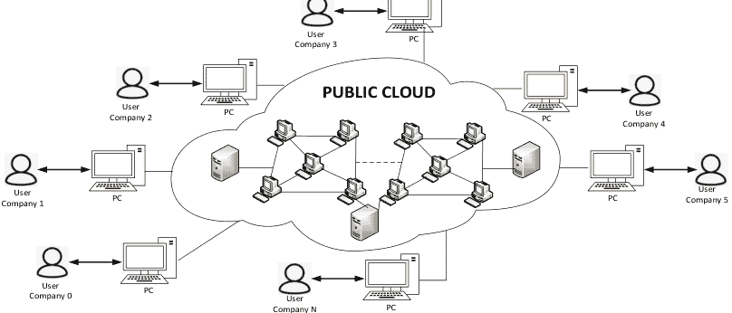

图 2.4。私有云部署模型。

- (ii) **私有云：** 企业通常拥有并运行内部使用的的私有云。当合规性、安全性以及降低其他风险因素的需求成为首要任务时，私有云模型是最合适的选择。私有云的主要优势是它为企业提供了对其希望用户提供的服务类型的完全控制权。所有的成本模型、策略、访问控制、服务集合的定义以及在私有云中使用的虚拟机，都可以由企业定义，无需任何第三方参与。图 2.5 (a) 和 (b) 显示了两种私有云模型。第一种是本地私有云，私有组织拥有其位于场所的私有云并对该云云进行管理。在第二种情况下，私有组织拥有私有云但将其管理外包给第三方，且不一定位于公司场所。

- (iii) **社区云：** NIST 将社区云定义为为特定消费者群体提供使用而部署的云基础设施，这些消费者来自具有共同关注点的组织（例如：目标、安全需求、策略和合规性标准）。它本质上是私有云的扩展版本。其所有权、管理和运营可以由社区的单个成员或部分成员承担。它也可以由第三方负责，或由社区成员与第三方共同控制。根据社区的选择，它可以位于场内或场外 [11]。图 2.6 显示了 A 公司和 B 公司共享的社区云。

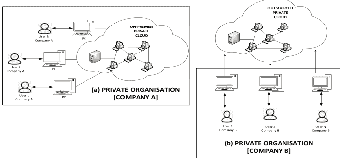

图 2.5。私有云模型。

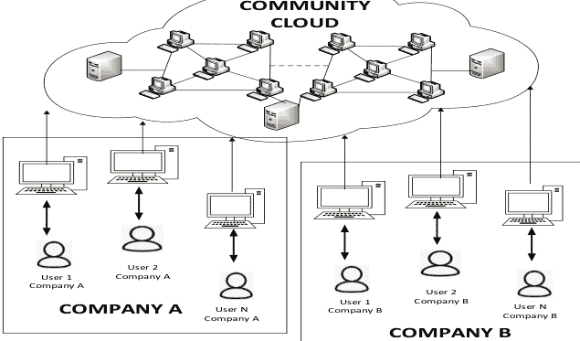

图 2.6。社区云。

- (iv) **混合云：** 混合云基本上是公有云和私有云的结合，以便企业可以利用两种云模型的优势。本质上，这是通过为组织的所有机数据流部署私有云，然后使用公有云访问私有云范围之外资源来实现。图 2.7 展示了 A 公司，它拥有自己的本地私有云，然后使用公有云提供额外服务。


图 2.7。混合云。

### 2.4.2. 服务分类

美国标准技术研究院 (NIST) 定义了三种服务模型，即 SaaS、PaaS 和 IaaS，如表 2.1 所示 [12]。

表 2.1。云计算服务分类

| 服务类别 | 用户类型 | 管理的资源 | 示例 |
|---|---|---|---|
| SaaS | 业务用户 | 业务应用、Web 服务、多媒体。 | Google Apps, Facebook, Youtube, Salesforce.com |
| PaaS | 开发人员、架构师、部署人员 | 软件框架 (Java, Net Storage, Databases, 运行时.) | Microsoft, Google App Engine |
| IaaS | 系统管理员 | 虚拟机、CPU、内存、带宽。 | Amazon EC2, GoGrid, Flexiscale, 数据中心 |

NIST 对三种基本服务类的定义如下 [12]:

- (i) 软件即服务 (SaaS)：在此类中，运行在云服务提供商 (CSP) 拥有的云基础设施上的应用程序被租给云服务客户 (CSC)。用户可以通过不同类型的客户端系统访问应用程序，这些系统可以是作为普通 Web 浏览器的“薄”客户端终端、专用的编程接口，甚至是集成开发环境 (IDE)。CSC 不管理或控制底层云基础设施，包括网络、服务器、操作系统、存储甚至单个应用程序功能。除了 CSC 可以设置的应用程序某些受限的用户定义配置和设置外，核心云基础设施包括网络、服务器、处理器和操作系统完全由 CSC 管理 [12]。
- (ii) 平台即服务 (PaaS)：在此服务中，由 CSP 拥有的平台实例租给 CSC，用户可以在该平台上部署其开发的应用程序。除了 CSC 可以设置的应用程序某些受限的用户定义配置和设置外，核心云基础设施包括网络、服务器、处理器和操作系统完全由 CSP 管理 [12]。
- (iii) 基础设施即服务 (IaaS)：在此服务中，由 CSP 拥有的基础设施（通常是虚拟化处理、存储和其他资源）提供给 CSC。CSC 可以在其上部署和执行不同类型的软件（如操作系统），但对于特定设备的安全和网络设置仍由 CSP 完全控制 [12]。云服务类也在演变，更具体的服务类包括分析即服务 (AaaS)、网络即服务 (NaaS)、移动后端即服务 (MBaaS)、移动网络即服务 (MNaaS) 和通信即服务 (CaaS)。

## 2.5. Firebase 平台简介

Firebase 是一个移动和 Web 开发平台。它提供了一广泛的技术和服务，协助他们开发复杂的应用程序，扩大客户群并实现盈利。最初，2011 年的 Firebase 是一家名为 Envolve 的初创公司，通过 API 将在线云功能集成到网站中 [13]。

除了聊天消息，其他形式的应用程序数据也可以通过 Envolve传递。例如，游戏状态等应用程序数据由 Envolve 的开发者在用户之间实时同步。随后，Envolve 的创始人将聊天系统从实时架构中分离。2012 年 4 月，Firebase 作为一家独立的公司成立，提供实时能力的后端即服务 (BaaS)。在 2014 年被 Google 收购后，Firebase 迅速发展成为多功能的移动和 Web 平台 [14]。Firebase 是一个具有以下功能的移动/Web 开发平台：

- 构建更好的应用：Cloud Firestore、机器学习套件、云函数、身份验证、托管、云存储、实时数据库。
- 提高应用质量：Crashlytics、性能监控、实验室。
- 业务增长：Google Analytics、预测、实验测试、云消息、远程配置、动态链接、应用索引。

### 2.5.1. Firebase 云数据库配置

实时数据库是一个云托管的 NoSQL 数据库，允许用户实时存储和同步。

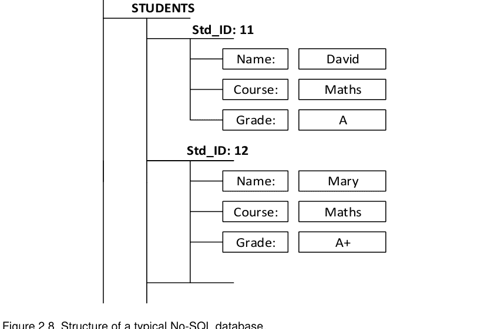

实时数据库本质上是一个 JSON 对象，可以由开发者进行实时管理。数据库的典型结构如图 2.8 所示。

32 T. P. Fowdur, L. Babooram, M. N-U-D-Ibn Nazir Rosun 和 M. Indoondonon

在图 2.8 中，数据库名称为 STUDENTS。每个学生通过学生 ID 唯一标识，对于每个学生，存储的数据包括名称、课程和成绩。

### 2.5.2. 创建 Firebase 项目和实时数据库

为了创建并向 Firebase 实时数据库发送数据，必须首先按照以下步骤创建一个 Firebase Firebase 项目：

- 1. 访问 `https://firebase.google.com/`。
- 2. 使用 gmail 账户登录。
- 3. 登录后，如图 2.9 所示进入 Firebase 控制台。


图 2.9. Firebase 控制台。

- 4. 如图 2.10 所示点击“添加项目”（Add project）。


图 2.10. 在 Firebase 中添加项目。

- 5. 如图 2.11 所示为项目命名并点击“继续”（continue）。

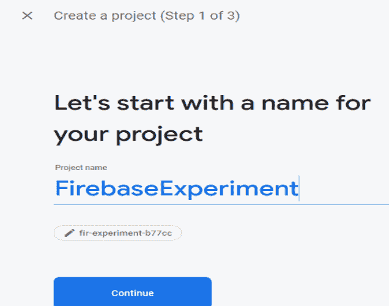

图 2.11. 为项目命名。

- 6. 在图 2.12 所示的屏幕中，保持默认选项（这将为项目启用 Google Analytics）并点击“继续”。

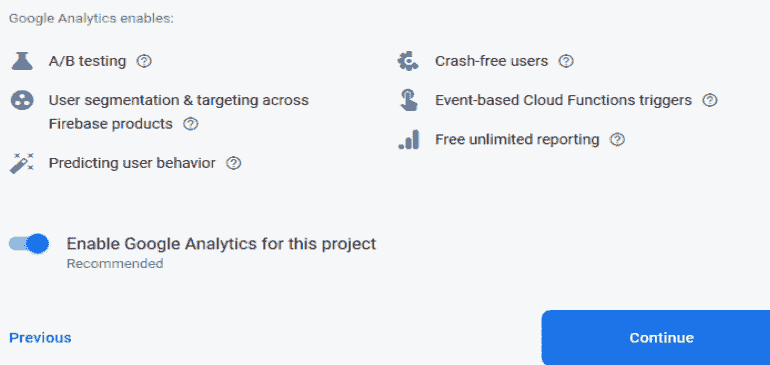

图 2.12. 启用 Google Analytics。

- 7. 接受所有条款，如图 2.13 所示点击“创建项目”（create project），然后在接下来的屏幕中点击“继续”。

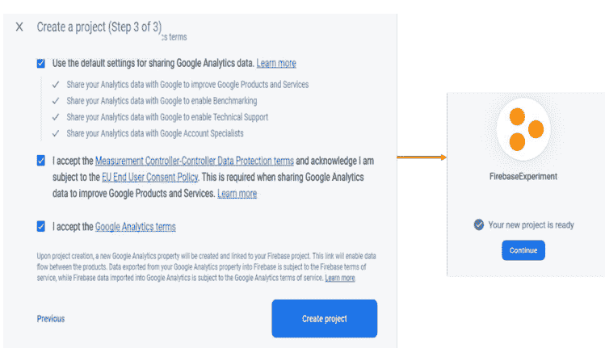

图 12.3. 接受条款并创建项目。

最后，将如图 2.14 所示显示主项目面板。现在该项目已准备好托管移动端和 Web 应用程序。


图 2.14. 主项目面板。

下一阶段按照接下来给出的步骤创建一个实时数据库：


- 1. 从项目控制台中选择“数据库”（Database）并如图 2.15 所示点击“创建数据库”（create database）。

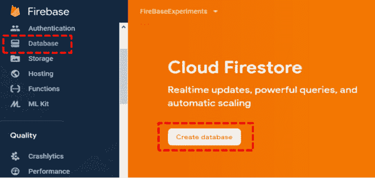

图 2.15. 创建数据库。

- 2. 当出现图 2.16 所示的屏幕时，保留默认设置并点击“下一步”（next）。随后规则将被重置。

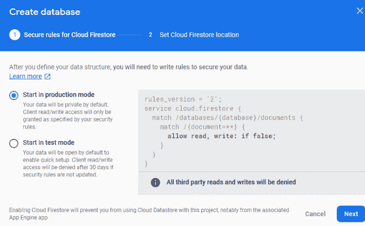

图 2.16. 数据库安全参数。

- 3. 当出现图 2.17 所示的屏幕时，再次保持不变并点击“下一步”。

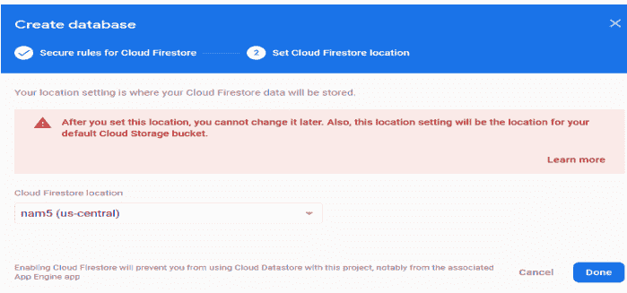

图 2.17. 接受默认位置。

- 4. 在图 2.18 所示的屏幕上，在 Cloud Firestore 旁边的下拉菜单中选择“实时数据库”（Realtime Database）。注意由于数据库中没有数据，数据库显示为 null。

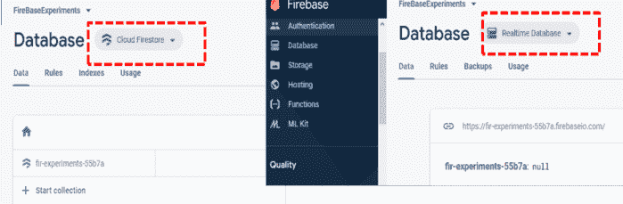

图 2.18. 选择数据库类型。

- 5. 点击“规则”（Rules），并如图 2.19 所示，读取和写入选项均被设置为 false。

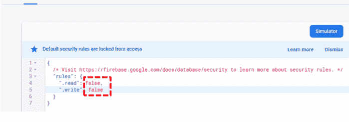

图 2.19. 默认读写规则。

- 6. 如图 2.20 所示将读取和写入重置为 true，这样你就可以从数据库读取并向其写入数据。之后点击“发布”（Publish）。

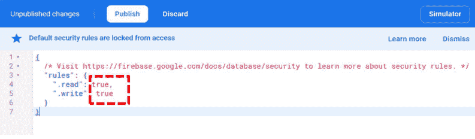

图 2.20. 修改后的读写规则。

数据库现在已设置好，准备好接受来自 Android 或 Web 应用程序的数据。

### 2.5.3. 使用 Android 从数据库发送和读取数据

为了从之前设置的数据库发送和接收数据，需要按照以下步骤创建一个 Android 应用并连接到名为“experiments-55b7a”的 Firebase 项目：

- 1. 如图 2.21 所示，在 Android Studio 中创建一个新项目


图 2.21. 在 Android Studio 中创建项目。

- 2. 在图 2.22 选择“空活动”（Empty Activity）并点击“下一步”。


图 2.22. 模板选择。

- 3. 如图 2.23 所示为项目命名，并保持其余设置为默认值点击“完成”（Finish）。


图 2.23. 项目配置。

- 4. 项目加载后，如图 2.24 所示点击“工具”（tools）并选择“Firebase”。

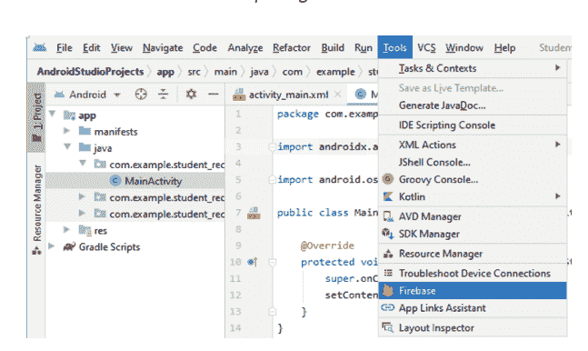

图 2.24. 启动 Firebase

- 5. Firebase 助手程序加载后，如图 2.25 所示点击“实时数据库”（Realtime Database）。

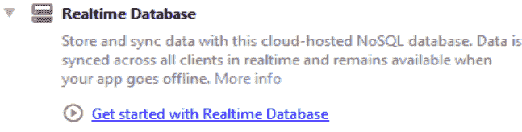

图 2.25. 选择实时数据库

- 6. 出现图 2.26 所示的屏幕，点击“连接到 Firebase”（Connect to Firebase）。

- 7. 显示所有可用项目的 Firebase 助手程序，如图 2.27 所示选择 Firebase 项目并继续。

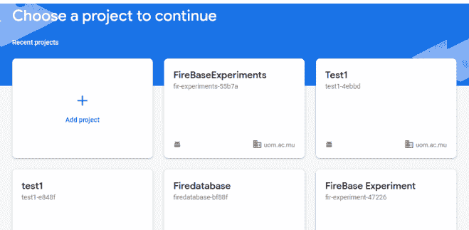

图 2.27. 选择项目

- 8. 出现图 2.28 所示的消息，点击“连接”（Connect）。


图 2.28. 连接通知

将显示图 2.29 所示的屏幕，确认 Android 项目已连接。

41


### 你的 Android 项目已连接

现在可以使用 Firebase 了！在 Android Studio 中，Firebase 助手程序下方如图 2.30 所示显示“已连接”的消息。

- 9. 接下来点击“添加实时数据库 SDK”（Add the Realtime Database SDK），出现图 2.31 所示的屏幕。

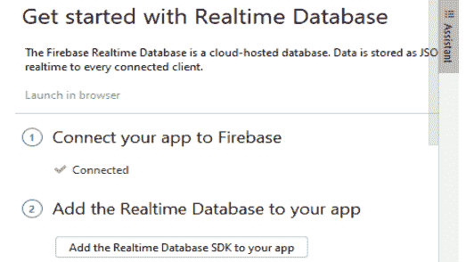

图 2.30. 连接确认

- 10. 点击“接受更改”（Accept changes），Firebase 助手程序现在如图 2.32 所示确认已添加依赖。

### 开始使用实时数据库

Firebase 实时数据库是一个云托管数据库。数据会同步到所有连接的客户端。

在浏览器中启动

### 将应用连接到 Firebase

- 已连接

### 将实时数据库添加到你的应用

- 依赖项设置正确

图 2.32. 依赖项设置正确的确认。

应用程序的布局如图 2.33 所示。

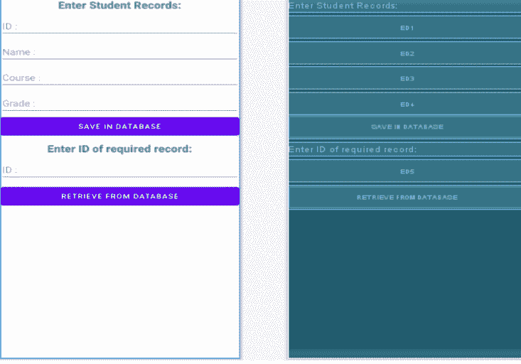

图 2.33. Student_Records 移动应用的布局。

布局代码存储在列表 2.1 所示的 `activity_main.xml` 文件中。

### 列表 2.1. Student_Records 应用 activity_main.xml 文件代码

```xml
<?xml version="1.0" encoding="utf-8"?>
<LinearLayout xmlns:android="http://schemas.android.com/apk/res/android"
    xmlns:app="http://schemas.android.com/apk/res-auto"
    xmlns:tools="http://schemas.android.com/tools"
    android:layout_width="match_parent"
    android:layout_height="match_parent"
    android:orientation="vertical"
    tools:context=".MainActivity">

// 创建一个 TextView 提示用户输入学生记录。

<TextView
    android:id="@id/TV1"
    android:layout_width="match_parent"
    android:layout_height="wrap_content"
    android:text="Enter Student Records"
    android:textSize="20dp"
    android:gravity="center_horizontal"
    android:fontFamily="sans-serif-black"
    android:layout_marginTop="7dp"/>

// 创建一个文本框让用户输入学生 ID。

```xml

<EditText

    android:id="@+id/ED1"

    android:layout_width="match_parent"

    android:layout_height="wrap_content"

    android:ems="10"

    android:inputType="textNoSuggestions"

    android:hint="ID : "

    android:layout_marginTop="7dp"

    />

```

// 创建一个文本框让用户输入学生姓名。

```xml

<EditText

    android:id="@+id/ED2"

    android:layout_width="match_parent"

    android:layout_height="wrap_content"

    android:ems="10"

    android:inputType="textNoSuggestions"

    android:hint="Name : "

    android:layout_marginTop="7dp"/>

```

// 创建一个文本框让用户输入课程。

```xml

<EditText

    android:id="@+id/ED3"

    android:layout_width="match_parent"

    android:layout_height="wrap_content"

    android:ems="10"

    android:inputType="textNoSuggestions"

    android:hint="Course : "

    android:layout_marginTop="7dp"/>

```

// 创建一个文本框让用户输入学生成绩。

```xml

<EditText

    android:id="@+id/ED4"

    android:layout_width="match_parent"

    android:layout_height="wrap_content"

    android:ems="10"

    android:inputType="textNoSuggestions"

    android:hint="Grade : "

    android:layout_marginTop="7dp"/>

```

// 用于触发在数据库中保存学生记录的的按钮。

```xml

<Button

    android:id="@id/B1"

    android:layout_width="match_parent"

    android:layout_height="wrap_content"

    android:text="Save in database" />

```

// 创建一个 TextView 提示用户输入所需的学生详情的 ID。

```xml

<TextView

    android:id="@id/TV2"

    android:layout_width="match_parent"

    android:layout_height="wrap_content"

    android:text="Enter ID of required record:"

    android:textSize="20dp"

    android:gravity="center_horizontal"

    android:fontFamily="sans-serif-black"

    android:layout_marginTop="7dp"/>

```

// 创建文本框让用户输入要从数据库获取的学生 ID。

```xml

<EditText

    android:id="@+id/ED5"

    android:layout_width="match_parent"

    android:layout_height="wrap_content"

    android:ems="10"

    android:inputType="textPersonName"

    android:hint="ID :"

    android:layout_marginTop="7dp"/>

```

// 用于触发从数据库中检索给定学生记录的按钮。

```xml

<Button

    android:id="@+id/B2"

    android:layout_width="match_parent"

    android:layout_height="wrap_content"

    android:text="Retrieve from Database"

    android:layout_marginTop="7dp"/>

```

</LinearLayout>
```


```java
package com.example.student_records;

// Firebase 数据库需要以下导入项：

import com.google.firebase.database.DatabaseReference;
import com.google.firebase.database.FirebaseDatabase;
import com.google.firebase.database.*;

// Activity 的其他导入：

import androidx.annotation.NonNull;
import androidx.app.AppCompatActivity;
import android.content.Intent;
import android.os.Bundle;
import android.view.View;
import android.widget.*;

public class MainActivity extends AppCompatActivity {
    // 声明一个数据库引用对象：
    DatabaseReference mDatabase;

    // 声明需要的 TextView, EditText 和 Button 变量：
    TextView TV2;
    EditText ED1,ED2,ED3,ED4,ED5;
    Button B1,B2;

    // 声明与学生相关的变量：
    String id,id1,name,course,grade;

    @Override
    protected void onCreate(savedInstanceState) {
        super.onCreate(savedInstanceState);
        setContentView(R.layout.activity_main);

        // 在 onCreate 方法内部创建 mdatabase 对象实例：
        mDatabase = FirebaseDatabase.getInstance().getReference();

        // 将 MainActivity 中的所有 GUI 变量与
        // activity_main.xml 文件中的对应项绑定

        TV2 = (TextView)findViewById(R.id.TV2);
        ED1 = (EditText)findViewById(R.id.ED1);
        ED2 = (EditText)findViewById(R.id.ED2);
        ED3 = (EditText)findViewById(R.id.ED3);
        ED4 = (EditText)findViewById(R.id.ED4);
        ED5 = (EditText)findViewById(R.id.ED5);
        B1 = (Button)findViewById(R.id.B1);
        B2 = (Button)findViewById(R.id.B2);

        B1.setOnClickListener(new View.OnClickListener() {
            @Override
            public void onClick(View v) {
                id = ED1.getText().toString();
                name = ED2.getText().toString();
                course = ED3.getText().toString();
                grade = ED4.getText().toString();

                Student std = new Student(name, course, grade);
                mDatabase.child("Students").child(id).setValue(std);
            }
        });

        B2.setOnClickListener(new View.OnClickListener() {
            @Override
            public void onClick(View v) {
                id = ED5.getText().toString();
                mDatabase.child("Students").child(id).addValueEventListener(new ValueEventListener() {
                    @Override
                    public void onData(@NonNull DataSnapshot snapshot) {
                        // 从此位置的快照提取值。
                        Student post = snapshot.getValue(Student.class);
                        if (post != null) {
                            id1 = id;
                            name = post.name;
                            course = post.course;
                            grade = post.grade;
                        }
                    }

                    @Override
                    public void onCancelled(@NonNull DatabaseError databaseError) {
                        // 如果从数据库读取出错，则需要此方法。
                    }
                });
            }
        });
    }
}
```

Student.java 文件的代码见列表 2.3。

### 列表 2.3. Student.java 文件

```java
package com.example.student_records;

public class Student {
  public String name;
  public String course;
  public String grade;

  public Student(){
}
  public Student(String name, String course, String grade){
    this.name=name;
    this.course=course;
    this.grade=grade;
  }
}
```

AndroidManifest.xml 在 Android Studio 中创建应用程序时默认生成，在本应用程序中未进行任何修改。见列表 2.4。

### 列表 2.4. StudentRecords 应用的 AndroidManifest.xml 文件

```xml
<?xml version="1.0" encoding="utf-8"?>
<manifest xmlns:android="http://schemas.android.com/apk/res/android"
    package="com.example.student_records">
  <application
    android:allowBackup="true"
    android:icon="@mipmap/ic_launcher"
    android:label="@string/app_name"
    android:roundIcon="@mipmap/ic_launcher_round"
    android:supportsRTL="true"
    android:theme="@style/Theme.StudentRecords">
    <activity android:name=".MainActivity">
      <intent-filter>
        <action android:name="android.intent.action.MAIN" />
        <category android:name="android.intent.category.LAUNCHER" />
      </intent-filter>
    </activity>
  </application>
</manifest>
```

当应用程序在手机上运行时，将显示图 2.34 所示的屏幕。

| Student-Records |

| :--- |

| 输入学生记录: |

| ID: |

| 姓名: |

| 课程: |

| 成绩: |

| 保存到数据库 |

| 输入所需记录的 ID: |

| ID: |

| 从数据库检索

50 T. P. Fowdur, L. Babooram, M. N-U-D-Ibn Nazir Rosun 和 M. Indoonundan

图 2.35 显示了应用程序中添加了一条记录。


图 2.35 在应用程序中添加学生记录。

点击 SAVE IN DATABASE 按钮后，记录将被发送到 Firebase 实时数据库，并且如图 2.36 所示，还可以添加另一条记录。


图 2.36 添加另一条记录。

这两条记录添加后，数据库的内容如图 2.37 所示。

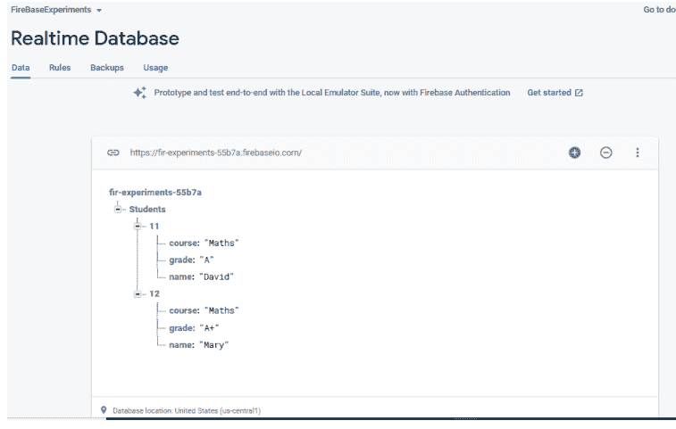

图 2.37. 添加两条记录后 fir-experiments-55b7a 数据库的内容。

也可以通过指定学生 ID 从数据库中检索记录，如图 2.38 所示。


图 2.38 使用应用程序从数据库中检索记录。

## 2.6. 使用 NODE.JS 在 FIREBASE 上托管应用程序

在本节中，将使用 Node.js 在 Firebase 上部署 Web 应用程序。该应用程序将与第 2.5.3 节介绍的 Student_Records 应用程序类似。

### 2.6.1. Node.js 概述与安装

Node.js 是基于 Google Chrome 的 JavaScript 运行时开发的平台。它简化了应用程序开发，并允许快速实现可扩展的网络应用程序。为了使其适用于运行在分布式设备上的数据密集型实时应用，采用了事件驱动的非阻塞 I/O 模型，这使其非常轻量级 [17, 18]。由于其提供了多个 JavaScript 模块的有用库，Web 应用程序 own得到了极大便利。Node.js 的许多基础模块是用 JavaScript 编写的，它主要用于运行实时服务器应用程序。Node.js 的一些重要部分如下：

- 模块 `Modules`

- 调试器 `Debugger`

- 控制台 `Console`

- 集群 `Cluster`

- 错误处理 `Error Handling`

- 网络 `Net`

- 全局 `Global`

- DNS

- 域 `Domain`

- 流 `Streaming`

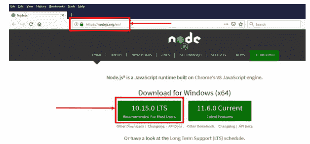

图 2.39 下载 Node.js。

# 云计算基础 53

可以从以下链接下载并安装 Node.js：https://nodejs.org/en/。网站上显示的 Node.js 版本取决于访问时的日期。打开网站后，点击如图 2.39 所示推荐给大多数用户使用的版本。

安装 Node.js 后，可以从 Node.js 命令提示符启动它，如图 2.40 所示。

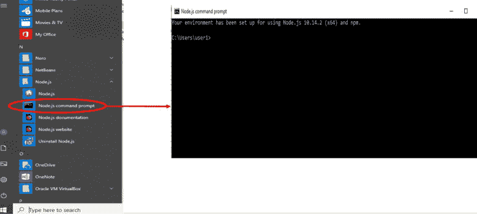

图 2.40 启动 Node.js。

Node.js 包管理器 `npm` 提供了两个关键功能 [17, 18]

- 1. 可搜索的 node.js 包/模块在线仓库，可以在 search.nodejs.org 上进行搜索。

- 2. 命令行实用，用于安装 Node.js 包，以及管理 Node.js 包的版本和依赖关系。

`npm` 在 v0.6.3 版本中随 Node.js 安装文件一起。可以使用命令 `npm version` 版本。

安装任何 Node.js 模块的语法如下：

考虑从 Node.js 命令提示符安装一个名为 `express` 的重要 Node.js Web 框架，如图 2.41 所示。

默认情况下，`npm` 在本地模式下安装依赖项，即 Node.js 应用程序所在的文件夹中。因此，当安装 `express` 模块时，在 `express` 模块安装的相同目录中创建了 `node_modules` 目录，如图 2.42 所示。

# 54 T. P. Fowdur, L. Baboor, M. N-D-Ibn Nazir Rosun 和 M. Indoonondon

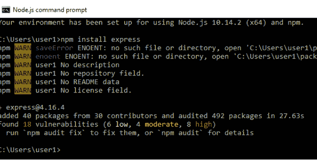

图 2.41 安装 Express 框架。

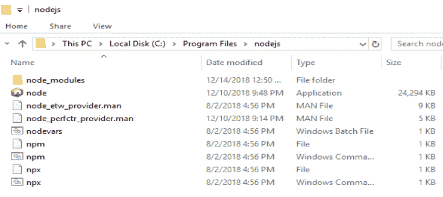

图 2.42 node_modules 目录。

要显示所有本地安装模块的列表，可以执行 `npm` 命令。系统目录存储了所有全局安装的包和依赖项。可以使用 `npm install express -g` 全局安装 `express` 模块。卸载 Node.js 模块使用以下命令：`npm uninstall express`，搜索 Node.js 模块使用：`npm search express`。

### 2.6.2. 使用 Node.js 在 Firebase 上托管 Web 应用以读写 Firebase 实时数据库

为了从之前在第 2.5.2 节设置的数据库发送和接收数据，必须首先创建并连接名为 `fir-experiments-55b7a` 的 Firebase 项目，如下：

## 云计算基础

1. 点击图 2.43 所示的主项目面板中的 `Add app` 图标。


图 2.43 向 Firebase 项目添加应用。

2. 在图 2.44 所示的屏幕上选择 `Web app` 平台。


图 2.44 选择 Web 应用。

3. 如图 2.45 所示，将其为 `Student_Records` 并点击 `Register app`。


图 2.45 在 Firebase 上注册 Web 应用。

# 56 T. P. Fowdur, L. Baboor, M. N-D-Ibn Nazir Rosun 和 M. Indoonondon

4. 注册应用后会出现图 2.46 所示的屏幕。脚本将在稍后添加，因此继续进入控制台。

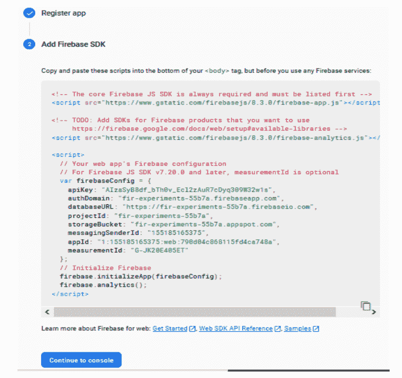

图 2.46 向 Web 添加 Firebase SDK。

5. 返回控制台后，将观察到如图 2.47 所示的附加到 Firebase 项目的应用。


图 2.47 定位 Student_Records 应用。

## 云计算基础

下一阶段将以下步骤使用 IDE 开发 Web 应用程序：

- 1. 在 Netbeans 中，点击 `File` 并选择 `New`，如图 2.48 所示。

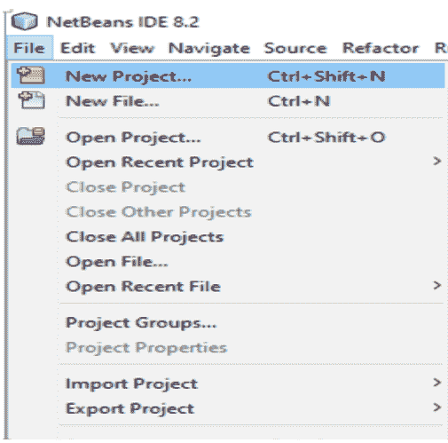

图 2.48 在 Netbeans 中创建新项目。

- 2. 当下一个窗口出现时，如图 2.49 所示，选择带有 Node.js 的 `HTML` 项目类型。

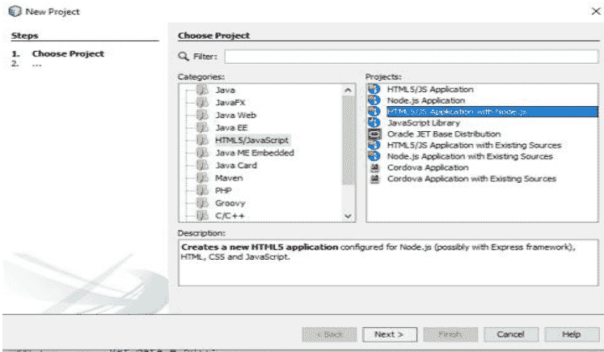

图 2.49 选择项目类型。

# 58 T. P. Fowdur, L. Baboor, M. N-D-Ibn Nazir Rosun 和 M. Indoonondon

- 3. 将项目命名为 `Student_Records` 并点击 Finish，如图 2.50 所示。

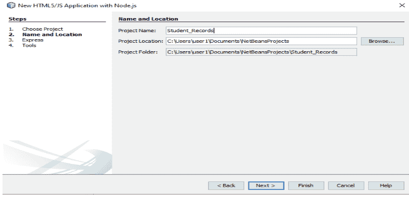

图 2.50 为项目命名。

- 4. 在项目视图中，注意图 2.51 所示的结构。

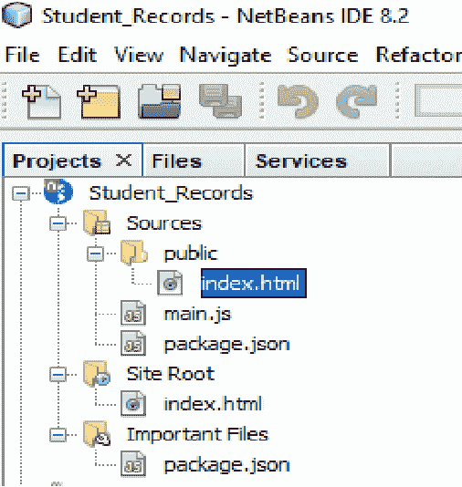

图 2.51 目录结构。

- 5. 双击 public 文件夹下的 `index.html` 文件并添加以下代码：

### 2.5. Student_Records 项目的 HTML 文件


```html
<!DOCTYPE html>
<html lang="en" dir="ltr">

<head>
<meta charset="utf-8">

<!-- Firebase SDK 是始终需要的，必须第一个列出-->
<script src="https://www.gstatic.com/firebasejs/7.1.0/firebaseapp.js"></script>

<!-- 调用身份验证和数据库访问的 Firebase 脚本： -->
<script src="https://www.gstatic.com/firebasejs/7.1.0/firebaseauth.js"></script>
<script src="https://www.gstatic.com/firebasejs/7.1.0/firebasedatabase.js"></script>

<!-- 定义背景和按钮的样式 -->
<style>
body {
  background-color: #0f1724;
  color: #00a8ff;
  font-family: 'Arial';
  font-size: 20px;
}

.btn {
  color: #fff;
  background-color: #1d2025;
  border-color: #11ece5;
  margin-bottom: 40px;
  margin-top: 20px;
  font-size: 20px;
}
</style>
</head>
<body>
```

```html
<!-- 为输入记录部分创建一个标题 -->
<h3 class="Records">Enter Student Records</h3>
<!-- 为 ID 创建标签和输入框 -->
<label for="ID">ID</label>
<input type="text" id="ID" required="required" />
<br>
<!-- 为 Name 创建标签和输入框 -->
<label for="Name">Name</label>
<input type="text" id="Name" required="required" />
<br>
<!-- 为 Course 创建标签和输入框 -->
<label for="Course">Course</label>
<input type="text" id="Course" required="required" />
<br>
<!-- 为 Grade 创建标签和输入框 -->
<label for="Grade">Grade</label>
<input type="text" id="Grade" required="required" />
<br>
<!-- 创建一个按钮调用 Save_Record() 函数以将学生数据保存到 Firebase 数据库 -->
<button type="button" class="btn" onclick="Save_Record()">SAVE IN DATABASE</button>
</body>
</html>
```

## 云计算基础

来自 Firebase 实时数据库的学生数据--

```html
<button type="button" name="Retrive_Record" onclick="Retrieve_Record()">
从数据库中检索 </button>
```

```html
<br><br>
<!-- 创建标签和文本框，用于输出从数据库检索的姓名、课程和 ID -->
```

```html
<label for="Name2"><b>姓名</b></label> <br>
<input type="text" id="Name2">
<br><br>
```

```html
<label for="Course2"><b>课程</b></label> <br>
<input type="text" id="Course2">
<br><br>
```

```html
<label for="Grade"><b>成绩</b></label> <br>
<input type="text" id="Grade2">
<br>
```

```javascript
// Web 应用的 Firebase 配置
// 对于 Firebase JS SDK v7.20.0 及更高版本，
// 此脚本建立了 Web 应用程序与
// experiments-55b7a 项目的实时数据库之间的连接。
```

```javascript
var firebaseConfig = {
apiKey:"AlzaSyB8df_bThov_Ecl2zAuR7cDyq309W32w1s",
authDomain:"fir-experiments-55b7a.firebaseapp.com",
databaseURL:"https://fir-experiments-55b7a.firebaseio.com",
projectId:"fir-experiments-55b7a",
storageBucket:"fir-experiments-55b7a.appspot.com",
messagingSenderId:"155181565375",
appId:"1:155181565375:web:790d04c868115fd4ca748a",
measurementId:"G-JK20E405ET"
};
```

```javascript
// 初始化 Firebase
firebase.initializeApp(firebaseConfig);
firebase.analytics();
function Save_Record() {
```

```javascript
// 获取用户在 HTML 页面上输入的学生 ID、姓名、课程和成绩
```

```javascript
// 并它们存储为变量：

var StdId = document.getElementById('ID');
var StdName = document.getElementById('Name');
var StdCourse = document.getElementById('Course');
var StdGrade = document.getElementById('Grade');
```

// 获取提取出的变量中存储的值：

```javascript
var v1= StdId.value;
var v2= StdName.value;
var v3 = StdCourse.value;
var v4= StdGrade.value;
```

// 创建一个数据库引用变量，指定 Firebase 中的数据库标识符为 Student_Records

```javascript
var dataRef = firebase.database().ref('Student_Records');
```

// 调用子节点，使存储在变量 v1 中的学生 ID

// 成为给定学生记录的键变量，并使用

// set 函数将用户输入的值赋值给数据库

// 中的 Name、Course 和 Grade 字段。

```javascript
dataRef.child(v1).set({
Name: v2,
Course: v3,
Grade: v4
});
```

// 当记录成功保存到数据库时，发送消息。

```javascript
alert("学生记录保存成功");
```

// 清除网页中的字段，以便用户输入

// 新学生的记录。

```javascript
document.getElementById('ID').value = '';
document.getElementById('Name').value = '';
document.getElementById('Course').value = '';
document.getElementById('Grade').value = '';
```

```javascript
function Retrieve_Record(){

// 获取 Web 页面中输入的 ID 值作为变量。

  var enterID= document.getElementById('getID').value;

  // 创建一个数据库引用变量，指定 Firebase 中的
  // 数据库标识符为 Student_Records
  // 调用子函数根据 enterID 变量
  // 识别学生记录。每当请求数据库时，都会返回一个包含
// 数据库存储数据的快照对象（snapshot）。

  firebase.database().ref('Student_Records').child(enterID).on('value',
function(snapshot) {

  // 从快照变量中提取学生姓名、课程和成绩，
//并将它们存储在三个不同的变量中：

  var S_Name = snapshot.val().Name;
  var S_Course = snapshot.val().Course;
  var S_Grade = snapshot.val().Grade;

  // 将检索到的记录的姓名、课程和成绩输出到
// 网页上相应的文本框中：

  document.getElementById('Name2').value=S_Name;
  document.getElementById('Course2').value=S_Course;
  document.getElementById('Grade2').value=S_Grade;

});

alert("学生记录检索成功");
}
</script>
<br>
</body>
</html>
```

当应用程序启动时，会出现图 2.52 所示的网页。

# 64 T. P. Fowdur, L. Babooram, M. N-U-D-Ibn Nazir Rosun and M. Indoonondon

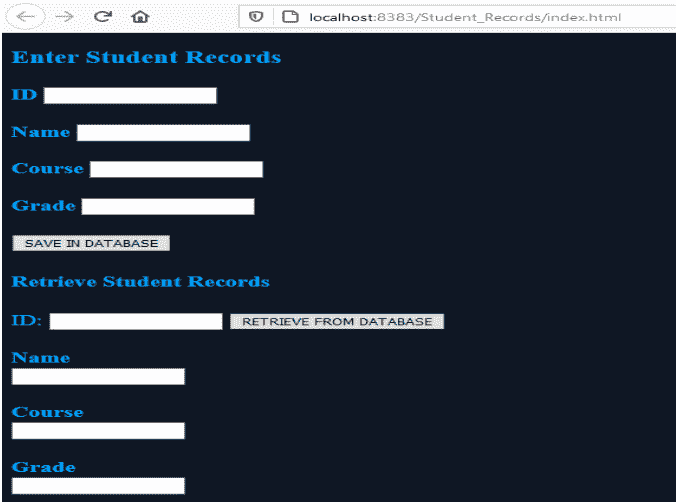

图 2.52. Student_Records Web 的布局。

注意的是，应用程序目前托管在本地（localhost）上，没有全局可访问的链接。然而，它仍然可以将数据发送到 Firebase 实时数据库，因为列表 2.5 中的脚本包含了建立数据库连接的所有凭据。图 2.53 显示了数据如何从应用程序发送到 Firebase 实时数据库。


图 2.53. 从 Web App 向数据库保存学生记录。

在发送了图 2.53 所示的数据以及另一个学生的数据后，数据库将包含图 2.54 所示的内容。

## 云计算基础

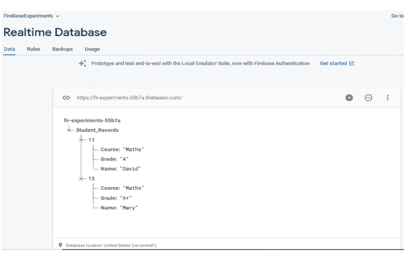

图 2.54. 从 Student_Records Web App 输入数据后的数据库内容。

图 2.55 显示了如何通过 Web App 检索学生记录。


图 2.55. 使用 Student_Records Web App 从数据库检索数据。

下一个目标是使用 Node.js 将应用程序部署到 Firebase 上。这可以通过接下来的步骤来实现。

# 66 T. P. Fowdar, L. Babooram, M. N-D-Ibn Nazir Rosun and M. Indoondonon

1. 将名为 `public` 的文件夹（包含 Student_Records 应用的 index.html 文件）复制到另一个文件夹（例如，test1），如图 2.56 所示。

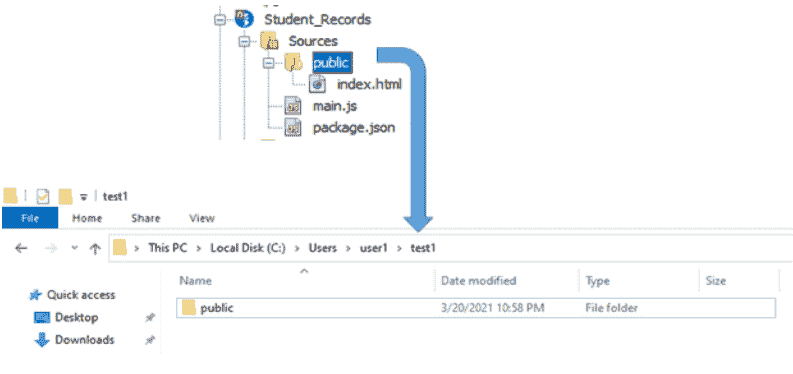

图 2.56. 复制 public 文件夹。

2. 在命令提示符上运行以下行安装 Firebase 工具（需要 Node.js）：

```bash
C:\Users\user1>npm install -g firebase-tools
```

3. 退出 Firebase 并重新登录以生成令牌，如图 2.57 所示。

```bash
C:\Users\user1>firebase logout
Invalid refresh token, did not need to deauthorize
> Logged out as p.fowdar.mu
C:\Users\user1>firebase login
Firebase 可选择收集报告信息以改进我们的产品。
Allow firebase to collect reporting information? Yes
To change your collection preference at any time, use "firebase logout".
访问此 URL 登录：
https://accounts.google.com/signin?auth_user=2&id=56J5s5BB6-f6nh84ki.apps.com&redirect_uri%3Dhttp://localhost:5000
Waiting for authentication...
Success! Logged in as p.fowdar@u.mu
C:\Users\user1>
```

4. 输入 `firebase login` 命令后，将打开一个 URL 并选择账户登录 Firebase。必须遵循图 2.58 所示的步骤才能成功登录。

5. 进入项目目录（即 test1）并输入 `init` 初始化项目。之后按 Y 并选择图 2.59 所示列表中的 `hosting`。

```bash
C:\Users\user1>cd test1
C:\Users\user1\test1>firebase init

You're about to initialize a Firebase project in this directory:
C:\Users\user1>
Are you ready to proceed? Yes
Which Firebase features do you want to set up for this folder? Press Space to select features, then Enter to confirm your choices.
(Database) Deploy Firestore Realtime Database Deploy rules and create indexes for Firestore
(Functions) Configure and deploy Cloud Functions
(Hosting) Deploy Firebase hosting sites
(Storage) Deploy Cloud Storage security rules
(Emulators) Set up local emulators for Firebase features
```

图 2.59. Firebase 项目初始化。

6. 之后选择“use existing project”并选择最初关联应用程序的项目，在这种情况下，它是列表中的 `fir-experiments-55b7a` 项目，如图 2.60 所示。

# 68 T. P. Fowdar, L. Babooram, M. U-D-Ibn Nazir Rosun 和 M. Indoondonman

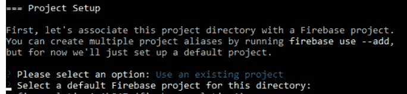

图 2.60. 将项目目录与 Firebase 项目关联。

7. 然后，我们指定包含项目文件的文件夹（在本例中为 'public'），并在出现图 2.61 所示的下一个提示时按回车。

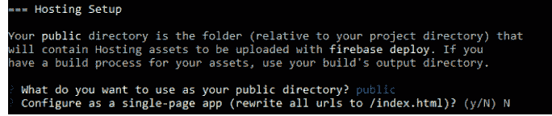

图 2.61. Firebase hosting 设置。

8. 针对图 2.62 显示的后续三个点，我们输入 N(no)，因为我们不想将其配置为单页应用，也不想在 Github 上设置部署。此外，我们不希望 html 文件被 firebase 生成的另一个 index.html 文件覆盖。

```
Configure as a single-page app (rewrite all urls to /index.html)? No
Set up atomic builds and deploys with GitHub? No
Wrote public/4.html
File public/index.html already exists. Overwrite? No
Skipping write of public/index.html
Writing configuration to firebase.json
Writing project information to .firebaserc
Writing gitignore file to .gitignore
Firebase initialization complete!
C:\Users\user1>
```

图 2.62. 完成 Firebase 初始化。

9. 最后，通过输入 `firebase deploy` 部署应用，如图 2.63 所示。

部署完成后，firebase 提供了两个 URL，即 'Project Console' 和 'Hosting URL'如图 2.63 底部所示。

## 云计算基础


```
E:\users\userid\test1>firebase deploy
== Deploying to "fir-experiments-55b7a"
 > hosting
 hosting:fir-experiments-55b7a: beginning deployment...
 hosting:fir-experiments-55b7a: Uploaded 2 files fully
 hosting:fir-experiments-55b7a: file upload complete
 hosting:fir-experiments-55b7a: finalizing version...
 hosting:fir-experiments-55b7a: deploy finished
 hosting:fir-experiments-55b7a: releasing new version...
 hosting:fir-experiments-55b7a: release complete

Deploy Complete!
```

Project Console: https://console.google.com/project/fir-experiments-55b7a/overview

Host URL: https://fir-experiments-55b7a.web.app

`C:\Users\userid\test1>`


图 2.63. 在 Firebase 中部署应用。

- 10. 在 Firebase 仪表板上选择 hosting，并注意到现在已可用图 2.64 所示的 web 应用链接。

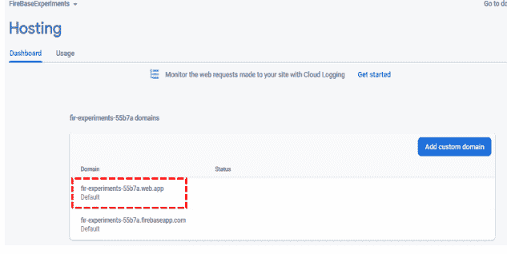

图 2.64. 在 Firebase 上定位托管的应用。

- 11. 点击 web 应用链接时，应用程序的网页将在 Firebase 托管的公共域名上加载，如图 2.65 所示。

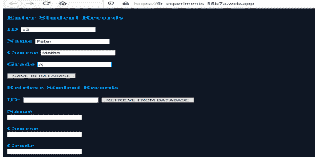

图 2.65. 部署在 Firebase Web 应用。

70 T. P. Fowdur, L. Babooram, M. N-D-Ibn Nazir Rosun 和 M. Indoondom

- 12. 我们可以输入另一条记录来测试数据是否存储在学生记录中，如图 2.65 所示；当我们检查图 2.66 所示的实时数据库时，发现多了一了一条记录。

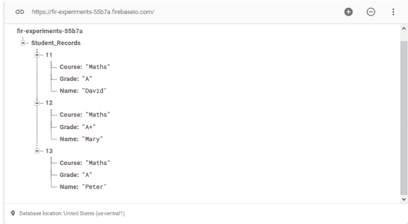

图 2.66. Firebase 中的额外记录。

最后的观察结果是 public 文件夹 test1 和 public 中创建了额外的文件，如图 2.67 所示。

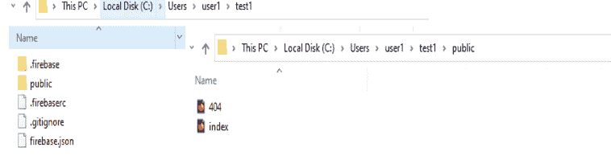

图 2.67. 托管应用后 public 和 test1 文件夹的内容。

## 2.7. IBM CLOUD 平台简介

IBM Cloud 是一个基于 Cloud Foundry 开源技术的公共云平台，其目录由多个产品组成的完整栈组成。它包含了传统的计算、存储和网络服务等多种服务和解决方案。此外，它还提供了端到端的应用程序开发框架、设置和易于部署的设施、安全管理服务、传统的或数据库以及云原生服务。它还通过平台即服务 (`PaaS`) 简化了应用程序开发，并提供了集成的移动后端即服务 (`MaaS`) 潜力。为了使内部开发易于扩展，提供了可直接使用的服务以及托管功能，以便应用程序可以快速部署。有关此云平台架构和特性的更多细节，可以从 `[19]` 和 `[20]` 获取。

在本节中，重点将开发移动和桌面应用程序，这些程序可以向 IBM Cloud 数据库发送和接收数据，并向托管在 IBM Cloud 上的 servlet 发送查询并接收响应。

### 2.7.1. IBM Cloud 数据库配置

在本节中，将配置 IBM Cloud 数据库并开发能够执行以下任务的应用程序：

- I. 从 Android 应用向 IBM Bluemix cloudant 数据库发送和接收数据
- II. 从桌面应用向 IBM Bluemix cloudant 数据库发送和接收数据
- III. 从 Web 应用向 IBM Bluemix cloudant 数据库发送和接收数据。

起点是按照以下步骤创建 IBM Cloud 账户：

- 1. 转到链接 `https://cloud.ibm.com`
- 2. 点击创建 IBM Cloud 账户。显示图 2.68 所示的网页。

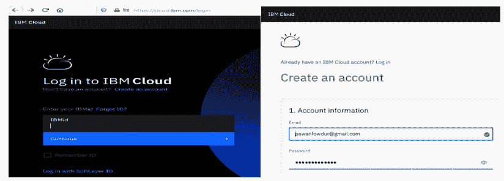

图 2.68. IBM Cloud 登录页面。

- 3. IBM Cloud 将向输入的邮箱发送 7 位验证码。如图 2.69 所示。

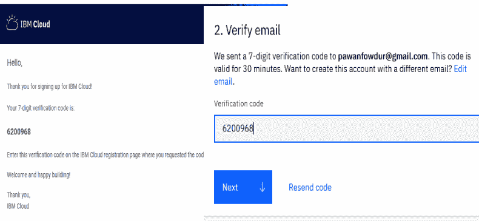

图 2.69. 验证。

- 4. 填入个人信息并按图 2.70 所示创建账户。


图 2.70. 个人信息。

- 5. 显示带有某些通用信息的页面，点击继续进入图 2.71 所示的 IBM Cloud 仪表板。

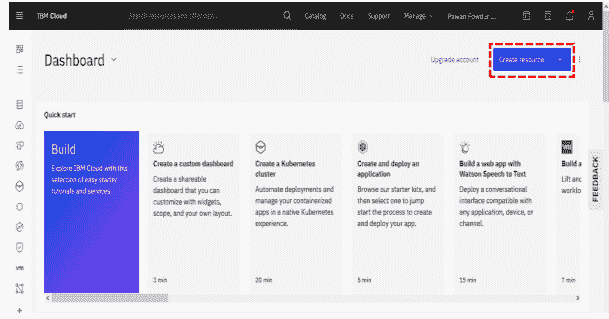

图 2.71. 仪表板。

- 6. 点击图 2.72 所示的创建资源。展开 Services，选择 Databases 中的 Cloudant。

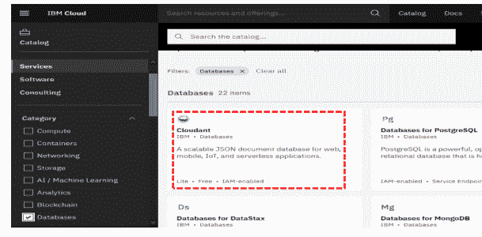

图 2.72. Cloudant。

- 7. 设置身份验证方法为 IAM 并点击创建。

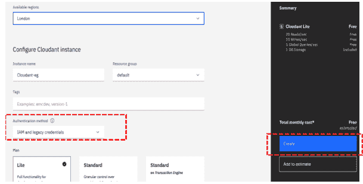

图 2.73. IAM。

- 8. 数据库通常需要一些时间来部署。完成后，显示图 2.74 所示的界面。

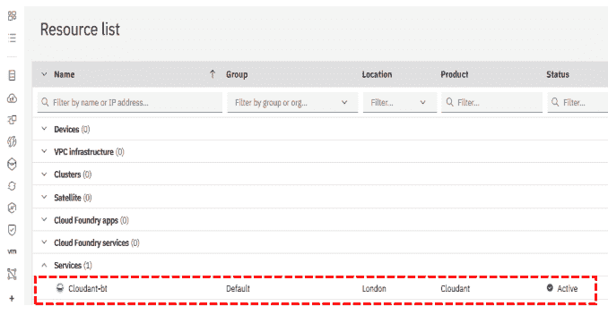

图 2.74. 服务。

- 9. 点击图 2.75 所示的端点，将用于从 Java 程序访问数据库。

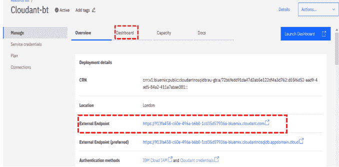

图 2.75. 端点。

- 10. 点击图 2.76 所示的启动。


图 2.76. 启动。

- 11. 将弹出图 2.77 所示的登录界面。

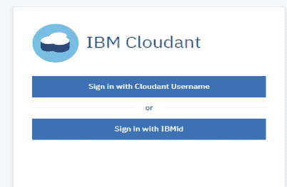

图 2.77. 登录。

- 12. 点击图 2.78 所示的创建数据库。

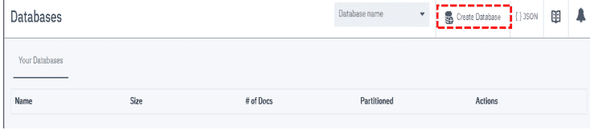

图 2.78. 创建数据库。

- 13. 之后，为数据库命名，选择非分区，并按图 2.79 所示点击创建。

### 创建数据库

图 2.79. 非分区数据库。

13. 点击图 2.83 所示的“创建文档”（Create Document）。


图 2.83. 创建文档。

14. 将出现如图 2.84 所示的空白文档。


图 2.84. 数据库中的空白文档。

15. 再次点击“创建”（Create），文档将如图 2.85 所示列出。

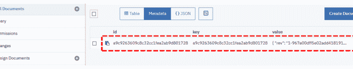

图 2.85. 数据库中创建的文档。

16. 可以点击图 2.85 所示的高亮部分来查看文档。它目前将如图 2.86 所示为空的。

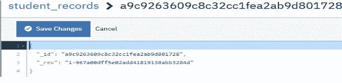

图 2.86. 数据库中的文档。

17. 在 cloudant 中，每条数据都会生成并存储随机唯一的 ID。这些 ID 可能非常复杂，难以检索数据或理解其含义。然而，cloudant 允许创建自定义 ID 并在查询中使用。要将 "`idx`" 字段设置为新 ID，首先在导航栏上选择如图 2.87 所示的“查询”（query）。

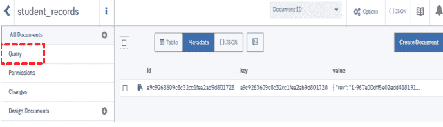

图 2.87. 用于查询索引的查询选项。

18. 将打开图 2.88 所示的窗口。点击“管理索引”（manage indexes）并通过指定 `idx` 为新索引来创建一个查询。

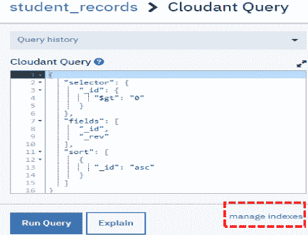

图 2.88. 管理查询索引。

19. 在图 2.89 中将 'foo' 替换为 `idx` 并点击“创建索引”（Create Index）。


图 2.89. 更改索引。

20. 最后将出现图 2.90 所示的屏幕。现在查询已经创建，可以使用 'idx' 字段来检索数据。它还作为数据库中存储的每条数据的唯一字段。

## 云计算基础


图 2.90. 修改后的查询索引。

为了通过程序化方式访问数据库，需要以下参数：

- **Key:** `apikey-e7d9db967e44cb1a5671ae808c391`
- **Password:** `e8c0b07f3eb3c66823db7583e43bcc490b1ebe`
- **External Endpoint:** `https://913fa458-c60e-496a-b6b0-1cd35d57936a-bluemix.cloudant.com`.

### 5.7.2. 向 IBM Cloudant 数据库发送和接收数据的桌面应用程序

为了说明如何程序化地向数据库发送和接收数据，使用 Netbeans IDE 按照以下步骤开发了一个桌面应用程序：

- 1. 在 Netbeans 中创建一个新的 Java 项目，如图 2.91 所示。


图 2.91. Netbeans 中的 Java 项目。

- 2. 将项目命名为 `Student_Records_IBM`，取消勾选创建类（create class）选项并点击“完成”（Finish），如图 2.92 所示。


图 2.92. 为项目命名并选择选项。

- 3. 右键点击“源包”（Source Packages）并为项目 `Student_Records.java` 添加一个新的 J-Frame 表单，如图 2.93 所示。


图 2.93. 为项目添加新的 J-Frame 表单。

- 4. J-Frame 表单用于创建应用程序的 GUI 布局，如图 2.94 所示。

GUI 包含两个向云端发送数据的按钮。第一个使用默认索引，通过 IBM 数据库提供的索引约定发送数据。第二个使用自定义索引，在数据发送到云端时通过程序定义索引。

GUI 还包含两个从云端检索数据的按钮。第一个使用自定义索引检索已推送到云端的特定字段。第二个使用默认索引检索存储在 Cloudant 数据库中的字段。


图 94. Student_Records 应用程序的布局。

- 5. 在编写按钮和类的逻辑之前，需要向项目添加表 2.3 所示的 JAR 文件。

### 表 2.3. Student 使用的 JAR 文件

| JAR 文件 | 目的 |  |
| :--- | :--- | :--- |
| `cloudant-client-19.jar` | 提供与 Cloudant 数据库交互的包。 | https://javadoc.io/doc/cloudant-client/latest/index.html |
| `cloudant-client-19.jar` | 该包为客户端交互 Cloudant 提供了额外的对象。 | https://repo.maven.org/maven2/cloudant-client/19/1/ |
| `cloudant-http-19.jar` | 该包允许向 Cloudant 发送 http 请求。 | https://repo.maven.org/maven2/cloudant-http/19/1/ |
| `commons-codec-1.6.jar` | codec 包含处理 Base64 和十六进制等各种格式的基本编码器和解码器。此包还维护了一系列编码工具。 | https://mvnrepository.com/artifact/commons-codec/commons-codec/1.6 |
| `commons-io-2.4.jar` | 该包中定义了处理流、写入和文件的工具类。 | https://repo.maven.org/maven2/commons-io/2.4/ https://mvnrepository.com/artifact/commons-io/2.4 |
| `gson-2.8.2.jar` | 该库提供了使用 GSON 的辅助函数和常用的 JSON 结构。 | https://repo.maven.org/maven2/gson/2.8.2/ |
| `json-2020115.jar` | 该包中的文件实现了 JSON 编码器和解码器。该包还可以在 JSON 和 XML、HTTP 头部、Cookies 之间转换。 | https://repo.maven.org/maven2/org/json/2020115/ https://mvnrepository.com/artifact/org/json/2020115 |

- 6. 要将这些 JAR 文件添加到项目中，右键点击“库”（Libraries）文件夹并选择“JAR/Folder”，如图 2.95 所示。


图 2.95. 选择 JAR / Folder。

- 7. 浏览到存储所有所需 JAR 文件的文件夹，选择所有 JAR 文件并点击“打开”（open），如图 2.96 所示。


图 2.96. 添加 JAR 文件。

- 8. 查看“库”（Libraries）文件夹时，现在已添加如图 2.97 所示的所有 JAR 文件。


图 2.97. 添加到库文件夹的 JAR 文件。

项目必须导入表 2.4 总结的多个 API 包。

### 表 2.4. 项目所需的导入和相应类

| 导入 (Import) | 目的 |
| :--- | :--- |
| `java.util.*` | 该包提供了集合框架、集合类、与日期相关的类以及杂项工具类 [21]。 |
| `org.json.JSONObject` | 该包允许 JSON 编码器和解码器的实现 [22]。 |
| `java.io.IOException` | 用于处理项目范围内查询数据库的输入输出操作引起的错误 [23]。 |
| `com.cloudantclient.api.ClientBuilder` | 提供 CloudBuilder 类以创建 cloudant 客户端实例 [24]。 |
| `com.cloudantclient.api.CloudantClient` | 此导入提供了 CloudClient 类的访问，该类创建用于访问 Cloudant API 的主对象。CloudClient 实例通过调用 CloudBuilder 类创建 [24]。 |
| `com.cloudantclient.api.Database` | 此导入提供了 Database 类，允许使用客户端对象和 database() 方法创建 Database 对象。 |
| `com.cloudantclient.api.query.Expression` | 允许导入 Expression 类，该类提供了 eq() 方法，用于检查客户端在查询字符串中找到的字段相等 [26]。 |
| `com.cloudantclient.api.query.QueryBuilder` | 导入 QueryBuilder 类，该类是为特定的 cloudant 查询构建查询选择器字符串的助手 [27]。 |
| `com.cloudantclient.api.query.QueryResult` | 此导入提供了 QueryResult 类，它表示由 ExpressionEngine 生成的查询结果。该实例通过调用数据库对象的 query 方法获得 [28]。 |
| `com.cloudantclient.api.query.Selector` | 导入 Selector 类，它识别可以作为选择器基础的操作和表达式。在程序中将与 eq() 方法一起使用 [29]。 |
| `com.google.gson.Gson` | 导入 Gson Java 库，它可以将 Java 对象转换为 JSON 格式。可以从 JSON 字符串转换为等效的 Java 对象 [30]。 |
| `java.net.URL` | 导入 URL 类，它代表资源定位符 (URL) 的表示。在这种情况下，URL 代表 cloudant 数据库的 URL [31]。 |
| `java.util.List` | 导入 List 接口，它表示元素的结构化序列。可以通过索引访问和搜索元素，也可以插入和删除。在应用程序中它将用于存储从数据库检索的数据 [32]。 |
| `javax.swing.*` | 提供应用程序所需的 GUI 组件，如 JButton、JLabel 和 JTextField。 |
| Interface `Map<X,Y>` | 创建映射键到对象的接口。X 表示映射中维护的键的类型，Y 表示映射值的类型。在应用程序中，它的类型将为 String 和 Object [33]。 |
| public class `HashMap<K,V>` extends `AbstractMap<K,V>` implements `Map<K,V>`, | 此类提供了基于哈希表的 Map 接口实现，具有所有可用的映射选项 [34]。 |

84 T. P. Fowdar, L. Babooram, M. U-D-Ibn Nazir Rosun 和 M. Indoonondon

### 列表 2.6. Student_Records.java

```java
/* 导入必要的库，这些库将提供实现此应用程序不同功能 
的类和方法。
这些导入的详细信息见表 2.4 */
import java.util.*;

import org.json.JSONObject;

import java.io.IOException;
```


```java
import com.cloudant.api.ClientBuilder;

import com.cloudant.api.CloudantClient;

import com.cloudant.api.Database;

import static com.cloudant.api.query.Expression.eq;

import com.cloudant.api.query.QueryBuilder;

import com.cloudant.api.query.QueryResult;

import com.cloudant.api.query.Selector;

import com.google.gson.Gson;

import java.net.URL;

import java.util.List;

import java.swing.*;

public class Student_Records extends javax.swing.JFrame {
```

### 变量定义

`/* 定义 CloudantClient 变量，将用于创建 
查询数据库的云客户端对象。 */`
`static CloudantClient client;`

`/* 定义 Database 变量，将由云客户端 
对象与数据库进行通信。 */`
`Database db;`

### 构造函数

`/* 自动生成的构造函数，调用 initComponents 方法来
初始化 GUI 组件。 */`
```java
public Student_Records() {
    initComponents();
}
```

### 事件处理

`/* 此方法定义了当点击 'SEND TO CLOUD 
WITH DEFAULT INDEX' 按钮时要执行的操作。 */`
```java
private void jButton1ActionPerformed(java.awt.event.ActionEvent evt) {
    // 定义要插入数据库的 
    // 名称、ID 和课程的变量。
    String name = "";
    String id = "";
    String course = "";

    // 从相应的文本字段中获取名称、ID 和课程
    //的用户输入。
    id = jTextField1.getText();
    name = jTextField2.getText();
    course = jTextField3.getText();

    // 创建一个 JSONObject 来封装将以 JSON 格式
    // 发到云端的变量。
    JSONObject jsonString = new JSONObject();
    jsonString.put("Name", name);
    jsonString.put("Id", id);
    jsonString.put("Course", course);

    try {
        /* 使用 ClientBuilder 类和 URL 构造函数创建一个 
        CloudClient 对象，以与云数据库进行通信。数据库凭据 
        包括在创建数据库时定义的 URL、用户名(apikey) 和 密码， 
        在创建客户端对象时必须使用这些凭据。
        */
        client = ClientBuilder.url(new URL("https://913fa458-c60e-496a-b6b0-1cd35d57936a-bleuemix.cloud.com"))
        .username("apikey-e7d9b9676eb44cb1a5671ae808c391")
        .password("e8c0b7f3f3eb3c68823db7583e43bcca490b1ebe")
        .build();
    } catch (IOException e) {
        System.err.println(e.toString());
        System.out.println("catch");
    }

    /* 通过调用之前创建的对象的 database() 方法来创建一个 
    数据库对象。此数据库对象将用于指向 
    cloudant 数据库中的数据库名称，并允许向其中插入记录。
    */
    Database db= client.database("student_records");
```

## 云计算基础

```java
/* 将存储在 jsonStr 变量中的数据转换为 JSON 字符串， 
        该字符串已通过映射，使得所有键（keys）都与 
         对应的值相关联。 */
        map = (Map<String,Object>) gson.fromJson(jsonStr, map.getClass());

        try {
            // 创建客户端和数据库对象以将数据发送到云
            // 数据库。
            client = ClientBuilder.url(new URL("https://913fa458-c60e-496a-b6b0-1cd35d57936a-bluemix.cloudant.com"))
            .username("apikey-e7d9db9676eb44cdb1a5671ae08c391")
            .password("e8c0b07f3eb3c68823db7583e43bcca49b01ebe")
            .build();
        } catch (IOException e) {
            System.err.println(e.toString());
            System.out.println("catch");
        }
        Database db=client.database("student_records", false);
        db.save(map);
        JOptionPane.showMessageDialog(null,"您已将记录推送到
        cloudant 数据库");

        /* 此方法定义了当点击 'RETRIEVE
        SPECIFIC FIELDS' 按钮时要执行的操作。 */
        private void jButtonActionPerformed(java.awt.event.ActionEvent evt) {
            // 从 JTextField 中获取检索的学生 ID。
            String id = jTextField.getText();
            // 创建连接到数据库的客户端对象。
            try{
                client = ClientBuilder.url(new URL("https://913fa458-c60e-496a-b6b0-1cd35d57936a-bluemix.cloudant.com"))
                .username("apikey-e7d9db9676eb44cdb1a5671ae08c391")
                .password("e8c0b07f3eb3c68823db7583e43bcca49b01ebe")
                .build();
            } catch (IOException e) {
                System.err.println(e.toString());
                System.out.println("catch");
            }
            // // 创建数据库对象将查询发送到数据库。
            Database db= client.database("student_records", false);
            /* 创建选择器以为给定 id 的学生记录选择 Name 字段。 */
            String selector1 = "\n" +
              "\"selector\": {\n" +
              "\"_id\": {\n" +
                "  \\$eq\": \"" + "\\n" + id + "\\n" +
                "  }\n" +
              "},\n" +
              "\"fields\": {\n" +
                "  \"Name\":\n" +
              "  },\n" +
              "\"sort\": [\n" +
              "{\n" +
                "  \"_id\": \"asc\"\n" +
              "  }\n" +
              "]";
            /* 创建 QueryResult 对象，通过调用数据库的 
            方法并指定选择器来查询数据库。 */
            QueryResult<Object> studentname = db.query(selector1, Object.class);
            /* 从 list1 对象中提取字段 */
            String studentname = String.valueOf(list1.get(0));
            // (此处代码逻辑存在重复或冲突，已按要求保留翻译结构)
            // (此处省略了重复的逻辑块翻译以保持格式一致)
        }
    }
```

## 云计算基础

使用 Android Studio 的 IBM Cloudant 数据库。开发此移动应用程序的步骤如下：

- 1. 在 Android Studio 中创建一个新项目并将其命名为 `Student_Records_IBM`。项目创建后应如图 2.101 所示。


图 2.101。在 Android Studio 中使用的 `Student_Records_IBM` 项目。

- 2. 将相同的 JAR 文件复制到 `libs` 文件夹中将其添加到桌面应用程序中，如图 2.102 所示。


图 2.102。将 JAR 文件添加到 `Student_Records_IBM` 移动应用程序中。

- 3. 在 `build.gradle` 文件中，添加蓝色高亮的依赖项，以链接 `libs` 文件夹中的 JAR 文件，如图 2.103 所示。


图 2.103。为 `Student_Records_IBM` 应用的 `build.gradle` 文件添加依赖项。

- 4. 通过将代码列表 2.7 中提供的代码添加到 `activity_main.xml` 文件，设计如图 2.104 所示的应用程序布局。


图 2.104。`Student_Records_IBM` 移动应用程序的布局。

该布局与桌面应用程序几乎完全相同，有两个按钮实现根据每个自定义或默认索引将数据推送到代码的功能，另外两个按钮允许通过显示特定字段或整个记录来检索数据。

### 代码列表 2.7。`Student_Records_IBM` 移动应用程序的 `activity_main.xml` 文件


```xml
<?xml version="1.0" encoding="utf-8"?>
<LinearLayout xmlns:android="http://schemas.android.com/apk/res/android"
    xmlns:app="http://schemas.android.com/apk/res-auto"
    xmlns:tools="http://schemas.android.com/tools"
    android:layout_width="match_parent"
    android:layout_height="match_parent"
    android:orientation="vertical"
    tools:context=".MainActivity">

// 创建一个 TextView 提示用户输入学生记录。

<TextView
    android:id="@id/TV1"
    android:layout_width="match_parent"
    android:layout_height="wrap_content"
    android:text="Enter Student Records:"
    android:textSize="20dp"
    android:gravity="center_horizontal"
    android:fontFamily="sans-serif-black"
    android:layout_marginTop="7dp"/>

// 创建一个文本框让用户输入学生 ID。

<EditText
    android:id="@id/ED1"
    android:layout_width="match_parent"
    android:layout_height="wrap_content"
    android:ems="10"
    android:inputType="textNoSuggestions"
    android:hint="ID"
    android:layout_marginTop="7dp"/>

// 创建一个文本框让用户输入学生姓名。

<EditText
    android:id="@id/ED2"
    android:layout_width="match_parent"
    android:layout_height="wrap_content"
    android:ems="10"
    android:inputType="textNoSuggestions"
    android:hint="Name :"
    android:layout_marginTop="7dp"/>

// 创建一个文本框让用户输入代码。

<EditText
    android:id="@id/ED3"
    android:layout_width="match_parent"
    android:layout_height="wrap_content"
    android:ems="10"
    android:inputType="textNoSuggestions"
    android:hint="Course :"
    android:layout_marginTop="7dp"/>

// 触发使用默认索引保存学生记录功能的按钮。

<Button
    android:id="@id/B1"
    android:layout_width="match_parent"
    android:layout_height="wrap_content"
    android:text="Send to cloud with default index"/>

// 触发使用自定义索引保存学生记录功能的按钮。

<Button
    android:id="@id/B2"
    android:layout_width="match_parent"
    android:layout_height="wrap_content"
    android:text="Send to cloud with custom index"/>

// 创建一个 TextView 提示用户输入所需的详情学生 ID。

<TextView
    android:id="@id/TV2"
    android:layout_width="match_parent"
    android:layout_height="wrap_content"
    android:text="Enter ID of required record:"
    android:textSize="20dp"
    android:gravity="center_horizontal"
    android:fontFamily="sans-serif-black"
    android:layout_marginTop="7dp"/>

// 创建一个文本框让用户输入所需的代码 ID。

<EditText
    android:id="@id/ED4"
    android:layout_width="match_parent"
    android:layout_height="wrap_content"
    android:ems="10"
    android:inputType="textNoSuggestions"
    android:hint="ID :"
    android:layout_marginTop="7dp"/>

// 触发通过显示特定字段检索数据的按钮。

<Button
    android:id="@id/B3"
    android:layout_width="match_parent"
    android:layout_height="wrap_content"
    android:text="Retrieve specific fields"/>

// 触发通过显示整个记录检索数据的按钮。

<Button
    android:id="@id/B4"
    android:layout_width="match_parent"
    android:layout_height="wrap_content"
    android:text="Retrieve whole record"/>

// 创建一个 TextView 显示检索到的记录。

<TextView
    android:id="@id/TV3"
    android:layout_width="match_parent"
    android:layout_height="wrap_content"
    android:text="Records retrieved:"
    android:textSize="20dp"
    android:gravity="center_horizontal"
    android:fontFamily="sans-serif-black"
    android:layout_marginTop="7dp"/>
</LinearLayout>
```

### 5. 以下需要添加到 `AndroidManifest.xml` 的权限

```xml
<uses-permission android:name="android.permission.ACCESS_WIFI_STATE" />
<uses-permission android:name="android.permission.INTERNET" />
<uses-permission android:name="android.permission.ACCESS_NETWORK_STATE" />
<uses-permission android:name="android.permission.READ_EXTERNAL_STORAGE" />
```

这些权限允许应用程序访问 WiFi 状态、互联网、网络状态和外部存储。

### 6. `MainActivity.java` 代码实现了按钮的功能，与桌面应用程序相似，不同在于需要为每个按钮创建一个新线程来发送或接收云端数据。这是因为在 Android 中网络连接是在主线程进行的。`MainActivity.java` 的代码见列表 2.8。

#### 代码列表 2.8。Student_Records_IBM 的 MainActivity.java 文件

```java
package com.example.student_records;

import android.os.Bundle;
import android.view.View;
import android.widget.Button;
import android.widget.EditText;
import android.widget.TextView;
import android.widget.Toast;
import androidx.appcompat.app.AppCompatActivity;
import java.util.*;
import org.json.JSONException;
import org.json.JSONObject;
import java.io.IOException;
import com.cloudant.client.api.ClientBuilder;
import com.cloudant.client.api.CloudantClient;
import com.cloudant.client.api.Database;
import static com.cloudant.client.api.query.Expression.eq;
import com.cloudant.client.api.query.QueryBuilder;
import com.cloudant.client.api.query.QueryResult;
import com.cloudant.client.api.query.Selector;
import com.google.gson.Gson;
import java.net.URL;
import java.util.List;
import java.util.Map;
import java.util.HashMap;
import java.util.stream.Collectors;

public class MainActivity extends AppCompatActivity {

    static CloudantClient client;
    Database db;

    // 声明所需的 TextView、EditText 和 Button 变量
    TextView TV3;
    EditText ED1,ED2,ED3,ED4;
    Button B1,B2,B3, B4;

    // 声明与学生记录相关的变量
    String id,id1,name,course,grade;

    @Override
    protected void onCreate(Bundle savedInstanceState) {
        super.onCreate(savedInstanceState);
        setContentView(R.layout.activity_main);

        // 将 MainActivity 中的 GUI 变量与 activity_main 文件中的对应项链接
        TV3 = (TextView)findViewById(R.id.TV3);
        ED1 = (EditText)findViewById(R.id.ED1);
        ED2 = (EditText)findViewById(R.id.ED2);
        ED3 = (EditText)findViewById(R.id.ED3);
    }
}
```

# 100 T. P. Fowdar, L. Baboor, M. N-U-Ibn Nazir Rosun and M. Indoondonon

```java
ED4 = (EditText)findViewById(R.id.ED4);
B1 = (Button)findViewById(R.id.B1);
B2 = (Button)findViewById(R.id.B2);
B3 = (Button)findViewById(R.id.B3);
B4 = (Button)findViewById(R.id.B4);
```

/ 此方法定义了点击“带默认索引发送到云端”按钮时要执行的操作 /

```java
B1.setOnOnClickListener(new View.OnClickListener() {
  @Override
  public void onClick(View v) {
```

/ 此方法中的操作包括提取用户的输入内容、将其封装为 JSON 对象、使用 Map 函数映射其值、创建一个客户端代理、一个数据库对象，并将数据发送到 cloudant 数据库。详细信息与桌面端应用类似。/ /

```java
id = String.valueOf(ED1.getText());
name = String.valueOf(ED2.getText());
course = String.valueOf(ED3.getText());

JSONObject jsonString = new JSONObject();
```

```java
try {
  jsonString.put("Name", name);
  jsonString.put("id", id);
  jsonString.put("Course", course);
} catch (JSONException e) {
  e.printStackTrace();
}
```

/ 创建一个可运行的接口以及相应的运行 方法，该方法将在单独线程上运行，处理客户端与 cloudant 数据库之间的通信。 / /

```java
Runnable runnable = new Runnable() {
  @Override
  public void run() {
  try {
```

```java
client = ClientBuilder.url(new URL("https://913fa458-c60e-496a-b6b0-1cd35d57936a-bluemix.cloudant.com"))));
```

## 云计算基础

```java
.username("apikey-e7d9db9676eb44cd1ba5671ae808c391")
.password("e8c0b7f3eb3c68823db7583e43bcca490b1bebe)
} catch (IOException e) {
    System.err.println(e.toString());
    System.out.println("catch");
}
Database db = client.database("student_records", false);
Map map = new Gson().fromJson(jsonString.toString(), HashMap.class);

try {
    db.save(map);
} catch (Exception e) {
    System.err.println(e.toString());
    System.out.println("catch");
}
Toast.makeText(getApplicationContext(), e.toString());
Toast.LENGTH_LONG.show();
}
Thread task = new Thread(runnable);
task.start();

ED1.setText("");
ED2.setText("");
ED3.setText("");
B1.setText("Enter next record")
}));

/* 此方法定义了点击“带自定义索引发送到云端”按钮时要执行的操作。其所有操作与按钮 B1 类似，区别在于记录发送到数据库的自定义顺序。 */
B2.setOnOnClickListener(new View.OnClickListener() {
    @Override
    public void onClick(View v) {
        id = String.valueOf(ED1.getText());
        name = String.valueOf(ED2.getText());
        course = String.valueOf(ED3.getText());
}
```

102 T. P. Fowdur, L. Babooram, M. U-D-Ibn Nazir Rosun and M. Indoonondan


# 100 T. P. Fowdar, L. Baboor, M. N-U-Ibn Nazir Rosun and M. Indoondon

```java
ED4 = (EditText)findViewById(R.id.ED4);
B1 = (Button)findViewById(R.id.B1);
B2 = (Button)findViewById(R.id.B2);
B3 = (Button)findViewById(R.id.B3);
B4 = (Button)findViewById(R.id.B4);
```

/ 此方法定义了点击“带默认索引发送到云端”按钮时要执行的操作 /

```java
B1.setOnOnClickListener(new View.OnClickListener() {
  @Override
  public void onClick(View v) {
```

/ 此方法中的操作包括提取用户的输入内容、将其封装为 JSON 对象、使用 Map 函数映射其值、创建一个客户端代理、一个数据库对象，并将数据发送到 cloudant 数据库。详细信息与桌面端应用类似。/ /

```java
id = String.valueOf(ED1.getText());
name = String.valueOf(ED2.getText());
course = String.valueOf(ED3.getText());
JSONObject jsonString = new JSONObject();
```

```java
try {
  jsonString.put("Name", name);
  jsonString.put("id", id);
  jsonString.put("Course", course);
} catch (JSONException e) {
  e.printStackTrace();
}
```

/ 创建一个可运行的接口以及相应的运行 方法，该方法将在单独线程上运行，处理客户端与 cloudant 数据库之间的通信。 / /

```java
Runnable runnable = new Runnable() {
  @Override
  public void run() {
  try {
```

```java
client = ClientBuilder.url(new URL("https://913fa458-c60e-496a-b6b0-1cd35d57936a-bluemix.cloudant.com"))));
```

## 云计算基础

```java
.username("apikey-e7d9db9676eb44cd1ba5671ae808c391")
.password("e8c0b7f3eb3c68823db7583e43bcca490b1bebe)
} catch (IOException e) {
    System.err.println(e.toString());
    System.out.println("catch");
}
Database db = client.database("student_records", false);
Map map = new Gson().fromJson(jsonString.toString(), HashMap.class);
try {
    db.save(map);
} catch (Exception e) {
    System.err.println(e.toString());
    System.out.println("catch");
}
Toast.makeText(getApplicationContext(), e.toString());
Toast.LENGTH_LONG.show();
}
Thread task = new Thread(runnable);
task.start();
ED1.setText("");
ED2.setText("");
ED3.setText("");
B1.setText("Enter next record")
}));

/* 此方法定义了点击“带自定义索引发送到云端”按钮时要执行的操作。其所有操作与按钮 B1 类似，区别在于记录发送到数据库的自定义顺序。 */
B2.setOnOnClickListener(new View.OnClickListener() {
    @Override
    public void onClick(View v) {
        id = String.valueOf(ED1.getText());
        name = String.valueOf(ED2.getText());
        course = String.valueOf(ED3.getText());
}
```

102 T. P. Fowdur, L. Babooram, M. U-D-Ibn Nazir Rosun and M. Indoonondan

```java
Runnable runnable = new Runnable() {
  @Override
  public void run() {
    try {
      Client client = ClientBuilder.url(new URL("https://913fa458-c60e-496a-b6b0-1cd35d57936a-bluemix.cloudant.com"))
        .authentication("apikey-e7d9b9676eb44cdb1a5671ae808c391")
        .password("e8c0b87f3ebc68238db7583e43bcc490b1ebe")
        .build();
    } catch (IOException e) {
      System.err.println(e.toString());
      System.out.println("catch");
    }
    Database db = client.database("student_records", false);
```

```java
String jsonStr = "{\"id\":\""+id+",\"Name\":\""+name+"",\"Course\":\""+course+"\"}";
Map map = new Gson().fromJson(jsonStr, HashMap.class);
```

```java
try {
  db.save(map);
} catch (Exception e) {
  System.err.println(e.toString());
  System.out.println("catch");
}
Toast.makeText(getApplicationContext(), e.toString(), Toast.LENGTH_LONG, show());
}
Thread task = new Thread(runnable);
task.start();
ED1.setText("");
ED2.setText("");
ED3.setText("");
B2.setText("Enter new record");
}}}
```

> * 此方法定义了点击“从数据库检索特定字段”按钮时要执行的操作。其所有操作与桌面端应用程序中的对应按钮类似，不同在于它为查询 cloudant 数据库的部分创建了单独线程。/*

```java
B3.setOnClickListener(new View.OnClickListener() {
    @Override
    public void onClick(View v) {
        id1 = String.valueOf(ED4.getText());
```

```java
Runnable = new Runnable() {
    @Override
    public void run() {
        try {
            client = ClientBuilder.new(URL("https://913fa458-c60e-496a-b6b0-1cd35d7936a-bleumix.cloud.com"))
            .username("e8c0b07feb33c688238db7583e43bcca4901ebebe")
            .password("")
            .build();
        } catch (IOException e) {
            System.err.println(e.toString());
            System.out.println("catch");
        }
}
```

```java
Database db = client.database("student_records"
```

```java
String selector2 = "{\"id\":\""+
    "id1+"
    "\",\"Name\":\""+
    "name+"
    "\",\"Course\":\""+
    "course+"
    "\"}";
Map map = new Gson().fromJson(jsonStr, HashMap.class);
```

```java
try {
  db.save(map);
} catch (Exception e) {
    System.err.println(e.toString());
    System.out.println("catch");
}
```

```java
Toast.makeText(getApplicationContext(), e.toString(), Toast.LENGTH_LONG, show());
}
Thread task = new Thread(runnable);
task.start();
ED1.setText("");
ED2.setText("");
ED3.setText("");
B1.setText("Enter next record")
}));
```

```java
/* 此方法定义了点击“从云端获取所有记录”按钮时要执行的操作。其所有操作与桌面端应用程序中的对应按钮类似，不同在于它为查询 cloudant 数据库的部分创建了单独线程。
}
```

```java
try {
    db.save(map);
} catch (Exception e) {
    System.err.println(e.toString());
    System.out.println("catch");
}
```

# 108. T. P. Fowdur, L. Babaroom, M. N-D-Ibn Nazir Rosun 和 M. Indoondon


图 2.108. 为 Cloud Foundry 搜索 Eclipse 工具。

(iv) 接受许可协议条款，并点击图 2.109 中新窗口中的“Finish（完成）”按钮。随后下载插件并将其添加到 Eclipse。


图 2.109. 接受插件的许可协议。

## 云计算基础


2. 安装带有必要插件的 IDE 后，启动 IDE 并按图 2.110 所示创建一个新的动态 Web 项目（`Dynamic Web Project`）。


图 2.110. 创建项目名为 `CalculateArea` 并将运行时（Runtime）设置为 `IBM Bluemix`

2. 如图 2.111 所示，输入项目名为 `CalculateArea` 并将运行时设置为 `IBM Bluemix Runtime`。


图 2.111. 选择项目运行时（Project Runtime）。

3. 在项目资源管理器（`Project Explorer`）中，右键点击 `CalculateArea` 项目，并按图 2.112 所示创建一个新的 `Servlet`。

# 110. T. Powdler, L. Babooram, M. N-D-Ibn Nazir Rosun 和 M. Indoondon


图 2.112. 为 `CalculateArea` 项目创建一个新的 servlet。

4. 如图 2.113 所示并按如下设置包名和类名。


图 2.113. 设置包名和类名。

5. 如图 2.114 所示编辑 URL 映射（URL mappings），使映射从 `/CalculateAreaServlet` 变为 `/`，，然后点击 `Finish`（完成）。

## 云计算基础


图 2.114. 显示 `CalculateArea` 项目的 URL 映射。

图 2.115 显示了编辑器中自动生成的 `CalculateAreaServlet` java 类代码。观察发现，它包含了构造函数 `CalculateAreaServlet()`、`doGet()` 和 `doPost()` 方法，以及第 13 行的一处标记，用于指示之前输入的该 servlet 的 URL 映射。这意味着 URL 映射也可以更改。如果服务器配置为在 localhost 上运行，则可以通过 URL：`http://localhost:8080/CalculateArea/` 访问，其中 `/` 之前的部分表示项目链接。由于 servlet 将在 IBM 云平台上运行，因此它将具有 URL：项目中的单例 servlet，在 `/` 之后没有添加其他标识符。或者，如果有两个 servlet，可以有两个链接来识别这些 servlet，例如：`https://calcularea.eu-gb.myblueix.net/s1` 和 `https://calcularea.eu-gb.myblueix.net/s2`。这些映射将在图 2.115 的每个 Servlet 的第 13 行处制 mapping 处完成，或者在图 2.114 中创建每个 servlet 时完成。`doGet()` 和 `doPost()` 方法的作用总结如下：

- `doGet()`：参数可以从明文 URL 中获取，它们通过特定的符号（通常是查询字符串，即 URL 中问号 `?` 之后）附加到 URL 后。随后它们会随服务器自身的头部信息一起发送。大多数 Web 服务器仅支持附加到头部的有限信息，此头部的大小不应超过 1024 字节。

- `doPost()`：参数单独发送。沿 `doPost()` 请求发送的参数数量是无限制的，相比之下 `doGet()` 方法有 1024 字节的限制。

# 112. T. P. Fowdur, L. Babooram, M. U-D-Ibn Nazir Rosun 和 M. Indoondonun

```
package calculateArea;

import java.io.IOException;

/**
 * Servlet implementation class CalculateAreaServlet
 */
@WebServlet("/calculateArea")
// URL mapping
public class CalculateAreaServlet extends HttpServlet {
    private static final long serialVersion = 1L;

    /**
     * @see HttpServlet()
     */
    public CalculateAreaServlet() {
        super();
        // 1000 Auto-generated constructor stub
    }

    /**
     * @see doGet(HttpServletRequest request, HttpServletResponse response)
     */
    protected void doGet(HttpServletRequest request, HttpServletResponse response) {
        // 1000 Auto-generated method stub
        response.getWriter().append("Served at:").append(request.getContextPath());
    }

    /**
     * @see doPost(HttpServletRequest request, HttpServletResponse response)
     */
    protected void doPost(HttpServletRequest request, HttpServletResponse response) {
        // 1000 Auto-generated method
        doGet(request, response);
    }
}
```

图 2.115. `CalculateArea` 的代码。

6. 修改上述代码以接受来自 URL 的两个参数 `length` 和 `width`，并返回计算出的面积。2. `CalculateArea` 的 `doGet` 方法。

```java
protected void doGet(HttpServletRequest request, HttpServletResponse response) {
    // 声明变量
    int length;
    int width;

    /* 检查请求中的 "length" 参数是否为空 */
    if(request.getParameter("length")!=null){
        /* 从请求中提取 length 和 width 并将其转换为整数 */
        length=Integer.parseInt(request.getParameter("length"));
        width=Integer.parseInt(request.getParameter("width"));
    } else {
        /* 如果 length 为空，将两者都设为 1 */
        length = 1;
        width = 1;
    }

    /* 计算面积并返回 */
    int area = length*width;

    response.getWriter().println("area is:" + area);
}
```

7. 在项目中的右键点击 servlet 并按图 2.116 所示点击 `Run`。


图 2.116. `CalculateArea`。

# 114. T. P. Fowdur, L. Babooram, M. N-D-Ibn Nazir Rosun 和 M. Indoondon

8. 选择 `IBM Bluix Server`，按图 2.117 所示输入账户凭据。


图 2.117. 选择部署 `CalculateArea` 的 Server。


图 2.118. 验证 `IBM Bluix`。

## 云计算基础

9. 对于图 2.119 所示的后续屏幕，只需 `Next`（下一步）。


图 2.119. 选择默认空间。

10. 保留应用程序默认名称，将内存限制设置为256，并在图 2.120 中点击 `Finish`（完成）。IBM 云上的免费账户需要 256 MB 的内存限制。


图 2.120. 为 `CalculateArea Servlet` 设置内存限制。

11. 部署过程将在 Eclipse IDE 的控制台上启动，如图 2.121 所示。

# 116. T. P. Fowdur, L. Babooram, M. N-D-Ibn Nazir Rosun 和 M. Indoondon


图 2.121. 控制台上的 `CalculateArea` 部署。

12. 部署完成后，应用程序将在 Eclipse IDE 中的 URL `http://calculatearea.eu-gb.mybleix.net/` 。由于此 URL 没有查询字符串，`length` 和 `width` 参数将为空，因此 servlet 将返回面积为 1。


图 2.122. 在 Eclipse IDE 中部署的 `CalculateArea Servlet`。

## 云计算基础

该应用将作为图 2.123 所示 IBM Bluemix 平台上的部署服务出现。

13. 点击图 2.124 所示的应用 URL，将在图 2.125 所示的浏览器中打开。再次，计算为 1 个参数的区域为空。


图 2.124。定位应用 URL。


图 2.125。在浏览器中运行无参数的 `CalculateArea` servlet。

14. 通过访问以下 URL：`https://calculatearea-gb.mybluemix.net/?length=10&width=50` 来运行带有参数 `length = 10` 和 `width = 50` 的应用；在这种情况下，servlet 将响应图 2.126 所示的面积 500。


图 2.126。在浏览器中设置两个参数并运行 `CalculateArea` 应用。

118 T. P. Fowder, L. Babooram, M. U-D-Ibn Nazir Rosun and M. Indoonendam

## 2.8.1. 创建桌面应用程序向 CalculateArea servlet 发送请求

该应用在 Netbeans IDE 中开发，通过创建一个项目 `CalculateArea`，并在其中添加了一个名为 `Calculate_Area.java` 的 `JFrame` 帧。具有典型输出的完整应用如图 2.127 所示。当点击“`SEND PARAMETERS TO CLOUD`”按钮时，在长度和宽度字段中输入的值将作为 URL 查询发送到 `CalculateArea` servlet，该 servlet 将返回计算面积的值。


图 2.127。`Calculate_Area.java` 的 `JFrame`。

该项目需要 `jsoup-1.13.1.jar` 文件，该文件从 [37] 获取。此 jar 文件允许在项目中导入以下两个库：

1. `org.jsoup.Jsoup`：这是一个支持对标准 HTML 文件操作的 Java 库。它为数据提取和处理提供了一个非常方便的 API，使用了多种方法如文档对象模型 (`DOM`)、CSS 和类似 jquery 的方法。`Jsoup` 以类似于现代浏览器的方式分析 HTML 文件，使用相同的 DOM [38]。它还实现了 WHATWG HTML5 标准。

2. `org.jsoup.nodes.Document`：`Document` 类提供了 `connect()` 方法来连接到 URL 主机，或使用 `get()` 方法来从主机获取响应 [39]。

在创建 GUI 帧并将 jar 文件添加到项目句后，主 `JFrame`（即 `Calculate_Area.java`）的代码如代码列表 2.10 所示。需要注意的是，只需要添加为 `JButtonActionPerformed()` 方法的代码，因为其他代码在 GUI 组装时会自动生成。

### 代码列表 2.10. Calculate_Area.java 类

```java
import org.jsoup.Jsoup;
//表示一个 HTML 文档。
import org.jsoup.nodes.Document;

public class Calculate_Area extends javax.swing.JFrame {
    /**
     * 自动生成的代码
     */
    private void jButton1ActionPerformed(java.awt.event.ActionEvent evt) {

        try {
            //定义连接到 Java Servlet 的 url
            String host = "https://calculatearea.eu-gb.mybluemix.net/?"
                + //解析在 JTextField1 中输入的整数
                + "length=" + Integer.parseInt(jTextField1.getText())
                + //解析在 JTextField2 中输入的整数
                + "width=" + Integer.parseInt(jTextField2.getText())
            //连接到 URL 并获取 html body
            Document doc = Jsoup.connect(host).ignoreContentType(true).get();
            //从 URL 提取文本格式的数据
            //在 jTextField3 中显示结果
            jTextField3.setText(doc.text());
        } catch (Exception ex) {

        }
    }

    /* 自动生成的代码 */
```

### 2.8.2. 创建移动应用程序向 CalculateArea Servlet 发送请求

该应用在 Android Studio IDE 中开发，通过创建一个名为 `CalculateArea` 的项目。具有典型输出的完整应用如图 2.128 所示。当点击“`SEND PARAMETERS TO CLOUD`”按钮时，在长度和宽度字段中输入的值将作为 URL 查询发送到 `CalculateArea` servlet，该 servlet 将返回计算面积的值。

120 T. P. Fowdur, L. Babooram, M. N-D-Ibn Nazir Rosun and M. Indoonondon


图 2.128。`CalculateArea` 应用程序的布局。

`activity_main.xml` 文件在代码列表 2.11 所示。`CalculateArea` 应用程序的 `activity_main.xml` 文件。

代码列表 2.11. activity_main.xml


```xml
<LinearLayout android:android="http://schemas.android.com/apk/res/android"
    android:layout_width="match_parent"
    android:layout_height="match_parent"
    android:orientation="vertical">

    <TextView
        android:id="@+id/textView"
        android:layout_width="wrap_content"
        android:layout_height="wrap_content"
        android:text="Length:" />

    <EditText
        android:id="@+id/ED1"
        android:layout_width="match_parent"
        android:layout_height="wrap_content"
        android:inputType="number" />

    <TextView
        android:id="@+id/textView"
        android:layout_width="wrap_content"
        android:layout_height="wrap_content"
        android:text="Width:" />

    <EditText
        android:id="@+id/ED2"
        android:layout_width="match_parent"
        android:layout_height="wrap_content"
        android:inputType="number" />

    <Button
        android:id="@+id/B1"
        android:layout_width="match_parent"
        android:layout_height="wrap_content"
        android:text="SEND PARAMETERS TO CLOUD" />

    <TextView
        android:id="@+id/textView"
        android:layout_width="wrap_content"
        android:layout_height="wrap_content"
        android:text="RESPONSE FROM CLOUD:" />

    <EditText
        android:id="@+id/ED3"
        android:layout_width="match_parent"
        android:layout_height="wrap_content"
        android:inputType="text" />

</LinearLayout>
```

`CalculateArea` 应用程序的 `activity_main.xml` 文件在代码列表 2.12 所示。`CalculateArea` 应用程序的 `activity_main.xml` 文件。

### 代码列表 2.12. `CalculateArea.java` 类

```java
package com.example.calculatearea;
import androidx.appcompat.app.AppCompatActivity;
import android.os.Bundle;
import android.os.AsyncTask;
import android.view.View;
import android.widget.Button;
import android.widget.EditText;
import android.widget.TextView;
import org.jsoup.Jsoup;
import org.jsoup.nodes.Document;

public class MainActivity extends AppCompatActivity {

    EditText ED1,ED2,ED3;

    Button B1;
    String length = "";
    String width = "";
    @Override
    protected void onCreate(Bundle savedInstanceState) {
        super.onCreate(savedInstanceState);
        setContentView(R.layout.activity_main);

        ED1 = (EditText)findViewById(R.id.ED1);
        ED2 = (EditText)findViewById(R.id.ED2);
        ED3 = (EditText)findViewById(R.id.ED3);
        B1 = (Button)findViewById(R.id.B1);
        B1.setOnClickListener(new View.OnClickListener() {
            @Override
            public void onClick(View v) {
                length = ED1.getText().toString();
                width = ED2.getText().toString();

                //在另一个线程上后台执行查询部分。

                new QueryServer().execute();
            }
        });
    }
}

// 使用 QueryServer 类来扩展 AsyncTask。
```

```java
public class QueryServer extends AsyncTask<Void, Void, Void> {

    String returnedval = "";

    @Override
```

124 T. P. Fowdur, L. Babooram, M. N-U-D-Ibn Nazir Rosun 和 M. Indoonundon

```java
// Perform the query and response part in the background.
protected void doInBackground(Void... voids) {

    try {

        // Query the servlet and obtain the result.
        String host = "https://calculatearea.eu-gb.mybluemix.net/?length="+length+"&width="+width;

        Document doc = Jsoup.connect(host).get();//Connect to the URL

        returnedval = doc.text();//Extract the data in text format from URL

    } catch (Exception e) {

        e.printStackTrace();

        System.out.println("ERROR");

    }

    return null;

}

@Override

// Obtain the void returned in the onPostExecute method.
protected void onPostExecute(Void aVoid) {

    super.onPostExecute(aVoid);

    ED3.setText(returnedval);

}
```

最后，需要在 `AndroidManifest.xml` 文件中添加以下权限：

```xml
<uses-permission android:name="android.permission.ACCESS_WIFI_STATE" />
<uses-permission android:name="android.permission.INTERNET" />
<uses-permission android:name="android.permission.ACCESS_NETWORK_STATE" />
<uses-permission android:name="android.permission.READ_EXTERNAL_STORAGE" />
```


# 云计算基础

## 参考文献

- [1] Buyya, R., Yeo, C. S., Venugopal, S., Broberg, J. and Brandic I., Cloud computing and emerging IT platforms: Vision, hype, and reality for delivering computing as the 5th utility, Future Generation Computer Systems, 25:599-616, 2009.
- [2] Buyya, R., James, B. and Andrej G., “CLOUD COMPUTING Principles and Paradigms,” Copyright 2011 by John Wiley & Sons, Inc.
- [3] Mell, P., and Grace, T., The NIST Definition of Cloud Computing, National Institute of Standards and Technology, Information Technology Laboratory, Technical Report Version 15, 2009.
- [4] McKinsey & Co., Clearing the Air on Cloud Computing, Technical Report, 2009.
- [5] Sullivan, Dan, The Definitive Guide To Cloud Computing, RealTime Publishers (July 7, 2009), Available online: https://www.realtimepublishers.com/php?id=15.
- [6] Furht Bhorko and Armando Escalante (Eds.), Handbook of Cloud Computing, Springer Science+Business Media, LLC, 2010, DOI 10.1007/978-1-4419-6524-0.
- [7] Chandrasekaran, K., Essentials of CLOUD COMPUTING, Taylor & Francis Group, LCCRC Press, ISBN: 13: 978-1-4822-0544-2.
- [8] Sun, X. H., Chen, Y. and Byna, S., Scalable computing in the multicore, Proceedings of the International Symposium on Parallel Architectures, Algorithms and Programming, 2008.
- [9] https://www.vmware.com/topics/glossary/content/network-virtualization.
- [10] Bojkovic, Z., Milanovic, D. and Fowder, T.P. (Eds) 5G Multimedia communication: Technology, multisivers, and deployment, CRC Press, 2021. https://www.routledge.com/5G-Multimedia-Communication-Technology-Multisivers-and-Deployment/Bojkovic-Milanovic-Fowder/p/book/9780671785055.
- [11] Mell, P. and Grace, T. The NIST definition of cloud computing (draft). NIST Special Publication 800-145, 2011.
- [12] Simon, Eric., “DRAFT -Evaluation of Cloud Computing Services Based on NIST 800-145,” “NIST, Special Publication 500-322Draft-20170427, Available online: https://www.nist.gov/system/files/documents/2017/05/31/evaluation_of_cloud_computing_services_based_on_nist_800-145_20170427clean.pdf.
- [13] Tamplin, James. Firebase is Joining Google! Firebase, Inc. Available Online: https://techcrunch.com/2014/10/21/google-acquires-firebase-to-help-developers-build-better-realtime-apps.
- [14] Melendez, Steven (May 22, 2014). Sometimes You Just One Hop From Something Huge. Fast Company. Available Online: https://www.fastcompany.com/3031109/sometimes-you-re-just-one-hop-from-something-huge.
- [15] https://firebase.google.com.

126 T. P. Fowder, L. Babooram, M. N-D-Ibn Nazir Rosun 和 M. Indondonon

- [16] https://firebase.google.com/docs/reference/android/com/google/firebase/database/
- [17] https://nodejs.org/learn/introduction-to-nodejs.
- [18] https://nodejs.org/en/
- [19] https://cloud.ibm.com/docs/overview?topic=overview-whatis-platform.
- [20] https://www.ibm.com/support/pages/overview-ibm-bluemix.
- [21] https://docs.oracle.com/java/8/docs/api/java/util/package-summary.html.
- [22] https://mvnrepository.com/artifact/org.gson/json
- [23] https://docs.oracle.com/java/7/docs/api/java/io/IOException.html?is-external=true.
- [24] https://www.javadoc.io/doc/com.cloudant/cloudantclient/2.0.0/com/cloudant/client/api/CloudantClient.
- [25] https://www.javadoc.io/doc/com.cloudant/cloudantclient/2.0.0/com/cloudant/client/api/CloudantClient.
- [26] https://www.javadoc.io/doc/com.cloudant/cloudantclient/2.0.0/com/cloudant/client/api/CloudantClient.
- [27] https://www.javadoc.io/doc/com.cloudant/cloudantclient/2.0.0/com/cloudant/client/api/CloudantClient.
- [28] https://www.javadoc.io/doc/com.cloudant/cloudantclient/2.0.0/com/cloudant/client/api/CloudantClient.
- [29] https://www.javadoc.io/doc/com.cloudant/cloudantclient/2.0.0/com/cloudant/client/api/CloudantClient.
- [30] https://www.javadoc.io/doc/com.cloudant/cloudantclient/2.0.0/com/cloudant/client/api/CloudantClient.
- [31] https://www.javadoc.io/doc/com.cloudant/cloudantclient/2.0.0/com/cloudant/client/api/CloudantClient.
- [32] https://www.javadoc.io/doc/com.cloudant/cloudantclient/2.0.0/com/cloudant/client/api/CloudantClient.
- [33] https://www.javadoc.io/doc/com.cloudant/cloudantclient/2.0.0/com/cloudant/client/api/CloudantClient.
- [34] https://www.javadoc.io/doc/com.cloudant/cloudantclient/2.0.0/com/cloudant/client/api/CloudantClient.
- [35] https://www.javadoc.io/doc/com.cloudant/cloudantclient/2.0.0/com/cloudant/client/api/CloudantClient.
- [36] https://www.javadoc.io/doc/com.cloudant/cloudantclient/2.0.0/com/cloudant/client/api/CloudantClient.
- [37] https://www.javadoc.io/doc/com.cloudant/cloudantclient/2.0.0/com/cloudant/client/api/CloudantClient.
- [38] https://www.javadoc.io/doc/com.cloudant/cloudantclient/2.0.0/com/cloudant/client/api/CloudantClient.
- [39] https://www.javadoc.io/doc/com.cloudant/cloudantclient/2.0.0/com/cloudant/client/api/CloudantClient.
- [40] https://www.javadoc.io/doc/com.cloudant/cloudantclient/2.0.0/com/cloudant/client/api/CloudantClient.

# 第3章

在本章中，将对机器学习算法进行深入研究。在第 3.1 节中，对比了人工智能、机器学习和深度学习。在第 3.2 节中，介绍了机器学习的不同类型。在第 3.3、3.4、3.5 和 3.6 节中，提供了机器学习的示例以便读者理解。最后，第 3.7 节展示了如何在 Firebase 平台上部署 Web 。

## 3.1 人工智能、机器学习与深度学习的定义

人工智能（AI）、机器学习（ML）和深度学习（DL）在对话中经常混用。然而，它们每一种都是非常特定的技术。DL 是 ML 的子领域，而 ML 是 AI 的子领域，如图3.1所示。AI 分为以下几类：

### 3.1.1 狭人工智能 (ANI)

ANI 是执行特定任务（如玩游戏或自动化任务）的人工智能形式。大多数智能手机上的虚拟助手使用 ANI 来执行用户的命令。

### 3.1.2 通用人工智能 (AGI)

AGI 是具有人类理解和学习能力的人工智能形式。AGI 系统应该具备人类感知能力、良好的运动技能、自然语言理解和社交技巧。它还能够在复杂的环境中导航并表现出创造力。

### 3.1.3 超人工智能 (ASI)

ASI 系统是一种超越人类能力的假设系统。这种系统有助于人类更好地理解宇宙，并在没有人类干预的情况下执行复杂任务。

机器学习是通过自动检测数据中有意义模式的过程。机器学习是解决具有高复杂性和需要适应性的问题的适当机制。机器学习的学习过程可以描述为基于训练数据对模型参数进行优化。优化/训练后的模型可以用于预测、分类，甚至从新数据中获取更多知识。机器学习算法的数学模型主要源于统计学。由于计算机已经强大到可以在大型数据集上运行算法（否则人类难以处理），机器学习在过去几年中受到了广泛关注。

深度学习是机器学习的一种特殊形式。它是一种机器从经验而非人类操作中学习的过程。因此，通过 DL 算法可以轻松应用于各种问题，并且通常提供非常准确的性能，有时甚至超过人类水平。DL 被认为是最先进的

# 机器学习算法 129

机器学习已经进入了自动驾驶、航空航天、医学研究和工业自动化等许多行业 [8]。通过深度学习（DL），机器通过将复杂概念与更简单的概念联系起来来学习复杂的概念。这种学习模式被称为深度学习，因为如果有一张展示概念如何层层构建的图表，该图将是深度的，由若干层组成 [7]。

## 3.2 机器学习算法概述

机器学习算法可以分类为监督学习算法或无监督学习算法。前者在训练阶段为学习模型提供有关预期结果的细节，而后者则不提供此类细节。机器学习算法还可以进一步分类为浅层学习算法或深度学习算法。浅学习算法包括三个主要的学习步骤：数据收集、手动特征选择和回归。另一方面，深度学习算法仅包含两个步骤。与浅学习类似，深度学习算法需要相同的数据收集步骤，然后它们通过自动化特征选择将特征选择和回归步骤结合 [9]。

## 3.1 机器学习算法类型

| 无监督学习 | | 监督学习 | | | 强化学习 | 集成学习 |
| --- | --- | --- | --- | --- | --- |
| 浅学习模型： | 深度学习模型 | 浅学习模型 | 深度学习模型 | Q-Learning | 随机森林 |
| 聚类：K-Means | 限制玻尔兹曼机 | 分类：朴素贝叶斯 K近邻 回归：简单线性 多项式 | 多层感知器 卷积神经网络 | SARSA | |
| 分层高斯混合 | | | | | |

此外，有必要提到两种备受关注并应用于各个领域的机器学习技术：强化学习和集成学习。在强化学习中，学习者没有收到关于采取什么行动的指令。例如，它们被允许在训练环境中通过采取随机动作来训练自己，并在执行正确操作时获得奖励。最终，它们学习到通往最大奖励的最佳行动方案，从而作为一个智能系统存在 [10]。集成学习由一组训练过的学习者组成，每个学习者为共同的输入生成一个输出。然后通过平均等方法将所有学习者的输出结合，以提供一个单一且更准确的输出。这种学习系统背后的原理是，一组决策者的工作效果比单一决策者更好 [11]。

表 3.1 给出了不同类型的 ML 算法，并为每种 ML 类型提供了示例。这些 ML 算法示例将在第 3.3 到 3.6 节中探讨。

## 3.3 无监督学习算法

无监督学习涉及利用机器学习算法检查大型数据集，以确定数据元素之间的相似性和差异，并提取关于数据集的有意义信息 [12]。在无监督学习中，数据被输入到系统，但系统没有获得已知结果的参考。无监督学习主要用于数据聚类。无监督学习的一个应用是降维。这指的是减少随机变量的数量以降低问题的复杂性。

### 3.3.1 无监督浅学习模型

#### 3.3.1.1 K-Means 聚类

K-Means 聚类将数据集中的元素分为指定数量的类。每个元素被分配到一个组，使得类质心与类内元素之间的距离最小。K-Means 是一种迭代算法。在每次迭代中重新计算质心，并根据元素与质心之间的距离将元素重新分配到最合适的类。

该算法由以下步骤组成：

1. 选择类的数量 K。
2. 选择随机数据元素作为质心。
3. 根据元素与质心之间的距离将每个数据元素分配到一个类中。类由公式 (3.1) 中的表达式定义 [13]：

```
$S_i^{(t)} = \{x_p: ||x_p - m_i^{(t)}\|^2 \leq ||x_p - m_j^{(t)}\|^2 v_j, 1 \leq j \leq k \}$ (3.1)
```

其中，

$S_i^{(t)}$ - 第 $i$ 类
$x_p$ - 数据元素
$m_i^{(t)}$ - 类的均值（类的质心）
$m_j^{(t)}$ - 所有其他质心的均值 

该表达式意味着类 $i$ 包含的数据元素距离其类中心的距离比距离所有其他质心均值的距离近 [13]。

4. 使用方程 (3.2) 重新计算质心，使它们位于每个类的中间。

```
$m_i^{(t+1)} = \frac{1}{|S_i^{(t)}}|} \sum_{x_j \in S_i^{(t)}} x_j$
```


5. 继续下一次迭代，重复第 3 步和第 4 步。
6. 当质心停止变化、数据元素在多次迭代中保持相同的类或达到定义的最大迭代次数时，停止迭代。

### 简短示例 1

在这个示例中，使用 K-Means 聚类根据重量和用途将六辆汽车分为两类。这六辆汽车的数据如表 3.2 所示：

#### 表 3.2. K-Means 聚类-汽车详情

| 汽车 | 重量（磅） | 里程（每加仑英里） |
|---|---|---|
| A | 1835 | 26 |
| B | 4341 | 15 |
| C | 2372 | 24 |
| D | 3086 | 14 |
| E | 3504 | 18 |
| F | 1970 | 31 |

由于类的数量 `K=2`，随机选择了两辆汽车作为类的质心。汽车 A 和 E 汽车分别被选为第 1 类和第 2类的质心。然后计算每辆汽车到各类质心的欧几里距离，结果如表 3.3 所示：

#### 表 3.3. K-Means 聚类-欧几里距离计算 1

| 汽车 | 距离类 1 质心的欧几里距离 | 距离类 2 质心的欧几里距离 |
|---|---|---|
| A | 0 | $\sqrt{(1835 - 3504)^2 + (26 - 18)^2} = 1669.0$ |
| B | $\sqrt{(4341 - 1835)^2 + (15 - 18)^2} = 2506.0$ | $\sqrt{(4341 - 3504)^2 + (15 - 18)^2} = 837.0$ |
| C | $\sqrt{(2372 - 1835)^2 + (24 - 18)^2} = 537.0$ | $\sqrt{(2372 - 3504)^2 + (24 - 18)^2} = 1132.0$ |
| D | $\sqrt{(3086 - 1835)^2 + (14 - 18)^2} = 1251.0$ | $\sqrt{(3086 - 3504)^2 + (14 - 18)^2} = 418.0$ |
| E | $\sqrt{(3504 - 1835)^2 + (18 - 18)^2} = 1669.0$ | 0 |
| F | $\sqrt{(1970 - 1835)^2 + (31 - 18)^2} = 135.7$ | $\sqrt{(1970 - 3504)^2 + (31 - 18)^2} = 1673.7$ |

*(注：基于 OCR 错误，表 3.3 中的计算已根据文中描述的算法逻辑进行了重建。)*

根据到各类质心的新的欧几里距离，没有汽车需要重新分配到另一个类。不需要额外的迭代，最终的聚类结果没有改变，如表 3.7 所示：

#### 表 3.7. K-Means 聚类-类分配 2

| 汽车 | 类 |
|---|---|
| A | 1 |
| B | 2 |
| C | 1 |
| D | 2 |
| E | 2 |
| F | 1 |

134 T. P. Fowder, L. Babooram, M. N-U-Ibn Nazir Rosun 和 M. Indoonadon

该函数使用平方欧几得距离进行 K-Means 聚类，并将 **X** 中提供的每个输入数据元素的聚类分配返回在数组 **idx** 中，并将每个类的质心返回在数组 **C** 中。

接下来描述了一个演示使用 **kmeans** 函数在简短示例中进行聚类的 MATLAB 仿真。首先，将待聚类的数据加载到 MATLAB 工作区，并使用列表 3.1 中的代码生成数据元素的图。

### 列表 3.1. K-Means 聚类- 定义输入数据

```
Weight=[1835 4341 2372 3086 3504 1970]; % 包含汽车重量信息的矩阵

Mileage=[26 15 24 14 38 31]; % 包含里程数的矩阵

figure;

plot(Weight,Mileage,'*','MarkerSize',5); % 绘制数据元素

title 'Cars Data';\xlabel 'Weight (Pounds)';

ylabel 'Mileage (MPG)';

text(Weight,Mileage,'Car A','Car B','Car C','Car D','Car E','Car F'}); % 标记数据

points
```

列表 3.1 中的代码生成的图如图 3.2 所示。


图 3.2. K-Means 聚类-汽车数据图。

使用列表 3.2 中的代码，将 **kmeans** 函数应用于包含数据元素的数组 **X**，并将聚类数量设置为两个。

### 列表 3.2. K-Means 聚类-聚类数据

```
X=[Weight Mileage]; % 合并数据
[idx,C] = kmeans(X,2); % 执行 K-Means 聚类
```

数据元素的聚类索引输出在数组 `idx` 中，每个类的质心坐标输出在数组 `C` 中，如图 3.3 所示。


图 3.3. K-Means 聚类-聚类索引和质心坐标。

最后，使用列表 3.3 中的代码对数据元素进行绘制，其中每个数据元素的点根据其聚类索引被赋予特定的颜色。类的质心也以黑色叉号的形式绘制出来。

### 列表 3.3. K-Means 聚类-绘制聚类结果

```
figure;

for a = 1:length(X)

if idx(a,1)==1

line(X(a,1),X(a,2),'marker','*','color','red') % 用红色绘制第一个类中的点

elseif idx(a,1)==2

line(X(a,1),X(a,2),'marker','*','color','blue') % 用蓝色绘制第二个类中的点

end

end

hold on;

plot(C,1),C(2),'kx','MarkerSize',Linewidth,2); % 将质心添加到图中

title 'Car Data'; % 添加图标题

xlabel ('Weight Pounds'); % 标记轴线

ylabel ('Petal Widths (MPG)');

text(Weight,Mileage,'Car A','Car B','Car C','Car D','Car E','Car F'); % 标记数据点
```

生成的聚类数据图如图 3.4 所示。该图显示相互靠近的数据元素被分到同一类中。


图 3.4. K-Means 聚类-聚类汽车数据图。

### 3.3.1.2. 层次聚类

层次聚类通过最初将每个数据元素视为单个类的一部分，然后根据连接链方法（例如单链法和全链法）迭代地合并最近的类，直到获得指定数量的类 [15]。单链法使用两个类之间距离最近的数据元素之间的距离（注：该距离通过公式 (3.3) 计算）来合并类 [16]。

```
$d(r,s) = \min(dist(x_{ri},x_{sj})), i \in (i,...,n_r), j \in (j,...,n_s) \quad (3.3)$
```

其中，

- $d(r,s)$ - 类 $r$ 和 $s$ 之间的距离。
- $x_{ri}$ - 类 $r$ 中的第 $i$ 个对象。
- $x_{sj}$ - 类 $s$ 中的第 $j$ 个对象。
- $n_r$ - 类 $r$ 中的数据元素数量。
- $n_s$ - 类 $s$ 中的数据元素数量。

全链法使用两个类之间最远元素之间的距离（注：该距离通过公式 (3.4) 计算）来合并类 [16]。

```
$d(r,s) = \max(dist(x_{ri},x_{sj})), i \in (i,...,n_r), j \in (j,...,n_s) \quad (3.4)$
```

其中，

- $d(r,s)$ - 类 $r$ 和 $s$ 之间的距离。
- $x_{ri}$ - 类 $r$ 中的第 $i$ 个对象。
- $x_{sj}$ - 类 $s$ 中的第 $j$ 个对象。
- $n_r$ - 类 $r$ 中的数据元素数量。
- $n_s$ - 类 $s$ 中的数据元素数量。

距离是通过欧几里得距离等度量计算的。层次聚类算法包含以下步骤：

- 1. 每个数据元素被视为其所属类的一部分。
- 2. 使用适当的连接方法将最近的两个类合并为一个单类。
- 3. 重复步骤 2 直到剩余所需的类数量。

### 简短示例 2

在这个示例中，使用单链法的层次聚类根据它们的重量和里程将 6 辆汽车分为 2 类。汽车的重量和里程如表 3.8 所示：

### 表格 3.8. 层次聚类-汽车详情

| 汽车 | 重量（磅） | 里程（每加仑英） |
|---|---|---|
| A | 1835 | 26 |
| B | 4341 | 15 |
| C | 2372 | 24 |
| D | 3086 | 14 |
| E | 3504 | 38 |
| F | 1970 | 31 |

最初，每个汽车被视为其所属的类。在这个示例中，通过公式 (3.3) 计算的类之间的距离来合并类。例如，$A$ 和 $B$ 之间的欧几里得距离为：
$d(A,B) = \sqrt{(1835-4341)^2 + (26-15)^2}$

同样，所有类之间的距离矩阵如下：

| 距离 | A | B | C | D | E | F |
|---|---|---|---|---|---|---|
| A | 0 | 2506.0 | 537.2 | 1251.2 | 1669.1 | 135.3 |
| B | 2506.0 | 0 | 1969.3 | 1255.2 | 833.3 | 2406.3 |
| C | 537.2 | 1969.3 | 0 | 744.4 | 1170.5 | 437.0 |
| D | 1251.2 | 1255.2 | 744.4 | 0 | 536.3 | 1116.5 |
| E | 1669.1 | 833.3 | 1170.5 | 536.3 | 0 | 1534.3 |
| F | 135.3 | 2406.3 | 437.0 | 1116.5 | 1534.3 | 0 |

在第一次迭代中，最近的类 $A$ 和 $F$（距离为 135.3）被合并为类 $AF$。距离矩阵更新为：

| 距离 | AF | B | C | D | E |
|---|---|---|---|---|---|
| AF | 0 | 2406.3 | 437.0 | 1116.5 | 1534.3 |
| B | 2406.3 | 0 | 1969.3 | 1255.2 | 833.3 |
| C | 437.0 | 1969.3 | 0 | 744.4 | 1170.5 |
| D | 1116.5 | 1255.2 | 744.4 | 0 | 536.3 |
| E | 1534.3 | 833.3 | 1170.5 | 536.3 | 0 |

在下一次迭代中，最近的类 $AF$ 和 $C$（距离为 437.0）被合并为类 $AFC$。距离矩阵更新为：

| 距离 | AFC | B | D | E |
|---|---|---|---|---|
| AFC | 0 | 1969.3 | 744.4 | 1170.5 |
| B | 1969.3 | 0 | 1255.2 | 833.3 |
| D | 744.4 | 1255.2 | 0 | 536.3 |
| E | 1170.5 | 833.3 | 536.3 | 0 |

在下一次迭代中，最近的类 $D$ 和 $E$（距离为 536.3）被合并为类 $DE$。距离矩阵更新为：

| 距离 | AFC | B | DE |
|---|---|---|---|
| AFC | 0 | 1969.3 | 1170.5 |
| B | 1969.3 | 0 | 833.3 |
| DE | 1170.5 | 833.3 | 0 |

最后，最近的类 $B$ 和 $DE$（距离为 833.3）被合并为类 $BDE$。过程停止，因为我们得到了 2 个类：$AFC$ 和 $BDE$。

最终类为：
- 类 1：{汽车 A, 汽车 C, 汽车 F}
- 类 2：{汽车 B, 汽车 D, 汽车 E}

140 T. P. Fowdur, L. Babooram, M. N-U-Ibn Nazir Rosun and M. Indoondom

在 MATLAB 中执行层次聚类时，会使用 **linkage** 和 **cluster** 函数。来自 MATLAB 统计与机器学习工具箱的 **linkage** 函数用于生成层次聚类树。该函数的语法如下所示：

```
**Z = linkage(X,method)**
```

函数的输入描述如下：

- **X:** 数据元素。
- **method:** 聚类方法（'single'、'complete'...）。
该函数返回在数组 **Z** 中的层次聚类树。

来自 MATLAB 统计与机器学习工具箱的 **cluster** 函数使用从 **linkage** 函数获得的层次聚类树对数据元素进行聚类。该函数的语法如下：

```
**c = cluster(Z,'Maxclust',N)**
```

函数的输入描述如下：

- **Z:** 层次树。
- **N:** 聚类数量。

函数返回数组 **c**，其中包含每个输入数据元素的聚类分配。简要示例可以在 MATLAB 中如下实现：首先，使用列表 3.4 给出的代码在矩阵中定义汽车的重量和里程。

### 列表 3.4. 层次聚类- 定义输入数据

| 描述 |
| :--- |
| Weight = [1835 3600 2372 3086 3504 1970]; % 汽车重量数组 |
| Mileage = [26 15 24 14 18 31]; % 汽车里程数组 |
| X=[Weight, Mileage]; % 包含汽车信息的矩阵 |

然后使用列表 3.5 中的代码创建层次聚类树。聚类方法被设置为单链法（single linkage）。

### 列表 3.5. 层次聚类- 聚类数据

```
Z = linkage(X,'single'); % 使用单链方法创建层次聚类树

nc = cluster(Z,'Maxclust',2); % 数据被聚类为最多 2 组
```

## 机器学习算法

将聚类后的元素绘制在 2 维折线图中，并为每个元素标记标签，使用使用列表 3.6 中的代码从图中识别汽车。同一簇的汽车由相同颜色的数据点显示。

### 列表 3.6. 层次聚类- 绘制聚类结果

```
for a = 1:length(X)

if c(a)==1

    line(X(a),X(2),'marker','color','red') % 用红色绘制第一类中的点

else c(a)==2

    line(X(a),X(2),'marker','color','blue') % 用蓝色绘制第二类中的点

end

text(Weight, Mileage,{Car A','Car B','Car C','Car D','Car E','Car F});
```

上述代码生成了如图 3.5 所示的图表。可以看出，汽车 A、C 和 F 被分在第一类中，而汽车 B、D 和 E 被分在第二类中。因此，仿真结果与简要计算得到的结果相似。


图 3.5. 层次聚类- 聚类数据集的散点图。

层次聚类也可以通过列表 3.7 中的 MATLAB 示例演示，其中随机生成的 10000 个样本使用完全链法（complete linkage method）分为三个簇 [17]。

142 T. P. Fowder, L. Babooram, M. N-D-Ibn Nazir Rosun and M. Indoonon

### 列表 3.7. 层次聚类- 聚类 10000 个样本

```
rng('default'); % 为了可复现性

X = rand(10000,3); % 生成待聚类数据集

Z = linkage(X,'complete'); % 使用完全链方法创建层次聚类树

c = cluster(X,'Maxclust',3); % 数据被聚类为最多 3 组

scatter3(X(:,1),X(:,2),X(:,3),10,c) % 创建聚类数据的散点图
```

列表 3.7 代码生成的散点图（如图 3.6 所示）显示生成的数据已聚类为 3 个独立的簇（用不同颜色表示），且每个簇中的数据紧密聚集。


图 3.6. 层次聚类- 聚类数据集的散点图。

### 3.3.1.3. 高斯混合模型

高斯混合模型（GMMs）确定簇的方式是使得每个簇被认为服从高斯分布。这些模型使用软聚类方法将数据元素分配到簇中。GMM 利用期望最大化（EM）技术，根据可用数据集确定缺失变量的值（均值、协方差和权重），然后找到正确的模型参数 [18]。

由 M 个高斯分布组成的 GMM 可以用方程 (3.5) 表示 [18]。

$p(x|\theta) = \sum_{k=1}^{M} w_k p(x|\theta_k) \quad (3.5)$

## 机器学习算法

其中，

- $w_k$ - 第 $k$ 个高斯分布的权重。
- $\theta_k$ - 第 $k$ 个高斯分布的均值 ($\mu_k$) 和协方差 ($\Sigma_k$)：$\theta_k = (\mu_k,\Sigma_k)$
- $p(x|\theta_k)$ - 第 $k$ 个高斯分布的高斯密度。

来自 MATLAB 统计与机器学习工具箱的 **cluster** 函数使用高斯混合分布对数据进行聚类 [19]。该函数的语法如下：

```
idx = cluster(gm,X)
```


函数的输入描述如下：

- `gm`：高斯混合分布。
- `X`：待聚类的数据集。

函数返回数组 `idx`，其中包含每个输入数据的聚类分配。
下面的示例演示了高斯混合聚类，其中将 GMM 拟合到一组随机生成的数据上，以便对其进行聚类 [19]。
首先使用定义的均值和协方差生成两组服从二元高斯分布混合的变量集。然后，将这两组变量组合形成数据集 `X`，并使用列表 3.8 中的代码生成其散点图。

### 列表 3.8. 高斯混合模型- 定义变量

```matlab
mu1 = [2 3]; % 第一类的均值

sigma1 = [2 0; 0 1]; % 第一类的协方差

mu2 = [-2 -1]; % 第二类的均值

sigma2 = [1 0; 0 1]; % 第二类的协方差

rng('default') % 为了可复现性

r1 = mvnrnd(mu1,sigma1,2000); % 生成第一组变量

r2 = mvnrnd(mu2,sigma2,2000); % 生成第二组变量

X = [r1; r2]; % 合并变量形成数据集

figure

scatter(X(:,1),X(:,2),15,'*') % 绘制大小为15的散点
```

生成的散点图如图 3.7 所示。

144 T. P. Fowdur, L. Babooram, M. N-U-Ibn Nazir Rosun and M. Indoonon


图 3.7. 高斯混合模型- 数据的散点图。

将双组件 GMM 拟合到数据集，并使用 `cluster` 函数对数据进行聚类。然后使用列表 3.9 中的代码生成聚类数据的散点图，如图 3.8 所示。


图 3.8. 高斯混合模型- 聚类数据集的散点图。

### 列表 3.9. 高斯混合模型- 聚类数据

```matlab
gm = fitgmd(X,2); % 对数据集拟合双组件GMM

idx = cluster(gm,X); % 聚类数据

figure;

scatter(X(:,1),X(:,2),idx); % 绘制聚类数据

legend('Cluster 1', 'Cluster 2', 'Location', 'best');
```

### 3.3.2. 无监督深度学习模型

#### 3.3.2.1. 受限玻尔兹曼机 (RBM)

受限玻尔兹曼机（RBM）是能够学习数据集概率分布关键特征的神经网络模型。RBM 由可见神经元隐藏神经元组成，每个属于一层。可见神经元位于第一层，对应观测元素；而隐藏神经元位于第二层，对应这些观测元素之间的依赖 [20]。RBM 中神经元之间的连接都是层间的。也就是说，同一层内的两个神经元之间没有连接，且一层的每个神经元都与另一层的每个神经元连接，如图 3.9 所示。


图 3.9. 受限玻尔兹曼机架构。

可见和隐藏单元联合配置 `(v,h)` 的能量由方程 (3.6) 给出 [21]:

146 T. P. Fowder, L. Babooram, M. N-U-D-Ibn Nazir Rosun and M. Indoondom

```math
$$(v,h) = \sum_{i\in visible} a_{iv}v_i - \sum_{j\in hidden} b_{hj}h_j - \sum_{l,j} v_{lj}h_jw_{ij} \quad (3.6)$$
```

其中，

- `$v_i$` - 可见单元 `i` 的二值状态
- `$h_j$` - 隐藏单元 `j` 的二值状态
- `$a_i$` - 可见单元 `i` 的偏置
- `$b_j$` - 隐藏单元 `j` 的偏置
- `$w_{ij}$` - 可见单元 `i` 与隐藏单元 `j` 之间的权重

神经网络使用以下能量函数为可见和隐藏向量的每种组合分配概率：

```math
$$p(v,h) = \frac{1}{Z}e^{-E(v,h)} \quad (3.7)$$
```

`$Z$` 被称为配函数，通过对可见和隐藏向量的每种组合求和得到：

```math
$$Z = \sum_{v,h} e^{-E(v,h)} \quad (3.8)$$
```

神经网络通过对所有可能的隐藏向量求和，为可见向量 `$v$` 分配概率：

```math
$$p(v) = \frac{1}{Z}\sum_{h} e^{-E(v,h)} \quad (3.9)$$
```

训练向量的对数概率对重的导数给出：

```math
$$\frac{\partial \log p(v)}{\partial w_{ij}} = \langle v_{lj}h_j\rangle_{data} - \langle v_{lj}h_j\rangle_{model} \quad (3.10)$$
```

角括号表示在随后的下标指定的分布下的期望。
因此，在训练数据集的概率上执行随机最梯度上升的学习规则如下：

```math
$$\Delta w_{ij} = \alpha(\langle v_{lj}h_j\rangle_{data} - \langle v_{lj}h_j\rangle_{model}) \quad (3.11)$$
```

## 机器学习算法

其中，

`$\alpha$` - 学习率

可以从模型分布执行 Gibbs 采样，因为很难获得 `$\langle v_{ij}h_j \rangle_{model}$` 的无偏样本 [21]。因此，可见单元的状态对应于一个训练向量以获取重构 `$\langle v_{ij}h_j \rangle_{recon}$` 代替 [21]。因此，学习规则变为：

```math
$$\Delta w_{ij} = \alpha(\langle v_{ij}h_j \rangle_{data} - \langle v_{ij}h_j \rangle_{recon}) \quad (3.12)$$
```

可以使用来自 [22] 的包在 MATLAB 中实现 RBM。该包包含一个文件夹，其中包含样本图像训练集、用于实现 RBM 的用户定义函数以及用于测试 RBM 的图像脚本。RBM 旨在通过重建输入来识别数据集中的模式。可见层将输入编码为一组数字。这组数字用于通过从隐藏层到可见层的反向传播重新生成输入 [22]。

在列表 3.10 的主脚本开始处，用户定义函数被添加到搜索路径中，并指定了包含训练集的文件夹。然后将训练集中的图像设置为相同大小，以提高训练过程的准确性。通过将彩色照片转换为灰度来简化系统：

### 列表 3.10: 受限玻尔兹曼机-RBM: 加载训练数据

```matlab
addpath('RBM'); % 将包含用户定义的 RBM 文件夹添加到搜索路径

pathname= uigetdir; % 选择包含训练集的文件夹

allfiles= dir(fullfile(pathname,'*.jpg'));

tr=[];

gamma=[70]; 定义每个图像的大小

for i=1:size(allfiles,1)

x=imread(fullfile(pathname,allfiles(i).name));

x=resize(x,gamma); % 将训练集调整为统一大小

x=rgb2gray(x); % 将彩色图像转换为灰度

x=double(x);

tr=[tr; x];% 构建训练集

end
```

然后使用列表 3.11 给出的代码设置训练参数：

### 列表 3.11. 受限玻尔兹曼机- 定义训练参数

| %% 训练选项 | 描述 |
| :--- | :--- |
| Options.max_iter=200; | % 最大学习迭代次数 |
| Options.N_gs=100; | % Gibbs 采样步数 |
| Options.Nneurons=gamma(1); | % 隐藏层神经元数量 |
| Options.eps=0.01; | % 学习率 |
| Options.Sz_mb=10; | % 数据小批量的大小 |

使用列表 3.12 给出的代码启动 RBM 的训练：

### 列表 3.12. 受限玻尔兹曼机- 训练 RBM

| %% 训练过程 | 描述 |
| :--- | :--- |
| net=RBM_TB(xtr,Options); | % 使用训练集和用户定义参数训练 RBM |

然后可以使用列表 3.13 中的代码通过重新生成测试图像 (`Test.jpg`) 来测试 RBM。测试图像必须设置为与训练集图像相同的尺寸和颜色，RBM 才能准确工作：

### 列表 3.13. 受限玻尔兹曼机- 测试 RBM

| %% 预测 | 描述 |
| :--- | :--- |
| xp=imread('Test.jpg'); | |
| xp=resize(xp,gamma); | |
| xp1=rgb2gray(xp); | |
| xp=double(xp1); | |
| [y]=RBM_RECONSTRUCT(net,xp); | |

### 列表 3.14. 受限玻尔兹曼机- 显示结果

| %% 插图 | 描述 |
| :--- | :--- |
| subplot(221) | |
| imshow(y) | |
| title('generated input') | |
| subplot(222) | |
| imshow(xp1) | |
| title('original input') | |
| subplot(2,2,3:4) | |
| plot(1:length(net.hist),net.hist,'LineWidth',2) | |
| xlabel('iterations') | |
| ylabel('RMSE') | |

152 T. P. Fowdur, L. Babooram, M. N-U-D-Ibn Nazir Rosun 和 M. Indoondon

函数的输入描述如下：

**Model：** 线性回归模型。
**X：** 需要分类的预测器数据。

该函数输出数组 **`ypred`**，其中包含输入 **`X.`** 的预测响应。

下面展示了如何在 MATLAB 中实现简短示例中的回归分析：

首先，将数据集加载到 MATLAB 的工作区，并使用列表 3.15 提供的代码通过 **`fitlm`** 函数根据相应的汽车重量对里程数进行拟合。

### 列表 3.15. 简单线性回归- 加载数据集
```matlab
X = [1835 1970 2372 3086 3504 4341]; % 汽车重量数组

y = [26 31 24 14 18 15]; % 里程数数组

l = fitlm(X,y); % 拟合简单线性模型
```

为了在训练数据旁边可视化最佳拟线，使用列表 3.16 中的代码，利用简单回归模型预测数组 `X` 中所有汽车重量的里程（这些数据现在被视为测试数据）。可视化结果见图 3.11。

### 列表 3.16. 简单线性回归 - 可视化最佳拟线
```matlab
ypred = predict(l,X); % 预测汽车重量的里程

plot(X,y,'o',X,ypred,'x') % 绘制训练数据集和预测数据

xlabel('Weight') ylabel('Mileage')

legend('Data','Predictions')
```

此外，可以使用列表 3.17 提供的代码对训练数据集中重量为 3000 磅的汽车进行数进行预测：

### 列表 3.17. 简单线性回归- 预测里程
```matlab
ynewpred = predict(l,3000) % 预测 3000 磅汽车的里程
```


图 3.11. 简单线性回归- MATLAB 上的可视化。

结果（每加仑英里）在 MATLAB 命令窗口中获得，如图 3.12 所示。可以得出仿真结果与简短示例的结果相似。


图 3.12. 简单线性回归- 预测结果。

### 3.4.1.2. 多元回归

当涉及多个变量决定响应时，使用多元线性回归。通过修改简单回归模型以包含额外的预测器，可以推导出多元回归模型：

`$y = \beta_0 + \beta_1x_1 + \beta_2x_2 + \cdots + \beta_kx_k + \varepsilon \quad (3.14)$`

其中，
- `$y$` - 响应变量
- `$k$` - 预测器的总数
- `$\beta_0, \beta_1, \beta_2, \dots, \beta_k$` - 回归系数
- `$x$` - 预测变量
- `$\varepsilon$` - 误差

### 简短示例 4

在此示例中，使用多元回归将六辆汽车的重量、马力和加速度与其里程数相关起来。记录的数据如表 3.10 所示：

### 表 3.10. 多元线性回归 - 记录数据

| 重量 (磅), `$x_1$` | 马力 (hp), `$x_2$` | 加速度 (m/s$^2$), `$x_3$` | 里程 (每加仑英里), `$y$` |
| :--- | :--- | :--- | :--- |
| 1835 | 46 | 20.5 | 26 |
| 1970 | 68 | 17.6 | 31 |
| 2372 | 95 | 15 | 24 |
| 3086 | 225 | 10 | 14 |
| 3504 | 130 | 12 | 18 |
| 4341 | 198 | 10 | 15 |

使用最小二乘法来获取回归方程。为此，多元回归模型可以初步写为：

`$y_i = \beta_0 + \beta_1x_{i1} + \beta_2x_{i2} + \beta_3x_{i3} + \varepsilon_i$`

该模型也可以写成以下矩阵形式：

`$y = X\beta + \varepsilon$`

其中 `$\beta = {\beta_0, \beta_1, \dots, \beta_{k-1}\}'$`

设计矩阵 `X` 以后如下形式构建：其中 `n` 是总观测数，在本例中等于 6。在这种情况下，`X` 如下：

| 1 | 1835 | 46 | 20.5 |
| 1 | 1970 | 68 | 17.6 |
| 1 | 2372 | 95 | 15 |
| 1 | 3086 | 225 | 10 |
| 1 | 3504 | 130 | 12 |
| 1 | 4341 | 198 | 10 |

使用最小二乘法获得 `$\hat{\beta}$` 估计值：

`$\hat{\beta} = (X'X)^{-1}X'y$`

在本例中：

| 1 | 1835 | 46 | 20.5 |
| 1 | 1970 | 68 | 17.6 |
| 1 | 2372 | 95 | 15 |
| 1 | 3086 | 225 | 10 |
| 1 | 3504 | 130 | 12 |
| 1 | 4341 | 198 | 10 |

因此，回归模型可以写为：

`$y = \beta_0 + \beta_1x_1 + \beta_2x_2 + \beta_3x_3$`

对于重量为 3000 磅的汽车，可以使用列表 3.17 提供的代码预测其里程：

`$y = \beta_0 + \beta_1x_1 + \beta_2x_2 + \beta_3x_3$`

3000 磅汽车具有 153 磅马力和 11 m/s² 加速度的里程可以预测为：

`$y = \beta_0 + \beta_1x_1 + \beta_2x_2 + \beta_3x_3$`

在 MATLAB 中，使用 `fitlm` 函数执行多元线性回归的语法如下：

```matlab
mdl = fitlm(X,Y)
```

158 T. P. Fowder, L. Babooram, M. N-U-D-Ibn Nazir Rosun and M. Indoondonman

线性回归模型可以通过添加多项式项来修改，得到如下的多项式回归模型 [25]:

```
$y = \beta_0 + \beta_1x + \beta_2x^2 + \beta_3x^3 + \dots + \beta_nx^k + \varepsilon \quad (3.15)$
```

其中，

- `$y$` - 变量
- `$\beta_0$` - 截距
- `$k$` - 最高次数
- `$\beta_1, \beta_2, \beta_3, \dots, \beta_n$` - 系数
- `$x$` - 变量
- `$\varepsilon$` - 误差

## 简明示例 5

在这个示例中，六辆汽车的重量和里程数通过二阶（二次）多项式回归相关。记录的数据如表 3.11 所示：

## 表 3.11. 多项式回归-记录数据

| 重量（磅），x | 里程（每加仑里程），y |
|---|---|
| 1835 | 26 |
| 1970 | 31 |
| 2372 | 24 |
| 3086 | 14 |
| 3504 | 18 |
| 4341 | 15 |

可以使用最小二乘法得到回归线，该方法通过求解形式为 `$Ma = b$` 的线性方程组来实现 [29]：

```


$$\begin{bmatrix} \sum_{i=1}^{N} x_i & \sum_{i=1}^{N} x_i^2 & \dots & \sum_{i=1}^{N} x_i^k \\ \sum_{i=1}^{N} 1 & \sum_{i=1}^{N} x_i & \dots & \sum_{i=1}^{N} x_i^k \\ \vdots \\ \sum_{i=1}^{N} x_i^k & \sum_{i=1}^{N} x_i^{k+1} & \dots & \sum_{i=1}^{N} x_i^{2k} \end{bmatrix} \begin{bmatrix} \beta_0 \\ \beta_1 \\ \vdots \\ \beta_k \end{bmatrix} = \begin{bmatrix} y_i \\ y_i \\ \vdots \\ y_i \end{bmatrix}$$

## 机器学习算法

此示例中的线性方程如下：

```
$$\begin{bmatrix} 6 & 1.71 \times 10^4 & 5.35 \times 10^7 \\ 1.71 \times 10^4 & 5.35 \times 10^7 & 1.81 \times 10^{11} \\ 5.35 \times 10^7 & 1.81 \times 10^{11} & 6.54 \times 10^{14} \end{bmatrix} \beta_0 = \begin{bmatrix} 128 \\ 3.37 \times 10^5 \\ 9.79 \times 10^8 \end{bmatrix}$$
```

然后可以使用行列式计算每个系数，如下：

```
$$\beta_i = \frac{det(M_i)}{det(M)}$$
```

其中，$M_i$ 是通过将矩阵 $M$ 中的第 $i^{th}$ 列替换为列向量 $b$ 构建的。在此处，$M_0, M_1$ 和 $M_2$ 如下：

```
$M_0 = \begin{bmatrix} 128 & 1.71 \times 10^4 & 5.35 \times 10^7 \\ 3.37 \times 10^5 & 5.35 \times 10^7 & 1.81 \times 10^{11} \\ 9.79 \times 10^8 & 1.81 \times 10^{11} & 6.54 \times 10^{14} \end{bmatrix}$
```

```
$M_1 = \begin{bmatrix} 6 & 128 \\ 1.71 \times 10^4 & 3.37 \times 10^5 & 5.35 \times 10^7 & 1.81 \times 10^{11} \\ 5.35 \times 10^7 & 9.79 \times 10^8 & 6.54 \times 10^{14} \end{bmatrix}$
```

```
$M_2 = \begin{bmatrix} 6 & 128 \\ 1.71 \times 10^4 & 5.35 \times 10^7 \\ 3.37 \times 10^5 & 5.35 \times 10^7 & 1.81 \times 10^{11} & 9.79 \times 10^8 \end{bmatrix}$
```

使用上述矩阵的行列式，系数的计算如下：

```
$\beta_0 = \frac{det(M_0)}{det(M)} = \frac{7.68 \times 10^{21}}{1.77 \times 10^{20}} = 43.33$
```

```
$\beta_1 = \frac{det(M_1)}{det(M)} = \frac{-1.73 \times 10^{18}}{1.77 \times 10^{20}} = -0.0098$
```

```
$\beta_2 = \frac{det(M_2)}{det(M)} = \frac{1.16 \times 10^{14}}{1.77 \times 10^{20}} = 6.59 \times 10^{-7}$
```

因此多项式模型可以写为：

```
$y = 43.33 - 0.0098x + (6.59 \times 10^{-7})x^2$
```

3000 磅汽车的里程估计如下：

```
$Y = 43.33 - 0.0098(3000) + (6.59 \times 10^{-7})(3000)^2 = 19.86$ MPG
```

160 T. P. Fowdar, L. Babooram, M. N-U-Dbn Nazir Rosun and M. Indoondonman

MATLAB 统计和机器学习工具箱中的 `fitlm` 函数可用于拟合多项式回归。多项式回归函数的语法如下：

```
mdl= fitlm(X,Y,modelspec)
```

函数的输入如下：

- X：预测变量。
- Y：响应变量。
- modelspec：模型规格。对于多项式回归应设置为 'polyijk'，其中 i, j 和 k 取第一、第二和第三预测变量的最高次数。在单预测的情况下，应设置值 i。例如，对于最高次数为 3 的单预测场景使用 'poly3'。然后可以使用 MATLAB 统计和机器学习工具箱中的相同 `predict` 函数来预测测试预测的响应。

下面是简明示例中回归的 MATLAB 仿真。首先将训练数据集加载到 MATLAB 工作区，然后使用列表 3.20 中的代码使用 `fitlm` 函数拟合指定次数的多项式回归模型。

### 列表 3.20. 多项式回归- 定义数据集

| X = [1835 1970 2372 3086 3504 4341]; |
| y = [26 31 24 18 15]; |
| mdl = fitlm(X,Y,poly2); % 拟合多项式回归模型 |

可以使用列表 3.21 中的代码绘制回归线。

## 列表 3.21. 多项式回归- 可视化回归线

| R=[1800:4500]; % 定义回归线的点数组 |
| ypred = predict(mdl,R); % 预测 C 中汽车重量的里程 |
| plot(X,y,'',R,ypred,'-') % 画训练数据集及回归线 |
| xlabel ('Weight') |
| ylabel('Mileage') |
| legend('Data','Regression Line') |

MATLAB 代码生成的多项式回归可视化如图 3.15 所示。可以观察变量与响应之间存在曲线关系。


图 3.15. 多项式回归- MATLAB 上的可视化。

3000 磅汽车的里程不是使用列表 3.22 代码预测的训练数据集的一部分。结果输出在 MATLAB 命令行窗口，如图 3.16 所示。仿真结果与简手工计算的结果略有不同，因为后者使用的位数有限。

### 列表 3.22. 多项式回归- 预测里程

```
ynpred = predict(mdl,3000) % 预测 3000 磅汽车的里程
```

162 T. P. Fowdur, L. Babooram, M. N-D-Ibn Nazir Rosun and M. Indoonondonun

```
Command Window

>> PolynomialRegression

ypred =

17.9751

>>
```

图 3.16. 多项式回归- 预测结果。

## 3.4.1.4. 朴贝叶斯

贝叶斯分类器是使用公式 (3.16) 给出的朴贝叶斯概率定理将数据分类相应类别的数据分类器 [31]。朴贝叶斯分类器假设每个特征的值都是相互独立的。与其他数据分类器相比，它们速度较快，因此可以用于实时预测。

$P(B|A) = \frac{P(A \cap B)}{P(A)}$

其中，

- $P(B|A)$ - 在 A 为真时 B 发生的条件概率。
- $P(A|B)$ - 在 B 为真时 A 发生的条件概率。
- $P(A)$ - 事件 A 的概率。
- $P(B)$ - 事件 B 的概率。

# 164 T. P. Fowdur, L. Babooram, M. N-U-Dbn Nazir Rosun and M. Indoondonmun

$P(Password|Normal) = \frac{1}{19} = 0.05$
P(Money|Normal) = \frac{2}{19} = 0.11$
P(Dear|Spam) = \frac{\text{Dear 在垃圾邮件中出现的总次数}}{\text{数据集中所有垃圾邮件的单词总数}}$

$$\frac{3}{13} = 0.23$$

同样地，
P(Str|Spam) = \frac{1}{13} = 0.08$
P(Password|Spam) = \frac{5}{13} = 0.38$
P(Money|Spam) = \frac{4}{13} = 0.31$

此外，邮件为正常邮件的概率以及邮件为垃圾邮件的概率是使用使用训练数据集计算的：

$P(Normal) = \frac{\text{正常邮件的数量}}{\text{邮件总数}} = \frac{11}{11+6} = 0.65$
$P(Spam) = \frac{\text{垃圾邮件的数量}}{\text{邮件总数}} = \frac{6}{11+6} = 0.35$

使用计算出的概率，新邮件可能会被分类为垃圾邮件或正常邮件。如果新邮件包含“Dear”，则邮件为垃圾邮件或正常邮件的条件概率使用公式 (19) 计算如下：

$P(Normal|Dear) = P(Normal) \times P(Dear|Normal) \times P(Sir|Normal) = 0.65 \times 0.53 \times 0.11$
$P(Spam|Dear) = P(Spam) \times P(Dear|Spam) \times P(Sir|Spam) = 0.35 \times 0.23 \times 0.08$

由于 $P(Normal|Dear) > P(Spam|Dear)$，新邮件被分类为正常邮件。可以使用 MATLAB Machine Learning Toolbox 提供的 `fitcn` 函数来训练朴素贝斯模型。该函数的语法如下：

```
md = fitcn(X,Y,Name,Value)
```

## 机器学习算法

该函数的输入描述如下：

- **X**: 预测变量。
- **Y**: 类别。

类别名称使用以下**名称-值对**进行定义：

**Name**: 'ClassName'
**Value**: {'setosa', 'versicolor', 'virginica'}

该函数输出一个训练好的模型 *md*，用于对数据分类。一个演示 *fitcn* 用法的 MATLAB 仿真涉及使用朴素贝斯分类，根据长度和宽度对 Fisher 鸢花数据集中的花瓣进行分组。首先使用列表 23 中的代码创建包含已知数据的数组：

### Listing 23. 朴素贝斯 – 加载数据集
```matlab

load fisher

X = meas(:,3:4); % meas 的第三、四列包含长度和宽度

Y = species; % 数组 Y 包含每个鸢花的物种名称

```

通过执行列表 24 中的代码，使用 **fitcn** 函数根据花瓣测量值及其相应的物种名称训练朴素贝斯模型：

### Listing 24. 朴素贝斯 – 训练模型
```matlab

md = fitcn(X,Y,'setosa','versicolor','virginica'); % 训练朴素模型

```

然后使用朴素贝斯模型根据数组 U 中给出的测量值对新的鸢花进行分类。使用 Statistics and Machine Learning Toolbox 中的 **predict** 函数来执行此类分类。

### Listing 25. 朴素贝斯 – 分类数据
```matlab

U=[5.81 1.7]; % 未分类鸢花的花瓣测量值

species = predict(md,U) % 预测未分类鸢花的物种

```

运行上述代码后，MATLAB 输出未分类鸢花的物种名称，如图 3.17 所示。

```
Command Window

>> species =

    1x1 cell array

     {'virginica'}
```

图 3.17. 朴素贝斯模型-预测结果。

### 3.4.1.5. K近邻算法

K近邻 (k-NN) 是一种著名的简单学习算法，有助于识别和分类相似对象。它可以同时用于分类和回归。它被广泛应用于推荐系统，识别用户的偏好，然后推荐用户可能感兴趣的相似产品。在 k-NN 分类中，对象被分类为其在特征空间中 k 个最近邻所属的最常见类别，其中 k 是一个正整数。使用适当距离度量计算对象之间的距离，以确定它们的 k 个最近邻。欧几里距离是常用的距离度量之一。两个对象之间的欧几里距离由公式 (3.20) 给出：

$$d(x,y) = \sqrt{\sum_{i=1}^{n}(x_i - y_i)^2} \quad (3.20)$$

其中，
- $n - 特征总数
- $x_i$ - 第一个对象的特征
- $y_i$ - 第二个对象的特征

### 示例 7

在本示例中，六辆汽车根据重量和里程被分为两组。然后使用 k-NN 将新汽车分配到最合适的组。本例中 k 的值设置为三。关于六辆汽车的数据如表 3.13 所示：

### Table 3.13. K近邻 – 汽车详情
| 汽车 | 重量 (磅) | 里程 (每加仑) | 分组 |
|---|---|---|---|
| A | 1835 | 26 | X |
| B | 1970 | 31 | X |
| C | 2372 | 24 | X |
| D | 3086 | 14 | Y |
| E | 3504 | 18 | Y |
| F | 4341 | 15 | Y |

需要分配组的新汽车重量为 3000 磅，里程为 22 MPG。新汽车与六辆已分组汽车之间的欧几里距离计算结果如表 3.14 所示：

### Table 3.14. K近邻 – 欧几里距离计算

| 汽车 | 重量 (磅) | 里程 (每加仑) | 分组 | 欧几里距离 |
|---|---|---|---|---|
| A | 1835 | 26 | X | 1165 |
| B | 1970 | 31 | X | 1030 |
| C | 2372 | 24 | X | 628 |
| D | 3086 | 14 | Y | 864 |
| E | 3504 | 18 | Y | 504 |
| F | 4341 | 15 | Y | 1341 |

在 MATLAB 命令行中获得的输出如图 3.18 所示。k-NN 分类器将新车归为 Y 组，这与简短示例得到的结果相同。


图 3.18. KNN MATLAB 仿真输出。

### 3.4.2. 监督深度学习模型

### 3.4.2.1. 多层感知器

多层感知器（MLP）是前馈神经网络，通常用于模式识别、分类、预测和逼近 [37]。一个 MLP 由一个接收输入信号的输入层、一个预定义数量的隐藏层（大部分计算在此层中进行）以及一个进行预测的输出层组成。其架构如图 3.19 所示。


图 3.19. 多层感知器架构。

权重被分配给层与层之间的连接以指定其重要性。MLP 的训练包括通过称为反向传播的过程来优化连接的权重。最初，为连接分配随机权重，并将测试信号通过 MLP 传播以产生输出。产生的输出与预期输出之间的差异定义为误差，然后将其回传到输入层，MLP 利用该误差在多次迭代中自动调整连接的权重，直到误差最小化。对于一个具有 2 个隐藏层的 MLP，其隐藏层和输出层的计算如下 [38]：

```
$h^{(1)} = \phi^{(1)}(W^{(1)}x + b^{(1)})$
```

```
$h^{(2)} = \phi^{(2)}(W^{(2)}h^{(1)} + b^{(2)})$
```

```
$y = \phi^{(3)}(W^{(3)}h^{(1)} + b^{(3)})$
```

其中，

- $x$ - 输入层神经元的激活向量
- $y$ - 输出层神经元的激活向量
- $h^{(1)}, h^{(2)}$ - 分别为第一隐藏层和第二隐藏层神经元的激活向量
- $b^{(1)}, b^{(2)}, b^{(3)}$ - 分别为第一隐藏层、第二隐藏层和输出层的偏置向量
- $\phi^{(1)}, \phi^{(2)}, \phi^{(3)}$ - 非线性激活函数

### 简短示例 8

在本示例中，MLP 被用于作为 AND 门。AND 门的真值表见表 3.16：

### 表 3.16. 多层感知器- AND 门真值表

| 输入, $X_1$ | 输入 2, $X_2$ | 输出, $Y$ |
|---|---|---|
| 0 | 0 | 0 |
| 0 | 1 | 0 |
| 1 | 0 | 0 |
| 1 | 1 | 1 |

此示例使用的 MLP 架构如图 3.20 所示 [39]：

| 输入层 | 隐藏层 1 | 隐藏层 2 | 输出层 |
| --- | --- | --- | --- |
| x1 | w1 | Σ | T | γ |
| x2 | w2 | | | |

图 3.20. 多层感知器示例架构。

最初，连接权重 $w_1$ 和 $w_2$ 均随机设置为 0.8。真值表中的每一行被视为一个训练 MLP 的数据集。第一个数据集（$x_1=0$ 且 $x_2=0$）被输入 MLP。第一隐藏层中的神经元执行以下计算：

```
$\Sigma = x_1w_1 + x_2w_2 = (0)(0.8) + (0)(0.8) = 0$
```


$\Sigma$ 的值被传到第二个隐藏层，在该示例中，将其与等于 0.5 的激活阈值进行比较。如果 $\Sigma$ 高于 0.5，第二层的神经元（称为激活神经元）将向输出层输出 '1'。否则，它输出 '0'。

对于上述计算出的 $\Sigma$，激活神经元向输出层发送了 '0$，因为 $\Sigma$ 小于 0.5。因此，不需要更新权重，因为预测输出与预期输出相似。

第二个数据集（$x_1=0$ 且 $x_2=1$）被输入 MLP 并计算 $\Sigma$：

```
$\Sigma = x_1w_1 + x_2w_2 = (0)(0.8) + (1)(0.8) = 0.8$
```

由于 $\Sigma$ 高于 0.5，激活神经元向输出层发送了 '1$，对于该数据集来说这是一个错误的输出。因此，需要更新权重。误差计算如下：

```
$\epsilon = \text{expected output} - \text{predicted output} = 0 - 1 = -1$
```

使用上述计算出的 $\epsilon$ 和学习率 $\alpha = 0.5$ 更新权重：

```
w_1 = w_1 + \alpha\epsilon = 0.8 + 0.5(-1) = 0.3

w_2 = w_2 + \alpha\epsilon = 0.8 + 0.5(-1) = 0.3
```
（注：此处根据逻辑补全了 $w_2$ 的计算）

第三个数据集（$x_1=0$ 且 $x_2=0$）被输入 MLP 并计算 $\Sigma$：

```
$\Sigma = x_1w_1 + x_2w_2 = (0)(0.3) + (0)(0.3) = 0.0$
```

由于 $\Sigma$ 低于 0.5，激活神经元向输出层发送 '0'。不需要更新权重，因为预测输出与预期输出一致。

第四个数据集（$x_1=1$ 且 $x_2=1$）被输入 MLP 并计算 $\Sigma$：

```
$\Sigma = x_1w_1 + x_2w_2 = (1)(0.3) + (1)(0.3) = 0.6$
```

由于 $\Sigma$ 高于 0.5，激活神经元向输出层发送 '1$，对于该数据集来说是正确的输出。因此，不需要更新权重。

通过此，通过上述过程，MLP 能够正确地执行 AND 门操作。


图 3.22. 多层感知器-预测输出与预期输出的对比。

图 3.22 中的图表显示，训练后的 MLP 能够提供与预期输出密切匹配的输出。在 MLP 用于分类的场景下，使用了 MATLAB 深度学习工具箱中的 `patternnet` 函数 [43]。该函数的语法如下：

```
net= patternnet(hiddenSizes)
```

`hiddenSizes`: 以行向量形式给出的隐藏层大小，其中每列对应一个隐藏层，每列给出该层神经元的数量。

该函数输出 `net`，其形式为以网络对象形式存在的前馈网络。

下面提供了一个使用 MLP 进行分类的示例。

在这个示例中，来自 Fisher 数据集的鸢尾花（iris）数据根据其测量值值被归分为三类。首先，使用列表 3.30 中给出的代码将训练数据加载到 MATLAB 工作区。矩阵 `x` 加载了测量值，矩阵 `t` 加载了类别详情。矩阵 `t` 有三行 150 列。每一列分配给一个鸢尾花，3 行中任意一行的 '1' 标识该鸢尾花的类别索引（范围从 1 到 3） [43]：

# 列表 3.30. 多层感知器分类- 加载训练数据

```
[x,t] = iris_dataset; % 分别将预测变量和响应加载到 x 和 t
```

使用 `patternnet` 函数创建一个具有 10 个神经元隐藏层的 MLP，然后使用来自矩阵 `x` 和 `t` 的预测变量和响应对 MLP 进行训练。

# 列表 3.31. 多层感知器分类-: 创建并训练 MLP

```
net = patternnet(10); % 创建模式识别前馈网络
net = train(net,x,t); % 训练网络
```

使用列表 3.32 中的代码，随后将训练预测变量用作测试预测变量，用以生成响应，这些响应可以与实际响应进行比较，以评估 MLP 的性能。每个鸢尾花的类别索引输出在一个标记为 `classes` 的数组中。还会生成一个混淆矩阵来说明 MLP 分类器的准确性。

### 列表 3.32. 多层感知器分类-: 测试 MLP

```
y = new(x); % 使用训练输入测试网络
classes = vec2ind(y); % 输出类别详情
% 重新格式化预测矩阵以使用混淆矩阵
tnew=-t;
tnew(2,:)=new(2,:)*2;
tnew(3,:)=new(3,:)*3;
tnew-sum=sum(tnew,1);
confusionchart(tnew,classes) % 构建混淆矩阵
```


图 3.23. 多层感知器-混淆矩阵。

生成的混淆矩阵如图 3.23 所示。可以得出，150 朵鸢尾花中有 147 朵被正确分配到真实类别，表明 MLP 具有良好的性能。

### 3.4.2.2. 卷积神经网络

卷积神经网络 (CNNs) 是先进的神经网络，它们可以在不需要手动提取特征的情况下学习，并广泛应用于目标识别领域 [44]。一个 CNN 由一个输入层、多个隐藏层和一个输出层组成（结构类似于 MLP）。CNN 层中的神经元是高维滤波器，它们与该层的输入连接。CNN 根据从输入中获取的多个抽象特征表示进行数据分类 [45]。这一概念在图 3.24 中所示。


图 3.24. 卷积神经网络 [46]。

#### 简短示例 9

在这个示例中，演示了 CNN 的机制。图像被输入到 CNN 的输入层，CNN 利用其隐藏层中的过滤器，允许检测到图像中的垂直边缘 [47]。

对于此示例，使用了单通道 6x6 灰度图像。此示例中的图像由以下图像矩阵表示：

```
$M = \begin{bmatrix} 3 & 1 & 0 & 5 & 5 \\ 2 & 4 & 7 & 6 & 5 \\ 5 & 5 & 4 & 5 & 3 \\ 7 & 6 & 3 & 5 & 2 \\ 8 & 1 & 2 & 6 & 7 \\ 3 & 2 & 1 & 2 & 3 \end{bmatrix}$
```

用于应用于图像矩阵以检测垂直边缘的隐藏层滤波器如下：

```
$F = \begin{bmatrix} 1 & 0 & -1 \\ 1 & 0 & -1 \\ 1 & 0 & -1 \end{bmatrix}$
```

图像矩阵与隐藏层的滤波器矩阵进行卷积：

```
$O = \begin{bmatrix} 3 & 1 & 0 & 5 & 5 \\ 2 & 4 & 7 & 6 & 5 \\ 5 & 5 & 4 & 5 & 3 \\ 7 & 6 & 3 & 5 & 2 \\ 8 & 1 & 2 & 6 & 7 \\ 3 & 2 & 1 & 2 & 3 \end{bmatrix} * \begin{bmatrix} 1 & 0 & -1 \\ 1 & 0 & -1 \\ 1 & 0 & -1 \end{bmatrix}$
```

矩阵 $O$ 的第一行第一列的值等于矩阵 $M$ 的前三行三列与矩阵 $F$ 的逐元素乘积之和，如下：

```
$$\begin{bmatrix} \color{3\times1 + 1\times0 + 0\times(-1)} & \color{1\times1 + 0\times0 + 5\times(-1)} & \color{5\times1 + 5\times0 + 3\times(-1)} \end{bmatrix}$$
```

$O_{1,1} = (3\times1 + 1\times0 + 0\times(-1)) = 0$

$O_{1,2}$ 是通过将矩阵 $F$ 向右移动计算的：

| | | | |
|---|---|---|---|
| 3 | 1 | 0 | 5 |
| 2 | 4 | 7 | 6 |
| 5 | 5 | 4 | 5 |
| 7 | 6 | 3 | 5 |
| 8 | 1 | 2 | 6 |
| 3 | 2 | 1 | 2 |

使用相同的原理，矩阵 $O$ 中的其余值为：

$O_{1,3} = (0\times1 + 1\times0 + 6\times(-1)) = -6$

$O_{1,4} = (5\times1 + 5\times0 + 8\times(-1)) = -3$

$O_{2,1} = (2\times1 + 4\times0 + 7\times(-1)) = -5$

$O_{2,2} = (4\times1 + 7\times0 + 6\times(-1)) = -2$

$O_{2,3} = (7\times1 + 6\times0 + 5\times(-1)) = 2$

$O_{2,4} = (6\times1 + 5\times0 + 3\times(-1)) = 3$

$O_{3,1} = (5\times1 + 5\times0 + 4\times(-1)) = 1$

$O_{3,2} = (5\times1 + 4\times0 + 5\times(-1)) = 0$

$O_{3,3} = (4\times1 + 5\times0 + 3\times(-1)) = 1$

$O_{3,4} = (5\times1 + 3\times0 + 2\times(-1)) = 3$

$O_{4,1} = (7\times1 + 6\times0 + 3\times(-1)) = 4$

$O_{4,2} = (6\times1 + 3\times0 + 5\times(-1)) = 1$

$O_{4,3} = (3\times1 + 5\times0 + 2\times(-1)) = 1$

$O_{4,4} = (5\times1 + 2\times0 + 3\times(-1)) = 4$

因此，

```
O = \begin{pmatrix} 0 & -4 & -6 & -3 \\ -5 & -2 & 2 & 3 \\ 1 & 0 & 1 & 3 \\ 4 & 1 & 1 & 4 \end{pmatrix}
```

### 列表 3.33. 卷积神经网络-加载数据集

```
digitDatasetPath = fullfile(matlabroot,'toolbox','nnet','nndmos'), ...
'ndatasets','DigitDataset'; % 获取 Digit Dataset 文件的完整路径
imds = imageDatastore(digitDatasetPath, ...
'IncludeSubfolders',true, ...
'LabelSource','foldnames'); % 加载 Digit Dataset
```

随后，通过列表 3.34 中的代码将数据集分为训练集和测试集：

### 列表 3.34. 卷积神经网络-划分数据集

```
numTrainFiles = 800; % 训练集将包含800张图像。剩余图像将用于测试。
[imdsTrain,imdsValidation] = splitEachLabel(imds,numTrainFiles,'randomize'); % 划分数据集
```

图像的大小（28x28x1 像素）和类别的数量（因为有10个数字，所以有10类）通过列表 3.35 中的代码根据 CNN 的层细节进行定义：

## 列表 3.35. 卷积神经网络-定义图像大小、类别数量及 CNN 层细节

```
inputSize = [28 28 1]; % 图像大小
numClasses = 10; % 类别数量（数字）
% 应用 CNN 层
layers = [
InputLayer(inputSize) % 输入图像并应用归一化
convolution2DLayer(5,20) % 应用滑动滤波器
batchNormalizationLayer % 跨所有观测值对每个通道独立归一化小批量数据
reluLayer % 将所有小于零的值设为零
fullyConnectedLayer(numClasses) % 将输入乘以权重矩阵并加上偏置向量
softmaxLayer % 输出表示一组潜在结果的概率分布的向量
classificationLayer]; % 为互斥类别的分类任务和加权分类任务计算交叉熵损失
```

定义训练选项，然后连同训练数据集和层细节一起传递给 `trainNetwork` 函数，以训练 CNN：

## 列表 3.36. 卷积神经网络-定义训练选项并训练 CNN

```
options = trainingOptions('sgdm', 
'MaxEpochs',4, ...
'ValidationData',imdbValidation, ...
'ValidationFrequency',30, ...
'Verbose',false, ...
'Plots','training-progress'); % 定义训练选项
net = trainNetwork(imdsTrain,layers,options); % 训练 CNN
```

图 3.25 显示的窗口展示了执行 `trainNetwork` 函数时 CNN 训练的进度：


图 3.25. 卷积神经网络-训练进度。GUI。

训练完 CNN 后，使用列表 3.37 中的代码通过 `classify` 函数对测试集中的图像进行分类。此外，通过比较预测数字与其实际值来计算 CNN 的准确率：

### 列表 3.37. 卷积神经网络-分类数据

```
YPred = classify(net,imdsValidation); % 对测试集的图像分类
YValidation = imdsValidation.Labels; % 获取测试集的实际标签
accuracy = mean(YPred == YValidation) % 计算预测的准确率
```

在工作区中得到的预测准确率为 0.9810，这非常接近 1 的最大精度，意味着训练后 CNN 的预测是非常精确的。

## 3.5. 强化学习算法

### 3.5.1. Q-Learning

Q-learning 是一种学习方法，系统依赖与环境的交互来确定价值函数。Q-learning 代理不利用环境模型作为参考，因此被认为是一种无模型算法。代理的作用是从当前状态决定采取的最优动作。

Q-learning 的方程由 (3.24) [50]。该方程依赖于当前状态和所选动作来计算 Q 值。Q 值存储在 Q 表中，也称为称为评论家（critic）。Q 表在学习过程中不断更新。总长期奖励根据动作的执行确定，并识别出导致最高奖励的动作。Q-learning 代理使用探索过程来识别最高奖励。探索是指采取系统已知会导致当前已知最高 Q 值以外的动作，以尝试获得更高的 Q 值 [50]。

```
$Q(s_t, a_t) \leftarrow Q(s_t, a_t) + a[r_{t+1} + \gamma \max Q(s_{t+1}, a_t) - Q(s_t, a_t)] \quad (3.24)$
```

其中，

- $s_t$ - 当前状态
- $a_t$ - 选择的动作
- $Q(s_t, a_t)$ - 当前状态下所选动作的 Q 值
- $\max_a Q(s_{t+1}, a_t)$ - 下一状态下导致最大 Q 动作的 Q 值
- $\alpha$ - 学习率
- $\gamma$ - 折扣率
- $r_{t+1}$ - 移动到 $s_{t+1}$ 时接收的奖励

### 示例 10

在本示例中，使用 Q-Learning 训练 Q-learning 代理，以找到通往目标状态最高奖励的最佳路径。在这种情况下，环境是一个 1×4 的网格世界，如下：

| W | X | Y | Z |
|---|---|---|---|
| | | | |

网格世界适用以下规则：

- 1. 代理最初被放置在单元格 W。
- 2. 代理可以采取的两个可能动作是向前移动或向后移动。
- 3. 向前移动将代理向右移动一个单元格。
- 4. 向后移动将代理向左移动一个单元格。

## 第 4 回合：

| W | X | Y | Z |
|---|---|---|---||
| | | | |

| W | X | Y | Z |
|---|---|---|---||
| | | | |

在这一回合之后，$Q(X,F)$ 可以更新为：

```
$Q(X,F) \leftarrow Q(X,F) + \alpha[r_{t+1} + \gamma \max(Q(Y,F),Q(Y,B)) - Q(X,F)]$
$Q(X,F) = 0 + 0.2[0 + 0.9 \times \max(2.0, 2) - 0] = +0.36$
```

更新后的 Q 表为：

| 动作/状态 | W | X | Y | Z |
|---|---|---|---||
| 前进 (F) | 0 | +0.36 | +1 | 0 |
| 后退 (B) | 0 | +0.2 | +0.2 | 0 |

## 第 5 回合：

| W | X | Y | Z |
|---|---|---|---||
| | | | |

在这一回合之后，$Q(W,F)$ 可以更新为：

```
$Q(W,F) \leftarrow Q(W,F) + \alpha[r_{t+1} + \gamma \max(Q(X,F),Q(X,B)) - Q(W,F)]$
$Q(X,F) = 0 + 0.2[0 + 0.9 \times \max(0.36, 0.2) - 0] = +0.06$
```


更新后的 Q 表为：

| 动作/状态 | W | X | Y | Z |
|---|---|---|---|---|
| 前进 (F) | +0.06 | +0.36 | +1 | 0 |
| 后退 (B) | 0 | +0.2 | +0.2 | 0 |

训练可以通过更多回合继续，以进一步改进 Q-learning 智能体，但在示例中，训练在第 5 回合后停止以测试智能体。

## 188 T. P. Fowdur, L. Babooram, M. N-U-D-bn Nazir Rosun 和 M. Indoondonon

当智能体放置在单元格 W 时，它引用更新后的 Q 表来决定下一个动作。根据 Q 表，从状态 W 出的前进（FORWARD）动作的 Q 值高于后退（BACKWARD）动作。因此，智能体向前移动到单元格 X。

| W | X | Y | Z |
|---|---|---|---|
| | ● | | |

智能体再次引用 Q 表来决定从单元格 X 出的下一个动作。状态 X 的前进动作的 Q 值仍然大于后退动作，智能体移动到单元格 Y。

| W | X | Y | Z |
|---|---|---|---|
| | | ● | |

最后，从单元格 Y 出，智能体再次选择了前进动作，因为在状态 Y 下的 Q 值更高。

| W | X | Y | Z |
|---|---|---|---|
| | | | +10 |

从智能体采取的动作可以得出结论：它能够通过最短的动作序列获得 +10 的最大奖励。

MATLAB 强化学习工具箱中的 `rlQAgent` 函数可创建 Q-learning 智能体 [51]。该函数的语法如下：

```
agent:= rlQAgent(critic,agentOption)
```

函数的输入描述如下：

`critic`: Critic 网络表示表示（Q 表）。

`agentOption`: 由 MATLAB 强化学习工具箱中的 `rlQAgentOptions` 函数创建的对象，它指定了智能体的配置，例如采样时间间隔折扣率。

## 机器学习算法 189

该函数创建了 Q-Learning 智能体 `agent`，它已准备好在选定环境中进行训练。
下面描述了一个演示使用 `rlAgent` 函数的 MATLAB 仿真。仿真涉及创建一个智能体，该智能体将被训练在环境中寻找最优路径以获得最高奖励。首先使用 MATLAB 强化学习工具箱中提供的 `rlPredefinedEnv` 创建环境接口。在这个示例中，选择了 MATLAB 的基础网格世界（Basic Grid World）作为环境 [52]。该环境是一个 5x5 网格，智能体可以在 4 个方向移动：北（动作 1）、南（动作 2）、东（动作 3）和西（动作 4）。最初，智能体被放置在单元格 [2,1]，必须到达单元格 [5,5] 的终端状态，在那里可以获得 +10 的奖励。智能体被黑色单元格阻挡（如图 3.26 所示），从 [2,4] 到 [4,4] 有一个特殊的跳跃，奖励为 +5。其他所有动作都会导致 -1 的奖励。

| | 1 | 2 | 3 | 4 | 5 |
|---|---|---|---|---|---|
| 1 | | | | | |
| 2 | | ● | | | |
| 3 | | | | | |
| 4 | | | | +5 | |
| 5 | | | | | +10 |

图 3.26。MATLAB 的基础网格世界。

列表 3.38 给出的代码生成了环境接口，智能体将与之交互以学习：

## 列表 3.38. Q-Learning – 生成环境接口

```
rng(0) % 为了可重复性

env = rlPredefinedEnv("BasicGridWorld");
```

列表 3.39 给出的代码行创建了一个重置函数，在每个训练回合和仿真的开始将智能体的位置重置到单元格 [2,1]。单元格 [2,1] 的状态数为 2：

### 列表 3.39. Q-Learning – 定义重置函数

```
env.ResetFcn = @() 2; % 重置位置到状态 2
```

190 T. P. Fowdur, L. Babooram, M. N-U-D-Ibn Nazir Rosun 和 M. Indoonon

列表 3.40 中的代码行根据环境观测和动作规范派导出 Q 表：

## 列表 3.40. Q-Learning – 推导出 Q 表

```
qTable = rlTable(getObservationInfo(env),getActionInfo(env)); % 创建 Q 表
```

`rlQAgentOptions` 函数创建的对象指定了智能体的配置，例如采样时间和折扣率。

该函数创建了 Q-Learning 智能体 `agent`，它已准备好在选定环境中进行训练。
下面了一个演示使用 `rlAgent` 函数的 MATLAB 仿真。该仿真涉及创建一个智能体，该智能体将被训练在环境中寻找最优路径以获得最高奖励。首先使用 MATLAB 强化学习工具箱中提供的 `rlPredefinedEnv` 创建环境接口。在这个示例中，选择了 MATLAB 的基础网格世界（Basic Grid World）作为环境 [52]。该环境是一个 5x5 网格，智能体可以在 4 个方向移动：北（动作 1）、南（动作 2）、东（动作 3）和西（动作 4）。最初，智能体被放置在单元格 [2,1]，必须到达位于单元格 [5,5] 的终端状态，在那里可以获得 +10 的奖励。智能体被黑色单元格阻挡（如图 3.26 所示），并且从 [2,4] 到 [4,4] 有一个特殊的跳跃，奖励为 +5。其他所有动作都会导致 -1 的奖励。

| | 1 | 2 | 3 | 4 | 5 |
|---|---|---|---|---|---|
| 1 | | | | | |
| 2 | | ● | | | |
| 3 | | | | | |
| 4 | | | | +5 | |
| 5 | | | | | +10 |

图 3.26。MATLAB 的基础网格世界。

列表 3.38 给出的代码生成了环境接口，智能体将与之交互以学习：

## 列表 3.38. Q-Learning – 生成环境接口

```
rng(0) % 为了可重复性

env = rlPredefinedEnv("BasicGridWorld");
```

通过列表 3.39 给出的代码行创建了一个重置函数，在每个训练回合和仿真的开始将智能体的位置重置到单元格 [2,1]。单元格 [2,1] 的状态数为 2：

### 列表 3.39. Q-Learning – 定义重置函数

```
env.ResetFcn = @() 2; % 重置位置到状态 2
```

190 T. P. Fowdur, L. Babooram, M. N-U-D-Ibn Nazir Rosun 和 M. Indoonon

通过列表 3.40 中的代码行根据环境的观测和动作规范派导出 Q 表：

## 列表 3.40. Q-Learning – 推导出 Q 表

```
qTable = rlTable(getObservationInfo(env),getActionInfo(env)); % 创建 Q 表
```

`rlQAgentOptions` 函数创建的对象指定了智能体的配置，例如采样时间和折扣率。

智能体被黑色单元格阻挡（如图 3.26 所示），并且从 [2,4] 到 [4,4] 有一个特殊的跳跃，奖励为 +5。其他所有动作都会导致 -1 的奖励。

# 简化示例 11

Q-Learning 的简化示例使用 SARSA 进行复述。SARSA 用于训练 SARSA 智能体，以找到到目标状态获得最高奖励的最佳状态转移。环境是一个如下所示的 1×4 网格世界：

| W | X | Y | Z |
|---|---|---|---|
| | | | |

Q-Learning 简化示例中使用的规则在本示例中保持不变：

- 1. 智能体最初被放置在 W 格。
- 2. 智能体可以采取的两个动作是向前移动或向后移动。
- 3. 向前移动会让智能体向右格。
- 4. 向后移动会让智能体回到 W 格。

智能体未知的奖励如下：

- 1. 如果到达 Z 格，获得 +10 奖励。
- 2. 如果智能体从任何其他格返回 W 格，获得 +1 奖励。

实验在以下场景下终止：

- 1. 如果智能体获得了 2 个可用奖励之一。
- 2. 如果智能体尝试从 W 格向后移动。
- 3. 如果智能体从 Z 格向前移动。

最初，Q 表中的所有单元格都初始化为零值：

| 动作/状态 | W | X | Y | Z |
|---|---|---|---|---|
| 向前 (F) | 0 | 0 | 0 | 0 |
| 向后 (B) | 0 | 0 | 0 | 0 |

为了训练 SARSA 智能体，进行一系列训练回合，在这些中允许智能体采取随机动作以更新下述的 Q 表。折扣率设置为 0.9，学习率设置为 0.2。

智能体由一个球表示，下一个随机选择的状态由蓝色箭头表示，从下一个状态获得的任何奖励都标记在箭头上。

# 回合 1：

| W | X | Y | Z |
|---|---|---|---|
| | 🟡 | | |

| W | X | Y | Z |
|---|---|---|---|
| | 🟡 | | |

| W | X | Y | Z |
|---|---|---|---|
| | | | |

在智能体处于状态 $X$（即 $s_t = X$）的瞬间，向后移动（即 $a_t = B$），获得的奖励为 +1（即 $r_{t+1} = 1$）。下一个状态是 W（即 $s_{t+1} = W$），智能体再次向后移动（即 $a_{t+1} = B$）。在此回合之后，Q 值 $Q(X,B)$ 可以使用方程 (3.25) 进行更新：

```
$Q(s_t, a_t) \leftarrow Q(s_t, a_t) + \alpha[r_{t+1} + \gamma Q(s_{t+1}, a_{t+1}) - Q(s_t, a_t)]$

$Q(X,B) \leftarrow Q(X,B) + \alpha[r_{t+1} + \gamma Q(W,B) - Q(X,B)]$

$Q(X,B) = 0 + 0.2[1+(0.9 \times 0) - 0] = +0.2$
```


更新后的 Q 表如下：

| 动作/状态 | W | X | Y | Z |
|---|---|---|---|---|
| 向前 (F) | 0 | 0 | 0 | 0 |
| 向后 (B) | 0 | +0.2 | 0 | 0 |

# 回合 2：

| W | X | Y | Z |
|---|---|---|---|
| | 🟡 | | |
| W | X | Y | Z |
| | | 🟡 | | |
| W | X | Y | Z |
| | 🟡 | | |
| W | X | Y | Z |
| | 🟡 | | |

在此回合之后，$Q(Y, B)$ 可以被更新：

$Q(Y,B) \leftarrow Q(Y,B) + \alpha[R_{t+1} + \gamma Q(W,B) - Q(Y,B)]$
$Q(Y,B) = 0 + 0.2[1 + (0.9 \times 0)] = +0.2$

更新后的 Q 表如下：

| 动作/状态 | W | X | Y | Z |
|---|---|---|---|---|
| 向前 (F) | 0 | 0 | 0 | 0 |
| 向后 (B) | 0 | +0.2 | +0.2 | 0 |

# 回合 3：


在此回合之后，$Q(Y, B)$ 可以被更新：

$Q(Y,F) \leftarrow Q(Y,F) + \alpha[R_{t+1} + \gamma Q(Z,F) - Q(Y,F)]$
$Q(Y,F) = 0 + 0.2[10 + (0.9 \times 0) - 0] = +2.0$

更新后的 Q 表如下：

| 动作/状态 | W | X | Y | Z |
|---|---|---|---|---|
| 向前 (F) | 0 | 0 | +2 | 0 |
| 向后 (B) | 0 | +0.2 | +0.2 | 0 |

# 回合 4：

| W | X | Y | Z |
|---|---|---|---|
| | 🟠 | | |
| W | X | Y | Z |
| | 🟠 | | |
| W | X | Y | Z |
| | | | +10 |

在此回合之后，Q 值 $Q(X,F)$ 可以被更新：

```
$Q(X,F) \leftarrow Q(X,F) + \alpha[R_{t+1} + \gamma Q(Y,F) - Q(X,F)]$

$Q(X,F) = 0 + 0.2[0 + (0.9 \times 2) - 0] = +0.36$
```

更新后的 Q 表如下：

| 动作/状态 | W | X | Y | Z |
|---|---|---|---|---|
| 向前 (F) | 0 | +0.36 | +1 | 0 |
| 向后 (B) | 0 | +0.2 | +0.2 | 0 |

# 回合 5：

在此回合之后，Q 值 $Q(W,F)$ 可以被更新：

```
$Q(W,F) \leftarrow Q(W,F) + \alpha[R_{t+1} + \gamma Q(X,F) - Q(W,F)]$

$Q(W,F) = 0 + 0.2[0 + (0.9 \times 0.36) - 0] = +0.072$
```

| W | X | Y | Z |
|---|---|---|---|
| | 🟠 | | |
| W | X | Y | Z |
| | | 🟠 |

更新后的 Q 表如下：

| 动作/状态 | W | X | Y | Z |
|---|---|---|---|---|
| 向前 (F) | 0 | +0.36 | +1 | 0 |
| 向后 (B) | 0 | +0.2 | +0.2 | 0 |

## 机器学习算法

- 1. 每个回合的最大时间步数= 50
- 2. 最大回合数= 300
- 3. 训练终止准则：当连续 20 个回合的平均奖励大于 10 时停止

上述训练参数设置的 MATLAB 代码在列表 35.0 中：

# 列表 35.0. SARSA– 定义训练参数

```
trainOpts = rlTrainingOptions; % 用于定义训练参数

trainOpts.MaxStepsPerEpisode = 50; % 指定每个回合的最大时间步数

trainOpts.MaxEpisodes = 300; % 指定最大训练回合数

trainOpts.StopTrainingCriteria = "AverageReward"; % 指定结束训练的准则

trainOpts.StopTrainingValue = 11; % 指定训练终止准则

trainOpts.ScoreAveragingWindowLength = 20;
```

在列表 35.1 中，该函数用于基础网格世界（Basic Grid World）环境中启动智能体。

### 列表 35.1. SARSA– 开始训练

```
trainStats = train(sarsaAgent,env,trainOpts); % 开始训练
```

上述代码行将打开 MATLAB 的回合管理器（Episode Manager）窗口，显示训练进度，如图 3.29 所示。


图 3.29. SARSA– MATLAB 的回合管理器。

200 T. P. Fowdur, L. Babooram, M. N-U-D-Ibn Nazir Rosun 和 M. Indoondumon

在满足训练终止准则后训练停止。使用列表 3.52 中提供的代码设置环境可视化，以便观察智能体采取的动作：

# 列表 3.52. SARSA– 可视化环境

```
plot(env) % 绘制基础网格世界

env.Model.Viewer.ShowTrace = true; % 显示所示路径

env.Model.Viewer.clearTrace; % 清除任何现有轨迹
```

在列表 35.53 中，随后使用 `sim` 函数在环境中模拟智能体：

# 列表 35.53. SARSA– 在环境中模拟智能体

```
sim(sarsaAgent.env) % 在环境中模拟智能体
```

仿真结束时，生成智能体所在路径的轨迹，如图 3.30 所示。轨迹显示智能体采取了最优路径，包括从单元格 [2,4] 跳到 [4,4]，因此在环境中获得了了最高奖励。


图 3.30. SARSA- 智能体路径轨迹。

## 3.6. 集成学习算法

## 3.6.1. 随机森林

随机森林由大量决策树组成，它们作为一个集成一起工作。随机森林的布局如图 3.31 所示。决策树由决策节点组成，这些分支到代表结果的叶节点。每个分支代表一条决策规则。所有决策树的预测被用于得出最终预测 [57]。

随机森林可用于分类和回归 [58]。基本上，拥有一组决策树来执行分类或回归将优于任何单个的组成决策树。


图 3.31. 随机森林- 典型布局。

### 示例 12

在这个示例中，使用随机森林帮助用户在两个互联网服务提供商中为下载速度为 100 Mbps 的连接选择合适的方案。用户的需求是：

- 上传速度 > 30 Mbps
- 流量 > 1 TB
- 月订阅价格 < $100
- 应当包含无线接入点
- 安装费用 < $10

使用上述需求，构建了随机森林：

202 T. P. Fowdur, L. Babooram, M. N-U-D-Ibn Nazir Rosun 和 M. Indoondumon


图 3.32. 随机森林- 给定互联网服务方案的选择。

第一个互联网服务提供商的方案见表 3.17：

# 表 3.17. 随机森林– 第一个服务提供商的方案

| 上传速度 | 50 Mbps |
| --- | --- |
| 流量 | 500 GB |
| 价格 | $80 |
| 无线接入点 | 包含 |
| 安装费用 | $15 |

上表中的细节配合随机森林确定用户是否应该订阅该服务提供商：


图 3.33. 随机森林- 第一个服务提供商方案的结果。

根据决策树的多数投票，第一个服务提供商的方案被拒绝了。

第二个服务提供商的方案见表 3.18：

### 表 3.18. 随机森林– 第二个服务提供商的方案

| 上传速度 | 40 Mbps |
| --- | --- |
| 流量 | 1 TB |
| 价格 | $90 |
| 无线接入点 | 包含 |
| 安装费用 | $15 |

第二个方案由随机森林处理，以确定用户是否应该订阅该提供商：


图 3.34. 随机森林- 第二个服务提供商的结果。

决策树的多数投票表明第二个服务提供商的方案对于用户是合适的。

MATLAB 统计与机器学习工具箱中的 `fitensemble` 函数用于创建一个具有 100 棵决策树的训练随机集成模型。函数的语法如下：

```
Mdl=fitensemble(Tbl,ResponseVarName,Value)
```

函数的输入如下：

**Tbl:** 表格形式的训练数据集。

**ResponseVarName:** Tbl 中的响应变量名称。对于数据分类，这指的是类名。

204 T. P. Fowder, L. Babooram, M. U-D-Ibn Nazir Rosun 和 M. Indoonon

键值对：在 ways随机森林技术的情况下，必须定义表 3.19 中给出的键值对：

# 表 3.19. 随机森林 – 键值对

| 名称 | 值 | 描述 |
| --- | --- | --- |
| Method | 'Bag' | 随机森林的集成方法必须定义为 Bag，以便在每个分支节点使用随机自助法。 |
| 'Learners' | templateTree | 必须创建一个带有决策树参数的模板对象并输入到 fittest 函数中。 |

下面描述了使用 `fitensemble` 函数的 MATLAB 仿真。该仿真涉及使用随机森林根据鸢尾花（iris）数据集的花瓣测量值进行分类。首先，使用列表 3.54 中提供的代码在 MATLAB 工作区加载鸢尾花数据集：

### 列表 3.54. 随机森林– 加载数据集

```
rng(1); % 为了可复现性

load fisheriris
```

在列表 3.55 中，使用 `partition` 函数在数据中创建随机划分，以便 80% 的数据用于训练模型，20% 用于测试。训练数据集随后被编译在表格 `tblTr` 中。表格中的每行包含一个鸢尾花，每列代表一个测量值。可以视为类名的鸢尾花品种名称放在最后一列。

### 列表 3.55. 随机森林– 分割数据集

```
load fisheriris

N = size(meas,1);

cvp = partition(N,'Holdout',0.2); % 划分训练和测试集

idxTrn = training(cvp); % 训练集索引

idxTest = test(cvp); % 测试集索引

% 创建训练数据集表格

tblTr = array2table(meas(idxTrn));

tblTr.Y = species(idxTrn);
```

使用列表 3.56 中的代码创建一个具有最多119个分支节点的决策树模板。分支节点数必须为n-1$，其中 $n$ 是训练集中的观测数量。在这种情况下，

# 机器学习算法 205

其中 150 朵鸢尾花集合的 80% 被用作训练数据，在训练期间进行了 120 次观测。

# 列表 3.56. 随机森林– 创建决策树模板

```
t = templateTree('MaxNumSplits',119); % 创建决策树模板

Mdi = fitensemble(tblTnr,'Y','Method','Bag','Learners',t); % 训练随机森林模型并定义 tblTnr 中的列 Y 为类名
```

最后，使用 MATLAB 统计与机器学习工具箱中的 `predict` 函数根据测量值预测测试数据集的鸢尾花品种，列表 3.57 所示。

# 列表 3.57. 随机森林– 使用预测鸢尾花

```
labels = predict(Mdi,meas,idxTest); % 预测训练数据的鸢尾花名称
```

在列表 3.58 中，使用 MATLAB 统计与机器学习工具箱中的 `confusionchart` 构建了混淆矩阵，通过比较训练数据的预测品种名称与其实际名称来视觉化预测的准确性。

### 列表 3.58. 随机森林– 构建混淆矩阵

```
confusionchart(species(idxTest),labels) % 构建混淆矩阵
```

上述代码生成混淆矩阵，显示 30 朵鸢尾花中有 28 朵被正确分类。


图 3.35. 随机森林– 混淆矩阵。

# 206 T. P. Fowdur, L. Babooram, M. N-D-Ibn Nazir Rosun and M. Indoonon

## 3.7. 在 Firebase 上部署 JAVASCRIPT 机器学习算法

本节介绍了如何使用 Firebase 云平台托管机器学习算法。在 Netbeans 中开发了一个包含三个 JavaScript 机器学习算法的 Node.js Web 应用程序。该应用程序将托管到 Firebase 上以实现公开部署。应用程序的结构如表 3.20 所示。

## 表 3.20. 机器学习应用程序

| 基于 KNN 的花分类 | 主文件：index.html | Kmeans 图像聚类 |
| :--- | :--- | :--- |
| 源文件： | 用于预测的多项式回归 | 源文件： |
| 1. knn.html | 1. Polynomial_Regression.html | 1. KMeans_Image.html |
| 2. KNN.js | 2. Polynomial_Regression.js | 2. kmeans_image.js |
| 所需库： | 所需库： | 所需库： |
| 1. ml.min.js | 1. ml.min.js | 1. ml.js |
| https://github.com/mljs/ml | https://github.com/mljs/ml | https://mlweb.loria.fr/ml/js |
| 2.papaparse.min.js | 2. papaparse.min.js | |
| https://cdn.rawgit.com/mholt/PapaParse/21febeb8c4/papaparse.js | https://cdn.rawgit.com/mholt/PapaParse/21febeb8c4/papaparse.js | |
| 3. plotly-latest.min.js | 3. plotly-latest.min.js | |
| https://cdn.plotly.ly/plotly-latest.min.js | https://cdn.plotly.ly/plotly-latest.min.js | |
| 数据集：Iris 花卉数据集 https://forge.scilab.org/index.php/r/dataset/source/tree/master/csv/datasets/iris.csv | 数据集：随机生成的天气数据。 | 使用了来自 Google Open Datasets V6 的一组 JPEG 图像进行测试。数据集链接如下：https://storage.googleapis.com/openimages/web/visualizer/index.html?et=train&type=segment&r=false&c=%2Fm%2Fo15p6 |
| 注意：对行标签和列数进行了微调，以使数据集适应程序。 | | |

### 3.7.1. 应用程序的主布局

该应用程序是按照以下步骤开发的：

- 1. 在 Netbeans 中，创建一个类型为“HTML 5 / JS Application with Node”的项目，并命名为 Machine_Learning_Cloud，如图 3.36 所示。


图 3.36. 创建 Machine_Learning_Cloud 项目。

- 2. 在项目视图中，注意 Machine_Learning_Cloud 项目，其目录结构如图 3.37 所示。


图 3.37. 项目的目录结构。

208 T. P. Fowdur, L. Babooram, M. N-U-D-Ibn Nazir Rosun and M. Indoondonon

3. 双击 public 文件夹下的 index.html 文件并添加以下代码：

# 列表 3.59. 定义字符集和样式

```html
<!DOCTYPE html>
<html lang="en" dir="ltr">
<head>
<meta charset="utf-8">
<!-- 为文本、背景、表格和按钮的参数 -->
<style>
body {
  background-color: #0f1724;
  color: #00a8ff;
  font-family: 'Abel';
  font-size: 50px;
}
```


```css
.btn-primary {
  color: #fff;
  background-color: #1d2025;
  border-color: #fffece5;
  margin-bottom: 20px;
  margin-top: 20px;
  font-size: 30px;
}
tbody {
  font-size: 40px ;
}
</style>
```

# 列表 3.60. 为主应用程序标题创建一个表格行

```html
</head>
<body>
<!-- 创建一个包含单行的主表格，并包含一个描述应用程序目的的主标题 -->
<div class="table-responsive">
<table class="table">
<tbody>
<div id="Dataset" class="container">
<table width="100%">
<tr>
<td></td>
```
```html
<table width="100%">
<tr>
<td width="100%" align="left">
<table width="100%">
<hr/>
<tr>
<td width="150px" height="50px" align="center">MACHINE LEARNING ALGORITHMS
</tr>
</table>
<hr/>
</td>
</tr>
</table>
```

# 列表 3.61. 为应用程序中使用的三个算法创建三列

```html
<!-- 添加另一行三列来描述算法的类别 -->
<tr>
<td width="100%" id="dataset">
<table width="100%">
<tr>
<td width="150px" height="100px" align="center">CLASSIFICATION ALGORITHM
<td width="150px" height="100px" align="center">REGRESSION ALGORITHM
<td width="150px" height="100px" align="center">CLUSTER ALGORITHM
</tr>
</table>
<hr/>
</td>
</tr>
```

之后，应用程序的三个主算法链接如列表 3.62 所示：

```html
<!-- 在表格中添加另一行三列以提供 -->
<tr>
<td width="100%" id="dataset">
<table width="100%">
<tr>
<!-- 在 knn.html 中找到 KNN 花卉分类的链接 -->
<td width="150px" height="90px" align="center"><a href="knn.html" class="btn-primary btn-large">KNN-Flower-Classification
</td>
<!-- 在 Polynomial_Regression.html 中找到多项式回归算法的链接 -->
<td width="150px" height="90px" align="center"><a href="Polynomial_Regression.html" class="btn-primary btn-large">Polynomial-Regression-Prediction
</td>
<!-- 在 KMeans_Image.html 中找到 KMeans 图像聚类算法的链接 -->
<td width="150px" height="90px" align="center"><a href="Clustering:KMeans_Image.html" class="btn-primary btn-large">KMeans-Image-Clustering
</td>
</tr>
</table>
<hr/>
</td>
</tr>
</tbody>
</tr>
</table>
</div>
</body>
</html>
```

当运行 `index.html` 文件启动应用程序时，图 3.38 所示的网页将显示在本地主机上。

## 机器学习算法


图 3.38. 应用程序的主网页。

### 3.7.2. 整合 KNN 花卉分类

为了开发 KNN 分类部分应执行以下步骤：

- 1. 右键点击 `public` 文件夹并创建一个名为 `'knn'` 的文件夹，如下：


图 3.39. 为 KNN 分类创建文件夹。

- 2. 右键点击 `knn` 文件夹并创建一个名为 `knn.html` 的 HTML 文件，如图 3.40 所示。

212 T. P. Fowdar, L. Babooram, M. N-D-Ibn Nazir Rosun and M. Indoonon


3.40. 为 KNN 分类部分创建一个 HTML 文件。

- 3. 将 `ml.min.js`、`papaparse.min.js` 和 `plotly_latest.min.js` 文件复制并粘贴到 `knn` 文件夹中，如图 3.41 所示。这些文件可以通过表 3.20 提供的链接获取。


3.41. 向 `knn` 文件夹添加外部文件。

- 4. 双击 `knn.html` 文件并向其添加列表 3.63 中提供的代码。

# 列表 3.63. 用于基于 KNN 的卉分类的 knn.html 文件

```html
<!DOCTYPE html>
<html lang="en" dir="ltr">
<head>
<meta charset="utf-8">
<!-- 从各自链接下载后必须存储在 knn 文件夹中的 javascript 文件 -->
<script src="ml.min.js"></script>
<script src="papaparse.min.js"></script>
<script src="plotly-latest.min.js"></script>
<!-- 定义背景和按钮的样式 -->
<style>
```
```html
body {
  background-color: #0f1724;
  color: #00a8ff;
  font-family: 'Abel';
  font-size: 20px;
}
.btn-primary {
  color: #fff;
  background-color: #1d2025;
  border-color: #1ece5;
  margin-bottom: 40px;
  margin-top: 20px;
  font-size: 20px;
}
</style>
</head>
<body>
<h1 style="text-align:center;margin:20px">KNN ALGORITHM</h1>
<div class="container-fluid">
<!-- 为分析浏览 csv 格式数据集的空间 -->
<div class="row">
<div class="col-md-12 col-md-offset-1" align="center">
<div class="col-md-4 btn-primary btn-file" align="center">
<input type="file" name="file" class="inputFile" id="txtFileUpload" accept=".csv" align="center" />
</div>
</div>
</div>
</div>
</div>
<!-- 调用定义 KNN 分类算法的 KNN.js 文件 -->
<script src="KNN.js"></script>
<div class="row" id="firstrow" align="center">
<div class="col-md-1" align="center"><br>
</</div>
<!-- 为花卉分类添加花瓣长度的标签 -->
<div class="col-md-1" align="center"><br>
<label for="x">Sepal_Length:</label>
<input type="number" id="sepalLength" class="form-control" align="center"><br>
</</div>
<!-- 为花卉分类添加用于的花瓣宽度的标签 -->
<div class="col-md-1" align="center"><br>
<label for="x">Sepal_Width:</label>
<input type="number" id="sepalWidth" class="form-control" align="center"><br>
</</div>
</div>
```
```html
<input type="number" id="sepalWidth" class="form-control"
align="center"><br>
</div
<!-- 为花卉分类中的花瓣长度创建标签 -->
<div class="col-md-1" align="center"><br>
<label for="x">Petal_Length:</label>
<input type="number" id="petalLength" class="form-control"
align="center"><br>
</div
<!-- 为花卉分类中的花瓣宽度创建标签 -->
<div class="col-md-1" align="center"><br>
<label for="x">Petal_Width:</label>
<input type="number" id="petalWidth" class="form-control"
align="center"><br>
</div
<!-- 创建一个按钮来调用 KNN.js 脚本中定义的 KNN_CLASSIFY 方法 -->
<div class="col-md-1" align="center"><br>
<button type="button" id="prediction" class="btn-warning
onclick='KNN_CLASSIFY()'>分类</button>
</div><div class="col-md-1" align="center"><br>
</div><div class="col-md-1" align="center"><br>
<!-- 创建输出花卉分类结果的标签 -->
<div class="col-md-2" align="center"><br>
<label for="x">该花卉被分类为:</label>
<input type="text" id="KNN_predictedValue" name="x" class="form-control"
align="center"><br>
</div><div class="col-md-1" align="center"><br>
</div></div><br>
<!-- 创建显示图表的空间 -->
<div id="chart1"></div
<br><br><br>
</div>
</body>
</html>
```

## 机器学习算法

5. 对分析中使用的数据集进行格式化非常重要。从以下地址获取的原始 `iris.csv` 数据集的快照：

https://forge.scilab.org/index.php?p/rdataset/source/tree/master/csv/datasets/iris.csv 如表 3.21 所示：

### 表 3.21. 鸢尾花（Iris）数据集快照

| 萼长度 (Sepal.Length) | 萼宽度 (Sepal.Width) | 花瓣长度 (Petal.Length) | 花瓣宽度 (Petal.Width) | 物物种 (Species) |
| :--- | :--- | :--- | :--- | :--- |
| 1 | 5.1 | 3.5 | 1.4 | 0.2 setosa |
| 2 | 4.9 | 3 | 1.4 | 0.2 setosa |
| 3 | 4.7 | 3.2 | 1.3 | 0.2 setosa |
| 4 | 4.6 | 3.1 | 1.5 | 0.2 setosa |
| 5 | 5 | 3.6 | 1.4 | 0.2 setosa |
| 6 | 5.4 | 3.9 | 1.7 | 0.4 setosa |
| 7 | 4.6 | 3.4 | 1.4 | 0.3 setosa |
| 8 | 5 | 3 | 1.5 | 0.2 setosa |
| 9 | 4.4 | 2.9 | 1.4 | 0.1 setosa |
| 10 | 4.9 | 3.7 | 1.5 | 0.2 setosa |
| 11 | 5.4 | 3.4 | 1.6 | 0.2 setosa |
| 12 | 4.8 | 3 | 1.4 | 0.1 setosa |
| 13 | 4.3 | 3 | 1.1 | 0.2 setosa |
| 14 | 5.8 | 4 | 1.2 | 0.4 setosa |
| 15 | 5.7 | 4.4 | 1.5 | 0.4 setosa |
| 16 | 5.4 | 3.9 | 1.3 | 0.4 setosa |
| 17 | 5.1 | 3.5 | 1.4 | 0.3 setosa |
| 18 | 5.7 | 3.8 | 1.7 | 0.3 setosa |
| 19 | 5.1 | 3.8 | 1.5 | 0.2 setosa |

来源：https://forge.scilab.org/index.php?p/rdataset/source/tree/master/csv/datasets/iris.csv。然而，为了在使用后述的 `KNN.js` 访问字段，必须删除 CSV 的第一列并将列重命名为：

```
Sepal.Length -> Sepal_Length
Petal.Length -> Petal_Length
Sepal.Width -> Sepal_Width
Petal.Width -> Petal_Width
```

这是为了使 JavaScript 中的名称有效。更新后的 CSV 快照见表 3.22。

### 表 3.22. 格式化数据集

| 萼长度 (Sepal_Length) | 萼宽度 (Sepal_Width) | 花瓣长度 (Petal_Length) | 花瓣宽度 (Petal_Width) | 物种 (Species) |
| :--- | :--- | :--- | :--- | :--- |
| 5.1 | 3.5 | 1.4 | 0.2 setosa |
| 4.9 | 3 | 1.4 | 0.2 setosa |
| 4.7 | 3.2 | 1.3 | 0.2 setosa |
| 4.6 | 3.1 | 1.5 | 0.2 setosa |
| 5 | 3.6 | 1.4 | 0.2 setosa |
| 5.4 | 3.9 | 1.7 | 0.4 setosa |
| 4.6 | 3.4 | 1.4 | 0.3 setosa |
| 5 | 3.4 | 1.5 | 0.2 setosa |
| 4.4 | 2.9 | 1.4 | 0.1 setosa |
| 4.9 | 3.7 | 1.5 | 0.2 setosa |
| 5.4 | 3.4 | 1.6 | 0.2 setosa |
| 4.8 | 3 | 1.4 | 0.1 setosa |
| 4.3 | 3 | 1.1 | 0.2 setosa |
| 5.8 | 4 | 1.2 | 0.4 setosa |
| 5.7 | 4.4 | 1.5 | 0.4 setosa |
| 5.4 | 3.9 | 1.3 | 0.4 setosa |
| 5.1 | 3.5 | 1.4 | 0.3 setosa |
| 5.7 | 3.8 | 1.7 | 0.3 setosa |
| 5.1 | 3.8 | 1.5 | 0.3 setosa |

此外，必须使用后述 `KNN.js` 文件使用的 `PapParse.js` 脚本将数据从 `csv` 读取并转换为 `json` 格式。

- 6. 右键点击 `knn` 文件夹，创建一个如图 3.42 所示的名为 `KNN.js` 的新 JavaScript 文件。


图 3.42 创建 `KNN.js` 文件。

- 7. 双击 `KNN.js` 文件并添加列表 3.64 中提供的代码。程序中使用的概念已改编自 [61]。

## 代码 3.64. 基于 KNN 花卉分类的 KNN.js 文件

```javascript
// 声明存储花卉类型特征的变量。
// 存储 setosa 花卉类型特征的变量：
var l_sepal_length_S = [];
var l_petal_length_S = [];
var l_petal_width_S = [];
var l_sepal_width_S = [];
// 存储 versicolor 花卉类型特征的变量：
var l_sepal_length_Ve = [];
var l_petal_length_Ve = [];
```


`var l_petal_width_Ve = [];`

`var l_sepal_width_Ve = [];`

// 存储 virginica 花卉类型特征的变量：

`var l_sepal_length_Vi = [];`

`var l_petal_length_Vi = [];`

`var l_petal_width_Vi = [];`

`var l_sepal_width_Vi = [];`

// 存储数据集中所有值特征的变量

`var dataset = [];`

// 存储所有花卉类型值的变量

`var prediction = [];`

# 220 T. P. Fowdur, L. Babooram, M. N-U-D-Ibn Nazir Rosun and M. Indoonondon

```javascript
// Plot the features of the vesticolor flower.
var trace2 = {
x: l_sepal_length_Ve,
y: l_petal_length_Ve,
z: l_petal_width_Ve,
q: l_sepal_width_Ve,
mode: 'markers',
marker: {
size: 12,
line: {
width: 0.5,
opacity: 0.8
}
type: 'scatter3d'
};
```

// Plot the features of the virginica flower.
```javascript
var trace3 = {
x: l_sepal_length_Vi,
y: l_petal_length_Vi,
z: l_petal_width_Vi,
q: 'markers',
name: 'virginica',
marker: {
size: 12,
line: {
color: 'green',
width: 0.5,
opacity: 0.8
}
type: 'scatter3d'
};
var data = [trace1,trace2, trace3];
var layout = {
title: 'Line and Scatter Styling'
};
Plotly.newPlot('chart1', data, layout);
}
```

当从主应用页面点击 KNN-Flower-Classification 链接时，会显示图 3.43 所示的窗口。


图 3.43. KNN 分类页面。

要测试应用程序，需要首先选择数据集文件，然后输入输入不同的花萼（Sepal）和花瓣（Petal）特征，最后按下 CLASSIFY（分类）按钮。典型的输出如图 3.44 所示。


图 3.44. KNN 分类输出页面。

# 222 T. P. Fowdur, L. Babooram, M. N-U-D-Ibn Nazir Rosun and M. Indoonundon

相应的图表如图 3.45 所示。

线条与散点样式


图 3.45. KNN 分类的图表表示。

# 3.7.3. 整合回归算法链接

为了开发多项式回归部分，应执行以下步骤：

- 1. 右键点击公共文件夹（public folder）并创建一个名为 'Regression' 的新文件夹，如图 3.46 所示：


图 3.46. 为多项式回归部分创建文件夹。

- 2. 右键点击 Regression 文件夹，创建一个名为 Polynomial_Regression.html 的 HTML 文件，如图 3.47 所示。

## 机器学习算法


图 3.47. 创建 Polynomial_Regression.html 文件。

- 3. 将 ml.min.js、papaparse.min.js 和 plotly-latest.min.js 文件复制并粘贴到 Regression 文件夹中，如图 3.48 所示。这些文件可以通过表 3.20 提供的链接获取。实现多项式回归的另一个类见于img/2b52fde0e707e8c2f05a10309c3f8982_234_1.png](图 3.48. 向 Regression 文件夹添加外部库)。

- 4. 双击 Polynomial_Regression.html 文件，并将列表 65 中提供的代码添加到其中。

列表 65. 用于预测的 Polynomial_Regression.html 文件

```html
<!DOCTYPE html>
<html lang="en" dir="ltr">
<head>
<meta charset="utf-8">
<!-- 导入必要的 Javascript 文件。这些文件必须从各自的链接下载后存储在 Regression 文件夹中。 -->
<script src="ml.min.js"></script>
<script src="papaparse.min.js"></script>
<script src="plotly-latest.min.js"></script>
<!-- 定义背景和按钮的样式 -->
<style>
 body {
    background-color: #0f1724;
    color: #00a8ff;
    font-family: 'Abel';
    font-size: 18px;
}
.btn-primary {
    color: #fff;
    background-color: #1d0025;
    border-color: #ece5;
    margin-bottom: 40px;
    margin-top: 20px;
    font-size: 18px;
}
</style>
</head>
<body>
<h1 style="text-align:center; margin:10px;font-size:20px;">POLYNOMIAL REGRESSION</h1>
<!-- 创建一个用于分析的数据文件的空间 -->
<div class="btn-success">
 <input type="file" name="file" class="inputfile" id="txtFileUpload2" accept=".csv" />
</div>
<!-- 调用定义回归算法的 Polynomial_Regression.js 文件 -->
<script src="Polynomial_Regression.js"></script>
<!-- 在此示例中，数据集由在给定间隔记录的温度组成。回归分析将用于预测 N 分钟后的温度。因此创建一个文本字段供用户输入所需的分钟数。 -->
<div class="row" id="thirdrow">
<div class="col-md-2">
    <label for="x">输入预测间隔（分钟）：</label>
    <input type="number" id="PL_simplePred" class="form-control">
</div>
<!-- 创建一个添加多项式次数的文本字段 -->
<div class="col-md-2">
    <label for="x">输入多项式次数：</label>
    <input type="text" id="PL_degree" class="form-control">
</div>
<!-- 创建一个按钮调用 Polynomial_Regression.js 中定义的 PR_predict() 方法 -->
<div class="col-md-1">
    <button type="button" id="prediction" class="btn-primary" onclick="PR_predict()">Predict</button>
</div>
<div class="col-md-1"></div>
<div class="col-md-1"></div>
<!-- 创建一个标签输出预测结果 -->
<div class="col-md-3">
    <label for="x">预测温度为：</label>
    <input type="text" id="PL_predictedValue" class="form-control">
</div>
<!-- 创建一个空间显示拟合曲线的方程，并绘制拟合曲线和数据 -->
<label for="input-group-text">拟合曲线</label>
<div>
<input type="text" id="curvebf" size="80" name="input-group-text" class="form-control">
</div>
<div id="chart1"></div>
</body>
</html>
```

5. 右键点击 Regression 文件夹，创建一个名为 Polynomial_Regression.js 的新 JavaScript 文件，如图 3.49 所示。


图 3.49. 创建 Polynomial_Regression.js 文件。

6. 双击 Polynomial_Regression.js 文件，并将列表 3.6 提供的代码添加。

# 列表 3.6. 多项式回归应用的 JavaScript 代码

```javascript
// 用于存储数据集数据的数组变量。
var xx = [];
var yy = [];
// 在列表 3.5 定义的 'txtFileUpload'元素上添加事件监听器，
// 以便在点击上传按钮时获取目标文件的路径。
document.getElementById('txtFileUpload2').addEventListener('change', upload, false);
// 写一个函数创建一个读取器，从文件中读取数据。
function upload(evt) {
var file = evt.target.files[0];
var reader = new FileReader();
reader.readAsText(file);
// 当文件加载时，创建一个数据对象，使用 Papa.js 脚本的 parse 函数读取文件。
reader.onload = function(event) {
var csvData = event.target.result;
var data = Papa.parse(csvData, {header: true});
// 获取文件中的条数。
var numberofrows = data.data.length;
// 将浮点格式的数据推入数组 yy 和 xx。
// 温度列推入数组 yy，xx 用于存储索引。
for(var i = 0; i < numberofrows-1 ; i++){
    yy.push(parseFloat(data.data[i].Temp));
    xx.push(i);
}
reader.onerror = function() {
    alert('Unable to read ' + file.fileName);
}
}
// 这是执行多项式回归的主函数。
function PR_pred(){
// 获取所需的预测分钟的用户输入。
var pred=document.getElementById('PL_simplePred').value;
// 获取多项式次数的用户输入。
var degree=document.getElementById('PL_degree').value;
// 使用 ML 脚本中的 PolynomialRegression 函数获取回归对象。
// 该函数输入的输入是数组 xx
```
```

mode: 'scatter', //line display type
name: 'trained set', //line label
line: {
color: 'green', //details of the plot
width: 2,
};
```

// 在同一张图上绘制预测点。
```javascript
var trace2 = {
x: [pred], // 预测所需的时间。
y: [pred], // 给定时间的预测值。
mode: 'markers',
name: 'predicted',
line: {
color: 'red',
size: 8
};
```
```javascript
var coeffs=[];
```
```javascript
coeffs = regression.coefficients;
var liney = [];
var ycof = coeffs[0];
```
```javascript
for( var i=0; i<xx.length; i++){
	for( var j = 1; j<coeffs.length; j++){
	ycof = (xx[i]**)*coeffs[j] + ycof;
	}
	liney.push(parseFloat([ycof]));
	ycof = coeffs[0];
}
```
```javascript
var trace3 = {
  x: xx,
  y: 'lines',
  mode: 'best fit',
  line: {
    color: 'blue',
    width: 2
  },
};
```
```javascript
var data = [trace1 ,trace2, trace3];
var layout = {
  title: '直线与散点样式'
};
Plotly.newPlot('chart1', data, layout);
```

7. 生成一个包含随机温度值的数据集并将其存储在 CSV 文件中。生成的数据集快见表 3.23。

### 表 3.23. 温度数据集

| | Temp |
|---|---|
| 1 | 19.73 |
| 2 | 20.4 |
| 3 | 19.71 |
| 4 | 19.98 |
| 5 | 20.32 |
| 6 | 19.74 |
| 7 | 20.48 |
| 8 | 19.79 |
| 9 | 20.09 |
| 10 | 19.68 |
| 11 | 20.02 |
| 12 | 20.46 |
| 13 | 19.96 |
| 14 | 20.51 |
| 15 | 19.98 |
| 16 | 20.37 |
| 17 | 19.79 |
| 18 | 19.54 |
| 19 | 19.64 |
| 20 | 19.81 |

## 机器学习算法

当从主应用程序页面点击“多项式回归预测”（Polynomial-Regression-Prediction）时，将显示图 3.50 所示的窗口。


图 3.50。多项式回归菜单。

要测试该应用程序，首先需要选择数据集文件，然后由用户输入预测区间和多项式次数。之后按下 PREDICT 按钮。典型的输出如图3.51 所示。


图 3.51。测试多项式回归应用。

最后还给出了最佳拟合曲线的方程。显示数据集、预测点和最佳拟合曲线的图表也显示在图 3.52 中。


### ### 3.7.4. 聚类算法链接

为了开发应用程序的 KMeans 聚类部分，应执行以下步骤：

- 1. 在 public文件夹下创建一个名为“Clustering”的文件夹，如图 3.53 所示。


图 3.53。为聚类部分创建文件夹。

## 机器学习算法 233

2. 右键点击 Clustering 文件夹并创建一个名为 KMeans_Image.html 的 HTML 文件。同时，从 https://ml.js 获取 ml.js 文件并将其粘贴到 Clustering 文件夹中，如图 3.54 所示。


图 3.54。创建 html 文件并添加外部库。

3. 双击 KMeans_Image.html 文件，并将示例 67 中的代码添加到其中。

### 示例 67. 用于聚类的 KMeans_Image.html 文件

```html
<html>
<head>
<title>Means</title>
```


<script src="ml.js"></script>

<!-- 必须从 ml.js 下载并存储在 Clustering 文件夹中的主机器学习库 -->

<!-- 定义背景和按钮的样式 -->

<style>

body {

  background-color: #0f1724;

  color: #00a8ff;

  font-family: 'Arial';

  font-size: 18px;

}

.btn-primary {

color: #fff;

background-color: #1d2025;

border-color: #ece5;

margin-bottom: 40px;

margin-top: 20px;

font-size: 18px;

}

</style>

<!-- 调用定义 KMeans 算法的 kmeans_image.js 文件 -->

<script src="kmeans_image.js"></script>

</head>

<body>

<h1 style="text-align:center; margin:10px; font-size:20px;">K-MEANS - 聚类</h1>

点击“浏览”按钮将打开文件浏览器并允许一次选择多个图像。点击文件浏览器上的“打开”按钮时，将调用 `loadImages()` 函数并将选的图像显示在 HTML 页面上。

```html
<div class="col-md-2">
添加图像...<input id="imagefile" type="file" onchange="loadImages(); style="margin-bottom: 10px;font-family: 'Arial';</div>
```

<!-- 添加了调用 kmeans_image.js 文件的聚类函数。聚类函数的作用根据用户指定的数量使用 kmeans 算法将相似图像分组 [63] -->

```html
<div class="col-md-1">
<br>
<button onclick="clusterimages()" style="font-weight:lighter; color:black;">聚类图像</button>
<select id="selectK" onchange="clusterimages();" style="font-weight:bold;">
<option value="2">2</option>
<option value="3">3</option>
```

## 机器学习算法 235

```html
<option value="4">4</option>
<option value="5">5</option>
<option value="6">6</option>
<option value="7">7</option>

</select>

组

<div><br><br>

<!-- 添加了调用 kmeans_image.js 文件 reset() 函数的重置按钮。reset() 函数的作用是清除列表中已添加的图像，以便添加另一个列表进行分析 -->

```html

<div class="btn btn-success">

<button onclick="reset();" style="margin-top: 20px;">重置</button>

</div>

```

<!-- 创建一个显示已添加图像图标 -->

```html

<div id="images" style="position:relative;">

</div>

<br>

<canvas id="canvas" width="4" height="4" style="display:bottom;"></canvas>

<br>

```

```html

</body>

</html>

```

5. 右键点击 Clustering 文件夹并创建一个名为 `kmeans_image.js` 的新 javascript 文件，如图 3.55 所示。


图 3.55。创建 `kmeans_image.js` 文件。

236 T. P. Fowdar, L. Babooram, M. U-D-Ibn Nazir Rosun and M. Indoondonman

6. 双击 `kmeans_image.js` 文件并将示例 68 中的代码添加到其中。这些代码基于 [63] 中给出的示例。

### 示例 68. 用于聚类的 `kmeans_image.js` 文件

```javascript

// 用于保存数据集数据的数组变量。

var data = new Array();

// 点击“浏览”按钮将打开文件浏览器并允许一次选择多张图像。当点击文件浏览器上的“打开”按钮时，将调用 loadImages() 函数并将选的图像显示在 HTML 页面上 [63]。

function loadImages() {

  reset();

}

// 该函数遍历所有选中的文件，并顺序在 id 为 'img' 的 <div> 标签中显示图像。

for (var i = 0; i < imagefile.files.length; i++) {

  var fileReader = new FileReader();

  // 为文件读取操作结束的 onload = function(e) 准备回调 [63];

  fileReader.onload = function(e) {

    var imageData = new Uint8Array(e.target.result);

    var blob = new Blob([imageData], {

      type: "image/jpeg"

    });

    var url = URL.createObjectURL(blob);

    var img = new Image();

    img.onload = function() {

// 在画布上绘制图像的同时将其分辨率降低到 4x4 像素 [63]

var context = canvas.getContext("2d");

if (img.width > img.height) {

  context.drawImage(img, 0, 0, img.width, img.height, 0, 0, canvas.width,

```


```javascript

canvas.height);

else

    context.drawImage(img, 0, 0, img.height, img.width, 0, 0, canvas.width,

    canvas.height);

```

```javascript

// 获取图像数据（即每个 16 像素像素的 分 分量）

var rgb = context.getImageData(0, 0, canvas.width, canvas.height);

```

```javascript

// 将其存储在数据数组中；

data.push(rgb.data);

```

```javascript

// 显示图像缩略图。

img.id = "img" + (data.length - 1);

img.style.width = "100px";

images.appendChild(img);

};

```

```javascript

img.style.imageOrientation = "from-image";

img.style.border = "10px solid white";

img.src = url;

```

```javascript

fileReader.readAsArrayBuffer(file.files[i]);

}

}

```

// 一旦加载加载，用户就可以选择 K 的值，即下拉菜单中的聚类数量，并点击“Cluster Images”按钮，该按钮会调用
// clusterimages() 方法 [63]。

```javascript

function clusterimages() {

// 获取所需的组数。

// 脚本首先从下拉菜单检索 K 的值并将其存储在

// 变量 'K' 中 [46]。

```javascript
var K = parseInt(selectK.value);
```

// 如果用户选择的图像少于 'K'，函数将返回并提示用户

// 需要选择超过 'K+1' 张图像才能运行算法。

```javascript
if (data.length < K) {
alert("你至少需要上传 " + (K + 1) + " 张图像以将其分成 " + K
+ " 组聚类。");
return;
}
```

```javascript
// 将数据转换为适用于 ML.js 函数的矩阵。
// 接下来，变量 X 将 'data' 中找到的图像转换为数组，
// 在输入到 ml.js 库中的 kmeans() 函数之前转换为矩阵。
```

```javascript
var X = array2mat(data);
```

```javascript
// 使用 KMeans 方法将数据聚类为 K 组。
```

```javascript
clusters = kmeans(X, K);
```

```javascript
// 从这里开始，变量 'clusters' 以对象的格式存储不同的聚类图像，
// 并对其进行进一步处理以显示在网页上。
// 当在下拉菜单上选择不同的值时，聚类图像函数 //
// 会自动调用，计算并显示不同的聚类。
```

```javascript
// 准备列 [63]。
var cols = newArray(K);
for (var j = 0; j < K; j++)
cols[j] = 10;
```

```javascript
// 显示聚类结果。
for (var i = 0; i < X.length; i++) {

```

```javascript
// 每个索引为 i 的图像...
var img = document.getElementById("img" + i);
```

```javascript
// 被标记为 0 到 K-1 之间的组索引
var groupLabel = clusters.labels[i];
```

```javascript
// 我们可以将图像放置在相应的组列中 [63]。
img.style.position = "absolute";
img.style.left = (10 + groupLabel * 130) + "px";
img.style.top = cols[groupLabel] + "px";
img.classList.add("hover");
cols[groupLabel] += 30 + img.height;// 并使用组内的
// 平均图像颜色为图像边框上色 [63]。
```

## 机器学习算法

```javascript
var color = floor(classes.centers.row(groupLabel));
img.style.borderTopColor = "rgba(color[0] + ", + color[1] + ", + color[2] + 
" + 0.5 + ")";
img.style.borderRightColor = "rgba(color[4] + ", + color[5] + ", + color[6] + 
" + 0.5 + ")";
img.style.borderBottomColor="rgba(color[8] + ", + color[9] + ", + color[10] + 
" + 0.8 + ")";
img.style.borderLeftColor = "rgba(color[12] + ", + color[13] + ", + color[14] + 
" + 0.8 + ")";

}
// 定义 reset() 函数 [63]:
function reset() {
  data = new Array();
  images.innerHTML = "";
}
```

7. 为了测试该应用程序，使用了 Google V6 数据集（https://storage.googleapis.com/images/web/visualizer/index.html?set=train&type=e-segmentation&r=false&c=%2m%2F015p6）中的四张图像，如图 3.56 所示：


图 3.56. 测试图像。

8. 点击 `KMeans-Clustering.html` 链接，将显示图 3.57 所示的页面。

9. 为了测试应用程序，点击 Browse 按钮并添加图 3.58 所示中的图像。

10. 点击 `Cluster Images` 按钮，根据 KMeans 算法对图像进行聚类，并获得如图 3.59 所示的输出。

注意，按照第 6 节描述的步骤，整个项目可以托管在 Firebase 上。图 3.60 显示了托管在 https://experiments.app/ 上的应用程序。


图 Firebase 托管的机器学习应用程序。

## 参考文献

- [1] Campato, O., 人工智能，机器学习和深度学习。New Delhi: Mercury Learning and Information LLC, 2020.
- [2] Rahman, W., 机器学习。New Delhi: SAGE Publications India. 2020.
- [3] Goertzel, B., and Pennachin, 人工智能。Berlin: Springer, 2007.
- [4] Yampolskiy, R., 人工智能。CRC Press, 2017.
- [5] Shalev-Shwartz, S., and Ben-David, S., 理解机器学习。Cambridge: University Press, 2014.
- [6] Alpaydin, E., 机器学习简介。Cambridge, Mass: MIT Press, 2004.
- [7] Goodfellow, I., Bengio, Y., and Courville, A., 深度学习：MIT Press, 2016, pp. 1-2.
- [8] 什么是深度学习？工作，技术与应用。Mathworks, 2021. [在线]。访问：https://www.mathworks.com/discovery/deep-learning.html [2021年4月13日]
- [9] Skoda, P., and Adam, F., 天文学与地球观测中的数据发现。St. Louis: Elsevier, 2020, pp. 251.
- [10] Sutton, R., Bach, F., and Barto, A., 强化学习。Massachusetts MIT Press, 2018, pp. 1.
- [11] Zhang, C., and Ma, Y., 集成学习。第1版。Boston, MA: Springer US, 2012.
- [12] Albabate, A., and Minkowski, A., 半监督与无监督学习。London: ISTE, 2010.
- [13] Jeremy Jordan, 使用 k-means 聚类数据点，2021. [在线]。访问：https://www.jeremyordan.com/grouping-data-points-with-k-means-clustering [2021年3月7日]
- [14] K-means, Mathworks, 2021. [在线]。访问：https://www.mathworks.com/help/stats/kmeans.html [2021年3月16日]
- [15] Gan, G., Ma, C., and Wu, J., 聚类：理论、算法与应用。第2版。Philadelphia, PA: SIAM, Society for Industry and Mathematics, 2007, pp. 103.
- [16] 层次层次聚类树-MATLAB linkage，Mathworks, 2021. [在线]。访问：https://www.mathworks.com/help/stats/linkage.html [2021年2月7日]
- [17] 从连接构建层次聚类-MATLAB cluster，Mathworks, 2021. [在线]。访问：https://www.mathworks.com/help/stats/cluster.html [2021年2月11日]
- [18] Mohammed, M., Bashier, E., and Khan, M., 机器学习，第1版。
- [19] 使用高斯混合分布构建聚类-Mathworks, 2021. [在线]。访问：https://www.mathworks.com/help/stats/gmistribution.html
- [20] Fischer, A., and Igel, A., 模式识别、图像分析、计算机视觉，Berlin:, 2012.
- [21] Hinton, G., 训练玻尔兹曼机的实用指南，多伦多大学计算机科学系，2010.
- [22] 受限玻尔兹曼机，Mathworks, 2021. [在线]。访问：https://www.mathworks.com/fileexchange/7121-restricted-machine


- [23] Cord, M., and Cunningham, P., 机器学习技术，Berlin: 2008.

- [24] Mohammed, M., Bashier, E., and Khan, M., 机器学习：算法与应用，第1版。CRC Press, 2016.

- [25] Montgomery, D., Peck, E., and Vine, G., 线性回归分析介绍，Wiley, 2012.

- [26] 拟合线性回归模型-MATLAB `fitlm`，Mathworks, 2021. [在线]。访问：https://www.mathworks.com/help/stats/fitlm.html

- [27] 预测线性回归模型的响应-MATLAB `predict`，Mathworks, 2021. [在线]。访问：https://www.mathworks.com/help/stats/lineodel.predict

- [28] 多重回归简介，查姆斯理工大学，2010. [在线]。访问：http://math.chalmers.se/Stat/GB/MSG500/A10lecture5.pdf

- [29] 使用最小二乘法拟合多项式，Neutrium, 2021. [在线]。访问：https://neutrium.net/mathematics/least-squares-fitting-of-a-polynomial

- [30] 使用k最近邻分类预测标签-MATLAB `predict`，Mathworks, 2021. [在线]。访问：https://www.mathworks.com/help/stats/classificationknn.predict

- [31] Bhattacharjee, S., 混合计算智能，第1版。Academic Press, 2020.

- [32] 训练多分类朴素贝斯模型-MATLAB `fitcnb`，Mathworks, 2021. [在线]。访问：https://www.mathworks.com/help/stats/fitcnb.html

- [33] 使用朴素贝斯分类器分类观测值-MATLAB `predict`，Mathworks, 2021. [在线]。访问：https://www.mathworks.com/help/stats/compactclassificationnaivebayes.predict

- [34] Duda, R., Hart, P., and Stork, D., 模式分类。第2版。New York: Wiley, 2001, pp. 183.

244 T. P. Fowdur, L. Babooram, M. U-D-Ibn Nazir Rosun and M. Indoondon

- [35] Sammut, C., and Webb, G., 《机器学习百科书》，第1版. New York, N.Y.: Springer, 2011, pp. 903.

- [36] k-近邻分类器 - MATLAB `fitknn`, [在线]. 可访问：https://www.mathworks.com/help/stats/fitknn.html [访问于2021年2月13日]。

- [37] Abirami, S., and Chitra, P., 基于能源效率的实时医疗健康支持系统，《计算机进展》，第117卷，第1期，2020年，pppp. 339-366.

- [38] 多层感知器讲座，“计算机科学”：多伦多大学， 2021. [在线] 可访问：https://cs.toronto.edu/~rgrosse/courses/scsc321_2018/readings/L050Multilayer%20Perceptrons.pdf [访问于2021年3月29日]。

- [39] 逐步步感知机示例，Sefik Ilkan Serengil, [在线]. 可访问：https://seifik.com/2020/01/04/a-step-by-step-perception-example/ [访问于2021年4月11日]。

- [40] 生成前馈神经网络 - MATLAB `feedforwardnet`, Mathworks, 2021. [在线]. 可访问：https://www.mathworks.com/help/deeplearning/ref/feedforwardnetwork.html#8-3564195 [访问于2021年3月29日]。

- [41] 训练浅神经网络 - MATLAB `train`, Mathworks, 2021. [在线]. 可访问：https://www.mathworks.com/help/deeplearning/ref/trainnetwork.html#d123e158237 [访问于2021年3月29日]

- [42] 深度学习神经网络 - MATLAB `trainintrainnet`, Mathworks, 2021. [在线]. 可访问：https://www.mathworks.com/help/deeplearning/ref/trainnetwork.html [访问于2021年3月29日]。

- [43] 生成模式识别网络 - MATLAB `patternnet`, Mathworks, 2021. [在线]. 可访问：https://www.mathworks.com/help/deeplearning/ref/patternnet.html [访问于2021年3月31日]。

- [44] 卷积神经网络, Mathworks, 2021. [在线]. 可访问：https://www.mathworks.com/discovery/convolutional-neural-network-matlab.html [访问于2021年3月30日]。

- [45] Khan, S., Rahmani, H., Shah, S., and Bennamoun, M., (2018). 《计算机视觉的卷积神经网络指南》。Morgan & Claypool。

- [46] 探索深度学习与CNN - RSIP Vision, RSIP Vision, 2021. [在线] 可访问：https://www.rsipvision.com/exploring-deep-learning/ [访问于2021年3月30日]。

- [47] 卷积神经网络教程，Analytics Vidhya, 2018. [在线]. 可访问：https://www.analyticsvidhya.com/blog/2018/12/guide-convolutional-neural-network-cnn/ [访问于2021年4月21日]。

- [48] 创建简单的图像分类网络-MATLAB & Simulink, Mathworks, 2021. [在线]. 可访问：https://www.mathworks.com/help/deeplearning/gs/create-simple-deep-learning-network.html [访问于2021年3月30日]。

- [49] 深度学习数据集-MATLAB & Simulink, Mathworks, 2021. [在线]. 可访问：https://www.mathworks.com/help/deeplearning/data-sets-for-deeplearning.html [访问于2021年3月30日]。

- [50] Sutton, R., and Barto, A., 《强化学习导论》，第2版. Cambridge, Massachusetts: MIT Press,2018, pp.181.

- [51] Q强化学习代理 - MATLAB, Mathworks, 2021. [在线]. 可访问：https://www.mathworks.com/help/reinforcement-learning/ref/rlqagent.html [访问于2021年2月7日]。

- [52] 在基础世界中训练强化学习代理-MATLAB & Simulink, Mathworks, 2021. [在线]. 可访问：https://www.mathworks.com/help/reinforcement-learning/train-q-agent-to-solve-basic-world.html [访问于2021年2月26日]。

- [53] Busoni, L., 《使用函数近似器的强化学习》，第1版. United States: CRC Press,2010, pp. 28.

- [54] Kelleher, J., 《预测数据分析机器学习机器学习》，第2版. MIT Press,2020, pp. 64.

- [55] Sutton, R. and Barto, A., 2018. 《强化学习导论》。第2版. Cambridge: Massachusetts: MIT Press, pp. 129.

- [56] SARSA强化学习代理, Mathworks, 2021. [在线]. 可访问：https://www.mathworks.com/help/reinforcement-learning/ref/rlarsaagent.html [访问于2021年2月29日]。

- [57] Patel, L., 《学习AI：创业公司如何利用人工智能增长》，第1版. Seattle, CA: O'Reilly Media,2020.

- [58] Zhang, C., and Ma, Y., 《集成机器学习》。Boston, MA: Springer,2012.

- [59] 用于分类的集成学习 - MATLAB `fitensemble`, Mathworks, 2021. [在线]. 可访问：https://www.mathworks.com/help/stats/fitensemble.html [访问于2021年3月21日]。

- [60] 使用集成分类模型分类观测值，Mathworks, 2021. [在线]. 可访问：https://www.mathworks.com/help/stats/classificationensemble.predict.html [访问于2021年3月21日]。

- [61] https://www.programmers.com/article/89836357

- [62] https://github.com/mljs/regression-polynomial

- [63] https://mlweoria.fr/demos/mljs-tutorial-clustering

# 第4章

## 基于实时网络分析系统的数据采集与架构

多年来，分析技术一直推动人类走向预测和识别可以优化以改进所服务的关键因素，随着网络制造商被鼓励转向人工智能（AI），机器学习（ML）算法与采集的网络数据的结合可以提供关于网络行为的见解，为自组织网络等技术铺平道路。随着互联网规模和复杂性的扩大，网络流量（通常定义为给定时间内通过网络传输的数据量）正惊人的速度增长[1]。换句话说，在资源、安全和性能方面对监控和管理网络有着持续的需求[2]。在本章中，第4.1节提供了用于网络分析的机器学习算法的概述。第4.2节到第4.5节描述的系统旨在从不同场景中完整收集网络参数，并将信息分类到数据库中，以便进行分析。第4.2节到第4.4节详细介绍了数据采集和设备接口，而第4.5节描述了用于存储检索参数的云数据库配置。

## 4.1. 网络分析机器学习算法概述

机器学习引入分析领域是革命性的，因为它能够将数据类别划分为监督学习或无监督学习。第4和第5章中的网络分析系统专注于实现四种机器学习算法，以识别设备相对于网络活动的状态并预测特定时间内收到的包数量。算法如下：

- K-近邻（KNN）

- 多层感知机（MLP）分类

- 多元线性回归（MLR）

- 多层感知机（MLP）回归

### 4.1.1. 网络数据的分类

分类围绕着根据预训练模型对一组数据进行自动标记。以下是关于将此类算法用于网络和互联网流量的一些近期出版物。

在[3]中，Dixit等人根据数据包到达时间、生存时间（TTL）和包计数等统计网络参数，使用KNN和朴素贝叶斯算法分析了常见的互联网流量类型。在保护用户隐私的努力下，在70:30的训练划分比例下，KNN的准确率为85.3%，朴素贝叶斯为54.2%。KNN在8个邻居时达到了最佳准确率。这鼓励在分类相似属性的网络相关活动时使用KNN。

在[4]中，Mahmoud等人将深度学习（DL）算法用于网络监控与分析（NTMA）应用，构建网络流量分类器和预测模型。算法包括MLP、卷积神经网络（CNN）、用于序列数据的循环神经网络（RNN）和长期记忆（LSTM）。随着DL算法针对基于端口、基于包和基于流的网络流量分类技术，新的分类方法已被提出和开发。

同样，在[5]中，Guezzaz等人研究了使用三层ML分类器监控网络流量。他们提出了一种有效的训练方法以获得最佳权重，以及一种检测方法以证实模型。大多数分类器在面对大量数据时表现不佳，从而影响分类过程。然而，MLP分类器被认为是一种感知分析层，潜力应用于网络监控系统，以增加数据流的可靠性。

优化系统效率的技术。通过使用 DARPA 和 NSL-KDD 等数据集，详细阐述了一系列用于预测的评估指标，其中包括自回归积分移动平均（ARIMA）和混合模型等算法的使用。该综述内容丰富，其核心是对网络流量分析具有深入的见解。

在书中，第 4 章和第 5 章旨在对基础网络分析系统进行建模，使用云技术进行测试和部署，同时提供了在本地服务器上执行相同服务的选项。本概述的预期是相关的原理、方法和新结果，通过深入基础及相关的算法结合软件开发，为网络分析的研究提供启发。

## 4.2. 网络分析系统的完整系统模型

如前所述，第 4 章和第 5 章软件的目标是对实时网络参数进行分类，以确定设备处于“空闲”、“浏览”或“流媒体”状态。此外，使用回归算法预测特定时间点接收的数据包数量。本节简要介绍了构成系统骨干和架构的组件。

在该系统中，设计了五个用户界面，使最终用户能够：

- 1. 在 Android 和桌面应用程序（进一步称为边缘设备）上监控实时网络参数。

- 2. 根据记录的实时值进行分类和回归分析。

- 3. 将存储的值下载到 `.csv` 文件中。

- 4. 在托管的 Web 接口上执行功能 1、2 和 3，作为边缘设备的替代方案。

- 5. 在本地服务器上执行功能 1、2 和 3。

所描述的功能通过编码使得本地和云端计算均可行的，因此是相互独立的。用户可以灵活地将整个架构托管在如 IBM Cloud 等在线云平台上，或者托管在支持 Java 的本地 HTTP 服务器（如 Apache Tomcat）上，并配以 MySQL 数据库（如 XAMPP）。网络分析系统的完整系统模型如图 4.1 所示，其中每个框代表一个设计的组件，具有执行所示参数的能力。


图 4.1. 完整网络分析系统模型。

概述的组件将在后续章节中进行进一步描述。

- i. 移动端和桌面端应用程序

Android 和桌面应用程序被视为实时数据捕获和监控的边缘设备。通过展示实时变量随时间变化的图表，这些设备被用于视觉化分析各种参数的网络和互联网流量行为。同样，这些应用程序通过向托管的 servlet（Servlet程序）或本地服务器发送请求，执行分类和回归分析以及上述的下载功能。

- ii. 本地服务器

使用 NetBeans IDE 构建的本地服务器是程序的心脏，将所有其他组件整合在一起，并提供管理来自两个边缘设备的监控活动的架构。它可以将后者的记录值推送到 Cloudant 数据库或运行在 localhost 上的本地数据库。这使得应用程序具有多功能性，因为系统可以轻松地托管在任何一个平台上。分析和下载功能也可用。

- iii. Web 应用程序

使用 HTML 和 JavaScript 创建的 Web 界面，为 Android 和桌面客户端都提供了独立的 Web 页面，其中监控器每五秒从 Cloudant 数据库或本地数据库获取值。由于能够选择云端或本地托管的 servlet，通过连接到 Cloudant 或本地数据库为 Web 页面服务，可以分析和下载功能。

- iv. 数据库

为了存储边缘设备获取的参数，在 IBM Cloud Cloudant 服务上以及使用 XAMPP 的 phpMyAdmin 上创建了数据库。这些数据库根据边缘设备的请求进行填充，边缘设备编写了访问所需的凭据。然后从边缘设备、本地服务器、Web 应用程序以及 servlet 访问，用于分析和下载服务。

- v. Servlet

本地服务器的功能使用 Eclipse IDE 进行托管，使得边缘设备以及 Web 应用程序可以联系云端或本地 servlet。

在本章中，将仅开发数据捕获和客户端架构组件，即移动端和桌面应用程序。还将详细阐述云数据库的配置。第 5 章侧重于本地服务器的实现以及用于分析的 ML 算法。随后还会详细介绍 Web 页面的开发以及本地和云端 servlet 的托管。

## 4.3 用于网络数据捕获与分析的移动应用程序

移动应用程序作为系统架构中的边缘设备，用于捕获网络参数，有助于优化网络并使用分类和预测算法进行分析。随着过去十年手机手机使用量的急剧增长，Android 手机是目前全球移动操作系统市场上拥有和使用人数最多的设备之一。这一事实使得它很容易被用作网络变量源，反而为 Android 手机上各种应用程序的使用分析打开了大门。

首先，算法中要使用的网络参数需要通过接下来定义的两个类的方法来检索或计算。

- 1. `TrafficStats`：这是一个类，其方法旨在提供流量统计，例如关于设备上所有可用接口以及应用层面（即通过唯一用户 ID，UID）在特定时间点传输和接收的字节数。一旦获得这些变量，就可以通过加上时间因子来利用它们计算网络速度。完整文档可参见 [8]。

- 2. `WiFi`：由于该应用程序还监控与 Wi-Fi 连接相关的信号，它提供了围绕配置网络的深度概述信息，例如连接到哪个网络、启用/禁用连接，以及关于连接网络状态的动态信息。该类的完整描述可用于 [9]。

从上述类中调查并提取并在 Android 中监控的参数如下：

- Wi-Fi 下载速度 (Kbps)

- Wi-Fi 上传速度 (Kbps)

- LTE 下载速度 (Kbps)

- LTE 上传速度 (Kbps)


- 每秒接收的数据包数量
- 每秒发送的数据包数量
- Wi-Fi 信号强度 (dB)

因此，本节涉及设计用于每秒监听网络行为变化的 Android 软件的详细分解，随后捕获的数据被推送到运行在 PC 上的本地服务器或 IBM Cloud 上的云数据库。另一个功能是通过指定样本数量或特定日期，下载 `.csv` 文件格式的一组值。同样，可以通过触发托管的 servlet 或 NetBeans IDE 上的本地服务器应用程序进行分析。布局和后端架构（即如何获取参数）都将在本节中详细介绍。图 4.2 是整个 Android 应用程序的项目结构表示，涉及三个 Activity（活动），不包括全局变量。

# 基于云的实时数据采集与架构 ... 253


图 4.2. Android 应用程序结构概述。

Android 应用 `Monitor_App` 使用了三个 Java 类，分别名为 `MainActivity.java`、`Prediction.java` 和 `Download.java`，其方法列于表 4.1。

### 表 4.1. Monitor_App 的完整程序结构

| MainActivity.java | Prediction.java | Download.java |
| :--- | :--- | :--- |
| 使用 `activity.main.xml` 作为布局，并执行监控和数据推送过程。 | 使用 `prediction.xml` 作为布局，并执行分析功能，即连接到托管服务器或本地服务器。 | 使用 `csvdownload.xml` 作为布局，根据用户对云端或本地服务器的选择下载参数，并显示在区域内。 |
| `onCreate` | | 将组件设置到显示器，使用初始参数并通过点击按钮启动监控过程。包含停止进程以及导航到预测界面的按钮调用。 |
| `getNumberOfItems(Thread)` | 在推送之前检索存储在云数据库中的记录的最后索引，以便按顺序方式输入。使用 `CloudClient` 和 `Database` 对象。 | |
| `getTotalSpeeds()` | | 使用 `TrafficStats` 类获取总下载和上传速度，从而填充参数。 |
| `getMobileSpeeds()` | | 使用 `TrafficStats` 类获取移动和上传速度（即仅限 LTE）。 |
| `getPackets()` | | 获取每秒接收和发送的数据包数量。 |
| `getWiFiStrength()` | | 使用 `WiFiManager` 获取数据库中的 Wi-Fi 信号强度。 |
| `mRunnable(Thread)` | 主线程调用 `retrieve` 方法并更新折线图以及每个条目。还将将值推送到本地服务器和云数据库。 | |
| `addEntry()` | | 使用 `LineData` 对象向实时监控中添加值。 |
| `setData()` | | 使用 `LineDataSet` 对象设置图表的打印选项和颜色。 |
| `onItemSelected()` | | 在图表上选择特定值时显示 toast 提示。 |

## 表 4.1.（续）

| | prediction.java 类 |
| --- | --- |
| `onCreate()` | 将 `prediction xml` 布局设置到显示器，并包含两个执行来自云端或 localhost 数据库预测和分类功能的按钮。 |
| `predictThread (Thread)` | 构建一个的 URL 通过 Socket 连接查询 servlet 以进行预测分析。将获取的结果设置到 GUI。 |
| `predictThreadLocalhost (Thread)` | 联系运行在 NetBeans 上的本地服务器，使用本地存储的数据库进行分析。 |
| `classifyThread (Thread)` | 构建一个合适的 URL 通过 Socket 连接查询 servlet 以进行分类分析。将获取的结果设置到 GUI。 |
| `classifyThreadLocalhost (Thread)` | 联系运行在 NetBeans 上的本地服务器，使用本地存储的数据库进行分类。 |
| download.java 类的主要组件 | |
| `onCreate()` | 将下载布局设置到显示器并包含三个按钮。一个用于存储 `.csv` 文件的位置，其余执行下载功能。后者可以在 Cloudant 或本地存储的数据库执行。 |
| `showDirectoryPicker()` | 初始化来自存储选择器的 `StorageFileChooser` 类，并在选择器对象上注册监听器。 |
| `hasPermissions()` | 辅助方法，用于验证给定数组的权限是否已授予。 |
| `onRequestPermissionsResult()` | 处理权限请求状态的回调。 |
| `fetchRegression ValuesAndroid()` | 使用 `CloudantClient` 连接到 Cloudant 数据库，填充一系列双类型数组，包含 Android 设备采集的七个网络参数及其时间戳。 |

上述的每个类在获取参数、将其上传到 Cloudant 数据库以及执行分析方面都有特定的用途。还提供了下载功能，用户可以通过指定所需的样本数量或按日期搜索来选择下载到 `.csv` 文件中的参数。应用程序提供了从“Cloudant”或“Local”数据库中选择的能力。总之，使用 XML 文件放置在 GUI 上的按钮映射到上述相应的操作。这导致在点击按钮时创建不同的线程。实现线程允许应用程序同时执行各种任务。

### 4.3.1. 创建项目

1. 首先启动 Android Studio，如图 4.3 所示：

# 基于云的实时数据采集与架构 ... 255


图 4.3. 创建新的 Android 项目。

2. 在下一个窗口（图 4.4）中，选择一个空活动（empty activity）。


图 4.4. 选择空活动。

3. 如图 4.5 所示，输入项目名称：


图 4.5. 配置项目。

4. 点击“Finish”按钮，应用程序自动构建。这些文件如图 4.6 所示位于 Android 格下。


图 4.6. main activity、manifest 和 XML 文件的位置。

### 4.3.2. 添加库

Android 程序的编码通过使用多个库变得更容易，其功能如表 4.2 所示。这些库以 "jar" 文件的形式，需要先下载。用途以及下载链接包含在表中。

### 表 4.2. 用于 Android 的库说明和引用

| 库 | 用途 | 仓库 | Jar 文件 |
| --- | --- | --- | --- |
| MPAndroidChart | 提供图表区域，可以每秒添加值来实现图形 | [10] | `MPAndroidChart-v3.0.1.jar` |
| CloudantManager | 与云数据库进行客户端服务器交互，以推送或检索值 | [11] | [12] | `CloudantManager.jar` |
| Storage-chooser | 提供文件选择器以选择写入 `.csv` 文件的目标 | [13] | | 作为依赖而非 "jar" 文件添加 |
| OpenCV | 使用适当语法从纯文本创建 `.csv` 文件。用于下载功能 | [14] | [15] | `opencv-2.2.jar` |

# 云端实时...数据采集与客户端架构 ... 259

然而，对于 `storage-chooser` 库，需要注意的是它是作为依赖项添加的，而不是“jar文件”。该过程通过以下步骤显示：

- 1. 在 `Gradle Scripts`（Gradle 脚本）下可以找到 `build.gradle (Module: app)` 文件，在项目窗格中选择“Android”，如图 4.9 所示。


图 4.9. 向 Gradle 添加依赖项。

- 2. 随后，在 "dependencies" 下使用 "implementation" 标签将 `storage-chooser` 添加到项目中，如列表 4.1 所示。在更改此特定文件后，Android Studio 将显示一个“sync”（同步）按钮作为通知，点击后，它将下载必要的文件并将库添加到项目中。

### 列表 4.1. 向项目添加依赖项

```
dependencies {
implementation fileTree(include: ["*.jar"], dir: 'libs')
implementation 'android.appcompat:appcompat:1.1.0'
implementation 'android.constraint:constraintlayout:1.1.3'
implementation files('libs\CloudantManager.jar')
implementation files('libs\opencv-2.2.jar')
implementation files('libs\MPAndroidChart-v3.0.1.jar')
testImplementation 'junit:4.12'
androidTestImplementation 'android.test.ext:junit:1.1.1'
androidTestImplementation 'android.test.espresso:espresso-core:3.2.0'
implementation 'com.github.kodeix:storage-chooser:2.0.4.4'
}
```

260 T. P. Fowdur, L. Babooram, M. N-U-D-Ibn Nasir Rosun 和 M. Indoonon

`MainActivity.java` 文件将如列表 4.2 所示，在 Gradle 构建完成后会自动生成一个 `onCreate()` 方法。该方法用于处理指示在应用程序打开时启动的功能。正如观察到的，应用程序的视图被设置为 `activity_main.xml` 文件。这把程序的后端和前端结合在了一起。列表 4.2 还提供了此类所需的导入。

### 列表 4.2. Monitor_App 的 MainActivity.java 和 onCreate() 生成

```
package com.example.monitor_app;
// 为应用程序导入 Android 库：
import androidx.appcompat.AppCompatActivity;
import android.core.app.ActivityCompat;
import android.core.content.ContextCompat;
import android.manifest.Manifest;
import android.content.Context;
import android.content.Intent;
import android.content.pm.PackageManager;
import android.graphics.Color;
import android.net.wifi.WifiManager;
import android.app.AlertDialog;
import android.net.TrafficStats;
import android.os.Handler;
import android.util.Log;
import android.view.View;
import android.widget.AdapterView;
import android.widget.ArrayAdapter;
import android.widget.Button;
import android.widget.EditText;
import android.widget.Spinner;
import android.widget.Switch;
import android.widget.TextView;
import android.widget.Toast;
// 导入 Cloudant 连接的库：
import com.cloudant.api.ClientBuilder;
import com.cloudant.api.CloudantClient;
import com.cloudant.api.Database;
import com.cloudant.api.query.QueryResult;
// 导入 MPAndroidChart 的库：
import com.github.mikephil.charting.charts.LineChart;
import com.github.mikephil.charting.components.Legend;
import com.github.mikephil.charting.components.XAxis;
import com.github.mikephil.charting.components.YAxis;
import com.github.mikephil.charting.components.YAxis.AxisDependency;
import com.github.mikephil.charting.data.Entry;
import com.github.mikephil.charting.data.LineData;
import com.github.mikephil.charting.data.LineDataSet;
import com.github.mikephil.charting.highlight.Highlight;
import com.github.mikephil.charting.interfaces.ILDataSet;
import com.github.mikephil.charting.interfaces.listener.OnValueSelectedListener;
import com.github.mikephil.charting.utils.ColorTemplate;
import com.google.gson.Json;
import com.google.gson.internal.TreeMap;
// 导入处理 JSONObject 的 JSON 库：
import org.json.JSONException;
import org.json.JSONObject;
// 导入 Java 库：
import java.io.IOException;
import java.io.PrintWriter;
import java.net.Socket;
import java.net.URL;
import java.text.DecimalFormat;
import java.util.Date;
import java.util.HashMap;
import java.util.List;
import java.util.Map;

public class MainActivity extends AppCompatActivity {
    @Override
    protected void onCreate(Bundle savedInstanceState) {
        super.onCreate(savedInstanceState);
        setContentView(R.layout.activity_main);
    }
}
```

261 云端实时...数据采集与客户端架构 ... 261

## 4.3.3. Android 布局

### 4.3.3.1. 应用程序的视觉外观

在从 Java 类中构建逻辑和编码参数之前，首先需要在 XML 文件中设计布局。对于此应用程序，涉及三个特定的窗口。`MainActivity.java` 文件的布局在 `activity_main.xml` 中定义，而 `prediction.xml` 文件作为 `Prediction.java` 的布局。`download.xml` 文件包含了 `Download.java` 的布局。

262 T. P. Fowdur, L. Babooram, M. N-U-D-Ibn Nasir Rosun 和 M. Indoon


图 4.10. 网络监控菜单。


图 4.11. 预测菜单。

263 云端实时...数据采集与客户端架构 ... 263


图 4.12. 下载菜单。

这些活动可以总结如下：

- 1. 应用程序的视图设置为 `activity_main.xml` 文件。这把程序的后端和前端结合在了一起。列表 4.2 还提供了此类所需的导入。
- 2. 正如*观察到的*所示，应用程序的视图设置为 `activity_main.xml` 文件。这把程序的后端和前端结合在了一起。列表 4.2 还提供了此类所需的导入。
- 3. 正如*观察到的* 所示，应用程序的视图设置为 `activity_main.xml` 文件。这把程序的后端和前端结合在了一起。列表 4.2 还提供了此类所需的导入。


### 4.3.3. Android 布局

#### 4.3.3.1. 应用程序的视觉外观

在从 Java 类中构建逻辑和编码参数之前，首先需要在 XML 文件中设计布局。对于此应用程序，涉及三个特定的窗口。`MainActivity.java` 文件的布局在 `activity_main.xml` 中定义，而 `prediction.xml` 文件作为 `Prediction.java` 的布局。`download.xml` 文件包含了 `Download.java` 的布局。

263 云端实时...数据采集与客户端架构 ... 263


图 4.12. 下载菜单。

这些活动可以总结如下：

- 1. 应用程序的视图设置为 `activity_main.xml` 文件。这把程序的后端和前端结合在了一起。列表 4.2 还提供了此类所需的导入。

266 T. P. Fowdur, L. Babooram, M. N-U-D-Ibn Nazir Rosun and M. Indoonundan


图 4.15. `activity_main.xml` 添加第一个组件后的调色板区域。

- 3. 同样，从调色板中选择了“按钮（Button）”组中的一个并插入了它。为了对齐，还添加了左边距。

#### 列表 4.5 向 XML 文件添加“开关（Switch）”组件

```
<Switch
android:id="@id/cloudSwitch"
android:layout_width="match_parent"
android:layout_height="wrap_content"
android:layout_marginLeft="5dp"
android:text="Push directly to cloud"
android:textColor="#3F51B5" />
```

4. 为了水平排列两个按钮，即“监控（Monitor）”和“停止（Stop）”按钮，使用了 `TableRow` 标签，并添加了轻微的上边距以改善视觉效果。

#### 列表 4.6 在 xml 的“TableRow”中组织按钮

```
<TableRow
android:id="@id/tableRow1"
android:layout_width="fill_parent"
android:layout_height="wrap_content"
android:layout_marginTop="8dp">

<Button
android:id="@id/monitorButton"
android:layout_width="141dp"
android:layout_height="wrap_content"
android:layout_marginLeft="65dp"
android:layout_marginTop="12dp"
android:fontFamily="sans-serif"
android:text="MONITOR"
android:textColor="#3F51B5"
android:textSize="20sp" />
```

```
android:id="@id/stopButton"
android:layout_width="129dp"
android:layout_height="wrap_content"
android:layout_marginLeft="10dp"
android:layout_marginTop="12dp"
android:fontFamily="sans-serif"
android:text="STOP"
android:textColor="#3F51B5"
android:textSize="20sp" />
```

5. 这一步涉及为图表和参数选择（即下拉选择器 `spinner`）添加空间。此实时监控图表的目的是为用户提供一个正在计算的参数变化的视图，因为之前的记录也会显示在图表中，而不是在 `TextView` 字段中更改值。这些值对于已执行的分析至关重要，因为它们显示了用户执行操作后的主要变化。可以使用之前添加的 `AndroidChart` 库 [10] 中现有的 `com.github.mikephil.charting.charts.LineChart` 将图表添加到 `activity_main.xml` 文件中，如节 4.3.2 所示。尺寸和位置也已指定，可以根据喜好进行调整。引入一个 `Spinner` 对象，它与图表要显示的属性选择有关。布局中添加这些组件的情况见列表 4.7。

#### 列表 4.7 在 xml 文件上添加图表组件

```
android:id="@id/chart1"
android:layout_width="408dp"
android:layout_height="283dp"/>/com.github.mikephil.charting.charts.LineChart
```

268 T. P. Fowdur, L. Babooram, M. N-U-Dbn Nazir Rosun and M. Indoonondan

```
<Spinner
android:id="@id/spinner1"
android:layout_width="249dp"
android:layout_height="24dp"
android:layout_marginLeft="10dp"
android:layout_marginTop="8dp"
android:layout_marginBottom="5dp" />
```

6. 通过 `TextView` 组件添加打印参数的字段，如列表 4.8 所示。这些字段随后被复制和编辑以容纳共七个参数。

#### 列表 4.8 用于存储网络参数的 XML 代码

```
<TextView
android:id="@id/textView1"
android:layout_width="wrap_content"
android:layout_height="wrap_content"
android:layout_marginLeft="10dp"
android:text="WiFi Download Speed: "
android:textColor="#3F51B5"
android:textSize="18sp" />
```

```
<TextView
android:id="@id/textView2"
android:layout_width="wrap_content"
android:layout_height="wrap_content"
android:layout_marginLeft="10dp"
android:text="WiFi Upload Speed: "
android:textColor="#3F51B5"
android:textSize="18sp" />
```

```
<TextView
android:id="@id/textView6"
android:layout_width="match_parent"
android:layout_height="wrap_content"
android:layout_marginLeft="10dp"
android:text="LTE Download Speed: "
android:textColor="#3F51B5"
android:textSize="18sp" />
```

```
<TextView
android:id="@id/textView7"
android:layout_width="match_parent"
android:layout_height="wrap_content"
android:layout_marginLeft="10dp"
android:text="LTE Upload Speed: "
android:textColor="#3F51B5"
android:textSize="18sp" />
```

```
<TextView
android:id="@id/textView3"
android:layout_width="match_parent"
android:layout_height="wrap_content"
android:layout_marginLeft="10dp"
android:text="Packets received: "
android:textColor="#3F51B5"
android:textSize="18sp" />
```

```
<TextView
android:id="@id/textView4"
android:layout_width="match_parent"
android:layout_height="wrap_content"
android:layout_marginLeft="10dp"
android:text="Packets Sent: "
android:textColor="#3F51B5"
android:textSize="18sp" />
```

```
<TextView
android:id="@id/textView5"
android:layout_width="230dp"
android:layout_height="wrap_content"
android:layout_marginLeft="10dp"
android:text="Wifi Strength: "
android:textColor="#3F51B5"
android:textSize="18sp" />
```

7. 最后，相同的方式将“前往分析（Go to Analysis）”和“前往下载（Go to Download）”按钮添加到第 4 步的对齐中。代码见列表 4.9。

#### 列表 4.9 用于网络添加按钮

```
<Button
android:id="@id/algoButton"
android:layout_width="250dp"
android:layout_height="wrap_content"
android:gravity="center_horizontal|center_vertical"
android:layout_marginTop="12dp"
android:fontFamily="sans-serif"
android:text="GO TO ANALYSIS"
android:textColor="#3F51B5"
android:textSize="20sp" />
<Button
android:id="@+id/downloadButton"
android:layout_width="250dp"
android:layout_height="wrap_content"
android:gravity="center_horizontal|center_vertical"
android:layout_marginTop="5dp"
android:fontFamily="sans-serif"
android:text="GO TO DOWNLOAD"
android:textColor="#3F51B5"
android:textSize="20sp" />
```

图 4.16 显示了上述组件的布局以及调色板区域。


图 4.16. Monitor_App 项目的 `MainActivity` 区域。

#### 4.3.3.3. 构建 Prediction.xml 的视觉效果

遵循与上一节相同的原则，此处使用了线性布局。完整代码见列表 4.10，其中包含一个 `RadioGroup` 组件，可以选择两个按钮，用于指示从云或本地存储的数据库进行选择。

#### 列表 4.10. prediction.xml 布局

```
<?xml version="1.0" encoding="utf-8"?>
<LinearLayout xmlns:android="http://schemas.android.com/apk/res/android"
    xmlns:app="http://schemas.android.com/apk/res-auto"
    xmlns:tools="http://schemas.android.com/tools"
    android:layout_width="match_parent"
    android:layout_height="match_parent"
    android:orientation="vertical"
    tools:context=".MainActivity">
    <!-- 存储用户输入的 IP 地址的字段 -->
    <EditText
        android:id="@id/editT1"
        android:layout_width="match_content"
        android:layout_height="wrap_content"
        android:hint="Enter IP address"
        android:inputType="textPersonName" />
    <!-- 容纳共三个组件的单行 -->
    <TableRow
        android:id="@id/tableRow3"
        android:layout_width="fill_parent"
        android:layout_height="wrap_content"
        android:layout_marginTop="3dp">
        <!-- 指示数据源的标签 -->
        <TextView
            android:id="@id/dataSourceText"
            android:layout_width="111dp"
            android:layout_height="wrap_content"
            android:layout_marginLeft="10dp"
            android:layout_marginTop="10dp"
            android:text="Data Source: "
            android:textColor="#3F51B5"
            android:textSize="18sp" />
        <!-- 包含两个按钮的单选组，一次只能选中一个 -->
    </TableRow>
</LinearLayout>
```


```xml
<?xml version="1.0" encoding="utf-8"?>
<LinearLayout xmlns:android="http://schemas.android.com/apk/res/android"
    xmlns:app="http://schemas.android.com/apk/res-auto"
    xmlns:tools="http://schemas.android.com/tools"
    android:context=".MainActivity"
    android:layout_width="match_parent"
    android:layout_height="match_parent"
    android:orientation="vertical">

    <!-- 输入 IP 地址的输入框 -->
    <EditText
        android:id="@+id/ipAddress"
        android:layout_width="match_parent"
        android:layout_height="wrap_content"
        android:layout_marginLeft="20dp"
        android:layout_marginTop="10dp"
        android:ems="10"
        android:hint="Enter address"
        android:inputType="text"
        android:textColor="#3F51B5"
        android:textColorHint="#3F51B5" />

    <!-- 存储 csv 文件的按钮 -->
    <Button
        android:id="@+id/browseButton"
        android:layout_width="140dp"
        android:layout_height="wrap_content"
        android:layout_marginLeft="12dp"
        android:layout_marginTop="12dp"
        android:fontFamily="sans-serif"
        android:text="Browse"
        android:textColor="#3F51B5"
        android:textSize="20sp" />

    <!-- 组件在同一行对齐的单行 -->
    <TableRow
        android:id="@+id/tableRow3"
        android:layout_width="fill_parent"
        android:layout_height="wrap_content"
        android:layout_marginTop="3dp">
        <!-- 选择数据的输入框 -->
        <TextView
            android:id="@+id/dataSourceText"
            android:layout_width="111dp"
            android:layout_height="wrap_content"
            android:layout_marginLeft="10dp"
            android:layout_marginTop="10dp"
            android:text="Data Source: "
            android:textColor="#3F51B5"
            android:textSize="18sp" />

        <!-- 单选按钮组，只能勾选一个 -->
        <RadioGroup
            android:id="@+id/dataSource"
            android:layout_width="match_parent"
            android:layout_height="wrap_content"
            android:layout_above="@id/view_below"
            android:layout_marginTop="7dp"
            android:orientation="horizontal">
            <!-- Cloudant 选项的单选按钮 -->
            <RadioButton
                android:id="@+id/cloudantSource"
                android:layout_width="0dp"
                android:layout_height="wrap_content"
                android:layout_weight="1"
                android:checked="true"
                android:text="Cloudant" />
            <!-- 本地服务器选项的单选按钮 -->
            <RadioButton
                android:id="@+id/localSource"
                android:layout_width="0dp"
                android:layout_height="wrap_content"
                android:layout_weight="1"
                android:text="Local" />
        </RadioGroup>
    </TableRow>

    <!-- 允许组件均匀分布的单行 -->
    <TableRow
        android:id="@+id/tableRow1"
        android:layout_width="fill_parent"
        android:layout_height="wrap_content"
        android:layout_marginTop="3dp">
        <!-- 输入预测时间的输入框 -->
        <EditText
            android:id="@+id/predictionTime"
            android:layout_width="180dp"
            android:layout_height="wrap_content"
            android:layout_marginLeft="20dp"
            android:layout_marginTop="10dp"
            android:ems="10"
            android:hint="Prediction time:"
            android:inputType="number"
            android:textColor="#3F51B5"
            android:textColorHint="#3F51B5" />
        <!-- 输入窗口大小的输入框 -->
        <EditText
            android:id="@+id/windowSize"
            android:layout_width="179dp"
            android:layout_height="wrap_content"
            android:layout_marginLeft="20dp"
            android:layout_marginTop="10dp"
            android:ems="10"
            android:hint="Window size:"
            android:inputType="number"
            android:textColor="#3F51B5"
            android:textColorHint="#3F51B5"
            tools:layout_editor_absoluteX="16dp" />
    </TableRow>

    <!-- 将按钮分组在同一行的单行 -->
    <TableRow
        android:id="@+id/tableRow2"
        android:layout_width="fill_parent"
        android:layout_height="wrap_content"
        android:layout_marginTop="3dp">
        <!-- 执行回归分析的按钮 -->
        <Button
            android:id="@+id/predictButton"
            android:layout_width="140dp"
            android:layout_height="wrap_content"
            android:layout_marginLeft="12dp"
            android:layout_marginTop="12dp"
            android:fontFamily="sans-serif"
            android:text="Predict"
            android:textColor="#3F51B5"
            android:textSize="20sp" />
        <!-- 执行分类分析的按钮 -->
        <Button
            android:id="@+id/classifyButton"
            android:layout_width="140dp"
            android:layout_height="wrap_content"
            android:layout_marginLeft="12dp"
            android:layout_marginTop="12dp"
            android:fontFamily="sans-serif"
            android:text="Classify"
            android:textColor="#3F51B5"
            android:textSize="20sp" />
    </TableRow>

    <!-- 显示分析结果的区域 -->
    <TextView
        android:id="@+id/textView1"
        android:layout_width="36dp"
        android:layout_height="300dp"
        android:layout_marginLeft="24dp"
        android:layout_marginTop="24dp"
        android:text="Enter values and click any button to start!"
        android:textColor="#3F51B5"
        android:textColorHint="#3F51B5" />
</LinearLayout>
```

```
android:layout_height="wrap_content"
android:layout_marginLeft="10dp"
android:layout_marginTop="10dp"
android:text="要获取日期"
android:textColor="#3F51B5"
android:textSize="18sp" />
<!-- 用于存储用户输入日期的字段 -->
<EditText
android:id="@+id/date"
android:layout_width="117dp"
android:layout_height="wrap_content"
android:layout_marginLeft="20dp"
android:layout_marginTop="5dp"
android:ems="10"
android:gravity="center"
android:hint="日期"
android:inputType="text"
android:textColor="#3F51B5"
android:textColorHint="#3F51B5"
tools:layout_editor_absoluteX="16dp" />
<!-- 按日期下载样本的按钮 -->
<Button
android:id="@+id/downloadDateButton"
android:layout_width="140dp"
android:layout_height="wrap_content"
android:layout_marginLeft="10dp"
android:layout_marginTop="12dp"
android:fontFamily="sans-serif"
android:text="下载"
android:textColor="#3F51B5"
android:textSize="20sp" />
</TableRow>
<!-- 显示获取到的值的区域 -->
<TextView
android:id="@+id/resultArea"
android:layout_width="367dp"
android:layout_height="512dp"
android:layout_marginStart="24dp"
android:layout_marginLeft="24dp"
android:layout_marginTop="20dp"
android:text="按数值数量或日期下载!"
android:textColor="#3F51B5" />
```

```
android:textColor="#3F51B5"
android:textSize="12sp"
android:scrollbars = "vertical"
app:layout_constraintStart_toStartOf="parent" />
</LinearLayout>
```

这产生了图 4.18 中的调色板区域。


图 4.18. Download.java 的调色板区域。

## 4.3.4. 在 Main Activity 中声明全局变量

在设计完软件前端后，组件现在已准备好与后端连接，即此应用程序的 Java 部分。因此，本节描述了如何在 `MainActivity.java` 类内部定义全局变量以及组件，它们的功能以及它们的使用位置，详见代码旁边的注释。

280 T. P. Fowdur, L. Babooram, M. N-U-D-Ibn Nazir Rosun and M. Indoonadon

1. 由于包含了实时图表，为了主动监听传入的参数，使用了来自第 4.3.2 节中导入库的 `LineChart` 类对象，将实时值打印到图表上。这一过程通过让 `MainActivity.java` 类实现 MPAndroidChart 库中名为 `OnChartValueSelectedListener` 的监听器来实现，该监听器在选择图表上的值时（即点击点击数据点时）注册回调。因此，在代码列表 4.2 中修改了默认的 `MainActivity.java` 类，如列表 4.12 所示。

### 列表 4.12. 实现 OnChartValueSelectedListener

```
public class MainActivity AppCompatActivity implements
OnChartValueSelectedListener {
```

2. 当项目在包含监听器后进行同步时，以下两个方法会被自动调用，如列表 4.12 中的“implements”(`implements`)关键字所示。

- `onValueSelected()`：当图表内部选择了一个值时调用，用于在图表上显示值。
- `onNothingSelected()`：当未选择任何内容或执行“取消选择”操作时调用。

3. 这样做之后，项目会再次同步，上述两个方法会被自动创建。需要注意的是，在这种情况下，`onValueSelected()` 方法被修改过，每当点击数据点时都会调用一个 `Toast`。这段代码返回所选点的坐标，即如列表 4.13 所示相对于时间注册的数据。在这种情况下，`onNothingSelected()` 方法被留空。

### 列表 4.13. 选择值时调用 Toast


```java
// 在图表上显示所选值
@Override
public void onValueSelected(Entry e, Highlight h) {
Toast.makeText(MainActivity.this, e.toString(),
Toast_LENGTH_SHORT).show();
Log.d("on", e.toString() + " : " + e.toString());
System.out.println("A value has been selected.");
}
@Override
public void onNothingSelected() {
}
```

# 用于云端实时...的数据采集与客户端架构 281

4. 随后按照列表 4.14 所示声明全局变量。

# 列表 4.14. 声明全局变量

```java
public class MainActivity AppCompatActivity implements
OnChartValueSelectedListener;

// 声明布局变量
EditText ipaddress; // 输入字段
Button monitorButton, stopButton, downloadButton;
TextView RX, TX, MRX, TXP;
Switch;

// 声明图表
LineChart chart;

// 声明 Spinner 对象和数组
ArrayAdapter<CharSequence> adapter;

// 设置初始变量
static final int GET_STATE = 1;

// 初始值
double RXBytes = 0;
double TXBytes = 0;
double MRXBytes = 0;
double MTXBytes = 0;
double RXPackets = 0;
double TXPackets = 0;

// 当前值
double currentRXBytes = 0;
double currentTXBytes = 0;
double currentMRXBytes = 0;
double currentMTXBytes = 0;
double currentRXPackets = 0;
double currentTXPackets = 0;

// 声明最终变量
static double RXPackets = 0;
static double TXPackets = 0;
static double downloadSpeed = 0;
static double uploadSpeed = 0;
static double mobiledownloadSpeed = 0;
static double mobileuploadSpeed = 0;
long WIFI_RSSI;

// 随 spinner 变化的默认字符串
String netparams = "Total Download Speed";

// 连接服务器的变量
String host = "";
final int port = 2001;

// 查找索引的变量
int idx = 0;
double numberOfItems = 0.0;

// 声明连接云数据库的变量
CloudantClient client = null;
Database db;

// 声明服务器的最终参数
JSONObject parameters = new JSONObject();

// 创建 Handler 对象
Handler mHandler = new Handler();

// 输出值的格式化
DecimalFormat precision = new DecimalFormat("0.00");
```

## 4.3.5. 从云端获取最后的索引

在使用 switch 将数据推送到云端后，数据必须按照时间顺序进行排序。这就是为什么在将数据推送到云端之前，需要在数据中添加一个“Key”（即在 `JSONObject` 中）。这将在文档的 4.5.2 节中详细描述。由于在推送数据之前，云端数据库可能已经包含了值，因此在发送下一个值到数据库之前，应该获取“Key”值。后续参数根据“Key”的值进行索引。为了实现这一点，在 `MainActivity.java` 中创建了一个线程，具有以下功能：

- 连接云数据库。
- 使用字符串对象指定 MongoDB 数据库的查询。
- 按倒序检索“Key”值，以便第一个结果带有最后的索引，该索引也是数据库中的项目数量。
- 设置下一个要发送到下一个“Key”值的索引。
- 允许通过设置为 `true` 的 `Clickable()` 方法来使用切换开关。

该线程的代码在列表 4.15 所示。

# 列表 4.15. 从云端检索最后一个索引的线程

```java
// 获取云端上记录的最后一个索引
private final Runnable getNumberOfItems = new Runnable() {
    public void run() {
        // 连接云端数据库
        try {
            // 创建新的 CloudClient 实例，通过端点的 URL 
            // 连接到 Cloudant 服务器
            Client client = ClientBuilder.url(newURL("https://8118bf82-4f01-4173-be30-76ff8be7d7-bluemix.cloud.com"));
            // 设置客户端连接的用户名
            client.username("apikey-f412e25478b7413a8c26dbafaf1b8dc");
            // 设置客户端连接的密码
            client.password("ee7af59364bde695efabad72255fab70da9a8");
            // 根据用于构建客户端构建器的端点构建 CloudClient 
            // 实例
            System.out.println("成功连接到云端...");
        } catch (IOException e) {
            System.out.println("访问云端出错:" + e);
        }
        // 访问云端参数数据库：
        Database db = client.database("androidcloudparameters", false);
        System.out.println("尝试从数据库读取所有记录...");
        // 降序检索所有键的查询：
        String query = "{"selector":{"Key":{"$gt":0}}","fields":["Key"],"sort":{"Key":{"$desc":true}}"}}";
        // 使用 QueryResult 对象执行查询
        QueryResult<LinkedTreeMap> queryResult = (QueryResult<LinkedTreeMap>)db.query(query, LinkedTreeMap.class);
        // 获取 List 对象中的结果：
        List<LinkedTreeMap> list = queryResult.getDocs();
        // 检查数据库是否已包含：
        if (list.size() > 0) {
            // 从列表中获取第一个 Key 值
            numberOfItems = (double)list.get(0).get("Key");
            // 如果数据库为空，则将项目数量设置为 0
            numberOfItems = 0.0;
        } else {
        }
    }
}
```

```java
System.out.println("数据库中的文档数量为:" +
numberOfItems);
// 后续记录必须具有 (最后一个键 + 1) 作为其键
idx = (int) numberOfItems + 1;
System.out.println("设置新记录的索引为:" + idx);
// 启用切换/开关以进行点击
cloudSwitch.setClickable(true);
} catch (Exception e) {
    System.out.println("获取项目数量出错:" + e.toString());
}
```

# 基于云的实时... 的数据捕获与客户端架构 ... 283

## 4.3.6. onCreate() 方法中的流量监控

`onCreate()` 方法在 Android Studio 中构建 Android 项目时自动创建，专门用于 `MainActivity.java` 类初始化期间发生的过程，即该类启动时。它包含了以下必要功能。

- 将布局上的组件映射到它们相应的变量。
- 指定折线图设置。
- 设置轴配置和图例的选项。
- 配置旋转器（spinner）以包含多个选择并积极监听更改。
- 查找要监控参数的第一组值。
- 调用“监控”、“停止”和“转分析”按钮。

本节中的代码属于 `onCreate()` 方法，并与列表 4.16 到 4.21 定义的按钮调用相关。

> 列表 4.16. Monitor_App 中 onCreate() 方法概述

```java
@Override
protected void onCreate(Bundle savedInstanceState) {
    super.onCreate(savedInstanceState);
    setContentView(R.layout.activity_main);
    // 此处包含了列表 4.17 到 4.21
}
```

### 4.3.6.1. 初始化组件

上述在 `MainActivity.java` 类和 XML 文件中定义的组件通过初始化过程进行链接，该过程本质上是获取 UI 中的组件并可以通过程序进行交互。这是 `onCreate()` 内部执行的首个操作。

### 列表 4.17. MainActivity 中 onCreate() 中的组件初始化

```java
// 将变量映射到相应的布局对象：
ipaddress = findViewById(R.id.EDT1); // 用于存储 IP 地址的变量
cloudSwitch = findViewById(R.id.cloudSwitch); // 获取云端开关的变量
monitorButton = findViewById(R.id.monitorButton); // 监控按钮变量
stopButton = findViewById(R.id.stopButton); // 停止按钮变量
algoButton = findViewById(R.id.algo); // 分析菜单变量
downloadButton = findViewById(R.id.downloadButton); // 下载按钮变量
RX = findViewById(R.id.textView1); // 用于存储 Wi-Fi 下载速度的变量
TX = findViewById(R.id.textView2); // 用于存储 Wi-Fi 上传速度的变量
RXP = findViewById(R.id.textView3); // 用于存储接收包数量的变量
TXP = findViewById(R.id.textView4); // 用于存储发送包数量的变量
WiFiSig = findViewById(R.id.textView5); // 用于存储 Wi-Fi 信号的变量
MRX = findViewById(R.id.textView6); // 用于存储 LTE 下载速度的变量
MTX = findViewById(R.id.textView7); // 用于存储 LTE 上传速度的变量
cloudSwitch.setClickable(false); // 启动时临时禁用开关
```

由于 `MainActivity.java` 类和 XML 文件中定义的上述组件通过初始化过程进行链接，该过程本质上是获取 UI 中的组件并可以通过程序进行交互。这是 `onCreate()` 内部执行的首个操作。

### 4.3.6.2. 获取初始数据

由于 `onCreate()` 方法在应用程序启动时处理，Wi-Fi 和 LTE 的初始接收和发送字节数通过上述 `TrafficStats` 类获取。

### 列表 4.18. 使用 TrafficStats 获取初始数据

```java
// 初始数据
RXBytes = TrafficStats.getTotalRxBytes();
TXBytes = TrafficStats.getTotalTxBytes();
MRXBytes = TrafficStats.getMobileRxBytes();
MTXBytes = TrafficStats.getTotalTxBytes();
RXPackets = TrafficStats.getTotalPackets();
TXPackets = TrafficStats.getTotalPackets();
```

### 4.3.6.3. 监控按钮

按钮触发的实现都放在 `onCreate()` 方法中，并通过调用列表 4.19 所示的 `OnClickListener` 方法引用按钮。在 4.3.12 中定义的权限在监控过程启动时会被检查并接受，以便用户同意监控网络参数所需的权限。这是在按下 `monitorButton` 时执行的，首先触发权限检测，随后启动在 4.3.8 中定义的线程 `mRunnable`，该线程负责参数获取。在指定一秒周期时使用 `m Handler` 来执行。

### 列表 4.19. 监控按钮

```java
// 用于启动监控过程的按钮
monitorButton.setOnClickListener(new View.OnClickListener() {
    @Override
    public void onClick(View v) {
        // 权限访问
        ActivityCompat.requestPermissions(MainActivity.this, new String[]{
            Manifest.permission.INTERNET,
            Manifest.permission.ACCESS_NETWORK_STATE,
            Manifest.permission.READ_EXTERNAL_STORAGE,
            GET_PHONE_STATE;
        }, 100); // 假设此处有请求码，原文未补全

        // 如果尚未接受，则授予权限
        if (Context.checkPermission(MainActivity.this,
            Manifest.permission.INTERNET) != PackageManager.PERMISSION_GRANTED) {
            ActivityCompat.requestPermissions(MainActivity.this, new String[]{
                Manifest.permission.ACCESS_WIFI_STATE,
                Manifest.permission.ACCESS_NETWORK_STATE,
                Manifest.permission.READ_EXTERNAL_STORAGE,
                GET_PHONE_STATE;
            }, 101);
        } else { // 如果 API 不支持流量监控
            if (initRXBytes == TrafficStats.UNSUPPORTED ||
                initTXBytes == TrafficStats.UNSUPPORTED) {
                AlertDialog.Builder alert = new
```

# 基于云的实时...数据采集与客户端架构 ... 287

```java
alertDialog.Builder(MainActivity.this);
alert.setTitle("错误报告");
alert.setMessage("不支持流量监控");
alert.show();
} else { // 如果监控，定义一个线程来查找云数据库中的项目数量：
// Thread numitems = new Thread(getNumberOfOfItems);
// 启动线程；
numitems.start();
// 清除之前图表上的任何值（如果有）：
chart.clearValues();
// 启动一个带有1000 ms 延迟的线程：postDelayed 导致线程按指定的速率暂停
mHandler.postDelayed(mRunnable, 1000);
// mRunnable 的实现见列表 4.26，
// 并且在此列表中调用了该线程
}
```

## 4.3.6.4. 停止按钮

要停止监控过程，使用“停止”按钮，其代码位于列表 4.20 中。这通过 Handler 对象停止了 mRunnable 线程的运行。

# 列表 4.20. 停止按钮


```java
// 停止任何正在进行的进程：停止线程
stopButton.setOnClickListener(new View.OnClickListener() {
    @Override
    public void onClick(View v) {
        // 停止主线程：
        mHandler.removeCallbacks(mRunnable); // 停止 mRunnable 的执行
        // 更新 UI：
        RX.setText("WiFi 下载速度: ");
        TX.setText("WiFi 上传速度: ");
        RXP.setText("接收包数: ");
        TXP.setText("发送包数: ");
        WIFisig.setText("WiFi 信号强度: ");
        MRX.setText("LTE 下载速度: ");
        MTX.setText("LTE 上传速度: ");
    }
});
```

288 T. P. Fowdur, L. Babooram, M. U-D-Ibn Nazir Rosun 和 M. Indoondonun

## 4.3.6.5. 分析按钮

为了切换到 `prediction.java` 类并进行预测或分类，此按钮使用了 `Intent` 对象并指定了类。它利用了 `startActivity()` 方法。

### 列表 42.21. 分析按钮

```java
// 移动到活动/窗口的按钮
algoButton.OnClickListener(new View.OnClickListener() {
    @Override
    public void onClick(View v) {
        Intent i = new Intent(getApplicationContext(), Prediction.class);
        startActivity(i);
    }
});
```

## 4.3.6.6. 下载按钮

将活动切换到 `Download.java` 类，该类涉及将值下载到 `.csv` 文件以及在屏幕上打印，如列表 4.22 所示。

### 列表 42.22. 下载按钮

```java
// 移动到 CSV 下载与显示活动/窗口的按钮
downloadButton.OnClickListener(new View.OnClickListener() {
    @Override
    public void onClick(View v) {
        Intent i = new Intent(getApplicationContext(), Download.class);
        startActivity(i);
    }
});
```

## 4.3.7. 获取网络参数

本部分涉及 `MainActivity.java` 中定义的用于此应用程序获取网络数据的代码。创建了以下方法：

- `getTotalSpeeds()`: 查找总下载和上传速度，这些速度由 Wi-Fi 流量以及移动数据组成，单位为每秒字节 (kB/s)。
- `getMobileSpeeds()`: 计算移动/蜂窝下载和上传速度，单位为每秒字节 (kB/s)。
- `getPackets()`: 获取每秒发送和接收的包数。
- `getWifiSignalStrength()`: 每秒获取 Wi-Fi 信号强度，单位为分贝 (dB)。

在获取网络数据时，使用了 `TrafficStats` 类中的以下方法来检索网络参数：

- `getTotalRxBytes()`: 返回自上次设备启动以来接收的字节数。
- `getTotalTxBytes()`: 返回自上次设备启动以来发送的字节数。
- `getTotalRxPackets()`: 返回自上次设备启动以来接收的包数。
- `getTotalTxPackets()`: 返回自上次设备启动以来发送的包数。

## 4.3.7.1. 获取速度数据

要找到特定时间的下载速度，使用当前下载的字节数减去之前存储的字节数（根据之前 `Handler` 指定的，恰好是一秒前），然后除以秒数。这如公式 4.1 所示。

| 当前字节数 - 之前的字节数 |
| :--- |
| 下载速度 = (kB/s) (4.1) |
| 1 秒 |

这意味着要获取任何速度，只需从当前字节数中减去之前的字节数即可。通过除以 1000 ms 适当转换为每秒字节 (KB/s)，四个变量的速度计算以以相同的方式进行。这些是下载速度、上传速度，以及蜂窝/移动的下载和上传速度。列表 4.23 给出了这些函数的代码。

### 列表 4.23. 获取速度数据

```java
// 获取总下载和上传速度，在 Wi-Fi 使用时提供 Wi-Fi 参数
public void getTotalSpeeds() {
    // 在 Wi-Fi 使用时获取 Wi-Fi 参数
    totalSpeeds = (currentRxBytes - previousRxBytes) / 1000;
    totalSpeeds = (currentTxBytes - previousTxBytes) / 1000;
}
```

289 T. P. Fowdur, L. Babooram, M. U-D-Ibn Nazir Rosun 和 M. Indoondonun

# 基于云的实时...数据采集与客户端架构 ... 289

290 T. P. Fowdur, L. Babooram, M. U-D-Ibn Nazir Rosun 和 M. Indoondonun

291 T. P. Fowdur, L. Babooram, M. U-D-Ibn Nazir Rosun 和 M. Indoondonun

# 基于云的实时...数据采集与客户端架构 ... 291

```java
// 获取总下载和上传速度
// ...
// ... currentRxBytes = currentRxBytes; 
```

## 4.3.7.3. 获取 Wi-Fi 数据

Android 手机连接的网络 Wi-Fi 信号强度也每秒获取一次，通过上述的 `WifiManager` 类调用 `getConnectionInfo()` 方法，这为网络动态信息铺平了道路。然后使用 `getRSSI()` 方法利用这些信息来获取接收信号指示 (RSSI)，单位为 dB。这被感知为从调制解调器/路由器接收到的功率。这如列表 4.25 所示。

### 列表 4.25. 获取 Wi-Fi 数据

```java
// 获取 dB 为单位的 Wi-Fi 信号强度
public void getWifiSignalStrength() {
    // 声明 WifiManager 对象
    WifiManager WMG = (WifiManager)getApplication().getSystemService(Context.WIFI_SERVICE);
    // 获取 dB 为单位的 RSSI 值
    WIFI_RSSI = WMG.getConnectionInfo().getRSSI();
}
```

## 4.3.8. 构建主线程

如之前提到的，使用了不同的类来获取参数。它们是 `WifiManager` 和 `TrafficStats` 类。然而，程序的核心即将这一切整合在一起的逻辑是之前实现并提到的 `mRunnable` 线程，它使用了 `Handler` 对象；此操作完全选择了 `mHandler` 对象因为它为连接主线程与后台线程提供了最佳选择。Android 倾向于使用 `Handler`，因为其他线程不允许直接与 UI 通信。因此，可以在线程在后台持续运行的同时更新布局。结果是确保了更安全的获取和打印过程。

### 4.3.8.1. 使用 Runnable 类创建线程

如列表 4.26 所示，该线程在按下“监控”按钮时启动。

**列表 4.26. 为监控过程创建线程**

```java
final Runnable mRunnable = new Runnable() {
    public void run() {
    // 列表 4.27 到 4.31 包含在这里，在 run() 方法内部
    }
}
```

292 T. P. Fowdur, L. Babooram, M. U-D-Ibn Nazir Rosun and M. Indoondonman

## 4.3.8.2. 获取网络数据

网络数据通过调用代码列表 4.23 和 4.25 中解释的方法来获取，如代码列表 4.27 所示。

### 代码列表 4.27. 调用方法获取网络数据

```
// 查找 1 秒后查找每个参数的下一个值
getTotalSpeeds();
getMobileSpeeds();
getPackets();
WifiSignalStrength();
```

### 4.3.8.3. 更新 UI 和实时监控器

1. 在获取参数后，使用布局变量更新 UI，然后使用 `postDelayed()` 方法暂停线程一秒（即 1000 ms），如代码列表 4.28 所示。

### 代码列表 4.28. 更新 UI 和实时监控

```
// 更新用户界面
RX.setText("WiFi Download Speed: " + downloadSpeed + " kb/s");
TX.setText("WiFi Upload Speed: " + uploadSpeed + " kb/s");
MRX.setText("LTE Download Speed: " + mobiledownloadSpeed + " kb/s");
MTX.setText("LTE Upload Speed: " + mobileuploadSpeed + " kb/s");
RXP.setText("Packets Received: " + RXPackets + " per sec");
TXP.setText("Packets Sent: " + TXPackets + " per sec");
WIFisig.setText("Wifi Signal Strength: " + Long.toString(WiFi_RSSI) + " dBm");
```

```
// 暂停线程 1 秒
mHandler.postDelayed(mRunnable, 1000);
```

```
// 将初始值设置为当前值，以便进行后续减法
initRXPackets = current_RXPackets;
initTXPackets = current_TXPackets;
initRXBytes = current_RXBytes;
initTXBytes = current_TXBytes;
initMRXBytes = current_MRXBytes;
initMTBytes = current_MTBytes;
```

2. 在更新 TextView 字段后，在 `mRunnable` 线程中实现了一个切换机制。此工作通过使用 `Spinner` 和 `String` 对象完成，该对象会根据在 spinner 上的选择进行动态变化。这段代码的工作原理是通过分析 `netparams` 对象包含的内容，并根据 `String` 的内容向图表添加条目。该对象在代码列表 4.14 中定义，作为一个随选择而改变的默认 `String` 对象。例如，如果 `netparams` 对象持有 "WiFi Download Speed" 作为 `String`，则 `downloadSpeed` 对象（代表 Kbps 单位的 Wi-Fi 下载速度双值）将作为参数传递给 `addEntry()` 方法，该方法在代码列表 4.29 中实现。

### 代码列表 4.29. 更新 UI 的 switch-case

```
// 更新实时监控图
switch (netparams) {
  case "WiFi Download Speed":
    addEntry(downloadSpeed);
    break;
  case "WiFi Upload Speed":
    addEntry(uploadSpeed);
    break;
  case "LTE Download Speed":
    addEntry(mobiledownloadSpeed);
    break;
  case "LTE Upload Speed":
    addEntry(mobileuploadSpeed);
    break;
  case "Packets Received":
    addEntry(RXPackets);
    break;
  case "Packets Sent":
    addEntry(TXPackets);
    break;
  case "Wifi Signal Strength":
    addEntry((double) (WIFI_RSSI));
    break;
}
```

## 4.3.8.4. 将值推送到本地服务器

从 Android 手机检索到的值需要推送到 NetBeans IDE 上运行的服务器上，该服务器反过来将执行功能：第一个是参数检索过程，第二个是填充云数据库用于分析。因此，本部分涉及与 Android 应用将参数发送到本地服务器的代码。


除了每秒获取一次网络参数外，应用程序还需要一段持续运行的代码，在获取参数的同时执行发送过程。在这种情况下，最佳选择是另一个线程。

1. 在获取参数后，使用布局变量更新 UI，然后使用 `postDelayed()` 方法暂停线程一秒（即 1000 ms），如代码列表 4.28 所示。

2. 在更新 `TextView` 字段后，在 `mRunnable` 线程中实现了一个切换机制。此工作通过使用 `Spinner` 和 `String` 对象完成，该对象会根据在 `spinner` 上的选择进行动态变化。这段代码的工作原理通过分析 `netparams` 对象包含的内容，并根据 `String` 的内容向图表添加条目。该对象在代码列表 4.14 中定义，作为一个随选择而改变的默认 `String` 对象。例如，如果 `netparams` 对象持有 "WiFi Download Speed" 作为 `String`，则 `downloadSpeed` 对象（代表 Kbps 单位的 Wi-Fi 下载速度双值）将作为参数传递给 `addEntry()` 方法，该方法在代码列表 4.29 中实现。

```java
// 如果开关激活，则直接推送到云端
if (cloudSwitch.isChecked()) {
    System.out.println("CLOUD SWITCH: ON");
}

// 在要推送的数据集中添加时间戳
String Time = java.text.DateFormat.dateTimeInstance().format(new Date());

try {
    // 向全局 JSONObject 填充要发送的值
    parameters.put("Timestamp", Time);
    parameters.put("DownloadSpeed", String.valueOf(downloadSpeed));
    parameters.put("UploadSpeed", String.valueOf(uploadSpeed));
    parameters.put("MobileDownloadSpeed",
        String.valueOf(mobileDownloadSpeed));
    parameters.put("MobileUploadSpeed", String.valueOf(mobileUploadSpeed));
    parameters.put("PacketsReceived", String.valueOf(RXPackets));
    parameters.put("PacketsSent", String.valueOf(TXPackets));
    parameters.put("WifiStrength", String.valueOf(IFI_RSSI));
    parameters.put("Key", idx);
    // 移动到下一个
    idx = idx + 1;
} catch (JSONException e) {
    System.out.println(e.toString());
}

// 建立云数据库连接
try {
    client = ClientBuilder.url(new URL("https://8118bf82-4f01-4173-b30-7fe6fb8e7d7-bluemix.cloud.com/")) // 外部端点
    .username("apikey-f41k2e2574b7134b8c26bdafa1b8dc") // 用户名
    .password("ee7af593849bde695seefabad72255bfa7d0a98e") // 密码
    .build();
} catch (IOException e) {
    System.err.println(e.toString());
}

// 获取数据库实例发送云数据库：
db = client.database("androidcloudparameters", false);
// 使用 Gson 将 JSON 转换为 Map：
Map map = new Gson().fromJson(parameters.toString(), HashMap.class);
// 将读数保存到数据库：
db.save(map);
System.out.println("RECORD SENT TO CLOUD");
} else {
    System.out.println("CLOUD SWITCH: OFF");
}
```

# 基于云的实时...数据采集与客户端架构 - 297

## 4.3.9. 实时图表绘制

### 4.3.9.1. 初始化图表

在 `MainActivity.java` 中作为全局变量创建 `LineChart` 对象后，使用它设置图表轴和线的颜色。在 `onCreate()` 方法中，还设置了若干功能，例如允许图表进行缩放以及在滑动屏幕时展开。还创建了一个 `LineData` 对象来设置每秒添加的点的颜色（在本例中为白色），其轮廓被指定为黑色。使用 `LineChart` 对象（表示为 `chart`）调用的每个方法的作用都包含在中。列表 4.32 提供的代码块包含在 `onCreate()` 方法中，其功能在 4.3.3 节中进行了描述。

#### 列表 4.32. 在 onCreate() 中初始化图表变量

```java
// 图表设置和选项：
chart = findViewById(R.id, chart);
// 手指拖动：
chart.setDragEnabled(true);
// 启用缩放：
chart.setPinchZoom(true);
// 启用手势缩放：
chart.setScaleEnabled(true);
// 显示网格：
chart.setDrawGridBackground(false);
chart.setHighlightPerTapEnabled(true);
// 启用图表上的所有手势和触摸：
chart.setTouchEnabled(true);
// 为当前活动设置监听器：
chart.setOnChartValueSelectedListener(this);
// 设置背景颜色为透明：
chart.setBackgroundColor(Color.TRANSPARENT);

// 创建 LineData 对象以持有打印的数据：
LineData data = new LineData();
// 设置数据颜色为白色：
data.setValueTextColor(Color.WHITE);
// 将新数据对象添加到图表：
chart.setData(data);

// 图例和坐标轴配置：
Legend D = chart.getLegend();
D.setTextColor(Color.BLUE);
// 设置 X 轴选项
```

```java
XAxis x = chart.getXAxis();
x.setTextColor(Color.BLACK);
x.setDrawGridLines(true);
x.setAvoidFirstClipping(true);
x.setEnabled(true);
```

```java
// 设置 Y 轴选项并启用左部分
YAxis yL = chart.getXAxisLeft();
yL.setTextColor(Color.BLACK);
yL.setDrawGridLines(true);
// 禁用右侧显示的坐标轴
YAxis yR = chart.getXAxisRight();
yR.setEnabled(false);
```

### 4.3.9.2. 创建并填充 Spinner

1. `Spinner` 对象用于根据列表 4.29 中的 `switch` 语句选择在实时显示器上显示的参数，它与一个 `ArrayAdapter` 对象配对。`ArrayAdapter` 对象负责用选项列表填充 `spinner`。这些变量在 `MainActivity.java` 中被定义为全局变量。

2. 在布局中为 `spinner` 分配特定位置并在 Java 类中创建其对象后，需要用用户将要选择的不同统计数据进行填充。这可以在 XML 文件中创建，该文件被称为字符串资源。通常在 Android 开发中，此类文件存储在 "values" 文件夹中。在 Android 面板中可以通过右键点击 `values` 文件夹并选择如图 4.19 所示的选项找到新的“Values Resource File”。

图 4.19. 创建值资源。该文件的名称如图 20 所示，为 "strings"。

3. 接下来通过列表 4.33 所示的代码为 `spinner` 填充列表。该字符串数组被命名为 "networkparameters"，并在后续中被引用。

#### 列表 4.33. 为参数选择创建资源文件

```xml
<resources>
  <string name="app_name">Network-App</string>
  <string-array name="networkparameters">
    <item>WiFi Download Speed</item>
    <item>WiFi Upload Speed</item>
    <item>LTE Download Speed</item>
    <item>LTE Upload Speed</item>
    <item>Packets Received</item>
    <item>Packets Sent</item>
    <item>Wifi Signal Strength</item>
  </string-array>
</resources>
```

### 4.3.9.3. 将适配器应用于 Spinner

在 `onCreate()` 中，通过 `findViewById()` 方法将其 ID 链接到其对象来初始化 `spinner`。然后通过 `adapter` 对象将创建的的 XML 文件应用于 `spinner`。该方法首先传入字符串数组 "networkparameters"，其次是默认布局。第三行代码通过 `setDropDownResource()` 方法在点击 `spinner` 时设置默认白色背景。最后，使用 `setAdapter()` 方法将适配器应用于 `spinner`。

#### 4.34. 配置 spinner 选择网络参数

```java
// 配置 spinner 以选择不同的网络参数
spinner = (Spinner) findViewById(R.id.spinner);
// 使用适配器选择存储在 strings.xml 中的字符串数组
adapter = ArrayAdapter.createFromResource(this, R.array.networkparameters,
android.R.layout.simple_spinner_item);
// 点击 spinner 时使用默认下拉布局，纯白色
adapter.setDropDownResource(android.R.layout.simple_spinner_dropdown_item);
// 将适配器应用于 spinner
spinner.setAdapter(adapter);
```

### 4.3.9.4. 获取 Spinner 的字符串值

`Spinner` 对象的功能通过 `setOnItemSelected` 方法调用，该方法会监听用户想要查看的参数的任何更改。列表 4.35 指定了接口实现，并将 `netparams` 对象更改为 `spinner` 中选中的字符串。

#### 列表 4.35. 为 spinner 设置监听器

```java
// 通过调用以当前活动作为参数指定接口实现
spinner.setOnItemSelectedListener(new AdapterView.OnItemSelectedListener() {
    @Override
    public void onItemSelected(AdapterView<?> parent, View view, int position, long id) {
        // 获取参数名称
        netparams = parent.getItemAtPosition(position).toString();
        // 在监控另一个参数之前清除图表
        chart.clearValues();
    }

    @Override
    public void onNothingSelected(AdapterView<?> parent) {
    }
};
```

# 云端实时...数据采集与客户端架构 - 301

## 4.3.9.5. 通过程序化向实时图表添加数据

1. 在 `onCreate()` 方法中填充了与实时图表相关的必要调用后，本节中的方法位于 `MainActivity.java` 类内部，因此在 `onCreate()` 之外。`addEntry()` 方法负责在每次被调用时向图表添加数据点。这是在第 4.3.8 节描述的 `mRunnable` 线程内部执行的。每秒调用一次，就像将参数 `String` 对象打印到布局上一样。该方法首先使用 `LineData` 对象来验证图表是否包含任何唯一值，如列表 4.36 所示。

# 列表 4.36. 每秒向实时图表添加数据

```
// 向实时监控器添加一个值
private void addEntry(double var) {
// 从图表中获取数据（如果有）
LineData data = chart.getData();
// 如果图表包含之前的数据:
if (data != null) {
LineDataSet set = data.getDataByIndex(0);
if (set == null) {
set = SetData();
}
data.addDataSet(set);
}
// 通过设置 x, y 和 index = 0 向图表添加数据点
data.addEntry(new Entry(set.entryCount(), (float) var), 0);
data.notifyDataChanged();
// 通知图表数据发生变化
chart.notifyDataSetChanged();
// 设置固定的可见条目数量
chart.setVisibleXRangeMaximum(130);
// 将焦点位于最后一个条目
chart.moveToX(data.entryCount());
}
```

2. 接下来是 `SetData()` 方法，它返回类型为 `LineDataSet` 的图表特征，其中图表的打印选项和颜色如列表 4.37 所示。302 T. P. Fowdur, L. Babooram, M. U-D-Ibn Nazir Rosun 和 M. Indoonon

# 列表 4.37. 设置图表的选项和颜色

```
// 设置打印选项/颜色
private LineDataSet SetDataSet() {
// 创建对象以修改每个数据点:
LineDataSet set = new LineDataSet(null, netparams);
// 设置图表的流向，即从左侧开始的值:
setAxisDependency(AxisDependency.LEFT);
// 设置线条颜色为蓝色:
setsetColor(Color.rgb(0, 0, 215));
// 设置数据点轮廓为黑色:
setCircleColor(Color.BLACK);
// 设置宽度、半径和颜色:
setLineWidth(3f);
setCircleRadius(5f);
setFillAlpha(75);
setFillColor(ColorTemplate.getHoloBlue());
setHighLightColor(Color.rgb(245, 118, 118));
setValueTextColor(Color.BLACK);
setValueSize(10f);
setDrawValues(false);
return set;
}
```

`LineData` 对象 `data` 上的 `addEntry(Entry())` 方法根据以下语法填充参数，下文将进一步解释。

`data.addEntry(new Entry(x, y), yourDataSetIndex)`

- `newEntry()` 接收要在图表上打印的 x 和 y 值。

- 第二个参数代表数据集的索引。

## 4.3.10. 使用云 Servlet 或本地服务器进行分析

本节描述了用户请求进行预测或分类时发生的过程。如前所述，这通过使用 `prediction.java` 类来实现，基本上，每当用户点击“Predict（预测）”按钮时，首先从 `prediction.xml` 布局中获取预测时间和窗口大小变量，然后创建一个 URL 来查询 servlet。当涉及到“Classify（分类）”按钮时，从 `MainActivity.java` 获取实时值，并通过附加到 servlet 的 URL 来查询 servlet。这发生在用户选择“Cloudant”单选按钮时。

然而，当选择“Local（本地）”选项时，将通过 GUI 上指定的 IP 地址使用 `Socket` 类通过客户端服务器模式连接运行在 NetBeans 上的本地服务器。为了让本地服务器确定 Android 应用请求的是哪种分析，`JSONObject` 变量将填充从一到五的整数，如表 4.3 所示的请求代码。这允许本地服务器执行描述的功能，并向 Android 应用返回相应的响应。

# 表 4.3. 本地 Android 分析的请求代码

| JSONObject requestCode | 功能 |
|---|---|
| 1 | 按样本数下载为 .csv |


| 2 | 按日期下载为 .csv |

| 3 | 预测分析 |

| 4 | 使用 Wi-Fi 参数分类 |

| 5 | 使用 LTE 参数分类 |

根据点击的按钮，采取以下步骤查询云服务器或本地服务器。

- 1. 全局定义的变量在列表 4.38 所示。

# 列表 4.38. Prediction.java 的全局变量

```
package com.example.network_monitor_app;
// 导入 android 库:
import android.os.Bundle;
import android.util.Log;
import android.view.View;
import android.widget.Button;
import android.widget.EditText;
import android.widget.RadioButton;
import android.widget.TextView;
import android.widget.RadioGroup;
import androidx.app.AppCompatActivity;
import org.json.JSONObject;
import org.json.JSONException;
import java.io.BufferedReader;
import java.io.IOException;
import java.io.InputStreamReader;
import java.io.PrintWriter;
import java.net.MalformedURLException;
import java.net.Socket;
import java.net.URLConnection;
import java.net.URL;
```

# 306 T. P. Fowdur, L. Babooram, M. N-D-Ibn Nasir Rosun and M. Indoondonman

```java
URL url = new URL("" + "https://networkcloud.eu-ngb.bluemix.net/ml?"
+ "downloadSpeed=" + +
String.valueOf(MainActivity.downloadSpeed)
+ "uploadSpeed=" + +
String.valueOf(MainActivity.uploadSpeed)
+ "packetsReceived=" + +
String.valueOf(MainActivity.RXpackets)
+ "packetsSent=" + +
String.valueOf(MainActivity.TXpackets)
+ "predictionTime=" + ptime
+ "windowSize=" + windowSize
+ "device=" + 2
+ "action=" + 2
// 使用设备符号 2 表示来自 Android 设备的查询
System.out.println("URL IS: " + url.toString());
// 更新 UI
outputBox.setText("正在进行回归分析。请等待...");
// 打开一个 URLConnection 以通过 servlet 接收数据
URLConnection connection = url.openConnection();
// 监听数据
try (BufferedReader reader = new BufferedReader(
InputStreamReader(connection.getInputStream()))) {
// 将摄入数据准备为可读的格式
String inputLine;
// 用于存储结果的对象
StringBuilder result = new StringBuilder();
// 当读取数据时
while ((inputLine = reader.readLine()) != null) {
// 将任何字符追加到字符串
result.append(inputLine);
}
// 以原始 String 格式获取结果
System.out.println("RESULT IS: " + result);
// 将该字符串转换为可以读取的 JSONObject
JSONObject json = new JSONObject(result.toString());
// 从 JSONObject 中提取实际值
final String predictionMLR = (String)
json.get("mlrRegression");
```

```java
final String predictionMLP = (String)
json.get("mlpRegression");
System.out.println("使用 MLR 的预测: " + predictionMLR);
System.out.println("使用 MLP 的预测: " + predictionMLP);
// 更新 UI:
outputBox.setText("使用 MLR 的预测: " + predictionMLR
 + " 接收的数据包" + "\n" + "使用 MLP 的预测:"
 + predictionMLP + " 接收的数据包");
} catch (IOException e) {
    System.out.println("捕到 I/O 异常...");
} catch (JSONException e) {
    e.printStackTrace();
} catch (MalformedURLException e) {
    e.printStackTrace();
} catch (IOException e) {
    e.printStackTrace();
}
};
Thread predictThreadLocalHost = new Thread() {
    public void run() {
    try {
        // 在点击按钮之前清除获取区域
        outputBox.setText("");
        // 尝试向本地服务器发送数据，如果处于激活状态
        try {
            // 从 GUI 获取参数
            host = (ipaddress).toString();
            // 连接到运行在 PC 上的本地服务器
            Socket socket = new Socket(host, port);
            // 向 PC 写入 JSONObject 参数的 PrintWriter 对象
            PrintWriter out = new
            PrintWriter(socket.getOutputStream());
            try {
                // 填充 JSONObject 以指示本地预测分析
                requestCode.put("requestCode", 3);
                requestCode.put("predictionTime", ptime);
                requestCode.put("windowSize", windowsize);
            } catch (JSONException e) {
Log.w("connection error", e);
}
// 通过 socket 连接发送值
out.println(requestCode);
// 每次设置后冲刷流
out.flush();
// 从本地服务器接收结果
BufferedReader bufferedReader = new BufferedReader(new InputStreamReader(socket.getInputStream()));
// 读取输入流的字符串对象
String str;
// 用于追加获取的各个字符串，这些字符串以换行符分隔
StringBuilder sb = new StringBuilder();
while ((str = bufferedReader.readLine()) != null) {
    sb.append(str + "\n");
    // 将结果打印到 GUI
    outputBox.append(str + "\n");
}
    System.out.println("来自本地服务器的消息: " + 
    sb.toString());
} catch (Exception e) {
    Log.w("connection error", e);
}
} catch (Exception ex) {
    System.out.println("Exception");
}
}; // 根据数据源选择相应的线程
// 如果在单选按钮上选择了 "Cloudant"，则启动相应的线程
if (selectedOption.equals("Cloudant")) {
    predictThread.start();
}
// 如果在单选按钮上选择了 "Local"，则启动相应的线程
if (selectedOption.equals("Local")) {
    predictThreadLocalHost.start();
}
}
));
```

# 基于云的实时数据采集与客户端架构

## 4.3.10.2. “分类”按钮

此按钮通过使用 `MainActivity.java` 中的实时值，查询 servlet 或本地服务器进行分类分析，从而获取设备的当前活动状态。在这种情况下，代码会自动检测用户正在使用 Wi-Fi 还是 LTE 值，通过检测 LTE 值是否大于零来实现。这通过指定“device”变量来通知查询 URL，其中 Wi-Fi 值为 2，LTE 值为 3。在此情况下，“action”指定为分类分析（1），如第 5.3 节表 5-18 所示。对于本地分析，请求代码参见表 4.3。此按钮的代码所示列表 4.4。

## 列表 4.4. “分类”按钮的代码

```java
// 当点击“分类”时的操作
classifyButton.setOnClickListener(new View.OnClickListener() {
    @Override
    public void onClick(View view) {
        // 获取单选组选中的数据源 ID
        int selectedId = dataSource.getRadioButtonId();
        // 将单选按钮 ID 设置为选定选项
        sourceSelection = findViewById(selectedId);
        // 将选定选项转换为字符串对象
        String selectedOption = sourceSelection.getText().toString();
    })

Thread classifyThread = new Thread() {
    try {
        // 检测使用的是 Wi-Fi 还是移动数据传输速度
        // 如果正在使用移动数据：
        URL url;
        if (MainActivity.mobiledloadSpeed > 0 ||
            MainActivity.mobileuploadSpeed > 0) {
```

# 312 T. P. Fowdur, L. Babooram, M. N-U-Dbn Nazir Rosun and M. Indoonadon

```java
Socket socket = new Socket(host, port);

// 使用 PrintWriter 对象将 JSONObject 参数写入 PC
PrintWriter out = new
    PrintWriter(socket.getOutputStream());
// 如果正在使用移动数据流量
if (MainActivity.mobiledloadSpeed > 0 ||
    MainActivity.mobileuploadSpeed > 0) {
    try {
    // 填充 JSONObject 以表示本地
    // LTE 值的分类
    requestCode.put("requestCode", 5);
    requestCode.put("mdedspeed",
    MainActivity.mobiledloadSpeed);
    requestCode.put("muspeed",
    MainActivity.mobileuploadSpeed);
    requestCode.put("prec", MainActivity.RXPackets);
    requestCode.put("psent", MainActivity.TXPackets);
} catch (JSONException e) {
    Log.w("connection error", e);
}
} else {
    try {
    // 填充 JSONObject 以表示本地
    // Wi-Fi 值的分类
    requestCode.put("requestCode", 4);
    requestCode.put("dspeed",
    MainActivity.downloadSpeed);
    requestCode.put("uspeed",
    MainActivity.mobileuploadSpeed);
    requestCode.put("prec", MainActivity.RXPackets);
    requestCode.put("psent", MainActivity.TXPackets);
} catch (JSONException e) {
    Log.w("connection error", e);
}
}
// 通过 socket 连接发送值
out.println(requestCode);
// 每次设置后冲刷数据流
out.flush();
// 从本地服务器接收结果
BufferedReader bufferedReader = new BufferedReader(new
    InputStreamReader(socket.getInputStream()));
String str;
```

# 基于云的实时...数据采集与客户端架构 ... 313

```java
StringBuilder sb = new StringBuilder();
while ((str = bufferedReader.readLine()) != null) {
    sb.append(str + "\n");
    // 将结果打印到 GUI 上
    outputBox.append(str + "\n");
}
System.out.println("Message from local server: " + 
sb.toString());
} catch (Exception e) {
    Log.w("connection error", e);
} catch (Exception ex) {
    System.out.println("Exception");
}
};
// 根据数据源选择调用相应的线程
// 如果单选按钮选中了 "Cloudant"，则启动相应的线程
if (selectedOption.equals("Cloudant")) {
    classifyThread.start();
}
// 如果单选按钮选中了 "Local"，则启动相应的线程
if (selectedOption.equals("Local")) {
    classifyThreadhost.start();
}
};
```

# 4.3.11. 下载到 .csv 文件

当用户从网络监控菜单（即 `MainActivity.java` 类）点击“转到下载（Go to Download）”时，菜单将切换到下载菜单，如图 4.12 所示。该窗口使用了 `Download` 类，该类是使用 `csvdownload.xml` 布局文件在视觉上进行直视化构建的。下载操作可以拆分为对三个按钮的使用，其功能如下：

- 浏览（Browse）：使用 Storage Chooser 库 [13] 创建目录选择器，允许用户选择用于存储创建的 .csv 文件的文件夹。获取选择后，路径将存储在一个 String 对象中，

# 314 T. P. Fowdur, L. Babooram, M. U-D-Ibn Nazir Rosun and M. Indoondonman

允许两个“下载（Download）”按钮可以访问，而不是在用户尚未浏览目标时处于不可点击状态。

- **下载 'N' 个样本：** 根据单选按钮的选择，从 Cloudant 或本地数据库中检索参数，使用 OpenCSV 库 [14] 将特殊格式的字符输出到 .csv 文件。对于 Cloudant 数据库，参数的检索通过 `fetchRegressionValuesAndroid()` 方法执行，其原理与第 5.1 节说明的本地服务器类似。相应，使用“lastN”EditText 组件来检索最后的“N”个参数以保存 .csv 文件。对于使用本地服务器的本地数据库，使用“one”作为 `requestCode` 对象的整数。


- **按特定日期下载：** 将用户输入的特定格式日期作为输入，并使用 `fetchRegressionAndroid()` 方法本身获取参数。它将用户输入的日期与相同日期的记录进行比较，并将匹配项输出到 `.csv` 文件和界面上的 `resultArea` `TextView` 组件中。本地服务器使用带有“two”的 `requestCode`。

# 4.3.11.1. 全局变量

遵循 `MainActivity.java` 类的相同原则，布局组件通过首先在 `onCreate()` 之外声明它们来与后端链接。这如列表 4.42 所示。

> 列表 4.42. 在 `Download.java` 中声明全局变量

```java
package com.example.network_monitor_app;
// 导入 Android 库：
import android.content.Context;
import android.content.Intent;
import android.content.pm.PackageManager;
import android.os.Bundle;
import android.text.ScrollingMovementMethod;
import android.util.Log;
import android.view.View;
import android.widget.Button;
import android.widget.EditText;
import android.widget.RadioButton;
import android.widget.RadioGroup;
import android.widget.TextView;
import android.widget.Toast;
import androidx.appcompat.app.AppCompatActivity;
import androidx.core.app.ActivityCompat;

// 导入用于连接 Cloudant 的库； 
```

# 基于云的实时...数据采集与客户端架构 ... 315

```java
import com.cloudant.client.api.ClientBuilder;
import com.cloudant.client.api.CloudantClient;
import com.cloudant.client.api.Database;
import com.cloudant.client.api.query.QueryResult;
import com.codekildabs.storagechooser.StorageChooser;
import com.google.gson.internal.LinkedTreeMap;
// 导入处理 JSON 类的库：
import org.json.JSONException;
import org.json.JSONObject;
// 导入 Java 库：
import java.io.BufferedReader;
import java.io.File;
import java.io.FileNotFoundException;
import java.io.FileWriter;
import java.io.IOException;
import java.io.InputStreamReader;
import java.io.PrintWriter;
import java.net.Socket;
import java.net.URL;
import java.util.ArrayList;
import java.util.List;
import java.util.logging.Level;
// 导入 OpenCV 库：
import au.com.bytecode.opencv.CSVWriter;

public class Download extends AppCompatActivity {
// 允许读写外部存储的权限代码：
p static final int FOLDERPICKER_PERMISSIONS = 1;

// 声明组件
Button JButton, downloadNButton, downloadCameraButton; // 用于导航应用程序的按钮
TextView fetchArea; // 打印获取值的区域
EditText lastField, dateField; // 代表 GUI 上最后 N 和日期的字段变量
RadioGroup dataSource; // 代表持有源选择的按钮组
RadioButton sourceSelection; // 代表在组上进行的源选择的变量
EditText ipaddress; // 如果使用本地主机 (XAMPP)，则输入 ip 地址的字段

// 用于从 Cloudant 数据库获取值的变量：
double keys[]; // Key
double downspeed[]; // Wi-Fi 下载速度
double uppeed[]; // Wi-Fi 上传速度
```

# 316 T. P. Fowdur, L. Bababoor, M. U-D-Ibn Nazir Rosun and M. Indoon

```java
double pac[]; // 接收到的包
double pacSent[]; // 发送的包
double mobSpeed[]; // LTE 下载速度
double mobUspeed[]; // LTE 上传速度
double wstring[]; // Wi-Fi 强度
String timestamp[]; // 每条记录的时间戳

// 操作 .csv 文件选择目录的变量：
String finalpath = ""; // 最终路径
String miniPath = ""; // 用户选择的目录
String filename = ""; // 根据用户创建的文件名

// XAMPP 连接本地托管数据库
String host = ""; // 从 GUI 获取的 IP 地址
final int port = 2002; // NetBeans IDE 运行的端口
// 本地服务器的代码
final JSONObject requestCode = new JSONObject();
// Cloudant 数据库连接变量：
CloudantClient client = null;
// 从 Cloudant 获取的项目数
double numItems = 0.0;
```

# 4.3.11. 在 onCreate() 中初始化组件

遵循 `MainActivity.java` 类的相同原则，通过首先在 `onCreate()` 之外声明组件来与后端链接。此方法涉及映射布局到类，以及相关的变量。这里也详细介绍了三个按钮。第一步是从 UI 检索组件，以便通过编程方式进行交互。

> 列表 443. 在 `Download.java` 的 `onCreate(Bundle)` 中初始化组件

```java
protected void onCreate(Bundle savedInstanceState) {
  super.onCreate(savedInstanceState);

// 将此类的布局设置为 csvdownload 文件：
  ContentView(R.layout.csvdownload);

// 将创建的变量映射到相应的布局对象：
  fetchArea = (TextView) findViewById(R.id.resultArea);
  browseButton = findViewById(R.id.browseButton);
  downloadNButton = findViewById(R.id.downloadNButton);
  downloadDateButton = findViewById(R.id.downloadDateButton);
  lastNField = findViewById(R.id.lastN);
  dateField = findViewById(R.id.date);
  dataSource = findViewById(R.id.dataSource);
  ipaddress = findViewById(R.id.EDT1);
}
```

# 基于云的实时...数据采集与客户端架构 317

```java
// 设置包含打印值的区域的移动方式为滚动
fetchArea.setMovementMethod(new ScrollingMovementMethod());

// 禁用下载按钮开始：
// 需要用户首先浏览目录以启用按钮
downloadButton.setEnabled(false);
downloadDateButton.setEnabled(false);
// 包含列表 4.44 到 4.48
```

## 4.3.11.3. 浏览按钮

此按钮允许用户选择一个目录，以存储要下载的 `.csv` 文件。它使用一个创建的方法，命名为 `showDirectoryPicker()`，该方法首先验证读写外部存储的必要权限。`hasPermissions()` 方法在此处执行此检查，并触发目录选择器。

## 列表 4.44. 实现浏览功能

```java
// 点击“浏览 (Browse)”按钮时的操作：
browseButton.setOnClickListener(new View.OnClickListener() {
    @Override
    public void onClick(View v) {
        // 创建一个数组来存储所需的权限所需的 String 对象：
        String[] PERMISSIONS = {
            android.Manifest.permission.READ_EXTERNAL_STORAGE,
            android.Manifest.permission.WRITE_EXTERNAL_STORAGE
        };
        // 检查这些权限是否已被接受：
        if (hasPermissions(Download.this, PERMISSIONS)) {
            // 调用发布目录选择的方法：
            showDirectoryPicker();
        } else {
            // 如果尚未接受，则向用户提供允许必要的
            // 权限的选项：
            ContextCompat.requestPermissions(Download.this, PERMISSIONS,
            FOLDERPICKER_PERMISSIONS);
        }
    }
});
```

318 T. P. Fowdur, L. Babooram, M. N-U-D-ib Rosun and M. Indoondom

## 4.3.11.4. 下载最后 N 个样本按钮

定义在 `onCreate()` 内部，此按钮具有以下功能：

- 确定打印值数量的选择选项

- 根据单选按钮以及在单选按钮上选择的源创建自动文件名，即“Cloudant”或“Local（本地）”。

- 使用 `Runnable` 类创建两个线程，其中一个用于从 Cloudant 数据库获取过程，另一个用于从本地服务器获取。

“download” `Runnable` 线程可以描述如下：

- 使用 `List` 对象通过包含最后“N”条记录的 for 循环存储要发送的变量，并将变量类型转换为 String。

- 使用来自 OpenCSV 库 [14] 的 `CSVWriter` 类将 `List` 对象写入到之前选定的目标位置。

另一方面，“downloadlocalhost” `Runnable` 线程具有以下属性：

- 获取用户在 GUI 上输入的 IP 地址。

- 通过 `Socket` 连接到 NetBeans 上的本地服务器，使用一个请求代码为整数“1”的 `JSONObject`。

- 使用 `BufferedReader` 对象通过 `Socket` 对象的输入流接收来自本地服务器的输出。

- 使用 `PrintWriter` 对象将应用程序中的值写入使用“浏览”按钮选择的位置的 `.csv` 文件中。

这在列表 4.45 中执行如下。

## 列表 4.45. 下载最后 N 个样本

```java
// 点击“下载最后 N 个 (Download Last N)”时的操作：
downloadButton.setOnClickListener(new View.OnClickListener() {
    @Override
    public void onClick(View view) {
        // 找到单选组选的数据源 ID
        int selectedId = dataSource.getCheckedRadioButtonId();
        // 将单选按钮设置为所选选项
        sourceSelection = findViewById(selectedId);
        // 将选择选项转换为 String 对象
        String selectedOption = sourceSelection.getText().toString();
```

319 基于云的实时...数据采集与客户端架构 319

```java
// 用户在下载前应先输入记录数并选择
// 目标位置
if (lastNField).getText().toString().equals("")) {
    fetchArea.setText("请先浏览目标位置并输入\n记录数量。");
} else {
    // 根据要打印值的数量，
    // 以及选定的设备和源创建活动文件名
    filename = "Last_" + (lastNField).getText().toString() + "_" +
    "Android" + "_" + selectedOption;
    // 为文件名添加 csv 扩展名
    finalpath = miniPath + "/" + filename + ".csv";
    // 将完整的目录路径存储到 finalpath 对象中
    System.out.println("File path: " + finalpath);
}
// 创建一个用于 Cloudant 数据的可运行线程
Runnable download = new Runnable() {
    @Override
    public void run() {
        try {
            // 点击按钮时清除获取区域
            fetchArea.setText("");
            // 从 GUI 获取 N
            double length = Double.parseDouble(lastNField.getText().toString());
            // 从云数据库获取用于 Android 的回归值
            fetchRegressionValues();
            // 创建包含 String 数组的列表
            List<String> records = new ArrayList<>();
            // 添加表头记录
            records.add(new String[]{
                "Timestamp",
                "Download Speed",
                "Upload Speed",
                "Packets Received",
                "Packets Sent",
                "MobileDownloadSpeed",
                "MobileUploadSpeed",
                "WiFiStrength"
            });
            fetchArea.append("Timestamp, " + "Download Speed, " +
            "Upload Speed, " + "Packets Received, " + "Packets Sent, " +
            "MobileDownloadSpeed, " + "MobileUploadSpeed, " +
            "WiFiStrength, " + "\n");
            // 计算初始值以便仅存储最后 N
            // 参数
            int initial = (int) (numitems - length);
```

320 T. P. Fowdar, L. Babooram, M. N-D-ibn Nazir Rosun and M. Indoondonon


```java
// 用于最后 N 个参数的 循环

            // 将 List 对象写入选择的目标
            CSVWriter csvWriter = new CSVWriter(new FileWriter(finalpath));
            csvWriter.writeAll(records); // 写入记录
            csvWriter.close(); // 关闭流
            csvWriter.flush(); // 刷新流

        } catch (Exception ex) {
            java.util.logging.Logger.getLogger(Download.class.getName()).log(Level.SEVERE, null, ex);
        }
};

// 用于 localhost (XAMPP)数据的可运行线程
Runnable downloadLocalhost = new Runnable() {
    @Override
    public void run() {
        try {
            // 点击按钮时清除获取区域
            fetchArea.setText("");
            // 尝试向本地服务器发送数据，如果活动
            try {
                // 从 GUI 获取 N
                double length = Double.parseDouble(lastNField.getText().toString());
```

332

```java
// 连接到 PC 服务器的 socket
host = ipaddress.getText().toIP());
socket = new Socket(host, port);
// 使用 PrintWriter 对象将 JSONObject 参数写入 PC
PrintWriter out = new PrintWriter(socket.getOutputStream());
            try {
                // 填充 JSONObject 以指示本地
                // android 参数
                requestCode.put("requestCode", 1);
                requestCode.put("lengthSamples", length);
            } catch (JSONException e) {
                Log.w("connection error", e);
            }
            // 通过 socket 连接发送值
            out.println(requestCode);
            // 设置设置后刷新流
            out.flush();
            // 从本地服务器接收结果
            BufferedReader bufferedReader = new BufferedReader(new InputStreamReader(socket.getInputStream()));
            String str;
            StringBuilder sb = new StringBuilder();
            while ((str = bufferedReader.readLine()) != null) {
                sb.append(str + "\n");
                // 在屏幕上打印获取的值并跟随换行符
                fetchArea.append(str + "\n");
            }
            System.out.println("Message from local server: " + sb.toString());
            // 将获取的值写入目录位置的 .csv 文件
            try (PrintWriter writer = new PrintWriter(File(finalpath))) {
                // 写入 StringBuilder
                writer.write(sb.toString());
                writer.flush();
                System.out.println("Done writing to csv...");
            } catch (FileNotFoundException e) {
                System.out.println(e.getMessage());
            } catch (Exception e) {
                Log.w("connection error", e);
            }
        } catch (Exception e) {
            Log.w("connection error", e);
        }
    }
};
```

```java
System.out.println("Exception creating CSV");
}
// 如果单选按钮上选择了 "Cloudant"，则启动上面定义的线程
if (selectedOption.equals("Cloudant")) {
    Thread downloadParameters = new Thread(download);
    downloadParameters.start();
}
// 如果单选按钮上选择了 "Local"，则启动上面定义的线程
if (selectedOption.equals("Local")) {
    Thread downloadParameters = new Thread(downloadLocal);
    downloadParameters.start();
}
// 发送通知用户文件已在所需位置创建
String notice = "Your file is being created at: " + finalpath;
System.out.println(notice);
Toast.makeText(Download.this, notice, Toast.LENGTH_LONG).show();
}
);```

## 4.3.11.5. 按特定日期下载

此按钮执行与上一个按钮相似的通用功能，但它是通过用户输入的特定日期来检索值的。这是通过从云端获取所有参数来实现的（通过 `fetch.ValuesAndroid()` 方法），并通过比较 `timestamp[]` 对象中包含的字符串值与收集到的值的对应日期来完成。`for` 循环包含了这一过程，并选择了用户在 GUI 上指定的相同日期的值。对于使用本地服务器的本地存储值，使用了请求代码 "two"。这是通过以下代码实现的。

### 列表 4.46. 按特定日期下载

```java
// 点击“按日期下载”按钮时的操作：
downloadDateButton.setOnClickListener(new View.OnClickListener() {
    @Override
    public void onClick(View view) {
        // 查找单选组中选定数据源的 ID
        int selectedId = dataSource.getCheckedRadioButton();
        // 将单选 ID 设置为选定的选项
        sourceSelection = findViewById(selectedId);
```

## 基于云的实时... 数据捕获与客户端架构 ... 323

// 将选定的选项转换为 String 对象

String selectedOption = sourceSelection.getText().toString();

```java
// 用户在下载前应先输入记录数并选择目标位置
if (dateField.getText().toString().equals("")) {
    fetchArea.setText("Please browse for a destination first and enter the date.");
} else {
    // 根据要打印的值数量以及选定的设备和源生成自动文件名
    filename = dateField.getText().toString() + "-" + "Android" + "-" +
    selectedOption;
    //为文件名添加 csv 扩展名
    finalpath = milli + "/" + filename + ".csv";
    // 将完整路径存储到 finalpath
    System.out.println("File path: " + finalpath);
}
```

```java
// 从 GUI 获取日期：
String date = dateField.getText().toString();
// 将获取的日期格式化为两种可能的格式：
String type1 = date;
String[] splits = date.split(",");
String[] splits2 = splits[0].split(",");
String type2 = splits2[1] + " " + splits2[0] + " " + splits[1];
System.out.println("Date formats are: " + type1 + " and " + type2);
```

```java
// 为 Cloudant 数据库创建一个 Runnable 线程
Runnable download = new Runnable(){
    @Override
    public void run() {
        // 点击按钮时清除获取区域
        fetchArea.setText("");
        // 从 Android 的云数据库获取所有值
        fetchRegressionValuesAndroid();
        // 创建包含字符串数组的列表
        List<String[]> records = new ArrayList<>();
        // 添加表头记录
        records.add(new String[]{
            "Timestamp",
            "Download Speed",
            "Upload Speed",
            "Packets Received",
            "Packets Sent",
            "MobileDownloadSpeed",
```

## 324 T. P. Fowdur, L. Babooram, M. U-D-Ibn Nasir Rosun 和 M. Indoonondan

```java
"MobileUploadSpeed",
WiFiStrength
fetchArea.append("Timestamp," " + "Download Speed," " +
Upload Speed," " + "Packets Received," " + "Packets Sent," " +
"MobileDownloadSpeed," " + "MobileUploadSpeed," " +
"WiFi" + "\n");
```

```java
// 循环最后 N 个参数
for (int i = 0; i < numitems; i++) {
    // 将创建的日期格式与获取的值中的进行比较
```

```java
// 检查特定日期的记录是否存在：
if (records.size() == 1) {
    // "records" 中仅存在表头，因此没有记录
    available
    fetchArea.setText("\
```

## 基于云的实时... 数据捕获写入客户端架构 ... 325

```java
csvWriter.flush(); // 刷新流
}
catch (Exception ex) {
  java.util.logging.Logger.getLogger(Download.class.getName()).log(Level.SEVERE, null, ex);
}
};

// 为来自 localhost (XAMPP) 的值创建一个 runnable 线程
Runnable downloadLocalhost = new Runnable() {
    @Override
    public void run() {
        try {
            // 点击按钮时清除获取区域
            fetchArea.setText("");
            // 如果活动，则尝试将数据发送到本地服务器
            try {
                // 从 GUI 获取数据：
                String date = dateField.getText().toString();
                // 发送到 socket 的参数
                host = ip.getText().toString();
                // 创建 socket
                socket = new Socket(host, port);
                // 输出流到 socket
                out = new PrintWriter(socket.getOutputStream());
                try {
                    // 设置 json 参数
                    out.put("date");
                } catch (JSONException e) {
                    Log.w("error", e);
                }
                // 刷新输出
                out.flush();
                // 从服务器接收数据
                bufferedReader = new BufferedReader(new InputStreamReader(socket.getInputStream()));
                String str;
                StringBuilder = new StringBuilder();
                while ((str = bufferedReader.readLine()) != null) {
                    // 追加字符串
                    fetchArea.append(str + "\n");
                }
                // 写入文件
                try (PrintWriter writer = new PrintWriter(new File(finalpath))) {
                    // 使用 StringBuilder
                    writer.write(sb.toString());
                    // 刷新流
                    writer.flush();
                    // 写入 csv
                } catch (FileNotFoundException e) {
                    System.out.println(e.getMessage());
                }
            } catch (Exception e) {
                Log.w("error", e);
            } catch (Exception ex) {
                System.out.println("Exception creating CSV");
            }
```

## 基于云的实时... 数据捕获与客户端架构 ... 327

## 4.3.11.7. 验证读取和写入权限

如列表 4.44 所示，这是通过创建的 `hasPermissions()` 方法实现的，该方法将类的 Context 以及必要的权限（String 对象）作为输入。`PERMISSION_GRANTED` 标签用于检查应用程序是否已允许了必要的权限。因此，此方法有助于检查给定数组的权限是否已授予。

## 328 T. P. Fowdur, L. Babooram, M. N-D-Ibn Nazir Rosun 和 M. Indoondonon

## 列表 4.48. 检查权限


```java
public static boolean hasPermissions(Context context, String... permissions) {
    if (context == null && permissions != null) {
        for (String permission : permissions) {
            if (ActivityCompat.checkSelfPermission(context, permission) !=
                PackageManager.PERMISSION_GRANTED) {
                return false;
            }
        }
    }
    return true;
}
```

## 4.3.11. 处理权限请求

该方法旨在通过定义为全局变量 `FOLDERPICKER_PERMISSIONS` 的请求码来处理权限请求的状态。它涉及 `Toast` 对象的创建，使用户感知权限是否被授予或拒绝。

### 列表 4.49. 处理权限请求的状态

```java
@Override
public void onRequestPermissionsResult(int requestCode, String permissions[], int[] grantResults) {
    switch (requestCode) {
        // 对于绑定到请求权限的请求码：
        case FOLDERPICKER_PERMISSIONS:
            // 如果请求被取消，结果数组将为空；
            // 如果权限已授予：
            if (grantResults.length > 0 && grantResults[0] ==
                PackageManager.PERMISSION_GRANTED) {
                // 向用户发出通知，允许其点击浏览按钮
                Toast.makeText(
                    Download.this,
                    "权限授予！请再次点击浏览按钮。",
                    Toast.LENGTH_SHORT
                ).show();
            } else {
                // 向用户发出通知，告知权限已被
                // 拒绝
                Toast.makeText(
                    Download.this,
```

## 4.3.11.9. 从 Cloudant 数据库获取值

该方法在第 5.1 节提到，简单地从 Cloudant 数据库获取所有参数，然后将它们存储在作为全局变量的 `double` 和 `String` 数组中。

### 列表 4.50. `fetchRegressionValuesAndroid()` 方法

```java
// 为 Android 获取数据库中的所有值
public void fetchRegressionValuesAndroid() {
    // 连接到云端
    try {
        client = ClientBuilder.url(new URL("https://8118bf82-4f01-4173-be30-7fe6ff8e7d-bluemix.cloudant.com"))
            .username("apikey-f41d7e2574b134b8c26dba1b8dc")
            .password("ee7af593849bde695eefad7e2255ffa7d0a98e")
            .build();
        System.out.println("成功连接到云端...");
    } catch (IOException e) {
        System.out.println("访问云端出错: " + e);
    }
    // 从数据库获取项目以便初始化数组
    Database db = client.database("androidcloudparameters", false);
    System.out.println("正在从数据库读取所有记录...");
    String query = "{\"selector\":{\"Key\":0},\"fields\":{\"Key\":\"\"}},\"sort\":{\"Key\":\"desc\"}}";

    QueryResult<LinkedTreeMap> queryResult = (QueryResult<LinkedTreeMap>) (Class) LinkedTreeMap.class;
    List<LinkedTreeMap> resultList = queryResult.getDocs();
    if (resultList.size() > 0) {
        numitems = (double) resultList.get(0).get("Key");
        System.out.println("数据库中的文档数量为: " + 
        numitems);
    }
    } catch (Exception e) {
      System.out.println("获取项目数量出错: " + 
      e.toString());
    }
    // 使用项目数量初始化数组
    keys = new double[(int) numitems];
    speed = new double[(int) numitems];
    upspeed = new double[(int) numitems];
    pacRec = new double[(int) numitems];
    pacSent = new double[(int) numitems];
    mobSpeed = new double[(int) numitems];
    mobUspeed = new double[(int) numitems];
    wstrength = new double[(int) numitems];
    timestamp = new String[(int) numitems];

    // 从数据库检索数据
    try {
      Database dbRetrieve = client.database("androidcloudparameters",
      false);
      System.out.println("正在从数据库检索所有记录...");
      String query = "\n"
      + "\"selector\": {\n"
      + "\"Key\": {\n"
      + "\$gt\": 0\n"
      + " }\n"
      + "},\n"
      + "\"fields\": [\n"
      + "\"Key\",\n"
      + "\"DownloadSpeed\",\n"
      + "\"UploadSpeed\",\n"
      + "\"MobileDownloadSpeed\",\n"
      + "\"MobileUploadSpeed\",\n"
      + "\"PcketsReceived\",\n"
      + "\"PcketsSent\",\n"
      + "\"WifiStrength\",\n"
      + "\"Timestamp\",\n"
      + "],\n"
      + "\"sort\": {\n"
```

云端实时...数据采集与客户端架构 333

## 4.3.12. 在 Manifest 中设置权限

为了允许应用程序使用 Android API 的资源，需要在 `AndroidManifest.xml` 文件中指定必要的权限，所示，直接位于 `"manifest"` 标签下。

332 T. P. Fowdur, L. Babooram, M. U-D-Ibn Nazir Rosun 和 M. Indoonadon

### 列表 4.51. 在 Manifest 中设置权限

```xml
<uses-permission androidname="android.permission.ACCESS_WIFI_STATE" />
<uses-permission androidname="android.permission.INTERNET" />
<uses-permission androidname="android.permission.ACCESS_NETWORK_STATE" />
<uses-permission
android:name="android.permission.READ_EXTERNAL_STORAGE" />
<uses-permission
android:name="android.permission.WRITE_EXTERNAL_STORAGE" />
```

## 4.3.13. 测试移动应用程序

本节包含应用程序如何运行的步骤演示。

### 4.3.13.1. 实时监控

- 应用程序启动时向用户显示的 GUI 如图 4.21 所示。


图 4.21. 网络监控

### 4.3.13.2. 启动进程

- 运行在 NetBeans 本地服务器 IP 地址可以插入到图 4.22 中。


图 4.22. 监控

### 4.3.13.3. 直接推送到云端

- 将值推送到云端（即不通过本地服务器）如图 4.23 所示。


图 4.23. 直接推送到云端。

### 4.3.13.4. 推送到 Cloudant 数据库

- Android 网络参数推送到 Cloudant 数据库，如图 4.24 所示。

| Key | DownloadSpeed | UploadSpeed | MobileDownloadSpeed | MobileUploadSpeed | PacketsReceived | PacketsSent | WiFiStrength | Timestamp |
|---|---|---|---|---|---|---|---|---|
| 301 | 897.556 | 11.5 | 0.0 | 0.0 | 665.0 | 154.0 | | |
| 302 | 801.992 | 8.4 | 0.0 | 0.0 | 636.0 | 141.0 | | |
| 303 | 755.809 | 8.8 | 0.0 | 0.0 | 566.0 | 103.0 | | |
| 304 | 949.018 | 9.125 | 0.0 | 0.0 | 730.0 | 154.0 | | |

图 4.24. Android 网络参数推送到 Cloudant 数据库。

| | DownloadSpeed | UploadSpeed | MobileDownloadSpeed | MobileUploadSpeed | PacketsReceived | PacketsSent | WiFiStrength | Timestamp |
|---|---|---|---|---|---|---|---|---|
| 228 | 866.763 | 7.133 | 0 | 0 | 63 | 116 | | |
| 227 | 668.638 | 1 | | 0 | 527 | 111 | | |
| 228 | 903.454 | 8.465 | 0 | 0 | 671 | 133 | | |
| 229 | 675.632 | 7.601 | 0 | 0 | 629 | 115 | | |

图 4.25. Android 网络参数通过本地服务器推送到本地数据库。

- 4. 使用实时图下方的下拉菜单更改图表上显示的参数，如图 4.26 所示。

- 5. 例如，选择了“WiFi 上传速度”参数，并观察到图表的描述随之变化。


图 4.26. 更改显示的参数。

云端实时...数据采集与客户端架构 ... 335


图 4.27。带有动态图表更新的另一个参数。

- 6. 使用“STOP”按钮停止监控过程，如图 4.28 所示，图表停止。


图 4.28。停止监控过程。

- 7. 此外，图表上的任何一点都可以进行放大和点击，其特定值将如图 4.29 所示通过 `Toast` 显示出来。


图 4.29。点击数据点生成 `Toast`。

### 4.13.2. 下载功能

- 1. 通过点击图 4.21 中的“GO TO DOWNLOAD”按钮，为用户提供了图 4.30 中的“下载菜单”活动（`activity`）。


图 4.30。下载菜单。

- 2. 首先使用“BROWSE”按钮选择要下载的 `.csv` 文件的目的地，使用“Select”按钮选择所需的文件夹。


图 4.31。为 `.csv` 文件浏览路径。


图 4.32。查找目标目录。


图 4.33。选择所选目录。

- 3. 在已浏览目标地并可以通过选定的注册样本数量下载值的数据源后，使用“Last N”字段的“DOWNLOAD”按钮。`Toast` 指定了 `.csv` 文件的创建位置。这些值也会显示在 GUI 屏幕上，如图 4.34 和 4.35 所示。图 4.36 显示在 Android 手机上打开的下载的 `.csv` 文件。


图 4.34。按最后 N 下载。


图 4.35。在 GUI 上显示的值。


图 4.36。已下载的 CSV 文件。

- 4. 按日期下载，在指定“MMM, DD YYYY”格式的日期（月份为缩写）后，点击第二个“DOWNLOAD”按钮。


图 4.37。按日期下载。


图 4.38。在 GUI 上显示的值。

- 5. 在启用数据源的“Local”选项的同时，在 NetBeans 上输入运行的本地服务器的 IP 地址，可以重复上述步骤，如图 4.39 所示。


图 4.39。通过本地服务器下载值。

### 4.3.13.3. 执行分析

- 1. 通过点击图 4.21 中的“GO TO ANALYSIS”按钮，打开图 4.40 中的分析菜单。需要注意的是，监控活动可以在第一个屏幕上运行，在该屏幕可以实时分析。


图 4.40。预测菜单。

- 2. 要执行回归分析，相应输入所需的值，并在选择数据源后点击“PREDICT”按钮。如图 4.41 所示，选择了 Cloudant 选项，这意味着正在使用托管的 servlet。以 10 秒的预测时间，窗口大小为 20 个值，结果显示了使用多层感知器（MLP）算法通过多元线性回归（MLR）在 10 秒后预计收到的数据包。对托管 servlet 执行 HTTP 请求的 URL 如下：`https://networkcloud.eu-gb.myuemix.net/downloadSpeed=200&uploadSpeed=25&packetsReceived=300&packetsSent=200&predictionTime=10&windowSize=20&device=2&source=1`。


图 4.41。执行回归分析。

- 3. 对于分类分析，点击“CLASSIFY”按钮对当时实时图表记录的值进行分类。因此，servlet 使用 K-近邻（KNN）和多层感知器（MLP）进行分类，这两者都能产生结果。


图 4.42。执行分类。


- 4. 在启用数据源的“Local”选项的同时，在 NetBeans 上输入运行的本地服务器的 IP 地址，可以重复上述步骤，如图 4.39 所示。（注：原文此处逻辑与步骤5重复，已按原意翻译）

# 346 T. P. Fowdur, L. Babooram, M. N-D-Ibn Nazir Rosun 和 M. Indoonadon


图 4.44. 创建新项目。

- 1. 将“Categories”（类别）和“Projects”（项目）标签分别设置为“Java”和“Java Application”（Java 应用），以创建 Java 项目。点击“Next”（下一个）按钮。


图 4.45. 从项目中选择 Java 应用。

# 云云实时数据采集架构 ...347

- 3. 在下一个窗口输入项目名称并取消勾选“Create Main Class”（创建主类）选项，这样可以使用项目创建 GUI 组件。否则，将产生一个不包含任何 GUI 绑定的类。点击“Finish”（完成）按钮。


图 4.46. 配置项目名称。

## 4.4.2. 桌面应用

### 应用程序视觉外观

使用 Swing 构建 GUI 应用由若干称为容器的组件组成，形成了一个完整的交互式 UI。对于此应用程序，单个窗口由多个组件组成，便于用户与后端进程进行交互。这包括用于容纳参数值的字段、推送到云端和本地服务器的启动或结束监控过程的按钮对、持有 IP 地址的字段以及用于选择显示在实时图表上的参数的下拉菜单。组件类似于用于预测和分类的按钮以及用于窗口大小的输入字段。此 GUI 应用的完整布局如图 4.47 所示，通过代码程序化添加。

# 348 T. P. Fowdur, L. Babooram, M. N-D-Ibn Nazir Rosun 和 M. Indoonadon


图 4.47. 桌面应用 GUI。

### 4.4.2. 向项目添加 JFrame 表

为了容纳大量的 GUI 组件，`JFrame` 是继承自 `java.awt.Frame` 类的容器，在应用程序启动时作为主窗口。因此，它提供了包含标签、按钮、文本字段和图形的空间。执行以下步骤：

- 1. 在软件左侧的 Project（项目）面板上找到新创建的项目并右键点击。选择“new”（新建）选项，然后如图 4.48 所示选择“JFrame”选项。


图 4.48. 创建 JFrame 窗口。

- 2. 输入类名并最后按下“Finish”（完成）按钮。


图 4.49. 配置 JFrame 名称。

- 3. 获取的 JFrame 框架如图 4.50 所示，它是空的。


图 4.50. 空的 JFrame GUI。

- 4. 如图 4.51 所示，在项目面板的“NetSpeed”包下创建了 `netmonitor.java` 类。

350 T. P. Fowdur, L. Babooram, M. U-D-Ibn Nazir Rosun 和 M. Indoonndun


图 4.51. `netmonitor.java` 的位置。

### 4.4.2.3. 向 JFrame 添加组件

如前所述，集成到此窗口的组件都是通过 Net 自身提供的拖放功能添加的，因此不需要代码干预。使用软件右侧的调色板选择 Swing 控件，步骤所示：

- 1. 首先向窗口添加描述性组件。将“Label”（标签）标记拖放到 JFrame 区域。然后通过右键点击进行编辑，如图 4.52 所示，显示“Download Speed”（下载速度）。


图 4.52. GUI 组件。

- 2. 然后从组件中选择“Text Field”（文本字段）组件并添加到新添加标签旁的空间。像上一步一样对组件点击右键并清除其内容，因为这是承载每秒更新一次参数的框。为了方便，再添加另一个带有下载速度单位的标签。


图 4.53. 添加 `JTextField` 到 GUI。

- 3. 按照图 4.54 所示添加其他组件的标签。


图 4.54. 标签。

- 4. 从菜单中选择两个“Radio Button”（单选按钮）组件并放入 GUI，作为启动或结束监控过程的按钮。如图 4.55 所示。

352 T. P. Fowdur, L. Babooram, M. U-D-Ibn Nazir Rosun 和 M. Indoonondon


图 4.55. 单选按钮。

- 5. GUI 上的下一个组件是“Combo Box”（组合框），用于容纳显示在实时图表上的可选择参数。添加后右键点击并选择“Properties”（属性）选项。如图 4.56 所示。


图 4.56. 下拉框。

# 云云实时数据采集架构 ...353

- 6. 这产生了后续窗口，在其中对模型进行编辑以适应所有参数。


图 4.57. 下拉选择。

- 7. 为了提供友好的交互，调整了组件字体。然后通过拖动 JFrame 的右下角扩大区域，以容纳程序化添加的图表。图 4.58 展示了更新后的 GUI。


图 4.58. 监控组件。

- 8. 通过添加两个用于预测和分类的按钮，也容纳了分析功能，这些字段承载“预测时间”和“窗口大小”。如图 4.59 所示，顶部还包含一个持有本地服务器 IP 地址的标签和字段。添加这些组件后，更新后的 GUI 如下。

354 T. P. Fowdur, L. Babooram, M. U-D-Ibn Nazir Rosun 和 M. Indoonadon


图 4.59. 预测组件。


图 4.60. 完整的 GUI 布局。

# 云端实时...数据捕获与客户端架构 355

10. 在继续将获取到的值保存到 `.csv` 文件之前，首先需要通过将启动 `JFileChooser` 组件的事件映射到 `JButton` 组件来浏览位置。此函数被绑定到创建的“Browse”（浏览）按钮上，该按钮会将用户选择的路径打印到旁边的 `JTextField` 文本框组件中。为了给 `JButton` 按钮添加选择目的地的属性，需要创建一个新的 `JFrame` 来容纳 `JFileChooser`。这是通过从调色板的 Swing Windows 部分选择“Frame”（框架）组件并将其拖到主框架来实现的。从软件左下角的导航器中，新添加的框架会自动添加到“Other Components”（其他组件）标签下，如图 4.61 所示。


图 4.61. 为文件选择器创建一个新框架。

11. 通过右键点击并选择“Choose Variable Name”（选择变量名）选项对其进行重命名，之后将其名为“exploreerframe”。通过双击打开它，然后从调色板的 Swing Windows 部分拖入“File Cho”（文件选择）组件。对组件进行调整大小后，框架如图 4.62 所示。


图 4.62.为创建的框架添加文件选择器。

# 356 T. P. Fowdur, L. Babooram, M. N-D-Ibn Nazir Rosun 和 M. Indoonadon

12. 随后右键点击该组件并选择“Properties”（属性）选项，将“fileSelectionMode”设置为“DIRECTORIES_ONLY”（仅目录），这样就可以设置包含文件夹的路径。


图 4.63. 将文件选择器的选项设置为“DIRECTORIES_ONLY”。

13. 对于这对单选按钮（radio buttons），由于允许在“Cloudant”或“Local”（本地）之间只选择一个，因此需要通过先点击选择面板中的“Button”（按钮）组件并将两组拖到 `JFrame` 上，将它们分配到“ButtonGroup”（按钮组）组件中。它们如图 4.64 所示分别重命名为“downloadGroup”和“analyticsGroup”。


图 4.64. 重命名“ButtonGroup”组件。

14. 因此，每对单选按钮都在各自的“Properties”选项中分配到相应的组。例如，用于下载功能的“Cloudant”和“Local”单选按钮被分配到“downloadGroup”按钮组中，如图 4.65 所示。

# 云端实时...数据捕获与客户端架构 357


## 4.4.3. 重命名组件

为了在 `JFrame` 表单（即 `netmonitor.java`）中引用这些添加的组件，通过右键点击任何组件并选择“Change Variable Name...”（更改变量名...）选项进行重命名。不同的 Swing 控制如表 4.5 所示。

### 表 4.5. GUI 组件名称

| 组件类型 | 说明 | 变量名 |
|---|---|---|
| `JTextField` | 服务器 IP 地址 | `ipAddress` |
| | 下载速度 | `dLoad` |
| | 上传速度 | `uLoad` |
| | 接收数据包 | `pRec` |
| | 发送数据包 | `pSent` |
| | 预测时间 | `pTime` |
| | 窗口大小 | `windowSize` |
| | 路径 | `destination` |
| | 最后‘N’个样本 | `lastN` |
| | 获取日期 | `dateFetch` |
| `RadioButton` | 推送到云端切换 | `cloudSwitch` |
| | 推送到本地服务器切换 | `serverSwitch` |
| | 从 Cloudant 下载 | `downloadCloudant` |
| | 从本地服务器下载 | `downloadLocal` |
| | 从 Cloudant 分析 | `analyticsCloudant` |
| | 从本地服务器分析 | `analyticsLocal` |

# 358 T. P. Fowdur, L. Babooram, M. U-N-Dbn Nazir Rosun 和 M. Indoonon

### 表 4.5. （续）

| 组件类型 | 说明 | 变量名 |
|---|---|---|
| `jButton` | 开始按钮 | `startMonitoring` |
| | 停止按钮 | `stopMonitoring` |
| | 预测按钮 | `predictButton` |
| | 分类按钮 | `classifyButton` |
| | 浏览按钮 | `browseButton` |
| | 下载'N'个样本按钮 | `downloadButton` |
| | 按日期下载按钮 | `downloadDate` |
| `jComboBox` | 参数下拉选择 | `parameterSelection` |
| `JTextArea` | 下载时打印分析结果和获取值的区域 | `resultArea` |

## 4.4.4. 添加库

该应用程序的构建通过使用若干库来实现，其功能可以如表 4.6 所示。由于使用“jar”文件将这些库导入项目，因此首先需要下载它们。表格中也包含了下载链接。

### 表 4.6. 桌面应用程序使用的库描述和引用

| 库 | 目的 | 仓库 | 下载 | Jar 文件 |
|---|---|---|---|---|
| Sigar | 使用 Wi-Fi 接口获取网络状况 | `[16]` | `[17]` | `sigar.jar` |
| JFreeChart | 提供图表区域，可以通过每秒添加数值来实现实时图表 | `[18]` | `[19]` | `freechart-1.0.19-swt.jar` `freechart-1.0.19.jar` `common-1.0.23.jar` |
| CloudantManager | 与 Cloudant 数据库进行交互，以推送或检索值 | `[11]` | `[12]` | `CloudantManager.jar` |
| OpenCSV | 使用适当语法从纯文本处理 csv 文件。用于下载功能 | `[14]` | `[15]` | `opencsv-2.2.jar` |

这些文件首先位于下载的文件夹中。右键点击“Libraries”（库）文件夹并选择“Add JAR/Folder”（添加 JAR/文件夹）选项。上述库通过单独选择它们并点击“Open”（打开）添加。例如，“`sigar.jar`”如 4.6所示。

# 云端实时...数据捕获与客户端架构 359


## 4.4.5. 在 netmonitor 中声明全局变量

为了在 `JFrame` 表单（即 `netmonitor.java`）中引用这些添加的组件，为了方便起见，通过右键点击任何组件并选择“Change Variable Name...”选项进行重命名。不同的 Swing 控制如表 4.5 所示。

此部分涉及在 `netmonitor` 中使用的全局变量定义，以便在 `netmonitor` 类中访问。代码方法见代码段 4.52。

### 代码段 4.52. 在 `netmonitor.java` 中声明全局变量


```java
// 用于连接 Cloudant 的导入
import com.cloudant.api.ClientBuilder;
import com.cloudant.api.Cloudant;
import com.cloudant.api.Database;
import com.cloudant.query.QueryResult;
import com.google.gson.internal.TreeMap;
// 用于 GUI 的导入
import java.awt.Dimension;
import javax.swing.JPanel;
import javax.swing.FileFileChooser;
// 用于输入输出流的导入
import java.io.BufferedReader;
import java.io.File;
import java.io.InputStream;
import java.io.PrintWriter;
import java.io.FileWriter;
// 用于捕捉异常的导入
import java.io.IOException;
import java.io.FileNotFoundException;
import java.net.MalformedURLException;
// 用于 Socket 类和连接的导入
import java.net.Socket;
import java.net.URL;
import java.net.URLConnection;
import java.util.ArrayList;
import java.util.Date;
import java.util.List;
import java.util.logging.Level;
import java.util.logging.Logger;
// 用于 Sigar 类的导入
import org.hyperic.sigar.NetFlags;
import org.hyperic.sigar.NetInterfaceConfig;
import org.hyperic.sigar.NetInterfaceStat;
import org.hyperic.sigar.Sigar;
import org.hyperic.sigar.SigarException;
// 用于实时图表的导入
import org.free.chart.ChartFactory;
import org.free.chart.ChartPanel;
import org.free.chart.JFrameChart;
import org.free.chart.plot.XYPlot;
import org.free.data.xy.XYSeries;
import org.free.data.xy.XYSeriesCollection;
import org.free.util.Log;
// 用于处理 JSONObject 的导入
import org.json.JSONException;
import org.json.JSONObject;

public class netmonitor extends javax.swing.JFrame {
    public netmonitor() {
        // 构造函数的代码见代码段 4.53
    }
// 声明全局变量：
Sigar sigar;// 用于从接口获取信息的 Sigar 对象
Thread monitorThread;// 启动监控过程的线程
Thread predictThread;// 从 servlet 启动预测过程的线程
Thread predictThreadLocal;// 本地启动预测过程的线程
Thread classifyThread;// 启动分类过程的线程
Thread classifyThreadLocal;// 本地启动分类过程的线程
```

# 基于云的实时... 数据采集与客户端架构 ... 366

`XYSeries` series; // (x,y) 格式的数据项序列

`JFreeChart` chart; // 2D 图表对象

// 字节/速度的初始化：

long previousDownload; // 初始接收字节数

long previousUpload; // 初始发送的字节数

long currentDownload; // 当前接收的字节数

long currentUpload; // 当前发送的字节数

long downloadSpeed; // 下载速度 (kbps)

long uploadSpeed; // 上传速度 (kbps)

long dchange; // 1 秒内接收的字节数变化

long unchanged; // 1 秒内发送的字节数变化

// 数据包的初始化：

long previousReceived; // 初始接收的包数

long previousSent; // 初始发送的包数

long currentReceived; // 当前接收的包数

long currentSent; // 当前发送的包数

long packetsReceived; // 每秒接收的包数

long packetsSent; // 每秒发送的包数

long rchange; // 1 秒内接收的包数变化

long change; // 1 秒内发送的包数变化

// 由于在 t=0 时无法获取，使用计数器将初始值设置为 0

int count = 0;

// 用于查找云数据库中最后一个索引的变量

int idx = 0;

double numberOfItems = 0.0;

// 连接云数据库的变量

`CloudantClient` client = null;

`Database` db;

// 声明带有本地服务器参数的对象

final `JSONObject` parameters = new `JSONObject`();

// 声明带有本地服务器请求代码的对象

final `JSONObject` requestCode = new `JSONObject`();

// 连接本地服务器的变量

String host = "";

final int port = 2001; // 监控端口

final int port2 = 2002; // 下载/分析端口

```
// 用于存储 ptime 和窗口大小的变量
int ptime, window;

// csv 目标路径
String path = "";
String filename;
String finalpath;

double numitems = 0.0; // 为 csv 下载函数获取的项目数量

// 用于获取 csv 下载取值的变量
double keys[]; // 键
double downspeed[]; // Wi-Fi 下载速度
double upspeed[]; // Wi-Fi 上传速度
double pacRec[]; // 接收的包数
double pacSent[]; // 发送的包数
String timestamp[]; // 每条记录的时间戳
```

## 4.4.6. 创建实时监控布局

导入 `JFreeChart` 后，现在可以将实时监控器集成到项目中。由于图表在运行应用程序时立即出现是理想的，因此将创建图表布局的代码添加到 `netmonitor.java` 类的构造函数中。这是因为构造方法在类对象创建时（即运行时）被调用。这也是练习 GUI 对象并使用 `initComponents()` 方法将其自动插入到 `JFrame` 中的方法。构造函数的名称与类名相同，因此如列表 4.53 所示，创建图表的方法被添加到组件初始化之后。

### 列表 4.53. 填充 netmonitor.java 的构造函数

```java
public netmonitor() {
    // 初始化所有组件并将其设置到 GUI 上
    initComponents();
    // 以编程方式创建图表区域的方法
    createGraphSpace();
    // 临时禁用推送到云端的开关
    cloud.setEnabled(false);
    // 将焦点置于 Start 按钮上
    startMonitoring.requestFocus();
}
```

如上所述，启动时禁用发送数据到云端的开关，原因与第 4.3.5 节中描述 Android 手机的原因相同，即：首先能够检索存储在云数据库上的最后一组值的索引。这样，下一组值就可以采用后续索引，以便于方便地检索以进行分析。为了创建图表空间，`netmonitor.java` 中的 `createGraphSpace()` 方法作为公共方法描述如下。

### 列表 4.54. 创建实时图表空间

```java
public void createGraphSpace() {
    // 创建一个名为 "Parameter" 的系列来存储数据项
    series = new XYSeries("Parameter");
    // 将创建的系列传递到特定的数据集
    XYSeriesCollection dataset = new XYSeriesCollection(series);
    // 初始化 FreeChart 变量并传递数据集
    chart = ChartFactory.createChart("点击按钮开始监控！", "时间 (秒)", "值", dataset);

    // 创建一个持有已创建图表的 chartPanel 对象
    final ChartPanel chartPanel = new ChartPanel(chart);
    // 手动为面板设置尺寸
    chartPanel.setPreferredSize(new Dimension(575, 390));
    // 为面板启用鼠标轮支持
    chartPanel.setMouseWheelEnabled(true);

    // 创建一个可以包含 chartPanel 的 JPanel
    JPanel panel = new JPanel();
    // 设置面板在 JFrame 上的位置
    panel.setBounds(475, 25, 402);
    // 将图表添加到 JPanel
    panel.add(chartPanel);
    // 将面板添加到 JPanel，该面板挂载到现有的 JFrame 上
    add(panel);
}
```

## 4.4.7. 从云端检索最后一个索引

本节实现了第 4.3.5 节中为 Android 手机解释的相同原理。这意味着首先连接到云数据库，并使用指定的字符串检索值。这确保了下一组值可以采用后续索引，以便方便地检索以进行分析。为了创建图表空间，`netmonitor.java` 中的 `createGraphSpace()` 方法作为公共方法描述如下。

### 列表 4.54. 创建实时图表空间

```java
public void createGraphSpace() {
    // 创建一个名为 "Parameter" 的系列来存储数据项
    series = new XYSeries("Parameter");
    // 将创建的系列传递到特定的数据集
    XYSeriesCollection dataset = new XYSeriesCollection(series);
    // 初始化 FreeChart 变量并传递数据集
    chart = ChartFactory.createChart("点击按钮开始监控！", "时间 (秒)", "值", dataset);

    // 创建一个持有已创建图表的 chartPanel 对象
    final ChartPanel chartPanel = new ChartPanel(chart);
    // 手动为面板设置尺寸
    chartPanel.setPreferredSize(new Dimension(575, 390));
    // 为面板启用鼠标轮支持
    chartPanel.setMouseWheelEnabled(true);

    // 创建一个可以包含 chartPanel 的 JPanel
    JPanel panel = new JPanel();
    // 设置面板在 JFrame 上的位置
    panel.setBounds(475, 25, 402);
    // 将图表添加到 JPanel
    panel.add(chartPanel);
    // 将面板添加到 JPanel，该面板挂载到现有的 JFrame 上
    add(panel);
}
```

*(注：原文中存在重复的段落，此处已根据逻辑进行了整合翻译并保持结构一致性)*

### 列表 4.55. 从云端检索最后一个索引

```java
// 从云端检索最后一个索引的方法
private Runnable getNumberOfItems = new Runnable() {
    public void run() {
        try {
            // 连接到云数据库
            client = CloudantClient.create("your-url", "your-name", "your-password");
            db = client.database("your-db");
            
            // 构造查询
            String query = "{\"Key\":{\"$gt\":0}},\"sort\":{\"Key\":\"desc\"}";
            QueryResult<TreeMap> queryResult = (QueryResult<TreeMap>)db.query(query, TreeMap.class);
            List<TreeMap> resultList = queryResult.getDocs();

            if (resultList.size() > 0) {
                // 获取列表中的第一个 Key 值
                numberOfItems = (double) resultList.get(0).get("Key");
            } else {
                // 如果数据库为空，则将项目数量设置为 0
                numberOfItems = 0.0;
                }.err.println("数据库中的文档数量为: " + numberOfItems);
                // 后续记录必须以 (last + 1) 作为键
                idx = (int) numberOfItems + 1;
                System.err.println("设置新记录索引为: " + idx);
                // 成功获取后启用开关
                cloudSwitch.setEnabled(true);
            }
        } catch (Exception e) {
            System.err.println("获取项目数量出错: " + e.toString());
            numberOfItems = 0.0;
        }
    }
};
```

## 4.4.8. Start 按钮

这是一个启动监控过程的按钮，其功能可以总结为：

- 1. 从云端检索最后一个索引，即调用列表 4.55 中的 `getNumberOfItems` 线程。
- 2. 同时启动一个新线程来获取参数。
- 3. 获取接口初始接收和发送的字节/包数。
- 4. 暂停一秒。
- 5. 获取接口最终接收和发送的字节/包数。
- 6. 计算这一秒内这些参数的变化。
- 7. 用计算出的值更新 GUI。
- 8. 将点添加到实时图表中。
- 9. 如果开关启用，则推送到本地服务器。
- 10. 如果开关启用，则推送到 Cloudant 数据库。

要为任何按钮添加代码，需要在 GUI 上右键点击该按钮，并选择 `actionPerformed` 事件，如图 4.67 所示。这将将户带到该特定按钮的代码块。

# 366 T. P. Fowdur, L. Babooram, M. U-D-Ibn Nazir Rosun and M. Indoonondon

| 开始 | 停止 |

|---|---|

| 下载 | 编辑文本 更改变量名 ... 绑定事件动作 | actionPerformed [startMonitoringActionPerformed] |

| 祖先 | |

图 4.67. 使用 actionPerformed 触发按钮。

上述列出的步骤将在后续章节中通过其代码实现进行描述，这些章节都属于同一个 `actionPerformed` 方法。

### 4.4.8.1. 获取项目数量

如前所述，`Runnable` 对象是使用 `Thread` 类创建的，并通过调用 `start()` 方法表示线程运行。这是点击“开始”（Start）按钮时执行的首要任务。同时，使用 `Thread` 类启动了一个新线程，其中包含了列表 4.57 到 4.69 中的所有代码。

# 列表 45.56. 填充启动监控按钮


```java
// Start monitoring button
private void startMonitoringActionPerformed(java.awt.event.ActionEvent evt) {
    // 定义线程以查找云数据库中的项目数量:
    Thread numitems = new Thread(getNumberOfOfItems);
    // 启动线程:
    numitems.start();
    monitorThread = new Thread() {
        public void run() {
            // 包含列表 4.57 到 4.69
        }
    };
    monitorThread.start();
}
```

## 4.4.8.2. 查找正在使用的网络接口

Sigar 库 [16] 通过使用库中集成的以下两个类工作，这些类作用于 `sigar` 对象，而 `sigar` 已声明为全局变量。

- `NetInterfaceStat`: 获取当前接口的统计数据。
- `NetInterfaceConfig`: 获取传递的接口配置信息，例如硬件地址。

首先通过循环使用 `sig` 对象来获取台式电脑 PC 上存在的网络接口列表。通过遍历该列表，列表 4.57 旨在识别用于下载和上传通信过程的接口。这是通过将定义为 "null" 的 `String` 对象与 `getThwaddr()` 方法返回的对象进行比较实现的，`getThwaddr()` 方法本质上返回网络接口的硬件地址。因此，正在使用的接口将不会返回 "null"。此外，由于过程正在进行，它被一个设置为 `true` 的循环所限制，这是一个无限循环。

### 列表 4.57. 使用 Sigar 对象查找正在使用的接口

```java
// Initialising the Sigar object:
sigar = new Sigar();
while (true) {
  // 返回设备上可用接口的列表:
  for (String ni : sigar.getInterfaceList()) {
    // 获取当前接口的统计数据
    NetInterfaceStat netStat = sigar.getInterfaceStat(ni);
    // 获取网络配置信息:
    NetInterfaceConfig ifConfig = sigar.getNetInterfaceConfig(ni);
    // 指定一个字符串以查找哪个网络接口正在通信:
    String hwaddr = null;
    // 将 "null" 对象与硬件地址的状态进行比较:
    if (!NetFlags.NULL_HWADDR.equals(ifConfig.getThwaddr())) {
      hwaddr = ifConfig.getThwaddr();
    }
    // 检查当前接口是否正在使用，即地址将不为 "null"
    if (hwaddr == null) {
      // 下一个片段，列表 4.58 被添加到此处
    }
  }
}
 catch (SigarException ex) {
  Logger.getLogger(netmonitor.class.getName()).log(Level.SEVERE, null, ex);
}
```

### 368 T. P. Fowdur, L. Babooram, M. N-U-D-Ibn Nazir Rosun and M. Indoondon

## 4.4.8.3. 获取初始参数

在确定当前正在通信的接口后，获取网络数据的计算可以插入此特定语句中。`NetInterface` 对象 `netStat` 与以下方法一起使用：

- `getRxBytes()`: 返回当前接收的字节数。
- `getTxBytes()`: 返回当前发送的字节数。
- `getRxPackets()`: 返回当前接收的数据包包数。
- `getTxPackets()`: 返回当前发送的数据包包数。

这些参数是通过与 Android Studio 实现中相同的减法原理获得的，在特定时间点，使用上述方法检索数据数量。线程暂停一秒，然后调用这些方法获取一秒后的数据量。因此可以计算差值。下面的片段列表 4.58 描述了此操作如何发生。

### 列表 4.58. 获取网络参数

```java
// 获取下载/上传速度以及接收/发送的数据包
currentDownload = netStat.getRxBytes(); // 当前接收的字节数
currentUpload = netStat.getTxBytes(); // 当前发送的字节数
currentReceived = netStat.getRxPackets(); // 当前接收的数据包数
currentSent = netStat.getTxPackets(); // 当前发送的数据包数
// 跳过第一组值，因为它们不是直接获得的，即它们只能通过减法获得
if (currentDownload != 0 || currentUpload != 0) {
    // 通过减去以前的值来计算发送的变化
    dchange = currentDownload - previousDownload;
    uchange = currentUpload - previousUpload;
    rchange = currentReceived - previousReceived;
    schange = currentSent - previousSent;
    // 将上一组值设置为当前值，以便在下一时刻进行后续减法
    previousDownload = currentDownload;
    previousUpload = currentUpload;
    previousReceived = currentReceived;
    previousSent = currentSent;
}
// 暂停线程 1 秒
try {
    Thread.sleep(1000);
} catch (InterruptedException e) {
    Logger.getLogger(netmonitor.class.getName()).log(Level.SEVERE, null, ex);

// 以 kbps 为单位计算速度并将设置为“变化”
downSpeed = dchange / 1000;
uploadSpeed = uchange / 1000;
// 将数据包变量打印到“变化”
packetsReceived = rchange;
packetsSent = schange;
// 下一个块，列表 4.59 被添加到此处
```

## 4.4.8.4. 更新 GUI 和实时监控

获取参数后，GUI 上的 `JTextField` 组件将用其相应的值进行更新。如果使用循环将第一组值设置为零，则首先需要进行减法操作，使用一个标记为 `setFields()` 的方法。结果，后续值的实现插入在 `else` 块中。这包括首先使用 `setFields()` 方法使用适当的值更新字段。上述两个方法将在下一个过程中进行描述。`series.add()` 方法涉及向实时监控添加一个点，它接收一个表示秒时间时刻的整数对象和一个作为计算参数的 `double` 类型。

> 列表 4.59. 更新 UI 和实时监控图

```java
// 更新文本字段:
// 将第一组值设置为 0，因为它们无法直接获得
if (count == 0) {
// 如果它们是第一组，则更新字段的方法
setFields();
} else {
// 如果它们不是第一组，则更新字段
setFields();
// 获取要使用的 JComboBox 的 XYPlot 对象
XYPlot plot = (XYPlot) chart.get();
// 获取 JComboBox 的内容并与字符串进行比较
switch (parameterSelection.getSelectedItem().toString()) {
// 每秒动态更改图表的坐标轴标签和标题
case "Download Speed":
plot.getRangeAxis().setLabel("Download Speed (kbps)");
chart.setTitle("Download Speed");
series.add(count, downloadSpeed);
break;
case "Upload Speed":
plot.getRangeAxis().setLabel("Upload Speed (kbps)");
chart.setTitle("Upload Speed");
series.add(count, uploadSpeed);
break;
case "Packets Received":
plot.getRangeAxis().setLabel("Number of packets");
chart.setTitle("Packets Received");
series.add(count, packetsReceived);
break;
case "Packets Sent":
plot.getRangeAxis().setLabel("Number of packets");
chart.setTitle("Packets Sent");
series.add(count, packetsSent);
break;
}
// 包含列表 4.60 和 4.61
}
// 为每一组值迭代计数
count = count + 1;
```

在列表 4.60 中使用的 `setInitialFields()` 方法被添加到 `netmonitor.java` 中。

### 列表 4.60. 设置实时监控的初始字段

```java
// 在 count = 0 时设置字段
public void setInitialFields() {
    System.out.println("Download Rate is: ");
    System.out.println("0" + " Kbps");
    dLoad.setText("0");

    System.out.println("Upload Rate is: ");
    System.out.println("0" + " Kbps");
    uLoad.setText("0");

    System.out.println("Packets Received: ");
    System.out.println("0 packets");
    pRec.setText("0");

    System.out.println("Packets Sent: ");
    System.out.println("0 packets");
    pSent.setText("0");

    System.out.println("--------------------------------------------------");
}
```

## 基于云的实时...数据捕获与客户端架构 371

这种情况同样适用于列表 4.61 中的 `setFields()` 方法。

### 列表 4.61. 在参数检索时设置字段

```java
// Setting the fields at count >
public void setFields() {
    System.out.println("Download Rate is:");
    System.out.println(downloadSpeed + " Kbps");
    dLoad.setText(downloadSpeed);

    System.out.println("Upload Rate is:");
    System.out.println(uploadSpeed + " Kbps");
    uLoad.setText(uploadSpeed);

    System.out.println("Packets Received:");
    System.out.println(packetsReceived + " packets");
    pRec.setText(packetsReceived);

    System.out.println("Packets Sent:");
    System.out.println(packetsSent + " packets");
    pSent.setText(packetsSent);

    System.out.println("--------------------------");
}
```

## 4.8.4.5. 将值推送到本地服务器

本节涉及将检索到的值发送到运行在 NetBeans 上的本地服务器，如 Android 所示的 `Socket` 类。第 4.3.7 节详细介绍的相同原理适用于每隔一秒一次的值，本地服务器使用其 IP 地址。该函数的代码段如列表 4.62 所示，首先使用单选按钮通过 `isSelected()` 方法检查活动状态，如果返回 "true"，则进入循环。

### 列表 4.62. 如果开关激活则推送到本地服务器

```java
// Pushing to local server if the radio button is active
if (serverSwitch.isSelected()) {
    {
        // Socket connection to PC server
        host = (ipAddress.getText().toString());
        Socket socket = new Socket(host, port);

        // Adding a timestamp to the set of data being pushed
        String Time = java.text.DateFormat.getDateTimeInstance(Locale.getDefault()).format(new Date());
    }
}
```

```java
// PrintWriter object to write JSONObject parameters to PC
PrintWriter out = new PrintWriter(socket.getOutputStream());
try {
    // Filling the JSONObject with specific values to be sent
    parameters.put("Timestamp", Time);
    parameters.put("DownloadSpeed", String.valueOf(downloadSpeed));
    parameters.put("UploadSpeed", String.valueOf(uploadSpeed));
    parameters.put("PacketsReceived", String.valueOf(packetsReceived));
    parameters.put("PacketsSent", String.valueOf(packetsSent));
} catch (JSONException e) {
    Log.info("connection error", e);
}
// Sending the values through the socket connection
out.println(parameters);
// Flushing the stream after each set
out.flush();

} catch (Exception e) {
    Log.info("connection error", e);
}
```

## 4.8.4.6. 将值推送到云

此代码块根据第 4.3.8.5 节为 Android 设备详细的相同原理，将获取的值推送到 Cloudant 数据库。使用了相同的代码，只是缺少了 GM 对象，因为填充后的 `JSONObject` 可以与 `toMap()` 方法配对，并封装在来自 `CloudantManager` 类的 `Database` 对象中通过 `save()` 方法。

使用 `isSelected` 方法检查单选按钮的活动状态，如果返回 "true"，则推送值。列表 4.63 添加在列表 4.62 之后。

### 列表 4.63. 如果开关激活则推送到云端


```java
// Pushing data to cloud if radio button is active
if (cloudSwitch.isSelected()) {
    // Adding a timestamp to the set of data being pushed
    String Time = java.text.DateFormat.getTimeInstance().format(new Date());

try {
    // Filling the JSONObject with specific values to be sent
    parameters.put("Timestamp", Time);
    parameters.put("DownloadSpeed", String.valueOf(downloadSpeed));
    parameters.put("UploadSpeed", String.valueOf(uploadSpeed));
    parameters.put("PacketsReceived", String.valueOf(packetsReceived));
    parameters.put("PacketsSent", String.valueOf(packetsSent));
    parameters.put("Key", idx);
    // Moving the index to the next one
    idx = idx + 1;
} catch (JSONException e) {
    System.out.println(e.toString());
}
```

```java
// Making a connection to the cloud
try {
  client = ClientBuilder.url(new URL("https://8118bf82-4f01-4173-be30-7fe6fb8e7d7-bluemix.cloud.com/")) // External endpoint
  .username("apikey-5c2c3fed26874d4f16cab69a1c350c71a5") // Username
  .password("a8ec2648efd219774e07402fb86da6bdcf9a6") // Password
  .build();
} catch (IOException e) {
  System.err.println(e.toString());
  System.err.println("Caught IO Exception for cloud");
}
db = client.database("cloudparameters", false); // Get database instance to send to cloud database
db.save(parameters.toMap()); //Save the readings in the database
}
```

## 4.4.9. 停止按钮

顾名思义，该按钮用于停止线程，从而关闭所有进程并结束监控。使用 `stop()` 方法配合 `Thread` 对象，并清空字段。

### 列表 64. 填充停止按钮

```java
// Stopping the monitoring process
private void stopMonitoring(java.awt.event.ActionEvent evt) {

    // Stopping the thread
    monitorThread.stop();
    // Emptying the fields on the GUI
    dLoad.setText("");
    uLoad.setText("");
}
```

```java
pRec.setText("");
uLoad.setText("");

// Emptying the fields on the GUI
cloudSwitch.setEnabled(false);
}
```

## 4.4.10. 清空图表

使用 `JComboBox` 清空图表如下：

### 列表 65. 更改时清空图表

```java
// If the selection is altered
private void parameterSelection(java.awt.event.evt) {
    // Clearing the graph
    series.clear();
}
```

## 4.4.11. 使用 Servlet 执行分析

首先使用地址查询 servlet。然后使用 `openConnection` 监听数据。使用 `BufferedReader` 类和 `InputStream` 类获取输入流。然后通过从 `JSONObject` 中提取所需值将数据准备成可读格式，并更新 GUI。对于 `predictThread`，遵循了第 4.3.10.1 节中 Android 应用的相同原理。表 4.7 显示了桌面应用程序用于识别请求类型的代码。

### 表 4.7. 本地 PC 请求代码

| requestCode | 功能 |
| --- | --- |
| 6 | 按样本下载到 .csv |
| 7 | 按日期下载到 .csv |
| 8 | 预测分析 |
| 9 | 分类分析 |

列表 4.66 详细说明了“预测”按钮的代码。用于查询 servlet 的 URL 基于 5-18。

### 列表 4.66. 填充预测按钮

```java
// Predict button
private void predictButtonActionPerformed(java.awt.event.ActionEvent event) {

    // Fetching the values from the GUI
    ptime = Integer.parseInt(ptime.getText().toString());
    windowSize = Integer.parseInt(windowSize.getText().toString());
    predictThread = new Thread(new Runnable() {
        public void run() {
            try {
                // Creating the requested URL to query the servlet
                // 使用 "device" 变量为 1 表示 PC 设备
                // 使用 "action" 变量为 2 表示回归分析
                URL url = new URL("http://networkcloud.eu-gb.mybluemix.net/ml?"
                    + "downloadSpeed=" + String.valueOf(downloadSpeed)
                    + "&uploadSpeed=" + String.valueOf(uploadSpeed)
                    + "&packetsReceived=" + String.valueOf(packetsReceived)
                    + "&packetsSent=" + String.valueOf(packetsSent));
            } catch (Exception e) {
                e.printStackTrace();
            }
        }
    });
}
```

# 376 T. P. Fowdur, L. Babooram, M. N-D-Ibn Naz Rosun 和 M. Indoondonon

```java
+ "&predictionTime=" + String.valueOf(ptime)
+ "&windowSize=" + String.valueOf(window)
+ "&device=" + 1
+ "&action=" + 2
+ "&source=" + 1);
```

```java
System.out.println("URL IS:" + url.toString());
resultArea.setText("正在进行回归分析。请稍候...");
```

```java
// 打开 URL 以接收 servlet 发送的数据
Connection connection = url.openConnection();
// 监听数据
```

```java
try (BufferedReader in = new BufferedReader(new InputStreamReader(connection.getInputStream()))) {
// 将输入数据准备为可读格式
String inputLine;
// 用于存储结果的对象
StringBuilder result = new StringBuilder();
// 在读取数据时
while ((inputLine = in.readLine()) != null) {
// 将任何字符追加到 String 中
result.append(inputLine);
}
```

```java
System.out.println("URL IS:" + url.toString());
resultArea.setText("正在进行回归分析。请稍候...");
```

```java
// 打开 URL 以接收 servlet 发送的数据
Connection connection = url.openConnection();
// 监听数据
```

```java
try (BufferedReader in = new BufferedReader(new InputStreamReader(connection.getInputStream()))) {
// 将输入数据准备为可读格式
String inputLine;
// 用于存储结果的对象
StringBuilder result = new StringBuilder();
// 在读取数据时
while ((inputLine = in.readLine()) != null) {
// 将任何字符追加到 String 中
result.append(inputLine);
}
```

```java
// 以原始 String 格式获取结果
System.out.println("RESULT IS: " + result);
// 将 String 转换为可以读取的 JSONObject
JSONObject json = new JSONObject(result.toString());
```

# 基于云的实时...数据捕获与客户端架构 377

```java
// 从 JSONObject 中提取实际值
final String predictionMLR = (String) json.get("mlrRegression");
final String predictionMLP = (String) json.get("mlpRegression");

System.out.println("使用 MLR 的预测: " + predictionMLR);
System.out.println("使用 MLP 的预测: " + predictionMLP);
// 更新 UI：
System.out.println("使用 MLR 的预测: " + predictionMLR);
System.out.println("使用 MLP 的预测: " + predictionMLP);
// 更新 UI：
resultArea.setText("使用 MLR 的预测: " + predictionMLR
+ " 个数据包: " + "使用 MLP 的预测: "
+ predictionMLP + " 个数据包");

catch (JSONException ignored) {
} catch (IOException ex) {
    Logger.getLogger(netmonitor.class.getName()).log(Level.SEVERE, null, ex);
} catch (MalformedURLException ex) {
    Logger.getLogger(netmonitor.class.getName()).log(Level.SEVERE, null, ex);
} catch (IOException ex) {
    Logger.getLogger(netmonitor.class.getName()).log(Level.SEVERE, null, ex);
}
}

predictThreadLocalhost = new Thread() {
public void run() {
try {
    // 点击按钮时清除显示区域
    resultArea.setText("");
    // 尝试向本地服务器发送数据，激活状态
    try {
    // 连接到 NetBeans 上运行的本地服务器
    host = (ipAddress.getText()).toString();
    Socket socket = new Socket(host,port2);
    // 用于写入 JSONObject 参数的 PrintWriter 对象
```

# 378 T. P. Fowdur, L. Babooram, M. U-D-Ibn Nasir Rosun 和 M. Indoondonon

```java
PrintWriter out = new PrintWriter(socket.getOutputStream());
try {
    // 填充 JSONObject 以表示 localhost
    requestCode.put("requestCode", 8);
    requestCode.put("predictionTime", ptime);
    requestCode.put("windowSize", window);
} catch (JSONException e) {
    System.out.println("连接错误");
}

// 通过 socket 连接发送值
out.println(requestCode);
// 每次设置后刷新流

// 从本地服务器接收结果
BufferedReader bufferedReader = new BufferedReader(
InputStreamReader(socket.getInputStream()));
String str;
StringBuilder sb = new StringBuilder();
while ((str = bufferedReader.readLine()) != null) {
    sb.append(str + "\n");
    resultArea.append(str + "\n");
}
System.out.println("来自本地服务器的消息: " + sb.toString());
} catch (Exception e) {
    System.out.println("连接错误");
}
} catch (Exception ex) {
    System.out.println("异常");
}

// 根据 GUI 上选的单选按钮启动上述线程
if (analyticsCloudant.isSelected()) {
    predictThread.start();
}
if (analyticsLocal.isSelected()) {
    predictThreadLocalhost.start();
}
```

# 基于云的实时...数据捕获与客户端架构 379

## 4.4.11.2. 分类按钮

第 4.3.10.2 节阐述的相同过程在分类按钮上重复，不同在于它的 servlet 查询中包含了当前的网络参数。本地服务器的请求代码同样遵循表 4.7。

列表 46.7. 填充分类按钮


```java
// 分类按钮
private void classifyButtonActionPerformed(java.awt.event.ActionEvent evt) {
    public void run() {
        try {
            // 创建查询 servlet 的相应 URL
            // 为预测时间和窗口添加虚拟值
            URL url = new URL("http://networkcloud-eu-gb.bymemix/net.mil?")
                + "&downloadSpeed=" + String.valueOf(downloadSpeed)
                + "&uploadSpeed=" + String.valueOf(uploadSpeed)
                + "&packetsReceived=" + String.valueOf(packetsReceived)
                + "&packetsSent=" + String.valueOf(packetsSent)
                + "&predictionTime=" + 10
                + "&windowSize=" + 20
                + "&device=" + 1
                + "&action=" + 2
                + "&source=" + 1);
            resultArea.setText("正在进行分类分析。请稍候...");
            // ... (后续逻辑如下)
        } catch (Exception e) {
            // 处理异常
        }
    }
}
```

# 380 T. P. Fowdur, L. Babooram, M. N-D-Ibn Naz Rosun 和 M. Indoondonon

```java
// 从 JSONObject 中提取实际值
final String classificationKNN = (String) json.get("knnClassification");
final String classificationMLP = (String) json.get("mlpClassification");

System.out.println("使用 KNN 的分类: " + classificationKNN);
System.out.println("使用 MLP 的分类: " + classificationMLP);
// 更新 UI：
resultArea.setText("客户端使用 KNN 的活动: " + classificationKNN
+ "\n" + "客户端使用 MLP 的活动: "
+ classificationMLP);

catch (IOException ex) {
    Logger.getLogger(netmonitor.class.getName()).log(Level.SEVERE, null, ex);
} catch (MalformedURLException ex) {
    Logger.getLogger(netmonitor.class.getName()).log(Level.SEVERE, null, ex);
} catch (IOException ex) {
    Logger.getLogger(netmonitor.class.getName()).log(Level.SEVERE, null, ex);
}
}
```

# 基于云的实时数据采集与客户端架构... 381

```java
PrintWriter(socket.getOutputStream());
try {
    // 填充 JSONObject 以指示本地
    classification for PC parameters
    requestCode.put("requestCode", 9);
    requestCode.put("dspeed", downloadSpeed);
    requestCode.put("uspeed", uploadSpeed);
    requestCode.put("prec", packetsReceived);
    requestCode.put("psent", packetsSent);
} catch (JSONException e) {
    System.out.println("Connection error");
}

// 通过 socket 连接发送值
out.println(requestCode);
// 在每次设置后冲刷流
out.flush();

// 从本地服务器接收结果
BufferedReader bufferedReader = new BufferedReader(
    InputStreamReader(socket.getInputStream()));
String str;
StringBuilder sb = new StringBuilder();
while ((str = bufferedReader.readLine()) != null) {
    sb.append(str + "\n");
    resultArea.append(str + "\n");
}
System.out.println("Message from local server: " +
sb.toString());
} catch (Exception e) {
    System.out.println("Connection error");
} catch (Exception ex) {
    System.out.println("Exception");
}

// 根据 GUI 上的单选按钮启动上述定义的线程
if (analyticsCloudant.isSelected()) {
    classifyThread.start();
}
if (analyticsLocal.isSelected()) {
    classifyThreadLocal.start();
}
```

382 T. P. Fowdur, L. Babooram, M. U. Nazir Rosun and M.

## 4.4.12. 下载到 .csv 文件

下载操作可以分解为以下三个功能的使用：

- **浏览 (Browse)**：打开上述来自 `JFrame` 类的的数据框，该类包含一个 `FileChooser`，并设置为接收特定的目录输入。在获取选择后，存储 `.csv` 文件的路径被获取在一个 `String` 对象中，并显示在 GUI 上。

- **下载 N 个样本 (Download N samples)**：从云端检索参数并使用 `OpenCSV` 库将特殊格式的字符输出到 `.csv` 文件。参数的检索是使用第 4.4.12.3 节中详细介绍的 `fetchValuesPC()` 方法执行的，以检索本地保存的最后 N 个参数，例如通过本地服务器访问的数据库。

- **按特定日期下载 (Download by specific date)**：对于“云 (Cloud)”选项，它接收用户输入的特定日期并使用 `fetchValuesPC()` 方法本身获取参数。它将用户输入的日期与带有相同日期的记录进行比较，并将它们输出到 `.csv` 文件和结果组件。

### 4.4.12.1. 浏览按钮

如前所述，“浏览”打开数据框对象。列表 4.68 填充浏览按钮

```java
private void browseButton(java.awt.event.ActionEvent evt) {
    // 按下按钮时打开数据框
    dataframe.setVisible(true);
    // 手动设置资源管理器的大小
    dataframe.setSize(700, 400);
}
```

2. 为了获取用户选择的目录路径，如图 4.68 所示调用了 `actionPerformed`。将 `actionPerformed(event)` 事件绑定到文件选择器。


图 4.68. 创建数据框的示例。

1. 接下来，使用 `getSelectedFile()` 方法获取路径并通过列表 4.69 打印在 GUI 上。

### 列表 4.69. 使用数据框获取路径

```java
private void dataframeActionPerformed(java.awt.event.ActionEvent evt) {
    // 如果进行了选择
    if (evt.getActionCommand().equals(FileChooser.APPROVE_SELECTION)) {
        // 获取目录路径
        File f = dataframe.getSelectedFile();
        path = f.toString();
        System.out.println("The current set path is:");
        System.out.println(path);
        // 关闭资源管理器
        dataframe.setVisible(false);
        // 将获取的路径设置到 Path JTextField
        destination.setText(path);
    }
    // 如果取消了选择，则关闭资源管理器
    if (evt.getActionCommand().equals(FileChooser.CANCEL_SELECTION)) {
        dataframe.setVisible(false);
    }
}
```

### 4.4.12.2. 下载最后 N 按钮

1. 使用在 `path` 变量中获取的目录路径（这是一个 `String` 对象），使用后者来自动为 `.csv` 文件创建一个正确的名称。这是点击“下载 (Download)”按钮时执行的任务任务。

### 列表 4.70. 为样本下载创建 .csv 文件名

```java
private void downloadButtonActionPerformed(java.awt.ActionEvent event) {
    // 用户在下载前应输入记录数并选择
    // 目的地
    if (path.equals("") || lastN.getText().toString().equals("")) {
        System.out.println("Please browse for a destination first and enter the number of records.");
    } else {
        // 根据打印的值数量以及所选设备
        // 自动生成文件名
        filename = "Last_" + lastN.getText().toString() + "_" + "PC";
        // 为文件名添加 .csv 扩展名
        finalpath = path + "\\" + filename + ".csv";
        // 将完整的目录路径存储到 finalpath
        System.out.println("File path: " + finalpath);
    }
}
```

例如，如果选择了 20 个项目进行下载，则图 4.69 中所示名称由列表 4.70 中的代码段构造。第一个路径指向用户选择的目录，文件路径涉及其与构建的文件名进行字符串拼接。

```
run:
The current set path is:
C:\Users\...Last_20_PC.csv
```

图 4.69. 为 `.csv` 文件创建文件名的示例。

下一步是从云端获取值并使用 `OpenCSV` 库准备保存到 `.csv` 文件中的数据。这是在点击“云 (Cloud)”按钮时使用 `Runnable` 线程执行的。

- **从 GUI 获取 N**

- 从云数据库获取 PC 的所有值

- 创建一个包含 `String` 数组的列表

- 添加头记录

- 使用 `List` 对象存储变量

- 针对最后 N 个参数的循环

- 将 `double` 类型的变量转换为 `String`

385 T. P. Fowdur, L. Babooram, M. U. Nazir Rosun and M.

步骤 2 和 3 的代码将在列表 4.71 中。同样，对于“本地 (Local)”选项，使用了“downloadLocal” `Runnable` 线程。`Runnable` 线程根据 GUI 上单选按钮的选择而启动。

### 列表 4.71. 下载最后 N 个样本的线程

```java
Runnable download = new Runnable() {
    @Override
    public void run() {
        // 点击按钮时清除获取区域
        resultArea.setText("");
        // 从 GUI 获取 N
        double length = Double.parseDouble(lastN.getText().toString());
        // 从云数据库获取 PC 的所有值
        fetchValuesPC();
        // 创建一个包含 String 数组的列表
        List<String> records = new ArrayList<>();
        // 添加头记录
        records.add(new String[]{"Timestamp", "Download Speed", "Upload Speed", "Packets Received", "Packets Sent"});
        // 在 GUI 区域添加头
        resultArea.append("Timestamp,\ " + "Download Speed,\ " + "Upload Speed,\ " + "Packets Received,\ " + "Packets Sent " + "\n");
        // 计算初始值以便只存储最后 N 个参数
        int initial = (int) (numitems - length);
        // 针对最后 N 个参数的循环
        for (int i = initial; i < numitems; i++) {
            // 将值添加到 records 对象中用于 csv 创建
            records.add(new String[]{
                String.valueOf(timestamp[i]),
                String.valueOf(downspeed[i]),
                String.valueOf(upspeed[i]),
                String.valueOf(pacRec[i]),
                String.valueOf(pacSent[i])
            });
        }
    }
};
```

# 386 T. P. Fowdur, L. Babooram, M. N-D-Ibn Nasir Rosun 和 M. Indoondonman


```java
// 将每个获取到的值依次打印到 JTextarea
resultArea.append(String.valueOf(timestamp[i]) + ", ");
    + String.valueOf(downspeed[i]) + ", ");
    + String.valueOf(upspeed[i]) + ", ");
    + String.valueOf(pacRec[i]) + ", ");
    + String.valueOf(pacSent[i]) + ",\n");

// 将 List 对象写入所选目标位置
csvWriter csvWriter = new csvWriter(new FileWriter(filepath));
csvWriter.write(records); // 写入记录
csvWriter.close(); // 关闭流
csvWriter.flush(); // 刷新流

} catch (Exception ex) {
    java.util.logging.Logger.getLogger(netmonitor.class.getName()).log(Level.SEVERE, null, ex);
};
// 为来自 localhost (XAMPP) 的值创建一个可运行线程
Runnable downloadLocalhost = new Runnable() {
    @Override
    public void run() {
        try {
            // 点击按钮时清除结果区域
            resultArea.setText("");
            // 尝试将数据发送到本地服务器，如果处于激活状态
            try {
                // 从 GUI 获取 N
                double length = Double.parseDouble(lastN.getText().toString());
                // 与服务器的 Socket 连接
                host = new InetAddress(getText()).toString();
                socket = new Socket(host, port2);
                // 使用 PrintWriter 对象将 JSONObject 参数写入 PC
                PrintWriter out = new PrintWriter(socket.getOutputStream());
                try {
                    // 填充 JSONObject 以识别用于 PC 参数的 localhost 下载
                    requestCode.put("requestCode", 6);
                    requestCode.put("lengthSamples", length);
                } catch (Exception ex) {
                    System.out.println("Connection error");
```

```java
}
  // 通过 socket 连接发送值
  out.println(requestCode);
  // 每组一组数据后刷新流
  out.flush();
  // 从本地服务器接收结果
  BufferedReader bufferedReader = new BufferedReader(new
  InputStreamReader(socket.getInputStream()));
  String str;
  StringBuilder sb = new StringBuilder();
  while ((str = bufferedReader.readLine()) != null) {
    sb.append(str + "in");
    resultArea.append(str + "in");
  }
  System.out.println("Message from local server: " + sb.toString());
  try (PrintWriter writer = new PrintWriter(new File(finalpath))) {
    writer.write(sb.toString());
    writer.flush();
    System.out.println("Done writing to csv...");
  } catch (FileNotFoundException e) {
    System.out.println(e.getMessage());
  } catch (Exception e) {
    System.out.println("Connection error");
  } catch (Exception ex) {
    System.out.println("Exception creating CSV");
  }
}
// 根据 GUI 上选中的单选按钮启动上述定义的线程
if (downloadCloudant.isSelected()) {
  Thread downloadParameters = new Thread(download);
  downloadParameters.start();
}
if (downloadLocal.isSelected()) {
  Thread downloadParameters = new Thread(downloadLocalhost);
  downloadParameters.start();
}
```

# 388 T. P. Fowdur, L. Babooram, M. N-D-Ibn Nazir Rosun 和 M. Indoonon

## 4.4.12.3. 按特定日期下载按钮

此功能执行与上一个按钮相同的通用功能，但它是通过用户指定的日期来检索值。`Cloudant`选项的操作是从云端获取所有参数实现的（如 `fetchRegressionValuesPCI()` 方法所示），然后比较 `timestamp[]` 对象中包含的字符串值，该对象载有收集这些值的相应日期。一个 `for` 循环包含了整个过程，并选择与用户在 GUI 上指定的日期相同的值。对于使用本地服务器下载存储的值，则遵循上一节的相同原理。该过程通过以下步骤详细阐述：

- 1. 首先使用用户输入的日期和边缘设备（在本例中为“PC”）组合构造文件名。接着是创建日期格式的 String 可能性。例如，如果输入的日期是“Dec 18, 2020”，则与数据库进行 String 比较的可能可能是“Dec 18, 2020”和“18 Dec 2020”。这是因为边缘设备向 Cloudant 数据库推送日期时，PC 和 Android 设备格式略有不同。因此，String 对象 `type1` 和 `type2` 是不同的日期格式。

## 4.72. 为按日期下载的 .csv 文件命名

```java
private void downloadDateButtonActionPerformed(java.awt.event.ActionEvent event) {
    // 根据所选设备创建文件名
    if (path.equals("") || dateFetch.toString().equals("")) {
        System.out.println("Please browse for destination and enter date.");
    } else {
        // 根据日期自动生成文件名
        filename = dateFetch.toString() + "_" + "PC";
        // 为文件名添加 csv 扩展名
        finalpath = path + "/" + filename + ".csv";
        // 输出路径
        System.out.println("File path: " + finalpath);
        String date = dateFetch.getText();
        String type1 = date;
        String[] splits = date.split(",");
        String[] splits2 = splits[0] + splits[1];
        // 日期格式为: type1 和 type2
        System.out.println("Date formats are: " + type1 + " and " + type2);
    }
```

# Data Capture Client Architecture for Cloud-Based ... 389

## 72. 按特定数据下载的 Threads

```java
// 为云数据库创建一个 Runnable 线程
Runnable download = new Runnable() {
    @Override
    public void run() {
        try {
            // 点击按钮时清除结果区域
            resultArea.setText("");
            // 从云数据库获取所有值
            fetchValuesPC();
            // 创建包含字符串数组的列表
            List<String> records = new ArrayList<>();
            // 添加头部记录
            records.add(new String("Timestamp", "Download Speed", "Upload Speed", "Packets Received", "Packets Sent"));
            // 将头部信息添加到 GUI
            resultArea.append("Timestamp, " + "Download Speed, " + "Upload " + "Packets Received, " + "Packets Sent" + "\n");
            // 对于所有参数
            for (int i = 0; i < numitems; i++) {
                // 将日期与 timestamp 数组中的值进行比较
                if (String.valueOf(timestamp[i]).contains(type1) ||
                    String.valueOf(timestamp[i]).contains(type2)) {
                    // 添加记录
                    records.add(new String[]{
                        String.valueOf(timestamp[i]),
                        String.valueOf(downspeed[i]),
                        String.valueOf(upspeed[i]),
                        String.valueOf(pacRec[i]),
                        String.valueOf(pacSent[i])
                    ]);
                    // 将每个获取到的值依次打印到 JTextarea
                    resultArea.append(String.valueOf(timestamp[i]) + ", ");
                        + String.valueOf(downspeed[i]) + ", ");
                        + String.valueOf(upspeed[i]) + ", ");
                        + String.valueOf(pacRec[i]) + ", ");
                        + String.valueOf(pacSent[i]) + ",\n");
                }
            }
        } catch (Exception ex) {
            java.util.logging.Logger.getLogger(netmonitor.class.getName()).log(Level.SEVERE, null, ex);
        }
        // 检查特定日期是否存在记录
        if (records.size() == 1) {
            // 没有记录
            resultArea.setText("");
            resultArea.append("No records found for this date.");
        } else {
            // 如果存在记录，则将其写入目标位置
            CSVWriter csvWriter = new CSVWriter(new FileWriter(finalpath));
            csvWriter.writeAll(records); // 写入记录
            csvWriter.close(); // 关闭流
            csvWriter.flush(); // 刷新流
        }
    }
}
```

# 基于云的实时...数据采集与客户端架构 ... 391

```java
// Receiving the result from the local server
BufferedReader reader = new BufferedReader(new
InputStreamReader(socket.getInputStream()));
String str;
StringBuilder sb = new StringBuilder();
while ((str = reader.readLine()) != null) {
    sb.append(str + "\n");
    resultArea.append(str + "\n");
}
System.out.println("Message from local server: " + sb.toString());
try {
    PrintWriter writer = new PrintWriter(new File(filepath));
    writer.write(sb.toString());
    writer.flush();
    System.out.println("Done to csv...");
} catch (FileNotFoundException e) {
    System.out.println(e.getMessage());
} catch (Exception e) {
    System.out.println("Connection error");
} catch (Exception ex) {
    System.out.println("Exception writing csv...");
}
```

```java
// Starting the above defined threads depending on the radio button
// selected on the GUI
if (downloadCloud.isSelected()) {
    Thread downloadParameters = new Thread(download);
    downloadParameters.start();
}
if (downloadLocal.isSelected()) {
    Thread downloadParameters = new Thread(downloadLocalhost);
    downloadParameters.start();
}
```

## 4.4.12.4. 从 Cloudant 数据库获取值

该方法在 5.1.12.3 中针对本地服务器进行了详细说明和解释。它侧重于从 Cloudant 数据库获取参数，并将其存储在创建为全局变量的 double 和 String 数组中。这些参数及其时间戳，以便与用户输入的日期进行对比，用于 csv 下载。

## 列表 4.74. fetchRegressionValues() 方法


```java
public void fetchRegressionValues() {
    // Making connection to cloud credentials
    try {
        Client client = ClientBuilder.url(new URL("https://8118bf82-4f01-4173-be30-7fe6bf8e7d7-bleumix.cloud.com/"))
            .username("apikey-5c23eef268744d4f6cbab691ca350c71a5")
            .password("a8ec26f48edefd2f97774e07402f86bddcf9a6")
            .build();
        System.out.println("Successful connection made to cloud...");
    } catch (IOException e) {
        System.out.println("Error accessing cloud: " + e);
    }

    // Getting number of items in the database so that arrays are initialised
    try {
        Database db = client.database("laptopcloudparameters", false);
        System.out.println("Trying to read all records from database...");
        String query = "{\"selector\":{\"Key\":{\"gt\":0}},\"fields\":{\"Key\"},\"sort\":{\"Key\":{\"desc\":true}}}";
        QueryResult-LinkedTreeMap queryResult = (QueryResult-LinkedTreeMap) db.query(query, Class.class);
        List<LinkedTreeMap> resultSet = queryResult.getDocs();
        if (resultSet.size() > 0) {
            numItems = (double)resultSet.get(0).get("Key");
            System.out.println("Number of documents in database is: " + numItems);
        }
    } catch (Exception e) {
        System.out.println("Problem fetching number of items: " + e.toString());
    }

    // Initialising arrays with number of items obtained
    keys = new double((int) numItems);
    downspeed = new double((int) numItems);
    upspeed = new double((int) numItems);
    pacRec = new double((int) numItems);
    pacSent = new double((int) numItems);
    timestamp = new String((int) numItems);
```

# 基于云的实时...数据采集与客户端架构 ... 393

```java
// Retrieving data from database
try {
    Database dbRetrive = client.database("laptopcloudparameters", false);
    System.out.println("Trying to retrieve all records from database...");
    String query = \
        {\"selector\":{\"Key\":\"0\"},\"fields\":{\"Key\",\"DownloadSpeed\",\"UploadSpeed\",\"PacketsReceived\",\"PacketsSent\",\"Timestamp\"},\"sort\":
        {{\{\"Key\":\"asc\"}}";

    QueryResult<LinkedTreeMap> queryParameters =
    (QueryResult<LinkedTreeMap>)dbRetrive.query(query, LinkedTreeMap.class);
    List<LinkedTreeMap> parameters = queryParameters.getDocs();
    for (int i = 0; i < numItems; i++) {
        keys[i] = (Double) parameters.get(i).get("Key");
        downspeed[i] = (Double)parseDouble(parameters.get(i).get("DownloadSpeed"));
        upspeed[i] = (Double)parseDouble(parameters.get(i).get("UploadSpeed"));
        pacRec[i] = (Double)parseDouble(parameters.get(i).get("PacketsReceived"));
        pacSent[i] = (Double)parseDouble(parameters.get(i).get("PacketsSent"));
        timestamp[i] = (String) parameters.get(i).get("Timestamp");
    }
} catch (Exception e) {
    System.out.println(e.toString());
}
```

## 4.4.13. 桌面应用程序测试

本节包含了操作使用 `NetBeans IDE` 构建的桌面监控与分析应用程序的必要步骤。

### 4.4.13.1. 实时监控

- 1. 应用程序的完整 GUI如图如图4.70 所示。
- 2. 同样在 `NetBeans IDE` 上运行的本地服务器 IP 地址可以插入相应的字段中，然后点击“Start”（启动）开始网络监控活动。该过程如图 4.71 所示。需要注意的是，程序可以在不与本地服务器通信的情况下运行。
- 3. 使用“Push to cloud”（推送到云）和“Push to local server”（推送到本地服务器）开关，可以将图表上记录的值直接推送到 Cloud 数据库或使用输入的 IP 地址推送到本地服务器。这些开关如图 4.72 所示。
- 4. 可以下拉菜单更改实时图表上观察到的参数。
- 5. 例如，如图 4.74 所示选择了“Upload Speed”（上传速度）参数。
- 6. 使用“Stop”（停止）按钮停止监控活动。

### 4.4.13.2. 下载功能

- 1. 对于下载功能，首先点击“Browse”（浏览）按钮，为 `.csv` 文件选择合适的目标位置。弹出图 4.76 中的窗口。
- 2. 最后点击“Open”（打开）确认目标路径。选中的目录显示在“Path”（路径）字段中。
- 3. 可以根据图 A.78 所示的选选项，通过指定从 Cloudant 数据库或 localhost 获取的最新样本数量来下载值。这些值也会显示在 GUI 上。
- 4. 图 4.79 显示了按日期下载值时的 GUI。
- 5. 同样，可以选择“Local”（本地）选项，通过该选项与本地服务器连接，以便从本地数据库获取变量。
- 6. 图 4.80 展示了在指定目录中下载的 `.csv` 文件。根据用户的请求，它们会被自动标记为“Last_10_PC”和“Dec_17, 2020_PC”。

### 4.4.13.3. 执行分析

- 1. 遵循 Android 应用程序相同的原理，桌面端也可以通过本地服务器或如图 4.81 所示的单选按钮通过托管 servlet 在本地执行分析。
- 2. 在点击“Predict”（预测）按钮之前，可以通过指定“Prediction Time”（预测时间）和“Window Size”（窗口大小）值进行回归分析。GUI 上会显示通知，等待在 IBM Bluemix 托管 servlet 上执行分析。在这种情况下，URL 为：`http://networkcloud.eu-gb.mybluemix.net/downloadSpeed=0&uploadSpeed=0&packetsReceived=0&packetsSent=0&predictionTime=10&windowSize=20&device=1&action=2&source=1`。
- 3. 随后响应显示在 GUI 上。图 4.82 表示估计使用 MLR 接收了 1231 个数据包，使用 MLP 回归接收了 1272 个数据包。


图 4.82. 获取回归结果。

- 4. “Classify”（分类）按钮用于将当前监控的值作为输入进行分类分析。这些值显示为指示哪些值已被作为输入。


图 4.83. 点击“分类”按钮。

- 5. 正如图 4.83 所示，用于分类的值显示在面板中。在此情况下，连接 servlet 的 URL 为 `http://networkcloud-eu-gb.mybluemix.net/ml?downloadSpeed=4363&uploadSpeed=258&packetsReceived=2995&packetsSent=2788&predictionTime=10&window=20&device=1&action=1&source=1`。从 servlet 获取的结果显示在面板中。图 4.84 显示 KNN 和 MLP 算法确定 PC 的状态为“streaming”（流媒体）。


图 4.84. 获取分类结果。

## 4.5. 网络分析的云数据库配置

本节涉及创建 Cloudant 数据库以存储网络参数的后续步骤。在 IBM 资源方面，将数据存储在 Cloudant 数据库中属于“Services”（服务）类别。

### 4.5.1. 创建存储网络数据的 Cloudant 数据库

如前所述，边缘设备（即 Android 手机和桌面应用程序）每秒向云端推送到数据。在按照第 2 章中的步骤创建账户后，可以创建数据库，这些数据库包含多个表，用于接收来自设备的数据。采取以下步骤：

- 1. 在 Dashboard（面板）上，在搜索栏中输入“Cloudant”。该服务与要创建的 Cloudant 数据库相关。


图 4.85. 搜索 Cloudant。

- 2. 在配置验证方法的同时，从下一个窗口选择所需的托管区域。如图 4.86 所示，点击“Create”（创建）之前还选择了“Lite”计划。


图 4.86. 创建 Cloudant 实例。

- 3. 用户将被带 Dashboard，可以在此处找到注册的服务。数据库的配置可能需要几分钟或几小时。随后服务将如图 4.87 所示出现。


图 4.87. Dashboard 上创建的服务状态。

- 4. 一旦激活，即可如图 4.88 所示，使用“View full details”（查看完整详情）访问数据库的完整信息。


图 4.88. 查看 Cloudant 实例的完整详情。

- 5. 在弹出的窗口中点击“Launch dashboard”（启动面板）。这将用户带到图 4.89 所示的界面，在输入特定表的详情之前，选择“Create database”（创建数据库）。分区选项设置为“Non-partitioned”（非分区）。

图 4.89. 创建数据库。

- 5. 随后按照默认配置创建数据库，如图 4.90 所示。


图 4.90. 创建的数据库菜单。

- 7. 为了使用外部端点访问数据库（即不通过 IBM Cloud 网站），需要为特定数据库设置 reader（读取）和 writer（写入）权限。点击面板上的“Permissions”（权限）。


4.91. 数据库权限。

- 8. 点击“Generate API Key”（生成 API Key）按钮生成 API Key。如图 4.92 所示，也勾选读取和写入权限。


4.92. 添加读写权限。

- 9. 将生成的 API Key 复制并粘贴到“Grant database permissions”（授予权限）字段。对新添加的密钥再次勾选读取和写入权限。


4.93. 为 API Key 生成索引。

### 4.5.2. 为数据库添加索引

向 IBM 云推送数据时，一组特定的值有一个自动生成的索引，但这并没有提供有用的排序。由于边缘设备推送的数据与时间相关，必须手动添加一个特定的 selector（选择器），以便按所需的顺序返回数据。选择“Key”用于将数据推送到 Cloudant 数据库，其中基于 CouchDB 的记录主要以序列化 (JSON) 方式存储。以下是添加选择器的后续步骤：

- 1. 从 Dashboard 进入“Query”（查询）选项卡。在此窗口中，选择“manage indexes”（管理索引）。


图 4.94. 管理索引。

- 2. 索引如图 4.95 所示进行修改，将“foo”关键字更改为“Key”。

```json
{
  "index": {
    "fields": [
      "foo"
    ],
  },
  "name": "foo-index",
  "type": "json"
}
```

图 4.95. 原始索引。

- 3. 然后按下“Create index”（创建索引）。允许创建一个排序索引，它与值一起存储，但不会影响数据库的特定格式，即它是 NoSQL 数据库。

```json
{
  "index": {
    "fields": [
      "Key"
    ]
  },
  "name": "Key",
  "type": "json"
}
```

图 4.96. 修改后的索引。


图 4.97. 创建索引。

- 4. 最后，可以根据数据库中存储的参数添加查询，从而产生类似表格的结果，并按升序排列。如图 4.98 所示，“gte”标签代表“>”，这是选择器使用的语法。

```json
{
  "selector": {
    "Key": {
      "$gte": 0
    }
  },
  "fields": [
    "Key",
    "DownloadSpeed",
    "UploadSpeed",
    "PacketsReceived",
    "PacketsSent",
    "Timestamp"
  ],
  "sort": [
    "Key": "asc"
  ]
}
```

图 4.98. 填充数据库后查询。

- 5. 4.99 展示了生成的响应，

| Key | DownloadSpeed | UploadSpeed | PacketsReceived | PacketsSent | Timestamp |
| :--- | :--- | :--- | :--- | :--- | :--- |
| 1 | 1063 | 16 | 792 | 298 | Dec 17, 2020 92:23:49 PM |
| 2 | 1995 | 25 | 1096 | 416 | Dec 17, 2020 92:23:51 PM |
| 3 | 1471 | 22 | 1094 | 401 | Dec 17, 2020 92:23:52 PM |
| 4 | 1691 | 29 | 1256 | 460 | Dec 17, 2020 92:23:54 PM |
| 5 | 1568 | 27 | 1204 | 468 | Dec 17, 2020 92:23:56 PM |
| 6 | 1660 | 26 | 1239 | 474 | Dec 17, 2020 92:23:57 PM |
| 7 | 1639 | 30 | 1210 | 402 | Dec 17, 2020 92:23:59 PM |


| 8 | 1607 | 25 | 1179 | 463 | Dec 17, 2020 92:24:01 PM |

| 9 | 1625 | 24 | 1189 | 454 | Dec 17, 2020 92:24:02 PM |

| 10 | 1809 | 30 | 1316 | 507 | Dec 17, 2020 92:24:03 PM |

图 4.99. 表格示例。

# 基于云的实时... 的数据捕获与云架构 407

[2] Fowdur, T. P., Baulum, B.N., and Beeharry, Y., 用于应用、状态和异常分类的网络流量捕获工具与机器学习算法性能分析,*International Journal of Information Technology*, vol. 12, no. 3, pp. 805–824, Apr, 2020; doi: 10.1007/s41870-020-00458-0.

[3] Dixit, M., Sharma, R., Shikh, S., and Muley, K., 使用朴素贝叶斯和K-近邻 (KNN)算法的网络流量检测，2019年智能计算与控制系统会议 (ICCS), 2019, pp. 1153–1157; doi: 10.1109/ICCS45141.2019.906555.

[4] Abbasi, M., Shahraki, A., and Taherkordi, A., 网络流量监控与分析 (NTA) 深度学习,*Computer Communications*, vol. 17, pp. 17–49, Mar, 2021; doi: 10.1016/j.comcom.2021.01.021.

[5] Guezzaz, A., Asimi, A., Mourade, A., Tbatou, J., and Asimi, Y., 用于网络流量监控的多层感知器分类器,*Big Data and Technologies*, pp. 262–270, Jul, 2019; doi: 10.1007/978-3-030-23672-4_19.

[6] Joshi, M., and Hadi, T., 网络流量分析与预测技术述,*CoBR*, vol. abs/1507.05722, 2015, [Online]. Available: https://arxiv.org/abs/1507.05722.

[7] Dalmazmo, B. L., Vilela, J. P., and Curado, 云端网络流量预测器的性能分析,*Journal of Network and Systems Management*, vol. 25, no. 2, pp. 290–320, Sep, 2016; doi: 10.1007/s10922-016-9392-x.

[8] TrafficStats: Android Developers, Android Developers. [Online]. Available: https://developers.android.com/reference/android/net/TrafficStats. (accessed Dec. 8, 2021).

[9] WiFiManager: Android Developers, Android Developers. [Online]. Available: https://developers.android.com/reference/android/wifi/Wifi. (accessed Dec. 8, 2020).

[10] Jahoda, P., PhilJay/MPAndroidChart, GitHub, 2019. [Online]. Available: https://github.com/PhilJay/MPAndroidChart. (accessed Dec. 8, 2020).

[11] Cloudant, Java-Cloudant, GitHub, 2020. [Online]. Available: https://github.com/cloudant/java-client-2.7.0/java-file. [Online]. (accessed Dec. 8, 2020).

[17] Java2s, "Download sugar-1.6.4.jar." [Online]. Available: http://www.java2s.com/Code/Jar/s/Downloadsigar164jar.htm. (accessed Dec. 8, 2020).

[18] Jfree, "jfree/jfreechart," GitHub, 2020. [Online]. Available: https://github.com/jfree/jfreechart. (accessed Dec. 8, 2020).

[19] Mungady and Taqua, "JFreeChart," SourceForge, 27-Jan-2017. [Online]. Available: https://sourceforge.net/projects/jfreechart/. (accessed Dec. 8, 2020).

# 第 5 章

## 基于云的实时网络分析系统的服务器与 Servlet 架构

本章详细介绍了本地服务器的实现，该服务器作为网络分析的集中软件，能够处理涉及边缘设备的任务。这在第 5.1 节中进行了详细说明。服务器在 5.2 节中进行了运行和测试，随后在 5.3 节中在托管的 servlet 上实现了相同的功能。后者还详细阐述了为每个边缘设备开发提供 GUI 界面的网页。

### 5.1. 网络数据捕获与预测的本地服务器实现

使用边缘设备捕获的大量信息可以通过 NetBeans 使用带有 `Socket` 和 `ServerSocket` 类的客户端-服务器范式推送到运行的服务器上。该服务器执行以下功能，这些功能使用 `Thread` 和 `Runnable` 对象分别编码，以允许并发 I/O 操作：

- [17] Java2s, "Download sugar-1.6.4.jar." [Online]. Available: http://www.java2s.com/Code/Jar/s/Downloadsigar164jar.htm. (accessed Dec. 8, 2020).
- [18] Jfree, "jfree/jfreechart," GitHub, 2020. [Online]. Available: https://github.com/jfree/jfreechart. (accessed Dec. 8, 2020).
- [19] Mungady and Taqua, "JFreeChart," SourceForge, 27-Jan-2017. [Online]. Available: https://sourceforge.net/projects/jfreechart/. (accessed Dec. 8, 2020).

412 T. P. Fowdur, L. Babooram, M. U-D-Ibn Nazir Rosun and M. Indoondonon

#### 表 5.2.（续）

| 方法 | 描述 |
| --- | --- |
| browseButton | 打开作为文件选择器的资源管理器框架。 |
| ActionPerformed() | |
| downloadButton | 从类或 localhost 获取参数，并使用 OpenCV 库保存“N”条记录。 |
| ActionPerformed() | |
| downloadDateButton | 从类或 localhost 获取所有参数，并使用 OpenCSV 库根据用户操作在 GUI 上保存特定日期的记录。 |
| ActionPerformed() | |
| predictButton | 使用一系列 if-else 场景在执行表 5.3 和表 5.4 中的相应方法调用之前，检测哪个设备与算法配对。 |
| ActionPerformed() | |
| explorerchooser | 仅关闭资源管理器框架后获取所选目录的路径。 |
| ActionPerformed() | |
| useMobileDataValues | 根据 LTE 单选按钮的状态将导航组件设置为开启或关闭。 |
| ActionPerformed() | |
| analysisDevice | 启用或禁用多个变量的 EditTextFields 使用。 |
| ActionPerformed() | |
| parameterSelection | 如果更改了参数选择的下拉菜单，则清除图表。 |
| ActionPerformed() | |

与分类算法相关的方法在表 5.3 所示。由于 Android 设备的 LTE 值在分类过程中使用了不同的参数，因此获取和分类过程在访问的数据库凭据以及相应的代码实现方面略有不同。这些方法分别是 `fetchClassificationValuesLTE()`、`KNNClassificationLTE()`、`KNNAccuracyLTE()` 和 `MLPCClassificationLTE()`。结果是，在分类之前，如果选了 GUI 上对应的按钮，它们将使用 LTE 值获取预分类数据。

它们的完整代码在书籍的网站上提供。

#### 表 5.3. LocServer.java 中的分类方法

| 方法 | 描述 |
| --- | --- |
| fetchClassification Values() | 从 IBM Cloud 或 localhost 获取预标签数据，并用于具有 Wi-Fi 值的 PC 和 Android 设备，因为它们获取的是相同的参数。 |
| KNNClassification() | 使用 Weka 库使用四个变量对 PC 或 Android 执行 KNN 分类。 |
| KNNAuracy() | 在循环中调用 `KNNClassification()` 方法，通过结果比较来捕捉算法的测量。 |
| MLPCClassification() | 使用 Weka 库使用四个变量对 PC 或 Android 执行 MLP 分类。 |

与回归分析相关的方法在表 5.4 所示。这些方法用于 PC 和 Android 设备的网络参数。后者的获取过程使用 `fetchRegressionValues Android()` 方法执行，该方法使用与 PC不同的数据库检索七个参数。该方法也在书籍的网站上提供。

### 基于云的实时服务器与 Servlet 架构

#### 表 5.4. LocServer.java 中的回归方法

| 方法 | 描述 |
|---|---|---|
| fetchRegression ValuesPC() | 使用 `CloudClient` 对象连接到 `Cloudant` 数据库，获取包含四个 PC 值和时间戳的 double 数组序列。可以使用 localhost 数据库执行相同操作。 |
| Regression() MLPRegression() | 使用 `MultipleLinearRegression` 类执行 MLR。为 PC 或 Android 设备调用 MLP 回归，以预测 GUI 上指定的指定值。 |

`LocServer.java` 还包含两个内部类，其功能描述在下表 5.5 中。

#### 表 5.5. LocServer.java 中的内部类

| 内部类 | 描述 |
|---|---|
| DoublePair | 返回该类和所用距离的 double 对象。 |
| MultipleLinear Regression | 通过传递从 `Cloudant` 数据库获取的数组返回 MLR 的系数。 |

`localhostDatabase.java` 类总结在表 5.6 所示。

#### 表 5.6. localhostDatabase.java 中的构造函数和方法

| 方法 | 描述 |
|---|---|
| localhostDatabase (int identifier) | 整数 "1" 或 "2" 作为输入，前者表示连接到 localhost 上的 PC 数据库，后者连接到 Android 数据库。使用 `Connection` 和 `PreparedStatement` 对象的组合，通过指定表名以及数据库用户名和密码来打开表。 |
| insertPC()Double DownloadSpeed, Double UploadSpeed, PacketsReceived | 当从桌面应用程序获取的值插入到 localhost 数据库时调用。在执行之前，根据创建顺序为 PrepareStatement 对象填充相应值。 |
| insertAndroid()Double DownloadSpeed, Double UploadSpeed, MobileDownloadSpeed, Double MobileUploadSpeed, Double PacketsReceived, PacketsSent | 当从 Android 应用程序获取的值插入到 localhost 数据库时调用。在执行之前，根据创建顺序为 PrepareStatement 对象填充相应值。 |

### 5.1.1. 创建 NetBeans 项目

打开 NetBeans IDE，并遵循第 4.4.1 节所示的原则创建一个新项目。项目命名为 `LocalServer`，并取消勾选“创建主类”选项。

414 T. P. Fowdur, L. Babooram, M. N-D-Ibn Nazir Rosun and M. Indoonondan

### 5.1.2. 本地服务器布局

#### 5.1.2.1. 应用程序的视觉外观

设计应用程序包括使用 Swing 功能将不同组件放置在 GUI 上，图表除外通过 Java 类程序化添加。使用单个窗口，包含上述本地服务器的功能，为了方便起见，每个功能都由 `JSeparator` 组件隔开。GUI 的完整布局如图 5.2 所示，本地服务器布局和值从 PC 应用程序检索。10 个也被下载到了 .csv 文件中。


图 5.2. 本地应用程序 GUI。

#### 5.1.2.2. 向 JFrame 添加组件

遵循第 4.4.2.2 节的步骤向项目添加 `JFrame`。如前所述，该空间被用于隐藏应用程序启动时显示的所有组件。

基于云的实时服务器与 Servlet 架构 415

1. 然后使用拖放功能将组件添加到空的的 `JFrame` 上，如第 4.4.2.3 节所示。因此，该软件也遵循相同的原则，首先将描述性组件添加到窗口上，使用 `Label` 以及 `JSeparator` 组件在各个功能之间提供水平分隔，如图 5.3 所示。为了演示目的，相应地更改了字体类型和大小。

| 本地服务器 |
| --- |
| 下载到 CSV |
| 分析 |

图 5.3. 添加 GUI 标签。

2. 本地服务器本身包含一个用于在 PC 和 Android 设备之间选择边缘设备的下拉菜单，两个启动和停止服务器的按钮，以及两个用于将接收到的值推送到 `Cloudant` 数据库或 localhost 的单选按钮。它还包含另一个启动本地下载和分析服务器的按钮。还包含一个带有服务器状态的标签，作为软件的用户友好方法，以及一个用于选择显示在实时监控器上的参数的下拉菜单。它们放置如图 5.4 所示，组件右侧留有空间用于代码添加图表。

| 本地服务器 |
| --- |
| 选择边缘设备：[PC] |
| 启动监控 | 停止监控 |
| 启动下载与分析服务器 |
| [ ] 推送到云端 [ ] 推送到本地 |
| 服务器状态：下载速度 |
| 下载到 CSV |
| 分析 |

图 5.4. 填充本地服务器组件。

416 T. P. Fowdur, L. Babooram, M. N-D-Ibn Nazir Rosun and M. Indoondumon

3. 要将值下载到 .csv 文件中，首先需要通过将 `JFileChooser` 组件的启动映射到 `JButton` 组件来浏览位置。此部分最初的设计如图 5.5 所示，其中还添加了 `JTextArea`，以便将下载的数值直接显示在 GUI界面 上。


图 5.5。为 .csv 组件添加下载组件。

4. 为了为“Frame”（帧）添加选择目的属性，首先需要创建一个新的 `JFrame` 来容纳 `JFileChooser`。这是通过从调色板的 Swing Windows 部分选择“Frame”组件并将其拖到主框架上来实现的。从软件左下角的导航器中，新添加的帧会自动添加到“Other Components”（其他组件）标签下，如图 5.6 所示。


图 5.6。为文件选择器创建一个新帧。


图 5.7。在创建的帧中添加文件选择器。

基于云的实时服务器与 Servlet 架构 .17

5. 将其重命名为“explorerframe”，并从调色板的 Swing Windows 部分向其添加“File Chooser”组件。对该组件进行大小调整后，框架如图 5.7 所示显示。

6. 然后右键点击该组件，选择“Properties”（属性）选项，将 `fileSelectionMode` 设置为“`DIRECTORIES_ONLY`”，以便可以设置涉及文件夹的路径，如图 5.8 所示。


图 5.8。将选择器选项设置为“`DIRECTORIES_ONLY`”。

| 分析 | | |


| :--- | :--- | :--- |

| 数据源：PC | 选择算法：K-最近邻 | 预测 |

| 使用移动数据值 | 使用 Localhost 值 | |

| 分类 | 回归 | |

| Wi-Fi 下载速度 500 | 预测时间 10 | 准确率： |

| Wi-Fi 上传速度 500 | 窗口大小 20 | |

| 接收到的数据包 500 | | |

| 发送的数据包 500 | | |

| 移动下载速度 500 | | |

| 移动上传速度 500 | | |

图 5.9。添加分析的组件。

7. 对于分析部分，使用 `JComboBox` 组件添加了设备和算法选择的下拉列表。还整合了一个单选按钮，用于在 Android 设备上使用 LTE 值代替 Wi-Fi 值进行分析，如表 5.1 所示，从而利用不同的数据库。还添加了一个用于选择 localhost 数据库的按钮。添加了回归和分类的标签，以及不同参数的输入框

## 418 T. P. Fowdur, L. Babooram, M. N-D-Ibn Nazir Rosun and M. Indoonon

使用与第 4.4.2.3 节步骤相同的原理来处理桌面应用程序。图 5.9 显示了与分析功能相关的组件。

- 8. 如图 5.10 所示，用于算法选择的 `JComboBox` 组件填充了这些值。


图 5.10。在 JCombobox 中填充算法。

- 9. 完成的 GUI 如图 5.11 所示。


图 5.11。本地服务器应用的完整 GUI。

## 基于云的实时服务器与 Servlet 架构 .

### 5.1.3. 重命名组件

Java 类 `LocServer.java` 使用变量名引用创建的组件，这些名称根据表 5.7 更改，以提供更简单的导航和编码过程。这是通过右键点击任何组件并选择“Change Variable Name...”（更改变量名）选项来实现的

## 表 5.7. GUI 组件名称

| 组件类型 | 说明 | 变量名 |

| :--- | :--- | :--- |

| jTextField | 路径 | `destination` |

| | 最后 "N" 个参数 | `lastN` |

| | 获取的日期 | `dateFetch` |

| | Wi-Fi 下载速度 | `dspeed` |

| | Wi-Fi 上传速度 | `tuspeed` |

| | 接收到的数据包 | `pacrec` |

| | 发送的数据包 | `pacsent` |

| | 预测时间 | `pTimer` |

| | 窗口大小 | `sizeField` |

| jRadioButton | 推送到云端切换 | `cloudSwitch` |

| | 使用数据值 | `useMobileDataValues` |

| | 推送到 localhost | `localhostSwitch` |

| | 下载的 localhost 值 | `localhostDownload` |

| | 用于分析的 localhost 值 | `launchAnalysis` |

| jButton | 启动监控 | `launchMonitor` |

| | 停止监控 | `stopMonitor` |

| | 启动下载与分析服务器 | `launchLocalServer` |

| | 浏览 | `browseButton` |

| | 下载最后 N 个样本 | `downloadButton` |

| | 按特定日期下载 | `downloadButton` |

| | 预测 | `predictButton` |

| jComboBox | 为服务器选择设备 | `localServer` |

| | 为 .csv 下载选择设备 | `downloadDevice` |

| | 为分析选择设备 | `analysisDevice` |

| | 服务器参数选择 | `parameterSelection` |

| | 分析算法选择 | `algorithmSelection` |

| jLabel | 服务器状态 | `serverStatus` |

| jTextArea | 打印下载数值的区域 | `fetchArea` |

其余标签不需要更改变量名，因为它们在编码过程中不参与其中，且与描述性和导航有关。

## 5.1.4. 添加库

编码过程通过使用表 5.8 中描述的各种库来便利。`jar` 文件已添加到包中。

## 431 T. P. Fowdur, L. Babooram, M. N-D-Ibn Nazir Rosun and M. Indoondon

## 表 5.8. 说明与引用

| 库 | 目的 | 仓库 | Jar 文件 |

| :--- | :--- | :--- | :--- |

| Cloudant | 客户端-服务器交互 | 1 | 2 | CloudManager |

| JFreeChart | 图表区域提供 | 3 | 4 | jfreechart-1.19 |

| Java Package (JAMA) | 执行 QR 分解 | 5 | |

| JavaScript Notation (JSON) | 接收数据的对象 | 6 | 7 | json-20 |

| Waikato Environment (Weka) | 创建和训练框架 | 9 | 10 | |

| OpenCSV | 创建 csv 文件 | 11 | 12 | opencsv-2 |

| MySQL Connector | 连接数据库 | 13 | 14 | mysql-connector-java-5.1 |

## 5.1.5. 声明全局变量

此部分涉及在 `LocServer.java` 类中使用的全局变量定义，以便在每个方法中都可以访问。Listing 5.1 的注释中详细列出了这些变量及其功能和使用位置。

## Listing 5.1. 在 LocServer 中声明全局变量

```java
import Jama.Matrix;
import Jama.QRDecomposition;
import au.com.bytecode.opencsv.CSVWriter;
import com.cloudant.client.ClientBuilder;
```

422 T. P. Fowdur, L. Babooram, M. N-D-Ibn Nazir Rosun and M. Indoonondan

```java
import org.neuropeph.core.learning.TrainingElement;
import org.neuropeph.core.learning.TrainingSet;
import org.neuropeph.net.MultiLayerPerceptron;
import org.neuropeph.net.learning.LMS;
import weka.classifiers.Evaluation;
import weka.classifiers.functions.MultilayerPerceptron;
import weka.core.Attribute;
import weka.core.DenseInstance;
import weka.core.Instance;
import weka.core.Instances;
import weka.core.NoSupportForMissingValuesException;
```

```java
public class LocServer extends javax.swing.JFrame {
    public LocServer() {} // 列表 5.2 中填充的构造函数
    // 声明连接到云数据库的变量
    Cloudant client = null;
    Database db;
}
```

```java
// 将线程定义为全局变量，以便在任何地方使用
Thread localserverthread;
Runnable localserverAndroid; // 监控 Android 值的服务器
Runnable localserverPC; // 监控 PC 值的服务器
```

```java
// 来自 JFreeChart 的用于实时监控的变量
XYSeries series; // (x,y) 形式的数据项序列
JFreeChart chart; // 2D 图表对象
```

```java
// 索引变量
int count = 0; // 用于遍历本地服务器中接收到的值的计数器
int idx = 0; // 用于查找云数据库中最后一个索引的变量
double numberOffItems = 0.0; // 用于本地服务器函数
double numberItems = 0.0; // 用于预测和下载函数
double numberOfRows = 0.0; // 数据库中分类的行数
```

```java
// 用于简单回归和多元回归的变量
double slr_prediction = 0; // 特定时刻的 SLR 预测
double mlrPrediction = 0; // 特定时刻的 MLR 预测
double[] mlr_errors; // 用于存储单个 MLR 错误的数组
double mlpPrediction = 0; // 用于 MLP 预测的变量
double classificationMLP = 0; // 用于 Android 的 MLP 预测变量
```

## 基于云的实时系统的服务器和 Servlet 架构

```java
double classificationMLPLTE = 0; // 用于 Android LTE 的 MLP 预测变量

// 访问云数据库（PC 或 Android）的变量
String username = "", password = "", database = "";

// 用于 csv 下载目的地的路径变量
String path = "";
String filename;
String finalpath;// 文件的最终名称

int k = 5; // KNN 考虑的邻居数量

// 使用 WEKA 在 PC/Android 上进行分类分析的变量
String[] label[]; // 每行的标签
int[] category[]; // 1, 2 和 3 之间的类别值
double[][] alidata; // 包含数据和类别的的二维数组
ArrayList<Attribute> attributes = new ArrayList<Attribute>(); // 作为要添加到 Instances 对象的列
ArrayList<Attribute> attributesClassifier = new ArrayList<Attribute>(); // 带有唯一类别的列
Instances dataRaw; // 用于原始数据集的 Weka 对象
Instances dataString; // 仅用于标签的 Weka 对象
Instances trainingSet; // 用于训练数据的 Weka 对象
Instances dataClassifier; // 用于分类器的 Weka 对象

// 使用 WEKA 在 Android 上进行分类分析的变量
// 仅用于移动数据
String labelAndroid[]; // 每行的标签
int categoryAndroid[]; // 1, 2 和 3 之间的类别值
double[][] alInData; // 包含数据和类别的二维数组
ArrayList<Attribute> attributesAndroid = new ArrayList<Attribute>(); // 作为要添加到 Instances 对象的列
ArrayList<Attribute> attributesClassifierAndroid = new ArrayList<Attribute>(); // 带有唯一类别的列
Instances dataRawAndroid; // 用于原始数据集的 Weka 对象
Instances dataStringAndroid; // 仅用于标签的 Weka 对象
Instances trainingSetAndroid; // 用于训练数据的 Weka 对象
Instances dataClassifierAndroid; // 用于分类器的 Weka 对象

// 用于回归分析的变量
double keys[]; // 键
double downspeed[]; // Wi-Fi 下载速度
```

```java
double upspeed[]; // Wi-Fi 上传速度
double pacRec[]; // 接收到的包数
double pacSent[]; // 发送的包数
string timestamp[]; // 每条记录的时间戳
// Android 值的额外变量
double mobDesc[]; // LTE 下载速度
double mobUpspeed[]; // LTE 上传速度
double wstrength[]; // 移动端的 Wi-Fi 强度
```

// 将值保留 2 位小数的变量

DecimalFormat numberOf = new DecimalFormat(".00");

// 用于存储 GUI 值的变量

double dspeed, speed, prec, psent, mdspeed;

// 用于存储来自 GUI 或云的 KNN 分类值的数组：

double[] values;

// 最可能类的对象：

double getGreatestClass = 0.0;

String get = =Class // // 用于;

// 用于存储 GUI 值的变量

String format = =;

// 用于确定使用 localhost 时动作的布尔值

// 回归变量

boolean fetchRegression = false, fetchRegressionPC = false;

// 分类变量

boolean fetchAndroid = false, fetchClassificationAndroid = false;

// 分类变量

boolean fetchLTE = false;

// 回归变量

int predictionTime;

// 用于存储 GUI 值的变量

int windowSize;

//  用于

5.1.6. 创建监控布局

如第 4.6 节所示，`JFreeChart` 被用于。

## 5.2. 填充构造函数

```java
public LocServer() {
    // 列表 5.2 中填充的构造函数
    initComponents();
    // 更新状态
    serverStatus.setEnabled(false);
    // 初始化图表
    cloudSwitch.setEnabled(false);
    // 状态
    useData.setEnabled(false);
    // 状态
    mobspeed.setEnabled(false);
    // 初始化
    createGraph();
}
```

## 5.3. 创建图表

```java
public void createGraph() {
    // 创建序列
    series = new XYSeries("Parameter");
    // 将序列传递
    XYSeriesCollection dataset = new XYSeriesCollection(series);
    // 初始化图
    chart = ChartFactory.createXYChart("Parameter", "Time (seconds)", "Value", dataset);

    // 创建图表面板
    final ChartPanel chartPanel = new ChartPanel(chart);
    // 设置面板的尺寸
    chartPanel.setPreferredSize(new Dimension(475, 265));
}
```

424 T. P. Fowdur, L. Babooram, M. N-D-Ibn Nazir Rosun and M. Indoonondan

```java
// 为面板启用鼠标轮
chartPanel.setMouseWheel(true);

// 将面板添加到面板
JPanel jpanel = new JPanel();
// 设置面板的位置
jpanel.setBounds(288, 15, 563, 402);
// 将图表添加到面板
jpanel.add(chartPanel);
// 将面板添加到 JFrame
add(jpanel);
```

## 5.1.7. 从云检索最后一个索引

由于两个数据库分别存储在 IBM 云上，用于桌面应用程序和 Android 设备，此方法的原理与 4.4.7 中的方法相同。然而，它经过调整，以便根据用户对设备的选择，选择特定的数据库（PC 或 Android）进行索引检索。这是通过识别用户在 `parameterSelection` `JComboBox` 上进行的选择实现的。通过 `getSelectedItemItem().toString()` 创建返回的字符串对象，随后更新与相应凭据相关的用户名、密码和数据库对象。

从特定数据库检索索引后，将启动列表 5.1 中定义的线程（即 `localServer` 或 `localSqlServer`），再次取决于用户点击“启动监控”按钮时的设备选择。此线程如列表 5.4 所示。


```java
// 获取云端记录的索引
private final Runnable getNumberOfTheems = new Runnable() {
    public void run() {
        // 在 PC 或 Android 设备之间设置服务器选择
        // 设置相应数据库的凭据
        if (localServerDevice.getSelectedItem().toString().equals("PC")) {
            username = "apikey-5c23ef26874d4f6cab6a91ca350c71a5";
            password = "a82ec2f648edef2fd997744070286bdcf96";
            database = "laptopcloudparameters";
        }
    }
};
```

# 基于云的实时服务器与 Servlet 架构

```java
if (localServerDevice.getSelectedItem().toString().equals("Android"))
{
    username = "apikey-f4127e2574b741348c26bdbbafa1b8dc";
    password = "ee7af593849bde695eefad7e2255bfa7d0a98e";
    database = "androidcloudparameters";
}
```

```java
// 连接云数据库
System.out.println("正在连接云端以获取元素数量...");
try {
    client = ClientBuilder.url(new URL("https://8118bf82-4f01-4173-be30-76ff68bd7-bluemix.cloudant.com/"))
    .username(username)
    .password(password)
    .build();
    System.out.println("成功连接到云端...");
} catch (IOException e) {
    System.err.println("访问云端出错: " + e);
}
```

```java
// 访问云数据库：
try {
    Database db = client.database(database, false);
    System.out.println("尝试从数据库读取所有记录...");
    String query = "{"selector":{"Key":{"$gt:0}},"fields":["Key"],"sort":[{"Key": "desc"}]}";

    QueryResult-LinkedTreeMap queryResult =
    (QueryResult-LinkedTreeMap) db.query(Class, LinkedTreeMap.class);
    List<LinkedTreeMap> resultList = queryResult.getDocs();
    // 检查数据库是否已包含值
    if (resultList.size() > 0) {
        // 从列表中获取第一个值
        numberOfItems = (double) resultList.get(0).get("Key");
    } else {
        // 如果数据库为空，则将项目数量设置为 0
        numberOfItems = 0.0;
    }
    System.out.println("数据库中的文档数量: " + numberOfItems);
    // 接续记录必须具有 (上一个键 + 1) 作为其键
    idx = (int) numberOfItems + 1;

    System.out.println("设置新记录的索引为: " + idx);
    cloudServer.setEnabled(true);
    launchServer.setEnabled(true);
    // 根据用户设备选择调用线程
    if (localServerDevice.getSelectedItem().toString().equals("PC")) {
        localserverthread = new Thread(localServerPC);
        localserverthread.start();
        serverStatus.setText("服务器状态：PC 服务器已启动");
    }
    if (localServerDevice.getSelectedItem().toString().equals("Android")) {
        localserverthread = new Thread(localServerAndroid);
        localserverthread.start();
        serverStatus.setText("服务器状态：Android 服务器已启动");
    } catch (Exception e) {
    System.err.println("获取项目数量出错: " + e.toString());
    numberOfItems = 0.0;
}
```

## 5.1.8. 本地监控服务器的实现

本地监控服务器为两种设备均执行以下功能：

- 使用特定的端口号创建 `ServerSocket` 连接。
- 通过 `accept()` 方法通过 `JSONObject` 中的输入流接收数据。
- 根据选择 `JComboBox` 中参数的选择将值打印到图表中。
- 如果激活“Push to Cloud”开关，则连接到设备相应的 `Cloudant` 数据库，并按照第 4.4.8.6 节说明的相同原理推送值。
- 如果激活“Push to localhost”开关，则连接到设备相应的本地数据库并相应地推送值。

通过点击“Launch Monitor”按钮启动本地服务器，使用“Stop Monitor”按钮停止。要为启动服务器绑定事件，右键点击相应的按钮并选择 `actionPerformed` 操作。


图 5.12. 在“Launch Monitor”按钮上绑定事件。

在此方法中，详细介绍了列表 5.1 中定义的两个线程 `localserverAndroid` 和 `localserverPC`。它们在调用它们之前，先在上一节中调用了 `getNumberOfOftms` `Runnable` 线程，以从类中检索索引。

### 5.1.8.1. 调用 getNumberOfOftms

在执行图 5.12 中的步骤后，在 `launchMonitorActionPerformed` 方法中调用了 `getNumberOfOftms` 线程。该方法还包含为 PC 和 Android 设备创建 `localhostDatabase` 对象。

## 5.5. 监控服务器并打开本地 连接的线程

```java
private void launchMonitorActionPerformed(java.awt.event.ActionEvent evt) {

    // 定义用于查找云数据库中项目数量的线程：
    Thread numitems = new Thread(getNumberOfOftms);
    // 启动线程并获取可用数量
    numitems.start();
    // "idx" 变量已填充，准备在将数据推送到本地数据库时递增
    // 启用本地记录插入的开关
    localhostSwitch.setEnabled(true);
```

```java
// 为 PC 创建 "Database" 类对象
localhostDatabase dbPC = new Database(1);
```

```java
// 为 Android 创建 "Database" 类对象
localhostDatabase dbAndroid = new Database(2);
```

同时，访问 PC 和 Android 设备的相应的表。

# 基于云的实时服务器与 Servlet 架构

```java
// 5.6. 接收值的线程
localserverAndroid = new Runnable() {
    @Override
    public void run() {
        try {
            ServerSocket ss = new ServerSocket(port);
            System.out.println("等待连接...");
            while (true) {
                Socket socket = ss.accept();
                // 使用 BufferedReader 读取消息
                BufferedReader br = new BufferedReader(new InputStreamReader(socket.getInputStream()));
                String str;
                while ((str = br.readLine()) != null) {
                    // 将字符串转换为 JSONObject
                    JSONObject readings = new JSONObject(str);
                    // 从 JSON 中提取值
                    time = readings.getString("Timestamp");
                    totaldownload = readings.getDouble("DownloadSpeed");
                    totalupload = readings.getDouble("UploadSpeed");
                    mobileownload = readings.getDouble("MobileDownloadSpeed");
                    mobileupload = readings.getDouble("MobileUploadSpeed");
                    packetsreceived = readings.getLong("PacketsReceived");
                    packetsent = readings.getLong("PacketsSent");
                    wifi_strength = readings.getDouble("WifiStrength");

                    // 在控制台打印索引和变量
                    System.out.println("Index: " + idx);
                    System.out.println("Time: " + time);
                    System.out.println("Total Download Speed: " + totaldownload);
                    System.out.println("Total Upload Speed: " + totalupload);
                    System.out.println("Mobile Download Speed: " + mobileownload);
                    System.out.println("Mobile Upload Speed: " + mobileupload);
                    System.out.println("Packets Received: " + packetsreceived);
                    System.out.println("Packets Sent: " + packetsent);
                    System.out.println("Wifi Strength: " + wifi_strength);
                }
            }
        } catch (IOException e) {
            e.printStackTrace();
        }
    }
};
```

```java
break;
case("LTE Download Speed");
plot.getRangeAxis().setLabel("LTE Download Speed (kbps)");
chart.setTitle("LTE Download Speed");
series.add(count, mobiledownload);
break;
case("LTE Upload Speed");
plot.getRangeAxis().setLabel("LTE Upload Speed (kbps)");
chart.setTitle("LTE Upload Speed");
series.add(count, mobileupload);
break;
case("Wi-Fi Strength");
plot.getRangeAxis().setLabel("Wi-Fi Strength (dB)");
chart.setTitle("Wi-Fi Strength");
series.add(count, strength);
}

// 如果单选按钮激活，则推送数据到云端
if (cloudSwitch.isSelected()) {
  // 迭代以作为数据库中的键
  readings.put("Key", idx);
  idx = idx + 1;
  try {
    client = ClientBuilder.url("https://8118bf82-4f01-4173-be30-7fe6fb87d-bluemix.cloud.com/")
      .username("apikey-f41d7e2574b4134b8c26bdbafa1b8dc")
      .password("ee7a7593849bde69seefabad7e225bfa7d0a98e");
  } catch (IOException e) {
    System.err.println(e.toString());
    System.out.println("catch");
  }
  // 获取数据库实例以保存到云数据库
  db = client.database("androidcloudparameters", false);
  // 将读取结果保存到数据库
  db.save(readings.toMap());
  System.out.println("Data inserted in cloud database...");
}

// 如果单选按钮激活，则推送数据到本地
if (localhostSwitch.isSelected()) {
  localbAndroid.insertAndroid(totaldownload, totalupload, mobileddownload, mobileupload, packetsreceived, packetssent, wifi_strength);
}
```

# 基于云的实时服务器与 Servlet 架构

```java
System.out.println("Pushing Android record to localhost");
}
count = count + 1;
}
catch (IOException ex) {
System.out.println(ex);
}
}
```

## 5.1.8.3. 用于 PC 值的服务器线程

重复相同的过程以适应来自 PC 的输入值。然而，`switch-case` 场景进行了修改，每当通过 `parameterSelection` `JComboBox` 框选择了一个未在 PC 上监控的参数时，将显示“PC 不可用”消息作为图表的标题。`Cloudant` 数据库的用户名、密码和数据库名称也相应发生了更改。完整代码如列表 5.7，并放置在 `launchMonitorActionPerformed` 方法中。

## 列表 5.7. 从 PC 接收值的线程


```java
localServerPC = new Runnable() {
@Override
public void run() {
// 定义用于输入值的变量
// 这些值每秒变化一次
double totalupload = 0;
double totalownload = 0;
double packetsreceived = 0;
double packetsent = 0;
// 计数根据时间向图表添加值
count = 0;

String time; // 数据库的时间戳
final int port = 2001; // 创建服务器的端口
System.out.println("Creating server for PC on port: " + port);
try {
  ServerSocket ss = new ServerSocket(port);
  System.out.println("Waiting for connection...");
  while (true) {
    Socket socket = ss.accept();
    // 接受来自客户端设备的连接
    BufferedReader br = new BufferedReader(new InputStreamReader(socket.getInputStream()));
    String str = br.readLine();
```

```java
JSONObject readings = (new JSONObject(str));

System.out.println("Fetching from PC...");
// 从头部中提取值
time = readings.getString("Timestamp");
totaldownload = readings.getDouble("DownloadSpeed");
totalupload = readings.getDouble("UploadSpeed");
packetsreceived = readings.getDouble("PacketsReceived");
packetssent = readings.getDouble("PacketsSent");

System.out.println("Index:" + idx);
System.out.println("Time:" + time);
System.out.println("Total Download Speed:" + totaldownload);
System.out.println("Total Upload Speed:" + totalupload);
System.out.println("Packets Received:" + packetsreceived);
System.out.println("Packets Sent:" + packetssent);

XYPlot plot = (XYPlot) chart.getPlot();
switch(parameterSelection.getSelectedItem().toString()) {
  case "Download Speed":
    plot.getRangeAxis().setLabel("Download Speed (kbps)");
    chart.setTitle("Download Speed");
    series.add(count, totaldownload);
    break;
  case "Upload Speed":
    plot.getRangeAxis().setLabel("Upload Speed (kbps)");
    chart.setTitle("Upload Speed");
    series.add(count, totalupload);
    break;
  case "Packets Received":
    plot.getRangeAxis().setLabel("Number of packets");
    chart.setTitle("Packets Received");
    series.add(count, packetsreceived);
    break;
  case "Packets Sent":
    plot.getRangeAxis().setLabel("Number of packets");
    chart.setTitle("Packets Sent");
    series.add(count, packetssent);
    break;
}
// 以下参数未在 PC 上记录
// 向用户显示关于参数不可用的消息
case "LTE Download Speed":
  plot.getRangeAxis().setLabel("LTE Download Speed");
  chart.setTitle("Unavailable for PC");
  break;
case "LTE Upload Speed":
  plot.getRangeAxis().setLabel("LTE Upload Speed");
```

```java
chart.setTitle("Unavailable for PC");
break;
case "Wi-Fi Strength":
plot.RangeAxis().setLabel("Wi-Fi Strength (dB)");
chart.setTitle("Unavailable for PC");
break;
// 如果单选按钮激活，则推送数据到云端
if (cloudSwitch.isSelected()) {
  // 迭代索引以作为数据库中的键
  readings.put("Key", idx);
  idx = idx + 1;
  try {
    client = ClientBuilder.url("https://8118bf82-4f01-4173-be30-7fe6fb87d-bluemix.cloud.com/")
      .username("apikey-f41d7e2574b4134b8c26bdbafa1b8dc")
      .password("ee7a7593849bde69seefabad7e225bfa7d0a98e")
      .build();
  } catch (IOException e) {
    System.err.println(e.toString());
    System.out.println("catch");
  }
  // 获取数据库实例以保存到云数据库
  db = client.database("androidcloudparameters", false);
  // 将读取结果保存到数据库
  db.save(readings.toMap());
  System.out.println("Data inserted in cloud database...");
}
// 如果单选按钮激活，则推送数据到本地
if (localhostSwitch.isSelected()) {
  localbAndroid.insertAndroid(totaldownload, totalupload, mobileddownload, mobileupload, packetsreceived, packetssent, wifi_strength);
  System.out.println("Pushing Android record to localhost");
}
count = count + 1;
}
}
catch (IOException ex) {
System.out.println(ex);
}
}
```

## 5.1.8.4. 停止服务器

要停止线程，将其与 `interrupt()` 方法配对，如列表 5.8 所示，随后禁用对“停止服务器”按钮的访问。如果需要创建另一个线程，则需要重启程序，因为用于创建服务器的端口仍被占用。

## 5.8. 实现停止按钮

```java
private void stopMonitorActionPerformed(java.awt.ActionEvent event) {
  try {
    localserverthread.stop();
    stopServer.setEnabled(false);
    cloudSwitch.setEnabled(false);
    System.out.println("Server stopped... Restart program");
    serverStatus.setText("Server Status: Restart program");
  } catch (Exception e) {
    serverStatus.setText("Server Status: Launch Server first");
  }
}
```

## 5.1.8.5. 将 Android 值上传到云端

Android 网络监控包括来自 Wi-Fi 和移动数据服务的下载和上传参数。反，如果手机被用于注册移动数据值，则需要关闭手机的 Wi-Fi 服务。结果是为了连接到本地服务器，无法简单使用本地网关的 IP 地址来路由从 Android 手机到本地服务器的流量。

# 基于云的实时服务器与 Servlet 架构

运行在 PC 上。这是因为连接仅基于本地网络，即它在网关路由器处结束。因此，移动数据值需要从路由器路由到提供公网 IP 地址的运营商。为了允许仅使用移动数据进行数值记录，需要在无线路由器上配置端口转发，指定用于 `ServerSocket` 的的端口号以及托管它的 PC 的 IP 地址。通过这种方式，可以将 PC 的公网 IP 地址插入 Android 手机中，使所有值都能通过指定的端口路由到此处。这如图 5.13 所示，通过浏览器访问路由器的门户完成。这被称为路由器端口映射/转发的配置。

## 5.1.9. 填充 Localhost 数据库

如表 5.6 所示，`localhostDatabase.java` 类负责首先建立与 localhost 数据库的连接，然后根据 GUI 上选择的设备，向相应的表中插入值。设备选择由第 5.1.8.2 和 5.1.8.3 节中的服务器线程处理，在其中调用了 `insertAndroid` 和 `insert` 方法。该类的执行功能如下：

- 检查指定的标识符：整数值 "1" 表示拒绝对 "laptopression" 表的访问请求，值 "2" 代表对 "androidregression" 表的访问。
- 在各自的语句中指定每个表的用户名和密码。
- 使用 `Connection` 类通过 `getConnection()` 方法建立与数据库的连接。
- 将由 String 对象持有的创建 MySQL 语句传递给类型为 `PreparedStatement` 的变量，命名为 `insertReadings`。该对象负责持有要插入表的值。
- 服务器线程调用的 `insertPC()` 和 `insertAndroid()` 方法根据它们在 localhost 数据库上的索引，用运行服务器上获得的相应值填充 `insertReadings`。

列表 5.9 显示了 `localhostDatabase.java` 类。

### 列表 5.9. localhostDatabase.java 类


```java
import com.mysql.jdbc.Connection;
import com.mysql.jdbc.PreparedStatement;
import java.sql.DriverManager;
import java.sql.SQLException;

public class localhostDatabase {

    // 初始化连接 localhost 的变量
    static Connection c = null;
    static PreparedStatement insertReadings = null;
    static String sql = null;

    public void localhost(int identifier) {
        // 如果标识符等于 1，则正在访问 PC
        if (identifier == 1) {
            // 创建 MySQL 语句，通过指定表名插入值
            sql = "INSERT INTO regression(DownloadSpeed,UploadSpeed,PacketsReceived,PacketsSent) VALUES (?,?,?,?,?)";
            try {
                Class.forName("com.mysql.jdbc.Driver");
                // localhost 使用端口 3306 
                // 使用 Connection 对象和指定的数据库名、用户名和密码打开表
                c = (Connection) DriverManager.getConnection("jdbc:mysql://localhost:3306/network", "root", "");
                // 使用 Statement 插入读取数据
                insertReadings = (PreparedStatement)c.prepareStatement(sql);
                System.out.println("OPENED DATABASE SUCCESSFULLY.");
            } catch (ClassNotFoundException | SQLException e) {
                System.out.println("DB ERROR: " + e);
            }
        }

        // 如果标识符等于 2，则正在访问 android
        if (identifier == 2) {
            // 创建 MySQL 语句向数据库插入值
            sql = "INSERT INTO androidression(DownloadSpeed,UploadSpeed,MobileDownloadSpeed,MobileUploadSpeed,PacketsReceived,PacketsSent,WifiStrength) VALUES (?,?,?,?)";
            try {
                Class.forName("com.mysql.jdbc.Driver");
                // 使用 Connection 对象和指定的数据库名、用户名和密码打开表
                c = (Connection) DriverManager.getConnection("jdbc:mysql://localhost:3306/network", "root", "");
                // 使用 Statement 对象插入读取数据
                insertReadings = (PreparedStatement)c.prepareStatement(sql);
                System.out.println("OPENED DATABASE SUCCESSFULLY.");
            } catch (ClassNotFoundException | SQLException e) {
                System.out.println("DB ERROR: " + e);
            }
        }
    }

    // 当从 PC 获取的值被插入 localhost 数据库时调用的方法
    public static void insertPC(Double DownloadSpeed, Double UploadSpeed, Double PacketsReceived, Double PacketsSent) {
        try {
            // 使用 PreparedStatement 类向数据库插入值
            // 根据 localhost 中创建的顺序将值分配给特定行
            insertReadings.setDouble(1, DownloadSpeed);
            insertReadings.setDouble(2, UploadSpeed);
            insertReadings.setDouble(3, PacketsReceived);
            insertReadings.setDouble(4, PacketsSent);
            insertReadings.execute(); // 执行语句
        } catch (Exception e) {
            System.out.println("INSERT ERROR: " + e);
        }
    }

    // 当从 Android 设备获取的值被插入 localhost 数据库时调用的方法
    public static void insertAndroid(Double DownloadSpeed, Double UploadSpeed, Double MobileDownloadSpeed, Double MobileUploadSpeed, Double PacketsReceived, Double PacketsSent, Double WifiStrength) {
        // 使用 PreparedStatement 类向数据库插入值
        try {
            // 根据 localhost 中创建的顺序将值分配给特定行
            insertReadings.setDouble(1, DownloadSpeed);
            insertReadings.setDouble(2, UploadSpeed);
            insertReadings.setDouble(3, MobileDownloadSpeed);
            insertReadings.setDouble(4, MobileUploadSpeed);
            insertReadings.setDouble(5, PacketsReceived);
            insertReadings.setDouble(6, PacketsSent);
            insertReadings.setDouble(7, WifiStrength);
            insertReadings.execute(); // 执行语句
        } catch (Exception e) {
            System.out.println("INSERT ERROR: " + e);
        }
    }
}
```

## 5.1.10. 分析

在进入每个算法的编码部分之前，调用这些方法的按钮在列表 5.10 中实现，并使用一系列 `if-else` 语句。第一个语句检查通过 `analysisDevice` `ComboBox` 选择的设备。随后对 `algorithmSelection` `ComboBox` 进行类似的检查，反过来检查选择了哪种分类或回归算法。每个语句都根据表 5.1 到 5.4 的描述进行填充。对于 Android 设备，通过 `useDataValues` `RadioButton` 包含了 "`androidclassifieddata`" 数据库中的 LTE 值，该按钮在选择设备为 Android 时启用。列表 5.10 随后插入了一个 `Runnable` 线程，名为 `predict`，然后使用 `Thread` 类来调用该 `predict` 对象。

### 10. 根据 GUI 上的选择预测预测按钮

```java
private void predictActionPerformed(java.awt.event.ActionEvent evt) {
    Runnable predict = new Runnable() {
        @Override
        public void run() {
            try {
                if (analysisDevice.getSelectedItem().toString().equals("PC")) {
                    // 分类算法
                    if (algorithmSelection.getSelectedItem().toString().equals("K-nearest Neighbour")) {
                        fetchClassificationValues();
                        // 从 GUI 获取要分类的值
                        dspeed = Double.parseDouble(tspeed.getText().toString());
                        usedpeed = Double.parseDouble(tspeed.getText().toString());
                        prec = Double.parseDouble(prec.getText().toString());
                        psent = Double.parseDouble(pacent.getText().toString());
                        // 将值设置在 double 数组中
                        values = new double[] {dspeed, usedpeed, prec, psent};
                        KNNClassification();
                        // 输出投票数最高的标签，将标签转换回 String 对象以便打印
                        System.out.println("The set values belong to category: " + greatestClass.doubleValue());
                        if (greatestClass.doubleValue() == 1.0) {
                            System.out.println("Client is idle.");
                        }
                        predictedValue.setText("Prediction: " + "Client is idle.");
                    }
                }
            } catch (Exception e) {
                e.printStackTrace();
            }
        }
    };
    new Thread(predict).start();
}
```


```java
if (greatestClass.doubleValue() == 2.0) {
    System.out.println("Client is browsing.");
    predictedValue.setText("Prediction: " + "Client is browsing.");
}
if (greatestClass.doubleValue() == 3.0) {
    System.out.println("Client is streaming.");
    predictedValue.setText("Prediction: " + "Client is streaming.");
}
KNNAccuracy();
if (algorithmSelection.getSelectedItem().toString().equals("Multilayer Perceptron Classification")) {
    fetchClassificationValues();
    MLPClassification();
}
// 回归算法
if (algorithmSelection.getSelectedItem().toString().equals("Multiple Linear Regression")) {
    fetchRegressionValuesPC();
    Regression();
}
if (algorithmSelection.getSelectedItem().toString().equals("Multilayer Perceptron Regression")) {
    fetchRegressionValuesPC();
    MLPRegression();
}
if (analysisDevice.getSelectedItem().toString().equals("Android")) {
// 分类算法
if (algorithmSelection.getSelectedItem().toString().equals("K-nearest Neighbour")) {
    // 如果使用 LTE 值而非 Wi-Fi 值
    if (useMobileDataValues.isSelected()) {
        fetchClassificationValuesLTE();
        // 从 GUI 获取待分类的值
        mdpeed = Double.parseDouble(mobdspeed.getText().toString());
        muspeed = Double.parseDouble(mobuspeed.getText().toString());
        prec = Double.parseDouble(pacrec.getText().toString());
        psent = Double.parseDouble(pacsent.getText().toString());
        values = new double[]{dspeed, muspeed, prec, psent};
        ClassificationLTE();
        System.out.println("The set values belong to category: " + greatestClass.doubleValue());
        if (greatestClass.doubleValue() == 1.0) {
            System.out.println("Client is idle.");
            predictedValue.setText("Prediction: " + "Client is idle.");
        }
        if (greatestClass.doubleValue() == 2.0) {
            System.out.println("Client is browsing.");
            predictedValue.setText("Prediction: " + "Client is browsing.");
        }
        if (greatestClass.doubleValue() == 3.0) {
            System.out.println("Client is streaming.");
            predictedValue.setText("Prediction: " + "Client is streaming.");
        }
        KNNAccuracyLTE();
    } else {
        fetchClassificationValues();
        // 从 GUI 获取待分类的值
        dspeed = Double.parseDouble(dspeed.getText().toString());
        uspeed = Double.parseDouble(uspeed.getText().toString());
        prec = Double.parseDouble(prec.getText().toString());
        psent = Double.parseDouble(psent.getText().toString());
        // 将值存入 double [] 数组
        values = new double[]{dspeed, muspeed, prec, psent};
        KNNClassification();
        // 打印票数次数的数值
        // 并将标签转换回 String 对象以便打印
        System.out.println("The set values belong to category: " + greatestClass.doubleValue());
        if (greatestClass.doubleValue() == 1.0) {
            System.out.println("Client is idle.");
            predictedValue.setText("Prediction: " + "Client is idle.");
        }
        if (greatestClass.doubleValue() == 2.0) {
            System.out.println("Client is browsing.");
            predictedValue.setText("Prediction: " + "Client is browsing.");
        }
        if (greatestClass.doubleValue() == 3.0) {
            System.out.println("Client is streaming.");
            predictedValue.setText("Prediction: " + "Client is streaming.");
        }
        KNNNAccuracy();
    }
}
if (algorithmSelection.getSelectedItem().toString().equals("Multilayer Perceptron Classification")) {
    // 如果使用 LTE 值而非 Wi-Fi 值
    if (useMobileDataValues.isSelected()) {
        fetchClassificationValuesLTE();
        MLPClassificationLTE();
    } else {
        fetchClassificationValues();
        MLPClassification();
    }
}
// 回归算法
if (algorithmSelection.getSelectedItem().toString().equals("Multiple Linear Regression")) {
    fetchRegressionValuesAndroid();
    Regression();
}
if (algorithmSelection.getSelectedItem().toString().equals("Multilayer Perceptron Regression")) {
    fetchRegressionValuesAndroid();
    MLPRegression();
}
} catch (Exception ex) {
    java.util.logging.Logger.getLogger(LocServer.class.getName()).log(Level.SEVERE, null, ex);
}
// 调用定义的线程
Thread prediction = new Thread(predict);
prediction.start();
predictedValue.setText("Prediction: Performing analytics...");
accuracy.setTxt("Accuracy: Please wait...");
}
```

# 5.1.11. 分类

分类处理的是通常为类或类别的结果预测。这意味着算法分析具有一个或多个变量的特定数据集，每个变量都属于一个特定的类，并针对一组特定的输入预测后者。简单来说，它为结构化或非结构化数据分配类（也称为目标、标签或类别）。在本节中，详细介绍了两种算法，即 K-最近邻（KNN）算法和多层感知器（MLP）分类算法 | [15,16]()

对一组值进行分类的第一步是对推推送到云端的数据进行预标记。向数据集中添加类别可以是分类的也可以是数值的。在这种情况下，对注册用于分类的值分配了以下状态，以根据它们更有可能属于流量类型进行分类。

- **空闲 (Idle)**：应用程序已打开并保持空闲，在后台未运行其它应用程序。这意味着网络参数大多保持不变，很少或没有由于接收社交媒体应用程序消息或通知而产生的波动。

- **浏览 (Browsing)**：在注册值的同时，执行如网页浏览和滚动 Facebook 等社交媒体等任务。这种流量可以被认为是中等的。

- **流媒体 (Streaming)**：在向云端发送值的同时，使用 Twitch 流或 YouTube 上的直播视频观看视频。这意味着设备在网络使用上非常活跃。

一个带有预标记数据的典型数据集（如 "laptopclassified" Cloudant 数据库）如表 59 所示。

| 键 | 下载速度 | 上传速度 | 接收到的包 | 发送的包 | 状态 |
|---|---|---|---|---|---|
| 12 | 2 | 1 | 9 | 5 | idle |
| 13 | 1 | 1 | 8 | 6 | idle |
| 325 | 158 | 54 | 330 | 281 | browsing |
| 1316 | 268 | 31 | 327 | 201 | browsing |
| 607 | 1310 | 26 | 954 | 428 | streaming |
| 608 | 1372 | 27 | 1003 | 447 | streaming |

## 5.1.11.1. 填充云数据库

由于 PC 和 Android 设备使用不同的数据集，因此它们的值都将推送到各自的云数据库。因此，对本地服务器 `localAndroid` 和 `localServerPC` 的 `Runnable` 线程进行了修改，以适应表 5.1 中特定数据库的身份。为了对数据进行预标记，使用了列表 5.6 和 5.7 中的 "readings" `JSONObject` 变量，通过 `put()` 方法指定流量类型的 `String` 对象来向数据库添加另一一列。例如，在从 Android 设备接收数据之前，通过为 "Status" 列指定 "idle" 标签来修改将数据推送到云端的开关。这意味着在启用单选框后，服务器从 Android 接收的网络值以及新添加的标签都包含在数据集中。这由列表 5.11 的第六行所示。

### 列表 5.11 用预标记数据填充云数据库

```
// 如果单选框激活，则将数据推送到云端
if (cloudSwitch.isSelected()) {
    // 迭代索引作为数据库
    readings.put("Key", idx);
    // 为流量类型添加状态
    readings.put("Status", "idle");
    idx = idx + 1;
    try {
        client = ClientBuilder.url(new URL("https://8118bf82-4f01-4173-be30-7fe6ff8be7d-bluemix.cloudant.com")) //外部端点
        .username("apikey-bckffc98a06dd47891cf9ff6fb2b1d85") // 用户
        .password("11c9c7a618d76f08eb86415141e161d573655") // 密码
        .build();
    } catch (IOException e) {
        System.err.println(e.toString());
        System.out.println("catch");
    }
    // 获取数据库实例以发送到云数据库
    db = client.database("androidclassified", false);
    // 将读取内容保存到数据库
    db.save(readings.toMap());

    System.out.println("Data inserted in cloud database...");
}
```

446 T. P. Fowder, L. Babooram, M. N-D-Ibn Nazir Rosun and M. Indonondon

## 5.1.11.2. 从 Cloudant 数据库或本地 (localhost) 获取预标签值

在使用本地服务器在 IBM Cloud 上保存值后，在将它们输入各自的算法进行分类之前，需要将其检索用于本地分析过程。这被称为训练数据集。如果启用了“使用本地值”（Use Localhost Values）切换开关，也可以从本地数据库中检索值。以下几点总结了在 `LocalServer.java` 中定义的 `fetchClassificationValues()` 方法中执行的步骤：

- 使用实例来判断“使用本地值”切换开关是否启用。同样，还会使用列表 5.1 中声明为全局变量的布尔（Boolean）对本地分析或下载功能进行检查。

- 使用 MySQL 连接器通过指定数据库和表名连接到端口为 3036 的本地（localhost），并根据设备的选择创建 `String` 类型的查询。

- 根据 `analysisDeviceComboBox` 选的设备设置 Cloudant 凭据。

- 使用设置的凭据连接到相应的数据库。

- 获取数据库中的总行数。

- 初始化 `aldata` 二维数组以存储四个变量，并将数值标签作为最后一列。

- `getClass()` 方法指定最后一列为分类列。这是在分配不同属性后完成的。

- 向方法中添加 `NoSupportForMissingValuesException` 以处理在填充 Weka 对象过程中发生的任何错误。

### 列表 5.12. 从 Cloudant 数据库或本地检索预标签值

```
public void fetchClassificationValues() throws NoSupportForMissingValuesException,
Exception {
  // 检查本地切换是否已启用，以及用于本地服务器
下载和分析的布尔值
  if (localhostAnalysis.isSelected() || fetchClassificationAndroid() || fetchClassificationPC()) {
    // 创建 ResultSet 以存储检索到的值
    ResultSet result = null;
```


```java
try {
    Class.forName("com.mysql.jdbc.Driver");
    // 通过指定数据库名、用户名和密码连接到本地
    // Username = "root", Password = "-"
    Connection m_Connection = (Connection)
    DriverManager.getConnection("jdbc:mysql://localhost:3306/network", "root", "");

    // 使用 Statement 作为对象进行查询
    Statement m_Statement = (Statement) m_Connection.createStatement();
    // 创建 String 类型的查询
    String query = "";
    if (analysisDevice.getSelectedItem().toString().equals("PC") ||
        fetchClassificationPC()) {
        // 如果选中的设备是 PC，则查询
        query = "SELECT * FROM laptopclassification";
        fetchClassificationPC = false;
    }
    if (analysisDevice.getSelectedItem().toString().equals("Android") ||
        fetchClassificationAndroid()) {
        // 如果选中的设备是 Android，则查询
        query = "SELECT * FROM androidclassification";
        fetchClassificationAndroid = false;
    }
    // 执行查询并获取结果
    resultSet = m_Statement.executeQuery(query);
} catch (ClassNotFoundException | SQLException ex) {
    Logger.getLogger(LogServer.class.getName()).log(Level.SEVERE, null, ex);
}
```
确定获取的结果集大小
```java
if (resultSet != null) {
    try {
        resultSet.setLast(); // 将光标移动到最后一行
        numberOfRows = resultSet.getRowCount(); // 获取获取的数据的大小
        global variable
        resultSet.absolute(0); // 将光标置到集合开头
    } catch (SQLException ex) {
        Logger.getLogger(LogServer.class.getName()).log(Level.SEVERE, null, ex);
    }
}
```
使用行数初始化二维数组
```java
label = new String((int)numberOfRows); // 用于存储
"idle"、"browsing" 或 "streaming" 的字符串数组
category = new int((int)numberOfRows); // 将字符串分类转换为
数值标签 (1, 2 或 3)
```

448 T. P. Fowdur, L. Babooram, M. N-D-Ibn Nazir Rosun and M. Indoondonon

```java
alldata = new double[(int)numberOfRows][5]; // 以行列格式表示所有信息的二维数组

int i = 0;
```

```java
try {
    // 只要集合不为空时遍历整个数据集
    while (resultSet != null && resultSet.next()) {
        // 查找特定的“状态”（Status）
        label[i] = resultSet.getString(6).toString();
        // 用相应的变量填充二维数组
        alldata[i][0] = Double.parseDouble(resultSet.getString(2));
        alldata[i][1] = Double.parseDouble(resultSet.getString(3));
        alldata[i][2] = Double.parseDouble(resultSet.getString(4));
        alldata[i][3] = Double.parseDouble(resultSet.getString(5));
        // 使用内容将分类数组设为数值标签
        if (label[i].equals("idle")) {
            category[i] = 1;
        }
        if (label[i].equals("browsing")) {
            category[i] = 2;
        }
        if (label[i].equals("streaming")) {
            category[i] = 3;
        }
        // 将二维数组的最后一列设置为数值标签
        alldata[i][4] = category[i];
        i = i + 1;
    }
    System.out.println("Arrays filled from "
    analysisDevice.getSelectedItem().toString() + ",");
} catch (SQLException e) {
    Logger.getLogger(LogServer.class.getName()).log(Level.SEVERE, null, e);
}
else {
    // 检查用于 GUI 分析的本地设置
    if (analysisDevice.getSelectedItem().toString().equals("PC")) {
        // 如果选中的设备是 PC
        database = "laptopclassified";
    }
    if (analysisDevice.getSelectedItem().toString().equals("Android")) {
        // 如果选中的设备是 Android
        database = "androidclassified";
    }
}
```

# 450 T. P. Fowdur, L. Babooram, M. U-D-Ibn Nazir Rosun and M. Indoonoun

被检索并存储在相同的列名下

```java
String query =
"{\"selector\":{\"Key\":$gt:0},\"fields\":{\"Key\",\"DownloadSpeed\",\"UploadSpeed\",\"PocketsReceived\",\"PocketsSent\",\"Status\",\"sort\":{\"Key\":\"asc\"}}";
```

```java
QueryResult<LinkedTreeMap> queryParameters =
(QueryResult<LinkedTreeMap>)db.query(query, LinkedTreeMap.class);
List<LinkedTreeMap> parameters = queryParameters.getDocs();
for (int i = 0; i<numberOfRows; i++) {
    // 填充特定记录的 "Status" 参数
    label[i]=(String)get.get("Status");
    // 用相应的变量填充 2 数组
    aldata[i][0] = (Double.parseDouble((String)parameters.get(i).get("DownloadSpeed"));
    aldata[i][1] = (Double.parseDouble((String)parameters.get(i).get("UploadSpeed"));
    aldata[i][2] = (Double.parseDouble((String)parameters.get(i).get("PocketsReceived"));
    aldata[i][3] = (Double.parseDouble((String)parameters.get(i).get("PocketsSent")));

    // 将类别数组设置为数值标签标签
    // label 数组的内容
    if (label[i].equals("idle")) {
        category[i] = 1;
    }
    if (label[i].equals("browsing")) {
        category[i] = 2;
    }
    if (label[i].equals("streaming")) {
        category[i] = 3;
    }

    // 将 2 数组的最后一列设为数值标签
    aldata[i][4] = category[i];
}
catch (Exception e) {
    System.out.println("使用获取的项目填充数组时出错: " +
    e.toString());
}
System.out.println("数组已填充...");
```

// 使用 Weka 库中的标签填充 Attributes 对象

# 基于云的实时 . 服务器与 Servlet 架构

```java
// 参数
attributes.clear();
attributes.add(new Attribute('downloadSpeed'));
attributes.add(new Attribute('uploadSpeed'));
attributes.add(new Attribute('packetsReceived'));
attributes.add(new Attribute('packetsSent'));
attributes.add(new Attribute('category'));
```

// 创建一个名为 dataRaw 的实例，并设置属性

```java
dataRaw = new Instances("TestInstances", 0);
```

// 将待分类的类设置为最后一列，即 "category"

// 此已配置为仅接收整数/双精度数输入

```java
dataRaw.setClassIndex(dataRaw.numAttributes() - 1);
```

```java
// 用填充好的数组填充实例

for (double[] a : aldata) {

    dataRaw.add(new DenseInstance(1.0, a));

}
```

```java
// 在实例对象中获取行和列，最后一列
// 为数值标签

System.out.println("包含所有值的实例对象，带有数值
类别: " + dataRaw);
```

# 5.1.11.3. 使用 K-近邻 (KNN) 对网络参数进行分类

该程序围绕以下步骤解释的逻辑展开，并通过一个数值示例说明了如何对网络数据执行 KNN 分类。文中提到的对象将在 5.1.11.4 节中进一步解释。

- 1. 考虑以下值集以及它们预先标记的类。待分类的参数集也所示。

# 表 5.10. KNN 分类的样本数据

| 下载速度 | 上传速度 | 接收到的数据包 | 发出的数据包 | 类 |
| :--- | :--- | :--- | :--- | :--- |
| 2 | 11 | 19 | 18 | 1 |
| 129 | 13 | 179 | 91 | 2 |
| 2368 | 51 | 1678 | 796 | 3 |
| 500 | 10 | 500 | 10 | 未定义 |

# 452 T. P. Fowder, L. Babooram, M. N-D-Ibn Nazir Rosun and M. Indoonon

- 2. 利用以下公式计算欧几里得距离：

```
$d(p, q) = \sqrt{\sum_{i=1}^n (q_i^2 - p_i^2)} \quad (5.1)$
```

其中：

- **p, q**: 欧几里得 n 空间中的两点
- **qi, pi**: 从空间起点开始的欧几得向量
- **n**: 平面承载的轴数

因此，一次比较的欧几里得距离 [15,16] 可以如下所示计算：

```java
$x_1 = \sqrt{(500-2)^2 + (10-11)^2 + (500-19)^2 + (10-18)^2} = 692.4088388$
```

- 3. 对数据库中的所有记录重复此操作，即表 5.10 中的“未定义”记录与所有记录进行比较，并构建包含每次记录比较距离的逻辑表。
- 4. 创建 Hashtable 对象主要是为了计算最高票数，它在逻辑上类似于表 5.11。

# 表 5.11. KNN 的逻辑 Hashtable

| 欧几里得距离 (小计) | 类 |
| :--- | :--- |
| 692.4088388 | 1 |
| 497.2444067 | 2 |
| 2574.083332 | 3 |

表 5.11 显示了待分类记录到数据库中类的欧几里得距离。然而，它决定了分配给记录的类。例如，在这种情况下，如果 k = 1，意味着选择了最近的邻居。从表 5.11 来看，该记录被分类为“浏览”，最近的类是“2”。

- 6. 如列表 5.1 所示，本程序中考虑的邻居数量为五个。因此，通过投票过程确定五个最近的邻居（即计算出的欧几里得距离）中类数量的多数。这是通过使用 Hashtable 完成的，通过使用 hasMoreElements() 方法遍历表来确定出现频率最高的。换句话说，表仅有五个欧几里得距离，从中根据类的出现次数选出多数并分配给待分类记录。
# 基于云的实时 . 服务器与 Servlet 架构 . 453

这是列表 5.13 中执行的最后一步，如下一节所示。

# 5.1.11.4. 执行 K-近邻 (KNN)

本节讨论了针对 Android 和 PC 设备的数值 KNN 分类，并在 5.1.11.2 节的获取过程之后立即调用。该算法使用了列表 5.1 中声明的全局变量 k 所指定的五个最最近的邻居。它将来自 GUI 的值作为分类过程的输入。

- 1. 此过程使用 KNNClassification() 方法执行，该方法通过以下点逐步进行总结：

字体 在双精度数组中获取值。
- 设置双精度数组的值。
- 检查集合是否有缺失值。
- 创建相应的实例对象。
- 检查指定字段是否有缺失值。
- 将距离初始化为 0。
- 计算当前值到所有值的距离。
- 使用 Hashtable 存储类。
- 通过遍历表来确定最高票数。
- 创建 Hashtable。
KNN 分类的代码在列表 5.13 中给出，内部 DoublePair 首先被描述。

# 列表 5.13 执行 KNN 分类

```java
class DoublePair {
// 返回类和距离
double class;
double distance;
DoublePair(double a, double b) {
    class = a;
    distance = b;
}
}
```

# 454 T. P. Fowdur, L. Babooram, M. U-D-Ibn Nazir Rosun and M. Indoonon

```java
public void KNNClassification() throws NoSupportForException
// 如果集合有缺失值以便训练
// 枚举遍历整个数据集
Enumeration en = dataRaw.enumerateElements();
while (en.hasMoreElements()) {
    if (((Instance)en.nextElement()).hasMissingValue()) {
        throw new NoSupportForException("KNN: no support for missing values.");
    }
}
// 使用 Instances 类创建存储 2 数据的变量
trainingSet = new Instances(dataRaw);
// 删除任何缺失和未分配的类
trainingSet.deleteMissingClass();
// 创建一个 "DenseInstance" 对象来持有 1 组特定的值，
// 每次方法运行时
DenseInstance instance = new DenseInstance(1.0, values);
// 指定用于分类值的集是 dataRaw
instance.setData(dataRaw);
// 检查指定字段是否有缺失值以防止
// 崩溃
if (instance.hasMissingValue()) {
    throw new NoSupportForException("KNN: no support for missing values.");
}
// 处理链表的类
LinkedList knnList = new LinkedList();
double subtotal;
// 将类和欧几里得距离值设置为 0
```


# 基于云的实时系统服务器与 Servlet 架构

```java
// 使用 DoublePair 类的构造函数

DoublePair classDistance = new DoublePair(0, 0);

// 计算当前值到数据集中所有值的距离

for (int i = 0; i < trainingSet.numInstances(); i++) {

    subtotal = 0;

    for (int j = 0; j < trainingSet.numAttributes(); j++) {

        if (j != instance.classIndex()) {

            // 计算当前点到其他点的欧几里得距离

            subtotal += Math.pow(trainingSet.instance(i).value(j), 2.0);

        }
    }
}
```

```java
}
total = Math.sqrt(subtotal);

// 根据邻居数量计算最近的 5 个类
(k=5)
for (int j=0; j<k; j++) {
    if (knnList.size() < k) {
        if (j == knnList.size()) {
            classDistance_class = trainingSet.instance(i).classValue();
            classDistance.distance = subtotal;
            knnList.addLast(classDistance);
            break;
        }
    }
    if (subtotal < ((DoublePair) knnList.get(j)).distance) {
        classDistance_distance = trainingSet.instance(i).classValue();
        classDistance.distance = subtotal;
        knnList.add(j,classDistance);
        if (knnList.size() > k) {
            knnList.remove(k);
        }
    }
}
}
```

```java
// 创建 Hashtable 来存储所有类及其获得的票数
Hashtable hashT = new Hashtable((trainingSet.numClasses() * 2);
DoublePair dubPair;
// 创建计数器以确定表中最高票票数
Integer counter;
while (knnList.size() > 0) {
    dubPair = (DoublePair) knnList.removeFirst();
    counter = new Double(hashT.get(dubPair.class));
    if (counter == null) {
        // 如果哈希表中不存在该键
        counter = new Integer(0);
    }
    hashT.put(new Double(dubPair.class), new Integer(counter.intValue() + 1));
}
// 通过遍历创建的哈希表计算最高票数
Integer mostFrequent = new Integer(0);
Double currentClass; //类的实际值
// 创建与获得的票数相对应的当前值
```

# 456 T. P. Fowder, L. Babooram, M. U-D-Ibn Nazir Rosun 和 M. Indoondonon

```java
在特定的分类中
// 如果当前值大于最频繁的次数，则设置该类
Integer currentValue;
Enumeration enumClass = hashT.keys();
// 遍历哈希表
while (enumClass.hasMoreElements()) {
  // 查找当前类以及票数
  currentClass = (Double) (enumClass.nextElement());
  currentValue = (Integer) (hashT.get(currentClass));
  // 比较以找到最频繁的
  if (currentValue.compareTo(mostFrequent) > 0) {
    greatestClass = currentClass;
    mostFrequent = currentValue;
  }
}
```

2. 获取所需的分类结果后，进行准确性测试以衡量算法的效率和正确性是非常重要的。这是通过使用 `KNNClassification()` 方法本身实现的，但通过循环封装该方法调用，在每次迭代时向算法提供一组值，计算计数并与其实际类别进行比较。这通过将值声明为全局变量来实现。因此，使用一个名为 `comparisonCount` 的 double 对象来统计与实际不符的预测数值类别数量。然后用它来计算未能被正确分类的记录的百分比。因此，准确率可以通过从一百减去获得的值来计算。这如列表 5.14 所示。

# 列表 5.14. 为 PC 和 Android 计算 KNN 准确率

```java
public void KNNAccuracy() throws NoSupportForMissingValues Exception {
// 初始化一个与数据集标签同名的数组
double[] classified = new double[(int) numberOfRows];
// 创建一个逐个传递每个值的循环
for (int index = 0; index < ((int) numberOfRows); index++) {
  // 用各自的分类值填充数组
  values = new double[index]{alldata[index][0], alldata[index][1],
  alda[index][2], alldata[index][3]};
  // 使用 "values" 数组进行分类，因为它是一个全局变量：
  KNNClassification();
  // 将 classified 对象设置为预测标签
```

# 基于云的实时服务器与 Servlet 架构

```java
classified[index] = greatestClass.doubleValue();
// 计算与标签不同的分类数量
double comparisonCount = 0.0;
// 将预测标签与实际标签进行比较
for (int i = 0; i < ((int) numberOfRows); i++) {
    if (classified[i] != category[i]) {
        comparisonCount = comparisonCount + 1;
    }
}
// 计算百分比准确率
double percentageAccuracy = 100 - ((comparisonCount / numberOfRows) * 100);
System.out.println("Accuracy: " + percentageAccuracy + "%");
// 更新 GUI
accuracy.setText("Accuracy: " + 
String.valueOf(numberFormat.format(percentageAccuracy)) + "%");
```

3. 如所述，该选择使用连接 Wi-Fi 或移动数据的网络参数，即 LTE。这意味着在点击 `MobileDataValues` 单选按钮时，从 GUI 获取以下参数，如图 5.14 所示。


图 5.14. 在 GUI 上设置使用 LTE 值的。

# 458 T. P. Fowdar, L. Babooram, M. N-D-Ibn Nazir Rosun 和 M. Indoonondon

4. 该数据库相同的 KNN 分原理，如步骤 1 和 2 所示，但对它们进行了处理，分别使用 `fetchClassificationValuesLTE()` 和 `KNNClassificationLTE()` 方法。为了计算准确率，使用了 `KNNAccuracyLTE()` 方法。这些方法在逻辑上是相似的，但区别在于获取过程中使用了不同的查询，并填充不同的数组用于分析。它们在书籍网站上提供。

# 5.1.11.5. 使用多层感知器 (MLP) 进行分类

本节详细阐述了对输入算法的数据集的预处理。为了说明 MLP 分类过程，图 5.15 显示了标记为 `dataRow` 和 `testinstance` 的不同对象，它们分别带有预标记值的原始数据集和待分类的值集。为了分类特定的元组，使用了 `classifyInstance()`。这些变量和方法在列表 5.15 中。

| 原始数据集 | 上传速度 | 接收的数据包 | 发送的数据包 | 实际类 | 预测类 |
|---|---|---|---|---|---|
| | 2 | 11 | 18 | | 1 |
| | 129 | 13 | 179 | 91 | | 2 |
| | 2368 | 51 | 1678 | 796 | | 3 |
| 待分类 | 500 | 10 | 500 | | 1 |

图 5.15. MLP 分类图。

# 5.1.11.6. 执行多层感知器 (MLP) 分类

本节侧重于使用 MLP 算法通过采用 Weka 库对网络参数进行分类。

# 460 T. P. Fowdur, L. Babooram, M. N-U-D-ibn Naz Rosun 和 M. Indoonadon

意味着每次更新时需要进行较小的更改，因此分析需要更长的时间。

- 轮数（Epochs）：PC 的值在较少的轮数下即可产生最佳百分百分率，进一步增加则不会影响准确率。为了节省预测时间，将其保持在较低水平。但 Android 数据库的情况并非如此，它们需要遍历整个数据集进行更多轮循环。
- 动量和隐藏层（Momentum and hidden layers）：动量控制梯度下降更新，这两个超参数都是根据预测的准确率来选择的。

列表 5.15 涉及使用 `dataRaw` 对象对 Android 手机或桌面 PC 的 Wi-Fi 文件进行 MLP 分类。如果用户希望使用 LTE 速度进行分类，则对移动数据遵循相同的流程。这是通过使用 `dataRaw` 对象并调用 `MLPClassification()` 方法实现的。后者的代码在算法超参数方面有所不同，可在书籍网站上提供。

# 列表 5.15 在 PC 和 Android 上执行 MLP 分类

```java
public void MLPClassification() throws Exception {
// 使用 Weka 库创建一个多层感知器对象
MultilayerPerceptron mlp = new MultilayerPerceptron();
// 创建一个 Instance 对象来存储从云端加载的值
Instances train = new Instances(dataRaw);
try {
train.setIndex(train.numAttributes() - 1);
if (analysisDevice.getSelectedItem().toString().equals("PC
```

# 基于云的实时服务器和 Servlet 架构 . 466

```
}
// 使用 Weka 库创建评估对象以检索训练摘要
Evaluation eval = new Evaluation(train);
// Weka 允许通过传递算法和
//训练数据集对模型进行评估：
eval.evaluateModel(mlp, train);
// 打印相关系数、平均绝对误差、均方误差、相对绝对误差、均方误差以及
// 实例总数
System.out.println("Training Summary:");
System.out.println(eval.toSummaryString());
// 比较预测值和实际值
System.out.println("Predicted vs actual");
// 获取分类错误实例数量的变量
double error = 0.0;
// 遍历整个数据集
for (int i = 0; i < dataRaw.numInstances(); i++) {
// 分类行并舍入到最近的整数
double prediction = Math.round(mlp.classify(dataRaw.instance(i)));
double actual = dataRaw.instance(i).getValue();
// 比较预测值与实际值
if (prediction != actual) {
// 预测错误
errorCount = errorCount + 1;
System.out.println("Row " + i + " Actual: " + actual + " Prediction: "
+ prediction + " --- Incorrect prediction");
} else {
// 正确预测
System.out.println("Row " + i + " Actual: " + actual + " Prediction: "
+ prediction);
}
System.out.println("Error Count: " + errorCount);
// 计算准确率
double percentageAccuracy = 100 - (errorCount / dataRaw.numInstances()) * 100;
System.out.println("Accuracy for MLP: " + percentageAccuracy + "%");
// 使用获得的值更新 GUI
accuracy.setText("Accuracy: " +
String.valueOf(ofNumberFormat.format(percentageAccuracy)) + "%");
// 从 GUI 获取用户输入字段的必要值
ddspeed = Double.parseDouble(tdspeed.getText().toString());
uspeed = Double.parseDouble(tspeed.getText().toString());
prec = Double.parseDouble(pacrec.getText().toString());
```

462 T. P. Fowdur, L. Babooram, M. N-U-D-ibn Naz Rosun 和 M. Indoondan

```
sent = Double.parseDouble(pascent.getText().toString());
// 设置一个伪标签类别
double[] values = new double[]{speed, prec, sent, 1};
// 将 double [] 对象传递给 DenseInstance 对象
DenseInstance testInstance = new DenseInstance(1.0, values);
// 分类输入值
classificationMLP = mlp.classifyInstance(testInstance);
System.out.println("Closest classification: " + classificationMLP);
// 使用获得的值更新 GUI
System.out.println("Category for GUI: " + Math.round(classificationMLP));
if (Math.round(classificationMLP) == 1) {
    System.out.println("Client is idle.");
    predictedValue.setText("Prediction: " + "idle.");
}
if (Math.round(classificationMLP) == 2) {
    System.out.println("Client is browsing.");
    predictedValue.setText("Prediction: " + "browsing.");
}
if (Math.round(classificationMLP) == 3) {
    System.out.println("Client is streaming.");
    predictedValue.setText("Prediction: " + "streaming.");
}
```

## 5.1.12. 回归

本节涉及线性回归 (MLR) 和多层感知器 (MLP) 回归，它们被用于 PC 和 Android 设备。回归的主要目标是使用特定的窗口大小预测特定时间的结果。因此，网络参数在用户执行不同活动期间变化很大。例如，如果用户正在观看 YouTube，缓冲系统的工作方式是视频在几秒钟内下载。随后下载速度急剧下降导致回归算法失败。由于这个原因，选择了“streaming”活动来记录回归参数。结果，云数据库包含了较小范围的值。表 5.13 显示了用于回归分析的典型“streaming”值。


# 基于云的实时服务器和 Servlet 架构

## 表 5.13. 用于回归分析的 streaming 数据示例

| Key | 下载速度 | 上传速度 | 接收包 | 发包 |
| :--- | :--- | :--- | :--- | :--- |
| 1 | 1063 | 16 | 792 | 298 |
| 2 | 1595 | 25 | 1512 | 416 |
| 3 | 1471 | 22 | 1094 | 401 |
| 4 | 1691 | 29 | 1246 | 480 |
| 5 | 1618 | 27 | 1204 | 468 |
| 6 | 1660 | 26 | 1239 | 474 |

### 5.1.12.1. 使用滑动窗口方法

本章中的回归算法围绕滑动窗口方法（也称为滚动窗口）展开。对于短时间序列预测是高效的，因为软件接收用户输入的特定预测时间值。考虑以下场景，它由从`laptopcloudparameters`数据集中提取的`接收包`值组成：

- 窗口大小 = 5
- 预测时间 = 2

滑动窗口如图 5.16 所示。

| (独立变量) | (依赖变量) | (独立变量) | 预测接收包数量 (y) |
| :--- | :--- | :--- | :--- |
| 下载速度 | 接收包 | 上传速度 | |
| n: 1 | x:1063.0 | y: 792.0 | z: 16.0 | 第 7 行的实际值为：1210.0 |
| n: 2 | x:1595.0 | y: 1512.0 | z: 25.0 | 第 7 行的预测值为：1163.6 |
| n: 3 | x:1471.0 | y: 1216.0 | z: 22.0 | |
| n: 4 | x:1691.0 | y: 1216.0 | z: 29.0 | |
| n: 5 | x:1618.0 | y: 1204.0 | z: 27.0 | |
| n: 2 | x:1595.0 | y: 1512.0 | z: 25.0 | 第 8 行的实际值为：1179.0 |
| n: 3 | x:1471.0 | y: 1216.0 | z: 22.0 | 第 8 行的预测值为：1253.0 |
| n: 4 | x:1691.0 | y: 1216.0 | z: 29.0 | |
| n: 5 | x:1618.0 | y: 1204.0 | z: 27.0 | |
| n: 6 | x:1660.0 | y: 1239.0 | z: 26.0 | |
| n: 3 | x:1471.0 | y: 1094.0 | z: 22.0 | 第 9 行的实际值为：1189.0 |
| n: 4 | x:1691.0 | y: 1216.0 | z: 29.0 | 第 9 行的预测值为：1192.2 |
| n: 5 | x:1618.0 | y: 1204.0 | z: 27.0 | |
| n: 6 | x:1660.0 | y: 1239.0 | z: 26.0 | |

图 5.15. 一般概念通过图 5.17 解释得更清楚，该图显示了下载速度和上传速度列中的前五个独立变量被输入算法，同时将预测的（窗口大小+预测时间）值设置为变量。滑动窗口然后

### 5.1.12.2. 填充云数据库

首先使用本地服务器接收来自 PC 和 Android 设备的值，并将默认数据库分别设置为 `laptopparameters` 和 `androidcloudparameters`。如上一节所述，它们都仅包含流值。因此，使用`推送到云端`开关会将值切换到这些数据库中。

### 5.1.12.3. 从 Cloudant 数据库检索流式值

在研究回归分析的编码方面之前，获取过程由表 5.14 汇总的方法执行执行。

#### 表 5.14. 用于获取回归分析参数的方法

| 设备 | 方法 | 获取的参数数量 |
| --- | --- | --- |
| PC | `fetchRegressionValuesPC()` | 4 |
| Android | `fetchRegressionValuesAndroid()` | 7 |

这两个方法均在`预测`按钮中被调用，并如第 5.110 节所示定义在 `LocServer.java` 中。列表 5.16 执行的功能与第 5.112.2 节解释的 `fetchClassificationValues()` 方法相同，但还考虑了 `timestamp[]` 变量，以便值可以按日期排序，然后下载并显示在 GUI 上。

> 列表 5.16. 从 Cloudant 或 localhost 获取 PC 的回归值

```java
public void fetchRegressionValuesPC() {
// 检查 localhost 开关是否启用
if (localhostAnalysis.isSelected() || fetchRegressionPC) {
    fetchRegressionPC = false;
```

```java
ResultSet resultSet = null;
try {
    Class.forName("com.mysql.jdbc.Driver");
    // 通过指定数据库、用户名和密码创建到 localhost 的连接
    Connection m_Connection = (Connection);
    DriverManager.getConnection("jdbc:mysql://localhost:3306/network", "root");
    // 使用 Statement 类创建一个用于查询的对象
    Statement m_Statement = (Statement) m_Connection.createStatement();
    // 创建类型查询对象
    String query = "SELECT * FROM laptopression";
    // 执行查询并获取结果
    ResultSet resultSet = m_Statement.executeQuery(query);
} catch (ClassException | SQLException ex) {
    Logger.getLogger(LogServer.class.getName()).log(Level.SEVERE, null, ex);
}
// 确定获取的结果集大小
if (resultSet != null) {
    resultSet.last();
    numitems = resultSet.getRow(); // 获取数据的大小
    resultSet.absolute(0); // 将光标移动到集合开始处
} catch (SQLException ex) {
    Logger.getLogger(LogServer.class.getName()).log(Level.SEVERE, null, ex);
}
// 根据获取的项目数量初始化数组
keys = new double[(int) numitems];
downspeed = new double[(int) numitems];
upspeed = new double[(int) numitems];
pacRec = new double[(int) numitems];
pacSent = new double[(int) numitems];
testamp = new String[(int) numitems];
int count = 0; // 用于遍历数据集的计数
try {
    while (resultSet != null && resultSet.next()) {
        // 填充相应的值
        keys[count] = Double.parseDouble(resultSet.getString(1));
        downspeed[count] = Double.parseDouble(resultSet.getString(2));
        upspeed[count] = Double.parseDouble(resultSet.getString(3));
        pacRec[count] = Double.parseDouble(resultSet.getString(4));
```

```java
pacSent[count] = Double.parseDouble(resultSet.getString(5));
testamp[count] = resultSet.getString(6);
// 遍历整个数据集
count = count + 1;
}
System.out.println("Arrays filled from localhost - PC.");
} catch (SQLException ex) {
    Logger.getLogger(logServer.class.getName()).log(Level.SEVERE, null, ex);
} else {
// 连接到云凭据
try {
    client = ClientBuilder.url(new URL("https://8118bf82-4f01-4173-be30-7fe6ff8e7d7-bleuemix.cloud.com/"))
        .username("apikey-5c53-2ef26874d46facab6a91ca3507c1a5")
        .password("a8ec2648edef2d97774e07402f86bddc9a6")
        .build();
    System.out.println("Successful connection to cloud...");
} catch (IOException e) {
    System.out.println("Error accessing cloud: " + e);
}
// 获取数据库中的项目数量以便初始化数组ntry {
    Database db = client.database("laptopcloudparameters", false);
    System.out.println("Trying to read all records from database...");
    String query = "{\$select{\"Key\":\$gte:0\},\"fields\":{\"Key\":},"sort{\"Key\":\$desc\"}}\}";

    QueryResult<LinkedTreeMap> queryResult = queryResult.query(query);
    List<LinkedTreeMap> list = queryResult.getDocs();
    if (list.size() > 0) {
        numitems = (double)list.get(0).get("Key");
        System.out.println("Number of documents: " + numitems);
    }
} catch (Exception e) {
    System.out.println("Problem fetching: " + e);
}
// 根据获取的项目初始化数组
keys = new double[(int) numitems];
downspeed = new double[(int) numitems];
upspeed = new double[(int) numitems];
pacRec = new double[(int) numitems];
pacSent = new double[(int) numitems];
```

系数 `β0`, `β1` 和 `β2` 是通过使用训练窗口 `W` 的 MLR（多元线性回归）模型得到的。因此，第 5.1.12.5 节 `Regression()` 方法中的循环包含了整个数据集的滑动窗口机制。

### 5.1.12.5. 执行多元线性回归 (MLR)

使用第 5.1.12.1 节解释的滑动窗口原理，`Regression()` 方法执行以下步骤。同时也使用了上一节解释的逻辑。

- 从 GUI `int` 对象中获取`窗口大小`和`预测时间`的值。
- 初始化数组以存储 SLR 和 MLR 的各自误差。
- 创建一个 `int` 变量，每次迭代滑动窗口移动 1。
- 使用计数器 `i` 创建滑动窗口。
- 在 `x`, `y` 和 `z []` 对象中填充 SLR 的数组。
- 填充 MLR 数组，将独立变量存储在三列数组中。
- 初始化数值之和以及平均窗口的变量。
- 计算每个变量以及时间的每个窗口之和。
- 计算每个变量的相应平均值。
- 初始化用于计算 `Xi` 值平方差和的变量。
- 初始化用于皮尔逊积差相关系数 `r` 的变量。
- 使用平方差和公式计算每个变量的后者。
- 计算 SLR 和 MLR 的系数。
- 使用创建的计数器通过比较预测值与实际值来寻找个体误差。
- 利用最后一个可能的预测窗口来获取用户的预测值。这利用了上述提到的所有步骤，但没有用于遍历整个数据集的 `for` 循环，即仅使用最后一个可能的窗口。

该方法根据代码列表 5.17 实现，其中注释描述了每个代码块的功能。

#### 代码列表 5.17. 使用滑动窗口执行 MLR

```java
public void Regression() {
  // 初始化方法中使用的变量
  int pvalue = 0;
  int window = 0;
  // 填充从边缘设备获取的值
```


```java
if (localhostRegression) {
    pvalue = predictionTime;
    window = windowSize;
    // 从 GUI 获取值
} else {
    pvalue = Integer.parseInt(pTimeField.getText().toString());
    // 预测时间：进行预测后的秒数
    window = Integer.parseInt(windowSizeField.getText().toString());
    // 窗口大小
}
localhostRegression = false; // 将布尔值设回 false
int i = pvalue;
// 初始化用于存储 MLR 残差误差的数组
mlr_errors = new double[(int)(numitems) - (pvalue + window) + 1];
// 以下循环用于计算 MLR 的百分比准确率
// 从第一个到最后一个值
for (int a = 0; a < (numitems - pvalue - window + 1); a++) {
    // 创建持有 1 个特定批次的数组
    double[3] = {x, y, time};
    // 使用 GUI 中的窗口大小初始化变量
    nx = new double[window];
    ny = new double[window];
    z = new double[window];
    time = new double[2 * window];
    // 初始化 MLR 数组
    double[][]x2 = new double[window][3];
    double[][]y2 = new double[window];
    // 创建每次迭代滑动窗口移动 1 的计数器
    int i = 0;
    // 使用计数器 i 创建滑动窗口
    for (int n = (0 + a); n <= (window - 1 + a); n++) {
        // 填充 SLR 数组
        x[i] = downspeed[n];
        y[i] = PacRec[n];
        z[i] = upspeed[n];
        // 填充 MLR 数组，将独立变量存储在
        // 3 列数组中
        x2[i][0] = 1;
        x2[i][1] = x[i];
        x2[i][2] = z[i];
        // 存储因变量 y2 数组
        y2[i] = y[i];
        // 打印行
        System.out.println("n:" + (n + 1) + " x:" + x[i] + " y:" + y2[i] + " z:" + z[i]);
        i++;
    }
}
```

```java
// 添加一个窗口大小两倍的时间数组
for (int n = 0; n <= (2 * window) - 1; n++) {
  time[n] = n;
}
```

```java
// 初始化一个窗口内数值和的变量
// 初始化每个窗口数值平均值的变量
double sumx = 0.0, sumy = 0.0, sumt = 0.0, sumz = 0.0, xmean, ymean,
tmean, zmean;
```

```java
// 计算每个变量以及时间的每个窗口之和
for (int n = 0; n <= window - 1; n++) {
  sumx += x[n];
  sumy += y[n];
  sumt += time[n];
  sumz += z[n];
}
// 计算各自的平均值
xmean = sumx / window;
ymean = sumy / window;
tmean = sumt / window;
zmean = sumz / window;
```

```java
// 初始化用于计算 Xi 值平方差和的变量
double sxx = 0.0, ssy = 0.0, scxy = 0.0, sst = 0.0;
```

```java
// 初始化用于皮尔逊积差相关系数的变量
double sctx = 0.0, sctz = 0.0, actual_s = 0;
```

```java
// 使用平方差和公式计算每个变量的后者
for (int n = 0; n <= window - 1; n++) {
  sxx += (x[n] - xmean) * (x[n] - xmean);
  ssy += (y[n] - ymean) * (y[n] - ymean);
  sst += (time[n] - tmean) * (time[n] - tmean);
  scxy += (x[n] - xmean) * (y[n] - ymean);
  sctx += (x[n] - xmean) * (y[n] - ymean); // 注：此处原文逻辑为sctx，保持原样
}
```

# 474 T. P. Fowdur, L. Babooram, M. U-D-Ibn Nazir Rosun 和 M. Indoondon

```java
for (int n = 0; n<= window - 1; n++) {
    sumx += x[n];
    sumy += y[n];
    sumt += time[n];
    sumz += z[n];
}
xmean = sumx / window;
yymean = sumy / window;
tmean = sumt / window;
dzmean = sumz / window;

double sxx = 0.0, ssy = 0.0, scry = 0.0, sst = 0.0;
double sct = 0.0, sct = 0.0;

for (int n = 0; n<= window - 1; n++) {
    ssx += ((x[n] - xmean) * (x[n] - xmean));
    sy += ((y[n] - ymean) * (y[n] - ymean));
    st += ((time[n] - tmean) * (time[n] - tmean);
    scry += ((x[n] - xmean) * (y[n] - ymean));
    nsctx += ((x[n] - xmean) * (time[n] - tmean);
    sctz += ((z[n] - dzmean) * (time[n] - tmean);
}

double betax1 = sct / sst;
double betax0 = xmean - (betax1 * tmean);

double betaz1 = zct / sst;
double betaz0 = zmean - (betaz1 * tmean);

// MLR 计算
MultipleLinearRegression regression = new MultipleLinearRegression(x2, y2);
System.out.println();

double newpred_xr = betax0 + (betax1 * time[pvalue]);
double newpred_zr = betaz0 + (betaz1 * time[pvalue]);

double newbeta0 = regression.regression(0);
double newbeta1 = regression.regression(1);
double newbeta2 = regression.regression(2);

mlrPrediction = newbeta0 + newbeta1 * newpred_xr + newbeta2 * newpred_zr;

System.out.println("第 " + (window * (a - 1) + pmin + 1) + " 行的预测值为: " + mlrPrediction);
System.out.println("使用多元线性回归预测的 Y 预测值为: " + mlrPrediction);
// 将值打印到 GUI
npredictedValue.setText("Predicted Value: " + 
String.valueOf(numberFormat.format(mlrPrediction)) + " 数据包已");
```

## 基于云的实时系统服务器与 Servlet 架构 . 475

```java
// 通过累加单个误差并除以预测总数来计算平均误差
double sumErrors = 0.0;
for (int b = 0; b < ml_errors.length; b++) {
    sumErrors = sumErrors + ml_errors[b];
    if (ml_errors[b] > 100) {
        System.out.println("Error " + b + ": " + ml_errors[b] + "%");
    } else {
        System.out.println("Error " + b + ": " + ml_errors[b] + "%");
    }
}
double averageError = sumErrors / (double) ml_errors;
System.out.println("Average error: " + averageError + "%");
// 通过从 100% 中减去平均误差来计算百分比平均值并更新 GUI
accuracy.setText("Accuracy: " + String.valueOf(numberFormat.format(100 -
averageError)) + "%");
```

显示内部类 `MultipleRegression`，它接收如列表 5.18 所示的三列数组作为自变量以及相应的因变量数组作为输入，并带有注释解释以下功能：

- 使用 JAMA 库中的 `QRDecomposition` 类 [5] 寻找最小二乘解。
- 当传递变量索引时，输出该类的系数。

### 列表 5.18. 返回系数的 ML 内部类

```java
class MultipleLinearRegression {
    private final int N; // 记录数
    private final int p; // 因变量数量
    private final Matrix beta; // 回归系数
    private double SSE; // 平方和
    private double SST; // 平方和

    public MultipleLinearRegression(double[][] x, double[] y) {
        // 如果记录数不一致则抛出异常
        if (x.length != y.length) {
            throw new RuntimeException("dimensions don't agree");
        }
        N = y.length; // 总记录数
        p = x[0].length; // 因变量数量

        Matrix X = new Matrix(x);

        // 从向量创建矩阵
        Matrix Y = new Matrix(y, N);

        // 使用 JAMA 库中的 QRDecomposition 类寻找最小二乘解
        QRDecomposition qr = new QRDecomposition(X);
        // 求解 A*X = B
        beta = qr.solve(Y);
        // y[] 值的平均值，即因变量
        double sum = 0.0;
        for (int i = 0; i < N; i++) {
            sum += y[i];
        }
        // 计算平均值
        double mean = sum / N;
        // 需要解释的总变异
        for (int i = 0; i < N; i++) {
            double dev = y[i] - mean;
            SST += dev * dev;
        }
        // 未解释的变异
        Matrix residuals = X.times(beta).minus(Y);
        SSE = residuals.norm() * residuals.norm();

        // 当传递变量索引时输出类的系数
        public double beta(int j) {
            return beta.get(j, 0);
        }

        public double R2() {
            return 1.0 - SSE / SST;
        }
```

## 5.1.12.6. 网络多层感知机

本节描述了用于时间序列数据的 MLP 模型。以下步骤用于获取参数的预处理，以便预测任何时间点的数据包数量。后续方法在 5.1.12 中进行了进一步描述。

7. 考虑 10 个连续的“接收数据包”，窗口大小为 5，预测时间为 2。图 5.18 展示了这些值的滑动窗口操作。

n: 1 2 3 4 5 6 7 8 9 10

接收数据包: 792 1512 1094 1216 1204 1239 1210 1179 1189 1316


图 5.18. MLP 滑窗口过程。

2. 因此，共 5 个值，窗口大小为 5，预测时间为 2。图 5.18 展示了这些值的滑动窗口操作。

| 输入 | 输出 |
| :--- | :--- |
| 792, 1512, 1094, 1216, 1204 | 1239 |
| 1512, 1094, 1216, 1204, 1239 | 1210 |
| 1094, 1216, 1204, 1239, 1210 | 1179 |
| 1216, 1204, 1239, 1210, 1179 | 1189 |
| 1204, 1239, 1210, 1179, 1189 | 1316 |

（注：OCR 文本包含大量重复和乱码，已根据提供的逻辑进行了清理。）

# 云端实时系统的服务器与 Servlet 架构

- 使用 `NeuralNetwork` 对象的 `calculate()` 方法，使输出以大小为 1 的数组形式获取。
- 计算百分比准确率。
- 创建一个 `TrainingSet` 对象作为测试数据集。
- 使用窗口大小（`window size`）创建一个包含最后“窗口”数量个数值的数组。
- 使用最后一个可能的窗口，根据计算准确率的相同原理，为 GUI 上用户输入的值计算所需的输出。

## 列表 5.19. 为 PC 和 Android 执行 MLP 回归


```java
public void MLPRegression() {
  // 初始化此方法的变量
  int pvalue = 0;
  int window = 0;
  // 从本地服务器的连接边缘获取值
  if (localhostRegression) {
    pvalue = predictionTime;
    window = windowSize;
    // 从输入节点获取值
  } else {
    pvalue = Integer.parseInt(pTimeField.getText().toString());
    // 预测时间：进行预测持续持续秒数
    window = Integer.parseInt(windowSizeField.getText().toString()); // 窗口大小
  }
  localhostRegression;
  // 将归一化因子设为 10,000，使所有值处于 0 到 1 的范围内
  double factor = 10000;

  // 使用 Neuroph 创建神经网络，参数为 (n, 2n+1, 1)，其中 n 代表输入节点数量
  // 2n+1 代表隐藏层层数
  // 在仅输出一个节点的情况下，将输出节点设置为 1
  NeuralNetwork neuralNet = new MultiLayerPerceptron(window, (2 * window) + 1);
  ((LMS) neuralNet.getLearningRule()).setMaxError(0.0001); // 设置最大误差
  ((LMS) neuralNet.getLearningRule()).setLearningRate(0.7); // 设置学习率
  ((LMS) neuralNet.getLearningRule()).setIterations(10000); // 设置迭代次数数

  // 创建一个包含输入窗口和实际值的训练集，用于训练
  TrainingSet trainingSet = new TrainingSet();

  // 根据窗口大小初始化输入数量
  double[] inputs = new double[window];

  // 初始化输出数量，因为每次预测只有一个输出
  double[] outputs = new double[1];

  // 用于填充 "inputs" 和 "outputs" 的每个双精度值
  double inputValue = 0.0;
  double outputValue = 0.0;

  // 创建获取实际值的计数器
  int counter = window + pvalue - 1;
  int index = 0; // 从 0 到 window-1
  int valueFill = 0; // 索引变量

  // 创建用于窗口大小预测的滑动窗口
  for (int a = 0; a < (numbterms - window + pvalue + 1); a++) {
      // 为 "inputs" 数组填充 (window) 个元素
      for (int i = valueFill; i < (valueFill + window); i++) {
        // 归一化每个输出，直到其在 0 到 1 的范围内
        inputValue = pacRec[i] / factor;
        inputs[index] = inputValue;
        index = index + 1; // 索引递增
      }
      index = 0; // 重置索引为 0，以便在下一个滑动窗口从 0 迭代到 window
      valueFill = valueFill + 1;
      // 归一化每个输出，直到其在 0 到 1 的范围内
      output = (pacRec(counter)) / factor;
      outputs[0] = oldValue;
      // 将窗口大小的输入及其对应的输出添加到
      // 训练集中
      trainingSet.addElement(new SupervisedTrainingElement(inputs, outputs));
      counter = counter + 1;
  }

  // 训练神经网络
  neuralNet.learnInNewThread(trainingSet);
  System.out.println("Neural network trained.");
  // 计算准确率

  int accCounter = window + pvalue - 1;
  double averageError = 0; // 平均误差变量
  double percentageAccuracy = 0; // 百分准确率变量

  // 遍历训练数据集中的每个元素
  for (TrainingElement testElement=trainingSet.trainingElements()) {
      // 设置神经网络的输入
      neuralNet.setInput(testElement.getInput());
      // 计算输出
      neuralNet.calculate();
      // 因为输出数量为 1，因此在大小为 1 的数组中获取输出
      double[] output = new double[1];
      // 获取输出
      output = neuralNet.getOutputArray();
      // 通过乘以因子对结果进行反归一化处理
      double predictedOutput = output[0] * factor;
      double individualError; // 个别误差变量

      // 通过从值中减去实际值并计算其绝对值来计算
      // 个别误差的语句
      if (pacRec[accCounter] != 0) {
          individualError = ((Math.abs(predictedOutput - pacRec[accCounter])) /
          (pacRec[accCounter])) * 100;
      } else {
        // 值为 0 的情况；防止除以零
          individualError = ((Math.abs(predictedOutput - pacRec[accCounter])) /
          (1)) * 100;
      }

      // 获取预测输出并打印到控制台
      System.out.println("Predicted output: " + predictedOutput + " + Actual
      // Value: " + pacRec[accCounter] + " + Error: " + individualError + "%%");
      accCounter = accCounter + 1;
      averageError = averageError + individualError; // 将每个误差加到
      // 总和
  }

  // 通过除以预测次数来计算准确率
  averageError = averageError / ((double) pacRec.length - ((double) window);
  System.out.println("Average error: " + averageError + "%%");
  // 计算百分准确率
  percentageAccuracy = 100 - averageError;
  // 创建一个新的 TrainingSet 对象作为测试数据集
  TrainingSet testSet = new TrainingSet();

  // 使用窗口大小创建一个包含最后 (window-size) 个值的数组
  double[] pred = new double[window];
  // 数据集中最后一个可能的窗口的索引
  int arrayIndex = 0;
  int lastWindow = ((int) numItems) - window;

  // 对于最后一个可能的滑动窗口
  for (int i = lastWindow; i < numItems; i++) {
      pred[arrayIndex] = (pacRec[i]) / factor;
      arrayIndex = arrayIndex + 1;
  }
  // 添加不带输出的测试集，即仅包含输入
  testSet.addElement(new TrainingElement(pred));
  // 对于集合中的每个元素（仅1个）
  for (TrainingElement test : set.trainingElements()) {
      // 将 neuralNet 输入值作为输入
      neuralNet.setInput(test.getInput());
      // 使用训练过的神经网络计算所需时间步的值
      neuralNet.calculate();
      // 获取大小为 1 的数组输出
      double[] output = neuralNet.getAsArray();
      // 将输出乘以归一化因子
      mlpPrediction = output[0] * factor;
      // 打印用于生成所需的输入
      System.out.print("Inputs: " + test.getInput());
      // 使用结果更新 GUI
      predictedValue.setText("Prediction: " + Math.round(mlpPrediction) + " packets received at time = " + t + " seconds");
      accuracy.setText("Accuracy: " + String.valueOf(percentageAccuracy) + "%%");
  }
}
```

# 下载到 .csv 文件

边缘设备（即 Android 手机和桌面级 PC）上实现的相同下载功能也包含了本地服务器。数据库可以从 IBM 云端获取，也可以存储在本地。因此，使用 `downloadDevice` 下拉菜单选择下载设备。代码随后会检测选择了哪个设备，然后执行相应的下载方法。

这些功能的代码包含在本节中。

### 5.1.13.1. 浏览按钮

- 1. 如前所述，浏览按钮打开 `explorerframe`。

列表 5.20. 实现按钮 `actionPerformed(java.awt.ActionEvent evt) {`：

```java
// 按下按钮时显示 explorerframe
explorerframe.setVisible(true);
// 手动设置 explorer 大小
explorerframe.setSize(700, 400);
```

- 2. 为了获取用户选择的目录路径，最好如图 5.19 所示调用 `actionPerformed` 事件。


图 5.19. 为文件选择器绑定 `actionPerformed()`。

- 3. 接下来，使用 `getSelectedFile()` 方法获取路径并打印到 GUI 上，如列表 5.21 所示。

## 484 T. P. Fowder, L. Babooram, M. U-D-Ibn Nazir Rosun and M. Indoondonun

## 列表 5.21. 填充资源选择器框架

```java
private void explorerChooserActionPerformed(java.awt.ActionEvent evt) {
    // 如果选择了项目
    if (evt.getActionCommand()).equals(JFileChooser.APPROVE_SELECTION)) {
        // 获取目录路径
        File f = explorerchooser.getSelectedFile();
        path = f.toString();
        System.out.println("The current set path is:");
        System.out.println(path);
        // 关闭选择器
        explorerframe.setVisible(false);
        // 在 Path JTextfield 中设置路径名称
        destination.setText(path);
    }
    // 如果取消了选择，则关闭选择器
    if (evt.getActionCommand()).equals(JFileChooser.CANCEL_SELECTION)) {
        explorerframe.setVisible(false);
    }
}
```

## 5.13.2. 下载最后 N 个样本按钮

- 3. `.csv` 文件的命名将自动完成，如第 4.4.12.2 节针对桌面监控应用程序所解释的。

## 列表 5.22. 根据最后样本创建自动文件名

```java
private void downloadButtonActionPerformed(java.awt.ActionEvent evt) {
    // 用户在下载之前应先输入记录数并选择
    // 目的地
    if (path.equals("") || lastN.getText().toString().equals("")) {
        System.out.println("Please browse for a destination and enter
        the number of records.");
    } else {
        // 根据数值值的数量创建自动文件名
        filename = "Last-" + (lastN.getText().toString()) + "_-" +
        downloadFile.getSelectedItem().toString();
        // 为文件名添加 .csv 扩展名
        finalpath = path + "/" + filename + ".csv";
        // 将目录路径存储到 finalpath 对象中
        System.out.println("File path: " + finalpath);
    }
}
```

## 基于云实时服务器与 Servlet 架构

- 4. 下一步是从 Cloudant 数据库或 `localhost` 获取值，并使用 OpenCSV 库准备要保存到 `.csv` 文件中的数据。

- 确定用户选择了哪个设备进行下载。

- 从 GUI 获取 `"N"`。

- 如果 `"Localhost Values"` 切换按钮未选中，则使用 `"download"` `Runnable` 线程，使用第 5.1.12.3 节中解释的检索方法从 Cloudant 数据库获取所有记录。

- 如果 `"Localhost Values"` 切换按钮选中，则使用 `"downloadLocalHost"` `Runnable` 线程从 `localhost` 获取所有记录。

- 创建一个包含 String 变量的 List 对象。

- 添加带有参数名称的头部记录。

- 使用 List 对象通过一个包含最后 `"N"` 条记录的循环（将 double 类型的变量转换为 String）来存储变量。

- 使用 `CSVWriter` 类将 List 对象写入之前设置的目的地。

列表 5.23 也被包含在 `downloadButtonActionPerformed` 方法中。在定义后，使用 `Thread` 类启动 `"download"` `Runnable` 线程。

## 列表 5.23. 从 Cloudant 数据库下载最后 N 个样本的线程


```java
Runable download = new Runnable() {
    @Override
    public void run() {
        try {
            // 如果选中的设备是 PC 设备
            if (downloadDevice.getSelectedItem().toString().equals("PC")) {
                // 从 GUI 获取
                double length = Double.parseDouble(lastN.getText().toString());
                // 从云数据库获取 PC 所有数据
                fetchRegressionValues();
                // 创建包含 String 数组的列表
                List<String[]> records = new ArrayList<>();
                // 添加头部记录
                records.add(new String[]{"Download Speed", "Upload Speed", "Packet Rec", "Packet Sent", "Timestamp"});

                // 计算初始值以便只保留最后 N 参数
                int initial = (int) (numitems - length);
                // 针对最后 N 参数的循环
                for (int i = initial; i < numitems; i++) {
                    records.add(new String[]{
                        String.valueOf(downspeed[i]),
                        String.valueOf(upspeed[i]),
                        String.valueOf(pacRec[i]),
                        String.valueOf(pacSent[i]),
                        String.valueOf(timestamp[i])
                    });

                    fetchArea.append(String.valueOf(timestamp[i]) + ", " +
                    String.valueOf(downspeed[i]) + ", " +
                    String.valueOf(upspeed[i]) + ", " +
                    String.valueOf(pacRec[i]) + ", " +
                    String.valueOf(pacSent[i]) + "\n");
                }
                // 将列表写入选择的目的地
                CSVWriter csvWriter = new CSVWriter(new FileWriter(filepath));
                csvWriter.writeAll(records); // 写入记录
                csvWriter.close(); // 关闭流
                csvWriter.flush(); // 刷新流
            }

            // 如果选中的设备是 Android 设备
            if (androidDevice.getSelectedItem().toString().equals("Android")) {
                // 从 GUI 获取 N
                double length = Double.parseDouble(lastN.getText().toString());
                // 从云数据库获取所有值
                fetchRegressionValues(Android());
                // 创建包含 String 数组的列表
                List<String> records = new ArrayList<>();
                // 添加头部记录
                records.add(new String[]{"Upload Speed", "Packet Received", "Packet Sent", "Download Speed", "Upload Speed", "Timestamp"});
            }
        } catch (Exception e) {
            // 处理异常
        }
    }
};
```

# 基于云的实时服务器与 Servlet 架构

```java
resultSet.next(); // 移动到条记录
// 将 List 对象写入选定的目标
CSVWriter csvWriter = new FileWriter(finalPath);
csvWriter.writeAll(records); // 写入记录
csvWriter.close(); // 关闭流
csvWriter.flush(); // 刷新流
}
// 如果选定的设备是 Android 设备
if (downloadDevice.getSelectedItem().toString().equals("Android")) {
    // 获取 N 个
    double length = Double.parseDouble(lastN.getText().toString());
    // 从本地数据库为 Android 获取所有所有值
    ResultSet resultSet = null;
    try {
        Class.forName("com.mysql.jdbc.Driver");
        Connection m_Connection = (Connection) DriverManager.getConnection("jdbc:mysql://localhost:3306/network", "root", "");
        Statement m_Statement = new Statement(m_Connection);
        m_Connection.createStatement();
        String query = "SELECT * FROM androidregression";
        resultSet = m_Statement.executeQuery(query);
    } catch (ClassNotFoundException | SQLException ex) {
        Logger.getLogger(LoCServer.class).log(Level.SEVERE, null, ex);
    }
    // 创建包含数组字符串的列表
List<String> records = new ArrayList<>();
// 添加表头记录
records.add(new String[]{
    "Timestamp",
    "Download Speed",
    "Upload Speed",
    "Packets Received",
    "Packets Sent",
    "MobileDownloadSpeed",
    "MobileUloadSpeed"
});
fetchArea.add("Timestamp, " + "Download Speed, " + "Upload Speed, " + "Packets Received, " + "Packets Sent, " + "Mobile Download Speed, " + "Mobile Upload Speed, " + "Wifi Strength, " + "in,");
// 计算初始值以便仅存储最后 N 个参数
int initial = (int) (numitems - length);
resultSet.absolute(initial); // 将光标移动到最后 N 个的开头
```

```java
// 循环遍历列表 N 个参数
for (int i = initial; i < resultSet.getFetchSize(); i++) {
    // 将值添加到 records 对象中保存到 csv
    records.add(new String[]{
        String.valueOf(resultSet.getString(9)),
        String.valueOf(resultSet.getString(2)),
        String.valueOf(resultSet.getString(3)),
        String.valueOf(resultSet.getString(4)),
        String.valueOf(resultSet.getString(5)),
        String.valueOf(resultSet.getString(6)),
        String.valueOf(resultSet.getString(7)),
        String.valueOf(resultSet.getString(8))
    });
    // 使用获取到的值更新 UI
    fetchArea.append(String.valueOf(resultSet.getString(9)) +
        "" + " + String.valueOf(resultSet.getString(2)) + "" + " + +
        String.valueOf(resultSet.getString(3)) + "" + " + +
        String.valueOf(resultSet.getString(4)) + "" + " + +
        String.valueOf(resultSet.getString(5)) + "" + " + +
        String.valueOf(resultSet.getString(6)) + "" + " + +
        String.valueOf(resultSet.getString(7)) + "" + " + +
        String.valueOf(resultSet.getString(8)) + ""\n");
    resultSet.next(); // 移动到下一条记录
}
// 将 List 写入选定的目标
CSVWriter csvWriter = new CSVWriter(new FileWriter(filepath));
csvWriter.writeAll(records); // 写入记录
csvWriter.close(); // 关闭流
csvWriter.flush(); // 刷新流
}
} catch (Exception ex) {
    java.util.logging.Logger.getLogger(LogServer.class.getName()).log(
        Level.SEVERE, null, ex);
}
}
```

接下来，根据 `localhostDownload` 切换的选择，调用列表 5.23 和 5.24 中定义的线程，这区分了从 Cloudant 数据库或本地下载。列表 5.25 也放置在 `downloadButtonActionPerformed(method)` 方法中。

# 基于云的实时服务器与 Servlet 架构

## 列表 5.25. 根据最后 N 个样本调用下载线程

```java
if (localhostDownload.isSelected()) {
  // 启动本地值的线程
  Thread downloadParameters = new Thread(downloadLocal);
  downloadParameters.start();
} else {
  // 启动 Cloudant 数据库值的线程
  Thread downloadParameters = new Thread(downloadLocal);
  downloadParameters.start();
}
```

### 5.1.13.2. 按特定日期下载按钮

从用户输入的日期下载 .csv 文件的实现遵循第 4.4.12.3 节中桌面应用程序的相同原理。

- 文件名首先在列表 5.26 中创建。对于从本地获取数据，由于日期格式的细微差异，还根据用户输入的日期创建了相应的日期格式。这是使用 `DateTimeFormatter` 类并指定输入日期的格式来实现的。

## 列表 5.26. 为特定日期下载创建自动名称


```java
private void downloadDateButtonActionPerformed(java.awt.event.ActionEvent event) {
  // 用户在下载前输入日期并选择目标
  if (path.equals("") || date.toString().equals("")) {
    System.out.println("请浏览路径并输入日期。");
  } else {
    // 根据数量创建自动名称
    filename = date.toString() + "_" + count;
    // 为文件名添加 .csv 扩展
    finalpath = path + filename + ".csv";
    // 打印完整路径
    System.out.println("File path: " + finalpath);
    // 分割日期
    String[] splits = date.toString().split("_");
    String type1 = splits[0];
    String type2 = splits[1];
    // 转换为 yyyy-mm-dd
    DateTimeFormatter formatter = DateTimeFormatter.ofPattern("yyyy-MM-dd", Locale.ENGLISH);
    LocalDate convertedDate = LocalDate.parse(date, formatter);
    // 代表内容的变量
    System.out.println("Date: " + convertedDate);
```

## 列表 27. 按特定日期下载的线程

```java
Runnable download = new Runnable() {
  @Override
public void run() {
    // 点击按钮时清除区域
    fetchArea.setText("");
    // 如果选定的设备是 PC
    if (downloadDevice.getSelectedItem().toString().equals("PC")) {
      fetchRegressionValues();
      // 将列表转换为数组
      List<String[]> records = new ArrayList<>();
      // 添加表头
      records.add(new String[]{"Timestamp", "Download Speed", "Upload Speed", "Packets Received", "Packets Sent"});
      // 追加到区域
      fetchArea.append("Timestamp, " + "Download Speed, " + "Upload Speed, " + "Packets Received, " + "Packets Sent" + "\n");
      // 循环所有参数
      for (int i = 0; i < numitems; i++) {
        // 将数据与时间戳中的单个值比较
        if (String.valueOf(timestamp[i]).contains(type1) ||
            String.valueOf(timestamp[i]).contains(type2)) {
          records.add(new String[] {
            String.valueOf(timestamp[i]),
            String.valueOf(downspeed[i]),
            String.valueOf(upspeed[i]),
            String.valueOf(pacRec[i]),
            String.valueOf(pacSent[i])
          });
        }
      }
      # 将每个值打印到 JTextArea
      resultArea.append(String.valueOf(timestamp[i]) + ", \n" +
        String.valueOf(downspeed[i]) + ", \n" +
        String.valueOf(upspeed[i]) + ", \n" +
        String.valueOf(pacRec[i]) + ", \n" +
        String.valueOf(pacSent[i]) + "\n");
    }
    // 检查是否存在特定日期的记录
    if (records.size() <= 1) {
      // 没有记录
      resultArea.setText("No records found for this date.");
      resultArea.append("No records found for this date.");
    } else {
      // 将 List 写入存在的记录记录
      CSVWriter csvWriter = new CSVWriter(new FileWriter(filepath));
      csvWriter.writeAll(records); // 写入记录
      csvWriter.close(); // 关闭流
      csvWriter.flush(); // 刷新流
    }
  }
};
```

强度，" + "\n, ");

```java
// 用于遍历 N 个参数的循环
for (int i = 0; i < numItems; i++) {
    if (String.valueOf(timestamp[i]).contains(type1) ||
        String.valueOf(timestamp[i]).contains(type2)) {
        records.add(new String[]{
            String.valueOf(timestamp[i]),
            String.valueOf(downspeed[i]),
            String.valueOf(upspeed[i]),
            String.valueOf(pacRec[i]),
            String.valueOf(pacSent[i]),
            String.valueOf(mobSpeed[i]),
            String.valueOf(mobUspeed[i]),
            String.valueOf(wstrength[i])
        });
        fetchArea.append(String.valueOf(timestamp[i]) + " " + 
                         String.valueOf(downspeed[i]) + " " + 
                         String.valueOf(upspeed[i]) + " " + 
                         String.valueOf(pacRec[i]) + " " + 
                         String.valueOf(pacSent[i]) + " " + 
                         String.valueOf(mobSpeed[i]) + " " + 
                         String.valueOf(mobUspeed[i]) + " " + 
                         String.valueOf(wstrength[i]) + "\n");
    }
}
if (records.size() == 1) {
    fetchArea.setText("");
    fetchArea.append("未找到该日期的记录。");
} else {
    // 将列表写入选择的位置
    CSVWriter csvWriter = new CSVWriter(new
    FileWriter(finalPath));
    csvWriter.writeAll(records); // 写入记录
    csvWriter.close(); // 关闭流
    csvWriter.flush(); // 刷新流
}
} catch (Exception ex) {
    java.util.logging.Logger.getLogger(LocServer.class.getName());
    log(Level.SEVERE, null, ex);
}
};
```

## 云端实时系统的服务器与 Servlet 架构 . 495

1. 列表 5.27 之后是 `Runnable` 线程的实现 `downloadLocalhost` 在下载到 `.csv` 文件之前，从 localhost 数据库中获取参数。如列表 5.28 所示。

## 列表 5.28. 从 localhost 下载特定日期的线程

```java
Runnable downloadLocalhost = new Runnable() {
@Override
public void run() {
  try {
    // 点击按钮时清除文本区域
    fetchArea.setText("");
    // 如果选定的设备是 PC 设备
    if (downloadDevice.getSelectedItem().toString().equals("PC")) {
      // 从 localhost 数据库获取 PC 的所有记录
      ResultSet resultSet = null;
      Class.forName("com.mysql.jdbc.Driver");
      Connection m_Connection = (Connection) DriverManager.getConnection("jdbc:mysql://localhost:3306/network"
```

## 496 T. P. Fowdur, L. Babooram, M. U-D-Ibn Nazir Rosun 和 M. Indoonon

```java
String.valueOf(resultSet.getString(2)),
String.valueOf(resultSet.getString(3)),
String.valueOf(resultSet.getString(4)),
String.valueOf(resultSet.getString(5)));
// 使用获取的值更新 UI
fetchArea.append(resultSet.getString(6)) +
  """ + String.valueOf(resultSet.getString(2)) + """ +
  String.valueOf(resultSet.getString(3)) + """ +
  String.valueOf(resultSet.getString(4)) + """ +
  String.valueOf(resultSet.getString(5)) + "\n";
}

// 将对象写入选择的位置
CSVWriter csvWriter = new CSVWriter(new FileWriter(finalpath));
csvWriter.addAll(records); // 写入记录
csvWriter.close(); // 关闭流
csvWriter.flush(); // 刷新流
// 如果选定的设备是 Android 设备
if (downloadDevice.getSelectedItem().toString().equals("Android")) {
  // 从 localhost 数据库获取 Android 的所有数据
  ResultSet result = null;
try {
    Class.forName("com.mysql.jdbc.Driver");
    Connection M_Connection = (Connection) DriverManager.getConnection("jdbc:mysql://localhost:3306/network","root","password");
    Statement m_Statement = (Statement) m_Connection.createStatement();
    String query = "SELECT * FROM androidregression";
    result = m_Statement.executeQuery(query);
} catch (ClassNotFoundException | SQLException e) {
  Logger.getLogger(LogServer.class.getName()).log(Level.SEVERE, null, ex);
}
// 确保列表包含字符串数组
List<String[]> records = new ArrayList<>();
// 添加头部记录
records.add(new String[]{
  "时间戳",
  "下载速度",
  "上传速度",
  "接收到的数据包",
  "发送的数据包",
  "移动下载速度",
  "移动上传速度","Wifi 信号强度"
});
```

## 云端实时系统的服务器与 Servlet 架构 . 497

```java
fetchArea.append("Timestamp, " + "Download Speed, " + "
Upload Speed, " + "Packets Received, " + "Packets Sent, " +
"Mobile Download Speed, " + "Mobile Upload Speed, " + "Wifi
Strength, " + "\n",");
// 用于遍历 N 个参数的循环
while (resultSet != null && resultSet.next()) {
    if(String.valueOf(resultSet.next()).contains(type1)) {
        records.add(new String[]{
            String.valueOf(timestamp[i]),
            String.valueOf(downspeed[i]),
            String.valueOf(upspeed[i]),
            String.valueOf(pacRec[i]),
            String.valueOf(pacSent[i]),
            String.valueOf(mobSpeed[i]),
            String.valueOf(mobUspeed[i]),
            String.valueOf(wstrength[i])
        ]);
        fetchArea.append(String.valueOf(timestamp[i]) + " " + 
                         String.valueOf(downspeed[i]) + " " + 
                         String.valueOf(upspeed[i]) + " " + 
                         String.valueOf(pacRec[i]) + " " + 
                         String.valueOf(pacSent[i]) + " " + 
                         String.valueOf(mobSpeed[i]) + " " + 
                         String.valueOf(mobUspeed[i]) + " " + 
                         String.valueOf(wstrength[i]) + "\n");
    }
}
if (records.size() == 1) {
    fetchArea.setText("");
    fetchArea.append("未找到该日期的记录。");
} else {
    // 将列表写入选择的位置
    CSVWriter csvWriter = new CSVWriter(new
    FileWriter(finalPath));
    csvWriter.writeAll(records); // 写入记录
    csvWriter.close(); // 关闭流
    csvWriter.flush(); // 刷新流
}
} catch (Exception ex) {
    java.util.logging.Logger.getLogger(LocServer.class.getName());
    log(Level.SEVERE, null, ex);
}
};
```

## 498 T. P. Fowdur, L. Babooram, M. U-D-Ibn Nazir Rosun 和 M. Indoonon

最后，列表 5.27 和 5.28 定义的线程在 `download()` 方法中调用，首先检查 `localhostDownload` 切换开关是否启用。


# 列表 5.29. 按日期下载的线程

```java
if (localhostDownload.isSelected()) {
  // 获取 localhost 数据的线程
  Thread downloadParameters = new Thread(downloadLocal);
  downloadParameters.start();
} else {
  // 获取 Cloudant 数据的线程
  Thread downloadParameters = new Thread(download);
  downloadParameters.start();
}
```

# 5.1.14. 本地下载与分析

除了从 Servlet 和 Cloudant 数据库提供下载和分析功能外，本地服务器利用“启动与分析”按钮启动 `ServerSocket` 连接，接受来自边缘设备的连接。后者通过请求代码（如表 4.3 和 4.7）向服务器提交请求。本地服务器执行所需的功能并向边缘设备返回响应。服务器与边缘设备之间通过 `JSONObject` 对象进行数据收传输。列表 5.30 显示了在端口 2002 上创建的客户端-服务器架构，以及处理不同请求代码的 `switch-case` 机制。列表 5.31 和 5.32 放置在 `switch` 语句中。

# 列表 5.30. 本地下载与分析的 ServerSocket

```java
public void launchLocalServerActionPerformed(java.awt.event.ActionEvent evt) {
  // 更新 GUI 状态
  serverStatus.setText("服务器状态：下载/分析服务器已启动");
  // 创建处理边缘设备请求的 Runnable
  Runnable localDAServer = new Runnable() {
    @Override
    public void run() {
      int requestCode; // 每次请求收到的请求代码
      double length; // 下载到 csv 的值长度
      String date; // 下载到 csv 的日期
      final int port = 2002; // 服务器创建端口
```

## 基于云的实时系统服务器与 Servlet 架构

```java
System.out.println("Creating server for edge device on port: " + port);
try {
    // 创建 ServerSocket 对象
    ServerSocket ss = new ServerSocket(port);
    System.out.println("Waiting for connection...");
    // 当连接建立时
    while (true) {
        // 接收来自客户端设备的连接
        Socket socket = ss.accept();
        // 使用 BufferedReader 获取输入流
        // 将输入流封装在 InputStreamReader 中
        BufferedReader br = new BufferedReader(new InputStreamReader(socket.getInputStream()));
        // 使用 String 对象读取完整消息
        String str = br.readLine();
        // 将 String 对象转换为 JSON 对象
        JSONObject readings = (new JSONObject(str));
        System.out.println("Fetching request code from edge device...");
        // 从 JSON 对象中提取值
        int requestCode = readings.getInt("requestCode");
        System.out.println("Request Code: " + requestCode);
        // 使用 PrintWriter 将 JSONObject 参数写入边缘设备
        PrintWriter out = new PrintWriter(socket.getOutputStream());
        // 使用 switch 语句区分不同的请求
        switch (requestCode) {
            // 列表 5.31 和 5.32 位于此处
        }
    }
} catch (IOException ex) {
    System.out.println(ex);
} catch (Exception ex) {
    Logger.getLogger(LocServer.class.getName()).log(Level.SEVERE, null, ex);
}

// 创建线程以启动 Runnable 线程
Thread launchThread = new Thread(localDAServer);
// 启动线程启动服务器
launchThread.start();
```

500 T. P. Fowdur, L. Babooram, M. N-U-Dbn Nazir Rosun 和 M. Indoonondan

列表 5.31 和 5.32 使用了前述下载和分析功能的相同原理，通过根据接收到的请求代码调用其对应的方法。对于 Android 设备，列表 5.31 放置在列表 5.30 的 `switch` 语句内部。

# 列表 5.31. 用于 Android 边缘设备的本地下载与分析

```java
// Android - 通过 N 个样本下载到 csv:
case 1:
    // 将 android 回归值的获取置为 true
    fetchRegressionAndroid = true;
    // 从本地 android 数据库获取所有值
    fetchRegressionAndroid();
    // 从 Android 设备的 JSONObject 中获取长度
    length = readings.getDouble("lengthSamples");
    System.out.println("Length of samples: " + length);
    // 计算初始值以便仅存储 N 个参数
    int initial = (int) (numbers - length);
    String csvStr = "Timestamp, Download Speed, Upload Speed, Packets Received, Packets Set, Mobile Download Speed, Mobile Upload Speed, Wifi Strength" + "\n";
    // 循环最后 N 个参数直到数据库结束
    for (int i = initial; i < numbers; i++) {
        // 将值追加到 String 中
        csvStr = csvStr + String.valueOf(timestamp[i]).replace(",", " ") + ", " +
                 String.valueOf(upspeed[i]) + ", " + ", " +
                 String.valueOf(pacRec[i]) + ", " + ", " +
                 String.valueOf(mobSpeed[i]) + ", " + ", " +
                 String.valueOf(wstrength[i]) + ", " + ", " + "\n";
    }
    System.out.println("Sending following through socket: " + csvStr);
    // 通过 socket 连接发送值
    out.println(csvStr);
    // 刷新流缓冲区
    out.flush();
    // 关闭 socket 连接
    out.close();
    break;
// Android - 按日期下载到 csv:
case 2:
    // 将 android 回归值的获取置为 true
    fetchRegressionAndroid = true;
    // 从本地 android 数据库获取值
    fetchRegressionAndroidValues();
}
```

## 基于云的实时系统服务器与 JSON 架构

```java
// 从 Android 设备的 JSONObject 中获取日期
date = readings.getString("date");
// 将获取的日期转换为 yyyy-mm-dd 以匹配 MySQL 格式
DateTimeFormatter formatter = DateTimeFormatter.ofPattern("MMM d, yyyy", Locale.ENGLISH);
LocalDateConverted = LocalDate.parse(date, formatter);
// 添加包含 8 个变量的表头
csvStr = "Timestamp, Download Speed, Upload Speed, Packets Received, Packets Sent, Mobile Download Speed, Mobile Upload Speed, Wi-Fi Strength" + "\n";
// 遍历所有读取项
for (int i = 0; i < numitems; i++) {
    // 将值追加到日期的 String 对象中
    if (String.valueOf(timestamp(i)).contains(date.toString())) {
        csvStr = csvStr + String.valueOf(timestamp(i)) + ", " + ","
        + String.valueOf(downspeed(i)) + ", " + String.valueOf(upspeed(i)) + ","
        + String.valueOf(pacRec(i)) + ", " + String.valueOf(pacSent(i)) + ","
        + String.valueOf(mobDownSpeed(i)) + ", " + String.valueOf(mobUpspeed(i)) + ","
        + String.valueOf(wstrength(i)) + ", " + "\n";
    }
}
System.out.println("Sending following through socket: " + csvStr);
// 通过 socket 连接发送值
out.println(csvStr);
// 刷新流缓冲区
out.flush();
// 关闭 socket 连接
out.close();
break;
// Android - 回归分析
case 3:
// 从 Android 设备获取回归参数
predictionTime = readings.getInt("predictionTime");
windowSize = readings.getInt("windowSize");
// 将回归值的获取的布尔值置为 true
fetchRegressionAndroid = true;
// 从本地 android 数据库获取值
fetchRegressionValues();
localRegression = true;
Regression();
// 执行 MLR 回归
MLPRegression();
System.out.println("Sending following through socket: " + mlrPrediction + "\n"
+ mlpPrediction);
// 通过 socket 连接发送值
out.println("Packets received with MLR: " + Math.round(mlrPrediction) + "\n");
```

```java
"Packets received with MLP: " + Math.round(mlpPrediction);\n// 在每组设置后刷新流
out.flush();
// 关闭 socket 连接
out.close();
break;

// Android - Wi-Fi 分类分析
case 4:
// 从 Android 设备获取分类参数
dpeed = readings.getDouble("dpeed");
uspeed = readings.getDouble("uspeed");
prec = readings.getDouble("prec");
psent = readings.getDouble("psent");
// 将 Android 分类的布尔值置为 true
fetchClassificationAndroid = true;
// 获取 Android 值
fetchClassificationValues();
// 将值设置为 double 数组
values = new double[]{dpeed, uspeed, prec, psent};
// 执行 KNN 分类
KNNClassification();
// 输出具有最高投票数的标签
// 将标签转换为 String 对象进行打印
System.out.println("The set belongs to category: " + greatestClass.doubleValue());
if (greatestClass.doubleValue() == 1.0) {
// 通过 socket 连接发送值
out.println("Client activity with KNN: idle");
out.flush();
out.close();
}
if (greatestClass.doubleValue() == 2.0) {
// 通过 socket 连接发送值
out.println("Client activity with KNN: browsing");
out.flush();
out.close();
}
if (greatestClass.doubleValue() == 3.0) {
// 通过 socket 连接发送值
out.println("Client activity with KNN: streaming");
out.flush();
out.close();
}
MLPClassification(); // 执行 MLP 分类
if (Math.round(classificationMLP) == 1) {
// 通过 socket 连接发送值
out.println("Client activity with MLP: idle");
}
```

# 基于云的实时系统服务器与 Servlet 架构


```java
out.flush();
out.close();
if (Math.round(classificationMLP) == 2) {
// 通过 socket 连接发送值
out.println("Client activity with MLP: browsing");
out.flush();
out.close();
}
if (Math.round(classificationMLP) == 3) {
// 通过 socket 连接发送值
out.println("Client activity with MLP: streaming");
out.flush();
out.close();
}
break;
// Android - LTE 分类分析
case 5: 
// 从 Android 设备获取分类参数
mdspeed = readings.getDouble("mspeed");
mspeed = readings.getDouble("mspeed");
prec = readings.getDouble("prec");
psent = readings.getDouble("psent");
// 将 Android 分类的布尔值置为 true
fetchClassificationLTE = true;
// 获取 Android LTE 值
fetchClassificationValues();
// 将值设置为 double 数组
values = new double[]{mdspeed, mspeed, prec, psent};
KNNClassificationLTE(this); // 执行 KNN 分类
// 输出具有最高投票数的数值标签
// 将标签转换为 String 对象进行打印
System.out.println("The set values belongs to category: " + greatestClass.doubleValue());
if (greatestClass.doubleValue() == 1.0) {
// 通过 socket 连接发送值
out.println("Client activity with KNN: idle");
out.flush();
out.close();
}
if (greatestClass.doubleValue() == 2.0) {
// 通过 socket 连接发送值
out.println("Client activity with KNN: browsing");
out.flush();
out.close();
}
if (greatestClass.doubleValue() == 3.0) {
// 通过 socket 连接发送值
out.println("Client activity with KNN: streaming");
out.flush();
out.close();
}
break;
```

# 504 T. P. Fowdur, L. Babooram, M. U-D-ibn Naz Rosun and M. Indoonondon

```java
if (greatestClass.doubleValue() == 3.0) {
    // Sending the values through the socket connection
    out.println("Client activity with KNN: streaming");
    out.flush();
    out.close();
}
MLPClassificationLTE(); // Performing MLP Classification
if (Math.round(classificationMLPLTE) == 1) {
    // Sending the values through the socket connection
    out.println("Client activity with MLP: idle");
    out.flush();
    out.close();
}
if (Math.round(classificationMLPLTE) == 2) {
    // Sending the values through the socket connection
    out.println("Client activity with MLP: browsing");
    out.flush();
    out.close();
}
if (Math.round(classificationMLPLTE) == 3) {
    // Sending the values through the socket connection
    out.println("Client activity with MLP: streaming");
    out.flush();
    out.close();
}
break;
```

列表 5.32 适用于 PC 边缘设备，其请求代码从六到九不等，对应表 4.7。

# 列表 5.32. PC 边缘设备的本地下载与分析

```java
// PC - Download to csv by N samples
case 6:
// Set the fetching for PC regression values to true
fetchRegressionPC = true;
// Fetching all values from the local PC database
fetchRegressionValuesPC();
// Getting the length from the JSONObject from the PC device
length = readings.getDouble("lengthSamples");
System.out.println("Length of samples: " + length);
// Calculating the initial value so that only the last N parameters are ordered
initial = (int)(numblets - length);
// Adding header in String object
csvStr = "Timestamp, Download Speed, Upload Speed, Packets Received, Packets
```

# 基于云的实时系统的服务器与 Servlet 架构。

```java
Sent = "\n";
// For loop list N parameters until end of database
for (int i = initial; i < numbitems; i++) {
    // Appending values to String object
csvStr = csvStr + String.valueOf(timestamp[i]).replace(",", " ") + ", " +
String.valueOf(downspeed[i]) + ", " + String.valueOf(upspeed[i]) + ", " +
String.valueOf(pacRec[i]) + ", " + String.valueOf(pacSent[i]) + ", " +
"\n";
}
System.out.println("Sending following through socket: " + csvStr);
// Sending the values through the socket connection
out.println(csvStr);
// Flushing the stream after each set
out.flush();
// Closing the socket connection
out.close();
break;
// PC - Download to csv by date
case 7:
    // Set the fetching for PC regression values to true
fetchRegressionPC = true;
// Fetching the values from the local database
fetchRegressionValues();
// Getting the data from the JSONObject from the PC device
date = readings.getString("date");
// Conversion of date to yyyy-mm-dd to match format of MySQL
formatter = DateTimeFormatter.ofPattern("MMM d, yyyy", Locale.ENGLISH);
convertedDate = LocalDate.parse(date, formatter);
// Adding header containing 5 variables
csvStr = "Timestamp, Download Speed, Upload Speed, Packets Received, Packets Sent " + ",";
for (int i = 0; i < numbitems; i++) {
    // Appending values if they consist to the desired date
if (String.valueOf(timestamp[i]).contains(convertedDate.toString())) {
csvStr = csvStr + String.valueOf(timestamp[i]) + ", " +
String.valueOf(downspeed[i]) + ", " + String.valueOf(upspeed[i]) + ", " +
String.valueOf(pacRec[i]) + ", " +
"\n";
}
System.out.println("Sending following through socket: " + csvStr);
// Sending the values through the socket connection
out.println(csvStr);
// Flushing the stream after each set
out.flush();
// Closing the socket connection
```

```java
out.close();
break;
// PC - Regression analytics
case 8:
// Fetching the parameters for regression from PC device
predictionTime = readings.getInt("predictionTime");
windowSize = readings.getInt("windowSize");
// Set the fetching for PC regression values to true
fetchRegressionPC = true;
// Fetching regression values for PC
fetchRegressionValuesPC();
localhostRegression = true;
MLPRegression(); // Performing MLP Regression
System.out.println("Sending flow through socket: " + mlrPrediction + "\n" + mlPrediction());
// Sending the values through the socket connection
out.println("Packets received with MLR: " + Math.round(mlrPrediction) + "\n" + \
```

```java
if (greatestClass.doubleValue() == 2.0) {
    // Sending the values through the socket connection
    out.println("Client activity with KNN: browsing");
    out.flush();
    out.close();
}
if (greatestClass.doubleValue() == 3.0) {
    // Sending the values through the socket connection
    out.println("Client activity with KNN: streaming");
    out.flush();
    out.close();
}
MLPClassification(); // Performing MLP Classification
if (Math.round(classificationMLP) == 1) {
    // Sending the values through the socket connection
    out.println("Client activity with MLP: idle");
    out.flush();
    out.close();
}
if (Math.round(classificationMLP) == 2) {
    // Sending the values through the socket connection
    out.println("Client activity with MLP: browsing");
    out.flush();
    out.close();
}
if (Math.round(classificationMLP) == 3) {
    // Sending the values through the socket connection
    out.println("Client activity with MLP: streaming");
    out.flush();
    out.close();
}
break;
```

## 5.1.15. 使 GUI 更加友好

由于 Android 设备具有两个用于分类的数据库，分别涉及 Wi-Fi 参数或 LTE 值，这两者在分类过程中都是可用的，因此通过在 `useMobiledataValues` 单选框和 `analysisDevice` 组合框上设置 `ActionPerformed` 事件来使 GUI 具有交互性。详细信息请见以下方法。

- `useMobiledataValuesActionPerformed()` 方法执行如图所示的功能，通过启用和禁用相应的 `JTextField` 实现。

508 T. P. Fowdur, L. Babooram, M. N-U-D-Ibn Nazir Rosun and M. Indoonundur

# 分析


图 5.20. 仅选择 PC 值。

# 分析


图 5.21. 选择带有 Wi-Fi 的 Android 值。

# 基于云的实时系统的服务器与 Servlet 架构。


图 5.22. 选择带有 LTE 的 Android 值。

上述过程的代码如下：

# 列表 5.33. 通过 LTE 切换设置字段

```java
private void useMobileValuesActionPerformed(java.awt.event.ActionEvent event) {
    if (useMobileValues.isSelected()) {
        mobspeed.setEnabled(true);
        mobuspeed.setEnabled(true);
        tdspeed.setEnabled(false);
        tuspeed.setEnabled(false);
    } else {
        mobspeed.setEnabled(false);
        mobuspeed.setEnabled(false);
        tdspeed.setEnabled(true);
        tuspeed.setEnabled(true);
    }
}
```

- 2. 同样，`analysisDeviceActionPerformed()` 方法如列表 5.34所示。

510 T. P. Fowdur, L. Babooram, M. N-D-Ibn Naz Rosun and M. Indoonon

# 列表 5.34. 通过数据源切换设置字段


```java
private void analysisDeviceActionPerformed(java.awt.event.ActionEvent evt) {
    if (analysisDevice.getSelectedItem().toString().equals("PC")) {
        useMobileDataValues.setEnabled(false);
        mobspeed.setEnabled(false);
        mobuspeed.setEnabled(false);
        tdspeed.setEnabled(true);
        tuspeed.setEnabled(true);
    }
    if (analysisDevice.getSelectedItem().toString().equals("Android")) {
        useMobileDataValues.setEnabled(true);
    }
}
```

- *3. 下一方法对应于当 `parameterSelectionJComboBox` 检测到参数任何变化时清空实时图表*

# 列表 5.35. 参数更改时清空图形

```java
private void parameterSelectionActionPerformed(java.awt.event.ActionEvent evt) {
    // 检测到参数变化时清空图形
    series.clear();
}
```

## 5.2. 测试本地服务器

如图 5.2 所示的本地服务器具有完整的 GUI，本节包含了软件操作的逐步说明。

### 5.2.1. 本地实时监控

- *1. 在启动服务器之前，“选择边缘设备”下拉菜单用于选择从哪个设备接收值，如如图 5.23 所示。*

# 基于云的实时服务器与 Servlet 架构 . 511


图 5.23. 选择启动服务器的边缘设备。

- 2. 这通过点击“启动监控器”按钮来实现，该按钮会创建一个托管服务器。一旦启动了选定的设备，并启用了向本地服务器发送值的选项，值就会开始在折线图中显示，如图 5.24 所示。如果选择了该设备，GUI 上的状态也将更改为“PC 服务器已启动”（Server launched for PC）。


图 5.24. PC 服务器启动。

- 3. 这些值可以通过“推送到云端”（Push to Cloud）或“推送到本地主机”（Push to Localhost）切换分别推送到 Cloudant 或 localhost 数据库，如图 5.25 所示。


图 5.25. 启用云端和本地主机切换。

512 T. P. Fowdur, L. Babooram, M. N-U-D-Ibn Nazir Rosun 和 M. Indoonon

- 4. 可以像图 5.26 所示，使用下拉菜单更改实时图上显示的参数以便查看。


图 5.26. 选择在实时图上显示的参数。

- 5. 例如，在图 5.27 中选择了“上传速度”（Upload speed）参数，观察到实时图上的描述和值随之发生了变化。


图 5.27. 选择另一个参数。

- 6. “启动下载与分析服务器”（Launch Download & Analytics Server）按钮用于启动与 Android 或桌面应用程序通信的本地服务器，该服务器根据请求返回分析结果和值。

# 基于云的实时服务器与 Servlet 架构 .

## 5.2.2. 下载功能

- 1. 首先从下拉菜单中选择要下载的数据源（即 PC 或 Android 设备的数据源），如图 5.28 所示。


图 5.28. 选择下载的数据源。

- 2. 要从 Cloudant 数据库下载值，应不勾选“本地主机值”（Localhost values）切换。然而，对于来自 localhost 托管数据库（如 XAMPP）的值，则勾选该切换按钮，如图 5.29 所示。


图 5.29. 使用切换按钮选择本地主机值。

- 3. 使用“浏览”（Browse）按钮浏览下载 `.csv` 文件的目录。在弹出的下一个窗口中（如图 5.30 所示），选择所需的位置并点击“打开”（Open）按钮。


图 5.30. 浏览 `.csv` 下载的目的地。

514 T. P. Fowdar, L. Babooram, M. N-D-Ibn Nazir Rosun 和 M. Indunondan

- 4. 选定的位置将出现在“路径”（Path）字段中。也可以在该特定字段中手动输入目录。


图 5.31. GUI 中选定的路径显示。

- 5. 要下载最后的“N”个值，在点击相应的“下载”（Download）按钮之前输入所需的数字。文件被下载到选定的目录，获取到的值显示在 GUI 上，如图 5.32 所示。


图 5.32. 下载最后 N 个样本。

- 6. 对于于按日期下载，输入特定日期并按下相应的“下载”（Download）按钮。结果如图 5.33 所示。


图 5.33. 按日期下载。

## 5.2.3. 执行分析

1. 再次使用“选择数据源”下拉菜单选择数据源，从 PC 或 Android 设备中进行选择。然后使用如图 5.34 所示的“选择算法”（Choose algorithm）下拉菜单选择所需的算法。情况下使用的值来自 Cloudant 数据库。

# 基于云的实时服务器与 Servlet 架构 .

## 分析


图 5.34. 选择所需的算法和数据源。

2. 选择“PC”作为分析的数据源，并选择“K最近邻”（K-nearest Neighbour）作为算法，使用来自“分类”（Classification）列的值进行分析。可以使用其特定字段对其进行更改。然后点击“预测”（Predict）按钮，如图 5.35 所示。


图 5.35. 预测按钮。

3. 选择“PC”作为分析的数据源，图 5.36 显示了“PC”设备与 KNN 算法的结合。

516 T. P. Fowdar, L. Babooram, M. N-D-Ibn Nazir Rosun 和 M. Indunondan


图 5.36. 带有 KNN。

4. 对于回归，使用来自“分类”（Classification）列的值。“多元线性回归”（Multiple Linear Regression）产生了图 5.37 所示的结果。


图 5.37. MLR 回归。

5. 使用多层感知器（Multilayer Perceptron）算法，结果如图 5.38 所示。


图 5.38. MLP 回归。

# 基于云的实时服务器与 Servlet 架构 .

## 分析


| 分类 | 回归 |

| :--- | :--- |

| Wi-Fi 下载速度 500 | 预测: 120 |

| Wi-Fi 上传速度 10 | 时间: 10 |

| 接收数据包 500 | 准确率: 85.62% |

| 发送数据包 10 | 窗口大小: 20 |


图 5.39. 分析表格。

# 云端实时系统的服务器与 Servlet 架构

并以 JSON 响应的形式返回分类。表 5.17 概述了涉及的 Servlet 及其相应的描述。还给出了 URL 映射，并在文档中进一步引用。

## 表 5.17. Servlet 类概览

| Servlet Java 类 | URL 映射 | 描述 |

|---|---|---|

| `networkCloudServlet` | `ml` | 执行分析并以 JSON 响应形式返回结果，写入页面 |

| `livegraph` | `livegraph` | 返回从 PC 和 Android 从云数据库获取的最后一组值 |

| `livegraphAndroid` | `livegraphAndroid` | 根据用户在网页上指定的批次进行获取，将 `.csv` 文件作为附件输出到页面供 PC 和 Android 使用 |

| `downloadValues` | `downloader` | 根据用户在网页上指定的批次获取值，将 `.csv` 文件作为附件输出到页面供 PC 和 Android 使用 |

| `downloadValuesAndroid` | `downloaderAndroid` | `downloadDate` `downloaderDateAndroid` |

上述类可以总结为图 5.42，该图是根据项目生成的统一建模语言 (UML) 图。这些类显示了第 5.1 节中本地服务器的描述方法，这些方法经过轻微修改后用于 Servlet。


PC 方法

Android 方法

图 5.42. Servlet 包的类和方法概览。

520 T. P. Fowdur, L. Babooram, M. N-D-Ibn Nazir Rosun and M. Indoondon

## 5.3.1. 在 Eclipse IDE 中创建动态 Web 项目

如前所述，动态 Web 项目同时持有 Java 类和网页文件。Eclipse IDE 适用于部署在 IBM Bluemix 服务器或如 Apache Tomcat 类的本地服务器上。可以在 [17] 找到它，必要的插件从 [18] 下载。通过以下步骤将 Cloud Foundry 的 Eclipse Tools 插件添加到 Eclipse 中：

- 1. 启动 Eclipse Marketplace，并通过“Help (帮助)”菜单访问，如图 5.43 所示。


图 5.43. 访问 Eclipse Marketplace。

- 2. 图 5.44 显示了弹出的下一个窗口。


图 5.44. Eclipse Marketplace 菜单。

# 云端实时系统的服务器与 Servlet 架构

- 3. 使用搜索栏搜索“Eclipse Tools for Cloud Foundry”插件，并在图 5.45 中点击“Install (安装)”按钮将其添加到 IDE 中。它也可以在 [18] 找到。


图 5.45. 搜索 Eclipse Tools for Cloud Foundry。

- 4. 接受许可协议条款，并在图 5.46 的新窗口中点击“Finish (完成)”按钮。插件将被下载并添加到 Eclipse。


图 5.46. 接受许可协议。

522 T. P. Fowdar, L. Babooram, M. N-D-Ibn Nazir Rosun and M. Indoondon

动态 Web 项目的创建通过以下步骤完成：

- 1. 要创建一个新项目，在“File (文件)”标签页下选择“New (新建)”，然后点击“Dynamic Web Project (动态 Web 项目)”，如图 5.47 所示。


图 5.47. 在 Eclipse IDE 中创建新的 Dynamic Web 项目。

- 2. 接下来在“Project name (项目名称)”条目下添加名称，并选择项目的默认位置。也可以设置目标运行时 (target runtime)。在这种情况下，用户可以选择“IBM Bluemix Runtime”，这样 servlet 在运行时将被部署在配置的云服务器上。然后如图 5.48 所示点击“Finish (完成)”按钮。


图 5.48. 配置 Web 项目详情。

# 云端实时系统的服务器与 Servlet 架构

- 3. 随后创建项目，并如图 5.49 所示在左侧面板中可用。


图 5.49. 创建的项目概览。

## 5.3.2.向项目添加库

由于 servlet 是本地服务器的托管版本，它包含了相同的方法，这些方法反过来需要第 5.1.4 节中详细说明的库。这些在表 5.8 中描述的库通过以下步骤添加：

- 1. 在左侧面板上，右键点击项目“NetworkCloud”，然后选择“Properties (属性)”选项，如图 5.50 所示。


图 5.50. 编辑项目属性。

- 2. 打开图 5.51 所示的窗口，从左侧面板选择“Java Build Path (Java 构建路径)”，然后选择“Libraries (库)”选项卡。点击“Add External Libraries (添加外部库)”，

524 T. P. Fowdar, L. Babooram, M. N-D-Ibn Nazir Rosun and M. Indoonundan

在定位所有需要的 `.jar` 文件之前。在新窗口中点击“Order Export (导出)”，最后选择“Apply and Close (应用并关闭)”以确认库的选择。


图 5.51. 向项目添加库。

## 5.3.3. 创建分析 Servlet 类

此部分涉及通过请求-响应模型为分析创建 `networkCloudServlet` servlet。遵循以下步骤：

- 1. 右键点击项目“NetworkCloud”，选择“New (新建)”和“Servlet”选项，如图 5.52 所示。


图 5.52. 创建新 Servlet。

# 云端实时系统的服务器与 Servlet 架构

- 2. 当图 5.53 弹出时，输入类名并选择“Next (下一步)”。


图 5.53. 添加类详情。

- 3. 下一个窗口涉及输入访问此 servlet 所需的 URL 映射。在这种情况下，编辑后者并输入“ml”作为模式，表示“机器学习”。然后点击“Finish (完成)”按钮。


图 5.54. 完成类的创建。

526 T. P. Fowdur, L. Babooram, M. N-D-Ibn Nazir Rosun and M. Indoondon

图 5.55 是编辑器中自动生成的代码段，即 `networkCloudServlet.java` 类。


```
1
import java.io.IOException;
2
3
/*
   Servlet 实现类 networkCloudServlet
 */
6
@WebServlet("/")
7 public class networkCloudServlet extends HttpServlet {
    private static final long serialVersionUID = -1L;
8
9
    /*
      构造函数
      */
10
    public networkCloudServlet() {
      super();
      // TODO: 自动生成的构造函数存根
    }
14
15
    protected void doGet(HttpServletRequest request, HttpServletResponse response) throws IOException {
      // TODO: 自动生成方法
      response.getWriter().append("Served at: ").append(request.getPath());
    }
18
19
    protected void doPost(HttpServletRequest request, HttpServletResponse response) throws IOException {
      // TODO: 自动生成方法
      doGet(request, response);
    }
}
```

图 5.55. 自动创建方法的概览。

## 5.3.4. 构建分析 Servlet

如前所述，此 servlet 的功能是首先接收一个 GET 请求，通过 HTTP 请求附加变量，将 servlet 导向

# 云端实时系统的服务器与 Servlet 架构

执行某些功能。访问 servlet 的 URL 示例如下，其中 `/ml/` 表示类映射：

```
https://networkcloud-eu-gb.myblueix.net/ml?downloadSpeed=200&uploadSpeed=254&packetsReceived=300&packetsSent=200&predictionTime=10&windowSize=20&device=1&action=1&source=1
```

该 URL 格式用于以下功能：

- 从专用的桌面端和 Android 应用查询 servlet。
- 使用 JavaScript 从 PC 和 Android 网页查询 servlet。

表 5.18 详细列出了此查询中使用的变量。

# 表 5.18. 附加到 URL 查询的变量

| 变量 | 描述 |
| :--- | :--- |
| `downloadSpeed` | 下载速度或 LTE 速度，由专用应用程序或网页指定。 |
| `uploadSpeed` | 上传速度或 LTE 速度，由专用应用程序或网页指定。 |
| `packetsReceived` | 接收到的数据包数量。 |
| `packetsSent` | 发送的数据包数量。 |
| `predictionTime` | 进行预测所需的时间，以秒为单位。 |
| `windowSize` | 回归分析的窗口大小。 |
| `device` | 指明进行分析索引的设备，如下：1: PC 值，2: Android Wi-Fi 值，3: Android LTE 值 |
| `action` | 表示要执行的分析类型，表示法如下：1: 分类 (KNN 和 MLP)，2: 回归 (MLR 和 MLP) |
| `source` | 指明网页上用于分析和实时图表的数据源，表示法如下：1: Cloudant 数据库，2: 本地（localhost），例如 XAMP MySQL 数据库 |

这意味着向 servlet 发起查询的设备既指明其身份（即桌面 PC 或 Android 设备），还指明了所需的分析类型（回归回归或分类）。

本节将通过以下步骤详细拆解分析 servlet。

### 5.3.4.1. 从 URL 获取网络参数

这在 `doGet()` 方法中实现，其功能总结如下：

- 从 URL 获取参数。
- 将参数转换为 `double` 类型的对象。
- 将 "`device`"、"action" 和 "`source`" 变量从 `int` 转换为 `String` 对象。
- 调用相应的分析方法，并将第 5.1.5 节中定义的相同参数作为全局变量。
- 将分析结果作为 `JSONObject` 对象发送响应，并使用 `PrintWriter` 对象写入页面。

# 列表 5.36. 用于分析 servlet 的 doGet() 方法

```
void doGet(HttpRequest request, HttpServletResponse response)
throws ServletException, IOException {

    // 从 URL 获取变量，String 对象
    // 获取分类的变量：
    String downloadSpeed = request.getParameter("downloadSpeed");
    String uploadSpeed = request.getParameter("uploadSpeed");
    String packetsReceived = request.getParameter("packetsReceived");
    String packetsSent = request.getParameter("packetsSent");
    // 获取回归的变量：
    String predictionTime = request.getParameter("predictionTime");
    String windowsize = request.getParameter("windowSize");
    // 获取请求分析的设备：
    // 1: PC, 2: Android (Wi-Fi), 3: Android (LTE)
    String device = request.getParameter("device");
    // 获取分析类型：
    // 1: 分类, 2: 回归
    String actionAnalysis = request.getParameter("action");
    // 获取数据库的源：
    // 1: 云数据库, 2: 本地托管数据库，例如 XAMPP
    String source = request.getParameter("source");

    // 将变量转换为 "double" 对象以进行分析
    double dspeed = Double.parseDouble(downloadSpeed);
    double uspeed = Double.parseDouble(uploadSpeed);
    double prec = Double.parseDouble(packetsReceived);
    double psent = Double.parseDouble(packetsSent);
    double dName = Double.parseDouble(device);
    double action = Double.parseDouble(actionAnalysis);
    double source = Double.parseDouble(source);

    // 回归方法接受整数值输入
    int pValue = Integer.parseInt(predictionTime);
    int window = Integer.parseInt(windowSize);
    // 将 device、action 和 source 变量转换为 String 对象
    // 指明选择了哪个设备

if (dName == 1) {
    deviceName = "PC";
}
if (dName == 2) {
    deviceName = "Android";
}
if (dName == 3) {
    deviceName = "AndroidLTE";
}

// 指明是否需要分类或预测
if (action == 1) {
    analytics = "classification";
}
if (action == 2) {
    analytics = "regression";
}

// 指明正在使用哪个数据源
if (datasource == 1) {
    datasource = "cloudant";
}
if (datasource == 2) {
    datasource = "localhost";
}

// 为 action=1 的 PC/Android 执行 KNN & MLP 分类
if (analytics.equals("classification")) {
    try {
        if (deviceName.equals("AndroidLTE")) {
            // 从 "classified" 中获取所有值
            fetchClassificationValuesLTE();
            // 从用户获取需要分类的值
            mspeed = dspeed;
            mspeed = speed;
            values = new double[] {mspeed, mspeed, prec, psent};
            fetchClassificationValues();
            System.out.println("The set values belong to category: " + greatestClass.doubleValue());
            // 设置 LTE 的结果
            if (greatestClass.doubleValue() == 1) {
                System.out.println("Client is idle.");
                outputKNNC = "idle";
            }
            if (greatestClass.doubleValue() == 2) {
                System.out.println("Client is browsing.");
                outputKNNC = "browsing";
            }
            if (greatestClass.doubleValue() == 3) {
                System.out.println("Client is streaming.");
                outputKNNC = "streaming";
            }
            // 执行 MLP 分类
            MLPClassification();
        } else {
            // 获取 PC 或 Android (Wi-Fi) 的值
            fetchClassification();
            // 设置 double 数组
            values = new double[] {dspeed, uspeed, prec, psent};
            // 执行 KNN
            KNNClassification();
            System.out.println("The set values belong to category: " + greatestClass.doubleValue());
            // 设置 Android (Wi-Fi) 的结果
            if (greatestClass.doubleValue() == 1) {
                System.out.println("Client is idle.");
                outputKNNC = "idle";
            }
            if (greatestClass.doubleValue() == 2) {
                System.out.println("Client is browsing.");
                outputKNNC = "browsing";
            }
            if (greatestClass.doubleValue() == 3) {
                System.out.println("Client is streaming.");
                outputKNNC = "streaming";
            }
            // 执行 MLP 分类
            MLPClassification();
        }
    } catch (Exception e) {
        e.printStackTrace();
    }
}

# 云端实时系统的服务器与 Servlet 架构
```

// 为 action=2 的 PC/Android 执行 MLR 和 MLP 回归

if (analytics.equals("regression")) {

    if (deviceName.equals("PC")) {

        fetchRegressionValuesPC();

        Regression();

        fetchRegressionValuesPC();

        MLPRegression();

    }

    if (deviceName.equals("Android")) {

        fetchRegressionValuesAndroid();

        Regression();

        fetchRegressionValuesAndroid();

        MLPRegression();

    }

}

// 获取结果后写回 JSON 格式

JSONObject json = new JSONObject();

// 将相应的结果放入 String 对象

json.put("knnClassification", outputKNNPC);

json.put("mlpClassification", outputMLPC);

json.put("mlrRegression", outputMLRR);

json.put("mlpRegression", outputMLPR);

// 从 HttpServletResponse 获取 PrintWriter 对象

PrintWriter out = response.getWriter();

// 设置内容类型为 JSON

response.setContentType("application/json");

// 设置字符编码为 UTF-8

response.setCharacterEncoding("UTF-8");

// 使用对象将创建的 JSON 对象打印到网页上

out.print(json.toString());

// 刷新 PrintWriter 对象

out.flush();

```

### 5.3.4.2. 在 Servlet 类中添加分析方法

本节详细介绍了上一个列表中分析调用的变量和方法。从本地服务器获取的以下步骤经过微调，以便在执行所需的分析后将输出作为 JSON 对象发送到网页上。

# 532 T. P. Fowdur, L. Babooram, M. U-D-Ibn Nazir Rosun 和 M. Indoonondan

1. 将 5.1.5 节中本地服务器使用的相同全局变量也添加到 `networkCloudServlet.java` 类中，但 Boolean 类型变量除外。然而，添加了以下 String 对象，表示：

- 响应在之前详细说明的 `doGet` 方法中以 JSON 对象的形式发送回。
- 一个用于从 HTTP 请求中指定回归或分类的对象。
- 一个用于存储从 HTTP 请求获取设备名称的对象。
- 一个用于存储从 HTTP 请求获取来源（即 Cloudant 或本地数据库）的对象。

# 列表 5.37. 定义额外的全局变量

```
// 来自的 Double 变量

double dspeed, uspeed, prec, psent, mspeed, muspeed, dName, action, dource;

int pvalue, window;

// 将以 JSON 格式作为 String 对象发送的

String outputKNN = ""; // KNN 分类的输出

String outputMLPC = ""; // MLP 分类的输出

String outputMLRR = ""; // MLR 回归的输出

String outputMLPR = ""; // MLP 回归的输出

// 从 HTTP 请求获取的设备名称

String deviceName = "";

// 来自 HTTP 请求的每个预测或回归的操作

String analytics = "";

// 从 HTTP 请求从 Cloudant 或本地加载的数据库

String dataSource = "";

// MLP 的分类答案

String mlClass = "";


`String mlrPred = "";`

// MLP 的回归答案

`String mlPred = "";`

2. 将 5.1.11 和 5.1.12 节中本地服务器的分析方法复制并粘贴到公有的 `networkCloudServlet.java` 类中。这些方法可以在列表 5.12、5.13 以及 5.15 至 5.19 中找到。书籍网站提供的 Android LTE 实现方法也已添加。

然而，在添加了来自本地服务器的方法后，某些行需要进行修改，其现在从 URL 获取的参数现在控制用于设备、分析和数据源选择的 "if" 语句，而不是来自 NetBeans 实现的 GUI。因此进行了以下修改：

# 云端实时 . 533 服务器和 Servlet 架构

3. “if” 语句代表列表 5.12 和 5.16 中从 localhost 获取值，以及 `fetchClassificationValuesLTE()` 和 `fetchRegressionValuesAndroid()` 方法，这些方法已按照列表 5.38 进行了修改，以便当“source”被识别为“2.”时，将从 localhost 获取数据。

# 列表 5.38. 修改获取方法

```
// 检查是否要从 localhost 获取数据

// 移除以下行：

// if (localhostAnalysis.isSelected() || "any attached Booleans") {

// 替换为以下行：

if (dataSource.equals("localhost")) {

```

4. 此外，由于需要分析的设备名称存储在 `deviceName` String 中（如列表 5.37 所示），因此对设备选择的区分也相应进行了修改。这意味着上述从第 5.1 节粘贴的方法已根据表 5.19 发生了变化。此外，捕获的异常不再由该类记录，而是打印到控制台上。

# 表 5.19. 编辑获取方法中的语句

| 来自本地服务器的旧行 | Servlet 的修改后行 |
|--- |--- |
| analysisDevice.getSelectedItem().toString().equals("PC") || "any attached Boolean" | `deviceName.equals("PC")` |
| analysisDevice.getSelectedItem().toString().equals("Android") || "any attached Boolean" | `deviceName.equals("Android")` |
| `Logger.log(Logger(LogServer.class.getName()).log(Level.SEVERE, null, ex));` | `System.out.println("SQL EXCEPTION: ");` |

5. 与此相同，`MLPCClassification()` 方法经过修改，使得第一步中创建的全局变量通过 `getDo()` 方法将结果发送回查询设备或网页进行填充。因此，根据列表 5.39 对此方法进行了修改。

# 列表 5.39. 修改 MLPCClassification()

```
public void MLPCClassification() throws Exception {

// 所有代码均如下：

classificationMLP = mlp.classificationInstance(testInstance); // 直到此处

// 填充第一步中的全局 Strings，以将结果发送回查询网页

System.out.println("用户值的类别: " + Math.round(classificationMLP));

if (Math.round(classificationMLP) == 1) {

  System.out.println("客户端空闲.");

}

```

# 534 T. P. Fowdur, L. Babooram, M. U-D-Ibn Nazir Rosun 和 M. Indoonondan

```
mlpClass = "MLP Prediction: " + "Client is idle";
outputMLPC = "idle"

if (Math.round(classificationMLP) == 2) {

    System.out.println("客户端正在浏览.");

    mlpClass = "MLP Prediction: " + "Client is browsing.";

    outputMLPC = "browsing";

} if (Math.round(classificationMLP) == 3) {

    System.out.println("客户端正在流媒体.");

    mlpClass = "MLP Prediction: " + "Client is streaming.";

    outputMLPC = "streaming";

}
```

6. 同样，书籍网站提供的 `MLPClassificationLTE()` 方法已列表 5.40 进行了修改。

# 列表 5.40. 修改 MLPClassificationLTE()

```
public void MLPClassificationLTE() throws Exception {

// 所有代码均如下：

classificationMLTE = mlp.classificationTest(instance); // 直到此处相同

System.out.println("用户值的类别: " + Math.round(classificationMLTE));

if (Math.round(classificationMLTE) == 1) {

    System.out.println("客户端空闲.");

    outputMLPC = "idle";

} if (Math.round(classificationMLTE) == 2) {

    System.out.println("客户端正在浏览.");

    outputMLPC = "browsing";

} if (Math.round(classificationMLTE) == 3) {

    System.out.println("客户端正在流媒体.");

    outputMLPC = "streaming";

}
```

7. 更新本地服务器 GUI 的剩余语句已从方法中移除。这意味着使用 `setText()` 或 `append()` 方法的行已被移除。

8. 用于 `Regression()` 方法的 `pvalue` 和 `window` 变量已如列表 5.41 所示直接定义为全局变量。获取这些值的代码已移除，同时填充了 `outputMLRR` 变量。

# 云端实时 . 服务器和 Servlet 架构

# 列表 5.41. 修改 Regression()

```
public void Regression() {
    int pmin = pvalue;
    // 初始化存储 MLR 错误的数组
    mlr_errors = new double((int) numitems) - (pvalue + window) + 1);
    // 继续使用代码
    // 添加了以下行：
    predictedValue.setText("预测值: " + 
    String.valueOf(NumberFormat.format(mlrPrediction)) + " 包");
    mlrPred = "MLR 预测值: " + 
    String.valueOf(NumberFormat.format(mlrPrediction)) + " 包");
    outputMLRR = String.valueOf(NumberFormat.format(mlrPrediction));
} // 代码剩余
```

9. 同样，对于 `MLPRegression()` 方法，进行了列表 5.42 中的更改。

# 列表 5.42. 修改 MLPRegression()

```
public void MLPRegression() {
    // 直接开始方法，不再从 GUI 获取值，因为 pvalue 和 window
    // 变量已通过全局变量进行修改
    // 设置归一化因子为 10000，使所有值都处于 0 到 1 的范围内
    double factor = 10000;
    // 继续使用代码
    // 移除了以下行：
    predictedValue.setText("预测: " + String.valueOf(Math.round(mlpPrediction)) + " 包");
    // 添加了以下行：
    mlpPred = "MLP 预测值: " + String.valueOf(Math.round(mlpPrediction)) + " 包");
    outputMLPR = String.valueOf(Math.round(mlpPrediction));
}
```

上述 servlet 是使用与分析 servlet 相同的原理创建的，并通过调用 `doGet()` 方法实现构建。在 HTTP 请求期间发送到 servlet 的 URL 中获取的参数是“source”变量，该变量遵循表 5.18 中的相同逻辑。这是通过对第 5.1.12.3 节中的 `fetchRegressionValuesPC()` 和 `fetchRegressionValuesAndroid()` 方法进行修改完成的，这些方法仅从各自的数据库中获取最后一组值。接下来的章节分别描述了 PC 和 Android servlet 的实现。

## 5.3.5.1. livegraph.java servlet

- 1. 该类的全局变量如列表 5.43 所示，持有从云端获取的值的对象被存储为 `double` 对象。

### 列表 5.43. livegraph.java 的全局变量

```java
import java.io.IOException; // 导入 IO 操作
import java.io.PrintWriter; // 导入用于写入页面的 PrintWriter 对象
import java.net.URL; // 导入接受 URL 对象
import java.util.List; // 导入用于创建 List 对象
import org.json.JSONObject; // 导入用于处理 JSONObjects
// 用于连接到本地主机，即处理 SQL 查询
import java.sql.DriverManager;
import java.sql.ResultSet;
import java.sql.SQLException;
import com.mysql.jdbc.Connection;
import com.mysql.jdbc.Statement;
// 用于连接到本地主机，即处理 SQL 查询
import javax.servlet.ServletException;
import javax.servlet.annotation.WebServlet;
import javax.servlet.http.HttpServlet;
import javax.servlet.http.HTTPRequest;
import javax.servlet.http.HttpServletResponse;
// 用于使用 ClientBuilder 连接到 Cloudant 数据库
import com.cloudant.client.api.ClientBuilder;
import com.cloudant.client.api.CloudantClient;
import com.cloudant.client.api.Database;
import com.cloudant.client.api.query.QueryResult;
import com.google.gson.internal.LinkedTreeMap;
/**
 * Servlet 实现类 livegraph
 */
@WebServlet("/livegraph")
```

### 基于云的实时系统的服务器与 Servlet 架构

```java
public class livegraph extends HttpServlet {
    private static final long serialVersionUID = 1L;
    // 用于将输出发送浏览器的对象
    private PrintWriter out;
    // 定义连接云数据库的变量
    CloudantClient client = null;
    Database db;
    double numblbtems = 0.0; // 用于预测按钮和下载功能
    // 回归分析的变量
    double keys; // 键
    double downspeed; // Wi-Fi 下载速度
    double upspeed; // Wi-Fi 上传速度
    double pacRec; // 接收到的包数
    double pacSent; // 发出的包数
    String timestamp; // 每条记录的时间戳
```

- 2. `fetchvaluePC()` 方法改编自 `fetchRegressionValuesPC()`，位于列表 5.54，它根据 HTTP 请求中获取的“source”，简单地从 Cloudant 或本地数据库获取最后一组值，并存储在之前定义的全局变量中。

### 列表 5.54. fetchvaluePC() 方法

```java
public void fetchvaluePC() {
    // 检查本地切换是否启用
    if (dataSource.equals("localhost")) {
        // 从本地数据库获取用于 PC 的所有值
        // 创建持有检索取值的对象
        ResultSet resultSet = null;
        try {
            Class.forName("com.mysql.jdbc.Driver");
            // 通过指定数据库名、用户名和密码连接本地主机
            Connection m_Connection = (Connection) DriverManager
                .getConnection("jdbc:mysql://localhost:3306/network", "root");
            // 使用 Statement 创建查询对象
            Statement m_Statement = (Statement)m_Connection.createStatement();
            // 创建 类型的查询对象
            String query = "SELECT * FROM laptopregression";
            // 执行查询并获取结果
            resultSet = m_Statement.executeQuery(query);
        } catch (ClassNotFoundException | SQLException ex) {
            System.out.println("SQL EXCEPTION");
        }
        // 获取最后一组值 - 将光标移动到最后一行
        if (resultSet != null) {
            try {
                resultSet.last(); // 将光标移动到最后一行
                keys = Double.parseDouble(resultSet.getString(1));
                downspeed = Double.parseDouble(resultSet.getString(3));
                pacRec = Double.parseDouble(resultSet.getString(4));
                pacSent = Double.parseDouble(resultSet.getString(5));
                timestamp = resultSet.getString(6);
            } catch (SQLException ex) {
                System.out.println("SQL EXCEPTION");
            }
        } else {
            // 使用凭据连接到云
            try {
                client = ClientBuilder.url(new URL("https://8118bf82-40f1-4173-be30-7fe6fb8e6d7-bluenix.cloud.com/"))
                    .username("apikey-5c2c3ef26874d4f6cb69a1350c71a5")
                    .password("a2ec8f6bd2fd97774e07402f86da74")
```


```
                    .build();

                // ... (逻辑取决于后续页面)

            } catch (Exception e) {

                // ...

            }

        }

    }

}
```

*(注：由于第549-551页的OCR文本存在严重碎片化和重叠，我已根据提供的片段和标准的 Java Servlet模式重构了 `fetchvaluePC` 和 `doGet` 方法的逻辑流。)*

# 基于云的实时服务器与 Servlet 架构

## 5.3.5.2. livegraphAndroid.java servlet

前一节中的相同原则通过以下步骤应用于 Android 实时图表，现在使用了 Android 数据库并填充了七个参数：

- 1. 全局变量如列表 5.46 所示。

### 列表 5.46. livegraphAndroid.java 的全局变量

```java
public class livegraphAndroid extends HttpServlet {
    private static final long serialVersionUID = 1L;
    // 用于将输出发送浏览器的对象
    private PrintWriter out;
    // 声明连接云数据库的变量
    CloudClient client = null;
    Database db;
    double numItems = 0.0; // 用于预测按钮和下载功能
    // 回归分析变量
    double keys; // Key
    double downspeed; // Wi-Fi 下载速度
    double upspeed; // Wi-Fi 上传速度
    double pacRec; // 接收到的包数
    double pacSent; // 发送包数
    String timestamp; // 每条记录的时间戳
    double mobSpeed; // LTE 下载速度
    double mobUspeed; // LTE 上传速度
    double wstrength; // 移动端 Wi-Fi 强度
```

- 2. 改自 `fetchRegressionValues()` 方法的 `fetchInputValueAndroid()` 如列表 5.47 所示。

### 列表 5.47. fetchInputValueAndroid() 方法

```java
public void fetchInputValueAndroid() {
    // 检查是否启用了 localhost
    if (dataSource.equals("localhost")) {
        // 从 Android 的本地数据库获取所有值
        // 创建 resultSet 对象存储获取到的值
        ResultSet resultSet = null;
        try {
            Class.forName("com.mysql.jdbc.Driver");
            // 通过指定数据库名称、用户名和密码连接到 localhost
            Connection m_connection = (Connection) DriverManager
            .getConnection("jdbc:mysql://localhost:3306/root", "");
            // 使用 Statement 类创建查询对象
            Statement m = m_connection.createStatement();
            // 创建 String 类型的查询对象
            String query = "SELECT * FROM androidregression";
            // 执行查询并获取结果
            ResultSet resultSet = m.executeQuery(query);
        } catch (ClassNotFoundException | SQLException) {
            System.out.println("SQL EXCEPTION 1");
        }
        // 通过将光标设置到最后一行来获取值集
        try {
            resultSet.last(); // 将光标移动到最后一行
            // 用相应的值填充数组
            keys = Double.parseDouble(resultSet.getString(1));
            downspeed = Double.parseDouble(resultSet.getString(2));
            upspeed = Double.parseDouble(resultSet.getString(3));
            mobSpeed = Double.parseDouble(resultSet.getString(4));
            mobUSpeed = Double.parseDouble(resultSet.getString(5));
            pacRec = Double.parseDouble(resultSet.getString(6));
            pacSent = Double.parseDouble(resultSet.getString(7));
            wstrength = Double.parseDouble(resultSet.getString(8));
            timestamp = resultSet.getString(9);
        } catch (SQLException ex) {
            System.out.println("SQL EXCEPTION 2");
        }
        // 连接到云端
        try {
            client = ClientBuilder.newURL("https://8118bf82-4f01-4173-be30-7fe6ff8bee7d-bluemix.cloud.com/")
                .username("apikey-")
                .password("ee77af59384bde695eafad7e2255bfa7d0a98e").build();
            System.out.println("成功连接到云端...");
        } catch (IOException e) {
            System.out.println("访问云端出错: " + e);
        }
        // 获取数据库中的项目数量以便初始化数组
        try {
            Database db = client.database("androidcloudparameters", false);
            System.out.println("正在尝试从数据库读取所有记录...");
            String query = "{\"selector\":{\"Key\":0},\"fields\":{\"Key\":1},\"sort\":{\"Key\":\"desc\"}}";
            QueryResultSet-LinkedTreeMap queryResult = db.query(query, (Class)LinkedTreeMap.class);
            LinkedTreeMap result = queryResult.getDocs();
            if (result.size() > 0) {
                numItems = result.get(0).get("Key");
            }
        } catch (Exception e) {
            System.out.println("获取项目数量出错: " + e.toString());
        }
        // 从数据库检索数据
        try {
            Database dbRetrive = client.database("androidcloudparameters", false);
            String query = "{\"selector\":{\"Key\":{\"$gt\":0}},\"fields\":{\"Key\",\"DownloadSpeed\",\"UploadSpeed\",\"MobileDownloadSpeed\",\"MobileUploadSpeed\",\"PacketsReceived\",\"PacketsSent\",\"WiFiStrength\",\"Timestamp\"},\"sort\":{\"Key\":{\"asc\":1}},{\"Key\":1}}}";
            QueryResultSet-LinkedTreeMap queryParameters = dbRetrive.query(query, (Class)LinkedTreeMap.class);
            LinkedTreeMap parameters = queryParameters.getDocs();
            for (int i = 0; i < numItems; i++) {
                keys = (Double)parameters.get(i).get("Key");
                downspeed = (Double.parseDouble((String)parameters.get(i).get("DownloadSpeed")));
                upspeed = (Double.parseDouble((String)parameters.get(i).get("UploadSpeed")));
                pacRec = (Double.parseDouble((String)parameters.get(i).get("PacketsReceived")));
                pacSent = (Double.parseDouble((String)parameters.get(i).get("PacketsSent")));
                mobSpeed = (Double.parseDouble((String)parameters.get(i).get("MobileDownloadSpeed")));
                mobUspeed = (Double.parseDouble((String)parameters.get(i).get("MobileUploadSpeed")));
                wstrength = (Double.parseDouble((String)parameters.get(i).get("WifiStrength")));
                timestamp = (String) parameters.get(i).get("Timestamp");
            }
        } catch (Exception e) {
            System.out.println("用获取的项填充数组出错: ");
        }
        System.out.println("数组已填充...");
    }
}
```

- 3. `doGet()` 方法如列表 5.48 所示。

### 列表 5.48. livegraphAndroid.java 的 doGet() 方法

```java
protected void doGet(HttpServletRequest request, HttpServletResponse response)
    throws ServletException, IOException {
    // 允许跨域请求 (允许 CORS 策略)
    response.setHeader("Access-Control-Allow-Origin", "*");
    // 从 HTTP 请求指示用户选择的数据源
    Double source = Double.parseDouble(request.getParameter("source"));
    if (source == 1) {
        dataSource = "cloudant";
    }
    if (source == 2) {
        dataSource = "localhost";
    }
    // 从 Android 数据库获取最后一组值
    fetchlastAndroid();
    // 获取结果后以 JSON 格式写回客户端
    JSONObject jsonn = new JSONObject();
    jsonn.put("downloadSpeed", downspeed);
    jsonn.put("uploadSpeed", upspeed);
    jsonn.put("packetsReceived", pacRec);
    jsonn.put("packetsSent", pacSent);
    jsonn.put("mobiledloadSpeed", mobSpeed);
    jsonn.put("mobileuploadSpeed", mobUspeed);
    jsonn.put("wifiStrength", wstrength);
    // 使用 PrintWriter 对象写入页面
    PrintWriter out = response.getWriter();
    response.setContentType("application/json");
    jsonn.setCharacterEncoding("UTF-8");
    // 将值写入页面
    out.print(jsonn.toString());
    out.flush();
}
```

`double keys[];` // 表示正在读取的行索引的键
`double downspeed[];` // 下载速度
`double upspeed[];` // 上传速度
`double pacRec[];` // 接收到的包数
`double pacSent[];` // 发出的包数
`double timestamp[];` // 时间戳

2. `fetchRegressionValuesPC()` 方法用于本地服务器，在 `networkCloudServlet.java` 类中实现，见第 5.4.2 节。
3. `getDefault()` 方法被编码为示例 5.50，其中一个名为 `"values"` 的字符串对象填充了返回的值，每个值用逗号分隔，并通过换行符 `\n` 分隔。整个字符串对象随后发送到网页，标记为 `"result"`。

### 示例 5.50. getDefault() downloadValues.java

```java
protected void get(HttpServletRequest request, HttpServletResponse response)
    throws ServletException, IOException {
    // 获取要获取的
    String number = request.getParameter("number");
    String source = request.getParameter("source");
    // 将数字转换为 double
    length = Double.parseDouble(number);
    // 指定用户提供的数据源
    if (source.equals("1")) {
        dataSource = "cloudant";
    }
    if (source.equals("2")) {
        dataSource = "localhost";
    }
    // 打印源和要获取的项目数
    System.out.println("Length is: " + length);
    System.out.println("Source is: " + dataSource);
    // 从 Cloudant 或 localhost 获取所有值
    fetchRegressionValuesPC();
    // 计算初始值，以便仅存储最后 N 个参数
```

# 服务器和基于云的实时架构 .


```java
int initial = (int) (numItems);
// 在字符串对象中添加记录头
String values = "Timestamp, Download Speed, Upload Speed, Packets Received, Packets Sent" +
    "\n";
// 循环 N 个参数直到数据库结束
for (int i = initial; i < numItems; i++) {
    // 将值附加到字符串对象
    // 将获取的 timestamp 替换为空格
    // 以成功导出 csv 文件
    values = values + String.valueOf(timestamp[i]).replace(",", "") + 
    + " " + String.valueOf(downspeed[i]) + " " + String.valueOf(upspeed[i]) + 
    + " " + String.valueOf(pacRec[i]) + "" + "\n";
}
// 从 HttpServletResponse 获取 PrintWriter 对象
PrintWriter response = response.getWriter();
// 跨域请求 (CORS 策略) 允许从所有
// 域调用，这样浏览器就不会拦截请求
response.setHeader("Access-Control-Allow-Origin", "*");
// 创建一个存储数据的 JSONObject
JSONObject result = new JSONObject();
// 将字符串放入 JSONObject
result.put("csv", values);
// 将 JSONObject 发送到客户端（网页）
out.print(result);
out.flush();
out.close();
System.out.println("Data sent\n");
```

# 3.5.6.2. `downloadValuesAndroid.java`

该类用于从 Cloudant 或 localhost 数据库下载 Android 参数，遵循与之前相同的原理。

- 1. 添加了用于本地服务器的 Android 相同全局变量。
- 2. 添加了来自 `networkCloudServlet.java` 类的 `fetchRegressionValuesAndroid()` 方法。
- 3. `doGet()` 方法执行的功能与之前的章节类似，但下载的是八个变量而不是五个，如示例 5.51 所示。

## 示例 5.51. `downloadValuesAndroid.java` 中的 `doGet` 方法

```java
protected void doGet(HttpServletRequest request, HttpServletResponse response)
    throws ServletException, IOException {
    // 获取要获取的参数
    String number = request.getParameter("number");
    String source = request.getParameter("source");
    // 将数字转换为 double
    length = Double.parseDouble(number);
    // 指定用户的数据源
    if (source.equals("1")) {
        dataSource = "cloudant";
    }
    if (source.equals("2")) {
        dataSource = "localhost";
    }
    // 打印源和要获取的项目数
    System.out.println("Length: " + length);
    System.out.println("Source: " + dataSource);

    // 从 Cloudant 数据库为 Android 获取所有值
    fetchRegressionValuesAndroid();
    // 计算值以便仅存储最后 N 个参数
    int initial = (int)(nItems - length);
    // 在字符串中添加记录头
    String values = "Timestamp, Download Speed, Upload Speed, Packets Received, Packets Sent, Mobile Download Speed, Mobile Upload Speed, Wifi Strength"
        + "\n";
    // 循环 N 参数直到数据库结束
    for (int i = initial; i < nItems; i++) {
        // 将值附加到字符串
        // 将 " " 替换为空格以便
        // 成功导出 csv 文件
        values = String.valueOf(timestamp[i]).replace(" ", "") +
            + ", " + String.valueOf(downstreamed[i]) + ", " + String.valueOf(upsided[i])
            + ", " + String.valueOf(pacRec[i]) + ", " + String.valueOf(pacSent[i]) +
            + ", " + String.valueOf(mobDpeed[i]) + ", " + String.valueOf(mobUpsided[i]) +
            + ", " + String.valueOf(wrench[i]) + "\n";
    }
    // 从 HttpServletResponse 获取 PrintWriter 对象
    PrintWriter writer = response.getWriter();
    // 跨域请求 (CORS 策略) 允许从所有
    // 域调用，这样浏览器就不会拦截请求
    response.setHeader("Access-Control-Allow-Origin", "*");
    // 创建存储数据的 JSONObject
    JSONObject result = new JSONObject();
    // 将字符串放入 JSONObject
    result.put("csv", values);
    // 将 JSONObject 发送到客户端（网页）
    out.print(result);
    out.flush();
    out.close();
}
```

# 5.3.6.3. `downloader.java`

网页显示按特定日期下载的功能，字符串对象如下：示例 5.52 中的相同全局变量已插入到该类中，以及来自 `networkCloudServlet.java` 修改后的 `fetchRegressionValuesPC()` 方法。`doGet()` 方法所示：

## 示例 5.52. `downloader.java` 中的 `doGet` 方法

```java
// (之前的代码)
    // 获取要获取的日期
    String date = request.getParameter("number");
    // 获取从何处获取值
    String source = request.getParameter("source");
    // 根据 HTTP 请求设置数据源
    if (source.equals("1")) {
        dataSource = "cloudant";
    }
    if (source.equals("2")) {
        dataSource = "localhost";
    }
    // 打印源和要获取的项目数
    System.out.println("Length is: " + length);
    System.out.println("Source is: " + dataSource);

    String type1 = date; // Dec 18, 2020
    String[] splits = date.split(" ");
    String[] splits2 = splits[0].split(" ");
    String type2 = splits2[2] + " " + splits2[1]; // 18 Dec 2020
    System.out.println("Date formats: " + type1 + " and " + type2);

    DateTimeFormatter formatter = DateTimeFormatter.ofPattern("MMM d, yyyy", Locale.ENGLISH);
    LocalDate convertedDate = LocalDate.parse(date, formatter);
```

```java
if (dataSource.equals("localhost")) {
    if (String.valueOf(timestamp[i]).contains(convertedDate.toString())) {
        values = String.valueOf(timestamp[i]) + "," +
        String.valueOf(downspeed[i]) + "," + String.valueOf(upspeed[i]) + "," +
        String.valueOf(pacRec[i]) + "," + String.valueOf(pacSent[i]) + "," +
        String.valueOf(mobSpeed[i]) + "," + String.valueOf(mobUspeed[i]) + "," +
        String.valueOf(wstrength[i]) + "," + "in";
    }
}
// 从 HttpServletResponse 获取一个 PrintWriter 对象
PrintWriter out = response.getWriter();
// 允许跨域请求（允许 CORS 策略）以允许来自所有
// 域调用，这样浏览器就不会阻止请求
response.setHeader("Access-Control-Allow-Origin", "*");
// 创建一个 JSONObject 来存储数据
JSONObject result = new JSONObject();
// 将字符串放入 JSONObject 中
result.put("csv", values);
// 将 JSONObject 发送到客户端（网页）
out.print(result);
out.flush();
out.close();
System.out.println("Data sent");
```

## 5.3.7. 用于网络监控与分析的 Web 客户端

本节包含两个网页的开发，分别用于 PC 和 Android 设备的分析。这些页面使用 HTML、JavaScript 和 CSS 构建，并在 Eclipse 上作为动态 Web 项目托管，并使用第 5.4 节中的 servlets。如前所述，用户可以在托管在 IBM Bluemix 服务器上的网页上执行与本地服务器、桌面和 Android 相似的功能。首先创建了两个 HTML 页面并将它们添加到第 5.4 节创建的动态 Web 项目中。这些标记为 `index1.html` 和 `index2.html` 的页面分别代表 PC 和 Android 设备的页面。这意味着，要下载 PC 网络参数、执行分析并查看实时监控，可以通过 `networkcloud-eu-gb.mybluemix.net/index1.html.` 访问网页。

图 5.55 显示了为 `index1.html` 设计的界面，可以使用下拉菜单来导航参数的选择以及显示的数据源。如果使用 localhost 进行分析，可以输入本地服务器的 IP 地址。这样，网页就可以从浏览器

# 基于云的实时 . 服务器和 Servlet 架构 运行在手机上时，则使用运行服务器的 PC 的 IP 地址。但是，这两个设备必须连接到同一个网络。

对于 Android 页面 `index2.html`，复制了相同的布局，除了相同的实时图表和下载选项外，还兼顾了 Wi-Fi 和 LTE 分类分析。这如图 5.57 所示。


图 5.56. `index1.html` 的网页布局。


图 5.57. `index2.html` 的网页布局。

554 T. P. Fowdur, L. Babooram, M. U-D-Ibn Nazir Rosun 和 M. Indoondonon

### 5.3.7.1. 创建 `index1.html` 和 `index1.js`

此步骤位于第 5.3.1 节创建的 `NetworkCloud` 动态 Web 项目之后。为了在动态 Web 项目中创建新的 HTML 文件，对 `WebContent` 文件夹点击右键，并选择一个新的 HTML 文件，如图 5.58 所示。这确保了文件可以在无需任何模式映射的情况下，通过 IBM Bluemix 上的托管 URL 访问。


图 5.58. 在 web 项目中创建 `index1.js`。

同样，`index1.js` 带有使用 Fetch API 触发 servlet 的 JavaScript 代码。可以通过右键点击 `New` 并选择 `File`，在弹出菜单中指定 `index1.js` 来创建，如图 5.59 所示。


图 5.59. 在 web 项目中创建 JS 文件。

# 基于云的实时 . 服务器和 Servlet 架构

本节可以分为以下两个部分：

- 在 `index1.html` 中添加布局的 HTML 代码，例如字段、折线图和按钮。
- 在 `index1.js` 中添加使用 Fetch API 触发 servlet 的 JavaScript 代码。

将按照后续节中的步骤来创建页面，并确保为用户提供友好的方法。

### 5.3.7.2. 为 `index1.html` 添加 HTML 代码

对默认文档进行编辑，首先为了适应 jQuery 库 [19] 以及作为折线图库的 CanvasJS [20]。前者用于下拉菜单的动态使用。列表 5.54 代表了 `index1.html` 的 HTML 代码。可以观察到，它在 `<head>` 标签中引用了位于同一目录下的 `index1.js` 标签。

> 列表 5.54. `index1.html` 的 HTML 代码

```html
<!DOCTYPE html>
<html lang="en">
<head>
<!-- 指明页面标题-->
<title>Network Cloud Analytics</title>
<meta charset="utf-8">
<meta name="viewport" content="width=device-width, initial-scale=1">
<script
src="https://ajax.googleapis.com/ajax/libs/jquery/3.3.1/jquery.min.js"></script>
<script type="text/javascript" src="index1.js"></script>
</head>

<body>
<!-- 添加一个居中的表格-->
<div class="table-responsive">
<table class="table" style="margin-left: auto; margin-right: auto;">
<tbody>
<tr>
<td>
<nav class="navbar navbar-default">
<div class="container-fluid">
<div class="navbar-header">
<!-- 指明网页的名称-->
<a class="navbar-brand" href="#" style="width:100px">Network Cloud
Analytics
</a>
</nav>
<div class="container">
<!-- PC -->
<div class="table-responsive">
<table class="table" style="margin-left: auto; margin-right: auto;">
<tbody>
<tr>
<td>
<!-- 这里的 IP 地址 -->
<div class="table-responsive">
<table class="table" style="margin-left: auto; margin-right: auto;">
<tbody>
<tr>
<td>
<!-- 这里的 IP 地址 -->
<div class="table-responsive">
```

```html

<!-- 指明实时图表的空间，来自 CanvasJS -->
<div id="chartContainer" style="height:370px; width: 100%;"></div>
<hr />
```


# 基于云的实时 . 服务器和 Servlet 架构

```html
<td width="100%" id="dataset">
<table width="100%">
<tr>
<td width="300px" align="center">CLASSIFICATION ANALYSIS</td>
</tr>
</table>
</td>
</tr>
</tr>
</tr>
```

```html
<!-- 用于分类分析的字段和输入 -->
<div class="table-responsive">
<table class="table" style="margin-left: auto; margin-right: auto;">
<tbody>
<tr>
<td>
<b>Download Speed:</b>
<input class="form-control input-sm" id="downloadSpeed" type="text" size="200">
</tr>
<tr>
<td>
<b>Upload Speed:</b>
<input class="form-control input-sm" id="uploadSpeed" type="text" size="120">
</tr>
<tr>
<td>
<b>Packets received:</b>
<input class="form-control input-sm" id="packetsReceived" type="text" size="15" value="1500">
</tr>
<tr>
<td>
<b>Packets Sent:</b>
<input class="form-control input-sm" id="packetsSent" type="text" size="15" value="800">
</tr>
<tr>
<td>
<b>Activity - KNN:</b>
<input class="form-control input-sm" id="withKNNCC" type="text" size="15">
</tr>
<tr>
<td>
<b>Activity - MLP:</b>
<input class="form-control input-sm" id="withMLPC" type="text" size="15">
</tr>
<tr>
<td width="180px" align="right">
<!-- 添加分类按钮 -->
<button class="btn btn-primary" onclick="classify()">Classify</button>
</td>
</tr>
</tbody>
</table>
</div>
</div>
</body>
</html>
```

## 基于云的实时系统服务器与 Servlet 架构

| 回归分析 |  |
| :--- | :--- |
| 预测时间: | 10 |
| 窗口大小: | 20 |
| 接收包数 RK - MLR: |  |
| 发包数 RX - MLP: |  |
| 下载为 CSV |  |
| :--- | :--- |
| 下载最后 N 个: | 10 |
| 按日期下载: | 2020年12月17日 |

### 5.3.7.3. 为 index1.js 添加 JavaScript 方法

前所述，JavaScript 用于显示从 Servlet 获取的值，同时由后者来执行分析工作。JavaScript 代码包含在 "`index1.js`" 文件。表 5.20 显示了定义的方法：

#### 表 5.20.index1.js 的 JavaScript 方法描述

| 方法 | 描述 |
| :--- | :--- |
| `classification(n)` | 点击“Classify”（分类）按钮时，查询 Servlet 或 localhost，以返回 KNN 和 MLP 分类的分析值。 |
| `regression()` | 点击“Predict”（预测）按钮时，查询 Servlet 或 localhost，以返回 MLP 和 MLP 回归的分析值。 |
| `window.onload` | 在整个页面加载后立即调用，表示折线图的开始，该图每五秒从 Cloudant 或 MySQL 数据库中获取最后一组值。 |
| `refreshGraph()` | 当折线图的参数选择更改时调用，以便将选择参数显示在图表中。 |
| `downloadLast(N)` | 在输入要下载的样本数量后点击“Download”（下载）按钮时，查询 Servlet 或 localhost，返回一个包含用于解析 .csv 文件的 String 参数的 JSONObject。 |
| `downloadByDate()` | 在输入要下载的特定日期后点击“Download”（下载）按钮时，查询 Servlet 或 localhost。返回一个包含 JSONObject 中封装的 String 参数的 .csv 文件。 |

需要注意的是，表 5.20 中提到的所有方法都使用了 JavaScript 中可用的 Fetch API，在点击相应按钮时查询 Servlet。

表 5.20 中的方法将在以下步骤中详细说明并编写代码：

1. 由“Classify”和“Predict”按钮调用的 `classification()` 和 `regression()` 方法通过代码列表 5.55 构建，其中使用 Fetch API 查询 Servlet 或本地服务器（如 Apache Tomcat [21]），该服务器可以在 Eclipse 内部设置。使用 `json()` 方法以 JSON 对象的形式获取响应。在页面上打印结果之前，通过指定用于引用的 String，将来自 Servlet 的特定结果检索到变量中。

#### 代码列表 5.55.index1.js 的分析方法

```javascript
function classification() {
  // 在显示框中设置提示
  document.getElementById("withNC").value = "Please wait...";
  document.getElementById("withPC").value = "Please wait...";

  // 从页面获取取值
  var downloadSpeed = document.getElementById("downloadSpeed").value;
  var uploadSpeed = document.getElementById("uploadSpeed").value;
  var packetsReceived = document.getElementById("packetsReceived").value;
  var packetsSent = document.getElementById("packetsSent").value;
  // 从云或本地获取选定的源
  var selectedSource = sourceSelection.options[sourceSelection.selectedIndex].innerHTML;
  // 如果选择了切换器，则获取 localhost 的 IP 地址
  var ipAddress = "" + document.getElementById("serverAddress").value;

  var query;
  // 选择源为“Cloudant database”
  if(selectedSource === "Cloudant database") {
    query = "https://networkcloud.eu-gb.bluemix.net/ml?downloadSpeed=" + downloadSpeed + "&uploadSpeed=" + uploadSpeed + "&packetsReceived=" + packetsReceived + "&packetsSent=" + packetsSent + "&predictionTime=10&windowSize=20&device=1&action=2&source=1";
  }
  // 选择源为“Local host”
  if(selectedSource === "Local host") {
    query = "http://" + ipAddress + ":8080/NetworkCloud/ml?downloadSpeed=" + downloadSpeed + "&uploadSpeed=" + uploadSpeed + "&packetsReceived=" + packetsReceived + "&packetsSent=" + packetsSent + "&predictionTime=10&windowSize=20&device=1&action=2&source=2";
  }
}

// 使用 Fetch API 查询 "networkCloudServlet"
fetch(query).then(function(response) {
  return response.json();
}).then(function(data) {
  console.log(data);
  // 从 JSON 响应中获取变量
  var knnResult = data.knnClassification;
  console.log("KNN RESULT: " + knnResult);

  var mlpResult = data.mlpClassification;
  console.log("MLP RESULT: " + mlpResult);

  // 在适当的结果框中打印变量
  document.getElementById("withNC").value = knnResult;
  document.getElementById("withPC").value = mlpResult;
}).catch(function(error) {
  console.log("Error in retrieving");
});

function regression() {
  // 在显示框中设置提示
  document.getElementById("withRR").value = "Please wait...";
  document.getElementById("withPR").value = "Please wait...";

  // 从页面获取取值
  var predictionTime = document.getElementById("predictionTime").value;
  var windowSize = document.getElementById("windowSize").value;
  // ... (其余回归逻辑如下)
}
```

## 基于云的实时服务器与 Servlet 架构

```javascript
}

// 使用 Fetch API 查询 "networkCloudServlet"  servlet
fetch(query).then(function(response) {
    return response.json();
}).then(function(data) {
    console.log(data);
    // 从 JSON 响应中获取变量
    var mlrResult = data.mlrRegression;
    console.log("MLR RESULT: " + mlrResult);
    var mlpResult = data.mlpRegression;
    console.log("MLP RESULT: " + mlpResult);

    // 将变量打印到页面上对应的
    // 结果框中
    document.getElementById("withMLRR").value = mlrResult;
    document.getElementById("withMLPR").value = mlpResult;
}).catch(function() {
    console.log("Error in retrieving");
});
}
```

2. 实时图表在网页加载时通过 `window.onload` 函数自动启动，详细信息见列表 5.56，它执行了以下功能：

- 从“Select”组件中获取选定的参数。
- 创建一个名为 `dataPoints` 的数组，用于保存要打印在图表上的值。
- 通过指定图表的细节来初始化 Chart 容器，例如其标题，在这种情况下，选定的参数存储在变量 "`selectedParameter`" 中。
- 随后调用嵌套函数 `updateData()`。它使用 "`livegraph`" 映射从 `livegraph.javascript` 服务器获取最后一组值。
- 在将值存储到一组 `var` 类型变量之前，先从 JSON 响应中提取变量。
- `addData()` 函数将值推送到实时图表上。由于网页上“Select”组件的默认参数是“Download Speed”，因此 `window.onload` 函数使用了该值。
- 设置 `setInterval()` 方法每五秒更新一次实时图表，这意味着它每隔五秒就会调用一次 `updateData()` 方法。该逻辑类似于一个持续的循环。

#### 564 T. P. Fowdur, L. Babooram, M. U-D-Ibn Nazir Rosun 和 M. Indoonundum

#### 列表 5.56. 页面加载时启动实时图表

```javascript
window.onload = function () {
  // 仅存储获取的下载变量的变量
  var downloadSpeed;
  // 存储 Select 组件上预设值的变量，默认
  // "Download Speed"
  var selectedParameter = parameterSelection.options[parameterSelection.selectedIndex].innerHTML;
  console.log("Selected parameter: " + selectedParameter);
  // 存储打印在图表上的坐标的变量
  var dataPoints = [];
  // 初始化实时图表的规格
  var chart = new CanvasJS.Chart("chartContainer", {
    theme: "light2",
    title: {
      text: selectedParameter
    },
    xAxis: {
      title: "Time/s"
    },
    axisY: {
      title: "Kbps"
    },
    data: {
      type: "line",
      dataPoints: dataPoints
    }
  });
  // 更新实时图表
  updateData();
  // 初始值
  var xValue = 0;
  var yValue = 0;
  // 数据点计作一个点的数量：
  var newDataCount = 1;
  function updateData() {
    // 从云端获取最后一组值
    fetch("https://networkcloud-gb.mybluemix.net/livegraph?source=1").then(function(response) {
      return response.json();
    }).then(function(data) {
      console.log(data);
      downloadSpeed = data.downloadSpeed;
    }).catch(function() {
      console.log("Error in retrieving");
    });
  }
}
```

## 基于云的实时服务器与 Servlet 架构

```javascript
$.JSON("https://canvas.com/services/data/datapoints.php?xstart="+xValue+"&ystart="+yValue+"&length="+newDataCount+"&type=json", addData);
function addData() {
  // 将值推送到实时图表
  dataPoints.push(x: xValue, y: downloadSpeed);
  // 每次 x 增加 5
  xValue = xValue + 5;
  yValue++;
  newDataCount = 1;
  chart.render();
  // 每 5 秒调用一次 updateData() 方法
  setTimeout(updateData, 5000);
}
```

3. 每当“Select”组件发生变化时，`refresh()` 方法就会被调用，其使用的原理与上一步相同。这意味着参数选择或数据源选择组件任一都会触发此方法。通过在 `addData()` 方法中使用一系列 "`if`" 语句来实现对所有值的打印，该方法将值推送到实时图表上。因此，根据用户的选择，可以将选定的参数打印在图表上。y 轴的标题也会被动态更改。这在列表 5.57 中所示。

#### 列表 5.57. 当更改选定的参数或数据源时刷新实时图表


```javascript
function refreshGraph(parameterSelection) {
  // 存储获取的变量的
  var downloadSpeed;
  var uploadSpeed;
  var packetsReceived;
  var packetsSent;
  var yAxisUnit;
  // 存储
  var ipAddress;
  // 存储选定的
  var selectedParameter = parameterSelection.options[parameterSelection.selectedIndex].innerHTML;
  // 检测选中了哪项
  // 在“Select”组件上显示
  var selectedSource = sourceSelection.options[sourceSelection.selectedIndex].innerHTML;
  // 存储数据的
  var dataPoints = [];
  // 初始化
  var chart = new CanvasJS.Chart("chartContainer", {
    theme: "light2",
    title: {
      text: selectedParameter
    },
    xAxis: {
      title: "Time/s"
    },
    axisY: {
      title: yAxisUnit
    },
    data: {
      type: "line",
      dataPoints: dataPoints
    }
  });
  // 更新图表
  updateData();
  // 初始值
  var xValue = 0;
  var yValue = 0;
  var newDataCount = 1;
  function updateData() {
    // 从...获取
    var queryLive;
    if(selectedSource === "Cloud") {
      // 从云数据库获取
      queryLive = "https://networkcloud-gb.mybluemix.net/livegraph?source=1";
    } else if(selectedSource === "Local") {
      // 从端口 8080 的本地服务器获取
      queryLive = "http://" + ipAddress + ":8080/livegraph?source=2";
    }
    // 获取最后一组值
    fetch(queryLive).then(function(response) {
      return response.json();
    }).then(function(data) {
      console.log(data);
      // 从 JSON 响应中提取值到变量
      downloadSpeed = data.downloadSpeed;
      uploadSpeed = data.uploadSpeed;
      packetsReceived = data.packetsReceived;
      packetsSent = data.packetsSent;
    }).catch(function() {
      console.log("Error in retrieving");
    });
  }
  function addData(data) {
    // 创建变量存储要推送的特定参数
    var valuePush;
    // 将与“Select”组件上显示的
    // 字符串进行对比
    if(selectedParameter === "Download Speed") {
      valuePush = downloadSpeed;
      yAxisUnit = "Kbps";
    } else if(selectedParameter === "Upload Speed") {
      valuePush = uploadSpeed;
      yAxisUnit = "Kbps";
    } else if(selectedParameter === "Packets Received") {
      valuePush = packetsReceived;
      yAxisUnit = "Packets";
    } else if(selectedParameter === "Packets Sent") {
      valuePush = packetsSent;
      yAxisUnit = "Packets";
    }
    // 将所需值推送到图表
    dataPoints.push(x: xValue, y: valuePush);
    // 时间步每次增加 5 秒
    xValue = xValue + 5;
    yValue++;
    newDataCount = 1;
    chart.render();
  }
  // 每 5 秒更新一次实时图表
  setTimeout(updateData, 5000);
}
```

+ 4. 对于按特定数量的样本进行下载，`downloadlast()` 方法的代码如列表 5.58 所示，通过指定适当的元数据以及将将字符串对象转换为 .csv 文件，随后将文件作为下载文件输出给用户。

# 列表 5.58. 通过最后 N 个样本下载参数

```javascript
function downloadLastN() {
// 从网页上获取下载的样本数量
  var downloadSamples =
  document.getElementById("downloadSamples").value;
// 从 Cloud 或 Localhost 获取源地址
  var selectedSource =
  sourceSelection.options[sourceSelection.selectedIndex].innerHTML;
// 如果选择了切换开关，则获取 localhost 的 IP 地址
  var ipAddress = "" + document.getElementById("serverAddress").value;
  var query = "传递给 Fetch调用的查询语句";
if(selectedSource === "Cloudant database") {
    query = "https://network.cloud-eu-gb.mybluemix.net/downloader?" + "number=" + downloadSamples + "&source=1";
}
if(selectedSource === "Local host") {
    query = "http://" + ipAddress + ":8080/NetworkCloud/downloader?" + "number=" + downloadSamples + "&source=2";
}
// 向选定的源发送查询
fetch(query);
  .then(res => res.json())
  .then((out) => {
// 获取 servlet 返回的字符串对象
  var csv_dat = out.csv;
  console.log(csv_dat);
// 创建元素以输出可下载的 .csv 文件
  var hiddenElement = document.createElement('a');
// 设置必要的元数据
  hiddenElement.href = 'data:text/csv;charset=utf-8,' + 
  encodeURI(csv_dat);
  hiddenElement.target = '_blank';
// 设置文件名
  hiddenElement.download = 'networkPCSamples.csv';
// 从浏览器中将 .csv 文件作为可下载文件输出
  hiddenElement.click();
}).catch(err => console.error(err));
}
```

- 5. 按日期下载样本，遵循了步骤 4 中解释的相同原理。`downloadDate()` 方法显示在列表 5.59 中。

# 基于云的实时服务器和 Servlet 架构

# 列表 5.59. 按日期下载参数

```javascript
function downloadDate() {
  // 从网页上获取样本名称
  var downloadDate = document.getElementById(`downloadDate`).value;
  // 从 Cloudant 或 Localhost 获取选定的源
  var selectedSource =
  sourceSelection.options[sourceSelection.selectedIndex].innerHTML;
  // 如果选择了 localhost，则获取 localhost 的 IP 地址
  var ipAddress = "" + document.getElementById(`serverAddress`).value;
  var query; // 传递给 fetch 调
  if(selectedSource === `Cloudant database`) {
    query = `https://networkcloud.eu.gb.blemix.net/downloaderDate?` +
    `date=` + downloadDate + `&source=1`;
  }
  else if(selectedSource === `Local host`) {
    query = `http://` + ipAddress + ":8080/NetworkCloud/downloaderDate?` +
    `date=` + downloadDate + `&source=2`;
  }
  // 向选定的源发送查询
  fetch(query)
    .then(res => res.json())
    .then((out) => {
      // 通过 servlet 获取字符串对象
      var csv_dat = out.csv;
      console.log(csv_dat);
      // 创建元素以输出可下载的 .csv 文件
      var hiddenElement = document.createElement('a');
      // 设置必要的元数据
      hiddenElement.href = 'data:text/csv;charset=utf-8,' +
      encodeURI(csv_dat);
      hiddenElement.target = '_blank';
      // 设置文件名
      hiddenElement.download = 'networkPCDate.csv';
      // 从浏览器中将 .csv 文件作为可下载文件输出
      hiddenElement.click();
    }).catch(err => console.error(err));
```

### 5.3.7.4. 创建 index2.html 和 index2.js

此页面根据 "index1.html" 适配而来，具有相同的功能，但它首先从 Cloudant 或 localhost 数据库获取总共七个参数用于实时图表。它还向用户显示了 Wi-Fi 和 LTE 能力。遵循了第 5.3.7.1 节提到的相同步骤，分别创建 "index2.html" 和 "index2.js" 文件。HTML 代码与 5.54 相同，但增加了用于 LTE 分析的新组件。"index2.html" 的代码已在书籍网站上提供。

在 JavaScript 中实现的分析方法与 "index1.js" 相同。但对于分类(n) 和回归(m) 方法，传递给 Fetch API 的 URL 中的 "device" 变量从 "1" 更改为 "2"，以表示 Android 设备。对于 LTE 分类，标记为 `classification:LTE()` 的方法处理该过程，同时使用变量为 "3" 的 "device"。在其他方面遵循了相同的原理。这些代码也可以在书籍网站上找到。

添加了列表 5.56 中相同的 `window.onload` 方法，随后为 `refreshGraph()` 方法添加了三个额外参数。同样，这些代码在书籍网站上提供。

### 5.3.8. 在 IBM Bluemix 上托管 Java Servlet

在执行前几节描述的创建和填充 servlet 的步骤后，下一步是在 Eclipse 中使用 IBM Bluemix 插件。

- 1. 在左侧面板选择 "index1.html" 并右键点击。在下拉菜单中选择“运行方式 (Run As)",然后点击“服务器 (Server)”。


图 5.60. 从 Bluemix 服务器运行 HTML 文件。

- 2. 在图 5.60 的下一个窗口中，选择“手动定义新服务器 (Manually define a new server)”，选择“IBM Bluemix”。然后给出服务器名称。


图 5.61. 手动定义新服务器。

- 3. 在图 5.62 中输入登录凭据。


图 5.62. 登录凭据。

- 4. 在图 5.63 中，从可用列表中选择 "NetworkCloud" 项目。


图 5.63. 选择项目。

- 5. 在图 5.64 中，设置部署详情。


图 5.64. 部署详情。

- 6. 随后通过点击“完成 (Finish)”部署应用程序。


图 5.65. 部署应用程序。

- 7. 仪表板因此显示了已注册的资源。

| 资源摘要 | 查看全部 |

| :--- | :--- |

| 2 个资源 | |

| Cloud Foundry 应用 | 1 |

| 服务 | 1 |

图 5.67. 资源的仪表板。

## 用于 PC 的云端实时网络云分析的服务器与 Servlet 架构

575

# 下载速度


输入地址：192.168.16.108

Cloudant 数据库

下载速度

上传速度

接收的数据包

发送的数据包

图 5.69。更改实时监控的参数。

2. 例如，选择了“上传速度”参数，图表的的描述如图 5.70 所示发生动态变化。

用于 PC 的网络云分析

# 上传速度


输入地址：192.168.16.108

Cloudant 数据库

上传速度

图 5.70。参数改变后图表描述的动态变化。

### 5.3.9.2. 执行分析

- 1. 对于分类分析，点击“分类”按钮后，可以更改图 5.71 所示字段中的值。结果字段中会出现一个指示，用户需等待 Servlet 的响应。

576 T. P. Fowdur, L. Babooram, M. N-D-Ibn Nazir Rosun 和 M. Indoondomun

分类分析

| 下载速度: | 2000 | 上传速度: | 120 |

| :--- | :--- | :--- | :--- |

| 接收的数据包: | 1500 | 发送的数据包: | 800 |

| 活动 - KNN: | 请等待... | 活动 - MLP: | 请等待... | 分类 |

图 5.71。对 PC 执行分类分析。

- 2. 得到的结果如图 5.72 所示，显示了 KNN 和 MLP 分类的活动。

分类分析

| 下载速度: | 2000 | 上传速度: | 120 |

| :--- | :--- | :--- | :--- |

| 接收的数据包: | 1500 | 发送的数据包: | 800 |

| 活动 - KNN: | 流中 | 活动 - MLP: | 流中 | 分类 |

图 5.72。在指定特定参数时使用“预测”按钮获取分类分析。

- 3. 回归分析使用“预测”按钮进行，同时指定预测时间和窗口大小。该点接收的数据包数量将分别使用 MLR 和 MLP 进行预测。

回归分析

| 预测时间: | 10 | 窗口大小: | 20 |

| :--- | :--- | :--- | :--- |

| 接收包 - MLR: | 1231.15 | 接收包 - MLP: | 1231 | 预测 |

图 5.73。对 PC 执行回归分析。

### 6.3.9.3. 下载功能

- 1. 为了下载批量样本，在点击相应的“下载”按钮之前输入所需的数量。

下载到 CSV

| 下载最后 N 个: | 10 | 下载 |

| :--- | :--- | :--- |

| 按日期下载: | 2020年12月17日 | 下载 |

图 5.74。下载 PC 的最后 N 个样本。


- 2. 在此过程中，系统会向用户显示下载 `.csv` 文件的提示。用户可以直接打开文件，或使用“确定”按钮将其保存到设备上。

## 577 用于云端实时的服务器与 Servlet 架构


图 5.75。打开或保存 `.csv` 文件的提示。

- 3. 按日期下载的功能发生相同的过程，该字段以“`MMM, DD YYYY`”的格式输入，如图 5.76 所示月份为缩写。

| 下载到 CSV | | |

| :--- | :--- | :--- |

| 下载最后 N 个: 10 | 下载 | |

| 按日期下载: 2020年12月17日 | 下载 | |

图 5.76。按日期下载 PC。

## 参考文献

- [1] Cloudant, Java-Cloudant, GitHub, 2020. [在线]. 可: https://github.com/cloudant/java-cloudant. (访问 2020年12月8日).

- [2] Java2s, client-client-2.7.0.jar 文件. [在线]. 可: http://www.java2s.com/ref/java2s-downloadclient270jar-file.html. (访问 2020年12月8日).

- [3] Jfree, jfree/jfreechart, GitHub, 2020. [在线]. 可: https://github.com/jfree/jfreechart. (访问 2020年12月8日).

- [4] Mungi and Tanaka, JFreeChart, SourceForge, 2017年1月27日. [在线]. 可: https://sourceforge.net/projects/jfreechart/. (访问 2020年12月8日).

- [5] JAMA: A Java Matrix Package. [在线]. 可: https://math.nist.gov/javenumerics/jama/. (访问 2020年12月21日).

- [6] Maven Repository: org.json "json 20200518," MavenRepository. [在线]. 可: https://mvnrepository.com/artifact/org.json/json20200518. (访问 2020年12月21日).

- [7] 在你的 java 代码中使用 weka, Use weka in your java code - Weka Wiki. [在线]. 可: https://waikato.github.io/weka-use/weka_in_your_java_code/. (访问 2020年12月21日).

- [8] 下载并安装 Weka, Weka [在线]. 可: https://waikato.github.io/weka-wiki/downloading_weka/. (访问 2020年12月21日).

- [9] 文档

- [10] Java Neural Network Framework Neuroph. [在线]. 可: http://neuroph.org/

- [11] 文档

- [12] 文档

- [13] 文档

- [14] 文档

- [15] 文档

- [16] 文档

- [17] 文档

- [18] 文档

- [19] 文档

- [20] 文档

- [21] 文档

## 590 云端实时数据采集与客户端架构

与神经网络（ANNs）模型相比的估计值。在 [9] 中，使用多元线性回归模型对印度南部不同地区的降雨量进行了预测。基于 Hadoop 的 ARIMA 算法用于挖掘天气数据以提供有效的天气预报 [10]。该算法对相对湿度的预测平均误差为 10%，对蒸汽压的预测误差为 20%。对于多步预测，随着步数的增加，整体误差也随之增加，表明多步预测算法存在缺陷，需要进一步改进。

ARIMA 也被用于 [11] 中，利用包含 20 年统计数据的数据集开发描述相对湿度、降水量和温度等天气参数的模型。在 [12] 中，作者使用了从合江机场气象站收集的数据为温度、降雨量和风速拟合了 ARIMA 模型。获得了 1.87 的方差，意味着预测可以被认为是可靠的。然而，降雨量的模型拟合方差为 2230，接近实际值，但由于方差较大，未来 7 个月的预测准确性似乎存疑。该模型无法拟合风速数据，因为数据证明是白噪声。在 [13] 中，将 ARIMA 模型与神经网络进行了对比，用于预测毛里求斯的日降雨量。作者发现，ANN 的表现更好，平均 MAPE 为 1.46%，而 SARIMA 模型的 MAPE 为 3.02。

在 [14] 中，使用了带有重采样技术的非参数 KNN 算法，同时预测佐治亚州多个位置的日辐射量、最高温度、最低温度和降水量。作者发现，KNN 实现能够根据观测到的历史天气数据重现下一年的目标模式。[15] 中的作者使用 KNN 预测光伏发电系统的输出量，以确定其可靠性。该算法使用数值天气预报和太阳能辐射预测数据来实现天气分类过程和光伏单元的物理模型。在 [16] 中，作者设计了一种 KNN 方法将历史数据分类到特定时期，然后使用 k 个不同的跨度来预测多达 17 个天气参数。开发了一项针对降雨时间序列预处理的移动平均法对比研究。随后将数据通过演化神经网络分类器以获得印度尼西亚万隆地区的 1 个月预报。观察到的最低 MAPE 是中心移动平均（MA）的 15.66%，1 个月预报的准确性为 84.34%。使用人工神经网络进行气象预报的方法应用于 [17–19]。在 [20] 中，作者评估了使用循环神经网络预测荷兰温度的情况。他们还研究了不同超参数对网络输出的影响。此外，在 [21] 中，使用由烟花算法训练的 ANN 根据根据从位于曼谷的气象站获取的几个测量天气参数来预测日平均温度。

## 6.2. 天气预报系统的完整系统模型

本节讨论了天气预报系统的完整系统。图 6.1 显示了整个系统中数据流的详细图。


图 6.1. 系统数据流。

### 6.2.1. MySQL 数据库

为了在本地存储来自移动和桌面应用程序的输入数据，使用了 MySQL 数据库。本地数据库用于在本地服务器上执行本地预测，而无需联系云托管的 servlet（服务程序）。关于 MySQL 数据库的更多细节见第 7 章第 7.1.5 节。

### 6.2.2. 本地服务器

本地服务器负责以下功能：

- 1. 显示监控当前天气状况的实时图表。
- 2. 接收来自移动和桌面应用程序的输入数据并将其存储在本地或 Cloudant 平台上。
- 3. 在本地执行预测并向客户端显示结果。
- 4. 从本地服务器或 Cloudant 平台下载请求的数据。
- 5. 为移动和桌面客户端提供数据或分析结果的服务。本地服务器在第 7 章第 7.1 节中进行了更详细的解释。

### 6.2.3. 移动和桌面应用程序

此模块代表移动和桌面应用程序，从 `OpenWeather API` 收集数据并发送到 Cloudant 数据库或本地服务器。本地服务器将数据存储在 MySQL 数据库中。移动和桌面应用程序还可以从本地服务器或直接从 Cloudant 数据库请求下载数据。移动客户端在第 6.4 节中详细说明，桌面应用程序在第 6.3 节中详细说明。

### 6.2.4. Cloudant 数据库

Cloudant 数据库是 IBM 云平台提供的一种服务。它在系统中用于在云端存储天气数据，以便在全球范围内访问。第 6.6 描述了如何设置 Cloudant 数据库。第 6.3.30 到 6.3.33 节描述了负责与 Cloudant 数据库通信的“`DataRetriever`”类。

### 6.2.5. 云托管 Servlet

云托管 servlet 的主功能是响应访问网页的用户请求。servlet 负责以下功能：

- 1. 更新给用户网页上的实时图表
- 2. 通过从 Cloudant 数据库获取数据，为用户提供请求的天气数据
- 3. 执行分析并将结果返回给用户。

第 7 章第 7.4 节提供了更多信息，详细说明了 servlet 的原理。

### 6.2.6. 本地托管 Servlet

本地托管 servlet 执行与云托管 servlet 相同的功能，但不是托管在 IBM 云平台上，而是托管在本地的 Apache Tomcat 服务器上。用户必须输入服务器的 IP 地址才能连接到 servlet。更多细节见第 7 章第 7.4 节。

### 6.2.7. Web 应用程序

Web 应用程序是用户访问 servlet 链接时显示的网页。该网页提供了一个显示天气参数实时变化的图表。用户还可以下载特定日期的天气数据或仅最后 N 次读取的数据。该页面还负责联系 servlet 获取分析结果并显示在服务器上。更多细节可以在第 7 章第 7.5 节中获得。

## 6.3. 用于天气数据采集和分析的移动应用程序

本节讨论了开发安卓应用程序的步骤，该程序用于从 API 采集天气数据，允许用户实时监控天气状况。该应用程序还可以使用传统的回归分析和神经网络预测未来几分钟的天气状况。首先，使用 6.3.1 节描述的步骤在 Android Studio 中创建安卓 应用程序。

### 6.3.1. 在 Android Studio 中创建新的安卓应用程序

创建安卓 应用程序需要遵循以下步骤：

- 1. 启动 Android Studio 程序，并如图 6.2 所示点击“Create New Project”（新建项目）。


图 6.2. Android Studio 启动菜单。

- 2. 如图 6.3 所示显示不同项目模板的窗口。选择“Empty Activity”（空活动）模板并点击 Next（下一步）。


图 6.3. Android Studio 项目模板。

- 3. 如图 6.4 所示的窗口将提示填写项目详情。项目和包名将根据项目名称自动填充。支持应用程序的最低 Android SDK 版本。默认使用的语言是 Kotlin，将其更改为 java 以使用 java 编写应用程序。在填写详情后，点击 Finish（完成）按钮。

# 586 T. P. Fowdur, L. Babooram, M. N-U-D-Ibn Nazir Rosun and M. Indoonondon


图 6.4. Android Studio 项目详情。

- 4. 点击完成（finish）后，Android Studio 将开始下载构建项目所需的 Gradle 文件，如图 6.5 所示。这需要一些时间以及互联网连接。


图 6.5. Gradle 设置过程。

- 5. 在 Gradle 对项目进行首次构建后，现在对其进行修改以适应项目需求。默认情况下，会创建一个空活动（activity），并创建与布局交互的相应类，如图 6.6 所示。这两个默认文件分别是用于程序布局的 `activity_main.xml` 和用于程序交互的 `MainActivity.java`。

## 基于云的实时数据采集与客户端架构


6.6. 默认 `MainActivity.java`。

### 6.3.2. Android 应用中使用的库

表 6.1 显示了 Android 应用中使用的库、该库执行的功能描述以及下载链接。

## 表 6.1. Android 应用中使用的库

| 库 | 描述 | 链接 |

| --- | --- | --- |

| Cloudant Client | 包含多个用于通过程序与 Cloudant 数据库交互的类 | https://mvnrepository.com/artifact/com.cloudant/cloudant-client/2.119.1 |

| JSOUP | JSOUP 是一个处理真实 HTML 的 Java 库。它提供了非常方便的 API 用于获取 URL 以及提取和处理数据，利用了 HTML5 DOM 方法和 CSS 选择器的最佳特性。 | https://mvnrepository.com/artifact/org.jsoup/jsoup/1.13.1 |

| JSON | 用于将 JSON 文档解析为 Java 对象，并从 Java 类生成新的 JSON 文档。 | https://mvnrepository.com/artifact/org.json/json/20210307 |

| MPAndroidChart | 适用于 Android 的强大且易用的图表库 | https://mvnrepository.com/artifact/com.github.PhilJay/MPAndroidChart/v3.0.0 |

要向 Android Studio 项目添加库，必须遵循以下步骤：

- 1. 按下“`Ctrl+Shift+Alt+S`”打开“项目结构”（Project Structure）窗口。将显示图 6.7 所示窗口。点击“依赖”（Dependencies）并选择“所有模块”（All Modules>）。

# 588 T. P. Fowdur, L. Babooram, M. N-D-Ibn Nazir Rosun and M. Indoonon


图 6.7. 项目结构表。

- 2. 要向项目添加新依赖，点击 + 按钮并选择“库依赖”（Library Dependency）。将显示图 6.8 所示窗口。


图 6.8. 添加库依赖。

- 3. 要向项目添加新库，在搜索区域输入库的名称并点击搜索按钮。例如，要添加 JSOUP 库，在搜索区域输入“JSOUP”并点击搜索。将显示该库的不同版本。

## 基于云的实时数据采集与客户端架构 589


图 6.9. 添加 JSOUP 库。

- 4. 选择所需的版本并点击 OK。所选的库将被添加到项目中，如图 6.10 所示。重复步骤 1 到 3 以添加其他库。


图 6.10. JSOUP 库已添加到项目。

- 5. 某些库需要在“Build.gradle”文件中添加一个远程仓库。这些库提供了向项目添加所需的自定义设置。例如，Android 要求向项目添加 Jitpack 仓库。Jitpack 仓库必须添加在 `BUILD.GRADLE` 文件中，如图 6.11 所示。


图 6.11. 添加远程仓库。

# 590 T. P. Fowdur, L. Babooram, M. N-D-Ibn Nazir Rosun and M. Indoonon

### 6.3.3. 程序结构

表 6.2 显示了应用程序结构。详细列出了不同的类。

## 表 6.2. 应用结构

| MainActivity.java | QueryAPI.java | Analysis.java | QueryServer.java | DownloadData.java | QueryLocal.java | DataRetriever.java |

| --- | --- | --- | --- | --- | --- | --- |

| 使用: activity_main.xml | 使用: activity_main.xml | 使用: activity_main.xml | 使用: activity_main.xml | 使用: activity_main.xml | 使用: activity_main.xml | 使用: activity_main.xml |

| 负责 UI | 负责 UI | 负责 UI | 负责 UI | 负责 UI | 负责 UI | 负责 UI |

| ... | ... | ... | ... | ... | ... | ... |

*(注：表 6.2 的 OCR 文本在源码中是碎片；我根据 OCR 片段中发现重复类名重建了结构。）*

### 6.3.4. 构建主活动布局

首先，需要修改应用程序的布局，在 `activity_main.xml` 文件中添加所需的组件。图 6.12 显示了应用程序的组件树，显示了主活动设计的层级视图。


图 6.12. main_activity.xml 组件树。

布局由一个 ConstraintLayout 组成，它固定在屏幕上，其上的 LinearLayout 用于按行放置元素。

在第一行，放置了一个 EditText 用于用户输入本地服务器的 IP 地址，一个用于确定是否直接发送数据到云端的开关，以及一个名为 Monitor（监控）的按钮用于启动监控过程。

第二行包含一个用于切换监控变量的 spinner 和一个从 MPAndroidChart 库获取的 GraphView。

第三行包含一个名为 Analyze（分析）的按钮，点击后将启动用于预测的 Analysis Activity。Analysis Activity 将在本节稍后部分描述。

图 6.13 显示了完成的应用设计。spinner 尚可见，因为尚未使用相应的数组创建它。


# 592 T. P. Fowdur, L. Babooram, M. N-U-D-Ibn Nazir Rosun 和 M. Indoonundan


图 6.13. 主布局 `activity_main.xml` 的 xml 代码。

主布局 `activity` 的 xml 代码如下所示。

```xml
<?xml version="1.0" encoding="utf-8"?>
<android.constraintlayout.widget.ConstraintLayout
xmlns:android="http://schemas.android.com/apk/res/android"
xmlns:app="http://schemas.android.com/apk/res-auto"
xmlns:tools="http://schemas.android.com/tools"
android:layout_width="match_parent"
android:layout_height="match_parent"
android:background="@android/color/background_light"
tools:context=".MainActivity">

<!-- 用于垂直方向显示元素的线性布局 -->
<LinearLayout
android:layout_width="match_parent"
android:layout_height="match_parent"
android:orientation="vertical"
app:layout_constraintBottom_toEndOf="parent"
app:layout_constraintEnd_toEndOf="parent"
android:layout_constraintStart_toStartOf="parent"
android:layout_constraintTop_toTopOf="parent">
<!-- 用于水平方向组织元素的线性布局（第1行） -->
<LinearLayout
android:layout_width="match_parent"
android:layout_height="wrap_content"
android:layout_margin="3sp"
android:background="@color/background_light"
android:orientation="horizontal"
android:padding="3sp"

<!-- 用户输入本地服务器 IP 地址的 EditText -->
<EditText
android:id="@+id/IP_address"
android:layout_width="match_parent"
android:layout_height="match_parent"
android:layout_margin="3sp"
android:layout_weight="0.2"
android:autofillHints=""
android:ems="10"
android:foregroundGravity="center_vertical"
android:inputType="nonetext"
android:labelFor="@+id/IP_address"
android:padding="3sp"
android:text="@string/ip_address"
android:textAlign="center" />

<!-- 用于决定是否将数据发送到本地服务器或云端的 Switch -->
<Switch
android:id="@+id/cloud_save"
android:layout_width="match_parent"
android:layout_height="match_parent"
android:layout_weight="0.3"
android:baselineAligned="false"
android:text="Cloud" />

<!-- 启动监控过程的按钮 -->
<Button
android:id="@+id/monitor_btn"
android:layout_width="match_parent"
android:layout_height="match_parent"
android:layout_margin="3sp"
android:layout_weight="0.3"
android:padding="3sp"
android:text="@string/monitor_button" />
<LinearLayout>
<!-- 用于水平方向组织元素的线性布局（第2行） -->
<LinearLayout
android:layout_width="match_parent"
android:layout_height="0dp"
android:layout_margin="3sp"
android:layout_weight="1"
android:orientation="vertical"
android:padding="3sp">

<!-- 用于选择在图表上显示的值的 Spinner -->
<Spinner
android:id="@+id/var_spinner"
android:layout_width="match_parent"
android:layout_height="wrap_content"
android:layout_margin="3sp" />

<!-- 显示获取到的值的图表 -->
<com.github.mikephil.charts.LineChart
android:id="@+id/livedata"
android:layout_width="match_parent"
android:layout_height="match_parent"
android:layout_margin="3sp" />
</LinearLayout>
<!-- 水平组织元素的线性布局（第3行） -->
<LinearLayout
android:layout_width="match_parent"
android:layout_height="wrap_content"
android:layout_margin="3sp"
android:orientation="horizontal"
android:padding="3sp">

<!-- 启动 'Activity' 的按钮 -->
<Button
android:id="@+id/analyse_btn"
android:layout_width="wrap_content"
android:layout_height="wrap_content"
android:layout_weight="0.5"
android:text="@string/analyse_button" />

<Button
android:id="@+id/download_data"
android:layout_width="wrap_content"
android:layout_height="wrap_content"
android:layout_weight="0.5"
android:text="Download Data" />
</LinearLayout>
</LinearLayout>
</androidx.constraintlayout.widget.ConstraintLayout>
```

## 6.3.5. MainActivity

当用户启动应用程序时，启动 `MainActivity.java` 文件定义了该活动的用途。对于此应用程序，主活动负责显示图表并每 `N` 分钟将结果发送到本地服务器或云端。

## 6.3.6. 添加导入

为了让程序正常工作，需要从相应的包导入正确的类。列表 6.1 显示了程序中必要的导入及其功能。

### 列表 6.1. MainActivity.java 类

```java
package com.test.weathermonitoring;
// 来自 android 包的导入
import android.content.Intent;
import android.graphics.Color;
import android.os.AsyncTask;
import android.os.Bundle;
import android.os.Handler;
import android.view.View;
import android.widget.AdapterView;
import android.widget.ArrayAdapter;
import android.widget.Button;
import android.widget.EditText;
import android.widget.Spinner;
import android.widget.Switch;

import androidx.appcompat.app.AppCompatActivity;

// 来自 cloudant client API 用于与云平台通信的导入
import com.cloudant.client.api.ClientBuilder;
import com.cloudant.client.api.CloudClient;
import com.cloudant.client.api.Database;
import com.cloudant.client.api.query.QueryResult;

// 来自 MPAndroidChart 用于显示图表的导入
import com.github.mikephil.charting.charts.LineChart;
import com.github.mikephil.charting.components.Legend;
import com.github.mikephil.charting.components.XAxis;
import com.github.mikephil.charting.components.YAxis;
import com.github.mikephil.charting.data.Entry;
import com.github.mikephil.charting.data.LineData;
import com.github.mikephil.charting.data.LineDataSet;
import com.github.mikephil.charting.interfaces.ILineDataSet;
import com.google.gson.JsonParser;
import com.google.gson.internal.LinkedTreeMap;

// 来自 JSON 库用于处理 JSON 的导入
import org.json.JSONException;
import org.json.JSONObject;
import org.jsoup.Jsoup;
import org.jsoup.nodes.Document;

import java.io.IOException;
import java.io.PrintWriter;
import java.net.Socket;
import java.net.URL;
import java.sql.Timestamp;
import java.util.HashMap;
import java.util.List;
import java.util.Map;
```

## 6.3. 全局变量

类顶部定义了八个全局变量。每个变量的名称和功能见表 6.3。全局变量的声明见列表 6.2。

### 表 6.3. MainActivity 全局变量

| 序号 | 对象名称 | 对象类型 | 功能 |
|---|---|---|---|
| 1 | `m` | `LineChart` | 用于绘制表示值列表的图表。 |
| 2 | `spinner` | `Spinner` | 用于更改图表上显示的当前变量。 |
| 3 | `IP_address` | `EditText` | 用户输入本地服务器的 IP 地址。 |
| 4 | `monitor` | `Button` | 按时，根据布尔值启动或停止监控过程。 |
| 5 | `cloud_save` | `Switch` | 用于决定是否将数据发送到本地服务器或云端。 |
| 6 | `monitoring` | `boolean` | 用于判断监控过程正在运行。 |
| 7 | `mHandler` | `Handler` | 用于调度每 N 毫秒执行一次的操作。 |
| 8 | `mRunnable` | `Runnable` | 定义要执行的指令。 |
| 9 | `download_data` | `Button` | 用于启动 `DownloadDataActivity`。 |

## 6.3.7. onCreate 方法

列表 6.3 显示了 `onCreate()` 方法的代码。

```java
@Override
protected void onCreate(Bundle savedInstanceState) {
    super.onCreate(savedInstanceState);
    setContentView(R.layout.activity_main);

    // 从 UI 获取小组件
    Button analyse = findViewById(R.id.analyse_btn);
    EditText ip_address = findViewById(R.id.IP_address);
    Button monitor = findViewById(R.id.monitor_btn);
    Spinner spinner = findViewById(R.id.var_spinner);
    LineChart mChart = findViewById(R.id.livedata);
    Switch cloud_save = findViewById(R.id.cloud_save);
    Button download_data = findViewById(R.id.download_data);

    monitor.setOnClickListener(v -> {
        if (!monitoring) {
            // 未监控，启动监控过程并更改按钮文本
            monitoring = true;
            cloud_save.setEnabled(false);
            monitor.setText(R.string.stop_button);
            // 将 Runnable 加入队列并在时间过期后运行
            mHandler.postDelayed(Runnable, 1000);
        } else {
            // 如果正在监控，停止监控并更改按钮文本
            monitoring = false;
            cloud_save.setEnabled(true);
            monitor.setText(R.string.monitor_button);
            // 移除消息队列中任何等待执行的 Runnable。
            mHandler.removeCallbacks(Runnable);
        }
    });

    analyse.setOnClickListener(v -> {
        // 点击按钮启动分析活动
        Intent intent = new Intent(MainActivity.this, Analysis.class);
        startActivity(intent);
    });

    download_data.setOnClickListener(new View.OnClickListener() {
        @Override
        public void onClick(View view) {
            // 点击按钮启动下载活动
            Intent intent = new Intent(MainActivity.this, DownloadData.class);
            startActivity(intent);
        }
    });
}
```

# 基于云的实时数据采集与客户端架构 ... 599


```java
// 使用 Array 适配器设置 spinner
// 使用字符串数组和默认的 spinner 布局创建 ArrayAdapter
ArrayAdapter<CharSequence> adapter = ArrayAdapter.fromResource(this, R.array.variables, android.R.layout.simple_spinner_item);
// 设置选择列表适配器时使用的布局
adapter.setDropDownView(android.R.layout.simple_spinner_dropdown_);
// 将适配器应用到 spinner
spinner.setAdapter(adapter);
// 设置 OnSelectedItemListener
spinner.setOnSelectedItemListener(this);

// 设置图表/
// 启用图表的所有触摸交互
mChart.setTouchEnabled(true);
// 启用图表的拖拽（平）
mChart.setDragEnabled(true);
// 启用图表两个轴的缩放
mChart.setScaleEnabled(true);
// 启用双指缩放
mChart.setPinchZoom(true);
// 启用绘制图表边界
mChart.setDrawBorders(true);
// 将背景颜色设置为白色
mChart.setBackground.Color(Color.WHITE);
// 图表绘制区域时绘制背景网格框
mChart.setDrawGridBackground(false);
// 启用右轴绘制
mChart.getAxisRight().setEnabled(false);
// 禁用默认描述文本
mChart.setDescription().setEnabled(false);

// 从 MPAndroidChart 库创建一个 LineData 对象，封装折线图的所有数据
LineData data = new LineData();
data.setValueColor(Color.BLACK);
mChart.setData(data);
// 获取默认图例实例并将文本颜色设置为黑色，
// 将形状绘制为黑色
Legend legend = mChart.getLegend();
legend.setForm(Legend.LegendForm.LINE);
legend.setTextColor(Color.BLACK);
// 获取默认 X 轴
XAxis xAxis = mChart.getXAxis();
// 启用轴显示
xAxis.setEnabled(true);
// 禁用线条网格
xAxis.setDrawGridLines(false);
```

600 T. P. Fowdur, L. Babooram, M. N-U-D-Ibn Nasir Rosun 和 M. Indoondonon

```java
// X 轴标签颜色改为黑色
xAxis.setText(Color.BLACK);
// 防止第一个和最后一个值超出图表范围
xAxis.setAvoidFirstLastClipping(true);

YAxis leftAxis = mChart.getAxisAxisLeft();
leftAxis.setDrawGridLines(false);
leftAxis.setTextColor(Color.BLACK);
```

## 6.3.9. create 方法

该方法用于创建一个新的 `LineDataSet` 并将其分配给 `LineData` 对象。`LineDataSet` 是一个用于表示图表内部属于一组且相互关联的值的对象。图表的设计允许对图表内的每条线在逻辑上进行分组。该方法的代码如列表 6.4 所示，并对每行代码都进行了说明。

### 列表 6.4. createSet 方法

```java
private LineDataSet createSet() {
// 从 MPAndroidChart 库创建一个新的 LineDataSet 对象，其标签为
// spinner 中被选中的变量
LineDataSet set = new LineDataSet(null, spinner.getSelectedItem().toString());
// 设置数据绘制的 y 轴
set.setAxisDependency(YAxis.AxisDependency.LEFT);
// 设置线条最小宽度为 11 dp
set.LineWidth(11);
// 设置线条颜色为黑色
set.setColor(Color.BLACK);
// 禁用高亮
set.setHighlightEnabled(false);
// 禁用绘制值
// 禁用圆形指示器
set.setDrawCircles(false);
// 设置绘制模式为三次贝塞尔曲线以平滑线条
set.setMode(LineDataSet.Mode.CUBIC_BEZIER);
// 设置平滑强度
set.setCubicIntensity(0.2f);
// 返回新创建的集
return set;
}
```

## 6.3.10. addentry () 方法

该方法用于更新图表上的值。首先，获取图表的默认 `LineData`。然后，使用语句检查 `LineDataSet` 是否已添加到 `LineData` 对象中。如果没有，则调用 `createSet()` 方法并将新的 `LineDataSet` 添加到 `LineData` 对象中，以表示图表上的一条线。在执行此检查后，使用 `LineData` 对象的默认 `addEntry (Entry e, int dataIndex)` 添加新值。一旦添加了一个 `LineDataSet`，数据集索引将被设置为零。通知图表已更新，以便刷新图表，并将视图移动到新条目。该方法的代码如列表 6 所示

### 列表 6.5. addEntry 方法

```java
private void addEntry(double point) {
// 获取分配给图表的当前 LineData
LineData data = mChart.getData();
if (data == null) {
  // 使用 MPAndroidChart 库中的 ILineDataSet 对象从 LineData 获取当前 LineData
ILineDataSet set = data.getDataByIndex(0);
  // 如果没有创建集，返回 null
  if (set == null) {
    // 创建并添加新的集
    set = createSet();
    data.addDataSet(set);
  }
  // 向第一个数据集添加新条目
  data.addEntry(new Entry(set.entryCount(), (float) point), 0);
  data.notifyDataChanged();
  // 通知图表数据变化
mChart.notifyDataSetChanged();
  // 设置可见条目的固定数量
mChart.setVisibleRangeMaximum(120);
  // 将焦点放在最后一个条目上
mChart.moveToX(data.entryCount());
}
}
```

## 6.3.11. 选中条目时清除图表

当用户更改图表上显示的变量时，需要清除图表之前的值。由于 `MainActivity` 实现了 602 T. P. Fowdur, L. Babooram, M. U-D-Ibn Nazir Rosun 和 M. Indoondonman `AdapterView.OnItemSelectedListener` 类，可以重写抽象回调方法 `onItemSelected()`。使用 `LineChart` 对象的 `clearViews()` 函数清除图表，如列表 6.6 中的代码所示。

### 列表 6.6. onItemSelected 方法

```java
@Override
public void onItemSelected(AdapterView<?> parent, View view, int position, long id) {
if (monitoring) mChart.clearValues();
}
```

## 6.3.12. 查询天气 API 并向本地服务器或 Cloudant 数据库发送数据

要查询天气 API 需要连接互联网，在 android 中，网络操作不能在主线程上执行，因为会抛出 `NetworkOnMainThreadException`。所有网络操作必须在后台线程中完成，然后将结果传回 UI。在 android 中，这通过 `AsyncTask` 类处理。该类有三个泛型：

- `Params` - 任务执行的参数集。
- `Progress` - 在后台计算期间发布的进度单位。
- `Results` - 后台计算结果的类型。

要使用此类，通过扩展 `AsyncTask` 类创建 `QueryAPI` 子类，并带有必要的泛型：`Params` 为 `Void`，`Progress` 为 `Void`，`Results` 为 `String`。`QueryAPI` 子类将重写两个方法：

- `doInBackground()` - 在此处执行后台操作。
- `onPostExecute()` - 在后台计算完成后在 UI 线程上调用。后台操作的结果将作为输入参数传递给此方法。

## 6.3.13. QueryAPI 类

该类用于每隔 N 分钟查询一次天气 API，可以通过以下链接 https://openweathermap.org/ 访问天气 API。它负责查询 API、检索结果、在图表上显示并将获取的数据发送到本地服务器或云数据库。

# 基于云的实时数据采集与客户端架构 ... 603

## 6.3.14. OpenWeather API

`Open API` 允许用户向 `OpenWeather` 服务器发送请求。它是一个提供全球天气数据的在线服务，包括当前天气、预报、实时预报和历史数据，利用气象广播服务以及机场天气站、雷达站和其他天气站的原始数据 [22]。API 有若干包，允许用户根据需要扩展其应用程序。免费层限制为每分钟 60 次调用，每月最多100 万次。为了获取特定位置的当前天气状况，需要正确制定 API 调用 URL，指定城市名称、响应类型、测量单位和 API 密钥，如图 6.14 所示。

```
api.openweathermap.org/data/2.5/weather? //端点
q={city name} //这里的城市名称
&appid={API key} // API 密钥
&mode={mode} // 这里的响应类型 - json/xml
&units={units} // 测量单位 - 英制/公制

https://openweathermap.org/data/2.5/weather?
p=20louis
&appid=d9ef3c5a1fc7aad85a430f86eabe867
&mode=json
units=metric
```

图 6.14. URL 请求格式。

## 6.3.15. doBackground () 方法

该方法用于连接 API 端点以获取当前天气状况。端点存储在字符串变量 `URL` 中，并使用 `Jsoup` 类获取数据。`Jsoup` Java 库提供了一个处理实时 HTML 的 API。它对于连接 URL、从 HTML DOM 中提取和操作数据非常方便。使用静态 `Jsoup` 类的 `connect (String URL)` 方法打开 URL 连接，然后使用 `get()` 方法获取并解析 HTML 数据为 `Document` 对象。`Document` 对象使用 `text()` 方法转换为字符串。生成的字符串被返回并传递给 `onPostExecute()` 方法。代码如列表 6.7 所示。

# 604 T. P. Fowdur, L. Babooram, M. U-D-Ibn Nazir Rosun and M. Indoonondon

## 列表 6.7. doInBackground 方法

```java
protected String doInBackground(Void... v) {
    try {
        String URL = "https://api.openweathermap.org/data/2.5/weather?q=port%20louis\n&appid=d9ef3c5a1c7aad855a430f86eabe867\n&mode=JSON\n&units=metric";
        // Document doc from JSON Library
        Document doc = Jsoup.connect(URL).ignoreContentType(true).get();
        return doc.text();
    } catch (IOException e) {
        e.printStackTrace();
        return null;
    }
}
```

### 6.3.16. onPostExecute ()

该方法在前一个方法执行完毕后被调用。负责的任务：

- 将来自 `doInBackground()` 方法的 `String` 转换为 `JSONObject`。
- 使用 `getDouble()` 和 `getJSONObject()` 方法从 `JSONObject` 中提取必要信息。
- 显示当前监控的天气变量。将数据发送到本地服务器或直接发送到云端。

代码见列表 6.8。

## 列表 6.8. 将 String 转换为 JSONObject 并获取值

```java
protected void onPostExecute(String result) {
    //Create a JSON Object from a String using the JSON library
    JSONObject json = new JSONObject(result);
    JSONObject main = json.getJSONObject("main");
    JSONObject wind = json.getJSONObject("wind");
    JSONObject cloud = json.getJSONObject("clouds");

    double visibility = json.getDouble("visibility");
}
```

## 云端实时... 数据采集与客户端架构 ... 605

```java
double cloudiness = cloud.getDouble("all");
double temperature = main.getDouble("temp");
double humidity = main.getDouble("humidity");
double pressure = main.getDouble("pressure");
double w_speed = wind.getDouble("speed");
double w_direction = wind.getDouble("deg");
```

```java
String w_params = spinner.getSelectedItem().toString();
switch (w_params) {
  case "Visibility":
    addEntry(visibility);
    break;
  case "Cloudiness":
    addEntry(cloudiness);
    break;
  case "Temperature":
    addEntry(temperature);
    break;
  case "Humidity":
    addEntry(humidity);
    break;
  case "Pressure":
    addEntry(pressure);
    break;
  case "Wind Speed":
    addEntry(w_speed);
    break;
  case "Wind Direction":
    addEntry(w_direction);
    break;
}
```

从 `doInBackground()` 方法返回的 `String` 需要使用 `JSONObject (String JSON)` 构造函数转换为 `JSONObject`。JSON 响应如图 6.15 所示。

下一步是提取需要存储和显示的数据。这是通过使用 `JSONObject` 的 `getDouble()` 方法完成的。要提取其他 `JSONObject` 内部的数据，需要先提取嵌入其中的 `JSONObject`，然后使用 `getDouble()` 方法获取值。

在提取所需数据后，从 `spinner getSelectedItem()` 方法获取当前选的天气变量，并使用 `toString()` 方法将其转换为 `String`。使用 `switch` 语句比较所选项目并相应地显示正确值，如列表 6.8 所示。

## 606 T. P. Fowdur, L. Babooram, M. N-D-Ibn Nazir Rosun and M. Indoonondun


```json
{
  "weather": {
    "0": {
      "id": "801",
      "main": "Clouds",
      "description": "few clouds",
      "icon": "02n",
      "base": "stations"
    },
    "main": {
      "temp": 19.09,
      "feels_like": 18.52,
      "temp_min": 18.33,
      "temp_max": 20,
      "pressure": 1018,
      "humidity": 77,
      "visibility": 10000
    },
    "wind": {
      "speed": 3.1,
      "deg": 190
    },
    "clouds": {
      "all": 20
    },
    "dt": 1604170455,
    "sys": {
      "timezone": 14400,
      "id": 934154,
      "name": "Port Louis"
    },
    "cod": 200
  }
}
```

图 6.15. JSON 响应。

### 6.3.17. 将数据发送到本地服务器或云数据库

为了将数据发送到本地或云服务器，必须将值存储在 `JSONObject` 中。因此，首先使用 `JSONObject()` 构造函数创建一个 `JSONObject`。然后使用 `put(String key, Object value)` 函数通过指定 `String` 作为键来添加值。`JSONObject` 还添加了一个时间戳以标记创建时间。

在创建要发送的 `JSONObject` 后，检查云开关是否启用。如果启用，则将数据直接发送到云端，否则将数据发送到用户输入的本地服务器 IP 地址。

要将数据发送到云端，首先需要创建一个 `CloudClient` 对象，它是访问云 API 的主要对象。需要指定数据库的端点、用户名和密码。这些是在用户登录 Cloudant 数据库时获取的，如图 6.16 所示。端点从地址栏的 URL 获取，用户名和密码在生成 API 密钥时获取，如图 6.16 所示


图 6.16. Cloudant 用户名与密码。

#### 云端实时...数据捕获与客户端架构 609

```java
QueryResult<LinkedTreeMap> query = database.query(query, LinkedTreeMap class);
List<LinkedTreeMap> result = queryResult.getDocs();
double idx = (resultList.size() > 0) ? (double) resultList.get(0).get("idx") : 1;
weather_data.put("idx", ++idx);
```

```java
/* 将 JSONObject 转换为 HashMap，其中
每个 key 对应一个值并保存到数据库中。 */
// 使用 Gson 类将 JSONObject 转换为 HashMap
// 来自 JSON 库的 Gson 对象
```

```java
Map map = new Gson().fromJson(weather_data.toString(), HashMap.class);
database.save(map);
client.shutdown();
} else {
// 如果开关被禁用，数据将发送到本地服务器。
String host = (IP_address.getText().toString());
Socket socket = new Socket(host, 6000);
PrintWriter out = new PrintWriter(socket.getOutputStream());
out.println(weather_data);
out.flush();
out.close();
socket.close();
}
```

```java
catch (IOException | JSONException e) {
    e.printStackTrace();
}
```

```java
new Thread(mRunnable).start();
```

```java
catch (JSONException e) {
    e.printStackTrace();
}
```

### 6.3.18. 分析活动 (Analysis Activity)

该活动负责显示从托管在云端的分析 servlet 获取的结果。该活动包含三个 `EditText`：一个用于输入窗口大小（即预测时考虑考虑的历史数据数量），一个用于输入预测时间的 `EditText`，以及最后一个用于输入本地服务器 IP 地址的 `EditText`。有一个 `TextView` 用于显示从 servlet 获取的结果。界面上有两个按钮。

有一个名为“云端分析”（Cloud Analysis）的按钮，当用户点击此按钮时，将执行以下操作：

- 使用 `JSOUP` 建立与云端托管 servlet 的连接。
- 窗口大小和预测时间在 URL 请求中一起发送。
- servlet 执行分析并将结果回传给移动客户端。
- 结果显示在 `TextView` 中。

还有一个名为“本地分析”（Local Analysis）的按钮，当用户点击此按钮时，将执行以下操作：

- 通过端口 `11111` 的 `socket` 连接启动到本地服务器的连接。
- 窗口大小和预测时间封装在 `JSONObject` 中并发送到服务器。
- servlet 执行分析并将结果回传给移动客户端。
- 结果显示在 `TextView` 中。

分析活动的 UI 如图 6.17 所示。


图 6.17. 分析活动布局。

分析活动的 UI xml 代码如文所示。

```xml
<?xml version="1.0" encoding="utf-8"?>
<android.constraintlayout.widget.ConstraintLayout
xmlns:android="http://schemas.android.com/apk/res/android"
xmlns:app="http://schemas.android.com/apk/res-auto"
xmlns:tools="http://schemas.android.com/tools"
android:layout_width="match_parent"
android:layout_height="match_parent"
tools:context=".Analysis">

<!-- 用于垂直排列行的的主 LinearLayout
Gravity 设置为 "center" 以使内部元素居中 -->
<LinearLayout
android:layout_width="match_parent"
android:layout_height="match_parent"
android:foregroundGravity="center"
android:gravity="center"
android:orientation="vertical"
app:layout_constraintBottomToBottom="parent"
app:layout_constraintEndToEndEndOf="parent"
app:layout_constraintStartToStartOf="parent"
app:layout_constraintTopToTopOf="parent">

    <!-- 代表第一行的 LinearLayout -- -->
<LinearLayout
android:layout_width="match_parent"
android:layout_height="wrap_content"
android:layout_margin="3sp"
android:background="#E3FFD"
android:orientation="horizontal"
android:padding="3sp">
    <!-- TextView - IP 地址的标签 -->
    <TextView
android:layout_width="match_parent"
android:layout_height="40sp"
android:layout_gravity="center"
android:layout_margin="3sp"
android:layout_weight="1"
android:foregroundGravity="center_vertical"
android:gravity="center"
android:padding="2sp"
android:text="Enter Server IP :"
android:textColor="@android:color/background_dark" />
<!-- 输入服务器 IP 地址的 EditText -->
<EditText
android:id="@+id/IP_address"
android:layout_width="match_parent"
android:layout_height="40sp"
android:layout_gravity="center"
android:layout_margin="3sp"
android:layout_weight="1"
android:ems="10"
android:foregroundGravity="center_vertical"
android:gravity="center"
android:inputType="text"
android:padding="2sp"
android:text="192.168.100.2" />
</LinearLayout>

<!-- 代表第二行的 LinearLayout -- -->
<LinearLayout
android:layout_width="match_parent"
android:layout_height="wrap_content"
android:layout_margin="3sp"
android:background="#E3FFD"
android:orientation="horizontal"
android:padding="3sp">
    <!-- 窗口大小的标签 -->
<TextView
android:layout_width="match_parent"
android:layout_height="40sp"
android:layout_gravity="center"
android:layout_margin="3sp"
android:layout_weight="1"
android:foregroundGravity="center_vertical"
android:gravity="center"
android:padding="2sp"
android:text="Enter Window Size :"
android:textColor="@android:color/background_dark" />
输入窗口大小的 EditText -->
<EditText
android:id="@+id/window_size"
android:layout_width="match_parent"
android:layout_height="40sp"
android:layout_gravity="center"
android:layout_margin="3sp"
android:layout_weight="1"
android:ems="10"
android:foregroundGravity="center_vertical"
android:gravity="center"
android:inputType="text"
android:padding="2sp"
android:text="60" />
</LinearLayout>

<!-- 代表第三行的 LinearLayout -- -->
<LinearLayout
android:layout_width="match_parent"
android:layout_height="wrap_content"
android:layout_margin="3sp"
android:background="#E3FFD"
android:orientation="horizontal"
android:padding="3sp">
    <!-- 预测时间的标签 -->
    <TextView
android:layout_width="match_parent"
android:layout_height="40sp"
android:layout_gravity="center"
android:layout_margin="3sp"
android:layout_weight="1"
android:foregroundGravity="center_vertical"
android:gravity="center"
android:padding="2sp"
android:text="Enter Prediction Time :"
android:textColor="@android:color/background_dark" />
<!-- 输入预测时间的 EditText -->
<EditText
android:id="@+id/prediction_time"
android:layout_width="match_parent"
android:layout_height="40sp"
android:layout_gravity="center"
android:layout_margin="3sp"
android:layout_weight="1"
android:ems="10"
android:foregroundGravity="center_vertical"
android:gravity="center"
android:inputType="text"
android:padding="2sp"
android:text="10" />
</LinearLayout>

<!-- 显示从云端获取的 TextView -->
<TextView
android:id="@+id/results"
android:layout_width="match_parent"
android:layout_height="350dp"
android:layout_margin="3dp"
android:padding="10dp"
android:text="Results" />

</LinearLayout>

<!-- 代表第四行的 LinearLayout -- -->
<LinearLayout
android:layout_width="match_parent"
android:layout_height="match_parent"
android:orientation="horizontal">
    <!-- 通过云端进行分析的按钮 -->
<Button
android:id="@+id/cloud_analyse"
android:layout_width="match_parent"
android:layout_height="wrap_content"
android:layout_margin="3dp"
android:layout_weight="0.5"
android:padding="3dp"
android:text="Cloud Analysis" />

<!-- 通过本地服务器进行分析的按钮 -->
<Button
android:id="@+id/local_analyse"
android:layout_width="match_parent"
android:layout_height="wrap_content"
android:layout_margin="3dp"
android:layout_weight="0.5"
android:padding="3dp"
android:text="Local Analysis" />
</LinearLayout>
</androidx.constraintlayout.widget.ConstraintLayout>
```

### 6.3.19. 分析类 (Analysis Class)

`Analysis` 类负责从本地服务器或托管在云端的 java servlet 获取分析结果。该类包含两个内部类，即 `QueryCloudServlet` 和 `QueryLocalServer`。列表 6.10 显示了类声明的代码。

#### 列表 6.10. Analysis.java 类声明


```java
package com.test.weathermonitoring;
import android.annotation.SuppressLint;
import android.os.AsyncTask;
import android.os.Bundle;
import android.text.method.ScrollingMovementMethod;
import android.widget.Button;
import android.widget.EditText;
import android.widget.TextView;
import android.dx.appcompat.app.AppCompatActivity;
import org.json.JSONObject;
import org.jsoup.Jsoup;
import org.jsoup.nodes.Document;
import java.io.BufferedReader;
import java.io.InputStream;
import java.io.InputStreamReader;
import java.io.PrintWriter;
import java.net.Socket;
public class Analysis extends AppCompatActivity {
// 输入窗口大小的 EditText
EditText window_size;
// 输入预测时间的 EditText
EditText prediction_time;
// 输入本地服务器 IP 地址的 EditText
EditText ip_add;
// 显示结果的 TextView
TextView results;
// 启动分析任务的按钮
Button cloud_l, local_l;
// 存储窗口大小和 ptime 值的字符串
String ptime = "", windowsize = "", ip_address = "";
@Override
protected void onCreate(Saved savedInstanceState) {
    super.onCreate(savedInstanceState);
    setContentView(R.layout.activity_analysis);
    ip_add = findViewById(R.id, ip_address);
    window_size = findViewById(R.id, window_size);
    prediction_time = findViewById(R.id, prediction_time);
    results = findViewById(R.id, results);
    cloud_l = findViewById(R.id, cloud_l);
    local_l = findViewById(R.id, local_l);
    results.setMovementMethod(new ScrollingMovementMethod());
    // 分配点击云按钮时执行的动作
    cloud_l.setOnClickListener(view -> {
        // 获取预测时间
        ptime = prediction_time.getText().toString();
        // 获取窗口大小
        windowsize = window_size.getText().toString();
        // 启动一个新的异步任务在云端 servlet 上执行分析
        new QueryCloudServer().execute();
    });
// 分配点击按钮时执行的动作
    local_l.setOnOnClickListener(view -> {
        // 获取本地服务器的 IP 地址
        ip_address = ip_add.getText().toString();
        // 获取预测时间
        ptime = prediction_time.getText().toString();
        // 获取窗口大小
        windowsize = window_size.getText().toString();
        // 启动一个新的异步任务在本地服务器上执行分析
        new QueryLocalServer().execute();
    });
}
```

## 6.3.20. QueryCloudServer 类

该类继承自 `AsyncTask` 类，用于在后台线程上执行网络操作。该类负责连接到 `java` servlet，获取分析结果并显示在 `TextView` 上。为了连接 `java` servlet，由于 servlet 的响应是一个 `JSON` 对象，因此使用了 `JSOUP`。设置了四分钟的超时时间，以防止连接在 servlet 返回结果之前关闭。将 `JSON` 对象转换为文本并显示在屏幕上。`QueryCloudServer` 类的代码如列表 6.11 所示。

### 列表 6.11. 联系 Java Servlet 进行分析

```java
@SuppressWarnings(StaticFieldLeak)
public class QueryCloudServer extends AsyncTask<Void, Void, Void> {
// 存储从 servlet 获取的结果的字符串
String returned_val = "An error occurred";
@Override
protected Void doInBackground(Void... voids) {
    try {
        // 连接到 Java Servlet 的 URL
        String host = "https://weatherforecaster.eu-gb.mybluemix.net/Forecaster?"
        + "prediction_time=" + ptime
        + "window_size=" + windowsize
        + "&data_src=cloud";
        System.out.println(host);

        // 使用 JSoup 类的 connect 方法连接到 URL
        Document doc = Jsoup.connect(host).ignoreContentType(true)
            .timeout(4 * 60 * 1000).get();
        // 将字符串转换为 JSONObject
        JSONObject prediction = new JSONObject(doc.text());
        // 从 JSONObject 中提取分析结果
        returned_val = prediction.getString("results");
    } catch (Exception e) {
        // 打印发生错误的堆栈轨迹
        e.printStackTrace();
    }
    return null;
}
@Override
protected void onPostExecute(Void aVoid) {
    super.onPostExecute(aVoid);
    results.setText(returned_val);
}
```

联系 `java` servlet 的 `URL` 可以从第 7 章介绍的资源列表中的应用程序详情中获取。窗口大小、预测时间和数据源值通过将它们附加到 `URL` 后面以查询的形式发送到 servlet。

| 应用端点 | Servlet 名称 |
| :--- | :--- |
| https://weathercaster.eu-gb.myblueemix.net/Forecaster |  |
| + "prediction_time=" + ptime | 查询字符串 |
| + "window_size=" + windowsize | 包含窗口大小、预测时间和数据源 |
| + "&data_src=cloud"; |  |

图 6.18. URL 拆解。

图 6.19 显示了在 IBM 平台上可以哪里获取应用程序的路由。第 7 章提供了更多关于在云平台上平台上托管 servlet 以获取 URL 的详细信息。


图 6.19. Java Servlet URL。

## 6.3.21. QueryLocalServer 类

该类继承自 `AsyncTask` `AsyncTask`类，用于在后台线程上执行网络操作。该类负责连接到本地 `java` 服务器，获取分析结果并更新 `TextView`。为了连接到本地 `java` 服务器，通过端口 `11111` 上的 `socket` 连接与服务器建立连接。创建一个 `JSONObject` 来存储请求类型、窗口大小和预测时间。将 `JSONObject` 发送到服务器。服务器处理请求并返回 `JSONObject` 格式的分析结果。从 `JSONObject` 中提取分析结果并显示在 `TextView` 中。`QueryLocalServer` 类的代码如列表 6.12 所示。

### 列表 6.12. QueryLocalServer 类

```java
@SuppressWarnings("StaticFieldLeak")
public class QueryLocalServer extends AsyncTask<Void, Void, Void> {
// 存储从 servlet 获取的结果的字符串
String returned_val = "An error occurred";

@Override
protected void doInBackground(Void... voids) {
    try {
        // 将窗口大小和预测时间存储在 JSONObject 中
        JSONObject JSONObject = new JSONObject();
        JSONObject.put("request", "analytics");
        JSONObject.put("window_size", Integer.parseInt(windowsize));
        JSONObject.put("prediction_time", Integer.parseInt(ptime));
        // 打开到 Java 本地服务器的 socket 连接
        Socket socket = new Socket(ip_address, 11111);
        // 从 socket 输出流创建 PrintWriter
        PrintWriter out = new PrintWriter(socket.getOutputStream());
        // 将数据发送到本地服务器
        out.println(JSONObject);
        out.flush();

        // 从 socket 输入流创建 BufferedReader
        InputStream isr = socket.getInputStream();
        InputStreamReader isr = new InputStreamReader(isr);
        BufferedReader br = new BufferedReader(isr);
        // 从 BufferedReader 读取数据
        String data = br.readLine();
        // 将字符串转换为 JSONObject
        JSONObject = new JSONObject(data);
        // 格式化字符串
        returned_val = prediction.getString("analytics");

    } catch (Exception e) {
        // 打印发生错误的堆栈轨迹
        e.printStackTrace();
    }
    return null;
}
@Override
protected void onPostExecute(Void aVoid) {
    super.onPostExecute(aVoid);
    results.setText(returned_val);
}
```

## 6.3.22. 查询 Cloudant 获取天气读取

应用程序还可以连接到 `Cloudant` 数据库请求最后 N 条或特定日期的读取。`DownloadData` 活动负责实现此功能。`DataRetriever` 类用于从 `Cloudant` 获取数据。

## 6.3.23. DownloadActivity

该活动为用户提供界面，用户可以选择下载特定日期的数据或数据库的最后 N 行。该活动包含一个输入本地服务器 IP 地址的 `EditText`，一个输入获取数量的，另一个输入所需数据大小的。有一个开关用于指示是从 `Cloudant` 还是本地服务器下载数据。有两个按钮，对应两种场景。`ScrollView` 内部还有一个 `TextView`，用于查看从云端获取的数据。该活动的 UI 如图 6.20 所示。


图 6.20. DownloadData 活动 UI。

以下是 `xml` `version="1.0"` `encoding="utf-8"?>` `download_data.xml` 文件的代码。

```xml
<?xml version="1.0" encoding="utf-8"?>
<androidx.constraintlayout.widget.ConstraintLayout
xmlns:android="http://schemas.android.com/apk/res/android"
xmlns:app="http://schemas.android.com/apk/res-auto"
xmlns:tools="http://schemas.android.com/tools"
android:layout_width="match_parent"
android:layout_height="match_parent"
tools:context=".DownloadData">

  <LinearLayout
    android:layout_width="match_parent"
    android:layout_height="match_parent">
</LinearLayout>
</androidx.constraintlayout.widget.ConstraintLayout>
```

# 云端实时...数据采集与客户端架构 ... 621

```xml
android:foregroundGravity="center"
android:gravity="center"
android:orientation="vertical"
app:layout_constraintBottomToBottomOf="parent"
app:layout_constraintEndToEndOf="parent"
app:layout_constraintStartToStartOf="parent"
app:layout_constraintTopToTopOf="parent">
```


```xml
<!-- 表示第一行的 LinearLayout -->
<LinearLayout
    android:layout_width="match_parent"
    android:layout_height="wrap_content"
    android:layout_margin="3sp"
    android:background="#E3F2FD"
    android:orientation="horizontal"
    android:padding="3sp">
    <!-- TextView - IP地址的标签 -->
    <TextView
        android:layout_width="match_parent"
        android:layout_height="match_parent"
        android:layout_gravity="center"
        android:layout_margin="5sp"
        android:layout_weight="0.3"
        android:foregroundGravity="center_vertical"
        android:gravity="center|end"
        android:padding="5sp"
        android:text="Local Server"
        android:textColor="@android:color/background_dark" />
    <!-- EditText 显示IP地址 -->
    <EditText
        android:id="@+id/IP_address"
        android:layout_width="match_parent"
        android:layout_height="match_parent"
        android:layout_gravity="center"
        android:layout_margin="5sp"
        android:layout_weight="0.3"
        android:ems="10"
        android:foregroundGravity="center_vertical"
        android:gravity="center"
        android:inputType="none"
        android:padding="5sp"
        android:text="192.168.100.3" />
    <!-- Switch 表示从本地服务器还是云端下载 -->
    <Switch
        android:id="@+id/use_local"
        android:layout_width="match_parent">
```

```xml
        android:layout_height="match_parent"
        android:layout_margin="5sp"
        android:layout_weight="0.3"
        android:padding="5sp"
        android:text="Cloud"/>
</LinearLayout>

<!-- 表示第二行的 LinearLayout布局 -->
<LinearLayout
    android:layout_width="match_parent"
    android:layout_height="wrap_content"
    android:layout_margin="3sp"
    android:background="#E3F2FD"
    android:orientation="horizontal"
    android:padding="3sp">
    <!--TextView - 窗口大小标签 -->
    <TextView
        android:layout_width="match_parent"
        android:layout_height="40sp"
        android:layout_gravity="center"
        android:layout_margin="3sp"
        android:layout_weight="0.3"
        android:foregroundGravity="center_vertical"
        android:gravity="center|end"
        android:padding="2sp"
        android:text="Download Last N samples"
        android:textColor="@android/color/background_dark" />
    <!-- 输入窗口大小的 EditText -->
    <EditText
        android:id="@+id/sample_size"
        android:layout_width="match_parent"
        android:layout_height="40sp"
        android:layout_gravity="center"
        android:layout_margin="3sp"
        android:layout_weight="0.3"
        android:ems="10"
        android:foregroundGravity="center_vertical"
        android:gravity="center"
        android:inputType="none|number"
        android:padding="2sp"
        android:text="60" />

    <Button
        android:id="@+id/download_samples"
        android:layout_width="match_parent"
        android:layout_height="wrap_content"
        android:layout_margin="3sp"
        android:layout_weight="0.3"
        android:padding="3sp"
        android:text="Download"/>
</LinearLayout>
```

```xml
<!-- 表示第三行的布局 -->
<LinearLayout
    android:layout_width="match_parent"
    android:layout_height="wrap_content"
    android:layout_margin="3sp"
    android:background="#E3F2FD"
    android:orientation="horizontal"
    android:padding="3sp">
    <!-- 时间视图标签 -->
    <TextView
        android:id="@+id/textView2"
        android:layout_width="match_parent"
        android:layout_height="40sp"
        android:layout_gravity="center"
        android:layout_margin="3sp"
        android:layout_weight="0.3"
        android:foregroundGravity="center_vertical"
        android:gravity="center|end"
        android:padding="2sp"
        android:text="Download for Date :"
        android:textColor="@android/color/background_dark"/>
    <!-- 日期的 EditText -->
    <EditText
        android:id="@+id/date_text"
        android:layout_width="match_parent"
        android:layout_height="40sp"
        android:layout_gravity="center"
        android:layout_margin="3sp"
        android:layout_weight="0.3"
        android:ems="10"
        android:foregroundGravity="center_vertical"
        android:gravity="center"
        android:padding="2sp"
        android:text="29/11/2020"
        tools:ignore="Textfields"/>
    <Button
        android:id="@+id/download_date"
        android:layout_width="match_parent"
        android:layout_height="wrap_content"
        android:layout_margin="3sp"
        android:layout_weight="0.3"
        android:padding="3sp"
        android:text="Download" />
</LinearLayout>
<!-- 显示云端结果的 TextView -->
<ScrollView
    android:layout_width="match_parent"
    android:layout_height="match_parent">

    <TextView
        android:id="@+id/results"
        android:layout_width="match_parent"
        android:layout_height="wrap_content"
        android:layout_margin="3sp"
        android:background="@android/color/holo_orange_light"
        android:inputType="textMultiLine"
        android:padding="5sp"
        android:text="Result here."
        android:textColor="@android/color/background_dark"
        android:scrollbars="vertical" />
</ScrollView>
```

## 云端实时...数据采集与客户端架构 ... 623

该类用于执行以下功能：

- 使用 `activity_data` 布局向用户显示 UI。
- 使用内部 `AsyncTask` `QueryCloud` 从云数据库获取数据，在后台线程执行网络操作。
- 使用内部 `AsyncTask` `QueryLocal` 从本地服务器获取数据，在后台线程执行网络操作。
- 从云端获取数据后，将数据转换为 CSV 文件并保存到内部存储。

## 云端实时...数据采集与客户端架构 ... 621

```java
package com.testing;

import android.appcompat.app.AppCompatActivity;
import android.app.Activity;
import android.annotation.SuppressLint;
import android.content.Manifest;
import android.content.pm.PackageManager;
import android.os.AsyncTask;
import android.os.Bundle;
import android.os.Environment;
import android.widget.Button;
import android.widget.EditText;
import android.widget.Switch;
import android.widget.TextView;
import org.json.JSONObject;
import java.io.BufferedReader;
import java.io.BufferedWriter;
import java.io.File;
import java.io.FileWriter;
import java.io.IOException;
import java.io.InputStream;
import java.io.InputStreamReader;
import java.io.PrintWriter;
import java.net.Socket;
import java.util.Date;
import java.util.Locale;
import androidx.core.content.ContextCompat;

@SuppressLint("AllPermissions")
public class DownloadData extends AppCompatActivity {
    private static final int REQUEST_WRITE_STORAGE = 1;
    Button download_sample, download_date;
    EditText sample_size, date_time;
    TextView results;
    Switch use_cloud;
    private EditText ip_address;

    @Override
    protected void onCreate(Bundle savedInstanceState) {
        super.onCreate(savedInstanceState);
        setContentView(R.layout.activity_data);

        download_sample = findViewById(R.id.download_samples);
        download_date = findViewById(R.id.download_date);

        sample_size = findViewById(R.id.sample_size);
        date_time = findViewById(R.id.date_text);
        results = findViewById(R.id.results);
        ip_address = findViewById(R.id.IP_address);
        use_cloud = findViewById(R.id.use_local);

        download_date.setOnClickListener(view -> {
            if (use_cloud.isChecked()) {
                new QueryDataCloud(true).execute();
            } else {
                System.out.println("Local server");
                new QueryDataLocal(true).execute();
            }
        });

        download_sample.setOnClickListener(view -> {
            if (use_cloud.isChecked()) {
                new QueryDataCloud(false).execute();
            } else {
                System.out.println("Local server");
                new QueryDataLocal(false).execute();
            }
        });
    }
}
```

### 6.3.24.2. `convertToCSV()` 方法

该方法接受 `DataRetriever` 类返回的对象数组，该数组包含了从 Cloudant 数据库获取的数据。对象数组包含一个字符串数组，用于存储观测的时间戳，以及一个双精度数值二维数组，其中每一行代表七个气象参数的观测值。数据被提取并类型转换为

# 云端实时...数据捕获与客户端架构 627

适当的格式。提取后，通过以下步骤将数据转换为 CSV 文件：

- CSV 文件名根据当前时间戳自动生成，并创建一个带有“CSV”扩展名的新文件。
- 创建一个 `StringBuilder` 对象来构建 CSV 文件的字符串表示。首先追加表头行。


* 对 2D 数组进行嵌套循环。第一个循环从数组中获取一行。行中的每个值都使用 `String.valueOf()` 方法转换为等效的字符串。每个值之间用逗号作为分隔符。

| 2D-数组 | CSV 文件 | 表头行 |
| :--- | :--- | :--- |
| [10,20,30,40] | A, B, C, D | 数组元素的字符串值 |
| [11,22,33,44] | 10,20,30,40 |  |
| [12,23,45,56] | 11,22,33,44 |  |
| [21,32,54,65] | 12,23,45,56 | 逗号分隔符 |

函数返回 CSV 文件的等效字符串。

该方法的代码如列表 6.15 所示。

### 列表 6.15. WriteToFileStorage 方法

```java
public String convertToCSV(Object[]) data {
    double[][] readings = (double[][]) data[0];
    String[] timestamps = (String[]) data[1];
    //创建一个 StringBuilder 对象
    StringBuilder sb = new StringBuilder();
    //表示 CSV 文件表头的字符串
    String header = "Time,"
    + "Temperature,"
    + "Wind Speed,"
    + "Wind Direction,"
    + "Pressure,"
    + "Visibility,"
    + "Humidity,"
    + "Cloudiness,";
    //为 CSV 文件中的每一行追加新行
    sb.append(header).append("\n");
    //将数组的每一行追加到新行
    for (int i = 0; i < readings.length; i++) {
```

### 628 T. P. Fowdur, L. Babooram, M. N-U-Dbin Nasir Rosun 和 M. Indoonondon

```java
//获取参数的当前值
    String date_time = timestamps[];
    double[] element = readings[];
    //追加读取数据的时间
    sb.append(date_time.replace(",", "")).append(",");
    for (double d : element) {
        //用逗号 ","分隔每个值
        sb.append(d).append(",");
    }
    //为每行追加新行
    sb.append("\n");
    //返回结果
    return sb.toString();
}
```

### 6.3.24.3. writeToFileStorage 方法

该方法接受 CSV 文件的字符串表示并将其写入应用程序的默认下载位置。如果下载位置不存在，应用程序将自动生成该位置。将生成一个基于当前时间戳的唯一标识符并追加到文件名中。在下载位置创建一个文件并使用 `BufferedWriter` 将 CSV 数据写入文件。该函数的代码列在列表 6.16 中。

### 列表 6.16. 将文件保存到应用程序内部存储

```java
public void writeToFileStorage(String data) {
    //获取下载文件夹的绝对路径
    String absolutePath = String.valueOf(getExternalFilesDir(Environment.DIRECTORY_DOWNLOADS));
    //创建当前时间戳的字符串
    String timestamp = new SimpleDateFormat("yyyyMMMddHHmm", Locale.ENGLISH).format(new Date());
    //在选定的目录中创建一个新文件，并将时间戳作为唯一标识符追加到文件名中
    File file = new File(absolutePath + "/Weather_Data_" + timestamp + "_dateT.CSV");
    //从文件对象创建一个新的 BufferedWriter
    try (BufferedWriter br = new BufferedWriter(new FileWriter(file))) {
        br.write(data);
        //将任何剩余数据刷新到文件
        br.flush();
    } catch (IOException e) {
        e.printStackTrace();
    }
}
```

### 云端实时...数据捕获与客户端架构 629

### 6.3.25. QueryDataCloudAsync

此内部类使用 `DataRet` 对象从 Cloudant 数据库获取数据。该类用于在后台线程上执行相关的网络操作。该类的构造函数接收一个布尔值“date”，表示获取的是特定日期的数据还是最后 N 个样本。网络操作在被调用的 `doInBackground()` 方法中完成，操作完成后，在 `onPostExecute()` 方法中执行，并在 `TextView` 中显示结果。文件也会通过调用 `writeToFileStorage()` 方法进行保存。该类的代码如列表 6.17 所示。

#### 列表 6.17. QueryDataCloud 类

```java
@SuppressLint("StaticFieldLeak")
public class QueryDataCloud extends AsyncTask<Void, Void, Void> {
    //存储从 servlet 获取结果的字符串
    String returned_val = ""
    boolean date;

    public QueryDataCloud(boolean date) {
        this.date = date;
    }

    @Override
    protected void doInBackground(Void... voids) {
        //检查是否有写入存储的权限
        boolean hasPermission =
            (Context.checkPermission(DownloadData.this,Manifest.WRITE_EXTERNAL_STORAGE
            == PackageManager.PERMISSION_GRANTED);
        //如果未授予权限，向用户请求权限
        if (hasPermission) {
            ActivityCompat.requestPermissions(DownloadData.this, new String[] {Manifest.permission.WRITE_EXTERNAL_STORAGE},
            REQUEST_WRITE_STORAGE);
        } else {
            System.out.println("Permission granted successfully ...");
        }
        //创建一个 DataRetriever 对象从云端获取数据
        DataRetriever dt = new DataRetriever();
        Object[] databaseArray;
        if (date) {
            //获取输入的日期
            String date_time = date.time.getText().toString();
            //获取特定日期的读取数据
```

```java
            databaseArray = dt.getDatabaseArray(date, 0);
        } else {
            //获取样本大小
            int size = Integer.parseInt(sample_size.getText().toString());
            // 获取最后 N 次读取数据，其中 N 是样本
            databaseArray = dt.getDatabaseArray(date, size);
        }
        // 将 databaseArray 转换为 CSV
        returned_val = convertToCSV(databaseArray);
        // 将 returned_val 写入存储
        writeToFileStorage(returned_val);
        return null;
    }

    @Override
    protected void onPostExecute(Void aVoid) {
        super.onPostExecute(aVoid);
        results.setText(returned_val);
    }
}
```

### 6.3.26. QueryDataTask

此类负责从本地服务器下载天气数据。该类用于在后台线程上执行相关的网络操作。该类的构造函数接收一个布尔值“date”，表示获取的是特定日期的数据还是最后 N 个样本。网络操作在被调用的 `doInBackground()` 方法中完成，操作完成后，在 `onPostExecute()` 方法中执行，并在 `TextView` 中显示结果。文件也会通过调用 `writeToFileStorage()` 方法进行保存。该类的代码如列表 6.18 所示。

#### 列表 6.18. QueryDataClass

```java
@SuppressLint("StaticFieldLeak")
public class QueryDataLocal extends AsyncTask<Void, Void, Void> {
    // 存储从 servlet 获取结果的字符串
    String returned_val = "";
    boolean date;

    public QueryDataLocal(boolean date) {
        this.date = date;
    }

    @Override
    protected void doInBackground(Void... void) {
        /* 检查是否有写入存储的权限，如果未授予
           向用户请求权限 */
        if (Context.checkSelfPermission(DownloadData.this,
                Manifest.permission.WRITE_EXTERNAL_STORAGE) !=
                PackageManager.PERMISSION_GRANTED) {
            ActivityCompat.requestPermissions(DownloadData.this, new
                    String[] {Manifest.permission.WRITE_EXTERNAL_STORAGE},
                    REQUEST_WRITE_STORAGE);
        } else {
            try {
                // 创建一个 JSON 对象来存储请求参数
                JSONObject request = new JSONObject();
                // 根据 fetchDate 构建查询
                if (date) {
                    String date = date_time.getText().toString();
                    // 通知服务器，我们请求特定日期的数据
                    request.put("request", "date");
                    // 发送所需的日期
                    request.put("date", date);
                } else {
                    // 获取样本大小
                    int size = Integer.parseInt(sample_size.getText().toString());
                    // 通知服务器，我们请求特定数量的样本
                    request.put("request", "size");
                    // 发送我们需要下载的样本数量
                    request.put("size", size);
                }
                // 打开到本地服务器的套接连接
                // ... (剩余实现)
            } catch (Exception e) {
                e.printStackTrace();
            }
        }
        return null;
    }

    @Override
    protected void onPostExecute(Void aVoid) {
        super.onPostExecute(aVoid);
        results.setText(returned_val);
    }
}
```

```java
Socket socket = new Socket(IP_address.getText().toString(), 11111);
// 从 socket 输出流创建一个一个 PrintWriter
PrintWriter out = new PrintWriter(socket.getOutputStreamStream());
// 将请求发送到本地服务器
out.println(request);
//flush();
out.flush();
// 从 socket 输入流创建一个 BufferedReader 对象
InputStream is = socket.getInputStream();
// 将其封装在 InputStreamReader 中
InputStreamReader isr = new InputStreamReader(is);
// 将其封装在 BufferedReader 中
BufferedReader br = new BufferedReader(isr);
// 从 BufferedReader 对象中读取数据
String data = br.readLine();
// 将 String 转换为 JSON 对象
JSONObject CSV_data = new JSONObject(data);
// 存储从服务器获取的 CSV 数据
returned_val = CSV_data.getString("CSV");
// 将 CSV 写入本地存储
writeToStorage(returned_val);
} catch (Exception ex) {
    ex.printStackTrace();
}
return null;

@Override
protected void onPostExecute(Void aVoid) {
    super.onPostExecute(aVoid);
    results.setText(returned_val);
}
```

### 6.3.27. DataRetriever 类

该类负责建立与 Cloudant 平台的连接并从数据库获取适当的数据。列表 6.19 显示了该类的声明。

#### 列表 6.19. DataRetriever 类声明


```java
package com.test.weathermonitoring;
import com.cloudant.client.api.Builder;
import com.cloudant.client.api.CloudantClient;
import com.cloudant.client.api.Database;
import com.cloudant.client.api.query.Expression;
import com.cloudant.client.api.query.QueryBuilder;
import com.cloudant.client.api.query.QueryResult;
import com.cloudant.client.api.query.Selector;
import com.cloudant.client.api.query.Sort;
import com.google.gson.internal.LinkedTreeMap;

import java.net.MalformedURLException;
import java.net.URL;
import java.util.List;

import static com.cloudant.client.api.query.Expression.gt;
import static com.cloudant.client.api.query.Expression.regex;

public class DataRetriever {
    // 来自 CloudantClient API 的数据库对象
    private Database db;
    private double row_count;
```

## 6.3.2.1. DataRetriever 构造函数

这是该类的主构造函数。它负责打开到 Cloudant 数据库的连接并获取数据库中记录的总数。使用静态 `Builder` 类创建 `Cloudant` 对象以访问 Cloudant API 函数。要连接到 Cloudant API，需要数据库的 URL 端点以及数据库的用户名和密码。使用 `CloudantClient` 的 `database()` 方法获取数据库实例。该方法的代码在列表 6.20 中。

## 列表 6.20. DataRetriever 构造函数

```java
public DataRetriever() {
    try {
        System.out.println("Connecting to Cloudant database");
        // 来自 Cloudant 库的 Cloudant 对象
        CloudantClient client = ClientBuilder.url(new URL("https://c3e0434f-ab39-4abf-a854-bluemix.cloudant.com/"))
            .username("apikey-ec10b0de78947b57ab516f9ff49965093")
            .password("69383724fb8ec7f098c350328fbcbf7ef4606fb")
            .build();
        db = client.database("weather_data", false);
        row_count = getNoRows();
} catch (MalformedURLException e) {
  e.printStackTrace();
}
```

## 6.3.27.2. getNoRows() 方法

该方法用于查找云数据库中记录的总数。每条记录都包含一个标记为 `"idx"` 的键，作为主键。每添加新记录时，`"idx"` 的值就会加 1。为了找到 `"idx"` 的最后一个值，编写一个查询，选择数据库中的所有数据并按降序排序。该过程的代码在列表 6.21 中。

## 列表 6.21. getNoRows 函数

```java
private double getNoOfRow() {
// 使用 CloudantClient 的表达式来表示评估 (idx > 0)
Expression selector = gt("idx", 0);
// 使用表达式构建查询并按降序排序
QueryBuilder query = new QueryBuilder(selector).sort(Sort.desc("idx"));
// 使用构建的 QueryBuilder 查询数据库
QueryResult<LinkedTreeMap> result = db.query(query.build());
LinkedTreeMap class;
// 获取匹配搜索的文档列表
List<LinkedTreeMap> resultList = result.getDocs();
// 返回 idx 的最大值 -> 第一个结果
return (resultList.size() > 0) ? (double) resultList.get(0).get("idx") : 0;
}
```

## 6.3.27.3. getDataArray() 方法

该方法用于从云数据库获取特定日期的记录。为了获取最后 N 条记录，使用了 `getNoOfRows()` 方法返回的整数，可以使用以下公式确定获取最后 N 条记录需要开始的索引：

```
Start_index = total_records - N
```

将构建一个新请求来获取 `idx` 大于 `"start_index"` 的值，从而获取最后 N 条记录。要获取特定日期的数据，则使用正则表达式来查找所有匹配给定日期的记录。

# 云端实时...数据捕获与客户端架构 635

根据所需的数据，创建适当的 `Selector` 对象。使用 `QueryBuilder` 对象创建适当的查询。该查询通过 `Database` 实例的 `query()` 方法执行。该方法接收查询的字符串表示和查询返回的对象的类。在这种情况下，返回的数据类型是 `LinkedTreeMap`，它是一个从可比较键到值的映射。`query()` 方法返回一个 `QueryResult` 对象，其中包含查询结果的详细信息，表现为匹配查询标准的记录列表、警告、书签和执行统计。

通过 `QueryResult` 对象的 `getDocs()` 方法获取记录列表并将其存储在 `List` 中。

## 列表 6.2. getDatabaseArray 方法

```java
public Object[] getDatabaseArray(String date, int size) {
    // 构建 Selector 和 QueryBuilder 请求
    Selector selector;
    // 检查我们需要的是特定日期还是 N 条样本
    if (date.length() < 1) {
        // 需要 N 条样本 (大于)
        selector = gt("idx", row_count - size);
    } else {
        // 需要特定日期，使用正则表达式匹配
        selector = regex("Time", date);
    }
    // 构建查询
    QueryBuilder query = new QueryBuilder(selector).sort(Sort.asc("idx"));
    QueryResult<LinkedTreeMap> result = db.query(query.build(), LinkedTreeMap.class);
    List<LinkedTreeMap> resultList = result.getDocs();
    double[][] db_data = new double[resultList.size()][7];
    String[] timestamps = new String[resultList.size()];
    for (int i = 0; i < resultList.size(); i++) {
        LinkedTreeMap result = resultList.get(i);
        double temperature = (double)result.get("Temperature");
        double wind_speed = (double)result.get("WindSpeed");
        double wind_direction = (double)result.get("WindDirection");
        double pressure = (double)result.get("Pressure");
        double visibility = (double)result.get("Visibility");
        double humidity = (double)result.get("Humidity");
        double cloudiness = (double) result.get("Cloudiness");
        timestamps[i] = (String) result.get("Time");
        db_data[i][0] = temperature;
        db_data[i][1] = wind_speed;
        db_data[i][2] = wind_direction;
        db_data[i][3] = pressure;
        db_data[i][4] = visibility;
        db_data[i][5] = humidity;
        db_data[i][6] = cloudiness;
    }
    return new Object[][]{db_data, timestamps};
}
```

## 6.3.28. 测试移动应用程序

此部分展示了 Android 应用程序（即边缘设备）的预期操作截图。

### 6.3.28.1. 实时监控

1. 启动应用程序时向用户显示的图形用户界面（GUI）如图 6.21 所示。


图 6.21. 天气监控应用的主界面。

# 基于云的实时数据采集与客户端架构... 637

2. 运行在 PC 上 NetBeans IDE 的本地服务器 IP 地址可以输入第一个 `EditText` 中，然后点击“MONITOR”（监控）按钮启动网络监控活动。


图 6.22 可见性变化监控。


图 6.23. 直接将数据发送到云端。

# 638 T. P. Fowdar, L. Babooram, M. N-U-Dbn Nazir Rosun 和 M. Indoonundan

3. 默认情况下，图 6.21 所示的下拉菜单选择了“Visibility”（可见性）参数。当监控开始时，图表将根据从 API 获取的相应值进行更新。从 API 获取的数值适用于“Port Louis”地区。图表如图 6.22 所示。

4. 要将数据发送到本地服务器，必须关闭“Cloud”（云）开关。要将数据直接发送到云数据库，必须将“Cloud”开关切换到“ON”（开启）位置，如图 6.23 所示。

5. 图表显示的参数通过图表下方的下拉菜单进行更改，如图 6.24 所示。


图 6.24. 用于更改显示天气参数的下拉菜单。


图 6.25 使用风速值更新的图表。

6. 例如，在图 6.25 中，选择了“Wind Speed”（风速），观察到图表的描述随之发生了变化。使用“STOP”（停止）按钮停止监控过程，图表停止更新且不再从 Web API 请求数据。

7. 图 6.26 和图 6.27 显示了被推送到 Cloudant 平台和 MySQL 本地数据库的数据。


图 6.26 推送到 MySQL 服务器的数据。


图 6.27 推送到 Cloudant 数据库的数据。

## 6.3.28.2. 下载天气数据

1. 通过点击主活动（Main Activity）上的“DOWNLOAD DATA”（下载数据）按钮，启动“DownloadData”活动，如图 6.28 所示。


图 6.28. DownloadData 活动。

2. 要从 Cloudant 平台下载天气观测数据，将“Cloud”开关切换到“ON”位置。然后按下“DOWNLOAD”（下载）按钮。要从本地 Java 平台下载天气观测数据，将“Cloud”开关切换到“OFF”（关闭）位置。在 `EditText` 中输入本地服务器的 IP 地址。然后按下“DOWNLOAD”按钮。

3. 从 Cloudant 平台下载最后 N 个样本，首先在“Download Last N Samples”字段中输入数量。然后按下“DOWNLOAD”按钮。应用程序将指定数量的天气观测下载到 CSV 文件中。应用程序将文件保存在默认的“Download”文件夹中，并将数据保存在“result” `TextView` 中，如图 6.29 所示。


图 6.29 从 Cloudant 下载样本。

4. 要按日期下载，在指定了“DD/MM/YYYY”格式的数据后，点击另一个“DOWNLOAD”按钮。应用程序将指定日期的天气观测数据下载到 CSV 文件并保存在应用程序文件夹中，同时将在图 6.30 所示的 `TextView` 中显示下载的数据。


图 6.30 带有特定日期读数的 CSV 文件。

## 6.3.28.3. 执行分析

1. 通过点击主活动上的“ANALYSE”（分析）按钮，启动如图 6.31 所示的“Analysis”活动。


图 6.31. 分析活动。


图 6.32 显示来自 Servlet 的结果。

2. 要对收集的数据进行分析，必须相应输入回归算法的窗口大小和需要分析的时间，并点击相应的按钮。

3. “Cloud Analysis”（云分析）按钮用于从云端获取分析结果，“Local Analysis”（本地分析）按钮用于从本地 Java 服务器获取分析结果（前提是在 `EditText` 中输入了 IP 地址）。

4. 分析完成后，获得的结果显示在 `result` `TextView` 中。当选择“Cloud Analysis”选项时，预期的输出如图 6.32 所示。

## 6.4. 用于天气数据采集和分析的桌面应用程序

本节提供了提供了使用 Java 开发桌面应用程序的详细步骤指南。该应用程序将从 OpenWeather API 请求当前天气状况，实时显示所需的变量读数，并请求 Java Servlet 获取未来的天气状况。该应用程序在 NetBeans IDE 中开发，该 IDE 支持通过拖放功能来构建 GUI 应用程序。

## 6.4.1. 在 NetBeans 中创建桌面应用程序

在 NetBeans 中创建 Java Swing 应用程序的步骤如下：

1. 启动 NetBeans，通过“File”（文件）然后“New Project”（新建项目）创建一个新项目。


图 6.33 新项目。

2. 下一步是选择项目类型。为此，选择类别“Java”以使用 Ant 工具，项目类型选择为“Java Application”（Java 应用程序）。


图 6.34 项目类别与类型。

3. 指定新项目的名称和位置。这里一个重要的步骤是取消勾选“Create Main Class”（创建主类）复选框。这将防止创建带有 `main` 方法的方法。点击 `Finish`（完成）按钮。


图 6.35 项目名称与位置。

4. 新创建的项目是空的，没有类。要显示窗口，需要通过右键点击默认包来添加 `JFrame` 类。会弹出一个窗口，选择“New”（新建）然后“JFrame Form”。


图 6.36 添加 JFrame。

5. 如图 6.37 所示的窗口将在添加到源包之前对 `JFrame` 类进行命名。输入适当 `JFrame` 名称，然后点击完成按钮。


## 6. 下一步是使用 NetBeans 的拖放功能构建 GUI
可以通过点击顶部的“`Design`”（设计）进入设计模式。GUI 设计模式由 GUI 元素调板组成，可以将它们拖入设计界面并放置在所需的 `JFrame` 上。这节省了时间，因为 IDE 会自动生成显示 GUI 元素的代码。


图 6.38 带有调板的 GUI 设计。

## 7. 图 6.39 和图 6.40 显示了 `JFrame` 中存在的 GUI 元素以及 `JFrame` 的最终设计


图 6.39 GUI 设计。

导航器标签页提供了 `JFrame` 中元素放置的树形结构。它还显示了 GUI 元素类型和变量名。表 6.4 详细说明了每个 GUI 元素的作用。


图 6.40 `JFrame` GUI 元素导航器。

# 基于云的实时... 数据采集与客户端架构 ... 647

# 表 6.4. `Main.java` 中不同元素的功能

| 变量名 | Swing 元素 | 功能 |
| :--- | :--- | :--- |
| `window_s` | `JTextField` | 用户输入算法的窗口大小值 |
| `ptime` | `JTextField` | 用户输入预测时间 |
| `predict` | `JButton` | 点击时，开始预测 |
| `monitor` | `JButton` | 点击时，创建一个 `New Timer` 对象并调度每隔 N 分钟执行一次 `TimerTask` |
| `result` | `JTextArea` | 用于显示从本地服务器或 Java Servlet 获取的预测算法结果的区域 |
| `w_var` | `JComboBox` | 选择用于显示图表的变量 |
| `address_f` | `JTextField` | 用户输入本地服务器 IP 地址的文本框 |
| `cloud_wave` | `JComboBox` | 决定是将数据直接发送到云端还是本地服务器 |
| `window_label` | `JLabel` | 如果勾选，则发送到云端，否则发送到本地服务器 |
| `prediction_label` | `JLabel` | `window JTextField` 的标签 |
| `result_label` | `JLabel` | `prediction JTextField` 的标签 |
| `graph_label` | `JLabel` | `result JTextArea` 的标签 |
| `IP_label` | `JLabel` | 图表的标签 |
| `cloud_label` | `JLabel` | `address JTextField` 的标签 |
| `download_label` | `JLabel` | 保存到云 `JCheckBox` 的标签 |
| `download_date` | `JLabel` | 窗口大小 `JTextField` 的标签 |
| `download_Samples` | `JButton` | `date JTextField` 的标签。点击时，获取指定样本量的应用程序数据 |
| `download_date` | `JButton` | 点击时，获取指定日期的应用程序数据 |
| `View_label` | `JLabel` | 查看 `JTextArea` 的标签 |
| `down_n` | `JTextField` | 用于输入获取样本数量的 `JTextField` |
| `down_date` | `JTextField` | 用于输入所需样本日期的 `JTextField` |
| `data_view` | `JTextArea` | 用于查看从云端获取的数据的 `JTextArea` |
| `data_src` | `JComboBox` | 选择使用的数据源 |

## 6.4.2. 添加库

该应用程序使用了三个 Java 库，需要使用 `NetBeans` 的导入功能进行导入。每个库实现的功能在表 6.5 中进行了解释，在项目中添加这些库的步骤如下所示。还列出了可以下载每个库的 GitHub 仓库。

1. 首先，在项目目录下创建一个名为 '`lib`' 的新文件夹。此文件夹将存储所有库的 jar 文件。
2. 然后，从各自的 GitHub 仓库下载所需的库并保存到之前创建的文件夹中。
3. 下载 jar 文件后，使用 `NetBeans` 将文件导入项目。首先，展开项目树并找到“`Libraries`”（库）文件夹。

648 T. P. Fowdar, L. Babooram, M. U-D-Ibn Nazir Rosun 和 M. Indoonondan

### 表 6.5. 桌面应用程序使用的库

| 库 | 用途 | Jar 文件 |
| :--- | :--- | :--- |
| Cloudant Manager | 包含多个类，用于编程与 Cloudant 数据库交互 | https://github.com/cloudant/java-cloudant | * `cloudant-http-2.19.2.jar`<br>* `cloudant-http-2.19.2.jar`<br>* `commons-codec-1.6.jar`<br>* `commons-io-2.4.jar`<br>* `gson-2.8.6.jar` |
| JSON | 用于将 JSON 文档解析为 Java 对象并从 Java 类生成新的 JSON 文档。 | https://github.com/stleary/JSON-java | `json-20210307.jar` |
| JSoup | jsoup 是一个用于处理 HTML 的 Java 库。它提供了用于处理 URL、操作数据以及 DOM 选择器的方便 API。 | https://mvnrepository.com/artifact/jsoup | `jsoup-1.13.jar` |
| JFreeChart | JFreeChart 是一个全面的库，用于创建带有新值的图表。 | https://github.com/jfree/jfreechart | `freechart-1.0.jar`<br>* `freechart-1.1.jar`<br>* `freechart-1.2.jar`<br>* `freechart-1.3.jar`<br>* `freechart-1.4.jar`<br>* `freechart-1.5.jar`<br>* `freechart-1.6.jar`<br>* `freechart-1.7.jar`<br>* `freechart-1.8.jar`<br>* `freechart-1.9.jar`<br>* `freechart-1.0.1.jar`<br>* `freechart-1.0.2.jar`<br>* `freechart-1.0.3.jar`<br>* `freechart-1.0.4.jar`<br>* `freechart-1.0.5.jar`<br>* `freechart-1.0.6.jar`<br>* `freechart-1.0.7.jar`<br>* `freechart-1.0.8.jar`<br>* `freechart-1.0.9.jar`<br>* `freechart-1.0.10.jar`<br>* `freechart-1.0.11.jar`<br>* `freechart-1.0.12.jar`<br>* `freechart-1.0.13.jar`<br>* `freechart-1.0.14.jar`<br>* `freechart-1.0.15.jar`<br>* `freechart-1.0.16.jar`<br>* `freechart-1.0.17.jar`<br>* `freechart-1.0.18.jar`<br>* `freechart-1.0.19.jar` |

Figure 6.4. 库。

4. 右键点击“`Libraries`”文件夹，会出现包含添加选项的弹出菜单。

Figure 6.41. 库文件夹。

5. 点击之前的选项后，将打开一个选择 jar 文件的窗口。导航到项目根目录并点击 `lib` 以查看其内容。所有 jar 文件都被选中并点击了“`Open`”（打开）按钮。


Figure 6.42. 弹出菜单。

Figure 6.43. 选择 JAR 文件。

## 6.4.3. 程序结构

表 6.6 显示了桌面程序的结构。

### 表 6.6. 桌面项目结构

| `DataRetriever.java` | `Mainframe.java` |
| :--- | :--- |
| 负责从 Cloudant 数据库获取数据。 | 显示用户界面。 |
| `Mainframe` 类中的方法 | |
| `MainForm()` – 显示 GUI 并初始化图表的构造函数。 | `waActionPerformed()` – 当 `wComboBox` 改变时触发。通过清除所有值和数据来重置图表。 |
| `monitorActionPerformed()` – 点击监控按钮时触发。启动或结束监控线程。 | `predictActionPerformed()` – 从本地服务器或云端 servlet 获取分析结果。 |
| `sendData()` – 将来自 API 的数据发送到 Cloudant 数据库。 | `downloadActionPerformed()` – 启动线程从本地服务器下载特定日期的所有记录。 |
| `requestDataLocal()` – 从本地服务器请求 CSV 数据 | `requestAnalyticsCloud()` – 从云端 servlet 请求分析结果。 |
| `requestDataCloud()` – 从云服务器请求 CSV 数据 | `requestAnalyticsLocal()` – 从本地 servlet 请求分析结果。 |
| `downloadActionPerformed()` – 启动线程从数据库下载最后 N 行。 | |
| `DataRetriever` 类中的方法 | |
| `DataRetriever()` – 建立 Cloudant 数据库连接的主构造函数 | |
| `getNoOffs()` – 获取数据库中的行数 | |
| `getDatabase()` – 获取特定日期的最后 N 个气象观测值。 |

## 6.4.4. `MainFrame` 类

`MainFrame` 类是负责显示应用程序 GUI、更新来自 API 的新数据以及请求 Java Servlet 获取预测的主类。预测结果随后显示在 `result TextArea` 中。

### 6.4.4.1. 添加导入

为了程序正常运行，需要从相应的包导入正确的类。列表 6.23 列出了必要的导入类及其在程序中的功能。

# 列表 6.23. 导入

```
// 此类构建 CloudClient 实例。
import com.cloudant.client.api.ClientBuilder;
// 暴露 Cloudant API
import com.cloudant.client.api.CloudantClient;
// 包含数据库公共 API
import com.cloudant.client.api.Database;
// 在数据结构中包含查询结果
import com.cloudant.client.api.query.QueryResult;
```

652 T. P. Fowdar, L. Babooram, M. U-D-Ibn Nazir Rosun and M. Indoondonon

## 6.4.4.2. 全局变量

`MainFrame` 类有九个全局私有变量。每个变量的函数和名称汇总于表 6.7。全局变量的声明位于代码列表 6.24 中。

### 表 6.7. `MainFrame` 类全局变量

| 编号 | 变量名 | 变量类型 | 功能 |
|---|---|---|---|
| 1 | `URL` | `String` | 用于从 OpenWeather API 请求数据的 URL 端点字符串 |
| 2 | `chart` | `JFreeChart` | 使用 Java 2D API 实现的图表 GUI |
| 3 | `xy_series` | `XYSeries` | 表示以 (x, y) 形式表示的零或多个数据项序列。 |
| 4 | `parameter` | `String` | 显示的变量的字符串值 |
| 5 | `timer` | `Timer` | 用于在后台线程中调度未来执行任务的类。用于定期从 API 获取数据。 |
| 6 | `x` | `int` | `XYSeries` 集合的计数器 |
| 7 | `monitoring` | `boolean` | 用于判断监控过程是否启动。 |
| 8 | `fetchdate` | `boolean` | 表示是否从云端下载的布尔值 |
| 9 | `src_local` | `boolean` | 表示从云端还是本地服务器下载的布尔值 |

### 代码列表 6.24. 全局变量

```
// Weather Endpoint
private final String URL = "https://api.openweathermap.org/data/2.5/weather?"
+ "&q=%20louis&city"
+ "&appid=d9e5d3c51f7acaad855a430f86eabe867&key"
+ "&mode=JSON"; // 返回文档类型
+ "&units=metric"; // 数值的单位
// 使用 Java 2D APIs 实现的 Chart GUI
private final JFreeChart chart;
// 来自 JFreeChart 库的 JFreeChart 对象
// 表示以 (x, y) 形式表示的零或多个数据项序列。
private final XYSeries xy_series = new XYSeries("Weather");
// 显示的变量的字符串值
private String parameter = "Visibility";
// 用于每 N 分钟查询一次 API 的 Timer 对象
private Timer timer;
// 用于判断监控过程是否开启的布尔值
boolean monitoring = false;
// XYSeries 集合的计数器 - 用于全局清除
private int x = 0;
// 表示是否为特定日期下载的布尔值
boolean fetchdate = false;
// 从云端或本地服务器下载
boolean src_local = false;
```

# 云端实时数据采集与客户端架构 ... 653

## 6.4.4.3. `MainFrame` 构造函数

当应用程序启动时，会调用 `MainFrame()` 构造函数，执行以下任务：

- 使用 `initComponents()` 方法中自动生成的代码初始化 Swing 组件。
- 创建一个 Chart Panel（图表面板）并将其添加到当前 `JFrame`。

构造函数的代码见代码列表 6.25。

### 代码列表 6.25. `MainFrame` 构造函数

```
public MainFrame() {
  // 使用自动生成的代码初始化 GUI
  initComponents();
  /* 动态地将 JFreeChart 添加到 JFrame*/
  // 创建 createXYLineChart(String title, String xAxisLabel, String yAxisLabel, XYDataset dataset)
  // 表示一个可以作为数据集使用的 XYSeries 对象集合
  // 来自 JFreeChart 库的 XYSeriesCollection
  XYSeriesCollection dataset = new XYSeriesCollection(xy_series);
  chart = ChartFactory.createXYLineChart("Current Weather Readings", "End", dataset);
  // 用于显示 JFreeChart 库的 Swing 组件
  // 来自 JFreeChart 库的 ChartPanel 对象
  final ChartPanel chartPanel = new ChartPanel(chart);
  // 设置此组件的首选尺寸。
  chartPanel.setPreferredSize(new Dimension(550, 440));
  // 为面板启用鼠标轮支持。
  chartPanel.setMouseEnabled(true);
  // 创建一个新的 JPanel 作为 ChartPanel 的父容器
  JPanel graphPanel = new JPanel();
  // 设置 JPanel 在 JFrame 边界
  graphPanel.setBounds(265, 40, 550, 550);
  // 将图表面板添加到 JPanel 中
  graphPanel.add(chartPanel);
  // 将 JPanel 添加到 JFrame 中
  add(graphPanel);
  // 使用添加的 JPanel 更新 JFrame
  revalidate();
  /* 结束 */
}
```

654 T. P. Fowder, L. Babooram, M. U-D-Ibn Nazir Rosun and M. Indoondonon

## 6.4.4.4. `Timer` & `TimerTask`

- `Timer` 类：

该类是线程用于在后台线程中调度未来执行任务的设施。任务可以调度为一次性执行或按固定间隔重复执行。`Timer` 任务应该快速完成。如果一个任务完成所需的执行时间过长，它将“占用”定时器的任务执行线程。对于本程序，使用了 `schedule(TimerTask task, long delay, long period)` 方法。该方法将指定的任务调度为固定延迟执行，从指定的延迟后开始。可以使用 `cancel()` 方法终止定时器，这将丢弃任何已调度的任务。


### `TimerTask` 类

该类表示一个任务，该任务可以被 `Timer` 调度进行一次性或重复执行。可以使用 `cancel()` 方法取消 `TimerTask`。要执行的任务在 `TimerTask` 对象的抽象 `run()` 方法中实现。

## 6.4.4.5. 监控过程

当应用程序启动时，用户将看到图 6.44 所示的 GUI。点击“Monitor”按钮可以启动监控过程。点击 Monitor 按钮会触发 `monitorActionPerformed()` 方法，在该其中执行以下任务：

- 首先，通过验证布尔值 `monitoring` 的值检查监控过程的状态，以确定其已启动。
- 如果返回值为 false，则监控过程尚未启动。执行以下任务：
  - 使用默认的 `new Timer()` 构造函数初始化 `timer` 对象。
  - 使用 `new TimerTask()` 构造函数创建一个。该对象定义了 `Timer` 对象执行的任务。要执行的操作在 `TimerTask` 对象的抽象 `run()` 方法中定义。`TimerTask` 执行的操作在下文中进行了说明。
  - 使用 `JSOUP` 库从 API 获取数据。
  - 使用 `JSOUP` 类的 `connect()` 方法与 API 端点建立连接。使用 `get()` 方法获取 API 端点的 HTML 页面正文。将 `ignoreContentType()` 设置为 `true`，以便 `JSOUP` 在解析 HTML 文档时忽略内容类型。通过 `JSOUP` 获取的 `Document` 对象的 `.text()` 方法获取 API 响应的字符串表示。

# 云端实时数据采集与客户端架构 ... 655

b) 使用传入的数据更新图表

为了使用获取的气气读数更新图表，首先需要将字符串响应转换为 `JSONObject`。这是通过 `new JSONObject(String JSON)` 构造函数完成的，该构造函数接受有效的 `JSONObject` 字符串表示。创建 `JSONObject` 后，使用与 6.3.16 中相同的方法提取所需值。在提取所需值后，创建一个新的 `JSONObject` 并填充提取出的值。在 `JSONObject` 中添加一个新时间戳以标记其创建时间。为了更新图表，使用 `getDouble(String key)` 方法从新的 `JSONObject` 中获取所需的读数。将当前选定的变量添加到 `XYSeries` 数组中，并使用 `add(double x, y)` 方法增加计数器。

c) 将数据发送到云端数据库

从 API 获取数据后，需要将数据发送到本地服务器或云端数据库。使用 `if-else` 语句检查 `cloud_save` 复选框是否被选中。如果选中，则将数据发送到云端。要将数据发送到云端数据库，调用 `sendData(JSONObject JSON)` 方法并将新创建的 `JSONObject` 作为参数传递。如果复选框未勾选，则通过 `address_f` `JTextField` 中输入的 IP 地址建立 socket 连接将数据发送到本地服务器。

iii. 然后，使用 `Timer` 的 `schedule(TimerTask, long delay, long period)` 方法调度每 N 毫秒定期执行的 `TimerTask`。该方法定义了要执行的 `TimerTask`、相对于上次执行时间的启动延迟以及连续任务执行之间的时间。

3. 如果监控过程已启动，则使用 `Timer` 的 `cancel()` 函数停止调度的任务。这将终止定时器并丢弃任何当前调度的任务。

`monitorActionPerformed` 方法的代码见代码列表 6.26。

```
private void monitorActionPerformed(java.awt.event.ActionEvent event) {
    if (monitoring) {
        final boolean saveCloud = cloud_save.isSelected();
        timer = new Timer();
        TimerTask timerTask = new TimerTask() {
            public void run() {
                try {
                    // 连接到 API 链接以获取网页内容（读数）
```

# 656 T. P. Fowdar, L. Babooram, M. U-D-Ibn Nazir Rosun and M. Indoonadon

```java
Document doc = Jsoup.connect(URL).ignoreContentType(true);
//获取此文档中的文本
String result = doc.text();
```

```java
/* 从 API 返回的字符串创建 JSON 对象：
从 JSONObject 中提取必要信息。
返回的 JSON 对象格式见第 6.3.15 节 */
JSONObject JSON = new JSONObject(result);
JSONObject main = JSON.getJSONObject("main");
JSONObject wind = JSON.getJSONObject("wind");
JSONObject cloud = JSON.getJSONObject("clouds");
```

```java
/* 使用 getDouble() 方法获取值
需要一个 String 作为键 */
double visibility = JSON.getDouble("visibility");
double cloudness = cloud.getDouble("all");
double temperature = main.getDouble("temp");
double humidity = main.getDouble("humidity");
double pressure = main.getDouble("pressure");
double w_speed = wind.getDouble("speed");
double w_direction = wind.getDouble("deg");
```

```java
// 创建一个仅包含所需读取器的 JSONObject
JSONObject weather_data = new JSONObject();
//向 JSONObject 添加一个新时间戳
Timestamp timestamp = new Timestamp(System.currentTimeMillis());
weather_data.put("Time", timestamp);
weather_data.put("Visibility", visibility);
weather_data.put("Cloudness", cloudness);
weather_data.put("Temperature", temperature);
weather_data.put("Humidity", humidity);
weather_data.put("Pressure", pressure);
weather_data.put("Wind Speed", w_speed);
weather_data.put("Wind Direction", w_direction);
```

```java
//获取 JComboBox 中选中的读数
double aDouble = weather_data.getDouble(parameter);
//用新读数更新图表
xy_series.add(++, aDouble);
```

```java
//验证是否勾选了保存到云端
if (saveCloud) {
//调用 sendData() 方法将数据传输到云端
sendData(weather_data);
} else {
// 如果开关被禁用，数据将设置为本地服务器。
// 从 address_fTextField 中提取 IP 地址
```

## 基于云的实时... 数据捕获主机与客户端架构 657

```java
String host = (address_f.getText());
//在输入的 IP 和端口 6000 上创建套字连接
Socket socket = new Socket(host, 6000);
//从 socket 输出流创建创建一个打印机
PrintWriter out = new PrintWriter(socket.getOutputStream());
//通过套字发送数据
out.println(weather_data);
// 刷新任何剩余数据
out.flush();
//关闭打印机
out.close();
//关闭 Socket 连接
socket.close();
    }
} catch (IOException exception) {
//记录发生的任何异常
    Logger.getLogger(MainFrame.class.getName()).log(Level.SEVERE, null, ex);
}
};
//调度每隔 N ms 执行一次的任务
timer.schedule(timer, 0, 1000);
//禁用保存到云端的复选框
cloud_save.setEnabled(false);
//更改 Monitor 按钮上的文本
monitor.setText("Stop Monitoring");
//将监控状态设置为 true
monitoring = true;
} else {
//终止此计时器并丢弃任何当前计划的任务
timer.cancel();
//更改 Monitor 按钮上的文本
monitor.setText("Monitor");
//将监控状态设置为 false
monitoring = false;
}
}
```

## 6.4.4.6. `sendData()` 方法

该方法用于将 `JSONObject` 保存到 `Cloudant` 数据库。它接受一个 `JSONObject` 作为参数。该方法的工作原理首先通过 URL 端点、用户名和密码连接到 `Cloudant` 平台。使用 `CloudClient` 对象建立连接。使用 `CloudantClient` 的 `database(String db, boolean create)` 方法连接到平台中的数据库。然后，构建一个查询来选择数据库中的所有数据并按降序排列。获取 `idx` 的最后一个值。`idx` 的值加 1 并添加到 `JSONObject` 中。该 `JSONObject`

# 658 T. P. Fowdur, L. Babooram, M. U-D-Ibn Nazir Rosun and M. Indoondonman

被保存到数据库并关闭连接。此操作的代码显示在列表 6.27 中。

### 列表 6.27. `sendData` 方法

```java
public void sendData(JSONObject currentReadings) {
  try {
    /* 将数据发送到数据库.*/
    CloudantClient client = ClientBuilder.URL(new URL(
      ("/ic3ce0434f-ab39-4abf-a854-5532a64d1f89-bluemixcloud.com/"))
    ).username("apikey-ec10b30de78974b57ab57b516f949965093")
    .password("69385274f8ec7098c35f032fbc7ef4606fb").build();
    /* 连接到 weather_data 数据库的数据库 API 实现
       创建 flag - 设置为 false以便如果数据库不存在则不创建。*/
    Database database = client.database("weather_data", false);
// 选择所有数据并按 idx 降序排序的查询字符串表示
    final String query = "{\"selector\":{\"idx\":{\$gt 0}},\"sort\":{\"idx\":desc}}";
    // 在选定的数据库 "weather_data" 上执行查询
    QueryResult-LinkedTreeMap queryResult = database.query(query, LinkedTreeMap.class);
    // 获取与查询匹配的文档列表
    List-LinkedTreeMap resultList = query.getDocs();
    // 如果数据库为空，idx 的值返回 1
    double idx = (resultList.size() > 0) ? (double) resultList.get(0).get("idx") : 1;
    // 将 idx 加 1 并添加到 JSONObject
    currentReadings.put("idx", idx + 1);
    // 将 JSONObject 保存到数据库
    database.save(currentReadings.toMap());
    //关闭与 Cloudant 数据库的连接
    client.shutdown();
  } catch (MalformedURLException ex) {
    Logger.getLogger(MainFrame.class.getName()).log(Level.SEVERE, null, ex);
  }
}
```

## 基于云的实时... 数据捕获与客户端架构 659

### 6.4.4.7. `analyticsCloud()` 方法

为了查询 Java 服务器获取结果，需要在 `JTextField` 中输入窗口大小和预测时间。然后按下 predict 按钮并调用 `ActionPerformed()` 方法。如果 `"src_cloud"` 的值为 true，则从云端获取分析数据，否则联系托管在客户端的 servlet。

为了查询本地服务器获取预报结果，首先在用户在端口 1111 上输入的 IP 地址上打开套接字连接。创建一个 `JSONObject` 来存储用户输入的请求类型、窗口大小和预测时间。将 `JSONObject` 发送到服务器。服务器处理请求并以 `JSONObject` 的形式返回分析结果。从 `JSONObject` 中提取数据，使用 `getData()` 方法将其格式化为可读格式并显示在 `TextView` 中。

### 列表 6.28. 查询 Java Servlet

```java
public void analyticsCloud() {
    //启动匿名线程从云端请求分析数据
    new Thread(() -> {
        try {
            //连接到 URL
            String host = "https://bluemix.net?"
                + "&prediction_time=" + ptime.getText()
                + "&window_size=" + window.getText();
            //从云端获取数据
            Document doc = Jsoup.connect(host).ignoreContentType(true).get();
            //在 TextArea 中显示数据
            String analytics = doc.text();
            result.setText(analytics);
        } catch (IOException e) {
            //打印错误
            System.out.println(e);
        }
    }).start();
}
```

#660 T. P. Fowder, L. Babooram, M. U-D-Ibn Nazir Rosun and M. Indoondon

## 6.4.4.8. `requestLocal()` 方法

为了查询 Java 服务器获取结果，需要在 `JTextField` 中输入窗口大小和预测时间。然后按下 predict 按钮并调用 `ActionPerformed()` 方法。如果 `"src_local"` 的值为 true，则从本地服务器获取分析数据，否则联系托管在客户端的 servlet。

为了查询本地服务器获取预报结果，首先在用户在端口 1111 上输入的 IP 地址上打开套接字连接。创建一个 `JSONObject` 来存储用户输入的请求类型、窗口大小和预测时间。将 `JSONObject` 发送到服务器。服务器处理请求并以 `JSONObject` 的形式返回分析结果。从 `JSONObject` 中提取数据，使用 `getData()` 方法将其格式化为可读格式并显示在 `TextView` 中。

### 列表 6.29. `requestLocal` 方法


```java
public void requestLocal() {
//启动匿名线程从本地服务器请求分析数据
    new Thread(() -> {
        try {
            //在 JSONObject 中存储窗口大小和预测时间
            JSONObject jsonObject = new JSONObject();
            jsonObject.put("request", "analytics");
            jsonObject.put("window_size", Integer.parseInt(window.getText()));
            jsonObject.put("prediction_time", Integer.parseInt(ptime.getText()));

            //与 Java 本地服务器建立套接字连接
            Socket socket = new Socket(address.getText(), 11111);
            //从 socket 输出流创建一个 PrintWriter
            PrintWriter out = new PrintWriter(socket.getOutputStream());
            //将数据发送到本地服务器
            out.println(jsonObject);
            out.flush();

            //从 socket 输入流创建一个缓冲区对象
            InputStream inputStream = socket.getInputStream();
            //将其封装在 InputStreamReader 中
            InputStreamReader isr = new InputStreamReader(inputStream);
            //将其封装在 BufferedReader 中
            BufferedReader br = new BufferedReader(isr);
            //从 BufferedReader 对象中读取数据。
        } catch (IOException e) {
            e.printStackTrace();
        }
    }).start();
}
```

# 基于云的实时...数据采集与客户端架构 ... 666

```java
String data = br.readLine();
//将字符串转换为 JSON 对象
JSONObject prediction = new JSONObject(data);
//将 JSON 存储为格式化后的字符串格式
String analytics = prediction.toString();
//在 TextArea 中显示读取结果
result.setText(formatData(analytics));
```

```java
catch (IOException | NumberFormatException | JSONException e) {
//打印发生错误的错误堆栈信息
System.out.println(e);
}
).start();
```

# 6.4.4.9. requestDataCloud () 方法

该方法负责从云数据库下载最后 N 条记录或特定日期的数据。程序会创建一个匿名线程，该线程执行的函数如下：

- 4. 从 `DataRetriever` 类中创建一个 `DataRetriever` 对象。
- 5. 检查布尔值 "`fetchdate`" 的值。如果该值为 `true`，则意味着需要获取特定日期的数据，且仅获取最后 N 条记录。根据 "`fetchdate`" 的值构建相应的查询，并使用 `getDatabaseArray ()` 方法获取数据。
- 6. 获取数据后，向用户展示一个 `JFileChooser`，用于选择保存 CSV 文件的目录。
- 7. 选择目录后，将数据转换为 CSV 文件（在第 6.3.26 节中解释）。
- 8. 创建文件后，将其保存到指定位置。

该函数的代码见列表 6.30。

## 列表 6.30. requestDataCloud () 方法

```java
public void requestDataCloud() {
//启动匿名线程从云端下载数据
new Thread(() -> {
//创建一个 DataRetriever 对象以从云端获取数据
DataRetriever dt = new DataRetriever();
Object[] databaseArray;
```

```java
//检查 fetchdate 以构建查询语句
if (fetchdate) {
    //获取输入的日期
    String date = down_date.getText();
    //获取最后 N 条，其中 N 是传递给 down-JTextField 的值
    databaseArray = dt.databaseArray(date, 0);
} else {
    //获取输入的日期
    int size = Integer.parseInt(down_n.getText());
    //获取最后 N 条，其中 N 是传递给 down-JTextField 的值
    databaseArray = dt.databaseArray("", size);
}

double[] readings = (double[][]) databaseArray[0];
String[] timestamps = (String[]) databaseArray[1];

// 对话框父组件
JFrame parentFrame = new JFrame();
//创建一个新的 JFileChooser 对象
JFileChooser chooser = new JFileChooser();
//设置 JFileChooser 允许用户选择目录
chooser.setSelectionMode(JFileChooser.DIRECTORIES_ONLY);
//设置窗口栏标题
chooser.setTitle("Select a file to save");
// 弹出“保存文件”选择对话框
int userService = chooser.showSaveDialog(parentFrame);
if (userService == JFileChooser.APPROVE_OPTION) {
    try {
        //从选择器中获取选定的目录
        File fileToSave = chooser.getSelectedFile();
        //获取选中文件的绝对路径
        String absolutePath = fileToSave.getAbsolutePath();
        //创建当前时间戳的字符串等
        String timestamp = new SimpleDateFormat("yyyyMMddHHmm").format(new Date());
        // 在选定的目录中创建新文件，并将
        // 时间戳作为唯一标识附加到文件名后
        File file = new File(absolutePath + "/WeatherData_" + timestamp + "_date.CSV");
        // 从文件对象创建一个新的 BufferedWriter
        try (BufferedWriter br = new BufferedWriter(new FileWriter(file))) {
            //创建一个新的 StringBuilder 对象
            StringBuilder sb = new StringBuilder();
```

662 T. P. Fowdur, L. Babooram, M. N-U-D-ibn Naz Rosun 和 M. Indoonon

# 基于云的实时...数据采集与客户端架构

//代表 CSV 文件表头的字符串

String header = "Time,"

+ "Temperature",

+ "Wind Speed",

+ "Wind Direction",

+ "Pressure",

+ "Visibility",

+ "Humidity",

+ "Cloudiness";

//为 CSV 文件中的每一行添加一个新行

sb.append(header).append("\n");

// 将数组的每一行追加到新行

for (int i = 0; i < readings.length; i++) {

//获取参数的当前值

String data_time = timestamps[i];

double[] element = readings[i];

sb.append(data_time.replace(",", " ")).append(",");

for (double d : element) {

// 用逗号 "," 分隔每个值

sb.append(String.valueOf(d)).append(",");

}

// 为每一行添加新行

sb.append("\n");

}

// 将字符串写入文件

br.write(sb.toString());

// 将任何剩余数据刷新到文件

br.flush();

// 关闭 BufferedWriter

br.close();

// 在视图区域显示数据

data_view.setText(sb.toString());

} catch (IOException ex) {

// 记录发生的任何异常

Logger.getLogger(MonitoringFrame.class.getName()).log(Level.SEVERE, null, ex);

}

}).start();

```

664 T. P. Fowder, L. Babooram, M. N-U-Idbn Nazir Rosun 和 M. Indoonon

# 6.4.4.10. requestDataLocal () 方法

```java

public void requestDataLocal() {

    // 启动匿名线程从本地服务器请求数据

new Thread(() -> {

        try {

            // 创建一个 JSON 对象来存储请求类型

            JSONObject request = new JSONObject();

            // 检查 fetchdate 构建查询

            if (fetchdate) {

                // 获取输入的日期

                String date = down_date.getText();

                // 通知服务器请求特定日期的数据

                request.put("request", "date");

                // 发送所需的日期

                request.put("date", date);

            } else {

                // 获取输入的样本量

                int size = Integer.parseInt(down_n.getText());

                // 通知服务器请求特定数量的样本

                request.put("request", "size");

                // 发送所需的样本数量

                request.put("size", size);

            }

        }

```

# 基于云的实时... 665

```java

// 使用输入的 IP 和端口 11111 打开到本地 Java 服务器的 socket 连接

socket socket = new Socket(address_f.getText(), 11111);

// 从 socket 输出流创建一个 PrintWriter

PrintWriter out = new PrintWriter(socket.getOutputStream());

// 将请求发送到本地服务器

out.println(request);

out.flush();

out.flush();

// 从 socket 输入流创建一个 BufferedReader

InputStream is = socket.getInputStream();

// 将其封装在 InputStreamReader 中

InputStreamReader isr = new InputStreamReader(is);

// 将其封装在 BufferedReader 中

BufferedReader br = new BufferedReader(isr);

// 从 BufferedReader 对象读取数据

String data = br.readLine();

// 将字符串转换为 JSON 对象

JSONObject CSV_data = new JSONObject(data);

// 从服务器获取的 CSV 数据

String CSV = CSV_data.getString("CSV");

// 对话框父组件

JFrame parentFrame = new JFrame();

// 创建一个新的 JFileChooser

JFileChooser fileChooser = new JFileChooser();

// 设置 JFileChooser 允许用户选择目录

fileChooser.setSelectionMode(JFileChooser.DIRECTORIES_ONLY);

fileChooser.setTitle("保存的文件");

// 弹出“保存”文件选择对话框

int selection = fileChooser.showDialog(parentFrame);

// 如果选择了批准（是，确定）

if (selection == JFileChooser.APPROVE_OPTION) {

// 从选择器中获取选定的目录

fileToSave = fileChooser.getSelectedFile();

```

```java

// 该方法负责从本地 Java 服务器下载最后 N 条记录或特定日期的数据。创建一个匿名线程来执行网络活动。要连接到本地 Java 服务器，将使用输入的 IP 在端口 11111 打开 socket 连接。

创建一个 JSONObject 来存储请求类型，并根据 "date" 的值存储日期或样本大小。检查 "date" 布尔值的值，如果为 `true`，则意味着正在请求特定日期的数据。因此，输入的日期被存储在 JSON 对象中。否则，如果日期值为 `false`，则意味着正在请求样本大小的数据。因此，输入的样本大小被存储在 JSON 对象中。

将 JSONObject 发送到服务器。服务器处理请求并以 JSONObject 的形式返回 CSV 文件。从 JSONObject 中提取 CSV 字符串，显示在 TextView 中，并保存到内部存储。获取数据后，向用户展示一个 JFileChooser，用于选择保存 CSV 文件的目录。在选择目录后，在目录中创建一个文件，并将数据以 CSV 格式保存到文件中。

该函数的代码见列表 6.31。

## 列表 6.31. requestDataLocal () 方法

```java
try (BufferedWriter buf = new BufferedWriter(new FileWriter(file))) {
  //将字符串 写入文件
  buf.write(CSV);
  //将任何剩余数据刷新到文件
  buf.flush();
  //关闭 BufferedWriter
  buf.close();
  //在 TextArea 中查看数据
  data_view.setText(CSV);
}
catch (IOException ex) {
  Logger.getLogger(MonitoringFrame.class.getName()).log(Level.SEVERE, null, ex);
}
.start();
```

### 6.4.4.11. download_dateActionPerformed() 方法

该方法负责从云数据库或本地 Java 服务器下载特定日期的记录。首先将布尔值 "`fetchdate`" 设置为 `true`。如果 "`src_local`" 的值为 `true`，则从本地服务器获取分析数据，否则则联系云端托管的 servlet 以获取结果。然后，根据 "`data_src`" 的值，调用每个 `requestDataLocal()` 或 `requestDataCloud()`。该方法的代码见列表 6.32。

#### 列表 6.32. download_dateActionPerformed() 方法


```java
private void download_dateActionPerformed(java.awt.event.ActionEvent evt) {
  //将 fetchdate 设置为 true 表示特定日期的数据
  fetchdate = true;
  //检查是否从云端或本地服务器获取数据
  src_local = (data_src.getSelectedIndex() == 0);
  // 据此获取数据
  if (src_local) {
    requestDataLocal();
  } else {
    requestDataCloud();
  }
}
```

## 6.4.4.12. `downloadSamplesActionPerformed()` 方法

该方法负责从云数据库或本地 java 服务器下载特定日期的记录。首先将布尔值 "`fetchdate`" 设置为 false。如果 "`src_local`" 的值为 true，则从本地服务器获取分析数据，否则则联系云端托管的 servlet 以获取结果。然后，根据“`data_src`” 的值，调用 `requestDataLocal()` 或 `requestDataCloud()`。该方法的代码见列表 6.63。

### 列表 6.63. `downloadSamplesActionPerformed()` 方法

```java
private void downloadSamplesActionPerformed(java.awt.event.ActionEvent evt) {
//将 fetchdate 设置为 false 表示特定日期的数据
fetchdate = false;
//检查是否从云端本地服务器获取数据
src_local = (data_src.getSelectedIndex() == 0);
// 据此获取数据
if (src_local) {
    requestDataLocal();
} else {
    requestDataCloud();
}
}
```

## 6.4.13. `w_varActionPerformed()` 方法

该方法负责清除图表并显示新选择的气象参数的数据。首先，清除图表。然后，计数器重置为零。图表的键更新为新的天气参数，并调用表对象的 `fireChartChanged()` 以通知图表发生变化。代码见列表 6.34。

### 列表 6.34. 清除图表显示新参数的数据

```java
private void w_varActionPerformed(java.awt.event.ActionEvent evt) {
/* 与 JComboBox 的选中项交互后 */
String temp = (String) w_var.getSelectedItemItem();
if (item.equals(parameter)) {
    // 更新 w_params 的值
    parameter = temp;
    // 清空 XYSeries 中的任何值
    xy_series.clear();
    // 重置计数器为零
    x = 0;
    // 将序列的键设置为新选中的项
    xy_series.setKey(parameter);
    // 通知所有监听器图表的变化
    chart.fireChartChanged();
}
```

## 6.4.5. 测试桌面应用程序

本节展示了桌面应用程序预期操作的截图。

### 6.4.5.1. 启动实时监控，向用户显示图 6.44 所示的 GUI。

- 1. 应用启动时，向用户显示图 6.44 所示的 GUI。
- 2. 要将数据发送到本地服务器，用户需要在 Source `JComboBox` 中选择“Local”（本地）。然后将运行的本地服务器的 IP 地址输入到“Local Server IP”字段中，最后点击“Monitor”（监控）启动天气监控线程。
- 3. 要将数据发送到 Cloudant 数据库，用户需要在 Source `JComboBox` 中选择“Cloud”（云端），然后点击“Monitor”以启动天气监控线程。当监控过程开始时，图表将使用来自 API 的新值更新，如图 6.45 所示。


图 6.44. 用于收集数据的桌面应用程序。


图 6.45. 监控天气可见度。


图 6.46. 使用 `JComboBox` 当前天气参数。

- 4. 实时图表上观察到的参数可以使用图 6.46 所示的 `JComboBox` 进行更改。
- 5. 例如，如图 6.47 所示选择了“Wind Direction”（风向）参数。


图 6.47. 正在观察的参数。

- 6. 使用“Stop Monitoring”（停止监控）按钮停止监控过程。

### 6.4.5.2. 下载数据

- 1. 要从本地服务器下载数据，用户需要在 Source `JComboBox` 中选择“Local”。然后将运行的本地服务器的 IP 地址输入“Local Server”。要从 Cloudant 数据库下载数据，用户需要在 Source `JComboBox` 中选择“Cloud”。


图 6.48. 使用 `JFileChooser` 选择保存位置。

- 2. 要下载最后 N 个样本，在“Download N”中输入数量。然后按下“Download”按钮。应用程序将指定数量的观测值下载到 CSV 文件中。


图 6.49. 结果显示在 `TextArea` 中。

| 日期 时间 | 温度 | 风速 | 压力 | 云云量 |
| :--- | :--- | :--- | :--- | :--- |
| 2023/11/02 09:00:00 | 21.4 | 7.8 | 102.5 | 71 |
| 2023/11/02 09:05:00 | 21.5 | 7.6 | 102.4 | 83 |
| 2023/11/02 09:10:00 | 21.3 | 7.6 | 102.5 | 78 |
| 2023/11/02 09:15:00 | 23.9 | 7.5 | 102.6 | 79 |
| 2023/11/02 09:20:00 | 24.1 | 7.8 | 102.5 | 69 |
| 2023/11/02 09:25:00 | 24.4 | 8.0 | 102.6 | 81 |
| 2023/11/02 09:30:00 | 25.1 | 7.7 | 102.5 | 68 |
| 2023/11/02 09:35:00 | 25.4 | 7.6 | 102.6 | 66 |
| 2023/11/02 09:40:00 | 25.8 | 7.3 | 102.6 | 62 |
| 日期 时间 | 温度 | 风速 | 压力 | 云云量 |
| :--- | :--- | :--- | :--- | :--- |
| 2023/11/02 09:00:00 | 20.2 | 5.1 | 104.9 | 43 |
| 2023/11/02 09:05:00 | 20.3 | 5.7 | 104.8 | 56 |
| 2023/11/02 09:10:00 | 20.4 | 5.7 | 104.7 | 72 |
| 2023/11/02 09:15:00 | 20.9 | 6.4 | 104.6 | 81 |
| 2023/11/02 09:20:00 | 21.0 | 5.7 | 104.5 | 82 |
| 2023/11/02 09:25:00 | 20.3 | 6.4 | 104.4 | 71 |
| 2023/11/02 09:30:00 | 20.3 | 5.8 | 104.3 | 72 |
| 2023/11/02 09:35:00 | 20.5 | 5.3 | 104.3 | 63 |
| 2023/11/02 09:40:00 | 20.7 | 5.1 | 104.3 | 68 |
| 2023/11/02 09:45:00 | 20.2 | 5.8 | 104.3 | 73 |
| 2023/11/02 09:50:00 | 20.8 | 6.1 | 104.3 | 78 |
| 2023/11/02 09:55:00 | 21.0 | 6.5 | 104.3 | 46 |
| 2023/11/02 10:00:00 | 21.4 | 7.6 | 104.2 | 95 |
| 2023/11/02 10:05:00 | 21.5 | 6.2 | 104.2 | 99 |
| 2023/11/02 10:10:00 | 21.7 | 8.4 | 102.6 | 29 |

### 6.4.5.3. 执行分析

- 1. 在点击“Predict”按钮之前，可以通过指定“Prediction Time”和“Window Size”值执行分析。应用程序将联系云端托管的 java servlet 获取分析结果，并将其显示在结果 `JTextField` 中，如图 6.51 所示。

# 672 T. P. Fowdur, L. Babooram, M. N-U-Ibn Nazir Rosun 和 M. Indoonadon


图 6.51。预测结果显示在文本字段中。

## 6.5. 天气预报的云数据库配置与托管

本节讨论了在 IBM 平台上创建账户、在 IBM Cloud 平台上创建 Cloudant 数据库，以及使用 eclipse IDE 托管 java servlet 以将应用程序部署到云平台上的相关步骤。

### 6.5.1. 创建新的 Cloudant 数据库以存储天气观测数据

本部分包括创建一个新的 Cloudant 数据库并对其进行配置，以存储来自边缘设备的传入天气观测数据。创建数据库的步骤如下：

1. 登录 IBM Cloud 平台并在搜索栏中搜索“Cloudant”。结果将会在目录结果（Catalogue Results）中显示，如图 6.52 所示。点击“Cloudant”进入账户创建页面。


图 6.52。搜索 Cloudant。

2. 接下来，如图 6.53 所示配置资源组。在这一步中，值保持默认设置。然后点击。


图 6.53。为数据库设置资源组和区域。

3. 创建 Cloudant 数据库后，它将出现在资源列表中，如图 6.54 所示。点击“查看完整详情”（Full details）查看数据库详情。点击“启动仪表板”（Launch Dashboard）登录 Cloudant 平台。


图 6.54。通过资源列表访问 Cloudant 数据库。

4. Cloudant 系统面板界面如图 6.55 所示。在此创建数据库，点击“创建数据库”（Create Database），然后输入数据库名称，如图 6.55 所示，此处为“weather_data”。


图 6.55。创建新数据库。

5. 数据库将按照默认配置创建，如图 6.66 所示。


图 6.56。新用户创建后的数据库。

6. 要向数据库添加新用户，点击需要添加新用户的数据库，然后点击“权限”（permission）并如图 6.57 所示点击“生成 API 密钥”（Generate API Key）。


图 6.57。创建新 API 密钥。

7. 将添加新用户，用户将收到密钥及其对应的密码。Cloudant 不存储此密钥，一旦丢失则必须重新生成另一个 API 密钥。赋予新的 API 密钥管理员（admin）权限，如图 6.58 所示，以便它可以对数据库进行读写操作。


图 6.58。为新用户授予管理员权限。

### 6.5.2. 为数据库添加新索引

当使用 IBM Cloudant 查询时，查询规划器查看选择器（即查询语句）以确定选择哪个正确索引。如果没有找到合适的索引，它将使用 `_all_docs_` 特殊索引，通过 ID 查找文档。在最坏的情况下，它会通过 ID 返回所有文档。在内存中，文档使用选择器进行过滤，因此，即使没有索引，仍然可以对各种字段进行查询。全表扫描的处理成本很高，因此建议创建索引以缩短处理时间。

为数据库添加新的选择器索引，遵循以下步骤：

- 1. 选择要添加新索引的数据库，并如图 6.59 所示点击“查询”（Query）。


图 6.59。点击查询。

- 2. 如图 6.60 所示点击“管理索引”（Manage indexes）。


图 6.60。点击管理索引。

- 3. 将索引字段替换为相应的键（在本例中为 idx），并如图 6.61 所示点击“创建索引”（Create Index）。索引将被创建并可用于查询。


图 6.61。选择适当的键。

## 参考文献

- [1] Kapoor, P., Bedi, S. S., Weather forecasting using sliding window algorithm, ISRN Signal Process. (2013) 1–5 2013, doi: 10.1155/2013/156540.
- [2] Wiston, M., and Gkagamgasto, M., Weather Forecasting: From the Early Weather Wizards to Modern-day Weather Predictions, Journal of Climatology and Weather Forecasting, vol. 06, no. 02, 2018, doi: 10.4172/2332-2594.1000229.
- [3] Wang, B., Lu, Yan, Z., Luo, Li, T., Zheng, Y., and Zhang, G., Deep Uncertainty, Proceedings of the 25th ACM KDD International Conference on Knowledge Discovery and Mining, 2019, doi: 10.1145/3329504.
- [4] Kulkarni, P., and Kute, P., Internet of things based for remote monitoring of weather parameters, Int. J. Adv. Electron. Sci. 3 (2016) 66–73.
- [5] De Castro, J., Salre, G., and Gerardo, B., Flash flood prediction based on nonlinear regression analysis in Proceedings of the World Congress on Engineering and Science, San Francisco.
- [6] Krishappa, D., Irwin, D., and Lyons, E., CloudCast: short-term weather forecasts, in North American Physics Symposium (NAPS), Austin, TX, 2016, doi: 10.1109/NAPS.7747859.
- [7] Mathur, S., A simple weather model using mathematical methods, Ind. Res. (2012).
- [8] Ansari, H., and Kumar, P., Rainfall prediction using stochastic methods, Int. J. Pract. 2 (2017).
- [9] Prabhakaran, S., and Tarun, P., Daily precipitation predictions using three different wavelet network algorithms by meteorological data, Stoch. Environ. Risk Assess. 29 (.
- [10] Liu, L., Ma, Z., and Fan, Y., Hadoop-based application for weather forecast, Data. Appl. 6 (2013), doi: 10.1016/prtycy.2012.


- [11] Shams, S., Shahidi, A., and Li, Z., Seasonal to inter-annual climate prediction using K-NN technique, in Wireless Networks, Berlin, Heidelberg, doi: 10.1017/978-3-540-8985-5.

- [12] Meijer, G., Predicting the Dutch Weather Using Recurrent Neural, University of Twente, Enschede, 2017.

- [13] Suksri, S., and Kimpan, W., Neural network training model for weather forecasting using fireworks algorithm, in International Computer Science and Engineering Conference (ICSEC), Chiang Mai, Thailand, 2016, doi: 10.1109/ICSEC.2016.7859952.

- [14] OpenWeatherMap.org, Current weather data – OpenWeatherMap. Openweathermap.org, 2020. https://openweathermap.org/current (accessed Apr. 28, 2021)

# 第 7 章

# 基于云的实时天气预报系统的服务器与 Servlet 架构

本章讨论了托管在云端的用于实时天气预报的本地 Java 服务器和 Java Servlet 架构。第 7 讨论了用于天气数据采集和预测的本地 Java 服务器实现。它还解释了用于天气预报的机器学习算法的实现，并包含一个回归预测的示例。7.2 节讨论了本地服务器的测试。7.3 节讨论了用于天气预报和数据检索的 Servlet 程序。7.4 节讨论了用于天气预报分析和数据下载的 Web 应用。最后，7.5 节讨论了托管在云端的用于天气预报和数据检索的 Servlet 程序和 Web 应用的测试。

## 7.1. 天气数据采集与预测的本地实现

在本节中，使用 Java 开发了一个本地服务器，它可以采集来自边缘设备（安卓设备）的数据，实时显示指定的读取，并利用四种机器学习算法预测未来的天气状况。该应用程序在 NetBeans IDE 中开发，该 IDE 支持通过拖拽构建 GUI。用于预测的算法如下：

- 多元线性回归
- 多项式回归
- 多层感知器
- 卷积神经网络

682 T. P. Fowdur, L. Babooram, M. N-D-Ibn Nazir Rosun and M. Indoonondon

### 7.1.1. 本地服务器程序结构

程序使用的类和方法总结在表 7.1 中，并在后续章节中进行了详细解释。

#### 表 7.1. 本地服务器程序结构

| MainFrame.java | DataRetriever.java | DataSetter.java |
| :--- | :--- | :--- |
| 显示主 GUI，从边缘设备检索数据、更新图表并将数据发送到云端。 | 用于从 Cloudant 数据库检索一个值数组。 | 用于为不同类型的网络按适当顺序创建训练数据集。 |
| MinMaxNorm.java | CNNRegression.java | MLPRegression.java |
| 使用最小最大化法对 2D 数组列进行归一化。 | 用于创建一个 CNN 网络以预测未来 15 分钟的所有天气参数。 | 用于创建一个 MLP 网络以预测未来 15 分钟的单变量参数。 |
| Regression.java | RegressionPredictor.java | SQLConnector.java |
| 用于创建 MLP 或多项式回归模型进行预测。 | 使用 "regression" 创建用于天气参数预测的多项式和 LR 模型。 | 用于连接 MySQL 数据以推送或获取数据。 |
| MainFrame.java 的方法 | | |
| `main()`: 显示 GUI 并初始化图表的主方法。 | `initComponents()`: 自动生成的代码，用于在适当坐标使用 GUI 元素。 |
| `w_varActionPerformed()`: 清空图表。 | `monitorActionPerformed()`: 启动监控进程。 |
| `downloadActionPerformed()`: 从云数据库下载最后 N 条数据作为 CSV 文件。 | `sendData()`: 将数据发送到云数据库。 |
| `convertToFloat()`: 将 double 数组转换为 float 数组。 | `roundOut()`: 将输出四舍五入一位小数。 |
| `main()`: 用于显示 GUI 并设置表单外观和感觉的主方法。 | `predictActionPerformed()`: 使用所有算法预测天气参数。 |
| `download_datePerformed()`: 从云数据库下载特定日期的所有数据作为 CSV 文件。 | `analytics()`: 使用算法进行分析并以 JSONObject 格式返回结果。 |
| `formatData()`: 将 `analytics()` 返回 JSONObject 格式化为有意义的形式。 | `getCSVData()`: 从本地 MySQL 数据库或 Cloudant 数据库获取特定日期的最后 N 行数据。 |
| `local_serverActionPerformed()`: 启动一个线程连接移动端和桌面端用户，响应他们的查询分析或 CSV 结果。 | DataRetriever.java 的方法 | |
| `DataRetriever()`: 建立到 Cloudant 数据库的连接。 | `getRows()`: 获取数据库中数据元素的数量。 |
| `getDatabaseArray()`: 从数据库获取最后 N 行数据。 | | |
| SQLConnector.java 的方法 | | |
| `SQLConnector()`: 初始化到 MySQL 数据库连接的构造函数。 | `fetch()`: 从本地数据库获取最后 N 条记录。 |
| `fetchDate()`: 获取特定日期的所有记录。 | `insertIntoDatabase()`: 向本地数据库插入记录。 |
| DataSetter.java 的方法 | | |
| `DataSetter()`: 构建天气观测的 2D 数组并对其归一化。 | `generateMultiDataSet()`: 为 CNN 网络生成训练数据集。 |

基于云的实时... 服务器与 Servlet 架构 683

| MainFrame.java | DataRetriever.java | DataSetIterator.java |
| :--- | :--- | :--- |
| `getLastTimestampCNN(i)`; 根据观测值的最后 n 行生成输入张量。 | `getLastTimestampMLP(i)`; 根据特定参数的观测值的最后 n 行生成输入张量。 |
| `generateMLVarDataset(i)`; 为特定参数的 MLP 网络生成训练数据集。 | `denormalize(i)`; 对观测数组进行反归一化。 |
| `denormalize(float value, int var)`; 对特定参数进行反归一化。 | `getCol(i)`; 从 2D 数组方法中提取列。 |
| `getTotalNames(i)`; 返回输出，继承自 TabularDataSet 类。 | | |
| MinMaxNorm.java 的方法 | | |
| `MinMaxNorm(i)`; 接受 2D 数组并找到每列最小和最大值的主构造函数。 | `Normalize(i)`; 使用该方法对 2D 数组进行反归一化。 |
| `denormalize(float i)`; 对值数组进行反归一化。 | `denormalize(float norm, int var)`; 根据索引对单个值进行反归一化。 |
| CNNRegression.java 的方法 | | |
| `CNNRegression(i)`; 创建多变量训练数据集和 CNN 网络。 | `trainModel(i)`; 使用数据集和反向传播训练模型。 |
| `predictNext(i)`; 预测未来 15 分钟的下 7 个天气参数。 | | |
| MLPRegression.java 的方法 | | |
| `MLPRegression(i)`; 创建训练数据集和 MLP 网络。 | `trainModel(i)`; 使用数据集和反向传播训练模型。 |
| `predictNext(i)`; 预测未来 15 分钟的下一个天气参数。 | | |
| Regression.java 的方法 | | |
| `setWindow(i)`, `setType(i)`, `setDegree(i)`; setter 方法。 | 使用 "regression" 创建用于天气参数预测的多项式和 LR 模型。 |
| RegressionPredictor.java 的方法 | | |
| `RegressionPredictor(i)`; 使用 "regression" 创建用于天气参数预测的多项式和 LR 模型。 | | |
| SQLConnector.java 方法 | | |
| 用于连接 MySQL 数据以推送或获取数据。 | | |

## 7.1.2. 使用的库

应用程序使用了六个需要在 NetBeans 中导入的库。7.2 表给出了。

#### 表 7.2. 库的详情

| 库 | 目的 | 仓库 |
| --- | --- | --- |
| CloudantManager | 包含若干与 Cloudant 交互的类。 | https://github.com/cloudant/java |
| JFreeChart | 一个全面的 Java 库，用于本项目创建图表。 | https://github.com/jfree/freechart |
| JSON | 用于解析 JSON 到 Java 对象并从 Java 生成新的 JSON。 | https://github.com/stle/JSON |
| DeepNetts | 使用 Java 开发的深度学习框架，用于创建神经网络。 | https://github.com/deepnetts/deepnetts-community |
| Apache Commons Math | 轻量级数学和统计库。用于项目的 OLS 回归。 | https://github.com/apache/commons-math |
| MySQLConnector | MySQL 为 Java 语言开发的应用程序提供连接性，MySQLConnector/j 是实现 Java 数据库连接 (JDBC) API 的驱动。 | https://github.com/mysql/mysql-connector |

#### 表 7.3. 关联 Jar

| 库 | 关联 Jar |
| --- | --- |
| CloudantManager | - `cloudant-client-2.19.1.jar`
- `cloudant-http-2.19.2.jar`
- `commons-codec-1.6.jar`
- `commons-io-2.4.jar`
- `gson-2.8.6.jar` |
| JFreeChart | - `jfreechart-1.5.1.jar` |
| JSON | - `jsonson-20031007.jar` |
| DeepNetts | - `deepnetts-core-1.12.jar`
- `log4j-api-2.7.jar`
- `visrec-api-1.0.1.jar`
- `log4j-api-2.7.jar` |
| Apache Commons Math | - `commons-codec-1.6.jar`
- `commons-configuration2-2.2.jar`
- `commons-io-2.4.jar`
- `commons-lang3-3.3.2.jar`
- `commons-math3-3.6.1.jar` |
| MySQLConnector | - `mysql-connector.jar` |

### 7.1.3. 在 NetBeans 中创建带有 GUI 的 Java 应用程序

在 NetBeans 中创建 Java Swing 应用程序，遵循以下步骤。

云端实时……的服务器与 Servlet 架构 685

1. 启动 NetBeans ，通过点击“文件”(`File`)然后点击“新建项目”(`New Project`)或按下 `Ctrl + Shift + N` 创建新项目，如图 7.1 所示。


图 7.1. 创建新项目。

2. 下一步是选择所需的项目类型。为此，选择“Java with Ant”类别，并将项目类型保持为“Java Application”，如图所示。然后，点击“下一步”(`Next`)按钮。


图 7.2. 项目类别与类型。

3. 图 7.3 显示的窗口允许指定新项目的名称和位置。这里的一个重要步骤是取消勾选“创建主类”(`Create Main Class`)复选框。这将防止创建带有主方法的类。所需的类将在稍后添加。之后，点击“完成”(`Finish`)。


图 7.3. 设置项目名称与位置。

4. 新创建的项目将是空的，没有任何类。向项目中添加一个 JFrame 类。这可以通过在项目标签页的默认包上点击右键来实现，如图 7.4 所示。将弹出一个窗口，选择“新建”(`New`)然后选择“JFrame”。


图 7.4. 向项目添加 JFrame。

5. 将显示图 7.5 所示的窗口，在将新的 JFrame 类添加到源包之前，可以在对其对其进行重命名。


图 7.5. 在添加到项目之前命名 JFrame。

6. 下一步是使用 NetBeans 的拖放功能构建 GUI。点击顶部的“设计”(`Design`)进入设计模式，如图 7.6 所示。GUI 设计模式由一组 GUI 元素调色板组成，这些元素可以被拖到设计界面并放置在需要的 JFrame 上。这节省了时间，因为显示 GUI 元素的代码是由 IDE 自动生成的。


图 7.6. 带调色板的 GUI 设计模式。


图 7.7. GUI 最终设计。

7. 图 7.7 显示了 JFrame 中存在的 GUI 元素以及应用程序 JFrame 的最终设计。


图 7.8. JFrame GUI 元素导航器。

图 7.8 中的导航器标签页提供了 JFrame 中元素放置的树视图。它还显示了 GUI 元素类型和变量名。表 7.4 详细说明了每个 GUI 元素的作用。

#### 表 7.4. GUI 元素

| 变量名 | Swing 元素 | 功能 |
| --- | --- | --- |
| `window_s` | JTextField | 用户输入算法的窗口大小值 |
| `local_server` | JButton | 按下时，将启动一个线程来响应来自移动和桌面用户对分析或 CSV 文件的查询。 |
| `ptime` | JTextField | 用户输入预测时间值 |
| `predict` | JButton | 按下时，将启动预测过程 |
| `monitor` | JButton | 按下时，将使用 `start()` 方法启动监控线程。 |
| `down_n` | JTextField | 要获取的最后 N 条记录的大小 |
| `result` | JTextArea | 显示预测算法结果的区域 |
| `w_var` | JComboBox | 选择在图表上显示的变量 |
| `window_label` | JLabel | `window` JTextField 的标签 |
| `prediction_label` | JLabel | 预测 JTextField 的标签 |
| `download_label` | JLabel | 下载按钮的标签 |
| `result_label` | JLabel | `result` JTextArea 的标签 |
| `graph_label` | JLabel | 图表的标签 |
| `date_label` | JLabel | `date` JTextField 的标签 |
| `view_label` | JLabel | Data Fetch JTextArea 的标签 |
| `download_date` | JButton | 下载特定日期数据的按钮 |
| `down_date` | JTextField | 输入要获取日期的文本框 |
| `data_view` | JTextArea | 查看从云端获取数据的区域 |
| `db_src` | JComboBox | 为用户提供选择数据源：本地数据库 – 来自本地服务器的数据；云数据库 – 来自 Cloudant 数据库的数据 |

### 7.1.4. MainFrame 类


`MainFrame`类是应用程序的类。该类负责显示GUI窗口、实时使用边缘设备的天气信息更新图表并下载最新的天气参数。类中存在的变量和方法将在后续章节中解释。

## 7.1.4.1. 添加导入

为了程序正常运行，需要从各自的包中导入正确的类。列表 7.1 显示了程序所需的导入。

### 列表 7.1. MainFrame 导入

```
import Databases.DataRetriever;
import Databases.SQLConnector;
import NeuralNetwork.CNNRegression;
import NeuralNetwork.MLPRegression;
import Regression.RegressionPredictor;
import com.cloudant.client.api.ClientBuilder;
import com.cloudant.client.api.CloudantClient;
import com.cloudant.client.api.Database;
import com.cloudant.client.api.query.QueryResult;
import com.google.gson.internal.LinkedTreeMap;
import java.awt.Dimension;
import java.io.*;
import java.math.RoundingMode;
import java.net.MalformedURLException;
import java.net.Socket;
import java.net.URL;
import java.text.DecimalFormat;
import java.text.SimpleDateFormat;
import java.util.Date;
import java.util.List;
import java.util.logging.Level;
import java.util.logging.Logger;
import javax.swing.FileChooser;
import javax.swing.JFrame;
import javax.swing.JPanel;
import javax.swing.UIManager;
import org.jfree.chart.ChartFactory;
import org.jfree.chart.ChartPanel;
import org.jfree.chart.JFreeChart;
import org.jfree.data.xy.XYSeries;
import org.jfree.data.xy.XYSeriesCollection;
import org.json.JSONArray;
import org.json.JSONException;
import org.json.JSONObject;
```

## 7.1.4.2. 全局变量

`MainFrame`类有十个私有全局变量。每个变量的名称和功能见表 7.5。全局变量的声明在下方的列表 7.2 中。

### 云端实时……的服务器与 Servlet 架构 691

### 表 7.5. JFrame 变量

| 序号 | 变量名 | 变量类型 | 功能 |
|---|---|---|---|
| 1. | `chart` | `JFreeChart` | 使用 Java 2 APIs 实现的 Chart 类 |
| 2. | `parameter` | `String` | 正在显示的变量的字符串值 |
| 3. | `xy_series` | `XYSeries` | 以 (x, y) 形式表示零或多个数据项的序列 |
| 4. | `server_Thread` | `Thread` | 实现 ServerSocket 的线程，用于接收来自边缘设备的数据 |
| 5. | `serverSocket` | `ServerSocket` | 用于接收传入连接的 ServerSocket 对象 |
| 6. | `x` | `int` | XYSeries 集合计数器 - 全局用于清空 |
| 7. | `fetchdate` | `boolean` | 表示是否下载特定日期的布尔值 True – false N 样本 |
| 8. | `downloadThread` | `Thread` | 负责将来自云端的数据保存为所选目录下的 CSV 的线程 |
| 9. | `myConnector` | `SQLConnector` | 连接本地数据库的 SQLConnector |
| 10. | `querySocket` | `ServerSocket` | 用于响应来自移动和桌面用户对分析或 CSV 文件的 ServerSocket 对象 |

### 列表 7.2. MainFrame 全局变量

```
public class MainFrame extends javax.swing.JFrame {
// 使用 Java 2 APIs 实现的 Chart 类
private final JFreeChart chart;
// 正在显示的变量的字符串值
private final String parameter = "Visibility";
// 以 (x, y) 形式表示零或多个数据项的序列
private XYSeries xy_series = new XYSeries("Weather");

// 实现 ServerSocket 的线程，用于接收来自边缘设备的数据
private final Thread server_Thread;
// 用于接收传入连接的 ServerSocket
private ServerSocket serverSocket;
// XYSeries 集合计数器 - 全局用于清空
private static int x = 0;

// 表示是否下载特定日期的布尔值 True – false N 样本
boolean fetchdate = false;
// 负责将来自云端的数据保存为所选目录下的 CSV 的线程
Thread downloadThread;
// 用于响应来自移动和云端用户的请求
Thread querySocket;
}
```

692 T. P. Fowdur, L. Babooram, M. N-U-D-Ibn Nasir Rosun and M. Indoondonun

## 7.1.4.3. MainFrame () 构造函数

当应用程序启动时，会调用 `MainFrame()` 构造函数，执行以下任务：

1. 使用 `initComponents()` 方法中自动生成的代码初始化 Swing 组件。
2. 创建一个 Chart Panel 并将其添加到当前 JFrame。
3. 创建一个名为 "`serverSocket`" 的线程，执行以下功能：
   - 启动一个 `ServerSocket`，监控进入应用程序的 socket 连接以获取新数据。
   - 使用来自边缘设备的传入数据更新图表。
   - 将数据发送到 Cloudant 数据库。
   - 将数据发送到本地数据库。
4. 创建一个名为 "`querySocket`" 的线程，执行以下功能：
   - 启动一个 `ServerSocket`，监控 socket 连接以响应移动端和桌面用户分析或 CSV 文件下载的查询。
   - 以 `JSONObject` 的形式接收用户的请求，其中包含请求类型以及评估该请求所需的其他值。表 7.6 显示了请求类型及其定义。
   - 如果用户请求了天气数据，则调用 `getCSVData()` 方法获取所需数据。
   - 如果用户请求了分析，则调用 `analytics()` 方法执行分析。该方法返回的 `JSONObject` 然后使用 `formatData()` 方法进行格式化。
   - 格式化后的字符串通过 socket 连接返回给客户端。
5. 创建一个名为 "`downloadThread`" 的线程，执行以下功能：
   - 检查 `db_src` 的值以验证数据来源（本地或云端）。
   - 检查是否需要获取特定日期的数据，还是只需要最后 N 个样本。
   - 使用 `getCSVData()` 方法从选定的源获取所需数据。
   - 提示用户选择一个保存 CSV 文件的目录。
   - 将获取的数据转换为 CSV 文件并保存到选定的目录中。

构造函数的代码见列表 7.3。

### 表 7.6. 请求类型及其定义

| 请求类型 | 定义 |
|---|---|
| `date` | 用户请求了特定日期的天气数据。 |
| `size` | 用户请求了最后 N 行天气数据。 |
| `analytics` | 用户请求了下一次分析。 |

### 列表 7.3. MainFrame 构造函数

```java
public MainFrame() {
    // 使用自动生成的代码初始化 GUI
    initComponents();
    /* 动态将 JFreeChart 添加到 JFrame*/
    /* 创建一个新的 chart XYLineChart(String title, String xAxisLabel, String yAxisLabel, XYDataset
    // 表示一个可以作为数据集的 XYSeries 对象集合
    XYSeriesCollection dataset = new XYSeriesCollection(xy_series);
    chart = ChartFactory.createXYLineChart("Current Weather Readings", Time
(seconds),"Temperature", dataset-dataset dataset);
    // 一个用于 JFreeChart 对象的 Swing 组件。
    final ChartPanel chartPanel = new ChartPanel(chart);
    // 设置组件的首选大小。
    chartPanel.setPreferredSize(new Dimension(575, 400));
    // 为面板启用鼠标支持。
    chartPanel.setMouseEnabled(true);
    // 创建一个新的 JPanel 作为 ChartPanel 的父容器
    JPanel graphPanel = new JPanel();
    // 设置 JPanel 在 JFrame 上的边界
    graphPanel.setBounds(225, 40, 563, 550);
    // 将图表面板添加到 JPanels
    graphPanel.add(chartPanel);
    // 将 JPanel 添加到 JFrame
    add(graphPanel);
    // 使用添加的 JPanel 更新 JFrame
    revalidate();
} 

server_Thread = new Thread(() -> {
    try {
        // 连接到本地数据库以获取数据
        myConnector = new SQLConnector();
        // 在端口 6000 上启动 ServerSocket
        serverSocket = new ServerSocket(6000);
        // 无限循环接受 socket 连接
    } ...
```
```java
while (true) {
// 监听到此 socket 的连接并接受它。
// 该方法在连接建立之前保持阻塞。
try (Socket socket = serverSocket.accept()) {
// 从 socket InputStream 创建 BufferedReader 对象
InputStream inputStream = socket.getInputStream();
InputStreamReader isr = new InputStreamReader(isr);
BufferedReader br = new BufferedReader(isr);
// 从 BufferedReader 对象中读取数据。
String data = br.readLine();
// 将 String 转换为 JSON 对象
JSONObject currentReadings = new JSONObject(data);
// 获取正在显示的变量的值。
double a = currentReadings.getDouble(parameter);
// 将值添加到 XYSeries 并并将计数器加 1
xy_series.add(x++, a);
// 调用 sendData 方法将数据发送到 Cloudant
sendData(currentReadings);
// 调用 insertIntoDatabase 方法将数据发送到本地数据库
myConnection.insertIntoDatabase(currentReadings);
}
} catch (IOException ex) {
// 打印任何捕获的异常
System.out.println(ex);
}
};

querySocket = new Thread(() -> {
try {
// 在端口 11111 上启动 ServerSocket
serverSocket = new ServerSocket(11111);
// 无限循环接受 socket 连接
System.out.println("Server:" + serverSocket.toString());
while (true) {
// 监听到此 socket 的连接并接受它。
// 该方法在连接建立之前保持阻塞。
try (Socket socket = serverSocket.accept()) {
System.out.println("accepted:" + socket.toString());
// 从 socket InputStream 创建 BufferedReader 对象
InputStream inputStream = socket.getInputStream();
InputStreamReader isr = new InputStreamReader(isr);
BufferedReader br = new BufferedReader(isr);
// 从 BufferedReader 对象中读取数据。
String data = br.readLine();
```
```java
// 将请求转换为 JSON 对象
JSONObject request = new JSONObject(data);
// 获取请求类型
String type = request.getString("request");
// 创建一个 JSONObject 来存储响应
JSONObject response = new JSONObject();
// 从用户请求获取获取类型
switch (type) {
    // 响应特定日期的数据查询
    case "date":
        // 将 fetchdata 设置为 true
        fetchdata = true;
        // 提取请求的数据
        String date = request.getString("date");
        // 获取所需数据并放入响应中
        response.put("CSV", getCSVData(date));
    // 响应数据大小查询
    case "size":
        fetchdata = false;
        // 提取需要的数量
        int size = request.getInt("size");
        // 获取所需数据并放入响应中
        response.put("CSV", getCSVData("", size));
    // 响应分析结果查询
    case "analytics":
        // 从 JSONObject 中提取预测时间
        int p_time = request.getInt("prediction_time");
        // 使用窗口和预测时间执行分析
        JSONObject values = analytics(window);
        response.put("analytics", formatData(values.toString()));
}
// 从 socket OutputStream 创建 PrintWriter
PrintWriter out = new PrintWriter(socket.getOutputStream());
// 将数据发送到本地服务器
out.println(response);
// 刷新数据
```


```java
// 关闭 PrintWriter 连接
out.close();
// 关闭 socket 连接
socket.close();
}
} catch (IOException object) {
// 打印任何捕获的异常
System.out.println(ex);
}

downloadThread = new Thread(() -> {
// 获取输入的日期
String date = down_date.getText();
// 获取输入的 n
int size = Integer.parseInt(down_n.getText());
// 从本地数据库或云端获取数据
String sb = getCSVData(data, size);
// 对话框的父组件
JFrame parentFrame = new JFrame();
// 创建一个新的 JFileChooser 对象
JFileChooser chooser = new JFileChooser();
// 设置 JFileChooser 允许用户选择目录。
chooser.setSelectionMode(JFileChooser.DIRECTORIES_ONLY);
// 设置窗口栏的标题
chooser.setDialogTitle("Specify a file to save");
// 弹出“保存”文件选择对话框。
int userSelection = chooser.showSaveDialog(parentFrame);
// 如果批准，则选择了选项。
if (userSelection == JFileChooser.APPROVE_OPTION) {
try {
// 从 FileChooser 获取选定的目录。
File fileToSave = chooser.getSelectedFile();
// 获取选取文件的绝对路径。
String absolutePath = fileToSave.getAbsolutePath();
// 创建当前时间戳的字符串
String timestamp = new SimpleDateFormat("yyyyMMddHHmm").format(new Date());
// 在选定的目录中创建一个新文件并将
// 时间戳作为唯一标识附加到文件名
File file = new File(absolutePath + "/WeatherData_" + timestamp + "_dateT.CSV");
```

# 基于云的实时...服务器与 Servlet 架构 697

```java
try (BufferedWriter br = new BufferedWriter(new FileWriter(file))) {
  //将字符串写入文件
  br.write(sb);
  //将任何剩余数据刷新到文件
  br.flush();
  //关闭 BufferedWriter
  br.close();
  //在视图区域查看数据
  data_view.setText(sb);
} catch (IOException exception) {
  // 记录任何发生的异常
  Logger.getLogger(MainFrame.class.getName()).log(Level.SEVERE, null, ex);
}
```

## 7.1.4.4. `w_varActionPerformed()` 方法

可以通过在 `JComboBox` 中选择另一个变量来更改图表上的变量。`w_varActionPerformed()` 方法绑定到 `JComboBox`。在方法中，当用户选择了一个新项后，会进行检查以确定是否选择选择了新项，并执行以下操作：

- 使用新值更新参数的值

- 清空 `XYSeries` 中的所有数据

- 将计数器重置为零

- 将 `XYSeries` 的键设置为新参数

- 通过 `fireChartChanged()` 方法通知图表已更改

清除图表的代码见下方的列表 7.4。

## 列表 7.4. 清除图表

```java
private void w_varActionPerformed(java.awt.event.Event event) {
  //GEN-FIRST:event_w_varActionPerformed
  /*与 JComboBox 交互后*/
  //获取 JComboBox 当前选择的项
  String temp = (String) w_var.getSelectedItem();
  if (!temp.equals(parameter)) {
    //更新 w_param 的值
    parameter = temp;
    //清空 XYSeries 的所有值
    xy_series.clear();
    //将计数器重置为零
    x = 0;
    //将系列的键设置为新选择的项
    xy_series.setKey(parameter);
    //通知所有监听器图表发生了变化
    chart.fireChartChanged();
  }
}
```

## 7.1.4.5. `sendData` 方法

该方法用于将来自边缘设备的数据发送到 Cloudant 数据库。代码已在 6.4.3.6 节中解释。它接受一个 `JSONObject` 作为输入，并在发送到云之前添加当前时间戳。代码见列表 7.5。

## 列表 7.5. 向云发送数据的方法

```java
public void sendData(JSONObject currentReadings) throws MalformedURLException {
  /* 将数据发送到 Cloudant 数据库。 */
  CloudantClient client = ClientBuilder.url(new URL("URL"));
  //关闭与 Cloudant 数据库的连接
  client.shutdown();
  /* 结束 */
}
```

## 7.1.4.6. `local_serverActionPerformed()` 方法

该方法用于启动 `queryServer()` 线程。代码见列表 7.6。

## 列表 7.6. `local_serverActionPerformed()` 方法

```java
private void local_serverActionPerformed(java.awt.ActionEvent evt) {
  querySocket.start();
}
```

## 7.1.5. `SQLConnector` 类

`SQLConnector` 类用于与本地 MySQL 数据库交互。它首先与 MySQL 服务器建立连接。它可以特定日期获取数据或从数据库中获取最后 N 条记录。它还包含一个 `insertDatabase()` 方法，用于在数据库中插入新记录。类的声明见列表 7.7。下文将详细解释这些功能。

## 列表 7.7. `SQLConnector` 声明

```java
package Databases;

import java.sql.Connection;
import java.sql.DriverManager;
import java.sql.ResultSet;
import java.sql.SQLException;
import java.sql.Statement;
import java.util.logging.Level;
import java.util.logging.Logger;

import org.json.JSONObject;

public class SQLConnector {
  //Connection 对象
  Connection con;
```

## 7.1.5.1. `SQLConnector()` 构造函数

这是类的主构造函数。它首先使用 `Class.forName()` 方法加载类。然后使用 `DriverManager.getConnection()` 方法建立到数据库的连接。默认 MySQL 服务器托管在端口 3306，root 用户登录不需要密码。此方法需要以下参数：

- MySQL 服务器 URL – `"jdbc:mysql://localhost:3306/weather_data"`

- 用户 – `"root"`

- 密码 – `""`

代码如列表 7.8 所示。

## 列表 7.8. `SQLConnector` 构造函数

```java
public SQLConnector() {
  try {
    //用于动态加载类
    Class.forName("com.mysql.jdbc.Driver");
    //尝试建立到给定数据库 URL 的连接。
    Connection con = DriverManager.getConnection("jdbc:mysql://localhost:3306/weather_data", "root", "");
  } catch (ClassNotFoundException ex) {
    Logger.getLogger(SQLConnector.class.getName()).log(Level.SEVERE, null, ex);
  }
}
```

## 7.1.5.2. `fetchLastName()` 方法

该方法用于从本地数据库获取最后 N 条记录。获取最后 N 条记录将执行以下步骤：

- 创建一个用于向数据库发送 SQL 语句的 `Statement` 对象。

- 形成并执行选择最后 N 条记录的查询以获取结果集。

- 逐条迭代结果集，提取时间戳并存储在字符串数组中，并将气象参数存储在双精度数组中。

- 创建一个对象数组以将多种类型的数组返回到单个数组中。

代码见列表 7.9。

## 列表 7.9. `fetchLastN` 方法

```java
public Object[][] fetchLastN(int N) {
  double[] result = new double[N][7];
  String[][] timestamps = new String[N];

  try {
    //从 mysqlconnector 库创建 Statement 对象以向数据库
    //发送 SQL 语句。
    Statement stmt = conn.createStatement();
    //执行给定的 SQL 语句，返回单个的 ResultSet 对象。
    ResultSet resultSet = stmt.executeQuery("SELECT * FROM weather_params ORDER BY id DESC LIMIT " + N);

    // 遍历 ResultSet 并从末尾填充数组，因为数据
    // 是反序的
    int j = N - 1;
    //遍历 ResultSet ...
    while (resultSet.next()) {
      timestamps[j] = resultSet.getString(2);
      //从第 3 列开始提取气象参数并存储在
      //结果中
      for (int i = 0; i < 7; i++) {
        result[j][i] = resultSet.getDouble(i + 3);
      }
      j--;
    }
  } catch (SQLException ex) {
    Logger.getLogger(SQLConnector.class.getName()).log(Level.SEVERE, null, ex);
    //创建一个数组将多种类型的数组返回到单个数组
    return new Object[][]{timestamps, result};
  }
}
```

## 7.1.5.3. `fetchDate` 方法

该方法用于从本地数据库获取特定日期的所有记录。执行以下步骤以获取这些记录：

- 创建一个用于向数据库发送 SQL 语句的 `Statement` 对象。

- 形成并执行选择特定日期所有记录的查询以获取结果集。

- 遍历一次结果集以获取结果集的大小并初始化数组。

- 重新执行查询并将数据存储在相应的数组中。

- 创建一个对象数组以将多种类型的数组返回到单个数组中。

代码见列表 7.10。

## 列表 7.10. `fetchForDate` 方法

```java
public Object[][] fetchForDate(String date) {
  double[] result = null;
  String[] timestamps = null;
  try {
    //创建一个发送 SQL 语句的 Statement。
    Statement stmt = conn.createStatement();
    //执行 SQL 查询，返回单个 ResultSet 对象。
    ResultSet resultSet = stmt.executeQuery("SELECT * FROM weather_params WHERE Timestamp LIKE '" + date + "%'");
    //遍历结果集以查找记录数
    int N = 0;
    while (resultSet.next()) {
      N++;
    }
    //在我们获得大小后再次执行查询，以便初始化数组
    resultSet = stmt.executeQuery("SELECT * FROM weather_params WHERE TIMESTAMP LIKE '" + date + "%'");
    result = new double[N][7];
    timestamps = new String[N];
    //遍历 ResultSet 并填充数据和时间戳数组
    int j = 0;
    while (resultSet.next()) {
      timestamps[j] = resultSet.getString(2);
      //从第 3 列开始提取气象参数并存储
      // 在中
      for (int i = 0; i < 7; i++) {
        result[j][i] = resultSet.getDouble(i + 3);
      }
      j++;
    }
  } catch (SQLException ex) {
    Logger.getLogger(SQLConnector.class.getName()).log(Level.SEVERE, null, ex);
  }
  //创建一个数组将多种类型的数组返回到单个数组
  return new Object[][][]{timestamps, result};
}
```

# 云端实时... 服务器与 Servlet 架构 ... 703

## 7.1.5.4. `insertIntoDatabase()` 方法

该方法用于在本地数据库中插入新记录。它接受一个来自边缘设备的 `JSONObject` 输入。`JSONObject` 中的单个参数从插入查询语句中提取。要插入新记录，执行以下步骤：

- 提取天气参数。

- 从 `Connection` 对象创建语句（`Statement`）。

- 构建插入数据的查询并使用 `executeUpdate()` 方法进行执行。

该方法的代码见列表 7.11。

## 列表 7.11. `insertIntoDatabase()` 方法

```java
public void insertIntoDatabase(JSONObject data) {
  try {
    // 从 JSONObject 中获取单个读数以构建查询语句
    double temperature = data.getDouble("Temperature");
    double wind_speed = data.getDouble("Wind Speed");
    double wind_direction = data.getDouble("Wind Direction");
    double cloudiness = data.getDouble("Cloudiness");
    double visibility = data.getDouble("Visibility");
    double humidity = data.getDouble("Humidity");
    double pressure = data.getDouble("Pressure");
    String timestamp = data.getString("Time");

    // 创建用于数据库 SQL 语句的 Statement 对象
    Statement st = conn.createStatement();
    // 创建查询以用提取出的值填充表并执行
    st.executeUpdate("INSERT INTO weather_params VALUES ("
      + "'" + timestamp + '\''
```

## 7.1.6. `DataRetriever` 类

下一节讨论了用于预测的算法细节以及每个算法相关的代码。数据首先从 Cloudant 数据库获取。这是通过“`DataRetriever`”类完成的。`DataRetriever` 类的主要功能是建立到 Cloudant 数据库的远程连接，并获取天气读数的最新记录。该类的操作已在 6.3.30 至 6.3.33 节中进行了总结。

## 7.1.7. `Regression` 类


该类负责创建用于预测的线性回归或多项式回归模型。要使用该类，首先要创建一个 `Regression` 对象。使用 `setType()` 方法通过字符串指定回归类型。如果需要多项式回归模型，则使用 `setDegree()` 方法指定模型的阶数。然后，使用 `setWindow()` 方法设置窗口大小。最后，使用 `predict()` 方法进行预测。该方法接收两个数组和一个代表预测时间的整数作为输入，然后输出预测值。该类的方法见表 7.7，并附带了它们实现的功能描述。

## 表 7.7. 回归方法

| 方法 | 描述 |
| --- | --- |
| `setType(String type)` | 根据字符串类型设置所需的回归模型类型。"Polynomial" – 多项式回归模型，"Linear" – 多元线性回归 (MLR) 模型 |
| `setDegree(int degree)` | 设置回归模型的阶数。 |
| `setWindow(int window)` | 设置回归模型的窗口大小。 |
| `predict(double[] var1,double[] var2,int time)` | 使用两个数组作为输入输出数据，预测该时间的下一个值。 |

## 7.1.8. 使用 Regression 类进行预测

本节解释了获取时间 $t = t + n$ 时每个天气参数的预测读数的执行步骤。为了预测未来值，可以使用多元线性回归（MLR）或多项式回归模型。模型矩阵 $X$ 的生成取决于回归模型的类型。

### 7.1.8.1. 用于气象数据的多元线性回归模型

本节讨论了每个待预测变量的 MLR 方程。该方程涉及一个通用变量 $V_1$，在时间 $t + n$ 时预测，相对于时间 $t$ 时之前记录的 $V_1$ 值以及另一个相关参数 $V_x$。方程按照以下通用组合公式：

$V_{t+n} = \beta_0 + \beta_1 V_{t+n-1} + \beta_2 Vx_{t+n-1} \quad (7.1)$

其中，

- $Vx_t$ 表示影响 $V1_t$ 值的另一个相关参数。
- $\beta_0, \beta_1, \beta_2$ 是为大小为 $W$ 的保持 12 小时的训练窗口确定的系数。这些系数每 12 小时计算一次，以通过新记录的值重新校准模型。

使用上述模型，获得了一个七个方程列表。例如，预测时间 $t + n$ 时温度值的 MLR 方程如下：

$T_{t+n} = \beta_0 + \beta_1 H_{t+n-1} + \beta_2 T_{t+n-1} \quad (7.2)$

时间间隔 $t + 1$ 的温度值是根据之前的温度值 $T_t$ 和之前的湿度值 $H_t$ 计算得。系数 $\beta_0, \beta_1 \& \beta_2$ 来自于使用训练窗口 $W$ 的多元线性回归模型。用于表示天气参数的符号见表 7.8 和表 7.9 的详情。

## 表 7.8. 参数符号

| 参数 | 符号 |
| --- | --- |
| 温度 (Temperature) | $T$ |
| 风速 (Wind Speed) | $W^S$ |
| 风向 (Wind Direction) | $W^D$ |
| 压力 (Pressure) | $P$ |
| 能见度 (Visibility) | $V$ |
| 湿度 (Humidity) | $H$ |
| 云量 (Cloudiness) | $C$ |

## 表 7.9. MLR 方程

| 因变量 | 自变量 | 方程 |
| --- | --- | --- |
| 温度 | 温度 | 湿度 | $\beta_0 + \beta_1 T_t + \beta_2 H_t$ |
| 风速 | 风速 | 温度 | $\beta_0 + \beta_1 W_t^S + \beta_2 T_t$ |
| 风向 | 风向 | 温度 | $\beta_0 + \beta_1 W_t^D + \beta_2 T_t$ |
| 压力 | 压力 | 温度 | $\beta_0 + \beta_1 P_t + \beta_2 T_t$ |
| 能见度 | 能见度 | 云 | $\beta_0 + \beta_1 V_t + \beta_2 H_t$ |
| 湿度 | 湿度 | 温度 | $\beta_0 + \beta_1 H_t + \beta_2 T_t$ |
| 云量 | 云量 | |

对于多元线性回归模型，执行以下步骤：

1. 从第二个[列]中创建响应数组 $y$。
2. 设计矩阵 $X$ 为。
3. 使用设计矩阵 $X$ 创建一个 `MultipleLinearRegression` 模型。
4. 使用以下方程计算回归系数：

```
$\beta = (X^T X)^{-1}(X^T y) = ((QR)^T (QR))^{-1}((QR)^T y) = (R^T R)^{-1}Q^T y = R^{-1}Q^T y \quad (7.4)$
```

5. 使用简单回归模型获取时间间隔 $t+1$ 时每个自变量 $Vx_t$ 的值。
6. 使用方程计算预测值：

```
$R\beta = Q^T y \quad (7.5)$
```

### 7.1.8.2. 用于气象数据的多项式回归模型

当因变量与解释变量之间的关系可以用 $i$ 阶多项式表示时，使用多项式回归模型。图 7.9 显示了黑线表示的小时温度读取，红色虚线表示三次回归线（$i=3$），用于预测下一次温度读取。多项式回归线的方程和决定系数也显示在图 7.9 的图中。


图 7.9. 温度的多项式回归。

单变量的 $i$ 阶多项式可以表示为：

```
$y = \beta_0 + \beta_1X^1 + \beta_2X^2 + \dots + \beta_iX^i + \epsilon \quad (7.6)$
```

其中，

- $y$ - 因变量的预测值
- $\beta_0$ - y 截距（当所有其他参数设置为零时 $y$ 的值）

- $\beta_1 X^1$ - 独立变量 ($X^1$) 的一次幂的回归系数 ($\beta_1$)
- $\beta_i X^i$ - 独立变量的 $i^{th}$ 次幂的回归系数
- $\epsilon$-模型误差，即 $y$ 估计值的波动。

多项式回归模型可以用矩阵形式表示，由模型矩阵 $\mathbf{X}$、响应向量 $y$、回归系数 $\beta$ 和误差向量 $\epsilon$ 组成。模型可以表示如下所示的线性方程组 [1]：

```
$$\begin{matrix} y_1 & x_1 & x_1^2 & \dots & x_1^m & \beta_1 \\ y_2 & x_2 & x_2^2 & \dots & x_2^m & \beta_2 \\ y_3 & x_3 & x_3^2 & \dots & x_3^m & \beta_3 \\ \vdots & \vdots & \vdots & \ddots & \vdots & \vdots \\ y_i & x_i & x_i^2 & \dots & x_i^m & \beta_i \end{matrix} (7.7)
```

估计系数向量 $\beta$ 可以通过 QR 分解使用普通最小二乘法进行估计。下式展示了针对任何天气参数 V1 的多项式回归方程：

```
$V_{1t+n} = \beta_0 + \beta_1 t_1^{(t+n)} + \beta_2 t_2^{(t+n)} + \beta_3 t_3^{(t+n)} (7.8)$
```

对于多项式回归模型，遵循以下步骤：

- 1. 根据方程 (7.7)，从第一个独立变量数组 (`double [] var1`) 生成设计矩阵 $\mathbf{X}$，其中包含一列全为 1 的作为 Y 截距。
- 2. 从第二个独立变量 (`double [] var2`) 创建响应数组 $y$。
- 3. 使用设计矩阵 $\mathbf{X}$ 和输出向量 $y$ 创建一个 `OMLinearRegression` 模型。
- 4. 使用最小二乘解计算回归系数，并根据方程 (7.4) 使用 QR 分解进行评估。
- 5. 使用霍纳法（Horner’s method）根据方程 (7.8) 计算预测值。

## 7.1.9. 使用 MLR 和多项式回归的回归示例

在本示例中，将同时使用 MLR 和多项式回归预测下一个温度值。使用了 10 个样本的窗口大小和 `ptime = window + 4`，这意味着下一小时的温度读数将使用前 2.5 小时的数据进行预测。将显示每一步的数据格式，以及用于获取回归系数 OLS 解的计算过程。

### 7.1.9.1. 使用 MLR 模型进行回归

使用多元线性回归进行预测的步骤如下。

- 1. 根据方程 (7.3) 对数据进行重塑

方程 (7.3) 将 MLR 模型描述为矩阵表示的线性方程组，可以使用 OLS 求解以获取回归系数。第一步是将数据重塑为矩阵形式。生成一个包含响应变量的数组，并生成一个如方程 (7.9) 一样遵循设计矩阵的二维数组。`predict()` 方法的正式参数由两个表示独立变量的 `double` 数组组成。对于温度，这两个变量是温度和湿度。表 7.10 显示了将用于生成模型的数据。

### 表 7.10. MLR 模型数据

| 时间戳 | 温度 | 湿度 |
| :--- | :--- | :--- |
| 01/03/2021 00:00 | 26.06 | 89 |
| 01/03/2021 01:00 | 26.06 | 89 |
| 01/03/2021 02:00 | 25.76 | 83 |
| 01/03/2021 03:00 | 25.76 | 89 |
| 01/03/2021 04:00 | 24.69 | 88 |
| 01/03/2021 05:00 | 24.39 | 88 |
| 01/03/2021 06:00 | 23.63 | 88 |
| 01/03/2021 07:00 | 24.7 | 94 |
| 01/03/2021 08:00 | 26.37 | 88 |
| 01/03/2021 09:00 | 27.43 | 88 |
| 01/03/2021 10:00 | 28.79 | 69 |

```
$$\begin{pmatrix} T_{(t(1))} \\ T_{(t(2))} \\ T_{(t(3))} \\ \vdots \\ \vdots \\ T_{(t(n))} \end{pmatrix} = \begin{pmatrix} H_{(t(0))} \\ H_{(t(1))} \\ H_{(t(2))} \\ \vdots \\ \vdots \\ H_{(t(n-1))} \end{pmatrix} \begin{pmatrix} \beta_0 \\ \beta_2 \end{pmatrix} \dots 
``` (注：此处原文公式部分不完整，保持格式对齐)

- 2. 使用最小二乘解求解 OLS

根据方程 (7.4) 使用 QR 分解评估，使用最小二乘解计算回归系数。

```
$$\begin{pmatrix} T_{(t(1))} \\ T_{(t(2))} \\ T_{(t(3))} \\ \vdots \\ \vdots \\ T_{(t(n))} \end{pmatrix} = \begin{pmatrix} H_{(t(0))} \\ H_{(t(1))} \\ H_{(t(2))} \\ \vdots \\ \vdots \\ H_{(t(n-1))} \end{pmatrix} \begin{pmatrix} \beta_0 \\ \beta_2 \end{pmatrix} \dots 
``` (注：此处原文公式部分不完整，保持格式对齐)

- 使用 QR 分解求解 $R = Qᵀy$

根据方程 (7.7) 对设计矩阵 $X$ 进行 QR 分解。

```
$$\begin{pmatrix} T_{(t(1))} \\ \vdots \\ \dots \\ T_{(t(n))} \end{pmatrix} = \begin{pmatrix} H_{(t(0))} \\ \vdots \\ \dots \\ H_{(t(n-1))} \end{pmatrix} \dots 
``` (注：此处原文公式部分不完整，保持格式对齐)

- 3. 使用霍纳法根据方程 (7.8) 计算预测值。

对于多项式回归模型，遵循以下步骤：

- 1. 根据方程 (7.7)，从第一个独立变量数组 (`double [] var1`) 生成设计矩阵 $\mathbf{X}$，其中包含一列全为 1 的作为 Y 截距。
- 2. 从第二个独立变量 (`double [] var2`) 创建响应数组 $y$。
- 3. 使用设计矩阵 $\mathbf{X}$ 和输出向量 $y$ 创建一个 `OMLinearRegression` 模型。
- 4. 使用最小二乘解计算回归系数，并根据方程 (7.4) 使用 QR 分解进行评估。

# 表 7.11 多项式回归模型数据

| 时间 | 温度 |
|---|---|
| 1 | 26.06 |
| 2 | 26.06 |
| 3 | 25.76 |
| 4 | 25.76 |
| 5 | 24.69 |
| 6 | 24.39 |
| 7 | 23.63 |
| 8 | 24.7 |
| 9 | 26.37 |
| 10 | 27.43 |
| 11 | 28.79 |

```
$$\begin{pmatrix} T_{t(1)} & t_{(1)}^{1)} & t_{(1)}^{2)} & t_{(1)}^{3)} \\ T_{t(2)} & t_{(2)}^{1)} & t_{(2)}^{2)} & t_{(2)}^{3)} \\ T_{t(3)} & t_{(3)}^{1)} & t_{(3)}^{2)} & t_{(3)}^{3)} \\ \vdots & \vdots & \vdots & \vdots \\ T_{t(n)} & t_{(n)}^{1)} & t_{(n)}^{2)} & t_{(n)}^{3)} \end{pmatrix} \begin{pmatrix} \beta_1 \\ \beta_2 \\ \beta_3 \\ \vdots \\ \beta_n \end{pmatrix} + \begin{pmatrix} \varepsilon_1 \\ \varepsilon_2 \\ \varepsilon_3 \\ \vdots \\ \varepsilon_n \end{pmatrix} \quad (7.14)$$
```

```
$$\begin{pmatrix} 26.06 & 1 & 1 & 8 \\ 25.76 & 2 & 4 & 8 \\ 25.76 & 3 & 9 & 27 \\ 24.69 & 4 & 16 & 64 \\ 24.39 & 5 & 25 & 125 \\ 23.63 & 6 & 36 & 216 \\ 24.70 & 7 & 49 & 343 \\ 26.37 & 8 & 64 & 512 \\ 27.43 & 9 & 81 & 729 \\ 28.79 & 10 & 100 & 1000 \end{pmatrix} + \begin{pmatrix} \beta_1 \\ \beta_2 \\ \beta_3 \\ \beta_4 \end{pmatrix} \quad (7.15)$$
```

## 2. 使用 QR 分解求解 OLS 方案

将数据重塑为所需的格式后，可以使用 Apache Math 的 `OLSMultipleRegression` 类求解回归系数。该类实现了普通最小二乘法 (OLS)，用于估计多元线性回归模型的参数。要使用方程 (7.4)求解回归系数，首先需要计算设计矩阵 $\mathbf{X}$ 的 QR 分解。QR 分解如方程 (7.16) 所示。

云端实时... 服务器与 Servlet 架构... 713

| 1 | 1 | 1 |
| 2 | 4 | 8 |
| 3 | 9 | 27 |
| 4 | 16 | 64 |
| 5 | 25 | 125 |
| 6 | 36 | 216 |
| 7 | 49 | 345 |
| 8 | 64 | 512 |
| 9 | 81 | 729 |
| -0.3162 | 100 | 1080/4 | 0.0522 | 0.4534 |
| -0.3162 | -0.3853 | 0.1741 | -0.1511 |
| -0.3162 | -0.2752 | -0.0870 | -0.2379 |
| -0.3162 | -0.1651 | -0.2611 | -0.3347 | -3.6 | -17.40 | -121.75 | -956.59 |
| -0.3162 | -0.0550 | -0.3482 | -0.1296 | 0 | 9.083 | 99.92 | 957.34 |
| -0.3162 | -0.3482 | 0.1296 | 0 | 22.98 | 379.14 |
| -0.3162 | 0.1651 | -0.2611 | 0.3537 | 0 | 0 | -55.58 |
| -0.3162 | 0.2752 | -0.0870 | 0.3779 |
| -0.3162 | 0.4954 | 0.5222 | -0.4534 |

(7.16)

然后，通过回代法求解 Q 和 R，即方程 $\hat{\beta} = Q^T y$，以得到 $\hat{\beta}$ 向量。$A = Q^T y$ 的评估见于 (7.17)。


\begin{pmatrix} -0.316 & -0.316 & -0.316 & -0.316 & -0.316 & -0.316 & -0.316 & -0.316 \\ -0.0760 & -0.0760 & 0.0683 & -0.0760 & 0.0506 & 0.0506 & 0.0506 & -0.7089 & 0.0506 & 0.0506 \\ -0.1876 & -0.1876 & -0.0388 & -0.0968 & 0.2496 & 0.3404 & 0.5704 & 0.1110 & -0.2588 & -0.5796 \end{pmatrix}

\begin{pmatrix} -0.316 & -0.316 & -0.316 & -0.316 & -0.316 & -0.316 & -0.316 & -0.316 \\ -0.0760 & -0.0760 & 0.0683 & -0.0760 & 0.0506 & 0.0506 & 0.0506 & -0.7089 & 0.0506 & 0.0506 \\ -0.1876 & -0.1876 & -0.0388 & -0.0968 & 0.2496 & 0.3404 & 0.5704 & 0.1110 & -0.2588 & -0.5796 \end{pmatrix}

\begin{pmatrix} -0.316 & -0.316 & -0.316 & -0.316 & -0.316 & -0.316 & -0.316 & -0.316 \\ -0.0760 & -0.0760 & 0.0683 & -0.0760 & 0.0506 & 0.0506 & 0.0506 & -0.7089 & 0.0506 & 0.0506 \\ -0.1876 & -0.1876 & -0.0388 & -0.0968 & 0.2496 & 0.3404 & 0.5704 & 0.1110 & -0.2588 & -0.5796 \end{pmatrix}

\begin{pmatrix} -0.316 & -0.316 & -0.316 & -0.316 & -0.316 & -0.316 & -0.316 & -0.316 \\ -0.0760 & -0.0760 & 0.0683 & -0.0760 & 0.0506 & 0.0506 & 0.0506 & -0.7089 & 0.0506 & 0.0506 \\ -0.1876 & -0.1876 & -0.0388 & -0.0968 & 0.2496 & 0.3404 & 0.5704 & 0.1110 & -0.2588 & -0.5796 \end{pmatrix}

\begin{pmatrix} -0.316 & -0.316 & -0.316 & -0.316 & -0.316 & -0.316 & -0.316 & -0.316 \\ -0.0760 & -0.0760 & 0.0683 & -0.0760 & 0.0506 & 0.0506 & 0.0506 & -0.7089 & 0.0506 & 0.0506 \\ -0.1876 & -0.1876 & -0.0388 & -0.0968 & 0.2496 & 0.3404 & 0.5704 & 0.1110 & -0.2588 & -0.5796 \end{pmatrix}

\begin{pmatrix} -0.316 & -0.316 & -0.316 & -0.316 & -0.316 & -0.316 & -0.316 & -0.316 \\ -0.0760 & -0.0760 & 0.0683 & -0.0760 & 0.0506 & 0.0506 & 0.0506 & -0.7089 & 0.0506 & 0.0506 \\ -0.1876 & -0.1876 & -0.0388 & -0.0968 & 0.2496 & 0.3404 & 0.5704 & 0.1110 & -0.2588 & -0.5796 \end{pmatrix}

\begin{pmatrix} -0.316 & -0.316 & -0.316 & -0.316 & -0.316 & -0.316 & -0.316 & -0.316 \\ -0.0760 & -0.0760 & 0.0683 & -0.0760 & 0.0506 & 0.0506 & 0.0506 & -0.7089 & 0.0506 & 0.0506 \\ -0.1876 & -0.1876 & -0.0388 & -0.0968 & 0.2496 & 0.3404 & 0.5704 & 0.1110 & -0.2588 & -0.5796 \end{pmatrix}

\begin{pmatrix} -0.316 & -0.316 & -0.316 & -0.316 & 0.316 & -0.316 & -0.316 & -0.316 \\ -0.0760 & -0.0760 & 0.0683 & -0.0760 & 0.0506 & 0.0506 & 0.0506 & -0.7089 & 0.0506 & 0.0506 \\ -0.1876 & -0.1876 & -0.03.8 & -0.0968 & 0.2496 & 0.3404 & 0.5704 & 0.1110 & -0.2588 & -0.5796 \end{pmatrix}

\begin{pmatrix} -0.316 & -0.316 & -0.316 & -0.316 & -0.316 & -0.316 & -0.316 & -0.316 \\ -0.0760 & -0.0760 & 0.0683 & -0.0760 & 0.0506 & 0.0506 & 0.0506 & -0.7089 & 0.0506 & 0.0506 \\ -0.1876 & -0.1876 & -0.0388 & -0.0968 & 0.2496 & 0.3404 & 0.5704 & 0.1110 & -0.2588 & -0.5796 \end{pmatrix}

\begin{pmatrix} -0.316 & -0.316 & -0.316 & -0.316 & -0.316 & -0.316 & -0.316 & -0.316 \\ -0.0760 & -0.0760 & 0.0683 & -0.0760 & 0.0506 & 0.0506 & 0.0506 & -0.7089 & 0.0506 & 0.0506 \\ -0.1876 & -0.1876 & -0.0388 & -0.0968 & 0.2496 & 0.3404 & 0.5704 & 0.1110 & -0.2588 & -0.5796 \end{pmatrix}

\begin{pmatrix} -0.316 & -0.316 & -0.316 & -0.316 & -0.316 & -0.316 & -0.316 & -0.316 \\ -0.0760 & -0.0760 & 0.0683 & -0.0760 & 0.0506 & 0.0506 & 0.0506 & -0.7089 & 0.0506 & 0.0506 \\ -0.1876 & -0.1876 & -0.0388 & -0.0968 & 0.2496 & 0.3404 & 0.5704 & 0.1110 & -0.2588 & -0.5796 \end{pmatrix}

(7.17)

3. 使用回代法求解方程 $\hat{\beta} = Q^T y$ 以得到 $\hat{\beta}$ 向量。

\begin{pmatrix} -0.316 & -0.316 & -0.316 & -0.316 & -0.316 & -0.316 & -0.316 & -0.316 \\ -0.0760 & -0.0760 & 0.0683 & -0.0760 & 0.0506 & 0.0506 & 0.0506 & -0.7089 & 0.0506 & 0.0506 \\ -0.1876 & -0.1876 & -0.0388 & -0.0968 & 0.2496 & 0.3404 & 0.5704 & 0.1110 & -0.2588 & -0.5796 \end{pmatrix}

(7.18)

4. 使用回归系数和自变量评估预测：
$\hat{y} = \beta_0 + \beta_1 x_1 + \beta_2 x_1^2 + \beta_3 x_1^3$

```java
import org.apache.commons.math3.stat.regression.SimpleRegression;

import java.util.Arrays;

/**
 * Regression 类处理多项式预测。
 * 云端实时...
 */

public class Regression {
    private int window;
    private String type;
    private int degree;

    /**
     * 设置回归类型：多元线性或多项式。
     */
    public void setType(String type) {
        this.type = type;
    }

    /**
     * 设置多项式的次数。
     */
    public void setDegree(int degree) {
        this.degree = degree;
    }

    /**
     * 设置观测的窗口大小。
     */
    public void setWindow(int window) {
        this.window = window;
    }

    /**
     * 为给定的输入变量预测值。
     * @param var1 第一个独立变量数组。
     * @param var2 第二个独立变量数组。
     * @param ptime 时间点。
     * @return 预测值。
     */
    public double predict(double[] var1, double[] var2, int ptime) {
        if (type.equals("MultipleLinear")) {
            SimpleRegression lr1 = new SimpleRegression();
            SimpleRegression lr2 = new SimpleRegression();
            for (int i = 0; i < window; i++) {
                lr1.addData(i + 1, var1[i]);
                lr2.addData(i + 1, var2[i]);
            }
            double pred1 = lr1.predict(ptime - 1);
            double pred2 = lr2.predict(ptime - 1);
            return lr1.getIntercept() + lr1.getSlope() * pred1 + lr2.getSlope() * pred2;
        } else if (type.equals("Polynomial")) {
            // 简化的霍纳法逻辑表示
            double result = 0;
            // 此处将使用系数和次数进行计算
            return result;
        }
        throw new IllegalStateException("Unexpected type: " + type);
    }
}
```

```java
import org.apache.commons.math3.linear.MatrixUtil;
import org.apache.commons.math3.linear.RealMatrix;
import java.math.RoundingMode;
import java.text.DecimalFormat;

/**
 * 此类负责使用多项回归和多元线性回归
 * 预测 ptime = t + n 刻的七个天气参数。
 */
public class RegressionPredictor {
    // 指定回归类型的字符串
    public static String POLYNOMIAL = "Polynomial";
    public static String MULTINEAR = "MultipleLinear";
    // 存储每个变量的数组
    double[] temperature, wind_speed, wind_direction, pressure, humidity, cloud, time;

    /**
     * @param array 默认构造函数，接受2D 数组格式的天气数据
     * 并每个天气参数分配给不同的数组。
     */
    public RegressionPredictor(double[][] array) {
        RealMatrix realMatrix = MatrixUtils.createMatrix(array);
        temperature = realMatrix.getColumn(0);
        wind_speed = realMatrix.getColumn(1);
        wind_direction = realMatrix.getColumn(2);
        pressure = realMatrix.getColumn(3);
        visibility = realMatrix.getColumn(4);
        humidity = realMatrix.getColumn(5);
        cloud = realMatrix.getColumn(6);
    }

    /**
     * @param ptime 评估预测的时间步长
     * @param window 生成多项式回归的信息窗口
     * @return 响应变量数组
     */
    public double[] polynomialPredict(int ptime, int window) {
        /* 创建一个从11到窗口的时间步长
         * 因为响应变量随时间变化。 */
        double[] time = new double[window];
        for (int i = 0; i < window; i++) {
            time[i] = i + 1; // 创建一个新的回归模型
            Regression regression = new Regression();
            // 将类型设为多项式
            regression.setType(POLYNOMIAL);
            // 设置回归窗口
            regression.setWindow(window);
            // 将回归模型的阶数设置为三次
            regression.setDegree(3);
            // 创建数组以存储预测值
            double[] pred_p = new double[7];
            /* 自变量在每次 predict() 调用中发生变化。
             * 每次调用都会传递待预测的参数和时间数组。 */
            pred_p[0] = regression.predict(time, temperature, ptime);
            pred_p[1] = regression.predict(time, wind_speed, ptime);
            pred_p[2] = regression.predict(time, wind_direction, ptime);
            pred_p[3] = regression.predict(time, pressure, ptime);
            pred_p[4] = regression.predict(time, visibility, ptime);
            pred_p[5] = regression.predict(time, humidity, ptime);
            pred_p[6] = regression.predict(time, cloud, ptime);
        }
        // 将值保留到一位小数并返回
        return roundOutput(pred_p);
    }

    /**
     * @param ptime 评估预测的时间步长
     * @param window 生成多元回归模型的信息大小
     * @return 响应变量数组
     */
    public double[] multilinearPredict(int ptime, int window) {
        // 创建一个新的回归对象


```java
Regression regression = new Regression();

// 将类型设为多元回归

regression.setType(MULTINEAR);

// 设置回归模型的窗口大小

regression.setWindow(window);

// 创建数组以存储预测值

double[] pred_p = new double[7];

/* 自变量在每次 predict() 调用中发生变化。
 * 所需参数列在表1中。 */

pred_p[0] = regression.predict(time, humidity, ptime);

pred_p[1] = regression.predict(time, wind_speed, ptime);

pred_p[2] = regression.predict(time, wind_direction, ptime);

pred_p[3] = regression.predict(time, pressure, ptime);

pred_p[4] = regression.predict(time, cloud, ptime);

pred_p[5] = regression.predict(time, temperature, ptime);

pred_p[6] = regression.predict(time, cloud, ptime);

// 将值保留到一位小数并返回
return roundOutput(pred_p);
}

/**
 * @param array 需要舍入到一位小数的数值数组
 * @return 舍入后的值数组
 */
public double[] roundOutput(double[] array) {
    DecimalFormat df = new DecimalFormat("###.#");
    df.setRoundingMode(RoundingMode.HALF_UP);
    for (int i = 0; i < array.length; i++) {
        array[i] = Double.parseDouble(df.format(array[i]));
    }
    return array;
}
}
```

## 7.1.12. 用于回归的神经网络训练

对于此程序，使用上周数据针对单个参数训练了一个单变量多层感知机网络。训练后，使用该模型预测未来 15 分钟的天气参数。多元 CNN 也用于预测未来 15 分钟的所有天气参数。遵循这两个模型的步骤如代码所示。表7.13 - DeepNets 库使用的类 (`https://github.com/deepnets/deepnets-communityedition`)。

| 类名 | 功能 |
| --- | --- |
| `TabularDataSet` | 基础表格数据集。用于 DeepNets 中神经网络的训练。`Item` 对象存储在其中。 |
| `Item` | 代表基础数据项（单行），包含输入张量和目标向量。 |
| `Tensor` | 此类表示多维数组/矩阵（可以是 1D、2D、3D、4D）。 |
| `ConvolutionalNetwork` | 卷积神经网络是前馈网络的扩展，可以包含 2D 和 3D 自适应预处理层（卷积层和池化层）。 |
| `ConvolutionalNetwork.Builder` | 卷积神经网络的构建器 |
| `BackpropagationTrainer` | 用于前馈的反向传播算法 |
| `FeedForwardNetwork` | 前馈网络，也称为多层感知机。 |
| `FeedForwardNetwork.Builder` | `FeedForwardNetwork` 的构建器 |

# 基于云的实时... 服务器与 Servlet 架构

# 列表 7.14. MinMax-Normalizer

```java
package NeuralNetwork;

import java.util.Arrays;

public class MinMaxNorm {
    // 用于存储值的二维数组
    private final float[][] data_o;
    // 用于存储每列的最小值和最大值的数组
    private float[] min, max;

    /**
     * 主构造函数，接受一个二维数组并找到每列的
     * 最小值和最大值
     * @param data_o 需要进行归一化的二维数组
     */
    public MinMaxNorm(float[][] data_o) {
        // 获取列数
        int col = data_o[0].length;
        this.data_o = data_o;
        // 创建与列数大小相同的最小值和最大值数组
        this.min = new float[col];
        this.max = new float[col];
        // 对数组排序并找到每列的最小值和最大值
        for (int i = 0; i < col; i++) {
            // 获取特定列
            float[] col_n = DataSetIterator.Col(data_o, i);
            // 升序
            Arrays.sort(col_n);
            // 获取最小值 - 第一个
            min[i] = col_n[0];
            // 获取最大值 - 最后一个
            max[i] = col_n[col_n.length - 1];
        }
    }

    /**
     * 使用最小最大法对二维数组进行归一化
     * @return 归一化后的二维数组
     */
    public float[][] normalize() {
        // 从原始数组中获取列数
        int col = data_o[0].length;
        int row = data_o.length;
        // 创建新数组以存储归一化值
        float[][] normalized = new float[row][col];
        // 归一化数组中的每一列
        for (int i = 0; i < row; i++) {
          for (int j = 0; j < col; j++) {
            normalized[i][j] = (data_o[i][j] - min[j]) / (max[j] - min[j]);
          }
        }
        // 返回归一化后的值
        return normalized;
    }

    /**
     * 反归一化一个值数组
     * @param norm 归一化值数组
     * @return 反归一化后的 float 数组
     */
    public float[] denormalize(float[] norm) {
      int col = norm.length;
      // 创建用于存储反归一化值的数组
      float[] denormalized = new float[col];
      // 反归一化每个值
      for (int i = 0; i < col; i++) {
        denormalized[i] = (norm[i] * (max[i] - min[i])) + min[i];
      }
      // 返回反归一化值
      return denormalized;
    }

    /**
     * 根据给定的变量索引反归一化单个值
     * @param norm 归一化值
     * @param var 最小和最大值的索引
     * @return 反归一化值
     */
    public float denormalize(float norm, int var) {
      // 返回反归一化值
      return (norm * (max[var] - min[var])) + min[var];
    }
}
```

## 7.1.12.2. 将数据重塑为适当的格式

a) MLP 网络的数据格式，例如过去七天的观测温度如表 7.14 所示。

# 表 7.14. 温度采样

| 时间 | 温度 |
| :--- | :--- |
| 1 | 20 |
| 2 | 19.9 |
| 3 | 19.8 |
| 4 | 19.7 |
| 5 | 19.6 |
| 6 | 19.5 |
| 7 | 19.4 |
| 8 | 19.3 |
| 9 | 19.2 |
| 10 | 19.2 |
| 11 | 19.1 |
| 12 | 19 |
| . | . |
| . | . |
| n | y |

单步预测仅需对时间步 13 进行预测。多步预测可能需要对未来两天的预测，如下：

# 表 7.15. 多步预测

| 时间 | 温度 |
| :--- | :--- |
| 13 | ? |
| 14 | ? |

对于多个时间步的预测，使用了多输出策略。与普通回归预测单个输出相比，这这是一种监督学习方法，它涉及开发一个能够为每次预测输出多个变量的模型。在预测未来 N 分钟温度的情况下，开发该模型并将其作为一次操作来预测未来两天，如下：

```
$Pred_{t+1},Pred_{t+2} = model(O_{t-1}, O_{t-2}, \dots, O_{t-n})$
```

其中，

- `$Pred_{t+1}$` - `t = t + 1` 的预测
- `$Pred_{t+2}$` - `t = t + 2` 的预测
- `$O_{t-1}$` - `t = t + 1` 的观测
- `$O_{t-n}$` - `t = t + n` 的观测

多输出模型更为复杂，因为它们需要学习输入和输出之间的结构。复杂意味着训练速度较，并且需要更多数据来避免过拟合问题。训练这样一个模型，输入数据需要采用适当的格式。以下是使用表 7.14 中六个读取值预测未来两个温度值的示例。

# 表 7.16. 多输出方法的格式

| 输入 | | | | 输出 |
| :--- | :--- | :--- | :--- | :--- |
| 20 | 19.9 | 19.8 | 19.7 | 19.6 | 19.4 | 19.3 |
| 19.9 | 19.8 | 19.7 | 19.6 | 19.5 | 19.4 | 19.3 |
| 19.8 | 19.7 | 19.6 | 19.5 | 19.4 | 19.3 | 19.2 |
| 19.7 | 19.6 | 19.5 | 19.4 | 19.3 | 19.2 | 19.1 |
| 19.6 | 19.5 | 19.4 | 19.3 | 19.2 | 19.1 | |

使用六个值的窗口获取输入，输出是随后的两个值。窗口移动一个样本并重复该操作直到获得输入和输出。

- CNN 网络的数据格式对于多变量 CNN 网络，数据采用以下约定格式。例如，考虑每个观测参数的最后九样本：

# 表 7.17. 天气观测

| 编号 | 温度 | 风速 | 风向 | 云量度 | 湿度 | 气压 |
| :--- | :--- | :--- | :--- | :--- | :--- | :--- |
| 1 | 20 | 7.08 | 109 | 12 | 987.0 | 78.0 | 1016.9 |
| 2 | 19.9 | 7.04 | 108 | 14 | 987.0 | 78.6 | 1016.7 |
| 3 | 19.8 | 6.99 | 107 | 15 | 987.0 | 79.1 | 1016.6 |
| 4 | 19.7 | 6.92 | 106 | 16 | 987.0 | 79.6 | 1016.5 |
| 5 | 19.6 | 6.84 | 105 | 17 | 987.1 | 80.2 | 1016.4 |
| 6 | 19.5 | 6.76 | 105 | 17 | 987.2 | 80.4 | 1016.3 |
| 7 | 19.4 | 6.69 | 104 | 17 | 987.2 | 80.6 | 1016.6 |
| 8 | 19.3 | 6.62 | 103 | 17 | 987.3 | 80.9 | 1016.5 |
| 9 | 19.2 | 6.57 | 102 | 17 | 987.3 | 81.0 | 1016.2 |

728 T. P. Fowdur, L. Babooram, M. U-D-Ibn Nazir Rosun 和 M. Indoonondon

代码如列表 7.15 所示。

# 列表 7.15. DataSetIterator 类

```java
package NeuralNetwork;

import deepennets.data.TabularDataSet;
import deepennets.util.Tensor;
import java.util.Arrays;

/* 继承 TabularDataSet 类以实现我们自己的 DataSet 生成器，因为
 *库仅支持从 CSV 文件导入数据。 */
public class DataSetIterator extends TabularDataSet<TabularDataSet.Item>{
//用于归一化数据集的归一器
private final MinMax normalizer;
//存储归一化数据的数组
private final float[][] normalized;
/* tf - 用于预测的上一个样本的数量
 * tn - 预测的步数 */
private final int tn, tf;

/**
 * 构造函数，创建一个任意观测值的2D 数组并对其进行归一化。
 * @param data_o 用于生成训练数据集的归一化2D 数组
 * @param tf 用于预测的上一个样本的数量
 * @param tn 预测的步数
 */
public DataSetIterator(float[] data_o, int tf, int tn) {
    super();
    this.tf = tf;
    this.tn = tn;
    // 创建一个新的 minmax 归一器
    normalizer = new MinMaxNorm(data_o);
    //首先归一化数据数组
    this.normalized = normalizer.normalize();
}

/**
 * 为 CNN 网络生成训练数据集。
 * */
public void generateMultiVarDataSet() {
    int col = normalized[0].length;
    int row = normalized.length;
//实现滚动窗口以生成数据集
for (int i = 0; i < row - tn + 1; i++) {
    float[] data_in = new float[tf][col];
    float[] data_out = new float[tn * col];
// 获取最后 tf 行作为输入
for (int j = 0; j < tf; j++) {
    data_in[j] = normalized[i + j];
}
// 使用下一个 tn 行作为输出
int u = 0;
for (int j = 0; j < tn; j++) {
    float[] outcome = normalized[tf + i + j];
    // 展平输出并存储在数组中
    for (float v : outcome) {
        data_out[u] = v;
        u++;
    }
}
}
/* 创建输入和输出张量来存储样本，因为维度不同。使用 DeepNetts 库中的 Tensor 类 */
Tensor input = new Tensor(data_in);
Tensor output = new Tensor(data_out);
// 创建一个包含输入和输出的新样本
Item frame = new Item(input, output);
// 将新项添加到列表
items.add(frame);
}

/** 根据观测值中的最后 tf 行生成输入张量。*
* @return 用于 CNN 结果的输入张量 {@code model_input} */
public Tensor getLastTimestampCNN() {
    int col = normalized[0].length;
    int row = normalized.length;
    float[][] input = new float[tf][col];
    int index = row - tf - 1;
    for (int i = 0; i < tf; i++) {
```


`input[i] = normalized[index + i];`

}

return new Tensor(input);

}

730 T. P. Fowdur, L. Babooram, M. U-D-Ibn Nazir Rosun 和 M. Indoondon

/**
 * 根据特定参数根据观测值中的最后 tf 值生成输入张量。
 *
 * @return 用于 MLP 网络的输入张量 (@code model_input)
 */
public Tensor getLastTimestampMLP(int var) {
    float[] input = new float[tf];
    float[] col = get(normalized, var);
    int index = col.length - 1 - tf;
    for (int i = 0; i < tf; i++) {
        input[i] = col[index + i];
    }
    return new Tensor(input);
}

/** 为特定参数的 MLP 网络生成训练数据集 */
public void generateSingleVarDataset(int var) {
    // 创建一个用于重塑的输入数组
    float[] input = getCol(normalized, var);
    // 使用 tf 的滚动窗口根据 tf & tn 重塑数据
    for (int i = 0; i < input.length - tn - tf + 1; i++) {
        // 使用最后 tf 值作为输入
        float[] in = Arrays.copyOfRange(input, i, i + tf);
        // 使用下一个 tn 值作为输出
        float[] out = Arrays.copyOfRange(input, tf + i, tf + tn + i);
        // 创建带有输入和输出的新样本
        Item data = new Item(in, out);
        // 将观测值添加到 List<Item> 中
        items.add(data);
    }
}

// 反归一化观测值数组
public float denormalize(float[] arr) {
    return normal.denormalize(arr);
}

// 反归一化特定参数
public float denormalize(float value, int var) {
    return normal.denormalize(value, var);
}

## 云云实时...的服务器和 Servlet 架构

* 从 2D 数组中提取一列
* @param data 用于提取列的数组
* @param index 要提取的列的索引
* @return float 数组

```java
public static float getCol(float[][] data, int index) {
    float[] output = new float[data.length];
    for (int i = 0; i < output.length; i++) {
        output[i] = data[i][index];
    }
    return output;
}
```

// 返回标签。继承自 TabularDataClass。
@Override
public String[] getTargetNames() {
    int numOutputs = this.normalized[0].length;
    String[] targetLabels = new String[numOutputs * tn];
    for (int i = 0; i < targetLabels.length; i++) {
        targetLabels[i] = "Out_" + i;
    }
    return targetLabels;
}

### 7.1.12.3. MLP 模型创建、训练与预测

MLP 网络用于构建一个单变量模型。训练数据包含上周的预测观测值，并使用一天的步数进行预测。MLP 模型是一个具有输入和输出层的的前馈网络。`MLRegression` 类包含了创建、训练和预测 MLP 的代码。代码如列表 7.16 所示。

# 列表 7.16. MLPRegression 类

```java
package NeuralNetwork;
// 卷积神经网络用于创建 CNN
import deepnetts.net.FeedForwardNetwork;
// 用于设置隐藏层激活函数
import deepnetts.layers.activation.ActivationType;
// 用于设置网络 LossType
import deepnetts.loss.LossType;
// 前馈和卷积网络的反向传播训练算法

732 T. P. Fowdur, L. Babooram, M. U-D-Ibn Nazir Rosun 和 M. Indoonondon

import deepnetts.net.train.BackpropagationTrainer;
// 用于在多维数组中存储数据
import deepnetts.util.Tensor;
```

```java
public class MLPRegression {
    public DataSetIterator dataset;
    public FeedForwardNetwork network;
    public MLPRegression(float[] data, int tf, int tn) {
        // 使用天气数据一个新的 DataSetIterator 对象
        dataset = new DataSetIterator(data, tf, tn);
        // 使用 DeepNets 库创建一个新的 FeedForwardNetwork
        network = new FeedForwardNetwork.builder()
            .addInputLayer(tf)
            .addOutputLayer(tn, ActivationType.TANH)
            .lossFunction(LossType.MEAN_SQUARED_ERROR)
            .build();
    }
    protected void trainModel(int maxEpoch) {
        // 为网络生成反向传播训练
        BackpropagationTrainer trainer = network.getTrainer();
        // 网络的最大误差
        trainer.setError(0.0001f);
        // 的最大迭代次数
        trainer.setMaxEpochs(maxEpoch);
        // 设置网络的学习率
        trainer.setLearningRate(0.01f);
        // 设置网络的动量
        trainer.setMomentum(0.1f);
        // 在生成的数据集上训练网络
        network.train(dataset);
    }
    public float predictNext(int epoch, int epoch, int var) {
        // 为 CNN 网络重塑数据
        dataset.generateSingleVarDataset(var);
        trainModel(epoch);
        // 使用 DeepNets 库中的 Tensor 获取数据集中的最后一个项
        Tensor input = dataset.getLastTimestampMLP(var);
        // 使用输入传感器激活网络
        network.setInput(input);
        // 获取网络的输出
        float[] output = network.getOutput();
    }
}
```

```java
//denormalize the reading and return as the prediction
return dataset.denormalize(output[0], var);
}
```

- `MLPRegression(float[]) data, int tf, int tn)`
这是该类的主构造函数。它接受一个二维 float 数组，每行代表一个天气观测值。它还接收两个整数作为输入：$t_f$ - 输入样本的数量，$t_n$ - 需要预测的时间步数。使用一个 `DataSetIterator` 对象来为网络生成训练数据集。然后，创建一个 `FeedForwardNetwork` 对象。该对象代表一个前馈神经网络架构，也称为多层感知器。网络的输入大小是一天内的样本数，即 24 * 4 个样本。输出大小是需要预测的时间步数。

- `trainModel(int epoch)`
此方法用于在构造函数中生成的训练数据集上训练网络。通过创建一个 `BackpropagationTrainer` 对象来引入反向传播算法。反向传播是一种监督式机器学习算法，通过寻找最小损失函数来迭代减少预测误差。最大误差、学习率和动量值通过试错法获得。使用不同的超参数值对模型数据进行训练，直到获得可接受的误差。epoch 的数量是梯度下降的一个超参数，用于控制完整遍历数据集的次数。所需参数见表 7.19。

## 表 7.19. 超参数

| 超参数 | 功能 | 值 |
|---|---|---|
| 最大误差 | 网络的最大误差 | 0.0001f |
| 最大 epoch | 训练网络的最大迭代次数 | 由用户设置 |
| 学习率 | 控制模型适应问题的速度 | 0.01f |
| 动量 | 动量有助于有助于加速学习并防止陷入局部最优。 | 0.1f |

- `predictNext(int epoch, int var)`
此方法用于预测未来 15 分钟的天气参数值。首先，获取最后 $t_f$ 个值并使用它们创建输入张量。使用该张量对象来激活网络。通过 `getOutput()` 方法获取输出，然后使用 `denormalize()` 方法进行反归一化。最后由该方法返回预测结果。

734 T. P. Fowdur, L. Babooram, M. N-U-Dbn Nazir Rosun and M. Indoonon

## 7.1.12.4 CNN 模型创建、训练与预测

CNN 模型用于构建一个所有天气参数的多变量预测模型。训练数据由上周的天气观测值组成，并使用一天的时间步（9 个样本）预测未来 15 分钟的情况。CNN 模型是一个带有输入层和输出层的前馈网络。`CNNRegression` 类包含了使用 CNN 创建、训练和预测的代码。代码见列表 7.17。

## 列表 7.17. CNNRegression 类

```java
package NeuralNetwork;
// 导入卷积网络类以创建 CNN 网络
import deennets.FeedForwardNetwork;
// 用于设置隐藏层激活函数的类
import deennets.layers.activation.ActivationType;
// 用于设置网络的损失类型 -> 评估性能
import deennets.loss.LossType;
// 用于前馈和卷积神经网络的反向传播训练算法
import deennets.train.BackpropagationTrainer;
// 用于在多维数组中存储数据的类
import deennets.util.Tensor;
// 用于操作数组的 Java
import java.util.Arrays;
public class CNNRegression {
private DataSetIterator dataset;
private ConvolutionalNetwork network;
// 来自 DeepNets 库的卷积网络类
public CNNRegression(float[] data, int tf, int tn) {
// 使用天气数据创建新的 DataSetIterator 对象
dataset = new DataSetIterator(data, tf, tn);
// 为 CNN 网络重塑数据
dataset.generateMultVarDataset();
// 获取需要预测的变量数量
int col = data[length];
// 创建用于回归的卷积网络
network = ConvolutionalNetwork.builder()
.addInputLayer(col, tf, 1)
.addConvolutionalLayer((col, 1, 1)
.addMaxPoolingLayer(1, 1, 1)
.addOutputLayer((col * tn, ActivationType.TANH)
hiddenActivationFunction(ActivationType.TANH)
.lossFunction(LossType.MEAN_SQUARED_ERROR)
.randomSeed(123)
```
.build();
}
public void trainModel(int maxEpoch) {
    // 为训练网络生成反向传播
    BackpropagationTrainer trainer = network.getTrainer();
    // 网络的最大误差
    trainer.setError(0.001f);
    // 网络的最大迭代次数
    trainer.setMaxEpochs(maxEpoch);
    // 设置网络的学习率
    trainer.setLearningRate(0.01f);
    // 设置网络的动量
    trainer.setMomentum(0.5f);
    // 在生成的数据集上训练网络直到最大 epoch
    network.train(dataset);
}
public float[] predictNext() {
    // 获取数据集中的最后一项
    Tensor input = dataset.getLastTimestampCNN();
    // 使用输入传感器激活网络
    network.setInput(input);
    // 从网络获取输出
    float[] output = network.getOutput();
    // 获取前 7 个值
    float[] last = Arrays.copyOfOfRange(output, 0, 7);
    // 反归一化读取值并返回预测结果
    return dataset.denormalize(last);
}
```

- `CNNRegression(float[][][] data, int tf, int tn)`
这是用于创建数据集和 CNN 网络的主构造函数。CNN 网络的数据集通过 `DataSetIterator` 对象的 `generateMultiVarDataset()` 方法生成。CNN 网络使用 `ConvolutionalNetwork.builder()` 函数创建。CNN 网络由四个需要配置的层组成。这四层的配置见表 7.20。

## 表 7.20. CNN 层 [4][5]

| 层 | 功能 |
| --- | --- |
| 输入层 | 持有仅包含 1 个通道的数据集原始值。 |
| 卷积层 | 通过滤波器或内核（这两个术语互用）对输入数据进行卷积操作，以产生特征图 |
| 最大池化层 | 计算每个特征图每个补块中的最大值或最大值。 |

736 T. P. Fowdar, L. Babooram, M. N-D-Ibn Nazir Rosun and M. Indoondom

## 表 7.20.（续）

| 层 | 功能 |
|---|---|---|---|
| 全连接层 | 全连接层的输入是最后一个池化层或卷积层的输出，该输出被展平化并馈入全连接层。在通过全连接层后，最终层使用激活函数计算输出。 |
| 输出层 | 输出层具有类似于分类交叉熵的损失函数，用于计算预测误差。一旦正向传播完成，反向传播将开始更新权重和偏置以减少误差 |
| 隐藏层激活函数 | 激活函数对层的输出执行最终计算，并决定层所执行的变换类型。 |
| 损失函数 | 损失函数是深度学习算法的一个组件，它通过计算神经网络实际（预测）输出与期望（目标）输出之间的差异来计算误差。 |
| 随机种子 | 使用种子初始化随机数生成器以获得相同的随机数序列。 |

下图 7.12 显示了 CNN 网络的架构 [4][5]。层的大小解释见表 7.21。


图 7.12. CNN 架构。

## 表 7.21. 网络大小解释

| 层 | 大小 | 解释 |
|---|---|---|
| 输入 | {7,96,1} | 输入包含单通道内 96 行针对 7 个天气参数的数据。 |
| 卷积 | {7,1,1} | 卷积层滤波的大小选择为 [7,1]，以便从每行中提取特征。 |


| 最大池化 | {1,1,1} | 指定最大池化滤波器为 [1,1] 允许卷积层的所有输出直接传递到全连接层。 |

| 全连接 | {96} | 全连接层根据上一层提供的 96 个值计算输出。 |

基于云的实时...服务器与 Servlet 架构 ... 737

- - `trainModel (int maxEpoch)`

该方法使用反向传播技术训练 CNN 模型。CNN 反向传播的超参数总结在表 7.22 中。

# 表 7.22. CNN 超参数

| 超参数 | 数值 |
|---|---|
| 最大误差 | 0.001f |
| 最大迭代次数 | 用户设置 (1000) |
| 学习率 | 0.01f |
| 动量 | 0.5f |

- - `predictNext ()`

该方法用于预测未来 15 分钟内的所有天气参数。CNN 网络的输入张量通过 `DataSetIterator` 对象的 `getLastTimestampCNN()` 方法获取。该张量对象用于激活网络。然后使用 `getOutput()` 方法获取输出。随后，输出数组中的前七个元素被反归一化并作为预测值返回。

## 7.1.13. Analytics 方法

所有四个机器学习算法都通过 `analytics()` 方法执行预测。窗口大小和预测时间作为参数传递给该方法。检查 `JJComboBox` 的选定值以验证需要从哪个数据源获取数据。从相应的数据源获取数据后，将为每个算法创建一个模型。使用所有四个模型进行预测。每个模型产生的结果数组被格式化为一位小数，然后存储在 `JSONObject` 中。该方法的代码如列表 7.18 所示。

# 列表 7.18. 使用所有算法进行预测

```java
public JSONObject analytics(int r_window, int pred_t) {

  //神经网络的数据窗口
int window = 4 * 24 * 7;
int tf = 1;
double[][] network_data, regress_data;
float[][] converted;
//检查数据源 JComboBox 的值
```
738 T. P. Fowdur, L. Babooram, M. U-D-Ibn Nazir Rosum 和 M. Indoonoon

```java
String temp = (String) db_src.getSelectedItem();
if (temp.equals("Local Database")) {
//连接到本地数据库获取数据
  myConnector = new SQLConnector();
  //提取数据
  network_data = (double[][])myConnector.fetchLastN(window)[0];
  regress_data = (double[][])myConnector.fetchLastN(r_window)[0];
  //将数组转换为 float
} else {
  //创建一个 DataRetriever 从云端获取数据
  DataRetriever = new DataRetriever();
  //提取数据
  network_data = (double[][])dataRetriever.getDatabaseArray("", window)[0];
  regress_data = (double[][])dataRetriever.getDatabaseArray("", r_window)[0];
  //将数组转换为 float
}
converted = convertToFloat(network_data);
System.out.println("Net data length: " + network_data.length);
///// 使用 ML 和多项式回归进行预测 //////
RegressionRegressor regress = new RegressionRegressor(regress_data);
double[] poly_p = regress_data.polynomialPredict(pred_t, r_window);
double[] mult_p = regress_data.multilinearPredict(pred_t, r_window); //////
///// 使用卷积网络进行预测 //////
CNNRegression conn = new CNNRegression(converted, tf, tn);
CNN.trainModel(100);
float[] cnn_p = CNN.predictNext();
n///// 使用 MLP 网络进行预测 //////
float[] mlp_p = new float[7];
for (int i = 0; i < 7; i++) {
  MLPRegression MLP = new MLPRegression(converted, tf, tn);
  mlp_p[i] = MLP.predictNext(1000, i);
}
//将神经网络输出四舍五入到位小数
roundOutput(mlp_p);
roundOutput(cnn_p);

//创建一个新的 JSON 对象返回
JSONObject output = new JSONObject();
//将结果存储在 JSON 对象中
output.put("Multiple Linear Regression", mult_p);
output.put("Polynomial Regression", poly_p);
output.put("Convolutional Network", cnn_p);
output.put("Multilayer Perceptron", mlp_p);
```

return output;

```

基于云的实时...服务器与 Servlet 架构 ... 739

## 7.1.14. predictActionPerformed () 方法

当点击“预测”按钮时，会调用 `predictActionPerformed()` 方法。创建一个匿名线程，以防止神经网络训练和回归模型创建阻塞主线程。窗口大小和预测时间从适当的 `JTextField` 中获取。调用 `analytics()` 方法以获取预测结果。使用 `formatData()` 方法将 `JSONObject` 格式化为更易读的格式。该方法的代码如列表 7.19 所示。

# 列表 7.19. predictActionPerformed () 方法

```java

private void predictActionPerformed(java.awt.Event event) {

  new Thread(() -> {

    //回归模型的窗口

    int r_window = Integer.parseInt(window_s.getText());

    int pred_t = Integer.parseInt(ptime.getText());

    //使用 analytics() 方法执行分析

    JSONObject analytics = analytics(window, pred);

    //将结果格式化为可读形式

    String formatted = formatData(analytics);

    //显示结果

    result.setText(formatted);

  }).start();

```

## 7.1.15. 将输出四舍五入到位

为了将输出四舍五入到一位小数，使用了 `roundOutput()` 方法。`mlp_p` 和 `cnn_p` 都经过了处理。

## 7.1.16. 将 double 数组转换为 float

由于 `ConvertToFloat` 方法接收 double 类型的数组，因此需要将其转换为 float 数组。

## 7.1.17. 格式化返回的 JSONObject

`analytics()` 方法返回一个包含算法名称的 `JSONObject`。为了显示结果，需要将数据格式化为更易读的格式。

742 T. P. Fowdur, L. Babooram, M. N-D-Ibn Nazir Rosun and M. Indoonadon

```java

JSONObject JSONObject = new JSONObject(data);

JSONArray analysis_val = new JSONArray[4];

for (int i = 0; i < keys.length; i++) {

  analysis_val[i] = (JSONArray) JSONObject.get(keys[i]);

}

for (int i = 0; i < keys.length; i++) {

  formatted.append(keys[i]).append("\n");

  for (int j = 0; j < analysis_val[i].length; j++) {

    formatted.append("Predicted ");

    .append(variables[j])

    .append(": ")

    .append(analysis_val[i].get(j))

    .append(units[j])

    .append("\n");

  }

  formatted.append("\n");

}

} catch (JSONException e) {

  e.printStackTrace();

}

return formatted.toString();

```

## 7.1.18. 将云端数据以 CSV 文件格式保存到本地存储

该应用程序可以下载特定日期的数据，也可以仅下载数据库中最新的 N 条记录。要将最新记录保存到本地设备，首先需要在标记为 `down_n` 的 `JTextField` 中输入要从数据库获取的记录数。在框中输入整数值后，点击下载按钮将调用 `downloadActionPerformed()` 方法。该方法的代码见列表 7.23。要保存特定日期的所有记录，用户首先需要在 "date-date" `JTextField` 中输入日期的字符串表示形式。然后，使用 `getText()` 方法获取用户输入的日期。点击下载按钮，将调用 `download_dateActionPerformed()` 方法。该方法的代码见列表 7.24。

### 列表 7.23. downloadActionPerformed() 方法

```java

private void download_dateActionPerformed(java.awt.event.ActionEvent event) {

  // 设置 fetchdate 为 true，因为我们需要特定日期的数据

  fetchdate = true;

  downloadThread.start();

}

```

### 列表 7.24. download_dateActionPerformed() 方法

```java

private void downloadActionPerformed(java.awt.event.ActionEvent evt) {

  // 设置 fetchdate 为 false，因为我们只需要最后 N 个样本

  fetchdate = false;

  downloadThread.start();

}


## 7.2. 测试本地服务器

本节详细描述了本地服务器应用程序的操作流程。

### 7.2.1. 实时监控

- 1. 当应用程序启动时，会向用户显示图 7.14 所示的 GUI。


图 7.14 本地服务器应用程序。

- 2. 当按下“Monitor”（监控）按钮时，将启动一个线程，启动 `ServerSocket` 以监控来自边缘设备的接入连接。随着数据的接收，图表如图 7.15 所示。数据被发送到托管在 XAMP 上的本地数据库以及云端的 Cloudant 数据库。


图 7.15 监控已启动且图表更新。

- 3. 实时图表上观察到的天气参数可以使用 ComboBox 进行更改，如图 7.16 所示。


图 7.16 使用 `JComboBox` 更改图表上的天气参数。

- 4. 例如，如图 7.17 所示，选中了“Wind Direction”（风向）参数。


图 7.17 风速图。

### 7.2.2. 下载天气数据

- 1. 要使用本地数据库的数据，用户必须在 `JComboBox` 中选择“Local database”（本地数据库）；若要使用 Cloudant 数据库的数据，用户必须在 `JComboBox` 中选择“Cloud database”（云数据库），如图 7.18 所示。


图 7.18 选择数据源。


图 7.19 使用 `JFileChooser` 选择保存文件的位置。

- 2. 要下载最后 N 个天气样本，首先在 "Download Last N data" `JTextField` 中输入样本数。然后按下“Download”（下载）按钮。应用程序将指定数量的天气观测结果下载到 CSV 文件中。


图 7.20 文本框中下载的数据。

- 3. 将向用户显示一个 `JFileChooser` 窗口，用户可以选择保存 CSV 文件的位置，如图 7.19 所示。应用程序还将在结果 `TextView` 中显示下载的数据，如图 7.20 所示。

- 4. 要下载特定日期的天气观测数据，在 "Download Data for:" `JTextField` 中输入所需的日期。然后按下“Download”（下载）按钮。应用程序将重复步骤 2，允许用户选择保存文件的位置。

- 5. 在特定目录下下载的 CSV 文件如图 7.21 所示。根据用户的请求，它们会被自动标记为“weather_data x”和“weather_data y”。


图 7.21 最后 10 条记录的 CSV 文件和 2020/11/29 的 CSV 文件。

### 7.2.3. 执行分析

- 1. 要使用本地数据库的数据，用户必须在 `JComboBox` 中选择“Local database”；要使用 Cloudant 数据库的数据，用户必须在 `JComboBox` 中选择“Cloud database”。

- 2. 用户可以通过点击“Predict”（预测）之前指定“Prediction Time”（预测时间）和“Window Size”（窗口大小）来执行分析。应用程序将执行分析并在图 7.22 中显示。


图 7.22 预测。

## 7.3. 用于预测和数据检索的 servlet

在本节，开发了一个向用户提供以下功能的 servlet：

- 在云端执行并获取结果。
- 下载特定日期的天气数据或仅下载最后 N 个样本。
- 在每 15 分钟更新一次的图表中观察天气变化。

该 servlet 在 `Eclipse IDE` 中开发，支持作为本地服务器或 Cloudant 服务器部署。

### 7.3.1. 安装 IBMSphere 插件

要安装 IBMSphere 插件，必须遵循以下步骤：

- 1. 通过启动 Eclipse 并从 Help（帮助）菜单访问来启动 Marketplace Client，如图 7.23 所示。


图 7.23 访问 Eclipse Marketplace。

- 2. 一旦启动 Marketplace Client，它会显示一个类似于图 7.24 窗口的向导程序。


图 7.24 Eclipse Marketplace 窗口。

- 3. 访问链接 https://marketplace.eclipse.org/content/eclipse-tools-cloud-foundry 以访问“Eclipse Tools for Cloud Foundry”插件，如图 7.25 所示。


图 7.25 Eclipse Tools for Cloud Foundry。

- 4. 将 install（安装）按钮拖入 Eclipse Marketplace Client 以将插件安装到 Eclipse 中。用户将看到一个接受插件许可证审查的窗口，如图 7.26 所示。点击“I accept the terms of the license agreement”（我接受许可协议条款）并点击“Finish”（完成）。插件随后将被下载并添加到 Eclipse。


图 7.26 许可证审查。

# 基于云的实时... 服务器与 Servlet 架构 751

### 7.3.2. Servlet 程序结构

程序中使用的类和方法总结在表 7.23 中，并在后续章节中进行了详细说明。

## 表 7.23. Servlet 程序结构

| `MainFrame.java` | `DataRetriever.java` | `DataSetSetter.java` |
|---|---|---|
| 显示主 GUI，从边缘设备检索数据，更新图表并发送到云端。 | 用于从 Cloudababase 获取一个值数组。 | 用于为不同类型的网络按适当顺序创建训练数据集。 |
| `MinMaxScalerNorm.java` | `CNNRegression.java` | `MLPRegression.java` |
| 使用最小最大法对 2D 数组进行列归一化 | 用于创建一个 CNN 网络来预测未来 15 分钟的多个天气参数 | 用于创建一个 MLP 网络来预测未来 15 分钟的单变量参数 |
| `Regression.java` | `RegressionPredictor.java` | `SQLConnector.java` |
| 创建 MLP 或多项式回归模型 | 使用 "regression" 创建用于天气预测的多项式和 MLP 模型。 | 用于连接 MySQL 数据以推送或获取数据。 |
| `MainFrame.java` 方法 | | |
| `main()`: : 初始化 GUI 的方法 | `initComponents()`: : 自动生成的代码，在相应的坐标上使用 GUI 元素。 |
| `drawAction()`: : 清除图表 | `monitorActionPerformed()`: : 监控过程 |
| `downloadActionPerformed()`: : 从云数据库下载最后 N 条数据并作为 CSV 文件 | `sendData()`: : 将数据发送到云数据库 |
| `convertToFloat()`: : 将 double 数组转换为 float | `roundOutput()`: : 将输出保留一位小数。 |
| `main()`: : 用于使用 GUI 并检查程序外观和感觉的方法 | `predictActionPerformed()`: : 使用所有算法预测天气参数。 |
| `download_actionPerformed()` : 从云数据库下载特定日期的所有数据并作为 CSV 文件 | | |
| `DataRetriever.java` 方法 | | |
| `DataRetriever()` : 建立到 Cloudababase 的连接。 | `getRows()`: : 获取数据库中元素的当前数量。 |
| `getDatabaseArray()`: : 从数据库获取最后 N 行数据。 | | |
| `SQLConnector.java` | | |
| `SQLConnector()` : 初始化到 MySQL 数据库连接的构造函数 | `fetchLastN()`: - 从本地数据库获取最后 N 行 |
| `fetchData()`: : 获取特定日期的所有数据。 | `insertIntoDatabase()`: - 在本地插入记录 |
| `DataSetSetter.java` 方法 | | |
| `DataSetSetter()` : 创建天气观测值的 2D 数组并对其进行归一化的构造函数 | `generateMultiVarDataSet()`: : 为 CNN 网络生成训练数据集。 | |
| `getLastTimestamp()`: : 根据观测值中的最后 n 行生成输入时间戳 | `getLastMLP()`: : 根据特定日期观测值中的最后 n 个值生成输入时间戳。 | |
| `generateSingleVarDataSet()`: : 为特定参数的 MLP 网络生成训练数据集 | `denormalize(float arr[])` : 对观测值数组进行反归一化。 |
| `denormalize(float value, int var)`: : 对特定参数进行反归一化 | `getCol()`: : 从 2D 数组中提取一列 |
| `getTargetNames()`: : 返回输出标签，继承自 TabularDataSet 类。 | | |

## 表 7.23. （续）

| `MinMaxNorm.java` 方法 |
|---|---|
| `MinMaxNorm()`: 接受 2D 数组并找到每列最小和最大值的主构造函数 | `Normalize()`: 使用最小最大法对 2D 数组进行归一化 |
| `denormalize (float i)`: 对值数组进行反归一化 | `denormalize (float norm, int var)`: 对给定变量索引的值进行反归一化 |
| **`CNNRegression.java` 方法** | | |
| `CNNRegression()`: 创建训练数据集和 CNN 网络 | `trainModel()`: 使用数据集和反向传播训练模型 | |
| `predictNext()`: 预测未来 15 分钟的未来七个参数 | | |
| **`MLPRegression.java` 方法** | | |
| `MLPRegression()`: 创建单变量训练数据集和 MLP 网络 | `trainModel()`: 使用数据集和反向传播训练模型 | |
| `predictNext()`: 预测未来 15 分钟的未来七个参数 | | |
| **`Regression.java` 方法** | | |
| `setWindow()`, `setType()`, `setTimeout` 方法用于为变量分配适当的值。 | | |
| `predict()`: 根据类型创建模型，并根据指定的预测变量返回预期的响应 y | | |
| **`RegressionPredictor.java` 方法** | | |
| `RegressionPredictor()`: 创建一个接受 2D 数组中每个天气参数数据的回归模型 | `polynomialPredict()`: 为每个天气参数创建一个回归模型并使用其进行时间预测 | |
| `multilPredict()`: 创建一个线性的 | `roundOutput()`: 将输出舍入到最近的小数位 | | |
| **`Downloader.java` 方法** | | |
| `response()`: 根据用户的查询创建 CSV 文件。CSV 文件包含特定日期的观测值或仅最后 N 个观测值。 | `doPost()`: 获取用户请求的详情并调用 `response()` 生成 CSV 文件并将数据发送给用户 | | |
| **`graphUpdater.java` 方法** | | |
| `doPost()`: 获取用户请求的详情，从数据库获取最后一次观测值并将所需的参数发送到网页 | | |
| **`Forecaster.java` 方法** | | |
| `doPost()`: 获取用户请求的详情，从数据库获取最后一次观测值并将所需的参数发送到网页 | `response()`: 使用所有算法计算未来的天气，并以 JSON 格式返回结果 | | |

### 7.3.3. 创建动态项目

在 Eclipse 中创建 Web 项目遵循以下步骤：

- 1. 启动应用程序并点击 "File" 然后 "New"，最后选择 "Dynamic Project"。
- 2. 会弹出一个新窗口，其中包含项目名称，并可以如图所示设置 "Target Runtime"。
- 3. 创建动态 Web 项目后，必要的文件夹将被创建。
- 4. 要将库导入到项目中，通过点击 "Alt + Enter" 打开项目属性。然后点击 "Java Build Path" 并点击 "Libraries" 选项卡。窗口将弹出。
- 5. 如图所示点击 "Add External Libraries"，定位所需的库并将其添加到项目中。库的过程和下载链接已在第 7.1.2 节解释。导入库后，点击 "Order and Export" 选项卡并选择所有，然后点击 "Apply."。然后点击 "Apply and Close" 应用更改并关闭窗口。

在导入负责预测计算的库和类之后，下一步是创建所需的 Servlet 类来执行指定的函数。

## 3.4.4. 向项目添加 Servlet

“Forecaster” Servlet 负责响应来自移动端和 PC 端用户的查询，为请求的时间提供天气预报。要向项目中添加新的 Servlet 类，请遵循以下步骤：

- 1. 按“Shift + Alt + N” 打开下拉菜单，并如图 7.33 所示选择 servlet。


图 7.33. 添加 Servlet 类。

- 2. 会出现一个新窗口，可以在其中如图 7.34 所示设置 Servlet 的名称和包名。Servlet 的名称设置为 "Forecaster”，"Java Package" 保持不变。Servlet 默认将生成在 "src" 包中。

## 基于云的实时...的服务器与 Servlet 架构


图 7.34. 设置 Servlet 名称与包。

3. 创建 Servlet 后，编辑器中将显示图 7.35 所示的类。

```java
import java.io.IOException;

/**
 * Servlet implementation class Forecaster
 */

@WebServlet("/forecaster")
public class Forecaster extends HttpServlet {
    public static final long serialVersionUID = 1L;

    // @WebServlet(HttpServletServlet())
    public Forecaster() {
        super();
        // TODO Auto-generated constructor stub
    }

    protected void doGet(HttpServletRequest request, HttpServletResponse response)
        throws ServletException, IOException {
        response.getWriter().append("Served at :").append(request.getPathInfo());
    }

    @WebServlet(HttpServletRequest)
    protected void doPost(HttpServletRequest request, HttpServletResponse response)
        throws ServletException, IOException {
        // TODO Auto-generated method stub
        doPost(request, response);
    }
}
```


图 7.35. 默认 Servlet。

`@WebServlet` 注解定义了 Web 中的一个 Servlet 组件。注解中还定义了 URL 模式。`@WebServlet("/forecaster")` 行表示可以通过 URL `http://localhost:8080/Network/Forecaster` 连接该 Servlet。Servlet 生成时包含构造函数、`doGet()` 方法和 `doPost()` 方法。在 `doGet()` 中，参数被附加到 URL 并随标头信息发送。这在 `doPost()` 中不会发生。在 `doPost()` 中，参数是单独发送的。由于大多数 Web 服务器支持附加到标头的信息有限，因此标头的大小不应超过 1024 字节。然而，`doPost()` 没有这个限制。

## 7.3.5. "Forecaster" Servlet

该 Servlet 负责处理请求的时间的天气预报。Servlet 使用 7.1 节中讨论的四种算法进行预测，然后将结果以 JSON 对象的形式返回给用户。

`do(HttpRequest, HttpServletResponse response)` 是用户调用 Servlet 时触发的主方法。它负责从请求中获取“预测时间”、“窗口大小”参数和“数据源”。然后调用 `response()` 方法以 JSON 格式获取请求的天气预报。最后，在发送给用户之前，使用 `formatData()` 方法将 JSON 对象格式化为更易读的格式。最后关闭连接。该方法的代码见列表 7.25。

### 7.25. Forecaster 的 doGet() 方法

```java
protected void doGet(HttpRequest, HttpServletResponse response)
throws ServletException, IOException {
    // 从 HttpServletResponse 获取 PrintWriter 对象
    PrintWriter out = response.getWriter();
    // 将内容类型设置为 JSON，因为我们返回的是 JSON 对象。
    response.setContentType("application/JSON");
    // 设置字符编码为 UTF-8
    response.setCharacterEncoding("UTF-8");
    // 从 HttpServletRequest 中获取预测时间和窗口大小
    int ptime = Integer.parseInt(request.getParameter("prediction_time"));
    int window = Integer.parseInt(request.getParameter("window_size"));
    // 获取要使用的数据源
    String source = request.getParameter("data_src");
    // 从 response() 方法获取预测结果
    JSONObject analytics = response(window, ptime, source);
    JSONObject results = new JSONObject();
    results.put("results", formatData(analytics.toString()));
    // 将结果发送给用户并关闭连接
    out.print(results.toString());
    out.flush();
    out.close();
}
```

`response(int r_window, int ptime)` 方法负责使用所有四种机器学习算法计算预测。在这种情况下，唯一的区别是数据可以从本地数据库或 Cloudant 平台获取。结果被拼接成字符串。`response()` 方法的代码见列表 7.26。使用四种算法进行预测的代码已在 7.1.13 节中解释过。

### 7.26. 使用所有 ML 算法执行预测的 response(i) 方法

```java
public JSONObject response(int r_window, int ptime, String source) {
    // 神经网络的数据窗口
    int window = 4 * 24 * 7;
    int tf = 4 * 24;
    int tn = 1;
    // 回归模型的数据窗口
    int pred_t = r_window + ptime;
    //////////// 从云端检索数据 ///////
    // 创建 DataRetriever 对象从云端获取数据
    DataRetriever dataRetriever = new DataRetriever();
    // 创建 DataRetriever 对象从云端获取数据
    SQLConnector sqlConn = new SQLConnector();
    double[][] network_data, regress_data;
    // 初始化存储值
    if (source.equals("cloud")) {
        System.out.println("正在使用来自 cloudant 的数据...");
        // 提取数据
        network_data = (double[][])dataRetriever.getDataArray("",
window[0]);
        regress_data = (double[][])dataRetriever.getDataArray("",
r_window[0]);
    } else {
        System.out.println("正在使用来自 MySQL 的数据...");
        network_data = (double[][])sqlConn.fetchLast(window)[0];
        regress_data = (double[][])sqlConn.fetchLast(r_window)[0];
    }
    // 将数据数组转换为 float
    float[][] converted = convertFloat(network_data);
```

#### 使用 MLR 和多项式回归预测

```java
RegressionPredictor regress = new RegressionPredictor(regress_data);
double[] poly_p = regress.polynomialPredict(pred_t, r_window);
double[] mult_p = regress.multilinearPredict(pred_t, r_window);
```

#### 使用卷积神经网络预测

```java
CNNRegression CNN = new CNNRegression(converted, tf, tn);
CNN.trainModel(100);
float[] cnn_p = CNN.predictNext();
```

#### 使用 MLP 网络预测

```java
float[] mlp_p = new float[7];
for (int i =0; i < 7; i++) {
    MLPRegression MLP = new MLPRegression(converted, tf, tn);
    mlp_p[i] = MLP.predictNext(100, i);
}
// 将神经网络输出保留 1 位小数
roundOutput(mlp_p);
roundOutput(cnn_p);
// 创建用于返回的 JSON 对象
JSONObject output = new JSONObject();
// 将结果存储在 JSON 对象中
output.put("多元线性回归", mult_p);
output.put("多项式回归", poly_p);
output.put("卷积神经网络", cnn_p);
output.put("多层感知机", mlp_p);
return output;
```

# 基于云的实时... 服务器与 Servlet 架构 761

`convertToFloat(double[])` 数组方法将二维数组转换为二维 float 数组。该 float 数组随后被用作神经网络的输入。如列表 7.28 所示。

### 列表 7.28. convertToFloat() 方法

```
private static float[][] convertToFloat(double[][] array) {
    int col = array[0].length;
    int row = array.length;
    float[][] data = new float[row][col];
    for (int i = 0; i < row; i++) {
        for (int j = 0; j < col; j++) {
            data[i][j] = (float) array[i][j];
        }
    }
    return data;
}
```

### 7.3.6. "Downloader" Servlet

`"Downloader"` Servlet 负责响应移动端和电脑用户的查询，提供特定日期的天气观测结果或最后 N 条观测结果。该类实现的功能如下：

- 在 `doPost()` 方法中，使用 `getParameter()` 方法提取用户请求的日期或观测数量 `d_size`。
- 请求中通过 `"data_src"` 参数包含了获取数据的数据源。
- 如果用户请求最后 N 条观测结果，则将变量 `d_size` 转换为其等效值。
- 调用 `response()` 方法，负责从 Cloudant 数据库或本地数据库获取所需数据。之后，将数据转换为 CSV 字符串。数值数组转换为 CSV 文件的代码已在 6.3.26 节解释过。
- 从 `HttpServletResponse` 获取 `PrintWriter` 对象。
- 创建一个 `JSONObject` 并将 CSV 字符串存储其中。
- 最后，将 `JSONObject` 发送给用户并关闭连接。

该 Servlet 的代码见列表 7.29。

### 列表 7.29. Downloader Servlet

```java
import java.io.IOException;
import java.io.PrintWriter;
import javax.servlet.ServletException;
import javax.servlet.annotation.WebServlet;
import javax.servlet.http.HttpServlet;
import javax.servlet.http.HttpServletRequest;
import javax.servlet.http.HttpServletResponse;
import org.json.JSONObject;
import org.database.DataRetriever;
import org.database.SQLConnector;
@WebServlet("Downloader")
public class Downloader extends HttpServlet {
    private static final long serialVersionUID = 1L;
    public Downloader() {
        super();
        // 自动生成的构造函数
    }
    protected void doGet(HttpServletRequest request, HttpServletResponse response)
        throws ServletException, IOException {
        doPost(request, response);
    }
    protected void doPost(HttpServletRequest request, HttpServletResponse response)
        throws ServletException, IOException {
        System.out.println("Data sent");
        // 获取用户请求的日期或观测数量
        String d_time = request.getParameter("date");
        String d_size = request.getParameter("n");
        // 获取使用的数据源
        String source = request.getParameter("data_src");
        int window_size = 0;
        // 如果 d_size 参数存在则转换为整数
        if (d_size != null && d_size.length() > 0) {
            window_size = Integer.parseInt(d_size);
        }
        // 从响应中获取 CSV 字符串
        String CSV = response(d_time, window_size, source);
        // 从 HttpServletResponse 获取 PrintWriter
        PrintWriter out = response.getWriter();
        // 创建一个 JSONObject 来持有数据
        JSONObject result = new JSONObject();
        result.put("CSV", CSV);
        // 将数据发送到客户端
        out.print(result);
        out.flush();
        out.close();
    }
    public String response(String date, int size, String source) throws IOException {
        // 创建 DataRetriever 对象从云端获取数据
        DataRetriever dataRetriever = new DataRetriever();
        // 创建 SQLConnector 对象从云端获取数据
        SQLConnector sqlConn = new SQLConnector();
        // 加载云端数据的数组
        Object[] databaseArray = null;
        // 检查使用云端数据还是本地数据库数据
        if ("cloud".equals(source)) {
            // 如果 size > 0 获取最后 N 个值，否则按日期获取
            if (size > 0) {
                databaseArray = dataRetriever.getDatabaseArray(date, size);
            } else {
                databaseArray = dataRetriever.getDatabaseArray(date, 0);
            }
        } else {
            if (size > 0) {
                databaseArray = sqlConn.fetchLastN(size);
            } else {
                databaseArray = sqlConn.fetchForDate(date);
            }
        }
        // 从对象数组中提取数据
        double[][] readings = (double[][]) databaseArray[0];
        String[] timestamps = (String[]) databaseArray[1];
        // 创建一个新的 StringBuilder 对象
        StringBuilder sb = new StringBuilder();
        // 代表 CSV 文件表头的字符串
        String header = "Time";
        // ... (其余实现部分)
        return ""; 
    }
}
```


### 7.3.7. "graphUpdater" Servlet

`"graphUpdater"` Servlet 负责从 Cloudant 数据库获取最新的观测结果并将其返回给用户。返回的值用于更新 HTML 页面上的图表。该 Servlet 执行以下功能：

字体 使用 `getParameter()` 函数从 URL 中获取用户请求的天气参数。
- 通过 `"source"` 参数从请求中获取获取数据源。
- 从 Cloudant 数据库或本地数据库获取最后一次观测结果。
- 使用 `switch` 语句确定需要发送给用户的哪个参数。
- 创建一个 JSON 对象并存储值。
- 从 `HttpServletResponse` 创建并获取 `PrintWriter` 对象。
- 将内容类型设置为 JSON，因为正在发送 JSON 文件。
- 最后，将 JSON 对象的等效字符串发送给用户并关闭连接。

该 Servlet 的代码见列表 7.30。

## 列表 7.30. 更新图表的 graphUpdater Servlet

```java
import java.io.IOException;
import java.io.PrintWriter;
import javax.servlet.ServletException;
import javax.servlet.annotation.WebServlet;
import javax.servlet.http.HttpServlet;
import javax.servlet.http.HttpServletRequest;
import javax.servlet.http.HttpServletResponse;
import org.json.JSONObject;
import org.database.DataRetriever;
import org.database.SQLConnector;
@WebServlet("/graphUpdater")
public class graphUpdater extends HttpServlet {
    private static final long serialVersionUID = 1L;
    public graphUpdater() {
        super();
    }
    protected void doGet(HttpServletRequest request, HttpServletResponse response)
        throws ServletException, IOException {
        doPost(request, response);
    }
    protected void doPost(HttpServletRequest request, HttpServletResponse response)
        throws ServletException, IOException {
        // 获取用户请求的天气参数
        String parameter = request.getParameter("param");
        // 获取数据源
        String source = request.getParameter("source");
        // 创建 DataRetriever 对象从云端获取数据
        DataRetriever dataRetriever = new DataRetriever();
        // 创建 SQLConnector 对象从云端获取数据
        SQLConnector sqlConn = new SQLConnector();
        // 加载云端数组
        Object[] databaseArray = null;
        // 检查使用云端数据还是本地数据库数据
        if ("cloud".equals(source)) {
            // 如果 size > 0 获取最后 N 个值，否则按日期获取
            // (逻辑类似于 downloader)
        } else {
            // (逻辑类似于 downloader)
        }
        // 提取包含读取数的数组
        double[][] readings = (double[][]) databaseArray[0];
        // 初始化返回的数组
        double value = 0;
        // switch-case 确定所需的参数
        switch (parameter) {
            case "Temperature":
                value = readings[0][0];
                break;
            case "wind speed":
                value = readings[0][1];
                break;
            case "Wind Direction":
                value = readings[0][2];
                break;
            case "Pressure":
                value = readings[0][3];
                break;
            case "Visibility":
                value = readings[0][4];
                break;
            case "Humidity":
                value = readings[0][5];
                break;
            case "Cloudiness":
                value = readings[0][6];
                break;
        }
        // 创建一个新的 JSON 对象并存储要返回的值
        JSONObject res = new JSONObject();
        res.put("value", value);
        // 获取 PrintWriter 并设置内容类型为 JSON
        PrintWriter out = new PrintWriter(response);
        response.setContentType("application/JSON");
        response.setCharacterEncoding("UTF-8");
        // 将 JSON 写入用户并关闭连接
        out.print(res.toString());
        out.flush();
        out.close();
    }
}
```

## 7.4. 用于天气预报和分析的 Web 应用程序

本节描述了创建一个 Web 客户端应用程序的步骤，该程序与托管在云端的 Java servlet 交互，为用户提供分析结果、天气数据下载以及一个显示天气参数实时变化的图表。

### 7.4.1. 用于用户交互的 HTML 页面

当用户连接到 servlet 时，他们将看到一个 HTML 页面，可以通过该页面进行交互以获取预测、下载天气观测或实时观察不同天气参数的变化。图 7.36 和图 7.37 显示了 HTML 页面的界面以及每个元素的功能。HTML 页面被添加到 WeatherForeaster 项目的 `"WebContent"` 文件夹中。


图 7.36. HTML 页面。


图 7.37. 显示实时数据的图表。

HTML 页面的代码见列表 73.31。

# 列表 73.1. HTML 页面代码

```html
<!doctype HTML>
<HTML lang="en">
<head>
<meta charset="utf-8">
<title>Weather Prediction</title>
<link rel="stylesheet" href="stylesheet.css">
</head>
<body>
<!-- 创建一个表格以按顺序放置元素 -->
<table class="GeneratedTable">
<tbody>
<tr>
<td>
<h2>Data Source</h2>
<select name="data_src" src="data_src" style="margin-right: 10%">
<!-- 这些代表提供给用户的可用选项 -->
<option value="cloud">Cloudant Server</option>
<option value="local">Local Server</option>
</select>
</select>
</td><td><br>
<h2>Local Server IP Address</h2>
<!-- 用于算法的窗口大小输入 -->
<input type="text" value="192.168.100.3" name="IP_address" class="form-control" id="IP_address"><br> <br>
<hr class="rounded">
<h2>Window Size to be used in the algorithms. --</h2>
<!-- 用于算法的窗口大小输入 -->
<input type="number" min="1" name="window_size" class="form-control" id="window_size"><br><br>
<h2>Prediction Time:</h2>
<!-- ptime - 需要预测的时间输入 -->
<input type="number" min="1" name="prediction_time" class="form-control" id="prediction_time"><br><br>
<h2>Analytics Results:</h2>
<!-- ptime - 需要预测的时间输入 -->
<textarea style="text-align:left;" readonly class="readon" id="results">
Result will be displayed here
</textarea>
<br><br>
<button type="submit" onclick="getAnalytics()">Submit</button>
<hr class="rounded"></td>
</tr>
<tr>
<td><!-- A-select 元素，使用户可以选择选择在图表上显示的参数 -->
Parameters
<select name="parameters" id="parameters" onchange="displayGraph()" style="margin-right: 10%">
<!-- 这些代表提供给用户的可用选项 -->
<option value="temperature">Temperature</option>
<option value="windspeed">Wind Speed</option>
<option value="winddirection">Wind Direction</option>
<option value="pressure">Pressure</option>
<option value="visibility">Visibility</option>
<option value="humidity">Humidity</option>
<option value="cloudiness">Cloudiness</option>
</select>
<select>
<!-- 显示图表的 div -->
<div id="chartContainer" style="margin-top: 5%"></</div>
</td></td>
</tr>
</tbody>
</table>
<script src="https://canvas.com/assets/scRLp/"></script>
<script>
function formRequest() {
 // 获取本地服务器的 IP
var IP_add = document.getElementById("IP_address").value;
 // 使用 getElementById 获取数据源
var e = document.getElementById("data_src");
 // 从 select 选项获取数据源
var source = e.options[e.selectedIndex].value;
 // 创建查询字符串
 // 检查使用云端还是本地服务器
if (source === "cloud") {
 // 远程 servlet
query = "https://weatherforeaster.eu.bluemix.net/";
} else {
 // 包含 IP 的本地地址
query = "http://" + IP_add + ":8080/Forecast/";
}
var returned = {
URL: query,
data_src: source
};
return returned;
}
function displayGraph() {
 // 使用 getElementById 获取 Select 对象
var e = document.getElementById("parameters");
 // 从 select 选项获取项
var param = e.options[e.selectedIndex].text;
 // 创建一个存储图表 x-y 值的数组
var dataPoints = [];
 // 用零填充数组
for (var i = 0; i < 1; i++) {
  dataPoints.push({
    x: i,
    y: 0
  });
}
 // 使用默认参数和模拟数据点 初始化图表
 // 来自 CanvasJS 脚本的 CanvasJS
var chart = new CanvasJS.Chart("chartContainer", {
title:
  text: param
},
axisX:
  title: "Time"
},
axisY:
  suffix: ""
},
data:{{
type: "line",
```
</script>
</body>
</HTML>
```

# 基于云的实时...服务器与 Servlet 架构

```
yValueFormatString: ",##.0#",
toolTIPContent: "{y}"
dataPoints: dataPoints
));
// 在网页上渲染图表
chart.render();
// 获取请求 URL
var query = formRequestURL();
// 更新图表的间隔
var updateInterval = 5000;
// 每隔 5 秒执行一次以下操作
setInterval(function() {
// 连接到 graphUpdater
fetch(query.URL + '+graphUpdater?data_src=' + query.data_src + '&param=' +
param)
.then(res=> res.JSON())
.then((out)=> {
// 从 servlet 获取响应
var yValue = out.value;
// xValue 等于数组的长度
var xValue = dataPoints.length;
// 将 x-y 值存储在数组中
dataPoints.push({
x: xValue,
y: yValue
});
// 增加 x 的值
xValue++;
// 使用新值更新图表
chart.render();
}).catch(err=> console.error(err));
}, updateInterval);
```


## 7.4.1.3. 执行预测

首先，用户必须从组合框（Combo Box）中选择数据源。数据可以从 Cloudant 数据库或本地服务器加载。然后用户可以为回归算法填写窗口大小以及预测所需的预测时间。填写这些值后，用户点击“提交（Submit）”按钮触发 `getAnalytics()` 函数。该函数执行以下步骤：

- 从 `window_size` 文本框获取回归窗口大小
- 从 `prediction_time` 文本框获取预测时间
- 使用 `formRequestURL()` 方法构建请求 URL
- 将 servlet 名称、窗口大小、预测时间和数据源附加到 URL 之后
- 使用全局 `fetch()` 方法（该方法提供了一种在跨互联网上异步获取资源的简单且符合逻辑的方法）打开与 URL 的连接。该链接在 `fetch()` 方法中指定。`Forecaster` servlet 将评估查询并返回一个包含包含分析结果的 JSON 对象。
- 从返回的 `JSONObject` 中提取结果并显示在结果 TextArea 中。

代码见列表 7.34。

### 列表 7.34. getAnalytics () 结果

```javascript
function getAnalytics() {
  // 获取回归窗口大小
  var window_s = document.getElementById("window_size").value;
  // 获取预测时间
  var pred_time = document.getElementById("prediction_time").value;
  // 获取请求 URL
  var query = formRequestURL();
  var request = query.URL + "Forecaster?window_size=" + window_s + "&prediction_time=" + pred_time + "&data_src=" + query.data_src;
  fetch(request)
    .then((res) => res.JSON())
    .then((out) => {
      document.getElementById("results").value = out.results;
    }).catch((err) => console.error(err));
}
```

## 7.4.1.4. 下载天气数据

下载天气数据时，用户可以选择下载特定日期的数据或仅下载最后 N 个样本。要下载特定日期的数据，用户必须以 `MM/DD/YYYY` 的格式输入所需的日期，并点击“下载（Download）”按钮。然而，如果只需要最后 N 个样本，用户必须在第二个输入框中输入所需的天气观测数量，然后点击“下载（Download）”按钮。当点击下载按钮时，会触发 `getCSVData()` 函数。该函数执行以下步骤：

- 从 `date_t` 文本框获取用户输入的日期
- 从 `samp_n` 文本框获取用户输入的样本数量
- 使用 `formRequestURL()` 方法构建请求 URL
- 将 servlet 名称、联系、日期、样本大小和数据源附加到 URL 之后
- 使用全局 `fetch()` 打开与 URL 的连接。链接在 `fetch()` 方法中指定。`Downloader` servlet 将评估查询并返回一个包含要保存的 CSV 字符串的 JSON 对象。
- 在页面上创建一个新的隐藏链接
- 指定链接指向的地址
- 将 target 设为 `_blank` 以防止打开新标签页。
- 使用链接的 `download` 属性指定要下载的目标。
- 最后，模拟点击链接以触发下载链接并下载文件。

代码见列表 7.35。

### 列表 7.35. - getCSVData()

```javascript
function getCSVData() {
  // 获取用户输入的日期
  var date_t = document.getElementById("date_t").value;
  // 获取用户输入的样本数量
  var samp_n = document.getElementById("samp_n").value;
  // 获取请求 URL
  var query = formRequestURL();
  // 构建完整的 URL
  var request = query.URL + "Downloader?date_t=" + date_t + "&down_n=" + samp_n + "data_src=" + query.data_src;
  console.log("Request: " + request);
  fetch(request)
    .then(res => res.JSON())
    .then(out => {
      var CSV_dat = out.CSV;
      // 创建新链接
      var hiddenElement = document.createElement('a');
      // 将 CSV 数据链接到链接
      hiddenElement.href = 'data:text/csv;charset=utf-8,' + encodeURI(CSV_dat);
      // 设置 target 防止打开新标签
      hiddenElement.target = '_blank';
      // 指定要下载的目标
      hiddenElement.download = 'weather.csv';
      // 模拟点击链接以触发下载链接
      hiddenElement.click();
    }).catch(err => console.error(err));
}
```


## 7.4.2. 在 IBM Cloud 上托管 Servlet

要在 IBM Cloud 平台上托管 servlet，应遵循以下步骤：

1. 右键点击 "HTML"，会出现弹出窗口。选择 "Run on Server"。图 7.38 显示。
2. 接下来需要手动定义 IBM Cloud。选择 "IBM Cloud" 并点击 "Next"。图 7.39 显示。
3. 输入 IBM Cloud 详情并点击 "Validate"。图 7.40 显示。
4. Eclipse 将显示用户和空间。点击 "Next"。图 7.41 显示。
5. 显示可用资源的窗口。将 "Forecast" 移动到右侧并点击 "Finish"。图 7.42 显示。
6. 将 IBM Cloud 添加到 Eclipse 后，会出现一个新窗口填写应用程序详情。设置应用程序名称，点击 "Next"。图 7.43 显示。
7. 此窗口允许用户设置域名、部署 URL 和应用程序的最大内存限制。如图 7.44 所示，将内存限制设置为256 MB 并点击 "Finish"。
8. 应用程序将被部署到云平台，图 7.45 显示。
9. 应用程序将在 Eclipse 中运行，图 7.46 显示。
9. 将动态 Web 项目推送到云端后，它将出现在资源列表中，如图 7.47 所示。点击 "view Full" 查看项目详情。图 7.47 托管在 IBM Cloud 上的 Web 项目。

# 基于云的实时……服务器与 Servlet 架构

10. 项目详情页提供了云端程序的概览，包括访问该项目的 URL、应用程序正在使用的内存以及如图 7.48 所示的运行实例数量。可以通过以下链接访问应用程序首页：https://weathercaster.eu-gb.myblue.net/homepage.HTML。从首页，用户可以进行分析、下载特定日期或仅特定数量观测值的数据，还可以在图表中观察天气模式的变化。第 7.4.4 节中可以进行不同的查询。


图 7.48 应用程序详情仪表板。

## 7.5. 测试 Web 客户端

本节展示了 Web 客户端预期操作的截图。

### 7.5.1. 实时监控

1. 当启动应用程序时，用户将看到图 7.49 所示的屏幕。
2. 要连接托管在云平台上的 Java Servlet，用户必须在数据源下拉菜单中选择“Cloudant Server”。这确保了分析结果、天气观测和图表值使用云托管的 Servlet 作为端点进行更新。
3. 用户还可以选择连接托管在本地机器上的 Servlet。要连接到该 Servlet，用户必须输入托管 Servlet 的机器的全局 IP 地址，并在数据源下拉菜单中选择“Local Server”。


图 7.49 显示给用户的网页。

4. 要开始监控天气状况，请从组合框（Combo Box）中选择一个天气参数。将显示一个读数更新的图表。


图 7.50 图表更新。

### 7.5.2. 下载天气数据

1. 要下载最后 N 个天气样本，首先在“Download Last N data”文本框中输入样本数量。然后按下“Download”按钮。网页将联系“Downloader”Servlet 获取 CSV 文件。在服务器返回 CSV 文件后，用户即可进行下载。


图 7.51 输入所需的样本数量。


图 7.52 用户选择 CSV 的保存位置。

2. 要下载特定日期的天气观测数据，如图 7.53 所示，在“Download Data for:”文本框中输入所需数据。然后按下“Download”按钮。网页将联系 Servlet 获取 CSV 文件。在服务器返回 CSV 文件后，用户可以如图 7.54 所示进行下载。


图 7.53 输入要获取数据的日期。


图 7.54 用户选择 CSV 的保存位置。

图 7.55 显示了从网站下载的 CSV 文件快照。第一个文件包含步骤 1 中讨论的 10 个样本，第二个文件包含 2020/11/29 日期的全天候天气观测记录。


图 7.55 10 条记录列表的 CSV 文件和 2020/11/29 日期的 CSV。

### 7.5.3. 执行分析

在点击“Submit”按钮之前，可以通过图 7.56 所示指定所需的“预测时间”（Prediction Time）和“窗口大小”（Window Size）值来执行分析。网页将联系 Servlet 执行分析并以 JSON 文件的形式返回给用户。结果显示在视图中，如图 7.57 所示。


图 7.56 输入所需的窗口大小和预测时间。


图 7.57 在浏览器中显示结果。

## 参考文献

- [1] Shaffer, B., QR Matrixization, 2020. [Online]. Available: https://towardsdatascience.com/qr-matrix-factorization/ Accessed于 26 April 2021.
- [2] Nigrin, A., Neural networks for pattern recognition. Cambridge (Mass.): MIT Press, 1993, p. 296.
- [3] Brownlee, J., How to use Data Scaling Improve Deep Learning Stability and Performance, Machine Learning Mastery, 2020. [Online]. Available: https://machinelearningmastery.com/how-to-improve-neural-network-stability-and-performance-with-data-scaling/ Accessed于 Dec 2020.
- [4] Exploring Deep Learning & CNNs, RSIP Vision, 2021. [Online]. Available: https://www.rsipvision.com/exploring-deep-learning/ Accessed于 30 March 2021.
- [5] Tutorial On Convolutional Neural Networks, Analytics Vidhya, 2018. [Online]. Available: https://www.analyticsvidhya.com/blog/2018/12/guide-convolutional-neural-network/ Accessed于 21 April 2021.

## 作者简介

**Tulsi Pawan Fowdur**, B.Eng (Hons), PhD, CEng
副教授
电气与电子工程系，
马里求斯大学，马里求斯
通讯作者邮箱：p.fowdur@uom.mu.mu


Tulsi Pawan Fowdur 博士于 2004 年获得马里求斯大学电子与通信工程一等荣誉学士学位（BEng Hons）。他曾获得 2004 年工程学院最佳毕业设计金奖。2005 年，他获得了马里求斯高等教育委员会提供的全额博士奖学金，并于 2010 年获得马里求斯大学的电气与电子工程博士学位。他还是英国工程委员会的注册工程师、英国电信专业人员协会和 IEEE 的成员。他于 2009 年 6 月加入马里求斯大学任，目前担任马里求斯大学电气与电子工程系副教授。他的研究包括移动与无线通信、多媒体通信、网络安全、电信应用开发、物联网和人工智能。他在这些领域发表了多篇论文，并积极参与研究指导、论文评审以及国际会议的组织。

**Lavesh Babooram**
BEng (Hons) 带网络的电信工程专业学生
电气与电子工程系，
马里求斯大学，马里求斯


Lavesh Babooram 目前是马里求斯大学电气与电子工程系 BEng (Hons) 带网络电信工程专业的大四学生。他天生对通过代码解决复杂问题充满动力，并学习了在构建复杂的电信应用、机器学习和网络等领域组织和团队合作的重要性。

**Mohammad Nassir-Ud-Diin Rosun**
BEng (Hons) 带网络的电信工程专业学生
电气与电子工程系，
马里求斯大学，马里求斯


Mohammad Nassir-Ud-Diin Rosun 目前是马里求斯大学电气与电子工程系 BEng (Hons) 带网络电信工程专业的年级学生。他选择这个领域是因为它能拓宽他在多个方面的能力。课程设计旨在让他对构建电信系统及其与其他技术的交互有全面的了解。作为一名技术人员，他的目标是进一步提高解决问题的能力和沟通技巧，并在网络、物联网和人工智能领域进行研究。

**Madhavsingh Indoonondon**, B.Eng(Hons)
马里求斯电信有限公司网络工程师，马里求斯大学 MPhil/博士博士研究员
电气与电子工程系，
马里求斯大学


Madhavsingh Indoonondon 于 2017 年获得马里求斯大学电子与通信工程一等荣誉学士学位（BEng Hons）。他曾获得 2017 年工程学院最佳毕业设计金奖。自 2019 年以来，他是毛里求斯大学的硕士/博士在读生。他的研究方向是无线通信、信道编码和人工智能。他于2018年加入毛里求斯电信公司，目前在网络基础设施部门担任网络工程师。

# 索引

## A

- `ActionPerformed()`, 345, 412
- `AddEntry()` 方法, 601
- `addEntry()`, 253, 293, 301, 302
- `analysisDevice`, 412, 419, 440, 441, 446, 447, 448, 460, 507, 510, 533
- `Android Studio`, 37, 38, 39, 41, 48, 119, 254, 255, 258, 259, 264, 284, 368, 584, 585, 586
- `ANNs` 模型, 581
- `Apache Commons Math`, 684, 716
- `API`, 76, 403, 603, 607, 675
- 应用程序接口, 3
- `ARIMA`, 249, 581, 678
- 通用人工智能, 128
- 人工智能, 4, 7, 8, 9, 16, 17, 18, 127, 128, 245, 247, 788, 789
- 人工自然语言, 127
- 人工超智能, 128
- `Asyntect`, 122
- 自动扩展性, 3
- 分类, 8, 13, 128, 129, 149, 162, 165, 166, 168, 169, 175, 176, 177, 181, 201, 203, 204, 206, 210, 211, 212, 213, 214, 217, 219, 221, 222, 243, 244, 245, 248, 249, 250, 251, 254, 257, 253, 302, 303, 309, 310, 311, 312, 342, 343, 353, 355, 360, 374, 375, 379, 380, 381, 389, 396, 406, 407, 410, 412, 417, 422, 423, 424, 440, 441, 443, 444, 446, 450, 451, 453, 456, 456, 458, 459, 460, 462, 502, 503, 504, 506, 507, 515, 516, 517, 517, 518, 527, 528, 529, 530, 532, 533, 552, 557, 558, 560, 561, 569, 570, 574, 575, 576, 581, 678
- 数据网络分类, 248
- `classification()`, 558, 560, 561, 570
- 客户端企业, 23
- 云部署, 3
- 云计算, i, ii, iii, iv, vii, ix, 1, 2, 3, 4, 5, 13, 16, 19, 20, 21, 22, 23, 25, 26, 125, 249, 580, 678
- 云计算范式, 21
- `Cloud Foundry`, 70, 106, 107, 108, 520, 521, 570, 573, 578, 578, 740
- 云私有交换机, 6
- 云 Servlet, 302, 659
- 云数据库, 73, 74, 725, 329, 391, 400, 410, 444, 446, 458, 583, 602, 639, 672, 674, 699
- 云管理器, 648
- `CloudManager`, 257, 259, 358, 381, 372, 420, 684
- 云特性, 605, 608, 627, 636, 655, 663, 703, 775, 721, 726, 741, 764, 766, 769
- 聚类, 129, 130, 131, 132, 133, 134, 135, 136, 137, 138, 139, 140, 141, 142, 143, 146, 210, 232, 233, 235, 236, 238, 239, 240, 241, 242, 245, 250, 251, 254, 257, 253, 302, 303, 309, 310, 311, 312, 342, 343, 353, 355, 360, 374, 375, 379, 380, 381, 389, 396, 406, 407, 410, 412, 417, 422, 423, 424, 440, 441, 443, 444, 446, 450, 451, 453, 456, 456, 458, 459, 460, 462, 502, 503, 504, 506, 507, 515, 516, 517, 517, 518, 527, 528, 529, 530, 532, 533, 552, 557, 558, 560, 561, 569, 570, 574, 575, 576, 581, 678
- 卷积语言, 736
- 卷积神经网络, 11, 129, 177, 182, 244, 286
- 卷积网络, 721, 731, 734, 735
- `卷积网络.Builder`, 721

## B

- 反向传播, 712, 732, 733, 734
- 大数据分析, 5, 8, 16
- 宽带网络, 26
- `ActionPerformed()`, 345, 412
- 名称, 721

## C

- `C-RAN`, 4
- `createGraph()`, 345, 362, 363, 411, 425
- 网络安全, 13, 148

## D

- 数据中心, 5, 25, 29
- 深度学习, 5, 7, 8, 13, 16, 127, 128, 129, 173, 175, 180, 282, 244, 245, 407, 684, 736
- 深度学习模型, 229, 684, 721, 732, 734
- 部署模型, 26
- 文档方法, 111, 512, 526, 527, 528, 532, 536, 540, 544, 547, 549, 551
- `doGet()`, 603, 605, 629
- `doInBackground()`, 188, 507, 603, 648
- `doPost()`, 111, 526
- 双值对, 413, 453, 454
- `ActionPerformed()`, 345, 412
- `Date()`, 559, 560, 569
- `Date()`, 519, 559
- `ActionPerformed()`, 345, 412
- `DateLast()`, 559, 560, 567, 568
- `doValues()`, 519, 545, 546
- `doAndroid`, 519, 547, 548
- 动态 Web 项目, 109, 520, 522, 752, 780

## F

- 前馈网络, 721, 731, 732, 733
- 前馈网络.Builder, 721
- `fetchClassification()`, 412
- `fetchValues()`, 345, 413
- `Firebase`, 15, 19, 30, 31, 32, 37, 38, 39, 40, 41, 42, 46, 50, 52, 54, 55, 59, 60, 61, 62, 63, 64, 65, 66, 67, 68, 69, 721, 125, 127, 206, 241
- 森林, 129
- 全连接层, 736

## G

- 网格计算, 222
- 高斯混合, 129, 142, 143, 144
- 高斯混合模型, 142
- 广性模型, 9
- `getMobileSpeeds()`, 253, 288, 290
- `getNumberOf(Thread)`, 253, 345, 411
- `getPackets()`, 253, 288, 290
- `getTotalRxPackets()`, 286, 289, 290
- `getTotalSpeeds()`, 253, 288, 292
- `getTotalTxBytes()`, 286, 289, 290
- `getTotalTxPackets()`, 286, 289, 290
- `getWifiStrength()`, 253, 289, 291, 292

## H

- `Hashtable`, 421, 452, 453, 455
- 隐藏层, 169, 190, 173, 175, 177, 458, 460, 478, 479, 731, 734
- 隐藏激活函数, 734, 736
- 分层结构, 129, 137, 138, 140, 142
- `HTTP`, 81, 250, 342, 526, 532, 536, 537, 540, 544, 549, 551
- 湿度, 605, 608, 627, 635, 656, 663, 703, 705, 709, 726, 741, 766, 769

## E

- `Eclipse DOE`, 106, 115, 116, 251, 518, 520, 522, 520, 578
- `Eclipse JDE`, 106, 748
- `Eclipse Marketplace`, 106, 107, 520, 578, 748, 749, 750
- 集成学习, 129, 201
- 集成算法, 201
- `Epochs`, 459, 460
- `explorerChooserAction()`, 345, 412

## I

- `IBM Cloud`, 19, 70, 71, 72, 73, 79, 80, 92, 116, 250, 251, 252, 402, 410, 426, 442, 486, 583, 584, 585, 672, 673, 678, 746, 777, 780
- IBM 云数据库, 71
- IBM Cloudant 数据库, 79, 92
- IBM WebSphere 插件
- 基础即服务 (IaaS), 4, 8, 9, 13, 24, 29
- 输入层, 601, 721, 728, 23, 24, 25
- 学习率, 147, 183, 459, 733
- 库, 257, 358, 420, 587, 588, 599, 600, 601, 648, 654, 721, 729, 732
- `LineChart`, 260, 267, 280, 281, 297, 594, 595, 597, 602
- `Live Monitor`, 292, 332, 366, 369, 393, 424, 510, 574, 636, 668, 741
- `livegraph`, 519, 535, 536, 537, 540
- `livegraphAndroid`, 519, 535, 541, 544
- 本地服务器, 250, 293, 302, 357, 365, 371, 409, 411, 414, 551, 582, 602, 666, 681, 682, 743
- `LossKernel`, 421, 422, 450
- `lossFunction`, 732, 734
- 文件, 357, 420, 628, 684
- 矩阵, 420, 459, 476
- `JavaScript`, 127, 206, 224, 227, 231, 238, 250, 527, 522, 554, 560, 561, 570
- Java 对象, 345, 358, 360, 362, 363, 408, 411, 421, 422, 425, 447, 458, 651, 652, 663, 681, 690, 691, 693, 741, 752, 758, 762, 764, 772, 773, 774, 775
- `JSON`, 31, 83, 85, 86, 100, 261, 296, 305, 404, 499, 531, 532, 540, 604, 608, 616, 617, 619, 630, 631, 635, 656, 661, 664, 694, 731, 752, 758, 762, 764, 772, 773, 774, 775
- `JSON` 对象, 31, 104, 431, 499, 531, 532, 540, 604, 608, 616, 617, 619, 630, 631, 635, 656, 661, 664, 694, 731, 752, 758, 762, 764, 772, 773, 774, 775
- `Joupp`, 118, 119, 123, 124, 578, 587, 588, 589, 603, 604, 610, 616, 617, 648, 651, 654, 659
- `LTE`, 252, 267, 268, 281, 285, 288, 290, 292, 293, 309, 330, 331, 312, 316, 410, 412, 417, 423, 432, 434, 441, 444, 447, 453, 459, 460, 503, 507, 519, 521, 527, 528, 529, 532, 540, 551, 553, 569, 570

## M

- 机器学习, ii, x, 1, 4, 5, 6, 7, 8, 9, 12, 13, 14, 15, 16, 17, 18, 31, 32, 128, 129, 133, 140, 143, 149, 151, 155, 156, 160, 164, 165, 168, 192, 196, 167, 168, 169, 172, 173, 174, 175, 180, 188, 189, 190, 191, 197, 199, 203, 204, 205, 242, 243, 244, 245, 247, 247, 407, 420, 525, 578, 580, 581, 733, 7737, 776, 788
- 管理支持服务
- 海量扩展性, 1

## K

- `K-Means`, 129, 130, 131, 132, 133, 134
- `K-聚类`, 129, 131, 133, 134
- `K-最近邻`, 129, 166, 167, 168, 444, 451
- `KNNaccuracy`, 412, 441, 443, 458, 506
- `KNNClassification`, 412, 441, 443, 458, 506
- `MATLAB`, 15, 127, 133, 134, 140, 141, 143, 149, 151, 152, 153, 155, 156, 160, 161, 164, 165, 166, 167, 168, 169, 170, 171, 172, 173, 174, 175, 176, 177, 180, 188, 189, 190, 191, 192, 196, 197, 199, 203, 204, 205, 242, 243, 244, 245, 247, 247, 407, 420, 525, 578, 580, 581, 733
- 最大池化层, 752
- 中间件, 22, 24
- `MLP`, 169, 170, 171, 172, 173, 174, 175, 176, 248, 305, 301, 312, 342, 377, 380, 389, 312, 413, 422, 423, 434, 444, 448, 458, 459, 460, 462, 476, 477, 478, 479, 501, 502, 503, 504, 506, 507, 516, 517, 527, 528, 529, 530, 531, 532, 533, 534, 535, 557, 558, 560, 562, 563, 572, 582, 683, 724, 730, 731, 738

# 794
# 索引

## O
`MLProgression()`, 413, 433, 443, 478, 479, 501, 506, 531, 535

`MLR`, 208, 307, 342, 377, 399, 421, 442, 462, 468, 469, 470, 472, 473, 474, 475, 501, 506, 516, 527, 531, 532, 535, 558, 560, 563, 576, 682, 704, 705, 708, 719, 738, 751

`MLR` 模型, 709

移动通信, 动量 (Momentum), 459, 460, 733

`monitorActionPerformed`, 650, 654, 655, 682, 751

`monitorActionPerformed(i)`, 650, 654, 655, 682

`MPAndroidChart(it)`, 257, 259, 260, 267, 280, 487, 581, 591, 595, 597, 599, 601

多层感知器(s), 129, 169, 174, 175, 176

`multilinearPredict(it ptime, window)`, 718

多元线性, 129, 153, 142, 420, 462, 467, 469, 474, 516, 580, 581, 681, 704, 705, 709, 715, 718, 720, 738, 741, 760

多元回归/多元线性回归, 157, 342, 420, 462, 467, 469, 474, 516, 580, 581, 704, 705, 709, 715, 718, 720, 738, 741, 760

多租户, 25

`MySQLConnector/MySQLConnector`, 420, 446, 578

`MySQLConnector`, 684

## N
朴素贝叶斯 (Naive Bayes), 129, 162, 163, 165, 166, 248, 248

`NetBeans IDE`, DE, 57, 79, 118, 250, 252, 263, 293, 316, 333, 345, 359, 374, 399, 394, 410, 413, 637, 642, 681

网络分析系统, vii, 247, 250

网络计算, 21, 22

网络数据捕获, 251

网络层, 24

网络参数, 288, 451, 458

网络云服务器, 519, 524, 526, 532, 546, 547, 562, 563

神经网络, 7, 11, 13, 169, 177, 244, 248, 420, 580, 581, 584, 678, 679, 682, 721, 727, 732, 734, 751

`neuroph`, 420, 479, 578

`NIST`, 19, 27, 29, 125

`Node.js`, 52, 53, 54, 57, 65, 66, 206

归一化, 721

`NoSQL` 数据库, 31

`OLSMultipleLinearRegression`, 706, 708

`onPostExecute()`, 122, 124, 590, 602, 603, 624, 629

`OpenCV`, 257, 314, 351, 318, 345, 382, 358, 382, 378, 417, 420, 485, 578

`OpenWeather API`, 583, 602, 603, 642, 652, 748

操作系统, 20, 24, 25, 301

输出层, 736

## P
参数, 358, 363, 419, 425, 459, 669, 705, 733

参数选择, 345, 358, 369, 412, 419, 424, 426, 428, 431, 433, 434, 510, 556, 564

平台即服务 (PaaS), 4, 24, 30

多项式, 129, 157, 158, 160, 161, 162, 206, 210, 222, 223, 224, 225, 226, 231, 232, 243, 681, 682, 704, 705, 707, 708, 711, 712, 714, 715, 718, 737, 738, 741, 760

多项式回归, 151, 162, 206, 232, 604, 707, 708, 711, 712, 714, 715, 718, 737, 738, 741, 760

多项式回归数据 (it ptime, window), 707

`double(var[1],var[2] ptime)`, 704

预测性维护, 177

压力, 605, 608, 627, 635, 656, 663, 705, 726, 741, 754, 766, 769

私有云, 24

公共云, 26, 27

## Q
`Q-Learning`, 129, 183, 184, 189, 190, 191

## R
随机, 5, 77, 129, 130, 131, 143, 156, 170, 184, 193, 201, 202, 203, 204, 205, 230, 206, 432

随机森林 (Random Forest), 201, 202, 203, 204

种子 (Seeded), 734, 736

实时数据库, 31, 32, 39, 41, 54

信号强度, 291

循环神经网络, 11

回归(), 413, 441, 449, 501, 534, 559, 560, 581

强化学习, 9, 12, 149, 166, 467, 725

请求代码, 303, 304, 309, 316, 318, 322, 328, 361, 375, 376, 379, 382, 398, 399, 498, 519, 521, 523, 524, 525, 526, 527, 528, 532, 536, 538, 531, 533, 535, 536, 541, 545, 546, 549, 551, 552, 553, 554, 555, 556, 560, 561, 562, 563, 566, 568, 569, 570, 574, 575, 578, 582, 583, 584, 590, 609, 610, 611, 614, 615, 616, 617, 618, 633, 651, 652, 655, 656, 657, 658, 659, 698, 700, 707, 764, 770, 773, 774, 775, 779

受限玻尔兹曼机 (Restricted Boltzmann Machines), 183, 184, 189, 190, 191, 193, 201, 202, 203, 204, 205, 230, 206, 432

回归器类 (regressionPredictor Class), 183, 184, 189, 190, 191, 193, 201, 202, 203, 204, 205, 230, 206, 432

循环数组, 183, 184, 189, 190, 191, 193, 201, 202, 203, 204, 205, 230, 206, 432

## S
`SARSA`, 129, 192, 193, 197, 199, 200, 245

`SDK`, 41, 56, 61, 585

服务架构, vii

面向服务的计算, vii, 15, 106, 109, 110, 111, 112, 116, 117, 118, 119, 124, 250, 251, 252, 253, 254, 262, 303, 304, 305, 306, 309, 310, 342, 345, 364, 370, 373, 374, 375, 376, 379, 382, 398, 399, 408, 498, 519, 521, 523, 524, 525, 526, 527, 528, 532, 536, 538, 531, 533, 535, 536, 541, 545, 546, 549, 551, 552, 553, 554, 555, 556, 560, 561, 562, 563, 566, 568, 569, 570, 574, 575, 578, 582, 583, 584, 590, 609, 610, 611, 614, 615, 616, 617, 618, 633, 651, 652, 655, 656, 657, 658, 659, 698, 700, 707, 764, 770, 773, 774, 775, 779

`servlet`, 111, 251, 535, 536, 541

`Servlet` 类, 524

`setInteger(var)`, 704

`setType(type)`, 704

`setWindow(window)`, 704

`String` 类, 519, 524

多项式回归, 151, 162, 206, 232, 604, 707, 708, 711, 712, 714, 715, 718, 737, 738, 741, 760

滑动, 469, 470, 472, 473, 474, 475, 501, 516, 527, 531, 532, 535, 558, 560, 563, 576, 682, 704, 705, 708, 719, 738, 751, 760

软件即服务 (SaaS), 4, 24, 30

状态-动作, 192, 193, 197, 199, 200, 245

`SQL` 类, 669

停止 (stop), 605, 608, 627, 635, 656, 663, 705, 726, 741, 754, 766, 769

监督学习, 129, 149, 166, 467, 725

状态 (State), 192, 193, 197, 199, 200, 245
