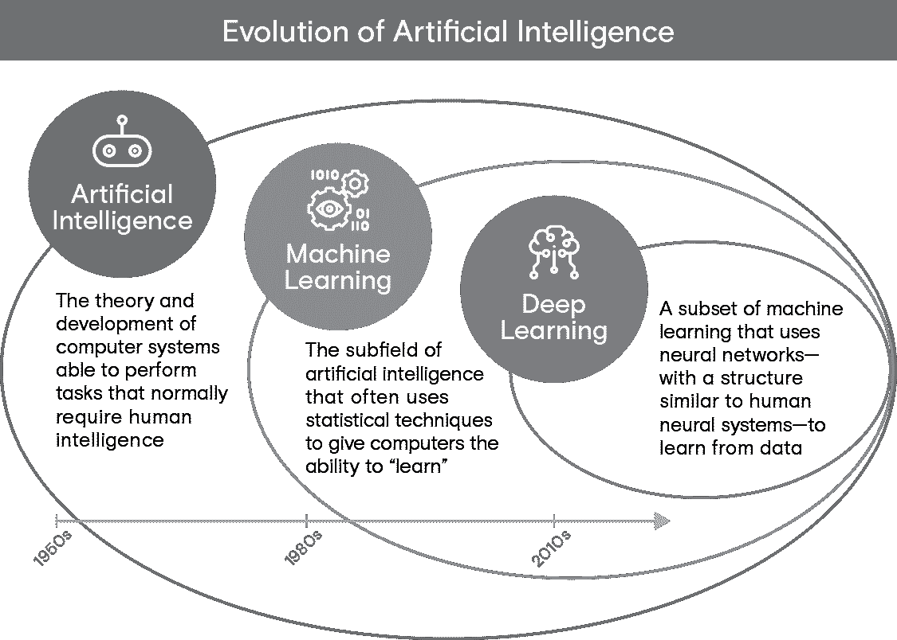
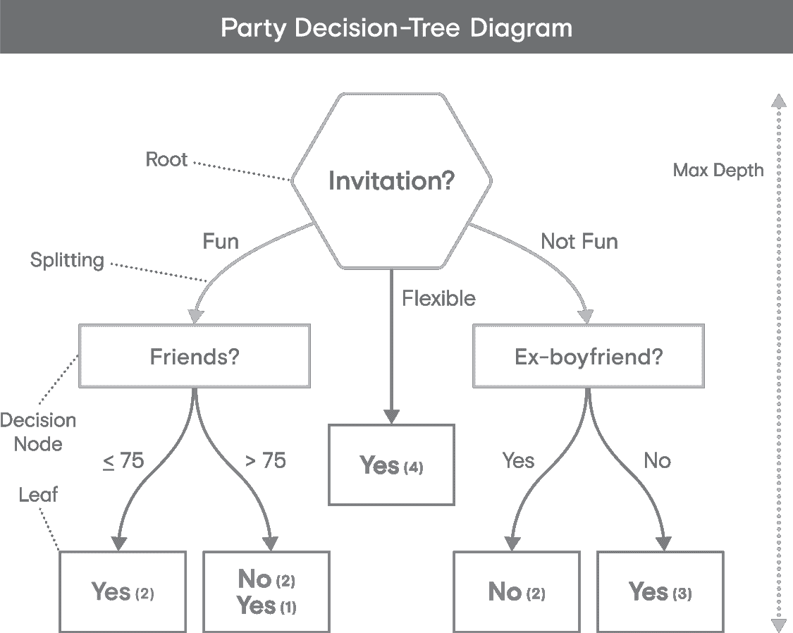
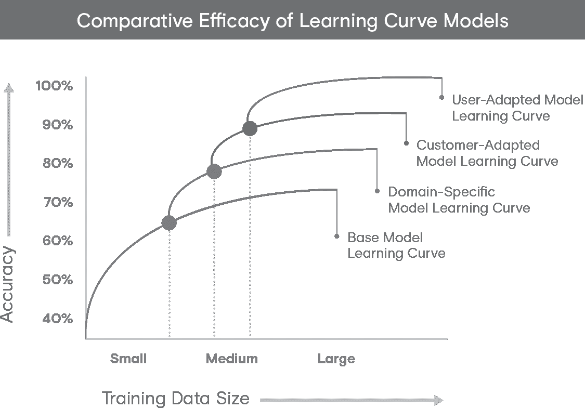
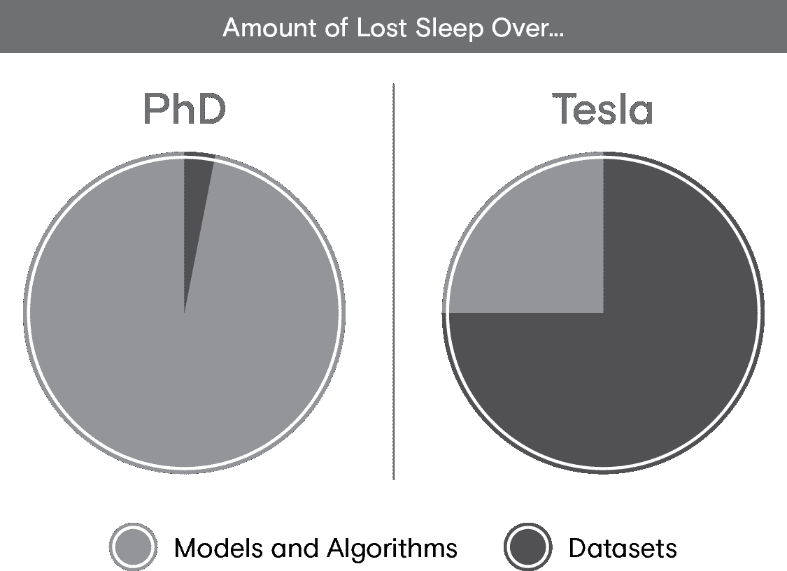
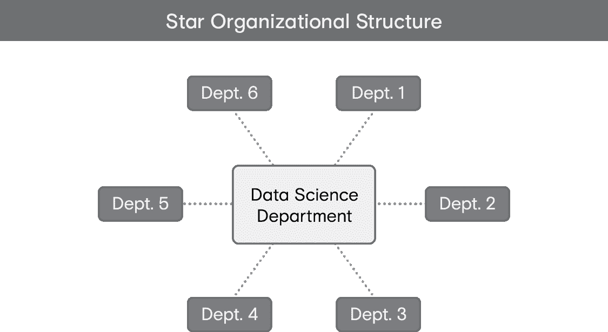
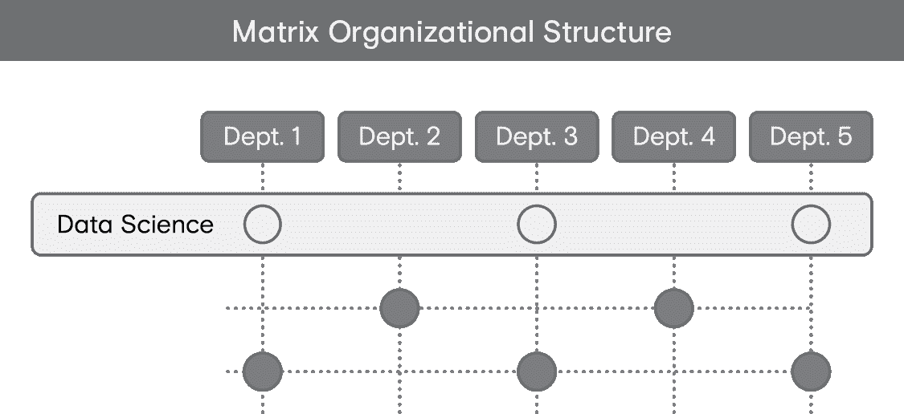
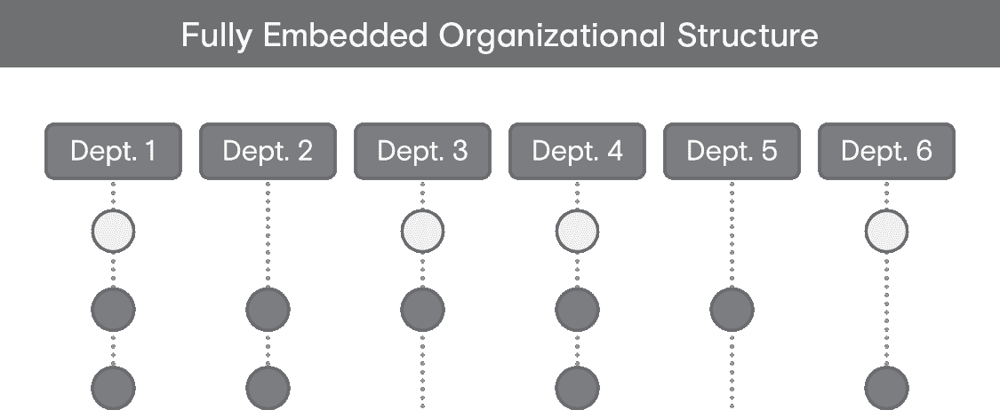
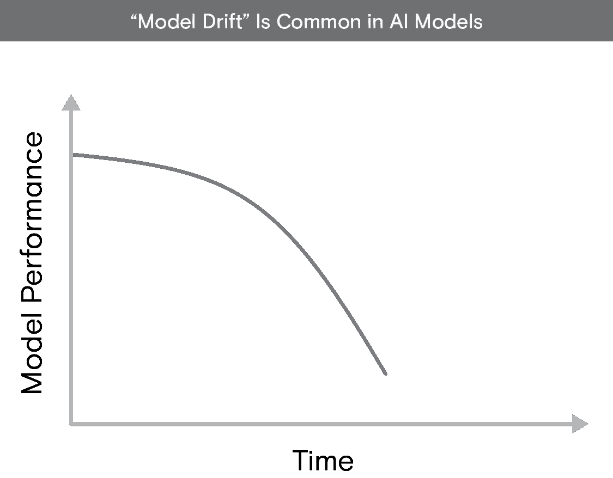
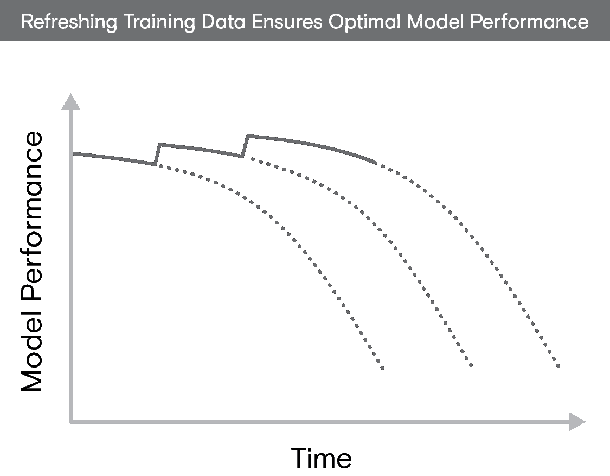
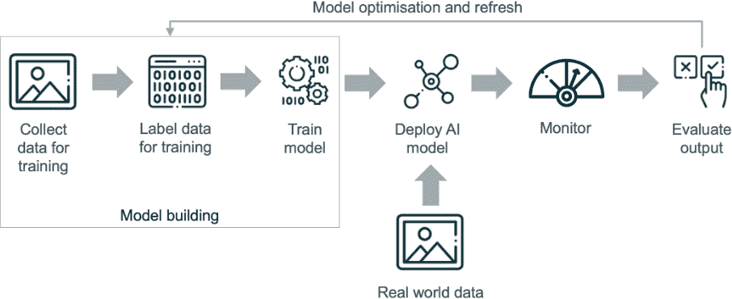

# 负责任机器学习实用指南：现实世界 AI

致我们的孩子。

有些人可能认为我们是一对不太可能的组合。Wilson 生长于中国青岛，Alyssa 生长于加利福尼亚州，若非我们对机器学习技术的共同兴趣，或许永远不会相遇。我们谦卑地站在前辈们的肩膀上，试图为后来者简化机器学习技术这个复杂而迷人的世界。

我们坚信，深思熟虑、负责任且合乎伦理地使用机器学习技术，能让世界变得更加公正、公平和包容。我们希望本书能为此持续的努力贡献一份微薄之力。

## About the Authors

# Introduction

## Alyssa

2015 年底，作为 IBM® 新成立的计算机视觉团队的一名产品经理，我们距离推出团队的第一个面向客户的输出仅剩几天。数月来，我们一直致力于创建一个商业可用的视觉识别应用程序编程接口（`API`），其准确率比现有模型提高了一倍多。公司寄希望于将该 `API` 扩展为重要的收入来源。到目前为止，我们最大的关注点是提升模型的 F1 分数——这是衡量分类系统准确性的标准学术指标——针对我们训练数据的一个子集，该数据包含团队数月甚至数年整理的数千万张图像和标签。

该 `API` 的设计初衷是为输入其中的图像打上描述性标签。例如，你可以给它一张棕色猫的图片，它会返回一组标签，包括“猫”、“棕色”和“动物”。企业可以将其用于各种应用——从通过抓取社交媒体上发布的图像来构建用户偏好档案，到广告定向，或改善客户体验。在过去几个月里，为了训练和测试系统，我们使用了来自各种来源的超过 1 亿张图像和标签作为训练数据。我们成功地大幅提高了 F1 分数，以至于当我输入一张我和姐姐在婚礼上的照片时，系统立即将其标记为“伴娘”，我觉得这很令人印象深刻。

而现在，在完成了 IBM 的所有发布检查清单，且计划发布仅剩几天之际，我面临了一个意想不到的问题。

那天早上，我收到一位研究人员的消息，其简单的紧迫性令人心惊胆战：我们不能发布这个。当我问为什么时，他给我发了一张他输入系统进行测试的轮椅上的人的照片。返回的标签是什么？

Loser。

恐慌。IBM 拥有 100 年的包容与多元历史。因此，除了客观上可怕之外，这个输出明显表明系统不符合 IBM 的价值观。当我们全神贯注于提高系统的准确性时，我们还不小心引入了哪些其他类型的有害且无意的偏见？

我立即拉响警报，通知了我的上司，并取消了发布。我们的团队开始工作。除了修复模型，我们还有两个主要问题需要回答：

这是怎么发生的？我们如何才能确保它永远不会再次发生？

# 责任，而不仅仅是准确性

2015 年 10 月，我被聘入 IBM 的 Watson 部门，担任当时正在兴起的计算机视觉团队的第一位产品经理。你可能记得，Watson 是那台在 2011 年击败《Jeopardy!®》冠军肯·詹宁斯和布拉德·拉特的超级计算机。除了赢得 100 万美元的奖金，它还向世界展示了机器学习系统解决用自然人类语言提出的问题的最公开的演示之一。四年后我加入 Watson 团队时，IBM 正试图将该系统扩展到处理音频和视觉信息，希望能产生比游戏节目奖金更稳定的收入来源。

我的任务是为计算机视觉制定战略路线图，将这项在很大程度上属于学术研究的工作转变为真正的业务。当时，IBM 在 Watson 部门创建了几个不同的计算机视觉测试版产品，但没有哪个产品赚了多少钱或大规模使用。IBM 还有其他计算机视觉技术的应用，例如光学字符识别（`OCR`）的悠久历史；该公司的先进光学字符阅读器自 1975 年以来一直被美国纽约市的邮政局使用。但现在，IBM 客户要求更多样化的用例，以满足各种现代业务需求。

与此同时，这个由少数工程师和研究人员组成的团队——其中一些人在计算机视觉领域拥有二十年的专业知识——正在辩论如何通过尝试不同的算法或模型方法来提高机器学习模型的准确性。我当时还在努力掌握 AI 基础知识。我是个完全的新手。

我提出的问题暴露了我在这个领域有多新。“在你尝试一种新方法后，”我会问，“你怎么知道你的结果比上次更准确？”

没有人能给我一个直接的答案。我不确定是否是我缺乏机器学习的实质经验所致；毕竟，我身处高度经验丰富且才华横溢的人群中，相比之下，我基本上对这个话题一无所知。然而，因为我是那个必须向客户解释新系统为什么更好、更准确的人，我坚持不懈地试图获得一个我能理解的答案。经过数周的讨论和关于机器学习基础工作原理及什么是训练数据的速成课程，我们最终达成了一个大家都能支持的答案：当系统的 F1 分数提高时，你就知道系统更准确了。

于是，我们将所有精力都放在这里。我们的目标是创建一个准确的系统。我们做到了。然而，我们忽略了是否在训练数据中引入了意外的偏见。当轮椅图像随后返回那个灾难性的标签时，很明显我们在某个地方出了差错。

作为一名机器学习新手，我并不完全明白我们需要做什么才能防止出现这类结果。更糟糕的是，很快就清楚地发现，团队中没有人——包括我自己——完全清楚那 1 亿张训练数据图片中到底包含什么内容，也就是我们用来训练模型的信息。这是一个巨大的疏忽，回想起来，是一个大错误。

为了解决这个问题，团队团结起来，将针对给定图像可能返回的成千上万个潜在标签进行分工，并开始逐一审查。我们会从庞大的图库中调出一组图像，检查返回的标签，并运用人类判断来决定结果在商业语境下是否合适。在花费了大量未计划的时间和精力后，我们发现了近十几个我们认为与团队观点不一致的额外标签，当然也不符合我们希望 IBM 在公众面前呈现的形象。解决问题涉及删除这些数据点并完全重新训练系统。这过程艰苦且耗时，但几周后，我们成功地从输出中剔除了那些令人反感的标签。我们得以继续产品发布，确信我们的系统不包含冒犯性的标签关联。

回想起来，我当时运气不错，拥有解决该问题所需的资源。我所在的团队在一家支持力度充足的公司里，成员正直、多元且才华横溢。当我们的团队忙于手动清理不雅标签时，我们的竞争对手，包括 Microsoft® 和 Google®，却经历了几次非常公开的机器学习模型意外输出种族歧视内容的事件。IBM 暂时避免了那场特定的灾难，并成功推出了一个没有这些问题的系统，但这并非没有付出大量时间和精力在最后一刻修复问题的代价。而且，如果没有一个健全的系统来主动防止未来出现同样的问题，这件事迟早会再次发生。

# 解决正确的问题

好消息是，我们勉强避免了灾难。然而，坏消息是，该产品并不成功。

推出后，API 并未产生显著的收入流。我们收到的客户反馈是，它根本不够准确——客户无法使用它来有效地为他们的业务提供支持。这导致了我在 AI 职业生涯中的第二个重大“顿悟”时刻。当我深入研究客户问题并花些时间与客户交流时，我意识到，尽管我们投入了时间和精力来确保系统总体上是准确的，但它仍然不够准确，无法满足客户试图解决的那些更具体的问题。在大多数情况下，他们想要的是极其具体的东西。在一个案例中，一家鸡肉制造商希望使用固定摄像头在生产线上区分鸡胸肉和鸡腿肉。当他们输入鸡肉包装的图片时，返回的“鸡肉”或“食物”标签根本不够用。在另一个案例中，一家冰淇淋制造商想知道他们的新产品标签是否出现在一组社交媒体图片中——“冰淇淋”虽然正确，但远远太宽泛了。

最终，我们将产品改造为一个可以针对每个客户使用业务特定数据进行单独训练的系统。这将使鸡肉制造商能够区分鸡胸肉和鸡腿肉，并让冰淇淋公司能够根据特定标准对图像进行分类。这项新的 API 工作花费了 IBM 六个月的时间和资源，但在第二次重大推出后，它取得了巨大的成功，并迅速扩展到可观的收入规模。客户可以输入少量精心策划的数据，并在几分钟内训练出满足其需求的模型。这才是强大、有价值且具有创新性的！

我所在的 IBM 团队在尝试推出盈利且可扩展的视觉识别 AI 时面临的问题，并非该公司或产品所独有。事实上，在试图创建和扩展 AI 解决方案的企业中，这些问题再典型不过了。只有 20% 的主要公司处于试点阶段的 AI 能够进入生产环境，而且许多 AI 无法像本应的那样好地服务于客户。在某些情况下，这是因为他们试图解决错误的问题。在其他情况下，这是因为他们未能考虑到所有变量——或者潜在偏差——而这些变量对模型的成功或失败至关重要。

## Wilson

我很幸运能够亲身体验到，当一家公司使用负责任地构建的 AI 做得正确时是什么样子，而结果会带来业务的大幅增长。同时，我也在职业生涯中多次经历过像 Alyssa 所描述的那样的重大挫折和挑战。

我于 2006 年加入 eBay®，而在 2009 年，该公司状况非常糟糕。其股价处于历史低点，远低于接近 24 美元的历史高点；公司正在削减成本，增长为负，市场份额在萎缩，技术团队也没有获得创新的权力。简单来说，公司陷入了严重的困境。

他们扭转了局面，很大程度上要归功于对技术的投资。他们还引入了新的视角：一位新 CEO、CTO 和几位技术高管。通过这样做，eBay 开始将工程团队打造为一个创意强力中心，并将其建立为与业务其他部分地位平等的合作伙伴。公司开始利用技术、数据和 AI 来推动业务。我很幸运能够加入并组建搜索科学团队，这是最早利用机器学习来优化买家体验、帮助买家在 eBay 网站上更轻松地找到所需商品的团队之一。我们专注于提高每次会话的购买量：即买家在一个用户会话中购买的商品平均数量。带着这个目标，我们的 AI 模型强调销售（商品售出次数）而非展示量（商品被浏览次数），并且那些价格较低的商品排名高于其他商品。

我们的团队拥有大量可用数据，并可以轻松地对新模型进行 A/B 测试以了解其工作原理。而且，我们有幸能够几乎立即看到测试结果。

我们的团队准备就绪，蓄势待发。

我们尝试了不同的机器学习模型——用于重写买家查询的模型、用于生成排名模型所需特征的模型，以及用于对最终搜索结果进行排名的模型。然后我们进行了一系列 A/B 测试来评估模型结果，并取得了巨大成功。许多模型证明买家转化率有所提高。其他团队受到这些成功的激励，开始努力提高他们的每次会话购买量。一切看起来都很美好。

然而，直到财务团队观察到这些 A/B 测试的胜利并未转化为收入增加。

搜索科学团队最初尝试 AI 失败了，我们的团队被拉进“战争室”去了解原因，并且我们需要一个快速的解决方案。在公司无法承受损失一分钱的时候，我们却在损害公司的收入。

我们深入研究了不同查询的搜索结果，并发现了一个有趣的现象：我们经常将配件商品排在前面。例如，当买家搜索“iPhone”时，许多 iPhone 手机壳会排在结果的顶部。虽然这些配件在网站上很受欢迎，但它们并不是用户所搜索的内容，因此造成了我们所谓的“配件污染”，并导致了糟糕的用户体验。

顿悟！我们找到了收入下降的原因；一个 10 美元的 iPhone 手机壳所代表的收入远少于一部 300 美元的 iPhone。我们的模型在应该推荐更高价格的手机时，却推荐了价格较低的配件。

# 选择正确的衡量标准

成功，大部分时候，都在于你选择衡量什么。

当我们开始旅程时，技术团队将不同的目标统一为一个单一目标，即专注于增加销售额。说你唯一的目标就是多卖东西，这是一个非常以客户为中心的选择——但这正是卖家和买家想要的，也是我们最终被雇佣去做的事情。

经过多轮讨论后，我们开始通过每次会话的购买量来衡量成功。我们的 AI 模型成功实现了目标，但却造成了糟糕的用户体验，并未能带来业务增长。我们需要寻找一个新的解决方案，采用不同的 AI 模型，更重要的是，采用一种衡量 AI 模型成功的新方法。显然，“每次会话购买量”在我们的 AI 模型和团队中产生了错误的动机。

教训很明显：要小心选择正确的衡量标准，因为它将决定你的 AI 的方向。

# 数据与机器学习的力量

后来，我们将价格相关信号纳入模型，解决了“配件污染”问题。更重要的是，我们将衡量标准从每次会话购买量改为每次会话 GMV（商品交易总额）。

一旦我们的团队向全公司展示了机器学习和数据有多么强大，更多团队就开始利用 AI 作为业务增长的动力。这最终对收入产生了巨大影响，并帮助公司实现了惊人的扭转。到 2012 年，eBay 的股价上涨了 65%，公司促成了约 1750 亿美元的商业交易——约占全球电子商务的 19% 和全球零售市场的近 2%。

eBay 涉足机器学习得益于公司能够用于训练和快速扩展其 AI 计划的庞大数据库。这并非每家公司都有的选择，也不是每家公司都有资源和基础设施来应用于创建 AI 解决方案——然而今天，错过 AI 机会几乎字面意义上意味着在你的行业中失去竞争优势。应对 AI 令人感到压倒性和过于技术化。如何在不被淘汰的情况下击败市场？又如何确保你的 AI 开发是负责任的，并且其影响是积极的？

幸运的是，成功的机器学习和负责任的、合乎伦理的机器学习源于相同的过程。负责任且成功的 AI 解决方案不必困难。我们创作这本书，旨在帮助任何组织在启动世界级 AI 的旅程中降低风险。

在接下来的章节中，你将学习如何大规模启动负责任 AI 的路线图。Alyssa 和我将带你了解如何决定解决什么问题，为什么数据很重要以及如何使用它，成功的最佳实践，如何扩展，以及如何在开发、执行和维护的每一层考虑安全和伦理。

# 我们是谁？

## Alyssa

也许我是一个不太可能的 AI 领导者。我带着美国研究的文科学位进入这个领域——一名文化和摄影的学生。我有阅读障碍，拼写糟糕透顶，编码也几乎一窍不通——我只懂得足以造成一些损害，但不足以构建任何功能性的东西。2015 年，在加入 IBM Watson 部门前几个月，我从伦敦飞往旧金山的航班上，偶然坐在一位成功且才华横溢的科技 CEO 旁边。那一周我一直在几个不同的欧洲城市与 IBM 客户会面，渴望回家。在大西洋上空，我与她就技术、职业道路、管理和生活展开了交谈。当我向她请教自己职业生涯的下一步时，她给了我一个指导原则，这一直伴随着我。

“去解决难题，”她说。“其他一切都会迎刃而解。”

我采纳了她的建议，开始与每一个我能从中窃取建议的人进行一系列讨论。我寻找与我共鸣的难题，以及一个能将我的热情、技能和职业抱负相结合的特定机会。不幸的是，当时可用的工作机会很少属于“难题”类别。许多慷慨给我职业建议的导师或顾问，都鼓励我付出代价、积累更多经验，或者以某种方式在传统职业道路上寻求体面的头衔或财务稳健的角色。我发现自己在找理由拒绝总监头衔、丰厚的股票期权，或者在红极一时、诱人的初创公司中的机会。我一直想着，虽然我对团队和个人怀有巨大的尊重和钦佩，但我想做的不仅仅是优化底线。我想加入一个解决非常“重要的难题”的团队。我如何才能将我的努力引导向让世界变得更美好？

这最终体现为 IBM 的 Watson 团队。现在，这里有一个可以应用于解决我关心问题的难题。机器学习是一个相对新的商业领域，潜力巨大；我可以从基层做起，帮助塑造一个全新的市场。

Watson 团队的第一个职位开启了我至今仍在进行的旅程。作为 IBM、Appen® 和现在 Blue Shield of California® 的产品管理领导者，我专注于利用数据和机器学习技术解决难题。这是一项非常有回报的工作，更不用说是有价值的，因为 AI 为技术整体带来的进步速度。在这段旅程中，我特别关注负责任的 AI 开发。为了避免结果中有害和不想要的偏见，组织必须富有同理心，在模型构建和调优过程中进行迭代，并对其数据格外小心。负责任的 AI 不仅对世界更好，对业务成果也更好。

## Wilson

我以 IBM 开发者的身份开始职业生涯，为银行、电信运营商和证券交易所公司构建大型系统。我被软件的力量所激励。作为开发者，当你编写软件时，你正在构建自己的世界，并且在构建那个世界时拥有一种在大多数其他职业中难以找到的控制力和主动权。

在 IBM 工作五年后，我加入了 eBay，并继续专注于工程挑战，构建 eBay 的账单和支付系统。随后，我有机会加入并组建 eBay 的搜索科学团队，利用机器学习和数据来扭转困境中的业务。起初，我犹豫是否要将职业转向看起来像是一个完全新的领域。我的导师，一位出色的科技领袖，他创立了 Bing 的图像和视频搜索团队，并正在领导 eBay 的重大扭转，说服我去迎接这个新挑战。

这是我职业生涯的一个转折点。接下来的两年里，我把所有业余时间和周末都用来构建机器学习知识并学习统计学。这是一个紧张的时期，但我学到了机器学习的力量以及它如何帮助改变业务。在深入研究搜索科学并在垂直领域取得巨大成功后，我有机会领导一个横向数据服务和解决方案团队，为公司每个团队实现数据驱动的决策。我还组建了零售科学团队和数据实验室，以检测库存的趋势和季节性，帮助卖家决定产品价格，并帮助买家找到有趣的产品。

在 eBay 工作 11.5 年后，我加入了 Trip.com®，担任首席数据官。我的团队利用数据和机器学习优化旅行体验。我们通过搜索、推荐和 CRM 实现了显著的收入增长。我们还利用 AI 在运营和客户服务中实现了巨大的成本节约，大幅提高了内部效率，并为整个公司建立了数据基础。我们正在利用 AI 和数据改变旅行行业。

与此同时，越来越多的行业开始拥抱 AI 并采用机器学习解决方案。当我看到人们面临在现实世界中让 AI 发挥作用的新挑战时，我意识到自己可以通过帮助加速企业的 AI 之旅来产生影响。这促使我加入 Appen，担任其首席技术官。Appen 是 AI 数据领域的行业领导者，我们的使命是更快地创建大量高质量的训练数据，这解决了 AI 从业者面临的最大挑战——缺乏高质量的训练数据。我们与各行各业的公司合作，帮助他们自信地部署 AI。在 Appen，过去两年我们的平均从试点到生产部署率为 67%——远高于 20% 的一般平均水平。从一开始就构建 AI 责任和良好的数据管理，可以创建既更具适应性又在长期内更成功的机器学习系统。

# 你将在本书中学到什么

AI 代表着技术的一次巨大转变，其革命性堪比电力或互联网。机器学习技术有望重塑商业世界的方方面面。十年前，很少有餐厅拥有社交媒体策略；而现在，很难找到一家没有社交媒体策略的餐厅。几年之内，找到一家没有 AI 策略的公司也将同样困难。那些今天不致力于制定 AI 策略的公司，很可能会像 2002 年决定不采用网络策略或 2008 年决定不采用移动策略的公司一样举步维艰。如果你想在市场上竞争，这是绝对必要的。

我们理解这可能会让人感到不知所措，因为我们也经历过。这就是我们写这本书的原因：为了揭秘如何思考 AI，并提供一个如何入门的行动计划。借鉴广泛的多行业研究、对初创公司和大公司几十位机器学习从业者的访谈，以及我们自身的现实世界经验，我们将帮助你设计一个既服务于你的业务案例，又能保持灵活并适应变化情况的 AI 系统。我们不会教你如何成为数据科学家或选择 AI 模型；你应该聘请专家来协助这项工作。我们要做的是帮助你了解成功策略的最佳路径是什么，以及作为业务所有者或决策者如何有意义地参与，让你走上成功之路。

本书还将为业务负责人（如产品经理）和技术团队成员（如工程师和数据科学家）提供一个共同语言的起点。我们旨在弥合团队之间的差距，为业务专家和高层管理人员提供足够的背景，以便与技术实施者高效沟通。

通往负责任 AI 的道路并不平坦，但借助你将在这些页面中学到的最佳实践，你成功的机会将大大增加。在你的业务中使用机器学习来降低成本并增加收入，不必成为一个令人不知所措的前景。相反，这是非常可行的。这也是任何组织的极佳激励因素——它很有趣，很令人愉快，并且能产生重大影响的结果。所需要的只是一个跨职能团队和一种创新精神。你将看到世界各地公司做得好的几十个例子。

关键是从小处着手，并取得持续进步。从那里开始，AI 的成功比你想象的更近。

* * *

1 Jeopardy!® 是 Jeopardy Productions, Inc. 的注册商标。

# 第 1 章

# 1\. AI 的基础知识——以及它在哪些方面会出问题

“人工智能是让计算机以我们直到最近还认为需要人类智能的方式行事的科学与工程。”

——Andrew Moore，卡内基梅隆大学计算机科学学院前院长

2019 年 8 月，Apple® 和 Goldman Sachs® 都在寻找解决一个意外问题的方案，当时他们刚推出一款备受期待的新产品：Apple 信用卡。

这款以其超高安全性和时尚外观而闻名的卡片，立即迎来了大量的申请，到 11 月，Goldman Sachs 在其监管文件中报告称，已向 Apple Card 持卡人发放了 100 亿美元的信用额度。2 但尽管消费者的早期采用率很高，一个问题很快出现了：Apple Card 的审批流程向女性提供的信用额度比男性更小。Basecamp 联合创始人 David Heinemeier Hansson 发布了一系列走红的推文，声称 Apple Card 批准的信用额度是他妻子的二十倍，尽管他们共同报税，且他妻子的信用评分更高。Apple 联合创始人 Steve Wozniak 惊讶地回推文说：“[我和我妻子] 也遇到了同样的情况。我的信用额度是她的 10 倍。我们没有单独的银行或信用卡账户，也没有任何单独的资产。”

起初，似乎没有人在 Apple 能够解释审批算法是如何工作的，以便分析其产生的输出。Goldman Sachs 声称审批流程中不存在性别偏见，该算法在卡片推出前已由第三方检查，而且性别甚至不是申请表上的输入项，那么性别偏见又如何会影响结果呢？

Hansson 反驳说：“Goldman 和 Apple 将信用评估委托给了一个黑盒。这不是性别歧视的意图，但却是性别歧视的结果。”

Wired 在 2019 年 11 月对该情况的分析中写道：3

“一个性别盲算法可能最终会对女性产生偏见，只要它依赖的任何输入或输入碰巧与性别相关。有大量研究表明，这种‘代理’如何导致不同算法中不想要的偏见……其他变量，例如家庭住址，可以作为种族的代理。同样，一个人购物的地方可能会与其性别信息重叠。”

在试图通过在申请中省略性别作为输入来避免偏见时，Apple Card 模型构建者无意中让自己陷入了他们试图避免的偏见。如果输入包含性别，输出可以被测试以查看模型是否对女性和男性输入有不同的处理。然而，没有关键的“性别”输入，“性别盲”模型就变成了那样：盲目。无法弄清楚明显偏见的结果中发生了什么。

除了说明需要对任何 AI 模型进行强大的测试和监控之外，这个例子还说明了负责任 AI 的一个基本真理：它很困难。即使是地球上最大的公司，拥有他们所有可用的资源，也可能会遇到巨大的挑战。所以，如果你觉得你的公司正在努力了解如何在不承担太多风险的情况下进入 AI 领域，你并不孤单。正如你在接下来的章节中将看到的，不仅仅是 Apple，Google、Walmart®、Tesla®、Microsoft 以及其他几十家公司也在不断克服挑战。

作为业务专家，而不是数据科学家，你在构建任何 AI 模型时最有帮助的方式是澄清输入的重要性，并决定满足业务目标所需的可接受置信水平。数据科学家有责任提出正确的问题。如果模型试图考虑一些实际上对业务案例不重要的变量，准确性可能会受损，但选择忽略该变量可能是你可以做出的业务决策，以推动事情进展。

负责任的人工智能不仅对你的业务有益，也对社会有益。但人工智能是一个足够复杂的领域，要构建和部署负责任的人工智能，你必须先了解基础知识。让我们先简要了解一下人工智能的基础。

# 人工智能如何工作

当人们被问及什么是人工智能时，最常见的回答是“机器人。”许多人没有意识到人工智能与天网毫无相似之处，而且他们可能每天都在与人工智能交互。

当你因工作出差并拍摄收据照片以报销时，基于机器学习的计算机视觉系统会从该照片中提取信息并对其进行处理。

当你致电支持热线并通过与其对话来导航自动系统时，基于机器学习的语音识别技术会解释你的话语并将其转化为行动。

当你在手机上浏览 Instagram 时，基于机器学习的搜索相关性正在个性化你看到的内容。当你发布内容时，另一个机器学习系统会分析你的内容并决定如何将其呈现给你的朋友。

当你使用手机存入支票照片时，钱会神奇地出现在你的银行账户中。或者说，看起来像魔法。实际上，一系列复杂的机器学习使其成为可能：首先，计算机视觉系统分析图像并将文本转换为数字。然后，欺诈检测系统评估你的会话是否可能是欺诈性的，并决定是否允许银行将资金记入你的账户。一旦这些检查点成功通过，资金就会被存入。

当然，每次你与 Siri®、4 Alexa®、5 或 Google Assistant®、6 交谈时，机器学习语音识别都在解释你说的话——或多或少地使其成为现实。

所有这些都是简单且通常无缝的交互。大多数时候，你甚至没有意识到自己正在使用基于人工智能的系统——它只是在你不需要知道幕后任何细节的情况下发生。它们通常被设计为被动地与你交互，理解你提供给它们的信息，并引导或建议你朝着你预期的结果前进。

人工智能不仅仅是一件事。它指的是一个不断发展的技术集合；随着技术的变化，人工智能的定义也在不断变化。

现代人工智能的历史远比人们想象的要早得多；古典哲学家使用符号来描述人类思维，并试图构想人类智能模型。然而，我们称之为人工智能的东西，直到 1956 年在达特茅斯学院的一次会议上才成为正式的研究领域。在那里，“人工智能”这一术语被创造出来。该领域经历了多次兴衰；在 20 世纪 70 年代初到 90 年代初之间经历了两次“人工智能寒冬”后，人工智能研究在 90 年代末再次兴起。从那以后，我们见过计算机击败世界最伟大的国际象棋选手和当时的《危险边缘》冠军在自己的游戏中获胜，而现在，在 2021 年，数百万的我们向家中或手腕上的小型设备询问天气、路线或烹饪说明，使用自然语言。设备会礼貌地回答——只是有时不正确。

人工智能广义上指执行那些在由人类执行时需要智能的功能的机器。7 而机器学习作为人工智能的一个子集，特指那些无需被明确编程即可在某方面变得更好的算法——算法可以从它们接收到的数据中学习（例如 Apple Card 审批算法）。而深度学习，由最复杂的人工智能系统所代表，通常采用模仿人类大脑基本架构的人工神经网络形式。深度学习系统可以完成复杂的任务，例如查看酒店客人上传的单张照片，并识别多个元素以便为其他客人对照片进行分类——食物、地点、天气等等。

###### AI vs. Machine Learning vs. Deep Learning from Lynn Heidmann8

人工智能常被误解为黑盒。东西从一端放进去，魔法从另一端出来。这种“黑盒”思维只是部分准确——盒子实际上并不不透明。通常，当人们说“黑盒”时，他们指的是在有限数据集中训练的模型或算法；这就是 Hansson 在指出有偏见的 Apple Card 算法时所指的内容。输入被输入，模型被教导预期的答案是什么。有足够的数据后，模型将学习输入之间的相似性和差异性。训练后，模型可以接受它从未见过的输入，并以一定程度的置信度产生相应的输出。其输出完全取决于人类策划的数据输入的质量，类似于幼儿模仿它所看到的成人行为——希望是“请”和“谢谢”，但偶尔可能会说脏话。

# 训练与推理

如何获得机器学习模型？你对它们进行训练。

想象你有一只新小狗。你希望每次你说“坐下”时，狗都会坐下。你重复指令，并在狗连点成线并做对时给它一块零食。过一段时间，狗会推断每当听到“坐下”这个词时就是坐下的时候。

人工智能的情况非常相似。你教人工智能如何做对。这个教学过程称为模型训练，唯一的区别是教学目标：一个模型而不是一只小狗。

数据科学家将大量数据加载到机器中，机器试图选择一个模型来“拟合”数据。模型或算法可以从简单的方程（如直线方程）到非常复杂的逻辑/数学系统，使计算机得出最佳预测。训练过程决定方程中的所有参数（权重和偏差）。

选择正确的模型并找到其参数可能是一项具有挑战性的工作。数据科学家过去需要处理数学公式的许多细节，进行低级矩阵计算，编写大量代码，并花费大量时间调试代码。TensorFlow® 或 PyTorch® 等框架极大地简化了工作。这些框架提供现成的构建模块，显著提高了即使是新手也能快速实现机器学习架构并快速训练出不错模型的速度。

现在你有一个训练良好的模型，并且希望在向其输入新数据时它能做出预测。使用训练好的机器学习算法进行预测的过程称为“推理”。

然而，模型训练和模型推理之间有许多步骤。你需要打包模型，将其部署到生产环境，监控其性能，并在发现性能漂移时对其进行刷新。现实世界的人工智能需要一个组织来构建环境和文化，以高效地实现所有这些操作。用于简化管理机器学习生命周期的新兴实践称为 MLOps。

# 监督学习、无监督学习和强化学习

尽管深度学习是目前最流行的机器学习模型，因为其广泛的应用，但也要知道许多其他传统机器学习模型仍在不同场景中使用。

让我们来看看另一种流行的机器学习模型：决策树。一个人正在尝试做出一个决定：我应该去同事的聚会吗？几个信息片段将影响这个决定：我有空吗？会有趣吗？靠近公共交通吗？最终，这个人将根据这些输入的答案做出决定，你可以把每个输入看作是整体问题的一层。

这个人会尝试回答每个问题。有些是肯定的，有些是否定的。有些比其他更重要——如果会很有趣，那么是否靠近公共交通可能就不那么重要了。每个输入都有内在的权重，这个人会通过进行一些心理计算来综合所有因素来回答问题；如果结果超过某个阈值，他们就会去参加聚会。

人类在不加思考的情况下权衡这些因素并得出决定，但计算机必须被明确告知如何做出决定。负责创建模型的数据科学家和业务人员必须提前澄清和阐明决策的阈值，这一点非常重要，因为模型的决策只取决于它所了解的输入。

也许这位潜在的聚会参与者得知他们的前任伴侣也会在那里。这可能会让决定变成绝对的“不”，而不管其他答案如何。但一个为决定是否参加聚会而创建的决策树，除非它有一个处理前任伴侣的层，并且在一些示例上进行了训练，否则不会将该输入考虑在内。

这个聚会决策树的创建基于监督学习。商业世界中绝大多数 AI 用例都使用监督学习模型。这是一种花哨的描述方式，指的是算法试图利用之前人类创建的数据作为训练数据，在特定场景中模仿人类决策。这是因为商业中有许多任务是重复性的、难以扩展的、令人烦恼的、低价值的，或者仅仅是人类执行时耗时太长。如果计算机可以在更短的时间内、以更可扩展的方式做同样的事情，那么我们难道不想使用它而不是人吗？

相比之下，无监督学习是在没有正确答案的数据上进行训练的。它使用算法来发现数据中固有的、潜在的结构。

第三种常见的模型是强化学习。强化学习不是在数据上进行训练，而是要求模型通过试错来学习。当模型做出导致良好结果的决策时，它会得到奖励，随着时间的推移，它会发现如何越来越频繁地给出正确答案。

# 你在构建 AI 中的角色

AI 项目创意往往通过一场组织传话游戏，从构思走到实施。从最初构想它的业务利益相关者到实际构建它的机器学习工程师或数据科学家，这条路径不可避免地要经过五个步骤和三次管理变更。最终，构建模型的人往往不理解，也无法阐明他们正在从事的项目的业务背景。当他们需要做出权衡或战略决策时，无法保证他们会做出在生产环境中有效的决策。最坏的情况是，他们最终会偏离原始目标。

Databricks® 机器学习实践负责人 Brooke Wenig 曾有过一次经历，这体现了组织传话游戏及其可能造成的损害。Brooke 在读研究生期间在 MyFitnessPal®9（现由 Under Armour® 拥有）实习。MyFitnessPal 是一款允许用户追踪饮食和运动，并使用游戏化技术帮助他们减肥的应用程序。它鼓励用户在应用程序中记录所有吃的食物，以帮助监控卡路里摄入量并识别不健康的饮食习惯，例如吃零食或压力性进食。

Brooke 被分配了一个任务：构建一个模型，将用户输入应用程序的食物分类，例如水果、蔬菜等，以便 MyFitnessPal 可以更好地了解用户输入了哪些食物，并向这些用户提供相关广告。这是一个经典的自然语言处理（NLP）任务。因为用户手动将食物输入应用程序，人们会把“apple”拼成三个 p，把“banana”拼成三个 n，等等。

Brooke 的任务是从这些混乱的真实数据中创建秩序。作为一名渴望成功并证明自己的实习生，她立即投入到创建这种秩序中。她花了六个多星期清理数据，并从混乱的现实中创建映射到清晰的层次结构，结果发现她创建的分组根本不是产品团队需要或想要的。因此，她不得不从头开始。时间和资源被浪费了，因为没有人告诉她应用程序实际上可以货币化哪些分组，而她创建的分组从商业角度来看毫无价值。尽管她雄心勃勃且努力工作，但她最终还是提出了一个司空见惯的问题：“他妈的怎么没人告诉我这个？”

Brooke 没有获得所需信息的原因是，业务人员——产品团队——没有与执行 AI 模型的人保持密切联系，因此项目完全停滞了数周之久。作为一名业务人员，你的工作是深入参与，帮助具体定义对业务重要的结果。

可能令人惊讶的是，事实上，创建模型的大部分工作就是做出关于模型输出可接受阈值的那种决策。如果有足够高质量的数据可用，并且输入和输出已得到清晰阐明，那么数据科学家实际创建和训练模型的工作不应该花费几天或几周。有很多好的工具可用——例如 Databricks、Weights & Biases 和 IBM AI 360——可以使将模型迭代和优化到预期准确度的过程比几年前容易得多。你的数据科学团队应该利用这些类型的工具。这是一个快速变化的领域。

当你在做关于模型范围的这些选择时，考虑其决策的伦理影响非常重要。如果你决定将模型优化到 90% 的准确率，这意味着有 10% 的时间，它的决策是错误的。如果你的模型是在将支持工单分类为高优先级或低优先级，那么这 10% 可能不是什么大问题。但如果它是在识别性侵害报告，误分类 10% 可能会构成重大的伦理失败，更不用说会引入重大的法律责任。以 Uber® 为例，它使用名为 COTA（Customer Obsession Ticket Assistant，客户痴迷工单助手）的系统来分类其支持工单。COTA 使用机器学习和 NLP（Natural Language Processing，自然语言处理）来快速评估工单是关于应用程序的技术问题、车费争议，还是平台上客户和司机常遇到的其他数千种可能的问题类型之一。一旦它知道自己正在处理什么类型的问题，COTA 就会将工单路由到正确的团队以便得到处理。虽然人工客服在支持 COTA，但系统尽可能避免误分类仍然至关重要——即使只有一起性侵害投诉被路由到技术支持团队，风险也太大了。在开发像 COTA 这样的工具时，产品经理等以业务为导向的角色至关重要。数据科学团队专注于使模型在整体上更快、更准确——但关注业务目标的人将是定义如何平衡速度、风险和准确性时的关键声音。

如果你要引入一个以前依赖人类做出伦理决策的模型，你需要防止你的数据科学团队过于同质化。数据科学家的工作本质上是将有意的偏差编码到模型中以做出决策；决策就是这么做出来的。如果提供数据和创建算法以引入这种偏差的人类没有考虑到通常依赖人类判断的敏感领域的足够上下文，他们可能会引入无意的偏差。

另外，还要回想一下微软的 Twitter 聊天机器人 Tay，它使用强化学习来提高对话能力，但其训练没有防止不良分子的攻击。Tay 是微软两个团队的一个研究项目，旨在探索对话理解。该聊天机器人使用 AI 和专门人类员工撰写的内容来形成其回复并发展对话模式。但 Tay 最大的数据来源是相关的、公开的、已匿名化和过滤的数据。本质上，Tay 本应通过研究推特用户发给她的用户生成对话，来学习如何通过 Twitter 与人类交谈。正如微软在推出 Tay 时所说，“你和 Tay 聊得越多，她就越聪明。”10 遗憾的是，Tay 从其他 Twitter 用户那里学习的内容没有过滤器。结果，Tay 被 4chan 喂入了百万条恶意对话示例。它最终变成了一个宣扬纳粹主义的极端主义聊天机器人。在许多情况下，Tay 只是重复了推特用户发给它的煽动性言论。然而，喂给 Tay 的种族歧视和粗俗内容越多，它就变得越种族歧视和粗俗，这源于它的编程以及对什么是相关对话、什么是垃圾内容或数据输入的审核缺乏任何过滤。

AI 并非魔法。它是一系列技术的集合，可以被利用来做出服务于一组目标的决策。我们都在日常生活中使用 AI，因此模型的设计方式很重要。你得到的结果很重要。模型的创建远不止数据科学——业务决策构成了所涉工作的最重要部分。选择模型的参数和范围，确定其准确率何时足以支持业务案例，何时以及如何部署，以及如何监控其性能，对其成功至关重要。

考虑一个医疗场景中的患者记录匹配。当一个人出现在医院时，医生能够随时掌握患者的病史，以便更好地了解其当前的医疗状况，这对提供挽救生命的护理来说是有帮助的，有时也是至关重要的。考虑这样一种场景：也许患者自上次就诊以来已经更改了地址，或者他们结婚并更改了姓名，或者他们只是在入院表上将地址缩写得与上次在医院时略有不同。

|  || Record 1 || Record 2 || Record 3 |

| --- | --- | --- | --- |

| Name || John Doe || John Doe || Jon Doe |

| --- | --- | --- | --- |

| Date of Birth || 1/1/1980 || 01/1/1980 || 01/01/1980 |

| Address || 1500 Main Street || 1500 Mn St || 1500 Maine St |

| City || NY || New York || New York |

| State || NY || NY || NY |

医院通常使用基于机器学习的模型来进行患者记录匹配。在这种情况下，你可以看到这三条记录并不完全匹配，但作为人类评估者，你可以判断这三条记录很可能来自同一个人。机器学习系统可能没有同样的信心。作为与 AI 合作的业务人员，向自己提出诸如“如果我们错误地匹配了实际上不是同一人的记录，风险是什么？”或者“如果很可能是同一人却没有匹配记录，导致医生错过关键的历史医疗数据，风险是否更大？”这样的问题是合适的。

必须设置业务逻辑、数据转换和置信度阈值，以做出一系列决策，从而得出所有三条记录均属于同一人的基于机器学习的逻辑结论。参与这些决策并讨论它们如何被加权和决定的业务和客户影响至关重要。

就像商业中的其他一切一样，AI 只是一种工具。它的价值仅取决于它能为你的业务做什么。

# 目标失败

在商业中，甚至在 AI 工作经验丰富的企业中，投入巨额资金和资源开发 AI 解决方案，却产生错误结果甚至彻底失败的情况并不少见，事实上，这惊人地常见。一家公司可以做所有“正确”的事情，聘请聪明且经验丰富的人才，并怀有最良好的意图，却仍然昂贵地原地打转，而无法实现目标。

例如：2013 年 10 月，IBM 宣布与德克萨斯大学 MD Anderson 癌症中心建立令人兴奋的合作伙伴关系。该联盟将使用 Watson 的认知计算系统将癌症研究提升到新高度。在 MD Anderson 投入超过三年的工作和 6200 万美元之后，该项目被搁置，从未在患者身上实际使用过该技术。

原因之一是 MD Anderson 团队错误地识别并未能深入理解 AI 有潜力影响的具体问题。将机器学习应用于像“治愈癌症”这样宽泛的目标，会迅速暴露技术的局限性。AI 模型需要解决当下的具体问题，而不是遥远的未来目标。这部分是因为 AI 不是一种“设置好就不用管”并会在没有人工干预的情况下持续产出结果的系统。它需要持续的维护、管理和纠偏，以继续提供有意义且期望的输出。在启动项目时，如果没有明确的目标、成功衡量标准、精心定义的期望、里程碑和指导方针，成功的机会就渺茫——正如 MD Anderson 所发现的那样。

这是许多例子之一，说明 AI 的诱惑——承诺令人难以置信的解决方案，但在执行中缺乏目的性——可能会导致公司走上浪费时间和金钱的危险道路。当这种情况发生时，人们通常会下意识地得出结论，认为投资 AI 本身就是一个错误。在阅读了苹果和 MD Anderson 等公司未能达到预期结果的故事后，你可能在想如何避免同样的陷阱。

答案是，失败并非不可避免。人类创造 AI，人类使用由人类收集和准备的数据来训练 AI 系统。聪明且有效的 AI 完全在你的控制之中，设计和训练能产生预期结果的有效系统也是如此。

如果你有意且负责任地设计 AI 来解决特定且有价值的商业案例，它将更加成功，并能更好地服务于你的用户。

# 当优秀的 AI 出错

有时，即使目标和目的明确，最终用户仍会被技术所辜负，其有害影响不仅波及企业，还波及整个社会。即使是经过精心设计的系统，种族、性别、阶级及其他标志的偏见也可能渗透到输出结果中。

## Google 翻译

2018 年，Google 发起了一项有针对性的计划，旨在减少其翻译软件中的性别偏见，该软件运行在名为神经机器翻译（`NMT`）的深度学习模型上。模型最初为何会存在性别偏见？该模型从数百种语言的数亿条数据中学习——这些是已经翻译好的文本片段。但不同语言对阳性和阴性词形式的处理方式不同。这最终导致模型在输入“strong”或“doctor”等词时输出阳性翻译，在输入“nurse”或“beautiful”等词时输出阴性翻译。因此，尽管使用性别中性代词的土耳其语输入是“o bir doktor”，但英文输出会自动翻译为“he is a doctor”。在无法更改输入的情况下，Google 的修复方案是针对输出的——每当给出性别中性输入时，英文结果将同时包含两种形式，即“he is \_\_”和“she is \_\_”。

然而，Google 翻译的性别偏见远不止于此；当输入长串遵循“\[性别中性代词\] is \[形容词\]”模板的句子结构时，结果令人担忧。例如，形容词“hardworking”会分配“he”。形容词“lazy”会分配“she”。11

该公司在推广公平和避免翻译工具偏见方面阐述了所有正确的意图，但由于其训练数据是庞大的人类语言库，模型的教导深受世界各地性别惯例的影响。因此，Google 的任务是持续关注通过策划输出来应对有偏见的输入。

## Amazon 招聘

Amazon 于 2014 年启动了一项大规模项目，旨在自动化求职者审核，使用 AI 将候选人按 1 到 5 分的评分标准进行评级。尤其是在申请人数量庞大且评估所需资源巨大的情况下，对这种自动化工具的需求和推动力非常高。正如一位 Amazon 内部人士对路透社所说，“每个人都想要这个圣杯……一个引擎，我给你 100 份简历，它会筛选出前五名，然后我们雇佣他们。”12

工作一年后，Amazon 发现其系统存在问题。该模型通过学习过去十年提交的简历中的模式来评估候选人。但性别多样性在该领域是相对较新的现象；大多数简历是由男性提交的。结果，模型学会了男性候选人更可取，并惩罚任何包含“women’s”一词的申请，例如提交的简历中提到的女子运动队或课外活动。

到 2017 年，Amazon 不得不放弃该工具。没有可用于训练模型而不会导致性别偏见结果的数据。相反，公司转向了另一种解决方案：他们开发了一款 AI 工具，用于在互联网上发现值得招募的当前候选人。为了训练模型，他们向其输入过去的候选人简历，并教会其识别某些职业和技能相关术语。

结果仍然存在偏见。由于模型主要基于男性的简历进行训练，它学会了偏好男性更常用来描述其技能和职责的词汇。网络爬虫返回的候选人绝大多数是男性。Amazon 关闭了该项目。

在 Amazon 的两个案例和 Google 翻译的案例中，这些公司都在做好企业公民；每家公司都监控了结果，倾听了用户反馈，并迅速做出了回应。这就是负责任的 AI。

## 假释决定

机器学习工具中不公平偏见的最经典例子之一是 COMPAS 软件——矫正罪犯管理替代制裁分析。该软件旨在衡量罪犯成为累犯的可能性，结果被用来帮助法官做出假释决定。这实际上是继续监禁与自由之间的区别。2014 年，ProPublica 审查了驱动 COMPAS 的算法。他们发现的结果令人深感不安：COMPAS 分数在预测未来犯罪方面完全不可靠。只有 20% 的得分可能重犯暴力犯罪的人实际上重犯了。并且当将轻罪纳入考量时，该分数的准确性仅略好于随机抛硬币。

更令人担忧——并且对特定群体造成的危害影响更大的是，COMPAS 公式将黑人被告标记为未来高风险罪犯的频率远高于白人被告，无论其犯罪差异如何。Brisha Borden 是一名来自劳德代尔堡郊区、无前科的青少年，因捡起并骑行一辆未锁的踏板滑板车几分钟而被捕并被指控轻窃，该滑板车被认定属于一名六岁的邻居。她被分配了高风险分数 8。而四十一岁的 Vernon Prater 在因从 Home Depot 商店偷窃被捕前，已经因武装抢劫服刑五年，他被分配了低风险分数 3。Borden 是黑人；Prater 是白人。风险评估结果中存在着惊人的持续种族差异。

为 Borden 和 Prater 案例中使用的软件开发的私营公司 Northpointe 为其模型辩护。该分数是根据 137 个问题的调查创建的。就像 Apple 信用申请旨在通过不询问性别来避免性别偏见一样，评估问题不包括种族识别。

调查询问被告诸如：“你的父母中是否有人曾被送进监狱或看守所？” “你有多少朋友/熟人正在非法吸毒？”以及“你在学校时多久打架一次？” 问卷还要求人们同意或不同意诸如“饥饿的人有权偷窃”和“如果别人让我生气，我失去理智，我可能会很危险”等陈述。13

COMPAS 背后的软件最初并非为法庭环境设计，这一目标无疑会影响模型的训练和测试。负责任地构建和使用此类系统，必须考虑公平性。这些是商业工具，它们正在做出深刻影响人们生活的决策。将模型用于其并非专门设计的目的，往往是不负责任的决策。

# 与强大力量同行…

AI 代表了我们许多人一生中将目睹的最大技术转变。它正在改变世界的方方面面，从人们与家中设备的即时交互，到影响数百万人的全球组织所做的大规模决策。鉴于这种技术固有的广泛影响力，创建 AI 解决方案的人有责任确保其 AI 是合乎道德的、安全的，并且服务于世界——本质上，是让世界变得更美好，而不是更糟糕。

负责任的 AI 不仅对商业有益，也对世界有益。在下一章中，你将学习如何制定 AI 战略，将负责任的 AI 开发融入业务的方方面面。

* * *

2 Shevlin, Ron. “如果蒂姆·库克不愿告诉世界 Apple Card 的表现，那我就来。” Forbes, Forbes Magazine, 2020 年 3 月 9 日, [www.forbes.com/sites/ronshevlin/2020/03/09/if-tim-cook-wont-tell-the-world-how-the-apple-card-is-doing-i-will/](http://www.forbes.com/sites/ronshevlin/2020/03/09/if-tim-cook-wont-tell-the-world-how-the-apple-card-is-doing-i-will/).

3 Knight, Will. “Apple Card 没有‘看到’性别——这才是问题所在。” Wired, Conde Nast, [`www.wired.com/story/the-apple-card-didnt-see-genderand-thats-the-problem/`](https://www.wired.com/story/the-apple-card-didnt-see-genderand-thats-the-problem/).

4 Siri® 是 Apple, Inc. 的注册商标。

5 Alexa® 及所有相关标志是 Amazon.com, Inc. 或其附属公司的注册商标。

6 Google Assistant® 是 Google, LLC 的注册商标。

7 Valencia, Jean Pierre, “理解 AI、机器学习和深度学习之间的区别。” Tangocode, 2019 年 7 月 17 日, tangocode.com/2019/07/ai-machine-learning-and-deep-learning/.

8 Heidmann, Lynn. “AI 与机器学习与深度学习。” Blog, blog.dataiku.com/ai-vs.-machine-learning-vs.-deep-learning.

9 MyFitnessPal® 是 Under Armour, Inc. 的注册商标。

10 “Tay，微软的 AI 聊天机器人，从 Twitter 接受了一堂关于种族主义的速成课。” The Guardian, Guardian News and Media, 2016 年 3 月 24 日, [www.theguardian.com/technology/2016/mar/24/tay-microsofts-ai-chatbot-gets-a-crash-course-in-racism-from-twitter](https://www.theguardian.com/technology/2016/mar/24/tay-microsofts-ai-chatbot-gets-a-crash-course-in-racism-from-twitter).

11 Lee, Dami. “Google 翻译现在为某些语言提供特定性别的翻译。” The Verge, The Verge, 2018 年 12 月 6 日, [www.theverge.com/2018/12/6/18129203/google-translate-gender-specific-translations-languages](http://www.theverge.com/2018/12/6/18129203/google-translate-gender-specific-translations-languages)

12 “Amazon 放弃了偏爱男性技术岗位的 AI 招聘工具。” The Guardian, Guardian News and Media, 2018 年 10 月 10 日, [www.theguardian.com/technology/2018/oct/10/amazon-hiring-ai-gender-bias-recruiting-engine](http://www.theguardian.com/technology/2018/oct/10/amazon-hiring-ai-gender-bias-recruiting-engine).

13 Julia Angwin, Jeff Larson. “机器偏见。” ProPublica, 2016 年 5 月 23 日, www.propublica.org/article/machine-bias-risk-assessments-in-criminal-sentencing.

# Chapter 2

# 2\. 制定 AI 战略

“创造 AI 的成功将是人类历史上最大的事件。不幸的是，它也可能是最后一次，除非我们学会如何避免风险。”

——斯蒂芬·霍金

当你努力明确想要实现什么以及原因时，请记住，AI 本身并非目标。它是一种非常强大的工具，常常具有变革性，但你制定的战略应追求商业目标。仅仅为了在项目中撒上 AI 而撒 AI 是愚蠢的。

## Wilson

在我在 eBay 工作的 11 年里，公司在整个组织中朝着更结构化、更具可扩展性的系统、流程和团队方向发展。这并非一蹴而就，而是经过精心考虑的整体战略应用的结果。在取得重大扭转后，eBay 希望将数据和机器学习的采用扩展到更多领域。然而，如果没有整体的 AI 战略，要让不同组织加速其 AI 计划是具有挑战性的。

在转型之前，我的团队从构思到生产开发并推出一个新模型需要长达数月的时间。我有一个非常努力的优秀团队，但公司并未设置为让我们能够快速采购基础设施或从组织各部门收集数据——这是许多组织中仍然普遍存在的问题。这些低效造成了巨大的延误，让我们担心在市场上保持竞争力。当然，公司内其他团队也面临同样的问题。

2015 年，eBay 决定通过投资创建一个统一 AI 的内部平台来实施面向数据驱动型组织的共同统一愿景，该平台后来被称为 Krylov。eBay 组建了一个团队来指导该计划，团队成员包括 AI 平台团队（负责构建和提供服务）、基础设施团队（负责提供平台依赖项）以及 AI 领域团队（实际使用平台并能谈论用例的人员）。

领域团队由公司各处的人员组成。广告、计算机视觉、风险、营销、财务——任何有兴趣塑造平台以满足其未来 AI 需求的人。

该团队共同制定了完整的战略和路线图。在发现阶段，他们分析了阻碍有效 AI 的公司各处挑战。他们与 AI 研究人员合作，了解其日常流程。他们识别了组织各处的数据孤岛，并想出了如何打破它们的方法。

他们制定的战略，旨在数年内实现，包括对拥有安全数据访问权限的巨大集中式训练集群的要求。它详细说明了需要一个平台来自动化模型在整个生命周期中的训练和部署。它描述了一种涵盖数据发现、准备和存储的通用数据生命周期抽象。

该策略还确立了若干原则，使公司各处众多多样化的用例和流程都能使用该平台，包括支持任意数量的软件框架或硬件需求、关注规模化，以及承诺采用开源技术。

当然，该平台的实现并非一蹴而就。他们从小处着手，构建独立的项目，这些项目本身虽有用，也有助于整体平台的发展。公司各团队被分配了具有明确、可衡量且可实现的指标的任务，这些指标对其所属的业务组织具有意义。

为了普及 AI 远景，并增强对其具体内容的熟悉度，我们制定了一项计划，允许公司内任何工程师嵌入 AI 平台团队，协助构建该平台。这不仅让我们的员工了解相关概念和技术，提升了员工的技能水平，还为平台本身提供了反馈渠道。

此时，Krylov 大幅提升了 eBay 开发 AI 的能力。团队过去需要一年时间才能将模型从构思推向生产，而现在只需几天。集中式治理降低了公司的责任，并使其能够管理系统中流动的海量数据。功能的快速开发使 eBay 能够重新夺回市场领导者的地位，他们所创建的文化和基础设施使其能够根据客户需求的变化快速调整功能。

eBay 迄今为止在向 AI 驱动型公司转型方面取得了高度成功，因为他们制定了一套连贯、全面的战略。但他们并未将其作为一项庞大的整体工程来推进，而是通过解决具有可衡量影响的具体问题来实现最终目标。明确你想要实现什么、为什么要实现它以及它为什么重要，将为你的团队奠定成功的基础。

# AI For Its Own Sake

在 2016 年 Met Gala 上，专注于女性服装的时尚品牌 Marchesa 推出了他们所谓的“认知礼服”。活动前几周，他们与 IBM 的 Watson 部门合作，开发了一款以某种方式融入 AI 的礼服。结果是一款高级时尚礼服，上面覆盖着 LED 灯，会亮起不同的颜色。灯光图案由 Watson 实时确定，Watson 分析关于该礼服的推文的语气和情感，并将结果传输到嵌入织物中的一台小型计算机。如果推文是正面的，灯光会以一种方式表现；如果是负面的，则会表现出另一种方式。这款礼服并非为了销售而制作；它只是一个将 AI 撒在时尚上的借口。

Marchesa 通过他们的认知礼服取得了什么成就吗？如果目标是以某种方式给一件衣服添加 AI，那么可以说答案是“是”。这无疑为 Marchesa 和 IBM 都带来了大量宣传，尽管之后并未发展出进一步的 AI 合作。但礼服上的 AI 部分并不特别复杂，也没有服务于任何商业目的。

相比之下，一家位于米兰以外的顶级面料公司以一种极大增强其业务的方式将 AI 与时尚相结合。他们业务的重要部分涉及为 Gucci 和 Louis Vuitton 等高端时尚设计师设计和供应原始面料材料。他们的校园是艺术家和插画师的聚集地，这些人创作素描，其中一些最终会成为面料。由于他们这样做已有 75 多年，例如，他们可能拥有跨越数十年的 5,000 种不同的波点设计，其中一些在当时被选中并制造，而另一些则没有。

客户经常来找他们，要求设计与某些示例相似的图案，然后他们会让艺术家们着手提出新选项。尽管他们拥有大量时尚面料图案的旧目录，但他们无法找到，比如说，1970 年代的某个第三选择设计，而这很可能正是客户在 2020 年想要的，因为他们的仓库里有成千上万个按年份整理的文件和面料样品。

AI 登场了。该公司试图利用 AI 解决这个特定的效率问题。他们创建了一个基于视觉的相似性搜索，可以识别其旧目录中与示例或客户想要的特定审美风格在视觉上相似的设计。突然间，那 5,000 种波点设计可以重新使用了。他们不再总是需要为每个客户请求让艺术家创作新图案，因为他们可以提供十个已经存档的选项。这是一种为客户服务的更高效方式。

# Identify Problems AI Should Solve

你可能熟悉为整个公司选择和推出软件包（例如分析软件）的过程。你不仅需要从众多可用选项中选出一个赢家，还要处理成本、培训以及让团队接受变革的问题。当然，管理所有这些需要事先对你打算如何使用新软件的输出有一定的了解。你认为它长期会提供的益处将驱动你愿意投入多少时间和金钱来让它运行起来。

在很多方面，AI 也不例外。你将不得不处理大部分相同的问题，并且拥有一个清晰阐述的计划会让你成功得多，该计划应明确描述你正在攻克的业务问题、AI 是解决该问题的正确工具的原因，以及你预期的结果。

Walmart 有一个目标，即通过改善在店内的客户体验来增加回头业务。他们决定，货架充足是店内体验的关键；如果客户去寻找某件商品却发现缺货，那就是他们会记住的负面体验。

这个问题看起来难以克服。一家 Walmart 商店在货架上存放数千种产品；让员工每天走四次所有过道，将货架与某个预期库存电子表格进行核对，效率低下。为了获得最新信息，他们需要在每家商店雇佣几十名员工，其全部工作就是记录哪些商品有货或缺货。除了昂贵之外，这些员工还会堵塞过道，挤占真正的客户。

像这样对人类来说枯燥或重复的问题，通常是机器学习的绝佳机会。如果一项任务只能通过一遍又一遍地重复某些动作来完成，那么教会机器学习算法可能很容易，而人类会讨厌这份工作并最终精疲力竭。

Walmart 决定自动化收集这些数据。他们与 Bossa Nova Robotics 合作，构建机器人来“走”过道，拍摄货架的大型全景图像。机器学习模型将分析图像，识别货架上的产品，并注意到何时缺货。然后系统可以通知库房员工在几分钟内补货缺货商品。整个端到端流程必须在不到一小时内完成，数据才对 Walmart 员工有用。

这些数据证明非常有用。员工不仅能够保持货架充足，让顾客永远不会发现可用库存中出现空缺，还利用这些信息改变了整个补货流程，使其更加高效。这是一个很好的例子，说明了许多不同的小型机器学习解决方案以及许多硬件、软件和程序化解决方案共同解决了一个重大问题。尽管最终沃尔玛解散了该计划，14 决定机器人无法永久维持，并且在过道中占用了太多空间，但该项目在五年期间规模大幅扩大。与大多数问题一样，机器学习只是最终最佳解决方案中的众多工具之一。沃尔玛在解决这个问题的方式上绝非独一无二；几乎每个行业都可以找到类似问题，这些问题可以使用机器学习作为解决方案的一部分来解决。

例如，农民已经非常有效地使用机器学习来更可持续地种植更健康的食品，而不会推高成本。

以前，农民无法负担雇佣足够多的人工来选择性地喷洒农药，因此农药被简单地喷洒到处处——这对环境并不理想。现在，一些农民将摄像头作为喷洒系统的一部分安装。机器学习模型做了农民无法做到的事情：检查每一片叶子上的虫子。然后它可以告诉喷洒机确切的喷洒位置。15 在某些情况下，农民可以购买比以前少 90% 的农药，并减少最终残留在我们农产品上的农药量。16 机器学习工具还帮助农场对入侵的杂草实施“搜索和销毁”策略。Blue River Technologies® 是一家被 John Deere® 收购的农业科技公司，它使用摄像头和机器学习来立即区分作物和杂草，并选择性地用除草剂针对杂草。这些技术的商业影响是巨大的。农民在劳动力上花费更少，同时使用更少的农药和除草剂。这对农民的利润和环境都是双赢的。

# 建立跨职能团队

作为商业领导者，您可能无法立即识别哪些问题可以用 AI 解决。您可能没有该组织部分所需的正确数据或背景。也许您会想，“我只需雇佣一名数据科学家，他们就会想办法。”这只是拼图的一部分——解决方案远不止于雇佣一名专家。

为了取得成功，您需要创建一个跨职能团队来识别要攻击的问题，并想出如何解决它们。除了数据科学家，这个团队可能还包括一名用户研究员，以采访那些可以提供可解决的候选业务问题的人。它还需要一名机器学习工程师，以找出是否存在解决问题所需的数据以及如何获取数据。

也许最重要的是，这个多学科团队必须包括一个核心角色，例如产品经理或业务线负责人，他们深入了解所追求的目标，并能确保正在开发的解决方案确实能实现所需的业务成果。成功 AI 解决方案的非技术组成部分，与构建模型所需的纯技术技能同样重要，甚至更重要。

即使有出色的商业策略、清晰表述的具体问题和优秀的团队，如果没有必要的数据、工具和基础设施来摄取每个数据集、保存它、将其移动到正确位置并对其进行处理，也不可能取得成功。训练有素的医生如果没有手术刀、手术室以及护士和技术人员团队的支持，也无法进行手术。因此，请确保您的团队包括能够谈论计算、存储和网络的复杂性和实际问题的运营人员。他们的支持对您策略的成功至关重要。

您还需要确定在流程开始时如何获取数据。如果没有可靠地访问相关、干净、高质量的数据，世界上所有的硬件和基础设施都无法训练和测试模型。您业务中该数据的所有者最能提供其来源方面的背景，也应该成为您团队的一部分。

# 定义成功的样子

最后，在项目开始前定义成功至关重要。您需要事先明确您的解决方案将优化的指标。通常，衡量您关心的事物而不是副作用是个好主意，否则您可能会冒 eBay 的 Wilson 团队因配件污染而意外影响收入的风险。例如，如果您想优化生产力，请不要衡量您的团队请病假的天数。如果他们完成的工作量是另一团队的两倍，但请病假更多，您永远不会知道。确保您衡量的事物就是您想要衡量的事物。

想象一个可以以 99% 的准确率检测普通人群中脑癌的模型。听起来不可思议，对吧？但实际上，这个模型甚至不需要训练就能达到这个指标，因为在普通人群中，脑癌的发生率低于 1%。一个始终预测“不，你没有脑癌”的模型将具有 99% 的准确率。仅基于这一指标的成功定义，无法推动一个解决任何重大问题的脑癌检测模型。17

当然，有些项目确实关心准确率等指标，但像脑癌模型这样的其他项目，更关心减少假阳性或假阴性。这些指标之间的细微差别有时对商业人士来说可能难以理解——但理解它们至关重要。在策略制定过程中进行教育很重要，以便每个人都对成功的含义以及实现成功所面临的问题有相同的理解。

LinkedIn® 通过向寻求招聘人员的公司收取费用，让他们通过其消息系统 InMail 访问可能的候选人来赚钱。因此，用户与 InMail 的互动是他们重要的指标，也是业务的领先指标。他们使用机器学习以相当狭窄的方式增加了这种互动——例如，从招聘信息中提取相关信息，以向可能的申请人提供有针对性的推荐。

采用此策略时，LinkedIn 必须小心其模型的下游影响。如果没有互动与收入之间的直接联系，他们就有可能在优化互动时忽略收入，或者失去关于机器学习模型实际表现的信息。

每个人都带着对自己业务的积极、前瞻性的目标启动 AI 项目，但有太多人在没有明确定义策略和指标的情况下就开始实施。不要陷入同样的陷阱。花大量资金构建酷炫技术很容易，但如果它不能服务于您的业务，您的项目将会失败。请确保您能清晰且具体地将机器学习项目的输出与业务价值联系起来，否则您最终会浪费大量时间、金钱和精力去做您实际上并不关心的事情。

eBay 对规划极其重视。他们识别出要解决的问题，创建并启用了跨职能团队，并成功执行了多年战略。即使你的公司不像 eBay 那样规模庞大或没有他们的资源，你仍然可以从他们的例子中学到前期制定战略的重要性。

但是，请确保不要试图一次性完成所有事情。如果你试图同时解决所有业务问题，那么你将一个都解决不了。从小处着手，然后随着时间的推移迭代和扩展解决方案。你选择首先解决的问题将为你其余的人工智能之旅奠定基础。

* * *

14 “Walmart Drops Bossa Nova Inventory Robotics Program - Highlights Retail Robotics Challenges & Opportunities.” Robotics Business Review, 17 Nov. 2020, www.roboticsbusinessreview.com/opinion/walmart-drops-bossa-nova-inventory-robotics-program-highlights-retail-robotics-challenges-opportunities/.

15 Strickler, Jordan. “Blue River Technology Uses Facebook AI For Weed Control.” Forbes, Forbes Magazine, 7 Aug. 2020, www.forbes.com/sites/jordanstrickler/2020/08/07/facebook-ai-is-getting-into-agriculture/.

16 Simonite, Tom. “Why John Deere Just Spent $305 Million on a Lettuce-Farming Robot.” Wired, Conde Nast, 7 Sept. 2017, www.wired.com/story/why-john-deere-just-spent-dollar305-million-on-a-lettuce-farming-robot.

17 “Brain Tumor: Statistics.” Cancer.Net, 12 Feb. 2020, [`https://www.cancer.net/cancer-types/brain-tumor/statistics`](https://www.cancer.net/cancer-types/brain-tumor/statistics).

# Chapter 3

## 3\. Picking the Goldilocks Problem

“除了看起来像一群莽撞的业余爱好者之外，试图将人工智能方法强行应用于不适合的场景的领导者，通常最终会得到在生产环境中维护成本过高的解决方案。相反，找到一个好的问题来解决，让最好的解决方案胜出。如果你可以不使用人工智能来完成，那就更好了。机器学习/人工智能适用于其他方法无法满足你所需性能的场景。”

—Cassie Kozyrkov, Google, Inc. 首席决策科学家 18

将人工智能融入你的业务并不一定意味着要利用机器学习一次性解决所有问题。事实上，不应该这样做。更重要的是选择一个正确的问题作为起点，并通过其解决方案建立势头。这就是所谓的识别“金发姑娘问题”。

在软件公司 Autodesk® 开始处理人工智能之前，其技术支持服务明显是传统的。当数百万依赖 AutoCAD LT® 软件来创建技术设计和模型的工程师和建筑师需要帮助时，他们的选择是拨打热线或通过电子邮件发送帮助请求。这形成了一个需要手动管理的长队列。平均支持案例需要超过一天才能解决。因此，当 Autodesk 决定引入人工智能时，他们将目光集中在一个突出的问题上：通过缩短案例解决时间来改善客户体验。他们没有构建一个模型来帮助自动化联系中心的所有咨询（这些咨询涵盖了数十种用例和问题），而是专注于解决一个占据了大量进入支持工单的单一问题：密码重置。19

这种专注——识别一个具有业务重要性的狭窄问题——对其成功至关重要。

决定哪些入站咨询是关于重置密码的，是自然语言处理的一个好任务，因为人们通常以几种相似的方式之一描述问题：“我需要帮助登录。”“我想重置我的密码。”Autodesk 拥有大量历史数据——电子邮件和语音录音——用户在其中请求他们解决这个问题。密码重置请求每月代表数千个咨询。如果 Autodesk 能够自动化该过程，他们将显著释放联系中心资源，以更快地解决其他客户问题。

最重要的是，提出这些请求的客户往往会感到沮丧，因为像重置密码这样简单的事情竟然需要一天半才能解决。这些是高度技术性的用户，无法访问他们工作所需的主要工具之一。糟糕的客户体验正在给公司造成损失。

在确定了这个具体目标后，Autodesk 构建了一个模型来识别哪些入站工单是密码重置请求。如果他们能在咨询发送后立即自动识别这些请求，他们就可以将该客户路由到一个能够重置客户密码而无需另一个人工介入的用户界面。该团队不仅需要构建一个自然语言处理模型来检测密码重置咨询。他们还需要连接多个内部系统，以验证请求重置的人是否有权这样做。最终，他们能够大幅减少解决密码重置请求的平均时间——从 1.5 天缩短到 10-15 分钟。

这个解决方案是一个极好的概念验证。此外，负责确定哪些入站请求是关于密码重置的自然语言处理模型，在开始增加价值时不需要完美。即使在开始时，该模型只成功识别了 70% 的入站密码重置请求，这仍然对缩短客户解决时间的底线做出了有意义的贡献。随着时间的推移，模型得到了改进并扩展了其功能。Autodesk 构建了模型来识别 60 个不同的用例，从激活码请求到地址更改、合同问题、技术问题等。这 60 个用例同样容易解决和自动化，释放了他们的客服人员去帮助客户处理更复杂的问题，并将平均案例解决时间从 1.5 天降至 5.4 分钟。

根据 Autodesk 当时的运营副总裁 Gregg Spratto 的话，“该解决方案识别问题上下文的能力，使 Autodesk 能够以快 99% 的速度解决客户咨询。”这直接转化为成本节约和更好的客户体验，并导致整个组织对人工智能进行更大规模的投资。

Autodesk 通过选择一个可管理且有价值的首要问题来解决，为自己奠定了成功的基础。他们的问题范围狭窄，但具有明显且可衡量的业务影响。他们没有在一开始就试图解决最终自动化的所有 60 个用例；团队专注于解决一个问题，快速且出色地解决了它，并证明了其业务价值。同时，他们为即将到来的所有解决方案构建了原型。也许更重要的是，团队不仅仅是构建一个模型然后把它扔给别人。

如果你能解决你攻克的第一个问题并证明人工智能可以产生的影响，你将更容易获得支持和资源来解决接下来的 10 个问题。你可能会识别出各种潜在的绝佳首要问题。选择一个在规模和影响之间达到最佳平衡且具有可管理机器学习组件的问题，是你为自己奠定成功基础所能做的最重要的事情。

那么这个金发姑娘问题的特征是什么？

## Start Small

正如我们所讨论的，最好的 Goldilocks 问题应该足够小，以便你能快速解决它。涉及将某事物分类到两个桶之一的问题——例如密码重置请求，是或否？——是很好的候选者。通常，合理的人很容易就这些分类达成一致；一个人可以快速做出是或否的决定，而且这个决定不会被其他人质疑。事实上，大多数人都会得出相同结论的可能性很高。这使得当你大规模解决问题时，成功变得非常明显。

相比之下，需要消除歧义的问题可能不是很好的候选者。如果两个人可能对正确答案有不同意见，你将很难证明你的模型大多数时候都做对了。相反，想象一下，如果你选择的问题是将每个进入的工单分类到 100 个类别之一。一个训练有素的人需要花几周时间来学习类别并提供足够的示例才能做对；即便如此，其他人也可能经常同意或不同意。这不是一个好的 Goldilocks 问题。另一个例子：也许你是一家酒店预订网站的所有者，你选择解决对客户评论进行分类的问题。这需要为每个评论添加与其提到内容相对应的标签——设施、食物、位置、价格等。大多数人可能会很快同意这种标记，但这项活动非常耗费资源。

从简单开始。从人类可以可靠地反复完成但计算机可以以人类无法企及的规模和速度完成的事情开始。

1965 年，邮政局投入了第一台高速光学字符识别器（`OCR`），可以自动进行初步分类。20 人类不再需要通过手动查看每件邮件将其分类到邮政编码，机器现在可以识别邮政编码并以更快的速度完成工作。1982 年，第一台计算机驱动的单行光学字符识别器被采用，通过打印条形码自动化邮件分类的全过程，使流程更加高效。最后，在 1997 年，美国邮政局进一步委托研究人员开发手写识别技术；该技术在圣诞节邮件高峰期之前推出，在首年投入使用就为邮政局节省了高达 9000 万美元。这一演变都围绕着同一个简单的问题：查看一行信息，并将邮件放到它需要去的地方。这是一项人类可以快速准确完成，但计算机可以以大规模更快速度完成的狭窄任务。这是解决 Goldilocks 问题的绝佳方案。

# 去数据所在之处

良好 Goldilocks 问题的另一个特征是拥有大量通过过去解决该问题的实例获得的历史数据。Autodesk 的密码重置询问符合这一特征：该公司拥有过去密码重置询问的实例池，以及人工代理正确识别询问性质的相应答案。所有已分类到桶中的过去案例都成为你模型的训练数据。如果你没有已经分类好的示例，你可能仍然有示例，可以花时间让人类现在进行分类——这是耗时的工作，但对你的项目大有裨益。

确保你拥有的数据不会无意中引入偏见或不公平也很重要。IBM 的一位客户在美国呼叫中心使用语音识别，该呼叫中心主要服务于西班牙语使用者。该客户对所获得的准确性不满意；他们的系统无法可靠地识别请求。当他们来到 IBM 时，团队立即知道问题出在哪里以及如何解决；不幸的是，他们没有数据来做到这一点。他们需要大量来自类似行业和类似口音的呼叫中心数据——美国的西班牙语在声学上差异很大，取决于说话者在哪里学习的。团队为该客户部署的模型主要基于智利西班牙语进行训练，这并不代表该呼叫中心所说的西班牙语的很大一部分。这不是一个好的 Goldilocks 问题。尽管分类相当简单，但团队没有足够的正确类型的数据来为广大受众解决问题。

当团队试图将现成模型应用于新的、不同的用例时，这种情况相当常见。现成模型能够成功应用于其非预期目的的情况则不常见。西班牙语语音识别模型在许多指标上都是“好”的，但并不符合该特定公司为该特定业务目的所关心的指标。他们需要为其特定用例调整和微调模型。这是部署迁移学习的绝佳机会——当你从一个与你需要的相当接近的基础模型开始，然后使用更具体、更细粒度的数据对其进行微调，使其完全符合你的需求，在此例中，就是呼叫中心中将要使用的特定行话。

###### 学习曲线：随着领域缩小，学习速度加快，来自 Rama Akkiraju21

另一个例子：如果 Autodesk 的示例积压主要不是英语，他们就需要先确定进入请求的语言，然后再尝试使用模型对其进行分类，否则会对那些使用西班牙语提出请求的客户产生不利影响，如果之前客服人员理解西班牙语并相应回应的话。清楚地了解你正在解决和不解决的问题的边界非常重要——并且能够沟通并透明地说明这些边界。

# 快速取得胜利

在某些情况下，你会有一个用例，可以部分或全部通过现成模型来解决。现成模型是指他人已经开发并作为服务销售的模型。这意味着该模型是预先训练好的，并且它训练所用的数据与你正在解决的特定问题相匹配。目前可用的常见现成模型示例之一是，它接收进入的客户请求并快速识别请求所使用的语言。如果你能快速交付价值，并且不需要构建自定义机器学习模型来做到这一点，那就太好了！选择它。企业将更愿意容忍构建、测试并投入生产一个更复杂的自定义模型所需的九到十二个月的时间。在选择这个第一个问题时，你应该肯定咨询数据科学家和团队的其他成员，看看是否有机会采取这种捷径。

此外，现成训练数据集提供了一种快速、经济高效的替代方案，无需从头开始收集和标注数据，即使你在构建自己的模型也可以使用。高质量的数据集可以直接使用，也可以针对特定项目类型进行定制。提供这些数据集的公司会预先保证准确性，消除了模型训练过程中的变异性。这不仅从价格和速度角度有利，而且客户和主管部门对数据隐私和安全性的日益增长的要求，会使得使用你现有的数据变得复杂。

# 产生影响

虽然问题应该足够小，以便快速解决，但“金发姑娘问题”仍应足够大，以产生明确的商业影响。很容易看出能够可衡量地增加收入或降低成本的解决方案的价值。如果你的解决方案能让人们摆脱执行相当乏味或枯燥的任务（例如，反复阅读邮政编码来分拣单个信封），那么该解决方案将受到积极评价并降低成本。一个好的经验法则是，不仅要明确商业影响，还要能够清晰地衡量和证明它。Autodesk 的密码重置问题完美契合这一目标。他们能够量化时间，并且客户满意度得分体现了更快速解决密码重置问题的好处。通常，金发姑娘问题与收入、客户净推荐值（NPS）或时间价值等明显事项相关联。

对第一个解决方案来说，在某种程度上具有新颖性或创新性也很有帮助，以吸引更多关注。如果非 AI 团队对 AI 团队能做什么感到兴奋，整个组织就会开始提出要解决的问题，并支持负责这些问题的 AI 团队。

# 关注投资回报率

贵公司的组织成熟度——即对 AI 的经验量以及信任数据以帮助决策的程度——将帮助你确定要选择的金发姑娘问题。有些组织根本不信任数据。其他组织可能认为数据不重要或无帮助，或者除非数据支持他们已有的观点，否则避免使用数据。然后还有更个人化的担忧；AI 模型会改变内部权力结构，并且会（而且必然）消除工作岗位。对这种变化的抵制通常表现为受影响者坚持认为该模型“永远不会工作”。通过轻松取得胜利来展示 AI 的价值，可以在很大程度上帮助这类组织成熟为数据驱动型公司，信任数据以帮助其决策，并因此愿意使用 AI 来解决更大的问题。

更实际地说，缺乏大量 AI 经验的公司需要先从简单的问题开始，再处理更难的问题。没有人第一次就能做到完美，因此从一个即使处理不当也不会给业务造成重大损害或尴尬的问题开始是有帮助的。同样，Autodesk 的金发姑娘问题是这一概念的绝佳示例。如果 NLP 分类器在峰值准确度下无法工作，并且大量密码重置查询被误分类，那当然会带来不便，但不会造成重大损害。AI 团队和整个公司需要有自由和安全性来学习如何恰当地应用这些技术，然后再进入更主流的业务流程或组织中风险更大的部分。

无论你选择什么问题，都应该能够计算一个基线，描述你当前的表现。如果没有这个基线，你就无法确定你的解决方案将提供的投资回报率。虽然急于深入数据查看其中的内容可能很诱人，但提前设定现实的期望非常重要。

如果业务单位认为他们会把数据交给你，而你就会交付神奇的洞察，他们通常会感到失望。如果你的项目失败，买家后悔就会出现，并且在一段时间内他们不会再投资 AI 解决方案。

例如，想象一家大型科技公司曾与一家公司签约，以构建更好的汽车报警器。这家公司声称，每个人都忽略他们的汽车报警器，因为报警器不准确——而忽略汽车报警器当然会使其变得无用。如果他们能让报警器触发更准确，他们认为，更多人会关注报警器，因为他们会更期待确实有什么地方出了问题。

此时，这家大型科技公司在将 AI 项目推向世界方面已经相当有经验。他们流程中的一个标准部分是先举行设计研讨会，以确保在花费金钱和精力构建模型之前，解决的是正确的问题。在研讨会期间，当他们试图确定确切的痛点时，房间里的设计师意识到这不是一个机器学习问题，而是一个设计问题。即使你知道你的汽车报警器触发的准确率为 99.999%，第一次响起的不是你的报警器时，你就会忘记它。第二次，你会质疑是否应该去看；毕竟，那很可能不是你的报警器。第三次，这就是那只叫狼来了的汽车报警器，报警器就正式变得无用了。

与其让报警器更准确，不如让它个性化，比如像手机铃声一样，这样你就能从所有人的报警器中识别出自己的报警器，并知道你真的需要注意。通过在开始模型开发之前先对问题进行研讨，该公司为自己节省了大量时间，也为汽车报警器公司节省了大量金钱和失望。

Google 首席决策科学家 Cassie Kozyrkov 强调了这一点。“除了看起来像一群莽撞的业余爱好者，试图将 AI 方法强行应用于不适合的地方的领导者，通常最终会得到在生产环境中维护成本过高的解决方案。相反，找到一个好的问题来解决，让最好的解决方案胜出。如果你能不使用 AI 来做到，那就更好了。ML/AI 是用于其他方法无法让你获得所需性能的情况。”22

最成熟的 AI 公司已经超越了单纯的数据驱动。由于过去在 AI 方面的许多成功，他们虔诚地使用 AI。每个模型都经过严格的 A/B 测试。财务决策完全基于数据。讨论可能始于比较不同的意见，但总会回到根据支持该立场的数据来识别正确的决策。AI 可以在这样的公司中真正起飞；他们拥有实施 AI 所需的文化和流程，一旦发现新的用途，就能快速实施。

在确定问题之前，先评估贵公司内部的经验水平。选择一个快速可解决且影响易于理解的问题，以通过展示成功来建立势头。你可能会有多个适合作为金发姑娘问题的候选问题，但刚开始时，进步远比完美重要，所以选择看起来是一个好的第一个问题，然后就开始行动。

尽管 Autodesk 开始时的目标是缩短案件解决时间，但他们明智地从一个单一的小问题入手，快速且出色地解决了它，并在公司内赢得了信任和接受，从而开始扩展其 AI 模型以进一步改进事物。如果他们一开始就试图解决已知的 60 个用例，他们很可能无法很好地完成其中任何一项，整个项目可能就会夭折。多亏了他们对金发姑娘问题的绝佳选择，他们帮助整个公司在数据使用方面成熟起来。

如前所述，你对金发姑娘问题的解决方案将在很大程度上受到你可用数据的影响。你拥有的数据以及如何准备数据将对你的成功产生巨大影响。在下一章中，我们将讨论你需要的数据种类和质量，以及如何获取数据。

* * *

18 Kozyrkov, Cassie. “12 Steps to Applied AI.” Medium, The Startup, 17 Nov. 2020, medium.com/swlh/12-steps-to-applied-ai-2fdad7fdcdf3.

19 “Legal Notices & Trademarks.” Autodesk, www.autodesk.com/company/legal-notices-trademarks/trademarks/guidelines-for-use.

20 Saldarini, Katy. “邮政服务测试手写识别系统。” Government Executive, Government Executive, 17 Jan. 2012, [`https://www.govexec.com/federal-news/1999/02/postal-service-tests-handwriting-recognition-system/1746/`](https://www.govexec.com/federal-news/1999/02/postal-service-tests-handwriting-recognition-system/1746/). “AI 系统的先驱。” Center for Unified Biometrics and Sensors - University at Buffalo, 20 Apr. 2020, [`https://www.buffalo.edu/cubs/research/pioneers-in-ai-systems.html`](https://www.buffalo.edu/cubs/research/pioneers-in-ai-systems.html). U.S. Postal Service is adopting AI tech to process package data faster By Michelai Graham / staff. “美国邮政局正在采用 AI 技术更快地处理包裹数据。” Technical.ly DC, 12 Nov. 2019, [`https://technical.ly/dc/2019/11/12/united-states-postal-service-artificial-intelligence-technology-process-package-data-faster/`](https://technical.ly/dc/2019/11/12/united-states-postal-service-artificial-intelligence-technology-process-package-data-faster/).

21 Akkiraju, Rama. “面向企业的人工智能（AI）服务与解决方案开发方法论 - 第 3 部分。” Medium, Medium, 17 June 2018, `medium.com/@rama.akkiraju/artificial-intelligence-ai-service-and-solution-development-methodology-for-enterprises-part-2-2d48a97e8855`.

22 Kozyrkov, Cassie. “应用 AI 的 12 个步骤。” Medium, The Startup, 17 Nov. 2020, [`https://medium.com/swlh/12-steps-to-applied-ai-2fdad7fdcdf3`](https://medium.com/swlh/12-steps-to-applied-ai-2fdad7fdcdf3).

# Chapter 4

# 4\. 你拥有正确的数据吗？

“不幸的是，我们的数据中存在偏见，如果我们不承认这一点，并且不采取具体措施加以解决，那么我们将继续延续这些偏见，甚至使它们变得更糟。”

—Kathy Baxter, Principal Architect, Ethical AI Practice, Salesforce®

Andrej Karpathy, Director of AI and Autopilot Vision at Tesla®, gave a presentation at Appen’s (formerly Figure Eight’s) Train AI Summit in 2018 that highlighted a fundamental but undervalued truth: when creating AI in the real world, the data used to train the model is far more important than the model itself. This is a reversal of the typical paradigm represented by academia, where data science PhDs spend most of their focus and effort on creating new models. But the data used to train models in academia are only meant to prove the functionality of the model, not solve real problems. To put a model into production and achieve real business objectives, it must be trained with the right data. Out in the real world, high-quality and accurate data that can be used to train a working model is incredibly tricky to collect.

One of the harder AI problems being worked on right now, and where Andrej Karpathy has leading experience, is the creation of a self-driving car. A self-driving car has to be taught not just how to navigate from point A to point B, but how to recognize and interpret its entire environment. It needs to identify obstacles, determine its distance from each of them, and decide how to navigate the space they both inhabit. Accuracy is absolutely essential; if the car makes the wrong decision or misidentifies an obstacle, lives could be lost.

Perhaps the first and most important obstacle a car should be taught to recognize and avoid is a pedestrian. But teaching a model to recognize a pedestrian in sensor data—say, a 2D image—can be extremely difficult. At first, the problem seems simple: annotate your dataset by drawing boxes around pedestrians in each image, and the model will learn what they look like.

But complications emerge rapidly. What if a pedestrian is in a wheelchair? What about a baby carriage? What about the reflection of a person in a windshield or mirror? What about a poster at a bus stop with a picture of a person on it? These cases are actually a lot less rare than you might think.

You have to communicate all of these possibilities and how to handle them to the annotators of your data. If you aren’t clear about how each of these deviations should be treated, then they’ll be labeled inconsistently, and the model will have a very difficult time figuring out how to treat those situations when they come up.

# The Right Data

Once you’ve clarified the Goldilocks problem you’re going to solve, it should be fairly straightforward to identify the data you need in order to solve it. The data science team can help shake out the details, but the problem itself will dictate the qualities of the data you’ll need. For the self-driving car, data required might include items like stoplight colors, turning signals on or off, hand signals from bicyclists, and so on.

Once you have identified the necessary data, the problem becomes acquiring that data. Review any data you already possess for accuracy and annotation. Then, locate a source from which to acquire the rest of the data you’ll need. Guaranteeing that you’ll be able to secure a steady source of high-quality, annotated data for the duration of the model’s existence is a fundamental prerequisite to the project. If you don’t have the right data, your project will fail in any number of ways.

Walmart had no data at all when they started their shelf-inventorying robot project. Before beginning to build the model, they had to gather enough data to start with, having robots go up and down the aisles in dozens of stores, collecting images.

Once they had images, their next challenge was annotating the data. A supervised model can’t work with raw, binary image data. It has to be told what each image means at first in order to be trained. To accomplish this, Walmart split the annotation workflow into four stages.

In the first stage, a team simply identified the breaks between shelving units within each panoramic image and annotated the image data with their locations. This would be used to train the stage of the model processing pipeline responsible for splitting an image into those shelving units. For the second stage, the team took the shelving unit images and annotated the borders of the individual shelves. In the third stage, the team identified the parts of each shelf image that represented product labels or UPCs, and in the fourth stage, they annotated the label images with transcriptions of those labels.

All of this annotation had to be performed by humans until enough annotated data had been amassed to train a model that could break down a panoramic image of an entire aisle into text representations of each individual label. The annotation itself wasn’t particularly tricky work, but it had to be done at high volume, with high accuracy, and in a matter of minutes. Without a process in place that guaranteed the ongoing availability of annotated data, Walmart couldn’t be confident that they’d be able to build and maintain a model long-term.

When you first start identifying the data you’ll use for your model, you’ll want to factor in how available it is. Do you have it? How easy is it to access? How much does it cost? Has the data already been prepared or manipulated in some way? Do you understand what’s in it? Is it representative of edge cases? Will you be able to access more data like it in the future?

## Alyssa

如果你需要的数据仅在短时间内可用，你可能需要寻找另一个来源。我在 IBM 工作时，有一个团队正在使用通过与社交媒体平台的业务关系获得的训练数据来构建模型。然而，当两家公司之间的合同结束时，我们被切断了对该数据的使用，并有义务删除我们仍持有的所有数据。由于我们所有模型都是基于该来源训练的，我们不得不丢弃它们，并重新开始使用一个我们可以长期访问的不同数据集。回想起来，我们一开始就不应该依赖该数据，因为我们本可以预测它不会永远可用。这是一个出乎意料的常见问题。Brooke Wenig 在 MyFitnessPal 也遇到了这种情况。曾几何时，她从另一家公司的网站抓取了数据，结果后来发现该公司改变了方向，她不再被允许使用这些数据。确保模型构建团队拥有正确的数据，很大程度上是业务相关人员的问题。

取决于你要解决的问题，你可能能够创建缺失的数据。例如，如果你正在优化 Web 应用程序的工作流程，你可以让应用程序跟踪用户交互和点击。在其他一些情况下，你可能能够更改流程，使你需要的数据作为正常操作的副产品生成。即使你没有现成的数据集来训练模型，你通常仍然可以找到一种方法来获取所需的数据，并保证未来该数据的来源。如果你是从零开始，你也不必自己完成所有工作；有些公司专门与你合作以满足你的数据需求。你可以找到其中一家专家合作伙伴来帮助你。获取正确的数据可能成本高昂，但这绝对物有所值，如果你选择了一个合适的“金发姑娘问题”，为获取解决问题所需的正确数据争取资金不应该过于困难。这是检验你业务问题影响力的一个好方法。

# 远未结束

不要忘记为模型的持续训练分配资源。模型必须不断训练，否则随着周围现实世界的变化，它们的准确性会随时间降低（这被称为“模型漂移”，在第 9 章中讨论）。确保你的数据将持续可用至关重要。一位行业分析师最近问道：“你不觉得五年后，对如此多训练数据的需求会消失吗，因为所有这些模型都已经训练好了？我很难相信你的客户中会有人连续五年为完全相同的用例创建新的训练数据。”我们认为他大错特错。这不仅已经发生，而且也极其常见。

亚马逊、谷歌和苹果等大公司雇佣了世界上最优秀的机器学习科学家，并且可以说拥有该领域世界上最好的技术。他们还可以取之不尽地获取高质量的数据。即便如此，他们每年仍花费数亿美元来标注数据，以实现内容审核，确保其与语言不断演变的语义保持同步。今天的禁忌与多年前他们的模型最初创建时的禁忌不同；如果不不断重新标注和重新训练他们的模型，随着公众舆论和标准的变化，他们将让越来越多的露骨内容通过。

当构建沃尔玛库存跟踪模型的团队最终实现所需的准确性时，他们得知沃尔玛正在对许多产品标签的设计进行外观更改。这意味着他们为其中一个标签识别模型收集的所有训练数据都不再与生产环境中遇到的情况相符，模型的准确性大幅下降。

幸运的是，因为他们不断让机器人在过道间滚动并拍照，所以他们可以控制数据的来源。他们也不一定需要丢弃所有训练数据。潜在地，标签的新设计可能与旧设计足够相似，尽管模型不如以前准确，但仍能接近。标签可能仍然用英文书写，条形码仍然是白底黑字。尽管如此，用新数据刷新模型以保持其最新状态，并赋予其处理新现实的精细度是很重要的。你的数据只在收集的那一刻才是好的。

# 数据来自哪里？

考虑数据的来源也很重要。在企业中，数据散落在不同部门的数据库中，没有任何关于其来源或如何到达那里的文档，这非常常见。当数据从收集点进入你找到它的数据库的过程中，它很可能已经以有意义的方式被更改或操纵。如果你对你正在使用的数据是如何到达那里做出假设，你最终可能会生成一个无用的模型。

假设你正在构建一个模型来帮助分类和优化员工报销，因此你获得了公司报销系统的访问权限。这似乎是你所需要的一切——它有收据图片，并且每个条目至少部分标注了金额和业务目的。一个初级数据科学团队可能会直接拿到数据就开始干。但他们不会知道，该部门对超过 100 美元的报销有不同的政策；那些请求跳过正常系统，直接送到某人的办公桌上审批。

在这种情况下，团队会浪费大量时间和金钱来构建一个无法使用的模型。因为他们对数据的来源做出了假设，他们生成的模型无法解决业务问题。相反，他们应该确保知道原始数据在传输到他们的数据存储过程中没有被更改，并且他们的数据集代表了所有原始数据，而不仅仅是其中一部分。

当沃尔玛最初开始他们的项目时，他们只有一家商店的数据，刚好足以开始实验。当他们扩展到总共五家商店时，他们的模型表现不佳——当然，在这个阶段他们也没有指望表现好。虽然这五家商店基本相似，但布局略有不同，外观和感觉略有不同，货架上的产品也偶尔不同。仅基于一家商店训练的模型缺乏覆盖生产环境中将遇到的所有输入的数据。这远非孤立事件，这种问题非常常见。产品经理应该预料到这一点并为此做计划。

确保训练数据示例涵盖生产部署中将发生的所有用例，对于模型的性能至关重要。你必须确保你没有人为地限制模型能处理的内容，因为你没有考虑到用户会有的所有用例。当然，你不知道你不知道什么，但你必须尝试预测在真实生产环境中会发生什么。不要相信你的假设——基于你可以访问的数据来验证它们，并确保你监控生产中的模型以识别边缘情况。

数据科学家在构建模型时，往往与他们试图为之建模的日常客户活动相隔甚远，因此在项目启动之际，应抓住机会深入了解你要解决的业务问题——这类似于 Bossa Nova 派遣其数据科学团队成员进入沃尔玛门店走访货架的做法。在开始之前，让一些用户研究人员先探索问题，以确保你真正了解发生了什么。向实际在该领域工作的人询问你训练数据的特征，以了解其与现实的差异。

# 数据质量

在评估数据是否覆盖你的用例时，请务必考虑该数据的质量。随着沃尔玛增加收集数据的门店数量，他们也遇到了相应的数据错误增加——机器人走错了货架，或者断电导致缺失运行。糟糕或无关的数据必须被检测并清除。对其进行标注只会导致训练不良的模型。但是，在清除这些数据时，你必须确保自己没有依赖糟糕的数据来实现覆盖，否则你将回到原点。

数据质量还取决于其标注的准确性。在某种程度上，你希望有质量控制流程来验证标注数据的人是否完整且正确地进行标注，否则你的模型准确性将受到影响。例如，如果你通过在图片中绘制汽车周围的边框来标注图像，那么如果你绘制的边框太大，包含了大量非汽车的物体，这将非常重要。如果你告诉模型树枝或道路是汽车，模型将花费更长时间才能学习汽车长什么样子。同样，如果数据标注包括转录语音消息，而转录文件不正确——例如，漏掉一个词、包含不存在的词、或将词转录错误——将导致模型效果不佳。这不是模型的错；你是在用错误的数据训练它。垃圾进，垃圾出。

高质量数据需求的一个最近现实世界例子出现在 COVID-19 大流行期间。世界各地的卫生组织发现自己在向母语在语言技术中资源匮乏的人群提供必要的健康和安全指南方面举步维艰。Appen 与亚马逊、Facebook、Google 和 Microsoft 等其他大型数据公司一起，与无国界译者® 合作，为 37 种资源匮乏的语言采集和标注数据。23 该计划正在开发 70,000 个关键 COVID-19 术语的数据集，这些术语已翻译并在无国界译者的在线语言数据门户中可访问，旨在为未来的机器学习项目提供信息。

并非总是人类在标注数据。在某些情况下，你可以使用机器学习模型来标注或增强数据，以便在另一个机器学习模型中使用。你可以先使用目标检测模型标注图片中的所有汽车，然后要求人类标注员审查该标注、对边界框进行调整，或添加遗漏的边界框。或者，你可以先使用自动语音识别（ASR）模型将语音数据转录为文本，然后让人类标注员审查和调整转录结果。这种方法存在一些问题，例如产生标注的模型的偏见可能最终会影响在其结果上训练的模型，因此在数据可用之前，人类仍然需要审查和纠正数据。尽管如此，如果你能为特定用例使其工作，你可能节省大量人类标注的费用。

在 AI 之旅的开始，证明你的成本几乎肯定会是你的主要关注点之一，但尽量避免以牺牲质量为代价使用更便宜的数据来源。当然，使用更便宜的数据会在前期节省资金，但结果是，构建和完善模型将花费 considerably 更多时间——而数据科学家的成本远远超过优质数据的初始成本。在时间和成本方面，你在一开始就不惜成本使用高质量数据，将受益匪浅。最近的 Gartner 数据质量市场调查估计，数据质量问题给企业造成的影响约为 2017 年损失 1500 万美元。24

# 数据安全

在汇总数据以供项目使用时，你几乎肯定需要解决如何处理安全问题。有明显的情况，例如当你使用个人身份数据、医疗数据或政府管制数据时，你的使用将受到合同或法律义务的限制。

自然，控制对这些数据集的访问必须纳入你的数据获取策略。

其他数据集，虽然不明显敏感，但仍可能需要安全处理；这取决于谁持有数据以及为什么持有的背景。Facebook 上的用户点赞，虽然可能单独不敏感，但整体来看仍代表重要的商业情报。即使数据已匿名化，不会泄露任何个人身份信息，如果落入不法分子之手，对 Facebook 来说也可能是灾难性的，因为他们使用这些信息来构建算法，在某些情况下，还会直接将其出售给广告商。

一家大型科技制造商正在进行一个非常敏感的项目，要求他们标注通过设备麦克风检测到的咳嗽声。他们要求标注员标记咳嗽发生的位置，是湿咳还是干咳，等等。现在，没有任何东西能识别音频属于哪个特定的人，但他们仍然以极高的敏感性处理数据。一方面，如果《纽约时报》发表一篇文章说，“科技公司正在记录你设备上的咳嗽声！”，这会让人们感到不安并带来大量负面新闻。除此之外，这还可能向竞争对手透露他们正在做什么，即使他们的咳嗽数据来源仅限于公司内部。

沃尔玛在设置其数据管道时确保，来自其库存机器人的数据进入安全平台，并且所有标注员都签署了保密协议。虽然任何人都可以走进沃尔玛，开始记下货架上的所有产品，但商店布局和在许多门店中大规模考虑的物品摆放构成了宝贵的商业信息。他们不能让任何人随意审查，否则可能会泄露竞争优势。

美国退伍军人事务部旨在减少自杀的退伍军人数量，通过其 REACH VET 计划使用 AI 预测退伍军人何时面临自杀风险。25 该团队基于医疗记录数据、VA 服务使用情况和药物信息构建了一个模型，以确定每个被跟踪退伍军人的自杀风险。该模型依赖于极其敏感的信息，至关重要的是这些数据必须保持安全。因为该模型包含医疗信息，数据收集也必须符合 HIPAA 规定。

# 将各部分整合在一起

在开发数据管道时，所有这些问题——可用性、覆盖率、来源、质量、安全性——都需要考虑。管道的每个步骤都需要保持一致、可重复和准确。一个经过深思熟虑、文档齐全且可重复的管道，将在很大程度上促进模型在生产环境中的长期成功。

那些初次接触 AI 的人通常认为，难点在于构建模型。但在实践中，数据准备和构建流水线往往是对时间、资源、精力和技能的更大投入。没有可重复且可扩展的流水线，设计再精良的模型也无法在生产环境中运行足够长的时间以发挥作用。数据不是一次性解决就能了结的问题。只要模型还在生产环境中运行，你就必须让数据流水线持续运行，并不断向其中输入数据。

一旦你确信自己能够解决为机器学习系统获取合适数据的问题，就需要开始组建实际执行这项工作的团队。

* * *

23 Communications, TWB。“TWB 与科技领袖合作开发 COVID-19 语言技术。” Translators without Borders，2020 年 7 月 6 日，[`https://translatorswithoutborders.org/TICO-19-announcement`](https://translatorswithoutborders.org/TICO-19-announcement)。

24“如何防止数据质量破坏您的业务。” Smarter With Gartner，[`https://www.gartner.com/smarterwithgartner/how-to-stop-data-quality-undermining-your-business/`](https://www.gartner.com/smarterwithgartner/how-to-stop-data-quality-undermining-your-business/)。

25 Carey, Benedict。“算法能预防自杀吗？” The New York Times，The New York Times，2020 年 11 月 23 日，[`www.nytimes.com/2020/11/23/health/artificial-intelligence-veterans-suicide.html`](http://www.nytimes.com/2020/11/23/health/artificial-intelligence-veterans-suicide.html)；“我们随时为您服务，全天候 24 小时。” Crisis Prevention，[`www.research.va.gov/currents/0918-Study-evaluates-VA-program-that-identifies-Vets-at-highest-risk-for-suicide.cfm`](http://www.research.va.gov/currents/0918-Study-evaluates-VA-program-that-identifies-Vets-at-highest-risk-for-suicide.cfm)。

# Chapter 5

# 5\. 你的组织架构合适吗？

“伟大的团队合作是创造定义我们职业生涯的突破的唯一途径。”

——Pat Riley，迈阿密热火队总裁

## Alyssa

在 IBM 的 Watson 部门，我们拥有构建复杂模型所需的技术基础设施和人才团队，能够相对快速地完成构建。但在我合作过的所有团队中，获取足够的标注数据始终是一个令人头疼的问题。我的部分职责包括从几家不同的数据标注公司购买数据，但拥有高质量、高数量且具备所需特异性和多样性的数据来源却非常有限。

即使我能找到数据，价格也极其昂贵。

我最终离开 IBM，去解决我自己的问题。我加入了一家名为 CrowdFlower®（后来称为 Figure Eight Technologies）的数据标注公司，担任产品副总裁。他们拥有大量数据，但当时缺乏机器学习智能来使该过程更加高效。我有幸被邀请帮助构建一款产品来解决我自己的问题。我从一个数据匮乏、拥有高技能机器学习团队的环境，转到了一个数据丰富、但团队缺乏机器学习经验的环境。

当我开始工作时，我们有一个工程团队、一个机器学习团队和一个产品设计团队——这些团队之间并没有定期沟通。相反，每个团队都有自己的领导、沟通和项目。他们每周开会并向上级汇报。跨职能沟通非常少。

这种垂直结构的一个结果是，整个组织交付的软件很少。由于他们处于不同的进度中，前端团队可能在后端团队着手项目部分之前就已经构建了整个 UI。当他们终于赶上进度时，前端团队已经转向了其他事情，因此将前端与后端连接起来效果不佳。与此同时，机器学习团队构建了一个模型，但没有人准备好接受它并将其集成到产品中。

尽管每个团队都有许多聪明且有才华的人，但这些团队是孤立的。特别是，机器学习团队与业务其他部分隔离开来，缺乏关于应该解决哪些问题的良好指导。他们感到沮丧，因为觉得自己在做业务不关心的事情。产品人员也感到沮丧，因为觉得从那个非常昂贵、高薪且有才华的机器学习团队那里得不到任何有价值的东西。

在初创公司中，区分并频繁交付价值至关重要。作为高管，我们担心如果不尽快推出一款高价值的基于机器学习的标注产品，我们就会倒闭。

几个月后，在新的领导团队到位后，我们合作解决了结构问题。我们没有仅采取垂直导向的结构，而是创建了一个额外的水平功能团队结构，围绕业务投资领域进行对齐。分配给业务问题的团队可能包括一名产品人员、一名设计师、几名前端开发人员、几名后端开发人员和一名机器学习人员。每个团队每天开会以协调并暴露障碍。我们没有改变任何人事汇报线或正式的汇报结构；我们只是引入了一个新的团队概念，这基本上意味着每个人现在都属于两个团队。有一个功能团队：“产品”或“机器学习”或“工程”，但现在还有一个新的水平团队，例如“市场”或“企业”。我们鼓励这些新的水平团队创建身份和有趣的名称。负责企业功能（如安全和分析）的团队采用了《星际迷航》主题，自称“星际企业号”。这是人们可以开心参与的事情。

这一变化引起了相当大的焦虑。机器学习团队声称他们不可能以敏捷方式工作。前端团队认为他们需要保持在一起以构建一致的前端。每个人都非常抗拒，因为这是一种与他们习惯的完全不同的工作方式。

我们通过指出，尽管我们更加强调水平协作和敏捷，但他们仍然会是功能团队的一部分，来平衡这一点。前端开发人员仍将每周开会互相帮助，这有助于保持产品间前端开发的一致性，产品团队仍将开会讨论产品需求。但我们更加强调水平协作。

我们要求团队坚持尝试，每次只坚持两周。每两周，我们会询问他们什么有效、什么无效，并根据反馈进行调整。有时这意味着将一个人从一个团队调到另一个团队。有时这意味着更改会议格式，或增加一个会议，或取消一个会议。

经过六七次这样的迭代后，事情开始真正奏效。人们开始将自己视为这些跨职能团队的成员。标注市场团队认同他们正在解决的问题，并为他们的工作如何赋能业务感到自豪。企业团队专注于安全、规模和重型平台基础设施。每个团队都发展出了自己的身份和活力，团队成员产生了归属感，这有助于留住人才。我们花 100 美元订购了印有团队名称和徽标的贴纸；很快，公司里每个人都想要笔记本电脑贴纸（甚至包括技术部门以外的人）。加入这些新创建的水平团队之一变得“酷”了。（请记住，从人力资源角度来看，这些根本不是正式的“团队”，只是工作方式。）

重要的是，我们从人力资源角度评估并改变的一件大事是激励机制。从历史上看，产品团队的奖金是根据他们发布的产生收入的产品来发放的。基础架构团队的奖金则基于平台正常运行时间。QA 团队的奖金取决于他们阻止进入生产版本的缺陷数量。机器学习团队的奖金则与其模型的准确度挂钩。

由于这些激励机制不一致，职能团队并未朝着相同的目标努力。机器学习团队会孜孜不倦地打造越来越准确的模型，这需要昂贵的计算机来重新训练和运行测试——但这些模型未必能产生任何收入。基础架构团队会抵制推出新功能或产品，因为这会影响正常运行时间。

当我们重新组织团队时，我们也重新组织了激励机制。我们将职能目标对整体奖金的贡献比例降低到接近 30% 左右，并用一个由团队所有成员共享的共同激励机制取代了其余部分，即公司顶线收入。这导致了更加协作的行为，并为公司带来了更高质量、更注重业务的成果。

所有这些变化使我们推出了更多客户关心的产品功能。重组前的一年，我们发布了三四个产品增强功能。重组后的一年，我们发布了 33 个。所有这些基本上都使用了完全相同的人员和资源。我们不仅将产品推向市场，其中许多还包含机器学习组件，因为机器学习人员被嵌入到每个团队中。

我们当初所处的情况非常普遍。一家公司希望通过 AI 产生重大影响，于是雇佣了一些数据科学家，并让他们组成独立的团队。但仅靠模型就能解决的业务问题非常罕见。大多数问题都是多方面的，需要多种技能——数据管道、基础架构、用户体验、业务风险分析。换句话说，机器学习只有在融入业务流程、客户体验或产品中，并真正发布时才有用。

机器学习产品不能仅由一支数据科学家团队开发。它们需要团队协作，你需要团队为 AI 工作，AI 才能发挥作用。

# 结构

组织团队没有唯一正确的方式。事实上，有很多方式，你选择哪一种取决于你在 AI 旅程中的阶段、你的 AI 就绪程度、团队的成熟度、你拥有的人才数量、你的业务目标是什么，以及你如何衡量成功。

“星形”组织结构可能是小型公司或刚刚开始 AI 旅程、尚无法在整个组织中构建 AI 的公司的正确选择。相反，他们会创建一个集中式 AI 团队——基本上是卓越中心——负责整个组织的 AI 工作。他们会与所有不同的领域和部门合作，任何有 AI 需求的人都会来找这个团队来构建他们的模型或应用程序。

星形结构相当灵活。其集中化使公司范围内的 AI 工作保持一致，并简化了有限资源的分配。但一旦公司的 AI 规模扩大，星形 AI 组织就很难扩展以满足需求。

“矩阵”结构更适合 AI 成熟度较高的大型公司。他们可能有很多想要攻克的 AI 问题，涉及不同的领域或产品线。例如，一家旅游行业的公司可能有酒店产品线、航班产品线和度假产品线。所有这些产品线都有不同的需求，但它们需要解决的 AI 问题可能有很多相似之处。

在矩阵式组织中，AI 团队成员将专门负责这些个别问题——两三个人负责“酒店”产品，少数人负责“航班”产品，以此类推。每个子集都会非常密切地关注其业务问题，直接与该领域的人员合作，将其问题映射到机器学习，提供解决方案，与产品团队合作将其部署到生产环境，甚至处理客户反馈。与此同时，所有这些团队成员仍保持作为 AI 团队一部分的水平组织，分享想法、学习新技术，并比较其领域特定的解决方案，以了解如何更好地协作。

矩阵式组织结构非常灵活，可以同时处理多个业务领域的许多问题，同时让合适的人员参与其中。然而，由于每个团队成员向两个维度的经理汇报，随着个别问题数量的增加，这种结构可能会变得异常复杂。矩阵式组织中的经理必须非常小心，确保职责清晰，以免 AI 团队成员感到必须服务于相互冲突的忠诚。

规模最大、最成熟的公司可以转向完全嵌入式 AI 结构。这些公司使用 AI 已有很长时间；它可能是其部分或全部产品的核心组成部分。每个单独的部门都将拥有自己的数据科学家和工程师，他们能够独立构建和部署模型，而无需向中央组织汇报。机器学习团队只是领域团队的一部分，他们处理的所有问题都是针对该领域的。

当每个领域都有自己的 AI 团队，或多或少独立运作时，可能会出现协调问题。没有理由不保持 AI 团队之间的一定水平水平沟通，类似于矩阵结构，以保持公司范围内的一致性。

# 成员

拆分 Figure Eight 的团队并非一切都完美。许多团队存在缺口——例如，没有足够的前端人员以足够高的水平为每个团队配备人员。这些缺口必须通过招聘来填补。取决于你作为组织所处的阶段，你可能没有像 Figure Eight 那样普遍重组的能力。但不用担心；即使你是从零开始，你仍然可以构建你需要的团队。

几乎总是，你想要雇佣或嵌入的第一个人是能够深入理解业务问题的人，例如产品经理或业务分析师。这个人希望使用技术解决问题，但能够专注于投资回报率，而不仅仅是纯粹的解决方案成功。这通常是能够控制团队计划并引导其创造价值的人。重要的是，这不能是兼职角色或由承包商担任；这个人应该完全投入到团队中。这样，他们就可以在公司内为项目争取支持。他们还可以高效地引导团队实现目标，而不会分心或受到竞争性影响。

接下来要加入团队的是一位数据科学家，他可以与产品经理合作，将业务问题和目标映射到机器学习问题解决框架上。从那里，你会引入一名机器学习工程师。

当然，你的团队只有数据科学家和机器学习工程师是不完整的。应用 AI 的学术方法——构建、测试、优化模型——与将其结果运营化之间存在巨大差距。你希望在团队中包括 DevOps 人员，他们可以管理将允许你运营化、部署和维护模型的工具。这将使你的数据科学家（他们可能没有在企业级规模上运营化模型的经验）能够将其最佳技能应用于你的问题。

如果你构建了一个模型，它总得以某种方式融入你的产品或流程中，因此你需要架构师以及你将要集成的系统的所有者共同参与。如果你在构建一个应用程序，你需要一名 UI 设计师和一名应用程序开发人员。

一家大型健身公司曾尝试使用轮换制来实施一款医疗保健应用程序。每六个月，一批新毕业生会加入团队。团队刚开始取得进展，他们就都离开了，公司便会转到下一个团队。他们会得到实习生的协助，实习生可能会待上三到六个月。团队在业务方面没有真正的领导，这意味着他们实际上每年几乎要重新开始两次。不出所料，那个项目至今仍未完成。

# 不要忘记软技能

许多公司过分强调招聘硬技能。有时他们寻找对某种技术或语言的熟悉度，有时则寻找某个行业或领域的经验。虽然这些无疑是重要且必要的资格，但数据科学家的软技能——好奇心、谦逊、协作——与他们的硬技能同样重要。

软技能在纸质简历上可能更难定义，但在作为团队交付基于机器学习的软件时，它们却极其宝贵。由于 AI 团队拥有广泛多样的技能、经验和需求，团队的数据科学家将能够与不理解其硬技能的人进行沟通。他们需要谈论自己需要从他人那里获得什么，以及能为团队提供什么，才能使整个团队取得成功。

他们还需要谦逊，认识到多年的学校教育和经验并不是制作软件所需的一切。雇佣一个自大或有待证明的人总会以失败告终；他们很难在团队中成功工作。

对团队经理来说，对软技能的需求加倍。经理最重要的事情是让每个人都感到被了解和被倾听，为人们交谈和工作创造一个安全的环境。当团队成员对团队有个人安全感和信任时，他们就会进行沟通和协作。

当然，这些需求并非 AI 团队所特有。每本管理书籍都会告诉你同样的事情。但基于 AI 的软件需要如此多样的观点、背景和角色，以至于在选择雇佣谁时，如果不优先考虑协作能力，那就是失职。

无论你的团队结构和构成如何，你的组织必须提供的最重要的事情是使命的清晰度。从一开始，组织就必须理解并接受他们要求团队解决的问题。他们可以通过给团队一个明确的使命以及完成任务所需的支持来使该团队取得成功。当需要将模型移至生产环境时，他们需要有一种责任和治理的文化，以确保安全和伦理考量得到管理。

构建 AI 解决方案需要整个组织的支持。Figure Eight 花了一段时间才意识到这一点，但你不必等待。从一开始就正确地构建你的 AI 团队。只有跨职能团队才能处理 AI 可以解决的多方面问题。

我们已经讨论了设置 AI 所需的基本步骤。接下来，我们将详细讨论如何实施 AI，从你的第一个“金发姑娘”试点问题到完全规模化的生产流程。

# Chapter 6

# 6\. 创建成功的试点

“永远不要怀疑一小群有思想、有承诺的公民可以改变世界。事实上，这是唯一曾经改变世界的东西。”

——玛格丽特·米德

一家全国性的媒体和汽车经销商集团——几乎该国每个买车或卖车的人都依赖它——曾试图进入 AI 领域，以便从他们出售的二手车图片的大型库中挖掘更多信息。他们认为，如果能自动识别凹痕、锈迹和其他类型的损坏，就能为这些信息找到各种用途，从更高效地安排维修到向客户提供准确描述，再到处理事故索赔。

于是，他们要求一个 AI 团队创建一个能够在汽车图片中发现凹痕和锈迹的模型。AI 团队开始构建模型，但因为他们知道这是一个复杂的问题，他们同时还与其他几家机器学习公司分包，希望至少有一家能快速且准确地完成工作。

一年多和几百万美元过去了，没有一个模型能达到 60% 到 70% 以上的准确率。图片的光线不均匀，导致阴影不一致。模型无法可靠地区分凹痕、锈迹或简单的阴影。

这次失败并非因为缺乏有才华的计算机视觉科学家来解决这个问题。计算机视觉问题以难以解决而闻名。它们需要巨大的数据标注投入和复杂的模型，许多公司很难证明其合理性——除非商业价值同样巨大。

这家公司的错误是一个常见的错误：他们从 AI 问题入手，而不是从商业问题入手。他们没有要求 AI 团队专注于解决单一的商业痛点。相反，他们给了团队一个大的、笼统的问题，并要求他们以一定的质量水平运行起来，以后再想出如何使用它。难怪团队无法交付。

相比之下，Twitter 是一个很好的例子，该公司最初有一个特定的商业计划，然后通过使用机器学习解决无数商业问题，随着时间的推移变得越来越复杂。例如，垃圾邮件或恶意账户的问题。2017 年 1 月至 6 月，Twitter 部署了一种基于机器学习的方法来针对恐怖分子账户。这种方法在六个月内删除了近 30 万个账户。快进几年：2019 年 7 月至 12 月，近 300 万个账户被删除。2017 年开始的试点项目此后已大规模扩展，用于各种更广泛的用例来监控平台。就在 2020 年 11 月的美国总统选举期间，Twitter 开始更密切地监控对选民虚假或误导性的内容，并自动在包含此类信息的推文上放置免责声明。

汽车公司没有让他们的试点取得成功，因为问题太大且太笼统，数据策划不当，商业价值模糊。他们最终不得不放弃该项目，因为他们无法证明这笔开支的合理性。相比之下，Autodesk 从单个密码重置用例扩展到 60 个用例。如果你从一开始就正确地设置试点，你就更有可能在项目中取得成功。

# 什么是伟大的试点？

运行试点并不像在几个业务领域启动模型然后坐下来观察发生什么那么简单。一个伟大的试点是有意计划并仔细扩展的，就像 Autodesk 的一样。参数被明确定义：试点在时间、规模和范围上受到限制，并在受控环境中运行。一个伟大的试点甚至可以是你意识到永远无法进入生产环境的试点。并非所有试点都会进入生产环境，但糟糕的试点不会明确这一点。最重要的是，一个伟大的试点可以在不影响核心业务功能的情况下运行。

根据行业分析机构 Gartner 的说法，像汽车公司那样在试点阶段失败的情况绝非个例。事实上，现实世界中只有 20% 的 AI 试点项目能够进入生产环境。其余 80% 的项目之所以失败，是因为我们在前几章中讨论过的那些原因：没有选择正确的问题、没有明确的战略、没有合适的团队、没有构建可持续的数据基础设施，或者忽视了安全或伦理考量。试点项目可能因为其成功无法衡量，或者其目标不切实际或无法实现而失败。最重要的是，当试点项目没有直接设计来解决业务需求时，它们就会失败。

尽管目前 80% 的项目会失败，但好消息是，这些项目遇到的大多数问题不仅是可解决的，而且只要提前做好规划，就可以完全避免。通过与我们的客户合作，确保他们应用这些最佳实践，我们已经看到有高达 67% 的项目成功进入生产环境。

以下工作表可用于帮助你阐述问题对业务的价值。它还将鼓励业务人员和技术人员之间的协作。

| 区域 | 问题 | 你的答案 | 示例 |
| --- | --- | --- | --- |
| 目标 | 最高层面的业务目标是什么？具体、可衡量、可实现、现实、及时（SMART） | | 我们希望在 2021 年上半年将北美潜在客户的年度经常性收入（ARR）提高 15%。 |
| 此试点项目的最高层面业务目标是什么？（SMART） | | | 我们希望在 2021 年 6 月将加利福尼亚州潜在客户的年度经常性收入（ARR）提高 15%。 |
| 为什么这个目标有价值且重要，需要解决？ | | | 这对我们的股东很有价值，并将大幅提升我们的股价和公司价值。它将确保公司的长期稳定，因为加利福尼亚州代表了我们最大的可触及市场。 |
| 将根据哪些成功标准进行评估？ | | | 功能原型完成并投入生产，基于目标达成百分比（0-100%）。 |
| 团队 | 哪些利益相关者最受益于实现此目标？ | | 1\. 北美销售副总裁 2\. \_\_\_\_\_\_\_\_\_\_\_\_\_\_\_\_\_\_\_ 3\. \_\_\_\_\_\_\_\_\_\_\_\_\_\_\_\_\_\_\_ |
| 战略 | 这个问题是否适合使用机器学习？ | | 是的。存在一项重复性任务，其决策标准狭窄且已被充分理解，且人类一致性高，同时有大量可用的相关数据可用于训练处理。 |
| 你正在解决什么问题？ | | | 外部销售开发团队没有工具或时间来找到最佳联系对象进行联系，因此最终会联系许多不符合理想客户画像的人，导致响应率低。 |
| 需要多少新投资？ | | | 五个人、八周和 50,000 美元。 |
| 偏见 | 此试点项目存在哪些偏见或伦理考量？ | | 我们的数据集过度索引男性为最可能购买者。这在数据集中是否合适或有依据？我们的试点应如何考虑这一点？ |
| 执行 | 如何实现此目标？\[用例简要说明\] | | 我们将通过自动化寻找并优先处理那些最有可能响应并认同我们信息的潜在客户，来提高我们外部联系的潜在客户质量和数量。 |
| 为了实现此试点项目的目标，你需要构建哪些组件？ | | | 1\. 过去三个月内目标个人资料的 URL 链接。 2\. 能够抓取、存储和编辑这些个人资料的数据。 3\. 训练好的模型。 |
| 是否有可接受的现成模型？ | | | 没有。 |
| 为了训练模型，你更具体地需要哪些数据？ | | | 姓名、职位、描述、工作经历（职位、公司、公司规模）、联系日期、联系文本、响应（是/否）、响应文本、响应情感、响应日期、购买（是/否）、购买日期和购买金额。 |
| 你需要对这些数据进行什么（如果有）标注？ | | | 联系文本和响应情感。 |
| 实现此目标需要什么团队？ | | | 软件工程师、数据科学家、项目经理和业务分析师。 |
| 数据标注 | 待标注的样本数据长什么样？ | | 感谢您的来信，但我目前不感兴趣。 |
| 你需要多快获得数据？ | | | 试点启动日期后两周内。 |
| 此试点项目需要多少数据？ | | | 至少 25,000 个 LinkedIn 个人资料及其相关数据的示例，其中至少包含 5,000 个响应示例和 1,000 个购买行为示例。 |
| 标注数据的指令是什么？ | | | 此联系响应是否有想要继续聊天或互动的情感？积极、消极、难以判断。 |
| 质量要求和评估标准是什么？ | | | 三个判断重叠。90% 符合黄金标准测试问题。 |
| 数据集中包含哪些语言？ | | | 英语。 |
| 什么数据和技术安全考量是适当的？ | | | 专有的、公司机密数据不应离开公司场所。需要安全的数据处理。 |
| 什么人群（众包）安全考量是适当的？ | | | 需要签署保密协议（NDA）。 |

试点项目可能会自行成功，但除非你提前考虑如何将其投入生产，否则整个项目将会失败。它将如何集成到业务工作流中，谁将负责完成这项集成工作？模型如果只是放在某人的笔记本电脑上是没有用的；只有当它处于生产环境中并提供价值时，才会带来回报。

2015 年 4 月，加利福尼亚州正经历一场严重的干旱。州长杰里·布朗发布了强制性用水限制：市政当局必须在未来几个月内将用水量削减 25%。这给地方政府带来了巨大挑战。他们可以要求每个人少用水，但有些人可能做不到或不愿听从。然而，如果城市能找到那些用水超出其应有份额的人，他们就可以直接联系这些人，帮助他们减少用水。不幸的是，加利福尼亚州很少有城市具备足够的复杂性或计量设备来准确了解所有水流向何处。

OmniEarth® 是一家位于加利福尼亚州的小型初创公司，分析公共卫星图像以提供用水数据。他们观察草坪的颜色——如果草坪太绿，可能意味着投入了大量水来保持这种状态。屋顶安装有太阳能电池板的房屋是一个指标，表明该住宅在统计上更有可能在室内拥有其他绿色高效设施，例如低流量淋浴或马桶。考虑到这些及其他因素，OmniEarth 能够向加利福尼亚州的水区提供非常细致的消耗数据，说明每个房产实际需要多少水。

虽然 OmniEarth 的模型在判断某人的草坪是否太绿方面非常成功，但这并未帮助加利福尼亚州的水区确定应该联系谁。该模型必须与实际账单数据集成，以显示哪些房产使用的水超过了其需求。在他们集成的第一个区，一家水公司的员工查询了自己的家庭住址来测试系统——并惊讶地发现自己是一个大违规者！原来他后院有个漏水，但只有成功的模型与账单数据集成，才能将其识别为用水过量。

因此，得益于此次集成，加州城市能够将直邮营销活动精准定位到仅那些用水过量的人群。这种效率使其预算能够发挥更大作用，并最终帮助他们更成功地实现州长规定的激进目标。

OmniEarth 并非一开始就覆盖整个加利福尼亚州；他们是从一个单一县开始，逐步扩展的。如果他们试图在加州各地应用相同的模型，那将行不通。“过于绿色”的含义在内华达山脉与洛杉矶或湾区截然不同。尽管他们知道最终目标是整个州，但他们还是将试点缩小到单一县，这使他们取得了成功。

但这并不意味着他们的试点项目可以做出会阻碍扩展的选择。例如，由于他们在单一县工作，本可以通过派遣无人机获取更详细的影像。这可能会让试点模型更容易成功，但显然对于整个州来说是不可能的。他们也不能在试点中使用自己的影像，然后在州级切换到公开可用的美国地质调查局数据。数据会有实质性差异；无法保证同一模型在两者上都有效。相反，他们从一开始就依赖 USGS 数据，因为他们事先知道，在准备扩展时能够复制结果。即使“用水过多”的定义在各县之间有所不同，他们使用的数据仍然可以扩展到整个州。OmniEarth 的方法最终被认为非常成功，该公司于 2017 年被 EagleView® 收购。26

# 做好扩展准备

正如我们所说，为试点奠定成功基础很重要，这有助于建立对解决方案的信心，并为组织未来的 AI 项目做好准备。但试点的目的不仅仅是创建一个成功的试点然后就此止步。永远不要忽视长期目标——试点阶段完成的一切，以后都应该能在生产环境中实现。

你应该设计试点，使其规模较小，但具备扩展能力，同时保持流程和结果的一致性。希望，你扩展所需做的只是投入更多资源。在试点中做出的每一个决定，都要问：我以后在生产规模下也能做到这一点吗？我能否同样好地将其集成到生产环境中？如果你的试点通过依赖小范围的一些独特功能来走捷径，而这些功能在扩展时成本过高，或者需要整个生产范围不存在的数据，或者在技术上根本不可行，那么即使试点成功，你的项目也会失败。

人们常常认为，一旦模型构建完成，它在生产环境中扩展只需边际成本增加。通常，这些人会失望。AI 解决方案不像 SaaS 业务，随着新客户加入，资源消耗只会边际增加。它们需要持续获得新数据才能工作，并适应现实世界中不可避免的变化。取决于你要解决的问题，你的模型可能需要频繁重新训练，或者需要为每个新客户提供数据。虽然不常见，但也有可能，你的 AI 成本将与使用量近似线性增长。

即使你的试点成本不高，它仍应帮助你预测生产成本。这可以让你有效预算，并最大限度提高在 AWS、Google 或 Azure® 上平台支出的效率——如果你购买整年的 GPU，它们比按需分配便宜得多。如果试点流程结构正确，将让你利用这些节省。

最终，如果做得正确，成本应该是值得的。想想看；没有 AI 模型，你就必须手动扩展所有业务运营，才能完成你正在自动化的事情。即使有这笔额外投资，它也会更便宜，并且能带来更好的结果。它还能帮助在安全和伦理问题变得严重之前将其暴露出来——正如我们讨论过的，你应该对此保持高度警惕。你在试点阶段做出的决定，很容易在生产环境中产生伦理影响。

# 回归业务目标

至关重要的是，参与机器学习项目的每个人都真正理解业务背景。如果你是业务部门人员，你在创建试点中的角色就是在探索问题时强化这一背景。你必须让团队专注于他们试图解决的用例，并帮助他们走最有效的路径到达那里。

不要害怕走出舒适区，深入数据细节。事实上，深入细节至关重要。业务人员常常认为数据科学对他们来说太难，无法直接深入，但实际上，它由任何普通业务人员都能理解的非常简单的概念组成。深入进去，因为如果没有你在模型和业务之间架起桥梁，数据科学团队不太可能成功。还记得 Alyssa 关于数据集被意外标记，导致输出产生极其冒犯性后果的经历吗？数据科学团队无法独自解决问题；需要一位业务人员参与宏观图景。

有很多事情需要考虑，但希望你已经了解，建立一个成功的试点是完全可能的。这绝不会容易。形势对你不利。但如果你遵循这个结构，你可以成功。

当然，一旦你的试点成功，你实际上必须将其投入生产，并使其在长期内取得成功。在下一章中，我们将帮助你学习如何适应在这段旅程中可能遇到的问题。

* * *

26 Jeff Foust，“OmniEarth 被 EagleView 收购，延续卫星影像整合浪潮。” SpaceNews，2017 年 4 月 28 日，[`spacenews.com/omniearth-acquired-by-eagleview/`](https://spacenews.com/omniearth-acquired-by-eagleview/)。

# 第 7 章

# 7\. 迈向生产之旅

“仅仅为示范项目提供资金是不够的。从一开始，就应该为成功创新的扩展制定计划。”

——Ruth Simmons

## Alyssa

我曾在 Watson 的视觉识别产品上合作的早期团队非常小，成员也相当年轻。我们的第一个演示主要由一名实习生构建，是一个简单的网站。你可以将桌面或手机上随手可得的任何图片拖放进去，按下按钮，就会得到一组描述图片内容的标签。例如，我和姐姐在婚礼上的这张照片，会返回“女人”和“伴娘”等标签。简单明了。

当然，网站本身不是产品，底层的 API 才是。我们构建网站演示是作为一个玩具，供那些不习惯直接使用 API 的人（比如业务人员）使用，以了解系统能做什么。它不打算广泛使用，因此我们没有投入专门的 QA 资源。我和几位团队成员测试过它，确保大部分功能正常，并发现并修复了一些错误。它有点脆弱，但对于我们预期的规模来说足够好。这基本上是我们内部的销售工具，用于一次向一个客户进行演示。

我们在周三推出了演示版，并将链接发送给了几位感兴趣的销售人员。我们预计同一时间访问系统的人数不会超过一百人；老实说，我原以为如果同时有一打人使用它，我们就算走运了。实际上，我几乎都说服不了我母亲去打开那个链接。我原本希望第一个月能有多达一千人访问这个演示版。

周四我出差去了波士顿。我本该在周一前往纽约，所以周末时我住在一位朋友家。周六早上，我的手机开始疯狂响个不停。经过几通愤怒的电话后，我终于弄清楚发生了什么。不知何故，我们的小演示版被发到了 Reddit 上，到周六早上，它已经登上了首页。

突然间，由一名实习生构建的网页，每分钟接待的访客达数千人，而不是我们想象中的那几个。我们没有为扩容做好准备，因此系统试图自动扩容以处理额外的流量——但处理得并不理想。这不知何故暴露了演示版所依赖的底层系统架构中的一些潜在缺陷，最终导致美国南部一个整个 IBM 数据中心宕机了大约 20 分钟。幸运的是，IBM 有大量的备份程序，因此我们并没有对任何人造成实际损害，但有好几个小时，我都在担心自己可能无意中造成的伤害。

实际的机器学习产品，即构建在 Watson 之上的 API，运行良好；出问题的是我们编写的那个演示玩具网站，它无法承受负载。但在外界看来，却好像是 Watson 本身无法工作。Reddit 上的评论说：“我们让 Watson 宕机了。”27 作为一名产品经理，这是一个可怕的时刻。这对 IBM 来说可能是非常不利的负面新闻——这远远超出了我的职责范围。可以想象，那天我的总经理知道了我是谁，而且这不是件好事。她对团队和我如此粗心大意地推出演示版感到非常不满。

我急得团团转，试图找到一台电脑，以便登录 Slack 并通知相关人员来处理问题。幸运的是，不到一小时就修复了所有问题，没有人遭受重大业务损失。但我学到了一个重要教训：在没有预料到可能发生的事情的情况下，就将系统投入生产。

无论你多么努力地让试点与你对生产系统的期望保持一致，它总会有所不同。有时你可以预测会有什么不同，有时你不能。但培养对“生产环境和试点环境会有所不同”这一事实的认识，将帮助你做好准备。在过程中计划随时调整方向。

如果你正在开发的机器学习产品有价值且有趣——这本是你所期望的——那么它有可能达到比更普通的应用大得多的规模。机器学习应用程序通常能实现以前无法完成的酷炫或有趣的功能。当它们进入现实世界时，人们往往会以你意想不到的方式使用它们。

至少，生产环境的规模会更大，数据也会不同；这两者都会以意想不到的方式显著改变你的结果。虽然试点通常处理狭窄的用例，但生产部署可能会略微扩大用例范围，同时增加数据量。无论你在试点上做了多少测试，它可能都无法暴露出你在大规模运行时才会发现的边缘情况。流程的每个阶段都存在一些风险。但如果你为这些风险做好计划，你将比没有计划时处于更有利的位置。

# 提前规划

在你甚至还没接近将模型投入生产之前，你应该努力明确生产环境中的痛点是什么。这些痛点可能会影响你在生产环境中使用的框架、库或语言；你将如何以及在哪里部署模型；以及你需要以何种方式监控它。

一家大型电子商务公司开展了一个 NLP 项目，旨在对聊天机器人日志进行情感分析。他们的目标是针对有不良体验的客户进行个人跟进。为了开始，他们在 `Python` 中对所有内容进行了原型开发，因为 Python 拥有大量可用的 NLP 库。但是，当部署模型到生产环境时，他们发现必须将整个模型移植到 `Scala`，以便在可用的 Java 环境中运行。

你需要扩展训练还是扩展推理？在单台机器上训练模型并将请求分发到推理模型可能微不足道地简单，但进行分布式训练却要困难得多。许多常见的训练算法在单个节点上运行，每次针对一个数据点一次性更新整个模型。幸运的是，像 `TensorFlow` 这样的库可以帮助将训练分布到机器集群中——这又是提前充分分析生产需求的重要原因。

在计划将模型部署到生产环境时，你需要考虑以下三个重要方面：

*   可用性：确保服务没有中断，即使在升级或部署期间也是如此。如果你的 AI 模型用于业务关键型应用或面向最终用户的产品，系统宕机可能会造成巨大的经济损失。2013 年 8 月 19 日，Amazon 宕机了 30 分钟，理论上每分钟损失 66,240 美元，接近 200 万美元。今天这个数字会高得多。28

*   性能：确保响应速度足够快。对于大多数生产系统来说，网站速度越快，用户转化率就越高。Walmart 发现，页面加载时间每改善一秒，转化率就会增加两个百分点。COOK 通过将页面加载时间缩短 0.85 秒，使转化率提高了七个百分点。反正没有人想使用慢速产品。所以，请确保你的 AI 模型性能良好，不会拖慢你的产品。

*   可扩展性：它目前能处理多少流量？当需求增加时，它如何应对——是横向扩展还是纵向扩展？你需要考虑将有多少用户使用你的产品，而该产品由你的 AI 模型支持。更重要的是，如果未来用户基数增加，请考虑你的 AI 模型将如何继续支持这种增长。

当人们构建原型或进行研究时，他们可能会尝试复杂的 AI 模型并使用昂贵的硬件。然而，你必须考虑生产环境中计算能力的成本，以及你的 AI 模型是否过于复杂，无法支持业务所需的可用性、性能和可扩展性。这里的经验法则是：如果一个简单的模型就能完成工作，就不要选择复杂的模型，除非它们的性能不相上下。

# 适应变化

在大规模运行时可能出现的另一个常见问题是，你在试点期间未曾考虑到的数据缺口或漏洞。如果发生这种情况，你将不得不进行适应，要么通过寻找数据来填补这些漏洞，要么缩小模型的范围，以便没有漏洞。

美国国防部联合人工智能机构使用 AI 检测技术帮助第一响应者处理紧急情况。在 2018 年加州野火期间，他们在帮助消防员应对 190 万英亩土地上的 8500 起火灾方面发挥了关键作用。然而，他们遇到的一个挑战是，由于火灾无法提前预测，火灾的航空图像对未来火灾没有直接影响。基于历史数据训练的试点模型与可用于生产的模型必须有本质区别，因为训练模型来预测火灾所需的数据根本不存在。然而，在这种情况下，可以通过降低模型预期来管理缺乏训练数据的问题。即使是较低准确率的预测，也可以通过将当前火灾趋势与历史趋势进行比较，来协助损害控制并挽救生命和财产。这使得消防部门能够更高效地调配团队和设备。虽然并非每座房屋都能通过这些预测得到拯救，但它们有助于减少火灾损失并使灭火更加高效。AI 在 2019 年和 2020 年加州野火季期间也被类似地使用。29

机器学习模型当然是为处理输入而设计的。但你可能会发现，一旦将解决方案投入实际使用，人们就会给它提供你未曾预料的输入。在某些情况下，这可能是一个安全问题。以 Siri 或 Alexa 为例，它们被设计用来回答人们的常识问题并执行一些简单操作——打开灯光、播放播客、描述天气。然而，它们并未设计用于处理安全、敏感的信息。如果有人要求 Siri 或 Alexa 记住他们的信用卡号或社会安全号码，它们会照做。最初的模型设计者不太可能预见到需要保护这类敏感数据。

处理这种情况的一种方法可能是包含一份法律免责声明，说明系统并非为个人信息设计。另一种方法可能是为数据创建更多安全保护。无论哪种情况，你都可以根据出现的具体问题来定制你的响应。重要的是，必要时要进行调整。

合规问题在生产环境中经常出现。在某些情况下，法律可能会在你的模型之下发生变化。你对数据的使用权可能会发生变化。即使在试点阶段合规风险较低，在进入生产环境之前，也值得提前与律师一起审查计划。他们很容易发现可能会导致整个项目搁置的问题，从而给你机会来处理它。你的训练数据来自哪里？你是否有权为此目的使用它？如果你的模型做出具有法律责任影响的决定——例如，提供导致拒绝保险索赔的分析——你能否以能够通过法律审查的方式解释它是如何做出决定的？

确保你的系统能够适应新信息和不断变化的现实，是确保其可持续性并拥有比训练它所花费的时间更长的保质期的关键。世界变化迅速；两周前为真的事情可能不再成立。任何新闻周期都可能极大地改变消费者或购买行为，并使你对模型的使用变得无效或毫无用处。

认为你做一次就万事大吉是天真的。机器学习技术随着训练它的数据变化而本质上随时间改变；你必须能够适应以应对这种变化。适应性对于可持续的长期业务至关重要。你的业务需要随着新想法或不同客户行为的演变而纳入它们，这自然也应该反映并转化为你的机器学习模型。

# 安全

如果你的系统以任何公开方式提供，你就必须防范不法分子。怀有恶意的人会尝试各种方法来击败你的模型。

垃圾邮件发送者想出了各种巧妙的方法来欺骗旨在过滤他们的机器学习模型，让他们的电子邮件通过。最流行的技术之一是对抗性输入。他们会不断尝试更改消息的格式或内容，直到找到模型无法检测的某个漏洞。然后他们可以利用这一点来规避过滤，直到模型可以重新训练。

你可以首先通过限制不法分子可以进行的探测量来防范对抗性输入——例如，通过限制来自同一 IP 或账户的请求速率，或要求用户在频繁请求时解决 CAPTCHA。在某些情况下，保持模型细节的保密是合适的，这样攻击者就不会有任何线索知道在哪里进行探测。

一些非常复杂的攻击者甚至可能尝试通过用你的模型的结果训练自己的版本来重建你的模型。在某些情况下，他们甚至可以分析这些结果来发现训练数据的细节，这些数据可能包含敏感信息。有许多技术可以处理这个问题并保持模型的私密性，但，就像对抗性输入一样，你也可以通过限制攻击者的访问来降低他们窃取模型的能力。

如果你的 AI 应用程序对反馈做出响应——例如，从对话中学习的聊天机器人或评分系统——你可以假设恶意用户会试图将其引导至表现不佳。还记得 Tay 吗，微软的聊天机器人被 4chan 在不到一天的时间里变成了种族主义者？4chan 还通过协调一波人工的一星差评，导致 CNN 的移动应用程序被从 App Store 和 Google Play Store 下架。

在这两种情况下，损害本可以通过延迟反馈的效果，直到其被确认有效来减轻。如果 Tay 在应用所学内容之前等待人类检查它正在进行的对话，或者如果 Apple 或 Google 在将应用列入黑名单之前调查了一星评分的突然增加，这些问题本可以避免。相反，反馈被直接应用，并且在未对传入数据的真实性进行评估的情况下采取了公开行动。即使你做得完美，你也可能会遇到你无法预测的攻击。这就是为什么建立一个在攻击发生时从事件中恢复的流程至关重要。运维团队需要知道该联系谁。你需要记录如何在解决问题时关闭模型，或如何将其回滚到可能不易受当前攻击影响的备用版本。

在我将我们的视觉识别演示投入生产之前，我本应确保我们已建立监控系统，以提醒我们尽可能多的不同场景，或者至少在事情出错时给我们可见性。而实际上，只有在我开始接到愤怒的电话时我才知道有问题。新手错误。对那个失误没有借口。

我还应该进行更强大的规模测试。尽管我没想到会有几百人以上查看演示，但它是公开可用的，而且很酷（团队辛苦了！）。在 2015 年，能够使用机器学习为自己的电脑上的图片打标签是新奇的事。这不是普通消费者会接触的那种东西。我本应预料到它至少有可能获得比我预测的更多关注。

对于某些用例，同样需要考虑内部安全问题。波音®及其他飞机制造公司是机器人自动化和机器学习的早期采用者。基于机器学习的系统有层层叠叠，这些系统基本上能够自动驾驶大多数商业航班在 A 点和 B 点之间飞行，具体取决于世界各地不同空域的法规。30 试想一下，如果公司内部有权访问或控制这些系统的不法分子会造成多大破坏！必须对谁有权访问这些系统实施严格的监管。当然，并非每个用例都是自动驾驶飞机——但每个生产部署都应考虑潜在的安全影响。

* * *

27 “r/InternetIsBeautiful - Give IBM’s Watson an Image, and It Will Try to Guess What’s in It.” Reddit, www.reddit.com/r/InternetIsBeautiful/comments/4azkue/give\_ibms\_watson\_an\_image\_and\_it\_will\_try\_to/.

28 Clay, Kelly. “Amazon.com Goes Down, Loses $66,240 Per Minute.” Forbes, Forbes Magazine, 19 Aug. 2013, [`www.forbes.com/sites/kellyclay/2013/08/19/amazon-com-goes-down-loses-66240-per-minute/#5d01ccee495c`](https://www.forbes.com/sites/kellyclay/2013/08/19/amazon-com-goes-down-loses-66240-per-minute/#5d01ccee495c).

29 McCormick, John. “California Firefighters Tap AI for an Edge in Battling Wildfires.” The Wall Street Journal, Dow Jones & Company, 1 Oct. 2020, [`www.wsj.com/articles/california-firefighters-tap-ai-for-an-edge-in-battling-wildfires-11601544600`](https://www.wsj.com/articles/california-firefighters-tap-ai-for-an-edge-in-battling-wildfires-11601544600).

30 Stewart, Jack. “Don’t Freak Over Boeing’s Self-Flying Plane—Robots Already Run the Skies.” Wired, Conde Nast, 12 June 2017, [`www.wired.com/story/boeing-autonomous-plane-autopilot/`](https://www.wired.com/story/boeing-autonomous-plane-autopilot/).

# Chapter 8

## 8\. 以 AI 领导

“作为领导者，我们所有人都有责任确保我们正在构建一个让每个人都有机会茁壮成长的世界。了解 AI 能做什么以及它如何融入你的战略，只是这个过程的开始，而非结束。”

——Andrew Ng，Google Brain 联合创始人

以 AI 领导并非一蹴而就。亚马逊作为机器学习技术应用的领导者，第一天就开始使用先进的 AI 技术。和其他人一样，他们必须踏上一段充满发现、成功——以及偶尔的课程修正的旅程。例如，2017 年，亚马逊推出了一则电视广告，意外触发了客户家中 Alexa 设备购买一个昂贵的娃娃屋。这并非理想之举，也不是其机器学习设备便利性的最佳广告。

不过，他们坚持进步，并从错误中吸取教训。他们最大的资产是执着地专注于以多种多样的方式为整个公司创造商业价值。随着机器学习技术的发展，他们在几件重要事情上变得尤为出色：

他们认识到高层领导需要将 AI 融入公司各处，以帮助大量团队解决日常业务问题。

他们创建了跨职能团队，以优化 AI 支持功能，如数据标注、管理、治理和部署。

他们坚持不懈，尽管起步时落后于他人。他们对渐进式进步的专注意味着，Alexa 仅用了短短五年时间就在智能家居音箱市场击败了 Siri 和 Google Assistant。Alexa 起步可能较慢，但现在她已成为市场上的强劲参与者。

坚持和决心是打造 AI 领导者的要素——而非一开始就完美无缺。

AI 领域坚持不懈的另一个例子来自《纽约时报》。过去十年，美国公众获取和消费新闻的方式发生了里程碑式的转变。印刷媒体在本世纪第一个十年就已经走下坡路，此后更是一落千丈。自 2010 年以来，美国超过 2000 家报纸——从地方报纸到主要大都市日报——要么大幅削减印刷出版和报道，要么完全停止运营。

然而，《纽约时报》与少数几家出版物一样，不仅幸存于所谓的“印刷媒体之死”——这家公认的报纸在新范式中蓬勃发展，巧妙地将其主要足迹从印刷页面转移到互联网。截至 2020 年 8 月，《纽约时报》拥有 650 万订户。31

关键区别在哪里？

答案并非只有一个；一系列竞争优势共同造就了《纽约时报》在过去十年内的媒体主导地位。其中一项优势：《纽约时报》是 AI 集成到业务系统中的早期采用者。该组织在各种用例中优先推动 AI 采用。

对于任何出版物来说，从印刷转向与读者的在线互动都是一项挑战。毕竟，互联网的即时性和相对匿名性为对话创造了丰富的新环境；任何拥有互联网连接的人都被邀请对任何文章发表评论。然而，许多在 2010 年代转向互联网模式的其他出版物都难以在开放可访问性与维护声誉的需求之间取得平衡。任何在 YouTube 上花过时间的人都可以证明，评论区如果放任不管，很快就会变成一种剥夺来源威信的景象。《纽约时报》面临与其他人相同的问题：如何让读者保持参与、活跃和直言不讳，而又不必花费巨资来管理由此产生的评论雷区？

手动审核评论对于像《纽约时报》这样不将此类论坛作为核心业务的机构来说，并非可扩展的解决方案。然而，他们没有放弃这一接收宝贵反馈和询问的重要渠道，而是转向 AI 来解决问题。他们选择使用 Perspective API，这是由 Jigsaw®（Alphabet 的子公司）开发的一种基于机器学习的复杂内容审核产品，用于检测和过滤诈骗和辱骂性评论。32 结果，他们能够充分利用互联网允许的直接互动，同时不损害其作为值得信赖机构的声誉。

这只是《纽约时报》将 AI 嵌入其业务的一个例子。简单来说，他们不再仅仅是一家印刷公司。他们也不是一家 AI 公司。他们是一家媒体公司，已将基于 AI 的解决方案融入其运营的多个领域。他们——与许多处境相同的公司一样——已经成功应对了行业快速颠覆的挑战，利用 AI 这种根本性的、变革性的力量。

这并非一夜之间发生的。

世界一流的 AI 需要付出大量努力、长期的大量投资，以及整个公司文化的巨大思维转变。一家公司不能仅仅组建一个小型创新团队来解决特定问题。整个组织必须投资于识别利用技术的机会，并将其纳入每个团队的运营中，重组公司的指标和目标，重组团队，并聘请新人来应对这些挑战。

一家公司不能只是使用 AI。要获得优势，公司必须以 AI 为引领。

这具体是什么样子？

取决于组织的规模和成熟度，具体做法会有很大差异，但始终如一的是，做得好的公司会在整个员工队伍中全面构建这些技能。组织必须培养它可能尚未具备的能力。

# 识别正确的问题

在企业能够以 AI 为引领之前，必须先识别出 AI 能解决的问题。找到“恰到好处”的问题，为寻找方向奠定了基础；下一步是将这一概念付诸持续行动。

你不能通过组建一个 AI 精英团队，然后让他们去各个部门寻找低效问题来完成这件事。那个 AI 团队缺乏必要的背景，所有时间都会花在熟悉各个部门的运营上。

每个分部或部门都熟悉自身的运营，并具备识别最重要问题的背景。他们可能缺乏的是对 AI 及其可解决问题类型的理解。给他们提供这方面的培训是第一步。

成功做到这一点的组织始终坚信，每个部门都可以利用 AI 解决部分问题，并致力于使其领导者能够识别和解决这些用例。例如，一位 CFO，大概擅长自己的工作，但可能没有任何 AI 经验——他们的专长在于财务。这位 CFO 需要接受培训，培养 AI 意识思维，即识别财务部门中 AI 可以解决问题的地方的能力。在某些情况下，这可能意味着聘请新领导者，或聘请某人协助现有领导者掌握这项技能。

试图通过仅将培训针对你认为最需要的部门来避免大规模改革是很诱人的。也许某个部门被认为比其他部门有更多低效问题，你认为只要让他们跟上进度，他们就能解决这些问题，并顺便帮助其他部门发现问题。不要陷入这个陷阱；从长远来看，这种方法效率要低得多。

每个部门的 AI 用例都会像部门本身一样各不相同，因此每位领导者都必须接受培训，以识别其所在部门的问题。如果你只对部分部门领导者教授 AI 原则，你最终只会在相同的部分部门推广 AI。最好是对整个组织进行培训，并将这种做法融入公司文化。

# 管理数据管道

一旦企业内部的组织找到了一些 AI 可以解决的问题，他们就需要访问数据。你的企业在日常业务中已经产生了大量数据，但如果它像大多数公司一样，这些数据被困在孤岛中，分散在单一用途的数据库里。你需要发展一种更成熟、更复杂的方法来管理所有这些数据。

业务数据具有各种特性是极其常见的，使用这些数据的人知道如何绕过并处理它们来构建报告或运行计算。在 AI 世界中，这根本行不通。为了用于为 AI 模型提供数据，数据需要被清理、标注和准备。

如果销售组织需要使用一些营销数据来为模型提供数据，他们不能每次都把它当作定制工作。整个公司必须擅长组织和跟踪其数据集。这些数据集必须在整个组织中可访问，移动以训练模型，并在新数据到来时刷新。

构建这种能力是什么样子？

更成熟、更复杂的组织会有专门的团队来构建数据管道，这些管道可以从不同的数据集中摄取数据，将其转换为通用用途，并将其交付给需要使用它的生产模型。然而，即使没有专门的团队，你的公司也必须从上到下养成良好的数据卫生习惯。就像构建识别 AI 用例的技能一样，这是整个公司都必须发生的文化转变。

# 数据治理

一旦问题被识别，数据被准备，模型被推出，你将面临一个非常重要的问题：你如何确定推出的模型以符合业务优先级的方式解决问题？

这个问题的答案是数据治理。你需要制定指导方针和政策，以确保为你的模型提供数据的数据质量很高，并且模型继续支持业务的目标和伦理。

所有 AI 模型，在其核心，都是为了优化某组指标而设计的。随着模型的改进，它们会与旧模型进行测试。通常，这些测试会得出相互竞争的优化结果，即模型可以以牺牲另一个指标为代价来提高一个指标的性能。有人必须决定哪个模型应该投入生产。这不能仅仅由负责该模型的数据科学家或部门负责人来决定。他们可能没有为整个企业做出该决定的背景。

任何复杂的内容审核模型，包括《纽约时报》用于检测骚扰评论的模型，都在平衡数百个不同指标的优化。如果没有清晰透明的治理结构，公司如何决定当其中一个指标应该优先于另一个指标时？

这些决策可能很微妙，需要综合每个部门的优先级。模型应该针对删除煽动性语言还是广告收入进行优化？它应该尝试减少误报，这些误报会过滤掉一些合法评论吗？或者它应该减少漏报，这些漏报可能会偶尔允许诈骗评论通过？

业务绩效不是唯一需要考虑的指标。治理政策还应确保模型和数据被合乎伦理和负责任地使用。优化某个所需指标的性能并无意中创造例如性别或种族偏见的模型是太容易了，就像 Apple Card 在其模型中关注其他指标并排除性别作为输入时所发生的情况一样。每个新模型都必须在考虑所有这些竞争优先级的情况下进行评估。

在所有这些考虑之上是安全问题。公司必须确保移动、转换和连接所有这些数据的人有权查看和基于它们构建。某些数据集可能包含个人信息等敏感数据。即使信息是公开可用的，也可能不适合或不需要将其用于你的模型。

当使用敏感数据集是适当的时，公司应该如何传达它正在被使用？例如，Facebook 在其服务条款中明确有权将上传到其服务的任何照片用于任何目的，但这并不意味着他们应该这样做。

幸运的是，数据治理的概念远非新事物。许多公司和组织都对其进行了深入研究，你可以利用他们所学到的知识来启动你公司自己的治理。世界经济论坛® 制作了出色的模板和指南，人工智能艾伦研究所也是如此。其他处理过这一需求的公司已在会议或文章中展示了他们的成果。你可以直接采用这些成果，或者更可能的是，利用它们来制定一个适合你业务的方案。

# 跨职能公司

在第 7 章中，我们讨论了需要组建多学科团队以成功部署 AI 试点项目。当 AI 扩展到整个公司时，同样的原则适用。整个组织必须在多学科沟通和协作方面变得高度有效。

在最简单的情况下，这可能涉及推出类似 `Slack` 的工具以改善跨部门沟通。一些公司可能会采用 `Agile` 流程和工作流，以鼓励对需求进行协作式规划，并为部门提供适应来自外部的变化的机制，就像 `Figure Eight` 所做的那样。公司可能会定期召开全员会议，一次性同步业务优先级并提供透明度。

每个组织的具体情况都会有所不同，但每家公司都需要部门之间比以往更多地协作，以识别共同问题、准备和共享数据，并开发相关模型。在某些情况下，这最好通过重组组织架构和汇报线来实现；在其他情况下，一个预计将大规模采用 `AI` 的部门——例如市场部——可能需要建立自己的数据科学团队。

这种程度的变化可能看起来令人难以承受。需要填补巨大的技能差距，而填补该差距所需的变化可能看起来很激进。然而，组织必须避免采取短期解决方案，即创建一个在整个公司共享的 `AI` 团队，作为其他部门的供应商，否则该团队最终将成为阻碍 `AI` 采用的主要瓶颈。

# 预算和资源分配

为实施 `AI` 解决方案寻找预算——购买现成产品、雇佣具备所需技能的人员、花费时间和资源标注数据——也是希望扩大 `AI` 规模的公司面临的常见障碍。由于很大一部分投资必须在公司范围内提前进行，因此可能需要重新分配大量资金和人员，而在大多数情况下，这两者都已预算用于正常运营。决定重新分配多少以及从哪里重新分配将影响整个组织。但公司需要了解促成这项投资的长期收益的承诺。削减成本总是不受欢迎的，但如果公司能够培养以 `AI` 为先导的态度，并了解最终回报，那么它成功的可能性将大大增加。

举个例子，一家渴望投资 `AI` 的公司运营着一个呼叫中心，用于接收支持电话、退货请求和投诉。并没有一笔神奇的资金闲置在那里用于投资 `AI` 来改进这个呼叫中心。相反，公司将不得不从年度预算中拨出资金用于 `AI` 计划，并且只能接受在一段时间内处理电话的时间会增加，因为部署接听这些电话的客服人员减少了。当然，承诺是，对 `AI` 的投资将带来一个聊天机器人，可以分流 15% 的来电，从而减少处理电话所需的客服人员，并总体上改善电话处理时间。这种业务重点将有助于增加对 `AI` 的投资。有了明确的成本节约目标，该项目将有明确的成功指标。

# 建立核心能力

组织需要发展每一项主要能力，才能扩大 `AI` 规模。虽然它们都同样重要，但不需要同时全部建立。第一步是培训大量人员识别 `AI` 用例。随着该技能在组织内部的增长，并且开始识别用例，其他能力的优先级将自然上升。

一些公司将能够通过收购来跳过能力建设过程。当 `Appen` 决定希望将技术作为其业务的更大组成部分并以 `AI` 为先导时，他们雇佣了一名 `CTO` 和一个小团队，开始发展这些能力。

几个月后，他们却遇到了一个收购一家已经拥有许多技能、人员和技术的公司的机会，这可以捷径地缩短这个漫长的过程。最初被雇佣来走 `AI` 长远之路的团队，将重点转移到将这个现成的技术团队融入需要利用它的现有业务中。

虽然这个选项并非每个踏上这条道路的组织都能获得，但这确实表明，通过创造性地思考问题并利用机会，可以加速进展。没有一劳永逸的方法。每家公司都会有所不同，并能以自己的方式完成这一过程。

这个过程很难。它需要时间和巨大的投资。改变业务大部分运营方式、重组汇报结构和重新聚焦优先级从来都不容易；这几乎肯定需要打破一些“神圣的牛”（既定惯例/利益集团）。然而，尽管有长期的时间跨度和对熟悉事物的颠覆，它仍然可以做得很好，并且是值得的。

例如，`Amazon` 和 `The New York Times` 花了几年时间才完成这一转变。现在，在另一边，他们保持了各自行业领导者的地位，拥有基础设施和文化，使他们能够在机会和问题出现时，在整个业务中实施新的 `AI` 解决方案。

当你开始推出变化并发展这些技能时，请跟踪你的进度，看看你已经走得有多远。跟踪你在生产环境中拥有的模型数量、这些模型被使用的频率以及这些模型被更新的频率。综合起来，这些可以大致了解你的进展。

如果一个在生产环境中的模型每秒被使用数百次，但从未更新，那么就存在相当大的风险；围绕该模型及其数据源的数据治理可能需要进一步成熟。在 `The New York Times` 的例子中，如果他们部署了内容审核系统，但没有人写任何评论，那么该模型使用频率不会很高，因此可能也不那么重要。模型的绝对数量因公司和用例而异，但如果积极使用、维护和成熟的模型数量在增加，那么你可能走在正确的轨道上。

即使模型已经创建并被使用和维护，任务也还没有结束。业务、其客户和产品以及它产生的数据肯定会发生变化。如果没有一个连贯的数据策略来让你的 `AI` 随着时间推移进行适应，你就无法构建世界级的 `AI`。

* * *

31 Tracy, Marc. “Digital Revenue Exceeds Print for 1st Time for New York Times Company.” The New York Times, The New York Times, 5 Aug. 2020, www.nytimes.com/2020/08/05/business/media/nyt-earnings-q2.html.

32 Adams, CJ. “New York Times: Using AI to Host Better Conversations.” Google, Google, 23 May 2018, blog.google/technology/ai/new-york-times-using-ai-host-better-conversations/.

# Chapter 9

# 9\. Reaching AI Maturity

“In a growth mindset, challenges are exciting rather than threatening. So rather than thinking, oh, I’m going to reveal my weaknesses, you say, wow, here’s a chance to grow.”

—Carol S. Dweck

在 2017 年，`Google` 陷入了舆论漩涡。家长们发现，`YouTube Kids` 过滤器（其目的是为儿童屏蔽不当内容）未能识别和屏蔽包含流行儿童角色的色情视频。公司在了解到他们的广告曾与包含关于儿童的剥削性评论、仇恨言论和极端主义的视频一起在 `YouTube` 上展示后，撤回了广告。

为了解决这个问题，公司聘请了数千名内容审核员，将其视频审核团队扩充到超过 10,000 名员工。即使有如此庞大的团队，机器学习也是加快进度所必需的。YouTube 使用机器学习来识别尽可能多的问题内容，然后雇佣人工审核员不仅直接删除内容，还识别可用于改进机器学习应用程序的训练数据。

Google 的机器学习模型将人工审核的速度、准确性和规模提高了 5 倍。到 2018 年第二季度，审核员已移除了 1000 万个视频；其中 75% 的视频在没有任何观看次数的情况下就被移除了。如今，98% 被标记移除的极端主义视频是由算法标记的，70% 的极端主义内容在上传后八小时内被移除。

从商业角度来看，很难在明确内容和非明确内容之间划清界限。这在一定程度上是由于内容性质的变化。标准必须不断审查、监控和更新。此外，模型并不完美；YouTube 需要制定计划来处理未能通过模型置信度阈值的明确内容所占的百分比。由于 YouTube 问题的规模，这意味着即使在处理该问题十多年后，仍需雇佣 10,000 人每天手动审核内容。

如果你不在前期构建一个连贯且完整的数据策略，事情可能会出大问题，而宝贵的数据也不会以你期望的方式带来回报。有五个主要关注领域，你可以主动准备以确保数据得到正确处理：质量、完整性、安全性、治理和漂移。

# 质量

## Alyssa

多年前，我曾与一家全球时尚零售商合作进行数据标注，以支持更好的购物体验这一业务目标。具体目标是提供与所选类别相关的产品——例如，当消费者进入网站并选择“西装外套”时，他们希望向你展示一堆可供选择的西装外套。为了实现这一目标，他们通过拍摄大量库存照片并手动标注，决定每张照片是否可以被视为西装外套，从而创建了训练数据。

当我查看数据时，我注意到一些照片与“西装外套”标签的关联存在很多歧义。我不是时尚专家，但我认为我理解构成西装外套的一般概念。然而，一些已被赋予该标签的图片，在我看来是风衣。有一件是用毛料制成的西装外套，我个人会将其标记为毛衣。界线应该划在哪里？这是零售商需要明确、能够写下来并提供示例来支持的事情。究竟是什么让一件服装被标记为西装外套？

制定关于如何将一条数据标记为这类或那类的具体指南非常重要。即使在你认为会很简单的数据集中，比如西装外套的照片，也可能存在细微差别。如果你的标注过于模糊或应用不一致，你的模型就无法实现预期的业务成果。

如果没有对标注过程进行良好的监督以确保训练数据窄、相关且具体，你的结果将会受损。当客户搜索西装外套时，你的模型可能会返回各种非西装外套上衣，因为你训练它相信几乎任何东西都可以被视为西装外套。你的客户体验会很差，转化率会下降，你的项目将会失败。

这并不意味着你的数据不应该包含任何歧义。标注中的一些灵活性通常可以产生更好的结果。仅仅因为我对毛料西装外套的直接印象是它是毛衣而不是西装外套，并不意味着大多数客户也会这么想。搜索“西装外套”的人可能确实正在寻找类似的东西。

在与一家大型语音助手公司的另一个项目中，我们正在对简单陈述的意图进行分类。给定短语“今天天气怎么样？”，我们会将其分类为“天气”类别的意图。有一个包含大约 50 个类别的矩阵——数学、音乐、商业、美容等。

出现的一个例子是短语“Sally's Beauty Shop 在哪里？”我立刻想，这肯定属于“商业”类别。这个人正在寻找一家企业。然而，团队中的另一个人坚持认为合适的类别是“美容”。这对我来说毫无意义；如果一个人与这个助手互动并询问 Sally's Beauty Shop，却得到了美容贴士和建议，他们会感到沮丧，并对系统有糟糕的体验。那一刻我意识到，我是房间里唯一的技术女性，我的声音对于帮助这个团队构建一个没有将严重性别偏见编码进去的系统至关重要。

最佳实践是允许该短语以两种方式进行分类。两种观点都不一定是错的，但选择其中一种而忽略另一种可能会将人类偏见编码到系统中。这就是为什么不依赖于小型、封闭的群体进行数据标注和标记很重要的原因。高质量的数据标注来自大量且多样化的人群，因为这种多样性有助于防止偏见并发现边缘情况。

标注过程中的灵活性也至关重要。通过灵活的标注过程，边缘情况或歧义可以在业务层面被发现和解决。然而，你的指南需要灵活，但不能过于灵活以至于你的标注失去意义。确保生成标注的人有一定的意见多样性，以代表模型所需的细微差别。同时，让他们了解数据将如何被使用，以便他们能够朝着预期的业务成果有意地进行标注。

当业务人员没有充分阐述“高质量”对特定用例实际意味着什么时，数据质量问题经常会出现。在项目开始之初，首先要深入了解你的应用程序的目标和用例。然后，从那里倒推，定义在该背景下数据被视为高质量所需的具体标准。

这可能意味着记录你亲自审核的数百个或数千个特定用例，以捕捉应用程序旨在支持的所有业务目的。你将不得不逐个审查所有示例，并让业务方对每个案例应做出的适当决定签字确认。这可能看起来琐碎且乏味，但请允许我向你保证，这是你时间绝对关键且有价值的投入。

第一组要求可能会由产品经理制定，但最终该过程应涉及广泛的利益相关者。产品经理的初步决定应由一个跨职能小组进行审核，包括数据科学家、设计师以及其他业务利益相关者或高管。

最终，你将拥有一份文档，描述你将构建什么，你计划控制什么，以及你不计划控制什么。取决于问题，它可能简短到只描述一些基本决定的几句话，尽管大多数现实世界的问题可能需要大量更多细节。

这些决定可能会根据用例而更详细或更不详细。计算机视觉识别决策必须非常清晰和详细，例如家庭安保系统在识别潜在入侵者时，但如果应用程序仅仅是识别包含人物的社交媒体图像，则可能可以更宽松一些。

一旦你记录了这些决策，就需要由负责构建应用程序的所有人员大规模应用。因为即使是最详细的说明也可能被误解，你还会发现培训标注人员非常有益。在开始处理真实数据集之前，让他们先在一个突出他们将遇到的潜在歧义的特定用例上进行练习。为他们提供解释已记录决策所需的业务背景。

# 完整性

2018 年，一辆处于自动驾驶状态的特斯拉 Model 3 撞上了一辆垂直于高速公路横放的半挂拖车，削掉了车顶并导致驾驶员死亡。分析表明，特斯拉自动驾驶系统在碰撞发生前既没有刹车也没有警告驾驶员。为什么？

答案很简单：自动驾驶系统没有被教导识别垂直于高速公路交通流停放的卡车，因为这种情况发生的频率极低，以至于用于训练自动驾驶系统的数据集并不足够丰富、多样或完整，无法成功覆盖这种场景。这是一种非常罕见的情况，以至于人类驾驶员都会停下来张望。特斯拉肯定有数百万辆汽车突然变道或急刹车的示例，但垂直的半挂拖车一年最多只出现一次，即使如此，特斯拉也无法每次都在场收集相关数据。他们的数据没有包含这个异常值，因此他们的模型以一种造成毁灭性后果的方式不完整。一般来说，机器学习在处理例外和异常值方面面临着极大的困难。设计良好的 AI 系统应有一个不依赖机器学习来处理异常场景的备选方案。

即使对于更常见的情况，要实现数据完整性也可能很困难。例如，车祸在夜间和恶劣天气中发生得更频繁，因此自动驾驶系统当然应该接受训练，以识别在这些环境下的危险场景。但恰恰因为在这些条件下驾驶更危险，人们在这些条件下驾驶的频率较低，这意味着可用于训练的数据要少得多。

当然，这个问题不仅限于自动驾驶汽车。例如，信用卡公司往往很难收集足够多的欺诈交易示例来训练模型可靠地检测它们。绝大多数交易都不是欺诈性的，而那些欺诈交易的模式可能差异很大。对于这些公司来说，实现完整性是一项巨大的挑战。

为了使训练数据更接近完整性，特斯拉及类似公司现在直接关注那些边缘情况，通常通过模拟器为异常场景生成合成数据。这种方法并不完美——这意味着他们必须在异常情况发生前预测它们——但它可以帮助填补可能导致致命后果的数据空白。

当你创建最初的规范文档，详细说明在标注数据和构建模型时应使用的策略和决策时，你还需要包括模型旨在支持的所有预期边缘情况。如果你不打算覆盖某个已知的边缘情况，也要记录下来。如果没有明确记录这些决策，要确保你的数据在后续过程中完整将极其困难。

# 安全性

一家受欢迎的在线眼镜零售商需要一种方式来匹配其传统的实体店竞争对手，后者允许顾客试戴多副眼镜，对着镜子看，并在实际购买前查看不同光线下的效果。在线公司面临的主要挑战之一是克服顾客不愿购买他们每天都要佩戴却未试戴过的东西。

为了克服这种不愿，该公司正在开发一个功能丰富的增强现实移动应用程序，让顾客可以使用手机摄像头虚拟试戴眼镜。为了实现这一点，他们需要标注一个庞大的人脸数据集，识别面部的不同点以及眼镜将如何放置在上面。

当他们着手开展该项目时，安全是一个巨大的问题。他们正在标注的数据泄露将通过向竞争对手透露他们正在开发什么而损害他们的业务。他们正在通过解决一个难题来创造某种创新。但如果数据被盗，竞争对手可以开始做同样的事情，而他们的竞争优势——相对较短的上市时间——将荡然无存。

泄露还会引发隐私问题。如前所述，敏感数据泄露即使在公司免受法律责任的情况下也会引发信任问题。你可能已明确承认 Facebook 有权根据你的会员协议重新分发你上传的图片，但如果你和你朋友的脸在未经你同意的情况下开始出现在广告牌上，Facebook 将面临严重的公关问题。关于数据隐私，一个很好的经验法则是：能做并不代表应该做。

记录你需要遵守的法规或行业标准，以及对数据使用的任何限制非常重要。提前了解这些将使你能够以后判断可能导致你不合规的风险——例如，你可能想忽略一个法律上可选的行业标准，但这可能意味着限制你进入某个市场的能力。你需要提前概述这些轮廓，以便制定实现最终目标的计划。

# 治理

如前所述，数据是新的知识产权。它是你公司极其重要的资产，其使用必须相应地进行管理。否则，数据的不一致或滥用将在后续过程中造成问题。

实施治理有效的公司会建立内部政策，控制数据的收集、转换和使用方式，确保数据可信，并且其使用方式清晰明了。

你的数据的整个保管链都应该被记录下来，从数据集的内容到收集方式，再到沿途每个步骤中应用的转换。如果没有这些文档，依赖这些数据构建的模型将不知道数据是如何被操纵的。该模型的结果可能最终不一致或完全错误。

2011 年，Jeremy Howard 赢得了一个 Kaggle® 竞赛，为墨尔本大学构建一个可以预测资助申请成功率的模型。为了构建他的解决方案，他使用随机森林算法来识别数据中哪些字段对资助获批贡献最大。

不幸的是，Jeremy 不知道数据已从其原始状态略有转换；原始资助申请中留空的字段被标记为空值，而不是被忽略。结果，他发现导致资助获批的最大因素是空值字段的数量。这从技术上讲按照规则赢得了比赛，但因为它与实际资助获批过程毫无关系，该解决方案对墨尔本大学毫无用处。数据已被“清理”，这是一个有帮助的行为，但因为 Jeremy 不知道这一点，他得出结论并构建了一个无用的模型。

管理和记录保管链对于安全性也至关重要。在每个阶段，谁能读取数据集、谁能修改数据集都应非常明确。除了防止泄露，这对于政策合规性也可能至关重要。

在 2019 年，英国航空（British Airways®）因一次数据泄露事件被处以 1.83 亿英镑的罚款，该事件泄露了约 50 万名客户的个人身份信息。当时新出台的 GDPR 规则允许对公司处以其全球收入最高 4% 的罚款。由于英国航空的治理不足，未能及时发现其安全漏洞或由此给公司带来的责任，因此付出了惨重代价。

你需要根据公司规模、公司的人工智能成熟度以及数据流程的复杂性来定制治理方案。治理可以庞大而复杂，也可以小而简单。

无论公司规模如何，任何治理框架的成功都取决于高管团队的可见支持。这可能意味着在大型公司中任命首席数据官；而小型公司可能会将该角色分配给 CTO 或首席产品官。无论哪种情况，该人员都需要公司高管团队的公开支持。将良好的治理思维作为公司文化的一部分至关重要，因为实施治理将是每位员工的责任。

大型公司需要建立专门的数据治理团队，以跟踪和执行数据质量和文档标准。高效的治理涵盖整个公司，并需要各团队之间的协调；在大型公司中，这项工作量太大，无法由各部门将其作为兼职职责分配给某人。

小型公司可能无法承担专门团队的额外开支，可以通过制定一些基本原则来实施更轻量级的流程。他们可以开展全公司范围的努力，培养在日常业务中关注数据质量和安全的思维。

不要害怕从小处着手；有总比没有好。即使缺乏自上而下的全面投资和战略，公司也可以通过个人贡献者的努力发展出强有力的治理局部区域。如果这是你的情况，请与你的经理讨论，并找到在该问题上取得进展的方法。即使是像记录用于训练模型的数据这样微小的事情，也会让公司处于更好的位置。

# Drift

2016 年 4 月，Facebook 推出了一项名为 Facebook Live 的新功能。用户可以直接开始录制并直播自己。Facebook 对该功能的使用没有特定目标；他们认为这是对普通视频上传功能的一个酷炫补充，并想看看人们会如何使用它。本着这一想法，他们部署了适用于非直播视频上传的相同内容审核过滤器。

令人不安的是，2019 年，一名男子使用该功能直播了自己在新西兰基督城一座清真寺屠杀数十人的行为。他在 Facebook 被通知并能够禁用直播之前，直播了这场可怕场景长达 17 分钟。Facebook 视频的内容审核过滤器没有发现它，因为他们没有预料到会出现这种可怕的内容。过去用于训练内容审核过滤器和模型的数据已经发生漂移，不再准确反映系统接收到的输入。世界上发生了一些与之前视觉组织方式实质不同的新事物。

在 2016 年美国总统大选之前，英语单词“trump”有一个特定含义：击败竞争并在比赛中排名第一。但随着 2016 年选举季的推进，该词作为共和党总统提名人及最终当选人姓名的用法变得更加常见。所有对新闻和社交媒体数据进行分类的情感、意图和自然语言处理模型都不得不匆忙重新训练，因为该词的口语用法发生了如此突然和戏剧性的转变。

最好至少每月刷新一次模型（如果不是更频繁，具体取决于你的用例；有些模型每天更新多次），以应对数据漂移。漂移可能因规模扩大而正常发生；随着模型用途的扩展，可能的输入集会自然偏离原始训练数据。漂移也可能因重大事件而发生，例如基督城枪击事件或 2016 年美国总统大选。

即使有良好的数据治理，数据漂移的速度也可能快于正常的更新节奏。更常见的是，数据治理应用不一致。许多模型在没有定期更新和重新训练的负责任计划的情况下被部署到生产环境中。

变化会发生，时间会流逝。这是正常的。因此，建立流程以应对迭代和学习是恰当的。就像人类随着时间的推移，根据经验做出更好的决策一样，当新出现或变化的信息可用时，你的模型也应该增长和改进。

每个 IT 部门都会监控其管辖范围内的基础设施和软件性能，但许多公司忽视了监控 AI 产品上线后的性能。因为，正如我们所见，数据和模型可能会漂移，因此建立团队和流程以继续监控模型性能至关重要。

监控漂移的所有权将存在于多个层级，并且在业务的所有层级监控漂移是最佳实践。数据科学家可能会监控模型的某些技术方面，而业务负责人可能会监控更高级别的业务绩效。将模型性能的定期审计纳入初始战略至关重要。

从设计上讲，你的决策标准应该学会适应新概念的引入。以事物会改变为前提并逆向思考至关重要。这样做，你将构建灵活性和适应变化的能力。

无论如何，这些问题都可能很难解决。YouTube 拥有巨额预算和最佳技术，但仍通过将人类纳入持续反馈循环来规划变化。这将需要迭代和坚持，但只要你在一开始就尽力制定负责任且可适应的数据战略，你就能很好地应对不可避免会到来的变化。

# Chapter 10

## 10. Build or Buy?

“人工智能、深度学习、机器学习——无论你在做什么，如果你不理解它——就去学习它。因为否则，你将在三年内成为恐龙。”

—Mark Cuban

在组织中引入 AI 时，一个重大问题是：是要在内部构建模型，还是从第三方供应商处购买组件并将其集成到业务中。要构建 AI 系统，你组织内的团队需要提供以下步骤：

*   获取训练数据

*   标记训练数据

*   训练模型

*   离线验证模型

*   将模型部署到生产环境

*   A/B 测试模型性能（可选）

*   监控生产环境中的模型

*   定期刷新模型（可选）

成功的 AI 系统还需要几个技术组件，你的团队需要构建这些组件。这些技术组件如下：

*   数据收集和标注平台：这是用于收集和标记训练数据的平台。

# Training Data Management Platform

Training Data Management Platform：这是用于保存和管理所有训练数据的平台。训练数据可以来自第三方供应商（例如，由第三方供应商收集的图像数据）或内部数据（例如，来自数据仓库的交易数据）。这既可以是公司内部数据湖/数据仓库的一部分，也可以与数据湖/数据仓库紧密集成。

# Machine Learning Training Platform

Machine Learning Training Platform：这是用于训练和调试机器学习模型的平台。它可以包含 TensorFlow 或 PyTorch 等工具或框架，并可以连接到训练数据管理平台，将数据输入这些工具，调试模型，并离线验证模型性能。

# Machine Learning Inference Platform

Machine Learning Inference Platform：这是部署机器学习模型并用于进行预测的平台。它可以是生产环境，其他应用程序可以通过实时 API 调用与其交互，也可以是运营人员可以运行非实时批处理作业的环境。

# Feature Store

Feature Store：这是机器学习模型获取实时特征数据并将其用作输入进行模型预测的地方。

# MLOps System

MLOps System：DevOps 团队用于部署模型、刷新模型和监控模型性能的系统。

对您的组织来说，购买并集成 AI 组件可能更合适。如果是这样，重要的是不要低估您在机器学习中取得成功所需的所有组件。您也不能只买一个现成的完整解决方案。没有一站式商店可以为您提供所需的整个系统。您的公司将不得不投资于一些组件来支持 AI 解决方案，但您所付出的工作将包括仔细制定购买什么的策略。

该策略的第一步应该是考虑您为客户提供的核心价值。当他们与您而不是您的竞争对手交易时，他们看重或珍视的是什么？为什么他们不自己做您所做的事情？

您组织的核心价值应该贯穿到每个下游项目中。这些价值将在您做出关于技术评估中什么是核心、什么不是核心的决策时为您提供指导。如果某件事能给您带来竞争优势，您可能希望在内部构建它。另一方面，如果您的重点是立即为客户服务，那么购买它可能更合理。即使您的竞争对手购买相同的产品，您也可以通过保持数据的质量和价值来降低这种风险。

以之前提到的销售毛衣西装的时尚零售商为例。当他们开始实施 AI 解决方案以向客户提供更高价值时，从头开始创建技术基础设施将是他们时间和金钱的糟糕用途。这与他们的核心竞争力——时尚——毫无关系。它也不会为他们带来相对于竞争对手的优势，也不会提升他们的品牌。他们最好为大部分或所有基础设施购买现成的解决方案。

Apple 品牌的一个重要方面是安全性。有些人购买 iPhone 而不是 Android 手机的原因之一是 Apple 对安全和隐私非常重视的声誉。iPhone 上的照片应用程序使用面部识别来识别照片中的人并相应地组织他们。当该功能出错并将一名女性误认为她的姐姐或妈妈时，这只是一个有趣的小不便，没有造成真正的伤害。很容易理解机器学习算法如何在照片中混淆姐妹。然而，当 Apple 推出 Face ID 作为解锁手机的方法时，许多用户很失望地发现他们的手机识别了他们兄弟姐妹的脸来解锁。尽管使用的技术与照片应用程序类似，但用户感到沮丧和不安。这对 Apple 品牌的核心部分——安全性——造成了重大打击。33

公开信息中不清楚 Apple 是构建了还是购买了支持这些功能的技术，但虽然他们可能决定购买驱动照片功能的面部识别模型，但最好还是对驱动 Face ID 的模型采取更大的控制权。该功能更敏感，其功能直接关系到 Apple 的品牌。

有许多原因可能会促使公司购买现成的组件，即使它会影响其核心业务。通常，如果公司看到或预计竞争对手即将采取同样的行动，他们会被诱惑走捷径以缩短上市时间。

在其他一些情况下，从头开始构建团队来创建基础设施可能成本过高。当 Yahoo!® 做出类似决定时，他们担心无法雇佣足够的人才来组建机器学习团队，以处理其核心搜索功能。面临短期内保持竞争力的压力，他们选择停止将搜索作为核心业务进行投资。当然，历史表明 Yahoo! 在此次竞争中输给了 Google。

当您开始做出构建或购买的决定时，您首先需要了解您的问题，以及解决它的战略价值。构建和购买都需要资金和投资，因此您还需要了解在解决方案将为公司提供的价值背景下，您拥有的预算。

考虑时间和紧迫性在您决策中的作用。缩短上市时间可能是优先事项。不解决问题的机会成本可能很大。构建和购买这两种选择都有相关的时间表——您购买并实施一个组件所需的时间可能只有您自己构建所需时间的一半。

您还必须检查特定解决方案的质量。如果您购买现成的组件，当然您会评估其质量。但是，即使其他考虑因素让您倾向于在内部构建组件，如果您没有足够的技术 sophistication、资源或专业知识以足够的质量构建它，那么该选项可能就不可行了。

您可能认为购买第三方产品并将其深度集成到您的业务中有可能引入安全风险。但是，除非您内部拥有显著的安全专业知识，否则您也同样可能通过构建不安全的功能来引入这些风险。

最后，考虑将资源投入到某件事上，即使是您组织的核心竞争力，是否会分散对其他关键投资或策略的注意力。Apple 可以投入大量资源来构建世界上最好的面部识别安全系统，但这是否会过分分散其构建核心产品的业务的注意力？

所有这些考虑因素都将影响最终决定。但是，不要担心；构建或购买 AI 供应链的一部分并不意味着其余部分也必须效仿。您可以构建 AI 解决方案的一部分，同时购买其他组件。有许多主要基础设施部分需要设置以实现您最终的成功，但它们可以以多种方式集成，以支持您的竞争优先事项。

当然，第一个基础设施部分是您的数据，以及数据管道和数据仓库。正如我们在前面章节中讨论过的，您需要大量数据来为模型提供输入，以及一种清理、移动、组织和存储数据的方法。除非您有极其特定的需求，否则有许多开源和商业产品可以处理将数据从这里移动到那里的机制。

你还需要能够对所有数据进行标注的基础设施，该基础设施将与你的数据管道集成。在某些情况下，你提供的标注将是关键差异化因素，使你的模型能够提供商业价值，这可能会促使你自己构建此基础设施以保护你的知识产权。但许多商业公司，例如 Appen，已经有安全解决方案来保护你的数据，以及帮助你最有效地标注数据的流程和知识。

接下来，你需要一个平台来编排模型的训练、测试和托管。所有主要的云平台——Amazon、Google、Microsoft——都提供机器学习平台，可以自动训练、测试、调优和部署模型。还有全生命周期开源解决方案，例如 `Kubeflow®`，以及可以集成在一起或与你自己构建的组件集成的点解决方案。当然，像 Databricks 这样的商业供应商可以构建更复杂的定制解决方案。

你需要深入思考是构建还是购买这些基础设施中的每一部分，但如果你提前考虑你的核心价值观并理解你正在解决的问题的价值，你就能找到正确的解决方案。在其他条件相同的情况下，你应该尝试构建对公司核心业务至关重要的组件，并购买其余部分。

* * *

33 Dickey, Megan Rose. “PSA: Don’t Train Face ID on Your Sibling’s Face Accidentally.” TechCrunch, TechCrunch, 5 Nov. 2017, techcrunch.com/2017/11/05/psa-dont-train-face-id-on-your-siblings-face-accidentally/.

# 结论

“完成完善世界的工作不是你的责任，但你也不能放弃它。”

——Rabbi Tarfon, Pirke Avot 2:21

要将 AI 从概念转化为现实应用，你需要制定一套合理的 AI 战略，构建合适的团队，选择合适的试点问题，并稳妥地扩展到生产环境。既然你已经读完了这本书，你就拥有实现这一切所需的一切。

如果你将本书中描述的技术和建议付诸实践，你的试点项目就更有可能进入生产环境，解决真实的商业问题，并向你组织中的其他人展示 AI 能做什么。同时，你将为建立长期 AI 成功所需的组织和基础设施迈出巨大步伐。

对数据进行精心、深思熟虑的策划对于 AI 集成的成功至关重要。你必须确保使用的是经过精心策划和组织以满足特定业务需求的正确数据。数据必须负责任地获取和应用。你还必须彻底考虑数据，以免不想要的偏见渗入你的系统。

你现在明白，确保持续获取高质量训练数据是多么重要。许多人认为构建模型是 AI 最难的部分，只有在部署到生产环境并观察到模型性能下降时才意识到自己错了，因为他们不知道必须随着周围世界的变化不断重新训练模型。然而，你知道如何避免类似的陷阱。

希望你已经获得了直接参与构建解决方案的信心，即使你没有技术背景。作为商业人士，你的参与对组织的成功至关重要。AI 项目经常失败，但如果你实施这些最佳实践，你就能测试和部署一个对你的业务、用户以及整个社会都有效的系统。

我们还希望你已经理解，你的努力应该伴随高度的伦理考量。机器学习是一种极其强大的技术，也极其容易被不负责任地使用。决定为你的业务或组织利用这项技术是迈向未来的一步，但你也必须承诺做好必要的工作，以合乎伦理且明智的方式使用它。在玩火之前，你必须学会如何处理火，以免它造成的危害大于益处。

无论你如何部署机器学习，你都在大规模部署偏见。从定义上讲，你正在将偏见和决策编码到一个非常庞大、高级的引擎中，该引擎将代表人类做出决策。当你参与创建这个引擎时，你有基本的道德义务以负责任的方式这样做。既然你已经读完了这本书，你就有了在正确的道路上起步的基础。

这一切听起来可能令人生畏和不知所措，但没有理由害怕 AI。它不是魔法，甚至也不是火箭科学。通过努力工作和合适的团队协作，你可以做到，并且可以做好。现在，卷起袖子开始吧！

参加 AI 就绪度测试：[appen.com/ai-readiness-score](https://appen.com/ai-readiness-score/)

# 术语表

## A/B 测试

旨在比较系统或模型两个变体（A 和 B）的受控现实实验。

## 算法

机器（尤其是计算机）为实现特定目标而遵循的一组规则。

## 标注

添加到音频、文本或图像等数据片段上的说明、标签或评论。

## 人工智能

能够执行通常需要人类智能的任务的计算机系统的理论和开发，例如视觉感知、语音识别、决策以及语言之间的翻译。

## 人工神经网络

由称为人工神经元的简单连接单元的连续层组成的架构，这些层与非线性激活函数交织在一起，隐约让人联想到动物大脑中的神经元。

## 边界框

完全包含一组点或对象的最小（矩形）框。用于训练计算机视觉系统以检测对象。

## 聊天机器人

旨在通过对话与人类用户交互的计算机程序或 AI。

## 分类

根据既定标准将项目系统地排列为组或类别。

## 聚类

将一组对象分组，使同一组（称为簇）内的对象比与其他组中的对象更“相似”。

## 计算机视觉

机器学习的一个领域，研究如何从图像或视频中获得高层次的理解。

## 置信阈值（区间）

一种区间估计，可能包含未知总体参数的真实值。该区间与置信水平相关，用于量化该参数在区间内的置信度。

## 贡献者

在数据平台上提供标注的人类工作者。

## 数据

一段信息。

非结构化数据：原始、未经处理的数据。文本数据、图像或音频是非结构化数据的完美示例，因为它们没有被格式化或标注到特定的组织框架或分类中。

结构化数据：以一种方式处理的数据，使其可被机器学习算法摄入，并且在监督机器学习的情况下，是标记数据。

数据增强：从内部和外部来源添加新信息到数据集的过程，通常通过标注。

## 决策树

监督机器学习算法的一个类别，其中数据根据给定参数或标准迭代拆分。

## 深度学习

基于学习数据表示的更广泛的机器学习方法家族，与特定于任务的算法相反。深度学习可以是监督的、半监督的或无监督的。

## 特征

用作模型输入的变量。

## 假阴性

## false negative

测试结果错误地指示某个特定条件或属性不存在。

## false positive

测试结果错误地指示某个特定条件或属性存在。

## garbage in, garbage out

一项原则，指出只要输入数据有缺陷，就会导致误导性结果并产生毫无意义的输出，即“垃圾”。

## General Data Protection Regulation (GDPR)

欧盟法律中关于数据保护和隐私的法规，适用于欧盟境内的所有个人，旨在赋予公民和居民对其个人数据的控制权。

## inference

将训练好的模型应用于新的、未标记的实例以进行预测的过程。

## machine learning

人工智能的一个子领域，通常使用统计技术来赋予计算机“学习”的能力，即通过数据，在不进行明确编程的情况下，逐步提高在特定任务上的性能。

## model

机器学习系统在训练过程中从训练数据中学习到的抽象表示。

## natural language processing

人工智能的一个领域，研究计算机与人类语言之间的交互，特别是如何处理和分析大量自然语言数据。

## neural network

参见 artificial neural network。

## optical character recognition (OCR)

将印刷体、手写体或打印体文本的图像转换为机器友好的文本格式。计算机视觉的一个子集。

## optimization

从一组可用的备选方案中选择最佳元素（根据某些标准）的过程。

## personally identifiable information

任何可以单独或与其他信息结合使用，以识别特定个人的信息片段。

## prediction

训练好的模型在提供输入实例后推断出的输出。

## regression

一组用于估计变量之间关系的统计过程。

## reinforcement learning

机器学习的一个子领域，受人类行为启发，研究代理人在给定环境中应如何采取行动以最大化某种累积奖励的概念。

## speech recognition

机器学习和计算语言学的一个子领域，关注使计算机能够识别和翻译口语为文本的方法。日常的语音识别示例包括 Apple Siri、Amazon Alexa 或 Google Home。

## supervised learning

基于示例输入-输出对，学习将输入映射到输出的函数的机器学习任务。

## TensorFlow®

一个开源库，在机器学习社区中很受欢迎，用于跨多种任务的数据流编程。它是一个符号数学库，也用于机器学习应用，例如神经网络。

## testing

在监督机器学习的背景下，使用保留数据评估模型最终性能的过程。

Testing data: 数据科学家为模型开发的测试阶段选定的可用数据子集。

## training data

在监督机器学习的背景下，构建可以从数据中学习并从数据中进行预测的算法。

Training data: 数据科学家为模型开发的训练阶段选定的可用数据子集。

## unsupervised learning

机器学习的一个领域，由推断描述未标记数据结构的函数组成。

# Acknowledgments

机器学习领域的一个美妙之处在于，许多人愿意并形成了一种文化，乐于与他人分享专业知识、经验教训和新想法。如果没有那么多人在我们各自的职业生涯中以大大小小的方式鼓励我们——教导我们、挑战我们的假设、指引我们的道路，这本书就不可能完成。感谢 Kareem Yusuf、Marty Cagan、Tara Lemmey、Elliot Turner、Manish Goyal、John R. Smith、Matthew Hill、Beth Smith、John Schumacher、Rama Akkiraju、Benjamin Kearns、Hugh Williams、Andy Edmonds、Mike Mathieson、Zoher Karu、Dan Fain、David Goldberg 和 Bala Meduri。

我们要感谢许多为使本书成为现实而做出贡献的人：Jon Kondo、Sid Mistry、Titus Capilnean、Stevi Rex、Meghan McCracken、Christina Golden 以及 Scribe Publishing 的整个团队，感谢他们在写作、编辑以及如何将轶事和故事转化为实际书籍方面的指导，同时感谢 Appen 提供将这一切整合在一起的机会。感谢 Lukas Biewald、Stacey Ronaghan、Ramkumar Ravichandran、Hernan Alvarez、Kris Skrinak、Brooke Wenig、B. Cavello、Patrick McDermott、Yochay Ettun、Aaron Zukoff、Kareena Manji、Matthew Mirick、Vaishali Rana 和 Jean-Luis Caamano 与我们分享他们的智慧和故事以供出版。

对于无条件爱我们的伴侣和家人，没有你们我们寸步难行。没有你们坚定不移的支持，我们肯定无法找到时间来写一本书——感谢你们所做的一切。

## About the Authors

Alyssa Simpson Rochwerger 是一位以客户为中心的产品领导者，致力于构建为真实人物解决难题的产品。她乐于将能为客户带来积极影响的产品推向市场。她在从概念到大规模 ROI 的产品扩展方面的经验，在初创公司和大型企业中都得到了验证。

她曾担任多家机器学习组织的产品领导职务。她曾任 Figure Eight（被 Appen 收购）的产品副总裁、Appen 的 AI 和数据副总裁，以及 IBM Watson 的产品总监。她最近离开该领域，追求利用技术改善医疗保健的梦想。目前，她担任 Blue Shield of California 的产品总监，在那里她很高兴地身处大量数据、许多难题以及无数产生积极影响的机会之中。她非常兴奋能追求提供高质量、负担得起的医疗保健的使命，这种医疗保健配得上我们的家人和朋友。

Alyssa 出生并成长于加利福尼亚州旧金山，拥有 Trinity College 的美国研究学士学位。当她不沉迷于数据和技术时，可以发现她正与家人一起徒步旅行、烹饪，并在“非主流”的餐厅用餐。

Wilson Pang 于 2018 年 11 月加入 Appen 担任 CTO，负责公司的产品和技术。Wilson 在软件工程和数据科学方面拥有十九年以上的经验。在加入 Appen 之前，Wilson 是中国携程（Ctrip，全球第二大在线旅行社公司）的首席数据官，在那里他领导数据工程师、分析师、数据产品经理和科学家，以改善用户体验并提高运营效率，从而推动业务增长。在此之前，他是加利福尼亚州 eBay 的工程高级总监，在包括数据服务和解决方案、搜索科学、营销技术和计费系统在内的各个领域提供领导力。他在 eBay 之前曾在 IBM 担任架构师，为各种客户构建技术解决方案。

Wilson 获得中国浙江大学的电气工程硕士和学士学位。

