# 实现人工智能在科学及科学社区的愿景并最小化风险

## 第 1 章：概述与背景

Kathleen Hall Jamieson, Anne-Marie Mazza and William Kearney

在`ChatGPT`出现之前，人工智能（AI）曾多次登上新闻头条。其中一个实例发生于 1997 年，IBM 的`Deep Blue`计算机在象棋赛中击败了现任冠军大师。随后在 2011 年，IBM 的`Watson`击败了“历史上最强的《知识问答》选手”。六年后，`AlphaGo`击败了最复杂的棋类之一——围棋的世界顶级棋手。《纽约时报》一篇关于`AlphaGo`胜利的文章开头写道：“这对人类来说，情况不乐观。”¹

《纽约时报》关于 AI 超越人类的导语，预示了当世界意识到人工智能的力量、承诺与危险时将会产生的担忧。这种觉醒发生在 2022 年底，当时`OpenAI`发布了`ChatGPT`，这是一种 AI 聊天机器人，根据用户的问题和提示生成对话式的答案、分析以及图像。这种生成式 AI 通过计算程序（包括大语言模型）构建，这些模型在海量的人类创作和策划的数据（包括大量的科学文献）上进行训练。²

生成式 AI 正在加速科学领域的突破性进展，DeepMind 的`AlphaFold`最为突出这一点，这种 AI 工具可以准确预测蛋白质的独特结构，而这一过程在过去需要多年的时间和数十万美元才能完成。与此同时，生成式 AI 也引发了人们的担忧，其在研究中使用可能会破坏科学的核心规范和价值观，包括问责制、透明度、可复制性和人类责任。此外，生成式 AI 偶尔仍受到无意义或不准确输出的困扰，这被称为“幻觉”。还存在输出可能产生偏见的风险，并加剧社会中长期存在的不公正、不平等和不均衡。生成式 AI 还可能被用于进一步传播虚假信息和误导性信息。

值得注意的是，正如技术专家们所说，人工智能正在“以极快的速度进化”，这甚至是一种保守的说法；事实上，在本书即将印刷之际，据报道新版本的`ChatGPT`已经能够“推理”科学、数学和编码挑战了。³人工智能的突飞猛进，特别是生成式 AI，随着聊天机器人和其他 AI 工具每隔几个月发布新版本，给科学界和政策制定者带来了越来越大的压力，要求他们监测这些进展，并考虑其对研究以及整个社会的影响，而不仅仅是短期影响。美国科学、工程和医学科学院 2022 年的一份报告《促进负责任的计算研究》（`Fostering Responsible Computing Research`）提醒我们：“技术开发生命周期初期的担忧与大规模部署后出现的担忧是完全不同的。”⁴

为了应对人工智能和生成式 AI 快速发展与部署，以及科学界对其影响进行审慎考虑的日益增长的需求，2023 年夏季，美国国家科学院（`NAS`）主席玛西亚·麦纳特（Marcia McNutt）、安南伯格公共政策中心（`APPC`）主任及阳光山计划主任凯瑟琳·哈尔·杰米森（Kathleen Hall Jamieson）以及阳光山主席大卫·莱恩（David Lane）邀请了二十多位专家参加了为期两天的虚拟静讨会（2023 年 11 月 29 日至 30 日），随后在加利福尼亚州兰乔米拉奇的阳光山举行了线下会议（2024 年 2 月 8 日至 10 日），以讨论 AI 的治理及其在整个社会的快速扩散，特别是在科学研究领域的应用。⁵

为了给这些讨论提供信息，会议委托编写了背景论文，涵盖 AI 的演变与当前治理、科学界如何应对过去的技术突破，以及 AI 和其他新兴技术的社会影响（包括对公平的影响）等主题。⁶（其中一次或两次会议的参与者名单，包括本书收录背景论文的作者，见附录 1）。

自 2015 年以来，阳光山的安南伯格基金信托、`APPC`和`NAS`一直合作，履行阳光山的使命，即举办“来自主要医学和科学协会及机构的领导者和专家会议，旨在促进和推动思想交流……为了共同利益和公共利益……取得进展。”⁷在国家医学的偶尔加入下，这些合作伙伴举办了静讨会，来自科学、学术界、商业、医学伦理、司法和法律界、政府以及科学出版领域的领导者确定了保护科学完整性的方法；⁸增加作者对学术出版贡献的透明度；⁹阐述指导科学实践的原则，以确保科学以伦理的方式在人类知识前沿工作；并保护法院免受无意或故意的关于科学知识的错误陈述。美国科学院“研究卓越、诚信与信任战略委员会”的创建计划诞生于一次`NAS-APPC-Sunylands`静讨会，¹⁰保护调查研究完整性的建议也于此产生。¹¹

在过去，当社会努力应对从核能到重组 DNA、`CRISPR-Cas 9`基因编辑、受关注的双重用途研究以及神经器官和嵌合体等技术的影响时，科学界经常制定各种实践，旨在增加对保护各领域完整性的规范的遵循。

1975 年的“阿西洛玛重组 DNA 会议”（`Asilomar Conference on Recombinant DNA`）促成了`NIH`批准的生物安全框架的制定，证实了自我监管的重要性。由生物医学和行为研究受试者保护国家委员会制定的《贝尔蒙特报告》（`Belmont Report`，1979）将“尊重人类”、“善”和“公正”设定为核心伦理原则。在此过程中，它将“知情同意”和“风险与收益评估”加入了研究人员的词汇表中。

受命探索 AI 在研究中带来的新兴挑战并为科学界规划前行路线，AI 静讨会的参与者包括行为和社会科学、伦理、生物学、物理学、化学、数学和计算机科学专家，以及高等教育、法律、治理和科学出版传播领域的领导者。他们中有三位诺贝尔奖获得主以及来自科学院、工程学院或医学科学院的十四成员。¹²`NAS-APPC-Sunylands`静讨会的参与者借鉴了科学、工程和医学科学院之前的研讨会、报告和共识声明，包括《促进研究诚信》（`Fostering Integrity in Research`，2017）¹³、《科学的可重复性与复制性》（`Reproducibility and Replicability in Science`，2019）¹⁴、《促进负责任的计算研究：基础与实践》（`Fostering Responsible Computing Research: Foundations and Practices`，2022）¹⁵、《加速发现的自动化研究工作流》（`Automated Research Workflows for Accelerated Discovery`，2022）¹⁶、科学院“科学发现 AI”研讨会（`AI for Scientific Discovery Workshop`，2023 年 10 月 12-13 日）¹⁷以及医学科学院“健康医疗领域的生成式 AI 与大语言模型”研讨会（`Generative AI and LLMs in Health and Medicine Workshop`，2023 年 10 月 25 日）。¹⁸

静讨会的讨论还参考了委托编写的背景论文，以及来自诺贝尔奖获得主哈罗德·瓦姆斯（Harold Varmus，威尔康尔医学院刘易·托马斯医学教授）和大卫·巴尔斯坦（David Baltimore，加州理工学院生物学杰出教授）关于科学界在应对潜在流行病病原体和人类基因编辑等新兴技术方面所努力的演讲。此外，巴尔斯坦和伦敦弗朗西斯·克里克研究所干细胞生物学与发育遗传学实验室主任罗宾·洛威尔-贝奇（Robin Lovell-Badge）讨论了导致三届“人类基因编辑国际峰会”产生的过程。这些会议制定了共识声明，为指导人类基因编辑的研究和使用建立了程序和伦理原则，参与公众并保护后代免受负面影响。巴尔斯坦和洛威尔-贝奇的见解摘要构成了本书的第二章。第十一章“在生成式 AI 时代守护科学规范与价值观”（`Safeguarding the Norms and Values of Science in the Age of Generative AI`）由发起人凯瑟琳·哈尔·杰米森（Kathleen Hall Jamieson）和玛西亚·麦纳特（Marcia McNutt）撰写，探讨了工作小组呼吁科学界在生成式 AI 时代通过“坚定维护指导性规范和价值观”来保护科学诚信所涉及的科学规范和价值观。

邀请参与两次两阶段研讨会的信函初步采纳了人工智能促进协会（`AAAI`）对人工智能的定义，即“支持思维和智能行为的底层机制及其在机器中的体现”。邀请信还预测，研讨会参与者的讨论将“基于并贡献于受委托起草的论文的修订，这些论文将提供：1) 社会如何准备和管理新兴变革性技术的历史视角；2) 用于分析和评估新兴技术的哲学/伦理视角；3) 对近期提议的`AI`框架、法律、原则和准则的概述；4) 与`AI`相关的公平与包容性问题；5) 对当前`AI`科学/技术进展现状、障碍与潜力以及其能力引发的担忧进行评估；以及 6) 创建和分析大数据相关的挑战与机遇。”（书中收录作者的简短个人简介见附录 2。另见图 1.1。）

在扩展`AAAI`定义的基础上，研讨会成员与微软首席科学官埃里克·霍尔维茨（Eric Horvitz）和卡内基·梅隆大学创始人大学教授托姆·米切尔（Tom Mitchell）（见第 8 章）共同假设，“人工智能（`AI`）是指一个努力领域，也是一组技术的集合”，这一观点与`15 U.S.C. 9401(3)`中阐述的内容一致。¹⁹

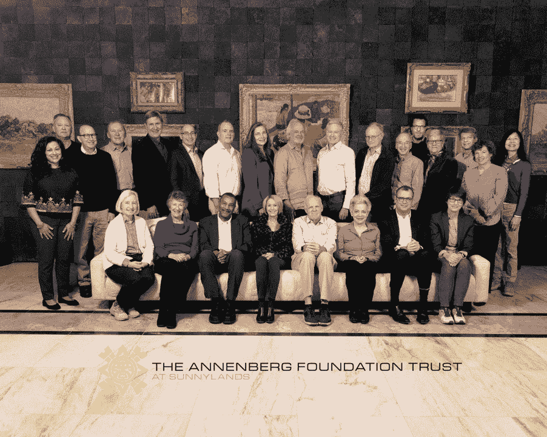

图 1.1. 位于阳光山的安南堡基金会信，与宾夕法尼亚大学安南堡公共政策中心合作。站立者（从左至右）：肖贝塔·帕尔塔萨拉帕迪（Shobita Parthasarathy），密歇根大学公共政策卓越教授；大卫·J·莱恩（David J. Lane），阳光山安南堡基金会信主席；迈克尔·威瑟尔（Michael Witherell），劳伦斯·伯克利国家实验室主任；托姆·米切尔（Tom Mitchell），卡内基·梅隆杰出研究；马克·格里夫斯（Mark Greaves），`AI2050`执行主任；大卫·凯撒（David Kaiser），麻省理工学院（MIT）历史学卓越教授；威廉·基尼（William Kearney），美国国家科学院（NASEM）新闻执行主任；安妮·玛丽·马扎（Anne-Marie Mazza），NASEM 高级总监；胡安·恩里克斯兹（Juan Enriquez），埃克塞尔风险管理公司（Excel Venture Management）总经理；埃里克·霍尔维茨（Eric Horvitz），微软首席科学官；威廉·普雷斯（William Press），德克萨斯大学大学奥斯汀分校计算机科学卓越教授；索尔·珀尔穆特（Saul Perlmutter），加州大学伯克利分校物理卓越教授；乌尔斯·加瑟（Urs Gasser），慕尼黑工业大学（TUM）公共政策教授；凯瑟琳·霍尔·杰米森（Kathleen Hall Jamieson），安南堡公共政策中心主任；亚历克斯·约翰·伦敦（Alex John London），卡内基·梅隆伦理学卓越教授；凯瑟琳·多尔蒂（Kathleen Doherty），阳光山安南堡基金会信首席战略与研讨会办公室主管；珍妮特·M·王（Jeannette M. Wing），哥伦比亚大学研究副总裁。就坐者（从左至右）：玛莎·米诺（Martha Minow），哈佛大学法学卓越教授；苏珊·内斯（Susan Ness），前美国联邦通信委员会（FCC）专员；约瑟夫·弗兰西斯哥（Joseph Francisco），宾夕法尼亚大学地球与环境科学卓越教授；马西亚·麦克纳特（Marcia McNutt），美国国家科学院（NAS）主席；约翰·亨内西（John Hennessy），斯坦福大学名誉校长；芭芭拉·格罗斯茨（Barbara Grosz），哈佛大学自然科学卓越教授；杰拉尔德·豪格（Gerald Haug），利奥波波迪纳学院主席；玛丽·L·格雷（Mary L. Gray），微软研究院高级首席研究员。

基于此，从`AI`研讨会产生的《阳光山宣言》（见第 10 章）建立在以下基础上：“生成式`AI`系统通过计算程序构建，这些程序从大量人类编写和策划的文本、图像和分析（包括广泛的科学文献）中学习。这些系统被用于执行多种操作，如解决问题、数据分析、文本和视觉内容的解释，以及文本、图像和其他形式数据的生成。在响应提示和其他指令时，系统可以为用户提供连贯的文本、引人入目的图像和分析，同时具有生成新合成和想法的能力，推了自动化内容创作预期边界。”

作为“理解今日`AI`相关的机遇与风险”的手段，在第 4 章“我们曾在此来过：管理人工智能的历史先例”中，高级学习学院的研究员马克·艾迪多诺夫（Marc Aidinoff）和麻省理工学院科学史杰姆斯豪森教授大卫·凯撒（David Kaiser）考虑了科学界如何处理三个历史事件：“20 世纪 40 年代和 50 年代的早期核武器复合体；20 世纪 70 年代的生物技术、生物医学以及各种安全保障措施的实施；以及过去一个世纪里美国法律和刑事司法系统对取证技术的采纳和监管。”在《科学与技术》摘要中，他们认为“人工智能需要持续且有意义的民主监督”，这种监督可以通过理解这些历史事件获得启示。²⁰

在第 5 章“作为规范领域的导航`AI`治理：规范、模式与动态”中，慕尼黑工业大学公共政策、治理与创新技术教授乌尔斯·加瑟（Urs Gasser）探讨了围绕`AI`的“快速演变且复杂的生态系统”，并识别了决策者在“预测、分析和应对与`AI`开发、部署和使用加速相关的危害和风险时，同时利用其对人类、社会和整个星球的潜力”的各种工具。这包括伦理和技术标准。在其摘要中，加瑟呼吁`AI`治理应“为开发和学习留空间”，优先考虑互操作性并投资实施能力。²¹

卡内基·梅隆大学 K&L Gates 伦理与计算技术亚历克斯·约翰·伦敦（Alex John London）在第 6 章“评估新兴技术的挑战以及对公正驱动的塑造方法的需求”中，为评估生成式`AI`等创新提供了公正驱动框架的依据。他认为，以公正为关注的方法能够识别和评估“(a) 典型的社会或高阶效应（如网络级或机构级效应）；(b) 以更间接方式塑造创新生态系统的更多利益相关者的作用；以及 (c) 与评估创新相关的个人的一些积极伦理主张。”在其《科学与技术》摘要中，伦敦认为公正驱动的框架将促进“在面对技术变革时更好地保障人们自由的社会安排”。²²

在第 7 章“引入力量：重新思考人工智能的公平解决方案”中，密歇根大学公共政策及女性与性别研究教授 Shobita Parthasarathy 和密歇根大学信息学院的博士生 Jared Katzman 让我们关注了人们日益增长的担忧，即人工智能正在“加剧社会不平等和不公”。他们的文章探讨了“政策制定者、学术界和技术社区”的应对措施，包括拜登政府提出的`AI 人工智能权利法案蓝图`。该文件“建议识别数据集中的统计偏差，设计系统在决策时更具透明度和可解释性，在系统设计中纳入主动的公平评估（包括来自不同观点和身份的意见），确保残障人士的无障碍，进行部署前和持续的差异测试与缓解，以及清晰的监督。”²³ 他们认为，许多此类倡议未能取得成功，因为它们未能解决“塑造技术开发、使用和治理格局的社会不平等，包括经济和政治权力集中在少数科技公司手中，以及对普通贡献和视角的系统性贬值（特别是来自那些在历史上被边缘化的群体）。”相反，正如他们在《科学与技术中的问题》中所述的那样，人工智能监管机构应当“寻求与边缘社区建立伙伴关系”，以理解“人工智能偏差和歧视担忧根源上的权力不平衡”。

Horvitz 和 Mitchell 在第 8 章“人工智能的科学进展：历史、现状与未来”中总结了人工智能数十年来“通过经验研究与原型进行创新、理论原则的发展以及范式的转变”的历程。在此过程中，他们提供了一个视角来理解“数据和知识的表示与推理的不同方法的技术演进”、今日人工智能的机器学习基础、判别式和生成式模型、监督学习、无监督学习和自监督学习，以及深度学习引起的人工智能折点。他们还定义了关键概念和研究方向，随后展望第二个转折点：生成式人工智能，并规划了其研究方向、趋势以及在判别式和生成式人工智能应用方面的关键机遇。

作为这些工作的补充，人工智能工作组成员、`劳伦斯·伯克利国家实验室`主任 Michael Witherell 和德克萨斯大学奥斯汀分校计算机科学与整合生物学 Leslie 教授 William Press 计划在 4 月 27 日举办一场研讨会。该会议是`国家科学院`2024 年年度会议的一部分，由工作组成员、`哥伦比亚大学`研究执行副总裁兼计算机教授 Jeannette Wing 主持，她在研讨会上的演讲是第 3 章“人工智能背景下的科学”的基础（图 1.2 和图 1.3）。

“我们今天听到的关于人工智能（AI）的讨论大多集中在对隐私丢失、缺乏透明度和问责制、不平等的加剧以及其他社会经济问题的担忧，”研讨会策划者 William Press 和 Michael Witherell 指出。“生成式人工智能的广泛可用正推动着许多辩论。然而，人工智能不仅仅是大语言模型，事实上，人工智能各个版本几十年来一直推动着科学发现和探索。”²⁴

此次研讨会题为“人工智能与科学发现”，提供“了一个机会来听取处于开发人工智能前沿的演讲者的意见，他们如何推进研究，包括自动化工作流、在大型复杂数据集中寻找模式、减轻人类偏见、改进模型、加速繁琐任务以及探索人类不适宜的领域。”


图 1.2。`国家科学院`主席 Marcia McNutt 讨论关于人工智能与科学的座讨会。


图 1.3。立：Jeannette M. Wing，`哥伦比亚大学`研究执行副总裁兼计算机教授，在 2024 年 4 月 27 日的`国家科学院第 161 届年度会议`上主持了题为“人工智能与科学”的研讨会。坐（左至右）：Jennifer Listgarten，加州伯克利大学：“人工智能生成数据的永动机器”；Michael Pritchard，加州大学欧文分和 Nvidia：“对天气预测和气候模拟的影响”；Daphne Koller，Insitro：“利用 AI 加速药物发现”；Pushmeet Kohli，Google DeepMind：“数字生物的新时代。”

加入 Wing 共同探索人工智能辅助研究的承诺和可能的未来的是四位小组组成员：

Pushmeet Kohli，`Google DeepMind`研究副总裁

Daphne Koller，`Insitro`创始人兼首席执行官

Michael Pritchard，`NVIDIA`气候模拟研究主任、`加州大学欧文分校`教授


# Jennifer Listgarten，加州大学伯克利分校计算机科学教授

为了在虚拟线下座谈研讨会上提供人工智能如何影响科学的快照，Sunnylands 工作组的`国家科学院`、`国家工程院`和`国家医学科学院`成员分享了他们对人工智能如何影响或可能影响其工作的看法。为了记录在座谈会参与者起草 PNAS 社论中的行动号召的这几个月里，人工智能转型科学研究的这种感触，我们在第 9 章“跨学科对人工智能的观点”中包含了他们想法的摘要。

该工作组的社论声明《在生成式人工智能时代保护科学完整性》于 2024 年 5 月 21 日发表在`美国科学院院报 (PNAS)`上，并作为第 10 章收在本书中。²⁵ 社论强调，生成式人工智能的进步代表了科学的一个转型时刻——这一时刻将加速科学发现，但也将挑战科学的核心准则和价值观，如问责制、透明度、可复制性和人类责任。“我们欢迎人工智能在各个科学领域推动的进步，但我们也需要警惕并维护长期以来的科学准则和价值观，”国家科学院主席、社论共同作者之一 Marcia McNutt 说道。“我们希望我们的论文能引发研究人员的反思，并为在生成式人工智能日益用于研究过程中保护科学完整性所做的共同努力奠定基础。”²⁶

这二十四位作者还呼吁国家科学院建立一个“科学领域人工智能负责任使用战略委员会”，以便在技术演进过程中，对责任制和最佳实践提供持续的指导和监督。作者建议，该拟议的战略委员会应由国家科学、工程和医学科学院建立，并应与科学界协调，就人工智能的适当使用提供定期更新的指导。该委员会应研究、监控并解决人工智能在科学中不断演进的使用情况；新的伦理和社会关切（包括公平性问题）；以及对科学准则的新兴威胁。它还应该在不同学科之间分享其见解，并开发和完善最佳实践。

本合订本概述了形成“在生成式人工智能时代保护科学诚信”这一声明所引发的讨论，并展示了 2024 年春季 AI 科学的现状，以及科学界领袖们为确保在研究中以负责任的方式使用人工智能所付出的努力。我们希望这能为思考这项快速发展且具有变革性的技术提供基础。

## Notes

1. Paul Mozur, “Google’s AlphaGo Defeats Chinese Go Master in Win for A.I.,” New York Times, May 23, 2017, https://www.nytimes.com/2017/05/23/business/google-deepmind-alphago-go-champion-defeat.html.

2. Mozur, “Google’s AlphaGo Defeats Chinese Go Master.”

3. OpenAI, “Introducing OpenAI o1,” September 12, 2024, https://openai.com/o1/.

4. Fostering Responsible Computing Research, National Academies Press eBooks (2022), 41, https://doi.org/10.17226/26507.

5. Partial support for the Sunnylands Retreats was provided by the Ralph J. Cicerone and Carol M. Cicerone Endowment for NAS Missions.

6. Chapter 4: “We’ve Been Here Before: Historical Precedents for Managing Artificial Intelligence,” by Marc Aidinoff and David Kaiser; Chapter 5: “Navigating AI Governance as a Normative Field: Norms, Patterns, and Dynamics,” by Urs Gasser; Chapter 6: “Challenges to Evaluating Emerging Technologies and the Need for a Justice-Led Approach to Shaping Innovation,” by Alex John London; Chapter 7: “Bringing Power In: Rethinking Equity Solutions for AI,” by Shobita Parthasarathy and Jared Katzman; Chapter 8: “Scientific Progress in Artificial Intelligence: History, Status, and Futures,” by Eric Horvitz and Tom Mitchell.

7. Annenberg Public Policy Center, “National Academies, Sunnylands, and APPC Host Retreats on Protecting the Integrity of Science,” August 7, 2020, https://www.annenbergpublicpolicycenter.org/nas-appc-sunnylands-retreats-integrity-science/.

8. Bruce Alberts et al., “Self-Correction in Science at Work,” Science 348, no. 6242 (June 26, 2015): 1420–1422, https://doi.org/10.1126/science.aab3847.

9. Marcia K. McNutt et al., “Transparency in Authors’ Contributions and Responsibilities to Promote Integrity in Scientific Publication,” Proceedings of the National Academy of Sciences 115, no. 11 (February 27, 2018): 2557–2560, https://doi.org/10.1073/pnas.1715374115.

10. National Academies of Science, Engineering, and Medicine, “New Strategic Council for Research Excellence, Integrity, and Trust Established by National Academy of Sciences to Support the Health of the Research Enterprise,” National Academies, July 13, 2021, https://www.nationalacademies.org/news/2021/07/new-strategic-council-for-research-excellence-integrity-and-trust-established-by-national-academy-of-sciences-to-support-the-health-of-the-research-enterprise.

11. Kathleen Hall Jamieson et al., “Protecting the Integrity of Survey Research,” PNAS Nexus 2, no. 3 (March 1, 2023), https://doi.org/10.1093/pnasnexus/pgad049.

12. Some individuals represent several of the Academies.

13. Fostering Integrity in Research, National Academies Press eBooks (2017), https://doi.org/10.17226/21896.

14. Reproducibility and Replicability in Science, National Academies Press eBooks (2019), https://doi.org/10.17226/25303.

15. Fostering Responsible Computing Research.

16. Automated Research Workflows for Accelerated Discovery, National Academies Press eBooks (2022), https://doi.org/10.17226/26532.

17. AI For Scientific Discovery, National Academies Press eBooks (2024), https://doi.org/10.17226/27457.

18. National Academies of Medicine, “Generative AI & LLMs in Health & Medicine,” October 25, 2023, https://nam.edu/event/generative-ai-llms-in-health-medicine/.

19. National Academies of Medicine, “Generative AI & LLMs in Health & Medicine,” October 25, 2023, https://nam.edu/event/generative-ai-llms-in-health-medicine/.

20. Generative AI & LLMs in Health & Medicine, October 25, 2023, https://nam.edu/event/generative-ai-llms-in-health-medicine/.


这二十四位作者还呼吁国家科学院建立一个“科学领域人工智能负责任使用战略委员会”，以便在技术演进过程中，对责任制和最佳实践提供持续的指导和监督。作者建议，该拟议的战略委员会应由国家科学、工程院和医学科学院建立，并应与科学界协调，就人工智能的适当使用提供定期更新的指导。该委员会应研究、监控并解决人工智能在科学中不断演进的使用情况；新的伦理和社会关切（包括公平性问题）；以及对科学准则的新兴威胁。它还应该在不同学科之间分享其见解，并开发和完善最佳实践。

本合订本汇总了形成“在生成式人工智能时代保护科学诚信”这一声明所引发的讨论，并展示了 2024 年春季 AI 科学的现状，以及科学界领袖们为确保在研究中以负责任的方式使用人工智能所付出的努力。我们希望这能为思考这项快速发展且具有变革性的技术提供基础。

## Notes

1. Paul Mozur, “Google’s AlphaGo Defeats Chinese Go Master in Win for A.I.,” New York Times, May 23, 2017, https://www.nytimes.com/2017/05/23/business/google-deepmind-alphago-go-champion-defeat.html.

2. Mozur, “Google’s AlphaGo Defeats Chinese Go Master.”

3. OpenAI, “Introducing OpenAI o1,” September 12, 2024, https://openai.com/o1/.

4. Fostering Responsible Computing Research, National Academies Press eBooks (2022), 41, https://doi.org/10.17226/26507.

5. Partial support for the Sunnylands Retreats was provided by the Ralph J. Cicerone and Carol M. Cicerone Endowment for NAS Missions.

6. Chapter 4: “We’ve Been Here Before: Historical Precedents for Managing Artificial Intelligence,” by Marc Aidinoff and David Kaiser; Chapter 5: “Navigating AI Governance as a Normative Field: Norms, Patterns, and Dynamics,” by Urs Gasser; Chapter 6: “Challenges to Evaluating Emerging Technologies and the Need for a Justice-Led Approach to Shaping Innovation,” by Alex John London; Chapter 7: “Bringing Power In: Rethinking Equity Solutions for AI,” by Shobita Parthasarathy and Jared Katzman; Chapter 8: “Scientific Progress in Artificial Intelligence: History, Status, and Futures,” by Eric Horvitz and Tom Mitchell.

7. Annenberg Public Policy Center, “National Academies, Sunnylands, and APPC Host Retreats on Protecting the Integrity of Science,” August 7, 2020, https://www.annenbergpublicpolicycenter.org/nas-appc-sunnylands-retreats-integrity-science/.

8. Bruce Alberts et al., “Self-Correction in Science at Work,” Science 348, no. 6242 (June 26, 2015): 1420–1422, https://doi.org/10.1126/science.aab3847.

9. Marcia K. McNutt et al., “Transparency in Authors’ Contributions and Responsibilities to Promote Integrity in Scientific Publication,” Proceedings of the National Academy of Sciences 115, no. 11 (February 27, 2018): 2557–2560, https://doi.org/10.1073/pnas.1715374115.

10. National Academies of Science, Engineering, and Medicine, “New Strategic Council for Research Excellence, Integrity, and Trust Established by National Academy of Sciences to Support the Health of the Research Enterprise,” National Academies, July 13, 2021, https://www.nationalacademies.org/news/2021/07/new-strategic-council-for-research-excellence-integrity-and-trust-established-by-national-academy-of-sciences-to-support-the-health-of-the-research-enterprise.

11. Kathleen Hall Jamieson et al., “Protecting the Integrity of Survey Research,” PNAS Nexus 2, no. 3 (March 1, 2023), https://doi.org/10.1093/pnasnexus/pgad049.

12. Some individuals represent several of the Academies.

13. Fostering Integrity in Research, National Academies Press eBooks (2017), https://doi.org/10.17226/21896.

14. Reproducibility and Replicability in Science, National Academies Press eBooks (2019), https://doi.org/10.17226/25303.

15. Fostering Responsible Computing Research.

16. Automated Research Workflows for Accelerated Discovery, National Academies Press eBooks (2022), https://doi.org/10.17226/26532.

17. AI For Scientific Discovery, National Academies Press eBooks (2024), https://doi.org/10.17226/27457.

18. National Academies of Medicine, “Generative AI & LLMs in Health & Medicine,” October 25, 2023, https://nam.edu/event/generative-ai-llms-in-health-medicine/.

19. National Academies of Medicine, “Generative AI & LLMs in Health & Medicine,” October 25, 2023, https://nam.edu/event/generative-ai-llms-in-health-medicine/.

20. Generative AI & LLMs in Health & Medicine, October 25, 2023, https://nam.edu/event/generative-ai-llms-in-health-medicine/.


6. Chapter 4: “We’ve Been Here Before: Historical Precedents for Managing Artificial Intelligence,” by Marc Aidinoff and David Kaiser; Chapter 5: “Navigating AI Governance as a Normative Field: Norms, Patterns, and Dynamics,” by Urs Gasser; Chapter 6: “Challenges to Evaluating Emerging Technologies and the Need for a Justice-Led Approach to Shaping Innovation,” by Alex John London; Chapter 7: “Bringing Power In: Rethinking Equity Solutions for AI,” by Shobita Parthasarathy and Jared Katzman; Chapter 8: “Scientific Progress in Artificial Intelligence: History, Status, and Futures,” by Eric Horvitz and Tom Mitchell.

7. Annenberg Public Policy Center, “National Academies, Sunnylands, and APPC Host Retreats on Protecting the Integrity of Science,” August 7, 2020, https://www.annenbergpublicpolicycenter.org/nas-appc-sunnylands-retreats-integrity-science/.

8. Bruce Alberts et al., “Self-Correction in Science at Work,” Science 348, no. 6242 (June 26, 2015): 1420–1422, https://doi.org/10.1126/science.aab3847.

9. Marcia K. McNutt et al., “Transparency in Authors’ Contributions and Responsibilities to Promote Integrity in Scientific Publication,” Proceedings of the National Academy of Sciences 115, no. 11 (February 27, 2018): 2557–2560, https://doi.org/10.1073/pnas.1715374115.

10. National Academies of Science, Engineering, and Medicine, “New Strategic Council for Research Excellence, Integrity, and Trust Established by National Academy of Sciences to Support the Health of the Research Enterprise,” National Academies, July 13, 2021, https://www.nationalacademies.org/news/2021/07/new-strategic-council-for-research-excellence-integrity-and-trust-established-by-national-academy-of-sciences-to-support-the-health-of-the-research-enterprise.

11. Kathleen Hall Jamieson et al., “Protecting the Integrity of Survey Research,” PNAS Nexus 2, no. 3 (March 1, 2023), https://doi.org/10.1093/pnasnexus/pgad049.

12. Some individuals represent several of the Academies.

13. Fostering Integrity in Research, National Academies Press eBooks (2017), https://doi.org/10.17226/21896.

14. Reproducibility and Replicability in Science, National Academies Press eBooks (2019), https://doi.org/10.17226/25303.

15. Fostering Responsible Computing Research.

16. Automated Research Workflows for Accelerated Discovery, National Academies Press eBooks (2022), https://doi.org/10.17226/26532.

17. AI For Scientific Discovery, National Academies Press eBooks (2024), https://doi.org/10.17226/27457.

18. National Academies of Medicine, “Generative AI & LLMs in Health & Medicine,” October 25, 2023, https://nam.edu/event/generative-ai-llms-in-health-medicine/.

19. National Academies of Medicine, “Generative AI & LLMs in Health & Medicine,” October 25, 2023, https://nam.edu/event/generative-ai-llms-in-health-medicine/.

20. Generative AI & LLMs in Health & Medicine, October 25, 2023, https://nam.edu/event/generative-ai-llms-in-health-medicine/.

2018 年 11 月下旬，当我们抵达香港参加第二届人类基因组编辑国际峰会时，收到了一个消息：中国深圳南方科技大学的研究员贺建健编辑了胚胎，这些胚胎发育成了两名仅在一个一个月前出生的双胞胎女孩。我们曾邀请贺博士在峰会上发表演讲，作为自 2015 年开始的关于突破性基因编辑工具（包括`CRISPR-Cas9`）适当使用的全球持续讨论的一部分。在我们向贺博士发送邀请函时，并不知道他的这项实验。当我们在香港得知此事时，峰会组织委员会的所有成员（该小组由美国国家科学院、美国国家医学研究院、英国皇家学会和香港科学院共同召集）都对此深表忧虑。幸运的是，2015 年晚在华盛顿特区举行的首届人类基因组编辑峰会结束时，组织委员会（我们也是其中的成员）发表的声明，为我们有效应对贺博士实验的消息提供了指南。

### 2015 年声明

由美国国家科学院、美国国家医学研究院、英国皇家学会和中国科学院于 2015 年召行的首届峰会引起了全球关注。经过三天的激烈讨论后，组织委员会发表了一份声明，其中宣布了核心结论：

除非并且在 (i) 基于对风险、潜在收益和替代方案的适当理解与平衡，已经解决了相关的安全和有效性问题，并且 (ii) 社会对拟议应用的适当性具有广泛的共识，否则，进行任何种种对生殖系编辑的临床使用都是不负责任的。此外，任何临床使用都应仅在适当的监管下进行。目前，任何拟议的临床使用尚未满足这些标准：安全问题尚未得到充分探索；最具说服力的获益案例有限；许多国家对生殖系修改有法律或监管上的禁止。¹

### 2018 年香港峰会

当我们在 2018 年香港峰会前夕得知贺博士使用`CRISPR/Cas-9`编辑了新生双胞胎女孩的胚胎，特别是针对其中一个名为`CCR5`的基因（该基因编码 HIV-1 进入细胞所需的蛋白质），我们组织委员会的几位成员与他会面，询问他究竟做了什么。我们从他那里了解的情况表明，他的行为是不负责任的，因为 2015 年声明中设定的条件尚未满足（目前也未满足）。然而，我们同意，出于科学开放的考虑，贺博士应该被允许留在议程中，并获得报告其工作的机会。当他在峰会第二天发言时，礼堂内有近 100 名记者和摄影师，以及约 400 名参会者，并有超过百万的全球观众通过网络直播观看。在贺博士报告结束后，我（大卫·巴尔统，2018 年峰会组织委员会主席）走上讲台，谴责贺的实验是“不负责任的”，并批评他缺乏透明度；随后我补充道：“科学界在自我监管方面失败了。”尽管我们 2015 年的声明提供了我们希望科学界遵循的重要原则，但它未能阻止一名独行侠的科学家追求可遗传的基因组编辑。

香港峰会结束时，由八个国家代表组成的组织委员会发布了一份新声明，对 2015 年的声明进行了更新。在对贺博士报道的实验表示深表忧虑的同时，我们也注意到在进一步开发基因编辑工具方面取得的进展，各国对基因编辑的关注，以及持续公众参与的必要性。我们注意到“体细胞基因编辑向临床试验的快速推进”，但同时强调，我们“继续认为，现在进行任何生殖系编辑的临床使用仍然是不负责任的”。²（体细胞基因编辑是对成年细胞中基因的编辑，而通过生殖细胞进行的可遗传基因组编辑涉及可能传递给后代的编辑。）

### 责任与未来路径

两份声明中的“不负责任”一词并非轻率。责任是科学卓越和诚信的标志。随着科学的进步和我们理解的增加，科学界对其成员保持高期望至关重要。

此类声明并非意味着一成不变的，而应随着科学的发展和社会关注点的变化而更新。因此，我们的第一份声明承认，“随着科学知识的进步和社会观点的演变，生殖系编辑的临床使用应定期重新审视。”³ 因此，2018 年的声明要求一种更明确的方法，以确定未来是否可以根据科学和医学规范及价值观，在临床环境中允许生殖系编辑。我们表示

临床实践的科学理解和技术要求仍然太不确定，风险太大，目前不允许进行生殖系编辑的临床试验。然而，过去三年的进展以及本次峰会的讨论表明，现在是时候定义一条通此类试验的严谨、负责任的转化路径了。⁴

此外，声明强调路径必须遵循

广泛接受的临床研究标准，包括过去三年内发布的基因组编辑指南文件中阐述的标准。这样一条路径将需要建立临床前证据和基因修改准确性的标准、评估临床试验从业人员的胜任能力、制定可执行的职业行为标准，以及与患者和患者倡导小组建立强有合作伙伴关系。⁵

### 2023 年伦敦峰会

2018 年峰会之后，许多组织发布了详细阐述此类路径的报告。⁶ 当我们在 2023 年在伦敦集会召开第三届人类基因组编辑国际峰会时（由本文合作者罗宾·洛威尔-巴奇主持），世界刚刚开始从全球大流行病中恢复。由 11 个国家代表组成的组织委员会在考虑到体细胞编辑取得巨大进展的下，寻求继续关于基因组编辑科学与伦理的讨论。我们还更加关注了获取性、成本和公平性问题，特别是考虑到新兴基因编辑疗法的价格。

正如我们在前两次峰会一样，组织委员会在第三届峰会结束时发布了一份声明。该声明注意到体细胞基因组编辑取得了“显著”进展，根据包括患者自述在内的证明，它可以治愈曾经无法治愈的疾病。此外，声明指出，为了实现体细胞编辑的全部治疗效益，“需要研究以扩大其可以治疗的疾病范围，并更好地理解风险和意外影响。”⁷ 它指出，“目前体细胞基因疗法的极高成本不可持续的”，并确定迫切需要“全球范围内对这些疗法负担且公平的获取”。⁸

对于可遗传基因组编辑，委员会重申“在目前是不可接受的”。⁹ 此外，我们补充道：“公众讨论和政策辩论仍在进行，对于解决是否应该使用该技术至关重要。负责任使用人类可遗传基因组编辑的治理框架和伦理原则尚未建立。必要的安全和有效标准尚未满足。”¹⁰

我们在 2015 年的峰会对追求体细胞基因编辑技术奠定了基础，同时对遗传性编辑表达了极其谨慎的态度。在随后的八年里，这些声明重新确认、澄清并记录了科学进展和社会应对的演变。每份声明都建立在科学界所获得的知识，以及社会对参与科学临床应用决策不断不断变化的预期和需求之上。尽管在诸此类争议性问题上很难达成普遍共识，但这些声明是由不同的组织委员会撰写的，并采纳了多元化受众的意见。它们为科学界和公众提供了一个参考点，并促进了与不同利益相关者之间的持续互动。尽管我们不具备全球监测的能力，尽管 `Dr. He` 演示了遗传性基因组编辑的实现相对容易（尽管效果非常糟糕），但我们目前尚未获知任何其他对人类遗传性生殖系编辑的尝试。我们不愿将这种克制归功于峰声明，但我们相信此类声明为科学界在考虑新兴技术时提供了指导和依据。人工智能，尤其是生成式 AI，就是一个典型的例子。这项技术可能会对科学和社会的所有方面产生巨大影响。可能需要更严格的治理，但在此期间，为 `AI` 在研究中的开发和部署提出指导原则，是科学界领导者可以采取的适当步骤，以传达其应当以维护科学完整性和规范并增强公众信任的方式被负责地使用。

## Notes

1. 国际人类基因编辑峰会组织委员会，“关于人类基因编辑：国际峰会声明，”国家科学院，2015 年 12 月 3 日，https://www.nationalacademies.org/news/2015/12/on-human-gene-editing-international-summit-statement。

2. “第二届人类基因组编辑国际峰会组织委员会声明，”国家科学院，2018 年 11 月 28 日，https://www.nationalacademies.org/news/2018/11/statement-by-the-organizing-committee-of-the-second-international-summit-on-human-genome-editing。

3. “第二届人类基因组编辑国际峰会组织委员会声明”。

4. “第二届人类基因组编辑国际峰会组织委员会声明”。

5. “第二届人类基因组编辑国际峰会组织委员会声明”。

6. 国家医学科学院、国家科学学院和皇家学会，《遗传性人类基因组编辑》（华盛顿特特区：国家科学院出版社，2020 年），https://nap.nationalacademies.org/catalog/25665/heritable-human-genome-editing；世界卫生组织人类基因组编辑治理与监督全球标准专家委员会，《人类基因组编辑：治理框架》（世界卫生组织，2021 年），https://iris.who.int/bitstream/handle/10665/342484/9789240030060-eng.pdf?sequence=1&isAllowed=y。

7. “第三届人类基因组编辑国际峰会组织委员会声明，”皇家学会，2023 年 3 月 8 日，https://royalsociety.org/news/2023/03/statement-third-international-summit-human-genome-editing/#:~:text=Heritable%20human%20genome%20editing%20remains,editing%20are%20not%20in%20pl。

8. “第三届人类基因组编辑国际峰会组织委员会声明”。

9. “第三届人类基因组编辑国际峰会组织委员会声明”。

10. “第三届人类基因组编辑国际峰会组织委员会声明”。

# 第 3 章：AI 背景背景下的科学

Jeannette M. Wing

生成式 `AI` 甚至让计算机科学界也感到意外。为了让这种变革具有背景性，让我们从头开始，回顾两波 `AI` 浪潮，然后将科学置于这一时间线上。通过选择性的亮点，我将提供一份精简的 `AI` 历史；作为生成式 `AI` 的 transformer 架构的简化视角；以及关于 `AI` 如何惠及科学的俯视视角。

## 第一部分：AI 时间线

1950 年，被视为现代计算机科学之父的阿兰·图灵提出了`图灵测试`：如果一个人类与机器互动，且该人类无法区分与机器互动与与另一个人类互的区别，那么这台机器就通过了`图灵测试`。因此，我们可以认为这台机器在某种意义上表现出了人类智能。

1956 年不仅是人工智能术语诞生的年份，也是 `AI` 作为一种学术追求的开始。在达特茅举行的一次夏季会议上，参与者们询问我们是否可以制造一种模拟人类行为的机器。这一 `AI` 的宏伟目标早期就被认为难以实现。因此，`AI` 的分支不断产生，代表人类智能的子任务：用于视觉的计算机视觉、用于语言的语音识别和自然语言处理，以及用于移动和操作的机器人。其他子任务如逻辑推理和抽象推理与计算机科学的分支有着共同点，包括定理证明、形式化方法和编程语言。上世纪后半叶的 first 波 `AI` 浪潮以用符号而非数值来表示知识，并用规则表示推理为特征。例如，通过以下规则：

```
Man(X) ⇒ Mortal(X)
```

如果苏格拉底是一个人，那么我可以得出结论：苏格拉底是死的。

这些基于规则的方法导致了所谓的“专家系统”，它们在 20 世纪 90 年代进入了科学领域。第一个专家系统项目 `Dendral`¹始于 1965 年，目标是捕获有机化学知识，以便化学家能够“通过分析质谱并利用化学知识”²识别未知的有机分子。专家系统受限于手动输入和维护规则的需求；它们受限于规则词汇，无法扩展到自动学习新的领域知识。

AI 的第二波浪潮始于上世纪末，我们现在仍处于其中。它以机器学习为特征，在机器学习中，人们在数据上训练计算模型，并在模型部署到现实世界后，它可以对以前未见过的数据进行处理。此外，模型会从这些互动中学习，从而随着时间的推移不断改进模型。


深度学习模型的一种形式是深度神经网络（`DNNs`），³ 其特征是具有多层节点，每层通过加权边连接到下一层。每一层中的每个节点根据输入权重计算一个函数，并相应地输出下一层节点的权重。总的来说，`DNN` 将输入数据（例如图像）转换为数据的抽象表示（例如该图像的分类）。举一个简单的例子，假设训练了一个深度神经网络来对图像进行分类。那么，如果我们给它提供一张它从未见过的猫的照片，它将输出那是一只猫。更准确地说，它将输出分类标签“猫”，并伴随着高概率（例如 0.95），并且可能输出另一个不同的标签（例如“老虎”），但概率较低（例如 0.01）。当 2012 年 `AlexNet` 在包含 120 万张图像和 1,000 类类别的 ImageNet 竞赛中获胜时，`DNN` 热潮爆发了。⁴ `DNNs` 显示了通过大数据和大计算，机器在某些任务上的表现可以达到甚至超越人类。它们是自动驾驶汽车计算机视觉系统的一部分；它们实现了手机和客厅桌面设备上个人助理的语音识别；它们还是在 2016 年击败世界顶尖围棋高手的计算系统的核心。

快进十年，进入生成式 AI 时代，在这里我们可以生成新的数据，例如从未写写过的文本或从未创建过的图像。一种生成式 AI 技术基于大语言模型（`LLMs`）。⁵ 对比 `ChatGPT` 与 `GPT4` 的早期探索性论文的作者展示了 `GPT4` 如何生成一个需要微积分知识的证明，对 2022 年国际数学奥林匹克竞赛出现的问题描述进行简化⁶⁶另一种生成式 AI 技术基于扩散模型，⁷ 它们特别擅长生成图像。扩散模型首先迭代地向原始图片（例如一只狗）添加噪声，然后迭代地进行去噪以获得一张新图像，即一张全新的狗的照片。

为了将科学放在这一 AI 时间线的背景下，到 20 世纪 80 年代，超级计算机成为科学的主力，例如执行海量的数值计算并运行基于物理模型的复杂仿真。设备和仪器产生的科学数据爆炸开启了数据驱动科学时代。从嵌入式微芯片到太空望远镜，科学家能够感知世界、进行测量、记录动态，并以前所未有的规模和速度产生自然系统的图像。

大约同一时间，统计机器学习将 AI 分散的子领域重新整合在一起，使视觉、语言和机器人学彼此更加接近，甚至向我们暗示了通用人工智能（`AGI`）的最终到来。

正是大计算、大数据和先进 AI 的汇聚，构成了本次小组讨论使用 AI 进行科学发现的背景。对于科学而言，真正的突破事件出现在 2018 年的 `AlphaFold`，这是一种基于深度学习和强化学习的 AI 系统，能够预测蛋白质结构。⁸

在过去的 10 年里，第二波浪已变成海海啸。我们看到用于创建机器学习模型的计算能力（以每天 petaflops 计算）在过去 10 年中每 3.4 个月翻一倍（图 3.1）。相比之下，由于摩尔定律导致的 2 年翻倍看起来就像曲线的底部。注意 y 轴是对数刻度。自 2010 年以来，我们还看到训练数据规模以 2.2 倍的速度增长⁹。仅在过去的 4 年里，我们已经从讨论 `OpenAI` 的 `GPT3` 十亿级词，转变为讨论 `Databricks` 的 `DBRX` 的万亿级词。

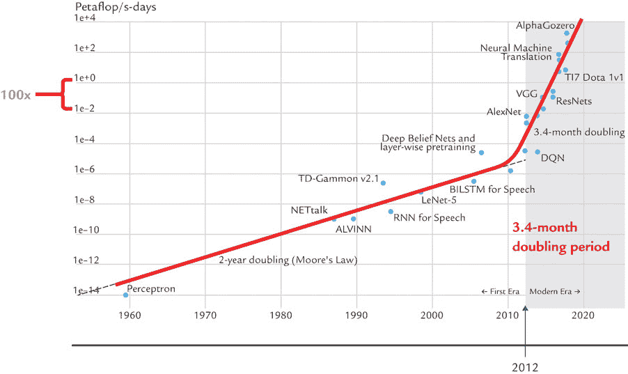

图 3.1. 计算量与机器学习模型。图表自“AI and compute”，`OpenAI`，2018 年 5 月 16 日，https://openai.com/index/ai-and-compute/。

## 第二部分：生成式 AI 架构

科学家如何顺应这股海啸？理解生成式 AI 底层的一些基本概念是值得的，它是 AI 时间线近期动荡的原因，其影响将在长远的未来波及所有努力领域。没有回头路了。今天，生成式 AI 在生成文本和图像方面特别引人。明天，谁知道呢？

例如，为了生成文本，¹ 如果我们向大语言模型输入一个单词序列，那么 `LLM` 就会预测下一个单词。这就是它做的全部！它将产生下一个出现概率最高的单词。更正式地说，当给定初始 `i−1` 个单词时，我们从可能的下一个单词的分布中提取下一个单词：

```
P(wi | w1, …, wi-1)
```

例如，如果我们输入序列“The cute dog begged for a”（那只可爱的狗乞求一个），假设没有其他单词具有更高的关联概率，它将输出“bone”。

### 示例概率

The cute dog begged for a bone 0.85

The cute dog begged for a promotion 0.02

如前所述，我们不仅可以使用 `LLMs`，还可以使用扩散模型生成新图像。扩散模型的灵感源于非平衡态统计物理；¹¹ 自然扩散过程存在于物理、化学和生物中。在扩散模型中，正向过程系统地向图像（例如一只狗）添加噪声，然后我们通过去噪学习反向过程，并在过程中生成一张新图像（图 3.2）。

这两种技术的共同点是，底层概率分布是从数十亿示例中学习的，并表示为深度神经网络。考虑 `transformer architecture`²，它是最先进的大语言模型共享的架构。`transformer architecture` 有两个步骤，这两个步骤都建立在 `DNNs` 之上³ 在第一步中，通过一系列变换，我们将输入编码到多维空间（图 3.3）。

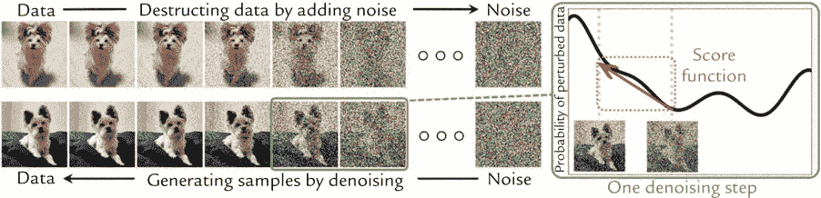

图 3.2. 生成新图像。示例自 Lin Yang, Zhilong Zhang, Yang Song, Shenda Hong, 等人，“Diffusion Models: A Comprehensive Survey of Methods and Applications，”ACM Computing Surveys 56, no. 4 (2023 年 11 月 9 日):1–39，https://doi.org/10.1145/3626235。

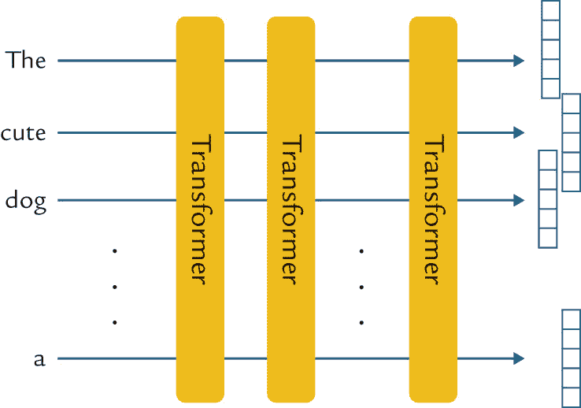

图 3.3. Transformer 架构，步骤 1：编码输入。自 John Launchbury，“The Trajectory of AI，”于 Galois, Portland, OR，2023 年 12 月。

流形假设认为现实的高维数据位于嵌入在高维空间中的低维流形上⁴ 因此，我们可以想象每个 `transformer` 通过线性和非线性操作拉伸和压缩空间中的流形，并将变换后的流形传递给下一层。虽然我们不知道流形假设是否成立，但它至少为每层发生了什么提供了良好的直觉。这一步的结果是每个输入单词都被嵌入到该空间中。嵌入使得用数值表示符号信息成为可能。每个单词都被表示为浮点数向量，每个数字都代表单词的某些特征（见图 3.4 左侧）。嵌入将高维数据转换为低维空间。

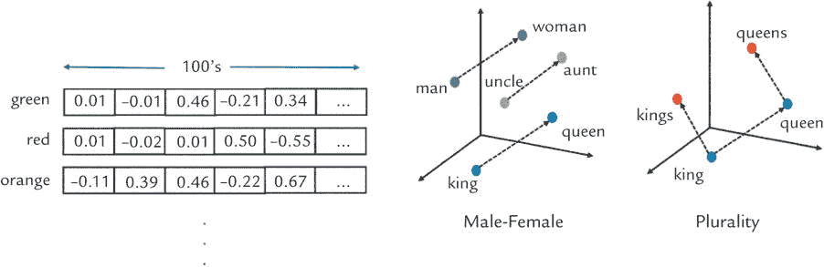

图 3.4. 嵌入抽象地表示知识。

嵌入空间的之处在于距离和方向都有意义；因此我们经常使用向量嵌入这一术语。从嵌入中我们可以学习未显式表示的抽象概念。在图 3.4 右侧所示的嵌入中，“king”之于“queen”正如“man”之于“woman”，代表性别的抽象概念。而“king”之于“queen”正如“kings”之于“queens”，代表复数。（这些示例取自 Mikolov, Yih 和 Zweig 2013 的图 2.¹⁵）

在第二步中，我们在嵌入空间中对输入的词序列进行解码，并最终输出出现概率最高的词¹⁶ 但与过去的 `DNNs` 不同，该架构成功的关键点在于，我们还在 `transformer` 层之间也添加了注意力层（如图 3.5 所示）。

在经过所有这些变换后，我们最终输出了“bone”（带有相关的概率，例如 0.85），然后将其附加到之前的输出标记之后，并作为下一次迭代的输入。这种迭代过程就是 `ChatGPT`的工作原理。

注意力层为正在处理的单词提供了上下文。上下文限制了可能性。每个节点都会向其他节点提供自身的关键信息，例如，“我是一个名词。”每个节点都可以从其邻居查询信息，例如，“我需要一个颜色。”Key 和 query 是信息检索中使用的术语，也被用于 Vaswani 等人 2017 年的研究¹⁷

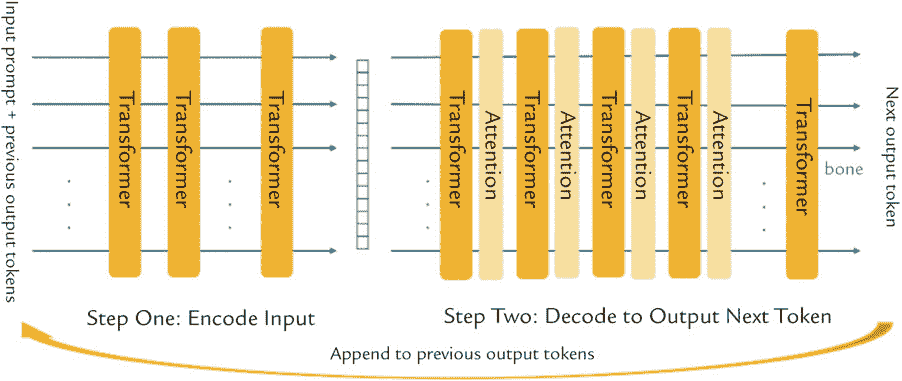

图 3.5. Transformer 架构，第二步：解码并输出下一个标记；注意力层提供上下文。摘自 John Launchbury 在 2023 年 12 月于俄勒冈州波特兰 Galois 的演讲《AI 的轨迹》。

这种上下文可以帮助我们解决语言中的歧义。例如，Winograd Schema¹⁸（被认为是微型图灵测试）被大语言模型轻松解决，这使得 `LLMs` 似乎能够进行常识推理。在这个例子中：

奖杯放不下棕色箱子，因为它太[大/小]。

“它”是指“奖杯”还是“箱子”并不清楚。如果我们知道最后一个词是“大”还是“小”，我们就知道如何解决歧义，这可能位于更长输入序列的上下。

## 第三部分：AI 科学

让我们暂时离开 AI，探索科学如何从 AI 中获益。科学家可以使用生成式 AI 生成合成数据、生成模拟，更有趣的是生成新的假设。这些新假设的新颖之处在于，由于计算机可以访问海量数据，它可以发现人类永远不会、或人类需要耗费一生才能揭发现的模式或相关性。

即使使用更成熟的技术（如 `DNNs`），科学家也可以使用 AI 进行识别和发现。我们可以分类和预测物体，识别并发现新模式，以及检测异常和罕见事件。我们可以用 AI 设计和优化实验，由 AI 建议下一次实验应该尝试哪些控制参数。在大型昂贵仪器（例如粒子加速器、望远镜或中微子探测器）上运行实验时，自动化实验设计特别节省成本和节省时间。我们甚至可以使用 AI 提议新的实验和方案。众所周知，通过使用目前的 AI 技术（例如 `LLMs`），科学家可以自动查阅科学文献，快速总结结果并创建引人注目的视化效果。最后，由于 AI 技术不取决于我们所工作的科学领域，通过使用 AI，我们有潜力加速跨学科工作。

跨越这些应用类别，我们可以利用多种多样化的数据源来训练和测试用于科学的新 AI 模型：

- 科学出版物、预印本、实验笔记本
- 数据库、共享仓库、`github`
- 实验数据
- 来自设备和科学仪器（从从小到大）的数据
- 来自模拟的数据
- 来自互联网/网络的数据

这些来源可以是多模态的、结构化和非结构化的：文本、图像、图表、表格、音频、视频、临床、软件等。

具体来说，考虑两个未被专家小组涵盖的科学学科，以看看 AI 如何已经在帮助做出新发现。

在天文学中¹⁹科学家使用 `DNNs` 识别星系，现在可以以 98% 的准确率对星系进行分类。天文学家使用 AI 发现新的系外行星，预测新类型引力波的特征，并发现两个黑洞合并的独特物体。他们使用生成式 AI 来产生更清晰的图像。

在材料科学中²⁰设计空间巨大。一个具有 100 个氨基酸的短聚合物设计比宇宙中的原子还要多³科学家正在使用生成式 AI 创建材料设计。例如，Markus Buehler 使用 `LLMs` 创建了前未见的菌丝复合材料。科学家正在探索如何使用 AI 来识别新的方程和算法，可视化复杂系统，并预测新材料将如何表现。

## 未来何？

展望未来，科学界已经在探索如何为他们的科学领域构建基础模型，这些模型可以微调到特定问题甚至其他领域。例如，Flatiron Institute 的 Shirley Ho 领导 Polymathic AI 计划，这是一个由来自物理、天文学、数学、人工智能和神经科学的专家组成的国际多学科团队，旨在构建可以应用于广泛科学问题的基础模型。² 作为另一个例子，`Prov-GigaPath` 是一个在来自 Providence（大型医疗网络）13 亿个图像块上预训练的全扫描病理基础模型²³

科学家可以定制 `transformer` 架构概念并将其应用于领域。预测下一个词的类比是什么？语言、语法、嵌入和上下文等抽象的类比是什么？例如，天文学家与计算机科学家合作正在探索“行星语言学”，以确定行星系统是否遵循语法规则的自然类别²⁴

尽管大数据和大计算驱动了 AI 的第二次浪潮，但由于许多原因，科学界（包括计算机科学和 AI 研究人员）应该追求小数据和小计算可以实现什么²⁵ 目前只有少数大型科技公司可以访问训练和构建顶级模型的大量数据和计算；学术界资源匮乏。我们是否可以通过更聪明的算法获得类似的功能？此外，在某些科学领域我们可能没有丰富的数据。最后，构建如今的模型消耗了巨大的能量；使用更少的数据构建更小的模型可能更节能。

AI 社区可以追求的方向是将过去的符号模型与现在的统计模型相结合²⁶ 另一种科学混合方法是将机器学习与基于物理的模型（例如用于模拟）相结合。例如，国家科学基金会（NSF）科学技术中心“AI 与物理学习地球 (LEAP)”的目标之一是通过机器学习减少气候模型预测的不确定性包²⁷

AI 已经存在了几十年，但当今的 AI 热潮引起了公众和媒体的极大关注。这又是另一次技术狂潮吗？显然不是。下一代人将无法想象一个没有生成式 AI 作为生活一部分的世界，就像我们这一代人没有互联网或智能手机一样。科学界应该如何应对？理解它、拥抱它，并与其共同探索。

## 致谢

我对这一主题的贡献主要在于汇编了文献中的观点以及他人讲座中的内容（见脚注）。我感谢 `Chris Impey` 允许我使用他关于 AI 和天体物理论文中的内容，感谢 `John Launchbury` 和 `Rebecca Willette` 允许我将他们演示稿的内容用于我的演讲和本文。此外，在讨论 AI 与材料科学时，我大量参考了 `Markus Buehler` 的演讲。

### 注释

1. Robert K. Lindsay, Bruce G. Buchanan, Edward A. Feigenbaum, and Joshua Lederberg, “DENDRAL: A Case Study of the First Expert System for Scientific Hypothesis Formation,” `Artificial Intelligence` 61, no. 2 (1993): 209–261, https://doi.org/10.1016/0004-3702(93)90068-M.

2. “Dendral,” Wikipedia (n.d.), https://en.wikipedia.org/wiki/Dendral.

3. Yann LeCun, Yoshua Bengio, and Geoffrey Hinton, “Deep Learning,” `Nature` 521 (May 27, 2015): 436–444, https://www.nature.com/articles/nature14539.

4. Alex Krizhevsky, Ilya Sutskever, and Geoffrey E. Hinton, “ImageNet Classification with Deep Convolutional Neural Networks,” `Communications of the ACM` 60, no. 6 (May 24, 2017): 94–90, https://doi.org/10.1145/3065386.

5. Ashish Vaswani, Noam Shazeer, Niki Parmar, Jakob Uszkoreit, et al., “Attention Is All You Need,” Proceedings of the 31st International Conference on Neural Information Processing Systems (December 4, 2017): 6000–6010.

6. Sébastien Bubeck, Varun Chandrasekaran, Ronen Eldan, Johannes Gehrke, et al., “Sparks of Artificial General Intelligence: Early Experiments with GPT-4,” `arXiv`, April 2023, arXiv:2303.12712.

7. Jascha Sohl-Dickstein, Eric Weiss, Niru Maheswaranathan, and Surya Ganguli, “Deep Unsupervised Learning using Nonequilibrium Thermodynamics,” Proceedings of the 32nd International Conference on Machine Learning (2015), https://proceedings.mlr.press/v37/sohl-dickstein15.html.

8. John Jumper, Richard Evans, Alexander Pritzel, Tim Green, et al., “Highly Accurate Protein Structure Prediction with AlphaFold,” `Nature` 596 (July 15, 2021): 583–589, https://www.nature.com/articles/s41586-021-03819.

9. Cade Metz, Cecilia Kang, Sheera Frenkel, Stuart A. Thompson, et al., “How Giants Cut Corners to Harvest Data for AI,” `New York Times`, April 6, 2024, https://www.nytimes.com/2024/04/06/tech-giants-harvest-data.

10. 该 `LLM` 示例来自 `Rebecca Willett` 在 `CCC@AAAS` 2024 的演讲（第一部分）“Generative AI in Science: Promises and Pitfalls.”

11. `Sohl-Dickstein` 等，“Deep Unsupervised Learning using Nonequilibrium.”

12. `Vaswani` 等，“Attention Is All Need.”


13. `transformer` 架构和 `embedding` 示例的高层描绘源自 `John Launchbury` 2023 年 12 月 1 日的 `Trajectory of AI`，https://galois.com/2023/12/trajectory-of-ai/.

14. “Manifold,” Wikipedia (n.d.), https://en.wikipedia.org/wiki/Manifold.

15. Tomas Mikolov, Wen-tau Yih, and Geoffrey Zweig，“Linguistic Regularities in Continuous Space,” Proceedings of `NAACL` (2013): 746–751, https://aclanology.org/13-1090.

16. `LLMs` 运行 `tokens` 而非 `words`；可以将 `token` 视为连续的字符、字母、标点或其他分隔符。本文中交替使用 `word` 和 `token`。

17. `Vaswani` 等，“Attention Is All Need.”

18. Terry Winograd，“Understanding Natural Language,” `Cognitive Psychology` 3, no. 1 (1972): 1–191, https://doi.org/10.1016/0010-0285(72)90002

19. 所有天文学示例均来自 `Chris Impey`，“AI Is Helping Astronomers Make New Discoveries and Learn About the Universe Faster,” `The Conversation`, 2023 年 5 月 3 日，https://theconversation.com/ai-is-helping-astronomers-make-new-discoveries-and-learn-about-universe-faster.

20. 聚合物示例和材料科学的探索性想法来自 `Markus Buehler` 在 `CCC@AAAS` 2024 的演讲（第二部分）“Generative AI in Science: Promises and Pitfalls.”

21. Markus J. Buehler，“Accelerating Scientific Discovery with Generative Knowledge Extraction, Graph-Based Representation, and Multimodal Reasoning,” `arXiv`, 2024 年 6 月 10 日，https://arxiv.org/abs/2403.11996.

22. Michael McCabe, Bruno Régaldo-Saint Blancard, Liam Holden Parker, Ruben Ohana, et al.,"Multiple Physics Pretraining for Surrogate Models,” `arXiv`, 2023 年 10 月 4 日，https://arxiv.org/abs/2310.02994.

23. Hanwen Xu, Naoto Usuyama, Jaspreet Bagga, Sheng Zhang, et al.,"A whole-slide foundation model for digital pathology from real-world data,” `Nature` 630 (2024 年 5 月 22 日): 181–188,https://doi.org/10.1038/s41586-024-07441-w.

24. Emily Sandford, David Kipping, and Michael Collins，“On Planetary Systems as Ordered Sequence,” `Monthly Notices of the Royal Astronomical Society` 505, no. 2 (2021 年 8 月): 2224–2246,https://doi.org/10.1093/mnras/stab1480.

25. Jeannette M. Wing and Michael Wooldridge, Findings and Recommendations of the May 2022 UK-US AI Workshop（国家科学基金和工程科学研究委员会，2022 年 5 月 3–4 日），https://www.cs.columbia.edu/~wing/publications/WingWooldridge2022.pdf.

26. Wing and Wooldridge，“Findings and Recommendations of the May 2022 UK-US AI Workshop.”

27. “About Learning the Earth using Artificial Intelligence and Physics (LEAP),”国家科学基金科技中心计划，2021，https://leap.columbia.edu/about/.

28. Jennifer Listgarten，“The Perpetual Motion Machine of AI-Generated Data and the Distraction of ChatGPT as a ‘Scientist,’ ” `Nature Biotechnology` 42 (2024 年 1 月 25 日): 371–373,https://doi.org/10.1038/s41587-023-02103-0.

29. Wolfgang Blau, Vinton G. Cerf, Juan Enriquez, Joseph S. Francisco, et al.,"Protecting Integrity in the Age of Generative AI,” `Proceedings of the National Academy of Sciences` 121, no. 22 (2024 年 5 月).

30. Jeannette M. Wing，“Trustworthy AI,” `Communications of the ACM` 64, no. 10 (2021 年 10 月): 64–71; David `davidad` Dalrymple, Joar Skalse, Yoshua Bengio, Stuart Russell, et al.,"Towards Guaranteed Safe AI: A Framework for Ensuring Robust and Reliable AI Systems,” `arXiv`, 2024 年 5 月 10 日，https://arxiv.org/abs/2405.06624.

第 4 章

## 引言

科学和技术创新是由人类创造的，因此也可以由人类治理。尽管流行中充斥着渲染的描述，认为公民被技术复杂性所震慑或屈服于新技术的不可阻挡的进军，但历史告诉我们，像人工智能这样的新技术可以——而且必须——在持续且有意义的民主监督下进行开发。技术专家的自我监管永远不足以维持一个值得公众信任的创新生态系统。当代人工智能（AI）及相关的计算技术可能是独特的现象现象，但它们同样可以为了公共利益进行治理。

我们并非将人工智能（AI）治理视为一个抽象问题，而是敦促政策制定者依靠过去参与中丰富的经验记录，对当下的挑战进行概念化并做出恰当应对。历史提供了一个多个重叠的真实世界案例库，在这些案例中，技术专家、政策制定者和更广泛的公众曾应对过曾经的新型技术。评论人士和政策制定者在思考新技术的挑战时，往往狭隘地关注某一个历史事件或类比——最常见的是转向二战期间规模巨大的曼哈顿计划，或者 20 世纪 70 年代中期生物科学家在阿西洛马尔（Asilomar）的著名会议。然而，考虑多个类比和不相似之处，可以阐明评估潜在危害和可能益处的互补维度。

在这篇简报中，我们考虑了三个历史阶段：20 世纪 40 年代和 50 年代初期的核武器复合体；70 年代的的生物技术、生物医学以及各种防护措施的实施；以及过去一个世纪美国法律和刑事司法系统中对法医技术的采用和监管。每个例子为理解当今 AI 相关的机遇与风险提供了独特的见解。正如我们所讨论的，过去的每个例子都需要大量的参与者在不同尺度上思考：国家和全球安全、当地社区的健康以及个人的民权利。没有任何一个例子与当今挑战有完美的类比；但即使是不相似之处，也能帮助明确当今决策的现实性方案。

正如之前的每个历史阶段所表明的样，科学技术领域在建立关于如何定义和保护公共利益的规范方面往往承担了特殊作用。然而在过去的这些实例中，科学家和技术人员从未对新技术的评估、部署或治理拥有单方面的主导权。历史提供了一个机会，让我们思考过去的每项努力在某些方面取得了成功，但在另一些方面有所不足。因此，在每个例子中，我们确定了思考当今 AI 治理的三个关键主题：研究人员自我监管无法对超出受控实验室环境的产生影响的技术产生有意义的防护措施；为了维持创新生态系统，进行宽泛的投入和监督是必要的；最后，需要进行周期性的审查，以重新评估不断演进的技术以及嵌入其中的、不断变化的社会实践。

# 第一部分：核秘密

从核科学基础发现到庞大武器计划的道路短得令人眩晕。1938 年 12 月，柏林实验室中的第一个迹象让化学家奥托·哈恩（Otto Hahn）和弗里茨·斯特拉斯曼（Fritz Strassmann）感到意外。在收到哈恩的来信更新后，最近被流逐的理论物理学家莉泽·梅特纳（Lise Meitner）和她的侄子奥托·罗伯特·弗里奇（Otto Robert Frisch）提出了卓越的解释：在某些情况下，用中子轰击铀等重原子核会导致核分裂并释放额外的能量¹。哈恩、斯特拉斯曼、梅特纳和弗里奇通过快速发布的科学出版以及与同事的非正式讨论交流了各自的结果；几周内，全世界的科学家开始进行后续研究。弗里奇的导师尼尔斯·波尔（Niels Bohr）与另一位学生美国物理学家约翰·惠勒（John Wheeler）合作，对核裂变进行了详细的理论分析。他们的里程碑式论文于 1939 年 9 月 1 日发表在《物理评论》（Physical Review）上，此时纳粹坦克正入侵波兰，引发了第二次世界大战的爆发²。

甚至在波尔-惠勒论文发表之前，至少五个国家的科学家就已经意识到核裂变可以用于制造一种新型武器，并已开始与政府官员进行讨论。1939 年 4 月，德国教育部举行了一场关于核裂变军事应用的秘密会议，并禁止了铀出口。同月，日本政府启动了“尼计划”（`Project Ni`）以研究裂变可能的武器效应；与此同时，英国的几位物理学家敦促其政府通过从比利刚果获得铀矿石来启动核计划。1939 年 8 月，阿尔伯特·爱因斯坦签署了一封给美国总统罗斯福的信——这封信是由忧虑的移民物理学家西拉拉德（Szilard）和尤金·维格纳（Eugene Wigner）撰写的——警告罗斯福核武器可能利用失控链式反应的可能性。几周后，列宁格勒物理学家库尔恰托夫（Kurchatov）向苏联政府告知了核裂变可能的军事应用³。

鉴于核裂变与新型武器之间存在可能的联系——在国际关系日益恶化的背景下，一些科学家试图控制有关核裂变的信息流。从 1939 年春天开始，离开欧洲抵达纽约的匈牙利物理学家利奥·西拉拉德（Leo Szilard）敦促同事们自愿停止发表新结果。当一些物理学家拒绝隐瞒他们的发现时，西拉拉德构思了一个新计划，允许研究人员将文章提交给科学期刊——这将能够清晰地归类优先权——但与期刊编辑协调推迟某些论文的发表，直到其发布是安全的。这一计划在实践中也被证明是难以实施的，这主要因为它取决于自愿遵守，没有任何执行手段⁴。当库尔恰夫及其在苏联的同事注意到《物理评论》（`Physical Review`）中关于核裂变的出版物明显减少时，他们认为怀疑得到了证实，并加倍努力说服苏联官员重视此事⁵。

西拉拉德的建议侧重于控制信息流，而非监管研究本身。一旦盟军在核武器方面的努力变得更加形式化，并从 1942 年 6 月从平庸的研究小组扩大到曼哈顿工程区（Manhattan Engineer District），这种区别就消失了。在新成立的科学研究开发办公室（`OSRD`）的赞助下，经美国陆军工兵团管理，曼哈顿计划的官员进口了旧的军事机密和供应程序——某些可以追溯到美国进入第一次大战后匆忙通过的 `1917` `间谍法》（`Espionage Act`）——以控制信息、材料和人员的流通。美国联邦调查局（`FBI`）和军事情报部门对研究人员进行了背景审查；莱斯·格罗夫斯（Leslie Groves）将军实施了严格的隔离开规定，试图限制任何个人获取该庞大计划的信息量；大量的基础设施被用于在田纳西州橡树里奇（`Oak Ridge, Tennessee`）和华盛顿州汉福德（`Hanford, Washington`）等秘密设施内生产裂变材料；而像橡胶和汽油等当时处于严格战争配给状态的普通材料被调拨至高优先级项目⁶。

在战争期间，关于保密和分类的旧惯例得到了更新，并针对核武器的情况进行了专门化。这些新规程随着 1946 年 8 月美国《原子能法案》的通过而正式化。尽管该法案将核能复合体的控制权从战争部移交给一个新的民用机构——`原子能委员会 (AEC)`，但在许多方面，`AEC` 强化了战时程序。例如，在新法律下，整类关于核科学和技术的信息被视为“生而即机密”，即默认为机密，只有在经过仔细审查后才发布。该法案还建立了政府对美国各种裂性材料开发和流传的垄断，实际上阻止了私营公司追求民用核发电的努力。（该法案的若干条款在 1954 年进行了修订，明确目标是促进私营部门在核能领域的发展，但结果不一。⁷）

决策者在特定的国内和国际考量下制定了这些监管进展。在国际方面，美国和苏联官员之间的相互怀疑——由于 1946 年 2 月一名苏联密码译员叛逃后引发的震惊发现（即苏联在战争期间曾在曼哈顿计划的多个地点进行间谍活动）而加剧——破坏了建立核科学技术国际控制的早期努力。在国内，各军种之间长期的竞争塑造了关于核武器政策的辩，包括美国是否应该追求下一代武器，如热核（或聚变）炸弹。⁸

正如西拉德早在 1939 年所做的那样，战后许多科学家和工程师努力帮助塑造核科学技术周围实践和规范的演变格局。像 `J. Robert Oppenheimer` 这样的人从战时计划的领导职位转变为战后具有影响力的顾问角色。`Oppenheimer` 起草了若干战后核政策建议，并担任了 `AEC` 新成立的总顾问委员会的主席。其他人，尤其是年轻的同事，成立了如`原子科学家联盟`等新组织，游说立法者实现他们他们政策结果，例如民用（而非军事）控制战后核能复合体，并支持核裁军。⁹

然而，很快科学家们对于控制的幻觉在冷战的现实面前崩溃了。在他们获得重大立法胜利——确保了确立民事监督的《原子能法案》通过——之后，像`原子科学家联盟`这样的组织就成了一个一致运动的目标。`FBI` 和`美国众议院反美活动委员会`针对该`联盟`及其若干个人成员，通过选择性泄露和高调听证会对他们进行抹黑，指控他们有共产主义同情倾向.¹⁰ `Oppenheimer` 1954 年 6 月在 `AEC` 人员安全委员会前臭名昭著的听证会是早已成为常态的晚期例子。事实上，在第二次世界大战结束后的十年里，受国内反共主义影响的年轻、更脆弱的核物理学家比例，超过了任何其他学术学科的代表。复杂的核机密系统变成了一用来沉默批评者的大棒，而这些批评者的律师往往在保护国家安全的名下被拒绝获取信息。¹¹

除了对个人和群体的影响外，战后的核机密制度紧张了与美国盟友（最著名的是英国）的关系，同时在阻止核扩散方面仍然保持相对低效。在战后几年内，苏联制造裂变弹和聚变弹的速度让许多美国当局措不及防；这些努力在部分程度上得到了贯穿了军事控制的战时间谍活动的帮助。可以说，过度的核保密努力加速了军备竞赛，加剧了旷日冷战中危险的边缘政策，并引发了全球范围内过热的代理人战争.¹²

当今天的决策者就如何允许研究人员部署、保留或部分披露新的计算模型和技术提问时，核机密基础设施的案例为官僚过度扩张和政治滥用提供了重要的警示。在战后几年，很少有科学家、工程师或决策者建议所有关于核武器或相关技术的信息都应该公开——扩散担忧是真实的，某些保护措施显然是恰当的。然而，复杂的核机密和控制系统很快变得错综复杂，以至于合法的研究查询被切断，负责的私营部门投资受到阻碍，公开的政治辩论也被压制。¹³

## 第二部分：生物技术与生物医学

里奥·西拉德在 1939 年获知核变后，第一个冲动是试图说服他的科学家同事对发表某些发现采取自愿的禁令。几十年后，在 20 世纪 70 年代中期，一群分子生物学家遵循了类似的路线，敦促同事暂停涉及重组 DNA（`rDNA`）新技术的研究。斯坦福大学生物学家 `Paul Berg` 以及来自美国其他几所顶尖大学和研究机构的同事发出的，超越了西拉德早期的干预：他们敦促对某些类型的研究实行自愿禁令，而不仅仅是发表.¹⁴

到 1974 年春季，`Berg` 他的同事们已经对 `rDNA` 研究的潜在风险感到担忧，尽管他们预见了许多有益的结果。如果病原细菌获得了抗生素性基因，或者致癌基因转移到了其他无害的微生物中怎么办？与战时曼哈顿计划规模巨大、绝密的工业基地不同，`rDNA` 实验涉及规模相对较小的台式设备，因此可以在城市中心不起眼的实验室中进行——例如在 `Berg` 及其同事的大学里。什么样的密封设施和安全协议可以保护研究人员及其邻居免受危险生物材料可能泄漏的影响？如何评估和减轻各种研究项目的风险？¹⁵ 麻省理工学院的 `David Baltimore` 在 `Berg` 和同事在他办公室脑风暴他们的担忧后不久回忆道，“我们坐了一整天，说：‘情况看起来有多糟糕？’我们大多数人给出的答案是……仅仅是你在纸上能写出来的简单场景就足够令人恐惧了，因此，对于使用这种技术的某些限制实验，我们根本不想看到它们被执行。”¹⁶ `Berg`、`Baltimore` 和他们的小组发表了一封简短的公开信，呼吁对 `rDNA` 研究实施自愿禁令——这封信先后发表在《科学》杂志、《自然》杂志和《美国科学院院报》上——直到科学界能够解决此类担忧为止.¹⁷


当他们的信件出版时，伯格小组已受美国国家科学院的委托，负责召开同事会议并为美国国立卫生研究院（`NIH`）制定建议方案。众所周知，那次会议于 1975 年 2 月在加利福尼亚州太平洋格罗夫的阿西洛马会议中心举行。伯格、巴尔的摩和他们最初的讨论伙伴得到了其他杰出生物学家的加入，包括麦克辛·辛格和西德尼·布伦纳。与他们去年春季在麻省理工学院聚会的小组一样，阿西洛马小组几乎完全由生命科学领域的研究人员组成。¹⁸ 他们建议临时延长自愿性研究暂停令，并结合各种类型的`rDNA`实验建立一套风险评估框架和适当的封控设施。1976 年 6 月下旬，美国卫生、教育和福利部发布了规范全美范围内`NIH`资助研究人员进行`rDNA`研究的官方指南，该指南广泛参考了阿西洛马的建议。¹⁹

时至今日，阿西洛马会议仍常被誉为科学家如何成功且负责任地管理风险研究的卓越典范：担忧的科学家们站出来，敦促同事保持克制，并在内部制定了新的准则。然而，正如西拉尔德在核分裂早期呼吁核物理学家进行自我审查一样，生物学家对`rDNA`的自我监管只是后来演变成更宏大过程的一小部分——这一过程涉及了更广泛的利益相关者的投入与谈判。²⁰ 1976 年 6 月的某一个晚晚，就在联邦官员宣布新`NIH`指南的当晚，马萨诸塞州剑桥市市长（这里有哈佛大学和麻省理工学院等著名的、难以管理的研究机构）召开了一场特殊的“重组 DNA 实验听证会”。正如阿尔弗德·维卢奇奇市长在开启特别会议时宣布的那样：“没有任何个人或团体对涉及的利益拥有垄断。无论这项研究发生在这里还是其他地方，无论产生的是好是坏，我们所有人都会受到结果的影响。因此，辩论必须在公共论坛进行，由你们这些公众发挥主要作用。”²¹ 于是，当地大学研究人员、私立医生、市官员和其他关注此问题的公民开始了为期数月的非凡努力，旨在制定一套适当的监管框架，以管理剑桥市范围内的`rDNA`研究——如果新的剑桥实验审查委员会（`CERB`）未能达成能够通过市议会审查的规则，将面临被完全禁令的威胁。²²

`CERB`小组在 1976 年秋季期间每周举行两次公开的公众会议。在会议期间，哈佛和麻省理工的研究人员有机会向非专业人士解释其拟议研究的细节；在其他晚上，`CERB`则就竞争性的安全方案提议主持了公开辩论。类似的公民团体在美国各地的城市集会，商讨当地法规，包括密歇根州的安娜堡、印第纳州的布鲁明顿、威斯康星州的麦迪逊、新泽西州的普林林顿，以及加利福尼亚州的伯克利和圣地哥。在这些司法管辖区，公民都没有在经过充分讨论、审查和辩论的情况下采纳科学家的阿西洛马建议。例如，`CERB`小组要求组建一个新的五人制剑桥生物危害委员会，并对市范围内的`rDNA`实验室进行定期实地检查，这超过了联邦`NIH`指南的要求。只有在`CERB`进行了广泛且有时是棘手的谈判后，剑桥市议会才于 1977 年 2 月初一致投票通过，在市内采纳了当地编写的《重组 DNA 分子技术使用条例》，这在阿西洛马会议之后已经两年。³

随着经过精心谈判的方案出台，该市迅速成为生物技术领域的巨头，并赢得了“基因城（Genetown）”的绰号。随着技术系统日益依赖越来越敏感的数据，这些监管制度显然是不够的，特别是当研究人员依赖第三方供应商与数据收集隔离开时。⁸ 几乎没有个人曾许可（知情同意或其他形式）允许其个人数据、医疗记录或面部图像被此类此类算法项目的训练数据。⁴

在开展`rDNA`工作的同时，生物医学研究人员、政策制定者和监管机构在 20 世纪 70 年代制定了一个独立的框架。在继此前研究中严重滥用行为的引起轰动的披露后——包括对阿拉拉巴马州男士进行的长期的“塔斯基基梅毒研究”——美国国会于 1974 年通过了《国家研究法》。该法案规定建立一个新的国家委员会，负责为保护参与研究的个人提供统一要求。⁵

1979 年，该委员会发布了《贝尔蒙特报告》（`Belmont Report`），阐述了关于处理`人类受试者`的基本原则和具体实践。在新要求中：确保研究项目的参与者给予了`知情同意`，并确保个人的潜在风险与特定研究的潜在收益之间的适当平衡。为了评估和监督这些要求，《国家研究法》规定，涉及人类受试者的联邦资助研究必须由当地的`机构审查委员会`（`IRB`）审查，其成员必须包含具有各种经验和专业知识的人员。每个`IRB`至少有一名成员代表非科学领域的关切。⁶ 就像剑桥的`CERB`过程一样，《国家研究法》要求生物医学研究人员——至少是那些使用联邦资金的人员——协商安全有效的研究实践，其投入和监督延伸到了研究社区之外。新的`IRB`基础设施虽然不完美且有时官僚主义得令人沮丧，但并没有迫使所有研究停滞。相反，它规范化了一套在`NIH`自身研究中心内磨练出的、旨在减轻真实伤害的实践。⁷

1974 年的《国家研究法》和 1979 年的《贝尔蒙特报告》是为了当时的特定关切而形成的。尽管规范人类受试者研究的所谓“通用规则”（`Common Rule`, 美国联邦法 `45 C.F.R. 46`）直到 2017 年才进行过更新，但目前的规定仍无法有效对应涉及人类来源数据和信息的近期研究形式，特别是那些潜在危害不必在数据收集点产生的研究。⁹同样，尽管《通用规则》包含了对受保护受试者的“可识别隐私信息”的清晰定义，但近期依赖汇集和分析大型数据集的计算项目经常违反所声明的隐私保护，即使是在处理去标识化的数据集时。

## 第 3 部分：法医学科学

当利奥·西西拉德（Leo Szilard）和保罗·伯格（Paul Berg）等科学家试图为他们正在开发的科学工作快速构建起防护措施时，约翰·拉森（John Larson）正急于部署他最新的创新：`cardio-pneumo-psychograph`（心肺心理脑电图仪）设备，即“测谎仪”。拉森的目标并不新奇；揭示隐藏的人性真相一直是生理研究的目标。19 世纪的医生对身体如何背叛大脑方式特别感兴趣。例如，埃蒂安·朱尔·马雷（Étienne-Jules Marey）通过对细微变化进行物理测量来揭示压力，他坚信这种测量可以揭示隐藏的内在真理。³⁰到 20 世纪初，领先的心理学家正努力将新兴的共识操作化，即情绪是身体性的。1917 年，威廉·沃尔顿·马斯顿（William Moulton Marston）和他的妻子伊丽莎白·霍洛威·马斯顿（Elizabeth Holloway Marston）发明了一种形式的`polygraph`，但在短短几年内，拉森增加了两个关键见解。第一是对血压进行连续测量并将其记录为一条运行的曲线，监控其相对于基准线的变化。第二是与执法部门合作。³¹

### 早期采用与“谎言检测器”的兴起

1921 年春春天，拉森尝试用他的技术解决了一起真实案件，这是一起像通俗小说一样的戏剧：一枚钻石，推测是被住在寄宿公寓的 90 名女性中的某一个偷走的。小偷在审讯期间记录的血压确实急剧下降，在几天的额外审讯后最终供了。由于记者们渴望获得关于最新犯罪案件的动人叙述，`cardio-pneumo-psychograph`成了极佳的素材，但令拉森遗憾的是，它被重新命名为“谎言检测器”。历史记载甚至归功于报纸压力其他司法管辖区的警方进一步采用该工具。对于加利福尼亚州伯克利的警察局长奥古斯特·沃尔尔默（August Vollmer）来说，`cardio-pneumo-psychograph`特别有吸引力，因为它可以帮助执法部门专业化。沃尔尔默担心依赖个人关系和直觉的腐败警察力量的公众认知，因此对实验新的“科学”警法充满热情。尽管这些方法尚未证实，沃尔尔默相信，通过聘用拉森所获得的科学专业知识光环将增强公众对当地执法的支持。³²

### 扩展到民用高风险领域

从一开始开始，`polygraph`就是一种具有“人格魅力”的技术，引起了公众的兴趣。³³它激发了大众化的描绘，导致`polygraph`在常规警察工作或正式法律环境之外被广泛部署。其中一些用途相对平淡，例如试图理解是什么吸引了某些观众观看电影或演员。但这种不可靠技术在雇佣等更具影响力的领域，风险也随之增加。例如，对冷战核机密制度的遵守情况通过`polygraph`测试进行监管，用以裁定和维护安全许可。除了核复合体之外，尽管`polygraph`具有不可靠性并反复出现偏见，雇主们仍将其视为判断工作胜任性的很有用筛选工具。³⁴

### 法律挑战：弗莱规则与道伯特规则

从 1922 年詹姆斯·弗莱（James Frye）的审判开始，法官不再那么愿意接受`polygraph`。弗莱此前曾供认涉案谋杀，但声称其供认是被迫的。威廉·马斯顿进行了一次`polygraph`测试以验证弗莱的主张。在粗略审查后，法官拒绝将`polygraph`作为证据。随后的“弗莱规则”（Frye Rule）旨在防止仍处于发展中的科学进展进入法庭。相反，像使用`polygraph`机器这样的方法需要获得科学界的“普遍接受”。这一标准编码了一种信念，即陪审团会受到像`polygraph`这样的机器产出的所谓客观科学证据的明显影响。³⁵

在实践中，弗莱规则并没有阻止深度可疑的证据进入诉讼程序——更不用说它们在正式法律环境之外流传。1993 年，`Daubert v. Merrell Dow Pharmaceuticals`提供了一个新标准来取代弗莱规则，进一步赋予法官作为有关新技术的专家证词“守门人”的角色。它要求法官像科学家一样思考，去评估经过同行评审的专业知识。目标没有没有：法院将不是对新技术进行激进实验的地方。³⁶（在实践中，弗莱规则并没有阻止深度可疑的证据进入诉讼程序——更不用说它们在正式法律环境之外流传。1993 年，`Daubert v. Merrell Dow Pharmaceuticals`提供了一个新标准来取代弗莱规则，进一步赋予法官作为有关新技术的专家证词“守门人”的角色。它要求法官像科学家一样思考，去评估经过同行评审的专业知识。目标仍然：法院将不是对新技术进行激进实验的地方。³⁶（直到 2023 年 12 月，美国联邦证据规则 702 的修正案旨在明确专家证词应被视为专家意见，且引入此类证词的人必须满足证据标准。⁷）

### 科学怀疑与有效性

在实践中，弗莱规则并没有阻止深度可疑的证据进入诉讼程序——更不用说它们在正式法律环境之外流传。无论是依靠自己的判断还是评估共识，法官都需要对测谎的的性主张进行评估。反之，科学界反复动员限制测谎仪在法庭的使用。美国技术评估办公室（OTA）在 1983 年的一份报告中得出结论，认为“建立测谎仪测试有效性的科学证据有限”。⁸ 再次，法庭内的刑事法与其他领域的技术部署之间的差异仍然显著。同一份`OTA`报告估计，在联邦政府之外，每年进行超过 100 万次`polygraph`测试。⁹ 近最近，美国科学院领导了对测谎仪可靠性的审查。⁴⁰2003 年的报告在将其排除在法庭之外方面起了关键作用。

### 与指纹分析的比较

与测谎仪相比，其他基于科学的技术长期以来一直纳入法律程序，例如指纹分析。尽管并不完美，但在执法部门和法律环境中使用指纹识别几十年来一直接受专家审查、培训和标准化。⁴¹ 此外，备受关注的误认——例如 2004 年一次误认导致一名居住在俄勒冈州的美国律师因涉及马德里火车爆炸案的指控被错误入狱——引发了专家小组的多次审查，以重新评估指纹识别的科学基础并更新其最佳实践程序。⁴²

### 算法脸识别的时代

算法脸识别技术的轨迹更像测谎仪，而不是指纹识别。³³尽管存在显著且有记录可的缺陷，脸识别技术在法庭之外的高风险背景中已无处不在。⁴³ 数年前，美国标准与技术研究院（NIST）对来自约 100 家供应商的近 200 种不同脸识别算法进行了详细评估。几乎所有的机器学习算法都显示出巨大的差异，在应用于来自西非的黑人图像时，与来自东欧的白人图像相比，其误报率高出 100 倍以上；`NIST`测试还发现，在所有地理地区，应用于女性图像的误报率系统性地高于男性。⁴⁴ 面对这种显而易见的偏见，一些学者要求增加数据集的包容性——在理论上扩大可以识别的面部类型。⁵⁵ 其他人认为包容性是问题而非解决方案，而且包含更多数据会让被识别和被误认的公民面临更大的风险，且没有任何法律救济。⁴⁶

尽管研究界已经识别出这些显著的人口统计偏差，且有数以千计的论文正关注如何在纯净的实验室条件下缓解此类差异的方法，但商用算法早已远远超出了研究领域，进入了具有影响的现实世界场景。⁴⁷ 仅在美国，就有成千上万个不同的执法管辖区可以购买商用人脸识别技术，且不受任何监管、标准化或监督。这种毫无节制的状态导致了多份报告指出，黑人男性被错误逮捕，这是由于多种失败共同作用的结果，例如：对各种算法的技术校准不足，以及在活跃的警方调查中，在出现假定人脸图像匹配后，人类未能遵循建议的程序（例如未寻求额外的目击者证词或从犯罪现场获取法医证据）。⁴⁸

这些持续发生的现实世界失败——它们加剧了现有制度框架内长期存在的不平等现象——在缺乏任何监管或约束的情况下很可能会恶化。⁴⁹ 全球五十个国家已经存在超过十亿台监控摄像头。仅在美国，一半成年人口的人脸图像就已包含在执法部门可以访问的数据库中。⁵⁰

就像测谎仪一样，这些有缺陷且不受监管的技术已经远远超出了实验室和执法环境。在某些情况下，它们产生了远超技术可行性的煽动性主张，例如一项被广泛报道的 2018 年研究，声称通过对人脸图像进行算法分析可以确定个人的性取向。⁵¹ 同时，私人供应商继续收集尽可能的人脸图像，而这些图像几乎总是来自平台，平台人物既未授权此类用途，也对第三方数据收集无所不知。⁵² 反之，人脸监控现在被用于监控各种新情境，包括监控学生在学校的行为、防止进入某些场所，甚至用于工作筛选。⁵³

## 结论

AI 政策的特征是一个反复出现的问题：人们感到 AI 本身很难甚至无法完全理解。学者们已经展示了机器学习如何依赖于几种形式的不透明性：公司机密、技术复杂性以及无法解释的过程。⁵⁴ 科学家有特殊义务去对抗这种不透明性。事实上，正如这些示例所示，在理想情况下，科学界已与不同社区紧密合作，建立由研究人员和非研究人员组成的广泛联盟，以评估并应对风险。历史既提供了希望，证明建立此类集体过程是可能的；也反复发出警示，指出维持此类必要工作具有困难性。从这些历史案例研究中得出的三个原则应当指导科学界如何领导当今的 AI 治理。

1. **自律是不够的**：研究人员对出版或特定研究实践的自愿暂停很少（如果曾经的话）被证明是充分的，特别是当具有影响的技术离开受控的实验室环境之后。科学家和工程师在预测关于技术的公共叙事将如何塑造预期和用途方面，装备尤为匮乏。

2. **监督必须延伸到研究社区之外**：广泛的投入和监督已被反复证明对于维持创新生态系统是必要的。研究人员与更广泛的非专业群体之间的扩展辩论和谈判可以建立公众信任并建立清晰的监管框架，使研究可以在学术和私营部门空间内扩展。

3. **定期审查是必要的**：由包括专家和更广泛的相关利益相关社区在内的审查人员进行的深度审查，应定期重新评估不断演进的技术以及嵌入其中的不断变化的社会实践。只有这样，才能识别并完善最佳实践。这些审查在建立在现有公民基础设施和民权的基础上时最为有效。

在所有三个历史案例中，科学家和工程师都渴望公正地行动，并对新技术设定界限以减轻潜在风险。然而，这些专家无法预测官方或大众的热情将如何导致这些创新以意想不到的方式传播。例如，研究人员没有预测到冷战时期复杂的国家安全保密基础设施的兴起，剑桥居民对涉及危险病原体的事故或泄露恐惧的反应，或者大众对测谎仪（尽管法律上持怀疑态度）的热情。这些非预期用途（off-label uses）远超实验室控制或正式法律约束的范围，对更广泛的社区构成了特殊的危险。

尽管如此，通过对风险发表果断言论、阐述知识的空白并识别错误的主张，科学家和技术人员——与研究社区之外的同事紧密合作——已成功建立了监管和治理框架，新技术在这些框架内得到了开发、评估和改进。这种对研究社区之外真正伙伴关系的承诺，必须指导当今对令人兴奋但充满风险的 AI 治理。

### 注释

1. Ruth Lewin Sime, Lise Meitner: A Life in Physics (Berkeley: University of California Press, 1996), chap. 10.

2. Niels Bohr and John A. Wheeler, “The Mechanism of Nuclear Fission,” Physical Review 56 (September 1, 1939): 426–450. See also Sime, Lise Meitner, chap. 11.

3. Mark Walker, German National Socialism and the Quest for Nuclear Power (New York: Cambridge University Press, 1989), 17–18; Walter E. Grunden, Mark Walker, and Masakatsu Yamazki, “Wartime Nuclear Weapons Research in Germany and Japan,” Osiris 20 (2005): 107–130; Margaret Gowing, Britain and Atomic Energy, 1939–1945 (London: Macmillan, 1964), chap. 1; Richard G. Hewlett and Oscar E. Anderson, Jr., A History of the United States Atomic Energy Commission, vol. 1, A New World, 1939–1946 (University Park: Pennsylvania State University Press, 1962), 15–17; David Holloway, Stalin and the Bomb: The Soviet Union and Atomic Energy, 1939–1956 (New Haven: Yale University Press, 1994), chap. 3.

4. Alex Wellerstein, Restricted Data: The History of Nuclear Secrecy in the United States (Chicago: University of Chicago Press, 2021), chap. 1.

5. Alexei Kojevnikov, Stalin’s Great Science: The Times and Adventures of Soviet Physicists (London: Imperial College Press, 2004), 132.


6. Wellerstein, Restricted Data, chap. 2; Hewlett and Anderson, A New World, chaps. 3–6.

7. Wellerstein, Restricted Data, chap. 4; Brian Balogh, Chain Reaction: Expert Debate and Public Participation in American Commercial Nuclear Power, 1945–1975 (New York: Cambridge University Press, 1991), chaps. 4–5.

8. Lawrence Badash, Scientists and the Development of Nuclear Weapons (Atlantic City: Humanities Press, 1995), chaps. 5–6; Hewlett and Anderson, A New World, chaps. 12–16.

9. Kai Bird and Martin Sherwin, American Prometheus: The Triumph and Tragedy of J. Robert Oppenheimer (New York: Vintage, 2005), part 4; Jessica Wang, American Science in an Age of Anxiety: Scientists, Anticommunism, and the Cold War (Chapel Hill: University of North Carolina Press, 1999), chap. 1; David Kaiser and Benjamin Wilson, "American Scientists as Public Citizens: 70 Years of the Bulletin of the Atomic Scientists," Bulletin of the Atomic Scientists 71 (January 2015): 13–25.

10. Wang, American Science in an Age of Anxiety, chaps. 2, 5.

11. Bird 和 Sherwin，《美国普罗米修斯》（American Prometheus），第 5 部分；Priscilla J. McMillan，《J. 罗伯特·奥海默的终结与现代军备竞赛的诞生》（纽约：Viking，2005 年），第 4 部分；David Kaiser，"红手中的原子秘密？冷战早期美国对理论物理学家的怀疑，《表现》（Representations）第 90 期（2005 年春季）：28–60 页。

12. Michael Gordin，《黎明时的红云（Red Cloud at Dawn）：特鲁曼、斯大林与原子垄断的结束》（纽约：Farrar, Straus, and Giroux，2009 年）；Francis J. Gavin，《核政治：美国原子时代的历史与策略》（伊萨卡：康奈尔大学出版社，2012 年）。

13. 另见 Peter Galison，"消除知识，《批判性探讨》第 31（2004 年秋季）：229–243 页。

14. 特别参见 Sheldon Krimsky，《遗传炼金术：重组 DNA 争议的社会史》（马萨诸塞州剑马桥：MIT 出版社，1982 年）；以及 Susan Wright，《分子政治：美英遗传工程监管政策的发展，1972–1982》（芝加哥：芝加哥大学出版社，1994 年）。

15. Charles Weiner，"划分遗传工程的界限：自我监管与公众参与，《生物与医学展望》（Perspectives in Biology and Medicine）第 44 期（2001 年春季）：208–220 页；John Durant，"'避免使用字母表'：社区外如何催化 MIT 的生命科学"，载于 David Kaiser 编，《成为 MIT：决策的时刻》（马萨诸塞州剑马桥：MIT 出版社，2010 年），145–163 页。

16. David Baltimore，1974 年 11 月 6 日于 MIT 技术研究研讨会上的未发表讲稿，引自 John Durant，"'避免使用字母表'"，第 146 页。

17. Paul Berg, David Baltimore, Herbert W. Boyer, Stanley N. Cohen 等，"重组 DNA 分子的潜在生物危害，《科学》（Science）第 185 期（1974 年 7 月 26 日）：303 页。

18. Shobita Parthasarathy 强调了阿西洛玛（Asilomar）参与限制仅限于生命科学家的影响，"从阿西洛玛错失的机会中学习 CRISPR/Cas9 的治理教训，《生物、工程与医学伦理：国际期刊》第 6 卷，第 3–4 期（2015 年）：305–312 页；以及 J. Benjamin Hurlbut，"记住未来：科学、法律与阿西洛玛的遗产"，载于 Sheila Jasanoff 和 Sang-Hyun Kim 编，《现代性的图景：社会技术想象与权力的制造》（芝加哥：芝加哥大学出版社，2015 年），126–151 页。

19. Wright，《分子政治》，第 4 章；Durant，"'避免使用字母表'"，第 150 页。

20. Weiner，"划分遗传工程的界限"；Durant，"'避免使用字母表'"；David Kaiser 和 Jonathan D. Moreno，"自我审查是不够的，《自然》（Nature）第 492 期（2012 年 12 月 20 日）：345–347 页。

21. 市长 Alfred Vellucci，"剑桥市重组 DNA 实验听证会"，1976 年 6 月 23 日，引自 Durant，"'避免使用字母表'"，第 150 页。

22. Weiner，"划分遗传工程的界限"；Durant，"'避免使用字母表'。"

23. Durant，"'避免使用字母表'"，第 150–156 页；另见 Wright，《分子政治》，222 页。

24. Durant，"'避免使用字母表'"，第 156–160 页。在其他方面，剑桥地区的繁荣凸显了生物技术进步分配中的不平等。见 Robin Scheffler，《基因镇（Genetown）：波士顿地区与生物技术的兴起》（芝加哥：出版社）。

25. James H. Jones，《坏血（Bad Blood）：塔斯基基梅毒实验》，修订版（纽约：Free Press，1993 年）；Eileen Welsome，《钚文件（The Plutonium Files）：冷战时期美国的秘密实验》（纽约，1999 年）；Susan M. Reverby，"伦理失败与历史：塔斯基基的美国公共卫生服务，《公共卫生回顾》（Public Health Reviews）第 34 卷，第 1 期（2012 年）。

26. Laura Stark，《闭门后：IRB 与伦理的制造》（芝加哥：芝加哥大学出版社，2012 年）。

27. Stark，《闭门后》。

28. Richard van Noorden，"面部识别研究中的伦理问题，《自然》（Nature）第 587 期（2020 年 11 月 19 日）：354–358 页；Casey Fiesler, Nathan Beard 和 Brian C. Keegan，"机器人、蜘蛛还是爬虫：社交媒体术语下数据收集的法律与伦理监管，《国际 AAAI 媒体会议集》第 14 卷（2020 年）：187–196 页。

29. Paul Ohm，"破碎的承诺：应对匿名化的意外失败，《UCLA 法评》（UCLA Law Review）第 57 卷（2010 年）：1701–77 页；Jacob Metcalf 和 Kate Crawford，"大数据研究中的人类受者在哪里？新兴鸿沟，《大数据与社会》（Big Data & Society）（2016 年 6 月）：1–14 页；Mary L. Gray，"大数据，伦理未来，《人类学新闻》（Anthropology News），2017 年 1 月 13 日；Laura Stark，"研究中人类受者的保护：旧模型，新需求？，《计算的社会与伦理责任》第 3 卷（2022 年冬季）；Simson Garfinkel，"差异化隐私与 2020 年人口普查，《计算的社会与伦理责任》第 3 卷（2022 年冬季）。

30. Jimena Canales，《世纪的十分（A Tenth of a Second）：历史》（芝加哥：芝加哥大学出版社，2009 年），第 3 章。

31. Ken Alder，《测谎仪（The Lie Detector）：一种美国痴迷的历史》（纽约：Free Press，2007 年）。

32. Alder，《测谎仪》。

33. 关于"魅力技术"，见 Morgan Ames，《魅力机器（The Charisma Machine）：一台笔记本电脑的生命、死亡与遗产》（马萨诸州剑马桥：MIT 出版社，2019 年）。

34. Alder，《测谎仪》。

35. Sheila Jasanoff，"证言上的科学，《科学技术》（Issues in Science and Technology）第 6 卷，第 1 期（1989 年秋季）：80–87 页；David E. Bernstein，"再次弗莱：通用性测试的过去、现在与未来，《法计量学》（Jurimetrics）第 41 卷，第 3 期（2001 年）：385–408 页。

36. Simon A. Cole，"迈向基于证据的证据：Daubert 时代的法医学主张，《图尔萨法评》（Tulsa Law Review）第 43 卷，第 2 期（2007 年）：263–84 页。

37. 美国最高法院首席，《联邦证据规则修正》，第 118 届会，第 1 届，院文件 118-33，`https://www.govinfo.gov/content/pkg/CDOC-118hdoc33/pdf/CDOC-118hdoc33.pdf`。关于新规则的额外讨论，参见 `https://www.lawcornell.edu/rules/fre/rule_702`。

38. 技术评估办公室，《测谎仪的科学有效性：研究审查与评估》（华盛顿：政府印刷局，1983 年），第 4 页。

39. 技术评估办公室，《测谎仪的科学有效性》，第 25 页。

40. 审查测谎仪科学证据委员会，《测谎仪与谎言检测》（华盛顿：国家科学院出版社，2003 年）。

41. 参见例如，Andre A. Moenssens 和 Stephen B. Meagher，"指纹与法律"，美国司法部，司法正义计划办公室，2011 年，`https://www.ojp.gov/library/publications/fingerprint-sourcebook-chapter-13-fingerprints-and-law`。

42. Robert B. Stacey，"马德里地铁爆炸案中指纹鉴定的错误报告，《法医学科学通讯》（Forensic Science Communications）第 7 卷，第 1 期（2005 年 1 月）；美国科学院国家研究委员会，《加强美国法医学：前行之路》（华盛顿：国家科学院出版社，2009 年）；总统科学技术顾问委员会，《刑事法庭中的法医学：确保特征比较方法的科学有效性》（华盛顿：总统办公室，2016 年 9 月）。

43. 面部识别委员会，《面部识别技术：当前能力、未来前景与治理》（华盛顿：国家科学院出版社，2024 年）。

44. Patrick Grother, Mei Ngan 和 Kayee Hanaoka，"面部识别供应商测试（FRVT），第 3 部分：人口统计学影响"，报告 `NISTIR8280`（华盛顿：美国国家标准与技术研究院，2019 年 12 月）；Sidney Perkowitz，"机器中的偏见，《计算的社会与伦理责任》第 1 卷（2021 年冬季）。

45. Joy Buolamwini 和 Timnit Gebru，"性别比例：商业性别分类中的交叉准确性差异，"第 1 届公平公平、问责与透明度会议论文集" 81 (2018): 77–91，`https://proceedings.mlr.press/v81/buolamwini18a.html`; Martins Bruveris, Jochem Gietema, Pouria Mortazavian 和 Mohan Mahadevan，"减少人脸识别中的地理性能差异，"arXiv, 2020 年 2 月 27 日，`https://arxiv.org/abs/2002.12093`; Philipp Terhörst, Mai Ly Tran, Naser Damer, Florian Kirchbuchner 等，"人脸识别中种族偏见的比较级缓解，"IEEE 国际生物识别与法医学研讨会 (IWBF) 论文集" (2020 年 4 月): 1–6。

46. Clare Garvie, Alvaro Bedoya 和 Jonathan Frankel，《永恒的列排：美国不受监管的警察人脸识别》（华盛顿特特区：乔治敦法学院隐私与技术中心，2016）。

47. 参见，例如 Pawel Drozdowski, Christian Rathget, Antitza Dantcheva, Naser Damer 等，"生物识别中的人口统计学偏见：一项新兴挑战的综述，"IEEE 技术与社会期刊"第 11 卷，第 2 期 (2020 年 6 月): 89–103。

48. 参见，例如 Robert Williams，"我因为人脸识别被错误逮捕。为什么允许警察使用它？"，《华盛顿邮报》，2020 年 6 月 24 日；Kashmir Hill，"被算法错误指控，"《纽约时报》(2020 年 6 月 24 日，2020 年 8 月 3 日更新)；Elaisha Stokes，"错误逮捕揭露了人脸识别技术中的种族偏见，"CBS 新闻，2020 年 11 月 19 日；Kashmir Hill，"因人脸识别匹配错误而导致另一次逮捕和入狱，"《纽约时报》，2020 年 12 月 29 日，2021 年 1 月 6 日更新)；编辑部，"在更多黑人男性被错误逮捕之前，不受监管的人脸识别必须停止，《华盛顿邮报》，2020 年 12 月 31 日。

49. Andrew G. Ferguson，《大数据执法的兴起：监控、种族与执法部门的未来》(纽约：纽约大学出版社，2017)；Ruha Benjamin，《技术之后的种族：新詹姆代码的废除主义工具》(马德福，马萨诸塞州：Polity，2019)；Brian Jefferson，《数字化惩罚：数字时代的种族刑事化》(明尼阿波利斯：明尼苏达大学出版社，2020)。

50. Elly Cosgrove，"新研究显示，2021 年全球将有十亿监控摄像头，"CNBC，2019 年 12 月 6 日；M. Melton，"政府监管机构对 FBI 的 6.4 亿照片人脸识别数据库提出质疑，《福布斯》，2019 年 6 月 4 日；Perkowitz，"中的偏见。"

51. Yilun Wang 和 Michal Kosinski，"深度神经网络在从面部图像检测性取向方面比人类更准确，"人格与社会心理学期刊"第 114 卷，第 2 期 (2018): 246–57，`https://doi.org/10.1037/pspa0000098`；对比 Jacob Metcalf，"'研究已获得 IRB 批准'：同性恋 AI、研究炒作和无处的数据伦理缺口，"Medium，2017 年 11 月 30 日，`https://medium.com/pervade-team/the-study-has-been-approved-by-the-irb-gayface-ai-research-hype-and-the-pervasive-data-ethics-ed76171b882c`。关于 Wang 和 Kosinski 研究的新闻报道样本，请参见，例如 Alan Burdick，"AI'同性恋直觉'研究与大数据的真实危险，《新纽约人》，2017 年 9 月 15 日；Heather Murphy，"为什么斯坦福的研究人员试图创造一台'同性恋直觉'机器，《纽约时报》，2017 年 10 月 9 日；Brian Resnick，"这位心理学家的'同性恋直觉'研究让我们感到不适；这正是其所在，《Vox》，2018 年 1 月 29 日；以及 Paul Lewis，"'我很惊讶竟然如此简单'：结这位说人脸识别可以判断你是否是同性恋的教授，《卫报》，2018 年 7 月 7 日。

52. van Noorden，"伦理问题，"354–358；Fiesler, Beard, 和 Keegan，"没有机器人、蜘蛛或爬虫，"187–196。

53. Kashmir Hill，《你的脸属于我们》(纽约：企鹅随机出版社，2023)。这种趋势不仅限于美国。参见，例如 Kai Strittmatter，《我们已被统一：监控国家的生活》(伦敦：Old Street，2019)；以及 Tristan G. Brown, Alexander Statman 和 Celine Sui，"中国的面脸识别公共辩论，"计算的社会与责任"第 2 期 (2021 年夏季)。

54. Jenna Burrell，"机器如何思考'：理解机器学习中的不透明性，"数据与社会"第 3 卷，第 1 期 (2016 年 6 月)；Ho Chit Siu, Kevin J. Leahy 和 Makai Mann，"STL：用于系统验证的复杂逻辑，"2023 IEEE/RSJ 机器人与系统国际会议 (IROS) 8613–8620，`https://ieeexplore.ieee.org/document/10342290`

Urs Gasser

## 引言

本文通过提供一系列分析视角和一组初步观察，将 AI 治理概念化为一个新兴的规范领域，旨在为这一承诺快速演变的复杂系统提供导航辅助。本文的主要目标是让决策者寻求的工具箱中的各种方法、策略和工具变得可见。


本文的写作时正值这样一个时刻：在国家、地区和全球范围内，大量的 AI 治理计划正在进行，涉及广泛的参与者、激励机制和利益。这些努力涵盖了如《欧盟 AI 法案》¹ 的全面立法项目和如《关于安全、安全和可靠的人工智能行政命令》² 的全政府工作及其配套实施倡措，以及自愿承诺和最佳实践框架。它们包括市级的地方治理干预，以及来自欧洲理事会³、联合国⁴或 G7⁵ 和 G20⁶ 等组织的国际倡议。演进中的 AI 治理安排的其他重要部分包括伦理和技术标准，跨越了从公司层面到国际层面的治理级别。

鉴于 AI 治理的多中心化性质和流动状态，本文并不旨在深入描述或评估任何单一努力，也不旨在得出政策建议。相反，它寻求提供一系列视角，以便对当代倡议进行分析和背景化。这种描述性方法通过提供对可用方法和工具的感觉，并突出影响其应用的因素，可以为未来的规范框架提供参考。至少在目前和可预见的未来，AI 治理可以被理解为多中心治理的案例，引用 Elinor Ostrom 开发的概念⁸，具有多个决策中心和重叠责任，没有单一实体对所有集体决策拥有最终权威。

第一节将 AI 治理界定为一个规范领域，并将其置于不断演变技术的广泛背景下，这种技术被视为由多种因素和力量塑造的社会嵌入式事业。下一节“AI 治理方法”提供了 AI 治理方法可能分类的若干元素，这些方法塑造了多样化的原则、规范、规则、标准和决策程序之间的轮廓和相互作用。它提出了在理解和引导用于 AI 开发、部署和使用的可用选项时可能实用的若干视角。由于接下来的章节接纳了 AI 治理作为一个规范领域的复杂性和异质性，随后的章节“映射规范模式”旨在识别不同 AI 治理安排内部及跨的系列规范模式，并关注近期的法律进展。本章的最后几节旨在界定不同 AI 治理安排之间收敛、分歧和可能的互操作性的概念区域（“AI 治理的关键节点”），并为 AI 治理决策作为塑造规范领域进一步演变的过程提供最终考量（“面向不确定未来的 AI 治理”）。

## 作为规范领域的 AI 治理

本节将 AI 治理界定为一个规范领域，首先给出一个工作性定义，随后简要概述了国内外 AI 治理安排中一些最的倡议和构建要素。通过将 AI 治理置于更广泛的社会背景中，它提醒人们，技术本身以及治理技术的努力都不是在真空产生的。

### 定义 AI 治理

界定 AI 治理的轮廓并非易事。⁹ 关于什么构成 AI 的定义一直存在争议，并随不同背景和参与者而异。尽管付出了各种努力，但目前尚未出现统一的标准定义——即使是一些最具影响力的定义也面临更新，正如近期经济合作与发展组织（OECD）`AI Guidelines` 中最近的定义修订案所示¹⁰。定义 AI 治理始于何处止于何处的挑战进一步加剧，不仅是因为 `AI` 一词本身存在争议，还因为“治理”这一概念是一个高度模糊的概念，在不同的文化和应用背景下具有多种含义¹¹。术语问题最初似乎主要具有学术兴趣，令人惊讶的是，语言在当代 AI 对话中受到的关注相对较少。但进入监管领域时，对某些术语更精确的理解至关重要并具有现实世界的后果，正如《欧盟 AI 法案》中对许多新引入术语的界定斗争所说明的那样。

本文避免了对其寻求探索的主题进行严格定义，而是采取了务实的方法。对于 AI，`OECD` 更新的定义作为该术语的核心并在周围环绕着光环，反映了其他规范复合中使用的更广泛定义，这些定义旨在引导各种开放和封闭的技术及组织环境中 AI 的开发、部署和使用。同样，本文采取了对治理概念的务实理解，接纳了规范的多样化模式（从伦理原则到硬法）、治理的不同层次（从局部到全球）以及参与此类努力的系列参与者（从专业协会到立法者）。

将这些元素结合起来，AI 治理可以被界定为与机器系统相关的事务的所有共存集体监管形式的总和，这些系统根据输入推断出如何产生可能影响物理或虚拟环境的输出。

### 新兴的 AI 治理安排

在 AI 研究、开发和部署创新加速的推动下，关于 AI 治理需求和模式的辩论近年来日益加强，涵盖了从局部到全球的水平。广泛利益相关者发起了各种倡议，为基于 AI 的技术建立专门的护栏，从数百项 AI 伦理原则倡议开始¹²，随后是数百项立法和监管干预措施¹³，以及大量的标准制定和最佳实践努力。在许多倡议中，以下具有国际影响潜力的旗舰性工作作为本章的参考点：

加拿大的《人工智能和数据法草案》¹⁴ 引入了护栏，以确保部署在加拿大的 AI 系统是安全且无歧视的，并为企业在开发和使用基于 AI 技术时创建问责机制。

中国的《生成式人工智能服务暂行办法》¹⁵ 旨在通过尊重国家安全的同时，鼓励和引导生成式 AI 的负责任使用，同时要求所有在中国开发和使用生成式 AI 产品向公众提供服务的人员接受政府监管。

巴西的《人工智能法案草案》¹⁶ 旨在为在巴西提供 AI 系统制定规则，为受其运行影响的人建立权利，对违规行为提供处罚，并设立监管机构。

欧盟的《AI 法案》¹⁷ 是一部全面的法律草案，旨在通过广泛的义务和要求来应对 AI 风险，以维护公民的健康、安全和基本权利。它通过在整个欧盟范围内为 AI 系统设定一致的规则，确保欧盟单一市场的正常运行。

美国《安全、可靠且可信的 AI 行政命令》¹⁸ 建立了新的、全政府的标准，供政府机构应对与社会、经济和国家安全领域开发和使用 AI 相关的安全和保障风险。

这些倡议仅提供了国家层面多样化 AI 治理安排的一个集。例如，美国的 AI 治理格局由多种规范组成，除了《行政命令》和诸如《美国算法问责法》¹⁹ 等法案外，还包括特定部门的倡议（例如健康和交通部门）以及州和市级立法，此外还有广泛的软法工具，从《AI 权利法案》²⁰ 到领先 AI 公司的自愿承诺，私营和公营部门实体的众多伦理原则，以及来自国家标准与技术研究所（`NIST`）等标准制定组织的技术标准²¹，这仅列举了一些 AI 治理的来源。

其他国家——包括英国、印度、日本、新加坡和瑞士——到为止采取了不同的路线（注意情况仍在变动中），即通过追求 AI 治理的部门方法，或者在不使用硬法的情况下，通过指南、最佳实践和标准等非约束性治理机制促进 AI 的负责任开发、部署和使用。

虽然这些在国家和地区层面的一些努力专门针对 AI 这一独特的技术 set 和方法论，但 AI 治理并非孤立产生的。现有的通用护栏制度（以及后文讨论的其他因素）为现在发生的更具体的干预措施提供了相关的规范背景。

AI 治理与其自身本身一样，不应被孤立地考虑，而应被视为规范和稳定预期的社会织体的一部分，这些规范涵盖了从正式的政策法律到往往更隐性的文化价值观和态度。²² 在通过治理手段应对与 AI 相关的广泛机遇与挑战时，这些因素塑造并限制了在给定生态系统中可能的、可行的及理想的选择。

AI 治理安排的方法置于各国更广泛的经济、社会、环境、技术和监管政策之中。在这些通用参数范围内，许多国家制定了国家 AI 战略，这些战略通常也勾勒了设想的 AI 体系轮廓。²³ 对二十二个国家的 AI 策略进行比较分析表明，存在一种规设治理方法的分类，形成了一个矩阵：一轴是强对比与弱的国家干预，另一轴是刺激型与封锁控制型方法。国家在 AI 治理中的不同角色可以映射到每个每个象限，表示了特定的活动水平以及对首选治理工具的使用。²⁴

如前提到的，现有法律是另一个背景元素。例如，考虑相对宽松的隐私法或避风港条款如何为美国营造了有利于 AI 创新的生态系统。²⁵ 反之，其他规范被认为限制了某些利于 AI 进展的条件。虽然欧洲更严格的数据保护法对 AI 开发和采用的实证影响仍存在争议，但一些研究表明，`通用数据保护条例`（`GDPR`）特别是更严格的执法行动，塑造了研究和创新生态系统的重要维度。²⁶

AI 治理的相关背景显然不仅限于政策和法律。塑造 AI 治理现状和未来的强大力量源于经济和国家安全利益领域——这是一个超出本章范围的重要纽带。²⁷ 为了说明背景，只需承认通用法律规范和特定 AI 护栏的都深受政治经济的影响，政治经济被理解为特定环境中具有不同利益且资源和权力不平等的利益相关者所采取的行动。²⁸ 例如，大型科技公司为了推动有利于其业务的护栏而进行的广泛游说努力众所周知，在 AI 背景下也显而易见。也许比任何事情都重要的是，地缘政治动态（包括竞争与合作）构成了在每个领域和地区 AI 治理活动展开的更广泛的规范图景，²⁹ 并导致了某些人描述的在全球 AI 竞赛之上的“AI 监管军赛”中.³⁰ 例如，欧盟的 AI 政策从一开始就处于全球发展的背景之下，³¹，其 `AI 法案` 已经通过所谓的“布鲁塞尔效应”棱镜进行了分析。²²

这些以及其他几个因素——包括人们对创新技术的植根于文化的价值观、偏好和态度³³——影响了目前 AI 治理努力结晶的规范背景。换句话说，新兴的 AI 治理规范并非内生规则，而是社会嵌入的。例如，北欧国家的 AI 政策明显依赖核心文化价值观作为组织原则，以引导社会中 AI 的发展。³⁴ 这些规范动态使不同体系之间的比较变得复杂，而且最重要的是，限制了将法律和其他 AI 规范从一个语境成功移植到另一个语境的可能性。

国家和地区层面的 AI 治理格局也受到一系列重要的国际进展和倡议的塑造，³⁵ 包括具有影响力的`OECD 人工智能原则`，³⁶ 该原则旨在促进具有创新性和可信度且尊重人权和民主价值的 AI；涵盖标准制定、政策建议和能力建设的`教科文组织 AI 伦理建议`³⁷；涉及前沿 AI 国际协调的英国领导的`布莱特利宣言`³⁸；在全球范围内促进先进 AI 系统护栏的`G7 广岛 AI 进程`，以及其他几项，例如成立`联合国人工智能 高级咨询机构`的努力，以及最近的`关于安全、可靠和可信的人工智能系统的联合国决议`。³⁹。

正如这个不完整的列表所示，国际努力也涵盖了从相对高层次的愿景原则到具有法律约束力的工具。对于后者，最重要的倡议是`欧洲理事会（CoE）关于人工智能、人权、民主和法治的框架公约`。⁴⁰ 该条约涵盖了 AI 系统在公共部门和私营部门的使用（在国家安全等领域有显著例外），在监管私营部门时提供了两条合规路径：直接履行条约条款的义务，或在尊重国际人权、民主和法治的前提下采取替代措施。这兼顾了全球法律的多样性。它强制要求透明、监督、风险评估和缓解措施，包括识别 AI 生成的内容以及评估是否需要对高风险 AI 使用实施暂停或禁令。

条约确保 AI 系统维护平等、隐私权和对负面影响的负责，并为人权侵犯提供法律救济和程序保障。它要求各方采取措施确保 AI 系统不会破坏民主制度，并建立了后续跟的`缔约方会议`，它要求进行独立监督以确保合规、提高意识并促进对 AI 技术的公共讨论。⁴¹

先于一些最新全球 AI 倡议的国际 AI 治理相关要素也可以在贸易和数字经济协议领域找到。例如，新加坡、智利和新西兰之间的`数字经济伙伴协定`促进了不同数字贸易体系之间的操作性，推动了伦理 AI 框架的采用并开发了跨境数据流机制。⁴² 另一个例子是`英国-新西兰自由贸易协定`消除了某些数据本地化要求，并为两国之间的国际数据流动建立了护栏。⁴³

制度化的倡议还包括区域和双边努力。⁴⁴ 例如，在`美欧贸易与技术委员会（TCC）`的机构伞下，美国和欧盟承诺通过一系列项目，通过在测量和评估领域的协作、保护隐私 AI 工具的设计以及 AI 对劳动力影响的经济分析，推进可信 AI。其初步贡献是`TCC 关于可信 AI 和风险管理的评估与测量工具联合路线图`，并致力于建立通用的术语（最近发布了《欧美人工智能术语和分类法》草案征求意见）以及基于指标和方法的通用知识库，以与国际标准机构协调工作，跟踪新兴风险并朝着 AI 系统兼容评估迈进。在隐私和 AI 劳动力影响分析领域也取得了进展。

## 交叉融合

即便在低于大型机构化国际努力的门槛之下，尽管存在前述提到的指向不同地理和背景下细微差别 AI 治理安排的独特性，目前在地方和国家层面制定此类安排的过程中，其特点是政策制定者和立法者之间显著的交叉渗透。⁴⁵换句话说，不仅地缘政治动态塑造了 AI 治理的规范领域，而且在各自的多中心治理决策领域内部署的方法和工具本身也受到相关利益相关者之间相互作用的影响，从而增加了所涉及规范动态的复杂性。

发生此类过程的论坛和场所从非正式的 Zoom 通话、会议和研讨会，到参与委员会和网络（例如 AI 领域特定的`Global Partnership on AI Governance`全球人工智能治理伙伴关系，或 `G20 Working Group on Artificial Intelligence`G20 人工智能工作组）。`Globalpolicy.AI`、`Transatlantic Policy Network`跨西洋政策网络以及`World Economic Forum`世界经济论坛等平台，或者`Brookings Institution`布鲁学会等智库之间的合作，也是政策制定者和立法者等各种利益相关者直接交流之外的重要渗透空间。（例如，美国国会成员已与 `EU AI Act` 欧盟人工智能法案的一位报告员进行了接触）。学术机构促进的努力，如`Stanford Institute for Human-Centered AI`斯坦福人类中心人工智能研究院，也是 AI 领域决策者的交流点。

AI 治理领域通过知识扩散实现的交叉渗透通过其他各种不同程度的正式性和透明度的机制进行。例如包括参与 AI 治理的标准制定组织背景下的结构化互动——`OECD` 与 `NIST` 合作开发 AI 工具和指标目录就是一个案例——但也包括行业和行业协会的游说努力，这些努力通常跨司法管辖区运行，并在不同的 AI 治理决策论坛中推广某些方法或工具。

## 通向治理创新？

每一次技术创新周期在与人类和社会互动时都有引发社会经济环境结构性变化的潜力，通常会挑战现有的治理结构。虽然对此类挑战的默认反应是将旧结构应用于新现象，但这种破坏也为治理系统的创新提供了机会。某些治理创新是渐进的，另一些则更具激性；一些包括新的机构，另一些围绕流程或权利进行创新。⁴⁶ 例如，互联网革命在三个领域内导致了多项治理创新，其中 `ICANN` 是机构创新的例子，在线纠纷解决系统是流程创新，而被遗忘权则是权利创新。⁴⁷

虽然在 `EU AI Act` 等大型治理项目的个人规范层面上可能会发现创新治理的痕迹，但最近由政府代表、行业领袖和学者发出的对建立新 AI 监管机构的呼吁引起了公众关注。为 AI 治理提出的新模型通常从其他政策领域中寻找灵感，包括气候、金融或核能。最近对新 AI 机构提案的审查将其归为七类超越传统政府政策的功能性类别。模型范围从科学和政治共识建立到政策和监管领域的协调机构，从标准和限制的执行到国际联合研究以及 AI 技术收益的分配和访问的分配。⁴⁸

分析表明，随着全球 AI 治理追求的加剧，可以利用广泛的模型和经验。在当前瞬息万变的环境中，如何在在全球范围内管理 AI 风险的同时释放其收益，需要以及（在政治上）可能实现多大的治理创新，以及这种安排在实践中会是什么样的，可能是最引人注目且影响重大的问题之一。⁴⁹

## AI 治理方法

回到当今 AI 治理方法时，演变的 AI 治理格局的复杂性和异质性、各自规范安排的背景嵌入性质以及发展速度，使得很难在不同治理层面的不同倡议之间进行有意义的规范级比较分析。本节提供的是若干分析视角，可帮助理解和定位不同治理方法之间的相互关系，凸显了可用的广泛概念和功能路径。

### 方法定位

考虑到这些警告，人们可能会更紧密地观察共同构成规范领域的多元化 AI 治理安排。鉴于全球倡议的数量和规范发展的流性状态，在本文的范围和目的之内，几乎不可能对旨在治理 AI 的当前尝试提供一个具有代表性的、更不用说全面的概述。一种更客观的方法是将一些最显著的治理倡议在几个谱范围内进行定位，并在各自端设定理想类型方法：

### 部门化与水平方法

基于 AI 的技术涵盖了各种应用背景。治理方法可以寻求在不同的不同用例上水平化地监管 AI，也可以针对特定部门（如医疗、交通、司法或教育）开发、部署和使用。英国采取了部门方法；其他国家示例包括日本和瑞士。至少从传统上讲，美国也追求部门方法，但最近的`Executive Order` 行政令由于其追求全政府的方法而模糊了这种界限。欧盟通过其 `EU AI Act` 以及相关努力（如 `AI Liability Directive` AI 责任指令）对 AI 治理采取了坚定的水平方法，并辅以特定部门的监管，导致了混合方法，但同时也与其他法律相互作用，包括 `GDPR` 以及 `Digital Services Act (DSA)` 数字服务法——在后者，基础模型被整合到非常大的在线平台和搜索引擎中。⁵⁰

### 软法与硬法

另一个定位点是给定的 AI 治理方法是更多地依赖软法还是硬法。软法工具包括标准、伦理指南、清单、最佳实践等。它们在自律监管机制中起着关键作用，但在 AI 领域，它们也补充了国家驱动的立法和监管。日本和新加坡目前严重依赖软法工具，这些工具在美国继续发挥着重要作用，例如，在领先公司管理 AI 风险的 `Voluntary Commitments` 自愿承诺⁵¹整体中，还有 `NIST AI Risk Management Framework` NIST AI 风险管理框架⁵² 等。雄心勃勃的硬法方法目前在欧盟、加拿大和巴西推行，也是英国（部门监管）和美国（特别是州和地方层面）AI 治理组合的一部分，如前所述。

此处概述的各个谱系之间相互作用并部分重叠。正如已经提到的，AI 治理倡议通常在其内部结合了不同的方法和工具。例如，AI 治理的硬法方法通常也会依赖于正式立法程序之外的标准制定，正如后文所述。虽然这些谱系并非排他且界限分明，但它们仍然可以作为一种粗略的协调系统，用于识别不同方法之间的相对位置。

在部门化与横向方法、以及软法与硬法方法之外，还有两个谱系，它们在考虑 AI 治理的可用工具箱以及比较不同 AI 治理机构所做的不同战略选择时非常有帮助：

### 结果与程序性方法

基于结果的 AI 治理方法规定了预期的结果，如创新、经济增长或安全（等目标），并通常对实现这些目标的手段保持灵活性。相比之下，程序性方法规定了在过程中需要采用的工具，假设这些工具将导致预期的结果。风险管理就是一个典型案例。基于风险的方法根据 AI 应用对个人和社会产生的风险水平对其进行分类，并为每个级别制定定制化的要求。后一类类别中最显著的例子是`EU AI Act`，它拥有复杂的风险分类方案和相应的法律义务。加拿大的草案立法也基于基于风险的方法，`Brazilian Draft AI Law` 也是如此，后者受到了 `EU AI Act` 的启发。前一种方法的示例包括英国的亲创新型 AI 治理方法，其目标是 AI 在特定应用中可能产生的结果，而不是根据风险水平分配规则。

### 原则与基于规则的方法


顾名之，基于原则的方法试图通过建立一套指导相关利益相关者的总体性原则，来引导 AI 的开发、部署和使用。此类方法的突出例子包括`OECD AI Principles`和`G7 International Guiding Principles on AI`。相比之下，基于规则的方法通常会根据利益相关者必须扮演的角色制定更具体、更详细的规则。在国家层面，中国在生成式 AI 领域的`Interim Measures`暂行办法）也具有说明性。但是，特定部门的要求（例如医疗 AI 或交通领域）通常也往往是基于规则的，这再次表明这些方法可能是混合的，且往往不是界限分明的。

在这四个谱系（还可以添加其他谱系）中，重要的是记住，考虑到前文章节讨论的 AI 作为一种“混乱”规范领域的特征，任何此类分类都存在过度简化的风险，且价值有限。但至少，它们可以阐明可用方法的范围，并在此对比不同 AI 治理参与者所做的不同选择时，作为一种粗略的导航辅助。

## 功能维度

定位 AI 治理方法（以及此类方法内部的个人规范）的另一个视角在本质上是功能性的。借鉴对以往技术创新周期以及随之的法律监管响应的分析，可以将规范分为约束性、赋能性和公平性功能。

立法者或监管者可能会制定并实施约束某些类型技术或功能开发或使用的规范。常用的工具包括：

* **禁止**：立法或法规可以禁止开发或使用某些 AI 系统或应用。例如，`EU AI Act`禁止某些构成不可接受风险的 AI 使用用例。其对使用人脸识别技术的深远限制是另一个案例。同样，美国几个市政府也限制或禁止了地方机构使用人脸识别技术。

* **上市前义务**：AI 法律法规可以规定在 AI 产品进入市场前需要满足的要求。`EU AI Act`要求高风险 AI 系统的开发者进行合性评估。事后监控是工具箱中的另一个工具，通常补充市场前的监管方案，如本案所示。

* **认证与注册**：认证和注册方案与上市前要求在分析上是不同的，但紧密相关。`AIDA`中提到了（至少）自愿性认证的重要作用。`EU AI Act`下的高风险 AI 系统受到严格的认证制度约束。此外，此类系统（作为基础模型）需要注册。

相比之下，赋能性规范旨在允许甚至促进技术的开发和使用。此类规范——最著名的是所谓的“避风港”——在创造繁荣平台经济方面发挥了重要作用，如前所述。在 AI 领域，法律和法规可以通过各种方式促进 AI 系统的开发和使用，范围从某些用例的合规豁免到政府投资。一些常用工具包括：

* **资金与补贴**：赋能型 AI 立法可以建立资助方案以支持基于 AI 的技术的开发或采用。各国和地区（包括美国和欧洲）的立法者制定了法律，引导投资和补贴流工业以及公共部门。例如，`US Executive Order`将联邦资金投入一个研究协调网络，以支持隐私保护技术，这只是其他行动之一。

* **能力建设**：AI 立法可能会规定能力建设措施。工具范围从技术援助计划到建立资源和创新中心。例如，`US Executive Order`为小型开发者和企业家提供了获取技术援助和资源的机会。`AIDA`下设想的 AI 和数据专员也参与能力建设。

* **沙盒**：各种 AI 法律鼓励甚至强制执行监管沙盒，允许企业和监管机构在受控环境中进行合作，测试创新产品或服务，并就这些创新的风险和适当的保护措施获得见解。例如，沙盒是`EU AI Act`支持创新的的一项关键措施。`Brazilian AI Act`为测试环境奠定了基础，以支持创新 AI 系统的开发。

平衡竞争的规范包括例如禁止反竞争行为或欺骗性商业行为的通用规则。在 AI 背景下，寻求解决不对称或其他平衡的特定工具包括：

透明度：为了弥补信息差，AI 法律法规通常规定披露义务，这些义务具有多种形式。例如，`EU AI Act`要求对高风险 AI 系统的能力和局限性提供清晰易懂的信息，并确保决策过程透明且可追溯。另一个例子，《巴西 AI 法》在其他要求外，规定在与自然人交互时使用 AI 系统必须保持透明度。

教育与培训：AI 素养和技能培养计划可能植根于法律法规。例如，`US Executive Order`支持各种旨在增强 AI 相关技能的计划，以确保普通劳动力能够获得 AI 机会，并让专业人士群体（如调查员或检察官）同样受益。

需要指出的是，这份清单并非详尽无；目前正在考虑的额外机制涵盖了广泛的治理技术，包括许可要求⁵⁴、税收义务、规则制定权和采购权等。此外，若干额外工具超越了约束性、赋能和平公平型规范这三大类别。例如，审计和检查制度、监督机制或制裁是经常用于建立问责制并确保合规的技术，从而发挥跨领域的功能。

### 混合方法

显然，不断演变的 AI 治理规范领域具有复杂性，传统的分类法开始变得模糊。特别是在国家层面，AI 治理通常涉及混合方法，结合不同的策略和工具，并将这些国家置于此前概述的理想类型方法光谱的某一位置。此外，尽管标记每个谱系的各个维度在分析上可能是相互独立的，但它们之间也是相互作用的。`EU`的 AI 治理方法在这方面是一个很有帮助的例子：`EU AI Act`通过硬法推进了基于风险的方法，但同时也辅以健康和交通等领域的部门法法规，以及技术标准和伦理原则等软法工具的补充。正如前面所指出的，这种协调体系对于理解不同方法之间的相对定位，以及提高对可用选项的意识最有帮助，特别是对于那些尚未决定采取何种方法的国家和社区。

同样的情况也适用于功能性分类。AI 治理与以往由技术引发的治理机制一样，通常由复杂的规范混合体组成。正如近期对大西洋两岸数百项拟议（且有时已实施）的 AI 法律法规进行的实证研究所示，此类安排通常结合了前述简述的几种功能。⁵⁵ 尽管如此，当从功能视角观察时，某些趋势变得显而易见。通过对过去七年美国和欧洲基于 AI 技术的拟议、否决和实施的立法进行映射，研究显示，大西洋两岸的立法活动服务于不同的功能，但美国的（拟议）法律法规在赋能领域的倾向往往比其欧洲对手更强。

### 有效性与连锁反应

对通用的现有 AI 治理方法进行映射，并对立法者和监管机构可以使用的一些最显著工具进行高层概述，表明存在一个丰富的规范技术库（本质上具有社会性和技术性），AI 治理机构在寻求引导不同应用领域的 AI 开发、部署和使用时可以利用这些技术。虽然在方法和工具之间的选择并非不受限制，且正如在“AI 治理的背景化”小节中所讨论的，受到许多产生路径依赖的因素的影响，但相关参与者在选择和混合工具以解决特定的 AI 治理问题时，通常有很大的灵活空间。

AI 治理具有“棘手政策问题”的特征，存在许多依赖关系和偶然性，这使得在选择一种治理方法而非另一种方法时，几乎无法预测所有细节方面的个体和聚合效应。⁶ 过去往技术创新周期的经验为设计“良好治理”提供了一些高层见解，并提供了关于不同方法在基础层面可能产生的影响线索。⁷ 例如，美国和欧洲在隐私和数据保护方法上的比较，或对监管在线中间（如社交媒体平台）的不同治理机制进行分析，可能提供教训。⁸ 然而，在特定工具的粒度上，由于在处理结构性社会技术转型时，干预与预期结果（例如在有效性、效率和灵活性方面）之间的联系长期不确定，立法者和监管机构往往在摸黑行事。⁹

在 AI 治理的规范领域，与其他领域一样，由经济、社会、技术、组织以及人类因素组成的复杂网络影响着任何给定方法和工具组合所产生的实际结果。作为 AI 治理子集的约束性规范，以及可能影响合性和执行力的压力和激励问题，揭示了一些复杂的动态机制。例如，对美国和欧洲国家不同隐私和（GDPR 之前的）数据保护方法影响的研究表明，基层实践——包括整体意识、领导层支持和专业文化——是决定隐私结果的关键因素，无论立法者和监管者所做的底层概念选择如何。⁰ 另一个例子是近期对中国针对生成式 AI 治理的硬法方法的深度检查，结果显示，在地缘政治军备竞赛和国内经济斗争的背景下，在执行严格规则方面，“法律法”与“行动法”之间存在显著差距。¹ 在更抽象的层面，这两个故事（尽管原因不同）分别指向了实践社区和执行能力的重要性，这些因素在很大程度上共同决定了任何可用 AI 治理方法的有效性。

处理如 AI 等新兴科学技术时涉及的不确定性和动态性，不仅使得以最好解决给定治理问题的方法来组合组合具有挑战性，而且非常难以预测二阶效应和连锁反应。例如，促进在公共管理中使用 AI 的治理工具可能会加剧环境问题，或对 AI 供应链产生影响。经不起时间考验的 AI 边界可能不仅影响公众对技术的信任，还会影响对政府的信任。出于所有这些原因，将性能基准和评估过程以及负责任实验和系统学习机制纳入 AI 治理安排是至关重要的，无论基于软法还是硬法，或是基于部门还是横向方法。²

将当代 AI 治理安排视为新兴治理体制的构建区块进行分析是一项艰巨的任务，正如前节警告所示的那样。如所述，AI 治理作为一个规范领域，尚未由明确的边界；相反，它是一个移动的目标，通用背景规则与由广泛治理参与者实施的特定规范在其中相互作用。鉴于当前 AI 治理安排的多中心特征，涉及多种类型的规范，其抽象程度、合法性水平和强制性权力各不相同。最后，AI 治理规范产生于特定的制度、法律和文化背景中，但它们也如前所述的那样相互作用，这使得它们之间的比较具有挑战性。

处理这种复杂性和异质性的一种具前景的方法论是关注规范模式，而不是比较单一规范。这种方法灵感来自已故瑞典法律理论家安娜·克里斯滕森（Anna Christensen）所发展的“规范领域作为规范模式的法律理论”（她反过来从道格拉斯·霍夫斯塔特 Douglas Hofstadter 对 AI 程序的分析中获得启发），其基于一项经验观察：在旨在共同监管社会事务的众多规范内部及跨领域，可以区分出不同的基础规范模式。⁶³

将这种规范模式分析的思想应用于 AI 治理规范领域，在特别观察`EU AI Act`和`US Executive Order`内部及之间时，以及在考虑其他选定的法律（如巴西和加拿大的 AI 法案）以及软法和国际治理倡议时，出现了几种模式。⁶⁴

### 保护既有权利

在演进中的 AI 治理安排中的各种法律规范旨在确保并加强权利人面对与 AI 开发和使用相关的新风险和潜在危害时，对其既有权利的保护。这组规范共同构成了超越 AI 治理异质规范集合的关键模式之一。例如，在`EU AI Act`中，对既有权利的保护发挥着重要作用，并触及了该立法的宗旨，即旨在确保健康、安全、基本权利、民主、法治和环境免受 AI 系统有害影响的高水平保护。同样，`US Executive Order`的几个章节也旨在保护既有权利，例如在规定反对非法歧视、防止欺诈和隐私威胁的要求时，或确保 AI 系统的安全、安全和可靠性。例如，巴西拟议的 AI 立法包含一节关于保护受 AI 决策影响的个人权利，并概述了个人和集体诉讼权。权利保护也是全球范围内推进的软法工具的核心主题。例如，新加坡的`Model AI Governance Framework`，它将保护人类利益（包括其福祉和安全）作为 AI 设计、开发和部署的首要考虑因素。此外，在国际领域，各种 AI 治理倡议包含了对保护既有权利的明确或含蓄引用。《G7 广岛进程：开发先进 AI 系统组织国际行为准则》要求尊重人权并保护儿童和弱势群体，《布莱切利宣言》承认需要解决人权、安全、隐私和数据保护问题，或者《欧洲委员会（CoE）框架公约》关于使 AI 系统生命周期与国际和国家人权法律保护一致的规则，都是部分整体（pars pro toto）的例子。

### 保护既有地位

在国家和国际层面多种 AI 治理安排中结晶的第二个相关模式是保护既有地位，其中某些旨在治理 AI 的法律规范在制定时考虑了保护先先认可的经济、文化和社会利益，并旨在维持给定的现状。`EU AI Act`包含了此类方面的各种规范引用。在系统和最基础的层面上，为了保护民主和公正而采取的措施（例如通过限制 AI 的某些用例或实施严格的前置要求）就是保护既有地位的例子。在保护个人利益方面，`EU AI Act`明确它没有改变任何之前的规则，特别是在数据保护、消费者保护和产品安全领域，这些规则为受保护的利益和地位建立了重要基准。在其他情况下，它寻求重申既有利益，例如，在生成式 AI 系统中使用的基础模型监管背景下，尊重版权持有者的经济利益，此时提供者被要求公开披露作为训练数据使用的版权材料的充分详尽摘要。同样，巴西 AI 法案加强了先前的法规，特别是与数据和消费者保护相关的法规。在知识产权方面，它规定对这些权利的所有者不受损害。`US Executive Order`也包含了旨在保护既有地位的规范，例如以旨在改进关键基础设施中 AI 使用的安全性、韧性和应急响应的要求的形式，或在概述支持可能面临未来 AI 相关工作变动的工人的不同措施和计划时，包括保护他们的经济利益和福祉。保护既有地位也是国际 AI 治理倡议背后的关键驱动力。以《布莱切利宣言》为例，其重点在于确保 AI 系统安全的措施（例如在前沿 AI 能力的背景下），其动机是为了保护个人、组织和政府的受保护利益和现有地位。

### 市场功能模式

市场功能模式是 AI 治理安排中的一个动态元素。该模式的核心准则旨在促进新的经济活动，通过市场机制刺激技术发展，并支持新的市场和业务模式。`EU AI Act`的总体目标之一是提高内部市场的顺畅运行，同时促进以人为中心且可信赖的 AI 的采用，并确保高水平的保护。它使 AI 系统（除少数例外外）从商品和服务的自由流动原则中获益。关于市场功能的引用遍布于拟议法律中，并在开放软件和数据的背景下被提及，将其作为基于市场的研究和创新的催能因素。透明度要求也被情境化为最小干预措施，以避免对贸易造成不当限制。更广义地说，`EU AI Act`被嵌入到更广泛的数字战略中，旨在增强欧洲的竞争力并促进数字市场的创新。在大西洋的彼岸，`US Executive Order`也将促进负责任的创新和竞争作为核心原则，并强调了建立 AI 及相关技术的公平、开放且具有竞争力的生态系统和市场的重要性。其关于促进创新和竞争，以及培养 AI 人才和加强美国国际领导地位的要求，在很大程度上属于市场功能模式的一部分。至少在软法工具中也可以发现这种相同模式的痕迹。例如，《Singaporean Model AI Framework` 将其最佳实践情境化为：AI 是新商品和服务的催能因素，以及生产力和竞争力的助推，这可以带来经济增长和更好的生活质量。在国际层面，市场功能模式在近期的 AI 治理倡议中变得不那么明确，偶尔提及生产力提升和包容性经济增长，例如在`Bletchley Declaration`中。市场功能的理据也出现在各种 AI 相关的努力中，例如在旨在实现数据跨境流动的数据治理领域，即以知识产权（IP）和贸易的国际秩序作为全球化市场的规范基石。

正如在 AI 治理的功能维度背景下已经提到的，若干 AI 治理安排包含了专门的准则，以促进基于 AI 技术的研发。扩展 Anna Christensen 开创的规范模式分析的原始概念，这组准则可以被概念化为**促进创新模式**。它与市场功能模式相互作用，并经常被框架为基于对自由贸易和知识产权的既有承诺，对创新潜力进行保护。同样，这种规范模式通常存在于国家级 AI 治理安排和国际倡议中，并跨越了硬法与软法的区别。`EU AI Act`的条款中提到“创新”的次数三十次。它规定了旨在促进创新或保护创新潜力的各种准则，从技术领域的监管沙盒和协调标准制定，到 AI 素养倡议等。同样，拟议的巴西立法也采用了监管沙盒来促进创新。旨在促进 AI 创新的准则也是`UK White Paper`的不可或缺的一部分，该文件按比例调整其监管框架以实现促进创新的目标；它也是`US Executive Order`的一部分，该指令概述了一系列广泛措施，通过移民改革、资源投资、支持研发以及知识产权保护领域的措施来促进创新和竞争，这些跨越了多个政府机构并加强了公私合作伙伴关系。AI 治理的软法工具通常还包括旨在国家和国际层面促进创新的建议。例如，具有影响力的`OECD AI Principles`要求政府考虑长期公共投资，并鼓励私人对研发的投资，以刺激可信 AI 的创新，包括创建开放数据集以支持负责任 AI 的整体环境。沿着类似的思路，在全球范围内，《UNESCO Recommendation on the Ethics of AI》敦促成员国确保公共资金用于负责任且包容的 AI 研究，并鼓励政府促进合作合作推进创新。

本章提出的模式灵感来自 Christensen 的原始工作，试图描述不同 AI 治理安排内部及跨越的一些核心规范元素。鉴于 AI 治理安排的复杂性和异质性，这些不同模式并不构成规范的分级体系；而是以受各种背景因素塑造的方式共存并相互作用，这些因素包括文化、政治和经济条件，正如在前节对 AI 治理进行情境化处理时提到的那样。尽管分析模式是描述性的而非规定性的，但该方法可以作为基础，研究模式如何在一个不同的社会条件和应用背景下随时间的推移而呈现。

## AI 治理的选定节点

之前的章节勾勒了 AI 治理作为一个动态规范领域的某些方法、功能和模式，通过示例强调了在寻求监管 AI 的开发、部署和使用时可行的多种路径。在这一映射练习的基础上，本节关注了本文介绍的某些 AI 治理安排中的交叉结晶点，并旨在突出规范领域中的收敛和分散区域。同样，文中提到了若干国家和国际层面的 AI 治理倡议，以说明它们在概念层面的共同点和差异。最后，本节建议并识别了互操作方法（interoperability approach）的早期痕迹，作为应对跨 AI 治理安排的收敛和分散区域的潜在途径。

### 收敛区域

尽管存在许多细微差别，但在本章审查的大多数 AI 治理安排中可以观察到收敛趋势。由于之前提到的方法论原因，以下共同点关注的是 AI 治理的概念“节点”，而非单个规范层面的比较。

### 基于风险的方法日益突出


尽管某些 AI 治理参与者采取了基于结果的方法，但基于风险的 AI 治理方法在国家和国际层面已日益流行，跨越了部门领域、横向领域以及软法和硬法工具。国家层面的领先示例包括`欧盟 AI 法案`、《加拿大人工智能和数据法案》以及《巴西人工智能法案》，这些法案都使用了某种形式的风险和影响评估，将 AI 系统分为不同的合规义务类别。`美国行政命令`也强调了基于风险的方法的重要性，特别是在管理政府自身使用 AI 带来的风险时，以及在实施措施背景下，例如在具有影响力的自愿标准`NIST AI 风险管理框架`的整体架构中。其他软法工具（如《新加坡人工智能治理模型框架》）为组织在实施措施时采用基于风险的方法提供了指导。在国际上，基于风险的方法得到了 G7 数字和技术部长的推动，并在《广岛进程高级人工智能系统开发者组织行为准则》中被引用。⁶⁷ 尽管这些示例表明在概念上向基于风险的方法趋同，但在操作层面仍然存在显著差异。⁶⁸

基于以往利用沙盒作为受监管的实验空间的经验（以实现新兴技术的负责任测试并促进开发者与监管者之间的双向学习），全球 AI 治理机构已开始采用这种技术，并目前将其应用于 AI。欧盟在`欧盟 AI 法案`中以及几个欧洲成员国（包括西班牙和德国）正在推广使用 AI 监管沙盒，将其作为减轻监管负担的受控环境，在跟上 AI 飞速发展的同时，积累有效处理 AI 的经验。《巴西人工智能法案》还授权运营用于 AI 创新的实验性监管环境，第一个沙盒的准备工作已进行中。以新加坡为例，其最近启动了`生成式 AI 评估沙盒`作为一个实验平台，让开发者构建负责任的 AI 用例并实现对可信 AI 产品的评估。⁶⁹

在所有审查的 AI 治理安排中，无论其定位如何，标准都起着至关重要的作用。⁷⁰ 即使在全面立法是 AI 治理核心的情况下（如欧洲的`欧盟 AI 法案`），标准制定也是该策略的关键部分。`欧洲标准化委员会 (CEN)`和`欧洲电工标准化委员会 (CENELEC)`是开发标准的领先组织，这些标准可以为开发者提供符合`欧盟 AI 法案`的合规推定。正如前面提到的，美国的`NIST`通过创建一个促进可信和负责任的 AI 系统开发的框架，积极参与 AI 标准的制定，涵盖了偏见、解释性和稳健性等领域。`国际标准化组织 (ISO)`和`国际电工委员会 (IEC)`设立了专注于 AI 标准化的联合技术委员会，而像`电气电子工程师学会 (IEEE)`这样的国际组织也建立了多个工作组，开发关于 AI 伦理考量的标准，这只是众多倡议中的一角。

AI 治理格局的复杂性和异质性使得许多差异不仅存在于个别准则层面（例如，某特定的 AI 治理安排是否专门针对基础模型，如果是，又是是如何处理的），而且存在于概念层面，这并不令人意外。除了前文“AI 治理方法”中已提到的由于 AI 治理方法不同导致的高层次差异外，一些特别值得关注的概念分歧领域还包括：

## 范围与定义

在各种不同的治理倡议之间，适用范围以及定义方面存在许多重要的细微差别。例如，自愿行业标准和专业最佳实践的范围和影响力与强制性法律大不同。例如，`欧盟 AI 法案`试图监管跨私营和公共部门的全方位 AI 应用，而上述的《美国问责法案》似乎更具针对性和选择性。相比之下，`美国行政命令`采取了广泛的全政府治理方法。虽然在国际上，对 AI 等关键术语的共同理解已取得进展（这很大程度上受到 OECD 的重要工作的影响，该组织最近更新了 AI 的定义），但许多其他关键概念的定义仍在进行中，或仍存在争议，近期关于生成式 AI 和基础模型的辩论就说明了这一点。诚然，术语的差异既不是新现象，也非 AI 治理所有。然而，鉴于异质化的准则格局，在未来几年中，如何在不断密密的法律、标准和最佳实践网络中创建适当的（语义）互操作性仍然是一项重大挑战。

尽管 AI 治理倡议总体上蓬勃发展，且在经历了强调伦理准则的阶段后，近期制定硬法的动能日益增强，但在底层规范承诺的程度上，此类努力之间仍存在巨大差异。或许显著且可见的是，对个人权利的承诺在不同的 AI 治理安排中差异很大。这不仅适用于比较法治环境与其他环境的 AI 准则，也适用于考虑不同民主政权所提供的规范保障深度。例如，虽然`美国行政命令`在保护民权和隐私免受新兴 AI 风险方面无疑迈出了重要一步，但它并没有立即为个人提供与`欧盟 AI 法案`和《通用数据保护条例》中规定的规定同等水平的可操作法律保护。同样，大多数（如果不是全部）《人工智能模型治理框架》等软法中规定的 AI 治理要求，以及许多全球 AI 治理倡议，虽然都是长期轨迹上的重要信号和里程碑，但如果从将个人权利提升到当前人权保护基准的角度来看，它们仍然是相对较弱的规范承诺。

在本章（及后续章节）中审查的 AI 治理安排在执行机制方面存在巨大差异。作为一个基准，这在很大程度上取决于治理方法本身的具体细节，例如自愿性自律与基于硬法的政府监管之间的作用平衡。与 AI 治理格局的多中心化特征一致，不同的规范通常由不同的参与者执行，范围从公司内部 AI 问责委员会或专业协会，到传统的执法部门，或从新设立的 AI 监管机构到负责在其各自部门或行业中执行 AI 规范的既有专门机构。AI 执行机制的呈现面貌，再次受到更广泛的背景因素的影响，包括既存的法律秩序和市场结构。例如，`EU AI Act` 将主要执行责任交给了成员国，并以由 `EU Commission` 主席的欧洲人工智能委员会的形式，在欧盟层面建立了咨询和协调机制。至少从结构角度来看，欧盟的 AI 治理执行方法类似于协调后的数据保护法制度，包含了强有力的执行工具。采取同样策略的`Brazilian AI Law` 建立了一个新的监管机构，负责监控违反法律的行为、促进法律的实施并发布其他与 AI 相关的法规。在美国，`Federal Trade Commission (FTC)`——除了目前负责执行 `US Executive Order` 的机构外——预计将在联邦层面作为面向消费者保护的 AI 规范和标准的执行者发挥特别重要的作用（并由健康 AI 领域的 `FDA` 等专门机构补充），但与欧盟的对手相比，其缺乏全面的授权。

互操作性概念为新兴 AI 治理安排的多样格局提供了一个替代分析视角——这种超越收敛与离散区域二元划分的视角。互操作性最初是一个技术概念，数字领域的互操作性可以广泛理解为不同系统、应用程序或组件基于交换有用数据和其他信息共同工作的能力。⁷¹ 在“法律互操作”的标题下，它被类比为概念化跨管辖区监管全球信息流的各种法律规范之间的协作。⁷² 有多种工具可以增强法律互操作性，包括法律协调、相互承认、互惠、合作和标准化——这些方法可以通过从条约法到自律的各种手段实现具体化。⁷³ 在寻求增强 AI 治理安排或其组件之间的互操作性时，这些工具某些也可能适用。

在本章前面提到的国家和非国家行为体领导的许多国际倡议，通常旨在增强不同 AI 治理安排之间规范、规则、标准和决策程序的互操作性。例如，`OECD Principles on Artificial Intelligence` 或 `UNESCO Recommendations on the Ethics of AI` 已经影响并往往塑造了各个管辖区的硬法和软法方法，促进了规范和流程层面及其他方面的互操作性。`G7 Hiroshima Process` 也旨在为开发先进 AI 系统的组织建立共同指导原则，同时承认“不同的司法管可能会以自己的独特方式实施这些指导原则”。⁷⁴ 更近期的努力，如 `United Nations Resolution`，鼓励对 AI 系统进行“国际互操作的识别、分类、评估、测试、预防和缓解漏洞及风险”。⁷⁵

然而，更高层次的互操作性可能不仅来自自上而下的努力。多利益相关者倡议也能实现不同安排和机制之间的协作。⁷⁶ 在 AI 治理领域，此类努力仍处于早期阶段，但重要工作正在进行中。⁷⁷ 例如，`Global Partnership on Artificial Intelligence` 了关于 AI 负责任开发、使用和采用的各种指南。⁸⁸ `Partnership on AI` 也推进了 AI 治理各个领域（包括合成媒体）的最佳实践。⁷⁹ 由 `World Economic Forum` 召集的 `AI Governance Alliance` 与瑞士政府合作，主持了一个多利益相关者的 `Gen AI Redteaming` 网络，以协作披露、复制和缓解安全问题，并制定最佳实践。⁸¹

如所述，新兴的 AI 治理安排引入并合法化各种创新的方法、工具和实践——从人权和风险评估到实践准则——这些需要在不同的论坛和过程中进一步具体化和操作化。从互操作性的角度来看，这种 AI 治理的模块化为跨国多利益相关者合作提供了可能，即使在国际制度层面缺乏更具雄心的协调，通过实现某些核心组件之间的协作，也有望增强不同 AI 治理安排之间的一致性。⁸²

## 面向不未来的 AI 治理

本章从主要的描述性视角将 AI 治理作为一个一个规范性领域进行了探讨。在 AI 治理早期，在缺乏关于何种情况下有效的实证证据的情况下，从这种初步的映射工作中在具体规范层面制定详细的处方，从方法论角度来看至少是有问题的。因此，前一节引入的分析视角以及对 AI 治理安排内部及之间可能的规范模式的讨论表明，在考虑调节 AI 开发、部署和使用的额外干预措施时，至少需要考虑若干因素。具体而言，本章的讨论提供了五个关键要点。

第一，AI 治理作为一个不断演变的规范性领域，其复杂性和异质性表明，在考虑旨在引导 AI 开发、部署和使用的额外倡议时，应采用生态系统视角。比比喻，AI 治理格局更像是一个热带花园，而不是一个拥有修剪整齐的草坪、排列有序的花坛和精确几何设计的正式花园。

其次，各种 AI 治理安排在多个相互作用的光谱上的映射——例如部门方法与水平化方法、软法与硬法、结果导向与基于风险的向，或基于原则与基于规则的方法——以及治理规范、原则、标准和决策程序的不同功能，都共同指向了 AI 治理工具箱中广泛的方案、策略和工具。未来的监管倡议应当考虑所有可用工具，并在处理特定的 AI 治理问题时根据其与目的的匹配程度进行选择。最终，工具的选择不仅需要受有效性和效率等特征的指导，还需要受到合法性、问责制和公平等核心价值观的引导。

第三，任何未来的治理倡议都需要在考虑背景的基础上设计和实施。前述章节的讨论强调了许多此类背景因素，并提到了法律路径依赖、政治经济以及各方力量之间的地缘政治动态。虽然来自其他背景（例如其他地区）的 AI 治理安排可以作为灵感来源，但近期对 `General Data Protection Regulation`（通用数据保护条例）的经验为那些忽视其采纳背景现实的法律移植提供了一个教训。关于可能源于 `EU AI Act` 的“布鲁塞尔效应”的辩论需要考虑这些复杂性和局限性，特别是相对于多数世界国家。

| ^(功能) | ^(工具与机制) | ^(规范模式) | ^(主要 AI 治理问题) | ^(示例) |
| --- | --- | --- | --- | --- |
| ^(约束) | ^(禁止) | ^(保护既有权利；保护既有地位；市场功能模式) | ^(生存风险；民主侵蚀；自由与自主) | ^(EU AI Act 第二章（被禁止的 AI 实践)) |
| ^(上市前义务) | ^(性能结果，包括安全、可靠、隐私、非歧视（偏见）、公平) | ^(EU AI Act 第三章第 2 节（高风险 AI 系统的要求)) | | |
| ^(认证、注册) | ^(责任，包括问责制) | ^(EU AI Act 第三章第 5 节（……一致性评估、证书、注册)) | | |
| ^(赋能) | ^(资助、补贴) | ^(促进创新；保护既有地位) | ^(性能结果；可持续性；地缘政治竞争) | ^(美国总统命令（各项条款)) |
| ^(能力建设) | ^(促进创新；市场功能模式) | ^(性能结果；地缘政治竞争) | ^(美国总统命令（各项条款)) | |
| ^(沙盒) | ^(性能结果、基于证据的政策) | ^(巴西 AI 法案草案第 38 条和第 39 条（鼓励创新的措施)) | | |
| ^(公平) | ^(透明度) | ^(市场功能模式；保护既有地位；保护既有权利) | ^(解释性；可靠性；问责制) | ^(加拿大 AIDA 草案第 11 条（发布说明)) |
| ^(教育、培训) | ^(促进创新；市场功能模式) | ^(劳动力流失；工作质量；性能结果) | ^(美国总统命令（各项条款)) | |
| ^(交叉) | ^(立法) | ^(保护既有权利；保护既有地位；市场功能模式) | ^(问责制、合规、执法) | ^(美国总统命令（各项条款)) |
| ^(审计) | ^(美国总统命令（各项条款)) | | | |
| ^(监督) | ^(加拿大 AIDA 草案第 33 条（AI 与数据专员)) | | | |
| ^(制裁) | ^(EU AI Act 第十二章（包括罚款）) | | | |
| ^(注：该表连接了“AI 治理方法”和“规范模式映射”章节，并受益于国家 AI 咨询委员会（NAIAC）监管与执行行动小组对 AI 治理问题和干预措施的简洁概述，即《监管 AI 的理由、机制与挑战：简明指南与解释》，非决议声明。） | | | | |

第四，本章涉及的选定倡议包含了正在制定部分 AI 治理安排，这不仅让我们感受到相关原则、规范、标准和决策过程的异质性，还指向了执行层面巨大的复杂性。未来的 AI 治理倡议不仅应该明确它们希望在什么背景下通过什么手段解决什么问题，还应并行投入于能力建设，以使私营部门和公有部门的关键利益相关者能够将抽象的原则和规范转化为实际操作。这种能力建设需要多利益相关者和日益国际化的合作，对公务员和私营部门领导者的教育和培训具有重要意义。

最后，对各种 AI 治理安排选定元素的描述性参与表明，在我们面临日益不连续的未来时，制定护栏时存在着一系列更广泛的设计问题。从更广泛的护栏设计角度来看，AI 治理——而不仅仅是 AI——应当以人为中心，通过引导和支持个人做出更好的决策，并考虑定义我们社区和维持社会凝聚力的社会所期良好结果。这种观点不仅建议对治理 AI 的适用原则、规范、标准和决策过程进行批判性审查，还强调了指导此类规则设计的适当要求的重要性，包括护栏多样性、变性、塑性和自我约束等原则。⁸³

## Notes

感谢 Martha Minow 和 Susan Ness 以及 NAS-Sunnands-APPC 的参与者对早期版本的提供的帮助意见，感谢 Noha Lea Halim 和 Jiawei Zhang 的研究协助。稿日期为 2024 年 3 月 24 日。联系方式：`Urs.Gasser@tum.de`。

1. 欧洲议会，`Artificial Intelligence Act`（2024 年 3 月），`https://www.europarl.eu/doceo/document/TA-9-2024-0138_EN`。
2. 白宫，`Executive Order on the Safe, Secure, and Trustworthy Development and Use of Artificial Intelligence`（2023 年 10 月 30 日），`https://www.whitehouse.gov/briefing-room/presidential-actions/2023/10/30/executive-order-on-the-safe-secure-and-trustworthy-development-and-use-of-artificial-intelligence/`。
3. 欧洲理事，`Council of Europe Framework Convention on Artificial Intelligence and Human Rights, Democracy and the Rule of Law`（2024 年 9 月 2 日），`https://rm.coe.int/1680afae3c`。
4. 联合国，`Seizing the Opportunities of Safe, Secure and Trustworthy Artificial Intelligence Systems for Sustainable Development: Draft Resolution`（2024 年 3 月 11 日），`https://digitallibrary.un.org/record/4040897?v=pdf&ln=en`。
5. 日本外务省，`G7 Leaders’ Statement on the Hiroshima AI Process`（2023 年 10 月 30 日），`https://www.mofa.go.jp/ecm/ec/page5e_000076.html`。
6. 外交部，`G20 New Delhi Leaders’ Declaration`（2023 年 9 月 9 日），`https://www.mea.gov.in/bilateral-documents.htm?dtl/37084/G20_New_Delhi_Leaders_Declaration`。
7. 参见，Urs Gasser 和 Virgilio A. F. Almeida，“A Layered Model for AI Governance,”`IEEE Internet Computing` 21, no. 6 (2017 年 11 月 20 日），`https://ieeexplore.ieee.org/document/8114684`。
8. 参见，Elinor Ostrom, `Understanding Institutional Diversity` (Princeton, NJ: Princeton University Press, 2005)。
9. 参见 Araz Taeihagh，“人工智能治理”，《政策与社会》第 40 卷，第 2 期（2021 年 6 月 4 日），137–157。
10. 经合发展组织（OECD），人工智能理事会建议（2019 年 5 月 21 日采纳，2024 年 5 月 2 日修订），`https://legalinstruments.oecd.org/en/instruments/OECD-LEGAL-0449`。
11. 参见，例如，Gunnar Folke Schuppert，《规则的世界：对世界略有不同的测量》（德国法兰克福：马克斯·普朗克法学史与法学理论研究所，2017 年）。


12. 参见，例如，Anna Jobin、Marcello Ienca 和 Effy Vayena，“AI 伦理指南的全球图景”，《自然-机器智能》第 1 卷（2019 年 9 月 2 日），`https://doi.org/10.1038/s42256-019-0088-2`。

13. 参见，例如，Nestor Maslej 等，“2023 年人工智能指数报告”，AI 指数指导委员会，斯坦福大学以人为本的人工智能研究院（加利福州斯坦福：2023 年 4 月），`https://aiindex.stanford.edu/wp-content/uploads/2023/04/HAI_AI-Index-Report_2023.pdf`。

14. 加拿大议会，下议院，《颁制定<消费者隐私保护法>、<个人信息和数据保护法庭法>以及<人工智能与数据法>，并对其他法案进行后续及相关修正的法案》，第 44 届议会第 1 次会议，2021 年，`https://www.parl.ca/legisinfo/en/bill/44-1/c-27`。

15. 中国国家信息办公室（CAC），《生成式人工智能服务管理暂行办法》[中文]（2023 年 7 月 10 日），`https://www.cac.gov.cn/2023-07/13/c_1690898327029107.htm`。

16. 巴西联邦议院，关于人工智能使用的规定，第 2338/2023 号法案[葡萄牙语]（2023 年），`https://www25.senado.leg.br/web/atividade/materias/-/materia/157233`。

17. 欧洲议会，2024 年 6 月 13 日欧洲议会和理事会第 (EU) 2024/1689 号条例，规定了人工智能的统一规则并修订 (EC) 第 300/2008 号、(EU) 第 167/2013 号、(EU) 第 168/2013 号、(EU) 2018/858 号、(EU) 2018/1139 号和 (EU) 2019/2144 号以及指令 2014/90/EU、(EU) 2016/797 和 (EU) 2020/1828 号（《人工智能法案》）（与欧洲经济区相关的文本），`https://eur-lex.europa.eu/eli/reg/2024/1689/oj`。

18. 白宫，关于安全、可靠和可信的人工智能开发和使用的行政命令。参见管理和预算办公室，“OMB 发布遵循拜登总统关于人工智能行政命令的实施指南”，白宫，2023 年 11 月 1 日，`https://www.whitehouse.gov/omb/briefing-room/2023/11/01/omb-releases-implementation-guidance-following-president-bidens-executive-order-on-artificial-intelligence/`。

19. 《2023 年算法问责法案》，H. R. 5628 (2023 年)。

20. 科学与技术政策办公室，《人工智能权利法案蓝图》，白宫（2022 年），`https://www.whitehouse.gov/wp-content/uploads/2022/10/Blueprint-for-an-AI-Bill-of-Rights.pdf`。

21. 美国国家标准与技术研究院，“AI 标准”，2021 年 8 月 3 日，2024 年 6 月 5 日更新，`https://www.nist.gov/artificial-intelligence/ai-standards`。

22. 参见，例如，Susana Borrás 和 Jakob Edler 编选，《社会技术系统的治理：解释变化》（切尔滕哈姆：Edward Elgar 出版，2014 年）。

23. 参见，例如，Laura Galindo、Karine Perset 和 Francesca Sheeka，“各国 AI 战略与政策概述”，OECD 数字化转型工具包，政策注释，2021 年，`https://goingdigital.oecd.org/data/notes/No14_ToolkitNote_AIStrategies.pdf`。

24. Christian Djeffal、Markus B. Siewert 和 Stefan Wurster，“人工智能治理中的国家角色与责任：AI 策略的比较分析”，《欧洲公共政策杂志》第 29 卷，第 11 期（2022 年）：1799–1821，`https://doi.org/10.1080/13501763.2022`。

25. 参见，例如，Ajay Agrawal、Joshua Gans 和 Avi Goldfarb，“人工智能的经济”，《信息政策》第 19 卷，`https://doi.org/10.1007/179935`。

26. 参见，例如，Inga Ulnic、Natémie Krack，“对通用 PR 的影响”，《新数据》（2020 年），`https://www.cac.gov.gov/2/201.000....///4000381137`。

27. 参见，例如，Paul Scharre，《数字时代的权力：人工智能》（纽约：W. Norton 出版社，2023 年）。

28. 参见，例如，Lewin Schmitt，“全球 AI 治理：碎片格局中的新兴政权”，《AI 与伦理》第 2 卷（2022 年 8 月 17 日），303。

29. 参见，例如，Sönke Ehret，“人工智能的公众偏好：比较证据”，《欧洲公共政策杂志》第 29 卷，第 11 期（2022 年）：1779–1798，`https://doi.org/10.1080/13501763.2022`。

30. Stephen Cory Robinson，“信任、透明与开放：文化价值观如何塑造国家 AI 战略”，《技术与社会》第 63 卷（2020 年），`https://doi.org/10.1016/j.techsoc.2020.101421`。

31. 参见，例如，Lewin Schmitt，“全球 AI 治理地图：一个新兴的体制”，《AI 与伦理》第 2 卷（2022 年），303–314。

32. 经济合作与发展组织（OECD），“OECD AI 原则概述”，`oecd.ai`，未发布，`https://oecd.ai/en/ai-principles`。

33. 联合国教科文组织（UNESCO），《人工智能伦理建议书》，联合国（2022 年），`https://unesdoc.unesco.org/ark:/48223/pf000381137`。

34. 人类安全峰会，《布莱奇宣言》（2023 年 11 月 1 日），`https://www.gov.uk/government/publications/ai-safety-summit-2023-the-bletchley-declaration/the-bletchley-declaration-by-countries-attending-the-ai-safety-summit-1-2-november-2023`。

35. 联合国秘书长科技特使办公室，“人工智能高级咨询小组”，联合国（未发布）。

36. 欧洲理事会，《人工智能与人权、民主与法治框架公约》，欧洲委员会（2024 年），`https://rm.coe.int/1680afae3c`。

42. 《数字经济伙伴关系协议（DEPA）》，新西兰外交与贸易部，n.d.，`https://www.mfat.govt.nz/en/trade/free-trade-agreements/free-trade-agreements-in-force/digital-economy-partnership-agreement-depa`。

43. 英国商务贸易部与国际贸易部，“英国-新西兰自由贸易协定：数据说明”，`gov.uk`，2022 年 2 月 28 日，`https://www.gov.uk/government/publications/uk-new-zealand-fta-data-explainer`。

44. 详尽概述请参阅 Cameron F. Kerry 等人，《加强人工智能国际合作》，布鲁金斯学会/欧洲政策研究中心（2021 年 10 月 25 日）。关于框架，请参阅 Pekka Ala-Pietilä 和 Nathalie A. Smuha，《人工智能全球合作及其治理框架》，收录于 B. Braunschweig 和 M. Ghallab 编，《面向人类的人工智能反思（预印本）》（纽约，纽约州：Springer 出版社，2021 年）。

45. 关于人工智能跨文化合作障碍及其克服方法的通俗概述，可参阅例如 Seán S. ÓhÉigeartaigh 等人，《人工智能伦理与治理中跨文化合作障碍的克服》，哲学与技术 `33` 期（2020 年）：571–593 页。

46. Urs Gasser 和 Herbert Burkert，“监管技术创新：信息法与商法视角”，收录于《瑞士经济基地的法律框架：圣加仑大学法学学位 25 周年纪念论文》（苏黎世：Dike 出版社，2007 年）。

47. 参阅例如 Urs Gasser 和 John Palfrey，《数字法高级介绍》（切尔滕纳姆：Edward Elgar 出版社，预计 2025 年出版）。

48. Matthjis Maas 和 José Jaime Villalobos，“国际人工智能机构：模型、案例与建议的文献综述”，法律优先级项目（2023 年 9 月）。

49. 参阅 Alondra Nelson，《监管人工智能的正确方式：重点关注其可能性而非危险》，外交事务，2024 年 1 月 12 日。

50. 参阅例如 Cornelia Kutterer，《人工智能法案中基础模型的监管：从‘高’风险到‘系统性’风险》，人工智能监管论文（2024 年 1 月）。

51. 白宫，“事实简报：拜登-哈里斯政府获得领先人工智能公司关于自愿承诺，以管理人工智能带来的风险”，白宫，2023 年 9 月 12 日，`https://www.whitehouse.gov/briefing-room/statements-releases/2023/07/21/fact-sheet-biden-harris-administration-secures-voluntary-commitments-from-leading-artificial-intelligence-companies-to-manage-the-risks-posed-by-ai/`。

52. “人工智能风险管理框架”，美国国家标准与技术研究院（NIST），2024 年，`https://www.nist.gov/itl/ai-risk-management-framework`。

53. Gasser 和 Burkert，“监管技术创新”。

54. 参阅例如 Neel Guha 等人，“人工智能监管对齐问题”，HAI 政策与社会与斯坦福实验室（2023 年 11 月）。

55. Kerstin N. Vokinger、David Schneider 和 Urs Gasser，“美国与欧洲人工智能立法与监管动态制图”（2023 年 9 月，审稿中）。

56. Tim Büthe 等人，“治理人工智能——在尝试赶猫吗？人工智能治理特刊导言”，欧洲公共政策杂志 `29`，第 `11` 期（2022 年）：1721–1752 页，`https://doi.org/10.1080/13501763.2022.2126515`。

57. 参阅例如 Inga Ulnicane 等人，“作为对不满的回应的良好治理？既视，还是其他新兴技术给人工智能的启示”，跨学科科学评论 `46`，第 `1–2` 期（2021 年 3 月 7 日）：71–93 页，`https://doi-org.proxy.library.upenn.edu/10.1080/03080188.2020.1840220`。

58. 参阅例如 Urs Gasser 和 Wolfgang Schulz，“在线中间者的治理：一系列国家案例研究的观察”，伯克曼中心研究出版系列第 `2015–5` 号（2015 年 2 月）。

59. 参阅例如 Stefan Kuhlmann、Peter Stegmaier 和 Kornelia Konrad，“新兴科技的初步治理——一个概念性引言”，研究政策 `48`（2019 年），1091–1097 页，`https://doi.org/10.1016/j.respol.2019.01.006`。

60. Kenneth A. Bamberger 和 Deirdre K. Mulligan，《基层隐私：驱动美国和欧洲的企业行为》（剑桥，马萨诸塞州：麻省理工学院出版社，2015 年）。

61. Angela Huyue Zhang，“中国人工智能监管的承诺与风险”，香港大学法学院，`02`（2024 年），`https://doi.org/10.1016/j.respol.2019.01.006`。

62. Stefan Kuhlmann、Peter Stegmaier 和 Kornelia Konrad，“新兴科技的初步治理——一个概念性引言”，研究政策 `48`（2019 年），1091–1097 页。

63. 参阅 Nora von Ingersleben-Seip，“规范模式与规范性场域”，Thomassson，《从不协调到意义：福利国家、私有化与私法》，1999 年。

64. `C-27` 法案，人工智能与数据，第 44 届会第 1 次议会，`70–71` 页。2022 年。

65. 数据保护委员会，2 框架，`222020`。

66. “人工智能的创新方法”，英国科学创新与技术部，2023 年 8 月 3 日。

67. 欧盟委员会，《开发先进人工智能组织的广岛进程国际行为准则》（2023 年 10 月 13 日），`https://digital-strategy.europa.eu/en/library/hiroshima-process-international-of-advanced-ai`。

68. 参阅例如 Alex Engler，“欧美在人工智能监管上的分歧：跨大西洋比较与对齐步骤”，布鲁金斯研究，2023 年 4 月 25 日，`https://www.brookings.edu/articles/the-eu-and-us-diverge-on-ai-regulation-a-transatlantic-comparison-and-steps-alignment/`。

69. 新加坡媒体发展局，“AI Verify Foundation 为可信人工智能打造的首个生成式人工智能评估沙盒”，2023 年 10 月 31 日，`https://www.imda.gov.sg/resources/press-releases/2023/first-generative-ai-evaluation-sandbox`。

70. 关于详细分析以及决定标准化努力中竞争或合作因素的讨论，请参阅 Nora von Ingersleben-Seip，“人工智能标准制定中的竞争与合作”，政策研究评论 `40`，第 `5` 期（2023 年 9 月）：781–810 页。

71. 参阅 John Palfrey 和 Urs Gasser，《互操作：高度连接系统的承诺与风险》（纽约：基础书出版社，2012 年）。

72. 参阅 Palfrey 和 Gasser，《互操作》第 10 章，并进行扩展：Rolf H. Weber，“作为应对碎片化的法律互操作性”，国际治理创新中心（2014 年 12 月），`https://www.ciononline.org/static/documents/gcig_paper_no4.pdf`。

73. 参阅 Weber，“作为应对碎片化的法律互操作性”，`9` 页。

74. 欧盟委员会，《广岛进程》。

75. 联合国大会，《利用安全、可靠和可信的人工智能系统实现可持续发展》。

79. AI 伙伴组织（Partnership on AI），“合成媒体的责任实践：集体行动框架”，未日期，`https://syntheticmedia.partnershiponai.org/`。

80. AI 治理联盟，Presidio AI 框架：迈向安全的 AI 模型，世界经济论坛（2024），`https://www3.weforum.org/docs/WEF_AI_Governance_Alliance_Briefing_Paper_Series_2024.pdf`。

81. ETH AI 中心，“携手发现并应对生成式 AI 的风险”，2024 年 1 月，`https://ai.ethz.ch/news-and-events/ai-center-news/2024/01/launch-of-a-risk-exploration-and-mitigation-network-for-generative-ai.html#:~:text=As%20a%20fully%20transparent%20system,developing%20effective%2C%20standardized%20AI%20testing`。

82. 在平台监管的背景下，参见 Chris Riley 和 Susan Ness，“国际互联网治理的模块化”，《Lawfare》，2022 年 7 月 19 日。

83. Urs Gasser 和 Viktor Mayer-Schönberger，《护栏：AI 时代的人类引导》（普林斯顿，新泽西州：普林斯顿大学出版社，2024）。

# 第六章

# 评估新兴技术的挑战以及对公正引导的创新塑造方法的需求

亚历克斯·约翰·伦敦（Alex John London）

正如人类虽不完美但存在不同的意见是有用的，同样，存在不同的生活实验也是好的；在不伤害他人的情况下，应当给予性格的多样性自由的范围；并且当任何人认为适合尝试时，不同生活方式的价值应当通过实践得到证明。

—密尔，《论自由》，第三章

## 引言


创新本质上是颠覆性的。¹ 它涉及开发或发现新的思想、新实践、新产品或新服务（为了方便起见，我们将这些称为“目标”），或寻找实现既定目标的新方法。它也具有深的社会属性。在某些情况下，新目标与既定目标竞争人们的注意力或忠诚度；在其他情况下，实现相同目标的新方法与实现该目标的老方法竞争。在这两种情况下，创新的颠覆性都可能对个人的权利和福祉产生深远影响。在某些情况下，这种影响可能是积极的，例如当个体能够更安全或更有效地推进对他们重要的目标时。但创新的颠覆性也可能产生负面影响。并非所有创新都是成功的；实现新目标或以更好方式实现既定目标的尝试可能会失败。当不安全或无效的技术流通时，它们的使用会产生直接伤害，例如不安全或无效的药物使用户遭受毒性副作用，以及由于未能获得更安全或有效的替代方案而产生的机会成本。在其他情况下，成功的创新意味着旧目标或实现既定目标的老方法处于竞争劣势，而那些认同这些目标或围绕这些目标建立专业知识或生活的人，会发现自己失业或以其他方式流离失所。受创新影响的各种利益方——个人、组织、社会机构、政府部门、政策制定者、立法者和各行业的领导者——将从一个伦理框架中受益，该框架有助于对创新技术以及产生这些技术的创新生态进行评估。这种框架在许多方面都具有价值，但我特别关注三点。第一点涉及规范性指导：它的价值在于多大程度上帮助这些利益相关者确定，何时某些技术创新是颠覆性的但在道德上是允许的，何时这种颠覆需要某种类型的社会行动，以及这种回应应该采取什么形式。第二点涉及责任的分配：如果它能够促进识别哪些代理或行动者负责干预，以消除、减少或缓解与特定创新相关的伦理担忧，那么它将具有价值。第三点涉及追踪创新生态系统的健康状况：如果这种框架能够促进对创新生态系统的评估（创新生态系统被理解为社会分动的划分，以及塑造创新过程的规则、法规、法律、社会结构和机构），以确定该生态系统何时以道德和社会上可正当的方式运行，以及何时需要补救或改进，那么它将具有价值。

在接下来的章节“创新伦理评估的独特挑战”中，我概述了一些对任何此类框架构成挑战的因素。这些因素包括理解或建模创新过程的复杂性、预测创新的影响，以及哲学家约翰·罗尔（John Rawls）所谓的“合理主义事实”——即自由促进道德价值观和承诺的合理多样性的观点。在“务实方法与对公正的忽视”中，我讨论了应对合理主义事实的一种常用方法——即依赖一套“薄”的伦理原则，这些原则可以用于评估单个创新和创新生态系统。这些价值观包括避免伤害（不伤害原则）、提供利益（行善原则）以及对自主、公平和公正的尊重。在“迈向以公正为引导的塑造和评估创新的方法”中，我主张，这些价值观的解释方式往往过度强调创新的系列直接或即时影响，并限定了少数利益相关者的贡献。缺失的是对创新的间接或高级影响的清晰认知、影响这些影响的利益相关者，以及这些影响影响公正考量的方式。在“结论”中，我认为通过采用公正引导方法评估创新和创新生态系统的框架可以缓解这些缺陷。

## 创新伦理评估的独特挑战

创新的伦理评估受到至少三个独特因素的复杂性影响。第一点涉及自由和去中心化。在最泛的层，利用智力、时间和资源来发现新目标或实现既定目标的新新方法的决策，在道德上是允许的，甚至是值得赞誉的。它在道德上是允许的，因为它属于追求自身生活计划的广泛自由。这种自由本身建立在两个非常基本的价值观之上。第一是尊重个人自主，即个人决定他们想如何生活以及为自己做出重大决策的能力是有价值的，因为这些自由允许个体表达他们的个性，它们是个人作为主体地位的核心，并捕捉了个人对生活发展产生根本性影响（而非控制）的兴趣。其次，个人追求自身生活计划的能力对于他们的福祉至关重要——对于他们过上能够促进其利益并让他们感到满足和充实的生活至关重要。参与创新所需的查询、实验和发现过程的人，通常这样做是因为这些活动在个人层面是有回报的，并且是他们所认为良好生活的一部分。

## 创新的道德价值

仅仅被允许是不够的，将个人的智力、时间和资源用于发现新的目标，或为了实现既定目标的新手段，这种决定往往具有道德上的价值。原因在于，创新很少是纯粹的个人行为。正如哲学家约翰·斯图亚特·米尔（John Stuart Mill）所指出的，如何实现新目标、或如何更有效、更高效地实现既定目标的知识，往往会在社会中传播，使得通过创新产生的利益被许多人所享。因此，创新过程通常是一项值得鼓励的具有社会价值的活动。

### 学术自由与社会进步

因此，学术自由可以被视为处于这两个贡献因素交汇点的一种价值：它保护了个人追求其利益的权利，并反映了这样观点：从总体而言，对新颖思想的自由追求可能有助于社会进步。² 在开放社会中（即个人通常有自由决定如何生活以及如何利用自己的时间和精力的社会），政府应当承担的合法社会角色是找到管理创新风险、成本和负担的方法，使这些成本得到公平分配，并被其产生的社会收益所抵消。

### 创新的去中心化本质

在开放社会中，创新过程通常是去中心化的。这并不是说在开放社会中不存在中心化创新的努力——例如促进国家资助的科学或健康倡议——因为开放社会经常会采取此类努力。这仅仅意味着政府行动不会是创新的唯一途径，而且即使政府是创新的赞助者，创新过程通常也由政府之外实体执行。个人和协会（如公司、慈善机构、非营利组织和其他实体）可以成为发现新目标、更好手段或创新性使用新技术的来源。

此外，创新过程并不局限于新技术的开发者。开发者可能会在考虑某组特定目标或用途的情况下生产某项技术，但其他个人可能会将该技术作为进一步创新的契机。例如，智能手机为大量开发者创建移动应用程序提供了一个平台，终端用户可以自由地将这些设备及其相关软件运用于在该平台发明之前可能无法预见的实践中。在其他一切条件都相同的情况下，这种实验和创新的自由是基于前文讨论的对个人自由、自主和福祉的相同尊重。

### 参与方与角色的多样性

因此，参与创新的方可以非常多样，从个人、小团体或俱乐部，到慈善机构、非营组织、私营和公共公司、教育机构，或地方、州或国家政府内部的实体。其中一些方以个人身份做出决策，而另一些则通过复杂的社会劳动分工做出决策，例如公司或政府机构做出决策时。其中一些方还深陷社会角色、社会结构或社会劳动分工中，这些分工涉及不同的先验义务或承诺，而这些义务引导或约束了他们的行为。

同样，他们的活动属于社会生活的不同领域，从私人爱好到消费品、个人或公共健康、就业、银行和金融、刑事司法、安全与国防、政治参与、基本社会服务的提供等等。这些不同领域的活动在它们引发的伦理问题上可能有所不同，因为它们影响了个人不同的权利和利益，或者涉及到具有不同社会功能和预期的社会结构的运作。

### 不确定性与不可预见性

使创新伦理评估复杂化的第二个因素源于该过程的不确定性程度，以及预测其将如何展开及其结果将如何的困难。致力于创造或发现新事物的个人或群体往往会失败，而且很难预测他们的努力会成功。同样，某些创新尝试成功了，但方式并非最初预期的那样。³ 因此，创新往往具有偶然性，在某一领域或领域或为了某一目的而付出的努力，导致了在另一个领域或领域实现某些不同目的的能力。同样，很难设想为推进某一组目标或目的而开发的技术可能会被以意想不到或创新的方式使用。

创新的影响并不仅仅是技术与终端用户之间关系的函数。新技术的出现可以改变个人或群体划分社会劳动的方式，改变社会角色的性质和功能，并导致不可预见的用途，这些用途会对社会关系、机会以及执行某些任务的相对成本或难易程度产生进一步影响，并影响这些任务在重构环境中的相对价值等。同样地，社会生活的各个部门并不是静态的。某一个部门的创新可能会影响其他部门的机会，或改变部门之间的边界。⁴ 这反过来可能会模糊关于应该使用哪一组既定规范来评估、治理或监管新技术的界限，并挑战这些规范既有表述和执行方式的效用性。

因此，可能受创新影响的利益可能极其多样。它们可能包括对个人非常特定的利益（因为它们与其特定生活计划的特质特征紧密相关），也包括广泛共享的利益（因为它们植根于人权）。创新过程和结果的不确定性意味着，这些影响也难以预见。

### 规范的复杂性与多元性

使创新伦理评估复杂的第三个因素源于相关规范考量的复杂性。在非常广泛的层面上，开放社会的特征是哲学家约翰·罗尔斯（John Rawls）所说的“合理多元主义事实”。⁵ 这里的基本思想是，个人追求各种生活计划，这些计划通常围绕一组多样化的“厚性”或“实质性”美好生活构想建立。通过对美好生活的构想，我们仅仅是指一组目标、价值观和理想，它们将某些活动标记为有价值、值得或有利，而将另一些活动标记为有害、卑劣或缺乏价值。⁶

作为一个极简的例子，一些人非常虔诚，为了他们特定的信仰传统而放弃财富或名声；另一些人可能认为宗教是愚蠢的迷信。有些人重视音乐并花费大量时间练习乐器，而另一些人则重视对广阔空间的探索，会认为关在房间里重复做同样的事情是最糟糕的存在。

合理多元主义的事实增加了上述提到的复杂性，这些复杂性涉及创新参与方的多样性、创新发生的领域，以及这些领域的颠覆在多大程度上对个人特有或基于某种基本人类、社会、伦理或法律权利而广泛共享的利益产生。例如，在许多国家，医疗保健背景受的是一套与消费产品或其他业务背景不同的（通常是更严格的）规范、规则、法规或法律的管辖。同样，发生在医生与患者、律师与其客户、个人与警察之间关系内部，或对这些关系产生重大影响的创新，其影响可能与消费品生产者和消费者的创新不同。

一个用于评估技术创新和创新生态伦理的可接受框架应当足够广泛，以承认所有活动可能与伦理评估相关的利益相关者；能够识别社会结构如何调解社会互动并改变分工与责任；并能将道德上允许的颠覆与上升到不公正水平并需要社会解决方案的颠覆区分开。

## 务实方法与对正义的忽视

开发伦理和政策框架以评估创新过程或新技术影响的工作，敏锐地察觉到了这样前景：这些框架必须能够为多元社会中的利益相关者提供指导，而在这种社会中，广泛的问题可能存在合理的分歧。这促使了一些务实方法的产生，其务实体现在它们并不声称基于单一的、“厚实的”或实质性的、关于善、良好生活、良好社会或其他一系列伦理、社会或政治理想的“综合性理论”。相反，支持者诉诸于所谓的“薄的”或“独立的”建构概念，其意义在于它们应该具有规范力量，但不受限于也不依赖于任何单一的综合理论。

作为示例，一些人诉诸他们所谓的“共同道德”，这被理解为一组预理论的直觉或承诺，这些直觉被广泛共享，并被认为如此重要，以至于需要被纳入更厚或更实质性的善或良好生活的理念之中（而不是被其覆盖或消除）。⁷ 类似的观点是，存在某些价值观起着“中层原则”的作用，其意义在于它们分组并解释了对特定案件的广泛判断，同时又是不同实质性综合理论中的共同元素。⁸ 另一个相关概念诉诸罗尔斯所说的合理观点的“重叠共识”。⁹ 这里的观点是，可能存在多个相互竞争的综合理论，这些理论在证明各种主张的方式上可能有所不同，但它们在认可特定规范或价值观以及由此产生的判断方面往往是重叠的。

尽管不同的方法对这些薄框架的元素表述略有不同，但它们通常包含以下内容¹⁰

- **不伤害**（Nonmaleficence）通常被理解为避免伤害他人或给他人施加负担的义务。

- **行善**（Beneficence）是在可能的帮助、协助、改进或以其他方式造他人的义务。

- **尊重自主**（Respect for autonomy）是尊重有能力做出决策的其他人员对于能够自己做决定的利益的义务。

- **公平**（Fairness）是平等对待类案的义务，即对所有个人适用相同的规则或遵循相同的程序，无论其与案件中某些道德相关方面直接相关的特征或属性（例如过错、责任、功绩或应得）。

- **正义**（Justice）被广泛认为是许多务实方法中的一个重要要素，但其内容往往并不明确.¹¹ 它通常被视为公平的一种形式，因为它涉及平等对待类案并应用统一的程序或规则，而没有对区分这两个概念的依据进行明确说明。在许多职业伦理语境下，对这些薄或独立建构的诉诸得到了对专业人员角色相关义务诉诸的支持。最古老且最完善的示例之一是医学伦理，医生与患者之间知识的不对称性、患者对医生的依赖，以及健康对人类活动和福祉的巨大重要，被认为是医生承担特殊义务的基础：避免伤害患者、尽力促进患者利益，并将这些利益置于潜在的竞争利益之上。

研究伦理是为监管和评估医学中新药物、设备、实践或程序的开发而发展的领域。在研究伦理中，不伤害、行善、尊重自主和正义原则被载入《贝尔蒙报告：保护人类研究受试者的伦理原则和指南》中，这是生物医学和行为研究人类受试者保护国家委员会（1979 年）的报告.¹² 关于临床医学的相同规范是否也应该监管研究人员活动存在争议.¹³ 然而，研究伦理作为实践伦理的一个分支脱颖而出，它与明确的监管要求以及必要的实施并在某种程度上甚至执行这些要求的机构和结构紧密相连。

尽管这种务实方法有许多优点，但对正义的忽视产生了严重的缺陷，其根源在于所得框架具有高度局限性.¹⁴ 特别是，这些方法标记出了不完整的参与者集合、不完整的影响集合，并利用地方性规范（通常基于角色相关义务）来解决其价值观或原则之间的冲突。对于目前而言，要点不在于评估这些框架所促进的评估的价值，而是强调此类方法难以制定和解决的考量类型¹⁵ 为了使这些关注点具体化，我将说明它们如何应用于研究伦理，然后考虑它们如何推广到机器学习（`ML`）和人工智能（`AI`）的语境中。

## 研究伦理与创新监管

在研究伦理中，核心关注在于两个主要参与方之间的关系：研究人员与研究参与者。这一关注的中心是由独立的本地审查委员会对单项研究方案进行审查，这些委员会在美国被称为机构审查委员会（`IRBs`）。

`IRB` 的目的是审查单项研究方案，而研究方案基本上定义了研究人员与研究参与者相互互动的条款。随后，这些互动将根据前述描述的一系列价值观进行评估。

### 方案中的核心伦理价值观

- **善行（Beneficence）**：研究人员需要解释研究目标、实现这些目标的方法、研究预期产生的信息价值（作为对社会利益的代表），以及参与者通过参与研究直接获得的任何收益。

- **不伤害（Nonmaleficence）**：他们必须详细说明参与者将面临的风险、将采取哪些步骤来消除不必要的风险、减轻任何残余风险，并说明根据研究预期的益处，无法消除的风险具有何合理性。

- **尊重人类（Respect for persons）**：方案还必须包含一份提供给潜在研究参与者的信息说明，以便他们对是否参与做出自由且知情的决策。在无法获得此类知情同意的情况下，方案必须包含豁免同意的理由，并规定将采取哪些步骤来从代理人获得知情同意（在参与者本人缺乏决策能力的情况下），或在事后告知参与者他们已参与研究（例如，在紧急情况下使用的干预措施研究）。

- **公平或公正（Fairness or Justice）**：方案必须描述用于招募研究参与者的过程，并说明为什么该过程是公平的，即：不会给便利的、脆弱的或易受操纵的人群带来过重负担，同时采取措施纳入那些在研究中往往代表性不足的人群。

这种要求在开展研究前获得 `IRB` 批准的制度，在确保过去的滥用行为不再重演发挥着重要作用，并有助于让研究参与者确信，他们通过自愿参与研究，并不会遭受不必要的风险、虐待或与在知情同意过程中向其描述的内容有实质差异的对待。尽管如此，这种生物医学创新的监管框架主要关注研究人员与研究参与者之间互动产生的直接或一阶效应。现在请考虑那些未被该方法标记为突出的广泛问题。

### 当前监管框架的局限性

#### 1. 创新的对齐

首先，提出哪些研究问题以及如何分配研究资金会对哪些健康需求成为或成为调查对象产生深远影响。这反过来直接影响了医疗系统能否有效、高效或公平地应对其服务人群中代表的各种重要医疗需求。医疗系统目前的水平是长期社会包容与排斥的结果，这包括压迫和种族主义的历史，也包括忽视和冷漠的历史。它也是一系列决策的结果，即：哪些健康需求被视为优先事项、如何在公共卫生、预防和医疗护理之间分配解决这些需求的社会劳动力、研究资金应如何分配，以及将创新产品引入市场的要求是什么。称之为创新焦点与社会机构能力之间的对齐问题。

#### 2. 问责的全面覆盖

其次，上段描述的许多决策通常不是由研究人员做出，而是由政府机构（如国立卫生研究院 `NIH` 或美国国家科学基金会 `NSF`）、非政府资助机构、慈善机构或私营企业（如生物技术初创公司或制药公司）做出。政治家、政府员工和企业高管很少是研究伦理讨论的焦点。然而，他们的决策对于一系列基础社会机构（负责个人和公共健康的系统）是否拥有知识和手段来安全、有效且公平地应对依赖他们的人群的需求，以及社区是延续还是纠正了至少部分源于排斥、敌意、忽视或滥用历史而产生的健康差异，具有深远影响。称之为问责的全面覆盖问题。

#### 3. 组合层面的伦理问题

第三，基于逐案评估单项试验的 `IRBs` 可能会认为每项研究在道德上都是许可的，但由这些研究组成的组合（portfolio）在道德上可能是有问题的。例如，产生的组合可能存在偏见，倾向于支持已经处于优势群体的健康需求，倾向于支持传统上研究充分的需求而非被忽视的需求，或者在不解决社区优先健康需求的情况下推进赞助者的金钱利益。整个组合可能会让更多参与者面临更糟糕的风险，而通过应用不同的研究设计产生相同信息的替代方法或许。同样，组合中的证据缺口可能会将风险和负担转移给已经承受了过高成本的方。这个问题在某种是前两点的结果——相关框架关注的是一组过度狭窄的问题和行为体。但它也是逐案评估方法的功能，以及缺乏对评估更大研究、更大决策策略以及它们随时间推移可能产生的结果或影响模式的指导（包括通过不同方式组织研究组合可以实现的信息带宽以及仍然留的证据缺口）。称之为组合层面的伦理问题。

## 创新的社会生态系统

最后，上述每一点都反映了一个更普遍事实的特定方面——即创新发生在一个规模得大的社会生态系统中，其中一个方面是多方之间的劳动分工。这种分工的一项功能是转移或转移权利或责任的分配，使得某方的行为、对该行为结果的道德评价以及应对该结果的责任之间不存在一一对应的关系。

研究人员设计并提出单项方案。但哪些方案获得资助取决于资助机构的决策，而这些决策反过来又受到领导、捐赠者或政治家决策的影响。提出在成年人群中评估药物研究的研究人员，其行为在道德上是许可的，甚至是值得赞誉的。同样的干预措施是否会在儿童身上进行研究，取决于更大范围利益相关者的决策。但由于不促进对儿童、孕妇或类似人群进行研究的系统所造成的知识缺口，可能会产生或延续健康差异，对这些群体成员的健康和福祉产生不利后果。在这种情况下，尽管研究人员对其执行的方案负责，但塑造研究人员所提方案的生态系统的责任往往落在其他方（例如：政策制定者、资助机构、药企）。


更广泛地说，新技术的出现及其使用方式的转变，可能导致生产、维护或使用被替代技术的工人失去工作。开发新技术在道德上是许可的，在竞争性市场中提供产品所采取的一般步骤也是如此。然而，失去工作对个人的利益来说是一个重大的挫折，构成了伤害。尽管如此，如果将这种后果视为开发创新技术在道德上是错误的理由，那是不合理的，而且新技术的开发人员通常不被认为应对这些伤害或对被排挤的工人承担补偿责任。相反，减轻创新对就业的负面影响以及促进工人在不同工作之间转换且不遭受严重不利损害的责任，通常由政府承担。这可以被称为“分布式责任问题”。

有趣的是，围绕`AI`的伦理和负责任开发及使用的讨论已经敏锐地关注到：这些系统的开发或部署方式可能会复制先前的的不公或不义。这种意识的产生主要是`AI`系统是在大型数据集上进行训练的，而这些数据集捕捉了底层数据生成过程中的模式。在一个性别歧视言论盛行的社会中，文本语料库将包含性别歧视语言。在一个有种族主义历史的社会中，受此类态度和做法边缘化的群体，在由医疗保健或其他社会服务生成的数据库中代表性不足，而在用于执法或惩罚的数据库中代表性过高。同样，数据库将包含对受社会敌意影响群体的贬低或种族主义的陈述，并反映了某些特征或属性与常态与异常、美感与丑陋、以及胜任与无能等态度之间的关联。在这些数据上训练`AI`系统可能会延续这些判断和态度.¹⁸ 承认这些关系并采取措施有效管理、减轻或消除这些偏见是极关重要的。

由于这些偏见可能从训练数据中继承，管理偏见的责任通常被认为落在开发者的肩上。这个问题也被界定在相对狭窄范围内，即相关群体中训练数据与地面真相（ground truth）之间的差异。由于这些假设，关于`AI`公平性的蓬勃文献大部分关注于模型输出的统计属性，例如假性阴性与假性阳性之间的关系，并带有一个引导性假设，即公平或正义的相关考虑是局部的——它们关乎应当治理特定商品、机会或服务的规则.¹⁹ 在此背景下，核心假设是开发人员应该确保每个人相对于相对于这套局部正义标准获得平等对待。

这种对局部正义的关注的一个问题，源于我所谓的“投资组合级伦理问题”（portfolio-level ethical issues）：每个逐案评估的算法，如果仅根据其是否符合局部正义的考量进行评估，在道德上可能是接受的，但由此类算法组成的系统可能是极度不公的。这是可能的，因为社会并非相互独立运行的互动集合。相反，它是一个相互关联的互动网络，通常由社会机构调解，影响着人们机会、能力、权利和利益的重叠方面。因此，某一领域（如住房，²⁰金融，²¹或执法，²²）的历史性不公会对受压迫群体的健康产生深远且有害的影响，影响他们所获得的教育质量、利用教育机会的能力、其职业前景、投票或担任政治公职的能力、移动和结的自由、其财务前景，以及其他重要的权利和利益。社会某个方面的先验不公会产生差异，削弱或阻碍受影响个体的机会或能力。在这种情况下，社会其他部分的局部正义准则可以实际上确保弱势群体在交易或关系中继续处于劣势。

因此，在重要机构（如获得教育机会、就业机会等）的运作中维护局部正义准则，可能会加剧不公的差异和社会不平等。对局部正义的短视关注并不适用于识别大型社会结构运作中的不公（即结构性不公问题），也不适用于将实施正义的策略构想为“纠正”——即纠正不正做法并减轻其对弱势方影响的过程，其目标恢复平等地位、平等尊重和公平对待的关系。

## 迈向以正义引领的创新塑造与评估方法

实践伦理学对正义的忽视至少部分源于一种观点：认为对这一价值的任何表述都必然紧密并体现了某种关于善、良好生活或良好社区的深层、全面的构想，因此无法获得在开放多元化社会中引导政策所需的广泛承诺。这种担心并非毫无道理，因为确实存在一些人们深信的相互竞争且可能冲突的全面正义观。但这一前景不应成为我们识别正义元素的阻碍，这些元素可以凸显创新及创新如何影响重要的社会机构、关系、机会或利益。使这些问题凸显不仅意味着引起关注，还意味着强调它们可能需要被解决的原因，并帮助识别哪些利益相关者可能承担补偿责任。这种框架不需要为它所识别的问题提供完整的解决方案。但我们无法解决未表述的问题，能够表述创新及创新可能引发正义担忧的方式，可以促进具体的行动，即使这必须在更大的政治过程中进行。

一种以公正为引导的方法首先要识别出一个空间，在这个空间内，开放社会的多元成员对平等地位和平等尊重拥有权利。公正从根本上关注的是对对等者给予平等对待，并对相似的情况进行同等对待，这一观点要求说明个人在哪些方面是平等的，以及他们在哪些方面拥有获得同等对待的权利。多样性意味着开放社会中的个体拥抱并遵循不同的实质性第一阶良善观念。但在这种多样性中，每一个个体也应该意识到，他们共同拥有一个更高阶的利益，即拥有基于某些第一阶良善观念来构制定、追求和修订生活计划的真实自由。这种共同的高阶利益并不需要植根于或束缚任何特定的良善观念。它可以仅仅基于这样一种承认：即存在一种更普遍的尊重，使得多样化开放社会中的每一个人都参与着同一种基本项目（构制定、追求和修订体现了某些理想和价值观的生活计划），并且这一项目对这些每一个个体都具有深远的个人和社会意义。

### 共同利益作为平等的基础

这种共同利益为平等地位和平等尊重的诉求提供了一个强有力的基础。首先，它捕捉了一种社会视角，这种视角对于多样化开放社会中的每一个体都是可取的，并且对每个人都有着理性诉求。不同的个体拥有不同的价值观、目标和理想，但他们可以从更普遍的层面将彼此视为参与了一个对每个个体都具有深刻意义的共同项目。其次，从这个高阶视角来看，没有理由认为任何个人或一组个人在任何方面都比其他人更好、更优越或更值得获得对待。追求不同生活计划并持有不同价值观的个体，在某种意义上是平等的，因为他们都希望能够自由地构制定、追求和修订某些第一阶生活计划。第三，这种社会视角与所有在以下最低范围内合理的第一阶生活计划是一致的，并能够容纳它们：它们不是建立在对其他群体或阶层的支配或从属基础上。这种合理性概念并非植根于某种深层的理性观念，而是简单地源于以下承认：社会是由不同的个体构成的；每个个体都拥有拥有真实自由来构制定、追求和修订自己的生活计划的利益；而且在这个更普遍的层面上，没有理由认为一个个体优于另一个个体，或对另一个拥有任何统治权或优先权。

### 社会机构的作用

其次，社会机构在多样化开放社会中的关键作用及其正当性标准，是创造和维持能够确保并促进这种共同利益的条件。这包括影响权利、特权和优先权分配的政府和安全机构，以及影响社会机会和物质资源分配的机构，例如个人和公共卫生机构、社会安全网规定，以及管理就业和市场交易及关系的机构。确保和促进这种共同利益的机构可以被看作支持这些不同个体作为自由平等的人发挥功能的能力。²

### 创新的规范性指导

这种关注提供了规范性指导，可以帮助利益相关者确定创新生态系统或特定创新技术的正向或负面影响何时是破坏性的而非不公正的，以及这些破坏何时上升到不公正的程度。首先，因为基本社会机构的主要功能之一是维护尊重个人道德平等的条件，即通过确保他们对于“拥有构制定、追求和修订合理生活计划的真实自由”这一共同高阶利益的保障来实现，因此，当个体面临对这种共同高阶利益的广泛威胁时，这些社会机构应当采取行动。技术的扩散可能会影响这一高阶利益的社会条件。在这种情况下，公正的社会机构应当干预以促进平等对待和平等尊重。

例如，成功的创新往往会创造某些社会环境，使得某些能够比其他人更有效或更高效地实现个人目标，这必然导致了不平等。当这些优势或劣势仅限于推进或损害某人特定的第一阶生活计划时，这些优势或劣势就具有了利益或损害的资格，并属于某类范畴。² 如果这仅是涉及的核心，那么这些利益或损害就不会上升到不公正的程度。原因是，公正并不关注个体能多好地实现他们自己设定的特定第一阶生活计划——这是行善的领域。相反，公正关注个体对于拥有真实自由来构制定、追求和修订某些合理生活计划的高阶利益。

### 创新中平等的挑战

将此类不平等从本身视为不公正的，将要求我们克制产生创新技术，除非这些技术能够平等地推进所有个体的第一阶生活计划。但这可能是一个不可能的要求，因为生活计划的多样性经常涉及涉及竞争商品的零和游戏——即那些无法同时被多个代理人享有的商品。这包括位置商品（例如，在某方面最好）和其他稀缺资源。如果通过防止进步（除非这些进步相对于其独特的生活计划能让所有人同等地受益）来促进平等，将要求我们通过“下调”来确保平等，也就是说，它会让某些人的处境变糟，而没有让任何人变得更好的前景，仅仅是为了确保他们与他人的平等。在其他情况下，创新产生了直接影响个体高阶利益的不平等，因为产生的知识或手段不能平等地造及所有人。例如，癌症研究的进展可能会延长一种类型肿瘤患者的寿命或恢复其生理功能，但不能造及所有癌症患者。同样，在某些情况下，研究人员首先寻求证明某项技术在相对容易的测试案例中有效，然后再尝试将其应用扩展到更广泛的应用中。例如，如果血友病被认为是新技术的相对简单的应用，那么它可能是一个基于基因治疗法的极模型系统。治疗这种疾病的初步成功将产生不平等，因为其他疾病的基因疗法无法在相同的时间范围内可用。

在这里，通过禁止仅仅因为我们不知道如何拯救所有人而无法拯救某些生命的研究来促进平等，将是自其反的。如果其他条件都相等，开发者寻求在某个案例中解锁干预的收益并将其扩展到其他案例的步骤式创新，在道德上是允许的。然而，问题在于，通常情况下，其他条件并不相等。

特别而言，这是另一个组合层面的伦理问题。当此类决策的组合最终追踪并因此重了社会排斥和边缘化的历史时，问题就随之产生——例如，研究系统性地排除了女性或边缘群体的成员，或者研究没有关注这些群体特有的健康需求。当研究在认为成功的努力之后将会有进一步研究的假设下进行，但结果发现后续研究并未执行时，也会产生问题。例如，在药物开发中，首先在成年人中测试新的干预措施，但随后没有在儿童人群中进行后续试验。

同样，机器学习和人工智能的兴起引发了对正义的关注，正如我们之前指出的，构建`AI`系统的数据往往反映了社会互动模式，在这些模式中，特定群体一直受到不公正对待。这些数据的广泛使用创建了可能复制这些社会不平等模式的模型。这里的观点是，即使开发的单个`AI`系统的运行方式主要对个人相对于其个人生活计划具有价值，正义的担忧仍然会产生，因为社会偏见无处不在，因此可能影响用于开发此类系统的广泛数据集，而且这些问题的影响与排斥和隶属的历史有关。对这些排斥和隶属历史的广泛复制或加剧造成了一个正义问题，因为它不利地影响了受影响群体作为社会中自由平等成员的这一高阶利益。因此，消除这些差异方面具有强烈的社会利益，且这种利益适用于这些应用可能涉及的所有领域。它还扩展到了`ML`和`AI`之外。技术上的差异如果对那些历史上一直遭受忽视、敌意、排斥、支配或隶属的群体的个人产生负面影响，就会威胁到复制或加剧与正义背道而驰的关系。对这些差异的广泛接受标志着某些个人的地位或身份低于其他人——这一信息本身也与正义背道而驰。当社会机构采取行动减少这些差异时，它促进了正义的一项重要事业——确保所有人都被视为自由平等的成员受到对待。

其次，基础社会机构在保障个人这一高阶利益方面的关键作用，结合需求和情况的多样性，意味着在促进能够提高其有效性、效率公平性的创新方面，存在正当的社会利益。这为将创新重点与社会机构的能力相匹配的问题提供了规范性指导。这些机构能够公平运作的重要性源于事实：相对于这一共同的高阶利益，没有理由认为任何个人或群体的需求优于或比任何其他个人或群体的需求或利益重要。因此，这些机构应该努力为为其服务的所有成员提供同等的效能。然而，种族主义、残障主义、性别歧视以及其他形式的社会敌意、边缘化或排斥的历史造成了不公平的社会差异，以及这些机构功能上的缺陷，并加剧了这些差异。因此，有强烈的社会和道德要求纠正这些差异，并促进技术的发展，以使重要的社会机构能够更好地促进所有和群体的真正自由。

确保这些机构有效高效运作的社会紧迫性是基于稀缺性——即可用资源与个人或社会群体需求之间的缺口——以及这些机构在促进其所影响的个体的真正自由和平等方面所起的关键作用。从前两点可以推断出，存在强烈的社会紧迫性确保新技术的传播和整合不会损害或削弱这些社会系统有效、高效和公平运作的能力。

在这里，`ML`和`AI`再次被用于负面影响基础社会机构运作能力的场景中。在这种情况下，产生的差异影响了社会机构的运作，而这些机构对个人作为自由平等的人发挥功能具有直接且直接的影响。用于执法、判刑、保释或假释决定的算法中的差异是不义的，因为每个个体都强烈主张在该领域拥有平等的地位和同等的对待。对于在就业、贷款、银行和提供社会服务方面决策的`AI`系统所产生的差异，也是如此。即使这些差异与先前的排斥、冷漠或隶属历史无关，它们仍然是不义的，因为这些社会机构的决策和行为在保障个人高阶利益方面发挥着重要作用。但此类差异之所以可能是（通常也是）双重担忧，恰恰是因为它们与先前的隶属历史有关，并复制或加剧了这些历史。

第三，这种方法提供了一个解决问责全覆盖问题的框架，因为它将创新活动置于更广泛的个人和群体之间更大的社会关系网或网络中，突显了不同利益相关者在塑造创新过程中的作用，并允许更显式地考虑这些伙伴之间社会和道德责任的适当划分。这包括开发者、资助者、监管者、政策制定者、用户与被要求服务于基于正义考虑的特定社会功能的各种社会机构之间的关系。

识别重要社会机构在保障和促进所有社区成员这一高阶利益方面的能力不足，责任在于政府领导人和相关社会机构的领导者，并需与社区成员协商。这包括识别对这一高阶利益的威胁——来自疾病、伤害和侵害症、环境退化和危害；对就业、社会、经济和政治机会的获取，以及建筑环境所带来的社会限制；来自社会敌意、排斥或冷漠；以及新兴技术可能不当巩固社会或政治权力的影响。这些利益相关者还承担着识别创新和发展广泛优先事项的首要责任，目标是减少或消除这些短板并应对这些威胁。这包括识别并纠正削弱个人或群体自由或平等的社会不平等，包括源于先前的敌意、冷漠、忽视或其他形式的支配或边缘化的不平等。

为了说明这一框架如何使分布式责任问题变得更可行且易于处理，该框架承认个人创新者拥有广泛的自由来追求他们感兴趣的想法、计划和项目。这源于对个人和群体追求合理的初级善观念自由的尊重，也源于难以识别哪些创新路径将会成功，以及他人将如何以创新的方式采取和采用它们。为了将这种自由与正义考量相结合，政策制定者、监管者、资助者和其他领导者有责任建立机制，鼓励个人探索能够连接并解决这些重点领域内知识或能力差距的创新路径。这种责任尚未被广泛认可，而当前方法的优之处在于，它能凸显这一更广泛参与者的责任，并促进推进这些重要社会目标的协作努力。

同样，在识别和规避组合层面的伦理问题时，本框架确定了社会和政治领导者应与社区成员以及资助研究或开展创新的实体负责人合作，以识别局部决策模式何时可能复制、加剧或创造社会排斥或边缘化的模式，然后通过规则或激励进行干预，以纠正这种模式形成。这可能涉及确保解决边缘化或少数群体独特需求的新技术获得公平资助，确保在包含此类群体的群体中开发新型技术，确保新型技术扩展到影响此类群体的用例，并确保测试或开发的顺序策略获得资金支持并取得最终成果。

这些例子代表了超出个人研究人员范畴的问题。这些问题的出现是因为仅根据短视标准做出的重复决策可能会复制或加剧更大的不平等模式，它们需要包括政策制定者、研究资助者和监管者在内的更广泛利益相关者的关注。当前框架的优点在于，它能够凸显此类二阶问题，并识别创新生态系统中应承担解决这些问题责任的方。这反有助于立法者、政策制定者、公民和企业领导者、活动人士和其他社区成员制定规则、政策、规范和激励措施，以阻碍威胁损害个人平等地位的活动，并促进增强社会机构保障和促进这一共同高阶利益的能力。

最后，此处概述的方法提供了高层基准，利益相关者可以利用这些基准来评估创新生态系统的相对健康状况，以及构成其治理结构的规范、规则、实践、法规和法律的范围。特别是，如果一个生态系统拥有能够解决此处概述系列问题的治理结构，它就会更健康。换句话说，该生态系统的健康程度取决于其治理结构是否识别了具有责任的所有利益相关者，以及这些责任是否以一致的方式执行，以便识别并解决组合层面的伦理问题。

## 结论

本概述了一种以正义为引导的方法，用于评估创新生态系统及其产生的创新。所提出的框架具有务实性，因为它基于道德主张，这些主张应当在不同成员中产生广泛的共鸣，而不需要对某些特定的善观念、良好生活或良好社区观念做出特殊承诺。它阐述了一种尊重，即开放社会中的成员可以将彼此视为自由且平等的，并承认了社会机构在维护这种自由和平观念方面发挥的特殊作用。这一立场与对个人和学术自由的广泛尊重保持一致，同时也概述了可以用于确保社会分工服务于扩大社会机构保护和推进依赖这些机构者的共同利益能力的机制。

显然，这一草案还需要进一步努力以完善关键细节并提高其与政策的相关性。然而，此处概述的框架可能对日益增长的关注——人工智能系统对民主问责、公共对话、选举诚信以及科学和证据在民主治理中作用的影响特别敏感。

1. 我在口语意义上使用“破坏性”（disruptive）一词，意为带来变革。这与克莱顿·M·克里斯坦（Clayton M. Christensen）更狭义定义不同，见《创新者困境：新技术如何导致大公司失败》（马萨诸塞剑桥：哈佛商业评论出版社，2013）。关于该词的不同用法，请参见 Steven Si 和 Hui Chen，“破坏性创新的文献回顾：它是什么、如何运作以及去向何方，”，《工程与技术管理期刊》56 (2020): 101568；以及 Jeroen Hopster, “什么是具有社会破坏性的技术？”，《社会中的技术》67 (2021): 101750。

2. 范内瓦布什（Vannevar Bush），《科学，无尽的边界》（新泽西州普林斯顿：普林斯顿大学出版社，2021）。

3. 罗斯顿·M·罗伯茨（Royston M. Roberts），《偶然性：科学中的意外发现》（新泽西州霍博肯：Wiley，1991）。

4. 德布拉·J·H·马修瑟斯（Debra J. H. Mathews）、瑞切尔·法比（Rachel Fabi）和 Anaeze C. Offodile II，“想象新兴技术的治理，”，《科学与技术问题》38，第 3 期 (2022): 40–46。

5. 约翰·罗尔斯（John Rawls），《政治自由主义》（纽约：哥伦比亚大学出版社，1991）；约翰·罗尔斯，《公正即义：重述》（马萨诸塞剑桥：哈佛大学出版社，2001）。

6. 亚历克斯·约翰·伦敦（Alex John London），《为了共同利益：研究伦理的哲学基础》（英国牛津：牛津大学出版社，2021）。


7. 汤姆·L·比彻姆（Tom L. Beauchamp）和詹姆斯·F·齐尔德里斯（James F. Childress），《生物医学伦理原则》，第 5 版（英国牛津：牛津大学出版社，2001）；伯纳德·格特（Bernard Gert），《共同道德：决定做什么》（英国牛津：牛津大学出版社，2004）；伯纳德·格特、查尔斯·M·库尔弗（Charles M. Culver）和 K. Danner·克劳瑟（K. Danner Clouser），《生物伦理：回归基础》（英国牛津：牛津大学出版社，2006）。

8. 汤姆·L·比彻姆和 詹姆斯·F·齐尔德里斯，《生物医学伦理原则》，第 8 版（英国牛津：牛津大学出版社，2019）。

9. 罗尔斯，《政治自由主义》；罗尔斯，《公正即义》。

10. 卢恰亚诺·弗洛里迪（Luciano Floridi）等，“AI4People——一个良好的 AI 社会的伦理框架：机会、风险、原则与建议，”，《心灵与机器》28 (2018 年 11 月 26 日): 689–707；安娜·乔宾（Anna Jobin）、马尔塞尔洛·因恩卡（Marcello Ienca）和埃菲·瓦耶纳（Effy Vayena），“AI 伦理指南的全球图景，”，《自然智能》1 (2019 年 9 月 2 日): 389–399；奥努尔·巴基纳（Onur Bakiner），“学者对人工智能伦理如何看？学术概述，”，《AI 与伦理》(2022): 1–13。

11. 亚历克斯·约翰·伦敦，“实践伦理的独立性，”，《理论医学与生物伦理》22 (2001): 87–105。

12. 国家医学和行为研究人类受试者保护委员会，《贝尔蒙报告：研究人类受试者保护伦理原则和指南》，卫生、教育和福利部（1979 年 4 月 18 日），`https://www.hhs.gov/ohrp/regulations-and-policy/belmont-report/read-the-belmont-report/index.html`。

13. 保罗·B·米勒（Paul B. Miller）和查尔斯·魏耶尔（Charles Weijer），“恢复临床均衡，”，《肯尼迪伦理学院期刊》13，第 2 期 (2003 年 6 月): 93–118；富兰林·G·米勒（Franklin G. Miller）和霍华德·布罗迪（Howard Brody），“临床均衡的批判：临床试验伦理中的治疗误解，”，《霍斯廷中心报告》33，第 3 期 (2003): 19–28；保罗·B·米勒和查尔斯·魏耶尔，“临床研究中的信托义务，”，《法律、医学与伦理杂志》34，第 2 期 (2006): 424–440；保罗·B·米勒和查尔斯·魏耶尔，“国家和医生研究人员对患者受试者基于信任的义务，”，《医学伦理杂志》32，第 9 期 (2006): 542–547；富兰林·G·米勒和霍华德·布罗迪，“临床均衡与研究伦理的不连贯性，”，《医学哲学杂志》32，第 2 期 (2007): 151–165；另见伦敦，《为了共同利益》。

14. 伦敦，《为了共同利益》。

15. 在平行的工作中，我们探讨了如何从狭义上理解行（beneficence）的价值，即技术能够扩展用户完成以前无法做到的事情的能力；以及从有意义的角度理解，即技术扩展了用户以其重视的方式发挥功能的能力。A. J. 伦敦和 H·海达里（H. Heidari），行善智能：通过能力方法对 AI 系统中的利益、援助及相关道德失败进行建模，《心灵与机器》（即将出版）。

16. A. J. 伦敦，“一种非家长式的研究伦理与监管模型：评估前瞻性审查的收益，《法律、医学与伦理杂志》40，第 4 期 (2012): 930–944。

17. 亚历克斯·约翰·伦敦和乔纳森·基梅尔曼（Jonathan Kimmelman），“临床试验组合：研究伦理、监管与政策，”，《霍斯廷中心报告》49，第 4 期 (2019): 31–41。

18. 苏通米·A·奥米耶（Jesutunmi A. Omiye）等，“大语言模型传播种族医学，”，《NPJ 数字医学》6 (2023 年 10 月 20 日): 195，`https://www.nature.com/articles/s41746-023-00939-z`。

19. 约翰·埃尔斯特（Jon Elster），《局部正义：机构如何分配商品和负担》（纽约：塞尔·萨奇基金会，1992）；H·佩尔顿·杨（H. Peyton Young），《公平：理论与实践》（新泽西州普林斯顿：普林斯顿大学出版社，1995）。

20. 理查德·罗斯特斯坦（Richard Rothstein），《法律的颜色》（纽约：Liveright，2017）。

21. 梅赫尔莎·巴拉达兰（Mehrsa Baradaran），《金的颜色》（马萨诸塞剑桥：哈佛大学出版社，2017）。

22. 米歇尔·亚历山大（Michelle Alexander），《新吉姆法》（纽约：New Press，2012）。

23. 伦敦，《为了共同利益》。

24. 伦敦和海达里，“行善智能。”

# 第 7 章 引入权力：重新思考 AI 的公平解决方案

索希塔·帕塔萨拉萨蒂（Shobita Parthasarathy）和贾雷德·卡茨曼（Jared Katzman）

人们希望人工智能（AI）和机器学习（ML）能够为社会带来利益，从实时翻译到更准确的癌症筛查。但日益增长的担忧是它正在加剧社会不平等和不公。近年来，媒体报道披露了数据集中偏差的严重后果，包括由人脸识别技术引发的错误逮捕¹。与此同时，尽管希望 AI 能帮助刑事法院法官减少偏差，但它的使用似乎放大了司法体系中的结构性不平等。²训练算法以消除偏差的工人报酬极低，且在压力巨大的环境下工作³。同时，旨在造福边缘社区的 AI 工具往往无法触及。⁴

针对这些新兴的公平与正义问题，政策制定者、学者和技术社区提出了解决方案。拜登政府开发的《人工智能权利法案蓝图》建议：识别数据集中的统计偏差；设计系统在决策时更具透明度和可解释性；在系统设计中纳入主动公平评估，包括多元观点和身份意见；确保残障人士的无障碍；部署前及持续的差异测试与缓解；以及明确的监管⁵。学者建议政府机构建立新的评估能力，甚至建立新的监管结构⁶。与此同时，技术行业侧重于教育程序员了解社会偏差对 AI 软件的影响，并为公平监测工具和服务创建一个市场⁷。

## AI 不平等的现状应对方法

使 AI 更加公平的努力基于一种日益增长的认知：许多社区（特别是那些历史上被边缘化的群体）并未从技术中获益，有些甚至遭受了伤害。⁸ 我们所说的公平，是指“识别和改善结构性和社会条件的流程的首要驱动力，这些条件通过不公平地限制个人和群体的自由、机会或健康所需的条件，从而使他们处于不利地位。”⁹ 在某些情况下，问题仅仅是准入问题。潜在用户可能无法负担某技术的费用，或者由于其他原因无法获取.¹⁰ 在其他情况下，问题出于设计：开发者在不了解用户社区需求和特征的情况下构建技术，有时甚至带有偏见的假设。¹¹ 这最终可能对已经处于劣势地位的社区产生有害影响，特别是因为这些假设和价值观隐藏在技术规范中。最后，在过程的早期就存在不平等现象，体现在谁有权设定优先级，以及用于开发的数据是如何收集和分类的。

### 技术解决方案

AI 公平解决方案分为四类：技术、组织、法律/政策以及增强公民能力。技术解决方案从准确性的角度理解公平，并侧重于减少模型性能的差异（通常被称为“算法偏见”）。¹² 技术人员认识到，当 AI 系统对所有人群的性能不一致时，可能会产生社会排斥，例如，当一位黑人手机用户难以使用人脸识别技术解锁设备时，¹³，或者他们无法在公共厕所洗手，因为传感器无法识别他们的肤色。¹⁴ 为了解决这些问题，开发者尝试改进系统设计中的数据、软件和其他技术维度。他们可能会精炼数据集以更好地代表不同的社会群体，优化 AI 算法以减轻社会偏见，并通过通额外的测试实施更严苛的质量保证。不平等演变成了技术错误。例如，当乔伊·布尔拉姆维尼（Joy Buolamwini）及其同事发现主流的人脸识别平台在识别深色皮肤人士和女性存在困难时，¹⁵ 许多公司采取了收集更多深色皮肤和女性脸的照片，并重新训练算法以将这些额外数据纳入考虑。¹⁶ 在某些情况下，研究人员可能会要求边缘化群体在开发过程中提供意见，但没有赋予他们塑造优先级或影响结果的实质性权力。⁷ 这进一步疏远了这些社区。

此类解决方案的影响非常有限，因为数据集本身是在结构性偏见的背景下构建的。例如，旨在预测犯罪的算法使用了反映歧视性执法实践的历史数据。¹⁸ 结果是它们倾向于过度预测已经受到过度监控的有色人社区的犯罪率。而且，将数据特征视为解决方案会产生适得其反的激励，加剧不成比例的负担。一位为 Google 工作的的人试图通过向亚特兰大的无家可的黑人男性支付几美元让他们玩手机，来修复人脸识别技术的不准确问题。¹⁹ 手机在未经知情同意的情况下拍摄了这些男性的照片以改进数据集。然后，即使 AI 在技术上是准确的，它也可能产生不公正的结果。城市利用人脸识别摄像头通过激进的监控和执法，限制公共住房居民（其中许多是黑人）的自由。²⁰

### 组织解决方案

贯穿开发过程组织解决方案将人员、实践和计划视为实现公平的途径。科技行业经常使用这些方法，包括使劳动力更加多元化和包容的倡议、“负责任 AI”办公室通过培训技术人员了解工作的伦理和社会维度，来确定指导研发的伦理原则；支持与 AI 相关的人文和社会科学研究；以及将用户需求明确引入产品设计的项目。例如，微软发布了多个版本的“负责任的 AI 标准”，以指导其整个组织的技术开发。²¹ Mozilla 基金会资助的“负责任计算挑战”培训下一代技术人员，使他们从整体角度思考技术，并在社会和政治背景下对技术进行考虑。²²

然而，这些解决方案通常被视为技术开发主线任务的辅助，因此被忽视。当行业经济收缩时，公司内部的伦理团队往往首批被裁员。²³ 即使在行业稳定时，这些团队也缺乏资源、权威和最终的影响。²⁴ 看看现在非常有名的 Google 裁雇提姆尼特·格布布鲁（Timnit Gebru）和玛格丽特·米切尔（Margaret Mitchell）的案例，她们曾领导公司的伦理 AI 小组。Google 试图压制她们合著者的一篇论文，该论文讨论了大语言模型引发的环境危害以及种族、性别和其他偏见。⁵ 当两人拒绝后，公司解雇了她们。⁶ 同样，尽管证据表明 AI 的兴起会对电力水水资源产生巨大压力，并不成比例地加剧边缘化社区的负担，⁷ 技术人员倾向于将这些因素从他们对负责任 AI 和伦理实践的定义中排除在外。⁸ 由于公众完全取决于技术人员如何定义负责任、伦理和公平的 AI，这些词可能仅仅是口号。

组织解决方案的成功还取决于机构文化。尽管科技公司加大了实现员工多元化的努力，但由于疏远的工作环境，他们难以留住有色人种员工。一位黑人 Facebook 招聘人员曾讲述了在招聘讨论中出现的不敏感言论和刻板印象，⁹，而一位黑人 Google 招聘人员则报告了有色人种在薪资和晋升机会上的不足。⁰ 如果组织中的主导群体不具代表性或对改变持开放态度，少数员工或新倡议无法产生公平或公正的结果。组织文化在 AI 使用中也至关重要：尽管 FBI 为使用人脸识别技术的执法人员提供了培训计划，但仅有 5% 的人参加了。³¹

### 法律与政策解决方案

由于人们日益担心科技公司无法自我监管，学者、公民社会组织、甚至一些技术人员已转向政府寻求帮助。法律和政策解决方案包括对特定应用实施临时禁令或禁止、要求公司在“高风险”决策中披露 AI 的使用，以及政府评估 AI 产品效能的新能力。纽约市在 2021 年通过了一项首创法律来监管招聘实践中的 AI 使用。它要求公司与独立审计师合作，每年评估其工具在招聘决策中是否存在基于种族或性别的偏见。工作申请者也有权要求获取收集他们的数据。欧盟待定的《AI 法案》将为其其认为为高风险的技术建立监管审批流程，包括移民、庇护和边境控制管理以及生物识别。

此类法律通过减少不准确的使用、防止差异化影响以及保护公民自由，在解决 AI 不平等问题方面迈出了重要一步。然而，这些法律往往内容模糊且难以执行。纽约的法律并未充分定义其审计要求。³² 结果是 AI 公司会有财务动力寻求宽松的偏见评估，而面临市场压力的审计人员也几乎没有手段来产生更具批判性、更彻底的报告。³³

此外，政府经常根据感知到的技术不准确性为暂停和禁止提供辩护。某些城市禁止了脸部识别技术，是因为其在边缘化社区中的表现不佳。³⁴ 但并没有解决民权和自由问题。例如，在那些因过度监控而遭受了数代痛苦的社区中，允许使用`facial recognition technology` 是否恰当？

最后，出现了一些增强公民能力的努力，旨在让公众参与有关 AI 的讨论甚至决策。这包括新的社会运动和新机构，用于衡量、参与并明确服务公众的优先考虑事项。福特基金会的“技术与社会计划”试图鼓励一个围绕数字技术而充满活力的公民社会，资助了`民主与技术中心`、`民权与人权领导力会议`、`人民科技项目`以及`分布式 AI 研究学院`。英国的`阿达·洛芙莱学院`定期就相关主题开展公众对话，包括`location data`的负责任使用、`数据驱动的公共卫生响应`的信誉，以及包括`facial recognition`在内的`biometric identification technologies`的使用。³⁵ 美国国家科学基金会试图创建`国家人工智能研究资源`，以扩大获取 AI 开发资源的途径。³⁶

这加强了公众讨论并产生了重要的批判。但与技术设计的投入相比，这些组织获得的资金非常少，³⁷ 结果是，他们的精力往往分散得非常薄，最终只是在追逐单项技术，而不是先构想他们想要的社会，然后再考虑他们希望技术扮演的角色。许多人还倾向于代表整个公众，这意味着他们可能不太擅长识别边缘化社区特定关注的问题。最后，由于这些努力几乎总是与技术开发和政策制定在制度上分离离的，因此它们的影响是有限的。例如，考虑 2023 年 3 月由主要科技公司`CEOs`签署的一封信发起的关于 `AI` 潜在生存风险的持续讨论。这让公民科技领袖感到沮丧，他们多年来一直关注 `AI` 已经产生的危害和不平等，包括`algorithmic bias`。³⁸ 但与对生存风险的担忧相比，他们的关注几乎没有产生多大影响。事实上，一些公民科技领袖签署生存风险信是为了让他们自己的关注点引起一些关注，而不是因为他们担心 `AI` 会杀死我们所有人。³⁹

## 科学技术中的结构性不平等

上述解决平等的努力是严肃且善意的，但大体上，它们没有考虑到 `AI` 生态系统中历史性的权力不平衡。结果，它们的影响可能是有限的。特别是，我们指出两点：`technologists`和科技行业在经济、政治和认识论上的影响；以及某些社区世世代代以来在科学技术领域面临的系统性歧视。我们认为，这两者都塑造了什么被视为不平等问题、什么被视为解决方案、谁参与，以及他们如何参与。

技术专家长期以来在西方社会中一直着权威的角色。在美国早期，开国者们认为新发明的开发是国家繁荣的关键。⁴⁰ 这种热情在 20 世纪进一步加速，因为`曼哈顿计划`证明了科学家和工程师可以为国家利益生产技术。⁴¹ 西方政府开始增加对研发的投入，并将创新视为不仅通往国家安全和经济竞争而且通往社会进步的道路。² 随着科技行业的开始增长，它自然成为极大自豪和着迷的对象。`Microsoft`、`Google`、`Apple`、`Amazon` 和 `Facebook` 不仅创造了公众似乎想要的产品，而且具有巨大的经济价值。政府对其潜力感到兴奋，不愿听取担忧或对其进行监管。³³ 此后，它们变得如此主导，以至于被称为`平台`，它们控制着多个市场和其他公司的行为。

这造成了集中的经济权力：2023 年，世界上最富的十个人中有八位是在科技领域积累财富的，而六大科技公司贡献了标普 500 指数几乎所有的回报。⁴⁴ 最终，这产生了政治权力（这些公司不仅投入巨资游说政策制定者，还试图培养积极的公众形象），并塑造了研究生态系统。他们对`AI research`的资助远超政府或慈善基金会，因此产生的技术可能反映他们的需求和优先事项。

甚至大多数（58%）的`ethical tech`研究人员的资金来自行业，⁴⁵，这可能限制了他们批判的强度。

最后，`AI researchers`——无论是在工业界还是学术界——在人口统计上同质化的。在美国，拥有`computer science`本科学位的人大多数是男性，且白人或亚洲人。⁴⁶ 可能由于如此，该行业比整个私营部门缺乏多样性。⁴⁷ 人口同质化还在创新空间创造了一种令人疏离的男性化文化，从而复制了这个问题。⁴⁸ 来自不利地位社区的有色人种员工更有可能提供餐饮或清洁服务。⁴⁹ 全球格局也呼应了这些不平等，工人以惊人的低工资从事`content moderation`和`image tagging`等高压力工作。⁵⁰

结构性不平等在科学技术历史上有着更深层的根源。拥有正式技术专知识的创新者能够为市场做出贡献，这种力量抹消了本土知识系统的贡献，直到最近不久，⁵¹，更不用说那些与科学家或工程师有不同优先事项的公民的经验性知识了。虐待研究参与者的长期遗留问题——包括著名的`Tuskegee 梅毒体实验`、整个生物医学领域对`Henrietta Lacks’s cells`的使用，以及未经过同意改进`Google’s facial recognition technology`的无家可归黑人男性——导致边缘社区对技术创新持怀疑态度，即使这些创新初衷是为了造福他们。例如，美国黑人社区的很大一部分拒绝接种`COVID-19 vaccine`，因为他们对这种过度的公共卫生关注表示怀疑。边缘社区还经历过毁灭性的忽视，这可能关乎生死。多年来，科学家们一直知道，在`COVID-19 pandemic`期间用于测量血氧的`脉搏氧仪`在深色皮肤人群中是不准确的。因此，需要补充氧气的人可能无法获得。⁵² 直到 2020 年，一位人类学家在`George Floyd’s murder`发生后发出警报，医生证实了这一问题，世界各地的卫生部门才开始关注。⁵³ 技术社区和政策制定者可能将此类问题视为微小的、孤立的错误，但边缘社区将其视为结构性平等的例子，这使得他们对科学技术的沮丧变得合理。

最终，科技行业的权力集中结合结构性不平等，使得产生更加公平公正的`AI`变得非常困难。少数技术领袖塑造了`AI`问题的定义，并推广了对技术与社会之间关系的简单理解，包括假设技术通常具有有益影响，并可以轻易解决社会弊端。对于那些生活因技术而普遍改善的人来说，这些是容易理解的假设，但它们会对其他人产生严重后果。

## 将权力引入 AI 公平解决方案


为了确保`AI`能够改善或至少不加剧我们所处的结构性不平等，我们必须重新构想之前描述的四类解决方案。考虑到权力的技术解决方案将使科学家和工程师关注边缘群体的关注，而不是反过来。⁵⁴ 这关乎议程设定：研究资助者或技术人员可以从询问社区他们面临的最大挑战开始，并据此确定开发优先级。合作伙伴关系将贯穿整个设计过程，以便公民提供他们的专业知识并对项目产生某种所有权，并让研究人员与社区建立信任。

例如，在匹兹堡，由`Carnegie Mellon University (CMU)`计算机科学家领导的技术团队与社区成员合作，建立了一项监测和可视化局部空气质量的技术。⁵⁵ 合作始于研究人员参加社区会议，并了解到居民对附近工厂空气污染的担忧。居民此前由于无法及时提供足够的定量数据，一直难以获得当地或国家官员的关注。研究人员倾听了居民的困境，构建了原型，然后根据社区的投入修改了技术。最终，他们的系统汇集了异构数据，包括众包气味报告、动画烟雾图像、更精细的空气质量数据和风力信息，社区随后利用这些数据触发政府行动——`EPA`管理员同意审查该工厂的合规性，在当年晚些时候，母公司宣布关闭。然而，这种方法需要研究人员的开放和谦逊、对社区专业知识的认可、赋能边缘人的愿望，以及为了社区需求而放弃技术优先级的意愿。⁵⁶

缓解结构性不平等的组织解决方案要求领导者识别文化、语言、规范和日常实践如何强化某些群体的权力，并努力改变它们。如果不关注这些方面，组织的多元化只会产生更多的疏离感和丑闻。技术组织必须清楚地证明他们愿意听取关于自身特权的残酷真相，理解历史上处于劣势的人可能如何受到其工作不成比例的伤害，并优先考虑解决方案。为了实现这一目标，所有科技公司都应该建立关注`AI`公平维度的团队，并直接向`CEO`汇报。此类团队将对重大研发决策提供意见，将获得长期资金承诺，并获得举报人保护。⁵⁷ 大学在培训下一代科学家和工程师方面也发挥着重要作用，使他们理解先辈所实施的歧视和伤害；例如，很少有人知道，作为`AI`基础的`statistics`学术领域根源于优生学形态。⁵⁸ 如今，大学可能要求`STEM`学生修读一门职业伦理课程。⁵⁹ 相反，他们应该将对`AI`公平、社会和伦理影响的关注整合到核心技术课程中。⁶⁰ 人文主义者和社会科学家应该教授这些内容，以打破技术专家享有的传统特权。毕竟，这些专家对技术如何在社会中运作提供了深度知识。最后，开始鼓励研究`AI`影响的政府机构和慈善基金会应当促进公平的多学科合作。

学者们构思了各种重视权力不平衡的法律和政策工具。这包括`algorithmic impact assessments (AIAs)`，政府可以利用它在部署特定技术之前评估其风险和益处。⁶¹ 类似于新开发项目所需的环境影响评估以及政府对新药的审查，这些评估将要求政府官员就系统技术属性的影响回答一系列标准问题，从而得出一个最终的影响评分，并决定其受监管程度。⁶² 然而，仅关注系统的技术维度是不够的。`AIAs`必须考虑社会影响。纽约州`Office of Information Technology Services`在关于`K-12 schools`中`facial recognition technology`利弊的报告中，不仅考虑了准确性，还考虑了该技术加剧对已边缘化社区偏见和伤害的可能性。⁶³ 该办公室得出结论，即使`facial recognition technology`变得更加准确，也将侵犯公民权利和自由。州立法会在根据该报告后禁止了这种使用。⁶⁴

其他人建议通过更具审慎的方法来增强公民能力。在基因组学和生物技术领域，`Osagie Obasogie`提倡开展协作式且涉及多个利益相关者的种族影响评估。⁶⁵ 将边缘化社区系统性地纳入算法影响评估中，也有助于赋能这些群体，并最终缓解结构性不平等。然而，关键在于将民主审议与决策联系起来；否则这些公民将感到受到进一步的剥削和忽视。⁶⁶ 例如，在启动一项让残障人士更中心地参与技术创新的倡议之前，博瑞利斯慈善基金会（`Borealis Philanthropy`）和福特基金会（`Ford Foundation`）寻求了一个由残障人士组成的咨询委员会，他们提供了一系列专业知识。⁶⁷ 在一年的时间里，该委员会确定了优先事项，提供了应对残障与技术交叉领域损害的策略，并提名并选拔了首批资助对象。专家还可以帮助社区组织倡导更公平的`AI`开发和使用。密歇根大学科学、技术与公共政策学院建立了“社区伙伴计划”，通过研究和分析回应底特律和密歇根东南部组织的关注和优先事项。⁶⁸ 例如，他们制作了一份关于声学枪支检测系统的政策简报，使“密歇根州人民”（`We the People Michigan`）能够对底特律在该技术的投资提出挑战。⁶⁹

## 分配 AI 与公平的责任

对结构性不平等及其产生的权力平衡进行更加关注，需要创新生态系统中的所有参与者——创新者、客户、资助者、监管者和公众——承担额外的责任。`AI`创新者必须放弃他们的工作是政治中立且客观的观念，并认识到如果他们寻求的是社会利益而非损害，就必须在整个过程中与多元化的群体接触，甚至在设定优先事项阶段。他们必须尊重这些社区，这包括在他们发出警报时听取他们的建议、向他们支付报酬并做出透明的决策。⁷⁰ 创新者还必须理解，社会背景将塑造他们所构建的技术的影响，无论是正面还是负面影响。换句话说，只有当技术符合特定地区的文化、习俗和关系时，它们才是解决方案。为了让干预措施产生技术人员寻求的收益，他们应该与历史学家、社会学家和人类学家合作，这些人可以对社区以及技术与社会之间的关系提供深度理解。

同时，购买`AI`的人员必须具备调查数据集、算法，以及它们可能隐藏和延续的结构性不平等的能力。在某些情况下，他们可能迫使技术人员改变技术。但即使他们不能这样做，也可以指导最终使用技术的人了解其局限性，以及可以减少对弱势社区损害的过程。

资助者（无论是公共、慈善还是私营的）也发挥着重要作用。他们可以将边缘化社区纳入设定资助优先事项的咨询委员会，并优先考虑这些见解，因为在目前为止的技术创新历史中，他们几乎没有话语权。⁷¹ 资助者还需要以完全不同的方式思考创新。为了让`AI`实现提高癌症存活率或缓解弱势社区气候变化等重要目标，资助者必须承认这些问题同时具有社会性和技术性，并据此创造研究机会。资助者可以提供激励，甚至要求技术人员在单个项目中与边缘化社区、人文主义者和社会科学家合作，以确保他们能够纠正历史性的不公。私营部门资助者可以为那些在工作中明确考虑公平和正义的创新者提供激励；这些发展可能会开启新市场，最终也将造福投资者。

全球范围内的监管者已开始承担某些`AI`责任。在美国，拜登政府最近的行政命令旨在为包括住房、刑事司法和福利计划在内的多个领域的算法用户提供负责任使用的指导。⁷² 该政令还在开发评估`AI`安全性的系统，包括要求开发者披露其“红队”测试的结果。但这还不够，并且可能只会让监管者关注系统的技术维度。⁷³ 我们建议监管者考虑更全面的影响评估。这不仅需要对数据集和算法进行技术调查，还需要考虑技术部署在社会后的后果。换句话说，监管者将不得不超越技术评估，这将他们纳入新类型的专业知识和评估流程。

当创新者、客户、监管者和资助者承担这些新责任时，将给边缘化社区带来新的负担。他们的参与对于实现公平至关重要，但也存在风险。他们可能会被要求淹没、被边缘化或未获得充分报酬。在创新中，他们可能只是被忽视或滥用。如果他们选择参与，他们的知识必须被重视并给予公平报酬。这是缓解`AI`不平等的唯一方式。

### 注释

1. `ACLU of Michigan`, "After Third Wrongful Arrest, ACLU Slams Detroit Department for Continuing to Use Faulty Facial Recognition," American Civil Union, August 6, 2023, https://www.aclu.org/press-releases/after-third-wrongful-arrest-aclu-slams-detroit-police-department-for-continuing-to-use-faulty-facial-recognition.

2. `Rashida Richardson`, `Jason M. Schultz`, and `Kate Crawford`, "Dirty Data, Bad Predictions: How Civil Rights Violations Impact Police Data, Predictive Policing," New York University Law Online 94 (2019): 15–55.

3. `Bobby Allyn`, "In Settlement, Facebook to Pay $52 Million to Content Moderators with PTSD," NPR, May 12, 2020, sec. Technology, https://www.npr.org/2020/05/12/854998616/in-settlement-facebook-to-pay-52-million-to-content-moderators-with-ptsd; `Billy Perrigo`, "Exclusive: OpenAI Used Kenyan Workers on Less Than $2 Per Hour to Make ChatGPT Less Toxic," TIME, January 18, 2023, https://time.com/6247678/openai-chatgpt-kenya-workers/; `Miriah Steiger` et al., "The Psychological Well-Being of Content Moderators: The Emotional Labor of Commercial Moderation and Avenues for Improving Support," in Proceedings of the 2021 CHI Conference on Human Factors in Computing Systems, 2021 CHI Conference on Human Factors in Computing Systems (Wait, duplicate in source text, keeping as is), 2021 CHI Conference on Human Factors in Computing Systems (New York: Association for Computing Machinery, 2021), 1–14, https://doi.org/10.1145/3411764.3445092.

4. `Todd Feathers`, "People with Disabilities Say This AI Tool Is Making the Web Worse for Them," Vice, March 17, 2021, https://www.vice.com/en/article/m7az74/people-with-disabilities-say-this-ai-tool-is-making-the-web-worse-for-them.

5. `Office of Science and Technology Policy`, "Blueprint for an AI Bill of Rights," OSTP, The White House, 2022, https://www.whitehouse.gov/ostp/ai-bill-of-rights/.

6. `Andrew Tutt`，“算法的 FDA，”《行政法评论》（Administrative Law Review）第 69 卷，第 1 期（2017 年）：83–123；`Ryan Calo`，“支持建立联邦机器人委员会的理由，”布鲁金斯学会（Brookings），2014 年 9 月 15 日，https://www.brookings.edu/articles/the-case-for-a-federal-robotics-commission/。

7. `Sanders Kleinfeld`，“一项向人们教授机器学习中公平性的新课程，”Google 博客《关键词》(The Keyword, Google (blog)),2018 年 10 月 18 日，https://blog.google/technology/ai/new-course-teach-people-about-fairness-machine-learning/；`Brianna Richardson` 和 `Juan E. Gilbert`，“公平性框架：对现有公平 AI 解决方案的系统性回顾，”arXiv，2021 年 12 月 10 日，https://doi.org/10.48550/arXiv.2112.05700。

8. `Shobita Parthasarathy`，“为了公平而创新，《科学与技术问题》（Issues in Science and Technology）第 38 卷，第 3 期（2022 年春季），https://issues.org/innovating-for-equity-shobita-parasarathy-forum/。

9. 美国科学、工程医学科学院与国家医学科学院，《迈向健康与医学的公平创新：框架》（华盛顿特区：国家科学院出版社，2023 年），https://doi.org/10.17226/27184。

10. `Tawanna R. Dillahunt` 和 `Tiffany C. Veinot`，“走向目标：欠发达社区交通获取的障碍与促进因素，《ACM 计算机人机交互事务》（ACM Transactions on Computer-Human Interaction）第 25 卷，第 5 期（2018 年 10 月 11 日）：1–39，https://doi.org/10.1145/3233985。

11. `Sasha Costanza-Chock`，《设计公正：构建我们所需世界的社区驱动实践》（马萨诸塞州剑桥：麻省理工出版社，2020 年），https://doi.org/10.7551/mitpress/1225.001.0001。

12. `Solon Barocas`, `Moritz Hardt` 和 `Arvind Narayanan`，《公平与机器学习：局限性与机遇》（马萨诸塞州剑桥：麻省理工出版社，2023 年）。

13. `Algernon Austin`，“我的手机脸部识别技术看不见我，一个黑人。但情况更糟，《美国今日报》（USA Today），2019 年 12 月 17 日，https://www.usatoday.com/story/opinion/voices/2019/12/17/artificial-intelligence-facial-recognition-technology-black-african-american-column/2664575001/。

14. `Max Plenke`，“为什么这个‘种族主义洗皂液分配器’对黑皮肤不起作用，”Mic，2015 年 9 月 9 日，https://www.mic.com/articles/124899/the-reason-this-racist-soap-dispenser-don-t-work-on-black-skin。

15. `Joy Buolamwini` 和 `Timnit Gebru`，“性别阴影：商业分类中的交叉性差异，”收于第一届公平、问责与透明度会议论文集，`PMLR`（2018 年），77–91，https://proceedings.mlr.press/v81/buolamwini18。

16. `Inioluwa Deborah Raji` 和 `Joy Buolamwini`，“可操作审计：调查公开命名商业 AI 偏见性能的影响，”收于 2019 年 AAAI/ACM 人工智能、伦理与社会会议论文集，`AIES ’19`（纽约：计算机处理协会），429–435，https://doi.org/10.1145/3306618.331424。

17. `Mona Sloane` 等，“参与性不是机器学习的设计补救，”收于第二届 ACM 公平与访问、机制与优化会议论文集，`AMO ’22`（纽约：计算机处理协会），1–6，https://doi.org/10.1145/3551624.3555285。

18. `Sarah Brayne`，《预测与监视：数据、裁量与执法的未来》（纽约：牛津大学出版社，2020 年）。

19. `Jennifer Elias`，“据报道 Google 承包工骗取无家老人进行扫描，”CNBC，2019 年 10 月 3 日，技术版，https://www.cnbc.com/2019/10/03/google-contractor-reportedly-tricked-homeless-people-into-scans。

20. `Maggie Harrison Dupré`，“使用脸部识别技术导致单亲妈妈因上课被驱逐，”Futurism（博客），2023 年 5 月 17 日，https://futurism.com/facial-recognition-projects。

21. 微软，“负责任 AI 标准，V2，”2022 年 6 月，https://blogs.microsoft.com/wp-content/uploads/sites/5/2022/06/Microsoft-Responsible-AI-Standard-v2.pdf。

22. `Mozilla`，“为在科学教学中教授伦理的学校提供 240 万美元奖金，”Distilled—Mozilla 博客，2019 年 4 月 30 日，https://blog.mozilla.org/en/2-4-million-in-prizes-for-schools-teaching-ethics-alongside-science。

23. `Madhumita Murgia` 和 `Cristina Criddle`，“大科技公司裁减伦理员工，《金融金融》（Financial Times），2023 年 3 月 29 日，人工智能版，https://www.ft.com/content/26372287-。


24. Katharine Miller，“伦理团队因缺乏支持而停滞，”斯坦福大学人工智能中心（HAI），2023 年 6 月 21 日，https://hai.stanford.edu/ethics-teams-are-stymied-lack-support; Emanuel Metcalf，“数据所有者：数据驱动的新模式，”Data & Society，2020 年 9 月，https://datasociety.net/library/ethics-owners。

25. Emily M. Bender 等，“随机鹦鹉的危险：语言模型是否过大？”收于 2021 年 ACM 公平、问责与透明度会议论文集，`FACT`（纽约：计算机处理协会），610–623，https://doi.org/10.1145/344218.344。

26. Tom Simonite，“Google 逐 Timnit Gebru 后发生了什么，”WIRED，2021 年 6 月 8 日，https://www.wired.com/story/what-happened-google-gebru。

27. Johanna Okerlund 等，“聊天箱里有什么？语言模型以及我们应该如何应对，”科学与公共政策（STPP），密歇根大学杰拉德·R·福德学院，2022 年 4 月，https://stpp.fordschool.umich.edu/research/chatterbox。

28. Tamara Kneese，“气候公正与劳动权利，”AI Now，2023 年 8 月 2 日，https://ainowinstitute.org/general/climate-justice-and-labor-rights。

29. Elizabeth Dwoskin 和 Nitasha Tiku，“一名招聘人员加入 Facebook 以帮助实现多样化目标，他说其招聘做法伤害了有色人种，《华盛顿邮报》，2021 年 4 月 9 日，https://www.washingtonpost.com/technology/2021/04/06/facebook-discrimination-hiring。

30. “Google 为黑人提供较低职位且薪水更低，《卫报》，2022 年 3 月 18 日，技术版，https://www.theguardian.com/technology/2022/mar/18/google-employees-lawsuit。

31. 脸部识别服务：联邦执法机构应实施培训与政策，美国审计署，2023 年 9 月，https://www.gao.gov/products/gao-23-10564。

32. Ivana Saric，“纽约法律监管 AI，但留下了关键漏洞，”Axios，2023 年 7 月 6 日，https://www.axios.com/2023/07/06/new-york-ai。

33. Ellen P. Goodman 和 Julia Trehu，“AI 洗白与问责，”SSRN 学术论文（纽约罗彻斯特：2022 年 9 月 22 日），https://doi.org/10.2139/ssrn.4227350。

34. Ally Jarmanning，“波士顿市议投票禁止城市使用脸部识别技术，”NPR，2020 年 6 月 24 日，美国问责种族不公，https://www.npr.org/sections/live-updates-protests-for-racial-injustice/2020/06/24/883107627/boston-lawmakers-vote-to-ban-use-of-facial-recognition-technology-by-the-city。

36. “美国科学基金会（NSF）及合作伙伴启动国家人工智能研究资源试点计划，”美国国家科学基金会，2023 年 11 月 9 日，https://new.nsf.gov/news/nsf-partners-kick-nairr-pilot-program.

37. Nur Ahmed, Muntasir Wahed 和 Neil C. Thompson，“工业界在人工智能研究中日益增长的影响，”`Science` 第 379 卷，第 6635 期（2023 年 3 月 3 日）：884–886，https://doi.org/10.1126/science.ade2420.

38. Alex Hanna 和 Emily M. Bender，“AI 造成了真实伤害。让我们关注这一点，而不是人类灭绝的炒作，”`Scientific American`，2023 年 8 月 12 日，https://www.scientificamerican.com/article/we-need-to-focus-on-ais-real-harms-not-imaginary-existential-risks/；Lorena O’Neil，“这些女性曾试图就 AI 警告我们，”`Rolling Stone`，2023 年 8 月 12 日，https://www.rollingstone.com/culture/culture-features/women-warnings-ai-danger-risk-before-chatgpt-1234804367/。

39. Will Knight，“一封信引发了关于 AI 末日论的讨论。许多签署者实际上并非是 AI 末日论者，”`Wired`，2023 年 8 月 17 日，https://www.wired.com/story/letter-prompted-talk-of-ai-doomsday-many-who-signed-werent-actually-doomers/。

40. Mario Biagioli，“专利规范与政治代表：专利如何成为权利，”收于《知识产权的构建与瓦解：法律与文化视角下的创造性生产》，由 Mario Biagioli, Peter Jaszi 和 Martha Woodmansee 编（芝加哥：芝加哥大学出版社，2011 年），25–40，https://press.uchicago.edu/ucp/books/book/chicago/M/bo11103013.html。

41. Stuart W. Leslie，`冷战与美国科学：麻省理工与斯坦福大学的军工学学术复合体`（纽约：哥伦比亚大学出版社，1993 年）。

42. Sebastian M. Pfotenhauer, Joakim Juhl 和 Erik Aarden，“挑战创新的‘赤字模型’：在创新紧迫性下构建政策问题，”`Research Policy`，来自 SPRU 50 周年会的科学、技术与创新研究的新前沿，第 48 卷，第 4 期（2019 年 5 月 1 日）：895–904，https://doi.org/10.1016/j.respol.2018.10.015。

43. Roger McNamee，`Zucked：觉醒 Facebook 的灾难`（纽约：企鹅出版社，2020 年）。

44. Chase Peterson-Withorn，“2023 年全球 25 位最富翁，”`Forbes`，2023 年 4 月 4 日，https://www.forbes.com/sites/chasewithorn/2023/04/04/the-25-richest-people-in-the-world-2023/；Felix Richter，“科技巨头在 2023 年股市反弹中发挥了巨大作用，”`Statista Daily Data`（博客），2023 年 6 月 19 日，https://www.statista.com/chart/30219/main-contributors-to-s-p-500-gains-in-2023。

45. Mohamed Abdalla 和 Moustafa Abdalla，“灰色连帽项目：烟草业、科技巨头与学术诚信的威胁，”收于 2021 年 AAAI/ACM 人工智能、伦理与社会会议集，`AIES ’21`（纽约：计算机学术协会，2021 年），287–297，https://doi.org/10.1145/3461702.3462563。

46. Shana Lynch，“14 张图看 2023 年 AI 现状，”`斯坦福大学以人为中心的人`（博客），2023 年 4 月 3 日，https://hai.stanford.edu/news/2023-state-ai-14-charts。

47. Susan Laborde，“30+ 高科技行业多样性统计数据 [2023 数据]，”`Tech Report`，2024 年 5 月 28 日，https://techreport.com/statistics/business-workplace/diversity-in-high-tech-statistics/。

48. J. Lewis，“女性参与黑客空间和制造空间的障碍，”单本（谢菲尔大学，2019 年 9 月 3 日），https://eprints.whiterose.ac.uk/144264/。

49. Jessica Guynn，“种族与阶级分化：黑人和西班牙裔服务人员是科技领域日益增长的下层阶，”`USA Today`，2020 年 7 月 10 日，科技版，https://www.usatoday.com/story/tech/2020/07/10/black-hispanic-workers-tech-underclass-amazon-apple-facebook-google/1346102/。

50. Perrigo，“OpenAI 使用肯尼亚工人的时薪低于 2 美元”；Billy Perrigo，“深入 Facebook 的血汗工厂，”`TIME`，2022 年 2 月 14 日，https://time.com/614745/facebook-content-moderation/。

51. Christopher I. Roos 等人，“美国南部古代荒野-城市交界处的美国原住民火灾管理，”`美国国家院院`第 118 卷，第 4 期（2021 年 1 月 26 日）：e20187318，https://doi.org/10.1073/pnas.20187318；Charles R Menzies 和 Caroline F Butler，“通过原住民知识回归选择性捕鱼，”`American Indian Quarterly` 第 31 卷，第 3 期（2007 年）：441–464。

52. Amy Moran-Thomas，“流行的医疗设备如何编码偏见，”`Boston Review`，2020 年 8 月 5 日，https://www.bostonreview.com/article/how-a-popular-medical-device-encodes-bias/。

53. “血氧仪准确性与限制，”美国食品药品监督管理局，9 月 15 日，https://www.fda.gov/devices/pulse-oximeter-accuracy-limit。

54. Abeba Birhane，“算法不公：一种正义方法，”`Patterns` 第 2 卷，第 2 期（2021 年 2 月）：10025。

55. Yen-Chia Xu 等，“赋能社区的空气质量系统，”`arXiv` 4 月 9 日，https://doi.org/10.4855/arXiv.1804.0329。

56. Carolyn Thompson，“在 AI 时代构建联盟会力，”`Patterns` 第 3 卷，第 4 期（2022 年 10 月）：10049，https://doi.org/10.1016/j.patter.2022.10049。

57. Christina J. Colclough 等，“在 AI 时代构建联盟会力，”`Strategic Innovation Insights`，2023 年 9 月 20 日，https://ssir.org/articles/building-union-power-in-the-ai。

58. Ruth Schwartz Cowan，“弗朗西斯·加尔顿的统计思想：优生学的影响，”`Isis` 第 63 卷，第 4 期（1972 年 12 月）：509–528，https://www.jstor.org/stable/。

59. Sepehr Vakil，“身份与政治愿景：面向正义的计算机科学，”`Harvard Educational Review` 第 88 卷，第 1 期（2018 年）：26–52，https://doi.org/10.17763/1943-5045-88.1。

67. “Borealis Philanthropy 与福特基金会推出百万美元残障与科技基金，旨在提升残障人士在科技创新领域的领导力，”福特基金会（博客），2023 年 2 月 28 日，`https://www.fordfoundation.org/news-and-stories/news-and-press/news/borealis-philanthropy-and-ford-foundation-launch-1-million-disability-x-tech-fund-to-advance-leadership-of-people-with-disabilities-in-tech-innovation/`。

68. “通过公民社会伙伴扩大对科技政策的参与，”密歇根大学杰拉德·R·福特公共政策学院（博客），2021 年 11 月 4 日，`https://fordschool.umich.edu/news/2021/expanding-participation-science-and-technology-policy-through-civil-society-partnerships`。

69. Jillian Mammino，“声学枪击检测系统：社区与政策考量”（密歇根大学杰拉德·R·福特公共政策学院，2022 年 6 月）。

70. “社区参与手册，”密歇根大学杰拉德·R·福特公共政策学院，即将出版；“STPP 将探索社区参与的最佳实践，”密歇根大学杰拉德·R·福特公共政策学院（博客），2023 年 8 月 1 日，`https://fordschool.umich.edu/news/2023/stpp-explore-best-practice-community-engagement?theme=ipc`。

71. Shobita Parthasarathy，“创新能服务公共利益吗？”，《波士回顾回顾 2023 年 7 月 6 日，`https://www.bostonreview.net/articles/can-innovation-serve-the-public-good/`。

72. “关于安全、可靠和可信地开发和使用人工智能的行政命令，”白宫，2023 年 10 月 30 日，`https://www.whitehouse.gov/briefing-room/presidential-actions/2023/10/30/executive-order-on-the-safe-secure-and-trustworthy-development-and-use-of-artificial-intelligence/`。

73. Sorelle Friedler 等人，“AI 红队测试并非解决 AI 危害的万：使用红队测试进行 AI 责的建议，”Data & Society，2023 年 10 月 25 日，`https://datasociety.net/library/ai-red-teaming-is-not-a-one-stop-solution-to-ai-harms-recommendations-for-using-red-teaming-for-ai-accountability/`。

# 第 8 章：人工智能的科学进展：历史、现状与未来

Eric Horvitz 和 Tom M. Mitchell

## 引言与背景

人工智能（AI）既指一个努力领域，也是一组技术的集合。人工智能推进协会（AAAI）将该领域定义为追求“对思维和智能行为的底层机制及其在机器中体现的科学理解”。人工智能涵盖了从数据中学习、表示知识以及执行推理的方法，旨在构建能够执行通常需要人类智能才能完成的任务的计算机系统。AI 研究涵盖的核心能力包括学习、推理、问题解决、规划、语言理解和视觉感知的方法。在过去的二十年里，AI 研究已从边缘的科学尝试转变为具有影响力的技术 set。在概述章节中，我们简要介绍了 AI 作为一个学科在近七十年中的演变历史。随后，我们回顾了最近的进展和方向。这一跨越历史、现在和预期的近未来的轨迹，是为了提供 2024 年 2 月的人工智能状态快照，以支持由国家科学院和安南伯格信托举办的一系列关于人工智能与科学的会议。

### 科学领域的诞生与演变

通过机械系统实现人类思维某些自动化的前景已被考虑百年。将思维视为计算过程的现代比喻和框架根源于 20 世纪初。对“思维即计算”这一观点的主要贡献包括艾兰·图灵关于`computability`（可计算性）的理论工作¹、约翰·冯· Neumann、图灵等人构建通用计算系统的努力²，以及 McCullough 和 Pitts 对神经系统计算抽象的研究³。20 世纪 40 年代，将计算机视为大脑比喻的讨论和出版兴起，包括被称为控制论的控制理论概念⁴。

现代人工智能学科是根据一套长期愿景建立的，可以追溯到 1956 年在达特茅斯学院举办的一个夏季研讨会的研究计划书⁵。该提案由 John McCarthy、Marvin Minsky、Nathaniel Rochester 和 Claude Shannon 共同起，概述了一个新领域，即研究如何对机器以执行“学习的各个方面或智能的任何其他特征”。该提案首次使用了“人工智能”这一术语，描述了寻找的目标，即“发现如何让机器使用语言、形成抽象和概念、解决目前仅留给人类解决的问题，并进行自我改进”。夏季研究被认为是人工智能作为一个独立的科学探究领域的正式启动，为随后几十年计算机科学的研究奠定了基础。


随着人工智能研究计划的成熟，出现了一系列 AI 子学科的演变，这些子学科拥有相互重叠但又不同的研究社区，包括自然语言理解、问题解决、规划、视觉、机器人和机器学习。研究领域和社区还围绕构建 AI 的不同基础方法形成，例如逻辑推理与表示、使用统计方法在不确定性下进行推理，以及使用神经网络模型与高层符号对比——这一研究领域在几十年来被称为连接主义方法。此外，人工智能的进展和问题刺激了其他学科的努力，例如认知心理学，其中认知科学是人工智能和认知心理学的交叉学科，其核心是从关于人类认知的研究、数据和问题中获取灵感，以构建能够执行自动学习和推理的系统，并使用计算方法对人类心理过程进行建模和探测⁶。

### 表示与推理机制

人工智能的科学研究最好通过对数据和知识进行表示和推理的不同方法的技术演变来理解。在该领域发展的早期，表示和推理方法包括使用神经网络（在识别视觉模式的学习工作中早期被称为“感知器”⁷），以及应用于特定实例和尝试构建通用问题解决架构的符号逻辑⁸。符号表示主导了 AI 研究的前几十年，其期间对统计方法（包括神经网络）的努力仍在持续，但在很大程度上处于次要位置。逻辑系统的工作包括基于规则的专家系统，这些系统在 20 世纪 70 年代和 80 年代成为关注焦点。这些系统旨在将专家知识封装在紧凑的逻辑规则（例如 if-then 规则）中，这些规则用于在被称为“产生系统”的架构中组合推理链⁹。

在 20 世纪 80 年代中叶的一次范式转移中，注意力开始从基于逻辑的方法转向统计方法，以处理与现实世界问题复杂性相关的不确定性，例如医学诊断和决策支持等应用。人们开发了用于利用概率论和决策理论的表示与推理机制¹⁰，包括贝叶斯网络¹¹以及更广义的概率图模型¹²。系统利用这些概率表示来进行推断，例如根据患者的疾病信息、症状组和实验室结果来推断医学诊断。在某些系统中，为了完善结论或诊断而收集额外信息的过程，是通过计算额外观测、测试或数据的信息期望值来指导的¹³。此外，AI 研究科学家开始整合并扩展相关学科`运筹学`（Operations Research）中开发的技术，例如`马尔可夫决策过程`，以支持序列决策¹⁴。

尽管不同方法的热度此起彼伏，但内部及跨多种基础表示和推理方法的努力一直在持续。例如，今天对大规模神经网络的成功和关注，从 20 世纪 60 年代初对`感知器`（perceptrons）的萌芽工作，到最新基于神经网络的方法和系统的发展，一直延伸着一条可识别的路线。今天对符号推理方法的研究仍在继续，包括将符号推理与神经模型集的机制，以增强它们执行逻辑和更通用数学运算的能力¹⁵。

## 机器学习：今日 AI 的基础

机器学习涉及某些算法，这些算法使计算机通过经验自动提高在某些任务上的性能。这种经验通常以大型数据集的形式存在（例如在学习分类哪些新信用卡交易可能是合法的而非欺诈的系统中，通过在大型历史交易数据集上进行训练，在这些数据中，正确分类在事后是已知的）。在其他情况下，训练经验可能涉及主动实验，例如 AI 系统通过使用其不断发展的当前最佳策略与自己对弈来学习玩游戏，从而收集哪些游戏步骤能产生获胜的数据。过去十五年 AI 的突破很大程度上归功于机器学习的进步。今天，随着 AI 走向未来，机器学习被视为该领域的基石。

除了上述对`感知器`的早期研究外，今天对机器学习的科学研究可以追溯到许多从数据或经验中学习的早期尝试。这些尝试包括国际象棋和跳棋游戏系统，以及为机器学习奠定出惊人现代的概念、流程和架构的研究工作¹⁶。例如，`Oliver Selfridge`对`狂暴系统`（Pandemonium system）的研究提出了显著特征发现的原则以及多层表示的使用¹⁷。

机器学习研究在 20 世纪 90 年代后期加速。在那期间，算法的进步、原型的构建以及实证研究的开展，受到了计算能力和数据存储能力快速提升，以及可用于研发的在线数据数量爆炸式增长的催化。20 世纪 90 年代中后期，随着存储成本急剧下降、新数据采集技术以及互联网增长带来的海量内容和行为数据，大量数据开始变得可用。

过去三十年里，开发了一系列复杂的机器学习方法，其中许多方法扩展了传统的统计分析方法，以处理具有更多变量和案例的数据集，并通常旨在实现 AI 的宏伟目标。推动进展的因素包括 20 世纪 80 年代末和 90 年代初开发的从数据直接学习概率图模型的方法¹⁸，以及增强神经网络效率和能力的方法。

## 判别模型与生成模型

机器学习方法大体分为两种主要能力：判别模型和生成模型，每种都有不同的目标。判别模型将某些物品的描述作为输入，并输出该物品的标签或分类。例如，在垃圾邮件过滤器中，判别模型通过分析从邮件中派生的特征，学习将每个输入标记为垃圾邮件或非垃圾邮件。这些判别模型直接使用输入数据的特征进行预测或分类，聚焦于输入数据与其对应标签之间的关系。

判别模型涵盖了`逻辑回归`（logistic regression）等经典统计模型、从表格数据中学习分类器的算法，以及用于诊断和分类的深度学习。判别模型的示例包括利用电子健康记录系统中的标记数据来预测再次入院、败血症和感染。

生成模型在近期关于 AI 及其应用的热潮中处于中心位置。此类模型复制数据生成的过程。通过学习给定输入特征时输出特征的概率分布，生成模型可以创建并输出与训练数据相似的新数据实例（与判别模型输出的标签形成对比）。生成式 AI 使用了多种方法，包括名为`生成对抗网络`（`GANs`）、`变分自动编码器`（`VAEs`）、`扩散模型`（diffusion modeling），以及最近产生生成式 AI 模型令人惊叹能力的`变换器`（transformers）。在图像上训练的生成模型现在被用于生成新颖图像，这在`DALL-E`和`Midjourney`应用中已流行。除了图像，生成方法还被应用于广泛领域，包括蛋白质序列的结构与设计以及科学模拟。

## 监督学习、无监督学习与自监督学习

机器学习中构建模型的训练过程可以大致分为监督学习、无监督学习和自监督学习。监督学习依赖于标记数据集。使用此类精选数据是医学诊断、图像分析和语音识别等领域取得重大进展的基础。无监督学习是指在显式标记的情况下发现数据中模式的方法。这些方法的传统变体包括聚类和异常检测，它们在探索性数据分析中特别有用。

在过去的十年里，一种名为自监督学习的²⁵特殊无监督学习形式变得非常重要。自监督是一个简单而强大的想法，它让 AI 系统能够从海量的未标记数据中学习，例如从整个网络爬取的大型语料库。自监督的一种方法是通过“填空”过程自动生成标签，即隐藏文本中的单词或数据集中的其他类型的标记（tokens），然后尝试预测这些隐藏的信息。例如，模型可以根据之前的单词或帧，预测句子中的下一个单词或视频序列中的下一帧。

自监督学习代表了机器学习领域的一次重大转变，它摆脱了对人工标注数据的高度依赖。这种范式正在开启各个领域的新可能性，使模型能够从海量未开发的数据集中学习，并驱动在标记数据稀缺或获取成本高昂的领域的创新。

## AI 的转折点：深度学习

我们现在正在经历 AI 的一个转折点，创新速度正在加速。这种加速很大程度上归功于过去十年深度神经网络（`DNNs`）研究方面的进展。

`DNNs` 潜力的激发源于语音识别、自然语言处理和机器视觉领域令人惊讶的结果。2009 年，`DNN` 方法以意料之外的词错误识别率降低让社区感到惊讶，挑战了对话式语音识别任务，包括一个名为 `Switchboard` 的任务。²⁶ 在 `Switchboard` 基准测试上的进展基本上已经停滞了十多年，而 `DNN` 方法的出现取得了突破。在语音识别取得这些进展不久后，另一个名为 `AlexNet` 的 `DNN` 模型被开发出来，并被证明在名为 `ImageNet` 的物体识别挑战数据集上具有惊人的能力。²⁷

从那时起，涉及 `DNNs` 的研究和应用发生了爆炸式增长，出现了新的挑战问题和应用。在过去的五年里，神经网络模型已应用于多个领域，包括用于半自动驾驶的场景识别系统。在另一个领域，`DNNs` 被证明在解释医学影像方面已达到专家水平。例如，`DNNs` 已被具有提供专家级分类的能力，例如根据皮肤图像诊断皮肤疾病²⁸，以及根据放射学胶片进行诊断（图 8.1）。²⁹


图 8.1. 由 `CheXNet` 模型生成的视觉图，突出了胸部放射影像中的一个区域，系统在此识别出右胸积液。Pranav Rajpurkar 等人，“CheXNet: Radiologist-Level Pneumonia Detection on Chest X-Rays with Deep Learning” arXiv, 2017 年 12 月 25 日, https://doi.org/10.48550/arXiv.1711.05225。

在语言和视觉领域定义了一系列评估基准，例如`通用语言理解评估`（`GLUE`），这是一种为了衡量模型在一系列自然语言处理任务中的语言理解能力而制定的基准。³⁰ 在十年来惊人的进展中，AI 系统在许多已定义的挑战问题上已经达到了与人类平齐的水平，如图 8.2 所示。AI 系统能力进展的细节已记录在 `AI Index` 的定期报告中，该报告是由斯坦福大学举办的一项关于 AI 趋势的年度研究。³¹

## 核心概念与研究方向

在 `DNNs` 的工作中，几个关键方向作为重要的进展、需求和方向脱颖而出，包括对自动化方式学习丰富表示的兴趣，而不是通过专家指导进行策展；对鲁棒性的努力；多模态数据集的交织；以及硬件、创新算法和编程平台对研发的批判价值。

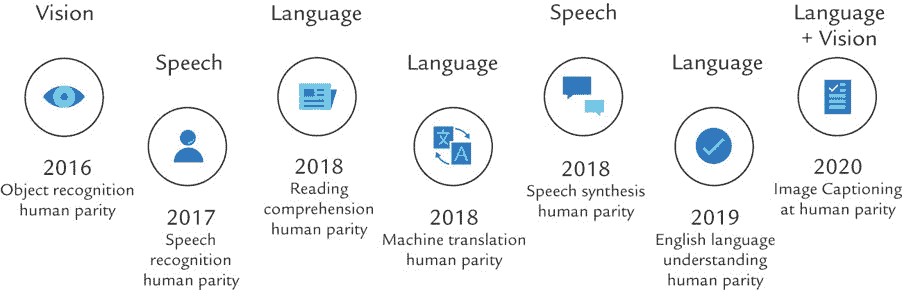

图 8.2. 处于转折点的 AI。深度神经网络推动了在设计为 AI 系统顶级挑战的基准测试上的能力进展。此图展示了 AI 模型的能力，在七个基准测试中达到了与人类相当的水平。

### 表示学习

早期的监督机器学习需要识别输入的手工显著观测值或特征，并基于这些手工特征进行预测。研究人员探索了深度学习如何自动识别此类特征，或者更广泛地说，从细粒度数据中直接识别丰富的表示，这一过程被称为表示学习（representation learning）。从最低级别的输入像素特征开始，随着神经网络层逐层增加变得越来越复杂和抽象，自动学习用于表示图像的丰富特征，是现代视觉深度神经网络模型的一个备受关注的方面。利用这种表示学习的神经网络模型已开发用于语言处理、计算机视觉、语音识别和医疗保健。

### 鲁棒性与泛化性

`DNNs` 领域的努力日益关注实现鲁棒性和泛化性，以确保在多变的现实环境中获得准确的性能，这些环境被假设需要鲁棒的能力，例如对不包含在训练数据集中的新的、以前未见过的数据进行准确的诊断、分类和预测。这一领域的努力迫使 `DNN` 训练程序从其训练数据中寻求通用模式，以减少对训练数据的过拟合，并使其对多样化的现实世界场景具有更强的适应性。

### 混合策略

将 `DNNs` 与其他计算方法相结合已取得成功，例如将神经网络模型与科学模拟耦合，将这些方法与马尔可夫决策过程（例如强化学习）整合，以及将 `DNN` 方法与符号化推理方法相结合。例如，`AlphaGo` 系统依赖于集成深度神经网络来进行预测，并结合强化学习来指导动作的选择.³²

在算法方面，相关工作涵盖了在硬件系统层面为分布式计算引入新形式加速的方法，也涵盖了高层软件的创新，旨在加速核心反向传播过程，以识别确定神经模型中连接权重的参数。例如，这些工作集中在如 `stochastic gradient descent` 等数学优化程序的适配上。

`TensorFlow` 和 `PyTorch` 等编程环境的创建是为了简化 `DNNs` 的设计与测试，为工程师提供了计算库、加速 GPU 计算的方法，以及高效定义和修订神经网络结构的工具。

### 模型作为平台

在机器学习的几十年时间里，研究人员一直在研究各种方法，通过使用专门数据对模型进行微调，以使得在源任务上训练的模型在其他领域也能获得良好的表现。这一过程通常被称为 `transfer learning`（迁移学习），它利用了模型从初始训练中获得的知识，使其在相关但不同的任务上表现优异。大规模神经模型可以作为平台，通过对来自目标任务领域的专用数据集进行微调来扩展。鉴于大模型作为可通过领域特定数据进行扩展的平台具有多种用途，它们被称为 `foundation models`（基础模型）。

基础模型可以看作是迁移学习到 `DNNs` 的扩展和规模化，这些模型在极大型数据集上进行训练，这些通常涵盖了广泛的主题、语言或模态。它们的通用性在于预训练模型可以使用较小的、特定任务的数据集进行微调，从而减少了为每个新应用从头训练模型的需求。这种方法不仅节省了大量的计算资源，还允许基于模型的基础能力和知识进行构建。`foundation`（基础）一词反映了它们作为基础底座的作用，在此之上可以构建更专业或经过微调的模型，就像基础支撑结构一样。它们的通用性和可扩展性使其类似于一种公用事业或资源，可以被许多 AI 系统调用。微调预训练的基础模型已成为添加新能力的标准方法，例如为仅限语言的模型添加多模态能力，以及将通用模型的性能扩展到专家级。

## 第二个转折点：生成式 AI

AI 的格局及其对世界的影响现在达到了第二个转折点，即 `Generative AI`（生成式 AI）。生成式 AI 模型是丰富的语言和多模态模型，通过根据输入序列或提示词（prompts）预测输出序列。这些生成式模型逐个生成输出序列，在生成序列中的下一个项时，每一步都将最新生成的项视为输入的新部分。生成式 AI 涵盖了生成自然语言、计算机程序片段、图像、图像与语言的组合以及其他类型的输出的方法，例如响应关于所需结构和功能的输入的氨基酸序列。

生成式 AI 系统在很大程度上基于三项创新，这些创新汇聚创造了强大的生成能力：`Transformer` 架构、在海量多样内容上进行自监督训练的机制，以及一种被称为 `instruction tuning`（指令微调）的特殊微调方法。

### 架构创新：“注意力就是一切”

一篇开创性的论文引入了 `Transformer` 架构，这是当今生成式 AI 的基础。这种特殊的 `DNN` 设计通过一种名为 `attention`（注意力）的机制提供了令人惊讶的能力，该机制允许神经语言模型在生成输出的每个部分时，学会关注输入序列的不同部分。简而言之，`transformers` 在自监督训练期间学习如何加权输入数据不同部分的重要性。这种学习“看哪里”和“考虑什么”的广泛能力，被认为是理解语言上下文和细微差别的关键特征，这区别于早期仅通过相邻位置查找生成上下文的方法。

`transformers` 在语言翻译、文本生成和图像处理任务等各种应用中的强大能力导致了它们的广泛采用。

第二个关键进展是将 `Transformer` 架构与来自多样化的、网络级数据集的自监督训练相结合。这种方法首次通过构建 `BERT` 基础模型得到了证明。`BERT` 通过预测其被遮蔽的文本部分来学习语言，通过更广泛地学习“应该关注哪里”，获得了对语言更广泛、更具上下文理解的理解。这些创新为后续 `Transformer` 模型（如 `GPT` 系列、`LLAMA` 等）的发展奠定了基础，每个模型都在前身的基础上构建并扩展了其引入变革的能力。

### 与人类意图与交互

实现现代生成式 AI 的第三项创新是一种塑造模型以遵循自然语言指令并维持对话的机制，而不是仅仅生成最可能跟随输入提示的标记。这种学习响应人类意图的过程涉及在由各种任务组成的新数据集上对模型进行微调，每个任务都与显式指令相关联并对输出进行评分。指令的设计模仿了人类典型的相互指示执行任务的方式。数据集通常由人类标注员最初生成或精炼的，他们编写指令并提供示例输出或正确回答。为了扩展指令微调，使用了一种名为 `reinforcement learning from human feedback (RLHF)`（人类反馈强化学习）的方法来扩展指令数据集并提供生成输出质量的衡量。这种方法涉及训练，然后使用自动化方法来扩展模型行为的塑造，以确保任务类型和语言变体的广泛覆盖。

### 缩放法则与涌现能力

基于 `transformer` 架构的大语言模型的一个显著特性是：经过训练的语言模型其准确性与模型规模（训练期间优化的参数数量）、训练数据量以及训练期间使用的计算量之间存在着强烈的实证关系。这种关系被称为 `scaling laws`（缩放法则），已多次通过实证验证。这些缩放法则非常重要，因为它们预测了在更大数据集上使用更多计算资源训练的大型模型如何产生更高的准确性；如果这些法则随着模型的进一步扩大而持续，那么人们就可以预期更高的准确性。图 8.3 显示了学习后的模型在给定注意力关注的词序列的情况下，预测下一个标记的能力（`Test Loss`）的衡量，它是关于计算时间、训练数据和模型参数数量按十倍增加而变化的函数。

到目前为止，缩放法则（Scaling laws）为预测基础性能指标（如预测下一个词的错误率）提供了一个可靠的框架。然而，它们在预测模型在挑战性任务（包括自然语言和问题解决基准测试）上的能力方面表现不佳。从广泛的数据集中训练大规模神经模型可以被视为一种多任务学习的形式，随着训练计算量以及模型规模或能力的增加，学习到新的任务。在神经语言模型中，在模型参数、计算能力和训练语料库大小的不同阈值下，观察到了以任务为中心的飞跃，这被称为新能力的**涌现**。涌现行为包括在训练计算投入达到特定阈值水平后，基准测试性能的相对较快速增长，如图 8.4 所示。⁴⁰涌现能力包括在细粒度语言理解基准测试中的性能飞跃，以及高阶能力的获取，例如“心智理论”——AI 系统通过解释和预测人类的意图、欲望和信念来解决挑战的能力。⁴¹到目前为止，我们对这种随模型规模、计算程度和训练数据变化的能力飞跃基础仍了解甚少，并且对预测下一个词的准确性与更复杂的基准测试性能之间的联系也缺乏认识。

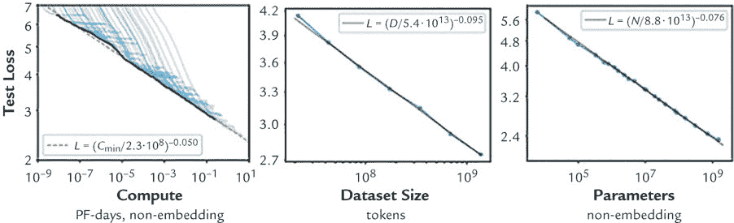

图 8.3. 缩放法则分析。Jared Kaplan 等，“Scaling Laws for Neural Language Models，” arXiv, 2020 年 1 月 22 日，https://doi.org/10.48550/arXiv.2001.08361。

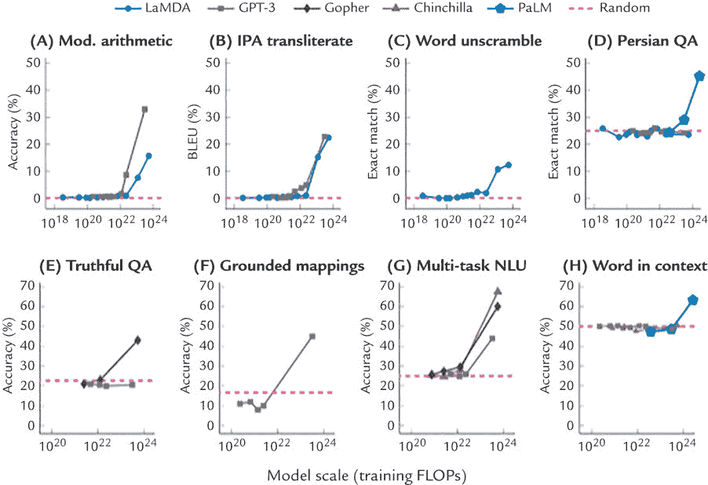


# 图 8.4. 五种不同生成式语言模型在八个推理基准测试上的能力飞跃

图 8.4 是关于训练期间优化模型参数时投入的浮点运算次数（`FLOPs`）的函数。这些飞跃被称为在模型复杂性的特定阈值下特定能力的涌现。Jason Wei 等，“Emergent Abilities of Large Language Models，” arXiv, 2022 年 10 月 26 日，https://doi.org/10.48550/arXiv.2206.07682。

到目前为止，触发涌现能力的精确机制和阈值在很大程度上仍然不可预测，并且是一个重要的研究方向。这种不可预测性凸显了 AI 研究中的一个重要前沿：参数、计算资源和训练数据大小的汇聚创造了一个复杂的格局，在这个格局中，意想不到且复杂的 AI 能力可以自发地表现。

## 抽象、泛化和组合的惊人力量

原始的 `ChatGPT` 系统使用 `GPT-3.5`、`GPT-4` 以及相关模型，其在执行抽象、泛化和多种形式组合方面的通用能力令世界感到惊讶。这些模型还展现了广泛的“博学多才”能力，证明了将源自多个学科的概念和内容织在一起的能力。科学界对于它们执行各种摘要、文本生成、问题解决、代码程序生成和对话对话的能力的涌现尚未良好理解。目前有多个项目正在进行，以探测这些模型的优缺点。

自从 `GPT-4` 以及 `Claude` 和 `Gemini` 等相关大规模模型发布以来，许多研究和相关论文探讨了潜在用途，并提供了一系列。

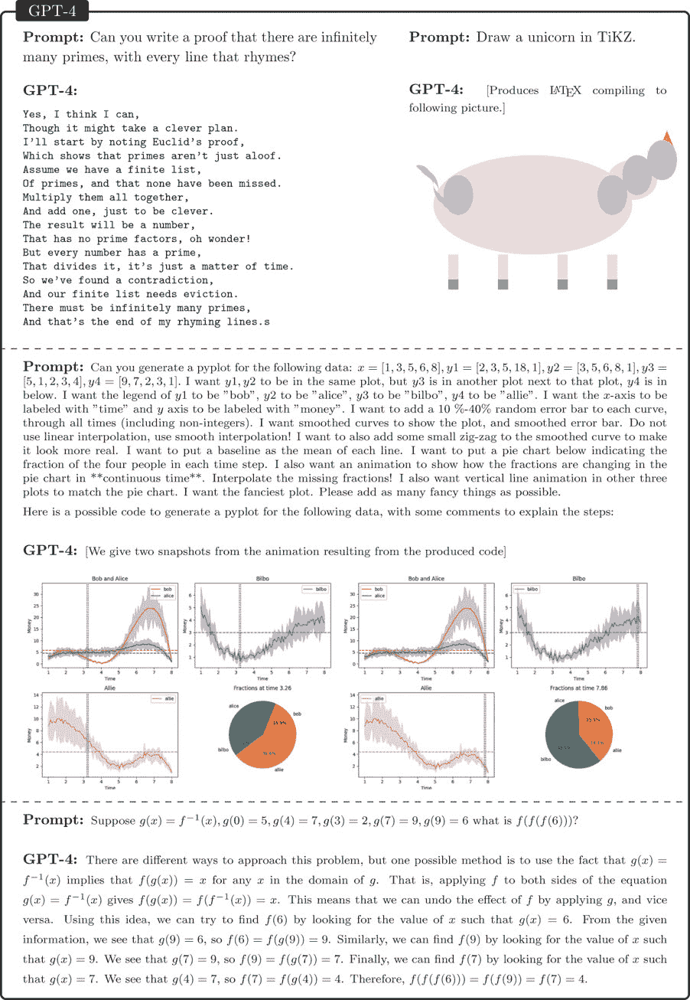

图 8.5. 早期版本 `GPT-4` 输出的多样提示词的示例。Sébastien Bubeck 等，“Sparks of Artificial Intelligence: Early Experiments with GPT-4。”

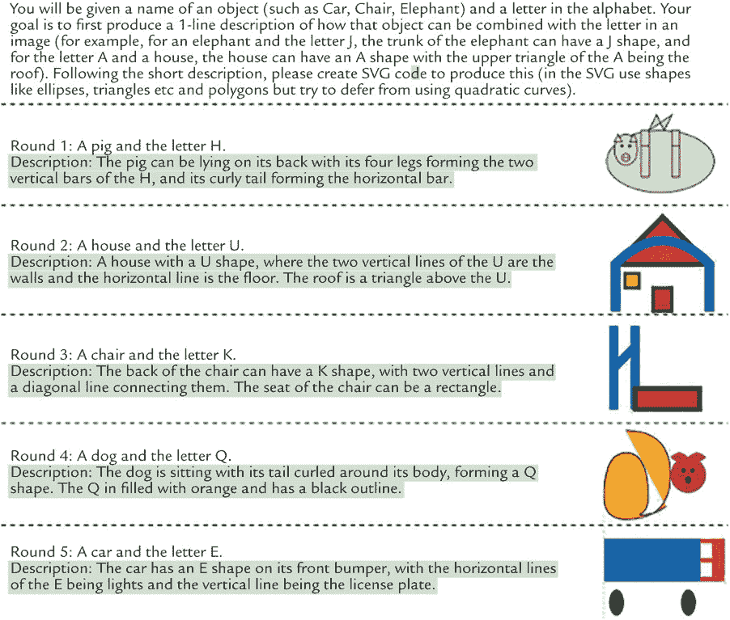

图 8.6. 展示早期版本 `GPT-4` 具有的惊人“组合”能力的提示词和输出。

## 通过引导挖掘专家性能

多年来，语言模型的专家性能是通过领域特定数据集进行训练实现的，例如构建 `BioBert`⁴⁵ 和 `PubMedBert`⁴⁶。除了抽象、泛化和组合的惊人力量外，最近的研究还证明了通过特殊提示可以引导通用模型成为专家。例如，提示方法可以引导 `GPT-4` 成为顶尖专家，在 `MedQA` 医学挑战基准测试上创了记录性能。⁴⁷提示创新显示，通用模型可以被引导为其他领域能力考试的专家，包括电气工程、机器学习、哲学、会计、护理和心理学。

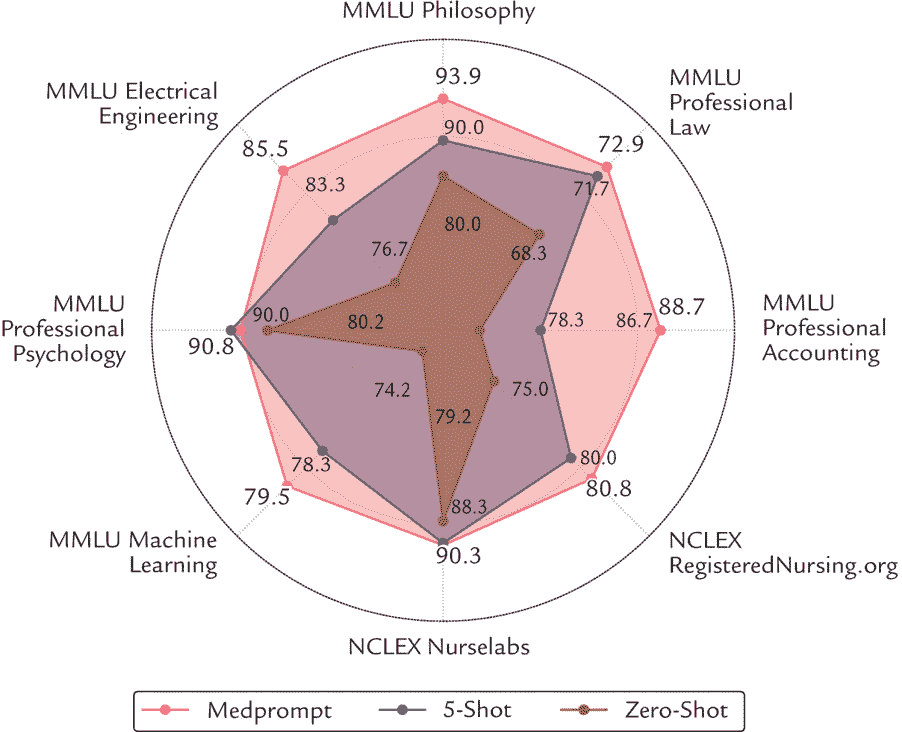

图 8.7. 提示策略可用于引导通用模型成为专家。此图显示了简单与更复杂提示策略在引导 `GPT-4` 执行多个领域专家能力的对比分析。Harsha Nori 等，“Can Generalist Foundation Models Outcompete Special-Purpose Tuning? Case Study in Medicine，” arXiv, 2023 年 11 月 27 日，https://doi.org/10.48550/arXiv.2311.16452。

## 生成式 AI 研究方向

生成式 AI 模型的成功和失败提出了许多问题。目前的问题和好奇形成了一系列研究方向，并强调了进一步科学研究这些方法和模型的重要性。

**表示与推理。** 有证据表明，在有限的计算和表示资源下，通过密集优化使 `Transformers` 预测生成的下一个标记变得越来越好，会诱模型产生丰富的世界模型作为压缩的理想形式。尽管几个方向为世界表示的构建提供了一些见解，但仍有许多未知，⁴⁸，这是一个开放且有趣的研究领域。

在另一个更关注变压器内部活动微结构的相关研究方向，研究人员已开始研究构成大型语言模型的神经网络中人工神经元的更细微活动，以及训练过程中诱发的神经元之间或“神经元子电路”之间的关联⁴⁹，以及推理时的神经元激活模式。⁵⁰ 一个假设是，大量多样化的内容迫使神经网络学习通用且特殊用途的电路，以支持多项任务。此类研究主要在受控学习设置下的较小模型中进行。在这些工作中，小模型可能作为更具可渗透性、更易理解的“果蝇”，其结果可以推广到更大的模型上，就像较小的动物模型被用于旨在推进人类生物学和医疗保健的医学研究一样。

更具基础的研究机会包括探索如何在表表示和推理方法中更深入地利用概率和决策理论的原理和方法，以指导学习和推理过程中计算资源的分配和信息的选择性收集。⁵¹另一个方向是解决生成式模型在执行规划方面面临挑战，这种规划可以通过 AI 和运筹学社区开发的方法（通过搜索和回溯探索来制定多步计划）来解决。⁵² 我们还看到超越使用相对固定的模型解决单个提示和问题，转向扩展存在和情境化的机会。方向包括探索旨在对随时间的问题流进行持续推理的方法。⁵³ 其他机会包括追求对模型如何运行的理解和扩展，并对系统物理实体化的挑战和机会寻求更深层次理解，通过沉浸在丰富、真实的环境中获得的信息流和学习，开发概念的落地和行动的含义。⁵⁴

### 记忆、学习与适应

深度神经网络模型不具备人类那样对实时经验和信息进行快速学习和适应的能力。一旦完成训练，这些模型就会被应用，但通常保持固定不变，或者有时通过传统的长周期微调进行更新。收集数据和构建更新模型的较长周期意味着，如果不使用特殊的机器来增强推理，大型语言模型将无法获取最新的科学进展、新闻和信息。解决这些挑战的努力包括通过搜索和检索近期信息的方法来扩展大模型。虽然这些辅助技术很有帮助，但能够实现更快速、近实时记忆和学习的新方法和机制将改变游戏规则。机会包括开发和集成用于持续的、无休止学习的方法。⁵⁵ 扩展记忆、学习和适应的能力将使模型能够保持与时同步，并在个性化方面实现突破。

### 架构创新

`Transformer` 一直是生成式 AI 的主流架构。然而，这种架构和方法存在局限性，例如处理序列中的长期依赖方面存在挑战。存在利用新架构新的机会，包括在 `Transformers` 中引入新机制。

### 可靠性、校准与信任度

随着 AI 系统日益融入日常生活，确保其可靠性和安全性是至关重要的首任务，特别是当这些方法被应用于医学、刑事司法、教育和工业过程控制等高风险领域时。刻画和传达潜在错误（包括错误生成以及模式识别中假阳性和假阴性的比率）对于理解失败的成本至关重要。对失败类型及其发生率的考虑，对于关于在特定领域和语境下使用 AI 的伦理辩论非常重要；AI 能力和错误构成了取决于价值考量的成本效益权衡和决策的框架。

生成式 AI 模型的一个弱点是，它们倾向于生成具有说服力但错误的内容。一个关键研究方向是开发方法和机制，为生成内容分配经过校准的置信度，并加深对何时预期和希望产生幻觉内容（例如生成小说）或何时担忧幻觉内容（例如进行医学诊断）的理解。方向包括开发内部机制、微调、尝试新的提示形式，以及调用外部工具（如执行传统信息检索的数据库和搜索引擎）来提供验证和约束。最近的工作探索了对高质量数据集的精心策划，包括使用大规模模型生成高质量数据以提高学习效率和推理准确性。⁵⁶

一些研究已经验证了在特定设置下置信度的良好校准。例如，图 8.8 显示了 `GPT-4` 对其在医学能力考试多项选择挑战答案的置信度具有良好的校准。

### 小模型的威力

虽然经经验研究和理论结果证实的扩展法则⁵⁷ 表明，顶级性能需要大规模，但最近的工作展示了较小模型的卓越力量，某些模型是由高质量数据集构建的。在最近的工作中，大型语言模型被用于提供训练数据，以构建出性能优的紧凑模型。⁵⁸ 需要研究以更好地理解如何利用较小的数据和计算资源实现强大的能力，包括关于此类模型构建在某种程度上是否取决于大模型生成的、尚不清楚的数据特殊属性的问题。

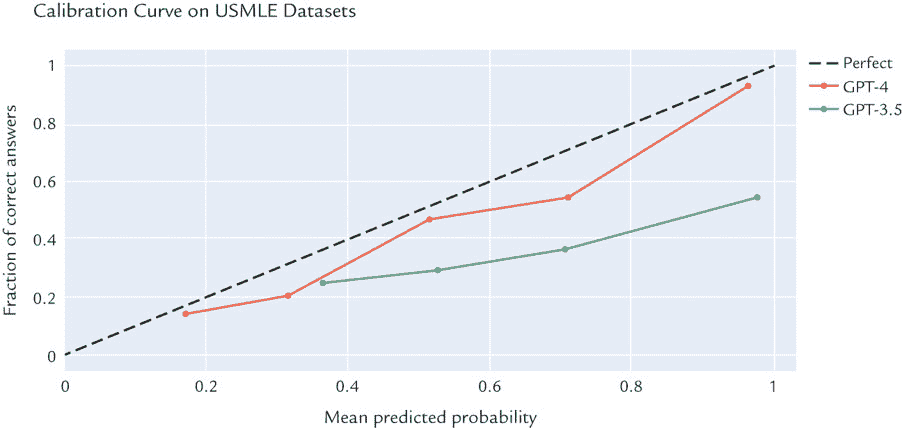

图 8.8. `GPT-4` 应对来自医学能力考试的挑战问题的答案置信度校准。Harsha Nori 等人, “Capabilities of GPT-4 on Medical Challenge Problems,” arXiv, 2023 年 4 月 12 日, https://doi.org/10.48550/arXiv.2303.13375.

### 应对不透明性和复杂性

大规模神经模型难以理解，可能会阻碍依赖神经电路诱导和更大表示见解的科学进展。需要新工具来更好地理解大规模模型中的表示和推理。大规模神经模型的“黑箱”挑战与通过精粒度单元记录以及粗粒度 fMRI 和相关研究探测生物神经系统运行的困难之间，相似性日益增长。这些领域的方法和分析工具存在潜在的收敛趋势。

### 人机协作的机制与设计

扩展之前的人机协作工作具有巨大的机会。⁵⁹ 尽管生成式 AI 模型被训练用于参与对话，但在设计交互策略方面有巨大的可能性，这些策略强调在解决问题时人类主体性的主导地位，并引入新的人机交互风格，使 AI 系统能够补充人类决策。⁶⁰ 相关的目标包括开发更好的方法，让生成式 AI 系统分享其生成内容和建议的理由。

# 生成式 AI 的工程趋势

预测未来是不可能的，特别是在像生成式 AI 这样充满变化的领域，但研究可能塑造该技术及其应用未来的新兴趋势仍然很有用。在本节中，我们考虑了自 2022 年 11 月 `ChatGPT` 推出后出现的若干趋势，以及它们改变生成式 AI 未来的潜力。

### 多模态生成式 AI 模型

最初的 `LLM` 模型仅在文本数据上进行训练，而最近的一个趋势是在多模态数据（如文本、图像、视频和声音数据）上训练模型。例如，Google 最近发布了一个名为 `Gemini` 的模型，它是通过此类多模态数据“从下而上”训练的。2023 年 10 月，OpenAI 推出了 `GPT-4` 系统的版本 `GPT-4V`，它可以接受图像和文本数据作为输入（尽管其输出仍然仅为文本）。图 8.9 显示了与 `GPT-4V` 的典型交互，其中它能够解释上传图像的内容，并对如何以稳定的方式堆叠物品进行推理。

这种向多模态模型趋势的意义在于，此类模型具有捕捉更多关于物理世界的常识知识的潜力——这些知识是仅通过文本无法轻易捕捉的。如果成功，这一趋势可能会导致重大的新应用，例如，在人们烹饪特定晚餐食谱或组装新家具时，能够观察并逐步指导他们的系统。一个有趣的问题是，此类多模态模型的成功开发是否会导致机器人领域取得快速的突破，因为目前限制机器人系统的很大程度上是它们对各种物体和环境的物理性的解释和推理能力很弱。

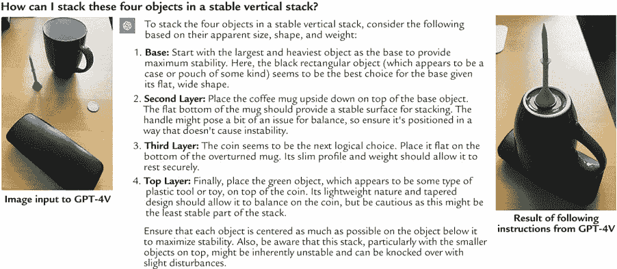

图 8.9. 与 `GPT-4V` 的交互，它可以接受图像和文本输入。左侧的输入图像显示了桌面上的四个物品。对 `GPT-4V` 的输入请求是“我如何将这四个物体堆叠成稳定的垂直堆叠？”当遵循 `GPT-4V` 的输出答案（位于中间）时，它产生了右侧所示的垂直堆叠。由 Tom Mitchell 使用 `GPT-V` 网站创建。

### 合成数据的力量

生成式模型和更传统的仿真方法正被用于大量的训练数据，这些数据已成功用于构建和扩展神经模型。正在生成和利用的数据集包括视觉数据集以及针对特定类型输出的重点、高质量蒸馏，例如推理策略⁶¹和领域特定数据⁶²

### 引入软件插件

像 `GPT-4` 这样的 `LLM` 展示了许多令人印象的能力，但它们也有许多局限性和缺点。例如，今天的 `LLM` 无法可靠地执行大数字算术（例如，483 乘以 9,328），并可能对事实性问题幻出错误答案。模型插件由传统软件（例如计算器、事实信息数据库）组成，可以被 `LLMs` 作为子程序调用。为 `LLMs` 提供插件允许它们克服许多局限性，并利用许多团体在几十年努力开发的海量软件库。例如，截至 2023 年 11 月，`ChatGPT` 访问了约 1000 个插件——从计算器到网络搜索引擎再到餐厅预订应用程序——这显著扩展了其超越其训练神经网络所提供的能力（图 8.10）。


图 8.10. `GPT` 可访问的约一千个插件的小样本。来自 OpenAI 网站。

模型决定是否以及何时调用任何给定的插件，取决于它正在响应的提示词，但目前大多数生成式 AI 模型限制了在任何给定对话中考虑的插件数量。例如，`ChatGPT` 要求用户在任何给定对话中最多只需预选少数几个可用插件。模型将能够自动考虑调用多大的插件集尚有待观察。然而，让模型访问跨越计算机行业开发的海量软件库将是未来系统的目标。插件的兴引发了一个问题：生成式 AI 模型是否会成为许多具有自己独特界面的软件软件包的首选用户界面？未来的用户会倾向于通过自然语言对话进行交互，而不是学习每个软件应用程序的专用界面吗？插件是扩展，允许 `LLMs` 对对话之外的世界产生影响，例如研究。

### 多功能交互式工作空间

在与插件相关的创新方向上，我们看到了集成交互体验的兴起，这种体验通过允许用户和 AI 组件以逐步的方式在解决问题上共同工作，促进了人机协作，其中多种工具、数据分析能力和代码创建被以协作的方式解决问题和子问题。图 8.11 显示了由 OpenAI 提供的名为 `Advanced Data Analysis` 的此类多功能交互工作会示例话的部分。

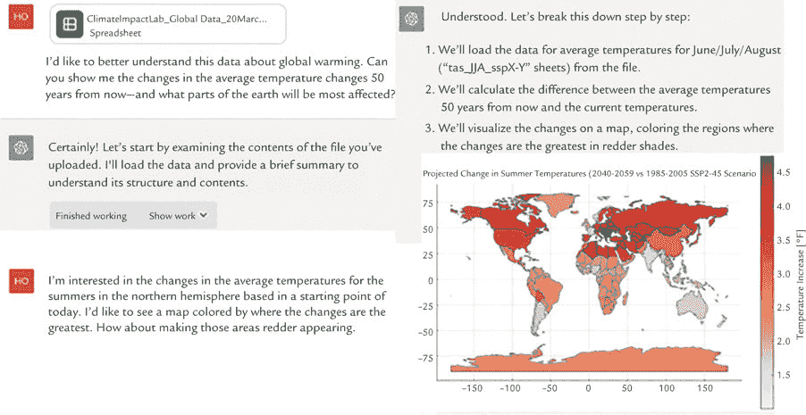

图 8.11. OpenAI 提供的 `Advanced Data Analysis`，一个多功能交互工作空间，允许加载数据库和论文进行分析，并提供多步分析，根据需要引入工具（包括编写代码和提供可视化结果），并与用户持续共享计划和步骤。由 Eric Horvitz 使用 `OpenAI Advanced Data Analysis` 创建，2023 年 11 月。

### 用于 AI 模型编程的软件开发环境

与使用使生成式 AI 模型调用其他软件作为子程序的工具不同，这一趋势支持开发新的软件系统，这些系统反而调用生成式 AI 作为子程序。如开源 `LangChain`、微软的 `Semantic Kernel` 和 `AutoGen` 等框架已经出现，支持软件开发者构建调用多个生成式模型实例的系统⁶³。这些框架使得构建捕捉 `LLMs` 优势的软件系统（例如，用自然语言交互并执行某些类型的常识推理）变得更容易，同时结合了生成式 AI 缺失的标准编程能力，如长期记忆和数据库访问。生成式 AI 的一个特别有趣的方面是，人们可以非常容易地“编程”或“指示”生成式 AI 模型实例如何行为。例如，图 8.12 显示了用于指令或编程 `GPT-4` 实例的文本，使其扮演人工智能学生的角色，在在线教育应用程序中接受人类教师的教学。`LLM` 的编程在这里仅使用自然语言指令完成，而不是编程语言。

图 8.12. 用于“编程”`GPT-4` 实例以扮演人工智能学生角色的自然语言指令。这是一个大型在线教育软件的一部分，在该类软件中，人类通过教这个人工智能学生机器人（由 `GPT-4` 实现）来学习，并偶尔由人工智能教授机器人（由第二个 `GPT-4` 实例实现）提供协助。Robin Schmucker 等人，“NeurIPS Paper 38: Ruffle&Riley: Towards the Automated Induction of Conversational Tutoring Systems,” 2023, https://neurips.cc/virtual/2023/79097。

这一趋势引发的一个关于未来的有趣问题是：我们是否开始看到一种新软件开发范式的出现？与以往完全依赖形式化编程语言来指令机器的范式不同，这种新范式在未来将无缝融合自然语言指令与形式语言（图 8.13）。

### 个性化生成式 AI 系统

如 OpenAI 的 `GPT-4` 和 Google 的 `Gemini` 等生成式 AI 模型开发成本极高，且规模巨大（包含数千亿已学习参数），因此它们无法被下载，而只能通过网络远程使用。因此，这些模型似乎对地球上数十亿人每一个人进行个性化定制是不可能的。尽管如此，我们已经开始看到向个性化 `LLM` 发展的趋势。例如，`ChatGPT` 允许用户提供及其兴趣的自然语言描述，并利用这些描述来调整与该用户的对话（例如，根据其教育背景进行定制）。此外，Google 发布了其对话式助手 `Bard` 的实验版本，允许用户访问其整个 `Gmail` 集合以及在线 `Google Docs`，然后讨论这些内容。例如，图 8.14 显示了与该实验性 `Bard` 版本的典型交互。除此之外，微软还发布了 Office 软件套件的新版本，将 `LLM` 集成到 `Word`、`PowerPoint` 和 `Excel` 等系统中。Apple 和 Google 都宣布了发布足够小到可在其相应手机上运行的 `LLM` 版本，这为通过仅在个人设备上运行来保护隐私的高度个性化 `LLM` 代理提供了可能。

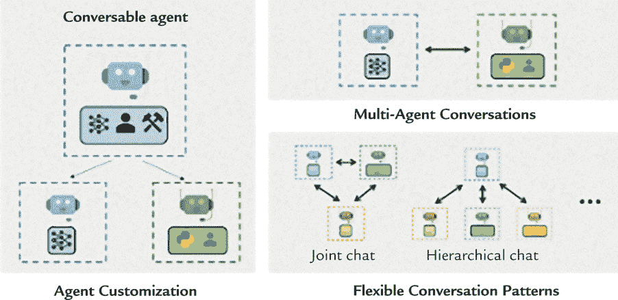

图 8.13. 用于生成式 AI 模型的 `AutoGen` 排框架允许对生成内容的角色和流程进行高效规范。Qingyun Wu, Gagan Bansal, Jieyu Zhang, Yiran Wu, 等人，“AutoGen: Enabling Next-Gen LLM Applications via Multi-Agent Conversation，”发表于语言建模会议，宾夕法尼亚州费城，2024 年 10 月 7 日至 9 日。


图 8.14. 与 Google 的 `Bard` 关于用户 `Gmail` 和 `Google Docs` 内容的对话。由 Tom Mitchell 使用 Google `Bard` 界面创建。

这一趋势的意义在于，它表明未来生成式 AI 系统与个人数据及公司数据进行交互的能力将不断增强，使其在处理用户感兴趣的问题时变得极其有用且更具博学。针对特定用户、公司和问题设置的定制，可能通过模型微调、提供相关用户数据的访问以及定义代理角色的直接自然语言指令相结合来实现。

### 开源模型


生成式 AI 的一个趋势或许可以总结为“越大越好”。在 2018 年到 2023 年之间，顶尖生成式 AI 模型序列遵循了清晰的缩放法则：拥有更多参数、在更大数据集上训练的模型产生了显著提升的能力（图 8.15）。这导致了模型训练成本超过 1 亿美元，且包含的参数之多以至于无法在大多数计算机上运行的模型诞生。鉴于这一趋势，人们可能会预见未来只有极少数资源丰富的公司和政府负担得起开发下一代模型的费用，而我们其他人只能通过云端访问这些模型。正如在讨论研究方向之前提到的，许多正在开发和部署的新型模型依赖于少得多的参数——少到足以让模型在较小的计算机上被下载并进行训练或微调。尽管这些较小的模型无法与最顶尖的模型相比，但它们展现出了惊人的能力，特别是在针对医学或金融等特定领域进行训练时，以及使用教科书等经过精选的训练数据进行训练时。这些小型模型让世界各研究人员和开发者构建并使用生成式 AI 变得可行，而不仅仅是少数机构的员工；也就是说，它们使得许多协作开发者之间的开源共享开发成为可能。

在本文提到的所有趋势中，这种向于更小、开源、广泛共享模型的趋势可能是影响深远的，因为它将强烈影响参与推动技术进步的研究人员和开发者数量，也将强烈影响政府控制和监管该技术使用以及对其设置“护栏”的能力。

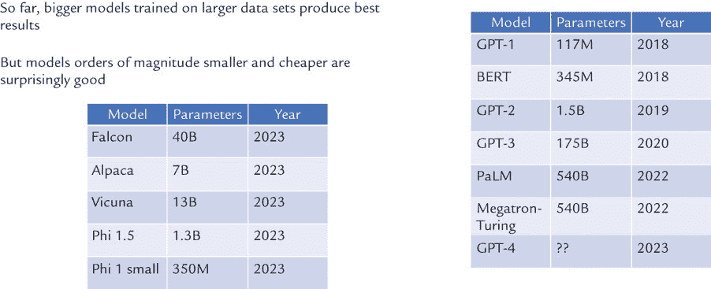

图 8.15. 各种生成式 AI 模型的大小和发布年份。由 Tom Mitchell 创建。

小型模型的成功与否，因此生成式 AI 相关的开源努力，也将对政府能够以及如何追踪和监管 AI 技术产生巨大影响。在该领域工作的大型公司已经在与各种政府合作，制定框架、最佳实践和法规，以最大限地减少 AI 被用于邪恶目的的风险，以及负面意外后果的风险。

如果未来只有大型 AI 系统占据主导地位，那么开源运动可能会很小或不存在，政府可以继续与大公司合作，并有效执行任何政府法规。然而，如果小型 AI 模型及相应的开源运动取得成功，那么政府将很难（甚至不可能）得知哪些组织和个人拥有高能力的 AI 模型，以及他们将这些模型用于。简而言之，如果小型 AI 模型变得强大且易于复制和迁移，那么它们将变得难以监管。

# 应用领域的关键机会

判别式和生成式 AI 模型在日常生活以及特定领域和专业领域具有广泛的应用。未来影响的主要领域包括生物学和物理科学、健康与福祉以及教育。

## 生物科学

AI 在生物科学领域的影响正在迅速扩大。AI 方法有望在理解复杂的生物过程以及设计新药物和疗法方面提供快速的跨越。神经建模流水线（包括 `AlphaFold` 和 `RoseTTAfold`）为生物学家提供了改变游戏规则的能力。近期利用这些及其他神经建模方法的工作正将工具交到生物学家手中，用于估计蛋白质结构并更好地理解蛋白质功能和相互作用。

例如，AI 工具最近被用于对酵母细胞中潜在的蛋白质-蛋白质相互作用进行跨蛋白质组的大筛选（图 8.16）。筛选识别出了这些真核细胞中此前未知的蛋白质相互作用——这些细胞与构成我们身体的细胞密切相关。许多相互作用可以由生物学家映射到通路中。然而，几个预测的相互作用的作用仍然是一个谜团，为细胞生物学提出了新问题。

预测蛋白质-蛋白质相互作用的进展为利用 AI 进展来理解和干预细胞通路提供了许多可能。图 8.17 显示，最近开发的扩散建模技术（类似于用于图像生成的 AI 方法）已应用于蛋白质设计中。此类方法可用于设计新药物、阻病毒活性位点的保护性结合剂以及合成疫苗。在未来十年及更远的未来，AI 可能会彻底改变个性化医疗，根据疾病特定性和个人基因谱提供定制化治疗，并加速生物技术创新的步伐，可能为当今的不治之提供解决方案。

## 医疗

到目前为止，AI 在医疗领域一直是一个睡巨人。在未来十年中，我们可能会看到 AI 成为诊断和治疗计划的常规助手，提供更准确、更快速的诊断。AI 还可以增强远程医疗和监测，让欠发达地区的人能够获得高质量的医疗服务。

传统的机器学习存在多种机会，判别式和生成式神经模型也同样用于辅助诊断和预测结果。迄此为止的工作证明了提高护理质量的巨大可能性，包括提高诊断和治疗的卓越水平以及减少人为错误。除了临床决策支持外，生成式模型生成和总结报告的能力可以减轻医生的行政负担，让他们有更多时间与患者进行高质量互动（图 8.18 和 8.19）。

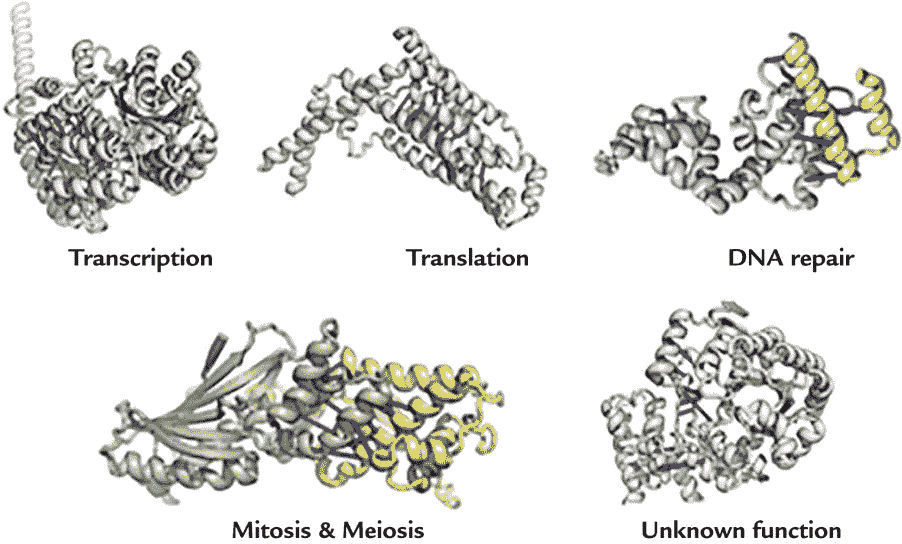

图 8.16. 筛选识别出了这些真核细胞中此前未知的蛋白质相互作用。

## 物理科学

物理科学领域的多个前沿正在进行使用生成式 AI 模型的工作。微软研究院 AI4Science 和 Microsoft Azure Quantum 编写的 AI 调查报告《大语言模型对科学发现的影响》提供了对近期努力和方向的详细回顾。

在材料科学领域，AI 已经在加速新材料的发现和对复杂物理现象的理解。工作包括使用神经模型提供候选化学化合物，并通过提供对更复杂的传统量子计算的高效近似来加速对候选者的分析。随着近期 AI 驱动的模拟和预测建模的进展，未来十年可能会看到 AI 系统为特定应用设计具有定制属性的材料，例如用于航空航天的超强性复合材料或用于电子设备的高效导体。

## 气候可持续性

AI 方法在可再生能源系统的优化以及预测气候模式和对替代干预的反应等重要任务方面显示出前景。展望未来，AI 可能在帮助发现和设计更高效的催化剂以及碳捕集与存储的整体工艺发挥作用。AI 驱动的模型可以提供对气候变化影响更精确的预测，有助于制定更有效的政策和环境保护措施（图 8.20）。

# 教育

`GPT-4` 正在早期部署中被探索，包括 `Khan Academy` 的应用，也涵盖了教育研究。根据大型模型所展示的“心理理论”、教学技巧和解释能力（如图 8.21 所示），利用生成式 AI 系统充当个性化导师具有极大的机遇。

## 工程头脑风暴与设计

生成式 AI（包括问题的解决、引导和新设计的可视化）可能提供一个变革性的工具包，以增强工程师的创造力和创新能力。经过训练、具备语言、图像和多模态能力的生成式 AI 模型可以帮助科学家制定、探索和视觉化复杂的概念或设计，而这些在其他情况下他们可能没有考虑过的。此类模型有机会作为协作伙伴，根据描述目标的提示词提供即时反馈或提出建议。图 8.22 展示了使用 `DALL-E2` 系统对太阳能热水器与发电结合的设计进行可视化的早期探索。

## AI、人类与社会：从技术到社会技术

AI 方法的能力具有双重用途。在科学、工程和日常生活中，利用 AI 方法可以提高生活质量并促进人类繁荣。它们也可能被恶意行为者利用来追求高成本和犯罪的活动。除了显式通过对抗方式使用 AI 外，AI 的使用可能对人类和社会产生无意的影响。AI 与社会方面的交叉涵盖了可靠性与安全性问题、隐私与安全的权衡，以及公平性与责任制。⁶⁹ 关于数据来源、知识产权和版权的法律及伦理问题日益突出。AI 在军事应用中的引发了对竞争格局和潜在不稳定影响的担忧。在社会方面，AI 可能会加剧数字鸿沟、影响就业市场，并实现深度伪造（deepfakes）和网络操控等恶意用途。更深层的社会、文化和心理维度——信任、真实性、多样性、主体性和创造力——也是需要考虑的关键领域。大量的讨论和活动都是围绕 AI 进步带来的机遇和忧虑展开的。这包括美国、英国和欧盟政府要求进行研究和监管的努力。2023 年 10 月，一份详尽的关于《安全、可靠和信任的人工智能开发与使用》美国总统行政令要求采取研究和行动，应对 AI 技术“加剧社会危害，如欺诈、歧视、偏见和虚假信息；取代并剥夺工人权利；扼杀竞争；并对国家安全构成风险”。⁷⁰ 在最小化风险的同时实现 AI 收益的未来方向，需要在技术、社会技术和监管领域持续投入理解与创新工作。

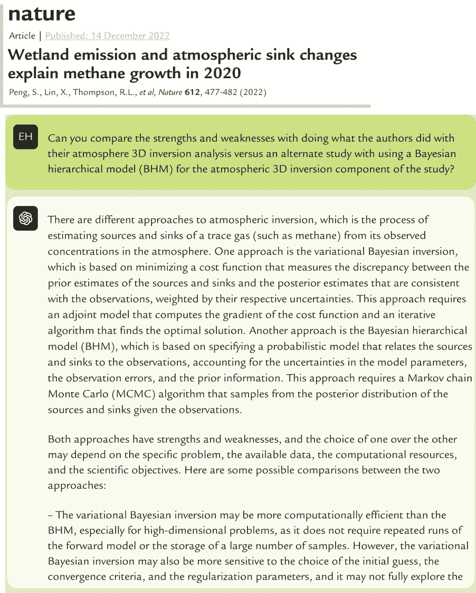

图 8.20. 会议片段，展示了对最新科学论文的分析，呈现了关于科学方法、基础和未来方向的丰富对话。完整会议访问 https://unlocked.microsoft.com/ai-anthology/case-studies。由 Eric Horvitz 使用 `GPT-4` 于 2023 年 1 月创建；源自 Eric Horvitz，“案例研究”。

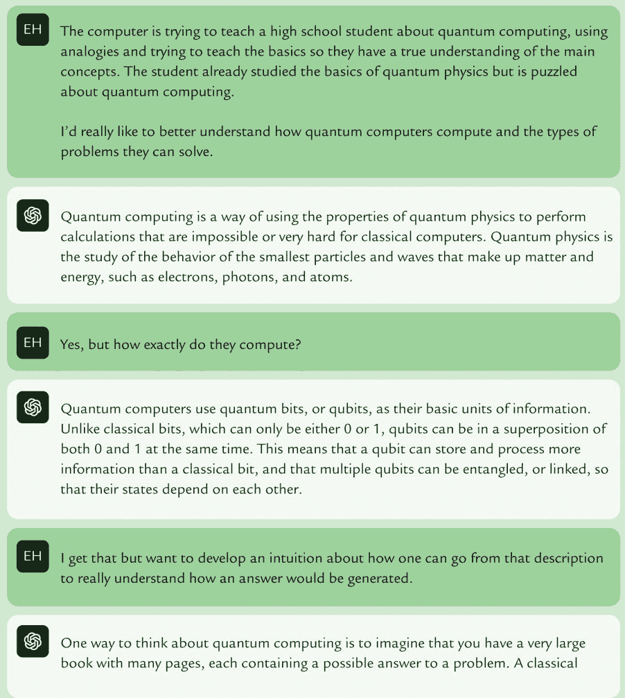

图 8.21. 关于量子计算的教育课程片段，展示了丰富的对话、教学能力的迹象和响应能力。完整会议访问 https://unlocked.microsoft.com/ai-anthology/case-studies。


图 8.22. 展示了使用 `DALL-E2` 系统对太阳能热水器与发电结合的设计进行可视化的早期探索。


图 8.21. 关于量子计算的教育课程片段，展示了丰富的对话、教学能力的迹象……

# 结论

AI 迄今的历程涉及数十年的创新。近期生成模型的兴起显示了这些技术继续突破可能边界的潜力。

# 参考文献

9. 参见例如，Bruce G. Buchanan 和 Edward H. Shortliffe 编，《Rule Based Expert Systems: The Mycin Experiments of the Stanford Heuristic Programming Project》，第 1 版（Reading, Mass: Addison-Wesley, 1984）。

10. Eric J. Horvitz, John S. Breese 和 Max Henrion，“专家系统与人工智能中的决策理论”，“International Journal of Approximate Reasoning”第 2 卷，第 3 期 (1988 年 7 月): 247–302, https://doi.org/10.1016/0888-613x(88)90120-x。

11. Judea Pearl，《Probabilistic Reasoning in Intelligent Systems: Networks of Plausible Inference》，第 1 版（San Francisco, Calif: Morgan Kaufmann, 1988）。

12. 参见例如，Daphne Koller 和 Nir Friedman，《Probabilistic Graphical Models: Principles and Techniques》（Cambridge, MA: MIT Press, 2009），https://mitpress.mit.edu/9780262013192/probabilistic-graphical-models/。

13. D. E. Heckerman, E. J. Horvitz 和 B. N. Nathwani，“Toward Normative Expert Systems: Part I, The Pathfinder Project”，“Methods of Information in Medicine”第 31 卷，第 02 期 (1992): 90–105, https://doi.org/10.1055/s-0038-1634867。

14. 参见例如，Richard S. Sutton 和 Andrew G. Barto，《Reinforcement Learning: An Introduction》（Cambridge, MA: MIT Press, 1998）。

15. 参见例如，Paul Smolensky 和 Geraldine Legendre，《The Harmonic Mind: From Neural Computation to Optimality-Theoretic Grammar》，第 1 卷，Cognitive Architecture（Cambridge, MA: MIT Press, 2006）；Paul Smolensky 和 Geraldine Legendre，《The Harmonic Mind: From Neural Computation to Optimality-Theoretic Grammar》，第 2 卷，Linguistic and Philosophical Implications（Cambridge, MA: MIT Press, 2006）；Jiayuan Mao 等，“The Neuro-Symbolic Concept Learner: Interpreting Scenes, Words, and Sentences From Natural Supervision”，“Open Review (2018)，https://openreview.net/forum?id=rJgMlhRctm。

16. A. L. Samuel，“Some Studies in Machine Learning Using the Game of Checkers”，“IBM Journal of Research and Development”第 3 卷，第 3 期 (1959 年 7 月): 210–229, https://doi.org/10.1147/rd.33.0210。

17. O. G. Selfridge 的是 1958) O. G. Selfridge, ‘Pandemonium: A Paradigm for Learning,’ Mechanisation of Thought Processes: Proceedings of a Symposium Held at the National Physical Laboratory, November 1958, London: HMSO, pp. 513–526”，“Neurocomputing”第 1 卷，Foundations of Research（Cambridge, MA: MIT Press, 1988 年 4 月 7 日), 117–122, https://doi.org/10.7551/mitpress/4943.003.0011。

18. Gregory F. Cooper 和 Edward Herskovits，“A Bayesian Method for the Induction of Probabilistic Networks from Data”，“Machine Learning”第 9 卷，第 4 期 (1992 年 10 月): 309–347, https://doi.org/10.1007/bf00994110; David Heckerman, Dan Geiger 和 David M. Chickering，“Learning Bayesian Networks: The Combination of Knowledge and Statistical Data”，“Machine Learning”第 20 卷，第 3 期 (1995 年 9 月): 197–243, https://doi.org/10.1007/bf00994016。

19. David E. Rumelhart, James L. McClelland 和 PDP Research Group，《Parallel Distributed Processing》，第 1 卷，Explorations in the Microstructure of Cognition: Foundations（Cambridge, MA: MIT Press, 1986），https://doi.org/10.7551/mitpress/5236.0001。

20. P. J. Werbos，“Backpropagation Through Time: What It Does and How to Do It”，“Proceedings of the IEEE”第 78 卷，第 10 期 (1990): 1550–1560, https://doi.org/10.1109/5.8337; David E. Rumelhart, Geoffrey E. Hinton 和 Ronald J. Williams，“Learning Representations by Back-Propagating Errors”，“Nature”第 323 卷，第 6088 (1986 年 10 月): 533–536, https://doi.org/10.1038/323530。

21. Yann LeCun 和 Yoshua Bengio，“Convolutional Networks for Images, Speech, and Time-Series，”见《The Handbook of Theory Neural Networks》，Michael A. Arbib 编（Cambridge, MA: MIT Press, 1995）。

22. Mohsen Bayati 等，“Data-Driven Decisions for Reducing Readmissions for Heart Failure: General Methodology and Case Study”，“PloS ONE”第 9 卷，第 10 期 (2014 年 10 月 8 日): e10924–e10264, https://doi.org/10.1371/journal.pone.010264。

23. Katharine E. Henry 等，“A Targeted Real-Time Warning Score (TRE) for Septic Shock”，“Science Translational Medicine” 7 卷，第 29 期 (2015 年 8 月 5 日), https://doi.org/10.1126/scitransmed.3719。


24. Jenna Wiens 等，“Learning Data-Driven Patient Stratification Models for Clostridium”，“Open Infectious Diseases”第 1 卷，第 2 期 (2014 年 7 月 15 日): of045–ofu045, https://doi.org/10.1093/ofu045。

25. Jacob Devlin 等，“BERT: Pre-Training of Bidirectional Transformers for Language Understanding，”见《Proceedings of the 2019 Conference of the North American Chapter of the Association for Linguistics: Human Language Technologies》，第 1 卷，Long Papers，Jill Burstein, Christy Doran 和 Thamar Solorio 编（Association for Linguistics, 2019）， 4171–4186, https://doi.org/10.18653/v1/n19-423。

26. Geoffrey Hinton 等，“Deep Neural Networks for Acoustic Modeling in Speech Recognition: The Shared Views of Four Groups”，“IEEE Signal Processing Magazine”第 29 卷，第 6 期 (2012 年 11 月): 82–97, https://doi.org/10.1109/msp.2012597。

27. Alex Krizhevsky, Ilya Sutskever 和 Geoffrey E Hinton，“ImageNet Classification with Convolutional Neural Networks，”见《Advances in Neural Processing Systems》第 25 卷（Curran Associates, Inc., 2012），1097–1105,https://papers.nips.cc/paper_files/paper/2012/hash/c39982d3b9d6c8436e24c85b-Abstract.html。

28. Andre Esteva 等，“Dermatologist-Level Classification of Skin Cancer with Deep Neural Networks”，“Nature”第 542 卷，第 7639 (2017 年 2 月 2 日): 115–118, https://doi.org/10.1038/nature21056。

29. Hinton 等，“Deep Neural Networks for Acoustic Modeling”，82–97。

30. Alex Wang 等，“GLUE: A Multi-Task Benchmark and Analysis Platform for Natural Language Understanding，”见《Proceedings of the 2018 EMNLP Workshop: Analyzing and Interpreting Neural Networks for NLP》（Association for Linguistics, 2018），https://doi.org/10.18653/v1/w18-5446。

31. Nestor Maslej 等，“Artificial Intelligence Report 2024，”arXiv,2024 年 5 月 29 日,https://doi.org/10.48550/arXiv.2405.19522。

32. David Silver 等，“Mastering the Game of Go Without Human Knowledge”，“Nature”第 550 卷，第 7676 (2017 年 10 月): 354–359, https://doi.org/10.1038/nature24270。

33. Jenna Wiens, John Guttag 和 Eric Horvitz，“A Study in Transfer Learning: Leveraging Data from Multiple Hospitals to Enhance Hospital-Specific Predictions”，“JAMIA”第 21 卷，第 4 期 (2014): 699–706, https://doi.org/10.1136/amiajnl-2013-002162。

34. Rishi Bommasani 等，“On the Opportunities and Risks of Foundation Models，”arXiv,2022 年 7 月 12 日,https://doi.org/10.48550/arXiv/2108.07258。

35. Liunian Harold 等，“Symbolic Chain-of-Thought Distillation: Small Models Can Also ‘Think’ Step-by-Step，”见《Proceedings of the 61st Annual Meeting of the Association for Linguistics》第 1 卷，Long Papers（Association for Linguistics, 2023），https://doi.org/10.18653/v1/2023.acl-long.150。

36. Karan Singhal 等，“Large Language Models Encode Clinical Knowledge”，“Nature”第 620 卷，第 7972 (2023 年 8 月): 172–180, https://doi.org/10.1038/s41586-023-06291-2。

37. Ashish Vaswani 等，“Attention Is All You Need，”见《Advances in Neural Information Processing Systems》第 30 卷（Curran Associates, Inc., 2017），https://papers.nips.cc/paper_files/paper/2017/hash/3f5ee243547dee91fbd053c1c4a845aa-Abstract.html。

38. Devlin 等，“BERT”，4171–4186。

39. Jared Kaplan 等，“Scaling Laws for Neural Language Models，”arXiv,2020 年 1 月 22 日,https://doi.org/10.48550/arXiv.2001.08361; Jordan Hoffmann 等，“Training Compute-Optimal Large Language Models，”arXiv,2022 年 3 月 29 日,https://doi.org/10.48550/arXiv/2203.15556。

40. Jason Wei 等，“Emergent Abilities of Large Language Models，”arXiv,2022 年 10 月 26 日,https://doi.org/10.48550/arXiv/2206.07682。

42. Sébastien Bubeck 等人，“通用人工智能的火花：GPT-4 的早期实验，”arXiv, 2023 年 4 月 13 日, https://doi.org/10.48550/arXiv.2303.12712.

43. Bubeck 等人，“通用人工智能的火花”；；Karthik Valmeekam 等人，“大语言模型的规划能力——一项批判性调查，”发表于《神经信息处理系统进展》，第 36 卷 (2023), 75993–75995, https://papers.nips.cc/paper_files/paper/2023/hash/efb2072a358cefb75886a315a6fcf880-Abstract-Conference.html。

44. Li 等人，“符号化思维链蒸馏：小模型也可以一步步地‘思考’”；Mert Yuksekgonul 等人，“注意力满足：一种语言模型事实错误的约束满足视角，”arXiv, 2024 年 4 月 17 日, https://doi.org/10.48550/arXiv.2309.15098.

45. Souradip Chakraborty 等人，“BioMedBERT：用于问答和检索的预训练生物医学语言模型，”发表于第 28 届国际计算语言学会议，计算语言学国际，2020 年, https://doi.org/10.18653/v1/2020.coling-main.59.

46. Robert Tinn 等人，“用于生物医学自然语言处理的微调大型神经语言模型，”Patterns 4 卷，第 4 期 (2023 年 4 月 14 日): 100729–100729, https://doi.org/10.1016/j.patter.2023.100729.

47. Nori 等人，“通用基础模型能胜过特殊目的微调吗？”

48. Mostafa Abdou 等人，“语言模型可以在没有落地的情况下编码感知结构吗？以颜色为例的研究，”发表于第 25 届计算自然语言学习会议，计算语言学协会 (2021 年), https://doi.org/10.18653/v1/2021.conll-1.9.

49. Chris Olah 等人，“放大观察：电路简介，”Distill 5 卷，第 3 期 (2020 年 3 月 10 日), https://doi.org/10.23915/distill.00024.001; Yi Zhang 等人，“用 LEGO 揭示 Transformers：一项合成推理任务，”arXiv, 2023 年 2 月 17 日, https://doi.org/10.48550/arXiv.2206.04301; Catherine Olsson 等人，“上下文学习与感应头，”arXiv, 2022 年 9 月 23 日, https://doi.org/10.48550/arXiv.2209.11895.

50. Yuksekgonul 等人，“注意力满足。”

51. Samuel J. Gershman, Eric J. Horvitz 和 Joshua B. Tenenbaum，“计算理性：大脑、心灵和机器智能的趋同范式，”Science 349 卷，第 6245 期 (2015 年 7 月 17 日): 273–278, https://doi.org/10.1126/science.aac6076.

52. Valmeekam 等人，“大语言模型的规划能力。”

53. Eric Horvitz，“持续计算的原理与应用，”Artificial Intelligence 126 卷，第 1–2 期 (2001 年 2 月): 159–196, https://doi.org/10.1016/s0004-3702(00)00082-5.

54. Nicholas Roy 等人，“从机器学习到机器人技术：具身智能面临的挑战与机遇，”arXiv, 2021 年 10 月 28 日, https://doi.org/10.48550/arXiv.2110.15245.

55. T. Mitchell 等人，“永无止的学习，”Communications of the ACM 61 卷，第 5 期 (2018 年 4 月 24 日): 103–115, https://doi.org/10.1145/3191513.

56. Suriya Gunasekar 等人，“教科就是你需要的，”arXiv, 2023 年 10 月 2 日, https://doi.org/10.48550/arXiv.2306.11644.

57. Sébastien Bubeck 和 Mark Sellke，“通过等周不等式的通用鲁棒性法则，”Journal of the ACM 70 卷，第 2 期 (2023 年 3 月 21 日): 1–18, https://doi.org/10.1145/3578580.

58. Gunasekar 等人，“教科就是你需要的”；Mitra 等人，“Orca：教语言模型如何推理，”arXiv, 2023 年 11 月 21 日, https://doi.org/10.48550/arXiv.2311.1045.

59. Saleema Amershi 等人，“人机交互准则，”发表于 2019 年 ACM CHI 人机交互会议 (ACM), https://doi.org/10.1145/329065.

60. Abigail Sellen 和 Eric Horvitz，“AI 副驾驶的崛起，”Communications of the ACM 67 卷，第 7 期 (2024 年 7 月 13 日): 39–40, https://doi.org/10.1145/363786.

61. Mitra 等人，“Orca 2。”

62. Gunasekar 等人，“教科就是你需要的。”

63. Qingyun Wu, Gagan Bansal, Yiran Wu 等人，“AutoGen：赋能下一代大模型应用，”发表于语言模型会议，Philadelphia。

64. John Jumper 等人，“通过 AlphaFold 高精度预测结构，”Nature 596 卷，第 7873 期 (2021 年): 583–589, https://doi.org/10.1038/s41586-021-3818-2.

65. Minkyung Baek，“计算结构，”Science 374 卷，第 6573 期 (2021 年 12 月 10 日): 871–876, https://doi.org/10.1126/science.ab674.

66. Joseph L Watson 等人，“通过 RFdiffusion 从头设计蛋白质结构与功能，”Nature 620 卷，第 7976 期 (2023 年 8 月): 1089–1100, https://doi.org/10.1038/s41586-023-0641-5.

70. Joseph R. Biden，“第 14110 号命令：关于安全、可靠和赖的人工智能开发与使用，”联邦公报 88 卷，第 210 期 (2023 年 10 月 30 日): 75191–75226。

# 第 9 章：跨学科的 AI 视角

## NAS/NAE/NAM 工作组成成员

本章中的观点由美国科学院 (NAS)、美国工程科学院 (NAE) 或美国医学科学院 (NAM) 的工作组成成员撰写。这些观点回应了召集人的要求，简要描述 AI 如何或可能改变他们的学科。我们包含了他们在 Sunniland 会议上提交的编辑摘要。

Kathleen Hall Jamieson, William Kearney 和 Anne-Marie Mazza

## David Baltimore (NAS, NAM)

### 微生物学

### 生化学、细胞与发育生物学、医学微生物学与遗传学

自从我 1960 年从事生物学工作以来，生物学一直在经历不断的革命。这种革命的深度——称之为五年一次——是惊叹的。我们今天思考的事情和今天做的事情，与我们五年前、十年前、20 年前所做的完全没有关系。我们不得不适应这种持续的革命性行为，因为这令人兴奋，而且每一次革命都会产生新深度的理解。

现在的最新进展是将人工智能融入我们多年来建立的成果，其结果令人惊叹。`AlphaFold` 允许我们根据简单的序列相当准确地预测蛋白质结构，这是我们曾经梦寐以求的，它本身这些革命性时刻之一。因此，我们生物研究领域一直在思考如何控制以这种惊人速度运行的事物。你们大多数人可能知道多年前的阿西洛玛进程（Asilomar process），当时我们建立了一套程序来应对可能有优点也有缺端的革命性方法。这为近期将基因编辑技术引入我们的技术库奠定了基础，这种技术具有改变我们整个人类遗传的潜力。我希望对这些先例的思考能列入会议议程，生物学家可以根据我们在思考监管问题以及允许科学进步的其它元问题方面积累的经验，提供一些帮助。

## Vinton G. Cerf (NAS/NAE)

计算机与信息科学

计算机科学与工程

1943 年，Warren McCullough 和 Walter Pitts 发明了感知器。1957 年，Frank Rosenblatt 使用一个三层神经网络实现了这一概念，该网络能够对线性可分的物体组进行分类（例如通过在二维空间中画直线）。正如研究人员在后续工作中发现的，更复杂的分类函数需要更多的层。

“人工智能”（AI）一词诞生于计算机还很很新的时期（20 世纪 60 年代初），当时被某些人称为“人工大脑”。这种命名带有一种自大。研究人员最初从启发式程序开始，这些程序在某些时候表现出智能行为。随后出现了一种更具规范的人工智能版本，被称为专家系统，它基于 `if-then-else` 逻辑程序结构。例如，“如果存在此症状，那么某种诊断的概率为 x，否则检查另一种症状。”

20 世纪 80 年代，一些研究人员回归多层神经网络以解决更复杂的分类问题。调整每个神经元权重所需的主要计算是矩阵乘法的形式。随着图形处理器（GPU）的重新利用——其原始用途是快速三角形纹理计算——被用于快速矩阵乘法，神经网络能够实现令人惊讶的高效应用，包括语音识别、翻译、图像分类，以及最终响应提示词的文本和多模态合成。在 Google，还开发了更专门的硬件，称为`tensor processing units`（`TPUs`）。


这种生成式的人工智能在过去几年中已成为热门话题，引发了对我们现在称为大语言模型（`LLMs`）的专用计算系统能力的大量夸张推测。其中一些可以写软件。另一些可以区分和分类图像。还有的可以根据文本提示词合成语音、视频和图像，并具有相当的创造力。看到像 `ChatGPT` 这样的系统产出像这样的俳句的诗并不难让人兴奋，这首诗源于一个提示词：“用莎士比亚风格写一个关于玫瑰的俳句”：

```
ChatGPT: In fairest garden, Sweet rose blooms ‘neath summer’s gaze, Beauty’s fragrant blush.
```

这可以与莎士比亚在 1609 年写的一首相关的十四行诗相相比：

```
From fairest creatures we desire increase, That thereby beauty’s rose might never die, But as the riper should by time decease, His tender heir might bear his memory:

But thou, contracted to thine own bright eyes, Feed’st thy light’s flame with self-substantial fuel, Making a famine where abundance lies,

Thyself thy foe, to thy sweet self too cruel:

Thou that art now the world’s fresh ornament, And only herald to the gaudy spring,

Within thine own bud buriest thy content,

And tender churl mak’st waste in niggarding: Pity the world, or else this glutton be,

To eat the world’s due, by the grave and thee.¹
```

还有许多更具说服力的例子。其中一些 `LLMs` 可以生成软件。另一些根据文本提示词生成文本、声音、图像或视频。还有的则响应查询撰写文章或提供建议。

人们可能会合理地想：“为什么这些产物看起来如此富有创造力、博学且智能？”神经网络的训练涉及对大量被分词（tokenized）的文本进行摄取。一个 `token` 可以是一个单词或短语。通过创建一个高维模型来捕捉在输入提示词或行文本后某个单词出现的概率。在训练期间，使用与多层神经网络神经元关联的随机权重形成一个 `LLM`。模型开始时对许多（有时是数十亿个）`token` 之间的统计关系表示非常糟糕。训练包括向模型展示部分句子，要求模型“填空”。在所谓的 `back-propagation`（反向传播）中，根据某个良好值，良好的回答会相应地调整生成的权重。糟糕的回答会导致权重被调整，以减少产生非预期响应的概率。

一个文本 `LLM` 本质上是其所训练文本的统计反映。它可以被认为是摄取文本的压缩表示。这种统计表示产生了模仿人类话语甚至推理的逻辑上连贯的输出，这并不令人意外。毕竟，用于训练模型的内容具有或或少连贯地表达出来的意义。关于哪些单词可能合理地跟在前一个单词之后的统计模型包含了其中一些知识。如果源材料在语法上正确并使用广泛的词汇，它就能以令人信服的方式模仿人类话语。

正是因为这种令人信服的模仿，人们会联想到 `LLM`（或“机器人”）几乎具有感知。当然，它完全不是那样。它只是一个生成系统，部分由训练材料中包含的事和信念的连贯表达驱动。

由于其统计性质，生成式 `LLM` 在响应提示词时还可以产生反事实的输出。训练通常缺乏任何上下文指示，导致生成的文本引用了不同上下文中的词汇，这些词汇组合在一起就会产生虚假陈述。这种现象有时被称为“幻觉”。我们对于理解如何抑制这种倾向还有很长一段距离。

可能更令人不安的是，这些生成系统产生了通常质量良好的句子。这些句子听起来非常拟人：“我只是一个聊天机器人。”这种自我引用赋予了系统人类的真实感和意识。这些系统的用户有时会将响应视为具有同情心，并赋予它们 `LLM` 不具备的社会意识信誉。当然，它听起来是人文的；因为它源自人类的话语和写作！

## Joseph S. Francisco (NAS)

化学

在化学领域，出版商和研究人员正日益接受 AI。近年来，其应用大幅增加，彻底改变了期刊运营的各个方面。现在，AI 已通过帮助作者更精确地完善其工作，在提高稿件质量方面发挥着重要作用。此外，AI 的作用还延伸到了生产过程中，这一发展包括我在内的许多人此前并无所知。然而，AI 的快速整合也带来了一些日益增长的忧虑。

一个主要的担忧是 AI 在协助论文工厂（paper mills）方面的作用。AI 可以帮助论文工厂产出能够规避检测的论文，使得期刊难以识别源自论文工厂的投稿。论文工厂产出的论文往往缺乏真实数据，图像经过了操纵，且作者没有机构邮箱或公开记录，难以追踪。

出版商正在利用 AI 工具，通过审查视觉内容和子图像来识别差异，从而检测论文工厂的投稿。此类工具可以在出版前标记重复和操纵过的图像及图表，使出版商能够纠正无意错误或拒绝经过操过的稿件。出版商正积极检测此类投稿，以维护其期刊发表的研究的完整性。

在化学领域，与其他子领域相比，分析化学和生物化学在将 AI 整合到研究中处于领先地位。然而，有机合成等领域尚未看到 AI 的影响。尽管如此，该领域在利用 AI 促进新分子发现方面仍具有巨大潜力。

有机化学中一个新出现的问题涉及使用 AI 生成合成路线。问题在于 AI 是否能可靠地产生用于合成分子的步骤。此外，如果一个初级化学家在缺乏足够经验的情况下遵循 AI 生成的路线，可能会导致危险的情况。为了降低这种风险，我们需要提前提问：是否应该对 AI 生成结果的可合成性进行事后过滤？如果一条路线是由 AI 生成且未经验证的，由谁来承担责任——是 AI、用户还是期刊？这引发了尚未得到完全解决的重大化学安全问题。

AI 系统通常在具有代表性的数据集上进行训练，通过从这些数据集中学习，以根据观察到的模式制定预测或生成新数据。因此，AI 模型需要准确且易于获取的数据集。然而，用于训练 AI 的数据库的可靠性仍然是一个重大问题。AI 系统所依赖的许多数据库缺乏可靠性，尽管确实存在一些可靠的数据库。用于训练 AI 的各种数据库和库的成功率尚未明确。在此背景下，一个重要的基准是产生 AI 生成的分子所需的合成步骤数。合成化学中这一新出现的问题可能解释了为什么较少的研究人员将 AI 整合到这一领域。

## Barbara J. Grosz (NAE)

### 计算机科学与工程

生成式 AI 模型正以 John Hennessy 在描述整个工程领域时提到的各种方式改变着计算机科学，它们帮助研究人员寻找相关先工作的能力既具有他所提到的优势，也面临挑战。更深刻的是，生成式模型正在为与计算机系统的交互提供新方法，由于它们已被证明能够产生实用的代码段，正从根本上改变程序员的工作方式。因此，计算机科学教育正在发生变化。

自然语言处理领域的 AI 研究目标是理解人类的语言能力，并构建能够匹配这些能力的系统。其部分目标是使系统能够参与类似于人与人对话之间的对话。生成式 AI 方法在自然语言处理领域取得了惊人的成功。通过无数方式，与基于这些模型的系统对话现在帮助人们更轻松地使用计算机系统在广泛领域内查找信息并完成任务。

## John L. Hennessy (NAS, NAE)

### 计算机与信息科学

### 计算机科学与工程

我们正处于一个有趣且快速发展的时代。正如 Eric Horvitz 和 Tom Mitchell 在他们的综述章节中讨论的那样，深度学习的出现使 AI 系统的能力产生了不连续性。许多不同学科的新任工程教职人员在研究描述中都包含了机器学习。我们正在见证工程领域一场不可思议的革命，这些机器学习技术将用作“侦察兵”来寻找问题的新方法，并作为缩小解决方案空间的工具，特别是针对复杂的高维优化问题。

例如，探索新型电池结构的研究人员可能会使用深度学习技术来寻找能够避免锂某些缺点的材料。另一位研究人员可能会探索捕捉甲烷的新方法。我过的最令人惊讶的应用之一是利用机器学习来理解湍流和紊流。湍流是一个经典的难题，阻碍了我们大多数的数值尝试。在分析和理解湍流方面的突破，将应用于风力涡轮机、汽车、火车和飞机的设计，以及其他领域的应用。

当然，这些深度学习系统可以与传统的计算方法结合，正如 `AlphaFold` 所做的那样。`AlphaFold` 不是一个 AI 系统，它还使用了计算技术。将这些技术融合在一起，允许研究人员结合两者的优势。深度学习系统在确定蛋白质的整体结构方面可能更好，而计算技术在微调结构方面可能更有用。

对于工程师来说，找到解决方案的通用结构只是实现能够高效解决实际问题的产品的过程的第一步，而这终究是驱动工程师的动力。当然，你必须担心 AI 系统是否正在引导研究人员走向正确的方向。正如在机器学习的其他应用中一样，验证预测的准确性将至关重要，这在未来一段时间内可能仍需要人类的智能。

## Eric Horvitz (NAE)

### 计算机科学与工程

反思 AI 的现状，我发现自己沉浸在两个相互相关的领域：AI 的科学进步及其对社会的影响。我们正处于 AI 的一个令人兴奋的时期，神经网络模型能力的增长速度超过了我们对所观察到的涌现行为底层原理的理解。这些进步刺激了科学好奇心，并催化了 AI 研究的新方向，为我合作的同事和团队带来了新颖的问题、方法、能量和强度。同时，AI 工具在日常生活中的快速普及，加深了我对 AI 技术产生的短期和长期社会影响的责任感。我投入了越来越多的精和资源，来反思和应对潜在的颠覆、伦理考量以及 AI 在各个领域带来的机遇。

## 科学历程

我被在 AI 领域从事博士工作所吸引，认为这是理解人类认知奥秘的最佳途径。我和亲近的同事们推动了 AI 领域概率革命的爆发，背离了当时主导地位的基于逻辑的方法，并致力于在基于概率和效用理论的基础上推进 AI 系统的发展。概率公理在 20 世纪 40 年代得到了扩展，通过 von Neumann 和 Morgenstern 首次提出的效用理论公理，扩展到对世界中采取理想行动的推论。概率理论和效用理论形成了一个被广泛假设并广推崇的原则集，被认为是理性推理和决策的规范性基础。根据这些原则构建 AI 系统面临多重挑战，包括计算复杂度。AI 领域长期以来的抱怨是，从计算资源的要求来看，规范性基础是不切实际的。在博士期间以及后的多年里，我专注于开发建立在概率和效用基础之上的有限理性原则和模型，这使得计算资源有限的系统能够在开放世界的复杂性中表现良好。这项工作包括开发了用于引导证据收集和推理的正式机制。其他团队探索了在表示和推理中利用概率的许多其他方法。这种向 AI 的理性主义方法的转变——即利用概率和效用的规范性基础——已成为推进机器学习、感知、推理和决策的核心。² 这种方法使社区能够构建应对现实世界挑战的系统，例如为医疗诊断和决策提供建议。理性主义方法为构建在可理解且合理的原则上运行的系统提供了清晰的语义和坚实的理论基础。

神经网络模型的最新进展标志着 AI 轨迹的一个重要转折点.³ 在视觉、语音识别和语言理解基准中可以看到令人印象深刻的能力和改进率。生成式 AI 近期出现，其构建不断扩大的模型在生成语言、图像、视频和分子方面展现了惊人的力量。神经网络模型正被应用于许多领域，包括科学领域。例如，蛋白质结构预测和药物设计的进展正在加速生物科学领域的研究，包括设计新疗法的努力。

尽管令人兴奋，我们仍在努力理清神经模型与之前进展之间的关系。与之前基于理性主义方法的清晰工作不同，生成式模型的大部分详细操作仍然是一个谜。神经网络将我们推入了对这些大规模系统的实证研究中，类似于探测和研究神经系统的方法。⁴ 这种从 AI 中理性主义方法成功的数十年进展轨迹到神经网络之谜的跨越，为寻求仍未解决的问题带来了引人入胜且有趣的机会。我们面临着一个关键的科学挑战，即桥接神经网络行为的实证观察与良好的推理和行动理论之基础原理之间的差距。我希望在未来十年内看到桥梁的建立。

## 社会影响与责任

我相信 AI 科学家和工程师承担着至关重要的角色和责任，去识别并分享对个人以及更广泛社会产生影响的技术发展。责任包括与跨领域、行业的多个利益相关者进行信息告知和互动，并努力扩大意识和参与度。这项工作涉及接受专家咨询、组织并参与围绕里程碑式进展的特别会议和活动，以及建立委员会、组织和倡议，以长期跟踪、引导和沟通 AI 的进展。

十五年前，当我就任人工智能促进协会（`AAAI`）主席时，AI 正开始进入现实应用领域。我将自己的任期主题定为“开放世界中的 AI”，强调了开发能够在现实任务中以稳健且可靠的方式运行的 AI 系统的必要性，同时也强调了我们有责任理解并解决我们所构建的 AI 系统对社会可能产生的潜在影响。⁵ 为了探索社会影响，我组建了 `AAAI` 主席长期 AI 未来小组。这项倡议于 2009 年在阿西洛玛（Asilomar）的一次研讨会上达到顶峰，选择该地是因为它与重组 DNA 数字会议具有象征性的联系。⁶ `AAAI` 阿西洛玛研讨会及预备会议讨论与协作的明确价值，促成了五年后斯坦福大学“AI 百年研究”的建立，该项目的设立是为了每五年汇聚一次专家，本着 `AAAI` 阿西洛玛会议的精神进行观察、综合并提供评估和指导。⁷ 该研究已获得捐赠，以便在斯坦福大学的存续期间持续进行这一过程。该研究的项目包括创建更快速的分析，包括《AI 指数》——这是一份对 AI 能力和影响的年度评估。⁸

除了专家的定期研究外，AI 影响的无处不在要求多元化的声音参与并帮助引导 AI 系统的开发和使用。AI 科学家有责任组织、警示和教育广泛的利益相关者，并建立倾听和回应的平台。2016 年，来自工业界、学术界和非营利研究中心的 AI 科学家共同创立了“人工智能伙伴关系”（`Partnership on AI`），将来自工业界、学术界和公民社会的利益相关者聚集在一起，以促进关于 AI 负责任进展的讨论、分析并提出建议。⁹ 作为创始主席，我见证了将科学家与政策制定者、公民自由专家以及广泛公民社会组织结合在一起的力量。尽管“人工智能伙伴关系”仍处于其首个十年，但它在关键议题的多方合作方面已经做出了重大贡献。

鉴于潜在的快速发展，AI 科学家可能在新的能力和问题出现时，需要迅速介入，并尽早将多样化的专业知识引入决策。鉴于我在 2022 年 8 月对 `GPT-4` 早期发布版本的内部研究中观察到的行为，我认为获得许可与跨学科专家共享这一机密预发布模型是十分重要的。这项倡议促成了《AI 全书》（`AI Anthology`）工作的开展，它为如何最好利用新能力来促进人类繁荣提供了多种观点.¹⁰

AI 科学家还需要向政府机构和领导者通报有关 AI 技术进展的信息并提供指导，并与政策制定者合作迈向未来。受邀请在国会的公开听证会和闭门会议上就 AI 作证，是我的荣幸¹¹——作为总统科学技术顾问委员会（`PCAST`）的成员，我有机会与白宫高层及同事交流。

这些多元化的项目、参与和组织努力证明了 AI 科学家有跨部门进行参与和告知的责任，努力扩大意识和参与度，并促进对 AI 责任的研究，以确保我们在评估和决策中包含多种声音，并确保我们能够通过技术、社会技术和监管领域的进步走在创新浪潮之前。

## 前行

展望未来，AI 的科学进步与社会影响之间的相互作用将变得更加关性。我们迫切需要增加对基于神经网络方法构建的系统运行机制的科学理解。更好的科学理解将帮助我们塑造安全、可靠、公平且可理解的 AI 方法的发展与应用。我们需要在对 AI 基础的好奇驱动型研究和科学突破快感之外，辅以对技术和政策的投资，以理解、塑造和监管技术对人类和社会的影响。这项工作包括了跨越技术、设计和人机交互心理学的持续研究。¹²

AI 的潜在收益是巨大的——从加速科学发现到改进教育以及提高医疗保健质量。然而，我们必须考虑已知的风险，特别是信息和媒体的完整性、生物安全、公平性以及隐私安全。我们还必须关注 AI 与文化和社会之间更复杂的“深层潮流”，例如这些系统如何以高昂或价值的方式改变并颠覆教育、科学发现、工作和经济。随着 AI 及其应用的成熟，我们有机会以远见和责任来管理和引导这项技术。³

AI 的现状以快速进展和重大挑战为特征。作为一名对人类认知充满好奇并致力于理解智能计算原理的科学家，我对地平线上的 AI 发现、机器和新应用感到兴奋。同时，我对 AI 对人类和社会的影响保持谨慎和担忧。我们需要在引导 AI 发展方面进行投资，以促进人类福祉和社会进步。通过持续的科学探索以及审慎、包容和跨学科的方法，我们可以将 AI 作为一种积极力量，推进对智能科学基础的理解并丰富人类社会。AI 科学家凭借其独特的见解，必须在前沿提供对发展和影响的认知，并与公众、公民社会组织、政府领导和机构以及各领域的专家合作，应对这些责任并帮助塑造 AI 的未来。

## Kathleen Hall Jamieson (NAS)

### 社会与政治科学

我们的三位参与者——`Barbara Grosz`、`Mary Gray` 和 `John Hennessy` 在塑造国立科学院、工程和医学报告《促进负责任计算研究：基础与实践》方面发挥了重要作用，该报告是我们讨论的基础。通过指出“社会和社会行为科学为识别社会技术系统中具有道德相关的参与者、环境和互动提供了方法”，该报告引起了对社会行为科学在生成式 AI 讨论和决策中作用的关注。例如，行为和社会科学提醒我们，我们的语言和框架嵌入了我们很大程度上未察觉的伦理和公平假设，这是 `Shobita Parthasarathy` 和 `Jared Katzman` 在第 7 章中提到的观点。原始数据并非“原始”的，而是框架研究问题、偏好某些方法而非其他方法的人的选择和价值观的产，并在过程中决定了什么被认为是证据和证明。⁴

关注人类互动以及人类在社会和政治结构中行为方式的社会科学家，正在应对诸此类问题：如果 AI 被层叠在人类欺骗、扭曲以及根据恐惧和贪婪冲动采取行动的倾向之上，我们人类所知道的知识、获取知识的方式，以及我们相互互动和理解世界的方式将会发生怎样的变化？


我共同创立了 FactCheck.org，其前提是这样的：记者可以通过转向公正且信赖的来源（如`Bureau of Labor Statistics`和`National Academies`）中的证据，来裁决关于“事实”的争议，因为这些机构尊重科学规范，并且在过去产生过可靠的知识。这些常识反过来可以帮助完善决策和治理。然而，在 AI 世界中，寻找`National Academy of Sciences`网站的人可能会发现一个极其真实但虚假的网站，网站上有一位所谓的名为`Marcia McNutt`的总裁，她看起来、听起来、感觉都比`Marcia`本人更像`Marcia`，但正在传播伪科学。事实核查人员或公众如何判断这种深度伪造（deepfake）并非真实的现实？我写过一本关于俄罗斯网络水军和黑客如何帮助在 2016 年选举总统的书。如果将目前现有的 AI 技术加入他们的方程式，俄罗斯人将取得更大的成功，因为他们的努力可能完全不会被发现。

当 AI 科学家正在开发识别和限制 AI 生成内容的方法时，社会和行为科学家也处于其中，他们正在探索 AI 对民主制度和知情投票产生的良坏影响，以及如何影响我们如何知道、知道什么，以及我们如何相互以及与这些新技术互动。

## Marcia K. McNutt (NAS, NAE)

### 地质学与地球资源工程

在我看来，几乎没有哪个领域比环境科学受益于 AI 更多，同时受 AI 威胁也更大。这些益处的出现，是因为这个宇宙中很大一部分是人类无法触及的，或者人类必须付出巨大的代价和风险才能进入。

深空探测是 AI 前身技术——“自动化规划与调度”最早的应用领域之一。这些智能系统利用空间探测器上的传感器，让无人器本身能够根据其从自身仪器中学习到的知识对操作做出决策，而无需承受将数据传回地球由人类做决策的延迟。

深海探索随之出现，并带来了回报更高的应用。虽然人类可以直接进行水下探测，但必须付出巨大牺牲。深潜载人潜水器在任何长时间内都是寒冷、狭窄且不舒适的，其使用进一步受到高昂成本和极有限范围的限制。遥控器（ROV）的价格更低廉，但需要脐线索缆来从面船提供动力，并由基于船只的操作员进行控制，因为海洋对电子信息传输是不透明的。然而，这种缆绳限制了任务的空间范围。相反，安装在自主（无缆绳）水下器器中的自动化规划与调度技术，彻底改变了我们探索深海的机会，无论从成本还是任务复杂性来看。AI 引导的器器可以自行决策，在所有维度上执行复杂的搜索模式，收集数据和样本，知道任务何时完成，然后带着满载的数据和样本返回。人类不再需要实时参与。AI 引导的自主载器极大地降低了恶劣环境探测的成本，并增加了科学回报。

这些系统可能是今天自动驾驶程序的先驱，不同在于深空或海洋中没有安全问题。如果载器误识别了某个物体并撞上，不会像在拥堵道路上的汽车那样导致人员死亡。

环境科学的其他领域除了地球和太空的探测外，也受益于 AI。对于气象学而言，AI 能够提供更准确的天气预测并追踪飓风等危险风暴。AI 同样可以预测某些干预措施对气候变化的影响。利用让 AI 系统区分人脸同样的进展，AI 现在经常用于从照片中识别植物、动物和其他自然特征。这种能力对公民科学是一个巨大的助力，例如改进了年度鸟类计数的准确性。

在负面方面，我担心 AI 对环境科学的打击，特别是在我们应对气候危机时，许多科学共识正受到极具成功的伪造内容的挑战。

## Saul Perlmutter (NAS)

### 物理

在物理学、宇宙学和天体物理学领域，我们看到的最常见的 AI 应用之一是加速模拟。模拟已成为如今科学的重要组成。它使得我们能够搜索那些在缓慢模拟时从未考虑过的解决方案空间。你现在可能通过 AI 的快速模拟来寻找这些解决方案。

这意味着 AI 在很大程度上改变了我们进行统计的方法。多年来，我们越来越多地转向蒙特卡洛式的统计方法，即模拟你正在处理的系统并进行多次表述，从而获得统计轮廓，而不是从第一性原理进行计算。这是拥有更快速模拟技术的另一个真实优势。统计学在科学中起着巨大的作用，一个我们通常不讨论的角色（除非统计学是你的领域！）。它是一个显为人知的重要工具，我认为随着这种 AI 能力的发展，它将发生巨大变化。

大语言模型还能促进不同领域的进展，因为它们让跨学科翻译变得更容易。我已经发现自己在与来自不同领域的人士会议期间，可以快速查阅他们在领域中使用的术语、缩写和行话，这让我能够在几秒钟内参与跨学科的对话。以前，你必须回过头去寻找整个知识体系。这将成为一个重要的游戏规则改变者，因为许多科学发展都与在不同领域的边缘边缘工作有关。

同样，AI 提供了更灵活的数据清洗。许多数据科学涉及将数据从 A 点移动到 B 点并转换为可用的格式，我们发现这些 AI 系统在实现这一点方面非常有帮助。你无需查阅手册就能阅读整个数据集。AI 可以向你解释每一列的含义，它在为你提供一个结构以处理你可能无法访问的数据方面实际上表现非常好。

最后，人们可以采取更复杂的数学方法，因为你可以将整个数学推导看作是计算器帮助你做算术题。这使得某些活动变得快得多。

我还不了解关于使用 AI 来激发新想法的想法，例如给 AI 投喂大量论文并问它“这里缺少了什么？”我还无法判断这是否已经成为一项实用的工具，还是我们预计在下一代变得实用的东西。在这里，一个巨大的担忧是，我们不希望陷入想法反馈循环，即 AI 使用人们与前一代 AI 合作时产生的材料进行训练。我们希望确保不会无意中将 AI 生成的内容回馈到 AI 训练中。

## William H. Press (NAS)

### 计算机与信息科学

AI 将是变革性的，但我不会等待这种变革发生。现在，我每天都使用它来获取快速事实，以及处理一系列行政和编程任务，这些任务我过去会描述为沮丧、琐碎或无聊。（当然，我总是会检查结果。）以下是我最近的提示词（prompts）：

1. “我从不同的期刊中复制并粘贴了一堆参考文献，用于我正在写的论文。请将它们全部转换为 PNAS 格式。”

2. “柏林爱因斯坦基金会（Einstein Foundation）的资金最初来自哪里？我想确保这些资金不是来自有争议的工业来源。请根据信誉良好的网络来源核实你的答案。”

3. “在哥伦布之前，哪些严重的人类疾病被认为已经在美洲原住民中流行流行？”

4. “为一篇构建大型神经网络模型（不是大语言模型）以预测大型组合生物学实验结果的论文，提供一些优秀的审稿人姓名？它与药物发现相似但有所不同，因此我想要具有更广泛的机器学习和神经网络经验的人选。我特别想要优秀大学初级教员的名字。”

5. “在 Python 的 Numpy 中，如果我写类似`neww = oldd[3:6,10:15]`的代码，`neww`是指向`oldd`内部的数据，还是创建了副本？”

6. “我有一个名为`mynotbook.ipynb`的 Jupyter notebook。在 Python 中，我如何提取特定单元格的文本并将其重新格式化为 LaTeX 格式？我需要的单元格以注释`#ThisCellPlease`开始。”

7. “在 Python 的 Pandas 和 Numpy 中，我有一个 dataframe `df`。所有条都是小整数。我想建立一个大的交叉表（crosstabulation），其中每一列都扩展到其唯一值的数量。因此，交叉表将是一个 N 比 N 的矩阵，其中 N 是每列唯一值数量之和。我该如何操作？请提供代码，无需解释。”

8. “我有一个非常大的数值 dataframe，想用高斯 copula（Gaussian copula）对其进行拟合，然后从拟合模型生成合成行。请展示在 CUDA GPU 上高效执行此操作的 PyTorch 代码。”

9. “我有一个 HTML 和 PHP 页面，像这样使用 Google 的 Recaptcha v2：

```php
$recaptcha = $_POST["g-recaptcha-response”];
$secret_key = ‘my-secret-key’;
$url = ‘https://www.google.com/recaptcha/api/siteverify?secret=’
. $secret_key . ‘&response=’ . $recaptcha;
$response = file_get_contents($url);
$response = json_decode($response);
```

将其升级到 Google Recaptcha v3 的代码应该是怎样的？”

## Jeannette M. Wing (NAE)

### 计算机科学与工程

我们正在见证 AI 系统在关键领域的部署不受限制增长，例如自动驾驶、刑事司法、教育、医疗保健和公共安全，在这些领域，AI 代理做出的决策直接影响人类生活。这种增长强调了计算机科学家更好地理解和利用这项技术的必要性。

我们需要对当今 AI 模型为何运行得如此良好有一个科学的理解。我们不知道它们的数学属性。我们不知道如何量化或预测它们的行为。我们不知道如何解释为什么一个 AI 模型产生一个结果而不是另一个结果。输入数据的微小扰动可能会导致截然不同的结果。增加更多计算量和更多数据来构建更大的模型何时会遇到瓶颈？AI 的实验远领先于任何类型的理论理解。

我们需要可信的 AI.¹¹⁵ 我们如何能信任 AI 模型做出的决策是准确、公平、可靠、稳健、安全且安全的，特别是在遭受攻击的情况下？一种方法是使用基于数学逻辑和符号推理的形式化方法（formal methods），为 AI 系统提供可证明的保证。应用于 AI 的形式方法需要概率推理以及对真实数据的可验证属性进行表征。

AI 带来了新的伦理问题。贝尔蒙原则（Belmont Principles）中的行善、公正和尊重他人是 AI 的一个良好起点。它们需要提升到适用于群体，而不仅仅是针对个人。最后，我们需要重新审视所有包含 AI 使用的职业准则。

## Michael Witherell (NAS)

### 物理学

我以伯克利实验室（Berkeley Lab）领导者的身份在这里发言，在这里，我有荣幸领导 1,600 名从事广泛科学技术领域的科学家。作为我工作的一部分，我很幸读到许多关于应用机器学习技术的深度影响力的研究，涵盖了宇宙学；粒子和核物理学；材料科学；合成生物学；物质基因组学；环境生物学；地质科学；气候建模以及智能电网、水处理和加速器运行。

AI 对所有这些科学领域都产生了变革性影响，但大部分努力投入在了开发稳定、稳健、可解释的方法上，这些方法可以被解释、暴露，并接受这些领域研究人员怀疑的审查。而这实际上正是很多工作的重点。阻碍使用 AI 加速研发的主要障碍，往往不是可用的计算能力，而是用于训练模型的实验或计算数据集的大小和质量。

例如，大多数关于局部生态系统的数据都是在小型项目中收集的，产生了许多领域的专门化数据集，除非我们拥有互操作的数据集，否则这些数据无法利用一般的元分析，更不用说 AI 了。全国有几个小组正在致力于整合这些数据集的项目，其中包括伯克利实验室的一个小组。

我想再提供另一个最近出现在新闻中的简短例子。研究人员利用 AI 开发了快速、敏捷且可靠的天气模型，提供了了前所未有的高分辨率信息。此类模型可以为社区应对极端天气事件提供更好的指导。在极短的时间内，这些模型已经达到了结果与传统模型一样可靠的程度，并且运行速度快得多。新模型可以产生一系列场景，每个场景耗时不到两秒，这比现有模型快几个数量级。现在可以创建巨大的预测天气结果系综，极大地增强了对低概率、高影响事件的预测能力。想象一下如果此类模型可以变得非常可靠，并且它们做出的预测能够以公众信任的方式进行沟通，将拯救多少生命。

到今为止，大多数由 AI 驱动的研究进展都是通过特殊用途模型实现的。由于卓越的通用型大 AI 模型非常新颖，我们仍然需要了解它们在加速科学研究方面的全部潜力。如果我们考虑数据不属于个人数据的科学领域，主要的风险在于，显而易见的发现可能是由模型的伪影（artifact）或幻觉造成的。如何证明这种新型黑洞是真实的，而不是模型制造出来的？人们必须在研究项目之初，就让计算机科学家与物理学家、生物学家和气候科学家紧密结合。通过作为一个整合团队通力合作，他们可以开发出产生可验证结果的分析工具，这些结果能够经受科学界严苛的审查。

最后，尽管这些领域中的许多并不处理人类数据，但它们仍可能产生复杂且敏感的交互，并带来伦理和社会影响。例如，考虑一个利用卫星数据和地面观测进行检测、测量和报告甲烷泄漏的系统，所有这些都集成了 AI。这是一个非常重要的问题，对全球社区具有重大意义。谁应该被信任此类系统的设计和使用？油气公司、公用事业财团，还是美国能源部？此类系统的治理对于确保它服务于我们所有人至关重要。

## Notes

1. William Shakespeare, Sonnet 1, 1609.

2. John von Neumann and Oskar Morgenstern, Theory of Games and Economic Behavior (Princeton, NJ: Princeton University Press, 1944).

3. Sébastien Bubeck, Varun Chandrasekaran, Ronen Eldan, Johannes Gehrke, et al., “Sparks of Artificial General Intelligence: Early Experiments with GPT-4,” arXiv preprint arXiv:2303.12712, March 22, 2023, https://arxiv.org/abs/2303.12712.

4. Kevin Meng, David Bau, Alex Andonian, and Yonatan Belinkov, “Locating and Editing Factual Associations in GPT,” Advances in Neural Information Processing Systems (2022), 17359–17372; Catherine Olsson, Nelson Elhage, Neel Nanda, Nicholas Joseph, et al., “In-Context Learning and Induction Heads,” arXiv:2209.11895, September 24, 2022, https://arxiv.org/abs/2209.11895; Mert Yuksekgonul, Varun Chandrasekaran, Erik Jones, Suriya Gunasekar, et al., “Attention Satisfies: A Constraint-Satisfaction Lens on Factual Errors of Language Models,” arXiv (2023).

5. Eric Horvitz, “AI in the Open World, Presidential Lecture,” speech at the AAAI National Conference, Chicago, Illinois, July 2008, https://erichorvitz.com/AAAI\_Presidential%20Address_Eric_Horvitz.pdf.

6. “AAAI Presidential Panel on Long-Term AI Futures,” Association for the Advancement of Artificial Intelligence, 2009, https://aaai.org/about-aaai/aaai-presidential-panel-on-long-term-ai-futures-2008-2009.

7. Eric Horvitz, “One Hundred Year Study on AI: Reflections and Framing,” Stanford University, 2014, https://ai100.stanford.edu/about/reflections-and-framing.

8. The AI Index Annual Report 2024 (Palo Alto, CA: Stanford University, 2024), https://aiindex.stanford.edu/report/.

9. Partnership on AI, https://partnershiponai.org.

10. Eric Horvitz, “Reflections on AI and the Future of Human Flourishing,” AI Anthology (2023), https://unlocked.microsoft.com/ai-anthology/eric-horvitz.


11. Eric Horvitz, Reflections on the Status and Future of Artificial Intelligence, Testimony Before the United States Senate, Hearing on the Dawn of Artificial Intelligence, Committee on Commerce Subcommittee on Space, Science, and Competitiveness (November 30, 2016), testimony: https://erichorvitz.com/Senate_Testimony_Eric_Horvitz.pdf; video: https://youtube.com/watch?v=fl-uYVnsEKc; Eric Horvitz, AI and Cybersecurity: Rising Challenges and Promising Directions, Hearing on AI Applications to Operations in Cyberspace before the Subcommittee on Cybersecurity of the Senate Armed Services Committee, 117th Cong., May 3, 2022, https://erichorvitz.com/Testimony_Senate_AI_Cybersecurity_Eric_Horvitz.pdf.

12. Abigail Sellen and Eric Horvitz, “The Rise of the AI Co-Pilot: Lessons for Design from Aviation and Beyond,” Communications of the Association for Computing Machinery 67, no. 7 (June 28, 2024): 18–23, https://doi.org/10.1145/3637865.

13. Eric Horvitz, Vincent Conitzer, Sheila McIlraith, and Peter Stone, “Now, Later, and Lasting: 10 Priorities for AI Research, Policy, and Practice,” Communication of the Association for Computing Machinery 67, no. 6 (May 7, 2024): 39–40, https://doi.org/10.1145/3637866.

14. National Academies of Sciences, Engineering, and Medicine, Fostering Responsible Computing Research: Foundations and Practices (National Academies Press, 2022), https://doi.org/10.17226/26507.

15. Jeannette M. Wing, “Trustworthy AI,” Communications of the ACM 64, no. 10 (October 2021): 64–71, https://doi.org/10.1145/3448248.

## 第 10 章

# 在生成式 AI 时代保护科学诚信

Wolfgang Blau, Vinton G. Cerf, Juan Enriquez, Joseph S. Francisco, Urs Gasser, Mary L. Gray, Mark Greaves, Barbara J. Grosz, Kathleen Hall Jamieson, Gerald H. Haug, John L. Hennessy, Eric Horvitz, David I. Kaiser, Alex John London, Robin Lovell-Badge, Marcia K. McNutt, Martha Minow, Tom M. Mitchell, Susan Ness, Shobita Parthasarathy, Saul Perlmutter, William H. Press, Jeannette M. Wing, Michael Well

人工智能带来了一个变革性的时刻。AI 正在加速科学发现和分析。与此同时，它的工具和过程也挑战着科学的核心规范和价值观，包括问责制、透明度、可重复性和人类责任¹。未来的 AI 创新可能会缓解某些问题，或引发新的担忧。本着科学诚信和责任，国家科学院、宾夕法尼亚大学安南堡公共政策中心以及位于 Sunnyl 的安南堡基金会近期成立了一个跨学科专家小组，探讨研究中使用 AI 所日益严峻的挑战，并为科学界规划未来。该小组包括社会科学、伦理、生物学、物理、化学、数学和计算机科学领域的专家，以及高等教育、法律、治理和科学出版传播领域的领导者。讨论参考了关于 AI 技术发展和现状的委任论文、AI 进展对平等、公正和研究伦理的潜在影响、新兴治理问题，以及科学界过去应对具有重大社会影响的新技术的教训²。

生成式 AI 系统通过计算程序从海量人类编写和策划的文本、图像和分析中学习。这些系统被用于执行多种操作，如解决问题、数据分析、文本和视觉内容的解读，以及文本、图像和其他形式数据的生成。根据提示词和其他指令，这些系统可以为用户提供连贯的文本、引人入胜的图像和分析，同时具有产生新颖合成和想法的能力，突破了自动化内容创作的边界。

生成式 AI 能够以自然的方式与科学家互动、执行前所未有的问题解决方案，并生成新的想法和内容，这对长期以来科学活动的价值观和完整性构成了挑战。这些挑战使得科学家、更广泛的研究社区以及公众更难做到：1) 理解并确认生成的内容、评述和分析的真实性；2) 维护机器生成与人类编写的分析及信息之间准确的归属划分；3) 确保在产生研究结果或文本分析中使用 AI 的透明度与披露；4) 实现研究和分析的可重复性；以及 5) 识别并减轻 AI 算法和训练数据引入的偏见和不公。

## 人类问责与责任五大原则

为了在生成式 AI 时代保护科学的完整性，我们呼吁科学界坚定维护科学的指导性规范和价值观。我们赞同国家科学院近期报告中提出的建议，该报告探讨了计算研究中的伦理问题，并主张通过教育和培训促进负责任的实践³。我们还重申了国家科学院此前关于负责任自动化研究工作流的发现，这些发现要求对算法进行人工审查、需要透明度和可重复性，并努力发现和解决偏见⁴。

在之前研究的基础上，我们敦促科学界对使用 AI 的科学工作，持续关注人类问责与责任的五大原则：

### 1. 透明化披露与归属

科学家应清楚披露研究中使用生成式 AI 的情况，包括使用的特定工具、算法和设置；准确归属信息或想法的人类与 AI 来源，区分二者并承认它们各自的贡献；并确保人类的专业知识和既有文献得到恰当引用，即使机器在输出中未提供此类引用也是如此。

模型创建者和精炼者应提供关于模型的公开访问的细节，包括用于训练或精炼模型使用的数据；细致管理并发布关于模型及其变体的信息，以便为科学家提供一种具体引用特定模型使用的方法；提供模型的长期存档以实现重复性研究；在无法为生成内容提供恰当归属时进行披露；并在学习、推理和信息检索机制方面追求创新，旨在让这些模型的用户能够追溯 AI 生成内容中所采用数据的来源和作者身份。

### 2. 对 AI 生成的内容和分析的验证

科学家对其通过使用生成式模型而得出的数据、图像和推论的准确性负责。问责要求使用适当的方法来验证由 AI 或在 AI 帮助下提出的推论的准确性和可靠性，并充分披露此类推论相关的证据。这包括对 AI 算法和输出中的偏见进行监控和测试，旨在识别并纠正可能偏离研究结果或解释的偏见。

模型创建者应披露系统在确认 AI 生成的任何数据、文本或图像真实性方面的局限性。当无法验证生成内容的真实性时，模型输出应提供清晰、经过校准的信心评估。模型创建者应主动识别、报告并纠正 AI 算法中可能偏离研究结果或解释的偏见。

### 3. AI 生成数据的记录

科学家应对 AI 生成的或合成的数据、推论和图像标记关于 AI 在其生成过程中作用的来源信息，以免被误认为是从现实世界中收集的观测结果。科学家不应将 AI 生成的内容作为从现实世界收集的观测结果。

模型创建者应明确识别、标注并维护其训练程序中所用合成数据的来源，并监控在复用计算机生成内容以训练未来模型时产生的问题、担忧和行为。

### 4. 关注伦理与公平

科学家和模型创建者应采取可靠的步骤，确保他们对 AI 的使用产生科学上合理且具有社会益处的结果，同时采取适当措施减轻损害风险。这包括向科学家和公众就向公众开放某些 AI 技术时相关的权衡处理提供建议，特别是考虑到可能由于无意结果或恶意应用而产生的潜在风险。

科学家和模型创建者应遵守 AI 使用的伦理准则，特别是在尊重观测来源与 AI 生成来源的清晰归属、知识产权、隐私、披露和知情同意方面，以及 AI 构建和使用中潜在偏见的检测和缓解。他们还应随着 AI 的开发和部署持续监控可能出现的社会影响，并更新实践和规则以促进有益用途并减少社会危害。

### 5. 持续监控、监督与公众参与

科学家联合学术界、工业界、政府和社会的代表，持续监控并评估 AI 对科学过程的影响，并透明地根据需要调整策略以维护完整性。由于 AI 技术不断演变，研究社区必须继续检查和理解 AI 的能力、缺陷和影响；努力预测并防止有害用途；并利用其潜力解决关键的社会挑战。AI 科学家必须同时致力于提高 AI 在科学领域的有效性，包括解决训练数据和推理程序在真实性、归属、解释透明度方面的挑战。

在同行评审流程或职业晋升和资金分配的决策步骤中，不应在没有仔细人工监督的情况下使用 AI。

## 引导科学领域 AI 的战略委员会

我们呼吁科学界建立能够应对 AI 为科学带来的机遇以及 AI 可能以意想不到的方式损害科学完整性的监督结构。

我们建议国家科学院、工程和医学学院（NASEM）建立一个“科学领域人工智能负责任使用战略委员会”⁵。该委员会应与科学界协调，并就 AI 的适当使用提供定期更新的指导，特别是在当前这一快速变化的时期。委员会应当研究、监控并应对科学领域中不断演变的 AI 使用情况、新的伦理和社会关注问题（包括公平性），以及对科学规范的新兴威胁。委员会应跨学科地分享其见解，并开发和完善最佳实践。

更广泛地说，科学界在遵守现有指南和法规的同时，也应为公共和私营 AI 治理的持续发展做出贡献。治理工作必须包括与公众互动，讨论 AI 如何被使用，以及在科学领域应如何被使用。

随着生成式 AI 的出现，我们科学界的每个人都有责任积极维护科学的规范和价值观。这种承诺——结合在科学中使用 AI 的人类问责与责任承担的五项原则，以及建立委员会以提供持续指导——将支持为了全人类利益而追求可信的科学。

## Notes

最初发表于 2024 年 5 月 21 日的《美国科学院院报》（Proceedings of the National Academy of Sciences）第 121 卷第 22 号。

1. National Academies of Sciences, Engineering, and Medicine, Fostering Integrity in Research (Washington, DC: National Academies Press, 2017), https://doi.org/10.17226/21896; National Academies of Sciences, Engineering, and Medicine, Reproducibility and Replicability in Science (Washington, DC: National Academies Press, 2019), https://doi.org/10.17226/25303; National Academies of Sciences, Engineering, and Medicine, Fostering Responsible Computing Research: Foundations and Practices (Washington, DC: National Academies Press, 2022), https://doi.org/10.17226/26507.

2. Marc Aidinoff and David Kaiser, “Novel Technologies and the Choices We Make: Historical Precedents for Managing Artificial Intelligence,” Issues in Science and Technology, 2024, https://doi.org/10.58875/BUXB2813; Urs Gasser, “Governing AI with Intelligence,” Issues in Science and Technology, 2024, https://doi.org/10.58875/AWJG1236; Mary L. Gray, “A Human Rights Framework for AI Research Worthy of Public Trust,” Issues in Science and Technology, 2024, https://doi.org/10.58875/ERUU8159; Alex John London, “A Justice-Led Approach to AI Innovation,” Issues in Science and Technology, 2024, https://doi.org/10.58875/KNRZ2697; Shobita Parthasarathy and Jared Katzman, “Bringing Communities In, Achieving AI for All,” Issues in Science and Technology, 2024, https://doi.org/10.58875/SLRG2529.

3. NASEM, Fostering Responsible Computing Research.

4. National Academies of Sciences, Engineering, and Medicine, Automated Research Workflows for Accelerated Discovery: Closing the Knowledge Discovery Loop (Washington, DC: National Academies Press, 2022), https://doi.org/10.17226/26532.

5. 该战略委员会参照了 NASEM 现有的卓越研究、诚信与信任战略委员会，也将以敏捷、战略化且响应迅速的方式运作，以应对这一快速发展领域的关键问题，这些问题影响着科学研究的开展和信任。对 AI 更窄的关注使这第二个战略委员会能够专注于 AI 的影响，并让用户、开发者和其他利益相关者参与 AI 在科学进步中的应用。

# 第 11 章

# 生成式 AI 时代维护科学规范与价值观

Kathleen Hall Jamieson 和 Marcia K. McNutt

AI 的革命性进展将我们带入了科学的一个转型时刻。AI 正在加速科学发现和分析。同时，它的工具和过程也挑战着科学活动的核心规范和价值观，包括问责制、透明度、可复制性和人类责任……

我们呼吁科学界建立监督结构，能够应对 AI 为科学提供的机遇，并应对 AI 可能会损害科学诚信的非预期方式。

我们建议国家科学院、工程和医学学院建立一个“科学领域人工智能负责任使用战略委员会”。该委员会应与科学界协调，并就 AI 的适当使用提供定期更新的指导，特别是在当前这一快速变化的时期。委员会应当研究、监控并应对科学领域中不断演变的 AI 使用情况、新的伦理和社会关注问题（包括公平性），以及对科学规范的新兴威胁。委员会应跨学科地分享其见解，并开发和完善最佳实践。

—Blau 等人, “生成式 AI 时代的科学诚信保护”

本章的基础是 NAS-APPC-Sunnylands（以下简称“Sunnylands”或“工作组”）工作组声明开头句所概括的事实：“AI 的革命性进展将我们带入了科学的一个转型时刻。”¹ 许多转型在第 3 章由 Jeannette Wing 探讨，第 8 章由 Eric Horvitz 和 Tom Mitchell 探讨，并在第 9 章的观点文章中进行了讨论（个人简介见附录 2）。

然而，正如 Sunnylands 声明所言的，AI 的“工具和过程挑战着科学活动的核心规范和价值观，包括问责制、透明度、可复制性和人类责任。”²

### 科学规范的性质、功能与重要性

无论被视为抱负、⁴告诉科学家他们应该如何行为的处方，⁵还是科学家用来证明资源合理、增强生存能力并粉饰其工作合法性感知的神话，⁶科学所推崇的规范——例如`问责制`、`透明度`（以及随之而来的`可重复性`）、批判与纠正的文化，⁷以及在工作中对伦理界限和义务的尊重（即对人的尊重、行善和公正），是科学家自我呈现中不可或缺的一部分。⁸它们共同鼓励科学家“抵制违背冲动”。⁹那些激励透明度以及发现并纠正错误和欺诈的结构，与科学家内在的竞争相结合，以维持组织性的怀疑¹⁰，这种怀疑有助于发现以及知识的产生与更新。¹¹

当科学家和证明其工作信誉的渠道遵守科学规范和价值观时，对科学的信任就会增加¹²。因此，科学社区以大学、期刊家族、专业组织以及美国科学院和国家科学基金会等实体的形式，持续探索增加对这些规范遵循度的方法。例如，当主要期刊开始将假设和分析计划的预注册、利益冲突披露以及数据和代码的存入作为出版条件时，透明度这一规范的显著性得到了增强。在此过程中，检查清单和勋章等信誉信号已常规化，作为传达出版物遵守科学规范的手段。¹³培养规范并灌输人类问责价值的结构，包括美国国立卫生研究院对其资助者要求的负责任研究行为（`RCR`）教育与培训¹⁴，以及监督大学中涉及人类受试研究的机构审查委员会¹⁵。


公共政策、治理与创新技术教授、慕尼黑工业大学社会科学与技术学院院长 Urs Gasser 教授在第`5`章中探讨的各种 AI 治理框架中，贯穿其中的与规范相关的主题也包含了本文关注的话题，包括需要确保 AI 系统对人类需求做出响应、符合伦理、受人类监督和`问责`约束，并具有`透明度`。

## 人类问责与责任

### 促使关注人类责任与问责的忧虑

人们广泛共识，AI 应该“增强人类智能，而不是取代它”，¹⁶ 这种情感有时被表述为希望 AI 像“副驾驶”而非“自动驾驶”一样运行¹⁷。人们也认为，需要对 AI 的开发进行强有力的人类监督。与此观点一致，2023 年 3 月的一封由特斯拉首席执行官 Elon Musk、Apple 联合创始人 Steve Wozniak、Skype 联合创始人 Jaan Tallinn 以及多位“知名 AI 研究人员”¹⁸ 签署的公开信中，要求对 AI 开发进行为期六个月的“暂停”。签署者指出：“AI 实验室和独立专家应利用这段暂停期，共同开发并实施一套针对先进 AI 设计和开发的共享安全协议，且这些协议应由独立的外部专家进行严格审计和监督”。¹⁹

该信中声称，“当代 AI 系统在通用任务上正变得具有与人类竞争的能力”，并用一种某些人认为过夸的语言²⁰ 对人类构成了严峻的威胁，问题包括：“我们是否应该让机器用宣传和虚假信息充斥我们的信息通道？我们是否应该自动化所有的工作，包括那些具有成就感的工作？我们是否应该开发可能在人数上超过、智力上超越、淘汰并取代我们的非人类大脑？我们是否应该冒失去对文明控制权的风险？”该信总结道，“这些决策不能委托给未经选举的技术领袖。”²¹

在上述信函的暂停请求未被理会后，两个月后，总部位于旧金山的非营利组织 AI 安全中心（Center for AI Safety）发布了一份声明²²，签署人包括 DeepMind CEO Demis Hassabis 和 OpenAI CEO Sam Altman，以及 Geoffrey Hinton 和 Yoshua Bengio——他们是因其工作获得 2018 年图灵奖（有时被称为“计算界的诺贝尔奖”）的 AI 研究人员中的两位，*The Verge* 报道道。²³

### 其他框架中关于对人类责任需求的共识

对人类责任和问责的需求从当代关于 AI 讨论之初就被提出来。例如，2017 年发布的旨在指导 AI 开发的《阿西洛玛 AI 原则》：

责任：先进 AI 系统的设计者和构建者是使用、误用及其行为产生道德影响的利益相关者，有责任也有机会去塑造这些影响。

人类控制：人类应该选择如何以及是否将决策委托给 AI。

然而，确保人类责任和问责的努力由于 AI 预示的变革、其能力演进的速度以及系统的不透明性而变得复杂。“人类能动性与监督”²⁵ 因此成为 2019 年欧盟 AI 高级专家小组的《可信赖人工智能伦理指南》等指南的核心。该指南宣布：“AI 系统应赋能人类，允许他们做出知情决策并促进其基本权利。同时，需要确保适当的监督机制，这可以通过人类回路（human-in-the-loop）、人类在环（human-on-the-loop）和人类指挥（human-in-command）的方法来实现。”²⁶ 同样的关注在被称为“世界首个全面 AI 监管框架”²⁷的欧盟《AI 法案》中可见。该法案规定：“作为前提，AI 应该是一种以人为中心的技术。它应该是人类的工具，最终目标是增加人类福祉。”²⁸ 同样，2023 年 11 月参加 AI 安全峰会的国家签署的《布莱切利宣言》宣布，“为了所有人的利益，AI 应以安全的方式进行设计、开发、部署和使用，并采取以人为中心、可信赖且负责的方式。”²⁹

## 其他框架中的透明度与问责制

人工智能透明度和监管要求对背景的依赖性，在欧洲理事会《人工智能与人权、民主与法治框架公约》第 8 条中得到了专门认可。该条款指出：“各缔约方应采纳或维持相关措施，确保针对人工智能系统生命周期内的活动，根据特定背景和风险量身定制适当的透明度和监管要求，包括对人工智能系统所生成内容的识别。”例如，欧盟《人工智能法案》（EU Act）的基础是直接适用于主权国家及其的要求。这些要求包括：“人工智能系统及其决策应以适应相关利益相关者的方式进行解释。人类需要意识到他们正在与人工智能系统交互，并必须被告知该系统的能力和局限性。”³¹ 同样，阿西洛玛 AI 原则中名为“司法透明度”的特定方面也是政府系统的重点，该原则规定：“自主系统对司法决策的任何参与都应提供可供胜任人类权威审计的满意的解释。”³²

## 为什么透明度和问责制在科学中至关重要

在科学领域，透明度规范侧重于披露科学家的所属机构（例如通过`ORCID`验证）、贡献以及潜在的利益冲突（目前记录在向期刊提交工作时签署的贡献声明和利益冲突声明中），并侧重于批判、重现和复制科学工作所需手段的可访问性和可用性。通过要求透明地披露个人对调查的贡献，以及任何可能偏向研究过程或其报告的关系和利益，科学将作者的信誉与其对工作特定方面的问责联系起来。³³ 与此同时，对数据、方法和代码等内容的便捷访问使得五项奠定科学可靠性的活动成为可能：重现、复制、批判、问责和纠正。

如果研究的数据和方法没有公开并供他人批判、重现和复制，研究就无法被重现或复制，错误无法被发现，科学记录也无法修正。正如 2019 年美国科学院、工程和医学学院（NASEM）报告《可重复性与可复制性》所承认，“透明度[代表研究人员提供充分信息使他人能够重复结果的程度]是可重复性的前提。”³⁴ 为了评估研究结果的有效性，独立研究人员会对研究进行重现。当他们“使用相同的输入数据、计算步骤、方法、代码以及分析条件获得一致的结果”时，这些结果被认为是可重现的。“为了帮助确保计算结果的可重复性，”美国科学院 2019 年的《科学中的可重复性与可复制性》报告指出，“研究人员应对支持其发表结果的任何计算方法和数据产品提供清晰、具体且完整的信息，以便其他研究人员重复分析，除非此类信息受到非公开数据政策的限制。这些信息应包括数据、研究方法和计算环境。”³⁵ 没有可重复性，研究人员“收集新数据以获得与之前研究相同的科学发现”的复制工作是不可能的。³⁶

通过复制的研究增加了科学知识的体量。“如果发现是不可复制的，那么预测和理论发展就会受到抑制，”心理学家、开放科学中心创始人布莱恩·诺泽（Brian Nosek）指出，“如果发现是可复制的，那么对其意义和有效性的质疑就可以促进知识。通过积极挑战现有理解来识别弱点并激发创新，评估复制性对于生成和测试假设具有多产成效。”³⁷

几十年来，期刊通过要求预注册以及数据、代码和分析计划的公开访问，强化了透明度规范，并促进了批判、重现和复制。³⁸ 通过要求披露精确的细节，它们增加了学者重现和复制工作的能力。例如，`Science`要求作者“指示是否存在针对数据处理的预实验计划（例如如何处理离群值）、他们是否进行了样本量估计以确保足够的信噪比、样本是否经过了随机处理，以及实验人员对实验的执行是否处于盲法状态。”³⁹ 2024 年，《美国国家科学院院报》（PNAS）和`Science`均增加了关于问卷调查研究样本性质及其加权方式的报告要求。⁴⁰

科学学科同样强化并完善了尊崇透明度规范的手段。例如，2012 年，美国政治学协会（APSA）发布了指南，规定研究人员有伦理义务“通过数据访问、生产透明度和分析透明度，促进对其基于证据的知识主张进行评估。”⁴¹ 2022 年，APSA 更新了这些要求，更清晰地界定预期的访问形式：

研究人员有伦理义务促进其研究或实证结果的评估。研究人员应明确说明使用的数据源和方法，包括数据采样、加权、研究设计等。研究人员应引用所使用的数据源。如果数据是由学者生成或收集的，研究人员应提供这些数据的访问或解释为何无法提供。处理商业数据、大数据、文本或音频数据、社交媒体数据、生物识别数据、数字媒体档案、地理位置数据或无法以原始形式公开的机密数据源的研究人员，应提供尽可能细粒度的数据统计摘要，以及清晰的编码和复制文档。应尝试让其他人能够复制分析。只要可能，研究人员应提供原始数据的访问。研究人员应遵循科学标准做出基于证据的知识主张，详细说明他们如何从数据中得出分析结论。⁴²

## 人工智能对透明度规范以及随之而来的重复性和复制性的威胁

然而，某些数据密集型人工智能应用的不透明性使得依赖这些应用的学者难以理解和披露其数据及决策过程。“大多数数据密集型人工智能应用本质上是不透明的‘黑箱’系统，需要新的系统功能，使使用户能够理解算法所做出的决策及其对个人和社会的潜在影响……”美国科学院、工程学院和医学学院 2022 年的报告《培养负责任的计算研究：基础与实践》指出，“计算研究才开始解决这些系统透明度的需求。”⁴³

这种不透明性使得确定模型的权责和责任变得困难，并在验证 AI 生成输出（包括图像）的完整性过程中，威胁了透明度和问责的科学规范。图像检测侦探伊莉莎白·比克（Elisabeth Bik）在 2024 年 2 月指出：“我认为我将无法再次识别出良好的 AI 生成图像了……现在可能已经产生了许多我们无法再识别为伪造的论文。”⁴⁴ 当 AI 技术伪造图像⁴⁵和数据或抄袭时，透明度和问责制都受到了质疑。⁴⁶

与不透明性相关的问题被第二个现象所加剧——生成式 AI 创造具有信服力但虚假的“超现实内容”的能力。⁴⁷ “对于任何复杂的计算系统，很难知道一个程序是否执行了人们想要和预期的操作，”哈佛大学工程与科学学院（SEAS）自然科学希格斯研究教授芭芭拉·格罗斯茨（Barbara Grosz）（见第 9 章），以及在阳光地会议期间《培养负责任计算研究》报告的首席学者指出，“我们目前无法理解生成式模型为何产生那样的答案，以及它们众闻名的‘幻觉’，这加剧了判断它们产生的代码是否真实正确执行了用户意图功能的问题。”

进一步的心理因素增加了人类对幻觉有害影响的易感性。在被称为“自动化偏差”的现象中，正如福斯特（Fostering）所说，人类倾向于听从“（自动）计算系统，导致他们忽视了潜在的反向可能或证据，或未能追求这些可能。”⁴⁸ 这种幻觉在发明内容、图像、分析和归属或其他形式的具有信服力的“超现实内容”⁵⁰时具有“中性计算确定性”⁴⁹，使得计算偏差难以被对抗或缓解。

意识到保护科学透明度规范以及随之的复制、再、问责、批判和修正的重要性，阳光地声明呼吁：（原则一）透明的披露与归属；（原则二）AI 生成内容的验证与分析；以及（原则三）AI 生成数据的文档记录。

## 伦理与公平

### 其他框架中对伦理与公平的共识

全球 AI 格局包含许多 AI 原则倡议，正如加瑟（Gasser）所指（见第 5 章）。这些倡议的基础是基于一种认知：对知识的科学追求绝不能以牺牲人类尊严或自主性为代价。这些伦理框架包括 2020 年 2 月 28 日发布的《罗马伦理呼吁》，旨在“促进人工智能的伦理方法”，⁵¹该呼吁将其承诺建立在《世界人权宣言》的基础上，这是联合国 1948 年的里程碑式声明（大会第 217 A 号决议），定义了“所有人民和所有国家共同成就的标准”。⁵² 2024 年，在广岛和平公园的一场仪式上，包括佛教、印度教、琐罗斯德教、巴哈教以及亚伯拉罕教在内的十一个世界宗教代表签署了该名单，该名单已包括微软和 IBM 等科技巨头的代表。⁵³《罗马呼吁》的签署者承诺“开发一种服务于每一个人和人类整体的人工智能；尊重人的尊严，使每个个体都能从技术进步中受益；并且其唯一目标不是追求更大的利润或在 workplaces 逐渐取代人类。”

同样的底层准则可以在 2019 年欧盟 AI 高级专家小组的《可信的人工智能伦理指南》中找到。在该文档中，它们表现为对“多样性、非歧视和公平”的承诺，表述为必须避免不公平偏见，因为它可能产生多种负面影响，从弱势群体的边缘化到加剧偏见和歧视。为了培养多样性，AI 系统应对所有人开放，无论其是否有残障，并在其整个生命周期中涉及相关利益相关者。”⁵⁴

### 为了应对科学滥用，关键伦理原则被法典化

针对纳粹德国和美国对科学的滥用，人类责任和问责制的重要形式在《纽伦堡法典》、《世界人权宣言》和《贝尔蒙特报告》中被法典化。由于其关注“对人权、个人自主和知情同意的尊重”，⁵⁵ 1947 年的《纽伦堡法典》成为“二战后出现的民主国际体系基础设施的一部分”。⁵⁶ 类似地，1948 年的《世界人权宣言》确认了“全人类家庭成员固有的尊严及其平等且不可剥夺的权利”，并提醒人们“对人权的忽视和蔑视导致了愤然人类良知的野蛮行为”。⁵⁷

在美国引发《贝尔蒙特报告》⁵⁸ 的科学相关滥用中，包括美国公共卫生服务的塔斯基基梅毒实验（学者们将其描述为“为期四十年的死亡守望”）⁵⁹ 以及让人类受试者暴露在辐射下的政府实验。⁶⁰ 贝尔蒙特原则塑造的持久性改革包括管理美国政府支持的研究的机构审查委员会（`IRBs`）⁶¹，以及现在成为美国人类受试者研究理所当然部分的负责任研究行为原则（`RCR`）⁶²。

《贝尔蒙特报告》的每个基本原则——尊重人类、行善和公正——都导致了一项要求。“尊重人的原则体现在知情同意的要求中，行善原则体现在风险/收益评估中，公正原则引发了道德要求，即在选择研究受试者时必须有公平的程序和结果，”该报告指出。⁶³ 正如卡内基·梅隆大学 K&L Gates 伦理与计算技术教授亚历克斯·约翰·伦敦（Alex John London）在《科学与技术问题》中论证的，“鉴于贝尔蒙特体系获得的声誉，相关方日益认为应将其扩展到 AI 创新中这并不意外。”⁶⁴

#### 在贝尔蒙特报告原则的基础上：伦理与公平

在本书卷的论文中，伦敦将贝尔蒙特原则扩展到另外两项：不伤害（通常被理解为避免伤害或对他人施加负担的义务）和公平（对类似情况给予同等的对待，对所有个体适用相同的规则或遵循相同的流程，无论其特征或属性与案件的道德相关方面是否直接相关）。⁶⁵

伦敦的建议响应了工作组成员珍内特·王（Jeannette Wing）所强调的需求。她是哥伦比亚大学的研究事务执行副总裁兼计算机科学教授，她在第三章中指出，贝尔蒙原则中的行善、公正和对他人的尊重“需要被应用于群体，而不仅仅是个人”。⁶⁶ NAS-APPC-Sunnylands 小组成员、微软研究院高级首席研究员玛丽·格雷（Mary Gray）解释了其中的原因之一：“即使对贝尔蒙原则进行严谨遵守，也可能无法确保那些所谓被 AI 模型代表的群体的利益。”⁶⁷ 格雷意识到“人类之间的相互依赖和互惠关系，以及关怀他人和自身的道德意义”，她认为“致力于互惠的研究人员可能会召集其项目的多个利益相关者，由他们共同决定研究的具体风险和奖励是什么，以及这些奖励将如何分配”。⁶⁸ 在第七章中，密歇根大学公共政策及女性与性别研究教授肖比塔·帕特帕萨拉蒂（Shobita Parthasarathy）和密歇根大学信息学院博士生研究员贾德·卡茨曼（Jared Katzman）提醒我们，不仅要关注 AI 数据集中的偏差和 AI 访问限制所带来的负面后果，还要意识到技术、组织和法律政策层面的 AI 公平解决方案，以及增强公民能力的解决方案也同样存在。

这些理解为《阳光地兰德声明》的论点提供了背景：

* 科学家和模型创建者应当遵守 AI 使用的伦理准则，特别是在尊重……在构建和使用 AI 系统时对潜在偏差的检测和缓解方面。⁶⁹

* 科学家、模型创建者和政策制定者应当在 AI 系统所解决的问题和需求上促进公平，并确保对 AI 工具和教育机会的获取是公平的。⁷⁰

* 小组成员还强调，政策制定者不能仅仅通过“识别数据集中的统计偏差、设计在决策上更具透明度且可解释的系统，以及进行监管”来有效解决公平和公正问题。⁷¹ 相反，公平原则要求正如帕特帕萨拉蒂和卡茨曼所言，AI 倡议必须应对“塑造技术开发、使用和治理格局的根深蒂固的社会不平等问题”。⁷²

在《阳光地兰德声明》中，这些价值观针对科学社区被具体化，其具体要求包括：

* 科学家和模型创建者应当采取可靠措施，确保其对 AI 的使用产生科学上合理且具有社会益处的结果，同时采取适当措施减轻损害风险……科学家和模型创建者应当遵守 AI 使用的伦理准则，特别是在尊重观测数据与 AI 生成数据源的清晰归属、知识产权、隐私、披露和知情同意，以及在构建和使用 AI 系统时对潜在偏差的检测和缓解方面……科学家、模型创建者和政策制定者应当在 AI 系统所解决的问题和需求上促进公平，并确保对 AI 工具和教育机会的获取是公平的。⁷³

### 持续监测的必要性

正如《阳光地兰德声明》基于的报告《培养负责任的计算研究》（*Fostering Responsible Computing Research*）所指，“随着研究见解进入已部署的系统，预期和担忧随时间推移而变化，需要部署技术人员或对其治理负责的人员制定一个持续监测和重新评估的计划。”⁷⁴ 在塑造《阳光地兰德声明》的审议过程中，工作组成员反复强调了这一点。正如格罗斯（Grosz）所说：“伦理、社会影响和责任需要在从构思、设计到部署的整个‘流水线’中得到解决。”⁷⁵ 意识到这一需求后，《阳光地兰德声明》的原则五要求科学界及其内部学科、以及 NASEM AI 战略委员会进行持续的监测、监督和公众参与。

过去的成功证明了科学界进行这种持续警惕的价值。1975 年 2 月最初关于重组 DNA 分子的阿西洛玛（Asilomar）会议就是一个很好的例子。正如起草会议报告的人所指出的，涉及此类分子的研究正在飞速发展，并被“应用于许多不同的生物学问题”。与会者通过一份文件回应，不仅为应对“潜在风险”提供了原则，还指出“用于评估和平衡风险的适当水平的手段需要定期重新检查”。考虑到“预见所有潜在实验的范围并对其做出判断是不可能的”，他们认为“必须根据新的科学知识对问题进行持续重新评估”。⁷⁶ 恰恰，2017 年的阿西洛玛 AI 原则（Asilomar AI Principles）也做出了类似的建议，指出“先进 AI 可能代表地球历史上的深刻变化，应该以相应的资源进行规划和管理。”⁷⁷ 正如第 2 章中巴尔的摩-洛维尔-Badge（Baltimore-Lovell-Badge）案例研究涉及的三国际基因组峰会证明，科学界的声明可以在限制和引导新技术的使用方面发挥作用。

尽管有许多科学家和其他利益相关者主动通过制定伦理原则来遏制新技术的滥用案例，但现在重复过去的成功经验可能会困难得多。AI 已被许多大型公司开发为成熟的商业产品，这与基因编辑和其他涉及伦理担忧的发展情况不同。市场竞争是否能激励商业 AI 领域的领导者和开发者采用防止滥用的原则，还是竞争会抑制管控和护栏，这尚待观察。


建立 NASEM AI 战略委员会的呼吁是基于这样一个假设：科学院是此类努力的逻辑归宿。这些机构不仅负责就国家科学事务提供建议，在维护科学规范方面发挥着重要作用。正如引言所述，这种保护规范的功能体现在如《成为科学家：研究负责任行为指南》（*On Being a Scientist: A Guide to Responsible Conduct in Research*）⁷⁹、《培养研究诚实》（*Fostering Integrity in Research*）⁸⁰、《科学的可重复性与可复现性》（*Reproducibility and Replicability in Science*）⁸¹、《培养负责任的计算研究：基础与实践》（*Fostering Responsible Computing Research: Foundations and Practices*）⁸²以及如《领导实验室：加强负责任研究的科学领导力》（*On Leading a Lab: Strengthening Scientific Leadership in Responsible Research*）等报告中。

正如工作组敦促的，创建并监督 AI 战略委员会也将符合科学院的核心使命。NAS 由 1863 年 3 月美国国会通过并由林肯总统签署的法律创立，其使命是“为国家和世界提供科学领导力，通过：认可和提升卓越科学并促进其广泛理解；为社会利益产生并推广独立、权威、信赖的科学建议。”⁸³

不出所料，在并在第四章中回顾了科学界过去努力的历史和教训（包括重组 DNA 研究）后，高级学习学院的研究助理马克·艾迪诺夫（Marc Aidinoff）和马萨诸塞理工学院 Germeshausen 科学史及物理学教授大卫·凯撒（David Kaiser）得出了构成“阳光之地宣言”监测、监督与参与原则（原则五）背景的结论：“专家和非专家利益相关者应定期审视不断演变的技术以及嵌入其中的不断变化的社会实践。唯有如此，才能识别并完善最佳实践。”⁸⁴。

与这一结论一致，全球政府已建立相关结构来监测和监督生成式人工智能的发展。《阳光之地宣言》承认，科学界及其内部的学科也同样这样做既是恰当也是必要的。保护科学的完整性及其规范和价值观应该是此类工作的核心焦点。

### 注释

引言注释：Wolfgang Blau 等人，“生成式人工智能时代的保护科学完整性，” PPNAS 121, no. 22 (2024 年 5 月 21 日)，`https://www.pnas.org/doi/10.1073/pnas.2407886121`。重印于第 10 章。

1. Blau 等人，“生成式人工智能时代的保护科学完整性”。

2. Blau 等人，“生成式人工智能时代的保护科学完整性”。

3. Blau 等人，“生成式人工智能时代的保护科学完整性”。

4. Melissa Anderson, Brian Martinson, and Raymond De Vries，“科学中的规范失调：对美国科学家的国家调查结果，”Journal of Empirical Research on Human Research Ethics 2, no. 4 (2007 年 12 月)，`https://doi.org/10.1525/jer.2007.2.4.3`.

5. David Hess，《科学研究：高级导论》（纽约: 纽约大学出版社, 1997 年）。

6. John Meyer and Brian Rowan，“制度组织：作为神话和仪式的正式结构，”American Journal of Sociology 83, no. 2 (1977 年 9 月)，`https://doi.org/10.1086/226550`。

7. Bruce Alberts, Ralph J. Cicerone, Stephen E. Fienberg, Alexander Kamb, 等，“工作中的科学自我修正，”Science 348, no. 6242 (2015 年 6 月 26 日): 1420–1422，`https://doi.org/10.1126/science.aab3847`。

8. Yotam Ophir, Dror Walter, Patrick E. Jamieson, and Kathleen Hall Jamieson，“评估科学自我呈现模型的因素及其对保守派和自由派支持科学资助的影响，”美国科学院院报 120, no. 38 (2023 年 9 月 19 日)，`https://doi.org/10.1073/pnas.2213838120`。

9. John Ziman，《真实的科学：它是什么，它意味着什么》（剑桥: 剑桥大学出版社, 2000 年)，`https://doi.org/10.1017/CBO9780511541391`。

10. Robert K. Merton，《科学社会学：理论与实证研究》（芝加哥: 芝加哥大学出版社, 1973 年）。

11. Ophir 等人，“评估科学自我呈现模型的因素”。

12. Arthur Lupia 等人，“美国公众科学信任的趋势与进步机会，”美国科学院院报 121, no. 11 (2024 年)。

13. Kathleen Hall Jamieson, Marcia McNutt, and Veronique Kiermer，“科学的信任，”美国科学院院报 1。

14. Marcia McNutt，“作者贡献与责任的透明度促进科学出版的诚信，”美国科学院院报 115, no. 11 (2018 年): 2557–2560。

34. 美国国家科学院，《科学中的可重复性与可复制性》（华盛顿特区：国家科学院出版社，2019 年 5 月 7 日），`https://www.ncbi.nlm.nih.gov/books/NBK547537/`。

35. 美国国家科学院，《科学中的可重复性与可复制性》。

36. 美国国家科学院，《科学中的可重复性与可复制性》。

37. Brian Nosek，“心理学科学中的可复制性、稳健性和可重复性，《心理学年评》第 73（2022 年 1 月），`https://doi.org/10.1146/annurev-psych-020821-114157`。

38. Edward Miguel 等，“提高社会科学研究的透明度，”《科学》第 232 卷，第 6166 期（2014 年 1 月 3 日），`https://doi.org/10.1126/science.1245317`；“自然杂志宣布提高透明度的两个步骤，”，《自然》第 555 卷，第 6 期（2018 年 2 月 28 日），`https://doi.org/10.1038/d41586-018-02563-4`。

39. Marcia McNutt，“可重复性，”《科学》第 343 卷，第 6168 期（2014 年 1 月 17 日），`https://doi.org/10.1126/science.1250475`。

40. Kathleen Hall Jamieson, Arthur Lupia, Ashley Amaya, Henry E. Brady 等，“保护调查研究的完整性，《PNAS Nexus》第 2 卷，第 3 期（2023 年 3 月），`https://doi.org/10.1093/pnasnexus/pgad049`；PNAS 作者中心，“编辑与期刊政策，”PNAS（无日期），`https://www.pnas.org/author-center/editorial-and-journal-policies`；“科学期刊：编辑政策，”科学（无日期），`https://www.science.org/content/page/science-journals-editorial-policies#top`。

41. 《政治学专业伦理指南》，美国政治科学协会（2012），`https://www.apsanet.org/Portals/54/APSA%20Files/publications/ethicsguideweb.pdf`。

42. 《政治学专业伦理指南》，美国政治科学协会（2022），`https://apsanet.org/Portals/54/diversity%20and%20inclusion%20prgms/Ethics/APSA%20Ethics%20Guide%20-%20Final%20-%20February_14_2022_Council%20Approved.pdf?ver=OshhbBcL94mq7VQiYkp9vQ%3D%3D`。

43. 美国国家科学院、工程与医学学院，《促进负责任的计算研究：基础与实践》（华盛顿特区：国家科学院出版社，2022），`https://doi.org/10.17226/26507`。

44. Deborah Balthazar，“问答：科学诚信侦探正在应对普遍的科研不端行为问题，”STAT: 实验室，2024 年 2 月 28 日，`https://www-statnews-com.proxy.library.upenn.edu/2024/02/28/elisabeth-scientific-integrity/`。

45. Jinjin Gu, Xinlei Wang, Chenhua Zhao 等，“科学出版中的 AI 驱动欺诈，《Patterns》第 3 卷，第 7 期（2022 年 7 月 8 日），`https://doi.org/10.1016/j.2022.10511`。

46. Faisal Elali 和 Leena Rachid，“科学界中 AI 生成的研究造假与抄袭，《Patterns》（2023 年 3 月 10 日），`https://doi.org/10.1016/j.2023.10076`。

47. Claire Leibowicz，“为什么对 AI 生成内容添加水印无法获得信任，《麻理工评论》，2023 年 8 月 9 日，`https://www.technologyreview.com/2023/08/09/107716/watermarking-ai-trust/`。

48. 美国国家科学院、工程与医学学院，《促进负责任的计算研究：基础与实践》。

49. Mike Ananny，“应对生成式 AI，使其成为一个公共问题，《科学与技术问题》第 40 卷，第 2（2024），88,`https://doi.org/10.5875/EH5426`。

50. Leibowicz，“为什么对 AI 生成内容添加水印无法获得信任。”

51. 为了和平的 AI 伦理，复兴基金会（2024 年 7 月 10 日），`https://www.renaissance.org/ai-ethics-for-peace/`。

52. 联合国大会（巴黎），《人权宣言》（1948 年 12 月 10 日），`https://www.un.org/en/about-us/universal-declaration-of-human-rights`。

53. 为了和平的 AI 伦理。

54. 高级专家组（AI），“编辑指南”。

55. Jonathan Moreno, Ulf Schmidt，“纽伦堡法典 70 年，《医学》。”

56. 联合国大会，《人权宣言》。

57. 为了和平的 AI 伦理。

58. 高级专家组（AI），“伦理指南”。

59. James Jones，“塔斯基吉实验，《伦理与行为》。”

60. 美国国家生物与行为研究保护委员会创建了《贝尔蒙报告》。

61. 原子能科学博物馆，“人类放射性实验。”

62. 哥伦比亚大学教师学院，《贝尔蒙报告》的历史。

63. `45 CFR 46`，美国卫生与服务部，`https://www.hhs.gov/ohrp/regulations-and-policy/45-cfr-46`。

64. Logan Watts, Kelsey E. Medeiros, Tyler J. Mulhearn, Logan 等，“伦理培训是否有效？对科学伦理教学的元分析，《伦理与行为》第 27 卷，第 5（2017），351–384,`https://pubmed.ncbi.nlm.nih.gov/30740008/`。

65. 美国国家生物与行为研究保护委员会，《贝尔蒙报告》。

66. Alex John London，“一种正义领先的方法，《科学与技术问题》，2024 年 5 月 21 日，`https://issues.org/ai-ethics-framework-london/`。

67. 评估新兴技术的挑战以及对正义领先的创新方法的需求。

68. AI 的科学背景。

69. Mary L. Gray，“值得公众信任的 AI 研究的人权框架，《科学与技术问题》，2024 年 5 月 21 日，`https://issues.org/ai-ethics-research-framework-human-rights/`。

77. 保罗·伯格（Paul Berg），“重组 DNA 分子阿西洛马会议摘要声明，《美国国家科学院论文》第 72 卷，第 6 期（1975 年 6 月），`https://doi.org/10.1073/pnas.72.6.1981`。

78. “阿西洛马 AI 准则”。

79. 美国国家科学院；美国工程科学院；医学研究院；科学、工程与公共政策委员会，《科学家：负责任研究的行为指南》，第 3 版（华盛顿特特区：美国国家科学院，2009 年），`https://nap.nationalacademies.org/catalog/12192/on-being-a-scientist-a-guide-to-responsible-conduct-in`。

80. 美国国家科学、工程和医学学术院，《培养研究诚信》（华盛顿特特区：美国科学院出版社，2017 年），`https://doi.org/10.17226/21896`。

81. 美国国家科学院，《科学的可重复性与可复制性》。

82. 美国国家科学、工程和医学学术院，《培养负责任的计算研究》。

83. “关于 NAS”，美国国家科学院，无日期，`https://www.nasonline.org/about-the-nas/`。

84. 马克·艾迪诺夫（Marc Aidinoff）和大卫·凯泽（David Kaiser），“新科技与我们的选择：管理人工智能的历史先例”，“科学与技术问题》，2024 年 5 月 21 日，`https://issues.org/ai-governance-history-aidinoff-kaiser/`。

- 附录 1. 与人员名单

- 附录 2. 框架作者、论文作者及编辑传记

- 索引

# 附录 1

## 与人员名单

一个应对社会中人工智能未来的框架——于 2023 年 11 月 29 日至 30 日在线举行的预备会议

- Marc Aidinoff，高级学习研究所研究员

- Wolfgang Blau，全球气候中心布鲁斯尼克集团管理合伙人

- Vinton G. Cerf，谷歌副总裁兼首席互联网传教士

- George Q. Daley，哈佛大学医学院院长

- Juan Enriquez，Excel Venture Management 执行董事

- Urs Gasser，慕尼黑工业大学（TUM）社会科学与技术学院院长，慕尼黑工业大学公共政策、治理与创新技术教授

- Susan Gonzales，AIandYou 创始人兼首席执行官

- Mary L. Gray，微软研究院高级首席研究员，哈佛大学伯克曼·克因互联网与社会中心教员

- Mark Greaves，Schmidt Futures AI20250 执行董事

- Barbara J. Grosz，哈佛大学工程与科学学院（SEAS）希金斯自然科学研究教授

- Kathleen Hall Jamieson，阳光地安南伯格基金会项目总监；安南伯格公共政策中心主任，伊莉莎白·沃尔·帕坎德教授

- 一个应对社会中人工智能未来的框架——于 2023 年 11 月 29 日至 30 日在线举行的预备会议

- Marc Aidinoff，高级学习研究所研究员

- Wolfgang Blau，全球气候中心布鲁斯尼克集团管理合伙人

- Vinton G. Cerf，谷歌副总裁兼首席互联网传教士

- George Q. Daley，哈佛大学医学院院长

- Juan Enriquez，Excel Venture Management 执行董事

- Urs Gasser，慕尼黑工业大学（TUM）社会科学与技术学院院长，慕尼黑工业大学公共政策、治理与创新技术教授

- Susan Gonzales，AIandYou 创始人兼首席执行官

- Mary L. Gray，微软研究院高级首席研究员，哈佛大学伯克曼·克因互联网与社会中心教员

- Mark Greaves，Schmidt Futures AI20250 执行董事

- Barbara J. Grosz，哈佛大学工程与科学学院（SEAS）希金斯自然科学研究教授

- Kathleen Hall Jamieson，阳光地安南伯格基金会项目总监；安南伯格公共政策中心主任，伊莉莎白·沃尔·帕坎德教授

- 一个应对社会中人工智能未来的框架——于 2023 年 11 月 29 日至 30 日在线举行的预备会议

- Marc Aidinoff，高级学习研究所研究员

- Wolfgang Blau，全球气候中心布鲁斯尼克集团管理合伙人

- Vinton G. Cerf，谷歌副总裁兼首席互联网传教士

- George Q. Daley，哈佛大学医学院院长

- Juan Enriquez，Excel Venture Management 执行董事

- Urs Gasser，慕尼黑工业大学（TUM）社会科学与技术学院院长，慕尼黑工业大学公共政策、治理与创新技术教授

- Susan Gonzales，AIandYou 创始人兼首席执行官

- Mary L. Gray，微软研究院高级首席研究员，哈佛大学伯克曼·克因互联网与社会中心教员

- Mark Greaves，Schmidt Futures AI20250 执行董事

- Barbara J. Grosz，哈佛大学工程与科学学院（SEAS）希金斯自然科学研究教授

- Kathleen Hall Jamieson，阳光地安南伯格基金会项目总监；安南伯格公共政策中心主任，伊莉莎白·沃尔·帕坎德教授


# 一个应对社会中人工智能未来的框架

> 于 2023 年 11 月 29 日至 30 日在线举行的预备会议

## 与会人员

- Marc Aidinoff，高级学习研究所研究员
- Wolfgang Blau，全球气候中心布鲁斯尼克集团管理合伙人
- Vinton G. Cerf，谷歌副总裁兼首席互联网传教士
- George Q. Daley，哈佛大学医学院院长
- Juan Enriquez，Excel Venture Management 执行董事
- Urs Gasser，慕尼黑工业大学（TUM）社会科学与技术学院院长，慕尼黑工业大学公共政策、治理与创新技术教授
- Susan Gonzales，AIandYou 创始人兼首席执行官
- Mary L. Gray，微软研究院高级首席研究员，哈佛大学伯克曼·克因互联网与社会中心教员
- Mark Greaves，Schmidt Futures AI20250 执行董事
- Barbara J. Grosz，哈佛大学工程与科学学院（SEAS）希金斯自然科学研究教授
- Kathleen Hall Jamieson，阳光地安南伯格基金会项目总监；安南伯格公共政策中心主任，伊莉莎白·沃尔·帕坎德教授


- Kathleen Hall Jamieson，阳光地安南伯格基金会项目总监；安南伯格公共政策中心主任，伊莉莎白·沃尔·帕坎德教授

- 一个应对社会中人工智能未来的框架——于 2023 年 11 月 29 日至 30 日在线举行的预备会议

- Marc Aidinoff，高级学习研究所研究员

- Wolfgang Blau，全球气候中心布鲁斯尼克集团管理合伙人

- Vinton G. Cerf，谷歌副总裁兼首席互联网传教士

- George Q. Daley，哈佛大学医学院院长

- Juan Enriquez，Excel Venture Management 执行董事

- Urs Gasser，慕尼黑工业大学（TUM）社会科学与技术学院院长，慕尼黑工业大学公共政策、治理与创新技术教授

- Susan Gonzales，AIandYou 创始人兼首席执行官

- Mary L. Gray，微软研究院高级首席研究员，哈佛大学伯克曼·克因互联网与社会中心教员

- Mark Greaves，Schmidt Futures AI20250 执行董事

- Barbara J. Grosz，哈佛大学工程与科学学院（SEAS）希金斯自然科学研究教授

- Kathleen Hall Jamieson，阳光地安南伯格基金会项目总监；安南伯格公共政策中心主任，伊莉莎白·沃尔·帕坎德教授

- 一个应对社会中人工智能未来的框架——于 2023 年 11 月 29 日至 30 日在线举行的预备会议

- Marc Aidinoff，高级学习研究所研究员

- Wolfgang Blau，全球气候中心布鲁斯尼克集团管理合伙人

- Vinton G. Cerf，谷歌副总裁兼首席互联网传教士

- George Q. Daley，哈佛大学医学院院长

- Juan Enriquez，Excel Venture Management 执行董事

- Urs Gasser，慕尼黑工业大学（TUM）社会科学与技术学院院长，慕尼黑工业大学公共政策、治理与创新技术教授

- Susan Gonzales，AIandYou 创始人兼首席执行官

- Mary L. Gray，微软研究院高级首席研究员，哈佛大学伯克曼·克因互联网与社会中心教员

- Mark Greaves，Schmidt Futures AI20250 执行董事

- Barbara J. Grosz，哈佛大学工程与科学学院（SEAS）希金斯自然科学研究教授

- Kathleen Hall Jamieson，阳光地安南伯格基金会项目总监；安南伯格公共政策中心主任，伊莉莎白·沃尔·帕坎德教授

- 一个应对社会中人工智能未来的框架——于 2023 年 11 月 29 日至 30 日在线举行的预备会议

- Marc Aidinoff，高级学习研究所研究员

- Wolfgang Blau，全球气候中心布鲁斯尼克集团管理合伙人

- Vinton G. Cerf，谷歌副总裁兼首席互联网传教士

- George Q. Daley，哈佛大学医学院院长

- Juan Enriquez，Excel Venture Management 执行董事

- Urs Gasser，慕尼黑工业大学（TUM）社会科学与技术学院院长，慕尼黑工业大学公共政策、治理与创新技术教授

- Susan Gonzales，AIandYou 创始人兼首席执行官

- Mary L. Gray，微软研究院高级首席研究员，哈佛大学伯克曼·克因互联网与社会中心教员

- Mark Greaves，Schmidt Futures AI20250 执行董事

- Barbara J. Grosz，哈佛大学工程与科学学院（SEAS）希金斯自然科学研究教授

- Kathleen Hall Jamieson，阳光地安南伯格基金会项目总监；安南伯格公共政策中心主任，伊莉莎白·沃尔·帕坎德教授

- 一个应对社会中人工智能未来的框架——于 2023 年 11 月 29 日至 30 日在线举行的预备会议

- Marc Aidinoff，高级学习研究所研究员

- Wolfgang Blau，全球气候中心布鲁斯尼克集团管理合伙人

- Vinton G. Cerf，谷歌副总裁兼首席互联网传教士

- George Q. Daley，哈佛大学医学院院长

- Juan Enriquez，Excel Venture Management 执行董事

- Urs Gasser，慕尼黑工业大学（TUM）社会科学与技术学院院长，慕尼黑工业大学公共政策、治理与创新技术教授

- Susan Gonzales，AIandYou 创始人兼首席执行官

- Mary L. Gray，微软研究院高级首席研究员，哈佛大学伯克曼·克因互联网与社会中心教员

- Mark Greaves，Schmidt Futures AI20250 执行董事

- Barbara J. Grosz，哈佛大学工程与科学学院（SEAS）希金斯自然科学研究教授

- Kathleen Hall Jamieson，阳光地安南伯格基金会项目总监；安南伯格公共政策中心主任，伊莉莎白·沃尔·帕坎德教授

- 一个应对社会中人工智能未来的框架——于 2023 年 11 月 29 日至 30 日在线举行的预备会议

- Marc Aidinoff，高级学习研究所研究员

- Wolfgang Blau，全球气候中心布鲁斯尼克集团管理合伙人

- Vinton G. Cerf，谷歌副总裁兼首席互联网传教士

- George Q. Daley，哈佛大学医学院院长

- Juan Enriquez，Excel Venture Management 执行董事

- Urs Gasser，慕尼黑工业大学（TUM）社会科学与技术学院院长，慕尼黑工业大学公共政策、治理与创新技术教授

- Susan Gonzales，AIandYou 创始人兼首席执行官

- Mary L. Gray，微软研究院高级首席研究员，哈佛大学伯克曼·克因互联网与社会中心教员

- Mark Greaves，Schmidt Futures AI20250 执行董事

- Barbara J. Grosz，哈佛大学工程与科学学院（SEAS）希金斯自然科学研究教授

- Kathleen Hall Jamieson，阳光地安南伯格基金会项目总监；安南伯格公共政策中心主任，伊莉莎白·沃尔·帕坎德教授

- 一个应对社会中人工智能未来的框架——于 2023 年 11 月 29 日至 30 日在线举行的预备会议

- Marc Aidinoff，高级学习研究所研究员

- Wolfgang Blau，全球气候中心布鲁斯尼克集团管理合伙人

- Vinton G. Cerf，谷歌副总裁兼首席互联网传教士

- George Q. Daley，哈佛大学医学院院长

- Juan Enriquez，Excel Venture Management 执行董事

- Urs Gasser，慕尼黑工业大学（TUM）社会科学与技术学院院长，慕尼黑工业大学公共政策、治理与创新技术教授

- Susan Gonzales，AIandYou 创始人兼首席执行官

- Mary L. Gray，微软研究院高级首席研究员，哈佛大学伯克曼·克因互联网与社会中心教员

- Mark Greaves，Schmidt Futures AI20250 执行董事

- Barbara J. Grosz，哈佛大学工程与科学学院（SEAS）希金斯自然科学研究教授

- Kathleen Hall Jamieson，阳光地安南伯格基金会项目总监；安南伯格公共政策中心主任，伊莉莎白·沃尔·帕坎德教授

- 一个应对社会中人工智能未来的框架——于 2023 年 11 月 29 日至 30 日在线举行的预备会议

- Marc Aidinoff，高级学习研究所研究员

- Wolfgang Blau，全球气候中心布鲁斯尼克集团管理合伙人

- Vinton G. Cerf，谷歌副总裁兼首席互联网传教士

- George Q. Daley，哈佛大学医学院院长

- Juan Enriquez，Excel Venture Management 执行董事

- Urs Gasser，慕尼黑工业大学（TUM）社会科学与技术学院院长，慕尼黑工业大学公共政策、治理与创新技术教授

- Susan Gonzales，AIandYou 创始人兼首席执行官

- Mary L. Gray，微软研究院高级首席研究员，哈佛大学伯克曼·克因互联网与社会中心教员

- Mark Greaves，Schmidt Futures AI20250 执行董事

- Barbara J. Grosz，哈佛大学工程与科学学院（SEAS）希金斯自然科学研究教授

- Kathleen Hall Jamieson，阳光地安南伯格基金会项目总监；安南伯格公共政策中心主任，伊莉莎白·沃尔·帕坎德教授

- 一个应对社会中人工智能未来的框架——于 2023 年 11 月 29 日至 30 日在线举行的预备会议

- Marc Aidinoff，高级学习研究所研究员

- Wolfgang Blau，全球气候中心布鲁斯尼克集团管理合伙人

- Vinton G. Cerf，谷歌副总裁兼首席互联网传教士

- George Q. Daley，哈佛大学医学院院长

- Juan Enriquez，Excel Venture Management 执行董事

- Urs Gasser，慕尼黑工业大学（TUM）社会科学与技术学院院长，慕尼黑工业大学公共政策、治理与创新技术教授

- Susan Gonzales，AIandYou 创始人兼首席执行官

- Mary L. Gray，微软研究院高级首席研究员，哈佛大学伯克曼·克因互联网与社会中心教员

- Mark Greaves，Schmidt Futures AI20250 执行董事

- Barbara J. Grosz，哈佛大学工程与科学学院（SEAS）希金斯自然科学研究教授

- Kathleen Hall Jamieson，阳光地安南伯格基金会项目总监；安南伯格公共政策中心主任，伊莉莎白·沃尔·帕坎德教授

- 一个应对社会中人工智能未来的框架——于 2023 年 11 月 29 日至 30 日在线举行的预备会议

- Marc Aidinoff，高级学习研究所研究员

- Wolfgang Blau，全球气候中心布鲁斯尼克集团管理合伙人

- Vinton G. Cerf，谷歌副总裁兼首席互联网传教士

- George Q. Daley，哈佛大学医学院院长

- Juan Enriquez，Excel Venture Management 执行董事

- Urs Gasser，慕尼黑工业大学（TUM）社会科学与技术学院院长，慕尼黑工业大学公共政策、治理与创新技术教授

- Susan Gonzales，AIandYou 创始人兼首席执行官

- Mary L. Gray，微软研究院高级首席研究员，哈佛大学伯克曼·克因互联网与社会中心教员

- Mark Greaves，Schmidt Futures AI20250 执行董事

- Barbara J. Grosz，哈佛大学工程与科学学院（SEAS）希金斯自然科学研究教授

- Kathleen Hall Jamieson，阳光地安南伯格基金会项目总监；安南伯格公共政策中心主任，伊莉莎白·沃尔·帕坎德教授

- 一个应对社会中人工智能未来的框架——于 2023 年 11 月 29 日至 30 日在线举行的预备会议

- Marc Aidinoff，高级学习研究所研究员

- Wolfgang Blau，全球气候中心布鲁斯尼克集团管理合伙人

- Vinton G. Cerf，谷歌副总裁兼首席互联网传教士

- George Q. Daley，哈佛大学医学院院长

- Juan Enriquez，Excel Venture Management 执行董事

- Urs Gasser，慕尼黑工业大学（TUM）社会科学与技术学院院长，慕尼黑工业大学公共政策、治理与创新技术教授

- Susan Gonzales，AIandYou 创始人兼首席执行官

- Mary L. Gray，微软研究院高级首席研究员，哈佛大学伯克曼·克因互联网与社会中心教员

- Mark Greaves，Schmidt Futures AI20250 执行董事

- Barbara J. Grosz，哈佛大学工程与科学学院（SEAS）希金斯自然科学研究教授

- Kathleen Hall Jamieson，阳光地安南伯格基金会项目总监；安南伯格公共政策中心主任，伊莉莎白·沃尔·帕坎德教授

- 一个应对社会中人工智能未来的框架——于 2023 年 11 月 29 日至 30 日在线举行的预备会议

- Marc Aidinoff，高级学习研究所研究员

- Wolfgang Blau，全球气候中心布鲁斯尼克集团管理合伙人

- Vinton G. Cerf，谷歌副总裁兼首席互联网传教士

- George Q. Daley，哈佛大学医学院院长

- Juan Enriquez，Excel Venture Management 执行董事

- Urs Gasser，慕尼黑工业大学（TUM）社会科学与技术学院院长，慕尼黑工业大学公共政策、治理与创新技术教授

- Susan Gonzales，AIandYou 创始人兼首席执行官

- Mary L. Gray，微软研究院高级首席研究员，哈佛大学伯克曼·克因互联网与社会中心教员

- Mark Greaves，Schmidt Futures AI20250 执行董事

- Barbara J. Grosz，哈佛大学工程与科学学院（SEAS）希金斯自然科学研究教授

- Kathleen Hall Jamieson，阳光地安南伯格基金会项目总监；安南伯格公共政策中心主任，伊莉莎白·沃尔·帕坎德教授

- 一个应对社会中人工智能未来的框架——于 2023 年 11 月 29 日至 30 日在线举行的预备会议

- Marc Aidinoff，高级学习研究所研究员

- Wolfgang Blau，全球气候中心布鲁斯尼克集团管理合伙人

- Vinton G. Cerf，谷歌副总裁兼首席互联网传教士

- George Q. Daley，哈佛大学医学院院长

- Juan Enriquez，Excel Venture Management 执行董事

- Urs Gasser，慕尼黑工业大学（TUM）社会科学与技术学院院长，慕尼黑工业大学公共政策、治理与创新技术教授

- Susan Gonzales，AIandYou 创始人兼首席执行官

- Mary L. Gray，微软研究院高级首席研究员，哈佛大学伯克曼·克因互联网与社会中心教员

- Mark Greaves，Schmidt Futures AI20250 执行董事

- Barbara J. Grosz，哈佛大学工程与科学学院（SEAS）希金斯自然科学研究教授

- Kathleen Hall Jamieson，阳光地安南伯格基金会项目总监；安南伯格公共政策中心主任，伊莉莎白·沃尔·帕坎德教授

- 一个应对社会中人工智能未来的框架——于 2023 年 11 月 29 日至 30 日在线举行的预备会议

- Marc Aidinoff，高级学习研究所研究员

- Wolfgang Blau，全球气候中心布鲁斯尼克集团管理合伙人

- Vinton G. Cerf，谷歌副总裁兼首席互联网传教士

- George Q. Daley，哈佛大学医学院院长

- Juan Enriquez，Excel Venture Management 执行董事

- Urs Gasser，慕尼黑工业大学（TUM）社会科学与技术学院院长，慕尼黑工业大学公共政策、治理与创新技术教授

- Susan Gonzales，AIandYou 创始人兼首席执行官

- Mary L. Gray，微软研究院高级首席研究员，哈佛大学伯克曼·克因互联网与社会中心教员

- Mark Greaves，Schmidt Futures AI20250 执行董事

- Barbara J. Grosz，哈佛大学工程与科学学院（SEAS）希金斯自然科学研究教授

- Kathleen Hall Jamieson，阳光地安南伯格基金会项目总监；安南伯格公共政策中心主任，伊莉莎白·沃尔·帕坎德教授

- 一个应对社会中人工智能未来的框架——于 2023 年 11 月 29 日至 30 日在线举行的预备会议

- Marc Aidinoff，高级学习研究所研究员

- Wolfgang Blau，全球气候中心布鲁斯尼克集团管理合伙人

- Vinton G. Cerf，谷歌副总裁兼首席互联网传教士

- George Q. Daley，哈佛大学医学院院长

- Juan Enriquez，Excel Venture Management 执行董事

- Urs Gasser，慕尼黑工业大学（TUM）社会科学与技术学院院长，慕尼黑工业大学公共政策、治理与创新技术教授

- Susan Gonzales，AIandYou 创始人兼首席执行官

- Mary L. Gray，微软研究院高级首席研究员，哈佛大学伯克曼·克因互联网与社会中心教员


- `Mark Greaves`，Schmidt Futures `AI20250` 执行董事
- `Barbara J. Grosz`，哈佛大学工程与科学学院（`SEAS`）希金斯自然科学研究教授
- `Kathleen Hall Jamieson`，阳光地安南伯格基金会项目总监；安南伯格公共政策中心主任，伊莉莎白·沃尔·帕坎德教授
- 一个应对社会中人工智能未来的框架——于 2023 年 11 月 29 日至 30 日在线举行的预备会议
- `Marc Aidinoff`，高级学习研究所研究员
- `Wolfgang Blau`，全球气候中心布鲁斯尼克集团管理合伙人
- `Vinton G. Cerf`，谷歌副总裁兼首席互联网传教士
- `George Q. Daley`，哈佛大学医学院院长
- `Juan Enriquez`，Excel Venture Management 执行董事
- `Urs Gasser`，慕尼黑工业大学（`TUM`）社会科学与技术学院院长，慕尼黑工业大学公共政策、治理与创新技术教授
- `Susan Gonzales`，`AIandYou` 创始人兼首席执行官
- `Mary L. Gray`，微软研究院高级首席研究员，哈佛大学伯克曼·克因互联网与社会中心教员

- `Mark Greaves`，Schmidt Futures `AI20250` 执行董事
- `Barbara J. Grosz`，哈佛大学工程与科学学院（`SEAS`）希金斯自然科学研究教授
- `Kathleen Hall Jamieson`，阳光地安南伯格基金会项目总监；安南伯格公共政策中心主任，伊莉莎白·沃尔·帕坎德教授
- 一个应对社会中人工智能未来的框架——于 2023 年 11 月 29 日至 30 日在线举行的预备会议
- `Marc Aidinoff`，高级学习研究所研究员
- `Wolfgang Blau`，全球气候中心布鲁斯尼克集团管理合伙人
- `Vinton G. Cerf`，谷歌副总裁兼首席互联网传教士
- `George Q. Daley`，哈佛大学医学院院长
- `Juan Enriquez`，Excel Venture Management 执行董事
- `Urs Gasser`，慕尼黑工业大学（`TUM`）社会科学与技术学院院长，慕尼黑工业大学公共政策、治理与创新技术教授
- `Susan Gonzales`，`AIandYou` 创始人兼首席执行官
- `Mary L. Gray`，微软研究院高级首席研究员，哈佛大学伯克曼·克因互联网与社会中心教员

- `Mark Greaves`，Schmidt Futures `AI20250` 执行董事
- `Barbara J. Grosz`，哈佛大学工程与科学学院（`SEAS`）希金斯自然科学研究教授
- `Kathleen Hall Jamieson`，阳光地安南伯格基金会项目总监；安南伯格公共政策中心主任，伊莉莎白·沃尔·帕坎德教授
- 一个应对社会中人工智能未来的框架——于 2023 年 11 月 29 日至 30 日在线举行的预备会议
- `Marc Aidinoff`，高级学习研究所研究员
- `Wolfgang Blau`，全球气候中心布鲁斯尼克集团管理合伙人
- `Vinton G. Cerf`，谷歌副总裁兼首席互联网传教士
- `George Q. Daley`，哈佛大学医学院院长
- `Juan Enriquez`，Excel Venture Management 执行董事
- `Urs Gasser`，慕尼黑工业大学（`TUM`）社会科学与技术学院院长，慕尼黑工业大学公共政策、治理与创新技术教授
- `Susan Gonzales`，`AIandYou` 创始人兼首席执行官
- `Mary L. Gray`，微软研究院高级首席研究员，哈佛大学伯克曼·克因互联网与社会中心教员

- `Mark Greaves`，Schmidt Futures `AI20250` 执行董事
- `Barbara J. Grosz`，哈佛大学工程与科学学院（`SEAS`）希金斯自然科学研究教授
- `Kathleen Hall Jamieson`，阳光地安南伯格基金会项目总监；安南伯格公共政策中心主任，伊莉莎白·沃尔·帕坎德教授
- 一个应对社会中人工智能未来的框架——于 2023 年 11 月 29 日至 30 日在线举行的预备会议
- `Marc Aidinoff`，高级学习研究所研究员
- `Wolfgang Blau`，全球气候中心布鲁斯尼克集团管理合伙人
- `Vinton G. Cerf`，谷歌副总裁兼首席互联网传教士
- `George Q. Daley`，哈佛大学医学院院长
- `Juan Enriquez`，Excel Venture Management 执行董事
- `Urs Gasser`，慕尼黑工业大学（`TUM`）社会科学与技术学院院长，慕尼黑工业大学公共政策、治理与创新技术教授
- `Susan Gonzales`，`AIandYou` 创始人兼首席执行官
- `Mary L. Gray`，微软研究院高级首席研究员，哈佛大学伯克曼·克因互联网与社会中心教员

- `Mark Greaves`，Schmidt Futures `AI20250` 执行董事
- `Barbara J. Grosz`，哈佛大学工程与科学学院（`SEAS`）希金斯自然科学研究教授
- `Kathleen Hall Jamieson`，阳光地安南伯格基金会项目总监；安南伯格公共政策中心主任，伊莉莎白·沃尔·帕坎德教授
- 一个应对社会中人工智能未来的框架——于 2023 年 11 月 29 日至 30 日在线举行的预备会议
- `Marc Aidinoff`，高级学习研究所研究员
- `Wolfgang Blau`，全球气候中心布鲁斯尼克集团管理合伙人
- `Vinton G. Cerf`，谷歌副总裁兼首席互联网传教士
- `George Q. Daley`，哈佛大学医学院院长
- `Juan Enriquez`，Excel Venture Management 执行董事
- `Urs Gasser`，慕尼黑工业大学（`TUM`）社会科学与技术学院院长，慕尼黑工业大学公共政策、治理与创新技术教授
- `Susan Gonzales`，`AIandYou` 创始人兼首席执行官
- `Mary L. Gray`，微软研究院高级首席研究员，哈佛大学伯克曼·克因互联网与社会中心教员

- `Mark Greaves`，Schmidt Futures `AI20250` 执行董事
- `Barbara J. Grosz`，哈佛大学工程与科学学院（`SEAS`）希金斯自然科学研究教授
- `Kathleen Hall Jamieson`，阳光地安南伯格基金会项目总监；安南伯格公共政策中心主任，伊莉莎白·沃尔·帕坎德教授
- 一个应对社会中人工智能未来的框架——于 2023 年 11 月 29 日至 30 日在线举行的预备会议
- `Marc Aidinoff`，高级学习研究所研究员
- `Wolfgang Blau`，全球气候中心布鲁斯尼克集团管理合伙人
- `Vinton G. Cerf`，谷歌副总裁兼首席互联网传教士
- `George Q. Daley`，哈佛大学医学院院长
- `Juan Enriquez`，Excel Venture Management 执行董事
- `Urs Gasser`，慕尼黑工业大学（`TUM`）社会科学与技术学院院长，慕尼黑工业大学公共政策、治理与创新技术教授
- `Susan Gonzales`，`AIandYou` 创始人兼首席执行官
- `Mary L. Gray`，微软研究院高级首席研究员，哈佛大学伯克曼·克因互联网与社会中心教员

- `Mark Greaves`，Schmidt Futures `AI20250` 执行董事
- `Barbara J. Grosz`，哈佛大学工程与科学学院（`SEAS`）希金斯自然科学研究教授
- `Kathleen Hall Jamieson`，阳光地安南伯格基金会项目总监；安南伯格公共政策中心主任，伊莉莎白·沃尔·帕坎德教授
- 一个应对社会中人工智能未来的框架——于 2023 年 11 月 29 日至 30 日在线举行的预备会议
- `Marc Aidinoff`，高级学习研究所研究员
- `Wolfgang Blau`，全球气候中心布鲁斯尼克集团管理合伙人
- `Vinton G. Cerf`，谷歌副总裁兼首席互联网传教士
- `George Q. Daley`，哈佛大学医学院院长
- `Juan Enriquez`，Excel Venture Management 执行董事
- `Urs Gasser`，慕尼黑工业大学（`TUM`）社会科学与技术学院院长，慕尼黑工业大学公共政策、治理与创新技术教授
- `Susan Gonzales`，`AIandYou` 创始人兼首席执行官
- `Mary L. Gray`，微软研究院高级首席研究员，哈佛大学伯克曼·克因互联网与社会中心教员

- `Mark Greaves`，Schmidt Futures `AI20250` 执行董事
- `Barbara J. Grosz`，哈佛大学工程与科学学院（`SEAS`）希金斯自然科学研究教授
- `Kathleen Hall Jamieson`，阳光地安南伯格基金会项目总监；安南伯格公共政策中心主任，伊莉莎白·沃尔·帕坎德教授
- 一个应对社会中人工智能未来的框架——于 2023 年 11 月 29 日至 30 日在线举行的预备会议
- `Marc Aidinoff`，高级学习研究所研究员
- `Wolfgang Blau`，全球气候中心布鲁斯尼克集团管理合伙人
- `Vinton G. Cerf`，谷歌副总裁兼首席互联网传教士
- `George Q. Daley`，哈佛大学医学院院长
- `Juan Enriquez`，Excel Venture Management 执行董事
- `Urs Gasser`，慕尼黑工业大学（`TUM`）社会科学与技术学院院长，慕尼黑工业大学公共政策、治理与创新技术教授
- `Susan Gonzales`，`AIandYou` 创始人兼首席执行官
- `Mary L. Gray`，微软研究院高级首席研究员，哈佛大学伯克曼·克因互联网与社会中心教员

- `Mark Greaves`，Schmidt Futures `AI20250` 执行董事
- `Barbara J. Grosz`，哈佛大学工程与科学学院（`SEAS`）希金斯自然科学研究教授
- `Kathleen Hall Jamieson`，阳光地安南伯格基金会项目总监；安南伯格公共政策中心主任，伊莉莎白·沃尔·帕坎德教授
- 一个应对社会中人工智能未来的框架——于 2023 年 11 月 29 日至 30 日在线举行的预备会议
- `Marc Aidinoff`，高级学习研究所研究员
- `Wolfgang Blau`，全球气候中心布鲁斯尼克集团管理合伙人
- `Vinton G. Cerf`，谷歌副总裁兼首席互联网传教士
- `George Q. Daley`，哈佛大学医学院院长
- `Juan Enriquez`，Excel Venture Management 执行董事
- `Urs Gasser`，慕尼黑工业大学（`TUM`）社会科学与技术学院院长，慕尼黑工业大学公共政策、治理与创新技术教授
- `Susan Gonzales`，`AIandYou` 创始人兼首席执行官
- `Mary L. Gray`，微软研究院高级首席研究员，哈佛大学伯克曼·克因互联网与社会中心教员

- `Mark Greaves`，Schmidt Futures `AI20250` 执行董事
- `Barbara J. Grosz`，哈佛大学工程与科学学院（`SEAS`）希金斯自然科学研究教授
- `Kathleen Hall Jamieson`，阳光地安南伯格基金会项目总监；安南伯格公共政策中心主任，伊莉莎白·沃尔·帕坎德教授
- 一个应对社会中人工智能未来的框架——于 2023 年 11 月 29 日至 30 日在线举行的预备会议
- `Marc Aidinoff`，高级学习研究所研究员
- `Wolfgang Blau`，全球气候中心布鲁斯尼克集团管理合伙人
- `Vinton G. Cerf`，谷歌副总裁兼首席互联网传教士
- `George Q. Daley`，哈佛大学医学院院长
- `Juan Enriquez`，Excel Venture Management 执行董事
- `Urs Gasser`，慕尼黑工业大学（`TUM`）社会科学与技术学院院长，慕尼黑工业大学公共政策、治理与创新技术教授
- `Susan Gonzales`，`AIandYou` 创始人兼首席执行官
- `Mary L. Gray`，微软研究院高级首席研究员，哈佛大学伯克曼·克因互联网与社会中心教员

- `Mark Greaves`，Schmidt Futures `AI20250` 执行董事
- `Barbara J. Grosz`，哈佛大学工程与科学学院（`SEAS`）希金斯自然科学研究教授
- `Kathleen Hall Jamieson`，阳光地安南伯格基金会项目总监；安南伯格公共政策中心主任，伊莉莎白·沃尔·帕坎德教授
- 一个应对社会中人工智能未来的框架——于 2023 年 11 月 29 日至 30 日在线举行的预备会议
- `Marc Aidinoff`，高级学习研究所研究员
- `Wolfgang Blau`，全球气候中心布鲁斯尼克集团管理合伙人
- `Vinton G. Cerf`，谷歌副总裁兼首席互联网传教士
- `George Q. Daley`，哈佛大学医学院院长
- `Juan Enriquez`，Excel Venture Management 执行董事
- `Urs Gasser`，慕尼黑工业大学（`TUM`）社会科学与技术学院院长，慕尼黑工业大学公共政策、治理与创新技术教授
- `Susan Gonzales`，`AIandYou` 创始人兼首席执行官
- `Mary L. Gray`，微软研究院高级首席研究员，哈佛大学伯克曼·克因互联网与社会中心教员

- `Mark Greaves`，Schmidt Futures `AI20250` 执行董事
- `Barbara J. Grosz`，哈佛大学工程与科学学院（`SEAS`）希金斯自然科学研究教授
- `Kathleen Hall Jamieson`，阳光地安南伯格基金会项目总监；安南伯格公共政策中心主任，伊莉莎白·沃尔·帕坎德教授
- 一个应对社会中人工智能未来的框架——于 2023 年 11 月 29 日至 30 日在线举行的预备会议
- `Marc Aidinoff`，高级学习研究所研究员
- `Wolfgang Blau`，全球气候中心布鲁斯尼克集团管理合伙人
- `Vinton G. Cerf`，谷歌副总裁兼首席互联网传教士
- `George Q. Daley`，哈佛大学医学院院长
- `Juan Enriquez`，Excel Venture Management 执行董事
- `Urs Gasser`，慕尼黑工业大学（`TUM`）社会科学与技术学院院长，慕尼黑工业大学公共政策、治理与创新技术教授
- `Susan Gonzales`，`AIandYou` 创始人兼首席执行官
- `Mary L. Gray`，微软研究院高级首席研究员，哈佛大学伯克曼·克因互联网与社会中心教员

- `Mark Greaves`，Schmidt Futures `AI20250` 执行董事
- `Barbara J. Grosz`，哈佛大学工程与科学学院（`SEAS`）希金斯自然科学研究教授
- `Kathleen Hall Jamieson`，阳光地安南伯格基金会项目总监；安南伯格公共政策中心主任，伊莉莎白·沃尔·帕坎德教授
- 一个应对社会中人工智能未来的框架——于 2023 年 11 月 29 日至 30 日在线举行的预备会议
- `Marc Aidinoff`，高级学习研究所研究员
- `Wolfgang Blau`，全球气候中心布鲁斯尼克集团管理合伙人
- `Vinton G. Cerf`，谷歌副总裁兼首席互联网传教士
- `George Q. Daley`，哈佛大学医学院院长
- `Juan Enriquez`，Excel Venture Management 执行董事
- `Urs Gasser`，慕尼黑工业大学（`TUM`）社会科学与技术学院院长，慕尼黑工业大学公共政策、治理与创新技术教授
- `Susan Gonzales`，`AIandYou` 创始人兼首席执行官
- `Mary L. Gray`，微软研究院高级首席研究员，哈佛大学伯克曼·克因互联网与社会中心教员

- `Mark Greaves`，Schmidt Futures `AI20250` 执行董事
- `Barbara J. Grosz`，哈佛大学工程与科学学院（`SEAS`）希金斯自然科学研究教授
- `Kathleen Hall Jamieson`，阳光地安南伯格基金会项目总监；安南伯格公共政策中心主任，伊莉莎白·沃尔·帕坎德教授
- 一个应对社会中人工智能未来的框架——于 2023 年 11 月 29 日至 30 日在线举行的预备会议
- `Marc Aidinoff`，高级学习研究所研究员
- `Wolfgang Blau`，全球气候中心布鲁斯尼克集团管理合伙人
- `Vinton G. Cerf`，谷歌副总裁兼首席互联网传教士
- `George Q. Daley`，哈佛大学医学院院长
- `Juan Enriquez`，Excel Venture Management 执行董事
- `Urs Gasser`，慕尼黑工业大学（`TUM`）社会科学与技术学院院长，慕尼黑工业大学公共政策、治理与创新技术教授
- `Susan Gonzales`，`AIandYou` 创始人兼首席执行官
- `Mary L. Gray`，微软研究院高级首席研究员，哈佛大学伯克曼·克因互联网与社会中心教员


- Susan Gonzales，AIandYou 创始人兼首席执行官
- Mary L. Gray，微软研究院高级首席研究员，哈佛大学伯克曼·克因互联网与社会中心教员
- Mark Greaves，Schmidt Futures AI20250 执行董事
- Barbara J. Grosz，哈佛大学工程与科学学院（SEAS）希金斯自然科学研究教授
- Kathleen Hall Jamieson，阳光地安南伯格基金会项目总监；安南伯格公共政策中心主任，伊莉莎白·沃尔·帕坎德教授
- 一个应对社会中人工智能未来的框架——于 2023 年 11 月 29 日至 30 日在线举行的预备会议
- Marc Aidinoff，高级学习研究所研究员
- Wolfgang Blau，全球气候中心布鲁斯尼克集团管理合伙人
- Vinton G. Cerf，谷歌副总裁兼首席互联网传教士
- George Q. Daley，哈佛大学医学院院长
- Juan Enriquez，Excel Venture Management 执行董事
- Urs Gasser，慕尼黑工业大学（TUM）社会科学与技术学院院长，慕尼黑工业大学公共政策、治理与创新技术教授
- Susan Gonzales，AIandYou 创始人兼首席执行官
- Mary L. Gray，微软研究院高级首席研究员，哈佛大学伯克曼·克因互联网与社会中心教员
- Mark Greaves，Schmidt Futures AI20250 执行董事
- Barbara J. Grosz，哈佛大学工程与科学学院（SEAS）希金斯自然科学研究教授
- Kathleen Hall Jamieson，阳光地安南伯格基金会项目总监；安南伯格公共政策中心主任，伊莉莎白·沃尔·帕坎德教授
- 一个应对社会中人工智能未来的框架——于 2023 年 11 月 29 日至 30 日在线举行的预备会议
- Marc Aidinoff，高级学习研究所研究员
- Wolfgang Blau，全球气候中心布鲁斯尼克集团管理合伙人
- Vinton G. Cerf，谷歌副总裁兼首席互联网传教士
- George Q. Daley，哈佛大学医学院院长
- Juan Enriquez，Excel Venture Management 执行董事
- Urs Gasser，慕尼黑工业大学（TUM）社会科学与技术学院院长，慕尼黑工业大学公共政策、治理与创新技术教授
- Susan Gonzales，AIandYou 创始人兼首席执行官
- Mary L. Gray，微软研究院高级首席研究员，哈佛大学伯克曼·克因互联网与社会中心教员
- Mark Greaves，Schmidt Futures AI20250 执行董事
- Barbara J. Grosz，哈佛大学工程与科学学院（SEAS）希金斯自然科学研究教授
- Kathleen Hall Jamieson，阳光地安南伯格基金会项目总监；安南伯格公共政策中心主任，伊莉莎白·沃尔·帕坎德教授
- 一个应对社会中人工智能未来的框架——于 2023 年 11 月 29 日至 30 日在线举行的预备会议
- Marc Aidinoff，高级学习研究所研究员
- Wolfgang Blau，全球气候中心布鲁斯尼克集团管理合伙人
- Vinton G. Cerf，谷歌副总裁兼首席互联网传教士
- George Q. Daley，哈佛大学医学院院长
- Juan Enriquez，Excel Venture Management 执行董事
- Urs Gasser，慕尼黑工业大学（TUM）社会科学与技术学院院长，慕尼黑工业大学公共政策、治理与创新技术教授
- Susan Gonzales，AIandYou 创始人兼首席执行官
- Mary L. Gray，微软研究院高级首席研究员，哈佛大学伯克曼·克因互联网与社会中心教员
- Mark Greaves，Schmidt Futures AI20250 执行董事
- Barbara J. Grosz，哈佛大学工程与科学学院（SEAS）希金斯自然科学研究教授
- Kathleen Hall Jamieson，阳光地安南伯格基金会项目总监；安南伯格公共政策中心主任，伊莉莎白·沃尔·帕坎德教授
- 一个应对社会中人工智能未来的框架——于 2023 年 11 月 29 日至 30 日在线举行的预备会议
- Marc Aidinoff，高级学习研究所研究员
- Wolfgang Blau，全球气候中心布鲁斯尼克集团管理合伙人
- Vinton G. Cerf，谷歌副总裁兼首席互联网传教士
- George Q. Daley，哈佛大学医学院院长
- Juan Enriquez，Excel Venture Management 执行董事
- Urs Gasser，慕尼黑工业大学（TUM）社会科学与技术学院院长，慕尼黑工业大学公共政策、治理与创新技术教授
- Susan Gonzales，AIandYou 创始人兼首席执行官
- Mary L. Gray，微软研究院高级首席研究员，哈佛大学伯克曼·克因互联网与社会中心教员
- Mark Greaves，Schmidt Futures AI20250 执行董事
- Barbara J. Grosz，哈佛大学工程与科学学院（SEAS）希金斯自然科学研究教授
- Kathleen Hall Jamieson，阳光地安南伯格基金会项目总监；安南伯格公共政策中心主任，伊莉莎白·沃尔·帕坎德教授
- 一个应对社会中人工智能未来的框架——于 2023 年 11 月 29 日至 30 日在线举行的预备会议
- Marc Aidinoff，高级学习研究所研究员
- Wolfgang Blau，全球气候中心布鲁斯尼克集团管理合伙人
- Vinton G. Cerf，谷歌副总裁兼首席互联网传教士
- George Q. Daley，哈佛大学医学院院长
- Juan Enriquez，Excel Venture Management 执行董事
- Urs Gasser，慕尼黑工业大学（TUM）社会科学与技术学院院长，慕尼黑工业大学公共政策、治理与创新技术教授
- Susan Gonzales，AIandYou 创始人兼首席执行官
- Mary L. Gray，微软研究院高级首席研究员，哈佛大学伯克曼·克因互联网与社会中心教员
- Mark Greaves，Schmidt Futures AI20250 执行董事
- Barbara J. Grosz，哈佛大学工程与科学学院（SEAS）希金斯自然科学研究教授
- Kathleen Hall Jamieson，阳光地安南伯格基金会项目总监；安南伯格公共政策中心主任，伊莉莎白·沃尔·帕坎德教授
- 一个应对社会中人工智能未来的框架——于 2023 年 11 月 29 日至 30 日在线举行的预备会议
- Marc Aidinoff，高级学习研究所研究员
- Wolfgang Blau，全球气候中心布鲁斯尼克集团管理合伙人
- Vinton G. Cerf，谷歌副总裁兼首席互联网传教士
- George Q. Daley，哈佛大学医学院院长
- Juan Enriquez，Excel Venture Management 执行董事
- Urs Gasser，慕尼黑工业大学（TUM）社会科学与技术学院院长，慕尼黑工业大学公共政策、治理与创新技术教授
- Susan Gonzales，AIandYou 创始人兼首席执行官
- Mary L. Gray，微软研究院高级首席研究员，哈佛大学伯克曼·克因互联网与社会中心教员
- Mark Greaves，Schmidt Futures AI20250 执行董事
- Barbara J. Grosz，哈佛大学工程与科学学院（SEAS）希金斯自然科学研究教授
- Kathleen Hall Jamieson，阳光地安南伯格基金会项目总监；安南伯格公共政策中心主任，伊莉莎白·沃尔·帕坎德教授
- 一个应对社会中人工智能未来的框架——于 2023 年 11 月 29 日至 30 日在线举行的预备会议
- Marc Aidinoff，高级学习研究所研究员
- Wolfgang Blau，全球气候中心布鲁斯尼克集团管理合伙人
- Vinton G. Cerf，谷歌副总裁兼首席互联网传教士
- George Q. Daley，哈佛大学医学院院长
- Juan Enriquez，Excel Venture Management 执行董事
- Urs Gasser，慕尼黑工业大学（TUM）社会科学与技术学院院长，慕尼黑工业大学公共政策、治理与创新技术教授
- Susan Gonzales，AIandYou 创始人兼首席执行官
- Mary L. Gray，微软研究院高级首席研究员，哈佛大学伯克曼·克因互联网与社会中心教员
- Mark Greaves，Schmidt Futures AI20250 执行董事
- Barbara J. Grosz，哈佛大学工程与科学学院（SEAS）希金斯自然科学研究教授
- Kathleen Hall Jamieson，阳光地安南伯格基金会项目总监；安南伯格公共政策中心主任，伊莉莎白·沃尔·帕坎德教授
- 一个应对社会中人工智能未来的框架——于 2023 年 11 月 29 日至 30 日在线举行的预备会议
- Marc Aidinoff，高级学习研究所研究员
- Wolfgang Blau，全球气候中心布鲁斯尼克集团管理合伙人
- Vinton G. Cerf，谷歌副总裁兼首席互联网传教士
- George Q. Daley，哈佛大学医学院院长
- Juan Enriquez，Excel Venture Management 执行董事
- Urs Gasser，慕尼黑工业大学（TUM）社会科学与技术学院院长，慕尼黑工业大学公共政策、治理与创新技术教授
- Susan Gonzales，AIandYou 创始人兼首席执行官
- Mary L. Gray，微软研究院高级首席研究员，哈佛大学伯克曼·克因互联网与社会中心教员
- Mark Greaves，Schmidt Futures AI20250 执行董事
- Barbara J. Grosz，哈佛大学工程与科学学院（SEAS）希金斯自然科学研究教授
- Kathleen Hall Jamieson，阳光地安南伯格基金会项目总监；安南伯格公共政策中心主任，伊莉莎白·沃尔·帕坎德教授
- 一个应对社会中人工智能未来的框架——于 2023 年 11 月 29 日至 30 日在线举行的预备会议
- Marc Aidinoff，高级学习研究所研究员
- Wolfgang Blau，全球气候中心布鲁斯尼克集团管理合伙人
- Vinton G. Cerf，谷歌副总裁兼首席互联网传教士
- George Q. Daley，哈佛大学医学院院长
- Juan Enriquez，Excel Venture Management 执行董事
- Urs Gasser，慕尼黑工业大学（TUM）社会科学与技术学院院长，慕尼黑工业大学公共政策、治理与创新技术教授
- Susan Gonzales，AIandYou 创始人兼首席执行官
- Mary L. Gray，微软研究院高级首席研究员，哈佛大学伯克曼·克因互联网与社会中心教员
- Mark Greaves，Schmidt Futures AI20250 执行董事
- Barbara J. Grosz，哈佛大学工程与科学学院（SEAS）希金斯自然科学研究教授
- Kathleen Hall Jamieson，阳光地安南伯格基金会项目总监；安南伯格公共政策中心主任，伊莉莎白·沃尔·帕坎德教授
- 一个应对社会中人工智能未来的框架——于 2023 年 11 月 29 日至 30 日在线举行的预备会议
- Marc Aidinoff，高级学习研究所研究员
- Wolfgang Blau，全球气候中心布鲁斯尼克集团管理合伙人
- Vinton G. Cerf，谷歌副总裁兼首席互联网传教士
- George Q. Daley，哈佛大学医学院院长
- Juan Enriquez，Excel Venture Management 执行董事
- Urs Gasser，慕尼黑工业大学（TUM）社会科学与技术学院院长，慕尼黑工业大学公共政策、治理与创新技术教授
- Susan Gonzales，AIandYou 创始人兼首席执行官
- Mary L. Gray，微软研究院高级首席研究员，哈佛大学伯克曼·克因互联网与社会中心教员
- Mark Greaves，Schmidt Futures AI20250 执行董事
- Barbara J. Grosz，哈佛大学工程与科学学院（SEAS）希金斯自然科学研究教授
- Kathleen Hall Jamieson，阳光地安南伯格基金会项目总监；安南伯格公共政策中心主任，伊莉莎白·沃尔·帕坎德教授
- 一个应对社会中人工智能未来的框架——于 2023 年 11 月 29 日至 30 日在线举行的预备会议
- Marc Aidinoff，高级学习研究所研究员
- Wolfgang Blau，全球气候中心布鲁斯尼克集团管理合伙人
- Vinton G. Cerf，谷歌副总裁兼首席互联网传教士
- George Q. Daley，哈佛大学医学院院长
- Juan Enriquez，Excel Venture Management 执行董事


- Urs Gasser，慕尼黑工业大学（TUM）社会科学与技术学院院长，慕尼黑工业大学公共政策、治理与创新技术教授

- Susan Gonzales，AIandYou 创始人兼首席执行官

- Mary L. Gray，微软研究院高级首席研究员，哈佛大学伯克曼·克因互联网与社会中心教员

- Mark Greaves，Schmidt Futures AI20250 执行董事

- Barbara J. Grosz，哈佛大学工程与科学学院（SEAS）希金斯自然科学研究教授

- Kathleen Hall Jamieson，阳光地安南伯格基金会项目总监；安南伯格公共政策中心主任，伊莉莎白·沃尔·帕坎德教授

- 一个应对社会中人工智能未来的框架——于 2023 年 11 月 29 日至 30 日在线举行的预备会议

- Marc Aidinoff，高级学习研究所研究员

- Wolfgang Blau，全球气候中心布鲁斯尼克集团管理合伙人

- Vinton G. Cerf，谷歌副总裁兼首席互联网传教士

- George Q. Daley，哈佛大学医学院院长

- Juan Enriquez，Excel Venture Management 执行董事

- Urs Gasser，慕尼黑工业大学（TUM）社会科学与技术学院院长，慕尼黑工业大学公共政策、治理与创新技术教授

- Susan Gonzales，AIandYou 创始人兼首席执行官

- Mary L. Gray，微软研究院高级首席研究员，哈佛大学伯克曼·克因互联网与社会中心教员

- Mark Greaves，Schmidt Futures AI20250 执行董事

- Barbara J. Grosz，哈佛大学工程与科学学院（SEAS）希金斯自然科学研究教授

- Kathleen Hall Jamieson，阳光地安南伯格基金会项目总监；安南伯格公共政策中心主任，伊莉莎白·沃尔·帕坎德教授

- 一个应对社会中人工智能未来的框架——于 2023 年 11 月 29 日至 30 日在线举行的预备会议

- Marc Aidinoff，高级学习研究所研究员

- Wolfgang Blau，全球气候中心布鲁斯尼克集团管理合伙人

- Vinton G. Cerf，谷歌副总裁兼首席互联网传教士

- George Q. Daley，哈佛大学医学院院长

- Juan Enriquez，Excel Venture Management 执行董事

- Urs Gasser，慕尼黑工业大学（TUM）社会科学与技术学院院长，慕尼黑工业大学公共政策、治理与创新技术教授

- Susan Gonzales，AIandYou 创始人兼首席执行官

- Mary L. Gray，微软研究院高级首席研究员，哈佛大学伯克曼·克因互联网与社会中心教员

- Mark Greaves，Schmidt Futures AI20250 执行董事

- Barbara J. Grosz，哈佛大学工程与科学学院（SEAS）希金斯自然科学研究教授

- Kathleen Hall Jamieson，阳光地安南伯格基金会项目总监；安南伯格公共政策中心主任，伊莉莎白·沃尔·帕坎德教授

- 一个应对社会中人工智能未来的框架——于 2023 年 11 月 29 日至 30 日在线举行的预备会议

- Marc Aidinoff，高级学习研究所研究员

- Wolfgang Blau，全球气候中心布鲁斯尼克集团管理合伙人

- Vinton G. Cerf，谷歌副总裁兼首席互联网传教士

- George Q. Daley，哈佛大学医学院院长

- Juan Enriquez，Excel Venture Management 执行董事

- Urs Gasser，慕尼黑工业大学（TUM）社会科学与技术学院院长，慕尼黑工业大学公共政策、治理与创新技术教授

- Susan Gonzales，AIandYou 创始人兼首席执行官

- Mary L. Gray，微软研究院高级首席研究员，哈佛大学伯克曼·克因互联网与社会中心教员

- Mark Greaves，Schmidt Futures AI20250 执行董事

- Barbara J. Grosz，哈佛大学工程与科学学院（SEAS）希金斯自然科学研究教授

- Kathleen Hall Jamieson，阳光地安南伯格基金会项目总监；安南伯格公共政策中心主任，伊莉莎白·沃尔·帕坎德教授

- 一个应对社会中人工智能未来的框架——于 2023 年 11 月 29 日至 30 日在线举行的预备会议

- Marc Aidinoff，高级学习研究所研究员

- Wolfgang Blau，全球气候中心布鲁斯尼克集团管理合伙人

- Vinton G. Cerf，谷歌副总裁兼首席互联网传教士

- George Q. Daley，哈佛大学医学院院长

- Juan Enriquez，Excel Venture Management 执行董事

- Urs Gasser，慕尼黑工业大学（TUM）社会科学与技术学院院长，慕尼黑工业大学公共政策、治理与创新技术教授

- Susan Gonzales，AIandYou 创始人兼首席执行官

- Mary L. Gray，微软研究院高级首席研究员，哈佛大学伯克曼·克因互联网与社会中心教员

- Mark Greaves，Schmidt Futures AI20250 执行董事

- Barbara J. Grosz，哈佛大学工程与科学学院（SEAS）希金斯自然科学研究教授

- Kathleen Hall Jamieson，阳光地安南伯格基金会项目总监；安南伯格公共政策中心主任，伊莉莎白·沃尔·帕坎德教授

- 一个应对社会中人工智能未来的框架——于 2023 年 11 月 29 日至 30 日在线举行的预备会议

- Marc Aidinoff，高级学习研究所研究员

- Wolfgang Blau，全球气候中心布鲁斯尼克集团管理合伙人

- Vinton G. Cerf，谷歌副总裁兼首席互联网传教士

- George Q. Daley，哈佛大学医学院院长

- Juan Enriquez，Excel Venture Management 执行董事

- Urs Gasser，慕尼黑工业大学（TUM）社会科学与技术学院院长，慕尼黑工业大学公共政策、治理与创新技术教授

- Susan Gonzales，AIandYou 创始人兼首席执行官

- Mary L. Gray，微软研究院高级首席研究员，哈佛大学伯克曼·克因互联网与社会中心教员

- Mark Greaves，Schmidt Futures AI20250 执行董事

- Barbara J. Grosz，哈佛大学工程与科学学院（SEAS）希金斯自然科学研究教授

- Kathleen Hall Jamieson，阳光地安南伯格基金会项目总监；安南伯格公共政策中心主任，伊莉莎白·沃尔·帕坎德教授

- 一个应对社会中人工智能未来的框架——于 2023 年 11 月 29 日至 30 日在线举行的预备会议

- Marc Aidinoff，高级学习研究所研究员

- Wolfgang Blau，全球气候中心布鲁斯尼克集团管理合伙人

- Vinton G. Cerf，谷歌副总裁兼首席互联网传教士

- George Q. Daley，哈佛大学医学院院长

- Juan Enriquez，Excel Venture Management 执行董事

- Urs Gasser，慕尼黑工业大学（TUM）社会科学与技术学院院长，慕尼黑工业大学公共政策、治理与创新技术教授

- Susan Gonzales，AIandYou 创始人兼首席执行官

- Mary L. Gray，微软研究院高级首席研究员，哈佛大学伯克曼·克因互联网与社会中心教员

- Mark Greaves，Schmidt Futures AI20250 执行董事

- Barbara J. Grosz，哈佛大学工程与科学学院（SEAS）希金斯自然科学研究教授

- Kathleen Hall Jamieson，阳光地安南伯格基金会项目总监；安南伯格公共政策中心主任，伊莉莎白·沃尔·帕坎德教授

- 一个应对社会中人工智能未来的框架——于 2023 年 11 月 29 日至 30 日在线举行的预备会议

- Marc Aidinoff，高级学习研究所研究员

- Wolfgang Blau，全球气候中心布鲁斯尼克集团管理合伙人

- Vinton G. Cerf，谷歌副总裁兼首席互联网传教士

- George Q. Daley，哈佛大学医学院院长

- Juan Enriquez，Excel Venture Management 执行董事

- Urs Gasser，慕尼黑工业大学（TUM）社会科学与技术学院院长，慕尼黑工业大学公共政策、治理与创新技术教授

- Susan Gonzales，AIandYou 创始人兼首席执行官

- Mary L. Gray，微软研究院高级首席研究员，哈佛大学伯克曼·克因互联网与社会中心教员

- Mark Greaves，Schmidt Futures AI20250 执行董事

- Barbara J. Grosz，哈佛大学工程与科学学院（SEAS）希金斯自然科学研究教授

- Kathleen Hall Jamieson，阳光地安南伯格基金会项目总监；安南伯格公共政策中心主任，伊莉莎白·沃尔·帕坎德教授

- 一个应对社会中人工智能未来的框架——于 2023 年 11 月 29 日至 30 日在线举行的预备会议

- Marc Aidinoff，高级学习研究所研究员

- Wolfgang Blau，全球气候中心布鲁斯尼克集团管理合伙人

- Vinton G. Cerf，谷歌副总裁兼首席互联网传教士

- George Q. Daley，哈佛大学医学院院长

- Juan Enriquez，Excel Venture Management 执行董事

- Urs Gasser，慕尼黑工业大学（TUM）社会科学与技术学院院长，慕尼黑工业大学公共政策、治理与创新技术教授

- Susan Gonzales，AIandYou 创始人兼首席执行官

- Mary L. Gray，微软研究院高级首席研究员，哈佛大学伯克曼·克因互联网与社会中心教员

- Mark Greaves，Schmidt Futures AI20250 执行董事

- Barbara J. Grosz，哈佛大学工程与科学学院（SEAS）希金斯自然科学研究教授

- Kathleen Hall Jamieson，阳光地安南伯格基金会项目总监；安南伯格公共政策中心主任，伊莉莎白·沃尔·帕坎德教授

- 一个应对社会中人工智能未来的框架——于 2023 年 11 月 29 日至 30 日在线举行的预备会议

- Marc Aidinoff，高级学习研究所研究员

- Wolfgang Blau，全球气候中心布鲁斯尼克集团管理合伙人

- Vinton G. Cerf，谷歌副总裁兼首席互联网传教士

- George Q. Daley，哈佛大学医学院院长

- Juan Enriquez，Excel Venture Management 执行董事

- Urs Gasser，慕尼黑工业大学（TUM）社会科学与技术学院院长，慕尼黑工业大学公共政策、治理与创新技术教授

- Susan Gonzales，AIandYou 创始人兼首席执行官

- Mary L. Gray，微软研究院高级首席研究员，哈佛大学伯克曼·克因互联网与社会中心教员

- Mark Greaves，Schmidt Futures AI20250 执行董事

- Barbara J. Grosz，哈佛大学工程与科学学院（SEAS）希金斯自然科学研究教授

- Kathleen Hall Jamieson，阳光地安南伯格基金会项目总监；安南伯格公共政策中心主任，伊莉莎白·沃尔·帕坎德教授

- 一个应对社会中人工智能未来的框架——于 2023 年 11 月 29 日至 30 日在线举行的预备会议

- Marc Aidinoff，高级学习研究所研究员

- Wolfgang Blau，全球气候中心布鲁斯尼克集团管理合伙人

- Vinton G. Cerf，谷歌副总裁兼首席互联网传教士

- George Q. Daley，哈佛大学医学院院长

- Juan Enriquez，Excel Venture Management 执行董事

- Urs Gasser，慕尼黑工业大学（TUM）社会科学与技术学院院长，慕尼黑工业大学公共政策、治理与创新技术教授

- Susan Gonzales，AIandYou 创始人兼首席执行官

- Mary L. Gray，微软研究院高级首席研究员，哈佛大学伯克曼·克因互联网与社会中心教员

- Mark Greaves，Schmidt Futures AI20250 执行董事

- Barbara J. Grosz，哈佛大学工程与科学学院（SEAS）希金斯自然科学研究教授

- Kathleen Hall Jamieson，阳光地安南伯格基金会项目总监；安南伯格公共政策中心主任，伊莉莎白·沃尔·帕坎德教授

- 一个应对社会中人工智能未来的框架——于 2023 年 11 月 29 日至 30 日在线举行的预备会议

- Marc Aidinoff，高级学习研究所研究员

- Wolfgang Blau，全球气候中心布鲁斯尼克集团管理合伙人

- Vinton G. Cerf，谷歌副总裁兼首席互联网传教士


# 框架作者、论文作者及编辑简介

## 框架作者

Wolfgang Blau 是布鲁斯克全球气候枢纽的管理合伙人，也是气候传播专家。他曾担任过康德纳仕（Condé Nast）国际总裁、全球首席运营官、首席数字官，以及后来的康德纳仕国际集团总裁、`ZEIT ONLINE` 总编辑，以及《卫报》（The Guardian）数字战略执行总监。目前，他担任联合国气候变化变化部门、联合国气候变化框架公约的顾问，以及 `Internews.org` 的信会成员。

Vinton G. Cerf 是谷歌副总裁兼首席互联网传教士。Cerf 被广泛誉为“互联网之父”之一，是 `TCP/IP` 协议和互联网架构的共同设计者。他是英国皇家学会、瑞典工程学院、电气与电子工程师学会（IEEE）、计算机协会（ACM）、美国科学促进会（AAAS）、美国艺术与科学院、国际工程联盟以及美国国家工程院的成员。

Juan Enriquez 是 Excel Venture Management 的董事总经理。他在多个非营利组织的董事会任职，包括美国国家科学院、美国艺术与科学院、波士顿科学博物馆、哈佛医学院以及哈佛大学的大卫·洛克菲勒研究中心。他曾是哈佛商学院生命科学项目的创始主任。

Joseph S. Francisco 是宾夕法尼亚大学地球与环境科学主席卓越教授兼化学教授。他是美国物理学会、美国科学促进会、美国艺术与科学院以及美国国家科学院的成员，并曾担任美国黑人化学家和工程师专业发展促进组织和美国化学学会的主席。

Urs Gasser 是慕尼黑工业大学（TUM）社会科学与技术学院的院长，也是慕尼黑工业大学的公共政策、治理和创新技术教授。他担任哈佛大学伯克曼·克莱因网络与社会中心的董事会成员，并担任经济合作发展组织（OECD）和联合国儿童基金会（UNICEF）的顾问。

Mary L. Gray 是微软研究院的高级首席研究员，哈佛大学伯克曼·克莱因网络与社会中心的教职关联。她在印第安纳大学的鲁迪信息、计算与工程学院拥有教职，并兼任人类学和性别研究的研究。她还担任微软研究院伦理审查计划的主席，并加州州长经济顾问委员会及医学研究公共责任委员会成员。

Mark Greaves 是 AI2050 的执行总监。在加入施密特未来（Schmidt Futures）之前，Greaves 曾任太平洋西北国家实验室国家安全局的 AI 和数据分析高级负责人、Vulcan 公司知识系统总监、美国高级研究计划署（DARPA）联合后勤技术办公室总监以及 DARPA 信息利用办公室的项目经理。Greaves 凭借其在 DARPA 任职期间对美国国家安全做出的贡献，被授予国防部秘书卓越公共服务勋章。

Barbara J. Grosz 是哈佛大学保尔森工程与应用科学学院的希格斯自然科学研究亨教授。她是美国国家工程院和美国哲学学会的成员，也是美国艺术与科学院、人工智能促进协会（AAAI）、计算语言协会（ACL）、计算机协会（ACM）以及美国科学促进会的会员。

Kathleen Hall Jamieson 是宾夕法尼亚大学安嫩伯格传播学院的 Elizabeth Ware Packard 教授，安嫩伯格公共政策中心 Walter and Leonore Annenberg 主任，以及阳光山（Sunnylands）安嫩伯格基金会项目的总监。Jamieson 是美国国家科学院、美国哲学学会的成员，美国传播协会的卓越学者，也是美国艺术与科学院、美国科学促进会、美国政治与社会科学会以及国际传播协会的会员，并曾任美国政治与社会科学会主席。

Gerald H. Haug 是德国国家科学院利奥波尔迪纳（Leopoldina）的主席，并是苏黎世联邦理工学院（ETH Zürich）的气候地质学教授。他是美因茨科学文学学院和欧洲学院（Academia Europaea）的成员。他曾获得德国研究基金会授予的哥特德·威廉·莱尼茨奖和苏黎世联邦理工学院的 Rössler 奖。

John L. Hennessy 是斯坦福大学前校长，奈特·亨尼斯学者计划主任。他是首任 Willard R. and Inez Bell 电子工程与计算机科学教授。他是美国国家工程院、美国国家科学院、美国艺术与科学院、英国皇家学院以及美国哲学学会的选任成员。

Eric Horvitz 是微软首席科学官。他担任总统科学顾问委员会（PCAST）成员，并曾担任国家科学基金会、国立卫生研究院、海军研究办公室和 DARPA 等国家机构的顾问。他是美国国家工程院和美国艺术与科学院的成员，也是计算机协会、人工智能促进协会和美国医学信息学院的选任会员。他曾担任人工智能促进协会（AAAI）的主席，并担任国家人工智能安全委员会（NSCAI）的委员。

David I. Kaiser 是马萨诸塞理工学院（MIT）的 Germeshausen 科学史教授兼物理学教授。他的历史研究获得了历史科学学会的 Pfizer 奖和 Davis 奖，而他的物理研究则获得了美国物理学会授予的 LeRoy Apker 奖，并被选为 APS 会员。

Alex John London 是卡内基梅大学 K&L Gates 伦理与计算技术教授、卡内基梅大学 K&L Gates 伦理与计算技术倡议联合负责人、卡内基梅大学伦理与政策中心主任，以及卡内基梅大学 Block 技术与社会中心的首席伦理师。London 目前担任世界卫生组织（WHO）人工智能伦理与治理专家组成员，美国卫生与公众服务部血液和组织安全与可用性顾问委员会成员，以及美国国家生物安全咨询委员会（NSABB）成员。

Robin Lovell-Badge 是弗朗西斯·克里克研究所的首席小组小组，兼干细胞生物学与发育遗传学实验室主任。Lovell-Badge 是欧洲分子生物学组织选任成员，医学科学院院士、皇家学会、皇家艺术学会以及皇家生物学会会士。他曾获得路易·热内泰医学奖、美国艺术与科学院的 Armory 奖、费尔德伯格基金会奖以及英国发育生物学会的沃丁顿奖。

Marcia K. McNutt 是一位地球物理学家，也是美国科学院第 22 任主席。她曾担任过蒙特利湾水族馆研究所的主席兼首席执行官、美国地质调查局局长以及同行评审期刊 `Science` 的编辑。她是美国地球物理学会、美国地质学会、美国科学促进会以及国际大地测量协会的会士，也是美国科学院、美国国家工程院、美国哲学会以及美国艺术与科学院的成员。在国际上，她是英国皇家学会、俄罗斯科学院、中国科学院以及印度国家科学院的海外成员。

Martha Minow 是哈佛大学的 300 周年大学教授，曾任哈佛法学院院长，她自 1981 年起一直在哈佛任教。她是二十多位拥有大学教授称号的人之一（这是哈佛的最高学术职位），允许她在哈佛的任何学院进行研究和教学。她是美国艺术与科学院、美国律师协会基金会以及美国哲学会的会士。

Tom M. Mitchell 是卡内基·梅隆大学的创始人大学教授，他在那里创立了世界上首个机器学习系。他担任美国国家科学院关于人工智能与未来工作研究的共同主席，并担任“特别竞争研究项目”中研究生成式 AI 的工作组主席。Mitchell 还是美国国家工程院和美国艺术与科学院的选任成员，以及人工智能促进协会（`AAAI`）的会士和前主席。

Susan Ness 曾任美国联邦联邦委员会成员，她在频谱政策、国际 ICT 倡导、竞争政策和新兴技术方面发挥了领导作用。她创立了 `Ness Strategies`，这是一家数字技术和媒体政策咨询公司，并是技术治理问题的频繁召集者和演讲者。她还是宾夕法尼亚大学安嫩伯格公共政策中心的卓越会士、大西洋理事非任高级研究员，以及世界经济论坛数字安全全球联盟的成员。

Shobita Parthasarathy 是密歇根大学公共政策、女性与性别研究教授，也是该校科学、技术与公共政策项目的联合创始人兼主任。她的著作《构建基因医学：乳腺癌、技术与医疗保健比较政治》（MIT Press, 2007）影响了 2013 年美国最高法院的一个案件，该案件判定人类基因不可授予专利。她曾获得美国学术学会协会、伍德·威尔逊国际学者中心、美国律师协会基金会以及德国马克斯·普朗克创新与竞争学院的研究员。

Saul Perlmutter 加州大学伯克利分校的物理教授，担任 Franklin W. and Karen Weber Dabby Chair，以及劳伦斯·伯克利国家实验室的高级科学家。他是美国科学院、美国哲学会成员以及英国皇家学会的海外成员。2011 年，他因发现宇宙加速膨胀而获得诺贝尔物理学奖。

William H. Press 是德克萨斯大学奥斯汀分校计算机科学与整合生物学的 Leslie Surginer 教授。他是美国科学院、美国艺术与科学院的成员，以及英国皇家学会的海外成员。他还曾担任美国科学促进会的主席。

Jeannette M. Wing 是哥伦比亚大学的研究执行副总裁兼计算机科学教授。她是美国国家工程院、美国艺术与科学院的成员，以及计算机协会（`ACM`）和电气电子工程师协会（`IEEE`）的会士。

Michael Witherell 是劳伦斯·伯克利国家实验室（`Berkeley Lab`）的主任。他曾担任加州大学圣塔芭拉分校的科研副校长（2005–2014）和费米国家实验室的主任（1999–2005）。他是美国物理学会实验物理 W. K. Panofsky 奖的获得者。

## 论文作者

对于也是框架作者的人员，请参见上述简介。

Marc Aidinoff 是高级研究学院的研究员。他最近曾任白宫科学技术政策办公室的幕僚长兼高级顾问，在那里他帮助领导了一个由 150 名政策制定者组成的团队，负责关键倡议，包括《人工智能权利法案蓝》以及确保联邦资助研究公开的指南。


Jared Katzman 是密歇根大学信息学院的博士生，专攻科学、技术与公共政策（`STPP`）。最近，Katzman 在民主与技术中心担任研究政策研究员，在他们调查了当前 AI 监管生态系统中的空白。

## 编辑

Kathleen Hall Jamieson（参见上述简介）

Anne-Marie Mazza 是国家科学院科学、技术与法律委员会的高级主任。2021 年至 2022 年期间，她曾被派往白宫担任`President’s Council of Advisors on Science and Technology`执行主任。Mazza 于 1995 加入美国科学、工程和医学科学院，并担任了许多涉及新兴技术的国家科学院活动（例如：人类基因组编辑、合成生物学、神经器官和嵌合体）、法庭科学（例如：目击者识别和法医学）以及学术研究治理（例如：受关注的双重用途研究、知识产权和人类受试）的研究主任。她是美国科学促进会的会员。

William Kearney 是美国科学、工程和医学科学院新闻与公共信息办公室的执行主任，他也是与亚利桑那州立大学联合出版的`Issues in Science and Technology`杂志编辑。Kearney 领导了数百份科学、技术和健康政策报告的媒体外联，并管理了大型科学会议的传播工作，包括 2015 年在华盛顿和 2018 年在香港举行的著名的人类基因组编辑国际峰会，以及 2021 年和 2023 年的诺贝尔奖峰会。他还指导了其他国际科学传播工作，包括非洲科学学院发展倡议，并在世界科学记者大会上发表过演讲。2010 年，他被分配到跨学院委员会，负责管理对气候变化间政府小组进行审查的传播工作。

# 索引

- `AAAI`（人工智能促进协会），5, 147, 206

- `AI`（人工智能），定义与术语，5, 59–60, 85；未来趋势，127–128, 138, 177, 188, 208–209；历史性，148, 211；局限性，2, 50, 71, 168, 188

- `AI 与人脸识别`,45, 48–49, 71, 127–129, 131–132, 134, 137

- `AI 与社会`,112, 119, 123, 204, 210

- `AI 权利法案`,8, 61, 127

- `AI 治理`,49–50, 57–59, 69, 72–75, 84, 139；挑战与未来方向，60, 63, 67, 88–89；伦理指南与原则，88, 92, 178；全球治理框架，63–64, 70–71, 79；治理中的规范与模式，58, 62, 68, 72, 74, 76–78, 82–84, 88–89, 92, 105–106, 113；社会迫性，102–104, 114–115, 119–120, 122

- `气候与可持续发展中的 AI`,31, 67, 138, 183–184, 212, 216–217

- `计算机科学中的 AI`,21–22, 30, 135, 148, 178, 196, 201–202, 214–216；计算机工程中的，203–206

- `教育中的 AI`,49, 68, 103, 113, 168, 179, 184, 200

- `工程中的 AI`,170, 184

- `医疗保健中的 AI`,180, 182, 183

- `公共政策中的 AI`,3, 72, 76, 81, 84, 92, 109

- `科学中的 AI`,179–181, 183, 195–196, 222；天文学，29–30；化学，199–201；地质学，211–212；物理科学，183, 185；物理学，31, 212–213

- `AlphaFold`,1, 24, 179, 196

- `Amazon`,133, 178

- `位于地的 Annenberg 基金会`,2–4, 221, 230, 242–243

- `Apple`,133, 176, 232

- `Asilomar 重组 DNA 会议`:1975, 3, 36, 42–43, 243–244；2009, 206–207；2017, 233–234, 243

- `蒙特蒙报告`,3, 44, 107, 216, 240–242

- `生物技术`,36, 41, 43

- `布莱奇宣言`,64, 78–80, 234

- `巴西人工智能法案`,61, 70–73, 77, 79, 81–83, 86

- `加拿大人工智能与数据法案`,60, 70–72, 77, 82

- `ChatGPT`:参见`OpenAI`

- `中国临时生成 AI 措施`,60–61, 70, 75

- `CoE（欧洲委员会）,57, 64, 78

- `CRISPR-Cas9`,3, 15–17。参见`人类基因组编辑`

- `DALL-E/DALL-E2`,152, 184, 187

- `DNN（深度神经网络）,22–25, 27–29, 153–157, 167, 181

- `AI 中的公平`,116–118, 123, 128, 133–134, 138–139, 224, 239, 241；偏见，48–49, 112, 117–118, 130–131, 134；数字鸿沟，187；公平与包容框架，129, 134–136；资金，132–133, 138–139, 178；政策建议，35–36, 40, 64, 87

- `伦理`,105–109, 110–111, 115；AI 中的，108, 117, 121, 136, 224, 239, 241；伦理框架与原则，64, 79, 101；伦理指南，101–102, 105, 122；AI 的恶意用途，184, 186–187, 210, 212；可信实践，99

- `EU AI 法案`,57, 59, 61, 63, 66–68, 70–74, 77, 80–84, 86, 91, 234–235

- `Facebook`,131–133

- `FBI`,38, 40, 131

- `AI 框架`,65, 105–107, 119, 123, 174, 232

- `GDPR（通用数据保护条例）`,63, 68, 75, 85, 91

- `生成式 AI`,1, 19, 21, 23, 112, 158, 197, 222

- `Google`,129–131, 133–134, 176, 178, 233；`DeepMind`,`Gemini`（名为`Bard`），162, 170, 175–176, 178

- `G7 和 G20`,57, 64, 66, 70, 78, 83

- `人类基因组编辑`,5, 15–19, 196, 244

- `AI 中的人类责任`,100, 130–131, 138–139, 206, 222–226

- `知情同意`,4, 44, 109, 129–130, 240

- `IRB（审查委员会）`,4, 44, 108–110, 241

- `AI 中的正义`,8, 64–65, 78, 101–109, 112–118, 120–123, 127, 139, 222, 231–232, 241

- `LLM（大语言模型）,23, 25, 29–30, 130, 168, 171–172, 175, 183, 198–199

- `机器学习`,22；扩散模型，23, 25, 29, 152, 180；判别式与生成式模型，151–152；基础，150–153；开源模型，177, 179；Transformer，25, 27–28, 30, 152, 164–165, 167–168, 179

- `Microsoft`,5, 130, 133, 174, 176, 178, 183, 240, 242

- `监控与监督`,12, 36, 68, 71, 86, 110, 119, 128, 130, 208, 224–226, 229–230

- `NAS（美国科学院）,2–4, 147, 195–199, 209, 221, 226, 230–231, 236, 238–239, 243–245

- `NIH（美国卫生研究院）,3, 42–44, 110, 232, 238–239

- `NIST（美国标准与技术研究院）,48, 61, 66, 69, 83–84

- `NSF（美国科学基金会）,31, 110, 132, 179, 231

- `OECD（经济合作与发展组织）,59–61, 64, 66, 70, 81, 85

- `OpenAI`,1, 24–25, 27, 159, 162, 173, 178, 197, 233；`GPT-4`,23, 163–171, 175–176, 182, 184–186, 207；`GPT-4V`,170–171

- `政策制定者`,2, 8, 35, 39–43, 66, 111–113, 120–121, 127, 133–134, 222–225, 242

- `罗马伦理倡议`,239–240

- `科学界`,2–5, 30, 49, 204；诚信，1, 4, 12, 19, 36, 42, 50, 221；科学规范，4, 13, 19, 36–38, 57, 221, 230–231, 243

- `新加坡模型 AI 治理框架`,78, 80, 83, 85

- `AI 的透明度`,2, 9, 64, 68, 73, 79, 127, 138, 222–225, 232–237

- `图灵测试`,21, 28, 148

- `美国关于安全、可靠和可赖 AI 的行政命令`,57, 61, 68, 72, 77–82, 85–86, 90–91, 139

- `AI 生成内容的验证`,12, 168, 203, 223–224, 234–235
