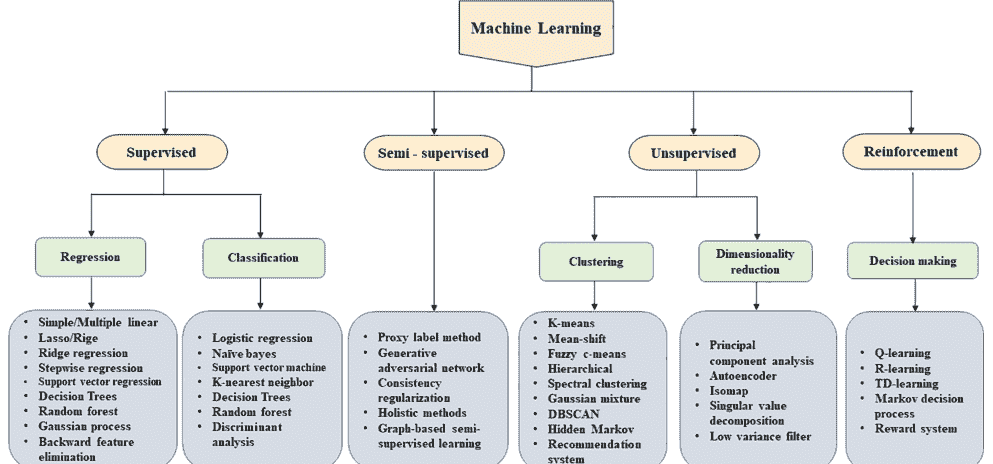
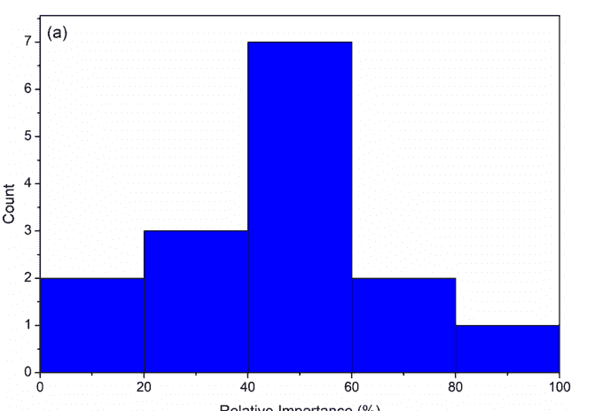
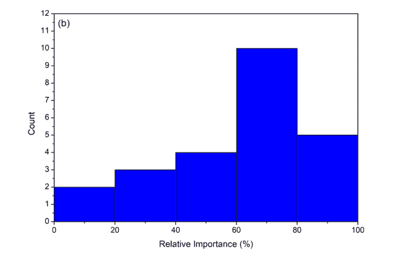
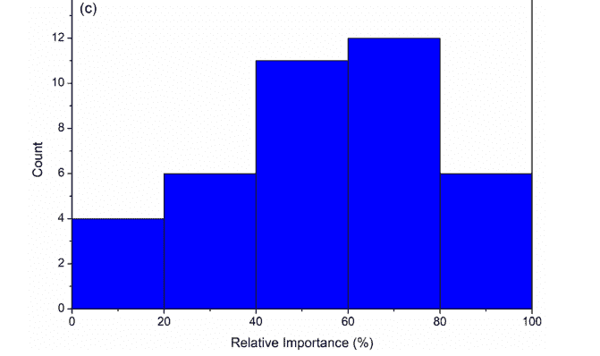
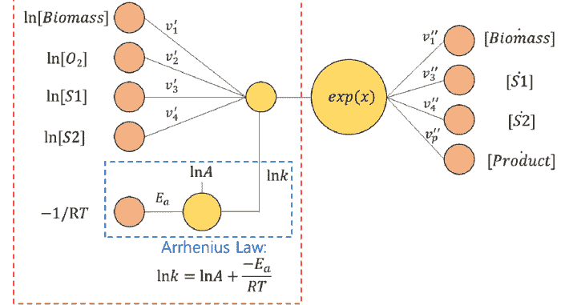
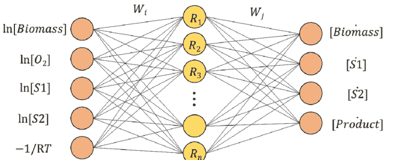
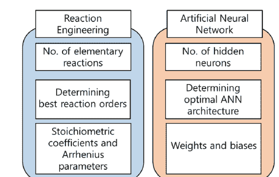
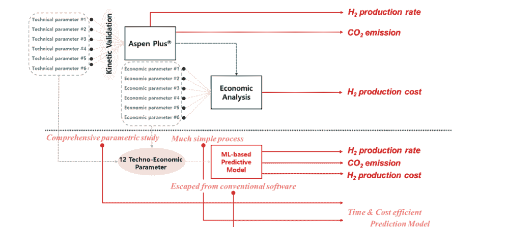
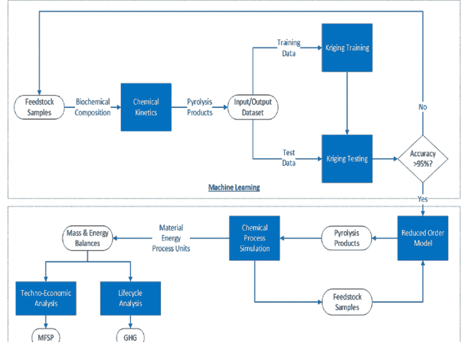

# 机器学习 热化学生物燃料转化工艺的最新进展与未来展望

## 综述

## 文章信息

关键词:

- 热化学转化工艺
- 理论集成机器学习
- 生物燃料转化
- 技术经济分析

## 摘要

生物燃料已被广泛认可为应对气候危机、增强能源安全和可持续性的潜在解决方案。然而，生物燃料生产的技术经济和环境挑战仍然存在，且复杂的转化工艺和因素，如材料和工艺设计，需要被考虑以解决这些挑战，这并非易事。机器学习（ML）已与热化学生物燃料转化工艺的理论相结合，以实现准确高效的生物燃料工艺建模。在本综述中，对用于预测生物燃料产率和组成的现有机器学习应用进行了批判性回顾。总结了热化学生物燃料转化工艺所开发模型的输入和输出变量的细节，并比较了其开发程序。还回顾了结合机器学习应用在生物燃料中的技术经济分析结果。尽管文献中开发的模型对其各自的目标显示出良好的性能，但它们几乎无法应用于其他原料或操作条件。为克服这一挑战并开发通用模型，本研究提出了前瞻性方法。研究建议，必须开发系统化的数据集，以支持更全面的基于机器学习的建模，从而实现实际应用。推荐了机器学习驱动的热化学生物燃料转化工艺建模的潜在前瞻性研究和开发方向，以便其能够协助各种生物燃料转化的商业化和优化，从而实现可持续和循环社会。

## 1. 引言

包括生物质在内的可再生能源来源的利用在全球范围内增加，以减少导致严重环境挑战的温室气体排放量的增加[1–3]。在各种可再生资源中，生物质包括木质纤维素和市政废物，其独特性在于它长期以来一直被使用，即使在传统能源系统中，并已在过去几十年中作为化石燃料的可靠替代品受到相当大的关注[4]。2021年生物质燃烧产生的电力达到750 TWh，预计到2050年生物质供应将增加到100 EJ[5,6]。基于例如生物化学和热化学方法的生物质能源转化工艺的开发近年来有所增加，这归功于其低排放特性等其他优势[5,7,8]。特别是，生物燃料有可能为联合国可持续发展目标（UNSDGs）做出贡献，通过促进可负担和清洁能源（目标7）、工业、创新和基础设施（目标9）、负责任的消费和生产（目标12）以及气候行动（目标13）[9]。

生物质转化工艺，无论是生物化学还是热化学，都允许生产燃料、热、电以及其他增值产品。生物化学转化工艺利用细菌、酶和微生物将生物质分解为燃料和其他产品[10–12]。生物化学工艺的主要缺点是其反应速率低，通常需要数小时、数天或数周才能完成必要的反应。相比之下，热化学转化工艺则利用热能来源和化学反应将生物质分解为各种产品[13–15]。与生物化学工艺相比，热化学工艺相对较快，因为反应可在几分钟甚至几秒内发生。它们也适用于更广泛的原料[16]。

由于其优势和高转化效率，热化学转化一直是最广泛使用的方法[2,12]。它们可分为干馏[17]、热解[18,19]、气化[20]和水热处理[21]。干馏在低温（<320 °C）下在无氧或部分氧化气氛中进行，以改善燃料特性[17]。热解是在惰性环境下对生物质进行热处理，以生产液体生物燃料、气体和固体残渣。根据加热速率和停留时间，热解通常分为慢速、快速和闪速热解[22,23]。热解产物的效能和质量很大程度上取决于加热速率、温度、原料粒径、停留时间和水分含量[24,25]。原料的预处理也在工艺中发挥作用，如HCl预处理下热解气体产率增加所示[26]。气化涉及

## 符号说明

| 缩写 | 描述 |
|---|---|
| ABC | 人工蜂群 |
| AC | 灰分含量 |
| ACP | 水相副产物 |
| AI | 人工智能 |
| ANFIS | 自适应神经模糊推理系统 |
| ANN | 人工神经网络 |
| ANN-PSO | 人工神经网络-粒子群优化 |
| BC | 生物质组成 |
| CART | 分类与回归树 |
| Ce | 纤维素含量 |
| CFD | 计算流体力学 |
| CFNN | 级联前馈神经网络 |
| CHP | 热电联产 |
| CR | 碳回收率 |
| DCD | 脱羧程度 |
| DCF | 折现现金流 |
| DHD | 脱水程度 |
| DNN | 深度神经网络 |
| DT | 决策树 |
| Eₐ | 活化能 |
| ENR | 能量回收 |
| ER | 当量比 |
| Err | 相对误差 |
| ERT | 极端随机树 |
| F | 流量 |
| FC | 固定碳 |
| GA | 遗传算法 |
| GBR | 梯度树提升 |
| GHG | 温室气体 |
| GNN | 图神经网络 |
| GWP | 全球变暖潜势 |
| HDPE | 高密度聚乙烯 |
| HHV | 高热值 |
| Hm | 半纤维素含量 |
| HR | 最佳加热速率 |
| HT | 保持时间 |
| HTT | 水热处理 |
| H/C | 氢碳比 |
| IP | 无机磷 |
| IRR | 内部收益率 |
| k₀ | 指前因子 |
| KNN | K最近邻 |
| LCA | 生命周期分析 |
| L-C-H | 木质素、纤维素和半纤维素的相对含量 |
| LHV | 低热值 |
| LHVp | 气化产物低热值 |
| Lg | 木质素含量 |
| MAE | 平均绝对误差 |
| MC | 含水率 |
| MCS | 蒙特卡洛模拟 |
| ML | 机器学习 |
| MLM | 机器学习模型 |
| MLR | 多线性回归或失重速率 |
| MLnR | 多非线性回归 |
| N₂, N | 氮 |
| n | 反应级数 |
| NARX | 外生输入非线性自回归神经网络 |
| NN | 神经网络 |
| NPV | 净现值 |
| NOx | 氮氧化物 |
| N/C | 氮碳比 |
| O₂, O | 氧 |
| O/C | 氧碳比 |
| P | 生产能力 |
| PBM | 基于物理的模型 |
| PC | 热解条件 |
| PCA | 主成分分析 |
| PDA | 部分依赖分析 |
| PDE | 偏微分方程 |
| PS | 粒径 |
| PSA | 变压吸附 |
| PSO | 粒子群优化 |
| R² | 决定系数 |
| RBF | 径向基函数 |
| RF | 随机森林 |
| RMSE | 均方根误差 |
| ROM | 降阶模型 |
| RT | 停留时间 |
| S1, S2 | 中间物种 |
| SD | 固体含量 |
| SGB | 随机梯度提升回归树 |
| SHAP | Shapley加性解释 |
| SM | 采样方法 |
| SML | 样品质量装载 |
| SS | 样品尺寸 |
| SO₂ | 硫氧化物 |
| SVM | 支持向量机 |
| S/B | 蒸汽与生物质比 |
| T | 操作温度 |
| TEA | 技术经济分析 |
| TGA | 热重分析 |
| Tini | 初始温度 |
| Target | 目标温度 |
| V | 空速 |
| VM | 挥发分 |
| X | 转化率 |

在有限氧气供应条件下将生物质转化为合成气 [4,14,27]。根据气化剂类型、反应条件和所生产合成气质量，可将其分为常规型和水热型 [2,28]。与通常偏好干燥生物质的其他热化学技术不同，水热处理可在合理的能量效率下将湿生物质转化为气体、固体燃料和其他组分。水热处理涉及利用热压水作为反应物生产生物燃料 [12]。根据温度、压力和转化中间产物的比例，可将其分为水热碳化或水热液化 [29]。这些工艺的设计面临各种挑战，主要是由于其多参数和复杂特性。此外，还应认真考虑催化剂 [30]，就其基本性质 [31] 而言，这些性质可提高油和气的产率，同时抑制焦炭的生成 [32]。

典型的热化学转化研究通常需要严格的实验来确定最佳设计和操作 [5,12]。多年来，包括计算流体动力学（CFD）、动力学和热力学模型以及工艺模型在内的新型建模技术已被用于加速工艺优化，同时减少操作时间和成本 [33–37]。然而，使用这些传统技术的建模有时是不切实际且困难的 [38,39]。这是因为这些模型基于各种假设，要么过于详细，要么过于简化，影响了模型预测的质量和/或导致实施困难 [40]。此外，这些模型在不同操作条件下难以应用 [35,41]。例如，CFD 耗时且计算成本高，因为它需要大量的处理能力和预定义的特定发动机参数 [36,37]。因此，开发一种准确、非耗时、非计算成本高且稳健的建模方法来模拟这些工艺至关重要。

机器学习（ML）技术已被证明是研究和理解复杂转化过程的传统建模技术的可靠替代方案。它们可以通过利用输入和输出参数之间的一系列相互联系来建模复杂问题。最近，应用 ML 方法对热化学生物燃料转化过程进行建模的应用显著增加。应用包括预测产品的产率和组成、动力学参数以及产品的热值。所开发的 ML 模型还被用于确定所需生产的最佳条件。对具有不同量级的输入变量进行预处理或归一化是一种超参数，有助于提高基于机器学习的模型的性能。然而，一些研究并未说明为防止过拟合而采取的措施，而过拟合是模型改进的关键挑战 [37,42–44]。

之前的综述总结了生物质转化过程的 ML 应用，其中使用了特定数据集（例如，原料类型和操作条件不多样）。所开发的 ML 模型表现出良好的性能，但 ML 模型的推断或进一步改进受限于转化过程中的变异性，如反应器类型、原料和操作条件。在实际应用中，开发通用 ML 模型以在不受生物质原料条件影响的情况下稳定生产生物燃料是必要的。作为开发此类通用模型的第一步，本研究比较了数据集维度的变异性以及数据点的数量。还讨论了开发的 ML 中的预处理和过拟合的可能性。然后，本综述总结了估计单个 ML 模型中输入变量重要性的结果，以便讨论哪些输入变量重要。最后，总结了开发通用 ML 模型的相关挑战，并提出了潜在解决方案和未来研究方向。

## 2. 机器学习的总体概述

机器学习方法可分为监督学习、半监督学习、无监督学习或强化学习。在监督学习方法中，标记的输入和输出数据集用于模型的训练和验证。然后模型学习将输入数据映射到其目标输出 [45]。监督学习方法可分为回归方法和分类方法。分类方法旨在识别数据集中的行为模式，而回归方法旨在建立输入和输出参数之间的最佳匹配 [46]。

与监督学习相比，无监督机器学习也称为自组织，最适合无标签数据，并且擅长检测任何可能的隐藏模式。随着输入数据输入无监督 ML 模型，模型会据此寻找并分类数据之间的相似性和差异。无监督 ML 的示例包括主成分分析、降维和聚类。半监督学习结合了监督学习和无监督学习的优点。它有助于解决监督学习挑战，并且可以处理同时具有无标签和有标签输入的系统 [45]。值得注意的是，为监督学习标记数据通常困难且耗时。半监督学习可以通过将部分总无标签输入纳入监督学习过程来克服这一缺点 [45,47]。

ML 算法的最后一类是强化学习，涉及一种称为智能体的学习系统，它通过一系列可能带来奖励或惩罚的行动来理解其环境。积极的行动会产生奖励，而消极的行动会导致惩罚。智能体能够在无需人工干预的情况下更好地理解其环境，其依据是最大化收益并减少惩罚 [39,48]。一些在科学和工程领域使用的突出 ML 算法，可用于生物质热化学转化过程，已在图 1 中呈现。多种 ML 算法已被用于生物质热化学转化过程的不同方面。最广泛研究的算法是人工神经网络（ANN）。其他不太流行的算法包括决策树、随机森林、支持向量机、深度神经网络和混合智能模型。Umenweke 等 [2]、Ascher 等 [25]、Ascher 等 [49] 和 Shahbeik 等 [28] 对 ANN 以及该领域各种应用中使用的其他算法进行了简要讨论。关于估计特征重要性的方法的更多解释已添加到补充材料中。

## 3. 机器学习（ML）在热化学生物燃料转化过程中的应用

热化学转化过程将生物质资源转化为氢气、甲烷、沼气、生物油和生物炭等各种生物燃料。为了最大化生物燃料的选择性或产率以及转化效率，各种 ML 方法已被应用于热化学生物燃料转化过程。在应用 ML 方法之前，需要使用从热化学生物燃料转化过程中获得的测试数据集来评估训练模型的性能。大多数研究使用相关系数（R²）或均方根误差来描述模型的性能，这对于单输出模型来说是足够的。然而，在多输出模型的情况下，模型的性能应考虑每个输出的不同量级，而 R² 的作用应仅限于评估每个输出的相关性。因此，对于多输出模型，建议使用相对度量，例如平均百分比误差或根相对平方误差，来比较不同模型的平均性能。

了解 ML 模型的预测可能与实验值产生多大偏差很重要，但在 ML 研究中很少有研究提供相应的产率值。相反，一些研究提供了实验值与预测值之间的平均百分比误差。

### 图 1. ML 算法的分类。

这可以更好地表明预测值与实验值的平均差异。此外，偏差（实验结果与预测值之间的差异）的分布应均匀散布，无论实验值的大小如何也很重要。因此，应研究所有实验值的偏差，而不仅仅是特定值。

部分机器学习模型显示相关性相对较差（R² < 0.9），意味着模型欠拟合。有多种方法可以提高 R² 值，其中第一种方法是增加可用数据的数量。此外，选择有效的输入变量也是一种方法。许多研究都这样做了，并提出了给定系统输入变量的最佳组合。需要注意的是，高 R² 值并不能评估是否发生过拟合。因此，应使用防止过拟合的方法，如早停法或正则化方法。考虑到这些方面，模型开发的详细流程在下一节中进行了总结。ML 模型配置的详细描述有助于复现已开发的 ML 模型，可在参考文献中找到。

### 3.1. 全数据驱动的机器学习模型

#### 3.1.1. 干条件下产品的产量和组成

一般而言，热化学生物燃料转化过程中使用的生物质条件可分为干湿两种条件，具体取决于转化过程中是否添加外部水。这些过程中使用的生物质含水量在过程分类中被忽略。生物质热化学转化产物的产量和组成取决于原料特性（例如近似组成和元素组成）和操作条件，如干条件下温度、停留时间和加热速率 [24]。它们也是现有基于 ML 模型中使用的主要输入变量。当使用相同数据集时，含有元素组成数据的基于 ML 的模型性能优于仅含有近似组成数据的模型 [50]。然而，当两种组成数据均作为输入变量时，基于 ML 的模型的性能显著提高 [50]。需要注意的是，生物质资源的化学和结构组成取决于原料类型 [51]。在藻类原料的情况下，主要组分为碳水化合物、脂质和蛋白质，而木质纤维素原料的主要组分为半纤维素、木质素和纤维素 [51–53]。因此，一些研究还将主要组分的含量作为 ML 模型开发的输入变量。生物质的颗粒尺寸也被用作输入变量 [27]。在操作条件方面，温度、加热速率、保留时间和气体流速被用作输入变量。

产品和副产品的产量和组成是基于 ML 模型的典型输出变量。产量可计算为目标产物质量与原料质量之比。当测试各种输入变量组合时，R² 值达到 0.862 [54–56]。Onsree 等人开发了一个纳入操作环境（N₂、O₂ 和 CO₂）的模型，并使用 10 种原料的数据集显示出预测生物炭产量的高性能（R² > 0.915）[57]。预测生物炭元素组成和碳含量的模型的性能范围为 R² = 0.66 [54] 至 R² = 0.8480 [56]。高热值（HHV）是与质量相关的燃料热值 [58]。对于生物炭 HHV 的预测，Onsree 等人实现了 R² 值为 0.9052 [57]。

对于单位生物质生物油产量的预测，Ullah 等人的 ML 模型实现了 R² 值为 0.95 [59]。热化学转化过程中产生的液相副产物水产量也由 ML 模型预测 [60,61]。干条件下生物油组成的 ML 预测尚未见报道，这可能归因于干条件下数据集不足。

H₂、CO、CO₂ 和 CH₄ 是热化学转化中释放的主要气体物种，其产量通常被视为 ML 模型的输出 [62,63]。Yucel 等人使用不同原料类型的数据集开发了用于预测生物质气化总气体产量和气体组成的 ML 模型 [63]。总气体产量和 H₂、CO、CO₂ 和 CH₄ 气体组成的性能分别用 R² = 0.86、0.85 表示。Tang 等人开发了一个 ML 模型来预测 H₂、CO、CO₂ 和 CH₄ 的产量，R² 值为 0.999 [62]。该模型使用相对大量的数据（3831 个数据点）开发，但仅使用了两种原料，意味着需要对其他原料进行进一步验证。Ascher 等人开发了一个 ML 模型来预测包括 H₂、CO、CO₂、CH₄、N₂ 和 C₂H₄ 在内的多功能气体物种的组成 [50]。该研究还预测了总气体产量、冷气效率和碳转化效率。ML 模型还被开发用于预测其他输出变量，如总气体产量 [55,60,64]、HHV [63]、低热值（LHV）[50,64]、H₂ 组成 [42]、CO/CO₂ 组成 [60] 和 H₂、CO 和 CH₄ 的最大产量 [27]。此外，合成气中焦油浓度和总焦油产量（每单位生物质质量）也基于 ML 模型的开发进行了预测 [65]。干热化学转化中副产物的 LHV 预测良好，R² = 0.988 [64]。

少数研究在干条件下将不同的气体环境作为 ML 模型开发的输入变量。Zhao 等人将气体中 O₂ 组成作为输入变量（预测因子），同时预测了生物炭、沼气、焦油和水的产量 [60]。Onsree 等人将气体环境中 N₂、CO₂ 和 O₂ 的组成作为输入变量，预测了固体产物的产量和 HHV [57]。用于预测干条件下产品产量和组成的 ML 模型的总结见表 1。

如上所述，将近似组成和元素组成同时作为输入变量通常会导致良好的 ML 建模性能。然而，使用了不同形式的基于组成的输入变量。例如，一些研究以比值形式考虑元素组成，如氢/碳比（H/C）和氧/碳比（O/C）。在模型开发过程中测试各种形式的输入变量时，比值形式的性能优于组成本身 [54]。O/C 比被报道为藻类中碳水化合物、脂质和蛋白质水平的一个良好衡量指标 [72]。生物油的产量主要取决于碳水化合物、脂质和蛋白质的比例，其中脂质是最重要的因素，其次是蛋白质和碳水化合物 [72,73]。生物质中较低的 H/C 值可能表明木质素比例较大而半纤维素比例较小 [57]。此外，生物炭中的 O/C 和 N/C 比可以作为生物炭极性及其表面性质的指标 [74]。在木质纤维素生物质的情况下，高 O/C 和 H/C 比意味着半纤维素和纤维素比例高，木质素比例低 [51]。这些研究表明，元素比值可以更好地描述特定的组分（例如木质素或半纤维素），该组分决定了生物质热化学转化的机制。这意味着选择元素比值作为输入变量有利于 ML 开发。

因此，建议将描述热化学机制决定因素的组分比值形式应用于 `ML` 开发。如果这些机制尚不明确，系统性地寻找性能更好的比值形式可能会揭示生物质热化学转化的机制。

### 3.1.2. 干条件下的转化动力学和动力学参数

人工神经网络和随机森林已被广泛应用于预测生物质热化学转化的动力学或动力学参数，如活化能和指前因子。此外，生物质加热时的热重质量损失已广泛使用 `ML` 模型进行预测。

生物质组成被用作输入变量来预测干条件下热解的活化能，该活化能基于 `Kissinger-Akahira-Sunose`、`Ozawa-Flynn-Wall` 和 `Friedman` 等各种估算方法计算 [51]。基于热重分析数据，各种生物质的纤维素、半纤维素和木质素比例已被用于预测反应动力学参数，如指前因子（`log k0`）、活化能（`log Ea`）和反应级数（`log n`）[70]。用于预测热解活化能的加热速率也获得了类似的结果 [71]。氩气环境下藻类热解的质量损失时间序列使用加热速率、系统初始温度和目标温度进行预测 [69]。

`Wei` 等人开发了一个 `ML` 模型来预测生物质和煤炭共燃烧的热重质量损失曲线 [72]。输入变量包括生物质和煤炭的组成及其混合比例以及操作参数，如加热速率和温度。

输入变量的重要性如下：温度 > 生物质与煤炭的混合比例 > 生物质与煤炭的组成 > 加热速率。用于预测干条件下热化学转化转化动力学和动力学参数的 `ML` 模型的总结见表 2。

### 3.1.3. 湿条件下产品的产量和组成

与干条件类似，使用各种 `ML` 模型对湿条件下生产的固体产物（称为生物炭）的产量、组成和性质进行预测已得到广泛研究。在湿条件下，反应物或水是转化过程的补充因子。少数研究已将反应物信息，如反应物与生物质比（或生物质与反应物比）作为输入变量纳入 [73–76]。

尽管这些研究中纳入了生物质与水比作为输入变量 [73,74,77]，但其对产量的重要性被估计为较低。生物炭的组成使用不同的输出变量进行预测，如碳含量（或碳回收率）[44,78,79]、氮含量 [77]、无机磷含量 [79]、原子比 [73,78] 和固体产物的灰分含量 [73]。`Wei` 等人预测了反应前后固体产物的 `H/C` 和 `O/C` 比以估计产物质量 [80]。这是基于生物炭的 `H/C` 和 `O/C` 比越低，燃烧过程中的能量损失越小这一事实 [81]。使用 `ML` 模型预测了生物炭的能量回收率和 `HHV` [44,73,78]。在这些研究中，温度和保留时间通常作为输入变量纳入；然而，使用了不同的生物质特性组合。在液体产物的情况下，开发用于预测生物油产量和组成的 `ML` 模型比干条件下投入更大 [44,74,75,82]，以及副产物（水相共产物）[44,74]。预测了生物油的元素组成（`C`、`H`、`O`、`N` 和 `S`）[74]，同样也预测了 `C`、`N` 和 `O` 的具体组成 [44,83]、能量回收率 [44] 和生物油的 `HHV` [74,75]。当使用包含各种类型反应物和催化剂的数据集开发 `ML` 模型时，反应物和催化剂的类型被指定为分类输入变量 [75]。

使用各种 `ML` 模型预测了湿条件下产生的具有各种组成和产量的产物气体。所开发模型的输出变量包括总产生气体产量 [38,44,74,83]、`H₂`、`CH₄`、`CO₂`、`CO`、`C₂H₄` 和 `C₂H₆` 的产量 [76,84]，以及污染指数（`CO₂ + CO`）[75]。值得注意的是，大多数 `ML` 模型包含生物质与水比或生物质与反应物比作为预测因子。生物炭、合成气和焦油的分布被模型很好地预测，性能良好（`R² > 0.91`）[76]。结果表明，生物质特性对预测生物炭生产的影响更为明显，而温度对预测合成气和焦油生产的影响更为明显。此外，反应物与生物质比是合成气中 `CO₂` 比例的重要输入变量，但对其他气体不重要 [76]。用于预测湿条件下产品产量和组成的 `ML` 模型的总结见表 3。

在湿条件下生物质的热化学转化过程中，生物质中含有氧和氢的官能团通过脱羧和脱水从结构中脱离 [91]。因此，生物炭中 `O/C` 和 `H/C` 比的变化分别代表热化学转化过程中脱水和脱羧的程度。`Mu` 等人定义了脱羧程度指数（`DCD`）和脱水程度指数（`DHD`），它们是反应前后 `O/C` 和 `H/C` 比的比值 [73]。指数值越小，热化学转化过程中发生的脱羧和脱水反应越强，固体燃料质量越高 [73]。这些指数使用 `ML` 模型进行预测，其中温度是最重要的输入变量。生物质中的 `O` 含量和灰分含量分别是 `DCD` 和 `DHD` 的后续重要因素。使用诸如 `DCD` 和 `DHD` 之类的输出变量进行 `ML` 建模已被证明为

实现改进的性能和维度外推能力 [92]。此外，维度外推可以显著减少开发 `ML` 模型所需的实验数量 [93]。因此，建议考虑 `DCD` 和 `DHD` 来建模湿态条件下的生物质转化过程。

### 3.1.4. 预测中输入变量相对重要性的比较

对 `ML` 模型预测性能的输入变量相对重要性的比较在表 4 和表 5 中给出。在估计重要性时，输入变量简单地分为原料特性和操作条件，同时剔除了分类变量的重要性。原料特性包括元素组成、元素比、 proximate 分析以及生物质中木质素、半纤维素和纤维素的比例。操作条件包括除原料特性外的所有输入变量，包括混合比例和颗粒尺寸。如表 4 所示，原料特性对干态条件下合成气组成的贡献在各研究中有所不同：干态条件下原料特性重要性更高和操作条件重要性更高的研究数量为 9:8，意味着贡献相等。在湿态条件下，操作条件的贡献大于原料特性（表 5）。对于湿态条件下生物炭的产率、组成和热值，原料特性的贡献大于操作条件。同样，原料特性对生物油的产率和组成的贡献较大。在湿态条件下，原料特性重要性更高和操作条件重要性更高的研究数量为 17:5，意味着原料特性的贡献极高。

#### 表 1

预测产率和组成（干态条件）的 `ML` 模型汇总。

| 生物质 | 方法 | 模型输入 | 模型输出 | 数据数量（划分比例） | 模型开发 | 模型性能 | 特征重要性 | 备注 | 参考文献 |
|---|---|---|---|---|---|---|---|---|---|
| 棉壳、茶废弃物、活秆壳 | `ANN` | 催化剂类型、催化剂质量、`T`、生物质类型 | `H₂` 气体比例 | 168 (102:33:33) | 预处理：`X` | `R²`: 0.955 | `X` | 分类输入变量用于催化剂和生物质类型。过拟合通过提前停止方法防止。 | [66] |
| 未说明 | `LR`, `ANN`, `KNN`, `SVR`, `DT`, `RF`, `DNN` | `RT`, `T` | 焦炭、气体、焦油、出口温度 | 256 条数据 (9:1) | 数据由 `CFD` 生成 预处理：[1,3] 10 折交叉验证 | `RF`：最大相对误差 2.96%。 | `X` | `RF` 提供了最佳性能。 | [67] |
| 松木锯末 | `ANN` | `T`, `PS`, `V` | `CO`、`CO₂`、`CH₄`、`H₂` 产率 | 90 (85:15) | 预处理：`X` | `R²`: 0.99 | Garson 方程 | 温度是最重要的输入变量。 | [68] |
| 木质颗粒 | `ANN` | 1. `ER`, `F(air)`, `T` (分布, `T0-T5`) 2. `C`, `H`, `O`, `N`, `MC`, `VM`, `FC`, `AC`, `ER`, `F(air)`, `T0` | `CO`、`CO₂`、`H₂`、`CH₄` 产率、`HHV` | 3831 (70:15:15) | 预处理：`X` | `R²`: 0.999 | Garson 方程 | 温度分布被作为输入变量包含在内（模型 #1），并且其结果优于模型 #2 过拟合通过提前停止方法防止。 | [63] |
| 木质纤维素 | `RF` | `AC`, `RT`, `H`, `T`, `PS`, `L-C-H`, `C-H-O-N` | 生物炭、焦炭产率 | 245 (80:20) | 预处理：z-score 5 折交叉验证 | `R²`: 0.8548 (生物炭) `R²`: 0.8480 (C-焦炭) | 方法未说明 | 温度是最重要的输入变量。 | [56] |
| 藻类 | `XGBoost`, | `C`, `H`, `O`, `N`, `H/C`, `O/C`, `N/C`, `AC`, `FC`, `VM`, `T`, `HR`, 和 `RT` | 生物炭产率、元素组成 | 91 (75:25) | 预处理：`X` 正则化：`L1` 和 `L2` | `R²`: 0.84 (生物炭产率) `R²`: 0.66 (元素) | F-score, `SHAP` | 最佳输入变量集：`H/C`、`N/C`、灰分、热解时间、温度 过拟合通过 `L1` 和 `L2` 正则化防止 | [54] |
| 木质生物质 | `ANN` | `C`, `H`, `O`, `MC`, `AC`, `ER`, `T`, `SM` | 总焦油浓度 | 120 (70:15:15) | 预处理：[0, 1] | `R²`: 0.9769 (一层) `R²`: 0.9932 (两层) | Garson 方程 | `SM` 被用作分类变量。过拟合通过提前停止方法防止。特征重要性使用单隐藏层模式估计。 | [65] |
| 市政固体废物 | 5 个 `ML` 模型的集成：`DT`, `XGB`, `RF`, `SVR`, `ANN` | `C`, `H`, `N`, `O`, `S`, `MC`, `AC`, `ER`, `T` | 合成气产率、`LHV`、`LHVp`。 | 67 (70:30) | 预处理：[0, 1] 5 折交叉验证 | `R²`: 0.99 (气体产率) `R²`: 0.972 (`LHV`) `R²`: 0.988 (`LHVp`) | Gini 重要性 | 温度对所有目标都是最重要的变量。 | [64] |
| 木质纤维素 | `ANN` | `H`, `RT`, `PS`, `SS`, `T`, `MC`, `AC`, `Lg`, `Hm`, `Ce`, `HT` | 生物炭、焦油和沼气产率 | 482 (89:11) | 预处理：经过 `log 10` 函数后进行 z-score | `R²`: 0.66 (生物炭) `R²`: 0.70 (焦油) `R²`: 0.84 (沼气) | `X` | 最佳输入变量集：`H`、`RT`、`PS`、`T`、`MC`、`AC`、`Lg`、`Hm`、`Ce`、`HT` 对输入的连接权重添加了高斯噪声，并应用了 dropout。 | [55] |
| 橡胶废料、塑料 | `ANN` | `PS1` (橡胶籽壳)、`PS2` (HDPE)、`T`、塑料质量 | 气体中 `H₂` 组成 | 30 (70:30) | 预处理：`X` | `R²`: 0.990 | Garson 方程 | 缺失特征被估计。橡胶废料和塑料的共气化 `PS2` (HDPE) > `PS1` (橡胶籽壳) > `T` > 塑料质量 | [42] |
| 农业废弃物、林业废弃物、藻类 | `RF`, `SVM` | `C`, `N`, `O`, `HTT`, `HR`, `PS`, `FR` | 沼气产率、`CO₂`、`H₂`、`CO`、`CH₄` | 气体产率：194 气体组成：120 (80:20) | 预处理：z-score 对全部数据集进行 5 折交叉验证 | `R²`: 0.86, (产率) `R²`: > 0.85 (组成) | PDA | `RF` 平均而言比 `SVM` 预测更好 对于沼气、`CO₂` 和 `H₂` 产率，`OC` 比 `FC` 更重要。对于 `CO` 和 `CH₄` 产率，`FC` 比 `OC` 更重要。 | [62] |
| 稻草、松木 | `ANN`, `ANN-PSO` | `T`, `C`, `H`, `O`, `AC`, `MC`, `FC`, `VM`, 气体中氧组成 | 水、焦油、生物炭、沼气、`CO`、`CO₂` 产率 | 45 (6:2:2) | 预处理：`X` | 平均误差：7.72% (`ANN-PSO`) | `X` | `ANN-PSO` 的平均误差为 7.72%，`ANN` 的平均误差为 23.07%，过拟合通过提前停止方法防止。 | [60] |
| 木质纤维素 | `CFNN-ABC` | `C`, `H`, `N`, `O`, `FC`, `VM`, `MC`, `AC`, `HTT`, `PS`, `HR.` | 生物油产率 | 305 (85:15) | 预处理：`X` | `R`: 0.95 | PDA | `CFNN-ABC` 推荐的参数被用于工艺模拟。结果与实验结果吻合良好（平均偏差 < 5%） | [59] |

#### 表 1（续）

| 生物质 | 方法 | 模型输入 | 模型输出 | 数据数量（划分比例） | 模型开发 | 模型性能 | 特征重要性 | 备注 | 参考文献 |
|---|---|---|---|---|---|---|---|---|---|
| 木材 | `RF` | `T`、颗粒形状、发射率、热导率、尺寸、水分含量和孔隙率 | `H₂`、`CO`、`CH₄` 合成气最大产率 | 2000 (90:10) | 2000 个数据点由空气环境中的模拟生成。 预处理：`X` | `R²`: >0.994 (均匀分布) `R²`: >0.962 (正态分布) | Gini 重要性 | 发射率、颗粒形状、热导率和孔隙率对合成气产率影响可忽略。 串联集成混合 `ML` 模型 | [27] |
| 木质纤维素 | `RBF`, `SVM`, `RF`, `FU` | `C`, `H`, `O`, `MC`, `AC`, `VM`, `FC`, 和 `BC.` | 焦油产率、水产率、焦炭产率。 | 96 (80:20) | 预处理：z-score | `R²`: > 0.99 | 方法未说明 | 3 种生物质和 3 种煤的混合。 `FU` 与 3 个基础模型相比最佳。 对于最佳 `FU` 模型，样品的挥发分对焦油产率和焦炭产率影响最大。 | [61] |
| 木质纤维素 | `ANN`, `GBR`, `RF`, `SVM`, `SHAP` | `T`, `RT`, `N₂`, `CO₂`, `O₂`, `SZ`, `SM`, `FR`, `VM`, `FC`, `Ash`, `N`, `S`, `H/C`, `O/C`, `Hm`, `Ce`, `Lg` | 固体产率、`HHV` | 410 | 预处理：Yeo-Johnson 非线性变换后进行 z-score（输入）、[0, 1]（输出） 全部数据集上进行 10 折交叉验证 | `R2`: 0.9153, `NRMSE`: 0.0946 (固体产率) `R2`: 0.9052, `NRMSE`: 0.0391 (`HHV`) | `SHAP` | 使用了 10 种生物质。 `GBR` 是最佳模型。输入变量的全集最佳。 | [57] |
| 各种（来自文献） | `ANN` | 原料、操作、气化剂、反应器、床料、催化剂、系统规模、`CHNSO`、`AC`、`MC`、`VM`、`FC`、`PS`、`LHV`、`Lg`、`Hm`、`Ce`、`T`、`RT`、`S/B`、`ER` | 合成气、焦炭、焦油产率、气体组成 `LHV` 效率、转化率 | 312 (87.5:12.5) | 预处理：[-1, 1] 5 折交叉验证 | `R²`: 0.9310 | `X` | 在各种条件下预测了气化。 | [50] |
| 木质纤维素 | `ANFIS` | `RT`, `Hm`, `Ce`, `Lg` | 总转化率（%） | 未说明 | 预处理：`X` | `R²`: 0.92 (P. pinnata) `R²`: 0.97 (J. curcas) | `X` | 氮气环境中的热解反应。 | [43] |
| 木质纤维素 | `ANN` | `X`, `Y`, `T` | 每个 `CFD` 网格节点处焦油、气体和生物质的时间平均质量分数 | 未说明 80:20 | 预处理：`X` | `R²`: 0.8699 | `X` | 由 `CFD` 生成的数据用于训练 `ANN`。串联集成混合 `ML` 模型。 | [37] |
| 木质纤维素 | `ANN`, `DT` | `T_max`, `HR`, `C`, `H` | 30 个输出 (固体、气体、焦油中官能团分布) | 250,000 (14:6:5) | 随机生成了 250,000 个参数集。 对每个参数集计算了 `ODE`。 预处理：z-score | `R²`: >0.9967 | `X` | `MISO` 模型（`R² > 0.9967`）优于 `MIMO` 模型（`R² > 0.986`）。 | [69] |

#### 表 2

预测反应动力学（干态条件）的 `ML` 模型汇总。

| 生物质 | 方法 | 模型输入 | 模型输出 | 数据数量（划分比例） | 模型开发 | 模型性能 | 特征重要性 | 备注 | 参考文献 |
|---|---|---|---|---|---|---|---|---|---|
| 多样生物质 | `ANN` | `Lg`, `Hm`, `Ce` | `log k0`, `log Ea`, `log n` | 150 (70:15:15) | 预处理：`X` | `R²`, 0.93 (`log k0`), 0.93 (`log Ea`), 0.94 (`log n`) | Garson 方程 | `N₂` 大气下的热解。过拟合通过提前停止方法防止。纤维素含量对 `k0` 的贡献最重要。 | [70] |
| 多样生物质 | `MLR`, `RF` | `C`, `H`, `O`, `N`, `S`, `H/C`, `O/C`, `AC` | `Ea` | 281 (90:10) | 预处理：`X` | `R²`, 0.9964 | 方法未提及 | 数据来自 100 篇文献。`RF` 是最佳模型。贡献：`C` > `H/C` > `S` > `O/C` > `H` > 灰分 > `O` > `N` > 类型 > 方法 | [51] |
| 林业残留物、橄榄油残留物 | `ANN` | `T`, `HR` | 温度依赖性失重 | 8000 (70:15:15) | 预处理：`X` | `R²`, >0.99 | `X` | 过拟合通过提前停止方法防止。活化能基于预测的失重计算。 | [85] |
| 木材、草、作物 | `CRNN` | `Ce`, `O₂`, `T` | 残留物质量 | 14 个时间序列数据 (9:5) | 预处理：`X` | `MAE`: 0.03 | `X` | 混合 `ML` 模型，其中化学反应参数从 `NN` 的权重和偏置获得。此外还预测了排放挥发性气体的质量。 | [86] |
| 多样生物质 | `RF`, `ERT` | `C`, `O`, `N`, `H`, `FC`, `S`, `VM`, `AC HR`, `T`, `BR` | `TG` 曲线 | 未提及, (70:30) | 预处理：`X` 基于混合比例的分层抽样方法 5 折交叉验证 | `R²`, 0.999 (`RF`, `ERT`) `R²`, 0.98 (`ERT` for new data) | 平均减少不纯度重要性（`MDI`） | 收集了 30 种生物质和 28 种煤样品。根据原料，推荐了不同的特征组和模型的组合。 | [72] |
| 木质纤维素 | `DT` | `C`, `O`, `H`, `N`, `S`, `HR` | `Ea` | 149 (75:25) | 预处理：[-1,1] | `R²`, 0.995 `MRE`: 3.892 % | 相关性因子 | 相对重要性：`T` > `BR` > `UAC` > `UAB` > `PAC` > `PAB` > `HR` `HR` 是最重要的输入变量。 | [71] |
| 藻类 | `ANN` | `Tini`, `Ttarget`, `HR` | `MLR` | 6 个失重时间序列数据 (70:15:15) | 预处理：`X` | `R²`, 0.997 | `X` | 氩气环境（100 mL/min）下的热解 过拟合通过提前停止方法防止。差示热重分析（`DTG`）被预测。 | [87] |

原料特性对 ML 模型的相对重要性的直方图绘制于图 2(a)–(c)。在干态条件下，分布呈左偏，显示出原料特性重要性较低的模型数量较大。然而，在湿态条件下，分布呈右偏，因为原料特性重要性较高的模型数量更多。这可能归因于与干态条件相比，湿态条件包括更广泛的操作条件，例如催化剂和反应物类型。此类操作条件被指定为分类输入变量，但在相对重要性求和过程中其贡献被剔除，导致湿态条件下操作条件的贡献下降。当所有条件的相对重要性被绘制时（图 2(c)），由于湿态条件下 ML 模型数量更多，分布呈右偏。

### 3.2. 理论集成 ML 模型

将数据驱动和理论模型相结合的方法可分为串联和混合集成 [98]。在串联集成中，每个模型串联连接，而在混合集成中，一个模型的结构与另一个模型相结合。理论集成 ML 模型的汇总在图 3 中给出。少数研究将数据驱动和理论模型结合起来，为热化学转化过程开发理论集成 ML 模型

#### 表 3

预测产品产率和组成（湿条件）的机器学习模型汇总。

| 生物质 | 方法 | 模型输入 | 模型输出 | 数据数量（划分比例） | 模型开发 | 模型性能 | 特征重要性 | 备注 | 参考文献 |
|---|---|---|---|---|---|---|---|---|---|
| 废弃物 | TDSS, TRS | C, H, O, N, S, MC, VM, AC, T, P, SV/B, RT, mass of catalyst | H2 产率, 污染指数 (CO2, and CO %) | 520 (500:20) | 预处理: X | %准确率: 94% | X | 缺失数据被适当假设并使用 TDSS 分析。 | [88] |
| 食物废弃物 | ANN | T, RT, BC | H2, CH4, CO, CO2 产率 | 40 (28:6:6) | 预处理: X | R²: 0.989 (H2) R²: 0.991 (CH4) R²: 0.994 (CO) R²: 0.982 (CO2) | X | 通过早停法防止了过拟合。 | [89] |
| 微藻, 废弃物 | ANN | C, H, O, N, S, T, P, B/W, RT, Cat/Susp | H2, CH4, CO2, CO, C2H4 C2H6 产率 | 55 (70:15:15) | 预处理: X | R² > 0.965 | X | 通过早停法防止了过拟合。所开发的 ANN 模型用于成本估算。 | [84] |
| 微藻和大型藻类 | RF, GBR | H/C, O/C, N/C, AC, protein, lipid, carbohydrate, T, Solid content | Oil Yield, O content in Oil, N content in Oil | 310 (80:20) | 预处理: z-score 5-fold CV | R²: 0.90 (GBR, MISOs) | MDI | MISOs of GBR was better than MIMO of GBR (R² 0.89). The contribution of operating condition was much larger. | [82] |
| 湿废弃物 | GBR, GBR-PSO | C, H, N, O, AC, SD (solid content), T, P | H2, CH4, CO2, CO yield | 295 (90:10) | 预处理: X | R²: 0.99 (GBR) | Method not mentioned | Developed GBR model was used for optimization for H2-rich syngas production. The suggested condition was inserted in Aspen simulation and the result was validated with experiment. Reaction kinetic was further analyzed with Aspen. | [83] |
| 多样生物质 | LR, ANN, SVM, GPR | T, S/B, O, AC, F, mass of biomass, adsorbent to biomass, PS, C | H2-rich syngas | 1. 15 2. 16 3. 26 4. 15 5. 20 6. 15 (70:15:15) | 预处理: X | 1. R²:0.998 (H2 mol%) 2. R²:0.998 (syngas, HHV) 3. R²:0.970 (H2 yield, %) 4. R²: 0.883 H2 5. R² (H2/ CO):0.857 6. R²: 0.978 (H2) | Modified Garson Equation | Overfitting was prevented by early-stop method. Relative importance 1) T > Oxygen > S/B 2) biomass weight > T > total feedstock weight > AC > F > the ash weight 3) T > Adsorbent to Biomass Ratio > S/B > PS > Superficial Velocity 4) Total amount of feedstock > Amount of coal > initial water volume 5) ER > T > Coal blending 6) F > T > biomass ratio T was the most important input variable. | [38] |
| 禽畜垫料 | MLR | RT, T | IP, CR | 21 | 预处理: X 3-fold CV | R²: 0.9122 (IP) R²: 0.9162 (CR) | MLR coefficient |  | [79] |
| 污水污泥, 食物废弃物, 和粪便 | RF, SVR, DNN | C, H, N, O, FC, AC, VM, MC, RT, T | Yield, HHV, Carbon in char, CR, ENR, N/C, H/C, and O/C | 248 (90:10) | 预处理: z-score 10-fold CV dropout | R² > 0.91 | Permutation importance | DNN was the best. T, C, H, N, O are commonly important in prediction. Developed model was used to optimize fuel properties and carbon storage performance of produced biochar. | [78] |
| 多样生物质 | ANN, ANN-PSO | C, H, O, N, S, FC, AC, VM, T, RT, B/W | Yield, HHV, AC, N/C, DHD, and DCD of biochar | 296 (90:10) | 预处理: X 10-fold CV L2 regularization | R² > 0.85 | SHAP | Overfitting was prevented by L2 regularization. DHD and DCD were defined. Yield: C and T were important. HHV: N, C, and H were important. AC in biochar: O and AC in biomass were important. N/C: N was the most important. DHD: T, AC were important. DCD: T, O were important. The best performance was obtained with input variables including C, N, VM, FC, T Using linear regression, the importance of input variables was estimated | [73] |

#### 表 3（续）

| 生物质 | 方法 | 模型输入 | 模型输出 | 数据数量（划分比例） | 模型开发 | 模型性能 | 特征重要性 | 备注 | 参考文献 |
|---|---|---|---|---|---|---|---|---|---|
| 污水污泥 | ANN | C, H, O, N, VM, FC, AC, T, RT, Mass of water | Nitrogen content of hydro-char | 138 (80:20) | 预处理: X 100 initial guesses were used to find optimal weights and biases | R² > 0.87547 | Linear regression |  | [77] |
| 秸秆 | LR SVR, RF | HR, T, BC | Iodine number, Methylene blue number | Not mentioned | 预处理: z-score (LR), [0, 1] (SVR) | R² (RF): >0.99 | No | The evaluation indexes of product related to meso and micro pore were predicted well | [90] |
| 多样生物质 | ANN, GAM, SVR, GPR | C, H, O, N, S, AC, T, P, RT, B/W | Yield, composition, HHV, Syngas, Char, Oil | 652 | 预处理: [0, 1] 5-fold CV for all data | R²: 0.926-0.984 | SHAP | 61 Lignocelluloses, 89 algae, 31 others were collected. Gaussian process regression was the best model. The developed model was used to optimal condition: 1) minimization of the byproduct yield and the heteroatom content in biocrude oil, 2) maximizing the quantity and quality of biocrude oil | [74] |
| 松木, 蓖麻残渣 | RF | C, H, N, O, MC, AC, T, P, RT, SV/B, catalyst, solvent | Bio-oil yield, HHV | 420 (400:20) | 预处理: X | R² > 0.9128 | X | Solvent and catalyst categorized variables. DSS was developed by combining RF and weighted rank aggregation (WRA) to predict optimization condition. | [75] |
| 多样生物质 | MLR, RF, DT | O/C, H/C, AC, T, RT, Mass of biomass | Oil yield, hydro-char, ACP, gas, ER, CR of products | 800 (90:10) | 预处理: X 10-fold CV to all data set | R² > 0.7 | Method not mentioned | RF was the best model. Importance of input variables: Bio-crude yield: O/C > H/C > AC Hydro-char yield: T > O/C > H/C, Gas yield: H/C > T > biomass ACP yield: biomass > O/C > AC Energy/C content in bio-crude: O/C > AC > T Energy/C content in biochar:T > H/C > AC The prediction result was utilized in LCA. | [44] |
| 食物废弃物, 污水污泥, 和粪便 | GBR, ANN, SVR, RF | C, H, O, N, S, AC, ER, T, S/B | Product yield, Syngas composition | 150 (80:20), 342 (80:20) | 预处理: z-score 10-fold CV | R²: 0.95 (char), R²: 0.96 (tar), R²: 0.91 (syngas) R²: 0.85 (H₂) R²: 0.85 (CH₄) R²: 0.82 (CO₂) R²: 0.84 (CO) | MDI | GBR was the best model. Relative importance was as follow. Char production: AC > C > O (80% total importance) Syngas production: N > C > T(70% total importance) Two optimal models were used to find optimal operating condition for H₂ production | [76] |

biomass [37,69,86], but the approach and extent of theory-integration were different.

The simulation results of 2D CFD for biomass pyrolysis were used to develop a ML model [37] where the temperature and x/y coordinates were used as input variables. The simulation results at each CFD node were converted to output variables in the form of the time-averaged mass fractions of tar, gas, and biomass. Similarly, a reaction kinetic model of lignin pyrolysis was used to generate the data required for the development of ML models to predict the yield of solid and product gases and the distribution of functional groups in tars [69]. These types of ML model applications are called the reduced-order model (ROM), and they can be considered as the basic version of theory-integrated ML model or sequential integration. The benefit of using simulation data is that compared with experimental data, an abundant amount of data can be used for model training. Additionally, a certain degree of noise can be added to assess the robustness of trained models.

Ji et al. [86] developed a theory-integrated ML model for kinetics based on the Arrhenius equation and an ANN (Fig. 4). The cellulose content, O₂ concentration, and reaction temperature were used as input variables, and the ANN model was trained to fit the thermogravimetric

#### 表 4

输入变量相对重要性和机器学习模型预测性能汇总（R² > 0.9，干条件）。

| 参考文献 | 目标 | R² | 相对重要性 (%) |  |
|---|---|---|---|---|
|  |  |  | 原料特性 | 操作条件 |
| [68] | H₂ | 0.99 | 19.97 | 80.03 |
|  | CO |  | 22.12 | 77.88 |
|  | CH₄ |  | 22.94 | 77.06 |
|  | CO₂ |  | 16.99 | 83.01 |
| [63] | H₂ | 0.9997 | 57.25 | 42.75 |
|  | CO | 0.9991 | 55.81 | 44.19 |
|  | CH₄ | 0.9965 | 57.76 | 42.24 |
|  | CO₂ | 0.9987 | 53.28 | 46.72 |
|  | HHV (gas) | 0.9998 | 53.66 | 46.34 |
| [94] | Tar | 0.9769 | 67.78 | 32.22 |
| [64] | LHV | 0.99 | 42.20 | 57.80 |
|  | LHVp | 0.972 | 41.50 | 58.50 |

|  | Syngas | 0.988 | 34.00 | 66.00 |
| [42] | H₂ | 0.99 | 76.53 | 23.47 |
| [59] | Bio-oil | 0.95 | 91.91 | 8.09 |
| [95] | Ea | 0.9964 | 96.13 | 3.87 |
| [72] | TGA curve | 0.999 | 35.09 | 64.91 |

#### 表 5

输入变量相对重要性和机器学习模型预测性能汇总（R² > 0.9，湿条件）。

| 参考文献 | 目标 | R² | 相对重要性 (%) |  |
|---|---|---|---|---|
|  |  |  | 原料特性 | 操作条件 |
| [83] | H₂ | 0.93 | 20.10 | 79.90 |
|  | CO₂ | 0.95 | 30.41 | 69.59 |
|  | CH₄ | 0.92 | 30.61 | 69.39 |
|  | CO | 0.95 | 51.70 | 48.30 |
| [96] | H₂( Co-gasification) | 0.998 | 13.36 | 86.64 |
|  | H₂(Steam gasification) | 0.97 | 12.49 | 87.51 |
| [97] | Char | 0.9 | 58.75 | 41.25 |
|  | Carbon in Char | 0.95 | 81.58 | 18.42 |
|  | Char CR | 0.9 | 60.90 | 39.10 |
|  | Char HHV | 0.95 | 79.56 | 20.44 |
|  | Char O/C | 0.91 | 65.12 | 34.88 |
| [74] | Oil | 0.954 | 58.18 | 41.82 |
|  | Char | 0.935 | 68.86 | 31.14 |
|  | Calorific value | 0.909 | 58.38 | 41.62 |
|  | C | 0.979 | 65.17 | 34.83 |
|  | H | 0.99 | 83.96 | 16.04 |
|  | N | 0.922 | 85.55 | 14.45 |
|  | O | 0.991 | 70.94 | 29.06 |
|  | S | 0.974 | 81.59 | 18.41 |
| [76] | Char | 0.95 | 90.43 | 9.57 |
|  | Syngas | 0.91 | 73.98 | 26.02 |
|  | Tar | 0.96 | 66.84 | 33.16 |

mechanism (Fig. 4). The number of hidden neurons in the hidden layer was analogous to the intermediate species that participated in the reaction but were not detected as products. These procedures can be applied to various thermochemical conversion processes of biomass with unknown mechanisms; therefore, this study is an excellent example of a theory-integrated ML model.

## 4. 机器学习建模辅助的技术经济分析 (TEA)

### 4.1. 生物燃料转化工艺的技术经济分析

Over the past decades, TEA has been regarded as one the most important tools for evaluating the economic aspects of chemical processes, including biofuel production processes. In addition to energy or exergy analysis and life cycle assessment (LCA), the application of TEA has increased exponentially. Classical TEA was performed using general-purpose software based on the process design. For the past 20 years, TEA has mostly been calculated through correlations with process operation data, simulation results using commercial software, and process optimization results. Recently, it has evolved to the level of performing TEA directly or indirectly by using ML techniques. Research results are beginning to emerge on energy optimization, environment, and profitability, and at the same time, integration of data-based technology into TEA. Among data-driven technologies, the genetic algorithm has been frequently used in TEA linked with process simulation and optimization; however, to date big data analysis, ML, ANN, and digital twin are few examples of the direct application of ML technologies.

#### 4.1.1. 液体生物燃料

Marchetti et al. presented various alternatives to replace fossil fuel-based diesel fuel production [99]. Because raw materials encompass>80% of the production cost of conventional fossil fuels, the development of technologies using low-cost raw materials generated in the animal and vegetable oil processing process has been proposed and economically evaluated with TEA. Yaashikaa et al. [100] carried out an overall review of biodiesel production processes using algae. In particular, TEA and LCA were briefly mentioned using the parameters that affect algal growth and biodiesel productivity. Kushwaha et al. [101] performed a sustainability assessment for algal biodiesel production. Naveenkumar and Baskar [102] produced biodiesel from bio-oils by using a Zn-doped CaO-based catalyst. The sustainable biodiesel conversion rate was 91.95%, with a green chemistry value of 0.873. Based on the experimental and calculation results, TEA of a 21,000 ton/year biodiesel production scale plant was performed with an annual biodiesel revenue of $15.2 M$/year and a payback period of approximately 1.15 years. Huang et al. [103] presented a process for producing biodiesel from vegetable oil, in particular, genetically modified lipid-producing sugarcane, and conducted an economic analysis. As the lipid content increased from 2% to 20%, the biodiesel production cost decreased from $0.89/L to $0.59/L, and the internal rate of return increased from 13.7% to 24.0%. Heo et al. [104] compared different technologies of i) catalytic, ii) enzymatic, and iii) in situ transesterification to produce microalgal biodiesel. After verifying the importance of the process variables through a global sensitivity analysis, TEA was performed. The biodiesel production costs were in the order of catalytic ($4.77/kg), in situ ($9.92/kg), and enzymatic transesterification ($12.53/kg). Apostolkou et al. [105] performed TEA on the production of biodiesel - monoalkyl esters of long-chain fatty acids obtained from lipid feedstock. After simulating the process of transesterification of vegetable oil and animal fat, TEA was performed according to the biodiesel production capacity. Bartling et al. [106] developed a process to fractionate lignocellulose and converted lignin into a narrow product slate using a reductive catalytic fractionation technology. Research has been conducted to maximize the profit of high-value-added products by minimizing the reaction pressure, reactant loading, and total amount of oil produced by reductive catalytic fractionation.

analysis results of the selected feedstocks (wood, grass, and crop). During the training procedure, the optimal number of neurons was determined based on the mean absolute error, indicating the number of immediate species that occurred in the reaction. The parameters from ML model were assumed to be a pre-exponential factor, activation energy, and non-exponential temperature-dependent factor [86]. The volatile gas emission rates were estimated based on the obtained kinetics. It should be noted that the ANN architecture was built based on the Arrhenius equation. This study is a good example of an explainable ANN model. The procedure for finding the optimal structure of the ANN was analogous to the procedure for finding an unknown reaction

图 2. 原料相对重要性的直方图：（a）干燥，（b）湿润，（c）所有条件。

| 类型 | 架构 |
|---|---|
| 串联集成：迁移学习 | x → TBM → Expt. → DDM → y_prediction 与 x' → DDM |
| 串联集成：参数学习 | x → DDM ↔ θ1 θz θn ↔ TBM → y_prediction 与 Expt. |
| 混合：物理约束 DDM | x → DDM TBM → y_prediction 与 Expt. 反馈 |
| 混合：AI 加速 TBM | x → TBM DDM → y_prediction 与 Expt. 反馈 |

TBM : 基于理论的模型

DDM : 数据驱动模型

Expt. : 实验数据

图 3. 数据驱动模型与基于理论模型集成策略的总结（改编自 [98]）。

#### 4.1.2. 气态生物燃料

Masala et al. [107] 在一个孤立岛屿上安装了一台小型厌氧消化器，容量为 2477 t/年，然后分析并优化了三种情景：（i）用于居民区的气体提纯，（ii）用于交通运输区的提纯，（iii）在热电联产厂中的电力生产。Akbulut et al. [108] 对土耳其一家小型奶牛场中的沼气生产进行了 TEA。基于运行数据，计算了净现值和能源回收期。此外，还比较了电、热能和 CO2 的年产量。Vo et al. [109] 提出了三种沼气提纯情景。消化器和胺洗涤器（情景 1）、洗涤器排放的 CO2 和 H2 的甲烷化（情景 2），以及在没有胺洗涤器的情况下使沼气和氢气反应的生物甲烷化工艺（情景 3）被建模。对工艺进行了模拟，随后进行了 TEA。第 1、2 和 3 情景的 CH4 成本分别为 0.76、1.50 和 1.43/m3。Rajendran 和 Murthy [110] 回顾了 TEA 和 LCA 在厌氧消化中的应用。基于使用运行数据的模拟工艺计算了沼气提纯的 TEA 和 LCA。Pääkkönen et al. [111] 基于电价波动的情况对电转沼气进行了 TEA。可再生能源（多余电力）用于生产氢气，随后氢气与沼气中的 CO2 反应形成 CH4。使用该工艺，多达 40% 的电力可以以生物甲烷的形式储存。证实如果电解槽投资成本降低 60–72% 或生产的 CH4 价格提高 20–76%，则可以确保盈利。Ferella et al. [112] 对发达市场中的沼气提纯进行了 TEA。维持现有的沼气厂并通过

引入变压吸附工艺增加生物甲烷的生产，使用内部收益率、净现值和折现现金流等 TEA 指标进行了比较。Lee et al. [113] 基于生物炭进行了生物柴油生产的 TEA，当折现率为 10% 时，盈亏平衡价格为 $1.55/kg，考虑到碳惩罚和税收减免，与现有工艺相比具有竞争力。

### 4.2. 机器学习辅助 TEA

机器学习技术正被应用于 TEA。Byun et al. [114] 基于若干技术经济参数，使用基于机器学习的预测模型研究了甲醇-蒸汽重整工艺的技术、环境和经济可行性，用于 H2 生产，如图 5 所示。TEA 分为三个阶段进行如下。（i）包括热力学性质和环境特征的 Aspen Plus®-based 工艺模拟；（ii）用于技术和环境性能的 MATLAB-based 数值模型；以及（iii）使用 12,000 个数据集训练的基于机器学习的预测模型，其可行性输出为 H2 生产速率、H2 生产成本和 CO2 排放。

Cheng 和 Luo [115] 引入机器学习技术对水热液化法生产的藻类生物燃料进行经济评估。用于预测生物原油能量产量的机器学习模型纳入了（i）显示脂质含量与生物质生产率之间相关性的生物质生产率模型，（ii）显示生物质生产率与生物质最低售价之间相关性的生物质生产成本结论模型，以及（iii）生化组成。Olafasakin et al. [116] 将机器学习技术应用于生物质热解的 TEA。然而，与上述两项研究不同，使用了 ROM，其中化学反应机理是通过用生物质热解实验的结果进行训练来识别的（见图 6）。基于获得的 ROM 进行了技术经济分析，其结果为每吨干生物质的生物燃料产量为 65 至 130 加仑，生物燃料最低售价为 $2.62-$5.43/加仑，全球变暖潜势为 −13.62 至 145 kg CO₂/ MJ。这些结果表明 ROM 可以促进生物炼制系统中的原料快速筛选。

Vondra et al. [117] 开发了基于机器学习的描述性经济模型来评估沼气厂蒸发系统的经济性，并为决策者提供了一种启发式方法。使用新的技术经济模型，研究了利用沼气厂热电联产装置的废热实施最新真空蒸发系统的经济方面。为了考虑分析的现实世界概率和稳健性，使用蒙特卡洛模拟技术生成了 >20,000 种不同的蒸发系统实施可能性。随后，通过利用人工神经网络和超优化决策树分类器的新方法选择了有利的决策路径。

#### (a) 单步反应

`v₁' Biomass + v₂' O₂ + v₃' S1 → v₄'' S2 + vₚ'' Product`

Mass Action Law: `r = [Biomass]^{v₁'} [O₂]^{v₂'} [S1]^{v₃'} A exp(−Eₐ/RT)`

Arrhenius Law: `ln k = ln A + (−Eₐ)/(RT)`

#### (b) 多步反应的神经网络

#### (c)

图 4. 用于研究反应机理的理论集成模型（改编自 [86]）。

图 5. 使用（a）传统化学过程模拟器和（b）基于机器学习（ML）的预测模型进行可行性研究的示意图（改编自 [114]）。

图 6. 基于机器学习建模的工艺性能结果的间接 TEA 和 LCA 预测（改编自 [116]）。

## 5. 挑战与展望

尽管机器学习模型在热化学生物燃料转化预测方面的应用已得到广泛探索，但这些研究仍无法扩展到实际实施和工厂规模优化。各种综述强调了数据集和理论集成机器学习模型在提高机器学习模型实际应用中的重要性。就数据集而言，强调了使用小数据集、多视角数据、不确定性量化以及数据质量的重要性 [118,119]。尽管多视角数据为机器学习建模提供了更全面的信息 [118]，但由于模型结构复杂性增加，它可能会恶化训练过程。然而，这可以通过使用机器学习模型的紧凑架构来克服。研究表明，在不增加神经元数量或复杂性的情况下，神经网络的紧凑形式提供了最佳性能 [120]。此外，大多数研究使用了总和为 100% 的生物质组成。由于组成（或输入变量）之间存在相互关联，因此应进一步探索平衡相关问题以及使用独立测量的组成 [55]。数据收集的重要方面将在下一节中讨论。理论集成机器学习模型因其更好的外推性和可解释性而在多个领域蓬勃发展 [121]。然而，其在生物质热化学转化中的应用仍然有限。在下一节中，将讨论基于理论模型和机器学习模型预测生物质热化学转化的可能集成。

### 5.1. 全面数据集

应创建更全面的数据集，涵盖广泛的原料和操作条件，以开发对生物质热化学转化过程更具生成性的模型。这可以通过遵循标准化协议创建数据集来实现。首先，必须标准化生物质和操作条件的表征。生物质的组成通常使用元素分析和近似分析进行分析。一些现有研究仅提供了其中一种分析，导致数据集不完整。气体环境（空气、CO₂ 或惰性气体（Ar 或 N₂））的详细信息也应报告，因为它对生物质的热化学转化有显著影响。少数研究未能提供气体环境所需的必要信息。

其次，建议在数据集中避免使用分类输入变量。在一些研究中，出于方便，将反应器类型、催化剂类型和原料作为分类输入变量包含在内。这种分类变量可以帮助机器学习模型区分不同的反应器，但它们不提供反应器差异程度的信息。理想的机器学习模型应能够以高度准确和精细的粒度预测所有输出变量，区分反应器类型和催化剂类型。使用数值变量定义分类输入变量可以有助于提高机器学习模型的外推能力。流化床和固定床广泛用于生物质热化学转化，这些反应器通常由气体速度和生物质密度表征。如果这些反应器可以用数据集中常见的变量定义，将通过增加可用数据量来提高机器学习模型的性能 [122]。同样，具有不同热化学转化效应的反应物（例如丙酮或乙醇）也曾作为机器学习建模的分类输入变量使用 [74]。反应物的介电常数可以作为候选输入变量，并显著影响生物质热化学转化中的反应动力学。由于结构难以概括，催化剂和原料通常表示为分类输入变量。图神经网络（GNN）基于图结构数据，因其能够通过概括分子表示来预测各种分子性质而变得流行 [123]。

一个分子可以表示为拓扑图，其中原子和化学键分别被视为节点和边 [124]。因此，催化剂和原料的原子和键可以在图结构数据中概括，基于它们的 GNN 可以作为减轻分类变量对机器学习建模不利影响的有希望的方法 [124]。GNN 已用于预测生物柴油燃烧性能 [124]。

### 5.2. 机器学习模型与基于理论模型的集成

将机器学习模型与基于理论的模型相结合可以利用各自的优势 [121]。这种结合的目标通常是提高预测能力。生物质热化学转化过程复杂且尚未完全理解。机器学习与基于理论模型的适当集成对于解决化学和生物复杂性可能有益。Aykol 等人总结了其他复杂系统的可能集成方法 [98]。在 Aykol 等人 [98] 建议的集成方法中，参数学习可能是最容易实现的集成。在这种集成中，复杂行为，例如反应动力学，可以由数据驱动模型建模，而相对已知的传输现象则由基于理论的模型描述。对于生物质转化，并非所有反应动力学都已理解，但解释实验数据的反应动力学参数可以由机器学习模型预测。使用获得的动力学参数与基于理论的模型或工艺模拟可以提高最终结果的可解释性。此外，GNN 因其能够捕捉原子间势能或分子结构与性质之间的关系而受到越来越多的关注。将 GNN 应用于考虑生物质结构将有助于各种原料的泛化。例如，热解的反应动力学参数可以用 GNN 建模，然后动力学参数可用于工艺模拟。有了这样的 GNN 模型，只要新原料的结构能够快速表征，就能更快地设计新生物质的热化学转化工艺。

另一种集成建模类型是理论约束机器学习，也称为物理引导机器学习建模。一般来说，机器学习模型的损失函数（或误差函数）是目标值与预测值之间平方误差的总和（或平均值）。当物理引导损失项添加到损失函数时，机器学习模型通过减少物理引导损失项来寻找最佳权重和偏差 [125]。这种物理引导损失项可以涵盖质量或能量守恒等物理定律。在合成气生产的情况下，当实施源自转化过程前后碳平衡的物理引导损失时，生物质转化过程可以用更严格的质量平衡建模。

第三种是机器学习加速的基于理论建模，其中非线性偏微分方程由机器学习快速求解。这是一个快速增长的领域，已在流体力学和薛定谔方程等多个领域得到应用 [126]。机器学习加速的基于理论建模的优势在于神经网络是通用逼近器并包括自动微分 [98,127]。因此，神经网络模型可以求解底层非线性偏微分方程，同时满足边界条件和物理定律。在流体动力学中求解偏微分方程对于生物质热化学转化过程也很重要，其中流化床被广泛使用。此外，催化热化学转化涉及复杂的反应动力学。因此，求解传输现象和反应动力学的控制方程可以有助于未来开发更复杂的生物质热化学转化过程的模型。

### 5.3. 机器学习模型与可再生能源辅助系统的集成

热化学生物燃料转化工艺与可再生能源系统因其高效性和环境效益而受到广泛关注[128]。可再生能源的间歇性问题成为这些集成系统的额外考量因素。因此，此类集成系统的优化复杂性已大幅增加。除了能够建立生物质及其相应热化学过程的综合数据集外，所需数据集还应扩展到更广泛的参数，同时能够快速响应热化学过程中波动的能源条件。逼近复杂函数的成熟机器学习模型可作为代理模型使用，以降低优化整个集成过程的计算成本。当针对特定原料和可再生能源系统评估集成系统的优化时，热化学转换过程的选择将由先进的机器学习模型建议。无论是通过混合多种原料来应对单一原料供应不稳定，还是在不同能源之间交替使用。机器学习模型都可以建议相应的操作条件，以稳定高效地生产生物燃料。

## 6. 结论

对热化学生物燃料转换过程的机器学习模型的最新发展进行了综述。机器学习模型已被开发用于预测生物燃料产品的产量和组成，以及反应动力学。机器学习模型的预测性能可以通过增加数据点数量来提高，前提是相关超参数设置得当。尽管已开展了许多实验研究，但仍存在一个障碍，即归因于生物质复杂的组成，阻碍了所有已发表数据的利用。此外，各种类型的反应器、催化剂和反应物阻碍了机器学习建模的操作条件和工艺设计的标准化。高度期望能够建立一个统一各种生物质特性和操作条件并集成理论的机器学习模型综合数据集，这将促进热化学转换过程的设计和优化。分类输入变量使用数值变量更好地定义，以提高输入变量的可解释性。

## 竞争性利益声明

作者声明他们没有任何已知的竞争性财务利益或个人关系，这些利益或关系可能影响本文所述工作的报告。

## 数据可用性

作者无权分享数据。

## 致谢

本工作得到了韩国国家研究基金会（NRF-2021R1A2C3011274）的支持。

## 附录 A. 补充数据

本文的补充数据可在在线获取 `https://doi.org/10.1016/j.cej.2023.144503`。

## 参考文献

- [1] M. Mandegari, S. Farzad, J.F. Gorgens, 甘蔗生物炼制厂与化石燃料共燃烧的新见解：技术经济分析与生命周期评估, Energy Convers Manage 165 (2018) 76–91, https://doi.org/10.1016/j.enconman.2018.03.057.

- [2] G.C. Umenweke, I.C. Afolabi, E.I. Epelle, J.A. Okolie, 废弃生物质常规和水热气化的建模机器学习方法：综述, Bioresour. Technol. Rep. 17 (2022) 100976.

- [3] J.L.J. Ling, E.S. Go, Y.-K. Park, S.H. Lee, 混合太阳能-生物质热化学转换系统的最新进展, Chemosphere 290 (2022), 133245, https://doi.org/10.1016/j.chemosphere.2021.133245.

- [4] S.B. Seo, E.S. Go, J.L.J. Ling, S.H. Lee, 太阳能辅助生物质气化工艺的技术经济评估, Renew Energy 193 (2022) 23–31, https://doi.org/10.1016/j.renene.2022.05.033.

- [5] D. Lee, H. Nam, M.W. Seo, S.H. Lee, D. Tokmurzin, S. Wang, Y.-K. Park, 生物质催化热化学转换制生物燃料的最新进展, Chem. Eng. J. (2022), 137501, https://doi.org/10.1016/j.cej.2022.137501.

- [6] V.S. Sikarwar, M. Zhao, P.S. Fennell, N. Shah, E.J. Anthony, 气化制生物燃料的进展, Prog. Energy Combust. Sci. 61 (2017) 189–248, https://doi.org/10.1016/j.pecs.2017.04.001.

- [7] J.Y. Seo, D. Tokmurzin, D. Lee, S.H. Lee, M.W. Seo, Y.-K. Park, 作物残渣生物炭的生产及其在生物燃料生产工艺中的应用, Bioresour. Technol. 361 (2022), 126740, https://doi.org/10.1016/j.biortech.2022.127740.

- [8] M. Aghbashlo, W. Peng, M. Tabatabaei, S.A. Kalogirou, S. Soltanian, H. Hosseinzadeh-Bandbafha, O. Mahian, S.S. Lam, 生物柴油生产中的机器学习技术：综述, Prog. Energy Combust. Sci. 85 (2021) 100904.

- [9] Sustainable Development Goals, 2023. (Accessed Jun 14 2023)

- [10] S. Brethauer, M.H. Studer, 木质纤维素生物质向燃料和化学品的生化转换工艺——综述, CHIMIA Int. J. Chem. 69 (10) (2015) 572–581.

- [11] G.Y. Lin, W.S. Chai, C.H. Lay, C.C. Chen, C.Y. Lee, P.L. Show, 利用两阶段厌氧发酵优化猪粪水解-酸化阶段以生产沼气, Processes 9 (8) (2021) 1324, https://doi.org/10.3390/pr9081324.

- [12] M.W. Seo, S.H. Lee, H. Nam, D. Lee, D. Tokmurzin, S. Wang, Y.-K. Park, 生物炼制热化学转换工艺的最新进展, Bioresour. Technol. 343 (2022), 126109.

- [13] S.-H. Lee, M.-S. Eom, K.-S. Yoo, N.-C. Kim, J.-K. Jeon, Y.-K. Park, B.-H. Song, S.-H. Lee, 沸腾流化床热解器中栎属尖叶栎产生的生物油的产量和组成, J. Anal. Appl. Pyrolysis. 83 (1) (2008) 110–114, https://doi.org/10.1016/j.jaap.2008.06.006.

- [14] K. Kim, Y. Kim, C. Yang, J. Moon, B. Kim, J. Lee, U. Lee, S. Lee, J. Kim, W. Eom, S. Lee, M. Kang, Y. Lee, 耦合气化和费托工艺的生物质制液体系统的长期运行用于生物燃料生产, Bioresour. Technol. 127 (2013) 391–399.

- [15] S.H. Lee, T.H. Lee, S.M. Jeong, J.M. Lee, 基于煤炭税和生物质共燃烧计划的600兆瓦超超临界循环流化床电厂经济分析, Renew Energy 138 (2019) 121–127, https://doi.org/10.1016/j.renene.2019.01.074.

- [16] J.A. Okolie, S. Nanda, A.K. Dalai, F. Ferruti, J.A. Kozinski, 生物源、热源和石油废物亚临界和超临界水气化制富氢合成气的综述, Renew. Sustain. Energy Rev. 119 (2020), 109546, https://doi.org/10.1016/j.rser.2019.109546.

- [17] K. Manatura, B. Chalermsinswan, N. Kaewtrakulchai, E.E. Kwon, W.-H. Chen, 生物质热解的机器学习和统计分析：综述, Bioresour. Technol. 369 (2023) 128504.

- [18] J.G. Na, Y.K. Park, D.I. Kim, Y.K. Oh, S.G. Jeon, J.W. Kook, J.H. Shin, S.H. Lee, 不同三酰甘油含量的油脂微藻Chlorella sp KR-1的快速热解行为, Renew Energy 81 (2015) 779–784, https://doi.org/10.1016/j.renene.2015.03.088.

- [19] S. Valizadeh, C.H. Ko, J. Lee, S.H. Lee, Y.J. Yu, P.L. Show, G.H. Rhee, Y.K. Park, 鸡蛋壳型和同型Ni/Al2O3催化剂对CO2气氛下食品废物热解的影响, J Environ Manag 294 (2021) 112959. https://doi.org/10.1016/j.jenvman.2021.112959.

- [20] A. Farooq, G.H. Rhee, I.H. Lee, M.A. Khan, S.H. Lee, S.C. Jung, B.H. Jeon, W. H. Chen, Y.K. Park, 利用稻壳基炭催化剂气化废旧家具以增强氢气生成, Bioresour. Technol. 341 (2021), 125813, https://doi.org/10.1016/j.biotech.2021.125813.

- [21] R.K. Mishra, V. Kumar, P. Kumar, P. Mohanty, 生物质水热液化制生物原油：原料、化学组成、操作参数、反应动力学、技术经济研究和生命周期评估综述, Fuel 316 (2022), 123377.

- [22] A.V. Bridgwater, 生物质快速热解及其产品升级的综述, Biomass Bioenergy 38 (2012) 68–94.

# 参考文献

- [23] K.N. Yogelakshmi, P. Sivashanmugam, S. Kavitha, Y. Kannath, S. Varjani, S. Adish Kumar, G.J.C. Kumar, 木质纤维素生物质基热解：综合综述, Chemosphere 286 (2022), 131824.

- [24] G.B. Chen, J.W. Li, H.T. Lin, F.H. Wu, Y.C. Chao, 利用田口方法研究污水污泥热解油的生产和燃烧特性, Energies 11 (9) (2018) 2260, https://doi.org/10.3390/en11092260.

- [25] S. Ascher, I. Watson, S. You, 生物质和废物气化和热解建模的机器学习方法, Renew. Sustain. Energy Rev. 155 (2022) 111902.

- [26] J.G.J.H.M. Park, J.W. Kim, J.C. Lee, S.-K. Kim, 有机废物升级的可持续策略：从鸡粪中同时生产能源和锂离子电池负极, Energy 278 (2023), 127797.

- [27] Y. Fang, L. Ma, Z. Yao, W. Li, S. You, 利用蒙特卡洛方法和随机森林算法优化生物质气化工艺, Energ. Conver. Manage. 264 (2022), 115734.

- [28] H. Shahbeik, W. Peng, H.K.S. Panahi, M. Dehhaghi, G.J. Guillemin, A. Fallahi, H. Amiri, M. Rehan, D. Raikwar, H. Latine, B. Pandalone, B. Khoshnevisan, C. Sonne, L. Vaccaro, A.-S. Nizami, V.K. Gupta, S.S. Lam, J. Pan, R. Luque, B. Sels, ... M. Tabatabaei, M. Agbashlo, 通过水热气化由生物质合成液体生物燃料：批判性综述, Renew. Sustain. Energy Rev. 167 (2022) 112833, https://doi.org/10.1016/j.rser.2022.112833.

- [29] S.R. Wang, G.X. Dai, H.P. Yang, Z.Y. Luo, 木质纤维素生物质热解机理：最新研究综述, Prog. Energy Combust. Sci. 62 (2017) 33–86, https://doi.org/10.1016/j.pecs.2017.05.004.

- [30] O.S. Djanidja, R.K. Liew, C. Liu, J. Liang, H. Yuan, W. He, Y. Feng, B.G. Lougou, P.-G. Duan, X. Lu, S. Kang, 湿有机固体废物的催化水热碳化：综述, Sci. Total Environ. 873 (2023) 162119.

- [31] S. Kim, Y.T. Kim, L.S. Oh, H.J. Kim, J. Lee, 海洋废物升级回收——利用 CO2介导的热催化工艺中由贝壳废物衍生的催化剂从渔网废物中回收尼龙单体, J. Mater. Chem. A 10 (37) (2022) 20024–20034.

- [32] W.Y.Y.S.S. Kim, H.S. Lee, Y.F. Tsang, J.G.C. Lee, CO2介导热解处理可降解塑料的有效性：聚丁二酸己二酸丁二醇酯/聚乳酸地膜的案例研究, J. Clean. Prod. 372 (2022), 133763.

- [33] E. Go, H. Kim, S. Kang, S. Keel, J. Ling, S. Lee, 利用CPFD分析0.1 MWh富氧循环流化床燃烧特性, Int. J. Nanotechnol. 19 (1) (2022) 63–74.

- [34] Y.R. Gwak, J.H. Yun, S.I. Keel, S.H. Lee, 2 MWe循环流化床锅炉中富氧燃烧行为的数值研究, Korean J. Chem. Eng. 37 (11) (2020) 1878–1887, https://doi.org/10.1007/s11814-020-0611-5.

- [35] J.W. Kook, I.S. Gwak, Y.R. Gwak, M.W. Seo, S.H. Lee, 石油焦、煤及其混合物CO2气化的反应动力学研究, Korean J. Chem. Eng. 34 (12) (2017) 3092–3101, https://doi.org/10.1007/s11814-017-0214-y.

- [36] A. Ramos, E. Monteiro, A. Rouboa, 气化过程的数值方法与综合模型：综述, Renew. Sustain. Energy Rev. 110 (2019) 188–206, https://doi.org/10.1016/j.rser.2019.04.048.

- [37] H. Zhong, Q. Xiong, L. Yin, J. Zhang, Y. Zhu, S. Liang, B. Niu, X. Zhang, 基于CFD的人工神经网络流化床生物质快速热解降阶建模, Renew Energy 152 (2020) 613–626.

- [38] A. Bahadar, R. Kanthasamy, H.H. Sait, M. Zwawi, M. Algarmi, B.V. Ayodele, C. K. Cheng, L.J. Wei, 阐明工艺参数对生物质和煤炭共气化技术生产富氢合成气的影响：多准则建模方法, Chemosphere 287 (2022), 132052.

- [39] N. Taoufik, W. Boumya, M. Achak, H. Chennaoui, R. Dewil, N. Barka, 基于机器学习的污染物去除过程效率预测与建模的最新进展, Sci. Total Environ. 807 (2022), 150554.

- [40] K.I. Wong, P.K. Wong, C.S. Cheung, C.M. Yong, 在稀缺且呈指数增长的数据集下使用先进机器学习方法对柴油机性能建模, Appl. Soft Comput. 13 (11) (2013) 4428–4441, https://doi.org/10.1016/j.asoc.2013.06.006.

- [41] T. Chen, X.K. Ku, J.Z. Lin, H. Strom, 具有多步动力学方案的流化床反应器中生物质热解的CFD-DEM模拟, Energies 13 (20) (2020) 5358, https://doi.org/10.3390/en13205358.

- [42] B.V. Ayodele, S.I. Mustapa, R. Kanthasamy, M. Zwawi, C.K. Cheng, 利用机器学习算法对塑料和橡胶废物共气化制氢进行预测建模, Inter. J. Energy Res. 45 (6) (2021) 9580–9594, https://doi.org/10.1002/er.6483.

- [43] N. Lerkkasemsan, 基于模糊逻辑的生物质热解预测模型, Appl. Energy 185 (2017) 1019–1030.

- [44] F. Cheng, M.D. Porter, L.M. Colosi, 耦合碳捕获与封存的水热处理是否是一种产能源的负排放技术？, Energy Convers Manag 203 (2020), 112252.

- [45] Y. Guan, D. Chaffart, G. Liu, Z. Tan, D. Zhang, Y. Wang, J. Li, L. Ricardez-Sandoval, 固体非均相催化中的机器学习：最新进展、挑战与展望, Chem. Eng. Sci. 248 (2022), 117224.

- [46] M.W.H. Wang, J.M. Goodman, T.E.H. Allen, 预测毒理学中的机器学习：分类模型的最新应用与未来方向, Chem. Res. Toxicol. 34 (2) (2021) 217–239, https://doi.org/10.1021/acs.chemrestox.0c00316.

- [47] P. Sahoo, Y. Roy, Z. Wang, F. Mi, L. Yu, P. Balasubramani, L. Khan, J.F. Stoddart, MultiCon：一种基于化学结构分析预测药物功能的半监督方法, J. Chem. Inf. Model. 60 (12) (2020) 5995–6006, https://doi.org/10.1021/acs.jcim.0c00801.

- [48] B. Selvaratnam, R.T. Koodali, 实验材料化学中的机器学习, Catal. Today 371 (2021) 77–84, https://doi.org/10.1016/j.cattod.2020.07.074.

- [49] S. Ascher, I. Watson, S. You, 用于气化过程预测的综合人工神经网络模型, Appl. Energy 320 (2022), 119289.

- [50] S. Ascher, W. Sloan, I. Watson, S. You, 用于气化过程预测的综合人工神经网络模型, Appl. Energy 320 (2022) 119289, https://doi.org/10.1016/j.apenergy.2022.119289.

- [51] S. Wang, Z. Shi, Y. Jin, I.N. Zaini, Y. Li, C. Tang, W. Mu, Y. Wen, J. Jiang, P. G. Jönsson, W. Yang, 一种用于预测不同类型原料热解动力学的机器学习模型, Energy Convers Manag 260 (2022), 115613, https://doi.org/10.1016/j.enconman.2022.115613.

- [52] B. Cagnon, X. Py, A. Guillot, F. Stoeckli, G. Chambat, 半纤维素、纤维素和木质素对各种木质纤维素前体焦炭和蒸汽活化炭质量及孔隙性质的贡献, Bioresour. Technol. 100 (1) (2009) 292–298, https://doi.org/10.1016/j.biortech.2008.06.009.

- [53] N.R. Moheimani, M.A. Borowitzka, A. Isdepsky, S.F. Sing, 测量藻类生长及其组成的标准方法, in: M.A. Borowitzka, N.R. Moheimani (Eds.), 用于生物燃料和能源的藻类, Springer Netherlands, Dordrecht, 2013, pp. 265–284.

- [54] A. Pathy, S. Meher, B.P., 利用机器学习方法的eXtreme Gradient Boosting (XGB)算法预测藻类生物炭产量, Algal Res. 50 (2020), 102006, https://doi.org/10.1016/j.algal.2020.102006.

- [55] C. Tsekos, S. Tandurella, W. de Jong, 利用人工神经网络估算木质纤维素生物质热解产物产率, J. Anal. Appl. Pyrol. 157 (2021), 105180, https://doi.org/10.1016/j.jaap.2021.105180.

- [56] X. Zhu, Y. Li, X. Wang, 基于生物质特性及热解条件的生物炭产量和生物炭中碳含量的机器学习预测, Bioresour. Technol. 288 (2019), 121527, https://doi.org/10.1016/j.biortech.2019.121527.

- [57] T. Onsree, N. Tippayawong, S. Phithakkittipukoon, J. Lauterbach, 采用协作博弈方法预测热解生物质产率和更高热值的可解释机器学习模型, Energy 249 (2022), 123676, https://doi.org/10.1016/j.energy.2022.123676.

- [58] A. Özyuğuran, S. Yaman, 基于 proximate 分析预测生物质热值, Energy Procedia 107 (2017) 130–136, https://doi.org/10.1016/j.egypro.2016.12.149.

- [59] Z. Ullah, M. Khan, S.R. Naqvi, M.N.A. Khan, W. Farooq, M.W. Anjum, M. W. Yaqub, H. AlMohamadi, F. Almonami, 生物质热解的数据驱动、机理和机理建模方法的集成框架, Process Saf. Environ. Prot. 162 (2022) 337–345, https://doi.org/10.1016/j.psep.2022.04.013.

- [60] S. Zhao, W. Xu, L. Chen, 基于PSO-ANN方法的生物质氧化热解建模与产物预测：一种人工智能算法方法, Fuel 312 (2022), 122966, https://doi.org/10.1016/j.fuel.2021.122966.

- [61] J. Song, C. Tang, S. Yu, X. Yang, L. Yang, 利用融合模型预测生物质与煤炭共热解的产物产率, Bioresour. Technol. 353 (2022), 127132, https://doi.org/10.1016/j.biortech.2022.127132.

- [62] Q. Tang, Y. Chen, H. Yang, M. Liu, H. Xiao, S. Wang, H. Chen, S. Raza Naqvi, 采用特征降维方法的热解气体产量和组成机器学习预测：热解条件和生物质特性的影响, Bioresour Technol 339 (2021), 125581, https://doi.org/10.1016/j.biortech.2021.125581.

- [63] O. Yucel, E.S. Aydin, H. Sadioglu, 比较不同人工神经网络在生物质气化产物预测中的表现, Int. J. Energy Res. 43 (11) (2019) 5992–6003, https://doi.org/10.1002/er.4682.

- [64] N. Kardani, A. Zhou, M. Nazem, X. Lin, 利用优化集成软计算模型对市政固体废物气化建模, Fuel 289 (2021), 119903.

- [65] D. Serrano, D. Castelló, 通过人工神经网络预测鼓泡流化床气化中的焦油, Chem. Eng. J. 402 (2020), 126229.

- [66] A. Karaci, A. Caglar, B. Aydinli, S. Pekol, 利用人工神经网络(ANN)验证富氢气体(H-RG)生产的热解过程, Int J Hydrog Energy 41 (8) (2016) 4570–4578.

- [67] T.-H. Kim, M.K. Choi, H.S. Choi, 通过数据驱动预测模型与CPFD模拟耦合的生物质快速热解预测模型, J. Anal. Appl. Pyrol. 162 (2022), 105448, https://doi.org/10.1016/j.jaap.2022.105448.

- [68] Y. Sun, L. Liu, Q. Wang, X. Yang, X. Tu, 基于神经网络模型的工业废弃生物质热解产物, J. Anal. Appl. Pyrol. 120 (2016) 94–102, https://doi.org/10.1016/j.jaap.2016.04.013.

- [69] B.R. Hough, D.A.C. Beck, D.T. Schwartz, J. Pfaendter, 机器学习在热解反应网络中的应用：减少模型求解时间以实现工艺优化, Comput. Chem. Eng. 104 (2017) 56–63.

- [70] S. Sunphorka, B. Chalermsinsuwan, P. Plumsomboon, 基于其组分的生物质热解动力学参数预测的人工神经网络模型, Fuel 193 (2017) 142–158, https://doi.org/10.1016/j.fuel.2016.12.046.

- [71] L. Dong, RanRan Wang, PeiDe Liu, S. Sarvazizi, A. Kharaghani, 生物质热解动力学的预测：基于人工智能建模的新见解, Int. J. Chem. Eng. 2022 (2022) 1–8.

- [72] H. Wei, K. Luo, J. Xing, J. Fan, 利用机器学习方法预测煤炭与生物质共热解, Fuel 310 (2022), 122248.

- [73] L. Mu, Z. Wang, D. Wu, L. Zhao, H. Yin, 废弃固体生物质水热炭燃料性能的预测与评价：基于所提PSO-NN模型的机器学习算法, Fuel 318 (2022), 123644.

# 参考文献

[74] A. Shafizadeh, H. Shahbeig, M.H. Nadian, H. Mobli, M. Dowlat, V.K. Gupta, W. Peng, S.S. Lam, M. Tabatabaei, M. Agbashlo, 机器学习预测和优化生物质水热液化, Chem. Eng. J. 445 (2022), 136579, https://doi.org/10.1016/j.cej.2022.136579.

[75] P.V. Gopirajan, K.P. Gopinath, G. Sivaranjani, J. Arun, 通过机器学习方法优化水热液化工艺：工艺条件与油产量, Biomass Convers. Biorefin. 13 (2) (2023) 1213–1222.

[76] J. Li, L. Li, Y.W. Tong, X. Wang, 利用机器学习理解和优化生物质废物气化, Green Chem Eng 4 (1) (2023) 123–133.

[77] O.S. Djanidja, P.-G. Duan, L.-X. Yin, Z.-C. Wang, J. Duo, 一种基于机器学习的新方法用于预测污水污泥水热碳化所得水热炭中氮含量, Energy 232 (2021), 121010.

[78] J. Li, X. Zhu, Y. Li, Y.W. Tong, Y.S. Ok, X. Wang, 高水分市政固体废物水热炭性质的多任务预测与优化：机器学习在废物到资源中的应用, J. Clean. Prod. 278 (2021), 123928.

[79] H.Y. Ismail, S. Shirazian, I. Skorek, O. Mynko, B. Ghanim, J.J. Leahy, G. M. Walker, W. Kwapinski, 用于预测碳和的ANN-Kriging混合模型热解炭化中无机磷回收, Waste Manag. 85 (2019) 242-252, https://doi.org/10.1016/j.wasman.2018.12.044.

[80] L. Mu, Z. Wang, D. Wu, L. Zhao, H.C. Yin, 来自废弃固体生物质的热解炭燃料特性预测与评价：基于提出的PSO-NN模型的机器学习算法, Fuel 318 (2022), 123644.

[81] B.W.X. Yang, Y. Guo, F. Yang, F. Cheng, 污泥与煤泥共热解炭化用于清洁固体燃料生产：热解炭燃料特性与燃烧行为的综合评估, Biomass Convers. Biorefin. (2022), https://doi.org/10.1007/s13399-022-03601-y.

[82] W. Zhang, J. Li, T. Liu, S. Leng, L. Yang, H. Peng, S. Jiang, W. Zhou, L. Leng, H. Li, 基于机器学习的藻类水热液化生物油生产预测与优化, Bioresour. Technol. 342 (2021), 126011.

[83] J. Li, M. Suvarna, L. Pan, Y. Zhao, X. Wang, 水热气化的混合数据驱动与机理建模方法, Appl. Energy 304 (2021) 117674.

[84] D. Főzer, A.J. Tóth, P.S. Varbanov, J.J. Klemes, P. Mizsey, 基于人工神经网络的水热气化生物甲醇生产可持续性评估, J. Clean. Prod. 318 (2021) 128606.

[85] O. Çepelioğullar, I. Mutlu, S. Yaman, H. Haykiri-Acma, 基于不同神经网络拓扑结构的生物质废弃物活化能预测, Fuel 220 (2018) 535-545.

[86] W. Ji, F. Richter, M.J. Gollner, S. Deng, 利用化学反应神经网络的生物质热解自主动力学建模, Combust. Flame 240 (2022), 111992.

[87] A.P. Mayol, J.M.Z. Maningo, A.G.A.Y. Chua-Unsu, C.B. Felix, P.I. Rico, G.S. Chua, E.V. Manalili, D.D. Fernandez, J.L. Cuello, A.A. Bandala, A.T. Ubando, C. F. Madrazo, E. Dadios, A.B. Culaba, 人工神经网络在藻类垫（LABLAB）热解行为预测中的应用, in: Biomass, 2018 IEEE 10th International Conference on Humanoid, NanoTechnology, Information Technology, Communication and Control, Environment and Management (HNICEM), 2018, pp. 1-5.

[88] P.V. Gopirajan, K.P. Gopinath, G. Sivaranjani, J. Arun, 通过机器学习方法优化水热气化工艺：实验条件、产物产率与污染, J. Clean. Prod. 306 (2021) 127302, https://doi.org/10.1016/j.jclepro.2021.127302.

[89] S. Shenbagaraj, P.K. Sharma, A.K. Sharma, G. Raghav, K.B. Kota, V. Ashokkumar, 超临界水条件下食品废弃物气化：基于人工神经网络的创新合成气组成预测模型, Int J Hydrog Energy 46 (24) (2021) 12739-12757, https://doi.org/10.1016/j.ijhydene.2021.01.122.

[90] W. Jiang, X. Xing, S. Li, X. Zhang, W. Wang, 稻草活性炭的合成、表征及基于机器学习的性能预测, J. Clean. Prod. 212 (2019) 1210-1223.

[91] T. Liu, Q. Lang, Y. Xia, Z. Chen, D. Li, J. Ma, C. Gai, Z. Liu, 污泥处理中热解炭化与富氧燃烧工艺的结合：燃烧特性与动力学分析, Fuel 242 (2019) 265-276, https://doi.org/10.1016/j.fuel.2019.01.035.

[92] P.R. Jeon, C.-H. Lee, 从纯水到盐水各种水溶液中二氧化碳溶解度的神经网络建模, J. CO2 Util. 47 (2021), 101500, https://doi.org/10.1016/j.jcou.2021.101500.

[93] H.J.L. van Can, H.A.B. te Braake, C. Hellinga, K.C.A.M. Luyben, 基于宏观平衡中神经网络的生物过程高效模型开发策略, Biotechnol. Bioeng. 54 (6) (1997) 549-566, https://doi.org/10.1002/(SICI)1097-0290(19970620)54:6<549::AID-BIT6>3.0.CO;2-J.

[94] D. Serrano, D. Castillo, 通过人工神经网络预测鼓泡流化床气化中的焦油, Chem. Eng. J. 402 (2020), 126229.

[95] S.L. Wang, Z.Y. Shi, Y.H. Jin, I.N. Zain, Y. Li, C.C. Tang, W.Z. Mu, Y.M. Wen, J.C. Jiang, P.G. Jonsson, 预测不同类型原料热解动力学的机器学习模型, Energy Convers. Manag. 260 (2022), 115613.

[96] A. Bahadar, R. Kanthasamy, H.H. Sait, M. Zwawi, M. Algarn, B. Ayodele, C. K. Cheng, L.J. Wei, 阐明工艺参数对生物质与煤炭共气化技术富氢合成气生产的影响：多准则建模方法, Chemosphere 287 (Pt 1) (2022), 132052, https://doi.org/10.1016/j.chemosphere.2021.132052.

[97] J. Li, X.Z. Zhu, Y.A. Li, Y.W. Tong, Y.S. Ok, X.N. Wang, 高含水城市固体废弃物热解炭特性的多任务预测与优化：机器学习在废物资源化中的应用, J Clean Prod 278 (2021) 123928. https://doi.org/10.1016/j.jclepro.2020.123928.

[98] M. Aykol, C.B. Gopal, A. Anapolsky, P.K. Herring, B. van Vlijmen, M.D. Berliner, M.Z. Bazant, R.D. Braatz, W.C. Chueh, B.D. Storey, 述评——结合物理与机器学习预测电池寿命, J. Electrochem. Soc. 168 (3) (2021), 030525, https://doi.org/10.1149/1945-7111/abec55.

[99] J. Marchetti, V. Miguel, A. Errazu, 生物柴油生产不同替代方案的技术经济研究, Fuel Process. Technol. 89 (8) (2008) 740-748.

[100] P. Yaashikaa, M.K. Devi, P.S. Kumar, E. Pandian, 藻类生物质生物柴油生产的综述：生命周期评估与技术经济分析展望, Fuel 324 (2022), 124774.

[101] A. Kushwaha, A.N. Yadav, B. Singh, V. Dwivedi, S. Kumar, L. Goswami, C. M. Hussain, 藻类衍生生物柴油的生命周期评估与技术经济分析：当前挑战与未来前景, Waste-to-Energy approaches towards zero waste, Elsevier (2021) 343-372, https://doi.org/10.1016/C2020-0-02334-0.

[102] R. Naveenkumar, G. Baskar, 利用非均相纳米催化剂从光果油楸油生产生物柴油的优化与技术经济分析, Bioresour. Technol. 315 (2020), 123852.

[103] H. Huang, S. Long, V. Singh, 来自产脂甘蔗的生物柴油与乙醇共生产的技术经济分析, Biofuel Bioprod Biorefin 10 (3) (2016) 299-315.

[104] H.Y. Heo, S. Heo, J.H. Lee, 微藻生物柴油生产的酯交换技术比较技术经济分析, Ind. Eng. Chem. Res. 58 (40) (2019) 18772-18779.

[105] A. Apostolakos, L. Kookos, C. Maraziotis, K. Angelopoulos, 来自植物油的生物柴油生产工艺的技术经济分析, Fuel Process. Technol. 90 (7-8) (2009) 1023-1031.

[106] A.W. Bartling, M.L. Stone, R.J. Hanes, A. Bhatt, Y. Zhang, M.J. Biddy, R. Davis, J.S. Kruger, N.E. Thornburg, J.S. Luterbacher, R. Rinaldi, J.S.M. Samec, B.F. Sels, Y. Román-Leshkov, G.T. Beckham, 利用还原性催化分馏的生物炼制厂的技术经济分析与生命周期评估, Energy Environ. Sci. 14 (8) (2021) 4147-4168.

[107] F. Masala, D. Groppi, B. Nastasi, G. Piras, D.A. Garcia, 小岛能源系统中沼气生产与利用情景的技术经济分析, Energy 258 (2022), 124831.

[108] A. Akbulut, 农场规模沼气厂发电与供热的技术经济分析：Çiçekdağı案例研究, Energy 44 (1) (2012) 381-390.

[109] T.T. Vo, D.M. Wall, D. Ring, K. Rajendran, J.D. Murphy, 通过胺洗涤、碳捕集和原位甲烷化的沼气升级技术经济分析, Appl. Energy 212 (2018) 1191-1202.

[110] K. Rajendran, G.S. Murthy, 厌氧消化的技术经济与生命周期评估综述, Biocatal. Agric. Biotechnol. 20 (2019), 101207.

[111] A. Pääkkönen, H. Tolvanen, J. Rintala, 基于波动电价运行的电力制沼气系统的技术经济分析, Renew Energy 117 (2018) 166-174.

[112] F. Ferella, F. Cucchiella, I. D'Adamo, K. Gallucci, 发达市场中沼气升级的技术经济评估, J. Clean. Prod. 210 (2019) 945-957.

[113] J.-C. Lee, B. Lee, Y.S. Ok, H. Lim, 固体生物炭上生物柴油生产的初步技术经济分析, Bioresour. Technol. 306 (2020), 123086.

[114] M. Byun, H. Lee, C. Choe, S. Cheon, H. Lim, 具有技术、环境和经济视角的甲醇蒸汽重整机器学习预测模型, Chem. Eng. J. 426 (2021), 131639.

[115] F. Cheng, H. Luo, 评估水热液化藻类衍生生物燃料的最低燃料售价, Bioresour Technol Rep 17 (2022), 100901.

[116] O. Olafasakin, Y. Chang, A. Passalacqua, S. Subramaniam, R.C. Brown, M. Mba Wright, 用于热解系统成本与排放评估的机器学习降阶模型, Energy Fuels 35 (12) (2021) 9950-9960.

[117] M. Vondra, M. Touš, S.Y. Teng, 沼气厂消化液蒸发处理：蒙特卡洛、神经网络和决策树的技经评估, J. Clean. Prod. 238 (2019), 117870.

[118] Z. Wang, X. Peng, A. Xia, A.A. Shah, Y. Huang, X. Zhu, X. Zhu, Q. Liao, 机器学习在促进生物能源与生物燃料转化中的作用, Bioresour. Technol. 343 (2022), 126099.

[119] M. Mowbray, T. Savage, C. Wu, Z. Song, B.A. Cho, E.A. Del Rio-Chanona, D. Zhang, 生物化工中的机器学习：综述, Biochem. Eng. J. 172 (2021), 108054, https://doi.org/10.1016/j.bej.2021.108054.

[120] P.R. Jeon, M.S. Hong, R.D. Braatz, 通过标准非线性算子形式对非线性动力系统的紧凑神经网络建模, Comput. Chem. Eng. 159 (2022), 107674, https://doi.org/10.1016/j.compchemeng.2022.107674.

[121] M. von Stosch, R. Oliveira, J. Peres, S. Feyo de Azevedo, 过程系统工程中的混合半参数建模：过去、现在与未来, Comput. Chem. Eng. 60 (2014) 86-101, https://doi.org/10.1016/j.compchemeng.2013.08.008.

[122] S.R. Jeong, J.H. Park, J.H. Lee, P.R. Jeon, C.-H. Lee, 高压下煤与页岩上CO2、CH4及其混合物的吸附平衡综述：用于增强CH4回收与CO2封存, Fluid Phase Equilib. 564 (2023), 113591, https://doi.org/10.1016/j.fluid.2022.113591.

[123] Y.B.H. Ma, Y. Rong, W. Huang, T. Xu, W. Xie, G. Ye, J. Huang, 用于分子性质预测的交叉依赖图神经网络, Bioinformatics 38 (2022) 2003-2009.

[124] Y. Kim, J. Cho, N. Naser, S. Kumar, K. Jeong, R.L. McCormick, P.C. St. John, S. Kim, 用于预测十六烷值并进行系统数据质量分析的物理信息图神经网络, Proc Combust Inst 39 (4) (2023) 4969-4978.

[125] A. Daw, A. Karpatne, W. Watkins, J. Read, V. Kumar, 物理引导神经网络（PGNN）：湖泊温度建模的应用, 2017, p. arXiv: 1710.11431.

[126] M. Raissi, A. Yazdani, G.E. Karniadakis, 隐藏流体力学：从流动可视化学习速度和压力场, Science 367 (6481) (2020) 1026-1030, https://doi.org/10.1126/science.aaw4741.

[127] G. Cybenko, 由S形函数叠加逼近, Math Control Signal Syst 2 (4) (1989) 303-314, https://doi.org/10.1007/BF02551274.

[128] J.C. Lee, S.S. Kim, S. You, Y.-K. Park, 基于木质纤维素生物质的集成可再生能源系统热化学转化生物能源生产, Renew. Sustain. Energy Rev. 178 (2023) 113240.
