# 物联网与区块链技术最新进展


## 前言

非常荣幸推出我们的书《物联网与区块链最新进展》，该书探讨了物联网和区块链技术的理念。

企业区块链、金融服务区块链、供应链区块链、医疗物联网以及其他行业和技术的最新进展，促成了区块链与物联网（IoT）的融合。无论是公有链还是私有链，区块链都能通过去中心化的方式在参与用户之间分布记录，从而有效维护交易的完整性。许多物联网公司正在使用区块链技术，让世界变得更加紧密连接。许多公司正在探索如何使这项技术成为物联网更高效的服务提供商。区块链和物联网无疑是正在改变我们周围世界的革命性技术。因此，本书的主要重点是展示这两项技术的最新进展，以及它们在融合后如何为各个领域中智能设备的数据处理提供透明、可靠且安全的模型。

本书章节由学者、研究人员、学术工作者和工程实践者撰写。本书收到了大量摘要文章，这些文章经过了严格的审稿程序，以确保所选文章符合所需的质量标准。

我们谨向所有直接或间接为本书做出贡献的人表示感谢。我们向所有作者和评审表示诚挚的感谢，他们在面对当前疫情带来的困难后，依然致力于完善本书。衷心感谢出版社 Bentham Science 接受我们的书籍提案。

## 致谢

我们的感激之情属于所有合著者，没有他们这些页面将是空白。我们还要感谢所有评审员的宝贵建议。

**Koyel Datta Gupta**
计算机科学与工程系
马哈拉贾·苏拉杰马尔理工学院
新德里
印度

**Deepak Kumar Sharma**
信息技术系
德里英迪拉·甘地女子技术大学
德里
印度


## 贡献者名单

**琳基·迪维迪**
计算机科学与工程系
马哈拉贾·苏拉杰马尔技术学院
印度新德里贾纳克普里C-4，110058

&

**法迪·阿尔-图尔曼**
人工智能工程系
近东大学
北塞浦路斯

**阿蒂·戈埃尔**
信息技术系，纳吉·苏布哈斯技术大学，新德里，印度

**阿尤什·巴特纳加尔**
计算机科学与工程系，马哈拉贾·苏拉杰马尔技术学院，新德里 110058，印度

**阿迪特亚·古普塔**
计算机科学与工程系，马哈拉贾·苏拉杰马尔技术学院，新德里 110058，印度

**阿琼·赫拉**
信息技术系，纳吉·苏布哈斯技术大学，新德里 110078，印度

**阿尤什·库马尔·辛格**
信息技术系，纳吉·苏布哈斯技术大学（前身为纳吉·苏布哈斯技术学院），新德里，印度

**布什瓦尔·夏尔马**
计算机科学与工程系，ABES工程学院，加济阿巴德，北方邦 201009，印度

**迪帕克·库马尔·夏尔马**
信息技术系，印度妇女英迪拉·甘地技术大学，新德里，印度

**哈希特·米塔尔**
计算机科学与工程系，马哈拉贾·苏拉杰马尔技术学院，印度新德里贾纳克普里C-4，110058

**科耶尔·达塔·古普塔**
计算机科学与工程系，马哈拉贾·苏拉杰马尔技术学院，新德里 110058，印度

**马尼克·阿加瓦尔**
计算机科学与工程系，马哈拉贾·苏拉杰马尔技术学院，印度新德里贾纳克普里C-4，110058

**穆斯坎·古普塔**
计算机科学与工程系，ABES工程学院，加济阿巴德，北方邦 201009，印度

**尼普尼卡**
信息技术系，纳吉·苏布哈斯技术大学（前身为纳吉·苏布哈斯技术学院），新德里，印度

**帕尔迪普·库马尔**
计算机系统与工程系，QUEST大学，巴基斯坦纳瓦布沙赫

**琳基·迪维迪**
计算机科学与工程系，马哈拉贾·苏拉杰马尔技术学院，印度新德里贾纳克普里C-4，110058

**罗希特·拉斯托吉**
计算机科学与工程系，ABES工程学院，加济阿巴德，北方邦 201009，印度

**萨钦·辛格**
信息技术系，纳吉·苏布哈斯技术大学，新德里，印度

**萨希尔·迪维迪**
计算机科学与工程系，马哈拉贾·苏拉杰马尔技术学院，印度新德里贾纳克普里C-4，110058

**萨尔曼·阿齐兹·赛义德**
信息技术系，纳吉·苏布哈斯技术大学，新德里，印度

**坦马伊·夏尔马**
计算机科学与工程系，马哈拉贾·苏拉杰马尔技术学院，新德里 110058，印度

**维马尔·高尔**
计算机科学与工程系，马哈拉贾·苏拉杰马尔技术学院，新德里 110058，印度

**维瓦斯瓦特·辛哈**
信息技术系，纳吉·苏布哈斯技术大学，新德里，印度

## 用于数据存储和安全的区块链框架

萨尔曼·阿齐兹·赛义德¹*, 维瓦斯瓦特·辛哈¹, 萨钦·辛格¹ 和 阿蒂·戈埃尔¹

¹ 信息技术系，纳吉·苏布哈斯技术大学，新德里，印度

**摘要：** 在知识即权力的敏感信息时代，我们的数据已成为宝贵资源。信息的便捷公开访问使其易遭篡改。日益增多的网络攻击案例迫使组织在安全上投入巨资。通用云存储系统被认为在数据存储和共享方面高效，但存在多种限制，例如数据集中、数据泄露和高维护成本。数据去中心化使其成为网络攻击的热点，容易导致数据外泄和篡改。一种有效的替代方案是去中心化系统。随着信息技术和网络安全的进步，对真实性和验证的需求愈发迫切，使得区块链技术成为许多组织和企业手中极不可或缺的工具。它通过加密数据并将其存储为“哈希”或编码数据来解决安全问题，这样只有持有密钥的用户才能访问数据。金融领域正被区块链日益增长的可靠性及其框架和架构的实施所压倒。区块链是用户网络上的分布式账本系统。由于区块链技术是去中心化的，它被提议为一种广泛传播或分布式方法，被证明能够解读和破解新数字时代的安全需求，并作为物联网（IoT）、数据存储、生物特征安全、医疗设施、智能电网等众多其他领域进步的平台和跳板。

本章首先介绍了关于区块链的所有必要知识的基本概要，区块链是一项即将到来的进化技术，改善了数据去中心化和安全的世界。它进一步解释了其用途、特性、实施领域、架构，以及必须了解的局限性，以认识区块链系统的工作/实现方式。接着，它探讨了P2P网络和星际文件系统（IPFS），以及其以Filecoin形式的当前用例。随后，本章探讨了区块链的隐私和安全方面。它展示了区块链账本的一些缺陷，如女巫攻击（Sybil），并讨论了用于修复它们的一些技术。它讨论了比特币，迄今为止最安全的区块链架构之一，并描述了比特币为防止任何欺诈交易发生而实施的私钥和公钥、点对点网络、哈希、链式存储、数字签名和共识算法。

**关键词：** 基于属性的加密（ABE）、区块链、共识、数字签名、Filecoin、IPFS、P2P网络、分片。

### 引言

如今，计算机已应用于众多领域。这一数字化或更准确地说是计算机化的过程，如今已被从医院、学校、铁路到更多领域的所有部门所采用。为什么？这是因为计算机相较于基于纸张的系统具有巨大优势，这导致计算机在几乎所有组织和企业中普及。这些优势包括：

- **紧凑**

与在纸上记录数据相比，以数字副本形式存储大幅减少了空间，而空间通常是中小型组织的限制因素。

- **访问便捷**

存储在云端的所有数据都可以被世界各地的任何人轻松远程访问，这使其成为共享数据的良好方式。否则，该人本人必须亲自查看纸质文件。

- **可读性**

纸质文件容易丢失或损坏。即使保存安全，随着时间的推移，墨水会褪色，这需要不断更新和刷新数据。数字化消除了这种需求，节省了资金、时间、资源，最重要的是，保护了环境。

- **速度与效率**

在计算机上访问和组织数据要容易得多，从而使来自世界各地的数据访问更快捷、更容易。

- **成本效益**

当单台计算机可以替代一间堆满纸张的房间来存储当前和未来数据（后者需要更多维护，且可访问性较低）时，从长远来看，计算机是一种成本效益高且现代的替代方案。

在证实计算机化的优越性之后，我们转而探讨其面临的问题。一些主要问题包括数据安全性、存储空间，以及维护成本和健康问题等其他杂项问题。针对前两个问题，已制定出许多解决方案，其中包括存储所有信息的数据库或数据档案。该数据库可以是集中式或去中心化的。我们将在下一节分别讨论它们。

### 集中式数据库系统

集中式数据库是一种在单个中央位置进行数据存储、管理和处理的数据库类型。该中心可以是服务器，甚至是大型计算机，具体取决于网络的需求。每台计算机的所有数据都存储在此单一位置，该位置通常全天运行并必须得到妥善维护。例如，如果一家公司实施集中式数据库系统，那么从其各个分支机构和每个工作站处理或生成的所有数据都存储在此唯一位置。

在集中式系统中，用户依赖于一个中央机构，该机构可以通过修改数据库来更改系统。这些系统不分散权力，系统的合法性完全取决于该中央机构的责任心。

### 优势

- **数据易于携带和访问**，因为它保存在单一位置。
- **最大数据完整性**，因为数据可以轻松地保持一致和准确。
- 在单一位置存储数据可减少数据冗余并节省空间。
- **成本效益高**，适合中小型组织和企业。
- 应用程序开发的调试、模拟和部署轻松无忧。

### 劣势

- 主要缺点是中央位置故障，这会影响所有相关联的工作站。


- 所有同时访问数据的工作站都会增加网络流量并降低效率。
- 如果中央数据损坏或丢失，整个数据库将不再有用。
- 将所有数据存储在一个地方会使其更容易受到攻击，也更容易成为黑客攻击数据库的目标。
- 如果服务器需要进行任何软件升级，那么数据库上的所有操作都必须停止。
- 在超过一定阈值后，即使增强服务器节点的硬件和软件性能，性能也不会显著提升。

### 去中心化数据库系统

顾名思义，去中心化数据库并非集中式，即所有数据并非存储在某一特定位置。在此系统中，数据被分布并存储在多个节点上，从而消除了对中央服务器的需求。这也意味着系统不依赖于单一的中央控制点，因此没有唯一的权威。去中心化意味着没有任何节点对其他任何节点拥有权力。这里的节点是指任何访问数据库的工作站。每个节点自行决策，系统的最终行为是各个节点决策的汇总。这是一种通过对等网络（peer-to-peer network）整合而成的互联信息系统。比特币和以太坊等区块链技术即为去中心化系统的示例。

### 优点

- 具有多个存储位置，因此没有单点故障。由于信息在多个节点间共享，任何一个节点的故障都不会阻碍工作，因为数据可以从任何其他节点检索。由于冗余，具有更高的容错能力和零停机时间。
- 没有唯一权威，降低了我们对单一第三方的信任。资源拥有更高的自主权。
- 没有或较少审查，因为数据对所有节点公开可用，且未被中央权力操纵。
- 所有操作和数据都具有透明性。
- 所有负载在多个节点之间平衡，减少流量并避免瓶颈。
- 总会有节点存在，与必须全天候运行的单一服务器相比，提高了数据的可用性。
- 数据难以损坏，因为它有多个副本。
- 数据访问时间更快，因为可以在高使用区域创建不同的节点。

### 缺点

- 如果任何节点发生故障，很难找到它。
- 难以协调大型任务，因为不存在命令链来控制或指导任何节点的工作流程。
- 对于小型组织来说，维护去中心化系统的成本相当高昂。
- 需要及时优化，缺乏优化会导致性能不一致。
- 数据分布增加了数据安全性和隐私的风险，因为某些节点的安全性可能低于中央服务器，从而增加了数据被攻击的几率。
- 分散的权威也可能导致滥用。

由此我们可以看到，在数据访问这一基本方面，去中心化系统远优于集中式系统。然而，上述文本也解释了它在安全性和权力自主方面可能存在劣势。这些缺点可以通过额外的机制实现轻松克服，从而确立去中心化系统相对于普通集中式系统的优势。第一个问题可以通过加密来解决，第二个问题可以通过引入共识机制来解决，这两者都将在后文详细讨论。一种主要技术是区块链技术，它在现代时代正在飞速发展 [1]。

### 区块链技术

### 比特币

区块链常与比特币联系在一起，它最初由中本聪在2008年实现，他创建了第一种加密货币，即名为比特币的基于区块链的项目。那么，比特币究竟是什么？它基本上是一种加密货币，允许比特币所有者通过加密在开放且去中心化的网络上进行匿名支付交易。

使用共识和密码学技术，它在全球非信任用户之间建立了信任范式。它提供了比传统在线支付机制更低的交易费用，并由一种与政府发行货币相对立的去中心化权威机构运营。然而，比特币不是法定货币，没有实体形式，而是在公共账本上管理余额，并使用对等技术来促进支付。此外，加密货币确实有自身的缺陷和优势。缺陷在于其汇率波动性，导致价格不可预测，投资于它们是一场巨大的赌博。它们高度依赖区块链技术，因此与其自身架构共享漏洞。它们还以用于非法活动而闻名。其优势主要体现在透明度、抗通胀以及消除交易中的第三方。比特币并非唯一的加密货币，相反，其成功催生了许多其他货币，包括以太坊、莱特币、瑞波币、达世币、Zcash等 [2]。

### 什么是区块链？

该概念最初由一组研究人员提出，他们希望对数字文档加盖时间戳，以便无法回溯或更改，从而保持合法性。广义上，区块链是一种去中心化和分布式的数字交易账本，可以是公开的或私有的/许可的。每笔交易都存储为一个区块。每个区块包含有关交易的详细信息，如日期、时间、消费金额、产品以及参与交易的人员信息。创建此区块后，必须由去中心化对等网络上的节点进行验证，节点要么同意要么不同意每笔交易，这构成了共识机制的基础。一旦大多数节点验证了交易，就会为其加盖时间戳并赋予唯一哈希值，将其作为不可更改的记录存储到数据库中。然后账本被更新，区块被添加到数据库中，这便是区块链。无需任何管理员，因为区块链用户即为管理员本人。每个区块或条目都与特定用户及其先前条目相关联，以维护网络上每个用户的合法性记录。通过对等网络及其上的所有用户，区块链系统可以自主控制，以公开管理信息。

听起来虽然复杂，但区块链实际上是一个非常简单的概念。它由多个相互连接或链接的区块组成，并为每个区块分配唯一的哈希值。许多交易可以包含在单个区块中。这个巨大的区块链是数据库，包含对等网络上每个节点存在的信息。用户的身份是匿名或假名的 [1, 3]。

### 区块链架构

基本上，如前所述，区块链是包含信息并形成数据库的区块链。链的副本存储在对等网络的每个节点上，使区块链安全且原始或真实。所有这些节点相互链接，而不是通过集中式服务器系统，从而使网络去中心化。区块链的第一个区块没有父区块，称为创世区块。它不引用或指向任何先前区块，因此是一个特例。在现代版本的比特币中，它通常被标记为区块0。其前一个哈希值设置为0。这个创世区块有自己的哈希值，该哈希值会添加到添加到区块链中的每个新区块，从而创建独特的组合。创世区块讲述了该特定区块链的起源，并在矿工之间建立信任。除了为区块链的真实性建立信任外，创世区块并非真正必要。区块链的高度是指区块链中存在的区块总数。区块链的各个组件包括 [4]：

### 区块

区块链中的任何有效区块都由区块头和区块体组成。区块头包含以下基本组件：

- **区块版本：**描述任何区块内部结构以及节点在网络上适当读取区块内容时应遵循的验证规则。

- **默克尔树根哈希：**哈希树或默克尔树在其每个叶节点上都有一个区块的加密哈希。第一个节点的哈希是根哈希。随后的非叶节点具有其子节点的哈希。它允许安全且高效地验证这些块中的数据，以检查来自其他节点的未被篡改的块。它也用于对抗退化并维护数据完整性。这本质上是将交易数据转换为字母数字指纹的形式。

- **前一个哈希：**任何区块都包含其前一个区块或父区块的哈希，从而形成链接。

- **时间戳：**存储交易完成的日期和时间，不可更改。

- **Nonce（一次数）：**哈希是使用区块头连同一个称为“一次数”的额外数字进行的。它基本上是一个用于加密目的的任意数字。它仅用于工作量证明系统。

- **目标值：**基于区块链网络难度的一个值，告诉矿工将区块添加到区块链有多困难。区块难度是一个数值，告诉我们向区块链添加两个连续区块之间的时间间隔。难度越高，找到有效哈希就越困难，因此目标值越低。

区块头的组件已在图（1）中总结。此外，区块体由交易以及一个计数器组成，用于跟踪存储在同一区块下的交易数量。这些交易的数量取决于其大小以及区块的大小 [4]。


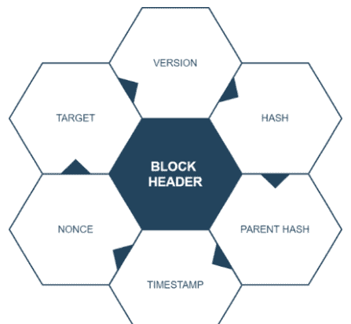

图 (1). 区块头组件。

- 2. **节点：** 这些是区块链的用户。每个节点是一个独立的计算机系统，存储一份包含区块链完整交易历史的账本副本。换句话说，每个节点存储一份整个区块链的副本，这正是去中心化系统的本质。共享多个副本可确保主副本与每个节点上的副本一致，从而防止区块链被非法篡改。

- 3. **交易：** 这是任何区块中最小的组件，是整个区块链网络的支柱。当任何节点进行购买时，其详细信息将存储在此交易中。

- 4. **矿工：** 特定节点，用于验证任何交易、验证真实性并求解数学算法，以将区块添加到当前链中。

- 5. **共识：** 一组用于规范任何区块验证以执行任何区块链操作的指令。共识机制将在下一节中讨论。

### 区块链的特性

虽然关于区块链及其在各个领域快速应用的话题已经讨论了很多，但我们需要了解区块链与传统技术有何不同。更新技术如何克服其前身的缺陷是我们必须关注的重点。这可以通过其关键定义特性来最好地解释，这些特性使其脱颖而出，并使其成为希望组织数据库并使其安全的组织的一个有趣前景。区块链具有以下定义特性：

## 去中心化

构成区块链基础的最具决定性和关键特性是其去中心化特性，它摒弃了对中央服务器/权威机构或任何外部不可信第三方的依赖，这与任何传统存储网络形成对比。这通过分布式控制、消除第三方和降低故障概率，使其具有透明性、容错性和抗篡改性。

## 不可篡改性

一旦数据存储在网络上，即具有绝对性，在任何情况下都无法更改。一旦交易被添加到链上，几乎不可能删除或撤销它们。每个包含副本的节点还会确保数据未被篡改，从而使区块链持久且可审计。

## 安全性

如前所述，区块链没有中央权威机构，但所有节点共同协作以维护区块链网络的真实性。此外，每个区块都经过加密，拥有自身及其父区块的哈希值，使区块链防篡改。关于区块链安全性的更多内容将在本章后面讨论。

## 匿名性

所有用户的身份都被严格保密，因此维持了一套匿名系统。但是，不能保证绝对隐私。每个用户可以拥有多个身份来影响区块链，这也被认为是缺点之一。

## 可审计性

每笔交易都带有时间戳，并关联到其用户，并为该特定用户维护记录。这确保了添加的区块的真实性和链的合法性。将交易关联到用户也使交易可追溯，并提高了其验证的机会。公共区块链没有任何管理机构，因此与私有区块链相比具有最高的可审计性，使其真正去中心化 [3, 5]。

### 版本控制系统

版本控制系统是记录文件到目录并帮助跟踪对其所做的任何更改或修改的软件工具。它们通常由软件专业人员用于监督对代码库的更改。此版本控制软件维护一个单独的数据库来跟踪每次修改，为存储的数据提供备份。使用版本控制系统的优点包括：

- 它维护不同版本代码的副本，以后可用于比较差异并寻找进一步改进，同时纠正以前的错误。
- 所有开发人员可以从不同地点处理代码，最大限度地减少对单个成员的干扰。
- 负责源代码的安全性和隐私性，源代码是团队所从事的每个项目的支柱。它保护代码免受有意或无意的人为破坏。
- 由于版本控制跟踪每个更改，它有助于记录个人贡献以及每个人当前的工作，确保不同开发人员的工作不会重叠或冲突，因此所有更改彼此兼容，从而提升协同工作的体验。
- 即使一个人独自工作，也可以从多个设备访问项目。

在任何版本控制系统中，包含代码、版本和所有相关数据的中央数据库称为中央仓库。这个中央仓库可以被不同用户克隆到他们的系统上，以便独立地处理项目。克隆仓库的一部分来处理特定功能称为分支，而克隆整个仓库以将整个代码作为基础称为复刻。这些数据的单独副本可能不相同，因为不同的开发人员继续处理代码并对其进行更改。这个个人副本也称为检出。当所有工作完成后，所做的更改可以提交到该开发人员的本地仓库。这些更改可以通过推送提交与原始仓库合并。团队所有成员的责任是维护并处理代码的最新版本。获取最新版本的更新可以通过从中心化仓库发起拉取请求来简单完成。

## 版本控制系统的类型

版本控制系统也可能有多种类型：

## 本地版本控制系统（LVCS）

没有通用仓库，所有文件都由用户在其自己的独立仓库或数据库中维护。它以一种特殊格式包含所有版本或文件变体，称为补丁集。

## 集中式版本控制系统（CVCS）

这些包含一个单一的中央仓库，每个用户在其自身的仓库副本上工作。所有更改都提交到此仓库，并可由网络上的其他用户更新。这些更易于理解和使用。CVCS 的示例包括 Perforce、CVS 和 Subversion。

## 分布式版本控制系统（DVCS）

这些包含多个仓库，每个用户都有自己的称为本地仓库的仓库。提交更改只会更新本地仓库，并且必须推送才能在中央仓库上可见。所有更改都必须拉取到本地仓库。DVCS 可以实现离线工作，因为更改仅在本地进行。DVCS 的示例包括 Git、Mercurial、Veracity 和 Bazaar。

这里我们可以理解，除了区块链，所使用的版本控制系统显然也将是分布式的。具有相似特性使得区块链可以与之一起实现。大多数 DVCS 采用加密哈希来保护数据。Git 使用 SHA-1 哈希算法生成 160 位长度的摘要，并在向仓库提交时使用文件内容的哈希值，以确保任何时间点的数据完整性。它还使用哈希值作为数据库键来查找数据，并通过比较不同文件的哈希值帮助进行数据去重。因此，具有相同哈希值的文件是冗余的且不会再次存储，从而节省空间。因此，选择一个好的哈希函数至关重要，该函数不会为不同的数据生成相同的哈希值（称为冲突），而 SHA-1 函数从未生成过冲突。

### 数据存储

随着计算机化的不断发展，信息正在被数字化，增加了对存储此类数据的位置的需求。鉴于需要大量


存储，大规模数据中心应运而生，以各种格式在巨大的计算机上存储数据。接下来是对数据可访问性的需求，随着云存储将数据存储在云服务器上，进一步改变了数据存储领域。随着创新的数据存储方式也带来了创新的窃取或篡改数据的方式，产生了对增强数据安全性的需求，以避免数据泄露和黑客攻击。引入区块链，你就有了另一种出色的替代方案，具有增强的访问性、安全性、支持性、信任度和可靠性。由于区块链出于安全考虑对数据进行加密，并且有大量节点监控任何恶意活动，数据泄露变得少得多，且需要非常高的技能、资金和计算能力。

### 实现区块链的数据存储框架

区块链是一个仍处于萌芽阶段的相对较新的概念。它仍在各个领域进行实验，因此不断发展。数据存储领域的困境是阻碍进一步发展的最大障碍，需要技术解决方案来推动其进步，这可能有助于区块链被更广泛地接受。凭借其“革命性”技术，区块链可以融入几乎每个行业，但它也需要一个足够动态以利用其潜在潜力的数据档案来运行。除非解决数据存储的障碍，否则区块链无法对现实世界产生任何重大影响。不存在理想或通用的解决方案，而是取决于数据库的规模或访问它的用户数量。数据库可能是去中心化的或中心化的，也可能是廉价的或昂贵的，选择哪一个取决于需求和负担能力。实现区块链的数据存储面临的最重大问题是高成本和有限的可访问性。仅存储像交易本身那样的少量数据是可行的，而存储大文件则不切实际，因为这会引起一个称为膨胀的问题。这少量的数据是元数据，它只包含基本必要信息，如位置和哈希。这些存储成本由现有的区块链（如以太坊、瑞波币或超级账本Fabric）收取。任何人都不能创建自己的区块链，因为这样做存在一些缺点。任何区块链的信任因素在于其长度、活跃节点的数量以及赋予每个节点的权限。区块链的创建者倾向于保留对它的控制权，使得新节点难以加入，因此创建新区块链是一项艰巨且耗时的任务。因此，唯一可行的解决方案是采用更通用的数据存储方法。区块链的真正含义在于去中心化存储，将P2P网络带入聚光灯下。

区块链承诺去中心化和其记录的不可篡改性，因此不仅受到金融科技公司的喜爱，还受到旅游业、医疗保健提供者以及亚马逊、微软和IBM等计算机巨头的喜爱，用于云存储。在金融科技行业，平均每秒处理30,000笔交易。比特币区块链每秒只能处理3-7笔交易，而以太坊区块链每秒可以存储多达12-30笔交易。尽管它在当今可能更加安全，但这些区块链无法替代日常交易，因为它们比常规交易过程相对较慢。这是因为区块链基于P2P网络 [6]。

分片是一个已经被实现的概念，用于提高数据库效率并提升区块链的可扩展性和可靠性。

### 分片

分片是将数据库分解为称为逻辑分片或简称为分片的较小可管理块的过程。这些分片存储在P2P网络的不同节点上。每个分片都与其他分片完全不同且独立，尽管在某些情况下可能需要复制数据（引用表） [7, 8]。分片提高了应用程序的可扩展性。它使数据库能够容纳更多数据，并能处理由流量激增产生的更多查询。我们将数据存储在一台服务器上的数据库中。但是，当服务器达到最大限制时，无法扩展数据库，因为不可能将多台计算机的计算能力结合起来用于单一操作。分片将增加数据库的容量，因为将数据存储在多个节点上可以容纳更多数据集。对于拥有较大数据库的应用程序，运行查询成本会相当高，因为搜索每一行都很耗时。但是，通过将数据库分片为多个数据库，查询只需经过较少的行，从而加快查询响应。此外，维护较小服务器网络比较大服务器更具成本效益，至少从长远来看 [7]。假设发生停电，未分片的数据库将无法运行，整个应用程序将不可用。使用分片数据库，只有应用程序的一部分无法供用户使用，而其他分片数据库将继续无问题地运行。

分片主要是横向划分数据库。例如，一个分片可能只负责存储特定日期的交易。在水平分片（水平扩展）中，我们不需要预先规划如何切割数据库。我们可以通过添加更多机器动态且高效地扩展。分片将区块链网络划分为独立的分片，从而避免每个参与节点的数据存储重复，因此在节点之间分配工作负载，使每个节点只关心其分片数据。因此，每个节点只有部分数据，而不是全部信息。由于区块链现在以更小的段形式存在，交易以并行方式而不是线性方式发生 [9]。因此，TPS（每秒交易数）增加。它还消除了对网络中所有节点的需求，使其更快并减少延迟。每个分片的信息可以在分片之间共享，使区块链去中心化并可被所有用户访问。因此有助于解决可扩展性问题并提高区块链提供的服务质量。

在图（2）中，区块链被划分为三个分片。每个分片维护其账本，存储交易记录。跨分片通信协议对于分片之间的同步通信至关重要，例如在验证跨分片交易时。

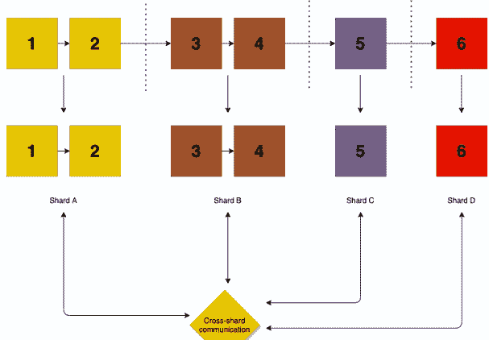

图（2）。跨分片通信。

POW机制*是最广泛使用的共识机制。但是，它不用于分片，因为每个参与节点只拥有一个分片的信息。权益证明（POS）*是分片区块链的共识算法。对于每个分片，会选出一个矿工来执行交易验证 [6]。区块链是安全的，因为选定的矿工是忠诚的。验证交易所需的时间大大缩短，并且对矿工来说也在经济上可行。

### 区块链中分片的缺点

- 1. 分片将导致独立的区块链网络。如果没有分片之间的通信机制，特定子域上的用户无法访问另一个子域上的应用程序，反之亦然。这将使系统更加复杂 [7]。
- 2. 黑客可以接管分片的控制权。他们可以轻松地损坏分片。此外，他们可能存储无效或虚假数据。这被称为**单分片接管攻击或1%攻击**。以太坊已提出随机采样，即在随机时间间隔内将节点重新分配到特定分片。现在损坏分片要困难得多。
- 3. 分片通常用于私有拥有的网络。在公共区块链中实现它仍然是一项挑战。

### 分片的替代方案

- 1. **增加区块大小**可以被视为分片的一种替代方案。但这只是一种短期解决方案。通过增加区块大小，我们可以存储更多交易，因此TPS数量会更高。随着区块大小的增加，节点验证区块所需的计算能力会更多。此类要求所需的计算机设备使得节点在经济上不可行。因此，网络上的节点数量减少，网络变得更加中心化并容易受到51%攻击。
- 2. **链外区块链**：区块链不存储内容。矿工提供他们的硬盘来保存他人的数据。他们会获得加密代币奖励，以激励用户释放其备用磁盘空间。

### 使用分片的区块链

众所周知，在区块链中实现分片的最大缺陷是各个分片之间无法通信。此外，如果节点分布广泛且地理位置分散，则没有逻辑以随机方式将它们分割。随机分片需要节点之间顺畅的通信才能成功实施分片。截至目前，不存在确定的协议来使各个分片相互通信。以太坊区块链开发者在解决该问题时遇到困难。


然而，Zilliqa 是第一个实现分片的公有区块链，确保在分片之间共享信息时不会遇到困难。它已实现 2828 TPS，高于以太坊和比特币区块链。Zilliqa 并未完全对节点进行分片。它实现了两种数据类型。一种存储区块链的状态。它存储占用小，并能轻松与网络上所有节点集成。另一种是区块链的历史数据，体积较大且已分片。可通过节点间通信查询此历史记录，从相关分片获取所需信息，从而使 Zilliqa 同时具备可扩展性和去中心化特性。Near 是一个区块链生态系统，允许开发者创建和部署去中心化应用（也称为 Dapps）。它自称为“分片型、开发者友好、权益证明区块链”。分片使节点保持足够小，可在云托管实例上运行，未来或许也可在手机上运行。Facebook 提出了一种基于区块链的支付系统 Libra，可能会采用某种形式的区块链分区。最近被 Facebook 收购的 Chainspace 开发团队主要专注于区块链分片 [10].

### P2P 网络

对等网络（P2P）是一组计算机系统网络，这些系统可以直接相互交换文件和数据，而无需将其存储在单独的服务器中（客户端-服务器模型）。P2P 使任何两个或多个计算机系统能够相互互连，无需任何第三方干预。在这样的网络中，每个计算机系统称为节点或“对等点” [11]。它可以同时扮演客户端和服务器的角色。节点之间的权限和任务分配是相等的。星际文件系统（IPFS）是区块链中使用的 P2P 网络示例。

让我们借助 BitTorrent 来了解 P2P 网络上的文件共享。BitTorrent 平台构建在 P2P 网络之上。在 BitTorrent 上，文件的共享和下载可以高效完成。存储待共享或下载数据的计算机称为种子。它接着将文件分割成许多片段。网络上任何想要该文件的节点都使用 BitTorrent 客户端平台。该节点将接收文件的一部分。过一段时间后，它将从其他节点接收剩余的分块。在某个特定时刻，一个对等点会下载它所没有的文件部分，同时将其他部分上传到同一网络上的另一个对等点。这个过程没有顺序之分，是随机进行的。因此，任何时候对等点之间都需要合作。这样的一组节点称为蜂群。庞大的蜂群意味着热门文件。对等点之间的合作使整体过程更快。最终，网络上的每个客户端都会收到文件的完整副本。种子（seeding）是指你的文件副本下载完成后，将文件上传到网络上其他节点的过程。然而，下载完成后退出蜂群称为吸血（leeching）。如果每个节点都吸血，BitTorrent 将完全无法运作 [12].

### P2P 网络类型

### 非结构化网络

非结构化网络不遵循任何特定结构。如图 (3) 所示，以圆圈表示的节点彼此随机连接。想要加入网络的新对等点可以复制另一节点的现有链接，并随时间形成自己的链接。构建非结构化对等网络很容易。然而，缺乏确定结构是其局限性。对等点会向网络发送大量查询以查找所需数据。有时，对等点难以找到所需数据。查询泛滥并不总是能产生理想结果，因而成为网络流量的瓶颈。

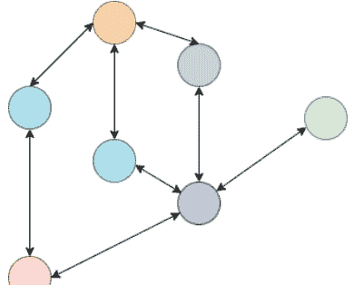

图 (3). 非结构化对等网络布局.

### 结构化网络

结构化对等网络通过保持适当结构来克服非结构化网络的问题。最常见的 P2P 网络类型实现了分布式哈希表（DHT）[11]。它维护网络中的信息。该网络使用哈希函数为对等点中驻留的所有内容分配值。因此，哈希表（键，值）确定哪个对等点负责哪些内容。每当对等点想要搜索某些数据时，它会使用哈希表（全局协议）来确定负责该数据的对等点，然后将搜索定向到这些负责的对等点。因此，在这种情况下我们能获得良好的网络流量 [13].

如图 (4) 所示，在结构化对等网络中，每个节点（圆圈）内的内容都会被分配哈希值，并存储在分布式哈希表（DHT）中，用于定位节点及其资源。

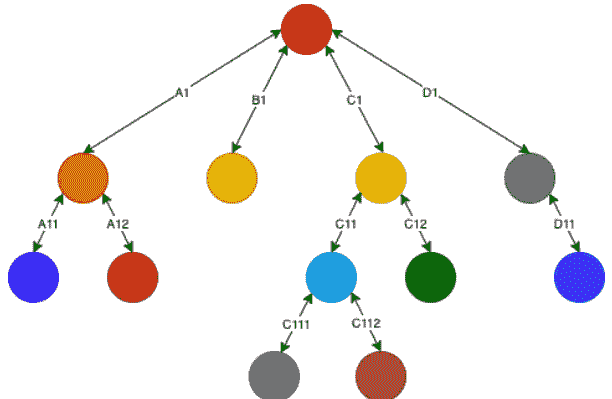

图 (4). 结构化对等网络布局.

### 混合 P2P 网络

混合模式是纯 P2P 网络和客户端-服务器模型的结合。该模型中的中央服务器保存对等点的信息，帮助对等点相互查找。目前，从性能角度来看，混合网络优于纯结构化和非结构化 P2P 网络 [11].

在客户端-服务器模型中，客户端会通过互联网向服务器请求数据检索。如果服务器接受请求，则会将数据包发回相关客户端。客户端无需共享其任何资源。例如，用户想要从网站下载一些文件。用户的计算机是客户端。服务器为其提供所需资源。

现在考虑一种场景，许多用户想要从同一网站下载同一文件。服务器需要为每个客户端提供文件副本，因此服务器的运行成本较高。由于所有下载同时进行，服务器会分配其算力，使每个客户端接收文件，从而降低下载速度。但在 P2P 网络中，当客户端需要大量数据时，每个节点既是服务器也是客户端，由多个其他节点共同提供数据。因此，客户端可以更快地下载数据。集中式网络中服务器与客户端之间的连接丢失会导致失败。

然而，在去中心化 P2P 架构中，必须断开节点之间的所有连接，以防止完全的数据共享。

应鼓励对等点参与网络。它们之间的合作对存储性能至关重要。任何节点的自私行为都会阻碍整个 P2P 网络的性能。可能是存储和带宽等有限资源引发了对等点中这种以自我为中心的态度。随时检索数据是 P2P 存储网络的首要目标 [14]。由于没有中央服务器，即使某些对等点可能处于非活跃状态，网络上所有数据也应对存在的对等点可用。可通过各种数据冗余流程来确保数据的可用性。

即使是 P2P 存储系统也容易受到各种攻击。让我们了解其中几种攻击，并尝试理解不同的可能防御机制。

### 拒绝服务（DoS）攻击

拒绝服务攻击可能会干扰网络上的存储应用程序，导致服务丢失。攻击者可能会使用验证等安全措施来实施攻击。攻击者会向目标节点发送大量验证请求，阻止网络上的正常流量。这是 P2P 网络上最常见的 DoS 攻击形式。DoS 攻击无疑很难阻止，因为攻击者涉及的计算机数量庞大，使得追溯攻击者来源变得困难。“定价”通常用于遏制 DoS 攻击。它要求客户端解决通常需要昂贵计算的复杂谜题。如果系统感知到正在遭受攻击，应增加谜题的难度。这将降低攻击的规模 [15]。然而，这仅对小规模攻击有效，但面对大规模分布式攻击将失效。此外，诚实的客户端需要更多计算能力来解决谜题，这在经济上不可行，并会浪费大量电力。

### 中间人攻击

在这种攻击中，攻击者将自己植入网络节点且不暴露自身。它会窥探并影响这些节点之间的通信。它可能负责伪造并向网络传输虚假数据。它还可以窃取一些私有数据并在不被怀疑的情况下离开网络。在 P2P 网络中，无法识别中间人攻击，因为网络没有中央机构。幸运的是，这种攻击在 P2P 网络中无效。节点具有相同的身份验证逻辑，数据会共享给网络上的每个节点。最终，伪造变得无效。然而，如果网络中的身份验证逻辑有所不同，这种攻击的影响将取决于逻辑本身 [15].


## P2P 网络的缺点

- P2P 架构中的安全性非常薄弱。病毒、间谍软件和其他恶意软件可以轻易入侵网络。它们可以在文件共享过程中从一个节点传播到另一个节点。

- 在此类网络中，数据恢复要求很高。节点的备份必须位于单独的设备上。如果工作站发生不幸的情况，其上的所有文件都将丢失。除非其他设备上有备份，否则无法检索这些文件。

- 从 P2P 存储网络中检索非热门文件很困难。此类文件可能已被删除，或者在节点之间未被共享。

## 分层结构

任何分布式系统（如 P2P 网络）都具有分层结构，每一层执行不同的角色。任何分布式系统的层必须包括：

### 身份层

内容必须具有唯一标识符，以便进行识别和分发，这通过对公钥进行哈希处理来实现。网络上每个节点都会生成一个唯一 ID，从而形成其身份。

### 数据层

通常使用 Merkle DAG 来组织网络中的数据，Merkle DAG 用于存储和链接数据。

### 数据交换层

节点通过相互交换数据来保持通信。这促进节点通过共享来做出贡献，而不是仅接收数据。IPFS 使用基于 BitTorrent 协议的 Bitswap。

### 网络层

促进不同节点之间的连接，并实现文件共享/传输，通常使用 Libp2p。

### 路由层

分片数据使用 DHT 进行分发和维护。这一层通过与这些 DHT 通信响应查询，帮助定位和访问每个数据片段。

### 共识层

通过提供安全层来确保账本的合法性并保持一致性，网络中所有节点都必须同意所做的更改。

### 激励层

任何去中心化网络都需要积极参与才能生存。这一层通过货币系统为工作提供奖励、对故障进行惩罚，从而鼓励真实节点参与 [16]。

### Libp2p

Libp2p 是一个网络框架，拥有模块化的协议和库系统，允许我们编写和开发点对点网络应用程序。P2P 当然比客户端-服务器模型具有更多优势，尽管存在某些挑战，需要通过采用适当的做法来克服。网络的传输层负责在一个节点与另一个节点之间接收和发送数据。它使用多种传输协议来在不同的运行时和网络环境中执行应用程序。它承诺提供一个安全的传输通道，支持多种加密通信方法。Libp2p 使用公钥加密来识别节点，为其赋予一个称为 peerID 的全局唯一名称 [17]。可以从 peerID 检索公钥，从而实现节点之间的安全通信。由于它需要在多个网络上工作，因此应当有适当的寻址方案。多地址是针对多个网络的编码地址。它被称为“面向未来”的路径结构。

### 行星间文件系统（IPFS）

简单来说，IPFS 是一个用于存储和访问数据的分布式去中心化 P2P 存储网络。IPFS 使用分片技术在节点计算机上实现数据存储，而不是仅存在于单一位置。因此，当网络上的某个用户请求特定数据时，不再向服务器请求传输，而是可以从网络上存有该数据副本的最近计算机检索数据。这实现了中央服务器的负载分布，防止瓶颈，并能更快地响应请求。例如，如果来自印度的多个请求针对位于加利福尼亚的服务器，标准做法将是发出所有这些请求并生成相同数量的响应，使整个过程耗时且浪费。IPFS 则会将已接收响应的副本共享给每个请求，这使过程快得多，服务器也不必承担那么多工作。出于这一目的，大公司维护 CDN（内容分发网络），但 IPFS 让每个人都能实现这一功能，消除了这一财务限制。这也确保数据不会被单一组织管理和操纵。它还共享迄今讨论过的任何去中心化网络的所有优势，包括容错性、防篡改性、可访问性、数据持久性和抗审查性 [5, 18]。

### IPFS 功能

作为 P2P 网络，数据通过节点网络访问，取决于用户参与。世界上任何位置的节点都可以存储和中继数据，形成连接良好的网络。存储和访问取决于数据的存储过程、数据链接以及用于访问的数据发现。所有这些共同构成了 IPFS 生态系统 [19]。

### 内容寻址

通常在访问数据时，搜索是基于位置的，称为位置寻址，使用遵循超文本传输协议（HTTP）的 URL 进行。它基于 IP 地址查找位置。如果不知道其位置，数据就会丢失。然而，IPFS 网络根据数据的内容而非地址来识别数据，这称为内容寻址。遵循 IPFS 协议的每个数据片段都有一个 CID（内容标识符），其中包含通过将数据传递给 SHA256 哈希函数获得的唯一加密哈希，以及一个编解码器，它告诉我们如何解释该数据，从而有助于其编码和解码。这个哈希是通过将内容本身转换为字母数字哈希生成的，使其具有唯一性。发送方和接收方的 CID 比较使用多哈希来对该数据进行识别和验证。这是一种多哈希格式，即使哈希算法被攻破，也能通过允许不同哈希函数生成的多个 CID 版本共存，从而确保数据可访问，进而保留安全性。在此，每个 CID 对于其哈希函数都是唯一的。这个哈希也有助于数据链接。如果任何用户有相同数据的多个副本，则所有副本都有相同的哈希，有助于避免冗余并节省大量空间。这是 IPFS 的一种特殊属性，称为去重 [19, 20]。

### 内容链接

IPFS 系统中的数据存储在对象中，每个对象最多可存储 256kb 的数据。对于较大的文件，它们会被简单地分解为多个对象，并使用 IPLD（行星间链接数据）将它们全部链接在一起。IPLD 是一种基于 Merkle DAG 的标准，Merkle DAG 是一种去中心化数据结构，将所有对象链接到基础 CID。IPLD 是一组用于在内容寻址数据之间创建链接的工具，包括 IPFS 文件、VCS 中的提交或任何区块链上的区块。它还允许与协议无关的数据访问，因此互联网协议不会成为 IPLD 运行的障碍，从而允许数据的跨协议操作。每个对象包含：

- Data – 非结构化的二进制数据，最大容量为 256kb。
- Links – 链接所有相似对象的结构。这进一步包括：
  - 链接名称。
  - 链接对象的哈希。
  - 所有链接对象的总大小。

IPLD 与协议无关、支持跨格式、易于升级，并将所有数据链接在一起，这体现了去中心化的真正含义。由于每个对象都包含其自身哈希，因此数据不可更改，类似于区块链。数据也可以通过版本控制进行更改，情况与区块链相同。但是，更改数据意味着 CID 发生变化，使用户无法使用该 CID 访问数据。这意味着每次进行更新或改进时，用户都需要一个新 CID，使链接不可更改。为解决此问题，IPFS 实现了行星间命名系统（IPNS），一个通用命名空间，它只需通过将新 CID 链接到固定 IPNS 链接，就使旧 CID 指向新 CID。因此，即使用户只知道旧 CID，也仍然可以访问它。IPNS 解决的另一个问题是使链接易于人类理解且易于记忆，方式与 DNS 在位置寻址中通过将 IP 地址映射到域名所做的相同。因此，你可以使用 IP 地址或域名来搜索数据。两者的主要区别在于 IPNS 使用公钥哈希，而 DNS 使用域名，尽管两者具有相同的结构 [19, 21]。

### 内容可访问性

数据存储在有组织的对象中，具有结构，因此能够被机器解释。每个对象都以三元组编码，这些实体通过使用语义 Web 技术（如链接数据）通过这些三元组表达的关系统一起来。这些称为三元组的基本单元简单地是


语义网中的信息以特定谓词形式书写，或更准确地说是编码，称为主语-谓语-宾语表达式。语义网是一种标准，旨在推广网络上的语义内容，将所有非结构化或半结构化数据转换为结构化数据，以便机器在无需人工干预的情况下独立解释。该语义网堆栈以现有的 W3C RDF 为基础，并在其之上构建。经过模式标记和统一后的结构化数据，可以使用链接数据的方法发布到互联网上的不同位置。语义网上的所有数据都相互关联，因此可以探索“数据网络”，因为当我们拥有一小部分数据时，它总是关联到某些其他相关部分的数据。

几个三元组的汇聚形成了一个知识图谱，以名为链接数据的格式发布，这是一种将网络上所有非结构化数据互连为结构化格式的方法，从而可以以逻辑方式查询它们。这个包含一组三元组的知识图谱是一种以 RDF 格式存储的大型结构化数据集，可以使用名为 SPARQL 的语义查询语言进行查询来访问。没有知识图谱，海量数据就无法得到合适和高效的管理。它们在分布式和去中心化网络中检索数据方面至关重要，也是提升性能的一种低成本解决方案。谷歌、Facebook 和微软等巨头企业已将知识图谱作为其架构的一部分。语义网正在真正赋能网络，提供对信息的开放和快速访问。

IPFS 上的数据发现特别关注分布式哈希表（DHTs），它们用于协调和管理大多数点对点系统中的元数据。它是一个包含键值对的存档，该存档被分为节点，并分布在分布式网络中的所有对等节点上，通过覆盖网络互连。在 DHT 中，每个节点都有一个键，即唯一的哈希标识符，可以访问和检索其关联的值。由于它是分布式的，因此与 IPFS 等类似去中心化系统高度兼容，并共享容错性和可扩展性等相似优势。它最初由早期的点对点文件共享系统（如 BitTorrent、Freenet、Gnutella 和 Napster）付诸实践，其中有些系统比其他系统更去中心化。IPFS 中的 DHT 实现基于 Kademlia DHT。

通过记录数据来对存储的数据进行文档化，可以显著提高其可访问性，从而帮助轻松访问。这种方法称为模式标记，基本上是一种用于数据的语义词汇表，有助于传达内容背后的含义。因此，搜索引擎根据含义而不是关键字返回结果。考虑一个示例，某人托管了一个网站。然后他/她希望更多观众访问该网站。为了实现这一目的，内容会经过模式标记，这有助于搜索引擎在有人搜索特定关键字时提供更准确的结果。这也有助于网站提升 SERP 排名，使其在搜索时显示在顶部，从而提高其受欢迎程度。最广泛使用的模式标记是 schema.org，由 Google、Yahoo!、Bing 和 Yandex 共同开发，它们依赖这种标记来返回搜索结果。

语义网目前在人工智能和机器学习以及制药部门和电信领域发挥着重要作用，例如 BBC 等公司通过数据链接使其内容更加可见。社交媒体平台也广泛使用它来促进结识更多人。这种体验可以在“Facebook”上以共同好友的形式体现，用户其实并不认识这些人，但通过内容链接得以建立联系。或者甚至在 Instagram 上，浏览一条帖子就会用相似内容填充你的推荐部分，这通过数据链接实现，其依据不是标题，而是内容本身。另一个应用领域是政府公开官方数据，使其公开透明 [19 - 21]。

### IPFS 深度分析：网络

IPFS 网络中的节点需要不断相互通信。IPFS 可以使用任何传输协议，并实现 ICE NAT 穿透技术以实现节点连接。正如我们所见，Libp2p 是点对点网络应用程序开发中的重要基础。它基本上是一组协议，或者是一个模块化且可扩展的网络堆栈，用于解决点对点应用程序面临的许多挑战，例如内容发现和传输。作为一个模块化系统，整个 IPFS 由 Libp2p 模块组成。它是连接网络的关键，通过帮助内容路由、发现和传输以及对等节点路由来实现这一点。它是进程寻址的一个示例，开发了一种水平 OSI 模型，改变了通信指南。传统的垂直模型（如 ISO/IEC 7498 所述）在多个层中实现，导致数据因缺乏可见性且被紧密封装在一起而难以访问。这使得网络升级变得更加困难，并阻碍了其改进。Libp2p 改变了这一框架，描述了网络系统的互操作性，使其分散开来，所有协议共存。Libp2p 是 IPFS 的关键组件，作为 IPFS 项目的一部分首次亮相，IPFS 项目将其用作其网络层。其实现可以使用 JavaScript、NodeJS、Golang、rust 进行，未来还将支持 Haskell、java 和 python，使其更加通用。Libp2p 从 IPFS 发展而来，也可以作为其他项目的网络层使用，不仅限于 IPFS [19, 20]。

总结一下，数据存储在点对点网络的对等计算机上，而不是集中式服务器上。IPFS 堆栈使用或应用存储的数据。数据由 IPLD 和 IPNS 等标准命名和定义，以用于访问和安全。数据发现主要依赖分布式哈希表（DHT）。最后，Libp2p 处理数据移动，帮助内容和对等节点路由，并构成网络层。

### IPFS 上的区块链实现：Filecoin

总而言之，IPFS 只是一个框架，需要某种激励才能真正实施。类似的去中心化网络可以分层并协同工作。一个例子是在 IPFS 系统中实现区块链。IPFS 在很大程度上依赖于参与，这意味着更多活跃用户会产生更好的网络。因此，大规模实施 IPFS 对于其彻底改变当今互联网是必要的。

区块链在 IPFS 上的一个流行示例是 Filecoin，它由创立 IPFS 的同一批人（即 Protocol Labs）创立。Filecoin 构建在 IPFS、IPLD、Libp2p 和 multiformats 等项目之上。它是一个点对点文件存储和分发网络，内置经济激励机制，以在其自身区块链上保证文件的高效可靠存储。作为点对点网络，它制定了一种去中心化协议，用于在存储矿工提供的空间上存储文件。基本上，Filecoin 网络中的任何对等节点都可以在自己的计算机上提供存储空间，并因出租磁盘空间而获得报酬，前提是有充分证明文件未被篡改。同样，对等节点也可以从其他对等节点购买存储空间。付款以 Filecoin 引入的原生加密货币形式进行，也称为 Filecoin (FIL)。一项主要的取消是用户作为工作量证明的一部分解决复杂数学算法的要求。Filecoin 协议处理存储提供商的要求，因此它们无需为自己的存储设计 API 或宣传自己来吸引潜在客户。Filecoin 是迄今为止最大规模的融资 ICO，预售和 ICO 合计筹集了约 2.57 亿美元。根据 Coin Desk 的说法，它很有可能成为有史以来最快上线并达到超过 10 亿美元市值的新区块链。其主网最近于 2020 年 10 月 15 日启动，是去中心化领域发展最快的领域之一。


### Filecoin 网络的结构

基本结构包含 4 个基本组件：

### 1. 网络

它由使用 IPFS 的 p2p 系统组成，并实现存储所有交易的区块链。该网络上的节点可以审计矿工提供的存储，矿工还可以创建新区块以获得奖励。

### 2. 存储节点

这些是存储矿工，它们在自己的计算机上提供名为扇区的闲置存储空间，并以 FIL 获得奖励。这些扇区具有用于识别的唯一 ID，必须在存储任何数据之前抵押到 Filecoin 区块链。存储矿工需要不断提供客户外包数据在一段时间内存储的证明，所有人都可以审查这些证明以建立对矿工合法性的信任。这是通过遵守在挖矿前提交给网络的时空证明（PoSt）机制来完成的。矿工还必须遵守复制证明（PoRep），以证明它们正在存储所提及的数据，并且数据以独特方式编码，其他矿工无法复制。

### 3. 检索节点

这些是链外矿工，负责从客户端或存储矿工检索或获取数据。客户端数据可以分成小片段，由不同的存储矿工存储。检索矿工以微支付形式从客户端接收每片数据的付款。

### 4. 原生代币

这是由 Filecoin 开发的原生代币系统或加密货币，也称为 Filecoin (FIL)。客户端和矿工之间的所有交易都使用此代币进行 [22, 23]。

### 数据存储和检索协议

存储矿工可以通过指定扇区大小并为特定抵押存入抵押品，在区块链上抵押其扇区。当任何存储证明丢失时，将使用此抵押品。这些存储矿工随后可以提供一个指定服务成本的要价订单。客户端可以在存储前加密其数据以维护安全性，并通过提交指定其打算支付金额的竞价订单来选择任何存储提供商。所有这些订单都记录在由 Filecoin 维护的单独账簿中，以防止区块链上的瓶颈。当两个订单匹配时，客户端和存储矿工之间可以达成交易。然后将该交易记录到区块链上。随着数据片段的存储，分配表会跟踪这些片段及其关联的扇区。此分配表在每个区块时更新，其哈希值维护在区块链网络上的最新区块中。然后数据从客户端传输到矿工，并验证其完成情况以确保其符合交易参数。一旦数据记录在链上，矿工必须生成复制证明并密封扇区以维护安全性。密封是一组操作，将该扇区转换为与 Filecoin 矿工公钥关联的原始数据的唯一副本 [24]。此密封过程对于矿工提交连续证明是必要的。客户端可以通过复制其存储的数据来实现数据的容错性，从而造成冗余。然后数据可以由检索矿工检索，在此之前必须解封扇区。某些 Filecoin 客户端（如 lotus）会在保留密封副本的同时保留未密封副本，以实现更快的数据检索。然而，这不是协议的可验证部分，尽管它是一个有用的功能。然后数据传回客户端。服务付款通过账簿在链外进行，仅在发生争议时才使用区块链 [23]。

### 容错性

Filecoin 实现了拜占庭容错，故障可以是管理故障或存储拜占庭故障。网络上的存储提供商需要为外包数据的存储提供持续证明，这些证明由用于审计这些提供商的拜占庭协议（BA）进行验证。此 BA 可以容忍最多 f < n/2 个故障节点，其中 f 是故障数量，n 是节点总数。这些管理故障是管理协议中的拜占庭故障，且为 (f,n)-容忍。我们可以看出，其容错能力优于传统的拜占庭协议，后者最多可容忍 f < (n-1)/2。违反此协议可能导致矿工被削减并重新分配内容。

另一方面，存储故障是 Put 和 Get 协议中的拜占庭故障，阻止客户端检索数据。如果 BA 可以容忍 f 个故障并有 m 个独立存储矿工，则 put 协议为 (f,m)-容忍 [23]。

### 为什么 Filecoin 如此受关注？

我们已经知道去中心化系统相对于集中式系统的优势。Filecoin 作为去中心化系统，共享所有这些优势，并附带其特定优势，使其区别于竞争对手。这些包括：

### 1. 可扩展且经济

Filecoin 不需要新的协议和标准，而是构建在现有协议之上，使其易于集成到现代系统中。它也不需要为每个提供商使用不同的 API。它也不需要额外的存储系统，而是利用现有系统。

### 2. 低成本

解决了当前区块链网络最大的问题，即昂贵的存储。数百万台计算机互连，定价不是由企业决定，而是取决于供求关系。竞争的存储矿工越多，存储就越便宜。

### 3. 安全性

通过分片克服了在未知计算机上存储文件的不确定性。这些片段随后可以由检索矿工汇总。客户端还可以加密其数据以增加安全性。

### 4. 动态网络

确保文件的正确存储。不断搜索故障矿工，一旦发现，即对其进行削减并以相同成本通过所谓的自愈过程将数据重新分配给可靠矿工。

### 5. 无需计算

矿工不需要像实施工作量证明的其他区块链那样执行繁重的计算。任何拥有计算机和任意规格存储空间的人都可以参与，无需昂贵的计算能力。

### 6. 现有区块链的扩展

还可以为面临存储问题的其他区块链提供存储。区块链将像往常一样运行，但数据将存储在 Filecoin 网络上。未来还可能支持与其他区块链交易的互操作性。

### 7. 易于迁移

由于它不使用特有的功能，用户不会被锁定，并有自由迁移到其他提供商，因为它们都使用相同的协议和 API。活跃的检索市场也使此成为可能。

### 8. 开源代码

任何人都可以贡献任何开发。

与 Filecoin 相关的任何缺点都与所有去中心化网络共享，包括分片。由于数据被拆分，需要从多个服务器收集每个片段。任何服务器宕机都会影响延迟并降低数据检索速度。其他缺点包括微支付系统产生的额外开销，即为每个片段付款，这可能会阻碍检索协议并降低检索速度。此外，抗审查性会导致数据不受监管，可能会将非法内容带到表面。然而，检索速度主要取决于存储矿工使用的物理设备，解决方案可能在于与 IPFS 作为缓存层并行使用，从而产生混合系统。

然而，当今市场竞争激烈，总有人准备推翻现有技术。Filecoin 并不独特，有许多竞争对手，包括 Storj、symbiont 和 Sia 等，它们之间的差异在表 1 中概述。虽然 Filecoin 和 Sia 维护自己的区块链，但 Storj 使用以太坊区块链。然而，竞争如同现有规范一样，只有在不断演变的情况下才能长期存在。最终，成功或受欢迎程度取决于网络是否通用、适应性强且用户友好 [3, 20, 22]。

表 1. 不同去中心化存储网络之间的差异。

| - | 区块链 | 原生代币 | 最大代币供应量 | 代币限制 | 共识 | 内容分发 |
|---|---|---|---|---|---|---|
| Filecoin | 自有 | Filecoin (FIL) | 20 亿美元 | 已封顶 | 复制证明<br>时空证明 | 存储和检索市场 |
| Storj | 以太坊 | STORJ | 4.25 亿美元 | 未封顶 | 可检索证明<br>冗余证明 | 公共存储桶<br>(卫星缓存) |
| Sia | 自有 | Siacoin (SC) | 4.25 亿美元 | 未封顶 | 工作量证明 | Skynet |


| - | 区块链 | 原生代币 | 最大代币供应量 | 代币限制 | 共识机制 | 内容分发 |
|---|---|---|---|---|---|---|
| Swarm | 以太坊 | Honey | 1000万美元 | 无上限 | 工作量证明 | 自动弹性云（节点同步） |

### Swarm

Swarm 与 Filecoin 处于同一类别，都是“去中心化存储和通信基础设施”，并实现了非常相似的架构。它在以太坊区块链上运行，类似于 Storj，为 web3 构建了原生基础层服务。由于以太坊允许去中心化应用（Dapps）在其区块链上运行，Swarm 也通过提供本地 HTTP 代理 API 支持 Dapps，这些 Dapps 可以使用该 API 与 Swarm 进行交互。与目前所见的实例类似，Swarm 也实现了内容哈希，使用 32 字节哈希，整个以太坊中均采用 Keccak 256 SHA3，该哈希通过以太坊域名服务（ENS）变为可变，这与基于 IPFS 实现 IPNS 的 Filecoin 不同。然而，ENS 和 IPNS 的目标相同，即提供域名解析。Swarm 从以太坊继承了所有协议，实现相同的激励、网络和共识层。Swarm 是一个可扩展且可配置的基础设施，允许客户端实现自己的协议，并将其存储服务器放在 Linux 操作系统上，使 Swarm 具有高度可扩展性。它还使用以太坊的 devp2p rlpx 套件作为其传输层，而不是 TCP，但未来更新可能会完全过渡到 Libp2p。内容发现使用类似于 Filecoin 的 Kademlia DHT 进行对等节点路由和发现。路由层是分布式原像存档（DPA）。

与其他任何 P2P 网络一样，Swarm 也通过密码经济学的机制为其网络参与者提供经济激励，以定义其规则和协议并相应地奖励用户。其激励系统包括记账协议（SWAP）、文件管理和诉讼。它有一个名为 Honey 的原生代币，并在以太坊上实现，兼容 ERC20。用户根据其在网络上的活跃参与情况获得奖励，这也称为参与证明，构成了其激励层（表 1）[25]。

### 区块链 - 隐私

数据，无论是我们的社交媒体详情还是公司的股票详情，都是一个极其重要的资产，需要保持私密和安全。如果这些数据泄露，可能会导致安全问题，也可能导致个人或企业的资本损失。我们世界中的数据量正在迅速增加，这导致了对用户隐私的更大担忧。2013 年，Adobe 发生了一起数据泄露事件，黑客窃取了数百万用户的加密客户信用卡记录。2015 年，有报道称 Facebook 允许一个应用程序在未经用户同意的情况下收集数百万用户的个人数据，该数据本应用于政治广告。该应用程序收集了用户的心理画像。在 2019 年头 6 个月内，发生了超过 3800 起公开披露的泄露事件，暴露了总共 41 亿条受损记录。这些只是数百万起数据泄露案例中的一部分，因为未实施适当的安全措施。

### 女巫攻击

女巫攻击是指节点使用多个节点来控制整个网络；通常节点数量大于网络中总节点数的 51%。一旦黑客控制了网络，他们可以通过向账本添加欺诈区块来破坏网络中存储的数据，并访问网络中的所有私有数据。随着时间的推移，黑客还可以通过创建足够多的虚假节点来投票驱逐诚实节点 [26]。

### 51% 攻击

与女巫攻击类似，黑客通过控制网络中超过 51% 的节点来完全访问区块链。在比特币的情况下，他们可以撤销之前完成的交易，这可能导致“双重花费”。为了防止网络上的这类攻击，区块链在其框架中实现了多种技术，从而实现更好的安全性和隐私性 [27, 28]。

数据隐私是指如何处理一段信息以保护其免受未经授权的访问。在过去，这是通过将数据存储在大型档案柜和银行保险箱中来实现的。企业每年支付大量费用来保护其敏感数据。如今，数据由大型公司在集中位置存储和监控。这会导致许多问题：

- 1. 由于网络安全风险不断增加，应定期升级框架和隐私政策。
- 2. 数据存储在集中位置，这创造了一个单一故障点，微小的故障可能导致数百万条数据丢失或受损。
- 3. 关于数据收集和存储过程缺乏透明度，因此用户不知道收集了哪些个人数据以及如何使用。用户对自己的数据没有控制权。
- 4. 用户与公司之间的通信应是安全的，以便数据保持安全。
- 5. 需要升级安全框架以应对因技术进步而快速增长的渗透技术 [29]。

### 区块链如何实现数据隐私

区块链是由称为区块的小节点组成的去中心化网络。每个用户都可以访问整个区块链，但每个区块只能通过特定密钥访问，该密钥仅提供给该数据的所有者。一旦数据添加到区块链中，就很难更新或更改。此外，区块链存储在 P2P 网络中，完整的区块链存储在每个用户的计算机上，以消除对中间人的需求 [28]。

### 区块链隐私保护

#### 私钥和公钥

区块链使用非对称加密技术，通过私钥和公钥来保护用户之间的交易。这些密钥包含一个随机字符串，该字符串是特定数据块的唯一标识。只有拥有这些密钥的用户才能访问数据 [28]。私钥由一系列 32 字节组成。它可以以二进制字符串、Base64 字符串、WIF 密钥、助记词、十六进制字符串等形式存储 256 长度的字符串。这些 32 字节用于创建公钥，然后将其转换为哈希地址，由其他用户用于访问数据。区块链使用非常复杂的算法将私钥转换为公钥。这些算法防止将公钥转换回其原始形式，即私钥 [27]。

区块链还通过使用区块链地址来代表每个用户来维护用户匿名性，该地址不会泄露个人信息。这些地址是根据用户与区块链的过去交互情况计算得出的。

#### 属性基加密

这是一种密钥加密算法，根据用户的所有属性（如地址、数据类型等）生成密钥。ABE 有一个非常大的缺点，每当我们想要从特定区块添加或删除用户时，都必须重新加密公钥，因为它们基于所有用户的属性 [30]。

ABE 的一个例子是密文策略属性基加密（CP-ABE）。它优于传统的 ABE，因为它允许用户在不知道访问区块的具体个人的情况下加密数据。这导致数据可以公开访问，但只能由合法用户解密。

另一种提出的技术是基于区块链的分布式属性基加密（BDABE）[31]。在这种技术中，访问机构决定将哪些属性分配给特定用户，然后用户可以结合多个访问机构的多个属性来解密密文。

BDABE 模型有 5 个不同的实体：

- 1. 分布式区块链：使用区块链存储数据，可通过密钥访问。
- 2. 属性机构：AU 负责根据用户的特定领域为用户分配属性。
- 3. 根机构：RA 负责使用属性机构的属性创建密钥。
- 4. 数据读取者：意图访问区块链中加密数据的用户。
- 5. 数据所有者：拥有要上传和共享数据的用户。

AU 起着最重要的作用，因为他们可以决定每个节点的所有属性，每个 AU 负责一个称为域的节点组。AU 还可以为其域外的节点分配属性。RA 负责创建 AU 的密钥，且 RA 需要得到系统的完全信任。

### 区块链 - 安全性

要描述区块链的安全概览，我们描述基本的区块链架构。区块链的一个区块包含三个重要部分：第一，它包含要存储的信息或数据；第二，整个区块的哈希值；第三，前一个区块的哈希值 [28]。因此，要篡改一个区块，必须篡改其之前的所有区块。这个过程需要非常高的计算能力和大量时间。区块链还实现了一种共识程序，以确保添加到网络的数据的合法性。这保证了数据的完整性。区块链也基于点对点网络，因此在存储您的数据时不涉及第三方，而


防止数据被泄露或出售。因此，区块链是一个安全的账本，可以在开放网络上存储数据并有效保护数据 [32]。

### 区块链安全深入探讨

最成熟的区块链实现之一是比特币，它是一种加密货币交易管理框架。比特币区块链实现了三种不同的技术来保护网络免受安全漏洞的侵害。这三种技术分别是哈希链式存储、数字签名和承诺共识。

### 哈希链式存储

在这种技术中，区块链使用哈希指针，即由加密方法生成的数据哈希值，并指向存储数据的地址 [28]。我们可以检查数据是否被篡改，因为篡改会改变指针的哈希值。任何用户都可以公开验证该指针。如果有人试图篡改数据，则必须更改所有先前块的值，但必须在第一个块处停止，因为第一个块是在创建区块链时由计算机生成的，包含一些默认数据。

该方法通过使用默克尔树进一步优化，默克尔树是一种二叉搜索树，存储父子节点对的哈希值；如果数据被篡改，其父节点的哈希值也会随之改变，从而可以有效验证。

### 数字签名

它是一种使用加密方法验证数据有效性的技术。创建和验证数字签名的过程包含三个部分：

- 1. 密钥生成：一种用于创建私钥和公钥的算法。
- 2. 签名算法：使用私钥创建签名，以便日后验证。
- 3. 验证算法：以签名、公钥和消息作为输入，并使用公钥将消息的签名与给定的块签名进行验证 [28]。

这使用户能够以安全的方式与他人共享数据。比特币实现了椭圆曲线数字签名算法（ECDSA），提供 128 位安全性。每当两人之间发生交易时，发送方使用其私钥向接收方发送消息；接收方使用发送方的公钥验证消息。这防止了虚假或伪造交易的发生。

另一个示例是 Rivest-Shamir-Adleman (RSA) 算法。在此算法 [33] 中，公钥是使用两个非常大的质数生成的，并求这些数字组合的模。该算法如下：

- 1. 取两个不同的质数 x 和 y，并求 n = xy。
- 2. 使用 Carmichael 函数，求 λ(n) = lcm(p-1, q-1) 的值。
- 3. 选择 1 到 λ(n) 之间的一个与 λ(n) 互质的值 e。
- 4. 计算 d = e(mod λ(n)) 的模乘逆。
- 5. 公钥是 (n, e)，消息 M 的加密方程为 M^e mod(n)。
- 6. 私钥是 (n, d)，值 C 的解密方程为 C^d mod(n)。

### 共识

当区块广播到所有节点时，每个节点可以选择将区块添加到其账本副本中或忽略它；这可能会导致不一致，因为某些节点可能缺少一些区块。为防止这种情况，区块链实现了一个共识算法，以检查大多数节点希望如何处理该区块。该算法应保证区块要么被接受，要么被拒绝，即使需要花费相当长的时间 [34]。

### 算法类型

### 工作量证明（POW）

该算法基于通过执行高计算量工作来验证信息或区块的概念。此过程称为挖矿，参与此过程的节点称为矿工。矿工相互竞争以完成工作，最先完成工作的矿工将获得一些区块链货币 [28, 29]。

实现工作量证明算法的一个框架是比特币。比特币使用 SHA-256 加密哈希函数从交易值计算哈希值。该哈希具有固定长度且对块唯一。为了增加计算难度，比特币为每次哈希计算选择一个难度级别或目标，矿工必须向字符串添加数字，使哈希值低于目标。目标越低，计算过程越困难。

例如，假设字符串为“Bitcoin for storage”，它生成的哈希值为 a5498d7cbf82e9b88e382107a96a9cb10a4fc258ecd5f0d931d2a3b287063e34，其值为 2^461.712。现在假设目标为 2^460。那么最终字符串变为“Bitcoin for storage0”，其值为 2^458.46241887。此计算非常容易，只需尝试几次即可；在现实中，比特币会设置更低的目标，以增加较小数据的计算成本。这确保了所有数据大小的工作量是均匀的。

工作量证明存在一些缺点。

- 1. 该算法需要非常高的计算能力和时间。它还具有生成成功工作量证明的非常低概率。对于需要在特定时间添加大量数据的框架，节点将花费很长时间才能将区块添加到链中。
- 2. 工作量证明方案基于奖励矿工运作。这种激励应足够有吸引力，以吸引大量矿工，使工作量证明可行。

### 权益证明（POS）

该原理是节点可以根据其持有的货币量比例挖出区块。只有那些作为质押贡献了一些资本的矿工才能参与验证过程。网络会跟踪所有这些矿工及其存款。要验证一个区块，所有矿工都会下注，获胜的机会与其存款成正比。赢得赌注的矿工有权验证区块。如果区块被验证并附加到账本，那么所有下注的验证者都将获得与其存款成比例的奖励；如果验证过程失败且交易被发现为虚假，验证者将受到惩罚并损失部分存款。这迫使验证者进行真实交易 [28, 29]。

该算法相较于 POW 算法有一些优势。POS 所需的计算能力较低，因为矿工不需要解决数学难题。这反过来减少了所需的资源量。要控制账本，矿工必须持有超过 51% 的总存款；而在 POW 中，矿工必须持有超过 51% 的计算能力，这相对更容易。它也有一些缺点。富有的矿工可以通过存入超过 51% 的所有存款来轻松主导链。

### 拜占庭容错（BFT）

这是一种情况：由于某些系统故障，共识决策未能正确广播到所有节点，导致它们无法正确做出决策 [34]。这些节点不提供有效的决策，而是提供一个随机值，使这些节点看起来运行正常。为了解决这个问题，应允许所有节点讨论特定节点 X 提供的值是否为真。如果 X 为真，所有其他节点必须同意 X 提供的值；否则，所有节点必须同意一个不同的值。这排除了所有不提供值、错误提供虚假值或故意提供虚假值以更改区块最终决策的节点。要实现此协议，在总数为 n 个节点的网络中，恶意节点最多应为 (n-1)/3 个。BFT 的一种实现是冗余拜占庭容错。

冗余拜占庭容错（RBFT）[35] 是一种异步模型，其中多个 BFT 协议实例并行运行，每个实例都有一个主实例。所有这些实例都对 BFT 协议的执行进行排序，但只有少数被称为主实例的实例执行请求，其余实例称为备份实例，用于查明主实例是否恶意。如果主实例未能交付结果，或与备份实例相比未能及时交付结果，则主实例的主实例被视为恶意，并选择新的主实例。这确保了执行请求的主实例是无害的。备份节点通过检查所有不同的实例并决定是否需要更改协议，来检查主节点的正确输出。

### 区块链的一些问题

- 1. 由于大多数安全框架基于某种形式的计算或影响，拥有大多数影响力的人可以轻松控制账本中的数据。51% 攻击和女巫攻击（Sybil attack）是区块链网络上最常见的攻击之一 [36]。
- 2. 随着计算机计算能力的提升，解决共识难题变得更加容易。我们需要不断升级算法以跟上这些升级。
- 3. 区块链中大部分算力集中在中国的公司手中，需要将这种算力分散，以实现完全去中心化 [29]。


## 讨论

区块链，虽然是一项相对较新的技术，但无疑是一项革命性技术，正致力于改变我们今天所熟知的互联网的根基。通过广泛使用基于 P2P 的网络去中心化，区块链使分布式数据的可靠性取决于法规的标准化程度。今天的互联网已成为我们生活中不可或缺的一部分，其缺失甚至无法想象。改变当今网络的骨干绝非易事，这需要投入大量的时间和金钱。此次转型的一个关键方面是将数据迁移到这些去中心化网络上，这使得数据存储成为最重要的领域，可能决定互联网未来愿景的成败。随着以太坊等许多主要区块链在此方面面临困难，许多解决方案被提出。一个巧妙的想法是提议将数据存储在网络中每个对等节点计算机的借用空间中，就像 Filecoin 所实现的那样。这大幅降低了存储成本，Filecoin 网络也与其他区块链兼容性良好且适应性强。解决存储问题后，数据也必须易于检索。为解决速度和延迟问题，采用了分片技术。在任何 P2P 网络中，除了相互存储数据外，节点间的通信也是必要的，以便在网络发生攻击时警告其他节点。但是，目前不存在用于工业或实际目的的节点间通信协议，其存在需要进一步的研发来提高安全性和可扩展性。然而，技术在不断发展，该领域将见证更多改进，这将是未来工作的目标 [37]。

区块链技术最初赋予了拥有更多计算能力（POW）或资金支持（POS）的人更多权力，使少数能够负担得起的人能够垄断网络。此外，随着技术进步，普通计算机的处理能力在增加，一些曾被认为非常难以解决的共识算法正在越来越快地被解决，这随着时间的推移影响了账本的安全性。然而，随着更多新颖且动态的共识算法的引入，这些不规则之处也正在得到解决，使网络能够更加自主并实现去中心化的完整含义。这些算法必须健壮并允许升级，因为技术在不断进步。与仅需确保中央服务器安全的集中式系统不同，去中心化系统必须保持每个节点的安全性，使其实施非常困难。所有技术正在被研究，在适当的时候，肯定会产生一个用户可以信任其数据的框架 [38]。

区块链的巅峰在于其在各个组织中用于彻底改造整个数据库的应用，在政府中用于确保信息透明，以及其在人工智能中的广泛应用，这可能会改变所有工业机器今天的结构，甚至改变机器人思考的方式。智能 AI 始终是任何国家军备库中的增强武器。可能性是无限的，好奇心是发明之母。不断更新以改进这项技术，甚至可能带来一个强调整体技术能力的新信息技术时代。这一切都源于将数据分发给许多人这样简单的事情，其结果甚至无法想象。然而，当前的问题在于区块链演进的速度。由于仍处于起步阶段，任何更改都非常重大，现有技术在短短几个月内就会过时，使组织不愿在如此频繁变化且几个月后可能甚至不兼容的事物上花钱。这凸显了框架标准化和新法规实施的必要性，这两者可能还需要几年时间 [39]。

## 结论

区块链的巅峰在于其在各个组织中用于彻底改造整个数据库的应用，在政府中用于确保信息透明，以及其在人工智能中的广泛应用，这可能会改变所有工业机器今天的结构，甚至改变机器人思考的方式。智能 AI 始终是任何国家军备库中的增强武器。可能性是无限的，好奇心是发明之母。不断更新以改进这项技术，甚至可能带来一个强调整体技术能力的新信息技术时代。这一切都源于将数据分发给许多人这样简单的事情，其结果甚至无法想象。然而，当前的问题在于区块链演进的速度。由于仍处于起步阶段，任何更改都非常重大，现有技术在短短几个月内就会过时，使组织不愿在如此频繁变化且几个月后可能甚至不兼容的事物上大量花费。这凸显了框架标准化和新法规实施的必要性，这两者可能还需要几年时间。

## 出版同意

不适用。

## 利益冲突

作者声明不存在任何利益冲突，无论是财务上的还是其他方面的。

## 致谢

声明无。

## 参考文献

- [1] M. Anderson，“探索去中心化：区块链技术与复杂协调”，《设计与科学期刊》。可从：https://jods.mitpress.mit.edu/pub/7vxemtm3/release/2
- [2] J. Frankenfield，比特币。https://www.investopedia.com/terms/b/bitcoin.asp [访问：2020 年 10 月 25 日]
- [3] N. Zahed Benisi, M. Aminian，与 B. Javadi，“基于区块链的去中心化存储网络：一项综述”，《网络与计算机应用杂志》，第 162 卷，第 102656 页，2020 年。[http://dx.doi.org/10.1016/j.jnca.2020.102656]
- [4] Z. Zheng, S. Xie, H. Dai, X. Chen，与 H. Wang，“区块链技术概述：架构、共识与未来趋势”，2017 年 IEEE 大数据国际大会（BigData Congress），2017 年。[http://dx.doi.org/10.1109/BigDataCongress.2017.85]
- [5] R. Kumar 与 R. Tripathi，“基于行星间文件系统的对等方案中区块链数据存储框架”。载于：《区块链技术研究手册》，2020 年，第 35-59 页。[http://dx.doi.org/10.1016/B978-0-12-819816-2.00002-2]
- [6] edChain，“区块链中的分片是什么？”，Medium，2018 年 5 月 5 日，[在线]。可用：https://medium.com/edchain/what-is-sharding-in-blockchain-8afd9ed4cf0f#:~:text=Sharding%3A%20a%20solution%20to%20the,to%20make%20them%20more%20efficient.&text=In%20case%20of%20the%20blockchain,information%20when%20sharding%20is%20implemented [访问：2020 年 10 月 26 日]
- [7] V.K. Singh，数据库分片。https://medium.com/system-design-blog/database-sharding-69f3f4bd96db [访问：2020 年 10 月 26 日]
- [8] R. Blog，什么是分片？https://www.radixdlt.com/post/what-is-sharding [访问：2020 年 10 月 26 日]
- [9] G. Yu, X. Wang, K. Yu, W. Ni, J.A. Zhang，与 R.P. Liu，“综述：区块链中的分片”，IEEE Access，第 8 卷，第 14155-14181 页，2020 年。[http://dx.doi.org/10.1109/ACCESS.2020.2965147]
- [10] C. Pauw，分片详解。https://cointelegraph.com/explained/sharding-explained [访问：2020 年 10 月 27 日]
- [11] W. Contributors，对等网络。https://en.wikipedia.org/wiki/Peer-to-peer [访问：2020 年 10 月 27 日]
- [12] C. Woodford，BitTorrent 如何工作？https://www.explainthatstuff.com/howbittorrentworks.html [访问：2020 年 10 月 27 日]
- [13] 对等网络 (P2P)。https://networkencyclopedia.com/peer-to-peer-network-p2p/#:~:text=Back%20to%20Index,-Structured%20networks,the%20resource%20is%20extremely%20rare [访问：2020 年 10 月 27 日]
- [14] N. Oualha, M. Önen，与 Y. Roudier，“安全的 P2P 数据存储与维护”，《国际数字多媒体广播杂志》，第 2010 卷，第 1-11 页，2010 年。[http://dx.doi.org/10.1155/2010/720251]
- [15] B. Prêtre，对等网络攻击，学期论文，计算机科学系：瑞士


- 苏黎世联邦理工学院 (ETH Zurich), 2005.

- [16] H. Huang, J. Lin, B. Zheng, Z. Zheng, and J. Bian, "当区块链遇上分布式文件系统：概述、挑战与开放问题", IEEE Access, vol. 8, pp. 50574-50586, 2020. [http://dx.doi.org/10.1109/ACCESS.2020.2979881]

- [17] https://medium.com/coinmonks/understanding-ipfs-in-depth-5-6-what-is-libp2p-f8bf7724d452 [访问: 30-Oct-2020]

- [18] K. Kwatra, 什么是 IPFS？.https://medium.com/wolverineblockchain/what-is-ipfs-b83277597da5 [访问: 30-Oct-2020]

- [19] IPFS 文档, 2020.https://docs.ipfs.io/ [访问: 02-Nov-2020]

- [20] J. Benet, "IPFS - 内容寻址", In: Versioned. P2P 文件系统, 2014.

- [21] https://hackernoon.com/understanding-ipfs-in-depth-3-6-what-is-interplanetary-naming--system-ipns-9aca71e4c13b [访问: 05-Nov-2020]

- [22] Filecoin, "Filecoin 文档", Filecoin 文档. [在线]. 可用: https://docs.filecoin.io/ [访问: 09-Nov-2020]

- [23] J. Benet, and N. Greco, Filecoin: 去中心化存储网络. Protoc. Labs, 2018.

- [24] https://filecoin.io/blog/filecoin-features-verifiable-storage/ [访问: 09-Nov-2020]

- [25] Swarm, "Swarm 文档", 架构概览, 2019. [在线]. 可用: https://swarm-guide.readthedocs.io/ [访问: 10-Nov-2020]

- [26] R. John, J.P. Cherian, and J.J. Kizhakketthottam, "防止女巫攻击的技术综述", IEEE软计算与网络安全国际会议论文集, ICSNS 2015, 2015 [http://dx.doi.org/10.1109/ICSNS.2015.7292385]

- [27] Hoang Giang Do and Wee Keong Ng, "基于区块链的带有私钥关键词搜索的安全数据存储系统", 2017年IEEE第13届服务世界大会论文集, SERVICES 2017, 2017, pp. 90-93 [http://dx.doi.org/10.1109/SERVICES.2017.23]

- [28] R. Zhang, R. Xue, and L. Liu, "区块链上的安全与隐私", ArXiv, vol. 1, p. 1, 2019.

- [29] J.B. Bernabe, "面向区块链的隐私保护方案：综述与挑战", IEEE Access, vol. 7, no. 2019, pp. 164098-40, 2019. [http://dx.doi.org/10.1109/ACCESS.2019.2950872]

- [30] Y. Chen, S. Ding, Z. Xu, H. Zheng, and S. Yang, "基于区块链的医疗记录安全存储与医疗服务框架", J. Med. Syst., vol. 43, no. 1, p. 5, 2018. [http://dx.doi.org/10.1007/s10916-018-1121-4] [PMID: 30467604]

- [31] G. Bramm, M. Gall, and J. Schütte, "BDABE 基于区块链的分布式属性加密", ICE TE 2018 - 第15届电子商务与电信国际联合会议论文集, vol. 2, Icete, 2018, pp. 99-110

- [32] Y. Chen, "基于IPFS和区块链的改进型P2P文件系统方案", 2017年IEEE国际大数据大会论文集, Big Data 2017, 2017, pp. 2652-57 [http://dx.doi.org/10.1109/BigData.2017.8258226]

- [33] W. Contributors, RSA（加密系统）. https://en.wikipedia.org/wiki/RSA_(cryptosystem) [访问: 12-Nov-2020]

- [34] B.B. Technologies, 区块链中的共识算法及不同类型的共识模型是什么. https://medium.com/@BangBitTech/what-is-consensus-algorithm-in-blockchain-different-types-of-consensus-models-12cce443fc77 [访问: 27-Oct-2020]

- [35] P.L. Aubin, S. Ben Mokhtar, and V. Quema, "RBFT：冗余拜占庭容错", 分布式计算系统国际会议论文集, 2013, pp. 297-306 [http://dx.doi.org/10.1109/ICDCS.2013.53]

- [36] D.K. Sharma, S. Pant, M. Sharma, and S. Brahmachari, "第13章 - 面向区块链的加密货币机制：模型、特征、挑战与应用", In: 区块链技术研究手册, Krishan Saravanan, E. Balas Valentina, E. Golden Julie, Y. Harold Robinson, S. Balaji, Kumar Raghvendra, 编, Academic Press, 2020, pp. 323-348. [http://dx.doi.org/10.1016/B978-0-12-819816-2.00013-7]

- [37] D.K. Sharma, A.K. Kaushik, A. Goel, and S. Bhargava, "第11章 - 物联网与区块链：集成、需求、挑战、应用与未来前景", In: 区块链技术研究手册, Krishnan Saravanan, E. Balas Valentina, E. Golden Julie, Y. Harold Robinson, S. Balaji, Kumar Raghvendra, 编, Academic Press, 2020, pp. 271-294. [http://dx.doi.org/10.1016/B978-0-12-819816-2.00011-3]

- [38] M. Sharma, S. Pant, D.K. Sharma, K.D. Gupta, V. Vashishth, and A. Chhabra, "利用深度学习、区块链和联盟为工业物联网赋能安全", Trans. Emerg. Telecommun. Technol., vol. 32, no. 7, p. e4137, 2020. [http://dx.doi.org/10.1002/ett.4137]

- [39] A. Riyal, Parth Sarthi Prasad, and Kumar Sharma Deepak, "物联网与区块链融合：要求、问题与实践", In: 面向数据隐私管理的区块链技术 CRC Press, 2021, p. 23.

## 第2章

## 基于区块链的医疗身份管理混合框架

Deepak Kumar Sharma^1*, Arjun Khera^2, Koyel Datta Gupta^3 和 Rinky Dwivedi^3

^1 信息技术学院，英迪拉·甘地德里女子技术大学，德里，印度
^2 信息技术学院，纳塔吉·苏布哈斯技术大学，新德里 110078，印度
^3 计算机科学与工程系，马哈拉贾·苏拉杰马尔理工学院，C-4 Janakpuri，新德里 100058，印度

摘要：由于缺乏适当的机制来跟踪与患者医疗记录相关的交易，医疗保健系统面临诸多障碍。患者记录的维护和隐私是医疗保健系统的关键要求之一。区块链可能是解决这些问题的潜在方案。自区块链发明以来不到十年，它已产生巨大影响。本文深入探讨了如何利用区块链通过构建具有内置安全凭据共享的可扩展去中心化密钥系统，以安全、可靠且数字可验证的方式解决患者记录管理问题。该工作提出了一种可扩展的混合系统，能够以去中心化的方式管理个人身份，不依赖中央机构，并以用户之间快速且简单的方式交换声明。该系统通过将其拆分为两个共生版本（一个集中式，另一个去中心化），克服了与 SOVRIN 及区块链本身相关的潜在所有问题。

关键词：区块链，医疗保健，身份管理，去中心化应用，物联网。

### 引言

随着信息技术领域的快速发展，全球医疗保健系统的变化势在必行。基于物联网的医疗系统 [1, 2] 正在变得流行，因为医务人员与患者之间的协调得到了改善。IoT 设备 [3] 记录的图像、视频、文本和音频形式的患者数据需要通过多媒体技术进行处理和存储。这些设备连接到互联网，以便在云层面随后存储信息，医生、保险公司、研究部门和制药公司等不同实体可以访问这些信息（图 1）。然而，医疗记录包含可能容易受到网络攻击的私人信息。因此，保护此类大规模多媒体数据并维护患者记录的隐私很重要。

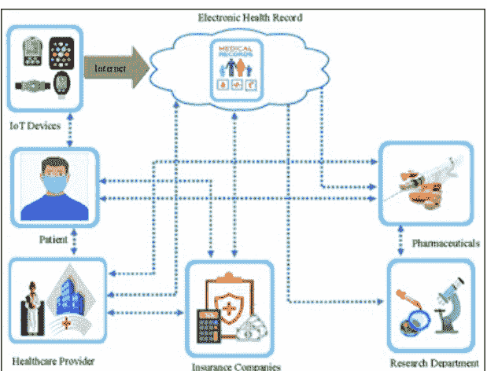

图 (1). 支持物联网的医疗保健系统。

这种敏感记录的在线传输和存储需要一个强大的凭据系统。在此背景下，区块链技术 [4-7] 可以用作安全保存和分发信息的方式。与彼此链接的最小数据单元称为块。区块链是这些块的线性列表，这些块使用加密哈希函数相互链接，如图 (2) 所示。显然，区块链只不过是一个不可更改的记录账本，维护在多台以点对点方式互连的计算机上。大量参与实体通过相互之间存储、更新和交换数据来维护生态系统。


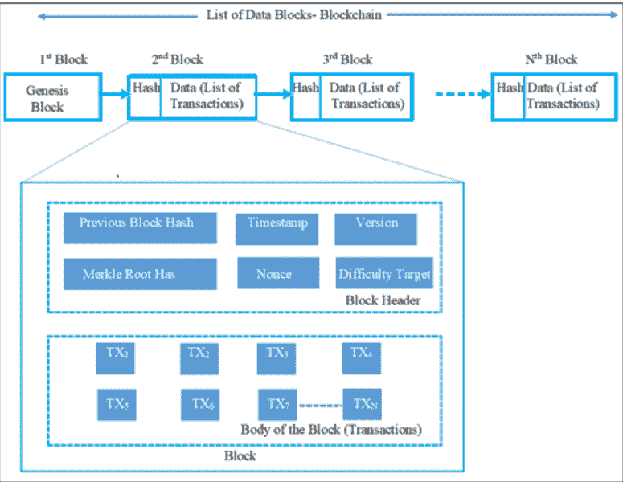

图 (2). 数据块列表。

然而，如同任何新发明一样，区块链也有其缺陷，最普遍的是可扩展性问题。去中心化及其相关益处是以牺牲性能和扩展性为代价的。当比特币人气激增时，相关交易费用水涨船高，因为系统每 10 分钟只能处理一笔交易，这与其他支付处理平台（如每秒可处理高达 2000 笔交易的 Visa）相比相形见绌。这还不是唯一的问题。比特币挖矿也消耗大量能源，以至于因资源消耗量甚至超过城市用电量而受到资源浪费的审查。自那时起，针对这种结构（尤其是共识算法）进行了许多变体和更改，以克服这些缺陷。至今，大多数区块链实现都围绕加密货币，这有充分的理由。区块链或去中心化是一种新兴服务，在没有任何中央机构承诺的情况下运行此服务意味着其他参与者需要获得回报才能运行链及其操作。货币奖励比其他任何方式都更好地解决了这个问题，这就是为什么即使是不涉及数字货币的应用程序仍然会构建原生货币的原因。但是，也存在其他形式的奖励系统。例如，像 DBChain 或 IPFS 这样的去中心化存储系统会考虑以存储形式的奖励系统。另一方面，大多数公司鉴于公共区块链中的临时参与规则，认为它们不适合其目的。因此，由共识中的已知节点组成的许可型区块链的兴起，为解决可扩展性和其他问题打开了许多新途径。去中心化程度与可扩展性之间始终存在权衡。简单来说，区块链不是可以为任何场景适当重新利用的静态协议。与保持与其应用程序独立的现有分布式系统协议不同，区块链设计及其相关共识协议完全取决于具体用例。货币的奖励系统和架构将与涉及数据库或媒体发布平台的系统完全不同。本作品有助于为数字医疗设计身份管理系统。尽管医疗服务数字化取得了最近进展，但纯数字身份管理系统仍然是一个抽象概念。鉴于各利益相关方缺乏共识，身份系统的发展支离破碎且参差不齐。在当今，用户是多套身份文件的持有者，涵盖数字和实体两种版本，需要联系多个服务提供商来确立其身份。在线上问题更为普遍，用户需要记住大量用户名和密码。此外，如此广泛的分布也大大增加了隐私和安全风险，正如过去发生的泄露案例所示。许多人试图设计解决方案但未成功。在该领域成功部署之所以更加困难，其原因之一是要使系统成功所需的协调量巨大，这使得设计和引导这样一个系统的过程几乎不可能。为此，我们设计了一个分为两部分的系统。拟议解决方案旨在通过考虑现实场景来填补实施中的这些空白。

当前大多数应用都是中心化的，意味着操作采用客户端-服务器模式。客户端依赖服务器提供某些数据，或者服务器可能存储用户的一些私有数据。这意味着高度依赖中央机构，因此这种设计在根本层面上存在固有问题。去中心化应用的出现和主要增长发生在比特币开发之后。去中心化应用基本上消除了对单一权威的信任因素，并将其分散到所有参与实体中。数据管理的全部责任转移给用户自己。2009 年，中本聪 [8] 发明比特币，令世界震惊。

第一次，用户能够在不受任何中央机构控制或管理的数字货币上进行交易。通胀和转账均由用户自己处理，诞生了真正去中心化的理念。处理这种极其危险的去中心化行为的真正天才之处在于，通过生成激励，使整个系统在保持一致视图且不做任何妥协的前提下运行。这是通过引入矿工和后续奖励实现的。然而，这一发明的影响更为深远，因为其底层技术——区块链——被视为一种有前景的功能，可以塑造并重新用于涉及去中心化的各种不同应用程序。区块链提供的功能包括真正的去中心化、不可篡改账本、加密安全性和匿名性。因此，不需要依赖和信任中央组织，整个生态系统协同运作，使系统保持一致和最新。这确保了少数实体被攻破不会损坏整个系统，系统将继续正常运行。

本文的其余部分安排如下。下一部分说明相关工作；第 3 节描述了本作品的动机。后续部分介绍了医疗保健系统身份管理的概述。第 5 节详细介绍了利用区块链解决问题陈述的拟议解决方案‘Oneld’。第 6 节讨论了拟议解决方案的优点。本文在第 7 节结束，并概述了未来工作。

## 背景与相关工作

高效管理患者记录对于提供有效治疗和护理、研究疾病以及研发药物和疫苗至关重要。然而，基于 IoT 的应用面临多种安全挑战 [9-12]。大多数医疗应用遵循客户端-服务器架构，服务器拥有记录的所有权并可以访问记录 [13, 14]。这种架构在开展适当研究和随后的疾病治疗方面造成阻碍。为克服这一问题，多位研究人员一直在研究基于云的医疗系统 [15]。然而，患者记录的安全性在基于云的架构中是一项挑战。在此背景下，研究人员正在研究区块链技术，以克服传统区块链系统的潜在问题。区块链使区块链的其他参与者能够创建记录并同时共享记录。多位研究人员一直在研究支持区块链的医疗系统，以更好地管理 EHR（电子健康记录）。Xia 等人 [16] 提出了一种结合区块链技术的基于云的医疗系统。少数研究人员构建的医疗系统不允许将患者医疗记录转移到区块链上 [17, 18]。相比之下，Yue 等人 [19] 提出了一种允许医疗服务提供者访问患者记录以改善治疗条件的医疗系统。已提出一种分布式方法 [20]，用于多个组织之间改进和安全的患者数据传输。Gorenflo 等人 [21] 提出了一种性能改进的支持区块链的医疗系统。以太坊区块链正在被用于 [22, 23] 共享患者医疗记录。Zhang 等人 [24] 提出了一种使用身份验证的安全普遍社交网络医疗系统。[25] 中使用了支持区块链技术的链上和链下安全方法来交换患者记录。Dey 等人 [26] 提出的医疗架构中使用生物传感器来减少患者记录访问时间。Thakkar 等人 [27] 部署好战缓存和配置授权技术来估计区块链网络的性能。研究 [28] 提出了一种使用区块链的安全患者数据传输机制，以实现更好的完整性和隐私。Ichikawa 等人 [29] 开发了一款基于移动的应用程序，以使用区块链以安全防篡改的方式将失眠症患者信息传输到私有网络。

## 动机

尽管医疗服务数字化取得了最近进展，但纯数字身份管理系统仍然是一个抽象概念。鉴于各利益相关方缺乏共识，身份系统的发展支离破碎且参差不齐。在当今，用户是多套身份文件的持有者，涵盖数字和实体两种版本，需要联系多个服务提供商来确立其身份。在线上问题更为普遍，用户需要记住大量用户名和密码。此外，如此广泛的分布也大大增加了隐私和安全风险，正如过去发生的泄露案例所示。许多人试图设计解决方案但未成功。在该领域成功部署之所以更加困难，其原因之一是要使系统成功所需的协调量巨大，这使得设计和引导这样一个系统的过程几乎不可能。为此，我们设计了一个分为两部分的系统。拟议解决方案旨在通过考虑现实场景来填补实施中的这些空白。

## 身份管理：医疗保健系统

为了了解身份管理系统的工作原理，我们需要了解身份究竟是什么。身份是一个涵盖广泛定义的术语 [30]，由于其不断变化的定义和多样化的感知，绝不能局限于一套定义。然而，比这更重要的是

定义身份就是定义身份所承载的目的。特定各方之间任何形式的交互及随后的信息交换均基于信任。即信任某个人或实体实际上正是其声称的那样。这种信任的建立建立在我们所谓的身份之上。身份是一组基本属性，为个人、实体或资产提供法律代表。身份识别是获取任何类型服务的先决条件。缺乏身份可能导致被拒绝获得教育、金融服务、医疗保健、社会福利、经济发展和投票权等基本服务。提供主要身份证明形式的负担在于公民所属国家的政府。技术领域的进步在我们创建和处理身份的方式上带来了巨大变化。电子健康记录（EHR）的引入以及随之而来的数字化增加，带来了与患者记录不意披露相关的多种威胁。另一个重大变化是个人或组织在线身份的引入。互联网的广泛使用导致了由第三方拥有和控制的多个用户信息孤岛的产生。在最基本的理解层面上，身份是属于实体的属性之和，例如患者-医生医院、保险公司和医学研究机构（由政府/制药公司资助）。我们将第三方称为一个独立实体，可以是单个个人，也可以是法律实体，例如政府、组织或机构。身份的三类属性分别为“固有的”（由问题实体直接提取的任何一组信息）、“分配的”（由第三方定义并为特定目的创建）和“累积的”（随时间变化或修改的时间函数）。数字身份可以表示为其属性之和，但不持有任何价值。身份的价值是接受实体对身份颁发者所感知信任的直接函数。

大规模数字化使得大多数传统身份系统能够从物理认证方法过渡到数字方法。与其手动注册目标人群并在纸质登记册中存储身份信息，不如通过电子方式捕获和存储数据，这提供了许多好处，例如：

- i. *唯一标识符：* 数字身份系统在数据采集方面提供显著更高的准确性。这有助于更好的去重程序，从而确保删除幽灵注册，并由此降低因浪费和欺诈而产生的相关损失。
- ii. *更高的可扩展性：* 数字身份系统更容易扩展以适应不断变化的要求。此外，它们更容易与其他服务集成，并促进快速的数据处理和收集。
- iii. **更好的监控和报告：** 此类系统生成的数据记录通过创建可审计的交易记录，对正在派发的服务提供更好的问责和监控。这有助于防止欺诈，并有助于援助发展规划。

在下一节中，我们提出了一种围绕两个独立系统同步运行的解决方案。其中一个系统是集中式的，面向知名身份。它应该充当由医院、保险公司和制药公司等知名身份颁发的身份及相应声明的中央存储库。另一个系统是去中心化的，主要由患者和医疗从业者等个人使用。这种混合方法背后的推理以及这两个系统的工作方式将在下一节中解释。

## 拟议解决方案

这项工作的最终目标是在基于 IoT 的医疗保健系统中为每个用户提供自主身份。在构建真正实现该目标的系统时，会出现许多问题。为了使系统在切实可行的同时忠实于其原则，需要在集中式系统和去中心化系统之间分发服务。如前一节所述，SkyNet 应该充当知名实体身份的可信存储库。真正的挑战在于让个体患者或医生参与并使用这些功能。除非为用户提供加入网络的能力，否则 SkyNet 无法获得太多功能。对于这种混合网络，需要牢记的因素包括：

- 1. 集中式服务适用于知名实体，但对于个人用户而言，它可能会带来与其他任何集中式服务相关的复杂问题。必须在该服务上寄予厚信，而操纵和自主权的问题将不在考虑范围之内。
- 2. 该中央服务可能被政府强制用于监控，或易受有兴趣的第三方提供的诱惑而泄露患者信息。将宝贵数据存储在单个超越国界的实体手中所需的信任很难实现。
- 3. 该服务至少对于某些给定的基本功能集应是免费的。身份是普遍的，对于每个富人或穷人都是相同的。设置参与障碍会严重阻碍网络的采用。

为了满足这些要求，我们提出了一种去中心化网络 OneId。OneId 的理念是允许任何用户加入网络，并能够以可信、安全且保护隐私的方式创建和存储其身份相关信息。这是通过使用许可分类账实现的。

OneId 的基本原则可总结如下：

- i. 允许任何实体（患者）以去中心化的方式创建和管理其身份。
- ii. 确保网络不受任何形式的审查或集中化的影响。
- iii. 坚守自主身份的原则。
- iv. 允许任何用户与任何其他用户创建和共享记录。
- v. 确保最高级别的安全性和隐私性。

OneId 系统应是一个许可分类账，以确保其能够随着用户数量和随后的网络请求数量增加而相应扩展。

为了让节点自愿参与许可分类账供他人使用，节点将获得原生代币奖励。关于代币如何生成、监管和分发的机制尚待制定。然而，有多种方法。一种提议的方法是限制用户在网络上可免费获得的密钥、声明和钱包总体存储数量。存储服务可以对任何额外功能或使用向用户收费。存储服务的收入必须通过原生代币获得，并从收入中抽取一部分以资助运行许可分类账的节点。激励机制在这里可以很好地运作，因为如果许可节点没有获得应得的报酬，存储服务就无法简单地膨胀其利润，这将威胁网络的运行。事实上，大多数存储服务很可能会在分类账上运行几个节点。使用自主身份系统的总体好处已在前几节中介绍，预计将从 OneId 的应用中获得。

## 架构

OneId 生态系统如图（3）所示。OneId 网络上的每个注册用户都将使用存储服务来存储其健康记录，并能够从任何设备远程管理这些记录。这不是必需的要求，用户将有选择自行操作医疗记录的选项。鉴于其可信网络中存在知名身份，大多数访问医疗记录的声明将通过 SkyNet 发布。OneId 的用户


将能够处理这些访问，因为 SkyNet 和 OneId 均构建为高度互操作。确保标准化对两个网络的成功至关重要。OneId 的身份生态系统将使用多个独立区块链来运行自主身份系统。保持独立区块链的原因是为了确保可扩展性以及规则之间的清晰界限。以下部分将解释 OneId 中的身份如何运作以及其信息如何存储。

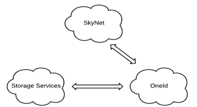

图 (3)。SkyNet、OneId 和存储服务。

## 记录创建

记录是 OneId 的核心功能。属于患者的所有健康数据都将存储在记录中。记录链如图 (4) 所示。记录的功能已划分为两种类型，如下所述：

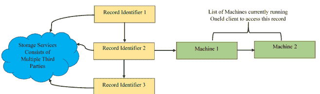

图 (4)。记录链概览。

## 主记录

主记录是控制实体（患者）的所有相关标识符和数据的主要存储区域。首次创建主钱包时，将生成三个属性，

- 1. **主记录标识符**：它存储在记录链中，用于标识记录。在记录链上创建区块涉及随后在存储服务中创建安全存储区域。存储服务的功能在后续部分中解释。

- 2. **控制密钥**：将创建一对公私密钥以控制记录。私钥在创建后将被销毁。公钥将用于加密存储服务上的备份。如果存储在设备记录中的数据丢失，恢复加密数据的唯一方法是重建私钥以从存储服务中解密主记录的数据。公钥存储在每个将此主记录作为备份的设备记录中。公钥不存储在链上。

## 设备记录

设备记录用于在本地机器上存储身份相关数据。实体创建的任何形式的数据都存储在记录中。数据传输的唯一其他位置是与给定设备记录关联的主记录以提供备份，并且该备份也使用已销毁的解密私钥进行加密，以确保最大安全性和隐私性。

每个设备记录在启动时都将执行 Proc_DeviceRecord

Proc_DeviceRecord

### 开始

- 1. **设置身份验证方法**：登录设备记录的身份验证方法可能各不相同，但是，OneId 将定义一些基本准则，以确保设备记录不会成为其安全性的薄弱环节。最广泛使用和首选的媒介将是手机。使用指纹扫描等身份验证方法以及密码保护可以提供额外安全性。

- 2. **设备记录标识符**：创建一个唯一标识符。标识符创建方法尚未概述，但是使用机器属性中独有的特征可能很有用。

- 3. 控制密钥：将创建一对公私密钥以控制记录。

- 4. 最后一步将是确定以下任一选项

- 1. 创建主记录

在此场景中，本地客户端将根据主记录部分中强调的步骤启动主记录的创建。完成此操作后，公钥连同标识符将在记录链上主记录下注册。

- ii. 链接到现有主记录

当用户想要从多台机器访问其记录时，就是这种情况。这需要两件事，a) 授权新设备记录 b) 从现有设备记录复制本地数据。这些步骤将需要使用现有设备记录。步骤链如下：

- 1. 新设备记录创建包含其公钥和标识符的 QR 码。

- 2. 使用现有设备记录扫描此二维码。然后它与新设备记录形成加密通信通道，并使用其公钥发送加密数据。

- 3. 现有设备随后在记录链上的共同主记录下添加新设备的标识符和公钥，从而授权新设备记录。

在不解密云中存储的数据的情况下保持多个设备记录之间的一致性可能会带来一些问题。尽管从部署、构建便利性和操作目的来看，在每个设备钱包中存储主记录的私钥是非常可行的，但其安全性远低于所提出的模型。类似于版本控制软件的一致性维护方法可以提供一些关于如何解决此问题的见解。

这里需要注意的其他一些重要事项是，单个患者可以创建多个记录以获得更高的安全性。尽管跨各种记录管理标识符可能会变得繁琐。另外，用户也可以放弃在云存储中存储备份的选项，并承担备份和恢复的责任。

## 标识符创建

加入 OneId 的任何实体都可以创建原生标识符。这些标识符的确切性质和功能受 W3C 提出的去中心化标识符规范启发，因为它将允许用户以去中心化的方式生成标识符。每个标识符都将添加到此链中，并因此可以通过公共端点 OneId/identity/identifier 进行引用。图 (5) 描绘了标识符链的工作原理。

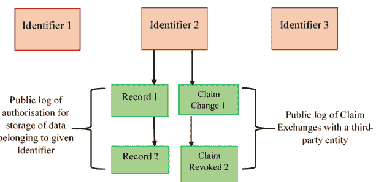

图 (5)。标识符链概览。

对于每个标识符，我们有以下属性集：

- 1. 一对公私密钥。私钥存储在钱包中，公钥在分类账上可见。

- 2. 用于授权记录的区块链。第一个区块包含负责创建给定标识符的记录 Id。同一标识符可以由多个记录控制，或者完全改变所有权。日志确保记录是透明的。

- 3. 任何与通过索赔涉及此标识符的实体相关的消息都将向索赔消息链添加区块。例如，当创建索赔、修改索赔数据或撤销索赔时，除非表达更改的区块添加到此链中，否则更改将不被接受。这确保了不可否认性以及有关特定标识符的索赔相关活动日志。

记录和标识符链足以满足一般功能目的并满足电子健康记录的大多数要求。尚未涵盖的唯一事情是用户如何创建和交换索赔（如果有的话）。这将在下一部分中处理。

## 索赔链

SkyNet 中使用的索赔是系统原生的，索赔更改的日志在系统内保存。但是，可能需要将这些索赔更改的透明度保持公开。为了解决这个问题，如果发行者知道将需要公共记录，它只需将其索赔 ID 上传到索赔链。SkyNet 中索赔的任何更改都必须先作为日志上传到 OneId 中的索赔链，然后才能在 SkyNet 中实施。

## 结论

该项目最初旨在研究去中心化系统，并找出如何修改它们以像其对等集中式版本一样扩展的解决方案。项目进行到一半时，团队得出结论：去中心化系统是激励驱动的，激励取决于系统设计的目的，不同于关注一致性和可扩展性等分布式特性的集中式系统。随后，该项目专注于通过这些去中心化系统实施身份和凭证管理。研究并比较了各种其他实现。基于他们的分析，我们提出了一种由集中式和去中心化服务组合而成的解决方案。我们详细阐述了为什么这种方法能带来有利结果，并介绍了其运行机制。还展示了工作流和数据管理，以展示实际应用案例。

然而，SkyNet 和 OneId 的当前版本尚未完成一些功能。最重要的是 OneId 上的钱包一致性实现和索赔交换。许多分类账和存储节点的激励机制也留待进一步探索，以确保系统足够实用，可用于实际生活。总体而言，SkyNet 和 OneId 的组合在自主身份领域带来了一个令人兴奋的机遇。

## 出版同意

不适用。


## 利益冲突

作者声明不存在任何利益冲突，无论是财务上的还是其他方面的。

## 致谢

无。

## 参考文献

- [1] P. Verma, 和 S.K. Sood, "基于云的 IoT 疾病诊断医疗框架", *J. Parallel Distrib. Comput.*, 卷 116, 页 27-38, 2018. [http://dx.doi.org/10.1016/j.jpdc.2017.11.018]
- [2] D.K. Sharma, S. Bhargava, 和 K. Singhal, "物联网在制药行业中的应用，制药行业增长的工业物联网方法", 载于：*In.* Academic Press, 2020, 页 153-190.
- [3] M.F. Alhamid, "面向智慧医疗的云端乳腺X线摄影调查", *Multimed Tools Appl*, 页 1-13, 2017.
- [4] M. Sharma, S. Pant, D.K. Sharma, K. Datta Gupta, V. Vashisth, 和 A. Chhabra, "利用深度学习、区块链和联盟为工业物联网启用安全性", *Trans. Emerg. Telecommun. Technol.*, 页 e4137, 2020.
- [5] S. Banyal, M. Saxena, 和 D.K. Sharma, "IoT 技术中的区块链启用安全与隐私方案", 载于：*IoT 和区块链手册* CRC Press, 2020.
- [6] D.K. Sharma, S. Pant, M. Sharma, 和 S. Brahmachari, "区块链的加密货币机制：模型、特性、挑战与应用", 载于：*区块链技术研究手册*。Academic Press, 2020, 页 323-348. [http://dx.doi.org/10.1016/B978-0-12-819816-2.00013-7]
- [7] D.K. Sharma, T. Pardhe, Y. Kulshrestha, 和 S. Singh, "区块链应用与实现", 载于：*IoT 和区块链手册*。CRC Press, 2020, 页 95-118. [http://dx.doi.org/10.4324/9780367854744-6]
- [8] S. Nakamoto, "比特币：一种点对点电子现金系统", 可在线查阅: https://bitcoin.org/bitcoin.pdf
- [9] A. Riyal, P.S. Prasad, 和 D.K. Sharma, *物联网与区块链融合、要求、问题与实践，面向数据隐私管理的区块链技术*。CRC Press, 2021, 页 23.
- [10] D.K. Sharma, A.K. Kaushik, A. Goel, 和 S. Bhargava, "第 11 章 - 物联网与区块链：集成、需求、挑战、应用与未来前景", 载于：*区块链技术研究手册*，Krishnan Saravanan, E. Balas Valentina, E. Golden Julie, Y. Harold Robinson, S. Balaji, Kumar Raghavendra, 编。Academic Press, 2020, 页 271-294. [http://dx.doi.org/10.1016/B978-0-12-819816-2.00011-3]
- [11] S. Banyal, 和 D.K. Amartya, "IoT 赋能技术中的安全漏洞、挑战与方案", 载于：*In.* *面向数据隐私管理的区块链技术 第 1 版*。CRC Press, 2021, 页 81-108.
- [12] R. Dwivedi, K. Datta Gupta, 和 D.K. Sharma, *通过物联网实现智慧城市中智能住宅的安全与监控*。Springer, 2021. [http://dx.doi.org/10.1007/978-3-030-52624-5_18]
- [13] R. Schoenberg, 和 C. Safran, "基于互联网的保留患者隐私的医疗记录存储库", *BMJ*, 卷 321, 期 7270, 页 1199-1203, 2000. [http://dx.doi.org/10.1136/bmj.321.7270.1199] [PMID: 11073513]
- [14] D. Gritzalis, 和 C. Lambrinoudakis, "互连健康信息系统的安全架构", Int. J. Med. Inform., 卷 73, 期 3, 页 305-309, 2004. [http://dx.doi.org/10.1016/j.ijmedinf.2003.12.011] [PMID: 15066563]
- [15] V. Stantchev, R. Colomo-Palacios, 和 M. Niedermayer, "基于云计算的医疗保健系统", ScientificWorldJournal, 卷 2014, 页 692619, 2014. [http://dx.doi.org/10.1155/2014/692619] [PMID: 24892070]
- [16] Q. Xia, E.B. Sifah, K.O. Asamoah, J. Gao, X. Du, 和 M. Guizani, "Medshare: 通过区块链在云服务提供商之间实现无信任医疗数据共享", IEEE Access, 卷 5, 页 14757-14767, 2017. [http://dx.doi.org/10.1109/ACCESS.2017.2730843]
- [17] C.G. Dagher, J. Mohler, M. Milojkovic, 和 P. Marella, "Ancile: 使用区块链技术的电子健康记录访问控制与互操作性隐私保护框架", Sustain Cities Soc., 卷 39, 页 283-297, 2018. [http://dx.doi.org/10.1016/j.scs.2018.02.014]
- [18] K. Fan, S. Wang, Y. Ren, H. Li, 和 Y. Yang, "MedBlock: 通过区块链实现高效安全的医疗数据共享", J. Med. Syst., 卷 42, 期 8, 页 136, 2018. [http://dx.doi.org/10.1007/s10916-018-0993-7] [PMID: 29931655]
- [19] X. Yue, H. Wang, D. Jin, M. Li, 和 W. Jiang, "医疗数据网关：基于区块链的新型隐私风险控制医疗智能", J. Med. Syst., 卷 40, 期 10, 页 218, 2016. [http://dx.doi.org/10.1007/s10916-016-0574-6] [PMID: 27565509]
- [20] G. Yang, 和 C. Li, "基于区块链的电子健康记录（EHR）系统安全架构设计", IEEE 国际云计算技术与科学会议（CloudCom）, 2018, 页 261-265. [http://dx.doi.org/10.1109/CloudCom2018.2018.00058]
- [21] C. Gorenflo C, "FastFabric: 将 Hyperledger Fabric 扩展到每秒 20,000 笔交易", IEEE 区块链与加密货币国际会议（ICBC）, 页 455-463, 2019.
- [22] A. Azaria, A. Ekblaw, T. Vieira, 和 A. Lippman, "MedRec: 使用区块链进行医疗数据访问和权限管理", 第 2 届开放大数据国际会议（OBD）论文集, 页 25, 2016. [http://dx.doi.org/10.1109/OBD.2016.11]
- [23] G. G. Dagher, J. Mohler, M. Milojkovic, 和 P. B. Marella, "Ancile: 使用区块链技术的电子健康记录访问控制与互操作性隐私保护框架", Sustain. Cities Soc., 卷 39, 页 283-297, 2018. [http://dx.doi.org/10.1016/j.scs.2018.02.014]
- [24] J. Zhang, N. Xue, 和 X. Huang, "面向普惠社交网络医疗的安全系统", IEEE Access, 卷 4, 页 9239-9250, 2016. [http://dx.doi.org/10.1109/ACCESS.2016.2645904]
- [25] S. Jiang, J. Cao, H. Wu, Y. Yang, M. Ma, 和 J. He, "BlocHIE: 基于区块链的医疗信息交换平台", 2018 IEEE 智能计算国际会议（SMARTCOMP）, 2018, 页 49-56. [http://dx.doi.org/10.1109/SMARTCOMP.2018.00073]
- [26] T. Dey, J. Shauriya, 和 K. Neha, "HealthSense: 物联网和区块链的医疗用例", 智能可持续系统国际会议（ICISS）, 页 86-491, 2017.
- [27] P. Thakkar, S. Nathan, 和 B. Viswanathan, "Hyperledger Fabric 区块链平台的性能基准测试与优化", IEEE 第 26 届计算机与电信系统建模、分析与仿真国际研讨会（MASCOTS）, 页 264-76, 2018. [http://dx.doi.org/10.1109/MASCOTS.2018.00034]
- [28] S. Ngamsuriyaroj, T. Likitthheerameth, A. Kahutson, 和 T. Pathummasut, "基于区块链基础设施的包裹递送系统", 第 7 届 IEEE ICT 国际学生项目会议, 2018, 页 1-6. [http://dx.doi.org/10.1109/ICT-ISPC.2018.8523944]
- [29] D. Ichikawa, M. Kashiyama, 和 T. Ueno, "使用区块链技术的防篡改移动健康", JMIR Mhealth Uhealth, 卷 5, 期 7, 页 e111, 2017. [http://dx.doi.org/10.2196/mhealth.7938] [PMID: 28747296]
- [30] J.D. Fearon, 什么是身份（我们现在使用这个词的含义）, 1999。访问于 2/1/2021。检索自: https://web.stanford.edu/group/fearon-research/cgi-bin/wordpress/wp-content/uploads/2013/10/W-at-is-Identity-as-we-now-use-the-word-.pdf

## 第 3 章

## 智慧医疗设施中的区块链

Ayush Kumar Singh^1, Nipunika ^1 和 Deepak Kumar Sharma^{2*}

^1 信息技术学院，纳塔吉·苏巴斯科技大学（前称纳塔吉·苏巴斯技术学院），新德里，印度
^2 信息技术学院，英迪拉·甘地德里女子理工大学，德里，印度

### 摘要

医疗保健是一个不可或缺的系统，其效率和稳健性是衡量国家繁荣程度的可靠指标。该领域不仅在医疗设备和药物方面取得了技术进步，还在电子病历、可穿戴健康监测设备和远程医疗等多个领域取得了进步。在本章中，我们探讨了在医疗保健中利用区块链这一颠覆性技术的各个方面。自区块链最初在加密货币和金融领域使用以来，其目标是将行业从以机构为中心转向以患者为中心，区块链技术已在医疗保健中找到应用。本章分析了其应用案例，以及传统医疗保健体系所带来的局限性以及区块链如何缓解这些局限性。此外，我们还将介绍实施基于区块链的医疗服务所面临的障碍，并讨论一些已实施和拟议的基于区块链的医疗框架，重点介绍它们的成功与失败。

### 关键词

应用，区块链，电子病历，电子健康记录，医疗保健，服务，供应链。

### 引言

区块链技术诞生于 2008 年，当时化名中本聪的开发者或开发者团队发布了一篇题为“比特币：一种点对点电子现金系统”的白皮书 [1]。比特币成为第一大主要加密货币，其峰值市值在 2017 年第四季度达到 2380 亿美元 [2]。自诞生以来，区块链已被广泛研究，用于加密货币和金融以外的领域。区块链的关键特性包括不可篡改性、隐私性、不可腐化性和透明性，这使其成为实施医疗应用的合适框架。在本节中，我们将探讨。

* 通讯作者 Deepak Kumar Sharma：英迪拉·甘地德里女子理工大学信息技术学院，德里，印度；电话：8743075567；电子邮件：dk.sharma1982@yahoo.com


区块链的工作原理及其主要应用案例。接着将分析医疗领域的传统系统，随后概述区块链技术如何改造医疗行业。

## 区块链的技术方面

从本质上讲，区块链是一个分布式公共账本。换句话说，它是一个去中心化的数据库。没有中央机构负责其运行和维护。这正是它能够实现点对点交易、无需中介的原因。顾名思义，区块链是区块的线性排列，而区块是其数据单元。这些区块可以存储从交易记录到医疗记录乃至媒体等各种数据。这种线性排列类似于仅追加的数据结构。新区块只能添加到链的一端。每个区块都有一个唯一标识其自身的哈希值。此外，区块还包含前一个区块（即父区块）的哈希值，从而形成链接。区块链中第一个没有父区块的区块被称为创世区块。

由于没有实体来验证哪些区块应添加到账本中，区块链采用各种共识算法来验证新区块。所有参与用户都同意遵循预定义的共识算法，以决定账本的并发状态，并允许区块链在网络内实施“无信任”交易。每个新区块在被引入区块链之前都需要经过共识算法验证。验证并追加新区块所需的时间被称为网络的区块时间。比特币区块链约为 10 分钟，以太坊区块链约为 20 秒 [3]。工作量证明（PoW）是一种广泛使用且稳健的共识算法，应用于比特币区块链。它使用密码学哈希函数，如 SHA 256 来强制执行安全性和完整性。密码学哈希函数将输入数据唯一映射到相应的哈希值。此外，它是一个不可逆函数，因此从给定的哈希值计算输入数据在实际中几乎是不可能的。PoW 协议要求用户投入一定的计算工作，以获得满足某些预定义条件的区块哈希值。该条件通常是一个称为 nonce 的数字，用于设定计算哈希的“难度”。例如，nonce 可以定义哈希值必须以其开头的零的数量。由于“雪崩效应”，输入数据的微小变化会完全改变相应的哈希值。因此，想要添加区块的用户除了暴力尝试直到找到满足给定哈希条件的组合外别无选择。一旦找到组合，网络中的其他用户可以简单地用该组合运行密码学哈希函数，并确认是否满足条件。将区块添加到区块链的这个过程称为挖矿，投入计算工作来添加区块的用户称为矿工（参见图 1）。

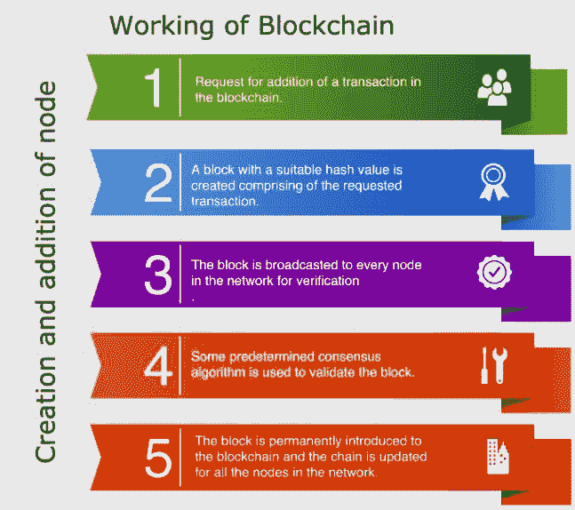

图 (1). 区块链的顺序工作流。

其他一些共识算法包括权益证明、销毁证明和实用拜占庭容错。尽管这些算法的实现方式不同，但其功能保持一致；即验证新区块，并确保整个网络中只存在一个版本的数据库 [4]。

## 区块链的应用

截至 2020 年，区块链已在众多领域得到研究和实践，证明了这项技术的多功能性。以下是一些示例。

## 投票

区块链有可能彻底改变投票。基于区块链的投票框架可提供比传统投票方法更高标准的安全性、隐私性、可靠性和防篡改性。区块链的不可篡改性确保一旦投票被投出，就无法被篡改。选票被篡改仍然是传统投票方法面临的严重问题。2020 年，马拉维宪法法院下令重选，因为调查发现 2019 年大选的汇总表格被篡改 [5]。

区块链允许选民在经过一定身份验证后匿名投票。此外，它可以维护已投票的实时计数。这节省了收集和计算选票所花费的时间。2019 年南澳大利亚州渔业委员会咨询委员会选举就是一个例子，当时南澳大利亚州政府委托基于区块链的初创公司 Horizon State 来主办基于区块链的投票。该为期一个月的选举结果在投票结束后立即公布 [6]。

## 身份管理

我们常常将自己与各种公共或私人机构或组织联系起来。为了作为机构成员或某计划的合格受益人进行身份验证，机构会向我们颁发某种形式的身份证明。此外，若要加入新机构，可能需要出示一组先前拥有的身份证明。为不同目的维护独立的身份证明对消费者来说是一项繁琐的任务。同样，为组织管理集中式身份管理系统也费时费力。区块链技术的去中心化特性有助于缓解这些局限性。

基于分布式账本的身份管理框架可以帮助安全地维护个人身份信息，并随时随地无缝访问这些信息。uPort 就是这种框架的一个示例，它使用以太坊区块链进行身份管理。这是一个开源项目，旨在让用户拥有和维护数字身份和资产。此外，它在需要时便于向其他用户或组织安全地披露信息 [7]。基于区块链的身份管理的另一个示例是伊利诺伊区块链倡议，旨在公民出生时即注册其数字身份。只有个人或其监护人才有权访问经过密码学封装的身份属性 [8]。

## 房地产记录管理

房地产所有权常常引发争议。这种争议可能发生在个人之间、政府与个人之间，甚至政府之间。例如在印度，土地记录有时由多个机构维护，这些机构对同一块土地可能持有相冲突的信息。因此，这些争议不易解决。土地登记也是一个繁琐的过程，需要许多利益相关者和中介参与。区块链技术凭借不可篡改性和智能合约的力量，可以帮助追踪所有权记录并简化注册流程。

2017 年，印度安得拉邦政府与瑞典公司 Chromaway 合作，建立基于区块链的土地登记系统，旨在减少错误和行政负担 [9]。同样，2019 年，美国南伯灵顿在房地产交易管理平台 Propy 的帮助下，启动了基于区块链的土地产权登记 [10]。

## 医疗领域的传统技术

医疗行业目前在健康记录收集方面遵循以机构为中心的方法，导致医院和执业者独自负责患者记录的存储、共享、更新和收集。让我们看看医院如何存储患者记录。

## 电子健康记录

在实施电子健康记录（EHR）之前，大多数诊所使用电子病历（EMR）。尽管名称相似，但 EMR 和 EHR 大相径庭。EMR 本质上是仅来自某一诊所的患者病历的数字形式，即不同医院会为同一患者拥有不同的 EMR，而不顾患者病史。然而，随着医疗旅游、移民以及第二诊疗意见的日益普及，实时数据共享变得势在必行，使得 EHR 成为促进医疗记录互操作性的不可或缺的工具。EHR 现在是数字化存储医疗记录最常见的形式，它专门用于与其他医疗服务提供者和机构共享数据。

尽管从纸质记录转向数字记录有助于安全高效的数据管理，但仍需遵循某些注意事项。


## 安全性

医疗记录的敏感性和私人性质要求采取额外预防措施，以确保数据不被篡改。美国1996年《健康保险流通与责任法案》（HIPAA）中的安全规则明确要求医疗保健组织制定安全协议以保护患者信息，但安全级别留待根据提供者的能力和手段进行解释，这暴露了一个极易被利用的漏洞。电子健康记录（EHR）通过以下方式实现此目标：

- A. 访问控制机制定义谁可以访问哪些数据，这可能可以避免外部攻击，但对内部攻击无效。
- B. 使用加密原理对数据进行加密，这可能会阻碍互操作性，因为尚未就通用加密标准达成一致。

此外，需要建立安全可靠的访问和变更历史记录，以便知道谁在什么时间做出了什么更改，从而确保最大程度的问责。

## 可扩展性

医疗保健是一个产生大量数据的行业，从输入患者个人信息到为每位患者的每次检查更新大尺寸放射学影像，不仅需要大型可靠的存储系统，还需要强大的数据库系统，以便对大量数据进行基于角色的视图和快速查询。早在2011年，美国医疗保健行业就存储了150艾字节的数据[11]。为了处理更大规模的数据，需要更大规模的网络，这会导致成本通胀，这对许多诊所可能并不有利，尤其是因为这些本地网络是系统可靠性的瓶颈。因此，即使一家医院在其电子健康记录系统上花费数百万美元，也只能在医院内部访问，而电子健康记录系统的安全性也只能与其本地网络一样安全。

## 患者生成的数据

目前，利用健康追踪应用程序和可穿戴设备产生的数百万吉字节数据的潜力仍未被开发。尽管这些标注良好的数据可以帮助医生和研究人员，但它们仍然分散、脱节且未经分析。

存在大量应用程序，主要旨在追踪不同指标，如摄入的卡路里和走过的步数，以及内置传感器的可穿戴设备，用于追踪更复杂的指标，如血压和心率，这些使“个人健康记录”（PHR）得以存在。与电子健康记录（EHR）不同，患者对PHR的数据收集和共享拥有控制权，使他们更深入地参与个人健康监测过程。然而，PHR引发了关于此类数据可靠性和真实性的问题，如果传感器故障导致致命误诊，谁应承担责任？

## 行业技术要求

临床试验中的数据共享是一个极其复杂且敏感的过程，不仅因为数据的性质，还因为涉及大量利益相关者及其相关的数据“视图”。然而，使临床试验在技术上复杂且昂贵的需求，恰恰也是使区块链成为完美契合方案的需求：可扩展性、不可变性、可追溯性以及多层级的数据“视图”。据一些估计[12]，到2025年底，区块链对制药行业的价值将达到30亿美元。

假药充斥市场给制药行业带来巨大问题。这些药物要么含有极少活性成分，要么根本不含，对公共健康造成巨大危害。药物生产过程极其精细，并伴有巨大的责任问题，因此区块链理所当然地可以提供解决方案。

医疗保健行业进行许多敏感流程，问责制和详细审计历史是重大关切问题。从临床试验、癌症登记到阿片类药物处方追踪，数据积累、存储、更新和查询的成本与传统数据库管理系统的低效率相比，高得惊人。因此，区块链在该行业找到了天然的位置。

## 其他挑战

目前，医疗数据是为满足医疗保健提供者的运营需求而生成，而非数据分析，因此仍然分散在各个医疗机构中。这种分散的、重复的或不完整的数据最终显著增加了患者护理的平均成本。

患者无法对其分散在各个机构中的医疗记录拥有统一视图。这种以机构为中心的数据收集方式也剥夺了患者对其医疗记录的控制权。从更新到共享的一切工作都由提供者单独承担。即使获得患者同意，与研究人员甚至其他提供者共享数据也缓慢且不安全。新提供者通常需要联系之前的提供者以发送之前的患者记录。这一过程由双方按医疗机构的速度进行。因此，如果正在接受治疗的癌症患者需要在最近的医院接受紧急危重症护理，就需要联系之前的提供者获取医疗记录，以确保新药物不会影响之前的治疗。

## 用例

区块链是去中心化数据管理最流行和最安全的实现之一。它的应用远不止于金融服务。如前一节所示，传统医疗技术存在某些局限性，其共同主题似乎是：缺乏问责制和可信的审计历史，以及低效的实时数据共享。你可以猜到，区块链技术是专门为解决此类问题而设计的，让我们看看如何实现。在本节中，我们将详细探讨区块链技术在医疗行业的一些用例。

## 健康记录

医疗行业需要将数据视角从以机构为中心转向以患者为中心。由于数据由多个医疗组织集中控制，导致数据分散，造成存储和检索的巨大成本开销。集中式数据控制导致数据共享缓慢且无效，尤其是与医学研究人员共享时。要真正实现患者控制，我们必须通过区块链去中心化数据存储，并使用加密约束来确保数据完整性和安全性。区块链的即时实施存在几个障碍，即合规性要求和技术障碍。因此，大多数即时实施侧重于数据验证、审计和授权[13]。

## 电子健康记录中的应用

几乎所有医疗组织都投资的最重要、最昂贵、最常见的软件之一是电子健康记录（EHR），正如上面所讨论，它急需转型。数据安全性、互操作性和完整性仍然是一个问题，但可以使用区块链轻松解决。

## 安全性与完整性

基于角色的机制确保只有授权人员可以查看或更改其职责范围内的信息，从而优雅地抵御外部攻击。这种安全性是双重的，因为区块链技术本身就能防止第三方入侵，并额外增加了一层基于角色的数据访问。此外，存储在电子健康记录中的信息应是可信且防篡改的，这可以通过在区块链中实施详细的审计历史来轻松确保。

## 可扩展性

可扩展性是指软件即使在添加大量用户/数据时仍能保持相同速度运行的能力。可扩展性是区块链和传统电子健康记录系统中的已知问题。一些实施建议在数据量增长时将数据链下存储，但在确定解决方案之前还需要更多研究。

## 个人健康记录（PHR）

如前一节所讨论，患者生成的健康信息与电子健康记录不集成。个人健康记录可以帮助患者控制、访问和管理其数据，而区块链正好可以提供帮助。区块链可以允许患者安全地收集和管理其数据，同时控制查看和共享权限，并将此记录与其他主流记录集成，以便他们可以对其数据拥有统一视图。此外，区块链可以帮助将此记录系统与其他设备连接，通过共识算法确保数据完整性。

## 成功实施

电子健康记录最流行的区块链实现是MedRec，这是一个基于以太坊的项目，使用户能够控制其医疗记录的访问权限。它提供了一种去中心化的数据共享和授权方法。权限和审计日志存储在区块链上，而实际数据不存储在区块链上。虽然团队正在努力为该项目添加更多功能，但它仍然在医学界充当概念证明[14]。


另一个专注于患者身份验证的成功实现是 Guardt，这是一个基于区块链的框架。它通过将 EHR 数据关联到基于区块链的患者身份，来确保数据完整性并维护不可篡改的审计追踪。对 EHR 的任何更新都会加上时间戳并在追踪上登记，从而最大限度地降低数据被篡改的风险 [15]。这些实现将在本章后面详细讨论。

## 医疗物联网

自互联网问世和半导体技术进步以来，在开发和实现人机通信与机器对机器通信方面一直有持续且富有成效的尝试 [16]。为了改造传统设备并开发新设备以辅助自动化和数据共享，物联网（IoT）在各个领域表现出极强的普及性。在专业领域使用传感器和无线技术催生了军事/战场物联网、车联网和工业物联网等物联网类别。类似地，医疗物联网（IoMT）关注物联网在智慧医疗中的应用。

## IoMT 面临的挑战

与区块链一样，IoMT 也经历了扩展和多样化，全球 IoMT 市场规模预计到 2021 年将达到 720.2 亿美元 [17]。IoMT 包括可穿戴技术，可实现远程健康监测和分析。IoMT 传感器可以精确监测患者的体征，并将这些数据实时提供给医生和诊所。这有助于及时诊断和准确预后患者的疾病。除了以患者为中心的护理外，IoMT 还可用于跟踪 MRI 机器等基本医疗设备的状态，以便在需要时快速定位所需设备。但是，随着 IoMT 设备的广泛采用，从大量传感器进行数据收集和共享是一项挑战。此外，IoMT 框架处理非常关键和敏感的医疗数据，因此安全性和隐私保护至关重要。

## IoMT 中的区块链

在大多数情况下，IoT 服务使用云存储，这使得数据容易受到包括 DDoS 攻击在内的各种网络攻击。将区块链技术与 IoMT 结合在很大程度上消除了这些问题。由于其去中心化特性，消除了单点故障的可能性——这种故障可能会擦除或损坏重要医疗数据。其不可篡改性确保一旦数据上传，就无法被恶意方篡改。公钥加密通过仅允许相关利益方访问数据来保护患者隐私。关于在 IoMT 中实施区块链，已经进行了大量研究并开发了多种框架。Seliem 和 Elgazzar 提出了一个具有四个主要层的分层系统，这些层包含各种安全算法和协议以加强隐私 [18]。他们的框架在抵御 DDoS、重放和中间人攻击方面被证明是有效的。Dilawar、Rizwan、Ahmad 和 Akram 提出了一种基于工作量证明（Proof of Work）的 IoMT 区块链实现 [19]。他们的框架旨在保护存储在区块链上的个人健康记录（PHRs），相关参与者可以在 IoMT 网络中查看和更新这些记录。

虽然区块链技术为 IoMT 生成的数据提供了安全可靠的框架，但它也有其自身的一系列局限性。产生的海量数据可能会超出区块链的存储能力。目前，大多数分布式账本专为小型数据（如交易或记录）而设计。绕过这一问题的一种方法是使用单独的存储系统来存储实际的 IoMT 生成数据，仅在分布式账本上存储加密哈希值。尽管这有助于减轻区块链的存储负担，但使用集中式存储会使其面临最初促使采用区块链技术的某些安全风险 [19]。

## 临床试验

临床试验期间产生的数据用于研究目的或新疗法的审批。这些数据的完整性对各利益相关方（包括研究人员、期刊编辑、出版商、制药公司、潜在患者和普通公众）至关重要。涉及巨额资金，因此安全性和数据完整性是首要任务 [20]。

临床试验数据面临多种风险，例如故意或无意的数据篡改。自然，此类数据的后果对上述利益相关方来说是严重的。黑客有很大动机操纵临床数据以达到预期结果或选择性报告实验结果。在医疗保健领域引入区块链以改进临床试验数据集管理，不仅能为患者记录提供隐私保护，还能确保研究人员和出版商之间共享的数据未被篡改。这将维持各利益相关方之间的信任，因为只有授权方才能访问其创建和操作。

在当前范式下，确保数据完整性并不总是可行的。因此，我们需要一个用于临床试验数据收集的系统，该系统不可更改、安全且可追溯，而区块链正是解决方案。Wong、Bhattacharya 和 Butte 使用真实临床试验的数据和基于区块链的系统作为概念验证，测试了其安全性和完整性 [21]。他们还通过检查审计追踪来评估可追溯性。他们的报告得出结论，此类基于区块链的系统改进了临床试验数据管理，使其更加安全可信，同时使监督试验的过程更加容易且管理得当。可重复性和数据共享在临床试验研究中提出了另一个挑战，这使得区块链成为一个非常合适的解决方案。在这种情况下，用户将对其数据拥有更高的控制权，尤其是关于通过智能合约（Smart Contracts）追踪临床试验中的同意。区块链有助于使临床试验更加可信和透明，同时确保数据完整性和可追溯性。

## 健康保险

健康或医疗保险是指任何保险公司在客户发生事故、疾病或其他导致医疗费用的受伤时提供的保障。考虑到咨询、检查、药品和其他费用，医疗服务往往是昂贵的程序。在短期内筹集大笔资金可能很困难。健康保险在任何医疗治疗的赔偿中都发挥着非常重要的作用。2018年，全球健康保险市场价值估计为 31,530 亿美元 [22]。由于医疗费用普遍增加，预计未来几年该价值将继续上升。此外，一些公共和私人部门为其员工实行强制性健康保险计划。尽管在医疗保健领域普及率很高，但健康保险部门仍面临许多固有问题。

## 利用智能合约简化保险索赔

在大多数国家，整个健康保险生态系统充斥着中间人，并涉及大量利益相关方。如图（2）所示，涉及的不同利益相关方之间的信息交换变得相当繁琐且耗时。这些利益相关方包括但不限于保险公司、药房、医院、检验实验室和其他第三方管理员。每个利益相关方传统上维护与自己相关的任何患者治疗记录。验证保险索赔需要利益相关方之间进行繁琐的交互，其中一些人仍然使用纸质记录。

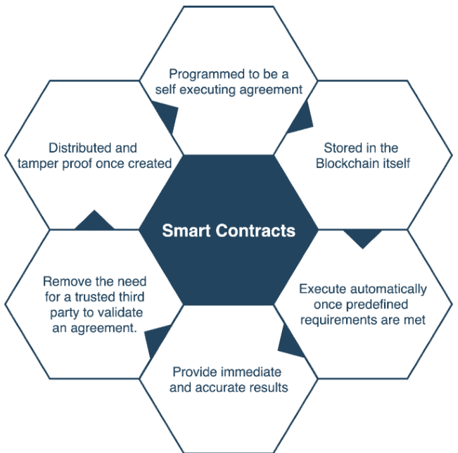

图（2）。智能合约。

这些问题可以通过使用基于区块链的智能合约来巧妙解决。本质上，智能合约是功能性协议，旨在满足合同的预定义条款后执行。此外，这还可以缓解维护多个集中式记录的问题。区块链允许构建一个防篡改、透明且易于验证的健康保险索赔结算系统，这将极大地防止任何纠纷。例如，一旦客户支付保费，智能合约将直接更新区块链。任何其他利益相关方都可以轻松验证此操作，而无需与保险机构通信以获取证明 [23]。Zou、Wang 和 Sun 提出了 MIStore，这是一个基于区块链的医疗保险存储系统。MIStore 使用实用拜占庭容错（Practical Byzantine Fault Tolerance）作为共识算法，其数据可以由医院工作人员、患者和保险公司高效验证 [24]。

健康保险欺诈是世界各地保险公司面临的一个重大问题。这可以通过伪造医疗治疗或夸大


医疗账单以获取赔偿。保险公司因这些欺诈和纠纷而损失数百万美元。基于区块链的智能合约的透明度、可审计性和不可篡改性将使这些欺诈几乎不可能。

## 发票处理

医疗治疗通常需要患者与医院、药店或任何其他相关利益方之间进行许多交易。维护所有交易的账单详情不仅对患者来说很麻烦，而且也不环保。这些交易记录在纸上，并存档在文件中。生成这些账单需要花费相当多的时间，因为涉及多层验证。因此，这些账单通常需要通过邮寄方式送达，增加了成本。生成医疗账单在很大程度上依赖人力，自然增加了其中出错的风险。医疗记录非常敏感且至关重要。错误的交易或记录对患者来说可能非常麻烦。即使整张发票中的某一页丢失，也可能导致宝贵信息的丢失。

## 电子发票与区块链

在发票处理中实施区块链技术可以帮助缓解传统账单中之前提到的所有问题。尽管电子发票已经存在相当长一段时间，但使用区块链来赋能该过程相对较新。由于区块链最初用于记录加密货币交易，因此将该技术用于发票处理是一个类似的用例。去中心化消除了单点故障的风险，这种故障可能会擦除关键信息。除了不可篡改和透明之外，区块链还确保了流程的完全数字化，使其更便宜、更高效且更环保。这直接为患者和利益相关方节省了时间和资源。电子发票中的区块链已经过尝试和测试。2019年3月，中国深圳地铁系统开始使用区块链签发的城市轨道交通发票，每天处理超过170,000张发票 [25]。

## 大规模实施

中国在执行分布式账本技术以协助医疗账单方面非常成功。2019年，支付宝和蚂蚁金服帮助开发了基于区块链的浙江省医疗账单平台。浙江省财政厅宣布，该平台处理了417亿元人民币的医疗账单。这不仅防止了漫长的账单排队，还加快了保险索赔。此外，患者的平均就诊次数从6次减少到2次。这为医院节省了行政时间和资源 [26]。

2020年6月，福建省福州市第二医院成功推出了基于区块链的医疗账单平台。该平台旨在解决纸张浪费严重和假发票泛滥等问题。用户可以直接在手机上使用微信检索发票，或前往自助服务终端 [27]。

## 供应链管理

随着全球制造流程的大幅增加，我们对供应商与供应链之间透明度的需求日益增长。区块链中的分布式账本系统提供端到端的去中心化流程，使其系统透明。区块链提供货物和服务的实时追踪，这对拥有多个供应链的跨国公司（MNCs）尤其有意义。

让我们回顾一下为什么区块链技术适用于其之前的用例：透明度、可追溯性和安全性，这正是供应链管理成为另一个重要应用的原因。供应链的全球化使得管理跟踪变得困难。当你购买一件小小的衬衫时，你无法知晓衬衫中使用的每种材料的来源，这降低了销售产品的大品牌的问责度，助长了产品供应链中劳动力和自然资源的剥削。这一切对一家制药公司意味着什么？想象一下，每笔交易都有可追溯且安全的历史记录，因此当最终方收到产品时，他们可以确信每种材料的来源和价格，无需任何中介，而这正是区块链所提供的。

各地服务于多个跨国公司的各种地理分布中介使得现代供应链本质上复杂。目前，公司依赖单一部门来维护其供应链，在出现问题时这提供了一个单一故障点 [28]。现代供应链是集中化的，并依赖各方之间的信任来存储敏感信息 [29]。这些问题表明，当前的供应链管理框架正在落后，无法满足时代的需求。我们将把区块链视为一种供应链管理框架，将可持续性作为额外维度，并探讨其实际实施中的问题。

### 基于区块链的供应链管理

与区块链的其他应用不同，供应链管理可能需要一个封闭且私有的网络 [30]。主要，基于区块链的供应链管理涉及以下参与者：注册机构、标准组织、认证机构和行为体。

如果行为体想要向另一个行为体销售产品，他们需要通过签署数字合同或智能合同来验证交易，然后交易细节将更新到账本上。从那时起，其他细节将自动更新 [31]。账本还可以存储和更新产品的重要信息，例如质量、所有权等，维护一个无需信任的去中心化供应链。

### 可持续性

如前所述，追踪每种产品的制造过程是一项复杂的任务，但确保在整个过程中产品不会在任何环节引发环境、健康或安全问题至关重要 [32]。

由于基于区块链的供应链是不可篡改的，未经授权的任何人都无法修改任何信息，然后在区块链上注册，从而防止任何腐败实体提供可疑的产品或服务，有助于社会供应链的可持续性。它还可以通过追踪受损或危险产品并在发现问题后尽快召回它们，帮助环境供应链的可持续性。

### 实施中的局限性

供应链管理更多地关乎供应商与客户之间关系的管理，以创造利益相关方的价值，而不仅仅是关于产品 [33]。区块链实现了信息的透明度，这可能对某些认为其信息能带来竞争优势的各方来说是不可接受的。区块链技术并不完全简单或与现有技术框架兼容。实施基于区块链的供应链需要对整个现有框架进行彻底改造，这对大多数制药公司来说可能是一笔非常昂贵的交易。在当前的概念验证实现中，事务日志不受保护。还需要进一步工作来确保敏感信息的安全，而多家公司非常希望保护这些信息 [34]。因此，在考虑改变供应链管理的格局之前，需要大量讨论和研究。

## 挑战

区块链技术有一些固有的技术问题和瓶颈。在本节中，我们将详细讨论其中两个问题，以及为什么在医疗保健中实施这项技术之前需要考虑它们。

### 安全性

在前面的部分中，我们讨论过，医疗信息不仅至关重要，而且非常机密。保障此类信息的隐私和完整性至关重要。这促使世界各地的黑客越来越多地参与黑客攻击医疗数据这一有利可图的业务。在美国，仅在6个月内（2019年1月至2019年6月）就有超过3200万条医疗记录被泄露。这个数字是2018年全年泄露总数的两倍 [35]。这种惊人的增长是医院广泛采用电子方式存储医疗记录的直接结果。但是如前所述，医院使用的电子框架通常无法有效保护医疗信息免受黑客攻击。它们主要是为了使医疗人员和患者的流程变得简单高效而开发的。此外，在过程中数据有多个暴露点。这可能发生在将信息从一个医疗利益方转移到另一个利益方时，例如将处方转移到药店。黑客可以利用这些漏洞来访问这些记录并在黑市上出售 [36]。

因此，安全性是将区块链纳入医疗设施的一个非常有说服力的理由。区块链技术确实比传统框架更加强大，因为它使用密码学哈希、共识算法和不可篡改性来确保安全性。但是像任何其他颠覆性技术一样，区块链也存在一些固有的安全缺陷。这些安全问题大多是区块链特有的，因为它们利用了其某些关键方面。以下是可能在基于区块链的医疗框架中引起担忧的两种安全威胁。

### 51%攻击

也称为多数攻击或双重花费攻击，这种攻击利用了区块链共识机制的51%漏洞。如果矿工，


或矿池，控制了整个网络超过50%的算力，他们基本上可以控制整个区块链。这将允许他们修改交易数据并撤销交易，从而导致双重花费。此外，这还会破坏网络中其他矿工的正常运作。2018年，加密货币Bitcoin Gold遭受了持续数天的51%攻击，攻击者双重花费了至少1800万美元 [37]。2014年1月，当时最大的比特币矿池GHash.io控制了网络42%的算力，危险地接近50%的水平。它不得不自愿减少其计算参与度，矿池运营商发布声明称该矿池不会对比特币发起51%攻击。在医疗设施区块链框架中，初期参与者较少，配合共识协议，发起51%攻击相对容易 [38]。

## 犯罪智能合约

我们已讨论智能合约可用于多种方式，以自动化原本耗费资源和时间的工作。智能合约可用于验证账单以及验证保险索赔。此外，新的图灵完备编程语言正在应运而生，其唯一目的是开发智能合约。Solidity 是一种面向对象的编程语言，用于为包括以太坊在内的许多区块链网络开发智能合约。然而，智能合约也涉及一些关键风险。那些能够从事非法活动的智能合约被称为犯罪智能合约（CSC）。CSC 可被编程用于私钥窃取和泄露其他私有数据。CSC 的一个例子可以是在交付某些私人信息后给予奖励的合约。在医疗设施场景中，CSC 可被用于欺诈性保险索赔或泄露私人医疗信息。从技术角度看，所有使用智能合约的单元都存在实施 CSC 的可能性 [38, 39]。

## 可扩展性

在区块链的实际实现中，可扩展性是最大的担忧之一。即使在比特币的情况下，交易速度也取决于网络拥塞情况。如果网络中的节点数量较多，系统将大大减慢。从图像繁多且丰富的健康记录到复杂的药品供应链，我们很容易预期会有大量节点存储海量数据，这使得可扩展性成为大多数从业者的关键关注点。可扩展性是指应用程序、程序、网络等在为越来越多的用户提供服务时，能够提高或至少保持其效率的能力。迄今为止，在医疗保健行业的大多数区块链概念验证实现中，效率并未受到太多重视，因此未得到妥善处理，仍然是讨论和研究的关键领域。即使在比特币中，作为区块链最流行的应用，其效率也远低于传统的集中式对应物。比特币每秒最多处理7笔交易 [40]，而VISA每秒处理65,000笔交易。

## 为什么区块链如此缓慢？

由于区块链技术依赖于点对点网络和共识算法，其交易处理时间远比集中式网络慢。有效交易必须满足工作量证明，这是一个极其耗时的过程。因此，当多个交易请求在网络上堆积时，系统会大大减慢。网络的安全性取决于共识和工作量证明机制的效率，这与链中区块大小成正比。然而，追加区块并因此处理请求所需的时间与区块大小成反比。因此，要构建安全系统，你就需要牺牲交易速度，反之亦然。当将区块大小与数据繁重的健康记录相结合时，这一问题变得更加严峻。在比特币中，区块大小上限为1MB，而以太坊为2MB。比特币每秒处理7笔交易，以太坊每秒处理15笔交易。医疗保健行业有巨大的数据需求，区块链需要找到绕道而行的方法，以提供既安全又快速的解决方案。

## 管理存储容量

区块链的设计初衷是面向不需要大量存储的系统，但医疗保健行业不在其范围内。健康记录、患者病史、详细审计追踪、大量图像扫描和测试结果意味着每个节点的存储容量需要庞大。链中数据繁重的节点还意味着查询和访问数据的成本将成比例增加。

## 案例研究

在本节中，我们将详细探讨一些已成功实施和提议的基于区块链的医疗保健框架。

### Gem 健康网络

Gem成立于2013年11月，是一家位于美国加利福尼亚州的公司，提供基于加密货币和分布式账本的企业级解决方案。作为一家成熟的初创公司，其A轮融资筹集了710万美元，种子轮融资已筹集490万美元。Gem构想于区块链技术的早期，自诞生起就一直在开拓区块链技术在金融解决方案中的应用。但2016年，它进入医疗领域并推出了Gem 健康网络。

开发医疗框架的主要动因是医疗数据“孤岛”急剧增加，这些“孤岛”本质上是由医疗机构、专业人员和其他利益相关者维护的私有数据库。将一个“孤岛”中的数据检索出来并传输到另一个，是一项资源密集且容易出错的任务。例如，考虑一名正在当地医生处接受治疗的患者。如果患者需要前往其他地方，为了继续治疗，他们要么需要携带完整的病历、诊断和治疗计划副本，要么需要建立一种从当地医生处快速检索这些数据的方式。这种互操作性问题可能危及生命，因为缺乏数据存储或传输协议。此外，这还涉及信息安全困境，即数据访问与数据保护之间的权衡，这意味着提高数据安全性会牺牲数据可用性，反之亦然。Gem 医疗保健利用区块链解决这一问题，通过融合身份方案和去中心化数据存储。它允许构建透明共享的基础设施，每个医疗利益相关者都能访问相同的信息并可靠地相互信任。

宝石健康网络采用以太坊区块链开发，为该计划提供了高度功能化的工具，用于构建稳定、持续演进且多元化的平台。Gem 的首席执行官 Micah Winkelspecht 旨在创建一个基于区块链的全球数据库，以维护医疗数据的完整性。在 Gem Health 的构想阶段，该公司主要被那些对现有技术不满、希望不同医疗利益相关者能够协作的活跃医生所接触。此外，各种医疗公司也联系了 Gem Health，包括飞利浦区块链实验室（Philips Blockchain Labs），即飞利浦医疗的研发部门。来自知名医疗运营商的支持和合作确保了区块链在以患者为中心的医疗保健中的应用研究将十分广泛 [41]。

2016年10月，Gem 宣布开发 GemOS，这是一个允许不同区块链连接和交互的平台。使用 GemOS 基础设施，公司可以在以太坊、Hyperledger 或任何其他提供商上开发自己的区块链，并可连接到 GemOS 网络，以实现不同网络之间信息的自动化和共享。GemOS 有望成为不同医疗机构和部门使用区块链技术实现无缝、安全交互的核心平台 [42]。

### MedRec

麻省理工学院媒体实验室的 Azaria、Ekblaw、Viera 和 Lippman 提出了 MedRec，这是一种基于区块链的电子病历管理系统。MedRec 研发的动因是，不同医疗服务提供者和维护私有记录的利益相关者之间缺乏互操作性的标准协议。类比而言，金融系统也有不同的利益相关者和存储机构，如银行、信用卡和借记卡、贷款等。但这些系统在很大程度上是互操作的，因为它们共享一种货币的共同基础设施。不同利益相关者的医疗记录在很大程度上不兼容，无法实现医疗信息的顺畅交换。

#### 技术细节

2016年8月，MedRec 在美国波士顿的贝斯以色列女执事医疗中心开始运行。这是 MedRec 的首次实现，也称为 MedRec 1.0。目前，MedRec 2.0 正在开发中，其开发方式与之前有显著差异。MedRec 1.0 使用小型私有区块链，并采用比特币区块链也使用的工作量证明（PoW）共识机制。MedRec 以创新方式使用 PoW 来激励其矿工，共有两种方式。第一种方式是用以太坊货币以太币（Ethers）奖励他们，第二种方式是向他们提供用户的匿名医疗数据。医疗数据用于开展医疗研究，因此研究人员将有动力进行挖矿。MedRec 在技术上并不将医疗数据存储在区块链上。相反，它包含检索数据所需的元数据，如身份验证和位置。为此，它采用三种类型的智能合约。

- 注册商合约（RC）：MedRec 面向许多医疗利益相关者，如患者、医生、实验室技术人员和保险公司。他们需要单独访问患者的医疗记录。因此，他们


给定以太坊地址身份，这些身份等同于公钥。RC 将利益相关者的单个 ID 映射到其各自的以太坊地址身份。

- b. 患者-提供者关系合约 (PPRC)：这是一种成对数据管理的实现。在 MedRec 中，这是指当患者查询某些数据且提供者从其数据库返回所需数据时的交互。此交互由预定义协议管理。查询以 SQL 查询形式存在，允许用户拥有高级别的过滤和效率。

- c. 摘要合约 (SC)：这本质上是一个包含用户所做所有交互的数据库。对于患者，这可能是指其所有医疗提供者的引用，而对于提供者，这可能是指他们遇到过的所有患者的引用。因此，这使利益相关者能够拥有其所有先前和正在进行的交互的完整记录。此外，如果网络中任何参与者退出网络并稍后重新加入，这还可作为备份。SC 还在每次发生新交互时为所有参与者启用通知。每个参与者都可以批准他们想与谁共享信息。

## MedRec 2.0

为提高安全性和可扩展性，MedRec 2.0 的开发采用了 Solidity 和 Go Ethereum，而非 MedRec 1.0 开发中使用的 Pyethereum 和 Serpent 库。此外，MedRec 的第二版本不将 PoW 用作其共识算法。相反，它使用权威证明 (PoA)，这节省了挖矿所需的过量计算。这种机制利用医疗提供者本身来提供共识。这是因为医疗提供者已经是可信方，因此让他们安全高效地维护区块链是合理的 [14, 43]。

## Guardtime

爱沙尼亚政府一直是区块链技术的全球领导者。它在中本聪关于分布式账本的论文发表仅三年后，与一家名为“Guardtime”的初创公司建立了合作伙伴关系。2011 年，爱沙尼亚决定使用区块链保护其公共记录，随后在 2016 年，他们又宣布计划与 Guardtime 建立 GovTech 合作伙伴关系，利用区块链保护超过 100 万条健康记录。

这项业务的成功将成为决定区块链是否能在提升健康记录安全性的同时，使其轻松向数百万医疗专业人员广泛提供的关键因素。该项目已获得爱沙尼亚 2007 年《健康信息系统法》和 2008 年《政府健康信息交换监管法》的支持 [15]。此类健康记录的标准化仍然是政府关注的重点，因为其国家区块链加密数据将需要全球接受，并就数字存储医疗信息的协议进行更多讨论。尽管将整个医疗基础设施转变为基于区块链的基础设施需要更多研究、讨论和资本投资，但爱沙尼亚政府采取的这一创新举措是确凿证明，表明这当然是可能的。

## 新业务

我们已经开始看到回报，因为 Guardtime 还与 10 家制药公司合作，与真实患者开展基于区块链的合同工作 [44]。该项目还推动了 MyPCR 平台 [45] 的开发，该平台由 Guardtime、Instant Access Medical 和 Healthcare Gateway 共同推出。用药依从性差是该行业的一个普遍问题，影响从保险公司到患者的每个人。MyPCR 应运而生，它通过电子方式监控所有患者，并确保他们遵循各自特定且专业的个人护理路径 (PCP)。MyPCR 将面向 3000 万英国 NHS 患者，预计在美国可节省 2900 亿美元，在英国可节省 800 万英镑。该应用程序将通过 Healthcare Gateway 拥有的医疗互操作网关，为用户提供即时访问其医疗信息、PCP 和在线支持的功能。

## Medicalchain

Medicalchain 成立于 2016 年，由该公司现任首席执行官 Abdullah Albeyatti 博士构思。Medicalchain 的初始开发是关于出院摘要，即对患者与医院之间所有交互的详细描述。Medicalchain 的动机在于，这些摘要必须由医生以极大的细致程度编写。这一过程容易出错，且 Johns Hopkins 估计医疗差错是美国仅次于心脏病和癌症的第三大死因 [46]。Medicalchain 最终在医疗领域拓宽了视野，成为一个基于区块链的综合医疗生态系统，具有多种应用。为了适应不同的使用场景，它采用双链架构构建。对于医疗记录管理，使用 Hyperledger Fabric；其他服务使用以太坊区块链的 ERC-20 代币进行智能合约和代币应用。Medicalchain 有自己的代币，名为 MedToken，参与者可以使用它在系统中进行支付。

## Medicalchain 解决方案

### 4.4.1.1. 安全分散式记录

如前所述，任何医疗框架的主要关切是相互不兼容的孤岛式医疗记录普遍存在。Medicalchain 使用的 Hyperledger 区块链是一个封闭的基于许可的网络。它使用带有 2048 位 RSA 密钥的对称密钥加密。它管理身份和授权级别。例如，患者将被允许创建、更新和读取其医疗记录。但医学研究者只能被允许读取授权记录的访问权限。此外，患者可以授予医生访问其有限或所有医疗记录的权限。在紧急情况下，如果患者无法操作 Medicalchain 平台，则有规定允许患者佩戴紧急手环，在遵循适当协议后可以扫描该手环。这将解锁患者预先确定的部分医疗记录。

### 远程医疗

全球范围内，医疗数字化正在兴起。2019 年，远程医疗市场价值为 614 亿美元，预计到 2027 年将增长至 5595.2 亿美元 [47]。但即使在远程医疗治疗中，孤岛式数据的问题依然存在。由于该领域缺乏标准化，许多远程医疗框架未整合财务系统，导致流程低效。Medicalchain 支持远程咨询，在患者同意的情况下安全地实时共享医疗记录。此外，患者可以直接使用 MedToken 付款。这比传统的预约、前往医疗机构并进行交易的流程更高效。

### 研究与保险索赔

由于该流程完全以患者为中心，研究人员不再需要为了相关医疗数据而联系医院和诊所。他们可以直接与患者互动，例如，患者可以同意为某项研究透露医疗数据。这也可以进行匿名处理，患者可以选择希望透露的医疗数据量。

患者还可以允许其保险机构访问其医疗记录以验证索赔。还可以有一个整合的保险系统，使用 MedToken 进行交易 [48]。

## OmniPHR

如前所述，互操作性是 EHR 和 PHR 维护中的一个主要问题。这些记录由特定组织创建和维护，仅供其独占使用且访问受限。一些组织甚至会无限期保留过时的记录，并且因为不愿意与其他从业者共享这些数据而不更新其记录。OmniPHR 用于提高效率的数据划分方式之一，是对健康记录（如影像数据、实验室结果等）进行逻辑划分，并为个人数据配备安全功能。这种逻辑划分的基本单元将被称为“数据块”。

### 概述

在前几节中，当我们讨论 EHR 和 PHR 时，旨在实现对分散在不同组织和“可穿戴设备”中的所有健康记录的统一视图，并以可扩展且高效的方式实现这一点。这是创建 OmniPHR 的动机。OmniPHR 中的数据块分布在由节点组成的网络中，每个节点都属于一个子网络。连接到此网络的每个设备既可以作为“提供者”提供医疗数据，也可以作为“消费者”获取现有数据的统一视图。

### 4.5.1.1. 超级节点

在 P2P 网络中，超级节点或超对等节点将充当客户端的服务器，并充当其他超级节点的对等节点 [49]。OmniPHR 提出了一种模型，在这种模型中，此类超级节点将在路由覆盖层中发挥多种功能，例如维护系统用户注册表、创建和更新数据块、维护审计和访问踪迹等。此类节点应具有水平可扩展性和弹性，以使网络更加高效。

### 设计

如图所示，所有信息都从可信来源（如 EHR、EMR 和健康可穿戴设备）收集，然后将其传递给


用户界面到中间件，然后到如图 (3) [50] 所示的存储库。

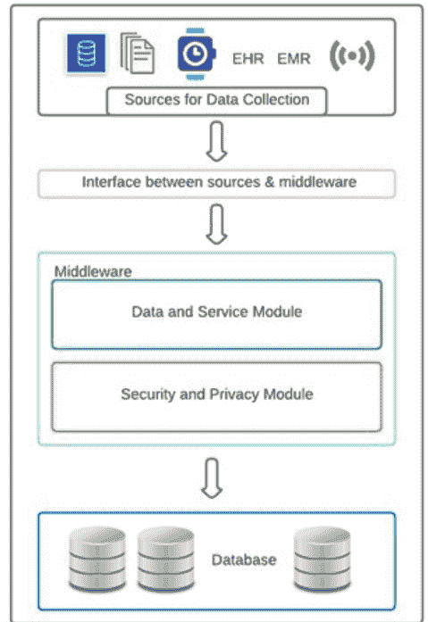

图 (3). OmniPHR 架构。

## 数据块和服务模块

这包括 5 个子模块：

- **翻译器**: 如果源数据块遵循与 omniPHR 不同的标准，此模块将数据块翻译成等效的 omniPHR 标准，以确保互操作性。
- **分发器**: 本质上负责获取和复制所需的数据块。
- **节点管理器**: 每个节点都必须经过此组件才能加入网络。
- **验证器**: 确保节点的数据完整性和一致性。
- **消息路由器**: 对来自和发往节点的消息进行打包和路由。

## 安全和隐私模块

此模块还包含多个协同工作的子模块，以维护每个数据块的隐私和安全性。它会加密数据块及其所有引用，根据访问配置文件允许或拒绝访问请求，并注册和维护访问配置文件。

## MediBchain

该框架旨在缓解最近针对敏感医疗数据的猖獗网络攻击。在当前的数据保存模型中，数据对系统负责，即数据首先需要对系统可访问，然后系统将其加密并存储在区块链上。这里的系统充当网关，我们必须通过该网关来存储、访问或共享数据。MediBchain 提出（见图 4）将加密数据直接存储在系统中，消除其作为网关的角色，从而使用户自己对其数据负责 [51]。

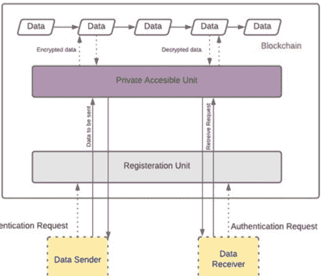

图 (4). MediBChain 架构。

MediBchain 向其用户承诺匿名性、数据完整性和安全性。无论是数据发送方还是数据接收方都可以与系统交互。其系统仅由存储数据的区块链组成，外部渠道包含以下关键组件：

**注册单元:** 用于对每个用户进行身份验证，并将其映射到唯一 ID。

**私有可访问单元:** 仅在经过适当身份验证后才可访问，可以向主系统请求服务。

### 向系统发送数据的协议

MediBchain 协议的流程图如图 (5) 所示。

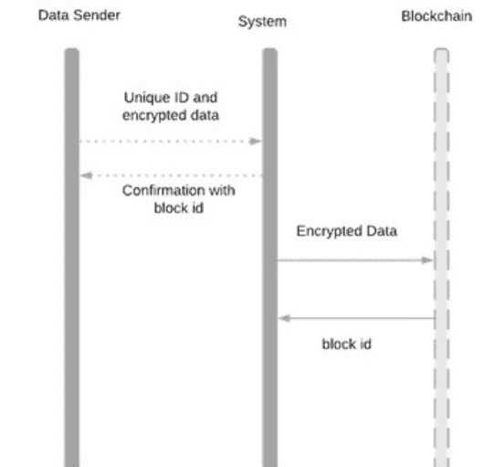

图 (5). MediBchain 协议的流程图。

- **步骤 I.** 数据发送方提供其唯一标识符并经过身份验证以进入系统。
- **步骤 II.** 数据发送方将加密数据发送到区块链。每个经过身份验证的用户都有自己的密钥，可通过加密函数用于加密和解密数据。在此步骤中，用户直接与区块链通信，并通过智能合约进行管理。
- **步骤 III.** 当数据成功存储在区块链上时，将向发送方返回一个唯一 ID，该 ID 可与用户 ID 配合使用以再次访问此信息。

## 进一步讨论

自加密货币和金融领域诞生以来，区块链技术已经取得了长足进步。但作为一种颠覆性技术，在医疗保健领域关于其标准化、监管和广泛采用仍存在担忧。医疗保健及其他公共或私营部门企业的几乎所有传统系统都完全由中央机构支持。因此，在这些领域引入去中心化框架通常不太方便。为了缓解这种过渡，并融合中央机构带来的可靠性，这些领域可以使用许可区块链。这种部分去中心化可以通过使用私有区块链来实现，由一个组织运行其网络。在医疗保健领域，更合适的类型是联盟区块链，由多个组织运行网络。这种半私有系统将允许不同的医疗利益相关方安全地实时交换信息 [52, 53]。

对于大多依赖共识算法的公有区块链，需要为医疗保健特定实现开发合适的共识算法。这是因为基于区块链的医疗保健框架的参与节点数量相对较少，远少于比特币或其他加密货币。因此，使用工作量证明之类的共识算法对网络来说可能计算强度过大。我们看到 Medicalchain 通过激励医疗专业人员和研究人员充当网络中的矿工，并奖励其进行研究所需的宝贵医疗信息，从而解决了这个问题 [54 - 57]。

IoT 与区块链的融合也被证明具有革命性。在医疗创新方面，医疗物联网也基于之前关于 IoT 和区块链的具体研究而蓬勃发展 [58, 59]。

通过系统的研发，区块链有潜力通过使医疗保健领域以患者为中心且同时稳健来转变该领域。以其在医疗保健领域当前的参与和接受率，区块链预计在未来几年将找到更多用例和实现 [60 - 63]。

## 摘要

本章首先对区块链技术进行了详细介绍，深入探讨其技术细节，随后讨论了其在医疗保健以外领域的广泛适用性。由于医疗保健中技术的主要应用之一是医疗记录收集，我们还讨论了存储医疗信息的当前方法及其局限性。

在下一节中，我们转到了医疗保健领域内区块链技术将证明有用的各个领域，例如健康记录管理和医疗物联网（IoMT，物联网的一个子集）。本节提出了几个研究感兴趣且对制药公司具有巨大货币价值的领域，例如临床试验管理中的区块链、健康保险、开票和供应链管理。

迄今为止，我们一直将区块链视为医疗保健行业内的积极变革力量，这引发了这样一个问题：为什么它尚未在全球实施。因此，在下一节中，我们讨论了区块链的局限性，主要在于安全性和可扩展性方面。在倒数第二节中，我们研究了医疗保健行业内几项区块链技术的成功实现。在这里，我们讨论了从项目背后的动机到其设计和漏洞的一切。

我们希望读者带着求知欲离开本章并查找更多信息，这就是为什么在下一节中我们讨论了对医疗保健感兴趣的即将开展的研究领域、从过时技术过渡到区块链的标准化，以及医疗保健中的区块链与传统私营企业中的区块链有何不同。最后，我们可以安全地得出结论：区块链是医疗保健领域真正的颠覆性技术，仍需要更广泛的接受和更多研究来转变该行业。

## 出版同意

不适用。

## 利益冲突

作者声明不存在任何利益冲突，无论是财务上的还是其他方面的。

## 致谢

无。

## 参考文献

[1] M. Nofer, P. Gomber, O. Hinz, 和 D. Schiereck, "区块链", Bus. Inf. Syst. Eng., 第 59 卷, 第 3 期, 第 183-187 页, 2017. [http://dx.doi.org/10.1007/s12599-017-0467-3]

[2] "Statista. 2021. 比特币市值 2013-2021", Statista, 2021. [在线] 可在以下网址查阅: https://www.statista.com/statistics/377382/bitcoin-market-capitalization/#:~:text=The%20market%20capitalization%20of%20Bitcoin,circulation%20by%20the%20th%20Bitcoin%20price

[3] Investopedia. 加密货币中的区块时间是什么？, [在线] 可在以下网址查阅: https://www.investopedia.com/terms/b/block-time-cryptocurrency.asp#:~:text=Block%20time%20%2C%20in%20%20the%20context,its%20own%20defined%20block%20time

[4] Z. Zheng, S. Xie, H. Dai, X. Chen, 和 H. Wang, "区块链的挑战与机遇：一项调查", Int. J. Web Grid Serv., 第 14 卷, 第 4 期, 第 352 页, 2018. [http://dx.doi.org/10.1504/IJWGS.2018.095647]

[5] BBC News. 2021. 马拉维选举：法院下令重新投票，因 2019 年 5 月的结果被宣布无效, [在线] 可在以下网址查阅: https://www.bbc.com/news/world-africa-51324241

[6] SmartCompany, "南澳政府在渔业委员会选举中使用初创公司 Horizon State 的民主区块链 - SmartCompany", [在线] 可在以下网址查阅: https://www.smartcompany.com.au/startupsmart/news/horizon-states-democratic-blockchain-fisheries-council-election/

[7] P. Dunphy, 和 F. Petitcolas, "区块链上的身份管理方案初探", IEEE Secur. Priv., 第 16 卷, 第 4 期, 第 20-29 页, 2018. [http://dx.doi.org/10.1109/MSP.2018.3111247]

[8] GovTech, "伊利诺伊州宣布出生登记区块链试点的关键合作伙伴关系", [在线] 可在以下网址查阅: https://www.govtech.com/data/illinois-announces-key-partnership-in-birth-registry-blockchain-pilot.html

[9] V. Thakur, M. Doja, Y. Dwivedi, T. Ahmad, 和 G. Khadanga, "基于区块链的印度土地记录，用于实施土地产权登记", Int. J. Inf. Manage., 第 52 卷, 2020.101940 [http://dx.doi.org/10.1016/j.ijinfomgt.2019.04.013]

[10] P. Blog, "佛蒙特州南伯灵顿将使用 Propy 的技术", [在线] 可在以下网址查阅: https://propy.com/blog/south-burlington-in-vermont-to-use-propy's-technology/

[11] A. Mazlan, S. Mohd Daud, S. Mohd Sam, H. Abas, S. Abdul Rasid, 和 M. Yusof, "医疗保健区块链系统的可扩展性挑战——系统综述", IEEE Access, 第 8 卷, 第 23663-23673 页, 2020. [http://dx.doi.org/10.1109/ACCESS.2020.2969230]

[12] PreScouter, "医疗保健和生命科学中的区块链 - PreScouter", [在线] 可在以下网址查阅: https://www.prescouter.com/press/blockchain-in-healthcare-life-sciences/

[13] S. Angraal, H.M. Krumholz, 和 W.L. Schulz, "区块链技术", Circ. Cardiovasc. Qual. Outcomes, 第 10 卷, 第 9 期, 2017.e003800 [http://dx.doi.org/10.1161/CIRCOUTCOMES.117.003800] [PMID: 28912202]

[14] A. Azaria, A. Ekblaw, T. Vieira, 和 A. Lippman, "MedRec：使用区块链进行医疗数据访问和权限管理", 第 2 届开放与大数据国际会议 (OBD), 2016.

[15] T.F. Heston, 区块链医疗保健创新案例研究 (2017 年 11 月 24 日). 作者工作论文 No AUTHOREA_213011_3643634, 可在 SSRN 上查阅: https://ssrn.com/abstract=3077455

[16] M. Banerjee, J. Lee, 和 K. Choo, "面向物联网安全的区块链未来：一份立场文件", Digital Communications and Networks, 第 4 卷, 第 3 期, 第 149-160 页, 2018. [http://dx.doi.org/10.1016/j.dcan.2017.10.006]


- [17] “医疗物联网正在彻底改变医疗保健”, 高级生物医学工程联盟, [在线]. 可用: https://aabme.asme.org/posts/internet-of-medical-things-revolutionizing-healthcare [访问日期: 2020年12月20日]

- [18] M. Seliem, 和 K. Elgazzar, “BioMT: 医疗物联网的区块链”, 2019 IEEE国际黑海通信与网络会议 (BlackSeaCom), 2019 [http://dx.doi.org/10.1109/BlackSeaCom.2019.8812784]

- [19] N. Dilawar, M. Rizwan, F. Ahmad, 和 S. Akram, “区块链: 保障医疗物联网 (IoMT) 的安全”, Int. J. Adv. Comput. Sci. Appl., 第10卷, 第1期, 2019. [http://dx.doi.org/10.14569/IJACSA.2019.0100110]

- [20] C. Yan Zhuang, 应用区块链技术提升临床试验招募, 2021. https://www.ncbi.nlm.nih.gov/pmc/articles/PMC7153067/ [访问日期: 2020年12月20日]

- [21] D.R. Wong, S. Bhattacharya, 和 A.J. Butte, “在不可信环境中使用区块链运行临床试验的原型”, Nat. Commun., 第10卷, 第1期, 第917页, 2019. [http://dx.doi.org/10.1038/s41467-019-08874-y] [PMID: 30796226]

- [22] “健康保险市场规模、份额 | 行业趋势与分析 2026”, Allied Market Research, 2021. [在线]. 可用: https://www.alliedmarketresearch.com/health-insurance-market [访问日期: 2020年12月20日]

- [23] 账本洞察 - 企业区块链, “HIMSS: 区块链如何改变健康保险 - 账本洞察 - 企业区块链”, [在线] 可用于: https://www.ledgerinsights.com/himss-blockchain-healthcare/

- [24] L. Zhou, L. Wang, 和 Y. Sun, “MIStore: 基于区块链的医疗保险存储系统”, J. Med. Syst., 第42卷, 第8期, 第149页, 2018. [http://dx.doi.org/10.1007/s10916-018-0996-4] [PMID: 29968202]

- [25] “中国创造历史 – 区块链电子发票正在自动化支付流程中的信任 | Corcentric”, Corcentric, 2021. [在线]. 可用: https://netsend.com/blog/china-blockchain-e-invoicing-automating-trust-payment-process/ [访问日期: 2020年12月20日]

- [26] “中国浙江省使用蚂蚁区块链和支付宝处理了50亿美元的医疗账单 - 账本洞察 - 企业区块链”, 账本洞察 - 企业区块链, 2021. [在线]. 可用: https://www.ledgerinsights.com/chinas-zhejiang-processed-5-billion-medical-bills-using-ant-blockchain-alipay/ [访问日期: 2020年5月20日]

- [27] “面向处方和医疗账单推出的中国区块链医疗应用 - 账本洞察 - 企业区块链”, 账本洞察 - 企业区块链, 2021. [在线]. 可用: https://www.ledgerinsights.com/chinese-blockchain-healthcare-apps-prescriptions-medical-billing/ [访问日期: 2020年5月20日]

- [28] F. Dong, P. Zhou, Z. Liu, D. Shen, Z. Xu, 和 J. Luo, “面向企业导向云存储系统的快速安全设计”, Concurr. Comput., 第29卷, 第19期, 2017.e4177 [http://dx.doi.org/10.1002/cpe.4177]

- [29] S. Abeyratne, “使用分布式账本的区块链就绪制造供应链”, Int. J. Res. Eng. Technol., 第05卷, 第09期, 第1-10页, 2016. [http://dx.doi.org/10.15623/ijret.2016.0509001]

- [30] S. Saberi, M. Kouhizadeh, J. Sarkis, 和 L. Shen, “区块链技术及其与可持续供应链管理的关系”, Int. J. Prod. Res., 第57卷, 第7期, 第2117-2135页, 2018. [http://dx.doi.org/10.1080/00207543.2018.1533261]

- [31] “比特币、区块链和金融科技：供应链中的系统综述与案例研究”, Taylor & Francis, 2021. 可用: https://www.tandfonline.com/eprint/ZS2AEKBEIAKKGHUNREMV/full?target=10.1080/09537287.2019.1631460

- [32] R. Adams, B. Kewell, 和 G. Parry, “区块链，为了美好？数字账本技术与“可持续发展目标”, 在: 《可持续发展与社会科学研究手册》. 世界可持续发展系列., W. Leal Filho, R. Marans, J. Callewaert, 编., Springer: Cham, 2018. [http://dx.doi.org/10.1007/978-3-319-67122-2_7]

- [33] D. Lambert, 和 M. Enz, “供应链管理中的问题: 进展与潜力”, Ind. Mark. Manage., 第62卷, 第1-16页, 2017. [http://dx.doi.org/10.1016/j.indmarman.2016.12.002]

- [34] “供应链与区块链。I: 优点和缺点 - Blocktac”, Blocktac, 2021. 可用: https://www.blocktac.com/en/newness/the-supply-chain-and-blockchain-i-pros-and-cons/ [访问日期: 2020年12月20日]

- [35] H. 期刊, “2019年上半年3160万条医疗记录泄露”, HIPAA Journal, 2021. 可用: https://www.hipaajournal.com/first-half-of-2019-sees-31-million-healthcare-records-breached/ [访问日期: 2020年12月20日]

- [36] “患者当心：黑客正在瞄准您的医疗信息”, Healthline, 2021. 可用: https://www.healthline.com/health-news/hackers-are-targeting-your-medical-information-010715#Medical-Data-More-Valuable-Than-Credit-Card-Data [访问日期: 2020年12月20日]

- [37] “什么是51%攻击?”, Investopedia, 2021. 可用: https://www.investopedia.com/terms/1/51-attack.asp#:~:text=A%2051%2520attack%20attack%20is%20an,other%20miners%20from%20completing%20blocks [访问日期: 2020年12月20日]

- [38] X. Li, P. Jiang, T. Chen, X. Luo, 和 Q. Wen, “区块链系统安全性综述”, Future Gener. Comput. Syst., 第107卷, 第841-853页, 2020. [http://dx.doi.org/10.1016/j.future.2017.08.020]

- [39] A. Juels, A. Kosba, 和 E. Shi, “居捷斯之环”, 2016年ACM SIGSAC计算机与通信安全会议论文集, 2016 [http://dx.doi.org/10.1145/2976749.2978362]

- [40] Comp.nus.edu.sg, [在线]. 可用: https://www.comp.nus.edu.sg/~prateeks/papers/Bitcoin-scaling.pdf

- [41] “医疗保健的区块链：Gem 与飞利浦区块链实验室推出 Gem Health 网络”, Bitcoin Magazine: 比特币新闻、文章、图表和指南, [在线]. 可用: https://bitcoinmagazine.com/business/the-blockchain-for-healthcare-gem-launch-s-gem-health-network-with-philips-blockchain-lab-1461674938 [访问日期: 2020年12月20日]

- [42] “GemOS: 使用区块链自动化医疗行业”, Bitcoin Magazine: 比特币新闻、文章、图表和指南, [在线]. 可用: https://bitcoinmagazine.com/business/gemos-automating-the-healthcare-industry-using-blockchain-1475614314 [访问日期: 2020年12月20日]

- [43] “MedRec”, media.mit.edu [在线]. 可用: https://medrec.media.mit.edu/ [访问日期: 2020年12月20日]

- [44] Guardtime.com, “EY、Sensyne Health 和 Guardtime 将使用 AI 和区块链连接医疗报销与实际患者结局 — Guardtime”, [在线] 可用于: https://guardtime.com/blog/ey-sensyne-health-and-guardtime-to-use-ai-and-blockchain-to-link-healthcare-reimbursement-and-actual-patient-outcomes [访问日期 2020年12月20日]

- [45] “Guardtime 及合作伙伴在英国为多达3000万 NHS 患者推出全球首个区块链支持的个人护理记录平台 — Guardtime”, Guardtime.com, https://guardtime.com/blog/world-s-first-blockchain-supported-personal-care-record-platform-launched-by-guardtime-and-partners [访问日期: 2020年12月20日]

- [46] A. Sharma, “医疗错误：死亡的第三大原因”, Expresshealthcare.in, 可用于: https://www.expresshealthcare.in/healthcare-it/medical-errors-the-third-leading-cause-of-deaths/420524/#:~:text=Globally%2C%20medical%20errors%20are%20one,after%20heart%20disease%20and%20cancer [访问日期 2020年12月20日]

- [47] “远程医疗市场规模、增长、份额 | 全球行业分析 [2027]”, Fortunebusinessinsights.com, [在线]. 可用: https://www.fortunebusinessinsights.com/industry-reports/telehealth-market-101065 [访问日期: 2020年12月20日]

- [48] 主页; Medicalchain, [在线]. 可用: https://medicalchain.com/en/ [访问日期: 2020年12月20日]

- [49] B. Beverly Yang, 和 H. Garcia-Molina, “设计超级对等网络”, [http://dx.doi.org/10.1109/ICDE.2003.1260781]

- [50] A. Roehrs, C.A. da Costa, 和 R. da Rosa Righi, “OmniPHR: 集成个人健康记录的分布式架构模型”, J. Biomed. Inform., 第71卷, 第70-81页, 2017. [http://dx.doi.org/10.1016/j.jbi.2017.05.012] [PMID: 28545835]

- [51] A. Al Omar, M. Rahman, A. Basu, 和 S. Kiyomoto, MediBchain: 用于医疗数据的基于区块链的隐私保护平台. 计算、通信和存储中的安全性、隐私性和匿名性, 2017, 第534-543页.

- [52] C.C. Agbo, Q.H. Mahmoud, 和 J.M. Eklund, “医疗保健中的区块链技术：系统综述”, Healthcare (Basel), 第7卷, 第2期, 第56页, 2019. [http://dx.doi.org/10.3390/healthcare7020056] [PMID: 30987333]

- [53] T. McGhin, K. Choo, C. Liu, 和 D. He, “医疗保健应用中的区块链：研究挑战与机遇”, J. Netw. Comput. Appl., 第135卷, 第62-75页, 2019. [http://dx.doi.org/10.1016/j.jnca.2019.02.027]

- [54] D.K. Sharma, S. Pant, M. Sharma, 和 S. Brahmachari, “第13章 - 区块链的加密货币机制：模型、特性、挑战与应用”, 在: 《区块链技术研究手册》, Krishnan Saravanan, E. Balas Valentina, E. Golden Julie, Y. Harold Robinson, S. Balaji, Kumar Raghvendra, 编., Academic Press, 2020, 第323-348页. [http://dx.doi.org/10.1016/B978-0-12-819816-2.00013-7]

- [55] D.K. Sharma, A.K. Kaushik, A. Goel, 和 S. Bhargava, “第11章 - 物联网与区块链：集成、需求、挑战、应用及未来前景”, 在: 《区块链技术研究手册》, Krishnan Saravanan, E. Balas Valentina, E. Golden Julie, Y. Harold Robinson, S. Balaji, Kumar Raghvendra, 编., Academic Press, 2020, 第271-294页. [http://dx.doi.org/10.1016/B978-0-12-819816-2.00011-3]

- [56] M. Sharma, S. Pant, D.K. Sharma, K.D. Gupta, V. Vashishth, 和 A. Chhabra, “使用深度学习、区块链和联盟为工业物联网启用安全性”, Trans. Emerg. Telecommun. Technol., 第32卷, 第7期, 2020.e4137 [http://dx.doi.org/10.1002/ett.4137]

- [57] A. Riyal, S.P. Parth, 和 S.K. Deepak, “物联网与区块链融合、要求、问题与实践”, 在: 《数据隐私管理的区块链技术》. CRC Press, 2021, 第23页.

- [58] B. Siddhant, S. Mayank, 和 S.K. Deepak, “IoT 技术中的区块链启用安全与隐私方案, 《物联网与区块链手册》”,

- [59] S.K. Deepak, P. Tushar, K. Yash, 和 S. Shivani, “区块链应用与实现”, 在: 《物联网与区块链手册》 CRC Press, 2020, 第95-118页.

- [60] A. Khera, D. Singh, 和 D. Sharma, “医疗保健中隐私与安全的应用设计”, 在: 《电子医疗记录的安全性与隐私》, S. Tanwar, S. Tyagi, N. Kumar, 编., 第1版. 工程与技术学会, 2019, 第116-153页.

- [61] A. Khera, D. Singh, 和 D. Sharma, “医疗记录中的信息安全与隐私：威胁分析、分类与解决方案”, 在: 《电子医疗记录的安全性与隐私》, S. Tanwar, S. Tyagi, N. Kumar, 编., 第1版. 工程与技术学会, 2019, 第246-270页.

- [62] S. Chugh, S. Kumaram, 和 D. Sharma, “医疗保健系统中大数据分析工具与技术的应用”, 在: 《医疗保健中的大数据应用》. Academic Press, 2021,


第 92-107 页。

[http://dx.doi.org/10.1016/B978-0-12-820203-6.00010-2]

[63] K. Singhal, 和 D. Sharma, "医学和医疗保健中的模糊系统：需求、挑战与应用", In: 医疗保健中的软计算应用和技术. CRC Press, 2020, 第 139-162 页。

## 基于物联网的患者健康监测系统应用

Rinky Dwivedi1*, Harshit Mittal1, Manik Agarwal1 and Sahil Dwivedi1

1 计算机科学与工程系，马哈拉贾·苏拉杰马尔技术学院，C-4 Janakpuri, New Delhi 100058, India

Abstract: 物联网（IoT）是使使用各种设备收集数据的过程成为可能的基础设施，这些设备相互通信并将这些数据存储在云上。这有助于以极高的效率更快地检索、分析和向世界任何部分传输数据。物联网确实为不同领域和行业打开了无限新的可能性之门。从智能家居电器到远程观察和控制不同对象，再到自动驾驶汽车等等。医疗保健行业仍未充分利用这场现代物联网革命的真正潜力。具体来说，在监测老年人健康方面，当今使用的技术仍然不够稳健，缺乏说服力。这长期以来一直是一个令人担忧的领域，而远程监测健康状况则是一个更大的挑战。本文的目标是描绘基于物联网的健康监测项目技术的现状，并提出对当前远程老年人健康监测实际惯例的改进。我们还将尝试提前预测本文中展示的各种健康参数的趋势，以便在发现任何令人担忧的情况时能精确地让相关人员知晓，从而采取即时行动，确保减少伤亡。

Keywords: Arduino, 物联网（IoT）, 远程监测, 预测, 移动平均, 健康助手.

## 引言

“物联网”一词被认为是在本世纪初提出的，当时正在进行 MIT Auto-ID Center [1] 的工作，旨在开发一种智能识别系统，以帮助在提高效率和自动化流程的同时将错误率降至最低。然而，自那时以来，物联网的概念已在许多方面迅速发展，例如借助大量可以相互保持连接并无需人工干预即可将数据传输到主网络的小型网络。

* 通信作者 Rinky Dwivedi：计算机科学与工程系，马哈拉贾·苏拉杰马尔技术学院，C-4 Janakpuri, New Delhi 100058, India；电话：9958433922；电子邮件：rinkydwivedi@msit.in

在现代医疗保健领域，服务质量一直备受批评，因为这是一个非常敏感的主题。具体来说，监测老年人健康长期以来一直是一个令人担忧的问题。在现代世界，大多数人工作繁忙，长时间连续工作，因此老年人被忽视并处于脆弱状态。难以对家中的老年人进行持续监测。此外，如今雇佣护理员或仆人非常昂贵。在这种情况下，基于物联网的远程健康监测可以帮助解决这一问题。

物联网提供了无需任何人工交互即可远程收集和分析数据的手段。因此，这有助于我们精确地预见并尽量减少未来的任何危险，并在出现紧急情况时进一步通知相关部门（如家人或医生）。物联网对本项目很重要，主要有两个原因。首先，它是自动化的，因此不需要人工干预。其次，由于自动化，该过程不易出错，即拥有一个更稳健的系统，表明更好的服务质量。

本文描述了我们如何收集三个健康参数（即体温、心率和肺活量）的数据，并使用时间序列算法来预测这些参数，以应对未来可能出现的任何紧急情况，并提前采取必要措施予以预防。

本文结构如下；引言包含在第 1 节中。第 2 节讨论了医疗保健中与物联网相关的先前工作。第 3 节描述了拟议的系统，包括方法论、框图和系统架构。第 4 节描述了设备详情。第 5 节包含性能测量，第 6 节包含结论。最后，第 7 节包含未来展望。

## 相关工作

对系统相关主题的大量研究表明，很少有相关工作能够构建其初步框架和系统原型。一些工作，例如关于环境辅助生活（AAL）[2] 的研究，更多地是对基于物联网的监测系统当前状况进行文献综述。他们还试图在工作中识别和突出关键问题、服务质量以及用户驱动的体验。另一些人则致力于展示或突出物联网在医疗领域的重要性，并提出一些健康监测架构方案。

一些相关研究为健康监测方面使用了特定模型。例如，**模型驱动树参考模型（MDTRM）**[3] 的抽象，其中他们解释了该模型在医疗领域的必要性，并识别了模型的复杂性。他们还对模型进行了基准测试，这对本研究的初始阶段很有帮助。

我们发现的另一个相关模型是**通用域模型架构（GDMA）**[3]，带有云处理的健康监测与感知也是研究背后的一个有用来源，因为它有助于从可穿戴设备获取原始数据产生想法，这些设备兼容且能够测量许多物理值，我们可以使用这些值来获得有意义的结果。

**Masimo Radical-7** [4] 是一种临床环境健康监护仪，有助于收集数据并无线传输以进行持续显示。它提供高分辨率的信息显示，具有更强的图形功能。它还具有基于触摸的用户界面。但由于已可假设其成本效益，它无法发送警报消息以通知任何紧急情况。**Freescale 家庭健康中心参考平台** [4] 通过各种传感器将患者数据存储在云中，与患者有关的人员可以访问这些数据。该平台也无法向参与患者护理的人员通知任何紧急情况。

我们的一些调查还使我们了解到一些项目，这些项目甚至讨论了通过无线网络传感器监测整个区域的健康状况 [5, 6]。他们还尝试通过提供其框架模型来分享想法，例如基于云的处理 [7] 和大数据 [8-14]。然而，这些系统面临多种攻击，正在开展研究工作以检测此类活动 [15]。

## 系统架构

### A. 系统结构

本文使用了三个健康参数，将通过三种不同的传感器（即体温、心率和肺活量）进行监测，如图（1）所示。收集齐所有传感器后，第一步是将这些传感器集成到微控制器中。微控制器是一种廉价、小型的计算机，可以便携和多任务处理。本文使用 Arduino Uno 作为微控制器。此外，为了实时监测传感器收集的值，我们在微控制器上连接了一个 LCD 用于此目的。

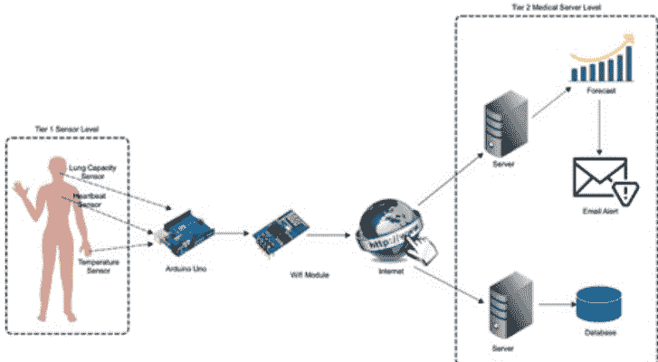

图（1）。基于物联网的远程患者监测系统架构。

仅将传感器与微控制器集成不足以将我们的数据通过互联网发送。我们需要一个 WIFI 模块来通过互联网发送收集到的数据。

为此，我们将 ESP8266 WIFI 模块集成到微控制器中，以便可以通过互联网发送数据并将其存储在我们的服务器上。

将所有传感器和 WIFI 模块与微控制器集成和配置后，我们将从三个传感器收集的数据作为查询字符串通过互联网发送到服务器，在那里将其存储在数据库中（参见图 2）。

一旦收集到足够的数据，我们就开始预测三个健康参数的趋势。预测是通过使用时间序列算法进行的。本文比较了时间序列算法下三种技术的结果，即朴素移动平均、简单移动平均和加权移动平均。

移动平均是一种通过创建完整数据集的不同子集的一系列平均值来分析数据点的计算方法。通过计算移动平均，可以减轻随机短期波动在指定时间范围内对各种健康参数值的影响。


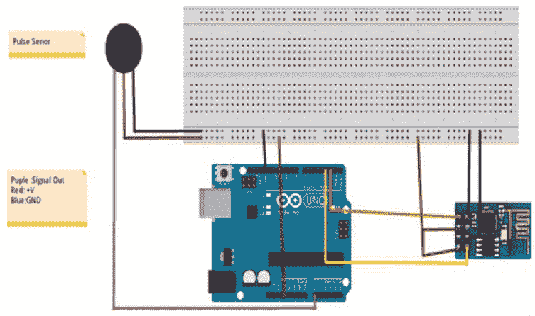

图 (2). 脉搏传感器电路图。

简单移动平均是一种预测方法，通过对过去 K 个值取平均来估计未来值。参数 K 取决于我们正在建模的参数。

```
y_{T+h|T} = (y1+...+y_T)/T
```

y_{T+h|T} 记号是基于数据 y1, ..., YT 对 yT+h 进行预测的简写。

朴素移动平均是一种预测方法，使用时间序列中最后一个观测值来预测下一个值。当需要预测的数据非常随机时，此技术很有用。

```
y_{T+h|T} = Y_T
```

加权移动平均与简单移动平均类似，也是通过对过去值取平均来估计未来值，但有一个微小而重要的改变。不是取平均，而是取加权平均，对最近过去的数据点赋予更多权重。这样我们可以对未来值做出更好、更公平的估计。

M = \frac{\sum_{t=1}^{n} W_t * V_t}{\sum_{t=1}^{n} W_t}

因此，我们将使用所有三种技术分析健康参数的趋势，并在论文中比较每种技术传达的结果。

使用移动平均预测我们健康参数的趋势，使我们能够为未来可能出现的令人担忧的情况采取预防措施。为此，我们在服务器上集成了电子邮件警报功能，如果任何健康参数的值超过设定阈值，我们将向相关方发送紧急警报，以通知其患者状况并采取预防措施防止未来的意外事件。

## 算法 1。

### 数据收集。

- 1. 初始化 Arduino 模块。电路中每个传感器对应的 LED 将开始亮起。

- 2. 按下电路中的绿色按钮，启动 30 秒的数据收集窗口。

- 3. 开始收集三个健康参数（即体温、心率和肺活量）的相应数据。

- 4. 借助 WIFI 模块，通过互联网以查询字符串形式将收集到的数据发送到服务器。

- 5. 将收集到的数据存储在数据库中。

## 算法 2。

### 预测健康参数并生成紧急警报。

- 输入：健康参数的数据从数据库中作为输入获取。

- 步骤 1. 应用时间序列算法技术来预测健康参数。

- 步骤 2. 为每个健康参数设置适当的阈值。

- 步骤 3. 如果 (temperature > threshold)。

- 步骤 3.1. 用户处于危急状态，并通过电子邮件向相关人员发送紧急警报。

- 步骤 4. 如果 (pulse rate > threshold)。

- 步骤 4.1. 用户处于危急状态，并通过电子邮件向相关人员发送紧急警报。

- 步骤 5. 如果 (lung capacity > threshold)。

- 步骤 5.1. 用户处于危急状态，并通过电子邮件向相关人员发送紧急警报。

- 步骤 6. 否则。

- 步骤 6.1. 用户安全，不生成警报。

- 步骤 7. 退出。

## 算法 3。

### 时间序列预测技术。

- 步骤 1. 使用朴素移动平均进行预测。

- 步骤 1.1. 从数据库中获取最后一个记录值，并使用它来预测下一个值。

yT+h|T = yT

- 步骤 2. 使用简单移动平均进行预测。

- 步骤 2.1. 获取数据库中最后 5 个记录值的平均值，并使用它来预测下一个值。

y_{T+h|T} = (y1+...+y_T)/T

- 步骤 3. 使用加权移动平均进行预测。

- 步骤 3.1. 对数据库中最后 5 个记录值取加权平均，对最近过去的值赋予更高权重。

M = \frac{\sum_{t=1}^{n} w_t * v_t}{\sum_{t=1}^{n} w_t}

## 设备详情

在为本研究调研的所有想法和模型中，我们采用了肺活量传感器，这是我们研究的重要组成部分。我们没有使用典型的肺活量计，而是使用了一个发电机，用户需向其中吹气，电机会旋转并计算转速。结果，可以测得被试者的肺活量。这进一步可用于确定与被试者肺活量相关的疾病。例如，根据被试者的肺活量，可以建议其在空气污染严重时是否应外出。此外，肺活量还可用于确定和识别被试者肺部是否存在任何并发症，并据此向其推荐适当的预防措施和医疗帮助。

### 表 1。

| 参数 | 传感器名称 | 功能 | 动态范围 | 选择性 |
|---|---|---|---|---|
| 心率 | LM 324 脉搏传感器 | 可实时测量脉搏 | 由单个 2.3V 至 3.6V 电源供电。温度范围从 -40C 到 105C | 可由学生、艺术家、运动员、制作者、游戏等使用。血容量流动由心脏搏动速率决定。 |
| 温度 | LM35 | 它是一种温度感应器件，可感应温度并输出与摄氏温度成线性比例的电压输出 | 范围为 -55 到 150，比例因子为 10mV/oC | 可用于医疗、赛车运动、HVAC、农业、工业、航空航天等。它可以测量物体或系统产生的热能或冷量的大小 |
| 肺活量 | 发电机 | 它测量肺部吸入和呼出的空气体积，当向发电机吹气时。 | 它取决于肺部在最大吸气努力下的空气体积 | 可用于计算吸入和呼出的呼吸容量。也可用于医疗实践。 |

## 性能与测量

首先，将心率、体温和肺活量等传感器附着在患者身体上。在患者身体上设置传感器后，传感器将开始测量数据并将其发送到微控制器。每个传感器都附带一个 LED，用于通知患者传感器已开始记录数据。

测量值可以在微控制器的 LCD 上实时查看。最后，微控制器将借助 WIFI 模块将最终数据发送到服务器。

图 (3) 显示了实时用于患者手上的传感器。

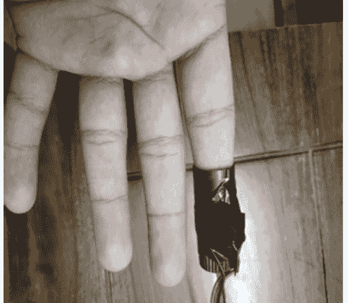

图 (3). 患者手部脉搏传感器。

图 (4) 显示了连接到 Arduino 微控制器的 LCD，显示温度（T）、肺活量（P）和心率（H）的值。

收集数据所花费的时间由变量 t 表示。数据需要在 30 秒的时间范围内收集。

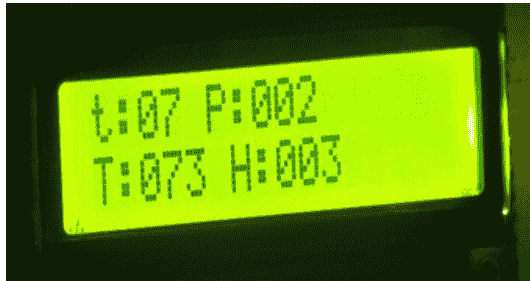

图 (4). LCD 显示屏。

图 (5) 显示了带有所有传感器、Arduino 微控制器、连接到面包板的 LCD 的完整 IoT 患者监测系统。

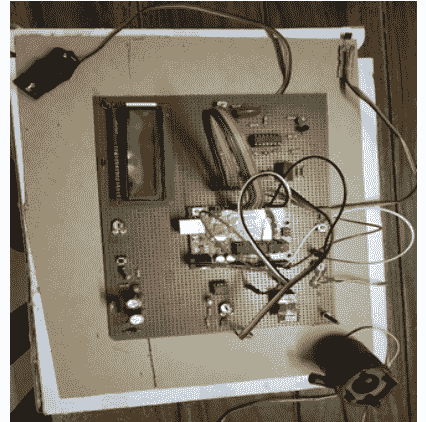

图 (5). 患者监测系统。

图 (6) 显示了服务器数据库中最近收集的温度、心率和肺活量的 25 个值。可以从下图中看到，由于噪声，数据集具有非常高的熵/随机性。

| Id | 温度 | 脉率 | 压力 | 姓名 |
|---|---|---|---|---|
| 1 | 25 | 72 | 52 | 测试 |
| 2 | 23 | 80 | 62 | 测试 |
| 3 | 98 | 85 | 72 | 测试 |
| 4 | 38 | 85 | 95 | 测试 |
| 5 | 99 | 85 | 85 | 测试 |
| 6 | 2 | 1 | 1 | 测试 |
| 7 | 2 | 1 | 8 | 测试 |
| 8 | 0 | 0 | 0 | 测试 |
| 9 | 0 | 0 | 0 | 测试 |
| 10 | 0 | 0 | 0 | 测试 |
| 11 | 2 | 1 | 8 | 测试 |
| 12 | 102 | 20 | 8.5 | 测试 |
| 13 | 0 | 0 | 0 | 测试 |
| 14 | 102 | 20 | 8.5 | 测试 |
| 15 | 102 | 20 | 8.5 | 测试 |
| 16 | 0 | 0 | 0 | 测试 |
| 17 | 102 | 20 | 8.5 | 测试 |
| 18 | 0 | 0 | 0 | 测试 |
| 19 | 0 | 0 | 0 | 测试 |
| 20 | 76 | 0 | 2 | 测试 |
| 21 | 104 | 0 | 2 | 测试 |
| 22 | 34 | 24 | 2 | 测试 |
| 23 | 75 | 12 | 2 | 测试 |
| 24 | 77 | 0 | 2 | 测试 |

图 (6). 记录的值。


接下来，我们对比了三种时间序列预测技术，即朴素、简单和加权移动平均法。

图（7）显示了基于朴素移动平均法的预测。

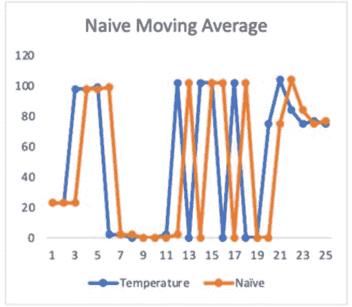

图（7）. 朴素移动平均。

图（8）显示了基于简单移动平均法的预测。

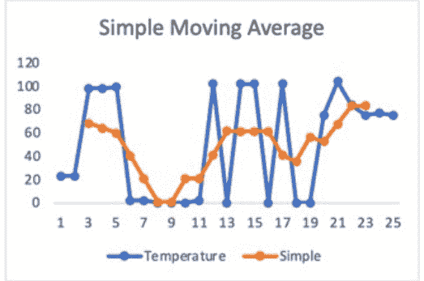

图（8）. 简单移动平均。

图（9）显示了基于加权移动平均法的预测。

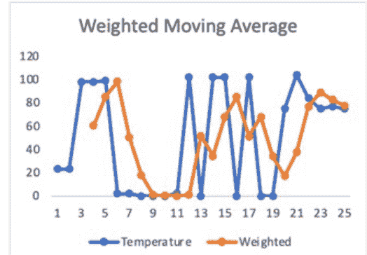

图（9）. 加权移动平均。

如图（10）所示，预测精度是实际数据与预测值之间的差异。在做决策时，我们希望尽可能拥有最精确的预测模型，但衡量预测精度的方法取决于模型的使用方式。我们介绍了三种衡量预测精度的方法：平均绝对偏差（MAD）、均方误差（MSE）和平均绝对百分误差（MAPE）。

| 移动平均法 | MAD | MSE | MAPE |
|---|---|---|---|
| 朴素 | 37 | 3361 | 305% |
| 简单 | 36 | 2212 | 480% |
| 加权 | 35 | 2234 | 435% |

图（10）. 预测精度。

对于我们可用的健康数据，朴素移动平均算法对健康参数的预测效果最好。这是因为，在建模具有极高熵的数据时，朴素移动平均法极为有效。

从表中我们还可以看到，使用朴素方法的预测值平均值在实际值的305%以内，在考虑的三种算法中是最好的，尽管总体误差最高。

## 紧急警报

在这个繁忙的世界里，每个人都忙于自己的工作。没有人能有足够的时间照料患病的亲人。雇佣全职护士非常昂贵，不是每个人都负担得起。对于老年人来说，他们的健康始终处于危险之中，我们永远不知道他们何时会患什么病。为了避免这种情况，我们设计了一个紧急邮件警报。

当温度传感器设备附着在患者身体上时，它将读取体温，并且每当体温超过阈值温度时，它就会向相关人员发送紧急邮件。

这就是如何在正确的时间采取立即行动。

图（11）显示了发送给患者紧急邮箱的警报消息，以尽量降低患者的健康风险。


图（11）. 发送给患者的邮件警报。

## 结论与未来展望

本项目的主要目标是成功监测三项基本健康参数，即体温、脉搏和肺活量，并在紧急情况下无需人工干预即可做出响应。

物联网的兴起为这个技术时代增添了新维度，为了跟上这些新技术的步伐，本项目在整体以及特别是医疗领域取得了重大进展。

我们在本项目中恰当地利用了物联网的力量，以提高医疗领域的效率。

尽管我们的模型已经过测试并实现，但如果没有足够的资金支持，本项目的延续将会很困难，因为该项目需要大量高质量的硬件支持。

只有当我们使用各种大数据框架大规模实施本项目时，这项工作的真正潜力才能得以实现。

本项目仍有改进空间和未来发展潜力，可以将本项目推向新高度。

我们的脉搏传感器可以升级，以便在患者活动时测量心率。目前，当患者活动时，传感器在测量心率方面有点不稳定。

我们还可以测量其他健康参数，如血压、脑电图等，以使我们的系统更加稳健。

更多传感器意味着更多数据，供医生识别疾病。

存储在数据库中的数据需要防范潜在威胁，这就是为什么在我们的系统中加入安全措施可以为患者数据增加一层抽象并赢得他们的信任。

我们还可以在系统中添加视频会议功能，这有助于医生高效地为农村地区的人们开药，而无需长途跋涉。

我们可以将肺活量数据与污染测量传感器相结合，监测在当前污染上升的时期，是否允许老年人外出。

所有这些功能都可以使这个模型成为家家户户的东西，并可以彻底革新医疗保健行业。

本项目可以被视为在医疗保健领域物联网领域开发的一个平台。

在像我们这样的发展中国家，这种创新且具有成本效益的项目可以改善技术的未来。

因此，我们期待实施本项目，在新的技术时代产生影响。

## 出版同意

不适用。

## 利益冲突

作者声明不存在任何利益冲突，无论是财务上的还是其他方面的。

## 致谢

无。

## 参考文献

- [1] D.L. Brock, "电子产品代码（EPC）", *Auto-ID Center White Paper MIT-AUTOID--H-002*, 2001年。

- [2] Q. Ni, A.B. Garcia Hernando, 和 I.P. de la Cruz, "智能家居中老年人的独立生活：为促进服务开发而开展的活动和传感基础设施调查的特征描述", *Sensors (Basel)*, 第 15 卷，第 5 期，页码 11312-11362，2015 年。
[http://dx.doi.org/10.3390/s150511312] [PMID: 26007717]

- [3] P.P. Ray, "家庭健康中心物联网（H³ IoT）：监测老年人健康的体系架构框架", *科学、工程与管理研究（ICSEMR）*，2014 年国际会议（第 1-3 页）。

- [4] S. Patel, H. Park, P. Bonato, L. Chan, 和 M. Rodgers, "可穿戴传感器及其在康复中的应用综述", *J. Neuroeng. Rehabil.*, 第 9 卷，第 1 期，第 21 页，2012 年。
[http://dx.doi.org/10.1186/1743-0003-9-21] [PMID: 22520559]

- [5] N. de Battista, J. A. Rice, S. H. Sim, J. M. W. Brownjohn, 和 H. P. Tan, "使用无线传感器网络进行土木基础设施结构健康监测",

- [6] M. Hassanalieragh, A. Page, T. Soyata, G. Sharma, M. Aktas, 和 G. Mateos, "使用云处理的物联网（IoT）感知进行健康监测与管理：机遇与挑战", *服务计算（SCC）*，2015 年 IEEE 国际会议（第 285-292 页）。

- [7] S. Tyagi, A. Agarwal, 和 P. Maheshwari, "使用云计算的基于物联网的医疗保健系统概念框架", *云系统与大数据工程（Confluence）*，2016 年第 6 届国际会议（第 503-507 页）。
[http://dx.doi.org/10.1109/CONFLUENCE.2016.7508172]

- [8] M. Sathya, S. Madhan, 和 K. Jayanthi, "基于物联网（IoT）的健康监测系统与挑战", *国际工程与技术杂志（阿联酋）*, 第 7 卷，第 1.7 期，页码 175-178，2018 年。
[http://dx.doi.org/10.14419/ijet.v7i1.7.10645]

- [9] D.S.R. Krishnan, S.C. Gupta, 和 T. Choudhury, "基于物联网的患者健康监测系统", *2018 年计算与通信工程进展国际会议（ICACCE）*，2018 年巴黎。
[http://dx.doi.org/10.1109/ICACCE.2018.8441708]

- [10] M.M. Islam, A. Rahaman, 和 M.R. Islam, "物联网环境下智能医疗监测系统的开发", *Comput. Sci.*, 第 1 卷，第 3 期，第 185 页，2020 年。
[http://dx.doi.org/10.1007/s42979-020-00195-y] [PMID: 33063046]

- [11] A. Rahaman, M. Islam, M. Islam, M. Sadi, 和 S. Nooruddin, "开发基于物联网的智能健康监测系统：一篇综述", *Rev Intell Artif.*, 第 33 卷，第 6 期，页码 435-440，2019 年。
[http://dx.doi.org/10.18280/ria.330605]

- [12] S.M. Riazul Islam, Daechan Kwak, M. Humau n Kabir, M. Hossain, 和 Kyung-Sup Kwak, "Kwak Daechan, Humau n Kabir M, Hossain M, Kwak Kyung-Sup. 医疗保健物联网：一项全面调查", *IEEE Access*, 第 3 卷，页码 678-708，2015 年。
[http://dx.doi.org/10.1109/ACCESS.2015.2437951]


- [13] G. Mois, S. Folea, 和 T. Sanislav, "基于物联网的环境监测无线传感器分析", IEEE 仪器与测量交易, vol. 66, no. 8, pp. 2056-2064, 2017. [http://dx.doi.org/10.1109/TIM.2017.2677619]

- [14] J.J. Oresko, H. Duschl, A.C. Cheng, S. Huang, Y. Sun, H. Duschl, 和 A.C. Cheng, "基于心电图处理的可穿戴智能手机平台实时心血管疾病检测", IEEE 生物医学信息技术交易, vol. 14, no. 3, pp. 734-740, 2010. [http://dx.doi.org/10.1109/TITB.2010.2047865] [PMID: 20388600]

- [15] M. Hasan, M.M. Islam, M.I.I. Zarif, 和 M.M.A. Hashem, "使用机器学习方法在 IoT 网站的 IoT 传感器中进行攻击和异常检测", 物联网, vol. 7, p. 100059, 2019. [http://dx.doi.org/10.1016/j.iot.2019.100059]

## 基于区块链的可验证公共车辆注册：面向可持续方法的未来智慧城市应用

Rohit Rastogi1*, Bhuvneshwar Sharma1, Pardeep Kumar2 和 Muskan Gupta1

1 ABES 工程学院计算机科学与工程系，印度加济阿巴德，北方邦 201009
2 QUEST 大学计算机系统与工程系，巴基斯坦纳瓦布沙阿

摘要：区块链技术利用分布式计算取代了集中式应用。现代经济的估价取决于机动交通在国民经济基础设施中的地位。汽车登记系统是一个统一的信息系统。该信息系统负责处理有关汽车登记的每一条信息。它由国家登记实体管理，并可以访问其他处理汽车信息的政府和非政府服务。Cyber-物理系统（CPS）被定义为计算与物理过程的结合。它主要用于 ICT 部门。它还专注于通过技术手段解决与数据所有者相关的透明度、媒体和存储问题。

本章将上述所有概念集中在一起并进行整合，以构建一个有用的应用。所提出的框架允许汽车制造商、车主、维修公司和保险公司通过一种简单的方法注册并添加新车条目。此外，数据库技术已被用于缓存中间数据。它高效地利用了工业物联网和 5G 技术。

许多研究人员已呼吁制定规则和应用程序，以将基于分布式应用的旧地图引入区块链。本文为国际自动车辆管理系统（称为 DriveLoop）提出并开发了新协议。

关键词：DriveLoop、区块链、点对点 (P2P)、哈希算法、车辆注册、覆盖网络。

## 引言

任何购买或出售过汽车的人，或曾在任何时间点从事汽车制造或分销行业的人，都熟悉车辆登记过程所带来的复杂性。考虑到市场上的所有车辆都经过多次转手而被转售，维护每辆车合法的历史记录并在需要时提供可用性，已成为一项繁琐的任务。

但在讨论车辆登记流程的问题之前，首先需要了解为什么车辆登记是汽车交易中如此重要的一个方面。车辆所有权的变更次数之多，超乎你的想象。

无论你是从零部件交易还是整车交易、中间人交易还是最终向消费者销售的零售商交易，或者从二手车转售的角度来看，一些利益相关方都有兴趣了解他们所购买汽车的方方面面。更不用说保险公司、警察和其他主管部门了，政府也出于各种原因需要监控汽车。

事实是，所有这些利益相关方都需要车辆信息，从其制造过程开始，涵盖其首次销售、其涉及的任何事故，以及所有维修和保养。这不仅对于维护车辆历史记录以确定其市场价值至关重要，而且对于法律和保险目的也至关重要。

车辆登记是一种通过在车辆及其车主之间建立关联来便利此记录保存的方式。根据当地法律，它可能是强制性的，也可能不是。这有助于主管部门在税务、保险或犯罪侦查方面。同时，这也是汽车经销商跟踪其车辆的一种方式 [1 - 3]。

## 智慧城市概念

城市发展导致了 21 世纪范式的转变。更智慧城市的研究活动已成为首要任务。上个世纪在技术和服务方面改善了生活。智慧城市是可持续性和城市化的紧迫解决方案。智慧城市可能导致一个由技术官僚政府管制的反乌托邦世界，这将公民推向从属角色。然而，大城市的大规模工业化和不断增长的人口给城市规划者、建筑师和管理人员带来了巨大挑战。

智慧城市的服务平台是物联网 (IoT)、大数据系统和移动性。配备先进技术的网联汽车可以降低事故几率，并在其范围内帮助驾驶员节省时间和汽油。城市地区人口增加通常会导致停车位问题。智能停车是智慧城市最重要的组成部分之一。传感器被部署在具有良好互联网连接的智慧城市中。我们的星球越城市化，城市就必须越智慧。明天的城市将比昨天的城市更容易发生转型美化 [4]。

## 车辆注册问题与动机

汽车注册流程一直很困难。这是一个涉及多方的冗长过程，并且存在信息篡改、数据复制和各种错误的风险。在这种情况下，关键信息极易受到欺诈或数据伪造的影响，甚至可能被用于追踪。

通过引入称为区块链的分布式账本技术的力量，并将汽车注册的整个过程移至区块链，许多这些漏洞可以轻松解决 [5]。

## 研究目标

区块链通过减少平均响应时间来解救。区块链将允许各方以智能合约或链码的形式发送数据，这最终将成为所有各方不变数据的单一来源。此外，车辆注册生态系统中的区块链将有助于降低欺诈和攻击的风险，因为只有授权人员在省里更新私钥时才能使用数据。

事实上，任何追踪虚假数据的尝试都可以轻松在区块链上完成。最棒的是，区块链在一本账簿中提供了关于汽车生命周期的统一视图，而这目前尚不可用 [6]。

## 研究工作范围

此研究实验是一个通用项目，使用 Linux Foundation 开发的名为 Hyperledger Fabric 的开源技术在许可模型中实现。任何人都可以通过获得授权并将其利益相关方添加到系统中来使用此项目。

## 5G 技术及其影响

凭借先进的接入技术和用户需求的增加，4G 现在将轻易被 5G 取代。转向 5G 有几个原因：具有更高容量、提高数据速率、降低端到端中断、大规模设备连接、降低成本和一致的体验质量 [7]。

5G 由微小区、小区和中继组成，因此是异构的。设备到设备通信 (D2D) 和物联网 (IoT) 是主要关注点。5G 为未来 5G 标准化网络 MBB 移动宽带提供了良好的政策。5G 将允许无线网络处理目前由光纤接入处理的数据速率和用例。当今时代广泛使用的技术之一是物联网。物联网进一步由两种技术组成。这些技术用于描述 ICT 部门的关键关注领域 [8, 9]。

- a. Cyber-物理系统 (CPS) - 该系统用于描述 ICT 部门的关键关注领域。它基本上被定义为计算和物理过程的统一。
- b. 机器对机器 (M2M) - 它代表了机器之间相互通信的方式。

5G 为新的用例和经济部门验证物联网。5G 的目标是满足预计的移动流量需求，并以启发式方式解决大多数经济部门的通信需求。此外，该小组的目标是推动中国 5G 技术的发展。韩国的 5G 论坛也是一个公私合作伙伴关系计划，成立于 2013 年 5 月。

## 物联网及其在交通领域的应用

### 在汽车领域的应用

如果你曾经购买过自己的车辆或出售过车辆，或在汽车制造或交易的任何阶段参与过，你就会熟悉车辆登记所带来的复杂性。

考虑到市场上的所有车辆都经过多次转手而被转售，维护每辆车合法的历史记录并在需要时提供可用性，已成为一项繁琐的任务。通过应用区块链和物联网技术，并将整个车辆注册流程放入区块链中，许多这些问题可以轻松解决。


## AI、ML 在 IoT 和区块链中的应用

一个良好的工作模型可能是 IoT 从大量传感器和分析中生成数据，区块链存储数据，而 AI/ML 从同一数据中提取智能。

上述示例体现在供应链中，IoT 可以测量从环境到行程记录再到运动感应的许多不同指标，使用区块链存储这些数据，然后在该数据上使用 AI 来做出类似人类的决策。

区块链在此解决方案中的目的是提供跨组织的透明度和数据不可篡改性，以及执行智能合约。

这不仅适用于供应链，在医疗保健制造、身份和安全应用甚至金融行业等许多领域也是可能的。

例如，一家向中小企业提供信贷额度的银行可能会依赖这些技术，通过使用 IoT 测量中小企业的货物、原材料、成品、资产等，将这些数据存储在区块链中用于审计和其他决策目的，并使用 AI 进行推荐[3]、[9, 10]。

每种技术本身都具有变革能力。它们不需要彼此才有用。但合在一起，它们是解决其他情况下难以处理问题的更强大催化剂。

以医疗保健为例。外科感染、卫生、疏忽等医疗问题，不仅会对患者产生不良影响，也会对医院本身造成不良影响。

IoT、区块链和 AI 的结合可以有效地带来问责制、效率以及更好、更快的患者康复[11]。

## 相关工作

区块链不是一种新技术。它是一组现有方法，按新的特定顺序组织，以解决与不同优势、安全性和共享相关的问题。

许多应用程序被建议从常规操作转移到区块链。

此外，还撰写了许多调查以获取有关应用程序的信息[12]。

以下是与 DriveLoop 相关的一些先前工作。针对此应用程序的两个重要区块链系统是 CarChain 和 Fabcar IBM 区块链[13]。

## Carchain

Carchain 是一个分布式和去中心化的系统，连接汽车车主和租户，根据花费的时间安全地租赁和保障金融交易。

该系统在开放网络区块链 - 以太坊上运行，并可以转移到私有区块链 - 超级账本。

它由一份智能协议组成，该协议将系统和应用程序集成到系统中（用于 Web 应用程序所有者、用户的手机），以管理系统、向区块链发送信息并对系统进行更改。

一种电子签名方法，允许您到达后解锁汽车。

## Fabcar IBM 区块链

此代码演示了标准 IBM 区块链平台上的网络配置以及网络上 Fabcar 智能合约的实现。

然后我们配置应用程序以与网络交互，包括身份，以在智能合约中发送交易。

该应用程序使用 Node.js 配置，使用 Fabric Node SDK 处理网络请求，并使用 Angular 客户端打开 Web 界面[14]。

如今，职业机会正在迅速增加。要取得成功，每个领域都需要大量的奉献和努力。汽车工程职业是最具创造力和快节奏的最佳职业之一。它主要涉及汽车的建造、制造和设计。由于先进技术使汽车行业中汽车部件迅速增长，汽车工程领域的工作机会每天都在增加，其背后的原因正是汽车工程师。

## 区块链与汽车的未来

作者 Pham 和团队将未来前景和局限性解释如下：

从未来角度来看，可以说如今职业机会正在迅速增加。任何领域都需要大量的奉献和努力来学习任何专业并取得成功。

基本上，在这项研究中，作者提出了一篇关于使用区块链进行汽车注册或汽车停车的文章。

汽车是为乘客设计并借助易燃燃料由内燃机驱动的车辆。

在当今世界，人们更喜欢使用车辆去任何地方，无论是远在千里还是近在咫尺。

这是人们的日常需求，因为他们必须去工作或满足自己的需求。

汽车的顺畅润滑有助于快速轻松地移动车辆，使我们的生活如此简单。

众所周知，如今人们为了更好的工作、优质的教育和光明的未来而搬到大城市。

这种迁移常常导致人口增加，进而导致停车位问题。

大多数人在拥挤地区无法找到安全的停车位。

因此，这是基于中心化汽车停车系统的不安全解决方案。

汽车注册系统是一个统一的信息系统。

这些信息系统控制与汽车注册相关的每一项信息。

区块链如今正被用作最具前景的领域之一。

作者团队应用了该方法，通过分配唯一 ID 且不披露个人信息，车辆可以与部署的停车场进行通信。

然后通过请求控制器来注册车辆并预订停车位。

当控制器收到来自普通节点的请求时，它会检查其场所周围的停车空间。

然后完整信息被发送到普通节点，随后普通节点预订停车位并支付费用。

在局限性方面，可以看出该研究是一个良好的学习过程，也是一次非常满意的经历。然而，有几个因素限制了该研究人员的研究计划，每位研究者期望的局限性如下。

- 访问文档和信息
  - 所需数据无法轻易获取。设计和开发过程中的文档化并非常规做法。由于公司保密、研发和设计活动，关于特定产品类别所遵循的流程所共享的信息有限。
- 汽车工业
  - 汽车行业中的研发和设计高管受到许多规则和政策的约束。
  - 数据共享非常有限。在企业文化中，公开和自愿共享信息并非普遍做法。

在结束语中，他们解释说实施了区块链技术以保持系统中的信任、安全性和清晰度。我们使用许多技术，其中一种技术是 IoT、以太坊。

他们根据区块链延迟、区块链吞吐量、交易准确性、TAIVs 上的延迟以及 TAIVs 上的吞吐量测试了所提想法[15]。

## 5G 技术的重要性

当今时代广泛使用的技术之一是 IoT。IoT 进一步包含两种技术。这些技术用于描述 ICT 部门的关键关注领域。b-) 机器对机器 (M2M) - 它定义了机器之间的通信方式。

5G 的目的如下：

- 满足预计的移动流量需求。
- 解决经济各部门大部分所需的通信。

## 所提方法论

借助区块链，汽车制造商、代理、客户和机构等利益相关者可以根据其安全访问权限，轻松参与访问和更新车辆数据。

该解决方案还确保最安全和完整的信息被安全且经济地存储和共享[16]。

为了进一步说明，让我们先看看车辆注册过程中各利益相关者的角色。我们还研究了一些基本工作流程，并了解它们如何通过区块链得到简化。

- **制造商**：通过添加包括品牌、型号、版本、车架号、发动机号等详细信息，将车辆推向区块链。并且他销售车辆。
- **经销商**：汽车销售适用于最终客户。
- **保险机构**：检查客户和汽车信息并提供保险。
- **注册管理局**：RTO 将负责批准注册并提供注册号，发送车辆转让和重置车辆。
- **警察**：它签发车辆驾照和转让证书，以及交通发票。
- **服务中心**：服务部件包括工单和更换零件。
- **客户/ 车主**：允许交换作为个人身份信息 (PII) 的机密信息。

## 软件需求规格说明

必须满足以下软件需求。

## 产品视角

这一想法在世界上任何地方都未完全实现。现有一个名为“Carchain”的应用程序，它提供了一种连接汽车车主和租户的方式，根据花费的时间安全租赁并保障金融交易。


## Carchain 与我们应用程序之间的相似之处

- a. Carchain 和此应用程序都是基于服务的应用程序。
- b. 在两个应用程序中，都有希望使用服务的客户和希望提供这些服务的专业人员。
- c. 可以在两个应用程序中以服务提供商身份加入。
- d. 可以为两个应用程序提供反馈。

## Carchain 与我们应用程序之间的差异

- a. 我们的应用程序提供从第一步到最后一步购买汽车的自动化方式。Carchain 不涉及销售汽车。
- b. Carchain 使用以太坊网络实现区块链，但我们的应用程序使用 Hyperledger Fabric - 一个私有网络。

## 系统接口

- a. HTML5、JavaScript、CSS3 和 Bootstrap 用于应用程序的前端部分。
- b. Node.js 用于编写后端的链码。
- c. Docker 用作一种服务产品，它使用操作系统级虚拟化将名为容器的软件包交付。容器是隔离的，并各自包含自己的软件、库和配置文件，它们可以通过明确定义的通道进行通信。
- d. Hyperledger Fabric 用作操作应用程序的平台。
- e. 使用两个数据库 - LevelDB 用于存储事务数据，CouchDB 用于存储资产数据。
- f. Visual Studio Code 用作源代码编辑器。
- g. Postman 用于创建、共享、测试和记录 API。

## 接口（硬件、软件和通信）

我们使用许多接口，例如

## 登录/注册

此界面允许客户进入应用程序并使用服务，如果某人不是此应用程序的客户，它还可帮助他们成为注册客户。

## 主页

此界面包含所有可用服务，并作为连接所有界面的媒介。

## 联系我们

此界面允许任何有问题的客户与我们联系。

## 制造商

此界面允许制造商通过添加包括品牌、型号、版本、车架号、发动机号等详细信息来将车辆推送到区块链，并且他销售车辆。

## 经销商

汽车销售适用于最终客户。

## 注册管理局

RTO 将负责批准注册并提供注册号，发送车辆转让并重置车辆。

## 警察

它签发车辆驾照和转让证书。

## 客户

允许交换作为 PII 的机密信息。

## 硬件接口

- a. 处理器：Intel i5-6200U / Intel Core 或更高。
- b. GPU：2.30 GHz
- c. RAM：8GB 或更多。
- d. 硬盘：20GB 或更多。
- e. 操作系统：Linux/Mac。
- f. 输入设备：标准键盘、鼠标和 USB。
- g. 支持 HTML 和 JavaScript 的浏览器。
- h. 互联网连接。

## 软件接口

### Ubuntu 20.04

团队为本项目选择了 Linux 操作系统，因其提供最佳支持和用户友好性。

### Hyperledger Fabric v0.20

它用作模块化区块链结构，作为使用即插即用组件开发基于区块链的产品、解决方案和应用程序的基础，这些组件旨在供私营公司使用。

### Node.js v12.16.0-x64

它已用于编写后端逻辑，即用于事务自动化的链码。

### Docker 19.03.8

它用作一种服务产品，它使用操作系统级虚拟化将名为容器的软件包交付。

### Postman 7.24.0

它用于创建、共享、测试和记录 API。之所以能实现这一点，是因为用户可以创建和保存简单及复杂的 HTTP/s 请求及其响应。这使工作更加高效且不易疲劳。

## 通信接口

本项目支持所有类型的 Web 浏览器。团队使用简单的表单用于注册表单、反馈、使用服务等。

## 内存限制

主内存：8GB 或更多。

次级内存：20GB 或更多。

## 操作（产品功能、用户特征）

我们的软件将执行以下操作。

### 产品功能

- a. 它允许人们注册到应用程序以使用其服务。
- b. 制造商可以将新车添加到区块链中用于销售目的。
- c. 经销商可以销售汽车，并在某些验证后更改汽车的所有权。
- d. 注册管理局可以验证汽车以更改其从一个人到另一个人的所有权。
- e. 客户可以直接从单个仪表板查看注册流程涉及的所有步骤。
- f. 任何地方的任何更改都会在网络中到处体现。

### 用户特征

- a. 只有 18 岁以上的成年人才能注册或为其他有需要的人提供服务。
- b. 需要具备使用计算机系统的基本技术知识。
- c. 两周的实践培训足以使用该软件。

## 用例图、序列图

### 用例

以下是项目中涉及的各个参与者的各种用例图。

制造商- 图 (1) 描绘了制造商与各种用例之间的关系。

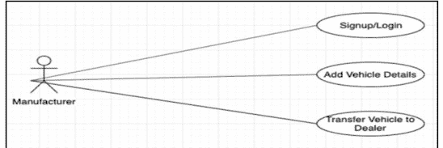

图 (1). 制造商用例。

经销商- 图 (2) 描绘了经销商与各种用例之间的关系。

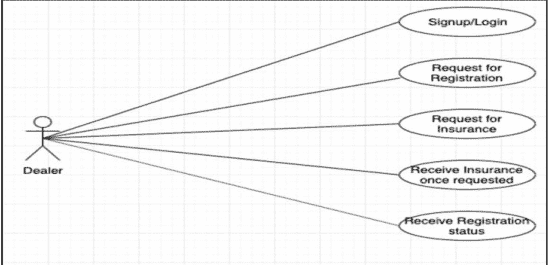

图 (2). 经销商用例。

### 注册管理局

图 (3) 描绘了注册管理局与各种用例之间的关系。

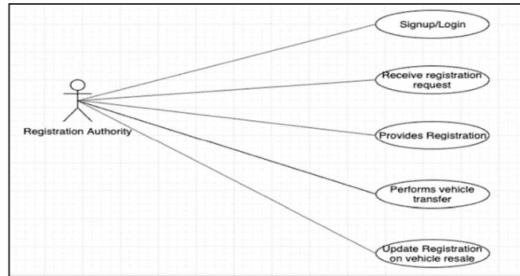

图 (3). 注册管理局用例。

### 警察

图 (4) 描绘了警察与各种用例之间的关系。

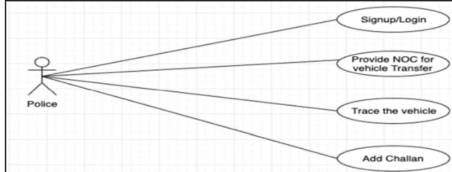

图 (4). 警察用例。

### 客户

图 (5) 描绘了客户与各种用例之间的关系。

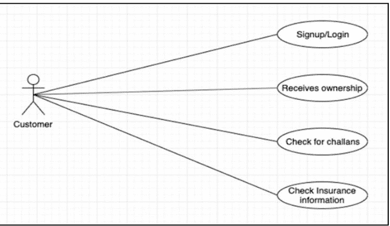

图 (5). 客户用例。

## 序列图

图 (6) 中显示了一个序列图，它基本描绘了参与者按顺序协作。该图显示了客户端如何进入网络、如何创建新的事务块，以及最终如何添加到区块链网络中。

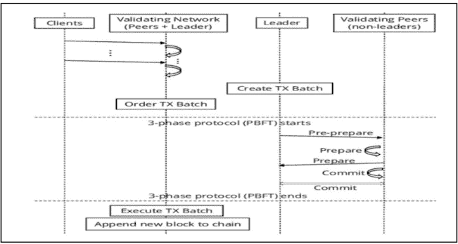

图 (6). 序列图。

## 系统设计

系统设计是定义系统的工程、模块、接口和信息的过程，以满足指定的要求。

架构图、数据流图、活动图、ER 图、数据库架构图（如图 7 至 13 所示）。

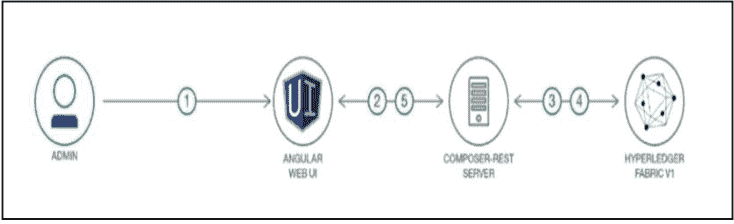

图 (7). 架构高级视图。

### 架构图

以下是本项目的系统架构设计。

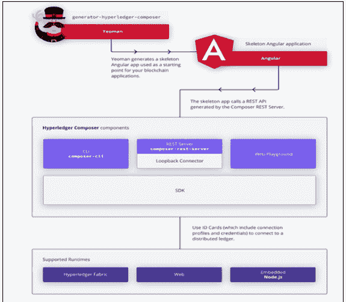

图 (8). 架构详细视图。

### 数据流图

Level 0- 以下是本项目的 Level 0 数据流图。

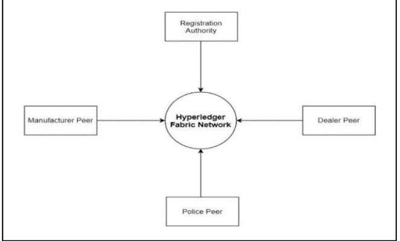

图 (9). Level 0 DFD。

Level 1- 以下是本项目的 Level 1 数据流图。

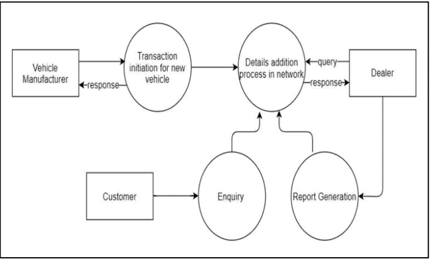

图 (10). Level 1 DFD。

Level 2- 以下是本项目的 Level 2 数据流图。

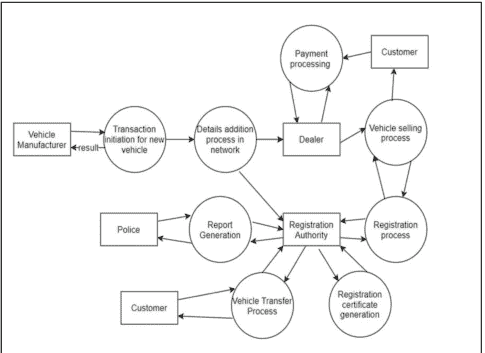

图 (11). Level 2 DFD。

### 活动图

以下是显示客户端登录系统的活动图。

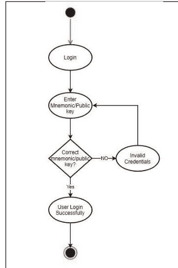

图 (12). 活动图。

### ER 图

以下是系统的实体-关系图。

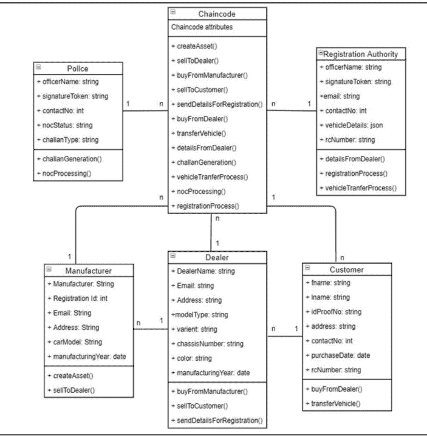

图 (13). 实体关系图。

### 数据库架构图

Hyperledger Fabric 支持两种对等数据库：LevelDB 是嵌入在对等节点中的默认状态数据库，并将链码数据存储为简单的键值对；而 CouchDB 是一种备选状态数据库，当将链码数据值建模为 JSON 时支持高级查询（如图 14 至 19 所示）。


### 1. 资产

以下是系统中存储的资产数据的架构。

```
{
 "$class": "org.driveloop.vehicle.Vehicle",
 "vin": "4242",
 "vehicleDetails": {
 "$class": "org.driveloop.vehicle.VehicleDetails",
 "make": "fvefvsd",
 "modeType": "svsds",
 "variant": "csdcsdc",
 "chasisNumber": "sdscdsd",
 "engineNumber": "csdcsd",
 "colour": "sdcsdc",
 "manufacturingYear": "csdcsdc",
 "bodyWeight": "cdcsd"
 },
 "vehicleStatus": "UNDER_MANUFACTURER"
}
```

图 (14). 资产架构。

### 2. 制造商

以下是系统中存储的制造商数据的架构。

```
{
  "$class" : "org.driveloop.participant.Manufacturer",
  "make": {
    "$class": "org.driveloop.participant.Make",
    "name": "BMW",
    "registrationId": "asj5w67dw87wgx87x8vw"
  },
  "participantId": "9192"
}
```

图 (15). 制造商架构。

### 3. RTO

以下是系统中存储的 RTO 数据的架构。

```
{
  "$class":
  "officerName": "Mr. Joe",
  "signatureToken": "43546756545",
}
```

图 (16). RTO 架构。

### 4. 经销商

以下是系统中存储的经销商数据的架构。

```
{
"$class": "org.driveloop.participant.Dealer",
"dealerName": "Man Sales",
"contact": {
"$class": "org.driveloop.participant.Contact",
"email": "mansales@gmail.com",
"address": "south district"
},
"participantId": "3888"
}
```

图 (17). 经销商架构。

### 5. 警方

以下是系统中存储的警方数据的架构。

```
{
"$class": "org.driveloop.participant.Police",
"officerName": "Mr. Joe",
"signatureToken": "43546756545",
"participantId": "8753"
}
```

图 (18). 警方架构。

### 6. 客户

以下是系统中存储的客户数据的架构。

```
{
"$class": "org.driveloop.participant.Customer",
"FName": "Anuranjan",
"lname": "Singh",
"contact": {
"$class": "org.driveloop.participant.Contact",
"email": "anuranjansingh@gmail.com",
"address": "ballia"
},
"participantId": "9317"
}
```

图 (19). 客户架构。

## 5 软件和硬件要求

### 软件要求

### Ubuntu 20.04

团队为本项目选择了 Linux 操作系统，因为它提供了最佳的支持和用户友好性。

### Hyperledger Fabric v0.20

它被用作模块化区块链结构，作为使用即插即用组件开发基于区块链的产品、解决方案和应用程序的基础，这些组件旨在供私营公司使用。

### Node.js v12.16.0-x64

它被用于编写后端逻辑，_即_. 用于交易自动化的链码。

### Docker 19.03.8

它被用作一种服务产品，利用操作系统级虚拟化将名为容器的软件包进行交付。

### Postman 7.24.0

它用于创建、共享、测试和记录 API。之所以能够实现，是因为用户可以创建和保存简单及复杂的 HTTP/s 请求及其响应。这使工作更加高效且不那么疲劳。

### 硬件要求

### 处理器

Intel i5-6200U / Intel Core 或更高。

### GPU

2.30Ghz

### 内存

8GB 或更多。

### 硬盘

20GB 或更多。

### 输入设备

标准键盘、鼠标和 USB。

## 实现细节

## 界面快照（所示于图 20 至 27）

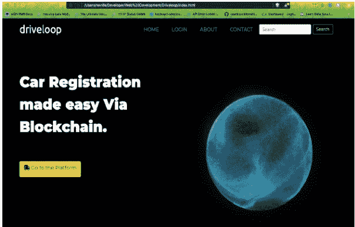

图 (20). 首页。

我们的项目中有几个快照。

上述图 (20) 展示了首页，用户可以轻松进入平台，使用驱动循环和不同的区块链技术，以真实且透明的方式为用户提供汽车登记便利。

图 (21) 描绘了主页，用户可以在该页面上传汽车文件，并查看在该特定车辆登记之前整个交易过程中之前参与的所有各方。它将能够显示汽车的完整历史。


图 (21). 主页。

资产可以通过上述图 (22) 创建，其中的区块将包含汽车记录，所有可能交易的完整详情将存储以供将来使用。此资产将作为基础信息，并由所有各方进行认证以确保透明度。

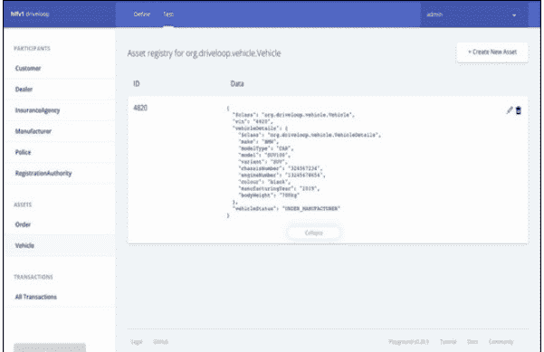

图 (22). 资产创建。

图 (23) 中的上述表格用于展示制造商模型，并显示制造商输入汽车独特且基础详情的过程，这将有助于在智能合约和未来交易中保持透明度和便捷性。

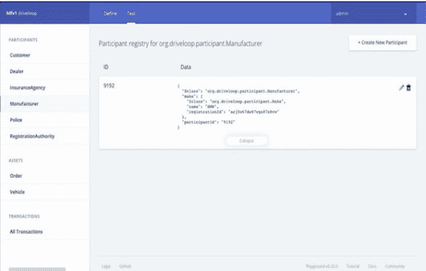

图 (23). 制造商模型测试。

图 (24) 中 Hyperledger 的代码显示了汽车的交易历史及所有必要详情。

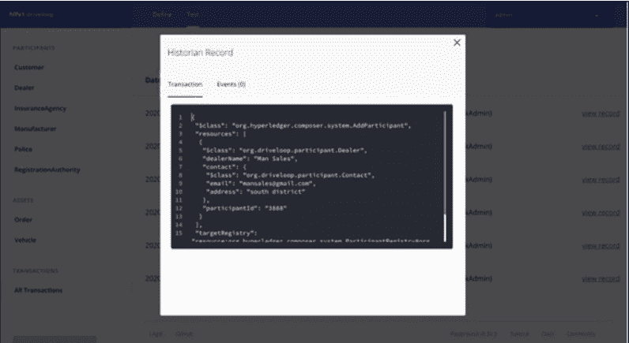

图 (24). 交易历史。

图 (25) 运行可能的测试用例并检查软件的正确功能。

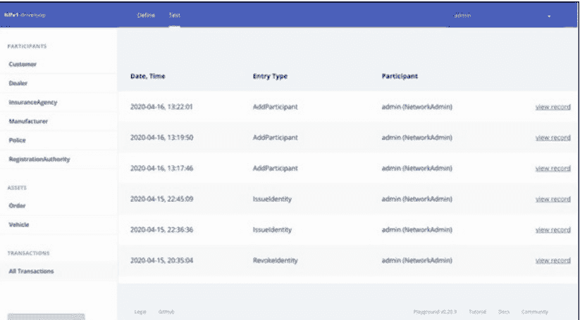

图 (25). 流程历史。

## 测试用例

要在本地运行测试，我们使用一个构建环境的 Docker 文件。Docker 文件如图 (26) 所示。

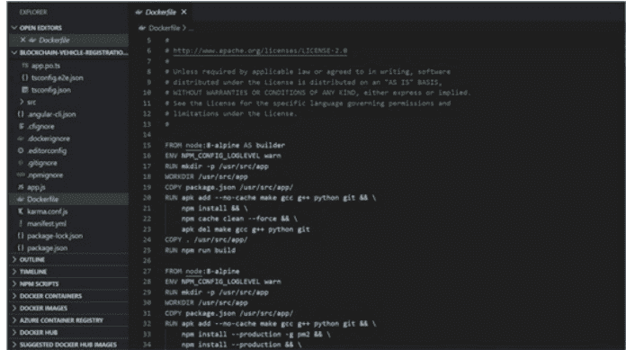

图 (26). Docker 文件。

如果一切顺利，在运行所有测试用例后，我们将在图 (27) 中得到类似这样的响应。为帮助读者理解，提供了示例代码片段。

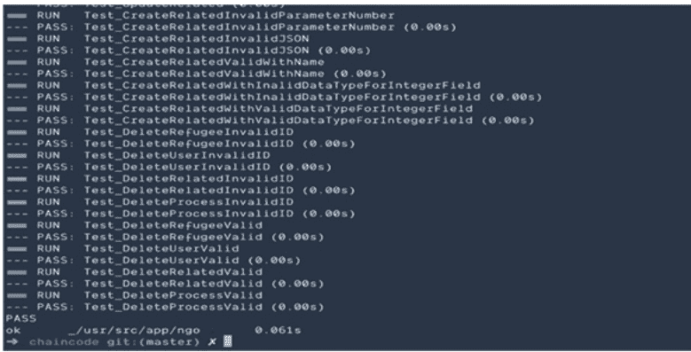

图 (27). 测试用例。

## 结果与讨论

DriveLoop 使所有信息能够汇集到一处，从而便于轻松访问和管理。车辆登记、罚单、保险详情以及与该车辆相关的一切其他内容均集成于此平台。因此，当你登录以了解某辆特定车辆的信息时，你将找到关于它的一切。一个全面、包罗万象的历史。任何对区块链技术略知一梗的人都会告诉你它有多真实。

DriveLoop 使所有信息能够汇集到一处，从而便于轻松访问和管理。车辆登记、罚单、保险详情以及与该车辆相关的一切其他内容均集成于此平台。因此，当你登录以了解某辆特定车辆的信息时，你将找到关于它的一切。一个全面、包罗万象的历史。任何对区块链技术略知一梗的人都会告诉你它有多真实。它的结构使得只有授权人员才能创建条目或更改记录。因此，无需担心数据被篡改或信息被伪造。

根据我们的研究，我们在系统中实施了区块链技术，以维护信任、安全性和清晰度。我们使用了许多技术，其中一种技术是 IoT 和 Ethereum。基于区块链的延迟、吞吐量以及交易准确性，我们测试了我们提出的想法（表 1）。

表 1. 与现有最先进技术的比较。

| Carchain | DriveLoop (我们的应用) |
|---|---|
| 1. 它用于维护租赁汽车的数据。 | 1. 它是购买和出售汽车的自动化流程。 |
| 2. 它使用 Ethereum 平台。 | 2. 它使用 Hyperledger Fabric 平台。 |
| 3. 它是公共区块链。 | 3. 它是私有区块链。 |

## 新颖性与建议

如果你曾经购买过自己的车辆或售出过一辆，或者在任何阶段参与过汽车制造或交易，你就会熟悉车辆登记所带来的繁琐。考虑到市场上的所有车辆在多次转手后都已被售出和转售，要维护每辆车的合法历史记录并在需要时提供，这变得是一项棘手的任务。

但在讨论车辆登记流程的问题之前，我们首先需要了解为什么车辆登记是汽车交易中如此重要的一个方面。车辆所有权变更的次数可能多得让你难以想象。无论你是从销售零部件或整车的角度来看，还是从中间商或向消费者进行最终销售的零售商的角度，亦或是二手车转售的角度，都有大量利益相关者非常想了解他们所购买车辆的完整历史。更不用说保险公司、警察和其他机构，政府也出于各种原因需要对汽车进行监管。

事实是，所有这些利益相关者都需要关于车辆的信息，从其制造过程开始，涵盖首次销售、其涉及的任何事故，以及所有维修和保养记录。这不仅对于维护特定车辆的追踪记录以确定其市场价值至关重要，也对法律和保险目的至关重要 [14]。

车辆登记是一种通过在车辆与其车主之间建立关联来便利记录保存的方式。根据当地法律，这可能是强制性的，也可能不是。这有助于当局在


税收、保险或犯罪侦查目的。此外，它也是汽车经销商跟踪其车辆的一种方式。得益于区块链的引入以及整个车辆登记流程向区块链的过渡，许多这些问题都可以轻松解决。

单词 automobile 源自希腊语 auto，意为“自我”，以及法语 mobile，意为“移动”。汽车的重要性如下：

- a. 汽车等车辆需求的增加，提高了汽车行业司机的收入。
- b. 在这个发展迅速的时代，人们需要快速到达目的地。因此，汽车在此提供帮助并因而变得流行。借助汽车，世界各地的人们可以随意旅行。汽车在国家社会经济发展中起着至关重要的作用。
- c. 汽车行业在汽车、车辆、零部件和配件方面也存在全球共享，比例在美国、韩国等国家范围为 15% 至 40%。
- d. 汽车行业为州预算的应税基础和收入的发展提供了支持。
- e. 它也影响着科学和技术进步。

## 未来研究方向

21世纪，由于先进技术和各种服务，城市发展发生了巨大的转变。如今，研究活动已成为构建更智慧城市的常见做法。智慧城市是可持续性和城市化的迫切解决方案。如今，腐败普遍存在，且主要由穷人承担代价。它就像癌症一样，侵蚀着公民对政府的信心。例如，智慧城市可能导致一个不公正的世界，其中公民或人们被推向边缘角色，并由技术官僚政府进行监管。城市地区人口的增加往往导致停车位问题，并一直是城市规划师、建筑师和管理人员的一大挑战。

在该项目中可以实施的若干未来补救措施如下：

- a. 我们打算添加某些功能，例如通过 GPS 进行位置检测，并根据用户需求在稍后添加更多服务。
- b. 我们还打算向项目中添加保险方。
- c. 我们还打算提高该项目在全球的可扩展性，即超出我国范围 [17, 18]。

## 局限性

这项研究是一个良好的学习过程，也是一次非常满意的经历。然而，有几个因素限制了这些研究人员的研究计划，正如每位研究者所希望的局限性一样。一些因素如下：

- a. 文档和信息访问：所需数据不易获得。文档化不是持续的实践。
- b. 汽车行业：由于规则严格和政策众多，汽车行业的研发和设计高管受到限制。数据共享非常有限。公开和自愿共享信息在企业中不被视为良好做法。

## 结论

有趣的部分，如制造商、公约、客户和汽车机构，可以轻松地被促进以认证和更新车辆的安全功能信息。该解决方案还保证信息更加精确且完全密封，并以安全、经济的形式传输。

## 性能评估

- a. 服务提供商的性能基于服务用户给予他们的评分。
- b. 服务用户的性能基于服务提供商给予他们的评分。
- c. 整个网站的性能基于网站用户给予我们的反馈。
- d. 网站的评论将来自导师、协调员和同行的学生。

物联网 (IoT)、大数据系统和移动性是智慧城市的一些服务。智能停车是智慧城市的关键部分。连接汽车凭借其先进技术减少了事故机会，并帮助驾驶员在其限度内节省时间和汽油。我们的星球越城市化，城市就必须越智慧。未来几天，由于先进技术，智慧城市将容易变得更加智慧。

## 出版同意

不适用。

## 利益冲突

作者声明不存在任何利益冲突，无论是财务上的还是其他方面的。

## 致谢

无。

## 参考文献

- [1] A. Agarwal, D. Goel, A. Tyagi, A. Aggarwal, 和 R. Rastogi, "面向印度社会更好生活方式的更智能方法", 载于：先进计算与智能工程进展，智能系统与计算进展，K. Saeed, N. Chaki, B. Pati, S. Bakshi, D. Mohapatra 编，第 563 卷。Springer: 新加坡，2018 年，第 355-362 页。[http://dx.doi.org/10.1007/978-981-10-6872-0_33]

- [2] R. Rastogi, P. Mondal, 和 K. Agarwal, "中缀到后缀转换的应用与益处详尽综述", 第 2 届可持续全球发展计算国际会议 (INDIACom)，2015 年，第 95-100 页

- [3] A. Singh, R. Gupta, 和 R. Rastogi, "针对交通拥堵问题的车辆追踪系统的新方法", 第 2 届可持续全球发展计算国际会议 (INDIACom)，2015 年，第 169-174 页

- [4] R. Rastogi, R. Mishra, S. Sharma, A. Nigam, 和 P. Arya, "使用逻辑门和密码分析进行数据传输安全", 第 2 届可持续全球发展计算国际会议 (INDIACom)，2015 年，第 101-105 页

- [5] R. Rastogi, S. Agarwal, P. Sharma, U. Kaul, 和 S. Jain, "使用遗传算法对混合数据类型属性进行非监督分类（数值、类别、序数、二进制、比例缩放）", 第三届问题求解软计算国际会议论文集。智能系统与计算进展，第 258 卷，2014 年，第 121-131 页 [http://dx.doi.org/10.1007/978-81-322-1771-8_11]

- [6] B. Rajapandian, V. Harini, D. Raksha, 和 V. Sangeetha, "作为盲人、聋人和哑人辅助工具的新方法", 2017 年第三届感知、信号处理与安全国际会议 (ICSSS)，2017 年，第 403-408 页 [http://dx.doi.org/10.1109/SSPS.2017.8071628]

- [7] S. Arora, J. Maini, P. Mallick, P. Goel, 和 R. Rastogi, "通过 Web Socket 的高效电子学习管理系统", 第 3 届可持续全球发展计算国际会议 (INDIACom)，2016 年，第 509-512 页

- [8] D. Goel, A. Agarwal, 和 R. Rastogi, "面向更好人类生活的住宅社会维护问题新方法", 载于：通信与电力工程，R. Rajesh, B. Mathivanan 编，De Gruyter: 柏林, 波士顿，2017 年，第 177-185 页。[http://dx.doi.org/10.1515/9783110469608-017]

- [9] D. Goel, A. Agarwal, 和 R. Rastogi, "“面向更好人类生活的住宅社会维护问题新方法，” 普适计算城市设计国际期刊，IJUDUC。2016 年 9 月，隶属于澳大利亚国家图书馆", Global Vision School 出版社，澳大利亚塔斯马尼亚州桑迪湾，第 4 卷，第 2 期，第 1-8 页，2016 年。[http://dx.doi.org/10.21742/ijuduc.2016.4.2.01]

- [10] R. Gupta, R. Rastogi, P. Mondal, 和 K. Aggarwal, "基于 GA 的混合数据类型属性聚类（数值、类别、序数、二进制、比例缩放）", BJIT，第 7 卷，第 2 期，第 861-866 页

- [11] R. Sharma, A. Jain, 和 R. Rastogi, "Facebook 照片安全的新面貌，会议录", 第六届当代计算国际会议 (IC3-2013) 会议录，由 Jaypee 信息技术学院和佛罗里达大学共同主办，2013 年 8 月 8–10 日，第 415-420 页。https://ieeexplore.ieee.org/document/6612231 [http://dx.doi.org/10.1109/IC3.2013.6612231]

- [12] M. Pilkington, "区块链技术：原理与应用", 数字化转型研究手册，第 225 页。

- [13] Shwet, S.K. Sharma, 和 R. Rastogi, "帮助残障人士的革命性技术", 第 2 届可持续全球发展计算国际会议 (INDIACom)，第 622-624 页，2015 年。

- [14] R. Rastogi, S. Agarwal, P. Sharma, U. Kaul, 和 S. Jain, "通过遗传算法对混合数据类型属性进行非监督分类的商业分析与决策", BIJIT- 2014，第 6 卷，2014 年，第 1 期，第 683-689 页。http://bvicam.ac.in/bjit/issues.asp?issue=11

- [15] T.N. Pham, M. Tsai, D.B. Nguyen, C. Dow, 和 D. Deng, "基于物联网技术的云端智能停车系统", IEEE Access，第 3 卷，第 1581-1591 页，2015 年。[http://dx.doi.org/10.1109/ACCESS.2015.2477299]

- [16] R. Rastogi, S. Agarwal, P. Sharma, 和 U. Kaul, "高效模糊非监督分类针对混合数据的新 D&C 方法。智能系统与计算进展", 桥接未来的新兴 ICT - 印度计算机协会 (CSI) 第 49 届年会议论集 第 2 卷。智能系统与计算进展，第 338 卷，第 553-563 页 [http://dx.doi.org/10.1007/978-3-319-13731-5_60]

- [17] R. Rastogi, S. Mittal, 和 S. Shekhar, "使用伪随机数生成器的叠加密码学线性算法", 第 2 届可持续全球发展计算国际会议 (INDIACom)，2015 年，第 89-94 页

- [18] S. Srivatava, R. Rastogi, S. Rungta, 和 U. Yadav, "使用链表查找有向图中环的方法论", BIJIT，第 6 卷，第 2 期，第 743-749 页，2014 年。


## 基于去中心化供应链的假药识别

Koyel Datta Gupta, Aditya Gupta, Tanmay Sharma and Aayush Bhatnagar

Department of Computer Science & Engineering, Maharaja Surajmal Institute of Technology, New Delhi 110058, India

**摘要：** 本研究试图通过使用不断发展的区块链技术来克服医疗卫生系统面临的问题。生产和销售药品的制药公司在追踪药物方面面临困难，这反过来又使假药制造商得以利用系统。区块链技术的去中心化能力使我们能够应对现有集中式系统中的问题。区块链帮助我们确保在整个去中心化供应链中保持质量。在药品供应链解决方案中使用区块链，需要从生产商到分销商再到药店追踪药品的有效性。它确保药剂师收到的是原装药物，且药物不会流入灰色市场。在本文中，我们创建的去中心化应用程序使用以太坊运行，并基于区块链技术。由制药公司研发的药物需由官员使用以太坊交易上的智能合约以去中心化的方式进行验证。验证后的药物随后可以在该平台上生产和销售，药物/药品的全部数据和各个阶段都会被追踪和存储。开发此类系统对于促进药品的正常供应和追踪以及避免假冒是必要的。

**关键词：** 区块链，以太坊，智能合约，去中心化应用程序（DApp）。

### 引言

根据最近的研究结果，药物假冒是二三世界国家面临的重大问题之一。个人和公众都因这一现象的影响而面临危险。它们在监管和监察亟待加强或不足的国家，以及药品需求巨大但价格依然昂贵的国家中尤其普遍。在疾病暴发和流行期间，当重要药品供应有限且假冒行为普遍时，它们也十分普遍。

未经授权的制药公司利用其狡猾的头脑和专业知识，开发出无法检测的与真品完全相同的仿制药。假药对消费者有害，因为它们可能含有错误成分，且患者无法识别。成分过量也是常见问题。毒素和污染物有可能引起过敏反应以及不良药物反应。假药浪费人们的钱财，并增加政府的财政负担。此外，它还可能削弱公众对正规治疗有效性的信心。

目前，印度政府缺乏应对印度制造假药问题的有效策略。尽管取得了一些进展，但在打击该国假药经济方面尚未有重大创新。对全球药品行业的彻底研究表明，许多劣质药品源自印度。印度是全球领先的药品出口国之一。因此，假药和正品药物存在混杂的可能。这使得政府部门很难检测假药。这使得印度成为全球最大的假药市场之一。发现这一问题是药品供应链复杂性和缺乏流程完整性造成的。

客户面临的另一障碍是监控仅凭处方可获取的药物。虽然未经处方销售药品违法，但除了打击假药的挑战外，追踪批发商的诚信也很困难，需要独特的策略。区块链药品库存可能带来巨大益处：贴有条形码的药品每次交易时都会被扫描并存入安全的数字区块中。每次交易都被视为一笔交易，并记录在不可更改、去中心化且全球化的区块链技术上。

### 区块链

中本聪首先以流行的加密货币“比特币”形式创建了区块链 [1]。在点对点（P2P）网络中，每个用户被称为节点，发生的交易被分类为区块。然后，这些区块按顺序相互连接。每个节点都关联着一对公钥-私钥。公钥用于识别节点作为发送方或接收方，而相关的私钥由发送方用于签署交易，由接收方用于验证交易。

除了使适当的密钥能够解密和收集信息之外，在实施调整之前，必须在参与节点之间达成协议。这保证了所有区块链账本副本在整个网络中同步。得益于区块链的内置架构（图 1），用户在发生交易时可以随时获得最新的、换句话说是最新的交易副本。每当链上发生交易，整个网络都会更新。这是可能的，因为所有其他网络参与者都会收到一份交易副本。区块链已在多个应用中使用 [2-4]。

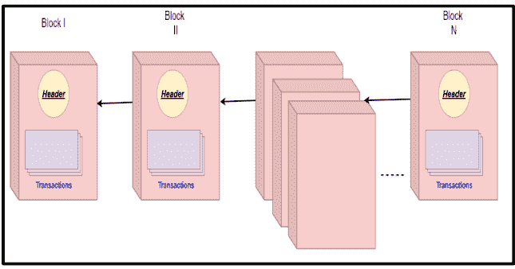

图 (1)。区块链架构。

公有链、私有链和联盟链是区块链的三种类型。公有链上的每个参与者都可以查看和验证网络上发生的任何交易，并参与共识机制。在联盟链中，必须有一个管理节点，该节点最初由网络成员根据实现其业务目标的有效方式选择，例如在公司的情况下。除一个差异外，私有链与前一种类型相似，公众无法访问此类分布式账本中的任何数据。

### 智能合约

去中心化账本也可用于构建自动执行合同，也称为智能合约。它们是一种存储在区块链中的代码形式的数字服务协议，仅在达到特定条件时执行。因此，智能合约可以实现到区块链数据库中，并允许用户基于合同协议创建计算机代码。智能合约中存在合同哈希和合同地址，在随后以安全且不可追溯的方式恢复合同的过程中发挥了重要作用。带有更新和事件驱动框架的智能合约，可能使操纵供应链流程更加容易。例如，IBM 和 Maersk 等商业试点项目最近揭示了他们成功部署区块链技术和智能合约用于货物追踪和贸易融资。

可以使用智能合约提高供应链的效率。药品运输容易受到多种因素的影响，例如高温导致的毒性或接收方付款延迟。各种疫苗，如胰岛素，以及特制药品，必须在低温下储存以避免污染。可以在储存系统内安装温度计以持续监控温度。使用智能合约，如果温度在较长时间内升高到一定水平，警报系统将记录在区块链中。结果，接收者会收到通知，药物未得到妥善处理且可能已被污染。

同样，智能合约可用于在包裹送达接收者时尽快向发送方支付费用。基于区块链网络的智能合约可应用于多个行业；然而，过去的研究揭示了技术和法律方面若干未解决的挑战。合同弱点，例如交易顺序和时间戳依赖、错误处理不当、重入攻击以及调用堆栈问题，就是例子。基于技术开放性，智能合约可能简化参与者之间的义务执行和自动化系统；然而，其长期增长仍需要一种结合技术、经济和合法化方法的多学科策略。

### 供应链

供应链只不过是一张图表，描绘了物品如何通过存储或设立检查点从一个地点移动到另一个地点。从地理位置来看，过去几十年中供应链的覆盖范围发生了巨大变化。该链的功能也发生了巨大变化，由于它使用多种方法在多个阶段验证交易，错误现在极为罕见。在此场景中，主要实体是买方和卖方。因此，如果此过程中任何实体从事非法行为，整个系统都将受损。

在大多数基于区块链的应用中，照片等大文件通常保存在链下，而文本数据则保存在链上。使用区块链，可以追踪特定移动应用及其在整个供应链中的流动。因此，可以利用区块链重新设计过时的药品供应链，从而可能释放互操作性的实际效益。假药进入


在供应链中，当其外观尽可能接近原产品时。凭借精密的印刷工艺和专业知识，仿制二维码并非难事。这造成了一个两难局面：印有相同代码的多个药品包装（其中一个是正品，其余是假冒）可能渗入供应链，而每个包装都被检测为正品。

## 以太坊

以太坊是一个基于区块链的开源软件平台（去中心化），以以太币（ether）作为其加密货币，于2015年7月30日启动。智能合约和分布式应用可以编写和运行，无需担心宕机、控制、欺诈或第三方干预的风险。以太坊既是一种编程语言，也是一个运行在区块链上的平台，软件开发者利用它来创建分布式应用。以太币是在以太坊中使用的一种平台特定的密码学代币。以太坊在2014年为以太币举办了预售，引起了广泛关注。希望在该平台上创建和运行应用的软件开发者。以太币是以太坊平台的一种传输方式。由于其可编程性，以太坊被用作运行大量去中心化应用的平台。

## 相关工作

文献[5]的作者提出了一种基于以太坊区块链的方法，利用智能合约和去中心化离线存储，实现医药供应链中产品的有效追踪。所提方案构建在区块链技术的核心密码学原则之上，以生成供应链事件的不可篡改日志，并使用以太坊区块链内的智能合约来执行对所有利益相关者可用的事件自动记录。所提方案在智能合约中触发的不同函数执行时所消耗的gas方面具有成本效益。Thomas Bocek等人[6]展示了利用物联网（IoT）传感器设备和区块链技术来确认数据的不可篡改性及温度记录的公开可用性，同时最大限度地降低药品供应链的运营成本。为了确保医药品运输的质量控制和法规遵从性，医疗行业采用了多种复杂且严格的环境控制技术。传感器在运输过程中监测每个包裹的温度，以验证是否符合GDP指南。所有数据都传输到区块链上，通过智能合约对产品质量进行评估。

文献[7]的作者试图通过严谨的应用设计与执行，克服区块链采用过程中可能面临的障碍。他们利用区块链在医疗机构之间安全高效地分发保护隐私的预测模型。他们使用智能合约来自动化数据管理流程，在区块链上加密敏感数据，将敏感数据保存在区块链之外，并且仅广播“指针”。文献[8]的作者首先阐述了创建区块链技术的需求，然后讲述了它已被适配的用途。其中一个用例是医疗系统。作者讨论了两个主要应用——数据处理和药品追溯。作者建议了一种可以帮助追踪药品并降低假药可能性的系统。也提出了此类方法的讨论与应用。

文献[9]的作者指出，假冒伪劣是药理学中最严重的问题。主要问题是这些假药引起的副作用（远高于正常药物）。作者还介绍了此类药物在各大洲的分布情况。在线药店及其分布式供应链使得追踪工作变得更加困难。作者提出了一种基于区块链的智能合约解决方案。文献[10]的作者指出，区块链是一项流行的新兴技术。医疗保健是从这类安全技术中获益最多的领域。已陈述了医疗系统中的问题和挑战。作者讨论了区块链在此领域的应用，以及它如何解决这些问题和挑战。还提到了医疗保健中更多可从区块链中获益的服务。

文献[11]的作者声称，生产和运输供应产品的制药公司在追踪和组织药品方面面临困难，这使得假货制造者能够利用当前系统。通过区块链，药品的记录可以被准确确定和追踪，以检查药品的真伪。此类系统的开发和正确实施是下一项重要任务。Neeraj Kumar等人[12]提出，在整个供应链中使用区块链可以解决制造商、分销商和验证组织的许多疑问。他们使用以太坊区块链创建了一个去中心化应用。他们使用区块链的主要原因是其提供的可追溯性和不可篡改性等特性。用户可以将药品或产品追溯至其源头。

文献[13]的作者探讨了区块链在去中心化供应链管理系统中的现状与应用。采用定性方法来描述和预测此类系统中区块链的评估。他们实现了一个系统，以可追溯且不可篡改的方式发布区块链研究论文。类似的程序可以引入其他供应链系统，例如我们的“药品供应链”系统。文献[14]的作者通过使用智能合约解决了假制造商生产的重复药物问题，这些智能合约有助于追踪药品从制造商到患者的供应链流动。为了避免患者用药过量，他们实现了一个移动应用程序，以便患者无法购买过量药物，并且只能凭医生处方购买药物，该处方可以使用附带的二维码扫描器进行验证。

文献[15]的作者解释了医疗系统面临的问题。此类问题的主要原因是缺乏监管以及药品供应链的复杂性。质量保证和透明度将增强整个系统。在实施印度的药品供应链后，大多数问题得以解决。智能合约被用于构建解决方案的信任、安全性和自动化。文献[16]的作者建议了一种将在以太坊区块链上运行的分布式应用，使用智能合约。他们建议将以太坊的工作量证明算法修改为权益证明共识算法，因为它将更具可扩展性，并且更适合药品供应链系统。他们为自己的“药品监控系统”创建了一个GUI门户，制药公司和消费者可以通过扫描药品的条形码来查看药品的源头。

## 方法论

我们提出了一种基于以太坊并使用智能合约的解决方案，用于基于去中心化供应链的假药识别。它确保药剂师收到原装药物，并且药物不会进入灰色市场。

我们所提解决方案的完整供应链流程（图2）如下：

一家制药公司发现一种药物（将查看有关该药物的所有信息，例如药物成分和制药公司名称）并生成一个通用产品代码。药品验证组织随后批准与通用产品代码对应的药物，并根据药物详情生成一个唯一哈希。

制药公司将药物送往制造商进行大规模生产。然后，制药公司将药物送往批发商。


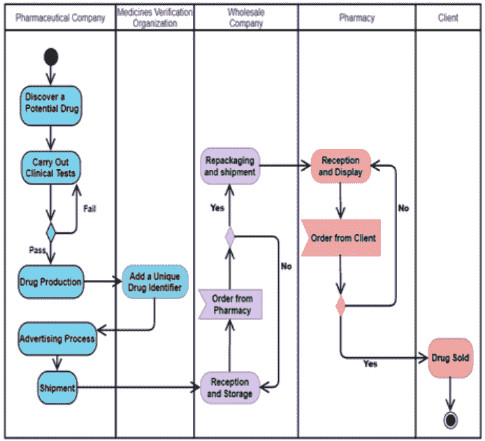

图 (2). 活动图。

批发商随后购买药品并将其销售给零售商。药店购买药品并将其上架销售。消费者从药店购买药品，整个交易过程将被追踪并存储在网站上，供应链中的每一位成员——从制药公司到消费者——都可以查询网站了解交易详情。

该流程将使用智能合约在以太坊交易中实现。相同的序列图如图 (3) 所示。

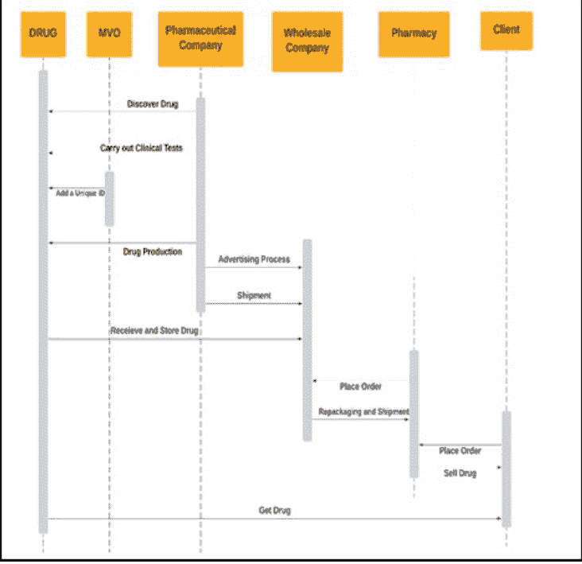

图 (3). 序列图。

供应链中药品/药物的状态包括：发现 — 待售药品最初由制造商设计，批准 — 药品随后将获批准（由 MVO 批准）。生产 — 药品随后由制造商生产，供批发 — 药品允许由批发商购买，供零售（由批发商所有）— 药品随后发送给零售商，待售（由药店所有）— 零售商将药品上架销售，已售出（由客户所有）。交易（图 4）将使用智能合约进行追踪。

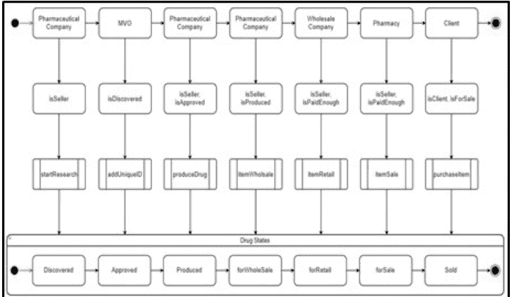

图 (4). 状态图。

## 结论

在本研究中，我们探讨了供应链网络内药品追踪的问题，强调其在打击欺诈药品中的重要性。我们为制药行业创建了一个基于区块链的去中心化药品追踪和溯源系统。由于供应商为每位患者设定了最高限制，客户无法购买过量药物。得益于区块链中的智能合约，药品供应链得到了充分的追踪。所提出的系统是一个概念验证工具，可使区块链技术以去中心化的方式跟踪个体用药数据。通过连续记录，该系统使医疗专业人员、护士、客户和药剂师能够安全、负责任地维护、访问和交换个人医疗信息以及完整的个体用药生命周期。

## 出版同意

不适用。

## 利益冲突

作者声明不存在任何利益冲突，无论是财务上的还是其他方面的。

## 致谢

无。

## 参考文献

- [1] S. Nakamoto, "比特币：一种点对点的电子现金系统", 可在线查阅: https://bitcoin.org/bitcoin.pdf
- [2] M. Sharma, S. Pant, D.K. Sharma, K. Datta Gupta, V. Vashisth, 和 A. Chhabra, "利用深度学习、区块链和联盟为工业物联网启用安全性", Trans. Emerg. Telecommun. Technol., p. e4137, 2020.
- [3] S. Banyal, M. Saxena, 和 D.K. Sharma, IoT 技术中的区块链赋能安全与隐私方案, 2020.
- [4] D.K. Sharma, S. Pant, M. Sharma, 和 S. Brahmachari, 区块链加密货币机制：模型、特性、挑战与应用。区块链技术研究手册。Academic Press, 2020, pp. 323-348. [http://dx.doi.org/10.1016/B978-0-12-819816-2.00013-7]
- [5] A. Musamih, K. Salah, R. Jayaraman, J. Arshad, M. Debe, Y. Al-Hammadi, 和 S. Ellahham, "医疗保健供应链中药品可追溯性的基于区块链的方法", IEEE Access, vol. 9, pp. 9728-9743, 2021. [http://dx.doi.org/10.1109/ACCESS.2021.3049920]
- [6] T. Bocek, B. Rodrigues, T. Strasser, 和 B. Stiller, "无处不在的区块链 - 药品供应链中区块链的用例", 2017 IFIP/IEEE 集成网络与服务管理研讨会 (IM), 2017, pp. 772-777 Lisbon, Portugal. [http://dx.doi.org/10.23919/INM.2017.7978376]
- [7] T.T. Kuo, H.E. Kim, 和 L. Ohno-Machado, "生物医学和医疗保健应用的区块链分布式账本技术", J. Am. Med. Inform. Assoc., vol. 24, no. 6, pp. 1211-1220, 2017. [http://dx.doi.org/10.1093/jamia/ocx068] [PMID: 29016974]
- [8] K. Kumari, 和 K. Saini, "数据处理与药品追溯：区块链与医疗保健相遇以打击假药", International Journal of Scientific & Technology Research, vol. 9, no. 3, pp. 728-731, 2020.
- [9] F. Jamil, L. Hang, K. Kim, 和 D. Kim, "面向智慧医院药品供应链完整性管理的一种新型医疗区块链模型", Electronics (Basel), vol. 8, no. 5, pp. 505-536, 2019. [http://dx.doi.org/10.3390/electronics8050505]
- [10] K. Shuaib, H. Saleous, K. Shuaib, 和 N. Zaki, "用于安全数字化医疗的区块链", J. Pers. Med., vol. 9, no. 3, pp. 35-55, 2019. [http://dx.doi.org/10.3390/jpm9030035] [PMID: 31337080]
- [11] S.R. Bryatov, 和 A. Borodinov, "药品供应链中的区块链技术：基于 Hyperledger Fabric 的商业模型研究", Proc. 国际信息技术与纳米技术会议, vol. 2416, 2019, pp. 134-140. [http://dx.doi.org/10.18287/1613-0073-2019-2416-134-140]
- [12] N.K. Yadav, 和 H.P. Singh, "药品供应链管理区块链", 在：国际大数据、机器学习及其应用会议论文集。网络与系统讲义，S. Tiwari, E. Suryani, A.K. Ng, K.K. Mishra, N. Singh, 编，vol. 150. Springer: Singapore, 2021, pp. 181-190. [http://dx.doi.org/10.1007/978-981-15-8377-3_16]
- [13] S.E. Chang, 和 Y. Chen, "当区块链遇上供应链：当前发展及潜在应用的系统文献综述", IEEE Access, vol. 8, pp. 62478-62494, 2020. [http://dx.doi.org/10.1109/ACCESS.2020.2983601]
- [14] K. Benita, "使用移动应用程序的区块链真实药物使用与追踪", International Journal of Interactive Mobile Technologies, vol. 14, no. 17, pp. 20-32, 2020. [http://dx.doi.org/10.3991/ijim.v14i17.16561]
- [15] A. Kumar, D. Choudhary, M.S. Raju, D.K. Chaudhary, 和 R.K. Sagar, "打击假冒药品：利用区块链技术打击假药行业的定量分析", 第 9 届云计算、数据科学与工程国际会议 (Confluence), 2019, pp. 174-178. [http://dx.doi.org/10.1109/CONFLUENCE.2019.8776891]
- [16] P. Sylim, F. Liu, A. Marcelo, 和 P. Fontelo, "用于检测分销中伪造和劣质药品的区块链技术：药品供应链干预", JMIR Res. Protoc., vol. 7, no. 9, p. e10163, 2018. [http://dx.doi.org/10.2196/10163] [PMID: 30213780]

## 向道路检测迈出重大步伐

Vimal Gaur¹,*

¹ 马哈拉者·苏拉杰马尔理工学院，计算机科学与工程系，贾纳克普里，新德里 110058，印度

## 摘要

已有大量研究致力于提取地表对象，但由于 IoT 和区块链等新兴技术的出现，用于监测地表对象的智能数字地表模型仍是活跃的研究课题。这些技术在量化地表的生态和地理特性方面发挥着重要作用。通过卫星图像检测建筑物、道路和地形的此类技术，对追踪大量人口迁移具有巨大潜力，并有助于城市的地理分析。在本文中，我们探索了一种基于 U-Net 的卷积神经网络方法，用于从卫星影像中提取地表对象。众所周知，每年发生的灾难影响着成千上万的人口，因此必须为救援行动提供合适的机制。为了开展这些救援行动，地理位置预测至关重要。我们的模型在极低损耗率下实现了 60.62% 的合理准确率。

## 关键词

U-Net, 空间处理, 图像分割, 深度学习, 计算机视觉, 下采样与上采样, 跳跃连接。

## 引言

使用过时方法绘制大都市或偏远小镇人口密集区域的详细地图是一个繁琐而费力的过程。大都市地区的人口热点正在迅速变化，其原因不仅在于身体移动，还在于自然引起或人为引起的环境改变，例如天气变化等生活条件的波动，或通过钻探石油导致地下水污染。这表明制图是困难的，尤其是在当局关注度最低的偏远地区。本文旨在解决卫星图像图像分割的更广泛方面，通过将我们的分类定位于像素级别并检查像素是否属于道路/路径-


是或不是。我们开发了一种模型，用于处理处于压力下的受灾地区，并尽早为这些地区提供援助的最高效路线。正如2020年及其周围骇人听闻的爆发所见，COVID-19的爆发检验了许多国家政府的准备情况。通过简单地绘制热点图并计算适当的测试包分发方式，许多国家的病毒影响本可以降到最低。全部这一切，使用像我们这样的深度学习算法，本可以成为一项简单直接的任务。对第三世界国家（如印度）的影响，在那里大众在像这样的大流行病情况下必须立即依赖政府，需要在封锁前预先计算 [1-3]。我们尝试将这一概念扩展到物理世界，而非医学领域。本文解决了由卫星成像获得的图像分割问题。它逐像素地解析图像，并将每个像素分类为道路的一部分。我们使用从 [4] 获得的一组高分辨率图像训练了我们的模型。正如我们从另一项研究 [5] 中了解到的，下采样可以帮助我们简化在高分辨率和小尺寸病变区域方面面临的问题。我们的图像相应地使用二进制掩码进行标记，即给定一张卫星图像作为输入，我们的程序随后能够输出相应的预测二进制掩码，然后将其进一步处理为更具标签和更准确的数据，以帮助我们利用图像分割实现路线增强映射的任务 [6]。

## 相关工作

少数作者 [5] 在 U-Net 以全局和局部模式使用时提取了最高精度。

从卫星图像中提取建筑物、湖泊、船舶等对象并非最近的研究领域。SVM 算法已被用于从高分辨率图像中提取建筑物 [6]。一种称为全卷积网络的不同方法，在当今的图像分割项目中非常普遍，已被应用。

通过对 FCN 网络的外推和进一步构建，我们得到了一种称为 U-Net 的特定类型神经网络，它已在生物医学研究中证明了其价值，并且即使在少量数据集上也能工作。此外，在损失函数和准确度指标方面也进行了类似工作 [7]。在本文中，作者讨论了像素准确度以及正确的准确度指标和损失指标的重要性 [8, 9]。

医学科学领域中的一些其他工作包括在视网膜眼底图像中实现卷积神经网络进行血管分割。神经网络使用二元分类任务将眼底图像中的每个像素分类为血管或非血管。

## 数据集

## 数据选择

我们模型所需的数据集由 1113 张卫星图像及其掩码组成 [4]。该数据集中的图像分辨率非常高，其掩码为黑白。掩码中的白色像素代表道路，其余区域由黑色像素表示。这些在图 (1) 中清晰显示。

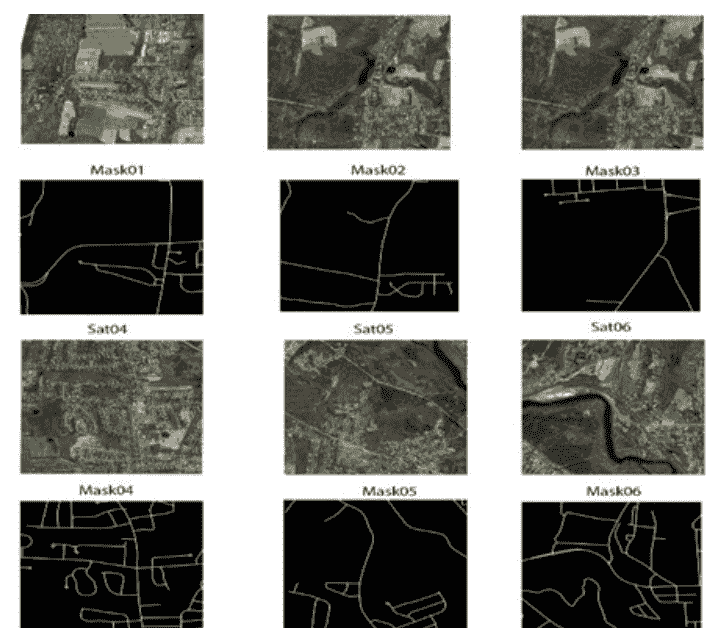

图 (1). 预处理前的图像。

## 预处理

在完全分析数据集后，发现并非所有图像都是完整的。为避免模糊数据，删除了所有这些图像，数据集减少到 979 张图像。训练我们的模型时的另一个大问题是图像大小，尺寸已从 (1500x1500) 缩减为 (256x256)。缩小图像大小的主要好处是增加训练数据集的大小。预处理训练数据集包括 35244 张图像，少量图像样本已在图 (2) 中显示。

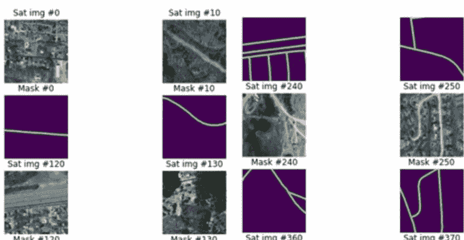

图 (2). 预处理后的图像。

## 方法

在本文中，我们使用卷积神经网络和 U-Net 开发了一种模型，并已在 TensorFlow 中实现。

CNN（卷积神经网络）通过对输入模型的图像执行多个池化和卷积操作，自动从图像中提取有用特征。U-Net 是 CNN 的一种特殊情况，其中卷积和反卷积同时使用。它是图像分割任务中非常强大且精确的模型，并且即使在有限数量的输入上也能工作 [10-12]。

TensorFlow 是开源软件，因为它与 GPU 交互以维持一系列任务的数据流和差分编程。Keras 也是用 Python 编写的开源软件。它在 TensorFlow 之上工作。在深度神经网络的实验中它非常有用，这在 TensorFlow 中可能是一项繁琐的任务，因为它包含不同的库和函数，这些库和函数作为神经网络的构建块。

## 模型架构

在我们的模型中，我们采纳了 U-Net [13] 的基本原理。U-Net 是下采样和上采样的一对。在收缩路径中，下采样激活函数和最大池化从图像中提取特征，而对称的扩展路径对前一步的结果进行上采样并提高提取特征的分辨率。在扩展和收缩路径中，还使用了跳跃连接，这些连接提供上下文和定位。该架构可在下图 (3) 中更清晰地描绘：

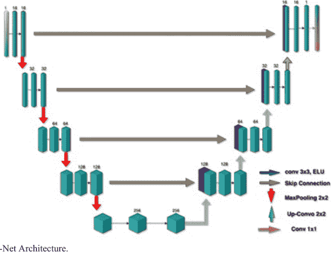

## 模型摘要

上述架构已使用 Keras 实现，并通过脚本中涉及部分的快照如下所示。我们的模型以 (256, 256, 3) 维度的输入开始，经过 U-Net 的各个部分后，在批归一化 2 之后减少到 (128,128,32)。

类似的层对新图像输入执行相同的功能，并依次将其减少到 (64, 64, 64)、(32, 32, 128)、(16, 16, 256)，分别在批归一化 4、批归一化 6 和批归一化 8 之后。此过程称为收缩，其中进行特征的下采样，如下图 (4 和 5) 所示。

| 层 (类型) | 输出形状 | 参数数 | 连接到 |
|---|---|---|---|
| input_1 (InputLayer) | (None, 256, 256, 3) | 0 | |
| conv2d_1 (Conv2D) | (None, 256, 256, 16) | 448 | input_1[0][0] |
| batch_normalization_1 (BatchNormalization) | (None, 256, 256, 16) | 64 | conv2d_1[0][0] |
| dropout_1 (Dropout) | (None, 256, 256, 16) | 0 | batch_normalization_1[0][0] |
| conv2d_2 (Conv2D) | (None, 256, 256, 16) | 2320 | dropout_1[0][0] |
| batch_normalization_2 (BatchNormalization) | (None, 256, 256, 16) | 64 | conv2d_2[0][0] |
| max_pooling2d_1 (MaxPooling2D) | (None, 128, 128, 16) | 0 | batch_normalization_2[0][0] |
| conv2d_3 (Conv2D) | (None, 128, 128, 32) | 4640 | max_pooling2d_1[0][0] |
| batch_normalization_3 (BatchNormalization) | (None, 128, 128, 32) | 128 | conv2d_3[0][0] |
| dropout_2 (Dropout) | (None, 128, 128, 32) | 0 | batch_normalization_3[0][0] |
| conv2d_4 (Conv2D) | (None, 128, 128, 32) | 9248 | dropout_2[0][0] |
| batch_normalization_4 (BatchNormalization) | (None, 128, 128, 32) | 128 | conv2d_4[0][0] |
| max_pooling2d_2 (MaxPooling2D) | (None, 64, 64, 32) | 0 | batch_normalization_4[0][0] |
| conv2d_5 (Conv2D) | (None, 64, 64, 64) | 18496 | max_pooling2d_2[0][0] |
| batch_normalization_5 (BatchNormalization) | (None, 64, 64, 64) | 256 | conv2d_5[0][0] |
| dropout_3 (Dropout) | (None, 64, 64, 64) | 0 | batch_normalization_5[0][0] |
| conv2d_6 (Conv2D) | (None, 64, 64, 64) | 36928 | dropout_3[0][0] |
| batch_normalization_6 (BatchNormalization) | (None, 64, 64, 64) | 256 | conv2d_6[0][0] |
| max_pooling2d_3 (MaxPooling2D) | (None, 32, 32, 64) | 0 | batch_normalization_6[0][0] |
| conv2d_7 (Conv2D) | (None, 32, 32, 128) | 73856 | max_pooling2d_3[0][0] |
| batch_normalization_7 (BatchNormalization) | (None, 32, 32, 128) | 512 | conv2d_7[0][0] |
| dropout_4 (Dropout) | (None, 32, 32, 128) | 0 | batch_normalization_7[0][0] |
| conv2d_8 (Conv2D) | (None, 32, 32, 128) | 147584 | dropout_4[0][0] |
| batch_normalization_8 (BatchNormalization) | (None, 32, 32, 128) | 512 | conv2d_8[0][0] |
| max_pooling2d_4 (MaxPooling2D) | (None, 16, 16, 128) | 0 | batch_normalization_8[0][0] |
| conv2d_9 (Conv2D) | (None, 16, 16, 256) | 295168 | max_pooling2d_4[0][0] |
| batch_normalization_9 (BatchNormalization) | (None, 16, 16, 256) | 1024 | conv2d_9[0][0] |


| 层 | 输出形状 | 参数数量 | 连接到 |
| :--- | :--- | :--- | :--- |
| dropout_5 (Dropout) | (None, 16, 16, 256) | 0 | batch_normalization_9[0][0] |
| conv2d_10 (Conv2D) | (None, 16, 16, 256) | 590080 | dropout_5[0][0] |
| batch_normalization_10 (BatchNormalization) | (None, 16, 16, 256) | 1024 | conv2d_10[0][0] |
| conv2d_transpose_1 (Conv2DTranspose) | (None, 32, 32, 128) | 131200 | batch_normalization_10[0][0] |
| concatenate_1 (Concatenate) | (None, 32, 32, 256) | 0 | conv2d_transpose_1[0][0] batch_normalization_8[0][0] |
| conv2d_11 (Conv2D) | (None, 32, 32, 128) | 295040 | concatenate_1[0][0] |
| batch_normalization_11 (BatchNormalization) | (None, 32, 32, 128) | 512 | conv2d_11[0][0] |
| dropout_6 (Dropout) | (None, 32, 32, 128) | 0 | batch_normalization_11[0][0] |
| conv2d_12 (Conv2D) | (None, 32, 32, 128) | 147584 | dropout_6[0][0] |
| batch_normalization_12 (BatchNormalization) | (None, 32, 32, 128) | 512 | conv2d_12[0][0] |
| conv2d_transpose_2 (Conv2DTranspose) | (None, 64, 64, 64) | 32832 | batch_normalization_12[0][0] |
| concatenate_2 (Concatenate) | (None, 64, 64, 128) | 0 | conv2d_transpose_2[0][0] batch_normalization_6[0][0] |
| conv2d_13 (Conv2D) | (None, 64, 64, 64) | 73792 | concatenate_2[0][0] |
| batch_normalization_13 (BatchNormalization) | (None, 64, 64, 64) | 256 | conv2d_13[0][0] |
| dropout_7 (Dropout) | (None, 64, 64, 64) | 0 | batch_normalization_13[0][0] |
| conv2d_14 (Conv2D) | (None, 64, 64, 64) | 36928 | dropout_7[0][0] |
| batch_normalization_14 (BatchNormalization) | (None, 64, 64, 64) | 256 | conv2d_14[0][0] |
| conv2d_transpose_3 (Conv2DTranspose) | (None, 128, 128, 32) | 8224 | batch_normalization_14[0][0] |
| concatenate_3 (Concatenate) | (None, 128, 128, 64) | 0 | conv2d_transpose_3[0][0] batch_normalization_4[0][0] |
| conv2d_15 (Conv2D) | (None, 128, 128, 32) | 18464 | concatenate_3[0][0] |
| batch_normalization_15 (BatchNormalization) | (None, 128, 128, 32) | 128 | conv2d_15[0][0] |
| dropout_8 (Dropout) | (None, 128, 128, 32) | 0 | batch_normalization_15[0][0] |
| conv2d_16 (Conv2D) | (None, 128, 128, 32) | 92488 | dropout_8[0][0] |
| batch_normalization_16 (BatchNormalization) | (None, 128, 128, 32) | 128 | conv2d_16[0][0] |
| conv2d_transpose_4 (Conv2DTranspose) | (None, 256, 256, 16) | 2064 | batch_normalization_16[0][0] |
| concatenate_4 (Concatenate) | (None, 256, 256, 32) | 0 | conv2d_transpose_4[0][0] batch_normalization_2[0][0] |

Fig. (5). 系统中实现的 Keras 模型摘要。

在下采样和上采样之间使用了丢弃、最大池化 2D、卷积层等，其功能如下：

- 丢弃层（Dropout）：丢弃层简单地用于避免过拟合。它随机对输出层进行子采样，从而避免降低网络容量或网络变薄。
- 最大池化 2D（Maxpooling2d）：它通过固定大小的滤波器扫描输入，得到包含最突出特征的特征图。其滤波器从特征图的区域中选择最大元素。
- 卷积层（Convolution）：卷积层是任何神经网络的核心。对输入简单地应用滤波器即可激活特征。此外，重复激活会生成特征图，随后由最大池化 2D 层使用。准确度指标和损失函数的伪代码分别在图（6 和 7）中显示：

```
#accuracy Metric
from keras import backend as K
def iou_coef(y_true, y_pred, smooth=1):
    intersection = K.sum(K.abs(y_true * y_pred), axis=[1,2,3])
    union = K.sum(y_true,[1,2,3])+K.sum(y_pred,[1,2,3])-intersection
    iou = K.mean(((intersection + smooth) / (union + smooth)), axis=0)

    return iou
```

Fig. (6). 使用准确度和损失指标确定的准确度指标。

```
#loss function
def dice_coef(y_true, y_pred, smooth = 1):
    y_true_f = K.flatten(y_true)
    y_pred_f = K.flatten(y_pred)
    intersection = K.sum(y_true_f * y_pred_f)
    return (2. * intersection + smooth) / (K.sum(y_true_f) + K.sum(y_pred_f) + smooth)

def soft_dice_loss(y_true, y_pred):
    return 1-dice_coef(y_true, y_pred)
```

Fig. (7). 损失函数。

在样本下采样并提取特征后，模型开始上采样。另一个需要注意的重要点是，选择性下采样到 U-Net 镜像侧的连接（称为跳跃连接），这有助于编码器-解码器类架构在预测中检索可能在通过各种层处理过程中丢失的细节。

## 分割与训练

在对数据集进行预处理并定义模型后，我们需要将数据分割为训练样本和测试样本。训练数据包含 80% 的图像，其余 20% 的图像对应来自样本的测试数据。该分割如图（8）所示。

```
TRAIN SET
(22070, 256, 256, 3)
(22070, 256, 256, 1)
TEST SET
(5518, 256, 256, 3)
(5518, 256, 256, 1)
```

Fig. (8). 训练集和测试集。

我们的模型在训练第 48 个 epoch 后停止训练，因为损失值不再改善，从而触发了早停，这根据条件是合适且恰当的。超参数优化已完成，参数如下图（9）中列出。

```
EPOCHS = 100
LEARNING_RATE = 0.0001
BATCH_SIZE = 16
```

Fig. (9). 超参数。

## 结果

我们模型的训练和早停产生了 24.462% 的损失和 60.62% 的准确度。

以下是在不属于训练和测试分割的独立图像集上获得的预测。从预测图像可以看出，结果相当不错。可以看到在图（10 和 11）中，预测准确度在很大程度上取决于图像的输入分辨率。

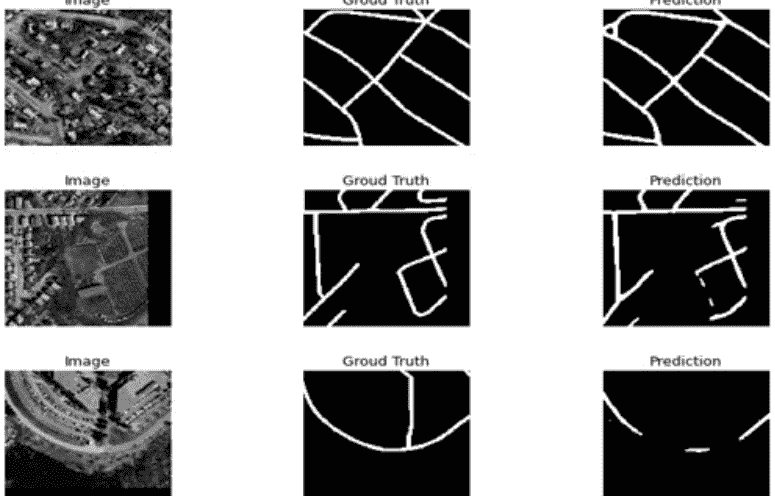

Fig. (10). 预测。


Fig. (11). 预测。

此外，当上述网络与 VGG16 编码器、SegNet 等其他预训练模型配对时，准确度还可以进一步提高 [14]。

## 局限性与未来工作

由于捕获的图像分辨率不高，训练模型需要非常大的计算能力。此外，图像分割取决于输入图像的类型。使用该模型的预测准确度与图像分辨率成正比。这意味着分辨率可以进一步提高。

其次，我们可以逐步专注于道路检测，因为有些道路宽一些，有些窄一些。这种分类有可能颠覆道路检测的图像分割，因为在宽道路的情况下，我们将拥有先检测其边界的自由或灵活性，而与整个道路相比，检测边界是一项相当容易的任务。

## 结论

在本文中，我们在对从数据集接收的图像进行掩码后训练了模型。数据集由通过卫星成像捕获的 2D 图像组成，我们使用与 U-NET 相关的 CNN 架构开发了模型。此外，Keras 库帮助高效地处理图像或运动的语义分割问题。Keras 在 TensorFlow 之上构建了一个强大的环境，也许不是新颖的模型，但具有合理的准确度。

可扩展性和准确度方面的不足仍然存在，但它们通过更深入的理解为解决该问题的未来发展打开了新的大门。

## 出版同意

不适用。

## 利益冲突

作者声明不存在任何利益冲突，无论是财务上的还是其他方面的。

## 致谢

无。

## 参考文献

- [1] Z. Li, X. Chen, W. Zhou, Y. Zhang, 和 J. Yu，“Pose2Body: 基于姿态的人体部件分割”，2019 年 IEEE 多媒体与博览会国际会议（ICME），第 640-645 页，2019 年。[http://dx.doi.org/10.1109/ICME.2019.00116]

- [2] L. Shen, 和 R.M. Rangayyan，“基于分割的高分辨率医学图像压缩无损图像编码方法”，IEEE Trans. Med. Imaging, vol. 16, no. 3, 第 301-307 页，1997 年。[http://dx.doi.org/10.1109/42.585764] [PMID: 9184892]

- [3] E. Drelie Gelasca, J. Byun, B. Obara, 和 B.S. Manjunath，“生物医学图像分割的评估与基准”，第 15 届 IEEE 图像处理国际会议，pp. 1816-


- 1819, 2008.
  [http://dx.doi.org/10.1109/ICIP.2008.4712130]

- [4] Y. Hua, S. Lobry, L. Mou, D. Tuia, and X.X. Zhu, "标签噪声下多标签航空图像分类学习：一种基于词嵌入的正则化方法", IGARSS 2020 - 2020 IEEE 国际地球科学与遥感研讨会, pp. 525-528, 2020.
  [http://dx.doi.org/10.1109/IGARSS39084.2020.9324069]

- [5] Z. Yan, X. Han, C. Wang, Y. Qiu, Z. Xiong, and S. Cui, "用于眼底图像中高分辨率视网膜病变分割的相互局部-全局 U-Net 学习", IEEE 第 16 届生物医学成像国际研讨会 (ISBI 2019), pp. 597-600, 2019.
  [http://dx.doi.org/10.1109/ISBI.2019.8759579]

- [6] O Benarchid, and N Raissouni, "用于郊区超高分辨率卫星影像中基于对象的建筑物提取的支持向量机：以摩洛哥特图安为例的案例研究", IAES 人工智能国际期刊, vol. 1:2, no. 1, 2013.

- [7] E. Fernandez-Morales, R. Martins, D. Wolf, and P. Rives, "语义分割评估的新指标：利用全局和轮廓精度", 2018 IEEE 智能车辆研讨会 (IV), 2018 pp. 1051-1056
  [http://dx.doi.org/10.1109/IVS.2018.8500497]

- [8] S. Ji, S. Wei, and M. Lu, "用于开放航空和卫星影像数据集中多源建筑物提取的全卷积网络", IEEE Trans. Geosci. Remote Sens., vol. 57, no. 1, pp. 574-586, 2019.
  [http://dx.doi.org/10.1109/TGRS.2018.2858817]

- [9] Y. Chen, L. Cheng, M. Li, J. Wang, L. Tong, and K. Yang, "基于机载 LiDAR 数据的建筑物屋顶检测与重建多尺度网格方法", IEEE J. Sel. Top. Appl. Earth Obs. Remote Sens., vol. 7, no. 10, pp. 4081-4094, 2014.
  [http://dx.doi.org/10.1109/JSTARS.2014.2306003]

- [10] Y. Song, and H. Yan, "图像分割技术概述", 2017 亚洲建模研讨会 (AMS), 2017 pp. 103-107
  [http://dx.doi.org/10.1109/AMS.2017.24]

- [11] J. Long, E. Shelhamer, and T. Darrell, "语义分割的全卷积网络", 2015 IEEE 计算机视觉与模式识别会议 (CVPR), 2015 pp. 3431-3440
  [http://dx.doi.org/10.1109/CVPR.2015.7298965]

- [12] H. Monajemi, D.L. Donoho, and V. Stodden, "使大规模计算实验变得轻松", 2016 IEEE 大数据国际会议 (Big Data), 2016 pp. 2368-2373
  [http://dx.doi.org/10.1109/BigData.2016.7840870]

- [13] W. Weng, and X. Zhu, "INet：生物医学图像分割的卷积网络", IEEE Access, vol. 9, pp. 16591-16603, 2021.
  [http://dx.doi.org/10.1109/ACCESS.2021.3053408]

- [14] B. Bischke, P. Helber, J. Folz, D. Borth, and A. Dengel, "基于深度神经网络的建筑物足迹分割多任务学习", 2019 IEEE 图像处理国际会议 (ICIP), 2019 pp. 1480-1484
  [http://dx.doi.org/10.1109/ICIP.2019.8803050]

## 主题索引

### A

- 访问控制机制 66
- 临时参与规则 47
- 聚集 4
- 援助 51, 67, 70, 74, 76, 159
- 自动化 70
- 发展规划 51
- 空气污染 103
- 算法技术 102
- 算法 8, 33, 35, 36, 37, 38, 39, 63, 97, 99, 101, 102, 103, 108, 109, 159
  - 密钥加密 33
  - 学习 159
  - 数学 8
  - 简单移动平均 108
  - 时间序列 97, 99
- 合并 89
- 环境辅助生活 (AAL) 97
- 改善 1
- 应用 13, 15, 47, 48, 49, 68, 70, 75, 78, 83, 113, 116, 117, 118, 121, 123
  - 基于移动设备 49
- 应用程序 32, 66, 67, 120, 149, 150
  - 基于区块链 149
  - 健康跟踪 66
- 架构 1, 34, 48
  - 基础区块链 34
  - 客户端-服务器 48
  - 安全区块链 1
- 基于属性的加密 (ABE) 2, 33, 34
  - 基于区块链的分布式 34
- 可审计性 9
- 真实性 1, 7, 8, 9, 67, 151
- 自动化数据管理流程 151
- 自动化系统 149
- 汽车 114, 116, 118, 119, 141, 142, 143
  - 代理机构 143
  - 工程 118
  - 行业 119, 142
  - 制造业 114, 116, 141

### B

- 基于分布式属性加密 (BDABE) 34
- BFT 协议 38
- 计费 74, 78
  - 传统 74
- 二分类任务 160
- 比特币区块链 13, 16, 35, 62, 81
- BitTorrent 16
  - 客户端平台 16
  - 平台 16
- 区块链 6, 7, 8, 9, 12, 14, 15, 16, 28, 29, 33, 38, 49, 77, 78, 89, 90, 136, 148
  - 架构 6, 148
  - 共识机制 77
  - 联盟 89, 148
  - 数据库 148
  - 生态系统 16
  - 加密数据 12
  - 临床试验管理中的应用 90
  - 账本副本 148
  - 网络 7, 8, 9, 14, 15, 28, 38, 49, 78
  - 操作 8
  - 隐私保护 33
  - 技术 136
  - 交易 29
- 基于区块链 16, 65, 72, 81, 155
  - EMR 管理系统 81
  - 土地登记系统 65
  - 支付系统 16
  - 系统 72, 155
- 创世块 7, 62
- 血液 67, 110, 159
  - 血压 67, 110
  - 血管 159
- 提升效率 96
- 故障 3, 4, 9
  - 概率，降低 9
- 企业 3, 32, 77, 147
  - 盈利的 77
  - 世界药房 147

### C

- 拜占庭 28, 38, 63, 73
  - 一致性协议 (BA) 28
  - 容错 (BFT) 28, 38, 63, 73
- 癌症 83, 142
- 卡迈克尔欧拉函数 36
- 摄氏温度 104
- 云 2, 31, 55, 96, 98
  - 弹性 31
- 基于云 48
  - 架构 48
  - 医疗保健系统 48
- 云存储 1, 12
  - 存储数据 12
  - 系统 1
- CNN 架构 168
- 通信 14, 15, 19, 20, 21, 25, 33, 39, 70, 116, 119, 120, 121
  - 跨分片 14
  - 加密 21
  - 机器对机器 70
  - 顺畅 15
  - 同步 14
- 计算 15, 19, 29, 36, 38, 82, 113, 116
  - 过剩 82
  - 重型 29
  - 算力 15, 19
  - 过程 36
- 计算的 13, 37, 38, 39
  - 算力 13, 37, 38, 39
  - 工作 62
- 计算机视觉 158
- 计算能力 78
- 配置授权技术 49
- 连接性 20, 116
  - 大规模设备 116
- 共识算法 36, 39, 46, 62, 63, 69, 73, 77, 79, 82, 89
  - 动态 39
  - 鲁棒 62
- 一致性 21, 57, 87
- 钱包 57
- 合同 73, 78, 83, 149
  - 基于区块链 83
- 卷积神经网络 158
- 犯罪智能合约 (CSC) 78
- 加密货币 46, 61, 74, 80, 89, 150
- 密码学的 5, 66
  - 原理 66
  - 技术 5
- 密码学 33, 150
  - 非对称 33
- 密码 15, 31
  - 经济学 31
  - 代币 15
- 网络 1, 113, 116
  - 物理系统 (CPS) 113, 116
  - 安全 1
- 周期 116, 141
  - 完整个体用药 155

### D

- 数据库 3, 4, 6, 9, 10, 11, 12, 13, 40, 66, 67, 82, 99, 101, 102, 103, 106, 113
  - 管理系统 67
  - 系统，鲁棒 66
  - 技术 113
- 数据 5, 12, 19, 20, 68, 69, 80
  - 完整性，医疗 80
  - 冗余过程 19
  - 安全 5, 69
  - 实现区块链的存储框架 12
  - 交换层 20
  - 验证 68
- 数据集 13, 106, 159, 160, 165, 168
- 分散式存储网络 30
- 去中心化 1, 4, 5, 8, 9, 22, 24, 26, 29, 30, 33, 39, 47, 51, 52, 57, 117, 151
  - 数据库系统 4
  - 天然 9
  - 网络 5, 22, 24, 26, 30, 33, 39, 52
  - 存储系统 47
  - 供应链管理系统 151
- 系统 1, 4, 5, 8, 24, 29, 39, 51, 57, 117
- 解密方程 36
- 深度学习 158
- 防御机制 19
- 设计 47, 85, 90, 118, 119, 127
  - 系统架构 127
- 设备 10, 20, 44, 52, 61, 69, 85, 96, 104, 109, 116
  - 感知 104
  - 温度传感器 109
  - 可穿戴健康监测 61
- 数字医疗 47
- 心脏疾病 83
- 分布式 11
  - 版本控制系统 (DVCS) 11
- 药物 48, 61, 67, 78, 146, 147, 149, 151, 152, 154
  - 重复 151
  - 欺诈 147
  - 正常 151
  - 监控系统 152
  - 运输 149
  - 验证的 146
- 药品供应链 150, 151, 152
  - 系统 151
- 动态网络 29

### E

- 经济 113, 116, 120
  - 国家 113
- 生态系统 45, 48, 72, 83, 115
  - 基于区块链的综合医疗 83
  - 健康保险 72
  - 车辆登记 115
- 患者记录的高效管理 48
- 传统 EHR 系统 69
- 选举 64
  - 咨询委员会 64
  - 选举结果，为期一个月 64
- 电子 48, 50, 57, 61, 65, 66, 67, 68, 69, 85
  - 电子健康记录 (EHR) 48, 50, 57, 61, 65, 66, 67, 68, 69, 85
  - 电子病历 (EMRs) 61, 65, 85
- 椭圆曲线数字签名算法 (ECDSA) 35
- 加密的 55, 151
  - 通信信道 55
  - 敏感数据 151
- 加密 36, 66
  - 数据 66
  - 方程 36
- 能量 46, 104
  - 热量 104
- 爱沙尼亚健康信息系统法案 83
- 以太坊 13, 16, 30, 31, 49, 62, 80, 146, 150, 151, 152, 153
  - 和比特币区块链 16
  - 区块链 13, 30, 31, 49, 62, 80, 150, 151, 152
  - 交易 146, 153
- 交换 49, 72, 81, 117, 120, 122, 147, 155
  - 金融 117, 120
  - 顺畅 81

### F

- 故障 1, 21, 28, 32
- Filecoin 26, 27, 29, 39
  - 区块链 27
  - 网络 26, 27, 29, 39
- 文件 11, 16, 17, 18, 20, 23, 24, 26, 29, 74, 121
  - 配置 121
  - 共享系统 24
  - 存储 26, 29
- 金融 1, 117
  - 行业 117
  - 部门 1
- 金融系统 81
- 金融科技 13
  - 公司 13
  - 行业 13
- 缺陷 5, 46, 77
  - 固有安全性 77


- 预测准确性 108
  - 测量 108
- 预测 96, 99, 100, 101, 107
  - 方法 100
- 框架 70, 71, 77, 78, 84
  - 基于区块链的 70
  - 电子的 77
  - 医疗设施区块链 78
  - 健壮的 71
  - 远程医疗 84
- 欺诈 50, 51, 73, 74, 115, 147, 150
  - 健康保险 73
  - 药品市场 147
- 欺诈性药品 155
- 功能，视频会议 110
- 函数 23, 29, 50, 53, 62, 63, 85, 88, 104, 150, 161, 162, 164
  - 下采样激活 162
  - 加密 88
  - 不可逆的 62

## G

- GemOS 自动化网络 81
- 通用领域模型架构 (GDMA) 98

## H

- 哈希函数 17, 22, 45, 62
  - 加密的 45, 62
- 哈希 7, 11, 20, 22, 77, 113
  - 算法 22, 113
  - 加密的 11, 77
  - 函数 22
- 医疗保健 49, 80, 83, 84, 117
  - 架构 49
  - 框架 80, 84
  - 网关 83
  - 基础设施 83
  - 问题 117
  - 制造 117
- 医疗记录 45, 48, 77
  - 电子的 48
- 医疗系统 44, 48, 49, 151, 152
  - 基于云的 48
  - 基于安全普适社交网络的 49
- 健康 66, 98
  - 健康保险隐私与责任法案 (HIPAA) 66
  - 监测 98
- 混合的 18, 30, 51
  - 网络 18, 51
  - 可扩展系统 44
  - 系统 30
- Hyperledger 区块链 84
- 超参数优化 166

## I

- 身份管理，基于区块链的 64
- 图像 44, 158, 159, 160, 161, 162, 165, 166, 167, 168
  - 高分辨率的 159
  - 大尺寸放射学的 66
  - 分割 158, 159, 167, 168
- 不可更改记录 6
- 不可或缺的 1, 61, 65
  - 系统 61
  - 工具 1, 65
- 行业 12, 13, 61, 67, 83, 90, 96, 119, 142, 143, 149
  - 汽车 119, 142, 143
  - 现实世界的 12
- 信息 1, 3, 4, 6, 11, 12, 14, 16, 24, 40, 50, 64, 69, 74, 75, 76, 113, 119, 140, 143
  - 汽车 113
  - 关键的 74
  - 敏感的 1, 75, 76
  - 系统 113
  - 透明度 40
- 基础设施 83, 113
  - 基于区块链的 83
- 固有技术问题 77
- 保险 45, 50, 51, 72, 73, 74, 75, 81, 83, 84, 85, 114, 120, 141, 142
  - 机构 73, 85, 113, 114, 120, 141
  - 索赔 72, 75, 84
  - 公司 45, 50, 72, 73, 74, 81, 83
- 传感器集成 99
- 医疗物联网 (IoMT) 70, 71, 89, 90
- 行星间的 1, 16, 21, 23, 25, 26, 31
  - 文件系统 1, 16, 21
  - 命名系统 (IPNS) 23, 26, 31
- 物联网 44, 70, 116
  - 设备 44
  - 使用云存储的服务 70
  - 技术 116
- 基于物联网的 48, 51, 99
  - 应用 48
  - 医疗系统 51
  - 远程患者监测系统 99
- IP 地址 22, 23
- IPFS 项目 25

## L

- Linux 基金会 115
- 本地版本控制系统 (LVCS) 11
- 肺活量传感器 103

## M

- 机器学习 25
- 恶意活动 12
- 强制性健康保险计划 72
- 制造商 113, 120, 122, 123, 124, 132, 138, 151, 152, 154
  - 汽车车辆 120
- 市场 70, 72, 152
  - 全球健康保险 72
  - 全球 IoMT 70
- 大规模生产 152
- 均值 108
  - 绝对偏差 (MAD) 108
  - 均方误差 (MSE) 108
- 机制实现 5
- MediBchain 承诺匿名性 88
- 医疗 44, 49, 52, 62, 65, 67, 68, 71, 72, 74, 75, 77, 80, 81, 83, 84, 85
  - 账单 74, 75
  - 数据 67, 71, 77, 80, 81, 84, 85
  - 设备 61, 70
  - 医疗保险 72
  - 互操作网关 83
  - 记录 44, 49, 52, 62, 65, 68, 69, 74, 77, 81, 84, 85
  - 研究人员 68, 84
- 药品供应链 146, 152
  - 解决方案 146
  - 系统 152
- 药品验证组织 152
- 方法 12, 35, 49, 64, 109, 118, 149
  - 加密的 35
  - 电子签名 118
  - 合法化 149
  - 天真的 109
  - 链外安全 49
  - 传统投票 64
  - 多功能的 12
- 模型驱动树参考模型 (MDTRM) 98
- 现代经济 113
- 跨国公司 (MNCs) 75

## N

- 国家 146, 159
- 原生加密货币 26
- 网络 22, 78, 118, 149, 159, 160, 161, 164
  - 基于区块链的 149
  - 配置 118
  - 拥塞 78
  - 神经的 159, 160, 161, 164
  - 连接良好的 22
- 网络互联 25, 31
  - 系统可操作性 25

## O

- 链外区块链 15

## P

- 对 55, 147, 162
  - 公私钥 55, 147
- 基于纸张的 2, 72
  - 记录 72
  - 系统 2
- 支付处理平台 46
- 个人 67, 69, 83, 85
  - 护理路径 (PCPs) 83
  - 健康记录 (PHR) 67, 69, 85
- 处理，基于云的 98
- 产品 6, 75, 76, 123, 134, 151
  - 基于区块链的 123, 134
  - 危险的 76
- 生产过程 67
- 心理档案 32
- 公共区块链 9, 15, 47, 89, 141, 148
- 公钥 1, 20, 21, 28, 33, 34, 35, 36, 54, 55, 56, 71
  - 密码学 71
- 谜题，数学的 37

## Q

- 二维码 55, 150

## R

- 冗余拜占庭容错 (RBFT) 38
- 注册合同 (RC) 81
- 仓库 10, 11, 80, 86
  - 启用区块链的全球 80
- RTO 数据 132

## S

- 保险箱 32
- 构建可扩展去中心化密钥系统 44
- 安全去中心化记录 84
- 安全 32, 33, 48, 71, 77
  - 算法 71
  - 加密的 48
  - 框架 33
  - 风险，不断增长的网络 32
  - 威胁 77
- 分割 159, 168
  - 语义的 168
- 传感器 67, 70, 98, 99, 101, 104, 105, 110, 115, 117, 150
  - 设备 150
  - 测量 110
  - 无线网络 98
- SERP 排名 25
- 接口快照 136
- 社交媒体平台 25
- 软件 10, 68, 69, 121, 122, 123, 124, 135, 139, 150
  - 开发人员 150
  - 接口 122
  - 专业人员 10
  - 版本控制 10
- 空间处理 108
- 利益相关者，医疗 77, 80, 81, 89
- 存储网络 19, 20
- 结构 83, 123, 134
  - 双区块链 83
  - 模块化区块链 123, 134
- 供应链 75, 76, 77, 90, 147, 149, 151, 155
  - 基于区块链的 76
  - 管理 75, 76, 77, 90
  - 用药 147
  - 网络 155
  - 流程 149
  - 系统 151
- 外科感染 117

## T

- 技术 68, 70, 151, 158
  - 新兴的 158
  - 流行新兴的 151
  - 传统医疗 68
  - 无线 70
- 远程医疗市场 84
- 远程医疗 61
- 三时间序列预测技术 107
- 时间序列预测技术 103
- 代币应用 84
- 跟踪 65, 67, 70, 75, 76, 115, 146, 150, 151, 155, 158
  - 有效产品 150
  - 所有权记录 65
  - 实时 75
- 事务 6, 7, 8, 9, 12, 13, 14, 15, 27, 28, 36, 37, 62, 74, 78, 79, 121, 147, 148, 153
  - 完成 7
  - 数据 7, 78, 121
  - 伪造的 36
  - 流程 13, 153
  - 反转 78
  - 记录 14, 62
- 事务验证 14
- 传输数据 96
- 转换 69, 117
- 透明度 4, 6, 57, 61, 74, 75, 76, 113, 117, 137, 138
- 运输 25, 113
  - 机动车 113
- 交通运输 116, 150
- 治疗 68, 80, 84, 147
  - 远程医疗 84

## V

- 验证过程 37
- 车辆注册流程 114, 120, 141, 142


## 科耶尔·达塔·古普塔

科耶尔·达塔·古普塔博士是在学术界拥有 17 年以上经验的专业人士。她于 2003 年在西孟加拉邦的卡利亚尼大学完成计算机科学与工程学士学位，并于 2007 年在加尔各答贾达夫普尔大学获得计算机技术硕士金牌。她于 2015 年从新德里詹米亚·米利亚·伊斯兰大学获得博士学位。她的研究领域包括网络安全、数字信号处理、模式识别和机器学习。科耶尔·达塔·古普塔博士目前在新德里的马哈拉者·苏拉杰马尔理工学院 (MSIT)（隶属于 IP 大学）担任副教授。她目前担任计算机科学与工程系系主任。在过去 12 年多里，她在 MSIT 担任过各种其他职务。她在知名期刊和会议论文集上发表了 25 多篇研究论文，并著有多本书。


## 林基·德维迪

林基·德维迪博士于 2004 年在德里古鲁·戈宾德·辛格·因德拉普拉斯特大学完成计算机科学与工程学士学位，并于 2008 年在德里工程学院获得计算机技术与应用硕士学位。她于 2016 年从新德里德里技术大学获得博士学位。林基博士在学术界拥有 17 多年经验，目前在德里马哈拉者·苏拉杰马尔理工学院担任副教授。她在知名期刊和会议论文集上发表了 20 多篇研究论文，并著有多本书。


## 迪帕克·库马尔·沙尔马

迪帕克·库马尔·沙尔马目前担任印度德里喀什米尔门印度妇女英迪拉·甘地德里技术大学 (IGDTUW) 信息技术系副教授。此前，他曾在德里德瓦卡的内塔吉·苏巴斯技术大学（前称 N.S.I.T.）担任助理教授。他于 2016 年从印度德里大学获得计算机工程博士学位。他的研究兴趣包括机会网络、无线自组网和传感器网络、软件定义网络以及物联网。他在学术界拥有 17 多年经验。他在 ETT Wiley、IEEE 系统期刊、IEEE 物联网期刊、计算机通信 (Elsevier)、IJCS Wiley 等知名国际期刊以及 IEEE AINA、GLOBECOM 等著名会议上发表了多篇研究论文。他还为 IET、Wiley、Springer、Elsevier 等出版社编辑的书籍撰写了多个书籍章节。他曾在许多会议上担任会议主席，并且也是 ETT Wiley、AIHC Springer、IJCS Wiley 等多个知名期刊的审稿人。


## 法迪·阿尔·图尔杰曼

法迪·阿尔·图尔杰曼教授博士于 2011 年从加拿大女王大学获得计算机科学博士学位。他是尼科西亚近东大学人工智能与物联网国际研究中心的研究副院长兼创始主任。阿尔·图尔杰曼教授是人工智能工程系主任，也是在智能/智慧物联网系统、无线及移动网络架构、协议、部署以及人工智能物联网 (AIoT) 领域性能评估方面的权威专家。他的出版记录涵盖 400 多篇 SCI/E 论文，此外还在众多旗舰场所发表了大量主题演讲和全体大会报告。他编著了 40 多本关于认知、安全以及智能物联网环境中无线传感器网络部署的书籍，这些书籍由泰勒和弗朗西斯、爱思唯尔、IET 和施普林格等知名出版社出版。

