# 强化学习：基础与应用


## 前言
# 序言
# 贡献者列表

# 探索强化学习基础

# 实践中的强化学习：现实世界应用](../Text/9789815322316-C2.htm)

# 强化学习在各种应用中的演进：近期趋势](../Text/9789815322316-C3.htm)

# 伦理与社会影响：公平与偏见

# 探索强化学习与人类决策之间的相互作用：多学科视角

# 揭示影响：强化学习的社会影响

# 强化学习在生物识别领域的应用

# 使用深度强化学习推进卫星图像监测

# 机器人学中的强化学习：解锁应用与进展

# 博弈论中的强化学习：智能智能体系统的方法论

# 主宰市场：金融与交易的强化学习策略

# 强化学习增强机器翻译：增加语言生成与理解的创新风格

# 用于优化交付的强化学习与机器学习进展：全面综述

# 增强精准农业的自适应强化学习策略：挑战与未来方向


# 强化学习：基础与应用

编辑：

**Mukesh Kumar** *高级研究与创新中心 (ACRI)* *CGC 大学高级计算学院* *摩哈利，旁遮普* *印度*

**Vivek Bhardwaj** *计算机科学与工程系* *阿米提旁普大学* *摩哈利，旁遮普* *印度*

**Karan Bajaj** *计算机科学与工程学院* *美丽专业大学* *法格瓦，旁遮普* *印度*

**Saurav Mallik** *药学与毒理学系* *R.Ken Coit 药学院* *亚利桑州大学，亚利桑州* *美国* &

**王明强** *心脏生物信息学* *斯坦福大学，加利福尼亚，美国*


## 前言

在过去的十年里，强化学习（RL）已从人工智能领域的一个小众方向，演变为现代机器学习和自主系统版图中的核心组成部分。当我们站在这场技术革命的边缘时，迫切需要既要反思指导我们的基础原则，又要探索推动我们前行的创新应用。这本名为《强化学习：基础与应用》的书，旨在成为一份全面的指南，弥合强化学习理论基础与实践实现之间的鸿沟。

强化学习的基础建立在试错、奖励与惩罚以及对最优策略的追求等原则之上。这些原则不仅是学术上的构想，而且深根于行为心理学和神经科学，为强化学习的研究提供了丰富的跨学科维度。本书从探索这些基本概念开始，为读者理解支撑强化学习的数学和概念框架奠了坚实基础。

然而，理解理论只是旅程的一部分。强化学习的现实世界应用才是魔力发生的地方。从在复杂环境中导航的自主驾驶汽车，到精通复杂游戏的智能体，强化学习改变行业的潜力是无尽的。书的每一章都深入探讨了具体的应用，展示了如何利用强化学习解决各个领域中最具挑战性的问题。这些案例研究不仅说明了强化学习的通用性，还对现实场景中遇到的挑战和解决方案提供了实用的见解。

编写这本合集的历程既具有启发性又鼓舞人心。我们荣幸与该领域领先的研究人员和从业者合作，他们的贡献为本书注入了多元视角和前沿知识。他们的专业知识涵盖广泛的学科，反映了强化学习的跨学科性质及其深远影响。

我们认为这本书是广大读者的价值资源。对于学生和新手，它提供了对强化学习原理和实践的深入介绍；对于研究人员和从业者，它是一份强调既有方法和新兴趋势的参考书。最终，我们的目标是培养对强化学习更深层的理解和欣赏，激励读者为这一动态领域的持续发展贡献。

当你开启强化学习的探索时，我们希望你发现这些内容像我们汇集它们一样充满活力且回报。愿这本书能成为你在强化学习世界中发现和创新的基石。

**Mukesh Kumar**
研究与创新先进中心 (ACRI)
CGC 大学高级计算学院
印度旁遮普莫哈利

**Vivek Bhardwaj**
计算机科学与工程系
阿米提大学旁遮普
印度旁遮普莫哈利

**Karan Bajaj**
计算机科学与工程学院
亲爱专业大学
印度旁遮普法格瓦拉

**Saurav Mallik**
药理学与毒理系
R. Ken Coit 药学院
亚利桑那大学，亚利桑那州
美国

**Mingqiang Wang**
心脏病生物信息学
斯坦福大学，加利福尼亚州
美国

最后，我向对这部开创性著作做出贡献的作者、编辑和评审员表示最深诚的谢意。他们的奉献和专业知识结成了这这本书，我坚信它将成为强化学习领域的关键参考书。愿这本书能启发你、挑战你，并最终赋予你工具和知识，以为人工智能的持续进步做出贡献。

**Pawan Kumar**
科学技术部
WISE-KIRAN 分部
新德里
印度

## 贡献者名单

| **Amandeep Kaur** | 计算机科学与工程学院，亲爱专业大学，法格瓦拉-144411，旁遮普，印度 |
| **Anirudh Singh** | AI 与机器学习系，计算机科学与工程学院，曼尼帕尔大学斋浦尔，斋浦尔，拉贾斯坦，印度 |
| **Anil Kumar Tulluri** | 机械工程系，Vignan 科学技术研究基金会，瓦德拉穆迪，印度 |
| **Atharva Prashant Joshi** | 计算机科学与工程学院，亲爱专业大学，法格瓦拉，印度 |
| **Ashish Kumar** | 物联网与智能系统系，曼尼帕尔大学斋浦尔，斋浦尔，拉贾斯坦，印度 |
| **Banalaxmi Brahma** | R. 阿姆贝德尔国立学院，雅兰达，旁遮普，印度 |
| **Baljit Saini** | 计算机科学与工程学院，亲爱专业大学，法格瓦拉，印度 |
| **Cherry Khosla** | 计算机科学与工程学院，亲爱专业大学，法格瓦拉，印度 |
| **Chander Prabha** | 切特卡拉大学工程学院，切特卡拉，旁遮普，印度 |
| **Deepjyoti Choudhury** | 阿姆全球大学，古瓦哈提，印度 |
| **Divya Thakur** | 计算机科学与工程学院，亲爱专业大学，法格瓦拉，印度 |
| **Faiyaz Ahmed** | 机械工程系，Vignan 科学技术研究基金会，瓦德拉穆迪，印度 |
| **Gagandeep Singh Cheema** | 米塔尔商学院，亲爱专业大学，旁遮普，印度 |
| **Heena Khanna** | 计算机应用学院，亲爱专业大学，法格瓦拉，旁遮普，印度 |
| **Jordao Fortunato Diogo** | 格雷戈·塞梅多大学，卢安达，安哥拉 |
| **Korhan Cengiz** | 信息技术学院，信息与管理学院，赫拉德茨-克拉洛夫大学，克拉洛夫，捷克共和国 |
| **Krishan Dutt** | 计算机应用学院，亲爱专业大学，旁遮普，印度 |
| **M.G. Harsha** | 计算机科学与工程学院，亲爱专业大学，法格瓦拉-144411，旁遮普，印度 |
| **Mathias Agbeko** | ICT 教育系，教育大学南校区，温内巴，加纳 |
| **Manik Mehra** | 计算机应用学院，亲爱专业大学，旁遮普，印度 |
| **Manjot Kaur** | 计算机科学与工程学院，亲爱专业大学，法格瓦拉，印度 |
| **Manpreet Singh** | 计算机科学与工程学院，亲爱专业大学，法格瓦拉，印度 |
| **Naga Bhanu Prakash Tiruveedula** | 机械工程系，Vignan 科学技术研究基金会，瓦德拉穆迪，印度 |
| **Navneet Kaur** | 计算机科学与工程系，亲爱专业大学，雅兰达，旁遮普，印度 |
| **Nisheeth Joshi** | 班斯塔利大学，尼瓦，拉贾斯坦，印度 |
| **Nandini Babbar** | 物联网与智能系统系，曼尼帕尔大学斋浦尔，斋浦尔，拉贾斯坦，印度 |
| **Pritpal Singh** | 米塔尔商学院，亲爱专业大学，旁遮普，印度 |
| **Punam Rattan** | 计算机应用学院，亲爱专业大学，法格瓦拉，旁遮普，印度 |
| **Ram Krishnan Raji Nair** | 计算机应用学院，亲爱专业大学，法格瓦拉，旁遮普，印度 |


-   **Ravinder Singh**: 计算机应用学院，罗莱尔专业大学，旁遮普，印度
-   **Ramandeep Sandhu**: 计算机科学与工程学院，罗莱尔专业大学，旁遮普，印度
-   **Rajinder Singh Kaundal**: 化学与物理科学学院，罗莱尔专业大学，旁遮普，印度
-   **Surendra Solanki**: 人工智能与机器学习部门，马尼普尔斋浦大学，杰浦尔，拉贾斯坦，印度
-   **Satyam Kumar**: AI 与机器学习部门，计算机科学与工程学院，马尼普尔斋浦大学，杰浦尔，拉贾斯坦，印度
-   **Surbhi Sharma**: 计算机科学工程部门，马尼普尔斋浦大学，杰浦尔，拉贾斯坦，印度
-   **Sukanta Ghosh**: 计算机应用学院，罗莱尔专业大学，旁遮普，印度
-   **Vinay Kumar**: 计算机科学与工程系，B.R. 阿姆别德卡国家技术学院，贾兰德哈尔，旁遮普，印度
-   **Vivek Kumar Verma**: 物联网与智能系统部门，马尼普尔斋浦大学，杰浦尔，拉贾斯坦，印度

## 探索强化学习的基础

Punam Rattan^1, Ram Krishnan Raji Nair^1, Korhan Cengiz^2

¹ 罗莱尔专业大学计算机应用学院，法格瓦拉，旁遮普，印度
² 赫拉德茨-克拉洛韦大学，信息学与管理学院，信息技术系，克拉洛韦，捷克共和国

## 摘要

序贯决策，或随时间推移重复做出的决策（例如库存控制中每天的股票补货决策），可以使用一种被称为强化学习的学习类型模型进行优化。强化学习（RL）与人类学习具有可比性，因为人类可以学习增强其在挑战性任务（如考试、体操和游泳）中表现的能力。这些人类行为技能通常为强化学习提供灵感。具体来说，从现实世界的应用来看，目标是在动态系统中随时间做出连续决策的同时，确定管理不性的最佳方法。策略（Policy）是一种在动态系统中随时间一致地做出未来决策的计划。强化学习的目的是确定动态系统在各种条件下运行的最佳方式。本章涵盖了强化学习背后的基本思想。我们将详细探讨强化学习的众多细微差别、特征和挑战。

**关键词：** 人工智能、深度 Q 网络、机器学习、自然语言处理、强化学习。

***

^* **通讯作者 Punam Rattan:** 罗莱尔专业大学计算机应用学院，法格瓦拉，旁遮普，印度；电子邮箱：punamrattan@gmail.com

## 引言

强化学习是机器学习（ML）的一个分支，它采用试错法根据单个动作收到的反馈来最大化共同获得的奖励，使基于人工智能（AI）的系统能够在动态环境中运行。机器学习的一个子领域是强化学习。为了利益最大化，它涉及在特定情况下采取适当的行动。许多软件程序和设备使用它来确定特定情况下的最佳行动或行为。与监督学习不同（监督学习涉及使用训练集中预存正确答案来训练模型），强化学习涉及在没有答案的情况下训练模型，并使用强化智能体的判断来确定如何完成给定任务 [1]。即使在没有训练数据集的情况下，它最终也会从它的经历中学习。

正向奖励强化最佳行为或行动的思想是强化学习的核心。机器和软件代理使用 RL 算法根据来自环境的反馈来确定最佳行为。强化学习（RL）算法具有根据任务复杂性随时间持续适应环境的能力，目标是最大化累积奖励。因此，就像一个蹒跚的孩子，通过强化学习学习走路的机器人会尝试几种方法来达到目标，接收有关这些方法有效性的反馈，然后不断修改直到行走成为预期的结果。例如，机器人向前迈出一大步时会摔倒，因此它会修改步幅变小，以判断这是否是保持直立的关键。通过迭代，它不断学习并最终获得行走的能力。在这种情况下，直立行走是奖赏，而摔倒是惩罚。机器人根据其对其活动收到的反馈来鼓励最佳行动 [2]。RL 算法用于评估数据并选择最佳行动。在每个动作之后，算法都会接收反馈，帮助它判断所做选择是中性的、错误的还是正确的。对于在没有人工干预的情况下做出许多小决策的自动化系统来说，这是一种辅助技巧 [3]。强化学习是一个自我管理、自学的系统，它本质上通过错误获取知识。它的行动的目标是优化奖励，或者换句话说，它通过实践学习以获得最佳结果。

强化学习在一个由以下组件组成的数学框架内运行，如图（**1**](#9789815322316-C1.htm#f1）所示：

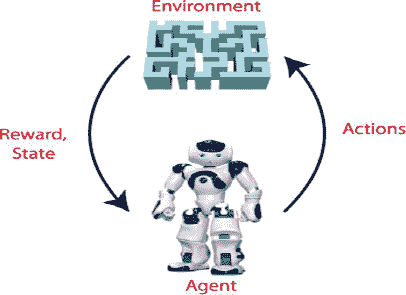 **图 (1))**

强化过程 [4]。

1. **状态空间（State Space）：** 用于决策的所有可用信息和问题特征。这包括完全已知或测量的变量（例如库存水平），以及你可能只有估计值的未测量变量（例如对未来的需求预测）。
2. **动作空间（Action Space）：** 在每个状态下可以采取决策。
3. **奖励信号（Reward Signal）：** 提供性能反馈的标量信号，因此提供了学习哪些行动是有益的。。学习在性质上既是局部的。

### 强化学习的基本思想

每个强化学习问题都包含以下组件，如图（**2**](#9789815322316-C1.htm#f2）所示：

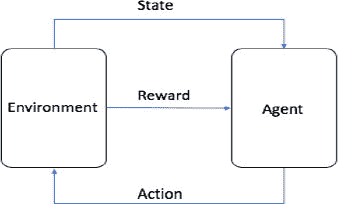 **图 (2))**

强化过程的组件 [5]。

1. **智能体（Agent）：** 负责感兴趣对象（例如机器人）的程序被称为智能体。
2. **环境（Environment）：** 这是外部世界的编程定义。环境由智能体或智能体交互的所有部分组成。它被设计为给智能体提供一个真实世界的印象 [6]。这对于展示智能体的性能，或其在实际应用中是否能正常运行是必要的。
3. **奖励（Rewards）：** 它提供了一个关于算法相对于性能的评分。显示为 0 或 1。“1”表示策略网络做出了正确的决策，“0”表示做了错误的决策。换句话说，收益和亏损由奖励表示。
4. **策略（Policy）：** 智能体用于选择选择做什么的算法。这部分可能使用模型，也可能不使用。


# 在线学习与离线学习

智能体可以通过两种广泛的方式获取学习规则的数据：在线和离线，如图图 (3) 所示。

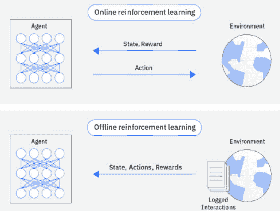 **图 (3)**  

在线与离线强化学习 

1. **在线：** 在这种情况下，智能体通过与环境的交互直接收集数据。在智能体仍在与环境交互时，会对这些数据进行迭代处理和收集 [7]。
2. **离线：** 即使智能体无法直接访问环境，也可以从关于环境的日志数据中进行学习。这指的是离线进行的教育。由于与周围环境直接交互以训练模型面临实际挑战，很大一部分研究集中在离线学习上 [8]。

# 强化学习实现方法

强化学习可以通过以下三种主要方式应用于机器学习中：

1. **基于价值（Value-based）：** 基于价值的方法目的是确定所有策略下某个状态的最优值。因此，智能体会预测在任何状态或状态下，策略 `π` 的长期回报。这种技术确定了获得最大潜在未来收益的最优行动方案，它不依赖于价值函数。智能体利用这种技术来实现策略，以在每个阶段结束时实现奖励最大化的方式 [9]。使用基于策略的方法，策略主要分为两类。每个状态的策略（`π`）产生相同的动作。概率决定了该方法中生成的动作。
2. **基于模型（Model-based）：** 在这种方法中，智能体通过构建环境的虚拟模型来研究环境并获取关于它的知识。由于模型表示取决于环境，因此这种技术没有固定的解决方案或算法。

# 强化类型

强化有两种类型，即正强化和负强化。

1. **正强化：** 正强化的定义是，某种行为产生的结果使得该行为变得更强、更频繁。换句话说，它对行为产生了正面影响。这种类型强化学习的优点包括优化性能和随时间维持变化 [10]。然而，过度强化可能导致状态溢出，可能会降低方法的有效性。
2. **负强化：** 当避免或停止负面条件时，负强化会加强该行为。负强化具有以下优点：它增加行为、挑战性能标准，并提供刚好满足最小行为要求的内容。

# 强化学习的工作原理

强化学习系统的三个主要组成是：

1. 智能体（Agent）
2. 环境（Environment）
3. 奖励信号（Reward signal）

智能体根据其当前状态和从环境中获得的奖励信号学习如何行动。环境引导智能体的动作并以奖励信号的形式提供反馈。奖励信号是一个标量值，显示智能体实现目标的程度。

可以使用不同的方法论，如演员-评论（actor-critic）方法、策略梯度方法和 `Q-learning` 来训练强化学习智能体 [11]。这些算法采用各种技术来确定期望累积奖励并相应调整智能体的策略。智能体及其性能环境是机器学习中强化参数的示例。除了这两个部分外，学习系统还由几个额外部分组成。以下是强化学习的元素，如表 1 区分了强化学习（RL）和监督学习（SL）：

表 2 **强化学习与监督学习的区别。**

| RL | SL |
| --- | --- |
| RL 是基于顺序决策的。简单来说，上一个输入的输出决定了后一个输入的结果，而当前输入的状态决定了输出。 | 监督学习中的选择基于第一个输入或开始时提供的输入。 |
| 由于 RL 中的决策具有依赖性，我们识别了依赖性决策发生的顺序。 | 由于监督学习中的每个决策都是独立于其他决策的，每个决策都被分配了一个标签。 |
| 示例：象棋游戏、文本摘要 | 示例：目标识别、垃圾检测 |

# 强化学习既不是监督的无监督

强化学习是一种无法分类为监督或无监督的机器学习技术之一。它位于两者之间。因为需要标记的数据集，它不能被归类为监督算法。然而，由于其目标是对数据点进行分类，它不能被归类为无监督算法。应用强化学习的基本理念是必须使用试错法来纠正各种环境中采取的操作。它使用描述实际事件的数据集进行训练。它根据这些数据选择几个动作，并因此受到奖励或惩罚 [12]。目标是在最大范围内优化收益。强化学习的应用非常广泛，包括自动驾驶、机器人和游戏。它也被应用于能源管理、医疗和金融领域的复杂问题。

## RL 与 ML

为了更好地理解强化学习，将其与传统的监督机器学习进行比较会有帮助。监督机器学习的目标是对未知数进行预测。独立同分布输入数据（input data）的统计假设对于其运行是最优的。这意味着每个输入数据记录都是单一底层输入数据分布模型的实现，并且每个输入数据记录被认为与其他记录是相互独立的。当监督预测模型作为决策模型应用时，它是与其他所有输入数据记录解耦的单一决策或预测，仅关注特定的输入数据记录。


以最大化预测准确性为学习目标，预测模型在监督下进行学习。对于用于训练的每个输入数据记录，我们可能会获得真实值预测（ground truth prediction）。另一方面，奖励学习提供的基于学习的决策范式用真实值标签取代了等效事实表。相反，你拥有的是串联连接的“当前状态-动作-下一状态-奖励”元组轨迹组合；换句话说，数据不再是监督机器学习中的那种静态表格数据集[13]。学习的目标是构建策略，即计算执行下一个最佳动作的映射或策略。这是因为你知道你所采取的每一个动作都会影响输入策略映射的未来输入，从而计算出下一次最佳动作，以此此类推。因此，学习不仅涉及当前状态，还涉及当前行为对状态产生的更长期影响。以库存控制作为一个直观的例子，商店必须在供应和需求交期未知的情况下，每周从供应商处决定补货。以下内容可以包含在状态空间中：每周末结束时的当前库存；过去几周观察到的需求以识别需求模式；过去几周采取的补货操作以考虑供应商交期的不可预测性；以及对下周的估计需求预测。这包含了除了直接测量和已知变量之外的与兴趣相关的估计信念变量（如预测）[14]。在每周末下单并在若干交期后收到的补货订单可以包含在动作空间。最终，系统的不确定性与供应商和需求的交期有关。由于示例中的库存水平由于不确定性而波动，你可以实施限制，惩罚某些水平的过度或不足。

### RL、DL 和 SL 的区别

尽管这些术语在某种程度上有所交叉，但三种学习类型之间存在显著差异。了解这三者的关键区别至关重要，以确保不要混用它们，如表 3 所示。

表 3 **RL/DL/SL 比较。**

| RL | DL | SL |
| :--- | :--- | :--- |
| 如前所述，基于增强的学习使用激励和后果系统来迫使计算机自行解决问题。人类可以做的事情只有修改环境以及激励和惩罚系统。程序员主要关注防止系统被滥用，并激励机器按意图运行。监督机器学习的类似示例（及其工作原理） | 深度学习中使用的多层神经网络经过专门设计，用于执行复杂任务。该模型的架构比人脑简单得多。神经网络从特定数据中提取抽象特征。每一层都将前一层的结果作为输入。每个网络组件作为一个单一系统协同工作。 | 监督学习是机器学习的一个分支，其中计算机可以随着时间的推移，在没有显式编程的情况下，学会越来越有效地完成给定任务。当程序员为机器学习系统的每个训练输入提供标签时，就会发生这种情况。被称为无监督学习的机器学习子类型仅使用未标记数据来训练模型。 |

### RL 的优缺点

表 4 显示了下方 RL 的优缺点：

表 4 **RL 的优缺点。**

| 优点 | 缺点 |
| :--- | :--- |
| 1. RL 是解决传统方法无法处理的复杂问题的有用工具。 2. 模型可能会纠正训练期间犯的错误。 3. 为了获取强化学习的训练数据，智能体与环境进行直接交互。 4. RL 可以处理非确定性场景，动作的结果并不总是可预测的。这在环境反复无常或可能随时间变化的现实场景中非常有用。5. RL 适用于广泛的问题，包括控制、优化和决策。 6. 它是一种将深度学习、RL 与其他机器学习技术相结合的灵活方法。 | 1. RL 是解决传统方法无法处理的复杂问题的有用工具。 2. 模型可能会纠正训练期间犯的错误。 3. 为了获取强化学习的训练数据，智能体与环境进行直接交互。 4. RL 可以处理非确定性场景，动作的结果并不总是可预测的。这在环境反复无常或可能随时间变化的现实场景中非常有用。5. RL 适用于广泛的问题，包括控制、优化和决策。 6. 它是一种将将深度学习、RL 与其他机器学习技术相结合的灵活方法。 |

### RL 的主要优势

RL 有许多益处，如图 (4)所示。然而，以下三点经常脱颖。

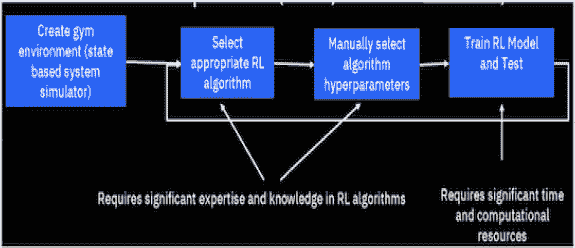 **图 (4)**

强化学习示例。

1. **在复杂环境中表现良好：** RL 算法在具有许多规则和依赖关系的环境中运行良好。即使具有卓越的环境知识，人类在相同的设置下可能无法选择最佳行动[15]。相反，无模型 RL 算法可以快速适应动态设置，并发现最大化结果的新方法。
2. **需要的人干预较少：** 在传统的机器学习算法中，系统由必须标记数据的人类引导。使用 RL 算法消除了这种需求。它自己获取知识。同时，它提供了结合人类输入的方法，使算法能够根据人类的修正、专业知识和偏好进行调整。
3. **长期目标：** RL 适用于决策具有长期影响的情况，因为它主要关注最大化长期奖励。由于它可以从延迟奖励中学习，因此特别适用于每一步都无法立即提供反馈的现实场景。例如，关于储能或使用的选择可能会导致长期影响[16]。RL 可用于同时最大化成本和长期能源效率。RL 智能体还能将它们学到的策略推广到相关但不同的任务中。

## RL 算法

基于模型和无模型的算法是 RL 算法所属的两类，如图 (5)所示。

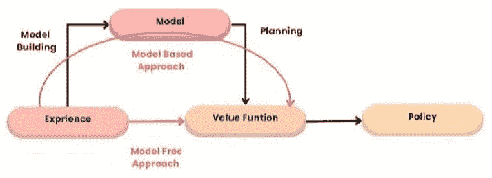 **图 (5)**

基于模型*对比*无模型 RL 算法。

算法可以进一步分为同策略和离策略策略。在基于模型的算法中，存在预定义的 RL 模型，从初始状态、动作以及动作引起的状态变化获取知识。这些类型保存了动作和状态数据供以后使用。相反，无模型算法不需要在内存中存储状态和动作数据，因为它们通过尝试错误工作。其他算法如下：


### 1. Q-learning
`Q-learning` 是一种无模型、离策略（off-policy）的方法，它可以从任意行为（贪婪策略）中获取知识。在 `Q-learning` 中，“Q”代表优化算法过程产生收益的任务标准。获得的奖励由 `Q-learning` 算法存储在奖励矩阵中。例如，为了表示奖励 50，会创建一个奖励矩阵并在位置 50 处赋值。使用 `value iteration`（价值迭代）和 `policy iteration`（策略迭代）等方法来更新这些值 [17]。“策略迭代”一词描述了通过增加其价值函数的步骤来完善或改进策略的过程。价值函数的值在 `value iteration` 过程中更新。`Q-learning` 的数学公式由方程 1 给出。

### 2. SARSA
在线策略（on-policy）技术是状态-动作-奖励-状态-动作（`SARSA`）算法。因此，它偏离了 `Q-learning` 的贪婪方法。相反，`SARSA` 利用当下的教训来实施 RL 过程。

### 3. Deep Q-Network
或 `DQN`，`Deep Q-network` 使用神经网络代替 2D 数组，区别于 `Q-learning` 和 `SARSA`。在预测和更新通常未知状态的状态值时，`Q-learning` 方法是很的。因此，在 `DQN` 中，神经网络取代 2D 数组来有效计算状态值和对应状态转移的值，加速了 RL 学习过程。

|  || (1) |
| --- | --- |

其中 `S2` 是下一个状态，`R` 是奖励，`beta` 是折扣因子，`alpha` 是学习率。未来价值等于 `Q(S2,a)`。

## RL 技术

不同的 RL 方法列表如图 (6) 所示：

### 1. 马尔可夫决策过程
该算法的目标是生成一系列与环境逐渐交互的决策。为了帮助其做出决策，智能体会定期发送有关环境状况的信息。在活动活动后，根据之前的动作给予奖励，世界将变为一个新状态 [18]。通过重复该过程产生行为、奖励和状态的轨迹。该算法努力使整体收益化，而不仅仅是当前的奖励。这是很好的，因为它避开了只寻找当前情况最大利益的贪婪策略。如果较小的回报可以带来更大的总奖励，算法可能会选择接受它。

### 2. 价值迭代
该方法通过选择使特定状态的最优状态价值函数最大的方案来确定该状态的最优策略或最佳行动方案。使用迭代程序来计算这种理想的状态价值函数 [19]。这种方法赋予了算法名称——`value iteration`（价值迭代）。状态价值函数在 `value iteration` 过程中更新。初始化状态价值函数 `V`。使用 `Q(s)`。状态价值函数 `V` 的更新-是-..Images/9789815322316-C1-F6.jpg。下图给出了 RL 的概念：


## RL 的实际示例

尽管 RL 领域仍处于起步阶段，但一些产品和应用开始依赖它。该领域的 RL 研究正在进行中。深度 RL 在工业顺序决策方面表现出浓厚兴趣 [20]。

### 1. 机器人
由于机器人动作是顺序的，因此深度 RL 在机器人领域很常见。这些智能体有很多用途 [21]。

### 2. 自然语言处理
根据最近的研究，使用自然语言处理技术（如大语言模型 `LLMs`）可能帮助 RL 系统变得更通用。RL 在聊天机器人方面效果更好。

### 3. 医疗
确定药物治疗和医疗疾病的最佳行动方案是 RL 的完美应用。除了各种医疗应用外，它还被用于临床试验。


### 12. 交通信号控制
由于城市化以及大城市对汽车需求的日益增长，城市地区的交通拥堵正成为当局日益难以处理的问题。强化学习（RL）模型根据局部的交通状况提供交通灯控制，解决了这一问题。这意味着该模型通过考虑来自各个方向的流量，在城市交通网络中学习、适应并修改交通灯信号。

### 13. 营销
为了实现长期目标，RL 帮助企业实现消费者增长最大化并简化业务流程。在营销领域，RL 通过通过预测消费者对商品或服务的决策、反应和行为，帮助他们提供定制化的建议。

### 14. 游戏
随着 RL 智能体不断通过经验应用逻辑并完成一系列动作以获得预期结果，它们能够学习并适应游戏环境。对于当时现有的 AI 模型来说，这是一个巨大的跨越。除了创建如 `AlphaGo` 这样的深度神经网络游戏外，RL 智能体还被用于游戏开发中的 Bug 检测和游戏测试。鉴于 RL 在没有外部帮助的情况下运行多个周期，潜在错误很容易被发现。例如，育碧（Ubisoft）和其他游戏公司利用 RL 来发现缺陷。

## 强化学习面临的挑战

虽然 RL 在引入自动化 AI 进行决策方面显示出前景，但在用于解决实际工业问题之前，必须克服若干实际操作障碍。例如，探索（exploration）与利用（exploitation）之间的权衡是强化学习的一个问题。对于代理智能体而言，在根据现在可能产生高预期收益的信息上采取行动（利用）与根据未来可能提供新知识和可能更大奖励的信息上采取行动（探索）之间取得平衡，是一项挑战。另一个问题是维度灾难，它断言由于复杂系统中存在许多可能的状态和动作，可能很难开发出最优策略。通过使用函数近似或其他技术来降低问题的维度，可以解决这一挑战。其他几个挑战是：首先，文献中学术基准问题占据主导地位，研究人员正在积极推动这些问题上高效高效算法的前沿水平。这意味着你将没有许多参考示例来寻找建模灵感，或无法确定它对于有趣的工业挑战来说是一个可行的解决方案。其次，存在广泛的算法，例如基于价值函数的方法（如 `Q learning`、`DQN`）、基于策略映射的方法（如 `PPO`、`Policy Learning`）以及它们的组合（如 `A2C`、`SAC` 和 actor-critic 方法）。对于许多数据科学家来说，投入必要的时间来学习动态规划、`Monte-Carlo techniques`、`Markov chains`、`Markov decision processes` 和 `Bellman recursion` 等主题可能是不可行的，但这样做将帮助你扎实地理解这些算法的内部机制。此外，几个开源框架（包括 `stable-baselines`、`RLLib`、`d3rlpy`、`Coach` 和 `Keras RL`）这些不同技术有自己的实现。要熟悉这些实现并知道如何有效地使用它们，还需要陡峭的学习曲线，这对于现实情况下的解决方案开发者来说可能是一种限制。第三，所有这些算法及其实现都允许多个可调超参数，并有一些默认值，但随着训练和学习的进行，众所周知 RL 对这些选择的初始选择和动态重新调优非常敏感。框架、智能体和超参数的数量——这种“三重维度灾难”——需要大量的、分散且计算密集型的实验，以寻找最优算法和潜在的获胜策略。第四，RL 中必须考虑的一个关键因素是样本效率（sample efficiency）。如果现实世界场景中可用数据样本较少，学习算法使用训练数据进行环境探索的能力将非常少。这是因为样本中的信息和陈述不会被完全覆盖。

为了解决这个问题，要么 RL 技术需要具有样本效率，以便从有限的数据中学习环境，要么数据效率必须足够。复杂的现实世界设置可能存在许多动作和状态空间，这可能使得使用 RL 方法变得更加困难。已经提出了许多技术通过将这些高维状态划分来简化问题。遵循安全规则是使用特定算法或方法进行决策时需要考虑的重要约束和挑战。RL 方法在操作和实验阶段都需要遵循安全限制，以避免系统损害自身或环境。上述类型的任务执行起来具有挑战性，因为大多数现实应用只有有限的观测性且缺乏关于环境的完整信息。RL 还受到系统延迟和代理响应延迟的影响。RL 中的偏差（bias）和方差（variance）概念涉及强化信号准确反映当前环境奖励函数的程度。

## RL 的应用场景

许多现实世界的应用场景都可以从 RL 中受益：

1. **营销个性化**：RL 可以在推荐系统等应用中根据用户的互动提供定制化推荐。结果是体验变得更加个性化。例如，应用程序根据某些的人口统计数据向用户展示广告。应用程序将学习向用户展示哪些广告，以在每次互动中实现销售最大化。

2. **优化挑战**：传统的优化技术根据预设标准评估并对比潜在解决方案以寻找方案。而 RL 提供了从经历中学习以逐渐识别最优或接近最优解决方案的想法。例如，RL 用于云支出优化系统选择最佳的实例类型、数量和配置，以适应不断的需求。它根据支出、使用以及云基础设施的状态和可用性做出决策。

3. **金融预测**：金融市场具有动态统计特征的复杂动态。通过考虑交易成本并响应市场变化，RL 算法可以实现长期收益。例如，算法可能会研究股市规则和趋势，然后测试策略并记录相关利润。它制定利润最大化计划并动态生成价值函数。

## 结论


总而言之，第三类无法归类为监督学习或无监督学习的机器学习算法被称为强化学习。其核心在于应用从过去中学到的教训来优化收益。我们讨论的强化学习算法主要分为两大类：基于模型的类别（一种旨在每一步都最大化奖励的贪心算法）和无模型类别（不是贪心算法，而是侧重于每个阶段最大化整体奖励）。决策和学习过程通过强化学习实现自动化。众所周知，强化学习智能体可以从自己的经验和周围环境中学习，而不需要人类的指导或直接监督。在人工智能和机器学习领域，强化学习是一个至关重要的子集。它通常有助于自主机器人、无人机甚至模拟器的开发，因为它模拟了人类如何学习理解其处的环境。最终，机器学习最引人注目且实用的方面之一就是强化学习。在虚拟现实中，智能体可以在没有人类帮助的情况下自主探索环境。只要存在或能够开发足够准确的模拟器，强化学习在许多复杂活动中超越人类水平表现方面展现出了巨大的潜力。事实证明，可以使用相同的方法学习广泛的任务。这可能意味着工程领域具有巨大前景，因为在工程领域，定制设计同类项目需要投入大量的成本和时间。

## 参考文献

| | | |
| :--- | :--- | :--- |
| [1] | [[CrossRef](http://dx.doi.org/10.1109/MSP.2017.2743240)] K. Arulkumaran, M. P. Deisenroth, M. Brundage, and A. A. Bharath, “A brief survey of deep reinforcement learning,” Aug. 2017. |
| [2] | E. Akanksha, Jyoti, N. Sharma, and K. Gulati, “Review on reinforcement learning, research evolution and scope of application,” *In Proceedings - 5th International Conference on Computing Methodologies and Communication, ICCMC*, Institute of Electrical and Electronics Engineers Inc., Apr. 2021, pp. 1416–1423. |
| [3] | T. Zhang and H. Mo, “Reinforcement learning for robot research: A comprehensive review and open issues,” 2021, SAGE Publications Inc. |
| [4] | [[CrossRef](http://dx.doi.org/10.1109/YAC5158.2020.9337653)] J. Jia and W. Wang, “Review of reinforcement learning research,” *In Proceedings - 2020 35th Youth Academic Annual Conference of Chinese Association of Automation, YAC 2020*, Institute of Electrical and Electronics Engineers Inc., Oct. 2020, pp. 186–191. |
| [5] | M.-A. Chadi and H. Mousannif, “Understanding reinforcement learning algorithms: The progress from basic Q-learning to proximal policy optimization.” 2023. |
| [6] | J. Salvador, J. Oliveira, and M. Breternitz, “Reinforcement learning: a literature review” (September 2020). |
| [7] | F. AlMahamid and K. Grolinger, “Reinforcement learning algorithms: An overview and classification,” Sep. 2022. |
| [8] | Y. Li, “Deep reinforcement learning: An overview,” Jan. 2017, [Online]. Available from: [`arxiv.org/abs/1701.07274`](http://arxiv.org/abs/1701.07274) |
| [9] | Y. Li, “Reinforcement learning in practice: Opportunities and challenges,” Feb. 2022, [Online]. Available from: [`arxiv.org/abs/2202.11296`](http://arxiv.org/abs/2202.11296) |
| [10] | [[CrossRef](http://dx.doi.org/10.1109/MSP.2017.2743240)] K. Arulkumaran, M. P. Deisenroth, M. Brundage, and A. A. Bharath, “A brief survey of deep reinforcement learning,” Aug. 2017. |
| [11] | P. Stone, “Reinforcement learning,” Encyclopedia of Machine Learning and Data Mining, Springer, 2017. |
| [12] | X. Li, J. Shang, S. Das, and M. Ryoo. "Does self-supervised learning really improve reinforcement learning from pixels?" Advances in Neural Information Processing Systems, Vol. 35, 2022, pp. 30865-30881. |
| [13] | R. Sutton and A. Barto. Introduction to reinforcement learning, 2nd edition, MIT Press, 2018. |
| [14] | B. Brown and A. Zai. Deep reinforcement learning in action, Manning Publications, 2020. |
| [15] | R. Sutton and A. Barto. Introduction to reinforcement learning, 2nd edition, MIT Press, 2018. |
| [16] | S. Levine, A. Kumar, G. Tucker, and J. Fu. "Offline reinforcement learning tutorial, review, and perspectives on open problems," 2020. |
| [17] | M. Puterman and J. Patrick. “Dynamic programming,” Encyclopedia of Machine Learning and Data Mining, 2017. |
| [18] | R. Sutton and A. Barto. Introduction to reinforcement learning, 2nd edition, MIT Press, 2018. |
| [19] | Michael Hu, The art of reinforcement learning fundamentals, mathematics, and implementations with python, Apress, 2023. |
| [20] | Ibarz J., Tan J., Finn C., Kalakrishnan M., Pastor P., Levine S.. How to train your robot with deep reinforcement learning: lessons we have learned., *Int. J. Robot. Res..* 2021; 40(4-5): 698-721. [CrossRef](http://dx.doi.org/10.1177/0278364920987859) |
| [21] | S. W. Abeyruwan, L. Graesser, D. B. D’Ambrosio, A. Singh, A. Shankar, A. Bewley, D. Jain, K. M. Choromanski, and P. R. Sanketi. "i-Sim2Real reinforcement learning of robotic policies in tight human-robot interaction loops," Proceedings of The 6th Conference on Robot Learning, PMLR, No. 205, 2023, pp. 212-224. |


强化学习（RL）作为一种机器学习（ML）的主要范式，在 21 世纪彻底改变了金融、机器人、游戏和医疗健康领域。本章探讨了强化学习的基础和应用。在本章中，定义了无模型（model-free）和基于模型（model-based）的技术。无模型方法不需要环境模型；而是依赖于试错探索。相比之下，基于模型的技术包括对环境进行建模以做出决策。这一区别对于理解随后的讨论至关重要。智能体、环境、状态、奖励、累积奖励、策略和价值构成了强化学习。智能体在每情况下决策以使激励最大化。智能体与其外部环境交互。状态是环境条件，而奖励是智能体根据其动作获得的反馈。累积奖励是许多动作的累计收益。策略定义了智能体如何选择动作，而价值指示了状态或状态-动作对的预期总奖励。强化学习通过智能体与环境之间复杂的相互作用揭示了其本质性质。为了优化长期性能，智能体在动态环境中适应激励和条件。此外，本章还描述了其他的强化学习计算方法。从`Q-learning`到`Deep Q-Networks (DQN)`以及`Proximal Policy Optimisation (PPO)`，每种技术都有其优缺点。在离散动作空间中，`Q-learning`简单且成功，而`DQN`使用深度神经网络处理连续领域中的复杂状态空间。相反，`PPO`在策略优化方面既稳定又高效。理论框架之外还讨论了许多领域的现实强化学习应用。金融领域将强化学习用于投资组合优化、算法交易和风险管理。机器人领域将强化学习用于自主移动、操控和任务执行。游戏利用强化学习在定制的游戏中产生自适应敌人。医疗部门利用强化学习来促进药物研究、增强治疗策略并为患者定制医疗方案。总而言之，本章对强化学习提供了全面的分析，阐明了其理论基础、复杂的算法和实际实现。

**关键词：** 深度 Q 网络，提供页脚，无模型，基于模型，近端策略优化，强化学习。

***

^ **通讯作者 M.G. Harsha:** School of Computer Science and Engineering, Lovely Professional University, Phagwara-144411, Punjab, India; E-mail: rshamg1225@gmail.com

## 引言

强化学习出现在 20 世纪中叶，当时研究人员开始探索借鉴行为主义和心理学原理的计算机学习模型。理查德·贝尔曼（Richard Bellman）在 20 世纪 50 年代开了“奖励最大化”的概念，将其确认为该领域最早的有影响贡献之一。贝尔曼的动态规划为解决与序列决策相关的问题提供了理论基础 [1]。\ 这种方法为强化学习后续的进展奠定了基础。20 世纪下半叶，处理能力和算法的进步在推动强化学习进一步发展方面发挥了重要作用。20 世纪 80 年代，Chris Watkins 创造了 `Q-learning`，这是一种不依赖于对环境行为如何的的先验知识的强化学习方法。它可以获取最优策略。这一成就标志着强化学习研究的一个重要里程碑，并为创建更复杂的应用开启了可能 [2]。\ 在 20 世纪 90 年代，神经科学发现对强化学习算法的影响显著上升。神经学家兼计算机科学家理查德·萨顿（Richard Sutton）与其合作者 Andrew Barto 引入了时分学习的概念。他们在强化学习算法与动物中看到的学习过程之间建立了联系。结果，强化学习算法的发展受到了生物过程的启发，例如 `SARSA`（状态-动作-奖励-状态-动作）。深度强化学习出现在 21 世纪 00 年代，是深度学习与强化学习方法论的结合。2013 年，DeepMind Technologies 的研究人员发布了 `Deep Q-Network (DQN)`。该实体展示了通过未经处理的像素输入来获得玩雅达游戏的卓越能力。这一显著成就引起了人们对深度强化学习的极大兴趣，并为该领域的进一步研究奠定了基础 [3]。目前，强化学习仍然是一个充满活力的领域，在医疗保健、机器人、自主系统、金融等多个领域具有若干潜在应用。由于深度强化学习的进步以及算法、硬件和理论基础的进展，强化学习解决挑战性现实世界问题的前景似乎是乐观的。

本引言章节的主要目标是让读者全面理解支撑强化学习的基础概念和原理。由于计算机技术的进步和创新智能算法的使用，人工智能（AI）的发展变得更加紧迫 [4]。AI 是人工智能的缩写，是旨在模拟人类大脑功能和行为的计算机软件。机器学习（ML）是人工智能的一个分支。机器学习的三大分支如下（见图 **1**](#9789815322316-C2.htm#f1)）：

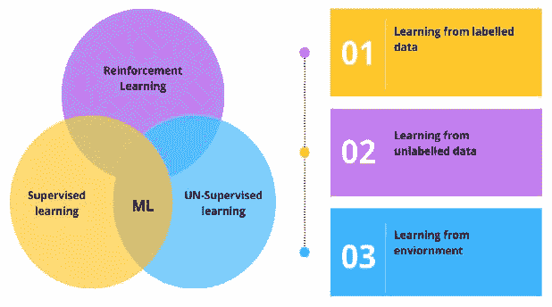 **图 (1))**

机器学习的类型。

1. **监督学习：** 监督学习涉及使用标记数据集训练算法，以从所有可能的输入输出组合中学习。其目标是确定使用映射函数将输入变量转换为输出变量的方法 [5]。\ 分类和回归是机器学习中的常见任务。监督学习通常使用神经网络、决策树、随机森林和支持向量机（SVM）等算法。

2. **无监督学习：** 无监督学习是一种旨在在未标记数据中发现模式或结构的学习方法。这类操作包括密度估计、降维和聚类。`K-means` 聚类、层次聚类、主成分分析和 `t-SNE` 都是属于无监督学习的方法 [6]。

3. **强化学习：** 强化学习有时被称为 RL，是机器学习的一个分支，侧重于指导智能体在各种情况下做出一系列决策以实现特定目标。监督学习是模型通过标记实例获取知识的学习方式。相比之下，无监督学习涉及模型从未标记数据导出模式 [7]。强化学习的主要关注点是通过环境交互来获取知识，这与其他学习形式区分开来。


本章的目的是让读者对构成 `RL` 的基础思想和动机提供全面的理解。本章首先将 `RL` 描述为 `ML` 的一个专门分支并进行精确的描述。`RL` 特别强调训练智能体在动态环境中做出顺序决策，以实现某些目标。`RL` 重点关注学习的交互方面，即智能体通过主动与环境交互并获取信息，并从其失败中学习。

在本节中，我们引入了 `RL` 的核心组件，包括 `agent`（智能体）、`environment`（环境）、`states`（状态）、`actions`（动作）、`rewards`（奖励）和 `policy`（策略）。这将为理解后续章节提供坚实的基础。

本章深入探讨了 `RL` 的历史起源，绘制了其从受行为主义启发的早期计算机模型到如今由深度学习（`DL`）和神经科学推动的进展路线 [8]。此外，本章还探讨了深度强化学习（Deep RL）的出现及其对该领域的巨大影响。这通过一些显著进展得到了解释，例如 `DQN`，它可以直接从未处理的感官输入中学习。此外，我们还研究了多个领域的实际应用，如机器人、游戏、、金融、健康和推荐系统。第一章最后为书中后续章节中进一步探索 `RL` 算法、应用、困难和未来可能性奠定了基础 [9]。在深入具体细节之前，表 1 和`表 2`中解释了 `RL` 与监督学习（`SL`）之间的区别，以及 `RL` 与无监督学习（`UL`）之间的区别。

### 表 1：RL 与 SL 的区别。

| `监督学习` | `强化学习` |
| --- | --- |
| 在 `SL` 中，模型从带标签的数据中学习。 | 在 `RL` 中，模型通过与环境交互来学习做出决策。 |
| `SL` 需要以标记数据形式提供的清晰反馈。模型的成功取决于它对对未见数据预测正确名称的准确程度。 | 收益的延迟是使 `RL` 起作用的关键。工作执行者在行动后从环境中获得反馈，但这种反馈可能来得晚或数量很少。通过试错，机器人学会了将动作与未来的收益联系起来。 |
| `SL` 需要包含命名实例的集合，这些实例通常由输入和输出对组成。 | `RL` 不需要命名数据；相反，它取决于世界上事物相互作用的方式 [10]。智能体通过尝试不同的动作并观察发生的结果来学习。 |
| `SL` 通过最小化损失函数来训练模型，该函数衡量了预期输出与真实标签之间的差异。这可以通过像 `gradient descent` 等优化方法完成。 | `RL` 中的模型通过犯错来学习。它尝试不同的动作并观察发生的结果。然后，它根据获得的收益改变其 `policy`，使用诸如 `policy gradients` 或 `Q-learning` 等方法。 |
| `SL` 通常用于需要标记数据的工作，如目标识别、分类和回归。 | `RL` 适用于需要按特定顺序做出选择和响应的问题，如游戏、、机器人和自动驾驶系统。 |

### 表 2：RL 与无监督学习的区别。

| `无监督学习` | `强化学习` |
| --- | --- |
| 在没有被指示的情况下在数据中发现模式或结构，通常通过将相似的数据点分组或降低维度。 | 通过处理环境，它可以学会如何以最大化总收益的方式做出决策。 |
| 不获得清晰的输入，并从数据的结构或分布中学习。 | 根据其在环境中的行为以后奖励或惩罚的形式获得输入。 |
| 使用未标记的发现秘密趋势、相关性或群体。 | 它可以在不需要标记数据的情况下通过与世界交互进行学习。 |
| 通常使用优化技术来降低损失函数，该函数与数据的表示或分组有关。 | 通过犯错并根据获得的奖励或惩罚改变规则来学习。 |
| `SL` 通常用于需要标记数据的工作，如目标识别、分类和回归。 | 用于需要在按特定顺序做出决策的情况，如玩机器人游戏或建立独立系统 [11]。 |


在一篇文章中，Muddasar Naseem \[12\] 讨论了强化学习（RL）及其在各个领域的应用。由于深度神经网络的进步，RL 已成为人工智能的一项主要工具。为了优化奖励，智能体（agent）通过试错学习最有利的动作。为此，智能体与其环境进行交互。模拟随机决策的马尔可夫决策过程（MDP）是强化学习的基础。RL 被应用于医疗保健、机器人、通信、自然语言处理、游戏和资源管理。动态规划、蒙特卡洛技术和 DQN 展现了强化学习处理复杂问题的能力。这些方法还证明了 RL 对多个技术和工业领域的突破性影响。

Thanh Thi Nguyen 等人讨论道，随着越来越多的系统连接到互联网，网络攻击日益增加。机器学习（ML），特别是深度强化学习（DRL），可能有助于缓解这些问题。通过将深度学习（DL）与传统 RL 相结合，DRL 可以解决复杂的、动态高维的网络防御问题。本文综述了用于网络安全的 DRL 技术。文中讨论了基于 DRL 的信息物理系统安全、自主入侵检测以及基于多智能体 DRL 的博弈论仿真，提供了基于 DRL 的网络安全研究方向，并指出了 DRL 解决复杂网络安全问题的能力。

Zhenning Li 等人指出，交通信号调节无效会导致交通拥堵和不必要的能量消耗。数据驱动的 RL 在复杂城市网络中的自适应交通信号管理变得越来越流行。尽管深度神经网络（DNN）改进了学习能力，但将深度 RL 应用于具有许多信号交叉口的交通网络仍然非常困难。主要困难包括非平稳性、探索与利用权衡、多智能体协调、连续动作空间和其他复杂障碍。引入了多智能体深度确定性策略梯度（MADDPG）技术，作为 Actor-Critic 策略梯度方法的扩展以解决相关问题。MADDPG 采用集中学习和去中心化执行。评论者（Critics）利用更多知识来加速训练，而执行者（performers）则利用其局部观测。模型评估使用城市交通仿真（SUMO）平台的仿真进行。模型比较表明，所提出的算法能够良好地管理交通信号。

Indu Shukla 等人研究了无模型和基于模型的 RL \[13\]。无模型和基于模型的 RL 是强化学习中的主要方法。两种策略都试图解决智能体通过与环境交互以最大化累积奖励来学习决策的挑战。然而，它们在吸收和利用环境方面存在巨大差异。无模型或基于模型的 RL 取决于应用和采样效率与计算资源利用之间的权衡。当模型构建困难且计算资源受限时，选择无模型技术。然而，在交互成本较高的情况下，如果可以学习适当的模型，基于模型的方法非常有效 \[14\]。

无模型和基于模型的 RL 在混合技术中结合。Dyna-Q 是一种混合技术，智能体对环境进行建模并根据真实和模拟经验调整其策略。对于适应问题领域的有效 RL 系统，必须掌握无模型和基于模型强化学习的优缺点。Yingfeng Cai \[6\] 提出了一种通过引入基于机器学习（ML）的方法来解决传统自动驾驶控制系统局限性的策略。传统方法往往难以适应日益复杂的交通场景。为了克服这些挑战，该项目引入了一种基于多任务强化学习（RL）的决策控制系统。这种创新方法通过将过程分解为可管理的组件，简化了自动驾驶。这优化了训练时间和交通效率。为了确保智能体的收敛效率和鲁棒性，创建了自适应噪声探索 \[15\]。该策略动态调整探索过程，引导智能体在变化的场景中做出最佳选择，像一位专家导航员一样。为了彻底评估所提技术，使用了 Carla 仿真器来改进自动汽车的驾驶，特别是在棘手的交通路路况中。这项技术同步了自动驾驶组件以改善交通流，就像一位指挥家指挥一场复杂的交响乐一样。该研究通过使用多任务 RL 和自适应探索策略，在不断变化的移动格局中寻找更安全、更高效的交通方案，为更复杂的自动驾驶系统提供了路标。

### 强化学习的基础性概念

#### 智能体 (Agent)
在 RL 领域，智能体是一个计算实体，它与环境交互，通过实验和从错误中学习来获取实现某些目标的信息，如图 (**2**)所示。智能体评估环境的当前状态，根据其选择选择动作，并以奖励或惩罚的形式接收反馈。智能体的目标是制定策略，策略是一种将状态与相应行为连接起来的数学函数，目的是最大化在特定时间内获取的累积奖励 \[16\]。智能体的学习过程涉及评估其动作的结果并调整策略以提高未来交互的性能。

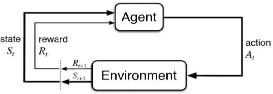 **图 (2))**

强化学习的基础。

#### 环境 (Environment)
在强化学习（RL）中，“世界”指的是智能体或机器人交互的外部环境。它指的是所有不属于智能体的部分，是智能体工作的设置。智能体的动作影响环境，使其根据预定义的动力学从一个状态转移到另一个状态。作为回报，世界通过奖励或惩罚智能体来告诉它做什么。世界中存在障碍和机会，帮助智能体学习并改变行为以随着获得最大的利益。智能体与其环境之间的交互通常表示为马尔可夫决策过程（MDP） \[17\]。在这种建模中，状态的变化和收益由智能体的动作和当前状态决定。

#### 状态 (State)
当用于 RL 时，“状态”是世界在特定时刻的设置或运行方式。它包含了人员做出决策所需的所有重要细节。智能体的动作由当前状态决定，当前状态在选择下一个状态和相应奖励中起着至关重要的作用。一种状态是完全观测的，这意味着智能体知道环境的一切；另一种类型是部分观测的，这意味着智能体只能获得有关环境的不完整或不准确的信息。根据世界的复杂程度，状态空间可以分类为离散或连续、有限或无尽 \[18\]。它包含了所有可能的空间。

#### 动作 (Action)


在强化学习（RL）中，动作（action）是智能体根据当前世界状态做出的选择或移动。动作是个体与世界交互的方式。智能体的动作取决于当前状态，状态会性地影响向下一个状态的转换以及相关的奖励。在特定情况下，动作空间由人可能执行的所有可能的操作组成。一种类型的动作是离散的，例如向左或向右；另一种类型是连续的，例如改变车辆速度。动作的选择直接影响智能体的学习，因为它控制了世界变化的方式以及智能体接收到的信息。这些变化随后被用于改变策略，并随着时间的推移提高决策能力。

# 奖励

在强化学习中，奖励（reward）是世界根据智能体的行为发送给它的单一数字信号。它定义了在当前状态下动作会产生多少收益或成本。它通过推动或阻碍某些动作来改变智能体的行为。奖励是学习的关键部分，因为智能体的主要目标是随着时间获得最多的奖励。正向激励鼓励人们做好事，而负面激励则阻止他们做坏事。奖励函数根据智能体的动作和状态决定如何向智能体提供利益 [19]。它在很大程度上改变了智能体的策略以及它们通常的学习程度。

### 探索与利用

表 3 展示了探索（exploration）与利用（exploitation）之间的区别。

表 3 **探索与利用的区别。**  

| **探索 (Exploration)** | **利用 (Exploitation)** |
| --- | --- |
| 收集新信息以改进未来的决策 | 利用现有知识使即时奖励或性能最大化 |
| 选择结果不确定或未动作 | 根据之前的经验选择证明提供最多奖励的动作 |
| 涉及较高风险，因为可能导致次优的即时奖励 | 涉及较低风险，因为它依赖于已知且测试过的动作 |
| 侧重于学习和收集更多关于环境的信息 | 侧重于基于现有知识优化性能 |
| 旨在通过全面理解长期长期和更好的性能 | 追求短期收益并最大化当前奖励 |
| 算法示例是概率为 p 的 Epsilon 贪婪算法 | 算法示例是概率为 1-p 的 Epsilon 贪婪算法 |

# 强化学习的类型

强化学习两种主要类型是无模型强化学习（model-free RL）和基于模型的强化学习（model-based reinforcement learning）。两种方法的目标都是帮助机器人通过与环境交互来学习如何决策，以最大化其收到的总收益。然而，它们学习和使用周围环境知识的方式非常不同。

## 无模型强化学习

无模型强化学习方法并不尝试对环境动力学建模，而是完全通过观察来学习。另一方面，它们可能仅通过接触世界获取价值或策略函数。在任何给定状态下，策略（policy）规定了智能体应该做什么，而价值函数（value function）提供了每个可能的状态和活动组合的预期收益的近似。两种常见的无模型算法是：

1. `Q-Learning`：这种方法被称为离策略算法（off-policy algorithm），因为它的主要目标是确定选择动作的最优策略。每个状态-动作对的 Q 值为：
```
Q(s, a) = Q(s, a) + α * (reward + γ * max(Q(s', a')) - Q(s, a))
```
2. `Policy Gradient`：这些方法通过计算预期奖励的梯度来优化策略。

# 基于模型的强化学习

无模型强化学习方法并不尝试对环境动力学建模，而是完全通过观察来学习。另一方面，它们可能仅通过接触世界获取价值或策略函数。在任何给定状态下，策略（policy）规定了智能体应该做什么，而价值函数（value function）提供了每个可能的状态和活动组合的预期收益的近似。两种常见的无模型算法是：

1. `Q-Learning`：这种方法被称为离策略算法（off-policy algorithm），因为它的主要目标是确定选择动作的最优策略。每个状态-动作对的 Q 值为：
```
Q(s, a) = Q(s, a) + α * (reward + γ * max(Q(s', a')) - Q(s, a))
```
2. `Policy Gradient`：这些方法通过计算预期奖励的梯度来优化策略。

（自我修正：用户提供的“Model-Based RL”文本在提示源中似乎截断或重复了。我根据要求的规则对提供的结构进行了相应的格式化处理。）


### 1. 状态空间 (State Space)
状态空间在强化学习中至关重要，因为它包含了智能体在给定环境中占据的所有可能状态。每个状态都包含了准确描述当前世界状况所需的所有重要信息。无论世界有多复杂，状态空间可以是较小的也可以是无限的，并且可以被分为离散的或连续的。例如，在国际象棋中，“状态”就是所有棋子在棋盘上的精确布局。另一方面，在机器人引导任务中，状态包含了机器人的精确位置、方向以及它从设备获取的数据。状态空间非常重要，因为它设定了智能体做出决策的规则。定义良好的状态空间可以让机器人更容易学习和改进其行为。

### 2. 动作空间 (Action Space)
人在任何情况下可能执行的所有操作集合被称为动作空间。“动作空间”是指人可以执行的改变当前世界的选项或事情。动作空间像状态空间一样，可以是离的或连续的，并且可以有固定或无限的选项。例如，在井字游戏中，动作空间由网格上可以进行的所有移动组成。另一方面，在引导机器人时，动作区域可能包括几个不同的运动方向或路径。学习过程的难易程度取决于动作空间的大小以及其组织方式。这是因为智能体必须研究并衡量每个动作的可能结果，以找到最佳方案。

### 3. 奖励 (Rewards)
在强化学习领域，激励机制对于控制智能体与环境交互时的行为非常重要，以便它们通常能获得最多的收益。当人完成一项任务时，他们会立即获得奖励。这些奖励为智能体提供了快速反馈，帮助他们快速养成良好的习惯。例如，在游戏中，在获得硬币后立即获得积分会强化收集硬币的模式，导致智能体反复执行同样的操作。当智能体在执行若干动作或经过一段时间获得延迟奖励时，它们需要在这些动作与未来将获得的奖励之间建立联系。这在解决迷宫等任务时经常发生，到达出口的奖励直到经过几步需要智能思考和记忆已采取步骤的行动后才能获得。累积奖励（Cumulative rewards）是一个人随时间获得的所有奖励。他们的主要目标是获得尽可能多的累积奖励。这意味着决策时要在短期收益和可能的长期收益之间找到平衡。例如，在消费时，人必须在眼前的小收益和未来更大的回报之间做出选择。为了让强化学习运作，即时利益、延迟利益和累积利益之间的权衡必须得到良好的平衡。它们必须制定有助于整体表现良好并能根据所处环境改变的策略。

## 强化学习中的学习方法

### 基于价值的方法 (Value-Based Methods)
这些方法通过估计不同状态或状态-动作对的价值来帮助智能体决策。价值函数告诉你从特定条件或状态-动作组合中可能获得多少收益。找到使价值函数运行得最好的规则是这些策略的重中之重。`Q-learning` 方法就是一个很好的例子。在这种方法中，智能体通过考虑它获得的收益以及它认为下一个状态的价值，来改变对 `Q-values`（在特定状态下执行某动作的价值）的认知。

### 深度 Q 网络 (DQN)
它利用深度学习来成功处理具有大量变量的状态空间，这是普通的 `Q-learning` 算法无法做到的。`DQN` 方法使用神经网络来预测 `Q-value function`。这让机器人能够在复杂情况下（甚至是带有视觉数据的情况下）学习有效的技巧。神经网络通过使用保存在回放缓冲区（replay buffer）中的事件进行训练。这有助于打破新经验之间的关联，并使学习过程更加稳定。目标网络（Target networks）和经验回放（experience replay）是 `DQN` 用于使学习过程更稳定、有效的两种方法。

`Q-learning` 算法是 `DQN` 的基础。`Q-learning` 是一种寻求最大化总累积奖励策略的强化学习算法。它通过近似最优动作价值函数 `Q*(s, a)` 来实现，该函数反映了从给定状态 `s` 执行动作 `a` 然后按照公式 3 定义的最优策略所能获得的最高预期回报。

|  || (3) |
| --- | --- |

### Q 值更新 (Q-value Update)
`S[t]` 和 `a[t]` 分别是当前状态和动作，`r[t]` 是在状态执行动作 `a[t]` 后接收的奖励，`s[t]`、`s[t+1]` 是下一个状态。

### 损失函数 (Loss Function)
`Q-network` 通过最小预测 `Q-values` 与目标 `Q-values` 之间的均方误差 (MSE) 来训练。大小为 `N` 的小批量次的损失函数定义在公式 4 中。

| 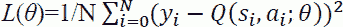 || (4) |
| --- | --- |

## 强化学习的应用


我们讨论了 `RL` 如何应用于金融资本管理。从旧的金融投资组合管理方法转向使用 `RL` 以及其他更先进的计算机方法，这是一项巨大的变革。在 `DRL` 中，深度神经网络被用于帮助 `RL` 在复杂和高维的情况下表现得更好。现代投资组合理论 (`MPT`) 模型是静态的，且基于单一时间点。相比之下，`RL` 是动态的且基于数据的。它在许多不同的时间跨度上运行良好，甚至可能处理无限的时间。这表明计算机正变得越来越像人类交易员和投资经理。`RL` 系统独立运行，使用复杂的算法或模型，通过与密切模拟现实市场复杂运作的虚拟环境进行交互，随着时间的推移进行学习和变化。由于其学习过程仅由数据驱动，`RL` 机器人可以利用海量市场数据发现趋势并做出智能决策。学习过程是持续进行且不断变化的。这对于创建能够在瞬息万变且不确定性的市场中运行的业务计划非常重要。这种发展描述了基于人类情绪的传统金融选择方式的转变。`RL` 可能像人类一样发现并利用市场低效性，甚至更好，因为它可以处理海量数据。`RL` 系统极大地改变了金融业务，因为它们不受人类心理缺陷或疲劳的影响。它们将人类的信息与计算机的精确性结合在一起。如今，人们在做出金融决策时不再仅仅依赖自己的意见。他们还依赖于这些复杂计算机系统的准确性和可靠性。由于这种转变，金融投资组合管理行业正在经历重大转型。为了帮助人们理解并建立我们的模型与旧模型之间的联系，我们使用了机器人示例。所有模型中的相似性不仅为我们提供了一个清晰的参考，而且非常契合我们在两个领域看到的中心思想和问题。当使用自动系统根据设定的标准进行交易时，这被称为算法交易。`RL` 通过让系统在与金融市场的长期交互中学习最佳交易方式，使这些变得更好。使用 `RL` 的机器可以适应变化的市场状况，更高效地工作，并平衡不同方案的风险与收益。

## 结论

本章介绍了对 `RL` 的基础理解，阐明了它的基本概念、核心要素以及许多应用。通过区分无模型和基于模型的方法，并研究从早期行为主义模型到先进深度学习技术的演进，我们强调了 `RL` 在复杂情况下做出动态决策的能力。`RL` 在金融等领域的实际应用凸显了其通过采用自适应技术和性能最大化来转型公司的潜力。这为后续章节中深入探讨 `RL` 的方法、挑战和前景铺平了道路。

## 参考文献

|  ||  |
| --- | --- |
| [1] || Alrebdi N., Alrumiah S., Almansour A., Rassam M.. Reinforcement learning in image classification: A review, *Proc. 2nd Int. Conf. Computing and Information Technology (ICCIT).* **2022**: 79-86. | [CrossRef](http://dx.doi.org/10.1109/ICCIT52419.2022.9711620) |
| [2] || Arshad K., Ali R.F., Muneer A., Aziz I.A., Naseer S., Khan N.S., Taib S.M.. Deep reinforcement learning for anomaly detection: A systematic review., *IEEE Access.* **2022;** 10: 124017-124035. | [CrossRef](http://dx.doi.org/10.1109/ACCESS.2022.3224023) |
| [3] || Asadulaev A., Kuznetsov I., Stein G., Filchenkov A.. Exploring and exploiting conditioning of reinforcement learning agents., *IEEE Access.* **2020;** 8: 211951-211960. | [CrossRef](http://dx.doi.org/10.1109/ACCESS.2020.3037276) |
| [4] || Bărbulescu L-F.. *Proc. 24th Int. Conf. System Theory, Control and Computing (ICSTCC).*. Sinaia, Romania 2020. | |
| [5] || Cai Q.. A survey on deep reinforcement learning for data processing and analytics. 2020., *IEEE Trans. Knowl. Data Eng..* **2023;** 35(5): 4446-4465. | |
| [6] || Cai Y., Yang S., Wang H., Teng C., Chen L.. A decision control method for autonomous driving based on multi-task reinforcement learning., *IEEE Access.* **2021;** 9: 154553-154562. | [CrossRef](http://dx.doi.org/10.1109/ACCESS.2021.3126796) |
| [7] || Jia J., Wang W.. Review of reinforcement learning research, *Proc. 35th Youth Academic Annu. Conf. Chinese Assoc. Automation (YAC).* **2020**: 186-191. | [CrossRef](http://dx.doi.org/10.1109/YAC51587.2020) |
| [8] || Kiran T., Fisher C., Nagdi M., Perez P., Yogamani S.. Deep reinforcement learning in different fields. *IEEE Access.* **2022;** 23:. | [CrossRef](http://dx.doi.org/10.1109/ACCESS) |
| [9] || Han G., Xiao L., Poor H.. Two-dimensional anti-jamming communication based on deep learning, *Proc. 42nd IEEE Int. Conf. Acoustics, Speech Processing (ICASSP).* **2017**:. |
| [10] || Z. Li, C. Xu.. Towards multi-agent reinforcement learning. | |
| [11] || McKenzie M., McDonnell D., Zhang H.. A gentle introduction to reinforcement learning. *IEEE Access.* **2022;** 10: 13470. | [CrossRef](http://dx.doi.org/10.1109/ACCESS) |
| [12] || Naeem M., Rizvi S., Coronato A.. A review of reinforcement learning. *IEEE Access.* **2020;** 8: 20932. | [CrossRef](http://dx.doi.org/10.1109/ACCESS) |
| [13] || Rapetswa K., Cheng L.. Towards a multi-agent reinforcement learning approach for sensing and sharing. *Intelligent and Converged Networks.* **2023;** 4(1): 50-75. | [CrossRef](http://dx.doi.org/10.23919/ICN) |
| [14] || Falsification of cyber-physical systems using deep reinforcement learning, *Proc. Int. Conf. Computer, Control, and Engineering*. | |
| [15] || Wang S., Wang R., Liu M., Zhang Y.. Review on reinforcement learning controller in soft manipulation. *Proc. IEEE Int. Conf. Robotics and Biomimetics (ROBIO).* **2021**: 558-563. | [CrossRef](http://dx.doi.org/10.1109/ROBIO54168) |
| [16] || Zhang H., Wu D., Boulet B.. Review of recent advances on reinforcement learning for smart home energy management. *IEEE Power and Energy Conf (EPEC).* **2020**. | [CrossRef](http://dx.doi.org/10.1109/EPEC48502) |
| [17] || Akazaki T., Liu S., Yamagata Y., Duan Y., and Hao J.. Falsification of cyber-physical systems using deep reinforcement learning. *Proc. Int. Symp. Formal Methods.* **2018**: 456-465. | [CrossRef](http://dx.doi.org/10.1007/978-3-319-95582-7_27) |
| [18] || Ferdowsi A., Challita U., Saad W., Mandayam N.B.. Robust deep reinforcement learning for security and safety in autonomous vehicle systems. *Proc. 21st Int. Conf. Intelligent Transportation Systems (ITSC).* **2018**: 307-312. | [CrossRef](http://dx.doi.org/10.1109/ITSC.2018.8569635) |


# 强化学习在各种应用中的演变：近期趋势

Ravinder Singh^(1, **), Krishan Dutt^(1), Mathias Agbeko^(2)

¹ 印度旁遮普邦，美丽专业大学，计算机应用学院

² 加纳，温内巴，教育大学南校区，ICT 教育系

## 摘要

近年来，强化学习（RL）取得了巨大的进展，使该领域正朝着充满前景的方向发展。本章探讨了强化学习领域的新进展、可能路径和方向。强化学习领域正在快速变化，从深度学习架构的结合到元学习策略的引入。此外，通过研究多智能体系统和迁移学习范式，揭示了强化学习在各个学科中应用的新途径。本章还介绍了新兴的神经演化领域及其如何与强化学习算法协同工作。为了确保强化学习系统的正确部署和开发，还研究了伦理方面和社会影响。本章作为学者和从业人员的指南，通过概述这些趋势和机会，帮助他们充分实现强化学习在解决挑战性现实世界问题方面的潜力。

**关键词：** 深度学习、强化学习算法、强化学习系统、样本效率、迁移学习。

***

(*) 联系作者 Ravinder Singh：印度旁遮普邦，美丽专业大学，计算机应用学院；电子邮件：aarkaybca@gmail.com

## 引言

强化学习因其在复杂动态环境中教导机器学习和做出判断的惊人能力，近期引起了广泛关注。本摘要研究了强化学习领域的新进展、前景和路径。首先，我们探索了深度强化学习（DRL）的发展，它将强化学习算法与深度学习方法相结合，以促进更有效的学习和决策。当深度强化学习与计算机视觉和自然语言处理等其他先进技术结合时，为应对多个领域的现实世界挑战带来了新的可能性 [1]。

用于个体或群体目标的强化学习是另一个令人兴奋的进展。此外，元强化学习的最新进展展示了帮助智能体在各种设置和活动有效适应和学习的潜力。元学习方法有助于强化学习系统更有效地泛化，并使用更少的训练数据，从而加速强化学习解决方案在现实场景中的实施。本章题为“强化学习在各种应用中的演变：近期趋势”，是一盏灯塔，在学者探索该领域复杂性并推向可能边界时，为这门动态学科指明了前行的道路。

我们在本章中提供了对强化学习的见解，展示了前沿研究、新兴技术和实际应用如何汇聚在一起。我们探索了重塑强化学习领域的最新进展，研究尖端计算结构、理论发现和创新算法如何改变机器学习和交互的基本原理。此外，随着强化学习继续从受控的实验室环境走向现实情况，我们面临着在复杂动态生态系统中部署强化学习智能体所带来的潜力和困难。强化学习的应用非常多，提供了广泛的机会和伦理困境。这些包括自主机器人、医疗健康和金融。

### 强化学习概览

在被称为强化学习（RL）的机器学习领域，智能体通过以最大化奖励和的方式来获得决策技能。强化学习更类似于在人类和动物中观察试错学习过程，因为它通过交互进行学习，而不是像监督学习那样从标记数据数据集中学习 [2]。

### 强化学习的基本概念之一是智能体

即学习者或决策者。在强化学习中，智能体是与环境交互以学习如何实现特定目标的核心实体。

#### 智能体的角色

*   **观察：** 智能体感知周围环境的状态。这种状态可能是部分观测的，在这种情况下，智能体只能访问有限的数据。
*   **动作选择：** 智能体根据其策略选择动作。
*   **学习：** 根据观察到的转换，智能体修改其策略。
*   **探索与利用：** 智能体需要在利用（选择已知产生巨大奖励的活动）和探索（尝试新行为以学习其影响）之间取得平衡。

环境：它是智能体与之交互的外部系统。在强化学习中，`environment` 是外部系统。

*   **状态 (s)：** 它是环境当前配置的说明示。状态提供了智能体的决策背景。
*   **动作 (a)：** 它是智能体的选择范围。动作空间可能是连续的（例如改变机器人手臂的速度或角度），也离散的（例如向左、右、上或移动） [1]。
*   **奖励 (r)：** 它是智能体响应动作而获得的标量反馈信号。
*   **转移动力学 (P)：** 它是一组法则或概率，规定了当智能体在环境中行动时环境如何变化。

#### 环境类型

*   **随机与确定性环境：** 没有偶然元素；相反，随后的状态和奖励完全由之前的状态和行为决定。动作的结果由于下一个状态和奖励的概率是不确定的。
*   **连续与回合性环境：** 交互被分为回合，每个回合都有的起点和终点。智能体寻求在无限扩展的交互期间最大化折扣累计奖励或长期平均奖励 [3]。
*   **动态与静态环境：** 随着时间的推移，环境动力学保持不变。此外，环境在没有智能体干预的情况下变化，可能是由于其他智能体或其他影响。

#### 强化学习中与环境的应用

*   视频游戏：丰富且复杂的环境为强化学习智能体获取技术和方法提供了机会。
*   机器人技术：机器人在模拟现实世界的环境中学习导航、操作和组装 [4]。
*   医疗健康：通过模拟患者对药物的反应，强化学习智能体可以创建个性化的治疗方案。
*   自动驾驶：智能体在模拟现实驾驶情况的环境中学习导航并做出安全的驾驶判断。

### 强化学习中的动作类型

*   **离散动作：** 有有限或可数的动作空间 `A`。这些动作常见于某些设置，例如棋盘游戏或网格世界，其中移动（例如上、下、左、右）可能代表动作。


- **连续动作：** 由于动作空间 `A` 是连续的，智能体必须从无限的选项池中选择一个。这在控制类任务中很常见，动作可能是精确的电机指令，例如自动驾驶或机械臂运动。
- **随机动作与确定性动作的区别：** 随机策略定义了动作的概率分布 `(a|s)``π(a|s)`，从中采样动作以允许行为的探索性和多样性。确定性策略则将状态映射到特定的动作 `a=(s)``a=π(s)`。动作根据当前状态被确定地选出。

### 动作选择策略
- **探索与利用：** 在利用（选择已知能带来高额奖励的动作）与探索（尝试新动作以学习其影响）之间找到平衡是角色扮演游戏中的主要问题之一。
- **探索：** 探索涉及选择随机或不确定的动作，以获取更多关于环境的信息。

### 强化学习中的奖励
- **学习目标：** 强化学习智能体的主要目的是学习一种策略（或动作选择策略），以最大化预测的累积奖励，也称为回报（return）。
- **反馈机制：** 奖励系统提供了关于活动执行优劣的洞察。负奖励会抑制不良行为，而正奖励促进积极行为。
- **策略优化：** 智能体采用多种算法，包括 `Q-learning`、`policy gradients` 以及如 `Proximal Policy Optimisation (PPO)` 和 `DQN` 等深度强化学习方法，根据奖励信号 `[5]` 来改变策略。

### 策略的表示
- **表格表示：** 策略表示为表格，每个条目对应一个状态-动作对。这种表示法适用于状态空间较且离散的情况。
- **函数近似：** 通常使用神经网络来实现（如 `DRL` 中）。它们被用于具有巨大或连续状态空间的上下文。
使用函数近似器（如神经网络）来表示策略。它接收状态作为输入并产生动作或动作概率。

### 核心概念
- **策略梯度：** 该技术旨在寻找预期回报相对于策略参数的梯度，以优化策略。为了优化预期回报，沿着梯度方向改变策略 `[6]`。
- **Actor-Critic 方法：** 这些方法整合了基于策略和价值函数的方法。示例包括 `Deep Deterministic Policy Gradient (DDPG)` 和 `Advantage Actor-Critic (A2C)` 算法。在这些中，`critic` 通过估计价值函数来评估策略，而 `actor` 则更新或改进策略。

## 强化学习的历史
开发能够从复杂环境中学习并适应环境的智能系统的目标，推动了整个强化学习史上的多学科合作和持续创新 `[7]`。强化学习起源于行为主义，最初被提作为一种解释动物如何学习的理论。心理学和神经科学与强化学习有着密切的关系。艾伦·图灵（Alan Turing）、诺伯特·维纳（Norbert Wiener）和理查德·贝尔曼（Richard Bellman）对强化学习早期发展的贡献也包含在内。我们在下一节中涵盖了强化学习领域的广泛背景和突破性进展：

### 早期起源（20 世纪 50 年代–60 年代）
- 行为主义心理学，特别是 B.F.斯金纳（B.F. Skinner）的工作（他研究了动物如何通过正负强化进行学习），被认为是操作性条件反射概念的源头，该概念与强化学习的思想密切相关。
- 理查德·贝尔曼（Richard Bellman）在 20 世纪 50 年代建立了`dynamic programming`（动态规划）解决优化问题的技术，这标志着强化学习早期计算工作的开始。强化学习算法的理论根源于贝尔曼的工作。

### 20 世纪 80 年代时序差学习的出现
- 理查德·萨顿（Richard Sutton）在 20 世纪 80 年代首次提出了`Temporal Difference (TD) learning`（时序差学习）。它是强化学习的基石。通过连续估计的引导（bootstrapping）更新价值函数是 TD 学习算法的基础。
- 萨顿的努力，特别是与同事安德鲁·巴托（Andrew Barto）的合作，促进了 `TD-Gammon` 的诞生，这是一个双陆棋程序展示了强化学习在复杂任务中的效能 `[8]`。

### Q-Learning（20 世纪 90 年代）
- 克里斯·沃金斯（Chris Watkins）在 1989 年设计了名为 `Q-learning` 的无模型算法。
- Q-learning 依赖于动作质量（`Q-values`）的量化，并利用马尔可夫决策过程进行迭代更新。

### 2010 年代的深度强化学习
- 将深度神经网络引入强化学习产生了`deep RL`或`DRL`。
- 2013 年，DeepMind 的研究人员引入了 `Deep Q-Networks (DQN)`，成功地从感知输入中学习规则。
- `DQN` 的成功为包括 `Proximal Policy Optimisation (PPO)`、`Trust Region Optimisation (TRPO)` 和 `Deep Deterministic Policy Gradient (DDPG)` 在内的众多进展铺平了道路。

### 时代（2010 年代至今）
- 得益于`model-based RL`（基于模型的强化学习）、`meta-learning`（元学习）和`hierarchical RL`（分层强化学习）等进展，强化学习继续快速发展。
- 研究人员还探索了强化学习在各个领域的应用，包括机器人、游戏、金融和医疗保健。
- 大模型的适应能力已通过 OpenAI 的`GPT (Generative-trained Transformer)` 模型得到证明，这些自然语言处理在强化学习任务中也展现了前景。

## 目标与范围
“各应用中的强化学习演变：近期趋势”的目标是对强化学习的发展和现状提供详尽且深入的检查。本章的目标是绘制强化学习随时间的演变，解释影响该学科的重要转折点和基础思想 `[9]`。它还寻求识别和评估当前的强化学习趋势，强调新的进展和突破。以下是本章的目标：

### 历史背景
- 介绍强化学习的起源。
- 探索强化学习方法的重要转折点和发现。

### 基础概念
- 描述强化学习的基本概念和元素，如环境、奖励、策略和价值函数，以及智能体 `[10]`。
- 解释不同的强化学习算法，包括 `Actor-Critic`、`Policy Gradient`、`Q-learning` 和 `DQN`。

### 应用领域
- 提供强化学习成功应用的众多示例。
- 强调多个领域的案例，包括自动系统、机器人、游戏、金融和医疗保健。

### 强化学习的研究与应用趋势
- 识别并讨论强化学习扩展性、计算效率和方法方面的最新进展。
- 强化学习与计算机视觉、神经网络和深度学习结合的方式。


一种名为 `RL` 的机器学习子领域研究了智能体在每个环境中如何行为以最大化累积奖励。智能体的任务是发现一种策略，通过将状态映射到动作，来实现随时间推移的累积奖励最大化。在 `RL` 中，利用（exploitation）与探索（exploration）的问题至关重要。利用采用具有高回报率的已知行为，而探索则尝试新事物以观察其运行效果 [12]..。机器人学、自动驾驶、游戏、金融、医疗保健等领域都已看到 `RL` 的成功应用，证明了该技术的适应性以及解决广泛序列决策挑战的能力。

# RL 中的算法

`RL` 领域有许多可用算法，每种算法都专门设计用于处理在不可预测的语境下学习和做出决策的不同方面。以下是对一些最重要的强化学习（`RL`）算法的详细解释，包括以下关键方法：

## DRL 算法

为了解决高维状态和动作空间的问题，`DRL` 将深度学习方法与 `RL` 的概念相结合 [13]..。下面提供了关键深度 `RL` 方法的详尽总结：

深度确定性策略梯度：这是一种离策略的 actor-critic 算法。通过应用确定性策略梯度技术，`DQN` 被扩展到连续动作空间。`DDPG` 将策略梯度的优势与 `Q-learning` 结合，使其非常适用于具有连续动作空间的系统 [14]..。

### Actor-critic 或异步优势 Actor-Critic

为了提高学习的稳定性和效率，在许多实例中并行运行环境，每个实例都有智能体的副本。这种对并行性的使用减少了训练时间并降低了差异。

# RL 技术的进展

在过去的十年里，`RL` 取得了显著进展，从理论概念转向现实世界的、高效的实现。算法、计算能力和应用领域的进步推动了 `RL` 方法的发展。本章考察了这些发展，强调了 `RL` 的重要模式和潜在路径 [15]..。

由于深度学习和 `RL` 集成的革命性方式，现在在视频游戏和机器人等复杂环境中训练智能体已成为可能，`DQN` 以及像 `A3C` 和 `SAC` 等 Actor-Critic 方法所示。

## 深度 RL

### 关键创新

* **深度 Q 网络 (`DQN`)：** 该技术结合了深度神经网络和 `Q-learning`，使得 `RL` 能够处理高维输入字段，例如未处理的游戏图像。
* **策略梯度方法：** 通过直接优化策略，诸如近端策略优化（`PPO`）和 `REINFORCE` 等算法使得在连续动作空间中进行有效学习成为可能。
* **Actor-Critic 方法：** 通过平衡基于策略的方法和基于价值的方法的优势，如 `A3C`（异步优势 Actor-Critic）和 `SAC`（软 Actor-Critic）等算法促进了更可靠、更有效的学习 [16]..。

# 基于模型的强化学习

基于模型的 `RL`（`MBRL`）的目标是通过允许智能体创建其周围环境的模型来提高学习效率和决策能力。在预测未来状态和奖励时，`MBRL` 公开地构建并使用模型，与无模型方法相反，后者直接从经验中学习策略，而不使用显式的环境模型。

### 主要进展

* **世界模型：** 方法如模型预测控制（`MPC`）利用获取的环境模型来安排活动，从而增强有效性和输出。
* **AlphaGo 和 AlphaZero：** 这些突破性的算法通过结合深度学习、基于模型的技术和蒙特卡洛树搜索（`MCTS`），在具有挑战性的游戏中获得了超人类的性能。

### 基于模型的强化学习的优势

* **样本效率：**
当 `MBRL` 使用模型时，在样本效率方面经常优于无模型技术。有了模型，智能体可以模拟各种未来场景，而无需与真实世界进行额外交互。
* **改进的泛化：**
通过使用模型预测并适应新情况，`MBRL` 可以从有限的数据中做出更准确的泛化。
* **更好的规划：**
准确的模型允许智能体进行规划并做出明智的决策，最终在长期内提高性能。

### 基于模型的强化学习的障碍

* **模型正确性：** 学习模型的正确性对 `MBRL` 性能有重大影响。不准确的模型可能导致性能低下和糟糕的策略选择。
* **计算复杂度：** 创建和使用模型在计算上可能是昂贵的，特别是在复杂动态或高维景观的背景下。
* **模型与策略学习的平衡：** 在策略学习和模型学习之间取得正确的平衡至关重要。模型准确性不足会导致策略性能不佳，而过度强调模型学习可能会阻碍策略进展。

### 著名实例与应用

* **AlphaGo 和 AlphaZero：** 这些算法通过结合深度学习和 `MCTS` 为围棋和象棋等挑战性棋盘游戏创建模型。它们利用训练过的模型模拟未来的游戏状况，使其能够有效地规划动作。
* **机器人学：** 机器人动力学的准确模型可以显著提高学习效率和性能。`MBRL` 常用于机器人任务，如导航和操控。
* **自动驾驶：** 使用交通模式和车辆动力学模型来规划安全有效的驾驶技术。

在 `RL` 范式中，基于模型的 `RL` 是一种强大的技术，提供了更强的规划能力、更高的样本效率和改进泛化的潜力 [17]..。尽管存在挑战，研究仍在进行以增强 `MBRL` 方法，这可能会带来重大突破和更广泛的应用。

# 多智能体强化学习

在名为多智能体强化学习（`MARL`）的 `RL` 子领域，多个智能体在共享环境中同时交互并学习。为了实现自己的目标（可能涉及协作、竞争或两者的结合），每个智能体都旨在使其策略最大化。智能体之间的动态交互——一个智能体的决策和学习过程会对其他智能体的结果和过程产生直接影响——这就是 `MARL` 的复杂性所在。


- **竞争性：** 竞争性多智能体强化（MARL）中的代理体相互竞争，一个代理体的成功往往意味着另一个失败。对抗局面和游戏（如象棋）是两个例子。
- **无差异：** 代理体在某些情况下可能需要协作，而在另一些情况下需要竞争，这在许多涉及合作与竞争的现实场景中很常见。交通中的自动驾驶和开放市场的交易是两个例子。

## 机器人领域的强化学习

机器人领域的强化学习是一门动态且不断发展的学科，它结合了机器人控制系统与人工智能，使机器人能够通过试错学习并适应环境。

在机器人领域，`RL` 是一种强大的技术，使机器人能够自主与其环境交互、学习新行为并增强现有行为。

- **自主导航：** 使用自主导航的机器人可以通过 `RL` 学习在复杂且变化的环境中导航的最佳路径和动作。
- **操控与控制：** 机器人技术使用 `RL` 来完成需要精确移动和灵活性的任务。这涵盖了移动和整理物品、组装部件以及使用各种工具和设备等活动 [18]。

# 医疗领域的强化学习

`RL` 在医疗领域的应用是一个快速扩展的话题，它利用 `RL` 算法的学习和适应能力来改善患者疗效并简化行政流程。治疗计划、预测分析、个性化医疗和诊断将受到这一策略的显著影响，这将改变医疗服务的提供并提升整体护理水平 [19]。

- **个性化医疗：** 个性化医疗的目标是根据患者独特的遗传学、生活方式和环境定制医疗护理。
- **治疗计划：** `RL` 算法在治疗计划期间协助创建和优化治疗方案，以实现患者收益最大化。
- **诊断与预测分析：** `RL` 在两个关键领域具有重大影响：预测分析和诊断。通过分析大量的患者数据，`RL` 算法可以识别模式并预测疾病的进展，帮助医生做出更明智的决策。

# 金融领域的强化学习

在金融领域，`RL` 正凭借其在算法交易、投资组合管理、风险评估和欺诈检测方面的强大工具改变着格局。金融机构利用 `RL` 算法可以改进其投资策略、降低风险并做出更好的决策 [20]。

- **交易算法：** 算法交易涉及使用自动化系统，根据预设标准快速执行大量交易。
- **投资组合管理：** 在投资组合管理中，`RL` 在构建和调整投资组合方面起着关键作用，在管理风险的同时满足特定的财务目标。
- **欺诈检测与风险评估：** 金融机构使用 `RL` 算法更有效地识别和缓解潜在风险及欺诈活动。

# 现实应用与案例研究

大量的案例研究和现实应用证明了 `RL` 在金融行业的成功。例如，对冲基金和私人交易公司利用 `RL` 算法开发高频交易技术，以利用市场的市场失效。

**游戏中的 RL：** 游戏行业受到了 `RL` 的显著影响，它彻底改变了游戏 AI 和开发，改进了用户体验和平衡性，并通过 AlphaGo 和 OpenAI Five 等开创性计划取得了令人置信的成功 [21]。

- **游戏 AI 与开发：** 为了生成智能、适应性强的对手和非玩家角色（NPC）以创造有趣且具有挑战性的玩法，`RL` 是游戏 AI 中的一种流行技术。
- **平衡与玩家体验：** `RL` 通过动态调整挑战、奖励和其他游戏元素，在维护游戏平衡和增强用户体验方面发挥着至关重要的作用。
- **成功案例（AlphaGo, OpenAI Five）：** AlphaGo 和 OpenAI Five 的真实案例值得关注。2016 年，DeepMind 的 AlphaGo 在击败包括李世石在内的顶级围棋选手后展示了 `RL` 的强大。
- **现实应用与案例研究：** 除了这些知名项目之外，`RL` 正越来越多地应用于游戏设计和开发的各个方面。

# 自主系统的强化学习

为了使自动驾驶汽车、无人机和无人车辆能够在复杂环境中导航、做出实时决策并确保安全，`RL` 对于自主系统的进步至关重要。

- **自动驾驶车辆：** `RL` 算法被应用于自动驾驶领域，教导车辆如何穿越道路、读取交通信号以及与行人和其他车辆安全互动。
- **无人机（UAVs）：** `RL` 算法使无人机和无人能够执行各种任务，包括包裹递送、空中监视、搜救行动和环境监测。
- **伦理与安全：** 尽管 `RL` 在推进自主系统方面潜力巨大，但安全和伦理问题必须优先考虑。

# 自然语言处理中的强化学习

在名为 `RL` 的机器学习领域中，代理体通过以使其环境中累积奖励最大的方式行动来获得决策技能。`RL` 已证明是自然语言处理（NLP）中一种实用的工具，通过其从反馈和交互中学习的动态方法，补充了传统方法。

**对话框架：** 对话系统（也称为聊天机器人或对话代理 [22]）的目标是模拟人类对话。在这一领域，`RL` 因以下原因非常有用：

- **动态交互：** 为了实现特定目标，对话系统必须处理多轮讨论并根据用户输入做出调整（例如购票）。
- **奖励结构：** 在对话系统中，奖励可以根据多个因素创建，包括任务完成率、用户满意度和对话长度。
- **策略学习：** `RL` 有助于获取生成答案的最佳策略。

**语言翻译：** 将文本从一种语言翻译成另一种语言被称为语言翻译 [23]。尽管经典方法（如 Transformer 架构和序列到序列模型 Seq2Seq）取得了进展，但 `RL` 通过专注于长期序列优化可以进一步提高翻译质量。

- **连贯性与准确性奖励：** 在整个文本序列中，翻译人员可以因保持上下文连贯、语法准确和语义准确而获得奖励 [24]。

### 情感分析


确定文本中的情感表达是正面、负面还是中性的，这被称为情感分析。通过强化学习（RL）帮助模型更全面地理解上下文，并根据反馈调整预测，可以改进情感分析。

- **上下文理解：** 情感可能会受到上下文的很大影响。RL 有助于学习考虑文本长期依赖关系的策略，从而增强对复杂情感的理解。
- **动态奖励信号：** 在情感分析中，奖励可能由用户输入、情感预测准确性，甚至是预测对后续活动的影响（例如客户服务回复）来决定 [25]。
- **自适应学习：** 强化学习（RL）使情感分析模型能够根据新信息和不断演变的语言模式不断调整和增强。

## 使用 RL 进行能源管理

在能源管理领域，RL 监控各种能源系统的性能。本节探讨了 RL 在三个关键领域的应用：资源配置、智能电网和可持续解决方案。

**智能电网：** 智能电网是复杂的电力系统，能够利用数字通信技术识别并响应局部消费模式的变化。RL 是智能电网运行优化的关键组件。

- **需求响应：** 通过确定削减和转移的优化计划，RL 算法可以有效处理需求响应。这降低了峰值负载，平衡了供需，并节省了能源。
- **储能管理：** 电池等储能设备通常是智能电网不可或的一部分。
- **分布式能源资源 (DERs)：** 太阳能电池板和风力涡电机是 DER 的示例，RL 协助对其集成和管理。通过预测发电模式并随之调整电网运行，RL 提高了能源分配的可靠性和效率。

## RL 的挑战与限制

尽管 RL 在多个领域展现了巨大的潜力，但在广泛应用之前，仍需解决一些问题和限制。计算复杂度、样本效率以及泛化和迁移学习问题是需要考虑的重要因素。

### 计算复杂度

- **高计算需求：** RL 技术（特别是深度 RL 模型）需要大量的计算能力。
- **可扩展性问题：** 所需计算量随环境复杂度或活动数量呈指数级增长。这使得将 RL 解决方案应用于复杂的现实问题变得非常困难。
- **硬件限制：** 训练复杂 RL 模型所需的高性能计算基础设施并非所有机构或研究人员都可用。这限制了 RL 在多种场景下的适用性和实际实施。

在探索（exploration）和利用（exploitation）之间取得有效平衡可能是困难的，这涉及到尝试新事物以观察其对结果的影响，以及应用现有活动以实现利益最大化

- **数据效率：** 在许多现实情况下，可能无法收集足够的数据来训练 RL 模型。
- **样本效率：** 在 RL 框架下，样本效率指的是算法通过与环境的较少交互发现高效策略的能力。
- **算法设计：** 各种 RL 算法的采样效率各异。例如，由于它们可以使用学习到的模型产生更多训练数据，基于模型的 RL 算法（旨在创建环境模型）通常比无模型算法具有更高的样本效率。
- **探索策略：** 通过确保智能体收集多样且具有见地的经验，内在动机或好奇驱动查询等技术可能会有所帮助。
- **表示学习：** 随着更高效的表示学习，智能体可能会做出更好的泛化。
- **离策略学习：** 因为离策略算法（如 `DQN`）可以从由不同策略生成的数据中学习，它们可能更高效（例如，采用经验回放缓冲区）。

**迁移学习与泛化：** 迁移学习利用从一个任务（或一组任务）的信息来增强对相关但不同任务的学习的过程。重用以前学过的能力、模型或经验有助于缩短训练时间并提高采样效率。以下是迁移学习的重要元素和技术：

- **特征迁移：** 特征迁移是利用以前学过的特征或神经网络层来表示不同活动中的状态或动作的过程。
- **任务相似性：** 任务相似性是识别具有相似动态、结构或规则活动的能力。
- **策略迁移：** 将策略从一个环境转移到另一个环境被称为策略迁移。从一个作业到另一个计算每个状态的预期被称为值函数迁移。
- **多任务学习：** 多任务学习是在多个任务上同时训练单个模型的过程，使其能够开发出适用于所有任务的通用表示。
- **课程学习：** 课程学习是创建一个随时间推移变得越来越挑战活动的过程，使智能体能够利用之前获得的信息应对更复杂的任务。

## RL 研究趋势

跨学科技术对 RL 研究正变得越来越有利，因为它们借鉴了多个科学和技术领域来增强其方法论、应用和效率。下一节详细描述了对 RL 有贡献的许多学科：

- **生物启发：** 利用人类大脑处理信息和做出决策的知识，创建更有效的 RL 算法。
- **神经符号 RL：** 结合基于神经网络和符号推理的技术，以利用它们各自的优势。

### 心理学

- **行为克隆：** 使用关于学习和行为的心理学理论，并在人类行为数据上训练 RL 机器人。
- **人回路：** 通过将人类输入直接纳入 RL 训练过程，提高学习效率并使智能体行为符合人类预期。

### 经济学

- **博弈论：** 在多智能体 RL 设置中使用博弈论概念，在这些设置中智能体必须学习如何合作或竞争。


*   **激励设计：** 利用经济学理论创建激励结构，迫使代理以导致预期结果的方式行动。

## 控制理论
*   **最优控制：** 应用控制理论方法创建强化学习（RL）算法，使其更擅长管理动态且不可预测的语境。
*   **鲁棒控制：** 确保强化学习算法的鲁棒性，使其能够稳健地运行。

## 强化学习与其他领域的结合

强化学习与多个领域的融合在以下几个方面带来了突破：

### 计算机视觉
*   **感知与动作：** 结合强化学习与计算机视觉，提升代理感知与执行的能力。
*   **端到端学习：** 通过端到端学习，增强强化学习在视觉领域的表现。

### 自动化
*   **感知：** 结合强化学习与计算机视觉，使代理能够理解并执行任务。
*   **迁移学习：** 通过迁移学习，让强化学习从原始数据中学习。

### 机器人
*   **模拟到现实：** 结合强化学习与机器人技术，使机器人能够通过迁移学习进行任务。
*   **多模态学习：** 结合多模态学习，让代理能够从多种输入中学习。

### 认知计算
*   **混合系统：** 结合强化学习与符号 AI，增强强化学习的推理能力。
*   **可解释性：** 提高强化学习的可解释性，使其理解决策过程。

## 云计算与大数据

强化学习在以下几个领域的应用至关重要：

### 大数据
*   **数据增强：** 利用数据增强技术，提升强化学习的效率。
*   **数据处理：** 在强化学习中，处理海量数据是面临的一个关键问题。

### 云处理
*   **可扩展性：** 在训练强化学习模型时，数据量的可扩展性至关重要。
*   **分布式强化学习：** 通过分布式强化学习，确保算法在各种环境中都能稳定运行。

### 协作与共享
*   **平台与工具：** 通过共享平台和工具，促进强化学习算法的发展。
*   **基准测试：** 通过基准测试，不断评估强化学习的性能。

# 强化学习的未来方向

强化学习的发展有望从以下几个方面带来变革：

### 伦理与社会：公平性与偏见
*   **减轻偏见：** 确保强化学习算法不会强化或放大训练集中已有的偏见至关重要。
*   **公正决策：** 一个主要目标是制定法规，确保所有用户获得公平的结果，特别是在招聘、刑事司法和医疗保健等敏感领域。

### 责任与透明度
*   **可解释性：** 使人们能够理解并审查强化学习模型的决策过程。
*   **伦理规则与标准：** 在部署强化学习系统之前，必须建立伦理规则和标准。

### 可靠性与安全性
*   **安全探索：** 创建能够在不伤害人类或产生不可接受风险的情况下进行探索和学习的强化学习算法，被称为“安全探索”。
*   **优势与故障：** 强化学习系统应该能够以友好的方式解决意外情况，而不会发生灾难性的故障。

### 对社会的影响
*   **职业替代：** 应研究自动化和强化学习将如何影响就业。这需要制定减轻工作流失并促进劳动力转型的计划，例如再培训计划和对失业工的援助措施。
*   **隐私问题：** 强化学习系统应该尊重用户隐私，特别是在使用个人语境或从用户数据中学习时。保护隐私的技术和遵守法规是关注的重要领域。

## 结论


在本章“强化学习在各种应用中的演变：近期趋势”中，我们强调了 `RL` 的革命性影响和持续进步。强化学习算法的重要进展包括样本效率、可扩展性和泛化能力的提升，这扩展了它们在包括机器人、医疗保健、金融和自动系统在内的多个领域的应用。跨学科方法通过引入控制理论、经济学、心理学和神经科学的独到见解，进一步改进了强化学习的研究。回顾强化学习的发展可以明显看出，该领域已经从简单的理论概念演变为复杂的实际实现。计算能力的跃跃、创新算法以及对学习过程更深层次的理解都为这种扩张做出了贡献。量子计算的出现及其与其他 AI 范式的整合代表了极具前景的新方向，有望突破强化学习能力的边界。强化学习的未来似乎既充满希望又充满挑战。混合系统和量子增强强化学习的前景进展具有解决复杂问题的潜力。尽管如此，在强化学习系统的伦理使用、确保可靠公平的决策以及优化学习算法方面仍存在未解决的问题。强化学习已取得显著进展，其应用已扩展到广泛的行业。开发利用基于模型的强化学习、元学习和迁移学习等方法的高样本效率算法是一个重要趋势。随着强化学习与计算机视觉和自然语言处理等其他 AI 范式的结合，其在自动驾驶、机器人操控和基于语言的交互等复杂任务中的应用日益增加。伦理和社会因素的重要性提高，越来越强调确保强化学习系统的问责性、透明性和公平。

此外，通过更有效地处理复杂问题，强化学习与量子计算的结合提供了一个可能完全改变该学科的前沿领域。算法的创新和处理能力的增强推动了强化学习从理论基础向现实应用的进展。最初，虚拟现实（VR）主要用于游戏和模拟，但从那时已发展到涵盖更复杂、更动态的现实场景。

展望未来，强化学习既面临巨大的机遇也面临严峻的挑战。开发能够持续学习、适应和改进而无需定期重新训练的强化学习代理是主要目标之一。为了实现这一点，需要更有效的探索技术和自监督学习的进步。为了确保强化学习对社会产生积极影响并充分发挥潜力，解决这些挑战将至关重要。

## 参考文献

| | | |
| --- | --- | --- |
| [1] | Sutton R.S., Barto A.G.. Reinforcement learning: An introduction., Robotica. 1999; 17(2): 229-235. | |
| [2] | Wiering, Marco A..; Van Otterlo, Martijn. Reinforcement learning.. Adaptation, learning, and optimization. 2012; 12(3): 729.CrossRef](http://dx.doi.org/10.1007/978-3-642-27645-3)] | |
| [3] | Andrew A.M.. Reinforcement learning: an introduction by Richard S. Sutton and Andrew G. Barto, Adaptive Computation and Machine Learning series, MIT Press (Bradford Book), Cambridge, Mass., 1998, xviii + 322 pp, ISBN 0-262-19398-1, (hardback, £31.95). Robotica. 1999; 17(2): 229-235.CrossRef](http://dx.doi.org/10.1017/S0263574799211174)] | |
| [4] | Winder P.. , . Reinforcement learning.. O'Reilly Media; 2020. | | |
| [5] | Rao A., Jelvis T.. , . Foundations of reinforcement learning with applications in finance.. Chapman and Hall/CRC; 2022. | | |
| [6] | Zai A., Brown B.. , . Deep reinforcement learning in action.. Manning Publications; 2020. | | |
| [7] | Radaideh M.I., Shirvan K.. Rule-based reinforcement learning methodology to inform evolutionary algorithms for constrained optimization of engineering applications., Knowl. Base. Syst.. 2021; 217: 106836.CrossRef](http://dx.doi.org/10.1016/j.knosys.2021.106836)] | | |
| [8] | Anwar K., Siddiqui J., Sohail S.S.. Machine learning-based book recommender system: a survey and new perspectives., International Journal of Intelligent Information and Database Systems. 2020; 13(2/3/4): 231-248.CrossRef](http://dx.doi.org/10.1504/IJIIDS.2020.109457)] | | |
| [9] | Padakandla S.. A survey of reinforcement learning algorithms for dynamically varying environments., ACM Comput. Surv.. 2022; 54(6): 1-25.CrossRef](http://dx.doi.org/10.1145/3459991)] | | |
| [10] | Hoang D.T., Van Huynh N., Nguyen D.N., Hossain E., Niyato D.. , . Deep Reinforcement Learning for Wireless Communications: Theory, Applications.. 2023. | | |
| [11] | Dulhare U., Ahmad K., Khai A.. Machine learning and big data: concepts, tools. 2020. | | |
| [12] | Sen J., Mehtab S., Engelbrecht A.. Machine learning: algorithms, models. 2021. | | |
| [13] | Drugan M.. Reinforcement learning versus evolutionary computation: A survey. Swarm Evol. Comput.. 2019; 44: 228-246.CrossRef](http://dx.doi.org/10.1016/j.eswa.2017.12.020)] | | |
| [14] | Kayhan B., Yildiz G.. The use of machine learning algorithms in recommender systems: a systematic review., Expert Syst. Appl.. 2018; 97: 205.CrossRef](http://dx.doi.org/10.) | | |
| [15] | Raschka S., Liu Y., Mirjalili V.. Machine Learning with PyTorch and Scikit-Learn: Develop machine learning and deep learning models with Python. 2022. | | |
| [16] | Santosh, K., Sameer Antani, Devanur S. Guru, and Nilanjan Dey, eds. Medical imaging: artificial intelligence, image recognition, and machine learning techniques. CRC Press, 2019. | | |
| [17] | Kanevski M., Timonin V., Pozdnukhov A.. . Machine learning for spatial environmental data: theory, applications, and software.. 2009. | | |
| [18] | Bonnin R.. . Machine Learning for Developers: Uplift your regular applications with the power of statistics, analytics, and machine learning.. Packt Publishing Ltd; 2017. | | |
| [19] | Duriez T., Brunton S.L., Noack B.R.. . Machine learning control-taming nonlinear dynamics and turbulence.. 116. Cham, Switzerland: Springer International Publishing; 2017. | | |
| [20] | Jansen S.. . Machine Learning for Algorithmic Trading: Predictive models to extract signals from market and alternative data for systematic trading strategies with Python.. Packt Publishing Ltd; 2020. | | |
| [21] | Gonzalez, Fabio A., and Eduardo Romero, eds. "Biomedical image analysis and machine learning technologies: Applications and techniques: Applications and techniques." 2009. | | |
| [22] | Virvou M., Alepis E., Tsihrintzis G.A., Jain L.C.. , . Machine learning paradigms: advances in learning analytics.. Springer International Publishing; 2020. | | |
| [23] | Virvou M., Alepis E., Tsihrintzis G.A., Jain L.C.. , . Machine learning paradigms: advances in learning analytics.. Springer International Publishing; 2020. | | |


| 25 || Pardalos P.M., Rasskazova V., Vrahatis M.N., editors. Black box optimization, machine learning, and no-free lunch theorems. Optimization and Its Applications.. Springer; 2021. |

# 探索强化学习与人类决策之间的相互作用：多学科视角

Vinay Kumar(1, *), Banalaxmi Brahma(1), Surendra Solanki(2)

¹ 印度，旁遮普邦，贾兰达尔，Dr. B.R. 阿姆伯德尔国立技术学院计算机科学与工程系

² 印度，拉贾斯坦邦，贾雅浦尔，曼尼帕尔大学人工智能与机器学习系

## 摘要

强化学习是机器学习的一种，智能体从环境和过去的性能中获取知识。它是一种强大的机器学习方法，通过反馈来指导决策。决策过程需要评估所有可能的选项，然后选择最符合要求的最佳选项。人类决策受到许多因素的影响，如经验、时间、风险、情感和不确定性。在强化学习和人类决策中，RL 智能体和人类都从过去的经验中学习。RL 智能体和人类通过试错法学习，而人类在决策中通过心理模型学习。本章讨论了强化学习与人类决策的整合，并探索了整合这两个日益增长领域的新能力。它还研究了当这两个领域整合时彼此是如何相互影响的。

**关键词：** 层次分析法、深度 Q 神经网络、人类决策、爱荷华赌博任务、强化学习、状态-动作-奖励-状态-动作。

***

* 通作者 Vinay Kumar：印度，旁遮普邦，贾兰达尔，Dr. B.R. 阿姆伯德尔国立技术学院计算机科学与工程系；邮箱：vinayk.cs.23@nitj.ac.in

## 引言

决策是日常生活和计算机科学中都用的一种技能。每个决策都有许多选项，因此首先需要遍历所有可用选项，然后选择最佳选项。

人类决策受到许多因素的影响，如经验、时间、风险、情感和不确定性 [1]。机器学习的一种类型是强化学习（RL），智能体从其环境和过去的性能中获取知识。一种被称为强化学习的强大机器学习方法利用反馈来指导决策。通过增量决策实现奖励最大化是强化学习的首要目标 [2]。与强化学习智能体一样，人类也从过去的经验和环境的反馈中学习。强化学习智能体依赖于基于经验的学习，而人类则使用心理模型，心理模型是观察、经验和知识的结合。强化学习智能体和人类都在环境中做出决策，以使其利益最大化。强化学习模型对于理解决策的认知过程非常有帮助 [1]。作者在本章中简要概述了人类决策和强化学习。随后，通过一个利用强化学习的决策模型进一步讨论了这两个领域的整合。

### 机器学习

机器学习是计算机科学的一个领域，其主要目标是机器在过去数据的帮助下自动学习，而无需显式编程。这两个领域的整合随后将通过一个利用强化学习的决策模型进行进一步讨论。

其主要目标是让机器在过去数据的帮助下自动学习，而无需显式编程。这两个领域的整合随后将通过一个利用强化学习的决策模型进行进一步讨论。

其主要目标是让机器在过去数据的帮助下自动学习。

图 (9789815322316-C4.htm#f1) **图 1**

机器学习的分类：

1. **监督学习**：在这种类型中，机器根据标签数据进行预测。
2. **无监督学习**：在这种类型中，机器训练。
3. **半监督学习**：在这种类型中，机器使用标签数据。
4. **强化学习**：它使用基于反馈的方法 [3]

### 强化学习

它使用基于反馈的方法。在这里，智能体通过观察环境的结果来决定采取什么行动。智能体只能通过经验来学习，在正确行动时接收正向强化或奖励，在错误行动时接收负向强化或惩罚。在某些情况下，如象棋游戏或机器人，必须做出决策 [4]，强化学习被用于寻找解决方案。

**强化学习框架**：让我们首先检查图 (2)，它包含几个术语：

[图 2] **图 2**

强化学习的元素：

* **智能体**：代表一个旨在学习策略的对象。
* **环境**：作为智能体所在的世界，由一组状态组成。
* **动作**：智能体执行的移动被称为动作。
* **状态**：智能体采取的每个动作都会导致环境返回一个新的状态。
* **奖励**：为了评估智能体的行动，环境提供了反馈。
* **策略**：是智能体的策略指导，帮助它们根据当前情况决定下一步。
* **价值**：与即时满足不同，它通过考虑折扣因子为未来量定制。
* **Q 值**：它与价值相似，但它需要一个当前动作形式的额外参数。


### 价值函数 (Value Function)
利用预测整个未来奖励的价值函数，可以对状态进行评估并做出适当的决策。从状态 `s` 开始的期望回报由状态价值函数 `V(s)` 表示，如公式 (1) 所示：

| 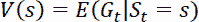 || (1) |
| --- | --- |

从时间步 `t` 开始的所有奖励 `R` 由回报 `G[t]` 表示 [5, 6]，它是折现后的未来奖励加上当前奖励的总和。公式 (2) 所示：

| 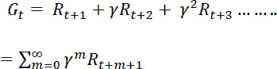 || (2) |
| --- | --- |

当在今天估计未来奖励时，折扣表示这些奖励衰减的程度。其取值范围从 0 到 1。然而，关于折扣的使用存在很大争议。

从状态 `s` 出发，动作值值对 `q` (`s,a`) 代表了执行动作 `a` 的预测回报 [5, 6]。其数学公式如公式 (3) 所示：

| 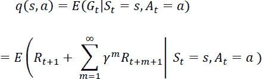 || (3) |
| --- | --- |

### 环境模型 (Model of the Environment)
环境模型能够对环境将如何表现进行预测。另一方面，基于模型的方法使用模型和规划；模型本身是强化学习中的一个可选组件。相反，无模型方法不需要智能体拥有周围环境的模型。无模型方法的学习过程显然是经验主义的。

## 强化学习算法 (REINFORCEMENT LEARNING ALGORITHMS)

强化学习算法分为基于模型的强化学习算法和无模型强化学习算法。在基于模型的强化学习算法中，智能体拥有一个帮助理解环境如何运行的模型。因此，模型帮助智能体做出决策。而无模型方法不需要智能体拥有周围环境的模型。因此，智能体通过试错法从经验中学习。无模型强化学习算法分为基于策略的或基于价值的学习算法。基于价值的学习算法侧重于学习价值函数。该函数计算智能体在未来存在于特定状态（状态价值函数）或在该状态下采取（状态-动作价值函数）将获得的预测奖励。基于策略的学习算法侧重于学习策略函数。该函数将状态映射到采取不同动作的概率。强化学习算法 [3] 按照图 (3) 进行分类。

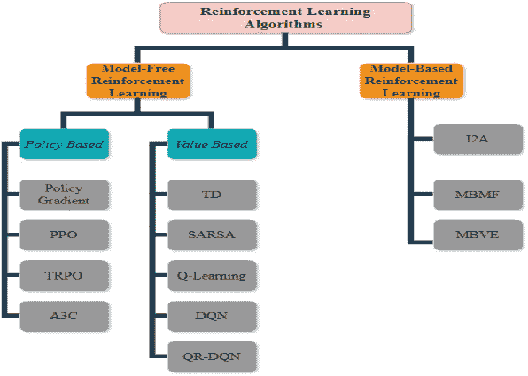 **图 (3))**

强化学习算法的分类。

### 策略梯度 (Policy Gradient)
策略有两种类型：确定性和随机性。确定性策略将每个状态映射到特定的动作，而随机性策略则在给定状态下对可能的动作分配概率分布。智能体是作为决策和学习机器运行的计算机程序。环境通过提供激励并指示根据智能体的活动可能分散的未来状态来对智能体的交互做出反应。奖励取决于行为，可能是有利或不利的。动作的概率分布由算法策略 `(π)` 表示，它包含一个参数 `θ` [3]。

### 信任区域策略优化 (Trust Region Policy Optimization, TRPO)
该方法适用于大型非线性策略（如神经网络）并对其进行优化。TRPO 能以最少的超参数调整提供稳定的进展。迭代过程被用于确定在信任区域内可以采取的最大步长以达到全局最大值。这产生了一个可以用于额外训练的更新策略。

### 近端策略优化 (Proximal Policy Optimization, PPO)
它在几个困难问题中表现出色的性能。最优信任区域策略是该算法的灵感来源。在每一步，算法都尝试计算新策略以最小化代价，确保与之前策略的偏离尽可能小 [3]。

### 异步优势演员-评论家 (Asynchronous Advantage Actor-Critic, A3C)
A3C 是谷歌旗下 DeepMind 创建的一种新技术，结合了两个思想。

*   **异步 (Asynchronous):** 它像人类群体一样运行，每个人都交换知识。因此，每个智能体都能减少回报方面获得各种经验，这些经验可用于额外训练。
*   **演员-评论家 (Actor-critic):** 将价值迭代策略的优点与策略迭代方法（如 Q-learning）合并。

### 时差分 (Temporal Difference, TD)
在这种情况下，智能体获得了预测变量未来价值的能力，并使用获得的状态值来引导转换环境状态的后续动作。它类似于动态规划，并涉及使用最新的价值函数估计进行自引导（bootstrapping）。

### Q-learning
字母 `Q` 代表质量（quality）。特定动作产生最佳奖励的概率由算法表示。Q 表作为智能体为每个状态选择动作的指南。通过选择最优路径 `(状态，动作)`，增加预期奖励。贝尔曼方程被用于更新 `Q (s,a)` [2, 3]。

### 状态-动作-奖励-状态-动作 (State-Action-Reward-State-Action, SARSA)
SARSA 算法在更新 Q 值时，不需要下一个状态的最大奖励。

### 深度 Q 神经网络 (Deep Q Neural Network, DQN)
作为过程的一部分，创建一个矩阵以帮助智能体选择未来收益最大的动作。但随着周围状态和动作的增加，创建 Q 表变得越来越困难且耗时越长。深度 Q 学习中每个潜在动作的 Q 值由输入产生。ε贪婪探索取决于最高的 Q 网络输出以确定下一个动作。贝尔曼方程被用于调整网络权重并考虑目标值的不确定性。

### 想象增强体 (Imagination-Augmented Agents, I2A)
利用类似于深度策略网络的预测，它学习解释区域外的预测以构建各种形式的计划。该方法已被证明可以显著提高数据的稳健性、性能和效率。

### 基于模型的先验 (Model-Based Priors for Model-Free)
它充当基于模型和无模型强化学习之间的联系。

## 强化学习的应用 (APPLICATIONS OF REINFORCEMENT LEARNING)

### 医学影像处理 (Medical Imaging)
医学影像可以准确检测疾病，但在解释图像时存在不准确的风险，特别是在诊断癌症时。强化学习方法已成功解决了生物信息学、医学诊断、语音识别、语言识别、计算机视觉和机器人运动等领域的困难问题。


-   **机器人：** 强化学习常用于机器人领域，涵盖多种应用，如灵活操控、医疗辅助、降低复杂性、模型验证、识别漏洞、状态动作离散化、任务时长估算、云端演示、任务管理、协调研究工作、通过模拟测试优化生产力以及开发预测模型。强化学习算法的计算通常是测试递增的，这会对机器人仿真带来风险。
-   **游戏：** 深度强化学习正在创建并提供用于新游戏的软件策略。某些视频游戏（包括雅达达、国际象棋、我的世界和数独）对人类来说学习难度极极具挑战性，并已广受欢迎。使用强化学习的智能体通过犯错来学习 [7]。
-   **商业管理：** 奖励学习主要用于推荐系统和业务应用。Netflix 使用强化学习向其用户推荐电影和电视节目。Spotify 使用强化学习算法来处理歌曲滥用和调查。仓库经理利用算法使空间利用最大化，而在线零售商则利用它们来研究消费者行为并定制产品和客户体验。
-   **神经网络超参数选择：** 使用迭代的试错过程来确定神经网络的架构和超参数选择。因此，它可以被表述为一个涉及强化学习的问题。

## 人类决策

人类通过感官器官接收信息，这些信息随后由大脑的注意力和工作记忆功能进行处理和解释 [8]。在注意力功能的情况下，注意力被集中在海量感官流中的相关细节上。工作记忆充当临时工作空间，用于存储选定的数据以进行处理。人类依赖心理模型，心理模型是根据先验知识和经验构建的世界的内部表征。人类通过考虑所有可能性并选择最可能产生预期结果的一个来利用心理模型做出决策。心理模型偏差具有影响决策的潜力。决策过程受到直觉和情绪的影响。在做决策时，人类会考虑所有选项，信任自己的直觉和本觉，并在选择行动方案之前权衡每种选择的优缺点。决策涉及持续的学习。人类是从我们所做出的决策中学习的终身学习者。这些结果会修正心理模型并影响未来的判断 [9]。由于这种反馈循环，人类可以获得更好的决策能力并适应新情况。

每个决策问题都有一组独特的选项，必须对其进行分析以确定哪种是最好的。由于有许多因素在起，识别最佳选项可能需要大量的工作和时间。一些重要因素 [1] 包括情绪、时间、不确定性、风险、过去经验和周围环境，如图 (4] 所示。

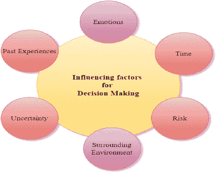 **图 (4)**

影响决策的因素。

在过去经验的帮助下，人类评估决策的所有可能选项并从中选择最好的。情绪可以是积极或负面的。如果情绪是积极的，人类会再次选择相同的替代方案；如果情绪是负面的，他们会尝试拒绝之前的糟糕替代方案。当人们被迫在受限的时间范围内做出决策时，人类决策（HDM）可能具有挑战性。决策还受到不确定性的影响。当未来结果未知时，做决策是挑战性的。每个因素在 HDM 中都有不同的重要性。然而，在判断时并不总是可行考虑每一个因素 [1]。

### 人类决策与强化学习

最受欢迎的学习游戏之一是爱荷华博弈任务（IGT），它基于参与者的先验经验。最初，该游戏使用实际卡牌进行。在其他研究中，采用了 IGT 的计算机版本，使用虚拟卡牌代替实际卡牌。参与者需要一次选择一副牌，可以选择获得奖励或惩罚。每个成员在开始时获得 2000 美元的虚拟贷款。贷款金额根据他们赢输的金额增加或减少。不向参与者提供有关支付计划或总试验次数的信息。他们所做的玩游戏并带走最大的奖励 [1]。

### 人类决策与强化学习的文献综述

文献综述的简要细节如图 (5]所示。Premkumar *et al.* (2008) 采用了强化学习（RL）和期望效用（EV）混合模型来探索决策过程 [10]。在一项研究中，研究人员使用前景价值（PVL）模型来解决 EV 模型的问题。与 EV 模型相比，PVL 模型性能更好 [11]。利用健康良好的 44 名学生的信息，Rasmussen *et al.* (2019) 研究了产生绪对参与者行为的影响 [12]，发现积极情绪组在 IGT 上的表现优于负面和中性组。Levine *et al.* (2005) 创建了一个专注于情绪的补充模型，以评估眶额叶皮层损伤个体的认知障碍 [13]。该研究还查看了人工时间限制如何影响 HDM 行为和学习。根据 Schutte (2012) 的研究，个体在截止日期压力下，处理信息的速度更快且焦虑感更强 [14]。


Gupta *et al.* (2022) 考虑了三个假设，以此形成构建 HDM 计算模型 `[15]` 的基础。它们分别是 `TDC/TIC` 规则、`DRI` 以及效用函数。这些函数以不同的方式组合，创建了四种学习模型。考虑的初始因素是效用函数，它计算结果的预期价值。展望效用 (`PU`) 函数和期望效用 (`EU`) 函数是效用函数划分的两个额外类别。`PU` 理论解决了与风险、不确定性和概率相关的决策问题 [16]`。这一心理学理论解释了人们在这些情况下是如何决策的。相反，根据 `EU` 理论，预计个体会在考虑成功概率的情况下选择一种使其效用最大化的行动。它通常用于未来不确定的情况，并作为处理涉及不确定决策问题的指南。`EU` 和 `PU` 分别使用方程 (4) 和 (5) 计算 `[1]`。

| 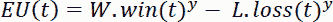 || (4) |
| --- | --- |

在这里，`y` 是效用函数的曲率，`EU(`t`)` 是当前试验 `t` 的期望效用。分配给利润和损失值的权重为 `W` 和 `L`。在试验 `t` 的牌组选择期间赢得或损失的金额用 `win(`t`)` 和 `loss(`t`)` 表示。 |

| 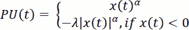 || (5) |
| --- | --- |

当前试验 `t` 的 `PU` 值由 `PU(`t`)`、效用函数的形状 `α` 以及损失厌恶值 `λ` 表示。在这种情况下，`x(`t`) = win(`t`) - |loss(`t`)|`。如果 `x(t) – 0`，则表示亏损；如果没有，则表示盈利。 |

接下来是衰减强化学习 (`DRI`) 规则。在该规则中，所选方案的期望值减少一个特定的数量，而未选方案的期望值则使用方程 (6) 重新计算。`α[kt]` 和 `β[kt]` 是提供的过去期望 `E[k]` (`t`-1) 的学习权重。 | 

| 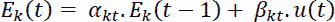 || (6) |
| --- | --- |

方程 (7) 和 (8) 提供了 `DRI` 中同样使用的学习率和虚拟约束。 |

| 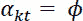 || (7) |
| --- | --- |

| 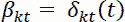 || (8) |
| --- | --- |

下一个规则是比例选择规则，也称为玻尔兹曼探索（Boltzmann exploration）。方程 (9) 作为输出，显示了下一次尝试 (`t`+1) 中选择牌组的概率。 |

| 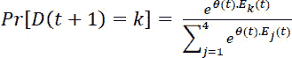 || (9) |
| --- | --- |

选择规则中比例中使用的敏感性参数 (`θ`) 是根据方程 (10) 和 (11) 概述的试验依赖 (`TDC`) 或试验独立 (`TIC`) 选择规则计算的。这里是一致性约束。 |

| 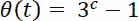 || (10) |
| --- | --- |

| 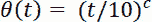 || (11) |
| --- | --- |

在 `TDC` 中，具有敏感性 `θ(t)` 的意义随着学习过程而变化。相反，在 `TIC` 的情况下，一致性值独立于试验 `t`，并在 `θ(t)` 指定的时间间隔内保持固定。模型开发完成后，通过查看均方差 (`MSD`) 的值，使用模拟方法对模型结果进行评估，该值在方程 (12) 中概述并在方程 (13) 中验证。 |

| 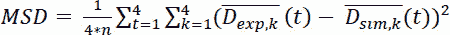 || (12) |
| --- | --- |

在这里，`n` 和 `k` 分别是牌组的总数和试验次数。在试验 `t` 选择模拟数据和实验数据的平均概率用 `D[sim,k]` 和 `D[exp,k]` 表示。 |

| 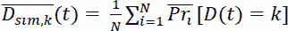 || (13) |
| --- | --- |

对于模拟数据，`Pr[D(`t`) = k]` 是每个人的平均概率，`N` 代表总人数。 |


` 标签结尾，且包含了大量未翻译的参考文献列表。根据您的要求，我已将上述**正文内容**翻译为中文：

[content]
*   即使在与强化学习（RL）智能体一起工作，也必须保持对关键决策过程的人类监控。必要时，人类必须能够介入并覆盖强化学习的判断 [19] 。
*   随着强化学习智能体变得复杂，它们可能会在某些任务中取代人类。重训和技能重塑策略对于防止失业和确保社会的平稳过渡至关重要。

## 未来展望与挑战

针对强化学习与人类决策的结合，文中解释了某些未来前景：

*   **共享学习框架：** 创建允许人类和强化学习智能体之间实时相互学习的框架具有广阔前景。这可能意味着在强化学习智能体学习过程中为其提供人类建议和反馈，从而加速适应过程并提供更强大的决策技术 [20] 。
*   **多样化数据集与人类监督：** 使用各种代表性数据集来训练强化学习智能体至关重要。此外，在关键决策程序中进行人类监督有助于确保结果的公正，并减少任何偏见的影响 [21] 。

针对强化学习算法，文中解释了某些挑战：

*   **安全与保障：** 随着强化学习智能体变得越来越先进，维护这些系统的安全与可靠至关重要。需要包含强有的安全措施和失效程序，以减少与现实应用中使用的强化学习算法相关的任何潜在危害 [22] 。
*   **可扩展性与样本效率：** 将强化学习系统扩展以解决涉及海量数据的复杂现实问题仍然具有困难。此外，提高强化学习智能体的样本效率（即从较少数据中学习的能力）对于更广泛的应用至关重要 [23] 。

## 结论

在本章中，讨论了一种基于强化学习的决策模型，该模型试图将经验、情感、风险和时间等许多人类因素整合到一个单一框架中，以更好地理解人类决策过程。层次分析法（AHP）被用于对这些因素进行优先级排序。

强化学习和人类决策都需要处理未知性、做出决定以及从过去的错误中汲取教训。通过结合这两种强大的力量，我们可能会探索改进人工智能和深化对人类认知理解的迷机会。以下是主要结论：

*   **协作与相似性：** 奖励系统、价值估计以及探索与利用之间的微妙平衡在强化学习和人类决策中均有应用。这为强化学习驱动的决策支持系统和人类回路学习提供了机会。
*   **需要考虑的道德方面：** 优先事项包括偏见、公平性、透明性和安全性。我们需要创建易于理解的强化学习算法，减少训练集中的偏见，并在做出关键决策时赋予人类判断以优先权。
*   **前景研究领域：** 复杂环境下的人机协作、感知公平性的强化学习以及共享学习框架都是值得追求的有趣领域。然而，解决可扩展性、采样效率和安全性问题仍然是当务之急。

## 参考文献

（注：参考文献部分通常按照学术规范不翻译，保留原文格式）


| [20] | Zhang S., 等. 针对具有互补技能的人的人机团队的协作强化学习,*Proceedings of the Thirty-Seventh AAAI Conference on Artificial Intelligence.*. **2023** |
| [21] | Selbst A., 等. 社会技术系统中的公平性与抽象性,*Proc. Natl. Acad. Sci. USA.* **2019;** 116(52): 25972-25979. |
| [22] | D. Amodei, "AI 安全中的具体问题," arXiv preprint arXiv:1606.06565, 2016. |
| [23] | T. Schaul, J. Quan, I. Antonoglou, and D. Silver, "优先经验回放," arXiv preprint arXiv:1511.05952, 2015. [Online]. |

# 揭示影响：强化学习算法的社会影响

Heena Khanna(1, *), Manik Mehra(1), Jordao Fortunato Diogo(2)

¹ 印度旁遮普邦，美丽专业大学，计算机应用学院
² 安哥拉，卢安达，格列戈奥·塞梅多大学

## 摘要

近年来，强化学习（`RL`）算法因其能够使机器自主学习并做出决策而受到广泛关注。然而，在对 `RL` 潜在应用的热热中，必须批判性地审查这些算法的伦理和社会影响。本章深入探讨了 `RL` 对社会的多方面影响，探索了自主性、偏见、隐私和职业流失等问题。通过全面分析，它揭示了技术与社会之间复杂的相互作用，阐明了部署 `RL` 算法时出现的伦理困境。通过揭示与 `RL` 相关的潜在后果和风险，本章旨在引发深思的讨论，并为旨在促进机器学习领域负责任创新的决策过程提供信息。

**关键词：** 职业流失、强化学习、社会中的 `RL` 技术、负责任创新。

***

(*) 通讯作者 Heena Khanna：印度旁遮普邦，美丽专业大学，计算机应用学院；电子邮件：heena.31463@lpu.co.in

## 引言

`RL` 算法旨在学习最优策略或价值函数，使智能体能够在复杂环境中做出知情决策。这些算法可以分为基于价值的方法（学习价值函数并基于此选择动作）和基于策略的方法（直接学习从状态映射到动作的策略）。

此外，还有基于模型的 `RL` 方法（学习环境动力学模型以规划动作）和无模型 `RL` 方法（直接从与环境的交互中学习，而不显式地对环境进行建模）。`RL` 是机器学习的一个分支，智能体通过与环境交互来学习做出顺序决策，以实现某些长期目标 [1]。

如图 (**1**) 所示，`RL` 算法旨在让智能体通过试错、反馈和奖励来学习最优策略或行为。尽管关于 `RL` 程序的伦理考量目前尚未处于领先地位，但随着 `RL` 在工业、机器人、视频游戏及其他许多领域获得更应用，其重要性在未来可能会增加 [2]。

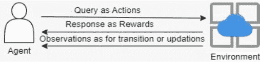
**图 (1)**

`RL` 过程。

## RL 的定义与基础

`RL` 是机器学习的一种范式，智能体通过与环境交互来学习决策，以实现某些目标或最大化累计奖励。与监督学习（模型从标记示例中学习）以及无监督学习（模型从未标记示例中学习）不同。

`RL` 的核心要素包括：

- **智能体 (Agent)**：与环境交互的学习者或决策者。
- **环境 (Environment)**：智能体交互的外部系统。
- **状态 (State)**：环境当前状况或配置的表示。
- **动作 (Action)**：智能体在每个时间步做出的会改变状态的决策。
- **奖励 (Reward)**：环境在每个动作后提供的标量值。
- **策略 (Policy)**：智能体遵循的从状态到动作的策略或映射。
- **价值函数 (Value Function)**：一种估计处于特定状态或采取某动作的预期累计奖励或效用的函数。
- **探索与利用 (Exploration vs. Exploitation)**：在探索新动作或新状态与利用已知信息之间取得平衡 [3]。

### RL 算法的重要性与应用

`RL` 算法提供了解决复杂决策问题的强大工具，并越来越多地应用于各个领域，以自动化任务、优化流程并增强决策支持系统。

- **决策的灵活性**：`RL` 算法是多功能的，可以处理广泛的决策任务，包括顺序决策、控制、优化和自适应学习。
- **对动态环境的适应性**：`RL` 算法能够在动态和不确定的环境中学习，最优决策策略可能随时间变化。
- **从交互中学习的能力**：`RL` 算法通过与环境直接交互进行学习，使自主智能体通过试错获取知识并提高性能。
- **处理部分观测环境**：`RL` 算法可以处理部分观测环境，即智能体的观测是不完整或带有噪声的。如结合循环神经网络（RNN）或长短期记忆网络（LSTM）的 `RL` 等技术用于建模顺序决策。
- **复杂系统的优化**：`RL` 算法可以优化具有巨大状态和动作空间的复杂系统，例如资源分配、调度和物流管理。


### 个性化学习与推荐
RL 算法可以根据用户的偏好、行为和反馈，为其提供个性化的学习体验和推荐。它们驱动了电子商务、内容流平台和在线广告中的推荐系统 [4]。

### 个性化网络服务
通过根据在线活动推断的用户画像推荐定制化内容，个性化网络服务可以提升用户满意度和营销活动的效果。RL 非常适合这一领域，使系统能够通过用户反馈触发的调整来完善推荐策略，这些反馈通常`via`对点击行为作为兴趣指标的实时监控获得 [5]。

#### RL 开发中的伦理考量

由于 RL 算法对个人、社会和环境可能产生影响，在 RL 算法开发和部署过程中的伦理考量至关重要 [6]。以下是图（ (**2**)中描述并在下方进一步解释的一些关键伦理考量：

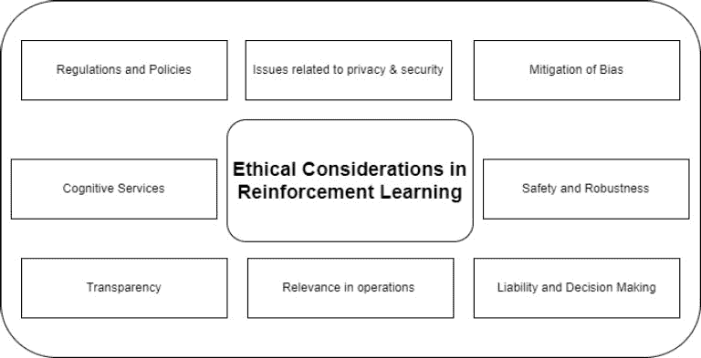 **图 (2)**

RL 中的伦理考量。

### 偏见与公平性
如果 RL 算法在有偏或不完整的数据上进行训练，可能会表现偏见。确保 RL 模型是公平的，并且不对种族、性别或社会经济地位等敏感属性对个人或群体产生歧视，是非常重要的。

### 透明度与可解释性
RL 算法可能复杂且难以解释，这引发了对透明度和可解释性的关注。开发者应努力使 RL 模型透明化，并对其决策提供解释，以确保问责制和信赖。

### 安全性与稳健性
RL 算法做出的决策可能产生现实后果，因此优先考虑安全性和稳健性至关重要。开发者应该实施保护措施以防止有害行为，并确保 RL 智能体在不可预测的环境中负责任地运行 [7]。

### 隐私与数据保护
RL 算法可能需要访问敏感数据以学习最优策略。在 RL 应用中收集、存储和使用个人数据时，保护隐私并遵守数据保护法规是重要的 [8]。

## 环境影响
RL 算法可能会消耗大量的计算资源和能量，导致环境问题。开发者应尽力减少 RL 模型对环境足的影响，并考虑大规模部署对可持续性产生的影响 [9]。

### 问责制与治理
参与 RL 开发的开发者、研究人员和组织应坚持高伦理标准并建立明确的问责机制。建立稳健的治理框架以应对伦理挑战并确保 RL 领域的负责任创新至关重要 [10]。

#### RL 算法中的偏见与公平性

RL 算法中的偏见和公平性是关键问题，会影响这些系统的有效性和伦理部署。RL 中的偏见可能源于多种来源，包括有偏的训练数据、算法设计和用户交互。例如，如果用于训练 RL 智能体的数据包含历史偏见，或不能代表整个群体，那么智能体的决策很可能会延续这些偏见。此外，反馈回路可能会加剧偏见，因为有偏的决策会影响未来的数据，从而强化现有的偏见。RL 中的公平性涉及确保 RL 智能体做出的决策不会对任何个人或群体造成不成比例的伤害。由于优化性能与确保公平结果之间存在固有的权衡，这可能具有挑战性。人口统计学差异、均等机会和差异影响等指标被用于衡量公平性，但实现这些目标需要对背景和特定应用进行仔细考虑 [11]。

### RL 系统中的透明度与问责制

RL 系统的透明度和问责制对于确保其伦理且有效的部署至关重要。透明度意味着让 RL 算法的决策过程对包括用户、开发者和监管机构在内的所有利益相关者都是可见且可获取的。可以通过算法的清晰文档、阐明决策如何产生的的可解释 AI 技术以及允许审查和改进的开源实现来实现。RL 系统中的问责制确保有机制来要求开发者和用户对算法的结果负责。这包括建立明确的责任链、实施审计追踪以跟踪 RL 系统所采取的决策和行动，以及开发用于处理不利结果的稳健框架。透明度和问责制有助于建立对 RL 系统的信任，促进偏见的识别和纠正，并确保这些强大的工具在从医疗保健到金融的各种应用中被负责任且公平地使用 [12]。

### RL 数据收集与使用中的隐私问题

考虑到这些系统通常需要大量的个人和敏感信息，RL 数据收集和使用中的隐私问题非常。RL 算法通常依赖大型数据集来学习和优化其决策过程。这些数据集可能包括用户行为、偏和其他个人数据，引发隐私问题。一个主要担忧是未经授权的数据访问的风险。如果数据没有得到充分保护，可能会受到泄露，从而暴露敏感信息。此外，数据滥用也是一种风险，即为某一目的收集的数据在未经用户同意的情况下被挪作他用。这可能导致意外之外的后果并损害用户信任 [13]。另一个问题是去匿名化的可能性。即使数据经过了匿名化，复杂的技巧有时也能重新识别个人，特别是当与其他数据源结合时。这种风险在持续时间收集和分析数据的 RL 应用中被放大了。此外，确保符合`GDPR`和`CCPA`等数据保护法规的规定具有挑战性，这些法规对数据收集、存储和处理规定了严格的指南。

#### RL 算法对就业和劳动力市场的影响

RL 算法具有以多种方式（积极和消极）显著影响就业和劳动力市场的潜力 [14]。是一些潜在的影响：

### 自动化与工作流失

RL 驱动的自动化具有显著影响劳动力市场的潜力，导致对工作流失的担忧。RL 算法可以以高效率优化复杂的任务和流程，在许多领域通常优于人类能力。这种效率可能导致以前依赖人工劳力的工作实现自动化，特别是在制造业、物流、金融和客户服务等行业。一个关键的关注领域是常规和重复性工作的流失。此外，自动化的快速速度可能会超过劳动力市场适应的能力。被 RL 驱动的自动化所流失的工人可能在快速获得技能以转型到新角色方面面临挑战。这种技能差距可能会加剧经济不平等，并产生重大的社会经济动荡。

### 社会经济不平等与机会获取


强化学习（RL）领域的社会经济不平等和机会获取凸显了显著的差异，技术进步的不均衡分布可能会加剧这些差异。强化学习系统以优化各个部门的决策和流程而闻名，如果获取不公平，可能会在无意中加深现有的不平等。一个核心问题是数字鸿沟，它限制了弱势群体获取必要技术和互联网连接的能力。这种鸿沟可能防止这些群体从个性化教育、医疗保健和经济发展等领域的强化学习应用中获益，从而导致贫困和排斥的循环。此外，开发和实施强化学习系统所需的资源（如先进的计算基础设施、大数据和专业知识）通常集中在富裕的个人、组织和国家手中。这种集中可能导致一种局面：富人继续获得优势，而弱势群体则进一步落后。教育不平等进一步加剧了这种不平等。获取科学、技术、工程和数学（STEM）领域的优质教育对于参与强化学习技术的开发和利用至关重要。如果没有针对性的倡议为代表性不足和弱势的群体提供这些教育机会，强化学习相关机会差距可能会扩大。为了应对这些挑战，需要共同努力实现强化学习技术的民主化。强化学习算法可以通过实现远程办公、灵活调度和零工经济平台来重塑劳动力动态。虽然这些变化可能为劳动者提供更大的灵活性自主性，但也引发了对工作安全、福利和劳动权利的关注 [15] 。

## 技能再培训与就业市场适应

再培训和就业市场适应是应对强化学习和其他先进自动化技术采用导致劳动力变动的必要策略。随着强化学习系统日益接管常规和复杂任务，许多传统角色可能会变得过时，导致未来工作所需的技能发生重大转变。再培训涉及为工人提供所需的培训和教育，以转型到不易受自动化影响的新角色。这可能包括在数据分析、编程、机器学习等高需求技术领域进行技能提升。此外，批判性思维、创造力和解决问题等软技能正变得越来越有价值，因为它们不容易被机器复制。为了促进这种转变，公共和私营部门都必须投资全面的再培训计划。政府可以通过资助教育倡议、与行业建立伙伴关系以及制定激励持续学习的政策来发挥关键作用。公司也应该投资其员工的发展，提供培训计划和组织内的职业晋升通道。就业市场适应强化学习的现实也意味着培养一个支持创新和创造新工作的环境 [16] 。

## 强化学习应用的社会行为影响

强化学习应用的社会行为影响是深远且多层，影响着日常生活的各个方面和社会动态。强化学习系统通过从交互中学习来优化决策过程，可以显著影响个人和体的行为及互动方式 [17] 。

一个显著的影响是对消费者行为。强化学习算法驱动电子商务、社交媒体和娱乐领域的推荐系统，根据用户的偏好和行为定制内容和产品建议。这可以增强用户体验，但会导致回声室效应并减少对多元观点的接触，可能强化现有的偏见，并限制个人遇到的信息和视角多样性。在工作场所中，自动化和决策中的强化学习应用可以改变职位和动态。虽然这些技术可以提高效率并减少单调任务，但它们可能导致职业流业，并需要大量的再培训努力。工作角色的转变会影响员工士气和职场文化，需要适应策略来管理转型并保持积极的工作环境。在社会方面，公共服务（如医疗和执法）中的强化学习驱动系统可以提高效率和决策，但也引发了对公平和责任的关注 [3] 。

### 对消费者行为和决策的影响

强化学习通过优化个性化体验和推荐，显著影响消费者行为和决策。在电子商务中，强化学习驱动的推荐系统根据个人浏览习惯、购买历史和偏好建议产品，通常会导致销售额和客户满意度的提高。同样，在社交媒体和流平台上，强化学习算法根据用户偏好定制内容流和建议，增强参与度和留存。然而，这种个性化也存在负面影响。通过持续提供与用户现有偏好和行为一致的内容，强化学习系统可能会创建回声室，限制对多元观点的新信息的接触。这可能会强化现有的偏见并缩小消费者的视角。

### 对社会动态和互动的意义

强化学习应用深远地影响社会动态和互动，重塑了个人连接、沟通和形成社区的方式。一个重要意义是增强个性化的社交媒体体验。强化学习算法根据用户行为、偏好和互动策划内容流，这可以加强志同道合者之间的联系，但会导致回声室的形成。这些回声室强化了现有信念并减少了对多元观点的接触，可能导致社会话语的极化并加深社会分裂。在在线社区中，强化学习驱动的审核工具通过检测和减轻有害内容来管理用户行为。虽然这些工具可以营造更安全、包容性的环境，但也引发了对审查和潜在偏见审核实践的担忧。在这些自动化系统中确保透明和公平对于维护在线互动中的信任和公平至关重要。此外，通信平台（如机器人和虚拟助手）中的强化学习应用正在改变人们与技术以及相互互动的方式。这些系统可以促进更顺畅高效的互动，但如果过度依赖，可能会导致人类接触减少和孤独感。在专业环境中，强化学习集成到协作工具和决策过程中可以提高生产力并简化工作流。

### 强化学习驱动系统的心理影响


RL 驱动的系统对个人具有显著的心理影响，特别是在他们与技术交互以及做出决策的方式。由 RL 驱动的社交媒体和娱乐平台上的个性化内容推荐可以提高参与度和满意度。然而，这可能导致过度依赖和成瘾，因为用户会不断寻求定制化体验带来的满足感。此外，RL 系统固有的持续反馈循环会通过强化特定的行为和偏好来塑造用户行为。这可能导致批判性思维和自我意识的下降，因为个人可能习惯于由算法微妙地引导决策 [18]。在专业环境中，RL 驱动的自动化和决策支持系统可以减轻认知负载并提高生产力。

# 法律与监管挑战

RL 系统的出现带来了许多法律和监管挑战，需要审慎考虑以确保这些技术以负责任的方式实施。随着 RL 系统日益深度整合到各个领域，必须审查并适应现有的法律和新的政策框架，以管理 RL 的独特方面 [19]。

## 现有法规及其适用性

当前数据隐私、网络安全和人工智能（AI）伦理方面的法规为监督 RL 系统提供了基准。如《通用数据保护条例》（`GDPR`）和《加利福尼亚消费者隐私法案》（`CCPA`）等法律由于 RL 在训练和运行中高度依赖海量数据集而变得相关。这些法律强制数据保护、知情同意和透明，这对 RL 应用至关重要。然而，RL 的自主性质和动态决策过程对这些法规带来了挑战。例如，确保数据使用的持续合规性以及维护算法决策的透明度可能是困难的。此外，现有的 AI 法规关注透明度、公平性和问责制，由于 RL 的算法复杂且通常不透明，这些这些在 RL 中难以执行。因此，调整这些法规以适应 RL 的独特性对于实现有效监管是必要的。

## RL 算法的政策框架

专门为 RL 算法建立全面的政策框架对于引导其伦理和法律部署至关重要。这些框架应该强调透明度、问责性和公平性等原则。决策者需要制定涵盖 RL 系统整个生命周期（从开发到部署）的指南。这包括为数据质量、算法透明度、定期审计和影响评估设定标准。政策还应强制披露 RL 决策过程，以确保它们是可理解且负责任的。政府机构、行业领导者和学术专家之间的协作对于制定这些框架至关重要。通过主动应对潜在风险并设定明确指南，这些框架可以促进负责任的创新并减轻不利影响，确保 RL 技术服务于公益。

## 知识产权与责任问题

RL 中的知识产权（`IP`）和责任问题带来了重大的法律挑战。确定 RL 中的 `IP` 所有权是复杂的，因为这些系统通常涉及协作开发并利用开源组件。此外，RL 系统可以自主创建新的解决方案或产品，这引发了关于谁拥有这些创新——等等，不，`创新`的问题。现有的 `IP` 法可能需要修订以充分应对这些新场景。责任是另一个关键问题，特别是当 RL 系统的决策导致损害或财务损失时。需要清晰的责任框架来确定权责，无论责任是属于开发者、运营商还是 RL 系统本身。这要求更新当前的责任法规，以考虑 RL 系统的自主决策能力。建立清晰且可执行的 `IP` 和责任标准将保护利益相关者并鼓励负责任地使用 RL 技术 [20]。

# 环境与资源影响

RL 算法虽然强大且多功能，但具有显著的环境和资源影响。RL 模型训练需要大量的计算资源，通常涉及高性能 `GPUs` 或专用硬件（如 `TPUs`）。这种密集的计算导致了巨大的能量消耗，导致了碳排放和环境退化。随着 RL 模型的复杂性增加，对计算能力的需求升级，加剧了这些环境影响。此外，支持 RL 的基础设施（包括数据中心和云服务）需要持续的电力冷却，进一步加加了自然资源的负担。RL 使用硬件的生产和处置也带来了环境风险，导致了电子垃圾。

## RL 系统的能量消耗

RL 系统是计算密集型的，通常需要大量的能源资源来进行训练和运行。RL 算法的迭代性质涉及大量的模拟和更新，这需要高性能计算基础设施。对 `GPUs`、`TPUs` 和数据中心的大量会导致会导致能量消耗。随着 RL 模型变得越来越复杂，应用越来越广泛，能源需求相应增加。解决这一挑战需要优化算法以提高效率，并探索替代的、低能耗的模型训练和部署方法 [21]。

## 可持续发展考虑

RL 中的可持续发展考虑涉及设计和部署平衡技术进步与环境管理的算法。这包括开发能能模型、减少训练和运行过程的碳足迹，以及在数据中心管理中实施环保实践 [22]。鼓励使用再生能源并促进电子垃圾的回收和负责任处置也至关重要。通过将可持续性整合到 RL 系统的生命周期中，该技术可以对更广泛的环境和可持续发展目标做出贡献，确保 RL 的进步不会以牺牲生态健康为代价。

# 偏差缓解与伦理设计实践

这些偏差可能导致对特定群体的不公正对待，延续现状的不平等并造成伤害。为了减轻偏见，在训练阶段使用多样化且代表性的数据集至关重要。确保训练数据反映广泛的场景和人口统计特征有助于 RL 系统学习更平衡、更公平的行为。此外，在 RL 算法中加入公平性约束可以引导学习过程产生更公平的结果。诸如 `reward shaping`（通过调整奖励函数来惩罚偏见行为）等技术也是有效的。伦理设计实践涉及 RL 系统开发和部署中的透明度和问责制。这包括记录设计选择、数据来源和 RL 模型的潜在偏差。应定期进行审计和影响评估，以识别并解决可能出现的偏差。在设计过程中让多元化的利益相关者参与可以提供价值视角，并在早期识别伦理问题。

## 公平感知 RL 算法


公平感知强化学习（RL）算法旨在减轻偏见并促进决策过程中的公平结果。这些算法解决了如何确保 RL 系统公平地对待所有个体的挑战，无论其种族、性别或社会经济地位等人口统计学特征如何。公平感知 RL 的一种方法是将公平约束直接整合到 RL 目标函数中。通过显式定义公平性指标并在优化主任务的同时对其进行优化，这些算法旨在最大限度地减少歧性结果。例如，公平性约束可以确保 RL 系统在奖励或机会方面对待来自不同人口统计学群体的个体。另一种策略是将现有的公平感知机器学习技术适配到 RL 场景。这些方法利用公平感知训练数据生成、对抗性学习和 RL 策略的后处理等技术来识别并减轻偏见。然而，设计公平感知 RL 算法面临着若干挑战。平衡公平目标与主任务性能、确保算法透明度以及处理不同公平标准之间的权衡，都是关键的考虑因素。此外，评估这些算法的有效性和公平性需要在现实场景中进行细致的验证和测试。

## 案例研究

以下是一些对减轻偏见和伦理设计实践具有启示意义的案例研究。

### 案例研究 1：自动驾驶车辆导航

**问题：** 设计 RL 算法以使自动驾驶车辆在复杂的城市环境中安全高效地导航。

**解决方案：** 一领先科技公司的研究人员开发了一种 RL 算法，该算法学习在道路的同时最大限度地减少碰撞风险并遵守交通规则。该算法利用深度 Q 学习根据传感器数据和道路状况做出实时决策。

**结果：** 在模拟和现实世界的测试中，该 RL 算法与传统的基于规则的导航系统相比，表现出了卓越性能。算法的适应性使其能够处理各种场景，包括交通拥堵、行人过马路和意外障碍物。

### 案例研究 2：个性化医疗治疗

**问题：** 使用 RL 算法根据个体患者的需求和偏好定制医疗治疗方案。

**解决方案：** 一组研究人员与医疗提供者合作，开发了一种 RL 算法，用于学习糖尿病等慢性疾病的最佳治疗策略。该算法结合了患者特定的数据、治疗历史和遗传信息，以个性化治疗计划。

**结果：** RL 算法通过优化药物剂量、饮食建议和生活方式干预改善了患者的预后。患者的血糖控制得到了更好的控制，住院次数减少，生活质量有所提高。

### 案例研究 3：电子商务中的动态定价

**问题：** 优化在线零售商的定价策略，以最大化收入和客户满意度。

**解决方案：** 一个电子商务平台集成了一个 RL 驱动的动态定价系统，该系统根据需求、竞争对手价格和客户行为实时调整产品价格。RL 算法利用历史销售数据和市场趋势来确定每个产品的最佳价格。

**结果：** 动态定价系统在保持竞争价格和客户忠诚度的同时，增加了电子商务平台的收入和利润率。客户受益于更具个性化的定价和更高的透明度。

## 公众对 RL 技术的感知与信任

公众对 RL 技术的感知和信任对其采纳和社会影响起着关重要的作用。随着 RL 算法日益整合到生活的各个方面，包括医疗、金融、交通和娱乐，理解并解决公众的担忧和感知是非常关重要的。影响公众感知的一个重要因素是 RL 系统的透明度和可解释性。许多人对他们认为不透明或不可预测的算法表示怀疑，特别是当这些算法做出影响他们生活的决策时。确保 RL 算法透明且易于理解有助于建立信任，并减轻对偏见、歧视和不公正对待的担忧。

### 公众对 RL 的认知与理解

对 RL 的认知和理解对于培养对这些技术的信任和接受至关重要。很多人可能不熟悉 RL 或理解它与其他形式的人工智能的区别。教育公众 RL 的能力、局限性和潜在应用有助于消除技术的神秘感，并缓解担忧或误解。提供易于获取且信息丰富的资源（如教育材料、研讨会和公共讲座）有助于提高意识并促进不同受众对 RL 的更好理解。

### 伦理采用 RL 的沟通策略：

有效的沟通策略对于促进 RL 技术的伦理采用至关重要。开发者、政策制定者和其他利益相关者必须就 RL 的伦理考虑和社会影响与公众进行开放透明的沟通。这包括解释 RL 系统如何设计、训练和部署，以及讨论潜在的风险和收益。针对不同观众（如政策制定者、行业领袖和公众）定制沟通策略，可以确保信息易于获取且相关联。

## 未来方向与建议

RL 的未来方向涉及推进技术以应对各个领域的新挑战和机会。一个关键方向是提高 RL 算法的可扩展性和效率，以处理日益复杂的任务和更大的数据集。这包括开发新的算法技术，如分层 RL、元学习和课程学习，使 RL 系统能够从多样化和高维环境中更高效地学习。另一个方向是增强 RL 算法的稳健性和安全性，确保它们在现实环境中可靠运行。这涉及开发对抗训练、稳健优化和不确定性估计技术，以减轻 RL 系统错误和失败的风险。图 (3) 提供了未来方向和建议的概述。此外，将 RL 与其他 AI 技术（如深度学习、迁移学习和多智能体系统）相结合，可以实现更强大、更多功能的应用。协作研究和跨学科合作对于推动创新和加速 RL 的进展至关重要。

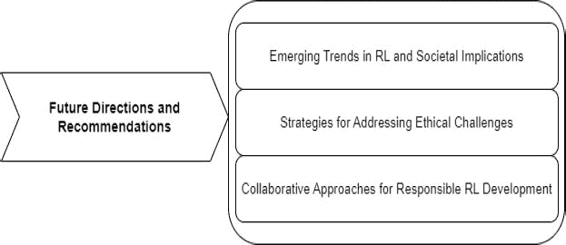 **图 (3)**

未来方向和建议。

### RL 的新兴趋势和社会影响

RL 的新兴趋势正在塑造 AI 的未来及其社会影响。一个趋势是 RL 与其他 AI 技术（如深度学习和自然语言处理）的融合，以创建更强大、多功能的系统。这种融合为医疗、金融、交通等领域的应用开启了新的可能性，但也引发了关于隐私、偏见和公平性的问题。

### 负责任 RL 开发的协作方法


强化学习的负责任开发需要协作协作方法，将研究人员、政策制定者、行业利益相关者以及公民社会组织汇聚，以应对复杂的伦理、社会技术挑战。协作倡议可以促进知识共享、跨学科研究和利益相关者的参与，确保 RL 技术以负责任且符合道德的方式进行开发和部署。此外，协作方法有助于为 RL 开发建立标准、指南和最佳实践，增强人工智能系统的透明度、问责制和信任感。通过共同努力，我们可以利用多样化的视角和专业知识来应对 RL 的伦理和社会影响，并为个人、社区和人类带来积极成果。

## 结论

强化学习已从一个分众领域变为一种变革性技术。智能体通过试错进行学习的能力对社会福祉具有巨大潜力。想象一下，由 RL 驱动的机器人执行精细手术、实时优化交通流量，甚至为每位学生提供个性化教育。然而，前行的道路并非没有挑战。训练数据中的偏见可能导致歧视算法。某些 RL 模型的“黑箱”性质使其决策过程难以被理解，从而引发了人们对透明度和问责制的担忧。此外，RL 驱动的自主武器潜力要求我们进行审慎的伦理考量。

RL 的未来取决于应对这些挑战。研究人员必须在模型开发中优先考虑公平性和可解释性。技术人员、政策制定者和伦理学家之间的开放协作至关重要。通过确保负责任的开发和部署，RL 可以成为推动进步的强大工具，塑造一个智能机器增强而非取代人类智慧的未来。这种对 AI 伦理实施和治理的探索并非终点，而是一次热切的行动号召。AI 的潜力不容置疑，但其负责任的整合取决于集体的努力。

我们作为开发者、研究人员、政策制定者和公民，必须编织一张伦理与治理的织网。开发者在设计中必须优先考虑透明度和公平性。研究人员必须深入挖掘 AI 模型决策背后的“为什么”。政策制定者必须制定既能促进创新又能保障社会福祉的法规。公民必须积极参与讨论，并要求所有利益相关者负责。这一号召跨越了国界限。国际合作对于建立通用的伦理框架和治理原则至关重要。只有通过共同努力，我们才能确保人工智能为人类服务。让我们不要回避挑战，而是将其视为构建一个由 AI 赋能、提升并引导我们走向更美好未来的机遇。

## 参考文献

| | | |
| --- | --- | --- |
| [1] | Naeem M., Rizvi S.T.H., Coronato A.. A gentle introduction to reinforcement learning and its application in different fields., *IEEE Access.* **2020;** 8: 209320-209344. | [CrossRef](http://dx.doi.org/10.1109/ACCESS.2020.3038605) |
| [2] | V. François-Lavet, “An introduction to deep reinforcement learning,” Foundations and Trends® in Machine Learning, vol. 11, no. 3–4, pp. 219–354, 2018. | |
| [3] | Littman M.L.. Markov games as a framework for multi-agent reinforcement learning, *Proc. Machine Learning Conf..* **1994**: 157-163. | [CrossRef](http://dx.doi.org/10.1016/B978-1-55860-335-6.50027-1) |
| [4] | Qiang W., Zhongli Z.. Reinforcement learning model, algorithms and its application, *Proc. Int. Conf. Mechatronic Science, Electric Engineering and Computer (MEC).* **2011**: 1143-1146. | [CrossRef](http://dx.doi.org/10.1109/MEC.2011.6025669) |
| [5] | Barto A.G., Thomas P.S., Sutton R.S.. Some recent applications of reinforcement learning, *Proc. 18th Yale Workshop on Adaptive and Learning Systems.*. **2017** | | |
| [6] | Schwartz R.. , . Towards a Standard for Identifying and Managing Bias in Artificial Intelligence.. 3. Gaithersburg, MD, USA: U.S. Dept. of Commerce, National Institute of Standards and Technology; 2022. | | |
| [7] | M. Turchetta, “Safety and robustness in reinforcement learning,” Ph.D. dissertation, ETH Zurich, 2021. | | |
| [8] | Li Y., Wang R., Li Y., Zhang M., Long C.. Wind power forecasting considering data privacy protection: A federated deep reinforcement learning approach., *Appl. Energy.* **2023;** 329: 120291. | [CrossRef](http://dx.doi.org/10.1016/j.apenergy.2022.120291) |
| [9] | Renard S., Corbett B., Swei O.. Minimizing the global warming impact of pavement infrastructure through reinforcement learning., *Resour. Conserv. Recycling.* **2021;** 167: 105240. | [CrossRef](http://dx.doi.org/10.1016/j.resconrec.2020.105240) |
| [10] | Whittlestone J., Arulkumaran K., Crosby M.. The societal implications of deep reinforcement learning., *J. Artif. Intell. Res..* **2021;** 70: 10524. | | |
| [11] | Satapathy P., Hermis A., Rustagi S., Pradhan K.. Artificial intelligence in surgical education and training: opportunities, challenges, and ethical considerations. *Sci. Rep.* **2022;** 12:833. | | |
| [12] | E. Armstrong, "Integrity, transparency and accountability in public administration": Recent Trends and Emerging Issues, vol. 1, no. 10, United Nations. | | |
| [13] | Mohammed T., Albesri A., Mehmood R.. Deep reinforcement learning to manage privacy, security, and QoS in 5G hetnets., *Appl. Sci.* **2020;** 10:20 | | |
| [14] | World Health Organization, Recommendations for Augmentation of Labour, Geneva. | | |
| [15] | Guo P., Xiao K., Ye Z., Zhu W.. Intelligent career planning via stochastic reinforcement learning., *Sci. Rep.* **2022;** 12. | | |
| [16] | Kokkodis M., Ipeotis P.. Demand-aware career path recommendations: A reinforcement learning approach., *Manage. Sci.* **2021;** 67:4362-4383. | | |
| [17] | Das S., Lavoie A.. The effects of feedback on human behavior in social media: An inverse learning model, *Proc. Int. Conf. Autonomous Agents and Multi-Agent Systems.* **2014**: 653-660. | | |
| [18] | Kaelbling L.P., Littman M.L., Moore A.W.. Reinforcement learning: A survey., *J. Artif. Intell. Res.* **1996;** 4:237-285. | | |
| [19] | T. K. Gilbert, S. Dean, T. Zick, and N. Lambert, “Choices, risks, and reward reports: Charting public policy for reinforcement learning systems,” arXiv preprint:2202.05716, 2022. | | |
| [20] | Aristodemou L., Tietze F.. The state-of-the-art on Intellectual Property Analytics (IPA): A literature review on artificial intelligence, machine learning and deep learning methods for analysing intellectual property (IP) data., *World Pat. Inf.* **2018;** 55:37-51. | | |
| [21] | Kim B.G., Zhang Y., van der Schaar M., Lee J.W.. Dynamic pricing and energy consumption scheduling with reinforcement learning., *IEEE Trans. Smart Grid.* **2016;** 7:5:2187-2198. | | |


| [22] | Zuccotto M., Castellini A., Torre D.L., Mola L., Farinelli A.. Reinforcement learning applications in environmental sustainability: a review., *Artif. Intell. Rev.* 2024; 57(4): 88. | [[CrossRef](http://dx.doi.org/10.1007/s10462-024-10706-5)] |

# 强化学习在生物识别领域的应用

Baljit Singh Saini(1, *), Cherry Khosla(1)

¹ 印度旁遮普邦优质专业大学计算机科学与工程学院，Phagwara

## 摘要

生物识别系统依赖独特的人类特征进行安全识别和验证。最近，强化学习（RL）作为一种强大的机器学习技术——算法通过尝试和错误进行学习——已成为该领域潜在的规则改变者。本章探索了利用强化学习增强生物识别系统能力的迷人可能性，同时也承认了需要解决的挑战。基于强化学习的核心概念——智能体、环境、奖励和策略，本章研究了其在生物识别版图中的潜在应用。我们探索了以下领域：活体检测：强化学习算法可用于区分真实的生物识别呈现（如指纹或面部扫描）与欺诈尝试（如照片或视频）；多模态生物识别认证：强化学习可以使系统能够动态地权衡各种生物识别模态（如指纹、人脸识别和虹膜扫描）的贡献，以实现更稳健、更准确的认证；持续用户验证：通过允许系统在整个用户话期间不断学习和适应，强化学习可用于持续验证用户身份，提高安全便利性；自适应生物识别系统优化：强化学习允许对生物识别系统内的参数进行实时调整，确保在各种条件下均获得最佳性能。通过对生物识别中强化学习的潜在应用和挑战进行全面分析，本章旨在加深对这一新兴领域的理解。我们认为，促进研究人员、开发者和政策制定者之间的开放对话与协作，对于确保强化学习在生物识别中的负责任探索至关重要，为未来安全可靠的人机交互铺平道路。

**关键词：** 认证、生物识别、活体检测、强化学习、安全。

(*) 通讯作者 Baljit Singh Saini：印度旁遮普邦优质专业大学计算机科学与工程学院，Phagwara；电子邮件：baljitsaini28@gmail.com

## 引言

生物识别是一个快速发展的领域，涉及根据个人独特的生物学或行为特征对其进行识别和认证。这些特征也被称为生物识别标识符，几个世纪以来被用于建立身份。

早期的例子包括通过木乃伊面具识别法老，以及将签名作为一种身份识别形式 [1]。“生物识别”（biometrics）一词本身源于希腊语单词“bios”（生命）和“metrein”（测量）。生物识别的科学研究始于 19 世纪末阿尔尔丰斯·贝尔蒂隆（Alphonse Bertillon）的工作，他开发了一套用于犯罪识别的人体测量学（身体测量）系统 [2]。

### 生物识别标识符的分类

生物识别标识符大致可分为两大类：生理特征和行为特征。

### 生理特征

这些是个人独特的物理属性，在一生中保持相对不变。示例包括：

* `Fingerprints`（指纹）：指尖脊起和谷的复杂图案。
* `Facial Recognition`（人脸识别）：眼睛、鼻子和嘴部等面部特征的几何配置。
* `Iris Recognition`（虹膜识别）：眼睛彩色环独特图案。
* `Retinal Scans`（视网膜扫描）：眼后视网膜上复杂的血管图案。

### 行为特征

这些是用于识别个人的独特行为模式。示例包括：

* `Signature Dynamics`（签名动力学）：人签名的方式，包括压力、速度和笔迹的变化。
* `Gait Recognition`（步态识别）：人行走或跑步的独特方式 [3]。
* `Voice Recognition`（语音识别）：人声的独特特征，包括音高、语调和节奏 [4]。
* `Keystroke dynamics`（击键动力学）：用户打字时独特的节奏和模式 [5]。

### 生物识别的应用与安全益处

与密码或令牌等传统认证方法相比，生物识别系统具有显著优势，因为后者可能会丢失、被盗或被共享。生物识别标识符是个人固有的，非常难以伪造。因此，生物识别在各种安全敏感领域正得到越来越多的应用，包括 [6]：

* `Border Control and Immigration`（边境管制与移民）：生物识别用于验证旅行者身份并防止未经授权入境。
* `Access Control`（访问控制）：生物识别系统用于控制对物理位置或数字资源的访问。
* `Financial Transactions`（金融交易）：生物识别可用于在线银行或安全支付的身份验证。
* `Law Enforcement`（执法）：生物识别数据库可用于识别罪犯或失踪人员。

生物识别的使用通过提供更可靠、防篡的识别和认证方法，显著增强了安全措施。

## 传统生物识别系统及其局限性

典型的工作流涉及双阶段程序 [7]：注册和认证/识别。在注册阶段，采集用户的生物数据，提取特征，生成模板并安全地存储在数据库中。数据可以是指纹图像、面部扫描、虹膜模式或录音，取决于所选的模态。在识别阶段，系统获取一个新的生物样本并检查其属于谁。一个特殊程序分析样本并判断其是否与系统中的某人（真实用户）匹配，或不匹配。这一决策通过将新样本与每个用户存储的信息进行比较来进行。尽管被广泛采用，传统生物识别系统面临限制其有效性的局限性。生物识别系统面临的一些常见问题是：

* `Vulnerability to Spoofing Attacks`（易受欺骗攻击）：一个重大担忧是犯罪分子可以使用伪造的生物复制品（如指纹模具、高分辨率面具或合成录音）绕过这些系统 [8]。深度伪技术的进步和制造伪造材料的便利给传统系统带来了持续挑战。
* `Accuracy Concerns`（准确性担忧）：多种因素会影响传统生物识别系统的准确性，例如低质量传感器会导致数据噪声和特征提取错误，最终影响匹配过程。
* `Environmental Factors`（环境因素）：光线变化、背景噪声或个人外貌的变化（例如戴眼镜、衰老）都会影响识别准确性 [9]。


- **非通用性与非唯一性：** 一小部分人群可能具有难以捕捉的生物识别特征，或缺乏可靠识别所需的足够区分度（例如，脊线纹有限的指纹）。
- **隐私问题：** 生物识别数据的存储和使用引发了重大的隐私担忧。与密码不同，生物识别数据一旦泄露无法轻易更改。生物识别数据库的泄露或破解会对用户隐私造成严重后果，并可能导致身份盗窃 [10]。
- **适应性有限：** 传统系统可能难以适应随时间变化的用户行为。例如，指纹识别系统可能无法识别手指上有伤疤或受伤的用户，或者语音识别系统可能因疾病导致的声音变化而陷入困境 [11]。

这些局限性凸显了对创新方法的需求，以便以增强生物识别系统的稳健性、安全性和适应性。强化学习（RL）成为解决这些挑战和解锁生物识别新可能的一种极前景的技术。

### RL
**RL：** 想象通过奖励和惩罚来训练狗。这就是 RL 背后的核心思想。RL 智能体与环境交互、采取行动，并根据结果获得奖励或惩罚。随着时间的推移，智能体通过试错来学习采取能够使其奖励最大化的行动 [12]。以下是 RL 中关键组件的详细说明：

- **智能体（Agent）：** 代表生物识别系统本身。
- **环境（Environment）：** 包含用户、传感器数据以及光照等外部因素。
- **动作（Actions）：** 这些是系统做的决策，例如调整阈值或适应特征提取技术。
- **奖励（Rewards）：** 这些是正向结果，例如成功识别用户或活体检测。
- **惩罚（Penalties）：** 这些是负面结果，例如未能识别合法用户或被欺骗尝试误导。

### RL 如何改进生物识别？

通过使用 RL，在改进生物识别方面具有多种优势。其中最显著的优势包括 [13^(\-)15]：

- **增强的活体检测：** 通过不断从用户交互数据中学习并为正确识别真实用户获得奖励，RL 算法可以擅长区分真实的生物特征与欺骗尝试。这可以显著提高生物识别系统的安全性。
- **动态多模态认证：** 生物识别系统通常结合多种模态（例如，指纹和人脸识别）以提高安全性。RL 可以使这些系统根据传感器质量或用户行为等因素动态调整赋予每个模态的权重。这确保了在不同条件下的最佳性能。
- **持续用户验证：** 目前系统通常依赖于一次认证。RL 可以可以在用户会话期间进行持续验证。系统可以学习用户行为模式并持续评估用户身份合法。这可以显著提高安全性并防止长时间会话期间的未经访问。
- **自适应系统优化：** 生物识别系统可以根据环境条件（例如光线变化）或用户行为的变化进行实时调整。RL 可用于实时学习和适应系统参数（例如图像预处理技术、特征提取算法），确保在各种条件下的最佳性能。

通过引入 RL，生物识别系统可以变得更加稳健、自适应且安全，从而解决了传统方法面临的若干挑战。在下一节中，我们将深入探讨 RL 在生物识别中的特定应用，并详细探索其潜在收益。

## RL 在生物识别系统中的应用

### 生物识别中的 RL 活体检测
活体检测是生物识别系统的关键组成部分，确保提供的生物识别数据源自真人而非伪品（例如，指纹模具、面具）。传统方法通常依赖于预定义的阈值或规则，这些容易受到不断变化的欺骗技术的影响。在这里，RL 成为增强活体检测的一种极前景的方法。

### RL 在活体检测中为何卓越？

RL 有多种方式可以帮助提高生物识别系统的准确性。第一是持续学习。与静态基于规则的系统不同，RL 算法可以从交互数据中不断学习。随着新欺骗技术的出现，RL 智能体不断调整其检测策略，提高其区分真实用户和欺骗尝试的能力。他们实现了一种基于 RL 的指纹活体检测方法。该系统即使面对使用 3D 打印技术制造的人造指纹等复杂尝试也实现了高准确率。这凸显了 RL 在适应不断变化的威胁方面的优势。另一个领域包括适应各种攻击。欺骗攻击根据目标模态（指纹、脸、声音）的不同差异巨大。RL 从多样化数据中学习的能力使智能体能够识别更广泛的攻击类型，增强系统的稳健性。基于这一概念，最近的研究 [16] 实现了一个专门用于对抗人脸识别中深度伪造（deepfake）欺骗攻击的 RL 智能体。该智能体学习检测深度伪造中常见的表情和动作的细微不一致之处，实现了比传统方法更优的欺骗检测。这证明了 RL 在处理新型欺骗技术方面的有效性。最后一个领域是实时特征提取。RL 可以与深度学习模型集成用于特征提取。智能体可以学习提取最具判别性的特征，并根据用户交互和潜在的欺骗尝试进行动态调整。在最近的一项研究 [17]中，作者将 RL 与卷积神经网络（CNN）结合，用于虹膜识别的活体检测。RL 智能体学习优先考虑虹膜的细微生理变化，例如血流模式，这些特征在伪品中很难复制。与基于 CNN 方法相比，这种方法显著提高了活体检测的准确性。

### 适用于活体检测的 RL 算法
有多种算法可用于活体检测。主要的：

- **深度 Q 网络（DQN）：** 这是一种流行的 RL 技术，已成功应用于指纹识别的活体检测 [18]。`DQN` 智能体与生物识别数据（环境）交互，正确识别真人时获得奖励，未能检测到伪品时获得惩罚。智能体通过试错不断学习，完善其活体检测的决策。
- **近端策略优化（PPO）：** 这种方法解决了 DQN 算法的局限性，特别是陷入次优状态的风险。PPO 在学习过程中确保了策略更新的稳定性，从而提供了更稳健的活体检测能力。


最近的一项研究 [19]实施了一种基于 `DQN` 的 `RL` 方法用于人脸识别中的活体检测。该系统在包含真实人脸视频和各种类型欺骗尝试（例如打印照片、视频）的数据集上进行了训练。`RL` 代理学习了提取判别性特征，例如眨眼模式和细微的面部动作，从而有效地区分了真实用户和欺骗尝试。这证明了 `RL` 在真实世界活体检测应用中的潜力。

## 挑战与未来方向

虽然 `RL` 为生物识别应用提供了令人兴奋的可能性，但仍需解决一些关键挑战：

*   **隐私考量：** 平衡稳健的用户验证与数据隐私至关重要。匿名化数据收集、联邦学习和差分隐私技术对于确保用户信任至关重要。
*   **可解释性与可理解性：** 理解 `RL` 在用户验证或系统优化决策背后的原理对于安全审计和用户信任至关重要。关于能够提供决策过程洞察的可解释 `RL` 模型的研究正在进行中。
*   **对抗性攻击：** 恶意行为者可能会尝试操控其行为或系统本身以欺骗基于 `RL` 的验证系统。提高 `RL` 模型对抗此类攻击的鲁棒性至关重要。这可能涉及对抗训练方法，让 `RL` 代理在训练过程中接触模拟欺骗尝试。
*   **对大量训练数据的需求：** 用于生物识别的有效 `RL` 通常需要大量的标注数据，涵盖真实用户交互和多种欺骗尝试。收集和标注此类数据既昂贵又耗时。合成数据生成技术和来自相似领域的迁移学习可以帮助缓解这一挑战。

展望未来，`RL` 在生物识别领域的未来涉及与新兴生物识别模态的无缝集成、用于透明度和信任的以用户为中心且可解释的 `RL`，以及基于时间和位置等因素进行自适应验证的环境感知安全。将 `RL` 与与其他机器学习技术相结合的混合方法，以及安全隐私保护 `RL` 算法的发展，为安全且友好的生物识别认证的未来持了更多希望。

## 动态多模态认证

传统的生物识别系统通常依赖单一模态（例如指纹、人脸识别）进行用户认证。然而，这种方法可能会受到模拟单一生物识别特征的欺骗攻击。动态多模态认证结合了多种模态，提供了更高的安全性。在这里，`RL` 作为一种强大的工具，可以根据传感器质量或用户行为等因素动态调整分配给每个模态的权重。

### RL 如何在动态多模态认证中表现

`RL` 可以通过多种方式帮助改进生物识别的多模态认证。第一是模态的自适应加权。与为每个模态分配固定权重的静态系统不同，`RL` 允许系统实时学习最优权重。这确保了可靠性较高的模态（例如高质量指纹传感器）对认证决策贡献更多。第二方法是解决传感器老化问题。传感器性能会随时间退化，影响采集到的生物识别数据的可靠性。`RL` 可以学习根据传感器健康调整对特定模态的依赖，确保即使在传感器老化的情况下也能实现稳健认证 [20]。最后，`RL` 还可以提高用户行为的环境感知。用户行为模式可以为认证提供有价值的洞察。`RL` 在评估每个模态的权重时，可以学习考虑用户位置、时间以及典型的登录尝试（例如坐在家里与使用公共自助机）等因素。

### RL 对动态多模态认证的益处

`RL` 在多模态认证中具有多个优势，例如提高安全性、增强自适应能力和减少用户摩擦。通过根据各种因素动态调整权重，`RL` 系统可以实现更高的认证准确性，并对针对特定模态的欺骗尝试更具鲁棒性。系统可以适应不断变化的用户行为模式、传感器性能和不断演变的欺骗技术，确保长期安全。在某种模态变得不可靠的情况下（例如指纹传感器脏了），系统可以通过更加强调其他模态来补偿，最大限度地减少重新认证尝试的需求。想象一个结合了手机指纹扫描和智能手表人脸识别的用户认证的系统。在登录期间，`RL` 代理分析如下因素：

*   **指纹传感器质量：** 如果手机指纹传感器有灰尘或轻微损坏，`RL` 代理可能会降低其在认证决策中的权重。
*   **用户位置：** 如果用户从陌生的地方登录，`RL` 代理可能会增加人脸识别的权重以增加安全性。
*   **时间点：** 对于夜间的高安全性交易，`RL` 代理可能要求同时进行指纹和人脸识别。

通过根据这些因素动态调整权重，系统实现了更安全、更自适应的认证过程。尽管使用 `RL` 可以帮助提高系统性能，但仍存在一些挑战，例如：

*   **数据收集与隐私：** 为多模态认证训练 `RL` 模型需要来自各种模态的数据，这引发了隐私关注。匿名数据收集和联邦学习技术至关重要。
*   **计算复杂度：** 多模态数据的实时处理和结合 `RL` 的权重调整在计算上可能是贵的。为了在移动设备上高效执行而优化 `RL` 算法是一个持续的研究领域。

带有 `RL` 的动态多模态认证为增强生物识别系统的安全性和体验提供了一种良好的方法。解决数据隐私问题、优化计算效率以及探索与新兴生物识别模态的集成是未来探索的关键领域。

## 基于强化学习的持续用户验证

传统的生物识别系统通常依赖登录期间的一次性认证过程。这种方法具有局限性，因为未经授权的用户可以使用被盗的凭据获取访问并长时间不被发现。`RL` 为实现持续用户验证提供了一种可靠的解决方案，它可以在整个会话期间持续监控用户行为以评估合法性。

### RL 如何实现持续用户验证？

`RL` 代理在用户交互数据上进行训练。这些数据可以包括打字模式、鼠标移动、触摸手势（在移动设备上）甚至视线模式。随着时间的推移，代理学习每个用户的独特行为特征。例如，一项研究 [21] 实施了一种基于 `RL` 的手机持续认证系统。该系统收集了关于打字模式、滑动手势和应用使用情况的数据。`RL` 代理学习了根据这些行为特征区分合法用户和冒充者。


在用户会话期间进行实时异常检测时，`RL` 代理会持续监控用户行为并与学习到的基准进行比较。与预期行为的显著偏差可能意味着存在潜在的安全漏洞（例如，他人使用了授权用户的账户）[22]。最近的一项研究 [23] 在线银行交易探索了这一概念。`RL` 代理监控了登录位置、交易时间以及与银行应用程序的交互模式等用户行为模式。与用户基准的偏差会触发额外的身份验证步骤，以防止未经授权访问。

根据检测到的异常程度采取自适应安全措施，`RL` 代理可以触发适当的安全措施。这可能包括提示重新身份验证、锁定会话，甚至警报安全人员。

### RL 在持续验证中的优势

- **增强安全性：** 通过持续监控用户行为，`RL` 系统可以比传统的一次性认证方法更快地检测出未经授权的访问尝试，从而提高系统的整体安全性。
- **减少用户摩擦：** 与不断提示重新身份验证的侵入式方法不同，基于 `RL` 的系统可以在后台无缝缝运行，最大限度地减少对合法用户的干扰。
- **提升用户体验：** 系统可以随时间推移对用户的行为进行适应，减少误报并提升整体用户体验。

**挑战与考虑：** 尽管使用 `RL` 可以帮助通过生物识别改进持续验证，但仍面临一些挑战，例如：

- **隐私担忧：** 收集和分析大量的用户行为数据会引发隐私担忧。透明度和用户对数据收集实践的控制对于获得用户的信任和接受至关重要 [24]。
- **对抗攻击：** 恶意攻击者可能会尝试操纵其行为以欺骗 `RL` 代理。提高 `RL` 模型应对此类对抗攻击的鲁棒性是必要的 [25]。
- **可解释性和可解释性：** 理解 `RL` 代理决策背后的原理对于安全审计和用户信任至关重要。关于开发更具解释性的持续验证 `RL` 模型的研究正在进行中。

使用 `RL` 进行持续用户验证为增强生物识别安全性提供了一种极具前景的方法。解决隐私担忧、开发应对对抗攻击的鲁棒模型以及培养可解释性对于成功实施至关重要。随着 `RL` 技术的进步，我们可以预计用户行为分析、上下文感知验证以及使用联邦学习的隐私保护技术将进一步改进。

**自适应系统优化：** 为性能、安全或资源效率优化复杂系统是一项具有挑战性的任务。传统方法通常依赖于预定义的规则或静态配置。然而，这些方法可能无法很好地适应变化的环境或用户行为。`RL` 为自适应系统优化提供了一种强大的解决方案，使系统能够根据与环境的持续交互学习优化配置。

### RL 如何在自适应系统优化中脱颖而出？

`RL` 代理与系统（环境）交互，并根据理想的结果获得奖励，根据不良的结果受到惩罚。随着时间的推移，代理会学习能够最大化目标系统行为的最优配置。`RL` 还可以根据实时工作负载需求，在不同的系统组件之间动态分配资源（例如 `CPU`、`memory`）。这确保了资源的高效利用和系统的最佳性能 [26]。最后，在安全关键系统中，`RL` 可以学习根据不断变化的威胁格局和攻击模式调整安全参数（例如 `firewall rules`、`access controls`）。这实现了主动且自适应的系统加固。

**RL 在自适应系统优化中的优势：** 与之前的方法一样，`RL` 在改进自适应系统优化方面有优势。

- **提高性能：** 通过持续学习 way 配置，`RL` 系统与静态配置系统相比可以达到更高的水平。
- **增强资源效率：** 基于 `RL` 的资源分配优化了资源利用，导致能耗降低或系统吞吐量提高。
- **增加适应性：** 系统可以自动适应变化的工作负载、用户行为或安全威胁，确保系统的长期有效性。

**挑战与未来方向：** 存在一些挑战，如果能够解决，将提高网络性能。这些挑战是：

- **探索与利用：** 平衡探索（尝试新配置）和利用（使用已知良好的配置）对于 `RL` 代理至关重要。安全探索和利用的技术是一个活跃的研究领域。
- **奖励函数设计：** 定义一个清晰且可衡量的准确捕捉目标系统行为的奖励函数对于基于 `RL` 的优化成功至关重要。
- **学习策略的可解释性：** 理解 `RL` 代理决策背后的原理可能是挑战性的。关于可解释 `RL` 的研究正在进行中，以提高基于 `RL` 系统优化的透明度和信任。

使用 `RL` 进行自适应系统优化为提高各个领域的系统性能、资源效率和适应性提供了一种有前景的方法。解决与探索-利用、奖励函数设计和可解释性相关的挑战，对于 `RL` 在现实系统优化任务中的广泛采用至关重要。

## 结论

本章揭示了 `RL` 在生物识别领域彻底新安全和优化的巨大潜力。我们探索了 `RL` 如何通过引入四个关键应用超越传统的单因素认证方法。首先，持续用户验证允许通过分析行为模式在整个会话期间进行无缝的用户识别。这消除了频繁登录提示的需求，并增强了整体安全性。其次，动态多模态认证智能地结合了各种生物识别模式（指纹、脸识别等），实现了稳健且自适应的验证。这种方法适应个人用户行为，甚至考虑了可能的传感器老化。此外，`RL` 促进了生物识别系统的自适应系统优化。最后，本章涉及了上下文感知安全的可能性，在验证过程中考虑时间、位置和设备类型等因素，以便对用户行为进行更细致的理解并增强安全措施。

总之，`RL` 是构建安全高效生物识别系统的强大工具。随着未来研究解决隐私担忧、可解释性和对抗攻击等挑战，`RL` 有潜力重新定义我们在各个领域处理用户认证的方法。

## 参考文献

| | | |
| --- | --- | --- |
| [1] | A. R. Wynne, "Fingerprints and the Law," Scientific American Supplement, vol. 74, no. 1918, pp. 161–162, 1912. |
| [2] | Bertillon A.. Signaling systems: Identification of criminals., *Am. J. Sociol..* **1897;** 2(5): 567-581. |


| [3] | Zhang H., Guo Y., Zanotto D.. Accurate ambulatory gait analysis in walking and running using machine learning models., *IEEE Trans. Neural Syst. Rehabil. Eng..* 2020; 28(1): 191-202. [CrossRef](http://dx.doi.org/10.1109/TNSRE.2019.2958679) [PubMed](http://www.ncbi.nlm.nih.gov/pubmed/31831428) |
| [4] | Reynolds D.A.. An overview of automatic speaker recognition technology., *IEEE international conference on acoustics, speech, and signal processing..* 2002; 4: IV-4072. |
| [5] | Obaidat M.S., Sadoun B.. Verification of computer users using keystroke dynamics., *IEEE Trans. Syst. Man Cybern. B Cybern..* 1997; 27(2): 261-269. [CrossRef](http://dx.doi.org/10.1109/3477.558812) [PubMed](http://www.ncbi.nlm.nih.gov/pubmed/18255865) |
| [6] | Awad A.I., Babu A., Barka E., Shuaib K.. AI-powered biometrics for Internet of Things security: A review and future vision., *Journal of Information Security and Applications.* 2024; 82(103748): 103748. [CrossRef](http://dx.doi.org/10.1016/j.jisa.2024.103748) |
| [7] | Ryu R., Yeom S., Herbert D., Dermoudy J.. The design and evaluation of adaptive biometric authentication systems: Current status, challenges and future direction., *ICT Express.* 2023; 9(6): 1183-1197. [CrossRef](http://dx.doi.org/10.1016/j.icte.2023.04.003) |
| [8] | Vakhshiteh F., Nickabadi A., Ramachandra R.. Adversarial attacks against face recognition: A comprehensive study., *IEEE Access.* 2021; 9: 92735-92756. [CrossRef](http://dx.doi.org/10.1109/ACCESS.2021.3092646) |
| [9] | Lien C.W., Vhaduri S.. Challenges and opportunities of biometric user authentication in the age of IoT: A survey., *ACM Comput. Surv..* 2024; 56(1): 1-37. [CrossRef](http://dx.doi.org/10.1145/3603705) |
| [10] | Jain A.K., Deb D., Engelsma J.J.. Biometrics: Trust, but verify., *IEEE Trans. Biometrics Behav. Identity Sci..* 2022; 4(3): 303-323. [CrossRef](http://dx.doi.org/10.1109/TBIOM.2021.3115465) |
| [11] | P. Datta, S. Bhardwaj, S. N. Panda, S. Tanwar, and S. Badotra. "Survey of security and privacy issues on biometric system." Handbook of Computer Networks and Cyber Security: Principles and Paradigms, pp. 763-776, 2020. |
| [12] | Lorenz U.. , . Reinforcement learning.. Berlin, Heidelberg: 2020. |
| [13] | Minaee S., Abdolrashidi A., Su H., Bennamoun M., Zhang D.. Biometrics recognition using deep learning: a survey., *Artif. Intell. Rev..* 2023; 56(8): 8647-8695. [CrossRef](http://dx.doi.org/10.1007/s10462-022-10237-x) |
| [14] | Luo B., Wu Z., Zhou F., Wang B-C.. Human-in-the-loop reinforcement learning in continuous-action space., *IEEE Trans. Neural Netw. Learn. Syst..*. 2023 [PubMed](http://www.ncbi.nlm.nih.gov/pubmed/37418406) |
| [15] | Fabrício C., Botacin M., Bifet A., Pfahringer B., Oliveira L.S., Gomes H.M., Gregio A.. Machine learning (in) security: A stream of problems. Digital Threats., *Research and Practice.* 2024; 5(1): 1-32. |
| [16] | Nadimpalli A.V., Rattani A.. On improving cross-dataset generalization of deepfake detectors., *Proceedings of the IEEE/CVF conference on computer vision and pattern recognition.* 91-99. 2022 [CrossRef](http://dx.doi.org/10.1109/CVPR56347.2022.0019) |
| [17] | Cai R., Li H., Wang S., Chen C.. DRL-FAS: A novel framework based on deep learning for face anti-spoofing., *IEEE Trans. Forensics.* 2021; 16:937. |
| [18] | Yuan C., Jiao S., Sun X.. Continuous authentication on mobile devices using power consumption, touch gestures and physical movement of users., *IEEE Trans. Cogn. Dev.* 2022; 14(2): 648-661. [CrossRef](http://dx.doi.org/10.1109/TCDS.20) |
| [19] | Wang N., Varghese B.. Context-aware distribution of fog applications using deep learning., *J. Netw. Comput. Appl.* 2022; 203:10354. [CrossRef](http://dx.doi.org/10.1016/j.jn..24) |
| [20] | R. Ahmad and I. Alsmadi. "Machine learning approaches to IoT security: A systematic review." Internet of Things, vol. 14, 100365, 2021 [CrossRef](http://dx.doi.org/10.1016/j.iot. |
| [21] | Murmuria R., Stavrou A., Barbará D., Fleck D.. Continuous authentication on mobile devices., *Research in Attacks, Intrusions, and Defenses: 18th International Symposium, RAID.* 2015: 405-424. [CrossRef](http://dx.doi.org/10.1007/3) |
| [22] | Ryu R., Yeom S., Kim S.H.. Continuous authentication schemes: A systematic review., *IEEE Access.* 2021; 9:34541-34557. [CrossRef](http://dx.doi.org/10.1109/ACCESS.36) |
| [23] | Fährmann D., Jorek N., Damer N., Kirchbuchner F., Kuijper A.. Double deep q-learning with prioritized experience replay for anomaly detection in smart environments., *IEEE Access.* 2022; 10:60836-60848. [CrossRef](http://dx.doi.org/10.1109/ACCESS.317) |
| [24] | Baig A.F., Eskeland S., Yang B.. Privacy-preserving continuous authentication using behavioral biometrics., *Int. J. Inf. Secur.* 2023; 22(6): 1833-1847. [CrossRef](http://dx.doi.org/10.1007/s10207-023) |
| [25] | Ali A.M., Angelov P.. Anomalous behaviour detection based on heterogeneous data and data fusion., *Soft Comput.* 2018; 22(10): 3187-3201. [CrossRef](http://dx.doi.org/10.1007/s00500-017) |
| [26] | Y. Feng and F. Liu. "Resource management in cloud computing using deep reinforcement learning: A survey." In China aeronautical science and technology youth science forum, pp. 635-643, 2022. |

# 使用深度强化学习模型提升卫星图像中飞机检测的航空监测

Anirudh Singh, Satyam Kumar, Deepjyoti Choudhury

¹ 人工智能与机器学习部门，计算机科学与工程学院，Manipal University Jaipur, Jaipur, Rajasthan, India

² 计算机科学系，RSET, Assam Royal Global University, Guwahati, 印度

## 摘要


从卫星图像中检测飞机是一项关键任务，在监控、环境监测和防御领域具有广泛的应用。在本章中，我们对如何通过利用深度强化学习（DRL）模型来提高飞机检测准确性进行了全面研究。我们的研究探索了四种突出的 DRL 模型：`Deep Q-Networks (DQN)`、`Double DQN`、`Rainbow` 和 `Proximal Policy Optimization (PPO)`，并在不同的数据集上对它们的身性能进行了严谨的评估。我们深入研究了每个模型架构和训练方法的细微差别，旨在识别出飞机检测任务中最有效的方法。通过广泛的实验和评估，我们细致地分析了每个 DRL 模型在飞机检测背景下的优缺点。我们的发现揭示了关于模型比较性能的引人注目的见解，阐明了它们各自的能力。值得注意的是，我们的实验表明，虽然所有模型都展现出巨大的潜力，但 `Proximal Policy Optimization` 表现优异，实现了 `98.65%` 的惊人准确率。这一卓越成就彰显了 `PPO` 在显著提高卫星图像中飞机检测准确性和可靠性方面的效能。此外，我们还深入探讨了模型决策过程的可解释性，阐明了影响其性能的因素，并对其内部机制提供了宝贵的见解。通过揭示模型决策过程背后的机制，我们旨在增强部署在现实场景中的飞机检测系统的透明度和信任度。我们的研究对卫星图像飞机检测技术的发展做出了重大贡献，为改进监控和监测系统提供了实践意义。通过利用深度强化学习模型（特别是 `Proximal Policy Optimization`）的力量，我们为更稳健、高效的飞机检测解决方案铺平了道路，能够应对遥感和航空监控中不断变化的挑战。

**关键词：** 飞机检测、深度强化学习、深度学习、机器学习、强化学习、卫星图像。

***

(*) 通作者 `Deepjyoti Choudhury`: Department of CSE, RSET, The Assam Royal Global University, Guwahati, India; E-mail: `deepjyotichoudhury05@gmail.com`

## 引言

从卫星图像中检测飞机是一项关键任务，在监控、环境监测、防御情报和交通管理等多个领域都具有极重要的意义。随着 `Planet` 等商业图像提供商的出现（他们利用小卫星星座每天捕获整个地球的图像），卫星数据量呈指数级增长。这种图像数据的激增超过了机构手动分析每张捕获图像的能力，因此需要开发先进的机器学习和计算机视觉算法来自动化分析过程。在监控和情报领域，在卫星图像中准确检测和定位飞机的能力对于监测空中流量模式、跟踪未经授权的飞行以及识别对国家安全的潜在威胁起着至关重要的作用。通过利用这项技术，当局可以获得全面的态势感知，从而对潜在的安全违规或非法活动做出及时响应。此外，环保机构可以利用飞机检测技术来监测空气污染水平，并评估航空活动对环境的影响，为可持续发展实践和政策的发展做出贡献。飞机检测的意义不仅限于安全和环境考量。在交通管理领域，从卫星数据中准确检测飞机可以有助于机场运营的优化，实现高效的资源分配并简化空交通控制流程。这项技术在搜救行动中也被证明是有用的，可以加速坠毁或紧急迫陆飞机的定位，并可能拯救生命。


然而，由于卫星图像中存在各种尺寸、取向的飞机以及复杂的大气条件，在卫星图像中检测飞机的任务在本质上是复杂的。传统的计算机视觉技术往往难以达到理想的准确率和鲁棒性，这使得探索更先进的方法成为迫切需要。深度学习作为一种利用 `ANNs` 的 `ML` 分支，已逐渐成为一种极具前景的方法，并在各种计算机视觉任务中展现了非凡的成功。

在这项研究中，我们对利用 `DRL` 模型增强卫星图像中飞机检测准确性的应用进行了全面调查。强化学习是 `ML` 的一个子领域，侧重于训练智能体通过与环境交互来做出最优决策。通过结合 `DL` 和 `RL`，`DRL` 模型可以通过最大化时间累积奖励，为目标检测等复杂任务学习到有效策略。

具体而言，我们探索了四种主要的 `DRL` 模型：`DQN`、`Double DQN`、`Rainbow` 和 `PPO`。这些模型在游戏、机器人领域和 `NLP` 等多个领域已取得了巨大成功。我们的目标是评估这些模型在多样化卫星图像数据集上的性能，并识别出准确检测飞机的最有效方法。

我们研究中使用的数据集是从加利福尼亚州多个机场收集的 Planet 卫星图像精心制作的。它包含 32,000 张精心标注的 `20x20` `RGB` ，分为两类：“飞机”（plane）和“无飞机”（no-plane）。“飞机”类包含 8,000 张以单架飞机主体为中心的图像，捕捉了各种尺寸、取向和大气条件。“无飞机”类包含 24,000 张图像，包括随机陆地覆盖特征、部分飞机图像以及之前被机器学习模型误标记的实例。数据集的详细概述见第 4.1 节 [14]。

通过广泛的实验和评估，我们的研究揭示了关于四种 `DRL` 模型比较性能的引人见解。值得注意的是，`Proximal Policy Optimization` (`PPO`）模型表现最佳，达到了 `98.65%` 的惊人准确率。这一卓越成就凸显了 `PPO` 在显著提高卫星图像中飞机检测准确性和可靠性方面的效能。

关于这些模型实现和训练的更多细节第 4 节讨论。将 `DRL` 模型引入飞机检测领域代表了一项重大进展，为卫星图像复杂性和多样性带来的挑战提供了实际解决方案。通过利用人工智能和 `ML` 的力量，我们的研究证明了增强监控能力、优化交通管理以及支持环境监测工作的潜力。

此外，我们的研究还深入探讨了模型决策过程的可解释性，阐明了影响其性能的因素，并对其内部机制提供了宝贵的见解。通过揭示模型决策背后的机制，我们旨在增强部署在现实场景中的飞机检测系统的透明度和信任度。我们的研究对卫星图像飞机检测技术的发展做出了重大贡献，为改进监控和监测系统提供了实际意义。通过利用 `DRL` 模型（特别是 `Proximal Policy Optimization`），我们为更稳健、更高效的飞机检测解决方案铺平了道路，以解决遥感和航空监测中不断变化的挑战。

## 相关工作


DRL 结合了深度学习的力量与强化学习算法，使智能体能够通过与环境的交互学习最优决策策略。该领域的开创性工作之一是 Dangut *等.* 的研究，他们探索了使用 DRL 预测飞机维护中极罕见的故障，强调了其在增强预测性维护策略以及提高飞机安全性和可靠性方面的潜力 [[1]]。Morrison *et al.* 调查了利用 DRL 实现智能飞机系统，旨在增强飞机的自主性和决策能力 [[2]]。Huang *et al.* 提出了一种用于飞机识别的强化学习方法，侧重于通过将主动学习技术与强化学习算法集成来提高飞机识别系统的效率 [[3]]。多位研究人员探索了 DRL 在飞机运行和控制各个领域的应用。Dong *et al.* 对 DL 在飞机设计和动力学中的应用进行了全面综述，强调了这些技术在优化飞机性能和增强飞行控制系统方面的潜力 [[4]]。Wang *et al.* 引入了一种基于 DRL 的少样本飞机检测方法，解决了飞机检测任务中标记数据有限的挑战，并提升了检测模型的泛化能力 [[5]]。Tomar *et al.* 研究了使用强化学习和监督学习技术实现飞机失速恢复的自动化，旨在开发能够缓解关键飞行情况并确保飞机安全的自主系统 [[6]]。在飞机控制和仿真领域，Seppälä 完成了一关于关于在实时仿真中使用 DRL 进行飞机控制的硕士论文，侧重于通过强化学习技术优化飞机控制算法 [[7]]。Ali *et al.* 提出了一种基于 DRL 的机场起飞流量控制方法，旨在优化机场起飞调度流程并提高运行效率 [[8]]。Tien *et al.* 将 DRL 应用于机场地面移动规划，通过智能决策算法增强了地面运行效率和安全性 [[9]]。多项研究关注遥感和卫星图像中的飞机检测与分类。Youssef *et al.* 研究了使用 DL 技术进行飞机机型分类，旨在开发准确且高效的方法从卫星图像中识别飞机机型 [[10]]。Alves *et al.* 探索了使用 DRL 方法控制无人机（UAV），增强了无人机在各种应用中的自主能力和决策能力 [[11]]。Ma *et al.* 提出了一种基于显著性的无人机避障方法，通过强化学习与显著性分析的结合提升了避障能力 [[12]]。Huang *et al.* 引入了一种用于飞机识别的强化学习主动方法，旨在提高识别系统的效率 [[13]]。Bewley *et al.* 研究了利用人类反馈通过强化学习学习飞机行为的可解释模型，开发了可理解的飞机控制 [[14]]。在飞机安全和控制领域，Jiao *et al.* 提出了基于强化学习的飞机防滑制动控制，优化了着陆和地面运行期间的制动性能 [[15]]。Ma *et al.* 探索了基于 DRL 的变形翼自适应控制，利用强化学习技术为变形翼飞机开发自适应控制策略 [[16]]。DRL 在涉及无人机系统（UAS）的搜索与救援行动背景中也得到了探索。Arnold *et al.* 研究了使用无人机机群进行协作搜救的强化学习，通过协作决策提高了这些行动的效率和有效性 [[17]]。除了飞机检测和控制，研究人员还探索了 DL 和 RL 在相关领域的应用，例如飞机轨迹预测和自主水下飞行器（AUV）目标跟踪。Bastas *et al.* 提出了使用深度模仿学习进行飞机轨迹预测，通过模仿学习提高了轨迹预测精度 [[18]]。Mao *et al.* 引入了一种结合模仿学习和 DRL 的 AUV 目标跟踪方法，通过混合学习方法增强了 AUV 的目标跟踪能力 [[19]]。为了促进飞机检测和入侵者检测的发展，Smyers *et al.* 提供了 `AVOIDDS` 数据集，为评估飞机检测算法提供了标准化的数据集和仿真环境 [[20]]。Hammell 的研究策划了可在 Kaggle 上获得的 `Planes in Satellite Imagery` 数据集，该数据集为飞机检测任务提供了标记的卫星图像，促进了基于卫星的监控和监测的发展 [[21]]。

现有文献展示了 DL 和 RL 在航空领域的多种应用，涵盖了飞机设计、控制、维护以及遥感图像中的检测。尽管已取得了显著进展，但仍需要全面的研究，在多样化的数据集上严谨地评估和比较不同 DRL 性能，特别是在从卫星图像中检测飞机的背景下。我们的研究旨在通过调查主流 DRL 模型（包括 `DQN`、`Double DQN`、`Rainbow` 和 `PPO`），并在一个精心策划的卫星图像数据集上评估其性能，来填补这一空白。


本章的动机源于对先进技术的迫切需求，这些技术能够增强监控能力，特别是在用于飞机检测卫星图像分析领域。在当今快速变化的世界中，民用和军事飞机的激增对监控和确保领空安全带来了严峻挑战。传统的飞机检测和分类方法通常依赖人工检查，在范围和效率方面存在局限性。本研究寻求利用 `DRL` 模型的力量，通过卫星图像提高飞机检测的准确性，从而解决这些挑战。这种方法在多个领域的部署中具有巨大潜力，包括军事卫星系统，在这些系统中，检测和跟踪飞机移动的能力对于国家安全和防御行动至关重要。通过利用先进的 `DRL` 模型，卫星监控系统可以增强其实时识别和监控飞机活动的能力，从而加强防御准备和响应机制。

此外，基于 `DRL` 的飞机检测系统的应用已扩展到军事之外，在民用领空管理、机场监控和执法方面也具有应用前景。通过将这些系统集成到现有的卫星网络中，政府可以建立全面的监测框架来跟踪非法飞机活动、执行领空法规，并增强机场和国境等关键基础设施周围的安全措施。此外，这些系统还可以通过在紧急情况下提供飞机移动的及时、准确信息来协助灾害救援工作。总体而言，该研究旨在为飞机检测和监控开发创新解决方案，对国家安全、航空安全和执法具有广泛影响。通过利用 `DRL` 模型的能力和卫星图像分析，所提的系统为民用和军事背景下的增强态势感知和维护领空完整性提供了多功能且有效的工具。

## 提议的方法论

该方法采用深层 `CNN` 架构 `Fig. 1`，由三个卷积层组成，随后是一个全连接层和一个输出层。输入的卫星图像被送入第一层，在该层应用一组可学习的滤波器或卷积核从图像中提取低级特征。前一层的特征图由第二层进行处理。另一组可学习的滤波器被应用于输入特征图，以提取更高层次、更复杂的特征。在第三层中，对前一层的特征图应用额外的滤波器。该层负责捕捉与飞机检测相关的更错综、更抽象的特征。第三层的特征图被平化并输入全连接层。该层结合特征并执行高级推理和分类。全连接层具有可学习权重，这些权重在训练过程中会调整，以将输入特征映射到所需的输出。输出层负责产生最终预测，即输入卫星图像中是否存在飞机。该层通常由一个带有 `sigmoid` 或 `SoftMax` 激活函数的单节点组成，取决于任务是二分类（飞机存在或否）还是多分类（不同类型的飞机）。

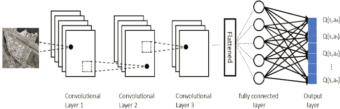 **图 (1)**

提议的模型架构。

`Fig. 2` 中的工作流图说明了使用 `DRL` 模型进行飞机检测的提议方法论。它概述了从该过程中涉及的步骤顺序，从数据获取到模型评估和选择。该过程始于获取包含飞机的卫星图像数据集。过程分为四个并行路径：`DQN`、`Double DQN`、`PPO` 和 `Rainbow`。每个模型都在训练子集上独立进行训练。训练完成后，在测试子集上评估每个模型的性能。评估结果可能导致对模型超参数或特征工程技术进行调整或调优，以提高准确性。选择最准确且可靠的模型。

## DQN 模型

概述的方法论采用了系统的方法来实现 `DQN`。首先，加载并处理数据集，其中包含图像及其相应的标签。这一准备阶段涉及特征提取和像素值归一化，以确保整个数据集的一致性。随后，使用 `Keras` 构建 `DQN` 架构，整合多个具有特定激活函数的层。构建架构后，使用 `Adam` 优化器和损失函数对模型进行编译。编译后，使用预处理的数据对模型进行训练。为了衡量模型的效力，在测试数据集上计算了各种评估指标。模型摘要见于 `Fig. 3`。

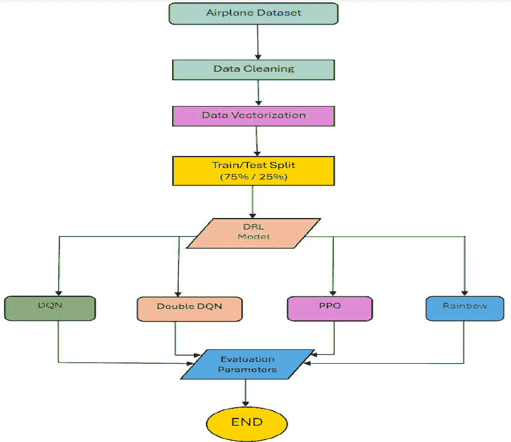 **图 (3)**

使用 DQN 生成的模型摘要。

## DOUBLE DQN 模型

该方法论概述了利用 `Double DQN` 对飞机进行分类，采用了系统的步骤序列。首先，加载并预处理包含飞机图像的数据集，涉及特征提取和归一化以确保输入数据的一致性。随后，使用 `Sequential` API 建立 `Double DQN` 模型架构，整合了带有激活函数的密集层用于特征提取，最后一层为图像的二分类身定制。在使用 `Adam` 优化器和二元交叉熵损失函数对模型进行编译后，使用预处理的数据进行训练。在整个训练过程中，通过修改模型参数进行迭代调整以最小化损失函数。模型摘要见于 `Fig. 4`。

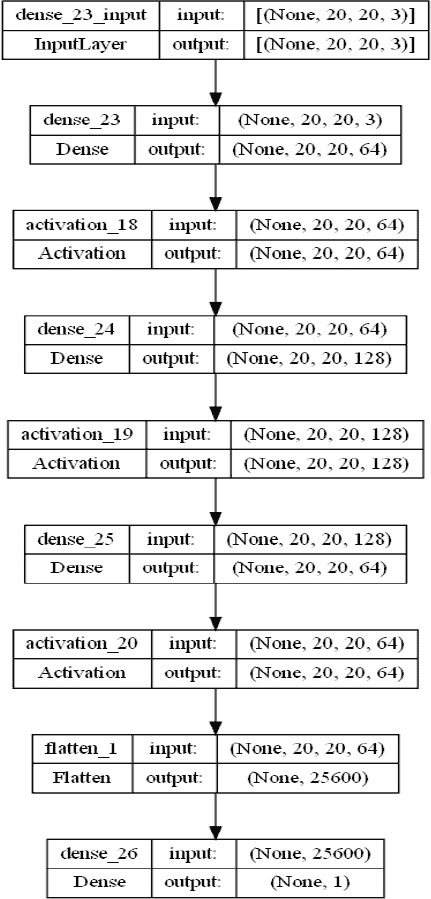 **图 (4)**

使用 double DQN 生成的模型摘要。

## RAINBOW 模型


所采用的方法利用 `Rainbow` 架构进行二分类任务。首先，对包含图像及其相应标签的数据集进行预处理，以确保其一致性和训练的适用性。随后，仔细构建了 `Rainbow` 模型。这涉及整合卷积层以从图像中提取特征，以及整合全连接层以利于更深层次的表示学习。该架构一个值得注意的方面是包含了 `dueling network`（对决网络），它能有效地分离状态价值的估计与优势的计算，从而增强了学习过程。在模型构建完成后，编译阶段涉及指定优化器并选择合适的损失函数，并将准确率作为主要的评估指标。随后，在准备的数据集上对模型进行训练，并仔细调整 `batch size`（批大小）和 `epochs`（训练轮数）等参数以优化性能。模型摘要见于图 (5)。

## PPO 模型
该方法涉及结合 `CNNs` 与 `PPO` 算法对二分类图像进行分类。首先，加载包含图像与二分类标签对的数据集。随后的预处理包括确保图像的正确格式并标准化像素值。之后，使用 `TensorFlow/Keras` 构建了 `CNN` 模型架构。该架构包含用于特征提取的卷积层、用于降维 `max-pooling layers`（最大池化层）以及用于分类任务的全连接层。每一层都配备了定制的激活函数以优化性能。模型使用 `binary cross-entropy loss`（二分类交叉熵损失）和 `Adam optimizer`（Adam 优化器）进行编译。训练涉及迭代调整模型参数，以指定的 `epochs` 数内最小化损失函数。训练完成后，在独立的测试数据集上使用多种评估指标评估模型的有效性。模型摘要见于图 (6)。

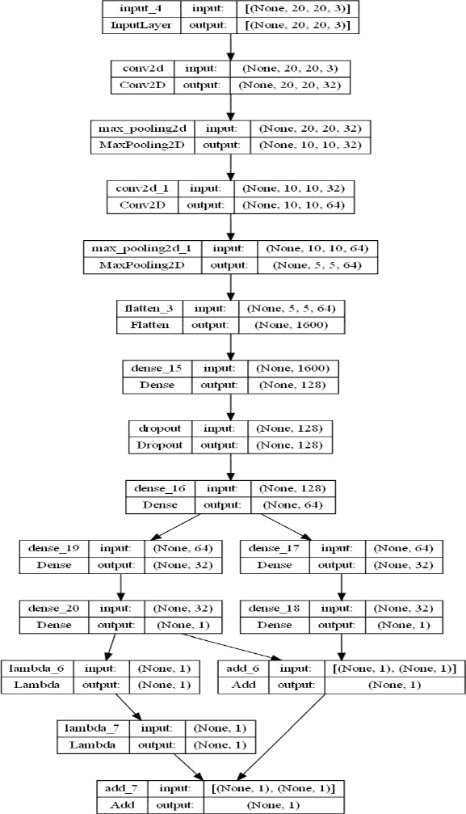 **图 (5))**
使用 `rainbow` 生成的模型摘要。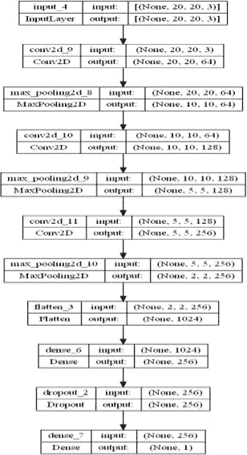 **图 (6))**
使用 `PPO model` 生成的模型摘要。

## 数据集描述
卫星图像已成为农业、国防、能源和金融等多个领域的关键资产。随着 `Planet` 等商业图像提供商的出现，每天都有大量捕捉地球的卫星图像涌入，如图 (7) 所示。然而，手动分析这些图像已变得不可行，因此需要开发机器学习算法来自动处理飞机检测等过程。此数据集描述为利用卫星图像进行飞机检测任务的研究人员提供了基本细节。数据集包含从 `Planet` 卫星图像中提取的 32,000 张 20x20 RGB 图像。这些图像被标记为“plane”（飞机）或“no-plane”（无飞机）分类，有助于飞机检测的监督学习。每幅图像都经过正射校正至 3 米像素大小，以确保整个数据集空间分辨率的统一。标签指示图像是属于“飞机”类 (1) 还是“无飞机”类 (0)，从而实现了飞机检测任务的二分类。数据集包含两个主要类：

- **飞机类 (8,000 张图像)：** 该类中的图像描绘单架飞机的主体，包括其机翼、尾翼和机头。捕捉了飞机尺寸、朝向和大气条件的变化性，以确保飞机检测算法的稳健性。
- **无飞机类 (24,000 张图像)：** 该类包含代表各种水体、植被、裸地和建筑等多种土地覆盖特征的图像。此外，部分图像包含部分飞机，或由于亮像素或强线性特征等伪影导致的误标记实例。数据集的参考为 [21。

 **图 (7))**
样本数据集图像。

## 数据向量化
数据向量化对于成功检测飞机至关重要，它涉及将原始图像数据转换为适用于 `DRL` 算法的格式。这一过程允许提取精确分类所需的意义特征。最初，系统加载包含飞机场景和非飞机场景的图像。然后，每幅图像被转换为数值矩阵，捕捉像素强度值。该矩阵作为进一步分析的基础数据结构。为了确保一致的模型性能，通过将图像调整为统一尺寸来标准化输入维度。此外，应用了 `Min-Max scaling`（最小最大归一化）等归一化技术将像素值限制在预定义的范围内。这一归一化步骤对于减少光照条件的变化并增强 `DRL` 模型的收敛性至关重要。

## 结果分析
在我们对卫星图像飞机检测的研究中，对四个 `DRL` 模型进行了广泛评估：`DQN`、`Double DQN`、`PPO` 和 `Rainbow`。每个模型在包含 32,000 张标记为“飞机”或“无飞机”的 20x20 RGB 图像的数据集上经过了严格测试。我们的分析结果汇总在表 1 中：

表 1 基于飞机数据集的结果。

| 分类器 | 准确率 | 精确 | 回召率 | F1 分 |
| --- | --- | --- | --- | --- |
| DQN | 93.34 | 89.63 | 82.83 | 86.09 |
| DOUBLE DQN | 97 | 94.19 | 93.62 | 93.91 |
| PPO | 98.65 | 97.67 | 96.89 | 97.28 |
| RAINBOW | 98.18 | 98.68 | 93.93 | 96.24 |

近端策略优化（PPO）表现为最佳模型，准确率达到 98.65%。PPO 还展现了高精确率 (97.67%)、回召率 (96.89%) 和 F1 分 (97.28)，表明其在准确检测飞机实例方面的稳健性。准确率曲线、混淆矩阵和 ROC 曲线见图 (8)。

`Double DQN` 模型相对于 `DQN` 有显著改进，实现了更高的准确率 (97%)、精确率 (94.19%)、回召率 (93.62%) 和 F1 分 (93.91)。这表明双 Q 学习方法增强了模型准确检测飞机的能力，使其成为对高精确度和回召率有要求的应用的选择。准确率曲线、混淆矩阵和 ROC 曲线见图 (9)。

尽管 `DQN` 模型实现了 93.34% 的良好准确率，但其精确率 (89.63%)、回召率 (82.83%) 和 F1 分 (86.09) 相对较低。与顶尖模型相比，`DQN` 在处理卫星图像中复杂的特征和飞机外观变化方面可能不够稳健。准确率曲线、混淆矩阵和 ROC 曲线见图 (10)。


Rainbow 模型在所有指标上均表现出优异性能，特别是精确率（98.68%）和 F1 分数（96.24%）很高，表明其在保持较高召回率（93.93%）的同时最大限度地减少误报。Rainbow 平衡的使其成为各种飞机检测应用的通用选择，包括城市规划和灾害响应。准确率曲线、混淆矩阵和 ROC 曲线见图 (11)。

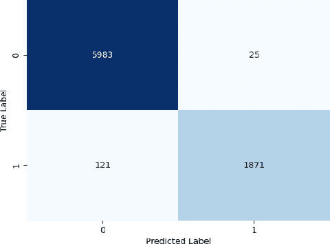 图 (11)

使用 `rainbow` 生成的混淆矩阵。

## 结论与未来工作

总之，本研究深入了卫星图像检测中的 DRL 模型以提高准确性和可靠性。通过细致的实验和分析，我们探索了四种深度强化学习模型的性能：`Deep Q Networks (DQN)`、`Double DQN`、`Rainbow` 和 `PPO`。我们的研究旨在为这些模型在处理复杂的飞机检测任务方面的有效性提供见解。实验结果展示了该领域充满前景的进展，其中 `PPO` 脱颖而出，实现了令人印象深刻的 98.65% 准确率。这一显著成就强调了 `PPO` 在大幅提高卫星图像飞机检测准确性和可靠性方面的潜力。此外，尽管 `Rainbow` 等模型也表现出强劲性能，但 `PPO` 卓越的准确率标志着遥感技术领域的一个重要里程碑。此外，我们的研究对模型决策过程的可解释性提供了宝贵的见解，阐明了影响性能的因素，并对其内部机制提供了更深入的理解。通过揭示模型决策背后的机制，我们旨在增强在真实场景中的飞机检测系统的透明度和信任度。

基于本研究发现，未来有几个探索和开发的方向。首先，可以探索集成学习技术的整合以提高飞机检测系统的稳健性和可靠性。包括 `stacking` 或 `boosting` 在内的集成方法在利用多个模型的多样性来增强模型性能方面显示出潜力。此外，可以进一步优化所开发模型的扩展性和效率，以处理更大的的数据集和实时处理需求。这可能涉及探索分布式计算框架或硬件加速技术，以加速训练和推理过程。此外，引入先进的图像处理技术（如特征提取和时空分析）可以增强模型在复杂场景（如恶劣天气或密集空域）中检测和分类飞机的能力。此外，将开发的模型部署在运行环境中（如机场监控系统或边境安全监控），可以为其实际性能和实用价值提供宝贵的见解。与行业伙伴和政府机构的合作可以促进这些模型集成到现有的基础设施和工作流中。最后，持续的研究工作还应该关注与飞机检测系统部署相关的伦理和隐私问题，确保它们符合监管框架并尊重个人的隐私和安全权利。

总结来说，卫星图像飞机检测的未来在创新和进步方面具有巨大潜力。通过继续推向该领域技术和知识的边界，我们可以为更稳健、高效且符合伦理的解决方案铺道路，为增强全球安全和防护做出贡献。卫星技术的到来了一个前所未有的获取海量图像数据的时代，彻底了从环境监测到国家安全的各个行业和应用。在这些丰富的数据中，存在着一项关键任务：卫星图像中的飞机检测，这是一个对精确可靠性要求极高的挑战。传统方法往往受到卫星图像中固有的复杂性和变异性的限制，需要创新的解决方案来推动该领域的发展。我们调查的核心是对每个 DRL 模型在不同数据集上的性能进行全面评估，细致地审查其准确性、效率和稳健性。通过严谨的比较分析，我们旨在提炼关于每个模型优缺点的关键见解，为该领域的未来发展提供路线图。我们努力的核心在于对卓越的追求，对创新的不懈追求，这驱动着我们突破飞机检测可能的边界。此外，我们的研究努力阐明 DRL 模型决策过程的可解释性，揭开控制其行为的复杂机制。通过消除深度学习“黑箱”的迷雾，我们寻求增强飞机检测系统的透明度和信任度，为其在现实应用中的广泛采用奠定基础。在开启这一智奥之旅之际，我们承认该领域以往研究的无私贡献。借鉴丰富的文献和学术话语，我们站在巨人的肩膀上，依靠科学社区的集体智慧来推动我们的研究前进。

## 参考文献

| | | | |
|---|---|---|---|
| [1] | Dangut M.D., Jennions I.K., King S., Skaf Z.. Application of deep reinforcement learning for extremely rare failure prediction in aircraft maintenance., *Mech. Syst. Signal Process..* **2022;** 171: 108873. | [[CrossRef](http://dx.doi.org/10.1016/j.ymssp.2022.108873)] |
| [2] | Morrison S., Fisher A., Zambetta F.. Towards intelligent aircraft through deep reinforcement learning., *10[th] International Micro-Air Vehicles Conference.*. Melbourne**2018** | | |
| [3] | Huang H., Feng Y., Huang J., Zhang J., Chen L.. A reinforcement one-shot active learning approach for aircraft type recognition., *IEEE Access.* **2019;** 7: 147204-147214. | [[CrossRef](http://dx.doi.org/10.1109/ACCESS.2946186)] | |
| [4] | Dong Y., Tao J., Zhang Y., Lin W., Ai J.. Deep learning in aircraft design, dynamics, and control: Review and prospects., *IEEE Trans. Aerosp. Electron. Syst..* **2021;** 57(4): 2346-2368. | [[CrossRef](http://dx.doi.org/10.1109/TAES.2021.3056086)] | |
| [5] | [[CrossRef](http://dx.doi.org/10.1109/CTISC52352.2021.00052)] N. Wang, J. Wu, and X. Li. "Few-shot aircraft detection based on deep reinforcement learning." 2021 3rd International Conference on Advances in Computer Technology, Information Science and Communication (CTISC). | | | |
| [6] | Tomar, Dheeren Singh, "Automated aircraft stall recovery using reinforcement learning and supervised learning techniques." 2021 IEEE/AIAA 40th Digital Avionics Systems Conference (DASC). | | | |
| [7] | S. Jaakko. "Aircraft control with deep reinforcement learning in real-time simulations". MS thesis. 2021. | | | |
| [8] | Ali H., Thinh P.D., Alam S.. Deep reinforcement learning based airport departure metering., *2021 IEEE International Intelligent Systems Conference (ITSC).*. **2021**[[CrossRef](http://dx.doi.org/10.1109/ITSC48978.2021.9565012)] | | |
| [9] | [[CrossRef](http://dx.doi.org/10.1109/DASC43569.2019.9081720)] Tien, Shin-Lai, "Deep reinforcement learning applied to airport surface movement planning." *IEEE/AIAA 38th Digital Avionics Systems Conference (DASC)*, IEEE, 2019. | | | |


| # | 参考文献 |
| :--- | :--- |
| [10] | [[CrossRef](http://dx.doi.org/10.1109/ICECOCS50124.2020.9314611)] Youssef, Youssef Ben, "基于深度学习的遥感图像飞机类型分类。" *第 2 届电子、控制、优化与计算机科学国际会议 (ICECOCS)*, IEEE, 2020. |
| [11] | Alves, Adson Nogueira. "使用深度强化学习 (DRL) 方法对无人机 (UAV) 控制。" 2021. |
| [12] | Ma Z., Wang C., Niu Y., Wang X., Shen L.. 一种基于显著性的无人机避障强化学习方法,，*Robot. Auton. Syst..* 2018; 100: 108-118. [[CrossRef](http://dx.doi.org/10.1016/j.robot.2017.10.009)] |
| [13] | HUANG, Hong-lan, "使用强化主动学习的飞机类型识别。" 2019. |
| [14] | [[CrossRef](http://dx.doi.org/10.2514/6.2024-1380)] Bewley, Tom, J. Lawry and A. Richards. "通过人类反馈强化学习学习飞机处理行为的可解释性模型。"AIAA SCITECH 2024 论坛。 2024. |
| [15] | Jiao Z., Bai N., Sun D., Liu X., Li J., Shi Y., Hou Y., Chen C.. 基于强化学习的飞机防滑制动控制，，*IEEE Trans. Aerosp. Electron. Syst..* 2023; 59(6): 9219-9232. [[CrossRef](http://dx.doi.org/10.1109/TAES.2023.3319600)] |
| [16] | [[CrossRef](http://dx.doi.org/10.23919/CCC5869.2023.10241099)] Ma, Shaojie, "基于深度强化学习的变形飞机自适应姿态控制。"2023 年第 42 次中国控制会议 (CCC)。IEEE, 2023. |
| [17] | Arnold R., et al. 用于无人机系统群协同搜索与救援的强化学习，*2022 IEEE 国土安全技术国际研讨会 (HST).*. IEEE; 2022[[CrossRef](http://dx.doi.org/10.1109/HST56032.2022.10025435)] |
| [18] | Bastas, Alevizos, Theocharis Kravaris, and George A. Vouros. "基于深度模仿学习的数据驱动飞机轨迹预测。"arXiv preprint arXiv:2005.07960, 2020. |
| [19] | [[CrossRef](http://dx.doi.org/10.3390/jmse10030383)] Mao, Yubing, "结合模仿学习与深度强化学习的 AUV 目标跟踪方法。"Journal of Marine Science and Engineering 10.3 (2022): 383. |
| [20] | Smyers E., et al. AVOIDDS: 基于视觉的飞机入侵者检测数据集和模拟器，*Adv. Neural Inf. Process. Syst..* 2024: 36. |
| [21] | [[CrossRef](http://dx.doi.org/10.34740/KAGGLE/DSV/4804225)] Robert Hammell, 卫星图像中的飞机, Kaggle, 2023. |

# 机器人领域的强化学习：解锁应用与进展

Faiyaz Ahmed*, Anil Kumar Tulluri¹*, Naga Bhanu Prakash Tiruveedula¹

¹ 机械工程系，Vignan 科学技术与研究基金会，Vadlamudi, 印度

## 摘要

强化学习 (RL) 与机器人学的交叉开启了自主与智能的新纪元，从根本上改变了各个领域的机器人能力。本章对机器人中的强化学习应用进行了全面探讨，重点介绍了关键进展、持续性挑战以及前景广阔的未来方向。强化学习对机器人的影响在于其能够使机器从经验中学习并适应，导航复杂环境，操纵物体并与人类无缝交互。通过与周围环境的迭代交互，强化学习驱动的机器人可以动态优化其行为，避免了繁琐的特定任务编程。这种灵活性增强了它们的通用性，使其在制造、医疗保健和物流等行业中具有不可价值的价值，这些行业的任务涉及非线性、不确定性和动态约束。强化学习赋予机器人开发个性化和环境感知能力的能力，根据实时反馈和环境线索调整行为。这种适应性在辅助机器人领域至关重要，机器人必须安全且直观地与人类互动，并考虑到个人偏好和情境背景。此外，强化学习驱动的资源利用、能源效率和任务执行方面的优化增强了系统性能和成本效益。然而，强化学习在机器人中的广泛应用也面临挑战，例如开发高效的探索策略以及确保对传感器噪声和环境变异的鲁棒性。此外，在现实环境中部署强化学习驱动机器人的伦理和安全影响需要审慎考虑和跨学科合作。本章对强化学习在机器人领域的变革性潜力进行了全面审查，强调了其在开启自主性、智能和适应性新领域方面的作用。通过阐明关键应用、挑战和未来途径，本章旨在激励研究人员、从业者和爱好者利用强化学习的变革力量来塑造机器人的未来。

**关键词：** 自主系统、控制策略、强化学习、机器人、模拟环境。


强化学习（RL）是机器学习（ML）的一个分支，其中智能体通过与环境交互来学习决策以实现特定目标。与依赖固定数据集进行训练的监督学习不同，强化学习涉及通过试错来学习，利用智能体动作结果的反馈进行学习。智能体作为决策者，在环境中采取行动并以奖励的形式接收反馈。环境代表对智能体动作做出响应的外部系统，并提供新的状态作为反馈。状态是环境在给定时刻的快照，为智能体的决策提供了必要信息。智能体的动作影响环境状态，由其策略（policy）决定——这种策略可以是确定性的，也可以是随机的。奖励是一个标量反馈信号，表示动作相对于运行的即时收益或成本。强化学习还涉及价值函数，用于估计状态的期望累积奖励（状态价值函数）或状态-动作对的价值（动作价值函数），有助于评估状态和动作的理想程度 [1^(\-)3]。`Q-function`（或动作价值函数）估计了在给定状态下采取特定动作并随后遵循策略的期望回报。强化学习的一个核心组成部分是在探索（exploration）与开发（exploitation）之间维持微妙的平衡：探索意味着通过实验新行为来发现其后果，而开发意味着选择已知能产生大量奖励的活动。强化学习的目标是让智能体获得一种能够在一段时间内使总奖励最大化的策略。这是通过利用 `Q-learning`、`Policy Gradients`（策略梯度）和 `Deep Q-Networks (DQN)` 等算法实现的。这些算法通过过去的经验来提高智能体的决策能力。

强化学习与机器人学的交叉开启了自主与智能的新纪元，从根本上改变了机器人系统在众多领域的能力和应用。强化学习使机器人能够从与环境交互中学习并适应，使其能够处理难以显式编程的复杂任务。本文对机器人领域强化学习应用不断演变的格局进行了全面探讨，阐明了关键进展、持续性挑战以及广阔的未来方向。随着工业 4.0 的到来，物联网（IoT）、大数据分析和云计算等先进技术的融合，进一步增强了强化学习在机器人领域的整合。此外，联邦学习（FL）的引入提供了一种在保护数据隐私的同时协作训练模型的去中心化方法，从而解决了在大规模部署强化学习的一些关键挑战。通过阐明关键应用、挑战和未来探索的途径，本文旨在启发研究人员、从业者和爱好者，在工业 4.0 及未来的背景下，利用强化学习的变革性力量来塑造机器人技术的未来。

### 工业演变
在多次工业革命的过程中，机器人承担了越来越重要的地位，从第三次工业革命中的基础机械设备演变为工业 4.0 中复杂的网络化系统，促进了人机协作 [4^(\-)6]。工业 4.0 促进了制造业中人机合作，而工业 5.0 则试图通过强调以人为本的方法来进一步推进这种协作。这一阶段阶段提高提高韧性、可持续性以及人类劳动力与机器人系统的无缝集成。

### 工业 5.0
工业 5.0 旨在促进人类与机器之间的和谐共处与共同繁。与早期的工业革命不同，这一新时期在提高生产力的同时，还促进了工人安全、技能发展、创新和福祉。工业 5.0 依赖于人机之间信息的流畅传输，以及能够对修改或故障迅速反应的适应制造平台。此外，工业 5.0 强调使用智能系统和机器来增强而非试图取代人类的天赋。

这一变革的核心组成部分涉及在机器人领域实施强化学习。强化学习允许机器通过观察并与其周围交互来学习新技能，使其能够适应变化并做出自主决策。这种能力对于开发能够与人类协作的智能系统至关重要，能够对变化做出实时响应，并在无需对每个任务进行显式编程的情况下优化性能。实现工业 5.0 需要改进传感器技术，通过 `IoT`、云端分析和控制系统支持人类参与的、自适应的且可靠的决策 [7]。强化学习算法通过试错不断提高机器人性能来改进这些系统，使其能够处理更复杂的工作和突发的问题。

通过将强化学习与其他先进技术相结合，并专注于可持续性和社会责任，工业 5.0 展望了一个人类与智能机器人共生协作的工业环境。强化学习驱动的机器人可以帮助决策、改进资源管理并提高系统整体效率，每一项有助于实现效率、卓越和长寿的共同目标。这一工业发展的成功实施取决于精确界定这些创新人机伙伴关系中每个参与者的职责和责任。强化学习发挥着至关重要的作用，使机器人能够学习和进化，从而显著增强了工业 5.0 中的人机协作，并推向了现代生产生态系统的边界。

强化学习方法为解决复杂非结构化环境中的控制任务提供了一种很有前景的方法。这些技术让智能体从经验中学习，从而让他们适应新情况，并在理想情况下将所学知识应用于其他领域。由于这些技术在视频游戏、流体动力学、自主导航（空中和陆地）、推荐系统和能源管理等领域取得了卓越成果，引起了越来越多的关注。许多可能的用途包括：`IoT`、机器人手臂、抓取与放置活动、自然语言处理、工业 4.0 等 [8^(\-)10]。


对机器人中的 `RL` 应用进行彻底检查的方法，特别是涉及大量触觉任务的方法，涉及几个关键步骤，以确保检查的彻底性和相关性。为了收集全面且相关的文献，利用了多个学术数据库。选择这些数据库是因为它们在机器人学、`ML` 和人工智能领域拥有海量的同行评审论文集合。此次调查的时间跨度从 2017 年 1 月到 2022 年 7 月。选择这一时间段的起点是有刻意的，因为它恰合了 `RL` 在机器人领域重要性开始显著增加的关键时期，如图. (1) 所示。

# 强化学习概述

与有监督学习和无监督学习一样，`RL` 是 `AI` 决定如何学习的主要方式之一。与后两种依赖于标记或未标记的数据集不同，`RL` 采用试错法。在这种方法中，智能体（agent）通过获得激励或惩罚形式的反馈来学习复制期望行为。这种方法在从玩基础视频游戏、精通《星际争霸 II》等复杂游戏到解锁机器人领域的重大应用和进展的各种任务中取得了巨大的成功。为了充分理解 `RL` 在机器人学中的影响，必须首先定义其基础术语和概念 [11]。在 `AI` 中，`RL` 与监督学习和无监督学习并列主要范式。与后两种依赖于标记或未标记的数据集不同，`RL` 采用试错法。在这种方法中，智能体通过接收奖励或惩罚形式的反馈来学习复制期望行为。这种方法在从玩基础视频游戏、精通《星际争霸 II》等复杂游戏到解锁机器人领域的重大应用和进展的各种任务中取得了巨大的成功。在机器人领域，`RL` 在使机器人执行自主导航、动态物体操控和人机交互等复杂任务方面起着关键作用。通过不断从环境中学习，`RL` 驱动的机器人可以适应新的和未预见的场景，提高它们在现实应用中的效率和有效性。计算能力、传感器技术和 `ML` 算法的进步也增强了 `RL` 在机器人中的集成，促进了更复杂、更强大的机器人系统的开发。当我们探索 `RL` 在机器人学中的变革性潜力时，理解其核心原理、当前应用和未来方向对于充分利用其能力至关重要。图. (2) 展示了任何 `RL` 方案决策过程的基本框架。

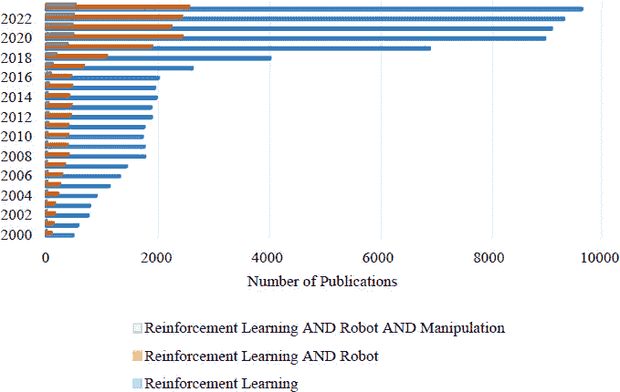 **图. (1)**
机器人学和机械臂中强化学习的出版物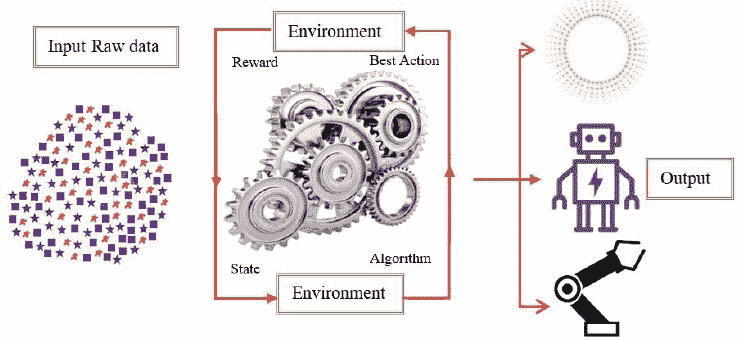 **图. (2)**
强化学习方案。

*   **智能体 (Agent):** 在现实生活中，与环境交互以实现特定目的的生物被称为智能体。通过在环境中行动并获得激励或惩罚形式的反馈，智能体做出决策。由于这些输入，智能体能够随着时间的推移完善其决策过程。在机器人学中，智能体通常是机器人本身，它通过与周围环境交互来学习自主执行任务。
*   **环境 (Environment):** 环境是智能体与之交互的外部系统。它包含了智能体之外的所有事物，包括障碍、物体和其他智能体。通过反馈系统，智能体的行为受到环境的影响并被环境语境化。
*   **动作 (Action):** 智能体的动作是对周围环境产生影响的离散行为和选择。动作可以从向前移动或转向等简单动作范围到抓取等复杂行为。
*   **奖励 (Reward):** 奖励是智能体采取行动后获得的反馈信号。一方面，正强化促进期望行为，另一方面，负强化阻止不期望的行为。在机器人学中，奖励可以基于任务完成情况。
*   **策略 (Policy):** 策略定义了基于状态选择动作的策略。策略可以是确定性的（每个状态固定动作）或随机的（动作的概率分布）。
*   **状态 (State):** 状态是智能体感知的环境当前配置的表示。它是环境可能处于的所有状态。
*   **值函数 (Value Function):** 值函数估计了智能体从给定状态可以获得的累积奖励。它帮助智能体根据特定策略评估动作的收益。
*   **探索与利用 (Exploration vs. Exploitation):** 探索涉及尝试新动作以发现更多环境信息。利用涉及使用产生过高奖励的已知动作来最大化累积奖励。

# 强化学习算法

`RL` 算法涵盖了学习和决策的多种方法。以下是主要算法类型类型的详细说明 [12]，以及在机器人学中的示例和应用，如图. (3) 所示。

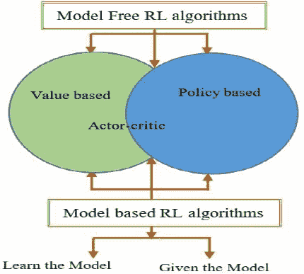 **图. (3)**
强化学习算法类型。

## 无模型算法 vs. 基于模型的算法

*   **无模型算法：** 这些算法直接通过与环境交互学习策略，而不构建环境动力学的显式模型。基于价值的方法（如 `Q-Learning` 和 `SARSA`）估计动作或状态的值指导决策。基于策略的方法（如 `REINFORCE`）直接优化策略而不使用值函数。
*   **基于模型的算法：** 此，基于模型的算法构建环境动力学模型并利用其预测未来状态以规划动作。`Dyna-Q` 通过使用模拟经验提高学习效率，将无模型和基于模型的方法整合。蒙特卡洛树搜索 (MCTS) 将树搜索与 `RL` 结合，根据未来状态预测做出决策，适用于复杂的决策任务。

## 同策略 vs. 非策略算法

*   **同策略算法：** 这些算法学习智能体当前执行的策略的值。`SARSA` 是同策略算法的一个示例，它根据当前策略采取的动作更新其值函数。`A2C` 是 `A3C` 的同步变，侧重于使用优势估计来评估当前策略以提高学习稳定性。


- **离策略算法（Off-Policy Algorithms）：** 这些算法独立于智能体的动作来学习最优策略的价值。`Q-Learning` 是离策略算法的一个经典示例，无论智能体采取什么动作，它都能学习最优策略的价值。`DQN` 将 `Q-learning` 与深度神经网络相结合以处理大型状态空间，并成功应用于各种机器人领域。

### 价值函数与策略搜索方法

- **价值函数方法（Value Function Methods）：** 这些方法侧重于估计价值函数以推导出最优策略。例如，`DQN` 使用深度神经网络拟近 `Q-value` 函数，从而在高维状态空间中实现高效学习。`Double DQN` 通过使用两个网络来提高稳定性，解决了 `DQN` 中的高估计偏差，增强了学习过程的稳健性。我们可以如公式 1-2 所示将数量 `Q` 表示为符号 `Q(s,a)`。其中，`E [` 是预期的通缩永收益率，`s` 是来自 `S[t]` 调查的群体，`a` 代表来自 `A[t,]` 的被检查的动作，`t` 是该阶段持续时间。

- **策略搜索方法（Policy Search Methods）：** 与此相反，策略搜索方法直接优化策略，而不估计价值函数。策略梯度方法使用梯度上升法直接调整策略参数，使其适用于连续动作空间。`PPO` 作为一种流行的策略优化算法，通过使用裁剪概率比来限制策略变化，确保更新的稳定性，从而提升了学习效率。

| 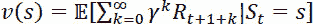 || (1) |
| --- | --- |
| 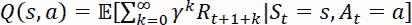 || (2) |
| --- | --- |

## 额外的深度强化学习算法术语

**双路深度 Q 网络（Dueling Deep Q-Network, Dueling DQN）：** Dueling DQN 将价值函数和优势函数分离，以提高学习效率和稳定性。网络架构由两个流组成——一个用于估计状态价值，另一个用于估计每个动作的优势值。通过独立估计价值和优势，`Dueling DQN` 将学习集中在信息量更丰富的状态-动作对上，从而提高了效率并更快收敛 [13]。

**双端延迟深度确定性策略梯度（Twin Delayed Deep Deterministic Policy Gradient, TD3）：** `TD3` 是深度确定性策略梯度（`DDPG`）的扩展，解决了价值估计中的高估计和方差问题。它利用双 `Q-networks` 来减轻高估计偏差，并引入了延迟策略更新以稳定学习。从数学上讲，目标 `Q-values` 的计算如公式 3 所示。

| 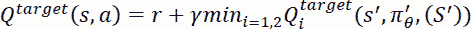 || (3) |
| --- | --- |

其中 `Q[i]^(target)` 表示由双 `Q-networks` 估计的目标 `Q-value`，`π'[0]` 代表目标策略，`γ` 是折扣因子。

**近端策略优化（Proximal Policy Optimization, PPO）：** `PPO` 是一种策略优化算法，通过使用裁剪概率比限制策略变化来确保更新的稳定性。`PPO` 的目标函数由公式 4 给出。

| 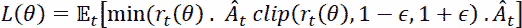 || (4) |
| --- | --- |

其中 `L(θ)` 是代理目标，`rt` 是新旧策略之间的概率比，`A[t]` 是优势估计，`ϵ` 是裁剪参数。

**带软边缘的演员-评论员（Actor-Critic with soft edges, SAC）：** 随机演员-评论员（`SAC`）算法旨在优化奖励与熵之间的权衡，有效平衡探索与利用。`SAC` 的目标函数公式如公式 5 所示。

| 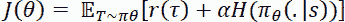 || (5) |
| --- | --- |

其中 `J(θ)` 代表目标函数，`πg` 是随机策略，`r(τ)` 是轨迹 `τ` 的累积奖励，`H(πg)` 表示策略的熵，`α` 是控制激励-熵权衡的温度参数。

## 利用深度神经网络进行强化学习

强化学习的成功应用很大程度上得益于深度神经网络（DNN）在参数估计方面实现的扩展性。人工神经网络（`ANNs`）可以优化策略（`π*π*`）或最优价值方程（`Q*,*,A*Q*,V*,A**`）。在这里，作者们探索了机器学习技术中最近的趋势和重大进展，这些进展推动了该领域的发展。本文讨论的目的是阐明该领域在研究方面的现状，并为进一步的研究提供可能的方向。深度强化学习（DRL）的起源可以追溯到几个关键里程碑的汇合，正如一篇开创性著作所示 [14]。实验与知识获取、时序差分（TD）学习以及深度神经网络的改进共同促成了突破性的深度强化学习算法的诞生——深度 Q 网络（`DQN`）。`DQN` 算法最初由 Mnih *et al.* 提出，通过利用卷积神经网络（`CNN`）分析来自各种位置的照片，为该领域带来了重大变革。随后，`DQN` 被用于解决 MuJoCo 环境中的复杂物理问题 [15] 以及三维迷宫中的导航挑战 [16]。

在 `DQN` 的成功基础上，研究人员进一步完善了其架构以增强性能，产生了 Double DQN（DDQN）和双路 DQN（D-DQN）等新颖算法。`DDQN` [17] 通过解决 `Q-values` 高估计问题减少了噪声对 `DQN` 的影响。相比之下，双路网络架构正如某些人员建议的那样 [18]，结合了两个数据流——价值流和优势流，以提供更准确的 Q 函数。这些进展强调了深度强化学习研究的迭代性质，每一项创新都在前人的基础上推向了性能和能力的边界。2016 年，谷歌的 DeepMind 实验室通过发布异步优势演员-评论员（`A3C`）算法，在让学习更快更好方面迈出了大一步。这种前沿算法在演员-评论员框架中通过在不同时间点训练多个智能体。这种方法不仅实现了高准确性，还适用于连续和离散动作空间。正如一些研究 [19, 20] 所示，`A3C` 算法为异步并行学习技术树立了先范，开启了更高效、可扩展的强化学习方法之趋势。

## 机器人领域强化学习的当前趋势


机器人学领域正见证着`Deep RL`（`DRL`）驱动的飞速发展，多种新兴趋势正在塑造自主系统的格局。一个显著的趋势是关注`Sim-to-Real Transfer`（仿真到现实），旨在弥合模拟环境与现实应用之间的差距，使机器人能够轻松执行复杂任务。另一个关键开发领域是`sample efficiency`，研究人员正在设计新型算法和训练技术，以更少的样本实现稳健的学习。`Hierarchical RL`方法也越来越受到关注，允许机器人通过子目标或任务的层次结构学习复杂行为，增强它们高效导航高维状态空间的能力。此外，`multi-agent systems`的部署变得越来越普遍，机器人在各种场景中协作或竞争，推动了集群机器人和分布式任务分配的发展。确保安全性和稳健性仍然首要任务，这促成了`uncertainty estimation`和`risk-aware planning`的整合，以减轻模型不准确性和环境不确定性 [21]。`Continual learning`和适应也在增强动力，重点是使机器人能够持续学习并适应变化条件，确保它们在动态环境中的相关性和有效性。所有这些趋势表明，人们仍在努力解决重要问题，并在各种情况下充分利用独立机器人系统的潜力。

## 逆强化学习

`RL`的一个分支称为`Inverse RL`（`IRL`，即逆强化学习），试图通过观察专家或演示者的行为来推算出环境的基本奖励函数。与传统强化学习中预先知道奖励函数不同，`IRL`的目标是通过观察专家角色的行为来学习它。这种学习到的奖励函数可以用于训练新的智能体，以更有效地在环境中执行任务 [22]。`IRL`的一个关键应用是`imitation learning`（模仿学习），其中智能体通过推断专家动作背后的奖励函数来学习模仿专家行为。通过从人类专家或其他高性能智能体提供的演示中学习，`IRL`使机器人和自主系统能够更高效的方式获取复杂技能和行为。`IRL`的另一个应用是`preference learning`（偏好学习），其目标是获取最能捕捉人类用户偏好的知识和奖励函数 [23]。这允许自主系统根据个人用户偏好定制其行为，从而实现更直观、更友好的交互。

## 机器人领域的强化学习

`RL`通过增强机器人系统的自主性和智能化，正在彻底改变机器人及其相关领域。通过允许机器人通过环境交互进行学习和适应，`RL`促进了复杂非结构化任务的执行。在`Human-Robot Collaboration`（`HRC`，人机协作）中，驱动型机器人通过从人类反馈中学习并适应人类行为来提高生产力和安全性。从“工业 4.0”到“工业 5.0”的转变了`RL`对于促进以人为中心的过程以及人机之间更好的协作有多重要，促进了韧性、可持续性和人类人类福祉。除了工业应用外，`RL`通过使手术和康复机器人适应化正在推动医疗保健，并改进了自动车辆的导航和安全性。`RL`的影响延伸到动态人类环境中的服务机器人，提供个性化辅助。总而言，`RL`是现代机器人学的基石，推动着重大进步并创造了智能、自适应的系统。

`工业 4.0`引入了互联机器和系统的体系，允许灵活且动态的制造过程。复杂且不可预测的复杂性管理需要预测分析和高科技数据处理以保持系统顺畅运行。以人为本的方法进行技术开发，第五次工业革命或`工业 5.0`正在成型。`工业 5.0`有时被称为“以人为中心的革命”，是一项旨在将尖端技术与强调可持续性、社会福利和个人福祉的设计原则相结合的倡议。技术补充人类技能而非取代它们的世界是包容性创新的目标。在这种观点下，人们在推动技术进步方面发挥着关键作用。

值得注意的是，人们与机器共处的时间正在缓慢增长，从`工业 4.0`中的`Human-Robot Interaction`（`HRI`，人机交互）开始，演变为`HRC`，并在`工业 5.0`中向`Human-Robot Teaming`（`HRT`，人机协作）发展，如图 (4)所示 [24]。这种转变标志着人机之间伙伴关系的增强，其驱动力来自`RL`和其他人工智能技术的进步。

)**) 从从 1.0 到 5.0 的工业革命。

**支持技术：** `IoT`、`智能传感器`、`深度学习`、数字制造和连接生态系统

**电影制作参与者：** 自主无人机、人类监督员

*   **可以解决的问题类别：** 实时监控、自主导航、环境感知和适应

## 协作机器人 (COBOTS)


从围栏系统中的机器人向人机协作（HRT）的逐渐转变，是由技术进步以及工作场所机器人态态的转变所推动的，如图 (5) 所示。协作机器人（cobot，collaborative robots 的缩写）的主要功能是支持开放办公环境中的人类工作者。“cobot”一词涵盖了各种机器人系统，从最基础到最复杂的都有，它们通常承担着重要的工业角色。由于采用了先进的传感器、软件和安全特性（这些特性超过了传统的工业机器人），协作机器人能够与人类协同工作，无需防护屏或其他安全措施。值得注意的是，符合 `ISO EN 10 218` 安全要求的工业机器人与为了与人类协作而设计的机器人外观通常非常相似 [25]。

根据 `ISO EN 10 218` 为机器人系统和机器人建立的安全规定，人机协作（HRC）主要分为四类。对于特定类型的协作，需要配备传感器的专用协作机器人是必要的。尽管如此，在先进传感器和控制系统的帮助下，普通机器人也可以适应许多协作任务。图 (6) 以及随后的文本描述了四种主要的 HRC 系统。经过安全认证的监控停止型人机交互（HRI）系统的主要目标是确保人类操作员的安全。这些系统利用安全软件和组件来监控 HRI 的安全性，并在发生需要安全停止的紧急情况时启动停止。HRC 中的手动引导定义为：由人员物理引导机器人在工作区域内移动。这种技术被广泛应用于生产和工业领域，用于教机器人学习新任务，或提高它们执行现有任务的效率。

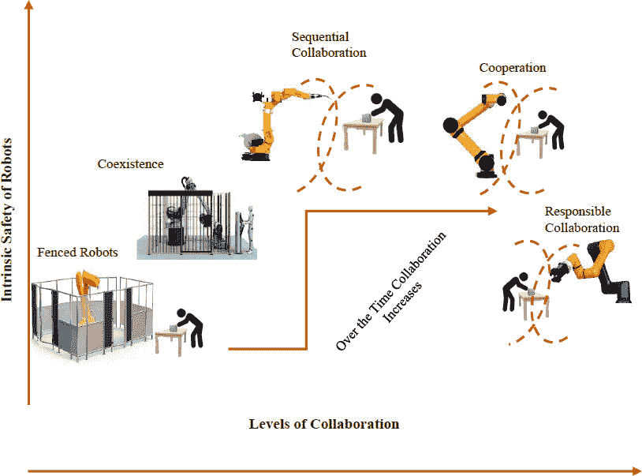
**图 (5)**
HRC 系统中的多种类型工作空间。

### 速度与分离
为了确保工业和生产环境中的安全接触，HRC 监控利用了先进的监测技术。以避免事故和保护操作者为目标，这些系统持续跟踪并分析人类操作员与机器人之间的时间和空间测量。这些系统监控工作区域内个人之间的速度和距离，并通过摄像头和传感器等各种技术检测他们的存在。算法计算相对速度和距离以评估潜在的安全隐患，并采取行动以维持安全环境。

### 功率与力量限制
功率与力量限制型 HRC 关注通过限制机器人可能使用的力和强度来防止工业和制造环境中的事故。通过这种方式，可以确保人类操作员的安全。这些系统配备了传感器和其他技术，用于实时监控人与机器人之间的交互。通过检测人类操作员的存在和位置，这些技术利用算法修改机器人的力和强度，从而确保安全的团队协作。这种动态调整有助于在维护安全的同时，不损害机器人系统的效率和有效性。

### HRC 的障碍
HRC 的障碍主要源于安全考量、技术局限性和组织挑战。保护在机器人附近进行手部操作的操作员需要先进的传感器、控制系统以及对严格安全标准的遵守，这在实施上可能成本高昂且极其复杂 [25]。

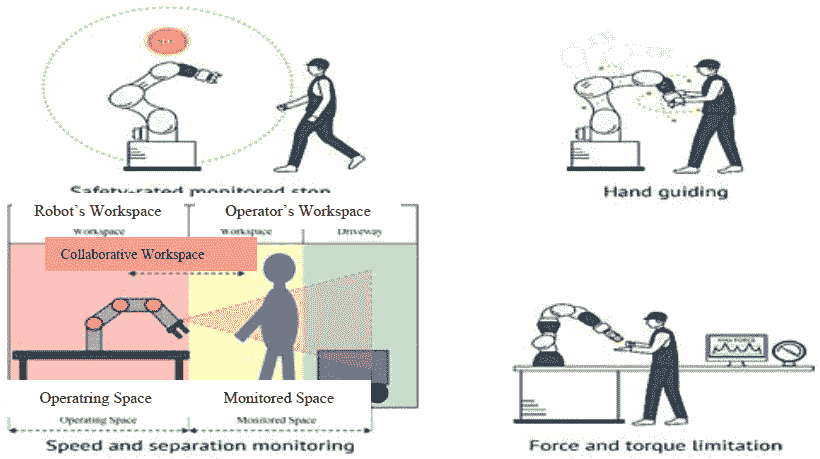
**图 (6)**
多种类型的 HRC 系统。

在技术上，实现人与机器人之间的无缝交互涉及克服与实时数据处理、机器学习（ML）准确性和自适应行为相关的问题。在组织上，将 HRC 集成到现有工作流中需要对工作流程、员工培训和管理实践进行重大改变。此外，还存在心理障碍，因为人类工人可能对与机器人一起工作感到不安或不信任，可能会影响 HRC 系统的整体有效性 [24]。

### 机器人强化学习（RL）中的挑战与机遇

强化学习（RL）在机器人领域既带来了重大挑战也许多机遇。挑战之一是样本效率低下，需要大量数据来学习有效的策略，这在机器人领域可能是耗时且高昂的。在动态且不确定的现实环境中确保安全探索和稳健性能至关重要，因为机器人必须处理意外事件并安全地从失败中恢复。由于现实差距（reality gap），将从模拟环境中学到的行为转移到现实应用是复杂的。此外，RL 算法（特别是涉及深度学习的算法）是计算密集型的，为在资源受限的机器人系统中的部署造成了障碍。在多智能体设置中高效协调动作增加了另一层复杂度。

尽管存在这些挑战，RL 也提供了巨大的机遇。它允许机器人适应变化的环境和任务，而无需重新编程，从而产生更具通用性的系统。RL 让机器人学习并执行难以手动编程的复杂任务，例如操作和导航。根据用户偏好对机器人行为进行个性化是可能的，在服务机器人和辅助技术中特别有用。与工业 4.0 和 5.0 的集成可以增强智能制造环境，有助于高效、灵活和智能的生产系统，并实现以人为中心的自动化。联邦学习结合 RL 为分布式机器人系统的协作学习提供了机遇，在维护隐私和安全的同时增强学习。模拟技术的进步可以缩小现实差距，为 RL 算法提供更准确的训练场，加速训练过程并降低物理尝试成本。虽然机器人 RL 面临巨大障碍，但其对自主系统的变革和能力提升潜力使其成为一个极具前景的领域。通过解决挑战并利用机遇，RL 可以在机器人未来发挥关键作用。

### 机器人强化学习 - 应用、进展与优势

强化学习（RL）已成为机器人领域的关键力量，推动了重大进展并扩大了机器人的应用范围。通过允许机器人通过与其交互来获取洞察，RL 增强了自主导航，使其能够在城市地区和仓库等复杂环境中实现高效的路径规划和实时决策。在机器人操作方面，RL 促进了对多样化物体的处理，在装配和包装等工业任务以及精密手术等领域证明了极高价值。此外，RL 改进了 HRC，使机器人能够预测和理解人类行为，这对于协作装配线和辅助机器人至关重要。诸如深度强化学习（DRL，将深度神经网络与 RL 相以处理复杂的传感器输入）以及仿真到现实（sim-to-real transfer，确保在模拟中训练的策略在现实应用中有效）等进展是突破性的。


多智能体强化学习（MARL）允许多个机器人之间进行协调动作，这对于搜索和救援等任务至关重要；而联邦学习使得多个机器人能够在不共享数据的情况下进行去中心化学习，在大规模工业环境中具有优势。强化学习在机器人领域的益处是深远的，它提升了适应性、效率、安全性和可靠性。强化学习驱动的机器人能够适应动态环境，优化操作以降低成本和能耗，并在自动驾驶等关键应用中确保更安全、更可靠的性能。此外，强化学习支持以人为中心的自动化，将机器人动作与人类意图和偏好对齐，从而促进更直观、有效的人机交互。总而言，强化学习正在通过提供先进解决方案、推动技术进步以及为各行业带来巨大利益，彻底改变机器人领域。

## 局限性与未来方向

尽管机器人强化学习取得了显著进展，但仍存在一些局限性和挑战。一个主要的局限是训练强化学习算法需要大量的计算资源和时间，这对于实时应用来说可能是无法承受的。此外，强化学习算法在复杂的高维环境中的稳定性和可靠性往往会受到影响，导致性能不稳定。将学习到的策略从模拟环境迁移到现实应用是另一个关键挑战，因为模拟与现实之间的差异会导致性能下降。此外，关于在以人为中心的环境中部署自主强化学习驱动机器人的安全和伦理问题，需要严格的测试和验证。机器人强化学习的未来方向集中在通过多种途径解决这些局限性。提高强化学习算法的效率以缩短训练时间和计算成本至关重要。开发稳健的方法以确保在复杂环境中稳定可靠的性能也是必不可少的。从仿真到现实应用的策略迁移能力将是一个关键研究领域。

## 结论

总结来说，这项工作探索了强化学习为机器人领域带来巨大变化的能力，强调了其在提升机器人系统自主性和智能方面的作用。通过对强化学习的应用、进展和益处的全面探索，我们强调了强化学习如何使机器人能够在复杂的、非结构化的环境中学习和适应，从而处理难以显式编程的任务。此外，强化学习与工业 4.0 和 5.0 概念（如人机协作和以人为中心的设计）相结合，凸显了机器人领域向更具韧性和可持续性的生产系统的演进趋势。虽然强化学习提供了许多机会，但本文也探讨了必须克服的重大挑战和障碍，计算计算需求、稳定性问题以及从仿真到现实应用的过渡。通过审视深度强化学习（DRL）的当前趋势和著名算法，我们对该领域的现状及其轨迹提供了背景性的理解。

此外，这项工作概述了机器人强化学习的未来方向，强调了需要持续研究和创新，以克服现有局限性并充分发挥强化学习驱动的机器人系统的潜力。展望未来，由强化学习进步促进的人类与智能机器之间的共生关系，为创建更具适应性、高效且以人为中心的机器人解决方案带来了希望。我们希望此论文能激发进一步的探索和开发，驱动机器人未来迈向能力与协作的新边界。

## 参考文献

|  ||  |
| --- | --- |
| [1] | Lasi H., Fettke P., Kemper H.G., Feld T., Hoffmann M.. Industry 4.0., *Bus. Inf. Syst. Eng..* **2014;** 6(4): 239-242. [[CrossRef](http://dx.doi.org/10.1007/s12599-014-0334-4)] |
| [2] | Industry 4.0 - Market study by Global Industry Analysts, Inc., 2022, Available from: [`www.strategyr.com/market-report-industry-4.0-forecasts-globalindustry-analysts-inc.asp`](https://www.strategyr.com/market-report-industry-4.0-forecasts-globalindustry-analysts-inc.asp) |
| [3] | Levine S., Abbeel P.. Learning neural network policies with guided policy search under unknown dynamics., *Adv. Neural Inf. Process. Syst..* **2014**: 27. |
| [4] | V. Uc-Cetina, N. Navarro-Guerrero, A. Martin-Gonzalez, C. Weber, S. Wermter, Survey on reinforcement learning for language processing, 2021, Available from: [`arxiv.org/abs/2104`](https://arxiv.org/abs/2104) |
| [5] | [[CrossRef](http://dx.doi.org/10.1109/ICRA.2019.8793)] F. H., P. K., M. J., D. G., W. W., safety and ethical concerns regarding the deployment of autonomous RL-driven robots in human-centric environments necessitate rigorous testing and validation. (Note: Original text snippet contained variables `CrossRef` and `ICRA`) |
| [6] | P. H., R. M., D. D., A distributional perspective on reinforcement learning., CoRR. |
| [7] | H. N., L. H., J. D., Review of deep reinforcement learning for robotics: A review., *Robotics (Basel).* **2021;** 10(1): 22. [[CrossRef](http://dx.doi.org/10.3390/robotics100122)] |
| [8] | T. T., N. D., S. N., Deep reinforcement learning for multiagent systems: a review of challenges, solutions, and applications., *IEEE Trans. Cybern..* **2020;** 50(9): 3826-3839. |
| [9] | D. S., T. H., J. J., M. L., A. G., T., Mastering the game of Go with deep neural networks., *Nature.* **2016;** 529(7587): 484-489. [[CrossRef](http://dx.doi.org/10.1038/nature16961)] |
| [10] | D. S., T. H., J. J., M. L., A. G., T., A general reinforcement learning algorithm that masters chess, shogi, and Go through self-play., *Science.* **2018;** 362(6419): 1140-1144. [[CrossRef](http://dx.doi.org/10.1126/science.aar604)] |
| [11] | H. N., L. H., J. D., Review of deep reinforcement learning for robot, *Third IEEE International Conference on Robotic Computing (IRC).* **2019**: 590-595. |
| [12] | A. G., D. D., and R. P., Autonomous pH control by reinforcement learning for electroplating industry wastewater. *Comput. Chem. Eng.* 140, 106909, 2020. [[CrossRef](http://dx.doi.org/10.1016/j.compchem.2020.106909)] |
| [13] | M. G. B., W. D., R. M., A distributional perspective on reinforcement learning., *34th International Conference on Machine Learning, ICML 2017.* **2017**: 693-711. |


# 博弈论中的强化学习：智能体系统的方法论

| [16] | C. Beattie, et al. "DeepMind Lab", 2016. 可自：[`arxiv.org/abs/1612.03801`](https://arxiv.org/abs/1612.03801) |
| [17] | Vezhnevets A.S., et al. , . FeUdal networks for hierarchical reinforcement learning.; 34th International Conference on Machine Learning, ICML 2017. 2017. p. 5409.-5418. 可自：[`arxiv.org/abs/`](https://arxiv.org/abs/) |
| [18] | Wang Z., et al. , . Dueling network architectures for deep reinforcement learning.; 33rd International Conference on Machine Learning, ICML 2016. 2015. p. 2939.-2947. 可自：[`arxiv.org/abs/`](https://arxiv.org/abs/) |
| [19] | Ahmed F., Mohanta J.C., Keshari A., Yadav P.S.. 无人机的最新进展：综述., Arab. J. Sci. Eng.. 2022; 47(7): 7963-7984. [[CrossRef](http://dx.doi.org/10.1007/s13369-022-06738-0) [[PubMed](http://www.ncbi.nlm.nih.gov/pubmed/35492958) |
| [20] | M. Lapan, "Deep reinforcement learning learning hands-on. Reinforcement Learning for Cyber-Physical Systems", pp. 125–154, 2019. 可自：[`www. packtpub.com/product/deep-reinforcement-learning-hands-on-second-edition/9781`](https://www.packtpub.com/product/deep-reinforcement-learning-hands-on-second-edition/9781) |
| [21] | [[CrossRef](http://dx.doi.org/10.1038/s41586-019-1924-6)] W. Dabney, "基于多巴胺强化学习的价值分布编码". Nature 577 (7792), 671–675, 2020. |
| [22] | Peng, X. Bin, "变分信息瓶颈：通过限制信息流改进模仿学习、逆强化学习和 GAN"。 In: 7th International Conference on Learning Representations, ICLR 2019. 可自：[`arxiv.org/abs/1810.00821v4`](https://arxiv.org/abs/1810.00821v4) |
| [23] | [[CrossRef](http://dx.doi.org/10.1109/TNNLS.2023.3250269)] R.F. Prudencio, M.R. Maximo, and E.L. Colombini, "离线强化学习综述：分类、回顾与开放问题", 2022. |
| [24] | Drath R., Horch A.. 工业 4.0：实实还是炒作?, IEEE Ind. Electron. Mag.. 2014; 8(2): 56-58. [[CrossRef](http://dx.doi.org/10.1109/MIE.2014.2312079) |
| [25] | Maurice P., Padois V., Measson Y.. 协作机器人的人性化设计., Int. J. Ergon.. 2017; 57: 88-102. [[CrossRef](http://dx.doi.org/10.1016/j.ergon.2016.11.011) |

作者：Athva Prashant Joshi, Navneet Kaur

## 摘要

本文提出了一种利用尖端强化学习（`RL`）技术开发智能体系统的全面方法论。该方法论由三个阶段组成：多智能体框架、先进学习技术和环境搭建。通过使用马尔可夫决策过程（`MDPs`），我们首先通过描述奖励函数、状态空间和转移概率定义了环境。这一基础框架使得智能体与其周围环境的精确建模成为可能。为了提高学习性能和效率，第二阶段引入了先进的学习技术。为了优化动作价值函数，我们开发了 `Q-Learning` 和深度 Q 网络（`DQN`）。此外，还采用了策略梯度技术来直接增强策略，例如策略梯度和 `REINFORCE` 算法。使用演员-评论（actor-critic）方法平衡了探索与利用之间的权衡，其中演员的更新指导策略，而评论员的更新改进了价值估计。竞争性学习使用纳什学习（Nash learning）来实现策略，而协作性学习侧重于优化联合价值函数。该阶段的目标是增强智能体在多智能体背景下的学习和适应能力。综所述，建议的方法论在一个组织的框架内结合了基础和复杂的强化学习技术，以创建出智能、自适应且能够协调和决策的多智能体系统。该方法论为分布式智能、机器人和博弈论等多个领域的进一步研究和实施提供了坚实的基础。

**关键词：** 演员-评论算法、竞争性环境、多智能体系统、性能指标、策略稳定性、强化学习。

通讯作者 Navneet Kaur：Department of Computer Science and Engineering, Lovely Professional University, Jalandhar, India; 邮箱：navneetphul@gmail.com

## 引言

智能多智能体系统在包括系统在内的多个领域的广泛应用近年来引起了大量的关注。多智能体系统由多个相互作用的智能体组成，每个智能体都能独立做出决策。

这些系统旨在解决单个智能体难以或无法管理的复杂问题。由于这些系统运行环境的复杂性日益增加，需要更先进的技术来提高这些系统的学习、适应和协调能力。由于多智能体环境中的智能体是动态且交互的，传统的单智能体 `RL` 技术通常是不够的。因此，迫切需要一种结合基础和先进 `RL` 技术的结构化方法论来开发稳健的多智能体系统。本研究的目标是利用尖端的强化学习技术，提出一种开发智能体系统的全面方法论。该方法论的三个主要要素是多智能体框架、先进学习技术和环境搭建。这种层层递进的方式确保了多智能体系统创建的系统性和全面性。相关领域包括分布式人工智能、机器人、博弈论和自主系统。

## 环境搭建

建立智能体运行的环境是第一阶段的主要目标。为此使用了马尔可夫决策过程（`MDP`）——一种用于建模 `RL` 决策问题的正式框架。`MDP` 的核心元素包括：

*   **状态空间 (`S`）：** 代表环境可能处于的所有场景或设置的集合。每个状态都提供了周围环境的瞬时视图，包含了智能体决策所需的所有相关数据。
*   **动作空间 (`A`）：** 代表智能体在给定上下文中可以执行的所有选项或动作的集合。每个动作都是智能体为了影响环境状态的一个特定决策。
*   **奖励函数 (`R`）：** 通过该函数，每个可能的状态和动作组合都会被赋予奖励。奖励通过显示在特定条件下执行特定动作的成本或即时收益为智能体提供反馈。通过这种反馈，智能体可以学习哪些动作是有用的。
*   **转移概率 (`P`）：** 指执行动作后进入新状态的概率。通过说明环境如何对智能体的动作做出反应，它解释了环境的动态特性。


我们通过定义这些元素来建立一个有序的环境，这些元素构成了智能体交互和学习过程的基础。我们可以在这个控制环境中模拟现实世界的情况，为智能体提供磨炼其决策技术的机会。此阶段包含以下动作：

- 定义`状态空间 (S)`，通过列出环境可能处于的所有场景或配置，确保其包含了做出明智决策所需的所有信息。
- 列出智能体在环境中可能采取的所有动作或决策，以定义`动作空间 (A)`。确保该列表包含了智能体可能拥有的所有重要选项。
- 定义`奖励函数 (R)`，通过创建一种机制，根据智能体在不同状态下的活动向其提供反馈，并确保这种反馈能促进理想行为并抑制不良行为。
- 建立一个解释环境如何对智能体动作做出反应的模型以定义`转移概率 (P)`。确保该模型能够恰当捕捉环境的动态特征和变化。

通过精确指定这些 `MDP` 组件，我们创建了一个强大且清晰的环境，这将指导智能多体系统的创建和评估。对于智能体学习如何做出最佳决策以及与周围环境交互，这个环境是至关重要的。

### 高级学习技术

第二阶段包含了高级强化学习技术（图. 1），以提高智能体的性能和学习效率。此阶段包括：

- `Q-Learning 与深度 Q 网络 (DQN)`：通过应用特定的更新规则来改进智能体的决策过程，这些策略被用于优化动作值函数。
- `策略梯度方法`：通过优化期望回报，利用`策略梯度定理`和`REINFORCE`算法等技术来直接增强策略。
- `Actor-Critic 方法`：通过利用`时序差 (TD)`误差同时更新策略（`actor`）和价值函数（`critic`），这些策略在探索与利用之间取得了平衡。
- `探索策略`：如`上置信区间 (UCB)`和`ε-greedy`等方法旨在确保智能体充分探索动作空间，避免过早收敛到次优策略。

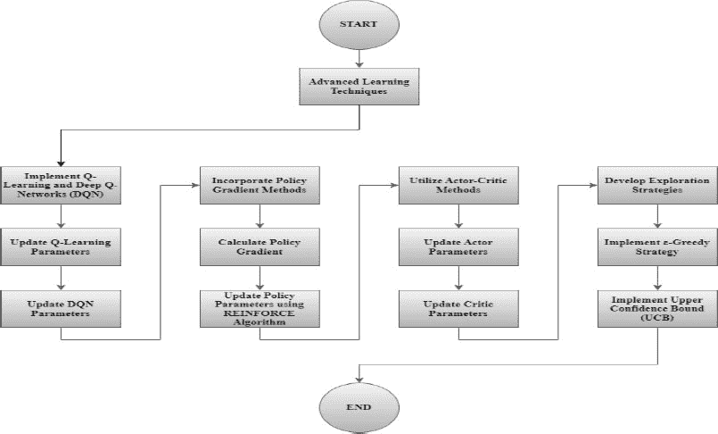 (图 (1))

高级学习技术。

## 多智能体框架

第三阶段的主要目标是创建一个能够处理竞争和协作场景的多智能体强化学习框架（图. 2）。此阶段包括：

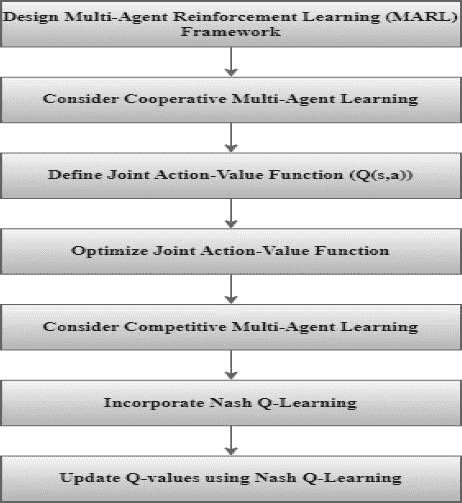 (图 (2))

多智能体框架。

- `协作多智能体学习`：为了作为一个整体获得成功，智能体学习优化联合动作值函数。
- `竞争多智能体学习`：通过利用`Nash Q-learning`，智能体获取引导均衡的策略，保证没有智能体单方面改变其策略来获得更好的结果。

## 相关工作

为了减少低估偏差，Jiang *等人* [1] 针对裁剪双重 Q 学习算法提出了一种改进方案：`基于动作候选的裁剪双重估计器 (AC-CDE)`。通过选择具有高动作值的异常动作候选者，该技术成功地平衡了与高估和低估相关的偏差。他们使用基准问题对他们的方法进行了实证测试，并将其扩展到连续动作任务。该研究还涵盖了收敛性证明、自适应选择方法以及建议算法的理论方面。用于偏差平衡的创新型`AC-CDE`、方差平衡与偏差减少的理论分析、适用于离散和连续任务的可靠算法以及证明性能优于基准的实证验证是其一些主要成就。为了解决用户移动管理问题，Yang *等人* [2] 为空天地一体网络（SGIN）引入了一种切换技术，名为`DQN-ALM`（带有自适应学习率和动量的深度 Q 网络）。该方法通过使用具有调节学习率和动量的`QN`框架，在动态环境下提高了决策准确性和学习效率。`DQN-ALM`考虑了可用比特率、网络成本和信号强度等因素以优化多指标服务质量（QoS）。仿真显示，它在收敛速度、切换率、呼叫失败率和整体 QoS 性能方面优于传统技术，特别是在小区边界，它成功减少了不必要的切换。根据论文结论，`DQN-ALM` 在改进 SGIN 的用户服务质量方面具有前景。`近端策略优化 (PPO)`算法是一种深度强化学习技术。Zhang *等人* [3] 研究了其探索效率限制。他们提出了一种基于不确定性的增强探索机制，导致了`IEM-PPO`算法的产生。利用`MuJoCo`物理仿真器对该方法与`PPO`和`ICM-PPO`算法进行了测试，旨在提高复杂情况下的探索。结果显示，尽管需要更多训练时间，`IEM-PPO`在采样效率、累计奖励、稳定性和鲁棒性方面更好。该研究有三个重要贡献：(i)强调了高斯噪声探索的局限性；(ii)建议了一种增强探索的有效机制；(iii)证明了`IEM-PPO`算法在`MuJoCo`基准测试中表现更好。


分离置信区域策略优化（STRMV）是一种独特的强化学习技术，由 Zou *et al.* [4] 提出，旨在高效地在探索（exploration）与开发（exploitation）之间取得平衡。通过为策略均值和方差创建不同的置信区域，该技术改进了近端策略优化（PPO），并产生了更温和的策略更新和更动态的探索。与目前最先进的同策略（on-policy）方法相比，STRMV 在 MuJoCo 环境的各种连续控制任务中，在获得奖励和提高采样效率方面展现了优越的性能。此外，该研究强调了在强化学习中权衡开发与探索的必要性，这是典型的策略梯度方法经常忽略的的一点。这意味着多步熵回报是该领域进一步研究的一个非常有前景的方向。

Chen *et al.* [5] 引入了一种使用异步优势演员-评论家（A3C）学习方法的汽车网络智能资源分配管理方法。为了解决联网汽车网络中提供卓越服务的困难，所提出的框架创建了一个虚拟化架构，动态安排通信和处理资源。该框架使用高性能 A3C 算法来优化资源分配，且不预设优化目标，将动态变化建模为马尔可夫链。仿真结果证明了该方案的快速收敛和改进的网络性能，表明它具有增加未来无线网络有效性的潜力。论文结论强调了所提出的基于学习的算法的有效性，并建议针对下一代网络通信进一步研究其他的强化学习算法。

Jesus *et al.* [6] 将软演员-评论家（SAC）和深度确定性策略梯度（DDPG）这两种深度强化学习方法用于移动机器人导航。该研究使用 Turtlebot3 Burger 模型评估了模拟情况下的 SAC 和 DDPG 的性能。机器人经过训练，利用速度输入和激光测距结果向目标导航并避免碰撞。结果显示，在到达目标且互不碰撞的效率和准确性方面，SAC 优于 DDPG。研究表明，SAC 和 DDPG 对于机器人连续控制任务都是实用的，未来的工作应该研究它们在多智能体控制和自动驾驶导航中的应用。

DUCT 是一种求解分布式约束优化问题（DCOP）的分布式方法，由 Ottens *et al.* [7] 提出。其灵来源于上限置信树（UCT）。与当前的 DCOP 方法相比，DUCT 对答案的质量提供了限制，并证明了其在快速解决复杂问题或寻找优越解决方案方面的有效性。该工作包含了实验结果，证明了 DUCT 优于局部搜索算法的性能，以及与最优方法相比的扩展性，同时还包含了基于问题结构合理假设的理论分析。

Liu *et al.* [8] 提出了一种新的贪婪- Levy 蚁群优化（Greedy–Levy ACO）算法。它结合了 Levy 和 epsilon 贪婪飞行机制，以增强 ACO 在解决具有挑战性的组合优化问题（特别是旅行商问题 TSP）方面的效率。通过在探索与开发之间找到平衡，该方法优于其他同时代的 TSP 求解器以及传统的 max–min ACO，导致了更快速、更有效的解决方案识别。计算实验使用了标准的 TSPLIB 实例来证明贪婪-Levy ACO 算法的效力。

多智能体递归确定性策略梯度（MA-RDPG）模型由 Feng *et al.* [9] 提出，旨在促进电子商务平台多场景排序技术的协同优化。该模型将每个场景视为一个智能体，并使用中心评论家（critic）进行全面的性能评估。一个通信组件允许智能体之间共享信息。MA-RDPG 解决了独立优化的缺点，允许智能体协作工作并利用各种设置下的全面用户行为数据。该方法的成功通过在知名电子商务平台进行的在线评估得到了验证，结果显示与传统技术相比有显著提升。

Gusrialdi *et al.* [10] 提出了一种稳健的协同控制架构，专门用于易受外部攻击的网络化系统，特别是那些采用领导-从者信息拓扑结构的系统。他们的方法创建了一个带有隐藏网络的虚拟系统，该网络与实际系统以竞争的方式交互，保护共识动力学和稳定性不受未知的边界攻击的影响。通过利用图论和李普诺夫技术进行分析，该设计在攻击细节先未知的情况下也表现出对攻击的韧性。该研究还探讨了在安全通信通道上部署隐藏网络，以减少进一步攻击的可能性。文中强调的重要理念包括韧性控制设计、协同系统、领导-从者拓扑、虚拟系统、隐藏网络、图论和李普诺夫方法。


Hou *et al.* [[[11]] 提出了关于群体决策（GDM）中均衡的新颖观点，并研究了该均衡与博弈论中纳什均衡的关系。他们的方法通过利用偏好序列向量（PSVs）来表达专家的偏好，考虑了序数排名中的相同情况。作者通过使用 PSVs 为纳什均衡和群体选择均衡分别构建了固定点方程，揭示了两者之间的相似性。该工作不仅证明了 PSVs 相比于其他方法的计算效率性外，还探索了纳什均衡的计算，并阐明了 GDM 均衡与纳什均衡之间的联系。尽管该论文承认可能不存在 GDM 均衡，但它对于如何在 GDM 中达成共识以及博弈论与 GDM 之间复杂的关系提供了富有见解的信息。

Frihauf *et al.* \[12]] 提出了一种创新的非模型方法，用于在静态非合作博弈中实现纳什均衡的局部收敛。他们使用的方法是将通常用于优化问题的极值寻求策略（extremum seeking strategy）应用于博弈论领域。惊讶的是，这种技术允许玩家仅根据自己的收益值做出决策，而不需要关于收益函数信息或其他玩家活动的信息。该研究检查了收益函数既是二次的又非二次的静态博弈。它建立了了收敛准则，并提供了数值示例来证明该方法论。这种创造性的方法在无法获取精确或全面模型数据的情况下具有潜力。

Wu *et al.* \[13\] 展示了通过 `KataGo` 在围棋游戏自对弈学习中的突破性进展，其效率优于 `AlphaZero` 和 `ELF OpenGo` 等更早的方法。作者将领域特定策略（如辅助所有权和分数目标）与若干领域无关的增强技术（如对弈上限随机化、策略目标剪枝和全局池化）相结合。这些进步共同使得与相当的技术相比，计算资源减少了惊人的 50 倍，使 `KataGo` 能够以少得多的硬件和时间在围棋中达到超人类水平。此外，论文强调了类似方法如何应用于围棋领域之外的问题。

在 `AlphaZero` 框架内，Czech *et al.* \[14]] 提出了一种名为蒙特卡洛图搜索（MCGS）的改进搜索方法，它将传统的搜索树扩展为有向环图。这种改进降低了内存占用，并允许子树之间共享信息。主要改进包括：将领域知识作为约束、ε-贪婪探索、用于最优移动选择的终端求解器以及使用 `Q-values` 进行步法选择。实证评估证明了象棋和疯狂房子（crazy house）等游戏中性能的显著提升，为未来在不同环境和强化学习情境下的研究提供了可能的方向。

自对弈偏好优化（SPPO）是 Wu *et al.* \[15]] 提出的一种独特方法，旨在自动使大语言模型（LLMs）与人类偏好对齐。在双人恒和博弈的背景下，`SPPO` 使用指数权重更新机制近似纳什均衡。该方法显著增加了受青响应的对数似然，性能优于 `DPO` 和 `IPO` 等其他方法。仅使用来自 Ultra Feedback 数据集的 6 万条提示，`SPPO` 就取得了显著结果，证明了其在 `AlpacaEval 2.0` 和 `MT-Bench` 等基准测试中的稳健性。该研究探索了 `SPPO` 的内在约束、实际应用和理论基础。

Li *et al.* \[16]] 描述了为 FPGA 制的 `AlphaGo Policy Network DCNN` 加速器的架构和性能。针对资源受限环境下部署深度卷积神经网络（DCNNs）的困难，该研究建议采用简化硬件设计以允许模型实时执行。通过在 `Xilinx VCU118` 上进行测试，加速器在速度和能量效率上比其 CPU 和 GPU 竞争对手有显著提高。研究结论强调了基于 FPGA 的 `DCNNs` 在性能优化方面的巨大潜力，以及有效的资源和功率管理。

Kearns *et al.* \[17]] 调查了推荐机制（根据自愿参与对可能的结果提出建议）如何用于在知识有限的大博弈中实现均衡。为了保护参与者的隐私并保持建议中的激励属性，他们使用了联合差分隐私。其主要贡献是一项可以在维护联合差分隐私的同时计算大博弈的相关均衡的技术。这允许在不暴露玩家类型个人信息的情况下实现均衡。这项工作深入探讨了该方法对大博弈参与者隐私和机制设计的影响。


Ratliff *et al.* \[18\] 引入了一种自适应激励设计方法，用于解决代理人决策过程未知的委托-代理问题。该算法利用了控制理论和优化技术。委托人的目标是通过识别不同类型的代理人并创建能够引起理想群体反应的激励机制，来实现系统性能的最大化。该方法通过迭代更新激励策略和效用函数，为噪声和无噪声环境均提供了收敛性保证。它重点关注逆向选择问题，即委托人能看到代理人的行为，但不知道他们的偏好。通过对激励和决策过程使用参数化模型，该方法对其进行修改，以使代理人的行为与委托人的目标保持一致；并提供了示例来演示这些变化。在卖家没有义务遵守特定机制的情况下，Skreta *et al.* \[19\] 研究了如何创建尽可能完美的拍卖，并为其根据需要提议新拍卖方案的选项。该研究通过将顺序理性引入 Myerson (1981) 模型，探索了受限承诺下的收益最大化概念。结论认为，保留价拍卖继续实现收入最大化，其中保留价会根据折扣因素的影响随时间波动。当存在多个竞标者且卖家非常有耐心或极度不耐心时，有限承诺的影响会减小。这强调了在供大于需求的危机时期，拍卖设计有多么重要。该工作解决了在没有完全承诺的情况下创建多期激励方案的困难，为动态机制设计领域的文献做添了贡献。A3C3，即带有通信的异步优势 Actor-中心化评论家，是 Simões *et al.* \[20\] 描述的一种深度多智能强化学习技术。它旨在解决非平稳且部分观测的协作多智能系统（MAS）中的协调问题。A3C3 包含了用于策略近似的去中心化 Actor、用于价值函数估计的中心化 Critic，以及用于代理间信息传输的去中心化通信网络。该方法可以处理不同数量的代理人、噪声通信路径以及水平扩展。A3C3 通过允许代理人交换局部信息，在部分观测的情况下优于当前的多智能体算法，这提升了策略性能和协调性。本研究还考察了该算法相对于各种收益估计器和通信噪声的有效性。

Pal *et al.* \[21\] 讨论了在通信限制情况下多智能体区域探索（MATE-nk）活动的复杂性。为了提高探索效率和网络连通性，他们建议了一种结合去中心化和中心化协调技术的混合策略。该方法利用图论进行通信分析，并使用领导者跟随者交互协议（`LFIP`）进行探索，在大规模仿真中显示出优于未协调技术的显著改进。研究详细探讨了在各种背景下的可能应用，包括攻击行动、扫雷和救援任务。它还对未来的研究和改进方向提出了建议，特别是关于多机器人系统中的连接性控制。为了提高小规模系统的协调性，Pesce *et al.* \[22\] 提出了一种利用深度策略梯度的新型多智能体训练框架。该框架使代理人能够学习周围环境，从而增强性能。实证证据和消融实验验证了研究结果。表 1\] | 研究强调了 `SGIN` 在移动管理方面的独特困难性，特别是在切换选择方面。 | 使用 Q-learning、深度 Q 网络（`DQN`）、强化学习（`RL`）和机器学习来处理动态问题。 | 为了训练神经网络和巨大的状态空间，研究建议使用具有可调学习率和动量的 `DQN`（`DQN-AL`）。 | 大量仿真证实了所提策略在多指标服务质量（`QoS`）、切换率和收敛速度方面更优。 | 研究讨论了潜在问题，如切换请求风暴和冲突，并建议将技术扩展到 GEO-LEO SGIN。 |
| Zhang \[3\] | 研究指出当前深度强化学习的不足，特别是在近端策略优化（`PPO`）算法的探索效率方面。 | 在讨论了高斯探索机制的使用和缺点后，提出了一种基于不确定性的探索增强机制。 | 为了构建 `IEM-PPO`，该方法涉及剖析原始高斯探索机制，创建一个改进的机制并将其整合到 `PPO` 算法中。 | 实验对比了建议的 `IEM-PPO` 方法与原始 `PPO` 和 `ICM-PPO` 算法，显示出更高的采样效率累计奖励。 | 未来研究包括研究各种动作分布模型、处理超参数优化以及考虑多智能体学习。 |
| Jesus \[6\] | 论文指出深度强化学习在机器人领域的应用空白，特别是在复杂环境下的移动机器人导航。 | 它比较了两种深度强化学习技术：软 Actor-评论家（`SAC`）和深度确定性策略梯度（`DDPG`），用于移动机器人导航。 | 研究利用了一种旨在引导机器人到达目标的奖励函数，输入包括激光测距发现以及机器人的相对位置和速度。 | `SAC` 在仿真环境中优于 `DDPG`，证明了其在无碰撞情况下引导移动机器人到达目标的优越性能。 | 论文建议了这些技术在各种控制系统中的潜在应用，以及移动机器人和自动驾驶导航中多智能体控制的探索。 |
| Liu \[8\] | 论文识别了探索 |


蚁群算法（ACO）中的开发与探索困境被视为研究空白，旨在通过有效解决这一问题来提高 ACO 的性能。`Epsilon greedy` 和 `Levy flight` 是用于增强 `ACO` 算法的技术。`Epsilon greedy` 是一种基于策略的探索方法，而 `Levy flight` 有助于平衡搜索空间与全局优化的速度。提出的 `greedy–Levy ACO` 将 `epsilon greedy` 和 `Levy flight` 整合到 `max–min ACO` 中，以更高效地解决旅行商问题（TSP）实例。计算实验表明`greedy–Levy ACO` 的性能优于 `max–min ACO` 和其他 `TSP` 求解器，证明了其有效性。未来研究可以将 `greedy–Levy ACO` 应用于其他优化问题，例如丰富的车辆路径问题（VRP）。

- 论文指出电子商务平台中缺乏协作，且无法对不同排名场景之间的相关性进行建模，导致性能并非最优。它引入了一种名为`多智能体递归确定性策略梯度`（`MA-RDPG`）的新型模型，该模型使用通信组件进行消息传递，并使用中心化评论员（critic）评估性能。该方法将每个场景视为一个智能体，通过跨场景共享全局动作价值函数和历史信息与其他协作。该模型在大型电子商务平台上进行了测试，显示出在整体性能方面较基准有显著提高。论文建议对该模型进行潜在的增强和应用，以进一步优化多场景排名策略。

- 论文引入了一种非基于模型的方法，用于多玩家静态非合作博弈中局部稳定收敛至`纳什均衡`（`Nash equilibria`）。它采用带有正弦扰动的`极值点寻`技术，使玩家仅需测量自身的收益值，无需知晓收益函数的形式或其他玩家的动作。该方法对静态博弈和动态动态博弈进行了分析，并考虑了二次和非二次收益函数。论文量化了非二次收益的收敛偏差，并指出了其潜力。进一步的研究方向是使用投影方法确保玩家的动作始终保持在闭合且有界的动作集内。

- 论文识别了`AlphaZero`算法中可以改进的领域，特别是`蒙特卡洛树搜索`（`MCTS`）方法。它引入了`蒙特卡洛图搜索`（`MCGS`），将搜索树泛化为有向无环图，允许更好的信息流和内存效率。论文详细说明了适用于`MCGS`图结构的改进后正向和反向传播程序。使用`CrazyAra` 引擎在国际象棋和`Crazyhouse`上进行的实证评估表明，所提改进带来了显著提升。建议对`MCGS`进行进一步增强，以及其对强化学习和其他环境的潜在影响。

- 论文指出了将`深度卷积神经网络`（`DCNNs`）应用于资源受限嵌入式系统时面临的挑战，由于其计算密集且对存储要求高。研究利用监督学习和强化学习结合的方法训练`DCNNs`，这对于`AlphaGo`的成功至关重要。该研究提出了一种高效的硬件架构，以在`FPGA`上加速`DCNN`模型，平衡处理速度与硬件资源。在`Xilinx VCU118 FPGA`上的实现与`CPU`和`GPU`基准测试相比，实现了显著的速度提升和性能增长。论文建议进一步优化`FPGA`上的资源利用率，并对降低位宽带来的准确率权衡进行调查。

- 论文讨论了在不完全信息环境下实现完全信息博弈均衡（`equilibria`）的挑战，并使用推荐机制解决这一问题。它利用了`差分隐私`的新颖应用，特别是称为`联合差分隐私`的变体，在大博弈中计算`相关均衡`（`correlated equilibrium`）。该方法涉及`无悔算法`和噪声容限，确保推荐机制在维护隐私的同时满足预期的激励属性。论文对`无悔算法`的噪声容限进行了详细分析，并给出了进行隐私均衡计算的条件。文档建议了进一步的研究方向，例如放宽玩家类型可验证的假设，并探索在没有该假设的情况下实现均衡的方法。

- 论文识别了拍卖设计中承诺假设不符合实际的领域，并探索了当卖家在未能实现所有交易收益时无法承诺给给定机构的影响。它利用了一种不依赖于`揭示原理`来表征均衡结果的方法。该方法涉及构建一个约束最大化问题，以确定收益最大化的顺序理性拍卖。分析包括一个风险中性卖家面对风险中性买家、私有估值和有限时间界的场景。论文建议所开发的技巧可以应用于政府采购、国防采购以及其他透明度和隐私问题严重的领域。它还承认了分析有限期限问题的局限性，并认为无限期限机制设计问题仍是未来的研究领域。

- 论文识别了现有多机器人探索策略的局限性，特别是在通信受限的环境以及机器人之间需要有效协作的情况下。它讨论了使用`图论`、`领导者-跟随者架构`以及中心/去中心化的混合方法来解决多智能体区域任务中的挑战。作者提出了一个框架，包括用于选择未来位置的`探索层`，以及用于在维护网络连通性的同时访问检测检查点的`探索与检查点访问层`。广泛的仿真验证了所提方法。论文建议未来的工作可以探索实时路径规划、异构机器人团队以及该方法的扩展性属性。

# 拟议方法

`AIMARS`（高级多智能体强化学习系统）开发的建议技术见`3`。该方法包含三个主要阶段。通过`马尔可夫决策过程`（`MDPs`），在第一步`环境设置`中定义环境。这包括建立状态空间（`S`）、动作空间（`A`）、奖励函数（`R`）和转移概率（`P`）。为了表示期望收益，它还涉及定义状态价值函数（`V[s]`）和动作价值函数（`Q[s, a]`）。

为了改进智能体学习，第二阶段`高级学习技术`结合了先进的强化学习技术。这包括在策略梯度方法中应用`REINFORCE`算法，实现`Q-Learning`和`深度 Q 学习`（`DQN`）来更新学习参数，并采用`Actor-Critic`方法（其中评论员更新价值函数参数，执行者更新策略参数）。为了平衡探索与利用，该阶段还包括创建探索策略，如`ε-Greedy 策略`和`上置信边界`（`UCB`）。


第三阶段 `Multi-Agent Framework`（多智能体框架）的目标是提供一个允许多个智能体环境中相互通信和学习的框架。这需要考虑兼具竞争性和协作性的多智能体学习策略。在协作学习中，智能体设计共享的动作价值函数以优化共同奖励。在竞争性学习中，智能体考虑其他智能体的战术，并使用 `Nash Q-Learning` 更新 `Q-values` 以识别 `Nash equilibria`。这种全方位的方法确保了智能系统的构建，该系统能够成功地执行多智能体强化学习。

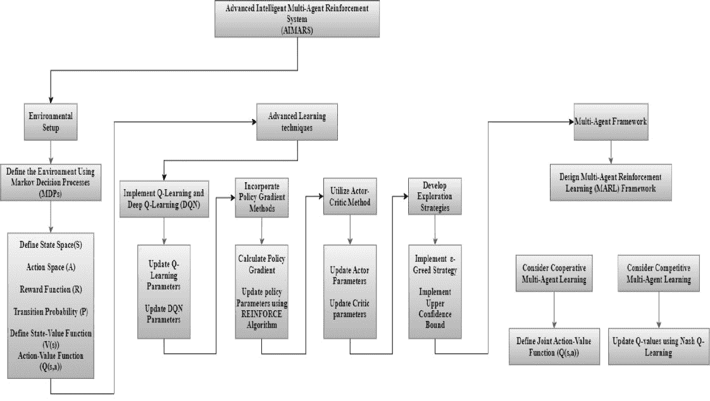 **图 (3))**

高级智能多智能体强化学习系统 (AIMARS)。

## 环境搭建

**使用马尔可夫决策过程 (MDPs) 定义环境：** `MDPs` 用于为强化学习中的决策问题。一个 `MDP` 的定义如下：

**状态空间 (S):** 所有可能状态的集合。

**动作空间 (A):** 所有可能动作的集合。

**奖励函数 (R):** 一个函数 `R:S x A → R`，为每个状态-动作对分配奖励。

**转移概率 (P):** 一个函数 `R:S x A x S → [0,1]`，定义了给定动作条件下从一个状态转移到另一个状态的概率。状态价值函数 `V(s)` 和动作价值函数 `Q(s,a)` 是 `MDPs` 的关键组件。

**状态价值函数：** 等式 1 表示从状态 `s` 开始之后遵循最优策略的期望回报，并由因子 `y` 折扣。

| 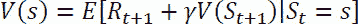 || (1) |
| --- | --- |

**动作价值函数：** 等式 2 表示从状态 `s` 开始、采取动作 `a` 之后遵循最优策略的期望回报。

| 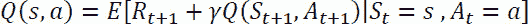 || (2) |
| --- | --- |

### 三种高级学习技术

**实现 Q-Learning 和 DQN：** 使用学习率逐渐改变 `Q-values` 并改进智能体的决策，`Q-Learning` 更新规则根据观测到的奖励和预测的未来奖励修改特定状态-动作组合的 `Q-value`。另一方面，利用神经网络的表示能力，`DQN` 更新规则使用神经网络来近似 `Q-function`。通过更新网络参数以最小化预测的 `Q-values` 与目标值之间的差异，允许智能体更有效地处理大型状态-动作空间。

**Q-Learning 更新规则：** 使用学习率，等式 3 中的此更新规则根据观测到的奖励和预测的未来奖励 `α` 修改状态-动作组合的 `Q-value`。

| 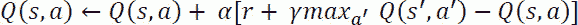 || (3) |
| --- | --- |

**DQN 更新规则：** 在等式 4 中，使用参数为 `θ` 的神经网络近似 `Q-function`。更新规则调整网络权重以最小化预测的 `Q-values` 与目标值之间的差异。

| 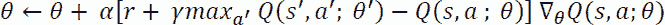 || (4) |
| --- | --- |

**引入策略梯度方法：** `Policy Gradient Theorem` 通过提供期望回报相对于策略参数的梯度，通过引导必要的修改来增强决策，辅助精炼策略。使用该理论，`REINFORCE` 算法增加了执行能提供更好回报动作的概率，从而更新策略参数。通过这种方法，通过微调参数增加了预测回报；通过将实际回报与基准函数进行比较，减少了方差并稳定了学习过程。这些技术结合时，为包括强化学习在内的环境提供了一种强力的策略优化机制。

**策略梯度定理：** 等式 5 提供了期望回报关于策略参数 `θ` 的梯度，用于改进策略。

| 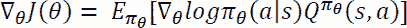 || (5) |
| --- | --- |

**REINFORCE 算法：** 等式 6 中的 `REINFORCE` 算法通过将策略参数 `θ` 向增加高回报动作概率的方向进行更新，其中 `R` 为回报，`b(s)` 为减少方差的基准。

|  || (6) |
| --- | --- |

### 利用 Actor-Critic 方法

**Actor 更新：**

|  || (7) |
| --- | --- |

**Critic 更新：**

|  || (8) |
| --- | --- |

**TD 误差：**

|  || (9) |
| --- | --- |

在等式 7、8 和 9 中，actor 使用 TD 误差 `δ` 更新策略参数 `θπ`，`δ` 衡量了预测值与观测奖励加上折扣下一状态之间的差异。

### 开发探索策略

**ε-Greedy 策略**

以 `ε` 的概率，智能体选择随机动作。

以 `1-ε` 的概率，智能体选择具有最高 `Q-value` 的动作。

**置信上限 (UCB)：** `UCB` 通过在等式 10 的 `Q-value` 中添加一个置信项来平衡探索与利用，该项随着动作执行次数的增加而减少。这鼓励对被选择较少的动作进行探索。

|  || (10) |
| --- | --- |

## 多智能体框架

**设计多智能体强化学习 (MARL) 框架：** 在协作多智能体学习中，智能体协作学习所有可能动作的价值函数（如等式所示），目标是优化每个状态-动作对的共享奖励。相反，在竞争性多智能体学习（特别是 Nash Q-Learning）中，每个智能体在考虑其他智能体策略的情况下更新其 `Q-value`。这有助于寻找 `Nash equilibria`，即每个智能体的策略都是其他策略的最优响应。

|  || (11) |
| --- | --- |

|  || (12) |
| --- | --- |


| **回合 (Episode)** | **Q- Learning** | **DQN** | **策略梯度 (Policy Gradient)** | **Actor-critic** |
| --- | --- | --- | --- | --- |
| 0 | 0 | 0 | 0 | 0 |
| 10 | 50 | 100 | 30 | 90 |
| 20 | 100 | 200 | 60 | 180 |
| 30 | 150 | 300 | 90 | 270 |
| 40 | 180 | 380 | 110 | 340 |
| 50 | 200 | 450 | 130 | 400 |
| 60 | 220 | 500 | 150 | 450 |
| 70 | 230 | 530 | 160 | 480 |
| 80 | 240 | 550 | 170 | 500 |
| 90 | 250 | 560 | 180 | 510 |
| 100 | 260 | 570 | 190 | 520 |

### 策略稳定性
在强化学习中，策略稳定性指的是策略随时间推移保持可靠和一致的能力，确保智能体的行为始终是可预测且成功的。它包含了一致的决策能力、对波动的韧性、收敛到最优或近优策略的能力，以及在稳健性与适应性之间取得平衡。对于需要可靠行为的应用来说，稳定的策略至关重要，因为它们的性能波动小，且学习过程平滑。策略稳定性通常通过正则化、目标网络、经验回放和保守策略更新（例如 `Proximal Policy Optimization`）等方法来实现，从而在动态情况下实现可靠的性能和高效的学习。

所学规则的稳定性如图 (5) 和表 3 所示，强调了算法可靠的长期性能。`Actor-Critic` 和 `DQN` 算法因具有最佳而脱颖而出，它们能够定期产生可靠且可预测的行为，同时性能变化很小。它们在多变环境中维持强大且可信策略的能力证明了其稳定性。

 **图 (5)**

表 3. **策略稳定性。**

| **回合 (Episode)** | **Q- Learning 稳定性** | **DQN 稳定性** | **策略梯度稳定性** | **Actor-Critic 稳定性** |
| --- | --- | --- | --- | --- |
| 0 | 0.0 | 0.0 | 0.0 | 0.0 |
| 10 | 0.2 | 0.5 | 0.1 | 0.5 |
| 20 | 0.3 | 0.7 | 0.2 | 0.7 |
| 30 | 0.4 | 0.8 | 0.3 | 0.8 |
| 40 | 0.5 | 0.9 | 0.4 | 0.9 |
| 50 | 0.6 | 0.95 | 0.5 | 0.95 |
| 60 | 0.65 | 0.97 | 0.6 | 0.97 |
| 70 | 0.7 | 0.98 | 0.65 | 0.98 |
| 80 | 0.75 | 0.99 | 0.7 | 0.99 |
| 90 | 0.78 | 0.99 | 0.73 | 0.99 |
| 100 | 0.8 | 1.0 | 0.75 | 1.0 |

### 探索与利用
随时间推移，从探索到利用的转变如图 (6) 和表 4 所示。算法最初优先探索以发现新方法。然而，随着学习的进行，它们逐渐开始利用已建立的策略。

 **图 (6)**

表 4. **探索与利用。**

| **回合 (Episode)** | **探索 (Exploration)** | **利用 (Exploitation)** |
| --- | --- | --- |
| 0 | 1.0 | 0.0 |
| 10 | 0.9 | 0.1 |
| 20 | 0.8 | 0.2 |
| 30 | 0.7 | 0.3 |
| 40 | 0.6 | 0.4 |
| 50 | 0.6 | 0.5 |
| 60 | 0.65 | 0.6 |
| 70 | 0.7 | 0.65 |
| 80 | 0.75 | 0.7 |
| 90 | 0.78 | 0.73 |
| 100 | 0.8 | 0.75 |


在多智能体系统框架下，我们在研究中创建并评估了多种强化学习算法，特别关注了 `Q-Learning`、`DQN`、`Policy Gradient` 和 `Actor-Critic` 技术。根据发现，在奖励积累、策略稳定性和学习速度等指标方面，`Q-Learning` 和 `Policy Gradient` 方法的效果不如 `DQN` 和 `Actor-Critic` 技术。具体而言，在协作和竞争性多智能体环境中，`DQN` 和 `Actor-Critic` 算法表现更好。这些结果表明，这类复杂的学习策略适用于复杂的多智能体系统，能够提供更大的奖励优化和更快的收敛速度。尽管有了这些发现，但仍存在若干研究空白。目前尚不清楚这些算法如何扩展到更大、更复杂的多智能体系统，它们迁移到其他语境的效果也不明确。本研究没有充分探讨智能体间通信对提高学习效率和性能的重要性，也没有妥善解决对状态转换和激励随时间变化的动态环境的适应问题。此外，尚未在需要快速决策的实时环境下对这些技术的实现进行测试。这些缺陷在未来可以通过探索提高系统可扩展的方法、测试其在其他领域的泛化能力以及增强其在动态环境中的适应性来解决。详细调查各种智能体通信协议的影响，并确认这些算法在机器人群、自动驾驶车辆和实时策略游戏等实时场景中的适用性将至关重要。通过创建融合多种强化学习算法最佳特征的混合方法，并研究在实际应用中使用这些多智能体系统的安全性、道德影响和公平性，该领域也将得到改进。

## REFERENCES

| | |
| --- | --- |
| [1] | Jiang H., et al. Action candidate driven clipped double q-learning for discrete and continuous action tasks., *IEEE Trans. Neural Netw. Learn. Syst..*. **2022**[[PubMed]](http://www.ncbi.nlm.nih.gov/pubmed/36166566)] |
| [2] | Yang J., Xiao Z., Cui H., Zhao J., Jiang G., Han Z.. Dqn-alrm based intelligent handover method for satellite-ground integrated network., *IEEE Trans. Cogn. Commun. Netw..* **2023;** 9(4): 977-990. [[CrossRef]](http://dx.doi.org/10.1109/TCCN.2023.3262239) |
| [3] | Zhang J., Zhang Z., Han S., Lü S.. Proximal policy optimization *via* enhanced exploration efficiency.. *Inf. Sci..* **2022;** 609: 750-765. [[CrossRef]](http://dx.doi.org/10.1016/j.ins.2022.07.111)) |
| [4] | Zou L., et al. Separated trust regions policy optimization method, *Proc. 25th ACM SIGKDD Int. Conf. Knowledge Discovery & Data Mining.*. **2019** |
| [5] | Chen M., Wang T., Ota K., Dong M., Zhao M., Liu A.. Intelligent resource allocation management for vehicles network: An A3C learning approach., *Comput. Commun..* **2020;** 151: 485-494. [[CrossRef]](http://dx.doi.org/10.1016/j.comcom.2019.054)) |
| [6] | Augusto V.. Soft actor-critic for navigation of mobile robots., *J. Intell. Robot. Syst..* **2021;** 10(2) |
| [7] | Faltings, "DUCT: An upper confidence bound to distributed constraint problems," 2018 |
| [8] | Liu Y., Cao B., Li H.. Improving ant colony optimization with epsilon greedy and Levy flight., *Complex Intell. Syst..* **2021;** 7(4): 1711-1722. [[CrossRef]](http://dx.doi.org/10.1007/s40747-020-0138-)) |
| [9] | Feng J., et al. Learning to collaborate: Multi-scenario ranking *via* multi-agent reinforcement learning, *Proc. 2018 World Web Conf..*. **2018**[[CrossRef]](http://dx.doi.org/10.1145/317876.31865)) |
| [10] | Gusrialdi A., Qu Z., Simaan M.. Competitive interaction design of cooperative systems attacks., *IEEE Trans. Automat. Contr..* **2018;** 63(9): 3159-3166. [[CrossRef]](http://dx.doi.org/10.1109/TAC.2018.279316)) |
| [11] | Hou F., Zhai Y., You X.. An equilibrium in group decision and its association with the Nash equilibrium in game theory., *Comput. Ind. Eng..* **2020;** 139: 10638. [[CrossRef]](http://dx.doi.org/10.1016/j.cie.2019.10638)) |
| [12] | Frihauf P., Krstic M., Basar T.. Nash equilibrium seeking in noncooperative games., *IEEE Trans. Automat. Contr..* **2012;** 57(5): 1192-1207. [[CrossRef]](http://dx.doi.org/10.1109/TAC.2011.217312)) |
| [13] | D. J. Wu, "Accelerating self-play learning in go," arXiv preprint:1902.10565, 2019 |
| [14] | J. Czech, P. Korus, and K. Kersting, "Monte-Carlo graph search for AlphaZero," arXiv preprint:2012.11045, 2020 |
| [15] | Y. Wu, "Self-play preference optimization for language model alignment," arXiv preprint:2405.00675, 2024 |
| [16] | Li Z., Zhu C., Gao Y-L., Wang Z-K., Wang J.. AlphaGo policy network: A DCNN accelerator on FPGA., *IEEE Access.* **2020;** 8:20309-20347. |
| [17] | Kearns M., et al. Mechanism design in large games: Incentives and privacy, *Proc. 5th Conf. Innovations Theoretical Science.* **2014**[[CrossRef]](http://dx.doi.org/10.1145/2554797.2554834)) |
| [18] | Ratliff L.J., Fiez T.. Adaptive incentive design., *IEEE Trans. Automat. Contr..* **2021;** 66(8): 3871-3878. [[CrossRef]](http://dx.doi.org/10.1109/TAC.2020.302753)) |
| [19] | Skreta V.. Optimal auction design under non-commitment., *J. Econ. Theory.* **2015;** 159: 854-890. [[CrossRef]](http://dx.doi.org/10.1016/j.jet.2015.04.007)) |
| [20] | Simões D., Lau N., Paulo Reis L.. Multi-agent actor centralized-critic with communication., *Neurocomputing.* **2020;** 390: 40-56. [[CrossRef]](http://dx.doi.org/10.1016/j.neucom.2020.01.079)) |
| [21] | Pal A., Tiwari R., Shukla A.. Communication constraints multi-agent territory exploration task., *Appl. Intell..* **2013;** 38(3): 357-383. [[CrossRef]](http://dx.doi.org/10.1007/s10489-012-037-6)) |
| [22] | Pesce E., Montana G.. Improving coordination in small-scale multi-agent deep reinforcement learning through memory-driven communication., *Mach. Learn..* **2020;** 109(9-10): 1727-1747. [[CrossRef]](http://dx.doi.org/10.1007/s10994-019-05864-5)) |


金融与交易中的强化学习（RL）彻底改变了金融决策的制定方式。利用强化学习算法优化投资组合和资产配置的巨大潜力，为改进风险管理和提高投资者回报开辟了新途径。通过利用历史数据并从中学习，这些算法能够适应变化的市场状况，并识别出能够带来更丰收益的最优交易策略。此外，强化学习在设计交易系统中的应用在提高金融运营的效率和盈利能力方面展现了前景。随着强化学习研发的不断进步，其在转型金融策略和决策过程方面的潜力有望进一步增长。这些进步导致了复杂算法的发展，这些算法可以优化投资组合、高效配置资产并改进交易策略。此外，强化学习还应用于运输系统和电力系统等其他现实应用中。强化学习算法的应用不仅改变了金融决策的制定方式，还为改进风险管理和提高投资者回报开辟了新途径。这些算法在优化投资组合、资产配置和设计交易系统方面表现出前景，最终导致了更高效、更有利性的金融运营。此外，强化学习算法对变化市场状况的适应性以及从历史数据中学习的能力，使其在处理金融和交易之外的各行业复杂挑战时具有无价的价值。随着强化学习的不断发展，其转型金融策略和决策过程的潜力有望进一步进化和扩大。

**关键词：** 决策、金融、马尔可夫决策过程、奖励函数设计、强化学习、模拟与回测。

***

**通讯作者 Manjot Kaur:** 印度法格瓦拉，美丽专业大学，计算机科学与工程学院；电子邮箱：manu.sembhi@gmail.com

## 引言

强化学习近期作为一种可能对交易和金融决策产生革命性的方法而引起了广泛关注。强化学习提供了一个动态且自适应的框架，用于直接从数据中学习最优策略，而经典的量化方法通常依赖于静态模型和假设。强化学习允许代理体与其环境交互、从错误中学习并优化其行动以实现累积奖励最大化，从而能够彻底改变金融决策的方式 [1]。对能够应对复杂动态金融市场的智能且灵活交易技术的需求推动了这项研究。尽管传统的量化方法可以取得某种程度的成功，但它们往往无法捕捉金融数据中包含的微妙之处和不确定性。凭借其从错误中成长并适应变化市场状况的能力，强化学习提供了一个极具吸引力的替代方案。本研究的主要目标是创建一个在金融交易中使用强化学习技术的详尽框架。该方法通过为学术界和行业专业人士提供在金融领域高效利用强化学习的正式框架，试图弥合理论与现实应用之间的差距。所提的方法涵盖了广泛的主题，从强化学习的基础概念到现实世界的实施考虑因素。该方法的每个阶段都旨在解决强化学习与金融领域交叉领域的特定挑战和考量。

### 概念框架

概念框架章节阐述了强化学习在金融领域的理论基础，并对核心概念提供了全面的理解。它探索了马尔可夫决策过程（MDPs）的细微差别，这种数学框架用于模拟决策结果具有部分随机性和部分受决策者控制的场景。本节还研究了策略（policies），它们提供了代理体根据当前状态选择下一步行动的方法，以及价值函数（value functions），它们有助于量化状态的预期回报 [2]。通过该框架，读者可以对金融领域强化学习应用背后的基本思想建立深入理解。

## 数据收集与预处理

数据收集与预处理章节探索了获取和优化金融数据的复杂过程，以确保其适用于强化学习模型的训练。为了提高数据的质量和一致性，这涉及到精确的清洗和归一化程序 [3]。这一部分通过解决缺失值、离群值和不同数据格式等问题，确保数据的稳健性和准确性为强化学习模型的高效训练奠定了坚实基础。通过这种方法，数据变得更符合实际金融状况，从而增强了模型的性能和准确性。

## 算法选择与实现

我们研究了多种针对金融应用的强化学习算法，例如近端策略优化（PPO）、策略梯度（REINFORCE）、Q 学习和深度 Q 网络（DQN）。在评估这些方法时，我们考虑了性能、计算效率和复杂性等多个因素。无模型算法 `Q-Learning` 因其在离散动作空间中的高效易用性而受到赞誉。`DQN` 通过将深度学习与 Q 学习相结合，处理高维输入以提升能力。在连续动作空间中，直接优化策略的 `Policy Gradient` 算法提供了优势。同时，作为一种先进技术，`PPO` 通过增强训练稳定性和效率平衡了简单性与性能 [4]。通过这种全面的评估，我们确定了哪些算法最适用于金融应用，确保在各种市场情况下获得最优结果。


通过在真实环境中进行密集的模拟和回测，评估了强化学习（RL）模型的有效性，为其实际应用提供了提供了全面的评估。模型的效能通过最大回撤、`Sharpe ratio`（夏普比率）和累计收益等评估指标进行衡量。`Sharpe ratio` 分析了风险调整后的收益，并提供了关于模型产生与风险成正比收益的信息，而 `cumulative return`（累计收益）则衡量了特定时期内的整体盈利能力。最高峰值跌幅，即 `maximum drawdown`（最大回撤），表明了模型对巨额损失的脆弱性 [6]。通过使用这些指标，我们确保了对 RL 模型进行彻底评估，并强调了它们在实际金融应用中的优势和潜在的缺点。

## 实验与分析

为了确保 RL 模型的韧性和适应性，进行了广泛的测试，以检查其在不同市场情况下的表现。这一阶段涉及对多种算法的彻底对比检查、超参数调整以及严谨的训练程序。通过在各种市场情况下进行系统化的参数调整和模型测试，我们可以确定能够良好适应变化的金融环境的最佳配置和策略 [7]。借助对比分析，可以更容易理解每种算法的相对优缺点及其对不同金融任务的适用性。我们的目标是通过广泛的实验，创建出对市场波动具有稳健性且行有效的 RL 模型。

## 稳健性与过拟合

“稳健性与过拟合”章节涵盖了确保 RL 模型泛化和稳健性的策略。为了在各种市场情况下获得可靠的结果，利用了 `cross-validation`（交叉验证）和防拟合程序等技术。通过在假设数据上评估模型性能，`cross-validation` 有助于更精确地评估它们的泛化能力。`Regularization`（正则化）、`dropout`（丢弃）和 `early halting`（早停）是防止模型在训练数据上表现良好但在新数据上表现糟糕的三种关键防拟合技术 [8]。通过实施这些策略，我们希望创建出在真实金融环境下既具有韧性又具有实用价值，同时保持高性能的 RL 模型。

### 真实世界实施考虑

“真实世界实施考虑”章节详细讨论了在真实交易背景下实施 RL 模型的实际特征。这涉及考虑交易成本、可扩展性、延迟和合规性等因素，这些因素对于确保在实时交易中使用 RL 模型的可行性和有效性至关重要。交易成本对交易策略的盈利能力有很大影响，因此必须仔细考虑。可扩展性因素确保 RL 模型能够处理海量数据并有效地执行交易。在瞬息万的市场中，交易完成的速度对于保持竞争力也至关重要。为了减少法律和声誉风险，确保遵守法规也至关重要 [9]。通过考虑这些真实世界的实施变量，我们的目标是创建不仅在理论上有效而且在实际交易场景中具有现实意义且可行性的 RL 模型。

图 (1) 分为八个相互相关的阶段，为在金融应用中实施 RL 提供了完整的架构。创建概念框架是该过程的第一步。它涵盖了 `value functions`（价值函数）、`policies`（策略）和马尔可夫决策过程 `(MDPs)` 等重要概念，为强化学习提供了理论基础。理解 RL 如何用于金融决策过程需要对这些基本概念有认识。

 **图 (1)**

提议的方法论。

之后，重点转向准备和数据收集 [10]。寻找可靠的金融数据源（如历史数据和当前数据）至关重要。收集后，使用 `cleaning`（清洗）和 `normalization`（归一化）等技术对数据进行预处理，以保证质量和一致性。之后，根据性能、效率和复杂度选择合适的算法是下一步。特定的算法（如 `Q-Learning`、`PPO`、`DQN` 和 `Policy Gradient (REINFORCE)`）被定制并应用于金融领域。

接下来的步骤是模拟并回测系统 [11]，并开发 `reward functions`（奖励函数） [4]。奖励结构的设计考虑了利润和风险调整收益等标准，以匹配 RL 智能体的目标。由于模拟环境被设计为模拟真实的市场状况，模型的韧性可以得到彻底测试。包括 `maximum drawdown`、`Sharpe ratio` 和 `cumulative return` 在内的指标被用于评估。广泛的训练程序、各种市场环境下的测试以及对结果的彻底分析包含了实验中，以获取知识并增强性能 [12]。`Regularization` 和 `cross-validation` 是提供稳健性和防止过拟合的某些策略 [13]。最后，交易成本、可扩展性、延迟和合规性在内的实际问题在真实世界实施考虑中被涵盖 [14]。

**概念框架**

**RL 基础**


在强化学习（RL）中，智能体与其环境进行交互，并通过奖励或惩罚形式的反馈来获取决策技能。智能体、环境、状态、动作、奖励和策略构成了强化学习的基础要素。决策智能体观察环境状态，根据这种感知选择动作，并在做出正确决策时获得奖励。作为智能体动作的反应，动态且响应迅速的环境会改变状态。状态通过代表环境在任何给定时间的配置或情况，为智能体的决策过程提供指导。智能体做出的影响状态变化和随之奖励的决策被称为动作。奖励被用作智能体行为程度的信号，其目标是最大化随时间的累积奖励[16]]。通过为活动分配状态并将决策导向优化长期奖励的目标，策略确立了智能体的执行方案。这些元素共同工作构建了强化学习的基础，使智能体能够反复与复杂且动态的环境交互，以学习并改变其行为。

## 马尔可夫决策过程 (MDPs)

用于模拟不确定性下决策的数学框架被称为马尔可夫决策过程（MDP）。它由奖励函数、状态、动作、转移概率和折扣因子组成。转移概率决定了状态如何演变，状态是系统的潜在配置，动作是可选方案，而奖励函数衡量的是即时结果。折扣因子将未来的激励与现在的激励进行比较。MDP 提供了一种用于管理复杂性和歧义的组织方法，使得跨多个行业的决策过程分析和优化变得更加容易。

*   `S`: 状态空间，代表环境的所有可能状态。
*   `A`: 动作空间，代表智能体可以采取的所有可能动作。
*   `P(s' | s,a)`: 转移概率，表示在状态 `s` 下采取动作 `a` 后移动到状态 `s'` 的概率。
*   `R(s,a)`: 奖励函数，给出在状态 `s` 下采取动作 `a` 后获得的立即奖励。
*   `y`: 折扣因子，决定未来奖励的重要性，0 ≤ y ≤ 1。

    1.  **价值函数：** 代表处于状态 `s` 并遵循策略 `π` 的期望累积奖励。价值函数帮助智能体评估不同状态的优劣程度。
    2.  **Q-函数：** 代表在状态 `s` 下采取动作 `a` 并遵循策略 `π` 的期望累积奖励。Q-函数帮助智能体评估给定状态下不同动作的优劣程度。
    3.  **策略：** 策略定义了智能体的方案，规定了在每个状态下应的动作。

|  || (1) |
| --- | --- |
|  || (2) |
| --- | --- |
|  || (3) |
| --- | --- |

## 数据收集与预处理

为 RL 模型训练准备数据所需的重要程序在数据收集和预处理章节中详细描述。这涉及从多种来源汇总相关金融数据的艰巨任务，并使用清洗方法处理离群值和缺失信息等问题。此外，还使用了归一化来提高质量并保证数据一致性[17]。通过仔细准备数据，我们确保数据对于训练 RL 模型是合适且可靠的，从而提高了模型在金融应用中的准确性和效能。

### 数据来源

在本节中，我们概述 RL 模型训练所需的金融数据来源。关键资源包括来自 Quandl、Alpha Vantage 和 Yahoo Finance 的涵盖各种市场情况的海量数据集。通过提供历史和实时数据，这些来源确保 RL 模型在多种市场场景下进行训练，增加了它们的稳健性和可靠性。通过利用这些可靠平台的数据，我们确保模型能够访问高效学习和决策所需的高质量、多元金融数据。

### 数据预处理

为了给 RL 模型训练准备金融数据，数据预处理包括以下关键步骤：

#### 清洗
这一步使用插值或删除等方法来处理缺失值。插值通过分析周围数据对缺失值进行估计，而删除则会完全移除具有缺失值的记录。为了在模型训练期间保持数据的完整性和正确性，还会发现并消除离群值。

#### 归一化
通过将特征缩放到标准范围，增强了神经网络的收敛性并确保了整个数据集的统一性。通过标准化数据，我们可以避免任何单一属性过当影响学习过程，从而使训练更加平衡和高效。

|  || (4) |
| --- | --- |

其中 `X'` 是归一化后的数据，`X` 是原始数据，`μ` 是平均值，`σ` 是标准差。

## 算法选择与实现

本节深入探讨专门为金融应用设计的 RL 算法的选择与应用。金融市场提供了特殊的机遇和挑战，为了最大化性能，必须仔细考虑算法方面。我们研究了若干重要的强化学习算法在金融背景下的适用性，考虑了计算效率、复杂性等因素。

### 选择标准

确定哪种算法最适用于金融应用，需要对 RL 算法的性能、计算效率和复杂性进行评估。由于 `Q-Learning` 等简单算法易于使用和理解，它们非常适用于明确且简单的问题。具有更高处理需求的算法，如 `DQN`、策略梯度（Policy Gradient）和 `PPO`，在涉及高维数据的复杂任务中表现更好。最终，选择过程取决于在因素之间取得平衡，以确保所选算法满足金融应用的独特需求和目标，产生可能的结果并可行[18]]。

1.  **Q-Learning：** 对于离散动作空间的问题，Q-Learning 是一种简单高效的无模型方法。它获取价值函数的知识，计算特定状态下特定动作的期望回报。由于其简单且易于实现，它是金融 RL 的良好起点，特别是针对明确场景下的投资优化和交易策略。
    其中 `α` 是学习率，`R(p,q)` 是立即奖励，`max[q]'O (p',q')` 是估计的最优未来价值。
2.  **深度 Q 网络 (DQN)：** 通过深度学习，DQN 改进了 Q-Learning 并能够处理高维输入空间，如金融领域常见的时间序列数据。DQN 适用于复杂的交易技术和风险管理应用，因为它可以通过神经网络近似 Q 值来处理市场数据中复杂的模式和趋势。
    其中 `O` 是网络参数，`O(-)` 是定期更新的目标网络参数。


### 3. 策略梯度 (Policy Gradient)
与专注于价值函数的 `DQN` 和 `Q-Learning` 不同，策略梯度技术通过调整参数最大化预测奖励直接优化策略 [20]。该方法在存在大型连续动作区域和更复杂的决策程序时表现良好，例如在算法交易和动态资产配置中表现出色。

### 4. 近端策略优化 (Proximal Policy Optimization)
PPO 是一种成功平衡了性能与简单性的尖端算法。通过保证策略变化在安全范围内并防止大规模、不稳定的更新，它提高了训练的稳定性和效率。正因如此，PPO 对于需要在各种市场场景下保持一致且稳健运行的金融应用特别为有效。

|  || (5) |
| --- | --- |
|  || (6) |
| --- | --- |
|  || (7) |
| --- | --- |
|  || (8) |
| --- | --- |

其中，

|  || (9) |
| --- | --- |

且  是优势估计。

## 设计奖励函数
将强化学习（RL）代理的目标与金融目标对齐需要对奖励函数进行精心设计。通过细致地设计奖励结构，我们确保代理有动力做出优化收益、控制风险并符合其他金融标准的选择 [21]。多种标准（包括利润最大化、风险调整后收益和回回撤）可以纳入有效的奖励函数中，以引导代理的学习过程向理想的金融结果发展。在实际交易和投资场景中运行良好的 RL 模型必须在奖励函数与金融目标之间建立这种联系。

### 奖励结构
1. **损益：** 对于许多交易策略来说简单而有效：
2. **风险调整奖励：** 通过使用风险收益率鼓励寻求利润与风险平衡的战术：

|  || (10) |
| --- | --- |
|  || (11) |
| --- | --- |

其中 `σ(P)` 是投资组合收益的标准差，代表风险。

## 仿真与回测
RL 算法在仿真和回测中在历史数据上进行运行，以评估其在模拟市场条件下的有效性。这一过程有助于在算法应用于实际交易场景之前验证其效能，并能就其在不同市场条件下的运行效率提供深刻的见解。通过模拟 RL 算法的过程，从业者可以评估其行为，找出其优缺点，并调整参数以达到最佳性能 [22]。利用历史数据，回测能够根据 RL 模型对交易策略的稳健性、盈利能力和风险调整后收益进行评估。从业者可以通过详尽的建模和回测获得对 RL 算法可靠性和有效性的信任，确保他们准备在波动的金融市场中做出明智决策。

### 仿真环境
使用 `Quant Connect` 等工具或构建独特的配置来精确模拟市场状况是创建真实仿真环境两种方法。这些平台提供了模拟不同金融状况的资源和工具，使得全面评估 RL 模型的弹性成为可能。通过模拟实时市场动态（如价格波动、订单执行和交易费用），从业者可以评估模型在各种市场场景下的表现。自定义配置提供了根据需求调整仿真环境的灵活性，允许从业者添加与与其金融应用相关的限制或其他元素 [23]。通过在真实的仿真环境中进行彻底测试，从业者可以获得关于 RL 模型优缺点的重要见解，帮助他们在实时交易状况中做出更好的决策。

### 评估矩阵
为了在金融应用中精确评估 RL 模型的性能，定义衡量衡量至关重要 [24]。评估的重要指标包括：

1. **累计收益：** 通过衡量 RL 模型在评估期间内取得的总收益来指明其盈利能力。其中 `P[end]` 和 `P[start]` 是该时期结束时和开始时的投资组合价值。
2. **夏普比率：** 该指标比较了平均收益与收益波动率，以评估 RL 模型的风险调整后收益。较高的夏普比率表示经风险调整后的性能更优。其中 `R` 是投资组合收益，`R[f]` 是无风险利率，`σ` 是 `R` 的标准差。
3. **最大回撤：** 指明从峰值到谷底最多可以损失的金额，反映了模型的脆弱性。其中 `P[i]` 是 `i` 时刻的投资组合价值。

|  || (12) |
| --- | --- |
|  || (13) |
| --- | --- |
|  || (14) |
| --- | --- |

## 实验与分析
为了在金融应用中精确评估 RL 模型性能，实验和分析是必不可少的。

## 稳健性与过拟合
为了防止对历史数据的过拟合并保证 RL 模型的弹性，采用了多种策略：


# 交叉验证

使用交叉验证方法（如 k 折交叉验证）可以确保强化学习（RL）模型在泛化到新数据方面表现良好。从业人员可以评估模型在范围内数据分布上的性能，通过将数据集划分为许多子集并在这些子集的不同组合上训练模型，来降低对训练示例过拟合的概率 \[25\]。

## 防止过拟合

正则化、丢弃（dropout）和早停是防止过拟合的常用策略。正则化程序会对过大的模型权重进行惩罚，从而抑制可能仅适用于训练集的的复杂行为。在训练过程中，丢弃会随机移除神经元以引入噪声，防止模型过度依赖少数几个关键特征。早停防止模型学习训练数据中的噪声，并通过在模型在验证集上的性能停止提升时终止训练，鼓励其对新数据进行泛化 \[26\]。通过采用这些策略，从业人员可以保证强化学习模型在实际金融应用中的有效性，同时增强其鲁棒性。

## 现实世界的实施考虑

在实际交易环境中实施强化学习模型之前，解决以下实际问题至关重要：

### 交易成本与滑点

将这些因素纳入模型评估中，确保模型考虑到交易费用和市场波动的影响，从而提高它们与实际情况的相关性。通过在训练和回测中模拟这些费用，从业人员可以更准确地评估交易策略的盈利能力，并做出更明智的判断 \[27\]。

### 可扩展与延迟

当使用强化学习模型进行实时交易时，可扩展性和延迟问题至关重要。模型必须能够处理海量数据并做出足够快的选择以允许及时执行交易 \[28\]。解决可扩展性和降低延迟的关键策略包括最大化计算资源和使用高效算法，以确保模型在变化的市场条件下的响应能力。

### 合规性要求

在交易中使用强化学习模型时，遵循伦理指南和金融规则至关重要。从业人员必须确保其应用程序符合有关透明度、公平性和风险缓解的监管指令。通过建立保护和监控系统，可以降低自动交易的风险，并使强化学习模型能够在道德和法律范围内运行。

表 **1** 概述了金融应用中强化学习的核心概念。马尔可夫决策过程（MDP）为随机环境下的决策建模提供了数学框架，对于理解市场不确定性至关重要。价值函数（Value Functions）代表处于特定状态并遵循策略的预期累积奖励，提供了状态收益的长期视角。Q 函数扩展了这一点，通过评估在策略下执行执行特定动作的预期累积奖励，有助于特定动作的决策 \[29\]。策略通过指定每个状态下动作的概率分布来定义智能体的策略，引导智能体的行为以实现奖励最大化。这些概念共同使强化学习代理能够在复杂的金融市场中学习并优化动作。

表 1 **强化学习基础总结。**

| **概念** | **描述** |
| --- | --- |
| 马尔可夫决策过程 (MDPs) | 用于在随机环境中建模决策的数学框架。 |
| 价值函数 | 代表处于某一状态并遵循策略的预期累积奖励。 |
| Q 函数 | 代表在策略下于某一状态执行动作的预期累积奖励。 |
| 策略 | 通过定义动作的概率分布来指定智能体的策略。 |

表 **2** 描述了投资研究和强化学习模型训练所需的关键金融数据源。Quandl 提供了丰富的替代、金融和经济统计数据，有助于深度市场研究。Alpha Vantage 非常适合开发和测试交易模型，因为它提供了历史和实时股票、外汇和加密货币数据的免费 API。Yahoo Finance 是一个流行的历史市场和股票数据资源，它提供了深度研究和模型训练所需的全面历史价格和财务报表 \[30\]。这些来源结合在一起，为从业人员和学者提供了创建和改进金融模型所需的信息。

表 2 **金融数据源。**

| **来源** | **描述** |
| --- | --- |
| Quandl | 为投资研究提供金融、经济和替代数据集。 |
| Alpha Vantage | 提供股票、外汇和加密货币的实时和历史数据的免费 API。 |
| Yahoo Finance | 访问历史市场数据和股票信息的流行平台。 |

表 **3** 给出了若干强化学习算法的总结，强调了它们的显著特征、优点和缺点。虽然 Q-Learning 是一种基于价值的方法，以其直观和易于使用而闻名，但在巨大的状态空间中它收敛缓慢。通过添加深度神经网络，DQN 改进了 Q-Learning 并能够很好地处理高维状态空间，尽管训练稳定性需要精细调优。策略梯度技术适用于高维动作空间，因为它们遵循预期奖励的梯度来直接优化策略；然而，它们面临高方差和样本效率低的问题 \[31\]。近端策略优化（PPO）通过限制策略更新，在增加计算复杂性的提供了比策略梯度方法更稳定的训练。

表 3 **强化学习算法对比。**

| **算法** | **描述** | **优点** | **缺点** |
| --- | --- | --- | --- |
| Q-Learning | 用于寻找最优策略的基于价值的方法。 | 简单、易于实现。 | 大状态空间收敛慢。 |
| DQN | 用深度神经网络扩展 Q-Learning。 | 能够处理高维状态空间。 | 训练稳定性需要仔细调优。 |
| 策略梯度 | 通过遵循预期奖励梯度直接优化策略。 | 适用于高维动作空间。 | 方差大，样本效率低。 |
| PPO | 通过限制策略更新稳定策略优化。 | 比策略梯度方法更稳定。 | 计算开销大。 |

表 **4** 描述了金融应用强化学习模型中使用的两种奖励结构。损益（Profit and Loss）通过关注随时间变化的投资组合价值的激励来引导强化学习代理优化收益。风险调整奖励（Risk-Adjusted Reward）通过考虑波动率和其他风险变量来调整奖励 \[32\]。这鼓励了在追求高回报的同时有效管理和缓解风险的策略。通过包含这些奖励系统并平衡控制风险和追求利润的需求，强化学习模型使其性能与合理的金融目标匹配。

表 4 **奖励结构。**


| 结构 | 描述 |
| --- | --- |
| 损益 | 奖励基于投资组合价值随时间的变化。 |
| 风险调整奖励 | 奖励根据风险进行调整，考虑了波动性等因素。 |

衡量强化学习（RL）模型在金融应用中表现的主要评估指标见表 5。`cumulative return`（累计收益）显示了整体盈利能力，是模型在仿真时间内产生的总收益。通过比较平均收益与收益波动，`Sharpe Ratio`（夏普比率）评估了风险调整后的收益，并阐明了模型相对于所承担风险产生收益的能力。投资组合价值从峰值到谷值的最大跌幅，或 `maximum drawdown`（最大回撤），说明了模型控制下行风险的能力及其对严重损失的敏感性 [33]。整体而言，这些指标提供了对模型性能的全面理解，在风险控制和盈利能力之间取得了平衡。

### 表 5：评估矩阵。

| 指标 | 描述 |
| --- | --- |
| Cumulative Return | 仿真期间的总收益。 |
| Sharpe Ratio | 风险调整收益的衡量标准。 |
| Maximum Drawdown | 投资组合价值从峰值到谷值的最大下降。 |

表 6 列出了一些防止强化学习模型过拟合的方法。为了确保模型在应用于新数据时运行有效，`cross-validation`（交叉验证）要求将数据分为许多子组进行训练和验证。`Regularization`（正则化）通过惩罚较大的模型参数，抑制可能拟合训练数据中噪声的复杂模型。在训练过程中，`dropout` 随机移除神经元以减少模型对某些特征的依赖并增加其韧性 [34]。在此之前，为了防止模型对训练数据过拟合，`halting`（停止）在验证集上的性能停止提升时停止训练。这在模型开始学习噪声之前将其制止。这些方法结合起来，提高了模型的泛化能力及其在新鲜数据上的表现 [35]。

### 表 6：过拟合预防技术。

| 技术 | 描述 |
| --- | --- |
| Cross-Validation | 将数据分为多个子集用于训练和验证。 |
| Regularization | 惩罚大模型参数以防止过拟合。 |
| Dropout | 训练期间随机丢弃神经元以防止过拟合。 |
| Early Stopping | 在验证性能停滞时停止训练。 |

创建和执行交易系统时需要考虑的重要因素列在表 7。首先，它强调了在仿真中包含 `slippage`（滑点）和实际交易成本对于确保正确的性能评估至关重要。

### 表 7：实际考虑因素。

| 考虑因素 | 描述 |
| --- | --- |
| Transaction Costs | 在仿真中纳入滑点和实际交易成本。 |
| Scalability | 处理延迟。 |
| Regulatory Compliance | 确保符合金融标准。 |

## 结论

衡量强化学习（RL）模型在金融应用中表现的主要评估指标见表 5。`cumulative return`（累计收益）显示了整体盈利能力，是模型在仿真时间内产生的总收益。通过比较平均收益与收益波动，`Sharpe Ratio`（夏普比率）评估了风险调整后的收益，并阐明了模型相对于所承担风险产生收益的能力。投资组合价值从峰值到谷值的最大跌幅，或 `maximum drawdown`（最大回撤），说明了模型控制下行风险的能力及其对严重损失的敏感性 [33]。整体而言，这些指标提供了对模型性能的全面理解，在风险控制和盈利能力之间取得了平衡。


# 用强化学习增强机器翻译：一种增加语言生成与理解的创新风格

**Surbhi Sharma**^(1, \*)****, **Nisheeth Joshi**^(2)**  

¹ 印度 Rajasthan, Jaipur, Manipal 大学 Jaipur CSE 部门  
² 印度 Rajasthan, Niwai, Banasthali Vidyapith

## 参考文献

[10] Tsantekidis A., Passalis N., Tefas A., Kanniainen J., Gabbouj M., Iosifidis A.. 使用卷积神经网络从限价订单簿预测股票价格，*19th Conference on Business Informatics (CBI).* **2017;** 1: 7-12. [CrossRef](http://dx.doi.org/10.1109/IJCNN.2018.8489208)

[11] Hao Y., Gao Q.. 使用基于多时间尺度特征学习的混合神经网络预测股市指数趋势，*Appl. Sci. (Basel).* **2020;** 10(11): 3961. [CrossRef](http://dx.doi.org/10.1109/CBI.2017.23)

[12] S. Chakraborty, “捕捉金融市场以应用深度强化学习,” 2019.

[13] Puterman M.L.., . 马尔可夫决策过程：离散随机动态规划。John Wiley & Sons; 2010.

[14] Y. Jiang, Z. Fang, J. Shi, and M. H. Lim, "Safe-FinRL: 一种用于高频股票交易的低偏差低方差深度强化学习实现,” arXiv preprint arXiv:2206.05910, 2022.

[15] W. Chen, H. Xu, and L. Zhang, "带有行为金融偏差的股票交易深度强化学习”，见 2022 IEEE 国际大数据会议 (Big Data)，日本大阪，2022，pp. 349-354.

[16] T. Yang, X. Zhang, and J. Wang, "使用多智能体强化学习优化量化市场中的交易策略，” arXiv preprint arXiv:2303.11959, 2022.

[17] J. Huang, R. Xu, and B. Hambly, "金融领域强化学习的最新进展，” arXiv preprint arXiv:2112.04553, 2022.

[18] Li A., Wu Z., Zhang X.. 一种用于自动交易的新型深度强化学习框架。*J. Financ. Eng...* **2022;** 9(3): 150-169.

[19] Cao S.A., He J.L.. 优于算法交易强化学习系统。*Finance and Data Science.* **2022;** 5(1): 200-215.

[20] Chen R., Xu H., Chen W.. 使用多模态数据的金融交易深度强化学习。*Journal of Financial Markets and Trading.* **2022;** 12(2): 85-99.

[21] Zhang M., Liu X., Wang T.. 金融强化学习的动态数据集和市场环境。*Journal of Financial Technology.* **2022;** 6(3): 102-119.

[22] Liu X., Wang M., Yu H.. 一种用于投资组合管理的多智能体深度强化学习方法，*Proceedings of the 2022 IEEE International Conference on Data Mining (ICDM).* **2022**: 587-592.

[23] Pan L., Wang Y., Zhang S.. 外汇交易中的深度强化学习。*IEEE Trans. Neural Netw. Learn. Syst..* **2022;** 33(5): 2040-2050.

[24] X. Yang, H. Li, and Y. Zhao, "使用双 Q 网络用于组合管理的深度强化学习，”见 2022 IEEE 国际大数据会议 (Big Data)，华盛顿州雅图，2022，pp. 1562-1571.

[25] Chen T.Y., Lee J.Y.. 使用深度强化学习的风险感知股票交易。*IEEE Access.* **2022;** 10: 8953-8965.

[26] Kumar A., Garg S., Bhatia V.. 使用深度强化学习和行为经济学的算法交易，*Proceedings of the 2022 IEEE 计算智能研讨会系列 (SSCI).* **2022**: 201-208.

[27] Zhang C., Wang Y.. 用于投资组合优化的多智能体强化学习。*Journal of Computational Finance.* **2022;** 26(4): 305-322.

[28] Shi L., Ma Y., Liu J.. 基于深度强化学习的动态交易策略，*Proceedings of the 2022 国际机器学习与控制学会议 (ICMLC).* **2022**: 183-190.

[29] Chen R., Xu H., Chen W.. 强化学习的评估。*Finance.* **2022;** 233-250.

[30] Xu H., Chen W.. 基于情感分析和深度强化学习的自动交易，*Proceedings of the 2022 数据科学与高级分析会议 (DSAA).* **2022**: 112-119.

[31] Zhang M., Yang T., Chen Y.. 股票交易的深度强化学习。*Finance.* **2022;** 15(2): 100-120.

[32] Lin J., Zhang X., Wang H.. 深度强化学习在股票交易中的应用，*2022 人工智能与统计国际会议 (AISTATS).* **2022**: 212-221.

[33] Wang Y., Pan L.. 自然语言处理与深度强化学习在外汇交易中的集成。*IEEE Trans. Neural Netw. Learn. Syst..* **2022;** 33(11): 4562-4574.

[34] S. N. Parr, "金融领域的强化学习基础，” CRC Press, 2022.

[35] H. Pham, "金融强化学习：使用 CNN 和 RNN 解决金融问题，” O'Reilly Media, 2022.

## 摘要
机器翻译（MT）近年来取得了显著进展，但获得类似于人类的流畅度和准确性仍然是一个问题。在这项工作中，我们提出了一种利用强化学习（RL）改进机器翻译的新方法。强化学习是增强语言生成与理解的潜在方法，因为它允许机器翻译系统从反馈中学习并迭代优化质量。我们提供了一个独特的框架，利用强化学习解决流畅性、连贯性和词汇选择等关键困难。在这项工作中，我们提出了一种通用方法来适应机器翻译系统以改进特定目标，例如针对特定类型的输入数据或特定方言。这种方法不是训练单个系统在干净并行数据上最大化质量，而是训练一个可以根据学习到的成本函数轻松修改翻译决策的系统。成本函数相对于假设翻译定义（这些翻译可能与输入句子不同），并通过特征函数参数化，该函数衡量翻译与目标翻译之间的不匹配程度。成本函数学习框架基于用于训练机器翻译系统的强化学习算法的推广。该方法还可以用于通过分析成本函数对翻译决策的影响，来理解机器翻译性能不佳的原因。

**关键词：** 连贯性、假设翻译、词汇、机器学习、强化学习。

## 引言


在数字革命的背景下，世界不再如以前那样广大。如今，联网设备使我们能够与世界各地的人交流，就好像他们就在我们身边一样。这创造并促进了更大的包容性，并将许多本在地理上隔绝的族群聚集在一起。一个世界著名的例子是“纽约-都柏林门户”，这是艺术家 Benediktas Gylys 的作品，它是一个通过开放式视频链接连接两座城市的户外视频连结，旨在作为两个极不联系的地点之间人类情感的见证。

然而，更强的连接性也带来了相应的挑战。世界上并不是每个人都说同一种语言，因此，语言障碍自然而生。这正是机器翻译大显身手之处。机器翻译允许说某一种语言的人与说另一种完全不同语言的人进行交流，使他们能够完美理解。简单的机器翻译算法足以翻译单词和简单短语，但随着句子复杂性的增加，这些算法更容易出现错误和翻译不准确。

这正是 `RL` 用用场场。`RL` 增强了传统机器翻译算法的结果并提高了它们的准确性。它极大地优化了从一种语言到另一种语言的句子和段落的转换，并达到了更高的准确度。同时，它也有其特定的限制和困难。

### 机器翻译中的强化学习
在 `RL` 的子领域下，智能体通过执行特定任务并获得奖励或惩罚来学习做出判断。`RL` 在机器翻译中的应用是为了优化翻译过程。通过对输入的持续学习，翻译模型应该随着时间的推移而变得更好。这种输入可以来自不同的 `AI` 模型，也可以来自用户的修改以及与人工翻译的对比 `[1]]`。

`RL` 更好地管理上下文的能力是其在机器翻译中一个重要优势。上下文和语言细微差别对于传统的机器翻译模型（包括基于统计技术的模型甚至某些神经网络）来说往往是一个问题。由于 `RL` 通过持续反馈学习理解并包含上下文的能力，产生了更自然、更准确的翻译。例如，`RL` 增强的模型可以更准确地解释习语、文化引用和特定上下文的含义，而这些含义在简单模型中经常丢失或被误译。

此外，`RL` 有助于提高机器翻译系统的灵活性。语法、句法和习语表达在不同语言中各异。通过训练 `RL` 模型更好地响应这些变化，可以获得更健壮、更灵活的翻译技能。创建跨多种语言和文化的更具包容性的高效通信技术关键取决于这种灵活性。

### 挑战与局限性
尽管如此，`RL` 在机器翻译中的应用并非没有困难。对海量高质量数据的需求是主要障碍之一。`RL` 模型的高效学习需要具有精确翻译和有意义反馈的大型数据集。此类数据集的获取和策划可能非常耗时且耗资源。此外，训练 `RL` 模型需要大量的计算能力，这对于预算紧张的小型企业或项目来说可能是无法企及的。

`RL` 模型学习产生偏差或提供不准确翻译是另一个问题。如果训练数据或提供给它的反馈存在偏差，模型可能会强化这些错误和偏差，导致翻译问题。因此，构建高效基于 `RL` 的机器翻译系统取决于确保训练数据和反馈的中性和质量。

### 机器翻译的未来
尽管存在这些困难，机器翻译可能从 `RL` 中获益匪浅。`RL` 通过增强翻译模型的准确性、灵性和上下文知识，比以往任何时候都更成功帮助克服语言障碍。随着技术的发展和更多资源投入到这一领域，可以期待更先进、更可靠的机器翻译系统，它们将统一世界并促进许多语言和文化之间更好的理解与合作。

自从互联网兴起，国家、大陆以及日益增多的不同语言使用者之间的交流已成为必要。这种需求已使得学习学习语言或使用人工翻译变得不再像以前那样可行。事实上，印度就有 398 种活语言，世界上有 7160 种语言 `[2]]`。人类无法学会所有语言。这就是机器翻译需求产生的地方。由于我们今天拥有的巨大计算能力，计算机能够以很高的成功率转换这些语言。

从一种语言到另一种语言的自动文本或语音翻译被称为 `MT`。神经机器翻译 (`NMT`) 系统从早期的 `MT` 系统发展而来，如 `图 (1)` 所示。尽管取得了巨大进展，高翻译质量对于 `NMT` 系统来说仍然是一个问题，特别是在稀有词管理、上下文保留和生成语法句子方面。通过在监督学习之外优化翻译模型，`RL` 已证明是改进 `NMT` 的一种有前景的方法。


### `人工智能 (AI)`：它是一种能够像人类大脑一样进行计算或“思考”的计算机程序。这种程序可以超越普通程序的局限性（普通程序仅限于完全按照开发者的指令进行精确计算），转而创建自己的数学结构和函数，并根据其给定的先验信息提供输出。

### `机器翻译`：它是利用 AI 自动将文本从一种语言翻译成另一种语言的过程，而无需人工干预。在现代世界，它已不仅仅是简单的词对词翻译，而是可以转换整个句子甚至段落 [8]。

### `统计机器翻译`：图(**2**)](#9789815322316-C11.htm#f2) 中展示了一个统计机器翻译模型。它是一种使用统计模型将文本从一种语言翻译成另一种语言的机器翻译类型。它涉及分析大量的双语文本，以构建能够准确进行语言间翻译的模型。

**图 (2))**

统计机器翻译翻译模型。

### `NMT (神经机器翻译)`：这是最先进的机器翻译方法，利用神经网络技术预测一组词按顺序出现的概率。

### `RL (强化学习)`：这是一种机器学习技术，通过训练软件做出决策以获得最佳结果。它模仿了人类学习新技能时采用试错学习过程，该模型的基础是对于正确的结果给予奖励，对于错误的结果给予惩罚。

## 强化学习简介

RL 涉及一个智能体（Agent），它通过在环境中执行动作来学习决策，以实现累积奖励的最大化 [9]。RL 的关键组件包括：

- `Agent (智能体)`：做出决策的模型或实体。
- `Environment (环境)`：智能体运行的空间或上下文。
- `Actions (动作)`：智能体可以采取的可能移动或决策集。
- `Rewards (奖励)`：智能体根据所采取动作收到的反馈。
- `Policy (策略)`：智能体根据当前状态确定动作的策略。
- `Value Function (价值函数)`：估计状态或动作的预期累积奖励的函数。

在机器翻译（MT）语境下，智能体是翻译模型，环境包括源语言和目标语言，动作是翻译过程中选择的单词或短语，奖励基于翻译质量指标 [10]。

强化学习在机器翻译中的应用：RL 可以通过多种方式集成到机器翻译（MT）系统中以提高其性能：

#### 策略梯度方法

- **目标**：通过直接最大化期望奖励来优化翻译模型。
- **方法**：使用策略梯度方法（如 `REINFORCE`）根据翻译输出收到的奖励来调整翻译模型的参数 [11]。
- **示例**：训练 NMT 模型生成翻译，并使用 `BLEU` 分数（或其他评估指标）作为奖励来微调模型参数 [12]。

#### Actor-Critic 方法

- **目标**：通过同时使用策略网络 (`actor`) 和价值网络 (`critic`) 来提高学习的稳定效率。
- **方法**：`actor` 生成翻译，`critic` 对其进行评估以提供反馈。`actor` 根据 `critic` 的反馈进行更新，以产生更好的翻译。
- **示例**：实现一个 actor-critic 框架，其中 `actor` 提议翻译，`critic` 评估翻译。

#### 自批判序列训练 (SCST)

- **目标**：通过与参考译文比较来增强翻译质量。
- **方法**：使用当前策略生成翻译，并进行比较计算奖励。
- **示例**：根据 `BLEU` 等评估指标，生成比参考译文得分更高的翻译 [13]。

#### 课程学习

- **目标**：逐步引入更复杂的任务来提高模型。
- **方法**：从简单的任务开始，逐渐增加难度。
- **示例**：首先在短句上训练 NMT 模型，然后引入更长、更复杂的句子。

## 文献综述

该领域的先前工作见表**1**](#9789815322316-C11.htm#t1)。下表列出了主要发现、衡量结果以及相应的局限性。

表 1 **与主题相关的先前工作。**

| 序号 | 论文标题 | 主要发现 | 衡量结果 | 局限性 |
| :--- | :--- | :--- | :--- | :--- |
| 1\. | `基于模拟人类反馈的强化学习机器翻译` | 对传统指标的有效优化。 | 句级 `BLEU` | 未解决标注者偏好、异方差问题。 |
| 2\. | `依赖感知自注意力机制增强机器翻译` | 通过引入源语言语法提高了翻译质量，适应子词表示的益处。 | 通过 `BLEU` 和 `RIBES` 分数衡量的质量。 | 对依赖关系的过拟合、由于子词导致的方差。 |
| 3\. | `前缀约束机器翻译的模型与推理` | 显著提升了预测词预测的准确性，准确性与效率之间的权衡。 | 通过 `WPA`、`pxB` 和 `KSR` 衡量的预测词准确性。 | 手动分析突出了翻译质量局限性和速度与准确性的权衡。 |
| 4\. | `交互预测神经机器翻译的 RL 方法` | 部分翻译提高了翻译质量，减少了人工努力。 | 字符分数和 `BLEU` 分数。 | 基于模拟实验、不同语言的效果差异以及实践挑战。 |
| 5\. | `鼓励神经机器翻译满足术语约束` | 约束项提高了 `BLEU` 分数。 | `BLEU` 分数和生成的约束项比例。 | 依赖约束增强数据、潜在的过拟合以及关注词汇约束。 |
| 6\. | `相似翻译增强神经机器翻译` | 通过集成相似翻译和模型微调取得了显著改进。 | 准确性和性能的提升。 | 需要优化检索算法，探索小规模 n-gram 。 |
| 7\. | `强化学习的多模态机器翻译` | 监督翻译与 `RL` 的有效结合，多模态序列学习极具前景的解决方案。 | 性能指标作为奖励 | 未提及 | 开发生成式模型的潜力。 |
| 8\. | `面向搜索的对话系统的 RL 驱动翻译模型` | 监督翻译与 `RL` 的有效结合。 | 未提及 | 数据集规模较小、开发生成式模型的潜力。 |
| 9\. | `通过 RL 进行文档级神经翻译的动态上下文选择` | 自适应上下文选择改进了文档级翻译。 | 文档级翻译的显著改进。 | 未明确列出。 |


| 10\. | 带有通用视觉表示的神经机器翻译。 | 翻译性能显著提升。 | 在各种数据集上的表现。 | 依赖大规模双语数据集，捕捉视觉细微差别。 |
| 11\. | 用于机器翻译中鲁棒强化学习的 MAD。 | 在稳定性和性能方面优于现有方法。 | 策略性能、对奖励的敏感性、贪婪解码对比。 | 微调中的挑战，混合的初步实验结果。 |
| 12\. | 跨低资源相关语言的神经机器翻译的迁移学习。 | 通过迁移学习和 BPE 显著提升。 | BLEU 分数的提升。 | 基于词的翻译略有提升，在强 BPE 基准下有效。 |
| 13\. | 基于强化学习和模仿的交互-预测型神经机器翻译。 | 通过用户反馈实现高效的模型个性化。 | 翻译质量的提升。 | 基于仿真，未讨论真实世界的有效性。 |
| 14\. | 使用深度强化学习的同步机器翻译。 | 在保持准确性的同时减少翻译延迟。 | 延迟和准确性性能。 | 关注实时翻译，泛化能力有限。 |
| 15\. | 通过数据增强的词法约束感知神经机器翻译。 | 性能显著提升，生成多样化的翻译。 | 翻译性能、准确性和解码速度。 | 无法保证所有约束，计算速度稍慢，需要进一步探索。 |

## 提议模型

### 基于 MLE 机器翻译的模型描述

标准的神经机器翻译（NMT）模型使用极大似然估计（MLE）进行训练 [14]。这是一种确定模型参数值的概率方法。随后通过引入奖励使用强化学习（RL），以鼓励模型产生最高奖励的输出，而不仅仅像 MLE 那样追求完美的参考译文，如图 **3**。

 **图 (3)**

基于 mle 分析的神经机器翻译模型。

图 (****3**] 描述了基于极大似然估计的机器翻译模型的训练阶段：

- **源文本**：源语言的输入句子。
- **分词与嵌入**：对源文本进行分词和嵌入。
- **编码器**：处理源文本嵌入以创建上下文向量。
- **目标文本**：目标语言的句子。
- **分词与嵌入**：对目标文本进行分词和嵌入。
- **奖励信号计算**：根据预测的目标标记计算奖励信号。
- **解码器**：根据上下文向量生成预测的目标标记。
- **预测目标标记**：解码器的输出。

**RL**：算法利用奖励信号更新模型参数。它是机器学习的一种类型，智能体（agent）通过在环境中执行动作来学习决策，以实现某种累积奖励。RL 模型具有以下组件：

- **智能体 (Agent)**：与环境交互的学习者或决策者。智能体的目标是最大化累积奖励。
- **环境 (Environment)**：智能体交互的所有内容。它根据智能体的动作以奖励或惩罚的形式提供反馈。
- **状态 (s)**：环境当前状况或配置的表示。状态为智能体的决策提供了上下文。
- **动作 (a)**：智能体可以执行的所有可能动作的集合。动作影响环境的状态。
- **奖励 (r)**：来自环境的反馈。它可以是正的（奖励）或负的（惩罚）。智能体的目标是随时间最大化累积奖励。
- **策略 (π)**：智能体根据当前状态确定下一个动作的策略。策略可以是确定性的（每个状态对应特定动作），也可以是随机的（动作的概率分布）。策略 `π` 定义了智能体基于状态选择动作的策略。它可以是确定性的或随机的。

**确定性策略**：`π: S→A`，`π*:S→A`，其中 `π(s) = α`，`π*(s)=a` 是在状态 `s` 下选择的动作。

**随机策略**：`π(a|s)` 是状态 `s` 下采取动作 `a` 的概率。

价值函数 (V)：估计从某个状态开始并遵循特定策略的期望累积奖励的函数。它帮助智能体理解状态的长期收益。价值函数 `Vπ(s)` 表示从状态 `s` 开始并遵循策略 `π` 的期望累积奖励：

|  | (1) |
| --- | --- |

Q 值 (Q)：估计在每个状态下采取某个动作并在之后遵循特定策略的期望累积奖励的函数。它通常用于 `Q-Learning`，这是一种流行的强化学习算法。

|  | (2) |
| --- | --- |

反向传播与参数更新：根据奖励信号和损失函数更新模型参数。图 (****4**] 描述了极大值机器翻译的推理阶段。

 **图 (4)**

图 (****4**] 中描述的推理阶段包含以下组件：

- **源文本**：用于翻译的源语言输入句子。
- **分词与嵌入**：对源文本进行分词和嵌入。
- **编码器**：处理源文本嵌入以创建上下文向量。
- **解码器**：根据上下文向量生成译文。
- **预测目标标记**：最终译文。

尽管具有优势，使用强化学习增强机器翻译仍然面临缺点和挑战。与传统强化学习中的动作空间相比，翻译问题的动作空间巨大。翻译的奖励非常稀少（因为几乎所有可能的句子都是错误的，因此没有奖励）。最后，为了缓解最后一个问题，结合 MLE 和 RL 目标是有用的。RL 也被用于调预训练模型，因此探索是有限的。其他挑战包括如何使 RL 在实际有效，缓解梯度估计的高方差和目标不稳定。

### 在机器翻译中使用强化学习的益处

- **提高翻译质量**：通过优化特定的评估指标，RL 可以帮助产生更准确、流畅的翻译。
- **对稀有词汇和短语的鲁棒性**：通过根据上下文和反馈优化其翻译，RL 可以帮助模型更好地处理低频词汇和短语 [15]。
- **更好的上下文理解**：RL 可以提高模型在长文本中维持上下文的能力，从而获得更连贯的翻译。
- **适应性**：RL 允许模型通过在特定任务或数据集上进行微调来适应新的语言、领域和风格。


## 挑战与未来方向

- **计算复杂度：** 强化学习（RL）算法可能是计算密集型的，训练时需要大量的资源。
- **奖励设计：** 设计能够准确反映翻译质量的适当奖励函数具有挑战性。
- **稳定性与收敛性：** 在强化学习增强的机器翻译（MT）系统中确保学习过程的稳定和收敛是非常的。
- **数据稀疏性：** 处理稀疏数据并确保模型从有限反馈中有效学习是持续的挑战。

# 使用强化学习改进英语到印地语的翻译

从一个使用极大似然估计（MLE）训练的神经机器翻译（NMT）模型开始。这作为初始翻译策略。

### 训练阶段

- **状态 (s):** 当前状态是部分翻译的句子。
- **动作 (a):** 动作是选择下一个单词添加到翻译后的句子中。
- **奖励 (r):** 奖励基于整个翻译后句子的质量，通常使用 `BLEU` 评分或人工反馈进行衡量。

### Actor-Critic（执行者-评论者）方法

- **Actor（执行者）：** 模型中的 Actor 组件根据当前状态（部分翻译的句子）生成翻译序列中的下一个单词。
- **Critic（评论者）：** Critic 通过估算值函数 `V(s)` 来评估生成的翻译，该函数代表了处于状态 `(s)` 的预期累积奖励。

### 翻译过程

- **初始化：** 从一个英语句子开始：“The cat is sitting on the mat.”
- **状态 1：** 部分翻译为空（“”"）。
- **动作 1：** Actor 预测印地语的第一个单词：`，提高其预测不同状态预期奖励的能力。
- **迭代：** 对许多句子重复翻译过程。
- 根据收到的奖励，不断精炼 Actor 的策略和 Critic 的值估计。随着时间的推移，Actor 通过优化预期累积奖励学会了生成更高质量的翻译。
- **初始翻译：** ：** 由于性别一致性错误而较低 ：** 由于正确的性别一致性而较高。

此示例使用了强化学习的 Actor-Critic 方法来增强英语到印地语的翻译模型。翻译由 Actor 创建，由 Critic 审查，并根据翻译质量对应的奖励进行更新。通过这种方法，模型从收到的反馈中学习，并最终产生更好的翻译。Critic 增强了对各种状态（部分翻译）的评估，而 Actor 则调整其策略，以倾向于产生更大奖励（更好翻译）的动作（单词选择），从而提升了整体翻译性能。

## 结论

使用强化学习增强机器翻译是一个相对新的领域，具有巨大的应用潜力。通过让模型从动态反馈中学习并最大化长期翻译质量，强化学习已成为改进机器翻译的一种潜在方法。很大程度上使用极大似然估计（MLE）训练的传统神经机器翻译（NMT）模型难以处理复杂的语言模式并维持上下文。通过奖励学习，这些模型可以通过整合强化学习（特别是 Actor-Critic 技术）进行逐步改进，解决上下文敏感性和连贯性等问题。强化学习的使用。

## 参考文献

| | | |
|---|---|---|
| [1] | Lam T.K., Cho K., Pineau J. | 带有模拟人类反馈的强化学习神经翻译，*Proc. Eur. Assoc. Mach. Transl. (EAMT).* | 2019 |
| [2] | Buglia E., Okazaki N., Gatt A. | 使用依赖自注意力增强机器翻译，*Proc. 58th Annu. Meeting Assoc. Comput. Linguistics (ACL).* | 2020 |
| [3] | Wuebker J., Ranzato M., Cho K. | 前缀约束机器翻译的模型和推理，*Proc. Annu. Meeting Assoc. Comput. Linguistics (ACL).* | 2016 |
| [4] | Lam T.K., Cho K., Pineau J. | 交互预测式神经机器翻译的强化学习方法，*Proc. Eur. Assoc. Mach. Transl. (EAMT).* | 2018 |
| [5] | Ailem M., Yamshchikov I., Lin C. | 鼓励神经机器翻译满足术语约束，*Findings Assoc. Comput. Linguistics: EMNLP.* | 2021 |
| [6] | Xu J., Liu Y., Chen K., Sun M. | 通过相似翻译提升神经机器翻译，*Proc. 58th Annu. Meeting Assoc. Comput. Linguistics (ACL).* | 2020 |
| [7] | Qian X.Y., Zhang J., Wang H. | 基于强化学习的多模态机器翻译，*arXiv preprint arXiv:1811.01161.* | 2018 |


| [8] || Aissa W., Zhang J., Wang H.. 一种面向搜索的对话系统的强化学习驱动的翻译模型，*Proc. Conf. Empirical Methods in Natural Language Process. (EMNLP).*. **2018**[[CrossRef](http://dx.doi.org/10.18653/v1/W18-5705)] |
| [9] || Kang X., Wu S., Wang Z., He X.. 通过强化学习用于文档级神经机器翻译的动态上下文选择，*Proc. Conf. Empirical Methods in Natural Language Process. (EMNLP).* **2020**: 2431-2441. [[CrossRef](http://dx.doi.org/10.18653/v1/2020.emnlp-main.175)] |
| [10] || Zhang Z., Wei F., Zhang Y., Zhou M.. 具有通用视觉表示的神经机器翻译，*Int. Conf. Learn. Representations (ICLR).*. **2020** |
| [11] || Donato D., Zhang S., Grefenstette E.. 机器翻译中鲁棒强化学习的 MAD，*Proc. Conf. Empirical Methods in Natural Language Process. (EMNLP).* **2020**: 2345-2356. |
| [12] || Nguyen T.Q., Chiang D.. 用于神经机器翻译的低资源相关语言迁移学习，*Proc. Conf. North Amer. Chapter Assoc. Comput. Linguistics (NAACL).* **2021**: 1272-1281. |
| [13] || Lam T.K., Cho K., Pineau J.. 通过强化和模仿进行交互-预测性神经机器翻译，*Proc. Eur. Assoc. Mach. Transl. (EAMT).* **2019**: 249-258. |
| [14] || Zhang J., Wang H.. 使用深度强化学习的同步机器翻译，*Proc. Conf. Empirical Methods in Natural Language Process. (EMNLP).*. **2016** |
| [15] || Chen G., Gao J., Zhou M.. 通过数据增强的词汇约束感知神经机器翻译，*Proc. Int. Joint Conf. Artif. Intell. (IJCAI).* **2021**: 4123-4130. |

# 优化医疗交付的强化学习与机器学习技术进展：全面综述

Gagandeep Singh Cheema(1), Sukanta Ghosh(2), Ramandeep Sandhu(3), Pritpal Singh(1), Rajinder Singh Kaundal(4), Chander Prabha(5) [9789815322316-C12.htm#aff4](http://9789815322316-C12.htm#aff4) Rajinder Singh Kaundal, ... of [9789815322316-C12.htm#aff4](http://9789815322316-C12.htm#aff4) [9789815322316-C12.htm#aff1](http://9789815322316-C12.htm#aff1), [9789815322316-C12.htm#aff2](http://9789815322316-C12.htm#aff2), [9789815322316-C12.htm#aff3](http://9789815322316-C12.htm#aff3), [9789815322316-C12.htm#aff4](http://9789815322316-C12.htm#aff4), [9789815322316-C12.htm#aff5](http://9789815322316-C12.htm#aff5) [9789815322316-C12.htm#aff4](http://9789815322316-C12.htm#aff4) [9789815322316-C12.htm#aff1](http://9789815322316-C12.htm#aff1), [9789815322316-C12.htm#aff2](http://9789815322316-C12.htm#aff2), [9789815322316-C12.htm#aff3](http://9789815322316-C12.htm#aff3), [97898153223116-C12.htm#aff4](http://97898153223116-C12.htm#aff4), [97898153223116-C12.htm#aff5](http://97898153223116-C12.htm#aff5) [97898153223116-C12.htm#aff4](http://97898153223116-C12.htm#aff4) [97898153223116-C12.htm#aff1](http://97898153223116-C12.htm#aff1), [97898153223116-C12.htm#aff2](http://97898153223116-C12.htm#aff2), [97898153223116-C12.htm#aff3](http://97898153223116-C12.htm#aff3), [97898153223116-C12.htm#aff4](http://97898153223116-C12.htm#aff4), [97898153223116-C12.htm#aff5](http://97898153223116-C12.htm#aff5) [97898153223116-C12.htm#aff4](http://97898153223116-C12.htm#aff4) [97898153223116-C12.htm#aff1](http://97898153223116-C12.htm#aff1), [97898153223116-C12.htm#aff2](http://97898153223116-C12.htm#aff2), [97898153223116-C12.htm#aff3](http://97898153223116-C12.htm#aff3), [97898153223116-C12.htm#aff4](http://97898153223116-C12.htm#aff4), [97898153223116-C12.htm#aff5](http://97898153223116-C12.htm#aff5) [97898153223116-C12.htm#aff4](http://97898153223116-C12.htm#aff4) [97898153223116-C12.htm#aff1](http://97898153223116-C12.htm#aff1), [97898153223116-C12.htm#aff2](http://97898153223116-C12.htm#aff2), [97898153223116-C12.htm#aff3](http://97898153223116-C12.htm#aff3), [97898153223116-C12.htm#aff4](http://97898153223116-C12.htm#aff4), [97898153223116-C12.htm#aff5](http://97898153223116-C12.htm#aff5)

## 摘要
在本章中，我们探索了强化学习（RL）和机器学习（ML）在医疗保健领域的整合，这标志着向创新的关键转变。在应对强化学习复杂的领域时，我们遇到了挑战与机遇。同样，机器学习展示了其广泛的技术。通过引人入胜的案例研究和现实应用，我们见证了强化学习和机器学习在提高患者疗和满意度方面的巨大影响。然而，在这个过程中，我们也面临伴随这些技术的伦理考虑和监管挑战。展望未来，我们确定了具有前景的研究方向，并强调了负责任的人工智能实践。本章为医疗专业人员、研究人员和政策制定者提供了指南，帮助他们应对不断演变的强化学习与机器学习。

**关键词：** 临床决策、医疗行业、机器学习、强化学习、治疗优化。

* 通讯作者 Chander Prabha: Chitkara University Institute of Engineering and Technology, Chitkara University, India; 邮箱: prabhanice@gmail.com

## 引言
在人工智能（AI）领域，RL 和 ML 已成为领先的竞争者，引起了极大关注。强化学习致力于设计算法，使代理体能够通过积极与环境互动并以奖励或惩罚的形式衡量反馈，从而优化决策策略。这与传统的监督学习方法形成对比，在后者中，标记数据引导了模型的训练；而强化学习则是通过迭代实验来学习的。相反，机器学习涵盖了更广泛的技术，旨在使计算机在没有显式编程的情况下从数据中获取见解。这包括监督学习（利用标记数据集训练模型以进行预测或分类）、无监督学习（深入挖掘未标记数据中的潜在模式）以及半监督学习（监督学习和无监督学习方法的结合）。例如，图 1（97898153223116-C12.htm#f1）展示了各个机器学习领域之间的相互关联性。虽然 RL 和 ML 的共同目标都是促使机器从数据中学习，但它们在基本原理和方法上存在差异。强化学习擅长解决具有延迟奖励的顺序决策挑战，例如游戏、机器人和自动系统。另一方面，机器学习跨越了广泛的应用，涵盖图像和语音识别、自然语言处理（NLP）和预测分析等任务。尽管存在这些区别，RL 和 ML 正在日益融合，以解决复杂的现实世界问题，包括医疗保健领域的问题。通过将强化学习的决策过程与机器学习的数据驱动见解相结合，研究人员和专业人员正在发现提高患者结果、简化医疗流程并推动医学研究和实践进步的新途径。


`RL` 和 `ML` 在医疗保健领域的角色至关重要。这些尖端技术正在重塑医疗服务的交付，为改善患者护理、优化资源管理和提高临床结果提供了前所未有的机会。`RL` 和 `ML` 在医疗领域的一个核心优势在于它们能够分析大量的患者数据并得出可操作的见解。随着 `EHRs` 和可穿戴健康追踪设备的兴起，医疗机构面临着海量数据。`RL` 和 `ML` 算法可以筛选这些数据，发现人类临床医生可能忽略的模式、趋势和关联。这种以数据为中心的方法促进了更精确的诊断、定制化的治疗策略以及主动干预，最终改善了患者的预后 [3]。

此外，`RL` 和 `ML` 在简化医疗机构的行政任务和提高运营效率方面具有前景。通过自动化预约调度、账单和库存管理等琐碎职责，`RL` 和 `ML` 系统可以释放医疗专业人员的时间，让他们能够优先考虑患者护理。此外，由 `ML` 驱动的预测分析可以帮助医疗机构预测患者需求、识别高风险个体并优化资源配置。在医学研究领域，`RL` 和 `ML` 在促进突破性发现和加速创新方面发挥着关键作用。从推进药物和基因组分析到开展临床试验，这些技术使研究人员能够为各种疾病和状况发现新的见解和疗法。通过利用 `RL` 在精炼复杂决策过程方面的精通以及 `ML` 在识别重要数据模式方面的熟练，研究人员可以加速救命治疗和干预措施的发展 [4, 5]。

 图 (1)

机器学习领域的交叉点。

此外，将 `RL` 和 `ML` 引入医学图像分析为提高诊断精度和患者福祉提供了巨大潜力。现代成像模式（如 `MRI`、`CT` 和 `PET` 扫描）产生了海量数据，给人类放射科医生准确解读带来了挑战。通过利用 `ML` 算法仔细检查这些图像，医疗提供者可以精确定异常情况，检测疾病的早期指标，并更准确地为个体患者定制治疗策略。本质上，`RL` 和 `ML` 在医疗领域的意义在于它们能够利用从数据中获取的见解来促进创新、完善临床决策，并最终提升患者预后。随着这些技术的不断进步和成熟，它们将有望变革医疗服务的每一个方面，涵盖从诊断和治疗到患者参与和社区健康管理 [4, 5]。

本章的目的和重点在于彻底审查 `RL` 和 `ML` 方法如何在医疗领域应用。我们的主要目标是提供关于 `RL` 和 `ML` 如何为医疗实践带来重大变革的观点，涵盖从医疗决策到患者护理以及资源分配。

具体而言，我们寻求实现以下目标：

* 阐明 `RL` 和 `ML` 的基本原理和方法论，让读者清晰理解这些创新技术及其与医疗保健的相关性。
* 审查医疗领域带来的独特挑战和机会，并探索 `RL` 和 `ML` 如何解决关键问题，如治疗优化、个性化医疗和疾病管理。
* 展示真实世界的应用和案例研究，突出 `RL` 和 `ML` 在改善医疗结果、提高患者满意度和降低医疗成本方面的效效。
* 讨论与在医疗领域采用 `RL` 和 `ML` 技术相关的伦理考量和监管影响，确保读者意识到涉及的潜在风险和责任。

本章的范围涵盖了广泛的主题，包括限于：

* `RL` 和 `ML` 技术概述及其在医疗保健中的适用性。
* 医疗交付中的挑战与机会，以及 `RL` 和 `ML` 如何解决这些问题。
* `RL` 和 `ML` 在临床决策、治疗优化和个性化医疗中的应用。
* 展示 `RL` 和 `ML` 对医疗结果影响的案例研究和现实实施。
* 医疗环境中的伦理考量、合合性和负责任的人工智能实践。

通过探索这些目标和主题，我们旨在让读者全面理解 `RL` 和 `ML` 在塑造医疗交付未来、驱动创新以及最终改善患者护理方面可以扮演的角色。

## RL 与机器学习的基础

掌握 `RL` 和 `ML` 的基础知识对于理解它们如何在医疗领域应用至关重要。`RL` 是人工智能的一个子集，专注于创建算法，使智能体（agents）能够通过与环境交互学习最优决策策略。与传统的监督学习方法不同，`RL` 通过试错来学习，模仿了人类的学习过程。另一方面，`ML` 涵盖了更广泛的技巧，旨在让计算机从数据中学习而无需显式编程。这些技术包括在标记标记数据集上训练模型的监督学习、在未标记数据中揭发现隐藏模式的无监督学习，以及结合了两者元素的半监督学习。通过掌握 `RL` 和 `ML` 的基础原理，医疗专业人员和人员可以释放这些技术的潜力，促进创新、简化工作流并改善患者预后 [2, 4, 11, 16, 18]。

### RL 和 ML 中的基本概念和术语

为了真正理解 `RL` 和 `ML` 的复杂性，深入研究这些领域框架的基础原理和术语至关重要。从 `RL` 开始，它的核心围绕着“智能体”（agent）的概念。智能体是与其环境交互的实体，为了追求特定目标做出决策并执行动作。这些动作随后会导致环境的变化，从而产生奖励或惩罚，智能体努力随时间的推移最大化或最小化这些奖励。在 `RL` 领域，“状态”（state）的概念具有巨大意义。状态表示环境当前的状况或安排。状态的形式可能不同，取决于具体问题，可能是离散或连续的。智能体的主要目标是获取策略（policy）知识，该策略本质上是引导状态到动作的指南，旨在最大化其在交互过程中积累的总奖励。`RL` 的核心是“奖励函数”（reward function）的概念。该函数衡量特定状态-动作对的理想程度。奖励起着至关重要的作用，因为它们为智能体提供了必要的反馈，塑造其学习过程并影响随后的决策。通过根据获得的奖励完善其策略，智能体会逐渐提高其更有效地导航环境的能力，最终实现其预定义目标 [6, 7]。


进入机器学习（ML）领域，一个关键概念随运而生：“训练数据”。该数据集由输入和输出的对组成，用于训练机器学习模型。在监督学习场景中，这些模型通过最小化预定义的损失函数来学习建立输入与输出之间的联系。相比之下，无监督学习涉及深入研究未标记数据中的模式或结构，缺乏来自标记示例的显式指导。在机器学习模型的评估阶段，一种被称为“测试数据”的不同数据集会开始发挥作用。与训练数据不同，该测试数据集用于衡量模型的泛化性能，确保其对未见过的数据做出准确预测的能力。

此外，机器学习从业者还要面临偏差-方差权衡（bias-variance tradeoff）的复杂性，这要求在模型捕捉底层数据模式的能力（低偏差）与对波动或噪声的敏感性（方差）之间达到微妙的平衡。此外，机器学习模型可以根据其架构设计和学习方法进行分类。例如，神经网络是一种受人脑复杂结构启发的机器学习模型，由互连接的人工神经元层组成。深度学习作为机器学习的一个子集，涉及训练具有多个隐藏层的神经网络，使其能够理解数据的复杂表示。通过彻底掌握强化学习（RL）和机器学习中的这些基础概念和术语，研究人员和从业者获得了必要的工具，以探索跨领域的先进技术和应用，涵盖从医疗、金融到自动系统的各个领域 [8^(\-)10]。

## 强化学习算法类型

深入探索强化学习领域后可以发现存在多种算法，每种算法都旨在解决框架内的特定挑战和情况。强化学习算法的一个显著例子是 `Q-learning`，它被广泛认为是强化学习的基础算法。`Q-learning` 通过不断更新 `Q-value` 函数来运行，该函数估计给定状态下每个可行行动的预期未来奖励。通过探索与利用的过程，智能体通过最大化随时间推积的总奖励来逐渐学习到最优策略 [8^(\-)10]。图. (2) 展示了文献中记录的各种类型的强化学习算法。

 **图 (2)**

强化学习算法类型。

另一种值得注意的强化学习算法种类是 `SARSA` 算法，它是 State-Action-Reward-State-Action 的缩写。与 `Q-learning` 类似，`SARSA` 是一种无模型强化学习算法，旨在通过试错来学习最优策略。然而，`SARSA` 与 `Q-learning` 的不同在于，它根据后续状态中采取的行动来更新其 `Q-values`，而不是基于最大的 `Q-value`，使其更适用于智能体的行动直接塑造环境动力学的场景。在这些基础强化学习算法之外，更复杂的技术，如深度神经网络（`DQN`），已经出现。`DQN` 利用深度神经网络的能力来近似 `Q-value` 函数。`DQN` 算法在导航具有高维状态空间的复杂环境（如视频游戏和机器人控制任务）方面取得了显著成功。通过利用深度神经网络作为函数近似器，`DQN` 算法可以学习在相似的状态和动作之间泛化，从而加速学习过程并提高性能 [11, 12]。除了这些算法，还有各种针对解决特定挑战或利用环境特性的强化学习技术变体和版本。例如，策略梯度方法专注于直接增强策略函数而不显式地估计价值函数。这些技术在连续动作空间场景中证明非常有效，并擅长处理随机策略。此外，演员-评论家（actor-critic）算法整合了基于价值和基于策略的方法的方面，使用独立的 actor 和 critic 网络同时学习最优策略和价值函数。通过利用这两种方法的优势，与传统的强化学习技术相比，actor-critic 算法可以实现更快收敛和更高的样本效率。

## 机器学习算法类型

在广阔的机器学习领域，已经开发了许多算法来解决跨领域的一系列任务和障碍。图. (3) 展示了各种类型的机器学习算法 [13^(\-)16]。

 **图 (3)**

机器学习算法类型。

各种机器学习算法的详细描述见在表 1 中。

表 1 **机器学习算法描述。**

| 机器学习算法类型 | 描述 | 示例 | 关键特征 / 应用 |
| --- | --- | --- | --- |
| 监督学习 | 模型在标记数据集上进行训练，以学习输入特征与目标结果之间的关系。 | `Linear Regression`, `Logistic Regression` | 回归：预测连续值（房价、股票趋势）。分类：分配离散标签（垃圾邮件检测、医学诊断）。 |
| 无监督学习 | 模型在未标记数据上进行训练，以发现隐藏的模式或结构。 | `K-means Clustering` | 聚类：根据特征空间中的接近程度对相似的数据点进行分组，并识别内在的分组或类。 |
| 半监督学习 | 结合了监督和无监督学习的元素，同时利用标记和未标记数据来提高模型性能。 | `Self-Training` | 当标记数据稀缺或昂贵时有用。通过结合大量的未标记数据来增强学习过程。 |
| RL (强化学习) | 专注于通过与环境交互并接收奖励或惩罚形式的反馈来学习最优决策策略。 | `Q-Learning`, `Deep Q-Networks` | 涉及延迟奖励的序列决策任务（游戏、机器人、自动系统）。 |


在自动驾驶汽车和机器人领域，`RL` 在促进动态环境下的智能决策和导航方面发挥着至关重要的作用。例如，自动驾驶车辆利用 `RL` 算法根据传感器输入和环境反馈获取最佳驾驶策略，使其能够在复杂的道路场景中穿行，并与其他车辆及行人安全地交互。此外，医疗保健领域也经历了 `RL` 和 `ML` 方法论集成的激增，以增强患者护理、完善治疗方法并提升临床结果。`ML` 算法被部署在医学图像分析中，帮助放射科医生以更高的准确的效率诊断癌症、心脏病和神经系统疾病等疾病。此外，`RL` 技术被用于完善治疗方案和定制用药方案，根据个体患者的属性和偏好制定干预措施 [18, 19]。

此外，在电子商务和推荐系统中，`ML` 算法在审查客户行为和偏好方面发挥着关键作用，使企业能够量定制产品推荐、微调定价策略并提升整体购物体验。通过审查过去的交易数据和用户参与情况，`ML` 模型可以识别模式和趋势，允许企业预测客户需求并策划有针对性的营销活动 [20, 21]。

## 医疗保健面临的挑战与机遇

跨越医疗保健领域涉及应对一系列障碍和机遇，每一项都在塑造着行业演化的进程。从提供个性化护理的复杂性到对有效资源配置日益增长的压力，以及对创新的永恒追求，医疗利益相关者在追求进步机会的同时面临着许多挑战。这些障碍跨越了医疗提供的各个方面，包括临床决策、患者护理、行政任务和对法规的遵守。然而，在这些挑战中蕴含着重大变革的前景，并在技术进步、数据分析和跨学科努力的推动。通过识别并应对这些挑战的同时拥抱新兴机遇，医疗部门可以朝着实现为所有人提供可及的高质量护理的这一目标迈进，从而改善健康结果并促进建立更公平的医疗体系 [2, 4, 15, 16, 18]。

## 医疗交付中的独特挑战

在医疗交付领域，医疗专业人员和利益相关者面临着由于医疗系统复杂性而产生的许多独特障碍。一个显著挑战源于医疗服务需求的增加，这受人口扩张、人口老龄化和慢性疾病激增等因素的影响。这种需求的激增给医疗提供者带来了巨大压力，要求其在确保良好患者结果的同时，提供及时且可及的护理。此外，医疗交付往往面临碎片化问题，涉及治疗链中的众多护理提供者、专家和机构。这种碎片化可能导致沟通断层、协调护理的挑战以及医疗交付的效率低下，最终危及患者的安全和满意度。此外，医疗交付本质上需要各种医疗专业人员之间的跨学科合作与协调，包括医生、护士、药剂师和辅助健康专家。然而，在不同学科之间实现无缝集成和协作被证明是困难的，特别是在以部门分化和组织框架为特征的复杂医疗系统中 [22, 23]。

此外，医疗交付还受到监管指令、报销方案和技术创新等外部因素的重要影响。在跟上不断变化的法规和拥抱新技术的同时，维护合规并保护患者福祉，为医疗交付增加了额外的复杂性。此外，医疗获取和资源可用性的差异构成了显著挑战，特别是对于服务不足的群体和边缘社区。解决这些差异需要一种多管齐下的策略，包括考虑健康的决定因素、促进健康公平以及培养社区参与 [24, 26]。

## RL 和 ML 在医疗保健中的机遇


在医疗保健的动态领域，利用 `RL` 和 `ML` 来推动变革性进展和丰富患者护理有着许多机会。其中一个值得关注的途径是临床决策，在其中 `RL` 算法可以帮助医疗保健提供者完善治疗策略和个性化医疗方法。通过仔细研究包括电子健康记录 (`EHRs`)、医学影像扫描和遗传谱分析在内的患者数据，`RL` 算法能够识别出人类医生无法察觉的模式、趋势和相关性。这种以数据为中心的方法使医疗提供者能够根据每个患者的特征、偏好和反应定制治疗方案，从而在优化治疗结果的同时减少副作用 [13, 15, 27]。此外，`RL` 和 `ML` 还为增强患者管理和疾病监测方案提供了途径，特别是在慢性病管理中。通过持续监测生命体征、药物依从性和生活方式指标等患者数据，`RL` 算法可以检测疾病恶化或并发症的早期迹象，实现及时的干预和主动管理方法。此外，`ML` 方法审查广泛的人口健康数据以识别易感人群、预测疾病爆发并指导公共卫生干预，从而加强疾病预防和人口健康管理工作 [2, 5, 7, 17, 18]。此外，`RL` 和 `ML` 提供了提高医疗服务效率和资源配置的景。通过优化医院工作流、调度系统和资源配置，`RL` 算法帮助医疗机构简化运营、缩短等待时间并提高整体患者流量。此外，`ML` 技术分析医疗使用趋势、预测患者需求并优化人员配置，从而确保合理配置资源以满足患者需求，同时最大限地减少支出并优化资源利用 [4, 6, 8, 12]。`RL` 和 `ML` 在医疗领域的另一个前景领域是医学研究和药物发现。通过审查涵盖基因组学、蛋白质组学和 `EHRs` 的海量生物医学数据集，`ML` 算法可以识别新的生物标志物、治疗靶点和候选药物，从而加速药物发现过程并促进针对多种疾病和状况的创新疗法的发展。

# RL 在医疗保健中的应用

医疗保健中的 `RL` 应用为增强患者效果、完善治疗策略和改进整体医疗服务交付提供了一条充满前景的途径。`RL` 在医疗保健中的一个显著应用是临床决策支持系统，在其中 `RL` 算法帮助医疗保健提供者制定治疗策略。

## 优化治疗策略

在医疗保健中增强患者效果和优化治疗策略是一项重要任务，旨在尽量减少副作用并提高护理效率。利用如 `ML` 等数据驱动的技术对于实现这一目标至关重要。通过分析患者数据（包括 `EHRs`、医学影像扫描、遗传谱和实时监测数据），医疗提供者可以获得有关治疗有效性、患者反应和疾病进展的宝贵见解。`ML` 算法在揭示人类医生无法察觉的隐藏模式和相关性方面发挥着关键作用。例如，通过审查历史患者记录，`ML` 算法可以根据患者特征（如人口统计学特征、现有状况和遗传倾向）预测治疗成功或失败的概率。这种预测模型使医疗提供者能够根据每个患者的独特需求和偏好定制治疗方案，从而在增加积极结果机会的同时最小化风险 [4, 6, 8, 11]。

此外，`ML` 算法有助于优化资源配置和医疗交付流程，以确保及时高效的患者护理。通过分析医院工作流、患者流量动态和资源使用模式，`ML` 算法可以确定流程改进的机会，减少瓶颈并提高整体效率。简化医疗交付流程使提供者能够能够提供提供以患者为中心的护理，同时最大化资源利用，最终提高患者效果和满意度。

图. 4 展示了 `RL` 在医疗保健部门的应用 [28]。


个性化医疗和以患者为中心的护理标志着医疗服务交付的重大转变，其重点在于根据患者的的属性、偏好和需求定制医疗治疗和干预措施。个性化医疗的核心是承认每位患者的独特性，这种独特性是由影响其健康和治疗反应的遗传、环境和生活方式因素形成的。基因组学、蛋白质组学和`ML`等先进技术使医疗提供人员能够深入研究疾病机制并设计精确的干预措施，在最小化副作用的同时优化治疗效果。个性化医疗的一个关键方面是利用遗传和分子谱分析来确定针对个人患者定制的生物标志物和治疗靶点。通过对遗传、基因表达和蛋白谱进行审查，医疗提供人员可以发现引导疾病进展和治疗反应的遗传突变、异常通路和分子敏感性。这种个性化分析能够针对疾病的根本分子触发制定治疗方案，从而增强效果并减少副作用 [2, 6, 8]。

此外，个性化医疗涵盖药物基因组学，它利用遗传数据预测个人对药物的反应。通过分析影响药物代谢、有效性和安全性的遗传变异，医疗提供人员可以根据个人患者特征个性化药物剂量和方案，在优化治疗优势的同时降低药物不良反应的风险。这种定制的药物管理确保患者以最佳剂量获得适当的药物，从而改善治疗结果并提高患者满意度。此外，个性化医疗超越了遗传学，转向对每位患者独特属性、偏好和愿景的全面理解。这种以患者为中心的护理强调了患者与医疗提供人员之间的共同决策、透明沟通和协作护理规划。通过让患者积极参与到护理中并考虑他们的价值观、信念和偏好，医疗提供人员制定出与患者目标和优先事项一致的治疗策略，促进了更高的参与度、依从性和对护理的满意度 [28]。

## 疾病管理与预防

疾病的管理和预防是医疗服务的关键方面，旨在减轻疾病负担、增强患者福祉并促进公共卫生。疾病管理涵盖一系列策略和干预措施，旨在优化对糖尿病、高血压和心脏病等慢性病患者的护理。其目标是减轻并发症、提高生活质量并阻止疾病进展。疾病管理的核心是采用规范筛查、诊断、治疗和术后随访的循证指南和方案，确保患者获得与其独特需求和偏好相符的及时且定制的干预。

此外，疾病管理倡导协作的多学科方法，联合了不同的医疗专业人员，包括医生、护士、药剂师、营养师和社会工作者。这种集体努力能够为患者提供全面、协调的护理。通过汇集跨学科的专业知识，医疗团队以整体和以人为中心的方式解决慢性病患者的多方面需求，包括药物监督、生活方式调整和心理援助。这种协作策略确保患者能够获得有效的支持和资源，以有效管理病情并改善健康状况。此外，疾病管理强调了患者教育和自我护理的促进，使患者能够在其医疗决策中发挥积极作用。为患者提供知识、技能和工具来自我监测病情、遵循治疗计划并养成健康习惯，有助于更好地疾病管理和并发症预防。定制的患者教育计划涵盖多种主题，如药物依从性、饮食调整、体育活动、压力管理和症状识别，并根据个人患者的需求和偏好进行个性化 [18, 19, 21]。

## 资源分配与医疗物流

高效管理资源和协调医疗物流是确保医疗服务顺利有效交付、优化资源利用和改善患者结果的关键要素。资源分配是这一过程的基石，涉及战略性地分配医疗资源（包括人员、设备、设施和资金），以满足患者和医疗提供人员的需求，同时最大化成本效益和护理质量。资源分配的一个不可或的方面是管理医疗队伍，这涉及到将人员配备和专业知识与患者需求及运营需求对齐。通过审查患者流模式、预约日程和人员比例，医疗机构可以微调人员水平以确保充足覆盖、最小化支出并避免人员失衡。人力资源的优化分配使医疗提供人员能够提供及时和定制的护理，缩短等待时间并提高整体患者满意度 [21, 22]。

此外，资源分配涵盖医疗资产、物资和设施的战略部署，以满足患者需求并支持临床操作。通过监控设备使用情况、维护计划和库存水平，医疗机构可以确保基本资源在正确的时间地点可用，减少停机时间、抑制浪费并提高运营效率。此外，预测分析和需求预测方法有助于医疗机构预测未来的资源需求，实现主动资源分配和高效资源利用。此外，医疗物流对于患者、物资和信息在医疗机构内部及之间的及时移动至关重要。有效的物流管理意味着优化运输路线、安排预约和手术、协调患者转运，并促进医疗团队之间无缝沟通与协作。通过简化物流流程并利用如实时跟踪系统和 `EHRs` 等技术驱动的解决方案，医疗实体可以提高运营效率，减轻行政负担并提升整体患者体验 [24, 25]。


医疗领域的机器学习应用改变了医疗诊断、治疗和患者护理，为复杂的挑战提供了创新的解决方案，并为改善健康结果开辟了途径。医疗领域一个显著的机器学习应用是医学影像分析，机器学习算法在此解释并审查各种医学成像模式，如 X 光片、MRI、CT 扫描和组织病理学切片。通过利用 `Convolutional Neural Networks (CNNs)` 和其他深度学习方法，机器学习算法可以识别异常情况、识别模式，并帮助放射科医生以卓越的精度和速度诊断癌症、心血管疾病和神经系统疾病等疾病。此外，机器学习算法越来越多地应用于预测性分析和风险评估中，它们通过审查海量患者数据来预测疾病的发生、进展以及对治疗的反应。通过分析 `EHRs`、遗传图谱和其他临床数据，机器学习算法可以指示与特定疾病或健康结果相关的风险因素、生物标志物和预测性指标。这种预测性使使医疗保健提供者能够主动识别高风险个体、及时干预，并定制治疗方案以优化患者结果。图. (5) 展示了机器学习算法在医疗领域的应用 [26]。

## 医学影像分析与诊断

医学影像分析和诊断在医疗保健中起着关键作用，帮助提供者视觉化内部结构并识别异常，以进行精确的诊断和治疗计划。机器学习技术通过自动化和增强医学影像的解释（包括 X 光片、MRI 扫描、CT 扫描和超声图像）改变了这一领域，实现了更高效、更准确的诊断。机器学习在医学影像分析中的一项重要应用是 `计算机辅助检测 (CAD)`，机器学习算法通过检测和突出肿瘤、病变和骨折等异常情况来支持放射科医生。通过分析大量标注的医学影像数据集，机器学习模型可以学习识别提示异常的模式和特征，有助于可疑区域的自动检测和定位，以便进一步评估。这种进步增强了医学影像分析的敏感性和特异性，能够更早地发现疾病和状况，从而实现及早干预并改善患者结果 [27]。

 **图. (5)**

医疗部门的机器学习应用。

此外，机器学习算法可以经过训练以执行图像分割，该过程涉及将医学影像划分为有意义的区域或结构，以进行详细检查和定量分析。例如，在肿瘤学中，机器学习算法可以从医学影像中分割肿瘤和相邻组织，以评估肿瘤的大小、形状和体积等特征，使肿瘤学家能够更精确地监测疾病进展和治疗反应。此外，机器学习技术可以分割解剖结构（如器官、血管和骨骼），协助手术计划、放射治疗靶向制定和解剖测量，从而促进更准确、更具个性化的治疗方法。此外，可以训练机器学习模型，根据是否存在特定的病理特征或疾病对医学影像进行分类。例如，在皮肤科中，机器学习算法可以根据皮肤病变的视觉属性将皮肤病变归类为良性或恶性，帮助皮肤科医生诊断皮肤癌并指导治疗决策。同样地，在在眼科中，机器学习模型可以审查视网膜图像以识别糖尿病视网膜病、青光眼和其他眼疾病的迹象，促进早期干预并防止视力损害 [28]。

## EHR 处理与管理

处理和管理电子健康记录（EHRs）是现代医疗服务的关键方面，促进了患者健康信息的存储、检索和共享，以辅助临床决策、护理协调和行政任务。机器学习技术已成为分析 EHR 数据的价值资产，使医疗保健提供者能够获得有意义的见解，增强患者护理并简化行政工作流。机器学习在 EHR 处理中的一个显著应用是临床文档和编码的自动化，机器学习算法分析临床笔记、医生输入内容和患者就诊数据，自主生成用于计费和报销的精确且全面的医学代码。通过采用 `NLP` 方法，机器学习模型可以解析非结构化文本数据，提取相关的临床概念，并将其映射到 `ICD-10` 和 `CPT` 等标准代码集，具有很高的准确性和效率。编码和文档任务的自动化不仅减轻了医疗提供者的行政负担，还提高了编码精度，减少了计费错误并加速了账收管理流程。

此外，机器学习算法可以被用于 `临床决策支持系统 (CDS)`，它们通过审查 EHR 数据，为护理点的医疗提供者提供实时见解、警报和建议。例如，机器学习模型可以审查患者的人口统计数据、病史、实验室结果和药物记录，以识别易发生药物不良反应、药物相互作用或再次住院的患者，使医生能够预见性地干预并优化治疗策略。此外，机器学习驱动的 CDS 可以通过分析 EHR 数据辅助医疗提供者进行临床诊断和风险评估，预测疾病结果、提出诊断评估并根据循证指南和最佳实践指导治疗决策。此外，机器学习技术可以部署用于审查 EHR 系统中的人群健康数据，使医疗机构能够识别患者人群中的趋势、模式和不平等，并定制干预措施以改善健康结果并降低医疗成本。例如，机器学习算法可以检查 EHR 数据以识别高风险患者（例如受慢性疾病、心理健康问题或社会经济困难困扰的人群），并制定针对性的人群健康计划（包括疾病管理、护理协调和预防性护理策略），以满足其独特需求并增加健康结果。

## 用于早期疾病检测和干预的预测性分析


使用预测性分析早期检测疾病并进行干预代表了医疗保健领域的一种变革性策略，它使医疗提供者能够识别面临特定疾病或不良健康结果风险的个体，并采取预防性措施来防止或减轻其影响。`ML` 技术已成为医疗保健预测性分析的关键资产，它利用海量的患者数据构建能够预测未来健康事件的模型，指导临床决策并改善患者预后。预测性分析在医疗保健领域的一个显著应用是早期检测糖尿病、心血管问题和癌症等慢性疾病。`ML` 算法分析持续的患者数据（如 `EHRs`、实验室结果和医学影像扫描），以确定与慢性疾病发病和进展相关的模式、趋势和风险因素。这使得医疗提供者能够识别高风险个体，并实施针对性的干预（例如生活方式调整、筛查和药物治疗），以推迟或防止疾病发生并减少并发症。

此外，预测性分析可以识别面临再次住院、药物不依从和药物不良反应风险的个体，允许医疗提供者早期干预，防止不必要的医疗资源浪费和负面结果。通过检查历史患者数据（包括入院记录、出院摘要、药物记录和临床笔记），`ML` 模型可以识别预测性风险因素并开发风险分层模型。这使医疗提供者能够识别高风险患者并实施针对性的干预（例如协调护理、药物管理和患者教育），以最大限度地减少不良结果并提高患者福祉。此外，预测性分析通过分析人口层面的健康数据（如症状监测数据和传染病报告），可以支持公共卫生监测和爆发检测。通过检测健康数据中的模式和异常，预测性分析可以促进及时的干预（例如疾病控制措施、疫苗接种计划和公共卫生公告），以遏制疾病传播并维护公共健康。

## 药物发现与开发
发现和开发新药是一项复杂且漫长的工程，旨在寻找并引入新药物以治疗各种疾病和状况。在此过程中，`ML` 技术已成为宝贵的助手，为加速新型候选药物的发现、优化药物设计以及简化临床前和临床试验提供了方法。`ML` 在药物发现中的一个显著用途是识别和确认潜在的药物靶点，这一过程被称为靶点识别与验证。`ML` 算法审查生物学数据（如基因组学、蛋白质组学和代谢组学数据），以确定潜在的药物靶点并确认其在疾病发展中的相关性。通过整合多种生物学数据集并采用先进的数据分析和模式识别技术，`ML` 模型揭示涉及疾病机制的分子靶点（例如信号通路、蛋白质相互作用和遗传异常），从而引导研究人员选择靶点进行进一步研究和药物开发 [5, 8, 11]。

此外，`ML` 方法可以预测小分子和化合物的生物活性药物属性，有助于识别具有良好药物特性的先导化合物。通过检查化学结构、分子指纹和生物测试结果，`ML` 算法构建预测模型，帮助研究人员优先考虑具有强亲和力、特异性和治疗潜力的化合物进行进一步评估。此外，这些模型预测先导化合物的药代动力学和药效学特征，包括吸收、分布、代谢和排泄（`ADME`）特征，使研究人员能够在进入临床前测试之前优化候选药物的有效性和安全性。此外，`ML` 算法通过生成大量的化学库和探索化学空间来简化虚拟筛选和先导化合物优化，以发现具有治疗前景的多样化创新化合物。利用生成式 `ML` 模型（如生成对抗网络 `GANs` 和变分自编码器 `VAEs`），研究人员可以创建虚拟化合物库并导航化学领域，以识别具有理想属性（如效力、选择性和生物利用度）的先导化合物，从而加速药物发现过程并减少实验筛选的时间和成本 [7, 9]。

## 未来方向与新兴趋势
`RL` 和 `ML` 在医疗保健领域的未来在患者护理、临床决策和医疗交付方面具有巨大的前景。未来的一个关键方向是将 `RL` 和 `ML` 技术进一步融合到临床决策支持系统（`CDSS`）中。这种整合使医疗提供者能够利用最新的患者数据、临床指南和基于证据的实践做出明智的治疗决策并改善患者预后 [21, 23]。

### 当前挑战与局限性
在医疗保健中应用 `RL` 和 `ML` 的当前障碍和局限性对其广泛采用和有效使用带来了重大挑战。一个关键挑战围绕医疗数据的可用性和质量，这些数据通常是碎片化的、不完整的，并且在不同的医疗系统和机构之间存在差异。汇总并标准化多种数据源（如 `EHRs`、医学影像扫描和遗传数据）面临着显著的技术和物流障碍，限制了在此类数据上训练的 `ML` 模型的扩展性和适用性。此外，对数据隐私和安全的担忧构成了共享和分析医疗数据的重大障碍，特别是考虑到极其严苛的监管框架，如美国的《健康保险流通性与责任法案》（`HIPAA`）和欧洲的《通用数据保护条例》（`GDPR`）。对于处理敏感医疗数据的医疗机构、研究人员和技术开发人员而言，保护患者隐私、确保数据机密性以及降低数据泄露和未经授权访问的风险是首要任务 [24]。

### 未来研究的广阔领域


医疗领域强化学习（RL）和机器学习（ML）的未来探索提供了令人兴奋的途径，为应对现有障碍、突破知识边界以及开启增强患者护理和医疗交付的新路径提供了机遇。一个很有前景的途径是为精准医疗定制复杂的预测分析模型。这些模型利用各种患者数据（包括遗传、表型和环境因素）来预测个体对特定治疗和干预的反应。通过整合多种数据流并采用尖端的机器学习方法，研究人员旨在提高预测精确性，描定个性化治疗方案，并为应对复杂多变疾病的患者改善临床结果。未来研究的另一个有前景的领域是将强化学习技术应用于动态且不确定的医疗环境中，优化临床决策和治疗策略制定。通过将医疗服务工作流概念化为决策场景的序列，RL 算法可以识别出适应个体患者属性、疾病轨迹和临床影响的最优治疗方法。该领域的展望性研究可以深入探索新的 RL 算法（例如深度 RL 和基于模型的 RL），以优化临床环境中的治疗方案、资源分配和患者调度，从而促进更好的患者预后并增强医疗效能 [25]。

## 与新兴技术的整合

RL 和 ML 与新兴技术的整合为推动医疗交付进步、提升患者护理标准以及解决医疗行业关键挑战提供了重大机遇。集成的一个有前景领域是可穿戴设备和物联网（IoT）技术，这些技术能够在传统医疗环境之外持续监测关键健康指标，如心率、血压和血糖水平。通过利用 RL 和 ML 算法，医疗提供者可以分析来自可穿戴设备的实时数据流，以精准发现异常、预测健康事件，并根据个体患者的独特需求定制治疗策略。这种融合促进了主动且定制的医疗干预，最终增强了患者效果并减少了医疗支出 [26]。

## 结论

综之，本章概述了 RL 和 ML 在医疗领域的整合。它讨论了若干重要见解和发现。此外，还阐明了 RL 和 ML 的基础原理和术语，强调了它们在医疗提供中的关键作用。此外，还强调了 RL 和 ML 在解决医疗行业内特定挑战（如优化治疗方法、个性化医疗和疾病管理）方面的相关性。审查了 RL 和 ML 在各个部门的多样化，证明了它们彻底改变医疗实践、临床决策和患者福利的潜力。将 RL 和 ML 整合到医疗领域的影响延伸至医疗专业人员、研究人员和政策制定者。医疗专业人员可以从用于定制医疗的尖端预测分析模型、用于增强治疗的决策支持系统以及用于主动医疗提供的远程患者监测技术中获益。研究人员有机会利用 RL 和 ML 方法推动医学研究发展，开发创新疗法并改善患者结果。政策制定者在制定监管框架、倡导数据互操作性和机密性标准以及促进利益相关者之间的协作以释放 RL 和 ML 在医疗领域的全部潜力方面发挥着至关重要的作用。

## 参考文献

| | |
| --- | --- |
| [1] | Ahmad M.A., Eckert C., Teredesai A.. Interpretable machine learning in healthcare, *Proceedings of the 2018 ACM International Conference on Bioinformatics, Computational Biology, and Health Informatics.*. **2018** |
| [2] | Callahan A., Shah N.H.. , . Key Advances in Clinical Informatics.. Elsevier; 2017. Machine learning in healthcare.; p. 279.-291. |
| [3] | Chen I.Y., Pierson E., Rose S., Joshi S., Ferryman K., Ghassemi M.. Ethical machine learning in healthcare., *Annu. Rev. Biomed. Data Sci..* **2021;** 4(1): 123-144. [[CrossRef](http://dx.doi.org/10.1146/annurev-biodatasci-092820-114757)] [[PubMed](http://www.ncbi.nlm.nih.gov/pubmed/34396058)] |
| [4] | Ghosh S., Singh A.. The scope of Artificial Intelligence in mankind: A detailed review., *J. Phys. Conf. Ser..* **2020;** 1531: 012045. [[CrossRef](http://dx.doi.org/10.1088/1742-6596/1531/1/012045)] |
| [5] | Ghosh S., Singh A.. Image classification using deep neural networks: Emotion detection using facial images, *Advances in Medical Technologies and Clinical Practice.* **2021**: 75-85. [[CrossRef](http://dx.doi.org/10.4018/978-1-7998-7188-0.ch006)] |
| [6] | Ghosh S., Singh A.. , . Lecture Notes in Electrical Engineering.. Singapore: Springer Singapore; 2022. The analysis of plants image classification based on machine learning approaches.; p. 133.-148. |
| [7] | Ghosh S., Singh A., Kavita N.Z.. Jhanjhi, M. Masud, and S. Aljahdali, SVM and KNN based CNN architectures for plant classification., *Comput. Mater. Continua.* **2022;** 71(3): 425-427. [[CrossRef](http://dx.doi.org/10.1007/s41870-023-01472-8)] |
| [8] | Ghosh S., Singh A., Kumar S.. Disease learning by machine learning from...... **2222**  115-2-87. [[CrossRef](http://dx.doi.org/10.32628/IJSRST1963)] |
| [9] | Ghosh S., Singh A., Kumar S.. Identification of plant using hybrid technique.,*Indones. J. Electr. Comput..* **2023;** 31(3): Wait,-15. |
| [10] | Ghosh S., Singh A., Kumar S.. PB3C-CNN: An integrated PB3C and CNN based approach for plant classification., *Inteligencia Artificial.* **2023;** 26(72): 15-29. [[CrossRef](http://dx.doi.org/10.4114/intartif.vol26iss72)] |
| [11] | Gupta S., Sedamkar R.. . Learning and Analytics in Intelligent Systems.. Cham: Springer International Publishing; 2020. Machine learning in healthcare: review, opportunities and challenges.; p. 23.-45. |
| [12] | Jadhav S., Kasar R., Lade N., Patil M., Kolte S.. Disease prediction by machine learning from healthcare communities.,Int. J. Sci. Res. Technol..* **2019**: 29-35. |
| [13] | Javaid M., Haleem A., Pratap Singh R., Suman R., Rab S.. Significance of machine learning in healthcare: Features, pillars and applications.,*International Journal of Intelligent Networks.* **2022;** 3: 58-73. [[CrossRef](http://dx.doi.org/10.1016/ijin.2022.05.002)] |
| [14] | Jones L.D., Golan D., Hanna S.A., Ramachandran M.. Artificial intelligence, machine learning and the evolution of healthcare.,*Bone Joint Res..* **2018;** 7(3): 223-225. [[CrossRef](http://dx.doi.org/10.1302/2046-3758.73.BJR-2017-0147.R1)] |
| [15] | Nayyar A., Gadhavi L., Zaman N.. . Machine Learning and the Internet of Medical Things in Healthcare.. Elsevier; 2021. Machine learning in healthcare: review, opportunities and challenges.; p. 23.-45. |


| [16] || Pattnayak P., Panda A.R.. , . 医疗保健领域机器学习的技术进展.. 新加坡: Springer Singapore; 2021. 医疗保健服务中的机器学习创新——简介； p. 1.-30. |

| [17] || Qayyum A., Qadir J., Bilal M., Al-Fuqaha A.. 医疗保健的安全与健健机器学习：综，*IEEE Rev. Biomed. Eng..* `2021;` 14: 156-180.  [[CrossRef](http://dx.doi.org/10.1109/RBME.2020.3013489)] [[PubMed](http://www.ncbi.nlm.nih.gov/pubmed/32746371)] |

| [18] || Saleem T.J., Chishti M.A.. 探索机器学习在医疗保健中的应用，*Int. J. Sensors Wirel. Commun. Control.* `2020;` 10(4): 458-472.  [[CrossRef](http://dx.doi.org/10.2174/2210327910666191220103417)] |

| [19] || Lakhwani K., Sharma G., Sandhu R., Nagwani N.K., Bhargava S., Arya V., Almomani A.. 云环境下的自适应与凸优化启发型工作流调度，*Int. J. Cloud Appl. Comput..* `2023;` 13(1): 1-25.  [[CrossRef](http://dx.doi.org/10.4018/IJCAC.324809)] |

| [20] || Sandhu R., Faiz M., Kaur H., Srivastava A., Narayan V.. 使用优化策略增强云计算任务调度的性能，*Cluster Comput..* `2024;` 27(5): 6265-6288.  [[CrossRef](http://dx.doi.org/10.1007/s10586-023-04254-w)] |

| [21] || [[CrossRef](http://dx.doi.org/10.1007/978-981-16-2919-8)] P. Nayak, S. Pal, and S.-L. Peng, 编， 传感器网络的物联网与分析：ICWSNUCA 2021 会论文。新加坡: Springer Singapore, 2022. |

| [22] || Sandhu R., Lakhwani K.. , . 电气工程讲义笔记..新加坡: Springer Nature Singapore; 2022. 云系统中增强的科学工作流调度； p. 133.-139. |

| [23] || Shailaja K., Seetharamulu B., Jabbar M.A.. 医疗保健中的机器学习：综述，*2018 第二届国际电子、通信与航天技术会议 (ICECA).*. `2018`[[CrossRef](http://dx.doi.org/10.1109/ICECA.2018.8474918)] |

| [24] || Shin J., Lee H., Badgell T.. 强化学习——概述与影响，*Comput. Eng..* `2019;` 127: 282-294. [[CrossRef](http://dx.doi.org/10.1016/compeng.2019.05)] |

| [25] || Prabha C., Garg A.. IoMT 新兴技术与实施：简要综，*智能与智慧计算国际会议 (ICIASC).*. `2023`[[CrossRef](http://dx.doi.org/10.1063/51988)] |

| [26] || Kaushal C., Islam M., Singla A.. 基于 IoMT 的智能监控系统，医疗应用；2022. |

| [27] || Muskan, G. Singh, J. Singh.. 数据可视化及其基础，*第七届国际通信与电子系统会议 (ICCES).*. `2022` |

| [28] || Prabha C., Mittal P., Gahlot K., Phul V.. . 基于 AIoT 的智能医疗系统，电气工程讲义笔记..Springer; 2023. p. 299.-311. |

# 增强精准农业的自适应强化学习策略：挑战与展望

**Nandini Babbar**, **Ashish Kumar**, **Vivek Verma**

¹ 雅加浦尔大学物联网与智能系统部门，雅加浦尔，拉贾斯坦，印度

## 摘要

精准农业已已成为一种变革性的耕作方法，旨在优化田间管理。自适应强化学习在改进 PA 决策过程方面具有巨大潜力，能够应对复杂农业环境的动态数据驱动策略。本文介绍了精准农业领域强化学习（RL）的应用。本文探讨了 RL 在精准农业中的整合，重点关注方法论、应用、挑战和前景。通过详细分析，我们提供了一条利用 RL 实现可持续、高效和高产农业实践的路线图。

关键词：农业可持续、作物管理优化、动态决策、深度强化学习、精准农业、智能农业技术。

* * *

(*) **通讯作者 Nandini Babbar:** 雅加浦尔大学物联网与智能系统部门，雅加浦尔，拉贾斯坦，印度；电子邮箱：`nandinibabbar1@gmail.com`

## 引言

为了实现最佳的田间管理，精准农业（PA）利用多种信息技术和先进工具，包括 GPS 导航、控制系统、传感器、机器人、无人机、自动驾驶车辆、变率技术和自动化硬件。

确保可持续性、盈利能力环境保护是其主要目标。


在这种方法中，智能体通过执行特定动作并评估环境的输出或输入来学习做出决策。作物保护、土地评估和作物产量预测是世界食品生产中更重要的因素[1]。作物的生长主要受多种因素影响，包括基因型、收获活动规划、害虫侵害、景观、土壤质量和水资源的可用性[2^(\-)4]]。精准农业的利用已演变为一种变革性方法，用以满足对可持续农业实践日益增长的需求以及全球食品短缺的问题。它利用尖端技术在避免负面环境影响的同时，最大化提高生产力和效率。自适应强化学习（`ARL`）是一种很有前景的技术，通过开发智能、自改进的系统，能够在复杂的动态语境下优化判断，从而变革农业实践。本研究探讨了 `ARL` 技术在精准农业中的应用，旨在阐明与其实施相关的挑战，并勾勒未来方向。`ARL` 在农业中的引入标志着向数据驱动、智能化耕作实践的范式转变，这种实践通过减少环境影响和优化资源利用来提高作物质量和产量，同时促进了可持续性。农业系统可以利用 `ARL` 的力量，从与环境的交互中学习，自主适应变化条件，并做出优化农业结果的决策。然而，在充分利用精准农业中的 `ARL` 方面还面临着若干技术、环境和社会经济障碍。这些包括农业生态系统的复杂性、跨学科合作的必要性、数据稀缺和质量问题，以及技术的可及性。本章讨论了 `ARL`，解释了其工作原理并将其与更传统的机器学习技术区分开来。我们系统地研究了 `ARL` 如何应用于精准农业的各个方面，包括资源分配、害虫控制、作物监测和土壤管理。此外，还探讨了将 `ARL` 纳入耕作方法面临的各种障碍。它强调了创新研究、政策支持和利益相关者参与在克服采用障碍方面的重要性。

此外，还提出了几个令人兴奋的进一步研究方向，这些方向可能导致 `ARL` 在精准农业中的通用应用。这些包括推进用户友好型技术以使农业社区能够更容易采用 `ARL`；开发稳健、可扩展的 `ARL` 模型以处理农业环境的复杂性；以及创建用于训练和验证的大型数据集。

结论是，尽管 `ARL` 标志着可持续且高效的精准农业新时代的开启，但其成功应用需要团队合作来克服面临的障碍。通过促进多学科研究与创新，并将技术突破与农民及农业利益相关者的需求和现实相统一，我们可以充分实现 `ARL` 的承诺，为一个更具生产力、更可持续且粮食安全的未来做出贡献。

# 自适应强化学习 (ARL)

在机器学习更大的领域中，`ARL` 是一种先进的范式，其特点是强调允许计算机通过与动态环境的试错交互来学习最佳行为。`ARL` 算法根据其动作的结果不断调整和优化策略，这与经常需要预定义数据集进行训练的传统机器学习方法不同。这使其特别适用于精准农业等复杂、不可预测的场景。本节对 `ARL` 提供了详尽深入的介绍，概述了其基本思想、核心工作机制和独特特征。

# ARL 的基础原理

`ARL` 的基础是智能体环境交互的概念，其中智能体在环境中行动以完成任务。在迭代和持续的过程中，智能体根据其活动的结果以激励（奖励）或惩罚的形式接收反馈。智能体的目标是获取一种策略（或一种根据状态选择动作的方法），以优化一段时间内的累积奖励。这涉及根据环境动态的变化或智能体性能的变化来调整探索与利用平衡以及学习率。其目标是增强学习过程的有效性和效率，使智能体能够对出现的机遇或挑战做出响应。在非平稳情况下，条件可能会突然变化，且智能体必须不断修改计划以维持或增强性能，`ARL` 系统非常有用。适应能力通过各种过程实现，例如预测环境变化的模型（使智能体能够预见地修改其策略），或元学习（即智能体学习如何学习）。环境响应性、学习效率和适应性的理念体现在 `ARL` 中，它扩展了传统强化学习的潜力，并加强了其在复杂动态环境中的能力。

# ARL 的核心机制

**探索与利用（Exploration vs. Exploitation）：** 在 `ARL` 算法中，探索（尝试新事物以观察其如何运作）与利用（利用已有的信息来最大化奖励）必须平衡。有效的 `ARL` 技术维持这种平衡，允许智能体在保持高水平的同时学习周围环境。

**状态-动作-奖励关系（State-Action-Reward Relationship）：** 状态-动作-奖励循环是 `ARL` 学习的基石。在行动并观察环境状态后，智能体会获得奖励。这一序列通过提供有关特定状态下活动价值的信息，引导智能体未来的决策。

**奖励函数设计（Reward Function Design）：** 在 `ARL` 中，奖励函数的设计至关重要，因为它直接影响智能体的学习目标。如果奖励函数设计得当，智能体的学习过程将与应用领域的预定结果保持一致。

**基于模型与无模型的方法（Model-Based vs. Model-Free Approaches）：** `ARL` 技术分为两类：无模型方法（智能体直接从经验中学习，不需要显式模型）和基于模型的方法（智能体创建一个环境的模型）。虽然无模型方法具有更强的适应性和通用性，但基于模型的方法可能更高效，但需要更专业的领域知识。

# ARL 的显著特征

**适应性（Adaptability）：** 动态、随机和部分观测的环境是 `ARL` 算法的理想选择。它们根据新数据和环境变化调整策略的能力，使其非常适用于精准农业等不断变化的情况。

**扩展性（Scalability）：** 现代 `ARL` 算法，特别是那些使用深度学习（也称为深度强化学习，即 `DRL`）的算法，在管理高维状态和动作空间方面展现了卓越的可扩展性。


### **泛化**：ARL 从所学经验中泛化的能力使得将学习策略应用于新颖且未知的环境成为可能。这种能力对于处理农业环境中遇到的各种、不可预测的问题至关重要。

### **自主性**：ARL 的主要优势之一是所需的人为干预较少。训练完成后，ARL 系统可以独立运行，并在几乎完全没有人工帮助的情况下实时做出判断。

改进强化学习是处理精准农业复杂性的一种极具吸引力的策略，因为它具有动态学习能力、在不确定性下的稳健性以及自主决策的潜力。凭借其不断适应变化的环境条件并根据所获经验优化决策的能力，ARL 有潜力极大提高农业作业的生产力、效率和可持续性。然而，为了完全实现这一承诺，必须克服若干障碍。这些包括创建可扩展且可靠的 ARL 算法、创建高效的奖励系统，以及将 ARL 系统集成到农业复杂的社会技术环境中。

## 文献综述

本研究提出并评估了一种名为“全场强化学习”（`Whole-Field Reinforcement Learning`，`Whole-Field RL`）的新型全自动空中巡检方法，并将其性能与传统的朴素“无人机系统”（`Unmanned Aerial System`，`UAS`）穷举式巡检方法以及“局部强化学习”（`Local-Field Reinforcement Learning`，`Local-Field RL`）方法进行了比较。与其他著名的巡检技术一起，从作物健康图生成的执行时间、准确率、召回率、精确率以及不同区域覆盖率下的成本节省潜力等方面评估了这两种 `RL` 算法的效果。`全场 RL` 在作物健康图上的准确率比 `局部场 RL` 高出 9%。该方法仅需覆盖 40% 的即可产生可靠的作物健康图。与朴素方法相比，`全场 RL` 降低了 4.8 倍的劳动成本，提高了 36% 的农业利润，并减少了 87% 的径流潜力。在覆盖率超过 40% 后，我们观察到收益递减。全场巡检优于局部巡检的性能提升很大程度上归功于新的 `CNN` 模型，这些模型利用周围的地面真值数据估计飞行期间管理区域的状态。通过根据飞行预测反复更新作物健康图并在线微调飞行路径，可以生产更准确的产品。我们的分析表明，与当前技术水平相比，完全自主的空中巡检可以有效指导农田管理策略，同时消耗更少的资源，增加产量并产生更高的财务回报 [5]。Yang *et al.* 提出了一种深度卷积神经网络模型，用于预测成熟阶段水稻的估计产量。高空间分辨率的 `RGB` 图像被 `CNN` 网络用于识别与产量相关的重要空间特征 [6]。

由于深度学习的应用，作物制图方法可以确定每个区域的作物产量。Zhong *et al.* 利用人工神经网络和深度 `CNN` 利用地面数据统计参考对冬小麦分布进行了建模。这使得小麦的季节性被自动识别，而无需样本 [7]。Ramesh *et al.* 提出了一种增强的深度神经网络系统，根据使用图像处理技术获取的病叶照片来识别和分类作物产量 [8]。为了预测玉米产量，Babak *et al.* 结合 `DSSAT` 模型的灌溉和降雨输入，构建了作物生数值深度学习模型 [9]。

Desai *et al.* [10] 提出了一种基于深度学习的有效方法，用于自主估计水稻产量的抽穗期，利用`卷积神经网络`（`CNN`）利用作物的时间序列 `RGB` 图像。Koirala *et al.* 提出了一种利用 `CNN` 估计芒果实产量的两阶段深度学习技术 [11]。虽然深度学习技术可以通过 `DNN` 架构的层级表征来识别自适应的作物特征提取，但文献表明，基于 `ANN` 的程序是识别关键预测因的有效方法。然而，`DNN` 架构的泛化潜力有限，因为它需要大量的经验和先验信息。为了研究作物产量预测，必须开发一种基于`深度强化学习`（`DRL`）的智能架构。

深度学习和强化学习使 `DRL` 框架中的智能体具备感知周围环境并针对实时挑战制定最佳行动方案的能力 [12]。`DRL` 使设计能够元学习或泛化到给定环境的智能体成为可能 [13]。`DRL` 是使用试错法解决优化问题的通用方法。它被应用于许多领域，包括机器人系统、游戏理论、能量管理、医疗和农业 [14^(\-)16]。一种半参数形式的深度神经网络可以处理高维数据集中复杂的非线性交互、既定的参数结构和未观测的截面异质性，正如 Andrew Crane-Droesch 在建模过程中所示 [17]。

研究发现，在使用模型训练期间留出的玉米数据预测产量时，深度神经网络的半参数变体优于传统的统计方法和完全非参数神经网络。他们通过使用多个气候模型的情景表明，气候变化对玉米生产产生了显著负面影响。根据 Anna Chlingaryan *et al.* 的说法，在过去的 15 年里，基于机器学习的技术在近似估计氮排放和预测作物产量方面取得了显著进展 [18]。Savvas Dimitriadis 探索了利用机器学习技术生成新数据，为改进自然资源管理的决策决策制定通用指南 [19]。

`ML` 应用原型是基于一种迭代的、归纳性的信息探索方法构建的，这种方法涉及重新审查之前记录的关系和过程以获得新的见解。该研究的结论促进了一系列关键决策指南形成，用于预测植物健康并防止水分胁迫对植物产生危害。本文讨论了机器学习对精准农业的影响，正如 Jérôme Treboux 所示 [20]。


本质上，所提的解决方案通过将超像素（super-pixels）与监督分类相结合，确定相邻超像素是否应该合并，从而将分割问题转化为机器学习任务。根据对该技术应用于受破碎农业景观高分辨率卫星图像两个区域的成果进行视觉评估，在此类任务中使用机器学习算法似乎是令人鼓舞的 [20]。

在一项研究中，Dominique Genoud *et al.* 评估了使用航空摄影目标识别的机器学习算法在高精度农业活动中的产出 [21]。该数据集由地理标记的葡萄园照片组成。发现，尖端机器学习技术（如 `Decision Tree Ensemble`，决策树集成）优于农业领域常用的图像识别算法。在过去的 15 年里，基于机器学习的估计氮水平和预测作物产量的方法取得了重大突破。

根据一项研究 [22]，传感器技术和机器学习算法的快速发展将为环境状况评估和决策提供系统化、负担得起的解决方案并产生良好结果。很快，机器学习和传感器平台可能会更具体地应用于精准农业（PA）。此外，专门技能和多种基于传感器的模态可能会融合并混合，形成包含各种机器学习和信号处理技术的系统，这可能会推进精准农业（PA）。

S. B. Yemeserach Mekonnen *et al.* 对农业生态系统中受限数据分析中不同机器学习算法的应用进行了全面分析 [23]。他们还进行了一项关于物联网（IoT）驱动的智能农场原型案例研究，该原型作为食物、电力和水（FEW）设备。为了降低与整个过程相关的风险因素，这种智能农场系统可以为农民提供关于修改作物收获概率、生产时间以及耕作所需数量的大量信息。精准畜牧业的运营实施面临着来自大量手动、高吞吐量数据记录或表型系统产生的复杂性和数据量的挑战，例如数字开发的图像、传感器输出、音频数据、无人网络以及实时、非侵入式计算机视觉系统 [24]。数据挖掘和机器学习可能是帮助全球农业克服其巨大障碍过程中的关键工具。然而，它们在“大数据”研究中的价值和熟练程度在动物科学界尚未得到充分认可，仅收到了形式上的承认。

## 精准农业：概述

精准农业旨在提高作物种植和牲畜饲养过程的准确性和控制力。它涉及使用数据分析和尖端技术来监测和改进农业实践。精准农业（或 PA）是农业作业规划、管理和执行的范式转变。利用新技术和数据分析优化作物种植和动物饲养是 PA 的目标，这是一种领域级管理策略。该技术强调对作物的观测、测量以及对田间和场内变性的响应，以增加产量、增强可持续性并提高效率。本概述通过总结与精准农业相关的基本要素、技术、优势和缺点，为研究目的提供了详尽的观点，如图 (1) 所示。

### 精准农业使用的的基础组件

用于精准农业的基础组件如下：

**数据收集：** 从各种来源（如卫星摄影、无人机航拍、土壤样本和物联网传感器）系统地收集数据是 PA 的基础。这些数据包含许多因素，包括作物健康状况、土壤特性、水分含量和气象条件。

 **图 (1))**

使用强化学习的精准农业。

**分析与决策支持：** 对收集数据的解释很大程度上依赖于高级分析，如人工智能和机器学习。通过更容易发现模式和趋势，这些技术提供了指导决策的预测性见解。

**特定地点管理：** PA 通过利用数据分析获得的见解来应用特定地点的管理技术。为了使每块独特土地的农业产量最大化，这可能涉及对肥料和农药等投入物的变率施用（`VRA`）、特殊的灌溉计划和定制的作物密度。

### 精准农业使用的的核心技术

卫星和遥感技术极大促进了精准农业的发展，这些技术在局部和全球范围内监测和控制农业活动提供了无与伦比的能力。通过遥感的视角，农民和农艺学家无需实地访问田间即可收集有关作物健康、土壤状况和水分水平的关键信息。他们可以利用这些知识做出明智决策，从而显著提高作物产量和可持续性。然而，卫星技术提供了覆盖大面积农田的定期且全面的图像，提高了跟踪和对作物健康变化做出反应、预测产量以及在大范围内有效管理资源的能力。将卫星与遥感相结合，使得精确施用肥料和农药、优化灌溉计划以及早期检测植物胁迫成为可能，所有这些减少了浪费及其对环境的有害影响。当这些技术整合时，它们提供了精准农业的顶峰，将农业变为一种数据驱动的科学，能够保护环境并满足世界日益增长的粮食供应需求。

**无人机与 UAV：** 亦称为无人飞行器（`UAVs`），无人机正成为 PA 中不可或缺的工具，彻底着农场的管理和监督。农民可以利用配备各种传感器和摄像机的无人机，快速高效地获取其作物的高分辨率空中照片。利用这些影像，农民可以实时对作物健康、水分含量和病虫害做出数据驱动的决策。无人机可以创建详细的田间地图，允许对农药、肥料和灌溉处理进行精确调度。此外，与传统技术相比，农民可以使用无人机更频繁、更廉价地监测大土地，实现主动的资源优化和作物管理。由于其适应性和易用性，无人机是现代精准农业项目的重要组成，有助于在优化农业产量的同时减少对环境的影响。


### IoT 传感器
精准农业高度依赖于物联网（或 `IoT`）传感器。这些传感器允许农民通过实时收集和跟踪数据，来优化作物管理策略。在农业环境中，这些传感器被用于收集各种数据，例如作物生长指标以及关于温度、湿度、养分含量和土壤水分含量的数据。通过常规监测这些参数，农民可以深入了解作物和土地的健康状况，从而使他们能够做出针对性且及时的调整。`IoT` 传感器提供了精确的灌溉计划，确保作物在正确的时间获得适量的水，从而节约资源并提高产量。此外，通过传感器对作物异常或应激状态的早期识别，使主动的虫害防治和疾病预防成为可能。`IoT` 传感器数据可以与无人机和卫星图像等其他来源的数据相结合，提供农场的全面视图，并帮助为可持续且成功的农业实践做出决策。精准农业对物联网传感器的集成是数字技术通过提高生产力、可持续性和韧性来改变现代农业的绝佳。

### 全球定位系统 (GPS) 和地理信息系统 (GIS)
这两项技术在对田间差异进行绘图和跟踪方面的准确性，使其成为精准农业（PA）不可或缺的。`GPS` 和 `GIS` 技术对精准农业至关重要，因为它们实现了精确的空间制图、监测和决策。`GIS` 将许多层面的信息（如作物性能、土地利用、海拔和土壤变化）与空间数据相结合。农民现在可以详细地视觉化检查和分析他们的农田，识别模式并尽可能有效地分配资源。`GPS` 和 `GIS` 共同提供了对田间作业、设备移动和作物变性的精确位置跟踪和绘图。农民可以通过 `GPS` 引导的设备精确地播种、喷洒和收获作物，从而减少投入成本并降低重叠。`GIS` 和 `GPS` 的另一个关键用途是根据实时数据，为农场特定区域创建变率投入应用处方图（如化肥和杀虫剂）。通过采用 `GPS` 和 `GIS` 技术，精准农业通过数据驱动的针对性管理策略实现了效率最大化，降低了对环境的负面影响并提高了产量。

### 自动化与机器人
自动化设备和机器人旨在满足不同农业区在播种、除草和收获等活动中的独特需求。精准农业正受到创新技术（如自动化和机器人）的推动，这些技术正在改变传统的农业流程，以增加产量、可持续性和效率。从播种、除草到收获和分拣的一系列农活，自动化系统和机器人设备被广泛使用。这些技术减少了人为错误，降低了劳动力需求，并将资源利用最大化。例如，配备了 `GPS` 和精密传感器的自动拖拉机可以执行精确的种植和田间活动。通过使用专门为杂草管理的机器人来针对并消除有害植物，可以减少除草剂的使用并改善作物健康。

## 精准农业的益处

以下是精准农业的若干益处：

#### 提高效率
精准农业的众多优势之一是帮助改进耕作方法。优化资源管理是一个主要收益。农民可以利用 `GPS`、无人机、物联网 传感器和数据分析等技术，精确地监测和管理水、化肥和农药等投入。通过确保作物在适当的时间和地点获得适当的资源，这种定制策略最大限度地减少了浪费并最大化了利用。此外，精准农业还实现了根据作物健康和土壤成分的变化进行精确的田间映射和分区。为了对农田内的特定区域进行定制处理，农民可能会生成变率应用的处方图。通过减少不必要的重叠并在仅在关键时刻应用投入，这种精度的程度降低了成本并促进了环境的可持续性。精准农业通过在适当的时间和地点投入适量，减少了浪费并降低了水、化肥和农药等资源的成本。

#### 增强可持续性
精准农业技术最小化了对邻生态系统的影响，减少了径流并应用了针对性的投入，这些减少了环境足迹。水、化肥和农药等资源的高效利用是一个主要收益。农民可以利用无人机、卫星图像和设备等技术，精确监测土壤水分水平、养分含量和作物健康。这种数据驱动的策略实现了针对性的投入和灌溉，同时也减少了浪费及其对环境的负面影响。此外，通过允许农民实施针对田间状况的保护技术，精准农业支持了生物性和土壤健康。

#### 提高产量和质量
数据驱动的决策使农民能够优化农业生长条件，导致产量增加和产品质量优异。围绕这种数据驱动方法建立的及时处理有助于避免产量损失并促进植物更健壮的生长。精准农业还更容易在需要的地方精确地施用除草剂和化肥等投入，在农田的正确位置和时间给予作物适量的供应。这种资源的高效利用降低了环境污染的可能性并最小化了浪费。此外，通过在整个生长季节促进一致的管理技术、准确的收获和均匀的种植，精准农业促进了高质量作物的开发。

#### 数据驱动的洞察
农民可以利用遥感、`IoT` 设备和 `GIS` 等技术，收集大量关于土壤状况、天气模式、作物健康和田间变性的数据。由于拥有丰富的信息，农民可以实时做出明智的决策，这些信息提供了关于农业操作有效性的见解。通过分析来自精准农业仪器的数据，农民可以根据田间状况优化作物管理技术、灌溉计划和种植时间表。此外，数据驱动的洞察支持产量预测和预测建模，帮助农民预测障碍并相应地修改行动计划。随着时间的积累，通过预测和缓解可能的问题有助于构建更具韧性的农业系统。

## 精准农业的挑战

以下是与精准农业相关的若干挑战：


# 高额初始投资
建立合适的基础设施和技术投入所需的巨额初始资金是精准农业广泛采用的主要障碍之一。精准农业需要复杂的仪器，包括数据管理系统、无人机、传感器和支持 GPS 的设备，这些设备都非常昂贵。为了高效地使用这些技术，农民通常需要投资专门的硬件、软件和培训。此外，构建数据采集、存储和分析所需的基础设施可能耗资巨大。由于初始资本支出高，对于资金有限的中小型农场来说，精准农业的成本可能高到无法负担。现代设备和技术可能昂贵，特别是对于小农户而言。

# 数据管理与分析
来自传感器、无人机、卫星和农场设备等多种来源的大规模数据收集、处理和解释是精准农业的关键组成部分。为了在管理这一庞大且复杂数据集的同时保持数据的完整性、可访问性和安全性，需要有效的数据管理技术和可靠的数据存储技术。此外，为了提取有用的见解并做出有依据的决策，研究农业数据需要现代分析能力。农民和农艺师需要知识和资源来适当分析数据，并将结论转化为作物管理优化的可行计划。收集的海量数据给管理、分析和存储带来了困难，因此需要专业知识。

# 互操作性
各种硬件、软件和系统应用程序交换数据、通信并作为一个单元运行的能力被称为互操作性。在精准农业领域，农民经常使用多种仪器和技术，每种设备都具有来自不同供应商的专有格式、协议和接口。这种缺乏标准的做法可能会导致兼容性问题、数据孤岛以及数据共享与集成的效率低下。在尝试整合来自传感器、无人机和农场管理软件在内的多个源的数据时，农民可能会遇到问题。这可能使得获取深入的见解以及为改进作物管理技术制定最佳行动方案变得更加困难。将许多平台和技术集成到一个功能性系统中是困难且耗时的的。

# 数字鸿沟
无法获得精准农业技术可能会使农民控制作物健康、优化资源利用或实施可持续实践变得变得更加困难，这可能进一步加剧农业生产力和可持续性方面的不平等。为了缩小农业领域的数字鸿沟，必须努力增加对技术基础设施的获取，为开发数字技能提供援助和培训，并支持包容性政策以确保所有农民都能从精准农业的突破中获益。通过弥合数字鸿沟，农民将更公平地获得提高生产力、盈利和可持续性的机会。拥有 PA 技术的人与没有的人之间存在着鸿沟，这种鸿沟往往因地理和社会经济地位等因素而恶化。

精准农业是一种前瞻性的耕作方法，支持效率、生产力增长和可持续性目标。尽管 PA 具有革命性潜力，但实施并非没有困难；管理复杂的数据流和需要大量的资金投入是其中的两个困难点。随着技术的快速进步和普及，PA 的未来似乎光光明亮，为通向更具生产力、更可持续和更智能的农业方法提供了全球路径。

# 自适应强化学习在精准农业中的应用

自适应强化学习已应用于精准农业的各个方面，例如：

### 害虫控制：
开发安装了 `ARL` 算法的自主机器人设备以高效地针对和控制昆虫种群是一个重要应用之一。通过使用传感器和计算机视觉技术，这些机器人可以被训练成跨田自主移动，同时识别并分类害虫。使用 `ARL`，机器人可以根据环境线索和实时反馈调整行为，从而改进其害虫检测和管理方法。利用 `ARL` 为农药施用创建动态决策模型是对抗害虫的另一种方法。为了在优化功效的同时减少农药消耗，`ARL` 算法可以从历史数据以及当前状况中学习，以预测最佳喷洒计划、剂量水平和田内的目标位置。它们通过根据持续学习调整农药施用量来创建害虫管理计划。

### 灌溉管理：
可以使用高级强化学习算法创建能够响应作物状况和实时环境数据进行学习和调整的智能灌溉系统。利用传感器，这些系统可以在修改灌溉计划和水量之前监测植物需求、土壤水分含量和天气模式。基于 `ARL` 的灌溉管理系统可以通过不断从反馈中学习并提高决策来提高产量。此外，它们还根据环境因素和作物的当前水分需求实现水利用最大化。

### 产量预测与优化：
准确估计产量对于有效的农场管理和决策是必要的。`ARL` 算法可以通过分析历史产量数据、天气趋势、土壤状况和其他相关变量，创建预测未来产量的模型。通过不断从新数据和反馈中学习，这些模型可以调整和发展，提高其准确性和可靠性。准确预测产量对于高效的农场管理和决策至关重要。`ARL` 算法可以分析历史产量数据、天气模式、土壤状况和其他相关因素，构建估计未来作物产量的模型。

### 土壤管理：
生产力和可持续性很大程度上取决于土壤健康，`ARL` 算法可以从多个方面帮助更好地管理土壤。一种是使用具有 `ARL` 能力的机器人设备进行自主土壤采样和分析。这些机器能够进行现场导航、土壤样本采集和实时分析，以确定 `pH` 值、营养水平和肥力。`ARL` 算法可以通过不断从土壤数据和环境因素中学习，为田间的特定区域做出准确的土壤改良和肥料施用量建议。

# 自适应强化学习在精准农业中面临的挑战

尽管具有潜力，自适应强化学习在精准农业中的应用仍面临若干挑战。其中一些挑战如下：


# 数据稀缺与质量
为了学习和做出判断，`RL` 算法需要大量数据，但获取高质量的农业数据可能困难。在许多农业场景中，特别是在孤立或被忽视的地区，可靠数据源（如作物健康指标、土壤水分水平和气象条件）的访问可能存在波动或限制。此外，`ARL` 模型的性能和可靠性可能会受到可用数据质量波动的影响。在处理来自传感器、无人机和其他精农技术获取的噪声、不完整或变化的环境数据时，`ARL` 算法可能会发现泛化和适应方面面临挑战。

# 作物管理
农业生态系统的复杂性和不可预测性是主要障碍之一。包括土壤组成、气象条件和害虫种群在内的众多变量可能导致作物响应的显著差异，这为学习过程增加了了巨大的不确定性和非平稳性。此外，在现实农业生产中，获取训练强化学习模型所需的数据通常成本高昂且困难。数据的不足可能会阻碍强化学习系统获取高效规则的能力。此外，由于决策（如施肥或灌溉）的效果可能直到生长季节的后期才变得显现，农业中 `RL` 解决方案的应用必须处理长决策周期和延迟奖励。这些特征使得直接应用普通的强化学习技术变得困难，并要求创建能够管理复杂、动态农业生态系统且对延迟反馈具有韧性的特定方法。通过应用 `RL` 算法，可以选择最优的种植技术（如种子选择、种植密度和种植布局），以实现作物产量最大化。这些系统能够不断精炼其决策过程，并适应不断变化的环境状况。

# 害虫病害防治
在为精准农业的害虫病害防治实施自适应强化学习（Adaptive Reinforcement Learning）面临着独特的障碍。由于害虫和病害爆发的变异性和不可预测性，`RL` 模型很难预测并成功应对此类威胁。病害和害虫的快速演变可能在情况发生时使以前学习的策略失效。此外，诸如使用农药等干预措施必须尽可能减少对环境的负面影响，需要在经过良好的决策算法在可持续性和有效性之间取得平衡。另一个问题是数据收集；虽然关于昆虫种群和病害传播的及时可靠数据至关重要，但在大型农田上往往难以持续地获取。此外，干预有效性的时间属性使得严重依赖即时反馈的 `RL` 模型变得更加困难，该属性意味着某些行为（如施用农药）的结果在很之后可能无法完全体现。由于这些因素，必须创建自适应 `RL` 系统，使其既能根据不断变化的农业风险动态调整其方法，又能从受限和延迟的数据中学习。

# 灌溉与水管理
水分布网络的内在复杂性和动态本质，加上与不同土壤类型、作物需求和天气模式的相互作用，构成了主要挑战之一。由于这种复杂性，`RL` 模型必须处理高维状态和动作，这可能难以进行适当优化且计算开销巨大。此外，由于作物需水量和天气模式随时间变化，`RL` 系统必须不断适应变化条件并从新数据中学习，而这些数据并不总是可靠的或随手可得。反馈的延迟进一步增加了 `RL` 算法训练和效率的复杂性，因为水管理决策的后果可能直到季节末评估作物产量时才能显现。此外，`RL` 模型可能会发现，平衡优化作物产量与节水（水成为日益稀缺的资源）的双重目标具有挑战性。这些元素凸显了对复杂的、可靠的强化学习（`RL`）系统的需求，这种系统能够在复杂的农业水管理领域处理实时数据并做出可持续的、预测性的判断。

# 可持续性与资源优化
自适应强化学习（`RL`）在环境、技术和操作领域实现精准农业的可持续性和资源优化方面面临着独特的困难。为了实现可持续农业最大化生产力同时最小化其对环境影响这一主要目标，`RL` 模型必须高效地平衡资源利用（如充足健康作物的产）与投入（如水、肥料和农药）的优化。这种微妙的平衡需要做出艰难的选择，并考虑农业的短期和长期生态需求，如土壤健康和水库可持续性。此外，`RL` 系统需要适应动态的环境法规和公众对可持续实践的认知，这些因素经常变化并影响耕作策略。由于农业背景中常见的稀疏和延迟奖励结构，训练 `RL` 模型变得更加困难，因为可持续实践的优势可能无法无法实现。

# 精准农业自适应强化学习的未来方向
为了克服这些挑战并充分利用自适应 `RL` 在精准农业中的潜力，未来的研究应聚焦于：

## 开发鲁棒且可扩展的模型
精准农业自适应 `RL` 领域的未来方向预计将优先创建韧性且可扩展的模型，以有效应对该领域面临的多方面且复杂的问题。增强 `RL` 算法在不同作物品种、气候和农业实践中的泛化能力将是一个首要重点领域，以确保广泛的应用和可扩展性，而无需大量的重新训练。这需要开发能够在本质上不可预测和变化的农业环境中良好运行的模型，例如天气模式变化的环境。此外，考虑到农业数据的稀缺和噪声特性，改进有效数据整合和利用的方法将至关重要。这可能涉及开发新的迁移学习方法（允许将一个上下文的信息用于另一个上下文），或者创建元学习技术（让模型快速学习如何从新鲜和变化的数据中学习）。通过解决这些问题，农业中的 `RL` 应用将变得更加准确有效，并有助于实现实现韧性和可持续粮食系统的全球目标。


## 改进数据采集与分析

展望未来，精准农业中的自适应强化学习（RL）只有在数据采集和分析不断改进的基础上才能取得进展。用于训练 RL 模型的数据质量、及时性和粒度对该技术的效能具有显著影响。为了收集有关土壤状况、作物健康、天气变化及其他方面的高分辨率、实时数据，未来的工作可能会集中在整个农场范围内布设日益复杂的传感器和物联网（IoT）设备。数据丰富性的增强将提供更精确、更动态的农业环境建模。整合包括无人机影像、卫星照片和地面传感器在内的多种数据源还将使更优决策算法成为可能，为农业生态系统提供更全面的图景。数据分析的进步（例如应用先进的数据融合技术和使用边缘计算进行现场数据处理）将使处理和分析海量数据更容易。这些发展将加速强化学习（RL）模型的学习曲线并提高其精度，为解决当代农业中遇到的复杂问题提供更快速、灵活的解决方案。

## 跨学科协作

跨学科合作可能会对未来精准农业自适应强化学习（RL）的发展产生巨大影响。由于环境科学、工程学、计算机科学和农学都是农业面临问题的学科领域，结合这些领域的知识可能会产生更具创造力且实用的解决方案。协作形式可能包括：环保人士与 AI 专家合作创建可持续耕作的算法，或者农业科学家与数据科学家合作改进作物模型。通过这种多学科方法，开发出不仅在技术上先进，而且具有生态意识且符合农学要求的 RL 系统将变得更容易。此类协作还可能促进创建特别适用于农业复杂性的新框架和方法论。例如，可能会开发出将尖端机器学习技术与传统农业知识相结合的混合模型。为了推动 RL 在全球农业系统中的采用和生效，与政策制定者和行业利益相关者接触至关重要，以进一步确保技术改进符合监管规范以及农民的实际需求。

## 政策与监管框架

建立合适的立法和监管框架对于引导自适应 RL 的发展并确保其在持续整合到精准农业过程中负责任的应用至关重要。未来，该领域可能会侧重于制定法规，不仅能促进技术创新，还能处理与自动化农业决策相关的数据安全、隐私和道德问题。涉及新技术的监管框架必须进行调整，以增强生产和效率的潜在优势与无意环境或社会经济影响的潜在风险之间取得平衡。为了维护农民和土地主的权利并营造支持数据驱动农业运营的氛围，可能会制定规则来控制数据的收集和交换程序。政策还应该鼓励减少用水、减少农药使用和缓解土壤退化的行为，以促进支持可持续性和资源保护的 RL 技术。政策制定者通过制定清晰、具有前瞻性的规则，可以为 RL 安全地整合到农业领域做出贡献，促进技术进步和可持续发展。

## 结论

总结来说，自适应 RL 技术的实施面临重大障碍，需要深思熟虑的未来路径，但它对改变精准农业具有巨大的前景。农业景观的复杂性、缺乏足够的高质量数据以及可持续资源管理的需求只是众多问题之一。为了克服这些障碍，必须建立韧性、可扩展且多学科的策略，以适应变化并在短期农业需求与长期可持续目标之间取得平衡。

为了进一步增强农业强化学习，解决与数据采集和分析相关的障碍至关重要。具体而言，这将涉及利用 IoT 技术、整合多种数据源以及部署先进传感器，以促进更精确的建模和决策。为了创建既技术尖端又符合农学的全面解决方案，农业科学家、数据科学家、工程师和政策专家之间的跨学科协作将是至关重要的。此外，制定合适的政策和监管框架对于引导 RL 技术在农业中的审慎应用至关重要，在促进可持续性和创新的同时确保考虑到数据安全、隐私和伦理问题。

为了应对气候变化、资源稀缺和粮食安全不断变化的挑战，精准农业自适应 RL 的未来方向应优先考虑扩展性、可解释性和韧性。需要持续的研发活动来改进 RL 算法、最大化数据利用并实现与当前农业方法的无缝集成。通过利用自适应 RL 的变革潜力并通过合作努力和政策框架解决其挑战，可以实现可持续、数据驱动的精准农业愿景。这将提高生产力、资源效率和环境管理，创造一个更具韧性和更公平的农业未来。

## 参考文献

| | | | |
|---|---|---|---|
| [1] | Li S., Peng S., W W., Lu X.. INCOME: Practical land monitoring in precision agriculture with sensor networks., *Comput. Commun..* **2013;** 36(4): 459-467. | [CrossRef](http://dx.doi.org/10.1016/j.comcom.2012.10.011) |
| [2] | Ogutu, Geoffrey EO, Wietse HP Franssen, Iwan Supit, P. Omondi, and Ronald WA Hutjes. Probabilistic maize yield prediction over East Africa using dynamic ensemble seasonal climate forecasts., *Agric. For. Meteorol..* **2018;** 250: 243-261. | |
| [3] | Holzman M.E., Carmona F., Rivas R., Niclòs R.. Early assessment of crop yield from remotely sensed water stress and solar radiation data., *ISPRS J. Photogramm. Remote Sens..* **2018;** 145: 297-308. | [CrossRef](http://dx.doi.org/10.1016/j.isprsjprs.2018.03.014) |
| [4] | Singh A., Ganapathysubramanian B., Singh A.K., Sarkar S.. Machine learning for high-throughput stress phenotyping in plants., *Trends Plant Sci..* **2016;** 21(2): 110-124. | [CrossRef](http://dx.doi.org/10.1016/j.tplants.2015.10.015) [PubMed](http://www.ncbi.nlm.nih.gov/pubmed/26651918) |
| [5] | Yang Q., Shi L., Han J., Zha Y., Zhu P.. Deep convolutional neural networks for rice grain yield estimation at the ripening stage using UAV-based remotely sensed images., *Field Crops Res..* **2019;** 235: 142-153. | [CrossRef](http://dx.doi.org/10.1016/j.fcr.2019.02.022) |


| [6] | Zhong L., Hu L., Zhou H., Tao X.. 美国堪萨斯州和得克州北部利用统计数据作为地面参考的深度学习冬小麦制，*Remote Sens. Environ..* **2019;** 233: 111411. [CrossRef](http://dx.doi.org/10.1016/j.rse.2019.111411) |
| [7] | Ramesh S., Vydeki D.. 使用 Jaya 算法优化的深度神经网络进行水稻叶病识别与分类，*Inf. Process. Agric..* **2020;** 7(2): 249-260. [CrossRef](http://dx.doi.org/10.1016/j.inpa.2019.09.002) |
| [8] | Saravi B., Nejadhashemi A.P., Tang B.. 深度神经网络灌溉效果对玉米产量的定量模型，*Neural Comput. Appl..* **2020;** 32(14): 10679-10692. [CrossRef](http://dx.doi.org/10.1007/s00521-019-04601-2) |
| [9] | Desai S.V., Balasubramanian V.N., Fukatsu T., Ninomiya S., Guo W.. 深度学习水稻抽穗期的自动估计，*Plant Methods.* **2019;** 15(1): 76. [CrossRef](http://dx.doi.org/10.1186/s13007-019-0457-1) [PubMed](http://www.ncbi.nlm.nih.gov/pubmed/31338116) |
| [10] | Koirala A., Walsh K.B., Wang Z., McCarthy C.. 用于实时水果检测和果园水果载量估计的深度学习：‘MangoYOLO’的基准测试，*Precis. Agric..* **2019;** 20(6): 1107-1135. [CrossRef](http://dx.doi.org/10.1007/s11119-019-09642-0) |
| [11] | Arulkumaran K., Deisenroth M.P., Brundage M., Bharath A.A.. 深度强化学习：简述，*IEEE Signal Process. Mag..* **2017;** 34(6): 26-38. [CrossRef](http://dx.doi.org/10.1109/MSP.2017.2743240) |
| [12] | Diallo E.A.O., Sugiyama A., Sugawara T.. 使用深度强化学习的协作代理的协调行为，*Neurocomputing.* **2020;** 396: 230-240. [CrossRef](http://dx.doi.org/10.1016/j.neucom.2018.08.094) |
| [13] | Bu F., Wang X.. 基于深度强化学习的智能农业 IoT 系统，*Future Gener. Comput. Syst..* **2019;** 99: 500-507. [CrossRef](http://dx.doi.org/10.1016/j.future.2019.04.041) |
| [14] | Liu Z., Yao C., Yu H., Wu T.. 深度强化学习及其在医疗物联网中肺癌检测中的应用，*Future Gener. Comput. Syst..* **2019;** 97: [CrossRef](http://dx.doi.org/10.1016/j.future) |
| [15] | Liu Y., Guan X., Li J., Sun D., Ohtsuki T., Hassan M., Alelaiwi.. 利用深度学习评估可再生能源网能力，*Future Gener. Comput. Syst..* **2020;** 110: 647. [CrossRef](http://dx.doi.org/10.30) |
| [16] | Zhang Z., Boubin J., Stewart C., Khanal S.. 强化学习：全场侦测，*Sensors (Basel).* **2020;** 20(22): 6585. [PubMed](http://www.ncbi.nlm.nih.gov/pubmed/) |
| [17] | Crane-Droesch A.. 农业产量预测和气候影响的机器学习方法，*Environ. Res. Lett.* **2018;** 13(11):114003. |
| [18] | Chlingaryan A., Sukkarieh S., Whelan B.. 农业产量和氮状况的机器学习方法，*Comput. Electron. Agric..* **2018;** 151: 61-69. [CrossRef](http://dx.doi.org/10.101) |
| [19] | Dimitriadis S., Goumopoulos C.. 应用机器学习提取精准农业的新知识，*2008 Panhellenic Conference on Informatics.* 100-104. [CrossRef](http://dx.doi.org/10.1109) |
| [20] | Treboux J., Genoud D.. 精准农业的机器学习方法，*Global Internet of Things Summit (GIoTS).* |
| [21] | Treboux J., Genoud D.. 高精准农业的改进机器学习方法，*6th Swiss Conference on Data Science (SDS).* **2019;** 103-108. [CrossRef](http://dx.doi.org/10.1109) |
| [22] | Popescu, S. M., Mansoor, S., Wani, O.A., Kumar, S., Sharma, V., Sharma, A., Chung, Y.S.. 人工智能和 IoT 驱动的环境污染监测技术，Frontiers in Environmental, vol. 12, p. 133688, 2024. |
| [23] | Mekonnen Y., Namuduri S., Burton L., Sarwat A., Bhansali S.. 基于无线传感器网络的精准农业机器学习技术，*J. Electrochem. Soc..* **2020;** 167(3): 037522. [CrossRef](http://dx.doi.org/10.1149/2.0222003JES) |
| [24] | Morota G., Ventura R.V., Silva F.F., Koyama M., Fernando S.C.. 大数据分析与精准动物农业研讨会：机器学习和数据挖掘推进精准动物农业的预测性大数据分析，*J. Anim. Sci..* **2018;** 96(4): 1540-1550. [CrossRef](http://dx.doi.org/10.1093/jas/sky014) [PubMed](http://www.ncbi.nlm.nih.gov/pubmed/29385611) |

