# 通过人工智能重塑制造与业务流程

本系列将包含参考书和手册，提供概念性和先进的参考材料，涵盖构建和促进大数据与机器学习领域的发展。内容将包括理论基础、算法与模型、评估与实验、应用与系统、案例研究，以及特定领域或特定问题的应用分析。


## 前言

人工智能（AI）在业务转型中的应用范围正在不断扩大，且没有迹象表明其将停止。在不久后的某个时刻，任何未能利用 AI 的组织都可能无法保持相关性或竞争力。在业务领域，人工智能已经改变了广泛的应用。事实上，我们大多数人每天都会以某种形式与人工智能交互。从琐碎到令人惊叹，人工智能已经颠覆了每一个业务流程。未来无疑向自动化发展。人工智能将成为消除人为错误因素的驱动力。大量的复杂数据集可以在几分钟内完成分析，并轻松产出有用的见解。AI 已经改变了我们经营业务的方式，并将以更创新的方式加速运营。随着人工智能技术的普及，它们已成为希望保持竞争优势的企业的必修课。

在书中，我们将探讨人工智能如何对业务有益。本书为 AI 技术提供了一份实用指南。本书并不侧重于 AI 模型和算法，而是提供了业务领域最流行和常用的模型及技术的概述。这使得书籍能够为商业学生和高管解释 AI 范式和概念。

本书的目标是关注具体的技巧和方法，帮助建立原型、迭代和部署模型。本书由 9 章组成，提供了在各种业务环境中研究、测试和验证的跨职能工具和技术库。本书的结构重点在于帮助您通过人工智能的应用做出业务决策。本书还将使读者学习如何使用跨功能领域的工具、技术、创新框架、实践和方法，来理解、评估和管理卓越业务的战略价值驱动因素。总体而言，本书汇了人工智能领域少数研究人员的新思潮。我们希望并期待这本书不仅能引起少数学者的兴趣，也能引起工程和管理从业者的兴趣。

阅读愉快！

Geeta Rana

Alex Khan

Ravindra Sharma

Alok Kumar Goel

Ashok Kumar Dubey


# 致谢

人工智能（AI）被广泛认为是驱动未来全球数字经济的力量。在过去的几年里，它已具有了地缘战略重要性，许多国家正通过其政策倡议努力保持领先，并为本国做好准备。我们对我们的学生、同事以及许多发展计划的执行参与者表示诚心的感谢，他们帮助我们理清了人工智能的概念；向杰出的学者和作者表示感谢，多年年来我们在教学、研究和培训使用了他们的作品，这些作品在无意中成为了我们书中讨论的想法和思想的一部分。这本书目前的形态得以形成，得益于全球学术同事的浓厚兴趣。我们向作者们表示感谢，并赞赏他们的贡献。

我们许多来自学术界和工业界的朋友和同事提供了支持，使这个项目成功。这种支持形式多种形式：章节的审查和复审、修订和修改的建议，以及使章节更详尽、更有意义的批判性意见。我们感谢他们巨大的支持，并感谢他们宝贵的意见。

我们由衷地感谢来自全体教职同事的所有支持、启发和动力。对他们卓越的智力努力不胜感激。

我们特别感谢印度理工学院鲁尔基分区的 Renu Rastogi 教授和 Santosh Rangnekar 教授在这一工作中提供的持续鼓励和支持。这本书目前的形状得以形成，得益于全球学术同事的浓厚兴趣。我们感谢他们巨大的支持，并感谢他们宝贵的意见。我们预先感谢潜在读者，因为他们将是这本书改进和进一步发展的来源。

我们向我们的出版社 CRC Press（Taylor & Francis Group）以及整个编辑团队表示感谢，他们在整个过程中提供了精彩的支持，确保了手稿的及时处理和书籍的出版。

最后，如果我们不感谢在本书创作期间从我们亲爱的家人那里获得的一贯如一的关怀和合作，我们将未能尽到我们的职责。


# 编辑者

**Ashok Kumar Dubey** 在印度班加罗尔大学管理与商学院担任了18年的教授和院长。Dubey 教授是三个专业机构的会员，在德里大学获得博士学位，并在管理和商学领域均完成了研究生学习。他还在工业界工作过26年。他的研究位于金融和会计领域，特别关注法务会计和行为金融学、学术创业以及工业界与学术界的合作研发。他在国家和国际核心期刊上发表了150多篇研究论文，并有更多。

**Alok Kumar Goel** 就于印度加吉亚扎巴德的 CSIR-人力资源开发中心工作。他在印度理工学院鲁尔基分校获得了知识管理和人力资本创造领域的博士学位。Goel 博士是2013年知识管理类别高度赞誉 Emerald/EFMD 卓越博士研究奖的获得者。他在国际期刊上发表了14篇论文，在领先的国际会议的论文集中发表了27篇论文。Goel 博士是比利时哈塞尔尔特大学的访问学者，在那里，他在知识管理、创新和创业的跨学科领域从事博士后研究。他的研究兴趣包括知识管理、数字化转型和人力资源管理。

**Alex Khang** 在越南的科技大学拥有15年信息技术和数据库技术教学经验，并在软件生产领域拥有超过25年的持续工作，专门为瑞典、美国、新加坡的跨国公司提供数据工程服务。Khang 是 IT 公司的数据工程和人工智能专家，也是在技术顾问、兼职教师以及将知识和专业知识引入技术咨询范围的阶段的贡献者，并负责为本地和国际机构及技术学校的硕士/博士论文进行研究和编辑的内容与工程方面的评估员。

Ravindra Sharma 是印度德里敦的斯瓦米·喜马拉雅山大学喜马拉雅山管理学院的助理教授。他拥有超过15年的企业和学术经验。他拥有工商管理（MBA）和计算机应用（MCA）硕士学位。他还通过了印度大学资助委员会管理学国家资格考试（UGC-NET）。他曾为国家和国际观众主持过多次教职发展计划（FDP）。他在 Emerald、Springer、Springer Global 和 Inderscience 的核心期刊上发表过研究论文。他在物联网（IoT）和雇主品牌领域通过 Taylor & Francis Group、Nova Science Publishers 和 IRP Publication House 等知名出版社出版了书籍。他还参与撰写了由 Springer IGI Global、Taylor & Francis Group 和 Palgrave Macmillan 出版的不同书籍的章节。他参加过各种研讨会、FDP 和管理人员发展计划（MDP）。他在国家和国际会议上发表了约28篇研究论文。他还在印度管理学院罗赫塔分校参加过论文开发研讨会。他曾多次在不同大学的国际会议上担任会议主席和主旨演讲。他的研究兴趣包括物联网、人工智能、雇主品牌、创业和人才管理。

# 贡献者

Balaji Dhanasekaran 于2010年完成了计算机科学博士学位。他拥有22年的总教学和行政经验，包括17年的海外经验。他指导过50名硕士和本科生。他目前担任萨拉哈技术与应用科学大学 IT 系系主任。他发表了14篇期刊论文、34篇国际会议论文和20篇国家会议论文。他以书籍章节的形式发表了一些研究工作。他曾前往八个国家展示他的研究。他的研究兴趣包括物联网、ICT 和移动学习。他是许多期刊和国际会议的论文审稿人。他曾为印度和阿曼的大学生举办过关于物联网、论文写作和云计算的研讨会。他目前参与了由萨拉哈技术与应用大学资助的两个研究项目。他的三篇研究论文被阿曼苏丹古尔大学发起的阿曼愿景2020国际会议接收。

Minisha Gupta 是印度 Quality Cognition Private Limited 的研究员和培训师。她目前担任管理学生的导师和培训师。她拥有5以上的教学经验和7年的博士后研究经验，领域涵盖创新管理、创业、领导力和组织变革。她的研究重点是创新管理、人才管理、绿色人力资源管理、数字化创新和创业。她在国家和国际期刊上发表了许多研究文章。

# xiv

# 贡献者

技术、软件工程、数据库技术和数据工程。她曾向研究生级别的学生授过区块链技术、软件工程和数据工程等课程。

D. Krishnaveni 是位于哥印巴伊尔 PSG 管理学院（PSG Institute of Management）教师团队成员，任教人力资源双学科。她是皮拉尼比特尔理工学院（BITS, Pilani）的校友，毕业于生物科学和电气工程双学位专业。在软件行业工作多年，期间涉及多种技术并服务过跨洲的客户后，她转入学术界。她的学术成就获得了许多奖项和认可。在获得 MBA的同时，她还完成了劳动法和行政法的高级文凭。获得 MBA 之后，她攻读可持续农业领域的博士学位。她是一位热衷的研究者，凭借工程、计算和自然科学背景，在许多知名期刊上发表了大量论文。Krishnaveni 认为，自己拥有独特优势，能够理解并联系企业的特定行业和商业需求。

Neetu Kumari 拥有商学博士学位、商学硕士（M.Phil）、商学硕士（M.Com.）、MBA（人力资源管理）以及商学教师资格（NET）。Neetu Kumari 博士拥有教学和研究经验。她目前在印度雅姆纳大学斋浦尔校区的商学系工作。她的研究兴趣集中于服务营销、创业和人力资源管理，重点关注消费者满意度、忠诚度、服务质量和感知价值。她的研究工作已获得国际引用期刊认可，包括《关系营销杂志》（Journal of Relationship Marketing）、《医药与保健营销国际杂志》（International Journal of Pharmaceutical and Healthcare Marketing）、《管理研究评论》（Management Research Review）、《健康营销季》（Health Marketing Quarterly）、《印度商业研究杂志》（Journal of Indian Business Research）以及国家级期刊《NICE 杂志》、《国际客户关系管理杂志》等。她编写了关于电子商务、数字营销以及创业成功的书籍，并受到学术界、学者和学生的高度评价。她是营销、人力资源和创业等多个主题在国内及国际会议上的频繁演讲者。她在 Scopus 和 ABC 评级期刊上发表了 30 多篇研究论文、案例研究和书籍章节。她还获得了由社会科学与管理福利协会（雅姆纳与克什米尔）、青年经济协会（J&K）组织的国家会议（2021年）最佳论文奖。

A. Mansurali 是商业管理领域的学者，特别关注营销、分析和应用教学法。他致力于引导和培训学生理解该领域的最新发展，并在出版物方面做出了多项学术贡献。他精通 R、Python、Tableau、Power BI 和机器学习算法。他还是 STAR 认证的 R 语言和机器学习认证培训师。他在分析和研究方面的能力使他在资助研究项目中担任了关键角色。他花费了十时间教授管理类专业研究生，讲授分析相关课程并进行研究。他还获得了印度大学资助委员会（University Grants Commission）的资金，用于在微型金融领域进行研究。

Yogesh Pant 是印度斯瓦米·拉姆·喜马拉雅大学（Swami Rama Himalayan University）喜马拉雅科学技术学院的助理教授。他是国际工程师协会（IAENG）的成员。自 2014 年以来，他一直在计算机科学和人工智能的不同领域从事教学。他的研究重点方向是机器学习、物联网和量子计算。他曾在许多国际会议上展示过他的许多工作，并在云计算、物联网和人工智能在商业中的应用方面编写了许多书籍章节。

Bhakti Parash 是韦洛尔理工学院-博帕尔大学（Vellore Institute of Technology-Bhopal University）的经济学助理教授。她也是 VIT 商学院的项目主席。她在印度博帕尔的巴卡图拉大学（Barkatulla University）获得博士学位。自2007年以来，她一直在经济学和管理的各个领域教学，如管理经济学、环境研究、工程经济学与业务组织、微观经济学、宏观经济学、人才管理和情感智能。她的研究重点主要是经济学、管理和社会科学。她在期刊、书籍章节和会议集中发表了关于健康经济学、教育、冲突管理、雇主品牌全球以及数字营销的文章。她在 NOVA USA 有国际书籍章节出版，并在国内外会议上发表过研究论文。

S.P. Preethi 正在于金奈梅安纳大学（Anna University）马德拉斯技术学院（Madras Institute of Technology）信息技术系攻读硕士学位（M.Tech）。她的研究重点方向主要是机器学习、深度学习和遥感。

R. Shanmuga Priya 就职于金奈梅安纳大学马德拉斯技术学院校区信息技术系。她目前在金奈梅安纳大学 Guindy 工程学院（College of Engineering, Guindy）攻读博士学位。她的研究重点主要是图像处理、遥感、深度学习、视频处理分析和人工智能。她在图像处理和机器学习的国际会议上发表过研究文章并过论文。她还编写了关于大数据分析和人工智能书籍。

X. Merlincin Raajini 在金奈梅安纳大学电气工程学院获得博士学位。她目前在印度金奈庞姆马尔的 Prince Shri Venkatateswara Padmadhavi 工程学院担任副教授。她在会议和国际期刊上发表了 20 多篇论文。她在无线传感器网络领域编写了三本书。她拥有 13 年的教学经验。她是印度技术教育协会的终身会员。她指导过 30 多名本科和研究生。她的兴趣领域包括无线传感器网络、信号处理、物联网应用、药物筛选和计算优化。

L. Rajesh 目前就职于印度泰米尔纳德语邦金奈梅安纳大学马德拉斯技术学院校区的电子工程系。他在金奈梅安纳大学获得了无线网络博士学位和网络工程硕士学位。他的兴趣领域包括无线网络、博弈论。他拥有许多国际和国家出版物。

G. Rajesh 担任金奈梅安纳大学信息技术系的助理教授。他在金奈梅安纳大学获得无线传感器网络博士学位。他拥有 12 年的教学和研究经验。他的研究领域包括无线传感器网络及其物联网应用、软件工程和计算优化。他在期刊和会议上发表了 20 多篇研究论文。

Ashwini Kumar Saini 是包里加尔瓦尔 G. B. Pant 工程技术学院计算机科学与工程学院的助理教授。他拥有 11 年的教学经验。他在国内外期刊上就有关新兴技术的不同主题发表了大量研究论文。他参加了并在国内外会议上发表了关于印度多项主题的研究论文。他的研究兴趣领域是教育数据挖掘、机器学习、物联网。

Mukhtar Sama 是拉杰特尔马瓦迪大学（Marwadi University）机械工程系的助理教授。他拥有巴罗达马哈拉特拉大学（MS University Baroda）的生产工程硕士学位。他拥有超过九年的学术经验。他一直在教授制造工艺、运筹学、数据挖掘与分析以及制造业中的物联网等不同课程。他的研究主要关注物联网在制造工艺中的实施。

Minisha Gupta

## 1.1 引言

人工智能（AI）不断试图通过将传统组织转化为智能工厂来满足工业4.0的标准，在这些工厂中，可以最大限度地减少人力投入，并利用人才来实现组织的可持续性（Khetri, 2021）。然而，发展中经济体的企业正面临着内部和外部的双重压力。一方面，组织必须通过转型为智能工厂来满足工业4.0的需求；另一方面，它们也对客户和环境不断变化的预期做出响应。随着维护环境、减少废物和实施更清洁生产政策的压力增大，组织正将重心转向实施绿色人力资源管理（绿色HRM）实践（Pham et al., 2019）。为了兼顾目标并满足组织内外的利益相关者，公司正依赖数字技术、云计算和数据存储设施、决策支持应用以及智能分析工具（Kshetri, 2021）。本章将解释人工智能在采用绿色HRM实践中的作用。下一节将讨论关于绿色HRM和人工智能的文献。本章中还将讨论行业中的最新示例和案例。

DOI: 10.1201/9781003145011-1

## 2 通过人工智能重塑流程

## 1.2 文献综述

### 1.2.1 人工智能

对于发展中或发达的经济体而言，人工智能并不是一个新概念。人工智能是制造智能机器（特别是智能计算机程序）的科学与工程（McCarthy, 1989）。人工智能是一种用于转变管理角色和组织实践的创新工具（Kshetri, 2021; Sharma & Rana, 2021）。它是计算机科学的一个分支，关注如何使计算机变得复杂到能够明智地行动（Nilson, 1980）。它包含了计算机代表人类执行的各种智能任务，如识别、推理和学习（Hilker, 1986）。人工智能通过其遗传算法、神经网络、数据挖掘、文本分析和交互式语音识别应用等智能逻辑方法，改变了许多组织的工作模式和决策能力（Lauterbach, 2019; Stromeier & Piazza, 2015）。它提高了在实时数据上进行决策的准确性和成本效益（Kahraman et al., 2011; Rana & Sharma, 2017; Lawler & Elliot, 2009）。然而，问题随之而来：什么是人工智能？它是一个工具、一个应用、软件、一种方法还是一种思想？人工智能无法用书面定义来界定，但研究人员从技术和社会学的角度定义了人工智能。

一项综述研究试图从社会科学和技术的视角来解释人工智能（Lauterbach, 2019）。根据社会科学的分类，人工智能被描述为狭人工智能、通用人工智能和超人工智能。狭人工智能（ANI）专注于组织中某项任务或功能的专门化，可能是安排会议、识别声音或人类触控。游戏中的机器学习（围棋、危险竞答！）、自动驾驶汽车、自动助手（Apple Siri、Amazon Alexa、Google Now 和 Microsoft Cortana）都是人工智能的例子（Bundy, 2017）。通用人工智能（AGI）具有跨学科性质，并为单个问题提供多种解决方案，供决策者从可用方案中选择合适的方案（Voss, 2007）。应用使用感官数据（视觉或听觉）并处理属性以向研究人员和分析师呈现数据。超人工智能（ASI）被定义为“一种在几乎每个领域（包括科学创造力、通用智慧和社交技巧）都比人类顶级大脑优秀得多的智力”（Bstrom, 2014, pp. 109–114）。


# AI在采用绿色人力资源管理中的作用

另一方面，人工智能还通过技术背景得到了解释。技术人工智能进一步扩散到机器学习技术和感知技术中。机器学习技术（ML）专注于复制人类的技能和思维进行推测，以提供更好的分析结果。它通过观察相关数据，帮助自动提高给定任务的效率和性能。它主要用于研发项目、语音识别、测谎、图像识别以及许多其他依赖于人类智能和决策技能的任务。感知技术包括计算机视觉和自然语言处理。计算机视觉是机器学习的形式，包括人脸识别、开发预测、收集和标记数据，以及为制造业和服务业对数据进行评估和分析。自然语言处理是人工智能的形式，个人可以通过与机器交流并完成工作；例如，虚拟个人助手（Amazon Echo）和呼叫中心代理。

图1.1解释了组织所采用和实施以改进其流程和服务的AI不同维度。这些技术不仅限于制造业或服务业，还创造了更多利用人类技能的机会。人工智能不仅没有限制，而且被用于提高组织的效率和有效性。公司正在将AI工具和技术用于各种行政和人力资源功能，包括招聘、培训与开发、绩效考核、职业发展和人才留存。

现代管理理论如目标管理（MBO）和例外管理（MBE）正更加关注绿色环境问题（Chan & Chan, 2004; Chan et al., 2014; Mafik & Lažanski, 2007）。因此，面对在这一竞争环境中生存的挑战，公司也必须维持绿色HRM实践和功能。通过智能和创新的应用，人工智能帮助组织实现绿色HRM功能和实践（Sekhri & Cheema, 2019）。在组织转变为数字化系统的工业4.0时代，人工智能在将想象变为现实方面发挥着巨大作用。凭借其智能和数字化设备的应用，人工智能对组织有巨大的帮助

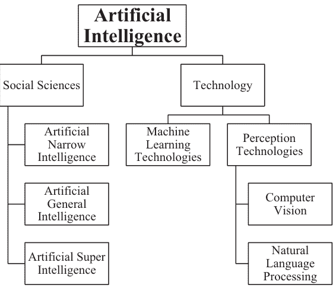

**图 1.1** 人工智能的分类。

人工智能在采用绿色HRM中的作用

通过人工智能重塑流程

以采用绿色HRM实践和功能。同样，聊天机器人、竞争优势、自动化等应用也被组织用于改进HRM功能。下一节将讨论主要的HR功能。

## 1.2.2 绿色人力资源管理

由于环保人士对维持绿色环境的压力不断增大，组织无法避免实施HRM实践（Jabbour, 2013; Pham et al., 2019）。另一个原因是客户意识的提高以及求职者对组织政策的关注（Teveira et al., 2012）。如果不利用人才，组织就无法获得竞争优势，而优秀人才只有通过有效的HR政策才能留住。此外，在少数人发起研究后，HR吸引了学者、研究人员和学术界的兴趣（Jabbour & Santos, 2008; Thom & Rana, 2020; Jackson et al., 2011; Pham et al., 2019; Renwick et al., 2016）。实施HR实践也有助于组织减少碳排放、无纸化方法以及制造单元的浪费（Ahmad, 2015; Yong et al., 2019）。绿色HRM被认为是组织的持续变革（Sawang & Kivits, 2014）。

绿色HRM可以定义为环境管理（EM）相关的HR方面，以及利用组织程序防止环境污染的角色（Renwick et al., 2008; Renwick et al., 2013）。HR实践是组织保护和维持绿色环境的人战略措施组合（Gholami et al., 2016）。绿色HRM实践取决于三个组成部分：培养绿色能力、激励绿色员工和为员工提供绿色机会（Renwick et al., 2013）。这些实践和措施围绕主要的HR功能展开，分为招聘与挑选、培训与开发、绩效管理、薪酬奖励管理以及人才留存。HR功能通过制定环境目标支持组织实施环境措施（Cohen, 2012）。HR还作为伙伴制定基于环境的价值观和战略以实现可持续性。HR功能根据前因实践进一步划分。表1.1将HR功能分为

这些识别出的绿色HRM功能已被研究人员研究，导致2016年以来绿色HRM研究的增加（Cabral & Dhar, 2019; Chaudhary, 2018, 2019a, 2019b; Dumont et al., 2017; Guerci et al., 2016; Jabbour & Renwick, 2018; Pham et al., 2019; Shah, 2019; Srivastava et al., 2020; Yong et al., 2019a; Yuzlira et al., 2017）。这些研究解释了绿色HRM的概念和模型、实施。

### 表格 1.1

基于绿色人力资源管理（GHRM）实践传播的人力资源功能

| 编号 | 人力资源功能 | 研究研究 |
|---|---|---|
| 1 | G实践的前因：培养绿色能力 | • 招聘与选拔<br>• 培训与开发<br>• 职位描述<br>• 绩效管理/考核<br>• 奖酬制度 | Jabbour (2010); Jabbour (2013); Renwick et al. (2013); Pham and Paillé (2019); Ren et al. (2018); Zaid et al. (2018); Chaudhary (2019); Chaudhary (2019a); Roscoe et al. (2019) |
| 2 | 激励绿色员工 | Masri and Jaason (2017); Gupta (2018); Longoni et al. (2018); Aboramadan (2020) |
| 3 | 促进绿色机会 | • 员工参与与赋能<br>• 可持续文化<br>• 工会在环境管理中的工会作用<br>• 组织学习 | Jabbour and Santos (2008); Teixeira et al. (2012); Gholami et al. (2016); Lu (2017); Masri and Jaason (2017); Tang et al. (2018); Gupta (2018); Ren et al. (2018); Chaudhary (2019a); Kim et al. (2019); Fawhini et al. (2020); Aboramadan (2020); Liu et al. (2021); Rubel et al. (2021); Song et al. (2020); Srivastava et al. (2020) |

*来源：改编自 Pham 等人 (2019) 和 Yong 等人 (2019)*

GHRM、采用GHRM的因素以及采用GHRM的结果（在个人和组织层面）。由于本研究的目标是寻找人工智能在采用GHRM中的作用，因此它将重点关注下一节讨论的采用GHRM的因素和结果。

## 1.2.3 采用GHRM的因素

随着客户、利益相关者压力的增大以及环境导向的发展，组织必须通过人力资源管理（HRM）实践中的绿色倡议，减少生产浪费并促进环境可持续性（Guerci et al., 2016; Mohd-Yussof, 2016）。员工的知识资本也显著影响HRM实践（Kong & Thompson, 2009）。基于知识价值理论对112家马来西亚制造企业进行的一项实证研究显示，绿色人力资本和关系资本显著影响了组织实施绿色HRM实践的动力（Yong et al., 2019）。员工的绿色人力资本包括其知识、技能、能力、经验、态度、智慧、创造力以及对绿色环境或绿色创新的承诺（Chen, 2008; Li & Chang, 2010; Chahal & Bakshi, 2014）。拥有此类人力资本的组织发现实施绿色HRM实践非常容易。同样，绿色关系资本是组织与客户、供应商、网络成员和合作伙伴在企业环境管理和绿色创新方面的互动关系结合，这使得他们能够创造财富并获得竞争优势（Chen, 2008）。由于客户、供应商、员工和伙伴是组织的主要利益相关者，他们对实施HRM服务的影响相对较大。

此外，组织可以采用并实施绿色HRM实践。高层管理掌握着启动组织任何变化的决策权，他们必须具有绿色环境的导向，这有助于他们支持绿色HRM实践（Obraid et al., 2020; Sawang & Kivitas, 2014）。通过有效的领导力和员工承诺，高层管理通过采用绿色HRM实践（如绿色招聘与选拔、绿色职位描述、绿色培训与开发、绩效考核、绿色安全健康、员工关系）来改变组织文化（Ahmad, 2015; Chaudhary, 2019; Gholami et al., 2016; Guerci et al., 2016; Jabbour, 2013; Jackson et al., 2021; O’Donohue & Turga, 2016; Renwick et al., 2018; Rana & Sharma, 2019; Srivastava et al., 2020; Zibar & Coon, 2015）。绿色HRM实践有助于组织获得绿色行为态度并培养绿色员工队伍（Aoramadan, 2020; Cabral & Dhar, 2019; Cabral et al., 2020; Chaudhary, 2019; Dumont et al., 2017; Islam et al., 2020; Jackson & Seo, 2010; Kim et al., 2019; Lu, 2017; Misha, 2017; Ojo et al., 2020; Renwick et al., 2013; Rubel et al., 2021）。

绿色招聘与选拔通过HRM实践吸引更多优秀人才加入组织（Chaudhary, 2019; Ahmed, 2015）。西门子、拜耳、曼森和罗孚集团等欧洲公司将环境活动作为其工作的一部分（Wehrmeyer, 1996）。对二十篇文章进行了系统性回顾，确定了通过招聘选拔、中介和调节建立申请人结果与企业可持续性之间关系的建议（Paillé, 2019）。为了将员工转化为绿色队伍，组织将环境绩效与管理系统相结合以防止损害环境（Epstein & Roy, 1997）。公司安装环境标准和绿色信息系统以利用员工组织数据。他们还启动绿色培训，教育员工管理环境、减少浪费、节约能源并提供保护的机会（Zoogah, 2011）。之前的研究表明，实施绿色员工HRM政策是重要的（Aoramadan, 2020; Islam et al., 2020; Liu et al., 2020; Ojo et al., 2020; Rubel et al., 2021）。


**图1.2** 采用绿色实践的因素

来源：来自 Yong 等人 (2019a)

## 通过AI重塑流程

图1.2显示了组织必须采用HRM实践的各种因素。一项绿色HR调查显示，超过54%的公司在其组织活动中融入了绿色管理实践，74%利用数字创新进行远程会议，76%的组织实现了无纸化文档，60%采取了员工健康计划，80%使用人工智能执行其活动（Aggarwal & Sharma, 2015）。通过智能和人工智能软件，组织采用和实施HRM服务变得简单（Garg et al., 2018）。例如，百事已实施AI来面试和选择空缺位的候选人。该软件自动从各种招聘门户扫描简历（CV），并选择简介匹配的候选人，减少了面试官跨国面试的工作。信息服务实施了新的ERP系统和智能电表，将其能源消耗减少了85%。汉莎航空、凯悦酒店集团、诺基亚、Gensol Consultants和id8 Media Solutions等也采用了AI技术实施GHRM实践以采用绿色健康的环境。下一节将讨论AI在采用GHRM实践中的作用。

## 1.3 AI在采用GHRM实践中的作用

组织——无论是在发展中体还是发达体——已经采用了现代技术来改进其运营和流程。例如，使用大数据分析分析招聘、销售和生产的趋势和模式对于组织来说已变得常见，但实施AI以采用GHRM实践仍处于处于阶段。凭借其智能和以解决方案为目标的技术，AI已成为获得可持续竞争优势的关键；然而，它仍然限于少数公司。这种不愿的原因之一是人才无法管理此类应用程序，另一个是担心机器取代人工导致失去工作。相反，AI提高了工作效率并减少了人力投入，这可以用于实现绿色实践。最近，一家印度IT公司开发了一个名为“AskDester”的应用程序，通过处理解决员工关于假期和公司政策的查询等HR功能管理22,000名员工（Garg et al., 2018）。它还提供即将的工作机会和空缺的信息。AI有助于执行各种HR功能。图1.3解释了AI在GHRM实践中的作用。

图1.3解释了AI如何通过提供选择支持组织培养员工的绿色能力，这些选择有助于招聘选拔、培训与开发以及根据职位描述识别候选人。AI应用程序筛选求职者的简历并选择符合组织要求的最佳人选。通过自动化和数字化技术，AI应用程序已将招聘人员的工作减少了60%（Stahl, 2021）。未来，AI将通过HR帮助台应用程序减少80%的招聘人员工作。

# AI 在采用绿色人力资源管理（Green HRM）中的作用

| 培养绿色能力 | 招聘与筛选 | 培训与开发 | 职位描述 |
| :--- | :--- | :--- | :--- |
| 人工智能 | 激励绿色员工 | 绩效管理/考核 | 奖励与薪酬体系 |
| 促进绿色机会 | 支持性的参与与赋能 | 支持性的氛围/文化 | 工会在环境人力资源管理中的作用 |

**图 1.3** AI 在采用 GHRM 实践中的作用。

招聘人员可以使用 Zoom 和 Microsoft Teams 等门户进行面试。公司还使用 AI 应用（如 Google Classroom 或 Google Meet 平台）对员工进行在线培训。

AI 应用还通过绩效软件和数据分析帮助激励员工践行绿色。公司按每日、季度和每年为单位访问员工绩效，并为其提供反馈以进行自评并帮助他们克服缺点。这种反馈有助于员工识别如何减少浪费、可以遵循哪些实践来保持健康的生活，以及如何关注维护绿色环境的创造性解决方案。公司使用 AI 应用监控员工活动，并对遵循绿色实践的员工给予奖励。组织发现，由于绿色绩效管理涉及多个部门和员工单位，满足相关标准具有挑战性。公司正试图理解这些问题，并通过启动绿色信息系统来管理绿色绩效管理标准，从而升级其考核体系。

各种 AI 应用（如聊天机器人）帮助员工解决有关请假和组织系统的查询，这为顾问和导师节省了大量时间，使他们能够投入其他生产性活动。这些应用不仅对员工友好，也有改善雇佣关系、解决不满情绪以及发展绿色企业文化。公司使用智能 AI 应用管理制造流程、仓库管理和供应链管理等运营，这些应用有助于减少浪费和节约资源。通过 AI 应用和技术，错误率降低，公司可以轻松地采用 GHRM 实践。

GHRM 服务正在进行通过 AI 实现的自动化，这如图 1.4 所示的 AMO（能力、动机、机会）框架所描述。

## 通过 AI 重塑流程

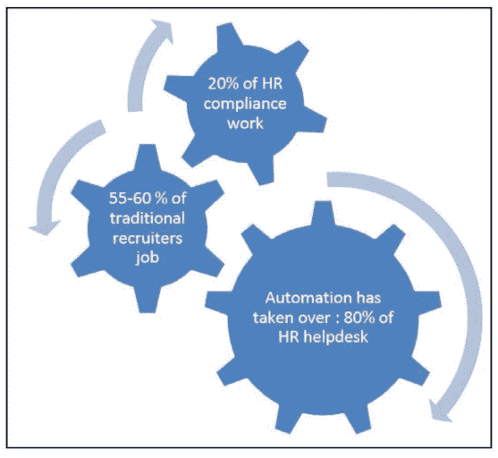

**图 1.4** 人力资源管理中的 AMO（能力、动机、机会）框架。

来源：Garg 等 (2018)

### 表 1.2

采用 GHRM 实践的技术

| 编号 | 技术 | 公司 | 成果 |
| :--- | :--- | :--- | :--- |
| 1 | Trackerapp | Pegasystems | 该应用旨在帮助组织跟踪员工中 COVID-19 的传播情况。 |
| 2 | 虚拟培训 | Samsung | 通过 Team Samsung Online 门户为 Z 世代的新招员工提供虚拟或电子实习。通过 JIM，人才招聘专家评估候选人简历仅需 8 分钟，而通常则需要 30 分钟。 |
| 3 | Jobs Intelligence Maestro | DBS | 以仅 5 天的记录时间发布了首个全自动理赔结算系统，在 2020 年 4-5 月为成员造成了高达 11,540 卢比的成本。 |
| 4 | 自动化 | EPFO | Distance Assistant 是一种由机器学习（ML）和增强现实（AR）驱动的新技术，它利用深度传感器为工人提供视觉提示，以保持彼此的安全距离。 |
| 5 | Distance Assistant | Amazon | 推出此应用是为了确保员工重返办公室时其健康得到保护。 |
| 6 | LTI Safe Radius | LTI (Larsen & Turbo Infotech) | *部分*用户报告对对其查询的回复表示满意。* |
| 7 | 聊天机器人 Nina | Sun Life ASC India | 该聊天机器人回答员工的查询，约 74% 的用户报告对对其查询的回复表示满意。* |
| 8 | 数字 HRM 系统 | Telangana State Police | 自动化 HRMS 将高效管理所有方面，包括招聘、员工数据（服务登记）、考勤与缺假、绩效与奖励、培训与开发、行政、用户分析和员工投诉。 |
| 9 | E-Pass 系统 | Indian Western Railway | 为印度铁路员工提供的特权。 Matrimony | 该应用创建 talent cloud 以选择并使用实时数据提高员工生产力。 |
| 10 | Creating talent cloud | Microsoft | 这允许人才管理 (TXM) 让 Teams 聚集在一起，为许多小型和大型企业提供沟通支持。 |
| 11 | Talent acquisition | Indian Railways | 该系统将提高生产力并确保员工满意度。 |
| 12 | HRMS | Indian Railways | VIVA 的推出是为了在沟通、学习、资源以及咨询和建议服务方面提供更好的员工体验。 |
| 13 | HR Tools | Microsoft | 公司使用数据挖掘来选择和保留人才。员工有能力执行环境要求；可以维护环境并产生创造性解决方案。公司使用 AI 工具进行学习和开发。表 1.2 所示，还有其他用于采用 GHRM 实践的 AI 技术。 |

## 1.4 结论


在这种动态情况下，当公司将重点从利润转向竞争优势时，保护环境也成为他们的责任。这将使其成为求职者的首选品牌，并能够吸引和留人才。因此，组织采取措施实施绿色 HRM 政策。在吸引和保留人才的同时，公司还必须关注员工，因为任何随机变化都会在员工中产生阻力（Gupta & Haque, 2015）。AI 通过各种应用程序和智能技术帮助组织采用 GHRM 服务，简化工作并提高生产力。由于多元化的劳动力包括婴儿潮（1946-1960）、X 代（1961-1980）、Y 代（1981-2000）和 Z 代（1995-2012）（Naim & Lenka, 2017），Y 代具有成就导向并受增长需求驱动；因此他们采用 GHRM 实践的动力不同（Wong et al., 2008）。Y 代期望因适应 GHRM 实践获得奖励（Jain & Lenka, 2018）。相反，Z 代精通技术、被赋能且更现实；因此他们会被技术驱动的工具所激励（Singh, 2014; Sharma et al., 2021）。对于多元化的劳动力，组织必须使用 AI 工具和技术采用 GHRM 实践。之前的研究指出，培训、招聘和奖励是实施 GHRM 实践的重要因素（Nobari et al., 2018）。因此，AI 工具和技术可用于这些过程，激励员工自愿参与绿色活动。采用绿色 HRM 对环境绩效和组织可持续性有益（Obeid et al., 2020）。

本研究揭示了 AI 技术和应用在采用绿色 HRM 管理中的作用。详细而言，研究有助于识别相关的 AI 应用。之前的研究还建议，为了有效实施 e-HRM 实践，应考虑 AI、大数据分析和 HR 分析（Pobau et al., 2020; Prakash et al., 2021）。然而，本研究基于文献综述，可以通过案例研究和实证工作进一步探索。未来的研究可以识别 AI 在采用 GHRM 实践中的作用，并可以通过概念性或实证工作进行研究。未来的研究还可以识别个人、小组/团队和组织层面影响员工自愿追求 GHRM 实践的动力。未来的研究还可以考虑 GHRM 实践与绿色创新作为通向可持续性一步之间的关系。

- Abaramadan, M. (2020). The effect of green HRM on employee green behaviors in education: The mediating mechanism of green work engagement. International Journal of Organizational Analysis. https://doi.org/10.1108/IOJA-05-2020-2190
- Aggrawal, S., & Sharma, B. (2015). Green HRM: Need of the hour. International Journal of Management and Social Science Research, 1(8), 63–70.
- Ahmad, S. (2015). Green human resource management: Policies and practices. Cogent Business & Management, 2(1), 103817. https://doi.org/10.1080/23311975.2015.103017
- Ahmed, A. M., & Adam, R. F. (2009). Green management matters regardless. Academy of Management Practices, 23(3), 17–26.
- Bostrom, N. (2014). Superintelligence: Paths, dangers, strategies. Oxford: Oxford University Press.
- Bansal, A. (2017). Review of preparing for the future of artificial intelligence. AI and Society, 32(2), 285–287. https://doi.org/10.1007/s40646-016-0685-0
- Cabral, C., & Dhar, R. L. (2019). Green competencies: Construct development and measurement validation. Journal of Cleaner Production, 235, 887–900.
- Cabral, C., & Dhar, R. L. (2020). Green competencies: Insights and recommendations from a systematic literature review. Benchmarking: An International Journal, 28(1), 66–105.

# AI 在采纳人力资源管理中的作用

Chahal, H., & Bakshi, P. (2014). 知识资本对竞争优势和业务绩效的影响：创新与学习文化的作用。《International Journal of Learning and Intellectual Capital*, 11(1), 52–70。
Chan, E. S., Hon, A. H., Chan, W., & Okumus, F. (2014). 是什么驱动了员工在酒店实施绿色实践的意愿？知识、意识、关注和环境行为的作用。《International Journal of Hospitality Management*, 40, 20–28。
Chan, F. T., & Chan, H. K. (2004). 使用 F 调度的模拟研究的全面综述与未来趋势。《Journal of Intelligent Management*, 15(1), 87–102。
Chaudhary, R. (2018). 绿色人力资源管理能吸引人才吗？一项实证分析。
Chaudhary, R. (2019a). 绿色人力资源管理与工作追求意愿：考察内在过程。《Corporate Social Responsibility and Environmental Management*, 26(4), 929–937。
Chaudhary, R. (2019b). 绿色人力资源管理与员工绿色行为：一项实证分析。《Corporate Social Responsibility and Environmental Management》。https://doi.org/10.1002/csre.187
Chen, Y. S. (2008). 绿色创新和绿色形象的驱动因素：绿色核心竞争力。《Journal of Business Ethics*, 8(3), 531–543。
Cohen, D. J. (2012). 识别 HR 认证的价值：需要澄清更复杂的模型。《Human Resource Management Review*, 22(4), 258–265。
Dumont, J., Shen, J., & Deng, X. (2017). 绿色 HRM 实践对员工工作行为的影响：心理绿色气候和员工价值观的作用。《Human resource management*, 56, 61–63。
Fehweini, O., Yuzila, M. Y., Mohammad, Z., Feazeh, J. N., & Muhammad, Z. (2020). 使用 ISO 14000 改进组织学习和环境管理。《Environmental Quality Management*, 7, 21–30。
评估学术人员的行为：绿色人力资源管理和环境知识的作用。《International Journal of Manpower*, 47(7), 879–900。
Florida, R., & Davison, D. (2001). 从绿色管理中获益：因素内外的环境管理系统。《California Human Resource Management*, 43(3), 64–84。
Forman, M., & Jorgensen, M. S. G. (2001). 绿色企业内部员工参与的社会塑造——来自丹麦背景的经验。《Technology Analysis & Strategic Management*, 13(1), 71–90。
Garg, V., Srivastava, S., & Gupta, A. (2018). 人工智能在维持绿色人力资源管理中的应用。2018年自动化与计算工程国际会议 (ICACE), 113–116。IEEE, India。
Gholami, H., Rezaei, G., Zaman, M. Z., Sharif, S., & Zakuan, N. (2016). 尖端绿色 HRM 系统：利用多方法研究马来西亚体育中心可持续性及未来研究机会。《Journal of Cleaner Production*, 124, 142–163。
Guerci, M., Longoni, A., & Luzzini, D. (2016). 将利益相关者压力转化为环境绩效：绿色 HRM 实践的中介作用。《The International Journal of Human Resource Management*, 27, 262–289。
Gupta, H. (2018). 基于 BWM 和 Fuzzy TOPSIS 评估 GHRM 实践的组织绩效。《Journal of Environmental Management*, 226, 201–216。
Gupta, M., & Haque, M. M. (2015). 人才留存：组织的关注关注点Proceedings of IERICS, 2015, IT Roorkee, Greater Noida, India。
Gupta, M., & Lenka, U. (2018). 雇主品牌：使用社交媒体的人才留存策略。《University of Mass Communication*, 21。
Hilker, E. (1986). 人工智能：当前信息来源回顾。Collection。
Islam, M. A., Jantan, A. H., Yusso, Y. M., Chong, C. W., & Hossain, M. S. (2020), 绿色人力资源管理 (GHRM) 实践与旅游业市场千禧员工的离职紧张：工作环境的调节作用。《Global Business Review*, 122(1), 1–21.https://doi.org/10.1177/007215029020700
Cabar, J. C. (2013). 组织中的环境培训：从文献综述到未来研究框架。《Conservation and Recycling*, 74, 144–155。
Cabar, J. C., & Renwick, D. W. (2018). 环境可持续组织的软性面。《RAUSP Management Journal*, 53(4), 622–627。
Cabar, J. C., & Santos, F. C. (2008). 人力资源与环境管理的关系：模型建议。《Journal of Cleaner Production*, 16(1), 51–58。
Cabar, J. C., Santos, F. C., & Nagano, M. S. (2010). 通过三角测量法对巴西公司的 HRM 贡献。《The International Journal of Human Resource Management*, 21, 1049–89。
Jackson, S. E., & Seo, J. (2016). 战略性 HRM 设计。《Management Journal*, 74(4), 278–290。
Jackson, S. E., Renwick, D. W., Jabbour, J. C., & Müller, M. (2011). 绿色人力资源管理的现状与未来方向：特刊。《Journal of Resource Management*, 25(2), 99–116。
Jain, N., & Dilma. (2016). 绿色 HRM：对未来客户的研究。《International Journal of Business Science*, 15(2), 199–208。
Kahraman, C., Kaya, I., & Cevikan, E. (2011). 企业管理中的智能决策系统。《Journal of Enterprise Management*, 24(4), 360–379。
Kim, Y., Kim, W., Choi, H., & Petharov, K. (2019). 绿色人力资源管理对员工环保行为的影响。《International Journal of Hospitality Management*, 76, 83–93。
Kitazawa, S., & Sarkis, J. (2000). ISO 14001 与持续减少计划的关系。《International Journal of Operations Management*, 20, 225–248。
Kong, E., & Thomson, S. (2009). 全球南方的人力资源战略能力。《Knowledge Management & Practice*, 7(4), 356–364。
Khetri, N. (2021). 人力资源管理中使用人工智能。《Research Review》。https://doi.org/10.1108/MRR-03-2020-0168
Lauter, A. (2019). 人工智能与政策。《Digital Policy and Governance*, 2(1), 238–263。
Lawler, J. J., & Elliot, R. (1996). HRM 中的人工智能：客户生命价值的实验研究。《Management*, 22(1), 85–111。
Li, Q., & Chang, C. (2020). 绿色人力资源管理，环境公民行为。《African Journal of Business Management*, 4(5), 702–709。
Liu, Z., Mei, S., & Guo, Y. (2020). 绿色人力资源管理身份：环境价值观的调节作用。《Chinese Management Studies》。https://doi.org/10.1108/CMS-10-2019-0366

# AI 在采纳人力资源管理中的作用

Longoni, A., Luzzini, D., & Guerci, M. (2018). 跨部门的环境管理：绿色人力资源管理与绿色供应链管理的关系。《Journal of Business Ethics*, 151(4), 1081–1095。
Luu, T. T. (2017). 酒店业的企业社会责任与环境承诺。《International Journal of Contemporary Hospitality Management*, 29(11), 2867–2900。
Luu, T. T. (2018). 员工的绿色恢复绩效：绿色 HR 实践与服务文化。《Journal of Sustainable Tourism*, 26(8), 1308–1324。
Ma, V., & Lažanski, J. (2007). 代理技术的工业应用。《Control Engineering & Practice*, 15(11), 1364–1380。
Masri, H. A., & Jaaron, A. A. (2017). 巴勒斯坦背景下的绿色人力资源管理实践评估：一项实证研究。《Journal of Cleaner Production*, 143, 474–489。
McCarthy, J. (2019). 人工智能、逻辑与形式化意义。在 R. Thomason (编)，哲学逻辑与人工智能 (pp. 161–190)。Dordrecht: Springer。来自 www-stanford.edu/jmc/ailogic.html。
Milliman, J., & Clair, J. (1996). 绿色人才：人力资源与环境管理 (pp. 49–77)。Sheffield, UK: leaf Publishing。
Misha, P. (2017). 绿色人力资源管理。《International Journal of Organizational Analysis*, 25(5), 762–788。
Mukherjee, B., & Chandra, B. (2018). 预测员工绿色意图和行为的绿色人力资源管理概念化：概念框架。《Prabandhan: International Journal of Management*, 17(1), 36–48。
Naim, M. F., & Lenka, A. (2017). 连接共享、能力开发与情感承诺：来自印度 Y 世代员工的证据。《Journal of Knowledge Management*, 21(4), 885–906。
Nilson, N. J. (1980). 人工智能原理。Palo Alto: Tioga Publishing。
Nobari, A., Seyjadavin, S., Rahnamoodhti, T., & Rahoodhti, F. (2018). 环境关注与绿色人力资源管理：元分析。《International Journal of Plant Physiology*, 8(4), 2573–2576。
Obidat, S., Bakri, A., & Elbanna, S. (2020). 利用“绿色”人力资源实践实现环境组织绩效：来自卡塔尔油气行业的证据。《Journal of Business Ethics*, 164(2), 371–388。


ODonue, W., & Torr, N. (2016). 绿色 HRM 在主动环境管理与财务绩效关联中的调节作用。《The International Journal of Human Resource Management*, 27(2), 239–261。

Ojo, A. O., Tan, C. N., & Alias, M. (2020). 绿色 HRM 实践与信息技术部门环保行为的联系。《Social Responsibility Journal》。https://doi.org/10.1108/SRJ-12-2019-0403

Pham, D. D. T., & Paillé, P. (2019). 绿色招聘与选拔：绿色模式的洞察。《International Journal of Manpower*, 41(3), 258–272。

Pham, N. T., Hoang, H. T., & Phan, Q. P. T. (2019). 绿色人力资源管理：全面综述与未来研究议程。《International Journal of Manpower*, 41(7), 845–878。

Phillips, L. (2007). 绿色以赢得竞争优势。《People Management*, 23(9), 1–9。

Pinzone, M., Guerci, M., Lettieri, E., & Redman, T. (2016). 医疗保健领域向可持续性变化的进展：绿色 HRM的作用。《Journal of Cleaner Production*, 122, 201–211。

## 16 通过 AI 重新构建流程

Poba-Nzaou, P., Uwizeyemunungu, S., & Laber, M. (2020). 电子人力资源管理采纳修改背后的业务价值分类。Business Process Management Journal, 26(6), 161–1685.

Prakash, C., Saini, R., & Sharma, R. (2021). 物联网 (IoT) 在维持颠覆性业务中的作用。In Sharma, R., Saini, R., Prakash, C., & V. Prashad (Eds.), 1st ed.). New York: Nova Science Publishers.

Rana, G., & Sharma, R. (2017). 组织文化作为人力资本创造力有效性的调节变量。Global HR Review, 75), 31–37.

Rana, G., & Sharma, R. (2019). 雇主品牌对工作投入的影响评估：银行业研究。Emerging Economy Journal, 5(1), 1–15.

Ren, S., Tang, G., & Jackson, S. E. (2018). 新兴中的绿色人力资源管理研究：回顾与未来方向。Pacific Journal of Management, 35(3), 769–803.

Renwick, D. W., Jabbour, C. J., Muller-Cam, M., Redman, T., & Wilkinson, A. (2016). 绿色（环境） HRM 学说的当代发展。International Journal of Human Resource Management, 27(2), 114–128.

Renwick, D. W., Redman, T., & Maguire, S. (2013). 绿色人力资源管理：回顾与研究议程。International Journal of Management Reviews, 15(1), 1–14.

Renwick, D. W., Redman, T., & Maguire, S. (2008). 绿色 HRM：回顾、过程模型与研究议程。University of Sheffield Management School Discussion Paper, 1–46.

Roscoe, S., Subramian, N., Jabbour, C. J., & Chong, T. (2019). 绿色人力资源管理与绿色组织文化的赋能：增强企业环境性能以可持续发展。Business Strategy and the Environment, 28(5), 737–749.

Rubel, M. R. Bee, D. M. H., & Mini, N. (2021). 绿色 HRM 实践对绿色服务的影响：绿色知识共享的中介效应。Employee Relations: The International Journal, https://doi.org/10.1108/ER-04-2020-0163.

Sawaw, S., & Kivits, R. A. (2014). 绿色职场：通过计划行为理论理解高级经理的采纳决策。Australasian Journal of Environmental Management, 27(1), 22–36.

Sekhi, A., & Cheema, D. J. (2019). HRM 的新时代：AI 重新构建 HRM 功能。International Journal of Scientific Research and Review, 7(3), 3073–3077.

Shah, M. (2019). 绿色人力资源管理：价值衡量量表的开发。Business Strategy and the Environment, 28(5), 771–785.

Sharma, R., Rana, G. (2021). 通过技术整合进入 4.0，使人才管理实践焕活力。In Sharma, R., Saini, C., & Prashad (Eds.), 物联网 (IoT) 在维持颠覆性业务中的作用 (1st ed.). New York: Nova Science Publishers.

Sharma, R., Rana, G., & Agarwal, S. (2022). 工业 4.0 中雇主品牌的技术创新工具。In G. S. Agarwal, & R. Sharma (Ed.), 为竞争优势建立的雇主品牌 (1st ed.). Boca Raton, FL: CRC Press. https://doi.org/10.4324/9780100327286-11

Singh, A. (2014). Z 世代的挑战与问题。IOSR Journal of Business and Management, 16(7), 59–63.

Siyambalitiya, J., Zhang, X., & Liu, Y. (2018). 绿色人力资源管理：斯里兰卡旅游业背景下的建议模型。Journal of Cleaner Production, 201, 542–555。

## AI 在采用 HRM 中的作用

Song, Yu, H., & Xu, H. (2020). 绿色资源管理和环境关注对绿色创新的影响。European Journal of Innovation.

Srivastava, A. P., Mani, V., Yadav, M., & Joshi, Y. (2020). 高等教育可持续性的真实领导力——一个整合模型。International Journal of Manpower, 41(7), 901–923.

Stahl, A. (2021). AI 如何影响未来工作。获取自 https://www.facebook.com/sites/astahl/2021/03/how-ai-will-impact-the-future-of-work-db8ac93

Strohme, S., & Piazza, F. (2015). 人力资源管理中的人工智能技术——概念性探索。In Intelligent techniques in engineering management (pp. 149–172). Cham: Springer.

Tang, G., Yu, J., Paille, F., & Chen, Y. (2017). 高性能工作实践。Asia Pacific Journal of Human Resources, 56(1), 31–55.

Tang, G., Yu, C. (2020). 绿色人力资源管理：一项性研究。

Teixeira, A., Jabbour, C. J., & De Sousa Junior, A. (2012). 巴西公司绿色资源管理与环境培训之间的关系。International Journal of Production Economics, 140(1), 318–329.

Gomer, T., & Rana, G. (2020). 绿色人力资源管理：一项研究。In Shivani Agarwal, Darrell Burrell, & Vikender Solanki (Eds.), Annals of the Computer Science and Information Systems Volume 24. Proceedings of the International Conference on Research & Management (pp. 99–114). Adsh Vidya Mandir’s College, Nagpur, MH.

Voss, P. (2007). 通用智能精要：人工智能的之路。In Goer, C. & Pennacchi, C. (Eds.). Cognitive technologies (pp. 131–157). Berlin: Heidelberg.

Wee, Y. S., & Chaay, H. (2005). 环境管理的开发与验证。Industrial management and data systems, 105, 96–114.

Wehrmeyer, M. D. (1996). 绿色：人力资源与环境管理。Sheffield, UK: Green Publishing.

Work, M., Gardiner, E., Lang, W., & Colson, L. (2008). 性格与动机的代差异：是否存在？对职场有什么影响？Journal of Management Psychology, 23(8), 878–890.

Jong, Y. Y., & Mohd-Yوسف, Y. (2016). 战略人力资源对绿色人力资源管理实践的影响。Industrial and Commercial Training, 48(4), 416–426.

Jong, J. Y., Ysliza, M. Y., & Fawehemi, O. O. (2019). 绿色人力资源管理：2007年至2019年的系统文献回顾。Benchmarking: An International Journal, 27(7), 2005–2027.

Jong, Y. Y., Ysliza, M. Y., Jabbour, C. J., & Ahmad, N. H. (2019b). 基于能力-动机-机会理论的绿色人力资源管理与先进制造之间相互作用的探索性案例。Journal of Management Development, 39(1), 31–49.

Ysliza, M. Y., Othman, N. Z., & Jabbour, C. J. (2017). 新兴经济体中绿色人力资源管理的实施。Journal of Management Development, 36(10), 1230–1246.

Zaid, A. A., Jaaron, A. A., & Bon, A. T. (2018). 绿色人力资源管理和绿色供应链管理实践对可持续绩效的影响：实证研究。Journal of Cleaner Production, 204, 965–979.

Zibarras, L. D., & Coan, P. (2015). 用于促进环保行为的 HRM 实践：英国调查。The International Journal of Human Resource Management, 26(16), 2121–2142.

Zoogah, D. B. (2011). 绿色 HRM 行为的动态性：认知信息处理方法。German Journal of Human Resource Management, 25(2), 117–139。

# 人工智能在区块链应用中的作用

Haru Hong Khanh and Alex Khang PH

## 2.1 引言
20

## 2.2 人工智能
20

### 2.2.1 理论分类下的 AI 系统
20

#### 2.2.1.1 反应式 AI 机器
20

#### 2.2.1.2 记忆记忆 AI 机器
21

#### 2.2.1.3 心理理论 AI 机器
21

#### 2.2.1.4 自意识 AI 机器
21

### 2.2.2 人工智能的类型
21

#### 2.2.2.1 弱人工智能
21

#### 2.2.2.2 通用人工智能
22

#### 2.2.2.3 超人工智能
22

#### 2.2.2.4 混合人工智能
23

### 2.2.3 行业中的 AI 系统
24

## 2.3 区块链技术概述
24

### 2.3.1 区块链的代代划分
24

### 2.3.2 区块链架构与层级
25

#### 2.3.2.1 区块链架构
25

#### 2.3.2.2 区块链层级
29

### 2.3.3 区块链的类型
31

#### 2.3.3.1 公有区块链
31

#### 2.3.3.2 私有区块链
32

#### 2.3.3.3 联盟链区块链
33

#### 2.3.3.4 区块链总结
33

## 2.4 AI 在区块链应用中的作用
34

### 2.4.1 数据流程图
34

### 2.4.2 AI 在区块链应用中的作用
34

#### 2.4.2.1 智能合约中的 AI
34

#### 2.4.2.2 数据集中的 AI
34

#### 2.4.2.3 数据保护中的 AI
34

#### 2.4.2.4 数据加密机制中的 AI
36

#### 2.4.2.5 基于区块链的身份识别中的 AI
36

#### 2.4.2.6 身份验证与授权功能中的 AI
36

#### 2.4.2.7 搜索引擎中的 AI
36

#### 2.4.2.8 决策中的 AI
36

#### 2.4.2.9 数据变现中的 AI
37

## 2.5 AI 与区块链的未来
37

20 通过 AI 重塑流程


2.6 结论................37

参考文献................38

## 2.1 引言

人工智能（Artificial Intelligence AI）并非新事物；它是计算机科学领域中一个拥有五十多年历史分支，涵盖了机器学习（ML）和深度学习（DL）等其他相关领域。自从 AI 术语在 20 世纪 50 年代中期在人类生活中流行起来（Anyoha, 2017）以来，人类已开始生活在一个充着大数据、数据转换、物联网（IoT）、加密货币、区块链等技术相关概念的时代——在这个时代，我们有能力开发机器和工具来帮助人们处理日常活动。

如今，尽管 AI 作为一种新兴或处于中期的技术呈现混合模式，但其在人类生活中众多领域的潜力和应用正在不断增长。通过机器学习和神经网络等技术，全球科技公司正在投入开发能够像人类一样思考和行为的机器。

AI 应用已成功应用于制造、技术、医疗、物流、银行、营销、娱乐和教育等许多行业。我们可以继续使用基于 AI 的系统的功能来复制或模拟人类智能，执行需要人类智能的任务，如规划、学习、推理、解决问题和决策。

目前，研究人员和公司已经开发了许多基于 AI 的解决方案和应用程序。然而，在资源限制的 AI 和物联网生态系统中，这些解决方案的广泛采用是一个问题。

在本章中将讨论将将基于 AI 的解决方案集成到区块链解决方案中，并介绍了在不同区块链领域实施 AI 的局限性和挑战。

## 2.2 人工智能

### 2.2.1 理论分类中的 AI 系统

基于 AI 的系统被分为四类机器：反应式 AI 机器、有限记忆 AI 机器、心灵理论 AI 机器和自我意识 AI 机器。

#### 2.2.1.1 反应式 AI 机器

反应式 AI 机器是 AI 系统最早的形式，它们形成记忆或利用过去经验来指导当前决策的能力极其有限。反应式 AI 机器不具备基于记忆的功能。

#### 2.2.1.2 有限记忆 AI 机器

有限记忆 AI 机器是指可以通过历史数据来做出决策的机器。今天，大多数聊天机器人和自动驾驶车辆虚拟助手都是由有限记忆 AI 开发和驱动的。

#### 2.2.1.3 心灵理论 AI 机器

心灵理论 AI 机器是指像现实世界中的人类和其他生物一样，能够产生直接影响其行为的思想和情感的机器。这些基于 AI 的系统的关键特征是通过交互需求、思想、情感、信念和感受来理解这些组件的能力。

#### 2.2.1.4 自我意识 AI 机器

下一代 AI 开发是具有类人系统的自我意识 AI 机器，这种机器不仅能够在交互中演化并理解行为，还拥有自己的欲望、需求、信念和期望。

### 2.2.2 人工智能的类型

今天，AI 科学行业最流行的分类是将技术分为人工狭智能（ANI）、人工通用（AGI）和人工超智能（ASI），如图 2.1 所示。

基于理论背景和科学研究，图 2.1 展示了人工智能的类型。

然而，在特殊行业中，一种 AI 模型是将 AGI、ANI 和 ASI 结合成一个基于 AI 的系统，称为混合人工智能（HAI）。

#### 2.2.2.1 人工狭智能

ANI，又所谓的弱 AI 或狭义 AI，是人类目前成功应用的唯一基于 AI 的系统。它面向并设计用于使用类人类的能力执行单一的自主任务。

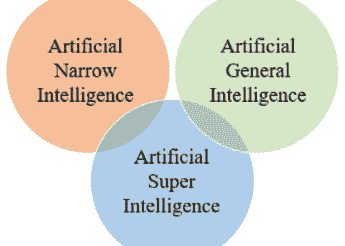

图 2.1 三种 AI。

基本上，ANI 无法做超出其程序设定范围的任何事情，因此其能力范围非常有限或狭窄，例如列表所示的互联网搜索、人脸识别、语音识别、语音助手、广告识别或自动驾驶汽车等。

##### 虚拟助手

- Google 谷歌搜索
- Apple 的 Siri
- Amazon 的 Alexa
- Microsoft 的 Cortana

##### 软件与机器人

- 图像识别软件
- 人脸识别软件
- 疾病映射软件
- 预测软件
- 制造机器人
- 无人机
- 工业机器人
- 自动驾驶汽车

换句话说，ANI 影响了劳动力表现，我们对使用 ANI 的预期结果是一个类人机器。*

#### 2.2.2.2 人工通用智能

AGI 被称为“强 AI”或“深度 AI”；它是一种基于 AI 的机器系统，这种机器能够思考、理解、区分、模仿、并并行动并在任何情况下像人类一样解决任何问题。

AGI 基于之前提到的心灵理论，该理论是指识别智能实体的感觉、情感、信念、需求、思想和欲望的能力。今天，很容易在训练机器理解人类思考和推测方面找到 AGI 框架。

AGI 一直影响着人类行为，我们对使用 AGI 的预期结果是一个类人的大脑。

#### 2.2.2.3 人工超智能

ASI 标志着 AI 开发的巅峰，它是迄今为止最智能的存在，AI 技术不仅已开始应用于许多行业，而且重塑了目前的许多服务和生产模式，并在未来十年改变业务。

ASI 影响着人类行为，我们对使用 ASI 的预期结果是一个社交类人大脑。

#### 2.2.2.4 混合人工智能

HAI 的设计和程序是为了完成多种任务，从 Siri 助手到自动驾驶汽车和自动武器等各种系统。

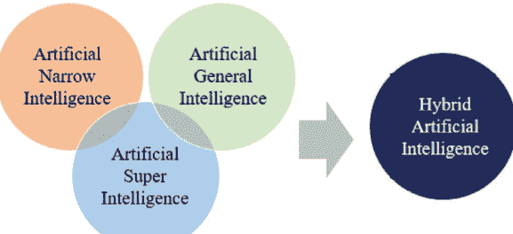

图 2.2 混合 AI 模型。

未来，没有人能确定 ASI 或 HAI 不会是人类最后的发明。事实上，AI 领域已经变得比单纯追求类人智能广泛得多。因此，一些 AI 科学家计划开发新版本的 AI 或将各种类型合并为一个模型，如图 2.2 所示。图 2.2 展示了将流行的 AI 模型集成到现实世界解决方案中的混合人工智能模型。

### 2.2.3 工业中的 AI 系统

在工业的大多数情况下，AI 主要通过 IoT 设备处理业务交易并到达每个节点或云端，从那里可以远程访问数据。最流行的 AI 应用如下：

- 制造业
- 智慧城市行业
- 智慧农业行业
- 医疗保健行业
- 武器行业
- 通信行业
- 教育行业
- 石油与天然气行业
- 电力行业
- 零售业
- 供应链行业

智慧城市系统等大型系统中 IoT、eIoT（能源物联网）、ioT（工业物联网）和 AIoT（物联网）设备的移动性和密度可能会导致网络复杂性增加并性能下降。

尽管实施和操作非常复杂，但基于 AI 的技术在重工业、智慧城市、电信和军事网络的运营中获得了巨大的关注。

# 通过 AI 重塑流程

## 2.3 区块链技术概述

区块链技术于 2008 年发布，由在线货币比特币背后的匿名人物创建，其化名为中本聪（Satoshi Nakamoto）（维基百科基金会，2010年），这是一个广为人知的日本名字。

今天，正如一位科学家所预测的那样，区块链不仅是一种数字货币，还有潜力成为企业和政府全球记录系统的数据枢纽。

区块链的概念是一种去中心化且分布式账本技术（DLT），用于记录交易和监控数字资产。区块链的官方定义是带有智能合约的分布式账本的两个重要组成部分。

- 账本用于记录捕获一组业务对象所有更改的交易。在分布式账本系统中，组织之间相互协作，在一个被称为“共识”或“达成一致交易”的过程中维护复制账本的一致副本。
- 智能合约是由查询账本并生成记录在其中的新交易的规则和条件定义的。智能合约描述了存储在账本上的一个或多个业务对象的生命周期，并带有创建、更新和查询活动的时间和作者。

在系统架构中，区块链是一种特定的数据库。为了理解区块链，必须首先理解数据库到底是什么。

### 2.3.1 区块链的代际

如果你一直在研究、阅读和关注银行、金融、投资和加密货币新闻，你就听过区块链这一术语，它是使用数字货币网络背后记录技术的技术。

区块链技术仍然是一项重要发展，但将区块链的历史至少分为四个重要代，如表 2.1 所示。

### 表 2.1

### 区块链的代际

| 代际 | 年份 | 描述 | 用例 |
| :--- | :--- | :--- | :--- |
| 第一代 | 1991–2008 | 基于工作证明币的价值存储和传输 | 比特币 (Bitcoin) |
| 第二代 | 2008–2014 | 基于代币的区块链 2.0 | 瑞波 (Ripple) |
| 第三代 | 2014–2015 | 基于权益证明、离链路由、图链或中心化权威的加密货币 | 以太坊区块链 (Ethereum) |
| 第四代 | 2015 年以后 | 高可扩展性 | 关系型区块链 |

# AI 在区块链应用中的作用

## 2.3.2 区块链架构与层

### 2.3.2.1 区块链架构

区块链架构由五个元素组成：节点、区块、交易、矿和共识。

#### 2.3.2.1 节点

简单来说，区块链网络中的每个计算机或智能设备都是节点，存在多种类型的区块链节点。

根据定义，区块链是一个去中心化的网络，没有中央权威，因此区块链节点具有巨大的价值；每个节点都需要特定的软件和硬件配置才能托管或与其他节点连接，如图 2.3 中的区块链节点图所示。

图 2.3 展示了基于不同配置的区块链节点的去中心化区块链网络。

从根本上说，节点有两种类型。第一种被称为全节点，第二种被称为轻量级节点；这些类型包括一组被分组成簇的各种节点。

- 全节点是能够保存和维护区块链副本的节点。
- 轻量级节点不保存区块链副本。
- 全节点与轻量级节点之间的关系是，轻量级节点在与区块链系统交互并从源节点向目标节点发送交易之前，必须连接到全节点。


图 2.3 区块链节点图。

图 2.5 链区块图。

# AI 在区块链应用中的作用

图 2.5 展示了两个区块之间的链接。箭头显示了通过哈希数据区块 1 和区块 2 之间的关系方向。

#### 2.3.2.1.2.1 交易

区块链交易通常包含接收者地址、发送者地址和相应的数值，听起来像标准交易。

- 区块链交易通常包含接收者地址、发送者地址和相应的数值，它们听起来像标准交易。
- 在分布式账本系统中，组织之间相互协作，在一个被称为“共识”或“达成一致交易”的过程中维护复制账本的一致副本。
- 智能合约是由查询账本并生成记录在其中的新交易的规则和条件定义的。智能合约描述了存储在账本上的一个或多个业务对象的生命周期，并带有创建、更新和查询活动的时间和作者。


# 区块链交易与智能合约基础

区块链交易通常包含接收者地址、发送者地址和相应的数值，它们听起来像标准交易。

在分布式账本系统中，组织之间相互协作，在一个被称为“共识”或“达成一致交易”的过程中维护复制账本的一致副本。

智能合约是由查询账本并生成记录在其中的新交易的规则和条件定义的。智能合约描述了存储在账本上的一个或多个业务对象的生命周期，并带有创建、更新和查询活动的时间和作者。

在分布式账本系统中，组织之间相互协作，维护复制账本的一致。图 2.5 展示了两个区块之间的链接。箭头显示了通过哈希数据区块 1 和区块 2 之间的关系方向。

# 通过 AI 重塑流程

为了开发区块链应用程序，你首先可以简化并更好地理解开放系统互连模型（OSI）中的软件应用七层，如表 2.2 所示。

其次，根据应用程序类型，区块链将具有不同的应用架构，如表 2.3 中的区块链分层图所示，因此

| | OSI 层 | TCP 层 | 数据传输 | 协议 | 硬件 |
|---|---|---|---|---|---|
| 7 | 应用层 | 应用层 | 有意义的数据（从/到终端用户） | HTTP, FTP, IRC, SSH, DNS | |
| 6 | 表示层 | | 数据的翻译、加密和压缩 | SSL, FTP, IMAP, SSH | |
| 5 | 会话层 | | 加密或解密的数据 | NetBIOS, APIs, SOCKETS | |
| 4 | 传输层 | 传输层 | 数据段 | TCP, UDP, SCTP, DCP | |
| 3 | 网络层 | 互联网层 | 数据包 | IPv4, IPv6, IPSec (逻辑地址) | 路由器 |
| 2 | 数据链路层 | 网络（同轴、光纤、网卡、无线） | 帧 | MAC 和 LLC (物理地址) | 以太网、交换机、网桥器 |
| 1 | 物理层 | | 比特（物理网络上传输原始比特流） | SSH | 中继器、调制解调器、电缆 |

区块链应用层演示

| 层 | 描述 | 活动与方法论 |
|---|---|---|
| 6 | 应用和表示层 | 原始数据加密货币、资产管理、安全结算 | 用户界面、智能合约、Hyperledger 链代码 |
| 5 | 执行层 | 加密和授权数据加密器、编译器、docker | 加密、解密、编译器、docker |
| 4 | 数据建模层 | 数据结构 块交易 | 哈希、数字签名、Merkle 树 |
| 3 | 共识层 | 区块链交易 交易机制 | PoW, PoS, PoC, BFT |
| 2 | 区块链网络层 | 区块链网络层 区块链交易 | 对点网络 (P2P) |
| 1 | 硬件和基础设施层 | 基础层 传输层、网络数据、链路层和物理层 | 虚拟机、docker、容器、服务、消息传递 |

# AI 在区块链应用中的作用

你需要发现并理解用于构建区块链应用程序的架构分层。

## 2.3.3 区块链的类型

将区块链技术分为公共区块链或私有区块链两种类型，对于识别使用范围、用户类型以及区块链应用程序的特性是必要的。目前，主要有以下类型的区块链应用程序。

### 2.3.3.1 公共区块链

公共区块链被称为无许可区块链或所谓的非许可区块链。它是完全分布式的，没有参与限制，并鼓励更多参与者加入网络。因此，没有人对区块链网络拥有完全控制权。

换句话说，公共区块链是去中心化的，没有控制区块链系统的单一实体。因此，公共区块链的数据是安全的，因为数据一旦在区块链网络上通过验证，就无法修改或更新，如图 2.8 的流程图所示。

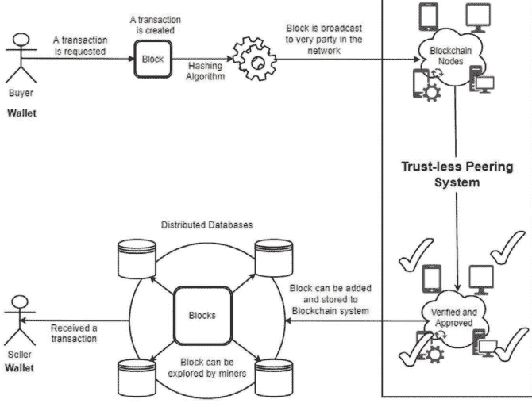

图 2.8 公共区块链流程图。

# 通过 AI 重塑流程

图 2.8 展示了交易的生命周期，以确保公共区块链生态系统中从买家到卖家的无信任对点系统的智能合约能够得到正确实现和保持完整。

如今，最知名且最成功的公共区块链应用是比特币、以太坊、莱币、狗狗币和 PiCoin。事实上，公共区块链系统不需要任何维护。这就是为什么去中心化应用程序的创建和运行成本并不高。

### 2.3.2 私有区块链

私有区块链被称为许可区块链。它主要由金融机构、银行或政府内部运营和控制，并且要求参与者在成为区块链系统成员之前经过邀请和验证。

在这种背景下，所有交易仅共享并授予属于区块链生态系统的参与者；插图 - 2.9

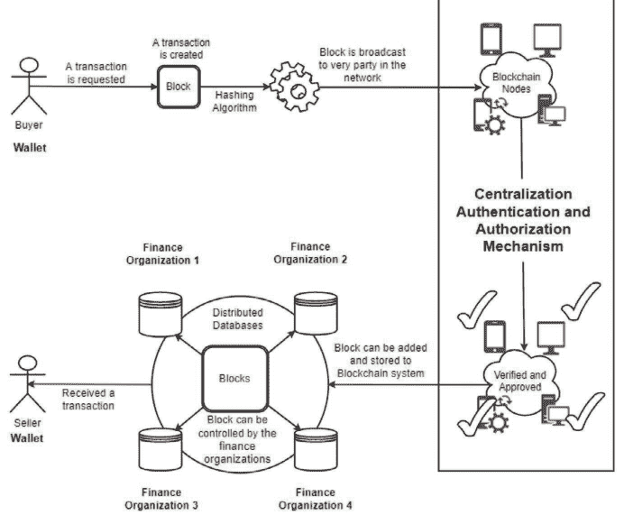

图 2.9 私有区块链流程图。

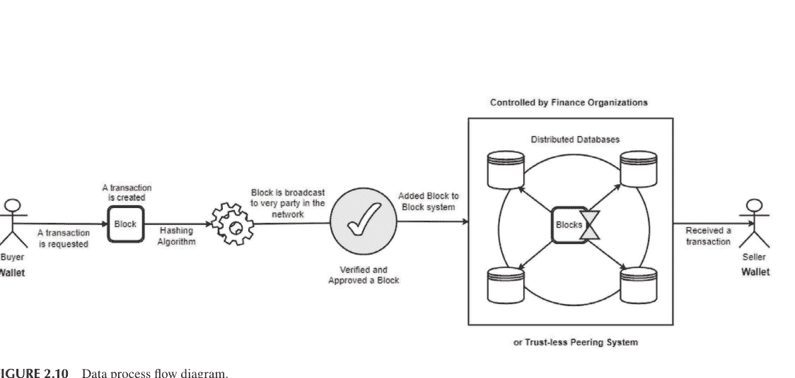

# 通过 AI 重塑流程

交易在特定节点上进行存储和分发，并用于在可能发生问题时向相关方告警。

## 2.4.2.4 数据加密机制中的 AI

如前所述，一旦交易被创建并分发到区块链系统，敏感数据就需要加密或解密，这使得它们容易受到黑客的攻击。

然而，区块链开发者可以借助新加密方法的帮助来解决这些问题。在 AI 实施的助力下，这些新方法允许对加密数据进行数学运算，并在交易的整个生命周期中接收加密后的结果。

此外，AI 的一个分支是计算智能，它在现代密码系统中可以扮演许多重要角色。它可以创建更健壮的密码，并通过系统攻-防御机制提高区块链系统的恢复能力。

## 2.4.2.5 基于区块链的身份中的 AI

在双方建立智能合约的数字签名识别阶段，AI 技术的应用是使用计算机视觉和图像处理的目标检测技术的良好示例，该技术可以检测数字图像和视频中某一类语义对象的实例。

## 2.4.2.6 身份验证与授权功能中的 AI

对于共识决策和授权功能，或者由于几乎所有数据都依赖结构化类型的权限验证，我们认为决策委托给 AI 功能更好，因为 AI 技术不容易受到人类行为和认知偏差的影响。

## 2.4.2.7 搜索引擎引擎中的 AI

搜索功能不仅适用于社交网络，也适用于现实世界中拥有大量用户的区块链应用或金融系统。在私有或公有区块链系统中，它一直是向区块链网络中的各方广播区块的关键技术和秘密方法论。

随着交易的激增和加密数据集使用的日益复杂化，搜索功能变得更加重要，区块链所有者正在转向人工智能以提高其搜索服务的能力。

## 2.4.2.8 决策中的 AI

全球加密货币快速变化涉及决策的因素每天都在增加，投资者在交易中始终面临着决策疲劳。应用 AI 来支持决策过程变得更简单快速，包括理解卖家和买家的要价和接纳价。

# AI 在区块链应用中的作用

## 2.4.2.9 数据变现中的 AI

区块链应用可以完美利用 AI 技术来促进跨平台使用的数据共享。一个很好的例子是使用机器学习模型，根据你在在线零售或电子新闻网站上查看的内容进行推荐，你每天在移动设备或电脑上可以看到这些“智能广告”。TradingView (2021) 提供了现实世界中的加密货币推荐。

## 2.5 AI 与区块链的未来

在工业革命 4.0 时代，IoT、eIoT、AIT、AI、云计算、加密算法、网络模型和安全机制等新兴技术的持续结合，有助于区块链系统对区块进行封装、身份验证、批准，并将其分发到网络中的每个用户，同时通过复杂的密码学将它们密在一起，使得篡改这些记录几乎成为可能 (Rosow, 2018)。

在工业革命 4.0 中，区块链技术不仅应用于大多数金融和银行应用中（因为它提供了透明度、高级信任模式、数据安全和交易准确性），还应用于智慧城市、电子商务、军事、医疗保健、供应链、能源管理、物流、政治、教育、交通、房地产、音乐、建筑等行业。

在不久的将来，人类将开发并与更多功能进行交互，以证明区块链技术是跨多个其他行业中使用最好且成本最低的技术之一。

## 2.6 结论

AI 与区块链生态系统的融合已探索了一些新的解决方案，不仅将为高效性能开启新机会，还将使利益者更安全地保护其对数字资产的所有权控制控制。

基于 AI 的区块链系统被认为能够协助支付或业务流程，例如涉及许多需要信任和透明度的供应链，以及跨方区块链交易的效率、智能合约、敏感信息的安全性以及数字资产管理。

关于潜在的金融技术，AI 技术作为下一代区块链平台的出现预计将剧烈地改变每个行业的业务运营。因此，考虑拥抱它的方法论非常重要，因为在有利于垄断区块链生态系统的规划中，有很多需要回答的问题。特别是当大多数机构和政府正在规划挑战和障碍——无论是技术上的还是解决方案——基于 AI 的区块链不应被低估。

我们希望分享这两种技术有意义的嵌入集成概念，这可以推动区块链技术推向实质更高水平的机会与挑战，在加密货币时代保护交易免受主要破坏和漏洞的影响。

值得注意的是，这些试点解决方案已部署到具有不同 AI 模型的各种区块链平台上，鉴于金融机构和政府加密货币之间的竞争，这些模型尚未详细报告或发表在学术文献中。

最终，对基于 AI 的系统的价值提议进行了评估，这种组合领域证实了区块链技术在降低成本、提升服务质量和整个行业竞争力的应用。

## 参考文献

Anyoha, Rockwell (2017). The History of Artificial Intelligence. Can Machines Think? Retrieved from https://sit.hms.harvard.edu/flash/2017/historical-intelligence

McKinsey & Company (2018, September), Notes from the AI Frontier—The Impact of AI on the World Economy. Retrieved from https://www.mckinsey.com/~media/McKinsey/Featured%20Insights/Artificial%20Intelligence%20from%20the%20economy%20Modeling%20the%20impact%20of%20AI%20on%20the%20world%20economy-September-2018.aspx

Wikimedia Foundation, Inc (2010, December). Satoshi Nakamoto. Retrieved from https://en.wikipedia.org/wiki/Satoshi_Nakamoto

Sandner, Philipp, Jonas Gross, and Robert Richter (2020, September). Convergence of Blockchain, IoT, and AI. Frankfurt School blockchain Center, Frankfurt School of Finance & Management, Frankfurt, Germany.

TradingView (2021, April). Cryptocurrency Market. Retrieved from www.tradingview.com/markets/cryptocurrencies/

Rossow, Andrew (2018 April). Bringing Blockchain into Industry 4.0. Retrieved from https://www.forbes.com/sites/andrewrossow/2018/04/11/bringing-blockchain-into-industry-4/#77cf956cd7d.

# 通过人工智能重塑流程

由麻省理工学院和 Jameel 学院计算机科学与人工智能实验室 CSAIL 构建的深度学习模型，利用乳腺影像预测癌症风险。该模型“Mirai”使用了超过 200,000 个示例进行训练。Mirai 有三个建模阶段：首先是风险建模，用于评估风险并确定预防措施；其次，它包含了荷尔因素和年龄等非图像风险因素；第三，它使用了一种能够从乳腺影像中学习的对抗性方案。为医疗计算机化医疗咨询开发的 MYCIN 系统使用了知识库和人工智能（Shortlife, 2012）。

## 3.1.1 人工智能概述

人工智能是实现在机器或软件中的一种技术，使其变得足够智能，并能够像人类专家一样工作。医学科学是一个追求精密度、准确性和知识的领域。我们可以说，拥有医学科学知识的智能系统将彻底改变诊断方式并探索更多可能性。如今，药物发现和高风险手术中的机器人辅助正在使用人工智能。在医疗健康领域，还有许多其他领域正在利用智能技术获得早期且高效的结果。

“人工智能”一词由约翰·麦卡锡在 1955 年的达特茅斯夏季人工智能研究项目上提出（McCarthy et al., 2006），在此之前，构建智能系统和开发数学模型的过程已经引入。McCulloch 和 Pitts 在 1942 年引入了模拟生物神经元工作方式的神经网络概念。人工智能的演进基于时间线，包括 1960 年侧重于知识表示和自然语言的研究、1980 年的遗传算法，以及 1990 年在复杂问题上对神经网络的实现。

人工智能是一个超集，机器学习和神经网络技术都在其中运行。机器学习是人工智能的一个分支，被广泛用于和实现解决复杂问题；同时，它在测试和使用之前需要大量的数据来训练机器。以下用于解决不同类型问题的机器学习模型类型：


# 人工智能在现代医疗健康领域的崛起

- 1. 监督学习是机器学习的一种，使用训练数据来训练机器，并在训练阶段寻找输入与输出之间的相关性。这种方法被称为监督学习，是因为它通过对数据进行训练和测试来保持正确的修正。图 3.1 所示的分类和回归均属于监督学习的方法。
- 2. 无监督学习是一种机器学习方法，其目标是从未标记的数据中发现模式。图 3.2 所示的异常检测和聚类技术，以及降维，都用于无监督学习。
- 3. 深度学习基于深度神经网络。具有多个隐藏层以训练系统，并具有输入层和输出层实现的神经网络被称为深度神经网络。

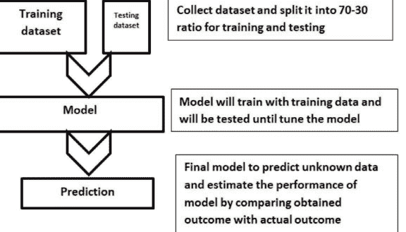

图 3.1 监督学习：回归。

## 聚类

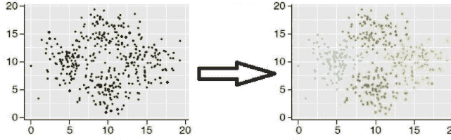

## 异常检测

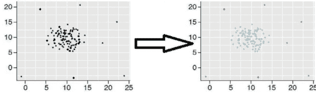

图 3.2 无监督学习：聚类、异常检测。

学习技术需要数据来训练模型，以及一个实现它的接口。根据可用的数据集、假设和用于解决问题的知识，人工智能中使用了不同类型的学习机制。基于实例的学习、归纳学习和分析学习就是这些学习机制。根据问题领域和可用数据，我们需要选择合适的问题解决技术以寻找优化结果。回归、分类、决策树和聚类技术是一些机器学习技术。

### 3.1.2 医疗健康领域中的人工智能

根据 Bini (2018)，人工智能是一种与云计算、物联网（IoT）、移动应用程序大数据数据使用的工具。技术的结合将导致先进且增强的系统。基于手机和移动的患者监测系统基于云计算和物联网，并使用了人工智能（Rakshit & Sharma, 2020）。基于磁共振成像（MRI）示例、血样本或其他技术的早期疾病检测基于深度学习模型。基于规则的系统用于医疗计算机化医疗咨询使用了知识库和人工智能（Shortlife, 2012）。

基于规则的系统用于医疗计算机化医疗咨询使用了知识库和人工智能（Shortlife, 2012）。

基于磁共振成像（MRI）示例、血样本或其他技术的早期疾病检测基于深度学习模型。基于规则的系统用于医疗计算机化医疗咨询使用了知识库和人工智能（Shortlife, 2012）。

基于磁共振成像（MRI）示例、血样本或其他技术的早期疾病检测基于深度学习模型。基于规则的系统用于医疗计算机化医疗咨询使用了知识库和人工智能（Shortlife, 2012）。

基于磁共振成像（MRI）示例、血样本或其他技术的早期疾病检测基于深度学习模型。基于规则的系统用于医疗计算机化医疗咨询使用了知识库和人工智能（Shortlife, 2012）。

基于磁共振成像（MRI）示例、血样本或其他技术的早期疾病检测基于深度学习模型。基于规则的系统用于医疗计算机化医疗咨询使用了知识库和人工智能（Shortlife, 2012）。

基于磁共振成像（MRI）示例、血样本或其他技术的早期疾病检测基于深度学习模型。基于规则的系统用于医疗计算机化医疗咨询使用了知识库和人工智能（Shortlife, 2012）。

根据 Bini (2018)，人工智能是一种与云计算、物联网（IoT）、移动应用程序和大数据数据使用的工具。技术的结合将导致先进且增强的系统。基于手机和移动的患者监测系统基于云计算和物联网，并使用了人工智能（Rakshit & Sharma, 2020）。基于磁共振成像（MRI）示例、血样本或其他技术的早期疾病检测基于深度学习模型。基于规则的系统用于医疗计算机化医疗咨询使用了知识库和人工智能（Shortlife, 2012）。

## 脑机接口

脑机接口（BCI）是一种由硬件和软件通信系统组成的系统。BCI 允许通过脑电活动控制外部设备。

在这里，我们回顾了 BCI 系统的先进技术，它由以下步骤组成，如图 3.4 所示：

- 信号采集：收集脑信号
- 信号增强：提高信号强度
- 特征提取：选择合适的信号模式
- 分类：根据模式将信号分为不同的类别
- 控制接口：根据生成的信号类别触发外部设备

首先，信号采集步骤是通过神经影像成像模式实现的，每种模式观察不同的功能性脑活动，如代谢、磁性和电学活动。其次，从不同的电生理控制信号中感应脑活动，这些信号调节用户的意图。第三步是处理通过增强控制信号中的伪影来提高所用信号的性能。第四，综述研究了一些智能和数学算法，这些算法被用于将控制信号中的信息转换为其他设备的指令。BCI 系统的目标是为严重残障患者提供通信和访问能力。对于遭受神经肌肉系统性疾病或甚至完全瘫痪的患者，BCI 系统通过脑活动为他们提供了访问和控制设备的能力。BCI 系统对脑中、肌萎缩侧硬化症或脊髓损伤患者也有帮助。

大脑由数百万神经元和相互连接的神经元网络组成。脑机接口（BCI）使用脑波传感器和神经元反馈。思想和情感状态由这些神经元之间的交互表示。根据肌肉收缩产生电信号。人类思维状态直接反映不同的电波。来自大脑的控制指令用于控制外部数字设备。


图 3.4 脑机接口（BCI）系统。

## 通过 AI 重塑流程

为了测量活体脑活动，我们需要使用脑电图（EEG），它提供对脑电活动的测量。BCI 中对接收到的不同脑模式的翻译用于外部设备与活体脑之间的不间断通信。为了控制外部设备，需要 EEG 信号。在该系统中，使用简单的单极电极，通过带有 EEG 电极和参考节点的头带从患者头部记录 EEG 信号。我们拥有信号注意力和冥想水平值。除了原始数据集外，从 EEG 头戴设备收集的眨眼信号被管理并通过蓝牙接口发送到接收端，接收端连接到微控制器，然后与轮椅或家电进行电接口连接以控制它们。BCI 将 EEG 活动转换为光标移动也提供了人机交互，Fabiani 等人 (2004)。

### 3.2.1 身体残障患者 BCI 设备的需求

Mason 和 Birch (2003) 提出的通用 BCI 框架对于身体受限患者来说是一项伟大的发明。它从人类大脑或眼动获取输入，并将该活动转换为信号。进一步，接收到的信号被用于微处理器以执行使用轮椅的操作或控制家电器。图 3.5 显示了该系统中从佩戴头戴设备到家电使用的模块。

1. 脑电图（EEG）是一种用于测量作为脑电信号脑波活动的方法。EEG 通过在患者头皮上放置电极来完成。它用于测量脑神经元内的电压变化。医疗机构用于患者监测或研究目的的 EEG 系统成本高昂，但开发更廉价、更符合消费者习惯的 EEG 设备用于产品开发已进入主流市场，如 EMOTIVE EPOC 和 brain sense。
2. 眼电图（EOG）是一种用于测量眼睛运动的系统。EOG 系统可以通过测量眼动和眨眼等电变化来检测与眼区域相关的运动。

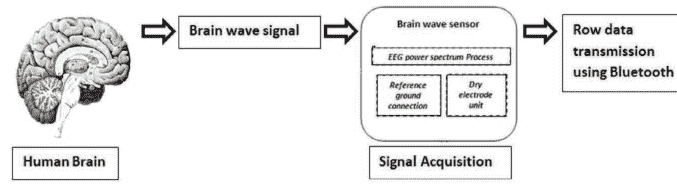

图 3.5 BCI 数据传输。

注：EEG = 脑电图

3. 蓝牙是一种短距离无线通信技术。在当今世界，蓝牙是发送脑信号的必要手段。在 EEG 系统中，连接到家电的蓝牙具有限制，覆盖范围为 100 米。
4. 微控制器由存储单元、处理单元和输入输出单元集成电路组成，与数字传感器提供接口。

### 3.2.2 人类不同类型的脑波

人类有五种脑波。根据 Picot 等人 (2012)，脑波具有不同的频率，如表 3.1 所示。

### 3.2.3 轮椅控制 BCI

#### 3.2.1 软件需求

ThinkGear 连接器连接头戴设备的 BCI。NeuroView 应用程序图形化地显示注意力和冥想水平。基于 NeuroView 的程序用于操作轮椅。Bharali 等人 (2018) 提出了以下模式：

- 待机
- 指令
- 运行

这些操作是顺序的，并代表轮椅的模式。

### 表 3.1 不同类型的脑波

| 脑波名称 | 心理状态 | 频率 |
| :--- | :--- | :--- |
| Delta 波 | 深度睡眠 | < 4 Hz |
| Theta 波 | 深度冥想 | 4–8 Hz |
| Alpha 波 | 身体放松；清醒 | 9–13 Hz |
| Beta（贝塔）波 | 清醒；正常警觉 | 14–30 Hz |
| Gamma（伽）波 | 高感知 | >30 Hz |

为了使用 BCI 控制信号实现轮椅操作，控制信号通过连接到头戴设备上的蓝牙发送，并在移动应用程序中接收；信号传递给连接到轮椅的另一个蓝牙模块。

当轮椅接收到的强度值超过阈值时，MindWave 应用执行循环模式，包括前进、后退、左和右。这些方向每个都有十秒的时间跨度（指令模式），每个模式之间有两秒的间隔。我们必须提供连续的脉冲，双事件发生时循环显示的方向将成为所选方向。要强制停止，两次眨眼事件之间的循环时间必须小于 400 毫秒以便脑传感器设备识别。

### 3.3.2.2 硬件开发

BCI 控制轮椅的开发需要 BCI 头戴设备、Android 移动设备以及带有微控制器、蓝牙和电机驱动器的轮椅，如图 3.6 所示。在第一个模块中，BCI 头戴设备由 EEG 电极和传输蓝牙设备组成；第二个模块中是 Android 应用程序和蓝牙设备；第三个模块是配备了微控制器、电机驱动器蓝牙的轮椅。移动应用程序同时连接头部和轮椅模块。首先，佩戴在用户头上的头设备将接收原始脑数据，并通过其内置蓝牙无线传输到 Android 应用程序。Android 应用程序充当 MindWave 应用与放在轮椅上的 Arduino 微控制器之间的桥梁。

MindWaveMobile 的脑数据并不直接传输到轮椅微控制器；Android 应用程序过滤所需的模式并确保只向轮椅微控制器发送相关信息。过滤或特征选择过程必须在移动应用程序中进行，这减少了头戴设备和微控制器的开销。

## AI 在现代医疗领域的兴起

BCI 头戴设备具有可调节的头带。头部安装了电源、微控制器、干电极和参考电极。干电极的位置位于左侧额头部位，参考电极必须插入左耳。用于测试微型轮椅的硬件结构包含一个 HC-05 蓝牙模块，用于接收来自 Android 程序的信号，一个根据指令控制轮子移动的电机驱动器，以及一个处理来自蓝牙信号并向电机驱动器提供指令的微控制器模块。轮椅配备了四个电机和相应的轮子。电机驱动器连接了四个直流电机，负责速度和方向控制。Android 应用程序在头戴设备和轮椅之间起到桥接作用。

#### 3.2.3 工作原理

- 首先，开启 BCI 头戴设备，并通过蓝牙将其与 Android 应用程序和轮椅连接。
- 使用闪烁触发命令模式。一旦方向循环，闪烁至少两次即可选择方向和聚焦模式。
- 要让机器人运行，请尝试专注于某个物体以使注意力水平至少达到 50。一旦注意力水平达到 50 值，将触发运行模式，机器人将根据之前选择的任何方向启动。
- 任何需要停止运行时，连续闪烁至少两次。
- 如果想再次运行，闪烁一次以触发操作。使用 Jadhav 和 Momin (2018) 提出的 BCI 头戴设备命令和方向循环控制机器人。

### 3.3 智能视觉

智能视觉是一个微控系统，它通过摄像头获取输入，并为视障人士提供音频信号输出。摄像头捕获的图像通过机器学习进行图像处理，以识别周围物体。在该系统中，我们拥有人脸识别、使用机器学习的物体识别，以及如图 3.6 所示的输出模块。这种智能视觉设备面向广泛的面临挑战的人群，因此该设备包含多种功能。我们的启动代码不包含任何内容，仅用于导入文件；用户随时可以在启动代码中使用他们需要的任何功能。


头戴带带

微控制器

摄像头

图 3.6 头戴式智能视觉。启动代码将自动完成其所需的所有工作。该设备由头带、相机模块、安装在上面的微控制器和控制按钮组成。对人脸和物体的识别通过机器学习完成。使用了不同的机器学习技术来实现这些功能，其中启动代码包含以下内容：

#### 人脸识别模块

该模块包含人脸识别代码。在此模块中，不需要传递任何参数；调用它后，开始使用摄像头拍照，然后它将根据数据集预测人的姓名。如果运行时遇到未知人物，则将其作为参数添加以便设备识别该人物。

#### 物体识别模块

该模块的工作原理与人脸识别相同；它不需要任何参数，工作方式与人脸识别一致，在调用模块后返回捕获到的物体名称。该模块使用预训练库 `MobileNet`；我们可以直接导入并在代码中使用它们。当我们使用自己无法理解的库时，使用名为 `COCO` 的独立文件存储物体名称作为最终结果。

人脸识别始于从存储的图像中提取特征。特征包括眼睛、瞳孔、嘴巴和其他面部点。人脸识别系统将给定的脸与数据库中存储的模式进行比较，并找到最的的面部指标）。人脸识别有许多实际应用，如安全、访问控制和监控系统；这就是为什么在过去的十年里，发布了许多算法并在识别方面显示出改进。分类脸脸的正式方法最早由 Galton (1888) 提出。Galton 提出了一种收集面部轮廓作为曲线的方法并找到它们的范式，并根据偏离范式的程度对与其他轮廓的脸部进行分类。这种分类是多模型的；它提供了基于独立测量的向量结果，这些向量可以与存储数据库中的其他向量进行比较。算法的持续进步和技术的进步已经探索了人脸识别系统的现实应用和实现。早期阶段的人脸识别工作基于聚类场景中的面部模式；；聚类场景对图像进行归一化以计算几何变化（Chellappa 等人，1995）。

面部模式的显现通过分类算法、基于模型的方案和逻辑反馈来识别脸部。大型人脸图像数据库的可用性、算法的发展和评估方法是人脸识别快速发展和成就的因素。与脸相关的应用必须提供静态图像或视频片段，系统必须在图像或视频中找到对应的人。这种智能视觉使用 Python 作为编程语言，并结合 OpenCV 和人脸识别库来识别脸部。基本上，在这个项目中，代码从我们提供的数据库中寻找人物图像的编码，之后——基于该编码——代码会预测运行时摄像头捕获的脸部姓名。

### 3.3.2 物体识别

关于从摄像头图像检测和识别物体有许多研究。根据 Donner 等人 (2015) 的观点，物体识别基本上基于捕获图像或实时视频流对物体进行分类的技术。“通过有效方法和计算机视觉进行物体识别”的作者为摄像头感知的物体设计了新的解决方案，以执行图像识别，其目的是检测和识别物体。摄像头模块首先用于感知和接收物体，然后在对摄像头提供的数据进行进行预处理后确定并识别它们。基于神经网络的技术（如卷积神经网络（CNN））被广泛用于执行特征提取，特征提取是使用基于神经网络的方法进行计算机视觉的过程。这种识别系统可以用于各种需要物体识别、跟踪以及理解真实世界的应用中。如今，智能视觉系统也被汽车采用，以识别车辆前方的物体。

Khurana 等人 (2016) 在“物体识别和分割技术综述”中使用图像和视频分析了物体识别和分割技术。物体识别技术被许多应用程序使用，如机器人导航、人机界面、医学诊断、安全、工业检测、自动驾驶汽车和无人机。分割应用于视频识别、图像处理、人体活动识别、手势识别、阴影检测等许多领域。许多作者针对精确和排列的参数对现有的物体识别和分割方法进行了系统分析。在物体识别领域，使用的多数技术都是基于数学和算法模型的。

### 3.3.3 货币识别

我们正在使用的货币识别被定义为纸币的识别；在这里我们使用此功能通过摄像头帮助预测纸币的价值。Murthy 等人 (2016) 在“带伪检测的纸币识别的设计与实现”中使用了一种方法，可以使用先前存储的货币图像的训练模型对印度纸币进行分类和验证。

MANI（移动添加标识符）是一个基于图像处理的系统；该应用程序由印度储备银行（RBI）为 Android 用户发布。MANI 应用程序为视障人士使用手机摄像头模块识别印度纸币提供了帮助。该应用程序运行不需要互联网连接。MANI 应用程序用户界面良好，并且支持英语和印地语。它以音频通知的形式输出，为了支持听力障碍用户，该应用为不同金额的货币提供了预设振动形式的响应（表 3.2）。MANI 免费下载，它是医疗保健领域 AI 和手机技术最佳实现方案之一。

## AI 在现代医疗保健领域的崛起

### 表 3.2

MANI 应用中不同货币面额的预定义振动警报

| 货币 | 振动次数 | 货币 | 振动次数 |
|---|---|---|---|
| ¥5 | 一次 | ¥100 | 五次 |
| ¥10 | 两次 | ¥200 | 六次 |
| ¥20 | 三次 | ¥500 | 七次 |
| ¥50 | 四次 | ¥2000 | 八次 |

表 3.2。当应用程序无法识别货币面额时，它将使用长振动，用户必须再次扫描钞票。

### 3.3.4 使用 Python 进行机器学习编程

Python 是一种解释型、高级且面向对象的编程语言。Python 数据结构结合动态绑定和动态类型检查，使其对于 RAD（快速应用开发）极具吸引力。Python 语言易于学习，简单的语法强调可读性。语言的特性降低了程序维护的成本。Python 还被用作脚本语言以及连接现有组件的后端语言。Python 通过模块和包鼓励代码复用和程序模块化。Python 解释器及其广泛的标准库免费分发，并以源代码或二进制格式适用于所有主要平台，无需费用。Python 库具有人工智能、机器学习、数值计算、图表绘制、计算机视觉等许多领域的预构建函数。

#### 3.3.4.1 Python 库

1. **OpenCV**: 这是一个基于 BSD 许可的产品，易于实现和修改。OpenCV（开源视觉库）是一个机器学习软件库和开源计算机视觉库。OpenCV 是一个非常流行的库，旨在为计算机视觉应用提供通基础设施。在工业 4.0 中，计算机视觉正在加速商业产品中 AI 和机器感能力的速度。我们使用该库进行图像处理、视频捕获以为用户提供功能并执行多种操作。
2. **Pyttsx3**: Pyttsx3 是一个用于文本转语音的 Python 库。与其他库不同，Pyttsx 以离线模式工作，并兼容 Python 2 和 3 版本。
3. **语音识别 (Speech recognition)**: 我们使用该库在系统中执行“语音转文本”操作。语音识别是指对人类语音的自动识别。它是人机交互（HCI）的重要组成部分。如果你曾与 Alexa 交互或命令 Siri 完成任务，你已经体验过语音识别的力量。这些应用程序精通语音识别。语音识别系统具有一个语音理解模块和另一个语音生成模块。


- **人脸识别 (Facial recognition)**: 该 `Python` 库模型在“Labeled Faces in the Wild”基准数据上的准确率达到 99.38%。在 `Python` 中识别和处理脸部是最简单的任务，它通过单幅图像标记输入高效工作。该库是世界上最常用且最简单的库。人脸识别库是使用深度学习构建的 `C++` 工具包的。人脸识别库还提供了一个简单的命令行工具，可以使用命令行对图像文件夹进行人脸识别。深度信息对于改进人脸检测系统起着关重要的作用（Burgin et al., 2011）。

我们使用 `OpenCV` 提供的 `Haar` 级联和 `Python` 人脸识别库来获得最准确的人脸识别结果。在此，我们根据检测脸脸的准确性比较了 `Haar` 级联的所有分类器。分类器用于眼睛、鼻子、正脸、侧脸和侧侧。

### 3.3.4 Haar 级联及其分类器

`Haar` 级联是机器学习中常用的一种检测算法（Padilla et al., 2012）。它有助于识别对象，无论该对象是非生物、人类还是其他物体。

根据 Singh 等人（2013）的观点，`Haar` 级联算法中通常包含四个步骤：

- 选择对象的特征
- 数据收集（制作数据集）
- 模型训练
- 输出结果（根据数据集识别对象）

在第一步中，我们选择对象的特定特征，通过这些特征我们可以识别特定对象。例如，在人脸中，这些特征是眼睛、鼻子、微笑、整个正脸或侧脸。

在第二步中，在计算机视觉（主要通过摄像头）的帮助下，我们拍摄许多上一步中关注的特征图像，并记住图像越多，识别时的准确性越高。

在第三步中，我们根据作为输入收集的图像数量对系统进行训练。

在第四步中，如果系统识别了它经过训练的对象，则定义输出为完美。

对于这项工作，我们使用 `Haar` 级联不同分类器的输出来比较它们识别特定脸部的准确性。这些分类器使用人脸的特征：眼睛、鼻子、微笑、正脸和侧脸。为了检查特定时间的准确性，我们为某次测试选取特定数量图像，然后更改另一个测试的图像数量（Le, 2011; Yang and Wang, 2016）。

# AI 在现代医疗保健领域的崛起

#### 3.3.4.3 分类器之间的比较

测试 1：我们选取 200 张某人特定脸部特征的图像制作数据集，然后训练系统并比较表 3.3 中描述的所有分类器的准确性。

测试 2：我们选取 500 张某人特定脸部特征的图像制作数据集，然后训练系统并比较表 3.4 中描述的所有分类器的准确性。

### 表 3.3

训练图像数量为 200 时的分类器比较

| 分类器 | 数据收集 | 训练数据集 | 最终测试 | 准确率 |
| --- | --- | --- | --- | --- |
| 眼睛 | [image] | [image] | [image] | -47% |
| 正脸 | [image] | [image] | [image] | 40% |
| 微笑 | [image] | [image] | [image] | -44% |
| 侧脸 | [image] | [image] | [image] | 42% |
| 鼻子 | [image] | [image] | [image] | -88% |

### 表 3.4

训练图像数量为 500 时的分类器比较

| 分类器 | 数据收集 | 训练数据集 | 最终测试 | 准确率 |
| --- | --- | --- | --- | --- |
| 眼睛 | [image] | [image] | [image] | 30% |
| 正脸 | [image] | [image] | [image] | 43% |
| 微笑 | [image] | [image] | [image] | -15% |
| 侧脸 | [image] | [image] | [image] | 43% |
| 鼻子 | [image] | [image] | [image] | -88% |

测试 3：我们选取 1000 张某人特定脸部特征的图像制作数据集，训练系统并比较表 3.5 中描述的所有分类器的准确性。

#### 3.3.4.4 人脸识别库

人脸识别库是一个主要用于识别不同人脸的 `Python` 库。它的编程方式使其能够自动检测和识别脸部；我们只需为其创建数据集并导入该库。准确率

### 表 3.5

训练图像数量为 1000 时的分类器比较

| 分类器 | 数据收集 | 训练数据集 | 最终测试 | 准确率 |
|---|---|---|---|---|
| 眼睛 |  |  |  | 42% |
| 正脸 |  |  |  | 48% |
| 微笑 |  |  |  | 1% |
| 侧脸 |  |  |  | 46% |
| 鼻子 |  |  |  | 27% |

通过该库进行人脸识别的准确率在许多研究中被认为约为 99%。它分析摄像头前的实时视频流，并将脸部匹配到存储的图像数据。对于这种人脸识别，使用 128 维输出特征向量来量化脸。因此，训练可以通过三元组进行。对于人脸识别库，我们通过以下方式训练网络：

- 将单幅图像作为输入
- 将图像分类作为输出

## 58 通过 AI 重塑流程

因此，通过应用 `OpenCV` 和深度学习，我们通过以下步骤完成人脸识别过程：

- 人脸检测
- 计算 128 维脸部嵌入（embedding），通过此对脸部进行量化
- 训练用于嵌入的机器
- 进行人脸识别

对于人脸识别库，我们首先创建图像数据集；在数据集中，如图 3.7 所示，仅使用特定脸的单一图像。然后，借助该单一图像作为数据集，它就能识别图 3.8 所示的人脸。

根据图 3.9 的图表，我们发现对于 `Haar` 级联（`Haar` cascade），我们需要输入大量的图像（图像数据集），以便在脸识别过程中获得更高的准确率。在分类器的比较中，我们发现正面脸和侧脸分类器在脸识别方面的准确率远高于任何其他分类器。


**图 3.7** 包含单个图像的数据集。


**图 3.8** 人脸识别。

### AI 在现代医疗领域的兴起

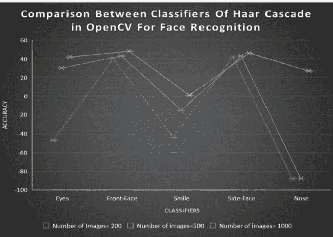

图 3.9 `Haar` 级联分类器的比较。

我们还发现人脸识别库仅需单一输入（图像数据集），并在脸识别过程中提供更准确的结果。我们还可以用它来实时识别脸。

`AI` 技术在医疗领域具有广泛的应用领域，例如针对身体或视觉残障患者，以及其他使用模式识别进行药物发现和使用回归方法进行早期疾病检测。

## 参考文献

- Bansanje, Sanathi, Shyamala, Pooja, Dash, Chandra, Sharath, & Chavan, Bhushan. “A self-governing wheelchair for severely disabled patients in an indoor environment utilizing EEG and laser technologies.” In Emerging Trends and Innovations in Engineering and Technical Research (ICIETR) 2018 International Conference, p. 1–5 (2018).
- Bi, Luzheng, Fan-An & Liu, Yili. “EEG-brain-controlled mobile robots: A survey.” IEEE Transactions on Human-Machine Systems, 43(2), 161–176 (March 2013). doi:10.1109/TSMCC.2012.2219046.
- Bini, S. A. “Artificial machine learning, deep learning and cognitive computing: What do these mean and how will they impact health care?” The Journal of Arthroplasty, 33(8), 2358–2361 (2018).
- Burgin, Walker, Pantofaruoy, Carole & Smart, William D. “Using depth information to improve face detection.” In 2011 6th ACM/IEEE International Conference on Human-Robot Interaction (HRI) (2011).
- Chellapa, R., Wilson, C. L. & Sirohey, C. "Human and machine recognition of faces: A survey." Proceedings of IEEE, 83(5), pp. 705–740 (May 1995).
- Dorner, J., Kozák, S. & Dietze, F. "Object recognition by effective methods and means of computer vision." In IEEE, Stribse, Slovakia (June 9–12, 2015).
- Fabiani, G. E., McFarland, D. J., Jalpaw, J. R. & Pirtscheller, G. "Conversion of EEG activity into cursor movement by a Brain-Computer Interface (BCI)." IEEE Transactions on Neural Rehabilitation and Rehabilitation, 12(3), 331–338 (September 2004).
- Galton, Francis. "Personal identification and detection." Nature, 173–177 (June 21, 1888).
- Gulshan, V. et al. "Development and validation of a deep learning algorithm for detection of diabetic retinopathy in retinal photographs." JAMA, 316, 2402–2410 (2016).
- Jadav, N. K. & Mohan, B. "Eye pattern controlled using wearable EEG." In 2013 3rd IEEE International Conference on Recent Trends in Electronics, Information & Communication Technology (REICT), Bangalore, India, pp. 2382–2386.
- Khurana, Pal, Sharma, Asha, Singh, Shailendra Narayan, Pradeep Kumar. "Survey on object recognition and segmentation techniques." In IEEE, New Delhi (March 16–18, 2016).
- Le, T. H. "Applying artificial neural networks for face recognition." Advances in Artificial Neural Systems, 2011, pp. 1–16.
- Le Nguyen, T. "Artificial intelligence in healthcare: A new technology for both patients and doctors." In 2019 Portland International Conference on Management of Engineering and Technology (PICMET), pp. 1–15.
- Liew, C. "The future of radiology with artificial intelligence: A strategy for success." European Journal of Radiology, 152–156 (2018).
- Mason, S. G. & Bricht, G. "A general framework for brain-computer interface." IEEE Transactions on Neural Rehabilitation and Rehabilitation, 11, 70–85 (March 2003).
- McCarthy, J., McKinsey, M. L., Rochester, N., & Shannon, C. "A proposal for the summer project on artificial intelligence." AI Magazine, 27(4), p. 12 (1955).
- Murthy, S., Kumar, J. & Reddy, B. "Implementation of counterfeit detection." In 2016 Online International Conference on Green Engineering and Technology (GET), pp. 1–6.
- Mussen, A., Middleton, B. & Greens, R. Shortcliffe, E. & Cimino, J. Bioinformatics, pp. 643–674 (Springer, London, 2014).
- Niem, Kristen Dremstra, Alvaro Ventura & Nascimento, O. "EEG based brain computer—Towards a better interface at Aalborg university." IEEE Transactions on Neural Systems and Rehabilitation, 14(2), Article ID 16429, pp. 202–204 (2006).
- Padilla, R., Filho, C. & Costa, M. "Evaluation of Haar cascade classifiers for face detection." Journal of WASET, 6(4), pp. 323–326 (2012).
- Picot, A., Charbonnier, S. & Caplier, A. "On-line detection of drowsiness using visual information." IEEE Transactions on Systems, Man., and Cybernetics—Part A: Systems and Humans, 42(3), pp. 764–775 (May 2012).
- Rakshit, Pushpendu & Sharma, Ravindra. "Building Healthcare 4.0 with smart workforce." In Proceedings of the International Conference on Management & Technovation 2020, pp. 91–94.
- Rana, G. & Sharma, R. "Emerging human resource management practices in Industry 4.0." Strategic HR Review, 18(4), 176–181 (2019).
- Shortliffe, E. Computer-Based Medical Consultations: MYCIN Vol. 2 (Elsevier, New York, 2012).
- Singh, V., Shokeen, V. & Singh, B. "Face detection by Haar cascade classifier with simple and complex backgrounds using OpenCV implementation." International Journal of Advanced Technology in Engineering and Science, 1(12), pp. 33–38 (2013).
- Tsalakanidou, F., Malassiotis, S. & Strintis, M. G. "Face recognition." In Furht, B. (eds.), Encyclopedia of Multimedia (Springer, Boston, MA, 2008).
- Yang, H. & Wang, X. A. "Cascade classifier for face detection." Journal of Algorithms & Computational Technology, 10(3), pp. 187–197 (2016).


# 制造业中的人工智能

V. Harish, D. Krishnaveni, and A. Mansurali

## 目录


# 4.1 引言

## 4.1.1 文献综述

### 4.1.1.1 AI 技术概述

### 4.1.1.2 制造业领域对 AI 的需求

### 4.1.1.3 制造业中的人工智能

### 4.1.1.4 在制造业中实施 AI 的优势

### 4.1.1.5 AI 作为智能制造的催化剂

# 4.2 目标

## 4.2.1 人工智能的优势

## 4.2.2 人工智能的劣势

### 4.2.2.1 AI 的缺点

## 4.2.3 与人工智能相关的风险

## 4.2.4 工艺能力中的 AI

### 4.2.4.1 工艺层面的改进

### 4.2.4.2 组织层面的益处

### 4.2.4.3 AI——未来的关键组件

# 4.3 结论

# 参考文献

## 1 引言

当前的制造系统正变得越来越复杂和动态。许多工厂和企业面临着由于不确定性的挑战。子系统之间的相互依赖导致了系统规划中的典型问题。人工智能（AI）的出现被定义为近期重大事件之一。人工智能和机器学习领域的实验性发展表明，通过高级分析工具和算法，在转型制造业具有巨大潜力。我们正处于一场新革命的边缘，这场革命将由人工智能、3D 打印、机器人、自动化等许多快速转型和先进技术所驱动。这些技术预计将

# 通过 AI 重塑流程

AI 在未来不仅在制造业，在其他领域也起着关键作用。尽管艾伦·图灵（Alan Turing）早在 20 世纪 40 年代就讨论了人工智能的概念，但其在过去十年中呈指数级增长。专注于 AI 的研究人员 Lin 等人（2017）提到，如果能恰当且有效地使用 AI，就不必担心 AI 带来的负面影响。智能且先进的 AI 系统在许多方面提高了人类的生活质量。

人工智能是系统理解和分析数据、学习并熟悉数据，以及利用这些知识执行分配的任务并实现目标的能力，并具有适应所出现的情况的能力。AI 可以帮助减少人为错误，并将注意力转移到高效率领域。近年来，许多企业显著地预测智能制造。这种进展正进入一个“智能制造”的新领域，这清楚地反映了 AI 智能技术对制造业的影响。据估计，“智能制造”市场在 2021 年将超过 2000 亿美元，预计到 2022 年将增加到 3200 亿美元以上，年增长 12.5%（Duke et al., 2020）。GE、博世和微软等主要公司很久以前就开始对人工智能进行投资，重大目标是使用基于机器学习的程序来改进制造业的各个方面。在制造业中使用 AI 的主要原因是降低成本、减少产品缺陷、减少非计划停机时间并提高生产率（Wang, 2019）。虽然大型公司可能考虑在制造业中使用 AI 技术开发战略的策略，但目前对于较小的制造商来说可能并非如此。尽管 AI 是制造业领域的一场革命，但它也有其缺点：实施成本高。AI 通常被认为缺乏适应性和创造力。人工智能的高增长被认为是全球失业风险的原因之一，但公司声称，AI 将减少人类就业是一个广泛的误解。尽管预计 AI 的发展速度将保持很快，但与此前的许多技术颠覆性创新一样，由于对成本、可扩展性和安全性的担忧，AI 的采用被放缓。

本章旨在对由于 AI 使用导致的制造业领域的未来变化提供视角。同时也触及了人们可以预期的机会、威胁和变化。

## 4.1.1 文献综述

### 4.1.1.1 AI 技术概述

本节介绍了 AI 技术以及 AI 在制造业中各个方面的概述。

AI 的进展被认为是近期最重大的事件之一。根据字典，AI 指“任何能够执行通常需要人类智能任务的计算机系统”（Pillai et al., 2021）。AI 的能力可以从三个主要来源来理解：

- 第一，由“物联网”驱动的海量数据可用性。
- 第二，感知事物的能力；即系统识别和识别语音及图像的能力。
- 第三，解决问题的能力；即不断学习和改进的能力。

AI 是一种无处不在的技术，其使用和影响跨越经济的所有部门，从制造业、医疗保健到媒体。AI 的采用可以在促进可持续发展方面发挥重要作用（Haenlein & Kaplan, 2019）。

### 4.1.1.2 制造业对 AI 的需求

由于以下原因，AI 在制造业领域更具相关性：

- 专家人才短缺：制造业公司提到的一个担忧是所需要的专业知识的短缺（Chien et al., 2020）。这是由于工人退休或辞职，他们带走了自己的经验和知识。组织面临的担忧不仅是捕捉隐性经验和知识，还要确保这些知识在组织内部的不同垂直部门之间共享（Li et al., 2017）。出现此问题的某些领域包括：
- 复杂情况：制造业面临的一个大问题是复杂性（Dubey et al., 2020）。AI 的应用可以帮助生产计划和诊断问题。
- 高度信息需求：由于 AI 的需求，组织可以在不同合作伙伴之间共享大量信息（Kumar et al., 2017）。AI 解决方案（Kim et al., 2019）。AI 的应用可以创建创建于理解的仪表盘，并为客户提供实时警报（Abd Aziz et al., 2021）。

### 4.1.1.3 制造业中的 AI

正如许多技术颠覆性创新一样，预计 AI 开发将自动化重复性任务，让员工将时间投入到更复杂的、创造性的任务中（Wang et al., 2019）。AI 收集数据可以帮助产品开发（Nica et al., 2021）。AI 可以用于识别非计划停机和事故，并提前进行机器维护和维修（Kusiak, 2017）。原材料价格波动是制造业面临的一个挑战，为了应对这一点，AI 可以用于预测（Gahramani et al., 2020）。AI 机器人可以监控其准确性和性能并自我修正（Lee et al., 2018）。

### 4.1.1.4 在制造业实施 AI 的优势

在制造业中实施 AI 可以帮助组织进行缺陷检测（Nikolic et al., 2017）。同样，采用 AI 可以用于质量保证，自动检查产品是否已完美制造（Sharp et al., 2018）。AI 通过创建从物联网设备提取数据的应用程序有助于生产线集成并确保运行。此外，AI 的实施有助于生成设计。算法会检查所有可能的结果并建议替代方案（Hayhoe et al., 2019）。

## 在制造业实施 AI 将实现

- 大规模定制（Wu et al., 2017）。
- 机器人实施（Sharp et al., 2018）。
- 预测性维护，将帮助公司减少运营和维护成本（Nica et al., 2021）。
- 软件服务（SaaS）：基于 AI 的供应链解决方案（Tao et al., 2018）。
- 改进人机协作（Zhou et al., 2018）。

AI 和机器学习工具可以创建一个统一的生态系统，实现信息的持续交换。这使得系统能够自我维持，并改进供应链管理的各个方面（Alonso, 2020）。

### 4.1.1.5 AI 作为智能制造的催化剂

AI 可以监控与制造业相关的数个数据源，分析影响生产的新闻、事件或事故（Mao et al., 2019）。它将帮助组织深化对客户的洞察和理解（Alexopoulos et al., 2020）。通过 AI，组织可以定制并创建易于理解仪表板，在生产期间发生任何事件时捕捉客户实时警报（Ghabakhloo & Ching, 2019）。它缩短了识别生产活动中潜在问题的时间，能够在问题升级之前进行快速响应。AI 可以量化并降低供应链和生产期间的事故风险（Gahramani et al., 2020）。它能够对整个制造过程做出更明智的决策。最后，AI 有助于提高客户忠诚度和增加利润。

## 4.2 目标

- 理解 AI 对制造业公司的优势。
- 理解制造业公司采用 AI 的劣势。

# 制造业中的人工智能

- 识别在制造企业实施 AI 相关的风险。
- 开发一种模型以理解 AI 在流程开发和其他其他组织效益方面的能力。

## 4.2.1 人工智能的优势

**直接自动化：** 物联网（IoT）连接了整个组织范围内所有支持物联网的设备，无论是车间还是行政办公室，为连接各种制造流程的有效自动化铺了道路 (Acharya et al., 2021)。与深度学习结合的 AI 驱动“可编程逻辑控制器”可以根据生成的数据做出决策，并在无需任何人工干预的情况下改变流程。这些 AI 能力可以极大提高制造业的效率和效能，并为制造流程铺平道路 (Senthil et al., 2019)。

**生产不间断：** 由于生理需求，且在某些情况下由于法律要求，人类被迫频繁休息，每天只能工作几个小时 (Yadav & Jayswal, 2018)。为了提高效率，制造企业必须 24 小时不停运转，这是一项挑战，因为公司可能缺乏所需的资源或专业知识。通过采用结合决策能力的先进机器人技术，AI 可以每天 24 小时、每周 7 天持续工作 (Dai et al., 2020)。这使得极大提高生产能力成为可能。

**提高效率：** 采用 AI 允许系统处理海量数据、机器运行、客户行为等 (Dubey et al., 2020)。随着时间的推移，通过采用高效的 AI 系统，生产流程的趋势、更好的预测和清晰的业务动态都可以得到估计。AI 有能力预测细节、优化流程，并监控和控制从供应商到终端客户整个供应链中的任何异常情况 (Cioffi et al., 2020)。

**提高安全性：** 人类是脆弱的，容易出错，从而导致工厂车间和组织环境中的受伤，造成造成痛苦和财务索赔。这是一个 AI——结合机器人技术——可以在很大程度上消除的问题 (Ni et al., 2021)。这种工作方式意味着需要减少人力资源，特别是当工作性质具有危险性或需要付出巨大努力时。此外，AI 可以取代正常的工作实践，从而减少工业事故的数量，并显著提高组织及其资源的安全性 (Pillai et al., 2021)。此外，特定传感器与 IoT 设备的融合将使工作场所更安全、更高效 (Ni et al., 2021)。

**降低运营成本：** 许多企业对将人工智能（AI）引入制造流程持谨慎态度，因为我们需要大量的资金投入 (Morris et al., 2017)，但研究表明，投资回报率（ROI）是巨大的，长期来看，投资 AI 是一个明明的决定 (Massaro et al., 2019)。企业将从运营成本大幅下降和预测性维护中受益。

**质量控制：** AI 系统可以应用于整个组织，对设备和机器进行预防性维护 (Aggour et al., 2019)。AI 系统将通过机器学习、监控机器性能和变化的运行条件来预测设备故障和机器故障，并采取措施在缺陷发生之前将其防止。有效的 AI 系统可以实现更快、更高效的检查，从而减少非计划停机时间 (Patel et al., 2021)。

## 4.2.2 人工智能的劣势

AI 可能是一项新技术，但它无法超越人类，因为它无法带来发明，只能完成被程序设定的工作 (Syam & Sharma, 2018)。AI 利用过去的信息来读取通用模型或模式，这可以用于预测未来的发生。AI 无法像人类那样超越特定限制进行思考，已经确定 AI 与人类协作时工作效果最好 (Lee et al., 2019)。

## 4.2.1 AI 的缺陷

**无法创造：** 尽管 AI 可以编写完整的电影剧本、文章、回复或撰写电子邮件，但它只能采用公式并根据公式进行边学边做。目前，它缺乏人类的想象力，无法制定新想法。AI 无法做模式之外的任何事情。AI 系统无法创建它未见过或学习过的输出 (Nasiri et al., 2017)。

**无法感知：** AI 系统是以目标为导向的，不考虑人类的情绪，与人类不同，它们通常只关注一个目标 (Sun & Medaglia, 2019)。尽管 AI 在许多领域的准确率已经非常高，但它无法通过对方发短信的方式感知到与其聊天的人类的情绪 (Jha et al., 2019)。

## 不可替代的技能

六项技能不会被人工智能所取代。

- 判断能力
- 同理心
- 创造力
- 考虑各种因素的计划能力
- 身体技能

**安全担忧和员工顾虑：** AI 的采用通常与其在安全措施方面带来的高潜在风险有关。在某些情况下，即使是开发 AI 系统的工程师也由于对 AI 系统缺乏完全理解而不认可这些产品 (Eren et al., 2021)。在 AI 前线工作了数十年的科学家经常被引用说，他们只理解了 AI 系统能力的冰一角，因此不应该干涉。

**实施成本高：** 构建基于 AI 的系统的复杂性往往导致高昂的成本。这也是由于 AI 技术仍处于发展的新兴阶段。随着机器变得越来越聪明，需要定期更新以适应变化的需求 (Asima et al., 2021)。

**无法完全取代人类：** 机器结合 AI 毫无疑问比人类工作得更有效。尽管可能想用 AI 取代人类所有的工作，但现有技术还不够。无论 AI 系统有多么智能、多聪明，它永远无法取代人类。我们可能对被机器人取代感到恐惧，但还时尚远 (Baryannis et al., 2019)。机器是逻辑性的，但缺乏情感和道德准则。它们缺乏与他人建立关系的能力，尽管可以存储大量数据，但从从中提取必要信息是一个耗时的过程，与人类相比逊形 (Baje et al., 2018)。

随着 AI 领域的快速动态变化，AI 系统将处于取代人类的位置 (Tao et al., 2018)。根据麦肯锡全球报告，智能 AI 系统和机器人将在 2030 年前取代全球 30% 的现有劳动力。报告指出，“到 2030 年，将有 4 亿至 8 亿工人被自动化取代，导致多达 3.7 亿人转换工作类别 (McKinsey, 2017, p. 11).”因此，AI 可能导致人类干预，对就业标准产生巨大影响。现在，大多数公司都在某些程度上引入了自动化，以计算机取代低技能员工 (Makridakis, 2017)。

深度伪造（Deepfakes）：深度伪造是先进的人工智能技术，使得区分原始媒体与伪媒体变得更加困难，从而对个人和组织构成威胁（Maras & Alexandrou, 2019）。深度伪造可以创建或更改现有的图像、音频和视频，产生看起来真实的复制品。视频会议及其他类似数字工具采用的快速增加，增加了实施恶意行为的能力（Westerlund, 2019）。

武器自动化：如果和当允许 AI 处理核武器和生物武器时，它可能会受到敌对的操纵（Albahar & Almalki, 2019）。其风险和潜在的损失非常高。

## 4.2.4 AI 在流程中的能力

AI 为制造企业提供了巨大的潜力。根据文献综述，提出了以下模型（图 4.1）来理解 AI 的能力。AI 的能力可以从流程层面和组织层级对制造部门产生影响。

### 4.2.4.1 流程层面的改进

许多组织流程层面的改进是通过有效性、效率、价值等各种指标来衡量的。这些相关指标的数据经过收集、测量和分析。

在流程层面，改进可以在以下水平发生：

- 自动化：使用基于 AI 的系统取代人类工作并使现有流程自动化，减少或取代人工工作。这可能导致更高的生产率和效率，因为机器的持续工作时间比人类更长。自动化可以提高效率和可靠性，并为制造企业提供随机性。
- 信息：使用 AI 在整个价值链上收集、整合、存储、检索和共享信息。由于一方面对信息的高且快速需求，以及另一方面产生的海量数据，AI 系统将使组织提高响应能力、提高决策质量并优化资源管理领域。
- 转型：使用 AI 系统实现业务流程的转型，包括业务设置的重组和建模。AI 系统在流程重组和设计工程领域可以发挥关键作用，并能够显著提高组织提供的服务质量。

### 4.2.4.2 组织层面的益处


财务：从财务角度观察 AI 益处的常用指标有现金流、盈利能力、市场价值等。采用 AI 的组织可以获得诸如：由于更好的信息流和更快的生产而带来的更好的现金流、由于生产率提高带来的盈利能力增加以及市场价值的提升等益处。

| AI 能力 | 流程层面 | 企业层级 |
| :--- | :--- | :--- |
| 自动化 | 效率、可靠性、常规化 |  |
| 财务视角 | 现金流、盈利能力、成本节省、市场价值 |  |
| AI 管理能力 |  |  |
| 信息 | 响应能力、决策质量、资源管理 |  |
| 营销视角 | 提高客户满意度、降低价格、缩短交货期、定制化产品 |  |
| AI 专业知识 |  |  |
| 转型 | 重组、设计工程、改进服务 |  |
| 管理视角 | 改进监控、更好的控制、易于协调、高效规划 |  |

营销：从营销角度看，AI 的益处体现在更好的客户满意度、价格降低、更短的交货期以及提供定制化产品的能力。采用 AI 的制造公司可以获取大量信息并利用其提高客户满意度。交货期的缩短和效率的提高可以导致价格下降（Sharma et al., 2021）。AI 结合机器人技术可以帮助公司为客户提供定制化产品。

对于传统制造商来说，在日常流程和设备中整合 AI 并不是一项小任务。继续维持现状的企业将过时。考虑到技术采用率较低，制造业缺乏熟练人才，导致该行业在跟上数字化转型的快速步伐方面十分挣扎。

AI 被认为是当代最具颠覆性的技术之一。它将对端端供应链产生影响，但同时也可以观察到，制造业是适应数字化方式最慢的部门之一。即使大多数决策者都认为对公司实施 AI 是关重要的，但他们大多数人仍处于试点阶段。

### 4.2.4.3 AI——制造未来的关键组成

AI 有助于预测机器故障。通过此，我们能够在维修机器之前进行预测，以保持良好的效率。它还有助于预测客户需求，并帮助销售专家管理他们的日程。整个过程中可以轻松识别任何缺陷。它可以减少维护停机时间。AI 在制造中可以发挥关键作用的领域包括：

- 预测性维护
    - 提高整体设备效率 `OEE`
    - 提高生产率
    - 改善安全工作条件
- 安全操作条件
    - 在危险工作条件下取代人类
    - 对任何可能发生的事故提前预警
- 提高生产率
    - 可以 24/7 全天工作
    - 可以协作或协助人类执行任务
    - 可以取代单调和重复的任务
    - 实时生产规划
    - 流程优化
- 提高质量
    - 持续检查
    - 增加一致性
    - 改进供应链实践
    - 提高质量保证
- 成本优化
    - 资源的最利用
    - 提高生产率

|  |  |  |
| :--- | :--- | :--- |
| 提高质量 | 实时供应链、物流优化、改进库存管理 |
| 核心制造 | 产品开发、设计定制、工厂性能提升、更好的预测 |
| 更快的信息处理 | 连接工厂、连接供应链、处理海量数据并做出更快决策的能力 |

人工智能可以通过以下方式协助制造业：

- AI 可以通过识别生产瓶颈、实时跟踪次品率、满足交付日期等帮助制造业。
- AI 可应用于制造中的预防性维护，从而提高整体设备有效性。
- AI 技术可以协助处理各种约束并提供建议结果。
- AI 可用于生产过程中出现偏差时提醒操作员。
- AI 可以帮助制造商遵守法规要求。
- AI 可用于计算生产线上的组件图像，从而实时发现标准的任何偏差。
- AI 可以预测并以此改善员工安全，实现可持续发展目标。
- AI 可以协助实时设计新产品，从而缩短新产品的上市时间。
- AI 可以为制造商赋予“质量控制”全新的意义。

## 4.3 结论

在当今快速变化的环境，制造商快速响应变化的客户需求并最大化市场机会以保持全球竞争力至关重要。在当前时代，信息技术、运营技术和全球趋势正在发生碰撞。这将推动组织运营的方式以及组织与客户和供应商互动的方式。制造业被认为是 AI 的完美结合点。尽管工业 4.0 处于早期阶段，但巨大的益处

# 通过 AI 重塑流程

AI 正在世界范围内被见。从设计流程、生产车间到供应链管理，AI 一直是组织制造产品和材料的方式。高收入波动性、短生产交付周期、日益严格的法规与检查、制造能力以及供应链需求，驱动了制造业对采用 AI 的迫需求。

## 参考文献

- Ab Aziz, N., Adnan, N. A. A., AbdWahab, D., & Azman, A. H. (2021). 使用人工智能支持自适应制造维修与修复的组件设计优化：再制造的现状与未来展望。Journal of Cleaner Production, 126401.
- Acharya, S., Mishra, D., Rizvi, A., Haleem, A., Bahl, S., & Javaid, M. (2021). 人工智能 (AI) 及其在印度制造业的应用：综述。Advances in Engineering: Select Proceedings of ICRAMER, 2020, 825–835.
- Agour, K. S., Gupta, V. K., Ruscitto, D., Ajdelsajn, L., Bian, X., Brosnan, K. H., . . . & Vincquiera, A. (2019). 制造与检测中的人工智能/机器学习：GE 视角。MRS Bulletin, 44(7), 545–558.
- Albah, M., & Almki, J. (2019). 深度伪造：反制与防御措施综述。Journal of Theoretical and Applied Information Technology, 97(22), 3240–3250.
- Alexopoulos, K., Nikolakis, N., & Chryssouslis, G. (2020). 数字孪生驱动的机器学习，用于制造业中人工智能应用的发展。International Journal of Computer Integrated Manufacturing, 33(5), 429–439.
- Alonso, R. S. (2020). 机器人制造环境中工人安全的深科技与人工智能。分布式计算与人工智能国际研讨会 (pp 234–240)。Springer, Cham.
- Ashima, R., Haleem, A., Bahl, S., Javaid, M., Mahla, S. K., & Singh, S. (2021). 使用物联网自适应技术中智能材料的自动化与制造驱动了工业 4.0 的采用。Materials: Proceedings, 45, 5081–5088.
- Bajic, B., Cosic, I., Lazarevic, M., Bremnec, N., & Rikolov, A. (2018). 智能制造的机器学习技术：工业 4.0 中的应用与挑战。(p. 29). 诺维萨德工业工程与管理部门。
- Banyaris, G., Dani, S., & Antiou, G. (2019). 使用机器学习预测供应链风险：性能与可解释性之间的平衡。Future Generation Systems, 101, 993–1004.
- Chen, C., Feau-Derez Pérez, S., Hu, W., Tang, J. Y., & Morrison, J. R. (2020). 制造与物流系统中的人工智能：算法、应用与案例研究。International Journal of Production Research, 58(9), 2730–2731.
- Cioffi, R., Traaglioni, M., Picletti, G., Petrillo, A., & De Felipe, F. (2020). 智能生产中的人工智能与机器学习应用：进展、趋势与方向。Sustainability, 12(2), 492.
- Dai, H. N., Wang, X., Wan, J., & Imran, M. (2020). 制造物联网的大数据分析：机会、挑战与赋能技术。Enterprise Information Systems, 14(9–10), 1279–1303.
- Dubey, R., Gunasekaran, A., Child, S. J., Bryde, D. J., Giannakis, M., Foropon, C., . . . & Hazen, B. T. (2020). 创业动态影响下大数据分析与人工智能通往运营的路径：对制造业的研究。International Journal of Production Economics, 226, 107599.
- Eren, B., Guvenc, M. A., & Mistikoglu, S. (2021). 摩擦焊的人工智能应用：综述。Materials and Materials International, 27(2), 193–219.
- Ghahramami, M., Qiao, Y., Zhou, M., Hogan, A., & Sweeney, J. (2020). 制造过程的 AI 建模与数据驱动评估。IEEE/CAA Journal of Automatica Science, 7(4), 1026–1037.
- Ghobakhloo, M., & Ching, N. T. (2019). 中小企业智能制造数字化采用。Journal of Industrial Integration, 16, 100107.
- Haenlein, M., & Kian, A. (2019). 人工智能史：过去、现在与未来。California Management Review, 6(4), 5–14.
- Haworth, T., Podchorsk, I., Siekela, A., & Steel, V. (2019). 工业 4.0 中的可持续制造：供应链、赛博物理生产与 AI 驱动决策的跨部门网络。Journal of Self-Governance and Management Economics, 7(2), 31–36.
- Ji, S., Sahai, T., Ram, V., Pinto, A., & Francis, M. (2019). 使用稀疏布尔公式高效方法解释 AI 决策。Journal of Reasoning, 63(4), 1055–1075.
- Kim, D. H., Kim, T. J., Wang, X., Kim, M., Yuan, Y., Oh, J., & Ahn, S. (2018). 使用机器学习的智能制造：综述。... of Engineering, 555–568.
- Kumar, S. (2017). 制造业中人工智能的现状。... of Engineering, 294–309..
- Lee, J. W., Wu, H., Yun, H. (2019). 大数据驱动机器驱动过程预测性维护。... Engineering, 80.
- Li, B., Hou, C., Yu, W., Tu, X., & Chang, Y. (2017). 人工智能在制造中的应用。Frontiers of Information, 9–96.
- Lin, H., Makridakis, S., Sharma, R., & Yang, B. (2019). 为什么深度学习如此有效？Journal of Statistical Physics, 9.
- Mao, S., Wang, B., Yuan, Y., & Qian, F. (2019). 人工智能的未来浪潮。Design Engineering, 5.
- McKinsey Global Institute. (2017). 人工智能与制造。
- Morris, C. C., Ak, R., & Hedberg, J. T. (2018). 工业 4.0 中人工智能的使用。... of Engineering, 64–67.
- Nica, S.,, Khosravani, M., & Weinberg, D. (2019). 人工智能驱动的断裂力学。... Engineering, 5(4), 270–293.
- Patel, A. R., Bathan, B., & Yang, K. (2019). AI 驱动的智能制造。... of Engineering, 12–23.
- Senthill, P. R., Sirushti, V., & Sathish, T. (2019). 绿色制造中的人工智能。International Journal of Mechanical and Production Research, 9(2), 841–852.
- Sharma, Ravindra, Ashwani Kumar, & Rana, Geeta. (2021). 大数据分析与企业。Design Engineering, 2021(1/2), 238–252.
- Syam, N., & Sharma, A. (2018). 等待第四次工业革命中的销售复兴：销售与实践中的机器学习与人工智能。Industrial Marketing Management, 69, 135–146.
- Sun, T. Q., & Medaglia, R. (2019). 公共部门人工智能的挑战图谱：来自公共医疗的证据。Government Information Quarterly, 36(2), 368–383.
- Tao, F., Qi, Y., Liu, A., & Kusiak, A. (2019). 数据驱动的智能制造。Journal of Manufacturing Systems, 48, 157–169.
- Walczak, S. (2019). 人工神经网络。在人工智能、计算机模拟与人机交互中的先进方法与技术 (pp 40–53)。IGI Global.
- Wang, L. (2019). 从智能科学到智能制造。Engineering, 5(4), 615–618.
- Westerlund, M. (2019). 深度伪造技术的兴起：综述。Technology Innovation Management Review, 9(11).
- Wu, D., Jennings, C., Terpenny, J., Gao, R. X., & Kumara, S. (2017). A comparative study on machine learning algorithms for smart manufacturing: Tool wear prediction using random forests. Journal of Manufacturing Science and Engineering, 139(7).
- Yadav, A., & Jayswal, S. C. (2018). Modelling of flexible manufacturing system: A review. International Journal of Production Research, 56(7), 2464–2487.
- Zhou, J., Li, P., Zhou, Y., Wang, B., Zang, J., & Meng, L. (2018). Toward new-generation intelligent manufacturing. Engineering, 4(1), 11–20.


# 5 基于机器学习技术的电子商务网站客户行为预测调查研究

G. Rajesh, S.P. Preethi, R. Shanmuga Priya, L. Rajesh, and X. Mercilin Raajini

## 目录

- 5.1 引言....................................................................................................................... 80
- 5.2 方法论................................................................................................................... 80
  - 5.2.1 数据收集与预处理.................................................................. 81
  - 5.2.2 数据分析............................................................................................... 82
  - 5.2.3 离群点检测........................................................................................... 82
  - 5.2.4 数据集训练............................................................................................... 82
  - 5.2.5 预测................................................................................... 82
    - 5.2.5.1 随机森林............................................................................... 83
    - 5.2.5.2 支持向量机.............................................................. 83


# 5.2.5.3 决策树

# 5.2.5.4 逻辑回归

# 5.2.5.5 朴素贝斯

# 5.2.5.6 K-Means 聚类

# 5.3 采用的技术

# 5.3.1 机器学习方法

# 5.3.2 数据挖掘方法

# 5.3.2.1 数据准备

# 5.3.2.2 模式识别

# 5.3.2.3 部署

# 5.3.3 混合模型构建方法

# 5.3.4 神经网络方法

# 5.3.5 个人级与细段级方法

# 5.4 性能评估与结果

# 5.5 结论

# 参考文献

# 5.1 引言

主要目标是基于个人级或细段级建模方法分析对个性化客户行为的预测。电子商务网站收集的数据是预测客户行为的可用资源，这是采用技术预测销售额的一项重要任务。这些分析有助于组织确定客户的需求，并可以采取策略使客户与组织相匹配。开发个人级或基于细段策略的客户行为分析旨在满足客户并吸引他们再次光临。

预测下一次“购物篮”可以平衡组织的需求驱动型供应链。这种预测在企业的某些规划和决策中起着至关重要的作用。组织的市场增长高度依赖于对客户行为的准确预测。准确预测客户行为能为公司带来有效的收入。客户行为分析确保了客户的满意度，并增加了客户对企业的忠诚度。自2016年以来，已有超过17,800篇论文引用了客户行为分析，其中21篇最相关的论文被本调查所引用。本调查利用机器学习、数据挖掘和神经网络等多种方法，通过预测模型方法分析客户行为，以推荐下一次购物清单。它为验证和比较通过各种技术获得的结果提供了一种评估方法。

第5.2节讨论了预测性分析方法论。第5.3节总结了用于预测客户行为的技术。第5.4节讨论了由此得出的性能和结果评估。第5.5节结论认为，预测建模性能可能随所采用的机器学习算法而不同，相比之下，逻辑回归表现出最佳模型结果。

## 5.2 方法论

图5.1所示的数据预测分析方法包括收集与预处理、数据分析、离群点检测、训练和预测。采用了随机森林、支持向量机、决策树、逻辑回归、朴素贝斯和K-means聚类等机器学习算法，利用数据挖掘、混合模型、神经网络以及个人级和细段级方法来预测客户行为。计算了性能和结果，并在个人级和细段级方法的F-measure和mRHR值进行了比较，其中逻辑回归显示出最佳模型结果。

# 客户行为预测

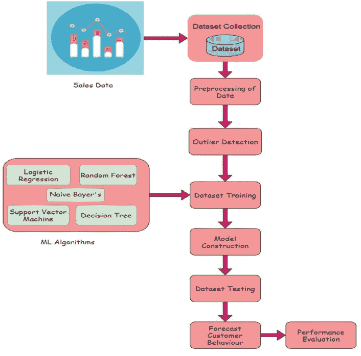

图5.1 流程图

## 5.2.1 数据收集与预处理

用于预测的数据集从网上收集。引用的论文使用了诸如杂货连锁忠诚系统（Peker等，2017；eker等，2018）、Kaggle上的客户行为数据集（Harsh Valecha等，2018）、BigMart销售数据集（Kumari Punam等，2018; Rai等，2019）、库存数据集（Maheshwari & Packia Priya，2017; Singh等，2020）以及每日销售收入（Rankothe Gishan Hiranya Pematilake等，2018; Bowen等，2020）。影响属性通过机器学习或大量属性来选择。从集中删除了未使用、无关和冗余的属性。城市、商品数量、数量、收入、日期、反馈等属性可以被视为影响属性。整体架构如图5.2所示。

- 数据理解
- 数据准备
- 数据建模
- 数据评估
- 数据部署

图5.2 数据挖掘的阶段。

# 客户行为预测

所构建的模型。预测建模方法大致分为个体级方法（即客户-产品对）和分群级方法（即通过聚类形成客户细分）（Peker et al., 2018; Zhuang et al., 2019; Zhao et al., 2019）。销售数据集的分类和聚类是使用 ML 算法完成的。本综述对神经技术以及其他机器学习算法进行了回顾，包括随机森林、支持向量机（SVM）、决策树和逻辑回归。

### 5.2.5.1 随机森林

对收集的数据集进行预处理，然后进行分析并从大型数据集中提取重要的客户属性。为了构建确定客户行为的树森林，将随机森林应用于提取的特征。使用自助法（Bagging）和特征随机性构建单棵树，然后将其分类为目标客户行为。使用投票技术进行预测。

### 5.2.5.2 支持向量机

SVM 可用于回归和分类。使用多维超平面来构建 SVM。SVM 算法在特征数量空间中识别超平面，并根据客户访问电子商务网站的规律性清晰地对客户行为进行分类（Maheshwari & Packia Amutha Priya, 2017）。

### 5.2.5.3 决策树

决策树通过递归划分对客户行为进行分类。它可以用于分析多个变量。它根据最高分给客户行为分配标签。

### 5.2.5.4 逻辑回归

逻辑回归（LR）是一种用于分类问题的预测分析算法。LR 用于预测 0 到 1 之间分类依赖变量的概率值。它被用于确定分类中影响最大的变量。使用 LR 方法也可以推导出客户行为与购买某产品的产品的意愿之间的关系，该方法可将客户行为划分为不同的细分以预测下一次购物清单（Peker et al., 2018）。

### 5.2.5.5 朴素贝叶斯

朴素贝叶斯用于解决分类问题的分类算法。它利用概率进行预测。它是一种概率分类器，通过学习模式并与词列表进行比较，为每个对象分类最可能的类别标签。当数据集中描述多个特征时，朴素贝叶斯算法被广泛使用。它可以预测客户是否会购买该产品。朴素贝叶斯旨在为大型数据集得出准确结果。它用于分析客户行为以根据客户兴趣提供建议（Arsalwad and Dhanawade, 2017）。

### 5.2.5.6 K-Means 聚类

K-means 算法是最流行的聚类算法，用于迭代将给定数据划分为不同的不重叠子组，直到获得恒质心。迭代持续到我们获得具有恒质心的不同子组。Kmeans 聚类用于根据客户行为生成客户细分并得出有意义的见解和建议（Vive, 2018）。

## 5.3 所采用的技术

在连续收集销售数据后，进行了预处理以提取其准确信息以便进一步检测。此外，还采用了监督机器学习分类算法，即逻辑回归、随机森林、朴素贝叶斯、SVM 和决策树。使用数据挖掘技术来识别收集数据中的模式。部署了传统的 ML 算法、混合模型方法和神经网络方法。最后，为了比较我们中使用的不同 ML 算法，使用了个体级和分群级方法。

### 5.3.1 机器学习方法

机器学习被认为是 AI 的一部分。它作为一种自动化工具，用于在海量数据中发现隐藏模式。ML 技术大致分为四类：朴素监督、无监督、半监督和强化学习。

从互联网收集电子商务数据集是销售和客户行为中的首要活动。对数据进行预处理和异常检测是为了确定数据集的通用信息以及属性之间的相关性。为了训练分类器，使用监督机器学习分类算法（即逻辑回归、随机森林、朴素贝叶斯、SVM 和决策树）构建训练数据集。当无法获得初始标记数据集时，也可以使用无监督算法（如 K-means 聚类、K 近邻）构建分类模型。使用测试数据进行性能评估，以确定分类的正确性。

为了提高销售预测，使用了机器学习的综合预测模型，这些模型也处理大数据。可以根据性能评估进行分析，得出最合适的机器学习算法（Cheriyan et al., 2018; Piyush Anil et al., 2019）。机器学习广泛用于根据客户访问电子商务网站的情况，将其购买行为分类为定期性、偶然性、节日性或逛窗型。然后，可以使用机器学习算法分析购买产品的频率以及哪个年龄段的顾客购买了产品，以进行销售预测（Maheshwari & Packia Amutha Priya, 2017）。

客户行为与购买某产品的意愿之间的关系也可以通过机器学习方法实现。ML 算法可用于分类客户行为以预测销售（Harsh Valecha et al., 2018; Lin et al., 2018; Xu et al., 2018）。可以根据每个客户的行为推导出其的个性化购物清单。这可以使用个体级和基于细分的方法来预测客户的下一次购物清单。这还采用了不同的机器学习预测算法（Peker et al., 2018; Maxim Korolev & Ruegg, 2015）。

### 5.3.2 数据挖掘方法

数据挖掘是一种从原始数据中提取海量信息并将其转换为有用信息的技术（Yadav et al., 2017; Victor Haastrup; Adeleleye et al., 2014）。它用于从数据集中提取有用模式。根据数据挖掘生成的报告做出战略决策，以满足客户行为。数据挖掘可以描述为 AI 技术和数学统计。

数据挖掘技术的阶段如图 5.3 所示。

#### 5.3.2.1 数据准备

数据准备阶段是数据从电子商务收集的后续阶段。数据准备包括对获取的数据进行预处理、数据清洗以去除用属性、数据转换和子集选择。

 图 5.3 技术挖掘

#### 5.3.2.2 模式识别

通过考虑和比较模型，选择最佳模型。然后分析发现的模式以规划需求驱动。

发现的模式用于分析客户行为以预测下一个页面。序列模式识别用于寻找时间序列（即哪种购买在另一种之后）。定向树模型可用于感知客户访问的最大路径（MFP）（Yadav et al., 2017; Tonya Boone et al., 2019）。

模式的聚类使用无监督算法 K-means 算法根据行为和访问电子商务网站的时间将客户分组（Yadav et al., 2017; Jiang & Yu, 2008; He & Jiang, 2017）。

#### 5.3.2.3 部署

部署阶段涉及使用模式识别阶段选出的最佳模型，并将模型应用于数据以预测或预测推荐列表。所选模型可能由 ML、神经网络或任何混合技术组成。

# 客户行为预测

混合模型通过结合不同的分组方法（如装袋法 bagging 和 提升法 boosting）来构建一个高精度的分类器模型。

混合模型的构建可以通过在堆叠（stack）上组合预测技术来适应两层方法。该模型包含两层预测算法来预测销售额。在 (Kumari Punam et al., 2018) 中，第一层由线性回归、回归树、cubist、支持向量回归和 K-近邻等预测算法组成集成；第二层则使用线性回归、支持向量回归和 cubist 算法构建。自回归积分移动平均模型 (ARIMA) 用于分析任何数据集的时间序列以预测未来销售额。在 (Rankothge Gishan Hiranya Pemathilake et al., 2018) 中，通过集成 ARIMA 和 RNN 模块构建了一个混合模型，以确定输入属性之间的相关性。

## 5.3.4 神经网络方法

神经网络方法是一种基于大脑神经功能设计的分析技术，用于理清并为复杂问题提供解决方案。学习过程通过认知系统完成。可以根据现有数据的观察做出新的预测。网络的设计旨在匹配涉及许多试错法的调查问题。采用人工智能来寻找最佳网络。该网络架构随后通过应用不同数量的输入并迭代调整网络权重进行训练，以优化地预测客户行为 (Cui et al., 2018; Kuen-Han Tsai et al., 2017; Jia et al., 2017)。

## 5.3.5 个体级与分级方法

个体级方法利用单个客户过去的产品行为和交易情况，为该个体客户构建模型并进行产品推荐。分级方法采用聚合技术来预测目标客户群的购买产品 (Peker et al., 2017; Peker et al., 2018)。预测模型使用合适的 ML 算法构建。

## 5.4 性能评估与结果

对于所构建的分类模型，真正性 (TP)、假正性 (FP)、真负性和假负性的定义如下：

- 召回率 (Recall)：检索到的总相关实例的概率。

$$Recall = \frac{TP}{TP + FN}$$

- 精率 (Precision)：在所有检索到的实例中获得相关实例的概率。

$$Precision = \frac{TP}{TP + FP}$$

- F 分数 (F-measure)：一种整合了召回率和精率值的指标。它被称为召回率和精率值的调和平均数。

$$F - measure = 2 \times \frac{Precision \times Recall}{Precision + Recall}$$

- mRHR：当客户存在多种偏好时，用于评估模型对推荐产品排序的指标。

$$mRHR = \frac{1}{preferences} \times \frac{\sum_{i=1}^N hit}{rank}$$

其中，hit 表示客户是否偏好模型预测的产品。Rank 是偏好产品的位置。

为了获得实验结果，本调查利用各种技术分析客户行为数据，包括作为逻辑回归的机器学习算法、朴素贝叶斯、SVM、决策树、随机森林和神经网络，使用预测模型对客户进行细分并预测购物点单。使用 F 分数和 mRHR 等性能评估因素对 ML 算法进行了比较。表 5.1 显示，在个体级方法中，SVM 给出了最佳结果，F 分数为 0.345，mRHR 为 0.120。LR 在分级方法中表现出最佳结果，F 分数为 0.355，mRHR 为 0.124。

## 表 5.1

使用各种 ML 算法进行客户行为建模比较

| 个体级方法 | ML 算法 | F 分数值 | mRHR 值 |
| :--- | :--- | :--- | :--- |
| 逻辑回归 | 0.328 | 0.100 |
| 决策树 | 0.329 | 0.107 |
| 随机森林 | 0.337 | 0.112 |
| 支持向量机 | 0.345 | 0.120 |
| 神经网络 | 0.314 | 0.102 |
| 分级方法 | ML 算法 | F 分数值 | mRHR 值 |
| :--- | :--- | :--- | :--- |
| 逻辑回归 | 0.355 | 0.124 |
| 决策树 | 0.33 | 0.112 |
| 随机森林 | 0.315 | 0.109 |
| 支持向量机 | 0.322 | 0.113 |
| 神经网络 | 0.293 | 0.092 |

分级方法的 LR 记录了整体最佳性能。图 5.4、图 5.5、图 5.6 和图 5.7 比较了使用构建的预测模型的所有 ML 算法的 F 分数 mRHR 值。调查结果表明，构建模型的性能取决于：

## 个体级方法 - F 分数

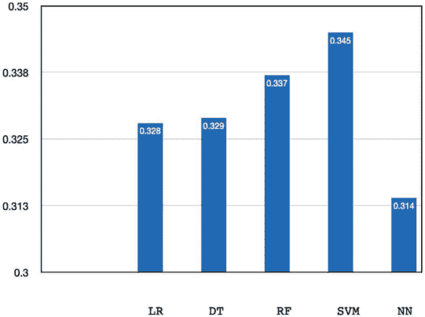

图 5.4 所有 ML 算法的 F 分数比较。

## 分级 - F 分数

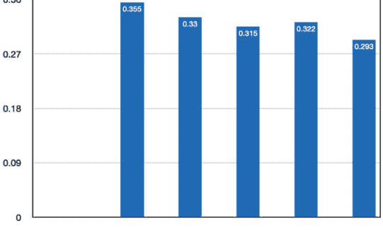

图 5.5 的 F 分数比较。

## 通过 AI 重构流程

## 个体级方法 - mRHR


图 5.6 所有 ML 算法的 mRHR 比较。

## 分级 - mRHR


图 5.7 所有 ML 算法的 mRHR 比较。

# 客户行为预测

调查结果表明，模型的性能取决于：为了获得实验结果，本调查利用各种技术分析客户行为数据，包括逻辑回归等机器学习、朴素贝叶斯、SVM、决策树、随机森林和神经网络，使用预测模型对客户进行细分并预测购物点单。使用 F 分数和 mRHR 等性能评估因素对 ML 算法进行了比较。

## 5.5 结论

准确预测客户至关重要。因此，必须使用机器学习、数据挖掘和神经网络等方法来改进客户。


## 参考文献

- Arsal GP 和 Dhanawade AA (2017), "使用朴素贝叶斯分析电子商务客户"。
- Bower, T, et al. (2020), "基于 ARIMA-BP 模型的电子商务预测", 2020 IEEE 人工智能与计算机会议 (ICA), 大连 (第 27-29 页)。
- Burick D, et al. (2005), "挖掘极大集的算法", 数据挖掘与发现 (第 223-242 页)。
- Cheriyan S, et al. (2018), "使用机器学习技术的智能销售预测", 计算机电子与电信会议 (ECE), 南特 (第 16-17 页)。
- Cui Y, et al. (2018), "神经网络建模客户行为：转化预测和广告重定向", 来自 https://arxiv.org/abs/1804.0769。
- Eric Michael S, et al. (2017), "受限电子商务平台的客户预测", 模式识别国际会议 (ICPRS 2017), 西马里德 (第 11-13 页)。
- Harsh Valech, et al. (2018), "使用随机森林预测客户行为", 第五届 IEEE 北方普拉邦国际电子与计算机会议 (UPCON), 戈拉克斯普尔 (第 2-4 页)。
- He J 和 Wang Y (2019), "电子商务环境下用户的优惠使用行为", IEEE 并行与分布式处理研讨会和 IEEE 通用计算与通信会议 (SPI/IAUC), 广州。
- Jain A 和 Chandra S (2017), "零售链销售预测", 来自 www.semanticsolar.org/Sales-for-Retail-Chains-Join-Menon/76244f4d1a2d1970a9f91d38a15e2dc7ca2ef。
- Jia R, et al. (2017), "基于用户行为数据的电子商务购买预测方法", 计算机信息电信系统国际会议 (CITS), 大连 (第 21-23 页)。
- Jiang Y 和 Yu S. (2008), "挖掘电子商务数据以分析目标行为", 第一届知识发现与数据挖掘国际工作坊 (第 406-409 页)。

# 通过人工智能重塑流程

Karim M, et al. (2012), “利用极大模式挖掘电子商务购物者的购买规则：从电子商务视角”, 国际科学与应用国际会议 (ICISA),韩国首尔 (pp. 23–25)。
Kuen-Hai Tsai, et al. (2017), “用于销售预测的多源学习”, 2017年人工智能技术与应用会议 (TAAI),台湾台北 (pp. 1–3)。
Kumari Panam, et al. (2018), “一种用于大额销售预测的双级统计模型”, 计算、电力与通信技术国际会议 (GUCON),印度北方普拉什邦 (pp. 28–29)。
Li, X, et al. (2020), “电子商务网红社交营销行为的刻画及其价值预测”, IEEE INFOCOM 2020—IEEE计算机通信研讨会 (INFOCOM WSHPS), 加拿大多 (pp. 6–9)。
Lin, W, et al. (2018), “社交媒体品牌参与作为电子商务活动的代理：唯和和京东案例研究”, IEEE/WIC/ACM网络智能国际会议 (WI), 智利圣亚哥 (pp. 3–6)。
Maheshwari K and Pathaka Mithra Priya P (2017), “使用SVM分类器预测在线购物客户行为”, 控制、优化与信号处理智能技术国际会议 (INCOS), 印度斯里维利普斯 (pp. 23–25)。
Maksim Rolever and Kuegg K. (2015), “用于预测商店销售的梯度提升树”, Available: https://c22sn.stanford.org/proj/2015/193_report.pdf.
Peker S, et al. (2017), “一种预测客户个体购买行为的混合方法”, Kybermetrics (46(12), pp. 1–22)。
Peker S, et al. (2018), “用于购物列表预测的客户行为建模实证分析”, 信息与通信技术、电子与微电子国际会议 (MIPRO), 克罗地亚奥帕蒂亚 (pp. 21–25)。
Yiush Anil B, et al (2019), “旅游业中销售预测模型的设计与基于酒店推荐的混合推荐”, 第三次计算方法与通信国际会议 (ICCMC 2019), 印度埃罗德 (pp. 27–29)。
Rai S, et al. (2019), “电子商务广告的需求预测：使用最先进机器学习方法的比较研究”, 计算、网络与技术国际会议 (ICCNCT) (pp. 6–8), 印度坎普尔。
Rana Alaa El-Deen Ahmed, et al. (2015), “基于数据挖掘的消费者在线购物态度和行为分类算法性能研究”, 第五次系统与网络技术国际会议, 印度格瓦利尔 (pp. 4–6)。
Rankostosthe Ghosh Hiranya Pemathilike, et al. (2018), “自回归集成移动平均模型与循环神经网络混合模型中的销售预测”, 仿生计算、模糊系统与知识发现国际会议 (ICNSKD), 中国黄山 (pp. 28–30)。
Sastry, S, et al. (2014), “使用聚类算法对SAP-ERP系统中的销售数据进行分析和预测”, Available: arXiv预印 (arXiv: 1312.2678)。
Singh B, et al. (2020), “基于时间序列模型的亚马逊销售预测”, 第一届电力、控制与计算技术国际会议 (CPC27), 印度雅加浦尔 (pp. 3–5)。
Tonya Boone, al. (2019), “供应链销售预测：大数据时代的消费者分析”, 国际预测期刊 (35(1), pp. 170–180)。
Victor Haastrup Adeleye, et al. (2014), “客户行为分析与数据挖掘”, 美国计算、通信与控制期刊 (pp. 66–74)。

# 客户行为预测

Vive S (2018), “用于客户细分的聚类算法”, Available: https://towards-datascience.com/clustering-algorithms-for-customer-segmentation-af637c6830ac.
Wang P, P et al. (2015), “用于下一次购物篮推荐的层级表示模型学习”, Available: www.bigdatalab.ac.cn/-junxu/publications/SIGIR2015_NextBasketRec.pdf.
Xu D, P, et al. (2018), “基于集成学习的复购预测”, IEEE SmartWorld, 泛在智能、先进与可信计算、可扩展计算与通信、云与大数据计算、人类网络与智能创新, 中国广州 (pp. 8–12)。
Yadav, M. P, et al. (2017), “使用网络挖掘挖掘电子商务中的客户行为”, Available: https://neonprojects.com/customer-behavior-prediction-using-web-usage-mining/
Zhao B, et al. (2019), “忠实消费者还是一次性交易猎寻者：电子商务的重复购买者预测”, 国际数据挖掘研讨会会议 (ICDMW), 中国北京 (pp. 8–11)。
Zhuang Q, et al. (2019), “用于电子商务的神经网络”, 经济管理与工程国际会议 (ICME), 马西亚马六甲 (pp. 6–8)。

# 人工智能对全球实践的影响

| 内容 | 页码 |
| :--- | :--- |
| 引言 | 95 |
| 人工智能的演变 | 97 |
| 机器学习与深度学习 | 98 |
| 人工智能的需求 | 100 |
| 人工智能的影响 | 102 |
| AI在各领域的影响 | 104 |
| 结论 | 108 |
| 参考文献 | 109 |

## 6.1 引言

第一个提出人工智能的人是1950年的图灵。他引入了图灵测试来判断机器是否能够像人类一样思考。

### 6.1.1 人工智能的演变

AI已经存在了几十年。在最基本的形式下，计算机能够下象棋和解决谜题。

### 6.1.2 机器学习与深度学习

AI被定义为人类大脑的能力，但不限于适用于语言学、生物学、哲学、数学和计算机科学等许多领域。

### 6.1.3 人工智能的需求

AI具有解决发展性挑战的潜力，例如许多国家缺乏基础设施的问题。

## 6.2 人工智能的影响

在潜力方面，AI能够从根本上改变人们获取商品和服务、收集信息以及互动的方式。在新兴经济体中，AI提供了降低成本和准入门槛的机会。

### 6.3 AI在各领域的影响

AI正在中国等快速发展的国家变得越来越流行。由于其快速扩张和改进，机器学习和深度学习取得了巨大的进展。

## 6.4 结论

AI可以被视为商业战略和模型的新能源，可用于识别可行的商业状况、预测新状况并产生明智且快速的商业决策。

## 6.5 通过人工智能重塑流程

每个国家都在原型中成长。随着互联网泡沫的爆发，创新的贸易理念和原型不断兴起。电子商务也随着Paytm、Google Pay和在线银行等其他金融服务不断演变。通过增强流程和程序，这些服务加速了交易。

# AI 对全球业务实践的影响

公众的想象力以好和坏两种方式产生着影响。最新技术计算机和智能手机的用户已经开始以互联网搜索、语音识别、Facebook 图像标记等形式使用 AI 技术。人们现在期待在电影中看到数字特效，以及在写实视频中对关键场景进行三维重建，而这些只有通过 AI 技术才能实现。

## 6.1.1 工业革命的演变与历史

工业革命主要是指工作开始在工业单位中通过机器而非在家庭中完成的时代。科学和自动化的进一步发展不断推动着国际业务中世界和工业的进步，使我们在近年来能够为术语提供更明确、更清晰的含义（Belvedere et al., 2013）。这是一个改变了我们经济和社会的概念和发展过程。世界的发展可能给人一种印象，即在这种革命视角下发生了某些变化，这真实反映了快速且根本性的变化——无疑，这些关键变化发生在较短的时间内。工业发展导致了小规模工厂、作坊和手工作室的取代。工业的开始最初源于纺织厂和陶瓷厂，随后进入了运河和铁路线路的新基础设施，这实现了高效的分发。这无疑是向工业的实际转型，两者都由此开始了繁荣（Van et al., 2014）。

工业革命在过去一直与技术能力的进步联系在一起。对提高效率和产出的追求使工业部门成为技术和工业转型构想时期的主要参与者之一。今天，第四次工业革命指的是进步和转型，旨在促进技术升级，帮助我们满足分散在巧妙工业单元中的分布式信息物理系统（CPS）中可能产生的额外需求（Saturno et al., 2017）。

关于什么构成工业革命尚没有通用共识（Maynard, 2015），但根据国家科学与工程学院（2013），从工业革命角度定义的阶段的一般分类如图 6.1 所示。

第一次工业革命被认为是文明史上最具意义的革命，它始于 18 世纪末使用水力和蒸汽驱动的机械化工程设施。20 世纪始于第二次革命，即利用分工生产和电力驱动的大规模生产机械。随后促进自动化制造的第三次革命于 20 世纪 70 年代中期开始，通过在制造单元中传播电子和信息技术（IT）。第四次工业革命始于人工智能、机器学习、物联网（IoT）等技术的使用，因为物联网和信息物理系统已经吸引并引起了研究者的关注（Atzori et al., 2010）。

# 通过 AI 重塑流程

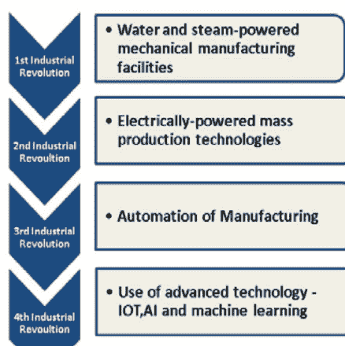

**图 6.1** 工业革命的全球发展。

### 6.1.2 第四次工业革命

工业 4.0 或第四次工业革命以物联网、数据科学、云计算、区块链和人工智能的形式提供了技术上的进一步进步——所有这些技术正在改变我们生活、工作和娱乐娱乐的方式。此外，这些技术有助于开发超自动化和超互联性（Schwab, 2017; Rana & Sharma, 2019; Bloem et al., 2014; Klostersberg, 2016; Park, 2017）。它推动了科学技术的发展，其中物联网及相关技术作为 CPS 的支柱，其中机器智能被用作代理来增强生产线。

敏捷性、强度和网络化都是超越组织和国家边界的改进（Lao et al., 2017）。到目前，工业 4.0 尚未被定义为限于计算机技术。物联网和其他网络用于改进生产。第四次工业革命将计算推向了一个新的水平，走向一个信息物理世界，在那里增强现实、人工智能、数据驱动的决策自主系统和云正在改变着制造业的标准。在水平组织中与机器人协作工作的高技能员工是一些预测的影响之一。工业 4.0 下的 CPS 在通信的进步和快速发展中起着重要作用，当它与人连接起来时，我们可以使其在社会中变得常见，但确保在通过人工智能利用后 CPS 运行良好并具有保证容错能力是关重要的（Mosterman & Zander, 2015）。CPS 此外是构建物联网的基础，物联网可以结合以开发一种...

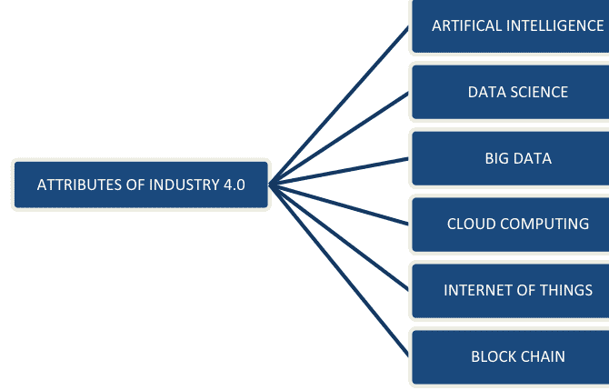

**图 6.2** 工业 4.0 的主要属性。

服务互联网。因此，组织将发现更容易创建全球网络，这些网络未来可以与 CPS 的仓储安排、设备和制造设施连接（He, 2016）。

第四次工业革命或工业 4.0 有许多子部分和属性，其中人工智能是最重要的元素之一。

- **人工智能：** 当控制包括对操作系统的自我定向修改时（这种修改可以通过仿真完成），先进的 AI 可以被认为是理性的。根据最新的革命，仿真建模模式有助于利用计算机生成的制造概念对生产过程和其他过程进行建模。仿真通过并发数据完成，在仿真模型中代表现实世界。
- **数据科学：** 数据科学是统计学、信息学、计算、社会学和管理的结合并发挥作用。
- **大数据：** 数据分析现在已成为工业 4.0 的最新话题，因为它对预测性制造非常有用。
- **云计算：** 云计算是一种相对新的系统，为操作者提供了巨大的存储容量，并且组织成本较低。
- **物联网 (IoT)：** 工业 4.0 正在经历物联网与制造业的不同结合。
- **区块链：** 区块链可以被视为一种先进技术，改进了客户服务、倡议和端到端价值以及流程效率。

大数据有四个维度，即数量、多样性、价值和速度（Witkowski, 2017）。

## 6.1.3 人工智能、机器学习与深度学习

人工智能是一个非常复杂的事，具有多种概念和定义。与自驱动程序相比，非常基础的人工智能程序或自动化风险很高，尽管在涉及业务回报时，人工智能克服了这种风险。AI 已经在业务中使用，并可能达到新高度。它将在业务流程中变得更加普遍，社会也需要进行调整。观察发现，对人工智能等技术未来发展的预测都是肯定的，因为它们是多样化的（Armstrong et al., 2014）。

不同的作者对人工智能、机器学习和深度学习给许多定义，根据这些定义，三者在人类活动中的参与是不可避免的，而且与取代人类工作相比，它们对人类和社会的卓越回报持续引发了关注。

# 人工智能对全球业务实践的影响

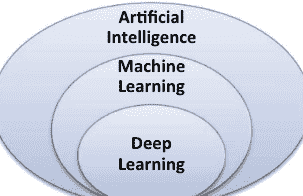

**图 6.3** 人工智能、机器学习与深度学习之间的关系。

尽管人工智能有很多子领域，但根据研究，深度学习是机器学习的子集——进一步来说，机器学习又是人工智能的子集。尽管人工智能有许多子领域，如语言处理、图像处理和数据挖掘，但机器学习作为人工智能的一个分支发展出来，而深度学习是其组成部分。通过深度学习和机器学习，人工智能的应用已扩展到医学科学、智能制造、农业、药学、商业等许多领域（2019）。

机器学习：深度学习是机器学习算法家族的一员，其灵感源于神经网络的生物过程，这种过程控制着许多应用，并比传统的机器学习具有优势（Goodfellow et al., 2016）。深度学习利用其能力产生更快、更准确的结果。它努力根据一组算法对数据中的高层抽象进行建模（Deng & Yu, 2014）。当训练数据量增加时，深度学习变得更加适用；随着软件和硬件的发展，深度学习的发展也得到了加强（2018）。

深度学习：学习可以定义为通过随时间识别新信息来实现行为转化的和改进的过程之一——当学习由机器执行时，它被称为机器学习。机器学习的主要目标是创建一个可以自我训练以改进、感知复杂模式并借助以前的数据为新问题寻找解决方案的模型（2015）。机器学习和深度学习作为人工智能的一部分被用于社交网络分析，其中无监督机器学习算法可以自动识别用户圈内的网络，或者确定发送邮件的最大数量并将其分类为集体小组；即使你想知道哪些人之间相互认识，通过人工智能也可以实现这一点。如今，大多数公司拥有巨大的客户数据库，可以使用无监督机器学习自动发现市场细分，并将小组划分为不同的细分领域，组织可以更高效地销售产品或进行市场营销（Haider et al., 2012）。

## 6.2 全球业务中对人工智能的需求

人工智能不仅用于技术发展，还适用于营销和商业，如业务中的自动化、从数据中获取愿景或投入员工投入（Davenport, 2018）。人工智能（AI）为企业以及经济底层个人面临的挑战提供了技术解决方案。整合来自各种来源（如社交媒体、网站和通信渠道）的数据将有助于企业数据管理的发展、成功的商业战略以及减少经营障碍（Arora & Rahman, 2017）。

在当今世界，人工智能可以与源自传统技术的框架联系起来，并关注新兴经济体。微观经济理论的基本概念可以重新评估，以适应制造和增强决策的新设备设备的出现（Parkes & Wellman, 2015）。McAfee 提出了一种适用于就业转移的资产模型，并将其视为一种激进的干预，其关注点是基于社会主义的基本方法，即分配预期资产以建立一种新的工作范式。人们不需要从事艰苦的工作并可以远离劳苦，因此，人的价值可以被重新考虑。随着 AI 技术的实践，人们可能开始愉快地工作，没有金钱忧虑的压力或闲置压力，因为一切将变得非常系统化并完成（McAfee, 2013）。


人工智能在重建技能需求、职业前景以及行业间工人和员工的系统性分配方面具有巨大潜力。尽管参与研究和政策制定的人员尚未充分应对由 AI 等特定认知技术导致的劳动力趋势，但技术需要执行典型任务，从而改变工作场所对特定技能的需求（Sharma & Rana, 2021）。这种改变的结果可以延伸到整个经济，增加职业技能要求、职业流动性和社会福利，工人将拥有某些社会认同。在识别此类替代方案的特定路径上可能会遇到障碍，这些障碍受到历史数据和有限的韧性建模工具的限制，但可以通过优先深度数据收集、对劳动力市场实际动态做出反应以及解决区域不一致性来克服。更好地访问候选人简历中的非结构化数据、带有最新技术变化指标的招聘公告（如使用专利数据以及跨区域和区域内依赖关系的模型），将促进一种更好地理解和未来预测工作的新且有前景的技术。这种数据收集技术的改进将帮助我们使用新的数据驱动工具，加入机器学习和系统建模，这可以更准确地反映整个劳动力系统的复杂性。新数据将导致一种新的研究，加强我们对技术和人工智能对现代劳动力市场影响的学习和理解（Frank et al., 2019）。

人工智能已经达到了一个水平，可以用来将现实世界应用于财务决策、与公众聊天、与人类玩游戏以及与他们协作工作。这些现实应用背后只有 AI 驱动的系统或智能体（IA），它们以重复的方式与环境交互，进行感知、思考和行动。来自世界的考虑根据输入数据和以往经验做出明智决策并执行影响环境的行动。它可以像工业中的机器、家庭机器人或自动驾驶汽车一样工作；也可以作为软件代理、聊天机器人、推荐系统等。AI 算法以图像、声音、文本、视频等形式获取信息，分析并提供 AI 驱动的解决方案（Soni et al., 2019）。

人工智能不仅提供了可靠性，还提供了效益，解决了复杂问题并帮助做出准确决策。同样，它控制缺失数据；这就是为什么它被用于商业和工程的许多领域。强化学习——基于在现实世界中测试失败以增加应用的可靠性——是 AI 使用的最佳工具之一，但在能力和功能方面也有局限性（Sadek & Chowdhury, 2012）。

## 6.3 人工智能对全球业务实践的未来影响

随着人工智能的发展，其实践在国际业务方面也改变了宏观层面的贸易影响；例如，随着 AI 提高生产力和增长，它将导致经济增长增加并在全球范围内提供新机遇。目前，由于各种原因，全球生产力增长率要低（Remes et al., 2018）——第一个原因是国家需要整合并有效利用新技术如 AI，这是一个相对复杂且具有全经济影响的问题（Brynolfsson et al., 2017），但 AI 的质量也可能影响经济增长的类型和质量，并产生国际贸易影响；它将加速向服务经济的转型。

# 通过人工智能重塑流程

自动化并加速了制造业中低技能工人和蓝领工人的失业问题（Arnet et al., 2016）。

### 6.3.1 人工智能在各个领域的影响

人工智能在未来几年内无疑将会增长，并最终成为常态，技术已使计算机在决策过程中使用大量数据或通过数据进行学习成为可能。Google、Apple 和 Facebook 等科技巨头已经在人工智能整合方面投入了资金、精力和时间。这些企业也采取了措施向公众普及人工智能的能力和局限性认知。但这种业务中的自动化将导致许多领域的被取代；例如，工作和技能的缺失将继续导致就业性短缺，因为人工智能在某种程度上是劳动的补充，而不会完全取代他们。人工智能已应用于法律、政治学、政策和经济学等领域；未来还将出现在战争、自动驾驶交通、教育和太空探索等领域。

让我们来看一些潜在且可能的未来人工智能应用，这些应用无疑将改善人们的生活。在人工智能的影响下，交通、医疗、物流、金融和制造业等许多行业将经历巨大的变革，使其变得更高效、更具成本效益，最重要的是能提供更好的服务。随后，人工智能将对不同部门产生积极影响，这些影响将直接或间接地影响全球业务环境，如图 6.4 所示。

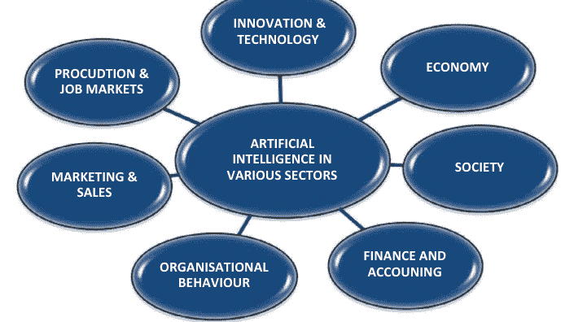

图 6.4 人工智能在各个领域的影响。

# AI 对全球业务实践的影响

### 创新与技术中的 AI：随着人工智能的采用，世界变得更智能、更具创新。使用 Google Maps 进行路线和交通规划、Uber 和 Lyft 的网车定价、寻找朋友和过滤垃圾邮件、在线购物与推荐以及疾病检测，都是简化我们生活的人工智能技术创新。人工智能在全球范围内进入每个领域不可思议的速度，迫使组织采用人工智能，这也迫使企业、政策制定者、创新者、企业家和研究人员适应开发新战略并产生新的业务价值来源（Soni et al., 2019）。

阿里巴巴是世界最大的电子商务平台，销售额超过了亚马逊和 eBay 总和。人工智能（AI）被用于在阿里巴巴日常运营中预测消费者想买什么。公司使用自然语言处理为网站创建产品描述。阿里巴巴还通过其他方式使用人工智能。阿里巴巴旨在开发智慧城市的“城市脑”项目是人工智能应用的另一个例子。通过跟踪城市中的每辆车，该项目使用 AI 算法来缓解交通拥堵。阿里巴巴的云计算平台阿里云（Alibaba Cloud）也在使用人工智能帮助农民监测作物，以增加产量并降低成本。

### 经济中的 AI：通过提高效率、业务流程自动化、金融解决方案和政府服务，基于人工智能的技术可以扩大市场并创造更多机会。通过赋能公私部门利用人工智能协作，在新兴市场和全球市场中实现跨越式解决方案，可以减少不平等和贫困（Andrews et al., 2019）。社会发展中的技术升级、生产、营销和金融的改进都是经济发展的迹象，而人工智能正在补充这些部门以实现更好的生活。拥有 AI 技术的新加坡选择了五个主要的 AI 驱动发展项目来解决国家挑战，同时考虑了对社会和经济的影响。

### 社会中的 AI：人工智能对人类和社会也有其影响，它的参与赋予了“工作作为自我价值体现”的新意义，人们将为了快乐而非被迫而工作，职场的稳定性和安全性将得到保障。尽管机器没有创造力，也没有同情、怜悯或情感智能，但与此类机器工作将增加他们的情商，从而改变对生活的展望和态度，并导致社会发展（Pavalou, 2016）。近年来，由于互联网的创新，人工智能引起了大量关注，并使我们变得更容易触及。由于这些进步以及对该技术潜在的社会经济和伦理后果的关注，它已推向许多当前辩论的前沿，各国政府正试图理解技术对其所属的人民的影响。在新加坡，教育机构更加关注数学、统计学、计算机科学和信息技术等领域，以理解数据科学、机器学习和人工智能的重要性和趋势。除了日常课程外，商业和管理机构现在关注数据模式；银行可以利用它判断账户是否存在异常活动。算法可以检测到异常活动，例如此类外国交易。因此，人工智能在社会中的应用将实现全面的数字化，从而无忧地快速发展。

### 金融与会计中的 AI：AI 也通过其数字足迹进入金融领域。人工智能在金融和会计中的应用包括根据消费者的购买习惯和频率记录习惯；他们与财务会计相关的不同活动（如收入和管理方式）；以及他们的财务投资和计划。随着人工智能参与金融和业务，欺诈机会将降至最低；企业和 AI 的节约效率可以这样组织，使人们在增加安全性的最小化风险并最大化利润。金融服务将受益于数字员工 24/7 支持，我们的解决方案可以定制以满足其他部门的需求。流程自动化、案件处理、操作、客户验证以及所有 AI 解决方案正在开发中。企业可以使用数字员工同时扩大业务规模、提高服务效率并降低成本。金融和会计可以被视为两个不同的概念，尽管在应用人工智能方面两者有大量的整合。金融和会计通过分析性能、确保法律合规、制定预算和开发战略来控制业务（Freman, 2018）。

人工智能的益处在于它可以收集大量数据并以简单的方式创建信息。金融机构已开始采用并在未来将采用更多此类自动化系统来识别并减少人为错误，其中资源密集型、重复性的任务非常适合由人工智能程序完成。在金融和会计系统中，Accenture 等公司使用了自动化、机器学习和自适应智能。

### 组织行为中的 AI：收集和处理数据的能力不断提高，为重塑公司运营开启了新的可能性。组织应该利用人工智能发现模式并从数据中得出见解，以做出更好的决策。一旦应用技术，组织的伦理和价值观将得到完善，因为它将提供更多的透明度并减少职场冲突和不诚实。下属完成任务和实现目标的工作方式将提升一个水平，表现将导致员工生产力、培训和战略管理。在人工智能存在，组织将从两个方面受到影响：首先，将在新技术的影响对工作分配进行评估，并在需要的地方通过人工智能替代劳动力来完成变革。其次，人们的知识和对失去工作的感知将由于人工智能的应用而发生根本性变化，每个相关利益相关者的认知素养都需要提高提高（Sharma & Rana, 2021; Holtel, 2015）。

性格评估问卷也可以帮助组织在组织变更时确定哪些现有员工适合新职位。

## AI对全球业务实践的影响

例如，一个寻求填补网络安全职位的组织可能已经拥有了任这些职位所需技能的员工。内部招聘比从外部寻找候选人更具效率且更具效益。

沃尔玛（Walmart）是在所有运营领域应用了AI的顶级公司之一，在进行检查时，它可以发现人类遗漏的物品，并释放他们去做其他事情。例如，Netflix利用定制化和个性化，根据客户之前的观看习惯为特定客户策划内容。人力资源经理可能使用相同的原理，根据偏好、职业目标、性格洞察和工作情况，结合外部和内部来源的培训创建自适应学习体验。

**营销与销售中的AI：** 人工智能已经从科学走向商业现实。你需要能够与你的基础设施和战略集成的AI解决方案，以应对今天的挑战并为未来做好准备。亚马逊的Alexa和IBM的Watson是人工智能的理想案例，它们已经在市场中占有一席之地。Google Assistant将满足购买产品、预订酒店、搜索大学等各种需求。IBM的 Watson具有在一秒内阅读2亿页数据的效率，并能够预测市场上的买家需求（Howard, 2014）。为了重定向广告并创建推荐，Facebook从网络浏览器获取信息。LinkedIn是另一个利用机器学习寻找人才并匹配员工与雇主的例子，因为它整合了用户网络中每个人的账户以及他们的兴趣。在AI提供的市场信息的帮助下，组织可以与其他竞争，因为营销自动化有助于公司扩大价值并影响其内容、提高线索到销售的转化、捕捉线索情报、推动重复购买，最重要的是，提升客户在整个市场历程中的整体体验（Roetzer, 2014）。

AI完全接管营销的机会非常高，因为程序不仅需要了解客户，还需要了解他们做出决策时使用的程序；随着自动化的使用，AI的进步还帮助营销人员与人类互动并捕捉他们的购买决策。

客户留存和销售预测是已经在使用的某些人工智能功能。在营销中引入人工智能后，某些功能也可以运行顺畅，如销售交易、区域配送、销售高管客户数据的参与以及客户和社交情感的挖掘——所有都可用于预测销售并为公司提供积极影响，确定具有高流失风险的客户（2017）。

**生产和劳动力市场中的AI：** 适应和创新是制造业中最重要的两个因素，那里的发展应该引导使用最新技术实现可持续生产。为了促进生产，从全球角度来看需要具有智能技术的智能生产。在这个方向上，人工智能已经通过机器学习和自动化建立了制造部门，以实现制造业的可持续性（Cioffi et al., 2020）。然而，AI将增加向服务经济的转型，并对经济增长的类型和质量产生影响——但AI与工作的后果仍存疑，特别是在发展中国家，相反，它可能会导致制造业领域低技能蓝领工人的失业风险扩大和自动化化（Arnet et al., 2016）；尽管如此，它将迫使普通工人具有批判性，以为产品和货物增加价值，导致生产和服务份额不仅在国家层面而且在国际范围内进一步扩大，从而产生更多就业机会。Xeon处理器、Xeon Phi处理器、Xeon E5处理器、Stratix FPGA、Arria FPGA、Max FPGA、Cyclone FPGA、Enifur FPGA、Neuron平台、Nervana平台、Nervana Engine和Saffron平台是英特公司开发的AI硬件和平台。

这是一种乐观观点，暗示了为有技能和经过培训的人员创造更多工作的可能性。全球的金融服务都在接受人工智能和智能流程自动化。客户期望不断增加，金融服务公司可以通过自动化客户服务来获得竞争优势。因此，毫无疑问，AI为更多就业机会开启了新大门，但工人需要改变或发展他们的技能以便在新兴经济中取得更大的成功——这将是一场就业转型。

根据牛津大学发表的一项研究，美国47%的工作倾向于自动化，其中这些工作趋于自动化的人员主要来自审计师、官员、财务分析师、保险公司和会计师等白领人员；另一方面，最难替代的工作是蓝领区域的治疗师、首席执行官。最脆弱的是高劳动密集型工作，如司机、游戏玩家和收银员，以及大多数计算机科学家、作家、编辑、设计师和律师（Kaplan, 2016）。在人工智能方面，Google是最著名的公司之一。尽管Google没有在它的搜索引擎中存储数百万人的信息，但它利用这些信息来重定向其随后的搜索。当你开始写几封信时，它会猜测你在寻找什么，并使用预测性文本提供建议。

## 6.4 推论

目前，人工智能在全世界的技术需求中处于顶端，而目前工作中的工人仍受到创新的扰动。除了一些缺点，AI有更多益处，如下：

- 职场透明度更高：AI在识别审计过程中的错误和欺骗问题将非常有用。害怕失败是业内人士最常见的问题。在AI的帮助下，错误和遗漏的机会将减少，通过保持……成功的概率将会

## AI对全球业务实践的影响

数据自动化将为对低质量标准负责的工人提供更大的控制。这种透明度不仅能让工人与组织连接，还能让客户获得产品信息、更好的客户服务和快速响应。职场的清晰度将创造更多归属感和关联，最终健康的环境环境带来更多生产力、利润、扩张和就业机会（Sharma et al., 2021）。

- 投资回报机会增加：透明度和生产力将确保竞争优势并提高效率。AI技术的使用将为业务建立更快、更廉的生产流程，组织可以获得先发优势。这里有保障的投资回报。

- 人为错误机会减少：业务中的自动化会导致人为错误减少并提高效率和成本效益，这将增加生产的连接性。成熟的技术可以帮助减少浪费并使质量最大化。

- 更多的团队合作与协作：人工智能可以以更好的方式与员工交流，并提高劳动力质量。劳动力的整合将通过技术支持使工作变得更简单更容易。工作负担将减轻，更多的透明度有助于团队的顺畅工作。

- 更好的人类福祉：AI技术和创新将开始影响工人的生活质量，缩短工作时间并增加报酬。当技能和培训成为强制性时，工人的生活水平和福祉将得到提高。更多的利润、更多的扩张和就业机会将为工人提供更多选择。

- 国际水平更多的就业机会：当我们比较发达国家和发展中国家时，发达国家总是面临工人短缺，而发展中国家则过剩。AI和ML将成为改变全球商业格局的里程碑。在AI和自动化的参与下，全球商业世界将表现得更好。

## 6.5 结论

人工智能被视为炒作，特别是在发展中国家，但它有能力通过创业活动中的技术创新和科学知识转型全球经济。AI技术可能导致巨大的自动化更多的连接；因此AI正在引领第四次工业革命，这将影响个人、公司、社区、政府，当然还有全球业务。目前，AI被用于

# 110

# 通过 AI 重塑流程

为了信息和自动化，但它的学习能力较弱，尽管可能需要很多年才能完全接受它，但它对初级无技能劳动力动力以及下一阶段的全人类仍然构成威胁。这种阶段将在达到顶点之后到来，因为 AI 有潜力重建技能需求、创造更多职业机会，并实现行业间更优的工作分配。因此，新兴经济体应该关注技能开发，以在全球业务中获得竞争优势。

## 参考文献

Agarwal, S. (2018). Block Chain Technology in Supply Chain and Logistics. Cambridge, MA: Massachusetts Institute of Technology.

Andrews, S., Ayers, S., Bakovic, T., et al. (2019). Reinventing Business Through Disruptive Technologies: Sector Trends and Investment Opportunities for Firms in Emerging Markets. OECD Report. Retrieved from http://www.ifc.org/wps/wcm/connect/86c677iya-2816-4694-9187-def2e5075bc6/Reinventing-business-Disruptive-Tech-v2.pdf?MOD=AJPERS&CID=Lo6

Armstrong, S., Sotola, K., & Héigeart, S.S. (2014). The Errors, Insights and Lessons of Fious Predictions – and What they Mean for the Future. Journal of Experimental & Theoretical Artificial Intelligence, 26(3), 317–342.

Arnet, M., Gregory, T., & Ulich, U. (2016). The Risk of Automation for Jobs in OECD Countries: A Comprehensive Analysis. OECD Social, Employment and Migration Working Papers No. 189.

Arora, B., & Rahman, S. (2017). Information Technology Capability as Competitive Advantage in Emerging Markets: Evidence from India. International Journal of Emerging Markets, 12(4), 447–463.

Atzori, L., Iera, A., & Morabito, G. (2010). The Internet of Things: A Survey. Computer Networks, 54(5), 2787–2805. http://doi.org/10.1016/j.comnet.2010.05.010


Belvedere, V., Grado, A., & Bielli, P. (2013). A Quantitative Investigation of the Role of Information and Communication Technologies in the Implementation of a Product-service System. Journal of Production Research, 51(2), 410–426. http://doi.org/10.1080/00207543.2012.648278

Bloem, J van Doorn, M., Duvievest, S., Ecofiler, D., Maas, R., & van Ommern, E. (2014). The Fourth Industrial Revolution: Things to the Link Between IT and OT; VINT Research Report 3 of 2014. Gogeneti: VINT PRODUCTION LINE BY Boeken Media BV.

Brynjolfsson, E., et al. (2017). Artificial Intelligence and the Modern Paradox: A Clash of Expectations and Statistics. NBS Working Paper No. 24001, p. 10.

Bugh, J., Hasan, A., Ramsey, S., Chi, M., Allas, T., Dahlström, P., Henke, N., & Trench, M. (2017). Artificial Intelligence the Next Digital Frontier? McKinsey and Company Global Institute, Discussion Paper.

Cao, L. (2017). Data Science: A Comprehensive Overview. ACM Computing Surveys, 50(3), 1–42. http://doi.org/10.1145/3064375

Cioffi, R., Travaglioni, M., Pitiscelli, G., Petrillo, A., & De Felice, F. (2020). Department of Engineering, Partenopean University, Isola C4, Centro Direzionale, 80143, Napoli NA, 8 January 2020.

Coats, P.K. (1987). Artificial Intelligence, Expert Systems and Business. American Business Review, 5(2), 7p.

# 对全球业务实践的影响

Computer, E. (2017). Artificial Intelligence Transforming the Future of Work. Express Computer. Retrieved from https://searchproquestcom.nnu.idm.ocl.org/docview/191103619

Davenport, T., & Ranki, N. (2018). Artificial Intelligence for the Real World. Harvard Business Review, 4–10.

Deng, L., & Yu, D. (2014). Deep Learning: Methods and Applications. Foundations and Trends® in Signal Processing, 73–4), 197–387. http://doi.org/10.1051/s2000000039

Frank, R., Autor, D., Been, E., Brynjolfson, E., Cebrián, M., Deming, D., Feldman, M., Groh, M., Lobo, J., Moro, E., Wang, D., Younk, H., & Rahwan, I. (2019). Understanding the Impact of Artificial Intelligence on Labor. by Jose A. Sheinkman. New York: Columbia University.

Fredman, J. (2018). The Role of Accounting & Finance in Business. Chron, Retrieved from //smallbusiness.com/role-accounting-management-6520

Goodfellow, I., Bengio, Y., & Courville, A. (2016). Deep Learning. Cambridge, MA: MIT Press.

Haider, P., Chiarandini, L., & Brefeld, U. (2012). Discriminative Clustering for Market Segmentation. Knowledge Discovery and Data Mining. ACM SIGDD International Conference on e. (2016). Cyber-Physical System for Maintenance in Industry 4.0. Master's Thesis. Jong University.

Holtel, S. (2015). Artificial Intelligence Creates a Wicked Problem. Procedia Computer Science, 99, 171–180.

Kagermann, H., Wahlster, J., & Hoffman, H. (2013). Recommendations for Implementing the Strategic Initiative.

Kaplan, J. (2016). Artificial Intelligence: What Everyone Needs to Know. Oxford: University Press.

Klost, D. (2016). Making the Fourth Industrial Revolution. World Economic Forum. Retrieved from www.weforum.org/docs/media/Liao, Y., Lopes, E., Deschamps, F., Brezinski, G., & Venâncio, A. (2017). The Impact of Fourth Industrial Revolution: A Cross-country/Region Comparison. Production, 28, e218006. http://doi.org/10.1590/0195-45X-2017-061

Maynard, A. D. (2015). Navigating the Fourth Industrial Revolution. Nanotechnology, 10, 1005–1006. http://doi.org/10.338/ano.nlm.nih.gov/pubchem/article/26638

McAfee, A. (2013). What Future Look Like? Retrieved from ted.com/talks/andrew_mcafee_future_jobs_look_like_it-6952

Postman, P., & Zander, J. (2015). Industry 4.0 as a Cyber-Physical Study. Software & Systems Modeling, 15, 17–29.

Mou, Xia. (2019). Senior Investment Officer, Private Equity Funds–Disruptive Technologies and Funds. IFC, Washington.

National Academy of Science and Engineering. (2013). Acatech Annual Report, 2013. Retrieved from //en.acatech.de/publication/jahresbericht-2013

Nilsson, N. (2010). The Quest for Artificial Intelligence: A History of Ideas and Achievements. Cambridge: University Press.

Nisbet, R., Miner, G., & Yale, K. (2018). Deep Learning, Chapter-19. In Handbook of Statistical Analysis and Data Mining (2nd ed.). Cambridge: MA: Academic Press.

# 112 通过 AI 重塑流程

Park, S. C. (2017). The Fourth Industrial Revolution and Implications for Innovative Policies. AI & Society, 33(3), 433–445.

Parkes, D. C., & Wells, M. P. (2015). Economic Reasoning and Artificial Intelligence. Science, 349(6245), 267–272.

Pavalou, A. (2016). The Impact of A.I. of Global Data. Retrieved from http://www.biblio.psdu.net

Prakash, C., Saini, R., & Sharma, R. (2021). Role of Internet of Things (IoT) in Sustaining Disruptive Businesses. In R. Sharma, R. Saini, & C. Prakash (Eds.), Role of Internet of Things (IoT) in Sustaining Disruptive Businesses (1st ed.). New York: Nova Science Publishers.

Rana, G. (2010). Knowledge Management and E-Learning Activities in the 21st Century to attain Competitive Advantage. Advances in Management, 3(5), 54–56.

Rana, G., & Sharma, R. (2019). Emerging Human Resource Practices in Industry 4.0. Strategic HR Review, 18(4), 176–181.

Remes, J., Maynika, J., Bugin, J., Wolet, J., Mischke, J., & Krishnan, M. (2018). Solving the Productivity Puzzle: The Role of Demand and the Promise of Digitization. McKinsey Global Institute.

Rodić, B. (2017). Industry 4.0 and the New Simulation Modelling Paradigm, Organizacija, 50(3), 193–207.

Roetz, P. (2014). The Marketing Performance Code: Strategies and Tactics to Build and Measure Success. Hoboken: John Wiley & Sons, Inc.

Sadek, A. W., & Chowhary, M. (2012). Artificial Intelligence Applications to Critical Transportation. Retrieved from www.researchgate.net/profile/Sadek_Easa/publication/23756102/Design_and_construction_of_transportation

Saturno, N., V. M., Deschamps, F., & Loures, E. (2017). Proposal of an Automation Solutions for Industry 4.0. In Proceedings of the 24th International Conference on Gender Research. Poznan: ICPR.

Schwab, K. (2017). Revitalizing Talent Management Practices through Technology Innovation in Industry 4.0. In R. Sharma, R. Saini, & C. Prakash (Eds.), Role of Internet of Things (IoT) in Sustaining Disruptive Businesses (1st ed.). New York: Nova Science Publishers.

Rana, R., G., & Agarwal, S. (2021a). Innovative Tools for Employer Branding in Industry 4.0. In: Ghana, R., Sharma, S., & Sharma (Eds.), Employer Branding for Competitive Advantage (1st ed.). Bacon Raton, FL: CRC Press. https://doi.org/10.4324/978010328126-5

Sharma, R., Saini, A. K., & Rana, G. (2021b). Data Analytics and Businesses in Industry 4.0. Design Engineering, 22(2), 238–252.

Sırmaçek, B. (2007). FPGA İle Robot Öğrenme Algoritması Modellenmesi. İstanbul: Yıldız Teknik Üniversitesi.

Smith, C., McGuire, B., Huang, T., & Yang, G. (2017). The History of Artificial Intelligence [Scholarly Project]. Retrieved November 20, 2017 from https://courses.washington.edu/courses/cep590/06au/projects/history-ai.pdf

Soni, Neha, E., Singh, N., & Kapoor, A. (2019). Impact of Artificial Intelligence on Businesses: From Research, Market Deployment to Future Shifts in Business Models. Final manuscript is submitted to Journal of Business Research—Elsevier for Consideration.

# AI对全球业务实践的影响

Strusani, D., & Houngabon, G. V. (2019). 人工智能在支持新兴市场部署中的角色. EMCompass, 69, International Finance Washington, DC.

Tantuğ, A. C., & Türkmennoğlu, C. (2015). Türkçe Metinlerde Duygu Analizi. İstanbul: Yüksekkistanesi, İstanbul Teknik Üniversitesi.

Turing, A. (1950). Computing Machinery and Intelligence. Mind, 59, 433–460.

Van Gordon, W., Shoninin, E., Zanghene, M., & Griffiths, M. D. (2014). 工作相关的心理健康与成瘾，正念能帮助吗？International Journal of Mental Health and Addiction, 12, 129–137.

Wasserman, P. (2016). Santander Innoventures Distributed Ledger Challenge: Decoding block challenge-decoding-blockchain Retrieved from www.sachanderinsights.com/santander-innoventures-distributed-ledger-blockchain


Witwkowski, K. (2017). 物联网、大数据、工业4.0——物流与供应链管理中的创新解决方案. Procedia Engineering, 182(1), 763–769.

Xu, X. (2012). 机器人与计算机集成制造：从云计算到云制造无处不在的产品周期支持. Robotics and Computer Integrated Manufacturing, 28(1), 75–86.

Zhong, R. Y., Xu, X., Klotz, E., & Newman, S. T. (2017). 工业4.0背景下的智能制造：综述. Engineering, 3(5), 616–630.


# 金属切削工艺监控系统的IoT实施路线图

Mukhtar Sama 和 Ashwini Kumar Saini

## 目录

| 章节 | 页码 |
| :--- | :--- |
| 7.1 引言 | 116 |
| 7.1.1 动态与自适应 | 117 |
| 7.1.2 自配置 | 118 |
| 7.1.3 可互操作通信协议 | 118 |
| 7.1.4 唯一身份 | 118 |
| 7.1.5 集成到信息网络 | 118 |
| 7.2 文献综述 | 118 |
| 7.3 金属切削中实施IoT的挑战 | 120 |
| 7.4 金属切削中IoT的阶段 | 120 |
| 7.4.1 问题定义 | 121 |
| 7.4.2 数据采集 | 121 |
| 7.4.2.1 自动 | 121 |
| 7.4.2.2 半自动 | 121 |
| 7.4.2.3 传感器与通信技术 | 121 |
| 7.4.2.4 用于金属切削的传感器 | 122 |
| 7.4.2.5 网关与协议 | 122 |
| 7.4.3 数据预处理 | 122 |
| 7.4.3.1 数据准备 | 124 |
| 7.4.3.2 数据压缩 | 124 |
| 7.4.4 模型 | 124 |
| 7.4.4.1 描述性分析 | 124 |
| 7.4.4.2 诊断性分析 | 124 |
| 7.4.4.3 预测性分析 | 125 |
| 7.4.4.4 规范性分析 | 125 |
| 7.4.5 决策制定 | 126 |
| 7.4.6 实施 | 126 |
| 7.4.7 监控与反馈 | 126 |
| 7.5 案例研究——车床 | 126 |
| 7.6 测量增值时间 | 127 |
| 7.7 测量非增值时间 | 127 |
| 7.7.1 设置 | 127 |
| 7.7.2 不可避免的停机 | 128 |
| 7.7.3 维护 | 128 |
| 7.7.3.1 预防性维护 | 128 |
| 7.7.3.2 计划性维护 | 128 |
| 7.7.3.3 预测性维护 | 129 |
| 7.7.3.4 自主维护 | 129 |
| 7.7.3.5 故障维护 | 129 |
| 7.8 强制停机 | 129 |
| 7.9 用于质量改进和状态监测的传感器 | 130 |
| 7.9 数据应用 | 130 |
| 7.9.1 生产部门 | 130 |
| 7.9.2 计划部门 | 131 |
| 7.9.3 质量管理 | 131 |
| 7.9.4 维护管理 | 132 |
| 7.10 结论 | 132 |
| 7.11 研究局限性 | 132 |
| 7.12 未来前景 | 133 |
| 参考文献 | 133 |

## 7.1 引言

自第一次工业革命以来，加工一直是最关键的制造工艺。金属切削几乎需要每个领域，如家用用品、医疗、汽车、国防和航空航天。铸造和成型等基础工艺无法提供更高的尺寸精度和表面光洁度。主要的挑战在于获得更高的尺寸精度和表面光洁度。

第二次工业革命引入了批量生产和流水线。第三次工业革命带来了电子和计算机，实现了自动化和数控。第四次工业革命（称为工业4.0）的特征是物理、数字和生物技术的融合。

物联网（`IoT`）在制造业中的集成旨在提高效率、质量和生产力。通过实时数据采集和分析，公司可以更有效地优化流程并预测维护需求。本文讨论了用于金属切削工艺监控系统的`IoT`实施路线图。

### 通过AI重塑流程

人工智能（`AI`）正在改变业务运营的方式。`AI`驱动的工具可以分析海量数据以识别模式、预测趋势并自动化决策。在制造业中，`AI`可用于质量控制、预测性维护和流程优化。

#### 7.1.1 动态与自适应

`IoT`设备必须能够适应条件的变化。移动设备根据房间光线量调节亮度是动态和自适应条件的最佳示例。

#### 7.1.2 自配置

在物联网系统中，存在着大量的传感器和执行器。为了提供特定的功能，传感器相互互连，且物联网设备必须具备自配置能力。

#### 7.1.3 可互操作的通信协议

在物联网系统中，所有设备可能并非运行在相同的通信协议上。物联网设备的设计必须使其能够在多种通信协议环境中工作。

#### 7.1.4 唯一身份

为了将数据发送到精确的设备，该设备必须具有唯一的身份。这无异于个人的住址地址。

#### 7.1.5 集成到信息网络

所有的传感器和射频识别（`RFID`）数据都必须集成到信息网络中，以便它们相互以及系统之间进行通信和数据交换。

互联网技术在家用产品中的应用让许多年前的产品（如手表、空调、冰箱等）重焕活力。根据美国国家情报委员会的预测，到2025年，我们生活中的一切都将通过互联网连接起来。物联网在制造业中的应用可以提高工业效率。在制造业中实施物联网面临着许多挑战。Dai及其同事研究了严劣环境、高数据率、延迟敏感性等诸多挑战（Dai et al., 2020）。

## 7.2 文献综述

大数据分析是第四次工业革命的重要工具。大数据分析分为三个阶段：数据获取、预处理与存储以及数据分析（Dai et al., 2020; Sharma et al., 2021a）。数据分析有四个应用：描述性分析、诊断性分析、预测性分析和指导性分析。描述性分析提供系统的状态。诊断性分析用于寻找问题的根本，例如机床故障。为了预测机床的运行时间，可以使用预测性分析。为了实现目标产量，可以使用分析。

通过计划投资，智能制造的竞争优势可以被传统制造系统超越。成本、质量、灵活性、时间、集成、优化生产率、实时诊断与预后、计算、社会生态可持续性等十个性能维度被用于开发智能制造性能衡量系统，以评估智能制造系统（Kamble et al., 2020）。Alvian及其同事引入了可编程制造顾问（`PMA`）的概念，以实现智能制造决策自动化。`PMA`由三个单元组成：信息单元、分析单元和优化单元。信息单元持续更新参数（Alvian et al., 2020）。在大规模工业中，决定维护活动的优先级具有挑战性。

直接和间接传感技术主要用于金属切削作业。基于视觉的传感是直接传感技术的一个示例，而声发射是一种间接技术（Liang et al., 2004）。基于物联网的工业数据管理系统（`IDMS`）由五层组成：物理层、网络层、中间件层、数据库层和应用层——可以有效收集和分析原始数据和紧急事件（Salain et al., 2019）。制造业的数字化通过将数据和价值链整合到产品设计、生产过程和结果中，可以降低生产系统的成本和灵活性（此处 2020）。利用实时传感器数据和仿真，可以开发数字孪生，为物理设备创建数字副本以供监控。

由于全球化，制造公司无法增加产品成本。通过最小化浪费可以提高效率（Sharma et al., 2021b）。在精益制造中，有很多工具和技术可以减少工业浪费——识别系统中浪费的方法之一是价值流图（`VSM`）。它为我们提供了系统的全局视图，我们可以借此轻松区分增值活动和非增值活动（Venkataraman et al., 2014）。`VSM`是系统所有活动的图形化表示。通常，各种活动通过手动记录，然后使用数据制作`VSM`。在金属切削中，测量活动活动的时间具有挑战性。在金属切削作业中，发生持续的时间被认为是增值的，而所有其他活动被视为非增值活动。

下一代智能控制器能够实时监控、诊断、自学习和自适应优化（Hertz et al., 2013）。智能制造利用机器学习算法，该算法可以通过制造数据进行训练，以提高产品质量、增加生产率并监控系统健康状况等（Kim et al., 2018）。智能刀具可以使用压电膜设计，以测量切削力。通过将智能工具与数机床集成，可以开发自适应控制系统（Wang et al., 2013）。智能算法可以建议进给率，以在智能制造中最大化材料去除率（`MRR`）（Park et al., 2018）。有限元方法（`FEM`）、高速相机和热摄像机以及图像处理的集成可以让我们对加工过程有更深入的了解（Deshay et al., 2020）。

## 7.3 在金属切削中实施物联网的挑战

物联网在制造业中的应用可以提高工业效率。在制造业中实施物联网面临着许多挑战。Dai及其同事研究了严劣环境、高数据率、延迟敏感性等诸多挑战（Dai et al., 2020）。

## 7.4 物联网的阶段

### 7.4.1 问题定义

物联网在制造业中的应用可以提高工业效率。在制造业中实施物联网面临着许多挑战。Dai及其同事研究了严劣环境、高数据率、延迟敏感性等诸多挑战（Dai et al., 2020）。

### 7.4.2 数据采集

#### 7.4.2.4 金属切割传感器

Lee 及其同事讨论了传感器在加工过程中的应用，包括金属切割中的编码器力计、激光干涉仪、加速度计和声发射（Lee and Dornfeld, 1998）。Urbikain 和 Lacalle（2020）对设备关键元件及其参数进行了研究，识别出了核心元件：主轴头、润滑系统、线性轴等。能耗是制造过程中最主要的成本因素，因此监控制造过程的能耗至关重要。使用 `HC33C3` 功率传感器可以实现基于物联网（`IoT`）的加工过程能量监测（Chen et al., 2018）。为了防止钻过程中的跑偏，可以使用测力计、电流传感器和加速度计（Patra et al., 2013）。加工期间的振动会导致振纹，从而导致表面质量变差。Khalifa 同事讨论了通过图像处理监控振纹（Khalifa et al., 2006）。互补金属氧化半导体（`CMOS`）可以获取帧，但其灵敏度低于电荷耦合器件（`CCD`）（Dutta et al., 2013）。

#### 7.4.2.5 网关与协议

网关是设备与云端之间的过滤设备。它还在本地层面进行初步预处理，在将数据发送到服务器之前对其优化。网关的另一个应用是安全检查，确保只有真实数据进入或离开服务器。数字数据从各种传感器采集。物联网需要无处连接以集成多个异构网络，如 Zigbee 自组网络、无线局域网、电缆网络等。汽车、医疗、交通、环境监测等领域需要智能网关，以便在设备需要相互以及与服务器通信时，促进异构网络之间多跳网络的高数据率、端到端连接更高的带宽（Guojiang et al., 2013）。为了数据交换，设备必须遵循一套被称为通信协议的规则。

以下是协议的一些示例：1 `802.3`-以太网，2 `802.11`-WiFi，3 互联网协议版本4(`IPv4`)，4 网际协议版本6(`IPv6`)，5 传输控制协议 (`TCP`)，以及 6 超文传输协议 (`HTTP`)。

## 7.4.3 数据预处理

由于数据缺失、错误、冗余等问题，传感器采集的原始数据无法直接使用。为了从存储的数据中获取有用信息，需要进行一些数据预处理（图 7.2）。数据预处理主要有两个目标：1) 数据准备，2) 数据压缩。

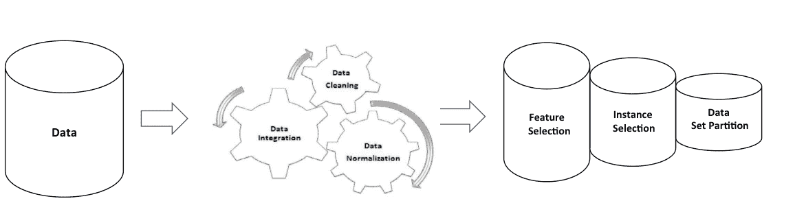

#### 数据准备

#### 数据压缩

图 7.2 数据预处理技术。

##### 7.4.3.1 数据准备

数据准备是必须执行的；否则这些数据提供的信息可能会导致我们错误的决策。数据清洗任务涉及检测差异和脏数据。数据转换通过源自制造系统的不同数学公式或模糊数学公式组合原始属性。数据通过各种传感器从工业中的多种机器以不同形式采集，这些数据需要通过集成方法进行整合。从传感器采集的数据规模很大；例如，`RPM`（每分钟转数）数据是巨大的，而切深度的数据很小。通常，数据被归一化在 0 到 1 以及 -1 到 1 的范围内。

##### 7.4.3.2 数据压缩

由于采集的数据量巨大且包含许多属性，为了提高计算准确性并减少计算量，识别重要属性和实例集非常重要。

## 7.4.4 模型

可以使用各种统计和机器学习算法分析采集的数据（图 7.3）。采集的数据可用于以下四种目的：

- 1. 描述性分析
- 2. 诊断性分析
- 3. 预测性分析
- 4. 展望性分析

#### 7.4.4.1 描述性分析

在基于物联网的行业中，数百个传感器发送数据。推断有意义的信息至关重要。描述性分析是最低级别的分析。它是从过去数据中准备易于理解的总结的工具。平均值、中位数、模式和标准差是描述性分析的工具。模式识别也是描述性分析。

#### 7.4.4.2 诊断性分析

与描述性分析相比，诊断性分析提供了更多细节。诊断性分析有助于确定我们通过描述性分析识别出的问题的根源。与描述性分析相比，诊断性分析需要高计算。自适应神经模糊系统（`ANFIS`）结合了神经网络和模糊系统的优势。`ANFIS` 是多组件系统故障检测的非常有效的工具（Moef et al., 2018）。堆叠去噪自动编码器（`SDAE`）是一种有效且可靠的深度学习故障检测（Yu et al., 2019）。决策树和聚类技术也用于检测故障状态（Kozek et al., 2017）。

| 实现目标的路线图 |
| :--- |
| 展望性分析 |
| 预测性分析 |
| 根因 |
| 诊断分析 |
| 描述性分析 |

图 7.3 复杂度与回报。

#### 7.4.4.3 预测性分析

预测性分析用于预测当前分析。这种分析与描述性分析相比更为复杂。回归建模是预测性分析最常用的方法。人工神经网络基于生物神经网络开发，可以处理复杂的关系。K-最近邻（`KNN`）是预测数据分类的方法。他们得出结论，对于每日消耗预测，神经网络比 `SVM` 更准确（Grolinger et al., 2016）。在开发过程中，进给量、主轴转速是钻损的关键参数。反传播神经网络是预测进给量、转速和钻径对钻损影响的有效工具（Singh et al., 2006）。

#### 7.4.4.4 展望性分析

展望性分析是数据分析的最高级别。这种分析为我们实现设定目标提供了行动方案。展望性分析需要更多的计算量。并非万无一失。与其他视角相比，展望性分析并非万无一失。在应用展望性分析之前，必须确定目标。径基函数网络与非支配遗传算法的杂化是确定线切割高效利用关键参数的有效工具（Saha et al., 2013）。

## 7.4.5 决策制定

在模型中包含所有参数是不可能的；模型总是建立在假设的基础上，因此对模型进行定性分析至关重要。由于不同的物理限制，模型的所有建议都无法实施。因此，必须包含人工决策。

## 7.4.6 实施

实施新策略并非易事。实施新策略需要大量的头脑风暴。无论决定什么方法，都必须通过适当的过程来实施。

## 7.4.7 监控与反馈

策略成功实施后，监控系统状态至关重要；此外，应该有一个用于改进的反馈系统。

## 7.5 案例研究——车床

为了证明在金属切割中实施物联网的可性，使用一台车床。图 7.4 显示了系统框架由机床、工业设备和计算单元组成。机床由通过线路或无线连接的各种仪器、传感器和执行器组成。

图 7.4 机床人机界面。

# 金属切削中的 IoT 路线图


本文以一个项目驱动型行业为例。该公司从事重型大型部件的加工和制造。由于产品在尺寸和设计上具有动态性，控制生产活动并不容易。该行业拥有 10 台数控中心、4 台镗孔机和 3 台铣中心。组件需要在多台机床上进行加工。在此过程中，项目由于车间的一个瓶颈而导致了延误。由于需求的不确定性和机床成本的高昂，无法增加机床数量。提高生产率以按时完成项目至关重要。为了找到车间延迟的根本原因，实施了一套基于 IoT 的系统来监控增值时间非非增值时间。

## 7.6 测量增值时间

在加工过程中，实际进行人工切削的时间被视为增值时间。所有其他活动都被视为非增值时间。在加工过程中，手动测量真实的金属切削刀具具有挑战性，因此开发了一套自动测量系统，利用磁性传感器测量实际切削时间。在机床爪的背面安装了一个磁铁，在主轴上安装了一个磁性传感器。每当磁铁靠近磁性传感器时，传感器的电压就会发生变化。如果爪正在旋转，传感器的电压将持续发生变化。因此，利用磁性霍尔传感器的数据，我们可以发现爪是否正在旋转或静止。我们还可以通过电压变化的频率计算出爪的转速（RPMs）。

## 7.7 测量非增值时间

停机分为以下几类：

- 1. 准备时间
- 2. 不可避免的停机
- 3. 维护
- 4. 强制性停机

### 7.7.1 准备时间

准备时间是为机床加工做准备的时间。在频繁更换产品的项目驱动行业中，监控准备时间至关重要。为了计算总准备时间，我们需要考虑所有等待起重机、等待准备附件和等待决策以及其他非生产性停机。

在项目驱动型公司中，准备时间总有缩减的空间。通过控制准备时间，我们可以提高机床产能。为了收集所有这些非增值时间，在机床附近安装了 HMI（人机界面）。HMI 键盘上安装了一个 LCD 屏幕。

每当开始加工新组件时，操作人员必须通过 HMI 输入该组件的特定代码，以便测量完成该组件的总时间。操作人员可以使用键盘输入任何数字。每项非增值活动都分配有一个数字，操作人员在停止时必须按下该数字。例如，如果机床在准备过程中为了夹紧工件而停止，代码为 01，其中第一位数字表示准备，后一位数字表示子活动。

### 7.7.2 不可避免的停机

由于资源管理不当导致的停机被视为非生产性停机。表 7.1 中的停机被认为是不可避免的停机。

### 7.7.3 维护

机床经常因各种维护活动而停止。机床上执行的维护有五种类型，如下：

- 1. 预防性维护
- 2. 计划性维护
- 3. 预测性维护
- 4. 自主维护
- 5. 故障维护

#### 7.7.3.1 预防性维护

预防性维护是避免设备突然故障的周期性维护。汽车定期更换机油是预防性维护的一个现实实例。机器学习算法可以预测维护周期（Li 等，2021）。

#### 7.7.3.2 计划性维护

有时设备中检测到异常，不需要停止运行，但由于性能降低会导致运营成本增加。与其进行立即维护，不如计划维护；这种维护被称为计划性维护。例如，有时汽车中发动机燃料消耗的异常会导致运营成本增加，但它不会导致车辆停运。计划性维护中的风险评估对设备的使用寿命至关重要（Crognier 等，2021）。

#### 表 7.1：不可避免的停机

| 1. 缺勤 | 2. 等待决策 | 3. 等待起重机 | 4. 缺少设备 |
| 5. 缺少工具 | 6. 标记 | 7. 维修 | 8. 等待质量检测 |

#### 7.7.3.3 预测性维护

在预测性维护中，通过检查设备的当前状态来预测设备的故障。例如，在汽车中，根据发动机的外观预测更换的周期。由于传感器和人工智能的发展，预测性维护的可靠性得到了提高。可以通过振动、声音、电流速度和温度等传感器数据预测轴承故障（Cakir 等，2021）。

#### 7.7.3.4 自主维护

设备在每天启动前会执行自主维护。这包括检查润滑液水平、噪声水平、压力等。维护部门提供了一套执行自主维护的指令。增强现实可以作为培训操作人员进行自主维护的非常高效的工具（Jia 等，2021）。

#### 7.7.3.5 故障维护

设备在每天启动前会执行自主维护。这包括检查润滑液水平、噪声水平、压力等。维护部门提供了一套执行自主维护的指令。增强现实可以作为培训操作人员进行自主维护的非常高效的工具（Jia 等，2021）。

设备在每天启动前会执行自主维护。这包括检查润滑液水平、噪声水平、压力等。维护部门提供了一套执行自主维护的指令。增强现实可以作为培训操作人员进行自主维护的非常高效的工具（Jia 等，2021）。

设备在每天启动前会执行自主维护。这包括检查润滑液水平、噪声水平、压力等。维护部门提供了一套执行自主维护的指令。增强现实可以作为培训操作人员进行自主维护的非常高效的工具（Jia 等，2021）。

设备在每天启动前会执行自主维护。这包括检查润滑液水平、噪声水平、压力等。维护部门提供了一套执行自主维护的指令。增强现实可以作为培训操作人员进行自主维护的非常高效的工具（Jia 等，2021）。

设备在每天启动前会执行自主维护。这包括检查润滑液水平、噪声水平、压力等。维护部门提供了一套执行自主维护的指令。增强现实可以作为培训操作人员进行自主维护的非常高效的工具（Jia 等，2021）。

设备在每天启动前会执行自主维护。这包括检查润滑液水平、噪声水平、压力等。维护部门提供了一套执行自主维护的指令。增强现实可以作为培训操作人员进行自主维护的非常高效的工具（Jia 等，2021）。

设备在每天启动前会执行自主维护。这包括检查润滑液水平、噪声水平、压力等。维护部门提供了一套执行自主维护的指令。增强现实可以作为培训操作人员进行自主维护的非常高效的工具（Jia 等，2021）。

设备在每天启动前会执行自主维护。这包括检查润滑液水平、噪声水平、压力等。维护部门提供了一套执行自主维护的指令。增强现实可以作为培训操作人员进行自主维护的非常高效的工具（Jia 等，2021）。

设备在每天启动前会执行自主维护。这包括检查润滑液水平、噪声水平、压力等。维护部门提供了一套执行自主维护的指令。增强现实可以作为培训操作人员进行自主维护的非常高效的工具（Jia 等，2021）。

设备在每天启动前会执行自主维护。这包括检查润滑液水平、噪声水平、压力等。维护部门提供了一套执行自主维护的指令。增强现实可以作为培训操作人员进行自主维护的非常高效的工具（Jia 等，2021）。

设备在每天启动前会执行自主维护。这包括检查润滑液水平、噪声水平、压力等。维护部门提供了一套执行自主维护的指令。增强现实可以作为培训操作人员进行自主维护的非常高效的工具（Jia 等，2021）。

设备在每天启动前会执行自主维护。这包括检查润滑液水平、噪声水平、压力等。维护部门提供了一套执行自主维护的指令。增强现实可以作为培训操作人员进行自主维护的非常高效的工具（Jia 等，2021）。

设备在每天启动前会执行自主维护。这包括检查润滑液水平、噪声水平、压力等。维护部门提供了一套执行自主维护的指令。增强现实可以作为培训操作人员进行自主维护的非常高效的工具（Jia 等，2021）。

设备在每天启动前会执行自主维护。这包括检查润滑液水平、噪声水平、压力等。维护部门提供了一套执行自主维护的指令。增强现实可以作为培训操作人员进行自主维护的非常高效的工具（Jia 等，2021）。

设备在每天启动前会执行自主维护。这包括检查润滑液水平、噪声水平、压力等。维护部门提供了一套执行自主维护的指令。增强现实可以作为培训操作人员进行自主维护的非常高效的工具（Jia 等，2021）。

设备在每天启动前会执行自主维护。这包括检查润滑液水平、噪声水平、压力等。维护部门提供了一套执行自主维护的指令。增强现实可以作为培训操作人员进行自主维护的非常高效的工具（Jia 等，2021）。

设备在每天启动前会执行自主维护。这包括检查润滑液水平、噪声水平、压力等。维护部门提供了一套执行自主维护的指令。增强现实可以作为培训操作人员进行自主维护的非常高效的工具（Jia 等，2021）。

设备在每天启动前会执行自主维护。这包括检查润滑液水平、噪声水平、压力等。维护部门提供了一套执行自主维护的指令。增强现实可以作为培训操作人员进行自主维护的非常高效的工具（Jia 等，2021）。

设备在每天启动前会执行自主维护。这包括检查润滑液水平、噪声水平、压力等。维护部门提供了一套执行自主维护的指令。增强现实可以作为培训操作人员进行自主维护的非常高效的工具（Jia 等，2021）。

设备在每天启动前会执行自主维护。这包括检查润滑液水平、噪声水平、压力等。维护部门提供了一套执行自主维护的指令。增强现实可以作为培训操作人员进行自主维护的非常高效的工具（Jia 等，2021）。

设备在每天启动前会执行自主维护。这包括检查润滑液水平、噪声水平、压力等。维护部门提供了一套执行自主维护的指令。增强现实可以作为培训操作人员进行自主维护的非常高效的工具（Jia 等，2021）。

设备在每天启动前会执行自主维护。这包括检查润滑液水平、噪声水平、压力等。维护部门提供了一套执行自主维护的指令。增强现实可以作为培训操作人员进行自主维护的非常高效的工具（Jia 等，2021）。

设备在每天启动前会执行自主维护。这包括检查润滑液水平、噪声水平、压力等。维护部门提供了一套执行自主维护的指令。增强现实可以作为培训操作人员进行自主维护的非常高效的工具（Jia 等，2021）。

设备在每天启动前会执行自主维护。这包括检查润滑液水平、噪声水平、压力等。维护部门提供了一套执行自主维护的指令。增强现实可以作为培训操作人员进行自主维护的非常高效的工具（Jia 等，2021）。

设备在每天启动前会执行自主维护。这包括检查润滑液水平、噪声水平、压力等。维护部门提供了一套执行自主维护的指令。增强现实可以作为培训操作人员进行自主维护的非常高效的工具（Jia 等，2021）。

设备在每天启动前会执行自主维护。这包括检查润滑液水平、噪声水平、压力等。维护部门提供了一套执行自主维护的指令。增强现实可以作为培训操作人员进行自主维护的非常高效的工具（Jia 等，2021）。

设备在每天启动前会执行自主维护。这包括检查润滑液水平、噪声水平、压力等。维护部门提供了一套执行自主维护的指令。增强现实可以作为培训操作人员进行自主维护的非常高效的工具（Jia 等，2021）。

设备在每天启动前会执行自主维护。这包括检查润滑液水平、噪声水平、压力等。维护部门提供了一套执行自主维护的指令。增强现实可以作为培训操作人员进行自主维护的非常高效的工具（Jia 等，2021）。

设备在每天启动前会执行自主维护。这包括检查润滑液水平、噪声水平、压力等。维护部门提供了一套执行自主维护的指令。增强现实可以作为培训操作人员进行自主维护的非常高效的工具（Jia 等，2021）。

### 7.7.4 强制性停机

强制性停机对于金属切削是至关重要的；这些停机，执行操作是不可能的。监控系统可以被用来识别主要的强制性停机，并可以采取纠正措施。

## 金属切削 IoT 路线图

## 7.9.2 规划部门

当前的制造环境面临高复杂性、动态生产条件和市场状况不稳定等挑战。同时，对于低成本的产品定制以及缩短交付周期的需求（Schuh et al., 2017）。为了克服这些挑战，业界正在寻找新技术。IoT 是克服当前市场挑战的优越技术。在工业 4.0 背景下，生产计划与控制（PPC）的功能可以预测全球生产数量以提高盈利能力，并优化交付时间（Arnold and Chapman, 2004）。它还涉及对制造过程的控制，允许资源的实时集成（Moeuf et al., 2018）。机器学习算法、通过 IoT 采集的实时数据以及生产规划的集成，有助于规划阶段的决策。

1. 根据循环时间和设备可用性，为所有工序步骤准备能力分析。
2. 研究流程以识别瓶颈设备，并将剩余设备分类为供料设备和非关键设备。
   - 瓶颈设备是定义了生产线或机器区域最大产能的设备。对于这些设备，目标是实现尽可能长的运行时间，以最大化生产能力。
   - 供料设备是为瓶颈设备提供设备的设备。对于这些设备，目标是按照计划的顺序和时间生产零件，以便及时为瓶颈设备供。时间应基于生产线的标准作业通过视觉拉动信号给出。
   - 非关键设备是位于流程中瓶颈设备之后的设备。对于这些设备，目标是保持生产流，以实现整体交付周期的缩短。
3. 计划工时是在组件工艺创建过程中决定的小时；实际工时是从运行数据报告中获取的小时。

在此背景下，为每个组件准备计划工时与车间实际工时的对比报告。基于此比较，必须对计划与实际小时之间的差距进行差距分析。在分析过程中，应考虑操作员技能、加工工具、加工参数和焊接参数。目标是通过持续改进缩小差距，并与之前的组件相比缩短循环时间。必须进行分析以识别减少关键组件计划工时的可能性以及所采取的行动。

## 7.9.3 质量管理

质量管理主要由质量规划、质量控制、质量保证和质量改进组成。质量管理包括决定实现质量目标的质量目标、操作流程和资源。质量控制侧重于满足质量要求。质量保证侧重于提供对将满足质量要求的信心。质量改进寻求产品质量的持续改进。质量管理中的实时数据集成可以提高质量。透视分析算法用于各种操作过程以实现质量目标。可以使用模糊逻辑或人工神经网络（例如）来决定控制产品质量的关键参数。如果操作员以不当参数操作机床，可以通过自动停止机床来实现质量保证。可以使用优化算法确定持续改进产品质量的最佳参数。

## 7.9.4 维护管理

IoT 集成到维护系统中可以提高整体效率。诊断分析算法有助于检测故障根源，从而缩短维修时间。温度和振动等实时数据有助于预测性维护。

## 7.10 结论

本研究深入讨论了 IoT 在金属切削中的实施；它首先介绍了 IoT 在金属切削中的阶段，并讨论了 IoT 在金属切削中面临的挑战。金属切削中 IoT 的实现技术根据制造的关键活动进行了总结：生产、规划、质量管理和维护。研究表明，生产部门可以利用实时信息识别车间现场的问题。我们可以有效测量详细讨论的金属切削过程中的非增值活动和增值活动。规划部门可以比较计划工时和实际工时，为下一个周期进行准确规划。此外，识别瓶颈和设备供料有助于生产部门意识到需要关注哪些机器，以确保组件的按时完成。质量部门可以使用 IoT 决定最佳参数以提高产品质量。维护部门可以通过实时状态监测提高 OEE。此外，收集的数据可以使用各种人工智能算法进行预测性维护。

## 7.11 研究局限性

网络安全是工业 4.0 面临的最大挑战，本研究未涵盖此内容。行业数据管理可能由于未经授权的数据更改、未经授权的数据删除和非法访问而崩溃。设计、营销和供应链的集成也未包含在研究中。

## 金属切削 IoT 路线图

## 7.12 未来展望

在研究中，HMI 用于存储加工的各种活动。然而，由于人为干预，始终存在错误风险。需要自动记录这些活动以收集 100% 准确的数据。可能的解决方案之一是使用图像处理。通过卷积神经网络，我们可以训练算法，然后它可以用于自动记录时间。

## 参考文献

Aivaliotis, P., Georgoulis, K., & Alexopoulos, K. (2019). Using digital twin in manufacturing: state of the Art and Gap analysis. In 2019 IEEE International Conference on Engineering, Technology and Innovation (ICE/ITMC) (pp. 1–5). IEEE, France.

Alptekin, A., & Corbett, C. (2008). Mass customization vs. mass production. Service Operations, 10(2), 204–217.

Arnold, J. T., & Chapman, S. N. (2004). Introduction to materials management.

Atzoria, L., Iera, A., & Vaniakos, G. (2010). The internet of things: a survey. Computer Networks, 54(15), 2787–2885.

Benardos, P. G. (2021). Things and industrial applications for precision machining. Solid state phenomena (Vol. 261, pp. 440–447). Switzerland: Trans Tech.

Cakir, M., Guvenc, A., & Mistoglu, S. (2021). The experimental application of popular machine learning algorithms on predictive maintenance and the design of IoT based monitoring system. Computers & Industrial Engineering, 151, 106948.

Chen, X., Li, C., Tang, Y., & Li, Q. (2018). A framework for energy monitoring of machining workshops over IoT. Proced CIRP, 72, 1386–1389.

Cooper, C., & Kaplinsky, R. (Eds.). (2005). Technology and development in the third industrial revolution. London: Routledge.

Crognier, G., Taurnies, P., Ruiz, M., & Panciatici, P. (2021). Grid operation-based usage maintenance planning. Electric Power Systems Research, 190, 106682.


Dai, H., Wang, H., Xu, G., Wan, J., & Imran, M. (2020). Data analytics for manufacturing internet of things: opportunities, challenges and enabling technologies. Enterprise Information Systems, 14(9-10), 1279–1303.

Deshayes, L., Lynch, D., Anvest, I., Gilsinn, R., . . & Porta, F. (2006). Smart machining systems: systems and research trends. Innovation in life cycle engineering and sustainable development (pp. 363–380). Dordrecht: Springer.

Dutta, S. P., Sal, K., Mukhopadhay, S., & Sen, R. (2013). Application of digital image processing in condition monitoring: a review. CIR Journal of Manufacturing Science and Technology, 6(3), 212–232.

# 134 通过 AI 重塑流程

Frader, L. L. (2005). 工业革命：文献史。牛津：牛津大学出版社。

Grolinger, K., L'Hureux, Capret, M. A., & Seewald, L. (2016). 活动场地的能源预测：大数据与预测准确性。《Energy and Buildings], 112, 222–233.

Guojiang, S., Yanmin, C., Chao, Z., & Yanxu, Z. (2013). 智能 IoT 网关的设计与实现。在 2013 IEEE 绿色计算与物联网国际会议及 IEEE 物理与社会计算上（pp. 720–723）。中国，北京。

Hertz, J. B., Nguyen, V. K., Maeder, W., Panare, D., Gunnink, J. W., Gartz, A. . . & Hascoët, J. Y. (2013). 通向智能制造的赋能数字基础。《Procedia CIR], 12, 240–245.

Jerard, R. B., Fussell, B. K., Suprock, C. A., Nichols, J., Hassan, R. Z., & Esteling, D. (2009). 用于智能制造系统的无线传感器与节点集成。在国际制造科学与工程会议上, ASME (No. 4368, pp. 119–128)。美国，印第安纳州，西拉法叶特。

Jia, W., Zhu, X., & Yu, C. (2021). 机械系统增强现实辅助系统研究综述。《物理学会议杂志》(No. 1748, No. 6, p. 062041)。英国, IOP 出版。

Kamble, S., Gunasekaran, A., Ghagade, A., & Raut, R. (2020). 工业 4.0 赋能中小企业智能制造的测量系统——综述与实证实施。《International Journal of Production Economics], 229, 107853.

Kim, D. H, Kim, T. J, Wang, X., Kim, M., Qian, Y. J., Oh, J. W., . . & Ahn, S. H. (2018). 使用机器学习的智能制造流程：对加工业的展望与展望。《International Journal of Precision Engineering and Manufacturing-Green Technology], 5(4), 555–568.

Kozek, K., Kralj, D., & Butala, P. (2017). 循环制造过程中故障工况的解释性识别。《Journal of Manufacturing Systems], 43, 214–224.

Lee, Y., & Dornfeld, D. A. (1998). 开放架构控制系统在精密加工中的应用。在第 31 次 CIR 制造系统国际研讨会上（pp. 436–441）。加利福尼亚大学，伯克利。

Li, L., Wang, Y., & Lin, K. Y. (2021). 基于乐观生产维护同步的预防性维护调度优化。《Journal of Intelligent Manufacturing], 32(2), 545–558.

Liang, S. Y., Heck, R. L., & Lands, R. G. (2004). 加工过程监控与控制：现状综述。《Journal of Manufacturing Science and Engineering], 126(2), 297–310.

Moefef, A., Pellerin, R., Lamouri, S., Tamayo-Giraldo, S., & Barbaray, R. (2018). 工业 4.0 时代中小企业的工业管理。《International Journal of Production Research], 56(3), 1118–1136.

Park, H. S., Qi, B., Dang, D. V., & Park, D. Y. (2018). 用于优化进给率以最小化加工时间的智能加工系统开发。《Journal of Computational Design and Engineering], 5(3), 299–304.

Park, H. S., & Tran, N. H. (2014). 使用自优化控制的智能加工系统开发。《The International Journal of Advanced Manufacturing Technology], 74(9–12), 1365–1380.

# 金属切削中 IoT 的路线图

Patra, K., Pal, S. K., & Bhattacharyya, K. (2013). 使用多传感器信号进行智能钻策略。《Journal of Mechatronics and Manufacturing Systems], 23(5–6), 493–512.

Perzlo, A., Kessler, I., Profanter, S., & Rickert, M. (2020). 面向智能工厂无缝数字工程的知识骨干。2020 年第 25 次 IEEE 新兴技术与工厂自动化国际会议 (ETFA) (Vol. 1, 164–171)。IEEE，奥地利。

Saha, P., Tarafadar, D., Pal, S. K., Saha, P., Srivastava, A., & Das, K. A. (2013). 通过神经遗传技术的 TiC 增强复合材料电火加工中的多目标优化。《Applied Soft Computing], 13(4), 2065–2074.

Saqlain, M., Miao, M., Shim, Y., & Lee, J. (2019). 基于 IoT 的智能制造管理框架。《Journal of Smart Manufacturing], 8(2).

Schuh, G., Reuter, C., Prote, J., Bambring, F., & Ays, J. (2017). 用于改进生产计划与控制的数据。《CIRP Annals], 66, 425–428.

Sharma, R., Saini, A., & Rana, G. (2021). 工业 4.0 中的大数据分析。《Design Engineering], 21(2), 238–252.

Sharma, R., Saini, R., Prakash, C., & Prasad, V. (2021). 颠覆性经济中的物联网技术，第 1 版。纽约：Nova Publishers。

Singh, A. K., Panda, S., Chakraborty, D., & Pal, S. (2016). 使用高斯混合模型预测钻损。《International Journal of Advanced Manufacturing], 27(5), 456–462.

Trivedi, J. P. (2015). 移动广告对 Gen Y 兴趣的有效性。《International Journal of Marketing and Business], 4(2).

Urbik, G., & Lacelle, L. (2020). 监控：使用 FPGA 的完整监控工具。《SoftwareWare], 11, 100387.

Venkataraman, K., Ramnath, B., Kumar, V., & Elancheian, C. (2014). 价值流图在减少加工周期中的应用。《Procedia Materials Science], 6, 1187–1196.

Vinod, V., & Sridharan, R. (2008). 序列相关的动态生产系统。《Robotics and Computer-Integrated Manufacturing], 24(3), 435–449.

Wang, C., Ghani, S., Chen, K., & Rakowski, R. (2013). 智能切刀具。《Proceedings of the Institution of Mechanical Engineers], 227(2), 249–253.

Wang, Z., Ritou, M., Du, C., & Furet, B. (2020). 基于无监督机器学习的智能加工的情境分类。《International Journal of Computer Manufacturing], 33(10–11), 1042–1054.

Yu, J., Zheng, X., & Wang, S. (2019). 用于模式识别的深度自动编码器学习方法。《Journal of Process Control], 79, 1–15.

Zhang, F., Liu, M., Zhou, Z., & Shen, W. (2016). 用于连续铸造的基于 IoT 的在线系统。《IEEE Internet of Things Journal], 3(6), 1355–1363.

Zhang, Y., Qu, T., Ho, O. K., & Huang, G. Q. (2021). 基于 RFID 的实时制造智能网关。《International Journal of Production Research], 49(5), 1337–1352.


# 对对话人工智能重塑人力资源

一个概念框架

Neetu Kumari 和 Geeta Rana

## 目录

8.1 引言....................................................................... 137

8.2 文献综述...................................................... 139

8.3 目标............................................................... 140

8.4 研究方法............................................................... 140

8.5 传统人力资源管理................................................................ 140

8.6 人工智能与人力资源的概念模型............................................................................... 142

8.6.1 管理功能——人工智能人力资源决策系统............................................................................... 143

8.6.2 采购——人工智能采购..................................................... 143

8.6.3 培训与发展——人工智能人力资源培训与发展............................................................................... 145

8.6.4 薪酬——人工智能激励系统............................................... 146

8.6.5 维护——人工智能人力资源维护................................................................ 146

8.6.6 集成——人工智能人力资源集成.................................................. 146

8.6.7 新兴问题——人工智能人力资源系统................................................................ 146

8.7 讨论与管理启示...................................................... 146

8.8 结论........................................................................................... 148

参考文献.................................................................................................. 149

# 8.1 引言

在过去的几年里，人工智能（AI）已成为我们日常生活和管理不可或缺的一部分。这是一个非同常的举措，引起了世界各地人的关注。公司正在从海量数据转向机器学习，进一步转向人工智能（AI）（Tambe et al., 2018; Rana & Sharma, 2019）。人工智能可以定义为一种具有学习能力的程序算法，目标是像人类，但在能力上超越人类。换句话说，它是一项允许计算机执行所有通常需要人类完成的任务的先进技术。

DOI: 10.1201/9781003145011-8

认知。这是一个初步定义，捕捉了人工智能的一些重要特征，但随着时间的推移，它的应用领域已经不断扩展，并演变成一个更加多样化的领域。根据 Kaplan 和 Haenlein (2019) 的观点，AI 是系统正确理解海量数据的技巧，利用学习来实现显式目标和任务。

基因工程、云计算、物联网、生物技术和3D打印机是新技术革命的产物，AI 在整合所有这些技术方面发挥着关键作用。超连接将新的数字技术与以前的技术区分开，而 AI 是两者之间的连接纽。例如：大数据需要 AI 和机器人进行分析，而机器需要 AI 来高效运行，从而代表了数字化转型。

AI 已渗透到管理中，并对人力资源管理的员工工作产生了影响。AI 是机器模拟人类智能的能力，允许机器自动学习和适应以对情况做出反应。但问题是：AI 如何应用于人力资源领域？在一个涉及人为要素的人力资源部门中，了解如何使用 AI 为员工提供增强的体验是非常重要的（Durrani, 2020）。

在当今竞争激烈的世界中，AI 影响了几乎一切，人力资源部门也在此列。人力资源管理理解到将人类知识与机器学习相结合的必要性，以实现轻松的工作和预测性的工作环境。AI 是一种创新，它塑造了遵循特定创新计算技术和算法的实时决策。通过将人力资源部门与 AI 结合，员工的经验将得到增强。AI 在理解目标受众心态方面发挥着重要作用，并相应制定计划以实现设定目标。今天，在 AI 的帮助下，机器已经有了模仿人类智能的能力。因此，在本章中，我们将研究人工智能对人力决策策略的影响。

人力资源专业人士已经意识到将人类思维与机器学习相结合以实现轻松工作流的重要性，这已被上述文献所证明。许多公司正在使用 AI 进行日常工作计划，其中一些公司已经开发了自身的 AI 解决方案。人工智能已经存在了几十年，但由于技术发展的优势，其应用最近变得更加突出。尽管如此，由于成本效益分析，AI 技术的使用仍然较少。如今 AI 几乎被应用于每个领域，如健康、教育、娱乐、制造等，但本章重点介绍了 AI 在人力资源部门中的适用性。

本章涵盖了对当代人力资源管理（HRM）及其功能的文献综述。它还强调了 AI 及其在 HRM 中的使用。本章以讨论和管理启示结束。该研究为公司和个人提供了各种建议，帮助他们将 AI 纳入日常工作中。

# 用对话式 AI 重塑人力资源

## 8.2 文献综述

综述的文献指出，智能自动化是管理组织员工的新方法论，它增强了公司的产出并为 HRM 的发展提供了新途径，但也带来了伦理和技术层面的挑战。该研究还发现技术对 HRM 功能有积极影响，如人机协作、工作替代、学习和决策等（Vrontis et al., 2021）。

Prentice、Dominique Lopes 和 Wang (2020) 发现，与员工和 AI 的服务体验与客户忠诚度和参与度显著相关。其他研究人员（Johnson et al., 2020）发现 eHRM 和 AI 影响了酒店和旅游业中员工采购的招聘和选拔方式。但必须确认，决策必须对员工透明，这将带来更好的组织成果。Pillai 和 Sivanth (2020) 研究了 AI 技术获取的应用。结果显示，高层权威的支持、HR 的敏锐度、竞争、成本管理以及来自 AI 的支持为 AI 技术的应用提供了积极影响。该研究还强调，传统的人才招聘方法负面调节了 AI 技术实际采用之间的关系。


Yawkar (2019) 识别了人工智能在人力资源实践中的作用和挑战。公司执行的各种功能，如员工招聘和雇用、数据收集与分析、员工和工作管理、减少工作量以及提高员工工作效率，可以通过机器人智能轻松完成（Rana and Sharma, 2019）。

Jain (2018) 识别了 AI 在 HRM 中的作用，以及在各种 HR 流程（如招聘、绩效评估、基于云的 HR 系统等）中对现代技术的采用。招聘过程中的 AI 有助于筛选候选人、自动向他们生成信息、员工处理、安排面试等（Ahmed, 2018）。AI 是一个从数据中学习并利用其来实现组织目标的系统。Merlin 和 Jayam (2018) 强调了 AI 在工作场所的使用，以及它如何极大帮助 HR 专业人士理解其工作、识别与之相关的问题并预判趋势。用于人力资源的 AI 在决策和处理不确定性方面非常有用（Jarrah, 2018）。根据 Geetha 和 Reddy (2018) 的观点，人力资源在组织中的角色非常重要，所有其他技术的运作取决于它。Jain (2018) 识别了 AI 在 HRM 中的作用，并考察了在招聘、绩效评估、基于云的 HR 系统等流程中的技术采用。Ahmed (2018) 识别了 AI 的角色。

Buzko 等人 (2016) 讨论了 HR 开发中的 AI 技术及其应用中的各种障碍。Dirican (2015) 写道，组织中使用 AI 和机器人可能会产生负面影响。

Budhwar 和 Debra (2001) 强调了快速发展的世界中人力资源管理的实践，并关注了在全球范围内有效进行 HRM 功能的必要性。Kapoor (2010) 也研究了人工智能在人力资源管理中的作用。Tzafir (2007) 分析了信任机制与组织绩效，以及 HR 实践如何影响它。研究发现，如果组织存在信任，HR 经理可以在内部晋升系统并提供培训计划。该研究还揭示了信任积极影响组织绩效。

## 8.3 目标

任何组织的不可缺部分都是其人力资源。可以发现提高性能的 HR 实践。在众多创新的 HR 实践中，有一种是人工智能。现在，将 AI 引入人力资源部门是员工必要的技能。HR 经理应该做的第一是将 AI 引入 HR 功能，因为这将影响员工绩效。综述文献显示缺乏包含所有 HRM 维度的整体 AIHR 框架。本研究的目标是研究概念 HRM 模型并提出概念 AI 人力资源管理模型，为未来的研究人员提供理论和概念指导。

## 8.4 研究方法

为了实现研究目的，我们使用了描述性研究设计并综述了各种类型的文献。该研究关于 HRM 及其功能以提出概念模型，使用了二次数据。我们利用电子数据库进行文献检索。二手数据收集自 HR 日志、博客、教科书、研究论文、调查报告、在线人力资源网站和其他相关出版物（线上线下）。

## 8.5 传统人力资源管理

在本节中，我们将讨论 Rao (2013) 所说的传统人力资源管理及其功能。所有规模的组织都在关注 HRM。HRM 过程始于两个维度：管理职能和经营职能。

- 1. 管理职能：管理基本上是人事行政。它是对组织内人员的发展。基础管理职能包括 PODC（即计划、组织、指导和控制）。

### 用对话式 AI 重塑人力资源管理

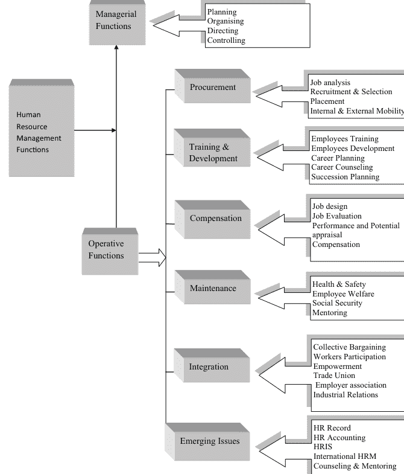

图 8.1 人力资源管理功能的传统模型。

**规划：** 规划是任何成功企业的首要重要步骤。该功能处理各种计划、方案、策略、程序和政策，以实现预期结果。它包括为了获得充分结果而即将采取的行动方案。

**组织：** 在规划未来之后，下一步是在员工之间分配任务和责任。这包括识别员工的活动、分配职责、下放权限以及协调个人和小组的活动。

**指导：** 指导涉及召集员工，通过命令和激励他们有效地工作以实现组织目标。

### 通过 AI 重塑流程

它包括执行计划、审查员工安全措施、薪酬、纪律等等任务。它对任何组织来说都是至关重要的；没有指导，组织就无法到达终点。

**控制：** 控制包括检查、核实和调节所有工作是否按照计划执行。管理的控制功能审查人事政策、计划、职位评估、衡量员工绩效、培训和员工发展。

+ 2. 经营职能：普遍职能包括流程、发展、激励、薪酬、维护、整合和新兴问题等关键领域。

**采购功能：** 这是人力资源管理的第一个重要功能。它包括采购具备所需技能、知识和资质的人才。它包括人力资源、招聘和筛选候选人、工作分析（职位描述和规格书）、安置和内部流动（转岗、裁员、解雇、离职）。

**发展：** 该功能考虑技能、知识、态度和创造能力的发展，并通过培训提高员工绩效。它是根据员工的潜力和表现，为所有员工起草并指导培训的过程。

**激励与薪酬：** 这包括为组织中的所有人员提供充分且公平的报酬。报酬激励员工为组织做出最大贡献。他们同时获得内在和外在奖励。

**维护：** 它涉及维持员工的心理和身体健康。其目标是通过各种福利计划照顾和保护组织中的员工。

**整合功能：** 通过各种以员工为导向的计划将人力资源和组织整合在一起的管理活动。它包括申诉解决、纪律、团队合作、集体谈判、员工参与和工业关系等活动。

**新兴问题：** 有效的人力资源管理取决于根据变化不断完善人力资源实践。目前影响人力资源的一些重要问题包括人事记录、人力资源审计、人力资源信息系统、人力资源研究、人力资源会计和国际人力资源管理。所有这些功能都能让员工在动态且不断变化的人力资源实践中保持最佳表现。

## 8.6 人工智能与人力资源管理的概念模型

AI 将人力资源功能与自动化技术相结合，这需要相关人员深度投入（Meister, 2019）。AI 依赖人类数据运行；它依赖于我们提供的数据。如果输入数据错误，结果也将包含错误。例如，如果数据中不包含 HR 的年龄信息，将无法检测这一信息（Zielinski, 2017）。在本章中，我们通过包含与传统 HRM 不同的现代 HRM 来考虑 HRM过程。随着技术的进步，HR 工作环境也在发生变化。传统的 HR 方法今天可能不再高效，而 AI 可以显著改进它。所提出的模型讨论了人工智能将如何改变 HR。在人力资源中使用的所有统计数据——例如 HR 规划、采购、培训、发展、薪酬、绩效评估等——都被输入 AI 机器以使 HR 功能变得高效（Yano, 2017）。AI 的干预将减少员工在任务上的工时，经理可以利用减少的时间让员工参与有用的任务。

所提出的概念模型帮助人力资源经理做出及时有效的决策。该框架考虑了 AI 如何与人力资源管理实践相结合。AI 在 HR 中的应用形成了一个人工智能人力资源系统（AIHR）。

### 8.6.1 管理职能——决策系统

AI 在 HR 中的应用通过各种以员工为导向的计划将人力资源和组织整合在一起的管理活动。它包括申诉解决、纪律、团队合作、集体谈判、员工参与和工业关系等活动。随着技术的进步，HR 工作环境也在发生变化。传统的 HR 方法今天可能不再高效，而 AI 可以显著改进它。


```...

### 8.6.2 采购——人工智能

AI 的干预将减少员工在任务上的工时，经理可以利用减少的时间让让员工参与有用的任务。

所提出的概念模型帮助人力资源经理做出及时有效的决策。该框架考虑了 AI 如何与人力资源管理实践相结合。AI 在 HR 中的应用形成了一个人工智能人力资源系统（AIHR）。

### 8.6.3 培训与发展——人工智能

在组织中，持续的培训和发展是重要的步骤。新员工和表现不佳的员工在整个职业生涯都需要培训以有效履行职责（Rana & Goel, 2015）。在培训过程中，每个员工都与他人不同，可能有不同的学习策略（Sharma et al., 2019）；在这里，AI 帮助做出有效的决策。机器可以通过分析输入数据来识别员工需要帮助的领域。根据 Palmo (2020)，AI 为具有不同文化、代、教育、性格和背景的利益相关者创建定制化计划。AI 还帮助创建良好的教学材料并提供离职培训。AI 还可以通过聊天机器人进行培训。这些聊天机器人经过训练，可以提供即时答案。培训期间的常见问题可以包含培训材料中，减少受培训者的额外查询。

### 8.6.4 薪酬——人工智能中心系统

AI 应用有助于激励支付的公平性。被称为反向传播（BP）神经网络的 AI 技术可用于设计财务和非财务激励。使用 AI，工作分析在收集数据之前变得非常容易。根据 Peter Hogg (2019)，招聘人员应考虑经验的潜力评估。AI 系统帮助 HR 经理根据绩效评估分析员工。员工获得了更多学习、获得报酬、晋升和培训的机会。通过 AI，工作调度指标等绩效是自动化的，以生成有效的工单以实现生产力最大化。分析实时和历史运营数据可以减少工作过度调度或调度不足。

## 8.6.5 维护—人工智能人力资源维护

AI 为评估员工绩效提供数据，使员工维护可以更频繁、更轻松地进行。在培训期间，与员工的互动变得容易。由于是由机器进行评估，员工评估中常见的偏见有所减少。AI 现在被用于识别压力和低绩效等行为，并提醒人力资源经理导致工作表现不良的员工绩效变量。AI 还能识别员工工作场所态度和行为导致的事故。聊天机器人可以使互动更加智能化，并引导员工自助和候选人管理。AI 通过访问邮件流量、评论、伦理失误和默许风险等组织网络数据，向人力资源经理指出“红旗”，以便他们能够在部门出现大问题之前进行干预。

## 8.6.6 集成—人工智能人力资源集成

数字技术在人力资源集成中也发挥着重要作用。通过 AI 干预，工作场所的透明度和定制化操作提升了员工的忠诚度。员工绩效可以很容易地进行无偏评估；他们获得了公司内部晋升的机会。这也有助于评估并筛选出晋升或其他奖励的候选人。员工士气和表现得到了提高。员工的外部流动性将降低，员工倡导性将增加。公司不需要在招聘和培训新员工上浪费资金，因为现有员工不会离开公司。AI 技术充当助手、执行者和顾问，可以解决许多人力资源问题，如刻板印象、员工管理（Jia et al., 2018）。AI 为公司带来了具体的无形利益。

## 8.6.7 新兴问题—人工智能人力资源系统

AI 使人力资源经理的任务变得更容易、更耗时，减少了他们的工作量。启用 AI 的系统会自动响应员工查询并管理工作。自动化低成本、重复的任务让人力资源经理有时间帮助处理最重要的行政工作。使用“虚拟助手系统”撰写电子邮件、组织会议、协调参与者和管理日历；通过这种方式它将通过掌握员工及其后续情况的经验，逐渐收集细节并扩大服务（Jia et al., 2018）。基于 AI 的软件在人力资源战略中发挥着重要作用；它有助于员工管理、人力资源会计、人力资源信息系统（HRIS）、薪资管理、修订公司政策和实践、调查公司合规性、制定战略等（Jacobs, 2019）。

## 8.7 讨论与管理启示

AI 的干预为业务和我们的日常生活带来了积极方面，尽管关于此已进行了许多讨论。最初，怀疑态度

### 用对话式 AI 重塑人力资源

每当任何地方引入新技术时，人们总会产生怀疑情绪，AI 也是如此。使用 AI 需要管理大量数据以创建可能存在风险的信息。如果输入数据不正确，结果将是不准确，导致组织出现问题，而纠正这些问题将浪费时间和金钱。由于对于许多组织来说，这相当于比一种新技术——而且并不是所有人都知道如何正确地使用它以及如何获取它——因此有必要为员工提供充分的培训，这是昂贵的。这些因素有助于初创公司和小型企业正确地使用此类技术，但 AI 成为我们日常生活的一部分的那天并不遥远；它将变得越来越廉，，而且更容易。与此同时，大型组织能够很快地孵化这项新技术。根据 Probani (2018) 的说法，采用 AI 的组织表现优于没有采用 AI 的竞争对手。

AI 在许多方面改进了招聘，但这里有一些点需要考虑。候选人需要以特定的格式提交申请，机器才能对其分析；因此，那些每个人面对面或纸质的申请会超出 AI 的雷达。招聘中的 AI 也可能被求职者负面感知，因为有时简历可能不会被人工查看，因为没有包含特定的关键词——如果每个人都在简历中使用相同的短语或词汇，将失去他们的信誉并浪费招聘人员和候选人的时间。在这方面，Lee (2019) 说，求职者没有意识到他们正被机器评估。根据他们的话，在查看简历上没有浪费太多精力，必须根据某些标准做出决定。

Marr (2017) 讨论了经理如果无法认同员工的信念，就会忽略绩效评估的结果。机器无法做出公平的判断，因为它们缺乏情感。

尽管 AI 被用于评估员工绩效，但它不会取代雇主与员工之间的专业关系。机器只提供评审，但最终决定由经理做出，由他们决定员工是否应该获得工作或晋升。机器不考虑员工工作的积极、特质、性格特质等；只有经理才能评估此类属性。隐私是涉及 AI 时的另一个主要关注领域；通过机器分享关于特定员工个人信息的巨大数据和信息是否会对其造成伤害是值得怀疑的。AI 工程师正致力于完善数据安全。欧盟的《通用数据保护条例》（GDPR）是为了保护民众的私人信息而设计的。任何外部人员都可能破解系统并给员工带来问题。另一个关注领域是 AI 系统可以从任何地方和任何语调收集信息，它也可能通过监控员工的私人邮件收集信息。这表明 AI 技术可能会被滥用。

谈到使用技术时，代际差异是 AI 的另一个关键问题。那些人仍然发现很难与 AI 驱动的机器工作。年轻员工通常对现代技术更熟悉，而对于接近退休的员工来说，问题更多。年轻人倾向于与 AI 一工作，而老年人则乐于面对他们的客户和同事工作（Bean, 2018）。

AI 消灭了许多工作，未来将继续这样做。在未来的几年里，如果不进行重新培训，许多人将失去工作。在接下来的几年里，存在失业风险，人们需要重新教育自己以寻找新工作。

招聘出现了一个问题；即机器对某些人口群体存在偏见，没有对所有方面给予平等考虑。发现，尽管在修复方面做出了所有努力，结果总是拒绝女性候选人。人力资源和 IT 公司必须共同努力，确保人力资源系统的安全高效。

## 8.8 结论

管理持续的进步是所有组织面临的巨大挑战。为了促进持续增长，大多数组织正专注于适应当代技术。在这个过程中，人工智能的采用在所有类型的组织中处于领先地位。该研究为 HR提出了一个七部分的框架。人力资源功能——即管理职能、培训与开发、采购、薪酬、集成和新兴问题——结合 AI 技术——即数据挖掘、大数据分析、光学字符识别、智能机器人、人脸识别技术、自然语言处理、语音识别、语音交互技术和扫描系统——将导致包含 AI HR 决策系统的 AIHR。AI 培训与开发、AI 采购、AI 激励系统、AI HR维护、AI HR集成和 HR 系统。该框架为 HR 中 AI 应用提供了建议和管理方向，并帮助个人和公司从传统 HR转向技术 HR。研究中讨论的问题和关注点指导了与该主题相关的当前问题。越来越多的公司将 AI 加入到其运营中，它正成为日常生活的一部分。AI 已成功用于招聘、选择、培训开发过程。AI 技术使得根据情况定制员工培训成为可能而不损害长期客户关系。雇主正成功地使用 AI 评估员工绩效。AI 技术的实践绝对提高了个人和组织的绩效。我们希望本章的理论和实践发现能够推动 AI 人力资源管理在适当效率方面向前发展。为了为 HR 的未来发展做好准备，人力资源经理应该采取必要行动学习 AI 趋势，并为职业增长奠定坚实基础。

# 用对话式 AI 重塑人力资源管理

## 参考文献

- Ahmed, O. (2018). 人力资源管理中的人工智能。《国际研究与分析评论》, 5, (4), 971–998。
- Bean, S. (2018). 不同代对人工智能在职场中作用存在分歧。获取自 https://workplacesinsight.net/generations-divide-on-the-role-of-artificial-intelligence-in-the-workplace-place/（访问于2021年3月31日）。
- Budhwar, P. S. & Debra, Y. (2001). 重新思考比较性与跨国人力资源管理研究。《国际人力资源管理杂志》, 12, (3), 47–51。
- Buzko, I., Dyachenko, Y., Petrova, M., Nenkov, N., & Koeva, K. (2016). 人力资源开发中的人工智能。《计算机建模与技术》, 20 (2), 26–29。
- Dirican, C. (2015). 机器人技术、人工智能对商业和道德的影响。《社会与行为科学论文集》, 195, 564–573。
- Durrani, K. (2020). AI 对人力资源决策过程的影响。获取自 www://hrtechnology.com/articles/ai-in-hr/the-impact-of-ai-in-human-resource-decisionmaking-processes/（访问于2021年3月20日）。
- Geetha, R. & Bhan Shree Reddy, D. (2019). 通过 AI 进行招聘。《国际机械工程技术杂志》, 9, (7), 63–70。
- Hogg, P. (2019). 人工智能：HR 的朋友还是敌人？《战略 HR回顾》, 18, (2), 47–51。
- Hutson, M. (2017). 甚至人工智能也会产生针对种族和性别偏见。获取自 www.sciencag.org/news/201704/even-artificial-intelligence-can-acquire-biases-against-race-and-gender（访问于2021年3月22日）。
- Ideal, Al. (2019). AI 招聘：HR 专业人士终极指南。获取自 https://ideal.com/ai-recruiting/（访问于2021年3月22日）。
- Jacobs, E. (2019). 人工智能如何帮助公司招聘人才。《金融时报》。获取自 www.ft.com/content/2731709c-3043-1189-a7e61997225（访问于2021年3月22日）。
- Jain, A. K. & Li, S. D. (2011). 《人脸识别手册》。纽约：Springer。Jain, D. S. (2018). 人力资源管理与人工智能。《国际管理与社会科学研究》, 7, (3), 56–59。
- Marahi, M. H. (2018). 人工智能与人类未来：运营决策中的人机共生。《商业地平线》, 6, (4), 1–10。
- Jia, Q., Guo, Y., Li, R., Li, Y. & Chen, Y. (2018). 人力资源管理中的概念性人工智能。《第 18 届电子商务会议集》，桂林，中国，106–114。
- Johnson, R. D., Stone, D. L. & Lewandowski, K. M. (2020). eHRM 与 AI 招聘的益处。《未来研究》。获取自 www.emeral.com/insight/content/10.1108/JFT-02-202013/
- Kaplan, A. & Haenlein, M. (2019). 手中的 Siri：谁是土地上的仙子？人工智能的解释与影响。《商业地平线》, 62 (1), 15–25。
- Kapoor, B. (2010). 商业智能及其在人力资源管理中的应用。《人力资源与成人学习》, 6, (2), 21–30。
- Lee, K.-F. (2019). 人工智能与工作的未来：中国视角、数据与建议。获取自 www.bbvaopenmind.com/wp-content/uploads/2020/02/BBVA-OpenMind-Kai-Fu-Lee-Artificial-intelligence-and-future-of-work-chinese.pdf（访问于2021年3月30日）。
- Narr, B. (2017). 绩效管理的未来：AI 和大数据如何对抗职场偏见。获取自 https://www.forbes.com/sites/bernardmart/2017/01/17/the-future-of-performance-management-how-ai-and-big-data-combat-workplace-bias/sha48bd2c640dd（访问于2021年3月23日）。
- Meister, J. (2019). 人工智能时代的 HR 趋势。获取自《人工智能时代的 HR 趋势》（Forbes）。
- Merlin, P. R. & Ryan, J. (2018). 人力资源管理中的人工智能。《纯数学与应用国际杂志》, 119 (17), 1891–1895。
- Meyer, D. (2018). 亚马逊报告 AI 招聘系统因无法停止对女性的歧视。获取自 https://fortune.com/2018/10/10/amazon-recruitment-bias-women/（访问于2021年3月23日）。
- Palmo, E. (2020). 人工智能的人力资源管理。获取自 https://www.theusus.in/human/10024/238853（访问于2021年3月20日）。
- Pillai, R. & Sivan, B. (2020). 人才招聘中人工智能（AI）的应用。
- Prakash, C. & Sharma, R. (2021). 物联网（IoT）在维持业务的作用。
- Prentice, C., Lopes, S. & Wang, X. (2020). 情感智能。《酒店营销杂志》, 29。
- Rana, G. & Go, A. (2015). 企业培训中 AI 的未来。《人力资源摘要》，37–39。获取自 https://www.tech.com/future-of-ai-in-corporate/（访问于2021年3月23日）。
- Rana, G. & Sharma, R. (2019). 工业 4.0 下的新兴的人力资源管理实践。《战略 HR》, 22, 16–18。
- Sharma, R., & Singh, R. (2019). 组织可持续增长的员工品牌与留存策略。《理解业务分析的作用》，189–205 页。新加坡：Springer。
- Tambe, P., Capelli, P. & Yakovich, Y. (2018). 人力资源管理中的人工智能：挑战与展望。《SSRN 电子期刊》。获取自 https://papers.ssrn.com/sol3/papers.cfm/abstract_ids263878（访问于2021年3月23日）。
- Tzafir, S. (2007). 信任、HRM 实践与绩效之间的关系。《国际人力资源管理杂志》, 16 (9), 1600–1622。
- Vrontis, D., Chronistofi, M., Pereira, V., Tarba, S., Makrides, A. & Trichina, E. (2021). 人工智能、机器人、先进技术与人力资源管理的系统综述。
- Wang, Y. & Kosinski, M. (2018). 深度神经网络在从面部图像检测性取向方面比人类更准确。

# 通过 AI 重塑流程

- Yano, K. (2017). 人工智能如何改变人力资源。《人员与战略》, 40 (3), 43。获取自 cfsearch.com/wp-content/uploads/2019/10/James-Wright-The-impact-of-artificial-intelligence-within-the-recruitment-industry-Defining-a-new-way-of-recruiting.pdf（访问于2021年3月21日）。
- Yawalker, V. V. (2019). 人工智能及其在人力资源管理中的作用研究。《国际研究与分析评论》, 6, (1), 20–24。
- Zielinski, D. (2017). 深入了解 AI：AI 可以增强 HR 数据分析，但要清楚买了什么。获取自 www.shrm.org/hr-today/news/hr-magazine/1117/pages/artificial-intelligence-can-boost-hr-analytics-but-buyer-beware.aspx（访问于2021年3月22日）。


# 9 AI 与业务可持续性：重塑业务流程

D. Krishnaveni, V. Harish, and A. Mansurali

+ 目录
9.1 引言................................................................................... 153
9.2 文献综述 ..................................................................... 154
9.2.1 人工智能 ................................................................ 154
9.2.2 AI 与业务可持续性 ................................................. 155
9.3 目标 ..................................................................................... 156
9.4 实现可持续性 ...................................................... 159
9.5 讨论 ................................................................................. 159
9.5.1 智能矿业 ............................................................................ 159
9.5.2 未来农业 ...................................................... 160
9.5.3 转型建筑 ............................................... 162
9.5.4 变革制造业 ...................................... 163
9.5.5 战略零售 ......................................................... 164
9.5.6 翻新媒体与娱乐 ................................ 166
9.5.7 重塑金融服务 ...................................... 167
9.5.8 重塑教育 ....................................... 168
9.6 AI 对可持续性的负面影响 ............................... 169
9.7 结论 ................................................................................. 170
参考文献 ................................................................................. 170

## 9.1 引言

第四次工业革命有望以我们以前从未见过的规模和速度改变我们做事的方式。无论是工业界还是学术界都不清楚这种转型将导致什么结果，也不清楚所有领域都会受到影响，以及影响的程度何如何。然而，在几个领域已经看到了变革，这些变革的广度和深度令人叹为观止！在所有这些不确定性中，一个可以证明的趋势是曾经被明确认为是物理、数字或生物的之间的边界正在变得模糊。

随着计算能力、存储容量的大幅增加以及获取信息的便捷性，过去几年出现了诸如“人工智能”、“量子计算”、“智能计算”、“物联网”等许多术语。这些突破性技术是推动我们走向实现的工具，而这些实现通常会被我们归于虚构和幻想的世界。这些变化加速了银行、医疗保健、零售、娱乐、电信和旅行等部门的增长和盈利能力。现在，在任何时间、任何地点与客户和员工互动变得更加容易，建立快速响应的供应链，重新设计高效有效的业务工作流，并构建基于业务智能和洞察进行适应的敏捷型企业。重点已转向通过整合的视角赋能员工，以帮助他们决定如何在不损害输出质量和数量的情况下降低成本。

第四次工业革命的根本方面是，带来自动化和大规模变革的核心是数据——其数据的创建、记录和转换。过去几个世纪的基础设施发展奠定了缓慢但可靠的基础，这种基础与科学知识的进步手牵手，导致了地球技术演变的拐点。真正的影响不仅在于业务运营或获利的方式——它超越了商业利益，触及了人们的生活质量，其中许多人甚至不知道自己正以何种方式受到影响。但技术——特别是 AI——有能力让世界各地的人生活得更舒适，特别是它分析和预测变化的能力，从而减少不确定性和恐惧。

预测表明，连接设备的增加、物联网更定制化的使用以及互联网访问成本的降低正在推动第四次工业革命的发展，有些地方估计 2026 年的市场规模约为 2.67 亿美元（Mordor Intelligence, 2020）。COVID-19 大流行加速了行业接受自动化和技术发展的速度，因为他们正努力变得更加敏捷，并对环境/社会干扰和市场冲击更具韧性。

## 9.2 文献综述

### 9.2.1 人工智能

第四次工业革命计划通过深度依赖人工智能的最新进展（尤其是机器学习和深度学习）；物联网（特别是工业物联网或 AIoT [IIOT]）；云计算和存储；虚拟、增强和混合现实；认知计算；仿真；自主机器人；大数据；网络安全以及系统集成 (i-scope, 2021) 来颠覆行业趋势。

广而言之，人工智能是计算机或机器模拟人类功能的能力——机器不断从经验中学习，理解并响应各种输入，并按照人类预期的方式做出决策（TechGig, 2020）。它是一组算法，帮助机器执行人类任务，即使在处理大量非结构化数据的情况下解决问题。AI 已经在我们的生活中发挥着重要作用，它将使某些工作过时，同时也注定为我们的人创造高价值的机会。AI 可以帮助超越语言、时间和距离的障碍。

机器学习是 AI 的一部分，涉及在海数据中发现模式（Faggella, 2020）。通过统计处理，算法有助于发现不同类型数据中的特征、趋势或序列。Pinterest、Facebook、Twitter 和 Google 是在各种能力上使用机器学习的一些知名机构。它被广泛应用于图像识别、语音识别、医疗诊断、金融资产买卖，以及许多需要根据多种变量进行分析和预测的领域（Gerrouij, 2020）。

机器学习中一个人们关注并投入的子集是深度学习。深度学习基于人类大脑神经网络的功能（Goodfellow et al., 2016）。这非常接近模拟人类在预测和分类等操作中的输出。多语言自动翻译和自动驾驶车辆是深度学习的示例。技术的其他现实世界应用包括游戏中的计算机视觉、基于用户偏好的聚合、语言识别和机器人训练（Vazirini, 2018）。

AI 及其子集正在以工业4.0 的的方式改变人类生活。虽然对业务的财务方面肯定会有影响，但更紧迫的是对其他可持续性方面的可能影响，例如环境和社会支柱。

## 9.2.2 AI 与业务可持续性

根据联合国在 1987 年发布的《布鲁林特兰报告》（Britannica, 2021），可持续发展是指在满足当代人需求的同时，不损害后代满足其需求的能力。这基于环境、经济和社会公平三个支柱（Purvis et al., 2019）。环境管理是指对地球资源进行负责任利用。这里的重点是建立循环经济，其中一个过程的输出被用另一个过程的输入，而不产生任何废物。经济可持续性涉及在维护环境保护和社会公正的方式下产生利润。社会公平是指

业务可持续性是一个广义术语，用于表示组织正在关注的长期行动和战略，这些战略超越了纯粹的利润产生，希望对社会产生有意义的影响，以帮助他们长期保持竞争力（Bansal & DesJardine, 2014; Sharma et al., 2019）。它现在被视为竞争优势的来源，有助于组织吸引新的投资者、留住员工并建立良好的企业声誉。

# 156 通过人工智能重塑流程

声誉。管理咨询公司麦肯锡（McKinsey & Company, 2021）的一份报告，业务可持续性的动力不仅限于在市场上拥有良好的声誉，还为了创造新机会并提高运营效率。

人工智能在实现业务可持续性方面发挥着重要作用。它有潜力帮助世界不同地区的人提供清洁水供应和高质量的健康服务。它可以辅助智能城市的规划，从而节能并实现循环经济。通过利用人工智能的力量，联合国的可持续发展目标——如优质教育、负担得起的清洁能源、经济增长、创新和基础设施（Gorski & Keong Tan, 2020）变得更容易实现。具体而言，在商业领域，人工智能可用于在生产、分销和消费的不同环节设计低碳排放系统。

## 9.3 目标

尽管许多企业已在其工作中引入了“三重底线”法，但仍有许多企业尚未这样做。鉴于面向可持续发展目标的企业可以带来更满意的客户和员工，以及更高的财务回报，本章将深入探讨人工智能在不同经济部门和行业中的贡献，以理解人工智能在可持续性领域的触达和范围。具体而言，本章的目标如下：

- 理解在不同经济部门中阻碍可持续性发展的当前挑战。
- 分析人工智能在帮助企业更具可持续性方面的作用。

## 9.4 实现可持续性

可持续性的三支柱模型认为，如果将社会、经济和环境支柱表示为三个相交的圆，这三者的共同区域就是我们发现可持续性的地方。然而，现代企业往往发现自己处于图 9.1 所示的情境之一。有时重点往往放在三个支柱之一上而忽略了其他两个，反之亦然。

组织已经意识到，可持续性现在是企业的必然要求，实现它可以获得许多优势，如更高的效率、人才的留存和吸引、更强的品牌建设以及更好的利益相关者关系（Rana et al., 2021）。所有企业现在都面临环境挑战，例如未来不可预测的市场趋势以及变化的监管和合规要求带来的不确定性。在内部，他们挣扎于维持在敏捷环境中生存所需的技能，同时为客户提供定制化高质量的服务。业务环境还充满了数据、需要跟踪的技术发展以及人工智能业务可持续性的激烈竞争。

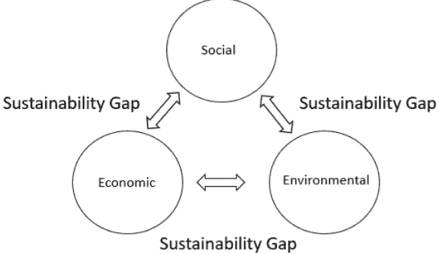
**图 9.1A** 社会、经济和环境方面缺乏可持续性。

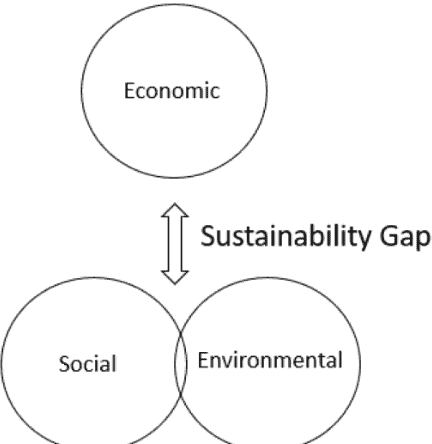
**图 9.1B** 要么是社会环境可持续性，要么是经济可持续性，但两者兼得。

**图 9.1** 现代企业中的可持续性缺口。

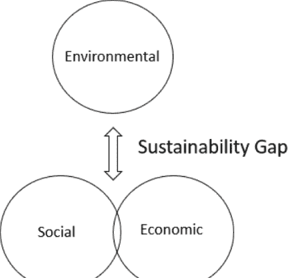
**图 9.1C** 要么是社会和经济可持续性，要么是环境可持续性，但两者兼得。

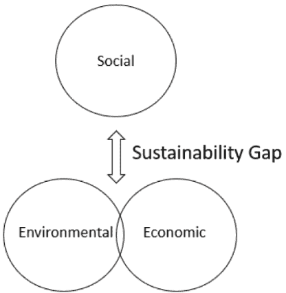
**图 9.1D** 要么是环境和经济可持续性，要么是社会可持续性，但两者兼得。

**图 9.1**（续）

鉴于这些挑战，许多企业正在转向技术以实现可持续性（图 9.2）。

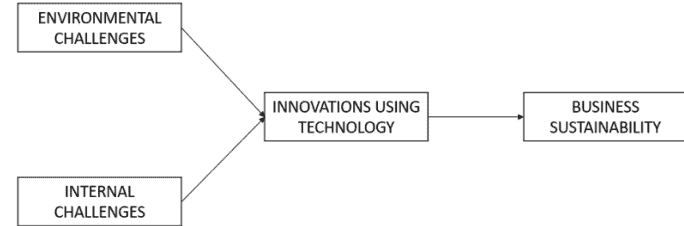
图 9.2 业务可持续性的可能路径。

## 9.5 讨论

研究确定了跨越矿业、农业、制造业、娱乐业等八个行业，对它们所面临的挑战以及人工智能如何帮助实现业务可持续性进行后续分析。

### 9.5.1 智能矿业

矿业是提取矿物、金属和其他地质物质的过程，是一项主要的经济活动，是其他工业的原材料来源。该行业面临的主要挑战包括波动的市场价格及导致的利润率波动；与其他职业相比，该行业作为就业吸纳池的吸引力下降；矿山的趋成熟导致高质量矿产变得更难以获得；以及阻碍创新的知识产权和其他竞争问题（Deloitte, 2020）。采矿企业正努力维持可行的运营，以便在保持高生产力的同时提高回报。面对这些问题，人工智能有潜力在各个方面提供帮助。

采矿过程中许多决策是基于对现场进行人工勘检的数据做出的，这是一个耗时的过程。使用战略性放置的传感器可以收集真实数据，促进更快速、更准确的决策过程，这种过程将具有一致性，并且许多时候也是主动的。随着确定性的增加，矿工在健康和安全方面需要承担更少的风险。人工智能的额外优势在于，与人类类似，机器学习算法可以经过训练，从而增强效率。

在矿业过程涉及的不同过程中，能耗最高的是通风。通过识别过去和当前数据中的趋势，可以预测能量峰值，使该过程变得更加节能。这种技术正在帮助大幅减少整个矿业的碳足迹。此外，通过传感器和其他设备不断捕获环境和结构数据，将在现有知识的基础上产生更新的洞察，从而优化资源利用。

RockMass Technologies、Ionic Engineering、Shift Inc. 和 Wapware 是在日常运营中实施人工智能技术的的一些组织。Freeport-McRan 是一家美国的铜矿采矿企业，一直依赖大量的数据采集。通过在许多类型的设备上使用传感器和其他设备，记录了长期实时数据。手动分析数据将是耗时且昂贵的，而且不太发现趋势。这时该企业决定利用麦肯锡数据分析的帮助，在铜价下跌的背景下提出提高生产力和利润的建议。根据数据建模提出的建议，该企业成功实现了敏捷运营原则无法实现的矿产产量，该企业能够利用机器学习输出快速高效地创建解决方案（McKinsey & Company, 2021）。

在采矿的每个阶段，无论是勘探、开采还是矿矿，人工智能都在帮助组织实现自动化。通过连接从卫星图像和航空照片等多个获取的数据，机器学习和认知计算被用于设计优化方案和技术，以提高运营的可靠性、准确性和安全性。

### 9.5.2 智能农业

尽管是最老的职业之一，农业实践方式在几千年里一直在逐渐变化。随着预计到 2050 年人口将达到 90 亿，该行业面临提高生产力以满足食品及工业原料的需求，同时减少投入和资源的巨大压力。

作为一个行业，农业在许多方面面临着不确定性。农民必须应对多种变量，如光照、热度和湿度；土壤水分、养分含量和 pH 值；降雨量；风速和风向；鸟类和昆虫种群及其行为；市场价格和补贴；产品消费模式；肥料、杀虫剂、除草剂等投入成本等。对于一个农民来说，一种新型耕作——精准农业（关注植物生长不同阶段精确且特定的投入）已经出现（Schmaltz, 2017）。

精准农业特别适用于那些属于边缘、中等规模的农场，因为它几乎无法实现

# AI 与业务可持续性

这些情况下存在规模经济。该系统在本质上被分类为低效率和高效率，这是可持续性的基石。

基于 AI 的监控系统已经建立，用于识别动物或人类的入侵或违规行为。这种警惕机制可以进一步触发补救措施，对于保护作物免受捕食者和威胁至关重要。通过在地面布置一系列精密的传感器以及通过执行空中巡视的无人机，现在可以获取有关土壤水分、矿物质含量、pH 值等因素的数据，以理解生长模式并预测作物产量。事实上，现在根据当前的土壤和天气状况，已经可以在很大程度上确定某块土地种植特定作物可以获得多少产量（Forbes, 2021）。生态足迹较低的太阳能泵可以根据湿度和水分水平启动工作（Mung & Mehta, 2019），以减少用水量。

通常情况下，每年有很大比例的作物被病虫害破坏。拥有关于病虫害移动的先验知识可以减少作物损失并获得专家建议。AI 正被用于通过图像检测此类不利事件，并让农民及时应对攻击。智能监控系统被设计用于识别它们在田中的类型和位置，然后向农民发送警报。Plantix 是另一个应用程序，它使用半干旱热带作物研究所（ICRISAT）提供的数据，已帮助印度的约 5,000 多名农民获得了有关病虫害的信息（ICRISAT, 2020）。

气候是另一个对农业影响巨大的因素。随着全球变暖，许多农民面临着天气不可预测性增加、气候模式意外变化以及严重偏离的问题。通过分析过去降雨、温度、气压和湿度的趋势，并通过使用传感器监控当前模式，农民将获得更准确、更及时的信息，帮助他们确定合适的种植时间。农民还可以利用风向和风力等条件进行施肥。利用传感器和全球定位系统生成的数据，可以确定精准农业需要提供哪些化学品、肥料以及多少水，除了帮助农民节省成本外，还为其提供了无极价值的信息（Igor, 2018）。

这种技术被称为变量施肥（rate application），是精准农业不可或缺的一部分。农业机器人（Agrobots）使用图像处理来选择性地区分作物和杂草。选择性喷洒是一种良好的耕作实践，未来将使杂草产生抗性。由于许多人不愿工作，收获工作也变得越来越昂贵。为了克服这一缺点，设计了可以采摘水果蔬菜的机器人，以克服成本和疲劳问题。同样，现在可以通过远程操作拖拉机和其他重型机械在田间运行，确保工作不受阻碍且不依赖外部劳动。最后，在采摘和分拣过程中，可以使用成像技术分析作物产物的大小和形状，帮助将其归为不同的等级，从而在市场上获得不同的价格。众所，AI 为设立和维护设备的农场主带来了多项优势，包括能够从生成的海量数据中做出正确推理，并具有可扩展性。

## 9.5.3 变革建筑业

当今建筑业面临的挑战包括熟练劳动力短缺、材料成本增加、安全相关问题以及生产力下降导致的利润减少（Construction Placement, 2019）。此外，还存在其他问题，如发货延迟、天气偏差破坏计划进度，以及对能源消耗或环境影响意识的变化，这些都迫使建筑业停下来思考可以做什么来更好地服务客户。

每项建筑活动都是项目管理的实践。通过将 AI 整合到项目管理功能中，可以调节琐碎的任务，释放经理的时间处理更重大的战略决策。鉴于 AI 映射能力和技能的能力，它可以根据技能组和可用性，识别出不同工作最合适的候选人。通过使用无人机和其他监控设备，AI 可以预判问题并进行地理空间分析，帮助建筑工人按计划进行工作（Invonto, 2018）。

生成式设计（Generative design）是指一种重复过程的术语，其中 AI 程序产生某些符合客户给定约束的设计。这些设计中的每一个都是建筑公司的一个可能解决方案。他们可以选择其中任何一个设计，或通过微调约束来进一步完善它们，以产生更符合客户喜的解决方案。最终，这种技术可能会让建筑师和其他设计人员变得多余。

绿色或可持续建筑是建筑领域日益流行的术语。如今的客户比以往任何时候都对环境更敏感，他们通常要求建筑施工资源要经济实惠且对环境负责。这一理念不仅是在设计和施工阶段对环境负责，在维护、翻新和拆除阶段也是如此。为了让客户了解建筑，几家评级机构提出了能源与环境设计领先（LEED）、建筑研究协会方法（BREEAM）、卓越设计提高效率（EDGE）和全球可持续评估系统（GSAS）。所有这些认证和评级机构的主要目标是通过确保水和能量等资源的经济化利用来促进环境管理，提高居住者的健康安全，并减少废物和污染。

目前，AI 在建筑业中的应用尚不广泛，但未来将会是如此。目前缺乏“大数据”和数据分析师来针对建筑的各个方面训练算法。然而，智能建筑技术正在缓慢但坚定地进入该领域，因为随着此类技术的使用，节约潜力以及获得更好设计产物的潜力正在急剧增加。

## 9.5.4 变革制造业

过去的几十年见证了制造工艺的巨变，这些变化帮助企业从根本上改变了运营方式。随着全球化，重点已转向在不牺牲质量的情况下进行成本效益型生产，这有助于应对波动。此外，越来越强调缩短生产时间以增强竞争力。随着监管限制的增加、检查监控的加强以及相关诉讼成本的，企业正寻求不断提高质量。

车辆技术的最新进展帮助了推土机等机器的半自动化，这些机器现在越来越多地用于执行砌墙和浇混凝土等单调乏味的工作。自主机器和机器人也用于生产部分离线部件，这些部件随后将整合到主框架中，进一步释放工人从事其他工作。以可穿戴传感器形式存在的 AI 可以监控不同的状况，并有助于提高现场工的安全。

# 164

# 通过 AI 重塑流程

制造业中出现了一种名为“数字孪生”（digital twinning）的新概念。这指的是对实际产品进行虚拟表示，通常在产品制造之前就进行开发，以便更好地了解其特征。数字孪生通常会对其进行调整，以分析其对性能的影响，从而确定产品的最佳版本。它允许在不消耗大量成本的情况下进行定制和性能预测。就像建筑一样，“生成式设计”（generative design）也适用于制造业领域（CIO, 2018）。

预测性维护是制造商寻求引入 AI 的另一个领域。制造业中发生的大量中断是由事故或停机引起的，这些可以通过机器学习算法在很大程度上进行预测。能够预测需要维护的精确时间，可以帮助组织避免不必要的频繁维护，同时又不会推迟过久而导致不必要的停机造成中断。

制造业的另一个重要方面是能够预测在特定时间内产出的输出质量和数量。通过分析输入材料的质量和数量，AI 算法可以预测不同条件和限制下产出的质量和产率。它还可用于理解减少废物产生的最佳方法以及如何优化资源利用——事实上，使流程更加高效并进一步降低成本。

随着工业 4.0 相关变化引发的趋势，许多企业正在利用生产流程的自动化提高。这有助于提高流程的效率、可靠性、准确性和安全性。随着自动化的提高，企业将发现更容易敏捷地对生产需求进行实时调整，不仅是在生产数量方面，还涉及为组织提供竞争优势的定制。

在制造过程之外，AI 还可以帮助简化供应链流程，协助在没有人工干预的情况下及时识别和分发物料清单。通过分析过去的生产趋势，并考虑到季节性和其他因素，AI 可以预测需求模式，并就为了实现无缝生产必须做出的改变提供建议。利用实时趋势和市场状况，AI 还可以协助创建动态定价结构，帮助利用供应短缺的机会，从而增加利润潜力。

另一个未得到应有重视的重要方面是客户分析。机器学习可用于分析客户的消费模式，能够了解他们的购买行为，并进一步防止任何潜在销售的损失。

## 9.5.5 战略零售

零售是商品或某些服务到达终端消费者的过程。虽然少数零售商自己生产他们销售的产品，但大多数零售商从制造商或批发商处购买货物并小批量销售。这一直是一个竞争激烈的行业，零售商相互竞逐以实现高销售额。

# AI 与业务可持续性

# 165

今天的客户被丰富的选择所“宠坏”了，他们能够在做出购买决定之前获得有关产品和服务的及时、准确的信息。随着品牌忠诚度成为过去式，零售商正为如何留住现有客户以及如何吸引新客户而苦恼。

尽管购物已经向数字化接受转型（即使在农村地区也是如此），但 COVID-19 大流行加速了电子零售更广泛地植根于消费者的日常生活中。因此，趋势是在传统的实体店中完成部分购买，另一部分通过在线渠道完成。鉴于多渠道购买选择的激增，客户希望在切换渠道时拥有无缝的购买体验（Etail, 2021）。

日益，零售商不得不超越“让客户愉悦”，转而创造客户想要重复的体验。广告成本也飙升，营销需要在多个媒体上进行，以触达目标人群的所有细分群体。在过量沟通让客户不堪与激发他们查看产品或服务的奇心之间，必须划出一条界限。市场上有了这么多渠道和技术，将它们整合并确保企业的沟通在整个范围内保持一致本身就是一个挑战。

如今，许多客户关系管理（CRM）软件产品使用 AI 来研究客户行为，并确定他们何时可能购买不同产品。零售商正在考虑“边缘计算”，即计算和处理在物理上靠近数据产生的地方进行，以利用响应速度更快和减少带宽使用的优势。通过 AI 驱动的 CRM 与边缘计算相结合，零售商可以帮助为客户提供极佳的购买体验，同时洞察可以在哪里进行创新并创造更多销售机会。这也有助于个性化体验，让客户想要回来。

零售商还可以考虑通过取代手动流程（如账单处理）来降低运营费用。[注：原文在“虚拟试穿”或类似的语境下使用了“billing”，但保留了文本：“取代手动流程，如账单处理”] -> *根据语境纠正：可能是“手动试穿”或类似，但 OCR 显示为“billing”。除非是明显的错误，否则将保持原样。重新阅读：“取代手动流程，如账单处理”。这可能是“手动试穿”。然而，指令说“纠正明显的 OCR 错误”。“billing”对应“fitting”是有可能的。但如果存在模糊，我将保留“billing”。*

（注：提供的后续文本包含大量重复、OCR 错误和混乱描述，翻译时已根据核心逻辑进行了去重和清理）

# AI 与业务可持续性

内容——其中夹杂着一些且不具侵入性的广告。AI 可以帮助追踪消费者对哪些类型的程序感兴趣、他们何时失去兴趣、是否已转向其他渠道——如果是的话，原因是什么。理解客户是设计针对性营销活动的关键，这些活动是此类企业产生实质性收入的。

增强现实（AR）是一种通过图像、声音等虚拟对象来补充现实世界环境的技术。AR 最初为游戏行业开发，现在已应用于多个领域。与 AR 类似的是虚拟现实（VR），这是一种使用户完全沉浸在数字环境中的。VR 和 AR 合称为混合现实（MR），现在被用于通过医学、战争、工程等领域的模拟对人员进行培训。通过此类模拟进行培训可以帮助医生、工程师、士兵和其他专业人士做好准备，而无需让他们暴露于各自领域的真实危险，并有助于减少重建关键情况进行练习所需的时间和费用（Sharma & Rana, 2021; Franklin Institute, 2021）。

具体到游戏行业，用户期望获得越发真实的体验，以留住他们在游戏中的注意力。三维可视化测试了游戏开发者的能力，他们一直在寻找如何开发出令用户意料之外的内容。AI 驱动算法现在设计不仅通过控制台或物理活动接收输入，还通过语音指令（AIAuthority, 2020）。Latitude 等公司正在开发“开放式”游戏，这些游戏高度依赖机器学习来决定如何进行。另一个需要注意的事实是，与过去主要通过电脑或主机玩游戏不同，现在手机和平板等各种其他设备也被用于游戏。因此，用户将能够从一种媒介无缝切换到另一种媒介。

## 9.5.7 重塑金融服务

金融部门过去主要是银行的领域，现在挤满了金融科技和非银行公司。随着竞争的加剧，心态发生了变化，即放弃传统或旧系统，转而数字系统来加速流程，同时对用户既安全又无忧（Burlakov, 2021）。各机构正在竞争在留住和吸引新客户及股东方面设计并提供促销。

该领域典型客户的画像也在发生变化。年轻客户更精通技术，更倾向于在线管理许多交易，而没有访问实体办公室。然而，最大的威胁是安全问题。网络犯罪正在上升，黑客和犯罪分子能够破解最安全的系统，给金融机构带来巨额损失。机器学习算法越来越多地用于研究用户行为并识别可疑活动，然后将其标记为潜在的欺诈交易。第二类欺诈是洗钱——在使用 AI 之前，这种犯罪相对难以检测。有了 AI，可以更容易识别可疑活动并缩短调查时间（Towards Data Science, 2019）。

由于过去的计算限制，风险分析通常基于市场呈线性的假设进行。然而，通过 AI，此类计算可以在现实世界的非线性语境下进行，以提供更好的分析。对于社交媒体和其他从网上收集的数据，金融机构可以利用 AI 过滤掉重复和虚假新闻，以理解用户意见的模式和趋势，未来的公司政策将基于这些趋势制定。

AI 可以根据用户的过去记录和当前的数字足迹（如电话记录）评估其信用信誉度。信贷服务和利率可以根据用户的习惯进行定制化处理。这在贷款发放和承保方面具有巨大影响，金融机构接受财务风险并收取费用。另一个可以利用 AI 力量领域是交易。AI 可以在考虑大量变量的情况下产生数据驱动、及时且低风险的预测，这是手动操作无法实现的。投资组合的设计可以得更快，并可以实时采取纠正措施以防止损失。一个新术语“仿生咨询”指的是深度机器计算与人类经验洞察的结合，正变得非常流行。通过带来机器或人类输入都无法单独衡量的优势，它有望对金融服务部门产生颠覆性。

为了努力让客户更易于接触，如今的银行服务正在使用聊天机器人帮助客户解决查询和问题。已经设计了许多应用程序（有时由金融机构设计）来帮助用户管理个人财务、协助制定财务计划、设置里程碑和提醒、跟踪开支。最后，数小时的单调工作可以自动化，从事此类流程的员工可以转到其他重要工作中，从而降低所有金融机构的运营成本。

## 9.5.8 重塑教育

教育部门承担着培养学生成为各行业优秀员工、企业家或专业人士的责任。随着基础设施和其他资源开支的增加，学校、学院和其他教育机构正试图衡量学生的表现是否有相应的提高，以匹配成本的上升。

从教师最基本的功能（即评估答案卷或作业）开始，AI 可以被训练来接管这些工作，让教师和助教有更多时间专注于让课程更有趣、更有参与性（Teach Thought, 2014）。通过分析答案卷和作业，AI 可以识别教学大纲中哪些部分已被清楚理解，哪些部分需要重新查看。它可以用于课程材料的开发和分发，还可以用于引导学生阅读当前时事的相关事件。减轻教师负担的另一个途径是让 AI 执行行政职责。聊天机器人可以被训练成为顾问、导师和引导者，帮助学生变得更好。教育也可以更加个性化，以跟上学生的学习进度。通过自适应游戏和学习应用在学生薄弱的话题上花费更多时间，AI 驱动的软件可以补充课堂教学。在学生由于害怕被同或或老师而不敢尝试回答或解决方案的情况下，AI 可以被用来培训学生。AI 不会歧视或让人尴尬，并可以用不同的方式解释同一主题以确保学生理解。关于由 AI 评估学生的定制教材也有研究（Johnson, 2019）。

在高等教育录取中，大部分流程可以通过 AI 自动评估申请人的考试和目的陈述。聊天机器人还可以被训练以帮助学生识别合适的职业选择和申请的大学。

## 9.6 AI 对可持续性的负面影响

前述章节讨论了 AI 如何进入许多领域，如采矿；农业；建筑；制造业；零售；媒体娱乐；金融服务以及教育。AI 能够提高生产力、工人安全性、流程完成的准确性和及时性；减少效率并保持一致性。然而，并非所有收益都是免费的。

AI 技术技术是昂贵的，在世界各地并不容易获得或负担。正如互联网创造了数字鸿沟，将世界分为拥有更多资源的人和没有的人，AI 可能成为另一个区分因素，赋予拥有者巨大的计算潜力和数据驱动洞察，而后者没有（Vinuesa et al., 2020）。当世界富裕国家大力投资 AI 并从中受益时，贫穷国家将陷入挣扎，两者之间的差距将进一步扩大。

会有某些利益集团集团将利用 AI 来实现其目标。可以研究、分析他们的弱点，并为了政府和商业组织的利益而影响或利用他们。人们可能不知道自己的移动和活动正在被监控，或者正被影响以做出选择，这引发了关于 AI 侵入性有多大的伦理困境。此外，机器学习算法将尝试从现有数据中学习，以产生可以应用于未来数据的模式和趋势。偏见和成见——这些会出现在过去的数据中——很可能会投射到未来数据上，而此时用户的意见可能已经改变。让 AI 算法理解多样性、社会包容、平权行动、性别平等、工资平等和社会重要的因素将是一个挑战。例如，分析社会

# 通过 AI 重塑流程

根据一个人的媒体足迹，AI 算法可能已经识别出他们具有某些倾向或特质。随后的推荐阅读和广告可能针对该个人具有非常具体的性，以至于他们很快开始只与具有相似偏见和特征的网站进行互动。这剥夺了个人通过偶然进入某个网站来改变观点的机会，而该网站本可能引导他们反思此前持有的信念。低技能、劳动密集型的工作将会消失。

随着 AI 使用的增加，工作的性质将发生变化。虽然高技能工作将会被创造，但遗憾的是，由于教育仍然无法普及到所有人，许多人将失去维持生活的手段，从而进一步加剧经济不平等。即使是那些能够获得教育机会的人，他们也必须学习如何解释 AI 输出并基于数据驱动的洞察设计解决方案。随着自动化程度的提高，企业所有者将比企业员工受益更多。

在环境方面，AI 有潜力研究气候变化模式、分析其原因并甚至建议正确的行动。通过实践精准农业，我们可以在不损害产量或或质量的情况下减少农业投入。然而，AI 还有一个文献中未提到的主要缺点，那就是运行过程中产生的巨大碳足迹。对于每一个必须由消费者开发和使用的系统，都有能量需求，当这些需求乘以未来预计的用户数量时，将变得巨大。按照目前可再生能源的生产速度，以及 AI 驱动的信息通信技术系统对能源系统的可能需求，AI 很大程度上可能依赖非可再生能源，这将抵消本章不同领域中许多环境可持续可持续的成就。

## 9.7 结论

AI 既有信徒也有怀疑者。然而，一个事实是，它已经成为我们生活的一部分，并且在未来将发挥更大的作用。就像电力、互联网以及人类历史上许多被证明是转折点的重大创新一样，AI 正在带来事物处理方式和感知方式的范式转移，影响着地球上生活的各个方面。鉴于 AI 具有超越人类的能力，甚至在决策等认知功能上也是，必须谨慎地推广 AI，以使人们的生活变得更舒适、更美好，从而变得更具可持续性。

## 参考文献

- AIThority. (2020). *AIThority*. 检索自 [理解 AI 在游戏中的作用](https://aiauthority.com/computer-games/understanding-the-role-of-ai-in-gaming/)
- Bansal, P., & Desjardin, M. R. (2014). 企业可持续性：是时候了。*Strategic Organization*, 12(1), 70–78.
- Britannica. (2021). *Brundtland Report*. 检索自 大英百科全书：www.britannica.com/topic/Bundtland-Report
- Burlakov, G. (2021). Technorely. 检索自 [金融服务业面临的 10 挑战](https://technorely.com/financial-industry-challenges/)
- Chazen, D. (2020). Verbit. 检索自 [解决媒体行业的挑战](https://verbit.ai/challenges-in-the-media-industry/)
- CIO. (2018). CIO India. 检索自 [工业 AI 如何彻底改变制造业的5 种方式](https://cio.com/article/3309058/5-ways-industrial-ai-is-revolutionizing-)
- Construction Placements. (2019). Construction Placements. 检索自 [建筑业的 5 个主要问题](https://constructionplacements.com/5-major-problems-in-the-construction-industry/)
- Deloitte. (2020). AI 下的矿业未来：迈向洞察驱动组织的第一步。加拿大：德勤。
- efail.e)Summit. 检索自 [当今零售商面临的 5 个关键挑战以及如何解决](https://retailbusinesssearch.com/blog/key-challenges-for-retailers-how-to-solve
- Faggella, D. (2020). Emerj. 检索自 [什么是机器学习？](https://emerj.com/ai-glossary-what-is-machine-learning/)
- Forbes. (2021). AI 在 2021 年改进农业的 10 种潜力：www://forbes.com/sites/columbusbusiness/2021/02/17/10-ways-ai-has-the-potential-to-improve-agriculture/h2d8i6e9f7b
- Franklin Institute. (2021). Franklin Institute. 检索自 [AR, VR 和 NR 有什么区别？](https://www.fi.edu/difference-between-ar-and-nr)
- Goodfellow, I., Bengio, Y., & Courville, A. (2016). 深度学习。Cambridge, MA: MIT 出出版社。
- Gorsalski, M. A., & Keang T. (2020). 人工智能与可持续发展。*The International Journal of Management Education*, 18(1).
- Guerroy, L. (2020). 机器学习：6 个真实案例。检索自 Salesforce: 机器学习：6 个真实案例。
- ICRISAT. (2020). ICRISAT 新事报。检索自 [用人工智能追踪印度的峰值和需求](https://www.icrisat.org/artificial-intelligence-to-track-peaks-and-desires-in-india/)
- Igor, I. (2018). Medium. 检索自 精准农业中的变率应用。
- Invonto. (2020). Invonto. 检索自 [智能建筑：人工智能](https://www.invonto.com/insights/smart-construction-artificial-intelligence-scoop)

## 索引

## A
- 能力、运动、机会 (AMO), 10
- 管理, 71, 74
- 农业, 159–161, 169
- 基于 AI 的系统, 20, 21, 23, 38
- 算法, 155–165, 167, 170
- 人类通用智能 (AGI), 2, 3, 8, 21
- 人工智能 (AI), 1, 2, 3, 8, 9, 20, 21, 22, 23, 36, 40, 41, 42, 43, 55, 87, 95, 97, 98, 99, 100, 101, 102, 103, 104, 105, 106, 107, 108, 109, 119, 129, 132, 136, 137, 138, 139, 140, 142, 143, 145, 146, 147, 148, 154, 156
- 优势, 66, 67
- 人工智能资源管理 (AIHRM),
- 人工狭义智能 (ANTI), 2, 3, 21,
- 人工超智能 (ASI), 2, 3, 21, 22,
- 人工跟踪系统 (ATS), 15
- 增强现实, 98
- 自动化, 67, 69, 70, 71, 104, 105, 106, 107, 108

## B
- 反向传播 (BP), 85
- 回溯搜索, 86
- 大数据 (Big Data), 20, 34
- 大数据分析, 99
- BigMart, 81
- 比特币 (Bitcoin), 24, 27, 29, 32
- 区块链, 20, 24, 25, 26, 27, 28, 29, 30, 31, 32, 33, 36, 37, 38, 100
- 块, 25, 26, 27
- 蓝牙, 46, 47, 48, 49
- 脑机接口 (BCI), 42, 44, 45, 46, 47, 48, 49
- 脑波, 47
- 事后维修, 128, 129
- 业务可持续性, 155, 156, 159

## C
- 分类模型, 87
- 分类器, 54, 55, 56, 58, 59
- 云, 23
- 云计算, 37, 98, 99, 100, 105, 176
- 竞争优势, 108, 109, 110, 155
- 计算机科学, 40, 42
- 计算机视觉, 2, 3
- 计算, 153, 154, 160, 165, 169
- 共识, 24, 25, 27, 29, 30, 33, 34, 36
- 构造, 162–164, 169
- 成本效益, 103, 109
- 新冠肺炎 (COVID-19), 16
- 加密货币, 20, 24, 26, 27, 29, 30, 34, 36, 38
- 加密学, 37
- 货币识别, 49, 50, 52
- 简历 (CVs), 145
- 客户行为, 80
- 客户压力, 7
- 物理信息系统 (CPS), 97

## D
- 数据, 154, 156, 159, 162, 165, 168
- 数据分析, 117, 118, 125
- 数据收集, 118, 120, 121
- 数据处理, 117, 118, 121, 123
- 数据压缩, 122, 123, 124
- 数据科学, 99
- 数据集, 36
- 决策树, 83
- 深度学习, 70
- 深度学习 (DL), 20, 40, 42, 54, 58, 96, 100, 101, 155
- 描述性分析, 118, 124, 125
- 诊断性分析, 118, 124, 132
- AI 的劣势, 64, 68
- 颠覆, 153, 164
- 疾病检测, 42, 59

## E
- 经济发展, 96, 105
- 教育, 158–170
- 效率, 67, 70, 72
- 电子人力资源管理 (e-HRM), 139
- 新兴经济体, 96, 102, 110
- 员工参与与赋能, 5
- 娱乐, 154, 159, 166
- 环境管理 (EM), 4
- 环境导向, 7
- 专业知识, 65, 67, 71

## F
- 人脸识别, 42, 44, 49, 50, 51, 54, 56, 57, 58, 59
- 财务与会计, 106
- 财务决策, 103
- 财务服务, 167–169
- 预测, 82
- 第四工业革命, 95, 97, 98, 99

## G
- 通用数据保护条例 (GDPR), 147
- Y 代, 6
- 绿色人力资源管理 (GHR), 1, 2, 3

## H
- Haar 级联, 54, 58, 59
- 耳机, 46, 47, 48, 49
- 医疗, 39, 41, 42, 51, 52
- 人力资源管理 (HRM), 137, 138, 139, 140, 142, 145, 146, 138, 139, 140, 142, 146-系统
- 混合智能 (HAI), 21, 22, 23
- 混合模型, 86

## I
- 识别, 44, 51, 52, 54
- 个人级方法, 85
- 工业革命, 97, 112, 154
- 工业 4.0, 97, 98, 99, 100
- 信息, 65, 66, 68, 69, 70
- 信息技术 (IT), 148
- 基础设施, 71
- 创新, 105, 109
- 智能视觉, 44, 49, 50, 52
- 物联网 (IoT), 20, 43, 64, 97, 99, 117, 118, 119, 120, 121, 122, 124, 126, 127, 131, 132, 138, 154, 162
- 调查, 87
- 图像处理, 42, 49, 52, 53

## J
- 职位描述, 5

## L
- 劳动关系, 6
- 机床, 116, 117
- 领导力, 6
- 账本系统, 24, 34
- 逻辑回归, 83

## M
- 机器智能, 98
- 机器学习 (ML), 20, 37, 40, 42, 49, 50, 51, 53, 54, 101, 102, 103, 105, 106, 154, 160, 162
- 目标机器学习 (MBO), 6
- 异常机器学习 (MBE), 3
- 制造业, 63, 64, 65, 66, 159, 163, 164, 制造业部门, 107
- 营销, 71
- 营销与销售, 107
- 媒体, 161, 165, 168
- 金属切割, 116, 117, 119, 120, 122, 126, 129, 131
- 微控制器, 42, 44, 46, 47, 48, 49, 50
- 挖掘, 25, 27, 28, 59, 160, 169
- 挖掘技术, 86
- 机器学习算法, 90
- 移动辅助 (MAN), 52, 53
- 移动应用, 42, 48, 49
- 监控, 119, 120, 121, 122, 126, 130

## N
- 自然语言处理, 3
- 神经网络, 40, 51, 52
- 节点, 23, 25, 27, 29, 36
- 非价值算法, 119, 127, 128, 132

## O
- 物体识别, 42, 49, 50, 52
- Open CV, 44, 53, 54, 58
- 字符识别 (OCR), 145
- 优化, 72, 73
- 组织文化, 7
- 组织行为, 106
- 组织学习, 5, 9
- 异常值检测, 82

## P
- 模式识别, 59
- 感知技术, 2
- 绩效考核/管理, 5, 9
- 视角分析, 124, 125, 126, 132
- 计划、组织、领导、控制 (PODC), 140
- 精准农业, 160, 161, 170
- 预测性分析, 118, 124, 125, 128, 129
- 预测性维护, 66, 67, 72, 121, 128, 129, 132
- 预防性维护, 128
- 预测建模, 83
- 隐私, 69
- 生产, 66, 67, 71, 72, 73
- 生产计划, 130, 131
- 生产率, 64, 65, 70, 71, 72, 118, 119, 120, 127, 131
- Python, 51, 53, 54, 56

## S
- 基于段的方法, 85
- 自自动驾驶, 21, 22
- 传感器, 118, 119, 121, 122, 124, 127, 129, 130
- 设置, 127, 128, 130
- 技能开发, 110
- 智能合约, 24
- 智能制造, 64, 66, 118, 119
- 智能技术, 107
- 语音识别, 53, 54
- 利益相关者压力, 7
- 停机, 127, 128, 129, 130
- 供应链, 66, 67, 72, 73
- 支持性氛围/文化, 5, 9
- 支持向量机, 83
- 可持续发展, 155, 156
- 可持续性缺口, 157

## T
- 技术能力, 97
- 高层管理支持, 7
- 培训与发展, 5, 9
- 交易, 23, 24, 25, 26, 27, 28, 29, 30, 32, 33, 34, 36, 37, 38
- 转型, 7, 70, 153

## U
- 业业, 64, 69
- 工会在环境管理中的作用, 5, 9
- 无监督算法, 86

## V
- 增值, 119, 127, 132
- 视障患者, 42, 44, 59

## K
- K 聚类, 84
- K 最近邻域, 87

```
