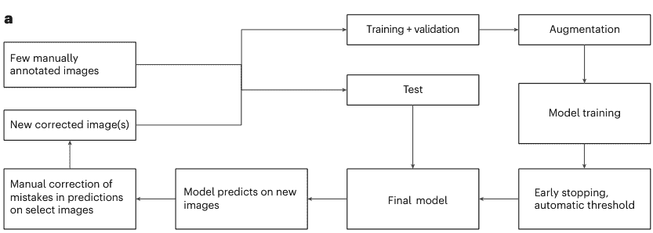
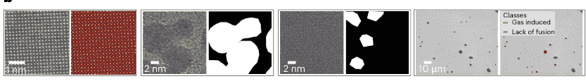
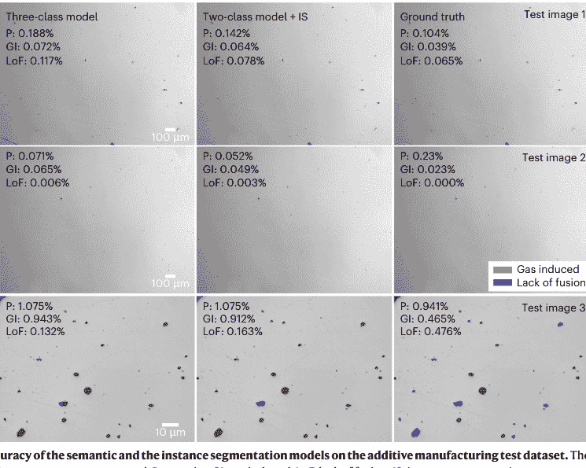
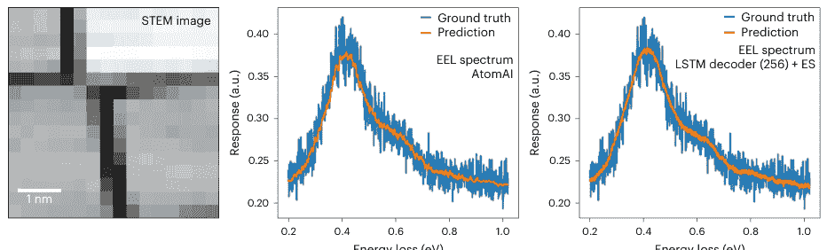

# 可重用性报告：AtomAI 基于深度学习的图像和光谱数据分析

机器学习（ML）技术在材料图像处理应用中越来越受到重视。在此背景下，Ziatdinov 等人开发了 AtomAI，一个用户友好且全面的 Python 库，旨在处理广泛的材料成像任务，包括图像分割、去噪、图像生成、图像到光谱映射（以及反之）以及图像分辨结构的后续原子建模。鉴于其广泛的适用性，本报告旨在复制作者原始工作的关键方面，将其功能扩展到新的材料数据集，并增强某些功能以提高模型性能。我们不仅成功复制了原始研究的部分内容，还针对不同图像处理任务中的多个数据集开发了改进的 ML 模型。发现 AtomAI 库易于使用，并且可以扩展以用于自定义应用程序。我们相信 AtomAI 对显微镜和光谱社区具有重大潜力，进一步开发——例如半自动图像分割——可能会扩大其实用性和影响。

深度学习技术在材料表征任务中越来越流行。无论表征工具的输出类型如何，无论是图像形式还是光谱，都可以使用深度学习技术进行学习，以加速数据获取和处理，从而实现高效的高通量实验和知识提取。在该领域中，图像分割以及图像到光谱（Im2Spec）或光谱到图像这两种学习任务尤为重要。图像语义分割是将图像划分为多个区域或段，并为每个段分配标签的任务。其目标是将图像中的每个像素分类到特定类别，从而有效生成像素级分割图。图像语义分割使材料科学中的许多关键应用成为可能，例如缺陷检测、微图分割、孔隙率定量和定量晶粒表征。同样，Im2Spec 任务涉及将图像形式的结构特征映射到相关光谱：例如，将能量光谱数据映射到局部图像，或将滞后回线映射到压电力显微镜的相关地形图像。

传统图像分割方法通常需要人工干预或依赖手工制作的特征，这可能既耗时又主观，且在处理复杂图像结构方面能力有限。深度学习模型，特别是卷积神经网络（CNN），可以通过从图像中学习层次特征来克服这些局限，并能有效捕捉复杂的模式和结构，而无需进行显式特征工程。因此，已有多次尝试开发稳健的自主（或半自主）框架，利用 CNN 高效且准确地完成图像分割任务。这允许对数千张显微图像进行高通量分割，并促进结构-性能关系的发展12。AtomAI 是橡树岭国家实验室开发的此类流行框架之一，主要处理显微图像分析。此外，它提供易于使用的库，用于

**图 1 | 开发图像分割模型的工作流程。a**，首先，从带有标签数据的母图像中裁剪出标准尺寸的较小图像。然后，该图像数据集进一步划分为训练、测试和验证集，或者使用单独的图像作为测试集。训练数据集中的图像采用多种策略进行增强，以便更好地进行模型泛化。
**b**，本工作探索的不同数据集中的示例图像及其对应标签。STEM，扫描透射电子显微镜；HRTEM，高分辨透射电子显微镜。

执行材料表征领域中的其他任务，例如 Im2Spec、使用变分自编码器进行降维、使用统计和基于图的方法分析数据集，以及深度集成训练以提高准确性。

在本报告中，我们使用 AtomAI 框架成功复制了原始工作中包含的图像分割和 Im2Spec 任务，并在最近公布的纳米粒子数据集上训练了模型。得益于 AtomAI 框架提供的灵活性，我们发现要实现与之前工作中报告的相当（甚至更好）的模型准确性非常简单。此外，我们将训练好的模型在不同噪声水平和未见图像放大倍率下进行基准测试，以估计这些模型在现实场景中的真实性能。同时，我们扩展了 AtomAI 框架的功能，以执行实例分割任务。使用增材制造合金的数据集，我们展示了相对于语义分割使用实例分割的优势。我们还指出，本报告限于 AtomAI 提供的其他功能中的图像分割和 Im2Spec 任务，因为我们认为这些是最通用的任务，具有广泛的适用性。

我们还报告了 AtomAI 框架原始实现的局限性，并建议代码更新以改进这些局限性。例如，AtomAI 框架不允许使用早期停止（ES），这是一种常用于避免深度学习模型过拟合和泛化能力差的概念。我们通过实现带有多个可用用户输入选项的模块化 ES 版本来更新 AtomAI 框架。同样，我们添加了一个模块，以便在模型训练期间选择最佳分类阈值。我们展示了带有 ES 和阈值选择的改进版 AtomAI 始终能为不同数据集实现更好的准确性。

AtomAI 的另一个局限性是，在数据增强过程中，并未考虑所有可能的图像方向和翻转，从而导致次优模型训练。我们还发现影响模型训练过程的代码中的小缺陷。例如，存在与使用库 numpy.random.randint 相关的重复错误——虽然该库返回下限（包含）和上限（不包含）之间的随机整数，但 AtomAI 代码是按照整数等于上限也包含在内的角度编写的。已提供包含这些修复的更新版本。

## 数据集

我们关注两个透射电子显微镜图像数据集和一个光学显微镜图像数据集。透射电子显微镜数据集包括 Sm掺杂 BiFeO3 (BFO) 体系和 Au 和 CdSe 纳米粒子系统4。前者数据集取自原始 AtomAI 出版物，包含一张尺寸为 3,000 × 3,000（约 20,000 个单元）的标记图像。图像中的每个像素被标记为子晶格 A、子晶格 B 或背景，从而构成基准真值数据。第二个数据集包含 Au 和 CdSe 纳米粒子的图像，分辨率分别为 4,096 × 4,096 和 1,024 × 1,024 像素。这些图像的基准真值是通过手动将图像中的每个像素标记为粒子（代表纳米粒子类）或背景（代表周围环境或空空间）获得的。

光学显微镜数据集是使用各种合金（包括 Inconel 625 和 H13）的激光床粉末熔融获得的。为了生成这些图像，一个尺寸为 10 × 10 × 10 mm³ 的立方体通过增材制造制成，然后沿构建方向斜向切割并在光学显微镜下观察。获得了不同尺寸的图像，展示了增材制造过程中形成的不同类型的孔隙，例如气体诱导和未熔合。此外，图像可能还包含样品切割过程中产生的划痕痕迹。

图 1a 捕捉了本工作中为分割任务采用的整体工作流程。对于 BFO 和 Au 及 CdSe 纳米粒子数据集，从原始图像中提取了较小图像的补丁——BFO 数据集包含 5,000 个大小为 256 × 256 像素的补丁，CdSe 纳米粒子数据集包含 172 个大小为 512 × 512 像素的补丁。补丁的数量和大小基于先前的研究，并为进行比较分析保持一致。接下来，获得的数据集补丁图像被划分为训练集、验证集和测试集。BFO 数据集使用 3:1:1 的训练-验证-测试比例，而对于 CdSe 数据集，129 张图像用于训练和验证，43 张用于测试，以符合原始研究。

对于增材制造数据集，采用了类似的策略。该数据集包含 12 张图像，其中最初选取了 3 张图像作为测试集。对剩余 9 张图像，从每张图像中提取了 500 个大小为 256 × 256 的补片，随后进行了增广处理，共得到 4,500 张图像。这进一步按 80:20 的比例划分，分别生成训练集和验证集。最初的 12 张图像被手动分割为三类，即背景、气体诱发孔隙和缺陷熔合孔隙。需要注意的是，两张图像中包含额外的刻度尺，通过将相关像素值替换为背景类像素值的平均值将其去除了。图 1b 中包含了不同数据集的几张示例图像。

多种增广策略，如泊松噪声、高斯噪声、模糊、图像旋转和翻转，被应用于训练数据以提高模型泛化能力。在模型架构方面，AtomAI 使用了带有六个卷积块、三个上采样块和跳跃连接的 U-Net 相邻网络，以实现高效的模型训练和信息保存。在每种情况下，都训练了带有和不带有 ES 的两个模型版本。在验证集上 log 损失最低的模型被选为最终模型，并用于对测试集及其他未见的新图像进行预测。

还进行了一些超出 AtomAI 框架原始出版物的额外研究，以获得重要的洞察。对于 BFO 数据集，我们关注训练模型对泊松噪声和图像缩放的鲁棒性，其核心思想是：如果训练好的模型在具有不同噪声水平、对比度或以略有不同放大倍率采集的类似样本图像上表现良好，则最有用，这些场景在成像过程中很常见。为了评估模型在该类条件下的性能，我们向测试集中的图像添加了不同级别的泊松噪声，并将其按不同放大倍率（×1.1–2）进行缩放。同样，对于纳米粒子数据集，还研究了不同增广策略组合的影响，以及确定能提高模型性能的类别标注阈值。

对于 Im2Spec 任务，使用了原始 AtomAI 工作中存在的扫描透射电子显微镜（STEM）图像和电子能量损失（EEL）谱数据。尝试了多种编码器–解码器架构，包括带有长短期记忆网络（LSTM）的循环神经网络，以及最近发表的 Mat2Spec 的修改版本，后者使用监督对比学习的概念和高斯混合模型来表示概率特征嵌入。所有尝试过的架构均已包含在更新后的 AtomAI 库中。

## 实验与实现

表 1 展示了基于 BFO 数据集构建的不同模型的比较性能。我们使用 AtomAI 作者共享的标准训练代码，能够复现原始工作中报告的误差。更重要的是，我们发现 ES 始终能产生泛化能力更强且预测方差更低的模型。因此，通过实施 ES，在 AtomAI 框架中实现了显著改进。AtomAI 中的泊松噪声和缩放实现被用于引入这些变化。可以观察到，随着噪声和缩放级别的增加，模型误差增加，这突出了创建多样化数据集以训练鲁棒模型的重要性。

纳米粒子数据集的结果汇总于表 2。训练了两个版本的模型：一个是在验证集上将阈值调谐为 0.05–0.95 范围内（带 θ），另一个是固定阈值为 0.5（不带 θ）。同样，本工作中训练的模型与过往工作报告的模型一样好（在某些情况下略好）。由于图像对比度较低，在 CdSe 数据集上训练的模型精度较低，这与过往工作一致。有趣的是，同时使用

表 1 | 针对 BFO 数据集测试集划分获得的结果

| 增广类型 | 增广级别 | Log 损失 | |
| :--- | :--- | :--- | :--- |
| | | 参考文献 3 | 本工作 (ES) |
| | 25–30 | 0.3502±0.1089 | 0.2022±0.0153 |
| 泊松噪声 | 30–35 | 0.5096±0.1383 | 0.3819±0.0864 |
| | 35–40 | 0.9362±0.6314 | 0.5860±0.0567 |
| | 40–45 | 1.6332±0.6562 | 1.1563±0.1493 |
| | 1 | 0.1897±0.0045 | 0.1674±0.0027 |
| 缩放级别 | 1.5 | 0.3726±0.0086 | 0.2832±0.0457 |
| | 1.75 | 0.5947±0.0411 | 0.4462±0.0833 |
| | 2 | 0.7309±0.0566 | 0.5583±0.0873 |

表 2 | 针对纳米粒子数据集测试集划分获得的结果

| 数据集 | 误差 | 参考文献 4 | 不带 θ | 带 θ |
| :--- | :--- | :--- | :--- | :--- |
| | F1 分数 | 0.89 | 0.884±0.005 | 0.888±0.004 |
| Au | 召回率 | 0.84 | 0.853±0.015 | |
| | 精确率 | 0.95 | 0.919±0.010 | |
| | F1 分数 | 0.59 | 0.614±0.021 | 0.642±0.013 |
| CdSe | 召回率 | 0.62 | 0.519±0.051 | |
| | 精确率 | 0.56 | 0.760±0.045 | |

虽然 AtomAI 框架帮助我们快速训练了精度与先前工作报告相近的模型（不带 θ），但我们通过调整分类阈值，能够训练出精度更高的模型（带 θ）。

各种增广策略，如高斯噪声、旋转、模糊和椒盐噪声，并未产生表现最佳的模型。相反，仅使用旋转和翻转作为增广策略训练的模型在 CdSe 数据集上表现最好，而对于 Au 数据集，高斯增广结合旋转被发现是最佳的。

除了手稿中包含的原始 AtomAI 框架外，用于提高纳米粒子数据集模型性能的另一项采用的策略是使用更好的分类阈值。U-Net 模型的最后一层预测每个像素属于某个类别的概率。例如，对于二分类问题，U-Net 提供逐像素概率图，其中大于 0.5 阈值的值通常被选为属于纳米粒子类，否则属于背景类。然而，基于我们的实验，我们发现 AtomAI 的默认阈值 0.5 并非最优，通过优化精确率–召回率权衡可以提高模型性能。如表 2 所示，从验证集确定的更优阈值可用于提升模型性能。在背景与粒子数据集对比度较低的情况下，观察到 CdSe 数据集的性能提升更高。我们还预期，θ 调谐在不平衡数据集的情况下能特别提升性能。应注意，θ 是在 U-Net 模型训练完成后进行调谐的。因此，我们对 AtomAI 框架进行的另一项重要代码改进是加入一个模块，允许确定最优阈值。我们还使用 AtomAI 框架优化了 U-Net 模型的层数和丢弃率；然而，这并未比使用最优阈值策略训练的模型带来性能提升。

除了自动阈值选择和 ES 之外，我们还扩展了 AtomAI 的功能，以支持实例分割，并使用增材制造数据集展示其优势。实例分割不仅对图像中的每个像素进行分类（类似于语义分割），还将像素分组以识别不同的对象实例。为实例分割模型创建训练数据集所需的工作量可能非常大。因此，我们使用连通域和分水岭分割的概念，使我们能够将语义分割模型转换为实例分割模型。有关更多详细信息，请参阅补充信息。

表 3 | 不同 Im2Spec 深度学习架构的性能比较

| 模型 | MSE |
| :--- | :--- |
| AtomAI | 0.000212 |
| AtomAI+ES | 0.000206 |
| LSTM decoder (256)+ES | **0.000204** |
| LSTM decoder (64)+ES | 0.000211 |
| Mat2Spec (K=25) | 0.000223 |
| Mat2Spec (K=150) | 0.000220 |

粗体文本突出了性能最佳的情况。

增材制造数据集包含含有两类缺陷（气体诱发和缺陷熔合孔隙）的合金光学图像。为突出实例分割的优势，使用 AtomAI 框架训练了两种分割模型：一种是三类模型，将像素分类为气体诱发、缺陷熔合或背景；另一种是二类模型，将像素分类为孔隙和背景。后者模型进一步使用我们的实例分割模块进行了扩展，以区分两种类型的孔隙。具体来说，二类模型的输出预测使用分水岭算法进行处理，以获取与各个缺陷实例相关的掩码。一旦识别出缺陷，就可以使用 scikit-image 计算其形状特征，例如周长、面积、长轴长度和固度。这些缺陷特征不仅对于揭示结构–性能关系非常重要，还可用于对不同类型的缺陷进行分类。例如，气体诱发孔隙是球形的，而缺陷熔合孔隙具有不规则边界并在特定方向上呈长条形。因此，在这里，我们使用长轴长度、固度和等效直径（补充信息）的组合来定义一个函数，该函数可以区分孔隙缺陷是缺陷熔合还是气体诱发。

带有实例分割的二类模型能够更好地区分两种不同类型的孔隙。通过扩展数据表 1 中呈现的两个模型的精确率、召回率和 F1 分数，进一步量化了这一点。显然，实例分割不仅使基础 AtomAI 表现更好，还可用于进一步分析图像中存在的缺陷（或对象）类型或分布，这在冶金和材料科学领域非常有帮助。

图 2 将三类模型和带有实例分割的二类模型的性能与手动标注的真值数据进行了比较。可以看出，二类模型和三类模型都能检测孔隙。然而，

AtomAI 框架还提供工具来学习 Im2Spec 或谱到图像模型。我们扩展了可用于开发此类模型的编码器–解码器架构库。表 3 和图 3 比较了不同架构在原始 AtomAI 刊物中提供的 STEM 图像和 EEL 谱数据集上的性能。发现带有 ES 的 LSTM 解码器架构能够取得最佳性能。我们为该数据集尝试的另一种有趣架构是修改后的 Mat2Spec。由于谱中存在固有结构，即相邻谱值之间的高相关性，预期利用此特征的模型架构将表现更好。Mat2Spec 试图通过学习将谱（标签）表示为潜空间中的高斯混合来实现这一点。同样，它还学习将关联图像（特征）编码到潜在高斯混合空间中。通过这种方式，

图 3 | Im2Spec 模型在 STEM 图像和 EEL 谱数据集上的性能。显示了示例输入 STEM 图像以及原始 AtomAI 模型和最佳性能 LSTM 解码器架构（序列长度为 256）的相关输出。a.u.，任意单位。

学习问题被简化为特征与标签的潜在嵌入对齐，这通过对比学习实现。在这项工作中，我们将原始 Mat2Spec 文献中的图材料编码器替换为基于 CNN 的编码器。尽管在该数据集上仅实现了可比性能，但我们认为 Mat2Spec 架构对于此类其他问题可能很有用。

## 讨论

我们发现 AtomAI 框架易于使用，且便于未来代码扩展。我们在四个不同的数据集上验证了其适用性：两个来自原始 AtomAI 工作，一个来自文献，另一个是原始增材制造数据集。尽管 AtomAI 框架提供多种功能，但在此我们将重点限定于图像分割和 Im2Spec 两项主要任务。我们不仅实现了这些工作中报告的模型准确性，还通过扩展 AtomAI 框架以包含 ES、分类阈值优化、实例分割及其他深度网络架构，进一步提升了模型性能。我们对 AtomAI 代码的扩展非常直接，无需对其基本结构进行重大修改。在原始代码中发现了几个小 bug，并在我们的实现中将其修复。我们认为 AtomAI 框架将成为显微镜和光谱学社区非常有用的工具，尤其是帮助那些进行高通量实验或处理材料微结构优化的人员。

## 未来方向

在使用 AI 进行自动微观结构图像分割领域，一个重大瓶颈是地面真实标签的可用性或生成。因此，通过集成有助于半自动数据生成的软件工具，AtomAI 框架的有效性可以显著提升。例如，最近，少数几项研究^10,11 使用了预训练模型或低精度机器学习（ML）模型的初始版本，以获取图像的近似分割图。这些低保真分割图随后可由专家用户轻松快速地编辑，以创建更准确的地面真实数据，进而用于微调 ML 模型。遵循这种迭代闭环方案，用户可以快速训练准确的 ML 模型，而无需花费太多时间生成准确的图像标签。在谷物分析领域的一次此类工作中，Gorynski 等人^12 采用了两个版本的 Mask 区域卷积神经网络，一个用于生成地面真实标签，另一个用于推理任务。他们构建了一个用户友好的图形用户界面，用户可以在其中输入单个谷物周围的边界框。随后，预训练的 Mask 区域卷积神经网络模型利用这些边界框数据生成像素级的谷物掩码，这些掩码又用于训练专门用于谷物检测的 Mask 区域卷积神经网络。由于边界框（仅两个点）的标注远快于精确对象（或谷物）轮廓的标注，作者能够生成大量训练数据，这使他们能够以更高的精度训练 ML 模型，涉及谷物属性，如面积、周长、质心以及最小/最大 Feret 直径。

在这方面，CVAT（计算机视觉标注工具）库^13 可能是将半自动分割任务与 AtomAI 框架集成的宝贵资源。CVAT 是一个免费、开源的数字图像标注工具，使用 Python 和 JavaScript 编写。将 CVAT 集成到 AtomAI 可为用户提供图形界面，以便在 ML 预测效果不佳的区域快速执行标注任务，从而为需要改进的 ML 模型的条件生成新的数据标签。

## 数据可用性

数据可通过以下笔记本文件获取：EarlyStopping_LBFO_pv.ipynb (BFO)、EarlyStopping_HRTEM_pv.ipynb (纳米粒子)、Instance_Segmentation.ipynb (增材制造) 以及 LSTM_EarlyStopping_Im2Spec.ipynb 和 Mat2Spec_ImSpec.ipynb (Im2Spec)，网址为 https://github.com/Pragalbh/atomai/tree/master/examples/notebooks（参考文献 14）。

## 代码可用性

代码可在 https://github.com/Pragalbh/atomai 获取（参考文献 14）。

## 参考文献

- 1. Roberts, G. et al. 深度学习用于钢材先进 STEM 图像中缺陷的语义分割。 *Sci. Rep.* **9**, 12744 (2019).
- 2. Noguchi, S., Wang, H. & Inoue, J. 基于冶金学家思维过程的机器学习框架，用于识别关键影响材料性能的微观结构。 *Sci. Rep.* **12**, 14238 (2022).
- 3. Ziatdinov, M., Ghosh, A., Wong, C. & Kalinin, S. 电子和扫描探针显微镜中图像与光谱数据深度学习分析的 AtomAI 框架。 *Nat. Mach. Intell.* **4**, 1101–1112 (2022).
- 4. Groschner, C. K., Choi, C. & Scott, M. C. 来自高分辨率透射电镜数据的分割与缺陷识别机器学习流程。 *Microsc. Microanal.* **27**, 549–556 (2021).
- 5. Kong, S. et al. 基于概率嵌入的对比学习材料发现态密度预测。 *Nat. Commun.* **13**, 949 (2022).
- 6. Lobato, I., Friedrich, T. & Van Aert, S. 用于单次电镜图像恢复的深度卷积神经网络。 *npj Comput. Mater.* **10**, 10 (2024).
- 7. Van der Walt, S. et al. scikit-image: Python 图像处理。 *PeerJ* **2**, e453 (2014).
- 8. Bradski, G. OpenCV 库。 *Dr. Dobb's J. Softw. Tools* **25**, 120–125 (2000).
- 9. Beucher, S. & Lantuéjoul, C. 轮廓检测中流域的应用。载于 *International Workshop on Image Processing, Real-Time Edge and Motion Detection/Estimation* 2.1–2.12 (CCETT/IRISA, 1979); https://people.cmm.minesparis.psl.eu/users/beucher/publi/watershed.pdf
- 10. Hu, Y.-C. J., Grossberg, M. D. & Mageras, G. S. 条件随机场框架下具有自适应局部统计的半自动医学图像分割。载于 *2008 30th Annual International Conference of the IEEE Engineering in Medicine and Biology Society* 3099–3102 (IEEE, 2008).
- 11. Drumetz, L., Dalla Mura, M., Meulenizer, S., Lombard, S. & Chanussot, J. 使用扫描电镜图像的胶凝材料半自动分类。 *Proc. SPIE* **9534**, 953403 (2015).
- 12. Gorynski, C., Frei, M., Kruis, Frank Einar & Winterer, M. 基于机器学习的微观结构定量表征。 *Acta Mater.* **256**, 119106 (2023).
- 13. Sekachev, B. et al. opencv/cvat: v1.10.0 *Zenodo* https://zenodo.org/records/4009388 (2020).
- 14. Vashistha, P., Kattamuri, H. G. & Batra, R. Pragalbh/AtomAI_Reusability: AtomAI_Reusability_v0.1.0. *GitHub* https://github.com/Pragalbh/atomai (2024).

## 致谢

本研究在印度理工学院马德拉斯分校先进显微镜与材料中心进行，该中心通过 IOE 计划（SB22231262MMTW0008277）获得资助。谨感谢印度理工学院马德拉斯分校罗伯特·博世数据科学与人工智能中心提供的计算资源。

## 作者贡献

P.V. 完成了所有语义分割和实例分割实验，更新了相关代码并撰写了稿件。H.G.K. 完成了与 Im2Spec 相关的实验，更新了相关代码并撰写了稿件。N.T. 在 M.A. 的监督下准备了增材制造合金数据集。R.B. 在项目构思和讨论阶段进行了监督并撰写了稿件。

## 竞争利益

作者声明不存在竞争利益。

## 其他信息

**扩展数据** 可在 https://doi.org/10.1038/s42256-024-00958-9 获取。

**补充信息** 在线版本包含可在 https://doi.org/10.1038/s42256-024-00958-9 获取的补充材料。

**通信和材料请求** 应发送至 Rohit Batra。

**同行评审信息** *Nature Machine Intelligence* 感谢匿名审稿人对本工作同行评审的贡献。

**再版和许可信息** 可在 www.nature.com/reprints 获取。

**出版社说明** Springer Nature 就已发表地图和机构隶属关系中的司法管辖权声明保持中立。Springer Nature 或其许可方（例如学会或其他合作伙伴）根据与作者或其他权利人签订的出版协议，拥有本文的独家权利；作者自存档本文的已接受手稿版本完全受此类出版协议和适用法律的约束。

## 扩展数据表 1：图像分割与实例分割模型的性能比较

| 指标 | 3类模型 气孔引起 | 3类模型 缺熔合 | 2类模型 带实例分割 气孔引起 | 2类模型 带实例分割 缺熔合 |
| :--- | :--- | :--- | :--- | :--- |
| F1分数 | 0.4492 ± 0.1271 | 0.4095 ± 0.0973 | **0.6651 ± 0.0260** | **0.7472 ± 0.0456** |
| 召回率 | 0.8306 ± 0.0308 | 0.4660 ± 0.0448 | **0.8807 ± 0.0107** | **0.7368 ± 0.0544** |
| 精确率 | 0.3173 ± 0.1082 | 0.3767 ± 0.1243 | **0.5353 ± 0.0349** | **0.7644 ± 0.0763** |

基于测试集分割，在增材制造数据集上对3类模型和带实例分割（IS）的2类模型进行的性能比较。粗体文本表示性能最佳的情况。

