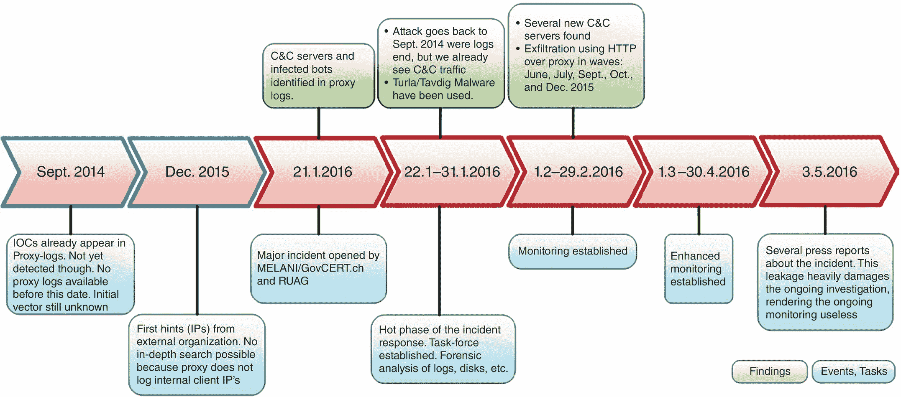
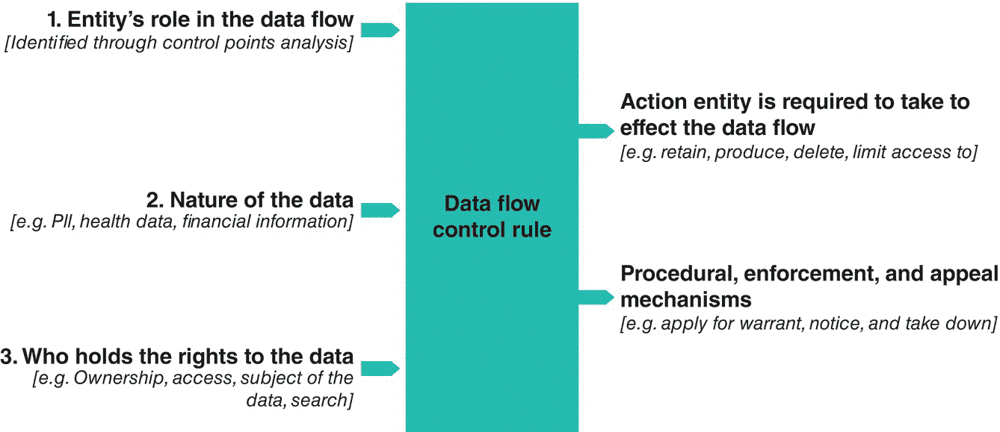

# 重塑：网络安全治理

42. 26
43. 27
44. 28
45. 29
46. 30
47. 31
48. 32
49. 33
50. 34
51. 35
52. 36
53. 37
54. 38
55. 39
56. 40
57. 41
58. 42
59. 43
60. 44
61. 45
62. 46
63. 47
64. 48
65. 49
66. 50
67. 51
68. 52
69. 53
70. 54
71. 55
72. 56
73. 57
74. 58
75. 59
76. 60
77. 61
78. 62
79. 63
80. 64
81. 65
82. 66
83. 67
84. 68
85. 69
86. 70
87. 71
88. 72
89. 73
90. 74
91. 75
92. 76
93. 77
94. 78
95. 79
96. 80
97. 81
98. 82
99. 83
100. 84
101. 85
102. 86
103. 87
104. 88
105. 89
106. 90
107. 91
108. 92
109. 93
110. 94
111. 95
112. 96
113. 97
114. 98
115. 99
116. 100
117. 101
118. 102
119. 103
120. 104
121. 105
122. 106
123. 107
124. 108
125. 109
126. 110
127. 111
128. 112
129. 113
130. 114
131. 115
132. 117
133. 118
134. 119
135. 120
136. 121
137. 122
138. 123
139. 124
140. 125
141. 126
142. 127
143. 128
144. 129
145. 130
146. 131
147. 132
148. 133
149. 134
150. 135
151. 136
152. 137
153. 138
154. 139
155. 140
156. 141
157. 142
158. 143
159. 144
160. 145
161. 146
162. 147
163. 148
164. 149
165. 150
166. 151
167. 152
168. 153
169. 154
170. 155
171. 156
172. 157
173. 158
174. 159
175. 160
176. 161
177. 162
178. 163
179. 164
180. 165
181. 166
182. 167
183. 168
184. 169
185. 170
186. 171
187. 172
188. 173
189. 175
190. 176
191. 177
192. 178
193. 179
194. 180
195. 181
196. 182
197. 183
198. 184
199. 185
200. 186
201. 187
202. 188
203. 189
204. 190
205. 191
206. 192
207. 193
208. 195
209. 196
210. 197
211. 198
212. 199
213. 200
214. 201
215. 202
216. 203
217. 204
218. 205
219. 206
220. 207
221. 208
222. 209
223. 210
224. 211
225. 212
226. 213
227. 214
228. 215
229. 216
230. 217
231. 218
232. 219
233. 220
234. 221
235. 222
236. 223
237. 224
238. 225
239. 226
240. 227
241. 228
242. 229
243. 231
244. 232
245. 233
246. 234
247. 235
248. 236
249. 237
250. 238
251. 239
252. 240
253. 241
254. 242
255. 243
256. 244
257. 245
258. 246
259. 247
260. 248
261. 249
262. 250
263. 251
264. 252
265. 253
266. 254
267. 255
268. 256
269. 257
270. 258
271. 259
272. 260
273. 261
274. 262
275. 263
276. 264
277. 265
278. 266
279. 267
280. 268
281. 269
282. 270

# 页码对照表

283. 271  
284. 272  
285. 273  
286. 274  
287. 275  
288. 276  
289. 277  
290. 278  
291. 279  
292. 280  
293. 281  
294. 282  
295. 283  
296. 284  
297. 285  
298. 286  
299. 287  
300. 288  
301. 289  
302. 290  
303. 291  
304. 292  
305. 293  
306. 294  
307. 295  
308. 296  
309. 297  
310. 298  
311. 299  
312. 300  
313. 301  
314. 302  
315. 303  
316. 304  
317. 305  
318. 306  
319. 307  
320. 308  
321. 309  
322. 310  
323. 311  
324. 312  
325. 313  
326. 314  
327. 315  
328. 316  
329. 317  
330. 318  
331. 319  
332. 320  
333. 321  
334. 322  
335. 323  
336. 324  
337. 325  
338. 326  
339. 327  
340. 328

# 贡献者简介

## Samantha A. Adams

Samantha A. Adams 拥有政治学背景，同时涉足性别研究和 STS（科学技术社会）领域。她曾任蒂尔堡大学蒂尔堡法律、技术与社会研究所（TILT）eHealth 治理与监管副教授。她的工作涉及医学信息学、医学社会学、定性研究方法以及针对卫生系统的外部网络攻击。

## Jason Blackstock

Jason Blackstock 是伦敦大学学院（UCL）科学与全球事务副教授，也是 UCL 科学、技术、工程与公共政策系（STEaPP）的联合创始人，曾于 2013 年至 2018 年担任该系主任。他拥有跨量子物理研究、硅谷技术开发、国际公共政策以及高等教育创新与领导力的独特背景。

## Irina Brass

Irina Brass 是伦敦大学学院（UCL）科学、技术、工程与公共政策系（STEaPP）监管、创新与公共政策讲师，兼数字技术与公共政策 MPA 项目副负责人。她的研究聚焦于颠覆性技术的监管，特别是数字技术。她与政策制定者和标准制定社区密切合作。

## Madeline Carr

Madeline Carr 是伦敦大学学院（UCL）科学、技术、工程与公共政策系（STEaPP）国际关系与网络安全副教授，兼数字政策实验室主任。她对网络安全带来的国际政策挑战有浓厚兴趣，并担任 PETRAS 物联网研究中心标准、政策与治理研究流的联合调查员。

## Jim Dempsey

Jim Dempsey 是伯克利法律与技术中心执行主任。1997 年至 2014 年间，他在民主与技术中心任职，曾任执行主任。2012 年至 2017 年 1 月，他经参议院确认担任隐私与公民自由监督委员会成员。他与 David Cole 合著《恐怖主义与宪法》（New Press, 2006），与 Fred Cate 合编《大规模收集：政府系统性获取私营部门数据》（Oxford, 2017）。

## Karine e Silva

Karine e Silva，LL.M.，是蒂尔堡大学 TILT 的博士候选人，参与 NWO 资助的 BotLeg 项目。自 2013 年初欧盟高级网络防御中心（ACDC）启动以来，她的研究兴趣集中在僵尸网络。她的研究涉及僵尸网络缓解的法律问题以及公私部门的角色。

# 贡献者

## Jacqueline Eggenschwiler
**Jacqueline Eggenschwiler** 是牛津大学的博士研究员。她的研究兴趣包括网络安全治理与规范建构。她拥有圣加仑大学和伦敦政治经济学院的国际事务与治理、国际管理及人权学位。

## Amit Elazari Bar On
**Amit Elazari Bar On** 是加州大学伯克利分校法学院的法学博士候选人，也是伯克利长期网络安全中心的资助获得者，同时担任伯克利信息学院网络安全硕士项目的讲师。她以最优等成绩获得法学与商业领域的三个学位（文学学士、法学学士、法学硕士）。她在技术法与政策领域的研究成果发表于权威期刊和会议，并被大众媒体报道。

## Ryan Ellis
**Ryan Ellis** 是东北大学传播学助理教授。他的研究和教学聚焦于传播法与政策、基础设施政治及网络安全。他是即将出版的著作 *Letters, Power Lines, and Other Dangerous Things: The Politics of Infrastructure Security*（麻省理工学院出版社）的作者。

## Miles Elsden
**Miles Elsden** 早期在欧洲从事学术工作，随后的 10 年为英国政府提供咨询，最近担任交通部首席科学家。他现在作为顾问工作在政策、技术与战略的交汇处。

## Trey Herr
**Trey Herr** 是斯坦福大学胡佛研究所的访问研究员，研究国际网络安全与风险。他的研究重点关注非国家行为体在网络安全治理中的作用、恶意软件的扩散，以及网络保险中风险特征的演变。他同时也是微软的高级安全战略师，在全球安全战略与外交团队负责云计算安全与供应链风险。

## Jonah Force Hill
**Jonah Force Hill** 是美国特勤局的高级网络政策顾问，就一系列网络犯罪政策与战略事务提供建议。他还是新美国智库的（非常驻）网络安全研究员，以及外交关系协会的任期会员。此前他在美国商务部工作多年，专注于全球数字经济政策。他拥有哈佛大学的 MTS 和 MPP 学位，以及加州大学洛杉矶分校的学士学位。

## Bert‐Jaap Koops
**Bert‐Jaap Koops** 是蒂尔堡大学蒂尔堡法律、技术与社会研究所（TILT）的监管与技术教授。他的主要研究兴趣包括网络犯罪、网络调查、隐私与数据保护。他也对 DNA 取证、身份认定、数字宪法权利、技术监管，以及人类增强、遗传学、机器人学和神经科学的监管感兴趣。

## Andreas Kuehn
**Andreas Kuehn** 是东西方研究所“网络空间全球合作”项目的高级项目助理。作为网络安全研究员，Kuehn 博士曾在斯坦福大学国际安全与合作中心研究网络安全政策、漏洞市场与披露安排，并曾在兰德公司担任兼职研究员，从事网络风险与网络保险行业研究。

## Aaron Martin
**Aaron Martin** 是荷兰蒂尔堡法学院的博士后研究员。他曾担任摩根大通纽约分部的网络政策副总裁（2015–2018）。他还是牛津大学全球网络安全能力中心的牛津马丁助理研究员。

## Vivek Mohan
**Vivek Mohan** 是一名执业律师，总部位于北加利福尼亚。Vivek 从 Sidley Austin LLP 律师事务所的隐私、数据安全与信息法团队转入私人执业，曾为科技、电信、医疗和金融服务领域的客户提供咨询。Vivek 是 PLI 专著 “Cybersecurity: A Practical Guide to the Law of Cyber Risk”（第 3 版，2018）的联合编辑和作者。Vivek 曾在微软担任律师，在纽约州检察长互联网局任职（特别委任），并在通用电气总部担任律师（借调）。五年间，Vivek 曾担任哈佛肯尼迪学院网络安全项目的驻院研究员，后为非驻院研究员。Vivek 拥有哥伦比亚法学院法学博士学位和加州大学伯克利分校文学学士学位。

## Matthew Noyes
**Matthew Noyes** 是美国特勤局的网络政策与战略总监，也是美国陆军少校，被分配至国防部长网络政策办公室。他的工作重点在于执法部门打击跨国网络犯罪的努力及相关政策议题。Matt 拥有哈佛肯尼迪学院公共政策硕士学位，以及华盛顿大学计算机科学与应用计算数学理学学士学位。

## Emilian Papadopoulos
**Emilian Papadopoulos** 是 Good Harbor 公司的总裁，这是一家精品咨询公司，为董事会、首席执行官和政府领导人提供网络安全建议。他是乔治城大学的兼职讲师，曾在加拿大政府渥太华和华盛顿办公室工作。他毕业于多伦多大学和哈佛大学肯尼迪学院，并担任该校全球校友会当选主席。

## Valeria San Juan
**Valeria San Juan** 是旧金山 Fundbox 公司的分析师。她曾担任摩根大通纽约分部的网络政策分析师（2017）。

## Elaine Sedenberg
**Elaine Sedenberg** 是加州大学伯克利分校信息学院的博士候选人，也是哈佛大学伯克曼·克莱因中心的附属研究员。她曾担任技术、社会与政策中心（CTSP）的联合主任。她的研究考察用于安全、公共卫生和研究活动等公共利益用途的信息共享安排。

## James Shires
**James Shires** 是哈佛肯尼迪学院贝尔弗科学与国际事务中心网络安全项目的研究员。他的研究聚焦于中东地区的网络安全问题。

## Evan Sills
**Evan Sills** 是 Good Harbor 公司的董事，就治理、风险管理、网络安全事件响应、立法和监管活动向企业高管提供建议。他是“全球治理未来 2027”研究员，毕业于乔治·华盛顿大学法学院和埃利奥特国际事务学院。

## Leonie Maria Tanczer
**Leonie Maria Tanczer** 是 UCL 科学、技术、工程与公共政策系（STEaPP）的国际安全与新兴技术讲师。她是开放权利组织咨询委员会成员，隶属于 UCL 网络安全研究卓越学术中心，曾任柏林亚历山大·冯·洪堡互联网与社会研究所研究员。她关注技术、安全与性别的交叉领域。

## Michael Thornton
**Michael Thornton** 是剑桥大学科学史与科学哲学专业的博士候选人。他运用公共卫生哲学重构我们对数字网络和信息的认知。来剑桥之前，Michael 曾担任万事达卡旗下公司 Truaxis 的产品管理总监。

## Bart van der Sloot
**Bart van der Sloot** 专攻围绕隐私与大数据的问题。他在蒂尔堡大学 TILT 担任高级研究员，担任 *European Data Protection Law Review* 总编辑，阿姆斯特丹隐私研究平台协调员，以及隐私与身份实验室科学总监。

# 致谢

# 前言

本书的构想始于我们在哈佛肯尼迪学院同一个办公室的相邻书桌前；多年后，当我们相隔三千多英里时，本书才告完成。一路走来，许多个人和机构帮助使这本书成为可能。

首先，Venkatesh (Venky) Narayanamurti 在我们于哈佛肯尼迪学院贝尔弗科学与国际事务中心任职期间担任我们的学术导师。当我们还是贝尔弗中心的新研究员时，Venky 给予了我们坚定不移的支持和鼓励，并在随后的岁月里始终是一位慷慨的支持者。简单来说，没有 Venky 就没有这本书。我们欠他一份重大的恩情。

哈佛的许多其他教职员工和同事在塑造我们对这一感知问题的认识方面发挥了关键作用，许多州已颁布专门针对计算机欺诈的立法。联邦调查局为其特工提供专门的计算机欺诈培训。私营行业正试图加强其计算机设施的安全性。¹

爱德华兹的陈述在稍作修改后，或多或少会像样板文本一样被重复，贯穿随后长达三十五年的大部分时间。各种政策制定者反复在小组委员会会议、政策论坛和其他公共场合指出，计算机日益无处不在，而其扩散除其他外，还导致了需要新型解决方案的新型危害。有时，声称的危害是推测性或理论性的；同样经常的是，对解决方案的呼吁紧随广受关注的事件之后，这些事件在公众意识中产生了越来越强的共鸣。

在爱德华兹就计算机相关犯罪举行听证会十五年后，美国参议员弗雷德·汤普森举行了类似的听证会，以审视薄弱计算机安全带来的公共风险。汤普森仿佛是在宣读爱德华兹的准备发言。他指出：“\[c\]omputers are changing our lives faster than any other invention in our history. Our society is becoming increasingly dependent on information technologies that which are changing at an amazing rate.”² 汤普森接着说，这些趋势创造了我们现在必须面对的新漏洞。

随着时间的推移，术语滑向了宽泛且定义不清的“网络安全”这一统称，该术语最初遭技术专家厌恶，却在政策圈内被热烈接纳，似乎将长期存在。“网络安全”问题被反复框架为一个永恒的新问题——一种刚刚出现在地平线上、必须*现在*就面对的东西。这种框架颇具吸引力：它捕捉到了新技术创造新问题和困境的感觉；并赋予问题一种紧迫感——我们必须在为时已晚之前立即行动。这种狂热的能量——在过去十年中升级到白热化程度且无减弱迹象——赋予讨论者理由和动力去拒绝渐进主义。有时，这为接受新颖或变革性的想法提供了必要的论坛。

但这种呈现方式在阐明问题的同时也同样掩盖了问题。将网络安全呈现为一个根本性的新问题和未被解决的问题，掩盖了安全干预的悠久历史。它将随时间建立起来、旨在应对网络计算机兴起所带来的无数挑战的制度网络——法律、组织实践、正式和非正式规则——推到一边。其中一些做法有用，另一些则是无望的死胡同。但是，忽视它们并假设我们面临一个新问题、需要发明一套新工具和方法，无视了顽固的现实：几十年来，我们一直以各种形式应对这些挑战。

# 网络安全治理：简介

网络空间并非一个位于法律、制度和权力之外的无政府空间。正如乔·奈、劳拉·德纳迪斯、杰克·戈德史密斯、蒂姆·吴等人所恰当指出的，在网络空间中存在着丰富繁杂的组织和机构，它们提供结构、形态和界限。³ 网络领域与物理领域之间存在着至关重要且持久的类比关系。⁴ 数字设备和网络的世界遍布着控制点。⁵ 这一见解在审视网络安全治理这一更具体的问题时同样有用。安全空间并非一片无序之地。远非如此。它是一个由相互竞争的组织和机构所定义的空间，它们试图以安全之名施加某种形式的控制。安全究竟意味着什么，始终是一个开放且有争议的问题。在某些情境下，它可能意味着保护设备、数据或网络；在其他情境下，安全可能转化为对被视为政治上不可接受的言论或表达形式的控制；在又其他领域，安全可能意味着免受非国家行为体的侵害，却很少涉及政府为颠覆个人数据技术保护所做的努力。关于网络安全的问题——正如广义上关于安全的问题一样——总是开放给多种解读的。两个问题始终萦绕在空气中，无论显性还是隐性：安全*保护什么？*以及安全*防范谁？*

本文集旨在梳理网络安全治理的脉络。它通过各种案例研究，探讨了一些试图保障网络空间安全的相互竞争的组织努力和机构。本书不着眼于未来——即应对一组先前未知问题的假设性新可能性——而是着眼于近期过去和当下。它审视了一些现有的且正在展开的制度性和组织性努力，以应对网络安全挑战。本书并非仅通过一个纯粹狭隘的规范性视角——即“有没有用？”——来审视这些努力，而是考虑这些努力的更广泛含义。它追溯了不同网络安全观念如何被部署并融入稳定的常规和实践中，这可称为“风险的官僚化”。在此过程中，本书汇集的各章共享一组共同关注点：对*网络不安全*的恐惧是如何被提炼为组织努力和制度框架的？重要的是，这些组织实践和框架对工人、企业、公众以及相互竞争的价值观组合有何更深远的影响？安全一直是且长期以来一直是通信技术和网络决策所依赖的关键轴心。将这些努力视为治理形式——即控制和管理被视为难以驾驭的事物的努力——进行仔细审视，有助于清晰地勾勒出利害所在：网络安全努力正在（并且已经有一段时间了）重塑作为当代生活基础的数字技术。更仔细地审视后续章节中记录的各种努力，能为这些努力的展开方式以及我们在过程中获得和失去的东西提供一个部分图景。

在后续页面中，鼓励读者思考各个致力于定义和应对网络安全问题的社区的深度参与。同时，读者也可以思考定义许多案例研究的孤立垂直领域的影响和重要性。随着网络安全专业人员数量以指数级速度持续增长，未能不仅从近期过去，而且从我们身边正在发生的事情中吸取教训的风险变得愈发明显。这并不是说在每种情况下都必须打破这些孤岛——虽然有进取心的读者或许能为网络安全政策拼凑出自己的“大统一场论”，但编辑们抱有希望（并认为这或许更有可能），即这些深度剖析能为“网络安全问题”的各个侧面提供有用的政策、法律和技术视角。案例研究在评论中刻意采取了不同的方法，但三条共同的主题线索贯穿全书。

## I.2 连接组织：共同主题

### I.2.1 网络安全具有情境性

网络安全并非存在于真空中。它始终具有情境性。网络安全努力植根于特定的时间和地点。这些努力由预先存在的政治组织和制度轮廓、产业生态系统，以及更大范围的地区和国际政治竞争与联盟所塑造。要理解某些问题如何被构建为网络安全挑战，以及应对这些挑战的特定方法如何被开发和部署，将这些努力置于这些更大的情境中至关重要。伊莱恩·塞登伯格和吉姆·邓普西的《网络安全信息共享治理结构：多样性、信任与权衡的生态系统》（第 1 章）提供了一个冷静的叙述，说明忽视情境会发生什么。在对网络安全信息共享努力和 2015 年《网络安全信息共享法案》（CISA）的分析中，塞登伯格和邓普西认为，缺乏历史记忆的政策注定会失败。CISA 是一个雄心勃勃的尝试，旨在启动新的信息共享努力。但它忽视了早已存在的制度迷宫和信息共享机制。信息共享远不止是一个技术问题。正如该章所指出的，未能考虑这一更广泛的情境限制了 CISA 的功效。

在《海合会（GCC）中的网络安全治理》（第 2 章）中，詹姆斯·夏尔斯详细阐述了海湾阿拉伯国家合作委员会（GCC）六国的网络安全状况。夏尔斯展示了国家和地区政治如何塑造网络安全治理。通过梳理地区事件、关键政府组织和网络安全公司，以及相关战略、法律和标准，该章论证了网络安全具有地区特殊性。网络安全的轮廓受到更大范围流动的文化观念和压力的影响，但国家和地区政治在塑造网络安全如何被理解和应对方面起着决定性作用。夏尔斯的工作为地区和国家专业化发出了呼吁。这一呼吁得到了莱奥妮·玛丽亚·坦泽、伊琳娜·布拉斯、迈尔斯·埃尔斯登、马德琳·卡尔和杰森·布莱克斯托克在《英国新兴物联网（IoT）政策格局》（第 3 章）中的有力回应。坦泽等合著者探讨了英国如何应对物联网的安全挑战，物联网是传感器和连接技术部署的巨变，它迅速出现且很大程度上缺乏监管指导。他们探讨了英国物联网努力如何与密集的制度格局相联系并由其定义。他们提出了一个引人深思的注记：随着英国准备退出欧盟，这一政治重组将如何冲击现有的网络安全努力尚不清楚。

理解语境与网络安全之间的关系，不仅仅是梳理现有的政治制度。Emilian Papadopoulos 和 Evan Sills 的《同类相聚：航空生态系统中集体网络安全战略》（第 4 章）探讨了产业生态学与网络安全之间的相互作用。聚焦于网络安全与航空领域，他们观察到一个包含数千个组织的复杂产业，从汉莎航空和联合航空等全球巨头，到区域机场、机上娱乐系统制造商和行李管理组织等规模较小或鲜为人知的参与者。这一组织网络产生了共享的网络安全风险，即单个公司或组织无法充分应对的集体风险。Papadopoulos 和 Sills 发现，航空业的独特性质正在催生新的集体风险管理方法。他们的见解提供了一个有益的提醒：网络安全无法从更宏大的政治、经济和组织语境中剥离。对于致力于制定切实可行政策的从业者，以及批判性审视网络安全的学者而言，关注语境至关重要。

### I.2.2 网络安全具有动态性

网络安全将政府和产业结合在一组权变关系中。公私部门之间的相互作用难以捉摸。有时，它们是通力合作、积极投入的合作伙伴；有时，它们却是目的背道而驰的对手。后续章节描绘了各种公私配置。Jacqueline Eggenschwiler 的《基于事件的网络安全治理概念化》（第 5 章）描述了多种正式的网络安全治理方法。通过考察三个不同案例——2016 年涉及瑞士关键国防承包商 RUAG 的网络间谍案；Conficker 工作组（CWG）的协同遏制行动；以及 Symantec 的网络安全实践——Eggenschwiler 勾勒出了层级式、多利益相关方和基于市场的网络安全治理模式的轮廓。该章得出结论：不存在放之四海而皆准的网络安全治理方法。

Eggenschwiler 的观察在多个章节中得到呼应。Valeria San Juan 和 Aaron Martin 的《网络治理与金融服务业：公私合作伙伴关系的作用》（第 6 章）审视了金融服务业内部的合作挑战。呼吁建立公私合作伙伴关系以应对棘手的网络安全问题是一个耳熟能详且长盛不衰的建议：谁能反对*合作*呢？然而，这种努力也可能沦为空洞的承诺：一种回避界定责任和问责界限的建议，取而代之的是一个定义模糊的合作承诺，却未深思将其付诸实践的复杂机制。聚焦金融服务业，San Juan 和 Martin 对三种不同的公私合作伙伴关系进行了近距离考察。他们在公私合作的多利益相关方模型中，既看到了乐观的理由，也看到了谨慎的必要。在他们看来，无论是产业界还是政府，都无法单独应对网络安全挑战。他们指出，公私合作在试图应对系统性风险时会陷入困境。

应对长期和系统性风险的挑战在 Samantha A. Adams、Karine e Silva、Bert‐Jaap Koops、Bart van der Sloot 的《僵尸网络监管：当每个人都是利益相关者时，网络安全治理理论如何发挥作用？》（第 7 章）中再次出现。Adams 等作者考察了当跨国公私参与者联手打击僵尸网络时出现的协调挑战。要在实践中生效，Adams 等人记录的此类多中心治理努力，需要超国家实体或关键国家充当协调机制。然而，迄今为止的跨国刑事司法努力主要是被动应对，聚焦于眼前挑战，而长期问题未获解决（Tanczer 等人在第 3 章中也看到了英国物联网战略面临的类似挑战）。

Trey Herr 对网络安全保险市场的调查《治理风险：网络保险的兴起》（第 8 章）揭示了另一种公私配置。Herr 发现保险业开发网络安全政策与标准执行之间存在有益的互动。虽然联邦政府在开发和实施网络安全标准方面主要（尽管非完全）采取了自愿方式，但保险公司有权将这些标准转化为具有约束力和可强制执行的规则。这种治理模式规避了直接监管这一往往在政治上难以接受的前景，采用了一种由市场主导、并为公私标准机构留出巨大参与空间的模式。

Michael Thornton 的《遏制 Conficker：公共卫生方法》（第 9 章）探讨了纯私人网络安全治理方法的局限。Thornton 考察了“内阁”——一个临时专家小组，后更名为 CWG——是如何聚集在一起应对 Conficker 蠕虫的。Thornton 找到了支持层级制和政府介入的论据。CWG 成员将该小组的非正式性视为关键优势，但正如该章所指出的，这种模式可能严重偏离甚至阻碍更宏大的公共目标。大众叙事将 CWG 描绘为拯救世界的超级英雄——私营部门从恶意软件手中拯救了公众。但正如 Thornton 讽刺地指出：“\[X\]战警的问题在于，有时他们拯救星球，有时却挑起内战。”Thornton 认为，赞扬或采用这些非正式、临时（且非政府）的方法，意味着我们牺牲了问责制和更宏大的伦理考量。Thornton 主张采用公共卫生方法来应对网络安全，以取代纯私人努力，该方法为政府参与划出了关键空间。

公私部门不仅是愿意或试探性的盟友，有时也是对手。Andreas Kuehn 和 Ryan Ellis 在《漏洞赏金计划：制度差异与安全的不同含义》（第 10 章）中考察了软件漏洞市场的兴起。随着 Google、Microsoft、Facebook 和数百家其他公司争相购买其软件和服务中的漏洞，它们被卷入了与情报机构、军方及其他寻求购买漏洞以谋取利益者的竞争中。正如 Kuehn 和 Ellis 所示，私营部门试图利用市场改善软件安全，并在一定程度上防止漏洞落入想要用于监视、破坏或犯罪之人手中。漏洞赏金计划的制度模式仍在形成中。正如作者所言，目前正在尝试和测试多种不同的赏金模式。在每种情况下，这些努力内部都存在一种张力：一方面是改善更广泛软件生态系统的愿望，另一方面是政府利用该生态系统漏洞用于执法、情报或军事目的的愿望。公私部门不仅仅是盟友：它们有时是直接的竞争对手。

### I.2.3 网络安全从不价值中立

## 介绍

网络安全是一种对竞争性价值进行排序的方式。网络安全工作显性且隐性地安排不同且有时相互对立的目标。安全工作总会碰触到其他重要价值。Jonah Force Hill 和 Matthew Noyes 在《重新思考数据、地理与管辖权：协调全球数据流动控制的通用框架》（第 11 章）中探讨了国家主权与全球化数据流动之间的张力。现代数据存储将数据切分为细粒度的部分——“分片”——并将其分布在全球各地。正如 Hill 和 Noyes 所详述，这些碎片随后在法律管辖区之间来回流动，随着更廉价的存储在别处变得可用，从一个地理区域移动到另一个地理区域。在这里，我们看到了网络安全内部可能出现的张力。我们如何协调全球化数据与执法需求、地方或区域隐私法律，以及更普遍的国家主权核心问题？Hill 和 Noyes 认为，是时候彻底重新思考解决此类问题的零散方法了。正如他们所示，为全球数据流动开发一个通用框架，要求直面其中相互竞争的价值观。

Amit Elazari Bar On 在《私人秩序塑造网络安全政策：漏洞赏金案例》（第 12 章）中探访了漏洞赏金的世界。Elazari Bar On 提供了对漏洞赏金法律条款的首个全面分析。该章发现软件安全与参与这些新兴项目的黑客安全之间存在原始张力。赏金项目中使用格式合同会——且确实——让安全研究人员陷入法律风险。虽然赏金项目优先考虑修复软件和提高安全性，但它们为市场参与者制造了法律不稳定性或*不安全感*。正如 Elazari Bar On 所主张，一个旨在促进白帽黑客行为的法律制度必须致力于为研究人员提供更好的法律保障。

相互竞争的价值观和利益之间的冲突与竞争，构成了网络安全治理的核心。确实，这一核心主题贯穿全书。Shires（第 2 章）揭示了网络安全如何被重新诠释以服务于政治目的。安全具有弹性，可以被拉伸以服务于各种目的。即使网络安全并非被故意重新利用来工具性地服务于更大的政治目的，它也不可避免地会牵涉到其他价值观。Tanczer 等人（第 3 章）将英国的物联网战略视为一场关于隐私的隐蔽公投。Thornton（第 9 章）展示了安全工作如何引发关于我们如何平衡安全与问责的关键问题。在这些以及随后的许多其他案例中，关于安全的问题*总是*关乎更宏大的事物：它们关乎我们珍视的价值观，以及在相互竞争的利益之间梳理和承认权衡的艰难工作。我们希望本书汇编的案例能帮助揭示我们以网络安全之名所达成的各类交易，并让感兴趣的读者开始分辨明智之举与鲁莽之举。

# 第 1 章：网络安全信息共享治理结构：多样性、信任与权衡的生态系统

**Elaine Sedenberg¹ 和 Jim Dempsey²**

*¹ 美国加利福尼亚州伯克利加利福尼亚大学信息学院*

*² 美国加利福尼亚州伯克利加利福尼亚大学法学院伯克利法律与技术中心*

## 1.1 介绍

政策制定者和企业代表经常将网络安全信息共享视为灵丹妙药般频繁讨论。该短语本身指代许多不同的活动和交换类型，但从 2009 年左右到 2015 年底，华盛顿特区的网络安全政策辩论主要由要求加强信息共享的呼声主导。¹ 部分受“连点成线”这一 9/11 后主题的影响，政策制定者和私营部门普遍认为，改善网络安全取决于——且将必然源于——私营部门内部以及私营部门与联邦政府之间扩大的信息共享。² 这种观点似乎建立在这样一个假设之上：拥有更多信息，系统可通过预防措施或快速补救变得更安全。政策制定者不愿监管网络安全标准，将自愿信息共享视为一种可通过政策干预激励、有时可由联邦政府角色直接促进的切实协调活动。³ 政策辩论在 2015 年《网络安全信息共享法案》（CISA）的通过中达到高潮。⁴ 该法律旨在通过消除对共享其他合法受限信息的责任担忧，鼓励私营部门共享信息。它还旨在改善联邦政府内部以及政府与私营部门之间的共享。

CISA 的辩论和通过，是在执法和国家安全机构协调并增加与私营部门及其内部信息共享的数十年努力之后。美国特勤局（USSS）于 1995 年成立了纽约电子犯罪特别行动组（ECTF），以促进私营部门、地方和国家执法机构以及学术研究人员之间的信息交换。2001 年，《美国爱国者法案》授权 USSS 建立全国性的 ECTF 网络，最终由 39 多个区域中心组成。⁵ 1998 年，总统决策指令 63（PDD-63）授权联邦调查局（FBI）创建国家基础设施保护中心（NIPC），作为政府内部和与私营部门收集和传播威胁信息的焦点。⁶ PDD-63 同时指示国家基础设施保护协调员鼓励私营部门创建信息共享与分析中心（ISAC）。⁷ 私营部门中心的角色是收集和分析私营部门信息，通过 NIPC 与政府共享，同时也将私营部门信息和联邦信息结合并传回行业。⁸ 尽管 PDD-63 预期只会有一个国家级 ISAC，但各个行业最终还是成立了自己的 ISAC，专注于行业特定的安全需求。⁹

随着时间的推移，其他联邦机构也开发了自己的信息共享系统和程序。例如，美国计算机应急准备小组（US-CERT）——一个在 NIPC 随其移交国土安全部（DHS）而解散后接管其许多职能的组织——发布漏洞信息并协助应对特定事件。各种其他信息交换和源——每个都有自己的范围、访问政策和规则——在负责保护网络空间各方面的联邦机构中建立起来。例如，2001 年 FBI 正式宣布了其“InfraGard”项目，旨在扩大与私营部门基础设施所有者和运营商的直接联系，并共享关于网络入侵、被利用漏洞和基础设施威胁的信息。¹⁰

除了这些零散的联邦扩大网络信息共享的努力之外，私营部门的信息共享安排也大量涌现。杀毒软件公司同意为彼此共享病毒特征码，实质上是决定在平台易用性和支持上进行差异化竞争，而不是争夺数据。¹¹ 此外，安全研究人员和企业个人专业人士围绕对重大事件（如 Conficker 蠕虫和 Zeus 僵尸网络）的关键响应形成了临时安排——这些威胁需要协调响应以及交换信息。¹²

因此，即使在 CISA 颁布之前，一个由信息交换、平台、组织和临时小组组成的生态系统已经出现，以应对所有行业中日益普遍和复杂的安全威胁。如今，这个信息共享网络生态系统的特点是高度多样化——这是多年不断演变的政策和合作模式的结果，由联邦政府和私营部门共同推动。信息共享模型和结构在不同的利基市场中运作——有时各自为政，偶尔重复劳动，有时则相互补充。¹³

CISA 试图在四个维度上推进信息共享：私营部门内部、联邦政府内部、从私营部门到政府、以及从政府到私营部门。然而，该立法在颁布前并未充分梳理前几年已形成的生态系统。几乎没有努力去确定什么有效以及为什么有效，或者去协调现有的联邦项目。相反，私营部门反复声称——政策制定者也接受了这一说法——对法律责任的担忧（据称主要源于隐私法）正在阻碍信息共享。因此，CISA 的一项主要条款是为私营部门组织提供责任保护，作为鼓励更多信息共享的激励措施。

CISA 对信息共享生态系统的有用性和影响尚待证实。相反，我们的研究表明，该法律对改善信息共享状况作用甚微。如果有什么影响的话，它只是通过强制要求联邦门户包含不必要的技术细节（自由文本输入）和繁琐的提交方式（电子邮件），给联邦努力增加了更多障碍。该法律缺乏关于联邦努力如何相互配合以及与私营部门现有信息共享网络配合的具体规定。该法律几乎仅关注私营部门的责任担忧，未能解决与共享相关的其他关键因素，包括信任管理、激励措施、互惠机制和质量控制。总之，CISA 是一种脱离现有共享机制、缺乏对能够实现可操作信息敏捷交换的重要因素的细致看法的政策干预。

本章重点关注私营部门内部以及私营部门与联邦政府之间的网络安全信息（将联邦政府内部的共享问题留给其他人探讨）。它考察了不同网络安全信息共享组织内部的治理结构、角色和相关政策如何影响共享什么信息（以及与谁共享）以及所交换信息的实用性。这项研究基于对 16 位网络安全从业者和专家的半结构化访谈的定性分析。利用这些访谈和其他可用的网络安全共享信息，我们创建了一个治理结构分类法，绘制了信息共享组织的生态系统图谱——每个组织都满足特定的安全需求，并由不同的政策结构支持。本章讨论了这些政策和结构对直接影响共享的价值观的影响，特别是信任与可扩展性之间的权衡。这项研究说明了不同的治理模式如何在复杂多变的网络安全生态系统中导致不同程度的成功。我们的发现为寻求鼓励改善网络安全的政策制定者提供了教训——主要是警示性的教训。本章侧重于美国境内的信息共享，但考虑到许多私营部门公司的跨国性质，一些发现可能具有国际相关性。

可共享以改善网络安全防御和事件响应的网络安全相关信息类型包括：事件（包括攻击方法）、最佳实践、战术指标、漏洞和防御措施。通常，本章描述的组织从事共享战术指标，通常称为“入侵指标”（IOC）。IOC 可定义为与特定安全事件或攻击相关的工件。IOC 可能是文件名、哈希值、IP 地址、主机名或其他各种信息。网络安全防御者可在取证中使用 IOC 来识别入侵，或在防御中使用它们来预防入侵。¹⁴

## 1.2 信息共享治理结构与政策的分类法

随着时间的推移，出现了不同的网络安全信息共享结构，以应对特定需求或挑战。鉴于涉及的信息类型、联邦角色、行业部门和信息敏感度范围广泛，形成一系列信息安排或许是不可避免的，每种安排服务于特定的感知需求，各有优先事项和挑战，各有各的成员资格政策和治理结构。我们的研究确定了至少七种信息共享模式：

1.  政府主导
2.  政府推动、行业主导
3.  企业发起、同行制（组织层面）
4.  小型、高度审查、个人制小组
5.  开源共享平台
6.  专有产品
7.  商业化服务

为了理解这些治理模式，我们的分类法阐述了不同的共享政策和组织方法，以及它们对使命、参与度、风险/收益权衡和功效的影响（表 1.1）。

**表 1.1.** 信息共享模式分类法。

| 分类 | 组织单元 | 示例组织 | 治理类型 |
| --- | --- | --- | --- |
| 政府主导 | 政府运营；私营部门成员可以是企业、私营部门协会（如 ISAC）、非营利组织（如大学）或个人 | DHS AIS；US-CERT；ECTF；FBI 的 e-guardian；ECS | 联邦法律和政策；自愿参与；规则范围从受交通灯协议或 FOUO（仅供官方使用）约束的开放共享到机密信息限制（ECS） |
| 政府推动、行业主导 | 特定行业或问题 | ISAC；ISAO | 特定行业或问题；自愿参与；通常组织为非营利组织，使用服务条款或其他合同方法强制执行对信息再披露的限制 |
| 企业发起、同行制（组织层面） | 特定私营公司 | Facebook ThreatExchange；网络威胁联盟 | 互惠共享；封闭成员资格；信息由合同控制（如 ThreatExchange 条款和条件） |
| 小型、高度审查、个人制小组 | 个人加入，跨不同工作岗位保留成员资格 | OpSec Trust；隐秘的临时小组 | 基于个人关系和成员审查的信任；成员资格和行为规则 |

| 共享模式 | 参与机制 | 示例 | 特征 |
|---------------|------------------------|----------|-----------------|
| 开源共享平台 | | `Spamhaus Project` | 信息公开发布，面向所有人开放；无需会员资格，但可能围绕活跃贡献者和信息使用者社区形成；一个组织可能管理平台基础设施 |
| 专有产品 | 组织或个人通过购买产品参与 | `AV` 和防火墙供应商 | 通过付费接口获取信息；责任和安全管理仍在内部 |
| 商业化服务 | 组织购买服务 | 托管安全服务提供商 | 安全职能外包 |

### 1.2.1 以政府为中心的共享模式

美国联邦政府的网络安全政策同时朝向许多不同的目标，范围涵盖从国家安全、保护联邦 IT 系统，到调查和惩治网络犯罪，其总体目标是通过保护美国关键基础设施和知识产权，确保美国经济的健康与高效运行。每个目标都导致不同的信息共享优先级。¹⁵ 鉴于涉及网络安全某些方面的联邦机构数量众多，信息共享系统的增长并不令人意外——即使这让信息消费者感到沮丧。联邦信息共享项目范围广泛，从 FBI 的 `eGuardian` 和 `InfraGard`，到 DHS 的 `自动化信息共享 (AIS)` 项目及其专门定制的 `增强网络安全服务 (ECS)` 项目、`USSS ECTF` 警报，以及 `US-CERT` 警报和提示。

联邦政府在改善网络安全中的作用可从公共产品的角度来看待，即联邦政府在网络安全上的投资将弥补个人和私营部门投资不足的问题。¹⁶ 然而，要使这种公共投资有效，首先需要了解私营部门缺乏什么，以及政府是否拥有这些缺失资源，或能否有效获取并及时提供。事实上，撇开私营部门是否真的遭受网络安全信息匮乏这一问题不谈，联邦政府快速高效共享信息的能力存在局限。因此，指望联邦政府履行中央信息收集者和传播者的角色，面临重大挑战。

鉴于国家安全、情报和执法实体的网络，一些政府掌握的信息因分类限制而被“锁”在内部，涉及人员、IT 网络和物理设施的广泛安全标准，严重限制了接收者和分发方式。五角大楼的 `国防工业基础 (DIB)` 网络安全项目和 DHS 的 `ECS` 项目正是为在特殊安全协议下传播此类机密数据而开发。这些项目以有限的访问权限换取了极大的信息质量提升。从实施情况看，它们似乎并不旨在支持向大量接收者传播。相反，它们仅向少数通信服务提供商（AT&T、CenturyLink 和 Verizon）以及 `Leidos`（原 `SAIC`）传播信息，这些实体为众多客户提供网络安全服务，并具备接收和处理所提供信息的能力。相比之下，DHS 的 `网络信息共享与协作计划 (CISCP)` 覆盖面更广（尽管仍受限），但其重点是与私营部门共享分析产品，因此以速度换取上下文背景。(`CISCP` 提供一系列产品，包括指标公告，旨在支持更快地采取行动以挫败攻击和修复漏洞。¹⁷)

在另一端，`USSS ECTFs` 等组织的会员要求宽松得多，只需组织内部人员推荐即可。`ECTFs` 主要通过电子邮件（和面对面会议）传播信息。邮件列表上共享的信息使用交通灯协议进行管控，每种颜色定义了其使用和再披露的方式。¹⁸ 只有 `USSS` 向 `ECTF` 邮件列表发送信息，尽管信息可能源自许多不同来源。

几位受访者讨论了在斯诺登事件曝光后，无论正式治理机制如何，向任何美国政府机构共享信息的犹豫心理。他们提到普遍的文化不安，以及一旦共享行为曝光可能带来负面宣传的恐惧。一位参与信息共享的联邦雇员评论道：“斯诺登事件后，几乎可以肯定在维基解密事件后，[让私营部门共享] 对我们来说将变得更加困难。我们正在与大量负面认知作斗争。” 在国际上，对于任何受欧洲法规约束的公司，这些文化和声誉顾虑因假设与美国政府共享信息将违反 2016 年欧盟 `通用数据保护条例 (GDPR)` 而变得更加严重和复杂。

联邦政府的监管和执法权力有时可能会阻碍私营部门的共享。然而，这些权力的存在也可能激励共享，至少在个案层面上如此，因为它们代表了私营部门不具备的、针对网络威胁采取行动的能力。¹⁹ 一位网络安全从业者评论道：“执法部门[是]能够采取特别行动识别并将此信息归因于个人的人，他们有权利用法治、法院命令、传票，以及本质上采取权威行动和起诉这些个人所需的一切。没有什么比因犯罪入狱更能将他们[攻击者]从生态系统中清除出来了。”

即使法律障碍和政府的负面声誉得到缓解，与政府共享信息仍然很困难。受访者抱怨称，由于建立共享接口的技术要求，参与 DHS 的 `AIS` 门槛很高。

美国政府在信息共享中的角色依然分散在许多不同机构中——每个机构都有各自的优先事项，在政府内部或外部进行共享——这不一定是坏事。让不同机构扮演不同角色可能是有效的。然而，不清楚是否存在统一的政策或战略，来应对联邦信息共享项目的激增，这些项目任务定义宽泛且重叠。我们看到的是双向失败：私营实体与政府共享的信息相对较少，而政府共享的信息过时或无法采取行动。除了 `ECS` 等专门共享安排外，私营部门几乎没有动力承担向政府发送信息所带来的声誉风险以及行政和技术负担。

与公开认可但尚未实现的大规模、大容量共享安排目标形成对比的是，私营部门与联邦政府之间最有效的互惠共享可能以临时方式发生，建立在政府内外安全专业人员之间的个人联系以及特定机构的独特优势之上。例如，当攻击者是外国政府时，国家安全机构可能提供最大帮助；当攻击似乎属于犯罪性质时，FBI 可能提供最大帮助；而 DHS 或 US-CERT 在补救方面可能特别有用。正如一位受访者所指出的，在网络安全社区的某些领域，“联邦人员”与私营部门之间存在高度的个人关系交叉——这使得可以通过人际关系直接共享和咨询，而非通过自动化或系统化手段。鉴于当前趋势，联邦政府要想成为所有网络安全信息的中央收集器和交换枢纽，似乎还有很长的路要走。联邦信息共享项目若能更现实地评估联邦政府在与私营部门合作及响应其需求方面的优势，将受益匪浅。

### 1.2.2 政府提倡、行业主导的共享模式

如上所述，1998 年，比尔·克林顿总统指示其国家安全和反恐协调员与关键基础设施的所有者和运营商磋商，鼓励他们建立“私营部门信息共享与分析中心”。尽管克林顿的指令设想为整个私营部门建立单一中心，但在随后的二十年里，主要按行业建立了多个 ISAC，作为私营实体共享数据的收集和分析点，用于点对点共享、向联邦政府反馈信息，并为联邦信息流向私营部门提供渠道。尽管由联邦行动推动，ISAC 旨在由私营部门主导。目前有 20 多个 ISAC。其行业特定焦点似乎基于这样一个假设：网络安全威胁在同一行业内部共享最为有效。²⁰

2015 年，贝拉克·奥巴马总统鼓励建立信息共享与分析组织（ISAO），以补充 ISAC。对 ISAO 的支持基于这样一种信念：一些公司不完全符合传统的行业分类。²¹ ISAO 围绕多种组织原则涌现，包括行业（如法律服务和体育）、地区（如马里兰州、南加州和俄亥俄州东北部）或问题（如可信问责小组 [TAG] 和网络韧性小组）。²²

金融服务 ISAC（FS-ISAC）被广泛引用为成功信息共享安排的典范。截至 2017 年 10 月，其拥有 7000 名成员，包括各种规模的商业银行和信用合作社。²³ 在早期，FS-ISAC 受益于（除其他因素外）金融服务业在纽约市拥有主要地理中心。金融服务业机构间的相互依赖也有助于提供启动 FS-ISAC 所需的信任。“银行虽是竞争对手，也是交易对手。它们知道，即使想击败其他银行，也需要它们，因为它们在交易的另一端。”银行安全专业人员之间的个人关系建立了信任。个人关系的重要性可能帮助 FS-ISAC 成功跨越了引入执法参与者的障碍，通过缓慢引入与成员有既有关系的“联邦人员”参与交换。

基于地理邻近性和个人关系的信任有其局限。对 FS-ISAC 而言，规模与信任之间可能存在权衡。2016 年 8 月有报道称，美国八大银行组建了自己的子群进行网络安全信息共享与合作，这是 FS-ISAC 内部或相关的“几十个”子群之一。²⁴ 与成熟度相关的其他因素也可能影响信任。2016 年，FS-ISAC 将其共享平台 Soltra 出售给营利公司 NC4，因为管理工作对组织而言变得过于繁重。一些受访者对开源平台被专有公司突然收购表示不确定。其他人则将其视为成功的标志，表明 FS-ISAC 已成熟到其核心平台可商业化的地步。

从治理角度看，ISAC 和 ISAO 代表了一种独特模式：联邦政策推动了它们的创建，但治理权让渡给面临共同网络安全威胁、共享共同目标的自愿组织群体。这种放手的合作伙伴模式培育了一个网络，能响应特定部门的需求和挑战，同时提供与联邦政府协调的机会（例如许多 ISAC 为 DHS 的 AIS 做贡献，并在成员中包含执法机构）。ISAC 和 ISAO 通常为非营利组织，管理会员和活动。例如，FS-ISAC 成员需申请并缴纳会费。会员要求因 ISAC 或 ISAO 而异，但独立治理模式的灵活性允许每个实体反映其社区的需求。²⁵ ISAC 全国委员会（NCI）协调 ISAC 间活动，并在联邦会议中拥有领导地位，有助于促进一定程度的高层协作。²⁶ ISAO 标准组织也已成立，作为一个自愿标准制定组织，与信息共享实体在标准、指南和最佳实践方面合作。²⁷ 很难评估 ISAC 的有效性，更不用说较新的 ISAO 了。然而，联邦政府似乎通过鼓励 ISAC 和 ISAO 的创建过程，但允许行业沿部门或主题线自我治理，促进了信任内部动态的萌芽。

### 1.2.3 企业发起、同行基础的小组

一些公司主动发起、无需政府干预，协调信息共享以解决特定需求。例如，防病毒供应商同意共享病毒特征码和其他妥协指标，实质上决定不在底层信息上竞争，而在产品的其他功能上竞争。²⁸ 2014 年，这些供应商成立了网络威胁联盟（CTA）。CTA 要求所有参与者每日贡献威胁情报。其设计的系统不仅交换新鲜的妥协指标，还促进对共享数据背景的讨论，并生成“对抗手册”。最近，它开始自动化在成员系统上交付和配置端点控制。²⁹ 2017 年，CTA 成为非营利组织并聘请领导层管理其不断增长的参与者网络——采用许多 ISAC 运行的相同治理模式。³⁰

Facebook 的 ThreatExchange 同样遵循封闭会员制和强制参与模式。ThreatExchange 诞生于 Facebook 为快速处理其网站上恶意软件垃圾邮件攻击所做的努力，这些攻击同时也冲击着其他大型互联网公司。³¹ 会员资格通常仅限于大型同行公司，包括 Pinterest、Twitter 和 Tumblr。与 ISACs 不同，它由 Facebook 运营，而非独立实体。

还存在数量未知的其他私人资助的网络安全信息共享实体。例如，高级网络安全中心（ACSC）由总部位于波士顿的咨询和研究公司 Mass Insight 创建。ACSC 汇聚了来自医疗保健、能源、国防、金融服务和技术领域的行业参与者，以及政府官员和学者。它由董事会和参与协议治理，成员同意机密共享敏感信息。³²

通过围绕一组共同的问题进行定位，这些信息交换平台可以量身定制以满足其成员（或其创建者）的特定需求。由于这些交换平台似乎服务于更大、更成熟的组织，它们可能更能实现共享的互惠性。然而，这可能会将较小的公司排除在外，后者需要寻找其他途径来保护其网络。此外，这些组织可能面临可持续性问题。例如，截至 2017 年 10 月 30 日，Facebook ThreatExchange 主页的最近一次更新已是一年多前的事了。

### 1.2.4 小型、高度审核、基于个人的群体

网络安全专业人员组建了小型、高度审核的同行在线社区，以共享敏感、可操作的信息，目标是及时修复攻击和其他问题。会员资格由个人持有，而非组织。这些社区在很大程度上秘密运作，以保护其运营安全。Operations Security Trust 就是一个例子。其简陋的网站声明：“Ops‐T 不接受会员申请。新候选人由正在与他们积极合作、致力于提高互联网运营稳健性、完整性和安全性的同行提名。”³³ 虽然每个群体都有自己的会员审核要求和社区标准，但审核通常涉及现有成员的个人推荐。审核规则可能包括对谁可以为谁担保的限制；一些群体要求新来者获得不在同一雇主工作的个人的推荐。一位受访者指出：“通常，审核更严格的那些，他们通常不会为那些不已经处于外部信任层级的人做担保。对于那些群体，你可能收到邀请，也可能收不到。此外，就担保层级而言，一旦被提名，可能需要零个担保人，也可能需要两三个不同的个人来担保。”

这些群体刻意保持小规模，因为其成员需要高度的信任，才能快速交换有关正在进行的攻击的信息（这涉及一定程度的漏洞披露），寻求应对建议，并分享他们经历过的攻击教训（这同样可能涉及漏洞讨论），以便其他人采取预防措施。受访者强调了这些组织小规模的重要性。例如，一位受访者评论道：“不幸的是存在一个滑动标度，因为随着群体变大，人员池可能会开始演变成信任度较低的关系，因为现在‘插手的人’多了，可以说。在某些情况下，你可能不太清楚你的信息正在传播给谁。随着成员群体的扩大，意外的、故意的或附带的信息泄露可能会更多地发生。” 群体越大，共享敏感信息的可能性就越小。

这些隐秘且敏捷的群体在信息生态系统中发挥着重要作用，允许个人与同行快速、充分地沟通，以主动缓解事件并制定预防措施来保护其网络和系统。只要这些小型、高度审核群体的成员参与其他成员范围更广的共享组织，他们就可能有助于改善那些组织的运作和有效性（例如，这些小型、高度审核群体的成员可能会与 ISAC 或其他共享组织共享通用知识）。

### 1.2.5 开放社区和平台

用于网络安全数据的开源共享平台和存储库提供了一种众包收集的方式，提供对数据的简便且无限制的访问，并允许对实践进行透明化和审查。这些平台通常与研究人员（独立和学术界均有）或主办技术公司相关联，最常专注于特定类型的数据，如恶意软件签名或垃圾邮件 IP 地址。这些平台和社区内关于参与和使用的政策通常比较宽松，更侧重于共享信息的结构和格式。

其中一些开源网络由非营利组织运行。恶意软件信息共享平台（“MISP”）是一个免费的开源平台，用于收集、存储和共享网络安全指标，最初由卢森堡计算机事件响应中心、比利时军方和北约的研究人员开发。Hail a [TAXII.com](http://taxii.com) 是一个基于 STIX 格式的开源网络威胁情报源存储库，截至 2017 年 5 月 15 日包含 817,631 个指标。³⁴ The Spamhaus Project 维护着著名的垃圾邮件拦截列表，其中包括僵尸网络控制器列表，还有一个漏洞利用拦截列表，这是一个实时数据库，记录了被非法第三方漏洞利用感染的被劫持 PC 的 IP 地址。Spamhaus 以免费和订阅制两种方式传播情报。³⁵ 还有营利性实体免费提供的公开可用资源，用户可以购买各种增强功能。例如，Snort 归 Cisco Systems 所有，是一个开源的网络入侵防御系统（NIPS）和网络入侵检测系统（NIDS），可执行实时流量分析和数据包记录。³⁶ 详尽描述可能符合此类开源材料类别的平台和存储库超出了本文的范围，但重要的是要认识到，像这些社区这样的开放性和覆盖面是如何将它们与更正式的结构区分开来的。

开源倡议的治理已被广泛研究，尽管它似乎未出现在网络安全信息共享的背景下。³⁷ 2012 年，DHS 启动了一个开源网络安全解决方案项目，但该工作未能持续，且在任何情况下都未解决信息共享安排问题。³⁸ 因此，信任主要来自于对透明度价值和开源模式功效的信念。

### 1.2.6 专有产品和商业化服务

所谓“专有产品”，是指防火墙、杀毒软件以及其他通过定期向节点或终端用户设备推送更新来传播网络安全信息的软件产品，这一过程通常只需网络运营商或终极用户极少的干预。所谓“商业化服务”，是指利用从现有信息交换、专有研究以及嵌入客户网络的传感器收集和分析的信息，为第三方设备和系统提供主动监控和管理的各类外包网络安全服务。商业化服务包括托管安全服务提供商（MSSP）。专有产品和商业化服务代表了信息交换被市场商品化的模式。提供这些产品和服务的公司可能参与其他任何信息交换，但它们以一种便于中小型组织或寻求提升安全性的个人获取信息的方式对信息进行打包和传播。因此，来自其他共享生态系统的网络安全信息能够触达那些可能不具备自行接收和处理数据源基础设施的消费者或公司。此外，这些产品和服务可能从客户那里收集信息，并将这些数据回馈到信息共享网络中，从而将那些自身不具备收集或处理信息能力的实体纳入生态系统。

从终端用户的角度来看，专有产品和商业化服务可能是“黑箱”。客户在治理方面没有发言权，信任问题简化为单一问题：是否购买该产品或服务，以及在初始合同期满时是否续约。终端用户很难做出投资回报率判断，尤其是面对威胁环境以及这些产品和服务市场的动态变化时。上文所述的 CTA（现为由十几家商业实体组成的非营利组织）提供了一种治理形式，在此框架下供应商承诺共享其情报。最终，行业协会或其他联盟可能会发展起来，提供其他治理要素。

## 1.3 讨论与结论

### 1.3.1 信任与权衡

我们建立的网络安全信息共享结构分类法有助于说明不同的设计和政策选择如何导致不同的信息共享结果。基于上述治理模型，我们确定了一组出现在不同网络安全信息共享机制中的有效性因素或决定因素。

信任在信息共享安排中的核心作用已被多方引用，并得到我们研究的充分证实。³⁹ 我们的研究确定了信任的一个重要方面：在网络安全信息共享中，信任必须是双向的。这意味着：（i）共享实体需要相信信息不会被用于针对其自身的监管或法律责任目的，不会被对手获取并作为漏洞加以利用，也不会被公开披露以损害共享方的声誉；（ii）信息接收方需要相信所共享信息的完整性。我们还发现，某些模式的成功还有一个额外维度，即互惠性：各方需要相信其他参与者将贡献大致同等价值的信息。治理结构及其相关政策可以通过限制和审核成员资格、审查和验证其他成员提交的信息，或要求所有成员做出贡献，来帮助建立这些前提条件。

在 CISA（网络安全信息共享法案）的案例中，联邦政策试图通过限制根据《信息自由法》（FOIA）进行的公开披露，以及提供免责和免受监管保护，来减轻与政府共享私营部门信息所带来的信任负担。然而，我们未发现证据表明 CISA 成功鼓励了增加网络安全信息共享。⁴⁰ 虽然断定 CISA 失败可能为时过早，但我们的研究凸显了该法案方法的一些局限性。通过聚焦于责任风险担忧，特别是与隐私法相关的担忧，CISA 未能考虑到“斯诺登事件”后时代，私营部门数据与联邦政府共享相关的其他问题——特别是公众认知问题。除了与政府共享的负面影响外，CISA 也未考虑到——或许也没有任何法律能考虑到——公司担心其漏洞公开后可能遭受的声誉损害，以及担心漏洞落入坏人之手导致未来遭受攻击。如果 CISA 确实未能诱导更多的网络安全信息共享，可能是因为它未将这些信任的基础要素纳入考量。

我们的研究指明了成员规模与共享信息的数量及敏感度之间存在明显的权衡。治理和政策结构可以通过实施一定程度的审核来限制成员资格、要求积极参与，从而建立信任。这些信任维度应被视为可以融入任何组织结构的治理设计选择。

### 1.3.2 生态系统与联邦政府的角色

当整体考量网络安全信息共享生态系统时，可以看到系统不同组成部分的优势。用单一指标（如共享信息的全面性，更不用说及时性或其他任何单一指标）来评估系统的所有组成部分是目光短浅的。虽然生态系统中至少需要一些群体拥有更完整或更敏感的信息访问权限，但并非生态系统中的每个共享组织都需要具备相同级别的全面性或敏感性。每种治理结构都应根据适合各自模式目标的成功指标进行评估。例如，ECTF（电子犯罪特别工作组）通过举办区域性的面对面会议，在信息共享生态系统中提供了价值，不应被迫成为所有可能相关信息的主要分发者。另一方面，由高度审核的个人组成的临时小组，并不与基于组织的系统构成竞争。尽管如此，不同类型群体间个人的重叠可以强化生态系统。

建议联邦政府应成为网络安全信息的中央收集者和分发者的提议似乎不切实际，仅就政府所背负的信任赤字这一理由便足以说明问题。即使政府能满足信任的前两个原则，联邦主导的交换只有在联邦政府与私营部门之间存在互惠性的情况下才能奏效。目前的平台如 DHS AIS（国土安全部自动化指标共享）在分发信息方面举步维艰，更不用说由可扩展性与信息全面性之间的权衡带来的挑战了。考虑到大多数安全相关数据涉及密级问题，联邦政府不太可能与私营部门实现流畅敏捷的信息互惠。

与其建议联邦政府作为网络安全数据的中央信息枢纽，我们的研究表明，其他治理结构可以在信息交换中满足必要的高信任、高敏感性领域。当然，像 CISCP 和 DIB 这样的项目允许政府以一种促进信任所有原则的方式行事，但如果不失去敏感共享中必不可少的分析分辨率和互惠性，这些项目永远无法规模化。尽管仍不尽如人意，但我们确定的多样化共享模式经济可能是共同且单独来看最可行的选择。

## 致谢

这项工作由休伊特基金会通过加州大学伯克利分校长期网络安全中心（CLTC）的资助提供资金，并由国家科学基金会（NSF）研究生研究奖学金计划（资助编号 DGE1106400）进一步支持。本文表达的任何观点、发现、结论或建议仅代表作者观点，并不一定反映休伊特基金会、NSF 或 CLTC 的观点。我们感谢在研究过程中接受我们采访的安全专家和从业者，特别是 Nicholas Weaver。

## 注释

# 海湾合作委员会（GCC）中的网络安全治理

*James Shires*  
*贝尔弗科学与国际事务中心，哈佛肯尼迪学院，美国马萨诸塞州剑桥*

## 2.1 简介

本章考察海湾合作委员会（GCC）六国的网络安全治理：巴林、科威特、阿曼、卡塔尔、沙特阿拉伯和阿拉伯联合酋长国（UAE）。本章共五节。第一节强调 GCC 为何是一个重要的案例研究；第二节概述关键地区网络安全事件；第三节详述相关政府组织；第四节考察战略、法律和标准；第五节分析网络安全产业。本章最后指出三个主题：网络安全治理的区域*特异性*，特别是在国防和电信方面；网络安全治理国际*形象*的重要性；以及为政治目的而对网络安全治理范围的*重新诠释*。

首先，一个定义上的说明。“治理”是一个至高无上的不可知论术语，因为它不暗示*谁*进行治理，使用什么结构或技术，或其权力的范围。在许多方面这是一个分析优势，因为在下文中我将提及政府、公司、技术、职业和人。尽管如此，撰写治理的不同学术传统，从关注“全球治理”¹到将其视为“政府性”²的，都同意两点。第一，治理是一种根本上互动的权力关系，需要治理者、被治理者和中介者的持续参与。第二，这种关系是灵活的，因为可以采用许多治理技术，范围从粗放到细致。这两个特征均出现在本章中。

## 2.2 为什么是海湾合作委员会（GCC）？

国际关系中关于网络安全的文献主要关注欧洲和美国的“西方”、自由、民主国家，或其传统的“大国”竞争对手俄罗斯和中国。³ GCC 国家提供了不同的视角，因为它们不是主要威胁——事实上，它们是西方国家的强力盟友——并且不具备网络安全文献中视为理所当然的许多治理特征。⁴ GCC 国家拥有家长制政府体系，统治家族的男性成员控制关键政府部门并在许多私营部门组织中保持影响力。政府中的协商程度在 GCC 内部有所不同：例如科威特拥有相对独立的议会，而阿曼和沙特阿拉伯仅有名义上的代表机构。⁵ 更广泛的新家长制联系贯穿于所有组织。社会契约被描述为“租赁国家”，其中公民（一个与男性血统相关的狭义定义）从开采收入中获得许多利益。⁶ 领导力部分基于对潜在威胁的吸纳，部分基于将领导人与建国、部落权威和伊斯兰教联系起来的叙事。⁷

网络安全问题出现在一个与欧洲或美国截然不同的总体安全环境中。在结束与英国的殖民关系后，GCC 国家在过去半个世纪里一直处于美国的安全保护伞下（阿曼除外，阿曼保留了与英国的联系），自海湾战争以来，军备和国防合作不断增长。⁸ 在国内，GCC 的公共领域相对萎缩，⁹ 2011 年阿拉伯之春后，内部安全机构的广泛权力被放大，海湾各国的抗议活动受到镇压。目前沙特与伊朗的竞争掩盖了伊朗在海湾地区广泛的历史参与。¹⁰ 附近存在多个冲突：邻国也门持续的战争和人道主义灾难，除阿曼外的所有 GCC 国家（以及卡塔尔自 2017 年 6 月起）都参与了由沙特阿拉伯领导的联盟；叙利亚和利比亚的战争，GCC 国家既直接参与又间接协助各方。¹¹ 内部和外部安全形势交织在一起，国内对伊斯兰极端主义和伊朗干涉的担忧与上述冲突相关联。

GCC 国家最初对互联网的矛盾采纳，也使其区别于网络安全分析中使用的许多案例。一方面，随着 GCC 国家试图摆脱对石油和天然气收入的依赖，它们利用高人均收入和教育水平吸引跨国企业，随之而来的技术要求包括高等级互联网接入。¹² 另一方面，互联网采纳有时仅限于大城市之外，并结合了对公共领域的限制，这符合对新通信技术采取更广泛谨慎态度的做法，因为这些技术可能产生政治影响。¹³ 互联网大规模影响社会的能力在阿拉伯之春中得到了证明，当时埃及政府在 2011 年 1 月革命后采取了完全切断互联网连接的措施，¹⁴ 海湾国家的抗议活动则在社交媒体上协调。¹⁵ 总之，GCC 国家已成为“为商业布线，而非为政治布线”。¹⁶

网络安全治理处于两个更广泛的区域特征之间的独特位置——复杂的安全环境和对互联网的矛盾采纳——是 GCC 政治的一个关键方面。因此，这项研究不仅对于那些寻求理解网络安全治理（在文献中很少被探讨）的人来说是一个重要案例，¹⁷ 也凸显了该地区更广泛的一个关键议题。

## 2.3 关键网络安全事件

## 海合会关键网络安全事件

围绕某一问题出现的治理结构通常是*被动反应式的*，往往跟随特定事件而产生，尽管此类结构采取的形式取决于现有的概念和政治资源。因此，海合会的网络安全治理只能在关键网络安全事件的背景下才能被理解。虽然下文所述事件并非都能轻易归入网络安全的单一定义，但它们均被描述为属于这一范畴；因此，我将网络安全视为“野外发现”的现象。尽管由于互联网的全球覆盖性，网络安全事件在某种意义上无法被本地化，但仍可识别出区域视角，前提是它们符合更广泛的全球模式。

与海合会相关的首个关键事件是“震网”恶意软件，该软件于 2010 年 7 月被发现，据报道由美国和以色列情报机构构建，旨在针对伊朗的一处核浓缩设施。¹⁸ “震网”不仅证明了恶意软件能产生物理效应，还向网络安全行业展示了中东是一个潜在市场。2011 年底至 2012 年初，又发现了更多归因于美国和以色列的恶意软件，¹⁹ 这些软件中的“擦除”组件被逆向工程，并于 2012 年 8 月用于攻击沙特国家石油公司阿美石油和卡塔尔公司拉斯天然气。²⁰ 很难过分强调此次攻击的影响，该攻击常被称为“沙蒙”。如果美国政府——进而全球网络安全界——将其描述为“警钟”，²¹ 那么对这些国家而言，其冲击则强烈得多。²² 尽管该恶意软件缺乏复杂性，“沙蒙”迅速被业界贴上了“高级持续性威胁”（APT）的标签。

“沙蒙”事件后，海合会地区的网络安全事件大幅增加。著名的 APT 攻击包括：被区域行为体重新利用于政治目的的中国间谍恶意软件²³；由一名科威特人编写并在该地区流行、支持阿拉伯语用户界面的恶意软件²⁴；以及针对能源行业的特定恶意软件。²⁵^,²⁶ 泄露、“篡改网页”及拒绝服务事件与巴以冲突²⁷^,²⁸、声称隶属于叙利亚伊斯兰国的组织²⁹以及更广泛的群体（如“匿名者”）有关。³⁰

2013 年，阿曼的马斯喀特银行和卡塔尔的拉希德银行被一个跨国犯罪网络攻破，数百万现金被取走，海合会金融部门也迎来了属于自己的“警钟”。³¹ 泄露事件变得更加常见，包括沙特外交部³²和卡塔尔国家银行³³的泄露。网络安全也成为一个具有区域文化维度的社会问题，缘于整个地区利用智能手机剥削儿童和青少年的现象。³⁴ 最后，“沙蒙”于 2016 年底和 2017 年初卷土重来，再次被归因于伊朗。³⁵ 改进后的“沙蒙”恶意软件将原始事件的日期作为其擦除程序的一部分，并持续了数月。此次受影响的组织更多，包括许多沙特政府实体，民航局运营一度暂停。³⁶

这一简要概述表明，网络安全事件与区域政治和安全局势深度纠缠。尽管后续章节将表明多种因素塑造了网络安全治理，但其最初是由那些既源于又根据区域背景被解读的事件所催化的。³⁷

## 2.4 政府组织

海合会网络安全治理组织的发展首先必须置于国际互联网治理的更广泛背景中。互联网治理常被描述为自由主义的“多利益相关方”观点（政府、公民社会和企业均参与其中）³⁸ 与威权主义对更大国家主权和政府跨境控制信息流动的渴望之间的二元选择。³⁹ 事实上，这一图景复杂得多，两个阵营中均存在多种互联网治理路径。⁴⁰ 海合会国家常被归入后一类，原因在于其更宽泛的安全观，以及 2012 年 12 月在阿联酋迪拜举行的世界信息技术大会（WCIT）上的事件。

会上，有人提议让国际电信联盟（ITU）负责互联网的命名和编号职能，并通过国家层面的监管实施互联网安全措施。最初的口头提议由东道主提出，并获巴林、沙特阿拉伯、俄罗斯和伊拉克支持，而书面版本由阿联酋和沙特阿拉伯签署，俄罗斯和中国等国也在签署国之列。⁴¹ 西方媒体广泛将该提议描述为威权政权的“权力攫取”。⁴² 鉴于峰会上讨论的其他标准聚焦安全，安全顾虑极有可能至少部分推动了该提议，⁴³ 尽管该提议被包装为“纠正历史失衡”和“美国主导地位”的手段。⁴⁴

通过考察国际电信联盟在建立区域网络安全组织中的作用，互联网治理的二元叙事可以变得更细致。在国际电信联盟介入海合会之前，公共网络安全职能表面上由国家计算机应急响应小组（CERT）履行。⁴⁵ 国际电信联盟自 1865 年起即提供电信（最初为电报）标准，并首次尝试通过“国际多边反网络威胁伙伴关系”（IMPACT）将网络安全纳入其职权范围，该组织于 2008 年在马来西亚资助和设立。⁴⁶ IMPACT 于 2011 年被指定为国际电信联盟网络安全领域的官方“执行机构”。2012 年全年，其与阿曼政府进行谈判，⁴⁷ 后者同意出资 200 万美元在马斯喀特建立首个“区域网络安全中心”，于 2013 年 3 月正式启动。⁴⁸ 加上沙特阿拉伯对国际电信联盟提供相对高额的资助——仅为美国的一半，但与俄罗斯和中国相当⁴⁹——海合会与国际电信联盟存在一系列紧密联系，确保它们会支持世界信息技术大会的提议。

也存在区域竞争的因素。首届区域性 ITU 网络安全演练于 2012 年 7 月在约旦举行，早于阿曼中心的建立。⁵⁰ 此后，下一次演练于 2013 年 10 月举行——但阿曼媒体将其描述为该地区的首次演练。⁵¹ 同样在 2012 年底和 2013 年初，阿联酋和沙特阿拉伯建立了国家网络安全机构以对标阿曼的机构：阿联酋的国家电子安全局，以及沙特阿拉伯的国家电子安全中心。尽管已宣布成立，但它们又过了两年才开始运作。⁵² 尽管最初缺乏能力，网络安全机构的大量涌现凸显了海合会政府重视网络安全治理的国际形象，而非其国内落实情况，这一点将在下一节中探讨。

我现在转向海合会内其他负有网络安全职责和能力的政府组织。尽管采购了用于电子战的复杂军事技术，但各国国防部很少公开宣称网络能力。⁵³ 阿联酋是个例外，于 2014 年 9 月宣布打算建立网络指挥部。投入运作后，它将与 NESA“并行”运行⁵⁴；这究竟是协调还是冲突，仍有待观察。海合会层面对网络安全的直接贡献仅有两项：成立于 2006 年的联合海合会 CERT，以及成立于 2015 年中旬的与美国的网络工作组⁵⁵，尽管更广泛的 2012 年海合会联合安全协议涵盖了相关事项，如政府间的信息共享。⁵⁶ 正如他人所指出，正式的海合会层面结构往往只是象征性姿态⁵⁷，这表明展示合作网络安全治理和军事准备的形象也是上述举措的主要目的之一。

参与网络安全的其他政府组织是内政部和情报机构。由于鲜有官方数据可用，其角色必须通过观察其行动来推断。公民实验室是一个总部设在多伦多大学的研究组织，详细记录了海合会国家针对人权活动人士使用的多种网络能力。最早的例子出自 2012 年，当时在巴林活动人士的设备上发现了当时由 Gamma Group（一家在英国设有子公司的跨国公司）拥有的定向监控软件，而在阿联酋则发现了意大利公司 Hacking Team 的类似软件。⁵⁸ 2013 年，巴林内政部利用 IP 地址识别 Twitter 账户以起诉活动人士⁵⁹；2014 年，沙特阿拉伯卡蒂夫地区也发现了 Hacking Team 软件⁶⁰，该地区为什叶派聚居区，有着悠久的抗议历史和安全部队的暴力回应。⁶¹ 近期在阿联酋和卡塔尔发现了在活动人士和记者设备上安装监控软件的尝试，前者使用以色列公司 NSO Group 开发的软件。⁶²

基于上述例子，有三点值得强调。首先，定向监控能力在该地区的分布不均：例如，科威特不是公民实验室报告的重点，部分原因是国际关注度较低，但也可能因情报技术或供应商的差异。⁶³ 其次，这些能力主要由私营公司提供。这导致 2013 年《瓦森纳协议》军控协定修订，要求出口国对这类技术实施许可制度。⁶⁴ 最后，这些能力融入暴力和镇压性的安全实践，意味着对于被监禁和虐待的活动人士、记者和政治对手而言⁶⁵，网络安全的这一方面比前节列举的任何事件都更具威胁性。因此，从被治理者的视角来看，网络安全治理构成了强制性国家机制的一部分，将通信设备和系统变成了更广泛政治斗争的战场。

## 2.5 战略、法律与标准

构成网络安全政策和监管环境的战略、法律和标准遵循更广泛的国家政策。所有海合会国家都有长期国家规划——最著名的是沙特阿拉伯大胆的“2030 愿景”，由穆罕默德·本·萨勒曼王储倡导——这些规划显示出三大相似之处。首先，它们声称将经济重心从开采型产业转向技术和创新，无论是通过智慧城市、电子政务，还是卫生、金融等其他技能型部门。其次，它们旨在减少公共部门在生活各领域的作用。第三，它们旨在通过大规模培训和对公民的优待，降低外籍人士的高比例（在较小的国家中远超 50%）。国家网络安全战略（除科威特外，所有海合会国家均于 2013 年和 2014 年发布，常为草案形式）呼应这些更广泛的目标，向受众呈现精心规划的网络安全治理形象。

最早且差异最大的两个战略分别来自卡塔尔和沙特阿拉伯⁶⁶，它们有几个有趣的不同之处，尤其是考虑到当时它们的政治争端（此后已升级）。⁶⁷ 首先，它们在英文和阿拉伯文版本中对网络安全及其对象的描述不同。卡塔尔用 *al‐fidaʾ al‐ʾiliktruni*（直译：电子空间）指代网络空间，用外来词 *al‐ʾamn al‐sibrani* 指代网络安全，以迎合国际受众。另一方面，沙特阿拉伯不描述网络空间，而是谈论网络和连接，重点在于 *ʾamn al‐muʿalumat*（信息安全）。虽然两者都承认其对象无国界、无限制，但卡塔尔战略强调对个人、企业和国家的风险，而沙特战略强调信息对企业和国家的文化与经济威胁，这一点在沙特高层人物撰写的美国期刊文章中并未提及。⁶⁸ 因此，即使在海合会内部，国家战略文件中对网络安全治理的概念化也存在显著差异。

### 海合会国家的法律环境与网络安全治理

#### 电子金融交易与数据保护

法律环境结合了对电子金融交易、未经授权访问系统和数据、以及使用通信技术发送或接收有害信息的监管。关于电子金融交易的法律最早于 21 世纪初在`UAE`和`Bahrain`推出，以吸引全球投资，随后其他`GCC`国家也零星跟进。⁶⁹ `GCC`在数据保护方面采取了不一致的做法：虽然隐私权在所有`GCC`国家均受保障，但针对个人数据的技术和组织保障措施的应用却由一套拼凑而成的法律覆盖，包括电信、医疗和劳动法，以及刑法和宪法，个人保护甚微。⁷⁰ 尽管针对第三方提供数据服务或在站点或国家间移动组织数据的立法很少，⁷¹但大多数企业和政府在实践中强力反对这种做法。⁷²

#### 网络安全立法与审查

`GCC`国家的网络安全立法范围广泛。到 2015 年中期，所有`GCC`国家均已通过网络犯罪立法，其中包括诽谤或中伤（不接受真相作为抗辩理由）以及对公共道德和“国家团结”的宽泛定义。⁷³ 结合当地的反恐立法，这加重了对言论自由的处罚并对其进行限制。⁷⁴ 这符合更广泛的审查制度和历史惯例，尽管与国际人权标准相悖。⁷⁵ 对本章而言，相关的一点是，这种审查和限制是*作为网络安全治理*来实施的，通过扩大网络安全和网络犯罪的概念。`GCC`政府因此在针对国内和地区反对派的政治斗争中，重新解读网络安全立法以谋取自身利益。

#### 网络安全标准

最后，我转向网络安全标准，它们使公私部门的组织能够管理网络安全风险。在`GCC`，所有国家网络安全组织都参与维护`PCI DSS`和`ISO27001`等标准。`Oman`因其作为`ITU`区域网络安全中心的角色（如上所述）而拥有广泛的网络安全政策和标准，并在 2014 年`ITU`主办的全球网络安全指数中排名第三。`UAE`推出了基于美国国家标准与技术研究院（`NIST`）模式的国家标准，尽管这些标准甚至在国内也存在重叠和竞争；`Dubai`制定了自己的标准和机构，与此同时`Abu Dhabi`推出了全国性标准。⁷⁶ 无论是全球还是本地标准，其落实情况仍存问题：2015 年对`GCC`网络安全专业人士的一项调查显示，80%的人不了解网络安全立法，⁷⁷只有三分之二的人“认为其公司有安全政策”，其中一半人对该政策的“遵守程度低到中等”。⁷⁸

##### 沙特阿拉伯的 ISO27001 实施情况

为进一步剖析此事，我引用了三项关于`Saudi Arabia`实施`ISO27001`情况的调查。总体实施水平较低——一项 2010 年的研究显示，没有国防部门组织获得认证⁷⁹——标准在安全专业人员的主要问题清单中排名靠后，低于人员问题（如培训、专业知识或薪资）和组织问题（如管理层参与）。⁸⁰ 一项调查将`Saudi Arabian`文化确定为主要障碍，此外还面临识别组织资产这一不同的挑战。⁸¹ 结合背景阅读这些研究很重要：它们属于工程和咨询传统中的“问题解决”范式。透过更具政治导向的视角审视它们表明，这些调查回应展示了以全球标准形式出现的网络安全治理如何渗透至多个组织层面，并依赖于影响微观层面的行为，而非单纯的网络安全意识缺乏。这些结构遭遇*间接*阻力，表现为文化和管理问题，以及因缺乏落实而产生的直接阻力。

## 2.6 网络安全产业

前几节主要关注政府；这里我转向私营部门。总体而言，Carr 关于网络安全领域公私合作伙伴关系的分析必须针对`GCC`进行调整。她认为合作伙伴关系因不同的商业和国家利益而受损，⁸²但在这里，这种关系更具共生性。政府不仅有多种方式影响私营部门组织（一些公开，一些基于私人关系），而且企业深植于政府核心：国家战略由咨询公司撰写，政府机构的建立依赖私营公司提供的技术、咨询和日常服务。此外，相关人员没有单一归属，并在双方之间轻松流动。

`Gartner`估值 2014 年“中东和北非”网络安全市场略超 10 亿美元，2016 年增至 13 亿美元。⁸³ 其他报告虽采用高于`Gartner`的数值，但仍将该地区市场价值置于全球网络安全市场的 7%左右。⁸⁴ 不出所料，医疗、金融和能源行业在市场分析中占据重要地位，`UAE`和`Saudi Arabia`常被列为区域重点目标：`UAE`因其全球商业枢纽的定位，`Saudi Arabia`因其相对人口规模和巨大石油储备，尽管 2014-2015 年油价暴跌影响严重。网络安全产业以在该地区已有布局的大公司为中心，因为在大部分`GCC`国家设立公司面临重大障碍，尽管`UAE`要求低得多。⁸⁵ 成熟的分销商和大型企业集团将现有经济实力引入新领域，部分归功于其广泛的人脉，也因为它们是跨国公司的必要合作伙伴。

一个特别有趣的例子是国防工业。全球范围内，主要防务跨国企业收购专业网络安全公司，形成了“网络-军事-工业复合体”。⁸⁶ 在区域层面，防务产业对`GCC`国家有巨大兴趣：约 10%的 GDP 用于国防开支，通常通过与`US`和`UK`制造商的长期合同。⁸⁷ 这些合同常包含“抵偿贸易”条款，即制造商投资其他领域，使资金不流出购买国。⁸⁸ 虽然网络安全不一定是抵偿安排的一部分——它本身就是销售目标——但`BAE Systems`、`Raytheon`和`Lockheed Martin`等防务公司长期以来一直作为抵偿计划的一部分，在当地建立技术公司和工程学院。⁸⁹ 总体而言，这种结构为防务跨国企业提供了双重优势：第一，它们拥有现有的军事和安全关系及受信任的国家安全角色；第二，它们在`GCC`积极创造新的技术产业。

### 电信部门

另一个关键部门是电信。该部门在 2000 年代初准自由化，原本单一的国家实体被拆分为两到三家私有化企业；然而，大多数仍保留着大量政府股份。海合会内部的主要竞争形式是封闭的，因为各国的国家运营商进入彼此的市场，尽管有些（如阿联酋的 Etisalat）在该地区范围更广。这些国家公司资助了连接海湾的海底互联网电缆，并在整个海合会被视为关键信息基础设施。一些公司，如 Etisalat 及其竞争对手 Du，已将其转化为商业优势，开发托管网络安全服务向公共和私营部门销售。

国家电信公司与其本国及其他海合会政府保持紧密联系，并基于其网络传输的内容，承担两个额外角色。首先，它们控制加密通信的访问，尤其是考虑到智能手机的高普及率。许多 VOIP 服务被屏蔽，几乎没有迹象表明是为了利润还是国家安全。⁹⁰ 有时手段不那么生硬，如 2010 年 RIM 与阿联酋政府因 Blackberry Messenger 加密问题发生的广泛报道的分歧，最终以 RIM 同意某些条件而告终。⁹¹ 一年前，Etisalat 曾向所有 Blackberry 手机推送“安全更新”，实际上却允许第三方访问通信内容。⁹² 这不仅凸显了对网络安全的不同解读（以用户层面的网络安全为掩护的国家层面网络安全），也证明了 Etisalat 与阿联酋安全机构的紧密关系，此举推测是基于后者的指示。

其次，国家电信公司协助国家监控和网络过滤。公民实验室 2012 年的调查显示，美国制造商 Blue Coat 的设备存在于除阿曼外的所有海合会国家，McAfee 的 Smartfilter 也在沙特阿拉伯和阿联酋部署。⁹³ 此后，阿联酋的技术手段更加复杂，据报道一家由以色列个人拥有的“电信解决方案提供商”被承包在阿布扎比安装城市监控系统。⁹⁴ 此类要求影响外资进入：在沙特阿拉伯，运营商 Virgin Mobile 的合同被推迟，以“满足国家安全关切”。⁹⁵ 在巴林，私营电信公司被要求安装过滤系统，这可能导致它们在 2016 年增加了对商业软件 Netsweeper 的使用。⁹⁶ 最后，电信接入不仅对地区政府有用，对战略盟友也有用：斯诺登 2013 年的披露显示，英国政府通信总部（GCHQ）在阿曼设有基地，自 2009 年起拦截海底电缆。⁹⁷ 总之，电信部门是网络安全治理的重要方面，不仅因其有利的行业地位和新技术的守门人角色，还因其在监控和过滤中的作用。

## 2.7 结论

本章的网络安全治理分析基于两个前提。首先，网络安全不应被先验定义，而应“在实地”观察，以获得其在不同地区差异的更完整图景。其次，治理本质上是统治者与被统治者之间多层面的权力关系，取决于涉及多种行为体的许多微观和中层互动。网络安全治理因视角而异：对一些人而言，它主要是技术官僚和行政性的；对另一些人而言，它是政治斗争和暴力国家行为的一部分。

基于这些前提，我们可以识别出三个主题。首先，*形象*在网络安全治理中起关键作用，因为治理的表象与其实际行动同等重要。从吸引国际电联（ITU）的关注和竞争性建立中央机构，到国家战略的大胆宣称和国际标准的混合实施，展示成功治理的形象始终是核心关切。这种展示主要面向国际受众，因此可能既是威慑进攻行为的尝试，也是精英博弈的结果。

其次，网络安全本身被重新诠释以适应该地区的政治局势；即对政治表达的低容忍度，尤其是阿拉伯之春后，以及利用严厉刑事处罚在社交媒体上强制执行当地公共言论规范，这两者均违反国际人权标准。尽管这导致分析人士将一些海合会政府组织标记为“互联网敌人”，⁹⁸ 但情况必须细致看待：每个国家采取了不同策略，它们划定的界限往往不仅针对所谓的“西方”治理观念，也针对海合会内部的其他范式，卡塔尔、阿联酋和沙特阿拉伯分歧巨大。

第三，快速增长的网络安全产业只能在其继承的特定历史和经济背景下理解。这包括国防工业的主导地位以及政府与电信部门的紧密关系，尤其是考虑到其在英国和美国的亲密盟友提供的高度复杂的监控案例。虽然公私合作伙伴关系将商业激励与网络安全目标对立，产生了张力，但本章描述的更共生路径也带来不同问题，包括难以激发本地创新。总体而言，海合会不仅为网络安全治理提供了新教训，也提供了新警示。

## 致谢

本章早期版本曾在牛津网络研究工作组发表。感谢所有参与者和 Katharin Tai 的评论，文中剩余错误由我自负。

## 注释

# 3 英国新兴的物联网（IoT）政策格局

*Leonie Maria Tanczer, Irina Brass, Miles Elsden, Madeline Carr, and Jason Blackstock*

*科学、技术、工程与公共政策系（STEaPP），伦敦大学学院，英国伦敦*

## 3.1 引言

正如网络安全正成为决策者、企业和公民社会的核心关切，物联网（IoT）的广泛采用和传播进一步使其治理讨论复杂化。这些相互连接的“事物”和系统是互联网向各类物理对象、设备和产品的直接和间接延伸。新兴的物联网生态系统具有以下特征：大量可见和隐藏的传感器收集和传输数据；解读和利用聚合信息的系统；以及基于这些信息在无需直接人工干预下采取行动的执行器。此类“智能”或“数字化升级”¹产品能够相互及/或与人类通信，拥有互联网协议（IP）地址等唯一标识符，可被远程控制，并作为网络服务的物理接入点。其应用领域广泛，涵盖从个人健身到辅助生活设备，从智能冰箱等家用电器到智能电表等公用设施，以及从智能交通管理系统到联网和自动驾驶汽车及交通基础设施。

### 3.1.1 简介

在欧洲联盟（EU）内，物联网被视为“颠覆性数字创新的下一步”，² 欧盟委员会自 2005 年以来一直在推动与物联网相关的倡议。³ 在美国（US），联邦贸易委员会处于这一新数字化进程的核心位置，并最近卷入了其针对一家全球物联网制造商的首起重大诉讼，该制造商薄弱的安全做法危及消费者隐私。⁴ 简单来说，物联网代表了本已复杂的数字技术全球治理挑战的显著放大。

尽管物联网提供了以患者为中心的医疗保健等重大益处，⁵ 并通过生产力提升和成本节约带来社会和经济进步的前景，⁶ 但它在安全和隐私方面也造成了深刻的挑战和协调问题。物联网增加了全球供应链的复杂性，放大了管辖权问题，所有这些都导致了风险升级。除了这些安全问题，数据的实时收集和处理引发了对所收集和存储的个人信息隐私的担忧，以及对数据保护和保密性的担忧。一些研究项目、倡议和政策应运而生，试图解决这些问题，但它们必须在致力于塑造初生物联网领域的竞争利益之间进行调解，同时也面临着跨越潜在物联网应用广泛范围的协调问题。

因此，该领域的治理正成为一项重大任务，也是一项不太可能完全留给私营部门的责任。决策者努力在最大化物联网收益与在隐私和安全挑战上过度妥协之间寻求平衡。对这些相互冲突需求的有效管理将对物联网生态系统的根本完整性和韧性至关重要。

物联网是在缺乏专门针对物联网立法的情况下发展起来的，无论是在英国（UK）还是其他地方。⁷ 这些新技术出现于一个监管环境之中，该环境在电信、竞争、知识产权、健康与安全、数据保护、安全和风险管理等领域适用各种现有法律。⁸ 由于物联网仍处于起步阶段，这些法规中许多并不完全适合物联网所带来的网络-物理挑战。尽管如此，人们普遍期待相关且充分的政策将在未来几年内迅速实施。这一点可以从拟议的美国“2017 年物联网（IoT）网络安全改进法案”中看出，该法案旨在为美国联邦机构采购的联网设备提供最低限度的运营网络安全标准。⁹

随着物联网治理的政策方法和学术研究仍处于早期阶段，本章旨在提供英国物联网政策格局的概览。作为世界最大经济体之一和核心保险及银行业中心，英国有利益积极参与这场“第四次工业革命”，促进物联网的创新和采用，同时保护产业和社会免受物联网潜在系统性风险的侵害。¹⁰ 2017 年，政府发布了其数字战略，旨在使“英国成为最安全的地方”以便在线生活、工作和开展业务。¹¹ 在许多方面，物联网既促进又复杂化了这些意图。随着网络安全形势仍在演变，物联网给英国政府增加了另一层协调需求。作为回应，英国政府正在开发一系列机构和项目，其中一些此前主要关注与网络安全相关的问题，但现在或很快也将关注互联设备和服务的安全。¹²

因此，本章将审视支撑英国物联网的机构格局，并审查物联网在其背景下发展的政府战略和政策。技术的快速演变意味着这项审查仅代表一个概览性快照：它识别出与不断演变的相互依赖生态系统相关的核心挑战，并为该领域更具适应性的政策制定提供建议。¹³ 因此，本章提炼出一些可更广泛地应用于新兴技术发展的一般原则和经验教训，包括运用前瞻性和监测性政策工具，以应对新情况和潜在市场失灵。它通过评估物联网固有的风险和不确定性、英国机构和政策格局的碎片化，以及物联网各自的治理挑战来做到这一点。本章以对研究人员、从业者和决策者的未来方向展望，以及呼吁将适应性政策制定应用于快速演变的物联网技术管理作为结语。

## 3.2 物联网的风险与不确定性

以往的 IT 安全和隐私问题局限于单个设备或服务，而物联网增加了攻击向量，并为网络安全增加了另一层复杂性。因此，将现有的信息安全概念和实践适配到物联网系统并非易事。¹⁴ 人们必须保护的不再是单一设备，而是多个连接设备，每个设备都有各自的部件链接到具有不同功能的多样化网络组件。这种差异要求承认脆弱性链中所有潜在的薄弱环节，并呼吁建立一种全面且动态的安全理解，将网络安全视为持续改进过程的一部分。¹⁵ 存在三种截然不同的物联网威胁向量：

首先，物联网本身就是一个新的攻击向量。Mirai 僵尸网络就是此类潜在物联网风险轨迹的一个例子，揭示了物联网的普遍性和跨国性。Mirai 是一种恶意软件变种，成功将全球分散的物联网设备（如视频摄像头或婴儿监视器）变成远程控制的设备，用于 2016 年最具破坏性的分布式拒绝服务（DDoS）攻击之一。¹⁶ 由于僵尸网络规模空前，攻击者能够通过攻击 Dyn 和 OVH 等域名服务公司，将目标瞄准互联网的基础设施。¹⁷ 对此类基础服务的攻击影响了许多网站，并导致热门在线业务停机。Mirai 惊人能力和规模的核心原因很快被发现在于物联网固有的安全漏洞。一方面，小型物联网设备通常提供足够网络安全的能力有限，制造商经常未能强制执行密码重置和自动软件更新。行业参与者经常在增加安全功能和增强其他属性（如电池寿命和存储能力）之间进行权衡。另一方面，许多物联网设备也很容易被攻破，因为用户自己依赖默认出厂密码。因此，Mirai 攻击指出了不安全且无监管的物联网市场可能带来的一些威胁和失效。

### 3.2.1 物联网安全挑战

其次，物联网设备和服务本身就是攻击目标，这给数据的隐私和安全带来了影响。恶意行为者可利用设备层面、网络层面和云层面的安全漏洞。他们可能出于恶意目的控制物联网摄像头或联网及自动驾驶汽车，从而危害用户和其他无辜旁观者的安全与隐私。现实案例包括支持 Wi-Fi 的 Hello Barbie^(TM) 娃娃，它允许未经授权的第三方拦截其通信，并可能泄露用户的账户信息和娃娃录制的 MP3 文件。¹⁸ 同样，联网毛绒玩具遭遇大规模数据泄露，导致犯罪分子勒索数据。¹⁹ 由于产品设计阶段缺乏对安全功能的考量，这些隐私担忧愈发严重，²⁰ 为物联网设备和服务的攻击敞开了大门，这需要采取适当的安全预防措施。这对于医疗保健和基础设施等行业中复杂、安全关键型的物联网系统尤为真实。

第三，物联网创造了新的网络-物理安全风险，并总体上扩大了设备的攻击面。这些风险不同于“传统”威胁，因为它们将软件和硬件风险耦合在一起，不仅导致复杂且不确定的系统面，还导致攻击向量不断增加，有时后果可能危及生命。例如，2016 年的 Jeep Cherokee 黑客攻击事件允许攻击者远程控制汽车，并接管其转向和制动系统。²¹ 同样，2017 年无线电控制植入式心脏起搏器的召回凸显了漏洞形势的变化，因为联网健康设备面临未经授权用户的利用。²² 这些例子展示了与物联网相关的网络-物理风险，并引发了关于当前车辆安全、所有权与责任、数据保护和网络安全监管方法是否做好准备的问题。²³

当然，所有这些概述的攻击向量仍在不断演变。随着物联网设备和服务的普及，物联网特有问题的规模和范围将发生变化。然而，这些挑战不仅限于蓄意恶意攻击，还包括因补丁管理不善、互操作性问题和通用技术故障引发的问题。²⁴ 这导致了多样且不确定的安全挑战，并产生了对政策响应的需求，以应对日益多样化的物联网产品和服务。

## 3.3 物联网背景下的适应性决策

物联网是一个存在许多合理未来场景的领域。人们可以预见“智能”传感器和执行器带来的巨大社会效益和优势，但也能看到物联网安全挑战如何造成深刻的不确定性。²⁵ 显然，制定在所有潜在未来条件下都能良好运行的政策极具挑战性。除了不确定性，决策者面临的最大问题之一是技术演进的速度。这在标志着“传统”决策的相对缓慢、僵化的过程中难以适应。由于速度和不可预测性这两个原因，当前的政策机制在许多情况下无法有效应对这种快速变革。

适应性决策²⁶ 是一个明确考虑此类固有不确定性并偏离这种决策“经典方法”的概念。它源于环境政策制定的全球挑战，²⁷ 旨在认识到传统政策制定机制不适合管理此类复杂性、组织和结构变革以及行为的非均衡状态——这些特性将在广泛的物联网生态系统发展过程中发挥作用。政策需要为所有潜在未来做好准备；它们必须足够灵活，以采取不可推迟的即时短期行动，以及日后可能变得必要的行动。²⁸ 在这种适应性范式下，决策者需要创建未来的战略愿景，并建立一个框架来指导未来的响应，使其足够动态以应对不断变化的环境。²⁹

适应性决策方法（如动态适应性政策路径³⁰）首先描述当前形势、目标、约束和不确定性，并分析未来场景的可能脆弱性和机遇。基于这些规范，确立了政策被视为“成功”的条件，并确定了可能的政策行动。³¹ 这产生了多样化的行动路径，并附带相应的应急计划，随后对这些计划进行评估。经过彻底调查，选择并实施一种合适的适应性方法。实施后，对计划进行监控，并在必要时进行调整。因此，适应性决策侧重于随着时间推移、知识增加和事件展开，评估和监控政策基础假设的有效性。它允许重新评估和纠正行动，³² 并提供韧性。³³

该方法越来越多地用于面临重大不确定性的政策领域，包括气候变化、人口增长以及机场或交通系统等大规模开发项目。³⁴ 这些领域以及物联网新技术等创新都存在政策失败的可能性，这凸显了适应性政策机制如何成为合适的行动组合。³⁵ 以下章节将基于英国政策格局适应新兴物联网环境变化的能力进行分析。此分析应为适应性决策提供一些总体原则。

## 3.4 英国政策格局

英国政府迄今对物联网的做法是最小干预，且尚无针对这一新兴生态系统的明确监管模式。尽管期望市场能自我监管并内化物联网安全成本，但市场参与者尚未就物联网的数据保护、安全与安全原则达成统一标准。因此，物联网当前的标准格局依然严重碎片化。³⁶ 自我监管是指一套规则、标准和最佳实践体系，“其中监管对象——无论是在单个企业层面，还是有时通过代表对象的行业协会——向自身施加命令和后果。”³⁷^,³⁸ 这种自我监管模式导致了共享实践社区的形成。然而，Mirai 僵尸网络等事件凸显了行业自我监管在跨国层面的局限性，特别是在实现物联网设备负责任安全全球基线的努力中。缺乏普遍商定并强制执行的安全标准，引发了关于政府在其管辖范围内建立政策、规则和法规以设定负责任的物联网安全基线所扮演角色的问题。

### 英国政府的物联网监管方法

#### 相称的监管方法

迄今为止，英国政府已采取相称的监管方法。³⁹ 例如，英国政府首席科学顾问在 2014 年的“物联网布莱克特审查”中建议：“立法应保持在促进物联网普及所需的最低限度。”⁴⁰ 该出版物的作者鼓励英国政府制定一个灵活的物联网监管模型，这将使政策制定者能够快速有效地应对技术变革。这份里程碑式的报告标志着英国开始积极参与物联网事务，随后于 2015 年成立了 IoTUK。IoTUK 是一个为期三年的国家计划，旨在增强英国的物联网能力并增加物联网技术和服务的采用；它是政府 3200 万英镑（约合 4500 万美元）物联网投资的一部分。⁴¹

#### 部长级领导与投资

在部长级层面，英国的数字事务组合由数字、文化、媒体和体育部 (DCMS) 负责。由于互联网是英国关键基础设施的一部分，也是通信行业的核心部分，⁴² DCMS 被指定为推动当前互联网及物联网相关政策的主要部门之一。英国政府正在积极投资物联网，支持建立诸如曼彻斯特的智慧城市示范项目以及 PETRAS 物联网研究中心等项目，后者是由九所英国顶尖大学组成的联盟，研究物联网安全和隐私问题。⁴⁴

#### “安全设计”实践守则

2018 年 10 月，DCMS 发布了其“安全设计”指南，提出了英国政府面向开发、运营和销售消费级物联网服务及解决方案的行业参与者的实践守则。英国政府建议的 13 条准则包括以下措施：物联网系统必须可更新、通信数据必须加密、攻击面必须最小化。在实践守则的制定过程中，DCMS 征求了包括行业、学术界、消费者团体以及其他部门和国际政府在内的各方意见。⁴⁵ 经过广泛的制定和咨询期，这些准则汇集了公认的物联网安全良好实践，并为设备制造商、物联网服务提供商、移动应用开发者以及零售商制定了切实可行的步骤。⁴⁶

#### 跨部门网络安全工作

除了 DCMS，内阁部门如内政部、外交和联邦事务部、交通部和内阁办公室也关注网络和物联网安全，并设立了多个机构和网络安全中心。过去，这些机构主导英国的网络安全议程；现在它们也参与物联网相关事务。例如，2017 年 8 月，交通部发布了在汽车领域实现良好网络安全的八项原则。⁴⁷ 该指南指导制造商在车辆设计和工程过程的每个层面考虑网络安全，并强调了物理安全和网络安全考量日益紧密的相互关联性。

#### 普适物联网的挑战

软件和通信系统在社会各方面的普及，正在挑战以往管理特定政策领域的孤岛式方法。许多政府部门正在各自的领域探索物联网，包括贸易、农业、卫生和交通。这种格局给政策制定者带来了进一步的挑战，他们现在共同负责网络-物理安全问题，使得划分职责和协调活动变得越来越困难。这加剧了英国政府面临的碎片化和协调问题，无论是在“传统”互联网还是不断演变的物联网安全方面。

#### 国家网络安全中心 (NCSC)

英国机构版图近期新增了国家网络安全中心 (NCSC)。NCSC 于 2017 年 2 月成立，旨在整合此前由各个部门独立推动的网络安全尝试——这曾导致活跃在网络安全领域的机构形成一锅“字母汤”（即缩写众多、机构林立）。这些机构间的协调问题在时任财政大臣乔治·奥斯本 2015 年 11 月于英国情报和安全机构政府通信总部 (GCHQ) 的演讲中被提及。⁴⁸ NCSC 取代了一系列参与保护网络环境的相关机构和部门。因此，NCSC 不仅作为企业的单一联系点，特别是那些构成英国关键国家基础设施的企业，还为更广泛的英国经济和社会提供了一个网络安全“门面”——包括公共和私营部门的部分领域，安全服务部门传统上不直接与它们打交道（例如中小企业、慈善机构和教育机构）。⁴⁹ 与 NCSC 形成对比的是，政府通信总部 (GCHQ)、国家基础设施保护中心 (CPNI) 和国家网络犯罪部门 (NCCU，隶属于国家犯罪局) 等组织与特定利益相关者保持更具选择性的接触。

#### 监管框架与 NIS 指令

网络安全问题日益被纳入多个监管框架，形成了复杂的监管环境。例如，根据《隐私和电子通信法规》(PECR 2003)，公共电子通信服务提供商必须确保通信安全。然而，鉴于物联网的普及性，仅将安全责任归于通信组件既不相称也不充分。幸运的是，最近的欧盟 NIS 指令 (2016/1148) 于 2018 年 5 月转化为英国法律，将安全义务和通报要求扩展到所有数字服务提供商以及基本服务运营商。根据这项新立法，“网络和信息系统”的定义扩展为包括：(i) “电子通信网络”；(ii) “任何设备或相互连接或相关的设备组，其中一个或多个设备根据程序自动处理数字数据”；以及 (iii) “为其运行、使用、保护和维护目的，由上述 (i) 和 (ii) 项涵盖的要素存储、处理、检索或传输的数字数据”（指令 2016/1148 第 4 条第 1 款）。因此，NIS 指令将安全义务扩展到更广泛的网络和信息系统，其中大多数是物联网生态系统的组成部分（例如相互连接的设备组）或支撑基本服务的提供（例如能源分配系统运营商和医疗服务提供商）。

### 英国数据保护法与物联网影响

同样，英国当前的数据保护法律已经发生了将影响物联网的变化。英国目前正在依据 1995 年数据保护指令（95/46/EC）运作。然而，2016 年 4 月，欧洲议会和欧盟理事会通过了《通用数据保护条例》（GDPR；2016/679），该条例废除了先前的 1995 年数据保护指令。该条例将于 2018 年 5 月 25 日起在英国以及所有其他欧盟成员国适用，英国政府已确认，脱欧决定“将不影响 GDPR 的生效。”⁵⁰ 英国正在依据 2018 年数据保护法案运作，该法案最近取代了 1998 年数据保护法案。最新法案于 2018 年 5 月获得御准，并实施了全欧盟范围的《通用数据保护条例》（GDPR；2016/679）。该条例引入了两项关键原则：“设计中的数据保护”和“默认的数据保护”，要求从开发的最早阶段就将数据完整性保障构建到产品和服务中。数据最小化和隐私友好的默认设置也是必需的，并正成为常态。所有这些方面将直接关系到物联网生态系统中的隐私和数据管理，因为 GDPR 将影响该生态系统的大多数要素，从物联网设备的设计方式到物联网服务提供商收集、存储和处理数据的方式。

正如上述回顾所示，英国政府的网络安全政策仍与欧盟的政策相互关联，但一旦该国正式退出欧盟，政策可能会发生变化。在此之前，既定政策保持完好。未来政策实施的形式和范围将很大程度上取决于英国和欧盟达成的协议——这意味着脱欧可能对未来的物联网安全和隐私计划构成重大问题。

除了这些立法措施外，英国政府还制定了专门的网络安全计划和战略。英国建设有韧性的网络安全部门的主要举措由其国家网络安全战略（NCSS）驱动。第一个战略（2011-2016）侧重于经济繁荣、国家安全保护，以及通过建设更受信任和有韧性的数字环境来保障公众的生活方式。⁵¹ 该战略由英国政府 8.6 亿英镑（约合 12 亿美元）的国家网络安全计划提供支持。在其最新版本（2016-2021）中，英国将投资增加到 19 亿英镑（26 亿美元），并现在专注于国防、威慑和发展领域的政策和举措，与 2011 年不同的是，还涉及进攻性网络能力和物联网。⁵² 尽管如此，对联网设备和服务的重视程度仍相当有限，在许多情况下主要关注工业物联网，而非其在各种应用领域的广泛使用。

尽管在 IoTUK 等倡议上投入了巨资，英国网络安全政策格局仍然碎片化，尚未对不断演变的互联环境形成明确的关注。许多部门仍然重视传统的网络安全和数据保护，这些领域正在发生变化，最终将为上述不同的政府机构和部门创造新的信息共享和协调挑战。物联网在英国许多网络安全相关文件中均未出现，包括用于政府采购的网络基础计划；⁵³ 2016 年网络安全法规和激励审查，该审查评估了在更广泛的经济中加强网络风险管理的额外法规或机制的必要性；⁵⁴ 以及英国 2017 年数字战略，该战略提供了一个框架以增加数字基础设施并提升英国的数字技能。⁵⁵ 为了应对新出现的物联网风险和机遇，英国政府将需要考虑一个适应性框架来指导未来行动，并警惕这一新生态系统带来的独特问题。

## 3.5 物联网及其治理挑战

英国针对新兴物联网环境隐私和安全的政策框架简要概述指出了一些根本性的治理缺口。这些缺口范围从数据保护原则“自由给予、具体、知情且明确的同意指示”（GDPR，第 32 条理由）的实施——由于物联网生态系统的无处不在和渗透性，这变得极其复杂——到不同利益相关者之间责任和义务的分配。相关参与者将包括消费者、服务提供商、制造商、网络运营商和国家。

从安全角度来看，当前的监管框架尚未具备适应技术快速发展和物联网及相关技术（如先进机器人和机器学习）广泛应用的能力。这一问题与企业将充分的安全措施纳入物联网产品缺乏经济激励相互纠缠。⁵⁶ 在商业领域，用户在购买、设置、维护和安全处置物联网产品时，仍面临许多期望。⁵⁷ 欧盟层面已提出物联网的认证计划和相关信任标签的开发，这也可能影响英国市场。⁵⁸ 这些措施包括 2017 年提出的欧盟网络安全法案（COM/2017/0477）和 2017 年欧盟网络与信息安全局（ENISA）关于“物联网基线安全建议”的研究，可为物联网利益相关者提供评估其系统准备程度的工具。批评者也强调认证计划的局限性，例如执行评估所需的时间和精力。⁵⁹

关于将在物联网产品和服务的安全开发和维护方面演进的标准、指南和最佳实践的类型，还有进一步的问题，特别是涉及软件更新时。在复杂系统和物联网支持的供应链中，设备相互连接且经常相互依赖，这尤其具有挑战性。

首先，在隐私、数据保护和处理方面，关于源自“联网”对象的所有数据在多大程度上被视为个人数据，仍存在疑问。这些问题在第 29 条数据保护工作组的一个“意见”中提出，⁶⁰ 该工作组是一个专注于数据保护的欧洲咨询机构，以及毛里求斯宣言（国际数据保护和隐私专员会议）中提出。⁶¹ 根据这两个机构的观点，能够识别特定个人或家庭生活模式的数据应被视为个人数据。此外，第 29 条数据保护工作组认识到，“物联网背景下自动处理的大量数据带来了再识别的风险。”⁶² 这种做法被视为扩大了“个人数据”原则，以反映与个人所处环境相关的数据，以及专门匿名化的数据。它进一步构成了一种立场，被认为通过泛化“个人数据”原则而造成不确定性，需要进一步澄清。⁶³

### IoT 治理挑战：同意、脱欧、监控与责任

#### 同意与数据保护原则

其次，“同意”作为一项基本的数据保护原则，赋予“数据主体”对所收集和处理信息的控制权。然而，鉴于物联网生态系统复杂且异构的性质，可能难以为物联网的每个层级获得个人同意。⁶⁴ 这些层级从数据收集、数据存储，到跨越多个供应商和地域的数据处理阶段。第 29 条工作组和《毛里求斯宣言》再次针对这一问题作出反应，提议在此过程中应向最终用户“提供简单的退出选择和/或细粒度的同意”。⁶⁵ 如果统一应用于数据处理和数据管理的各个方面，这种方法再次面临特别挑战。它引发了一个问题：每当访问信息时，是否确实需要个人同意？还是说在某些情况下，用户在注册基于物联网的服务时，通过服务条款协议已获得充分告知？

#### 脱欧与国际合作

虽然这些因素对欧盟构成挑战，但英国计划于 2019 年 3 月退出欧盟，这引发了关于英国政府将如何应对这些问题、以及是否会与欧盟内部未来的决策保持一致的疑问。物联网的全球性和普遍性不允许地理上有限的监管，将会呼吁区域和国际合作，英国无法将自己排除在外。⁶⁶ 虽然英国有能力在其他地方（包括美国或亚洲）参与合作，但欧盟的规模和范围使其能够与中国等关键国家保持活跃对话，⁶⁷ 而英国单独行动可能无法做到这一点。英国退出欧盟可能会影响其在国际合作机制中的地位，要求英国政府制定前瞻性和适应性政策，以应对物联网和脱欧带来的各种可能未来。

#### 监控权力与人权

英国国内一个特别令人担忧的政策发展是监控权力的不断扩大，这在应用于物联网时可能产生深远后果。例如，《调查权力法案》（2016 年；2018 年 1 月被上诉法院裁定为非法）使英国安全机构用于拦截和黑客攻击的各种工具合法化。⁶⁸ 加上禁止加密技术的呼声，⁶⁹ 此类不成比例的立法为利用联网设备进行监控奠定了可能被滥用的基础。由于对物联网设备的信任仍相对较低，⁷⁰ 这些与人权保护相交织的动态可能会抑制物联网的采用，对物联网的潜在积极成果产生负面影响。

#### 责任归属挑战

除了这些安全和数据保护担忧，责任问题是核心物联网治理挑战，在新兴物联网生态系统的不同层面发挥作用。关于供应链对物联网日益依赖、通过机器学习实现决策自动化演进、以及物联网制造商在产品甚至潜在软件责任方面的义务，都存在责任担忧。由于欧盟产品责任制度目前不涵盖软件缺陷——尽管软硬件相互依赖日益增加——政策制定者需要考虑应对适用于服务而非仅限于产品的漏洞的机制。责任也是一个可能要求改变产品保修概念的因素。软件责任在业内是一个特别有争议的话题。⁷¹ 围绕责任的争论凸显了塑造物联网生态系统的竞争利益，监管机构必须在不同观点之间进行调解，协调市场和消费者利益。应对责任问题的一个潜在机制是转向通过保险机制激励风险管理，这将紧密契合英国作为国际银行和保险中心的地位，并通过在网络风险和责任保险方面引领潮流来巩固其地位。⁷² 尽管如此，安全执行，甚至隐私措施执行，不能仅靠保险部门。此类努力还需要可执行的指南和政策，以及设定最低标准以便进行风险评估。

#### 非技术性安全解决方案

最后一个挑战是，物联网安全——如同过去的网络安全——既关乎非技术解决方案，也关乎技术解决方案。物联网安全必须考虑技术与人、流程和组织的互动。这需要建立一种安全文化，其地位等同于其他促进安全文化和消费者意识的项目。英国政府已经通过其《数字战略》采取积极立场培养数字技能，⁷³ 以及通过国家网络安全中心（NCSC）的一部分——社会技术安全博客，和网络安全科学研究所（RISCS）等活动。虽然这并不意味着没有进一步措施可采取，但至少在此背景下，英国已显示出通过适应性政策制定方法与一系列未来不确定挑战接触，从而适应社会变化环境的迹象。

## 3.6 结论

本章探讨了英国的物联网政策格局以及物联网引入的各种独特治理挑战。本章作为基础性概述和当前快照，展示了物联网与网络安全治理之间联系的当前格局，涵盖学术界和从业者领域。它概述了物联网的威胁向量，并讨论了这些相互依存系统的相关风险和不确定性。对物联网潜在攻击场景的评估为分析英国政府对物联网的方法、以及这些网络物理系统演进所处的制度结构和立法基础提供了基础。特别是从隐私相关问题到责任担忧的多样化治理挑战，凸显了对灵活政策机制的需求。

世界各国政府才刚开始制定物联网专用政策，并调整现有立法以满足物联网的新颖隐私和安全需求。因此，本章主张英国等国家最好实施适应性政策制定方法，考虑一系列潜在未来，并足够灵活以促进创新。适应性政策制定框架将使英国政府在管理未来权衡方面更有效，并能对物联网带来的不确定性做出响应。物联网相关风险要求政策制定和治理采取前瞻性方法，不仅被动应对挑战，还要为成功和失败做好主动准备。

本章还指出了决策者面临的一些潜在挑战和陷阱。特别是，缺乏物联网安全规范将需要得到解决。这要求对当前形势和潜在未来进行关键分析，这可以为政策路径的发展提供基础，这些政策路径能够应对不断变化的环境，并具有内置的监测机制以应对新情况。⁷⁴ 随着国家网络安全中心（NCSC）的成立以及对物联网相关研究项目和创新中心的支持，英国政府已经采取了预防性措施，为新兴的物联网生态系统做准备。然而，也需要反映这些设备和服务相互关联、相互依存和全球性特征的国际和区域协调。

最后，英国还必须批判性地反思其旨在成为哪种“智慧”社会。任何政策措施都应兼顾英国基础设施和社会的安全，同时保障隐私等人权。为实现这一点，并在各种权衡和利益之间取得平衡，将需要包括产业界、学术界和公民社会在内的各方参与者的支持。所有这些利益相关者的意见都是必要的，顺应不断演变的国际背景进行协调也是必要的。这种适应性和整体性的方法可以帮助英国保持与最先进研究和关注点的联系，进入欧洲以及国际市场，并继续成为这一新兴领域的重要参与者。

## 注释

# 物以类聚：航空生态系统集体网络安全策略

*埃米利安·帕帕多普洛斯和埃文·西尔斯*

*古德港安全风险管理公司，美国华盛顿特区*

## 4.1 简介：生态系统风险的挑战

每天有超过 100,000 次商业和货运航班起降。¹ 确保飞机、机场、货物、乘客以及生态系统内、周围（和下方）的其他人员的安全，需要公共和私营组织进行大量的国内和国际合作。随着技术创新增加人与设备之间的连接，航空业面临着独特的网络安全挑战。枢纽机场和“准时”衔接意味着一家航空公司的问题可能会对整个行业产生溢出效应。

除了汉莎航空、美国航空、联合航空、洛杉矶国际机场（LAX）和奥黑尔国际机场（ORD）等标志性企业外，航空业还依赖数千家较小的组织。这些组织范围涵盖从地区机场到行李管理机构，再到机上娱乐（IFE）系统制造商。在机场，供应商允许员工和承包商进入敏感区域，恶意或疏忽人员可能对物理和通信系统造成灾难性破坏。政府也与航空业有着多重关系，包括采购飞机、监管安全航空旅行、管理空中交通管制（ATC），以及拥有并向行业提供 GPS 和气象数据等重要信息。

越来越多地，这些组织不仅向机场和原始设备制造商（OEM）提供行李、餐食和发动机部件，还提供电子机票、气象数据和飞行地图。当这些数据流中断时，整个行业可能会陷入停顿。2016 年和 2017 年，达美航空、² 西南航空、³ 和英国航空经历了重大信息技术（IT）故障，迫使数千航班取消，并产生了全球性的连锁影响。除了关键的内部企业 IT 系统外，机场和政府系统（如 ATC 管理部门）还维护着许多对安全航空旅行至关重要的 IT 系统。最后，行业必须在一个快速数字化的世界中生存，使用并非为互联时代设计的硬件。大量数字设备现在构成了任何飞行体验的核心，从电子飞行包（EFB：类似智能平板电脑的设备，取代了飞行员过去携带的装满飞行数据的手提箱）到 IFE 系统，再到机场的物联网（IoT）。

建立在这些老化、复杂且准时制系统之上的，既有全球经济，也有容易因事故和袭击而动摇的消费者信心。虽然食品、药品和邮件的全球运输几乎不需要消费者互动，但如果消费者不信任能够安全降落且延误最小化，他们可以简单地选择不出行。2001 年 9 月 11 日发生悲惨袭击后，航空业损失了 220 亿美元，花了三年时间才恢复。⁴ 消费者、政府和航空公司之间的信任既容易受到网络攻击的破坏，也容易受到物理攻击的破坏。勒索软件或破坏性恶意软件（如 WannaCry⁵ 和 NotPetya⁶）会无差别地攻击系统，并已瘫痪了律师事务所、医院和制造设施的互联系统。如果此类攻击发生在航空公司、机场或飞机上（如果恶意软件最终蔓延到那里），可能会导致严重中断。

管理这些相互关联的数字风险需要一种不同的网络风险治理方法。虽然个别航空公司也面临传统的企业 IT 挑战，但生态系统共享的集体风险无法仅靠个别组织充分缓解。航空业成员已意识到他们必须进行协调。虽然每个组织管理自己的网络风险是必要的，但互动和共享资源也使组织间的协调与合作成为必要。

本案例研究回顾了航空界如何开发集体网络风险管理方法。通过原则声明、复杂航空供应链的梳理以及对桌面推演的关注，航空业以不同于许多其他行业的方式应对网络风险。由于航空业的象征性重要性及其众多的公共和私营合作伙伴，行业领导者专注于理解如何塑造集体的、准时制的事件响应，以满足航空业成员的需求。

### 4.1.1 航空业是国家和全球的目标

由于飞行的固有危险以及实现飞行所需的复杂设备，联邦监管几乎与定期航空旅行一样长久地存在。在早期，飞行员希望联邦监管确保飞行员受过适当培训、飞机得到妥善维护。⁷ 这最终促成了《航空商务法案》（ACA）的通过，该法案在商务部下设立了航空分支，负责安全监管。最终，这让位于《民用航空法案》和联邦航空局。⁸

尽管存在这种监管，航空业仍面临来自各种事故和自然灾害的严重风险。二战后航空旅行的增加导致监管能力紧张，造成 1972 年发生 72 起客机事故、2373 人死亡的峰值。⁹ 虽然此后航空旅行变得安全得多（2016 年仅发生 17 起事故，造成 258 人死亡），但随着飞机越来越依赖 IT 和互联网连接设备，新的威胁载体也随之出现。

除了设备故障、天气和错误信息等担忧外，恐怖分子也在航空安全的演变中发挥了作用。虽然首起有记录的飞机劫持发生于 1931 年，但恐怖分子劫持飞机的事件在 1970 年代达到顶峰，直到法规使得携带武器登机变得越来越困难。1973 年开始对乘客和行李进行近乎全面的安检，当时公众对这些袭击深感厌倦，以至于人们为了安全而欣然接受了延误带来的不便。¹⁰ 虽然偶尔仍会发生重大事件，例如 1988 年泛美 103 号航班爆炸案，但航空安全在很大程度上成为了一个次要的或“已解决”的问题，直到 2001 年 9 月 11 日。

“9·11”恐怖袭击促使美国航空监管进行了根本性重组。飞机被用作武器这一事实，让制造商、监管机构和乘客重新审视从购票到登机的每一个环节。运输安全管理局（TSA）作为国土安全部的一部分，在袭击发生后成立，旨在利用机密情报、警犬小组、空中安保人员、安检以及任何其他可能有效降低风险的工具，确保美国机场和航空旅行的安全。¹¹ 随着专注于保护航空生态系统的联邦雇员数量增加，协调角色和职责、共享信息以及响应私营部门请求变得更加复杂。

近年来，航空系统既是恶意行为者的目标¹²，也是美国政府要求优先解决的脆弱点。在 2013 年国情咨文中，奥巴马总统将空中交通管制系统与电网、金融机构一起，认定为敌人针对的关键基础设施。¹³ 虽然物理恐怖威胁在公众心中清晰可见，但提炼与航空业相关的潜在危害至关重要。

#### 4.1.1.1 网络危害

关于航空网络威胁的讨论通常始于并终于攻击者“入侵飞机”并导致人员伤亡的风险。虽然这当然是一个重要担忧，但还有其他破坏性和毁灭性的可能性，可能危害航空生态系统的组成部分以及个人自由和隐私。这些攻击或事件中许多对行业的伤害同样巨大：降低信任、阻碍全球贸易、损害航空业从业者、股东和客户的利益。

#### 4.1.1.2 经济损害¹⁴

2017 年 6 月，英国航空的 IT 故障为我们提供了一些洞见，说明一次相对有限的故障对航空公司来说有多昂贵。解决故障并为所有滞留乘客改签大约花了三天时间，给英国航空造成了超过 1 亿美元的损失。¹⁵ 2016 年，任何一家北美航空公司一天的损失就将近 5000 万美元。¹⁶ 国际航空运输协会预计，2017 年全球航空业整体净利润将近 300 亿美元（低于 2016 年 356 亿美元的历史峰值）。¹⁷

航空业已成为全球经济不可或缺的一部分，因此成为任何想要中断或损害国际流动之人的目标。波音民用飞机部门前负责人曾表示：“全球航空系统是一个非常复杂且一体化的系统。随着对该系统依赖的增加，它也成为那些寻求扰乱行业和全球经济之人的目标。针对国家航空运输系统的攻击影响将远超航空航天业，解决方案必须考虑到这些利益。”¹⁸ 这些巨额损失将不仅影响航空航天业，还将影响全球经济中的许多其他行业。

传统的金融网络犯罪也是航空业面临的挑战。犯罪分子通常以航空公司信用卡、常旅客里程¹⁹和个人信息为目标。航空公司及支持该行业的第三方供应商除应对飞行安全运营挑战外，还必须保护其企业网络。²⁰ 当投资者对航空生态系统失去信心时，直接的财务盗窃和供应商延误会叠加导致股东损失。

#### 4.1.1.3 政治/政府危害

“9·11”事件不仅重创航空业，也重创美国政府。公众普遍认为联邦航空管理局监管并保障民用航空安全，国家运输安全委员会在问题出现时会进行彻底调查。成功的网络攻击会降低公众对这些机构的信任，并削弱政府执行其使命的能力。

#### 4.1.1.4 声誉损害

乘坐飞机是对航空公司的信任体现。通常客户有选择权：对于任何给定的出发地和到达地组合，他们可以从多家航空公司（或其他交通方式）中选择。大多数乘客根据便利性、时间和成本的组合来选择航班，因为所有美国航空公司都被认为是安全的。

影响某家航空公司或某些航空公司使用的部分机型的单次网络攻击——更糟的是重复攻击——将产生重大负面后果。声誉损害往往难以衡量，因为涉及给定客户的许多因素。然而，单一事件（如“埃克森·瓦尔迪兹”号漏油事件²¹）可能给企业留下数十年的伤疤。虽然社会记忆似乎越来越短，但因遭受重大网络攻击而知名的公司名单却冗长且不断增长：Target²²、索尼影业²³、雅虎²⁴和 Equifax²⁵。

#### 4.1.1.5 物理危害

幸好，目前利用网络手段对飞机或航空生态系统组成部分造成物理伤害仍属理论层面。虽然飞机理所当然是航空安全的关注焦点，但还有其他系统可能遭受网络攻击而造成物理伤害。这可能发生在机场（例如行李传送带等自动化系统，或楼宇管理系统），也可能发生在供应链中，工业网络攻击可能造成毁灭性打击，导致飞机生产延误数月。

#### 4.1.1.6 心理和情感危害

如今，政府、企业和公民都信任航空公司快速运送人员和货物环游世界。在“9·11”事件后的几个月里，许多人因担心另一起恐怖袭击以他们的航班为目标而拒绝乘飞机。针对客机或货机的网络攻击，特别是没有易于识别和执行补救措施的攻击，可能导致许多人改用其他交通方式。虽然这可能对铁路和港口有利，但会减缓全球贸易和旅游业。

### 4.1.2 航空治理的国内与国际挑战

### 4.1 航空业的治理挑战

要理解航空业的治理挑战，有必要确定该生态系统中的公共和私营参与者。随着主要航空公司的整合，监管机构、供应商和生产商组成的复杂阵容不断扩大，导致系统容易受到一次重大攻击的影响，从而波及数量不成比例的关键参与者。为了治理网络风险，该生态系统需要具备识别威胁、监管或强制执行安全要求、以及跨组织响应网络攻击的能力。

在美国，航空生态系统有三大主要组成部分。一是政府。从联邦航空管理局（FAA）和运输安全管理局（TSA）到国家航空航天局（NASA）和国防部，众多政府机构都对航空承担一定责任。这些机构拥有一系列任务和职责，用于识别、防护和应对网络威胁与攻击。在某些领域，责任归属清晰：例如，FAA 在全国运营空中交通管理系统。在其他领域，如机场网络威胁的责任，可能有多个机构负责，且许多法规既可解读为包含网络威胁，也可解读为不包含。

FAA 的适航标准需要特别提及，因为它们给整个行业带来了棘手的挑战。为了获得在美国飞行的认证，软件必须仅按预期功能运行。²⁶ 通常（并非航空业特有），每 1000 行代码就会发现 1 个漏洞（这是一个保守估计）。²⁷ 波音 787 梦想客机需要 700 万行代码才能飞行。²⁸ 即使假设采取了极高的谨慎程度，许多人也难以想象像梦想客机这样复杂的飞机没有软件漏洞。然而，要飞行，飞机必须获得认证，证明其软件中不存在“非预期功能”。这是在飞机软件这样复杂的领域使用静态法规所面临挑战的一个例证。

在私营部门，区分生产飞机的 OEM（原始设备制造商，即航空生态系统的第二个组成部分）与航空公司、机场以及支持其日常运营的供应链（共同构成第三个组成部分）是很有用的。制造一架飞机需要数千个部件，其中许多自带代码，由 OEM（最常见的是波音或空客）整合在一起。从设计到生产需要数年时间，并由 FAA 要求和 OEM 合同要求共同监管。支持机场和航空公司运营的供应链涵盖从维修团队到餐饮服务再到航空预订系统的一切。数百家公司可能成为窃取敏感信息或破坏活动的目标，从而影响整个行业。

再加上每天有数千架次航班在美国起降。其他国家拥有自己的航空公司、供应链和机场，以及各自的风险，有些是物理层面的，有些与软硬件系统有关。国际航空运输协会（IATA）和民用航空导航服务组织（CANSO）等组织为国际航空的某些组成部分提供国际监管。还有国际公约，如确立了国际民航组织（ICAO）的《芝加哥公约》²⁹ 和管辖机上犯罪的《东京公约》³⁰。网络威胁给这些结构增加了新的担忧层面，且无法完全契合任何现有的治理模式。

国际组织和外国监管机构拥有权威，并确实提供了大量监督和资源，以确保当今运营的飞机符合所有适用的安全标准。尽管如此，挑战依然存在：在全球化行业中与国际合作伙伴共享信息；在保持严格安全标准的同时应对安全风险并维持效率；在确保安全的同时为新进入者（如无人机系统 UAS，即无人机）的创新提供便利；适应大小公司在网络安全资源上的巨大差异；以及在透明化安全工作与避免分享过多信息导致漏洞或引起公众不必要恐慌之间取得平衡。对于一个深知再次遭受攻击可能导致如 9/11 事件后那样的多年损失、信心大幅下降（更不用说潜在的生命损失）的行业来说，平衡这些挑战已成为重中之重。

最后，航空业还有一个额外的棘手问题，使其区别于大多数其他行业：飞机预期运营 30 或 40 年。技术变化快得多，预期功能可能发生剧烈变化。为并非设计用于在特定组件间提供安全连接的系统增加连接性，可能会导致额外的漏洞。尽管飞机制造商非常谨慎，但确保飞机产品安全比许多消费品更复杂，后果也严重得多。

制造一架飞机需要数年时间。更改飞机计算机上的一行代码可能需要一年的测试。在这段时间里，一架在役飞机可能会接触数千名维修工人、飞行员、乘务员和乘客，他们中的任何人都可能试图篡改或植入恶意代码。这种生态系统不利于适应网络安全的快速步伐。政府和私营部门都知道它们必须合作，并正在尝试一种共同责任方法，以认识到航空业的相互关联性质。

## 4.2 迄今为止的进展

面对这些挑战，航空业参与者为改善网络安全和网络安全挑战的集体治理做出了重大努力。在回顾这些努力之前，有必要观察航空业一些长期确立的文化属性和经验，它们构成了当今许多网络安全努力的基础和背景。航空业长期以来一直是一个全球性行业；跨国界合作是既定惯例。航空业理解安全的关键重要性，并取得了非凡的“五个 9”（99.999%）可靠性和安全记录，即使其每天在世界各地不同系统和环境中运营数万个准时航班。航空业，特别是飞机制造商和航空公司，认识到严格的设计、工程、培训和文化对于实现这一安全记录至关重要；变更通常循序渐进、缓慢推进，并在投入使用前经过测试和认证。最后，航空业的演变——与其他行业一样——通常由相对少数的领先国家和公司（特别是航空公司和制造商）推动，它们定下基调，并常催化指南和标准的制定。然而，行业标准和指南必须适用于大大小小的机场、国家、航空公司和供应商。这些属性构成了航空业近年来改善网络安全和网络安全挑战集体治理努力的背景。

### 4.2 航空网络安全关键改进的时间线与分析

本节提供了航空网络安全关键改进的时间线与分析。无法准确指出这些工作的“开端”，也无法指出单一的、最重要的工作。然而，有一个事件，甚至一份文件，标志着一个合适的起点。这有意作为一部不完整的航空网络安全史，而是回顾一个关键时刻，然后探讨过去几年中是什么推动了对话向集体治理模式迈进。

### 4.2.1 AIAA 的决策文件，“连接性挑战：在网络化世界中保护关键资产”（2013 年 8 月）

2013 年夏天，美国航空航天学会（AIAA）在洛杉矶召集了数千名航空专业人士，举办了首届 AVIATION 2013 大会。如果与会者需要提醒其行业的庞大规模和全球性质，会议举办地这座城市便提供了注脚：其洲际枢纽机场洛杉矶世界机场（LAX）在 2013 年是世界第六大机场，当年旅客吞吐量达 6666 万，且增长迅速。³¹

AIAA 是一个全球性的航空航天专业技术学会，成员包括专业人士、公司和学生，全球会员超过 35,000 名。正如 AIAA 主席迈克·格里芬所言，AIAA 的新大会旨在“超越 AIAA 大会常探讨的纯技术问题讨论。我们将讨论面向未来飞行的政策、技术和环境挑战。”网络安全被列入议程。在会议召开前，迈克尔·P·德莱尼——会议执行主席、时任波音商用飞机工程副总裁——强调道：“连接性为航空业提供了提高效率、创造新产品和服务的多重机遇。虽然这项影响深远的技术大有可为，但它也可能助长那些意图扰乱航空业的人。”³²

8 月 13 日，AIAA 发布了一份题为“连接性挑战：在网络化世界中保护关键资产：航空网络安全框架”的决策文件。³³ 从网络安全治理的角度来看，该文件有几个值得注意的原因。首先，它围绕航空在全球经济中的作用以及“这种流动的中断可能导致重大的经济和社会中断，并波及全球”这一事实来界定问题。³⁴ 其次，虽然承认过去在航空安全和网络安全方面的努力，但该文件并未回避直陈问题的深度：“目前，尚无定义商业航空网络安全的共同愿景、共同战略、目标、标准、实施模式或国际政策。”³⁵

第三，该文件提出了一个行动框架，不单纯关注技术或政策解决方案，也不单纯关注短期或长期的修补。相反，它采取了广阔的视角，确定了应纳入全球航空网络安全路线图的 11 个要素：

1. 建立航空系统通用网络标准
2. 建立网络安全文化
3. 了解威胁
4. 了解风险
5. 沟通威胁并确保态势感知
6. 提供事件响应
7. 加强防御体系
8. 定义设计原则
9. 定义运行原则
10. 开展必要的研发
11. 确保政府与业界协同合作³⁶

第四，该文件确立了这样一个理念：保障航空免受网络威胁必须是“共同的责任，涉及政府、航空公司、机场和制造商。”在别处，该文件还强调了供应链的重要性：“相互关联的全球航空系统代表了最复杂、最流动的系统网络之一。该网络中的节点包括从航空产品生产到运营航空公司、机场和空中交通服务所需的众多服务的一切内容。”

第五，该决策文件以六项建议的形式包含了明确的行动呼吁：

考虑到网络威胁的演变性质，航空界必须采取以下行动方案：

* 实施共同的网络安全愿景、战略、目标和框架，以应对不断演变的威胁；
* 加强航空界内部的合作与聚焦，并让所有主要行业参与者积极参与；
* 利用、拓展并应用现有的行业最佳实践、响应团队以及正在进行的研究和教育工作\[sic\]；
* 将相关政府机构纳入讨论；
* 通过确定近期、中期和长期行动，开始构建路线图；以及
* 建立政府和行业框架，以协调国家航空网络安全战略、政策和计划。³⁷

通过提供对问题及其解决路径的全面定义，AIAA 文件成为了影响其后许多工作的参考文本。

### 4.2.2 航空信息共享与分析中心（A‑ISAC）（2014 年 9 月）

一年后，即 2014 年 9 月，行业领袖成立了 A‑ISAC。³⁸ A‑ISAC 提供一系列服务³⁹，帮助会员公司之间以及日益与政府共享信息。它通过提供沟通法律框架、提供技术手段以促进更安全的信息共享、召集电话会议和会议以建立关系从而鼓励合作来实现这一点。创始会员集中在航空公司和飞机制造商领域。如今进入第三年，A‑ISAC 正积极寻求吸纳更多机场和供应链企业。

### 4.2.3 民用航空网络安全行动计划（2014 年 12 月）

2014 年 12 月 5 日，五个跨国组织承诺共同推行《民用航空网络安全行动计划》，以协调其在航空网络安全方面的努力。机场理事会国际（ACI）、民用空中导航服务组织（CANSO）、国际航空运输协会（IATA）、国际民用航空组织（ICAO）和欧洲航空航天与国防工业协会（ASD）的领导人签署了该文件。其中，他们承诺遵循的原则和行动计划与 2013 年的 AIAA 框架高度相似。他们认识到“需要共同努力，在共同愿景、战略和路线图的指导下，加强航空系统对网络攻击的防护和韧性。”此外，他们确定了以下 11 项承诺，这些承诺与 AIAA 框架的许多要素相一致：

* 形成对网络威胁和风险的共同理解；
* 共享风险评估；
* 就\[sic\]通用语言和术语达成一致；
* 制定联合立场和建议；
* 向公众展示连贯的方法；
* 促进国家级主管当局与业界的合作，以建立协调一致的航空网络安全战略、政策和计划；
* 在民用航空所有组织中推广强健的网络安全文化；
* 推广使用现有的信息安全和网络防护最佳实践、标准和设计原则，并在必要时建立新的实践、标准和原则；
* 建立共享和沟通信息的机制和手段，包括威胁识别、事件报告和防御发展；

*   传达与威胁相关的信息并确保态势感知；
*   完善最佳实践、操作原则和防御系统（视情况而定）。⁴⁰

### 4.2.4 连点成线：互联互通 (2015)

2015 年，针对互联航空系统网络安全的活动步伐加快，各方参与者——包括政府机构、航空公司和黑客——开始更多地互动，有时相互对立，有时合作共事。当航空业领袖激励同事解决网络安全问题时，外部力量也通过揭示关键风险，推动行业应对网络安全——并与广泛的社区合作以此应对。

1 月，政府问责局（GAO）发布了一份报告，指出缺乏安全治理和“重大安全控制弱点……存在于旨在防止、限制和检测未经授权访问计算机资源的控制中，例如保护系统边界、识别和认证用户、授权用户访问系统、加密敏感数据，以及对 FAA 系统上的活动进行审计和监控的控制。”GAO 表示，最终结果是“使国家空中交通管制系统的安全、不间断运行面临更大且不必要的风险。”⁴¹

4 月，GAO 发布了另一份报告，这次还涉及现代互联飞机的新兴风险。“作为飞机认证过程的一部分，”报告称，“FAA 飞行标准局（AVS）目前通过特定飞机规则认证新的互联系统，并已开始审查认证所有新飞机系统网络安全的规则。”⁴² 波音和空客立即发布声明，承认风险，但同时断言系统是安全的，并且“此类讨论可能对安全适得其反。”⁴³ 报告还指出了对联邦系统的威胁，指出政府面临升级遗留系统、实施监控和防止网络攻击的压力。⁴⁴

### 4.2.5 黑客指控飞机存在漏洞 (2015)

2015 年 4 月 17 日，针对黑客克里斯·罗伯茨发出了一份搜查令，此前他在乘坐联合航空航班期间声称发现了飞机漏洞。⁴⁵ 虽然黑客主张存在漏洞与企业承认并修复漏洞之间的对话早已存在，但这是首次针对飞机的指控，震动了整个行业。这些指控不仅涉及他乘坐的那架飞机，还涉及过去配备松下和泰雷兹生产的特定 IFE 系统的飞机，包括波音和空客的机型。⁴⁶ 最令人不安的是，罗伯茨声称他编写了向发动机发出“爬升”指令的代码，“导致飞机发动机之一爬升，并导致飞机在其中一次飞行中发生侧向或横向移动。”⁴⁷

业界反应迅速：罗伯茨告诉 FBI 的内容在技术上是不可能的。⁴⁸ 在这一回应之后，罗伯茨、雨果·特索等人与业界和专家就飞机上的软件是否与其他任何类型的软件不同展开了争论。⁴⁹ 然而，航空公司和原始设备制造商（OEM）若不损害其适航认证，就无法对针对飞机的网络威胁做出回应并参与对话。这并未阻止一些公司建立其他项目，以证明航空公司关注网络威胁。

### 4.2.6 联合航空开设漏洞赏金计划 (2015)

2015 年 5 月，联合航空成为首家开设漏洞赏金计划的航空公司，付费让黑客私下搜索并披露其专有系统中发现的漏洞。⁵⁰ 值得注意的是，并非所有漏洞都符合提交资格。截至 2018 年初，面向客户的应用程序、跨站脚本问题、联合航空 App 上的漏洞，以及泄露“预订信息、MileagePlus 账号、PIN 码或密码”的漏洞，均符合资格。不符合资格的漏洞（黑客不应花时间寻找，因为没有奖励）包括：遗留或不受支持的操作系统上的漏洞、联合航空内部网站上的漏洞，以及*“机载 WiFi、娱乐系统[如 IFE]或航空电子设备上的漏洞”*（重点标注）。⁵¹ 当克里斯·罗伯茨等人专注于攻击机载软件的能力时，联合航空的漏洞赏金计划试图将黑客的注意力从这些威胁转移到针对其移动应用和网站漏洞的更传统的攻击上。这不应被视为批评：即使为航空电子设备开设漏洞赏金计划，也会暗示机载软件可能具备“非预期功能”。

### 4.2.7 航空安全世界大会 (2015)

在这次会议上，构成全球航空生态系统的组织和公司对年度重大事件——黑客以飞机为目标，哪怕只是为了证明漏洞存在——做出了更系统、更有组织的回应。⁵² 首先，多个航空业协会宣布组建了一个团队，致力于为联合国航空安全机构起草 2016 年的网络安全宣言。⁵³ 国际航空运输协会（IATA）总干事托尼·泰勒呼吁飞机制造商做得更多，断言他们在应对网络威胁方面拥有更多经验，因为他们也生产军用飞机。⁵⁴ 最后，波音时任航空安全总监詹姆斯·瓦萨特卡表示，波音雇佣黑客攻击其系统。根据瓦萨特卡的说法，“他们（黑客）对我们软件和产品的质量感到绝对震惊。在当今环境下，要破坏飞行关键系统将非常困难。”⁵⁵

此外，民用航空导航服务组织（CANSO）总干事杰夫·普尔提倡采取“双轨”方法，将行业合作伙伴制定的总体方法与利益相关者基于其在航空生态系统中的位置制定的个别方法相结合。⁵⁶ 他强调了当前正在部署的技术面临的威胁，如自动相关监视广播（ADS-B），该技术旨在帮助飞机相互识别并提供比现有技术更好的信息。⁵⁷ “保护我们的行业免受网络威胁很难，这可能是我们作为一个行业必须应对的最难的事情之一……我们需要找到新方法来克服信息共享中存在的非常现实的挑战……”

### 4.2.8 会议与组织走向成熟 (2015 年及以后)

2015 年 11 月和 2016 年 5 月，航空业 ISAC 与国家卫生 ISAC 协调，举办了前两届峰会。这种协调使航空业 ISAC 能够降低成本，并促进与另一个行业（该行业的 ISAC 已举办过多届峰会）的信息共享，同时也将自己的成员和潜在成员聚集在一起。峰会包括网络安全供应商的简报和针对航空业的专题讨论，重点关注产品和供应链网络安全、事件响应以及公私部门合作等主题。⁵⁸

2016 年晚些时候，ICAO 第 39 届大会发布了《迪拜宣言》，这实现了去年承诺的发布一份关于航空业网络安全准备重要性的全球宣言。⁵⁹ 该宣言指出了全行业协调的重要性，特别是在不同实体之间，包括“航空导航服务提供商、飞机和机场运营商及其他……”⁶⁰ 重要的是，在应对网络安全和自动化威胁的常见呼吁中，ICAO 理事会主席 Olumuyiwa Benard Aliu 博士指出了飞行员和空中交通管制员的“固有缓解能力”，通俗地称为“回路中的人”。⁶¹ 2017 年 11 月，ICAO 发布了《全球航空安全计划》，其中列出了目标、优先事项以及直到 2019 年 ICAO 第 40 届大会召开前的路线图。⁶²

最后，2016 年 12 月，航空 ISAC 在华盛顿特区外的波音设施举办了自己的峰会。在活动中，成员们参加了一个桌面推演，旨在测试参与者的响应能力。他们还听取了公私部门专家关于供应链挑战、信息共享和集体治理重要性的介绍。

### 4.2.9 行业牵头主导（2017 年）

2017 年，私营公司开始以自己的名义组织网络安全活动，以应对针对其系统、供应商和客户的威胁。主要非美国航空航天产品提供商之一的 SITA 在迪拜组织了一次会议，“旨在分享和了解网络安全挑战，以及我们如何作为一个社区，通过针对航空运输业需求量身定制的解决方案来应对这些挑战。”⁶³ 这样一家公司的领导作用——它是整个航空生态系统中各组织的产品和服务提供商——对于实施 CANSO 总干事 Jeff Poole 的建议至关重要。⁶⁴ 除了是航空 ISAC 的成员外，SITA 还推出了自己的社区网络威胁中心，使其社区成员和 SITA 产品用户能够共享协作、向其他成员发出警报，并接收每周新闻和威胁更新。⁶⁵ 这是行业成员如何独立应对其自身系统和生态系统中网络威胁的一个例子。

## 4.3 航空业的网络风险治理工具

对航空业应对网络风险方法的回顾揭示了一些帮助公共和私营成员的重要工具。虽然这些不是唯一的有效方法，但它们特别适合一个正在应对各种挑战的互联互通行业。

首先，桌面推演在聚集成员和识别行业内一些关键挑战方面行之有效。最近，航空 ISAC 在 2016 年和 2017 年协调了桌面推演，将成员聚集在一起，专注于针对社区的威胁。此外，美国政府还协调了一系列演习（如“网络卫士”⁶⁶），推动了机构在关键基础设施私营部门所有者的配合下应对网络攻击的能力。此外，航空生态系统的组织成分，包括空中交通管制协会 (ATCA)⁶⁷ 和新加坡等其他国家⁶⁸，也组织了专注于航空威胁的网络安全演习。

与其他行业一样，信息共享也是一个重点。ISAC 由其性质决定，旨在成为信息共享中心。⁶⁹ 航空业处于独特地位，因为其某些成员（如波音）属于国防工业基础⁷⁰，在那里他们接收机密信息。其他成员，包括大多数航空公司，没有也不需要访问军事系统中的漏洞（除非与民用系统相同）。航空 ISAC 专注于与国土安全部的融合，在国家网络安全与通信集成中心 (NCCIC) 的值班大厅占据一个席位。挑战在于如何整合一群资源和能力截然不同的企业。小型机场没有资金加入私营信息共享组织，或投资技术以自动接收和处理威胁数据。通过航空网络安全时间线上的许多关键时刻，正式和非正式关系得以发展，建立了信息共享连接。

航空 ISAC 在聚集关键利益相关者方面的作用，对于集体治理的持续发展至关重要。虽然最初是由飞机制造商等个别利益相关者和呼吁关注关键问题的孤立声音主导，但 ISAC 已发展成为航空网络安全中的核心节点。对于其长久发展或许最重要的是，它已从原始设备制造商 (OEM) 和航空公司扩展到供应链的许多部分，并加强了与联邦政府的关系。航空 ISAC 在国内外推动改善整个航空生态系统网络安全的努力中，继续发挥重要作用。

总之，航空部门的关键成员主导了全行业的网络安全治理方法。这为航空公司、飞机制造商、机场和政府提供了一个平台，以开展协同努力应对网络安全。他们的挑战，也是机遇，在于将一种极其严格且成功的安全文化应用到安全领域，在安全领域，关于系统预期用途的绝对陈述可能无法考虑到黑客的蓄意操纵，且威胁变化迅速。

## 4.4 前进之路

航空业在改善集体风险管理方面取得了显著进展，但仍有大量工作可做。本节确定了四个加强集体风险管理的领域，以及一个对这四个领域成功至关重要的关键推动因素。

### 4.4.1 集体第三方风险管理

航空部门依赖无数提供服务、产品和数据的第三方，这些服务、产品和数据通常至关重要或对时间敏感。在大多数情况下，这些第三方比他们支持的航空公司和飞机制造商规模更小，而且许多第三方投入的资源水平不足以保证信息安全。这带来了风险，包括关键第三方因网络事件而中断并离线一段时间的可能性，或者第三方成为攻击者在另一家公司立足的“薄弱环节”。因为单一第三方（如为值机亭制作软件的公司）可能向多家航空公司或机场提供其产品和服务，第三方中断可能产生不成比例的巨大影响。

### 4.4 集体第三方风险管理

与其他行业一样，大型公司越来越多地向其供应商施加网络安全要求，但如果逐家公司单独施加要求而不进行协调，会有两个弊端。首先，多家公司使用相同的第三方评估相同的风险和项目，这是对资源的低效利用。其次，应对几十份相似但不完全相同的问卷和审查，给供应商带来了巨大的合规负担。对于资源稀缺的供应商而言，他们极有可能将资源从实现网络安全目标上抽离出来，因为他们必须集中资源向客户展示其网络安全计划，以应对众多分散、繁重的要求；集体第三方风险管理可以解决这一问题。

航空领域的参与者应聚在一起，为第三方定义并实施一套集体风险评估计划。在此过程中，航空领域可以借鉴其他行业的经验教训，最重要的是金融行业及其“共享评估”计划，该计划开创了这种方法。得益于技术和网络安全实践的进步，以及事后诸葛亮的优势，航空领域甚至可以改进最初的“共享评估”计划。航空领域的计划应侧重于技术赋能的持续监控（而非定期问卷）。它应包含能够表明组织在补丁管理、审查潜在网络安全事件以及与高层领导对话方面能力的指标。

航空领域还可以根据第三方构成的风险，区分对其提出的要求。例如，一家提供时效性数据但无法访问关键系统或无路径通达关键系统的公司，其风险与一家不提供时效性服务但其产品或服务可能为黑客提供通往关键系统路径的公司截然不同，应区别对待。

如果设计得当，集体第三方风险管理计划将节约资源，并提升整个行业的网络安全水平。

### 4.4.2 安全设计

网络安全如此棘手的根本原因之一在于，硬件和软件在设计时很少将安全放在首位。开发人员和制造商往往优先考虑使 IT 解决方案高效运行、互操作性强、灵活多变以便在不断变化的 IT 环境中经久耐用，以及具有竞争力的价格。遗憾的是，其中一些优先事项可能与安全背道而驰。结果，底层 IT 系统往往天生不安全，容易被利用或滥用。试图用外挂式技术和监控来保护它们的人，起跑线就比试图攻破系统的黑客处于劣势。软件开发人员在未充分审查的情况下将开源软件纳入其产品，也可能造成额外的风险敞口。

航空领域应推广安全设计，特别是在软件方面，并覆盖关键系统（不仅限于机载系统）。航空领域参与者可利用行业联盟作为载体，为安全设计的早期研发（R&D）提供资金，从而通过广泛的产品和跨行业应用创造价值。航空领域参与者还可围绕一套安全设计原则达成共识，要求所有公司（或风险高、产品关键的公司）在内部实施，并作为其第三方风险管理计划的一部分。飞机和机载系统已受制于适航认证要求，但随着日益互联的飞机和无人机系统（UAS）的出现，业界和政府应考虑通过协作方式，对安全设计进行监管。

航空领域在设计物理和软件系统以实现高可靠性和安全性方面提供了宝贵经验，航空旅行“五个 9” 的安全记录便是明证。飞机必须满足“预期用途”要求，机载系统中的软件必须在设计、测试和认证时就将安全纳入考量。如果航空业将这种严格的认证方法应用于整个行业 IT 系统的安全设计，便能在降低网络安全风险方面取得显著成效。

### 4.4.3 信息共享“加强版”

正如本章所述，航空领域在信息共享方面已取得进展。它应旨在从以下几个方面加强这些努力。

首先，信息共享主要存在于大型公司之间（即航空公司、飞机制造商和其他少数企业）。应鼓励中小企业加入信息共享组织，原因有二：保护中小企业，尤其是关键供应商，对降低系统性风险至关重要；从中小企业收集信息，可能比仅查看大企业信息更能完整描绘该行业面临的威胁图景。当然，这也带来了挑战，特别是对于可能没有资源为信息共享组织做贡献或从中获益的小公司。大型行业参与者和行业组织可指导小型组织如何高效地收集、提供和使用网络安全信息。

其次，信息共享通常是一个手工且劳动密集型的过程，特别是因为公司需要在共享前筛选敏感或受监管的信息。越来越多的技术平台可能帮助公司以自动化方式完成这一工作。

第三，信息共享侧重于威胁和漏洞信息。然而，组织可将此重点扩展至事件信息和其他形式的协作（广义上的“信息共享”），例如围绕最佳实践和新兴技术的协作，从而降低整个行业的风险。

第四，航空领域应致力于使信息共享实现跨国化（在合理范围内），并打破限制政府与私营部门共享信息的障碍。以美国为例，航空业通过让 A-ISAC 成员驻扎在国土安全部国家网络安全与通信整合中心（NCCIC）的运营中心，改善了公私信息共享。公私共享和跨境共享的目标是相关联的，也可能存在张力，因为政府通常倾向于在国家边界内、本国公民之间共享更多信息。尽管如此，如果建立起使命、信任关系和法律装置，政府和组织可以在跨境共享方面做得更多。

### 4.4.4 国际规范与标准

航空领域天生具有全球性，在某些方面，它已经是集体全球治理的典范：国际民航组织（ICAO）和其他组织已成功推动了实现可靠通信、互操作性和安全性的全球标准。这些成就源于数十年的努力与协作，结合了高层领导的推动和勤勉细致的具体工作。

航空领域参与者在追求航空网络安全改进（包括上述提到的：集体第三方风险管理、安全设计和加强信息共享）时，应发扬这一全球传统。如果这些举措能在政府支持的国际规范和协议的推动下，在各国边界间以某种统一的方式实施，将带来更大的风险降低效益。

此外，航空业应寻求扩大对飞机和机载系统的保护范围，明确纳入针对网络威胁的保护措施。一项具体的改进措施是明确《东京公约》适用于针对飞机的网络威胁，并解决如果网络攻击从远程位置针对联网飞机发起时所涉及的法律和管辖权问题。

所有这四个建议的改进领域（以及其他领域）都取决于一个关键推动因素：高管的参与和领导力。迄今为止取得的许多改进都是由航空业组织内部的信息安全专业人员主导的。随着这些组织在评估第三方、推广安全设计、加强信息共享、制定全球标准和管理集体风险等方面努力应对，领导者（尤其是首席执行官）的积极参与将至关重要。首席执行官必须了解相关问题，将其作为本企业及整个管理团队的优先事项（特别是法务团队以及管理供应链和采购的团队），并在必要时积极与政府高层领导接触，以塑造国际协议并为信息共享与合作铺平道路。最后，首席执行官和其他高管肯定会参与塑造该行业对影响数十家公司和组织的全行业网络安全危机的应对。现在就是开始为此做准备的时候，通过建立正确的关系和“肌肉记忆”以实现快速反应。

## 4.5 结论

航空业独特的属性组合使其网络安全风险概况变得复杂：它是即时制且全球互联的；它日益数字化连接，技术创新在一个变革缓慢且有条不紊的行业中迅速发生；其特点是共享乘客和供应商；并且它是一个高调目标。

鉴于所有这些原因，航空业参与者不得不采取某种集体方法来管理网络安全风险。多年来，他们通过一系列广泛的工具来做到这一点：建立非正式关系；建立机构；通过模拟和桌面推演为最坏情况做准备；共享信息；以及制定跨国标准，仅举几例。虽然已经取得了很大成就，但仍有大量工作要做，且网络威胁在不断演变。航空业为如何开展集体网络安全风险管理提供了有趣的经验教训，毫无疑问，在未来几年里，它将继续创新并在这一领域提供新的经验教训。

## 注释

# 5 基于事件的网络安全治理概念化\*

*杰奎琳·埃根施维勒*

*牛津大学，英国牛津*

## 5.1 简介

二十一世纪的许多经济、政治和社会活动都依赖于计算机系统和网络。¹ 鉴于其对全球市场、政治机构和更广泛社会运作的重要性，其安全保障已成为公私行为体共同关注的重要课题。关于网络空间安全与发展的问题已获得相当大的政策相关性。根据世界经济论坛 2017 年发布的一份报告，网络安全已成为全球决策者议程的首要事项。²

由分布式拒绝服务（DDoS）攻击或其他类型的恶意软件攻击（如蠕虫、病毒、勒索软件、间谍软件）导致的网络中断和故障造成了巨大成本，并凸显了对有效治理机制的需求。³ 尽管对源自虚拟领域的威胁有了越来越深的认识，但对网络安全治理的科学理解仍有完善空间。为此，本章旨在回答以下研究问题：网络安全治理包含什么？它依赖哪些类型的治理机制？本章提出了网络安全治理的三方概念化框架。它主张网络安全治理包括层级式、多利益相关方参与式和市场导向式模式。本章借鉴了三个不同的网络安全治理案例来支持其主张：2016 年 RUAG 网络间谍案、Conficker 工作组的协作遏制活动，以及赛门铁克的网络安全实践。

本章提出的三方概念化对学术研究和实践都有重要启示。一方面，它强调了网络安全治理的概念模块化。另一方面，它引起了人们对“一刀切”方法谬误的关注。

就方法论而言，本章采用定性手段进行数据收集和分析。它利用多种来源，包括关于网络安全治理的学术文献和政策文件，以及三个实证案例研究。数据通过在线文献研究收集，并基于解释性设计进行分析。

就分析有效性而言，有几个局限性值得注意。网络安全事件的特点是高度不确定性，无论是发生概率还是破坏规模，通常都难以量化。⁴ 丰富可靠的事件数据稀缺，这使得实证驱动的治理导向调查变得困难。⁵ 实证数据的匮乏主要源于政府和非政府机构不愿以分布式、透明、公开可访问和标准化的方式共享相关事件记录。此外，网络安全治理是一个高度瞬变的分析和研究主题。它是一个持续建构中的概念。⁶ 因此，本章的发现具有特定的情境性和时效性，需要在此背景下加以理解。

## 5.2 网络安全治理的概念化

网络安全治理是一个难以捉摸的概念。相关方缺乏共同理解、正式定义，甚至对该术语的拼写都无法达成一致。⁷ 根据 Kurbalija 的观点，网络安全治理构成互联网治理政策问题的七大类别之一，⁸ 包括网络冲突监管、关键信息基础设施保护、网络犯罪和网络恐怖主义。⁹ 同样，DeNardis 和 Raymond 将网络安全治理理解为互联网治理的六个不同功能领域之一，涵盖“保障互联网治理基本共享基础设施安全的挑战”。¹⁰ 具体而言，他们认为以下任务属于网络安全治理的职责范围：保障网络基础设施安全；设计加密标准；认可法规；修正软件安全漏洞；管理补丁周期；保障路由、寻址和 DNS 安全；应对安全问题；以及认证认证中介机构。¹¹

将网络安全治理纳入互联网治理这一更广泛的框架下，并不利于对该主题进行透彻的概念化，尤其是涉及的引导形式方面。相反，这导致了理论灌输：“当前的网络安全治理方法深受多利益相关方倡议思想的塑造，甚至可以说是由其定义的，而非[其他方法]。”¹² 这表示一种以协作方式聚集关键行为体、参与与互联网运行和发展相关问题的解决方案的审议、决策和实施为中心的引导类型。¹³ 多利益相关方治理已成为与网络安全治理相关的主导监管模式。

反对对网络安全治理的一维概念化，本章认为此类方法无法全面捕捉该概念及其实践。网络安全治理是一个多维建构，具有深远的社会、政治和经济影响。一旦考虑到技术、社会政治和经济影响的全谱系，单一网络安全治理结构的想法就变得站不住脚。没有任何单一治理模式能有效应对网络安全的所有不同侧面。正如 Dutton 令人信服地解释的那样，“谁治理这块拼贴画的各个部分[差异]巨大。一些领域由技术专家主导，另一些由政府机构主导，又一些由监管官员主导，还有一些由用户主导，等等。”¹⁴ 因此，将网络安全治理视为单一实践是误导性的。网络安全治理类似于一系列不同合作问题的集合，意味着多种行为体和引导机制。¹⁵

本章主张网络安全治理包含多种治理模式，包括层级式、多利益相关方主导和市场主导模式。虽然三者并非完全密封隔离，但每种模式都表现出不同的运作结构以及道德和政治基本原理。¹⁶ 为澄清起见，层级治理描述了一种自上而下的监管风格，由成文法、规则和政策指导。¹⁷ 层级治理出现于危机和高度不确定的背景下，其特征是权威的中央集权指挥和控制体系，以及严格的内部和外部问责程序。行为体群体由政府和国家关联参与者主导。¹⁸

与层级治理相反，市场治理表示一种自下而上的监管类型，沿着竞争和效率的教义组织。针对系统和网络入侵的服务（例如补丁实践和端点防护）、商业威胁检测和安全产品提供商 |

为了支持网络安全治理涉及多种引导形式这一主张，下一节将剖析一系列实证案例研究，即 2016 年 RUAG 网络间谍案、Conficker 工作组的协作遏制活动以及赛门铁克的网络安全实践。

## 5.3 案例研究

### 5.3.1 RUAG

#### 5.3.1.1 背景

2016 年 RUAG 网络间谍案是指针对瑞士国防承包商 RUAG 的高级持续性威胁事件。RUAG 是瑞士军队的关键弹药供应商，并与联邦国防、民间保护和体育部 (DDPS) 保持着密切联系。它开发、制造、组装、维护和升级陆地和空中防御系统的结构组件。²¹ 根据其自身描述，它还拥有“检测和消除 IT 攻击以及保护系统免受攻击的专业知识。”²² 具有讽刺意味的是，该公司自证的网络安全熟练度并未能使其免于成为大规模网络攻击的目标。

#### 5.3.1.2 事件

2016 年 1 月，瑞士联邦情报局 (FIS) 首先在该国有技术公司的系统和网络基础设施上检测到恶意活动。FIS 通知了总检察长办公室，后者于 2016 年 1 月 25 日根据《瑞士刑法》第 273 条对不知名人员展开刑事调查。²³

2016 年 1 月发现网络入侵后，时任 DDPS 负责人的 Guy Parmelin 向联邦委员会和相关部门通报了此次攻击。为限制袭击的后果，联邦委员会召集安全特别工作组制定并实施补救措施。入侵发现两个月后，即 2016 年 3 月 23 日，瑞士政府批准了安全特别工作组确定的总共 14 项短期和中期安全措施。关于这些措施内容的详细信息被故意保密。²⁴ 为了更好的取证分析和改进侦察，政府最初决定不对公众披露攻击信息。直到 2016 年 5 月，在未经授权的披露之后，有关该事件的信息才开始浮出水面。政府强加的事件保密性受到公众成员和议会监督职能的严厉批评。

#### 5.3.1.3 经验教训

攻击事件为公众所知后，瑞士政府联合国家信息安全报告与分析中心（MELANI）发布了一份关于该网络安全事件的技术报告。该报告的主要目的是与潜在的脆弱方（无论国家还是非国家行为体）共享相关信息。与事件早期的保密性形成鲜明对比的是，官方网络安全事件报告的发布获得了广泛认可。信息安全专家对妥协指标和安全建议的汇编尤为热情，这使其他潜在的脆弱实体能够检测并阻断相关攻击。²⁵ 例如，安全研究教授托马斯·里德在推文中提到：“瑞士发布的新 RUAG 报告是一个非常大的进步。向 @GovCERT_CH 致敬，提高了政府归因报告的标杆。”²⁶

报告表明，入侵最早始于 2014 年 9 月。取证分析显示，入侵者依赖一种属于 Turla 家族的恶意软件，这是一种被认为源自俄罗斯的特洛伊木马工件。然而，报告刻意避免将攻击归因于特定的威胁行为体。²⁷ 据称，攻击者在渗透和横向移动阶段表现出了极大的耐心，并极度专注于高价值目标，包括活动目录。²⁸ 对后者的检索和渗透使入侵者能够控制其他主机，并通过提升权限和使用适当权限访问（推测为）专有数据。据称，恶意软件编写者总共窃取了 23 GB 数据。²⁹ 根据 RUAG 的说法，这仅占该国防承包商管理的数据量的 0.01% 以下。³⁰

图 5.1 以流程图形式提供了攻击时间线和报告发现的摘要。

**图 5.1** 攻击时间线和报告发现。 ¶ *来源：* 信息安全报告与分析中心 2016, 1.

RUAG 案例中采取的网络安全事件响应策略表现出明显的层级治理特征。政府机构及与政府关系密切的机构主导了应对和危机管理。响应行动在与相关联邦当局密切协商下进行协调，特别是检察长办公室、信息安全报告与分析中心以及联邦国防、民防与体育部（DDPS）。此外，采用的补救手段和方法包括成文刑法调查和传统议会程序。RUAG 案例表明，当关键（国家）基础设施受到威胁时（即使由私人实体提供），事件响应措施涉及传统的、层级式的指挥和控制手段。攻击初期的保密性也支持这一论点。

### 5.3.2 Conficker 工作组

#### 5.3.2.1 背景

Conficker 工作组的成立是为了应对一种高度流行的计算机蠕虫 Conficker（有时也称为 Downadup 或 Kido），其第一个变种于 2008 年底出现。总共记录了五种 Conficker 蠕虫变种。³¹ Conficker 恶意软件旨在创建一个大型僵尸网络（即易受外部控制的受损系统网络），它感染了全球许多未打补丁的个人、企业和政府计算机。它利用 Windows 机器上服务器服务中的缓冲区溢出漏洞，允许基于特制的远程过程调用（RPC）请求进行远程代码执行。³²

#### 5.3.2.2 事件经过

Conficker 蠕虫使用多种传播和利用技术，包括域名系统、加密的点对点通信，以及用于通过互联网推送和拉取可执行载荷的自动运行功能。³³ 安装后，恶意软件执行以下步骤：

1. Conficker 使用随机名称将自身复制到系统目录 `%systemroot%\system32`，并将自身注册为一项服务。它还将自身添加到注册表中。
2. 接着，它使用网站检查受感染主机的互联网协议（IP）地址，包括：[www.getmyip.org](http://www.getmyip.org)、[`getmyip.co.uk`](http://getmyip.co.uk) 和 [`checkip.dyndns.org`](http://checkip.dyndns.org)。
3. 识别出 IP 地址后，蠕虫随即在受感染机器上下载并设置一个小型 HTTP 服务器。
4. HTTP 服务器设置完成后，蠕虫开始扫描其他脆弱系统，并将受感染机器的 URL 发送给识别出的目标。
5. 目标机器随后从发送的 URL 下载蠕虫，并开始完成上述相同步骤。³⁴

在 2008 年底蠕虫出现并迅速传播后，一群不同的利益相关者于 2009 年初聚集在一起以遏制该恶意软件。在没有官方赞助商或既定结构的情况下，Conficker 工作组代表了一个志同道合实体的临时组织。³⁵ 遏制工作得到了软件提供商、学术研究人员、防病毒供应商、执法单位以及域名注册商和注册局的支持。³⁶

工作组启动的首批缓解策略之一是沉洞处理和预先注册蠕虫依赖的用于命令与控制的域名。互联网名称与数字地址分配机构（ICANN）作为 Conficker 工作组成员，其贡献在此至关重要。鉴于恶意软件的普遍性和影响，ICANN 同意免除蠕虫使用的域名注册费，从而有效支持了工作组切断恶意软件编写者与 Conficker 受感染系统之间通信的努力。

根据国土安全部委托的 2011 年“经验教训”报告，Conficker 工作组认为其最大的成功是破坏了僵尸网络通信。尽管在这一方面取得了成功，但工作组未能“修复受感染的计算机并消除僵尸网络的威胁”，³⁷ 这在一定程度上玷污了其成果。

#### 5.3.2.3 经验教训

在 Conficker 蠕虫案例中，缓解活动表现出强烈的多利益相关方治理特征。响应策略遵循协作逻辑，公私实体之间建立了基于信任的合作。通过基于技能的协调和沟通，弥合了非结构化、复杂的问题情境和异质的利益相关方利益。³⁸ Conficker 工作组的案例表明，当威胁足够普遍时，不同的利益相关方利益可以得到协调，并可共同执行遏制策略。

### 5.3.3 赛门铁克的网络安全实践

#### 5.3.3.1 背景

赛门铁克公司成立于 1982 年，自 1989 年起公开上市，是一家总部位于加利福尼亚州山景城的美国软件公司。凭借 2018 财年 48.34 亿美元的年收入，它跻身全球最大的网络安全公司之列。³⁹ 赛门铁克提供广泛的产品，支持公私部门实体保护其基础设施和数据免受攻击、泄露和窃取。赛门铁克提供的最知名安全产品包括诺顿杀毒软件和设备防护消费级产品。⁴⁰

#### 5.3.3.2 事件

基于从其产品以及第三方数据源收集的情报，赛门铁克建立了世界上最大的民用威胁收集网络之一。该网络监测 157 个以上国家和地区的威胁活动，“追踪超过 70 万全球对手，并记录来自 9800 万攻击传感器的事件。”⁴¹ 除了其广泛的威胁收集网络，该公司还建立了一个庞大的漏洞数据库，包含来自 24560 家供应商、代表 78900 多种产品的 88900 多个已记录漏洞。⁴²

赛门铁克的威胁情报和漏洞资源使其能够识别、分析、对持续和新兴攻击提供有见地的评论并提供防护。2017 年 5 月，当 WannaCry 勒索软件⁴³瘫痪了英国国家医疗服务体系（NHS）的部分系统，以及全球的企业和家庭用户时，赛门铁克不仅能够保护其客户的系统和数据，还发现了该恶意软件与“拉撒路组织”之间的两个可能关联，后者是一个据称与朝鲜政府有联系的网络犯罪组织。⁴⁴ 赛门铁克端点防护和诺顿产品主动阻止了恶意软件利用名为“永恒之蓝”的 Windows 服务器消息块（SMB）漏洞的任何尝试，该漏洞是主要攻击载体。结果，赛门铁克客户基本未受 WannaCry 勒索软件的威胁。⁴⁵

#### 5.3.3.3 经验教训

赛门铁克的风险缓解工作展现了基于市场治理的鲜明特征。在 WannaCry 勒索软件事件期间，赛门铁克的网络安全提供工作遵循交易逻辑。这些工作围绕许可协议和私人合同构建。赛门铁克案例研究表明，只要网络安全事件未跨越特定的非常规事件阈值，市场驱动的网络安全措施就是一种有效的治理手段。

## 5.4 效用与局限性

上述三个案例研究支持本章前文提出的主张，即网络安全治理涉及多种引导模式。本节简要考察所确定的三种模式各自的效用，并强调一些局限性。

层级治理模式在直接关乎国家利益（如国家关键基础设施或安全）以及危机情况的事务中似乎具有特殊价值。此类情况往往需要受控行动，公共行为体可通过直接干预来强制执行。此外，在紧急情况下，层级治理模式可能产生最小的协调成本，因为干预通常遵循单向的自上而下逻辑。然而，另一方面，层级引导模式倾向于遭受基于规则的僵化和无效。公共实体推行的纠正行动并不总能达到预期的变革或补救程度，且往往缺乏透明度。

多利益相关方治理架构似乎适用于复杂的多行为体环境。利益相关方间的非正式协作努力有助于在普遍存在的非结构化环境中降低交易和代理成本。知识与专长的结合，加上基于技能的专业化分工，具有提高效率的特质。多利益相关方治理模式似乎特别适用于寻找全球性网络安全问题的解决方案。然而，临时性的协作响应（如 Conficker 工作组）可能面临可扩展性和可持续性问题。在缺乏正式结构和承诺的情况下，合作只能延伸至成员愿意投入资源的程度。此外，由于缺乏指导方针或目标不明确，缓解工作可能陷入无休止的讨论和辩论的风险。此外，正如 Piscitello 所概述的，“非正式沟通可能不足以应对所有全球事件响应工作，特别是在零容忍错误或遗漏的情况下。”⁴⁶

基于市场的引导形式似乎适用于常规安全交易，如端点防护或信息防护。与多利益相关方治理模式相反，市场导向的引导手段提供可扩展性。安全提供遵循竞争性的合同逻辑。然而，在高度不确定性和重大风险的情况下，这种逻辑难以维持，市场往往会失灵（例如将安全价格推高至社会无法承受的水平）。

表 5.2 总结了上述三种治理模式的一些关键特征。

**表 5.2 治理模式摘要。**

*来源：* Meuleman 2008, 50–51。

| | 层级治理 | 市场治理 | 多利益相关方治理 |
| --- | --- | --- | --- |
| 与问题类型的关联性 | 危机、灾难及可通过执行武力解决的问题 | 常规问题、非敏感问题 | 复杂、非结构化、多行为体问题 |
| 产出与结果类型 | 法律、法规、控制、程序、合规 | 服务、产品、合同、自愿协议 | 共识、协议、社会交换、联盟 |
| 典型失效/局限性 | 无效、繁文缛节 | 低效、市场失灵 | 无休止的谈判、无决策、可扩展性 |
| 主要行为体 | 国家行为体 | 非国家行为体、私人行为体 | 国家和非国家行为体 |

网络安全治理的三叉概念化具有政策含义：在技术复杂性日益增加、行为体异质性增强、外部与内部以及公共与私人事务界限模糊的背景下，决策者面临为特定网络安全问题领域选择最合适的治理类型（或类型组合）的挑战。⁴⁷ 学者和从业者需要梳理本章提出的不同网络安全治理模式，并制定适当的政策处方和流程，以实现满意的项目成果和有效的安全交付。⁴⁸ 他们需要认识到，没有任何单一治理模式能有效管控所有与网络安全相关的问题。根据问题类型（如大范围安全危机、关键基础设施攻击或常规问题），不同的引导形式可能产生比其他形式更有效的结果。

下一节总结调查结果，并强调本章更广泛的理论和实践含义。

## 5.5 结论

### 结论：网络安全治理作为一个多维概念

虽然网络安全最初被视为一个免受干预和控制的空间，但源自网络空间的安全事件数量不断增加，引发了对更多监管的呼吁。尽管这是一个高度相关的主题，但学术界一直难以提供彻底的、基于实证的网络安全治理概念化。为弥补这一不足，本章提出了一个三方概念化。它主张网络安全治理包括层级式、多利益相关方制和市场制模式。这种概念化为网络安全治理的单一理论提供了有益的修正。一方面，它强调了参与治理事务的广泛行为体和活动范围。另一方面，它鼓励学者和从业者“思考[网络安全]治理的层次和领域。”⁴⁹ 网络安全治理具有技术、社会经济和政治层面。将网络安全治理视为一个多维概念，有利于对网络事件进行更全面、严谨的理论考察。它为决策者和研究人员提供了一个更细致的框架，以应对源自网络空间的广泛安全挑战和后果。

网络安全治理涉及一张由不同任务构成的复杂网络，“其中一些适当归属于私营部门，一些属于传统主权国家治理或国际条约谈判的职权范围，还有一些更适合采用多利益相关方模式。”⁵⁰ 实证证据似乎支持这一主张。

随着网络空间转型为贸易和安全中心的全球基础设施，有效监管网络安全挑战需要多种秩序安排，具有不同程度的组织性和权威性。⁵¹ 规定单边治理模式似乎并无益处。网络安全作为监管议题实在过于复杂。以上述不同治理模式为中心的模块化方法，似乎更为合适且符合实证。

## 注释

# 第 6 章：网络治理与金融服务业：公私合作伙伴关系的作用

**Valeria San Juan¹ 和 Aaron Martin²**

¹ Fundbox，旧金山，加利福尼亚州，美国  
² 蒂尔堡法律、技术与社会研究所，蒂尔堡法学院，蒂尔堡大学，荷兰蒂尔堡

## 6.1 引言

2016 年，环球银行金融电信协会（SWIFT）——金融机构用于发送和接收交易信息的网络¹——遭遇了一系列攻击，导致数百万美元被盗。首次报道的攻击发生于 2016 年 2 月，导致孟加拉国央行损失 8100 万美元。² 黑客利用了 SWIFT 网络中的一个漏洞：他们使用孟加拉国央行员工的凭证，向纽约联邦储备银行发送欺诈性资金转账请求，要求该行将资金从孟加拉国央行转入亚洲各地的账户。³ 虽然这起 8100 万美元的盗窃案获得了大部分媒体曝光，但同年 6 月还有其他几起盗窃企图，其中一些也成功发送了欺诈性支付指令。

在致客户的私函中，SWIFT 强调：“威胁是持续的、适应性的和复杂的——而且将长期存在。”⁴ 这表明针对金融机构的威胁和攻击在增加，不仅是直接攻击，还通过像 SWIFT 这样的第三方网络和外部系统进行。SWIFT 攻击既展示了金融机构内部多样化的脆弱点，也展示了全球金融系统的相互关联性。同时，该事件促使全球监管机构重新聚焦于网络安全要求。

对金融行业网络安全的监管审查绝非新事——特别是在美国，自 2014 年以来，银行已面临 40 多项新的网络安全相关标准、指南、检查预期、法规和其他要求。⁵ 清算所协会（The Clearing House）——一个代表大型银行发声的协会——指出研究表明，大型跨国银行约 40%的网络安全精力用于合规。⁶

虽然这一连串监管活动试图通过规定各种指南和规则来应对金融服务业（FSS）面临的广泛网络安全挑战，但这种方法并非治理网络安全的唯一途径。公私合作伙伴关系（PPP）的运用为实现网络安全成果提供了另一种载体。因此，本章旨在通过该行业为应对网络安全挑战而设计的 PPP 视角来探讨治理。特别是，我们关注行业主导的机构及其在组织、协调和治理网络安全工作中的作用。

本文首次深入探讨了专注于网络安全和关键基础设施（CI）保护的各类 FSS 组织。⁷ 我们首先讨论安全治理和 CI 保护如何增加了对 PPP 在解决网络安全问题中作用的关注。我们继续重点介绍三个行业主导机构——金融服务业信息共享与分析中心（FS-ISAC）、金融服务业部门协调委员会（FSSCC）和金融系统性分析与韧性中心（FSARC）——以及它们如何分别在信息共享、政策协调和威胁分析领域促进 PPP 以应对挑战。本章以讨论经验教训和未来网络治理研究方向作为结语。这些教训包括：(i) 验证了 PPP 模式，但有一些重要警示；(ii) 需要将 PPP 扩展到信息共享之外以应对系统性风险；(iii) PPP 在金融等受监管行业中的局限性。

## 6.2 治理、安全与关键基础设施保护

虽然“政府”指的是一个实体——通常是国家——拥有制定和执行政策决策的公认能力，但“治理”的概念通常用更宽泛的术语定义。⁸ 治理涉及正式机构（如政府）和非正式组织（如市场或公民社会）行使权力。⁹ 因此，治理结构可以存在于政府之外。事实上，治理通常指在公私部门内部及跨部门发展治理结构和机制，这些结构和机制并不显性关联正式政府。治理的另一个决定性特征是，它不依赖国家的立法或权威力量来驱动或命令行动。

### 国家安全与关键基础设施

人们广泛理解并接受这样一个观点：国家负责提供国家安全，保护民族国家及其公民。由于该概念是在第二次世界大战后发展起来的，国家安全的概念最初带有强烈的军事内涵。¹⁰ 虽然国家安全仍与军事相关，但该术语的使用已扩展至包含非军事安全，例如国家的经济安全。随着对国家安全理解的拓宽，人们越来越关注`CI`及其在维护国家安全中发挥的作用。`CI`是指被认为对社会至关重要的服务、资产、系统和网络，无论是物理的还是数字的。¹¹ 各国根据服务或部门对政府、经济和社会的安全与防护的关键性来定义其`CI`。¹²

#### 行政命令与 CI 保护

`CI`保护一直是许多国家法律、指南和框架的重点。在美国，自克林顿政府以来，一直有专注于`CI`保护的行政命令和总统政策指令。自 1996 年生效以来，`行政命令 13010`（“关键基础设施保护”）是展示政府关注`CI`的关键。¹³ 它成立了一个由不同联邦机构代表组成的指导委员会。该委员会负责识别并咨询被视为`CI`或支持和从事与国家`CI`相关要素的公共和私营部门。这项行政命令为公私实体在国家安全问题上合作铺平了道路，并为`CI`与政府之间`PPPs`的发展奠定了基础。2001 年发布的`行政命令 13231`（“信息时代的关键基础设施保护”）更侧重于保护对`CI`至关重要的信息系统的运行。¹⁴ 除了强调`CI`信息的重要性外，该行政命令还讨论了利用`PPPs`来加强`CI`的安全和保护。重要的是，该行政命令宣示了支撑`CI`的信息系统的重要性，并催化了对这些系统安全的关注。

#### 共同责任与 PPPs

支撑经济和社会的`CI`系统复杂且多样。它们包括广泛分布的网络，体现多种运营模式和所有权结构，且往往同时在物理空间和网络空间发挥作用。¹⁵ 此外，`CI`具有复杂的治理结构，包含各种法规、责任和权限。¹⁶ 由于大部分`CI`（如金融、公用事业和交通）由私营部门拥有和/或运营，国家不能成为确保其保护和安全的唯一行为体。在美国，维护`CI`安全被视为“联邦、州、地方、部落和领土实体，以及关键基础设施的公共和私营运营商之间的共同责任”。¹⁷ 由于`CI`潜在失陷带来的广泛而深远的风险，政府和私营行业已认识到并接受了共同责任，以确保其免受安全威胁（包括网络威胁）的侵害。

因此，`CI`的网络安全已成为公共和私营部门的优先事项。国家和私营行业的共同责任——国家负责提供国家安全，私营行业负责确保关键服务的提供和运营得到保护——导致了`PPPs`被广泛用于推动网络安全工作。特别是`FSS`，在网络安全领域见证了众多`PPPs`。接下来的章节将深入探讨其中三个合作伙伴关系：`FS-ISAC`，一个成熟的运营小组；`FSSCC`，一个政策协调机构；以及`FSARC`，一个新成立的行业小组。我们将讨论每个组织的起源、目的、成员/组成、与政府的关系，以及（如果有）显著成就（表 6.1）。

#### 金融部门合作伙伴关系概述

#### 表 6.1 FS-ISAC、FSSCC 和 FSARC 的比较

| 行业组织 | 成立时间 | 目的 | 成员 |
| --- | --- | --- | --- |
| 金融服务信息共享与分析中心 (`FS-ISAC`) | 1999 | 信息共享 | 金融服务业各类组织（如保险、银行和资产管理） |
| 金融服务部门协调委员会 (`FSSCC`) | 2003 | 政策协调与关键基础设施保护 | 提供关键金融服务（包括公用事业）的组织，以及行业协会 |
| 金融系统性分析与韧性中心 (`FSARC`) | 2016 | 韧性与系统性风险 | 仅限于被指定为关键基础设施的金融服务业内组织 |

## 6.3 金融服务信息共享与分析中心

`FS-ISAC`于 1999 年成立，以响应 1998 年发布的`总统决策指令 63`（`PDD-63`）。¹⁸ 该指令强烈鼓励`CI`行业建立私营部门信息共享与分析中心（`ISACs`），以收集、分析和共享私营部门信息，与其他行业成员及`国家基础设施保护中心`（`NIPC`）共享，该中心是政府的一个部门——直到 2003 年被撤销——负责保护`CI`的计算机和信息系统。¹⁹ `FS-ISAC`的宗旨、运营和组织结构深受`PDD-63`中概述的运营概念和高层制度框架的影响。

### 起源与宗旨

该指令概述了两个主要概念，它们将塑造`FS-ISAC`的宗旨和结构。关于宗旨，该指令要求在`NIPC`与每个`CI`行业创建的`ISAC`之间建立清晰且相互的沟通渠道。作为一种互惠沟通机制，`FS-ISAC`由`FSS`设计，旨在成为政府与行业之间关于物理和网络安全漏洞、入侵、威胁和异常情况信息的接收者和贡献者。因此，`FSS`利用`FS-ISAC`向成员创建和传播信息，正如收集和摄取信息一样多。重要的是，该指令强制规定分析和信息共享中心不得干扰私营部门公司与政府机构之间的信息交换。考虑到`FSS`与联邦和州监管机构保持持续联系，设计`FS-ISAC`时确保其分析和信息共享运营不侵犯或模仿监管沟通显得尤为重要。²⁰

### 结构与运营模式

关于结构，`PDD-63`建议特定行业的`ISACs`以那些被认为能有效与私营和非联邦部门进行信息交换的机构为模型。该指令以`疾病控制与预防中心`（`CDC`）为模型，主要因为其在沟通、分析和报告不同倡议方面的有效性。为响应这一建议，`FS-ISAC`采用了技术重点，其目标超出了监管和执法要求。该指令还指出，特定行业`ISAC`的有效性将取决于其跨目标开发统计数据和模式的能力，以及其成为行业和政府利益相关者内部及之间收集数据和共享信息工具的能力。²¹

### FS-ISAC：在金融部门网络安全中的演变与角色

#### 演变与成员

在 PDD-63 的目的和结构指导下，FS-ISAC 已演变为金融行业共享和分析物理及网络“威胁情报”的主要资源。²² 它作为一个会员所有的非营利实体运营，截至 2016 年，会员基础超过 7000 家金融服务机构。²³ FS-ISAC 的社区机构与协会（CIA）会员（包括信用合作社）从 2014 年的 231 名成员增加到 2017 年的 3800 多家社区机构。²⁴ FS-ISAC 的会员遍布 FSS 的不同领域，包括金融机构、保险公司、公用事业、支付处理商、养老基金等。这些成员和合作伙伴还分布在北美、南美、欧洲、中东和亚太等地区。尽管 FS-ISAC 一直拥有全球业务的成员，但直到 2013 年，董事会成员才批准与全球金融服务公司共享信息。

#### 政府合作伙伴关系与建议

包括国土安全部（DHS）、财政部和货币监理署（OCC）在内的多个美国联邦机构均推荐加入 FS-ISAC。来自多个联邦机构的这一推荐表明了政府的认可，并明确了这些实体之间合作关系的性质。特别是财政部和国土安全部在危机期间严重依赖 FS-ISAC 向该行业快速传播关键信息。美国州和地方政府机构及执法部门也利用 FS-ISAC 传达物理和网络威胁信息及警报。除了与美国政府和执法组织密切合作外，FS-ISAC 还越来越多地与国际政府实体、区域计算机应急响应小组（CERT）和计算机安全事件响应小组（CSIRT）合作，以满足国际成员的需求。²⁵

#### 运营重点：信息共享与研究

FS-ISAC 特别专注于为整个行业提供匿名信息共享能力。其主要目的是及时、有序地向行业成员和政府传播当前物理和网络威胁的信息。它不断努力从其成员、其他金融服务提供商、安全公司、执法部门和政府机构收集可靠信息。²⁶ FS-ISAC 通过维护一个数据库来实现其信息共享目的，成员可在其中自愿报告有关漏洞、威胁、事件和解决方案的信息。²⁷ 该数据仅供成员访问，并用于为成员开发趋势和基准信息。虽然 FS-ISAC 的运营主要侧重于传达当前和现存的威胁，但 FS-ISAC 也对这些威胁和入侵进行研究。研究和传播运营被组织到不同的关注领域，如消费者支付、批发支付或破坏性恶意软件。²⁸ 除了研究，FS-ISAC 还针对不同的 FSS 运营开展模拟网络安全演练。例如，2013 年，FS-ISAC 进行了一场为期两天的模拟演练，涉及银行和信用合作社部署的支付、自动清算所（ACH）和网上银行流程。该演练使参与的成员机构能够体验真实的入侵和威胁场景，以训练和测试关键的事件响应实践。这些演练通常与财政部协调进行，旨在提高参与成员的攻击响应能力。

#### 主要成就

FS-ISAC 的成就集中在改进向成员组织和合作伙伴收集、提炼和传播威胁情报方面。这些成就大多源于加强与国家和国际政府机构的合作伙伴关系、与 FSS 供应商和软件提供商开展合资企业，以及建立独立但关联的组织以改进威胁情报传播和评估的特定方面。

##### Soltra 合资企业

其中一项成就是 Soltra，这是 FS-ISAC 与存管信托清算公司（DTCC，一种交易后市场基础设施提供商）之间的合资企业。在国土安全部（DHS）的支持下，Soltra 于 2014 年成立，旨在提高公司间威胁情报信息共享的速度和安全性。²⁹ Soltra 这个名字指的是中世纪欧洲用于警告社区入侵者的烽火网络。³⁰ 顾名思义，该合资企业旨在将信息传递给大量组织供其自身使用。Soltra Edge 是“首个行业驱动的威胁情报共享平台，旨在实现社区驱动的网络防御”。³¹ 运营 2014 年至 2016 年后，Soltra 于 2016 年 11 月出售给 NC4。³²

##### Sheltered Harbor 计划

FS-ISAC 最显著的成就之一 Sheltered Harbor，源于内部为创建一个独立实体以解决行业内特定网络威胁组件所做的努力。作为 FS-ISAC 内部的一家有限责任公司（LLC），Sheltered Harbor 专门致力于增强行业抵御重大网络攻击的韧性。³³ Sheltered Harbor 成立于 2016 年，允许金融机构在攻击发生后安全存储并快速重构客户数据。它还允许客户通过其他金融机构访问自己的数据，以防客户的银行遭受攻击且无法快速恢复。³⁴ Sheltered Harbor 的构想源于私营和公共部门之间的“汉密尔顿系列”网络安全模拟演练（以美国首任财政部长亚历山大·汉密尔顿命名）。

#### 与政府和行业的协作框架

Sheltered Harbor 在发生破坏性攻击时提供相互援助的运营模式，体现了 FSS 内部存在的合作伙伴关系。虽然金融行业几乎在所有战线上都在竞争，从客户到服务，但它在网络安全问题上组织协作。同样，FSS 与政府在业务运营和监管要求方面的关系是僵化且警惕的。然而，在网络安全方面，双方倾向于密切合作与伙伴关系。FS-ISAC 与不同政府机构（无论是国家还是国际）建立的众多合作伙伴关系清楚地证明了这种协作。2015 年，FS-ISAC 与美联储银行达成安排，为其超过 10,000 家金融机构成员提供直接访问安全威胁信息的权限。³⁵ 该合作伙伴关系旨在通过允许美联储银行向 FS-ISAC 成员提供其每周风险摘要报告（概述重大安全威胁）来加强政府这一部分与行业之间的沟通。

#### FS-ISAC 国际合作与 FSARC 成立

FS-ISAC 为加强与国际政府机构的合作，已签署谅解备忘录并同意深化威胁情报共享。仅在 2016 年，FS-ISAC 就与欧洲银行联合会（EBF）签署了一份备忘录，旨在加强欧洲、美洲、亚太及其他地区金融机构之间的威胁情报共享。³⁶ 此次合作的主要目标是通过“区域威胁通报、工作组和共享机制”，在全球层面提升金融服务业（FSS）的韧性。³⁷ FS-ISAC 专注于与国际组织和政府的伙伴关系，凸显了改善协作的必要性，以便更好地分析、缓解和从网络威胁中恢复。与 EBF 备忘录类似，FS-ISAC 与新加坡金融管理局（MAS）同意设立亚太区域情报中心，以改善该区域内 FSS 的信息共享与分析。³⁸ 该中心于 2017 年底启动，由 FS-ISAC 运营，但将主要专注于为区域金融机构构建稳健的情报收集、共享和分析能力。

FS-ISAC 成员意识到，需要一个专门专注于长期威胁分析的组织，以补充 FS-ISAC 在增强实时威胁情报共享、网络攻击响应和国际合作方面的重点。由于 FS-ISAC 主要致力于实时信息共享与分析，跨 FSS 的成功韧性建设还需要一个更具战略性、刻意专注于长期分析、战略和响应的组织。为填补这一空白，FS-ISAC 成员成立了 FSARC，其使命是“主动识别、分析、评估并协调活动，以减轻对美国金融系统的系统性风险”。³⁹ 以下将在讨论 FSSCC 之后深入探讨这一新组织。

## 6.4 金融服务业部门协调委员会

FSSCC 成立于 2002 年。它是该部门与财政部及其他政府机构协作、解决安全与韧性问题的主要政策协调和规划实体。⁴⁰ FSSCC 是一个自组织、自运营、自治理的实体，它利用与联邦政府的协作关系，为成员提供渠道以推动和塑造政府在安全与韧性方面的努力和政策——这些领域日益由网络安全问题主导。FSSCC 成立一年后，总统国土安全指令 7（HSPD-7）确立了联邦机构“识别并优先排序关键基础设施”以更好地保护这些行业的国家政策。⁴¹ HSPD-7 更明确地界定了财政部作为负责促进脆弱性评估和鼓励 FSS 风险管理策略的部门特定联邦机构的角色。

除了应对 HSPD-7 中概述的改进安全与韧性需求外，FSSCC 还寻求落实 2013 年发布的总统政策指令 21（PPD-21）指示的国家努力。PPD-21 要求通过加强公私合作伙伴关系（PPP），明确政府与行业在物理和网络威胁方面的关系。⁴² 它概述了一个 PPP 框架，即私营部门与部门特定机构（就 FSS 而言即财政部）合作，以应对和缓解风险、威胁和脆弱性。反过来，这些机构将协调并支持国土安全部（DHS）围绕关键基础设施（CI）安全与韧性的分析和报告要求。HSPD-7 为联邦政府与私营部门建立协作关系的责任提供了基本大纲，而 PPD-21 则阐明了 DHS 在协调工作和为 CI 安全与韧性提供战略指导方面的角色。因此，FSSCC 与财政部和 DHS 保持着牢固的伙伴关系，目标是“识别、优先排序并协调关键基础设施和关键资源的保护”以及“促进关于物理和网络威胁、脆弱性、事件、潜在防护措施和最佳实践的信息共享”。⁴³

FSSCC 会员资格向部门内的非政府组织开放。然而，会员仅限于被视为 CI 的金融机构——即系统重要性机构，其运营广泛影响金融服务运营和基础设施。⁴⁴ 鉴于 CI 限制，FSSCC 会员规模远小于 FS-ISAC。70 名成员包括金融公用事业、行业协会、保险提供商、银行和其他金融机构。会员主要由美国组织及受美国监管监督和要求约束的组织组成。⁴⁵ 对美国和全球运营有重大影响、并提供在 FSS 广泛使用的服务的国际组织也有资格申请会员资格。除这些核心成员外，截至 2017 年，FSSCC 还有 64 名志愿者会员协会和金融机构，包括清算所、信用评级机构、金融咨询服务、保险公司、政府资助企业、信息共享组织和电子支付公司。⁴⁶

FSSCC 的使命是通过作为该部门与美国联邦政府机构沟通和协作的主要工具，增强部门抵御物理和网络威胁的韧性。FSSCC 推动与美国联邦政府的协作，以主动识别威胁并促进部门的准备和防护措施。可以说，FSSCC 最重要的角色是就网络安全政策维护部门利益。作为与政府沟通和协作的主要方式，FSSCC 为被视为 CI 的金融公司提供了一个独特机制，使其能够就联邦政府制定的网络政策和框架提供行业视角。在实践中，该组织寻求向联邦政府通报部门在物理威胁方面，更重要的是在网络威胁方面的具体需求和痛点，以便政策制定能融入行业视角和输入。

FSSCC 的大部分工作是“改进双向威胁情报共享的内容和流程”。⁴⁷ 作为双向威胁情报共享的重大增强，FSSCC 设立了情报界（IC）协调员，旨在促进与联邦情报界的机密互动协调。IC 协调员职位的设立是为了维护和扩大 FSS 在政府机构网络政策事务中的影响力。该部门已通过 FS-ISAC 与财政部和 DHS 建立了完善的伙伴关系，因此 FSSCC IC 协调员主要专注于增加和改善与其他合作伙伴（如 FBI 网络犯罪部门）的信息共享。

### 6.4 FSSCC 倡导与合作伙伴关系

### 政府倡导工作

随着通过更强有力的政府合作伙伴关系改善威胁信息共享，FSSCC 寻求增加政府在研究、开发和政策方面的努力，以支持该行业安全性和弹性的提升。FSSCC 利用游说、写信和新闻稿来表达行业观点，并影响与网络安全和弹性相关的政府行动。例如，2017 年 1 月，FSSCC 发布了一封包含网络安全优先事项和建议的信件，以回应新政府和国会。⁴⁸ 该活动侧重于几个改进领域，包括基于风险的研究和开发、网络安全监管、全球威慑和网络事件响应。⁴⁹

FSSCC 的许多公开信和新闻稿都提到，需要政府增加对专门与 FSS 相关的基于风险的研究和开发的投资。FSSCC 主张在情报界内部为检测和分析网络威胁的项目以及应急规划和网络事件演练提供更强有力的联邦资源配置。FSSCC 的另一个倡导优先事项是采取更清晰、更全面的方法来应对联邦和州的网络安全监管。在 2017 年 1 月致新政府和国会的信中，FSSCC 成员呼吁实施更协调的网络安全监管——基于美国国家标准与技术研究院 (NIST) 网络安全框架——以减少联邦和州政府发布的不同建议、强制性指南和框架的数量。⁵⁰ FSSCC 还鼓励政府在国家和州层面制定统一的数据保护和违规通知法律，以减轻将法律要求转化并映射到现有框架的负担。⁵¹ FSSCC 关于更一致和全面的网络监管的呼吁得到了一份题为“*保障和发展数字经济*”的报告的认可，该报告由加强国家安全委员会（根据奥巴马总统的第 13718 号行政命令设立）发布。该报告于 2016 年 12 月完成，概述了加强公共和私营部门网络安全的短期和长期建议。

### 与 FBIIC 的合作

除了与财政部和国土安全部合作外，FSSCC 还与金融和银行业信息基础设施委员会 (FBIIC) 合作。FBIIC 于 2001 年由联邦金融监管机构创建，旨在解决金融部门的弹性问题，促进公私合作伙伴关系 (PPP)，并改善金融监管机构的沟通与协调。⁵² FBIIC 由 18 个联邦和州金融监管组织组成，包括 OCC、证券交易委员会 (SEC)、美联储理事会 (FRB) 等。⁵³ FBIIC 成员每月开会，处理与 CI 相关的运营和战略问题，包括网络安全。这些月度会议为 FBIIC 的战略和政策层面的方向提供参考，特别是关于消除信息共享障碍、确定网络安全控制的最佳实践以及改进事件响应规划方面。FBIIC 和 FSSCC 经常举行联合会议，以促进关于监管协调以及公私合作解决信息共享法律障碍的讨论，并共同讨论该行业的网络威胁、风险和沟通倡议。

### 与 FFIEC 的合作

除了与 FBIIC 合作外，FSSCC 还与联邦金融机构检查委员会 (FFIEC) 合作，后者是规定 FSS 联邦检查标准和原则的跨机构机构。⁵⁴ 通过 FFIEC，监管机构能够提出建议，以促进在包括网络安全在内的各个领域对金融机构的监管和监督的统一性。⁵⁵ 2015 年，FFIEC 发布了网络安全评估工具 (CAT)，以支持金融机构识别和分析网络风险、准备情况和响应能力。⁵⁶ 虽然使用 CAT 并非强制性的，但 FFIEC 监管机构强烈推荐使用，导致其在整个行业被广泛采用和纳入。作为回应，FSSCC 创建了一个自动化工具，以促进收集和评分公司对 CAT 的响应（表 6.2）。

### 表 6.2：FBIIC 成员

| 组织 | 组织 |
| --- | --- |
| 美国州储蓄监管机构委员会 | 纽约联邦储备银行 |
| 商品期货交易委员会 | 美联储理事会[^a] |
| 州银行监管机构会议 | 全国保险专员协会 |
| 消费者金融保护局[^a] | 国家州信用合作社监管机构协会 |
| 财政部 | 国家信用合作社管理局[^a] |
| 农场信贷管理局 | 北美证券管理者协会 |
| 联邦存款保险公司[^a] | 货币监理署[^a] |
| 联邦住房金融局 | 证券交易委员会 |
| 芝加哥联邦储备银行 | 证券投资者保护公司 |

[^a]: 同时也是 FFIEC 成员。

## 6.5 金融系统性分析与弹性中心

FSARC 于 2016 年 6 月成立，此前美国最大的八家银行的首席执行官⁵⁷决定提升 FSS 内 CI 的网络能力。⁵⁸ FSARC 在 FS-ISAC 下成立，以便更好地与 FS-ISAC 成员和美国政府（包括财政部、国土安全部、联邦调查局等）建立合作伙伴关系并开展协作。⁵⁹ FSARC 的使命是“主动识别、分析、评估并协调活动，以减轻对美国金融系统的*系统性风险*”（添加了强调）。⁶⁰ 虽然 FS-ISAC 专注于网络安全威胁的实时分析和信息共享，但 FSARC 采取长期战略方法，提升行业和公司层面的网络安全能力。FSARC 的运作不旨在取代 FS-ISAC 的倡议，而是旨在填补影响该行业威胁分析中感知到的空白。在 FSARC 成立之前，没有任何组织专门开展分析，重点评估当前和未来的网络安全威胁，以提高全行业的防御能力。FSARC 使命的一部分是“确定增强支撑美国金融系统的关键基础设施弹性的方法”，这意味着要识别和分析系统性行业风险。⁶¹

由于 FSARC 在 FS‐ISAC 框架下运作，它能够与 FS‐ISAC 成员和政府合作伙伴协作。FSARC 还能利用通过 FS‐ISAC 运作及其政府合作伙伴识别出的网络安全威胁情报，对已识别威胁进行更深入的分析。归根结底，八位银行 CEO 将 FSARC 设想为一种降低 FSS 系统性风险的机制，以及 CI 协作以了解行业不断演变的威胁并开发更好防御措施的途径。⁶² 因为 FSARC 专注于 CI 的系统性风险，所以它由联邦政府指定为“对国家安全、保障和经济完整至关重要”的 FSS 公司领导。⁶³

FSARC 的成立正值联邦监管机构发布网络安全草案规则之际，该规则要求 FSS 在网络攻击发生后两小时内恢复关键业务功能。⁶⁴ 虽然 FSARC 并非对这些草案规则的回应，但其成立显然伴随着公私部门对网络防御能力的更多关注。FSARC 旨在提供“情境化且深入的长短期网络威胁分析”，其“实操视角”比政府或信息共享组织更强。⁶⁵ FSARC 的成立也表明 FSS 更加关注美国金融系统面临的系统性风险。⁶⁶

FSARC 的预防、检测和缓解战术旨在补充公私部门间已建立的伙伴关系，例如 FS‐ISAC 和 FSSCC，从而在不同的 FSS PPP 之间建立更紧密的联系和联盟。与 FSARC 类似的是国家网络取证与培训联盟（NCFTA），这是一个专注于网络威胁实时信息共享和分析的非营利组织。NCFTA 成立于 2002 年，专注于在全球范围内识别、缓解和消除网络威胁。⁶⁷ NCFTA 与私营、公共和学术部门的主题专家合作，主动识别网络威胁并确定缓解此类威胁的最佳预防措施。⁶⁸ 虽然 NCFTA 主要关注的并非美国金融系统面临的系统性威胁，但它与 FSARC 一样，专注于通过响应规划工作和威胁分析来缓解威胁的最佳实践。

截至 2018 年，FSARC 有三个主要关注领域：情报收集、高级分析能力，以及与政府共享劳动力资源。在收集可操作情报方面，FSARC 寻求识别美国金融系统最关键的要素和运作，以便将情报收集工作集中在构成最大系统性风险的网络威胁上。⁶⁹ FSARC 领导人认为，虽然政府机构擅长收集威胁情报，但它们不一定具备特定行业所需的专业知识，来将情报置于具体情境中并确定攻击动机、评估威胁对行业系统性运作的重要性，或识别行业漏洞的趋势。FSARC 成员还希望与政府接触，以优先收集威胁情报，从而制定更有条理的来源收集方法。⁷⁰

虽然大多数行业主导的组织致力于在政策制定和信息共享领域改善 PPP，但 FSARC 也旨在加强私营部门与政府之间在高级分析方面的共享。⁷¹ 更具体地说，它希望在与联邦政府机构的合作伙伴关系中纳入机器学习、人工智能和行动协调。⁷² 此外，FSARC 成员希望政府利用该组织协调公私网络防御行动和措施，以推动更广泛的网络威慑。⁷³ FSARC 还在倡导政府指派专门的共享政府雇员队伍，投入到改善 FSS CI 安全的 FSARC 使命中。

## 6.6 网络安全治理的经验教训

在回顾了 FS‐ISAC、FSSCC 和 FSARC 的不同角色和职能后，金融业在创建和培育 PPP 方面的经验给网络治理带来了哪些经验教训？虽然潜在的教训数不胜数，但我们将在此重点关注三个关键观察：

### 6.6.1 教训一：肯定 PPP 模式，但需要聚焦和清晰度

FSS 在网络伙伴关系方面的经验证明了其在应对复杂挑战方面的有效性，包括运营层面（FS‐ISAC）、政策层面（FSSCC）以及日益重要的战略层面（FSARC）挑战。显而易见，政府或行业单方面都无法实现网络安全。行业领导者必须通过 FS‐ISAC 等机制通力合作，以识别和应对持续的威胁。行业在必要时也必须能够依赖政府合作伙伴，例如在危机时刻（如全行业分布式拒绝服务 \[DDoS\] 攻击或灾难性破坏性恶意软件攻击）。行业和政府必须协作，以制定和实施适合其目的且不会无意中损害企业网络防御的网络政策。同样，行业必须越来越多地依赖政府伙伴关系，以深入了解行业面临的战略网络威胁，特别是关于系统性风险方面。

尽管 PPP 间的合作凸显了政府和私营行业在追求网络安全等共同目标时的共同目的和利益，但有时这些伙伴关系中分配给各方行为体的角色和责任可能显得模棱两可。网络安全领域的 PPP 通常避免直接分配严格的责任和问责。相反，这些伙伴关系产生的治理实践可能不明确，且往往退回到政府与行业之间的传统治理和关系结构（例如政府能为行业做什么？）。这在 FSS 中尤为明显，政府通常扮演监管者的角色。

此外，随着 PPP 的扩展和 FSARC 等新举措的形成，各组织各自的角色和责任可能会变得混淆。承担促进伙伴关系任务的组织之间需要更紧密的协调，以保持目标聚焦，消除重复或浪费性的工作。

### 6.6.2 教训二：应对系统性风险需要的不仅仅是信息共享

FS‐ISAC 被认为是一个高度成功的事业，也是一家*卓越*的信息共享与分析组织（ISAO）。它被广泛视为首屈一指的行业网络安全组织之一，也是有效 ISAC 的领军典范。然而，日益增长的网络威胁要求对长期战略趋势进行更聚焦的分析，以及更紧密的行业–政府协调，特别是对于高度互联的 CI 行业。

行业内的每个 CI 组织加强自身网络防御并共享日常事件信息是一回事，但潜在的系统性风险可能依然存在。在识别和应对这些系统性风险时，关键第三方和基础公用设施必须纳入网络风险核算之中。这就是 FSARC 等构架介入填补重要空白的地方。

在这方面的一个挑战是如何将 FSARC 等构架在国际上推广，特别是在可能需要与国家情报机构合作的情况下。金融系统性风险往往具有国际性，但关于这些风险的敏感情报和分析的国际共享尚未普及。

### 6.6.3 第三课：受监管行业中 PPP 的局限性

正如引言中所述，FSS 经历了大量针对网络安全风险的新法规和政策浪潮。虽然初衷良好，但这造成了一个不幸的局面，即金融机构不得不协调国内和国际上不同的监管方法。包括美国 FSSCC 在内的行业团体一直寻求与监管机构合作以协调和统一他们的努力，但迄今为止这已被证明具有挑战性。

放眼金融领域之外，其他高度监管的行业可能很快会面临类似的挑战。这展示了 PPP 模式的一个潜在局限性，即在政府合作伙伴是监管机构、其激励机制不同于非监管政府机构，且被认为缺乏合作意愿的情况下。

## 6.7 结论

在本章中，我们深入探讨了三个由 FSS 牵头的关键组织，它们在不同专业领域促进网络安全方面的 PPP。我们还为网络治理提炼了更广泛的教训，关注 PPP 模式的价值和局限性、超越信息共享以应对网络威胁的必要性，以及在受监管部门依赖 PPP 进行安全治理的复杂性。我们希望这些见解能帮助学者和决策者更好地理解围绕网络安全等共同目标组织公共和私营部门的益处和挑战。

本章还提出了一些值得进一步研究的有趣问题，特别是关于部门主导的国际安全伙伴关系的有效性。它还揭示了更好地理解监管环境如何塑造 PPP 的必要性，特别是在网络安全领域。

## 致谢

作者感谢 Deanna Girani 在本章起草期间的支持。作为蒂尔堡大学全球数据正义项目的成员，Aaron Martin 获得了欧洲研究理事会在欧盟“地平线 2020”研究和创新计划下的资助（资助协议编号 757247）。

## 注释

# 7

僵尸网络的监管：当每个人都是利益相关者时，网络安全治理理论如何发挥作用？

*Samantha A. Adams\*, Karine e Silva, Bert‐Jaap Koops, and Bart van der Sloot*

*蒂尔堡大学法律、技术与社会研究所，蒂尔堡大学，荷兰蒂尔堡*

## 7.1 介绍

由于普遍认为网络攻击变得更加频繁、组织更好、成本更高、整体更危险，各国越来越将网络安全视为其首要安全问题之一。¹ 然而，组织应对网络安全威胁并非易事。本章探讨了多中心网络安全治理在应对网络安全威胁中的作用，以减轻僵尸网络基础设施带来的威胁为例。僵尸网络是由僵尸网络主控者（或牧羊人）远程控制的受感染机器的集合。它们通过传播“僵尸程序”创建，这些是利用漏洞并在个人电脑、手机、平板电脑和可穿戴设备等各种设备中安装系统后门的高级恶意软件。一旦安装了僵尸程序后门，受害设备与牧羊人控制的网络之间就会建立通信通道，从而使受害设备的处理能力和功能任由肆意使用。

僵尸网络往往能逃过防火墙和杀毒软件等安全工具的检测，导致用户不知道其设备已被感染。僵尸网络主控者的力量体现在其僵尸网络的规模、复杂性和韧性上，这些可用于实施进一步的犯罪行为。因为它们可以更新和重新配线，僵尸网络是一种“活的”网络犯罪基础设施。

近期行业报告显示，僵尸网络感染每年影响 5 亿台计算机，每秒有 18 个受害者。² 虽然统计数据各异，行业报告应谨慎阅读，但共识认为僵尸网络是对信息安全最严重的威胁之一。它们也很有利可图，通过多种网络犯罪产生收入，如系统干扰、垃圾邮件、搜索引擎投毒、通过分布式拒绝服务（DDoS）攻击和勒索软件进行勒索，以及点击欺诈。³ 例如，GameOver Zeus（GOZ）是一种广泛传播的僵尸网络，影响国际银行系统直到 2014 年被查获，造成全球估计损失超过 1 亿美元。⁴

较新类型的僵尸网络，如备受关注的 Mirai，⁵ 加剧了这些问题，因为它们不再仅攻击计算机，而是攻击路由器、闭路电视摄像头、恒温器和各种其他物联网（IoT）设备等其他联网设备。这些类型的僵尸网络形成了高度去中心化的威胁，不仅威胁国家安全，也威胁其他公共利益，因为它们攻陷了此前不在牧羊人雷达上的私人设备，从而增加了受其影响的参与者数量和类型。此外，因为任何连接互联网的设备都可能被攻击，而许多此类设备掌握着个人位置和行为的关键信息，这为高度定制化的攻击提供了新机会。通过针对物联网，肇事者进入了一个新的行动领域，攻击可以经过社会工程学设计，更可能成功，因为据报道物联网设备比其他类型的机器安全性更差。

僵尸网络的动态性质给开发用于检测和破坏僵尸网络的有效安全工具带来了持续挑战。几个欧洲和非欧洲国家批准了《欧洲委员会网络犯罪公约》⁶，并在僵尸网络缓解方面保持着重要的国际合作水平。⁷ 然而，对于较新的僵尸网络形式，普遍认为当前的缓解方法是不够的。这些方法必须与 IT 行业的战略力量相结合（例如设备制造商、互联网服务提供商[ISP]、内容提供商、注册商、搜索引擎和安全开发商），后者具有显著的威慑和应对僵尸网络攻击的能力。针对各种物联网设备的攻击可能进一步扩大负责缓解僵尸网络攻击的行为体范围，包括个人设备用户。

### 7.1 简介

然而，有效纳入额外的利益相关方目前是网络安全实践中的一大弱点。我们从治理理论中得知，在多方利益相关方之间进行协调面临诸多挑战。参与主体数量庞大使得僵尸网络的监管出了名地复杂；此外，潜在的利益相关方对许多不同的当事方负有不同责任，其中一些责任可能相互冲突。有效的协调机制对于确保这些当事方能够充满信任地协同工作至关重要。僵尸网络案例有助于探讨此类响应协调在实践中是否有效，以及有效的程度如何。多利益相关方（多中心）治理方法在僵尸网络缓解等复杂的实际情境中是如何运作的？

为回答这个问题，我们首先通过概念化“网络安全”来铺垫背景，然后利用僵尸网络案例展示网络安全实践的错综复杂性。在描述性章节之后，我们将介绍与网络安全相关的治理理论观点。在讨论部分，我们将探讨“网络安全治理”理论如何应用于僵尸网络缓解的监管与实践。

## 7.2 网络安全

我们首先简要概述主要概念和相关术语，因为网络安全的概念化方式决定了可采取的治理方法。“网络空间”是指“一个不受地理限制的非物理空间，在该空间中——独立于时间、距离和位置——人与人、计算机与计算机、人与计算机之间进行交易。网络空间的特征在于无法指出活动发生或信息流量存在的确切地点和时间。”⁸ 网络空间并非单一的同质空间；相反，它是无数虚拟空间的集合，每个空间提供不同形式的数字交互和通信。网络空间包含构成该空间的技术组件以及在其中发生的活动的社会层面，这使得在网络安全治理方法中，社会层面和技术层面的保护同等重要。⁹

“安全”一词既指采取措施保护事物、人员、组织、社会和国家的结果，也指这一过程。¹⁰ 安全意味着强调权威、应对威胁和敌人、决策能力以及采取紧急措施。¹¹ 然而，它实际上要求在广泛问题上采取协调行动，并构成一种特定类型的政治，不仅适用于军事和政治语境，也适用于经济、环境和社会语境。¹²

根据哥本哈根学派的安全化理论，安全是一种话语性和政治性实践，而非物质条件或可验证的事实。“威胁-危险-恐惧-不确定性话语”并非普世的，而是“在语境和历史上与不确定性的转变本体论相关联”。¹³ 安全实践的结果和过程同等重要。从这个意义上说，安全可被描述为为保护国家或组织的利益免受威胁而采取的措施。因此，更广泛地说，作为一个过程的安全可以被视为旨在保护人员、场所或物品安全的任何检查和程序。

还有三个相关术语对于理解网络安全很重要：

1.  *计算机安全* 是指开发漏洞（严重漏洞）数量有限的优质程序，以及难以被外部攻击者渗透的系统。网络风险管理是传统计算机安全的演进，越来越多地纳入了业务导向的关注点，如业务连续性管理。¹⁴ 从这个意义上说，网络风险管理是网络安全的同义词。

2.  *信息安全* “关注总体上信息机密性、完整性和可用性的保护，以满足适用信息用户的需求。”¹⁵ 信息安全还包括信息保障，后者处理评估何种信息可以或应当受到保护的基本原则。网络安全则关注网络的设计、实施和运行——其最终目标是在组织内部、组织之间以及组织与用户之间的网络上实现信息安全。¹⁶

3.  *关键信息基础设施保护（CIIP）* 是指保护由关键基础设施提供商（CIP）提供或运营的系统。关键基础设施（或至关重要的基础设施）是社会经济福利的基础层，包括能源、电信、银行、医疗和水利基础设施。CIIP 确保关键基础设施服务运行所依赖的系统和网络受到保护，并能抵御信息安全和网络安全风险。

从概念上讲，网络安全的关注点已从计算机安全演变为信息安全，再到 CIIP；从实践上讲，这一演变也呈现出利益竞争日益加剧的趋势。当计算机科学家在 1990 年代初开始使用“网络安全”一词时，他们不仅强调保护硬件和软件的技术层面，还强调社会的总体脆弱性。¹⁷ 将国家安全后果和国家经济社会福利等社会层面纳入网络安全的定义中，也使关注点从技术专家转移到了公共政策上。例如震网（*Stuxnet*）破坏核工业计算机蠕虫的发现、外国从事网络间谍活动的大量传闻、对“数字基础设施”日益增长的依赖，以及媒体对高调网络攻击和网络泄密事件日益增加的关注，所有这些都提高了人们对未来可能发生的网络攻击的认识。

基于其组成部分及上述相关术语和概念，我们将“网络安全”定义为使网络空间安全的过程和结果，其中网络空间不仅指由信息、ICT、网络和（基于 ICT 的）基础设施构成的空间，还指数字化的、相互关联的人类和组织活动的抽象空间。网络空间的安全应意味着构成该空间的计算机、网络和信息的机密性、完整性或可用性免受威胁。网络安全是为实现这一理想而运作的主动和被动过程的集合。

## 7.3 僵尸网络

### 僵尸网络

#### 僵尸网络的生命周期与结构

僵尸网络是审视理论与实践关系的理想案例，因其复杂、动态、弹性的基础设施以及它们对网络安全构成的严重威胁。典型的僵尸网络通过多个相互关联的阶段生命周期开发：构想、招募、交互、营销、执行和成功。¹⁸ 僵尸网络始于构想和传播旨在安装系统后门并连接回远程控制机器或其他受感染机器和服务器的恶意软件片段。这些“僵尸程序”被释放到公共互联网或目标网络中，并利用已知漏洞。僵尸网络的构造使得一旦机器被感染，它就可以作为传播同一僵尸程序的新载体，造成指数级的污染效应。受感染机器和通道的聚合基础设施形成了所谓的僵尸网络，它们通过为犯罪者提供一支设备大军（及其处理能力）进而充当其他网络犯罪活动的推动者，这些设备可被触发发动新的强力攻击。

#### 僵尸网络分类

僵尸网络以多种形式出现，传统上按其通信通道分类。根据受感染机器之间如何通信，它们可能是中心化、混合或点对点结构。¹⁹ 在中心化结构中，所有设备连接回由控制者（botherders，指僵尸网络操控者）控制的受感染服务器（命令与控制或 C&C 僵尸网络）。控制者意识到单点控制的脆弱性（一旦命令与控制服务器被攻击，整个僵尸网络就会瘫痪），于是在僵尸机器之间创建点对点通信，从而编程让僵尸软件与其他受感染机器共享预编码指令，甚至在无需进一步命令的情况下发动攻击。在 P2P 僵尸网络中，控制者被一个自主且自我管理的恶意网络取代，使控制者能够隐藏并仅偶尔干预。混合形式结合了 C&C 僵尸网络提供的控制特性和 P2P 僵尸网络的蜘蛛网式特性，提供了一种具有弹性的僵尸网络。

显然，不同类型的僵尸网络给执法部门和网络安全专家带来了不同的挑战。了解僵尸网络的作案手法对网络安全工作至关重要。观察通信结构是瘫痪僵尸网络的关键，要在控制者有时间重写其操作代码之前完成。因为控制者还会使僵尸程序运行的环境多样化，并从各种信息系统的薄弱环节中获利，缓解措施还必须考虑受感染设备是如何被攻陷的，以及可以在其中找到僵尸网络信息的层级的复杂性。例如，一些已知僵尸网络利用暗网，即受多层结构保护的非索引域名集合，包括洋葱路由器（TOR）。²⁰ 这些僵尸网络需要付出难以置信的努力才能突破 TOR 的匿名特性，而较新类型的僵尸网络，如 Mirai 或 Brickerbot，²¹ 则超越了计算机范畴，转而攻击物联网联网设备。

#### 僵尸网络缓解

僵尸网络缓解——为预防、共享信息、破坏和清除僵尸网络感染而采取的努力和措施的集合——不仅需要技术措施：还必须包括针对公共政策、社会意识与培训、立法和网络犯罪经济学的措施。欧盟网络与信息安全局（ENISA）确定了对抗僵尸网络的三种具体方法：(i) 预防新感染，(ii) 缓解现有僵尸网络，(iii) 最小化犯罪利润。²²

### 7.3.1 预防新感染

预防新感染的重要步骤包括修补现有漏洞和培育安全设计文化。修补漏洞可保护暴露的漏洞免受污染，并使其免疫于新的利用。修复非零日漏洞利用对于挫败许多作案手法已为开发者所知的僵尸网络至关重要。安全设计文化涉及对意识、能力建设和培训的投资。在利益相关者中培育网络安全思维，要求提供激励措施，鼓励开发者和制造商关注所有安全事项，甚至在产品/服务上市前，并赋予用户保护自己免受僵尸网络感染的能力。

预防的一个关键要素涉及共享关于受害者和控制者的信息，以及共享关于僵尸网络如何运作的数据。鉴于僵尸网络的广泛性，建立一个功能性的信息共享网络至关重要。通过分发和汇编可疑及已检测到的僵尸网络活动信息，网络安全社区可以更好地预防和应对这一威胁。信息共享对那些没有资源投资大型网络安全能力的小型参与者很有用，他们可以受益于全球收集的专家知识。

### 7.3.2 缓解现有僵尸网络

尽管安全专家已开发出强大的技术解决方案来应对僵尸网络（例如 P2P 污染、PeerShark、黑洞技术、女巫攻击和爬行），但如果没有执法部门和国家当局的支持，大规模行动相关的准备、资源和成本往往高得令人望而却步。有效的僵尸网络缓解工具可能具有高度侵入性，造成附带损害，并引发伦理和法律问题。例如，交互式蜜罐（为吸引攻击者而故意削弱的系统）在与服务器和受害机器建立的通信被暴露时，可能会侵犯隐私和数据保护。考虑到蜜罐旨在吸引恶意软件，也存在诱捕风险。缓解现有僵尸网络还包括清除机器感染，这可以通过远程方式或旨在让最终用户诊断和消毒的宣传活动来实现。提高对僵尸网络消毒意识的重要性不容低估。正如 Asghari 等人所证明的，漏洞可能在补丁可用且僵尸网络被摧毁多年后依然存在。²³ 通过建立高效的监管框架并支持私营部门在该领域的参与和创新，公共当局可以微调国际合作模式和执法权力以取得重要成果——最终目标是防止市场失灵主导安全标准，并保障个人的基本权利。

### 7.3.3 最小化犯罪利润

如果僵尸网络仍然有利可图，犯罪分子将投资于规避安全措施。增加僵尸网络的成本意味着加强预防，直到创建和运营僵尸网络基础设施的努力在经济上不再划算，并确保即使机器被感染，破坏行动也是快速有效的。这需要提高实施僵尸网络感染的成本（通过加强预防措施），提高制裁成本（主要通过提高检测和调查能力），并降低僵尸网络的盈利能力（通过破坏商业模式）。然而，这些措施可能仅产生替代效应，鼓励犯罪组织将目标转移到其他领域。如果某个司法管辖区使通过网络犯罪获利变得更加困难，僵尸网络也可能迁移到网络犯罪仍然有利可图的国家。²⁴

僵尸网络因涉及多个主体而对网络安全构成特殊威胁。任何遏制僵尸网络的尝试都必须针对并阻止上述僵尸网络生命周期的至少一个阶段；阻碍这些阶段中任何一个的完成都会挫败僵尸网络的运作。²⁵ 理想情况下，僵尸网络缓解始于招募或感染阶段，防止僵尸恶意软件有效感染目标机器。然而在实践中，大多数僵尸网络对策仅在招募和执行阶段之后才发生，此时僵尸网络往往已给商业和社会造成重大成本。此类对策涉及的大量主体使得僵尸网络监管出了名地复杂，且利益相关者之间目前缺乏责任链条。然而，成功的僵尸网络破坏行动——包括由欧洲刑警组织欧洲网络犯罪中心（EC3）和联邦调查局（FBI）协调的 GOZ、Dridex 和 Ramnit 清除行动——涉及多方参与，并依赖公共和私营主体的专业知识和广泛资源。

由于网络安全问题通常涉及大量在复杂国际环境中行动的参与者，许多学者建议，此类威胁不能仅靠监管措施处理，也不应成为国家的专属领域。²⁶ 相反，多个国家、企业和民间社会组织应在一种更混合、共享的治理形式中发挥作用。后续章节将解释这种向更混合治理概念的转变及其与僵尸网络破坏的相关性。

## 7.4 治理理论

中央集权（民族国家）层面的治理权威传统上垄断了权力。政府不仅决定国家如何运行，还决定哪些问题构成公共利益。然而在现代社会，非政府行为体在影响政策结果方面发挥着日益重要的作用，从而改变了中央政府的角色。尤其重要的是，公私关系动态的变化以及系统（国际）层面的影响，使得经典政策策略和工具的有效性和合法性成为讨论的议题。为拓展学术界对政治和政策制定中这些变化的视角，“治理”一词被（重新）引入政治学和公共政策的学术术语中。Van Asselt 和 Renn 将治理描述为“导致集体约束性决策的众多行为体和过程。”²⁷

这一定义承认，（国家）政府不是管理和组织社会及社会过程的唯一（甚至可能不是最重要的）行为体。²⁸ 在现代社会，国家与社区和市场处于一个相互依赖的三角关系中，各自拥有自己的（自我）监管过程。三角关系内部复杂的相互作用和依赖意味着，一方未解决的问题会影响所有各方。²⁹

相互依赖的国家-社区-市场关系使公共政策从传统的等级制、以国家为中心的权力结构转向去中心化的网络结构。为反映这一差异，在政策领域，通常区分水平关系和垂直关系。水平关系展示了相关公私行为体的网络，它们在特定的地理或功能领域内，在引导社会朝共同目标迈进方面发挥作用；垂直关系展示了它们之间的等级联系，凸显了制度关系和权力平衡。³⁰ 重要的是要注意，在民族国家层面，治理结构从来不是纯粹水平或垂直的：它是中央与地方、等级制与网络化、垂直与水平的混合——这种结构也被称为多中心治理。³¹ 公私关系在网络领域至关重要，网络安全的新兴治理结构既是水平的也是垂直的。³²

根据 Tuohy 的说法，新治理范式“意在指涉在复杂组织网络背景下的治理过程和工具，在该网络中，没有任何一组行为体拥有‘指挥和控制’的权力。”³³ 这种权力下放常被认为会阻碍有效治理，从而引发关于治理与监管区别的问题。Helderman 等人对此区别提供了最好的解释：“‘治理’可用于多个不同的制度秩序（包括自发协调行动），这些秩序具有多个中心或网络；而监管则更严格地局限于‘由公共—独立—机构对具有社会价值的私人活动行使持续且聚焦的控制’。”³⁴

定义中纳入具有社会价值的活动，将监管制度与刑事司法系统等区分开来，而对持续、聚焦控制的提及意味着监管不仅仅关乎立法。它延伸至包括收集信息、监控绩效以及确保既定规则和标准的执行。换句话说，监管是现代国家引导社会的一种方式，在可能用于引导行为的其他几种过程中占有一席之地。治理学术研究表明，如何扩大可能的行为体和行动的舞台，同时限制了民族国家政府的行动能力。因此，这种相互依赖的国家-社区-市场关系建立在公私（国家与市场）之间以及中心与节点（政府不同部门）之间的张力之上。³⁵

虽然治理理论鼓励学者以不同方式思考国家与社会的关系，但治理本身仍是一个动态概念。以有效应对新挑战（包括网络安全）为重点的治理结构和过程实证研究，指出了实践中需要更精细、具体的治理概念。有些作者甚至建议摆脱社区-市场-国家类型学、公私区分以及等级制等概念，因为所有这些概念都处于持续变化之中。³⁶ 此外，行为体间关系的变化表明，行为体更需要适应公共和私人环境中的角色，³⁷ 这可能导致新类型的社会行为体或临时联盟的出现。³⁸ 这种可能性引发了三个实际挑战。

### 网络安全治理面临的挑战

#### 责任与问责的多重中心

首先，多方参与者在不同层面的互动意味着责任的多重中心，从而导致确保执行问责制的问题。³⁹ 政府行为体在技术能力上定义问题、理解需要采取何种应对措施，以及在制度能力上在问题被定义后采取行动，均存在局限性。网络安全的多中心特性，以及在识别问题和创造共同解决方案中涉及的多重议程，引发了指挥与控制的问题。Sabel 和 Zeitlin 认为，跨国联系与技术创新加速的结合削弱了指挥与控制的有效性。他们提出了“实验主义”治理的概念，将其定义为一个基于从不同情境下推进控制的替代方法比较中学习，进行临时目标设定和修正的递归过程。⁴⁰ “实验主义”一词也指向应对新挑战的试错本质——以及在该过程中寻找创造性解决方案的可能性。

#### 模糊性、复杂性与风险治理

当前治理结构和流程所要求的迭代、以学习为中心的方法，与第二个实际挑战相关。社会面临的问题往往模糊且复杂，考虑到对问题的确切性质及最佳应对方式存在战略不确定性，这要求做出灵活的反应。这一挑战在“风险治理”背景下尤为凸显，后者试图预判并应对关于*可能*发生什么以及一旦发生后果将是什么的不确定性。虽然许多理论隐性地似乎假设治理是反应性的，但风险治理理论和不确定性诱导的预期理论表明，治理结构和策略往往也必须是主动的；正是在这里，缺乏一个能够或愿意协调此类主动治理的单一指挥控制权威，变得成问题。许多风险的本质要求一系列利益相关者之间进行合作、协调、建立信任和相互理解。因为这些利益相关者往往既有分歧的利益，又对潜在风险有截然不同的认知，各方行为体（包括政府）往往难以有信心和合法性地做出决策。⁴¹ 此外，这些行为体不仅必须最小化风险，还必须建立有韧性的系统，从长远来看降低对意外事件的总体脆弱性。与实验主义治理一样，应对感知风险往往需要试错学习和寻求创造性解决方案。放到网络安全案例中，最小化系统风险和建立长期系统韧性是一项挑战。风险治理固有的难点在于难以确定问题的根源（从而也难以确定具体解决方案）。在缺乏对实际问题清晰分析的情况下，往往要求对威胁做出反应，这可能导致危言耸听和威胁被夸大。⁴²

#### 合法性与善治

最后，伴随新行为体引入、不确定性下的行动、创造性解决方案（或非解决方案）而来的合法性问题，也导致了对已采纳和实施的政策与战略进行反思的需求增加。Corbridge 等人强调，不仅要关注治理概念，更要关注*善治*⁴³（符合社会对“正与邪”的理解），以及如何评估这些政策和战略。虽然善治议程——以及善治概念本身——可能受到批评，但从实践角度来看，主要关切在于确保个人代表性与参与治理特定网络安全挑战的各方行为体之间的平衡。

## 7.5 讨论：治理理论在僵尸网络缓解中的应用

尽管加强网络安全的大量努力似乎建立在增加对网络技术威胁——或通过网络技术发生的威胁——的刑事化这一前提上，⁴⁴ 但治理不仅仅是关于通过指挥控制式监管来减少“坏”行为。相反，它关乎在预判（并应对）潜在威胁时对各方的协调——以及同时开发和实施减少模糊性、不确定性和意外事件威胁的长期结构和流程。因此，治理指的是对社会导向的主动和反应性方法，它们在利益相关者利益与社会进程的整体导向之间取得平衡，且方式在政治上是合法的（即在个体公民眼中具有合法性）。

### 国际协调倡议

由 ITU（IMPACT）⁴⁵、欧盟（ENISA CSIRT 网络）⁴⁶ 和美国私营部门组织（M3AAWG）⁴⁷ 牵头的倡议，体现了旨在简化跨国跨行业网络安全实践的协调努力的扩展。通过演练、共享情报源和推动专业培训，网络安全倡议已传播并培育了网络安全专业知识，取得了显著成果。然而，网络安全信息世界仍然两极分化；网络安全合作受到数字鸿沟、特定行业利益和政治承诺程度不一的负面影响。弥合成熟数字社会与发展中数字社会之间的专业知识差距仍是一项挑战。深入考察 ITU-IMPACT 可以发现，处于发展中数字社会的国家非常需要联合国的援助。联合国在汇聚政治观点和社会制度冲突的国家方面发挥了强有力的外交作用，而成熟的西方数字社会则更多地参与彼此间的合作。由 FBI 和欧盟刑警组织牵头的联合网络犯罪行动特别工作组（J-CAT），象征着发达经济体间网络安全合作的碎片化格局，这可以说类似于线下观察到的地缘政治联盟。

### 关键基础设施与新兴威胁

由于大多数西方社会对各类数字应用（如基于软件的控制系统）的依赖日益增加，当前关于网络安全的讨论聚焦于关键基础设施的脆弱性、跨国相互依赖以及系统应对具体威胁的准备情况。⁴⁸ 此外，许多西方国家更多地关注其他国家作为潜在的网络“敌人”，从而产生了网络间谍（对政府和企业计算机系统的高级渗透）概念，以及网络威胁与恐怖主义的“交叉融合”，即网络威胁加剧了恐怖分子构成的危险，而网络攻击的恐怖主义性质使其更值得关注。⁴⁹

### 僵尸网络与国际合作

僵尸网络体现了网络安全威胁的分布式、国际化本质。在全球范围内遏制僵尸网络并防止网络犯罪避风港的形成，需要国际合作与协调。一项针对五个国家（加拿大、爱沙尼亚、德国、荷兰和英国）网络安全治理的 2015 年比较“快速扫描”发现，僵尸网络缓解在国家网络安全战略文件中很大程度上未被讨论，而私营行为体（其合作至关重要）对抗僵尸网络的反制措施仅有有限的合法依据。⁵⁰ 尽管如此，关于僵尸网络缓解的更广泛监管辩论的缺失，并未阻碍欧洲和北美在打击无处不在的僵尸网络感染方面的合作，GOZ 案例便证明了这一点。

#### GOZ 僵尸网络案例

GOZ 是一个广泛传播、影响金融交易的僵尸网络，由所谓的“商业俱乐部”运营，该犯罪团伙据称由 Evgeniy Mikhailovich Bogachev 领导。除了窃取受害者的银行数据和凭证外，GOZ 还是传播 Cryptolocker 的主要渠道，Cryptolocker 是一种勒索软件（一种通过勒索赎金来敲诈用户的恶意软件）。在提交给美国宾夕法尼亚西区联邦地区法院的起诉书中，作为导致 GOZ 于 2014 年中被查封的法律程序的一部分，美国政府声称 GOZ 和 Cryptolocker 造成的总损失超过 1 亿美元，并在全球感染了数千台机器。⁵¹

### 查封行动

2014 年 6 月 3 日，地区法院批准了美国政府的请求，查封 GOZ 和 Cryptolocker 的基础设施，接管 Cryptolocker 的 DGA 域名，并接管 GOZ 的点对点网络。⁵² 然而，导致全球范围内近乎同步查封 GOZ 的努力，是更广泛的国际执法合作的一部分，并不局限于美国。“托瓦尔行动”由 FBI 和欧洲刑警组织 (EC3) 主导，汇集了跨司法管辖区的公私部门组织资源。该行动建立在来自加拿大、日本、乌克兰、新西兰以及欧盟成员国（包括德国和荷兰）和美国的执法人员的调查结果基础上，同时也依赖私营部门合作伙伴的支持，包括 Dell SecureWorks、微软公司、McAfee、赛门铁克、Abuse.ch、Afilias、Crowdstrike、Delloite、F-Secure、佐治亚理工学院、Heimdal Security、Level 3 Communications、Neustar、Sophos、Trend Micro，以及 Shadowserver 和卡内基梅隆大学等非营利组织。⁵³

### 保密性与监督担忧

关于执法部门、行业合作伙伴以及来自不同国家的学术和公民社会组织如何合作查封 GOZ 的更多细节未向公众公开——推测这些档案已被国家当局封存，因为披露调查手段和方法可能会损害未来的行动。然而，可以推断，行动期间采取的行动及其结果要求交换大量关于受害者和肇事者的证据，包括关于为收集数据和破坏 GOZ 而采取的缓解技术的信息。

此类高层级反僵尸网络行动所采取的保密性，其弊端在于使公众对调查过程中通信和个人隐私（包括信息隐私和数据保护）受尊重情况的审查和监督陷入瘫痪。虽然案件情况可能允许原本公开的程序保持机密，但私营部门主体参与的程度和性质，被那些侧重于突显公私合作伙伴关系 (PPP) 的良好成果及私营部门对公共利益的社会贡献的报告所掩盖。

#### Dridex 僵尸网络

在 Dridex 案例中（GOZ 的一个变种），公众获取信息的渠道同样受到限制。Dridex 在 GOZ 被查封后不久出现，这显然没有阻止其指挥者发动另一场毁灭性的僵尸网络攻击。尽管 Dridex 是 2013 年网络上最流行的木马程序，⁵⁴ 但其活跃期要短得多。它于 2015 年底通过集体行动被查封，据称由 FBI 主导⁵⁵，参与方包括 US-CERT、英国国家犯罪局、欧洲刑警组织 (EC3)、德国联邦刑警局 (BKA)、Dell SecureWorks、Fox-IT、S21 sec、Abuse.ch、Shadowserver 基金会、Spamhaus 以及摩尔多瓦网络犯罪警察机构。然而，关于联盟内部运作的信息获取仍然受限。

#### 超国家立法与 CERT

尽管此类超国家公私合作努力的运作机制在一定程度上仍不透明，但它们显然——在某种程度上——是成功的。这部分归功于比较快速扫描中所研究国家共有的两个重要因素：超国家立法和国家级计算机应急响应小组 (CERT)。

### 《网络犯罪公约》

作为超国家立法的一个典型例子，所有五个国家都批准了《网络犯罪公约》，这是第一个解决互联网和计算机相关犯罪的国际条约。该公约旨在使国家法律趋同并增加国家间合作，但实际上它作为犯罪和调查权力的最低目录发挥作用，为各国在其本国法律文化框架内实施其原则留有余地。即使在这五个国家中，刑法和调查权力也存在显著差异，这使得这种安排成为理想选择。这些差异通常与大陆法系和普通法系传统的差异有关。例如，大陆法系国家更强调对侵入性调查措施的法定限制。尽管如此，该公约还通过统一的最低定罪标准（确保双重犯罪的法律要求不妨碍司法互助）、其调查权力（增加证据获取的可能性）以及关于互助和 24/7 联络点网络的规定，增强了国际合作的可能性。因此，尽管各国在僵尸网络缓解的法律方法上存在差异，超国家法律在打击僵尸网络方面是一个重要的促进因素：《网络犯罪公约》的批准为打击僵尸网络的国际合作努力提供了共同基础。当需要协调行动来查封僵尸网络时，政府和警察的指挥控制职能变得显而易见。

### 国家 CERT 与协调

这五个国家也各自拥有国家级 CERT。这些 CERT 获授权监督其国家领土上的威胁，且其遵循的程序在很大程度上是统一的。CERT 在信任圈内分发相关信息。由于此类信息通常不向大众公开，因此除了公开在线提供的内容外，无法评估国家 CERT 对抗僵尸网络的影响力和作用。然而，所有五个国家都参与了打击僵尸网络的国际合作努力。许多此类国际合作活动显示出与欧洲刑警组织 (EC3) 和美国 FBI 打击僵尸网络的努力有关联，证明了这两个机构在协调国际合作中发挥的重要作用。在一定程度上，这反驳了多中心治理缺乏协调能力的理论观点：超国家行为体和重要的国家行为体显然可以在网络安全治理实践中承担协调责任。

僵尸网络，尤其是那些针对物联网设备的僵尸网络，体现了网络安全三个层面的融合：宏观层面，侧重于在国家层面保护关键基础设施；中观层面，侧重于保护制造商、服务提供商等；以及微观层面，侧重于保护日常的、无处不在的联网个人设备。在物联网和泛在连接时代，参与或可能在对抗僵尸网络中发挥作用的参与者数量和类型显著增加。因为数百万受感染的物联网设备可被集体用于攻击各类基础设施，减轻僵尸网络攻击的责任不仅在于正式当局，也在于制造商、服务提供商，甚至个人公民。

但这些不同的参与者对许多不同的当事方负有不同的责任，这些责任可能相互冲突。例如，ISP 有机会采取预防措施；此外，它们在阻断和/或追踪僵尸网络攻击源方面可发挥关键作用。从务实角度来看，它们通常也处于收集攻击者和受感染机器信息的有利位置。然而，在减轻攻击的背景下，ISP 在法律和道德上能在多大程度上与公共当局——尤其是执法部门——合作，并不总是清晰的。支持 ISP 更多参与僵尸网络缓解的论点经常强调其技术专长以及在管理目标、受感染机器、恶意服务器和僵尸网络控制者之间的信息交换中的战略角色。ISP 识别、阻止和转移攻击的速度显然远超执法补救措施。此外，ISP 可以说确实肩负着维护互联网安全的责任，因为它们既有兴趣在客户面前维护声誉，也有兴趣保护其网络免受恶意干扰。然而，ISP 参与的倡导者往往忽视这样一个事实：ISP 虽然处于预防、响应和挫败僵尸网络攻击的理想位置，但可能缺乏对网络犯罪罪行做出关键决策的合法性。首先，关于 ISP 在提供网络安全方面能扮演的合法角色，存在一场显著且持续的辩论。传统上，公共安全事务——如保障信息系统及其用户的安全性和完整性——纯粹是国家的任务；由公共机构和授权机构来制定网络安全和打击犯罪政策。将网络安全的社会期望（至少部分地）转移到 ISP 手中，确实造成了民主赤字的风险：ISP 不受公共代理人所遵循的高标准透明度和问责制的约束。最终，在缺乏公共问责保障的情况下，将网络安全任务从公共部门转移给私营部门，可能会损害国家作为法治主要保障者的角色。其次，增加 ISP 在网络安全中的参与度可能导致更高的信息隐私风险。如果没有一个经过重新校准以应对 ISP 在网络安全中干预重要性的适当问责体系，原本将通过执法程序收集的信息——这些程序通常受司法监督和其他制衡机制约束，以尽量减少隐私干扰的影响——可能会在更低的门槛下被大量收集。社会和制度对与僵尸网络缓解相关的信息收集、分析和分发缺乏控制——这通常涉及检查与用户个人身份、在线行为和位置相关的大量数据集——可能导致严重的隐私侵犯。总的来说，加强 ISP 参与僵尸网络缓解将迫使重新审视适用于在线服务提供商的规则。这一选项必须导致更高的问责和透明度门槛，以规范 ISP 如何处理信息，并建立明确的责任规则，追究 ISP 可能滥用这项新赋予权力的责任。

由于关于 ISP 在网络安全中责任的监管辩论未解决，ISP 可以合法采取的行动类型仍然有限。将 ISP 角色增加正式化的尝试仍局限于修改其服务条款，以扩大其可采取行动的范围。这些考量也适用于参与僵尸网络传播或预防的其他参与者，包括云计算提供商、软件开发商、硬件制造商和搜索引擎。

国家可以通过采取和刺激预防性和反应性措施，恢复在网络安全中的权威地位。预防措施包括为组织修补已知漏洞提供更多激励，加强对零日漏洞使用的控制（在荷兰公共政策中，关于警方黑客行动的背景下，这引发了激烈辩论）⁵⁶，以及刺激关于僵尸网络情报数据的信息共享。反应性措施包括例如将受感染设备重定向到安全服务器并修补漏洞。现在人们已认识到，Mirai 的传播主要归因于制造层面做出的脆弱安全选择，包括使用默认用户名和密码来保护投放市场的设备流。⁵⁷ 一旦网络犯罪分子发现了凭证漏洞，暴力破解可预测范围的硬编码密钥就成为控制大量物联网设备的简易途径。尽管修复漏洞本应像提醒用户重置默认密码和用户名一样简单，但由于系统凭证被硬编码在设备中，即使在重置后，犯罪分子仍可通过额外的通信通道访问系统面板。⁵⁸ Mirai 案例体现了从构想到制造内化安全（安全设计）的必要性，也体现了国家未能确保基本网络安全标准在整个行业得到遵守的失败。因为公民通常不知道他们（或更准确地说，他们的设备）是此类攻击的工具，国家也可以通过关于个人设备安全重要性的公共信息和教育项目来提高意识。

## 7.6 结论

网络安全治理是指利益相关者用于识别、界定和协调针对信息基础设施技术层和社会层威胁的主动和反应性响应的各种方法。过去几年来，国家层面的政治行为体——包括联邦机构、警方当局和关键利益集团——制定了强调保护信息基础设施必要性的政策文件；越来越多的此类文件还规定了特定基础设施的构成、对该基础设施的可能威胁性质，以及将感受到这些威胁影响的社会部门。同时，这些文件揭示了国家内部和国家之间高度的多中心治理，这可能导致在发生重大事件时关于谁负责的困惑。越来越多的国家似乎认识到，问题的性质如此之大，指定一个牵头机构来管理是不够的。在许多国家，甚至鼓励各方建立自己的 CERT（计算机应急响应小组）（除了国家层面已建立的那些之外）。

### 摘要

鉴于网络安全领域互动参与者的日益增多，合作与协调对于预防针对该基础设施及其组成部分的威胁，以及在事件发生时进行应对至关重要。由联邦调查局（FBI）和欧洲刑警组织（Europol）牵头的跨国打击大规模僵尸网络的行动，例证了执法部门与私营部门参与方在打击无处不在的网络犯罪方面的合作方式。在网络犯罪领域，联合网络犯罪行动特别工作组（J-CAT）的行动已成为新常态——也是追究跨国刑事司法责任以打击网络犯罪的典范。网络安全治理不仅包括应对已知威胁的短期具体措施，还包括开发和实施结构与流程，以减少不确定性，并使长期能够应对意外事件带来的威胁。僵尸网络缓解努力展示了此类网络安全治理在实践中的轮廓，表明如果某些（通常是超国家层面或以关键国家为中心的）行为体承担起协调责任，且基本立法框架到位以促进国际合作，多中心治理便能有效运作。尽管如此，迄今为止的僵尸网络缓解努力往往更多是被动应对而非主动预防，且侧重短期而非长期，这表明风险治理是一项艰巨的任务，概念化远比付诸实践容易。

## 致谢

本章是在 BotLeg 项目背景下撰写的，该项目由荷兰科学研究组织（NWO）资助，项目编号 628.001.015。部分内容基于为荷兰安全与司法部研究与文献中心进行的早期研究。

# 治理风险：网络保险的兴起

*Trey Herr*^(1,2)

¹ 斯坦福大学胡佛研究所，美国加利福尼亚州斯坦福

² 微软公司，美国华盛顿州雷德蒙德

## 8.1 引言

网络安全很难。随着技术以计算和互联网安全早期先驱从未预料的方式助长攻击，对手在不断演变。连接的水平扩散给安全专业人员带来了意想不到的挑战。在试图缓解这些根本性的不安全因素并克服适应性对手的过程中，从业者花费了数十年时间构建和完善网络化信息系统配置与维护的最佳实践。将这些架构和行为实践编纂为标准，有助于管理攻击者成功的风险，并确保个人和企业采取最低限度的措施保护自己。然而，执行这些标准仍然是公共政策面临的一个关键挑战。

从实际角度来看，网络保险主要局限于承担违规响应成本和企业高管的财务责任。这意味着，尽管尚未发生十亿美元级别的事件，或对公司产生可比财务后果的事件，但当此类事件不可避免地发生时，目前的网络保险产品对主要损害的覆盖将微乎其微。

虽然这属实，但这只是对网络保险正在做什么（以及可能做什么）的狭隘视角——即在无需直接监管的情况下，在私营部门设定和执行安全标准。当一批公司开始要求其合作伙伴和供应商购买网络保险时，保险公司最终占据了一个强大的市场地位，因为它们可以影响客户选择和实施的安全标准。本章考察了网络保险市场的近期增长，并论证该市场（主要在美国）已发展出一种对安全标准具有执行力的治理过程特征。

2013 年，零售巨头塔吉特（Target）遭遇大规模客户数据泄露。感染全国各地门店收银机的恶意软件在假日购物季期间悄无声息地窃取了数百万客户的信用卡信息。攻击者通过第三方供应商的一个弱点进入塔吉特的网络：一家协助调节中西部门店温度和环境控制的公司被黑客攻破。该泄露事件成为全国性事件，银行更换了数千万张信用卡以遏制日益严重的欺诈和盗窃行为。¹ 塔吉特高层被传唤至国会作证，大型零售商置于公众显微镜下。自泄露事件首次公开以来，塔吉特因该客户数据被盗已核算近 3 亿美元的损失。²

然而，塔吉特的损失中有超过 9000 万美元通过保险赔付得到抵消，用于支付通知消费者的费用和持续的诉讼成本。保险公司也在推动公司采取新的风险管理实践方面发挥了核心作用。自 20 世纪 90 年代末网络保险政策首次推出以承担数据泄露的监管成本以来，保险公司为企业提供了一种手段，以保护自己免受网络安全事件相关的财务责任。

保险描述的是一类承担有害事件及其相关财务责任风险并向客户收取费用的公司行业。³ 网络保险是一系列针对网络事件（主要是数据泄露）的部分后果提供保障的公司集合。网络保险行业的增长在 2012 年大幅飙升；随着新的且日益巧妙的保障产品出现，保险公司开始为客户设定和执行安全标准，以降低事件发生及随之而来的索赔风险。2017 年的新研究表明，这一标准制定角色的增长仍在持续。⁴ 这些标准的设计与实施是一种私人治理形式，具有不同寻常的基于市场的执行机制。执行有效的安全标准要求保险公司设计控制措施和政策，提供足够深度和广度的洞察，跨不同客户识别最佳实践并降低风险。保险公司还需要区分不同公司的风险概况，以管理其承担的责任并保持财务偿付能力。保险公司可以在“创建标准化的网络风险管理流程”中发挥“关键作用”。⁵ 应对这一治理角色首先需要了解网络保险的起源。

## 8.2 网络保险从何而来？

网络保险因其能够帮助识别和执行有效的安全标准，同时允许企业转嫁重大攻击的责任而备受推崇。⁶ 随着威胁组织的复杂性增加，安全事件的频率加快，安全界寻求改进和创新风险管理。⁷ 因此，保险成为投资的热门目标，尤其是 2012 年后，开始对客户执行安全控制发挥治理作用。⁸

提供网络安全产品的保险公司提供了一种途径，帮助企业选择有效的安全控制措施，改进风险评估实践，并通过转移部分风险来限制攻击可能带来的财务责任。⁹ 一项 2013 年的研究发现，在购买保险产品后，企业的安全状况得到了改善，在超过 75% 的情况下，公司依赖保险公司来选择控制措施和风险管理政策。¹⁰ 在某些情况下，如果保险公司制定的标准和执行流程允许，它们可能具备主动监控客户并在发生违规时发出警告的能力。2014 年，自由互助保险公司在客户的网络上检测到攻击者，并能在违规发生前提前通知客户。¹¹

关于与信息技术 (IT) 及相关组织故障有关的损失的初步考量出现于 1980 年代中期至后期，¹² 但直到 1997 年美国国际集团 (AIG) 发布其保单时，首个连贯的网络安全保险政策才面世。¹³ 早期产品侧重于计算机安全故障。第三方责任保单用于赔偿受害者，例如黑客入侵医疗公司的客户记录。业务中断保险将赔付因攻击导致系统停机而造成的损失，例如电子商务网站订单系统的停机。¹⁴ 随着市场发展，对数据丢失保障、物理（除数字外）信息丢失保护以及隐私责任保护的需求推动了新产品的创新，并吸引了更多保险公司进入市场。¹⁵

网络安全保险产品市场从 1997 年到 2003 年缓慢且断断续续地增长，但随着企业开始更全面地将信息系统整合到业务中，新事件导致了进一步的保险创新。拒绝服务攻击（用于使企业系统脱机或断网）与勒索要求相结合，在企业重新上线前勒索巨额费用。保险公司开始承保这些攻击造成的损失以及修复损害的相关费用。¹⁶ 行业规模的下一个拐点出现在对数据泄露保障需求不断增加之时，这源于多个州立法机构接连通过数据泄露通知法。从 2003 年加利福尼亚州颁布 SB1386 法案开始，存储数字信息的公司被要求在检测到或怀疑发生泄露时通知客户。¹⁷ 这些泄露的保障变得更受欢迎，企业寻求承保必要的调查和通知项目费用，以及因未能通过《健康保险流通与责任法案》(HIPAA) 等监管项目保护系统而导致的罚款。¹⁸ 这一市场变化时期比早期更具实质性，但仍平平无奇，保费总收入不足 9 亿美元。

### 8.2.1 理解保险

保险单的内容有助于阐明这些合同如何被用来约束被保险人的行为。保险通过将公司资产和业务运营面临的风险转移给第三方来发挥作用。¹⁹ 网络安全风险并非新领域；事实上，自半个多世纪前第一台大型主机上线以来，自然灾害和业务故障就一直威胁着 IT。新因素在于威胁组织能力演进的速度及其攻击潜在后果的演进速度。

风险转移将数据泄露、数据完整性丢失或其他事件的财务责任从受害企业转移给保险公司。这种转移可以减轻企业昂贵事件的负担，利用其他潜在受害者组成的资金池的财务资源，由保险公司中介，以承担后果。对保险公司而言，向客户收取的保费收入在必须支付赔款之前充当投资资本，提供了短期的实质性利益。

### 8.2.2 风险池

选择保险客户并确定其保障范围，需要了解每家申请公司的风险性质。目标是构建一个客户池，其集体缴费等于或大于理赔的可能成本。该池的成员都应意识到自己的风险，并有意愿（如果不是积极行动的话）去控制它。风险池之所以能发挥作用，部分原因在于虽然没有任何一方能确定自己是否需要提交索赔，但大多数不会——从而既为少数索赔人提供了财务上可行的保障，也为保险公司提供了激励利润。与保险相关的费用，由池中每位成员根据其评估风险支付，称为保费。

### 8.2.3 保费

对保险公司而言，任何单一客户遭遇导致索赔事件的风险分散在该客户池中，每位客户以保费形式缴纳财务资源。这可以是所有客户共同的固定费用，也可以是根据某一年所有潜在索赔的评估可能成本（基于频率和严重性）计算的费率。后一种方法允许公司根据与每个单独客户相关的风险概况和潜在损失敞口调整保费——这是一种计算量更大但财务效率更高的方法。

### 8.2.4 保险公司

这一过程的核心是保险公司，它负责控制风险池的成员资格、计算公平的保费，并确保应对索赔所需的财务偿付能力。管理风险池的总风险成为一项持续的挑战，因为保险公司可以选择为成员设定标准以减轻其风险、增减客户以转移公司的整体风险，或通过再保险和其他金融工具进一步转移风险。这一决策过程的基础是对个别客户风险以及与保险公司总投资组合相关风险的评估。

### 8.2.5 可保风险

可保风险，即可高效转移的风险，通常仅影响个别或少数公司。这些特定风险与基本风险不同，后者可能影响全部或大部分人群。基本风险对保险公司构成问题，因为它们可能将风险池的成员与索赔人比率降低至财务偿付能力临界点以下。保险公司可能倾向于选择具有不同特定风险来源的客户以帮助分散投资组合，或者可能倾向于具有相对共同风险来源的客户，以最小化评估和管理高度异质风险池相关的计算开销。然而，无论池的构成如何，客户都应代表可容忍的低损失概率；否则，它们会破坏任何保险产品的财务可行性。

网络安全代表了特定风险和基本风险的混合体。用于信用卡和非接触式支付系统的特定技术，以及像 Adobe Reader 这样的软件，广泛存在于可能成为攻击目标的大量公司中；因此，它们代表了基本风险。²⁰ 然而，采用这些技术的外围系统、其业务运营模式以及责任公司的安全关注点各不相同，因此将这些广泛采用技术的后果转化为特定风险。例如，共同基金违约带来的特定风险取决于不同投资者的脆弱性；有些投资者的投资可能在足够不同的领域实现了多元化，从而免受重大损失。基本风险对保险公司大量客户群体构成相同的危害，以至于他们个体脆弱性的差异不如灾难本身的性质重要。飓风和洪水等其他实质性破坏性自然事件通常属于这一类别。因此，网络安全是特定风险和基本风险的混合体，后者在很大程度上源于非网络事件，如停电或物理攻击。²¹

另一个挑战是系统性风险的作用，它近似于一系列相互关联的特定风险。²² 因此，一家依赖港口设施计算机化物流系统的公司在某程度上与该系统的安全性相关联。放大到规模来看，依赖关系跨越大陆和行业垂直领域，这种系统性风险可能变得不可保。然而，对此类情景分析的关键在于评估那些可能相互关联但除此之外相互独立的系统的现实相互依赖性。存在许多互联网连接或互联网启用的服务，它们可能相互通信——从而允许传染扩散——但并不显式依赖彼此的功能。

回到港口的例子，我们设想的公司对港口物流系统的依赖，与其使用区域 Wi-Fi 网络和自动化货物处理设备之间存在差别。物流系统可能至关重要，但无线网络可以补充，货物也可以由人工操作设备处理。在考虑系统性风险时，一个关键错误是假设所有互联系统都同样脆弱或具有相似的相互依赖性。准确评估潜在后果链是理解系统性风险在何处威胁到不可保的关键。

总体来看危害，网络保险行业迄今为止对评估违规造成的直接损失（如专有信息被盗、消费者信心丧失或商业合作伙伴声誉受损）缺乏信心。这些第一方损害在形式上持续演变：例如，考虑一下 Home Depot 数据泄露事件的声誉损害与 Sony 因数据擦除攻击损失数千台电脑之间的差异。增加这种对损害的不确定性的是，最近的研究表明，网络事件的典型成本远低于传统假设，不到 200,000 美元。²³ 由于缺乏对事件何时以及如何给保险人带来成本的明确预期，公司只能选择承担财务上不可持续的不确定性，或者选择仅提供有限的产品。结果是通过精心规定的承保条款进行风险管理。

### 8.2.6 与恐怖主义的比较

承保与恐怖活动相关损失的保险产品面临着与承保网络安全事件的产品有些类似的问题。可用的历史数据有限，威胁行为者部分基于目标对攻击的脆弱性来选择目标。因此，在投资组合的一个部分缓解风险的行动可能会增加其他地方的风险。国家也拥有信息优势，其情报或执法部门可能知晓威胁，但无法或不愿将信息传递给保险公司和潜在受害者。恐怖主义保险在重大事件后反复应对这些挑战，但 2001 年发生在纽约、宾夕法尼亚和华盛顿特区的袭击具有特别的指导意义。²⁴

袭击发生后，承保条款收缩，并对灾难性损失施加限额，以应对围绕新的、甚至更具破坏性事件潜在发生的不确定性。然而到 2003 年，保险市场开始适应并再次扩展产品以满足客户需求。²⁵ 这种改善在很大程度上可归因于更好的灾害建模技术，以及对对手团体意图和能力的分析的开展。保险公司意识到，潜在后果的范围在一定程度上取决于所发动的攻击类型和威胁团体的能力。²⁶ 现有方法论提供了预测威胁组织行为并提出高、低概率目标的机会，从而允许更谨慎地管理风险池。

这种市场复苏也很可能归功于国家干预，这有助于为原保险和再保险（也称为再保险）市场提供安全网。《恐怖主义风险保险法》（TRIA）使美国政府成为公司的最后手段再保险人，创建了一个金融实体，能够帮助承担类似 2001 年袭击等灾难性攻击的后果负担。²⁷

虽然有人将 TRIA 与网络安全相比较，但其适用性有限。²⁸ 类似的法律可以为公司提供责任后盾以鼓励新保单，但也可能强化一种信念，即网络安全事件属于低概率、高后果（LPHC），并助长一种期望，即失败可以被预防，而不是变得不那么频繁且更易恢复。针对网络安全的类 TRIA 法律也无法影响标准选择或风险评估过程。识别和执行这些标准对治理至关重要。

## 8.3 治理过程中的安全标准

风险的作用是解释网络保险作为一种私人治理形式出现的核心。设计安全态势的组织会考虑其资产面临的可能威胁、对特定战术和故障模式的脆弱性，以及成功攻击的潜在后果。将这些要素中的每一个与既定的风险承受能力进行权衡，有助于推动关于安全控制和投资的选择——购买什么工具、将精力集中在何处。这些风险缓解决策的产出包括安全控制措施：用于改善组织安全性的行为、实践和技术。

2012 年后网络保险的爆发式增长，到 2014 年使总承保额的年度衡量指标翻了一番多，达到 20 亿美元以上，这伴随着攻击者能力的增强，以及对其可能目标和制造破坏潜力的不确定性增加。²⁹ 因此，公司利用保险作为一种手段，（i）设定和执行有效的安全控制措施，以及（ii）转移风险并减少攻击的潜在财务责任。这些标准治理的一个关键问题是它们的来源。

### 8.3.1 政府制定的标准

### 8.3 美国标准制定工作

保险公司使用的标准内容各不相同，因为有多种公共和私人方案可供选择。美国的标准制定工作可分为三大类：关键基础设施保护（CIP）、私营行业监管和联邦 IT。CIP 工作主要关注一系列主要由私人拥有的工业职能和设施，一旦失去这些设施，国家将深受其害。这些构成了标准制定的早期历史，最初的推动始于 1996 年，并长期处于高度重要的状态（归因于其“关键性”）。

美国对私营网络安全行为的监管通常集中在特定行业，执法机制侧重于医疗或金融信息等方面。这些行业有接受监管机构和立法者特殊待遇的历史。对这些行业的关注也是持续不断的数据泄露事件的副产品，这些泄露事件集中发生在这些行业以及零售业中。

网络安全领域的第三类国家标准制定源于针对联邦政府自身 IT 基础设施的行政和立法行为。其中一些方法影响了私营部门，特别是美国国家标准与技术研究院（NIST）的特别出版物。然而，总体而言，这些标准中很少有配套同等质量的风险评估和管理计划。这些类别中的每一个都概括了美国公共部门治理行为历史中的一个不同共同主题：缺乏强有力的执法机制，以及缺乏高度具体细节的风险评估和管理计划。联邦网络安全标准制定的历史可追溯至 20 年前，即克林顿政府中期，当时关键基础设施保护首次成为国家政策聚光灯下的焦点。直到 2000 年代中期 NIST 控制措施出现，甚至在某些情况下之后，国家的方法都侧重于功能性需求。它们避免规定安全工具或程序的确切性质，而是倾向于制定规则，要求组织采取行动以实现特定目的，例如确保互联网通信安全。

很少有标准计划在其原始形式中附带合规机制，即使它们确实适用于私营部门（如 HIPAA 的安全条款），负责的监管机构也往往不愿严格审计和惩罚表现不佳的公司。主要情况下，国家标准在应用于私营组织时，仅限于特定行业，且执法范围狭窄。这种政府不再直接执法的趋势已因《HITECH 法案》的通过而开始改变，该法案修订了 HIPAA，并规定将安全规则适用于医院以外的商业实体。

私营部门标准不具备法律效力，但沿着多利益相关者和营利性路线制定。这些标准提供的覆盖范围较窄，不尝试强制执行，但细节更全面。

### 8.3.2 私营部门标准

私营部门安全标准倾向于关注商业 IT 和更大范围的风险管理过程。在与行业高管的讨论中，两个方案占据主导地位：国际标准化组织（ISO）27000 系列³⁰和 ISACA 的信息及相关技术控制目标（COBiT）。³¹ ISO 27000 是一套为商业组织开发的指导文件，用于管理 IT 系统的采购和管理，重点关注其安全性。该系列包含详细控制清单以及大量关于如何开发和实施风险评估和管理计划的材料，而不指定特定程序。ISO 系列将大量实质性内容留给组织及其独特的需求和风险承受能力决定。有关更多信息，请参阅 ISO 27000 系列与几种政府制定方法的比较分析。³²

COBiT 由一个行业联盟于 1996 年开始开发，旨在确定典型商业组织中 IT 系统和网络的可靠性和安全标准。³³ 补充具体控制措施的是风险评估和控制选择过程的文档指南。极其强调在商业组织内部识别和参与利益相关者。对于此框架，安全虽重要，但与更大的 IT 目标相关联，而非与威胁环境或潜在后果的详细评估相关联。

这些框架的优势在于同时包含详细标准和更完善的风险评估和管理计划。其开发的主要驱动力之一是私营部门对有效风险缓解技术及相关控制措施日益增长的需求。然而，这些方法缺乏强有力的执行机制。确实，在保险行业开始看到与网络保险相关的增长——以及通过主导治理获利的机会——之前，公私标准制定工作均未涉及广泛的合规措施。

## 8.4 风险的关键作用

风险转移作为风险管理计划中更常见特征的转变，是后果上升趋势和威胁组织日益复杂化共同作用的结果。风险转移可以通过多种方式实现，包括灾害债券和责任保护，但最常见的形式是保险。企业推动风险转移也是将网络安全作为公司管理层决策过程重要组成部分的努力的结果，其中包括 2011 年美国证券交易委员会（SEC）发布的指导，概述了上市公司自愿披露安全控制和报告网络安全风险及事件的变化。³⁴ 例如，首席信息安全官（CISO）的出现将这些话题带入董事会，并有助于提高对网络安全事件实际和财务影响的认识。³⁵

风险转移不会直接改变公司的安全状况，但可以帮助其更有效地定向安全投资并改善财务状况。这些趋势并未催生网络安全行业。相反，它们极大地加速了其增长，并为保险公司作为私人治理代理人的出现提供了基础。

在过去的半个十年里，数据泄露或其他事件导致严重财务后果的可能性显著增加，同时威胁组织的能力也持续增长。³⁶ 这两大趋势是近年来保险覆盖面大幅增加和网络安全行业随之增长的主要原因。保险信息研究所 2013 年进行的一项调查发现，71%的美国公司受访者表示“他们对网络犯罪风险的感知在过去 24 个月中有所增加。”³⁷ 与攻击相关的成本持续上升，一项分析发现，2014 年至 2015 年间，平均事件相关费用增加了 22%。³⁸ 该行业的增长也追踪了网络安全事件数量的增加，跨所有私营行业垂直领域，事件数量从 2011 年的 421 起³⁹跃升至 2014 年的 783 起。⁴⁰ 这些趋势共同推动了网络保险市场增长的大幅飙升。

## 8.5 强制执行标准：保险成为治理

治理涉及制定和执行标准。2012 年，当保险公司开始为客户设定安全标准时，网络保险作为一种治理流程应运而生。这种出现并非偶然，而是对安全治理有需求的企业与被委托提供此类治理的保险公司之间利益新近一致的产物。网络保险市场的核心在于，它使保险公司能够强制执行安全标准，并从这些活动中获得经济利益。执行与利润捆绑在一起：当客户持续支付保费却未发生可根据其保单申请理赔的事件时，保险公司便能在经济上受益。随着这些保险产品市场的扩大，潜在客户群也随之扩大。随着客户群的拓宽，发生某些承保事件（如数据泄露）的可能性增加，因此保险公司也必须提高其评估和管理风险的能力。降低事件风险的主要手段是强制客户遵守良好的安全标准，因此执行对于保险公司限制潜在攻击及其由此产生的成本至关重要。

这种网络安全标准执行机制的结构是更大的市场，因为其他公司帮助保险公司推动保险客户遵守安全标准。理解这个市场对于理解执行过程以及支撑私人推进的关键论点至关重要；企业将在能从中获得直接实质利益的地方参与治理。

### 8.5.1 现代市场治理模式

保险公司是一种协调服务公司。协调服务公司的角色是作为更大市场的一部分，解决信息问题并强化行业内的最佳实践。保险承保人使用一套标准来评估客户的风险概况；这些标准也会传达给企业，并可作为行为准则。虽然这些公司的利益在于实质收益、保险公司从提供承保中获得的保费，但另一个结果是提供标准和一种基于市场的执行机制。

信用评级机构是协调服务公司的一个显著例子。它们自视为“准监管机构”，为私人权威的出现提供了很好的解释，即私人权威源于潜在的实质利益和制定有效技术标准的能力。⁴⁵ 信用评级机构因 20 世纪 70 年代和 80 年代的金融脱媒而崛起——当时资本开始绕过而非主要通过商业银行流动——它们使市场参与者能够判断新金融产品及其发行公司的风险。⁴⁶

评级公司的资金来源于被评估公司支付的费用，以及最近通过出售债券等新金融产品获得的收入相结合。⁴⁷ 它们提供评级的财务激励部分源于市场的规模和范围，由银行在发行新金融产品时支付，并通过其信息使用费支付。这种协调角色通过构建某种不确定性和量化风险，减少了市场参与者的信息收集和处理负担，并抵消了资本供给方与需求方之间天然的不对称性，从而提高了效率。

信用评级机构的作用是“将债权人和债务人的预期缩小到他们之间共享的某个充分理解或透明的特定集合。”⁴⁸ 这种协调通常涉及两个领域：信息，即标准化信息披露和管理实践的行为；风险，即创建一种评估和判断企业为避免或应对损失而设立机制的方法。尽管这些机构是私人权威，但它们的判断和相关信息会影响市场行为体的行为。风险评估者扮演着制定标准的角色，并通过其订阅者的行为发挥执行作用。这种结构性权力具有“物质和规范两个方面，创造了‘激励与约束的模式’，从而制约”被评估者和依赖风险判断的投资者的行为。⁴⁹ 信用风险或网络风险的复杂性正是这些协调服务公司提供价值的地方；它们有效地为企业提供了关于风险内容和价值的抽象化或简化信息。

评级机构提供这种私人治理，尽管它们并非由公共机构背书，且声称不进行说服，而仅就新金融工具的风险及发行公司的底层资信状况提供判断。穆迪是与标准普尔齐名的两大最大此类机构之一，它提供了一份标准免责声明，称其评级“仅为观点陈述，且必须被视为观点陈述，而非事实陈述，也非购买、出售或持有任何证券的建议。”⁵⁰ 虽然非由国家行为设立，但评级机构确实受益于国家层级的庇护影响。美国证监会（SEC）列出了国家认可的统计评级机构（NRSRO）；尽管选择这些组织没有明确标准，且没有正式要求必须使用其信息，但无论是募集资本还是投资资本的公司，若脱离其范围都难以有效运作。⁵¹

通过这些风险分析和判断，评级机构创造了行为标准，由更广泛的投资者市场通过资本配置对评级做出反应来强制执行。这反过来又创造了一种私人治理机制，通过将不确定性转化为更结构化的风险评估，提高了资本市场的效率。关键在于，对这些金融发行项目及发行方的评估并不能消除风险；相反，它提供了信息，供投资者（他们具有不同的风险承受能力和资本资源水平）据此做出反应。

评级机构的行为塑造了投资资本市场，进而不仅影响受资方的行动，也影响其内部组织。与保险公司一样，信用评级机构是更大治理结构的一部分，并从历史先例和专业能力认知（而非仅由市场地位或职能决定）中获得极大的合法性。它们致力于减少交易双方之间的不确定性。公平地看待历史，无论是这些交易方还是评级机构本身，有时都无法完美（甚至无法良好）地评估风险。⁵² 评级机构展示了集中化的风险管理职能和信息中介的角色，非常类似于保险代理机构。

### 8.5.2 网络保险：通过标准制定与执行治理风险

管理风险需要识别和执行安全标准。这些标准是组织用于规范行为的潜在工具、最佳实践和协议的编纂清单。它们的直接作用是提供一种结构化语言，以评估计划的制定和为提供安全而获取工具，但更重要的意义在于，它们代表了一种通过识别不安全来源并将其最小化来控制风险的手段。安全控制的开发及其融入风险评估和管理过程，是一个治理的故事，其中标准被设计和执行以塑造组织行为。

寻找和标准化最佳实践，使保险公司能在鼓励采用新安全标准和行为方面发挥核心作用。⁵³ 在网络安全领域，快速的技术变革伴随着组织最佳实践的较慢扩展。选择承保条款和限额涉及保险公司对潜在高成本事件对客户可能发生的频率和严重程度的评估。这确保了保险公司保留盈利的风险类型组合，并能相应地为产品定价。

网络保险市场的关键在于，它既能实现执行，又能为保险公司带来利润。这两个问题，即执行和从标准中获取实质利益，紧密相连。保险公司通过收取保费获利，因此其产品市场越广，付费客户群就越大。这也扩大了潜在受攻击目标的集合，一旦这些目标遭受攻击，保险公司就需按承保范围赔付。因此，执行对于保险公司限制这些事件发生的可能性及其成本也至关重要。执行薄弱或狭窄之处，保险的效用会降低；而在供应商和投资者可能将其作为网络安全风险管理计划一部分加以要求的更广阔市场中，效用则较高。

网络安全保险在 2012 年开始大幅增长后，发展成为一种私人治理机制。这部分归因于商业风险格局的变化，也归因于攻击者能力的演变。⁵⁴ 图 8.1 显示了 2012 年后保费收入的激增，这实质上是保险公司的总收入。2012 年至 2015 年期间增幅近 300%。2011 年，美国证监会（SEC）发布了一份指导文件，概述了公司应如何向投资者和外部方传达网络安全风险：“网络安全风险披露……必须充分描述实质性风险的性质，并说明每项风险如何影响登记注册人。”⁵⁵ 虽然这不具备约束性的监管效力，但该指导界定了风险和网络安全事件的报告要求，涉及其与公司财务健康或结构的关联。自 2012 年以来，保费总收入从 8.35 亿美元跃升至 2014 年的 20 亿美元，并估计在 2017 年达到 40 亿美元。⁵⁶ 2012 年至 2014 年间，超过 90%的承保商看到了需求增长，尤其是来自零售业的需求。⁵⁷

`图 8.1` 网络保险行业的保费收入。所有数值（2012 年除外）源自“Betterley 报告——网络/隐私保险市场研究”系列。2012 年数据源自 [`https://www.irmi.com/products/betterley‐report‐cyber‐privacy‐insurance`](https://www.irmi.com/products/betterley-report-cyber-privacy-insurance)

这一扩张为市场提供了基础，市场参与者愿意鼓励标准采用，且保险公司获得了足够的实质利益，以投入必要的时间和专业知识向客户提供最佳实践和安全控制。关键在于，市场的扩张也使风险转移成为中小企业的一个合法选择。这使保险从“潜在选项”类别转变为标准投资，即使对于没有巨大估值或全球业务范围的公司也是如此。最后，保险市场的这种快速增长有助于推动围绕保险公司标准的合法性共识，因为保单已成为企业网络安全规划中的标准配置。这些因素确立了如今数十亿美元市场的基础，该市场推动目标企业采用标准、使标准提供者合法化，并为标准的需求、提供和执行提供持续的实质性激励。

## 8.6 结论与启示

### 网络安全标准与网络保险

曾经有一段时间，网络安全标准更类似于环境法规：自我治理使公司能够保持低成本，并对 IT 机制或可能针对它们的威胁类型保持一种令人愉悦的无知。攻击，尤其是当它们影响客户时，可以被视为外部性。

网络安全现在是一个突出问题，不仅因为人们新近意识到事件可能带来的后果，还因为对影响客户数据、公司专有信息以及这些公司实质价值的事件之间联系的敏感度日益提高。

网络保险行业已发展成为一种对用于控制风险的安全标准的私人治理形式。这一出现最好解释为私人进取，即保险公司寻求从新市场获益并巩固其主导市场地位的活动。

识别这些益处的能力关键得益于国家行动，即 NIST 安全控制和 2011 年 SEC 指南的形式，这削弱了国家退场的逻辑。

风险在网络保险作为私人治理机制出现中的核心地位，建立在根本不安全的计算架构的悠久历史和威胁组织的适应性之上。安全标准确立了实践和政策，以帮助控制这种风险。

围绕攻击后果日益增长的不确定性，为私营部门寻找新的风险管理手段提供了激励，并推动了保险使用的大幅增长。像信用评级机构一样，保险公司提供风险评估以构建不确定性，并确定减少不确定性的控制措施。

依靠该市场的参与者来使这些标准合法化并强制执行，保险公司在处理网络安全的公私部门群体中占据了一个独特的位置。

对政府的政策启示集中在国家制定中立标准的意愿上。政府标准机构在私营部门保持高度合法性，因为其成文努力为安全控制的设计和实施提供了强有力的起点。

这种成文努力在 FDA 关于医疗设备制造商网络安全响应式开发、生产和运营实践的讨论中得以延续。

继续与公司和非营利团体接触，以及改进风险评估实践的额外工作，将有助于这项工作，并有助于加强私营和公共部门组织的最佳实践。

网络保险是一个快速扩张的市场；保险公司识别跨客户趋势并传播最佳实践的能力，不仅有助于执行，还能识别新的安全标准。

目前，该市场作为一种对现有安全标准的私人治理形式发挥作用，这是网络安全领域的一种新型治理形式。

这种治理致力于打破私营部门的信息不对称并帮助执行安全标准，完全可以作为政策制定者的模范。

关键似乎在于强调公司对其商业合作伙伴和供应商的横向压力（而非直接监管），并强调某些专业公司（如保险公司）在将标准执行货币化方面的作用。

政策制定者在寻求重塑网络安全时，可能会发现网络保险是私营部门主导的安全治理的一个有益模型。

## 注释

# 9 遏制 Conficker：一种公共卫生方法

*Michael Thornton*

*剑桥大学科学史与科学哲学系，英国剑桥*

## 9.1 简介

2008 年底，微软发现了一个 Windows 漏洞，该漏洞可被计算机蠕虫利用，这是一种高度传染的自我复制恶意软件。虽然微软及时发布了紧急补丁，但几个月内，一种名为 Conficker 的复杂蠕虫在全球迅速传播，将 500 万到 1300 万台机器征召进了僵尸网络的“圣杯”。¹ 尽管对危险程度的估计各异，但该规模的僵尸网络本可信地威胁关键基础设施²（水处理厂、应急响应系统、发电厂等），甚至可能威胁互联网骨干网本身。尽管存在这种危险，世界各国政府基本上未采取任何行动来遏制该蠕虫。幸运的是，一小群自称 The Cabal³ 的安全专家（后来改名为不那么阴险的 Conficker 工作组，CWG）理解了这一风险。他们通过与管理超过 100 个顶级域名（TLD）的公司和组织合作，预先注册了 Conficker 创建者可能用于命令与控制通信的域名，很大程度上阻止了蠕虫创建者控制僵尸网络。

在本章中，我将简要描述 Conficker 的传播，并评估 CWG 是否是未来大规模恶意软件缓解工作的良好模型。发现该模型不足后，我将探索一个基于公共卫生哲学和政策的遏制恶意软件的替代框架。在本节中，我将探讨关于什么构成公共关注事项以及政府适当角色的基本哲学问题。虽然其他人已将公共卫生工作与网络安全进行比较，但这项工作往往集中在特定的低层面应用上（例如命名法⁴和网络效应⁵）。然而，我将论证公共卫生的哲学和政策最有用，作为一种可能的样子。

## 9.2 Conficker 感染

2008 年 10 月 23 日，在第八届国际僵尸网络特别工作组年会期间，微软发布了一款带外紧急安全补丁。该补丁修复了一个 Windows 漏洞，该漏洞可能允许恶意软件在无需任何用户交互的情况下在未受保护的机器之间传播。⁶ 尽管发布紧急补丁将聚光灯投向了该漏洞，但微软早已发现该缺陷在野外被利用。在补丁发布一个月后的 11 月 22 日，一种新的高度传染性恶意软件——Conficker 蠕虫——首次被检测到。作为回应，微软发布了安全警报，建议人们立即修补其系统。

在大部分时间里，Conficker A（后来被称为该名称）只是隐藏在计算机的后台活动中。然而，当它需要回连以获取指令时，蠕虫会联系分布在 5 个 TLD 中的 250 个伪随机生成的域名。在这些域名的背后，蠕虫的创建者可能正在等待发出命令。几周后，一种更复杂的变体 Conficker B 出现了；该变体可通过 U 盘 传播，禁用 Windows 自动更新，阻止某些 DNS 查找，并从八个 TLD 调用域名。⁷ 虽然这些策略并不新鲜，但将如此多功能打包进单个恶意软件中却不寻常。不止一位研究人员将其描述为“优雅”。⁸ 到 2008 年底，SRI International 估计有 100 万到 150 万台计算机被感染。⁹ 在接下来的五个月中，又引入了三个额外版本的蠕虫。在 2009 年达到顶峰时，Conficker 僵尸网络增长到 500 万到 1300 万台机器。¹⁰

### 微软紧急补丁发布后的反应迟缓

微软发布紧急补丁表明该漏洞极其危险，但总体而言，网络安全界对问题范围的认识反应迟缓。尽管在 2008 年底，多个网络安全电子邮件列表上讨论该蠕虫的频率增加¹¹，但直到 2009 年初，私营部门几乎没有组织活动来控制蠕虫传播。与此同时，政府完全缺席讨论。安全公司 Qualys 估计，紧急补丁发布两个月后，运行 Windows 的计算机中仍有 30% 未打补丁¹²。

### CWG 的成立与初期策略

少数安全专家（他们后来自称 CWG）注意到 Conficker 对整个互联网构成威胁。蠕虫出现后不久，他们开始研究蠕虫并设计控制方法。全志愿者 CWG 的早期成员（许多通过会议和社交媒体相识）包括微软、SRI International 代表，以及多家管理顶级域（TLD）的公司代表，还有多名独立安全研究人员和学者。他们相对较快地发现，可用于命令与控制通信的域名并非随机生成。通过为未来日期运行域名生成算法，该小组能识别将被调用的域名，并在蠕虫创建者利用它们下发僵尸网络指令前，自行注册这些域名（常用个人信用卡）。当受感染计算机调用这些域名时，CWG 将流量重定向到指定的黑洞服务器，从而绘制感染传播图谱。

### Conficker C 变种带来的挑战

这一策略效果良好，直到 2009 年 2 月底 Conficker C 变种出现。为应对 CWG 的黑洞项目，Conficker C 的创作者设计新版本，每天从 116 个 TLD 列表中生成 50,000 个域名。与以往不同，该列表不仅包含通用 TLD（如 `.org` 和 `.biz`），还包含 100 多个国家代码 TLD（如 `.cn` 和 `.fr`）。受感染机器每天会尝试联系这 50,000 个域名中的 500 个。为使黑洞策略继续奏效，管理这些 TLD 的组织和公司需每天永久封锁 50,000 个域名。在某些国家这种做法合法性存疑，且部分域名已被合法持有和运营。此外，该策略依赖互联网名称与数字地址分配机构（ICANN）同意免除域名注册费——这在之前从未被要求过。尽管困难重重，CWG（现已发展到数百人）最终凭借人脉说服相关利益方合作。这项工作基本在无政府参与下进行。一位工作组成员后来总结美国政府的角色为“零参与、零行动、零认知”¹³。

### CWG 功过难定

CWG 在避免灾难方面功劳几何，尚无定论。虽然黑洞行动总体成功阻止了蠕虫创建者控制僵尸网络（少数域名漏网），但后续变种具备通过点对点连接传送指令的能力。即使黑洞项目完美无缺，Conficker 创建者仍可利用这一较慢的载荷投递系统绕过 CWG 的努力。此外，无法阻止创建者单纯增加需封锁的域名数量。全球社区会封锁每天 100,000 个域名吗？500,000 个呢？或许压力过大，或成本过高，无论原因何在，Conficker 僵尸网络的创建者从未实施其总体计划（如果一开始就有计划的话）。

鉴于这一反高潮，难以衡量 CWG 努力的成败。大多数成员认为行动成功，但也认识到方法的缺陷¹⁴。值得深入分析何为有效、何为无效，以判断 CWG 是否为未来控制和修复工作的有用模式。

### CWG 的主要成功经验

CWG 最大的成功在于：动员了前所未有的私营部门协作，获得 ICANN 合作，说服管理 116 个 TLD 的公司和组织每天封锁数万个域名。尽管激励有时冲突，组成 CWG 的 20 家私营公司和约半打非营利组织大多能有效协作。CWG 通常通过共识决定信息共享和策略，并集体决定何时与媒体沟通。虽有关键成员被指为私利向其他利益方或媒体泄露信息¹⁵，但此类情况较少，最终未致命伤整体项目。成员引用非正式组织和无层级结构为维持团结的关键因素。此外，许多成员通过社交媒体相识，有助于建立信任¹⁶。

### “经验教训”报告中的失败之处

在“经验教训”报告中，CWG 领导者列出以下失败或模式缺陷：修复工作、与互联网服务提供商（ISP）沟通、与美国政府协作和信息共享、公共关系、缺乏问责、缺乏任务授权机构、平衡利益相关方包容性与效率¹⁷。最后三项或许是非正式组织和依赖社交网络的必然代价。关于政府协作，成员特别提到美国政府代表愿意获取信息（包括抄袭 CWG 幻灯片），却不提供任何信息或资源回报。

### 对未来恶意软件控制模式的思考

将 CWG 作为未来恶意软件控制工作的模式时，最关键的问题是：(i) 成功经验有多大可复制性？(ii) 失败教训有多大可修复性？首先，我将考察成功经验。

虽然私营部门的合作令人印象深刻，但公司往往存在利益冲突这一事实意味着，随着潜在激励的变化，像 CWG 这样的合作努力始终面临瓦解的风险。此外，促使私营公司为应对 Conficker 而聚在一起的激励因素，在其他大规模恶意软件威胁（如 Mirai 和 WannaCry）面前可能略有不同且缺乏说服力，但这些威胁同样需要关注。一个根本冲突在于销售修复工具的安全公司与致力在机器受感染前修补漏洞的微软之间。公司也始终有强烈动机在媒体上吹嘘自己的努力。这在 CWG 内部引发了紧张关系，在未来的努力中也必然会如此。¹⁸ 此外，无法保证顶级域（TLD）会自愿并普遍支持未来的大规模域名注册。¹⁹ 虽然沉洞策略在 Conficker 案例中大多成功，但有几个 TLD 拖延行动，对最初的请求表现出抗拒。²⁰ 目前仍缺乏确保合规的执行机制。总体而言，虽然 CWG 的成功在应对这一特定威胁的背景下令人印象深刻且值得钦佩，但不太可能指望同等程度的合作与协作来控制未来的威胁。更危险的威胁可能无法通过自愿努力遏制，而危害较小（或针对性更强）的威胁可能不足以激发广泛的协作。²¹

我同样悲观地认为，CWG 模式的失败不易修复。缺乏领导结构，几乎无法有效且反复地分配任务并追究责任。同样，缺乏组织永久性，难以与 ISP 和政府建立更好的工作关系。虽然松散的技术专家网络擅长解决复杂的工程问题，且必将用于应对未来威胁，但它们不适合协调持续的国际危机响应工作。

在“经验教训”报告中，几位参与者建议，增加两到三名全职行政人员就能修复 CWG 许多结构性缺陷。然而，这一解决方案忽视了一个基本问题：国家不能将关键基础设施的保护交由志愿者负责。ICANN 的事后分析特别提到，下一次可能无法获得同等水平的志愿者，并质疑该小组同时应对两个威胁的潜在能力。²² 一名成员强化了这一担忧，称 Zeus 恶意软件之所以传播如此广泛，只因大家都专注于 Conficker。²³ 在《蠕虫》一书中，马克·鲍登将 CWG 成员刻画为 X 战警——拥有近乎超自然技能、飞身拯救世界的局外人。X 战警的问题在于，有时他们拯救星球，有时却挑起内战。

依赖私营部门和非营利志愿者的替代方案，是让政府和国际机构在持续的恶意软件缓解工作和危机响应中发挥更大作用。技术专家对政府干预互联网持怀疑（甚至敌视）态度，这理所应当。²⁴ 历史上，政府涉足网络安全事务往往手段粗暴、认知不足、伦理存疑（例如 1990 年代的“剪刀芯片”、加密后门和“棱镜计划”²⁵）。即使目标看似合理，如政府机构改善信息共享，伊莱恩·塞登伯格和迪尔德雷·穆利根也指出，网络安全政策往往缺乏有效所需的技术细节，也缺乏保护个人权利所需的明确伦理保障。²⁶

尽管存在这些历史失败，政府有政治义务确保关键基础设施安全——鉴于互联网的互联互通本质，这可能也要求更广泛地推广网络安全。然而，政府更多地参与网络安全的最大障碍之一，是缺乏一个为干预辩护并保护个人权利的总体框架。目前，主导框架是源自军事情报和刑事司法领域的安全范式。这种范式是对抗性而非协作性的，通过推进进攻性网络能力导致了国际网络军备竞赛，并普遍将政府参与民用网络安全限制在网络犯罪调查上。与此同时，预防性网络安全投资留给网络和单个节点的所有者。私营公司负责私有网络（包括 90% 的关键基础设施²⁷ 和大部分互联网），政府机构保护政府网络，个人负责家庭网络。我提议以公共卫生作为推广网络安全与稳健性的替代性、更仁慈的框架。虽然过往研究探讨了公共卫生模型的具体、低层级应用，²⁸ 但该方法的真正优势在于作为一种问题框架工具，以理解政府干预网络安全的规范性理由——及其伦理界限。

## 9.3 公共卫生替代方案

高层级的公共卫生模型基于三项原则：(i) 公共卫生关注人群，而非个人²⁹；(ii) 公共卫生问题是共享的，而非仅仅重叠³⁰；(iii) 公共卫生干预在平衡功效与伦理顾虑方面深思熟虑。³¹ 这三项原则结合使用，旨在促进人类福祉，有助于为政府干预提供规范性理由，同时确保个人权利受到保护。我将逐一深入探讨各项原则。

### 9.3.1 人群，而非个人

公共卫生模型的首要方面是关注影响人群（而非个人）的问题与干预。如果一个流落荒岛者感染了结核病（TB），这不被视为公共卫生问题，因为没有其他人会被传染。一般来说，公共卫生问题是影响大量人群的问题，公共卫生干预——疫苗接种运动、公共教育、卫生系统和隔离——旨在使大量人群受益。相反，“私人健康”问题主要影响个人而不影响更广泛人群（如骨折）；“私人健康”干预主要使个人受益，对更广泛人群的益处相对较小（如手术)。在某些情况下，个体治疗可能是公共卫生倡议的重要组成部分。例如，据估计，未经治疗的结核病患者会感染其 25%–50% 的家庭接触者。³² 这种个体治疗属于公共卫生范畴，因为治愈个体可能对人群整体健康产生有意义的影响。

将公共卫生与私人健康的区别应用于数字网络，便可开始识别所谓的“公共网络健康”与“私人网络健康”。我将网络健康定义为：

> 一种状态，涵盖了网络的稳健性、弹性和安全性，无论是家庭网络还是整个互联网。

这一概念与网络安全相似。然而，网络安全通常只解决由对手引起的问题。³³ 与此同时，网络健康还考虑了网络管理有缺陷代码、自然灾害、糟糕的产品设计或人为错误的能力。不稳定的家庭 Wi‐Fi 信号属于私人网络健康范畴，因为它影响的人很少，且可由单个人修复。同时，Conficker 肯定属于公共网络健康范畴：它影响了大量人群，缓解工作需要全球大量人员和组织的协作，并且本可以通过有效的群体级干预（如强制打补丁）完全避免。

在公共卫生领域，群体级视角有助于识别广泛的健康趋势并指导政策制定。如果仅关注个别患者，由于影响个人健康的无数因素，许多健康危机的开端是无法被察觉的。通过采取群体级视角，公共卫生专家可以识别风险因素，并计算个人和群体层面的风险。这些风险评估反过来帮助决策者确定如何分配公共资源用于疫苗、公共教育、卫生系统，甚至基础研究。通常，这种群体级视角使公共卫生专家能够识别潜在危机的早期预警信号，进而鼓励采取预防措施。当必要的干预措施需要较长的准备时间（如新疫苗的开发）时，这种预测能力尤为宝贵。相比之下，当前网络安全的状况在一定程度上是由缺乏有效的群体级信息共享、缺乏评估各种干预措施价值的分析工具，以及部署狭窄的被动响应而非群体级预防措施所定义的。

### 9.3.2 共享问题与重叠问题

公共卫生模型的第二原则将公共卫生问题定义为“共享问题”，并将群体级方法置于密尔自由主义的政治局限之中——这是支撑自由民主制的主导意识形态。这一原则至关重要，因为公共卫生政策通常由政府制定并存在于法律体系中——这意味着它们必须在“可辩护的政治理论”背景下被证明为正当。³⁴

在密尔自由主义的语境下，公共卫生问题通常是指一个人的健康状况可能对另一人健康产生不利影响的情况。用布鲁斯·詹宁斯的术语来说，这些问题是“共享”的，而不仅仅是“重叠”的。³⁵ 正如约翰·科贡所言，公共卫生问题关乎“全体公民的利益”。³⁶ 传染病是共享问题的典型例子，而体重管理则属于重叠问题。在个人对他人构成直接且重大伤害的情况下（如埃博拉），对密尔伤害原则的狭义适用可以为隔离等侵入性政府行为提供正当理由。在威胁程度较轻的情况下（如水痘），侵入性政府回应的正当性则较弱。

虽然自由民主制的默认做法是将重叠问题留给个人和私人市场解决，但较为温和的密尔自由主义版本常被用来为政府干预提供正当理由，适用于重叠问题变得足够普遍并产生巨大负外部性的情况。例如，虽然体重管理是典型的重叠问题，但肥胖“流行”可能会给卫生系统带来压力、损害经济，并使食用快餐或饮用苏打水等不健康行为常态化。³⁷ 重要的是要注意，虽然可能需要采取一些政府行动来缓解这些影响，但只有相对不具侵入性的干预才是正当的——因为肥胖者对普通人群构成的风险是间接的、非紧迫的且相对较小的。

共享问题与重叠问题的这一概念进一步有助于界定连贯的网络健康政策所需的公共关注与私人关注领域。Conficker 是共享关注问题最清晰的例子之一。Conficker 在计算机之间传播，并在其后续版本中能通过点对点连接传递命令。因此，它很适合被界定为公共问题；事实上，即使在更强版本的密尔自由主义中，政府干预也是正当的。不仅未感染设备若与受感染设备紧密相连会面临更高的感染风险，受感染设备还可能被用作僵尸网络从而瘫痪关键基础设施。因此，甚至未连接互联网的个人也可能遭受重大损害。与此同时，笔记本电池寿命短更像是一个重叠关注问题。虽然每个有笔记本的人都可能遇到这个问题，但我的电池寿命不会影响你的。然而，与肥胖类似，如果出现具有广泛经济后果的电池“流行性”损耗，那么根据更广泛、更温和的密尔自由主义，或许可以证明相对不具侵入性的政府干预是正当的。

共享问题为政府干预提供正当理由的另一个原因是，共享问题的解决方案往往会产生巨大的正外部性——即未计入商品成本的副作用。当一种商品产生巨大的正外部性时，私人市场通常会以低于社会最优水平的量来生产该商品。例如，当个人接种流感疫苗时，包括未接种者在内的所有人感染风险都会略微降低。然而，生产疫苗的公司无法向接种者收取社会其他成员获得的收益。网络安全中也会发生类似现象。通过保护自己的设备，个人会免费为网络上的其他人提供益处。

公共物品代表了外部性的一个极端情况，即将利益延伸给另一个人的边际成本基本为零。³⁸ 公共物品的典型例子包括灯塔、清洁空气和国防。由于私人市场只有在能对商品收费时才能运作，公共物品总是导致私人市场失灵。³⁹ 公共物品被定义为非竞争性和非排他性的商品。⁴⁰^,⁴¹ 当一种商品是非竞争性时，我的消费不会减少你从中受益的能力。例如，我从遏制传染病或恶意软件中获得的利益绝不会减少你的利益。当一种商品是非排他性时，不参与创造该商品的个人无法被轻易阻止获得利益。例如，如果水处理设施的网络是安全的，就很难阻止某人获得清洁水的益处，即使他们不纳税。这两个特征常导致搭便车问题，即个人或公司在不参与生产的情况下获得利益。由于政府是自由民主制中唯一合法的强制力来源，只有通过政府征税、罚款和执法的能力，公共物品才能在社会最优水平上生产。个人和私人市场不具备解决大多数共享问题所需的工具或激励。

虽然公共产品并非公共卫生所特有，但与构建健康人类网络相关的特定公共产品，与构建和维护稳健数字网络相关的公共产品却颇为相似。这些重叠的公共产品包括传染病/恶意软件的遏制、全球监测机制、群体免疫、技术标准、信息共享机制，以及基础研究产生的知识。因此，与灯塔或国防相比，公共卫生领域的公共产品，对于理解网络安全中固有的集体行动问题，是一个更有用的例证。

公共卫生解决集体行动问题的方法——即确定一套针对特定风险的干预措施，评估每项措施的功效和伦理成本，并选择最能平衡个人权利与群体健康的组合——为网络安全提供了一个有用的框架。通过评估一系列选项，而非仅仅接受解决问题的第一个方案，人们更有可能在个人权利与群体健康之间找到一个在政治和伦理上均可接受的平衡点。

这种公共卫生方法会评估各种公共干预措施，并寻求在功效与伦理成本之间找到恰当的平衡，这从根本上区别于私营技术部门所采用的方法。由于网络安全通常被视为私人问题，公司只能采取符合其自身利益、专业领域和法律权限范围内的干预措施。虽然互联网服务提供商（ISP）可以切断某人的网络连接，但它无法自动启用应用程序安全更新，即使能够做到，它也可能缺乏直接动力去这样做。由于能力有限，且激励机制经常与公共利益相冲突，私营公司不适合识别和实施那种能在有效性与个人权利之间取得最佳平衡的网络安全解决方案。然而，值得承认的是，私营公司擅长在有效性与成本之间取得平衡，这表明私营公司将成为任何具有成本效益的公共干预措施的关键组成部分；在许多情况下，特定的网络健康措施——例如修补专有代码——只能由私营公司来实施。

### 干预阶梯

干预阶梯是建立在公共卫生原则之上的干预类型的正式表述。基于公共卫生原则的应对措施会是什么样子？虽然这个问题无法给出确定的答案，但受公共卫生启发的方法可能涉及：(i) 强有力的政府应对，(ii) 机构协调，以及 (iii) 对网络健康公共产品进行更大规模的持续投资，这将鼓励早期检测和预防。

受公共卫生启发的方法与 CWG 工作之间的首要且最显著的区别在于，在公共卫生框架内，Conficker 会被理解为一个值得政府关注的问题。Conficker 和计算机蠕虫总体上显然是共享的问题，与传染病有许多相似之处。因此，政府不仅有理由采取行动，而且一旦威胁增长到可能对关键基础设施构成危险的程度，就有义务这样做。虽然怀疑强有力的政府应对的功效（甚至害怕它）是正确的，但不能在现有的安全范式内考虑这种应对可能是什么样子。相反，必须在公共卫生方法所建议的更广泛的系统性变革中来考虑它。

扩大政府在网络健康中的角色所带来的根本性变化之一，将是政府对面向民用的网络安全机构投入更多资源。在公共卫生领域，CDC（疾病控制与预防中心）和 WHO（世界卫生组织）等机构充当着研究、危机协调、持续监测项目和信息共享的世界级中心。目前，尚无数字领域的对应机构。像美国计算机应急响应小组（US-CERT）这样的组织，其授权范围相对有限，且不具备吸引世界顶尖网络安全专家的资金。一个拥有比 US-CERT 更充足资金和更广泛授权的“网络 CDC”，推测不仅比现有机构更有能力应对 Conficker 等威胁的技术层面，而且更适合协调全球沉洞项目此类大规模集体行动。这样的组织将与管理顶级域（TLD）的组织和公司保持持续关系，并拥有 CWG 这种临时志愿者团体所不具备的强制工具。“网络 CDC”还将解决 CWG 的许多组织问题，因为它将有权委派任务并追究个人和组织的责任。这种问责制也将延伸到组织本身，因为政府机构最终都在民选领导人的监管之下。如果 CWG 未能完成其使命，将没有正当理由或机制追究成员的失职责任。同时，“网络 CDC”仍可保留 CWG 的许多优势。如果某个问题超出了该组织的技术能力，仍可召集由独立和私营部门安全专家组成的专门工作组——但这些小组将拥有制度性资源和合法授权来实施其解决方案。

## 9.5 结论

在本章中，我认为与其将网络安全视为思考网络稳健性的默认方式，我们必须认识到它代表了一种特定的世界观——深受军事情报和刑事司法领域的影响——这种世界观必须经过批判性审视，并与可能更好地保护我们利益的替代框架进行比较。虽然 CWG 实现了前所未有的私营部门合作水平，并在很大程度上成功阻止了 Conficker 创建者控制僵尸网络，但其缺乏问责制和依赖志愿者劳动力，使其成为未来全球遏制和补救工作的不良模式。我提出了一个基于公共卫生世界观的替代框架，该框架关注人群（而非个人）、像 Conficker 这样风险的共享性质，以及在有效解决方案与个人权利之间取得平衡的必要性。结合公共卫生促进人类福祉的总体目标，这些原则为政府在网络健康事务中的干预提供了规范性理由，并为评估各种干预措施的相称性和伦理成本提供了模型。

## 注释

# 10 漏洞赏金计划：制度差异与安全的不同含义

*Andreas Kuehn¹ 和 Ryan Ellis²*

*¹ 全球网络空间合作，EastWest Institute，纽约，NY，美国*

*² 传播研究，东北大学，波士顿，MA，美国*

## 10.1 引言：显而易见的缺席

2015 年 2 月 13 日，奥巴马总统出席了在斯坦福大学举行的网络安全与消费者保护峰会。白宫组织此次聚会，旨在汇聚业界和政府，讨论并应对网络安全的顽固挑战。奥巴马总统指出，网络威胁有可能削弱美国在数字经济中的领导地位。他指出，网络“攻击正在损害美国公司并导致美国就业岗位流失……[它们]是对美国经济安全的威胁。”¹ 奥巴马总统重申了一个熟悉但重要的观点，即网络安全是“共同的使命”。确保数字世界的安全与繁荣需要公私合作；无论是私营部门还是政府单独都无法应对信息时代的弊端。正如奥巴马总统所言，僵尸网络、恶意软件、网络钓鱼尝试和勒索软件的泛滥——这些巧妙的入侵会恶意加密用户数据并将其作为人质，直到受害者支付赎金——需要业界和政府共同的创造力和资源。²

峰会的高潮是签署了第 13691 号行政命令，“促进私营部门网络安全信息共享。”³ 该总统行政命令旨在鼓励业界与政府之间加强信息共享。它概述了一项新举措，协助制定标准，以促进公私部门之间轻松交换关于网络威胁的信息（包括机密情报）。该命令还鼓励自愿创建新的信息共享与分析组织（ISAO），这些组织将致力于在政府和行业组织之间斡旋数据交换。⁴ 该命令是自 1990 年代中期以来一系列信息共享努力的最新成果。

斯坦福大学是峰会的天然场所。坐落于硅谷腹地，斯坦福大学几代人以来一直与科技界有着独特的联系。周围环绕着 Google、Apple、Facebook、Yahoo!、惠普等全球总部，该大学理所当然地被誉为创新中心和人才孵化器。还有什么比这更好的地方来强调公私合作的重要性，并启动一系列旨在汇聚业界和政府的新举措呢？

尽管合作的言辞十分动听，但多位资深科技高管却明显缺席了会议。Google、Yahoo! 和 Facebook 的 CEO 均拒绝了出席邀请。⁵ 他们的缺席被解读为联邦政府与科技界之间裂痕日益加大的最新迹象。⁶ 在安全与隐私问题上，产业界与政府的分歧日益尖锐。Edward Snowden（前美国国家安全局 NSA 承包商）泄露的大规模间谍活动和数字破坏的详细内幕，在硅谷引发了震动。据报道，NSA 入侵了 Google 和 Yahoo! 的服务器，常规性地在一系列商业软硬件产品中植入后门，并开展秘密行动故意削弱加密标准，这激怒了科技界。⁷ Microsoft 总法律顾问兼执行副总裁 Brad Smith 将 NSA 的活动描述为“高级持续性威胁”——这一术语通常用于描述源自敌对国家的隐蔽、复杂的网络攻击，而非美国政府的活动。⁸ Google 工程师 Brandon Downey 对 NSA 秘密突破连接 Google 数据中心内部数据链路的报道给出了更直白的回应：“Fuck these guys.” 在 Downey 看来，NSA 正在破坏他和科技界其他人职业生涯中精心构建的真实防护。⁹ Mark Zuckerberg（Facebook）、Marissa Mayer（Yahoo!）、Larry Page 和 Eric Schmidt（Google）在峰会上的缺席，凸显了政府与产业界之间日益扩大的分歧。

## 10.2 范围与目标

科技界并未对网络恶意行为的持续增长坐视不管。本章探讨了三大科技公司——Google、Microsoft 和 Facebook——如何利用基于市场的项目（通常称为“漏洞赏金”计划或漏洞购买计划）来增强软件和在线服务的安全性。¹⁰ 在过去十年中，这些及其他许多供应商采用了向研究人员支付新发现漏洞费用的计划。漏洞披露——公开软件中以前未知的缺陷——是网络安全的关键。如果缺陷未修补，它们可能成为漏洞利用和攻击的有效入口。披露至关重要。一旦供应商知晓缺陷，就可以开发并发布更新或补丁来封堵漏洞，保护用户免受该特定安全缺陷的利用。供应商并非唯一的漏洞购买者。虽然供应商购买漏洞是为了修补或修复这些 Bug，但存在一个平行市场。进攻方——情报机构、军队、政府承包商、犯罪分子等——购买漏洞不是为了修复，而是为了利用它们。这些群体往往支付惊人的价格——某些情况下高达六位数或更多——以获取先前未知且未披露的漏洞。他们不感兴趣于修复这些漏洞，而是利用它们进行情报收集、破坏或犯罪目的。探索供应商运营的赏金计划在三个方面具有启示性：(i) 它展示了漏洞市场中存在的制度差异。不同公司以不同方式切入市场。确实，Google、Microsoft 和 Facebook 都在尝试不同的方式来实施和设计其赏金计划。(ii) 它突显了驱动供应商启动赏金计划的多样化目标。其核心都是试图改善网络安全；但每家公司都基于对威胁和风险的不同理解。(iii) 它凸显了国家与供应商在安全定义上的关键张力。

## 10.3 漏洞市场：Bug Bounty 计划

过去几年中，Facebook、Google 和 Microsoft 开始从公众手中购买漏洞。它们通过漏洞赏金计划向独立研究人员提供现金奖励以换取新漏洞。它们总共已向独立研究人员支付数百万美元，用于数千个新发现的 Bug。它们并非孤例。超过 100 家不同公司（从 Yahoo! 到 United Airlines）现在提供“漏洞赏金”计划。2013 年成立的初创公司 HackerOne 为数十家不同公司托管赏金计划。到 2015 年，HackerOne 协调的赔付总额超过 400 万美元，覆盖 1800 位不同贡献者，涉及 12000 多个不同漏洞。¹¹ Bug Bounty 计划补充了公司常规开展的各种安全工作——渗透测试、安全审计，以及为确保新代码可靠而投入的无数工时。这些新计划提供了在软件和服务生命周期早期加强安全性的机会，并在某些情况下颠覆了漏洞的进攻性市场。这些计划的设计、运营和基本原理因公司而异。Facebook、Google 和 Microsoft 各自以独特方式切入市场。总体而言，这些漏洞赏金计划在设计时主要考虑两个目标：(i) 利用安全研究人员的才能发现软件和服务中的漏洞；(ii) 挫败恶意黑客、犯罪分子和国家——进而影响政策。

### 10.3.1 案例一、Microsoft：重塑漏洞市场

Microsoft 最初不愿采用漏洞赏金计划，因为这家软件巨头早先已向安全研究人员社区开展过推广工作。在 BlueHat Prize 竞赛中，研究人员通过开发针对整类漏洞利用的防御性安全技术来竞争 25 万美元奖金。¹² 与 Google、Facebook 等相比，Microsoft 入局较晚。多年来，Microsoft 拒绝为研究人员提交的 Bug 支付报酬。¹³ 然而在 2013 年，Microsoft 转变方向并开始提供赏金。在其公告中，Microsoft 将新计划称为“直接投资研究社区，号召世界各地的聪明黑客与我们合作，强化我们的平台级防御”。¹⁴ 它视此为公司乃至整个行业的决定性时刻。重要的是，Microsoft 的计划明确旨在打击围绕安全漏洞非法利用的黑市。公司声称其在“缩短黑市上购买的漏洞利用代码和漏洞保持有效的时间，特别是针对依赖隐蔽利用且不被发现的定向攻击”。¹⁵ 最后，Microsoft 的漏洞赏金计划结构具有创新性：他们决定提供有限的短期计划，并将大量资源集中在购买新技术——即绕过安全控制的先前未知方法——上，而不是寻求购买每一个新发现的漏洞。Microsoft 的方法反映了对传统漏洞赏金计划潜在问题的认识，并致力于破坏漏洞黑市。

### 10.3 漏洞赏金计划

### 10.3.1 微软：短期预览版赏金与缓解措施绕过奖励

自 2013 年以来，微软推出了多个限时、短期的赏金计划。2013 年，微软宣布首次为符合条件的 Internet Explorer 11 (IE 11) 报告漏洞向研究人员支付奖金。该计划提供高达 11,000 美元的奖励，仅开放 30 天，从 6 月持续到 7 月。与拥有无期限赏金计划的 Facebook 和 Google 不同，微软决定在一个相当狭窄的时间窗口内提供奖励：奖励仅在 IE 11 的预览阶段提供，即在浏览器向公众发布之前。随后，微软重复了这种方法，在 Edge（微软的新浏览器）、CoreCLR 和 ASP.NET 5 的预览期间提供短期赏金计划。¹⁶

为开发中的程序（例如即将发布的软件的测试版）提供赏金，是压低漏洞市场价格的一种策略。直接与进攻方市场竞争非常困难。价格根本无法相比。然而，在预览期间提供现金奖励是削弱进攻方市场的明智之举。当一个程序的新版本仍在测试且尚未广泛部署时，新发现漏洞的价值是有限的。对于进攻方参与者而言，针对用户极少的程序的利用代码很可能毫无用处。通过此时提供奖励——即程序用户基数仍小、测试仍在进行时——防御方市场*可以*与进攻方市场竞争。以这种方式，预览版或早期阶段的赏金旨在压低零日漏洞的价格。它们鼓励在受影响程序发展到足以支撑相对高价之前披露漏洞。

2013 年，微软还宣布了一种新型赏金计划，即一个奖励发现和披露所谓缓解措施绕过技术的项目。¹⁷ 关注技术——即进行利用的新颖方法和途径——而非单个漏洞，这一点意义重大。在微软看来，技术比任何单个漏洞都要宝贵得多。从供给角度看，漏洞数量可能很大，但新技术被推定为相当稀缺。发现一种新技术将使微软能够防范不仅仅是单个漏洞点，而是整整一类漏洞。在这里，微软提供了丰厚的奖金：对于能够破坏平台级防护的新技术，最高奖励 100,000 美元。在其 `Mitigation Bypass Bounty`（缓解措施绕过赏金）计划的前两年里，微软向八个不同的提交团队支付了 480,000 美元（三份提交获得了 100,000 美元或更多的奖励，而其他提交获得了部分奖励）。¹⁸ 截至 2017 年中，微软支付的赏金总额超过 150 万美元。¹⁹

将技术置于单个漏洞之上，承认了漏洞赏金计划相关的一些潜在缺点和挑战。拥有清晰指南和规则的计划降低了研究人员在尝试披露发现的漏洞时面临的交易成本。²⁰ 确实，这是其主要优势之一。然而，接受任何人的提交并非没有成本和缺点。简单、开放的提交窗口会招来大量报告，其中包含大量垃圾信息。对于运行这些计划的公司来说，筛选优劣、区分需要解决的真实漏洞和无关提交，可能是一项重大负担。Google 和 Facebook 都报告称，它们收到的赏金计划无效报告数量巨大：提交给 Facebook 的所有报告中有 95%，提交给 Google 的所有报告中有 93% 纯属噪音。²¹ 微软对技术的关注，使其摆脱了将漏洞发现和缓解视为无休止的“打地鼠”游戏。与其试图鼓励大量漏洞提交（其中一些是有效问题，但许多可能最终被证明是非问题），鼓励提交新技术要更容易管理得多。在这里，提交总数可能相对较少，减轻了员工持续测试和响应新报告的负担。

同时，限时预览版赏金给市场带来了不确定性，迫使研究人员快速披露。微软希望利用其赏金计划，在测试和发布周期的早期挖掘出更多漏洞。漏洞是可被重新发现的，而且重要的是，它们是易腐的（会失效）。²² 对于发现零日漏洞并希望出售的研究人员来说，时钟总在滴答作响。第三方可能随时独立发现你找到的同一个漏洞。如果他们在你有机会完成出售或领取奖励之前向公众或厂商发布发现，你手中的漏洞立即变得一文不值。预览版赏金促使研究人员披露，而非囤积。

### 10.3.2 案例二、Google：匹配群体智慧与专家智慧

Google 在漏洞赏金方面采取了略有不同的方法。它运营着几个不同的奖励计划，并通过为研究人员提供专项资助以及一个独特的项目 `Project Zero` 来补充这些工作，该项目汇集了一支才华横溢的研究团队，在数字生态系统中寻找新缺陷。²³ 虽然 Google 的努力复制了 Facebook 和其他防御性计划在利用和鼓励大量知识渊博的用户社区智慧方面的益处，但该公司还通过提供个人无期限资助，并通过 `Project Zero` 在内部汇聚大量人才，来激励高技能研究人员。

Google 于 2010 年 1 月将其首个奖励计划作为一项实验推出。该计划提议向为 Google 的开源 `Chromium` 项目（支持 Google Chrome 浏览器和 Google Chrome 操作系统的开发）贡献合格漏洞的研究人员支付报酬。该实验旨在奖励那些已经免费提供漏洞的人，并重要的是，吸引新研究人员加入这一行列。²⁴

在 Google 工程师眼中，漏洞赏金实验取得了成功。²⁵ 在随后的几年里，Google 推出了扩展的奖励计划组合，稳步增加最高支付金额，并将赏金范围扩展到 Google 庞大产品线的更多角落。Google 目前运营四个不同的奖励计划（见**表 10.1**），涵盖在 Google 网络资产中发现的漏洞（影响 Google 运营的网站，如 `http://google.com`、`http://youtube.com` 等）、在对更大互联网和数字生态系统健康至关重要的开源软件中发现的漏洞，以及影响 Android（Google 的移动操作系统）的缺陷。²⁶

**表 10.1** Google 奖励计划：概览。

| 计划 | 范围 | 提供奖励（最小–最大） | 开始日期 |
| --- | --- | --- | --- |
| `Chrome Rewards`^(*a*) | Chrome 或 Chrome OS | $500–$50,000 | 2010 年 1 月 |
| `Vulnerability Rewards Program`^(*b*) | Google 拥有的网络资产，如 `*.google.com`；`*.youtube.com`；`*.blogger.com` | $100–$20,000 | 2010 年 11 月 |

| 补丁奖励计划^(*c*) | 包括 OpenSSL、Angular 和 OpenVPN 在内的开源项目、库和框架 | $500–$10 000 | 2013 年 10 月 |
| Android 安全奖励^(*d*) | 最新版 Android | $333–$30 000 | 2015 年 6 月 |

^(*a*) Google，“Chrome 奖励计划”，<https://www.google.com/about/appsecurity/chrome‐rewards>。

^(*b*) Google，“漏洞奖励计划”，<https://www.google.com/about/appsecurity/reward‐program>。

^(*c*) Google，“补丁奖励计划”，<https://www.google.com/about/appsecurity/patch‐rewards>。

^(*d*) Google，“Android 安全奖励计划”，<https://www.google.com/about/appsecurity/android‐rewards>。

自 2010 年以来，Google 的安全奖励计划已向研究人员支付了超过 400 万美元。2014 年，Google 向 200 多名不同的研究人员支付了超过 150 万美元（总计超过 500 个漏洞）.²⁷ 2016 年，Google 支付的赏金奖励上升到超过 300 万美元，形式为向 350 多名研究人员发放的 1000 多份个人奖励；最大的一笔单独赏金总计 10 万美元。²⁸ 对于像 Google 这样规模的公司来说，这笔钱可能显得微不足道。但该计划与 Facebook 的做法一样，提供了一种有用的方式，吸引来自公司外部的新贡献。²⁹ 在推出 Chrome 奖励计划和专注于 Web 的“漏洞奖励计划”最初的几个月里，Google 工程师很高兴地看到，大多数参与者都是新面孔：他们以前从未向 Google 提交过漏洞报告。³⁰ 与 Facebook 一样，Google 的奖励计划吸引了来自地理分布多样化的研究人员。2014 年，漏洞奖励计划的前三大贡献者分别来自罗马尼亚、波兰和乌克兰。³¹ 同年，该计划收到的来自非洲的有效漏洞提交比来自美国的还要多。³²

Google 的计划与 Facebook 的一样，并不旨在取代内部测试和开发。相反，它们提供了另一层安全保障。与提供漏洞赏金计划的 Facebook 和其他公司一样，Google 表现出了对认可和鼓励广大知识渊博的公众贡献的严肃承诺。Google 的计划与其他许多计划一样，鼓励组织外部人员贡献改进安全性的见解。然而，Google 在一个重要方面偏离了其他漏洞赏金计划：它不仅仅试图利用分布在广大公众中的知识和智慧，还为高技能研究人员提供有针对性的支持。Google 最近推出了两项新举措，即“零计划”（Project Zero）和个人“漏洞研究资助”，旨在识别和支持特别熟练和有才华的研究人员。

“零计划”于 2014 年高调启动。它被明确定位为对日益猖獗的复杂犯罪和国家资助的攻击及漏洞利用的回应。在宣布“零计划”启动时，Google 指出：

> **用户**应该能够使用网络，而无需担心犯罪分子或国家资助的行为者利用软件漏洞来感染您的计算机、窃取机密或监控您的通信。然而，在复杂的攻击中，我们看到了“零日”漏洞被用来以人权活动家为目标，或用于进行工业间谍活动。这必须停止。我们认为可以做更多工作来解决这个问题。³³

通过“零计划”，Google 寻求雇佣能找到的最有才华的安全研究人员，并让他们自由地寻找广泛使用的软件中的缺陷——*任何*软件，而不仅仅是属于 Google 管辖范围内的软件。³⁴ “零计划”试图抢在犯罪分子和国家之前发现漏洞：其团队寻求在即使是最复杂的国家支持的黑客和犯罪分子利用这些缺陷之前，发现并帮助修复它们。³⁵ “零计划”认识到，虽然更传统的漏洞赏金计划（包括 Google 支持的各种奖励计划）在吸引大量聪明用户的贡献方面很有用，但高技能研究人员是一种特别稀缺的资源。“零计划”招募了一批极其有才华的黑客——包括 Ben Hawkes，这位研究人员以前曾发现 Adobe Flash 和 Microsoft Office 中的许多严重缺陷；以及 Tavis Ormandy，这位知名研究人员曾发现防病毒软件中的漏洞。³⁶ 对各种漏洞赏金计划的考察表明，大多数计划高度分层：它们由一小部分高技能、高产出的核心研究人员组成，他们发现了大部分报告的漏洞，以及一个大得多的参与者群体，他们报告的漏洞数量很少（通常只参与一次计划），质量参差不齐。³⁷ 技术核心发现了不成比例的总漏洞份额，并占据了总奖励金额的大多数。³⁸ “零计划”寻求通过财务支持且几乎不附加条件来支持这一技术核心。³⁸ 正如 Google 在对研究人员的推介中所言，“我们提供\[我们认为\]是一个新的地方，让你做你热爱的事情——但在公开场合，且没有干扰。”³⁹

最近，Google 开始提供漏洞研究资助，以补充“零计划”及其奖励计划的工作。这些小额资助（最高金额为 3133.70 美元）旨在支持参与 Google 奖励计划中最频繁、最成功的研究人员，以及受邀专家，去寻找 Google 自有产品中的缺陷。然而，与传统奖励计划不同的是，无论研究人员是否发现新缺陷，他们都会获得财务支持（以资助形式）。⁴⁰ 特别有才华的研究人员在工作中似乎既灵活又广泛：他们能在不同的软件中发现缺陷。⁴¹ 资助提供了一点推动力，鼓励有才华的研究人员关注 Google 的服务而非竞争对手——这是留住这些安全研究人员并使其致力于 Google 的一种尝试。

Google 广泛的奖励计划组合，连同“零计划”和漏洞研究资助计划，代表了与传统漏洞赏金计划的背离。如果漏洞赏金计划通过利用群体的智慧，为传统安全实践的失误提供了一种对冲——捕捉那些漏过内部测试的漏洞——那么“零计划”和 Google 的资助计划就是试图在几乎不附加条件的情况下培育和支持精英人才。虽然潜在的未发现漏洞池可能确实很大，但极其熟练且多产的研究人员仍然是稀缺而宝贵的资源。Google 不仅寻求吸引偶尔发现潜在麻烦漏洞的用户，还寻求支持精英黑客和研究人员。

### 10.3.3 案例三、Facebook：交易成本与声誉收益

Facebook 于 2011 年推出了其漏洞赏金计划。到 2016 年，它已为新发现的缺陷支付了超过 500 万美元。⁴² 大多数赏金相当适中：平均奖励为 1810 美元，最低赏金为 500 美元。⁴³ 然而，一些参与者赚到了真金白银。Facebook 偶尔会为一份报告支付超过 30,000 美元。排名前 10 位的最成功研究人员，其职业生涯累计收入均超过 100,000 美元（收入最高者带走 183,000 美元）。在 2016 年上半年，研究人员提交了 9,000 多份报告，获得了总计 611,741 美元的奖励，分布在 149 位获奖者身上。

该计划吸引了多元化的卖家群体。在最初的几年里，有 900 位不同的研究人员参与了 Facebook 的漏洞赏金计划。参与者来自全球各地。来自印度、土耳其、巴基斯坦、埃及和俄罗斯的研究人员占据了该计划不断增长的份额。自 2011 年以来，Facebook 已向来自 51 个不同国家的个人发放奖励，绝大多数参与者来自美国境外。按赏金发放数量计算，印度、美国和墨西哥位居前三。该计划吸引了形形色色的人：有记录以来最年轻的卖家年仅 13 岁。⁴⁴

Facebook 的计划简单明了：公司发布了一套清晰的规则，说明什么符合资格、什么不符合资格，并列出了有助于界定优质合格报告的示例。⁴⁵ 合格的提交根据严重程度支付报酬。Facebook 为那些危害“用户数据完整性、绕过用户数据隐私保护，或实现访问” Facebook 内部系统的漏洞提供奖励。⁴⁶ 这包括一系列漏洞，例如允许权限提升的缺陷（允许用户获取超出其权限的特权）和允许远程代码执行的漏洞（允许未经授权的第三方在用户设备上启动代码或篡改数据）。该计划补充了 Facebook 的内部测试，并利用了感兴趣且积极参与的用户的才智。正如 Facebook 所言：

> 无论我们在安全上投入多少——而且我们投入了大量资源——我们永远无法让世界上最聪明的人都在我们团队里，也永远无法想出像我们这样复杂的系统可能存在的所有脆弱方式。我们的[计划]让我们能够利用来自世界各地、各行各业人才的才智和视角。⁴⁷

Facebook 的计划展示了防御性漏洞赏金计划相较于进攻性市场的两大关键优势：(i) 低交易成本和 (ii) 声誉收益。运营防御性漏洞赏金计划的供应商和其他方无法指望在价格上与进攻性市场竞争。2012 年，《*福布斯*》审视了进攻性漏洞利用的隐秘市场，并编制了零日漏洞的价格表。⁴⁸ 他们发现，针对操作系统和浏览器的新发现漏洞售价可在 60,000 美元至 250,000 美元之间。⁴⁹ 最近，向全球各国政府出售间谍软件和其他恶意代码的意大利公司 Hacking Team 讽刺地被未知方入侵。泄露的 Hacking Team 文件为进攻性市场提供了一个窗口，并表明《*福布斯*》 2012 年引用的价格大体仍然准确。⁵⁰ 进攻性市场的价格远超 Facebook 或防御性市场中其他方的出价。然而，Facebook 和其他方*能*提供的——而进攻性市场很难提供的——是相对简单的交易和公开认可。Facebook 的计划简单明了：计划条款清晰明确，并提供参考价格。对于寻求披露新发现缺陷的人来说，流程易于参与。报告缺陷并获得奖励所需遵循的步骤绝对不神秘。此外，向 Facebook 和其他防御性计划披露漏洞可为研究人员带来显著的认可。研究人员的贡献得到公开确认和发布，为研究人员提供了一种向同行和潜在雇主展示和推广其技能的方式。⁵¹

向进攻性市场出售漏洞既繁琐，通常也缺乏广泛的声誉收益，因为这需要一定程度的保密性，从而限制了声誉收益。换句话说，在秘密的一对一交易中，声誉收益确实存在，但仅限于那特定的卖方-买方关系；因此，这些收益是狭隘的（即与开放的漏洞赏金计划形成对比，在后者中发现者获得公开认可，声誉收益超越了特定的漏洞赏金计划）。知名安全研究人员 Charlie Miller 指出了研究人员向进攻方出售漏洞时面临的多重风险：由于大多数进攻性采购由神秘机构或犯罪分子在暗中进行，寻找买家本身就是一项严峻挑战。销售缺乏透明度，使得卖家难以有效议价：没有以往销售的基准价可供比较，很难知道出价是否合理，还是代表了低于市场价的压价收购。最后，卖家面临被买家“烧”掉的风险：为了证明零日漏洞或利用代码确实存在，卖家基本上必须交出产品供检查，并承担买家可能不付款就带走产品的风险。⁵² 这些信息不对称给卖家带来了沉重负担，使得与进攻方的交易变得困难。此外，参与进攻性市场的卖家极不可能获得其贡献的公开认可。进攻性市场建立在对新发现漏洞信息的保密之上（因此，这些信息可作为实施漏洞利用和攻击的手段而保持有用性）。在进攻性市场出售漏洞的研究人员牺牲了声誉收益。虽然漏洞赏金计划在防御性市场提供的奖励远低于进攻性市场，但它们大幅降低了交易成本。它们还使安全研究人员能在 ICT 软件和服务公司以及白帽安全研究社区的同行中建立声誉。⁵³

Facebook 的计划与许多其他漏洞赏金计划一样，无法指望在价格上与进攻性市场竞争。但其其他优势不容忽视：提供简单的披露模式降低了与进攻性销售相关的高昂交易成本。同时，向防御性市场披露漏洞带来广泛的声誉收益——一个展示技能和能力的机会——这是进攻性市场所不具备的。

## 10.4 结论

漏洞在短期内不太可能消失。创建新软件和硬件的复杂性确保了我们将继续生产并依赖有缺陷的代码。同时，进攻性网络能力的发展没有减弱的迹象。用于攻击的漏洞利用代码实在太有价值了：罪犯、情报机构和军队将继续寻找新方法从对手那里收集情报，从目标处窃取知识产权和宝贵数据，并开发可用于攻击和破坏关键系统的工具。随着越来越多的数据在数字设备和平台上创建、存储和共享，以及嵌入式设备渗透到日常生活的每个角落，犯罪、破坏和间谍活动的目标数量不断增加。软件漏洞——零日漏洞和 *n* 日漏洞——将继续成为抢手货。当然，依赖已知漏洞的漏洞利用和攻击也很有用（也被广泛使用）。例如，2017 年的 WannaCry 勒索软件攻击利用了一个被窃取并泄露的 NSA 漏洞利用代码（称为“永恒之蓝”），该代码基于一个安全缺陷，微软早在几个月前就已发布了补丁。⁵⁴ 但对于那些想要确保其攻击和漏洞利用能够渗透甚至受到良好保护的计算机和系统的团体来说，零日漏洞一直是并将继续具有吸引力。然而，软件供应商和安全研究人员一直在不懈努力，加强防御性网络安全，以防止安全漏洞被用于进攻目的。⁵⁵

在国家、ICT 公司和安全研究人员对安全的不同观念日益紧张的背景下，由微软、谷歌和 Facebook 主导，漏洞赏金计划得以发展并被广泛采用。首先，出于对国家安全的关注，各国一直在努力在保障范式下保护关键信息基础设施的防御手段需求，与在网络空间执行军事、情报和执法任务的进攻能力需求之间寻求平衡——这使得 ICT 及依赖它的公众处于潜在的脆弱状态。例如，美国政府报告称，它披露了（而非保密）约 91% 的已发现零日漏洞。⁵⁶ 其次，ICT 和互联网公司有时被发现忽视其产品和服务的安全性，因为对它们而言安全性是一种外部性，它们更倾向于缩短上市周期。第三，致力于发现和报告软件漏洞的安全研究人员遭遇了阻力——包括法律威胁和报复——来自试图阻止安全缺陷披露的软件供应商。

不同安全观念之间的张力，特别是进攻与防御之间的张力，不会消失。漏洞赏金计划是技术社区修复可利用缺陷的一种尝试，但它们也是塑造安全研究规范和重新定义披露机制的一种尝试。此外，一些高调的计划应被视为对美国和国际关于为进攻目的获取和囤积漏洞的政策进行批评和塑造的尝试。*一些* 此类计划旨在减少将软件漏洞用于进攻目的。漏洞赏金计划在为安全研究人员制定披露规范和塑造其与软件供应商的互动方面发挥了关键作用。这些计划不仅通过金钱激励鼓励全球人才库进行研究，还限制了不披露和完全披露，确立了与软件供应商协调的明确偏好。这一发展是软件供应商早期努力的延伸，旨在摆脱完全披露，转向软件供应商长期青睐的负责任披露和协调披露机制。这些常被忽视的新计划在某些情况下还可以实际上抵消美国《计算机欺诈和滥用法》（CFAA）对安全研究的限制，为安全研究人员在特定漏洞赏金计划内的测试和报告提供明确的指导和范围。

这是一个有趣的策略：奖励发现并披露软件、应用程序和服务中新缺陷的研究人员。确实，它借鉴了开源开发的一些逻辑——利用庞大且有才华的公众群体来发现和修复缺陷，以提高企业和用户的网络安全——同时试图颠覆国家和罪犯开发恶意工具。漏洞赏金计划变得越来越普遍并被广泛采用；其结构开始向新方向发展。HackerOne 和 Bugcrowd 等漏洞赏金平台帮助将该模式推广到中小型科技公司以及其他行业领域。例如，三星提供涵盖其移动设备的漏洞赏金计划；菲亚特克莱斯勒和特斯拉等汽车行业公司转向漏洞赏金计划以测试汽车软件；美国政府已经进行了多轮“黑客攻击五角大楼”和“黑客攻击陆军”活动，发现了数百个安全漏洞。⁵⁷ 一个显眼但入局较晚的参与者是苹果，它长期抵制这一发展；然而在 2016 年，它接受了一个私有漏洞赏金计划，仅面向一小圈选定的安全研究人员和五个狭窄的合格漏洞类别。⁵⁸ 就赏金规模而言，漏洞赏金计划的高端最高奖金有所增加：苹果和三星最高提供 20 万美元，而微软在其各自的漏洞赏金计划中最高提供 25 万美元。⁵⁹

明确地说，为发现的缺陷支付研究人员报酬并非没有风险。创建为新缺陷提供奖励的持续计划可能导致报告洪水——包括测试期间遗漏的有价值缺陷和无关的无效提交——并考验开发团队及时响应的能力。漏洞赏金平台 Bugcrowd 报告称，45.38% 的所有提交无效，另有 36.23% 是重复提交。⁶⁰ 同时，随着赏金计划成为标准，全球对最有才华研究人员的竞争可能会变得更加激烈，导致高严重性、高影响力漏洞的价格上涨——从而使漏洞赏金计划的高端成为向黑市出售的一个相对更有吸引力的替代选择。然而，漏洞赏金计划确实提供了实际好处：它们可以鼓励发现和报告原本可能不会被报告的缺陷；它们利用大量多样化用户的才能和专业知识；它们提供了一层额外的安全保障（超越内部测试、第三方渗透测试或安全审计的另一道防线）；⁶¹ 它们可以在研究人员社区中建立善意；并且它们可以在进攻市场中制造不确定性，通过披露和修补可能使可用的漏洞利用代码失效，同时随着越来越多的漏洞猎人在更短时间内共同发现相同或相关漏洞，压低黑市价格。

### 结论：漏洞赏金计划的影响

起源于 ICT 公司，漏洞赏金计划在相对较短的时间内被广泛采用，成为其他行业部门以及政府中的一个行话术语。正如本章所述，这些计划在多个层面对网络安全产生了重大影响，并帮助识别和报告了数十万个安全缺陷。然而，关于这些计划改善网络安全有效性的一个关键问题尚未得到明确回答。修复漏洞的有效性——无论是通过漏洞赏金计划还是其他方式——在很大程度上取决于特定软件中安全缺陷的分布。如果缺陷是“稀疏的”，封堵一个安全漏洞将提供关键的安全改进。然而，如果漏洞是“密集的”，修复一个漏洞基本上无关紧要，因为在同一代码中仍能发现并利用大量其他安全缺陷。⁶²

自斯诺登揭密事件以来的几年里，华盛顿和硅谷在某些方面变得日益疏远。与安全和隐私相关的问题在双方之间楔入了一楔子。这或许是不可避免的：在网络空间，情报收集和军事备战的迫切需求，正正面撞击着大型公司创建可靠、安全的新软件和服务的努力。基础设施在其核心层面上是一种共享资源。新的数字工具——即时通讯应用、网页浏览器、社交网络、加密标准——对好人和坏人都同样可用。多年来，人们奉为真理的是，只有进攻方才会为漏洞买单。这不再是真的。随着公司加大购买漏洞的力度以强化其软件和服务的网络安全，进攻与防御之间的张力变得愈发难以忽视。漏洞赏金计划不是万能药：它们不太可能让罪犯和间谍失业，也绝不会导致一个完美、零错误代码的世界。但就其最佳表现而言，它们为抵御日益增长的恶意利用和攻击浪潮提供了一种有意义但不完美的对冲手段。

## 注释

# 第 11 章：重新思考数据、地理与管辖权：协调全球数据流动控制的通用框架

**Jonah Force Hill^(1,2) 和 Matthew Noyes¹**

*¹ 网络政策，美国特勤局，华盛顿特区，美国*

*² 新美国基金会，华盛顿特区，美国*

> **人人有权享有持有主张和自由表达的自由；此项自由包括不受干涉地持有主张，和通过任何媒介和不论国界地寻求、接受和传递信息与思想的自由。**
>
> **—— 《世界人权宣言》第十九条**

## 11.1 引言

互联网从根本上颠覆了管辖全球信息流动的规则、规范和机制。从政府保存征收和缴纳税款的书面记录、商人保存货物买卖双方记录的第一刻起，这些记录中包含的信息就占据着一个已知的物理位置（例如，在商铺或账房里）。如果有人想查阅这些记录，任务很简单：去记录存放的物理位置即可。记录可能被隐藏，但通常会在其制作或使用地附近被找到。

然而今天，随着互联网（及其他全球数字网络）的出现，数字化信息（以下简称“数据”）经常由跨国公司存储在可能远离数据产生或使用地的物理计算机系统上。数据常被复制，然后同时存储和/或缓存在多个国家中不同位置的多台服务器上。通过使用现代数据存储方法，数据越来越多地被切分成小部分（即*“sharded”*）然后分发到世界各地，随着世界其他地方出现更高效的存储空间，数据会自动地从一个地理位置转移到另一个地理位置。¹

信息在全球移动和存储方式的这一巨变，正在挑战控制信息流动的长期做法。关于谁“拥有”什么数据、哪国主权法律适用于海外的哪些数据，以及政府何时以及如何协助彼此进行旨在获取数据的执法调查，这些相互关联的问题，迅速成为互联网时代法律和政策领域最棘手、最持久的一些问题。全球各国政府、科技公司以及法律和政策专家正努力协调互联网对数据的全球化与执法、隐私、国家主权等往往相互竞争的需求，以及维护长期存在的国际礼让与合作观念的愿望。

正在浮现的是一组高度复杂且相互交织的国际争端，它们威胁着互联网和更广泛的信息经济的增长，同时也在破坏国际社会在其他紧迫全球问题上的合作。许多国家正在推进新的法律和政策制度来应对这些挑战，这些制度再次以数据的地理位置为主张法律管辖权的依据，进一步加剧了根本问题。² 这些争端随时间推移变得更加频繁和激烈，这一趋势似乎还将加剧。很明显，国际社会目前对这些挑战的零散应对需要彻底重新思考。

本章描述了这些各种挑战，以说明需要一种新的、全面的数据流动控制方法（我们使用“数据流动控制”一词来指代影响数据流动的一系列国家行为，包括对特定数据的禁止、保留要求或提交要求）。为了协调当前使用的各种方法，我们提出了一个新的数据流动控制通用框架，该框架源自控制点分析（CPA）³和语境完整性模型（CIM）⁴，这两种成熟的分析方法论分别旨在支持计算机科学和数字隐私理论中的技术政策讨论。这两种方法论在其分析方法中都避免将地理位置作为主要因素。本章还为通过新的或扩展的国际合作机制（如国家间的条约和自愿协议）推进解决几个更棘手的国际数据流动冲突的国际合作提供了一些潜在途径。

这种主张和拟议的数据流动控制通用框架，不应被解读为对任何新的综合性国际法律文书（例如全球网络犯罪条约）的背书。相反，考虑到问题的复杂性以及涉及的利益相关方多种多样，我们推测任何解决方案都将需要多种安排，有些是法律层面的，有些是规范层面的，还有一些是程序层面的。然而，我们坚持认为，在缺乏协调一致的数据流动控制方法的情况下，日益加剧的互联网碎片化⁵将进一步将全球互联网分裂为独立的、半主权网络。我们认为，这种碎片化将从根本上降低互联网在创新、经济增长以及其他社会、科学和民主进步方面的未来潜力，而这些正是我们从当今全球可访问且可互操作的网络中所期待的。⁶ 相互冲突的数据流动控制现状已不再可持续；我们需要一种从根本上不同的数据与管辖权方法。

## 11.2 域外数据的挑战

跨国数据流动对政府监管数据流动、调查和执法的努力构成了重大挑战。这一挑战促使政府采取行动，但这些行动对互联网开放和可互操作的本质，以及互联网推动信息经济和实现不分国界地发送和接收信息这一人权的潜力，构成了重大风险。因此，理解并应对跨国数据流动给合法政府活动带来的挑战，对于实现互联网的全部潜力至关重要。

### 11.2.1 对执法的挑战

任何政府的核心职能都是执法，特别是刑法执行。⁷ 然而，现代跨国数据流动以及由此导致的政府无法获取或控制有效调查和执法所需的信息，对这一职能构成了挑战。在互联网出现之前的时代，执法人员需要在海外行使其法律权力的情况相对较少且有限。⁸ 警方可能需要追踪逃往邻国的谋杀嫌疑人，或调查通过海外银行洗钱的有组织犯罪集团。然而，随着全球化信息流动和商业存储实践的兴起，调查和起诉所需的数据如今遍布世界各地，且完全由私营公司控制；即使是纯粹属于国内范围的常规调查，现在也往往要求执法人员寻找存储在国境之外的关键证据。

跨境执法信息共享历史上主要通过国家政府间的协商协助提供，最重要的是通过相互法律协助条约（MLAT）体系。MLAT 是措辞宽泛的双边和多边条约，旨在允许在特定范围的执法问题上开展合作，例如查找和引渡人员、冻结资产、请求搜查和扣押以及取证。⁹ 近年来，MLAT 体系难以跟上全球化数据增长和基于云的服务及数据存储扩张的步伐。¹⁰ 随着国内调查所需的关键数据转移到海外，MLAT 请求的总数激增。美国司法部（DOJ）既处理其他政府的 MLAT 请求，也为自身调查发出海外协助的 MLAT 请求，该部门在 2014 年估计，在过去十年中，“来自外国当局的 MLAT 协助请求数量增加了近 60%，而计算机记录请求的数量增加了十倍。”¹¹

此外，属于 MLAT 条款管辖范围的数字问题在近年来变得复杂得多，超出了条约语言的范围。当今大多数 MLAT 起草于互联网广泛全球普及之前，因此极少有条约涉及数据管辖权的核心问题，例如如何处理国内母公司的海外子公司持有的数据。也许最重要的是，MLAT 经常未规定什么构成“受保护数据”，也未规定在信息共享目的下“内容”在何种条件下区别于“元数据”。¹² 这种术语上的缺乏清晰度和共识，阻碍了拥有不同国内法律制度和对这些术语理解不同的国家之间的合作。

MLAT 请求的增加，以及关于隐私和数据保护法规在调查中如何及何时适用的伴随法律不确定性，导致响应法律协助请求出现重大延迟。总统情报与通信技术审查小组（即在爱德华·斯诺登披露事件后受命评估美国情报收集做法的独立审查委员会）在 2013 年估计，司法部处理 MLAT 请求平均需要 10 个月，甚至可能长达数年。¹³ 外国处理 MLAT 请求同样拖延，且可能耗时更长。¹⁴

更增加 MLAT 积压的是，国内隐私法中各种所谓的“阻断特征”往往禁止或限制在线主机和提供商直接响应外国当局的数据请求。这些阻断特征，例如美国《电子通信隐私法》（ECPA）¹⁵ 中所包含的那些，旨在通过防止在国内运营的公司在未经初步政府审查以确保海外请求有效的情况下被迫向外国执法部门传输数据，从而为国内公民提供隐私保护。¹⁶ 但随着世界上越来越多的数据存储在国家管辖范围之外，最关键的是存储在生效 ECPA 阻断条款的美国，世界各国政府发现，旨在保护隐私的法律条款如今迫使执法机构完全通过 MLAT 体系运作，从而显著延迟甚至阻止了原本合法的政府获取对国内刑事案件至关重要的数据。

### 11.2 MLAT 机制的失效与跨国数据获取挑战

这种延迟对于急需案件信息的执法官员而言，显然是完全无法接受的。正如英国反恐立法独立审查员 David Anderson QC 在其 2014 年报告中所总结的：“几乎没有争议认为 MLAT 路径目前是无效的。主要原因在于其速度太慢，无法满足调查需求，特别是针对动态阴谋；例如，向美国提出的请求通常需要九个月才能获得所需信息。”¹⁷ 例如，巴西政府因 MLAT 系统的长期延迟而感到沮丧，尤其是其向巴西联邦最高法院审理的多起案件，请求获取 Google 位于美国服务器上的信息。¹⁸ 印度也发现与美国的 MLAT 流程无效。印度经常援引美印 MLAT，要求美国向 Google、Facebook、Twitter 等公司送达传票，理由是这些公司未能阻止印度法律禁止的在线言论传播，但这些请求因美国《电子通信隐私法》（ECPA）所确立的公民自由要求和隐私保护而屡遭拒绝。¹⁹ 英国、法国、中国及许多其他国家在获取数据或执行国内法方面也面临类似障碍。

美国执法部门同样发现，尽管美国拥有独特地位——即绝大多数存储的电子通信数据由美国总部的科技公司维护——但 MLAT 系统在获取存储在海外的数据方面也可能失效。美国并非等待数月让 MLAT 请求得到满足，而是经常依靠法院命令强制服务商直接提供数据，无论数据存储在何处。然而，即使手握法院命令，美国执法官员仍面临挑战。最著名的是 *Microsoft Ireland* 案，²⁰ 司法部（DOJ）为纽约南区的一项刑事调查，寻求获取位于爱尔兰的 Microsoft Outlook 账户数据。检方获得了一份依据《存储通信法》（SCA）签发的搜查令，指示 Microsoft 直接提供该爱尔兰账户的信息。然而，Microsoft 对此提出质疑，主张 SCA 不允许将域外适用于存储在美国境外的数据。²¹ 这一论点说服了审理此案的第二巡回法院合议庭，²² 但美国政府寻求最高法院复审，²³ 最高法院于 2017 年 10 月 16 日同意受理此案。²⁴ 但一个政策考量也是 Microsoft 立场的核心：公司主张绕过 MLAT 流程为未来的域外数据请求树立了令人担忧的先例。同时，爱尔兰政府表示将考虑美国当局提出的 MLAT 请求，并指出根据爱尔兰法律，其法院有权强制提供存储在国外的文件，但寻求避免违反外国主权法律。然而，爱尔兰政府对如果强制 Microsoft 提供存储在爱尔兰的数据是否违反其国内法律这一问题保持沉默。²⁵

*Microsoft Ireland* 案绝非孤例；其他涉及类似跨国数据获取挑战的案件也引起了全国关注，有时涉及紧急事项，而 MLAT 流程在及时处理此类事项方面尤为不适用。例如，2017 年 1 月，密西西比州的一名调查员为一名涉嫌交换和查看儿童剥削图像的犯罪嫌疑人的电子邮件账户获得了搜查令，但截至 2017 年 6 月，该账户的内容——存储在美国境外——仍未提供给执法部门。²⁶ 在加利福尼亚州，调查人员同样等待数月，才能获得与一名年轻女孩失踪及疑似谋杀案相关的海外账户内容。²⁷

本章论点的核心在于：MLAT 及现有法律制度有时失效，并非因为它们缓慢或其语言未能涵盖数字化信息，而是因为执法部门所需的数据并不位于*任何单一特定地理位置*。这一情况在多起涉及 Google 的著名法庭案件中出现，Google 作为常规做法，通过一种称为“分片”的过程，将数据存储在云架构中。²⁸ 分片过程将数据拆分为小部分，进而分散存储在多台 Google 服务器上，而这些服务器往往分布在多个国家。在这样的数据存储模型下，若以地理位置为依据确定管辖权，则难以确定哪个政府对该信息拥有管辖权。截至 2017 年 9 月，第二巡回法院之外的至少 11 名联邦治安法官和地方法官驳回了该法院在 *Microsoft Ireland* 案中的分析。²⁹ 相反，他们裁定 Google 必须重组所需数据并将其移交给美国执法部门，无论这些信息片段位于何处。

尽管这些裁决对解决数据管辖权的根本国际政策问题作用有限，但它们确实代表了美国法院的一种务实认知：数据的地理位置不应是主要问题。这些案件的判决依据与美国管辖传票的法律一致，理由是实体（此处为 Google）合法地受政府传票程序管辖，且有能力提供信息。法院并未将数据存储位置视为特别相关的因素。³⁰ 当然，虽然许多法院的这种务实做法可能有利于美国检察官和监管机构，但对其外国同行毫无助益，因为后者的政府对 Google 及其他美国互联网巨头不具备类似的强大权威。

### 11.2.2 MLAT 的替代方案

### MLAT 体系的困境与替代路径探索

#### MLAT 体系的失效与改革停滞

显而易见，MLAT（Mutual Legal Assistance Treaty，司法协助条约）体系因其低效性，在许多方面未能应对现代互联网时代跨国执法合作的挑战。由于美国在跨境数据流现象出现之前就已签署了现存的大多数 MLAT，可以认为，MLAT 在理念上并不适合解决在执法响应的操作效率与对特定程序正当性的审慎裁决——更不用说一个政府签发程序的整个体系——之间的平衡问题。MLAT 体系的改革（即现代化数据请求处理机制、增加资金以加快 MLAT 请求处理速度，或重新谈判条约以适应现代数字化证据要求）已成为学界和世界各国司法部门应对这一问题的基本对策和热门话题。³¹ 然而，尽管关于 MLAT 改革的讨论层出不穷，并提出了许多对现有体系潜在有益的改进，³² 现实是迄今为止几乎没有取得实质性进展。MLAT 现代化努力进展缓慢。事实上，问题似乎只会恶化，因为各国政府发现，MLAT 体系根本不允许——甚至在结构上可能就不被设计为允许——当今全球化数字环境所要求的那种快速国际合作。

#### 绕过 MLAT 的替代方案：扩大域外管辖权

鉴于 MLAT 改革进展极其缓慢，且跨国获取证据的需求日益增加，各国政府正在寻找替代 MLAT 的途径或“变通之道”，以获取所需数据。一个看似直接的解决方案是赋予国内执法机关更广泛的域外管辖权。例如，美国立法者一直在探索是否修改《存储通信法》（SCA），以明确依据该法签发的法院命令可以强制要求提供存储在美国境外的数据，从而通过立法有效推翻第二巡回法院在 *Microsoft Ireland* 案中的判决。³³

其他政府则采取了一种更具问题性的方式扩大警权，寻求授权其执法机构强行渗透（即黑客攻击）海外公司的计算机系统，而很少顾及其他国家的法律或外国公司和个人的隐私及财产权利。国家授权的黑客行为使执法机构能够直接访问数据，而无需使用 MLAT，也无需获得掌握数据的私营公司的配合。³⁴ 在采取这种做法的国家中，中国的行动最为显眼。中国于 2016 年由最高人民法院、最高人民检察院和公安部发布的规定，似乎授权“从位于中国境外的服务器和硬盘中单方面提取正在中国刑法下被调查的任何人（或任何公司）的数据”。³⁵ 也有观点认为，该规定仅仅是重申了长期以来中国执法实践的惯例。³⁶ 无论哪种情况，2016 年的规定明确表明，根据中国法律，中国执法机构被允许远程访问世界上任何地方的计算机系统。³⁷

#### 美国《联邦刑事诉讼规则》第 41 条的修订

中国并非孤例。根据对《联邦刑事诉讼规则》第 41 条的最新修订，美国已明确规定：联邦治安法官有管辖权签发搜查令，授权执法部门“合法黑客攻击”位置未知的计算机系统——这可能导致美国当局在不知情的情况下搜查位于海外的计算机。具体而言，根据第 41 条规则，在计算机的位置“已通过技术手段隐藏”，或在僵尸网络案件中计算机“未经授权受损且位于五个或以上司法管辖区”的情况下，治安法官有权向美国执法部门签发搜查令。³⁸

#### “合法黑客”手段的网络安全风险

可以认为，上述对中美两国做法（或权力）的解读在范围上存在巨大差异，美国的权力定义更为狭窄，且当然受制于不从属于执法部门的司法官员的审查。但正如许多著名计算机安全专家所指出的，“合法黑客”手段（这一手段在其他场合已被广泛讨论，常在“Going Dark”辩论的背景下³⁹）可能会进一步破坏全球网络安全，因为它将执法机构添加到了本已拥挤的常年黑客攻击海外计算机系统、囤积软件漏洞和进攻性漏洞利用代码的军队、⁴⁰ 情报机构和网络犯罪分子的行列中，而不是与技术提供商合作修复这些漏洞。⁴¹

#### 混合模型的局限性

一些观察家提出了一种混合模型，考虑多种因素以确定政府应使用何种程序获取数据。例如，信息技术与创新基金会（ITIF）于 2017 年 7 月发布的一份文件提出了一种模型，首要关注数据存储的位置，其次考虑企业本身的位置。⁴² 然而，这种模型未能考虑犯罪地点、犯罪性质，或企业故意隐瞒其位置的情况。与其他 MLAT 替代方案一样，这种方法似乎强化了一种过时的观念，即数据存储的地理位置是一个特别相关的考量因素，而忽视了数据地理位置往往未知这一现实。⁴³

#### 新外交安排：UK–US Bilateral Agreement on Data Access

更有希望的努力集中在创建新的外交安排上，这些安排独立于但互补于 MLAT，允许执法机构在参与国直接向海外公司请求数据。⁴⁴ 最引人注目的是，美国和英国政府一直在探索一种新的外交和法律工具——UK–US Bilateral Agreement on Data Access（英美数据获取双边协议）⁴⁵，作为前进的潜在路径。如果双方国家接受，该协议将在特定条件下并受新的监督机制约束，为两国执法机构提供一种替代 MLAT 体系的有效途径，并允许它们直接向掌握数据的提供商提出数据请求。然而，采用该拟议协议将要求美国修改 ECPA（《电子通信隐私法》），以允许美国公司在不违反 ECPA 现有“阻断条款”（目前阻止美国公司遵守未经美国司法系统的外国执法请求）的情况下满足英国的数据请求。⁴⁶ 大西洋两岸的谈判代表希望将这一制度扩展到更多国家，但目前尚不清楚这种安排⁴⁷如何能超越美国和英国，扩展到法律体系不那么相似或不那么完善、可比监督机制较少的国家。⁴⁸

### 11.2.3 对监管机构的挑战

执法部门无法访问存储在海外的数据，可能是围绕数据管辖权辩论的主要驱动力，但其他未解决的域外管辖权问题也带来了类似的挑战，并给现有的国际合作体系带来了额外压力。这些问题跨越多个领域，包括金融监管问题以及知识产权保护的不同观念。但或许最重要的是，对在线言论、内容和隐私的监管已成为公共政策和国际合作事务中争议最大、影响最深远的挑战。

#### 11.2.3.1 内容与言论

从互联网的早期开始，各国政府就在遏制非法、违法和/或有害内容的在线生产和传播方面遇到了重大困难。然而，随着世界上越来越大比例的内容被数字化并全球化获取，允许一国的互联网用户查看或托管在另一国属于非法的内容，围绕内容和言论控制的挑战已大幅激增并愈演愈烈。

这主要是因为涵盖信息控制和获取的规则在各国之间差异巨大。例如在美国，虽然《第一修正案》保护网上的大多数言论形式，但某些形式的信息和内容——如儿童色情制品或诽谤性言论——根据美国法律仍被禁止或可被起诉。对于没有美式《第一修正案》保护的民主国家，如西欧和中欧国家，受限言论和内容的范围通常更广且更灵活。这些国家的国内法律法规可能禁止仇恨言论或极端化宣传等内容（这些言论类别在美国通常受保护）。在威权国家或有严格宗教法律的国家，限制往往更为广泛，广泛类别的挑战国家或侮辱宗教人物、象征的内容被严格禁止。在所有这些国家，无论是否民主，都存在独特的知识产权规则，限制互联网用户可访问的电影、音乐和其他受保护材料，而当违禁材料托管在海外时，这些规则往往变得毫无约束力。

这些针对言论和内容截然不同的国家做法，正在实质性地挑战主要基于地理的陈旧国家主权观念。监管机构发现，他们往往无法强迫提供商和主机撤下其国家国内法禁止的内容。内容提供商和互联网中介机构都被夹在相互交叉的法律体系和监管机构相互矛盾的要求中间，被迫在两套政府规则之间做出选择，或判断特定请求的法律依据或人权影响。⁴⁹ 通常，提供商若应一国要求移除内容，可能会违反另一国的法律。他们经常别无选择，只能不采取任何行动，这对于寻求履行监管使命的政府机构来说，不用说，是完全不可接受的。

最近加拿大的 `Google v. Equustek` 案提供了一个教科书式的例子，说明国内内容规则的执行如何产生重大的域外影响。该案源于加拿大公司 Equustek 与美国公司 Datalink 之间的纠纷，争议焦点在于 Datalink 据称非法获取了 Equustek 的机密信息和商业秘密，并随后销售假冒 Equustek 产品。Equustek 从不列颠哥伦比亚省法院获得了一项禁令，命令 Google（虽非底层诉讼的当事方，但提供了链接到 Datalink 网站的搜索结果）从其搜索索引中移除侵权网站。这是一项不仅针对加拿大境内发起的搜索，而是针对全球所有搜索者移除侵权网站链接的命令，相当于一项全球下架令。Google 对该法院命令提出质疑，但其上诉最终被不列颠哥伦比亚省上诉法院驳回，该裁决随后又被加拿大最高法院维持。⁵⁰ 随后，Google 在加利福尼亚州北区联邦地区法院提起诉讼⁵¹，质疑加拿大裁决的可执行性；它辩称，除其他理由外⁵²，在美国执行该裁决将违反《第一修正案》。

Google 和其他人⁵³ 指出，Equustek 案例树立了一个潜在的灾难性先例。正如 Andrew Woods 所言，“当事方**不**争议加拿大有权解决 Equustek 和 Datalink 之间的底层诉讼，也不争议加拿大有权责令 Google 不得展示违反加拿大法律的内容。相反，当事方争议的是该权力的 `territorial reach`（领域管辖范围/地域效力）。”⁵⁴ 通过要求 Google 在全球范围内取消 Datalink 网站的索引，加拿大 Equustek 裁决树立了一个先例，如果被其他司法管辖区采纳，可能会导致法院命令迫使 Google 等互联网中介机构在全球范围内移除任何违规材料。正如 Daphne Keller 所写，“Equustek 案之所以受到密切关注，部分原因在于它向其他法院和政府传递了一个信号，这些法院和政府越来越多地主张依据本国法律进行全球执法的意愿。”⁵⁵

法院裁决声称具有全球效力所引发的问题，类似于所谓的“被遗忘权”辩论中出现的问题，该辩论关注互联网用户是否有权要求从搜索结果中 `de‐index`（取消索引/去索引）某些关于自己的信息。这场辩论可追溯至 2013 年，当时欧洲法院裁定⁵⁶，《欧洲理事会 95/46 号指令》⁵⁷ 赋予欧洲人这样一项权利：如果他们觉得搜索结果不再准确或相关（例如未成年时犯罪的信息）而导致自身形象受损，有权强制 Google 或 Bing 等搜索引擎将该信息从搜索结果中 `de‐index`（取消索引/去索引）。相关信息仍会保留在原始网站上，但不再出现在特定的搜索引擎查询下。

#### 11.2.3.2 去索引化与被遗忘权

在此背景下，去索引化给搜索引擎带来了重大挑战，Equustek 案件也提出了类似的问题：搜索引擎能否在不删除全球信息的前提下，仅在某一国家移除或去索引某个特定网页？为了应对这一挑战，Google 等公司试图利用地理定位技术⁵⁸，并仅对在特定国家代码顶级域名（例如针对法国的去索引请求为 [`www.google.fr`](http://www.google.fr/)）内进行的搜索实施去索引措施，将去索引措施限制在特定请求的管辖范围内。据 Google 称，监管机构（尤其是欧洲的）认为这种有限的做法不可接受。⁵⁹ 他们指出，互联网用户可以通过访问 [`www.google.com`](http://www.google.com/) 轻松规避这些措施，因此坚持要求在全球范围内移除搜索结果。鉴于拉丁美洲国家⁶⁰、亚洲国家⁶¹以及其他地区纷纷推行各自的去索引要求，“被遗忘权”趋势的增长似乎将持续下去，围绕国内法域外适用及国家做法不兼容性的冲突也可能会加剧。

#### 11.2.3.3 隐私与数据保护

我们正在目睹关于在线隐私方面，各国不同做法之间类似的冲突。世界各地的立法者一直在努力使国家隐私和个人数据保护规则现代化，以跟上个人信息收集、控制和共享方面的发展步伐。这些现代化努力通常包含监管条款，将接收个人数据的第三国拥有被认定为“充分”的国内隐私保护，作为跨境传输个人信息至另一国家的前提条件。⁶² 最典型的是，欧盟采取了这种做法⁶³；然而，其他大型市场（如巴西）也正将其作为一种通用模式采纳。⁶⁴ 中国⁶⁵和俄罗斯⁶⁶对个人数据传输施加了更为繁重的要求。

然而，尽管这些安排可能是出于保护个人数据的良好初衷（有人质疑此类政策是否实际上是变相的贸易保护主义尝试，或是为执法部门获取数据访问权而设的迂回手段），但各国做法的不兼容性可能会通过阻止数据流向被认为数据保护规则或监管“不充分”的国家，从而导致互联网碎片化。事实上，这种导致互联网灾难性分裂的风险在 2015 年几乎成真，当时欧洲法院判决长期存在的欧盟-美国“安全港”协议无效⁶⁷，该协议此前为欧洲个人数据传输至美国提供保护。⁶⁸

## 11.3 数据本地化的威胁

为了应对所有这些相互关联的各种挑战——执法取证、知识产权保护冲突、内容监管、在线隐私等——许多政府已实施、正在实施或正在考虑实施所谓的“数据本地化”要求。这些规则旨在将数据的存储、移动和/或处理限制在特定的地理区域和司法管辖区内，或根据公司的注册地或主要运营和管理场所，限制合法获准管理数据的公司。⁶⁹ 迄今为止，已有 20 多个国家实施或正在考虑实施此类限制。⁷⁰

通过这些数据本地化措施，政府试图一劳永逸地解决它们在外国司法管辖区（主要是美国）获得其认为适当的救济的困难，以及其执法和监管机构无法控制数据或访问其想要的数据的问题。但再次强调，尽管推行此类措施的努力在许多情况下可能是善意的（尽管也必须指出，这里同样存在保护主义动机，一些政府以安全和隐私担忧为借口，通过这些政策设立贸易壁垒），数据本地化规则在多个方面都存在问题。通过限制数据流动和企业间竞争，数据本地化政策增加了互联网用户和企业的成本，并减少了技术创新。在监管机制不发达的国家，它们可能助长国内监控和权力滥用。或许最令人担忧的是，如果在广泛的国际范围内实施数据本地化政策，将面临使互联网深度碎片化的风险，使全球通信和商业一体化倒退，并危及全球一体化互联网所带来的无数社会效益。

此外，数据本地化政策实际上对提高安全性或保护隐私帮助甚微。互联网通信的全球性使得数据安全或隐私几乎完全独立于位置。数据泄露可以而且确实发生在任何地方，隐私侵犯发生在每一个国家。安全和隐私主要取决于为保护相关数据而维护的机制和控制的质量与有效性，而非数据物理存储的位置。重要的是数据*如何*存储，而非存储在*何处*。即使就执法访问而言，数据本地化政策通常也不是提供数据访问的有效手段，正如近期涉及加密的刑事案件所证明的那样。⁷¹

归根结底，数据本地化政策应被视为一种可以理解的——但却是有着深刻缺陷且成问题的——反应，是由无法应对上述数据全球化带来的各种挑战（以及其他未讨论的挑战）的政府做出的。⁷² 但是，数据本地化政策并非政府面临的一系列问题的可行解决方案，且极有可能弊大于利。它们带来大量意外后果，只会进一步将过时的地理和管辖权观念制度化，从而使其长期存在，而正如我们所展示的，这些观念与二十一世纪数据的现实不符。⁷³ 迫切需要一种替代数据本地化的方案——以及相关的、建立在名义上的隐私保护基础上的数据传输方案。

## 11.4 数据流动控制的新方法

上述法律和政策挑战的多样性和复杂性，以及应对这些挑战所需的国际政策协调，无疑是令人望而生畏的。解决一项冲突的努力似乎只会引发或加剧另一项冲突。显然，我们需要一个全新的框架来思考数据和管辖权问题，同时也需要重振全球努力，以协调国际合作的规则、规范和机制。

考虑到上述基于地理的控制所固有的矛盾，⁷⁴ 我们提出了一个数据流控制的通用框架，该框架使用一组有限的相关 `premises for data flow controls`（数据流控制前提），根据国家与特定 `control points`（控制点）的关系来应用，而非基于数据的物理位置。该提议的政策框架本身并不协调各国间的数据流控制；相反，它为决策者提供了一个通用的词汇表和本体论，以便讨论并制定商定的数据流控制标准。这是一个可作为新的或扩展的国际协定、法规和/或法规基础的框架，甚至有助于促进数据流流程的自动化，例如 MLAT（刑事司法协助条约）请求。

### 11.4.1 控制点分析

各国政府一再证明，它们拥有强有力的手段对通信施加主权控制，⁷⁵ 而不管数据的位置如何。这种主权控制是通过 `control points`（控制点）⁷⁶ 施加的，控制点是对特定信息系统施加控制的杠杆。这些实体包括搜索引擎、互联网服务提供商、托管公司和支付服务提供商，以及这些实体所控制的技术基础设施。正如麻省理工学院的 David Clark 所述，CPA（控制点分析）是一种识别系统运行所需要素以及对这些各项职能拥有权力和控制权的行为体的方法论。⁷⁷

因此，CPA 为识别数据流中涉及的全套实体以及影响该数据流的选项提供了一种实用方法论。通过关注全套控制点，而非数据存储或托管的物理位置，政府可以识别出对数据流施加适当主权影响力的机会。它们可以通过控制数据流关键组件机制的行为体来做到这一点，而独立于相关数据的地理位置。因此，建立数据流控制的任何努力都应从对可用控制点的分析开始，以此作为识别可用于实现预期效果的全套行为体和选项的手段。基于该分析，决策者随后可确定在特定情况下最合适的行动。在这种方法中，地理不再是主要的分析考量因素。

然而，采用基于 CPA 的非地理管辖模型并不意味着地理与政策考量无关。许多地理因素仍然至关重要，包括公司的物理位置、其基础设施和客户，以及其员工的工作场所和住所。此外，CPA 并未解决应向各个控制点施加哪些法律义务这一关键的规范性和政策问题；相反，它通过关注决策者与各控制点的关系及影响力，为决策者提供了全套选项。决策者仍须确定利用哪个控制点（或哪些控制点）最为合适，如何以及何时限制对维持对特定控制点有影响力的特定行为体采取的行动，以及应提供何种执行和上诉机制以实现预期影响。在整个过程——从控制点识别到选定政府行动——中，必须确保此类决定建立在合理的法律、伦理和规范原则之上，而非民族主义或民粹主义政治考量之上（此处，采用多利益相关方流程有助于确保对特定控制措施的优劣进行充分考量）。

作为这一过程运作及政府需要权衡的约束类型的一个例子，请考虑 第 11.2.3.1 节 中强调的“被遗忘权”挑战。除了识别可用于执行去索引令的控制点外，政府还需决定利用哪个控制点最为合适：搜索引擎（有能力去索引特定搜索结果）、提供数据的平台、托管数据的域名注册商，或向特定受众提供数据的互联网服务提供商（ISP）。在某些情况下，或许应同时利用所有四个控制点——搜索引擎、平台、域名托管商和 ISP。CPA 本身并不决定应对哪个控制点采取何种行动。相反，它有助于识别数据流中涉及的全套控制点和相关实体，从而使决策者能够识别出实现特定效果最合适的控制点。

### 11.4.2 数据流控制的通用框架

为了帮助政府决定何时以及如何利用可用的控制点，我们建议采用一个源自 Helen Nissenbaum 广受欢迎的 CIM（情境完整性）⁷⁸ 的政策框架。CIM 基于特定“情境”（如医疗或金融）的规范性和法律隐私标准，提供了一组用于确定适合隐私保护的数据流控制的通用因素。它“将充分的隐私保护与\[那些特定情境的\]规范联系起来，要求信息收集和传播适合该情境，并遵守其中管辖的分发规范。”⁷⁹ 重要的是，它不包含对信息位置的引用，从而在不实施基于地理的控制的情况下，提供了一个保护隐私的框架。

Nissenbaum 基于五个独立参数或标准描述了 CIM 规范的基础。这五个因素基于情境信息规范，帮助决策者识别数据流或数据流控制是否从隐私角度来看是适当的。它们包括：

1.  `data subject`（数据主体）（如医院病人、客户或电影观众）
2.  `sender of the data`（数据发送方）（如银行、警方、在线零售商或朋友）
3.  `recipient of the data`（数据接收方）（如银行、警方、在线零售商或朋友）
4.  `information type`（信息类型）（如电子邮件内容、元数据或社会安全号码）
5.  `transmission principle`（传输原则）（如同意、胁迫、窃取或出售）

虽然 CIM 专门设计用于解决数字通信的隐私问题，但通过推广 Nissenbaum 的模型，我们试图通过一个单一的本体论来解决全范围的数据流问题，该本体论具有互操作性，并与现有的 CIM 框架一致（该框架已被隐私从业者和理论家广泛使用和认可）。因此，我们提出一个用于建立数据流控制的三因素模型，其前提是：(1) `An entity's role in the data flow`（实体在数据流中的角色），(2) `the nature of the data`（数据的性质），以及 (3) `the ownership, access, or other rights to the data`（数据的所有权、访问权或其他权利）。

#### 1. `An entity's role in the data flow`⁸⁰

实体在数据流中的角色不仅包括发送方和接收方，还包括创建者、传输方、存储提供商、运输方、软件系统提供商、平台所有者和域名注册机构等。从本质上讲，该因素涵盖了通过 CPA 识别出的、在数据流从创建到接收过程中拥有角色——因而拥有能力——直接影响数据流的任何实体，而非仅限于 CIM 中指定的发送方和接收方。国家拥有多种手段对这些实体施加主权控制或影响，通常独立于其物理位置，并经常寻求外国政府的协助以做到这一点。

1. *数据的性质*⁸¹

数据的性质是指各种指定的数据类别。例如，这可能是患者的健康信息、敏感的个人身份信息、仇恨言论、儿童色情制品或犯罪证据。数据可能符合多个类别，各国肯定会在数据类别以及它们应对这些类别采取的相关控制措施上存在分歧。

2. *数据的所有权、访问权或其他权利*⁸²

数据的所有权或访问权是指谁对数据拥有合法权限或权利。例如，版权持有者对数据拥有特定权利，执法机关在特定情况下有权访问数据，而数据主体可能拥有与数据流动相关的某些权利。

这三个因素可以作为政府机关强制数据流动过程中的实体采取特定行动的法律或政策依据。例如，政府可能要求银行：(i) 保存客户账户信息，(ii) 保存与该账户相关的特定资金的创建者或发送者的记录，(iii) 向第三方（例如执法机关）提供账户数据，(iv) 实施特定的安全保护措施以保障该账户数据，或 (v) 确保相关数据的完整性。所有这些要求都适用于参与数据流动的实体（如银行），针对特定性质的数据（如账户记录），并基于其对数据的权利（如银行已掌握的信息）。被强制实体的地理位置仍然重要，但数据本身的位置无关紧要。

同样，该政策框架本身并不协调各国的数据流动控制。相反，它可以为决策者提供通用的词汇和本体论，以讨论和制定商定的标准。各种控制类型的法律和规范细节（例如，要求请求经过独立司法审查或获得数据所有者或主体的同意）在每个国家通常都将基于该国特定法律体系的法律和规范。各国肯定会在施加控制的数据类别、施加控制的实体以及实施的控制类型上存在差异。这些差异带来了自身的风险。与法治健全的国家相比，不那么民主的国家可能会对政府权力保持更为宽泛的解释。威权政府将有机会滥用我们所描述的控制点框架，以达到非民主的目的。尽管如此，控制点框架在这方面未必比现有的基于地理的系统更糟，甚至可能好得多。毕竟，协调过程必然会将不那么民主的国家纳入全球外交安排中，从而促进和奖励国内改革。在任何情况下，基于我们的三因素模型致力于协调，都难以想象不会大幅改善当今控制数据流动那些严重有缺陷的努力的有效性。

## 11.5 建议

在数据流动控制的共同框架下，促进一个支持适当跨国数据流动的协调国际体系，将需要就许多有争议的问题进行接触，包括国际执法合作、隐私、知识产权，甚至网络安全。这些事项中的许多（如果不是大多数）谈判都需要立法者、各政府部委、行业和公民社会利益相关者的投入和认同。因此，我们认识到，在决定数据流动适当性的关键规范义务和约束，或执行新规范或法律协议的适当国家控制措施方面，不太可能达成广泛的国际共识。尽管如此，仍可利用我们所述框架作为进一步协调工作的基础，分步骤取得进展。

### 11.5.1 建议一：通过制定国际标准、规范和原则，建立数据流动控制的共同框架

作为协调的第一步，各国需要就数据流动政策问题的*术语*、*规范*和*范围*达成基线协议，这既适用于控制点（CPA），也适用于决定特定政府行动适当性的政策考量。这种基线协议一个潜在的有用例子是“亚太经合组织（APEC）隐私框架”（“隐私框架”）⁸³，自 2004 年以来，APEC 成员经济体一直用它来制定全面的隐私立法，行业团体和个别公司也用它来实施自我监管标准⁸⁴。

APEC 隐私框架由九项指导原则及相应的实施指南组成，旨在协助 APEC 成员经济体制定一致的国内个人信息隐私保护方法。与上文提到的欧盟数据保护指令不同，隐私框架没有约束力，并明确指出，APEC 成员经济体将根据“其社会、文化、经济和法律背景的差异”⁸⁵ 对框架中包含的原则进行不同的实施。通过提供这种灵活性，隐私框架旨在协调数字隐私与商业及社会需求，同时充分承认成员经济体在文化、法律和其他方面的多样性。APEC 隐私框架以经合组织（OECD）《关于保护隐私和个人数据跨境流动的指导原则》（“OECD 指导原则”）为蓝本，后者当时代表了关于“何为公平可信的个人信息处理”最广泛的国际共识⁸⁶，并已更新以纳入额外的商业和消费者意见。

采用控制点方法，可以制定类似 APEC 隐私框架的方法，以解决其他棘手的管辖权问题，例如跨境执法合作。政府官员、公司和公民社会团体可以共同制定一套原则、实施指南、执行和仲裁机制，以管辖 MLAT 背景之外的执法数据请求，例如，或针对仇恨言论和知识产权侵权的最佳实践。联合国国际安全背景下信息和电信领域发展问题政府专家组（UNGGE）自 2004 年以来一直寻求制定关于进攻性网络活动的负责任国家行为国际规范，也能为如何（或如何不）就网络空间问题的基线标准达成广泛国际协议提供一些经验教训⁸⁷。

一些最大的互联网公司已经认可并寻求实质性推进这种基于标准的数据流控制方法。⁸⁸ 例如，谷歌专门针对执法部门跨境获取数据的问题，提出“尊重隐私、人权和正当程序基本原则的国家，应能直接向服务提供商请求与其境内发生的严重犯罪及其管辖范围内用户相关的用户数据。” 谷歌进而建议“美国和外国政府……签署新协议，以此作为 MLAT 流程的替代方案”，前提是遵守这些原则，并确定了美国政府应推广的标准类别，涉及通知、补救和互惠等标准。最重要的是，谷歌指出“执法部门对电子证据的请求应基于用户的位置和国籍，*而非数据的位置*”（强调为原文所加）。⁸⁹

在其提案中，谷歌并未试图提供自己的标准体系。相反，它依赖于司法部（DOJ）在制定美英数据访问协议过程中确定的那些标准。然而，尽管司法部的一套基线标准可能成为进一步讨论的起点，但应让比政府官员广泛得多的利益相关者参与讨论和决策过程，这样某项标准或一组标准才能被视为广泛合法。这些利益相关者应考虑如何修改美英数据访问协议，以容纳更广泛国家的参与。

幸运的是，已有多个团体着手处理这一任务。其中一个特别值得关注的团体是总部设在巴黎的互联网与管辖政策网络（I&J），⁹⁰ 它一直在寻求汇聚这样一个更广泛的联盟。自 2012 年以来，I&J 一直在召集多利益相关方对话，以推动就上述管辖权挑战开展合作。⁹¹ 它成立了三个工作组（一个解决*数据与管辖权*问题，一个专注于*内容与管辖权*，另一个关注*互联网域名与管辖权*），以制定用户通知、请求者认证标准，以及为各类数据流问题建立单一联络点。值得注意的是，该过程的初步政策建议中包括一项认可：“摆脱[基于地理的]标准，转而采用控制权概念，具有显著益处。”⁹² I&J 的工作仍处于早期阶段，但该倡议及类似倡议有潜力帮助促成协调各国做法所需的基线协议。

### 11.5.2 建议二：通过采纳自愿性和基于条约的国际协议，将商定的标准、规范和原则正式化

基于共同框架（如我们提出的框架）就标准和原则达成一致，只是协调拼图中的一块。这些商定的标准和原则随之必须纳入国内法律和政策，并通过国际协议予以正式化。实施可以在多个场合进行，无论是在国际上还是国内；可以通过国家之间的自愿性和非自愿性协议来执行。

在此，APEC 隐私框架再次提供了一个自愿性、基于原则方法的教益范例。自 2011 年以来，隐私框架不仅作为数据隐私原则和指南的基线协议（如上所述），还作为 APEC 跨境隐私规则（CBPR）安排的基础，⁹³ 这是一个自愿性、基于问责制的系统，旨在促进 APEC 经济体之间尊重隐私的数据流动。CBPR 系统建立了企业和政府可遵循和参考的基线标准，以及执行和争端解决机制。它实现了截然不同的国家环境下个人数据保护法规的互操作性。在 CBPR 系统下，在成员国设有机构、且已采用该系统、选择实施与 APEC 框架一致的隐私政策和做法的公司和组织，在向成员国传输特定私人信息或从成员国接收此类信息时，可获得特定的监管保护。一旦组织经 APEC 认可的“问责代理人”认证可参与 CBPR 系统，这些隐私政策和做法即具有法律约束力，并可由国内政府机关（如监管机构）强制执行以确保合规（例如在美国，联邦贸易委员会可因公司未履行 CBPR 义务而对其处以罚款）。类似的自愿性但可在国内强制执行的安排也可在其他领域以及 G7 和 G20 等论坛中建立。

在某些情况下，可能需要更加正式化的协调方法。例如，国际贸易协定，如尝试性的《跨太平洋伙伴关系协定》（TPP），⁹⁴ 拟议的《跨大西洋贸易和投资伙伴关系协定》（T-TIP），或《服务贸易协定》，⁹⁵ 可能提供一条建设性途径，将基于数据流控制共同框架的标准和原则固化为法律。这些协定中已有若干包含涉及数据本地化问题的草案条文。但贸易协定也可使各国就更广泛的数据流治理问题达成一致。通过将数据流问题与贸易事项挂钩，协调能大幅改善全球数字经济，这类似于 1958 年《承认及执行外国仲裁裁决公约》（又称“纽约公约”）对国际商业的影响。纽约公约为仲裁协议的承认以及法院对外国和非国内仲裁裁决的承认与执行提供了共同的立法标准。⁹⁶ 然而，贸易谈判往往需要数十年才能完成，⁹⁷ 甚至可能根本无法完成，因此可能不是就快速变化且地缘政治复杂的技术政策问题达成协议的最适当途径。

### 11.5.3 建议三：改革国内法律和政策框架，使其与商定的标准、规范和原则保持一致

为确保新的数据控制协议和机制与共同框架一致，还需要重新审视广泛的国内法律。例如，在美国，最近颁布的《云法案》（CLOUD Act）修订了《电子通信隐私法》（ECPA），减少了对美国公司响应外国执法请求的普遍禁止，并澄清了《存储通信法》（SCA）——ECPA 的三个标题之一——可用于强制提供商提供数据，无论数据存储在何处。

### 11.5.4 建议四：优先关注广泛国际共识的具体政策事项，随后再处理更具争议的问题

议题专项法也能为渐进式进展提供重要机遇，并树立一个可横向推广至其他议题领域的榜样。例如，打击儿童剥削的重要性已达成广泛国际共识。⁹⁹ 通过致力于确保执法部门能迅速获取开展儿童剥削调查所需的电子证据（包括识别和营救正在遭受虐待的儿童），在打击此类犯罪方面有望取得快速进展。其他已实现广泛国际和解与关注的议题，例如国际恐怖组织利用互联网，或反洗钱（AML）等领域特定事务，也有潜力建立议题专项的协调一致国际数据流动控制框架。从这些广泛共识议题入手，可为后续双边或多边努力奠定初步基础，将协调一致的框架扩展至其他形式的犯罪活动，或扩展至其他利益相关方共同有意建立协调一致数据流动机制的领域。

所有这些努力的关键在于循序渐进。很可能，志同道合且法律制度相似国家间的协议（如英国-美国双边数据获取协议谈判）需先于世界观差异较大国家间的协议达成。例如，鉴于美国、英国、加拿大、澳大利亚和新西兰拥有相似的法律制度和紧密合作的历史，它们可就数据流动控制的通用框架达成协议，随后扩大承诺遵守该通用框架的国家范围。

同时，也可能存在双边切入的机会，甚至是在经常意见不合的国家之间。例如，考虑 2013 年美国总统奥巴马与中国总理习近平达成的协议，该协议限制政府支持的知识产权窃取行为，并似乎取得了一定成效。¹⁰⁰ 这能为最大、最强大行为体间的协议如何确立可推广至其他国家的规范提供有益范例。在所有情况下，议题选择和步骤安排必然取决于相关的具体政治和政策环境。

## 11.6 其他挑战

本章指出了跨国数据流动控制的核心挑战——缺乏协调一致的国际框架——并提出了国际社会如何致力于建立更协调一致体系的建议。然而，仍存其他问题；首要问题是主要技术提供商与执法部门及监管机构之间的合作问题。

为确保政府能有效执行法律法规，政府机构与企业间保持合理程度的合作至关重要。现实是，若缺乏强有力、有效的合作，政府更倾向于实施极大阻碍信息经济增长和潜力的法律法规。这种风险在国内商业利益与对大型（通常为外国）提供商实施严格规则和要求相一致的国家中最为显著。因此，政府和提供商必须就影响全球数据流动的一系列问题开展合作，包括加密、提供商遵守法院命令、以及数据保留和向执法部门提供数据等问题。

跨国提供商在这样做时无疑会面临挑战，因为其服务被高度多元的社区和文化使用，要求它们了解运营所在司法管辖区的社会和法律规范，并做出适当调整。然而，不做出合理调整的提供商更可能受到法律法规影响，被迫采取行动遵守当地规范。当提供商无法向其开展业务所在地的当地当局提出合理的合规替代方案时，情况尤为如此。

此外，虽然协调数据流动控制显然对互联网和信息经济的未来至关重要，但该问题在贸易、网络安全以及对网络空间活动适当国家控制的不同观念（“网络主权”）等交叉政策事务中究竟有多重要，仍不清楚。因此，政府、企业和关心此事的公民必须努力找出数据管辖权问题在多边或双边谈判中，以及在更广泛的国际合作辩论中，最有效的提出时机和方式。寻找合适的场所、处理政治敏感问题的正确文化外交途径，以及这些讨论的最佳时机，将至关重要，因为国际社会正寻求在这些最迫切的政策问题上取得进展。

## 11.7 结论

我们希望本章已证明，当前的国际数据流动控制方法和基于地理的数据管辖权框架已失效，亟需彻底重构。解决之道在于基于国家与企业间灵活合作模式协调国际数据流动控制，而不以地理位置作为首要考量。政府、科技公司、民间社会团体和学术界需要培育适当数据流动控制的共同全球规范，并将这些共同原则注入国内法律政策及国际协定中。若缺乏此类努力，局势只会变得更加棘手，危及互联网作为通信、创新和商业平台的持续潜力。

我们认清眼前的重重挑战，但相信国际社区拥有绝佳机遇，可启动围绕一套共同标准协调数据流动控制的进程。通过这样做，世界有助于维护一个开放、互操作且全球化的互联网，激发创新、增长经济；一个允许世界自由跨境交流的互联网，从而推进《世界人权宣言》所载的基本人权——“通过任何媒体和不论国界寻求、接受和传递信息和思想的权利”。

## 致谢

作者们曾在哈佛大学肯尼迪政府学院共同学习，并通过在“跨大西洋数字辩论”中的讨论完成了本文，该领导力项目由华盛顿特区的新美国基金会和柏林的全球政策研究所联合组织。此处表达的观点仅代表作者个人，不应被解读为美国政府的官方政策。

## 注释

# 12 私人订立塑造网络安全政策：以漏洞赏金为例

*Amit Elazari Bar On*

*加利福尼亚大学伯克利分校信息学院，美国加利福尼亚州伯克利*

## 12.1 介绍

社会产生的代码行数比以往任何时候都多，¹ 一切事物——从汽车到性玩具——都正在变得互联互通。² 这意味着每天都会产生更多的漏洞和利用代码，招致入侵事件，而这些事件可能带来天文数字般的成本，无论是法律上的、声誉上的，甚至是个人层面的。³ 随着网络安全风险的风险与成本不断增长，⁴ 一个合法的漏洞市场蓬勃发展。政府和公司推出漏洞奖励计划，支付费用给个人安全专家，让他们进行对抗性研究并披露关键漏洞，这些漏洞此前未被组织的内部检查和质量保证流程发现。⁵

漏洞赏金计划在多个平台上推动安全研究，支付数百万美元，⁶ 影响数万名友善黑客的收入，并保护数十亿用户的数据（使其）更安全。⁷ 从硅谷巨头和暗网网站⁸ 到国土安全部⁹ 和美国陆军，漏洞赏金正逐渐将触角延伸至传统行业和政府组织，同时仍保持在 Web 和移动应用领域的主导地位。¹⁰

尽管最近声名大噪，但漏洞赏金并非近期发明。第一个漏洞赏金于 1995 年由网景公司发起，该公司承诺为在其 Navigator 2.0 互联网浏览器中发现的漏洞支付 1000 美元。¹¹ 2004 年，Mozilla 跟进，为在 Firefox 中发现漏洞的研究人员提供奖励；该漏洞赏金计划至今仍在运行，已支付数百万美元。漏洞赏金的逻辑也建立在一条源自开源软件文化的古老“技术”智慧之上，即“只要有足够多的眼睛，所有 Bug 都变得浅显易见。”¹² 这意味着，如果我们能邀请世界上每一位安全研究人员加入“协同开发者群体”，安全漏洞将被更快地发现和修复。¹³ 漏洞赏金收割了这一逻辑——该逻辑在网络安全语境下被证明极为有效——通过扩大从事渗透测试和搜寻安全漏洞的研究人员（及技能组合）圈子。¹⁴ 实证研究支持这一逻辑，发现与雇佣全职员工这一替代方案相比，漏洞赏金是一种具有成本效益的安全研究机制。¹⁵

尽管漏洞赏金在网络安全格局和不断演变的漏洞市场中扮演主导角色，但法律文献中关于漏洞赏金利用格式合同创建漏洞交易替代法律制度的讨论仍然很少。关于这些计划的学术辩论大多演变于计算机科学和经济学学科内部。¹⁶ 这令人惊讶，考虑到漏洞赏金计划的运作和有效性在很大程度上取决于其法律条款的起草方式，以及提供给黑客的法律激励和保障体系。此类保障包括清晰传达计划的范围和针对每个漏洞分配的奖励类型，¹⁷ 以及研究人员承担的法律风险类型和法律赋予其的授权范围。清晰的计划条款对于确保漏洞赏金继续作为漏洞的“合法”市场——即黑市的替代方案——运作至关重要。如果条款起草不当，黑客仅参与计划就可能触犯法律。¹⁸

在目前反黑客法律模糊不清的格局下，漏洞赏金提供了一个有趣的案例研究，展示合同如何能促进而非扼杀安全研究——即促进道德黑客行为的替代法律制度。目前，法律仍未很好地适配“*白帽*”安全研究。¹⁹ 这在一定程度上是矛盾的，考虑到网络安全正成为一个日益受监管的领域，且越来越多的法规（和监管机构）要求公司进行渗透测试并建立接收漏洞的程序。²⁰ 漏洞赏金法律条款在此格局下作为黑客与赞助公司之间的合同运作，是确定从事漏洞猎捕的黑客法律责任和风险的焦点。²¹

正如将要解释的，反黑客法律，主要是《数字千年版权法》（DMCA）和《计算机欺诈和滥用法》（CFAA），部分促进了安全测试。然而，它们也要求合同语言“授权”测试。因此，计划条款应为黑客建立真正的“安全港”，²² 通过授权访问、在黑客遵循计划指南时免除责任，并明确允许采用逆向工程等研究技术，而这些技术通常被通用的最终用户许可协议（EULA）所禁止。通过采用这种用于安全港的标准条款语言，漏洞赏金作为一种私人监管形式，提供了一个独特的机会，大规模影响白帽黑客的法律格局。

本文首次全面梳理了漏洞赏金的*法律*条款。它主张，虽然计划通常清晰披露授予研究人员的“技术范围”，但“授权”和“访问”的法律范围往往被忽视、不存在或缺失。黑客平台也助长了这一现实，它们强调定义技术范围和经济（奖励）范围的重要性，却较少关注起草适当法律条款的重要性。²³ 确实，在某些情况下，法律条款与计划目的直接冲突，让使用基础研究技术的黑客直接违反条款，并面临法律责任。在其他情况下，条款创造了一种现实：黑客如果做计划希望他们做的事——寻找漏洞——几乎默认就会违反条款。

缺乏安全港语言已导致至少一起公开案例，即参与漏洞赏金的安全研究人员据称遭到赞助公司以 CFAA 法律行动相威胁。²⁴ 积极的一面是，越来越多的公司采取直接承诺不对黑客追究法律行动，有些甚至采用了明确授权依据相关反黑客法律进行访问的法律语言。不幸的是，这仍是例外而非标准。

本文呈现了对公共和私人漏洞赏金计划法律条款调查的关键发现：(i) “公开”、知名及较小规模的漏洞赏金计划，²⁵ 以及 (ii) 两大领先黑客平台 HackerOne 和 Bugcrowd 的各项条款。黑客平台，或称“众包平台供应商”，充当个体黑客与接受测试的产品或服务供应商之间的中介。平台运营“公开”漏洞赏金，通常面向所有个体研究人员开放，由赞助计划的公司直接提供；以及“私有”计划，由黑客平台管理。私有计划提供“提交审核和计划管理”，以及更高的奖励，并仅限平台或计划选定的少数精英研究人员参与（职业“漏洞猎人”）。²⁶

本文第 12.2 节讨论法律条款调查的关键发现及漏洞赏金的法律格局。它揭示了漏洞猎捕的“两难困境”：最有价值的漏洞，即那些要求黑客提供“概念验证”以展示其如何获得“未经授权的访问”，²⁷ 同时也要求黑客“遵守所有法律”，却不明确授予他们访问权或豁免其责任。讨论将简要阐述网络法格局，特别是 DMCA 和 CFAA 联邦反黑客法，加上起草不当的条款，如何共同创造了一种“漏洞猎捕”在法律上可能充满危险的现实。作为背景，第 12.2 节还将介绍漏洞赏金计划条款的结构。

第 12.3 节建议对法律条款进行一些修改，旨在为漏洞猎捕创建真正的“安全港”；同时也提供政策建议以改善这一新兴的私法领域，该领域管辖着数十万研究人员和漏洞。一旦安全港语言实现标准化，漏洞赏金经济将成为一种替代性的私法制度，在监管激励下，白帽黑客行为将受到赞誉。

## 12.2 漏洞赏金是否作为“私人”安全港运行？法律条款调查的关键发现

本节回顾漏洞赏金法律条款调查的关键发现。虽然漏洞赏金计划在某些共性和术语上相似，但它们之间也存在显著差异（以及值得注意的例外）。最重要的是，本节关注由计划条款（由私人实体起草）与美国反黑客法相结合所常创造的悖论现实。为铺垫背景，我将简要描述相关反黑客法条款，以及漏洞赏金法律条款结构的背景情况。

### 12.2.1 漏洞赏金经济的反黑客法律格局

美国在联邦和州层面都有各种“反黑客”法律，旨在遏制有害的计算机黑客行为，对某些形式的计算机黑客行为施加刑事和民事责任。然而，这些法律往往无法使必要的安全研究合法化，为漏洞猎人设置了障碍。²⁸ 其中最著名的是 CFAA²⁹ 和 DMCA。³⁰ 这些法律具有域外效力，无论黑客身处何地，只要参与漏洞赏金计划，都可能受到影响。³¹

#### 12.2.1.1 CFAA

CFAA 将故意访问“受保护”计算机并“获取信息”且“未经授权”，或以超出授权的方式访问等行为定为犯罪。³² “受保护计算机”的定义极其宽泛，³³ 包括“本质上任何连接互联网的计算机”。³⁴ “获取信息”被定义为仅能读取或观察数据，³⁵ 这往往正是黑客为演示漏洞概念验证所必须做的事情。学界通常将超出授权分为两类：(i) “基于代码的”（绕过技术障碍）和 (ii) “基于合同的”（违反合同条款进行访问）。权威学者 Orin Kerr 还提出了“基于规范的”超出授权，即一旦访问违反“公认的社会惯例”即构成。³⁶ 虽然全面回顾这些类别超出了本章范围，但很明显，有效的安全研究可能涉及上述任何一种情况；因此，必须授予研究人员授权，且计划条款须明确此类授权的范围。

此外，尽管第九巡回上诉法院在 *Facebook, Inc. v. Power Ventures* 案中的最新判决支持“仅违反条款不构成 CFAA 违规”这一观点，³⁷ 但我们不应在本案中依赖该判决，理由有几点。首先，有效的安全研究往往要求的不仅仅是违反书面条款，而是实际绕过技术障碍。其次，那只是一个巡回法院的判决，并非全国通用的法律。³⁸ 第三且最重要，当起草者可以轻松明确授予研究人员从事研究的授权（前提是他们遵循计划指南，如针对指定产品、最小化原则、披露等），研究人员为何要冒着法律违规的风险，等待法院对法律的解释？正如将要详述的，一些计划包含此类语言，而其他计划则通过施加禁止逆向工程或调试、甚至禁止尝试未经授权访问的合同，“迫使”黑客超出“基于合同的”授权范围。

#### 12.2.1.2 DMCA

版权法第 1201(a)(1) 条（编入 DMCA）禁止规避有效控制对软件代码（作为受版权保护作品）访问的技术措施。这包括在未经版权所有者授权的情况下避免或绕过措施。³⁹ 同样，授权是关键。国会图书管理员在第六次三年一次的规则制定程序中，在特定条件下，将面向消费者产品、机动陆地车辆和植入式医疗设备的软件“善意安全研究”豁免于 DMCA 关于规避受版权保护系统的禁止条款之外，⁴⁰ 然而，这一最近于 2018 年延长并扩大的临时豁免，同时要求安全研究（除其他外）不得违反任何*适用法律*，包括 CFAA（或合同法），⁴¹ 意味着其不得违反使用条款。具有讽刺意味的是，合同语言往往继续禁止研究人员进行“规避”，如逆向工程或解编译，⁴² 使这一重要例外的效力大打折扣。

总之，即使在相对较新的 DMCA 例外之后，漏洞赏金条款授权研究人员访问并允许其进行规避仍至关重要。合同语言是根据 DMCA 和 CFAA 确立授权访问的关键，往往决定了黑客是否承担责任。

#### 12.2.1.3 司法部针对在线系统漏洞披露计划的框架

2017 年 7 月，司法部（DOJ）网络安全小组——该机构受托制定关于 CFAA 执法的国家战略——发布了一份备忘录，提议建立一个漏洞披露计划框架，旨在提供“一套可能为漏洞披露政策内容提供参考的考量标准。”⁴³ 这份文件对每一个从事设计或运营漏洞奖励计划的平台和公司的重要性怎么强调都不为过。最重要的是，该框架支持本章的观点，即一条*明确*授权根据 CFAA 进行访问和行为的条款，将有助于减轻与违反 CFAA 相关的法律风险。

该框架“概述了一个设计漏洞披露计划的流程，该流程将*清晰描述授权的漏洞披露*和发现行为，从而*大幅降低*此类描述活动导致违反《计算机欺诈和滥用法案》（18 U.S.C. § 1030）而构成民事或刑事违法的可能性。”⁴⁴ 然而，该框架并未讨论合同法或 DMCA（尽管通过确保遵守 CFAA，其措辞部分支持 DMCA 豁免）。因此，我建议为这些法律的目的纳入类似的措辞，最重要的是，平台和计划应避免让黑客受制于与 DOJ 框架目的相冲突的合同条款。

框架的第三部分专门针对漏洞奖励政策的起草，该政策应“准确且明确地体现组织的意图。”⁴⁵ 简而言之，除其他事项外，框架建议漏洞奖励条款应“用通俗易懂的语言描述授权和未授权行为”，“避免使用模糊的行话或歧义的技术语言来描述政策的关键方面，如可接受和不可接受的行为，在政策中具体识别属于计划范围内和范围外的网络组件或数据”，以及“解释遵守——和不遵守——政策的后果”。例如，DOJ 框架建议政策声明：

1. 组织*不会对*因意外、善意违反其政策的行为提起民事诉讼，也不会因非故意违规向执法部门提出投诉。
2. 组织认为符合政策开展的活动*构成*CFAA 下的“授权”行为。
3. 如果第三方对遵守漏洞披露政策的一方提起法律诉讼，组织将采取措施，向公众或法院表明该个人的行为是遵守政策进行的。⁴⁶

第 12.4 节 在此拟议语言的基础上，提出了一些额外建议。

### 12.2.2 漏洞奖励法律条款：总体结构

如前所述，漏洞奖励法律条款作为黑客与赞助公司之间的合同运作，并设定双方的预期。⁴⁷ 确实，这是利用标准合同条款来监管高度技术性领域的另一种表现——成文法有时难以有效治理该领域。⁴⁸

漏洞奖励条款通常遵循一个简单的结构，⁴⁹ 由以下内容组成：(i) 简介；(ii) 技术范围和指南（接受的和不符合条件的漏洞、目标产品/服务器/系统列表、维护系统完整性并将对用户隐私的损害和风险降至最低的承诺）⁵⁰；(iii) 资格指南，涉及原创性、新颖性（首次提交漏洞/报告）、不接受员工报告、社会工程学和自动化工具不符合资格等；(iv) 奖励指南，包括公司如何决定奖励金额的说明、说明公司将为每个漏洞支付多少费用（根据其严重程度）的表格、关于如何领取奖金的指南，以及关于排除美国制裁国家黑客的规定；(v) 披露指南，包括概念验证要求、（在某些情况下）报告模板，⁵¹ 以及关于黑客是否被允许披露报告的信息；最后，通常在末尾是 (vi) 通用法律条款。

虽然调查样本中的大多数计划确实专门包含了法律条款，但也有一些计划——如 Mozilla 和 FitBit——不包含。值得注意的是，一些计划不将法律条款称为具有约束力的法律合同，并避免将法律条款与技术指南一起呈现。此外，一些平台选择将条款与解释及“更柔和”的语言结合起草。⁵² 例如，Uber 将发布在 HackerOne 平台上的计划的法律条款和技术条款分开，仅提供指向法律条款的超链接。⁵³ Microsoft 将详细的法律条款和漏洞奖励通知单独放在“常见问题解答”页面下，尽管它们显然预期作为具有约束力的协议运作。⁵⁴ 显然，这种做法可能会使参与计划的黑客感到困惑，他们不应被期望执行深度搜索，仅为获得他们必须遵守的条款的充分披露。将法律条款与所有其他通用和技术指南分开，会招致不必要的困惑。

如果计划通过黑客平台运营，该平台的各种法律条款将*除*计划的特定条款外*额外*适用（每个平台包含四到五份单独的指南或条款，适用于平台下发起的所有计划——换句话说，数百个计划）。这会产生可能导致混淆的条款潜在冲突，且通用平台条款与特定计划条款之间可能出现差异。计划条款仅在披露方面取代通用条款。⁵⁵ 虽然 HackerOne 的默认设置是在 30 天后披露报告的漏洞（前提是双方无异议），但 Bugcrowd 的默认设置是不披露报告的漏洞。⁵⁶ 平台未详细说明如何解决非披露相关领域的冲突，或其条款与公司条款之间的其他差异。这意味着黑客在提交漏洞前需要掌握（并阅读）约 20-30 页的内容，还要讨论如何解决潜在冲突：这是一个巨大的信息负担。

#### 12.2.2 漏洞赏金计划中的法律条款

除去与反黑客法律相关的法律语言（将在下一节讨论），该调查发现极少有标准法律条款。计划通常禁止公开披露漏洞，或拒绝奖励在漏洞修复前向公众披露的漏洞。⁵⁷ 其中一个计划 Net Gear 专门警告黑客，如果他们未经事先同意披露信息，将承担法律责任，并构成违约。⁵⁸ 其他计划使用更“宽松”的措辞，声明研究人员应在发布报告前给公司留出足够的时间来修补漏洞。⁵⁹ 当然，就已解决的漏洞进行披露，作为一种声誉市场机制，促使公司改进安全性。在这方面，支持负责任披露的标准化语言更为可取。对已报告、已修复和已缓解的漏洞保密，会削弱消费者评估其使用和购买的产品及服务安全级别的能力。⁶⁰

此外，平台和公司通常授予自己在黑客编写并提交的报告中的版权许可，澄清黑客是报告的所有者。有些公司保留将报告与可能受其发现影响的第三方供应商共享的权利。更普遍的是，平台和公司的条款通常将来自受美国制裁国家的研究人员排除在计划之外，并强调黑客的纳税义务。所有这些问题都很重要，但在创建安全港的背景下，并不构成任何实质性困难。

### 12.2.3 漏洞赏金计划的“二十二条军规”

尽管声称作为安全港运行，但许多计划包含的语言无法与安全研究实践相协调，未明确提供可将黑客风险降至最低的合同“授权”，且总体上削弱了计划的目的。这一点在平台和公司的条款中均有体现。

最常见的是，法律语言要求黑客遵守“所有适用法律”，或禁止“违反任何法律”的测试，而不是授予黑客明确的授权，以便根据 DMCA 和 CFAA 构建安全港。同样，黑客平台条款要求黑客声明其行为不侵犯第三方知识产权，⁶¹ 且其行为总体上遵守国内外所有适用法律。⁶²

这种做法将法律风险转移给了黑客。⁶³ 其他计划未包含任何关于遵守法律的提及，从而造成了不确定性。⁶⁴ 就这一总体发现而言，存在一些例外：少数计划专门包含免除黑客责任的语言，在合同中注明他们不会对遵守指南的黑客采取法律行动。⁶⁵ 一个有趣的例子是通用汽车，它专门声明黑客不得违反任何民法，“除非该违反仅会导致通用汽车提出索赔”。这种语言本可以更清晰，且仅涉及民法（尽管 DMCA 和 CFAA 都可能引发刑事责任），但通用汽车至少认识到，有效的安全研究几乎由定义决定，会导致法律索赔。虽然合同承诺不追究法律责任是一个积极的进步，但特定的系统访问授权可以消除潜在刑事和民事投诉的法律依据，当然前提是黑客在范围内，因此这更为可取。

在某些情况下，黑客可能会收到关于“授权访问”的混合信号。例如，谷歌将其计划的“范围”定义为“以下域名中几乎所有的内容：`*.google.com`、`*.youtube.com`、`*.blogger.com`。”此外，赞助公司的通用漏洞赏金政策与特定平台条款的结合可能导致差异。例如，Bugcrowd 对计划参与的限制相当宽泛，拒绝所有受美国或任何其他“主权国家制裁或禁运”约束的国家或地区的公民参与。⁶⁶ 然而，在该平台上运行的许多计划仅禁止美国贸易制裁名单上的个人参与。

如前所述，根据某些计划条款，黑客可能被迫陷入违约以及民事和刑事责任。这些计划在其漏洞赏金条款中专门引用通用的 EULA 条款，后者禁止逆向工程和其他对安全研究至关重要的摆弄及研究工具——有时甚至禁止单纯的*尝试获取*未经授权的访问。漏洞赏金条款并未授予研究人员采取此类行动的许可，反而根据合同禁止他们这样做，从而破坏了上文讨论的 DMCA 安全研究豁免。这种做法的显著例子包括 AVG 条款，声明提交漏洞“构成接受 AVG 最终用户许可协议”。AVG 最终用户许可协议进一步规定，用户“不得…… (iii) 除非法律明确授权，⁶⁷ (A) 逆向工程、反汇编、反编译、翻译、重构、转换或提取任何[软件]或[软件]的任何部分……，或 (B) 更改、修改或以其他方式变更任何[软件]。”

Facebook 的漏洞赏金条款包含不对遵循计划指南的黑客提起诉讼的承诺，但也规定“为本[漏洞赏金]计划目的而[使用] Facebook 服务……均受 Facebook 条款和政策以及您所使用的 Facebook 系列公司中任何成员的服务条款和政策的约束。”⁶⁸ 同时，WhatsApp 的条款规定用户：

> 不得（或协助他人）访问、使用、复制、改编、修改、准备……或以其他方式利用我们的服务……无论直接还是通过自动化方式：(a) 对我们的服务进行逆向工程、更改、修改、创建衍生作品、反编译或提取代码；(b) 通过或向[其]服务发送、存储或传输病毒或其他有害计算机代码；(c) 获取或*尝试获取*对[其]服务或系统的未经授权访问……⁶⁹

更成问题的是明确拒绝授权访问的漏洞赏金条款。例如，阿里巴巴的漏洞赏金条款专门指出：“不授予任何针对阿里巴巴任何系统的渗透或攻击的许可或权限。”⁷⁰

### 12.2.4 安全港语言至关重要

要了解当前公司和平台*仅仅避而不谈*明确豁免安全港条款时强加给黑客的法律风险，必须了解安全研究员凯文·芬尼斯特雷的故事。2017 年 8 月 28 日，知名无人机制造公司大疆创新（DJI）宣布启动公开漏洞赏金计划。⁷¹ 当时，DJI 并未发布关于漏洞赏金计划的详细指南、技术范围或法律条款。不过，它确实声明：“从今天[2017 年 8 月 28 日]起，漏洞报告可发送……供技术专家审核”，“合格漏洞的奖励将从 100 美元到 30,000 美元不等，视威胁的潜在影响而定”，以及 DJI 正在“开发一个包含完整计划条款和标准化表格的网站，用于报告与 DJI 服务器、应用程序或硬件相关的潜在威胁”。⁷² 在随后的几天里，芬尼斯特雷发现了一个与 DJI 服务器相关的漏洞，据报道，该漏洞泄露了 DJI 客户的可识别信息。他开始与 DJI 漏洞赏金团队沟通，并着手准备漏洞报告。

由于 DJI 尚未提供更明确的授权范围和技术边界，据报道，芬尼斯特雷通过电子邮件与 DJI 漏洞赏金团队沟通，并获得了额外确认，即服务器（他安全研究的对象）在漏洞赏金范围内。后来，据报道，一封额外的电子邮件确认他的漏洞提交获得了 30,000 美元的最高奖励。⁷³

可以主张 DJI 发布的漏洞赏金公告暗示了计划的范围：公司声明漏洞赏金将*从当天起*开始，且“潜在威胁”与“DJI 的服务器、应用程序或硬件”相关。⁷⁴ 据报道，在关于“赏金协议”的谈判中，该协议确定了付款条款，DJI 向芬尼斯特雷发出了一份草拟的法律函件。据称，在信中，DJI 以《计算机欺诈和滥用法》（CFAA）采取法律行动相威胁，声称他未经授权访问了服务器，⁷⁵ 并要求他签署一份据芬尼斯特雷称使其在法律上处于暴露状态的单方面协议。最终，芬尼斯特雷退出了漏洞赏金计划，放弃了奖励，并发布了他的报告及经历。⁷⁶

尽管 DJI 有其自己的说法，⁷⁷ 但如果 DJI 在启动漏洞赏金计划时提供了关于披露和技术范围的明确指南，许多误解本可以避免。更重要的是，如果指南包含明确的系统访问授权和不追究法律行动的承诺（而不是似乎来自公告的默示同意，以及据报道通过电子邮件给予芬尼斯特雷的所谓确认），公司会发现发送“草拟”法律函件并将其作为一种可疑谈判技巧更加困难。此案说明了黑客可能发现自己处于的潜在风险境地，以及各方之间议价能力的差异。有趣的是，在芬尼斯特雷发布他的故事一天后，DJI 发布了其漏洞赏金政策，其中包含明确的安全港条款。⁷⁸ 确实，清晰的漏洞赏金法律条款（和技术范围）有利于公司，因为如果黑客故意违反关于范围或披露的计划条款，这会创造一个具体的法律投诉依据。

此案向漏洞赏金行业发出的信号不仅是安全港法律语言很重要，而且如果不*事先*采用此类语言，将向黑客转移多大程度的法律风险。缺乏安全港使黑客在*事后*面临法律威胁，因为它在技术和法律层面上都造成了关于黑客操作边界的模糊性。这些威胁日后可能被用于谈判以压制披露，甚至在其他情况下，用于掩盖违法行为或掩盖数据泄露。相反，如果黑客避免参与条款不足的计划，他们可以提高法律条款的*显著性*——从而为平台和公司改进所提供安全港的质量创造市场激励，并进一步吸引最优秀的人才。随着时间推移，这将在漏洞赏金条款的质量上创造“向上竞争”，并有助于缓解黑客、平台和公司之间的议价差距。

正如前几节所示，漏洞赏金法律格局由以“接受或放弃”方式提供的标准条款语言控制。一般来说，与其他标准格式合同和私人秩序形式一样，如果条款质量不受市场控制（即条款*不*显著），这种交易结构就会造成市场失灵。⁷⁹ 有趣的是，漏洞赏金经济拥有强大的声誉和网络机制，使其能够表达对低质量条款的担忧——这是改善个体黑客议价能力和推动标准化的途径。例如，黑客利用 Twitter 和内部圈子分享他们对特定漏洞赏金的负面或正面体验；而控制着漏洞赏金市场很大份额的平台，有能力充当集体谈判者。以下章节将阐述关于如何利用合同力量来促进安全港的额外建议。

## 12.3 政策建议：迈向私人安全港

参与漏洞赏金的黑客想要遵守规则——但正如我们所了解到的，规则往往不允许他们这样做。因此，规则应当改变。虽然平台和公司有合理且正当的利益来最小化其风险，但漏洞赏金条款的起草者不应包含与计划目的直接冲突的条款：即激励和实现有效的测试和安全研究。漏洞赏金行业的每个主要参与者都可以为改变这一现状尽一份力。以下建议参考了美国司法部网络安全单位于 2017 年 7 月提出的最新框架。

### 12.3.1 提高条款显著性

漏洞赏金经济表现出与其他由单方面起草的作为私法运作的标准条款语言监管的市场相同的代理问题和市场失灵。⁸⁰ 由于个体黑客评估漏洞赏金条款法律后果的能力有限，且个体研究员、平台和赞助公司之间存在信息和谈判能力的差距，条款可能会将法律风险转移给研究员。如果漏洞赏金市场不监管条款质量，意味着条款*不*显著（即它们不影响消费者的决定——在本例中，是黑客决定是否参与特定计划），⁸¹ 赞助公司或计划就没有动力提供更好的条款。一旦个体研究员将声誉或经济价值与法律条款的质量挂钩，起草者将有强烈动机提高其质量，以吸引最优秀的人才。

个体黑客可以采取措施，通过拒绝参与那些使他们面临法律风险的项目，来提高漏洞赏金条款的*显著性*。确实，有时“需要群众的力量”才能推动变革。研究社区应确保项目质量的评估标准在于其最大程度降低黑客法律风险的能力，而不仅仅取决于金钱或声誉奖励——从而提高法律条款的*显著性*。在这方面，黑客平台和公司必须为黑客提供简化的披露信息，并促进对项目合同条款的竞争，形成“向上竞争”的心态。平台还可以考虑为漏洞赏金项目的合同条款实施声誉系统，类似于用于评估个别研究人员声誉的系统。⁸²

### 12.3.2 清晰的安全港语言

本次调查最紧迫的启示是，至关重要的是要消除那些悖论性的漏洞赏金法律条款示例，即那些包含对摆弄、解编、逆向工程等限制的条款。从事漏洞挖掘的安全研究人员应被豁免通用的 EULA（最终用户许可协议）条款约束，项目应包含免除法律责任的语言，以及不因遵守指南而起诉黑客的义务。⁸³ 如果这些指南没有通过授权访问目标系统来为漏洞挖掘明确创建“安全港”，则不应笼统地规定黑客不得违反任何法律。⁸⁴ 如果未授予此类授权，黑客将无法遵守反黑客法，因此仅包含黑客不应违法的模糊声明是毫无意义的。如前所述，一些公司的条款中不包含任何法律语言。这种做法也不理想：条款不仅忽略了授予访问系统的具体授权，还可能向研究人员暗示其测试系统的能力没有法律限制。

条款还应包含具体的授权（具有明确范围），以适用于 CFAA（《计算机欺诈和滥用法》）、DMCA（《数字千年版权法》）及其他反黑客法律。DOJ（美国司法部）框架下提出的（示例）语言可用于此目的，但将其扩展以涵盖 DMCA 和其他相关法律将很有用（例如：“该组织认为符合政策的活动构成《计算机欺诈和滥用法》[、*DMCA*、*及任何适用法律*]下的‘授权’行为。”⁸⁵ 此承诺应在合同条款下具有约束力。⁸⁶ 此外，聘用黑客平台的公司也应向平台做出不予起诉“群众”的承诺，允许平台以黑客的名义强制执行此类合同承诺。

同时，正如上文所述，公司应确保施加给黑客的任何额外合同条款（如“社区指南”或 EULA）不通过禁止使用各种研究技术来破坏此类豁免语言。⁸⁷ 平台也可以审查客户的条款，以确保参与黑客的法律利益得到保障。平台应使黑客能够遵守其陈述和法律，并通过直接与公司协商项目的法律条款来降低其法律风险。此外，我建议平台重新起草其默认的通用指南，加入如果遵循项目指南则豁免黑客责任的语言，以符合 DOJ 框架和上述建议。平台还可以考虑包含促进第三方漏洞披露（以及授权和适当的版权再许可）的语言。由于平台条款作为额外的一层协议运作，并且它们可以鼓励（甚至要求）其客户遵守 DOJ 框架，平台在确保黑客在安全港下运作方面发挥着关键作用。至少，平台应承诺审查所有条款，并在条款不符合 DOJ 框架和建议时通知黑客，作为一种声誉机制。

### 12.3.3 跨平台、行业和赞助商的漏洞赏金法律条款标准化

跨行业和赞助商标准化漏洞赏金法律条款，使其符合 DOJ 框架，并类似于 Creative Commons 和开源行业采用的许可证，⁸⁸ 可以减少信息负担并提高黑客对条款的认知度（*显著性*）。这还可以表明特定平台或公司是否符合被视为最佳实践的标准条款。最后，它可以降低平台或赞助项目的起草成本，以及交易成本。虽然某些组织（如政府或金融机构）可能需要调整，但总体而言，漏洞赏金赞助商和平台的法律顾虑是相似的，可以用标准化语言来解决。

此外，标准化应用于确保黑客拥有对漏洞赏金管理员产品/网络中实施的任何第三方数据或组件的授权访问⁸⁹，并促进已发现（并合乎道德披露）的第三方漏洞的协调披露。⁹⁰ 公司和平台应协调确保所有条款中都包含此类条款，以促进行业内的最佳实践心态。

物联网设备的兴起，每个设备包含数百个库，所有库都有不同的条款规定研究的界限，这进一步强制要求为友善黑客明确定义豁免条款。平台和公司应确保没有第三方组件或数据在项目范围内——如果有，漏洞赏金管理员应获得足够的授权，以免使黑客（和赞助公司）承担责任。

DOJ 框架特别指出，漏洞赏金管理员应“考虑漏洞披露项目范围内的任何网络组件或数据是否涉及第三方利益，因此是否应完全排除在项目之外，或要求组织在将其纳入项目前获得额外授权。”⁹¹ 鉴于在多层产品和技术中识别第三方利益的复杂性，行业可以考虑在漏洞赏金管理员中引入统一的标准语言，以便在发现第三方漏洞时实现授权以及协调披露。正如 DOJ 框架所建议的，“如果没有与[第三方]达成协议，实施漏洞披露项目的组织可能缺乏授权他人作为漏洞披露项目一部分访问提供商服务器的权力。”⁹²

### 12.3 法律框架标准化

在与第三方供应商和漏洞赏金管理员的所有协议中使用商定的标准语言可能会有所帮助。第三方也将从人群协助识别漏洞中受益。因此，允许漏洞赏金管理员与相关第三方共享报告（附带适用的版权再许可）的语言也很重要，并且可以由不同管理员共同商定。例如，平台可以在其客户合同和政策中要求使用此类语言，从而相当容易地在其客户之间建立相互协议。平台和公司可以考虑在这种情况下如何交叉补贴奖励，或创建一个类似于开源软件/互联网漏洞赏金的独立共同基金⁹³，以便黑客也能因第三方漏洞获得补偿。

随着司法部（DOJ）框架的发布，审查所有条款并致力于推行一种作为行业最佳实践基准和模范的合同语言，比以往任何时候都更加重要。不在此模式下运营的公司将基于市场动力拥有采用更好条款以吸引黑客的激励。⁹⁴

### 12.3.4 改进披露与教育工作

缺乏适当的披露可能会使个人研究人员感到困惑，并降低条款的显著性。公司应在计划范围的技术定义旁披露关键法律禁令，而不是将黑客引向埋藏在（多个）超链接合同中的条款。在这方面，司法部框架指出，漏洞赏金管理员应“使漏洞披露政策易于获取并广泛可用。”⁹⁵ 公司和平台应像披露技术范围一样披露计划的法律范围，以确保合规。

公司和平台可以进一步简化条款的法律语言：披露应使用清晰的语言，附带“您可以做”和“您不可以做”的示例，并提供指导。⁹⁶ 这与司法部框架的建议一致，即“授权和未授权行为将以通俗、易懂的术语描述”，计划将被“准确且明确地起草”，并且公司应避免使用“模糊的行话或含糊的技术语言来描述政策的关键方面，如可接受和不可接受的行为。”⁹⁷ 此外，平台应就反黑客法律环境的最新发展教育黑客，包括在审查漏洞赏金条款时应关注什么的建议。

### 12.3.5 个人黑客作为集体谈判者

安全行业一直在与监管机构对话以促进白帽黑客活动⁹⁸，但个人黑客的声音仍常被忽视。正如本章所示，网络法正在发生变化，它不仅由监管机构塑造，还通过公司最终用户许可协议（EULA）和计划合同条款中的样板、“要么接受要么放弃”语言，由“私法”塑造，这些条款往往不顾及黑客的“法律”需求。此外，条款给黑客带来了信息负担（特别是如果黑客参与的是一个平台，因此必须阅读额外的一套条款），有时要求他们成为知道“所有适用法律”的法律专家，以便合规并能解决条款之间的差异。⁹⁹

正如在所有组织中一样，当黑客平台、黑客和赞助公司的法律激励不一致时，存在代理问题的风险：这一问题的一个表现是条款的起草方式保护了组织和平台，将风险转移给黑客。利益冲突不可避免地会出现。多年来，面临类似现实（在其他领域）的其他行业的个人已经联合起来。创作者和作者对抗唱片公司、出版商，甚至寻求划定其权利并强加法律风险、阻止他们（合法地）自由从事其最擅长工作的监管机构。在他人的帮助下，他们成立了如作者联盟等组织，为其权利辩护。

这项研究展示了黑客如何通过协商合同语言的简单变更和提高条款显著性来改善其地位。此类努力可能影响每天从事漏洞搜寻的数万名黑客的法律风险。这只是黑客如何作为统一战线倡导降低风险和确保权利的一个例子。黑客社区不应依赖公司往往忽视执行合同语言这一事实，而应要求条款豁免友好研究人员。这将降低漏洞赏金的门槛，并为黑客提供额外激励以从事友好黑客活动。

## 12.4 结论

随着共享漏洞和网络安全信息的做法在私营和政府领域日益临近¹⁰⁰，保护寻求参与合法漏洞交易的黑客免受法律风险，并激励参与漏洞赏金，比以往任何时候都更加重要。然而，目前条款往往不为黑客从事漏洞搜寻提供安全港。公司和黑客平台要求黑客遵守“任何适用法律”，却不允许他们这样做：未授权访问目标系统，让他们受制于禁止逆向工程和摆弄的最终用户许可协议（EULA），期望黑客成为法律专家并解决相互冲突条款之间的差异。黑客想遵守规则¹⁰¹，避开黑市¹⁰²，但规则不允许他们这样做：因此，规则应该改变。

我提出了可以轻松实施的简单变更：条款应豁免遵循计划指南的黑客，并明确授权访问；应实施简单的披露，并修正将黑客置于最终用户许可协议（EULA）约束下的自相矛盾条款。黑客平台应在其通用指南中实施这些步骤，确保参与计划也这样做，并就参与黑客应预期看到的条款提供进一步指导。条款可以标准化，平台可以强制执行公司在黑客遵守计划条款时不予起诉或索赔的承诺。一旦实现漏洞赏金法律语言的标准化，漏洞赏金经济将成为一种替代性的私法制度，在该制度中，白帽黑客活动通过监管激励得到弘扬。

确实，本文只是网络法领域一个普遍叙事的一个表现：法律继续努力促进白帽黑客安全研究实践，导致各种异常，并常使寻求行善的黑客在法律上处于暴露状态。至关重要的是，至少在寻求促进安全研究的实体方面——即那些通过样板合同从事私人“网络”秩序构建的实体——应制定支持此类研究的条款，而不是破坏它。

## 致谢

# 致谢

作者要感谢加州大学伯克利分校的长期网络安全中心对该项目及其衍生的未来相关项目的支持，以及 Chris Jay Hoofnagle 教授的宝贵建议。在本文发表后，漏洞赏金平台 Bugcrowd 和 Hackerone 均推出了举措，以支持本文中强调的工作。我要特别感谢 Dropbox 在该领域的开创性努力，以及 Bugcrowd 在 Disclose.io 项目上的合作。

# 注释

# 参考文献

1. “2011 ITRC 违规报告关键发现。” 身份盗窃资源中心，2015。 http://www.idtheftcenter.org/ITRC‐Surveys‐Studies/2011‐data‐breaches.html。

2. Ablon, Lillian and Timothy, Bogart. “*零日漏洞，千夜漫漫：零日漏洞及其利用的生命周期与时代*。” *RAND*，2017。 https://www.rand.org/pubs/research_reports/RR1751.html。

3. AbuSaad, Belal, Fahad A. Saeed, Khaled, Alghathbar, and Bilal, Khan. “*在沙特阿拉伯实施 ISO 27001——障碍、动机、成果与经验教训*。” *澳大利亚信息安全管理会议*，2011 年 1 月 1 日。

4. Access Now. “*相互法律协助条约*”，2018 年 12 月 18 日。 https://www.mlat.info/。

5. Ackerman, Elise. “*迪拜的秘密峰会将标志着开放互联网的终结吗？*” *Forbes*，2012 年 12 月 10 日。 https://perma.cc/2TY7‐DLKL。

6. ACLU. “*Sandvig 诉 Sessions 案——挑战 CFAA 禁止在线揭露种族歧视*”，2017 年 9 月 12 日。 https://www.aclu.org/cases/sandvig‐v‐sessions‐challenge‐cfaa‐prohibition‐uncovering‐racial‐discrimination‐online。

7. Adams, Samantha A., Marlou Brokx, Lorenzo Della Corte, Masa Galic, Kasper Kala, Bert‐Jaap Koops, Ronald Leenes, Maurice Schellekens, Karine e Silva, and Ivan Skorvanek. “*网络安全治理：加拿大、爱沙尼亚、德国、荷兰和英国方法的比较快速扫描*。” Tilburg/The Hague: TILT/WODC，2015。 https://www.wodc.nl/binaries/2484‐volledige‐tekst_tcm28‐73672.pdf。

8. Adler, Jack and David Rose. “*结核病的传播与发病机制*。” 收录于*结核病*，William N. Rom 和 Stuart M. Garay 编，129–140 页。波士顿：Little Brown，1996。

9. 高级网络安全中心（ACSC）。 “*ACSC 会员资格*。” n.d. https://www.acscenter.org/membership/。

10. Advisen. “*网络责任保险市场趋势：调查*。” Advisen，2014 年 10 月。 http://www.partnerre.com/assets/uploads/docs/cyber‐survey‐results.pdf。

11. Agrafiotis, Ioannis, Maria Bada, Paul Cornish, Sadie Creese, Michael Goldsmith, Eva Ignatuschtschenko, Taylor Roberts, and David M. Upton. “*网络危害：概念、分类与度量*。” *Saïd 商学院 WP 2016–23*，2016 年 8 月 1 日。 SSRN。 https://ssrn.com/abstract=2828646 or http://dx.doi.org/10.2139/ssrn.2828646。

12. AIOTI WG03. “*高层架构（HLA；第 3.0 版）*。” 布鲁塞尔：物联网创新联盟，2017。 https://aioti.eu/wp‐content/uploads/2017/06/AIOTI‐HLA‐R3‐June‐2017.pdf。

13. AIOTI WG04. “*AIOTI 工作组 4——政策*。” 布鲁塞尔：物联网创新联盟，2015 年 10 月 15 日。 https://aioti.eu/wp‐content/uploads/2017/03/AIOTIWG04Report2015‐Policy‐Issues.pdf。

14. AIOTI WG04. “*AIOTI 工业数字化政策建议*。” 布鲁塞尔：物联网创新联盟，2016。 https://aioti.eu/wp‐content/uploads/2017/03/AIOTI‐Digitisation‐of‐Ind‐policy‐doc‐Nov‐2016.pdf。

15. 空中交通管制协会。 n.d. https://www.atca.org/cyber‐home。

16. 航空运输集团。 “*航空效益超越国界*”，2014 年 4 月。 https://aviationbenefits.org/media/26786/ATAG__AviationBenefits2014_FULL_LowRes.pdf。

17. *机场世界*。 “*2013 年旅客吞吐量前 10 大机场*。” *机场世界*，2014 年 2 月 14 日。 http://www.airport‐world.com/news/general‐news/3674‐top‐10‐airports‐passenger‐traffic‐in‐2013。

18. Aittokallio, Auri. “*维珍移动在沙特阿拉伯推出服务*。” 文本， *Telecoms.Com*，2014 年 9 月 30 日。 https://perma.cc/N29W‐QBCY。

19. Algarni, Abdullah M., and Yashwant K. Malaiya. “*软件漏洞市场：发现者与购买者*。” *国际计算机与信息科学与工程期刊* 8 卷，第 3 期（2014）：71–81。

20. Ali, Rouda Alamir. “*阿拉伯国家的云计算：法律层面、事实与展望*。” 国际电联阿拉伯地区办公室，2016 年 7 月。

21. Alkhouri, Laith, Alex Kassirer, and Allison Nixon. “*为 ISIS 黑客攻击：新兴网络威胁格局*。” Flashpoint，2016。

22. Allagui, Ilhem. “*中东互联网：一种不对称的发展模式*。” *互联网历史* 1 卷，第 1–2 期（2017 年 1 月 2 日）：97–105。

23. Al‐Rasheed, Madawi. *沙特阿拉伯史*。 剑桥：剑桥大学出版社，2010。

24. Al‐Rasheed, Madawi. “*沙特-卡塔尔紧张关系分裂海合会*。” *Al‐Monitor*，2014 年 3 月 6 日。 https://perma.cc/Y597‐CYZJ。

25. Al‐Saud, Naef bin Ahmed. “*沙特网络安全战略展望：基于西方经验的推断*。” *联合部队季刊*，第 64 期（2012）：75–81。

26. Alshitri, Khalid I., and Abdulmohsen N. Abanumy. “*探究沙特阿拉伯公共部门 ISO 27001 采用率低的原因*。” 收录于*2014 年信息科学应用国际会议*，2014。

27. Altayar, Mohammed Saleh. “*海合会国家反网络犯罪法律比较研究*。” *IEEEExplore*，2017。

28. 美国航空航天学会。 “*AIAA 网络安全框架现已发布*。” 2013 年 8 月 13 日 a。 https://www.aiaa.org/SecondaryTwoColumn.aspx?id=19262。

29. 美国航空航天学会。 “*全球航空网络安全成为 AIAA AVIATION 2013 的主要焦点*。” 2013 年 7 月 9 日 b。 https://www.aiaa.org/SecondaryTwoColumn.aspx?id=18754。

30. 美国航空航天学会。 “*连接性挑战：在网络化世界中保护关键资产；航空网络安全框架*。” 2013 年 8 月 c。 https://www.aiaa.org/uploadedFiles/Issues_and_Advocacy/AIAA-Cyber-Framework-Final.pdf。

31. 国际特赦组织。 “*国王钓鱼行动：揭露针对卡塔尔和尼泊尔公民社会的网络攻击活动*。” *国际特赦组织*，2017 年 2 月 14 日。

32. Anderson, Jon W. “*信息化对中东有益吗？*” *阿拉伯媒体与社会* 夏季，第 18 期（2013 年 6 月 12 日）：1–14。

33. Anderson, Colin. “*关于瓦森纳协议管制清单增加监控技术的考量*。” Access，2015。

34. Andress, Jason. “利用妥协指标。” *ISSA Journal* (2015 年 5 月)。 <https://c.ymcdn.com/sites/www.issa.org/resource/resmgr/journalpdfs/feature0515.pdf>

35. APEC 秘书处。 “APEC 隐私框架 2015。” 无日期。 <http://www.cbprs.org/>

36. 第 29 条数据保护工作组。 *《关于物联网最新发展的 8/2014 号意见》*。 布鲁塞尔：第 29 条数据保护工作组，2014 年。 <https://www.dataprotection.ro/servlet/ViewDocument?id=1088>

37. Asghari, Hadi, Michael Ciere, and Michel J.G. van Eeten。 “僵尸网络的尸检：Conficker 六年后的清理。” 见 *第 24 届 USENIX 安全研讨会论文集*：华盛顿特区，2015 年 8 月 12–14 日。 访问于 2017 年 11 月 9 日。 <https://www.usenix.org/system/files/conference/usenixsecurity15/sec15‐paper‐asghari.pdf>

38. ASRC。 “漏洞奖励计划。” 无日期。 <https://security.alibaba.com/en/reward.htm?spm=a219k.8075133.0.0.B5nMkA>

39. Asselt, Marjolein van, and Ortwin Renn。 “风险治理。” *风险研究期刊* 14 (2011)： 431–449。

40. Avast。 “Avast 漏洞赏金计划。” 无日期。 <https://www.avast.com/bug‐bounty>

41. 航空信息共享与分析中心。 “常见问题解答。” 无日期。 <https://www.a‐isac.com/faqs>

42. 航空安全网。 “致命客机（14+名乘客）机身损毁事故”。 无日期。 <https://aviation‐safety.net/statistics/period/stats.php?cat=A1>

43. Baer, Greg, and Rob Hunter。 “巴别塔：金融服务的网络监管。” *清算所*， 2017 年 6 月 9 日。 <https://www.theclearinghouse.org/banking‐perspectives/2017/2017‐q2‐banking‐perspectives/articles/cyber‐regulation‐for‐financial‐services>

44. 巴林观察。 “IP 间谍文件：巴林政府如何压制匿名在线异见。” 2013 年。 <https://bahrainwatch.org/ipspy/viewreport.php>

45. Baldini, Gianmarco, Antonio Skarmeta, Elizabeta Fourneret, Ricardo Neisse, Bruno Legeard, Franck Le Gall。 “物联网中的安全认证与标签。” 见 *2016 年 IEEE 第三届物联网世界论坛 (WF‐IoT)*， 627–632 页。 美国弗吉尼亚州雷斯顿：IEEE， 2016 年。 <https://doi.org/10.1109/WF‐IoT.2016.7845514>

46. Bange, Vinod, Graham Hann, Chris Jeffery, and Sally Annereau。 *《英国数据保护法概览》*。 伦敦：泰勒·韦辛， 2012 年。 <https://united‐kingdom.taylorwessing.com/uploads/tx_siruplawyermanagement/NB_000168_Overview_UK_data_protection_law_WEB.pdf>

47. Barlow, John Perry。 “赛博空间独立宣言。” 1996 年 2 月 8 日。 <https://www.eff.org/cyberspace‐independence>

48. Barnett, Michael, and F. Gregory Gause。 “方向相反的商队：海合会中的社会、国家与共同体发展。” 见 *安全共同体*， Emmanuel Adler 和 Michael Barnett 编， 161–197 页。 纽约：剑桥大学出版社， 2008 年。

49. Bassiouni, Mahmoud Cherif。 “巴林独立调查委员会报告。” *BICI*， 2011 年 12 月 10 日。

50. Bassiouni, Mahmoud Cherif。 “网络世界中的性、荣誉、羞耻与勒索。” *BBC 新闻*， 2016 年 10 月 26 日。 <https://perma.cc/Y3JT‐6FY8>

51. BBC。 “四人在巴林因诱骗英国男童进行性行为获刑。” *BBC 新闻*， 2014 年 4 月 25 日。 <https://perma.cc/V6YX‐5PVN>

52. Beblawi, Hazem, and Giacomo Luciani, 编。 *《租赁国家》*。 劳特利奇， 2016 年。

53. Bellamy III, Woodrow。 “民航导航服务组织主席概述应对航空网络安全计划。” *航空今日*， 2015 年 10 月 27 日。 <http://www.aviationtoday.com/2015/10/27/canso‐chief‐outlines‐plan‐to‐address‐aviation‐cyber‐security/>

54. Bellovin, Steven M., Matt Blaze, Sandy Clark, and Susan Landau。 “合法黑客：利用现有漏洞进行互联网窃听。” *西北技术与知识产权期刊* 12 卷， 第 1 期 (2014 年 4 月)。 <http://scholarlycommons.law.northwestern.edu/cgi/viewcontent.cgi?article=1209&context=njtip>

55. Berg, Jan van den, Jacqueline van Zoggel, Mireille Snels, Mark van Leeuwen, Sergei Boeke, Leo van de Koppen, Jan van der Lubbe, Bibi van den Berg, and Tony de Bos。 “论（网络安全科学的出现）及其对网络安全教育的挑战。” 见 *北约 STO/IST‐122 研讨会*：塔林， 10 月 13–14 日， 2014 年， 12‐1–12‐10 页。

56. 伯克利法律与技术中心、伯克利加州大学信息学院和国际计算机科学研究所。 “网络安全研究：应对法律障碍与抑制因素。” 由伯克利法律与技术中心、伯克利加州大学信息学院和国际计算机科学研究所召集的研讨会。 2015 年 9 月 28 日。 <https://www.ischool.berkeley.edu/sites/default/files/cybersec‐research‐nsf‐workshop.pdf>

57. Berry, Alex, Josh Homan, and Randi Eitzman。 “WannaCry 恶意软件分析报告。” *FireEye*， 2017 年。 <https://www.fireeye.com/blog/threat‐research/2017/05/wannacry‐malware‐profile.html>

58. 更好监管特别工作组。 *《良好监管原则》*。 伦敦：内阁办公厅， 2003 年。 <http://webarchive.nationalarchives.gov.uk/20100407173247/http://archive.cabinetoffice.gov.uk/brc/upload/assets/www.brc.gov.uk/principlesleaflet.pdf>

59. Betz, David J., and Tim Stevens。 *《网络空间与国家：走向网络权力战略》*。 劳特利奇， 2011 年。

60. BI‐ME。 “思科与 GBM 在 GITEX 2014 发布最新阿联酋安全研究。” 2014 年 10 月 14 日。 <https://perma.cc/EU3X‐Z9W3>

61. Bindiya, Thomas。 “阿联酋军方将成立网络司令部。” *防务世界*， 无日期。 <https://perma.cc/VP7F‐EEXF>

62. Blank, Robert H., and Viola Burau。 *《比较健康政策》*。 第 3 版。 亨德米尔斯：施普林格·麦克米伦， 2010 年。

63. Blumenstein, Rebecca, and Loretta Chao。 “巴西总统罗塞夫施压美国数据收集问题。” *华尔街日报*， 2014 年 1 月 25 日。 <https://www.wsj.com/articles/brazil8217s‐rousseff‐pressures‐us‐on‐data‐collection‐1390604047?tesla=y>

64. Blythe, John M., Susan Michie, Jeremy Watson, Carmen E. Lefevre。 *《医疗保健中的物联网：识别关键恶意威胁、最终用户防护行为与问题行为》*。 伦敦：PETRAS 物联网研究中心， 2017 年。

65. Böhme, Rainer。 “网络保险再探讨。” 见 *信息安全经济学研讨会 (WEIS)*， 2005 年。 <http://infosecon.net/workshop/slides/weis_5_1.pdf>

## 参考文献

66. Böhme, Rainer, and Galina Schwartz. “Modeling Cyber‐Insurance: Towards a Unifying Framework.” In *Proceedings of the 9th Annual Workshop on the Economics of Information Security*, 2010. [`http://www.icsi.berkeley.edu/pubs/networking/modelingcyber10.pdf`](http://www.icsi.berkeley.edu/pubs/networking/modelingcyber10.pdf).

67. Boland, Rita. “Countries Collaborate To Counter Cybercrime.” *SIGNAL Magazine*, July 28, 2008. [`https://perma.cc/WUY2‐TCT2`](https://perma.cc/WUY2-TCT2).

68. Boon, Kristen, Aziz Z. Huq, and Douglas Lovelace. *U.S. Preparedness for Catastrophic Attacks*. New York, NY: Oxford University Press, 2012.

69. Bowcott, Owen. “UK and Saudi Arabia ‘in Secret Deal’ over Human Rights Council Place.” *The Guardian*, September 29, 2015. [`https://perma.cc/9CAT‐J66L`](https://perma.cc/9CAT-J66L).

70. Bowden, Mark. *Worm: The First Digital World War*. New York: Atlantic Monthly Press, 2011.

71. Brancher Rodriguez, Paulo Marcos, and Douglas Cohen Moreira. “Brazilian Superior Court of Justice Decision and the Disclosure of Gmail Data for Investigation.” *Lexology*, April 29, 2013. Accessed June 12, 2014. [`http://www.lexology.com/library/detail.aspx?g=793d848f‐5877‐4675‐9336‐aa28eec3d971`](http://www.lexology.com/library/detail.aspx?g=793d848f-5877-4675-9336-aa28eec3d971).

72. Brandsen, Taco, Wim van de Donk, and Kim Putters. “Griffins or Chameleons? Hybridity as a Permanent and Inevitable Characteristic of the Third Sector.” *International Journal of Public Administration* 28 (2005): 749–765.

73. Brass, Irina, Madeline Carr, Leonie Tanczer, Carsten Maple, and Jason Blackstock. “Unbundling the Emerging Cyber‐Physical Risks in Connected and Autonomous Vehicles.” In *Connected and Autonomous Vehicles: The Emerging Legal Challenges*, edited by Stephan Appt and Nicole Livesey. London: Pinsent Masons, May 2017. [`https://www.pinsentmasons.com/PDF/2017/Freedom‐to‐Succeed‐AMT/Connected‐autonomous‐vehicles‐report‐2017.pdf`](https://www.pinsentmasons.com/PDF/2017/Freedom-to-Succeed-AMT/Connected-autonomous-vehicles-report-2017.pdf).

74. Brass, Irina, Leonie Tanczer, Madeline Carr, Miles Elsden, and Jason Blackstock. “Standardising a Moving Target: The Development and Evolution of IoT Security Standards.” In Living in the Internet of Things: Cybersecurity of the IoT ‐ 2018. London, UK: IET, 2018. [`https://ieeexplore.ieee.org/document/8379711`](https://ieeexplore.ieee.org/document/8379711).

75. “British Airways says computer outage causing global delays, cancels all London flights.” CNBC, May 27, 2017. [`http://www.cnbc.com/2017/05/27/britishairways‐says‐computer‐outage‐causing‐global‐delays.html`](http://www.cnbc.com/2017/05/27/britishairways-says-computer-outage-causing-global-delays.html).

76. Broeders, Dennis. *Investigating the Place and Role of the Armed Forces in Dutch Cyber Security Governance*. The Hague/Rotterdam: Netherlands Ministerie van Defensie/Erasmus Universiteit Rotterdam, 2014.

77. Broitman, Elana. “Smart Cyber Legislation.” *New America Cybersecurity Initiative*, October 15, 2015. [`https://www.newamerica.org/cybersecurity‐initiative/smart‐cyber‐legislation/`](https://www.newamerica.org/cybersecurity-initiative/smart-cyber-legislation/).

78. Bronk, Christopher, and Eneken Tikk‐Ringas. “The Cyber Attack on Saudi Aramco.” *Survival* 55, no. 2 (May 1, 2013): 81–96.

79. Brown, Brian D. “The Ever‐Evolving Nature of Cyber Coverage.” *The Insurance Journal*, September 22, 2014. [`http://www.insurancejournal.com/magazines/features/2014/09/22/340633.htm`](http://www.insurancejournal.com/magazines/features/2014/09/22/340633.htm).

80. Brülde, Bengt. “Health, Disease and the Goal of Public Health.” In *Public Health Ethics*, edited by Angus Dawson, 20–47. Cambridge: Cambridge University Press, 2011.

81. Bryan, Victoria. “Airlines Step Up Efforts to Tackle Cyber Security Risks.” *Reuters*, October 26, 2015. [`http://www.reuters.com/article/us‐airlines‐cybersecurity/airlines‐step‐up‐efforts‐to‐tackle‐cyber‐security‐risks‐idUSKCN0SK24020151026`](http://www.reuters.com/article/us-airlines-cybersecurity/airlines-step-up-efforts-to-tackle-cyber-security-risks-idUSKCN0SK24020151026).

82. Bubandt, N. “Vernacular Security: The Politics of Feeling Safe in Global, National and Local Worlds.” *Security Dialogue* 36 (2005): 275–296.

83. Buchanan, Ben. “Cryptography and Sovereignty.” *Survival* 58, no. 5 (September 20, 2016): 95–122. [`http://www.tandfonline.com/doi/full/10.1080/00396338.2016.1231534`](http://www.tandfonline.com/doi/full/10.1080/00396338.2016.1231534).

84. Bugcrowd. “Terms of Service.” December 1, 2014. [`https://bugcrowd.com/terms`](https://bugcrowd.com/terms).

85. Bugcrowd. “The State of Bug Bounty – Bugcrowd’s Second Annual Report on the Current State of the Bug Bounty Economy.” June 2016. [`https://pages.bugcrowd.com/hubfs/PDFs/state‐of‐bug‐bounty‐2016.pdf`](https://pages.bugcrowd.com/hubfs/PDFs/state-of-bug-bounty-2016.pdf).

86. Bugcrowd. “3 Reasons to Swap Your Next Pen Test With a Bug Bounty Program.” Webcast. April 2017a. [`https://www.slideshare.net/bugcrowd/3‐reasons‐to‐swap‐your‐next‐pen‐test‐with‐a‐bug‐bounty‐program`](https://www.slideshare.net/bugcrowd/3-reasons-to-swap-your-next-pen-test-with-a-bug-bounty-program).

87. Bugcrowd. “2017 State of Bug Bounty Report – Bugcrowd’s Third Annual Analysis of the Global Bug Bounty Economy.” 2017b. [`https://pages.bugcrowd.com/hubfs/Bugcrowd‐2017‐State‐of‐Bug‐Bounty‐Report.pdf`](https://pages.bugcrowd.com/hubfs/Bugcrowd-2017-State-of-Bug-Bounty-Report.pdf).

88. Bugcrowd. “About NETGEAR Cash Reward Program.” n.d.‐a [`https://bugcrowd.com/netgear`](https://bugcrowd.com/netgear).

89. Bugcrowd. “Fitbit.” n.d.‐b [`https://bugcrowd.com/fitbit`](https://bugcrowd.com/fitbit).

90. Bugcrowd. “Pinterest.” n.d.‐c [`https://bugcrowd.com/pinterest`](https://bugcrowd.com/pinterest).

91. Bugcrowd. “Public Disclosure Policy.” n.d.‐d [`https://researcherdocs.bugcrowd.com/docs/disclosure`](https://researcherdocs.bugcrowd.com/docs/disclosure).

92. Bugcrowd. “Researcher Code of Conduct.” n.d.‐e [`https://www.bugcrowd.com/resource/code‐of‐conduct/`](https://www.bugcrowd.com/resource/code-of-conduct/).

93. Bugcrowd. “Standard Disclosure Terms.” n.d.‐f [`https://bugcrowd.com/resources/standard‐disclosure‐terms`](https://bugcrowd.com/resources/standard-disclosure-terms).

94. Bugcrowd. “Tesla.” n.d.‐g [`https://bugcrowd.com/tesla`](https://bugcrowd.com/tesla).

95. Bugcrowd. “Twilio.” n.d.‐h [`https://bugcrowd.com/twilio`](https://bugcrowd.com/twilio).

96. Bugcrowd. “Webinar: Bug Hunting and The Law.” n.d.‐i [`https://pages.bugcrowd.com/bug‐bounty‐logistics‐legalities`](https://pages.bugcrowd.com/bug-bounty-logistics-legalities).

97. Burton, Kelly. “The Conficker Worm.” 2009. [`https://www.sans.org/security‐resources/malwarefaq/conficker‐worm`](https://www.sans.org/security-resources/malwarefaq/conficker-worm).

98. Büthe, Tim. “Private Regulation in the Global Economy: Guest Editor’s Note.” *Business and Politics* 12, no. 3 (January 28, 2010). doi: [`https://doi.org/10.2202/1469‐3569.1349`](https://doi.org/10.2202/1469-3569.1349).

99. Buzan, Barry, Ole Waever, and Jaap de Wilde. *Security: A New Framework for Analysis*. London: Lynne Riener, 1998.

100. Cabinet Office. “*The UK Cyber Security Strategy. Protecting and Promoting the UK in a Digital World*.” London: HM Government, November 2011. [`https://www.gov.uk/government/uploads/system/uploads/attachment_data/file/60961/uk‐cyber‐security‐strategy‐final.pdf`](https://www.gov.uk/government/uploads/system/uploads/attachment_data/file/60961/uk-cyber-security-strategy-final.pdf).

101. Cabinet Office. “*National Cyber Security Strategy 2016–2021*.” London: HM Government, November 1, 2016a. [`https://www.ncsc.gov.uk/content/files/protected_files/document_files/National%20Cyber%20Security%20Strategy%20v20.pdf`](https://www.ncsc.gov.uk/content/files/protected_files/document_files/National%20Cyber%20Security%20Strategy%20v20.pdf).

102. 内阁办公室。*2016 年行业安全与韧性计划摘要*。伦敦：内阁办公室，2016 年 11 月。 <https://www.gov.uk/government/uploads/system/uploads/attachment_data/file/568546/sector_security_resilience_plans_14_11_2016.pdf>

103. Campbell, Duncan. “揭秘：GCHQ 的超绝密中东互联网间谍基地。”《The Register》，2014 年 6 月 3 日。 <https://perma.cc/K3YU-66XZ>

104. Cam-Winget, N., A.R. Sadeghi, 和 Y. Jin. “受邀报告：物联网能否被保护：连接未连接事物的新兴挑战。”载于 *2016 年第 53 届 ACM/EDAC/IEEE 设计自动化会议 (DAC)*，2016，1–6。 <https://doi.org/10.1145/2897937.2905004>

105. Cardenes, Alvaro A., Svetalana Radosavac, Jens Grossklags, John Chuang, 和 Chris Hoofnagle. “网络犯罪经济图谱。”工作论文，2009。访问于 2017 年 11 月 9 日。 <http://chess.eecs.berkeley.edu/pubs/772/cardenas_2009.pdf>

106. Carr, Madeline. “国家网络安全战略中的公私伙伴关系。”《国际事务》92 卷，第 1 期（2016 年 1 月 1 日）。

107. Carr, Madeline, 和 Leonie Tanczer. “英国网络安全产业政策：驱动因素、市场失灵与干预措施分析。”《网络政策杂志》3.3 (2018)：430–444。

108. Castillo, Andrea, 和 Adam D. Thierer. *预测物联网的增长与经济影响*。SSRN 学术论文。纽约州罗切斯特：社会科学研究网络，2015 年 6 月 15 日。 <https://papers.ssrn.com/abstract=2618794>

109. CCIPS-CSIS（战略与国际研究中心 [CSIS] 和美国司法部计算机犯罪与知识产权科 [CCIPS]）。*CCIPS-CSIS 2016 年网络犯罪研讨会：跨国合作与电子证据收集*。美国司法部，计算机犯罪与知识产权科，2016 年 6 月 6 日。 <https://www.csis.org/events/ccips-csis-cybercrime-symposium-2016>

110. Cellan-Jones, Rory. “迪拜互联网治理分歧加剧。”《BBC 新闻》，2012 年 12 月 10 日。 <https://perma.cc/9TUB-BS7D>

111. 疾病控制与预防中心. “公共卫生伦理。”疾病控制与预防中心，2015 年 5 月 10 日。访问于 2017 年 5 月 16 日。 <https://www.cdc.gov/od/science/integrity/phethics/>

112. Charney, Scott. “集体防御：将公共卫生模式应用于互联网。”《IEEE 安全与隐私》10 卷，第 2 期 (2012)：54–59。

113. Charney, Scott. “面向国家和全球 ICT 行业的网络安全规范。”《Microsoft on the Issues》，2016 年 6 月 23 日。 <https://blogs.microsoft.com/on-the-issues/2016/06/23/cybersecurity-norms-nation-states-global-ict-industry>

114. Chatterjee, Pratap. “土库曼斯坦和阿曼谈判购买间谍软件：维基解密‘间谍档案’。”《维基解密支持者论坛》，2013 年 9 月 4 日。 <https://perma.cc/J264-JW5U>

115. Chaudhuri, Saabira. “塔吉特数据泄露事件后更换信用卡成本估计达 2 亿美元。”《华尔街日报》，2014 年 2 月 18 日。 <https://www.wsj.com/articles/cost-of-replacing-credit-cards-after-target-breach-estimated-at-200-million-1392746456?mg=prod/accounts-wsj>

116. Chertoff, Michael, 和 Frank Cilluffo. “特朗普政府可助金融业转变网络安全范式。”《福布斯》，2017 年 1 月 18 日。 <https://www.forbes.com/sites/realspin/2017/01/18/trump-administration-can-help-finance-sector-shift-cybersecurity-paradigm/#3b7561db645d>

117. 中国信息通信研究院和欧盟委员会——DG CONNECT. *欧中物联网联合白皮书*。布鲁塞尔：欧中物联网咨询小组，2016 年 1 月。 <https://ec.europa.eu/digital-single-market/en/news/eu-china-joint-white-paper-internet-things>

118. 中国全国人民代表大会. “中华人民共和国网络安全法。”2016 年 11 月 7 日。 <http://www.npc.gov.cn/npc/xinwen/2016-11/07/content_2001605.htm>

119. Chivers, C.J., 和 Eric Schmitt. “政策转变：沙特据称武装叙利亚反政府武装。”《纽约时报》，2013 年 2 月 25 日。 <https://www.nytimes.com/2013/02/26/world/middleeast/in-shift-saudis-are-said-to-arm-rebels-in-syria.html>

120. Choucri, Nazli, Gihan Daw Elbait, 和 Stuart E. Madnick. “什么是网络安全？自动化知识生成探索。”《SSRN 电子期刊》 (2012)：1–27。 <https://doi.org/10.2139/ssrn.2178616>

121. Chris Preimesberger. “路由器崩溃引发西南航空重大 IT 系统故障。”《eWeek》，2016 年 7 月 21 日。 <http://www.eweek.com/enterprise-apps/router-crashes-trigger-major-southwest-it-system-failure>

122. Chris Roberts 搜查令申请书。2015 年 4 月 17 日。案件编号：5:15-MJ-00154 (ATB)。 <https://www.wired.com/wp-content/uploads/2015/05/Chris-Roberts-Application-for-Search-Warrant.pdf>

123. Cimpanu, Catalin. “暗网市场推出漏洞赏金计划，奖金达 1 万美元。”《BleepingComputer》，2017 年 2 月 6 日。 <https://www.bleepingcomputer.com/news/security/dark-web-marketplace-launches-bug-bounty-program-with-10-000-rewards/>

124. CISCO. “Cisco 和 GBM 概述数字化关键步骤，助力中东组织实现 IoT 就绪。”2015 年 10 月 19 日。 <https://perma.cc/UZA5-5ACM>

125. Cisco. “SNORT.” 2017. 访问于 2017 年 7 月 1 日。 <https://www.snort.org>

126. CityVerve. “CityVerve 曼彻斯特：曼彻斯特智慧城市示范项目。”《CityVerve》，2017。 <http://www.cityverve.org.uk/>

127. 民用航空网络安全行动计划。2014 年 12 月 5 日。 <https://www.icao.int/cybersecurity/SiteAssets/ICAO/Civil%20Aviation%20Cybersecurity%20Action%20Plan%20-%20SIGNED.pdf>

128. Clapper, James R., Marcel Lettre, 和 Michael S. Rogers. “向参议院军事委员会提交的备案联合声明：针对美国的外国网络威胁。”2017 年 1 月 5 日。 <https://www.armed-services.senate.gov/imo/media/doc/Clapper-Lettre-Rogers_01-05-16.pdf>

129. Clark, David D. “控制点分析。”2012 TRPC，2012 年 9 月 10 日。 <https://papers.ssrn.com/sol3/papers.cfm?abstract_id=2032124>

## 参考文献

130. Clarke, Richard A., and Robert K. Knake. *网络战争：国家安全面临的下一个威胁及应对之道。恐怖主义与政治暴力*。纽约：HarperCollins，2012。

131. Coggon, John. *什么使健康成为公共事务？：对公共卫生中道德、法律和政治主张的批判性评估*。剑桥：剑桥大学出版社，2012。

132. Coglianese, Cary, and Evan Mendelson. “元监管与自我监管。”载于*《牛津监管手册》*，Robert Baldwin、Martin Cave 和 Martin Lodge 编。牛津：牛津大学出版社，2010。

133. 2016 年综合拨款法案。公法 114‐113（2015 年 12 月 18 日）。[`www.congress.gov/114/plaws/publ113/PLAW‐114publ113.pdf`](https://www.congress.gov/114/plaws/publ113/PLAW-114publ113.pdf)。

134. 《网络犯罪公约》。布达佩斯，2001。CETS 185。

135. 《关于在航空器上实施的犯罪和某些其他行为的公约》。东京，1963 年 9 月 14 日。《联合国条约系列》。[`treaties.un.org/doc/db/terrorism/conv1‐english.pdf`](https://treaties.un.org/doc/db/terrorism/conv1-english.pdf)。

136. 《承认及执行外国仲裁裁决公约》（纽约公约）。纽约，1958。[`www.uncitral.org/uncitral/en/uncitral_texts/arbitration/NYConvention.html`](http://www.uncitral.org/uncitral/en/uncitral_texts/arbitration/NYConvention.html)。

137. Corbridge, Stuart, Glyn Williams, Manoj Srivastava, and Rene Veron. *看见国家：印度的治理与政府性*。剑桥：剑桥大学出版社，2005。

138. Cornish, Paul. “通过建设性模糊治理网络空间，”*《生存》* 57 卷，第 3 期（2015 年 5 月 4 日）：153–176。

139. Cory, Nigel. “*跨境数据流动：障碍在哪里，成本几何？*” 信息技术与创新基金会（ITIF），2017 年 5 月。[`www2.itif.org/2017‐cross‐border‐data‐flows.pdf?_ga=2.244607109.1624330899.1511348753‐1808609825.1511348753`](http://www2.itif.org/2017-cross-border-data-flows.pdf?_ga=2.244607109.1624330899.1511348753-1808609825.1511348753)。

140. 外交关系委员会。 “网络安全与治理鸿沟：复杂性、争论、合作。” 2014。[`ecir.mit.edu/sites/default/files/documents/2014%20ECIR%20Conference%20Agenda.pdf`](https://ecir.mit.edu/sites/default/files/documents/2014%20ECIR%20Conference%20Agenda.pdf)。

141. 爱尔兰法庭之友律师。 “爱尔兰在 14‐2985‐CV 案中提交的法庭之友陈述书。” 2014 年 12 月 23 日。[`www.eff.org/files/2015/01/12/ireland_microsoft_second_circuit_amicus_brief.pdf`](https://www.eff.org/files/2015/01/12/ireland_microsoft_second_circuit_amicus_brief.pdf)。

142. 不列颠哥伦比亚省上诉法院，*Equustek Solutions Inc. v. Google Inc.* 案，2015 BCCA 265。[`www.canlii.org/en/bc/bcca/doc/2015/2015bcca265/2015bcca265.pdf`](https://www.canlii.org/en/bc/bcca/doc/2015/2015bcca265/2015bcca265.pdf)。

143. 欧盟法院。 “C‐362/14 号案件 Maximillian Schrems 诉数据保护专员案的判决，卢森堡。” 2015 年 10 月 6 日。[`curia.europa.eu/jcms/upload/docs/application/pdf/2015‐10/cp150117en.pdf`](https://curia.europa.eu/jcms/upload/docs/application/pdf/2015-10/cp150117en.pdf)。

144. Crawford, Shaun, and David Piesse. “*为保险公司降低网络风险*。” 安永，2014。[`www.ey.com/Publication/vwLUAssets/EY_‐_Insights_into_cybersecurity_and_risk_(Part_2)/$FILE/ey‐mitigating‐cyber‐risk‐for‐insurers.pdf`](https://www.ey.com/Publication/vwLUAssets/EY_-_Insights_into_cybersecurity_and_risk_\(Part_2\)/$FILE/ey-mitigating-cyber-risk-for-insurers.pdf)。

145. 知识共享组织。 无日期。[`creativecommons.org/`](https://creativecommons.org)。

146. Crosman, Penny. “网络威胁数据共享的一线曙光。”《美国银行家》，2016 年 8 月 16 日。[`www.americanbanker.com/news/a‐glimmer‐of‐hope‐for‐cyberthreat‐data‐sharing`](https://www.americanbanker.com/news/a-glimmer-of-hope-for-cyberthreat-data-sharing)。

147. 跨境隐私规则（CBPR）体系。 无日期。[`www.cbprs.org/`](http://www.cbprs.org)。

148. Cutler, A. Claire, Virginia Haufler, and Tony Porter. *私人权威与国际事务*。纽约州立大学出版社，1999。[`books.google.com/books/about/Private_Authority_and_International_Affa.html?id=M8O2b6oCaBoC`](https://books.google.com/books/about/Private_Authority_and_International_Affa.html?id=M8O2b6oCaBoC)。

149. 网络威胁联盟。 “共享威胁情报的新方式。” 2017a。访问于 2017 年 5 月 25 日。[`web.archive.org/web/20150813022557/http://cyberconsortium.org/papers/Cyber_Threat_Alliance_White_Paper_9_5_2014.pdf`](https://web.archive.org/web/20150813022557/http://cyberconsortium.org/papers/Cyber_Threat_Alliance_White_Paper_9_5_2014.pdf)。

150. 网络威胁联盟。 “网络威胁联盟通过任命总裁、正式注册为非营利组织及新增创始成员扩大使命。” 2017b。[`web.archive.org/web/20170301141408/http://www.cyberthreatalliance.org/pr/pr‐021317.html`](https://web.archive.org/web/20170301141408/http://www.cyberthreatalliance.org/pr/pr-021317.html)。

151. Dalek, Jakub, Jakub Dalek, Ron Deibert, Bill Marczak, Sarah McKune, Helmi Noman, Irene Poetranto, and Adam Senft. “招标确认，权利受威胁：在巴林验证 Netsweeper。”《公民实验室》，2016 年 9 月 21 日。

152. Dark Reading. “新金融系统分析与韧性中心成立。”《Dark Reading》，2016 年 10 月 24 日。[`www.darkreading.com/threat‐intelligence/new‐financial‐system‐analysis‐and‐resilience‐center‐formed‐/d/d‐id/1327276`](http://www.darkreading.com/threat-intelligence/new-financial-system-analysis-and-resilience-center-formed-/d/d-id/1327276)。

153. Daskal, Jennifer, and Andrew Keane Woods. “跨境数据请求：一个拟议框架。”《Lawfare》，2015 年 11 月 24 日。[`lawfareblog.com/cross‐border‐data‐requests‐proposed‐framework`](https://lawfareblog.com/cross-border-data-requests-proposed-framework)。

154. Daum, Jeremy. “有时证据规则只是证据规则。”《中国法律翻译》，2017 年 3 月 29 日。[`www.chinalawtranslate.com/sometimes‐a‐rule‐of‐evidence‐is‐just‐a‐rule‐of‐evidence/?lang=en`](http://www.chinalawtranslate.com/sometimes-a-rule-of-evidence-is-just-a-rule-of-evidence/?lang=en)。

155. David Anderson 御用大律师。 “信任之问：调查权审查报告。” 2015 年 6 月。[`terrorismlegislationreviewer.independent.gov.uk/wp‐content/uploads/2015/06/IPR‐Report‐Print‐Version.pdf`](https://terrorismlegislationreviewer.independent.gov.uk/wp-content/uploads/2015/06/IPR-Report-Print-Version.pdf)。

156. Davidson, Christopher M. *阿拉伯联合酋长国：生存研究*。林内出版社，2005。

157. Dawson, Angus. “重设参数：公共卫生作为公共卫生伦理的基础。”载于*《公共卫生伦理》*，Angus Dawson 编，1–19 页。剑桥：剑桥大学出版社，2011。

158. Deacon, Roger. “治理策略：米歇尔·福柯论权力。”《理论：社会与政治理论期刊》，第 92 期（1998）：113–148。

159. Defaiya, Al. “沙特阿拉伯将举办电子战研讨会。” 2013 年 10 月 18 日。[`perma.cc/5E6S‐4HEZ`](https://perma.cc/5E6S-4HEZ)。

160. 国防工业基础信息共享与分析中心。 无日期。[`www.dibisac.net/`](http://www.dibisac.net)。

161. Deibert, Ronald J., and Rafal Rohozinski. “新的网络军工复合体。”《环球邮报》，2011 年 3 月 28 日。[`perma.cc/PJL9‐AKGU`](https://perma.cc/PJL9-AKGU)。

## 参考文献

162. Deloitte. “Cyber Insurance: One Element of Risk Management – Deloitte Risk & Compliance – WSJ.” *Risk and Compliance – Wall Street Journal*, March 18, 2015. `http://deloitte.wsj.com/riskandcompliance/2015/03/18/cyber-insurance-one-element-of-a-cyber-risk-management-strategy/`

163. Demarest, Joseph. “Taking Down Botnets.” Testimony Before the United States Senate Judiciary Committee, Subcommittee on Crime and Terrorism, July 15, 2014. `http://www.fbi.gov/news/testimony/taking-down-botnets`

164. Demchak, Chris C., and Peter Dombrowski. “Rise of a Cybered Westphalian Age.” *Strategic Studies Quarterly* (Spring 2011). `http://www.au.af.mil/au/ssq/2011/spring/demchak-dombrowski.pdf`

165. DeNardis, Laura. *The Global War for Internet Governance*. New Haven: Yale UP, 2014.

166. Department for Culture, Media and Sport. “UK Digital Strategy 2017.” London: Department for Culture, Media and Sport. March 1, 2017. `https://www.gov.uk/government/publications/uk-digital-strategy/uk-digital-strategy`

167. Department for Digital, Culture, Media and Sport. “Security of Network and Information Systems. Government Response to Public Consultation.” London: Department for Digital, Culture, Media and Sport. January 29, 2018. `https://www.gov.uk/government/consultations/consultation-on-the-security-of-network-and-information-systems-directive`

168. Department for Digital, Culture, Media and Sport. *Secure by Design: Improving the Cyber Security of Consumer Internet of Things Report*, 1–37. London: Department for Digital, Culture, Media & Sport, 2018a. `https://www.gov.uk/government/uploads/system/uploads/attachment_data/file/686089/Secure_by_Design_Report_.pdf`

169. Department of Digital, Culture, Media and Sport. Code of Practice for Consumer IoT Security, 1–24. London: Department for Digital, Culture, Media and Sport, 2018b. `https://assets.publishing.service.gov.uk/government/uploads/system/uploads/attachment_data/file/747413/Code_of_Practice_for_Consumer_IoT_Security_October_2018.pdf`

170. Department of Homeland Security. “Cyberspace Policy Review: Assuring a Trusted and Resilient Information and Communications Infrastructure,” 2009. `https://fas.org/irp/eprint/cyber-review.pdf`

171. Department of Homeland Security. “Cyber Information Sharing and Collaboration Program (CISCP).” n.d.‐a `https://www.dhs.gov/ciscp`

172. Department of Homeland Security. “Homeland Open Security Technology (HOST).” n.d.‐b `https://www.dhs.gov/science-and-technology/csd-host`

173. Department of Homeland Security. “Information Sharing.” n.d.‐c `https://www.dhs.gov/topic/cybersecurity-information-sharing`

174. Department of Homeland Security. “United States Secret Service Electronic Crimes Taskforce,” n.d.‐d `https://www.dhs.gov/sites/default/files/publications/USSS_Electronic-Crimes-TaskForces.pdf`

175. Department of Justice, U.S. Attorney’s Office, Northern District of California. “Russian National and Bitcoin Exchange Charged in 21‐Count Indictment for Operating Alleged International Money Laundering Scheme and Allegedly Laundering Funds from Hack of Mt. Gox,” July 26, 2017. `https://www.justice.gov/usao-ndca/pr/russian-national-and-bitcoin-exchange-charged-21-count-indictment-operating-alleged`

176. Department of State, University of America. “Mutual Legal Assist Treaty Between the United States of America and the United Kingdom of Great Britain and Northern Ireland.” Signed January 6, 1994. `https://www.state.gov/documents/organization/176269.pdf`

177. Department of Transport and Centre for the Protection of National Infrastructure. *The Key Principles of Cyber Security for Connected and Automated Vehicles*. London: HM Government, August 2017. `https://www.gov.uk/government/uploads/system/uploads/attachment_data/file/624302/cyber-security-connected-automated-vehicles-key-principles.pdf`

178. Desai, Deven R. “Beyond Location: Data Security in the 21st Century.” (December 3, 2012). *Communications of the ACM* 56 (January 2013). `https://ssrn.com/abstract=2237712`

179. Dijk, Jan van, and Anneleen Winters‐van Beek. “The Perspective of Network Government: The Struggle between Hierarchies, Markets and Networks as Modes of Governance in Contemporary Government.” In *ICTs, Citizens and Governance: After the Hype!*, edited by Albert Meijer, Kees Boersma, Pieter Wagenaar, 235–255. Lancaster: Gavelle Books, 2009.

180. Dillon, Michael, and Andrew Neal. “Introduction.” In *Foucault on Politics, Security and War*, edited by Michael Dillon and Andrew Neal, 1–20. Springer, 2015.

181. Division of Corporation Finance. “CF Disclosure Guidance: Topic No. 2.” *Securities and Exchange Commission*, October 13, 2011. `https://www.sec.gov/divisions/corpfin/guidance/cfguidance-topic2.htm`

182. DJI. “DJI Bug Bounty Program Policy.” Last updated November 26, 2017a. `https://security.dji.com/policy?lang=en_US`

183. DJI. “DJI To Offer ‘Bug Bounty’ Rewards for Reporting Software Issues.” August 28, 2017b. `https://www.dji.com/newsroom/news/dji-to-offer-bug-bounty-rewards-for-reporting-software-issues`

184. DJI. “Statement About DJI’s Cyber Security and Privacy Practices.” November 25, 2017c. `https://www.dji.com/newsroom/news/statement-about-dji-cyber-security-and-privacy-practices`

185. Dodge, Martin, and Rob Kitchin. *Mapping Cyberspace*. London: Routledge, 2000.

186. *Doe v. Fed. Democratic Republic of Ethiopia*, No. 16‐7081, 2017 U.S. Appl. LEXIS 4414.

187. Donaghy, Rori. “Falcon Eye: The Israeli‐Installed Mass Civil Surveillance System of Abu Dhabi.” *Middle East Eye*, February 28, 2015. `https://perma.cc/3WX8-XMM5`

188. Dourado, Eli. “Behind Closed Doors at the UN’s Attempted ‘Takeover of the Internet’.” *Ars Technica*, December 20, 2012. `https://perma.cc/TCG3-2LST`

189. Dourado, Eli. “Protecting the Open Internet May Require Defunding the ITU.” *Washington Post*, September 18, 2013. `https://perma.cc/H2WS-2CFP`

190. Dowle, Chad, and Corey Judson. “Data Protection in United Arab Emirates.” *Thomson Reuters Practical Law*, May 10, 2016. `https://perma.cc/35XY-M5QF`

## 参考文献

191. Doyle, Charles. “网络犯罪：联邦计算机欺诈和滥用法及相关联邦刑事法律概述 6–7.” 2008. [`fas.org/sgp/crs/misc/97-1025.pdf`](https://fas.org/sgp/crs/misc/97-1025.pdf)

192. Drake, William J. “关于数据本地化和跨境数据流动障碍研讨会的背景文件。” *世界经济论坛*，日内瓦，2016 年 9 月 14–15 日。 [`www3.weforum.org/docs/Background_Paper_Forum_workshop%2009.2016.pdf`](http://www3.weforum.org/docs/Background_Paper_Forum_workshop%2009.2016.pdf)

193. Drake, William J., Cerf, Vinton G., and Kleinwächter, Wolfgang. “互联网碎片化：概述。” *世界经济论坛*，2016 年 1 月。 [`www3.weforum.org/docs/WEF_FII_Internet_Fragmentation_An_Overview_2016.pdf`](http://www3.weforum.org/docs/WEF_FII_Internet_Fragmentation_An_Overview_2016.pdf)

194. Duffy, Matt. “阿拉伯媒体法规：识别阿拉伯半岛六国法律中的新闻自由限制。” *伯克利中东与伊斯兰法律杂志* 6, no. 1 (2014 年 4 月 1 日): 1–31。

195. Dunn Cavelty Myriam. “网络安全军事化作为全球紧张局势的根源。” 见 *战略趋势与分析：全球事务关键发展*，Daniel Möckli 编，103–124 页。苏黎世：安全研究中心，2012。 [`www.css.ethz.ch/publications/pdfs/Strategic-Trends-2012-Cyber.pdf`](http://www.css.ethz.ch/publications/pdfs/Strategic-Trends-2012-Cyber.pdf)

196. Dunn Cavelty Myriam, and Manuel Suter. “公私合作伙伴关系非灵丹妙药：关键基础设施保护的扩展治理模型。” *关键基础设施保护国际期刊* 2 (2009): 179–187。

197. Dutton, William H. “多利益相关方互联网治理？” *世界银行*，2016。 [`papers.ssrn.com/sol3/papers.cfm?abstract_id=2615596`](https://papers.ssrn.com/sol3/papers.cfm?abstract_id=2615596)

198. Dutton, William H, and Malcolm Peltu. “新兴互联网治理拼图：连接各个碎片。” *信息政治学* 12, no. 1–2 (2007): 63–81。

199. Eckert, Sue. “*保护关键基础设施：私营部门的作用*。” 匹兹堡大学国际安全研究中心，2005。 [`www.ridgway.pitt.edu/Portals/1/pdfs/Publications/Eckert.pdf`](http://www.ridgway.pitt.edu/Portals/1/pdfs/Publications/Eckert.pdf)

200. Economidis, Nicholas, Richard Betterley, Leigh McMullan, David Navetta, Robert A. Parisi. “大街上的网络责任：你需要什么保障？” 2012 年 11 月 9 日。 [`plusweb.org/Portals/0/Conference%20Material%202012/Cyber%20Liability%20on%20Main%20Street.pdf`](http://plusweb.org/Portals/0/Conference%20Material%202012/Cyber%20Liability%20on%20Main%20Street.pdf)

201. Edwards, Don. 美国众议院司法委员会，美国众议院民事和宪法权利小组委员会。 “1981 年联邦计算机系统保护法案。” 1982 年 9 月 23 日。

202. Eelco van, Hout, Kim Putters, and Mirjan Oude Vrielink. “地方护理和公共服务提供的治理。” 在马德里 EGPA 会议上提交的论文，2007 年 9 月 19–22 日。2017 年 11 月 9 日访问。 [`www.researchgate.net/profile/Mirjan_Oude_Vrielink/publication/254795863_Governance_of_local_care_and_public_service_provision/links/00b495369ded73014c000000/Governance-of-local-care-and-public-service-provision.pdf`](https://www.researchgate.net/profile/Mirjan_Oude_Vrielink/publication/254795863_Governance_of_local_care_and_public_service_provision/links/00b495369ded73014c000000/Governance-of-local-care-and-public-service-provision.pdf)

203. eGov innovation. “ITU‐IMPACT 将举办阿拉伯跨境网络演练。” *企业创新*，2012 年 7 月 3 日。 [`perma.cc/BAY6-YHAX`](https://perma.cc/BAY6-YHAX)

204. Elazari Bar On, Amit. “漏洞赏金计划作为公司治理‘最佳实践’机制。” *伯克利技术法律期刊博客*，2017 年 3 月 22 日。 [`btlj.org/2017/03/bug-bounty-programs-as-a-corporate-governance-best-practice-mechanism/`](http://btlj.org/2017/03/bug-bounty-programs-as-a-corporate-governance-best-practice-mechanism/)

205. Elazari Bar On, Amit. *显失公平 2.0 与知识产权标准条款：信息时代的显失公平修正原则* (工作草案)。 n.d.

206. Elazari Bar On, Amit, and Peter S. Menell. *区分举报人与黑客：CFAA 举报人豁免权的论据* (工作草案)。 n.d.

207. 电子前哨基金会 (EFF)。 “言论自由薄弱环节。” n.d.‐a [`www.eff.org/free-speech-weak-link`](https://www.eff.org/free-speech-weak-link)

208. 电子前哨基金会 (EFF)。 “Google 诉 Equustek 案。” n.d.‐b [`www.eff.org/cases/google-v-equustek`](https://www.eff.org/cases/google-v-equustek)

209. 电子前哨基金会 (EFF)。 “‘灰帽’指南。” n.d.‐c [`www.eff.org/pages/grey-hat-guide`](https://www.eff.org/pages/grey-hat-guide)

210. 电子前哨基金会 (EFF)。 “反对 W3C EME 小组重新授权。” n.d.‐d [`www.eff.org/pages/objection-rechartering-w3c-eme-group#covenant`](https://www.eff.org/pages/objection-rechartering-w3c-eme-group#covenant)

211. Elkin‐Koren, Niva. “面向公众的版权合同方法。” 见 *扩展知识产权边界：知识社会的创新政策*，Rochelle Dreyfuss, Diane L. Zimmerman, and Harry First 编，191–221 页。牛津：牛津大学出版社，2001。

212. Ellis, Ryan, Keman Huang, Michael Siegel, Katie Moussouris, and James Houghton. “修补漏洞：漏洞劳动力市场。” 见 *网络安全新方案*，Howard Shrobe, David L. Shrier, and Alex Pentland 编，129–159 页。剑桥：麻省理工学院出版社，2018。

213. ENISA. *关键信息基础设施背景下物联网基线安全建议*，1–103。希腊伊拉克利翁：欧盟网络与信息安全局，2017。 [`www.enisa.europa.eu/publications/baseline-security-recommendations-for-iot`](https://www.enisa.europa.eu/publications/baseline-security-recommendations-for-iot)

214. ENISA. “沙特阿拉伯国家网络安全战略。” n.d. [`perma.cc/4RW3-WUH4`](https://perma.cc/4RW3-WUH4)

215. Enoch, Nick. “哈马斯欢呼针对以色列证券交易所、以色列航空和三家银行网站的黑客攻击。” *Mail Online*，2012 年 1 月 16 日。 [`perma.cc/B4UK-G9Q3`](https://perma.cc/B4UK-G9Q3)

216. EPFL IRGC. “*治理物联网的网络安全风险与收益：联网医疗健康设备与联网车辆*。” 洛桑：EPFL 国际风险治理中心，2017。 [`www.irgc.org/wp-content/uploads/2017/04/IRGC.-2017.-Cybersecurity-in-the-IoT.-Workshop-report.pdf`](https://www.irgc.org/wp-content/uploads/2017/04/IRGC.-2017.-Cybersecurity-in-the-IoT.-Workshop-report.pdf)

217. 爱沙尼亚经济事务和通信部与微软。 “虚拟数据大使馆解决方案的实施。” n.d. [`www.mkm.ee/sites/default/files/implementation_of_the_virtual_data_embassy_solution_summary_report.pdf`](https://www.mkm.ee/sites/default/files/implementation_of_the_virtual_data_embassy_solution_summary_report.pdf)

218. Etcovitch, Daniel, and Thyla van der Merwe. “走出寒冷：为安全研究人员提供 CFAA 和 DMCA §1201 的安全港。” 2018。 [`papers.ssrn.com/sol3/papers.cfm?abstract_id=3055814`](https://papers.ssrn.com/sol3/papers.cfm?abstract_id=3055814)

219. 欧盟委员会。*COM (2017) 477 Final/2：关于欧洲议会和理事会法规（ENISA，“欧盟网络安全局”）的提案，以及废除条例(EU) 526/2013，并关于信息通信技术网络安全认证（“网络安全法案”）。* 布鲁塞尔：欧盟委员会，2017 年 4 月 10 日。 [`ec.europa.eu/transparency/regdoc/rep/1/2017/EN/COM-2017-477-F1-EN-MAIN-PART-1.PDF`](https://ec.europa.eu/transparency/regdoc/rep/1/2017/EN/COM-2017-477-F1-EN-MAIN-PART-1.PDF)

220. 欧盟委员会。“关于改善网络空间刑事司法的问卷：回复摘要。” 无日期。 [`ec.europa.eu/home-affairs/sites/homeaffairs/files/e-library/documents/policies/organized-crime-and-human-trafficking/e-evidence/docs/summary_of_replies_to_e-evidence_questionnaire_en.pdf`](https://ec.europa.eu/home-affairs/sites/homeaffairs/files/e-library/documents/policies/organized-crime-and-human-trafficking/e-evidence/docs/summary_of_replies_to_e-evidence_questionnaire_en.pdf)

221. 欧洲议会内部政策总司。“中国的数据保护制度：为 LIBE 委员会准备的深度分析（2015 年 10 月）。” 2015 年。 [`www.europarl.europa.eu/RegData/etudes/IDAN/2015/536472/IPOL_IDA(2015)536472_EN.pdf`](http://www.europarl.europa.eu/RegData/etudes/IDAN/2015/536472/IPOL_IDA(2015)536472_EN.pdf)

222. 欧洲警察局。“2016 年互联网有组织犯罪威胁评估（IOCTA）。” 2016 年。 [`www.europol.europa.eu/activities-services/main-reports/internet-organised-crime-threat-assessment-iocta-2016`](https://www.europol.europa.eu/activities-services/main-reports/internet-organised-crime-threat-assessment-iocta-2016)

223. 欧盟刑警组织。“针对‘GameOver Zeus’僵尸网络和‘Cryptolocker’勒索软件的国际行动。” 2014 年 6 月 4 日。访问于 2017 年 11 月 9 日。 [`www.europol.europa.eu/newsroom/news/international-action-against-gameover-zeus-botnet-and-cryptolocker-ransomware`](https://www.europol.europa.eu/newsroom/news/international-action-against-gameover-zeus-botnet-and-cryptolocker-ransomware)

224. Evans, Chris。“宣布 Project Zero 项目。” *Google 在线安全博客*，2014 年 7 月 15 日。 [`googleonlinesecurity.blogspot.com/2014/07/announcing-project-zero.html`](https://googleonlinesecurity.blogspot.com/2014/07/announcing-project-zero.html)

225. Evans, Chris, Neel Mehta, Adam Mein, Matt Moore, and Michael Zalewski。“奖励 Web 应用安全研究。” *Google 在线安全博客*，2010 年 11 月 1 日。 [`googleonlinesecurity.blogspot.com/2010/11/rewarding-web-application-security.html`](https://googleonlinesecurity.blogspot.com/2010/11/rewarding-web-application-security.html)

226. 巴西联邦共和国行政部门。个人数据保护法草案。2015 年 1 月 28 日。 [`iapp.org/media/pdf/resource_center/Brazil_PDPL_Draft_Bill-final.pdf`](https://iapp.org/media/pdf/resource_center/Brazil_PDPL_Draft_Bill-final.pdf); [`uk.practicallaw.thomsonreuters.com/4-520-1732`](https://uk.practicallaw.thomsonreuters.com/4-520-1732)

227. 总统行政办公室。行政命令 13010。“关键基础设施保护。” 1996 年 7 月 15 日。 [`www.gpo.gov/fdsys/pkg/FR-1996-07-17/pdf/96-18351.pdf`](https://www.gpo.gov/fdsys/pkg/FR-1996-07-17/pdf/96-18351.pdf)

228. 总统行政办公室。行政命令 13231。“信息时代的关键基础设施保护。” 2001 年 10 月 16 日。 [`www.gpo.gov/fdsys/pkg/FR-2001-10-18/pdf/01-26509.pdf`](https://www.gpo.gov/fdsys/pkg/FR-2001-10-18/pdf/01-26509.pdf)

229. 总统行政办公室。行政命令 13691。“促进私营部门网络安全信息共享。” 2015 年 2 月 13 日。 [`www.whitehouse.gov/the-press-office/2015/02/13/executive-order-promoting-private-sector-cybersecurity-information-shari`](https://www.whitehouse.gov/the-press-office/2015/02/13/executive-order-promoting-private-sector-cybersecurity-information-shari)

230. 总统行政办公室。新闻秘书办公室。“事实简报：促进私营部门网络安全信息共享行政命令。” 2015 年 2 月 12 日。 [`www.whitehouse.gov/the-press-office/2015/02/12/fact-sheet-executive-order-promoting-private-sector-cybersecurity-inform`](https://www.whitehouse.gov/the-press-office/2015/02/12/fact-sheet-executive-order-promoting-private-sector-cybersecurity-inform)

231. Facebook。“Facebook 漏洞赏金：5 年支付 500 万美元。” *Facebook 漏洞赏金*，2016 年 10 月 12 日 a。 [`www.facebook.com/notes/facebook-bug-bounty/facebook-bug-bounty-5-million-paid-in-5-years/1419385021409053/`](https://www.facebook.com/notes/facebook-bug-bounty/facebook-bug-bounty-5-million-paid-in-5-years/1419385021409053/)

232. Facebook。“亮点：易发现漏洞减少。” *Facebook 漏洞赏金*，2016 年 2 月 9 日 b。 [`www.facebook.com/notes/facebook-bug-bounty/2015-highlights-less-low-hanging-fruit/1225168744164016/`](https://www.facebook.com/notes/facebook-bug-bounty/2015-highlights-less-low-hanging-fruit/1225168744164016/)

233. Facebook 安全团队。“我们漏洞赏金计划的更新。” 2013 年 8 月 2 日。 [`www.facebook.com/notes/facebook-security/an-update-on-our-bug-bounty-program/10151508163265766`](https://www.facebook.com/notes/facebook-security/an-update-on-our-bug-bounty-program/10151508163265766)

234. Facebook 安全团队。“白帽子信息。” 2018 年 9 月 12 日。 [`www.facebook.com/whitehat/`](https://www.facebook.com/whitehat/)

235. Facebook Whitehat。“信息。” 2017 年 5 月 23 日。 [`www.facebook.com/whitehat`](https://www.facebook.com/whitehat)

236. Fair, Lesley。“D-Link 案指控物联网安全实践不足 | 联邦贸易委员会。” *联邦贸易委员会*，2017 年 1 月 5 日。 [`www.ftc.gov/news-events/blogs/business-blog/2017/01/d-link-case-alleges-inadequate-internet-things-security`](https://www.ftc.gov/news-events/blogs/business-blog/2017/01/d-link-case-alleges-inadequate-internet-things-security)

237. FBI 国家新闻办公室。*FBI 和国家基础设施保护中心公开推出国家 InfraGard 计划。* 华盛顿特区，2001 年。 [`archives.fbi.gov/archives/news/pressrel/press-releases/the-fbi-and-the-national-infrastructure-protection-center-publically-introduce-the-national-infragard-program`](https://archives.fbi.gov/archives/news/pressrel/press-releases/the-fbi-and-the-national-infrastructure-protection-center-publically-introduce-the-national-infragard-program)

238. FBIIC。“FBIIC 成员。” 无日期-a [`www.fbiic.gov/fbiic-members.html`](https://www.fbiic.gov/fbiic-members.html)

239. FBIIC。“使命与历史。” 无日期-b [`www.fbiic.gov/mission-history.html`](https://www.fbiic.gov/mission-history.html)

240. 瑞士联邦议会。*瑞士刑法典*。1937 年。

241. 美国联邦航空管理局。“ADS-B 常见问题解答（FAQs）。” 无日期-a [`www.faa.gov/nextgen/programs/adsb/faq/`](https://www.faa.gov/nextgen/programs/adsb/faq/)

242. 美国联邦航空管理局。“数说航空交通。” 无日期-b [`www.faa.gov/air_traffic/by_the_numbers/`](https://www.faa.gov/air_traffic/by_the_numbers/)

243. 美国联邦航空管理局。“法规与政策。” 无日期-c [`www.faa.gov/aircraft/air_cert/design_approvals/air_software/software_regs/`](https://www.faa.gov/aircraft/air_cert/design_approvals/air_software/software_regs/)

244. 瑞士联邦国防、民防与体育部。“针对 RUAG 的网络间谍攻击。” 2016 年。 [`www.vbs.admin.ch/de/aktuell/medienmitteilungen.detail.nsb.html/61618.html`](http://www.vbs.admin.ch/de/aktuell/medienmitteilungen.detail.nsb.html/61618.html)

## 参考文献

245. 联邦刑事诉讼规则，第 41(b)(6)条。2016 年 6 月 20 日。[`https://www.justice.gov/archives/opa/blog/rule-41-changes-ensure-judge-may-consider-warrants-certain-remote-searches`](https://www.justice.gov/archives/opa/blog/rule-41-changes-ensure-judge-may-consider-warrants-certain-remote-searches)。

246. 联邦贸易委员会。“隐私与数据安全更新：2016。”2016 年 1 月–2016 年 12 月。[`https://www.ftc.gov/system/files/documents/reports/privacy-data-security-update-2016/privacy_and_data_security_update_2016_web.pdf`](https://www.ftc.gov/system/files/documents/reports/privacy-data-security-update-2016/privacy_and_data_security_update_2016_web.pdf)。

247. Feki, Mohamed Ali, Fahim Kawsar, Mathieu Boussard, and Lieven Trappeniers.“物联网：下一场技术革命。”*Computer* 46 卷，第 2 期（2013）：24–25。

248. FFIEC。“网络安全评估工具。”无日期–a [`https://www.ffiec.gov/cyberassessmenttool.htm`](https://www.ffiec.gov/cyberassessmenttool.htm)。

249. FFIEC。“联邦金融机构检查委员会（FFIEC）简介。”无日期–b [`https://www.ffiec.gov/about.htm`](https://www.ffiec.gov/about.htm)。

250. Finifter, Matthew, Devdatta Akhawe, and David Wagner.“漏洞奖励计划实证研究。”收录于*第 22 届 USENIX 安全研讨会论文集*，华盛顿特区，2013 年 8 月 14–16 日。

251. Finkle, Jim.“独家：SWIFT 披露更多网络窃案，迫使银行加强安全。”*Reuters*，2018 年 8 月 31 日。[`http://www.reuters.com/article/us-cyber-heist-swift-idUSKCN11600C`](http://www.reuters.com/article/us-cyber-heist-swift-idUSKCN11600C)。

252. Finkle, Jim, and Dhanya Skariachan.“塔吉特网络泄露事件在假日高峰期波及 4000 万张支付卡。”*Reuters*，2013 年 12 月 18 日。[`https://www.reuters.com/article/us-target-breach/target-cyber-breach-hits-40-million-payment-cards-at-holiday-peak-idUSBRE9BH1GX20131219`](https://www.reuters.com/article/us-target-breach/target-cyber-breach-hits-40-million-payment-cards-at-holiday-peak-idUSBRE9BH1GX20131219)。

253. Fisher, Dennis.“微软拒绝支付漏洞赏金。”*Threat Post*，2010 年 7 月 22 日。[`https://threatpost.com/microsoft-says-no-paying-bug-bounties-072210/74249/`](https://threatpost.com/microsoft-says-no-paying-bug-bounties-072210/74249/)。

254. Fleischer, Peter。“调整我们对欧洲‘被遗忘权’的应对方式。”*Google*，2016 年 3 月 4 日。[`https://www.blog.google/topics/google-europe/adapting-our-approach-to-european-rig/`](https://www.blog.google/topics/google-europe/adapting-our-approach-to-european-rig/)。

255. Foley, Sean.*《阿拉伯海湾国家：超越石油与伊斯兰教》*。博尔德：Lynne Rienner Publishers，2010 年。

256. Fontanella‑Khan, James, and Hannah Kuchler.“雅虎同意在 Verizon 交易中降价 3.5 亿美元。”*Financial Times*，2017 年 2 月 21 日。[`https://www.ft.com/content/7541c82a-f843-11e6-9516-2d969e0d3b65`](https://www.ft.com/content/7541c82a-f843-11e6-9516-2d969e0d3b65)。

257. Fox‑Brewster, Thomas.“Petya 还是 NotPetya：为何最新勒索软件比 WannaCry 更致命。”*Forbes*，2017 年 6 月 27 日。[`https://www.forbes.com/sites/thomasbrewster/2017/06/27/petya-notpetya-ransomware-is-more-powerful-than-wannacry/`](https://www.forbes.com/sites/thomasbrewster/2017/06/27/petya-notpetya-ransomware-is-more-powerful-than-wannacry/)。

258. Franceschi‑Bicchierai, Lorenzo.“150 万联网摄像头如何被劫持以构建前所未有的僵尸网络。”*Motherboard*，2016 年 9 月 29 日。[`https://motherboard.vice.com/en_us/article/8q8dab/15-million-connected-cameras-ddos-botnet-brian-krebs`](https://motherboard.vice.com/en_us/article/8q8dab/15-million-connected-cameras-ddos-botnet-brian-krebs)。

259. Friis, Karsten, and Jens Ringsmose.*《网络空间冲突：理论、战略与法律视角》*。劳特利奇冲突、安全与技术研究系列。伦敦：Taylor & Francis，2016 年。

260. FS‑ISAC.“推出新的 Soltra 网络服务以连接和协调网络威胁情报共享。”2014 年 10 月 12 日。[`https://www.fsisac.com/sites/default/files/news/Soltra%20Network%20Press%20Release%20101215%20%28final%29.pdf`](https://www.fsisac.com/sites/default/files/news/Soltra%20Network%20Press%20Release%20101215%20%28final%29.pdf)。

261. FS‑ISAC.“金融机构降低破坏性恶意软件相关风险的最佳实践。”2015 年 11 月 23 日 a。

262. FS‑ISAC.“FS‑ISAC 将向超过 10,000 家美联储金融机构客户提供安全威胁信息。”2015 年 9 月 16 日 b。[`https://www.fsisac.com/sites/default/files/news/FRB-FS-ISAC-Press_Release_Sept_2015FINAL.pdf`](https://www.fsisac.com/sites/default/files/news/FRB-FS-ISAC-Press_Release_Sept_2015FINAL.pdf)。

263. FS‑ISAC.“欧洲银行联合会与金融服务信息共享与分析中心（FS‑ISAC）合作开展跨大西洋倡议打击网络犯罪。”2016 年 9 月 30 日 a。[`https://www.fsisac.com/sites/default/files/news/EBF%20and%20FS%20ISAC%20agree%20Trans-Atlantic%20cybercrime%20cooperation.pdf`](https://www.fsisac.com/sites/default/files/news/EBF%20and%20FS%20ISAC%20agree%20Trans-Atlantic%20cybercrime%20cooperation.pdf)。

264. FS‑ISAC.“FS‑ISAC 宣布成立金融系统性分析与韧性中心（FSARC）。”2016 年 10 月 24 日 b。[`https://www.fsisac.com/sites/default/files/news/FS-ISAC%20Announces%20the%20Formation%20of%20the%20Financial%20Systemic%20Analysis%20%28FSARC%29.pdf`](https://www.fsisac.com/sites/default/files/news/FS-ISAC%20Announces%20the%20Formation%20of%20the%20Financial%20Systemic%20Analysis%20%28FSARC%29.pdf)。

265. FS‑ISAC.“最新 DDoS 攻击的初步调查结果。”2016 年 11 月 c。[`http://iiac.ca/wp-content/uploads/FS-ISAC-SIRG-Cybersecurity-Brief-for-North-America-November-2016.pdf`](http://iiac.ca/wp-content/uploads/FS-ISAC-SIRG-Cybersecurity-Brief-for-North-America-November-2016.pdf)。

266. FS‑ISAC.“安全港湾计划。”2016 年 11 月 23 日 d。[`https://www.fsisac.com/sites/default/files/news/SH_FACT_SHEET_2016_11_22_FINAL3.pdf`](https://www.fsisac.com/sites/default/files/news/SH_FACT_SHEET_2016_11_22_FINAL3.pdf)。

267. FS‑ISAC.“FS‑ISAC 社区机构和协会会员增长至 3,800 名。Heather McCalman 加入担任信用合作社委员会经理。”2017 年 3 月 22 日。[`https://www.fsisac.com/sites/default/files/news/FS-ISAC_Press_Release_Community_Inst_3-22-2017_Final.pdf`](https://www.fsisac.com/sites/default/files/news/FS-ISAC_Press_Release_Community_Inst_3-22-2017_Final.pdf)。

268. FS‑ISAC.“关于 FS‑ISAC。”无日期–a [`https://www.fsisac.com/about`](https://www.fsisac.com/about)。

269. FS‑ISAC.“会员权益。”无日期–b [`https://www.fsisac.com/join`](https://www.fsisac.com/join)。

270. FS‑ISAC.“使命。”无日期–c [`https://www.fsisac.com/about/mission`](https://www.fsisac.com/about/mission)。

271. FSSCC.“关键基础设施保护和国土安全金融服务业部门协调委员会章程。”2015 年 3 月 20 日。[`https://www.dhs.gov/sites/default/files/publications/FSSCC-Charter-03-15-508.pdf`](https://www.dhs.gov/sites/default/files/publications/FSSCC-Charter-03-15-508.pdf)。

272. FSSCC.“关于 FSSCC。”无日期–a [`https://www.fsscc.org/About-FSSCC`](https://www.fsscc.org/About-FSSCC)。

273. FSSCC.“关键基础设施保护和国土安全金融服务业部门协调委员会 2013–2014 年年度报告。”无日期–b [`https://www.aba.com/Tools/Function/Cyber/Documents/FSSCCAnnualReport2013-2014.pdf`](https://www.aba.com/Tools/Function/Cyber/Documents/FSSCCAnnualReport2013-2014.pdf)。

274. FTC.“以安全为先。”无日期。[`https://www.ftc.gov/system/files/documents/plain-language/pdf0205-startwithsecurity.pdf`](https://www.ftc.gov/system/files/documents/plain-language/pdf0205-startwithsecurity.pdf)。

275. Gallagher, Sean. “一支租赁僵尸网络的摄像头和数字录像机大军如何引发互联网混乱。” *Ars Technica UK*，2016 年 10 月 30 日。 [`arstechnica.co.uk/information‐technology/2016/10/inside‐the‐machine‐uprising‐how‐cameras‐dvrs‐took‐down‐parts‐of‐the‐internet/`](https://arstechnica.co.uk/information-technology/2016/10/inside-the-machine-uprising-how-cameras-dvrs-took-down-parts-of-the-internet/)。

276. Gallagher, Sean. “男子发现大疆客户数据公开可见后收到威胁——而非漏洞赏金。” *Ars Technica*，2017 年 11 月 17 日。 [`arstechnica.com/information‐technology/2017/11/dji‐left‐private‐keys‐for‐ssl‐cloud‐storage‐in‐public‐view‐and‐exposed‐customers/`](https://arstechnica.com/information-technology/2017/11/dji-left-private-keys-for-ssl-cloud-storage-in-public-view-and-exposed-customers/)。

277. Gartner. “定义：威胁情报。” 2013 年 5 月 16 日。 [`www.gartner.com/doc/2487216/definition‐threat‐intelligence`](https://www.gartner.com/doc/2487216/definition-threat-intelligence)。

278. Gartner. “中东和北非信息安全支出将在 2016 年达到 13 亿美元。” 2016 年 10 月 31 日。 [`perma.cc/3LWW‐GUGP`](https://perma.cc/3LWW-GUGP)。

279. Gassen, Jan, Elmar Gerhards‐Padilla, and Peter Martini. “僵尸网络：如何在技术层面对抗日益增长的威胁。” 见 *Botnets*，Heli Tirmaa‐Klaar, Jan Gassen, Elmar Gerhards‐Padilla, and Peter Martini 编，41–97 页。伦敦：Springer，2013 年。

280. Gause, F. Gregory. *石油君主国*。纽约：外交关系委员会出版社，1994 年。

281. Geer, Dan. “为了衡量得当：未被发现的。” *Login* 40 卷，第 2 期（2015）。 [`geer.tinho.net/fgm/fgm.geer.1504.pdf`](http://geer.tinho.net/fgm/fgm.geer.1504.pdf)

282. Geist, Michael. “网络法 2.0。” *Boston College Law Review* 44（2003）：323–358。

283. Gellman, Barton, and Ashkan Soltani. “斯诺登文件称美国国家安全局渗透通往雅虎、谷歌及全球数据中心的链接。” *Washington Post*，2013 年 10 月 30 日。

284. Germano, Judith H. “*网络安全伙伴关系：公私合作的新纪元*。” 纽约：纽约大学法律与安全中心，2014 年。

285. Gertz, Bill. “FBI 关注中国在发布黑客窃取的中国异见人士文件一事中的角色。” *The Washington Free Beacon*，2017 年 9 月 29 日。 [`freebeacon.com/national‐security/fbi‐eyes‐china‐posting‐hacked‐documents‐chinese‐dissident/`](http://freebeacon.com/national-security/fbi-eyes-china-posting-hacked-documents-chinese-dissident/)。

286. Gilbert, David. “匿名者使沙特政府网站瘫痪。” *International Business Times*，2015 年 9 月 28 日。 [`perma.cc/6Q8Y‐4DVN`](https://perma.cc/6Q8Y-4DVN)。

287. Global Semiconductor Alliance and McKinsey & Company. “*物联网安全：半导体公司如何应对物联网增长的主要障碍并从中获益*。” 德克萨斯：Global Semiconductor Alliance & McKinsey & Company，2017 年 4 月。 [`www.mckinsey.com/industries/semiconductors/our‐insights/security‐in‐the‐internet‐of‐things`](http://www.mckinsey.com/industries/semiconductors/our-insights/security-in-the-internet-of-things)。

288. Global Voices Advox. “被遗忘权：阿根廷爱打官司的名人的胜利？” 2014 年 9 月 18 日。 [`advox.globalvoices.org/2014/09/18/right‐to‐be‐forgotten‐a‐win‐for‐argentinas‐lawsuit‐happy‐celebrities/`](https://advox.globalvoices.org/2014/09/18/right-to-be-forgotten-a-win-for-argentinas-lawsuit-happy-celebrities/)。

289. Goldsmith, Jack L. “反对网络无政府状态。” *University of Chicago Law Review* 65 卷，第 4 期（1998）：1199–1250。

290. Goldsmith, Jack and Tim Wu. *谁控制互联网？：无国界世界的幻觉*。纽约：牛津大学出版社，2006 年。

291. Golesorkhi, Lara‐Zuzan. “争议案例：沙特阿拉伯的行动主义、社交媒体与法律。” *Arab Media & Society*，第 20 期（2015）：1–16。

292. Golson, Jordan. “吉普黑客再出手，这次控制了转向和制动系统。” *The Verge*，2016 年 8 月 2 日。 [`www.theverge.com/2016/8/2/12353186/car‐hack‐jeep‐cherokee‐vulnerability‐miller‐valasek`](https://www.theverge.com/2016/8/2/12353186/car-hack-jeep-cherokee-vulnerability-miller-valasek)。

293. Goodin, Dan. “诡异的物联网泰迪熊泄露超过 200 万父母和孩子的语音消息。” *Ars Technica UK*，2017 年 2 月 28 日。 [`arstechnica.co.uk/information‐technology/2017/02/creepy‐iot‐teddy‐bear‐leaks‐2‐million‐parents‐and‐kids‐voice‐messages/`](https://arstechnica.co.uk/information-technology/2017/02/creepy-iot-teddy-bear-leaks-2-million-parents-and-kids-voice-messages/)。

294. Goodin, Dan. “Windows 7 而非 XP 是上周 WannaCry 蠕虫大规模传播的原因。” *Ars Technica*，2017 年 5 月 20 日。 [`arstechnica.com/information‐technology/2017/05/windows‐7‐not‐xp‐was‐the‐reason‐last‐weeks‐wcry‐worm‐spread‐so‐widely/`](https://arstechnica.com/information-technology/2017/05/windows-7-not-xp-was-the-reason-last-weeks-wcry-worm-spread-so-widely/)。

295. Google. “鼓励更多 Chromium 安全研究。” *Google Online Security Blog*，2010 年 1 月 28 日。 [`blog.chromium.org/2010/01/encouraging‐more‐chromium‐security.html`](http://blog.chromium.org/2010/01/encouraging-more-chromium-security.html)。

296. Google. “图表和图形。” Bughunter University。2014–2016。 [`sites.google.com/site/bughunteruniversity/behind‐the‐scenes/charts`](https://sites.google.com/site/bughunteruniversity/behind-the-scenes/charts)。

297. Google. “数字安全与正当程序：为云时代现代化跨境政府访问标准。” *Google Blog*，2017 年 6 月 22 日。 [`www.blog.google/documents/2/CrossBorderLawEnforcementRequestsWhitePaper\_2.pdf`](https://www.blog.google/documents/2/CrossBorderLawEnforcementRequestsWhitePaper_2.pdf)。

298. Google. “漏洞奖励计划：2016 年回顾，2017。” *Google Online Security Blog*，2017 年 1 月 30 日。 [`security.googleblog.com/2017/01/vulnerability‐rewards‐program‐2016‐year.html`](https://security.googleblog.com/2017/01/vulnerability-rewards-program-2016-year.html)。

299. Google. “Android 安全奖励计划。” n.d.‐a [`www.google.com/about/appsecurity/android‐rewards/`](https://www.google.com/about/appsecurity/android-rewards/)。

300. Google. “Chrome 奖励计划。” n.d.‐b [`www.google.com/about/appsecurity/chrome‐rewards/`](https://www.google.com/about/appsecurity/chrome-rewards/)。

301. Google. “Google 漏洞奖励计划（VRP）规则。” n.d.‐c [`www.google.com/about/appsecurity/reward‐program/`](https://www.google.com/about/appsecurity/reward-program/)。

302. Google. “补丁奖励计划。” n.d.‐d [`www.google.com/about/appsecurity/patch‐rewards/`](https://www.google.com/about/appsecurity/patch-rewards/)。

303. Google. “漏洞研究资助。” n.d.‐e [`www.google.com/about/appsecurity/research‐grants/`](https://www.google.com/about/appsecurity/research-grants/)。

304. “Google Spain SL 诉西班牙数据保护局案。” *Harvard Law Review*，2014 年 5 月 13 日。 [`harvardlawreview.org/2014/12/google‐spain‐sl‐v‐agencia‐espanola‐de‐proteccion‐de‐datos/`](https://harvardlawreview.org/2014/12/google-spain-sl-v-agencia-espanola-de-proteccion-de-datos/)。

305. *Google 诉 Equustek Solutions Inc 案*。美国加利福尼亚北区圣何塞分区联邦地区法院。2017 年。 [`assets.documentcloud.org/documents/3900043/Google‐v‐Equustek‐Complaint.pdf`](https://assets.documentcloud.org/documents/3900043/Google-v-Equustek-Complaint.pdf)。

306. Greenberg, Andy. “选购零日漏洞：黑客秘密软件漏洞利用的价目表。” *Forbes*，2012 年 3 月 23 日。

307. Greenberg, Andy. “认识 Project Zero：谷歌的秘密漏洞猎人黑客团队。” *Wired*，2014 年 7 月 15 日。 [`www.wired.com/2014/07/google‐project‐zero/`](http://www.wired.com/2014/07/google-project-zero/)。

308. GSMA. *物联网安全指南概览文档 1.1 版*. 出版地不详: GSM 协会, 2016. <https://www.gsma.com/iot/wp-content/uploads/2016/02/CLP.11-v1.1.pdf>

309. 英国政府. *网络安全监管与激励审查*. 英国政府, 2016. <https://www.gov.uk/government/uploads/system/uploads/attachment_data/file/579442/Cyber_Security_Regulation_and_Incentives_Review.pdf>

310. 英国政府. "网络安全基础." *网络安全意识*, 2017 年 6 月 17 日. <https://www.cyberaware.gov.uk/cyberessentials/>

311. Haasnoot, Marjolijn, Jan H. Kwakkel, Warren E. Walker, and Judith ter Maat. "动态自适应政策路径: 为深度不确定世界制定稳健决策的方法." *全球环境变化* 23 卷, 第 2 期 (2013 年 4 月): 485–498. <https://doi.org/10.1016/j.gloenvcha.2012.12.006>

312. HackerOne. "推出声誉系统." 2014 年 10 月 28 日. <https://www.hackerone.com/blog/introducing-reputation>

313. HackerOne. "从 10,000 个漏洞中提高信噪比." 2015 年 7 月. <https://hackerone.com/blog/improving-signal-over-10000-bugs>

314. HackerOne. "2016 年漏洞赏金黑客报告." 2016 年 9 月 13 日. <https://www.hackerone.com/blog/hacker-surey-report-2016>

315. HackerOne. "发现者条款与条件." 2017 年 2 月 16 日 a. <https://www.hackerone.com/terms/finder>

316. HackerOne. "HackerOne 发现者条款与条件 2." 2017 年 2 月 16 日 b. <https://www.hackerone.com/terms/finder>

317. HackerOne. "HackerOne 通用条款与条件 3." 2017 年 2 月 16 日 c. <https://www.hackerone.com/terms/general>

318. HackerOne. "AVG Technologies." 无日期-a. <https://hackerone.com/avg>

319. HackerOne. 无日期-b. <https://hackerone.com/>

320. HackerOne. "企业漏洞赏金计划基础." 无日期-c. <https://www.hackerone.com/resources/bug-bounty-basics>

321. HackerOne. "漏洞赏金计划." 无日期-d. <https://hackerone.com/bug-bounty-programs>

322. HackerOne. "美国国防部漏洞披露政策." 无日期-e. <https://hackerone.com/deptofdefense>

323. HackerOne. "通用汽车." 无日期-f. <https://hackerone.com/gm>

324. HackerOne. "卡巴斯基实验室." 无日期-g. <https://hackerone.com/kaspersky>

325. HackerOne. "Twitter: 政策." 无日期-h. <https://hackerone.com/twitter>

326. HackerOne. "Uber." 无日期-i. <https://hackerone.com/uber>

327. HackerOne. "漏洞披露指南." 无日期-j. <https://www.hackerone.com/disclosure-guidelines>

328. HackerOne. "Yahoo 漏洞赏金计划规则." 无日期-k. <https://hackerone.com/yahoo>

329. "招手叫 TAXII." 无日期. <http://hailataxii.com/>

330. Halliday, Josh. "阿联酋将收紧 BlackBerry 限制." *卫报*, 2011 年 4 月 18 日. <https://perma.cc/PH46-HF32>

331. Hamelink, Cees J. *网络空间伦理*. 加利福尼亚州千橡市: Sage, 2001.

332. 汉密尔顿, 亚历山大. 联邦党人文集第 15 篇. "现行邦联不足以维护联盟." *独立期刊*, 1787 年 12 月 1 日. <https://www.congress.gov/resources/display/content/The+Federalist+Papers#TheFederalistPapers-15>

333. Hansen, Lene, and Helen Nissenbaum. "数字灾难、网络安全与哥本哈根学派." *国际研究季刊* 53 (2009): 1155–1175.

334. Hansen, Mark, Carolyn McAndrews, and Emily Berkeley. *美国航空安全监管史*. 美国交通部, 联邦航空管理局, 2008 年 7 月. <http://www.tc.faa.gov/its/worldpac/techrpt/ar0839.pdf>

335. Hartwig, Robert P., and Claire Wilkinson. *网络风险: 日益增长的威胁*. 保险信息研究所, 2014 年 6 月. <http://www.iii.org/sites/default/files/docs/pdf/paper_cyberrisk_2014.pdf>

336. 哈佛法学院国家安全研究小组 (Ivana Deyrup, Shane Matthews, Aatif Iqbal, Benjamin Black, Catherine Fisher, John Cella, Jonathan Abrams, Miranda Dugi, & Rebecca Leventhal). "云计算与国家法律." 2010. <https://lawfare.s3-us-west-2.amazonaws.com/staging/s3fs-public/uploads/2010/10/Cloud-Final.pdf>

337. Harwood, Matthew. "缺乏信任阻碍网络安全信息共享." *安全管理*, 2011.

338. Haselton, Bennett. "Smartfilter: 沙特阿拉伯和阿联酋的错误分类与过滤." *公民实验室*, 2013 年 11 月 28 日.

339. Hassan, Maggie. "参议员 Hassan、Portman 提出两党法案以加强国土安全部网络防御." 2017 年 5 月 26 日. <https://www.hassan.senate.gov/news/press-releases/senators-hassan-portman-introduce-bipartisan-bill-to-strengthen-cyber-defenses-at-department-of-homeland-security>

340. Head, John G. *公共产品与公共福利*. 北卡罗来纳州达勒姆: 杜克大学出版社, 1975.

341. Held, David, and Kristian Ulrichsen, 编. *海湾地区的转型: 政治、经济与全球秩序*. Routledge, 2011.

342. Helderman, Jan-Kees, Gwyn Bevan, and George France. "医疗保健中监管国家的兴起: 荷兰、英格兰和意大利的比较分析." *卫生经济学政策与法律* 7 (2012): 103–124.

343. Hennessey, Susan, and Mirasola Chris. "中国是否悄悄授权执法部门访问世界任何地方的数据?" *Lawfare*, 2017 年 3 月 27 日. <https://www.lawfareblog.com/did-china-quietly-authorize-law-enforcement-access-data-anywhere-world>

344. Herr, Trey, Bruce Schneier, and Christopher Morris. "盘点: 估算漏洞再发现." *Belfer 网络安全项目白皮书系列*, 2017. <https://papers.ssrn.com/sol3/papers.cfm?abstract_id=2928758>

345. Hertog, Steffen. "私营部门与海湾合作委员会的改革." 海湾国家发展、治理与全球化科威特计划. 2013 年 7 月.

346. Hickens, Michael. "保险商警告客户可能遭遇违规." *华尔街日报 - CIO 期刊*, 2014 年 3 月 11 日. <http://blogs.wsj.com/cio/2014/03/11/insurer-warns-client-of-possible-breach/>

## 参考文献

347. Hill, Jonah Force. “互联网碎片化：凸显美国政策制定者面临的主要技术、治理与外交挑战。” 论文，科学、技术与公共政策项目，贝尔弗中心，哈佛肯尼迪政府学院，2012 年 5 月。 [`www.belfercenter.org/sites/default/files/legacy/files/internet_fragmentation_jonah_hill.pdf`](http://www.belfercenter.org/sites/default/files/legacy/files/internet_fragmentation_jonah_hill.pdf).

348. Hill, Jonah Force. “斯诺登事件后数据本地化的增长。” *Lawfare 研究论文系列*，2014 年 7 月 21 日。 [`www.lawfareblog.com/jonah‐force‐hill‐growth‐data‐localization‐post‐snowden‐lawfare‐research‐paper‐series`](https://www.lawfareblog.com/jonah-force-hill-growth-data-localization-post-snowden-lawfare-research-paper-series)

349. Hiremath, S., G. Yang, and K. Mankodiya. “可穿戴物联网：概念、架构组件及以人为中心医疗的前景。” 收录于 *2014 年第四届无线移动通信与医疗国际会议——通过移动与无线技术创新变革医疗 (MOBIHEALTH)*，2014，304–307。 [`ieeexplore.ieee.org/document/7015971`](https://ieeexplore.ieee.org/document/7015971).

350. Hofmann, Jeanette. “互联网治理：一种处于变动中的调节理念。” 收录于 *互联网治理：导论*，Ravi Kumar 和 Jain Bandamutha 编，74–108 页。海得拉巴：ICFAI 大学出版社，2007 年。

351. 英国内阁部。 “设备干扰，实践守则草案。” 2016 年秋。 [`www.gov.uk/government/uploads/system/uploads/attachment_data/file/557861/IP_Bill_-_Draft_EI_code_of_practice.pdf`](https://www.gov.uk/government/uploads/system/uploads/attachment_data/file/557861/IP_Bill_-_Draft_EI_code_of_practice.pdf).

352. 国土安全部年度报告。 “致参议员沃伦和众议员卡明斯的信。” 2014 年 12 月 9 日。 [`www.fsscc.org/files/galleries/FSSCC_12-09-14_Letter_to_Sen_Warren-Rep_Cummings.pdf`](https://www.fsscc.org/files/galleries/FSSCC_12-09-14_Letter_to_Sen_Warren-Rep_Cummings.pdf).

353. 国土安全部年度报告。 “金融服务业网络安全建议。” 2017 年 1 月 18 日。 [`www.fsscc.org/files/galleries/FSSCC_Cybersecurity_Recommendations_for_Administration_and_Congress_2017.pdf`](https://www.fsscc.org/files/galleries/FSSCC_Cybersecurity_Recommendations_for_Administration_and_Congress_2017.pdf).

354. 国土安全总统指令 7/HSPD‐7，2003 年 12 月 17 日。 “关键基础设施识别、优先排序与保护。” [`www.dhs.gov/homeland‐security‐presidential‐directive‐7`](https://www.dhs.gov/homeland-security-presidential-directive-7).

355. Howard, Philip N. *数字时代的独裁与民主起源：信息技术与政治伊斯兰*。牛津：牛津大学出版社，2010 年。

356. Hoye, Matthew, and Rene Marsh. “GAO：新型飞机易受黑客攻击。” *CNN*，2015 年 4 月 14 日。 [`www.cnn.com/2015/04/14/politics/gao‐newer‐aircraft‐vulnerable‐to‐hacking/index.html`](http://www.cnn.com/2015/04/14/politics/gao-newer-aircraft-vulnerable-to-hacking/index.html).

357. Huang, Keman, et al. “多样化还是集中化？黑客跨多个漏洞赏金计划工作的策略。” 2016 年。 [`www.ieee‐security.org/TC/SP2016/poster‐abstracts/13‐poster_abstract.pdf`](http://www.ieee-security.org/TC/SP2016/poster-abstracts/13-poster_abstract.pdf).

358. 人权观察。 “沙特阿拉伯：7 人因发布关于抗议的 Facebook 帖子被定罪。” *人权观察*，2013 年 6 月 29 日。 [`perma.cc/39GS‐52ED`](https://perma.cc/39GS-52ED).

359. 人权观察。 “阿联酋：对穆斯林兄弟会审判的担忧。” *人权观察*，2013 年 11 月 4 日。 [`perma.cc/DB8R‐6HH3`](https://perma.cc/DB8R-6HH3).

360. 人权观察。 “海合会：联合安全协议危及权利。” *人权观察*，2014 年 4 月 26 日。 [`perma.cc/5LLC‐BXEE`](https://perma.cc/5LLC-BXEE).

361. Hypponen, Mikko, and Linus Nyman. “脆弱的万物互联：论希波宁定律、安全工程与物联网立法。” *技术创新管理评论* 7 卷 4 期（2017）：5–11。

362. IBM. “数据泄露成本。” 无日期。 [`www‐03.ibm.com/security/data‐breach/`](http://www-03.ibm.com/security/data-breach/).

363. ICANN. “微软联合业界破坏 Conficker 蠕虫。” 2009 年 2 月。 [`www.icann.org/news/announcement‐2‐2009‐02‐12‐en`](https://www.icann.org/news/announcement-2-2009-02-12-en).

364. ICANNWiki. “多利益相关方模式。” 2017 年。 [`icannwiki.org/index.php/Multistakeholder_Model`](https://icannwiki.org/index.php/Multistakeholder_Model).

365. ictQatar（卡塔尔信息通信技术部）。 “卡塔尔国家网络安全战略。” 卡塔尔政府，2014 年 5 月。

366. Iliff, Laurence. “谷歌在墨西哥发起言论自由之战。” *华尔街日报*，2015 年 5 月 27 日。 [`www.wsj.com/articles/google‐wages‐free‐speech‐fight‐in‐mexico‐1432723483`](https://www.wsj.com/articles/google-wages-free-speech-fight-in-mexico-1432723483).

367. 英飞凌等。 “*关于网络安全的共同立场*。” 希腊伊拉克利翁：欧盟网络与信息安全局，2016 年 12 月。 [`www.enisa.europa.eu/publications/enisa‐position‐papers‐and‐opinions/infineon‐nxp‐st‐enisa‐position‐on‐cybersecurity`](https://www.enisa.europa.eu/publications/enisa-position-papers-and-opinions/infineon-nxp-st-enisa-position-on-cybersecurity).

368. 信息专员办公室。 “通用数据保护条例（GDPR）概览。” [ICO.org.uk](http://ICO.org.uk)。 2017 年 10 月 20 日。 [`ico.org.uk/for‐organisations/data‐protection‐reform/overview‐of‐the‐gdpr/`](https://ico.org.uk/for-organisations/data-protection-reform/overview-of-the-gdpr/).

369. Infosecurity。 “沙特阿美网络攻击是‘警钟’，前 NSA 局长称。” 2014 年 5 月 8 日。 [`perma.cc/NXT5‐3J57`](https://perma.cc/NXT5-3J57).

370. 国际航空运输协会。 “2017 年航空公司利润再创佳绩。” 新闻稿第 76 号。 2016 年 12 月 8 日。 [`www.iata.org/pressroom/pr/Pages/2016‐12‐08‐01.aspx`](http://www.iata.org/pressroom/pr/Pages/2016-12-08-01.aspx).

371. 国际航空运输协会。 “2001 年 9 月 11 日事件对航空业的影响。” 无日期。 [`www.iata.org/pressroom/Documents/impact‐9‐11‐aviation.pdf`](http://www.iata.org/pressroom/Documents/impact-9-11-aviation.pdf).

372. 国际民用航空组织。 “ICAO 峰会正式通过新《迪拜宣言》，确保全球航空业团结一致、积极应对网络安全备战。” 2017 年 4 月 6 日。 [`www.icao.int/Newsroom/Pages/ICAO‐Summit‐formalizes‐new‐Dubai‐Declaration‐ensures‐global‐aviation‐remains‐united‐proactive‐on‐cybersecurity‐preparedness.aspx`](https://www.icao.int/Newsroom/Pages/ICAO-Summit-formalizes-new-Dubai-Declaration-ensures-global-aviation-remains-united-proactive-on-cybersecurity-preparedness.aspx).

373. 国际民用航空组织。 “国际民用航空公约——文件 7300。” 无日期。 [`www.icao.int/publications/pages/doc7300.aspx`](https://www.icao.int/publications/pages/doc7300.aspx).

374. “国际通信隐私法案”（ICPA）。 S. 2986，第 114 届国会（2016 年）。 [`www.congress.gov/114/bills/s2986/BILLS‐114s2986is.xml`](https://www.congress.gov/114/bills/s2986/BILLS-114s2986is.xml).

375. 国际标准化组织。 “ISO/IEC 27001——信息安全管理。” 2013 年。 [`www.iso.org/iso/home/standards/management‐standards/iso27001.htm`](http://www.iso.org/iso/home/standards/management-standards/iso27001.htm).

376. 互联网与司法管辖区政策网络。 无日期。 [`www.internetjurisdiction.net/`](https://www.internetjurisdiction.net).

377. 互联网漏洞赏金计划。 无日期。 [`internetbugbounty.org/`](https://internetbugbounty.org).

378. “2017 年物联网(IoT)网络安全改进法案。” S. 1691, 第 115 届国会 (2017). <https://www.congress.gov/115/bills/s1691/BILLS‐115s1691is.pdf>

379. IoTUK. “IoTUK 启动以支持和推进英国的物联网能力。” *IoTUK (博客)*, 2015 年 9 月 10 日. <https://iotuk.org.uk/iotuk‐launches‐to‐support‐and‐accelerate‐the‐uks‐internet‐of‐things‐capability/>

380. ISAO 标准组织. “信息共享组织关于我们。” 2017a. 访问日期：2017 年 5 月 25 日. <https://www.isao.org/about/>

381. ISAO 标准组织. “信息共享组织。” 2017b. 访问日期：2017 年 5 月 25 日. <https://www.isao.org/information‐sharing‐groups/>

382. IT 治理研究所. “*COBiT 4.1 框架*。” IT 治理研究所, 2007. <https://www.isaca.org/Knowledge‐Center/cobit/Documents/COBIT4.pdf>

383. ITU. “ITU‐IMPACT 为阿拉伯地区建立首个网络安全创新中心。” *全球安全杂志在线版*, 2012 年 12 月. <https://perma.cc/MF8F‐GZ83>

384. ITU. “区域网络安全中心。” 2017. <https://perma.cc/VB8H‐6SF3>

385. Jaffee, Dwight M. “政府在恐怖主义风险承保中的作用。” 见 *OECD 国家的恐怖主义风险保险*, 第 9 卷. 保险政策问题. OECD 出版, 2005. <http://faculty.haas.berkeley.edu/jaffee/papers/091DJOECD.pdf>

386. Jansen, Bart. “达美航空停运事件提醒人们航空公司计算机系统的脆弱性。” *今日美国*, 2017 年 1 月 30 日. <https://www.usatoday.com/story/news/2017/01/30/delta‐outage‐airline‐technology‐problems/97250834/>

387. Jennings, Bruce. “公共卫生与公民共和主义。” 见 *伦理、预防与公共卫生*, Angus Dawson 和 Marcel Verweij 编, 30–58 页. 纽约: 牛津大学出版社, 2007.

388. Johnson, Bobby. “Conficker 蠕虫解析：什么是僵尸网络？” *卫报*, 2009 年 3 月 31 日. <https://www.theguardian.com/technology/2009/mar/31/botnets‐explainer>

389. Joyce, Miriam. *从二十世纪到阿拉伯之春的巴林*. 伦敦: 帕尔格雷夫·麦克米伦出版社, 2012.

390. 摩根大通. “网络安全：保持强力防御。” 第 2 卷 (2017 年春).

391. 摩根大通公司. “2016 年年报。” 2017. <https://www.jpmorganchase.com/corporate/investor‐relations/document/2016‐annualreport.pdf>

392. 杜松研究. “网络犯罪将使企业损失超过 2 万亿美元至 2019 年。” 无日期. <https://www.juniperresearch.com/press/press‐releases/cybercrime‐cost‐businesses‐over‐2trillion>

393. Kamerstukken I \[荷兰议会一院会议记录\] 2016/17, 34372, E 号, 39‐45 页及 F 号, 2‐4 页 2016/17.

394. Kaplan, Fred. *暗黑疆域：网络战的秘密历史*. 纽约: 西蒙与舒斯特平装书出版社, 2016.

395. Karim, Ahmad, Rosli Bin Salleh, Muhammad Shiraz, Syed Adeel Ali Shah, Irfan Awan, 和 Nor Badrul Anuar. “僵尸网络检测技术：综述、未来趋势与问题。” *浙江大学学报 C 辑(计算机与电子)* 15 (2014): 943–983.

396. Karp, Brad S. “关于 2015 年网络安全信息共享法案的联邦指导。” *哈佛法学院公司治理与金融监管论坛*, 2016. <https://corpgov.law.harvard.edu/2016/03/03/federal‐guidance‐on‐the‐cybersecurity‐information‐sharing‐act‐of‐2015/>

397. 卡巴斯基实验室. “Gauss：异常分布。” 卡巴斯基实验室, 2012 年 8 月 9 日.

398. 卡巴斯基实验室. “从 Shamoon 到 Stonedrill：针对沙特组织及其他目标的擦除器攻击。” 卡巴斯基实验室, 2017 年 3 月 7 日.

399. Kaul, Inge, Isabelle Grunberg, 和 Marc A. Stern. “定义全球公共产品。” 见 *全球公共产品：21 世纪的国际合作*, Inge Kaul, Isabelle Grunberg, 和 Marc A. Stern 编, 2–19 页. 纽约: 牛津大学出版社, 1999.

400. Kean, Thomas, 编. *9/11 委员会报告：国家恐怖袭击调查委员会最终报告*. 政府印刷办公室, 2011. <https://books.google.com/books?hl=en&lr=&id=UabGPLhbGckC&oi=fnd&pg=PA1&dq=9‐11+commission&ots=KEWrVMKEEU&sig=BOR06yIdF8Swt0hyTUSptg4R__o>

401. Keast, Robyn, Myrna P. Mandell, 和 Kerry Brown. “混合国家、市场与网络治理模式：政府在“拥挤”政策领域中的作用。” *组织理论与行为国际期刊* 9, 第 1 期 (2006): 27–50.

402. Keizer, Gregg. “微软启动 25 万美元安全竞赛。” *计算机世界*, 2011 年 8 月 3 日. <http://www.computerworld.com/s/article/9218845/Microsoft_kicks_off_250_000_security_contest>

403. Keller, Daphne. “不祥之兆：加拿大法院命令谷歌在全球范围内移除搜索结果。” *互联网与社会中心*, 2017 年 6 月 28 日. <http://cyberlaw.stanford.edu/blog/2017/06/ominous‐canadian‐court‐orders‐google‐remove‐search‐results‐globally>

404. Kello, Lucas. “网络革命的意义：对理论与国家治理的危险。” *国际安全* 38, 第 2 期 (2013 年 10 月 1 日): 7–40.

405. Kelly, Susan. “数据泄露刺激网络责任保险需求。” *财资与风险*, 2015. 访问日期：2015 年 12 月 31 日. <http://www.treasuryandrisk.com/2015/01/15/data‐breaches‐spur‐demand‐for‐cyber‐liability‐cove>

406. Keohane, Robert O, 和 David G. Victor. “气候变化的制度复合体。” *政治视角* 9, 第 1 期 (2011): 7–23. <https://doi.org/10.1017/S1537592710004068>

407. Kephart, Jeffrey O., Steve R. White, 和 David M. Chess. “计算机与流行病学。” *IEEE Spectrum* 30, 第 5 期 (1993): 20–26.

408. Kerr, Orin S. “网络犯罪的范围：计算机滥用法规中‘访问’与‘授权’的解释。” *纽约大学法律评论* 78 (2003): 1596–1668.

409. Kerr, Orin S. *计算机犯罪法*. 圣保罗: West Group, 2006.

410. Kerr, Orin S. “奥巴马提议修改计算机黑客法规：深度解析。” *华盛顿邮报*, 2015 年 1 月 14 日. <https://www.washingtonpost.com/news/volokh‐conspiracy/wp/2015/01/14/obamas‐proposed‐changes‐to‐the‐computer‐hacking‐statute‐a‐deep‐dive/?utm_term=.e87baf6cb938>

411. Kerr, Orin S. “计算机非法侵入规范。” *哥伦比亚法律评论* 116 (2016): 1143–1184.

412. Kerr, Orin, 和 Murphy, Sean. “政府黑客行动照亮暗网.” 2017 年 7 月. <https://www.stanfordlawreview.org/online/government‐hacking‐to‐light‐the‐dark‐web/>

413. Kesan, Jay P., Ruperto P. Majuca, and William J. Yurcik. “网络保险的经济依据”，2005。 [`papers.ssrn.com/sol3/papers.cfm?abstract_id=577862`](http://papers.ssrn.com/sol3/papers.cfm?abstract_id=577862).

414. Khalaf, Roula, and Abigail Fielding Smith. “卡塔尔以现金和武器资助叙利亚叛乱。” *金融时报*，2013 年 5 月 16 日。

415. Khan, Taimur. “阿联酋参与空袭叙利亚伊斯兰国基地。” *国家报*，2014。 [`www.thenational.ae/world/mena/uae-joins-airstrikes-on-isil-bases-in-syria-1.238060`](https://www.thenational.ae/world/mena/uae-joins-airstrikes-on-isil-bases-in-syria-1.238060).

416. Kirsch, Cassandra. “灰帽黑客：协调网络空间现实与法律。” *北肯塔基法律评论* 41 (2014): 383–404。

417. Klimburg, Alexander, 编. *国家网络安全框架手册*。塔林，爱沙尼亚：北约，2012。访问于 2017 年 11 月 9 日。 [`ccdcoe.org/publications/books/NationalCyberSecurityFrameworkManual.pdf`](https://ccdcoe.org/publications/books/NationalCyberSecurityFrameworkManual.pdf).

418. Knake, Robert K. “网络不安全时代的互联网治理。” *外交关系委员会* (2010): 1–55。

419. Knockless, Trudy. “网络风险保险市场需求上升。” *财产与意外险 360*，2015 年 10 月 1 日。 [`www.propertycasualty360.com/2015/10/01/demand-for-cyber-risk-insurance-market-on-the-rise`](http://www.propertycasualty360.com/2015/10/01/demand-for-cyber-risk-insurance-market-on-the-rise).

420. Ko, Carol. “打击网络恐怖主义。” *计算机世界*，2008 年 6 月 17 日。 [`perma.cc/6CZF-QG2J`](https://perma.cc/6CZF-QG2J).

421. Kohnstamm, Jacob, and Drudeisha Madhub. “毛里求斯物联网宣言。” 见 *第 36 届数据保护和隐私专员国际会议，巴拉克拉瓦，毛里求斯：数据保护和隐私专员国际会议*，2014。 [`icdppc.org/wp-content/uploads/2015/02/Mauritius-Declaration.pdf`](https://icdppc.org/wp-content/uploads/2015/02/Mauritius-Declaration.pdf).

422. Koops, Bert-Jaap. “技术与犯罪社会：重新思考法律保护。” *法律、创新与技术* 1 (2009): 93–124。

423. Koppel, Ted. *灯火熄灭：一次网络攻击，一个准备不足的国家，幸存于后果之后*。纽约：企鹅出版社，2015。

424. Korobkin, Russell. “有限理性、标准形式合同与显失公平。” *芝加哥大学法律评论* 70, 第 4 期 (2003): 1203–1295。

425. Kosseff, Jeff. *网络安全法*。霍博肯：约翰威立父子出版公司，2017。

426. Krahmann, Elke. “安全治理的概念化。” *合作与冲突* 38, 第 1 期 (2003 年 3 月 1 日): 5–26。

427. Krebs, Brian. “谁制造了受攻击的物联网设备？” *Krebs 安全博客*，2016 年 10 月 3 日。访问于 2017 年 11 月 9 日。 [`krebsonsecurity.com/2016/10/who-makes-the-iot-things-under-attack/#more-36566`](https://krebsonsecurity.com/2016/10/who-makes-the-iot-things-under-attack/#more-36566).

428. Krishnamurthy, Vivek. “法律冲突下的云计算。” 伯克曼中心研究出版物第 2016-3 号。2016 年 2 月 16 日。 [`ssrn.com/abstract=2733350`](https://ssrn.com/abstract=2733350).

429. Kshetri, Nir. *全球网络犯罪产业：经济、制度与战略视角*。伦敦：施普林格，2010。

430. Kshetri, Nir. “海湾合作委员会经济体的网络安全。” 见 *追求网络优势：主要经济体的网络安全法规、框架与战略*，183–194。纽约：施普林格，2016。

431. Kuchler, Hannah. “雅虎称 2013 年网络入侵影响所有 30 亿账户。” *金融时报*，2017 年 10 月 3 日。 [`www.ft.com/content/9412c2b0-a87c-11e7-93c5-648314d2c72c`](https://www.ft.com/content/9412c2b0-a87c-11e7-93c5-648314d2c72c).

432. Kuehn, Andreas, and Milton Mueller. “分析漏洞赏金计划：软件漏洞经济学的制度视角。” 见 *2014 年 TPRC/第 42 届通信、信息与互联网政策研究会议，乔治梅森大学法学院*，弗吉尼亚州阿灵顿，2014 年 9 月 12-14 日。 [`papers.ssrn.com/sol3/papers.cfm?abstract_id=2418812`](https://papers.ssrn.com/sol3/papers.cfm?abstract_id=2418812).

433. Kumar, Sheetal. “网络安全：国际电信联盟与此有何关系？” 2015 年 7 月 9 日。 [`perma.cc/BE4P-SBQ5`](https://perma.cc/BE4P-SBQ5).

434. Kumar, Sathish Alampalayam, Tyler Vealey, and Harshit Srivastava. “物联网安全：挑战、解决方案与未来方向。” 见 *第 49 届夏威夷国际系统科学会议 (HICSS)*，5772–5781，2016。

435. Kunreuther, Howard, and Erwann Micheal-Kerjan. “2005 年恐怖主义保险。” *监管* 28 (2005): 44。

436. Kurbalija, Jovan. “*Politorbis*，” 第 57 期 (2014)。

437. Kuypers, Marshall A., Thomas Maillart, and Elisabeth Paté-Cornell. “大型组织网络安全事件的实证分析，” 1–22，2016。

438. Lakdawalla, Darius, and George Zanjani. “保险、自我保护与恐怖主义经济学。” *公共经济学杂志* 89, 第 9 期 (2005): 1891–1905。

439. Larson, Jeff, ProPublica, Nicole Perlroth, and Scott Shane. “揭秘：美国国家安全局破解、破坏互联网安全的秘密行动。” *ProPublica*，2013 年 9 月 5 日。

440. Laszka, A., Zhao, M., Malbari, A., and Grossklags, J. “漏洞赏金计划的参与规则。” 见 *第二十二届金融密码学与数据安全国际会议 (FC) 论文集* (即将出版)。

441. “执法部门访问存储在国外数据法案” (LEADS Act)。H.R. 1174，第 114 届国会 (2015)。 [`www.congress.gov/114/bills/hr1174/BILLS-114hr1174ih.xml`](https://www.congress.gov/114/bills/hr1174/BILLS-114hr1174ih.xml).

442. Lawson, Sean. “*网络起义资源指南：追踪网络空间起义的资源*。” 阿拉伯信息项目，乔治城大学，2001。

443. Leder, Felix, and Tillman Werner. “知己知彼：遏制 Conficker。” *蜜网项目*，2009 年 4 月 7 日。访问于 2018 年 2 月 18 日。 [`www.honeynet.org/files/KYE-Conficker.pdf`](https://www.honeynet.org/files/KYE-Conficker.pdf).

444. Legrenzi, Matteo. *海合会与海湾国际关系：变化中的中东的外交、安全与经济协调*。I.B. Tauris，2015。

445. Lelarge, M., and J. Bolot. “提高互联网安全性的经济激励：保险的作用。” 见 *IEEE INFOCOM 2009* (*第 28 届 IEEE 国际计算机通信会议论文集*，里约热内卢，2009)，1494–1502。 [`doi.org/10.1109/INFCOM.2009.5062066`](https://doi.org/10.1109/INFCOM.2009.5062066).

446. Lewis, James A. “网络空间中的主权与政府角色。” *布朗世界事务杂志* 16, 第 2 期 (2010): 55–65。

447. Lewis, James A. “互联网治理：不可避免的转型。” *互联网治理论文*。2013。

448. Lewis, James Andrew. “海湾地区的网络安全与稳定。” 战略与国际研究中心 (CSIS)，2014 年 1 月。 [`perma.cc/ST48-NVGX`](https://perma.cc/ST48-NVGX).

449. Leyden, John. “谷歌技术人员对美国国家安全局窃听愤怒：‘去他妈的’。” *The Register*，2013 年 11 月 7 日。 [`www.theregister.co.uk/2013/11/07/google_engineers_slam_nsa/`](http://www.theregister.co.uk/2013/11/07/google_engineers_slam_nsa/).

450. Libicki, Martin C. *网络威慑与网络战*。兰德公司，2009。

451. Lim, James. “韩国发布被遗忘权指南。” *彭博 BNA*，2016 年 5 月 9 日。 [`www.bna.com/south-korea-releases-n57982070847/`](https://www.bna.com/south-korea-releases-n57982070847/).

452. Lindsay, Jon R., Tai Ming Cheung, and Derek S. Reveron. *中国与网络安全：数字领域的间谍活动、战略与政治*。牛津大学出版社，2015。

453. Littlehale, Richard. “境外存储数据：确保数字时代的合法访问与隐私保护。” 美国众议院司法委员会听证会证词，2017 年 6 月 15 日。 [`judiciary.house.gov/hearing/data-stored-abroad-ensuring-lawful-access-privacy-protection-digital-era/`](https://judiciary.house.gov/hearing/data-stored-abroad-ensuring-lawful-access-privacy-protection-digital-era/)

454. Lloyd, Alun and Robert May. “病毒如何在计算机与人群中传播。” *Science* 292 (2001): 1316–1317.

455. Lohrmann, Dan. “汽车行业漏洞赏金计划指明了我们的安全未来。” *Government Technology*，2016 年 7 月 17 日。 [`www.govtech.com/blogs/lohrmann-on-cybersecurity/auto-industry-bug-bounty-programs-point-to-our-security-future.html`](http://www.govtech.com/blogs/lohrmann-on-cybersecurity/auto-industry-bug-bounty-programs-point-to-our-security-future.html)

456. Lyngaas, Sean. “*NSA 局长称该机构披露了‘91%’的零日漏洞*。” *FCW*，2015 年 11 月 9 日。 [`fcw.com/articles/2015/11/09/rogers-zero-days-nsa-lyngaas.aspx`](https://fcw.com/articles/2015/11/09/rogers-zero-days-nsa-lyngaas.aspx)

457. McAfee Labs. “全球能源网络攻击：‘夜龙’行动。” McAfee，2011 年 2 月 10 日。

458. Maier, Juergen. “*更智能制造 2017 年回顾*。” 伦敦：英国政府。2017 年。 [`assets.publishing.service.gov.uk/government/uploads/system/uploads/attachment_data/file/655570/20171027_MadeSmarter_FINAL_DIGITAL.pdf`](https://assets.publishing.service.gov.uk/government/uploads/system/uploads/attachment_data/file/655570/20171027_MadeSmarter_FINAL_DIGITAL.pdf)

459. Maillart, Thomas, et al. “只要眼球足够多，所有漏洞都浅显？结合漏洞赏金计划重访埃里克·雷蒙德定律。” *Journal of Cybersecurity* 3, no. 2 (2017): 81–90.

460. Manyika, James, Jacques Bughin, Susan Lund, Olivia Nottebohm, David Poulter, Sebastian Jauch, and Sree Ramaswamy. “*数字时代的全球流动：贸易、金融、人员与数据如何连接世界经济*。” 麦肯锡全球研究院。2014 年 4 月。 [`www.mckinsey.com/business-functions/strategy-and-corporate-finance/our-insights/global-flows-in-a-digital-age`](http://www.mckinsey.com/business-functions/strategy-and-corporate-finance/our-insights/global-flows-in-a-digital-age)

461. Maras, Marie-Helen. “深入暗网：丝绸之路的覆灭。” *Criminal Justice Matters* 98 (2014): 22–23.

462. Marchau, V. A. W. J., W. E. Walker, and G. P. van Wee. “应对深度不确定性的动态自适应交通政策。” *Technological Forecasting and Social Change, Two Special Sections: Risk and Technology Addressing Deep Uncertainty Using Adaptive Policies* 77, no. 6 (2010 年 7 月 1 日): 940–950。 [`doi.org/10.1016/j.techfore.2010.04.006`](https://doi.org/10.1016/j.techfore.2010.04.006)

463. Marczak, Bill, and Morgan Marquis-Boire. “来自巴林的爱：FinFisher 间谍工具包曝光？” *Citizen Lab*，2012 年 7 月 25 日。

464. Marczak, Bill, and John Scott-Railton. “百万美金异见人士：NSO 集团的 iPhone 零日漏洞被用于攻击阿联酋人权捍卫者。” *Citizen Lab*，2016 年 8 月 24 日。

465. Marquis-Boire, Morgan. “后门永存：Hacking Team 与对异见人士的定向攻击？” *Citizen Lab*，2012 年 10 月 10 日。

466. Marquis-Boire, Morgan, John Scott-Railton, Claudio Guarnieri, and Katie Kleemola. “设备误入歧途：Blue Coat 星球重访。” *Citizen Lab*，2013 年 7 月 9 日。

467. Marquis-Boire, Morgan, John Scott-Railton, Claudio Guarnieri, and Katie Kleemola. “警察故事：Hacking Team 的政府监控恶意软件。” *Citizen Lab*，2014 年 6 月。

468. Marsh Company. “基准趋势：随着网络担忧扩大，保险购买上升。” *Marsh & McLennan Companies*，2015 年 3 月。 [`www.marsh.com/us/insights/benchmarking-trends-cyber-concerns-broaden-insurance-purchases-rise.html`](https://www.marsh.com/us/insights/benchmarking-trends-cyber-concerns-broaden-insurance-purchases-rise.html)

469. Mathew, Jerin. “英国航空遭受网络攻击，数千常旅客账户受影响。” *International Business Times*，2015 年 3 月 30 日。 [`www.ibtimes.co.uk/british-airways-suffers-hacking-attack-thousands-frequent-flyer-accounts-affected-1494076`](http://www.ibtimes.co.uk/british-airways-suffers-hacking-attack-thousands-frequent-flyer-accounts-affected-1494076)

470. Mathews, Lee. “旅游巨头 Sabre 确认其预订系统被黑。” *Forbes*，2017 年 7 月 6 日。 [`www.forbes.com/sites/leemathews/2017/07/06/travel-giant-sabre-confirms-its-reservation-system-was-hacked/#23755cb74b20`](https://www.forbes.com/sites/leemathews/2017/07/06/travel-giant-sabre-confirms-its-reservation-system-was-hacked/#23755cb74b20)

471. “关于搜查微软公司控制并维护的某电子邮件账户的搜查令事项。” 829 F.3d 197 (第 2 巡回法院 2016 年)。

472. Mattern, Friedemann, and Christian Flörkemeier. “从计算机互联网到物联网。” *Informatik-Spektrum* 33, no. 2 (2010 年 4 月 1 日): 107。 [`doi.org/10.1007/s00287-010-0417-7`](https://doi.org/10.1007/s00287-010-0417-7)

473. Matthews, Ron. “英国偏移模式：从参与到深度合作。” *RUSI*，2014 年 7 月 29 日。

474. Matthiesen, Toby. *Sectarian Gulf: Bahrain, Saudi Arabia and the Arab Spring That Wasn’t*。斯坦福：斯坦福大学出版社，2013 年。

475. Matthiesen, Toby. *The Other Saudis: Shiism, Dissent And Sectarianism*。纽约：剑桥大学出版社，2014 年。

476. Mayer, Jonathan. “宪法恶意软件。” 2016 年 11 月 14 日。SSRN。 [`papers.ssrn.com/sol3/papers.cfm?abstract_id=2633247`](https://papers.ssrn.com/sol3/papers.cfm?abstract_id=2633247)

477. Maynard, Trevor, and Nick Beecroft. “商业大停电——美国电网遭受网络攻击的保险启示。” 劳合社，2015 年 5 月。 [`www.lloyds.com/~/media/files/news-and-insight/risk-insight/2015/business-blackout/business-blackout20150708.pdf`](https://www.lloyds.com/~/media/files/news-and-insight/risk-insight/2015/business-blackout/business-blackout20150708.pdf)

478. McBride, Stephen. “阿联酋网络安全局发布政策与标准。” *ITP.Net*，2014 年 6 月 25 日。 [`perma.cc/HF7X-VFH5`](https://perma.cc/HF7X-VFH5)

479. McDermott, Evan, and David Inserra. “为什么网络安全信息共享是在线安全的积极一步。” *The Daily Signal*，2016 年。 [`dailysignal.com/2016/01/25/why-cybersecurity-information-sharing-is-a-positive-step-for-online-security/`](http://dailysignal.com/2016/01/25/why-cybersecurity-information-sharing-is-a-positive-step-for-online-security/)

480. McGuinness, Paddy. “英国副国家安全顾问 Paddy McGuinness 先生在美国参议院司法委员会犯罪与恐怖主义小组委员会的书面证词。” 2017 年 5 月 10 日。 [`www.judiciary.senate.gov/imo/media/doc/05-24-17%20McGuinness%20Testimony.pdf`](https://www.judiciary.senate.gov/imo/media/doc/05-24-17%20McGuinness%20Testimony.pdf)

481. MCIT. “*国家信息安全战略*。” 沙特阿拉伯：通信与信息技术部，2011 年 1 月。

482. McQuinn, Alan and Castro, Daniel. “执法部门应如何跨境获取数据。” 信息技术与创新基金会。2017 年 7 月。 [`www2.itif.org/2017-law-enforcement-data-borders.pdf`](http://www2.itif.org/2017-law-enforcement-data-borders.pdf)

483. MEE. “卡塔尔国家银行疑似被黑，1200 家实体数据泄露。” *Middle East Eye*，2016 年 4 月 27 日。 [`perma.cc/6TMA-VCDC`](https://perma.cc/6TMA-VCDC)

484. Mein, Adam. “庆祝 Web 漏洞研究一周年。” *Google Online Security Blog*，2012 年 2 月 9 日。 [`googleonlinesecurity.blogspot.com/2012/02/celebrating-one-year-of-web.html`](https://googleonlinesecurity.blogspot.com/2012/02/celebrating-one-year-of-web.html)

485. Mein, Adam, and Chris Evans. “Dosh4Vulns: Google 的漏洞奖励计划。” *AppSecUSA*, 2011. [`software-security.sans.org/downloads/appsec-2011-files/vrp-presentation.pdf`](https://software-security.sans.org/downloads/appsec-2011-files/vrp-presentation.pdf).

486. Menell, Peter S. “对《保护商业秘密法》下举报人豁免权的误解。” *内华达法律评论论坛* 1 (2017): 92–97.

487. Menell, Peter S. “《保护商业秘密法》举报人豁免条款：立法史。” *密苏里大学法学院商业、创业与税法评论* 1 (2018): 397–424.

488. Meuleman, Louis. *公共管理与层级、网络和市场的元治理*。管理科学丛书。海德堡：Physica-Verlag，2008。

489. Micromarketmonitor. “中东和非洲网络安全市场研究报告。” 2015。[`perma.cc/3EV9-PFDE`](https://perma.cc/3EV9-PFDE)。

490. Microsoft. “赏金演变：征集新缓解绕过技术，赏金 10 万美元，不死不休。” *BlueHat Blog*，2013 年 11 月 1 日 a。[`blogs.technet.com/b/bluehat/archive/2013/11/01/bounty-evolution-100-000-for-new-mitigation-bypass-techniques-wanted-dead-or-alive.aspx`](http://blogs.technet.com/b/bluehat/archive/2013/11/01/bounty-evolution-100-000-for-new-mitigation-bypass-techniques-wanted-dead-or-alive.aspx)。

491. Microsoft. “蓝金之心——宣布新赏金计划。” *BlueHat Blog*。2013 年 6 月 19 日 b。[`blogs.technet.com/b/bluehat/archive/2013/06/19/heart-of-blue-gold-announcing-new-bounty-programs.aspx`](http://blogs.technet.com/b/bluehat/archive/2013/06/19/heart-of-blue-gold-announcing-new-bounty-programs.aspx)。

492. Microsoft. “从阐述到实施：推动网络安全规范进展。” 2016 年 6 月。[`query.prod.cms.rt.microsoft.com/cms/api/am/binary/REVmc8`](https://query.prod.cms.rt.microsoft.com/cms/api/am/binary/REVmc8)。

493. Microsoft. “荣誉榜。” 2017 年 6 月 19 日 a。[`web.archive.org/web/20170619124334/https://technet.microsoft.com/en-us/security/dn469163`](https://web.archive.org/web/20170619124334/https://technet.microsoft.com/en-us/security/dn469163)。

494. Microsoft. “分片模式。” 2017 年 6 月 23 日 b。[`docs.microsoft.com/en-us/azure/architecture/patterns/sharding`](https://docs.microsoft.com/en-us/azure/architecture/patterns/sharding)。

495. Microsoft. “缓解绕过和防御赏金条款。” 2018 年 10 月 1 日。[`technet.microsoft.com/en-us/security/dn425049`](https://technet.microsoft.com/en-us/security/dn425049)。

496. Microsoft. “Microsoft CoreCLR 和 ASP.NET 5 Beta 漏洞赏金计划条款。” 无日期-a。[`technet.microsoft.com/en-us/security/mt574248`](https://technet.microsoft.com/en-us/security/mt574248)。

497. Microsoft. “Microsoft Edge 技术预览版（前身为 Spartan 项目）漏洞赏金计划条款。” 无日期-b。[`web.archive.org/web/20170325011129/https://technet.microsoft.com/en-us/security/dn972323`](https://web.archive.org/web/20170325011129/https://technet.microsoft.com/en-us/security/dn972323)。

498. Microsoft 恶意软件防护中心。 “勒索软件。” 2018 年 8 月 16 日。[`www.microsoft.com/security/portal/mmpc/shared/ransomware.aspx`](http://www.microsoft.com/security/portal/mmpc/shared/ransomware.aspx)。

499. Microsoft 安全技术中心。 “关于 Microsoft 漏洞赏金计划的常见问题。” 无日期。[`technet.microsoft.com/en-us/security/dn425055.aspx`](https://technet.microsoft.com/en-us/security/dn425055.aspx)。

500. Miller, Charlie. “合法漏洞市场：深入 0-Day 漏洞利用销售的神秘世界。” 信息安全经济学研讨会。2007。[`www.econinfosec.org/archive/weis2007/papers/29.pdf`](http://www.econinfosec.org/archive/weis2007/papers/29.pdf)。

501. Miorandi, Daniele, 等. “物联网：愿景、应用与研究挑战。” *自组网络* 10, 第 7 期 (2012 年 9 月): 1497–1516。[`doi.org/10.1016/j.adhoc.2012.02.016`](https://doi.org/10.1016/j.adhoc.2012.02.016)。

502. “任务运营安全信任（或‘Ops-T’）。” 2017。访问于 2017 年 7 月 1 日。[`portal.ops-trust.net/`](https://portal.ops-trust.net)。

503. “MLATS 与执法目的的国际合作。” 互联网与社会中心演示文稿。无日期。[`cis-india.org/internet-governance/blog/presentation-on-mlats.pdf`](https://cis-india.org/internet-governance/blog/presentation-on-mlats.pdf)。

504. 新加坡金融管理局。 “FS-ISAC 和 MAS 建立亚太(APAC)情报中心以共享和分析网络威胁信息。” 2016 年 12 月 1 日。[`www.mas.gov.sg/News-and-Publications/Media-Releases/2016/FS-ISAC-and-MAS-Establish-APAC-Intelligence-Centre.aspx`](http://www.mas.gov.sg/News-and-Publications/Media-Releases/2016/FS-ISAC-and-MAS-Establish-APAC-Intelligence-Centre.aspx)。

505. Morgan, Steve. “2016 网络犯罪报告。” Cybersecurity Ventures。2017。[`cybersecurityventures.com/hackerpocalypse-cybercrime-report-2016/`](http://cybersecurityventures.com/hackerpocalypse-cybercrime-report-2016/)。

506. Morris, Chris. “因黑客担忧召回 465,000 个起搏器。” *财富*，2017 年 8 月 31 日。[`fortune.com/2017/08/31/pacemaker-recall-fda/`](http://fortune.com/2017/08/31/pacemaker-recall-fda/)。

507. Mozilla. “漏洞赏金计划。” 无日期。[`www.mozilla.org/en-US/security/bug-bounty/`](https://www.mozilla.org/en-US/security/bug-bounty/)。

508. Mueller, Milton, Andreas Schmidt, and Brenden Kuerbis. “国际关系中的互联网安全与网络治理。” *国际研究评论* 15, 第 1 期 (2013 年 3 月 1 日): 86–104。

509. Mulligan, Deirdre K., and Fred B. Schneider. “网络安全学说。” *达达罗斯* 140, 第 4 期 (2011): 1–30。doi:[`doi.org/10.1162/DAED_a_00116`](https://doi.org/10.1162/DAED_a_00116)。

510. Murdoch, Robin, and Paul Johnson. *《物联网时代的数字信任》*。都柏林：埃森哲，2015。[`www.accenture.com/t20160318T035041__w__/us-en/_acnmedia/Accenture/Conversion-Assets/LandingPage/Documents/3/Accenture-3-LT-3-Digital-Trust-IoT-Era.pdf`](https://www.accenture.com/t20160318T035041__w__/us-en/_acnmedia/Accenture/Conversion-Assets/LandingPage/Documents/3/Accenture-3-LT-3-Digital-Trust-IoT-Era.pdf)。

511. Murphy, Emma C. “阿拉伯世界 ICT 理论化：信息资本主义与公共领域。” *国际研究季刊* 53, 第 4 期 (2009 年 12 月 1 日): 1131–1153。

512. Mustafa, Awad. “阿联酋将安全预算翻倍，聚焦网络安全。” 2014 年 2 月 25 日。[`perma.cc/8GYK-2FTL`](https://perma.cc/8GYK-2FTL)。

513. n.runs Professionals. “飞机黑客实战航空系列。” 2013 年 4 月。[`conference.hitb.org/hitbsecconf2013ams/materials/D1T1%20-%20Hugo%20Teso%20-%20Aircraft%20Hacking%20-%20Practical%20Aero%20Series.pdf`](https://conference.hitb.org/hitbsecconf2013ams/materials/D1T1%20-%20Hugo%20Teso%20-%20Aircraft%20Hacking%20-%20Practical%20Aero%20Series.pdf)。

514. Nabi, Syed Irfan, Abdulrahman A. Mirza, and Khaled Alghathbar. “沙特组织中的信息保障——一项实证研究。” 见 *安全技术、灾难恢复与业务连续性*，Wai-chi Fang, Muhammad Khurram Khan, Kirk P. Arnett, Heau-jo Kang, and Dominik Slezak 编，18–28。柏林，海德堡：Springer，2010。

515. 国家 ISAC 委员会。 “关于 NCI。” 无日期-a。[`www.nationalisacs.org/about-nci`](https://www.nationalisacs.org/about-nci)。

516. 国家 ISAC 委员会。 “成员 ISAC。” 无日期-b。[`www.nationalisacs.org/member-isacs`](https://www.nationalisacs.org/member-isacs)。

517. 国家 ISAC 委员会。 无日期-c。[`www.nationalisacs.org/`](https://www.nationalisacs.org/)。

518. 国家健康 ISAC 与航空 ISAC。“2016 春季议程。”国家健康 ISAC 与航空 ISAC 2016 春季峰会。佛罗里达州莱克布埃纳维斯塔，2016 年 5 月 11–13 日。<https://www.eiseverywhere.com/ehome/150989/343519/>.

519. 美国国家标准与技术研究院。“改善关键基础设施网络安全框架”，2017 年 12 月 5 日。<https://www.nist.gov/sites/default/files/documents/2017/12/05/draft‐2_framework‐v1‐1_without‐markup.pdf>.

520. NC4。“NC4 将从 FS‑ISAC、DTCC 收购网络威胁情报公司 Soltra。”2016 年 11 月 23 日。<https://www.fsisac.com/sites/default/files/news/PR‑NC4_and_Soltra_Press_Release.pdf>.

521. NCFTA。“我们是谁。”无日期。<https://www.ncfta.net/>.

522. 纳尔逊，利比。“美国 4 年内曾发生 130 多起劫机案。这是它们最终停止的原因。”*Vox*，2016 年 3 月 29 日。<https://www.vox.com/2016/3/29/11326472/hijacking‑airplanes‑egyptair>.

523. 网景公司。“网景随网景导航者 2.0 测试版发布宣布‘网景漏洞赏金计划’”，1995 年 10 月 10 日。<https://web.archive.org/web/19970501041756/http://www101.netscape.com/newsref/pr/newsrelease48.html>.

524. 纽约州金融服务部，23 NYCRR 500，“金融服务公司网络安全要求”，2017 年。<http://www.dfs.ny.gov/legal/regulations/adoptions/dfsrf500txt.pdf>，§ 500.05，5–6.

525. 纽曼，克雷格。“塔吉特的网络保险：1 亿美元保单对比 3 亿美元（迄今）成本。”*Data Security Law Blog*，2016 年 4 月 7 日。<https://datasecuritylaw.com/targets‑cyber‑insurance‑a‑100‑million‑policy‑vs‑300‑million‑so‑far‑in‑costs/>.

526. 纽曼，莉莉·海。“Equifax 官方毫无借口。”*Wired*，2017 年 9 月 14 日。<https://www.wired.com/story/equifax‑breach‑no‑excuse/>.

527. 尼森鲍姆，海伦。“作为情境完整性的隐私。”*Washington Law Review*，2004 年。<https://crypto.stanford.edu/portia/papers/RevnissenbaumDTP31.pdf>.

528. 尼森鲍姆，海伦。《情境中的隐私：技术、政策与社会生活的完整性》。加利福尼亚州斯坦福：斯坦福大学出版社，2009 年.

529. 努菲尔德生物伦理学委员会。《公共卫生：伦理问题》。伦敦：努菲尔德生物伦理学委员会，2007 年.

530. 奈耶，约瑟夫·S。“核经验对网络安全的启示？”*Strategic Studies Quarterly* 5 卷，第 4 期（2011）：18–38.

531. 奈耶，约瑟夫·S。“管理全球网络活动的机制复合体。”2014 年。<https://www.cigionline.org/sites/default/files/gcig_paper_no1.pdf>.

532. 奥马霍尼，希沃恩。“开源倡议的治理：社区管理意味着什么？”*Journal of Management & Governance* 11 卷，第 2 期（2007）：139–150。<https://link.springer.com/article/10.1007/s10997‑007‑9024‑7>.

533. 奥尼尔，佩顿。“漏洞赏金图解指南。”*Bugcrowd Blog*，2017 年 4 月 12 日。<https://blog.bugcrowd.com/illustrated‑guide‑to‑bug‑bounties‑step‑1‑planning?utm_campaign=1704%20Top%204%20Reasons%20to%20Build%20a%20Bug%20Bounty%20into%20Your%20AppSec%20Strategy&utm_content=54427294&utm_medium=social&utm_source=twitter>.

534. 奥巴马，巴拉克。“国情咨文联席会议演讲。”2013 年 2 月 12 日。由格哈德·彼得斯和约翰·T·伍利在线发布，*The American Presidency Project*。<http://www.presidency.ucsb.edu/ws/index.php?pid=102826>.

535. 奥巴马，巴拉克。“总统在网络安全与消费者保护峰会上的讲话。”记录。白宫新闻办公室。2015 年 2 月 13 日。<https://www.whitehouse.gov/the‑press‑office/2015/02/13/remarks‑president‑cybersecurity‑and‑consumer‑protection‑summit>.

536. OCERT。“OCERT 事件详情。”2013 年 10 月 23 日。<https://perma.cc/XY4F‑7ZBN>.

537. 奥德尔，劳拉·A.，J·科宾·方特勒罗伊，和瑞安·R·瓦格纳。“网络保险——管理网络风险。”国防分析研究所，2015 年 4 月。<https://www.ida.org/~/media/Corporate/Files/Publications/IDA_Documents/ITSD/2015/D-5481.ashx>.

538. 经合组织。“治理。”最后修改于 2007 年 7 月 23 日。<https://stats.oecd.org/glossary/detail.asp?ID=7236>.

539. 经合组织。“关键信息基础设施保护政策的发展。”*OECD Ministerial Background Report*，2007b.

540. 司法部长办公室。“计算机犯罪案件受理与起诉政策。”2014 年.

541. 翁，翠。“三星的漏洞赏金计划将支付高达 20 万美元的奖励。”*The Verge*，2017 年 9 月 7 日。<https://www.theverge.com/2017/9/7/16265926/samsung‑bug‑bounty‑program‑rewards>.

542. 大西洋（Onishi, Norimitsu）。“利比里亚实施埃博拉隔离引发冲突。”*New York Times*，2014 年 8 月 20 日。<https://www.nytimes.com/2014/08/21/world/africa/ebola‑outbreak‑liberia‑quarantine.html>.

543. 奥斯本，斯蒂芬·P。《新公共治理？：公共治理理论与实践的新视角》。劳特利奇，2010 年.

544. 奥斯本，乔治。“财政大臣在政府通信总部关于网络安全的演讲。”*GOV.UK*，2015 年 11 月 17 日。<https://www.gov.uk/government/speeches/chancellors‑speech‑to‑gchq‑on‑cyber‑security>.

545. 奥特拉姆，弗朗西斯。《阿曼现代史：自 1920 年以来的国家形成》。伦敦：I.B. Tauris，2004 年.

546. 帕尔，兰詹。《通过网络保险改善网络安全》。南加州大学，2014 年。<http://digitallibrary.usc.edu/cdm/ref/collection/p15799coll3/id/514919>.

547. 派拉蒙影业国际公司。《大空头》| 片段：“叠木块” | 派拉蒙影业国际公司。无日期。<https://www.youtube.com/watch?v=r7H6Go_shP8>.

548. 帕特里基奥斯，安东尼斯。“欧盟物联网监管指南在实践中意味着什么？第一部分。”*Blog, Fieldfisher*，2014 年 10 月 31 日。<http://privacylawblog.fieldfisher.com/2014/what‑does‑eu‑regulatory‑guidance‑on‑the‑internet‑of‑things‑mean‑in‑practice‑part‑1/>.

549. Patrikios, Antonis. “What Does EU Regulatory Guidance on the Internet of Things Mean in Practice? Part 2.” *Blog, Fieldfisher*, November 1, 2014b. <http://privacylawblog.fieldfisher.com/2014/what‐does‐eu‐regulatory‐guidance‐on‐the‐nternet‐of‐things‐mean‐in‐practice‐part‐2/>

550. PayPal. “PayPal Bug Bounty Program”, n.d. <https://www.paypal.com/us/webapps/mpp/security‐tools/reporting‐security‐issues#indemnification>

551. Perlo‑Freeman, Sam. “SIPRI Background Paper: Arms Transfers to the Middle East.” *SIPRI*, July 2009.

552. Perlroth, Nicole. “Apple Will Pay a ‘Bug Bounty’ to Hackers Who Report Flaws.” *New York Times*, August 4, 2016. <https://www.nytimes.com/2016/08/05/technology/apple‐will‐pay‐a‐bug‐bounty‐to‐hackers‐who‐report‐flaws.html>

553. Perlroth, Nicole, and David E. Sanger. “Obama Calls for New Cooperation to Wrangle the ‘Wild West’ Internet.” *The New York Times*, February 13, 2015.

554. Perrin, Chad. “The Danger of Complexity: More Code, More Bugs.” *TechRepublic*, February 1, 2010. <http://www.techrepublic.com/blog/it‐security/the‐danger‐of‐complexity‐more‐code‐more‐bugs/>

555. Perzanowski, Aaron, and Chris Jay Hoofnagle. “What We Buy When We ‘Buy Now’.” *University of Pennsylvania Law Review* 165 (2017): 315–378.

556. Peterson, Andrea. “The Sony Pictures Hack, Explained.” *The Washington Post*, December 18, 2014. <https://www.washingtonpost.com/news/the‐switch/wp/2014/12/18/the‐sony‐pictures‐hack‐explained/?utm_term=.c6b95c35a27b>

557. Peterson, Andrea. “Senate Passes Cybersecurity Information Sharing Bill despite Privacy Fears.” *The Washington Post*, October 27, 2015. <https://www.washingtonpost.com/news/the‐switch/wp/2015/10/27/senate‐passes‐controversial‐cybersecurity‐information‐sharing‐legislation/?utm_term=.d9b199957b9c>

558. PETRAS. “PETRAS IoT Research Hub.” June 23, 2017. <https://www.petrashub.org/>

559. Piscitello, Dave. “Conficker Summary and Review.” *ICANN*, 2010. <https://www.icann.org/en/system/files/files/conficker‐summary‐review‐07may10‐en.pdf> <http://www.atlarge.icann.org/files/meetings/sydney2009/presentation‐alac‐piscitello‐23jun09‐en.pdf>

560. Ponemon Institute. “*Managing Cyber Security as a Business Risk: Cyber Insurance in the Digital Age*.” Ponemon Institute, August 2013. <http://www.ponemon.org/local/upload/file/Cyber%20Insurance%20white%20paper%20FINAL%207.pdf>

561. Popper, Ben. “DJI’s Bug Bounty Program Starts with a Stumble: Legal Threats and Angry Researchers are Bad Outcomes for All.” *The Verge*, November 20, 2017. <https://www.theverge.com/2017/11/20/16669724/dji‐bug‐bounty‐program‐conflict‐researcher>

562. Potter, Laurence, ed. *The Persian Gulf in Modern Times: People, Ports, and History*. London: Palgrave Macmillan, 2014.

563. Presidential Decision Directive/PDD‑63 (May 22, 1998). “Critical Infrastructure Protection.” <https://fas.org/irp/offdocs/pdd/pdd‑63.htm>

564. Presidential Policy Directive/PPD‑21 (February 12, 2013). “Critical Infrastructure Security and Resilience.” <https://obamawhitehouse.archives.gov/the‐press‐office/2013/02/12/presidential‐policy‐directive‐critical‐infrastructure‐security‐and‐resil>

565. President's Review Group on Intelligence and Communications Technologies. “Liberty and Security in a Changing World.” December 12, 2013. <https://obamawhitehouse.archives.gov/sites/default/files/docs/2013‑12‑12_rg_final_report.pdf>

566. Price, Kymberlee. “Bugcrowd’s Disclosure Policy.” *Bugcrowd Blog*, February 23, 2016. <https://blog.bugcrowd.com/public‐disclosure‐policy‐2016>

567. Prince, Matthew. “Why We Terminated Daily Stormer.” *Cloudflare*, August 16, 2017. <https://blog.cloudflare.com/why‐we‐terminated‐daily‐stormer/>

568. Project Zero. n.d. <https://googleprojectzero.blogspot.com/>

569. Radin, Margaret Jane. “*Boilerplate: The Fine Print, Vanishing Rights, and the Rule of Law*.” Princeton: Princeton University Press, 2012.

570. Rawls, John. *A Theory of Justice*. Rev. Ed. Oxford: Oxford University Press, 1999.

571. Raymond, Eric S. *The Cathedral and the Bazaar: Musings on Linux and Open Source by an Accidental Revolutionary*. Sebastopol: O’Reilly Media, 1999.

572. Raymond, Mark, and Laura DeNardis. “Multistakeholderism: Anatomy of an Inchoate Global Institution.” *International Theory* 7, no. 3 (November 2015): 572–616. <https://doi.org/10.1017/S1752971915000081>

573. Recon, Somerset. “Hello Barbie Security: Part 2 – Analysis.” *Somerset Recon*. January 25, 2016. <http://www.somersetrecon.com/blog/2016/1/21/hello‐barbie‐security‐part‐2‐analysis>

574. Reisman, Dillion. “Where Is Your Data, Really?: The Technical Case Against Data Localization.” *Lawfare*, May 22, 2017. <https://www.lawfareblog.com/where‐your‐data‐really‐technical‐case‐against‐data‐localization>

575. Reporters without Borders. “Enemies of the Internet.” 2014. <https://rsf.org/sites/default/files/2014‑rsf‑rapport‑enemies‑of‑the‑internet.pdf>

576. Reporting and Analysis Centre for Information Assurance. “Technical Report about the Espionage Case at RUAG.” 2016. <https://www.melani.admin.ch/melani/en/home/dokumentation/reports/technical‐reports/technical‐report_apt_case_ruag.html>

577. Richtel, Matt. “Egypt Cuts Off Most Internet and Cellphone Service.” *The New York Times*, January 28, 2011. <https://perma.cc/RSH4‑HYDR>

578. Rid, Thomas. “Highly Significant: Swiss Gov’t Publishes Detailed APT Report, Links Ruag Cyber Attack to Turla, Ancestor: Agent.BTZ.” May 23, 2016. <https://twitter.com/ridt/status/734662844843741184>

579. Riley, Michael, Glen Carey, and John Fraher. “Saudi Arabia Has Just Suffered a Series of Major Cyber Hack Attacks.” *Bloomberg.Com*, December 1, 2016. <https://perma.cc/FRK8‑AV2P>

580. Rockwell, Mark. “漏洞赏金计划为何值得冒险。” *FCW*, 2017 年 3 月 30 日。 <https://fcw.com/articles/2017/03/30/bug-bounties-gsa-dod.aspx>。

581. Rodriguez-Gomez, Rafael A., Gabriel Macia-Fernandez, and Pedro Garcia-Teodoro. “基于生命周期的僵尸网络研究综述与分类。” *ACM Computing Surveys* 45 (2013): 1–33。

582. Rogers, Jacob. “维基媒体基金会建议加拿大最高法院在 Google 诉 Equustek 案的介入文书中支持全球言论自由。” *维基媒体基金会博客*, 2016 年 10 月 14 日。 <https://blog.wikimedia.org/2016/10/14/intervention-google-v-equustek/>。

583. Romanosky, Sasha, Lillian Ablon, Andreas Kuehn, and Therese Jones. “网络保险条款内容分析：承保人如何撰写条款并为网络风险定价？” 见于 *第 16 届信息安全经济学年度研讨会论文集*。加利福尼亚州拉霍亚，2017 年。 <https://papers.ssrn.com/sol3/papers.cfm?abstract_id=2929137>。

584. Romm, Joseph J. *《定义国家安全：非军事层面》*。纽约：外交关系委员会出版社，1993 年。

585. Rosenzweig, Paul. “欧洲极其不严肃。” *Lawfare*, 2017 年 7 月 27 日 a。 <https://www.lawfareblog.com/europe-deeply-unserious>。

586. Rosenzweig, Paul. “美英协议其实相当不错。” *Lawfare*, 2017 年 7 月 19 日 b。 <https://lawfareblog.com/us-uk-deal-actually-quite-good>。

587. Rowe, Brent, Michael Halpern, and Tony Lentz. “公共卫生框架是网络安全的良药吗？” *Cross-Talk 25/6* (2012): 30–38。

588. RUAG. “RUAG 遭遇网络攻击：重大损失得以避免。” 2016 年。 <https://www.ruag.com/en/news/cyber-attack-ruag-major-damage-averted>。

589. RUAG. “关于 RUAG。” 2017 年。 <https://www.ruag.com/en/ruag-home>。

590. Rugh, Andrea B. *《阿拉伯联合酋长国领导层的政治文化》*。贝辛斯托克：帕尔格雷夫·麦克米伦出版社，2010 年。

591. Rushe, Dominic. “苹果 CEO 库克以坚定隐私立场向奥巴马发起挑战。” *卫报*, 2015 年 2 月 13 日。

592. 俄罗斯联邦第 242-FZ 号法律。 “关于修改俄罗斯联邦部分法律以明确在信息和电信网络中处理个人数据的程序。” 2014 年 7 月 9 日。 <https://pd.rkn.gov.ru/authority/p146/p191/>。

593. Saab, Bilal Y. “海湾崛起：沙特阿拉伯和阿联酋的国防工业化。” *大西洋理事会*, 2014 年 5 月。

594. Sabel, Charles F., and Jonathan Zeitlin. “实验主义治理。” 见于 *《牛津治理手册》*, David Levi-Faur 编, 169–186 页。牛津：牛津大学出版社，2012 年。

595. Salgado, Richard. “谷歌公司执法与信息安全总监 Richard Salgado 的书面证词。” 众议院司法委员会听证会“存储在国外的数据：确保数字时代的合法访问和隐私保护。” 2017 年 6 月 15 日。 <https://judiciary.house.gov/wp-content/uploads/2017/06/Salgado-Testimony.pdf>。

596. Sambridge, Andy. “迪拜成立电子安全中心打击网络犯罪。” *ITP.Net.* 2014 年 6 月 13 日。 <https://perma.cc/F7LX-R2VZ>。

597. Sanger, David, and Nicole Perlroth. “奥巴马在紧张局势中参加科技安全会谈。” *纽约时报*, 2015 年 2 月 12 日。

598. Santora, Marc. “数小时内，窃贼通过 ATM 诈骗窃取 4500 万美元。” *纽约时报*, 2013 年 5 月 9 日。 <https://perma.cc/3A8A-5RG6>。

599. Santus, Rex. “Facebook 的 ThreatExchange 是一个共享网络安全威胁的社交平台。” *Mashable*, 2015 年。 <http://mashable.com/2015/02/11/threatexchange-facebook/#jnGMpTqOlZqb>。

600. Saracco, Robert. “猜猜什么需要 1.5 亿行代码……” *IEEE Future Directions*, 2016 年 1 月 13 日。 <http://sites.ieee.org/futuredirections/2016/01/13/guess-what-requires-150-million-lines-of-code/>。

601. Savage, John E., and Bruce W. McConnell. *《探索多利益相关方互联网治理》*。东西方研究所，2015 年 1 月。

602. Schmidt, Andreas. “网络中的层级：用于生产互联网安全的网络与层级的新兴混合体。” 见于 *《网络空间与国际关系：理论、前景与挑战》*, Kremer JF, Müller B 编, 181–202 页。柏林、海德堡：施普林格出版社，2013 年。 doi:<https://doi.org/10.1007/978-3-642-37481-4_11>。

603. Schmidt, Andreas. *《保密与开放》*。代尔夫特：Uitgeverij BOXPress 出版社，2014 年。

604. Schneier, Bruce. “iPhone 加密与密码战争的回归。” *Schneier on Security*, 2014 年 10 月 6 日 a。 <https://www.schneier.com/blog/archives/2014/10/iphone_encrypti_1.html>。

605. Schneier, Bruce. “美国黑客应该修补网络安全漏洞还是利用它们？” *大西洋月刊*, 2014 年 5 月 19 日 b。 <https://www.theatlantic.com/technology/archive/2014/05/should-hackers-fix-cybersecurity-holes-or-exploit-them/371197/>。

606. Schutzer, Dan. “CTO 专栏：网络保险评估。” *金融服务圆桌会议*, 2015 年 2 月。

607. Schwartz, Mathew J. “瑞士国防公司遭黑客攻击与‘Turla’恶意软件有关。” *BankInfoSecurity*. 2016 年 5 月 23 日。 <http://www.bankinfosecurity.com/swiss-government-ruag-hack-ties-to-turla-malware-a-9128>。

608. Scott, Susan V., and Markos Zachariadis. *《环球同业银行金融电信协会(SWIFT)：网络创新、标准与社区的合作治理》*。劳特利奇全球机构系列。伦敦：劳特利奇出版社，2013 年。

609. Sedenberg, Elaine, and Deirdre Mulligan. “公共卫生作为网络安全信息共享的模式。” *伯克利技术法律期刊* 30 卷, 第 3 期 (2015): 1687–1739。

610. 参议院司法委员会犯罪与恐怖主义小组委员会。 “执法部门访问跨境存储数据：促进合作与保护权利。” 2017 年 5 月 24 日。 <https://www.judiciary.senate.gov/meetings/law-enforcement-access-to-data-stored-across-borders-facilitating-cooperation-and-protecting-rights>。

611. Sengupta, Somini. “联合国秘书长引用沙特威胁暴露其权力局限。” *纽约时报*, 2016 年 6 月 9 日。 <https://perma.cc/3XJ8-GNSK>。

612. Shah, Sonali K. “动机、治理与开源软件开发中混合形式的生存能力。” *管理科学* 52 卷, 第 7 期 (2006 年 7 月): 1000–1014。

613. Sheidlower, Nate. “CISO 需求的上升。” *Security Current*, 2015 年 7 月 30 日。 <https://web.archive.org/web/20170606074326/http://www.securitycurrent.com/en/analysis/ac_analysis/the-rise-in-the-demand-for-cisos>。

614. Sidel, Robin. “Big Banks Team Up to Fight Cyber Crime.” *Wall Street Journal*, August 9, 2016. [`www.wsj.com/articles/big-banks-team-up-to-fight-cyber-crime-1470758719`](https://www.wsj.com/articles/big-banks-team-up-to-fight-cyber-crime-1470758719).

615. Sidley Austin LLP. “Essentially Equivalent: A Comparison of the Legal Orders for Privacy and Data Protection in the European Union and United States.” January 25, 2016. [`www.sidley.com/en/insights/publications/2016/01/essentially-equivalent`](https://www.sidley.com/en/insights/publications/2016/01/essentially-equivalent).

616. Sinclair, Timothy J. “Guarding the Gates of Capital: Credit Rating Processes and The Global Political Economy.” PhD Dissertation, York University, 1995.

617. Sinclair, Timothy J. “Bond Rating Agencies and Coordination in the Global Political Economy.” In *Private Authority and International Affairs*, edited by A. Claire Cutler, Virginia Haufler, and Tony Porter. Albany, NY: SUNY Press, 1999.

618. Singer, Peter W., and Allan Friedman. *Cybersecurity and Cyberwar: What Everyone Needs to Know*. Oxford: Oxford University Press, 2014.

619. SITA. “Aviation Cybersecurity Symposium 2017.” 2017. [`www.sita.aero/events/events-listing/2017-aviation-cybersecurity-symposium`](https://www.sita.aero/events/events-listing/2017-aviation-cybersecurity-symposium).

620. SITA. “Community Cyber Threat Center.” n.d.–a. [`www.sita.aero/about-us/working-for-the-community/industry-initiatives/cyber-threat-center`](https://www.sita.aero/about-us/working-for-the-community/industry-initiatives/cyber-threat-center).

621. SITA. “Solutions & Services.” n.d.–b. [`www.sita.aero/solutions-and-services`](https://www.sita.aero/solutions-and-services).

622. Slaughter, Anne-Marie. “Everyday Global Governance.” *Daedalus* 132, no. 1 (2003): 83–90.

623. Smith, Brad. “Protecting Consumer Data from Government Snooping.” December 4, 2013. [`blogs.microsoft.com/blog/2013/12/04/protecting-customer-data-from-government-snooping/`](http://blogs.microsoft.com/blog/2013/12/04/protecting-customer-data-from-government-snooping/).

624. Smith, Brad. “A Legislative Path to Create New Laws is Better than Arguing Over Old Laws.” *Microsoft Blog*, June 23, 2017. [`blogs.microsoft.com/on-the-issues/2017/06/23/legislative-path-create-new-laws-better-arguing-old-laws/`](https://blogs.microsoft.com/on-the-issues/2017/06/23/legislative-path-create-new-laws-better-arguing-old-laws/).

625. Snell, Jim, and Christian Lee. “The Internet of Things Changes Everything, or Does It? –Your Handy Guide to Legal Issue-Spotting in a World Where Everything Is Connected.” *The Computer and Internet Lawyer* 32, no. 11 (2015): 1–8.

626. Solomon, Steven Davidoff. “How Yahoo’s Data Breach Could Affect Its Deal With Verizon.” *The New York Times*, September 23, 2016. [`www.nytimes.com/2016/09/24/business/dealbook/how-yahoos-data-breach-could-affect-its-deal-with-verizon.html`](https://www.nytimes.com/2016/09/24/business/dealbook/how-yahoos-data-breach-could-affect-its-deal-with-verizon.html).

627. Solove, Daniel J., and Paul M. Schwartz. *Information Privacy Law*. 5th ed. Blue Springs: Aspen Publishing Co., 2015.

628. Soltra. “The Soltra Story.” n.d. [`www.soltra.com/en/about/`](https://www.soltra.com/en/about/).

629. Souaiaia, A. *Anatomy of Dissent in Islamic Societies: Ibadism, Rebellion, and Legitimacy*. London: Palgrave Macmillan, 2013.

630. Spar, Deborah. “The Public Face of Cyberspace.” In *Global Public Goods*, edited by Inge Kaul, Isabelle Grunberg, and Marc Stern, 344–363. New York: Oxford University Press, 1999.

631. Sparrow, Andrew. “WhatsApp Must Be Accessible to Authorities, Says Amber Rudd.” *The Guardian*, March 26, 2017. [`www.theguardian.com/technology/2017/mar/26/intelligence-services-access-whatsapp-amber-rudd-westminster-attack-encrypted-messaging`](https://www.theguardian.com/technology/2017/mar/26/intelligence-services-access-whatsapp-amber-rudd-westminster-attack-encrypted-messaging).

632. Spiegel Staff. “Inside TAO: Documents Reveal Top NSA Hacking Unit.” *Der Spiegel*, December 29, 2013.

633. SSRN. “Georgia Tech Scheller College of Business Research Paper No. WP 38.” SSRN. July 2017. [`ssrn.com/abstract=2728478`](https://ssrn.com/abstract=2728478) or [`dx.doi.org/10.2139/ssrn.2728478`](http://dx.doi.org/10.2139/ssrn.2728478).

634. Statement of David Bitkower. Principal Deputy Assistant Attorney General, Criminal Division, U.S. Department of Justice, before the Committee on the Judiciary, United States House of Representatives. February 25, 2016. [`www.justice.gov/opa/file/828686/download`](https://www.justice.gov/opa/file/828686/download).

635. Stoker, Gerry. “Governance as Theory: Five Propositions.” *International Social Science Journal* 155 (1998): 17–28.

636. Stone, Jeff, and Kate Fazzini. “U.S. Financial Sector Begins ‘Sheltered Harbor’ Rollout.” *Wall Street Journal*, March 9, 2017. [`www.linkedin.com/pulse/us-financial-sector-begins-sheltered-harbor-rollout-jeff-stone`](https://www.linkedin.com/pulse/us-financial-sector-begins-sheltered-harbor-rollout-jeff-stone).

637. Streeck, Wolfgang, and Philippe Schmitter. “Community, Market, State and Associations? The Prospective Contribution of Interest Governance to Social Order.” *European Sociological Review* 1 (1985): 119–138.

638. Strobl, Günter, and Han Xia. “The Issuer-Pays Rating Model and Ratings Inflation: Evidence from Corporate Credit Ratings.” Mimeo, University of North Carolina, 2011. [`papers.ssrn.com/sol3/papers.cfm?abstract_id=2002186`](https://papers.ssrn.com/sol3/papers.cfm?abstract_id=2002186).

639. Summers, Judith. *Soho: A History of London's Most Colourful Neighborhood*. London: Bloomsbury, 1989.

640. Swanson, Darren, Stephan Barg, Stephen Tyler, Henry Venema, Sanjay Tomar, Suruchi Bhadwal, Sreeja Nair, Dimple Roy, and John Drexhage. “Seven Tools for Creating Adaptive Policies.” *Technological Forecasting and Social Change, Two Special Sections: Risk and Technology Addressing Deep Uncertainty Using Adaptive Policies*, 77, no. 6 (July 1, 2010): 924–939. [`doi.org/10.1016/j.techfore.2010.04.005`](https://doi.org/10.1016/j.techfore.2010.04.005).

641. Swire, Peter, and Justin D. Hemmings. “Mutual Legal Assistance in an Era of Globalized Communications: The Analogy to the Visa Waiver Program.” January 11, 2016. *71 NYU Annual Survey of American Law* 687 (2017).

642. swissinfo.ch, S. W. I. “Hackers Target Swiss Defence Ministry.” May 4, 2016. [`www.swissinfo.ch/eng/politics/industrial-espionage_hackers-target-swiss-defence-ministry/42131890`](https://www.swissinfo.ch/eng/politics/industrial-espionage_hackers-target-swiss-defence-ministry/42131890).

643. Symantec. “W32.Duqu: The Precursor to the next Stuxnet.” Symantec, November 23, 2011.

644. Symantec. “Simple NjRAT Fuels Nascent Middle East Cybercrime Scene.” Symantec Security Response. March 30, 2014. [`perma.cc/3CVF-QKGP`](https://perma.cc/3CVF-QKGP).

645. Symantec. “Corporate Fact Sheet.” 2016a. [`www.symantec.com/content/dam/symantec/docs/other-resources/symantec-corporate-fact-sheet-060517-en.pdf`](https://www.symantec.com/content/dam/symantec/docs/other-resources/symantec-corporate-fact-sheet-060517-en.pdf).

646. Symantec. *Dridex: Tidal Waves of Spam Pushing Dangerous Financial Trojan. Whitepaper*. Mountain View: Symantec, 2016b. [`www.symantec.com/content/en/us/enterprise/media/security_response/whitepapers/dridex-financial-trojan.pdf`](http://www.symantec.com/content/en/us/enterprise/media/security_response/whitepapers/dridex-financial-trojan.pdf).

647. Symantec. “Internet Security Threat Report.” April 2017a. [`www.symantec.com/content/dam/symantec/docs/reports/istr-22-2017-en.pdf`](https://www.symantec.com/content/dam/symantec/docs/reports/istr-22-2017-en.pdf).

648. 赛门铁克。“Ransom.Wannacry 技术细节。” 2017 年 5 月 b。 [`www.symantec.com/security_response/writeup.jsp?docid=2017-051310-3522-99&tabid=2`](https://www.symantec.com/security_response/writeup.jsp?docid=2017-051310-3522-99&tabid=2).

649. 赛门铁克。“关于 WannaCry 勒索软件你需要知道的事。” 2017 年 10 月 23 日 c。 [`www.symantec.com/connect/blogs/what-you-need-know-about-wannacry-ransomware`](https://www.symantec.com/connect/blogs/what-you-need-know-about-wannacry-ransomware).

650. 赛门铁克。*2018 年度报告*。 2019。 [`s1.q4cdn.com/585930769/files/doc_financials/2018annual-report/532571_015_BMK_WEB1.pdf`](https://s1.q4cdn.com/585930769/files/doc_financials/2018annual-report/).

651. Tadeo, Maria, and Christopher Jasper. “英国航空母公司称停电损失达 8000 万英镑。” *彭博市场*， 2017 年 6 月 15 日。 [`www.bloomberg.com/news/articles/2017-06-15/british-airways-owner-says-power-outage-cost-80-million-pounds`](https://www.bloomberg.com/news/articles/2017-06-15/british-airways-owner-says-power-outage-cost-80-million-pounds).

652. Tanczer, Leonie. “‘窥探者宪章’威胁学术自由。” *卫报*， 2016 年 12 月 1 日。 [`www.theguardian.com/higher-education-network/2016/dec/01/the-snoopers-charter-is-a-threat-to-academic-freedom`](https://www.theguardian.com/higher-education-network/2016/dec/01/the-snoopers-charter-is-a-threat-to-academic-freedom).

653. Tanczer, Leonie, Madeline Carr, Irina Brass, Ine Steenmans, and Jason Blackstock. “物联网及其对知情同意的影响。” PETRAS 物联网中心，STEaPP：伦敦，2017。 [`papers.ssrn.com/sol3/papers.cfm?abstract_id=3117293`](https://papers.ssrn.com/sol3/papers.cfm?abstract_id=3117293).

654. Tanczer, Leonie, John Blythe, Fareeha Yahya, Irina Brass, Miles Elsden, Jason Blackstock, and Madeline Carr. *物联网安全行业建议与国际发展文献综述摘要*， 1–18。 伦敦：数字、文化、媒体和体育部；PETRAS 物联网中心，2018a。 [`www.gov.uk/government/uploads/system/uploads/attachment_data/file/686090/PETRAS_Literature_Review_of_Industry_Recommendations_and_International_Developments_on_IoT_Security.pdf`](https://www.gov.uk/government/uploads/system/uploads/attachment_data/file/686090/PETRAS_Literature_Review_of_Industry_Recommendations_and_International_Developments_on_IoT_Security.pdf).

655. Tanczer, Leonie, Ine Steenmans, Miles Elsden, Jason Blackstock, and Madeline Carr. “物联网生态系统中的新兴风险：谁害怕大坏智能冰箱？” *在物联网中生活：物联网网络安全* – 2018， 2018b。 [`ieeexplore.ieee.org/document/8379720`](https://ieeexplore.ieee.org/document/8379720).

656. Tanczer, Leonie, Ine Steenmans, Irina Brass, and Madeline Carr. *网络化世界：物联网中的风险与机遇*。 伦敦：劳合社，2018c。 [`www.lloyds.com/news-and-risk-insight/risk-reports/library/technology/networked-world`](https://www.lloyds.com/news-and-risk-insight/risk-reports/library/technology/networked-world).

657. Taylor, Alan. “埃克森·瓦尔迪兹号漏油事件：25 年前的今天。” *大西洋月刊*， 2014 年 3 月 24 日。 [`www.theatlantic.com/photo/2014/03/the-exxon-valdez-oil-spill-25-years-ago-today/100703/`](https://www.theatlantic.com/photo/2014/03/the-exxon-valdez-oil-spill-25-years-ago-today/100703/).

658. Techopedia. “什么是活动目录 (AD)？” 2017a。 [`www.techopedia.com/definition/25/active-directory`](https://www.techopedia.com/definition/25/active-directory).

659. Techopedia. “网络安全专家称 WannaCry 勒索软件与朝鲜有关联。” 2017 年 5 月 15 日 b。 [`www.theguardian.com/technology/2017/may/15/wannacry-ransomware-north-korea-lazarus-group`](https://www.theguardian.com/technology/2017/may/15/wannacry-ransomware-north-korea-lazarus-group).

660. Tenbensel, Tim. “治理的多种模式。” *公共管理评论* 7 (2005)：267–288。

661. “约翰·W·卡尔森代表金融服务信息共享与分析中心 (FS-ISAC) 在美国众议院金融服务委员会的证词（2015 年 6 月 24 日）。” [`www.fsisac.com/sites/default/files/news/JCarlson%20June%2024%20Testimony%20FINAL.pdf`](https://www.fsisac.com/sites/default/files/news/JCarlson%20June%2024%20Testimony%20FINAL.pdf).

662. 公共账目委员会。*跨政府保护信息。2016-17 会期第三十八份报告*。 伦敦：下议院，2017 年 2 月 3 日。 [`www.publications.parliament.uk/pa/cm201617/cmselect/cmpubacc/769/769.pdf`](https://www.publications.parliament.uk/pa/cm201617/cmselect/cmpubacc/769/769.pdf).

663. 版权局。“根据第 17 编第 1201 条进行的规则制定程序，” n.d. [`www.copyright.gov/1201/`](https://www.copyright.gov/1201/).

664. 全球政治经济学。博士论文。“下判断：信用评级流程作为新兴世界秩序中治理的监管机制。” *国际政治经济评论* 1，第 1 期（1994 年 3 月 1 日）：133–159。 doi:[`doi.org/10.1080/09692299408434271`](https://doi.org/10.1080/09692299408434271).

665. 佐治亚理工学院信息安全与隐私研究所。“跨境数据请求项目。” 佐治亚理工学院信息安全与隐私研究所，n.d. [`www.iisp.gatech.edu/cross-border-data-project`](http://www.iisp.gatech.edu/cross-border-data-project).

666. “致美国版权局询问通知的联合意见”（案卷号 2015-8）。 由 HackerOne、Bugcrowd、Rapid7 和 Luta Security 编制的报告。 2016 年 10 月 27 日。 [`www.rapid7.com/globalassets/_pdfs/rapid7-comments/rapid7-bugcrowd-hackerone-luta-security-joint-comments-to-copyright-office-request-for-additional-comments-docket-no.-2015-8-102716.pdf`](https://www.rapid7.com/globalassets/_pdfs/rapid7-comments/rapid7-bugcrowd-hackerone-luta-security-joint-comments-to-copyright-office-request-for-additional-comments-docket-no.-2015-8-102716.pdf).

667. 纽约县地方检察官办公室。“确保对智能手机的合法访问。” 2017 年 6 月 13 日。 [`manhattanda.org/smartphone-encryption`](http://manhattanda.org/smartphone-encryption).

668. Rendon 集团。*Conficker 工作组：经验教训*。 Rendon 集团，2010a。 [`www.confickerworkinggroup.org/wiki/uploads/Conficker_Working_Group_Lessons_Learned_17_June_2010_final.pdf`](http://www.confickerworkinggroup.org/wiki/uploads/Conficker_Working_Group_Lessons_Learned_17_June_2010_final.pdf).

669. Rendon 集团。“Conficker 工作组：经验教训。” *合同*， 2010 年 1 月 b。

670. “SpamHaus 项目。” 2017。 [`www.spamhaus.org/`](https://www.spamhaus.org/).

671. Thompson, Fred. 美国参议院政府事务委员会。“政府薄弱的计算机安全：公众面临风险吗？” 1998 年 5 月 19 日。

672. Thompson, Ben. “阿联酋 BlackBerry 更新是间谍软件。” *BBC 新闻*， 2009 年 7 月 21 日。 [`perma.cc/97UP-3APN`](https://perma.cc/97UP-3APN).

673. Thompson, Trevor A. “恐吓技术邻里守望：CFAA 下白帽黑客的疏远与威慑。” *佛罗里达州立大学法律评论* 36，第 3 期 (2009)：537–584。

674. Thoyts, Rob. *保险理论与实践*。 纽约：劳特利奇，2010。 [`books.google.com/books?hl=en&lr=&id=gpdaBwAAQBAJ&oi=fnd&pg=PP1&dq=Thoyts`](https://books.google.com/books?hl=en&lr=&id=gpdaBwAAQBAJ&oi=fnd&pg=PP1&dq=Thoyts),+Rob.+2010.+Insurance+Theory+and+Practice.+Routledge.&ots=ufzrDsV3Pw&sig=xWWiQ5f6x8FnBWoM8QTNrNCQruY.

675. Tishuk, Brian S. “有效管理伙伴关系演变：芝加哥案例研究。” *商业连续性与应急规划杂志* 6，第 2 期 (2013)：111–121。

676. Toumi, Habib. “海合会部长签署重大安全协议。” *GulfNews*，2012 年 11 月 12 日。 [`perma.cc/5S7N‐CBN5`](https://perma.cc/5S7N-CBN5).

677. TRA. “TRA 率领巴林代表团出席美-海合会网络安全战略合作论坛。” 2015 年 9 月 14 日。 [`perma.cc/2JCT‐55BA`](https://perma.cc/2JCT-55BA).

678. 运输安全管理局. “使命。” [`www.tsa.gov/about/tsa‐mission`](https://www.tsa.gov/about/tsa-mission).

679. Travis, Alan. “英国大规模数字监控体制被裁定为非法。” *卫报*，2018 年 1 月 30 日。 [`www.theguardian.com/uk‐news/2018/jan/30/uk‐mass‐digital‐surveillance‐regime‐ruled‐unlawful‐appeal‐ruling‐snoopers‐charter`](http://www.theguardian.com/uk-news/2018/jan/30/uk-mass-digital-surveillance-regime-ruled-unlawful-appeal-ruling-snoopers-charter).

680. Trendmicro. “BrickerBot 恶意软件出现，永久性‘变砖’物联网设备。” 2017 年 4 月 19 日。 [`www.trendmicro.com/vinfo/us/security/news/internet‐of‐things/brickerbot‐malware‐permanently‐bricks‐iot‐devices`](https://www.trendmicro.com/vinfo/us/security/news/internet-of-things/brickerbot-malware-permanently-bricks-iot-devices).

681. Tripputi, Christian. “新侦察威胁 Trojan.Laziok 瞄准能源行业。” 赛门铁克安全响应，2015 年 3 月 30 日。 [`perma.cc/Z6NW‐M6U9`](https://perma.cc/Z6NW-M6U9).

682. Tropina, Tatiana, and Cormac Callanan. *网络犯罪、网络安全与国家安全中的自我监管与共同监管。SpringerBriefs in Cybersecurity*。Cham: Springer International Publishing, 2015。 [`doi.org/10.1007/978‐3‐319‐16447‐2`](https://doi.org/10.1007/978-3-319-16447-2).

683. Tsyrklevich, Vlad. “Hacking Team：一个零日漏洞案例研究。” *Vlad Tsyrklevich 的博客*，2015 年 8 月 1 日。 [`tsyrklevich.net/2015/07/22/hacking‐team‐0day‐market/`](https://tsyrklevich.net/2015/07/22/hacking-team-0day-market/).

684. Tuohy, Carolyn H. “代理、契约与治理：医疗保健领域问责制的变迁形态。” *健康政治、政策与法律杂志* 28 (2003): 195–215.

685. Tuttle, Brad, and Scott D. Vandervelde. “关于 CobiT 作为信息技术内部控制框架的实证考察。” *国际会计信息系统杂志* 8, no. 4 (2007): 240–263.

686. Tweak, Gulshan. “Snort – 什么是 Snort（网络入侵检测系统）。” *YouTube*，2014。 [`www.youtube.com/watch?v=S9J4SpbeJJE`](https://www.youtube.com/watch?v=S9J4SpbeJJE).

687. 美国网络司令部. “网络卫士 15 事实清单。” 无日期。 [`dod.defense.gov/Portals/1/features/2015/0415\_cyber‐strategy/Cyber\_Guard\_15\_Fact\_Sheet\_010715\_f.pdf`](https://dod.defense.gov/Portals/1/features/2015/0415_cyber-strategy/Cyber_Guard_15_Fact_Sheet_010715_f.pdf).

688. 美国司法部. “起诉计算机犯罪：计算机犯罪与知识产权科刑事处。” 法律教育办公室，美国检察官执行办公室。 2010。 [`www.justice.gov/sites/default/files/criminal‐ccips/legacy/2015/01/14/ccmanual.pdf`](https://www.justice.gov/sites/default/files/criminal-ccips/legacy/2015/01/14/ccmanual.pdf).

689. 美国司法部. “2015 财年预算请求：相互法律协助条约程序改革。” 2014 年 7 月。 [`www.justice.gov/sites/default/files/jmd/legacy/2014/07/13/mut‐legal‐assist.pdf`](https://www.justice.gov/sites/default/files/jmd/legacy/2014/07/13/mut-legal-assist.pdf).

690. 美国司法部. “关于搜查由微软公司控制和维护的某电子邮件账户的搜查令事项。” 2017 年 6 月 28 日 a。 [`www.justice.gov/sites/default/files/briefs/2017/06/28/17‐2\_microsoft\_corp\_petiton.pdf`](https://www.justice.gov/sites/default/files/briefs/2017/06/28/17-2_microsoft_corp_petiton.pdf).

691. 美国司法部，网络安全单元，计算机犯罪与知识产权科，刑事处. “在线系统漏洞披露计划框架。” 2017 年 7 月 b。 [`www.justice.gov/criminal‐ccips/page/file/983996/download`](https://www.justice.gov/criminal-ccips/page/file/983996/download).

692. 美国参议院商务、科学与交通委员会. “关于数据安全和漏洞赏金计划的听证会：从 Uber 泄露事件和安全研究人员中吸取的教训。” 2018 年 2 月 6 日。 [`www.commerce.senate.gov/public/index.cfm/2018/2/data‐security‐and‐bug‐bounty‐programs‐lessons‐learned‐from‐the‐uber‐breach‐and‐security‐researchers`](https://www.commerce.senate.gov/public/index.cfm/2018/2/data-security-and-bug-bounty-programs-lessons-learned-from-the-uber-breach-and-security-researchers).

693. 美国贸易代表. 《跨太平洋伙伴关系协定》，第 14 章。 2016 年 2 月 4 日。 [`ustr.gov/sites/default/files/TPP‐Final‐Text‐Electronic‐Commerce.pdf`](https://ustr.gov/sites/default/files/TPP-Final-Text-Electronic-Commerce.pdf).

694. 英国政府首席科学顾问. *《物联网（布莱克特审查）：充分利用第二次数字革命》*。 伦敦：政府科学办公室，2014 年 12 月 18 日。 [`www.gov.uk/government/uploads/system/uploads/attachment\_data/file/409774/14‐1230‐internet‐of‐things‐review.pdf`](https://www.gov.uk/government/uploads/system/uploads/attachment_data/file/409774/14-1230-internet-of-things-review.pdf).

695. 联合国政府专家组. 关于国际安全背景下信息和电信领域发展的政府专家组报告，A/70/174，2015 年 7 月 22 日。 [`www.un.org/ga/search/view\_doc.asp?symbol=A/70/174`](http://www.un.org/ga/search/view_doc.asp?symbol=A/70/174).

696. 联合国西亚经济社会委员会. “促进电子商务的网络法律法规。” *ESCWA 网络立法文摘*，2015 年 3 月。

697. 联合航空. “联合航空漏洞赏金计划。” 无日期‐a [`www.united.com/web/en‐US/content/Contact/bugbounty.aspx`](https://www.united.com/web/en-US/content/Contact/bugbounty.aspx).

698. 联合航空. “联合航空漏洞赏金计划。” 无日期‐b [`www.united.com/ual/en/us/fly/contact/bugbounty.html`](https://www.united.com/ual/en/us/fly/contact/bugbounty.html).

699. 联合国大会. “世界人权宣言” (217 \[III\] A), 1948. 巴黎。 [`www.un.org/en/universal‐declaration‐human‐rights/`](http://www.un.org/en/universal-declaration-human-rights/).

700. 联合国裁军事务厅. 无日期。 [`www.un.org/disarmament/topics/informationsecurity/`](https://www.un.org/disarmament/topics/informationsecurity/).

701. 美国计算机应急响应小组. “交通灯协议（TLP）定义与用法。” 2017。 访问于 2017 年 5 月 25 日。 [`www.us‐cert.gov/tlp`](https://www.us-cert.gov/tlp).

702. 美国联邦调查局 (FBI). “Bugat 僵尸网络管理员被捕。 ‘GameOver Zeus 僵尸网络被破坏：国际合作伙伴的协作努力。’” 2014 年 6 月 2 日。 访问于 2017 年 11 月 9 日。 [`www.fbi.gov/news/stories/gameover‐zeus‐botnet‐disrupted`](https://www.fbi.gov/news/stories/gameover-zeus-botnet-disrupted).

703. 美国联邦调查局 (FBI). “Bugat 僵尸网络管理员被捕且恶意软件被禁用。” 2015 年 10 月 13 日。 访问于 2017 年 11 月 9 日。 [`www.fbi.gov/contact‐us/field‐offices/pittsburgh/news/press‐releases/bugat‐botnet‐administrator‐arrested‐and‐malware‐disabled`](https://www.fbi.gov/contact-us/field-offices/pittsburgh/news/press-releases/bugat-botnet-administrator-arrested-and-malware-disabled).

704. 美国政府问责局. “联邦航空管理局需要更全面的方法来应对网络安全，因为该机构正在过渡到 NextGen。” 2015 年 4 月 a。 [`www.gao.gov/assets/670/669627.pdf`](http://www.gao.gov/assets/670/669627.pdf).

705. 美国政府问责局。“FAA 需解决空中交通管制系统中的弱点。”2015 年 1 月 b。[`www.gao.gov/assets/670/668169.pdf`](http://www.gao.gov/assets/670/668169.pdf)。

706. 美国诉叶夫根尼·米哈伊洛维奇·博加切夫案 [2014] 民事诉讼编号 14‐0685 (宾夕法尼亚州西区联邦地区法院)。2014 年。

707. 美国诉微软公司案, 584 U. S. (2018)。

708. 乌里科, 罗伊。“2015 年数据泄露创纪录步伐。”《信用合作社时报》, 2015 年 7 月 5 日。[`www.cutimes.com/2015/07/05/data‐breaches‐on‐record‐pace‐for‐2015`](http://www.cutimes.com/2015/07/05/data-breaches-on-record-pace-for-2015)。

709. 美国司法部,“关于搜查由微软公司控制和维护的某电子邮件账户的搜查令事宜,” 2017 年 6 月 28 日。[`www.justice.gov/sites/default/files/briefs/2017/06/28/172_microsoft_corp_petiton.pdf`](https://www.justice.gov/sites/default/files/briefs/2017/06/28/172_microsoft_corp_petiton.pdf)。

710. 美国特勤局。“调查任务。”2017 年。访问于 2017 年 5 月 25 日。[`www.secretservice.gov/investigation/`](https://www.secretservice.gov/investigation/)。

711. 贝拉·纳瓦, 爱德华多。“安全奖励计划: 回顾与展望。”《谷歌在线安全博客》, 2015 年 1 月 30 日。[`googleonlinesecurity.blogspot.com/2015/01/security‐reward‐programs‐year‐in‐review.html`](https://googleonlinesecurity.blogspot.com/2015/01/security-reward-programs-year-in-review.html)。

712. 维利亚罗洛, 布兰登。“WannaCry: 明智之选指南。”《TechRepublic》, 2017 年 6 月 20 日。[`www.techrepublic.com/article/wannacry‐the‐smart‐persons‐guide/`](http://www.techrepublic.com/article/wannacry-the-smart-persons-guide/)。

713. 维勒纳夫, 纳特, 图菲克·哈克, 和 内德·莫兰。“鼹鼠行动: 利用毒常春藤的中东网络攻击,” 《FireEye》, 2013 年 8 月 23 日。[`perma.cc/6UJT‐WKZ2`](https://perma.cc/6UJT-WKZ2)。

714. 文顿, 凯特。“奥巴马签署行政命令, 在斯坦福峰会上呼吁合作抗击网络攻击。”《福布斯》, 2015 年 2 月 13 日。

715. 沃洛赫, 尤金。“加拿大法院命令谷歌在全球范围内移除搜索结果。”《华盛顿邮报》, 2017 年 6 月 29 日。[`www.washingtonpost.com/news/volokh‐conspiracy/wp/2017/06/29/canadian‐court‐orders‐google‐to‐remove‐search‐results‐globally/`](https://www.washingtonpost.com/news/volokh-conspiracy/wp/2017/06/29/canadian-court-orders-google-to-remove-search-results-globally/)。

716. 沃克, 肯特。“不应被遗忘的原则。”《谷歌博客》, 2016 年 5 月 19 日。[`www.blog.google/topics/google‐europe/a‐principle‐that‐should‐not‐be‐forgotten/`](https://www.blog.google/topics/google-europe/a-principle-that-should-not-be-forgotten/)。

717. 沃克, W. E., 和 VAWJ 马尔绍。“政策分析和决策制定中的不确定性应对。”《综合评估》4 卷, 第 1 期 (2003): 1–4。

718. 沃尔, 杰弗里。“美国答复摘要. 关于搜查由微软公司控制和维护的某电子邮件账户的搜查令事宜。”2017 年 9 月。[`arstechnica.com/wp‐content/uploads/2017/09/scotusmsftgoogyahoo.pdf`](https://arstechnica.com/wp-content/uploads/2017/09/scotusmsftgoogyahoo.pdf)。

719. 王有发, 梅·A·贝杜恩, 梁岚, 本杰明·卡巴列罗, 和 Shiriki K. Kumanyika。“所有美国人都会变成超重或肥胖吗? 估算美国肥胖流行病的发展趋势和成本。”《肥胖》16 卷, 第 10 期 (2008): 2323–2330。

720. 瓦卡斯。“黑客泄露沙特外交部机密数据! 太疯狂了。”《HackRead》, 2015 年 5 月 22 日。[`perma.cc/R923‐JR9H`](https://perma.cc/R923-JR9H)。

721. 韦伯, 马克。“物联网监管前景 – 隐私、安全和信息法。”《博客, Fieldfisher》, 2014 年 10 月 22 日。[`privacylawblog.fieldfisher.com/2014/part‐2‐the‐regulatory‐outlook‐for‐the‐internet‐of‐things/`](http://privacylawblog.fieldfisher.com/2014/part-2-the-regulatory-outlook-for-the-internet-of-things/)。

722. 韦贝尔, 贝尔德。“恐怖主义风险保险: 问题分析和当前计划概述。”《国会研究服务处》, 2014 年 7 月 23 日。[`www.fas.org/sgp/crs/terror/R42716.pdf`](https://www.fas.org/sgp/crs/terror/R42716.pdf)。

723. 韦伯, 罗尔夫·H。“物联网 – 新的安全和隐私挑战。”《计算机法律与安全评论》26 卷, 第 1 期 (2010 年 1 月): 23–30。[`doi.org/10.1016/j.clsr.2009.11.008`](https://doi.org/10.1016/j.clsr.2009.11.008)。

724. 周末版星期日。“斯蒂芬·霍金获得语音升级。”《美国国家公共电台》, 2014 年 12 月 7 日。[`www.npr.org/2014/12/07/369108538/stephen‐hawking‐gets‐a‐voice‐tech‐upgrade`](http://www.npr.org/2014/12/07/369108538/stephen-hawking-gets-a-voice-tech-upgrade)。

725. 谭伟振。“公私部门参与年度网络安全演习,” 《今日在线》, 2017 年 7 月 18 日。[`www.todayonline.com/singapore/national‐cyber‐security‐exercise‐involves‐all‐11‐critical‐sectors‐first‐time`](http://www.todayonline.com/singapore/national-cyber-security-exercise-involves-all-11-critical-sectors-first-time)。

726. WePROTECT。“WePROTECT 全球联盟。”2016 年 7 月 12 日。[`www.weprotect.org/strategylaunch`](http://www.weprotect.org/strategylaunch)。

727. WhatsApp。“WhatsApp 服务条款。”2016 年 8 月 25 日。[`www.whatsapp.com/legal/#terms‐of‐service`](https://www.whatsapp.com/legal/#terms-of-service)。

728. 怀特, 劳伦斯·J。“信用评级机构与金融危机: 减少对 CRA 的监管是更好的回应。”《国际银行法杂志》25 卷, 第 4 期 (2010): 170。

729. “万物皆可黑: 计算机安全从上到下都已崩溃。”《经济学人》, 2017 年 4 月 8 日。[`www.economist.com/news/science‐andtechnology/21720268‐consequences‐pile‐up‐things‐are‐starting‐improvecomputer‐security`](http://www.economist.com/news/science-andtechnology/21720268-consequences-pile-up-things-are-starting-improvecomputer-security)。

730. 维基解密论坛。“维基解密电报: 阿曼打击 Skype。”2013 年 5 月 17 日。[`perma.cc/XFS9‐2WE7`](https://perma.cc/XFS9-2WE7)。

731. 维基百科。“Conficker。”2017 年。[`en.wikipedia.org/wiki/Conficker`](https://en.wikipedia.org/wiki/Conficker)。

732. 温特, 汤姆, 和 安德鲁·布兰克施泰因。“联邦政府提醒美国机场和航空公司它们是恐怖袭击目标。”《NBC 新闻》, 2017 年 3 月 22 日。[`www.nbcnews.com/news/us‐news/feds‐remind‐u‐s‐airports‐airlines‐they‐are‐terror‐targets‐n737416`](https://www.nbcnews.com/news/us-news/feds-remind-u-s-airports-airlines-they-are-terror-targets-n737416)。

733. 温图尔, 帕特里克。“联合国指责沙特阿拉伯利用反恐法压制言论自由。《卫报》, 2017 年 5 月 4 日。[`perma.cc/X9LP‐YTCM`](https://perma.cc/X9LP-YTCM)。

734. 沃尔夫, 约瑟芬。“苹果推出新‘漏洞赏金’计划。这可能改变游戏规则。”《Slate》, 2016 年 8 月 9 日。[`www.slate.com/blogs/future\_tense/2016/08/09/why\_apple\_s\_bug\_bounty\_program\_is\_unlike\_any\_other.html`](http://www.slate.com/blogs/future_tense/2016/08/09/why_apple_s_bug_bounty_program_is_unlike_any_other.html)。

735. 吴, 戈登。“量化保险恐怖主义风险。”手稿, 风险管理解决方案公司, 纽瓦克, 加州, 2002 年。[`www.rit.edu/cos/math/cmmc/conferences/2007/literature/Woo\_2002b.pdf`](http://www.rit.edu/cos/math/cmmc/conferences/2007/literature/Woo_2002b.pdf)。

736. 伍兹, 安德鲁·基恩。“谷歌将全球除名辩论带入美国法院。”《Lawfare》, 2017 年 7 月 27 日 a。[`www.lawfareblog.com/google‐takes‐global‐delisting‐debate‐us‐court`](https://www.lawfareblog.com/google-takes-global-delisting-debate-us-court)。

## 参考文献

737. Woods, Andrew Keane. “不，加拿大最高法院并未毁掉互联网。” *Lawfare*，2017b 年 7 月 6 日。 [`www.lawfareblog.com/no‐canadian‐supreme‐court‐did‐not‐ruin‐internet`](https://www.lawfareblog.com/no-canadian-supreme-court-did-not-ruin-internet).

738. Woods, Andrew Keane. “最简单的跨境修复：移除 ECPA 的阻断功能。” *Lawfare*，2017c 年 6 月 15 日。 [`www.lawfareblog.com/simplest‐cross‐border‐fix‐removing‐ecpas‐blocking‐features`](https://www.lawfareblog.com/simplest-cross-border-fix-removing-ecpas-blocking-features).

739. Woods, Andrew Keane. “安德鲁·基恩·伍兹在众议院司法委员会的书面证词。” 2017d 年 6 月 15 日。 [`judiciary.house.gov/wp‐content/uploads/2017/06/Woods‐Testimony.pdf`](https://judiciary.house.gov/wp-content/uploads/2017/06/Woods-Testimony.pdf).

740. 世界经济论坛. “为何网络安全如今成为全球决策者议程的首位。” 2017 年。 [`medium.com/world‐economic‐forum/why‐cybersecurity‐is‐now‐top‐of‐the‐agenda‐for‐the‐worlds‐decision‐makers‐fb74e17b09b5`](https://medium.com/world-economic-forum/why-cybersecurity-is-now-top-of-the-agenda-for-the-worlds-decision-makers-fb74e17b09b5).

741. 世界卫生组织. “*研究伦理审查委员会*.” 世界卫生组织，2017 年。访问于 2017 年 5 月 16 日。 [`www.who.int/ethics/review‐committee/en/`](http://www.who.int/ethics/review-committee/en/).

742. Wright, Alex. “网络保险市场大幅增长。” *Risk & Insurance*，2015 年 12 月 1 日。 [`www.riskandinsurance.com/cyber‐market‐dramatically‐increases/`](http://www.riskandinsurance.com/cyber-market-dramatically-increases/).

743. Yanai, Shaul. *海湾部落国家的政治变迁：科威特、巴林和迪拜的精英主义与社会契约，1918‐1970s*。布莱顿：Sussex Academic Press，2014 年。

744. Zahlan, Rosemary Said. *现代海湾国家的形成：科威特、巴林、卡塔尔、阿联酋和阿曼*。伊萨卡：Ithaca Press，1998 年。

745. Zetter, Kim. *倒计时：零日攻击*。纽约：企鹅兰登书屋，2014 年。

746. Zetter, Kim. “黑客可通过乘客 Wi-Fi 劫持新型飞机。” *Wired*，2015a 年 4 月 15 日。 [`www.wired.com/2015/04/hackers‐commandeer‐new‐planes‐passenger‐wi‐fi/`](https://www.wired.com/2015/04/hackers-commandeer-new-planes-passenger-wi-fi/).

747. Zetter, Kim. “乘客黑客攻击商业飞机可能吗？” *Wired*，2015b 年 5 月 26 日。 [`www.wired.com/2015/05/possible‐passengers‐hack‐commercial‐aircraft/`](https://www.wired.com/2015/05/possible-passengers-hack-commercial-aircraft/).

748. Zetter, Kim. “那起疯狂的 8100 万美元孟加拉银行大劫案？这是我们所知道的。” *Wired*，2018 年 5 月 17 日。 [`www.wired.com/2016/05/insane‐81m‐bangladesh‐bank‐heist‐heres‐know/`](https://www.wired.com/2016/05/insane-81m-bangladesh-bank-heist-heres-know/).

749. Zhao, Mingyi. *通过大规模协作发现和缓解软件漏洞*。博士论文，宾夕法尼亚州立大学，2016 年。 [`etda.libraries.psu.edu/files/final\_submissions/13128`](https://etda.libraries.psu.edu/files/final_submissions/13128).

# 索引

---

## A

- Abuse.ch 128, 129
- ACA. *参见* 航空商务法案 (ACA)
- ACH. *参见* 自动清算所 (ACH)
- ACI. *参见* 国际机场协会 (ACI)
- ACSC. *参见* 高级网络安全中心 (ACSC)
- Active Directory 86
- 自适应决策制定 39, 48, 49
  - 传统决策制定机制 41
  - 动态自适应政策路径 41–42
- ADS‐B. *参见* 自动相关监视广播 (ADS‐B)
- 高级网络安全中心 (ACSC) 10
- 高级持续性威胁 (APT) 21
- 高级机器人技术 46
- 对抗性剧本 10
- 欧洲航空航天与国防工业协会 (ASD) 66
- Afilias 128
- AIAA. *参见* 美国航空航天学会 (AIAA)
- 2013 年 AIAA 框架 66–67
- AIAA 决策文件，“连接性挑战：在网络化世界中保护关键资产”（2013 年 8 月） 64–66
  - 航空安全与网络安全 65, 69
    - 供应链的重要性 65
    - 网络威胁的性质 65
    - 全球航空网络安全路线图 65
    - 在全球经济中的作用 64
- AIG. *参见* 美国国际集团 (AIG)
- 航空商务法案 (ACA) 59
- 飞机劫持 59
- 国际机场协会 (ACI) 66
- 空中交通管制 (ATC) 57
- 空中交通管制协会 (ATCA) 70
- 空中交通管理系统 62
- AIS. *参见* 自动信息共享 (AIS) 计划
- Aliu, Dr. Olumuyiwa Benard 69
- Amazon 170
- 美国航空航天学会 (AIAA) 64
- 美国国际集团 (AIG) 139
- 反僵尸网络行动 129。*另见* 僵尸网络
- 反黑客法律 232, 233, 234, 238。*另见* 计算机欺诈和滥用法案 (CFAA)；数字千年版权法案 (DMCA)
- 杀毒软件 2, 10, 117
- APEC 跨境隐私规则 (CBPR) 安排 214–215
- Apple 176, 187, 249
- APT. *参见* 高级持续性威胁 (APT)
- 阿拉伯之春 20, 21
- 第 29 条数据保护工作组 46, 47
- “亚太经济合作组织 (APEC) 隐私框架”（“隐私框架”） 212
- ASP.NET 5 178
- ATC. *参见* 空中交通管制 (ATC)
- 授权
  - 基于合同的 235, 238
  - 法律范围 233
  - 基于规范的 234
- 自动清算所 (ACH) 102
- 自动信息共享 (AIS) 计划 6
- 自动相关监视广播 (ADS‐B) 69
- AVG 239
- 航空
  - 航空局 59
  - AIAA 决策文件 64–66
  - A‐ISAC 66
  - 航空安全世界会议 68–69
  - 民用航空网络安全行动计划 66–67
  - 集体第三方风险管理 71–72
  - 连接互联互通的点滴 67
  - 治理 61–63
  - 风险 57–63
  - 安全设计 72–73
  - 2001 年 9 月 11 日 58
  - 联合航空

- 漏洞赏金计划  68, 259
- 2013 年航空会议  64
- 航空信息共享与分析中心 (A‐ISAC)  66, 69, 70, 71
- 2015 年航空安全世界会议  68–69

## B
- BAE 系统公司  27
- 巴林  19
  - 电子金融交易  25
  - 互联网安全提案  22
  - Netsweeper  25
  - 监控软件  24
  - 推特  24
- 马斯喀特银行  22
- BKA. *参见* 德国联邦刑警局 (BKA)
- BlueHat 奖  178
- 僵尸网络
  - 命令与控制  121
  - 中断  123–124
  - 现有僵尸网络，缓解措施  122–123
  - 治理理论  124–127
  - ISP 参与  131
  - 网络安全层级  130
  - 最小化犯罪利润  123–124
  - 缓解  127–132
  - 多利益相关方（多中心）方法  118–119
  - P2P  121
  - 监管  117–133, 157–159, 164, 170, 175, 202
- “赏金协议”  241
- 鲍登，马克  161
- 英国航空  57, 60
- 漏洞赏金计划
  - CFAA  234–235
  - DMCA  235
  - 司法部框架  235–236
  - 脸书  183–185
  - 谷歌  180–183
  - 法律条款  236–238
  - 微软  178–179
  - “安全港”  233–234
- Bugcrowd  186, 187, 233
- 楼宇管理系统  61
- 风险官僚化 xix
- “商业俱乐部”  128

## C
- 加拿大法律  205
- CANSO. *参见* 民用航空导航服务组织 (CANSO)
- CAT. *参见* 网络安全评估工具 (CAT)
- CBPR. *参见* APEC 跨境隐私规则 (CBPR) 安排
- 闭路电视摄像头  118
- CDC. *参见* 疾病控制与预防中心 (CDC)
- 疾病控制与预防中心 (CDC)  101
- 国家基础设施保护中心 (CPNI)  44
- CERTs. *参见* 计算机应急响应小组 (CERTs)
- CFAA. *参见* 计算机欺诈与滥用法案 (CFAA)
- 芝加哥公约  62
- 首席信息安全官 (CISO)  146
- 儿童色情制品  203
- 中国执法实践  202
- CIIP. *参见* 关键信息基础设施保护 (CIIP)
- CIM. *参见* 语境完整性模型 (CIM)
- CIP. *参见* 关键基础设施保护 (CIP)
- CISA. *参见* 网络安全信息共享法案 (CISA)
- CISCP. *参见* 网络信息共享与协作计划 (CISCP)
- CISO. *参见* 首席信息安全官 (CISO)
- 民用航空法案  59
- 民用航空导航服务组织 (CANSO)  62, 66
- 民用航空网络安全行动计划 (2014 年 12 月)  66–67
- 克林顿，比尔  99, 144
  - ISACs 的创建  8
- 剪刀芯片  161
- CLOUD 法案  215
- COBiT. *参见* ISACA 的信息及相关技术控制目标 (COBiT)
- 基于代码的（绕过技术障碍）  234
- 科根，约翰  164
- 集体第三方风险管理  71–72
- 命令控制或 C&C 僵尸网络  121
- 社区网络威胁中心  70
- 社区机构与协会 (CIA) 成员资格  101
- 计算机应急响应小组 (CERTs)  23, 102, 129
- 计算机欺诈与滥用法案 (CFAA)  234–235, 236
- 计算机相关犯罪 xvii
- 计算机安全  120
- 计算机安全事件响应小组 (CSIRTs)  102
- 会议与组织成熟期 (2015 年及以后)  69
- Conficker 蠕虫  2
  - 感染  158–162
  - 一般情况  86–89
  - 公共卫生替代方案  162–169
  - 公共卫生方法  169–171
- Conficker 工作组 (CWG)  86, 88–89, 157
  - 失败之处  161
  - 私营部门合作  160
- 语境完整性模型 (CIM)  196
- 控制点分析 (CPA)  196, 208–209
- 传统决策机制  41
- CoreCLR  178
- 欧洲委员会网络犯罪公约  118
- CPA. *参见* 控制点分析 (CPA)
- CPNI. *参见* 国家基础设施保护中心 (CPNI)
- 知识共享  244
- 信用评级机构  148–149, 152
- 关键信息基础设施保护 (CIIP)  82, 120
- 关键基础设施 (CI)  161–162
- 关键基础设施保护 (CIP)  98, 99–100, 144
- 关键基础设施（或重要基础设施）  120
- 群击  128
- 密码学后门， 161. *另见* 剪刀芯片
- Cryptolocker  128
- CSIRTs. *参见* 计算机安全事件响应小组 (CSIRTs)
- CTA. *参见* 网络威胁联盟 (CTA)
- “网络 CDC”  169–170
- 网络犯罪公约  129, 130
- 网络基础认证计划  45
- 网络卫士  70
- 网络健康，定义  163
- 网络信息共享与协作计划 (CISCP)  6, 15
- 网络保险  139–143, 149–151

### C

- 与恐怖主义的比较 142–143
- 出现 152
- 可保风险 141–142
- 保费 140–141
- 风险池 140
- 标准制定与执行 149–151
- “网络-军事-工业复合体” 27
- 网络风险治理，航空工具用于 70–71
- 网络安全评估工具 (CAT) 107
- 网络安全信息共享法案 (CISA) xx
    - 信息共享模型与结构 2–3
    - 2015 年政策辩论，111
- 网络安全信息共享治理结构 4，6–9，10–15，111
- 网络安全法规与激励措施审查 45
- 网络主权 218
- 网络威胁联盟 (CTA) 10

## D

- 数据流控制 210–211
    - 语境完整性 210
    - 控制点分析 208–209
    - 框架 209–212
    - 建议 206–207，212–216
- 数据本地化，威胁 206–207
- DCMS. *见* 数字、文化、媒体和体育部 (DCMS)
- DDoS. *见* 分布式拒绝服务 (DDoS) 攻击
- DDPS. *见* 联邦国防、民事保护和体育部 (DDPS)
- 诽谤性言论 203
- 默认用户名和密码，使用 132
- 国防工业基础 (DIB) 计划 6，70
- 取消索引 205
- Delaney, Michael P. 64
- 德勤 128
- Dell SecureWorks 128，129
- 达美航空 57
- DeNardis, Laura，xviii 82
- 数字、文化、媒体和体育部 (DCMS) 42，43
- 国土安全部 (DHS) 2，59，70，101
    - 自动化信息共享计划 6
    - 增强型网络安全服务 (ECS) 6
- 存托信托与清算公司 (DTCC) 102
- DHS. *见* 国土安全部 (DHS)
- 数字千年版权法案 (DMCA) 232，235
- 分布式拒绝服务 (DDoS) 攻击 39，81，110，118
- 司法部漏洞披露框架 235–236，244–245
- Downadup 86
- Downey, Brandon 176
- Dridex 124，129
- DTCC. *见* 存托信托与清算公司 (DTCC)
- 迪拜宣言 69
- Dyn 39
- 动态自适应政策路径 41–42
- “埃克森·瓦尔迪兹号”漏油事件 61

## E

- EBF. *见* 欧洲银行联合会 (EBF)
- EC3. *见* 欧洲刑警组织欧洲网络犯罪中心 (EC3)
- ECPA. *见* 电子通信隐私法 (ECPA)
- ECS. *见* 增强型网络安全服务 (ECS) 计划
- ECTF. *见* 电子犯罪特别行动组 (ECTF)
- Edwards, Don xvii，xviii
- EFBs. *见* 电子飞行包 (EFBs)
- eGuardian，FBI 的 6
- 电子通信隐私法 (ECPA) 198
- 电子犯罪特别行动组 (ECTF) 6–7
    - 纽约 1–2
    - 美国特勤局 6–7
- 电子飞行包 (EFBs) 58
- 应急响应系统 157
- 最终用户许可协议 (EULAs) 232，239
    - AVG 239
- 增强型网络安全服务 (ECS) 计划 319
- ENISA. *见* 欧盟网络与信息安全局 (ENISA)
- 益基安 61
- 永恒之蓝 89，185
- Etisalat 27–28
- 欧盟 (ENISA CSIRT 网络) 127
- EULAs. *见* 最终用户许可协议 (EULAs)
- 欧洲银行联合会 (EBF) 103，104
- 欧盟 (EU) 37
- 欧盟网络与信息安全局 (ENISA) 46，122
- 欧洲刑警组织欧洲网络犯罪中心 (EC3) 124，127，129，130，133
- 欧盟-美国安全港协议 206
- 行政命令 13010（“关键基础设施保护”） 99
- 行政命令 13231（“信息时代的关键基础设施保护”） 99
- 行政命令 13691，“促进私营部门网络安全信息共享” 175
- 实验主义治理，概念 126
- 域外数据
    - 执法 197–200
    - 互助法律协定 201–203
    - 对监管机构的挑战
        - 内容与言论 203–205
        - 隐私与数据保护 205–206
- “埃克森·瓦尔迪兹号”漏油事件 61

## F

- 美国联邦航空局要求 62
- Facebook 176
    - 漏洞赏金计划 178，185
    - ThreatExchange 10
- *Facebook, Inc. v. Power Ventures* 235
- FBI 127，129
- FBIIC. *见* 金融与银行业信息基础设施委员会 (FBIIC)
- 美国联邦航空局 59
- 联邦委员会 85
- 联邦国防、民事保护和体育部 (DDPS) 84
- 联邦金融机构检查委员会 (FFIEC) 107
- 美联储理事会 (FRB) 106–107
- FFIEC. *见* 联邦金融机构检查委员会 (FFIEC)
- 金融与银行业信息基础设施委员会 (FBIIC) 106，107
- 金融网络犯罪 60
- 金融服务信息共享与分析中心 (FS-ISAC) 8–9，98
    - 网络威胁情报 102–103
    - 金融服务业与政府，合作与伙伴关系 103–104
    - 会员资格 101–102

## G

- PDD‐63 101
- 私营部门 ISACs 100
- 研究与通信行动 102
- Sheltered Harbor 103
- Soltra 102–103
- 金融服务业 (FSS) 98
  - FS‐ISAC, 100–104 (*另见* 金融服务信息共享与分析中心 (FS‐ISAC))
  - FSSCC 104–107
  - PPP 模式 109–110
  - 系统性风险 110–111
- 金融服务业部门协调委员会 (FSSCC) 98, 100, 104–107
- 金融系统分析与韧性中心 (FSARC) 100, 108–109
- Finisterre, Kevin 240
- 防火墙 117
- FIS. *见* 瑞士联邦情报局 (FIS)
- FitBit 237
- Fox‐IT 129
- FRB. *见* 美联储理事会 (FRB)
- 自由字段文本输入 3
- FSARC. *见* 金融系统分析与韧性中心 (FSARC)
- F‐Secure 128
- FS‐ISAC. *见* 金融服务信息共享与分析中心 (FS‐ISAC)
- FSS. *见* 金融服务业 (FSS)
- FSSCC. *见* 金融服务业部门协调委员会 (FSSCC)
- GameOver Zeus (GOZ) 118, 124. *另见* 僵尸网络; Zeus 僵尸网络
- Gamma Group 24
- GAO. *见* 政府问责办公室 (GAO)
- GCC. *见* 海湾合作委员会 (GCC)
- GCHQ. *见* 政府通信总部 (GCHQ)
- GDPR. *见* 通用数据保护条例 (GDPR)
- 通用数据保护条例 (GDPR) 7, 44
- 佐治亚理工学院 128
- 德国联邦刑警局 (BKA) 129
- 全球航空安全计划 69
- “全球公共产品” (GPGs) 165–166
- Goldsmith, Jack xviii
- Google 176
  - 漏洞奖励计划 176, 185
  - Project Zero 181–182
- *Google 诉 Equustek 案* 204–205
- 治理
  - 网络保险 139–143, 149–151
  - 定义 19, 98, 124
  - 实验主义 126
  - 层级制 81, 84, 91
  - 相互依存的国家–社区–市场关系 124–125
  - 以学习为中心的方法 126
  - 多中心制 125, 132
  - 风险治理 126
- 政府问责办公室 (GAO) 67
- 政府性/治理术 19
- 政府通信总部 (GCHQ) 28, 43, 44
- GOZ. *见* GameOver Zeus (GOZ)
- Griffin, Mike 64
- 海湾合作委员会 (GCC) xx
  - 网络安全事件
    - Shamoon 恶意软件 21–22
    - Stuxnet 恶意软件 21
  - 网络安全产业 26–28
  - 政府机构 22–24
  - 形象 28–29
  - 战略、法律与标准 24–26
- 海湾战争 20

## H

- HackerOne 177, 186, 233, 237
- 黑客指控飞机存在漏洞 (2015) 67–68
- 汉密尔顿, 亚历山大 103
- 硬件制造商 132
- Hawkes, Ben 182
- 霍金, 斯蒂芬 166
- 医疗保险流通与责任法案 (HIPAA) 140, 145
- Heimdal Security 128–129
- 惠普 176
- HIPAA. *见* 医疗保险流通与责任法案 (HIPAA)
- HITECH 法案 145
- 国土安全总统指令 7 号 (HSPD‐7) 104–105
- HSPD‐7. *见* 国土安全总统指令 7 号 (HSPD‐7)

## I

- IATA. *见* 国际航空运输协会 (IATA)
- IC. *见* 情报界 (IC) 协调员
- ICANN. *见* 互联网名称与数字地址分配机构 (ICANN)
- ICAO. *见* 国际民用航空组织 (ICAO)
- IFE. *见* 机上娱乐 (IFE) 系统
- IMPACT. *见* 应对网络威胁国际多边伙伴关系 (IMPACT)
- “入侵指标” (IOCs) 4
- 机上娱乐 (IFE) 系统 xxi, 57
- 信息共享与分析中心 (ISAC) 2, 8, 9
- 信息共享与分析组织 (ISAOs) 8, 9, 175
- 信息共享模式 5
  - 以政府为中心的共享模式 4, 6–8
  - 政府推动、以行业为中心的共享模式 8–9
- 信息技术与创新基金会 (ITIF) 202
- InfraGard 项目 2, 6
- 保险, xxii 38, 48, 100, 101, 105, 107, 137–152
- 情报界 (IC) 协调员 105
- 交互式蜜罐 123
- 国际航空运输协会 (IATA) 60, 62, 66
- 国际僵尸网络特别工作组 158
- 国际民用航空组织 (ICAO) 62, 66, 69, 74
- 互联网名称与数字地址分配机构 (ICANN) 159, 160, 161
- 应对网络威胁国际多边伙伴关系 (IMPACT) 23
- 国际规范与标准 74–75
- 国际标准化组织 (ISO) 27000 系列 145
- 国际电信联盟 (ITU) 22–23
- 互联网与司法管辖政策网络 (I&J) 214

## J

*   互联网名称与数字地址分配机构 (ICANN) 88
*   Internet Explorer 11 (IE 11) 178
*   互联网治理政策问题 82
*   物联网
    *   与监控权力的扩张 38, 42, 45, 46, 48, 49
    *   与风险和不确定性 39–40, 46, 48
    *   与英国 41–42, 46–48
*   “2017 年物联网网络安全改进法案” 38
*   互联网服务提供商 (ISP) 118, 160
*   2016 年调查权力法案 47
*   IOCs. *参见* “入侵指标” (IOCs)
*   IoT. *参见* 物联网
*   “2014 年物联网布莱克特审查” 42
*   ISAC. *参见* 信息共享与分析中心 (ISAC)
*   ISACA 的信息及相关技术控制目标 (COBiT) 145
*   ISAOs. *参见* 信息共享与分析组织 (ISAOs)
*   ISPs. *参见* 互联网服务提供商 (ISPs)
*   ITIF. *参见* 信息技术与创新基金会 (ITIF)
*   ITU. *参见* 国际电信联盟 (ITU)
*   ITU (IMPACT) 127

## K

*   J‐CAT. *参见* 联合网络犯罪行动特别工作组 (J‐CAT)
*   詹宁斯，布鲁斯 164
*   联合网络犯罪行动特别工作组 (J‐CAT) 127, 133

## L

*   凯勒，达芙妮 205
*   科尔，奥林 234
*   基多 86
*   库尔巴利贾，约万 82
*   科威特 19
    *   定向监控能力 24
*   执法部门
    *   存储在海外的数据 199
    *   政府的传票程序 200
    *   刑事司法协助条约 197–198, 199
*   合法黑客行为 202
*   LAX. *参见* 洛杉矶世界机场 (LAX)
*   Level 3 Communications 129
*   有限责任公司 (LLC) 103
*   LLC. *参见* 有限责任公司 (LLC)
*   洛克希德·马丁公司 27
*   洛杉矶世界机场 (LAX) 64

## M

*   M3AAWG 127
*   机器学习 46
*   恶意软件信息共享平台 (MISP) 12
*   托管安全服务提供商 (MSSP) 12
*   基于市场的治理 81, 84, 91
    *   赛门铁克的风险缓解工作 89
*   MAS. *参见* 新加坡金融管理局 (MAS)
*   毛里求斯宣言 47
*   梅耶尔，马里萨 176
*   迈克菲 128
    *   Smartfilter 28
*   MELANI 85
*   梅隆，卡内基 129
*   微软 128
    *   漏洞赏金计划 178–179
    *   *微软爱尔兰案* *200*, 201
*   米勒，查理 184
*   Mirai 僵尸网络 39–40, 42, 118, 132, 160, 166
*   MISP. *参见* 恶意软件信息共享平台 (MISP)
*   缓解绕过技术 179
*   MLAT. *参见* 刑事司法协助条约 (MLAT) 制度
*   现代数据存储方法 195–196
*   摩尔多瓦网络犯罪警察机构 129
*   新加坡金融管理局 (MAS) 104
*   莫兹拉 237
*   MSSPs. *参见* 托管安全服务提供商 (MSSPs)
*   穆利根，迪尔德丽 161
*   多利益相关方治理 81, 83, 84, 88, 90, 91
*   刑事司法协助条约 (MLAT) 制度 196–197
    *   执法部门 197–198, 199, 201–203
    *   合法黑客方法 202
    *   现代化努力 201

## N

*   ISAC 全国委员会 (NCI) 9
*   国家犯罪局 44
*   国家网络犯罪部门 (NCCU) 44
*   国家网络取证与培训联盟 (NCFTA) 108
*   国家网络安全与通信整合中心 (NCCIC) 70
*   国家网络安全中心 (NCSC) 43, 49
*   国家网络安全战略 (NCSS) 45
*   阿联酋国家电子安全局 23
*   沙特阿拉伯国家电子安全中心 23
*   国民保健署 (NHS) 89
*   国家基础设施保护中心 (NIPC) 100
*   国家标准与技术研究院 (NIST) 6, 26, 144
*   国家认可的统计评级机构 (NRSRO) 149
*   国家信息保障报告与分析中心 (MELANI) 85
*   国家主权 204
*   国家运输安全委员会 60
*   NCCIC. *参见* 国家网络安全与通信整合中心 (NCCIC)
*   NCCU. *参见* 国家网络犯罪部门 (NCCU)
*   NCFTA. *参见* 国家网络取证与培训联盟 (NCFTA)
*   NCI. *参见* ISAC 全国委员会 (NCI)
*   NCSC. *参见* 国家网络安全中心 (NCSC)
*   NCSS. *参见* 国家网络安全战略 (NCSS)
*   奈飞 170
*   网件 238
*   网景导航者 231
*   Netsweeper，商业软件 25
*   网络入侵检测系统 (NIDS) 12
*   网络入侵防御系统 (NIPS) 12
*   纽斯达 129
*   “纽约公约” 215
*   NIDS. *参见* 网络入侵检测系统 (NIDS)
*   NIPC. *参见* 国家基础设施保护中心 (NIPC)
*   NIPS. *参见* 网络入侵防御系统 (NIPS)
*   尼森鲍姆，海伦 209
*   NIST. *参见* 国家标准与技术研究院 (NIST)
*   非地理管辖权模式 208
*   非营利组织 128
*   NotPetya 58

## 索引

### N

- NRSROs. *见* 国家认可的统计评级机构 (NRSROs)
- 努菲尔德生物伦理学委员会干预阶梯 167
- 奈, 约瑟夫 xviii

## O

- 奥巴马, 巴拉克 59, 217
  - 空中交通管制系统 59
  - ISAOs 的创建 8
  - 网络威胁 175
- OCC. *见* 货币监理署 (OCC)
- 经合组织指南 213
- OEMs. *见* 原始设备制造商 (OEMs)
- 货币监理署 (OCC) 101
- 阿曼 19
  - 马斯喀特银行 22
  - 网络安全政策与标准 26
  - 政府通信总部基地 28
  - IMPACT 23
- 开放社区与平台 11–12
- 运营安全信托 11
- 原始设备制造商 (OEMs) 57, 62
- 奥曼迪, 塔维斯 182
- OVH 39

## P

- 佩奇, 拉里 176
- 泛美航空 103 号航班 103, 爆炸案 59
- 帕梅林, 盖伊 85
- 以患者为中心的医疗 38
- PDD‐63. *见* 总统决策指令 63 号 (PDD‐63)
- PECR. *见* 隐私和电子通信条例 (PECR)
- PeerShark 122
- PETRAS 物联网研究中心 42
- 物理恐怖威胁 59
- Pinterest 10
- 多中心治理, xxii 117, 125, 130, 132, 133
- 普尔, 杰夫 69
- 人口层面的方法 163–164
- 发电厂 157
- P2P 僵尸网络 121
- PPD‐21. *见* 总统政策指令 21 号 (PPD‐21)
- P2P 污染 122
- PPPs. *见* 公私合作伙伴关系 (PPPs)
- 总统决策指令 63 号 (PDD‐63) 2, 100
- 总统政策指令 21 号 (PPD‐21) 104
- 预防性网络安全投资 162
- 棱镜 161
- 隐私和电子通信条例 (PECR) 44
- 私法 246
- 私人秩序 231
  - 漏洞赏金计划 (*见* 漏洞赏金计划)
- 产品保修概念 48
- 零计划 180, 182. *另见* 谷歌
- 专有产品 12–13
- 受保护计算机 234
- 公共产品 165
- 公共卫生模式
  - Conficker 169–171
  - 局限性 111
- 公安局 202

## Q

- 卡塔尔 19
  - 记者与活动人士 24
  - 拉克银行 22
  - 拉斯天然气公司 21
- 准监管机构 148

## R

- 拉克银行 22
- Ramnit 124
- 勒索软件 81, 118
- 拉斯天然气公司 21
- 雷蒙德, 马克 82
- 雷神公司 27
- Reddit 170
- 区域网络安全中心 23
- 远程过程调用 (RPC) 86
- 声誉损害 60–61
- 里德, 托马斯 85
- “被遗忘权”辩论 205, 209
- 罗伯茨, 克里斯 67–68
- RUAG 网络间谍案 81, 84–87

## S

- 萨贝尔, 查尔斯 126
- 沙特阿拉伯 19
  - Hacking Team 软件 24
  - 迈克菲 Smartfilter 28
  - 国家网络安全实体 23
  - 与伊朗的竞争 20
  - Shamoon 恶意软件 22
- 施密特, 埃里克 176
- SEC. *见* 证券交易委员会 (SEC)
- “安全设计”报告 43
- 证券交易委员会 (SEC) 106, 146, 147
- 半主权网络 197
- Shadowserver 基金会 129
- Shamoon 恶意软件 21–22
- Sheltered Harbor 103
- 沉洞项目 122, 159, 161, 170
- SITA 产品 70
- 智慧城市 24
- 曼彻斯特智慧城市示范项目 (CityVerve) 42
- SMB. *见* Windows 服务器消息块 (SMB) 漏洞
- 史密斯, 布拉德 176
- Snort, 思科系统 12
- 斯诺登, 爱德华 176
- 环球银行金融电信协会 (SWIFT) 97
- Soltra Edge 103
- 索尼影业 61
- Sophos 129
- 西南航空 57
- Spamhaus 129
- Spotify 170
- 间谍软件 81
- S21 sec 129
- 存储通信法案 (SCA) 199
- 震网恶意软件 21
- 最高人民法院 202
- 最高人民检察院 202
- SWIFT. *见* 环球银行金融电信协会 (SWIFT)
- 瑞士联邦情报局 (FIS) 85
- 女巫攻击 122
- 赛门铁克 89–90, 128

## T

- 塔吉特 61, 138
- 恐怖主义风险保险法案 (TRIA) 143
- 9·11 恐怖袭击 59
- 洋葱路由 (TOR) 122
- 汤普森, 弗雷德 xvii–xviii
- “威胁-危险-恐惧-不确定性”话语 119
- ThreatExchange, 脸书的 10
- 东京公约 62
- 顶级域名 (TLDs) 157, 158, 159, 160
- TOR. *见* 洋葱路由 (TOR)
- TPP. *见* 跨太平洋伙伴关系协定 (TPP)
- 服务贸易协定 215
- 跨大西洋贸易和投资伙伴关系协定 (T‐TIP) 215
- 跨太平洋伙伴关系协定 (TPP) 215

### T

- 运输安全管理局 (TSA) 59
- 财政部 101, 102
- 趋势科技 129
- TSA. *参见* 运输安全管理局 (TSA)
- T‐TIP. *参见* 跨大西洋贸易与投资伙伴关系协定 (T‐TIP)
- Tumblr 10
- Tuohy, Carolyn 125
- “双轨制”方法 69
- 推特 10, 170
- Tyler, Tony 68

## U

- UAS. *参见* 无人驾驶航空系统 (UAS)
- 英国国家犯罪局 129
- 英国政策格局 42–45
- 英美数据获取双边协定 203, 216
- 联合航空 68
- 阿拉伯联合酋长国 (UAE) 19
  - Etisalat 27–28
  - McAfee’s Smartfilter 28
  - 国家网络安全实体 23
  - 国家标准 26
  - 定向监控软件 24
  - WCIT 22
- 英国国家医疗服务体系 (NHS) 89
- 美国 (US)
  - 司法部 (DOJ) 198, 199, 213, 235, 236, 242, 243, 244, 245, 255, 256, 257, 260, 262, 263
  - 联邦贸易委员会 37
- 无人驾驶航空系统 (UAS) 63
- 美国爱国者法案 2
- US‐CERT. *参见* 美国计算机应急响应小组 (US‐CERT)
- 美国计算机应急响应小组 (US‐CERT) 2, 6, 129, 169
- 美国计算机欺诈与滥用法案 (CFAA) 186
- 美国“托瓦尔”行动 128
- 美国特勤局 (USSS) 111–2, 6
- USSS. *参见* 美国特勤局 (USSS)

## V

- Vasatka, James 69
- “2030 愿景” 24
- 漏洞 185. *另见* 零日漏洞; 漏洞赏金计划
  - 披露 11, 176
  - 披露计划 235–236

## W

- WannaCry 58, 89, 160, 166, 185
- 水处理厂 157
- WCIT. *参见* 世界信息技术大会 (WCIT)
- “西方”治理观念 29
- “白帽”安全研究 232, 247
- 支持 Wi‐Fi 的 Hello Barbie^(TM)娃娃 40
- Wi‐Fi 网络 142
- Windows 服务器消息块 (SMB) 漏洞，89. *另见* 永恒之蓝
- Woods, Andrew 204
- 世界信息技术大会 (WCIT) 22
- 世界卫生组织 (WHO) 166
- 第二次世界大战 59

## X

- 习近平 217

## Y

- 雅虎 61, 176, 177

## Z

- 零日漏洞 132, 181, 184, 186
- Zeus 僵尸网络 2, 118
- 扎克伯格, 马克 176

# WILEY 最终用户许可协议

访问 [www.wiley.com/go/eula](http://www.wiley.com/go/eula) 以查看 Wiley 的电子书 EULA。

