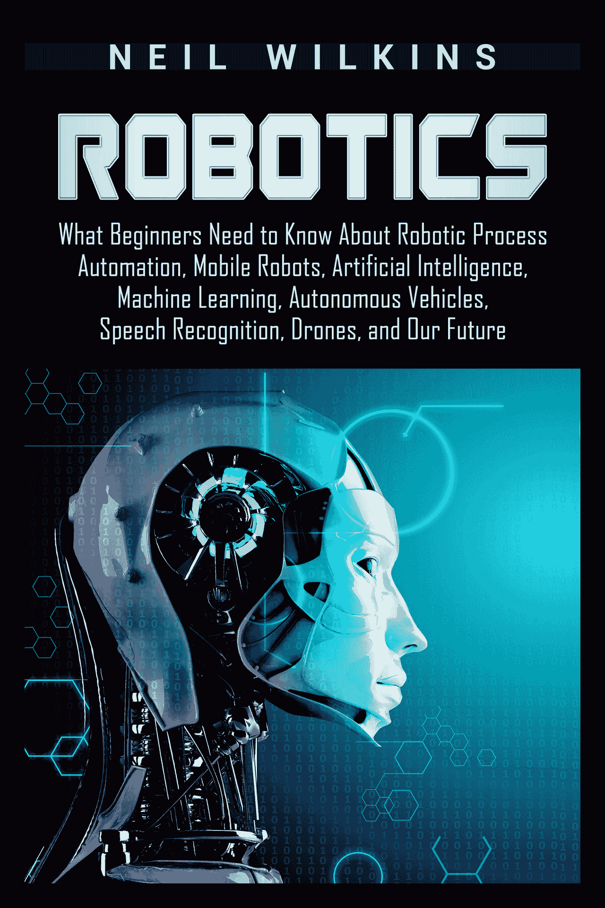

# 机器人：初学者需要了解机器人流程自动化、移动机器人、人工智能、机器学习、自动驾驶车辆、语音识别、无人机以及我们的未来




## 引言

接下来的章节将讨论你对机器人技术需要了解的一切知识。当你观察周围的世界时，越来越多的机器人技术被应用到我们的生活中。由于机器人技术在我们的生活中变得越来越重要，因此了解机器人是如何工作的以及一些关于机器人的常见误应对你至关重要。书中包含了许多主题，你将读到一些专家以及他们对机器人技术的看法。在决定将其斥为骗局或更糟糕的某些之前，了解关于机器人的一切知识是至关重要的。

## 第一章：机器人基础

机器人技术被认为是一门详尽的科学与工程分支。机器人技术涵盖了不同的工程领域，如电子学、信息学、机械工程、计算机科学等！它通常与机器人的使用、它们如何被发明、如何运行以及用于控制机器人的计算机系统有关。它还包括传感器的反馈以及机器人必须处理的信息。

机器人技术被用于创建通过复制人类动作来取代人类的机器。机器人可以在许多情况下用于许多用途。然而，当你观察今天的社会时，它们可以用于人类不应该进入的危险环境，例如炸弹的探测甚至拆除炸弹。机器人还可以被用于制造过程，在这些过程中，由于空间、空气质量或其他许多危险情况，人类将无法生存，且极可能无法危险。

机器人可以采取几乎任何形式，它们甚至可以被制成外形像人类。据说这样做有助于人们接受机器人，因为它们复制了通常由人类执行的行为。某些机器人可以复制起重、说话、行走、感知以及人类所能做的几乎任何事情。

今天看到的许多机器人将受到它们将要工作环境的灵感。这些机器人将对自然做出贡献，因为它们对生物仿生领域做贡献。创造机器人的概念可以追溯到古典时代。然而，对此的研究以及创造完美机器人的潜力直到 20 世纪初才真正付诸行动。

在整个历史上，人们一直认为机器人将模仿人类行为，并像人类每天一样处理任务。现在，得益于技术的进步，你可以看到机器人技术是一个快速发展的领域。

### 词源

“robotics”一词源于“robot”。这个词是由捷克作家卡雷尔·卡佩克（Karel Capek）在 1920 年发表的作品中引起公众关注的。“robot”的起源可以追溯到斯拉夫语词汇“robota”，意为劳动或工作。

在卡佩克的剧中，它出现在一个制造机器人的工厂，这些生物被误认为是人类（人形的概念）。然而，“robot”这个词并不是卡佩克创造的，而是他的兄弟约瑟夫（Josef）创造的。

但是，当你查阅《牛津英语词典》时，“robotics”一词是由艾萨克·阿西莫（Isaac Asimov）在 1941 年发表的一篇科幻小说首次使用的。阿西莫由于电子设备中的技术和科学，并没有意识到自己正在创造新词。因此，他假设“robotics”将仅指机器人的工作。

### 历史

1948 年，诺伯特·维纳（Norbert Wiener）首次创立了控制论原理，这是机器人技术的基础。第一台全自动机器人出现在 20 世纪。第一个可编程数字机器人命名为 `Unimate`，它于 1961 年投入使用，从压铸机中取出汽车零件并进行堆叠。

今天，全球范围内都在商业和工厂作业中使用机器人，它们执行任务比人类更廉价、更准确、更可靠。它们还被用于不适合人类的工作，因为这些工作太单调、危险或肮脏。机器人被用于大规模生产、制造、采矿、运输、包装、手术、地球和太空探索、安全、武器以及实验室研究。

| 时期 |
| --- |
| 公元前三世纪 |
| 公元前后 |
| 公元前 420 年 |
| 1206 |
| 1495 |
| 1738 |
| 1898 |
| 1921 |
| 1930 |
| 1946 |
| 1948 |
| 1956 |
| 1961 |
| 1967 - 1972 |
| 1973 |
| 1974 |
| 1975 |
| 1978 |

## 专家对我们的未来如何看？

机器人专家丹妮拉·鲁（Daniela Rus）希望拥有一个每个人都能拥有机器人的世界，无论他们在经济阶梯中处于什么位置。鲁是马萨诸理工学院（MIT）计算机科学与人工智能实验室的主任，据报道她曾表示尽管机器人技术取得了巨大进展，但这一梦想尚未实现。

“但请记住，仅仅在二十年前，计算还是少数专家的任务，因为电脑体型巨大、价格昂贵且难以使用，”鲁说。现在，每个人都在使用电脑，单是这一点就说明了技术已经进步到足以将人工智能带给世界。机器人技术仍处于婴儿阶段，但它们每天都在取得进展。

如今，亚马逊（Amazon）拥有超过 80,000 台在履行中心工作的机器人。尽管有如此多的机器人为亚马逊工作，亚马逊的首席技术官并没有用机器人取代人类的想法。

“人类在创造性解决问题、抽象和概括方面非常出色。机器人则非常擅长处理数据、提取数据、搬运重物以及精准移动。我们必须思考如何构建将这些组件的优势结合在一起的系统。”——泰·布拉迪（Tye Brady）。

来自 Neurala 的海瑟·艾姆斯（Heather Ames）透露，他们正在与摩托拉解决方案（Motorola Solutions）合作，使用用于寻找失踪儿童的人工智能。警察制服上的摄像头将收到失踪儿童的描述，这样在孩子迷失时会有更多的人在寻找。这套系统也将用于寻找可疑包裹。

Airware 的巴迪·米基尼（Buddy Michini）表示，无人机将能够帮助急救人员评估灾难性事件。“他们可以利用无人机获取发生情况的概况，并将[帮助]放置在，比如倒塌最严重的建筑处。”米基尼还表示，Airware 将无人机派往意大利，帮助应对最近的地震。

机器人甚至被放置在人体上，以增强人类必须使用的技能。这样做是为了让任何有身体残障的人恢复他们可能失去的能力。这些机器人的首次应用是在士兵身上，让他们在搬运超过 100 磅的物品时不会感到疲劳。

机器不会控制用户，而是会跟随他的动作。因此，如果他们走过崎岖的地形，它将结合机器人和人类的力量，让他们协同工作。

## 机器人如今如何被使用

今天，可以在医疗领域看到机器人。它们如此精确，已经成为手术的绝佳工具。机器人做的切口比人类能做的要整洁得多，一旦伤口愈合，从远处看是看不出来的。医生们不再需要担心切错位置或切入患者身体太深。

机器人可以被程序为在特定位置以特定深度进行切除。它们在推进医学发现和寻找新信息方面也很有帮助，这些以后可以帮助救命。

工厂里也能找到机器人。它们被用于汽车和零件焊接在一起。由于它们的精确性和准确性，很容易让它们的工作看起来像是由专业人士焊接的一样。机器人很棒的一点是，它们也不会受到强光或焊炬热量的干扰。因此，它们可以做得比人类更多。

唯一的缺点是，它们需要程序更新来保持运行并跟上最新技术。

机器人还被用于家庭娱乐和休闲。人们可以购买各种家用机器人套件。其中一些套件将制造一个跟随线条或描迹线条的机器人。另一些套件将制造一个可以判断自己是在地板上还是桌子上，以及在撞到东西之前能走多远的机器人。

这类机器人将具有光敏传感器和开关传感器。甚至还有用于清洁的机器人，例如吸尘地板。有些机器人甚至将用于娱乐。这些机器人可以为你提供娱乐。

## 机器人的优势

尽管人们如何认为，机器人对我们的生活非常有帮助。以下是机器人在生活中提供帮助的方式：

1. 机器人执行任务的速度比人类更快，而且它们一致且准确。
2. 机器人可以帮助患有抑郁症的患者并保持活跃。
3. 大多数机器人是自动的，因此它们不受人类的干扰。这意味着它们可以执行对人类来说危险的任务。
4. 机器人可以被用于生产产品和组装汽车。机器人还用于计划、汽车和设备。
5. 新产生的工作是为了创造和维修机器人。
6. 由于它们是机器，机器人工作不需要睡觉。
7. 机器人可以应对敌对环境。机器人的制造使得大气不会影响它们的性能或物理状态。它们可以在许多领域取代人类，甚至可以程序化自我管理。
8. 机器人可以被程序引导到地球中心。它们可以挖掘燃料，并用于采矿。机器人还可以被用于探索人类无法到达的地方。人类的任何局限性机器人都可以克服。
9. 机器人可以用于耗时和重复性的任务。机器人不会感到无聊，因此它们在工作方面不会损失质量。它们的时间速度参数可以进行调整，使其反应更快。机器人将不受会对人类产生负面影响的事的影响。
10. 机器人可以不停止地运行。它们可以在长时间不需要维护的情况下工作很长时间，这意味着它们的产出率高于大多数人类。
11. 机器人手不会像人手那样颤抖。机器人工作的零件比人类小且更灵活。这使得它们在手术中非常完美。
12. 机器人的制造是为了能够在最恶劣环境下工作，如太空、水下或火灾。当人类的安全受到质疑时，可以使用机器人。机器人还可以被制造成任务所需的任何尺寸。
13. 机器人的存在是为了完成人们不想完成的工作。许多机器人探测器被送到太空后从未返回。它们被制造得比人类更强大。机器人甚至被用于战争，以消除让人们面临风险的需求。

## 机器人的缺点

当然，机器人也有它们的缺点：

1. 机器人需要电力才能运行。人们可能会失去工厂工作，但即使被机器人取代，机器人也需要维护来保持运行。创造和购买机器人将花费巨资。此外，机器人需要的程序和硬件在以后将花费更多资金。
2. 机器人可以取代工厂中的人类。这意味着人们需要寻找新工作，或者必须接受重新培训以从事不同的工作。在机器人取代多个领域人类的情况下，这可能导致高失业率，因为并不是所有人都能接受机器人维护的培训。
3. 如前所述，机器人需要维护和维修，这将产生大量费用。此外，由于工作需求可能会发生，它们的程序必须定期更新。必须使这些机器变得更加智能。一旦发生故障，维修成本将非常高。这意味着必须恢复程序、恢复丢失的数据代码，这不仅耗费资金，而且耗时。
4. 机器人存储大量数据。然而，获取这些数据的将比从人类大脑中提取数据要困难得多。机器人的设计是为了完成重复性任务，但它们不会像人类那样随着执行时间的变长而变得越来越出色。
5. 机器人不会以其程序中未曾包含的方式行动。按照目前机器人的使用方式，人们很容易对机器产生依赖，最终导致他们失去对认知能力的控制。如果被别有用的人控制了机器人，该机器人可能被用于破坏。
6. 机器人并不智能，也没有感知能力。除非经过编程，否则它们无法改进自己的工作。它们不能思考或拥有情感。这严重限制了机器人协助或与人类交流的能力。

## 现实应用

机器人不再是科幻小说；它们是真实的，存在于我们今天的世界中。不，它们并没有像我们看到的某些电影那样试图统治世界，而是与我们并肩工作，帮助改善我们的生活，让我们能够改善我们服务对象的生活。以下，你将看到机器人的一些现实应用以及它们如何帮助让我们的世界变得更好：

1. **仿生腿**：生物机电学是 Hugh Herr 正在进行的一项革命性工作，他是 `MIT` 生机电研究小组的负责人。Herr 是一位双腿截肢者，他利用人体生理学和电机械，为身体残障人士创造了仿肢。他的仿生成就包括用于大腿截肢者的步态自适应膝关节，以及用于步态病（也称为足垂）的各种阻抗踝足外骨骼，这由脑瘫、中风或多发性硬化症引起。他甚至制造了自己的仿生腿，这是第一个脚部和小腿的系统。
2. **医院机器人**：`Atheon` 专注于医疗保健行业。通过使用自主移动机器人，他们帮助运输了衣物、临床用品和清洁产品等重物。此外，`TUG` 机器可以安全地移除有害废物。由于法规要求医疗中心必须跟踪所有药物，特别是麻醉剂，`Aethon` 机器人作为 `IOT`（物联网）场景的一部分交付药物。此外，所有药物上都带有 `RFID` 芯片和条形码，使其能够实时跟踪药物。
3. **机器人管家**：像 `Boomerang` 这样的智能车库供应商提供了一种独特的车库解决方案。`Boomerang` 功能像电梯一样停放你的汽车。这些主要位于房价昂贵的地区，如`旧金山`、迈亚阿密和芝加哥。
4. **停车场机器人**：`Serva-TS` 的工作像叉车一样，可以在停车场内穿梭车辆。
5. **工厂机器人**：波士顿的 `Rethink Robotics` 引入了可以与人类一起工作捡拾和包装工作的机器人。
6. **协作机器人**：丹麦的 `Universal Robots` 向世界市场推出了一系列协作机器人。这些机器人可以通过编程处理重复性任务。
7. **机器人喷漆机**：`ABB Robotics` 开发了一系列机器人喷漆机。`IRB580` 有一个空手腕，结构紧凑，是一种快速且准确的喷漆机器人。这种机器人有助于提高生产力并提供更高的效率。
8. **协作**：`KUKA` 系统推出了协作机器人，旨在满足日益增长的市场需求。这种机器人具有安全传感功能、简单的操作控制和更快的教学。这些机器人的应用包括检查、测试、测量、码盘、加工和固紧。
9. **人形机器人**：智能机器人实验室主任石黑浩（Hiroshi Ishiguro）教授（该实验室是日本大阪大学科学研究生院系统创新系的一部分）创造了一个名为 `Geminoid` 的机器人。`Geminoid` 看起来和石黑浩教授一模一样。
10. **人形帮助人类**：尽管这些机器人看起来像人并且被认为很可爱，但它们并不是都为了做家务或娱乐而发明的。本田和丰田为身体残障或老年人创造了步行辅助设备。`Cyberdyne` 的 `HAL`（混合辅助肢）系统是唯一可以帮助大脑学习如何移动其所替代肢体的机器人设备。此外，医疗应用中的全身 `HAL` 系统正在研发中，以便在灾难恢复、恶劣环境或人类需要卓越力量和耐力的情况下，增强或保护人体。

## 第二章：专家警告我们机器人的五个原因

一些专家支持使用机器人，而另一些则反对。此外，一些专家处于中间立场：

1. **埃隆·马斯克**：`Elon Musk` 是一位亿万翁和企业家，他一直就人工智能用于军事机器人的危险向公众发出警告。

嗯，机器人基本上就是会移动的计算机。因此，如果它们被黑客攻击，其威胁将比静态电脑被攻击大得多。每当一台静态电脑被攻击时，黑客只能窃取信息并利用该系统攻击其他系统。然而，每当一个机器人被攻击时，它就可以被用来伤害他人甚至杀死他们，因为它可以移动。

同时，一些机器人带有摄像头和麦克风，因为它们可以被用作间谍工具。有些人仍然认为这只会发生在电影或书籍中，但风险和威胁是真实的，而且已经有机器人伤害人类或破坏财产的证据。

例如，美国劳工部有一份机器人相关事件清单，这些事件已导致数十人死亡。在过去的 14 年里，机器人手术与美国的 144 例死亡有关。2016 年，一个中国机器人撞破了玻璃窗，并伤了站在附近的人。

机器人的智能、力量和功能越强大，其威胁就越大。波士顿动力（Boston Dynamics）发布过一段视频，展示了一个机器人进行特技动作，以此展示公司的先进技术。现在，想象一下这项技术被黑客攻击。如果一个拥有这种强度和智能的机器人被攻击并接收到恶意指令，会发生什么？

话如此，友好机器人的安全防护很容易被绕过，一个曾经乐于且受信任的机器人可能会变得恶意并伤害财产或人员。

### 2. 史芬·霍金

已有超过 1000 名技术专家、研究人员和科学家写了一封信，对自主武器的危险发出警告。这封信由苹果公司联合创始人史蒂夫·沃兹尼克（Steve Wozniak）、史芬·霍金（Stephen Hawking）和埃隆·马斯克（Elon Musk）签署。

这封信在 2015 年的一场国际人工智能会议上提交。它的出现是因为失控机器人是最近辩论的热的话题。在涉及禁止特定的自主武器时，联合国多个委员会对此进行了激烈讨论。

科学专家一直试图禁止将人工智能用于可能脱离人类控制的武器中。他们还补充说，正如化学家和生物学家对制造生物或化学起源的武器不感兴趣一样，人工智能研究人员也不会对制造 AI 武器产生兴趣，也不希望其他研究人员通过制造这些武器来嘲笑他们的领域。

意识专家丹尼尔·丹尼特（Daniel Dennett）、谷歌 AI 首席德米斯·哈萨比斯（Demis Hassabis）以及麻理工学院教授诺姆·乔姆斯基（Noam Chomsky）也支持了这封信。史芬·霍金教授表示：“受限于缓慢生物演化的人类无法与[人工智能]竞争，并会被取代。”

### 3. 伊恩·皮尔森博士

皮尔森博士是一位自封的未来学家和发明家，他声称 AI 最终将比人类聪明十亿倍，而与它融合是我们的最佳选择。

皮尔森说：“我们会训练[人工智能]变得像我们一样，训练它像我们一样感受情感，但它并不会像我们。它会有点像《星际迷航》中的外星人——行动上更聪明、更有计谋。它对人类漠无表情，将我们视为野蛮人。因此，当它决定进行自己的病毒实验时，它会把我们当成实验鼠对待。”最终，友好机器人的安全防护很容易被绕过，一个曾经乐于且受信任的机器人可能会变得恶意并伤害财产或人员。

### 4. 欧洲

今年早些时候，欧洲正在考虑为机器人提供法律地位。这项提议提交给了欧洲的最高监管机构——欧洲委员会。

医学科学、伦理、法律、机器人技术和人工智能领域的 150 多名专业人士参与了辩论。在寄给欧洲委员会的一封信中，这些专家表示，该提议似乎并非受现实世界的影响，而是受科幻小说的影响。

反对的人认为，如果为机器人提供法律地位，将允许制造商、所有者和技术人员声称对造成的任何损害不负责。委员会一名发言人表示：“人工智能可以为我们的社会和经济带来巨大利益……但也引发了一些问题，例如与未来工作有关的问题。”

审查提议的专家表示，这归功于早些时候的科小说和煽动性的新闻发布。机器人伦理专家娜塔·内维扬斯（Nalie Nevejans）在法国阿尔图大学工作，她是签署该信的专家之一。

她认为机器人拥有法律地位不仅没有帮助，而且是不恰当的。没有人类操作员，机器人不可能成为社会的一部分，这短期内不会改变。内维扬斯被报道曾说：“法律人格将模糊人与机器之间的关系，使立法者能够逐步转向向机器人赋予权利。这在我们开发它们的过程中完全是适得其反的。”

欧洲应该为人工智能和机器人技术制定规则，以促进创新并确保公民的安全。

### 5. 澳大利亚和加拿大的总理

已有数百名专家呼吁政府禁止具有决定人类生死的能力的机器人武器化。

领先的人工智能人物也向他们的总理发送了信函，以参加 2017 年 11 月举行的特定常规武器公约会议。这些信还得到了史蒂芬·霍金的支持，他在葡萄牙的一次技术会议上发出了警告，称人工智能可能会毁灭世界。

这些公开信的某些签名者包括来自渥太华大学的伊恩·凯尔（Ian Kerr）教授以及墨尔本大学的蒂姆·鲍尔德温（Tim Baldwin）教授。加拿大总理贾斯汀·特鲁多表示：“那些剥夺人类在决定目标合法性和部署致命武力方面具有实质性控制的致命性自主武器系统，正处于明确道德底线错误的一面。”


寄给加拿大和英国的每封信都强调，机器学习和人工智能取得的惊人进展已使得机器能够在没有人类干预的情况下独立执行困难的操作。这些进步帮助了教育、交通、医疗保健和基础设施的许多改进。然而，积极的转变也将带来危险的后果，这些后果最终将要求高度的道德关注。正如机器人公司警告的那样，自主武器系统将代表至少 1/3 战争革命。因此，为了防止这种情况发生，为了禁止这些系统，寄给英国和加拿大的每封信都在呼建立一项新的国际协议。每封信都总结道：“如果开发出来，它们将允许比任何时候都更大的规模和比人类理解快的时间的时间进行武装冲突。其致命的后果是，决定谁生死的将是机器而不是人。”

加拿大外交部长将国际禁令、1996 年的《渥华条约》以及这项禁令进行了对比。完全禁止自主武器可能是可能的。但是，如果所有国家共同努力，禁令将是有效的。“涉及到禁令，我认为不可能实现国际禁。这将取决于国家，”阿比舒尔·普拉卡（Abishur Prakash）告诉《新闻周刊。“俄罗斯、中国和伊朗等国家可能将国际禁视为西方试图加强控制的尝试。如果这些国家不禁止它们，那么美国和加拿大等国会将禁止杀手机器人视为对它们自身国家安全的威胁。”

机器人仍然被误解，这意味着会有关于它们的神话，因为人们会编造信息来帮助自己稍微理解机器人。在这一章中，我们将检查这些神话并消除它们，这样你就不必继续对机器人产生疑问，从而更近一步理解它们。

## 1. 机器人将夺走人类的工作

每家主要的物流和制造公司都认为机器人将提高其运营效率以及在那里工作的人的生活质量。因此，当涉及机器人技术时，人类将继续是业务的关键部分。

制造业和物流公司的员工应该将机器人视为使用精密工具增强其产出的工匠，因为他们在执行正在进行的工作时会产生更大的满足感。特斯拉汽车（Tesla Motors）就是一个例子，该公司使用机器人执行对那里工作的人构成威胁的任务。工人监督机器人的运行，并确保他们产出的工作质量达到标准并符合特斯拉汽车的预期。在特斯拉汽车，装配线上的机器人胶水、铆钉和焊接汽车零件，同时由人类进行监视。特斯拉的每位员工都可以为自己自豪，因为他们是制造业新时代的一部分，机器人正被用于革新。

## 2. 机器人很昂贵

现代家庭应用将是人们每天购买时毫不思考的几件家用硬件。这些设备中的每一都得益于数十年的改进以及在领域开发的数百万台设备，这分摊了成本。同样的原理也适用于机器人。问题是，几乎每个机器人都是专门的，并且需要成本昂贵的硬件。

执行器（actuators）将是机器人最昂贵的部件之一。这些执行器的价格不像处理器或传感器的价格那样下降。例如，Willow Garage 分出的工厂 Perception。在它被谷歌收购之前，这家初创公司在识别和从集装箱中取出箱子方面接近人类速度。尽管如此，这个机器人系统使用了廉价的传感器，如摄像头或微软制造的 `Kinect` 设备。然而，机器人仍然需要一个昂贵的机器人手臂，该手臂必须由传统的执行器驱动。

好消息是，在执行系统方面，我们很有可能看到很多创新。它将像降低电器成本一样降低机器人的成本。一个非常有前景的领域将涉及放置在关节上的传感器，这使得机器人能够以安全且经过计算的方式控制其运动。像卡内基梅梅隆大学（`CMU`）分出的 `IAM robotics`、`Redwood Robotics` 和 `Modbot` 这样的团体正在寻找独特的方法来减少机器人所需的电机、齿轮和传感器的数量并简化它们。通过这种方法，机器人的价格将大幅降低，这将降低占据整个机器人成本的大臂成本。

## 3. 高级操作据说是机器人的用途

就像 `CNC`（数控机）机器一样，机器人是可编程的，通过调用新程序，机器人将从一个运行引用更改到另一个。得益于精心的设计，可以将灵活性整合到整个系列零件中。

传感器技术已经先进，这允许它简化零件呈现。视觉系统可以识别和定位零件，并减少对手工工具的需求。力感有助于机器人调整，以便它们能够执行需要精度的组装任务。更现代的机器人可以有效地处理中等量的制造。制造机器人的编程和切换非常快，最终导致了高效的经济生产。

## 4. 由于机器人非常复杂，机器人编程很难

机器人通过离线编程或教导器（teach pendants）进行编程。通过教导器，编写机器人的人将引导机器人通过一系列步骤进行精调，并存储每个需要存储的点。然后机器人将运行此程序，并在再次运行之前检查是否有碰撞。它将继续运行，直到编写机器人的人对所教授的动作完全满意，并且它在运行时没有任何问题。

离线编程意味着用户可以使用模型来完成和修改稍后由机器人使用的移动。模型对程序的响应程度将决定在安装到机器人上后需要多少次修改。

## 5. 机器人系统非常复杂，且程序难以维护

与商业和工厂环境中使用的其他机器相比，机器人的可靠性极高。机器人供应商提供的平均无故障间隔时间为 62,000 次或以上，大约持续七年。机器人工作单元通常包含除低可靠性传感器以外的其他设备。然而，从总的来说，专用自动化设备仍然比机器人工作单元更复杂。

## 6. 机器人听从我的指令执行

现在已经有了能够响应语音指令的机器人。但它们非常罕见，因为其实际应用场景有限。目前，通过编程和自动化控制来操作机器人更高效、更具成本效益。因此，归结底，这种说法听起来合理，但目前并不实际。

## 7. 机器人是仿人制造的机器

机器人的外观取决于机器人的来源。根据韦登-韦斯特词典（Merriam-Webster），机器人的定义是“一台看起来像人类并执行人类各种复杂动作的机器；也指：一种类似的虚构机器，通常强调其缺乏人类情感的能力。”

对机器人还有其他定义，但归结底，机器人的设计是为了使其能够高效地完成其执行的工作。

## 8. 机器人很强壮，但不灵活

2015 年，斯坦福大学生物仿生与灵巧操纵实验室的研究人员制造了一只壁虎机器人，它能拉起自身重量 2000 倍的物体，这相当于人类在陆地上拖一头鲸鱼。

当然，机器人会比人类更强，但这并不意味着它们没有人类灵活。瑞士洛桑联邦理工学院（Ecole Polytechnique Federale）发明了一种机器人抓爪，它可以提起自身重量 80 倍的物体，并且足够灵活捡起鸡蛋或单张纸。这种抓爪是第一个使用电吸附和传感器的设备，使机器人能够适应其所处的环境。机器人开始执行各种精细动作技能，使它们能够胜任人类的工作，而且执行过程中停不停。

## 9. 机器人很智能，但它们无法判断意图

机器人的设计足够智能，取代人类每天的工作，预计到 2040 年，智能机器人的数量将超过人类。

AI 机器人的语音转录能力超过了大多数专业转录员，还能比人类流行病学家更好地发现组织切片中的癌症。人工智能甚至正在创造能够自我学习变得更智能的机器人！因此，相反，随着机器人变得越来越聪明并学习越多，它们将能够学习意图并让自己变得更聪明。

## 10. 机器人可以学习，但不能自我进化

正如你所看到的，机器人既强大又智能，但你可能认为它们不能进化。然而，你错了。

一个挪威机器人在 3D 打印自己的下一代产品时学会了自我进化。奥斯陆大学的专家表示：“是人工智能程序——而不是人类——在创新新产品。”换句话说，因为技术在不断演进，这意味着将机器人能够自我进化，并变得比最初创建时更聪明。正如你看到的，关于机器人的很多言论已被证明是错误的，还有许多其他言论等待被拆穿。因此，仅仅因为你不了解机器人，并不意味着你需要对它们胡编乱造。在网上寻找你想知道的信息，比相信谎言并在谈论你不擅长的领域时让自己看起来像个傻瓜要容易得多。

机器人流程自动化也称为 `RPA`，它正以业务流程自动化技术的形式迅速出现，这种技术将基于机器人和人工智能运行的程序。在大多数传统的工作流自动化工具中，通常会有一位开发者创建一个完成任务所需的自动化化的动作列表，并通过内部应用程序接口或 `API` 与系统后端进行接口连接。它还可以使用专门的脚本语言。

这种情况将会有所不同，因为 `RPA` 系统将通过观察用户的操作来开发动作列表，并将这些列表放置在应用程序的图形用户界面中，然后通过直接在 `GUI` 中重复任务来执行自动化。这将能够消除障碍，使自动化能够应用于那些可能不包含 `API` 的项目。在技术层面，`RPA` 工具将具有与图形用户界面工具某些相同的技术。这些工具可以对与 `GUI` 相关的交互进行编程，并且通常通过重复用户执行过的动作来实现。

`RPA` 工具与其他系统不同，它们包含了能够在多个应用程序运行之间及运行期间处理数据的功能。例如，当你收到一封附有发票的邮件时，数据可以被提取并输入到跟踪财务状况的系统中。

## 演变历史

`RPA` 被认为是一项重技术进步，由于这种解决方案，它需要新的程序平台出现，以便在大型企业中使用时更加成熟、稳健、可扩展，甚至更加可靠。当你看到技术自屏幕抓取（screen scraping）以来取得了巨大的进步时，通过观察一个学术研究中经常引用的例子，你可以更好地理解它。

用户使用名为 `Xchanging` 的平台——这总部位于英国、在全球范围内提供业务处理、采购服务和技术的全球性公司——有一个名为 `Poppy` 的拟人化机器人。从这个例子中可以看出其才华水平以及使用的易用性，特别是在一些更现代的技术平台上。正因如此，用户可能不会将其视为一个假设的程序化服务，而是一个实体或物体。得益 `RPA` 的无代码平台，这将是将 `RPA` 与屏幕抓取区分开来的特征之一。

## 部署托管

托管 `RPA` 服务将符合程序机器人的比喻，每个机器人动作都有自己的工作场所，类似于人类工人。机器人可以使用计算机上看到的控制按钮来采取行动并执行任务。通常，这些动作发生在受控环境中，而不是显示器上，因为机器人不需要物理屏幕来查看其结果。相反，它将以电子方式解释结果，因此它们不需要显示在屏幕上。

如果这些现代解决方案无法大规模部署，那么它的可用性将受到限制，只能管理少数物理硬件和相关成本。将 `RPA` 实施到大型企业中，每当与传统的非 `RPA` 解决方案相比时，都节省了大量资金。当然，`RPA` 也有它的风险。批评意见包括抑制创造力的风险，甚至可能导致现有的程序产生更复杂的维护环境。

## RPA 对就业的影响

当你查看《哈佛商业评论》（`Harvard Business Review`）及其对 `RPA` 的观点时，你会发现他们认为大多数运营小组将采用 `RPA`，同时向为其工作的员工承诺，机器人不会导致失业。相反，工人将接受重新培训，以便他们可以花时间做更有趣的事情。

根据一项学术研究，工人不应该觉得自动化是对其知识的威胁，而应将其视为队友。在同一项研究中，你还可以看到，技术部署后，并没有导致人数减少，而是相同的人数产生了更高的生产力。

另一方面，一些分析师认为 `RPA` 对于外包其工作的业务流程来说是一个风险。这将为国内地区被认为是熟练流程设计师的人创造高价值的工作，但将减少离岸低技能工人的可用机会。

## 对社会的影响

更多的学术研究已经完成，并预测 `RPA` 和其他技术进步将帮助开启一个生产力更高、方法更高效的新时代，使全球劳动力市场受益。尽管如此，这些不能直接归功于 `RPA`。

许多研究人员或协会认为，到 2035 年，所有工作的 35% 将被自动化。同时，伦敦政治学院（`LSE`）论文的作者 Willcocks 教授谈到了工作满意度和智力刺激的增加，这可以描述为技术进步释放了人类。这种对机器人接管人类日常平凡和重复性工作的引用，让他们能够去做更有趣或更有意义的事情。

## RPA 与机器人技术

正如你在本章早期看到的机器人流程自动化将使机器人能够自动执行任务，这样它们就不需要每天接受如何执行某事的培训。这将帮助人类转向更有趣、更有意义的事情，提高所制造产品的质量。这将导致公司更多地关注客户服务和其他他们可能短板的领域，因为他们现在有了资源重新培训员工从事另一份工作。

# 第 5 章：移动机器人

移动机器人是能够移动的机器人。这些机器人通常被列为信息工程以及机器人学的一个子领域。移动机器人可以在环境中移动，而不会被困在某处。移动机器人可以是自主的，也可以是 `AMR`（自主移动机器人）。这意味着它们可以在没有人类或机电设备引导的情况下，在不受控制的环境中导航。另一方面，移动机器人将依赖于引导软件，这些软件使其能够在受控环境中覆盖预设的路线。这类车辆被称为自动引导运输车辆或简称 `AGV`。

相比之下，工厂机器人大部分是静止的，因为它们配合关节臂和抓取器组件工作（它们也可以与末端执行器一起工作），这些组件由于固定在自己的工作空间上而无法移动。移动机器人在工厂和商业环境中变得越来越普通。医疗中心已经开始使用移动机器人，它们可以沿着预定的路线移动人类工人因太重而无法移动的产品。仓库已开始安装移动机器人系统，以便将材料从货架高效地移动到履单区。目前的研究以及大多数大学通常集中在移动机器人上。安全和军事领域也使用了移动机器人。

家用移动机器人包括可以执行园艺或吸尘等家庭任务的娱乐机器人。移动机器人的模块将是控制器、控制程序、执行器和传感器。控制器通常是一个与远程或笔记本电脑连接的微处理器。程序将是某种脚本语言，如 `C` 或 `C++`。传感器将取决于机器人设置的条件。这些条件可能包括处理技能、感知触碰的传感器、感知与物体的距离、根据其位置形成地图，甚至是避免碰撞，以及任何数量的其他应用。

## 分类

移动机器人分为以下几类：

1. **它们运行的环境**
   - 极地机器人的发明是为了在跨越冰雪和充满深渊的气候中导航。
   - 在陆地或家庭中使用的机器人通常称为无人地面车辆或 `UGV`。它们通常在履带或轮子上移动，但也可以涵盖带腿的机器人。这些机器人由两条或更多腿组成。
   - `AUVs`（自主水下机器人）是水下机器人的称呼。
   - `UAV`（无人机）是空中机器人的称呼。
2. **它们用于移动的设备**
   - 履带
   - 轮子
   - 腿

## 机器人导航

1. **物理远程或遥操作**：这种机器人是物理遥控的，驱动员通过开关或其他远程控制设备对其下达命令。远程设备将直接插入机器人，或者作为笔记本电脑或其他操作手段的附件。遥操作机器人将用于确保操作员的安全。几个远程手动控制机器人的例子有 Robotics Design 的 Anatroller ARI - 50 和 ARI - 100。还有 KumoTek 的 MK-705 Rosterbot 和 Foster-Miller 的 Talon。
2. **受保护的遥操作**：这种遥操作机器人受到保护，可以检测并绕过障碍，但会在驱动的同时进行导航。手动遥操作机器人可以与此比较。仅提供受保护遥操作的移动机器人不多（如果有的话）。
3. **循线车**：它们会遵循嵌入天花板或地板或涂画的视觉线条。它们还会遵循铺设在地面上的电线。许多此类机器人运行在基础算法上即“保持线条在传感器中心”。这些机器人不会绕过障碍；相反，它们会停止并等待阻塞路径的物体被移除。你仍然可以买循线车，因为它们是由 Transbot、FMC、Egemin、HK Systems 以及其他几家生产的。这样的机器人在机器人协会中仍然流行，因为它们是学习机器人学的第一步。
4. **自主随机机器人**：具有随机运动的自主机器人即使感知到墙壁也会撞上墙壁。
5. **自主引导机器人**：它们拥有关于目的地的少量数据，以及到达目标或路线上需要停止的任何地方的信息。得益于至少一种以下方法，可以确定机器人当前的位置——传感器、视觉、全球定位系统、激光和双目视觉。这些定位系统通常使用蒙特卡洛/马尔可夫定位、相对位置和三角测量法来确定平台相对于下一个目标路径的精确位置。这种机器人可以从传感器收集带有位置和时间戳的读数。以 PatrolBot 为例，这种机器人充当保安，紧急情况发生时向指挥中心发送通知，操作电梯并响应警报。其他自主引导机器人可以使用医院。计算机科学家 Ahmed Elgammal 博士、生物学家 Simeon Kotchomi 博士和工程师邹庆泽博士在 2013 年帮助艺术家 Elizabeth Demaray 创造了一个能够为盆栽寻找水和阳光的自主机器人。

人工智能，又称为 `AI`，通常被称为机器智能，它是指在机器中展现的智能，与通常在人类及各种其他哺乳动物中看到的自然智能相对。在计算机科学领域，人工智能研究被归类为对设备所示智能的研究，这些设备能够感知周围环境并采取行动，以最大限度地增加其实现目标的概率。

从非正式的角度来说，“人工智能”一词通常与能够模仿人类认知功能、解决问题或学习能力的机器相关联。定义往往忽略了 `AI` 如何利用智能来完成任务的能力。这种现象被认为是“AI 效应”，它导致了特斯勒定理（Tesler’s Theorem）中的俏话：“AI 就是任何尚未实现的事情。”例如，通过视觉实现的特殊识别已成为一种常规技术。现代机器已经能够完成一些被归类为 `AI` 的事情，因为它们可以成功理解人类语言，同时在国际象棋等高级策略游戏中竞争。它们还能自主驾驶汽车，并足够智能处理军事模拟和内容分发网络中的路由问题。

## 人工智能的分类

Kaplan 和 Haenlein 将人工智能分为三类，这些分类是借自管理学文献——人性化人工智能、人类启发型和分析型。

- **分析型人工智能**：在理解和识别决策中所涉及的认知元素和人类情感时，其特征仅具有与认知及情感智能一致的特性。
- **人性化 AI**：表现出每种能力（情感智能、认知智能、情感智能和社交智能）的特征，并且具有足够的自我意识和自我认知来与他人进行交互。
- **人类启发人工智能**：除了感知、社交和认知能力外，必须都具有类人的外表。它们必须能够使用自然语言进行清晰交流。而名为“嗅觉”的最新进展使根源更贴近人类，因为它们现在可以识别气味了。

## 历史与演变

1956 年左右，人工智能作为一个学术学科首次奠定。在随后的几年里，人们经历了多次乐观主义浪潮，随之而来的是许多失败甚至是资金问题。这被称为“AI 寒冬”，但它很快被新的 AI 方法、胜利以及对机器人研究的更多资金所取代。在历史的大部分时间内，人工智能实验可以分为若干子领域，这些子领域通常无法保持联系。

这些子领域通常根据其技术考虑因素，甚至是特定的目标，通过使用特定的工具或分析差异进行分类。这些子类别也可以根据机构或研究人员感兴趣的社会因素来创建。

人工智能传统的目标或问题包括操作和移动物体的能力、自然语言处理、感知、学习、表示、规划、知识和推理。该领域的长期目标之一是通用智能。方法包括传统的符号 AI、统计方法和计算智能。`AI` 使用多种工具，包括数学和搜索优化、人工神经网络，以及由于统计学（如经济学和概率）产生的方法。`AI` 领域经常借鉴语言学、哲学、心理学、信息工程、数学、计算机科学等。


人工智能建立在一个假设之上：人类的智能“可以被描述得如此精确，以至于使机器能够模拟它”。正是这种哲学论点，引发了关于大脑的其他讨论，以及在设计提供人类相同智能所需系统的机器人和其他机器人时涉及的任何伦理问题，这些问题产生了自古以来一直通过神话、哲学和虚构小说被彻底探讨的问题。一些人认为，如果进步不受停止，AI 将是人类的危险。然而，也有人认为，AI 与其他技术革命不同，在审查失业问题时将引发巨大的问题。

在 21 世纪，随着计算机能力、理论理解和大量数据方面的技术进步，AI 技术和方法论经历了复兴。人工智能方法已成为这一快速发展行业的重要组成部分，并帮助解决了计算机科学、运筹学和程序工程中需要其关注的多个问题。

## 早期里程碑与理论框架

处理思想的机器人自古以来就详细记录于故事中，并出现在虚构作品中，如卡雷尔·恰佩克的《R.U.R》或玛丽·雪莱编写的《弗兰肯斯坦》。这些人物及其命运带来了一些与现在讨论人工智能原则时产生的问题相同的问题。

对机器人推理的研究最初始于理论家和数学统计学家。对数学逻辑的检查导致了艾伦·图灵（Alan Turing）的计算理论，该理论认为机器通过`1`和`0`等符号的切换，可以模拟任何合理的数学推演行为。正是这种洞察形成了丘奇-图灵论题（Church-Turing thesis），即任何形式的形式推理都可以由数字计算机模拟。结合信息学、控制论和神经生物学的最新发现，研究人员开始考虑电子大脑的发展是一种可能。图灵提出：“如果人类无法区分来自机器和人类的响应，那么机器就可以被视为智能生物。”

图灵完备人工神经元的正式设计被认为是人工智能领域的第一项工作。它由麦卡洛（McCulloch）和皮茨（Pitts）于 1943 年创建。

人工智能研究领域始于 1956 年在达特茅学院举行的一次会议。参加者包括来自 CMU 的艾伦·纽威尔（Allen Newell）、来自 MIT 的约翰·马卡锡（John McCarthy）、来自 CMU 的赫尔伯特·西蒙（Herbert Simon）、来自 IBM 的亚瑟·萨缪尔（Arthur Samuel）和来自 MIT 的马文·明斯基（Marvin Minsky），他们都被认为是人工智能的领袖和创始人。

## 进展与挑战

现代机器已经能够完成一些被归类为 AI 的事情，因为它们可以成功理解人类语言，同时在国际象棋等高级策略游戏中竞争。它们还能自主驾驶汽车，并足够智能处理军事模拟和内容分发网络中的路由问题。

人工智能的长期目标之一是通用智能。方法包括传统的符号 AI、统计方法和计算智能。AI 使用多种工具，包括数学和搜索优化、人工神经网络，以及由于统计学（如经济学和概率）产生的方法。

在 21 世纪，随着计算机能力、理论理解和大量数据方面的技术进步，AI 技术和方法论经历了复兴。人工智能方法已成为这一快速发展行业的重要组成部分，并帮助解决了计算机科学、运筹学和程序工程中需要其关注的多个问题。

1997 年，`Deep Blue` 击败了世界冠军卡斯帕罗夫。2011 年，`Watson` 赢得了问答节目 `Jeopardy`。2012 年左右，`deep learning` 开始占据主导。2016 年，`AlphaGo` 击败了职业围棋手。次年，`AlphaGo` 再次击败头号冠军。彭博的杰克·克拉克（Jack Clark）甚至说由于关注或使用 AI 的程序和项目数量增加，人工智能在 2015 年表现非常出色。此外，自 2011 年以来，图像处理任务的错误率下降。根据克拉克的说法，神经网络的可能是这种剧变的原因。2017 年的一项调查显示，每五家公司中就有一家将 AI 纳入其流程中。中国政府在 2016 年增加了资金。这导致了研究产出的快速增加和信息的巨大供应，使观察者认为中国已成为人工智能领域的强国。

1. 如果有人构成威胁，则应连续占据两个方格，然后占据剩余的正格；否则，
2. 如果某步移动可以“叉叉”同时创建两个线程，则应该执行该步移动；否则，
3. 如果中心方格是空的，则应该占据它；否则，
4. 如果你的对手决定占据角落，你应该占据另一个角落；否则，
5. 如果有任何空闲角落，占据其中一个；否则，
6. 占据任何空方格。

许多 AI 算法都可以从它们收集的数据中学习，这可以帮助它们通过学习新的启发式方法来增强自身，或者帮助它们编写其他算法。下文将描述你熟悉的一些学习器，包括最近邻、决策树和贝叶斯网络，它们可能很有帮助——只要能给它们无限的内存、时间和数据，它们就可以近似任何函数，包括任何最能描述整个世界的数学函数组合。这些学习器可以通过考虑每个可能的假设并将其与数据进行匹配，从而演变为无所不知。在实践中，由于组合爆炸现象，考虑每种可能性是不可能的，组合爆炸意味着问题越大，解决问题所需的时间就会指数级增长。事实上，许多 AI 研究包括发现如何识别并避免那些最可能没有用的广泛可能性。例如，假设你正在看地图，并试图找到从家乡到最近大都市的最短行驶路线。在大多数情况下，你可以跳过所有小城镇或任何偏离路线的地方；得益于路径规划算法，这是 AI 也会做的事情。这样一来，每条路线都得到了规划，你就不必担心在到达目的地上浪费时间。

## 问题

人工智能的总体目标之一是创建一种技术，让其他机器和计算机能够以智能的方式工作。实现这一点的总体问题是模拟智能，这必须被分解为子问题。这些子问题将由研究人员期望智能系统展示的一系列特定特征组成。这些特征描述在下。

## 问题解决与推理

早期研究人员创建了算法，展示了人类在进行逻辑推断或解决谜题时所使用的逐步推理方法。在 20 世纪 80 年代后期甚至 90 年代初，AI 研究人员又创建了一种处理不确定和不完整信息的新方法。这种方法采用了一种基于经济学和概率的思想。随后发现，这些算法在解决大型推理问题时是不够的，因为它们会遇到组合爆炸，这意味着问题越大，运行速度就呈指数级变慢。事实上，人类极少使用逐步归约法——而早期的 AI 研究人员将其作为模型。人类通常使用直觉判断来解决他们的问题。

## 知识表示

知识工程和知识表示将成为经典 AI 研究的基础。已经有一些专家系统尝试拼凑专家在某些特定领域所拥有的显性知识。此外，一些项目试图收集普通人拥有的常识，并将其整合进一个包含广泛世界知识的数据库中。其中就全面的常识知识库，它将包含事件、时间、情况、对象和状态之间发生的属性、类别、对象和关系。它还包含了因果关系、知识以及许多尚未充分研究的领域。

“存在什么”的表示是本体论，它将属性、概念、关系和对象整合在一起，以便程序代理可以解释它们。它们的语义将通过个体、描述逻辑概念、角色来捕获，并通常在 Web 本体语言（OWL）中实现为属性、个体和类。上层本体是最通用的本体，它充当领域本体之间的中介，试图为所有其他知识提供基础。一些形式化的知识表示可以用于临床决策支持、基于内容的索引与检索、场景解释，以及知识发现等许多其他领域。

知识表示最困难的问题包括：

1. **限定性问题与默认推理**：许多人对工作假设是有意识的。例如，当你和某说话时脑中出现了一只鸟，你通常可以在脑海中看到那只鸟，并描述得足够清楚，让别人知道你在想什么。然而，你认为关于鸟的知识可能并不适用于所有的鸟。1969 年，约翰·麦卡锡（John McCarthy）将此问题识别为限定性问题：因为对于 AI 研究人员可以表示的任何常识规则，存在大量的例外。几乎没有什么像抽象逻辑那样被简单地标记为真假。AI 研究必须探索该问题的每一个解决方案。

2. **常识知识的范围**：人类所知的原子事实数量是巨大的。有一些研究项目试图构建基于常识的完整知识，但这需要大量辛苦的本体工程，必须一个一个概念地手工构建。

3. **某些常识的非符号形式**：大多数人所知的无法表示为可以口头表达的事实或陈述。例如，一个下棋高手。他们会避免某些位置，因为觉得太容易受到攻击；或者艺术评论家看一眼画作就知道它们是伪作。这些是非符号的机制，它们不是意识思维。这种类型的知识为意识知识提供了背景、支持和信息。正如这个非符号推理问题一样，人们希望情境 AI、统计 AI 或计算智能能够提供一种表示这类知识的方法。

## 规划

智能规划负责设定目标以及实现这些目标的方法。目标必须使未来可视化。所采取的应当与目标匹配。在经典规划问题中，一个智能体会假设自己是世界上运行的系统，从而允许智能体对其行动的后果充满确定。然而，如果智能体仅仅是执行者，那么它要求智能体在没有任何确定性的情况下行动。这要求智能体评估其环境并做出预测，同时，它们必须评估自己的预测并根据这些评估进行调整。多智能体规划将利用多个智能体的合作与竞争来达到特定目标。群体智能和进化算法将使用涌现行为。

## 方法

目前还没有指导正在进行的 AI 研究的成熟理论。研究人员对许多问题经常存在分歧。一些尚未得到解决的长久问题包括：

- “人工智能是否应该通过学习心理学或神经生物学来模拟自然智能？”
- “或者人类生物学对 AI 研究来说就像鸟类生物学对航空工程一样毫无无关？”
- “智能行为是否可以使用简单、优雅的原理来描述？”
- “或者它是否必然要求解决大量完全无关的问题？”

### 控制论与大脑模拟

在 20 世纪 40 年代和 50 年代，许多研究人员探索了神经生物学、控制论和信息论是如何联系在一起的。其中一些研究人员制造了使用电子网络展示原始智能的机器，例如 `W. Grey Walter's turtles` 或 `Johns Hopkins Beast`。英国的 `Ratio Club` 和普林斯顿大学的 `Teleological Society` 会过会议，许多研究人员在此聚会。直到 1960 年，这种方法才被遗弃，尽管在 20 世纪 80 年代，它的某些元素被重新带回。

### 符号

只要能够访问数字计算机，AI 就开始探索如何通过人类智能减少符号操作。`CMU`、`MIT` 和 `Stanford` 是研究的中心。老派 AI，或简称 `GOFAI`，是 John Haugel 对这些符号化 AI 方法的命名。正是在 60 年代，符号化方法在通过小型演示程序中模拟高级程序思维方面开始取得成功。这些方法基于控制论以及人工神经网络，后者要么被推向背景，要么被完全遗弃。20 世纪 60 年代和 70 年代的研究坚信，符号化方法最终将创造出具有通用人工智能的机器，这被认为是他们领域的目标。

### 认知模拟

为了尝试将它们形式化，两位都是经济学家 Herbert Simon 和 Allen Newell 研究了人类解决问题的技能。他们的工作与运筹学、管理科学和认知科学一起为人工智能奠定了基础。他们的研究团队利用从心理实验中获得的结果来开发帮助模拟人们解决问题所需技术的技能。这种传统始于 `CMU`，并最终在 20 世纪 80 年代通过 `Soar` 架构流传。

### 粗糙或反逻辑

MIT 的研究人员发现，在通过自然语言处理和视觉解决困难问题时，需要特时的解决方案，这些研究人员认为，任何通用或简单的原理都无法捕捉到智能行为的每一个方面。Roger Schank 是第一个用 `scruffy`（不整洁）一词描述该团队反逻辑方法的人。由于常识知识库必须手动构建，它成了“粗糙 AI”的例子，这在曾是一个复杂的概念。

## 应用

任何智力任务都可以与人工智能有关。`AI effect` 是一种现象，即当某项技术成为主流时，你就不再认为其为人工智能。自动驾驶汽车和无人机只是现代 AI 高关注度例子中的几个。你也可以在在线广告投放、司法决策、航班延误预测、垃圾邮件过滤、图像识别、在线助手、玩 `chess` 或 `Go` 等游戏时的搜索引擎、数学定理的证明、艺术创作以及医学诊断中看到它们。

社交媒体正在缓慢接管电视机，成为接触年轻人的来源，这意味着大型新闻机构必须依赖社交媒体平台让人们阅读新闻。即使是主要的出版商也在使用人工智能来产生更高的流量，并有效地发布更多故事。

### 医疗保健

发现表明，如果使用 AI 诊断患者，可以节省高达 160 亿美元。2016 年，加利福尼亚的一项在 AI 帮助下进行的突破性研究创建了一个公式，用于正确判断器官患者所需的免疫抑制剂药物的正确剂量。得益于医生的协助，医疗保健行业已逐步进入人工智能。`Microsoft` 开发的一项 AI 已经帮助医生找到了如何正确治疗癌症。根据 `Bloomberg Technology`，已经开发了大量与癌症相关的药物和研究。详细来说，据制造了 800 多种用于治疗癌症的疫苗和药物。然而，这会对医生产生负面影响，因为从太多选择中为患者找到正确的药物可能是困难的。

`Hanover` 是 `Microsoft` 的一个进行中的项目。主要目标是记住所有关于癌症的研究人员和研究，并帮助预测最有效的药物组合。对抗骨髓性血病是一个目前正在进行的项目。这种癌症是致命的，几十年来其治疗一直没有改善。另一项研究还发现，AI 定位皮肤癌的能力可以与受过训练的医生相比。还进行了另一项研究，将 AI 用于发现和监控几个风险较高的患者。AI 根据从现场医生那里收集的信息向每位患者提问。

### 汽车

AI 的进步对该行业做出了贡献。一些已经开发的自动驾驶汽车没有刹车或方向盘。影响自动驾驶汽车的另一个因素是乘客的安全。为了制造自动驾驶汽车，工程师必须对其进行编程以处理更高风险的情况。这些可能包括碰撞碰撞。他们的目标是确保行人和乘客的安全。AI 有可能决定让某人处于危险。换句话说，汽车可能必须决定拯救乘客还是行人。

### 金融与经济

金融机构长期以来一直使用人工网络来检测不属于客户正常消费的异常。这些费用随后会被标记进行人工调查。自 1987 年以来，每当 `Security Pacific Bank` 建立欺诈预防小组时，银行就会使用人工智能应对信用卡未经授权的使用。金融服务在使用 `Moneystream` 和 `Kasisto` 等程序。银行现在使用 AI 管理财产、投资股票、维护会计和组织运营。当业务没有进行或晚上发生任何变化时，AI 可以做出反应。2001 年举行了一场模拟金融交易竞赛，机器人赢了人类。它还监控用户的行为模式；从而减少金融欺诈犯罪。

### 游戏

游戏也使用人工智能使 `NPC` 具有动态、有目的的行为。此外，路径寻找也使用 AI 技术。一些研究认为游戏中的 `NPC` 可以解决生产任务中的问题。

### 军事

2015 年，世界各国军队在机器人方面的支出达到了 75 亿美元，此前为 51 亿美元。由于军事无人机呈现出的自主行动，它们已成为一种有用的资产。弗拉基米·普京在 2017 年说，“谁在人工智能领域取得领先，谁就统治世界。”许多 AI 研究人员正让自己远离 AI 的军事应用。

“机器学习”指的是个人电脑（PC）科学中的一个子领域，在该领域中，计算机被赋予了所需的学习工具而无需人工编程。这项研究的演变包含了在人工智能领域可以找到模式识别和学习理论。机器将探索这项研究，并学习如何利用为这些算法的数据来构建算法并做出预测，克服静态的编程指令。这些指令将通过使用基础数据输入建立模型，由数据驱动以进行预测或决策。算法在计算任务中被发明，并以最佳性能执行。这通常是你采用机器学习的领域。一个例子是你的电子邮件为了保持邮件安全而进行的排序。机器学习往往与计算机统计学重叠，即通过与优化数学方程紧密联系的计算机进行预测。这使得理论、方法和应用主导了该领域。使用数据分析的数据挖掘经常与机器学习混淆。无监督学习也被你称为数据分析。即使是无监督的，机器学习在发现有意义的异常值之前，也应该学习为自己的行为建立一个基准。在数据分析领域，机器学习将用于创建复杂的方法以及用于预测的算法。这些预测在商业化时被称为预测性分析。这些预测将使研究人员、分析师、工程师和数据科学家能够做出可靠决策，通过从数据趋势和历史关系中学习来发现可能隐藏的洞察。在 2016 年，机器学习成为高特技术周期中的热门词汇，当时正处于其通胀预期的巅峰。由于寻找模式非常困难，通常没有足够的训练数据来分配。

## 任务与问题

根据学习的性质，你可以将机器学习分为三类：

1. **无监督学习**：用于学习算法不会赋予标签，这使其能够在输入中寻找其自身的结构。你可以将无监督学习作为发现你所使用数据中隐藏模式的目标，或作为达到目的的手段。

2. **监督学习**：你的计算机将获得输入以及你所期望的输出，这样计算机就可以学习如何映射输入和结果的通用规则。

3. **强化学习**：将有一个计算机程序在动态环境中工作以执行特定目标，例如当你与对手玩游戏时。程序在问题空间中导航时，将以奖励和惩罚的形式为你提供反馈。

还有半监督学习，介于监督和无监督学习之间。这是你向训练集提供不完整的训练信号，以便程序必须完成部分工作。换演是指原则承担整个问题时（例如学习时间）。但在目标缺失时，这种方法行不通。

机器学习还包括一些类别，例如学习，程序将根据以前发生过的经验学习程序的归纳偏置。发展性学习与机器人学习相同，程序能够从它所经历的学习情况中生成自己的序列，以便通过与人类和其他程序的交互以及自我探索来学习新技能。

机器学习的另一类别发生在你考虑机器学习系统的输出结果时：

1. **输入分类**：将至少分为两类，用户必须产生一个模型，对这些类别中用户未见的输入进行分类。这通常发生在监督学习中，例如你的电子邮件过滤器在垃圾邮件和非垃圾邮件之间进行过滤。

2. **回归**：也是监督的，输出结果是连续的而非离散的。

3. **聚类**：获取输入集并将其划分为不同的组。然而，聚类与分类的区别在于，组在产生之前对用户是未知的，这使其成为一项无监督任务。

4. **密度估计**：定位输入的分布。

5. **降维**：取输入并将其简化，使其映射到最低维度。

6. **主题建模**：从程序插入的问题中提取，查看插入的文档涵盖了哪些主题。

另一个类别发生在你考虑机器学习系统的输出时：

分类机器学习模型可以通过留出法（holdout）等技术进行验证。`holdout` 在训练和测试你的模型之前拆分数据。然而，如果你观察交叉验证（cross-validation），那么数据将随机拆分成子集，其中 `k` 个实例将用于训练。同时，`holdout` 和 `cross-validation` 方法将使用样本来评估模型。评估模型的指标包括：

- 准确率（Accuracy）
- 特异性（Specificity）
- 敏感性（Sensitivity）
- 真阴性率（True negative rate）
- 真阳性率（True positive rate）
- 假性率（False positive rate）
- 假性率（False negative rate）
- 曲线下面积（Area under the curve）


机器学习经常引发伦理问题。由于输出是基于收集的数据，机器学习是计算机科学的一个重要部分。神经网络受到生物学的启发，使计算机能够从数据中学习。

## 感知机与架构

神经网络与被称为感知机（`perceptron`）的人工神经元工作，感知机是由罗森布特在 60 年代开发的。但今天我们观察它时，使用的是所谓的 `sigmoid` 神经元（`sigmoid neuron`）。要理解 `sigmoid` 神经元，必须理解感知机。感知机接受多个二进制输入并给你一个二进制输出。罗森布特提出了一种规则来处理感知机的输出。这里权重（`weights`）作为表示数字的方式引入，并赋予输入和输出重要性。神经元的输出是 0 或 1，取决于总和小于还是大于阈值（`threshold value`）。你的阈值是一个用于神经元参数的数字。

将感知机视为一个通过权衡证据做出决策的设备。例如，如果你想去郊游，有几件事需要观察以决定是否计划出行：

1. 车够大家坐大吗？
2. 天气好吗？
3. 出游你需要带什么？

每个因素都由一个二进制变量表示。通过查看权重和问题的阈值，你可以为决策过程创建不同的模型。感知机将决定你是否去郊游。当你舍弃阈值时，你很可能会和家人一起去郊游。记住，你的感知机并不是人类可以完成的决策过程的完整模型。然而，你的感知机能够权衡不同的证据来做出你需要做出的决策，这对于产生你可能没有注意的小决策的复杂感知机网络应该是合理的。

## Sigmoid 函数

学习算法听起来是可行的方案，但你如何为神经网络创建一个算法呢？想想你有一个感知机网络可以解决问题。网络的输入是扫描进程序的原始像素数据，以便网络可以学习权重（`weights`）和偏置（`biases`）以正确分类输出。

如果你对网络中的权重（`weight`）进行任何更改，你的输出将与你所做的更改对应。然而感知机的现实是，当权重发生变化时，感知机可能会由于该变化完全翻转。这种变化会导致你的整个网络的行为变得更复杂。

所以，虽然阶跃函数（`step function`）并不直观，但你可以通过引入一种名为 `sigmoid` 神经元的新神经元来解决这个问题。这种激活函数位于 0 到 1 之间。它由以下方程定义：

```
sigma(z) = 1 / (1 + e^-z)
```

或

```
sigma(z) = 1 / (1 + exp(-sum(wj * xj) - b))
```

你向训练程序的示例中添加越多，网络就越能学习更多的选项。`sigmoid` 神经元之所以被使用，是因为它可以接受 0 到 1 之间的任何值。这至关重要。`sigmoid` 神经元的导数由以下方程定义：

```
d(sigma)/dz = sigma(z) * (1 - sigma(z))
```

## 大数据

看起来 2012 年是大数据技术出现并对每个人来说都是一切的一年。但到 2013 年，大数据分析成了一项大趋势。当你获得大量数据时，你不仅要管理它们，还要从集合中提取出最有用的信息，这是一个更具挑战性的任务。大数据不仅改变了你使用的工具，还改变了人们提取和解释数据的方式。通常，数据科学是反复尝试的过程，这在处理更大、更异构的数据集时是不可能的。然而，可用数据越多，用于构建预测模型的选项通常就越少，因为事实上没有多少工具能够在合理的时间处理海量信息。

你的假设需要是可测试的，以判断是否提供了足够的数据。

既然你已经了解了什么是机器学习，那么这个术语引起了机器人领域的高度关注，并在过去几年中并没有太大变化，这你不应该感到意外。但机器学习与机器人之间有什么关系呢？机器人学目前少数的发展导致了其他发展，包括机器学习。以下是机器人领域中常见的五种当前机器学习应用：

### 计算机视觉

有些人认为，机器人视觉（`robot vision`）或机器视觉（`machine vision`）才是正确的术语，因为“机器人视觉”涉及的不仅仅是算法。机器人专家和工程师研究了什么样的摄像头硬件可以让机器人处理周围的物理数据。机器人视觉和机器视觉密切相关。它们的出现可以归功于自动检测系统的创建和机器人引导。两者在应用于机器人视觉的运动学上仅有微差异，这涵盖了坐标系校准以及机器人从物理上影响环境的能力。

大数据的涌入推动了计算机视觉的发展，这进一步帮助了许多大学基于结构化预测学习技术的机器学习的发展。

### 模仿学习

模仿学习与观察学习密切相关，这种行为在婴儿和幼儿身上是可见的。模仿学习被认为是强化学习的一个伞类类别，或者是让智能体在世界中行动以实现奖励最大化的挑战。这种方法具有共同特征，即概率模型和贝叶斯。最终的问题是，模仿学习是否能够用于人形。

作为机器人学的重要部分，模仿学习在搜索、救援和建设等工厂环境外的领域具有移动性特征，这使得手动编写机器人解决方案具有挑战性。

### 自监督学习

由于自监督学习方法，机器人将允许生成自己的训练示例，从而提高性能。这将包括优先训练以及近距离采集的数据，这些数据将用于翻译远程传感器数据。配备光学设备的机器人安装了此类设备，以便它们拒绝和检测物体。

康奈大学和斯坦福大学创建了一个名为 `Watch-Bot` 的典型示例，它使用笔记本电脑、激光笔、3D 传感器和摄像头来寻找人类正常活动，这些模式是通过概率方法进行学习的。为了发出提醒，`Watch-Bot` 在物体上使用激光笔。在一次测试中，机器人几乎在 60% 的时间内提醒了人类，但机器人并不理解自己在做什么或为什么要这样做。

### 医疗与辅助技术

辅助机器人是一种在执行动作之前感知并处理感觉信息的设备，这些动作最终将造福残人和老年人。这些运动治疗机器人将提供治疗和诊断益处。由于它们对海外和美国的医院来说成本仍然过高，它们尚未离开实验室。

辅助技术的一些早期示例包括桌面级职业辅助机器人或 `DeVAR`。斯坦福大学和帕洛奥托退伍军人事务康复研究开发中心于 20 世纪 90 年代初开发了 `DeVAR`。目前仍有基于机器学习的机器人辅助技术的研究。`MICO` 机械手臂就是一个例子。它是一种具有使用 `Kinect` 传感器观察世界的辅助机器。这些影响将变得更加复杂，但它们将为世界提供更智能、能更好地适应用户需求的辅助机器人。机器学习的进步也体现在医学领域。尽管医疗设施尚未使用它，但机器人学正以飞快的速度发展。

### 多智能体学习

多智能体学习包含一些关键组件，即谈判和协调，这涉及到基于机器学习的机器人，其目标是寻找均衡策略并适应机器人不断的环境。例如，涉及加权算法的无遗憾学习工具被包含在多智能体学习方法中，这些方法有助于提高与基于市场的分布式控制系统中的多智能体学习和规划相关的学习成果。

在 2014 年底，麻省理工学院（MIT）决策与信息系统实验室提出了更成熟的分布式机器人或智能体算法示例。机器人能够协作构建一个比单一机器人更具包容性、更好的学习模型，该模型以构建探索和房间布局为基础，同时自主地构建知识库。每台机器人都会制作目录，然后将目录与其他机器人的数据集相结合，在构建此类知识库时，分布式算法的性能优于标准算法。这种机器学习方法虽然不是一个完美的系统，但它将允许机器人比较目录并强化相互观察，同时纠正任何遗漏或过度概括，这将在不远的未来多个机器人应用中发挥作用。

# 未来展望

正如你上面看到的，机器人领域中基于机器学习的方法开始与军事创新者或赞助商（他们为大型机器人制造商甚至初创公司提供工作）所提出的挑战和合同相结合，同时，汽车制造商对下一代自动驾驶汽车的投资也日益增加。由于机器学习的功能，它被用于帮助进一步推进机器人学的发展，并使机器人在处理和解释这些数据方面变得更加复杂。

自动驾驶汽车也被称为机器人汽车、自主式汽车甚至无人驾驶汽车。它们是能够感知所处环境并在无需人类输入或仅需少量人类输入的情况下移动的车辆。自动驾驶汽车将配备各种传感器，帮助它们评估周围环境，例如惯性测量单元、`GPS`、里程计、声纳、计算机视觉、`Lidar` 和雷达。此外，还有先进的控制系统可以解释感应信息，以识别正确的导航路径以及车辆路径上可能任何障碍物或标志。

## 优势

一些优势将包括提高安全性和降低成本。它们还将提高流动性、减少犯罪，并提高客户满意度。安全方面的优势还包括减少碰撞以及减少因碰撞导致的成本。由于自动汽车的出现，预计交通流量将会增加，同时为贫人、老年人、残障人士和儿童提供更便利的出行。它们将使旅行变得更容易，因为驾驶员不需要全程驾驶和导航，同时还能降低油耗以及对停车位的需求。

## 挑战

自动驾驶汽车面临的一些问题是安全、责任和技术。每当有人在车内时，他们都会产生控制车辆的欲望。不仅如此，研究人员还必须通过法律框架和政府法规。此外，这会让人们觉得失去了隐私，从而导致黑客攻击或恐怖主义等安全忧虑。在此基础上，由于不再需要驾驶员坐在方向盘后，人们可能会失去工作。由于更加方便，这也会导致郊区化旅行的。

## 半自动车辆

自动化程度是许多车辆的基础。它们可以被归类为全自动或全手动驱动车辆。半自动车辆是它们的统称。在技术和基础设施完全开发出全自动车辆之前还需要一段时间，但在这一研究期间，车辆将根据其自动化程度不断增加。半自动车辆将比全自动车辆具有优势，因为驾驶员仍然控制着车辆。

## 应用领域

### 自动卡车

许多公司正在对半挂车进行自动化技术测试。2016 年，Uber 购买了一家自动驾驶卡车公司 `Otto`，在 Uber 购买它们之前，他们已经在公路上展示了卡车。随后，2017 年，一家位于旧金山的初创公司宣布他们将与一家名为 `Peterbilt` 的卡车制造商合作，以便在 `Peterbilt` 车辆中部署和测试自动化技术。据报道，`Waymo` 正在对卡车进行自动化技术测试，但该项目尚未提供时间表。此外，2018 年，位于旧金山的 `Starsky Robotics` 完成了通往佛罗里达的七英里无人之旅。这使他们成为公共道路上无人驾驶卡车竞争中的第一个参与者。

在欧洲，通过“环境安全道路列车”方法开始考虑卡车编队。洛克希德·马丁（Lockheed Martin）在美国军方的资下开发了一种自动卡车运输系统，该系统将一辆由人类驾驶的卡车置于前方，然后其他车辆自动跟随。这是陆军 `自主移动应用系统 (AMAS)` 开发的一部分。2014 年，该系统由一个自动驾驶软件包组成，可安装在多达九种不同类型的车辆中，必须以 40 英里的速度行驶 55,000 小时。2017 年，`AMAS` 开始计划部署多达 200 辆卡车，作为快速实地计划的一部分。

### 运输系统

为自动汽车创建的运输系统开始在城市中运行，例如英国、法国、意大利和比利时的部分地区，在荷兰、西班牙和德国，他们正在交通中进行公开测试。

英国在米尔顿凯恩斯（Milton Keynes）启动了自动客舱 `LUTZ Pathfinder` 的公测。法国政府在 2014 年夏季允许 `PSA Peugeot-Citroen` 在巴黎进行试验。这些实验计划在 2016 年扩展到斯特拉斯拉斯堡和波尔多等城市。由法国公司 `Valeo` 和 `THALES` 组成的联盟也允许进行自己的测试。

在新西兰，在陶朗加和基督城等城市，已经计划使用自动驾驶车辆进行公共交通。随后，在中国生产出了一种可以容纳 14 人且没有驾驶座的自动微型巴士。产出的此类车辆已超过 100 辆，2018 年是中国可用商业自动服务的第一年。这些微型巴士应该将发展到四级水平，这将是封闭道路上的无人驾驶环境。

语音识别是属于计算语言学的一个跨学科子领域，它用于开发各种方法和技术，帮助机器识别并将口语语言翻译成文本。这也被称为计算机语音识别、语音转文本（STT）或自动语音识别（ASR）。语音识别将整合计算机科学、语言学和电气工程所需的知识和研究。

某些系统需要进行训练，其训练方式是说话者向系统朗读词汇或文本。随后，系统将分析该人的声音，并将其用于微调对该人语音的识别，这将有助于提高准确性。依赖于说话人的系统使用训练，而不依赖于说话人的系统则不需要训练。

语音识别应用将包括语音拨号、呼叫路由、简单数据输入、确定说话者特征、飞机控制、语音转文本处理、结构化文档准备以及家用电器控制搜索等。“语音识别”一词是指对说话者身份的识别，而不是识别他们在说什么。通过识别说话者，系统中的翻译任务将变得简单。

从技术角度看语音识别，它拥有悠久的历史并经历了多次创新浪潮。最近的浪潮之一得益于大数据和深度学习。这些进步不仅体现在发表学术论文的激增上，也体现在全球范围内对于设计和部署这些语音识别系统时采用的各种深度学习方法。你可以在 SoundHound、微软、IBM、亚马逊和苹果等公司看到这种创新。

## 机器人中的语音识别

你见过机器人说话吗？这得益于语音识别是可能的！正如我们之前提到的，语音识别将分为两类：不依赖于说话人和依赖于说话人。

依赖于说话人的系统将由一个人进行训练，而这个人将是该系统的用户。这些系统效率很高，可以获得高数量的指令；但系统只会对训练过系统的人做出响应。

不依赖于说话人的系统将被训练为响应某个特定说话者的词汇。语音输入设备将安装在控制器上；因此，与运动相关的指令将通过语音给出，然后转换为数字形式。这将由模拟数字转换器完成。指令将输入到麦风中，然后电信号可以将声音转换为动作。一旦这些数字信号传给机器人控制器，将使用过滤设备来处理语音形式的数据。为了提高准确性和语音质量，将有一个转换建模过程来形成系统响应。

## 识别电路

要训练一个多达 40 个词的电路，你可以这样考虑：你通过按下 `1` 来训练系统识别第一个词。按下任何数字时，红色 LED 都会熄灭。这些数字将显示在数字显示器上。一旦你按下井号键（#），它将训练系统。通过按下井号键，它将向芯片发送信号，该芯片将听取训练词并点亮 LED。

要进行测试，下一步是说出你想让系统识别的单词；此时将使用麦克风。一旦单词被接受，LED 将闪烁。你将对所有 40 个词都执行此操作，你应该在显示器上看到每个词的输入结果。

语音识别系统可以分为四个不同的部分：

1. 语音识别将使用分离的音频。
2. 源的线性分离。
3. 从过滤后的输出中计算缺失特征。
4. 过滤后的多通道处理。

一旦机器过滤了语音，机器人将执行所要求的指令。随着技术的进步，机器人将不仅能够使用语音识别程序接收指令，还能在完成任务时与人类甚至与其他机器人进行通信。

UAV 或无人驾驶飞行器通常被称为无人机，它们是一种不需要人类驾驶的飞行器。UAV 是无人飞行器系统的一部分，这些系统可以包括从地面控制的 UAV，或者两者之间进行通信的系统。UAV 的飞行方式可能基于不同程度的自主性运行，既可以通过远程控制控制，也可以通过机载计算机自主运行。

无人机最初用于对人类来说太危险或太肮脏的任务，主要用于军事领域，但其用途迅速扩展到商业、娱乐、科学、农业和其他应用领域，例如监控、产品递送、执法、维和、摄影、走私和竞速。

## 无人机与机器人机载计算机

下一代无人机和机器人将比之前的设备更智能、更快、更轻。这完全得益于将多种计算功能集成到单个板上的精简解决方案。高通无人机和机器人技术将能够在减少机载计算机体积的同时，仍然提供强大的连接、长电池续航和先进的处理能力。由于体积更小，设计的复杂性也将降低，这意味着无人机对更广泛的受众来说将更加负担得。

### 单板技术

得益于 `Snapdragon Flight` 的精精密工程，无人机将变得更轻且更易使用。这项技术将集成 4K 高分辨率摄像头支持、高精度的定位，甚至是实时飞行控制，所有这些将安装在单个板上；从而使 OEM 能够制造更小、更坚固的设备。

### 异构平台

使用异构平台构建智能无人机和机器人组件将帮助 OEM 创建更安全、更轻的无人机和机器人，最终降低机器人成本，面向更多消费者。

### 自主飞行

得益于技术的进步，OEM 可以使其具备自感知和自主能力。由于先进的技术平台，它将把内置传感器与 3D 环境映射相结合，允许无人机自主飞行。

### 低功耗

通过在单板上组合多个组件，该电路板将提供低功耗和轻量化的解决方案，助力先进的飞行连接和控制。

### 可靠程序

`Snapdragon Navigator` 程序将提供智能导航，允许无人机在飞行过程中看到并对路径上的物体做出反应，从而提供更安全、更可靠的导航。

### 智能电机控制器

`Snapdragon flight` 将包含智能电机控制以及 500Hz 频率处理，这将使飞行体验更稳定，同时增加电池寿命并减轻对引擎的压力。

### 位置控制

由于先进的位置控制，飞行比以前更加平滑，这通过结合 `GPS`、声纳传感器、惯性测量单元以及气压计传感器来实现，并将有助于支持增强的空气稳定性。

### 双向检测

为了避免碰撞和飞行路径障碍，将使用双向检测，并配合电子速度控制器的协助，该控制器可以识别任何螺旋桨阻挡，甚至提供室内和室外的飞行能力。

### 高级 Wi-Fi

`Snapdragon flight` 使用 801 工艺支持先进的 Wi-Fi，允许无人机确切知道自己的位置，这在用于警察或军事事务时将非常有帮助。

## 现实应用

无人机变得非常有用，因为它们可以被送到人类由于太危险或太肮脏而不宜进入的情况。以下是无人机被使用的的一些现实应用：

1. **战争**：无人机最早起源于军事领域，今天仍在使用。军拥有目前最先进的功能，并在战期间使用无人机进行监控，在无人察觉的情况下收集情报。无人机还用于空袭。
2. **执法**：如果你与警察发生冲突，在不久的将来你可能会从上方被电击枪命中。北达科他州的警察使用无人机对罪犯进行电击，并在该州严厉打击犯罪的努力中部署催瓦斯。
3. **消防**：虽然这可能会让你看到无人机向灌木火灾洒水的画面，但你的理解稍有偏差。无人机被用于向灌木火灾中投放火。这被称为受控燃烧，旨在通过烧掉火灾可能赖的灌木来阻止野火进一步蔓延。这也被用于维护生物多样性。2007 年，无人机曾被用于帮助处理南加州的野火灾。无人机利用传感器技术穿过烟雾，确定火势的大小。
4. **新闻采集机器**：多家新闻机构已引入无人机作为它们的“空中之眼”。
5. **石油探探**：许多大型石油天然气公司完全支持在寻找新油藏中使用无人机。目前，这种飞机被允许以此方式运行的地方仅限于美国已知的某些遥远地区。
6. **自拍机器人**：这一个更多是针对千禧一代而非其他任何人。对于千禧一代对自拍的痴迷，没有任何技术趋势是他们不会采用的。通过这种设备，你将相机固定在无人机上，让它在你参加的任何活动周围飞行。

甚至亚马逊也通过使用无人机递送找到了参与无人机领域的方法。随着技术的不断进步，我们可能会开始看到无人机在空中加油过程、救援任务，甚至作为远程导游中发挥更大的作用。

人们对机器人技术有很多疑问，在本章中，我们将回答一些初学者对机器人提出的常见问题，这些问题在书的前尚未解答。


## 1. 机器人多模型感知中常见的传感器融合算法有哪些？它们如何通过传感器融合来改进其位置估计？

目前，最佳选择之一是`Kalman filters`（卡尔曼滤波）以及粒子滤波器（`particle filter`）。当你处理初始位置或线性测量值时，`Kalman filter`将非常有用。即使初始位置未知且没有非线性测量值，`particle filter`也派上用场。然而，它需要大量的计算量，而这是`Kalman filters`不需要完成的。

无论你使用哪种传感器，你都必须对机器人的状态进行建模，以估计它们的传播，并根据已获得的任何测量值来更新估计结果。

## 2. 机器人能够取代老师吗？

不能！机器人可以从事体力工作，并协助老师安排教学和进行管理，这就是为什么老师会使用音视频记录工具。任何东西无法取代老师与学生及家长之间建立的关系。当学生度过艰难时期时，机器人无法像老师那样展现同样的共情心。归根结底，机器人只不过是一本会说话的教科书。

## 3. 人工智能在未来有哪些潜在的用途？

在科学领域，将出现更强大的计算机，它们能够完成现在做的事情，由于处理能力的提高，速度会更快。这些计算机将帮助科学家发现大型数据集中的重要模式。计算机不仅对科学家，对世界上几乎每个人来说都是极其有用的工具，因为它们可以访问我们原本无法获得的信息。

当你谈到`artificial intelligence`（人工智能）这个词时，计算机的使用是为了更好地理解人类大脑是如何经历决策过程的。了解人类大脑如何做决策有助于研究人员和创造者制造出遵循相同过程的机器人。看看`AI`已经取得了如此巨大的进展，`AI`在未来拥有无限可能似乎是非常可信的。

## 4. 我们会看到机器人科学在教学中扮演重要角色吗？

是的。我们已经看到技术如何帮助老师更好地教学生，而机器人可以介入并帮助制定教学计划，以针对那些无法按照老师目前教学方式学习的学生。

机器人可以帮助老师实现个性化教学，甚至更好地管理自己的时间，以便在整一年的教学中完成他们想做的一切。就像医疗领域一样，机器人帮助老师的可能性是无限的。

## 5. 人工智能和机器学习是如何定义的？

`artificial intelligence`（人工智能）是机器模仿人类行为中所表现智能的能力。`AI`技术无非是试图模仿人类行为的算法。然而，`Machine learning`（机器学习）是一门科学和工程，它为计算机提供了无需显式编程即可学习的能力。

## 6. 智能辅助是人工智能在客户服务唯一应用之一吗？还是有其他人工智能影响客户服务的方式？

`AI`技术的前端应用将使客户关服务的智能助手成为关键，但还有其他应用在发挥作用。之一是应用`AI`直接支持联络代理而非取代他们。

在客户服务互动过程中，将使用自然语言和语音识别来寻找相关信息，并对代理应如何做出做出建议。

## 7. 是否会在某个时间点呼叫中心将不再存在？目前是这样？

不会。然而，取决于机器人如何改变技术，未来道路可能会发生变化。由于机器人技术，更简单的任务可以通过数字渠道处理，自动化很可能让机器人与呼叫中心协同工作。

## 8. 机器人流程自动化（RPA）与人工智能之间的区别是什么？

在回答这个问题之前，你必须了解背景。如果公司说计划将人工智能集成到业务流程中，`RPA`和`AI`是同一件事。

在其他情况下，`RPA`解决方案将执行诸如复制和粘贴到`Excel`等简单任务。然后，更先进的`RPA`解决方案将使用`machine learning`（机器学习）来观察和学习。`Artificial intelligence`（人工智能）描述了并非每个`RPA`解决方案都是智能的。

## 9. 为什么专家关注机器人领域的伦理问题？

自 1950 年代引入第一个机器人以来，它们已成为现代生活的一部分。机器人现在被用于工厂、战争，甚至用于照顾老年人或儿童。机器人在家庭和社会中的存在影响着人类行为。这些方法旨在提高对机器人伦理问题的意识。机器人的普及是通过科幻小说完成的。

## 10. 机器人是如何发展的？未来它们可能变得多复杂？

当你查看`Robotics`（机器人技术）的百科时，你会看到五代机器人。

第一代出现在 1980 年以前，是精确的机械设备，这种机器人没有任何外部传感器或`artificial intelligence`（人工智能）。

第二代出现在 1980 年到 1990 年之间，具有计算机控制并可以编程，它们还有视觉系统、位置传感器。

第三代出现在 1990 年代中期及以后，是自主的移动机器人，这些机器人带有导航系统或遥操作`artificial intelligence`。

最后，第四代和第五代是未来将看到的预测性机器人，这些机器人将获得某些人类特征，例如幽默。

## 11. 为什么要观察机器的潜在道德地位？

即使机器人是复杂的、自主且智能的，其行为也将由人类决定。然而，如果我们假设机器人未来可能会变得更加复杂，那么它们的算法性质将是一个需要从伦理角度关注的问题。

机器人开发和利用的问题在于，其他技术创新可能无意中伤害人类。归根结底，问题不仅是机器人必须遵守某些伦理规范，而且某些规范必须被编写到实际机器人中。这种需求对于机器人伤害人类的方式是明显的。

关于具有增强自主能力的机器人的有趣问题引发了对其道德地位的问题。机器人是否应该获得给予人类和动物的道德尊重和豁免？取决于机器人研究未来的进展，你不能排除未来机器人拥有感知、情感甚至道德地位的可能性。

这些高智能自主机器人的快速发展将挑战目前根据道德地位对生物的分类。它是相同的还是会像动物权利运动那样发生深刻的变化？

## 12. 机器人技术是如何监管的？

记住，机器人是复杂的生物，这引发了当机器人故障并伤害某人时，谁需要承担法律和伦理责任的问题。机器人和其他技术一样，将被用于善恶目的。

机器人继续受到伦理和法律监管，因为它们仍然是新的，研究领域变化迅速，它们对世界的影响无法预测的。机器人研究和项目没有特定的指南，特别是那些直接影响人类的项目。此外，机器人没有通用的行为准则。

然而，在法律法规方面，机器人与其他产品受到相同对待。

## 13. 有人建议错误将会发生。这是真的吗？

每当你部署`RPA`，它都遵循规则。在`RPA`早期，客户之一是一家电信公司，能够向订购的客户发送信息。

在测试阶段，加入了一个循环。当它最终上线时，他们忘记删除该循环；因此，它向每个人发送了“4”。这是一个可能出现问题并导致大规模故障的例子。这就是为什么在测试时必须非常小心。

## 14. 客户可能会追求哪些被视为“易得之果”的机会领域？你认为下一个机会在哪里？

`RPA`不是特定流程的解决方案，也不是所有问题的答案。它是自动化流程和系统间隙的完美工具。

每当你寻找机会时，很有可能会有大量人员执行基于规则的工作，且输入的数据必须是结构化的。因此，呼叫中心不适合大规模`RPA`，而更适合代理辅助解决方案，机器人位于代理的桌面。

如果你希望在自动化方面产生更大的影响，你应该关注人力资源部门等地方，因为他们负责审查员工和处理工资。

## 15. 创建和实施 RPA 解决方案的成本是多少？

业务案例模型没有价格；因此，没有给出具体的整体价格。然而，对于更多企业来说，单个机器人许可的常见范围大约在每年 $2000 到 $15000 之间。

但这仅仅是许可费用，仅占总拥有成本的一小部分。机器人可以完成你部署任何工作。如果你在正常工作时间内工作，那么将获得 1:1 的比例，即一个机器人完成一个全职的工作量。然而，如果你 24/7 工作，你可以获得 20 个全职的工作量。

# 第 13 章：机器学习与人工智能

人工智能是一个新兴领域，随着时间的推移变得越来越流行。人工智能帮助为许多问题找到解决方案，例如我们想在哪里吃饭、如何解决全球食品短缺问题以及明天的天气将如何。

起初，人工智能仅仅是科幻小说，一些人仍然认为它只不过是科幻小说。然而，人工智能将每天出现在我们身边，包括你正在使用的那部手机！例如，你正在使用一台`iPhone`，并点击中间按钮询问`Siri`问题。好，猜猜怎么着——`Siri`就是人工智能。你收到的关于可能的欺诈收费的银行通知也是如此。

英特尔的机器学习总监`Nidhi Chappell`据报道曾说：“人工智能基本上是让机器能够理解、学习并与外部世界进行互动，而无需人类对其进行特定的编程。”

人工智能不仅让我们的生活变得更加便利，而且提升了生活质量。生物识别可以衡量运动员的表现、受伤的严重程度以及这最终将如何影响他们的上场时间。另一方面，农民们正在使用它来了解需要给作物浇多少水以获得最高的产量。医生甚至在使用它来检测疾病并追踪患者的治疗过程。

你应该将人工智能术语视为一个伞形术语，机器学习将属于其中，因为将使用各种技术和工具，允许计算机通过基于你获得的数据的数学算法进行思考。

然而，在这个伞下，你还会发现机器学习的子集，它使用被称为深度学习的神经网络模型，这些模型将使用图像以便被正在使用的程序进行处理和识别。

“想象一下一个正在长大的孩子。那个孩子观察世界，留意人们如何互动，学习社会规范——而没有被明确地告知规则，”`Chappell`说。“这与人工智能是一样的。它是机器在没有显式编程的情况下自主学习。”

人们还认为人工智能至少能够做到三件事：

1. 根据其在程序中发现的识别采取行动。
2. 通过任何可以检测到的数据模式观察世界。
3. 识别我们周围世界中的模式。

可以这样想：你准备在`Facebook`上发布一张照片。因为人脸识别算法，`Facebook`将建议你在照片中标记朋友，这样他们也能看到这张照片。

不仅如此，它还会根据你发布的照片建议页面和活动。所以，如果你发布了一张你和最好的朋友在湖边游泳的照片，你将开始看到与游泳有关的内容，因为`Facebook 的算法`将根据照片假设你喜欢游泳。

机器总是会尝试变得更聪明，这将导致人们更快地做出决定并更快地完成研究。

## 安抚怀疑者

人们总是对他们不理解的事情持怀疑态度。这主要是因为他们担心机器会像电影《终结者》中描述的那样接管一切。

然而，`Chappell`据报道说，计算机及其学习方式最终将以比人们意识到的多多的方式帮助人类。“人工智能实际上增强了人类的行为。我们并不是在取代人类，而是在用更多的智能来增强他们。这让我们的生活变得更容易。”

人工智能让我们不再需要查地图来确定自己在哪里以及要去哪里。你只需要输入地址，就会告诉你要去哪里。不仅如此，每次路线变化时手机都会更新，这样你就不会去不存在的地方或使用耗时的路线。

机器学习和人工智能将应用于医学、金融和教育领域。它将继续推动社会进步，减少网络骚扰。人工智能还将帮助解决如`Zika`病毒的问题，通过观察蚊子种群确定哪些它们最可能携带疾病。

## 数据管理

一些复杂的学习将产生需要机器学习的数据。这意味着计算机性能越高，学习得越快。

`Chappell`在谈到机器学习的复杂性时说：“给机器的数据越多，机器预测的情况就越准确。”学习越复杂，数据需求就越高。因此，计算机学习得越多，到位的数据需求就越多。

总而言之，”英特尔数据中心集团总经理兼执行总裁`Diane Bryant`说，“人工智能无处不在。它正在改变人们与世界互动的方式。”

## 结语

感谢你读到《机器人》的最后。这本书应该是启发性的，并为你提供了实现目标所需的所有工具，无论你的目标是什么。

下一步是利用你在这里获得的知识，继续学习更多关于人的知识，或者决定你是否希望在生活中使用机器人。并不是所有的机器人都是邪恶的，但这取决于你如何研究并判断这是否是你愿意承担风险。

机器人已经在生活中无处不在，随着技术的不断发展，你可能会在生活中看到更多机器人。然而，与此同时，随着我们看到的科技进步，书中列出的风险可能不会发生。

没有人知道未来会发生什么，你可能是那个帮助机器人向前发展并变得比现在更好的的人之一！最后，如果你觉得这本书在任何方面对你有帮助，我们将非常感谢你在亚马逊上的评价！
