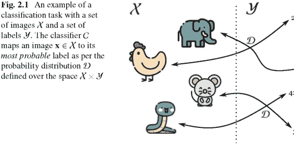
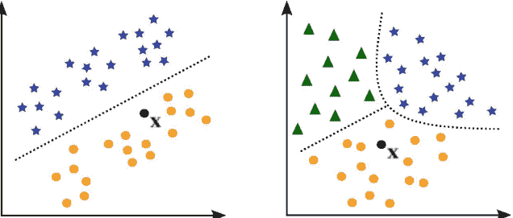
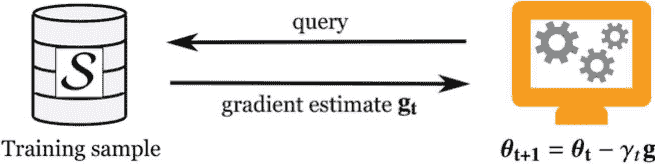
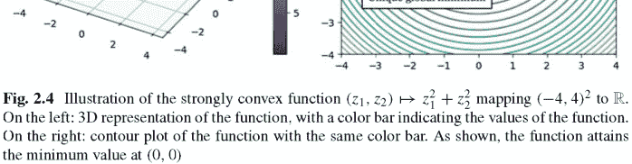
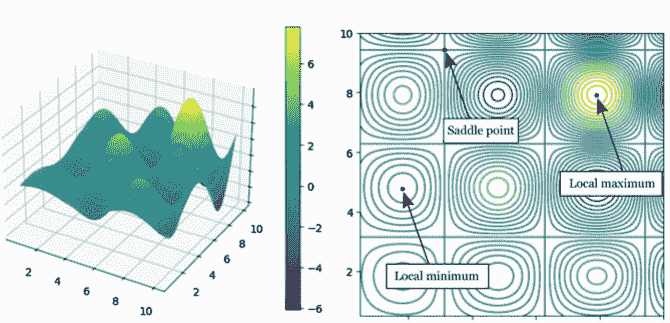
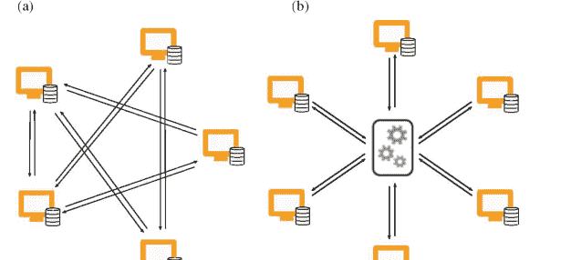
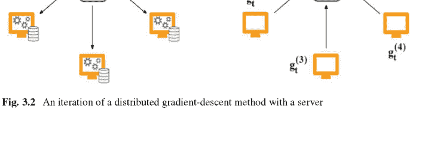
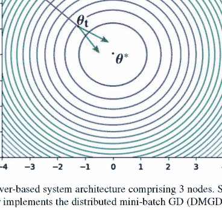
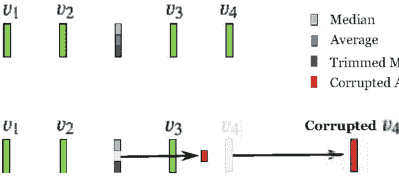

# 鲁棒机器学习. 安全 AI 的分布式方法 2024


谨以此书献给Anne  
献给Naniji（Vimal）  
献给Karin和Philippe

# 前言

在过去二十年里，所谓的人工智能（AI）系统展现了令人印象深刻的能力。它们在各种游戏中击败了世界冠军（包括国际象棋、围棋和扑克），其中有些游戏历来被视为人类智慧的终极衡量标准。这些系统在多项重要应用中也展现了非凡的成绩，如科学发现、银行业和医疗保健。近来，对话式智能体将AI推向了新的高度，直接与数百万用户互动。在某种程度上，这些新技术往往能通过著名的图灵测试，因为许多用户忘记了他们正在与机器交互。总体而言，基于AI的技术拥有令人难以置信的强大能力，许多人期望这只是“AI时代”的开端。然而，在这些成就之外，一个根本性问题浮现出来：*我们能信任AI系统吗？* 对我们来说，答案是不能，至少在当前形式下不能。

AI系统会犯错。有时这些错误只是轶事性的，如游戏场景中，但某些错误可能对医疗保健和银行业等关键应用产生重大影响。尽管媒体向公众警示所谓“强人工智能”的危险，但它们更应该突出现有AI系统的弱点，以及这些系统发生故障时可能造成的严重危害。我们提出了一套构建新一代鲁棒AI系统的方法。在讨论本书的范围和我们的鲁棒性方法的本质之前，我们先讨论AI本身的含义以及现有基于AI的技术的主要脆弱性来源。

简而言之，我们将AI理解为计算机系统解决人类曾认为只有自己才能解决的问题的能力。例如，第一个在国际象棋中击败加里·卡斯帕罗夫的系统被称为“AI”。几十年后，我们不再称该系统为AI，而是把这个词保留给能够在围棋中击败李世石的那个系统。如今，我们的注意力集中在ChatGPT等对话式智能体上，许多人将其视为AI的终极形式。本质上，每当我们对机器的“智力技能”感到惊讶时，我们就称之为AI。当这种惊讶效应消退后，我们便不再这样称呼。显然，我们称为AI的技能随时间的推移发生了改变，而且或许并不令人意外的是，支撑这些技能的计算机系统也发生了变化。然而，最近的AI系统有一个共同点：它们基于

下一代机器学习技术，这些技术理当比当前一代更加鲁棒。最后，我们希望本书也能作为一个结果集，可以通过新的理论发现加以扩展和增强，从而推动安全AI领域的发展。本手稿的内容部分基于已在主要机器学习会议上经过同行评审的研究论文。我们从事这些方法的研究已有7年多，从2016年到2023年。其灵感来源于已探索30多年的分布式计算技术。自然，我们的一些工作受到了其他团队在相关领域发表的邻近研究的影响。每章末尾都提供了对其工作的适当引用。

# 致谢

我们非常感谢EPFL分布式计算实验室的成员：研究生、博士后研究员和实验室行政人员。我们感谢EPFL实验室中过去和现在与我们共同研究本书主题的成员，即Youssef Allouah、Peva Blanchard、El Mahdi El Mhamdi、Sadegh Farhadkhani、Arsany Guirguis、Lê Nguyên Hoang、John Stephan、Geovani Rizk、Sébastien Rouault和Julien Steiner。他们为我们呈现在手稿中的许多成果做出了贡献。我们还要感谢实验室中从事其他相关领域工作的其他成员：Clement Burgel、Martina Camajoni、Abdellah El Mrini、Ahmed Jellouli、Jovan Komatovic、Anastasiia Kucherenko、Matteo Monti、Antoine Murat、Diana Petrescu、Pierre-Louis Roman、Manuel Vidigueira、Gauthier Voron和Athanasios Xygkis。他们对早期版本的手稿提供了富有洞见的评论。我们感谢同事Hagit Attiya、Francis Bach、Waheed U. Bajwa、Marco Canini、Thinh Doan、Anne-Marie Kermarrec、Andrei Kucharavy、Ji Liu和Nitin H. Vaidya在手稿初稿上提供了建设性反馈。我们也感谢Holly Cogliati-Bauereis，她的写作建议和修改显著提升了手稿的整体文笔。最后但同样重要的是，我们感谢France Faille，她专业的行政支持使我们能够不间断地专注于本手稿所呈现的研究工作，并感谢Fabien Salvi提供了关键的系统支持。

瑞士洛桑  
瑞士洛桑  
法国巴黎  
2023年11月

Rachid Guerraoui  
Nirupam Gupta  
Rafael Pinot


# 缩略语

虽然为了可读性我们尽量减少缩略语的使用，但以下缩略语在文中经常出现。

| 缩略语 | 全称 |
| --- | --- |
| AI | 人工智能 |
| CWMed | 按坐标中位数 |
| CWTM | 按坐标修剪均值 |
| DMGD | 分布式小批量梯度下降 |
| DMHB | 分布式小批量重球法 |
| DSGD | 分布式随机梯度下降 |
| ERM | 经验风险最小化 |
| GD | 梯度下降 |
| GeoMed | 几何中位数 |
| NNM | 最近邻混合 |
| SGD | 随机梯度下降 |

# 记号

我们用粗体小写字母表示向量和多维输出的函数，用普通小写字母表示标量和实值函数。根据上下文，我们用花体或大写字母表示集族：多数情况下用花体，有时用大写字母表示集合的集合中的子集或元素。有限集合 S 的基数记为 |S|。对于正整数 N，我们用 [N] 表示集合 {1, . . . , N}。实数值集合和 d 维实值向量集合分别记为 ℝ 和 ℝ^d。此外，我们用 ℝ^+ 和 ℝ_+^∗ 分别表示非负实数和严格正实数集合。对于实数 v ∈ ℝ，|v| 表示其绝对值，⌈v⌉ 表示大于或等于 v 的最小整数。对于向量 v ∈ ℝ^d，对所有 k ∈ [d]，用 [v]_k 表示其第 k 个坐标（或元素），并用 v^T 表示其转置。两个向量 v1, v2 ∈ ℝ^d 的内积记为 ⟨v1, v2⟩ := v1^T v2。向量 v ∈ ℝ^d 的欧几里得范数记为 ‖v‖ := √⟨v, v⟩。

对于（可微的）实值函数 L : ℝ^d → ℝ，其在任意点 θ ∈ ℝ^d 处的梯度记为 ∇L(θ)。必要时，我们写 ∇_θ 以明确梯度是关于自变量 θ 的。对于函数 φ : ℝ^+ → ℝ^+，我们用 O_a(·) 表示巴赫曼–兰道记号，用以描述 φ 在无穷远处的行为。具体地，如果 lim_{a→∞} φ(a)/ψ(a) < ∞，则记 φ(a) ∈ O_a(ψ(a))。我们将 O_a(·) 扩展为 O_{a1,a2}(·)，用于描述当 a1 和 a2 都趋于无穷大时的渐近行为。最后，我们用记号 O_∗(·) 和 Ω_∗(·) 描述 φ 在乘法常数意义下的行为。具体地，如果存在常数 c ∈ ℝ^+，使得对所有 a ∈ ℝ^+ 有 φ(a) ≤ c ψ(a)，则记 φ(a) ∈ O_∗(ψ(a))；如果存在常数 c，使得对所有 a ∈ ℝ^+ 有 φ(a) ≥ c ψ(a)，则记 φ(a) ∈ Ω_∗(ψ(a))。


# 第1章：背景与动机

**摘要** *人工智能*的历史与*计算机科学*的历史密切相关，尤其是与*机器学习*密不可分。在本章中，我们先回顾这一历史中的几个关键节点，然后更精确地探讨计算机*学习*从而变得*智能*的真正含义。接着，我们将指出当前机器学习方案的脆弱性，以及这种脆弱性在许多关键应用中所带来的危险后果，随后讨论让这种学习变得*鲁棒*的意义。最后，本章将回顾全书内容，并说明目标读者。

## 1.1 人工智能简史

### 1.1.1 机器能思考吗？

艾伦·图灵在1950年提出了这个问题，距离他发明通用机（即现代计算机的模型）仅过了几年。图灵通过他著名的*智能测试*定义了*思考*的确切含义。粗略地说，如果一台机器能与人类进行文本交流，而人类无法分辨所得到的回复究竟是来自机器还是另一个人，那么这台机器就通过了测试。有趣的是，图灵在当时预测，到二十世纪末，“人们将可以谈论机器思考而不必担心被反驳。”显然，图灵过于乐观了。但仅仅是时间上的判断过于乐观；他只不过早了几十年。到2023年，对话代理（聊天机器人）常常能通过图灵测试。

在图灵工作的同一时期，麦卡洛克、皮茨和维纳提出了第一个*智能*控制论系统，试图再现人类智能的运作方式。他们的目标是用电路来描述人类的感知，并基于形式化模型模拟大脑机制。他们的模型为神经网络的思想铺平了道路。与此同时，克劳德·香农提出了一种遥控鼠标，它能够*记住*路径并找到走出迷宫的方法。


1956年，约翰·麦卡锡和马文·明斯基组织了一次历史性会议：达特茅斯夏季人工智能研究项目（DSRPAI）。其目标是汇集来自不同领域的顶尖研究者，就*人工智能（AI）* 进行开放式讨论；“AI”一词正是麦卡锡在这次会议上创造的。然而，AI一词从未有过公认的定义，这次会议也没有产生任何具体成果。尽管如此，这次会议在某种程度上开启了长达数十年的各种被称为AI的研究活动。特别地，一年后，第一个神经网络——*感知机*——由弗兰克·罗森布拉特设计出来。

#### 到底什么是AI？

我们将AI定义为*机器解决人类曾认为自己唯一能够解决的问题的能力*。换句话说，当机器因完成某个特定任务而令我们惊讶时，我们就称之为AI。然而，当惊讶感消退之后，我们就不再使用这个词（至少就这一具体任务而言）。国际象棋就是一个例子。当IBM的“深蓝”击败时任世界冠军加里·卡斯帕罗夫时，我们称那台机器为AI。今天，即使是智能手机也能击败所有国际象棋世界冠军，而我们不再将国际象棋称为AI。接着是围棋，由于可能的组合数量极其庞大，可以说它比国际象棋更具挑战性。最终，又有一台机器击败了世界冠军。我们再次谈论AI，但也没有持续太久。

类似地，十年前，没有任何机器在语言或图像识别方面能与人类相媲美。而今天（2023年），机器在这两个领域都已经能与人类竞争。机器在生成图像和产生语言方面也变得强大了许多。如今，电子邮件可以自动完成，在线文本可以自动翻译，视频可以自动转录，报告可以自动生成，媒体内容也可以自动发布。此外，推荐系统决定了我们在社交媒体上看到的内容，甚至决定了我们从网店购买的商品。凭借生成图像和文本的能力，机器很可能正在创造我们所消费的媒体中的很大一部分。

尽管我们称之为AI的东西这些年一直在演变，但其实用目标始终不变：在视觉、自然语言处理、知识表示和推理等认知任务上超越人类能力。然而，那种复制大脑功能的初始理想主义目标，已在很大程度上被数据驱动的方法所取代，也就是所谓的*机器学习*。

### 1.1.2 机器学习

机器能学习的想法与计算机科学本身一样古老，可以追溯到艾伦·图灵的时代。事实上，他曾猜想，*学习*是通过他的*智能测试*的关键。简而言之，图灵解释说，机器要在其（内存中）先验地存储所有可能遇到的情况，以便完成一项具有挑战性的任务，这在物理上是不可能的。一种更合理的替代方案是让机器从经验中学习并不断适应。事实上，某种形式的学习已经是他通用机的核心，我们将在下面解释。

在1936年通用图灵机发明之前，只有专用计算器，其中的算法被硬连线到机器中。例如，帕斯卡的机器专门执行加法，而莱布尼茨的机器专门执行乘法。尽管这些机器计算各自操作的速度比任何人类都快，但它们的用途仅限于它们被硬连线执行的操作，即加法或乘法。帕斯卡的机器无法学习乘法，莱布尼茨的机器也无法学习其他操作。而人类虽然比帕斯卡和莱布尼茨的机器慢，却能先学会加法算法，再学会乘法算法（或任何其他算法），最终执行各种各样的操作。从这个意义上说，人类比机器更聪明，因为他们能够学习新算法。

通用图灵机之所以聪明，也正是因为它能够学习新算法。具体来说，图灵在他机器中硬连线了一个元算法，该算法执行作为数据提供给它的一系列算法的输入和输出。数据和算法本质上变成了同一回事。加法和乘法算法变成以表格形式表示的输入，可以由图灵机执行。当时猜想所有算法都可以建模为这种表格形式，然后由图灵机执行。迄今为止，还没有人推翻这一猜想。图灵没有亲眼看到他的通用机所带来的影响，但许多工程师继承了他开创性的工作，不断完善他的机器，直到它成为现代计算机。

#### 一个简单却强大的原理

有趣的是，图灵还预见了自动化学习的形式，这种形式超越了让人类以数据（表格）形式编写程序，然后由机器消化（学习）并执行的模式。1947年，图灵在一次公开演讲中明确呼吁“一种能从经验中学习的机器”，并提出了“让机器修改自身指令的可能性”。在一份题为《智能机器》的报告（他未曾发表）中，图灵引入了许多今天被我们称为AI的核心概念。他的许多想法后来被其他人重新发明，比如训练一个由人工神经元组成的网络来执行特定任务的想法。本质上，图灵预测学习过程将不需要人类参与。具体来说，数据（表示一种算法）不会由人类以表格（即可执行程序）的形式提供给图灵机，而是通过一个学习程序由机器吸收。

学习程序的概念是现代机器学习背后的驱动原理。本质上，机器学习方案假设一个通用模型来解决目标任务，该模型通常基于数学函数，并从可用数据中推断出模式，以对先前未见过的数据做出预测。初始模型被称为“通用”是因其具有未指定的参数，例如函数 $a_1x + a_2$，其中参数 $a_1$ 和 $a_2$ 先验上是未指定的。推断模式的过程通常被称为训练，是一种程序。


这包括计算模型*参数*，以优化预定义的*损失函数*，即，在将预测应用于手头数据时，使错误数量最小化。模型训练通常通过优化算法实现，例如一种*梯度下降法*，它在所有可能的参数值中高效搜索。在自然语言处理中，机器学习模型通过在多个句子和词语组合上训练，解析以前从未见过的句子或词语组合，以预测一组新的词语或句子。在图像识别中，机器学习模型通过在有和没有目标物体的多张图像上训练，来识别汽车或狗等物体。模型可以被视为*假设*，而参数则是*针对特定任务对假设的调整*。

### 1.1.3 机器学习的应用

图灵曾推测，计算机终有一天会下国际象棋。他设计了一个能够与人对弈完整棋局的程序。该程序为每个棋局状态赋值，并选择分值最高的走法。然而，这个程序过于复杂，图灵时代的早期计算机无法运行。1952年，图灵手动执行这个程序，与他的同事对弈了一局。仅仅50多年后的1997年，由卡内基梅隆大学设计、IBM制造的象棋计算机“深蓝”击败了当时的世界冠军加里·卡斯帕罗夫。深蓝的256个并行处理器使其每秒能检查2亿种可能走法，并能提前推演多达14步棋。

#### 学习游戏

14年后的2011年，另一台IBM计算机“沃森”以比深蓝快100倍的速度，击败了这档电视问答节目史上最伟大的两位冠军，赢得了“危险边缘”比赛。沃森拥有2800个微处理器，每秒可执行高达80万亿次运算。100多个并行算法分析了向沃森提出的每个问题，找出不同的合理答案，而另一组算法则对这些答案进行排序。机器竟能在“危险边缘”中获胜，这一事实引起了广泛关注。在许多观察者看来，国际象棋被认为是*人类智能*的标志性代表，而“危险边缘”则被认为是*人之为人*的标志性代表。除了深蓝和沃森在架构上的差异，它们的底层程序之间也存在重要差异，这体现了*机器学习*概念的演变。一方面，国际象棋算法的工程师依赖所谓的*符号人工智能*：一套由国际象棋冠军设计、由一个名为*专家系统*的特定程序执行的规则。另一方面，“危险边缘”算法的工程师则依赖大量代表自然语言模式的*非结构化数据*（相当于一百万本书）。

又过了四年，到2015年，由DeepMind Technologies开发的另一台机器AlphaGo击败了棋盘游戏围棋中最强的棋手。与国际象棋的比较值得注意。国际象棋的合法局面数约为10^40，而围棋则超过10^170，远超可观测宇宙中的原子数10^80。事实上，如果宇宙中每一颗已知原子本身都是一个包含10^80个原子的宇宙，那么原子总数仍将不及围棋的合法局面数。如前所述，深蓝遵循人类编写的规则，为不同走法的可能结果赋予价值，并根据这些结果能为机器带来的优势进行排序。围棋过于复杂，无法枚举所有可能性，因此需要一种完全不同的方法。AlphaGo通过大量依赖强化学习策略来推导规则，该策略应用于数百万局机器基本上与自己对弈的棋局。与深蓝或沃森不同，AlphaGo靠自己不断进步。这使得它的一些棋步很难解释，令围棋专家们感到惊讶，但最终证明这种方法非常成功。

几年后，也就是2019年，扑克和桥牌也落入了机器学习的手中。这同样令人意外。微软创始人比尔·盖茨是一位热心的牌手，他曾认为桥牌能在这场趋势中受到很好的保护。与国际象棋和围棋不同，桥牌中的大多数信息（尤其是牌）并不公开摆在桌面上，而是隐藏起来的。法国公司NukkAI通过结合两种截然不同学习路径的神经符号方法，击败了最优秀的桥牌选手。第一条路径基本采用随机选择，遵循AlphaGo的策略；第二条路径则像沃森一样使用规则。一种涉及随机选择和搜索的类似组合，使Facebook和卡内基梅隆大学开发的机器人Pluribus在拉斯维加斯击败了多位扑克冠军。这个机器人不仅学会了虚张声势，还能识破虚张声势。令人惊讶的是，Pluribus学会了与说谎者打交道，也学会了亲自撒谎——而在此之前，这被认为是人类独有的技能。

#### 日常生活中的应用

前面提到的智力挑战任务，即国际象棋、“危险边缘”、围棋、桥牌和扑克，使人们能够试验机器学习技术并展示其威力。但那些仅仅是“游戏”，人们还考虑了其他更关键的挑战。事实上，机器学习技术已经在多个领域取得了成功，例如交通预测（如Google地图）、文本分析（如垃圾邮件过滤器）、银行/金融（如信贷决策）、社交网络（如图片识别和内容推荐）以及个人助理（如Siri和ChatGPT）。此外，机器学习预计将成为医疗保健领域重大进步的动力，例如通过计算机视觉识别和诊断皮肤癌等初期难以检测的疾病。利用预测分析进行个性化疾病预防和治疗也是一项重要的潜在应用。同样，从卫星、实时社交媒体更新、网站信息等收集的大量数据，可以被复杂的机器学习系统用来预测世界各地的流行病。

最后但同样重要的是，许多人期望机器学习方案成为一种有原则的方法，用于预测自然灾害，并寻找应对全球变暖的务实途径。几乎每个科学与工程领域都能从机器学习方案中受益，而这项技术目前在我们日常生活中被采用的速度，也反映了人们对其潜力的广泛信心。

## 1.2 鲁棒机器学习

### 1.2.1 机器学习的脆弱性

机器学习方案的质量与其训练质量成正比。现代机器学习方案使用大量的（a）数据和（b）计算资源。例如，ChatGPT-3.5是最受欢迎的语言处理*深度学习*方案之一。2022年初，ChatGPT-3.5使用*10,000个Nvidia图形处理单元（GPU）*训练了一个神经网络，该网络在包含网页、书籍和其他来源的大规模文本数据语料库（约*570GB数据*）上训练，参数量约为*1750亿*。自那时起，训练数据量和模型规模一直在不断增长。训练如此前所未有的规模，得益于*分布式计算*，它需要多台机器的协同努力。计算被分布在同一数据中心的多台机器上，有时也分布在通过复杂通信协议连接的远程机器上。模型还可以在分散的边缘设备网络上训练，这些设备在其本地数据上执行局部更新。为了获得*全局模型更新*，每台机器执行*独立模型更新*，并通过中央服务器定期取平均。虽然训练过程的分布使得开发复杂模型变得可行，并有望获得高精度，但也使这些现代机器学习方案变得*脆弱*。事实上，由于数据源来自多个来源，通常是网络上的，它们很容易被污染。例如，不诚实的参与者可以注入能被数据收集机器人采集的污染数据，也可以将污染数据发送给聚合器，例如聊天机器人、垃圾邮件过滤器或用户资料数据库。无论模型架构多么复杂，质量差的信息都会产生次优结果。历史表明，要做到这一点并不难。事实上，脆弱性不仅来自不良数据，也可能来自发生故障的机器。当涉及大量机器进行模型训练时，其中一些机器出现软件错误或硬件故障的概率也非常高。它们的地理分布可能使其中一些成为特定攻击的目标。

许多如今已成为经典的机器学习方案都依赖*信息平均*，即来自不同数据源和机器的信息取平均。在这种情况下，只要一个来源是坏的，就足以破坏整个学习过程。不诚实的参与者可以轻易完全控制其设备所见到的训练数据，此外还能控制发送给中央服务器的局部模型更新。即使整个训练在单台机器上完成，不诚实的参与者也可以渗透训练数据库，通过


通过入侵数据源插入错误或误导性信息。如果模型在损坏的数据上进行训练，就会得出意料之外甚至有害的结论。已有几个机器学习系统造成危险错误的实例。2019年，作为ImageNet Roulette项目的一部分，一个深度网络使用ImageNet数据集中的“person”类别进行训练，以将人脸分类到不同类别，该模型很快便开始使用种族和性别侮辱词汇来标注人物。2018年，IBM的Watson向癌症患者提出了危险的疗法。2017年，在香港，总部位于英国的Tyndaris Investments公司造成了每天2000万美元的损失。简而言之，确保机器学习系统的稳健性对于保护我们自身的生命至关重要。¹

在确保机器学习方案与经典计算机系统的稳健性方面，有一个根本性差异值得强调。当传统计算机系统用于关键应用时，会通过防火墙、密码、数据加密和其他访问控制措施与外界隔离。但机器学习系统对数据十分渴求，其成功恰恰在于它们的开放性：它们需要从各种数据源采集信息，有时甚至包括网络上的匿名和未经核实的来源。此外，现代机器学习方案需要大量计算设备来执行独立计算，这增加了其中部分设备发生故障的概率。

### 1.2.2 对稳健机器学习的探索

在计算机科学中，稳健性通常指一个依赖软件的系统在面临内部和外部故障（例如错误的输入）时，仍能长时间持续工作，并始终符合其规格说明的能力。尽管可以考虑机器学习背景下不同形式的稳健性，但本书关注的是模型训练这一具体方面。具体来说，我们所说的机器学习系统的稳健性是指——尽管数据不良、机器发生故障——仍能训练出准确模型的能力。我们重点关注训练机器学习模型所包含的优化过程。我们提出一系列方法，使这一优化过程在数据源和计算设备并不可靠的情况下依然可靠。

这里，一个恰当的问题随之而来：如果我们既无法信任数据，也无法信任机器，又如何构建稳健的机器学习方案？显然，如果全部数据都是坏的，且所有机器都已损坏，那么任何学习都无法实现。我们假设有一部分数据是好的，有一部分机器能正常运行。但与经典机器学习中的大多数工作不同，我们考虑的场景是：一部分数据可能是坏的，一部分机器可能发生故障。我们考虑一个涵盖许多现代机器学习方案的通用框架：所谓的*基于服务器的*架构。本质上，由一台机器（即服务器）负责维护模型。服务器利用其他被称为节点的机器提供的信息来更新模型参数。这些节点机器托管数据。为了提供新的信息以改进模型，服务器会周期性地将模型的当前参数广播给所有节点，以便每个节点能在其数据上测试模型。这种方法有时被称为（基于服务器的）*联邦学习*。在本书中，我们介绍了一些技术，确保即使某些节点不能正常运行，服务器运行的优化过程也能成功完成。

¹ 这些异常并非源于恶意，而是训练不当所致。然而，它们恰恰说明了当我们将机器学习模型草率地应用于现实生活时，一个错误可能有多么危险。

#### 如何判断训练是否成功？

另一个根本性问题随之而来：*如果某些节点已损坏，例如其数据不正确，那么什么样的训练过程才算成功？* 直观地说，一个准确的模型是仅基于那些正确的机器生成的模型。因此，如果一种稳健的训练方法能够忽略不正确的机器和数据，就可以认为它是成功的。当然，如果我们事先知道哪些机器不正确，这项任务就很容易了——服务器只需忽略它们提供的信息即可。挑战在于，在实践中，所有机器一开始都正常运行，直到某个未知时刻之后，某些机器开始偏离其正确行为。此外，这种偏离可能不易察觉，因为服务器无法将节点提供的信息中由异构数据导致的差异，与由节点行为异常导致的差异区分开来。

上述讨论将我们引向下一个问题：*机器发生故障到底意味着什么？* 为了实现真正的稳健性，我们认为故障这一概念可以非常宽泛。简而言之，我们假设部分机器（节点）可以向服务器返回任意糟糕的信息。用分布式计算的术语来说，这些机器可被称为*拜占庭式*节点。这种对某些节点异常行为的建模方式具有通用性，因为它涵盖了许多情况：节点层面的数据损坏、软件或硬件缺陷，甚至机器被恶意方入侵的情况。事实上，我们可以很方便地将稳健机器学习技术的设计看作与一个对手的*博弈*，该对手控制着部分机器及其数据。被对手控制的机器被称为*对抗*节点。这个对手可以自由选择最佳策略，而稳健的机器学习方案应当努力做到无论对手采用何种策略，都能获得准确的模型。

**注 1.1**　尽管我们所采用的术语和通用对抗（即拜占庭）抽象受到了经典分布式计算的启发，但两者的场景有所不同。在经典分布式计算中，通常通过在多台机器上*复制其状态*来确保应用的稳健性。随后，服务的客户端使用某种*基于共识的*通信原语，以相同的顺序更新正确副本上的应用状态，并返回一个

（子采样）在处理对抗节点时的训练误差。最后，我们证明了在节点端的局部计算中使用*Polyak动量*可以减弱梯度噪声对训练误差的影响，从而使稳健机器学习方案更具实用性。我们强调稳健机器学习的三个基本要素之间的相互作用：*崩溃点*、*训练误差*和*梯度复杂度*。需要注意的是，除了讨论稳健性之外，本书还对梯度下降算法的收敛性进行了教学性的分析，这些算法可以说是机器学习的骨干，涵盖了（强）凸和非凸两种情形。除了标准的收敛技术，在本书的后半部分，我们还介绍了用于研究收敛性的Lyapunov分析技术。书中给出的所有证明都是自包含的，并为全书讨论的结果提供了完整的推理。

**注 1.2**　本书不讨论*隐私*问题：即服务器如何在确保每个节点持有的数据保持私密的同时学习到准确模型。我们也不讨论与训练阶段优化过程无关的稳健性概念，例如*逃避攻击*（又称对*对抗样本*的稳健性）或对分布偏移的稳健性。这些问题虽然在研究AI系统安全性方面十分重要，但（一般来说）与我们所考虑的问题是相互独立的。

### 1.3.2 组织结构

在第2章中，我们回顾机器学习的基础知识。我们着重提出清晰的问题表述。我们介绍理解训练阶段稳健性问题所需的基本优化工具。特别是，我们回顾相关概念，如监督机器学习、经验风险最小化、代理损失函数（随机/小批量）、梯度下降方法和梯度复杂度。

在第3章中，我们解释我们的（基于服务器的）机器学习框架，并介绍几种分布式梯度下降方法。具体来说，我们通过详细分析非凸以及强凸训练损失函数的情形，解释分布式（随机）梯度下降的基本原理。我们在两种情形下推导梯度复杂度，并介绍为后续章节奠定基础的数学工具。

第4章是对我们在机器学习中稳健性概念的入门介绍。我们首先强调当前机器学习方案的脆弱性，然后介绍稳健聚合的核心概念。在本章中，我们通过*崩溃点*、*训练误差*和*梯度复杂度*这几个互补的概念，引入了稳健性的精确度量。随后，这些概念通过分布式小批量梯度下降的一种稳健变体加以说明，该变体将服务器端的线性聚合（即平均）替换为非线性稳健聚合规则。为便于

为了演示和教学目的，我们在本章中做一些简化。因此，所提出的算法可能被认为是不切实际的。我们将在后续章节中重新审视这些简化。

在第5章中，我们专注于在存在对抗性机器的情况下最小化训练误差。我们首先讨论了由于*梯度不相似性*而导致的鲁棒性的潜在局限，这是节点所持数据中*异质性*的一种产物。然后我们表明，许多鲁棒聚合规则，虽然能提供最优的崩溃点，但在梯度不相似性下会产生次优的训练误差。我们提出了*预聚合*技术，以规避这一缺点并实现最优性。

在第6章中，我们关注鲁棒机器学习中的梯度复杂度。尽管鲁棒聚合规则与预聚合的组合能产生阶最优的训练误差，但由此产生的梯度复杂度可能比传统（非鲁棒）机器学习算法高出几个数量级。这可能会极大地阻碍这些鲁棒方案的使用。我们强调了*局部梯度动量*在调节梯度复杂度中的重要作用，从而使鲁棒机器学习更加实用。

## 1.4 章节注释

在本章中，我们简要回顾了机器学习的演变：从人工智能的思想[16, 25, 26]到构建能够玩认知游戏的机器[2, 9, 12, 24]，再到在医疗保健中利用机器[6, 10]。现代机器学习系统，如ChatGPT [3]，其能力来源于在海量数据上训练的大规模复杂模型。这些自动化系统正深刻地塑造着现代社会的进程，应用范围从医疗保健到军事[7, 11, 15, 18, 20, 22]。不可否认，机器学习正在迅速改变信息技术领域，几乎触及我们生活的方方面面[14]。尽管这些变化总体上能显著提高生活质量，甚至可能帮助我们找到应对气候变化等新兴全球问题的方法[21]，但使用它们时必须非常谨慎。

我们已经强调，经典的机器学习算法，尤其是那些为开发大规模模型而提出的算法，对现实世界场景中普遍存在的挑战不具备鲁棒性，特别是*数据污染*这一因素。研究表明，当训练数据被掺假或某些机器在训练过程中发生故障时，机器学习方案的有效性可能会受到严重损害[1, 4, 5, 8, 13, 23, 27]。在面向公众的应用中使用此类*训练不佳*的模型可能会产生严重后果[17, 19]。保护机器学习系统免受数据污染和机器故障的影响，从而为*安全人工智能*铺平道路，是我们开发本书所介绍的*鲁棒机器学习*方法的主要动机。

# 参考文献

- 1. Baruch M, Baruch G, Goldberg Y (2019) 一点点就够了：规避分布式学习中的防御。见：神经信息处理系统进展32：2019年神经信息处理系统年度会议，2019年12月8日至14日，美国加利福尼亚州长滩
- 2. Brown N, Sandholm T (2019) 多人扑克的超人人工智能。科学 365(6456):885–890
- 3. Brown T, Mann B, Ryder N, Subbiah M, Kaplan JD, Dhariwal P, Neelakantan A, Shyam P, Sastry G, Askell A 等 (2020) 语言模型是少样本学习者。见：神经信息处理系统进展，第33卷，第1877–1901页
- 4. Cao X, Jia J, Zhang Z, Gong NZ (2022) FedRecover：利用历史信息从联邦学习中的投毒攻击中恢复。见：2023年IEEE安全与隐私研讨会（SP）。IEEE计算机学会，第326–343页
- 5. Carlini N, Terzis A (2022) 对比学习的投毒与后门攻击。见：国际学习表征会议
- 6. Cuocolo R, Caruso M, Perillo T, Ugga L, Petretta M (2020) 肿瘤学中的机器学习：临床评估。癌症快报 481:55–62
- 7. Donepudi PK (2017) 银行业中的人工智能与机器学习：系统性文献综述。亚洲应用科学与工程杂志 6(3):157–162
- 8. Fang M, Cao X, Jia J, Gong N (2020) 针对拜占庭鲁棒联邦学习的局部模型投毒攻击。见：第29届USENIX安全研讨会（USENIX Security 20），第1605–1622页
- 9. Ferrucci D, Brown E, Chu-Carroll J, Fan J, Gondek D, Kalyanpur AA, Lally A, Murdock JW, Nyberg E, Prager J 等 (2010) 构建沃森：DeepQA项目概述。人工智能杂志 31(3):59–79
- 10. Ferrucci D, Levas A, Bagchi S, Gondek D, Mueller ET (2013) 沃森：超越危险边缘！人工智能 199:93–105
- 11. Hojtink M, Planqué-van Hardeveld A (2022) 机器学习与军事的平台化：对谷歌机器学习平台TensorFlow的研究。国际政治社会学 16(2):olab036
- 12. Hsu F.-H. (2002) 深蓝背后：构建击败国际象棋世界冠军的计算机。普林斯顿大学出版社，普林斯顿
- 13. Kairouz P, McMahan HB, Avent B, Bellet A, Bennis M, Bhagoji AN, Bonawitz K, Charles Z, Cormode G, Cummings R 等 (2021) 联邦学习的进展与开放问题。机器学习基础与趋势® 14(1–2):1–210
- 14. Kaplan A, Haenlein M (2019) Siri，Siri，在我手中：谁是这世上最美丽的？论人工智能的诠释、例证与启示。商业地平线 62(1):15–25
- 15. Leo M, Sharma S, Maddulety K (2019) 银行风险管理中的机器学习：文献综述。风险 7(1):29
- 16. McCulloch WS, Pitts W (1943) 神经活动中固有思想的逻辑演算。数学生物物理学通报 5(4):115–133
- 17. Nakagawa K, Moukheiber L, Celi L, Patel M, Mahmood F, Gondim D, Hogarth M, Levenson R (2023) 病理学中的人工智能：可能出什么问题？见：诊断病理学研讨会。爱思唯尔，阿姆斯特丹
- 18. Namiot D, Ilyushin E, Chizhov I (2021) 机器学习的军事应用。国际开放信息技术杂志 10(1):69–76
- 19. Neri E, Coppola F, Miele V, Bibbolino C, Grassi R (2020) 人工智能：谁对诊断负责？放射学医学 125:517–521
- 20. Pati S, Baid U, Edwards B, Sheller M, Wang S.-H., Reina GA, Foley P, Gruzdev A, Karkada D, Davatzikos C 等 (2022) 联邦学习使罕见癌症边界检测的大数据成为可能。自然通讯 13(1):7346
- 21. Rolnick D, Donti PL, Kaack LH, Kochanski K, Lacoste A, Sankaran K, Ross AS, Milojevic-Dupont N, Jaques N, Waldman-Brown A 等 (2022) 用机器学习应对气候变化。ACM计算调查 55(2):1–96
- 22. Shailaja K, Seetharamulu B, Jabbar M (2018) 医疗保健中的机器学习：综述。见:2018年第二届电子、通信与航空航天技术国际会议（ICECA）。IEEE，第910–914页
- 23. Shejwalkar V, Houmansadr A (2021) 操纵拜占庭：优化联邦学习的模型投毒攻击与防御。见：NDSS
- 24. Silver D, Huang A, Maddison CJ, Guez A, Sifre L, Van Den Driessche G, Schrittwieser J, Antonoglou I, Panneershelvam V, Lanctot M 等 (2016) 通过深度神经网络和树搜索掌握围棋。自然 529(7587):484–489
- 25. Turing A (1950) 计算机器与智能。心灵 59(236):433–460
- 26. Wiener N (1948) 控制论，或动物与机器中的控制和通信。威利，霍博肯
- 27. Xie C, Koyejo O, Gupta I (2019) 帝国的衰落：通过内积操纵打破拜占庭容错SGD。见：第35届人工智能不确定性会议论文集，UAI 2019，以色列特拉维夫，2019年7月22日至25日，第83页

# 第2章
机器学习基础

摘要 机器学习旨在设计利用数据（有时称为观测）来获取领域知识并执行自动化决策任务的算法。与大多数传统计算任务相反，学习算法是数据依赖的，这意味着它们会构建特定于任务的模型，并使用馈送给它们的数据来改进这些模型。机器学习算法主要分为四类：监督学习、无监督学习、半监督学习和强化学习。每一类都有其自身的兴趣和特点。在本书中，我们专注于监督分类，以阐述和形式化鲁棒机器学习的主要概念。然而，我们在书中讨论的大多数鲁棒性技术也可以应用于其他机器学习类别。在本章中，我们通过监督分类任务的细节介绍监督学习的基础，并回顾一些用于解决此任务的标准优化算法。

## 2.1 监督分类

在监督学习中，数据（或观测）由输入-输出对组成，算法使用这些对来构建一个函数，也称为预测器，通过识别观测中的模式将输入映射到输出。然后，该预测器可用于为未见过的输入提供标签。例如，如图2.1所示，预测器可以将图片作为输入，并告诉我们该图像代表大象、鸡、老鼠还是蛇。¹当输出是分类时，监督学习问题也称为监督分类。我们在下面形式化这一概念，并快速介绍选择良好预测器背后的驱动原则。

¹ 我们在此图中使用的动物图标由Freepick团队提供。每个图标的链接如下：大象、鸡、老鼠和蛇。




### 2.1.1 问题陈述

考虑一个输入空间 $\mathcal{X}$ 和一个离散的（有限大小的）输出空间 $\mathcal{Y}$，它表示 $\mathcal{X}$ 中元素的可能标签集合。这些空间被假设与一个定义在 $\mathcal{X} \times \mathcal{Y}$ 上的概率分布 $\mathcal{D}$ 相关联。这意味着输入-输出对 $(x, y) \in \mathcal{X} \times \mathcal{Y}$ 可以根据分布 $\mathcal{D}$ 抽取。一个监督分类问题在于寻找一个函数 $C : \mathcal{X} \to \mathcal{Y}$，称为 *分类器*，尽可能准确地重现 $\mathcal{D}$。具体而言，监督学习算法的目标是产生一个分类器 $C : \mathcal{X} \to \mathcal{Y}$，它将每个输入 $x \in \mathcal{X}$ 映射到根据分布 $\mathcal{D}$ 的 *最可能* 输出 $y \in \mathcal{Y}$。图 2.1 在图像的背景下举例说明了此类分类问题。

为了衡量分类器 $C$ 的质量，我们使用 *误分类错误* 的概念，定义为 $C$ 对随机对 $(x, y) \sim \mathcal{D}$ 未能预测正确输出的概率。具体而言，$C$ 的误分类错误由下式给出

$$\mathbb{P}_{(x,y)\sim\mathcal{D}}[C(x) \ne y] = \mathbb{E}_{(x,y)\sim\mathcal{D}}[\mathbf{1}\{C(x) \ne y\}], \tag{2.1}$$

其中 $\mathbf{1}\{\cdot\}$ 是指示函数。考虑图 2.1 中的例子。在此例中，假设分类器 $C$ 将所有大象的图像标记为鸡，但其余图像标记正确。然后，假设图像是从四个可能的图像中均匀随机抽取的，$C$ 的误分类错误等于 0.25。也就是说，在这种情况下 $C$ 正确分类图像的无条件概率为 0.75。

误分类的后果根据我们考虑的应用而有不同的解释。一方面，正确概率为 95% 的预测器，即误分类错误为 5%，可以被认为足以准确地对动物图像进行分类。另一方面，同样的误分类错误在医学应用的背景下可能被认为极不安全，例如从 X 射线成像中识别肿瘤，其中即使一次误分类也可能产生严重后果。

#### Bayes 最优分类器

给定一个概率分布 $\mathcal{D}$，我们可以很容易地证明 $\mathcal{X} \times \mathcal{Y}$ 上的最优预测函数为

$$C^{\text{opt}} : \mathbf{x} \mapsto \arg\max_{y \in \mathcal{Y}} \mathbb{P}_{(\mathbf{x},y)\sim\mathcal{D}}[y \mid \mathbf{x}] . \quad (2.2)$$

该函数称为 *Bayes 最优分类器*。它在以下意义上是最优的：没有其他分类器 $C : \mathcal{X} \to \mathcal{Y}$ 在 $\mathcal{D}$ 上具有更小的误分类错误。虽然理论上可以找到最优分类器，但机器学习算法更现实的目标是找到一个 *近似最优分类器*，其误分类错误尽可能接近 $C^{\text{opt}}$。

近似 Bayes 最优分类器的典型策略如下。首先，我们为标签集 $\mathcal{Y}$ 分配任意索引，即固定一个任意双射 $\Lambda : \mathcal{Y} \to \{1,\dots,|\mathcal{Y}|\}$。这使得每个 $y \in \mathcal{Y}$ 都有一个唯一的索引 $\Lambda(y) \in \{1,\dots,|\mathcal{Y}|\}$。然后，我们定义一组函数 $\mathcal{H} \subset \{h : \mathcal{X} \to \mathbb{R}^{|\mathcal{Y}|}\}$，其中对于每个 $h \in \mathcal{H}$ 和 $\mathbf{x}$，$h(\mathbf{x})$ 旨在近似概率测度 $\mathbb{P}_{(\mathbf{x},y)\sim\mathcal{D}}[y \mid \mathbf{x}]$。该集合也称为 *假设类*。在此背景下，机器学习算法的目的是找到最符合条件概率的假设 $h^* \in \mathcal{H}$。然后，类比于 (2.2)，最终分类器定义为

$$C : \mathbf{x} \mapsto \Lambda^{-1}(z), \quad \text{where} \quad z \in \arg\max_{k \in \{1,\dots,|\mathcal{Y}|\}} [h^*(\mathbf{x})]_k \quad (2.3)$$

并且 $[h^*(\mathbf{x})]_k$ 是向量 $h^*(\mathbf{x})$ 的第 $k$ 个元素。

如果假设类 $\mathcal{H}$ 足够 well-defined，则上面定义的分类器 $C$ 将具有接近 Bayes 最优分类器的误分类错误。我们在此故意避免解释我们所说的 "well-defined" 的含义，因为我们的主要关注点是如何在给定集合 $\mathcal{H}$ 上进行优化，即如何找到 $h^*$。然而，一般来说选择合适的假设类 $\mathcal{H}$ 并非易事。更多细节请参见 Remark 2.1。

#### 经验风险最小化

然而，实际上我们事先并不知道真实分布 $\mathcal{D}$。我们只有访问一个训练集 $\mathcal{S}$，它包含有限数量，假设为 $m$ 个输入-输出对。具体来说，$\mathcal{S} := \{(\mathbf{x}_1, y_1), \dots, (\mathbf{x}_m, y_m)\}$，其中对于所有 $i \in [m]$，$(\mathbf{x}_i, y_i) \in \mathcal{X} \times \mathcal{Y}$。在监督学习设置中，假设这些输入-输出对是根据分布 $\mathcal{D}$ 独立同分布抽取的。然后，给定假设类 $\mathcal{H}$，学习算法产生一个假设 $h^* \in \mathcal{H}$，使其在 $\mathcal{S}$ 上测量的 *经验风险* 最小化。该问题，又称 *经验风险最小化* (ERM)，归结为寻找 $h^*$ 的以下优化问题解：

$$\min_{h \in \mathcal{H}} \frac{1}{m} \sum_{i=1}^m \ell \left( h(\mathbf{x}_i), y_i \right),$$

其中 $\ell : \mathbb{R}^{|\mathcal{Y}|} \times \mathcal{Y} \rightarrow \mathbb{R}$ 是一个 *逐点损失函数*。损失函数 $\ell$ 衡量假设 $h$ 在预测输入 $\mathbf{x}$ 的输出 $y$ 方面的表现如何。$\ell(h(\mathbf{x}), y)$ 的值越小，$h$ 在样本 $(\mathbf{x}, y)$ 上的表现越好。如果该损失函数选择得足够好，则在 $\mathcal{S}$ 上的该损失的平均值是对假设 $h$ 在真实分布 $\mathcal{D}$ 上所产生的 *期望损失* 的估计。以下章节介绍假设类和逐点损失函数的一些常见选择。

**Remark 2.1** 我们故意忽略 ERM 与 $h^*$ 在从 $\mathcal{D}$ 抽取的未见样本上的性能之间的联系。这种联系（又称泛化）是监督学习的核心，并且与假设类 $\mathcal{H}$ 的选择密切相关。然而，这一概念与本书所介绍的主题正交，本书侧重于机器学习算法的优化部分。关于为什么求解 ERM（或 ERM 的正则化版本）对于找到具有良好泛化能力的假设至关重要，有更多讨论，我们请感兴趣的读者参考 Sect. 2.3 及相关参考文献。

### 2.1.2 假设类和损失函数

原则上，我们可以将假设类 $\mathcal{H}$ 选择为从 $\mathcal{X}$ 到 $\mathbb{R}^{|\mathcal{Y}|}$ 的任意函数集合。然而，在一般函数空间上进行优化是困难的。此外，控制此类集合的大小也颇具挑战性。为克服这一困境，在机器学习中我们通常使用 *参数化假设*。这在很大程度上简化了 ERM 问题，同时假设类的大小可以通过控制 *参数空间* 的大小来调整。下面我们介绍分类问题的两个特例，其中我们介绍可能的假设类和相关的损失函数。

**一个重要特例：线性模型的二分类**

从理论角度研究分类时，考虑 $|\mathcal{Y}| = 2$ 的 *二分类* 设置通常更容易。在此背景下，考虑与上述略有不同的设置是标准的。具体来说，输出空间 $\mathcal{Y}$ 映射到 $\{-1, 1\}$，即我们选择 $\Lambda$ 使得对所有 $y \in \mathcal{Y}$，$\Lambda(y) \in \{-1, 1\}$，而不是 $\{1, 2\}$。此外，假设空间仅考虑实值函数 $h : \mathcal{X} \rightarrow \mathbb{R}$，且分类器由 $C(\mathbf{x}) := \Lambda^{-1} \left( \text{sign} \left( h(\mathbf{x}) \right) \right)$ 给出，其中对于任意实值 $r$，$\text{sign}(r) = 1$ 当 $r \geq 0$ 时，否则为 $-1$。所有其他概念（如 ERM 的定义）都可以很容易地适应这一略有修改的设置。

二分类的最简单假设类是 *线性模型* 类。考虑一个监督学习设置，其中 $\mathcal{X} \subset \mathbb{R}^d$ 且对所有 $y \in \mathcal{Y}$，$\Lambda(y) \in \{-1, 1\}$。然后，具有 *参数空间* $\Theta \subseteq \mathbb{R}^d$ 的线性模型类为


## 2.1 监督分类

由

$$\mathcal{H} := \{\mathbf{x} \mapsto h_{\theta}(\mathbf{x}) := \theta^\top \mathbf{x} \mid \theta \in \Theta\}, \tag{2.4}$$

其中 $(\cdot)^\top$ 表示转置运算。在 (2.4) 中，$\theta$ 是假设的*参数*，集合 $\Theta$ 是假设类的*参数空间*。虽然这种线性假设类通常用于简单的分类任务，但有时它有助于建立对当前分类任务难度的直觉，例如通过设计下界。我们在图 2.2（左）中展示了一个分类问题的线性模型，其中 $\mathcal{X} = \mathbb{R}^2$，$\mathcal{Y} = \{-1, 1\}$。

损失函数 $\ell$ 在寻找好的模型参数中起着核心作用。与我们在 2.1.1 节中提出的误分类错误概念相匹配的一个明显损失函数选择是由 $\ell(h_\theta(\mathbf{x}), y) := \mathbb{1}\{\operatorname{sign}(h_\theta(\mathbf{x})) \ne \Lambda(y)\}$ 给出的 0/1 损失函数。然而，指示函数的不可微性（以及非凸性）使得由此产生的 ERM 问题从优化的角度看难以求解。因此，为了提高 ERM 问题的可解性，我们改用可微的*代理损失函数*。例如，在二分类问题中，我们可以使用平方损失

$$\ell_{\mathrm{squared}}(h_\theta(\mathbf{x}), y) := (h_\theta(\mathbf{x})\Lambda(y) - 1)^2, \quad \forall(\mathbf{x}, y) \in \mathcal{X} \times \mathcal{Y}. \tag{2.5}$$



**图 2.2** 左侧：基于 $\mathcal{X} \times \mathcal{Y} := \mathbb{R}^2 \times \{-1, 1\}$ 中数据点的训练集 $S$ 构建的线性模型示例。输出为 1 的输入用蓝色星形表示，其他情况用橙色圆盘表示。虚线表示属于 (2.4) 中定义的类、并且在损失就是 0/1 损失函数时最小化 $S$ 上经验风险的线性分类器。对于任何新的输入 $\mathbf{x} \in \mathcal{X}$，该模型可用于预测 $\mathbf{x}$ 的输出。这很简单：如果 $\mathbf{x}$ 在虚线上方，则预测为 1，否则预测为 −1。在所示的示例中，$\mathbf{x}$ 被赋予标签 −1。右侧：基于 $\mathcal{X} \times \mathcal{Y} := \mathbb{R}^2 \times \{1, 2, 3\}$ 中数据点的训练集 $S$ 构建的非线性模型示例。与线性分类器类似，虚线表示最小化 $S$ 上经验风险的假设，但该假设不属于线性类。

由于对所有 $\mathbf{y} \in \mathcal{Y}$ 都有 $\Lambda(\mathbf{y})^2 = 1$，上式的右边可以改写为 $(h_{\boldsymbol{\theta}}(\mathbf{x}) - \Lambda(\mathbf{y}))^2$。在线性模型的特例中，即 $h_{\boldsymbol{\theta}}(\mathbf{x}) := \boldsymbol{\theta}^T\mathbf{x}$，平方损失简化为 $(\boldsymbol{\theta}^T\mathbf{x} - \Lambda(\mathbf{y}))^2$。

### 非线性分类任务的一般情形

现在我们回到更一般的情形，回到我们标准的多标签分类问题，其中 $|\mathcal{Y}| \geq 2$，$h$ 被定义为从 $\mathcal{X}$ 到 $\mathbb{R}^{|\mathcal{Y}|}$ 的映射。在这种特殊情况下，线性分类器通常过于简单，无法正确捕获真实分布 $\mathcal{D}$。一般来说，即使不涉及图像分类，我们可能也需要非线性假设类来正确地对一组点进行分类，如图 2.2（右）所示。在当代机器学习中，最流行的假设类之一就是被称为*神经网络*的非线性模型类。典型的神经网络产生的假设是 $N$ 个非线性参数函数 $h_{\boldsymbol{\vartheta}_1}^{(1)}, \dots, h_{\boldsymbol{\vartheta}_N}^{(N)}$ 的复合，其中每个子参数 $\boldsymbol{\vartheta}_i$ 属于集合 $\Theta_i \subseteq \mathbb{R}^{d_i}$。具体来说，假设的参数 $\boldsymbol{\theta}$ 由元组 $(\boldsymbol{\vartheta}_1, \dots, \boldsymbol{\vartheta}_N)$ 给出，假设类由下式给出

$$\mathcal{H} := \left\{ \mathbf{x} \mapsto h_{\boldsymbol{\theta}}(\mathbf{x}) := h_{\boldsymbol{\vartheta}_N}^{(N)} \circ \dots \circ h_{\boldsymbol{\vartheta}_1}^{(1)}(\mathbf{x}) \mid \boldsymbol{\vartheta}_i \in \Theta_i, \forall i \in [N] \right\} . \tag{2.6}$$

该假设类的参数空间由 $\Theta := \Theta_1 \times \dots \times \Theta_N$ 给出。
正如我们在线性模型的二分类情形中所解释的，我们可以通过求解 ERM 问题从这类神经网络中获得最优模型。与二分类情形类似，$0/1$ 损失不是 $\ell$ 的好候选；因此需要代理损失。在神经网络的背景下，一种常见的代理损失是交叉熵损失，定义如下：

$$\ell_{\text{cross-entropy}}(h_{\boldsymbol{\theta}}(\mathbf{x}), y) := - \sum_{k=1}^{|\mathcal{Y}|} \mathbb{I}\{\Lambda(y) = k\} \log \left( \frac{\exp([h_{\boldsymbol{\theta}}(\mathbf{x})]_k)}{\sum_{j=1}^K \exp([h_{\boldsymbol{\theta}}(\mathbf{x})]_j)} \right). \tag{2.7}$$

### ERM 的简化

当使用参数化假设类时，ERM 问题归结为找到求解以下优化问题的最优参数 $\boldsymbol{\theta}^*$：

$$\min_{\boldsymbol{\theta} \in \Theta} \mathcal{L}(\boldsymbol{\theta}), \quad \text{where} \quad \mathcal{L}(\boldsymbol{\theta}) := \frac{1}{m} \sum_{i=1}^m \ell\left(h_{\boldsymbol{\theta}}(\mathbf{x}_i), y_i\right). \tag{2.8}$$

在本书的其余部分，为简单起见，我们假设 $\Theta = \mathbb{R}^d$，其中 $d$ 被称为*模型规模*或*模型维度*。此外，由于我们主要关注机器学习算法的优化部分，我们提高 ERM 问题的可解性，并假设 $\ell$ 是可微的*代理损失函数*。注意，我们刚刚介绍了其中两种，但一般来说选择不限于平方损失或交叉熵损失。在本书中，我们通常考虑一般性问题（不指定损失），只考虑映射 $(\boldsymbol{\theta}, \mathbf{x}, y) \mapsto \ell(h_{\boldsymbol{\theta}}(\mathbf{x}), y)$ 关于参数 $\boldsymbol{\theta}$ 是可微的。此外，我们假设经验损失函数 $\mathcal{L}(\boldsymbol{\theta})$ 存在最小值，即存在 $\boldsymbol{\theta}^* \in \mathbb{R}^d$，使得对所有 $\boldsymbol{\theta} \in \mathbb{R}^d$ 都有 $\mathcal{L}(\boldsymbol{\theta}^*) \leq \mathcal{L}(\boldsymbol{\theta})$。在这些假设下，基于梯度的迭代优化算法可以为 ERM 问题 (2.8) 产生足够好的近似解。近似的质量取决于我们可以对损失函数 $\mathcal{L}(\boldsymbol{\theta})$ 做出的额外假设。

## 2.2 标准优化算法

现在我们将注意力转向用于求解 (2.8) 中定义的 ERM 问题的*梯度下降*数值技术。梯度下降方法及其变体是机器学习中使用最广泛的优化算法。这些方法是迭代算法，都依赖于相同的指导原则：在每次迭代中，根据经验损失函数的合适*下降方向*更新模型参数。其中一个下降方向由损失函数 $\mathcal{L}$ 的*梯度*确定，我们将其记为 $\nabla \mathcal{L}$。具体来说，沿着与损失梯度方向相反的向量（例如 $-\nabla \mathcal{L}(\boldsymbol{\theta}) \in \mathbb{R}^d$）更新模型参数 $\boldsymbol{\theta} \in \mathbb{R}^d$，会使损失函数减小。

### 为什么是梯度？

使用 $-\nabla \mathcal{L}(\boldsymbol{\theta})$ 作为下降方向的一个很好的理由由泰勒定理给出。根据该定理，如果函数自变量的变化足够小，那么可微函数值的变化与自变量变化成线性关系。此外，线性（或*一阶*）系数由函数的梯度给出。具体来说，假设当前模型参数为 $\boldsymbol{\theta} \in \mathbb{R}^d$。我们希望将模型参数更新为损失更小的 $\boldsymbol{\theta}'$。通过函数 $\mathcal{L}$ 的一阶泰勒多项式近似，我们有

$\mathcal{L}(\boldsymbol{\theta}') = \mathcal{L}(\boldsymbol{\theta}) + \langle \nabla \mathcal{L}(\boldsymbol{\theta}), \boldsymbol{\theta}' - \boldsymbol{\theta} \rangle + \psi\left( \boldsymbol{\theta}' - \boldsymbol{\theta} \right), \qquad (2.9)$

其中 $\psi\left( \boldsymbol{\theta}' - \boldsymbol{\theta} \right)$ 是 $\boldsymbol{\theta}' - \boldsymbol{\theta}$ 的函数，当 $\|\boldsymbol{\theta}' - \boldsymbol{\theta}\|$ 很小时可以忽略不计。具体来说，当 $\|\boldsymbol{\theta}' - \boldsymbol{\theta}\| \to 0$ 时，$\frac{\psi(\boldsymbol{\theta}' - \boldsymbol{\theta})}{\|\boldsymbol{\theta}' - \boldsymbol{\theta}\|} \to 0$。然后，选择 $\boldsymbol{\theta}' = \boldsymbol{\theta} - \gamma \nabla \mathcal{L}(\boldsymbol{\theta})$，其中 $\gamma$ 是正实数，由 (2.9) 我们有

$\mathcal{L}(\boldsymbol{\theta}') = \mathcal{L}(\boldsymbol{\theta}) - \gamma \|\nabla \mathcal{L}(\boldsymbol{\theta})\|^2 + \psi\left( \gamma \nabla \mathcal{L}(\boldsymbol{\theta}) \right).$

然后，由于当 $\gamma \|\nabla \mathcal{L}(\boldsymbol{\theta})\| \to 0$ 时 $\frac{\psi(\gamma \nabla \mathcal{L}(\boldsymbol{\theta}))}{\gamma \|\nabla \mathcal{L}(\boldsymbol{\theta})\|} \to 0$，对于足够小的 $\gamma$，我们有 $\mathcal{L}(\boldsymbol{\theta}') \leq \mathcal{L}(\boldsymbol{\theta})$。当 $\|\nabla \mathcal{L}(\boldsymbol{\theta})\| > 0$ 时，该不等式可以变为严格不等式。


这在 $\theta$ 为次优时成立，即 $\mathcal{L}(\theta) > \mathcal{L}(\theta^*)$，其中 $\theta^*$ 表示损失函数的最小值。

在关于损失函数 *光滑性* 的一组最小假设下，梯度下降方法产生一个 *驻点*，即 $\theta_{\mathrm{stat}}$ 满足 $\nabla \mathcal{L}(\theta_{\mathrm{stat}}) = \mathbf{0} \in \mathbb{R}^d$。请注意，驻点满足最优性的第一阶 *必要条件*。具体而言，$\theta^*$ 是 $\mathcal{L}$ 在 $\mathbb{R}^d$ 上的最小值 *仅当* $\nabla \mathcal{L}(\theta^*) = \mathbf{0}$。当损失函数为 *凸* 时，点的驻定性对最优性也是 *充分* 的，即 $\theta_{\mathrm{stat}}$ 是凸损失函数的最小值。在这种情况下，梯度下降方法得到最优解。然而，这在一般情况下并不成立，即当损失函数为 *非凸* 时，驻点不一定是最优的。尽管如此，在许多实际机器学习设置中，驻点仍能产生令人满意的模型性能。

### 梯度计算

梯度下降方法的成功取决于梯度计算的质量。然而，计算损失函数的准确梯度并不是一件容易的操作。回想一下，由 (2.8) 可知，$\mathcal{L}(\theta) := \frac{1}{m}\sum_{i=1}^{m}\ell\big(h_{\theta}(\mathbf{x}_i), y_i\big)$。为了计算 $\nabla \mathcal{L}(\theta)$，我们必须计算关于 $\theta$ 的逐点损失函数 $\ell\big(h_{\theta}(\mathbf{x}_i), y_i\big)$ 在所有 $m$ 个训练数据点 $(\mathbf{x}_i, y_i) \in S$ 处的梯度。当假设类 $\mathcal{H}$ 很简单时，例如 (2.4) 中描述的线性类，计算这些梯度可能简化为在闭式公式中简单代入训练样本。然而，当处理神经网络等更复杂的模型时，计算梯度是一项计算成本高昂的操作。事实上，在神经网络的特定情况下，我们需要一种专门的算法 *反向传播* 来计算梯度。为了提高梯度下降的实用性，而不是在整个训练样本 $S$ 上计算 $\nabla \mathcal{L}(\theta)$ 的精确值，我们只在随机选择的数据点上估计梯度值。由此得到的算法称为 *随机* 梯度下降。我们也可以采样多个数据点，在这种情况下算法称为 *小批量* 梯度下降。我们将在本节余下部分介绍并讨论这些方法的性能。

**注记 2.2** 上述关于一阶泰勒多项式近似的直觉可以推广以获得其他高阶更新方案。例如，二阶泰勒多项式近似解释了如何构造二阶优化方案，其中牛顿法是一个典型例子。然而，应用二阶方案需要计算 $\mathcal{L}$ 的 Hessian，其一般计算复杂度为 $O(d^2)$。这使得二阶方法对于训练当今常用的模型不切实际，因为它们具有大量的可训练参数。



**图 2.3** 梯度下降方法一次迭代的示意图。在迭代 $t$ 时，当前模型参数由 $\theta_t$ 给出。算法查询训练样本 $S$ 以计算损失函数实际梯度 $\nabla \mathcal{L}(\theta_t)$ 的估计值 $g_t$。该梯度估计用于更新模型参数，具体为 $\theta_{t+1} := \theta_t - \gamma_t g_t$。有关此过程的更多细节，请参阅算法 1、2 和 3。

### 2.2.1 梯度下降方法

我们现在列出我们关注的三个主要算法：*梯度下降*、*随机梯度下降* 和 *小批量梯度下降*。这些是优化方法，其中模型使用利用训练样本计算的梯度估计进行迭代更新。梯度下降方法的任何一次迭代都可根据图 2.3 总结。

**梯度下降**

这是原型优化方案，在实际机器学习设置中很少使用。梯度下降技术，详见下文算法 1，是对 (2.9) 中提出的直觉的直接应用。

**算法 1** 梯度下降 (GD)

为模型选择初始模型 $\theta_1 \in \mathbb{R}^d$。该选择可以随机进行或使用目标模型的专家知识。在每次迭代 $t \ge 1$ 中，给定当前模型 $\theta_t$，将向量更新为

$$
\theta_{t+1} := \theta_t - \gamma_t \nabla \mathcal{L}(\theta_t),
$$

其中 $\gamma_t$ 是一个正实值，称为迭代 $t$ 时的 *学习率*。

虽然梯度下降是解决许多优化问题的首选方法，但它存在关键的计算限制，不适合大规模机器学习任务。事实上，回想一下

$$
\nabla \mathcal{L}(\theta_t) := \frac{1}{m} \sum_{i=1}^{m} \nabla_{\theta} \ell\bigl(h_{\theta_t}(x_i), y_i\bigr).
$$

在算法的每一步 $t$ 计算 $\mathcal{L}$ 的完整梯度，涉及为参数 $\boldsymbol{\theta}_t$ 计算 $m$ 个不同的梯度。在现代机器学习中，训练样本 $\mathcal{S}$ 通常非常大，无法在学习过程的每一步完全处理。规避这一限制最标准的方法是通过著名的随机梯度下降 (SGD) 算法。

**随机梯度下降**

SGD 的原理是通过每次只使用训练样本的一个元素来降低梯度计算的成本。如算法 2 所述，SGD 使用梯度 $\nabla\mathcal{L}$ 的 *随机估计* 最小化损失函数 $\mathcal{L}$。

**算法 2** 随机梯度下降 (SGD)

初始化步骤与 GD 相同。在每次迭代 $t \ge 1$ 中，给定当前模型 $\boldsymbol{\theta}_t$，计算梯度 $\nabla\mathcal{L}(\boldsymbol{\theta}_t)$ 的随机估计 $\mathbf{g}_t$。具体而言，$\mathbf{g}_t := \nabla_{\boldsymbol{\theta}} \ell\big(h_{\boldsymbol{\theta}_t}(\mathbf{x}), y\big)$，其中 $(\mathbf{x}, y)$ 从训练样本 $\mathcal{S}$ 中均匀随机抽取。计算出 $\mathbf{g}_t$ 后，将当前模型参数 $\boldsymbol{\theta}_t$ 更新为 $\boldsymbol{\theta}_{t+1} := \boldsymbol{\theta}_t - \gamma_t \mathbf{g}_t$，其中 $\gamma_t$ 是迭代 $t$ 时的 *学习率*。

**小批量梯度下降**

随机梯度估计虽然提高了优化算法的实用性，但由于梯度计算中伴随的 *噪声* 而产生其他问题。当梯度噪声较大时，算法可能产生较大的数值不确定性，尤其是在求解的优化问题（即我们案例中的 ERM 问题）为 *病态* 时。减少梯度噪声的一种自然方法是每次从 $\mathcal{S}$ 中采样多个元素，而不是仅一个。这是小批量梯度下降（mini-batch GD）方法的驱动原理，详见算法 3。

**算法 3** 小批量梯度下降 (mini-batch GD)

初始化步骤与 GD 相同。在每次迭代 $t \ge 1$ 中，给定当前模型 $\boldsymbol{\theta}_t$，从 $\mathcal{S}$ 中均匀随机采样一批元素 $S_t$（不放回），并按如下方式计算 $\nabla\mathcal{L}(\boldsymbol{\theta}_t)$ 的估计 $\mathbf{g}_t$：

$$
\mathbf{g}_t := \frac{1}{|S_t|} \sum_{(\mathbf{x},y)\in S_t} \nabla_{\boldsymbol{\theta}} \ell\bigl(h_{\boldsymbol{\theta}_t}(\mathbf{x}), y\bigr). \tag{2.10}
$$

然后，类似 SGD 更新模型参数，即得到 $\boldsymbol{\theta}_{t+1} := \boldsymbol{\theta}_t - \gamma_t \mathbf{g}_t$，其中 $\gamma_t$ 是迭代 $t$ 时的 *学习率*。


## 2.2 标准优化算法

小批量梯度下降（mini-batch GD）是 GD 和 SGD 的严格推广。实际上，当 $|S_t| = 1$ 对所有 $t$ 成立时，mini-batch SGD 退化为 SGD；当 $|S_t| = m$ 对所有 $t$ 成立时，mini-batch SGD 退化为 GD。通常，当数据批量大小不被平凡地设置为 1 或 $m$ 时，mini-batch GD 结合了 SGD 和 GD 的最佳特性。它提供的估计 $\mathbf{g}_t$ 是损失函数真实梯度的更好近似，同时仍保持了算法合理的计算成本。事实上，当 mini-batch GD 使用固定批量大小 $b$（即对所有 $t$ 有 $|S_t| = b$）时，算法找到一个好模型所需的迭代次数（与 SGD 相比）除以 $b$。这有助于减少算法的学习时间，因为小批量梯度计算可以在 $b$ 达到一定值之前进行并行化。如今，mini-batch GD 是大规模机器学习优化方法的支柱。由于其简单性和自适应效率，mini-batch GD 在多个机器学习框架中被实现为默认优化器，例如 PyTorch [14] 和 TensorFlow [1]，尤其是在深度神经网络应用中。在本书其余部分，我们主要关注 mini-batch GD 作为梯度下降方案的代表。不过，我们提供旁注以使所给出的结果适用于 GD 和 SGD。

### 2.2.2 收敛速率

梯度下降方法产生对（2.8）中经验风险最小化问题的一个好的近似解所需的迭代次数，取决于我们可以对损失函数 $\mathcal{L}$ 做出的额外假设，特别是关于其凸性的假设。在本书中，我们关注非凸和强凸损失函数。下面，我们概述这些类别以及上述梯度下降方法各自的收敛保证。虽然我们暂时不给出这些收敛保证的证明，但它们可以从后面第 3.2 节给出的一般分析中推导出来。具体来说，第 3.1.2 节中提出的分布式方法在 $n = 1$ 时退化为上面讨论的梯度下降方法。

**注 2.3** 忽略凸函数类别而专注于强凸函数的理由如下。与 [6] 类似，我们认为这一选择更好地反映了机器学习中的当前实践。特别是，当损失函数为凸时（例如训练线性模型），我们会在损失函数中加入一个强凸正则化项，以促进（或加速）优化过程。此外，针对凸（但不强凸）问题的结果可以作为本书所给结果的推广而导出。本书旨在介绍鲁棒机器学习的基础知识。因此，所给出的结果是构建一个涵盖其他损失函数类别的更一般理论的起点。

#### 强凸情形

我们首先讨论强凸损失函数的情形。如果对于任意 $\boldsymbol{\theta}$, $\boldsymbol{\theta}' \in \mathbb{R}^d$，以下不等式成立，则称损失函数 $\mathcal{L}$ 为 $\mu$-强凸的。

$$\mathcal{L}(\theta') \ge \mathcal{L}(\theta) + \langle \nabla \mathcal{L}(\theta), \theta' - \theta \rangle + \frac{\mu}{2} \| \theta' - \theta \|^2 , \tag{2.11}$$

其中 $\mu$（又称*凸性参数*）是一个正实数。本质上，损失函数的增长存在一个二次下界。注意，强凸函数也是凸函数，具体而言，(2.11) 蕴含凸性条件：对于所有 $\boldsymbol{\theta}$, $\boldsymbol{\theta}' \in \mathbb{R}^d$，有 $\mathcal{L}(\theta') \ge \mathcal{L}(\theta) + \langle \nabla \mathcal{L}(\theta), \theta' - \theta \rangle$。然而，反之不一定成立，即凸函数不一定强凸。回顾第 2.2 节的讨论，$\mathcal{L}$ 的凸性意味着如果 $\boldsymbol{\theta}^*$ 是 $\mathcal{L}$ 的一个最小值点，那么 $\nabla \mathcal{L}(\theta^*) = \mathbf{0}$。这一特殊观察与 (2.11) 结合，意味着函数 $\mathcal{L}$ 有一个*唯一的最小值点*。具体来说，如果 $\boldsymbol{\theta}^*$ 是 $\mathcal{L}$ 的一个最小值点，那么对所有 $\theta \ne \theta^*$，有 $\mathcal{L}(\theta) > \mathcal{L}(\theta^*)$。图 2.4 下方展示了一个将 $\mathbb{R}^2$ 映射到 $\mathbb{R}$ 的强凸函数示例。

在梯度下降方法的背景下，当损失函数 $\mathcal{L}$ 强凸时，我们可以用一个关于迭代次数的递减函数来界定*次优性差距*，即损失函数的实际值与其最小值之间的差值。具体来说，对于上述讨论的梯度下降方法，存在一个递减的正函数 $\phi : \mathbb{R} \to \mathbb{R}$，使得在该方法进行 $T$ 次迭代后，我们有

$$\mathbb{E}\big[\mathcal{L}(\theta_{T+1}) - \mathcal{L}^*\big] \le \phi(T), \tag{2.12}$$



图 2.4 强凸函数 $(z_1, z_2) \mapsto z_1^2 + z_2^2$ 将 $(-4, 4)^2$ 映射到 $\mathbb{R}$ 的图示。左图：函数的 3D 表示，颜色条指示函数的值。右图：具有相同颜色条的函数的等高线图。如图所示，该函数在 $(0, 0)$ 处取得最小值

表 2.1 对于 GD、SGD 和 mini-batch GD（固定批量大小 b），φ 关于迭代次数 T 的阶。这适用于 ℒ 光滑且强凸的一类学习问题，并假设梯度的随机估计具有有界协方差迹

|  | GD | SGD | Mini-batch GD |
|---|---|---|---|
| φ(T) | O(e^{-T}) | O(1/T) | O(1/(bT)) |

其中 ℒ* := min_{θ∈ℝ^d} ℒ(θ)，期望 𝔼[·] 对算法（可能存在的）随机性取平均。φ(T) 的值随 T 的增大而减小，并在 T 趋于 ∞ 时趋于 0。函数 φ 衡量算法的收敛速率，即模型 θ_{T+1} 逼近 ℒ 的最小值点的速度快慢。具体来说，我们将收敛速率定义为 R(φ) = lim_{T→∞} φ(T+1)/φ(T)。注意，由于 φ 是正的递减函数，R(φ) ∈ (0, 1]。我们通常说，当 R(φ) < 1 时算法线性收敛，当 R(φ) = 1 时次线性收敛。在表 2.1 中，我们针对强凸情形给出了对应于 GD、SGD 和 mini-batch GD 的映射 φ 的简化（阶）版本。注意，虽然 GD 线性收敛，但 SGD 和 mini-batch GD 都次线性收敛。收敛速率的恶化是由于在 SGD 和 mini-batch GD 情形中存在梯度噪声。我们观察到，在 mini-batch GD 中，由于梯度噪声的方差减少了常数因子 b（即批量大小），因此出现了相应的常数因子 b 的“加速”。这些方法的详细收敛分析可以通过将 n = 1 代入第 3.2.3 节给出的分析而得到。

#### 非凸情形

虽然对凸损失函数进行推理极大地有助于我们衡量优化算法的质量，但在实践中，损失函数 ℒ 并不一定是凸的。例如，在训练用于图像分类的深度神经网络时就是如此。在这种情况下，求解 ERM 问题（2.8）通常是 NP 困难的。更合理的目标是计算 ℒ 的驻点，即满足 ∇ℒ(θ_stat) = 0 的 θ_stat。

理论上，驻点可以表示损失函数的局部最小值、局部最大值或鞍点。通常，验证 θ_stat 是局部最小值需要损失函数的二阶信息。具体来说，如果梯度 ∇ℒ(θ_stat) = 0 且 Hessian 矩阵 ∇²ℒ(θ_stat) ≽ 0（即半正定），则 θ_stat 是 ℒ 的局部最小值。⁴ 然而，在梯度下降的背景下，尤其是在随机情形下，方法收敛到局部最大值或鞍点的情况并不常见。具体来说，局部最大值和鞍点是不稳定点。因此，如果算法收敛到空间中梯度较小的区域，则该区域可以说包含了一个局部




**图 2.5** 将 $(0, 10)^2$ 映射到 $\mathbb{R}$ 的非凸函数 $(z_1, z_2) \mapsto \sqrt{|z_1 z_2|} \sin(z_1) \sin(z_2)$ 的示意图。左侧：函数的三维表示，颜色条表示函数值。右侧：使用相同颜色条的等高线图。

最小值。图 2.5 展示了一个输入空间为 $\mathbb{R}^2$、输出空间为 $\mathbb{R}$ 的非凸函数示例。

当损失函数是非凸且光滑时，我们可以保证*平稳性差距*有一个界，该差距由训练方案生成的模型处的梯度（欧几里得）范数来度量。具体而言，存在一个递减的（正）函数 $\phi : \mathbb{R} \rightarrow \mathbb{R}$，使得如果算法在完成 $T$ 次迭代后输出 $\hat{\boldsymbol{\theta}}$，则有

$$\mathbb{E}\left[\|\nabla \mathcal{L}\left(\hat{\boldsymbol{\theta}}\right)\|^2\right] \leq \phi(T), \tag{2.13}$$

其中期望 $\mathbb{E}[\cdot]$ 是在算法的（可能的）随机性上取的。与强凸情形类似，$\phi$ 度量了该方法平均而言能够达到平稳点的速度。在表 2.2 中，我们列出了 GD、SGD 和小批量 GD 的这种映射 $\phi$。这些方法的详细收敛性分析可以通过在 3.2.2 节给出的分析中令 $n = 1$ 得到。

**表 2.2** 式 (2.13) 中 $\phi$ 对 GD、SGD 和小批量 GD（固定批量大小 $b$）的阶数。该结果适用于一类 $\mathcal{L}$ 光滑的学习问题，并假设随机梯度的协方差迹有界

| | GD | SGD | 小批量 GD |
|---|---|---|---|
| $\phi(T)$ | $\mathcal{O}_T\left(\frac{1}{T}\right)$ | $\mathcal{O}_T\left(\sqrt{\frac{1}{T}}\right)$ | $\mathcal{O}_T\left(\sqrt{\frac{1}{bT}}\right)$ |

### 2.2.3 训练误差与梯度复杂度

我们现在已有可用于求解 ERM 问题 (2.8) 的算法，即 GD、SGD 和小批量 GD。每种方法本质上都是迭代的：我们从一个“好模型”的任意估计出发，利用训练样本上逐点损失函数的梯度来不断改进该估计。目标是使整体训练误差最小化，即根据当前损失函数的类别，使输出模型处的次优性差距或平稳性差距最小化。但同时，我们希望最小化梯度复杂度，即在训练过程中计算梯度所花费的计算量。我们主要关注梯度计算，因为在梯度下降方法的实现中，它们代表了最昂贵的计算操作。可以预期，训练误差与梯度复杂度之间存在一种权衡，这种权衡恰好由方法的收敛函数 $\phi$ 刻画，下面我们以小批量 GD 为例进行说明。

回顾算法 3，小批量 GD 的每次迭代计算 $b$ 个梯度。这意味着如果运行 $T$ 次小批量 GD 迭代，我们的梯度复杂度与 $bT$ 成正比。假设损失函数 $\mathcal{L}$ 是强凸的。在这种情况下，回顾存在一个函数 $\phi(T) \in \mathcal{O}_T(1/(bT))$，使得对于最后更新的模型 $\boldsymbol{\theta}_{T+1}$，次优性差距有如下界：

$\mathbb{E}[\mathcal{L}(\boldsymbol{\theta}_{T+1}) - \mathcal{L}^*] \leq \phi(T)$

因此，要获得小于或等于 $\epsilon$ 的训练误差，即 $\phi(T) = \epsilon$，我们需要 $T \in \mathcal{O}_{1/\epsilon}(1/(b\epsilon))$ 次迭代。因此，梯度复杂度为 $\mathcal{O}_{1/\epsilon}(1/\epsilon)$。这种梯度复杂度与训练误差之间的关系也直接适用于 SGD。对于 GD（即算法 1），每次迭代计算 $|S|$ 个梯度（$S$ 是全部训练样本），由于 $\phi(T) \in \mathcal{O}_T(e^{-T})$，梯度复杂度为 $\mathcal{O}_{1/\epsilon}(|S| \log 1/\epsilon)$。看起来，在获得相同训练误差 $\epsilon$ 的情况下，GD 的梯度复杂度小于小批量 GD 或 SGD 的梯度复杂度。然而，在实际场景中通常并非如此，因为训练样本大小（即 $|S|$）可能相当大，并在梯度复杂度中主导对训练误差的依赖关系。我们可以将上述关于训练误差与梯度复杂度之间权衡的分析扩展到非凸情形，只需将输出模型处的次优性差距替换为平稳性差距（即损失函数梯度的欧几里得范数的平方）。

## 2.3 本章注记

在本章中，我们简要概述了监督分类，以说明并形式化机器学习的主要概念。在将问题形式化之后，我们回顾了一些用于解决该任务的标准优化工具。具体来说，我们介绍了一些现代机器学习中最重要的优化方案，即基于梯度的方法。

本章的主要目的是介绍由监督学习引出的一般优化问题，而非对该领域进行详尽无遗的阐述。特别地，我们没有讨论泛化、结构风险最小化、一致性和损失函数校准等主题。关于监督学习的更多细节，我们建议读者参阅机器学习入门教材，如 [3, 9, 11, 15]。这些书对该领域给出了更全面的概述。特别是，它们提供了关于泛化和结构风险最小化概念的充分信息，使读者能够正确理解 ERM（或其正则化版本）为什么（以及在何时）能在未见数据上产生令人满意的模型。关于这一点，感兴趣的读者可参阅 [11, 第 4 章] 和 [3, 第 4 章]。关于损失函数校准与一致性的更专门介绍，感兴趣的读者可参阅 [4, 16, 17]。

关于高级优化算法及梯度下降方法的更多细节，我们建议读者参阅 [5–7, 12, 13]。关于一阶梯度下降方法相对于 $T$ 的收敛速率下界，可在 [2, 13] 中找到。尽管我们在本章给出的随机（和小批量）梯度下降方法的上界一般而言是紧的，但在额外假设损失函数对数据点是光滑的情况下，可以使用基于动量的方差缩减在非凸情形中进一步改进这些上界，如 [8] 所示。我们将在第 5 章的鲁棒机器学习背景下介绍基于动量的优化的更多有趣性质。关于随机（和小批量）梯度下降在非凸情形下收敛性的更多细节（包括更紧的分析），感兴趣的读者可参阅论文 [10]。

# 参考文献

- Abadi M, Agarwal A, Barham P, Brevdo E, Chen Z, Citro C, Corrado GS, Davis A, Dean J, Devin M, Ghemawat S, Goodfellow I, Harp A, Irving G, Isard M, Jia Y, Jozefowicz R, Kaiser L, Kudlur M, Levenberg J, Mané D, Monga R, Moore S, Murray D, Olah C, Schuster M, Shlens J, Steiner B, Sutskever I, Talwar K, Tucker P, Vanhoucke V, Vasudevan V, Viégas F, Vinyals O, Warden P, Wattenberg M, Wicke M, Yu Y, Zheng X (2015) TensorFlow：异构系统上的大规模机器学习。软件可从 Tensorflow.org 获取
- Arjevani Y, Carmon Y, Duchi JC, Foster DJ, Srebro N, Woodworth B (2023) 非凸随机优化的下界. Math Program 199(1–2):165–214
- Bach F (2023) 基于第一性原理的学习理论. MIT Press (Draft), Cambridge
- Bartlett PL, Jordan MI, McAuliffe JD (2006) 凸性、分类与风险界. J Amer Stat Assoc 101(473):138–156
- Bottou L (1999) 在线学习与随机逼近. In: 神经网络中的在线学习. Saad D（编）. 牛顿研究所出版物. 剑桥大学出版社，剑桥，第 9–42 页
- Bottou L, Curtis FE, Nocedal J (2018) 大规模机器学习的优化方法. SIAM Rev 60(2):223–311
- Boyd S, Vandenberghe L (2004) 凸优化. 剑桥大学出版社，剑桥
- Cutkosky A, Orabona F (2019) 非凸 SGD 中基于动量的方差缩减. In: 神经信息处理系统进展，第 32 卷. Curran Associates, Red Hook, 第 15236–15245 页
- Hastie T, Tibshirani R, Friedman J (2001) 统计学习基础. Springer 统计学系列. Springer 纽约，纽约
- Khaled A, Richtárik P (2023) 非凸世界中 SGD 的更好理论. Trans Mach Learn Res. Survey Certification. ISSN: 2835-8856. https://openreview.net/forum?id=AU4qHN2VkS
- Mohri M, Rostamizadeh A, Talwalkar A (2018) 机器学习基础. MIT 出版社，剑桥
- Moulines E, Bach F (2011) 机器学习中随机逼近算法的非渐近分析. In: 神经信息处理系统进展. Shawe-Taylor J, Zemel R, Bartlett P, Pereira F, Weinberger K，第 24 卷. Curran Associates, Red Hook
- Nesterov Y (2018) 凸优化讲义，第 137 卷. Springer，柏林
- Paszke A, Gross S, Massa F, Lerer A, Bradbury J, Chanan G, Killeen T, Lin Z, Gimelshein N, Antiga L, Desmaison A, Kopf A, Yang E, DeVito Z, Raison M, Tejani A, Chilamkurthy S, Steiner B, Fang L, Bai J, Chintala S (2019) PyTorch：一种命令式风格的高性能深度学习库. In: 神经信息处理系统进展，第 32 卷. Curran Associates, Red Hook, 第 8024–8035 页
- Shalev-Shwartz S, Ben-David S (2014) 理解机器学习：从理论到算法. 剑桥大学出版社，剑桥
- Steinwart I (2007) 如何比较不同损失函数及其风险. Construct Approx 26(2):225–287
- Zhang T (2004) 基于凸风险最小化的分类方法的统计行为与一致性. Ann Statist 32(1):56–85


# 第 3 章
联邦机器学习

**摘要** 在上一章介绍机器学习基础知识时，我们假设可以访问一个训练样本 $\mathcal{S}$，其中包含（独立地）从真实分布 $\mathcal{D}$ 中抽取的数据点。然而，我们并未明确提及该数据集是如何收集或存储的。多年来，机器学习中的主流做法是在单台机器上收集和存储*用户生成的数据*，然后使用这些数据训练模型。虽然这种方法能够有效地训练出准确的模型，但它在用户数据的使用方面引发了严重的*隐私*问题。此外，由于现代机器学习任务中模型规模和所涉数据量不断增长，*集中式*地训练模型，即在一台机器上训练，正变得日益困难。为了克服这些限制，一种新范式应运而生：*联邦机器学习*。这种学习方案让多台机器协作训练一个模型，同时将其数据保留在本地。计算负载分布在多台机器上，用户可以保留对其本地数据的控制权。这种范式有时也被称为*协作式*学习，或简称为*分布式*学习。在本章中，我们在基于服务器的框架下形式化联邦机器学习问题，并介绍如何在这一背景下调整梯度下降方法。

## 3.1 作为分布式问题的机器学习

在本节中，我们首先给出刻画联邦机器学习的典型数学框架，它本质上就是在分布式计算架构上进行机器学习。然后，我们展示如何调整标准梯度下降方法（如小批量梯度下降（mini-batch GD），更不必说梯度下降（GD）和随机梯度下降（SGD））来求解联邦机器学习问题。

### 3.1.1 问题陈述

我们考虑一个由 n 台机器组成的系统，以下将这些机器称为节点，用集合 [n] := {1, …, n} 表示。这些节点要么通过中央机器（又称服务器）间接通信，要么以点对点方式在网络中直接通信。每个节点 i 可以访问 m 个训练样本，这些样本由集合 S_i 表示，并且是独立地从定义在 X × Y 上的分布 D_i 中抽取的。每个节点 i 的局部损失函数记为 L_i : R^d → R，其定义如下：

```
$$\mathcal{L}_i(\theta) := \frac{1}{m} \sum_{(\mathbf{x},y)\in S_i} \ell\big(h_{\theta}(\mathbf{x}), y\big). \tag{3.1}$$
```

联邦机器学习的目标是设计一种分布式算法，使每个节点都能计算出一个公共的最优模型 θ* ∈ R^d，该模型最小化所有节点的平均损失函数，即它是如下问题的解：

```
$$\min_{\theta\in\mathbb{R}^d} \mathcal{L}(\theta), \text{ where } \mathcal{L}(\theta) := \frac{1}{n} \sum_{i=1}^{n} \mathcal{L}_i(\theta). \tag{3.2}$$
```

#### 注 3.1

为简单起见，我们假设所有节点拥有相同数量的数据点，即 m。一般而言，当节点拥有的训练样本数量不均匀时，我们不最小化其局部损失函数的平均值，而是最小化加权平均值，即 Σ_{i=1}^n p_i L_i(θ)，其中 p_i 是正实数，且满足 Σ_{i=1}^n p_i = 1。通常，如果每个节点 i 有 m_i 个数据点，我们选择 p_i = m_i / Σ_{i=1}^n m_i。虽然我们关注的是平均损失的最小化，但本书介绍的结果和技术很容易扩展到加权平均损失最小化，只需将每个局部损失函数 L_i 改为 \tilde{\mathcal{L}}_i = n p_i \mathcal{L}_i 即可。

#### 与集中式方法的比较

上述优化问题可以通过简单地将节点各自持有的训练样本收集到一台机器上，然后在整体训练集上实现某种集中式机器学习算法（例如 2.2.1 节中介绍的梯度下降方法之一）来求解。然而，这种集中式方法会给单台机器带来不成比例的计算负载，并要求节点牺牲其数据所有权，这可能使许多节点不愿参与学习过程。稍后将在 3.1.2 节介绍的分布式机器学习算法，可以在不要求节点直接共享其本地训练样本的情况下求解优化问题 (3.2)。相反，在联邦机器学习方法中，只要求节点 i 共享其局部损失函数 L_i 在参数空间中有限个点上的取值信息。然而，联邦学习要求所有节点在整个学习过程中协调其局部动作。这与集中式方法不同，在集中式方法中，节点一旦导出其本地训练样本，就不需要亲自参与学习过程。

#### 系统架构

主要考虑了两种分布式系统架构：*基于服务器的* 和 *点对点* 架构。我们在图 3.1 中展示了这两种架构。在基于服务器的架构中，节点通过一个中央协调者（通常称为服务器，有时也称为*参数服务器*）进行协作。注意，服务器也可以被视为一个集群的抽象，该集群由若干台与节点通信的机器组成。在点对点架构中，节点在给定的网络拓扑上通过直接相互通信来协作。注意，当 $n = 1$ 时，点对点架构和基于服务器的架构都可以轻松地归约为集中式情形。\footnote{对于基于服务器的架构，当 $n=1$ 时，要将问题归约为集中式设置，需要将服务器和节点合并为单台机器。} 因此，我们在本章其余部分给出的所有结果都会立即推广到集中式设置。在下一节中，我们介绍在基于服务器的架构中最简单（也可能是最自然）的小批量 GD 分布式实现。这种实现也很容易扩展到分布式 GD 和分布式 SGD。

**注 3.2** 在本书其余部分，由于基于服务器的架构在实际系统中更广泛实用，我们将主要关注该架构。关于点对点架构的一些讨论和参考文献可以在第 3、4 和 5 章的章末注释中找到。



### 3.1.2 分布式梯度下降方法

在基于服务器的架构中，梯度下降方法的基本操作与集中式设置非常相似，不同之处在于前者的迭代分两个阶段进行：局部阶段和全局阶段。在每个迭代 t 中，服务器将当前模型 θ_t 广播给所有节点，从而启动局部阶段。每个节点 i 计算其局部损失函数 L_i 在当前模型 θ_t 处的梯度估计值 g_t^(i)。节点将各自的梯度估计值返回给服务器，从而启动第二阶段。在全局阶段，服务器通过将 θ_t 与节点发送的局部梯度估计值的平均值进行线性组合，将当前模型 θ_t 更新为 θ_{t+1}。图 3.2 展示了这种分布式梯度下降方法的实现。

#### 分布式小批量梯度下降

分布式梯度下降方法中局部阶段的实现取决于我们要实现的算法。在分布式小批量梯度下降（DMGD）算法的具体情形中，每个节点从其本地数据集中（随机）查询一批数据点，并计算局部损失函数在当前模型处的相应梯度估计值。因此，该梯度是其局部损失函数的一个随机估计。下面在算法 4 中描述 DMGD 的完整方案。



图 3.2 带服务器的分布式梯度下降方法的一次迭代


#### 算法4 分布式小批量梯度下降（DMGD）

服务器通过选择一个初始模型 $\mathbf{\theta}_1 \in \mathbb{R}^d$ 来启动整个流程。与小批量梯度下降方法类似，这个初始模型可以任意选取，也可以借助对所训练模型的某些专家知识来选定。在每一轮迭代 $t \geq 1$ 中，服务器维护一个模型参数 $\mathbf{\theta}_t$，并将其广播到所有节点。该轮迭代的其余步骤如下：

1. **本地阶段。** 每个节点 $i \in [n]$ 独立地从本地训练样本 $S_i$ 中随机（无放回地）抽取一组大小为 $b$ 的数据点，记为 $S_t^{(i)}$，并计算本地梯度估计

$$\mathbf{g}_t^{(i)} := \frac{1}{b} \sum_{(\mathbf{x},y) \in S_t^{(i)}} \nabla_\theta \ell(h_{\theta_t}(\mathbf{x}), y).\tag{3.3}$$

2. **全局阶段。** 每个节点 $i$ 将梯度估计 $\mathbf{g}_t^{(i)}$ 返回给服务器。服务器在收到所有节点的梯度后，计算它们的平均值

$$\mathbf{g}_t := \frac{1}{n} \sum_{i=1}^n \mathbf{g}_t^{(i)},\tag{3.4}$$

并按如下方式更新当前模型参数：

$$\theta_{t+1} := \theta_t - \gamma_t \mathbf{g}_t,\tag{3.5}$$

其中 $\gamma_t$ 是第 $t$ 轮迭代时的学习率。

#### 分布式梯度下降与分布式随机梯度下降

回顾第2章可知，GD和SGD是小批量梯度下降的两种特例，其梯度估计分别使用大小为 $m$ 和 $1$ 的数据批次计算。因此，在分布式环境中实现这些方法时，只需在算法4的本地阶段分别令 $b = m$ 和 $b = 1$ 来修改梯度计算即可。在本书的其余部分，我们将给出 DMGD 的收敛性结果，并说明如何将这些结果推广到分布式梯度下降（DGD）和分布式随机梯度下降（DSGD）。这些结果都附有完整的证明。读者即使跳过证明也不会影响内容连贯性，但我们强烈建议阅读这些证明，以便深入理解相关主题。

## 3.2 分布式小批量梯度下降（DMGD）的收敛性

本节中，我们给出分布式小批量梯度下降（DMGD）方法的收敛性分析。DMGD（以及相应的DGD和DSGD）的收敛速率汇总见表3.1（第3.3节）。我们首先对损失函数的平滑性以及梯度估计中的不确定性水平做出若干假设。这些假设在许多学习问题中已被证实成立。

### 3.2.1 假设与记号

首先，如下所述，我们假设逐点损失函数 $\ell(h_{\pmb{\theta}}(\mathbf{x}),y)$ 对参数向量 $\pmb{\theta}$ 在任何数据点 $(\mathbf{x},y)$ 处都是 Lipschitz 光滑的。在下文中，$\nabla$ 默认表示关于 $\pmb{\theta}$ 的梯度。

**假设 3.1（Lipschitz 光滑性）** 存在实数 $L > 0$，使得对于所有 $\pmb{\theta}, \pmb{\theta}' \in \mathbb{R}^d$，下式成立：

$$\left\| \nabla \ell(h_{\pmb{\theta}}(\mathbf{x}),y) - \nabla \ell(h_{\pmb{\theta}'}(\mathbf{x}),y) \right\| \leq L \left\| \pmb{\theta} - \pmb{\theta}' \right\|.$$

其次，如下所述，我们假设对于每个节点 $i$，逐点梯度（即 $\nabla \ell(h_{\pmb{\theta}}(\mathbf{x}),y)$，$(\mathbf{x},y) \in \mathcal{S}_i$）具有一致有界的协方差迹。回顾根据(3.1)中 $\mathcal{L}_i(\pmb{\theta})$ 的定义，对于所有 $\pmb{\theta}$ 有 $\nabla \mathcal{L}_i(\pmb{\theta}) = \frac{1}{m} \sum_{(\mathbf{x},y) \in \mathcal{S}_i} \nabla \ell(h_{\pmb{\theta}}(\mathbf{x}),y)$。

**假设 3.2（有界协方差迹）** 存在实数 $\sigma$，使得对于所有 $i \in [n]$ 和 $\pmb{\theta} \in \mathbb{R}^d$，下式成立：

$$\frac{1}{m} \sum_{(\mathbf{x},y) \in \mathcal{S}_i} \left\| \nabla \ell(h_{\pmb{\theta}}(\mathbf{x}),y) - \nabla \mathcal{L}_i(\pmb{\theta}) \right\|^2 \leq \sigma^2.$$

在这些假设下，我们考虑两类主要损失函数，并在下文中分析 DMGD 的收敛性：非凸损失函数（第3.2.2节）和强凸损失函数（第3.2.3节）。由于使用随机批次时更新过程的随机性，我们以期望的形式刻画 DMGD 的收敛性。具体地，我们用 $\mathcal{P}_t$ 表示算法在执行到第 $t$ 轮迭代时的记录或历史。该历史定义如下：

$$\mathcal{P}_t := \{\pmb{\theta}_1, \dots, \pmb{\theta}_t\}. \tag{3.6}$$

我们用 $\mathbb{E}_t[\cdot]$ 表示条件期望 $\mathbb{E}[\cdot | \mathcal{P}_t]$。因此，当执行 $T$ 轮 DMGD 后，算法随机性上的期望（记为 $\mathbb{E}[\cdot]$）由各轮迭代上的嵌套条件期望定义，即 $\mathbb{E}[\cdot] = \mathbb{E}_1[\cdots \mathbb{E}_T[\cdot]]$。

### 3.2.2 非凸损失函数

我们首先讨论损失函数可能非凸的情形，这在机器学习中可以说是相当常见的。如第2章所述，当全局平均损失函数 $\mathcal{L}(\pmb{\theta})$ 非凸时，DMGD 算法能达到的最好结果是一个平稳点，即满足 $\nabla \mathcal{L}(\theta^*) = \mathbf{0}$ 的 $\theta^*$。下面的定理表明，在 DMGD 方法以足够小的学习率执行 $T'$ 轮迭代后，如果服务器选择从集合 $\{\theta_1, \ldots, \theta_{T'}\}$ 中输出一个随机模型，那么该算法可以逼近损失函数 $\mathcal{L}$ 的一个平稳点。回顾 $\mathcal{L}^* := \min_{\theta \in \mathbb{R}^d} \mathcal{L}(\theta)$。

**定理 3.1** *假设满足假设3.1和3.2。* 考虑 DMGD 算法执行 $T'$ 轮迭代，批次大小为 $b \in [1,m]$。如果对所有 $t \in [T]$ 有 $\gamma_t = \gamma \in (0, \frac{1}{L}]$，则下式成立：

$$\frac{1}{T}\sum_{t=1}^{T} \mathbb{E}\left[\|\nabla \mathcal{L}(\theta_t)\|^2\right] \leq \frac{2\left(\mathcal{L}(\theta_1)-\mathcal{L}^*\right)}{T\gamma}+\frac{L\sigma^2}{nb}\gamma. \tag{3.7}$$

> **证明。** 由(3.2)中 $\mathcal{L}(\theta)$ 的定义可知，$\ell(h_\theta(x), y)$ 对 $\theta$ 的 Lipschitz 光滑性（即假设3.1）蕴含全局损失函数 $\mathcal{L}(\theta)$ 的 Lipschitz 光滑性，且 Lipschitz 常数相同，均为 $L$。考虑任意 $t \in [T]$。由 Lipschitz 光滑不等式（见附录A.1中的引理A.1），我们有

$$\mathcal{L}(\theta_{t+1}) \leq \mathcal{L}(\theta_t) + \langle \nabla \mathcal{L}(\theta_t), \theta_{t+1}-\theta_t\rangle + \frac{L}{2}\|\theta_{t+1}-\theta_t\|^2.$$

> 将(3.5)中的 $\theta_{t+1}$ 代入右侧，然后对两边取期望 $\mathbb{E}_t[\cdot]$，可得

$$\mathbb{E}_t[\mathcal{L}(\theta_{t+1})] \leq \mathcal{L}(\theta_t) - \gamma_t\langle \nabla \mathcal{L}(\theta_t), \mathbb{E}_t[\mathbf{g}_t]\rangle + \frac{L}{2}\gamma_t^2\mathbb{E}_t\left[\|\mathbf{g}_t\|^2\right]. \tag{3.8}$$

> 对所有 $i \in [n]$，根据(3.3)中 $\mathbf{g}_t^{(i)}$ 的定义，有 $\mathbb{E}_t[\mathbf{g}_t^{(i)}] = \nabla \mathcal{L}_i(\theta_t)$。因此，根据(3.4)中 $\mathbf{g}_t$ 的定义和(3.2)中 $\mathcal{L}(\theta)$ 的定义，我们有

$$\mathbb{E}_t[\mathbf{g}_t] = \frac{1}{n}\sum_{i=1}^{n}\mathbb{E}_t\left[\mathbf{g}_t^{(i)}\right] = \frac{1}{n}\sum_{i=1}^{n}\nabla \mathcal{L}_i(\theta_t) = \nabla \mathcal{L}(\theta_t). \tag{3.9}$$

> 将(3.9)代入(3.8)，我们得到

$$\mathbb{E}_t[\mathcal{L}(\theta_{t+1})] \leq \mathcal{L}(\theta_t) - \gamma_t\|\nabla \mathcal{L}(\theta_t)\|^2 + \frac{L}{2}\gamma_t^2\mathbb{E}_t\left[\|\mathbf{g}_t\|^2\right]. \tag{3.10}$$

我们现在为 $\mathbb{E}_t \left[ \|\mathbf{g}_t\|^2 \right]$ 求一个上界。注意

$\mathbb{E}_t \left[ \|\mathbf{g}_t - \nabla \mathcal{L}(\theta_t)\|^2 \right] = \mathbb{E}_t \left[ \left\| \frac{1}{n} \sum_{i=1}^{n} \left( \mathbf{g}_t^{(i)} - \nabla \mathcal{L}_i(\theta_t) \right) \right\|^2 \right]. \quad (3.11)$

此外，由于每个节点独立地采样其数据点，对于任意一对不同节点 $(i, j) \in [n] \times [n]$，我们有

$\mathbb{E}_t \left[ \langle \mathbf{g}_t^{(i)} - \nabla \mathcal{L}_i(\theta_t), \mathbf{g}_t^{(j)} - \nabla \mathcal{L}_j(\theta_t) \rangle \right] = \langle \mathbb{E}_t[\mathbf{g}_t^{(i)}] - \nabla \mathcal{L}_i(\theta_t), \mathbb{E}_t[\mathbf{g}_t^{(j)}] - \nabla \mathcal{L}_j(\theta_t) \rangle = 0.$

因此，我们有

$\mathbb{E}_t \left[ \left\| \frac{1}{n} \sum_{i=1}^{n} \left( \mathbf{g}_t^{(i)} - \nabla \mathcal{L}_i(\theta_t) \right) \right\|^2 \right] = \frac{1}{n^2} \sum_{i=1}^{n} \mathbb{E}_t \left[ \left\| \mathbf{g}_t^{(i)} - \nabla \mathcal{L}_i(\theta_t) \right\|^2 \right]. \quad (3.12)$

回顾对于每个 $i \in [n]$，有

$\mathbf{g}_t^{(i)} = \frac{1}{b} \sum_{(\mathbf{x},y) \in S_t^{(i)}} \nabla_\theta \ell \left( h_{\theta_t}(\mathbf{x}), y \right),$

其中 $S_t^{(i)}$ 是从 $S_i$ 中随机（无放回）抽取的一组大小为 $b$ 的数据点。那么，根据期望 $\mathbb{E}_t[\cdot]$ 的定义，我们有$^a$

$\mathbb{E}_t \left[ \left\| \mathbf{g}_t^{(i)} - \nabla \mathcal{L}_i(\theta_t) \right\|^2 \right] = \frac{m - b}{b(m - 1)} \left( \frac{1}{m} \sum_{(\mathbf{x},y) \in S_i} \left\| \nabla_\theta \ell \left( h_{\theta_t}(\mathbf{x}), y \right) - \nabla \mathcal{L}_i(\theta_t) \right\|^2 \right).$

$^a$该等式是一个标准的抽样结果，例如参见[4, 第7章]。


由于 $\frac{m-b}{m-1} \le 1$，利用上述中的假设 3.2 可推出，对所有 $i \in [n]$，

$$
\mathbb{E}_t\left[\left\|\mathbf{g}_t^{(i)} - \nabla \mathcal{L}_i(\boldsymbol{\theta}_t)\right\|^2\right] \le \frac{\sigma^2}{b}.
$$

将此代入 (3.12)，随后代入 (3.11)，我们得到

$$
\mathbb{E}_t\left[\left\|\bar{\mathbf{g}}_t - \nabla \mathcal{L}(\boldsymbol{\theta}_t)\right\|^2\right] \le \frac{\sigma^2}{nb}. \qquad (3.13)
$$

由于 $\langle \mathbb{E}_t[\bar{\mathbf{g}}_t] - \nabla \mathcal{L}(\boldsymbol{\theta}_t),\ \nabla \mathcal{L}(\boldsymbol{\theta}_t)\rangle = 0$（见 (3.9)），根据 (3.13)，有以下结论成立。

$$
\mathbb{E}_t\left[\|\bar{\mathbf{g}}_t\|^2\right] = \mathbb{E}_t\left[\|\bar{\mathbf{g}}_t - \nabla \mathcal{L}(\boldsymbol{\theta}_t)\|^2\right] + \|\nabla \mathcal{L}(\boldsymbol{\theta}_t)\|^2 \le \frac{\sigma^2}{nb} + \|\nabla \mathcal{L}(\boldsymbol{\theta}_t)\|^2.
$$

将上述结果代入 (3.10)，对两边取总期望 $\mathbb{E}[\cdot]$，并重新排列项后得到以下式子：

$$
\mathbb{E}\left[\mathcal{L}(\boldsymbol{\theta}_{t+1})\right] \le \mathbb{E}\left[\mathcal{L}(\boldsymbol{\theta}_t)\right] - \gamma_t \left(1 - \frac{L}{2}\gamma_t\right)\mathbb{E}\left[\|\nabla \mathcal{L}(\boldsymbol{\theta}_t)\|^2\right] + \frac{L\sigma^2}{2nb}\gamma_t^2, \qquad (3.14)
$$

该式等价地可写为（注意到 $\gamma_t > 0$）

$$
\left(1 - \frac{L}{2}\gamma_t\right)\mathbb{E}\left[\|\nabla \mathcal{L}(\boldsymbol{\theta}_t)\|^2\right] \le \frac{\mathbb{E}\left[\mathcal{L}(\boldsymbol{\theta}_t)\right] - \mathbb{E}\left[\mathcal{L}(\boldsymbol{\theta}_{t+1})\right]}{\gamma_t} + \frac{L\sigma^2}{2nb}\gamma_t.
$$

最后，回顾对于所有 $t \in [T]$，我们有 $\gamma_t = \gamma \le \frac{1}{L}$，因此 $1 - \frac{L}{2}\gamma_t \ge \frac{1}{2}$。于是将 $\gamma_t = \gamma$ 代入上式并对两边从 $t = 1$ 求和到 $t = T$，得到

$$
\sum_{t=1}^T \mathbb{E}\left[\|\nabla \mathcal{L}(\boldsymbol{\theta}_t)\|^2\right] \le \frac{2\mathbb{E}\left[\mathcal{L}(\boldsymbol{\theta}_1) - \mathcal{L}(\boldsymbol{\theta}_{T+1})\right]}{\gamma} + \frac{L\sigma^2}{nb}\gamma T. \qquad (3.15)
$$

注意由于对所有 $\boldsymbol{\theta} \in \mathbb{R}^d$ 都有 $\mathcal{L}(\boldsymbol{\theta}) \ge \mathcal{L}^*$，我们有 $\mathcal{L}(\boldsymbol{\theta}_1) - \mathcal{L}(\boldsymbol{\theta}_{T+1}) = \mathcal{L}(\boldsymbol{\theta}_1) - \mathcal{L}^* + \mathcal{L}^* - \mathcal{L}(\boldsymbol{\theta}_{T+1}) \le \mathcal{L}(\boldsymbol{\theta}_1) - \mathcal{L}^*$。将此代入 (3.15)，并将两边除以 $T$，即完成证明。$\square$

定理 3.1 所示的收敛结果告诉我们，在选择合适的学习率 $\gamma$ 后，DMGD 算法生成的模型序列在平均意义下可以具有任意小的平稳性间隙，即全局损失 $\mathcal{L}$ 的梯度范数。具体而言，我们得到定理 3.1 的以下推论。

#### 推论 3.1

假设 3.1 和 3.2 成立。考虑 DMGD 算法进行 $T$ 次迭代，批量大小 $b \in [1, m)$。设 $\Delta$ 为实值且满足 $2(\mathcal{L}(\boldsymbol{\theta}_1) - \mathcal{L}^*) \le \Delta$，并设

$$
\gamma_t = \gamma = \min\left\{ \frac{1}{L}, \sqrt{\frac{nb\Delta}{\sigma^2 L T}} \right\}, \quad \forall t \in [T]. \qquad (3.16)
$$

那么，只要 $T \ge nb\Delta/\sigma^2$，以下不等式成立：

$$
\frac{1}{T}\sum_{t=1}^{T} \mathbb{E}\left[\|\nabla\mathcal{L}(\boldsymbol{\theta}_t)\|^2\right] \le 2\sqrt{\frac{\Delta L\sigma^2}{nbT}}. \qquad (3.17)
$$

#### 证明

注意根据 $\gamma$ 的定义，我们有 $\gamma_t = \gamma \le 1/L$ 对所有 $t \in [T]$ 成立。因此根据定理 3.1，有

$$
\frac{1}{T}\sum_{t=1}^{T} \mathbb{E}\left[\|\nabla\mathcal{L}(\boldsymbol{\theta}_t)\|^2\right] \le \frac{2(\mathcal{L}(\boldsymbol{\theta}_1)-\mathcal{L}^*)}{T\gamma} + \frac{L\sigma^2}{nb}\gamma.
$$

假设 $T \ge nb\Delta/\sigma^2$。此时 $1/L \ge \sqrt{nb\Delta/(\sigma^2 L T)}$，故 $\gamma = \sqrt{nb\Delta/(\sigma^2 L T)}$。将此 $\gamma$ 代入上式，得到

$$
\frac{1}{T}\sum_{t=1}^{T} \mathbb{E}\left[\|\nabla\mathcal{L}(\boldsymbol{\theta}_t)\|^2\right] \le \frac{2\sqrt{L\sigma^2}(\mathcal{L}(\boldsymbol{\theta}_1)-\mathcal{L}^*)}{\sqrt{\Delta nbT}} + \sqrt{\frac{\Delta L\sigma^2}{nbT}}.
$$

回顾 $2(\mathcal{L}(\boldsymbol{\theta}_1)-\mathcal{L}^*) \le \Delta$。这就完成了证明。

该推论意味着如果我们从 $\{\boldsymbol{\theta}_1,\dots,\boldsymbol{\theta}_T\}$ 中随机选择一个模型 $\hat{\boldsymbol{\theta}}$，那么在期望意义下所选模型以 $O_T\!\left(\sqrt{\sigma^2/(nbT)}\right)$ 的误差逼近 $\mathcal{L}$ 的一个平稳点。具体而言，在推论 3.1 指定的条件下，

$$
\mathbb{E}\left[\left\|\nabla\mathcal{L}(\hat{\boldsymbol{\theta}})\right\|^2\right] \in O_T\!\left(\sqrt{\frac{\sigma^2}{nbT}}\right),
$$

其中上式的期望也作用于 $\hat{\boldsymbol{\theta}}$ 的选择，即 $\mathbb{E}[\cdot] = \mathbb{E}_{\hat{\boldsymbol{\theta}}}[\mathbb{E}_{1}[\cdots\mathbb{E}_{T}[\cdot]]]$。这表明 DMGD 相对于其集中式对应方法的主要优势在于其计算效率的提升。事实上，为了获得与集中式对应方法相同的收敛保证，DMGD 将每个节点的梯度复杂度，即计算总梯度的计算成本，按系统总规模 $n$ 进行划分。具体而言，对于训练误差 $\varepsilon$，即 $\mathbb{E}\left[\left\|\nabla\mathcal{L}(\hat{\boldsymbol{\theta}})\right\|^2\right] \le \varepsilon$，DMGD 使用 $T \in O_{\frac{1}{\varepsilon}}\left(\frac{\sigma^2}{nb\varepsilon^2}\right)$ 次迭代，而小批量 GD 使用 $O_{\frac{1}{\varepsilon}}\left(\frac{\sigma^2}{b\varepsilon^2}\right)$ 次迭代。这在直观上是合理的，因为当每个节点计算 $b$ 个逐点梯度时，整个系统实际上计算了 $nb$ 个逐点梯度，这应加快学习过程，即减少确保所需训练误差所需的总迭代次数。简而言之，在基于服务器的设置中实现 DMGD 等价于在集中式环境中运行批量大小为 $nb$ 的小批量 GD，即在一个节点执行所有计算的系统中。通过降低每个节点的梯度计算工作负载，DMGD 使大型复杂模型的训练变得高效。

### 3.2.3 强凸损失函数

我们现在将注意力转向强凸情形，即当损失函数 $\mathcal{L}$ 先验已知为强凸时。如我们在第 2 章中先前观察到的，虽然研究非凸函数更具一般性且适用于更大范围的学习问题，但研究强凸函数使我们能够获得更快的收敛速率，并直接对次优间隙，即损失函数的值，而非其梯度的范数，提供保证。为了研究强凸情形，本书考虑一类比强凸函数稍更一般的函数。具体而言，我们研究满足下面所述的 Polyak–Łojasiewicz (PL) 不等式的函数。

**Assumption 3.3 (PL Inequality).** 存在实值 $\mu > 0$ 使得对所有 $\boldsymbol{\theta} \in \mathbb{R}^d$，

$$
\|\nabla \mathcal{L}(\boldsymbol{\theta})\|^2 \ge 2\mu \left(\mathcal{L}(\boldsymbol{\theta}) - \mathcal{L}^*\right),
$$

其中 $\mathcal{L}^* := \min_{\boldsymbol{\theta} \in \mathbb{R}^d} \mathcal{L}(\boldsymbol{\theta})$。

PL 不等式由所有强凸函数满足，即满足条件 (2.11) 的函数。然而，该不等式更具一般性，也可由某些非凸函数满足，例如见 [6]。下面的定理考虑损失函数 $\mathcal{L}$ 满足假设 3.3 的情形，并刻画了 DMGD 方法生成的模型序列上损失函数值的变化速率。

#### 定理 3.2

假设 3.1、3.2 和 3.3 成立。考虑 DMGD 算法在批量大小 $b \in [1, m)$ 且学习率 $\gamma_t \le \frac{1}{L}$ 下的任意迭代 $t$。则以下不等式成立：

$$
\mathbb{E}[\mathcal{L}(\boldsymbol{\theta}_{t+1}) - \mathcal{L}^*] \le (1 - \mu\gamma_t)\mathbb{E}[\mathcal{L}(\boldsymbol{\theta}_t) - \mathcal{L}^*] + \frac{L\sigma^2}{2nb}\gamma_t^2. \qquad (3.18)
$$

#### 证明

与定理 3.1 证明中的 (3.14) 类似，我们得到

$$
\mathbb{E}[\mathcal{L}(\boldsymbol{\theta}_{t+1})] \le \mathbb{E}[\mathcal{L}(\boldsymbol{\theta}_t)] - \gamma_t\left(1 - \frac{L}{2}\gamma_t\right)\mathbb{E}\left[\|\nabla\mathcal{L}(\boldsymbol{\theta}_t)\|^2\right] + \frac{L\sigma^2}{2nb}\gamma_t^2.
$$

令 $U_t := \mathbb{E}[\mathcal{L}(\boldsymbol{\theta}_t) - \mathcal{L}^*]$。则上式等价地写为

$$
U_{t+1} \le U_t - \gamma_t\left(1 - \frac{L}{2}\gamma_t\right)\mathbb{E}\left[\|\nabla\mathcal{L}(\boldsymbol{\theta}_t)\|^2\right] + \frac{L\sigma^2}{2nb}\gamma_t^2.
$$

由于 $0 < \gamma_t \le \frac{1}{L}$，我们有 $1 - \frac{L}{2}\gamma_t \ge \frac{1}{2}$。将其代入上式，得到

$$
U_{t+1} \le U_t - \frac{\gamma_t}{2}\mathbb{E}\left[\|\nabla\mathcal{L}(\boldsymbol{\theta}_t)\|^2\right] + \frac{L\sigma^2}{2nb}\gamma_t^2.
$$

根据假设 3.3，有 $\mathbb{E}\left[\|\nabla\mathcal{L}(\boldsymbol{\theta}_t)\|^2\right] \ge \mathbb{E}\left[2\mu(\mathcal{L}(\boldsymbol{\theta}_t) - \mathcal{L}^*)\right] = 2\mu U_t$。因此由上式得到

$$
U_{t+1} \le (1 - \mu\gamma_t)U_t + \frac{L\sigma^2}{2nb}\gamma_t^2.
$$

这就完成了证明。

定理 3.2 刻画了使用 DMGD 求解强凸问题时学习过程的动态。该结果表明，对于适当选择的 learning rate 序列，算法可以以指数速度收敛。让我们首先考虑常数学习率的情形与非凸情形类似。具体而言，假设对所有 $t$ 都有 $\gamma_t = \gamma \le \frac{1}{L}$。注意，当同时施加假设 3.1 和 3.3 时，我们有 $\mu \le L$（该观察的正式推导推迟到附录 A.2）。因此，当 $\gamma < \frac{1}{L}$ 时，我们有


## 3.2 分布式小批量梯度下降（DMGD）的收敛性

设 $(1 - \mu\gamma) \in [0, 1)$。那么，在执行 DMGD 算法 $T$ 次迭代后，从 $t = T$ 到 $t = 1$ 递归应用定理 3.2，我们得到

$$\mathbb{E}\left[\mathcal{L}(\boldsymbol{\theta}_{T+1}) - \mathcal{L}^*\right] \leq (1 - \mu\gamma)^T \left(\mathcal{L}(\boldsymbol{\theta}_1) - \mathcal{L}^*\right) + \sum_{k=0}^{T-1} (1 - \mu\gamma)^k \frac{L\sigma^2}{2nb} \gamma^2.$$

(3.19)

由于 $(1 - \mu\gamma) \in [0, 1)$，(3.19) 右边的等比级数之和，即 $\sum_{k=0}^{T-1} (1 - \mu\gamma)^k$，上界为 $\frac{1}{\mu\gamma}$。将这一点用于上式，我们得到

$$\mathbb{E}\left[\mathcal{L}(\boldsymbol{\theta}_{T+1}) - \mathcal{L}^*\right] \leq (1 - \mu\gamma)^T \left(\mathcal{L}(\boldsymbol{\theta}_1) - \mathcal{L}^*\right) + \frac{L\sigma^2}{2\mu nb} \gamma.$$

(3.20)

尽管上述不等式首次刻画了 DMGD 在强凸情形下的收敛速度，但我们注意到，随着 $T$ 增大，(3.20) 的右边并不会像人们可能预期的那样趋于 0。具体而言，即使迭代次数 $T$ 趋于无穷大，我们仍有一个残差误差 $\frac{L\sigma^2}{2\mu nb}$。这意味着我们无法保证算法收敛到最优模型 $\boldsymbol{\theta}^* := \arg\min_{\boldsymbol{\theta}} \mathcal{L}(\boldsymbol{\theta})$。为克服这一缺陷，我们借助下面给出的引理 3.1，使用一种更精细的学习率调度。引理 3.1 的证明见附录 B。

**引理 3.1** 设 $\alpha_1, \alpha_2, \alpha_3$ 为实数，且 $\alpha_1 > 0$，$\alpha_2 \geq 0$，$\alpha_3 \geq 0$。设 $T > 2$ 为偶数。考虑两个正实值序列 $(\gamma_1, \dots, \gamma_T)$ 和 $(U_1, \dots, U_{T+1})$，使得对所有 $t \in [T]$，有

$$\gamma_t = \begin{cases} \gamma_o & , \ t < T/2 \\ \frac{2}{\alpha_1 (s_o + t - \frac{T}{2})} & , \ t \geq T/2 \end{cases}, \quad \text{and} \quad U_{t+1} \leq (1 - \alpha_1\gamma_t) U_t + \alpha_2\gamma_t^2 + \alpha_3\gamma_t,$$

其中 $\gamma_o$ 和 $s_o$ 是正实值，且满足 $\gamma_o = \frac{2}{\alpha_1 s_o} < \frac{1}{\alpha_1}$。那么，

$$U_{T+1} \leq (s_o - 1)^2 U_1 \frac{4e^{-\frac{\alpha_1\gamma_o}{2}(T-2)}}{T^2} + \frac{4(\alpha_2\gamma_o + \alpha_3)(s_o - 1)^2}{\alpha_1 T^2} + \frac{8\alpha_2}{\alpha_1^2 T} + \frac{2\alpha_3}{\alpha_1}.$$

我们使用引理 3.1 为 DMGD 定义合适的学习率序列，并将其与定理 3.2 中关于 DMGD 动态的观察相结合，得到如下关于 DMGD 收敛到损失函数最小点的收敛速度结果。

#### 推论 3.2

假设 3.1、3.2 和 3.3 成立。设 $T > 2$ 为偶数。考虑 DMGD 算法以批量大小 $b \in [1, m)$ 进行 $T$ 次迭代。设置学习率

$\gamma_t = \begin{cases} \gamma_o & , t < T/2 \\ \dfrac{2}{\mu\big(s_o + t - T/2\big)} & , t \ge T/2 \end{cases}$ ，

其中 $\gamma_o$ 和 $s_o$ 是正实值，满足 $\gamma_o = \dfrac{2}{\mu s_o} < \dfrac{1}{L}$。那么，

$\mathbb{E}\big[\mathcal{L}(\theta_{T+1}) - \mathcal{L}^*\big] \le \Delta_o \dfrac{e^{-\frac{\mu \gamma_o}{2}(T-2)}}{T^2} + \dfrac{2 K_{\mathcal{L}} \gamma_o (s_o - 1)^2}{T^2} \dfrac{\sigma^2}{n b} + \dfrac{4 K_{\mathcal{L}} \sigma^2}{\mu T} \dfrac{1}{n b}$ ，

其中 $\Delta_o$ 是满足 $4(s_o - 1)^2 (\mathcal{L}(\theta_1) - \mathcal{L}^*) \le \Delta_o$ 的实值，$K_{\mathcal{L}} := \dfrac{L}{\mu}$ 称为损失函数 $\mathcal{L}$ 的条件数。

**证明** 由于 $\gamma_o < \dfrac{1}{L}$ 且对所有 $t$ 有 $\gamma_t \le \gamma_o$，因此对所有 $t \in [T]$ 有 $\gamma_t \le \gamma_o < \dfrac{1}{L}$。因此，根据定理 3.2，对任意 $t \in [T]$，我们有

$\mathbb{E}\big[\mathcal{L}(\theta_{t+1}) - \mathcal{L}^*\big] \le (1 - \mu \gamma_t) \mathbb{E}\big[\mathcal{L}(\theta_t) - \mathcal{L}^*\big] + \dfrac{L \sigma^2}{2 n b} \gamma_t^2.$

令 $U_t := \mathbb{E}\big[\mathcal{L}(\theta_t) - \mathcal{L}^*\big]$，上式可等价地写成

$U_{t+1} \le (1 - \mu \gamma_t) U_t + \dfrac{L \sigma^2}{2 n b} \gamma_t^2. \tag{3.21}$

此时，我们希望调用引理 3.1 来获得序列 $(U_t)_{t \in [T+1]}$ 的收敛结果。为此，我们需要验证引理的所有条件均成立。我们选择 $\alpha_1 = \mu$，$\alpha_2 = \dfrac{L \sigma^2}{2 n b}$，$\alpha_3 = 0$。首先，注意 (3.21) 中关于序列 $(U_t)_{t \in [T+1]}$ 的条件可归结为引理 3.1 中的条件。其次，由于当假设 3.1 和 3.3 同时成立时有 $\mu = \alpha_1$ 且 $\mu \le L$（见附录 A.2），因此

$\gamma_o = \dfrac{2}{\mu s_o} = \dfrac{2}{\alpha_1 s_o} < \dfrac{1}{L} \le \dfrac{1}{\mu} = \dfrac{1}{\alpha_1}.$

因此，序列 $(\gamma_t)_{t\in[T]}$ 也满足引理 3.1 的相应条件。因此，将上述 $\alpha_1,\alpha_2,\alpha_3$ 的值代入引理 3.1，我们得到

$U_{T+1} \le (s_o - 1)^2 U_1 \frac{4e^{-\frac{\mu\gamma_o}{2}(T-2)}}{T^2} + \frac{4L\sigma^2\gamma_o(s_o - 1)^2}{2nb\mu T^2} + \frac{8L\sigma^2}{2nb\mu^2 T}$.

由上式，注意到 $4(s_o - 1)^2 U_1 = 4(s_o - 1)^2 (\mathcal{L}(\theta_1) - \mathcal{L}^*) \le \Delta_o$ 且 $\frac{L}{\mu} = K_\mathcal{L}$，并化简分式，我们得到

$\mathbb{E}[\mathcal{L}(\theta_{T+1}) - \mathcal{L}^*] \le \Delta_o \frac{e^{-\frac{\mu\gamma_o}{2}(T-2)}}{T^2} + \frac{2K_\mathcal{L}\gamma_o(s_o - 1)^2}{T^2} \frac{\sigma^2}{nb} + \frac{4K_\mathcal{L}}{\mu T} \frac{\sigma^2}{nb}$.

证明完毕。 □

从推论 3.2 中，我们可以得出与非凸情形类似的结论。DMGD 的次优性误差率与批量大小为 $nb$ 的集中式小批量梯度下降相当，但计算效率更高。具体而言，在完成 DMGD 的 $T$ 次迭代后，服务器产生一个模型 $\theta_{T+1}$，使得

$\mathbb{E}[\mathcal{L}(\theta_{T+1}) - \mathcal{L}^*] \in O_T\left(K_\mathcal{L} \frac{\sigma^2}{nb} \frac{1}{T}\right)$.

#### 注 3.3

虽然我们也可以使用更简单的递减学习率 $\gamma_t := \frac{1}{t}$，但它产生的收敛速度为 $O_T\left(\frac{\sigma^2 \log T}{nb\, T}\right)$，在 $T$ 上并不紧。推论 3.2 中的调度学习率有助于消除对数因子。

### 3.2.4 分析梯度下降与随机梯度下降

现在我们已经分析了 DMGD 在非凸和强凸两种情形下的收敛性，下面我们将这些结果推广到其他梯度下降方法，特别是分布式梯度下降和分布式随机梯度下降。

#### 分布式 SGD

将 DMGD 的分析推广到分布式 SGD（DSGD）是直接的。这是因为 DSGD 等价于批量大小 $b = 1$ 的 DMGD。因此，要推导 DSGD 的收敛性，只需取推论 3.1 和 3.2 中的结果并令 $b = 1$。经过这一替换，我们得到如下结果。

#### 推论 3.3

*假设 3.1 和 3.2 成立。考虑 DSGD 算法的 $T$ 次迭代。那么，以下断言成立：*

- 1. **非凸情形：** 存在一个学习率序列 $(\gamma_t)_{t\in[T]}$，使得经过 $T$ 次迭代后，我们有

$$\frac{1}{T}\sum_{t=1}^{T}\mathbb{E}\left[\|\nabla\mathcal{L}(\theta_t)\|^2\right] \in O_T\left(\sqrt{\frac{\sigma^2}{nT}}\right).$$

- 2. **强凸情形：** 另外假设 3.3 成立，且 $T$ 是大于 2 的偶数。那么，存在一个学习率序列 $(\gamma_t)_{t\in[T]}$，使得经过 $T$ 次迭代后，我们有

$$\mathbb{E}\left[\mathcal{L}(\theta_{T+1})-\mathcal{L}^*\right] \in O_T\left(\frac{K_{\mathcal{L}}\sigma^2}{nT}\right).$$

> **证明.** 注意到 DSGD 等价于 $b = 1$ 的 DMGD 后，证明可直接由推论 3.1 和 3.2 得出。学习率的具体形式可分别从这些推论中获得。

#### 分布式 GD

对于分布式 GD（DGD），我们可以进行类似的分析，注意到 DGD 就是 $b = m$ 的 DMGD。具体而言，对所有 $i \in [n]$ 和 $t \in [T]$，我们有 $g_t^{(i)} = \nabla\mathcal{L}_i(\theta_t)$。但请注意，我们有意不在推论 3.1 和 3.2 中给出 $b = m$ 的结果。这是因为当 $b = m$ 时，算法每次迭代的梯度估计不再具有随机性，这相当于在 DMGD 的分析中令 $\sigma^2 = 0$。于是，我们可以很容易地推导出 DGD 的收敛速度，该速度较 $b < m$ 的 DMGD 有明显改进。虽然我们在下面的推论陈述中只给出收敛速度的阶，但读者可以在证明中找到精确的界（以及更多细节）。

#### 推论 3.4

*假设 3.1 和 3.2 成立。考虑 DGD 算法的 $T$ 次迭代。如果对所有 $t \in [T]$ 有 $\gamma_t \leq \frac{1}{L}$，那么以下断言成立：*

- 1. **非凸情形：** 我们有

$$\frac{1}{T}\sum_{t=1}^{T}\|\nabla\mathcal{L}(\theta_t)\|^2 \in O_T\left(\frac{1}{\gamma T}\right).$$


#### 2. 强凸情形：
在假设3.3下，我们有

$\mathcal{L}(\theta_{T+1}) - \mathcal{L}^* \in O_T\left(e^{-\mu\gamma T}\right).$

将上面的 $\gamma = \frac{1}{L}$ 代入，我们得到最佳可能的收敛保证，即 $\mathcal{L}(\theta_{T+1}) - \mathcal{L}^* \in O_T\left(e^{-\frac{1}{\kappa_{\mathcal{L}}}T}\right)$。回顾一下，$\kappa_{\mathcal{L}} := \frac{L}{\mu}$ 是损失函数 $\mathcal{L}$ 的条件数。

#### 证明
我们将证明分为两部分。第一部分分析非凸情形。第二部分考虑强凸情形：

- 1. **非凸情形：** 考虑任意 $t \in [T]$。类似于定理3.1证明中的(3.8)，注意到 $\theta_{t+1} = \theta_t - \gamma \nabla\mathcal{L}(\theta_t)$，我们得到

$\mathcal{L}(\theta_{t+1}) \le \mathcal{L}(\theta_t) - \gamma\langle\nabla\mathcal{L}(\theta_t),\nabla\mathcal{L}(\theta_t)\rangle + \frac{L}{2}\gamma^2\|\nabla\mathcal{L}(\theta_t)\|^2.$

重新排列右侧的项，得到以下结果：

$\mathcal{L}(\theta_{t+1}) \le \mathcal{L}(\theta_t) - \gamma\left(1 - \frac{L}{2}\gamma\right)\|\nabla\mathcal{L}(\theta_t)\|^2.$ (3.22)

这等价于

$\left(1 - \frac{L}{2}\gamma\right)\|\nabla\mathcal{L}(\theta_t)\|^2 \le \frac{\mathcal{L}(\theta_t) - \mathcal{L}(\theta_{t+1})}{\gamma}.$

最后一个不等式由 $\mathcal{L}(\boldsymbol{\theta}_{\mathbf{T}+1}) - \mathcal{L}^* \geq 0$ 这一事实得出。这完成了非凸情形的证明。

- 2. **强凸情形：** 回顾上面的(3.22)，对所有 $t \in [T]$，

$$\mathcal{L}(\boldsymbol{\theta}_{t+1}) \leq \mathcal{L}(\boldsymbol{\theta}_t) - \gamma \left(1 - \frac{L}{2}\gamma\right) \|\nabla \mathcal{L}(\boldsymbol{\theta}_t)\|^2.$$

在假设3.3下，$\|\nabla \mathcal{L}(\boldsymbol{\theta}_t)\|^2 \geq 2\mu\left(\mathcal{L}(\boldsymbol{\theta}_t) - \mathcal{L}^*\right)$。将上述结果用于上式，并注意到 $1 - \frac{L}{2}\gamma \geq \frac{1}{2}$，得到

$$\mathcal{L}(\boldsymbol{\theta}_{t+1}) \leq \mathcal{L}(\boldsymbol{\theta}_t) - \gamma \mu \left(\mathcal{L}(\boldsymbol{\theta}_t) - \mathcal{L}^*\right).$$

在上述不等式两边同时减去 $\mathcal{L}^*$，我们得到

$$\mathcal{L}(\boldsymbol{\theta}_{t+1}) - \mathcal{L}^* \leq (1 - \mu\gamma) \left(\mathcal{L}(\boldsymbol{\theta}_t) - \mathcal{L}^*\right).$$

回顾一下，当假设3.1和3.3同时成立时，$\mu \leq L$。这意味着，由于 $\gamma \leq \frac{1}{L}$，有 $1 - \mu\gamma \geq 1 - \frac{\mu}{L} \geq 0$。因此，从 $t = T$ 到 $t = 1$ 递归应用上述不等式，我们得到

$$\mathcal{L}(\boldsymbol{\theta}_{\mathbf{T}+1}) - \mathcal{L}^* \leq (1 - \mu\gamma)^T \left(\mathcal{L}(\boldsymbol{\theta}_1) - \mathcal{L}^*\right).$$

由于 $(1 - \mu\gamma)^T \leq e^{-\mu\gamma T}$，上述结果意味着

$$\mathcal{L}(\boldsymbol{\theta}_{\mathbf{T}+1}) - \mathcal{L}^* \leq e^{-\mu\gamma T} \left(\mathcal{L}(\boldsymbol{\theta}_1) - \mathcal{L}^*\right).$$

上述内容完成了证明。

#### 注释3.4
对于给定的 $T$，为使上界因子 $e^{-\mu\gamma T}$ 达到可能的最小值，我们必须使 $\gamma$ 尽可能大，即 $\gamma = \frac{1}{L}$。由此得到的收敛速率由 $\exp\left(-\frac{T}{\mathcal{K}_L}\right)$ 给出，其中回顾 $\mathcal{K}_L := \frac{L}{\mu}$ 是损失函数 $\mathcal{L}$ 的条件数。正如预期，我们观察到条件数越小，梯度下降法收敛到最小值越快，反之亦然。

注意，与DSGD和DMGD不同，DGD的收敛速率与其集中式对应方法相同，即使用多个节点时我们没有加速。这是因为在DGD的每一步中，每个节点都计算其局部损失函数的全梯度并发送给服务器。因此，我们无法获得(3.13)中那样的“方差缩减”性质。然而，与集中式GD相比，DGD仍然减少了每个节点的计算负担。具体而言，每一步中，每个节点本地只需计算 \(m\) 个逐点梯度，而不是 \(m n\)（如果数据点收集在单台机器上）。因此，每个节点的计算成本确实被除以了 \(n\)。

## 3.3 本章注释
本章我们介绍了（基于服务器的）联邦机器学习框架，并引入了以联邦方式进行学习的主要方法，即分布式梯度下降方法。具体来说，我们通过详细分析非凸和强凸损失函数的情形，解释了小批量分布式梯度下降的基本原理。我们在两种情形下都推导了训练误差，并给出了为进一步分析梯度下降方法奠定基础的数学工具。本章给出的大多数证明都是标准的，本质上可以视为文献[13]中结果的简化版本。此外，我们在强凸性下使用计划学习率的收敛分析受到了文献[7, 15]中结果的启发。我们在本章讨论的不同方法的训练误差总结在表3.1中。

虽然本章给出的分析是自洽的，并且足以介绍本书后续章节中有用的概念，但它并不构成对分布式算法和分布式优化领域的完整介绍。关于这些主题的更全面处理，感兴趣的读者可以分别参阅[3, 10]和[1, 2]。还需要注意，出于教学原因，我们只介绍了简单的分布式梯度下降方法。然而，联邦机器学习是一种快速发展的通用新范式，可以提供许多其他解决方案，包括*局部更新*、*节点子采样*或*自适应方法*。我们建议感兴趣的读者参阅[5]以了解该领域的全面概述，包括开放问题和可能的未来进展。最后，我们选择不涵盖对等网络上的*去中心化梯度下降*方法的分析。虽然

**表3.1** DGD、DSGD 和 DMGD（批大小为 \(b\)）的收敛速率。这些结果适用于一类 $\mathcal{L}$ 为 $L$-光滑的学习问题，假设逐点梯度具有有界的（局部）协方差迹 $\sigma^2$。回顾一下，在强凸情形中，$K_{\mathcal{L}} := \frac{L}{\mu}$ 表示损失函数 $\mathcal{L}$ 的条件数。

|  | DGD | DSGD | DMGD |
|---|---|---|---|
| 非凸 | $O_T\left(\frac{1}{T}\right)$ | $O_T\left(\sqrt{\frac{\sigma^2}{nT}}\right)$ | $O_T\left(\sqrt{\frac{\sigma^2}{nbT}}\right)$ |
| $\mu$-强凸 | $O_T\left(e^{-T/K_{\mathcal{L}}}\right)$ | $O_T\left(K_{\mathcal{L}}\frac{\sigma^2}{nT}\right)$ | $O_T\left(K_{\mathcal{L}}\frac{\sigma^2}{nbT}\right)$ |

对等架构上的去中心化算法的分析与我们所考虑的联邦算法具有重要的相似性，但它们有一些重要的特殊性，尤其是在*网络拓扑*和*异步通信*对训练误差的影响方面。除了上述参考文献外，我们还想指出*去中心化优化*主题下的一些著名工作，特别是[8, 9, 12, 14]。

本章介绍的分布式梯度下降方法为联邦机器学习背景下的鲁棒性方案（在后续章节中介绍）提供了具体的基础。我们在第4章末尾提供了一些参考文献，涉及在包含多个局部更新和节点子采样（如*联邦平均* [11]）以及其他对等架构的分布式梯度下降变体中解决鲁棒性的工作。

# 参考文献
- 1. Bertsekas D, Tsitsiklis J (2015) 并行与分布式计算：数值方法. Athena Scientific, Nashua
- 2. Boyd S, Parikh N, Chu E, Peleato B, Eckstein J (2011) 通过交替方向乘子法进行分布式优化与统计学习. Found Trends Mach Learn 3(1):1–122. ISSN: 1935-8237
- 3. Cachin C, Guerraoui R, Rodrigues L (2011) 可靠与安全分布式编程导论. Springer Science & Business Media, Cham
- 4. Freund JE (1962) 数理统计. Prentice-Hall, Englewood Cliffs
- 5. Kairouz P, McMahan HB, Avent B, Bellet A, Bennis M, Bhagoji AN, Bonawitz K, Charles Z, Cormode G, Cummings R, D’Oliveira RGL, Eichner H, Rouayheb SE, Evans D, Gardner J, Garrett Z, Gascón A, Ghazi B, Gibbons PB, Gruter S, Harchaoui Z, He C, He L, Huong Z, Hutchinson B, Hsu J, Jaggi M, Javidi T, Joshi G, Khodak M, Konečný J, Korolova A, Koushanfar F, Koyejo S, Lepoint T, Liu Y, Mittal P, Mohri M, Nock R, Özgür A, Pagh R, Qi H, Ramage D, Raskar R, Raykova M, Song D, Song W, Stich SU, Sun Z, Gür H, Suresh AT, Tramèr F, Vepakomma P, Wang J, Xiong L, Xu Z, Yang Q, Yu FX, Yu H, Zhao S (2021) 联邦学习的进展与开放问题. Found Trends® Mach Learn 14(1–2):1–210. ISSN: 1935-8237
- 6. Karimi H, Nutini J, Schmidt M (2016) Polyak-Lojasiewicz条件下的梯度与近端梯度方法的线性收敛. In: Machine Learning and Knowledge Discovery in Databases: European Conference, ECML PKDD 2016, Riva del Garda, Italy, September 19–23, 2016, Proceedings, Part I 16. Springer, Berlin, pp. 795–811
- 7. Khaled A, Richtárik P (2023) 非凸世界中的SGD更好的理论. Trans Mach Learn Res . Survey Certification. ISSN: 2835-8856. https://openreview.net/forum?id=AU4qIHN2VkS
- 8. Koloskova A, Loizou N, Boreiri S, Jaggi M, Stich SU (2020) 变拓扑与局部更新下的去中心化SGD统一理论. In: Proceedings of the 37th International Conference on Machine Learning, ICML 2020, 13–18 July 2020, Virtual Event, vol. 119. Proceedings of Machine Learning Research. PMLR, pp. 5381–5393
- 9. Lian X, Zhang W, Zhang C, Liu J (2018) 异步去中心化并行随机梯度下降. In: ICML, pp. 3049–3058
- 10. Lynch NA (1996) 分布式算法. Elsevier, Amsterdam
- 11. McMahan B, Moore E, Ramage D, Hampson S, Arcas BAY (2017) 从去中心化数据中进行通信高效的深度网络学习. In: Proceedings of the 20th International Conference on Artificial Intelligence and Statistics. Singh A, Zhu J (eds), vol. 54. Proceedings of Machine Learning Research. PMLR, pp. 1273–1282


12. Nedic A, Ozdaglar A (2009) 多智能体优化的分布式次梯度方法. IEEE Trans Autom Control 54(1):48–61

13. Nesterov Y 等 (2018) 凸优化讲座，第137卷. Springer, Berlin

14. Scaman K, Bach F, Bubeck S, Lee YT, Massoulié L (2017) 网络中光滑且强凸分布式优化的最优算法. 见：第34届国际机器学习大会论文集，Precup D, Teh YW (编)，第70卷. Proceedings of Machine Learning Research. PMLR, 第3027–3036页

15. Stich SU (2019) (随机)梯度方法的统一最优分析. 见：arXiv预印本 arXiv:1907.04232

# 第四章

# 鲁棒机器学习基础


**摘要** 如前一章所述，分布式学习过程显著简化了在大量数据上训练复杂模型的任务。每个节点的工作量基本上由网络的总规模划分，同时节点保留对其本地数据的控制。然而，联邦机器学习的好处依赖于一个不现实的假设：每个节点都*正确*执行规定的算法，并且其所有数据都是可信的。在实践中，这个假设不一定成立。在本章中，我们重新审视当某些参与节点*偏离*其规定指令集时的联邦机器学习问题。正如本书引言中所讨论的，这种偏离可能由不良数据、软件错误、硬件故障，甚至控制某些节点的恶意攻击者造成。在存在此类*对抗*节点的情况下，传统的分布式学习方法无法保证良好的准确性。我们将在本章解释如何使传统的基于服务器的梯度下降方法对*少数*对抗节点具有鲁棒性，并分析由此产生的*鲁棒梯度下降*算法的*训练误差*。

## 4.1 鲁棒性入门

由于存在多个独立运行的节点，联邦机器学习容易出现行为异常的节点。用分布式计算的行话说，行为任意且异常的节点（以下称为*对抗*节点）通常被称为*拜占庭式*节点。我们目前介绍的分布式梯度下降方法对对抗节点不具有鲁棒性。事实上，单个对抗节点就可以通过向服务器发送错误的局部梯度（或更新）来显著损害学习过程的有效性。

### 4.1.1 分布式梯度下降的脆弱性

分布式梯度下降方法的主要脆弱点在于全局阶段服务器的*平均操作*（见算法4）。基本上，如果节点 $i \in [n]$ 是对抗的，那么在算法的全局阶段，节点 $i$ 发送给服务器的局部梯度估计 $\tilde{\mathbf{g}}_i^{(t)}$ 不一定能良好地表示其真实局部梯度。当 $\tilde{\mathbf{g}}_i^{(t)}$ 不是按照原始规定的算法计算时，学习过程可能会受到损害。事实上，在最坏情况下，一个对抗节点可以任意操纵全局阶段平均操作的结果，从而轻而易举地阻止服务器获得良好的机器学习模型，如图4.1所示。注意，虽然图4.1中我们仅以3个节点的小系统为例说明分布式梯度下降的脆弱性，但在实践中我们可能有数百（甚至数千）个节点。令人惊讶的是，即使在包含大量节点的系统中，只要一个节点是对抗的，就足以严重降低传统分布式梯度下降的性能。

学习过程在面对恶意实体的攻击时可以被任意操纵（如图4.1所示），这种事实非常令人担忧，因为恶意实体可以毒化节点的数据或完全控制该节点。



**图4.1** 考虑一个由3个节点组成的基于服务器的系统架构。假设节点3是对抗的。如果服务器实现了第3章介绍的分布式小批量梯度下降（DMGD）算法，那么每次迭代它都会对收到的梯度进行平均来计算更新。在任意迭代 $t$ 中，如果对抗节点3发送 $\tilde{\mathbf{g}}_3^{(t)} = -\left(\tilde{\mathbf{g}}_1^{(t)} + \tilde{\mathbf{g}}_2^{(t)}\right)$，而不是遵循(3.3)中定义的过程，那么节点3可以完全阻止服务器更新模型。

尽管最坏情况不一定是最常出现在软件或硬件错误中的情况，但在最坏情况下分析机器学习方案的正确性，突显了不幸事件可能对学习过程造成的灾难性影响。可以说，即使是梯度方向上的随机偏移也会对学习过程产生显著影响。已有文献记载，在某些情况下，即使是简单的*本地数据投毒*，例如随机翻转标签，也足以阻碍学习。有关迄今已考虑的各种对抗行为的列表，请参阅本章末尾的第4.5节中的注释。在本章中，我们提出了一般的鲁棒性方案，这些方案可证明地保护分布式梯度下降的有效性，抵御一小部分行为*任意恶劣*的对抗节点，包括数据投毒甚至模型投毒攻击。

提高分布式梯度下降方法鲁棒性的一个关键步骤是，用更复杂的聚合规则取代简单的平均规则，从而保护模型更新免受对抗节点可能发送的错误梯度的影响。在下一节中，我们提出分布式小批量梯度下降（DMGD）算法的一个自然扩展，它用所谓的*鲁棒聚合规则*取代全局阶段的平均操作。

**注4.1** 虽然本章（和第5章）随后介绍的鲁棒性技术是在*分布式*梯度下降的背景下分析的，但这些技术也与传统的*集中式*机器学习设置相关。特别是，我们可以用即将在第4.1.3节中介绍的鲁棒聚合取代经典的算术平均，来计算小批量梯度下降方法每次迭代中的梯度（见算法3）。这将防止机器学习算法因可能从不可靠来源收集的有毒训练样本而受到破坏。

### 4.1.2 使分布式梯度下降具有鲁棒性

如上所述，为了赋予DMGD鲁棒性，很自然的方法是用一种*鲁棒聚合规则*取代全局阶段的平均操作，这种规则可以减少对抗节点可能发送的“错误梯度”的任何不利影响。然而，什么算作错误梯度是一个难以回答的问题，尤其是当*诚实*（即非对抗）的节点持有不同的训练样本时。关于对抗节点如何影响学习过程的分析推迟到第4.4节。

DMGD的鲁棒实现，即*鲁棒DMGD*，依赖于通过引入一个通用聚合函数 $F : (\mathbb{R}^d)^n \to \mathbb{R}^d$ 来合并梯度，从而调整算法的全局阶段。注意，一般来说，我们聚合的向量数量不必固定为n；而是等于服务器在任意给定迭代中选择聚合的梯度数量。此外，由于索引可以任意分配给节点，聚合规则的输出通常不受输入向量 g_t^(1),..., g_t^(n) 顺序的影响。换句话说，对于任意置换映射 τ : [n] → [n]，我们有

F(g_t^(1),..., g_t^(n)) = F(g_t^(τ(1)),..., g_t^(τ(n))). (4.1)

最后，注意由于对抗节点可能偏离算法，鲁棒DMGD的指令仅适用于诚实节点。在本章中，我们用 H ⊆ [n] 表示诚实节点集合。重要的是，H的身份（即哪些节点是诚实的）对服务器来说是先验未知的；否则，鲁棒性问题将变得微不足道。我们在算法5中给出了使用通用聚合规则F的鲁棒DMGD的示意图。

#### 算法5 鲁棒DMGD

服务器通过选择初始模型 θ1 ∈ R^d 来启动过程，其方式与第3章描述的DMGD方法类似。在每次迭代 t ∈ {1,2,...} 中，服务器维护一个模型参数 θt，并将其广播给所有节点。本次迭代的其余部分如下：

- 1. 本地阶段。每个诚实节点 i ∈ H 独立且随机地从本地训练样本 S_t 中（无放回地）采样一组 b 个数据点，记为 S_t^(i)，并计算局部梯度估计
- 
- g_t^(i) := 1/b Σ_(x,y)∈S_t^(i) ∇_θ ℓ(h_θt(x), y). (4.2)
- 
- 2. 全局阶段。每个节点 i 向服务器返回一个梯度 g_t^(i)。如果节点i是诚实的，则 g_t^(i) 按(4.2)计算。否则，g_t^(i) 可以是 R^d 中的任意向量。在收到所有节点的梯度后，服务器计算它们的聚合
- 
- ĝ_t := F(g_t^(1),..., g_t^(n)). (4.3)
- 
- 使用聚合梯度 ĝ_t，服务器将当前模型 θ_t 更新为
- 
- θ_{t+1} := θ_t - γ_t ĝ_t,
- 
- 其中 γ_t 是迭代 t 的学习率。


#### 鲁棒 DGD 与 DSGD

在本书余下部分，我们将鲁棒 DMGD 视为前一章介绍的三种梯度下降方法的代表。回想一下，这三种方法之间的唯一区别在于它们的局部阶段，而在鲁棒实现中该阶段保持不变。因此，要获得 DGD 或 DSGD 的鲁棒实现，只需将它们的全局阶段替换为算法 5 的全局阶段即可。本质上，修改始终在于将平均操作改为另一种聚合规则 $F : (\mathbb{R}^d)^n \rightarrow \mathbb{R}^d$。在适当的时候，我们会给出如何将针对 DMGD 的结果扩展到另外两种方法的说明。接下来，我们将在 4.1.3 节介绍一些常见的鲁棒聚合规则。

### 4.1.3 鲁棒聚合

鲁棒聚合规则背后的思想是：对某些输入梯度的变化具有一定的敏感性。例如，考虑标量情形：给定 $n$ 个（标量）梯度值 $v_1, \dots, v_n \in \mathbb{R}$。假设聚合规则（记为 $F$）定义为输入值的线性组合，即

$$F(v_1, \dots, v_n) = \sum_{i=1}^n a_i v_i, \text{ 其中 } a_i > 0.$$

那么，正如我们在图 4.1 的示例中所见，通过改变单个梯度值就可以任意改变聚合结果。换句话说，对任意 $i$，将 $v_i$ 改为 $v'_i$ 后，$F(v_1, \dots, v_n)$ 的输出变化量为 $a_i(v_i - v'_i)$，该变化量与其他梯度无关，因此可以任意大。现在，假设 $F$ 定义为输入值的*中位数*，即

$$F(v_1, \dots, v_n) = \text{median}(v_1, \dots, v_n).$$

那么，即使我们将 $v_i$ 改为 $v'_i$，$F$ 输出的变化量也受限于任意两个未改变输入值之间的最大绝对差。这一观察结论与我们对 $v_i$ 所做的改变幅度无关。特别地，这意味着中位数不能被单个输入任意操纵。因此，它比简单的输入线性组合更加鲁棒。为了寻求*更强的鲁棒性*，我们考虑将 $F$ 设为输入值的*截尾均值*。$^1$ 截尾均值是一种基于离群值过滤的标准鲁棒平均改进方法。给定 $n$ 个标量值 $v_1, \dots, v_n \in \mathbb{R}$ 和一个*截尾参数* $q < \frac{n}{2}$，

$^1$ 聚合规则所实现的鲁棒性质量（它为*更强鲁棒性*（或更弱鲁棒性）这一概念提供了实质内容）将在 4.3 节中正式定义。



**图 4.2** 在一组四个标量值上，平均值、中位数和截尾均值（$q=1$）在某个值被破坏前后的输出值对比。第一行中，三种聚合结果完全相同。第二行中，其中一个输入值（具体为 $v_4$）被破坏并向右偏移，其余三个值保持不变。尽管中位数和截尾均值的值没有改变，但平均值已向右偏移，远离了大多数未被破坏的值。可以说，在发生破坏后，中位数和截尾均值更好地代表了未被破坏的值集合。

截尾均值（记为 $\mathrm{TM}_q$）定义为

$$\mathrm{TM}_q(v_1,\ldots,v_n)=\frac{1}{n-2q}\sum_{i=q+1}^{n-q}v_{(i)}, \tag{4.4}$$

其中 $v_{(1)},\ldots,v_{(n)}$ 表示 $v_1,\ldots,v_n$ 的顺序统计量，即将这些值按非递减顺序排序（并列时任意打破）。本质上，$\mathrm{TM}_q$ 计算的是剔除 $q$ 个最大值和 $q$ 个最小值后剩下的 $n-2q$ 个值的平均值。与中位数类似，如果我们将某个输入 $v_i$ 改为 $v_i'$，聚合最终值的变化量也受限于任意两个未改变输入值之间的最大绝对差。由于在剔除极值后进行了平均操作，截尾均值的变化量（与中位数相比）进一步缩小了 $n-2q$ 倍。因此，截尾均值显然比标准平均更不易受到操纵。我们在图 4.2 中展示了这一现象。

设计鲁棒聚合的核心原则是：为高维向量重现我们在标量情形中讨论的对变化的敏感度。目前，我们先将这一核心原则的形式化定义推迟到 4.3 节，并在下面列出一些常用的鲁棒聚合规则，具体包括*逐坐标中位数*（CWMed）、*几何中位数*（GeoMed）、*逐坐标截尾均值*（CWTM）以及*（Multi-)Krum*。我们不打算提供详尽的方法列表，而是介绍一些近年来被多项工作分析过的代表性方案；因此，这些方案能够很好地代表鲁棒联邦机器学习这一领域的发展趋势与进展。正如我们稍后在 4.3 节将看到的，只要以下条件成立，这些聚合规则就是“鲁棒的”：

$^2$ 更正式地，设 $\tau$ 是 $[n]$ 上的一个排列，使得 $v_{\tau(1)}\leq\cdots\leq v_{\tau(n)}$。则 $v_1,\ldots,v_n$ 的第 $i$ 个顺序统计量就是 $v_{(i)}=v_{\tau(i)}$，对所有 $i\in[n]$ 成立。

我们假设系统中的大多数节点是诚实的。下面，我们考虑一组给定的 $n$ 个输入向量 $\mathbf{v}_1, \dots, \mathbf{v}_n \in \mathbb{R}^d$，并在这组向量上定义我们的聚合规则。回顾一下，对于向量 $\mathbf{v}$，$[\mathbf{v}]_k$ 表示其第 $k$ 个元素。

**逐坐标中位数（CWMed）**

这种聚合规则是标量中位数算子的直接向量实现。具体来说，逐坐标中位数 CWMed $(\mathbf{v}_1, \dots, \mathbf{v}_n)$ 是 $\mathbb{R}^d$ 中的一个向量，其第 $k$ 个元素（对所有 $k \in [d]$）由下式给出：

$$[\text{CWMed} (\mathbf{v}_1, \dots, \mathbf{v}_n)]_k = \text{median} \left([\mathbf{v}_1]_k, \dots, [\mathbf{v}_n]_k\right) . \tag{4.5}$$

显然，在标量情形（即 $d = 1$）下，逐坐标中位数退化为经典的中位数，它比平均值更鲁棒（正如我们刚才讨论的）。计算逐坐标中位数非常高效。实际上，利用 *BFPRT 算法* [8]，每个坐标的中位数可以在线性操作次数（相对于 $n$）内计算得出。因此，CWMed 的整体时间复杂度为 $\mathcal{O}_n(nd)$，与计算 $d$ 维向量平均值的时间复杂度相当。

**几何中位数（GeoMed）**

这种聚合规则是中位数在高维空间中的推广。具体来说，一组输入向量的几何中位数定义为：使得到各输入向量的欧氏距离之和最小的向量，即

$$\text{GeoMed} (\mathbf{v}_1, \dots, \mathbf{v}_n) \in \underset{\mathbf{v} \in \mathbb{R}^d}{\text{argmin}} \sum_{i=1}^n \| \mathbf{v} - \mathbf{v}_i \| . \tag{4.6}$$

在标量输入的特殊情形下：（i）当 $n$ 为奇数时，传统中位数等价于几何中位数；（ii）当 $n$ 为偶数时，几何中位数不一定唯一，但传统中位数是一个有效的几何中位数。这意味着在标量情形下，几何中位数与逐坐标中位数基本一致。但是当 $d > 1$ 时，这种等价性不再成立。在一般的 $\mathbb{R}^d$ 高维空间中，几何中位数并不是输入向量的欧氏*重心*。然而，逐坐标中位数并不具备这一几何性质。因此，我们可以预期几何中位数比逐坐标中位数具有更好的鲁棒性（针对输入破坏）。关于这种比较的更多细节将在 4.3 节中给出。

**注 4.2** 尽管几何中位数具有合理的鲁棒性（针对输入破坏），但一般来说，该操作不存在闭式解。现有方法使用迭代方案（例如 *Weiszfeld 方法*）来计算几何中位数的近似值。关于几何中位数的高效近似方法的更多讨论，我们请感兴趣的读者参阅文献 [11]。


62

# 4 鲁棒机器学习基础

#### 逐坐标修剪均值 (CWTM)
该聚合规则是前面针对标量讨论的修剪均值规则的向量实现。给定一个非负整数 $q < \frac{n}{2}$（即修剪参数），$\text{CWTM}_q(\mathbf{v}_1, \dots, \mathbf{v}_n)$ 被定义为一个向量，其第 $k$ 个元素（对所有 $k \in [d]$）由下式给出：

$$\left[\text{CWTM}_q(\mathbf{v}_1, \dots, \mathbf{v}_n)\right]_k = \text{TM}_q\left([\mathbf{v}_1]_k, \dots, [\mathbf{v}_n]_k\right), \quad (4.7)$$

其中映射 $\text{TM}_q$ 如前面 (4.4) 中所定义。显然，在标量情形下，逐坐标修剪均值退化为经典修剪均值。当 $q = \lceil n/2 \rceil - 1$ 时，逐坐标修剪均值等价于逐坐标中位数运算。与逐坐标中位数类似，该聚合规则在最坏情况算法复杂度方面相当高效。在每个维度上对向量排序的时间复杂度为 $\mathcal{O}_n(n \log n)$（例如，使用*归并排序*算法），而在每个维度上对选中值求平均的时间复杂度为 $\mathcal{O}_n((n - 2q)d)$。总体而言，CWTM 聚合规则的时间复杂度为 $\mathcal{O}_n(dn \log n)$，仅比求平均多出一个 $\log n$ 因子。

#### Multi-Krum
这一特定的聚合规则引入两个参数，$q_1 \in [n - 2]$ 和 $q_2 \in [n - q_1]$。Multi-Krum 的计算过程是：对每个输入向量，找出与该向量最接近的一组其他输入向量。具体地，对于每个 $i \in [n]$ 和 $j \in [n - 1]$，我们用 $i_j \in [n] \setminus \{i\}$ 表示距离 $\mathbf{v}_i$ 第 $j$ 近的输入向量的索引，即满足 $\|\mathbf{v}_i - \mathbf{v}_{i_1}\| \le \dots \le \|\mathbf{v}_i - \mathbf{v}_{i_{n-1}}\|$，并列时任意打破。我们还定义 $S_i(q_1) := \{i_1, \dots, i_{n-q_1-1}\}$。利用这些记号，可以用两步来定义 Multi-Krum。首先，对每个 $i \in [n]$ 计算得分：

$$\text{Score}(i) = \sum_{j \in S_i(q_1)} \|\mathbf{v}_i - \mathbf{v}_j\|^2.$$

然后，聚合的输出被定义为得分最小的 $q_2$ 个输入向量的平均值，即

$$\text{Multi-Krum}_{q_1,q_2}(\mathbf{v}_1, \dots, \mathbf{v}_n) = \frac{1}{q_2} \sum_{i \in Z(q_2)} \mathbf{v}_i, \quad (4.8)$$

其中 $Z(q_2) \subset [n]$ 满足 $|Z(q_2)| = q_2$，并且对所有 $i \in Z(q_2)$ 和 $j \in [n] \setminus Z(q_2)$，有 $\text{Score}(i) \le \text{Score}(j)$。由于 Multi-Krum 不是穷举搜索，而是一种贪心算法，因此从计算角度来看，它的开销并不高。具体而言，计算所有向量两两之间距离的时间复杂度为 $\mathcal{O}_n(dn^2)$，计算每个输入向量得分的时间复杂度为 $\mathcal{O}_n(q_1 n \log(n))$。最后，按得分对向量排序以及对得分最小的 $q_2$ 个向量求平均的时间复杂度为 $\mathcal{O}_n(n \log(n) + q_2 d)$。总体而言，Multi-Krum 的时间复杂度为 $\mathcal{O}_n(n^2 d + q_1 n \log(n))$。因此，尽管比逐坐标方法更昂贵，

尽管当损失函数为凸函数时可以达成 $(f,\varepsilon)$-弹性这一目标，但当损失函数 $\mathcal{L}_H$ 非凸时（即使所有节点都是诚实的，如第 3 章所讨论），优化保证 (4.9) 也难以获得。在梯度下降方法的背景下，考虑非凸情形时，我们以驻点为目标，即将弹性放宽为 $(f,\varepsilon)$-驻点弹性。

**定义 4.2（$(f, \varepsilon)$-驻点弹性）** 在基于服务器的架构中，若分布式算法 $\Pi$ 在存在多达 $f$ 个对抗节点的情况下，仍能使服务器输出 $\hat{\theta}$，使得对于由 $n-f$ 个正确遵循 $\Pi$ 的节点组成的每个集合 $H$，下式成立，则称 $\Pi$ 是 $(f,\varepsilon)$-驻点弹性的：

$$\left\|\nabla \mathcal{L}_H(\hat{\theta})\right\|^2 \leq \varepsilon.$$  \tag{4.10}

与非对抗设置类似，在研究诸如 DMGD 等随机算法时，我们将其确定性优化保证 (4.9) 和 (4.10) 放宽为相应的随机变体。通常，我们对算法中引入的随机性取期望，例如在 DMGD 中节点为计算局部随机梯度而对数据点进行采样。

**注 4.4** 我们自然会问：是否对任意一对 $(f,\varepsilon)$ 都能获得 $(f,\varepsilon)$-弹性（或驻点弹性）？答案是否定的。一般来说，我们无法容忍对抗节点占多数，即如果 $f \geq \frac{n}{2}$，则无法保证 $\varepsilon < \infty$。此外，即使 $f < \frac{n}{2}$，训练误差 $\varepsilon$（在诚实节点的数据上）也可能被限制在远离零的范围内。换言之，$\varepsilon$ 不能任意小，其下界由诚实节点所持有数据的*异质性*决定。我们只考虑一类特定的异质性，即*梯度不相似度*，稍后将在 4.4 节介绍。在所考虑的梯度不相似度条件下，$\varepsilon$ 的下界将在后面的 5.3.2 节给出。我们请感兴趣的读者参阅文献 [20, 26, 32]，以了解分布式凸优化背景下鲁棒性局限的更多细节；这些结论也普遍适用于我们所考虑的联邦机器学习问题。

### 4.2.2 崩溃点
回顾我们在第 2 章和第 3 章中的讨论：我们希望学习算法能够产生较小的训练误差，同时只需要较少的梯度计算次数。除了这些性质之外，在鲁棒机器学习中，我们还希望算法能够容忍尽可能多的对抗节点。我们可以利用上文引入的弹性概念，将鲁棒机器学习的这三个要素形式化。为简单起见，下面我们假设损失函数 $\mathcal{L}_H$ 是凸的。该形式化框架可直接推广到非凸情形，

然而，要保证鲁棒平均，一致性却是必要的。下面通过一个示例来说明这种一致性的本质。

考虑一个特定的联邦机器学习设置：所有节点先验地持有相同的训练样本；因此，诚实节点的平均损失函数与它们各自的局部损失函数完全相同。假设损失函数有一个可以高效求得的唯一临界点。在这一特定设置下，只要对抗节点占少数，我们就能轻松获得诚实平均损失函数（即 $\mathcal{L}_H$）的最优点。解法如下：在学习过程的每一步，每个诚实节点计算其局部损失函数的（全批次）梯度并将其发送给服务器。然后，由于诚实节点占多数，并且每一步都发送相同的梯度，服务器可以使用多数节点发送的梯度进行全局更新。这个过程本质上归结为梯度下降，它将收敛到损失函数的临界点。但请注意，如果我们使用不遵循多数规则的聚合规则 F，则无法复制这种解法。这仅仅是因为，即使在某轮迭代 t 中服务器维护的当前模型 $\theta_t$ 是最优的，即每个诚实节点 $i \in H$ 发送的梯度 $g_t^{(i)}$ 都等于零向量，聚合结果 $\hat{g}_t = F(g_t^{(1)}, \dots, g_t^{(n)})$ 也不一定等于零向量，服务器可能会从 $\theta_t$ 移动到一个次优点。如果聚合尊重多数规则，这种从最优点出发的琐碎偏离就不会发生。

简而言之，采用不尊重多数规则的聚合规则，会使对抗节点能够阻止服务器生成诚实平均损失函数的临界点（或最优点）。

### 4.3.2 鲁棒性系数
$(q, \kappa)$-鲁棒平均这一准则涵盖了几种鲁棒聚合规则。我们在表 4.1 中总结了 4.1.3 节前述聚合规则对该性质的刻画。关于它们各自鲁棒性系数（即 $\kappa$）取值的正式推导，推迟到附录 C 中给出。我们希望参数 $q/n$ 尽可能大，以抵御对大部分输入向量的任意破坏，从而在实现鲁棒 DMGD 方法时能够容忍大量的对抗节点。然而，通常不可能令 $q \geq n/2$，即当 $q \geq n/2$ 时，聚合规则无法对任意 $\kappa$ 值保证 $(q, \kappa)$-鲁棒平均。此外，即使 $q < n/2$，聚合规则也无法在 $\kappa \leq q/(n-2q)$ 时满足 $(q, \kappa)$-鲁棒平均的性质。感兴趣的读者可以在附录 C.1 中找到关于这两个局限性的正式证明。这个下界意味着，虽然我们可以设计一种鲁棒平均方案，使其误差随 $q/n$（即被破坏输入的比例）的增大而如预期般减小，但误差无法做到任意小。

鉴于上述对 $q$ 和 $\kappa$ 的约束，我们指出，$\text{CWTM}_q$ 具有接近最优的 $(q, \kappa)$-鲁棒平均保证。具体地，假设存在一个


表4.1 一些鲁棒聚合规则列表，它们对于所示鲁棒性系数 κ 是 (q, κ)-鲁棒平均，只要 q < n/2。最后一列表示当恶意节点数量 q 与 n 相比可忽略时 κ 的阶。

| 聚合规则 | 任意 q < n/2 时的 κ | q ∈ O_n(1) 时的 κ |
|---|---|---|
| CWMed | 4 (1 + q/(n-2q))^2 | O_n(1) |
| GeoMed | 4 (1 + q/(n-2q))^2 | O_n(1) |
| CWTM_q | (6q/(n-2q))(1 + q/(n-2q))^a | O_n(1/n) |
| Multi-Krum_{q,1} | 6 (1 + q/(n-2q)) | O_n(1) |

a CWTM 规则可以在更弱的容差（即更小的 q）下实现更好的鲁棒性（即更小的鲁棒性系数），如正文所述。

正实值常数 c（与 q 和 n 无关）满足

$$\frac{q}{n} \le \frac{1}{2}\left(\frac{c}{1+c}\right) < \frac{1}{2}. \tag{4.12}$$

那么，CWTM_q 的鲁棒性系数为 κ = 3(2+c)q/(n-2q)（见表4.1）。³ 这些鲁棒性系数的上界与前述下界匹配，至多相差常数因子。例如，代入 c = 1，我们得到对于所有 q ≤ n/4，CWTM_q 是 (q, κ)-鲁棒平均，其中 κ 分别为 6q/(n-2q) 和 9q/(n-2q)。我们注意到，对于基于中位数的规则，即 CWMed 和 GeoMed，以及 Multi-Krum_{q,1}，在任意参数 q < n/2 下，κ ∈ O_n(1)。我们将在第5章中介绍一种预聚合方案，该方案可以为基于中位数的规则赋予阶最优鲁棒性（就鲁棒平均而言），但代价是增加一些计算量。

#### 注 4.5

在某些场景下，例如在推导聚合规则的鲁棒性性质时，使用鲁棒性条件 (4.11) 的以下等价替代形式更为方便：

$$ \|F(\mathbf{v}_1, \dots, \mathbf{v}_n) - \bar{\mathbf{v}}_S\|^2 \le \frac{\kappa}{2|S|^2} \sum_{i,j \in S} \|\mathbf{v}_i - \mathbf{v}_j\|^2.$$

上述结论源于这样一个事实：2|S| \sum_{i\in S} \|\mathbf{v}_i - \bar{\mathbf{v}}_S\|^2 = \sum_{i,j\in S} \|\mathbf{v}_i - \mathbf{v}_j\|^2。提示：\|\mathbf{v}_i - \mathbf{v}_j\|^2 = \|\mathbf{v}_i - \bar{\mathbf{v}}_S\|^2 + \|\mathbf{v}_j - \bar{\mathbf{v}}_S\|^2 - 2\langle \mathbf{v}_i - \bar{\mathbf{v}}_S, \mathbf{v}_j - \bar{\mathbf{v}}_S\rangle。对于任意 i \in S，我们有 \sum_{j\in S}\langle \mathbf{v}_i - \bar{\mathbf{v}}_S, \mathbf{v}_j - \bar{\mathbf{v}}_S\rangle = \langle \mathbf{v}_i - \bar{\mathbf{v}}_S, \sum_{j\in S}(\mathbf{v}_j - \bar{\mathbf{v}}_S)\rangle = \langle \mathbf{v}_i - \bar{\mathbf{v}}_S, \mathbf{0}\rangle = 0

## 4.4 鲁棒DMGD的韧性

在本节中，我们分析当聚合规则对应于上述方案之一时，鲁棒DMGD算法的韧性性质。我们首先分析鲁棒DMGD算法的一般收敛性，其中聚合规则 $F$ 满足 $(f, \kappa)$-鲁棒平均的性质。我们考虑两种情况，具体来说，即诚实节点的平均损失函数为强凸或非凸。

### 假设

为了进行收敛性分析，我们对逐点损失函数的平滑性和局部梯度估计的协方差迹做出与假设3.1和假设3.2相同的假设。此外，我们通过节点所持数据的*梯度相异性*的界限来刻画数据之间的异质性。一般来说，如果不假设这样的界限，就不可能获得任何有意义的鲁棒性保证，如后文5.3.2节所示。

**假设4.1（$\zeta$-梯度相异性）** 设 $H$ 是 $[n]$ 的一个子集，包含 $n-f$ 个诚实节点，即 $|H|=n-f$。那么，存在一个实数值 $\zeta$，使得对于所有 $\theta\in\mathbb{R}^d$，以下成立：

$$\frac{1}{n-f}\sum_{i\in H}\|\nabla\mathcal{L}_i(\theta)-\nabla\mathcal{L}_H(\theta)\|^2\leq\zeta.$$

回顾 $\mathcal{L}_H(\theta):=\frac{1}{n-f}\sum_{i\in H}\mathcal{L}_i(\theta)$。

在后续小节中，我们研究当聚合规则 $F$ 被假定为 $(f,\kappa)$-鲁棒时，鲁棒DMGD算法与经典DMGD算法（先前介绍过）之间的偏差。

#### 注 4.6

一般来说，假设4.1中给出的异质性条件相当严格。实际上，对于许多模型参数与数据点交叉耦合的机器学习问题（例如回归模型和神经网络），假设4.1不一定成立。然而，出于教学原因，我们在这种梯度相异性的概念下分析梯度下降方法的鲁棒性。它使我们能够获得关于学习算法在数据异质性下性能的有意义见解。

### 4.4.1 与传统DMGD的偏差

在继续讨论强凸和非凸损失函数的具体情形之前，我们先对鲁棒DMGD算法与其原始版本（即算法4中给出的DMGD方法）之间的偏差做一个观察。回顾在鲁棒DMGD（即算法5）中，在每次迭代 $t$ 时

回顾对于任意诚实节点 $i \in H$，有 $\mathbb{E}_t\big[\mathbf{g}_t^{(i)}\big] = \nabla \mathcal{L}_i(\boldsymbol{\theta}_t)$。因此，由于 $\boldsymbol{\theta}_t$ 是历史 $\mathcal{P}_t$ 的一部分，

$$\mathbb{E}_t\Big[\big\langle \mathbf{g}_t^{(i)} - \nabla \mathcal{L}_i(\boldsymbol{\theta}_t),\; \nabla \mathcal{L}_i(\boldsymbol{\theta}_t) - \nabla \mathcal{L}_H(\boldsymbol{\theta}_t) \big\rangle\Big]$$

$$= \Big\langle \mathbb{E}_t\big[ \mathbf{g}_t^{(i)} \big] - \nabla \mathcal{L}_i(\boldsymbol{\theta}_t),\; \nabla \mathcal{L}_i(\boldsymbol{\theta}_t) - \nabla \mathcal{L}_H(\boldsymbol{\theta}_t) \Big\rangle = 0.$$

类似地，由于 $\mathbb{E}_t\big[ \mathbf{g}_t^{\mathrm{H}} \big] = \nabla \mathcal{L}_H(\boldsymbol{\theta}_t)$，我们有

$$\mathbb{E}_t\Big[\big\langle \nabla \mathcal{L}_H(\boldsymbol{\theta}_t) - \mathbf{g}_t^{\mathrm{H}},\; \nabla \mathcal{L}_i(\boldsymbol{\theta}_t) - \nabla \mathcal{L}_H(\boldsymbol{\theta}_t) \big\rangle\Big] = 0.$$

因此，

$$\mathbb{E}_t\big[ B_t \big] = 2\mathbb{E}_t\Big[\big\langle \mathbf{g}_t^{(i)} - \nabla \mathcal{L}_i(\boldsymbol{\theta}_t),\; \nabla \mathcal{L}_H(\boldsymbol{\theta}_t) - \mathbf{g}_t^{\mathrm{H}} \big\rangle\Big]. \tag{4.19}$$

根据柯西-施瓦茨不等式以及 $2ab \le a^2 + b^2$ 的事实，我们得到

$$2\big\langle \mathbf{g}_t^{(i)} - \nabla \mathcal{L}_i(\boldsymbol{\theta}_t),\; \nabla \mathcal{L}_H(\boldsymbol{\theta}_t) - \mathbf{g}_t^{\mathrm{H}} \big\rangle \le 2 \big\| \mathbf{g}_t^{(i)} - \nabla \mathcal{L}_i(\boldsymbol{\theta}_t) \big\| \big\| \nabla \mathcal{L}_H(\boldsymbol{\theta}_t) - \mathbf{g}_t^{\mathrm{H}} \big\|$$

$$\le \big\| \mathbf{g}_t^{(i)} - \nabla \mathcal{L}_i(\boldsymbol{\theta}_t) \big\|^2 + \big\| \nabla \mathcal{L}_H(\boldsymbol{\theta}_t) - \mathbf{g}_t^{\mathrm{H}} \big\|^2.$$

将上式代入 $(4.19)$，我们得到

$$\mathbb{E}_t\big[ B_t \big] \le \mathbb{E}_t\Big[ \big\| \mathbf{g}_t^{(i)} - \nabla \mathcal{L}_i(\boldsymbol{\theta}_t) \big\|^2 + \big\| \nabla \mathcal{L}_H(\boldsymbol{\theta}_t) - \mathbf{g}_t^{\mathrm{H}} \big\|^2 \Big].$$

由于 $\big\| \mathbf{g}_t^{(i)} - \nabla \mathcal{L}_i(\boldsymbol{\theta}_t) \big\|^2 + \big\| \nabla \mathcal{L}_H(\boldsymbol{\theta}_t) - \mathbf{g}_t^{\mathrm{H}} \big\|^2 = A_t - \big\| \nabla \mathcal{L}_i(\boldsymbol{\theta}_t) - \nabla \mathcal{L}_H(\boldsymbol{\theta}_t) \big\|^2$，上式意味着

$$\mathbb{E}_t\big[ B_t \big] \le \mathbb{E}_t\big[ A_t \big] - \mathbb{E}_t\Big[ \big\| \nabla \mathcal{L}_i(\boldsymbol{\theta}_t) - \nabla \mathcal{L}_H(\boldsymbol{\theta}_t) \big\|^2 \Big].$$

将上式代入 $(4.18)$ 得到

$$\mathbb{E}_t\Big[ \big\| \mathbf{g}_t^{(i)} - \mathbf{g}_t^{\mathrm{H}} \big\|^2 \Big] \le 2\mathbb{E}_t\big[ A_t \big] - \mathbb{E}_t\Big[ \big\| \nabla \mathcal{L}_i(\boldsymbol{\theta}_t) - \nabla \mathcal{L}_H(\boldsymbol{\theta}_t) \big\|^2 \Big].$$

³ 提示：如果 q/n ≤ 1/2 (c/(1+c))，则 q/(n-2q) ≤ c/2。


将 (4.17) 中的 $A_t$ 代入上式，我们得到

$$\mathbb{E}_t\left[\left\|\mathbf{g}_t^{(i)} - \mathbf{g}_t^H\right\|^2\right] \le 2\mathbb{E}_t\left[\left\|\mathbf{g}_t^{(i)} - \nabla\mathcal{L}_i(\boldsymbol{\theta}_t)\right\|^2\right] + 2\mathbb{E}_t\left[\left\|\nabla\mathcal{L}_H - \mathbf{g}_t^H\right\|^2\right]$$

$$+ \mathbb{E}_t\left[\left\|\nabla\mathcal{L}_i(\boldsymbol{\theta}_t) - \nabla\mathcal{L}_H(\boldsymbol{\theta}_t)\right\|^2\right].$$

回顾定理 3.1 的证明可知，在假设 3.2 下，有 $\mathbb{E}_t\left[\left\|\mathbf{g}_t^{(i)} - \nabla\mathcal{L}_i(\boldsymbol{\theta}_t)\right\|^2\right] \le \frac{\sigma^2}{b}$。因此，由于诚实节点独立计算各自的局部梯度，且 $|H| = n - f$，我们有 $\mathbb{E}_t\left[\left\|\nabla\mathcal{L}_H - \mathbf{g}_t^H\right\|^2\right] \le \frac{\sigma^2}{(n-f)b} \le \frac{\sigma^2}{b}$。将上述观察代入上式中，我们得到

$$\mathbb{E}_t\left[\left\|\mathbf{g}_t^{(i)} - \mathbf{g}_t^H\right\|^2\right] \le \frac{4\sigma^2}{b} + \mathbb{E}_t\left[\left\|\nabla\mathcal{L}_i(\boldsymbol{\theta}_t) - \nabla\mathcal{L}_H(\boldsymbol{\theta}_t)\right\|^2\right].$$

上式对每个节点 $i \in H$ 均成立。因此，

$$\frac{\sum_{i \in H} \mathbb{E}_t\left[\left\|\mathbf{g}_t^{(i)} - \mathbf{g}_t^H\right\|^2\right]}{n - f} \le \frac{4\sigma^2}{b} + \frac{\sum_{i \in H} \mathbb{E}_t\left[\left\|\nabla\mathcal{L}_i(\boldsymbol{\theta}_t) - \nabla\mathcal{L}_H(\boldsymbol{\theta}_t)\right\|^2\right]}{n - f}.$$

根据假设 4.1，有 $\frac{1}{n-f} \sum_{i \in H} \mathbb{E}_t\left[\left\|\nabla\mathcal{L}_i(\boldsymbol{\theta}_t) - \nabla\mathcal{L}_H(\boldsymbol{\theta}_t)\right\|^2\right] \le \zeta$。因此，由上式我们得到

$$\frac{1}{n-f} \sum_{i \in H} \mathbb{E}_t\left[\left\|\mathbf{g}_t^{(i)} - \mathbf{g}_t^H\right\|^2\right] \le \frac{4\sigma^2}{b} + \zeta.$$

在 (4.16) 两边取条件期望 $\mathbb{E}_t[\cdot]$，然后代入上式，即可完成证明。$\square$

上述关于 $\delta_t$ 的上界在后续关于鲁棒 DSGD 收敛性的分析中起着关键作用。我们首先考虑损失函数为非凸函数的情形，正如在第 3 章中所做的那样。对于该情形推导出的一些结果，将在处理强凸损失函数时证明是有用的。

### 4.4.2 非凸损失函数的情形

在本节中，我们考虑鲁棒性参数为 $f$ 的鲁棒 DMGD 算法，即假设 $n$ 个节点中有 $n - f$ 个节点是诚实的。我们首先在下面的定理 4.1 中分析算法收敛到诚实节点平均损失函数的驻点。然后，我们将推导该方法完成 $T$ 次迭代后获得的 $(f, \epsilon)$-驻点韧性性质，该性质对应于第 4.1.3 节中描述的特定聚合规则。回顾：对于非空集合 $S \subseteq [n]$，$\mathcal{L}_S$ 表示 $S$ 的平均损失函数，即

$$\mathcal{L}_S(\theta) := \frac{1}{|S|} \sum_{i \in S} \mathcal{L}_i(\theta).$$

我们令 $\mathcal{L}_S^* := \min_{\theta \in \mathbb{R}^d} \mathcal{L}_S(\theta)$。还要回顾，$\mathbb{E}[\cdot]$ 表示算法 5 在 $T$ 次迭代后对随机性的全期望，即 $\mathbb{E}[\cdot] = \mathbb{E}_1[\ldots\mathbb{E}_T[\cdot]]$。

定理 4.1 假设 3.1、3.2 和 4.1 成立。考虑鲁棒 DMGD 算法的 $T$ 次迭代，其中批量大小 $b \in [1, m)$，学习率为常数，即对所有 $t \in [T]$，有 $\gamma_t = \gamma \le \frac{1}{4L}$。如果聚合 $F$ 是一个 $(f, \kappa)$-鲁棒平均，那么对于任意由 $n - f$ 个诚实节点组成的集合 $H \subseteq [n]$，以下结论成立：

$$\frac{1}{T}\sum_{t=1}^T \mathbb{E}\left[\left\|\nabla \mathcal{L}_H(\theta_t)\right\|^2\right] \le \frac{4\left(\mathcal{L}_H(\theta_1)-\mathcal{L}_H^*\right)}{\gamma T} + \frac{4L\sigma^2}{(n-f)b}\gamma + 3\kappa\left(\frac{4\sigma^2}{b}+\zeta\right).$$

证明：考虑任意 $t \in [T]$，以及任意由 $n - f$ 个诚实节点组成的集合 $H \subseteq [n]$。与定理 3.1 证明中的 (3.8) 类似，逐点损失函数的 Lipschitz 光滑性（即假设 3.1）与鲁棒 DMGD 中 $\theta_{t+1}$ 的定义相结合，可得

$$\mathbb{E}_t\left[\mathcal{L}_H(\theta_{t+1})\right] \le \mathcal{L}_H(\theta_t) - \gamma_t\left\langle\nabla \mathcal{L}_H(\theta_t), \mathbb{E}_t\left[\hat{\mathbf{g}}_t\right]\right\rangle + \frac{L}{2}\gamma_t^2 \mathbb{E}_t\left[\left\|\hat{\mathbf{g}}_t\right\|^2\right]. \tag{4.20}$$

回顾 (4.14)，有

$$\hat{\mathbf{g}}_t = F\left(\mathbf{g}_t^{(1)}, \ldots, \mathbf{g}_t^{(n)}\right) = \mathbf{g}_t^H + \boldsymbol{\delta}_t. \tag{4.21}$$

由于对每个诚实的节点 $i \in H$，有 $\mathbb{E}_t\left[\mathbf{g}_t^{(i)}\right] = \nabla \mathcal{L}_i(\boldsymbol{\theta}_t)$，因此 $\mathbb{E}_t\left[\mathbf{g}_t^{H}\right] = \nabla \mathcal{L}_H(\boldsymbol{\theta}_t)$。于是，

$$\mathbb{E}_t\left[\widehat{\mathbf{g}}_t\right] = \nabla \mathcal{L}_H(\boldsymbol{\theta}_t) + \mathbb{E}_t\left[\boldsymbol{\delta}_t\right]. \tag{4.22}$$

接下来，利用 (4.21) 中的三角不等式，以及对于实数 $a_1, a_2$，有 $(a_1 + a_2)^2 \le 2a_1^2 + 2a_2^2$，我们得到

$$\mathbb{E}_t\left[\left\|\widehat{\mathbf{g}}_t\right\|^2\right] \le 2\mathbb{E}_t\left[\left\|\mathbf{g}_t^H\right\|^2\right] + 2\mathbb{E}_t\left[\left\|\boldsymbol{\delta}_t\right\|^2\right]. \tag{4.23}$$

将 (4.22) 和 (4.23) 代入 (4.20)，我们得到

$$\begin{aligned}\mathbb{E}_t\left[\mathcal{L}_H(\boldsymbol{\theta}_{t+1})\right] &\le \mathcal{L}_H(\boldsymbol{\theta}_t) - \gamma_t\left\|\nabla \mathcal{L}_H(\boldsymbol{\theta}_t)\right\|^2 + L\gamma_t^2\mathbb{E}_t\left[\left\|\mathbf{g}_t^H\right\|^2\right] \\ &- \gamma_t\langle\nabla \mathcal{L}_H(\boldsymbol{\theta}_t), \mathbb{E}_t\left[\boldsymbol{\delta}_t\right]\rangle + L\gamma_t^2\mathbb{E}_t\left[\left\|\boldsymbol{\delta}_t\right\|^2\right]. \end{aligned} \tag{4.24}$$

**上界** $\mathbb{E}_t\left[\left\|\mathbf{g}_t^H\right\|^2\right]$。注意

$$\mathbb{E}_t\left[\left\|\mathbf{g}_t^H\right\|^2\right] = \mathbb{E}_t\left[\left\|\mathbf{g}_t^H - \nabla \mathcal{L}_H(\boldsymbol{\theta}_t)\right\|^2\right] + \left\|\nabla \mathcal{L}_H(\boldsymbol{\theta}_t)\right\|^2.$$

回顾上述引理 4.1 的证明，在假设 3.2 下，有 $\mathbb{E}_t\left[\left\|\mathbf{g}_t^H - \nabla \mathcal{L}_H(\boldsymbol{\theta}_t)\right\|^2\right] \le \frac{\sigma^2}{(n-f)b}$。因此，

$$\mathbb{E}_t\left[\left\|\mathbf{g}_t^H\right\|^2\right] \le \frac{\sigma^2}{(n-f)b} + \left\|\nabla \mathcal{L}_H(\boldsymbol{\theta}_t)\right\|^2.$$

将上式代入 (4.24)，我们得到

$$\begin{aligned}\mathbb{E}_t\left[\mathcal{L}_H(\boldsymbol{\theta}_{t+1})\right] &\le \mathcal{L}_H(\boldsymbol{\theta}_t) - \gamma_t(1 - L\gamma_t)\left\|\nabla \mathcal{L}_H(\boldsymbol{\theta}_t)\right\|^2 + \gamma_t^2\frac{L\sigma^2}{(n-f)b} \\ &- \gamma_t\langle\nabla \mathcal{L}_H(\boldsymbol{\theta}_t), \mathbb{E}_t\left[\boldsymbol{\delta}_t\right]\rangle + L\gamma_t^2\mathbb{E}_t\left[\left\|\boldsymbol{\delta}_t\right\|^2\right]. \end{aligned} \tag{4.25}$$

**下界** $\langle\nabla \mathcal{L}_H(\boldsymbol{\theta}_t), \mathbb{E}_t\left[\boldsymbol{\delta}_t\right]\rangle$。根据柯西-施瓦茨不等式，以及对于实数 $a_1, a_2$，有 $2a_1a_2 \le a_1^2 + a_2^2$，我们得到

$$\langle \nabla \mathcal{L}_H(\theta_t),\mathbb{E}_t[\delta_t]\rangle \ge -\|\nabla \mathcal{L}_H(\theta_t)\|\,\|\mathbb{E}_t[\delta_t]\|$$
$$\ge -\frac{\|\nabla \mathcal{L}_H(\theta_t)\|^2+\|\mathbb{E}_t[\delta_t]\|^2}{2}.$$

将上式代入 (4.25)，我们得到

$$\mathbb{E}_t[\mathcal{L}_H(\theta_{t+1})]\le \mathcal{L}_H(\theta_t)-\gamma_t\left(\frac{1}{2}-L\gamma_t\right)\|\nabla \mathcal{L}_H(\theta_t)\|^2+\gamma_t^2\frac{L\sigma^2}{(n-f)b}$$
$$\qquad +\frac{\gamma_t}{2}\|\mathbb{E}_t[\delta_t]\|^2+L\gamma_t^2\mathbb{E}_t\left[\|\delta_t\|^2\right].$$

注意，根据三角不等式，有 $\|\mathbb{E}_t[\delta_t]\|\le \mathbb{E}_t[\|\delta_t\|]$。将其与詹森不等式结合，我们得到 $\|\mathbb{E}_t[\delta_t]\|^2\le \mathbb{E}_t[\|\delta_t\|^2]$。将之代入上式，我们得到

$$\mathbb{E}_t[\mathcal{L}_H(\theta_{t+1})]\le \mathcal{L}_H(\theta_t)-\gamma_t\left(\frac{1}{2}-L\gamma_t\right)\|\nabla \mathcal{L}_H(\theta_t)\|^2+\gamma_t^2\frac{L\sigma^2}{(n-f)b}$$
$$\qquad +\gamma_t\left(\frac{1}{2}+L\gamma_t\right)\mathbb{E}_t\left[\|\delta_t\|^2\right]. \tag{4.26}$$

从引理 4.1 中我们回顾，当聚合 $F$ 是一个 $(f,\kappa)$-鲁棒平均，且假设 3.2 和 4.1 成立时，有 $\mathbb{E}_t[\|\delta_t\|^2]\le 4\kappa\frac{\sigma^2}{b}+\kappa\zeta$。将之代入 (4.26)，我们得到

$$\mathbb{E}_t[\mathcal{L}_H(\theta_{t+1})]\le \mathcal{L}_H(\theta_t)-\gamma_t\left(\frac{1}{2}-L\gamma_t\right)\|\nabla \mathcal{L}_H(\theta_t)\|^2+\gamma_t^2\frac{L\sigma^2}{(n-f)b}$$
$$\qquad +\gamma_t\left(\frac{1}{2}+L\gamma_t\right)\left(4\kappa\frac{\sigma^2}{b}+\kappa\zeta\right). \tag{4.27}$$

**总结步骤。** 在 (4.27) 两边取全期望 $\mathbb{E}[\cdot]$，并整理各项，我们得到

$$\left(\frac{1}{2}-L\gamma_t\right)\mathbb{E}\left[\|\nabla \mathcal{L}_H(\theta_t)\|^2\right]\le \frac{\mathbb{E}[\mathcal{L}_H(\theta_t)]-\mathbb{E}[\mathcal{L}_H(\theta_{t+1})]}{\gamma_t}$$
$$\qquad +\gamma_t\frac{L\sigma^2}{(n-f)b}+\left(\frac{1}{2}+L\gamma_t\right)\left(4\kappa\frac{\sigma^2}{b}+\kappa\zeta\right).$$


由于对所有 $t$ 都有 $\gamma_t = \gamma \leq \frac{1}{4L}$，我们有 $\frac{1}{2} - L\gamma_t \geq \frac{1}{4}$。此外，$\left(\frac{1}{2} + L\gamma_t\right) \leq \left(\frac{1}{2} + \frac{L}{4L}\right) = \frac{3}{4}$。因此，我们得到

$$\frac{1}{4}\mathbb{E}\left[\|\nabla \mathcal{L}_H(\boldsymbol{\theta}_t)\|^2\right] \leq \frac{\mathbb{E}[\mathcal{L}_H(\boldsymbol{\theta}_t)] - \mathbb{E}[\mathcal{L}_H(\boldsymbol{\theta}_{t+1})]}{\gamma_t} + \gamma_t \frac{L\sigma^2}{(n-f)b} + \frac{3}{4}\left(4\kappa\frac{\sigma^2}{b} + \kappa\zeta\right).$$

将 $\gamma_t = \gamma$ 代入上式，然后在 $t = 1$ 到 $t = T$ 上对两边取平均，可得

$$\frac{1}{T}\sum_{t=1}^T \mathbb{E}\left[\|\nabla \mathcal{L}_H(\boldsymbol{\theta}_t)\|^2\right] \leq \frac{4\left(\mathbb{E}\left[\mathcal{L}_H(\boldsymbol{\theta}_1) - \mathcal{L}_H(\boldsymbol{\theta}_{T+1})\right]\right)}{\gamma T} + \frac{4L\sigma^2}{(n-f)b}\gamma + 3\left(4\kappa\frac{\sigma^2}{b} + \kappa\zeta\right).$$

由于 $\mathcal{L}_H(\boldsymbol{\theta}_1) - \mathcal{L}_H(\boldsymbol{\theta}_{T+1}) \leq \mathcal{L}_H(\boldsymbol{\theta}_1) - \mathcal{L}_H^*$ $^b$，且初始模型 $\boldsymbol{\theta}_1$ 是给定的，我们有 $\mathbb{E}\left[\mathcal{L}_H(\boldsymbol{\theta}_1) - \mathcal{L}_H(\boldsymbol{\theta}_{T+1})\right] \leq \mathbb{E}\left[\mathcal{L}_H(\boldsymbol{\theta}_1) - \mathcal{L}_H^*\right] = \mathcal{L}_H(\boldsymbol{\theta}_1) - \mathcal{L}_H^*$。至此证明完毕。

$\square$

$^a$ 我们可以利用平方函数 $(\cdot)^2$ 上的 Jensen 不等式进行同样的推理。
$^b$ 相关推理参见定理 3.1 的证明。

#### 驻点弹性性质

在定理 4.1 中选取合适的学习率 $\gamma$ 后，我们得到如下推论，该推论进而使我们能够刻画 Robust DMGD 的驻点弹性性质。

**推论 4.1** *设假设 3.1、3.2 和 4.1 成立。考虑 Robust DMGD 算法运行 $T$ 次迭代，批次大小为 $b \in [1, m)$，且使用一个 $(f, \kappa)$-鲁棒平均规则 $F$。设 $H$ 为任意包含 $n - f$ 个诚实节点的集合，$\Delta_H$ 为满足 $\mathcal{L}_H(\boldsymbol{\theta}_1) - \mathcal{L}_H^* \leq \Delta_H$ 的实数值。如果*

$$\gamma_t = \gamma = \min\left\{\frac{1}{4L}, \sqrt{\frac{(n-f)b\Delta_H}{\sigma^2LT}}\right\}, \forall t \in [T],$$

那么，在 $T \ge \frac{16(n-f)bL\Delta_H}{\sigma^2}$ 的条件下，以下结论成立：

$$\frac{1}{T}\sum_{t=1}^{T}\mathbb{E}\left[\|\nabla \mathcal{L}_H(\theta_t)\|^2\right] \le 8\sqrt{\frac{L\sigma^2\Delta_H}{(n-f)bT}}+3\kappa\left(\frac{4\sigma^2}{b}+\zeta\right).$$

**证明** 注意到定理 4.1 中的所有条件均成立。因此，由定理 4.1 可得

$$\frac{1}{T}\sum_{t=1}^{T}\mathbb{E}\left[\|\nabla \mathcal{L}_H(\theta_t)\|^2\right] \le \frac{4(\mathcal{L}_H(\theta_1)-\mathcal{L}_H^*)}{\gamma T}+\frac{4L\sigma^2}{(n-f)b}\gamma+3\kappa\left(\frac{4\sigma^2}{b}+\zeta\right).$$

由于上式中的 $\mathcal{L}_H(\theta_1)-\mathcal{L}_H^*\le \Delta_H$，我们有

$$\frac{1}{T}\sum_{t=1}^{T}\mathbb{E}\left[\|\nabla \mathcal{L}_H(\theta_t)\|^2\right] \le \frac{4\Delta_H}{\gamma T}+\frac{4L\sigma^2}{(n-f)b}\gamma+3\kappa\left(\frac{4\sigma^2}{b}+\zeta\right).$$

(4.29)

由于假设 $T \ge \frac{16(n-f)bL\Delta_H}{\sigma^2}$，根据 (4.28) 中 $\gamma$ 的定义，我们有

$$\gamma=\sqrt{\frac{(n-f)b\Delta_H}{\sigma^2LT}}.$$

将上式代入 (4.29) 即可完成证明。 $\square$

该推论表明，如果服务器从 Robust DMGD 执行过程中生成的所有模型中随机采样一个模型，那么即使在存在多达 $f$ 个对抗节点的情况下，（在期望意义下）该模型也能以有界的误差逼近 $\mathcal{L}_H$ 的一个驻点。具体而言，在推论 4.1 所述条件下，执行 Robust DMGD 算法的 $T$ 次迭代后，如果服务器输出从中间模型集合 $\{\theta_1,\ldots,\theta_T\}$ 中均匀选取的 $\tilde{\theta}$，则我们实现了（如定义 4.2 所定义的）$(f,\epsilon)$-驻点弹性，其中

$$\varepsilon \lesssim 8\sqrt{\frac{L\sigma^2\Delta_H}{(n-f)bT}}+3\kappa\left(\frac{4\sigma^2}{b}+\zeta\right)\in O_T\left(\sqrt{\frac{\sigma^2}{(n-f)bT}+\kappa\frac{\sigma^2}{b}+\kappa\zeta}\right). \tag{4.30}$$

(4.30) 中训练误差的量级由三个主要项组成。第一项 $O_T\left(\sqrt{\frac{\sigma^2}{(n-f)bT}}\right)$ 是消失误差率，对应于在至少 $n-f$ 个诚实节点上运行原始 DMGD 算法的误差率（参见推论 3.1）。随着算法总迭代次数 $T$ 的增加，这一项趋于零；因此，它不是算法最终训练误差中的主导因素。第二项和第三项 $O_T\left(\kappa\frac{\sigma^2}{b}\right)$ 和 $O_T(\kappa\zeta)$ 是由对抗节点的存在所引入的（在最坏情况下）不消失误差。注意，与原始 DMGD 算法相反，在存在对抗节点的情况下，局部梯度噪声（以 $\sigma$ 衡量）会导致不可压缩的误差，这显然意味着学习过程可能产生较差的模型精度（或带来较高的训练误差）。正如第 6 章后面所示，这种由局部梯度估计噪声引起的误差增大可以通过在节点层面的模型更新中嵌入*梯度动量*来减小。然而，由梯度差异性（以 $\zeta$ 衡量）引起的误差通常是无法消除的。关于梯度差异性对鲁棒性限制的正式讨论，我们将推迟到第 5 章 5.3 节进行。

我们在表 4.2 中总结了当聚合规则 $F$ 为第 4.1.3 节所述规则之一时 Robust DMGD 算法的驻点弹性性质。回顾一下，当设置参数 $q=f$（其中 $f<\frac{n}{2}$）时，这些聚合规则中的每一个都在第 4.3.2 节中被证明是一个 $(f,\kappa)$-鲁棒平均。因此，配备这些聚合规则中任意一种的 Robust DMGD 方法的崩溃点最高可调至 $\frac{1}{2}$。表 4.2 中所示训练误差 $\varepsilon$ 的量级，是通过回忆以下事实得到的：对于 CWMed、GeoMed 和 Multi-Krum$_{f,1}$，$\kappa \in \mathcal{O}_n(1)$；对于 CWTM$_f$，$\kappa \in \mathcal{O}_n\left(\frac{f}{n}\right)$。对于 CWTM$_f$，我们令 $\frac{f}{n} < \frac{1}{2}\left(\frac{c}{1+c}\right)$，其中 $c$ 是一个正实值常数（见第 4.3.2 节）。我们注意到，虽然对于 CWTM$_f$，非消失误差项随 $\frac{f}{n}$ 线性增长，但对于其他三种聚合规则则不一定如此。这一现象可以解释为：CWMed、GeoMed 和 Multi-Krum$_{q_1,q_2}$ 是基于*中位数*的聚合规则，因此不会受益于系统中诚实节点的预期优势。中位数基规则的另一个性质是，它们的崩溃点始终是 $\frac{1}{2}$，与鲁棒性参数 $f$（即系统设计可容忍的最大对抗节点数）无关。而 CWTM 涉及一种平均操作，当系统预期拥有更多诚实节点时，这有助于提高精度。具体而言，当使用 CWTM 作为聚合规则时，我们可以用 Robust DMGD 算法的崩溃点来换取更好的训练误差。稍后将在下面对此进行更多讨论。类似的性质也可以通过使用预聚合方案赋予基于中位数的聚合规则，该方案将在第 5 章中介绍和分析。

**表 4.2** 在推论 4.1 所述条件下，针对一般非凸情形，Robust DMGD 使用所列聚合规则完成 $T$ 次迭代后所获得的 $(f,\varepsilon)$-驻点弹性性质。对于除 CWTM$_f$ 外的所有聚合规则，我们假设 $\frac{f}{n}<\frac{1}{2}$。对于 CWTM$_f$，根据第 4.3.2 节的讨论，我们假设 $\frac{f}{n}\leq\frac{c}{2(1+c)}$，其中 $c$ 是一个正实值常数。

| 聚合规则 | 崩溃点 | 训练误差 $\varepsilon$ |
|---|---:|---|
| CWMed | $\frac{1}{2}$ | $O_{n,T}\left(\sqrt{\frac{\sigma^2}{(n-f)bT}+\frac{\sigma^2}{b}+\zeta}\right)$ |
| GeoMed | $\frac{1}{2}$ | $O_{n,T}\left(\sqrt{\frac{\sigma^2}{(n-f)bT}+\frac{\sigma^2}{b}+\zeta}\right)$ |
| CWTM$_f$ | $\frac{f+1}{n}$ | $O_{n,T}\left(\sqrt{\frac{\sigma^2}{(n-f)bT}+\frac{f}{n}\frac{\sigma^2}{b}+\frac{f}{n}\zeta}\right)$ |
| Multi-Krum$_{f,1}$ | $\frac{f+1}{n}$ | $O_{n,T}\left(\sqrt{\frac{\sigma^2}{(n-f)bT}+\frac{\sigma^2}{b}+\zeta}\right)$ |

#### 将分析应用于鲁棒 DSGD 和鲁棒 DGD

上述鲁棒性分析可直接应用于鲁棒 DSGD（即批次大小 $b=1$ 的算法 5），只需在定理 4.1 和推论 4.1 中代入 $b=1$ 即可。对于鲁棒 DGD，即在全局阶段采用鲁棒聚合的 DGD，我们不存在梯度噪声。在定理 4.1 中代入 $\sigma = 0$，并令 $\gamma$ 为任意小于 $\frac{1}{4L}$ 的常数，我们可以推断鲁棒 DGD 是 $(f, \varepsilon)$-驻点弹性的，其中当使用 CWMed、GeoMed 或 Krum 作为聚合规则时 $\varepsilon \in \mathcal{O}_T\left(\frac{1}{T} + \kappa\zeta\right)$，且 $\kappa \in \mathcal{O}_n(1)$；当使用 CWTM$_f$ 作为聚合规则时 $\kappa \in \mathcal{O}_n\left(\frac{f}{n}\right)$。可以预期，与 Robust DMGD 相反，在实现鲁棒 DGD 时，梯度计算噪声不会对不可压缩的训练误差作出贡献。然而，在整个训练样本上计算真实梯度的代价在实践中是相当高的。为减小噪声对训练误差的影响，鲁棒 DGD 的一个高效替代方案是在 Robust DMGD 中引入梯度动量。该方案将在第 6 章中介绍。

#### 崩溃点、训练误差与梯度复杂度之间的相互影响

考虑采用聚合规则 CWTM$_f$ 的 Robust DMGD 方法，其中鲁棒性参数 $f < \frac{n}{2}$。如表 4.2 所示，在执行 $T$ 次迭代后，我们获得的训练误差为

$$\varepsilon \in \mathcal{O}_{n,T}\left(\sqrt{\frac{\sigma^2}{(n-f)bT}} + \frac{f}{n}\frac{\sigma^2}{b} + \frac{f}{n}\zeta\right).$$

首先，无论我们选择执行多少次迭代 \(T\)，训练误差都无法降到零，这与原始的（非鲁棒）DMGD 方法不同。具体而言，即使当 \(T \to \infty\) 时，我们仍然有训练误差 \(\varepsilon_\infty \in \mathcal{O}_n\left(\frac{f}{n}\frac{\sigma^2}{b} + \frac{f}{n}\xi\right)\)。梯度复杂度，即诚实节点在学习过程中计算梯度所花费的计算量，在获得误差 \(\varepsilon + \varepsilon_\infty\) 时，等同于具有 \(n - f\) 个节点且训练误差为 \(\varepsilon\) 的 DMGD 方法的梯度复杂度，即 \(\mathcal{O}_1\left(\frac{\sigma^2}{(n-f)\varepsilon^2}\right)\)。其次，通过选择更小的崩溃点，即容忍更小比例的对抗节点 \(\frac{f}{n}\)，我们可以改善渐近训练误差 \(\varepsilon_\infty\)。具体来说，崩溃点的阶数与训练误差呈线性关系。换句话说，我们无法同时获得更高的崩溃点和更小的训练误差。

尽管我们可以通过增大批量大小 \(b\) 来获得更小的训练误差，例如当 \(b = m\) 时（即鲁棒 DGD 的情况），我们得到渐近训练误差 \(\varepsilon_\infty \in \mathcal{O}_n\left(\frac{f}{n}\xi\right)\)；但在实践中，将批量大小增大到超过一定限度可能是不可行的。有趣的是，我们可以在不增加梯度复杂度的情况下，通过在本地阶段使用梯度动量来获得类似效果（参见第 6 章）。

### 4.4.3 强凸损失函数的情形

在本节中，我们分析当诚实节点的平均损失函数已知为强凸时鲁棒 DMGD 的韧性性质。回顾第 3.2.3 节，每个强凸函数都满足 PL 条件，但并非每个满足 PL 条件的函数都是强凸的。与第 3.2 节一样，我们假设诚实节点的平均损失函数满足 PL 不等式。具体来说，我们假设对于由 \(n - f\) 个诚实节点组成的每个集合 \(H\)，其平均损失函数 \(\mathcal{L}_H\) 满足以下条件：

**假设 4.2** 存在一个实数值 \(\mu\)，使得对于由 \(n - f\) 个诚实节点组成的每个集合 \(H\) 以及所有 \(\theta \in \mathbb{R}^d\)，
\[
\|\nabla \mathcal{L}_H(\theta)\|^2 \geq 2\mu \left(\mathcal{L}_H(\theta) - \mathcal{L}_H^*\right),
\]
其中 \(\mathcal{L}_H^* := \min_{\theta \in \mathbb{R}^d} \mathcal{L}_H(\theta)\)。

在上述强凸假设下，由于以下收敛结果，我们能够获得鲁棒 DMGD 的韧性保证。回顾一下，对于非空集合 \(S \subseteq [n]\)，我们用 \(\mathcal{L}_S\) 表示 \(S\) 中节点的平均损失函数，\(\mathcal{L}_S^* := \min_{\theta \in \mathbb{R}^d} \mathcal{L}_S(\theta)\)，并且 \(\mathbb{E}[\cdot]\) 表示对算法 5 在 \(T\) 次迭代中的随机性的总期望，即 \(\mathbb{E}[\cdot] = \mathbb{E}_1[\cdots \mathbb{E}_T[\cdot]]\)。

**定理 4.2** 假设 3.1、3.2、4.1 和 4.2 成立。考虑鲁棒 DMGD 算法的第 \(t\) 次迭代，其批量大小为 \(b \in [1, m)\)，学习率为 \(\gamma_t \leq \frac{1}{4L}\)。如果聚合机制 \(F\) 是一个 \((f, \kappa)\)-鲁棒平均，那么对于由 \(n - f\) 个诚实节点组成的 \(H \subseteq [n]\)，以下结论成立：
\[
\mathbb{E}\left[\mathcal{L}_H(\boldsymbol{\theta}_{t+1}) - \mathcal{L}_H^*\right] \leq \left(1 - \frac{\mu}{2}\gamma_t\right)\mathbb{E}\left[\mathcal{L}_H(\boldsymbol{\theta}_t) - \mathcal{L}_H^*\right]
+ \gamma_t^2 L\left(\frac{\sigma^2}{(n-f)b} + 4\kappa\frac{\sigma^2}{b} + \kappa\xi\right) + \gamma_t\frac{\kappa}{2}\left(\frac{4\sigma^2}{b} + \xi\right). \quad (4.31)
\]

**证明** 与定理 4.1 的证明中的 (4.27) 类似，在假设 3.1、3.2 和 4.1 下，我们得到
\[
\mathbb{E}_t\left[\mathcal{L}_H(\boldsymbol{\theta}_{t+1})\right] \leq \mathcal{L}_H(\boldsymbol{\theta}_t) - \gamma_t\left(\frac{1}{2} - L\gamma_t\right)\|\nabla\mathcal{L}_H(\boldsymbol{\theta}_t)\|^2 + \gamma_t^2\frac{L\sigma^2}{(n-f)b}
+ \gamma_t\left(\frac{1}{2} + L\gamma_t\right)\left(4\kappa\frac{\sigma^2}{b} + \kappa\xi\right).
\]
对两边取总期望，并记 \(U_t := \mathbb{E}\left[\mathcal{L}_H(\boldsymbol{\theta}_t) - \mathcal{L}_H^*\right]\)，我们得到
\[
U_{t+1} \leq U_t - \gamma_t\left(\frac{1}{2} - L\gamma_t\right)\mathbb{E}\left[\|\nabla\mathcal{L}_H(\boldsymbol{\theta}_t)\|^2\right] + \gamma_t^2\frac{L\sigma^2}{(n-f)b}
+ \gamma_t\left(\frac{1}{2} + L\gamma_t\right)\left(4\kappa\frac{\sigma^2}{b} + \kappa\xi\right).
\]
由于 \(0 < \gamma_t \leq \frac{1}{4L}\)，由上式我们得到
\[
U_{t+1} \leq U_t - \frac{\gamma_t}{4}\mathbb{E}\left[\|\nabla\mathcal{L}_H(\boldsymbol{\theta}_t)\|^2\right] + \gamma_t^2\frac{L\sigma^2}{(n-f)b}
+ \gamma_t\left(\frac{1}{2} + L\gamma_t\right)\kappa\left(\frac{4\sigma^2}{b} + \xi\right).
\]
根据假设 4.2，我们有
\[
\mathbb{E}\left[\|\nabla\mathcal{L}_H(\boldsymbol{\theta}_t)\|^2\right] \geq \mathbb{E}\left[2\mu\left(\mathcal{L}_H(\boldsymbol{\theta}_t) - \mathcal{L}_H^*\right)\right] = 2\mu U_t.
\]
因此，由上可得
\[
U_{t+1} \leq \left(1 - \frac{\mu}{2}\gamma_t\right)U_t + \gamma_t^2 \frac{L\sigma^2}{(n-f)b} + \gamma_t \left(\frac{1}{2} + L\gamma_t\right)\left(4\kappa\frac{\sigma^2}{b} + \kappa\xi\right).
\]
证明完毕。□

定理 4.2 蕴含以下结论：如果我们在定理 4.2 所述的条件和设置下运行鲁棒 DMGD 算法的 \(T\) 次迭代，那么序列 \((\mathbb{E}[\mathcal{L}_H(\boldsymbol{\theta}_t) - \mathcal{L}_H^*])_{t \in [T+1]}\) 的增长，由 (4.31) 给出，对应于引理 3.1 中 \((U_t)_{t \in [T+1]}\) 的增长，其中参数 \(\alpha_1\)、\(\alpha_2\) 和 \(\alpha_3\) 设置如下：
\[
\alpha_1 := \frac{\mu}{2}, \alpha_2 := L\left(\frac{\sigma^2}{(n-f)b} + 4\kappa\frac{\sigma^2}{b} + \kappa\xi\right) \text{ 和 } \alpha_3 := \frac{\kappa}{2}\left(\frac{4\sigma^2}{b} + \xi\right). \quad (4.32)
\]
因此，将定理 4.2 的结果与引理 3.1 的结果相结合，我们得到以下推论。为简单起见，我们用上面定义的参数 \(\alpha_2\) 和 \(\alpha_3\) 来陈述该推论。

**推论 4.2** 假设 3.1、3.2、4.1 和 4.2 成立。令 \(T > 2\) 为偶数。考虑运行鲁棒 DMGD 算法的 \(T\) 次迭代，其批量大小为 \(b \in [1, m)\)，学习率序列如下：
\[
\gamma_t = \begin{cases} \gamma_o & , \; t < T/2 \\ \frac{4}{\mu(s_o + t - T/2)} & , \; t \geq T/2 \end{cases},
\]
其中 \(\gamma_o\) 和 \(s_o\) 是正实数值，且满足 \(\gamma_o = \frac{4}{\mu s_o} \leq \frac{1}{4L}\)。如果聚合机制 \(F\) 是一个 \((f, \kappa)\)-鲁棒平均，那么对于由 \(n - f\) 个诚实节点组成的任意 \(H \subseteq [n]\)，以下结论成立：
\[
\mathbb{E}\left[\mathcal{L}_H(\boldsymbol{\theta}_{T+1}) - \mathcal{L}_H^*\right] \leq \Delta_o \frac{e^{-\frac{\mu\gamma_o}{4}(T-2)}}{T^2} + \frac{8(\alpha_2\gamma_o + \alpha_3)(s_o - 1)^2}{\mu T^2} + \frac{32\alpha_2}{\mu^2 T} + \frac{4\alpha_3}{\mu},
\]
其中 \(\Delta_o\) 是一个实数值，满足 \(4(s_o - 1)^2 \left(\mathcal{L}_H(\boldsymbol{\theta}_1) - \mathcal{L}_H^*\right) \leq \Delta_o\)，参数 \(\alpha_2\) 和 \(\alpha_3\) 在 (4.32) 中定义。

**证明** 由于 \(\gamma_0 \leq \frac{1}{4L}\) 且对所有 \(t\) 有 \(\gamma_t \leq \gamma_0\)，因此对所有 \(t \in [T]\)，有 \(\gamma_t \leq \gamma_0 \leq \frac{1}{4L} < \frac{1}{L}\)。因此，根据定理 4.2，对于任意 \(t \in [T]\)，我们有（回顾 (4.32) 中 \(\alpha_2\) 和 \(\alpha_3\) 的定义）
\[
\mathbb{E}\left[\mathcal{L}_H(\boldsymbol{\theta}_{t+1})-\mathcal{L}_H^*\right] \leq \left(1-\frac{\mu}{2}\gamma_t\right)\mathbb{E}\left[\mathcal{L}_H(\boldsymbol{\theta}_t)-\mathcal{L}_H^*\right]+\gamma_t^2\alpha_2+\gamma_t\alpha_3.
\]
记 \(U_t := \mathbb{E}[\mathcal{L}_H(\boldsymbol{\theta}_t)-\mathcal{L}_H^*]\)，上式可以等价地写成
\[
U_{t+1} \leq \left(1-\frac{\mu}{2}\gamma_t\right)U_t+\gamma_t^2\alpha_2+\gamma_t\alpha_3. \tag{4.33}
\]
此时，我们想调用引理 3.1 来获得序列 \((U_t)_{t\in[T+1]}\) 的收敛结果。为此，我们需要验证该引理的所有条件都成立。我们选择 \(\alpha_1=\frac{\mu}{2}\)，以及 (4.32) 中定义的 \(\alpha_2,\alpha_3\)。首先，注意到 (4.33) 中序列 \((U_t)_{t\in[T+1]}\) 的条件化简为引理 3.1 中的条件。其次，由于当假设 3.1 和 3.3 同时成立时（如附录 \(A.2\) 所示），有 \(\frac{\mu}{2}\leq\alpha_1\) 和 \(\mu\leq L\)，因此
\[
\gamma_0=\frac{4}{\mu s_0}=\frac{2}{\alpha_1s_0}\leq\frac{1}{4L}\leq\frac{1}{4\mu}\leq\frac{1}{8\alpha_1}<\frac{1}{\alpha_1}.
\]
因此，序列 \((\gamma_t)_{t\in[T]}\) 也满足引理 3.1 的相应条件。从而，在引理 3.1 中代入 \(\alpha_1=\frac{\mu}{2}\)，我们得到
\[
U_{T+1}\leq (s_0-1)^2U_1\frac{4e^{-\mu\gamma_0(T-2)/4}}{T^2}+\frac{8(\alpha_2\gamma_0+\alpha_3)(s_0-1)^2}{\mu T^2}+\frac{32\alpha_2}{\mu^2T}+\frac{4\alpha_3}{\mu}.
\]
回顾 \(4(s_0-1)^2U_1=4(s_0-1)^2\left(\mathcal{L}_H(\boldsymbol{\theta}_1)-\mathcal{L}_H^*\right)\leq\Delta_0\)。证明完毕。□

我们可以利用上述推论推导出在强凸情形下，当聚合规则是第 4.1.3 节中描述的那些规则之一时，鲁棒 DMGD 的韧性。

#### 韧性性质

在强凸情形下，回顾我们输出算法生成的最终模型。具体来说，在鲁棒 DMGD 方法运行 \(T\) 次迭代后，服务器输出 \(\hat{\boldsymbol{\theta}}=\boldsymbol{\theta}_{T+1}\)。因此，在推论 4.2 规定的条件下，我们实现


根据定义4.1，$(f, \varepsilon)$-弹性满足

$$\varepsilon \le \Delta_o \frac{e^{-\frac{\mu\gamma_o}{4}(T-2)}}{T^2} + \frac{8(\alpha_2\gamma_o + \alpha_3)(s_o - 1)^2}{\mu T^2} + \frac{32\alpha_2}{\mu^2 T} + \frac{4\alpha_3}{\mu}, \tag{4.34}$$

其中，从(4.32)回顾可知

$$\alpha_2 := L\left(\frac{\sigma^2}{(n-f)b} + 4\kappa\frac{\sigma^2}{b} + \kappa\zeta\right) \text{ and } \alpha_3 = \frac{\kappa}{2}\left(\frac{4\sigma^2}{b} + \zeta\right).$$

在推论4.2中选择$s_o = 16\frac{L}{\mu} \ge 16$，$^4$ 我们有$\gamma_o = \frac{1}{4L}$（同时满足推论中所述的条件）。将$\gamma_o$的这个值代入(4.34)，并忽略常数（包括$\Delta_o$和$s_o$），我们得到

$$\varepsilon \in \mathcal{O}_T \left( \frac{e^{-\frac{\kappa}{K_{\mathcal{L}_H}}T}}{T^2} + \left( \left(\frac{1}{n-f} + \kappa\right)\frac{\sigma^2}{b} + \kappa\zeta \right)\frac{1}{\mu T}\left(\frac{1}{T} + K_{\mathcal{L}_H}\right) + \kappa\left(\frac{\sigma^2}{b} + \zeta\right) \right). \tag{4.35}$$

注意，$K_{\mathcal{L}_H} := \frac{L}{\mu}$表示平均损失函数$\mathcal{L}_H$的条件数。在存在非零梯度噪声（即$\sigma > 0$）的一般设置中，忽略(4.35)中关于$T$的高阶（指数和二次）项，我们得到$^5$

$$\varepsilon \in \mathcal{O}_T \left( K_{\mathcal{L}_H}\frac{\sigma^2}{(n-f)b}\frac{1}{T} + \kappa\left(\frac{\sigma^2}{b} + \zeta\right) \right). \tag{4.36}$$

我们在表4.3中总结了(4.36)所示的训练误差，这些误差对应于第4.1.3节中描述的聚合规则，并在代入第4.3.2节中各自的鲁棒系数后得到。与非凸情况类似，第一项，即$\mathcal{O}_T \left( K_{\mathcal{L}_H}\frac{\sigma^2}{(n-f)b}\frac{1}{T} \right)$，对应于仅由$n-f$个诚实节点运行的原始DMGD算法的误差（见第3.2.3节）。由对抗节点引起的支配误差用$\mathcal{O}_T \left( \kappa\frac{\sigma^2}{b} + \kappa\zeta \right)$表示。正如我们已经提到的，我们可以通过使用局部梯度动量来消除由梯度噪声（即$\sigma^2$）引起的误差。但对于梯度不相似性（即$\zeta$），通常情况可能并非如此。我们将在第5章5.3.2节中对梯度不相似性带来的鲁棒性限制进行正式讨论。

## 4.5 章末注释

**表4.3** 在推论4.2所述条件下，强凸情形下完成$T$次迭代后，Robust DMGD在使用所列聚合规则时的$(f, \epsilon)$-弹性性质。对于除CWTM之外的所有聚合规则，我们假设$\frac{f}{n} < \frac{1}{2}$。对于CWTM$_f$，根据第4.3.2节的讨论，我们假设$\frac{f}{n} \le \frac{c}{2(1+c)}$，其中$c$是一个正实值常数。

| 聚合规则 | 崩溃点 | 训练误差 $\epsilon$ |
|---|---|---|
| CWMed | $\frac{1}{2}$ | $O_{n,T}\left(\frac{K_{\mathcal{L}_H}\sigma^2}{(n-f)b}\frac{1}{T} + \frac{\sigma^2}{b} + \zeta\right)$ |
| GeoMed | $\frac{1}{2}$ | $O_{n,T}\left(\frac{K_{\mathcal{L}_H}\sigma^2}{(n-f)b}\frac{1}{T} + \frac{\sigma^2}{b} + \zeta\right)$ |
| CWTM$_f$ | $\frac{f+1}{n}$ | $O_{n,T}\left(\frac{K_{\mathcal{L}_H}\sigma^2}{(n-f)b}\frac{1}{T} + \frac{f}{n}\frac{\sigma^2}{b} + \frac{f}{n}\zeta\right)$ |
| Multi-Krum$_{f,1}$ | $\frac{f+1}{n}$ | $O_{n,T}\left(\frac{K_{\mathcal{L}_H}\sigma^2}{(n-f)b}\frac{1}{T} + \frac{\sigma^2}{b} + \zeta\right)$ |

### 鲁棒DSGD与鲁棒DGD的弹性

将批次大小$b=1$代入(4.36)，我们立即得到鲁棒DSGD方法的弹性性质。在鲁棒DGD的特殊情况下，即每个诚实节点针对整个训练样本计算局部梯度（$b=m$）时，将$\sigma=0$代入(4.35)即可得到弹性性质。具体来说，对于DGD，我们有$\epsilon \in O_T \left(e^{-\frac{T}{\kappa K_{\mathcal{L}_H}}} + \kappa\zeta\right)$。我们注意到，当$f=0$时，如果聚合规则为CWTM$_f$，则收敛保证退化为传统（非鲁棒）DGD方法的收敛保证（这仅仅是因为对于这些规则有$\kappa \in O_n\left(\frac{f}{n}\right)$）。然而，对于其他（基于中位数的）聚合规则，即CWMed、GeoMed和Krum（即Multi-Krum$_{f,1}$），情况就不同了。中位数聚合的这一缺点可以通过使用预聚合方案来克服，我们将在第5章中简要介绍。

## 4.5 章末注释

在本章中，我们介绍了分布式机器学习（包括联邦学习）中鲁棒性概念的基础知识。我们首先指出了标准分布式梯度下降方法的脆弱性，并直观解释了为什么在服务器端对传入梯度进行平均不是一种鲁棒的聚合方法。鲁棒性要求在服务器端使用替代（鲁棒）聚合方法，我们为此提供了一组示例。为了形式化并衡量使用替代聚合方法（称为Robust DMGD）所得到的DMGD变体的鲁棒性质量，我们引入了$(f, \kappa)$-鲁棒平均和$(f, \epsilon)$-弹性的概念。最后，我们深入分析了Robust DMGD在强凸和非凸两种情况下的$(f, \epsilon)$-弹性性质。具体来说，我们推导了训练误差（T次训练步骤后的残差ε）及其对梯度复杂度和崩溃点（即可容忍的对抗节点比例）的依赖关系。本章中给出的证明基于我们最近在鲁棒机器学习方面的工作，见文献[3–5, 16]。此外，我们在强凸性假设下使用调度学习率进行的收敛性分析，受到了文献[24, 31]中结果的启发。

### 鲁棒聚合简史

Robust DMGD的主要构建块是服务器端对节点梯度的*鲁棒聚合*。尽管鲁棒聚合的思想至少在20世纪80年代就已在*鲁棒统计*中被广泛采用，例如见文献[21, 29]，但据我们所知，鲁棒聚合（具体来说是截尾均值）直到2016年才在文献[32]中被引入到鲁棒分布式梯度下降中。然而，[32]只给出了标量情形，即假设*d = 1*。后来在2017年，几何中位数被分析为截尾均值的替代方案，用于*高维*分布式梯度下降中的鲁棒性[10]。同年，文献[7]提出了Krum来赋予分布式*随机*梯度下降鲁棒性，但该算法仅在同质环境中进行了分析。在随后的几年中，针对更一般的分布式机器学习设置，人们提出并研究了各种鲁棒聚合方法，例如见文献[20, 22, 25, 37, 39]。然而，这些鲁棒聚合方案的优点是在不同的假设集下进行分析的。因此，无法严格比较它们的有效性。为了解决这个问题，2022年文献[16]提出了一个基于*(f, λ)-弹性平均*定义的统一框架。这使我们能够在标准机器学习环境中量化不同聚合方案提供的鲁棒性。虽然与*(f, λ)-弹性平均*类似的概念，即*(c, δ)-不可知鲁棒性*，早在2021年就被提出[22]，但后者无法涵盖许多聚合方案。2023年文献[3]将*(f, λ)-弹性平均*的定义进一步细化为*(f, κ)-鲁棒平均*，也就是本章所介绍的内容。后者相较于前者的主要优势在于，它有助于（在相同假设集下）进行*更紧*的弹性分析。虽然我们只介绍了几种可以用*(f, κ)-鲁棒平均*定义的聚合规则，但该定义足够通用，可以涵盖广泛的鲁棒聚合方案。

最后，需要指出的是，在与我们所考虑设置不同的环境下，*(f, κ)-鲁棒平均*不一定能产生紧致的鲁棒性分析。具体来说，当假设局部梯度噪声的协方差具有*有界谱范数*而非*有界迹*（即假设3.2）时，*(f, κ)-鲁棒平均*会产生次优的鲁棒性。在这种特殊情况下，我们应使用*谱鲁棒平均原语*，例如文献[4, 40]中定义的那些。

### 关于鲁棒估计的几句话

鲁棒估计问题是鲁棒机器学习的一个特例，其中对抗节点的身份可能在每轮训练中发生变化，并且假设诚实节点持有的训练样本为


### 鲁棒DMGD的进一步扩展

与第3章一样，我们关注的是基于服务器的联邦算法，其中节点可以访问可信服务器。然而，在实践中，服务器（即使存在）也可能并不总是可信的，在这种情况下，节点必须实施（某些元素的）去中心化机器学习以确保鲁棒性。尽管如此，在基于服务器的框架中研究鲁棒性，是解决更复杂的对等网络框架中问题（节点没有可信服务器可用）的关键一步。一些工作，包括[14, 15, 18, 35, 37, 38, 41]，考虑了对等架构中鲁棒DMGD的去中心化变体。尽管去中心化DMGD中鲁棒性的基本原理仍然是鲁棒聚合，但由于节点本地模型之间存在漂移，分析更加复杂，而当底层通信网络不完整时，这种漂移难以控制。

最后，我们请感兴趣的读者参阅论文[12]，了解FederatedAveraging框架中的鲁棒性分析，在该框架中，服务器在每次迭代中仅采样部分节点参与更新过程，每个参与节点在执行多个本地更新步骤后才将其个体更新发送到服务器。然后，服务器通过对从节点接收到的本地更新进行鲁棒聚合来生成全局模型更新。

# 参考文献

1. Alistarh D, Allen-Zhu Z, Li J (2018) 拜占庭随机梯度下降. 见: 第32届国际神经信息处理系统会议论文集, 第4618–4628页
2. Allen-Zhu Z, Ebrahimian ghazani F, Li J, Alistarh D (2021) 拜占庭弹性的非凸随机梯度下降. 见: 国际学习表征会议
3. Allouah Y, Farhadkhani S, Guerraoui R, Gupta N, Pinot R, Stephan J (2023) 通过混合修复: 异构条件下最优拜占庭机器学习的方法. 见: 第26届国际人工智能与统计会议论文集, 第206卷. 机器学习研究论文集. PMLR, 第1232–1300页
4. Allouah Y, Guerraoui R, Gupta N, Pinot R, Stephan J (2023) 分布式学习中的隐私-鲁棒性-效用三元悖论. 见: 国际机器学习会议, ICML 2023, 2023年7月23–29日, 美国夏威夷檀香山. Krause A, Brunkskill E, Cho K, Engelhardt B, Sabato S, Scarlett J (编), 第202卷. 机器学习研究论文集. PMLR, 第569–626页
5. Allouah Y, Guerraoui R, Gupta N, Rafaël P, Rizk G (2023) 鲁棒分布式学习: 数据异构下的紧误差界和崩溃点. 见: 第37届神经信息处理系统会议
6. Baruch M, Baruch G, Goldberg Y (2019) 一点点就足够: 规避分布式学习的防御. 见: 神经信息处理系统进展32: 2019年神经信息处理系统年度会议, 2019年12月8–14日, 美国加利福尼亚州长滩
7. Blanchard P, Mhamdi EME, Guerraoui R, Stainer J (2017) 对抗者下的机器学习: 拜占庭容错梯度下降. 见: 神经信息处理系统进展30: 2017年神经信息处理系统年度会议, 2017年12月4–9日, 美国加利福尼亚州长滩. Guyon I, von Luxburg U, Bengio S, Wallach HM, Fergus R, Vishwanathan SVN, Garnett R (编), 第119–129页
29. Rousseeuw PJ (1985) 高崩溃点的多元估计. Math Statist Appl 8(37):283–297
30. Shejwalkar V, Houmansadr A (2021) 操纵拜占庭: 针对联邦学习的模型投毒攻击与防御的优化. 见: NDSS
31. Stich SU (2019) (随机)梯度方法的统一最优分析. 见: arXiv预印本 arXiv:1907.04232
32. Su L, Vaidya NH (2016) 容错多智能体优化: 最优迭代分布式算法. 见: 2016年ACM分布式计算原理研讨会论文集, 第425–434页
33. Su L, Vaidya NH (2021) 拜占庭弹性的多智能体优化. IEEE Trans Autom Control 66(5):2227–2233
34. Sundaram S, Gharesifard B (2018) 对抗节点下的分布式优化. IEEE Trans Autom Control 64:1063–1076
35. Wu Z, Chen T, Ling Q (2023) 具有鲁棒聚合规则的拜占庭弹性去中心化随机优化. IEEE Trans Signal Process 71:3179–3195
36. Xie C, Koyejo O, Gupta I (2019) 帝国的衰落: 通过内积操纵攻破拜占庭容错SGD. 见: 第35届人工智能不确定性会议论文集, UAI 2019, 以色列特拉维夫, 2019年7月22–25日, 第83页
37. Yang Z, Bajwa WU (2019) ByRDiE: 用于去中心化学习的拜占庭弹性分布式坐标下降. IEEE Trans Signal Inf Process over Netw 5(4):611–627
38. Yang Z, Gang A, Bajwa WU (2020) 对抗弹性的分布式与去中心化统计推断和机器学习: 拜占庭威胁模型下近期进展综述. IEEE Signal Process Mag 37(3):146–159
39. Yin D, Chen Y, Ramchandran K, Bartlett PL (2018) 拜占庭鲁棒的分布式学习: 迈向最优统计速率. 见: 第35届国际机器学习会议论文集, ICML 2018, 瑞典斯德哥尔摩Stockholmsmässan, 2018年7月10–15日, 第80卷. 机器学习研究论文集. PMLR, 第5636–5645页
40. Zhu B, Wang L, Pang Q, Wang S, Jiao J, Song D, Jordan MI (2023) 具有最优统计速率的拜占庭鲁棒联邦学习. 见: 国际人工智能与统计会议, 2023年4月25–27日, 西班牙巴伦西亚Palau de Congressos. Ruiz FJR, Dy JG, van de Meent J (编), 第206卷. 机器学习研究论文集. PMLR, 第3151–3178页
41. Zhu J, Lin Y, Velasquez A, Liu J (2023) 弹性分布式优化. 见: 美国控制会议, ACC 2023, 美国加利福尼亚州圣迭戈, 2023年5月31日–6月2日. IEEE, 第1307–1312页

# 第5章

# 最优鲁棒性


**摘要**

在上一章中，我们提出了一种方法，使经典的分布式小批量梯度下降（DMGD）方法能够抵御（少数）对抗节点，从而实现鲁棒性。基本上，我们看到，将服务器上的简单平均操作替换为满足 $(f, \kappa)$-鲁棒平均性质的聚合方案后，所得的*鲁棒DMGD*方法最多可以容忍 $f$ 个对抗节点。我们通过 $(f, \varepsilon)$-弹性（以及平稳弹性）的定义，形式化了针对对抗节点的鲁棒性概念。具体来说，在强凸情况下，使用 $(f, \kappa)$-鲁棒平均规则对DMGD进行“鲁棒化”是 $(f, \varepsilon)$-弹性的，即，在执行足够大的迭代次数 $T$ 后，输出一个 $\varepsilon$-次优模型，其中 $\varepsilon \in \mathcal{O}_{\star}\left(\kappa \sigma^{2}+\kappa \zeta\right)$（若存在常数 $c \in \mathbb{R}^{+}$ 使得对所有 $a \in \mathbb{R}^{+}$ 有 $\phi(a) \leq c \psi(a)$，则记 $\phi(a) \in \mathcal{O}_{\star}(\psi(a))$。类似地，若存在常数 $c \in \mathbb{R}^{+}$ 使得对所有 $a \in \mathbb{R}^{+}$ 有 $\phi(a) \geq c \psi(a)$，则记 $\phi(a) \in \Omega_{\star}(\psi(a))$。这些约定在本章中广泛使用）。类似的结果也在非凸情况下得到，但以近似平稳性表示。尽管我们提出了一些简单的 $(f, \kappa)$-鲁棒平均规则，但对于其中许多方案（例如 Krum、几何中位数和逐坐标中位数），由此产生的训练误差并非最优。具体来说，它们的鲁棒系数 $\kappa$ 相对于可容忍的对抗节点比例 $\frac{f}{n}$ 而言是次优的。这种宽松性在实际场景中显著削弱了学习算法的整体弹性。在本章中，我们将展示如何通过使用*预聚合*方案，特别是最近邻混合（NNM）和分桶，来实现阶最优鲁棒性。这些方案在聚合之前进行干预，从而产生两步聚合规则。


用 $H$ 表示最大分离的输入向量。然后，

$$
\|\mathbf{z}_i - \mathbf{z}_j\| = \frac{1}{n - f} \left\| \sum_{k \in N_i \setminus N_j} \mathbf{v}_k - \sum_{k \in N_j \setminus N_i} \mathbf{v}_k \right\|
$$

注意 $|N_i \setminus N_j| = |N_j \setminus N_i| \le f$。因此，我们可以写成

$$
\|\mathbf{z}_i - \mathbf{z}_j\| = \frac{1}{n - f} \times \left\| \sum_{k \in N_i \setminus N_j} (\mathbf{v}_k - \mathbf{v}_i) - \sum_{k \in N_j \setminus N_i} (\mathbf{v}_k - \mathbf{v}_j) + |N_i \setminus N_j| (\mathbf{v}_i - \mathbf{v}_j) \right\|
$$

根据三角不等式，我们得到

$$
\|\mathbf{z}_i - \mathbf{z}_j\| \le \frac{1}{n - f} \left( \sum_{k \in N_i \setminus N_j} \|\mathbf{v}_k - \mathbf{v}_i\| + \sum_{k \in N_j \setminus N_i} \|\mathbf{v}_k - \mathbf{v}_j\| + f \|\mathbf{v}_i - \mathbf{v}_j\| \right)
$$

由于 $N_i$ 表示最接近 $\mathbf{v}_i$ 的 $n - f$ 个输入向量且 $|H| = n - f$，对于所有 $k \in N_i$，我们有 $\|\mathbf{v}_k - \mathbf{v}_i\| \le \max_{k' \in H} \|\mathbf{v}_{k'} - \mathbf{v}_i\| = \|\mathbf{v}_j - \mathbf{v}_i\|$。类似地，对于所有 $k \in N_j$，我们有 $\|\mathbf{v}_k - \mathbf{v}_j\| \le \|\mathbf{v}_j - \mathbf{v}_i\|$。利用上述结论，我们得到

$$
\|\mathbf{z}_i - \mathbf{z}_j\| \le \frac{3f}{n - f} \|\mathbf{v}_i - \mathbf{v}_j\|
$$

这表明当 $f$ 足够小时，具体而言当 $\frac{3f}{n - f} < 1$ 时，集合 $\{\mathbf{z}_i, i \in H\}$ 之间的分离可能小于原始向量 $\{\mathbf{v}_i, i \in H\}$ 之间的分离。上述直觉在下面第 5.1.2 节中进一步细化，以证明 NNM 降低了鲁棒平均的鲁棒系数，从而放大了其鲁棒性。

### 5.1.2 鲁棒性放大

本节中，我们分析 NNM 的鲁棒性放大特性。我们证明 NNM 与 $(f, \kappa)$-鲁棒规则 $F$ 的组合产生一个新的聚合规则 $F' := F \circ \operatorname{NNM}$，其鲁棒系数相比于 $F$ 得到改善。分析分为两步。首先，我们在引理 5.1 中得到一个通用结果，该结果将 NNM 输出的向量的经验方差与输入向量的方差联系起来。然后，我们在定理 5.1 中基于该结果精确刻画 NNM 的鲁棒性放大特性。

#### 方差减小

引理 5.1 允许我们证明 NNM 的方差减小特性。具体而言，我们任意考虑一个向量 $\mathbf{u} \in \mathbb{R}^d$，一个来自 $\mathbb{R}^d$ 的 $n$ 个向量集合 $\{\mathbf{v}_1, \ldots, \mathbf{v}_n\}$，以及一个包含 $n - f$ 个元素的子集 $S \subseteq [n]$。我们随后得到向量 $\mathbf{v}_i$, $i \in S$ 的平均值 $\overline{\mathbf{v}}_S$ 与 $\{\mathbf{v}_1, \ldots, \mathbf{v}_n\}$ 中 $\mathbf{u}$ 的最近邻的 $n - f$ 个向量的平均值之间的（欧几里得）距离的上界。该界限表明 NNM 导致（经验）方差的减小，我们在给出引理 5.1（及其证明）后立即对此进行阐述。

**引理 5.1** 考虑任意向量 $\mathbf{u} \in \mathbb{R}^d$ 和任意 $n$ 个向量集合 $\mathbf{v}_1, \ldots, \mathbf{v}_n \in \mathbb{R}^d$。令 $N_u \subseteq [n]$ 为表示集合 $\{\mathbf{v}_1, \ldots, \mathbf{v}_n\}$ 中 $\mathbf{u}$ 的 $n - f$ 个最近邻的指标集。则对于任意满足 $|S| = n - f$ 的 $S \subseteq [n]$，以下成立：

$$
\|\mathbf{z}_u - \overline{\mathbf{v}}_S\|^2 \le \frac{4f}{(n - f)^2} \sum_{i \in S} \|\mathbf{v}_i - \mathbf{u}\|^2,
$$

其中 $\mathbf{z}_u := \frac{1}{n-f} \sum_{i \in N_u} \mathbf{v}_i$ 且 $\overline{\mathbf{v}}_S := \frac{1}{n-f} \sum_{i \in S} \mathbf{v}_i$。

**证明** 考虑任意 $S \subseteq [n]$ 使得 $|S| = n - f$。回忆 $N_u \subseteq [n]$ 是 $\{\mathbf{v}_1, \ldots, \mathbf{v}_n\}$ 中 $\mathbf{u}$ 的 $n - f$ 个最近邻的指标集。则根据 $\mathbf{z}_u$ 和 $\overline{\mathbf{v}}_S$ 的定义，我们得到

$$
\|\mathbf{z}_u - \overline{\mathbf{v}}_S\|^2 = \left\| \frac{1}{n - f} \sum_{i \in N_u} \mathbf{v}_i - \frac{1}{n - f} \sum_{i \in S} \mathbf{v}_i \right\|^2 = \frac{1}{(n - f)^2} \left\| \sum_{i \in N_u} \mathbf{v}_i - \sum_{i \in S} \mathbf{v}_i \right\|^2.
$$

进一步简化右边差值，我们得到

$$
\|\mathbf{z}_u - \overline{\mathbf{v}}_S\|^2 = \frac{1}{(n - f)^2} \left\| \sum_{i \in N_u \setminus S} \mathbf{v}_i - \sum_{i \in S \setminus N_u} \mathbf{v}_i \right\|^2.
$$

引理 5.1 中给出的界限意味着 NNM 的方差减小。具体而言，考虑任意大小为 $n-f$ 的 $S \subseteq [n]$ 和任意 $i \in S$。然后，将 $\mathbf{u} = \mathbf{v}_i$ 代入引理 5.1 中，我们得到

$$
\|\mathbf{z}_i-\overline{\mathbf{v}}_S\|^2 \leq \frac{4f}{(n-f)^2}\sum_{j\in S}\|\mathbf{v}_j-\mathbf{v}_i\|^2,
$$

其中回顾 $\mathbf{z}_i$ 如第 5.1.1 节中所定义。如上所述对任意 $i \in S$ 成立，我们得到

$$
\sum_{i\in S}\|\mathbf{z}_i-\overline{\mathbf{v}}_S\|^2 \leq \frac{4f}{(n-f)^2}\sum_{i\in S}\sum_{j\in S}\|\mathbf{v}_j-\mathbf{v}_i\|^2,
$$

其中回顾 $(\mathbf{z}_1,\ldots,\mathbf{z}_n) := \operatorname{NNM}(\mathbf{v}_1,\ldots,\mathbf{v}_n)$。注意，如备注 4.5 中所述，$\sum_{i\in S}\sum_{j\in S}\|\mathbf{v}_j-\mathbf{v}_i\|^2 = 2|S|\sum_{i\in S}\|\mathbf{v}_i-\overline{\mathbf{v}}_S\|^2$。因此，由上式可得

$$
\frac{1}{|S|}\sum_{i\in S}\|\mathbf{z}_i-\overline{\mathbf{v}}_S\|^2 \leq \frac{8f}{n-f}\cdot\frac{1}{|S|}\sum_{i\in S}\|\mathbf{v}_i-\overline{\mathbf{v}}_S\|^2. \tag{5.4}
$$

令 $\overline{\mathbf{z}}_S := \frac{1}{|S|}\sum_{i\in S}\mathbf{z}_i$。则我们得到

$$
\sum_{i\in S}\|\mathbf{z}_i-\overline{\mathbf{v}}_S\|^2 = \sum_{i\in S}\|\mathbf{z}_i-\overline{\mathbf{z}}_S-(\overline{\mathbf{v}}_S-\overline{\mathbf{z}}_S)\|^2 = \sum_{i\in S}\|\mathbf{z}_i-\overline{\mathbf{z}}_S\|^2 + |S|\|\overline{\mathbf{v}}_S-\overline{\mathbf{z}}_S\|^2.
$$

将上述式子代入 (5.4)，我们得到

$$
\frac{1}{|S|}\sum_{i\in S}\|\mathbf{z}_i-\overline{\mathbf{z}}_S\|^2 + \|\overline{\mathbf{v}}_S-\overline{\mathbf{z}}_S\|^2 \leq \frac{8f}{n-f}\cdot\frac{1}{|S|}\sum_{i\in S}\|\mathbf{v}_i-\overline{\mathbf{v}}_S\|^2. \tag{5.5}
$$

这意味着对应于诚实节点的 NNM 输出的向量的方差，即当 $S = H$ 时，小于原始方差，前提是敌对节点的比例 $\frac{f}{n}$ 足够小（使得 $\frac{8f}{n-f} < 1$）。具体而言，由于 (5.5)，我们有

$$
\frac{1}{|H|}\sum_{i\in H}\|\mathbf{z}_i-\overline{\mathbf{z}}_H\|^2 \leq \frac{8f}{n-f}\cdot\frac{1}{|H|}\sum_{i\in H}\|\mathbf{v}_i-\overline{\mathbf{v}}_H\|^2.
$$

在下文中，我们使用上述分析，特别是 (5.5)，来推导 NNM 赋予鲁棒聚合规则的鲁棒性放大。

#### 可证明更紧的鲁棒系数

上述 NNM 的方差减小特性使我们能够展示该方案如何增强 $(f, \kappa)$-鲁棒平均的鲁棒系数。具体而言，以下结果成立。

**定理 5.1** *考虑聚合规则 $F : \mathbb{R}^{d \times n} \rightarrow \mathbb{R}^d$。如果 $F$ 是 $(f, \kappa)$-鲁棒平均，则 $F \circ \operatorname{NNM}$ 是 $(f, \kappa')$-鲁棒平均其中*

$$
\kappa' \leq \frac{8f}{n - f}(\kappa + 1).
$$

*证明* 考虑 $n$ 个任意向量 $\mathbf{v}_1, \ldots, \mathbf{v}_n \in \mathbb{R}^d$，以及任意 $S \subseteq [n]$ 使得 $|S| = n - f$。记 $(\mathbf{z}_1, \ldots, \mathbf{z}_n) := \operatorname{NNM}(\mathbf{v}_1, \ldots, \mathbf{v}_n)$ 且 $\overline{\mathbf{z}}_S := \frac{1}{|S|} \sum_{i \in S} \mathbf{z}_i$。由于假设 $F$ 是 $(f, \kappa)$-鲁棒平均，以下成立：

$$
\begin{aligned}
\|F \circ \operatorname{NNM}(\mathbf{v}_1, \ldots, \mathbf{v}_n) - \overline{\mathbf{z}}_S\|^2 &= \|F(\mathbf{z}_1, \ldots, \mathbf{z}_n) - \overline{\mathbf{z}}_S\|^2 \\
&\leq \frac{\kappa}{|S|} \sum_{i \in S} \|\mathbf{z}_i - \overline{\mathbf{z}}_S\|^2. \tag{5.6}
\end{aligned}
$$

注意对于任意实值 $a_1, a_2$ 和 $a_3 > 0$，根据 Young 不等式，我们有 $(a_1 + a_2)^2 \leq (1 + a_3)(a_1)^2 + (1 + \frac{1}{a_3})(a_2)^2$。因此，利用三角不等式，我们得到

$$
\begin{aligned}
\|F(\mathbf{z}_1, \ldots, \mathbf{z}_n) - \overline{\mathbf{v}}_S\|^2 &= \|F(\mathbf{z}_1, \ldots, \mathbf{z}_n) - \overline{\mathbf{z}}_S + \overline{\mathbf{z}}_S - \overline{\mathbf{v}}_S\|^2 \\
&\leq \left(1 + \frac{1}{\kappa}\right) \|F(\mathbf{z}_1, \ldots, \mathbf{z}_n) - \overline{\mathbf{z}}_S\|^2 \\
&\quad + (1 + \kappa) \|\overline{\mathbf{z}}_S - \overline{\mathbf{v}}_S\|^2.
\end{aligned}
$$

将 (5.6) 代入上述式子，我们得到

$$
\begin{aligned}
\|F(\mathbf{z}_1, \ldots, \mathbf{z}_n) - \overline{\mathbf{v}}_S\|^2 &\leq \left(1 + \frac{1}{\kappa}\right) \frac{\kappa}{|S|} \sum_{i \in S} \|\mathbf{z}_i - \overline{\mathbf{z}}_S\|^2 \\
&\quad + (1 + \kappa) \|\overline{\mathbf{z}}_S - \overline{\mathbf{v}}_S\|^2 \\
&= (1 + \kappa) \left( \frac{1}{|S|} \sum_{i \in S} \|\mathbf{z}_i - \overline{\mathbf{z}}_S\|^2 + \|\overline{\mathbf{z}}_S - \overline{\mathbf{v}}_S\|^2 \right). \tag{5.7}
\end{aligned}
$$

将（5.5）代入（5.7），我们得到

\[
\|F(z_1,\ldots,z_n)-\bar v_S\|^2 \le \frac{8f}{n-f}\cdot\frac{\kappa+1}{|S|}\sum_{i\in S}\|v_i-\bar v_S\|^2.
\]

至此证明完毕。

回顾可知，鲁棒系数 $\kappa$ 的下界为 $\frac{f}{n-2f}\in O_n\left(\frac{f}{n}\right)$（见附录 C.1）。这一观察结合定理 5.1 意味着：若 $F$ 的鲁棒系数为 $\kappa\in O_n(1)$，则两步聚合规则 $F'=F\circ\mathrm{NNM}$ 具有阶最优的鲁棒系数 $\kappa'\in O_n\left(\frac{f}{n}\right)$。注意，条件 $\kappa\in O_n(1)$ 相当一般，因此涵盖了许多标准鲁棒聚合规则，包括第 4 章中给出的那些规则。具体而言，若存在实数 $\nu>0$ 使得 $n\ge(2+\nu)f$，则上述所有聚合规则（参数 $q=f$）都是 $(f,\kappa)$-鲁棒的，且 $\kappa\in O_n(1)$。因此，将第 4 章中的任意聚合规则与 NNM 复合，即可得到（阶）最优的鲁棒平均。表 5.1 给出了将不同聚合规则与 NNM 复合后得到的 $\kappa'$ 值。尽管 CWTM 在不使用 NNM 的情况下就已经实现了阶最优的鲁棒系数，即 $\kappa\in O_n\left(\frac{f}{n}\right)$，但使用 NNM 仍能显著提升 CWTM 的经验性能。

**表 5.1** 第 4 章中的鲁棒聚合规则在与 NNM 复合后所得鲁棒系数 $\kappa'$ 的列表。这些值通过应用定理 5.1 计算得到。最后一列给出了在假设存在实数 $\nu>0$ 使得 $n\ge(2+\nu)f$ 时 $\kappa'$ 的阶。

| 聚合规则 | 鲁棒系数 $\kappa'$ | 当 $n\ge(2+\nu)f$ 时的 $\kappa'$ |
|---|---|---|
| CWMed | $\frac{8f}{n-f}\left(4\left(1+\frac{f}{n-2f}\right)^2+1\right)$ | $O_\star\left(\frac{f}{n}\right)$ |
| GeoMed | $\frac{8f}{n-f}\left(4\left(1+\frac{f}{n-2f}\right)^2+1\right)$ |  |
| CWTM$_f$ | $\frac{8f}{n-f}\left(\frac{6f}{n-2f}\left(1+\frac{f}{n-2f}\right)+1\right)$ |  |
| Multi-Krum$_{f,1}$ | $\frac{8f}{n-f}\left(6\left(1+\frac{f}{n-2f}\right)+1\right)$ |  |

在所有可能的置换映射 $[n] \to [n]$ 上取得。于是我们有

$$\mathbb{E}_\tau\Big[\frac{1}{|\tilde S|}\sum_{i\in\tilde S}\|\mathbf{z}_i - \bar{\mathbf{v}}_S\|^2\Big] = \frac{1}{|P_{\tilde S}|}\sum_{\tilde S\in P_{\tilde S}}\mathbb{E}_\tau\Big[\frac{1}{|\tilde S|}\sum_{i\in\tilde S}\|\mathbf{z}_i - \bar{\mathbf{v}}_S\|^2 \Big| \tilde S\Big]$$

$$= \frac{1}{|P_{\tilde S}|}\sum_{\tilde S\in P_{\tilde S}}\Big(\frac{1}{|\tilde S|}\sum_{i\in\tilde S}\mathbb{E}_\tau\big[\|\mathbf{z}_i - \bar{\mathbf{v}}_S\|^2 \mid \tilde S\big]\Big).$$

因此，只需证明对任意 $i \in [n/s]$，

$$\mathbb{E}_\tau\big[\|\mathbf{z}_i - \bar{\mathbf{v}}_S\|^2 \cdot \mathbb{1}\{\mathcal{B}_i \subseteq S\}\big] \le \frac{1}{s}\cdot\frac{1}{|S|}\sum_{i\in S}\|\mathbf{v}_i - \bar{\mathbf{v}}_S\|^2.\tag{5.8}$$

给定随机集合 $\mathcal{B}_i$，由三角不等式和 Jensen 不等式，我们有

$$\|\mathbf{z}_i - \bar{\mathbf{v}}_S\|^2 = \Big\|\frac{1}{|\mathcal{B}_i|}\sum_{k\in\mathcal{B}_i}(\mathbf{v}_k - \bar{\mathbf{v}}_S)\Big\|^2 \le \frac{1}{|\mathcal{B}_i|}\sum_{k\in\mathcal{B}_i}\|\mathbf{v}_k - \bar{\mathbf{v}}_S\|^2.$$

回顾我们假设 $n$ 可被 $s$ 整除；因此所有桶的大小均为 $s$，即 $|\mathcal{B}_i| = s$。我们可以将上式写为

$$\|\mathbf{z}_i - \bar{\mathbf{v}}_S\|^2 \le \frac{1}{s}\sum_{k\in\mathcal{B}_i}\|\mathbf{v}_k - \bar{\mathbf{v}}_S\|^2 = \frac{1}{s}\mathbb{E}_{k\sim\mathcal{B}_i}\Big[\|\mathbf{v}_k - \bar{\mathbf{v}}_S\|^2\Big],$$

其中 $k \sim \mathcal{B}_i$ 表示 $k$ 在集合 $\mathcal{B}_i$ 上均匀分布。对两边取条件期望 $\mathbb{E}_\tau[\cdot|\mathcal{B}_i]$，我们得到

$$\mathbb{E}_\tau\big[\|\mathbf{z}_i - \bar{\mathbf{v}}_S\|^2 \mid \mathcal{B}_i\big] \le \frac{1}{s}\mathbb{E}_{k\sim\mathcal{B}_i}\big[\|\mathbf{v}_k - \bar{\mathbf{v}}_S\|^2 \mid \mathcal{B}_i\big].\tag{5.9}$$

注意 $\mathbb{E}_\tau\big[\|\mathbf{z}_i - \bar{\mathbf{v}}_S\|^2 \cdot \mathbb{1}\{\mathcal{B}_i \subseteq S\}\big] = \mathbb{E}_\tau\big[\|\mathbf{z}_i - \bar{\mathbf{v}}_S\|^2 \mid \mathcal{B}_i\big]\,\mathbb{P}_\tau\big[\mathcal{B}_i \subseteq S\big]$。代入（5.9），我们得到

$$\mathbb{E}_\tau\big[\|\mathbf{z}_i - \bar{\mathbf{v}}_S\|^2 \cdot \mathbb{1}\{\mathcal{B}_i \subseteq S\}\big] \le \frac{1}{s}\mathbb{E}_{k\sim\mathcal{B}_i}\big[\|\mathbf{v}_k - \bar{\mathbf{v}}_S\|^2 \mid \mathcal{B}_i\big]\,\mathbb{P}_\tau\big[\mathcal{B}_i \subseteq S\big].\tag{5.10}$$

我们可以写出

$$\mathbb{E}_{k\sim\mathcal{B}_i}\left[\|\mathbf{v}_k-\bar{\mathbf{v}}_S\|^2\right]\mathbb{P}_\tau\left[\mathcal{B}_i\subseteq S\right]$$

$$=\mathbb{E}_\tau\left[\mathbb{E}_{k\sim\mathcal{B}_i}\left[\|\mathbf{v}_k-\bar{\mathbf{v}}_S\|^2\middle|\mathcal{B}_i\right]\cdot\mathbb{1}\left\{\mathcal{B}_i\subseteq S\right\}\right].$$

由于 $\tau$ 在所有可能的置换映射 $[n]\to[n]$ 上均匀分布，上式右侧等价于 $\|\mathbf{v}_k-\bar{\mathbf{v}}_S\|^2$ 的期望，其中 $k$ 是在 $S$ 上均匀分布的随机变量。具体地，我们有

$$\mathbb{E}_\tau\left[\mathbb{E}_{k\sim\mathcal{B}_i}\left[\|\mathbf{v}_k-\bar{\mathbf{v}}_S\|^2\middle|\mathcal{B}_i\right]\cdot\mathbb{1}\left\{\mathcal{B}_i\subseteq S\right\}\right]=\mathbb{E}_{k\sim S}\left[\|\mathbf{v}_k-\bar{\mathbf{v}}_S\|^2\right],$$

其中 $k\sim S$ 仅表示 $k$ 在 $S$ 上均匀分布。因此，

$$\mathbb{E}_{k\sim\mathcal{B}_i}\left[\|\mathbf{v}_k-\bar{\mathbf{v}}_S\|^2\right]\mathbb{P}_\tau\left[\mathcal{B}_i\subseteq S\right]=\mathbb{E}_{k\sim S}\left[\|\mathbf{v}_k-\bar{\mathbf{v}}_S\|^2\right].$$

将上式代入（5.10），得到

$$\mathbb{E}_\tau\left[\|Z_i-\bar{\mathbf{v}}_S\|^2\cdot\mathbb{1}\left\{\mathcal{B}_i\subseteq S\right\}\right]\leq\frac{1}{s}\mathbb{E}_{k\sim S}\left[\|\mathbf{v}_k-\bar{\mathbf{v}}_S\|^2\right].$$

由于 $\mathbb{E}_{k\sim S}\left[\|\mathbf{v}_k-\bar{\mathbf{v}}_S\|^2\right]=\frac{1}{|S|}\sum_{k\in S}\|\mathbf{v}_k-\bar{\mathbf{v}}_S\|^2$，上式即证明了（5.8），证毕。

#### 分桶的局限性

回顾可知，NNM 能够提升聚合鲁棒性的关键在于它确定性地减小了到诚实平均值的平均距离，如（5.4）所示。然而，与 NNM 不同，分桶仅在期望意义上（关于随机置换）减小该距离，如定理 5.2 所示。这意味着分桶可能提升聚合规则的鲁棒系数，但仅仅是随机意义上的。特别是，在学习过程中可能存在一些迭代，其中分桶并未减小到诚实平均值的距离。这些迭代为对抗节点破坏学习过程提供了机会。此外，由于分桶减少了输入到聚合函数的向量数量，它也降低了总体破缺点。实际上，在某些执行中，分桶可能将所有 $f$ 个对抗输入分配到不同的桶中。在这种情况下，对抗节点可以任意控制 $f$ 个桶的平均值，即使得 $f$ 个桶的平均值具有对抗性，这实际上增大了输入到聚合函数的对抗向量比例。具体而言，由于桶的数量为 $\lceil n/s\rceil$，在最坏情况下，分桶后对抗输入的比例为 $\frac{f}{\lceil n/s\rceil}$。这意味着，为确保 $\frac{f}{\lceil n/s \rceil} \leq \frac{1}{2}$（即分桶输出的向量中只有少数是对抗的），桶大小 $s$ 至多只能是 $\left\lceil \frac{n}{2f} \right\rceil$。也就是说，当 $f \approx n/2$ 时，$s$ 不能大于 1，这等价于完全不进行预聚合步骤。

## 5.3 一阶最优训练误差

我们在上面给出了两种元方案，即*最近邻混合*和*分桶*，以解决第 4 章中某些聚合规则鲁棒性次优的问题。在本节中，我们首先指出（对于足够大的批大小 $b$ 和迭代次数 $T$），在鲁棒 DMGD 中采用这些方法可产生训练误差 $\epsilon \in O_\star\left(\frac{f}{n}\xi\right)$。然后，我们证明在我们所考虑的一组假设下，尤其是梯度差异性假设（即假设 4.1），该误差是不可避免的，从而使算法在对抗节点鲁棒性方面达到阶最优。

### 5.3.1 训练误差的上界

我们首先指出，若将 DMGD 中的经典平均操作替换为预聚合（如 NNM）与 $(f,k)$-鲁棒平均的复合，则服务器可以获得 $\epsilon$-近似最优（或平稳）模型，其中 $\epsilon \in O_{T,n}\left(\frac{f}{n}\left(\frac{\sigma^2}{b}+\zeta\right)\right)$。为说明这一点，让我们回顾第 4 章中的结论：在 DMGD 中使用 $(f,k)$-鲁棒平均，在非凸情形下产生训练误差 $\epsilon \in O_T\left(\sqrt{\frac{\sigma^2}{b(n-f)T}}+\kappa\frac{\sigma^2}{b}+\kappa\zeta\right)$，在强凸情形下产生 $\epsilon \in O_T\left(\frac{\sigma^2}{(n-f)T}+\kappa\sigma^2+\kappa\zeta\right)$。回顾可知，前者是相对于损失函数的平稳性而言的误差，后者是相对于损失函数最优值的误差。现在，假设 $\kappa \in O_n(1)$ 且我们使用 NNM 作为预聚合，根据表 5.1，我们得到训练误差

$$\epsilon \in O_{T,n}\left(\sqrt{\frac{\sigma^2}{b(n-f)T}+\frac{f}{n}\frac{\sigma^2}{b}+\frac{f}{n}\zeta}\right) \quad\text{和}$$

$$\epsilon \in O_{T,n}\left(\frac{\sigma^2}{b(n-f)T}+\frac{f}{n}\frac{\sigma^2}{b}+\frac{f}{n}\zeta\right),$$


分别针对非凸和强凸情形。注意，如果我们选择批次大小 $b \in \Omega_{\star}\left(\frac{\sigma^{2}}{\zeta}\right)$，我们得到$^{3}$

$$\varepsilon \in \mathcal{O}_{T, n}\left(\sqrt{\frac{\sigma^{2}}{b(n-f) T}}+\frac{f}{n} \zeta\right) \text { 和 } \varepsilon \in \mathcal{O}_{T, n}\left(\frac{\sigma^{2}}{b(n-f) T}+\frac{f}{n} \zeta\right),$$

分别针对非凸和强凸情形。最后，分别针对非凸和强凸情形，将迭代次数设置为 $T \in \Omega_{\star}\left(\frac{n^{2}}{f^{2}(n-f)} \frac{1}{\zeta^{2}}\right)$ 和 $T \in \Omega_{\star}\left(\frac{n}{f(n-f)} \frac{1}{\zeta}\right)$，我们在两种情形下都得到训练误差 $\varepsilon \in \mathcal{O}_{\star}\left(\frac{f}{n} \zeta\right)$。我们在下文中表明，该训练误差在阶上是最优的，其含义是：没有任何分布式算法（无论是基于服务器的还是点对点通信拓扑）能够产生小于 $\frac{f}{n} \zeta$ 乘以一个乘法因子的训练误差。这一论断将在第 5.3.2 节中正式证明。

### 5.3.2 训练误差的下界

在本节中，我们在定理 5.3 中分析了梯度差异性 $\zeta$ 对任意分布式机器学习算法（包括鲁棒 DMGD）训练误差的贡献。本质上，我们证明了在假设 4.1 下，当存在 $f$ 个对抗节点时，该误差不可避免地是 $\Omega_{\star}\left(\frac{f}{n} \zeta\right)$。然而，请注意，该定理并不暗示在对抗节点存在下一般分布式机器学习任务的下界，因为对于许多机器学习问题，梯度差异性一致有界的假设（即假设 4.1）未必成立（见第 5.4 节）。尽管如此，该结果仍然很好地指示了鲁棒 DMGD（或其变体）在渐近训练误差方面的次优性。

**定理 5.3** *假设 3.1、3.2 和 4.1 成立。设 $f>0$ 且 $n>2 f$。那么，一个分布式算法是 $(f, \varepsilon)$-平稳鲁棒的，仅当 $\varepsilon \geq \frac{f}{4 n} \zeta$。*

*证明* 为证明该定理，我们考虑一个均值估计问题，它是第 2 章中形式化学习问题的一个特例，其中 $\mathcal{X}=\mathcal{Y}=\mathbb{R}^{d}, \Theta=\mathbb{R}^{d}$，且对所有 $\mathbf{x} \in \mathbb{R}^{d}$ 有 $h_{\boldsymbol{\theta}}(\mathbf{x})=\boldsymbol{\theta}$。给定参数 $\boldsymbol{\theta}$ 和数据点 $({\bf x}, y)$，我们考虑二次损失函数

$$\ell \left(h_{\boldsymbol{\theta}}\left({\bf x}\right), y\right) := \frac{L}{2}\left\|h_{\boldsymbol{\theta}}\left({\bf x}\right)-y\right\|^2 = \frac{L}{2}\left\|\boldsymbol{\theta}-y\right\|^2.$$

容易验证，假设 3.1（即 Lipschitz 光滑性）对上述损失函数成立。我们考虑一个包含 $n$ 个节点的分布式设置，其中每个节点 $i$ 从其本地数据分布 $\mathcal{D}_i$ 中采样单个数据点（即 $m = 1$）。假设节点 $i \in \{1,\ldots,n-f\}$ 的本地分布 $\mathcal{D}_i$ 是 $(0,0) \in \mathbb{R}^d \times \mathbb{R}^d$ 处的狄拉克 Delta 分布，即根据 $\mathcal{D}_i$ 采样到 $(0,0)$ 的概率为 1。此外，假设节点 $i \in \{n-f+1,\ldots,n\}$ 的 $\mathcal{D}_i$ 是 $({\bf z}, {\bf z})$ 处的狄拉克 Delta 分布，其中 ${\bf z} \in \mathbb{R}^d$ 满足

$$\|{\bf z}\|^2 = \frac{(n-f)^2}{f(n-2f)L^2}\zeta.$$

根据上述分布的定义，还可以容易地验证假设 3.2 也成立，且协方差迹 $\sigma^2 = 0$。接下来，我们将考虑两种可能的情形。在第一种情形中，诚实节点集合为 $H_1 = \{1,\ldots,n-f\}$。在第二种情形中，诚实节点集合为 $H_2 = \{f+1,\ldots,n\}$。观察可知，在第一种情形中，由于所有局部损失函数都等同于 $\mathcal{L}_{H_1}(\boldsymbol{\theta}) := \frac{L}{2}\|\boldsymbol{\theta}\|^2$，梯度差异性为零，即假设 4.1 平凡地得到满足。在第二种情形中，观察可知，对所有 $i \in \{f+1,\ldots,n-f\}$，局部损失函数 $\mathcal{L}_i(\boldsymbol{\theta}) = \frac{L}{2}\|\boldsymbol{\theta}\|^2$，而对所有 $i \in \{n-f+1,\ldots,n\}$，有 $\mathcal{L}_i(\boldsymbol{\theta}) = \frac{L}{2}\|\boldsymbol{\theta}-{\bf z}\|^2$。因此，

$$\mathcal{L}_{H_2}(\boldsymbol{\theta}) := \frac{L}{2(n-f)}\left((n-2f)\|\boldsymbol{\theta}\|^2 + f\|\boldsymbol{\theta}-{\bf z}\|^2\right).$$

因此，对所有 $\boldsymbol{\theta}$，我们有

$$\nabla\mathcal{L}_{H_2}(\boldsymbol{\theta}) = L\left(\boldsymbol{\theta} - \frac{f}{n-f}{\bf z}\right).$$

由上述可得，对任意 $\boldsymbol{\theta}$，我们有

$$\begin{aligned} &\sum_{i \in H_2} \left\| \nabla \mathcal{L}_i(\boldsymbol{\theta}) - \nabla \mathcal{L}_{H_2}(\boldsymbol{\theta}) \right\|^2 \\ &= (n - 2f) \left\| L\boldsymbol{\theta} - L\left(\boldsymbol{\theta} - \frac{f}{n - f}\mathbf{z}\right) \right\|^2 \\ &\quad + f \left\| L(\boldsymbol{\theta} - \mathbf{z}) - L\left(\boldsymbol{\theta} - \frac{f}{n - f}\mathbf{z}\right) \right\|^2 \\ &= \frac{L^2 \|\mathbf{z}\|^2}{(n - f)^2} \left( (n - 2f)f^2 + f(n - 2f)^2 \right) = \frac{f(n - 2f)L^2}{(n - f)} \|\mathbf{z}\|^2. \end{aligned}$$

因此，我们得到

$$\frac{1}{n - f} \sum_{i \in H_2} \left\| \nabla \mathcal{L}_i(\boldsymbol{\theta}) - \nabla \mathcal{L}_{H_2}(\boldsymbol{\theta}) \right\|^2 = \frac{f(n - 2f)L^2}{(n - f)^2} \|\mathbf{z}\|^2 = \zeta.$$

上述结果表明，在第二种情形下，假设 4.1 也得到满足。因此，我们得出结论：如果存在一个分布式算法 $\Pi$，保证在假设 3.1、3.2 和 4.1 下是 $(f, \varepsilon)$-平稳鲁棒的，那么根据定义 4.2，$\Pi$ 的输出（记为 $\hat{\boldsymbol{\theta}}$）在两种情形下都应满足条件 (4.10)。具体而言，对于输出为 $\hat{\boldsymbol{\theta}}$ 的 $(f, \varepsilon)$-平稳鲁棒分布式算法 $\Pi$，我们有

$$\max \left\{ \left\| \nabla \mathcal{L}_{H_1}\left(\hat{\boldsymbol{\theta}}\right) \right\|^2, \left\| \nabla \mathcal{L}_{H_2}\left(\hat{\boldsymbol{\theta}}\right) \right\|^2 \right\} \leq \varepsilon.$$

因此，

$$\varepsilon \geq \frac{1}{2} \left( \left\| \nabla \mathcal{L}_{H_1}\left(\hat{\boldsymbol{\theta}}\right) \right\|^2 + \left\| \nabla \mathcal{L}_{H_2}\left(\hat{\boldsymbol{\theta}}\right) \right\|^2 \right). \quad (5.11)$$

将 $\nabla \mathcal{L}_{H_1}(\boldsymbol{\theta})$ 和 $\nabla \mathcal{L}_{H_2}(\boldsymbol{\theta})$ 的相应值代入上式，我们得到

$$\varepsilon \geq \frac{L^2}{2} \left( \left\| \hat{\boldsymbol{\theta}} \right\|^2 + \left\| \hat{\boldsymbol{\theta}} - \frac{f}{n - f}\mathbf{z} \right\|^2 \right) \geq \frac{L^2}{4} \left\| \frac{f}{n - f}\mathbf{z} \right\|^2 = \frac{f}{4(n - 2f)}\zeta.$$

上式中的第二个不等式依次由三角不等式和 Jensen 不等式得出。由于 $n - 2f \leq n$，由上式可得 $\varepsilon \geq \frac{f}{4n}\zeta$，证毕。 $\square$

其中 \(\kappa' \in O_n\left(\frac{f}{n}\right)\)。需要着重指出的是，\(\kappa'\) 对对抗工作节点比例 \(\frac{f}{n}\) 的线性依赖在阶上是最优的，并且一般而言无法改进。然而，NNM 的计算开销很大；具体而言，它引入了与输入向量数量 \(n\) 成二次方的开销。NNM 的一个更简单的替代方案是 [8] 中提出并在 [6] 中进一步分析的*分桶*方法。该方法仅引入与 \(n\) 成线性关系的开销。分桶的缺点在于其随机性，因为它仅在概率意义上（对创建*桶*时洗牌随机性的期望）产生阶最优的鲁棒性。NNM 的证明借鉴自我们在鲁棒机器学习方面的工作 [1]。

随后，我们论证了为什么优化 \(\kappa\)（具体而言，实现 \(\kappa \in O_n\left(\frac{f}{n}\right)\)）对于在存在对抗工作节点时获得紧致的训练误差至关重要，此时数据异质性是通过 \(\zeta\)-梯度差异性（在上一章中作为假设 4.1 引入）来衡量的。尽管在异质性下鲁棒性训练误差的一般限制最初是在分布式优化的背景下被证明的 [7, 12]，但 \(\zeta\)-梯度差异性的概念后来在 [5] 和 [8] 中被同时引入和研究。事实上，我们在定理 5.3 中给出的下界的主要思想来源于最初在 [8] 中提出的一个下界证明。

#### 超越 \(\zeta\)-梯度差异性

尽管很有见地，但 \(\zeta\)-梯度差异性的异质性模型在实践中具有局限性。实际上，许多机器学习任务并不满足这种异质性概念。更一般的替代方案是 \((G, B)\)-梯度差异性模型，该模型已在非鲁棒场景中得到了广泛研究 [9–11, 13, 14]。在鲁棒机器学习的背景下，论文 [2, 6, 8] 中的近期结果使用 \((G, B)\)-梯度差异性的定义来证明异质性通常会进一步削弱鲁棒性。具体而言，[2] 中已证明，数据异质性会降低崩溃点，即联邦机器学习系统通常比之前认为的更容易受到由异质本地数据生成分布导致的对抗攻击。尽管如此，出于教学原因，我们仅提供在 \(\zeta\)-梯度差异性下的鲁棒性分析。此外，在这种相当简单的异质性条件下分析鲁棒性，提供了关键的见解，有助于我们总体上改进鲁棒机器学习算法的上界（关于训练误差）。实际上，我们在本章中提出的预聚合方案的原始动机正是源于 \(\zeta\)-梯度差异性。


# 参考文献
- 1. Allouah Y, Farhadkhani S, Guerraoui R, Gupta N, Pinot R, Stephan J (2023) 通过混合进行修复：异构条件下最优拜占庭机器学习的一种方法。见：第26届国际人工智能与统计会议论文集，第206卷。机器学习研究论文集。PMLR，第1232–1300页
- 2. Allouah Y, Guerraoui R, Gupta N, Pinot R, Rizk G (2023) 鲁棒分布式学习：数据异构下紧致误差界与崩溃点。见：第37届神经信息处理系统会议
- 3. Charikar M, Steinhardt J, Valiant G (2017) 从不可信数据中学习。见：第49届ACM SIGACT年度计算理论研讨会论文集，第47–60页
- 4. Diakonikolas I, Kamath G, Kane D, Li J, Steinhardt J, Stewart A (2019) Sever：一种用于随机优化的鲁棒元算法。见：国际机器学习会议。PMLR，第1596–1606页
- 5. El Mhamdi EM, Farhadkhani S, Guerraoui R, Guirguis A, Hoang LN, Rouault S (2021) 丛林中的协作学习（去中心化、拜占庭、异构、异步与非凸学习）。见：第35届神经信息处理系统会议
- 6. Gorbunov E, Horváth S, Richtárik P, Gidel G (2023) 方差缩减是拜占庭节点的一剂解药：更优的收敛速率、更弱的假设以及锦上添花的通信压缩。见：第11届国际学习表征会议
- 7. Gupta N, Vaidya NH (2019) 面向线性回归的拜占庭容错并行随机梯度下降。见：2019年第57届年度阿勒顿通信、控制与计算会议（Allerton）。IEEE，第415–420页
- 8. Karimireddy SP, He L, Jaggi M (2022) 通过分桶实现异构数据集上的拜占庭鲁棒学习。见：国际学习表征会议
- 9. Karimireddy SP, Kale S, Mohri M, Reddi S, Stich S, Suresh AT (2020) Scaffold：用于联邦学习的随机受控平均法。见：国际机器学习会议。PMLR，第5132–5143页
- 10. Khaled A, Richtárik P (2023) 非凸世界中的SGD更优理论。机器学习研究汇刊。综述认证。ISSN: 2835–8856
- 11. Koloskova A, Loizou N, Boreiri S, Jaggi M, Stich SU (2020) 具有变化拓扑和本地更新的去中心化SGD的统一理论。见：第37届国际机器学习会议论文集，ICML，2020年7月13–18日，线上会议，第119卷。机器学习研究论文集。PMLR，第5381–5393页
- 12. Liu S, Gupta N, Vaidya NH (2021) 分布式优化中的近似拜占庭容错。见：2021年ACM分布式计算原理研讨会论文集，PODC’21。线上会议。美国计算机协会（意大利），第379–389页。ISBN: 9781450385480
- 13. Mitra A, Jaafar R, Pappas GJ, Hassani H (2021) 联邦学习中的线性收敛：应对客户端异构性与稀疏梯度。神经信息处理系统进展 34:14606–14619
- 14. Noble M, Bellet A, Dieuleveut A (2022) 异构数据上的差分隐私联邦学习。见：国际人工智能与统计会议。PMLR，第10110–10145页
- 15. Prasad A, Suggala AS, Balakrishnan S, Ravikumar P (2020) 通过鲁棒梯度估计实现鲁棒估计。皇家统计学会杂志B辑（统计方法）82(3):601–627

#### 算法6 鲁棒 DMHB
**初始化：** **服务器**选择任意初始模型 $\theta_1 \in \mathbb{R}^d$（与算法4中给出的原始DMGD方法类似）。每个**诚实**节点 $i$ 选择初始动量向量 $\mathbf{m}_0^{(i)} := \mathbf{0} \in \mathbb{R}^d$。在每一轮迭代 $t \in \{1, 2, \dots\}$ 中，服务器维护一个模型参数 $\theta_t$，并将其广播到所有节点。该轮迭代的其余步骤如下：

1. **本地阶段。** 每个**诚实**节点 $i \in [n]$ 独立地从本地训练样本 $S_i$ 中无放回地随机采样一个由 $b$ 个数据点组成的集合 $S_t^{(i)}$，并计算梯度

$$
\mathbf{g}_t^{(i)} := \frac{1}{b} \sum_{(\mathbf{x}, y) \in S_t^{(i)}} \nabla_\theta \ell(h_{\theta_t}(\mathbf{x}), y).
$$

然后，该节点将其先前的动量向量 $\mathbf{m}_{t-1}^{(i)}$ 更新为

$$
\mathbf{m}_t^{(i)} := \beta_t \mathbf{m}_{t-1}^{(i)} + (1 - \beta_t) \mathbf{g}_t^{(i)}, \tag{6.1}
$$

其中 $\beta_t$ 是第 $t$ 轮迭代的*动量系数*。

2. **全局阶段。** 每个节点 $i \in [n]$ 将更新后的动量向量 $\mathbf{m}_t^{(i)}$ 返回给服务器。如果节点 $i$ 是**诚实**的，则 $\mathbf{m}_t^{(i)}$ 按 (6.1) 定义；否则，$\mathbf{m}_t^{(i)}$ 可以是 $\mathbb{R}^d$ 中的任意向量。收到所有节点的动量向量后，服务器计算它们的聚合

$$
\widehat{\mathbf{m}}_t := F\left(\mathbf{m}_t^{(1)}, \dots, \mathbf{m}_t^{(n)}\right). \tag{6.2}
$$

利用聚合动量向量 $\widehat{\mathbf{m}}_t$，服务器将当前模型 $\theta_t$ 更新为

$$
\theta_{t+1} := \theta_t - \gamma_t \widehat{\mathbf{m}}_t, \tag{6.3}
$$

其中 $\gamma_t$ 是第 $t$ 轮迭代的学习率。

以及（ii）由（鲁棒）聚合误差引起的扰动。具体地，对于每一轮迭代 $t$，用 $H$ 表示由 $n - f$ 个诚实节点组成的集合，则我们可以将更新规则 (6.3) 重写如下：

$$
\theta_{t+1} = \theta_t - \gamma_t \mathbf{m}_t^H - \gamma_t \delta_t. \tag{6.4}
$$

其中 $\mathbf{m}_t^H := \frac{1}{|H|} \sum_{i \in H} \mathbf{m}_t^{(i)}$，且

$$
\delta_t := \widehat{\mathbf{m}}_t - \mathbf{m}_t^H = F\left(\mathbf{m}_t^{(1)}, \dots, \mathbf{m}_t^{(n)}\right) - \mathbf{m}_t^H. \tag{6.5}
$$

根据 (6.4)，我们可以将算法6视为由诚实节点集合 $H$ 执行的 DMHB 方法的一种扰动。下面，在第6.1.1节和第6.1.2节中，我们分别分析动量系数 $\beta$ 对动量向量上的聚合误差（即 $\delta_t$）的影响、平均动量相对于（诚实的）平均损失函数的真实梯度的*偏差*，以及（ii）由（鲁棒）聚合误差引起的扰动。

#### 关于 $A_i^H$ 的界。
设 $i$ 为 $H$ 中的任意节点，$t$ 为满足 $t > 1$ 的任意整数。我们可以写出

$$A_t^{(i)} = \left\| \sum_{k=1}^{t-1} \beta^{t-k} \left(\mathbf{g}_k^{(i)} - \nabla \mathcal{L}_i(\theta_k)\right) + \left(\mathbf{g}_t^{(i)} - \nabla \mathcal{L}_i(\theta_t)\right) \right\|^2.$$

回顾：对于任意向量 $\mathbf{v} \in \mathbb{R}^d$，$\|\mathbf{v}\|^2 = \langle \mathbf{v}, \mathbf{v} \rangle$。因此，根据范数的定义，我们得到

$$A_t^{(i)} = \left\| \sum_{k=1}^{t-1} \beta^{t-k} \left(\mathbf{g}_k^{(i)} - \nabla \mathcal{L}_i(\theta_k)\right) \right\|^2 + \left\|\mathbf{g}_t^{(i)} - \nabla \mathcal{L}_i(\theta_t)\right\|^2 + 2\left\langle \sum_{k=1}^{t-1} \beta^{t-k} \left(\mathbf{g}_k^{(i)} - \nabla \mathcal{L}_i(\theta_k)\right), \mathbf{g}_t^{(i)} - \nabla \mathcal{L}_i(\theta_t) \right\rangle.$$

根据 (6.8) 中 $A_t^{(i)}$ 的定义，$\left\|\sum_{k=1}^{t-1} \beta^{t-k} \left(\mathbf{g}_k^{(i)} - \nabla \mathcal{L}_i(\theta_k)\right)\right\|^2 = \beta^2 A_{t-1}^{(i)}$。将其代入上式，我们得到

$$A_t^{(i)} = \beta^2 A_{t-1}^{(i)} + \left\|\mathbf{g}_t^{(i)} - \nabla \mathcal{L}_i(\theta_t)\right\|^2 + 2\left\langle \sum_{k=1}^{t-1} \beta^{t-k} \left(\mathbf{g}_k^{(i)} - \nabla \mathcal{L}_i(\theta_k)\right), \mathbf{g}_t^{(i)} - \nabla \mathcal{L}_i(\theta_t) \right\rangle.$$

对两边应用条件期望 $\mathbb{E}_t[\cdot]$，我们得到

$$\mathbb{E}_t\left[A_t^{(i)}\right] = \beta^2 A_{t-1}^{(i)} + \mathbb{E}_t\left[\left\|\mathbf{g}_t^{(i)} - \nabla \mathcal{L}_i(\theta_t)\right\|^2\right] + 2\left\langle \sum_{k=1}^{t-1} \beta^{t-k} \left(\mathbf{g}_k^{(i)} - \nabla \mathcal{L}_i(\theta_k)\right), \mathbb{E}_t\left[\mathbf{g}_t^{(i)} - \nabla \mathcal{L}_i(\theta_t)\right] \right\rangle. \tag{6.10}$$

注意，由于 $\mathbb{E}_t\left[\mathbf{g}_t^{(i)}\right] = \nabla \mathcal{L}_i(\theta_t)$，有

$$\left\langle \sum_{k=1}^{t-1} \beta^{t-k} \left(\mathbf{g}_k^{(i)} - \nabla \mathcal{L}_i(\theta_k)\right), \mathbb{E}_t\left[\mathbf{g}_t^{(i)} - \nabla \mathcal{L}_i(\theta_t)\right] \right\rangle = 0.$$


**对 \(B_t^H\) 的界。** 由于小批量梯度 \(\{\tilde{\mathbf{g}}_t^{(i)}, i \in H\}\) 相互独立，与定理 3.1 证明中的 (3.13) 类似，我们有

\[
\mathbb{E}\left[\left\|\tilde{\mathbf{g}}_t^H - \nabla \mathcal{L}_H(\boldsymbol{\theta}_t)\right\|^2\right] =
\frac{1}{(n-f)^2} \sum_{i \in H} \mathbb{E}\left[\left\|\tilde{\mathbf{g}}_t^{(i)} - \nabla \mathcal{L}_i(\boldsymbol{\theta}_t)\right\|^2\right]
\le \frac{\sigma^2}{b(n-f)}.
\]

然后我们可以采用与分析 \(A_t^H\) 相同的步骤，得到

\[
\mathbb{E}\left[B_t^H\right] = \frac{1}{|H|} \sum_{i \in H} \mathbb{E}\left[B_t^{(i)}\right]
\le \frac{\sigma^2}{b(n-f)} \frac{1}{1-\beta^2}, \quad \text{对于所有迭代 } t \ge 2. \tag{6.13}
\]

**对 \(C_t^H\) 的界。** 回顾 (6.8)，对于所有 \(i \in H\) 和每次迭代 \(t\)，

\[
C_t^{(i)} = \left\|\sum_{k=1}^t \beta^{t-k} \left(\nabla \mathcal{L}_i(\boldsymbol{\theta}_k) - \nabla \mathcal{L}_H(\boldsymbol{\theta}_k)\right)\right\|^2.
\]

依次应用三角不等式和 Jensen 不等式，我们得到

\[
C_t^{(i)} \le \left(\sum_{k=1}^t \beta^{t-k}\right) \sum_{k=1}^t \beta^{t-k} \left\|\nabla \mathcal{L}_i(\boldsymbol{\theta}_k) - \nabla \mathcal{L}_H(\boldsymbol{\theta}_k)\right\|^2.
\]

因此，对两边关于所有 \(i \in H\) 取平均，我们得到

\[
C_t^H := \frac{1}{|H|} \sum_{i \in H} C_t^{(i)}
\le \left(\sum_{k=1}^t \beta^{t-k}\right) \frac{1}{|H|} \sum_{i \in H} \sum_{k=1}^t \beta^{t-k}
\left\|\nabla \mathcal{L}_i(\boldsymbol{\theta}_k) - \nabla \mathcal{L}_H(\boldsymbol{\theta}_k)\right\|^2.
\]

因此，由于 \(|H| = n - f\)，根据假设 4.1，对于所有 \(t\)，我们有

\[
C_t^H \le \left(\sum_{k=1}^t \beta^{t-k}\right) \sum_{k=1}^t \beta^{t-k}
\frac{1}{|H|} \sum_{i\in H} \left\|\nabla \mathcal{L}_i(\boldsymbol{\theta}_k) - \nabla \mathcal{L}_H(\boldsymbol{\theta}_k)\right\|^2
\le \left(\sum_{k=1}^t \beta^{t-k}\right)^2 \zeta
\le \frac{\zeta}{(1-\beta)^2}. \tag{6.14}
\]

上述最后一个不等式由 \(\beta < 1\) 这一事实得到。

**总结步骤。** 在 (6.9) 两边应用全期望 \(\mathbb{E}[\cdot]\)，我们有

\[
\mathbb{E}\left[\frac{1}{|H|}\sum_{i\in H}\left\|\mathbf{m}_t^{(i)} - \mathbf{m}_t^H\right\|^2\right]
\le 3(1-\beta)^2 \times \left(\mathbb{E}[A_t^H] + \mathbb{E}[B_t^H] + \mathbb{E}[C_t^H]\right).
\]

将 (6.12)、(6.13) 和 (6.14) 代入上式，我们得到

\[
\mathbb{E}\left[\frac{1}{|H|}\sum_{i\in H}\left\|\mathbf{m}_t^{(i)} - \mathbf{m}_t^H\right\|^2\right]
\le 3\left(\frac{1+\beta}{1-\beta}\right)\left(1+\frac{1}{n-f}\right)\frac{\sigma^2}{b} + 3\zeta.
\]

证明完毕。 \(\square\)

*注意：\(B_t^{(i)}\) 与 \(i\) 无关，但我们使用该记号是为了保持一致。*

接下来，我们将引理 6.1 的结果与鲁棒平均的性质（见定义 4.3）相结合，得到聚合误差 \(\delta_t\) 的上界（该误差在 (6.5) 中相对于动量向量定义）。在分析中，我们假设算法 6 中的聚合规则 \(F\) 是一个 \((f,\kappa)\)-鲁棒平均。

**引理 6.2** 假设条件 3.2 和 4.1 成立。考虑算法 6，其中采用 \((f,\kappa)\)-鲁棒平均规则 \(F\)、批量大小 \(b \in [1, m)\) 以及恒定动量

在局部动量（Robust DMHB 中）的聚合误差降低为原来的 \(\frac{1-\beta}{1+\beta}\)，该比值随动量系数 \(\beta\) 的增大而单调递减。实际上，当 \(\beta\) 的值趋近于 1 时，\(\sigma^2\) 的影响减小到 0。然而，正如我们在第 6.1.2 节中所见，较大的动量系数会导致诚实节点的平均动量与平均梯度之间产生更大的偏差。瞬时梯度与其相应动量（累积过去梯度）之间的偏差不仅会影响训练过程的收敛速度，如果动量系数选择不当，还可能阻止算法收敛到驻点。简言之，我们不能任意地取 \(\beta\) 过大。我们将在第 6.2 节中设计并分析一个合适的动量系数，以有利地控制上述聚合误差与偏差之间的权衡。但首先，让我们确切地看看动量偏差如何随着动量系数的增大而增长。

### 6.1.2 动量与梯度之间的偏差

在上一节中，我们看到使用较大的动量系数会减弱梯度噪声对由对抗节点存在引起的聚合误差的影响。然而，在本节中，通过分析 Polyak 动量引入的梯度估计偏差，我们观察到任意大的动量系数会对收敛保证产生负面影响。在引理 6.3 中，我们分析如下给出的偏差的增长：

\[
\boldsymbol{\xi}_t := \mathbf{m}_t^{\mathrm{H}} - \nabla \mathcal{L}_H(\boldsymbol{\theta}_t), \qquad (6.17)
\]

其中回顾 \(\mathbf{m}_t^{\mathrm{H}} := \frac{1}{|H|} \sum_{i \in H} \mathbf{m}_t^{(i)}\)。该结果对任何一般的聚合规则 \(F\) 均成立，\(F\) 不必是鲁棒平均。

**引理 6.3** 假设条件 3.2 和 4.1 成立。考虑批量大小 \(b \in [1, m)\) 的算法 6。那么，对于任何迭代 \(t > 1\)，我们有

\[
\mathbb{E}_t\left[\|\boldsymbol{\xi}_t\|^2\right] \le (1 + \gamma_{t-1}L)(1 + 4\gamma_{t-1}L)\beta_t^2 \|\boldsymbol{\xi}_{t-1}\|^2 + 2L\gamma_{t-1}(1 + \gamma_{t-1}L)\beta_t^2 \|\boldsymbol{\delta}_{t-1}\|^2 + 4L\gamma_{t-1}(1 + \gamma_{t-1}L)\beta_t^2 \|\nabla \mathcal{L}_H(\boldsymbol{\theta}_{t-1})\|^2 + (1 - \beta_t)^2 \frac{\sigma^2}{b(n - f)}.
\]

**证明。** 考虑任意迭代 \(t > 1\)。从 (6.1) 中将 \(\mathbf{m}_t^{\mathrm{H}} = \beta_t \mathbf{m}_{t-1}^{\mathrm{H}} + (1 - \beta_t) \mathbf{g}_t^{\mathrm{H}}\) 代入 (6.17)，我们得到

\[
\boldsymbol{\xi}_t = \beta_t \mathbf{m}_{t-1}^{\mathrm{H}} + (1 - \beta_t) \mathbf{g}_t^{\mathrm{H}} - \nabla \mathcal{L}_H(\boldsymbol{\theta}_t).
\]

在等号右边加上并减去 \(\beta_t \nabla \mathcal{L}_H(\boldsymbol{\theta}_{t-1})\)，我们得到

\[
\begin{aligned}
\boldsymbol{\xi}_t &= \beta_t \left( \mathbf{m}_{t-1}^{\mathrm{H}} - \nabla \mathcal{L}_H(\boldsymbol{\theta}_{t-1}) \right) + (1 - \beta_t) \left( \mathbf{g}_t^{\mathrm{H}} - \nabla \mathcal{L}_H(\boldsymbol{\theta}_t) \right) \\
&\quad + \beta_t \left( \nabla \mathcal{L}_H(\boldsymbol{\theta}_{t-1}) - \nabla \mathcal{L}_H(\boldsymbol{\theta}_t) \right).
\end{aligned}
\]

回顾上式中的 \(\mathbf{m}_{t-1}^{\mathrm{H}} - \nabla \mathcal{L}_H(\boldsymbol{\theta}_{t-1}) = \boldsymbol{\xi}_{t-1}\)，我们有

\[
\boldsymbol{\xi}_t = \beta_t \boldsymbol{\xi}_{t-1} + (1 - \beta_t) \left( \mathbf{g}_t^{\mathrm{H}} - \nabla \mathcal{L}_H(\boldsymbol{\theta}_t) \right) + \beta_t \left( \nabla \mathcal{L}_H(\boldsymbol{\theta}_{t-1}) - \nabla \mathcal{L}_H(\boldsymbol{\theta}_t) \right).
\]

因此，由于实值向量 \(\mathbf{v}\) 满足 \(\|\mathbf{v}\|^2 = \langle \mathbf{v}, \mathbf{v} \rangle\)，我们得到

\[
\begin{aligned}
\|\boldsymbol{\xi}_t\|^2 &= \beta_t^2 \|\boldsymbol{\xi}_{t-1}\|^2 + (1 - \beta_t)^2 \big\|\mathbf{g}_t^{\mathrm{H}} - \nabla \mathcal{L}_H(\boldsymbol{\theta}_t)\big\|^2 \\
&\quad + \beta_t^2 \big\|\nabla \mathcal{L}_H(\boldsymbol{\theta}_{t-1}) - \nabla \mathcal{L}_H(\boldsymbol{\theta}_t)\big\|^2 \\
&\quad + 2\beta_t(1 - \beta_t)\big\langle \boldsymbol{\xi}_{t-1}, \mathbf{g}_t^{\mathrm{H}} - \nabla \mathcal{L}_H(\boldsymbol{\theta}_t) \big\rangle \\
&\quad + 2\beta_t^2 \big\langle \boldsymbol{\xi}_{t-1}, \nabla \mathcal{L}_H(\boldsymbol{\theta}_{t-1}) - \nabla \mathcal{L}_H(\boldsymbol{\theta}_t) \big\rangle \\
&\quad + 2\beta_t(1 - \beta_t)\big\langle \mathbf{g}_t^{\mathrm{H}} - \nabla \mathcal{L}_H(\boldsymbol{\theta}_t), \nabla \mathcal{L}_H(\boldsymbol{\theta}_{t-1}) - \nabla \mathcal{L}_H(\boldsymbol{\theta}_t) \big\rangle.
\end{aligned}
\]

回想 \(\boldsymbol{\xi}_{t-1}\)、\(\boldsymbol{\theta}_{t-1}\) 和 \(\boldsymbol{\theta}_t\) 是 \(\mathcal{P}_t\)（见 (3.6)）的确定性函数，并且 \(\mathbb{E}_t[\mathbf{g}_t^{\mathrm{H}}] = \nabla \mathcal{L}_H(\boldsymbol{\theta}_t)\)。因此，在上式两边应用条件期望 \(\mathbb{E}_t[\cdot]\)，我们得到

\[
\begin{aligned}
\mathbb{E}_t\big[\|\boldsymbol{\xi}_t\|^2\big] &= \beta_t^2 \|\boldsymbol{\xi}_{t-1}\|^2 + (1 - \beta_t)^2 \mathbb{E}_t\Big[\big\|\mathbf{g}_t^{\mathrm{H}} - \nabla \mathcal{L}_H(\boldsymbol{\theta}_t)\big\|^2\Big] \tag{6.18}\\
&\quad + \beta_t^2 \big\|\nabla \mathcal{L}_H(\boldsymbol{\theta}_{t-1}) - \nabla \mathcal{L}_H(\boldsymbol{\theta}_t)\big\|^2 + 2\beta_t^2 \big\langle \boldsymbol{\xi}_{t-1}, \nabla \mathcal{L}_H(\boldsymbol{\theta}_{t-1}) - \nabla \mathcal{L}_H(\boldsymbol{\theta}_t) \big\rangle.
\end{aligned}
\]

根据假设 3.2，由于诚实节点在给定当前模型 \(\boldsymbol{\theta}_t\) 的情况下独立计算局部小批量梯度，类似于定理 3.1 证明中的 (3.13)，我们有 \(\mathbb{E}_t\big[\|\mathbf{g}_t^{\mathrm{H}} - \nabla \mathcal{L}_H(\boldsymbol{\theta}_t)\|^2\big] \le \frac{\sigma^2}{b(n - f)}\)。此外，由于 Lipschitz 光滑性，即假设 3.1，我们有

\[
\|\nabla\mathcal{L}_H(\theta_{t-1}) - \nabla\mathcal{L}_H(\theta_t)\| \le L\|\theta_t - \theta_{t-1}\|.
\]
因此，由于 \(\langle \xi_{t-1}, \nabla\mathcal{L}_H(\theta_{t-1}) - \nabla\mathcal{L}_H(\theta_t)\rangle \le \|\xi_{t-1}\|\|\nabla\mathcal{L}_H(\theta_{t-1}) - \nabla\mathcal{L}_H(\theta_t)\|\)，根据 Cauchy–Schwarz 不等式，我们得到 \(\langle \xi_{t-1}, \nabla\mathcal{L}_H(\theta_{t-1}) - \nabla\mathcal{L}_H(\theta_t)\rangle \le L\|\xi_{t-1}\|\|\theta_t - \theta_{t-1}\|\)。

将上述不等式代入 (6.18)，我们得到
\[
\mathbb{E}_t[\|\xi_t\|^2] \le \beta_t^2\|\xi_{t-1}\|^2 + (1-\beta_t)^2\frac{\sigma^2}{b(n-f)} + \beta_t^2L^2\|\theta_t - \theta_{t-1}\|^2 + 2\beta_t^2L\|\xi_{t-1}\|\|\theta_t - \theta_{t-1}\|.
\]

由 (6.3) 将 \(\theta_t = \theta_{t-1} - \gamma_{t-1}\hat{m}_{t-1}\) 代入上式，我们得到
\[
\mathbb{E}_t[\|\xi_t\|^2] \le \beta_t^2\|\xi_{t-1}\|^2 + (1-\beta_t)^2\frac{\sigma^2}{b(n-f)} + \beta_t^2L^2\gamma_{t-1}^2\|\hat{m}_{t-1}\|^2 + 2\beta_t^2L\gamma_{t-1}\|\xi_{t-1}\|\|\hat{m}_{t-1}\|.
\]

由于 \(2\|\xi_{t-1}\|\|\hat{m}_{t-1}\| \le \|\xi_{t-1}\|^2 + \|\hat{m}_{t-1}\|^2\)，由上式可得
\[
\mathbb{E}_t[\|\xi_t\|^2] \le (1+\gamma_{t-1}L)\beta_t^2\|\xi_{t-1}\|^2 + (1-\beta_t)^2\frac{\sigma^2}{b(n-f)} + \gamma_{t-1}L(1+\gamma_{t-1}L)\beta_t^2\|\hat{m}_{t-1}\|^2. \tag{6.19}
\]

根据 (6.5) 中 \(\delta_t\) 的定义，我们有 \(\hat{m}_{t-1} = \delta_{t-1} + m_{t-1}^H\)。于是，利用三角不等式和 Jensen 不等式，我们有 \(\|\hat{m}_{t-1}\|^2 \le 2\|\delta_{t-1}\|^2 + 2\|m_{t-1}^H\|^2\)。类似地，根据 (6.17) 中 \(\xi_t\) 的定义，我们有 \(\|m_{t-1}^H\|^2 \le 2\|\xi_{t-1}\|^2 + 2\|\nabla\mathcal{L}_H(\theta_{t-1})\|^2\)。将后者代入前者，我们得到 \(\|\hat{m}_{t-1}\|^2 \le 2\|\delta_{t-1}\|^2 + 4\|\xi_{t-1}\|^2 + 4\|\nabla\mathcal{L}_H(\theta_{t-1})\|^2\)。

将上述结果代入 (6.19)，我们得到
\[
\mathbb{E}_t[\|\xi_t\|^2] \le \beta_t^2(1+\gamma_{t-1}L)(1+4\gamma_{t-1}L)\|\xi_{t-1}\|^2 + (1-\beta_t)^2\frac{\sigma^2}{b(n-f)} + 2\gamma_{t-1}L(1+\gamma_{t-1}L)\beta_t^2\|\delta_{t-1}\|^2 + 4\gamma_{t-1}L(1+\gamma_{t-1}L)\beta_t^2\|\nabla\mathcal{L}_H(\theta_{t-1})\|^2.
\]

至此证明完成。

#### 大动量系数增加偏差

为简化起见，假设我们有一个常数学习率 \(\gamma\) 和一个常数动量系数 \(\beta\)。那么，注意到引理 6.3 中分析的偏差的增长速率有效地由因子 \((1+\gamma L)(1+4\gamma L)\beta^2\) 给出。为了使偏差稳定，即最终被有限值所界定，该因子需要小于或等于 1。具体而言，如果 \(\beta^2\) 大于 \(\frac{1}{1+\gamma L}\)，则诚实节点的平均动量可以任意偏离其局部梯度的平均值，这可能会阻止学习算法收敛到平稳点。这一观察在没有对抗节点的情况下也成立。偏差 \(\xi_t\) 相对于 \(\beta\) 的增长速率与聚合误差 \(\delta_t\) 的增长速率相反。虽然控制前者对算法的收敛很重要，但后者对对抗节点的鲁棒性至关重要。在下一节中，我们提出一个动量系数的候选值，该值有利于控制局部动量对偏差和聚合误差的相反影响。

## 6.2 鲁棒分布式小批量重球法的弹性

在本节中，我们分析鲁棒 DMHB，即算法 6 的弹性（和平稳弹性）特性。对于分析，我们利用了关于聚合误差和动量偏差的上述结果，即分别引理 6.2 和 6.3。我们首先给出一个重要的子结果，该结果涉及算法 6 中参数向量 \(\theta_t\) 轨迹上损失函数 \(\mathcal{L}_H(\theta_t)\) 的增长。虽然研究损失函数的增长对于表征鲁棒 DMHB 的最终收敛至关重要，但它本身是不够的，这与鲁棒 DMGD 的情况不同。我们需要解决一个额外的复杂性。具体而言，非消失的动量偏差导致学习过程中出现随机偏差，必须仔细控制。

### 6.2.1 分布式动量下的损失函数增长

我们在引理 6.4 中分析鲁棒 DMHB，即算法 6 的任意迭代 \(t > 1\) 时当前损失 \(\mathcal{L}_H(\theta_t)\) 与前一损失 \(\mathcal{L}_H(\theta_{t-1})\) 之间的差异。如预期，损失函数的增长取决于聚合误差 \(\delta_{t-1}\) 和偏差 \(\xi_{t-1}\) 两者。

**Lemma 6.4** *假设假设 3.1。考虑批大小为 \(b \in [1, m)\) 的算法 6。那么，对于任意迭代 \(t > 1\)，以下成立：*

\[
\mathcal{L}_H(\theta_t) - \mathcal{L}_H(\theta_{t-1}) \le -\gamma_{t-1}\left(\frac{1}{2} - 2\gamma_{t-1}L\right)\|\nabla\mathcal{L}_H(\theta_{t-1})\|^2 + \gamma_{t-1}(1 + 2\gamma_{t-1}L)\|\xi_{t-1}\|^2 + \gamma_{t-1}(1 + \gamma_{t-1}L)\|\delta_{t-1}\|^2
\]

*证明* 考虑任意迭代 \(t > 1\)。由于 \(\mathcal{L}_H\) 是根据假设 3.1 具有系数 \(L\) 的 Lipschitz 平滑函数，我们有

\[
\mathcal{L}_H(\theta_t) - \mathcal{L}_H(\theta_{t-1}) \le \langle \theta_t - \theta_{t-1}, \nabla\mathcal{L}_H(\theta_{t-1}) \rangle + \frac{L}{2}\|\theta_t - \theta_{t-1}\|^2
\]

有关上述推导的详细内容，请参见附录 A.1 中的引理 A.1。由 (6.4) 代入 \(\theta_t = \theta_{t-1} - \gamma_{t-1}\mathbf{m}_{t-1}^H - \gamma_{t-1}\delta_{t-1}\)，我们得到

\[
\mathcal{L}_H(\theta_t) - \mathcal{L}_H(\theta_{t-1}) \le -\gamma_{t-1}\langle \mathbf{m}_{t-1}^H, \nabla\mathcal{L}_H(\theta_{t-1}) \rangle - \gamma_{t-1}\langle \delta_{t-1}, \nabla\mathcal{L}_H(\theta_{t-1}) \rangle + \gamma_{t-1}^2\frac{L}{2}\|\mathbf{m}_{t-1}^H + \delta_{t-1}\|^2
\]

由 (6.17) 代入 \(\mathbf{m}_{t-1}^H = \nabla\mathcal{L}_H(\theta_{t-1}) + \xi_{t-1}\)，我们得到

\[
\begin{aligned}
\mathcal{L}_H(\theta_t) - \mathcal{L}_H(\theta_{t-1}) \le &-\gamma_{t-1}\|\nabla\mathcal{L}_H(\theta_{t-1})\|^2 - \gamma_{t-1}\langle \xi_{t-1}, \nabla\mathcal{L}_H(\theta_{t-1}) \rangle \\
&- \gamma_{t-1}\langle \delta_{t-1}, \nabla\mathcal{L}_H(\theta_{t-1}) \rangle + \gamma_{t-1}^2\frac{L}{2}\|\mathbf{m}_{t-1}^H + \delta_{t-1}\|^2 \tag{6.20}
\end{aligned}
\]

接下来，我们分别分析右端最后三个项。

首先，根据 Cauchy–Schwarz 不等式，由于 \(2a_1a_2 \le \frac{1}{a_3}a_1^2 + a_3a_2^2\)，\(\forall a_3 > 0\)，我们得到

\[
2|\langle \xi_{t-1}, \nabla\mathcal{L}_H(\theta_{t-1})\rangle| \le 2\|\xi_{t-1}\|\|\nabla\mathcal{L}_H(\theta_{t-1})\| \le 2\|\xi_{t-1}\|^2 + \frac{1}{2}\|\nabla\mathcal{L}_H(\theta_{t-1})\|^2. \tag{6.21}
\]

其次，与 (6.21) 类似，我们得到

\[
2|\langle \delta_{t-1}, \nabla\mathcal{L}_H(\theta_{t-1})\rangle| \le 2\|\delta_{t-1}\|^2 + \frac{1}{2}\|\nabla\mathcal{L}_H(\theta_{t-1})\|^2. \tag{6.22}
\]

最后，利用三角不等式和 Jensen 不等式，我们得到

\[
\|\mathbf{m}_{t-1}^H + \delta_{t-1}\|^2 \le 2\|\mathbf{m}_{t-1}^H\|^2 + 2\|\delta_{t-1}\|^2.
\]

代入 \(\mathbf{m}_{t-1}^H = \nabla\mathcal{L}_H(\theta_{t-1}) + \xi_{t-1}\)，并重复上述基于三角不等式和 Jensen 不等式的推理，我们得到

\[
\|\mathbf{m}_{t-1}^H + \delta_{t-1}\|^2 \le 4\|\xi_{t-1}\|^2 + 4\|\nabla\mathcal{L}_H(\theta_{t-1})\|^2 + 2\|\delta_{t-1}\|^2. \tag{6.23}
\]

由 (6.21)、(6.22) 和 (6.23)，我们得到

\[
\begin{aligned}
&-\langle \xi_{t-1}, \nabla\mathcal{L}_H(\theta_{t-1})\rangle - \langle \delta_{t-1}, \nabla\mathcal{L}_H(\theta_{t-1})\rangle + \gamma_{t-1}\frac{L}{2}\|\mathbf{m}_{t-1}^H + \delta_{t-1}\|^2 \\
&\le (1 + 2\gamma_{t-1}L)\|\xi_{t-1}\|^2 + (1 + \gamma_{t-1}L)\|\delta_{t-1}\|^2 + \left(\frac{1}{2} + 2\gamma_{t-1}L\right)\|\nabla\mathcal{L}_H(\theta_{t-1})\|^2.
\end{aligned}
\]

将两边乘以 \(\gamma_{t-1}\)，然后将所得不等式代入 (6.20) 即完成证明。

#### 动量偏差带来的复杂性

我们注意到，与鲁棒 DMGD 的情况相比，鲁棒 DMHB 中的损失函数增长取决于一个额外的量，即动量偏差 \(\xi_t\)。回想一下，从引理 6.3 可知，与引理 6.2 中的聚合误差不同，我们没有动量偏差的统一界，这使得算法 6 的收敛分析更加复杂。为了克服这一挑战，我们采用 Lyapunov 分析的一般技术。本质上，在 Lyapunov

在本分析中，我们研究在迭代算法的轨迹上，候选（辅助）函数的增长情况，该函数被称为 Lyapunov 函数或势函数（在本例中为 Robust DMHB 算法）。候选 Lyapunov 函数是 \(\theta\) 的实值正函数，其值随着 \(\theta\) 接近期望状态而减小，例如平均损失函数 \(\mathcal{L}_H\) 的局部最小值。候选 Lyapunov 函数的一个例子是损失函数的优化误差，即 \(\mathcal{L}_H(\theta) - \mathcal{L}_H^*\)。请回顾我们曾研究过这个特定的 Lyapunov 函数，以便分别推导出第 3 章和第 4 章中 DMGD 和 Robust DMGD 的收敛结果。然而，为了分析 Robust DMHB 的收敛性，我们需要在 Lyapunov 函数中纳入动量偏差，如第 6.2.2 节中即将介绍的那样。通过对所选 Lyapunov 函数的分析，我们同时捕捉到了分布式动量对聚合误差和梯度估计偏差（即动量偏差）的相反影响。这使我们能够设计一个合适的常数动量系数 \(\beta\)，使得 Robust DMHB 算法能够收敛到具有最优渐近误差的近似平稳点，同时提供合理的梯度复杂度。与 Robust DMGD 的情况类似，我们从非凸情形开始。

### 6.2.2 非凸损失函数情形

在下面给出的定理 6.1 中，我们通过假设聚合规则 \(F\) 为 \((f, \kappa)\)-鲁棒平均，得到了 Robust DMHB，即算法 6，到（近似）平稳性的收敛。利用该收敛结果，我们随后推导出可通过 Robust DMHB 实现的 \((f, \varepsilon)\)-平稳鲁棒性，其中使用的聚合方案在第 4 章和第 5 章中已有描述。我们考虑常数学习率 \(\gamma\)，即对所有 \(t\) 都有 \(\gamma_t = \gamma\)，使得 \(\gamma \le 1/c\)，其中 \(c\) 为正常数。为了控制动量偏差的增长，同时减小噪声对聚合误差的影响，我们考虑常数动量系数 \(\beta\) 满足

\[
\beta := \sqrt{1 - c\gamma}. \tag{6.24}
\]

我们可以快速验证，使用上述动量系数 \(\beta\) 的值，动量偏差的主导增长因子，由引理 6.3 中的 \((1 + \gamma L)(1 + 4\gamma L)\beta^2\) 给出，可通过选择足够大的 \(c\)（例如 \(c > 5L\)）使其小于 1。这意味着我们可以控制动量向量与瞬时梯度之间的偏差。相反，通过选择随 Robust DMHB 算法总迭代次数 \(T\) 递减的学习率，上述动量系数也会减弱引理 6.2 中分析的局部梯度噪声对聚合误差的影响。这些观察结果表明，尽管 \(\beta\) 对聚合误差和动量向量与真实梯度之间的偏差具有相反的影响，但公式 (6.24) 中定义的动量系数或许能够使算法收敛。

为了得到收敛结果，我们分析 Lyapunov 函数 \(V_t : \boldsymbol{\theta}_t \mapsto \mathbb{R}_+\) 在执行 \(T\) 次 Robust DMHB 迭代后生成的参数向量序列 \(\boldsymbol{\theta}_t\) 上的增长情况，该函数定义如下。具体而言，

\[
V_t := 2\left(\mathcal{L}_H(\boldsymbol{\theta}_t) - \mathcal{L}_H^*\right) + \frac{1}{8L}\|\boldsymbol{\xi}_t\|^2. \tag{6.25}
\]

请回顾 \(\mathcal{L}_H^* := \min_{\boldsymbol{\theta}\in\mathbb{R}^d}\mathcal{L}_H(\boldsymbol{\theta})\)，\(L\) 表示假设 3.1 中定义的逐点损失函数 \(\ell(\cdot,\boldsymbol{\theta})\) 的 Lipschitz 平滑系数（关于 \(\boldsymbol{\theta}\)），而 \(\boldsymbol{\xi}_t := \mathbf{m}_t^H - \nabla\mathcal{L}_H(\boldsymbol{\theta}_t)\) 为动量偏差。我们在引理 6.5 中看到，与损失函数 \(\mathcal{L}_H(\boldsymbol{\theta}_t)\) 不同，此特定 Lyapunov 函数的增长可以被一致地从上方界定。当动量系数 \(\beta\) 由 (6.24) 定义时，该界可以通过调整学习率 \(\gamma\) 来控制。

**Lemma 6.5.** 假设 3.1、3.2 和 4.1 成立。考虑使用 \((f,\kappa)\)-鲁棒平均规则 \(F\) 的算法 6，批大小 \(b \in [1,m)\)，每个迭代 \(t\) 的 \(\gamma_t = \gamma \le \frac{1}{24L}\)，以及由 (6.24) 定义的常数动量系数 \(\hat\beta\)，其中 \(c = 24L\)。那么，对于 (6.25) 中定义的 \(V_t\)，我们得到对每个迭代 \(t > 1\)，

\[
\mathbb{E}[V_t - V_{t-1}] \le -\frac{\gamma}{4}\mathbb{E}\left[\|\nabla\mathcal{L}_H(\boldsymbol{\theta}_{t-1})\|^2\right] + 3\gamma\mathbb{E}\left[\|\boldsymbol{\delta}_{t-1}\|^2\right] + \frac{(1-\beta)^2\sigma^2}{8Lb(n-f)}.
\]

**Proof.** 考虑任意迭代 \(t > 1\)。记 \(z := \frac{1}{8L}\)，我们可以写出

\[
V_t = 2\left(\mathcal{L}_H(\boldsymbol{\theta}_t) - \mathcal{L}_H^*\right) + z\|\boldsymbol{\xi}_t\|^2. \tag{6.26}
\]

根据引理 6.3，代入 \(\gamma_{t-1}=\gamma\)、\(\beta_t=\beta\)，并在不等式两边应用全期望 \(\mathbb{E}[\cdot]\)，我们得到

\[
\mathbb{E}\left[\|\boldsymbol{\xi}_t\|^2\right] \le (1+\gamma L)(1+4\gamma L)\beta^2\mathbb{E}\left[\|\boldsymbol{\xi}_{t-1}\|^2\right] + 2L\gamma(1+\gamma L)\beta^2\mathbb{E}\left[\|\boldsymbol{\delta}_{t-1}\|^2\right] + 4L\gamma(1+\gamma L)\beta^2\mathbb{E}\left[\|\nabla\mathcal{L}_H(\boldsymbol{\theta}_{t-1})\|^2\right] + \frac{(1-\beta)^2\sigma^2}{b(n-f)}. \tag{6.27}
\]

接下来，根据引理 6.4，我们得到

\[
\mathbb{E}\left[\mathcal{L}_H(\boldsymbol{\theta}_t)-\mathcal{L}_H(\boldsymbol{\theta}_{t-1})\right] \le -\gamma\left(\frac{1}{2}-2\gamma L\right)\mathbb{E}\left[\|\nabla\mathcal{L}_H(\boldsymbol{\theta}_{t-1})\|^2\right] + \gamma(1+2\gamma L)\mathbb{E}\left[\|\boldsymbol{\xi}_{t-1}\|^2\right] + \gamma(1+\gamma L)\mathbb{E}\left[\|\boldsymbol{\delta}_{t-1}\|^2\right]. \tag{6.28}
\]

因此，将 (6.28) 和 (6.27) 代入 (6.26)，我们得到

\[
\begin{aligned}
\mathbb{E}[V_t - V_{t-1}] &= 2\mathbb{E}\left[\mathcal{L}_H(\boldsymbol{\theta}_t)-\mathcal{L}_H(\boldsymbol{\theta}_{t-1})\right] + z\mathbb{E}\left[\|\boldsymbol{\xi}_t\|^2 - \|\boldsymbol{\xi}_{t-1}\|^2\right] \\
&\le \left(-2\gamma\left(\frac{1}{2}-2\gamma L\right)+4zL\gamma(1+\gamma L)\beta^2\right)\mathbb{E}\left[\|\nabla\mathcal{L}_H(\boldsymbol{\theta}_{t-1})\|^2\right] \\
&\quad + \left(2\gamma(1+2\gamma L)+z(1+\gamma L)(1+4\gamma L)\beta^2 - z\right)\mathbb{E}\left[\|\boldsymbol{\xi}_{t-1}\|^2\right] \\
&\quad + \left(2\gamma(1+\gamma L)+z2L\gamma(1+\gamma L)\beta^2\right)\mathbb{E}\left[\|\boldsymbol{\delta}_{t-1}\|^2\right] + z\frac{(1-\beta)^2\sigma^2}{b(n-f)}.
\end{aligned}
\]

令

\[
A := 2\left(\frac{1}{2}-2\gamma L\right) - 4zL(1+\gamma L)\beta^2, \tag{6.29}
\]

\[
B := 2\gamma(1+2\gamma L) + z(1+\gamma L)(1+4\gamma L)\beta^2 - z, \tag{6.30}
\]

\[
C := 2\gamma(1+\gamma L) + z2L\gamma(1+\gamma L)\beta^2. \tag{6.31}
\]

因此，我们可以将上述不等式重写为

\[
\mathbb{E}[V_t - V_{t-1}] \le -\gamma A\,\mathbb{E}\left[\|\nabla\mathcal{L}_H(\boldsymbol{\theta}_{t-1})\|^2\right] + B\,\mathbb{E}\left[\|\boldsymbol{\xi}_{t-1}\|^2\right] + C\,\mathbb{E}\left[\|\boldsymbol{\delta}_{t-1}\|^2\right] + z(1-\beta)^2\frac{\sigma^2}{b(n-f)}. \tag{6.32}
\]

接下来，我们分别分析 \(A\)、\(B\) 和 \(C\)。

**Term A.** 将 \(z = \frac{1}{8L}\) 代入 (6.29)，并回顾 \(\gamma \le \frac{1}{24L}\) 且 \(\beta^2 < 1\)，我们得到

\[
A \ge 1 - 4\gamma L - \frac{4L}{8L}(1+\gamma L) \ge \frac{1}{2} - \frac{9\gamma L}{2} \ge \frac{1}{2} - \frac{3}{16} \ge \frac{1}{4}. \tag{6.33}
\]

**Term B.** 由 (6.30) 可得

\[
B = 2\gamma(1+2\gamma L) + z\beta^2(1 + 5\gamma L + 4\gamma^2 L^2) - z = -(1 - \beta^2)z + \gamma\left(2 + 4\gamma L + 5z\beta^2 L + 4z\beta^2\gamma L^2\right).
\]

代入 \(z = \frac{1}{8L}\)，并回顾 \(\beta^2 \le 1\) 且 \(\gamma \le \frac{1}{24L}\)，我们得到

\[
B \le -(1 - \beta^2)\frac{1}{8L} + \gamma\left(2 + \frac{4}{24} + \frac{5}{8} + \frac{4}{24 \times 8}\right) \le -(1 - \beta^2)\frac{1}{8L} + 3\gamma.
\]

将 (6.24) 中 \(c = 24L\) 的情况代入上式，其中 \(1 - \beta^2 = 24\gamma L\)，我们得到

\[
B \le -24\gamma L \cdot \frac{1}{8L} + 3\gamma = 0. \tag{6.34}
\]

**Term C.** 将 \(z = \frac{1}{8L}\) 代入 (6.31)，并回顾 \(\beta^2 < 1\) 且 \(\gamma \le \frac{1}{24L}\)，我们得到

\[
C \le 2\gamma(1+\gamma L) + \frac{\gamma}{4}(1+\gamma L) = \frac{9\gamma}{4}(1+\gamma L) \le \frac{9\gamma}{4}\left(1+\frac{1}{24}\right) \le 3\gamma. \tag{6.35}
\]

将 (6.33)、(6.34) 和 (6.35) 代入 (6.32)，我们得到

\[
\mathbb{E}[V_t - V_{t-1}] \le -\frac{\gamma}{4}\mathbb{E}\left[\|\nabla\mathcal{L}_H(\boldsymbol{\theta}_{t-1})\|^2\right] + 3\gamma\mathbb{E}\left[\|\boldsymbol{\delta}_{t-1}\|^2\right] + z\frac{(1 - \beta)^2\sigma^2}{b(n - f)}.
\]

请回顾上式中 \(z = \frac{1}{8L}\)。证明完毕。

在上述分析中，我们得到了所考虑 Lyapunov 函数 \(V_t\) 增长的上界。注意该上界与动量偏差无关。因此，由于在常数动量下，聚合误差 \(\mathbb{E}\left[\|\boldsymbol{\delta}_{t-1}\|^2\right]\) 的依赖性可借助引理 6.2 被一致界定，我们现在可以得到 Robust DMHB（即算法 6）轨迹上损失函数平方梯度范数平均值的上界。具体而言，我们有以下收敛结果。


由上式代入 (6.36)，我们得到

$$
\frac{\gamma}{4} \sum_{t=1}^{T} \mathbb{E} \left[ \| \nabla \mathcal{L}_H(\boldsymbol{\theta}_t) \|^2 \right] \leq \mathbb{E}[V_1] + 3\gamma \sum_{t=1}^{T} \mathbb{E} \left[ \| \boldsymbol{\delta}_t \|^2 \right] + \frac{72 L \sigma^2}{b(n-f)} \gamma^2 T.
$$

将两边乘以 $\frac{4}{\gamma T}$，我们得到

$$
\frac{1}{T} \sum_{t=1}^{T} \mathbb{E} \left[ \| \nabla \mathcal{L}_H(\boldsymbol{\theta}_t) \|^2 \right] \leq \frac{4}{\gamma T} \mathbb{E}\left[ V_1 \right] + \frac{12}{T} \sum_{t=1}^{T} \mathbb{E} \left[ \| \boldsymbol{\delta}_t \|^2 \right] + \frac{288 L \sigma^2}{b(n-f)} \gamma . \qquad (6.38)
$$

接下来我们得到累积期望聚合误差 $\sum_{t=1}^{T} \mathbb{E} \left[ \| \boldsymbol{\delta}_t \|^2 \right]$ 的上界，得益于引理 6.2。

**引用引理 6.2。** 由于假设 $F$ 是一个 $(f, \kappa)$-鲁棒平均，根据引理 6.2，我们有，对所有 $t \in [T+1]$，

$$
\mathbb{E} \left[ \| \boldsymbol{\delta}_t \|^2 \right] \leq 6\kappa \left( \frac{1-\beta}{1+\beta} \right) \frac{\sigma^2}{b} + 3\kappa\zeta .
$$

与 (6.37) 类似，我们有 $\frac{1-\beta}{1+\beta} \leq 24 L \gamma$。利用上式，我们得到

$$
\frac{1}{T} \sum_{t=1}^{T} \mathbb{E}\left[ \| \boldsymbol{\delta}_t \|^2 \right] \leq (6 \times 24)\kappa L \gamma \frac{\sigma^2}{b} + 3\kappa\zeta = 144\kappa L \gamma \frac{\sigma^2}{b} + 3\kappa\zeta . \qquad (6.39)
$$

将 (6.39) 代入 (6.38)，我们得到

根据 (6.17) 中 $\boldsymbol{\xi}_1$ 的定义

$$
\boldsymbol{\xi}_1 = \boldsymbol{m}_1^{\mathrm{H}} - \nabla \mathcal{L}_H(\boldsymbol{\theta}_1).
$$

回顾 $\boldsymbol{m}_0^{(i)} = 0$ 对所有 $i \in H$ 成立。因此，$\boldsymbol{m}_1^{\mathrm{H}} = (1 - \beta)\boldsymbol{g}_1^{\mathrm{H}}$（参见 (6.1)）。因此，

$$
\mathbb{E}\left[\|\boldsymbol{\xi}_1\|^2\right] = \mathbb{E}\left[\|\boldsymbol{m}_1^{\mathrm{H}} - \nabla \mathcal{L}_H(\boldsymbol{\theta}_1)\|^2\right] = \mathbb{E}\left[\|(1 - \beta)\boldsymbol{g}_1^{\mathrm{H}} - \nabla \mathcal{L}_H(\boldsymbol{\theta}_1)\|^2\right]
$$

$$
= \mathbb{E}\left[\|(1 - \beta)\left(\boldsymbol{g}_1^{\mathrm{H}} - \nabla \mathcal{L}_H(\boldsymbol{\theta}_1)\right) - \beta\nabla \mathcal{L}_H(\boldsymbol{\theta}_1)\|^2\right].
$$

展开右端，我们得到

$$
\mathbb{E}\left[\|\boldsymbol{\xi}_1\|^2\right] = (1 - \beta)^2 \mathbb{E}\left[\|\boldsymbol{g}_1^{\mathrm{H}} - \nabla \mathcal{L}_H(\boldsymbol{\theta}_1)\|^2\right] + \beta^2 \|\nabla \mathcal{L}_H(\boldsymbol{\theta}_1)\|^2
$$

$$
\qquad - 2\beta(1 - \beta)\left\langle \mathbb{E}\left[\boldsymbol{g}_1^{\mathrm{H}}\right] - \nabla \mathcal{L}_H(\boldsymbol{\theta}_1), \nabla \mathcal{L}_H(\boldsymbol{\theta}_1)\right\rangle.
$$

回顾 $\mathbb{E}[\boldsymbol{g}_1^{\mathrm{H}}] = \nabla \mathcal{L}_H(\boldsymbol{\theta}_1)$。还回顾，由于假设 3.2 以及诚实节点对局部小批量梯度的独立计算，$\mathbb{E}\left[\|\boldsymbol{g}_1^{\mathrm{H}} - \nabla \mathcal{L}_H(\boldsymbol{\theta}_1)\|^2\right] \le \frac{\sigma^2}{b(n-f)}$。将这些代入上式，我们得到

$$
\mathbb{E}\left[\|\boldsymbol{\xi}_1\|^2\right] \le \frac{(1 - \beta)^2 \sigma^2}{b(n - f)} + \beta^2 \|\nabla \mathcal{L}_H(\boldsymbol{\theta}_1)\|^2.
$$

由于损失函数 $\mathcal{L}_H(\boldsymbol{\theta})$ 根据假设 3.1 是 Lipschitz 光滑的，我们有 $\|\nabla \mathcal{L}_H(\boldsymbol{\theta})\|^2 \le 2L\left(\mathcal{L}_H(\boldsymbol{\theta}) - \mathcal{L}_H^*\right)$ 对所有 $\boldsymbol{\theta}$ 成立（参见附录 A.2）。因此，

$$
\mathbb{E}\left[\|\boldsymbol{\xi}_1\|^2\right] \le \frac{(1 - \beta)^2 \sigma^2}{b(n - f)} + 2\beta^2 L\left(\mathcal{L}_H(\boldsymbol{\theta}_1) - \mathcal{L}_H^*\right).
$$

将上式代入 (6.41)，我们得到

$$
\mathbb{E}[V_1] \le 2\left(\mathcal{L}_H(\boldsymbol{\theta}_1) - \mathcal{L}_H^*\right)
$$

$$
\quad + \frac{1}{8L}\left(\frac{(1 - \beta)^2 \sigma^2}{b(n - f)} + 2\beta^2 L\left(\mathcal{L}_H(\boldsymbol{\theta}_1) - \mathcal{L}_H^*\right)\right).
$$

由于 $\beta < 1$ 且 $(1 - \beta)^2 \leq (1 - \beta^2)^2 = 576\gamma^2L^2$（参见 (6.37)），由上式可得

$$
\mathbb{E}[V_1] \le \frac{9}{4}\big(\mathcal{L}_H(\theta_1)-\mathcal{L}_H^*\big)+\frac{72L\sigma^2}{b(n-f)}\gamma^2.\tag{6.42}
$$

#### 结论步骤

将 (6.42) 代入 (6.40)，我们得到

$$
\frac{1}{T}\sum_{t=1}^{T}\mathbb{E}\big[\|\nabla\mathcal{L}_H(\theta_t)\|^2\big]\le\frac{4}{\gamma T}\left(\frac{9}{4}\big(\mathcal{L}_H(\theta_1)-\mathcal{L}_H^*\big)+\frac{72L\sigma^2}{b(n-f)}\gamma^2\right)
+1728\kappa L\gamma\frac{\sigma^2}{b}+\frac{288L\sigma^2}{b(n-f)}\gamma+36\kappa\zeta.
$$

我们可以将上式重写为

$$
\frac{1}{T}\sum_{t=1}^{T}\mathbb{E}\big[\|\nabla\mathcal{L}_H(\theta_t)\|^2\big]\le\frac{9\big(\mathcal{L}_H(\theta_1)-\mathcal{L}_H^*\big)}{\gamma T}+288L\frac{\sigma^2}{b}\left(6\kappa+\frac{1}{n-f}\right)\gamma
+\left(\frac{288L\sigma^2}{b(n-f)}\right)\frac{\gamma}{T}+36\kappa\zeta.
$$

由于 $\gamma/T \le \gamma$，由上式可得

$$
\frac{1}{T}\sum_{t=1}^{T}\mathbb{E}\big[\|\nabla\mathcal{L}_H(\theta_t)\|^2\big]\le\frac{9\big(\mathcal{L}_H(\theta_1)-\mathcal{L}_H^*\big)}{\gamma T}+288L\frac{\sigma^2}{b}\left(6\kappa+\frac{1}{n-f}\right)\gamma
+\left(\frac{288L\sigma^2}{b(n-f)}\right)\gamma+36\kappa\zeta.
$$

合并右边第 2 项和第 3 项即完成证明。

在考虑学习率 $\gamma$ 的最优选择时，根据定理 6.1 中给出的收敛结果，下面我们分析执行 $T$ 次迭代的鲁棒 DMHB 所能达到的鲁棒性保证。

### 通过实现算法 6 的稳态鲁棒性

设 $\Delta_H$ 为实值，使得 $\mathcal{L}_H(\boldsymbol{\theta}_1) - \mathcal{L}_H^* \leq \Delta_H$。则定理 6.1 中得到的上界简化为以下形式：

$$
\frac{1}{T} \sum_{t=1}^{T} \mathbb{E} \left[ \|\nabla \mathcal{L}_H(\boldsymbol{\theta}_t)\|^2 \right] \leq \frac{9\Delta_H}{\gamma T} + 576L \frac{\sigma^2}{b} \left( 3\kappa + \frac{1}{n-f} \right)\gamma + 36\kappa\zeta. \quad (6.43)
$$

我们注意到，上述上界在满足以下方程的学习率 $\gamma$ 时取得最小值：

$$
\frac{9\Delta_H}{\gamma T} = 576L \frac{\sigma^2}{b} \left( 3\kappa + \frac{1}{n-f} \right)\gamma .
$$

也就是说，假设 $\sigma > 0$，学习率的最优选择为

$$
\gamma = \frac{1}{8}\sqrt{\left( \frac{n-f}{3\kappa(n-f)+1} \right) \frac{\Delta_H b}{\sigma^2 LT}} . \quad (6.44)
$$

基于上述观察，我们得到定理 6.1 的以下推论。

**推论 6.1** *假设假设 3.1、3.2 和 4.1 且 $\sigma > 0$。考虑算法 6 的 $T \geq 2$ 次迭代，其中使用 $(f, \kappa)$-鲁棒平均 $F$ 和批量大小 $b \in [1, m]$。如果对所有 $t \in [T]$，$\gamma_t = \gamma$ 满足*

$$
\gamma = \min \left\{ \frac{1}{24L}, \frac{1}{8}\sqrt{\left( \frac{n-f}{3\kappa(n-f)+1} \right) \frac{\Delta_H b}{\sigma^2 LT}} \right\}
$$

*且 $\beta_t = \beta$，其中 $\beta$ 由 (6.24) 定义且 $c = 24$，则在 $T \geq \left(\frac{n-f}{3\kappa(n-f)+1}\right) \frac{9L\Delta_H b}{\sigma^2}$ 的条件下，以下成立：*

在上式中应用条件期望 $\mathbb{E}_t[\cdot]$，并注意到 $\mathbb{E}_t\left[\mathbf{g}_t^{(i)}\right] = \nabla\mathcal{L}_i(\boldsymbol{\theta}_t)$ 对所有 $i \in H$ 成立，我们得到

$$
\mathbb{E}_t\left[\left\|\mathbf{m}_t^{(i)} - \mathbf{m}_t^{(j)}\right\|^2\right] = \beta_t^2\left\|\mathbf{m}_{t-1}^{(i)} - \mathbf{m}_{t-1}^{(j)}\right\|^2 + (1 - \beta_t)^2\mathbb{E}_t\left[\left\|\mathbf{g}_t^{(i)} - \mathbf{g}_t^{(j)}\right\|^2\right]
$$

$$
+ 2\beta_t(1 - \beta_t)\left\langle \mathbf{m}_{t-1}^{(i)} - \mathbf{m}_{t-1}^{(j)}, \nabla\mathcal{L}_i(\boldsymbol{\theta}_t) - \nabla\mathcal{L}_j(\boldsymbol{\theta}_t)\right\rangle. \quad (6.46)
$$

注意我们可以写成

$$
\mathbf{g}_t^{(i)} - \mathbf{g}_t^{(j)} = \left(\mathbf{g}_t^{(i)} - \nabla\mathcal{L}_i(\boldsymbol{\theta}_t)\right) - \left(\mathbf{g}_t^{(j)} - \nabla\mathcal{L}_j(\boldsymbol{\theta}_t)\right)
+ \left(\nabla\mathcal{L}_i(\boldsymbol{\theta}_t) - \nabla\mathcal{L}_j(\boldsymbol{\theta}_t)\right).
$$

因此，

$$
\left\|\mathbf{g}_t^{(i)} - \mathbf{g}_t^{(j)}\right\|^2 = \left\|\mathbf{g}_t^{(i)} - \nabla\mathcal{L}_i(\boldsymbol{\theta}_t)\right\|^2 + \left\|\mathbf{g}_t^{(j)} - \nabla\mathcal{L}_j(\boldsymbol{\theta}_t)\right\|^2
+ \left\|\nabla\mathcal{L}_i(\boldsymbol{\theta}_t) - \nabla\mathcal{L}_j(\boldsymbol{\theta}_t)\right\|^2 - 2\left\langle \mathbf{g}_t^{(i)} - \nabla\mathcal{L}_i(\boldsymbol{\theta}_t), \mathbf{g}_t^{(j)} - \nabla\mathcal{L}_j(\boldsymbol{\theta}_t)\right\rangle
$$

$$
+ 2\left\langle \mathbf{g}_t^{(i)} - \nabla\mathcal{L}_i(\boldsymbol{\theta}_t) - \mathbf{g}_t^{(j)} + \nabla\mathcal{L}_j(\boldsymbol{\theta}_t), \nabla\mathcal{L}_i(\boldsymbol{\theta}_t) - \nabla\mathcal{L}_j(\boldsymbol{\theta}_t)\right\rangle.
$$

由于 $\mathbb{E}_t\left[\mathbf{g}_t^{(i)}\right] = \nabla\mathcal{L}_i(\boldsymbol{\theta}_t)$ 且 $\mathbb{E}_t\left[\left\|\mathbf{g}_t^{(i)} - \nabla\mathcal{L}_i(\boldsymbol{\theta}_t)\right\|^2\right] \leq \frac{\sigma^2}{b}$ 对所有 $i \in H$ 成立（后者由于假设 3.2），在上式中应用条件期望 $\mathbb{E}_t[\cdot]$，我们得到

$$
\mathbb{E}_t\left[\left\|\mathbf{g}_t^{(i)} - \mathbf{g}_t^{(j)}\right\|^2\right] \leq 2\frac{\sigma^2}{b} + \left\|\nabla\mathcal{L}_i(\boldsymbol{\theta}_t) - \nabla\mathcal{L}_j(\boldsymbol{\theta}_t)\right\|^2.
$$

将上式代入 (6.46)，我们得到

$$
\mathbb{E}_t\left[\left\|\mathbf{m}_t^{(i)} - \mathbf{m}_t^{(j)}\right\|^2\right] \leq \beta_t^2\left\|\mathbf{m}_{t-1}^{(i)} - \mathbf{m}_{t-1}^{(j)}\right\|^2
+ (1 - \beta_t)^2\left\|\nabla\mathcal{L}_i(\boldsymbol{\theta}_t) - \nabla\mathcal{L}_j(\boldsymbol{\theta}_t)\right\|^2
+ 2\beta_t(1 - \beta_t)\left\langle \mathbf{m}_{t-1}^{(i)} - \mathbf{m}_{t-1}^{(j)}, \nabla\mathcal{L}_i(\boldsymbol{\theta}_t) - \nabla\mathcal{L}_j(\boldsymbol{\theta}_t)\right\rangle + 2(1 - \beta_t)^2\frac{\sigma^2}{b}.
$$


请注意，我们可以将上式改写为

$$\mathbb{E}_t\Big[\big\|\mathbf{m}_t^{(i)} - \mathbf{m}_t^{(j)}\big\|^2\Big] \le \beta_t \big\|\mathbf{m}_{t-1}^{(i)} - \mathbf{m}_{t-1}^{(j)}\big\|^2 + (1 - \beta_t)\big\|\nabla\mathcal{L}_i(\boldsymbol{\theta}_t) - \nabla\mathcal{L}_j(\boldsymbol{\theta}_t)\big\|^2 + 2(1 - \beta_t)^2\frac{\sigma^2}{b}. $$

应用詹森不等式，由上式可得

$$\mathbb{E}_t\Big[\big\|\mathbf{m}_t^{(i)} - \mathbf{m}_t^{(j)}\big\|^2\Big] \le \beta_t \big\|\mathbf{m}_{t-1}^{(i)} - \mathbf{m}_{t-1}^{(j)}\big\|^2 + (1 - \beta_t)\big\|\nabla\mathcal{L}_i(\boldsymbol{\theta}_t) - \nabla\mathcal{L}_j(\boldsymbol{\theta}_t)\big\|^2 + 2(1 - \beta_t)^2\frac{\sigma^2}{b}. $$

对两边取全期望 $\mathbb{E}[\cdot]$，我们有

$$\mathbb{E}\Big[\big\|\mathbf{m}_t^{(i)} - \mathbf{m}_t^{(j)}\big\|^2\Big] \le \beta_t \mathbb{E}\Big[\big\|\mathbf{m}_{t-1}^{(i)} - \mathbf{m}_{t-1}^{(j)}\big\|^2\Big] + (1 - \beta_t)\mathbb{E}\Big[\big\|\nabla\mathcal{L}_i(\boldsymbol{\theta}_t) - \nabla\mathcal{L}_j(\boldsymbol{\theta}_t)\big\|^2\Big] + 2(1 - \beta_t)^2\frac{\sigma^2}{b}. $$

回想一下，上式中的 $i$ 和 $j$ 是从 $H$ 中任意选取的。因此，对两边关于所有配对 $(i, j) \in H$ 取平均，我们得到

$$\frac{1}{|H|^2}\sum_{i,j\in H}\mathbb{E}\Big[\big\|\mathbf{m}_t^{(i)} - \mathbf{m}_t^{(j)}\big\|^2\Big] \le \beta_t\frac{1}{|H|^2}\sum_{i,j\in H}\mathbb{E}\Big[\big\|\mathbf{m}_{t-1}^{(i)} - \mathbf{m}_{t-1}^{(j)}\big\|^2\Big] + (1 - \beta_t)\frac{1}{|H|^2}\sum_{i,j\in H}\mathbb{E}\Big[\big\|\nabla\mathcal{L}_i(\boldsymbol{\theta}_t) - \nabla\mathcal{L}_j(\boldsymbol{\theta}_t)\big\|^2\Big] + 2(1 - \beta_t)^2\frac{\sigma^2}{b}. $$

回忆注记 4.5，对于一组 $m$ 个向量 $\mathbf{v}_1,\dots,\mathbf{v}_m$，我们有 $\sum_{i,j\in[m]}\|\mathbf{v}_i - \mathbf{v}_j\|^2 = 2m\sum_{i\in[m]}\Big\|\mathbf{v}_i - \frac{1}{m}\sum_{j\in[m]}\mathbf{v}_j\Big\|^2$。将其用于上式，我们得到

$$\frac{1}{|H|}\sum_{i\in H}\mathbb{E}\left[\|\mathbf{m}_t^{(i)} - \mathbf{m}_t^{H}\|^2\right] \le \beta_t \frac{1}{|H|}\sum_{i,j\in H}\mathbb{E}\left[\|\mathbf{m}_{t-1}^{(i)} - \mathbf{m}_{t-1}^{H}\|^2\right]$$

$$+ (1 - \beta_t)\frac{1}{|H|}\sum_{i\in H}\mathbb{E}\left[\|\nabla \mathcal{L}_i(\theta_t) - \nabla \mathcal{L}_H(\theta_t)\|^2\right] + (1 - \beta_t)^2\frac{\sigma^2}{b}.$$ 

根据假设 4.1，我们有 $\frac{1}{|H|}\sum_{i\in H}\mathbb{E}\left[\|\nabla \mathcal{L}_i(\theta_t) - \nabla \mathcal{L}_H(\theta_t)\|^2\right] \le \zeta$。将其代入上式即完成证明。$\square$

### 变化的动量系数与新的李雅普诺夫函数

从上述分析中，我们指出，为了获得梯度噪声对聚合误差的递减效应（类似于非凸情形），我们必须选择与学习率 $\gamma_t$ 成比例的 $1 - \beta_t$，而学习率 $\gamma_t$ 本身可以选择为递减的。具体地，在确保整个迭代过程中 $\gamma_t \le \frac{1}{c}$（其中 $c$ 为正实数）的同时，我们选择

$$\beta_t = 1 - c\gamma_{t-1}, \quad \forall t. \tag{6.47}$$

对于第一次迭代，我们选择 $\beta_1 = 0$。在预定递减学习率下，动量系数的变化使得获得聚合误差的有用一致界变得相当困难。为克服这一问题，我们考虑一个不同的李雅普诺夫函数来分析强凸情形下 Robust DMHB 的收敛性。具体地，我们考虑如下李雅普诺夫函数：

$$V_t := (\mathcal{L}_H(\theta_t) - \mathcal{L}_H^*) + \frac{1}{64L}\left(\|\xi_t\|^2 + \kappa \frac{1}{|H|}\sum_{i\in H}\|\mathbf{m}_t^{(i)} - \mathbf{m}_t^{H}\|^2\right). \tag{6.48}$$

回想 $\xi_t := \mathbf{m}_t^{H} - \nabla \mathcal{L}_H(\theta_t)$。观察到与非凸情形中使用的李雅普诺夫函数相比，我们还加入了动量向量之间的漂移项，即 $\frac{1}{|H|}\sum_{i\in H}\|\mathbf{m}_t^{(i)} - \mathbf{m}_t^{H}\|^2$，其在变动动量速率下的瞬时增长已在上文引理 6.6 中分析。在定理 6.2 中，我们分析这一特定李雅普诺夫函数的增长。

#### 定理 6.2
假设 3.1、3.2、4.1 和 4.2 成立。考虑带有 $(f,\kappa)$-鲁棒平均 $F$ 的算法 6，批大小 $b \in [1,m)$，对所有 $t$ 有 $\gamma_t \le \frac{1}{144L}$，且动量系数由 (6.47) 定义，其中 $c = 144L$。那么，对于 (6.48) 中定义的 $V_t$，对所有 $t > 1$，我们有

$$\mathbb{E}[V_t] \le \left(1 - \frac{\mu}{4}\gamma_{t-1}\right)\mathbb{E}[V_{t-1}] + 324L\left(\kappa + \frac{1}{n - f}\right)\frac{\sigma^2}{b}\gamma_{t-1}^2 + \frac{9}{4}\kappa\zeta\gamma_{t-1}.$$

#### 证明
我们记 $z := \frac{1}{64L}$，以及

$$M_t^H = \frac{1}{|H|}\sum_{i\in H}\left\|\mathbf{m}_t^{(i)} - \mathbf{m}_t^H\right\|^2.$$

考虑任意一次迭代 $t > 1$。根据 (6.48) 中 $V_t$ 的定义，我们有

$$V_t = \left(\mathcal{L}_H(\theta_t) - \mathcal{L}_H^*\right) + z\left(\|\xi_t\|^2 + \kappa M_t^H\right). \tag{6.49}$$

接下来，我们分别使用引理 6.4、6.3 和 6.6，对三项 $\mathcal{L}_H(\theta_t)-\mathcal{L}_H^*$、$\|\xi_t\|^2$ 和 $M_t^H$ 获得（期望意义下的）上界。关于 $\mathcal{L}_H(\theta_t)-\mathcal{L}_H^*$ 的界。由引理 6.4，我们有

$$\mathcal{L}_H(\theta_t)-\mathcal{L}_H^* \le \left(\mathcal{L}_H(\theta_{t-1})-\mathcal{L}_H^*\right)-\gamma_{t-1}\left(\frac{1}{2}-2\gamma_{t-1}L\right)\|\nabla\mathcal{L}_H(\theta_{t-1})\|^2 + \gamma_{t-1}(1+2\gamma_{t-1}L)\|\xi_{t-1}\|^2 + \gamma_{t-1}(1+\gamma_{t-1}L)\|\delta_{t-1}\|^2.$$

由于聚合规则 $F$ 被假设为 $(f,\kappa)$-鲁棒平均，根据定义 4.3，对所有 $t \in [T]$ 我们有 $\|\delta_t\|^2 \le \frac{\kappa}{|H|}\sum_{i\in H}\left\|\mathbf{m}_t^{(i)}-\mathbf{m}_t^H\right\|^2 = \kappa M_t^H$。将其代入上式，我们得到

$$\mathcal{L}_H(\theta_t)-\mathcal{L}_H^* \le \left(\mathcal{L}_H(\theta_{t-1})-\mathcal{L}_H^*\right)-\gamma_{t-1}\left(\frac{1}{2}-2\gamma_{t-1}L\right)\|\nabla\mathcal{L}_H(\theta_{t-1})\|^2 + \gamma_{t-1}(1+2\gamma_{t-1}L)\|\xi_{t-1}\|^2 + \gamma_{t-1}(1+\gamma_{t-1}L)\kappa M_{t-1}^H.$$

注意到，由于对所有 $t \in [T]$ 有 $\gamma_t \le \frac{1}{144L}$，我们有 $1+2\gamma_{t-1}L \le 2$，以及 $1+\gamma_{t-1}L \le 2$。将其代入上式，并取全期望 $\mathbb{E}[\cdot]$，我们得到

$$\mathbb{E}[\mathcal{L}_H(\theta_t)-\mathcal{L}_H^*] \le \mathbb{E}[\mathcal{L}_H(\theta_{t-1})-\mathcal{L}_H^*] + 2\gamma_{t-1}\mathbb{E}[\|\xi_{t-1}\|^2] + 2\kappa\gamma_{t-1}\mathbb{E}[M_{t-1}^H] - \gamma_{t-1}\left(\frac{1}{2}-2\gamma_{t-1}L\right)\mathbb{E}[\|\nabla\mathcal{L}_H(\theta_{t-1})\|^2]. \tag{6.50}$$

**关于 $\|\xi_t\|^2$ 的界。** 由引理 6.3，我们有

\[\mathbb{E}_t\left[\|\xi_t\|^2\right] \le (1 + 5L\gamma_{t-1} + 4L^2\gamma_{t-1}^2)\beta_t^2 \|\xi_{t-1}\|^2 + (1 - \beta_t)^2\frac{\sigma^2}{b(n-f)}\]

\[+ 2L\gamma_{t-1}(1 + \gamma_{t-1}L)\beta_t^2 \|\delta_{t-1}\|^2 + 4L\gamma_{t-1}(1 + \gamma_{t-1}L)\beta_t^2 \|\nabla\mathcal{L}_H(\theta_{t-1})\|^2.\]

与上面类似，由于对所有 $t \in [T]$ 有 $\gamma_t \le \frac{1}{144L}$，我们有 $1 + 5L\gamma_{t-1} + 4L^2\gamma_{t-1}^2 \le 1 + 5L\gamma_{t-1} + L\gamma_{t-1} = 1 + 6L\gamma_{t-1}$ 以及 $1 + \gamma_{t-1}L \le 2$。将其代入上式，我们得到

\[\mathbb{E}_t\left[\|\xi_t\|^2\right] \le (1 + 6L\gamma_{t-1})\beta_t^2 \|\xi_{t-1}\|^2 + (1 - \beta_t)^2\frac{\sigma^2}{b(n-f)}\]

\[+ 4L\gamma_{t-1}\beta_t^2 \|\delta_{t-1}\|^2 + 8L\gamma_{t-1}\beta_t^2 \|\nabla\mathcal{L}_H(\theta_{t-1})\|^2.\]

回想，由于 $F$ 是 $(f, \kappa)$-鲁棒平均，对所有 $t \in [T]$ 有 $\|\delta_t\|^2 \le \kappa M_t^H$。将其代入上式，并取全期望 $\mathbb{E}[\cdot]$，我们得到

\[\mathbb{E}\left[\|\xi_t\|^2\right] \le (1 + 6L\gamma_{t-1})\beta_t^2 \mathbb{E}\left[\|\xi_{t-1}\|^2\right] + (1 - \beta_t)^2\frac{\sigma^2}{b(n-f)}\tag{6.51}\]

\[+ 4L\kappa\beta_t^2\gamma_{t-1}\mathbb{E}\left[M_{t-1}^H\right] + 8L\gamma_{t-1}\beta_t^2\mathbb{E}\left[\|\nabla\mathcal{L}_H(\theta_{t-1})\|^2\right].\]

**关于 $\mathbb{E}\left[M_t^H\right]$ 的界。** 最后，由引理 6.6，我们有

\[\mathbb{E}\left[M_t^H\right] \le \beta_t\mathbb{E}\left[M_{t-1}^H\right] + (1 - \beta_t)^2\frac{\sigma^2}{b} + (1 - \beta_t)\zeta.\tag{6.52}\]

在 (6.49) 中应用全期望 $\mathbb{E}[\cdot]$，然后代入 (6.50)、(6.51) 和 (6.52)，我们得到

\[\mathbb{E}[V_t] \le \mathbb{E}\left[\mathcal{L}_H(\theta_{t-1}) - \mathcal{L}_H^*\right] + 2\gamma_{t-1}\mathbb{E}\left[\|\xi_{t-1}\|^2\right]\]

\[+ 2\kappa\gamma_{t-1}\mathbb{E}\left[M_{t-1}^H\right] + z(1 + 6L\gamma_{t-1})\beta_t^2\mathbb{E}\left[\|\xi_{t-1}\|^2\right]\]

\[+ z(1 - \beta_t)^2\frac{\sigma^2}{b(n-f)}\]

\[+ z4\kappa\beta_t^2\gamma_{t-1}\mathbb{E}\left[M_{t-1}^H\right] + z\kappa\beta_t\mathbb{E}\left[M_{t-1}^H\right]\]

（续）


$$+ z\kappa (1 - \beta_t)^2 \frac{\sigma^2}{b} + z(1 - \beta_t)\kappa \zeta$$
$$- \gamma_{t-1} \left( \frac{1}{2} - 2\gamma_{t-1}L \right) \mathbb{E} \left[ \|\nabla \mathcal{L}_H(\boldsymbol{\theta}_{t-1})\|^2 \right]$$
$$+ 8Lz\gamma_{t-1}\beta_t^2 \mathbb{E} \left[ \|\nabla \mathcal{L}_H(\boldsymbol{\theta}_{t-1})\|^2 \right].$$

回顾一下，由于假设 4.2，$\|\nabla \mathcal{L}_H(\boldsymbol{\theta}_{t-1})\|^2 \geq 2\mu \left( \mathcal{L}_H(\boldsymbol{\theta}_{t-1}) - \mathcal{L}_H^* \right)$。利用此式并重新排列项，可得

$$\mathbb{E}[V_t] \leq \left( 1 - 2\mu\gamma_{t-1}\left( \frac{1}{2} - 2\gamma_{t-1}L - 8Lz\beta_t^2 \right) \right) \mathbb{E} \left[ \mathcal{L}_H(\boldsymbol{\theta}_{t-1}) - \mathcal{L}_H^* \right]$$
$$+ \left( 2\gamma_{t-1} + z(1 + 6L\gamma_{t-1})\beta_t^2 \right) \mathbb{E} \left[ \|\boldsymbol{\xi}_{t-1}\|^2 \right]$$
$$+ z(1 - \beta_t)^2 \left( \kappa + \frac{1}{n-f} \right) \frac{\sigma^2}{b}$$
$$+ \kappa \left( 2\gamma_{t-1} + z4L\beta_t^2\gamma_{t-1} + z\beta_t \right) \mathbb{E} \left[ M_{t-1}^H \right] + z\kappa(1 - \beta_t)\zeta. \quad (6.53)$$

令

$$A_t := 2\gamma_{t-1} + z(1 + 6L\gamma_{t-1})\beta_t^2, \quad \text{and} \quad B_t := 2\gamma_{t-1} + z4L\beta_t^2\gamma_{t-1} + z\beta_t.$$

由上式代入 (6.53)，可重写为

$$\mathbb{E}[V_t] \leq \left( 1 - 2\mu\gamma_{t-1}\left( \frac{1}{2} - 2\gamma_{t-1}L - 8Lz\beta_t^2 \right) \right) \mathbb{E} \left[ \mathcal{L}_H(\boldsymbol{\theta}_{t-1}) - \mathcal{L}_H^* \right]$$
$$+ A_t \mathbb{E} \left[ \|\boldsymbol{\xi}_{t-1}\|^2 \right] + B_t\kappa \mathbb{E} \left[ M_{t-1}^H \right] + z(1 - \beta_t)^2 \left( \kappa + \frac{1}{n-f} \right) \frac{\sigma^2}{b}$$
$$+ z(1 - \beta_t)\kappa\zeta.$$

注意，由于 $z = \frac{1}{64L}$，$\beta_t \leq 1$，且 $\gamma_{t-1} \leq \frac{1}{144L}$，我们有

$$\frac{1}{2} - 2\gamma_{t-1}L - 8Lz\beta_t^2 \geq \frac{1}{2} - 2\gamma_{t-1}L - \frac{1}{8} \geq \frac{1}{8}.$$

因此，由上式可得

$$\mathbb{E}[V_t] \le \left(1 - \frac{\mu}{4}\gamma_{t-1}\right)\mathbb{E}[\mathcal{L}_H(\theta_{t-1}) - \mathcal{L}_H^*] + A_t\mathbb{E}[\|\xi_{t-1}\|^2] + B_t\kappa\mathbb{E}[M_{t-1}^H] + z(1 - \beta_t)^2\left(\kappa + \frac{1}{n - f}\right)\frac{\sigma^2}{b} + z\kappa(1 - \beta_t)\zeta. \quad (6.54)$$

#### $A_t$ 的上界

回顾 $A_t := 2\gamma_{t-1} + z(1 + 6L\gamma_{t-1})\beta_t^2$。代入 $z = \frac{1}{64L}$，可得 $A_t = z\left(128L\gamma_{t-1} + (1 + 6L\gamma_{t-1})\beta_t^2\right) = z\left(128L\gamma_{t-1} + \beta_t^2 + 6L\gamma_{t-1}\beta_t^2\right)$。由于 $\beta_t \le 1$，我们有 $\beta_t^2 \le \beta_t$ 且 $6L\gamma_{t-1}\beta_t^2 \le 6L\gamma_{t-1}$。利用这些，可得 $A_t \le z\left(134L\gamma_{t-1} + \beta_t\right)$。将 $\beta_t = 1 - 144L\gamma_{t-1}$ 代入并利用当 Lipschitz 光滑性（即假设 3.1）和强凸性（即假设 4.2）同时成立时，有 $L \ge \mu$（参见附录 A.2），可得

$$A_t \le z\left(1 - 10L\gamma_{t-1}\right) \le z\left(1 - 10\mu\gamma_{t-1}\right) \le z\left(1 - \frac{\mu}{4}\gamma_{t-1}\right). \quad (6.55)$$

#### $B_t$ 的上界

回顾 $B_t := 2\gamma_{t-1} + z4L\beta_t^2\gamma_{t-1} + z\beta_t$。与上文 $A_t$ 类似，可得

$$B_t \le z\left(132L\gamma_{t-1} + \beta_t\right) = z\left(1 - 12L\gamma_{t-1}\right) \le z\left(1 - \frac{\mu}{4}\gamma_{t-1}\right). \quad (6.56)$$

将 (6.55) 和 (6.56) 代入 (6.54)，可得

$$\mathbb{E}\left[V_t\right] \le \left(1-\frac{\mu}{4}\gamma_{t-1}\right)\left(\mathbb{E}\left[\mathcal{L}_H\left(\boldsymbol{\theta}_{t-1}\right)-\mathcal{L}_H^*\right] + z\mathbb{E}\left[\left\|\boldsymbol{\xi}_{t-1}\right\|^2\right] + \kappa z\mathbb{E}\left[M_{t-1}^H\right]\right) + z\left(1-\beta_t\right)^2\left(\kappa+\frac{1}{n-f}\right)\frac{\sigma^2}{b} + z\left(1-\beta_t\right)\kappa\zeta.$$

回顾 $V_t$ 在 (6.49) 中的定义，$\mathbb{E}\left[\mathcal{L}_H\left(\boldsymbol{\theta}_{t-1}\right)-\mathcal{L}_H^*\right] + z\mathbb{E}\left[\left\|\boldsymbol{\xi}_{t-1}\right\|^2\right] + \kappa z\mathbb{E}\left[M_{t-1}^H\right] = \mathbb{E}\left[V_{t-1}\right]$。因此，上式可写为

$$\mathbb{E}\left[V_t\right] \le \left(1-\frac{\mu}{4}\gamma_{t-1}\right)\mathbb{E}\left[V_{t-1}\right] + z\left(1-\beta_t\right)^2\left(\kappa+\frac{1}{n-f}\right)\frac{\sigma^2}{b} + z\left(1-\beta_t\right)\kappa\zeta.$$

将 $\beta_t = 1-144L\gamma_{t-1}$ 和 $z = \frac{1}{64L}$ 代入上式即完成证明。$\square$

### 收敛结果

注意，定理 6.2 中给出的序列 $(\mathbb{E}\left[V_t\right])_{t \in [T+1]}$ 的增长情况与引理 3.1 中 $(U_t)_{t \in [T+1]}$ 的增长情况相对应，其中 $U_t := \mathbb{E}\left[V_t\right]$，且 $\alpha_1, \alpha_2, \alpha_3$ 设为如下：

$$\alpha_1 := \frac{\mu}{4}, \alpha_2 := 324L\left(\kappa+\frac{1}{n-f}\right)\frac{\sigma^2}{b} \text{ and } \alpha_3 := \frac{9}{4}\kappa\zeta. \qquad (6.57)$$

由于上文定理 6.2 可知对每个迭代 $t$ 都有 $\mathcal{L}_H\left(\boldsymbol{\theta}_t\right)-\mathcal{L}_H^* \le V_t$，因此可在强凸情形下得到算法 6 的次线性收敛性，与算法 5 类似。本质上，将定理 6.2 的结果与引理 3.1 的结果结合，可得到以下推论。为简化起见，我们将以 (6.57) 中定义的 $\alpha_2$ 和 $\alpha_3$ 参数来表述该推论。

**Corollary 6.2** *假设 3.1、3.2、4.1 和 4.2 成立。设 $T$ 为大于 2 的偶整数。考虑算法 6 的 $T$ 次迭代，其中批量大小 $b \in [1, m]$，$(f, \kappa)$-鲁棒聚合规则 $F$，学习率序列 $(\gamma_t)_{t \in [T]}$ 定义为*

$$\gamma_t = \begin{cases} \gamma_o & , \ t < T/2 \\ \frac{8}{\mu(s_o+t-\frac{T}{2})} & , \ t \ge T/2 \end{cases}, \qquad (6.58)$$

*其中 $\gamma_o$ 和 $s_o$ 为正实值且满足 $\gamma_o = \frac{8}{\mu s_o} \le \frac{1}{144L}$，以及动量系数序列 $(\beta_t)_{t\in[T]}$ 由 (6.47) 定义，其中 $c = 144L$。则以下成立：*

$$\mathbb{E} \left[ \mathcal{L}_H (\theta_{T+1}) - \mathcal{L}_H^{\star} \right] \le \frac{\Delta_o e^{-\frac{\mu}{8}\gamma_o (T-2)}}{T^2} + \frac{16(\alpha_2 \gamma_o + \alpha_3)(s_o - 1)^2}{\mu T^2}$$
$$+ \frac{128\alpha_2}{\mu^2 T} + \frac{8\alpha_3}{\mu},$$

*其中 $\Delta_o$ 为正实值且满足*

$$4(s_o - 1)^2 \left( \mathcal{L}_H(\theta_1) - \mathcal{L}_H^{\star} + \frac{1}{64L} \left( \left( \kappa + \frac{1}{n-f} \right) \frac{\sigma^2}{b} + \kappa \zeta \right) \right) \le \Delta_o,$$

*且常数 $\alpha_2, \alpha_3$ 定义于 (6.57)。*

*证明* 与推论 3.2 和定理 4.2 类似，我们使用第 3 章中给出的引理 3.1。首先，考虑 (6.58) 中定义的 learning rate 序列 $(\gamma_t)_{t\in[T]}$。当假设 3.1 和 4.2 同时成立时，有 $\mu \le L$，于是 $\frac{1}{144L} \le \frac{1}{\mu} \le \frac{4}{\mu}$。这意味着令 $\alpha_1 := \frac{\mu}{4}$，我们有

$$\gamma_o = \frac{8}{\mu s_o} = \frac{2}{\alpha_1 s_o} \le \frac{1}{144L} \le \frac{4}{\mu} = \frac{1}{\alpha_1}.$$

由上可知，序列 $(\gamma_t)_{t\in[T]}$ 满足引理 3.1 中所述的条件。

其次，由定理 6.2 回顾，对 $t \in [T]$，有

$$\mathbb{E} \left[ V_t \right] \le \left( 1 - \frac{\mu}{4} \gamma_{t-1} \right) \mathbb{E} \left[ V_{t-1} \right]$$
$$+ 324L \left( \kappa + \frac{1}{n-f} \right) \frac{\sigma^2}{b} \gamma_{t-1}^2 + \frac{9}{4} \kappa \zeta \gamma_{t-1}.$$

与定理 6.1 类似，注意上式即使对 $t = T + 1$ 仍成立，只要将算法 6 中局部随机梯度和对应动量向量的定义也应用于 $t = T + 1$。令 $U_t := \mathbb{E} \left[ V_t \right]$。上式意味着，对所有 $t \in [T]$，

$$U_{t+1} \le \left( 1 - \frac{\mu}{4} \gamma_t \right) U_t + 324L \left( \kappa + \frac{1}{n-f} \right) \frac{\sigma^2}{b} \gamma_t^2 + \frac{9}{4} \kappa \zeta \gamma_t.$$


因此，我们注意到序列 $(\gamma_t)_{t\in[T]}$ 和 $(U_t)_{t\in[T+1]}$ 都满足引理3.1所述的条件，其中 $\alpha_1$ 的值如上定义，而 $\alpha_2, \alpha_3$ 定义为

$$\alpha_2 = 324L \left( \kappa + \frac{1}{n-f} \right) \frac{\sigma^2}{b} \quad \text{and} \quad \alpha_3 = \frac{9}{4}\kappa\zeta \,. \tag{6.59}$$

最后，根据引理3.1，我们得到

$$\begin{aligned} U_{T+1} &\le (s_o - 1)^2 U_1 \frac{4 e^{-\alpha_1 \gamma_o \frac{(T-2)}{T^2}}}{T^2} \\ &+ \frac{4(\alpha_2\gamma_o + \alpha_3)(s_o - 1)^2}{\alpha_1 T^2} \\ &+ \frac{8\alpha_2}{\alpha_1^2 T} + \frac{2\alpha_3}{\alpha_1}\,. \end{aligned}$$

由于 $U_1 = \mathbb{E}[V_1]$，根据(6.48)中 $V_t$ 的定义，我们有

$$\begin{aligned} U_1 &= \left( \mathcal{L}_H(\pmb{\theta}_1) - \mathcal{L}_H^* \right) \\ &+ \frac{1}{64L} \left( \mathbb{E}\left[\|\pmb{\xi}_1\|^2\right] + \kappa \frac{1}{|H|} \sum_{i\in H} \mathbb{E}\left[\left\|\mathbf{m}_1^{(i)} - \mathbf{m}_1^H\right\|^2\right] \right)\,. \end{aligned}$$

只需在上式中使用引理6.3和6.6，并令 $\beta_1 = 0$，我们得到

$$U_1 \le \left( \mathcal{L}_H(\pmb{\theta}_1) - \mathcal{L}_H^* \right) + \frac{1}{64L} \left( \frac{\sigma^2}{b(n-f)} + \kappa \left( \frac{\sigma^2}{b} + \zeta \right) \right) = \frac{\Delta_o}{(s_o - 1)^2}\,.$$

将上述 $\alpha_1$ 代入，然后注意到 $\mathbb{E}\left[\mathcal{L}_H\left(\pmb{\theta}_{T+1}\right) - \mathcal{L}_H^*\right] \le U_{T+1} := \mathbb{E}[V_{T+1}]$（根据(6.48)中 $V_t$ 的定义），即可完成证明。$\square$

### 算法6的鲁棒性

与非凸情形类似，我们使用上述推论来推导 Robust DMHB 的鲁棒性。回想一下，在强凸情形下，用 $\hat{\pmb{\theta}}$ 表示的输出模型取为算法的最后一步迭代，即 $\hat{\pmb{\theta}} = \pmb{\theta}_{T+1}$。根据推论6.1，在推论6.2所述的条件下执行算法6的 $T$ 次迭代后，即使存在 $f$ 个对抗节点，如果服务器输出 $\hat{\pmb{\theta}} = \pmb{\theta}_{T+1}$，我们得到

$$\mathbb{E}\left[\mathcal{L}_H\left(\hat{\theta}\right) - \mathcal{L}_H^*\right] \le \frac{\Delta_o e^{-\frac{\mu}{8}\gamma_o (T-2)}}{T^2} + \frac{16(\alpha_2\gamma_o + \alpha_3)(s_o - 1)^2}{\mu T^2} + \frac{128\alpha_2}{\mu^2 T} + \frac{8\alpha_3}{\mu}.$$

将6.57中 $\alpha_2$ 和 $\alpha_3$ 的取值代入上式，并重新整理各项后，我们得到：如果服务器输出 $\hat{\theta} = \theta_{T+1}$，则算法6实现 $(f, \varepsilon)$-鲁棒性，其中 $\varepsilon$ 小于

$$\frac{\Delta_o e^{-\frac{\mu}{8}\gamma_o (T-2)}}{T^2} + \frac{162\left(\kappa + \frac{1}{n-f}\right) K_{\mathcal{L}_H}\sigma^2}{b}\left(\frac{2\gamma_o\tilde{s}_o}{T^2} + \frac{1}{\mu T}\right) + \frac{9\kappa\zeta}{\mu}\left(\frac{\kappa\zeta\tilde{s}_o}{4\mu T^2} + 2\right).$$

其中 $K_{\mathcal{L}_H} := \frac{L}{\mu}$ 是损失函数 $\mathcal{L}_H$ 的条件数，$\tilde{s}_o = (s_o - 1)^2$。在存在非零梯度噪声的一般情形下，即 $\sigma > 0$ 时，忽略 $T$ 的高阶（指数和二次）项以及常数（包括 $\Delta_o$），我们得到

$$\varepsilon \in O_T\left( K_{\mathcal{L}_H}\left(\kappa + \frac{1}{n-f}\right)\frac{\sigma^2}{bT} + \kappa\zeta\right).$$

我们在表6.2中总结了第4章和第5章所述聚合规则对应的上述训练误差。下面我们注意到 Robust DMHB 和 Robust DMGD 的训练误差之间存在一些重要差异。

### 与 Robust DMGD 的比较

我们用 $\varepsilon^{\text{DMGD}}$ 表示在至多有 $f$ 个对抗节点的前提下，执行 Robust DMGD 算法（即算法5）$T$ 次迭代后达到的训练误差。回顾(4.36)，

$$\varepsilon^{\text{DMGD}} \in O_T\left( K_{\mathcal{L}_H}\frac{\sigma^2}{(n-f)bT} + \kappa\frac{\sigma^2}{b} + \kappa\zeta\right).$$

将上式与使用 Robust DMHB 可达到的训练误差进行比较，我们做出以下两个关键观察：

#### 渐近误差

与非凸情形类似，当服务器使用节点局部动量的鲁棒平均来更新全局模型时，局部梯度噪声不影响渐近训练误差。渐近误差的阶

**表6.2** 在推论6.2的条件成立的前提下，经过 $T$ 次迭代后，对于不同的鲁棒聚合规则，Robust DMHB 在强凸情形下是 $(f, \varepsilon)$-鲁棒的，其训练误差 $\varepsilon$ 如表所示。除 CWTM 外，所有聚合规则的训练误差 $\varepsilon$ 都是在假设 $\frac{f}{n} < \frac{1}{2}$ 下得到的。对于 CWTM$_f$，如第4.3.2节所示，我们假设 $\frac{f}{n} \leq \frac{1}{2} \left( \frac{c}{1+c} \right)$，其中 $c > 0$ 是任意实值常数

| 聚合规则 | 崩溃点 | 训练误差 $\varepsilon$ |
|---|---|---|
| CWMed | $\frac{1}{2}$ | $O_{n,T}\left(\frac{K\varepsilon_u\sigma^2}{bT} + \zeta\right)$ |
| GeoMed | $\frac{1}{2}$ | $O_{n,T}\left(\frac{K\varepsilon_u\sigma^2}{bT} + \zeta\right)$ |
| CWTM$_f$ | $\frac{f+1}{n}$ | $O_{n,T}\left(\left(\frac{f+1}{n-f}\right)\frac{K\varepsilon_u\sigma^2}{bT} + \frac{f}{n}\zeta\right)$ |
| Multi-Krum$_{f,1}$ | $\frac{f+1}{n}$ | $O_{n,T}\left(\frac{K\varepsilon_u\sigma^2}{bT} + \zeta\right)$ |
| [以上任意一种] $\circ$ NNM | $\frac{f+1}{n}$ | $O_{n,T}\left(\left(\frac{f+1}{n-f}\right)\frac{K\varepsilon_u\sigma^2}{bT} + \frac{f}{n}\zeta\right)$ |

对于 Robust DMHB，即 $O_\star(\kappa\zeta)$，在 $\zeta$-梯度不相似性假设下，仍然匹配第5.3节中给出的下界。

#### 收敛速度

与非凸情形类似，Robust DMHB 比 Robust DMGD 收敛得更慢。具体而言，给定一个 $(f, \kappa)$-鲁棒平均规则 $F$，当 $\zeta = 0$ 时，相应的 Robust DMHB 算法所需的迭代次数可能比对应的 DMGD 算法多出至多 $\kappa(n - f) + 1$ 倍。一般来说，由于对抗节点的存在，这种收敛速度的下降是不可避免的。然而，这并不会显著增加算法的梯度复杂度，尤其是当 $f$ 较小时（见表6.2）。

## 6.3 本章注释

在本章中，我们引入了分布式动量方法，以降低 Robust DMGD 的梯度复杂度，从而在降低计算成本的同时获得阶最优鲁棒性。正如我们在第5章中所见，尽管鲁棒平均与 NNM 的预聚合方案的组合产生了阶最优训练误差，但由此产生的梯度复杂度可能比传统（非鲁棒）机器学习算法高出几个数量级。因此，Robust DMGD 为实现阶最优训练误差而施加了过高的梯度复杂度。我们已经证明，Robust DMGD 的一个高效替代方案是 Robust DMHB，即*分布式小批量重球*方法的鲁棒变体。本质上，在 Robust DMHB 中，服务器使用局部*梯度* *动量*的鲁棒聚合来更新模型。这种方法在存在对抗节点的情况下产生阶最优训练误差，同时将（诚实节点的）梯度复杂度的开销降至最低。我们已经表明，局部梯度动量的加入减弱了梯度噪声对学习过程渐近收敛的影响。这对非凸和强凸损失函数均成立。为了证明这一结果，我们引入了一种分析优化算法收敛性的通用技术，即*李雅普诺夫分析*。关于该证明技术的更多细节可参见[5]。一般来说，李雅普诺夫分析被广泛用于刻画非线性动力系统的稳定性[12, 14]。在鲁棒机器学习的特定背景下，这些证明的灵感来自我们最近的工作[3, 4, 8]。

*无记忆*鲁棒聚合的根本局限性在于它们的*置换不变性*。也就是说，在 Robust DMGD 过程中，使用无记忆聚合时，模型参数向量的轨迹对于节点在迭代间的任意洗牌保持不变。使用过去梯度的*历史*打破了这种置换不变性，并已被证明对拜占庭鲁棒性有效，例如参见[1, 2]。在[3, 8, 11]中，使用*Polyak动量*的相关改进在标准机器学习假设下被提出和分析。分布式动量的有效性也已通过实验得到证明[7, 13]。Polyak动量之所以能有效对抗对抗节点，其关键性质是具有*可控偏差*的方差缩减。其他方差缩减技术，特别是 SAGA [6] 和 VR-MARINA [9]，也被证明是有效的[10, 15]。然而，与 Polyak 动量相比，这些方差缩减技术会导致更高的梯度复杂度。

# 参考文献

- 1. Alistarh D, Allen-Zhu Z, Li J (2018) Byzantine stochastic gradient descent. In: Proceedings of the 32nd International Conference on Neural Information Processing Systems, pp 4618–4628
- 2. Allen-Zhu Z, Ebrahimianghazani F, Li J, Alistarh D (2021) Byzantine-resilient non-convex stochastic gradient descent. In: International Conference on Learning Representations
- 3. Allouah Y, Farhadkhani S, Guerraoui R, Gupta N, Pinot R, Stephan J (2023) Fixing by mixing: a recipe for optimal byzantine ML under heterogeneity. In: Proceedings of the 26th International Conference on Artificial Intelligence and Statistics, vol. 206. Proceedings of Machine Learning Research. PMLR, pp 1232–1300
- 4. Allouah Y, Guerraoui R, Gupta N, Pinot R, Stephan J (2023) On the privacy-robustness-utility trilemma in distributed learning. In: Krause A, Brunskill E, Cho K, Engelhardt B, Sabato S, Scarlett J (eds) International Conference on Machine Learning, ICML 2023, 23–29 July 2023, Honolulu, Hawaii, USA, vol. 202. Proceedings of Machine Learning Research. PMLR, pp 569–626
- 5. Bottou L (1999) On-line learning and stochastic approximations. In: Saad D (ed) On-Line learning in neural networks. Publications of the Newton Institute. Cambridge University Press, Cambridge, pp 9–42


# 6 实用鲁棒性

- 6. Defazio A, Bach F, Lacoste-Julien S (2014) SAGA：一种支持非强凸复合目标的快速增量梯度方法。见：神经信息处理系统进展，第27页
- 7. El Mhamdi EM, Guerraoui R, Rouault S (2021) 面向拜占庭弹性随机梯度下降的分布式动量方法。见：第九届学习表征国际会议（ICLR 2021），奥地利维也纳，5月4–8日。OpenReview.net
- 8. Farhadkhani S, Guerraoui R, Gupta N, Pinot R, Stephan J (2022) 通过动量的弹性平均使拜占庭机器学习变得简单。见：国际机器学习会议（ICML 2022），2022年7月17–23日，美国马里兰州巴尔的摩，第162卷。机器学习研究论文集。PMLR，第6246–6283页
- 9. Gorbunov E, Burlachenko KP, Li Z, Richtárik P (2021) MARINA：带压缩的更快非凸分布式学习。见：国际机器学习会议。PMLR，第3788–3798页
- 10. Gorbunov E, Horváth S, Richtárik P, Gidel G (2023) 方差缩减是对抗拜占庭节点的解毒剂：更优的速率、更弱的假设，以及通信压缩锦上添花。见：第十一届学习表征国际会议
- 11. Karimireddy SP, He L, Jaggi M (2021) 从历史中学习用于拜占庭鲁棒优化。见：国际机器学习会议，第139卷。机器学习研究论文集
- 12. Khalil HK (2002) 非线性系统，第3版。Prentice-Hall, Upper Saddle River, NJ
- 13. Rouault SLA (2022) 实用的拜占庭弹性随机梯度下降。技术报告，EPFL
- 14. Vidyasagar M (2002) 非线性系统分析。SIAM，费城
- 15. Wu Z, Ling Q, Chen T, Giannakis GB (2020) 对拜占庭攻击具有鲁棒性的联邦方差缩减随机梯度下降。IEEE Trans Signal Process 68:4583–4596

# 附录 A

# 通用引理

本附录介绍一些与 Lipschitz 光滑函数以及同时满足 Polyak–Łojasiewicz（PL）不等式的函数相关的基本不等式。这些结果在优化领域相当标准，可在大多数优化教科书中找到，例如参见 [2, 3]。

## A.1 Lipschitz 光滑性不等式

**引理 A.1** *设 $\mathcal{L} : \mathbb{R}^d \to \mathbb{R}$ 是满足假设 3.1 的损失函数。对任意 $\boldsymbol{\theta}, \boldsymbol{\theta}' \in \mathbb{R}^d$，有*

$$
\mathcal{L}(\boldsymbol{\theta}) \leq \mathcal{L}(\boldsymbol{\theta}') + \langle \nabla \mathcal{L}(\boldsymbol{\theta}'), \boldsymbol{\theta} - \boldsymbol{\theta}' \rangle + \frac{L}{2} \|\boldsymbol{\theta} - \boldsymbol{\theta}'\|^2.
$$

**证明** 设 $\boldsymbol{\theta}, \boldsymbol{\theta}' \in \mathbb{R}^d$。回顾按梯度 $\nabla \mathcal{L}$ 的定义，

$$
\mathcal{L}(\boldsymbol{\theta}) - \mathcal{L}(\boldsymbol{\theta}') = \int_0^1 \langle \nabla \mathcal{L}(\boldsymbol{\theta}' + t(\boldsymbol{\theta} - \boldsymbol{\theta}')), \boldsymbol{\theta} - \boldsymbol{\theta}' \rangle \, dt .
$$

利用上式，我们得到

$$
\begin{aligned}
&\mathcal{L}(\boldsymbol{\theta}) - \mathcal{L}(\boldsymbol{\theta}') - \langle \nabla \mathcal{L}(\boldsymbol{\theta}'), \boldsymbol{\theta} - \boldsymbol{\theta}' \rangle \\
&= \int_0^1 \langle \nabla \mathcal{L}(\boldsymbol{\theta}' + t(\boldsymbol{\theta} - \boldsymbol{\theta}')), \boldsymbol{\theta} - \boldsymbol{\theta}' \rangle - \langle \nabla \mathcal{L}(\boldsymbol{\theta}'), \boldsymbol{\theta} - \boldsymbol{\theta}' \rangle \, dt \\
&= \int_0^1 \langle \nabla \mathcal{L}(\boldsymbol{\theta}' + t(\boldsymbol{\theta} - \boldsymbol{\theta}')) - \nabla \mathcal{L}(\boldsymbol{\theta}'), \boldsymbol{\theta} - \boldsymbol{\theta}' \rangle \, dt .
\end{aligned}
$$

将两边同时除以 $(s + T)^2$，我们得到

$$
U_{T+1} \leq \frac{(s + \frac{T}{2} - 1)^2}{(s + T)^2} U_{\frac{T}{2}} + \frac{2\alpha_2 T}{\alpha_1^2 (s + T)^2} + \frac{\alpha_3}{\alpha_1} \left( \frac{T}{s + T} \right).
$$

现在代入 $s = s_o - \frac{T}{2}$，我们得到

$$
U_{T+1} \leq \frac{(s_o - 1)^2}{(s_o + \frac{T}{2})^2} U_{\frac{T}{2}} + \frac{2\alpha_2 T}{\alpha_1^2 (s_o + \frac{T}{2})^2} + \frac{\alpha_3}{\alpha_1} \left( \frac{T}{s_o + \frac{T}{2}} \right).
$$

由于 $\frac{T}{2} \leq s_o + \frac{T}{2}$，由上式我们得到

$$
U_{T+1} \leq \frac{4(s_o - 1)^2}{T^2} U_{\frac{T}{2}} + \frac{8\alpha_2}{\alpha_1^2 T} + \frac{2\alpha_3}{\alpha_1}.
$$

将（B.2）中的 $U_{\frac{T}{2}}$ 代入上式，我们得到

$$
U_{T+1} \leq 4(s_o - 1)^2 U_1 \frac{4 e^{-\alpha_1 \gamma_o \left( \frac{T}{2} - 2 \right)}}{T^2} + \frac{4(\alpha_2 \gamma_o + \alpha_3)(s_o - 1)^2}{\alpha_1 T^2} + \frac{8\alpha_2}{\alpha_1^2 T} + \frac{2\alpha_3}{\alpha_1}.
$$

证明完毕。

$$
\square
$$

# 附录 C

# 鲁棒系数的推导

本附录给出第 4 章中鲁棒聚合规则的鲁棒性系数的推导。但首先，我们在下面给出任意聚合规则相对于定义 4.3 所表述的 $(q,\kappa)$-鲁棒平均条件的鲁棒性的一个基本限制。这些结果只是对文献 [1] 中常数计算的改写。

## C.1 鲁棒平均的局限性

考虑标量情形，即假设 $d = 1$，我们得到 $(q,\kappa)$-鲁棒平均的如下必要条件（下界）。下面引理中关于鲁棒性系数的这个下界（记为 $\kappa_o$）是紧的，即存在一些聚合规则（例如 CWTM），它们对于 $\kappa \in O_\star(\kappa_o)$ 确实是 $(q,\kappa)$-鲁棒的。

**引理 C.1** 对于任意整数 $q < n$，聚合规则 $F : (\mathbb{R})^n \to \mathbb{R}$ 是 $(q,\kappa)$-鲁棒平均的仅当 $q < \frac{n}{2}$ 且 $\kappa \geq \frac{q}{n-2q}$。

**证明** $q < n/2$ 的必要性很容易证明。此外，由于根据鲁棒平均的定义有 $\kappa \geq 0$，当 $q = 0$ 时该断言平凡成立。下文我们假设 $q > 0$。我们采用反证法。假设以下断言成立：

**断言 A：** 对于 $0 < q < n$ 且 $\kappa < \frac{q}{n-2q}$，存在一个聚合规则 $F : (\mathbb{R})^n \to \mathbb{R}$ 是 $(q,\kappa)$-鲁棒平均的。

¹ 如果存在常数 $c \in \mathbb{R}^{+}$，使得对所有 $a \in \mathbb{R}^{+}$ 都有 $\phi(a) \leq c\psi(a)$，则记 $\phi(a) \in O_\star(\psi(a))$。

考虑 $n$ 个实数值 $v_1,\ldots,v_n$，其中 $v_1=\cdots=v_{n-q}=0$，$v_{n-q+1}=\cdots=v_n=1$。考虑集合 $S_0=\{1,\ldots,n-q\}$。由于 $|S_0|=n-q$，根据**断言 A** 和鲁棒平均的**定义 4.3**，我们有

$$
\left|F(v_1,\ldots,v_n)-\bar v_{S_0}\right|^2\leq \kappa\frac{1}{n-q}\sum_{i\in S_0}\left|v_i-\bar v_{S_0}\right|^2=0,
$$

其中 $\bar v_{S_0}:=\frac{1}{|S_0|}\sum_{i\in S_0}v_i=0$。因此，$F(v_1,\ldots,v_n)=\bar v_{S_0}=0$。接下来，我们考虑另一个集合 $S_1=\{q+1,\ldots,n\}$。由于 $\bar v_{S_1}=\frac{q}{n-q}$，我们得到

$$
\left|F(v_1,\ldots,v_n)-\bar v_{S_1}\right|^2=\left|0-\bar v_{S_1}\right|^2=\left(\frac{q}{n-q}\right)^2. \tag{C.1}
$$

回顾**断言 A** 蕴含 $F$ 是 $(q,\kappa)$-鲁棒平均的，且 $\kappa<\frac{q}{n-2q}$。因此，由于 $|S_1|=n-q$，根据**定义 4.3**，我们有

$$
\left|F(v_1,\ldots,v_n)-\bar v_{S_1}\right|^2\leq \kappa\frac{1}{n-q}\sum_{i\in S_1}\left|v_i-\bar v_{S_1}\right|^2=\kappa\frac{q(n-2q)}{(n-q)^2}<\left(\frac{q}{n-q}\right)^2.
$$

由于 $q>0$，上式与 **(C.1)** 矛盾。因此，**断言 A** 为假，即当 $q>0$ 时，不可能有 $\kappa<\frac{q}{n-2q}$。证明完毕。 $\square$

在下文中，我们将证明第 4 章给出的聚合规则是鲁棒平均的。在此过程中，我们还将推导它们各自鲁棒性系数的上界。

## C.2 逐坐标修剪均值

我们首先观察到，对于逐坐标聚合规则 $F$，如果 $F$ 的每个坐标都满足鲁棒平均的准则，那么 $F$ 就是鲁棒平均的。具体来说，我们有以下引理。回顾：对于任意向量 $\mathbf{v}$，我们用 $[\mathbf{v}]_k$ 表示其第 $k$ 个坐标。

**引理 C.2** 设 $q<n/2$ 且 $\kappa\geq 0$。假设聚合 $F:(\mathbb{R}^d)^n\to\mathbb{R}^d$ 是逐坐标函数，即存在 $d$ 个实值函数 $F_1,\ldots,F_d:\mathbb{R}^n\to\mathbb{R}$，使得对所有 $\mathbf{v}_1,\ldots,\mathbf{v}_n\in\mathbb{R}^d$ 都有 $[F(\mathbf{v}_1,\ldots,\mathbf{v}_n)]_k=F_k([\mathbf{v}_1]_k,\ldots,[\mathbf{v}_n]_k)$。如果对每个 $k\in[d]$，$F_k$ 都是 $(q,\kappa)$-鲁棒平均的，那么 $F$ 是 $(q,\kappa)$-鲁棒平均的。


回顾：$r = |I \cap S^C|$，其中 $I \setminus S = I \cap S^C$。因此，由 (C.4) 和 (C.5)，存在一个从 $I \setminus S$ 到 $(I^- \cap S) \times (I^+ \cap S)$ 的单射。令 $\psi$ 为这样的映射。对每个 $i \in I \setminus S$，记 $\psi(i) := (\psi^-(i), \psi^+(i))$，其中 $(\psi^-(i), \psi^+(i)) \in (I^- \cap S) \times (I^+ \cap S)$。考虑任意 $i \in I \setminus S$。根据 $I^-$ 和 $I^+$ 的定义，有

$v_{\psi^-(i)} \le v_i \le v_{\psi^+(i)}.$

因此，对任意实数值 $u$，

$|v_i - u| \le \max \{ |v_{\psi^+(i)} - u|, |v_{\psi^-(i)} - u| \}.$

对所有 $i \in I \setminus S$，定义 $\phi$ 为 $\phi(i) = \operatorname{argmax}_{j \in \{\psi^+(i), \psi^-(i)\}} |v_j - \bar{v}_S|$，则可得 (C.3) 成立，从而完成证明。$\square$

利用引理 C.2 和 C.3，我们现在可以在下文中证明 CWTM$_q$ 是一个 $(q, \kappa)$-鲁棒平均。

### 命题 C.1
设 $n \in \mathbb{N}^*$ 且 $q < n/2$。CWTM$_q$ 是 $(q, \kappa)$-鲁棒的，其中

$\kappa = \frac{6q}{n - 2q} \left(1 + \frac{q}{n - 2q}\right).$

**证明** 首先，注意 CWTM$_q$ 是一种逐坐标聚合，其精确含义如引理 C.2 所定义。因此，根据引理 C.2，只需证明截尾均值在标量域（即 $d = 1$）上是 $(q, \kappa)$-鲁棒的。

考虑 $n$ 个任意值 $v_1, \dots, v_n \in \mathbb{R}$。不失一般性，假设 $v_1 \le \dots \le v_n$。记 $I := \{q+1, \dots, n - q\}$，并令 $S \subseteq [n]$ 是大小为 $n - q$ 的任意集合。回顾根据截尾均值的定义，有 TM$_q(v_1, \dots, v_n) = \frac{1}{n - 2q} \sum_{i \in I} v_i$。因此，

$|\text{TM}_q(v_1, \dots, v_n) - \bar{v}_S|^2 = \left| \frac{1}{n - 2q} \sum_{i \in I} v_i - \bar{v}_S \right|^2 = \left| \frac{1}{n - 2q} \sum_{i \in I} (v_i - \bar{v}_S) \right|^2$

$= \left| \frac{1}{n - 2q} \sum_{i \in I} (v_i - \bar{v}_S) - \frac{1}{n - 2q} \sum_{i \in S} (v_i - \bar{v}_S) \right|^2 \quad \left( \because \sum_{i \in S} (v_i - \bar{v}_S) = 0 \right)$

$= \frac{1}{(n - 2q)^2} \left| \sum_{i \in I \setminus S} (v_i - \bar{v}_S) - \sum_{i \in S \setminus I} (v_i - \bar{v}_S) \right|^2.$

其中平局可以任意打破。$\mathrm{Krum}_q (\mathbf{v}_1, \dots, \mathbf{v}_n)$ 输出向量 $\mathbf{v}_{k^*}$，使得

$$k^* \in \operatorname*{argmin}_{j \in [n]} \sum_{i \in N_j} \|\mathbf{v}_j - \mathbf{v}_i\|^2.$$

### 命题 C.2
*设* $n \in \mathbb{N}^*$ *且* $q < \frac{n}{2}$。*则* $\mathrm{Krum}_q$ *是* $(q, \kappa)$*-鲁棒的，其中* $\kappa = 6 \left(1 + \frac{q}{n-2q}\right)$。

***证明*** 设 $n \in \mathbb{N}^*$，$q < \frac{n}{2}$，且 $\mathbf{v}_1, \dots, \mathbf{v}_n \in \mathbb{R}^d$。考虑任意大小为 $|S| = n - q$ 的子集 $S \subseteq [n]$。在下文中，对每个 $j \in [n]$，用 $N_j$ 表示 $\mathbf{v}_j$ 在 $\{\mathbf{v}_1, \dots, \mathbf{v}_n\}$ 中 $n - q$ 个最近邻的下标集合，其中平局任意打破。注意这意味着对所有 $j \in [n]$，有

$$\sum_{i \in N_j} \|\mathbf{v}_j - \mathbf{v}_i\|^2 \leq \sum_{i \in S} \|\mathbf{v}_j - \mathbf{v}_i\|^2. \tag{C.7}$$

令 $k^* \in [n]$ 为 $\mathrm{Krum}_q$ 选择的下标，即 $k^* \in \operatorname*{argmin}_{j \in [n]} \sum_{i \in N_j} \|\mathbf{v}_j - \mathbf{v}_i\|^2$。因此，由 (C.7)，有

$$\sum_{i \in N_{k^*}} \|\mathbf{v}_{k^*} - \mathbf{v}_i\|^2 = \min_{j \in [n]} \sum_{i \in N_j} \|\mathbf{v}_j - \mathbf{v}_i\|^2 \leq \min_{j \in S} \sum_{i \in N_j} \|\mathbf{v}_j - \mathbf{v}_i\|^2$$

$$\leq \frac{1}{|S|} \sum_{j \in S} \sum_{i \in N_j} \|\mathbf{v}_j - \mathbf{v}_i\|^2 \leq \frac{1}{|S|} \sum_{j \in S} \sum_{i \in S} \|\mathbf{v}_j - \mathbf{v}_i\|^2. \tag{C.8}$$

注意

$$\sum_{j \in S} \sum_{i \in S} \|\mathbf{v}_j - \mathbf{v}_i\|^2 = \sum_{i,j \in S} \|\mathbf{v}_j - \bar{\mathbf{v}}_S - (\mathbf{v}_i - \bar{\mathbf{v}}_S)\|^2$$

$$= \sum_{i,j \in S} \left( \|\mathbf{v}_j - \bar{\mathbf{v}}_S\|^2 + \|\mathbf{v}_i - \bar{\mathbf{v}}_S\|^2 - 2 \langle \mathbf{v}_j - \bar{\mathbf{v}}_S, \mathbf{v}_i - \bar{\mathbf{v}}_S \rangle \right)$$

$$= 2|S| \sum_{i \in S} \|\mathbf{v}_i - \bar{\mathbf{v}}_S\|^2 - 2 \sum_{i \in S} \left( \sum_{j \in S} \langle \mathbf{v}_j - \bar{\mathbf{v}}_S, \mathbf{v}_i - \bar{\mathbf{v}}_S \rangle \right).$$

在上式中，对所有 $i \in S$，有 $\sum_{j \in S} \langle \mathbf{v}_j - \bar{\mathbf{v}}_S, \mathbf{v}_i - \bar{\mathbf{v}}_S \rangle = \langle \mathbf{0}, \mathbf{v}_i - \bar{\mathbf{v}}_S \rangle = 0$。因此，

$$\sum_{j \in S} \sum_{i \in S} \|\mathbf{v}_j - \mathbf{v}_i\|^2 \leq 2|S| \sum_{i \in S} \|\mathbf{v}_i - \bar{\mathbf{v}}_S\|^2.$$

# C 鲁棒系数的推导

将上式代入 (C.8)，可得

$$\sum_{i \in N_{k^*}} \|\mathbf{v}_{k^*} - \mathbf{v}_i\|^2 \leq 2 \sum_{i \in S} \|\mathbf{v}_i - \bar{\mathbf{v}}_S\|^2 \, . \tag{C.9}$$

考虑任意 $i \in S$。由三角不等式和 Jensen 不等式，有

$$\|\mathbf{v}_{k^*} - \bar{\mathbf{v}}_S\|^2 \leq (\|\mathbf{v}_{k^*} - \mathbf{v}_i\| + \|\mathbf{v}_i - \bar{\mathbf{v}}_S\|)^2 \leq 2\,\|\mathbf{v}_{k^*} - \mathbf{v}_i\|^2 + 2\,\|\mathbf{v}_i - \bar{\mathbf{v}}_S\|^2 \, .$$

对上式重新整理各项，可得

$$\|\mathbf{v}_{k^*} - \mathbf{v}_i\|^2 \geq \frac{1}{2} \|\mathbf{v}_{k^*} - \bar{\mathbf{v}}_S\|^2 - \|\mathbf{v}_i - \bar{\mathbf{v}}_S\|^2 \, .$$

上式结合 $|S \cap N_{k^*}| = |S| + |N_{k^*}| - |S \cup N_{k^*}| \geq (n-q) + (n-q) - n = n - 2q$ 这一事实，意味着

$$\begin{aligned} \sum_{i \in S \cap N_{k^*}} \|\mathbf{v}_{k^*} - \mathbf{v}_i\|^2 &\geq \frac{|S \cap N_{k^*}|}{2} \|\mathbf{v}_{k^*} - \bar{\mathbf{v}}_S\|^2 - \sum_{i \in S \cap N_{k^*}} \|\mathbf{v}_i - \bar{\mathbf{v}}_S\|^2 \\ &\geq \frac{n-2q}{2} \|\mathbf{v}_{k^*} - \bar{\mathbf{v}}_S\|^2 - \sum_{i \in S \cap N_{k^*}} \|\mathbf{v}_i - \bar{\mathbf{v}}_S\|^2 \, . \end{aligned}$$

由于 $\sum_{i \in N_{k^*}} \|\mathbf{v}_{k^*} - \mathbf{v}_i\|^2 \geq \sum_{i \in S \cap N_{k^*}} \|\mathbf{v}_{k^*} - \mathbf{v}_i\|^2$，由上式可得

$$\sum_{i \in N_{k^*}} \|\mathbf{v}_{k^*} - \mathbf{v}_i\|^2 \geq \frac{n-2q}{2} \|\mathbf{v}_{k^*} - \bar{\mathbf{v}}_S\|^2 - \sum_{i \in S \cap N_{k^*}} \|\mathbf{v}_i - \bar{\mathbf{v}}_S\|^2 \, .$$

将上式代入 (C.9)，可得

$$\frac{n-2q}{2} \|\mathbf{v}_{k^*} - \bar{\mathbf{v}}_S\|^2 - \sum_{i \in S \cap N_{k^*}} \|\mathbf{v}_i - \bar{\mathbf{v}}_S\|^2 \leq 2 \sum_{i \in S} \|\mathbf{v}_i - \bar{\mathbf{v}}_S\|^2 \, .$$

在上式中使用 $\sum_{i \in S \cap N_{k^*}} \|\mathbf{v}_{k^*} - \mathbf{v}_i\|^2 \leq \sum_{i \in S} \|\mathbf{v}_{k^*} - \mathbf{v}_i\|^2$，可得

$$\frac{n-2q}{2} \|\mathbf{v}_{k^*} - \bar{\mathbf{v}}_S\|^2 \leq 3 \sum_{i \in S} \|\mathbf{v}_i - \bar{\mathbf{v}}_S\|^2 \, .$$

因此，回顾 $|S| = n-q$，由上式可得

$$\|\mathbf{v}_{k^*} - \bar{\mathbf{v}}_S\|^2 \leq \frac{6(n-q)}{n-2q} \frac{1}{|S|} \sum_{i \in S} \|\mathbf{v}_i - \bar{\mathbf{v}}_S\|^2 \, .$$

证明完毕。

## C.4 几何中位数

向量 **v**₁, …, **v**ₙ ∈ ℝᵈ 的*几何中位数*，记为 GeoMed，定义为最小化这些向量的欧几里得距离之和的向量。具体地，

GeoMed(**v**₁, …, **v**ₙ) ∈ argmin_{**y**∈ℝᵈ} ∑_{i=1}^n ‖**y** − **v**ᵢ‖.

### 命题 C.3
*设 n ∈ ℕ 且 q < n/2。几何中位数是 (q, κ)-鲁棒的，其中 κ = 4 (1 + q/(n−2q))²。*

*证明* 记 **v*** := GeoMed(**v**₁, …, **v**ₙ) 为输入向量的几何中位数。考虑任意大小为 |S| = n − q 的子集 S ⊆ [n]。由三角不等式，对所有 i ∈ S，有

‖**v*** − **v**ᵢ‖ ≥ ‖**v*** − **\bar{v}**ₛ‖ − ‖**v**ᵢ − **\bar{v}**ₛ‖. (C.10)

类似地，对任意 i ∈ [n] \ S，有

‖**v*** − **v**ᵢ‖ ≥ ‖**v**ᵢ − **\bar{v}**ₛ‖ − ‖**v*** − **\bar{v}**ₛ‖. (C.11)

将所有输入向量对应的 (C.10) 和 (C.11) 相加，可得

∑_{i∈[n]} ‖**v*** − **v**ᵢ‖ ≥ (n − 2q) ‖**v*** − **\bar{v}**ₛ‖ + ∑_{i∈[n]\S} ‖**v**ᵢ − **\bar{v}**ₛ‖ − ∑_{i∈S} ‖**v**ᵢ − **\bar{v}**ₛ‖.


因此，

$$\|\mathbf{v}^* - \overline{\mathbf{v}}_S\| \le \frac{1}{n - 2q} \left( \sum_{i\in[n]} \|\mathbf{v}_i - \overline{\mathbf{v}}_S\| - \sum_{i\in[n]\setminus S} \|\mathbf{v}_i - \overline{\mathbf{v}}_S\| + \sum_{i\in S} \|\mathbf{v}_i - \overline{\mathbf{v}}_S\| \right)$$ $$\le \frac{2}{n - 2q} \sum_{i\in S} \|\mathbf{v}_i - \overline{\mathbf{v}}_S\| .$$

对两边平方并利用 Jensen 不等式，我们得到

$$\|\mathbf{v}^* - \overline{\mathbf{v}}_S\|^2 \le \frac{4(n - q)}{(n - 2q)^2} \sum_{i\in S} \|\mathbf{v}_i - \overline{\mathbf{v}}_S\|^2 = \frac{4(n - q)^2}{(n - 2q)^2} \cdot \frac{1}{n - q} \sum_{i\in S} \|\mathbf{v}_i - \overline{\mathbf{v}}_S\|^2$$ $$= 4 \left(1 + \frac{q}{n - 2q}\right)^2 \frac{1}{|S|} \sum_{i\in S} \|\mathbf{v}_i - \overline{\mathbf{v}}_S\|^2 .$$

证明完毕。

## C.5 逐坐标中位数

对于输入向量 $\mathbf{v}_1, \dots, \mathbf{v}_n$，其逐坐标中位数（记为 CWMed）定义为这样一个向量：对于所有 $k \in [d]$，其第 $k$ 个坐标定义为

$[\text{CWMed}(\mathbf{v}_1, \dots, \mathbf{v}_n)]_k := \text{Median}([\mathbf{v}_1]_k, \dots [\mathbf{v}_n]_k). \quad (\text{C.12})$

**命题 C.4** 设 $n \in \mathbb{N}^*$ 且 $q < \frac{n}{2}$。逐坐标中位数是 $(q, \kappa)$-鲁棒的，其中 $\kappa = 4\left(1 + \frac{q}{n - 2q}\right)^2$。

**证明** 由于几何中位数在一维输入下与中位数重合，由命题 C.3 可知，对于一维输入，中位数是 $(q, \kappa)$-鲁棒的，其中 $\kappa = 4\left(1 + \frac{q}{n - 2q}\right)^2$。由于 CWMed 对每个坐标独立地应用中位数运算，调用引理 C.2 即可完成证明。

# 参考文献

- 1. Allouah Y, Farhadkhani S, Guerraoui R, Gupta N, Pinot R, Stephan J (2023) Fixing by mixing: a recipe for optimal byzantine ML under heterogeneity. In: Proceedings of the 26th International Conference on Artificial Intelligence and Statistics, vol. 206. Proceedings of Machine Learning Research. PMLR, pp. 1232–1300
- 2. Bubeck S (2015) Convex optimization: algorithms and complexity. In: Foundations and Trends® in Machine Learning 8.4, pp 231–357
- 3. Nesterov Y, et al. (2018) Lectures on convex optimization, vol. 137. Springer, New York
- 4. Stich SU (2019) Unified optimal analysis of the (stochastic) gradient method. Preprint. arXiv:1907.04232

